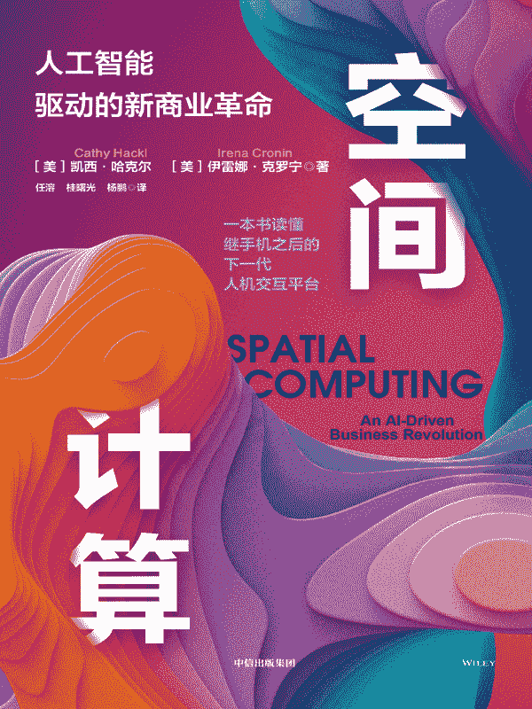

# 人工智能点燃空间商业的下一轮浪潮

——凯西·哈克尔——

谨以此书献给我的父亲，路易斯·瓦雷拉大使。感谢他给予我叛逆的灵魂、旺盛的好奇心与探险家的气质。我深爱着你，亲爱的爸爸！

同时献给在空间运算、人工智能、XR 及相关技术前线奋斗的女性。让技术变得更好，未来才会更好！

——伊雷娜·克罗宁——

为纪念我的丈夫丹尼，怀念他对科技的热爱。

# 推荐序

## 新空间已启动：沉浸或被淘汰

2023年苹果推出 Vision Pro，堪称继 2007 年初代 iPhone 后的又一个分水岭。就像当年手机重塑计算一样，这一次借助智能沉浸式的空间运算平台，交互方式再次被改写。世界被刷新了。全新系统打开了新维度。那些可无限分层叠加的画布给了用户超常能力。在任何环境里，人们都能超越传统物理与数字的限制，与信息、内容和他人进行直接互动。每日都可进入从未有过的世界，体验虚拟与增强领域带来的奇妙感官。

这只是开端。苹果发布 Vision Pro 约七个月前，OpenAI 公开了 ChatGPT，向大众展示生成式人工智能的威力。ChatGPT 迅速成为消费互联网史上增速最快的应用，两个月内用户就冲到约一亿。^(¹)

故事由此展开。

人类正踏上混合现实的未知旅程，一场智能化、沉浸式且突破现实的探索。混合现实放大人的能力，在不断演化的混合维度里释放指数级效能，推动前所未有的成果，连接起物理与数字两端。

凯西·哈克尔与伊雷娜·克罗宁以空间创新的视角激发想象，带来创造新世界、新工作范式、新学习方式、新沟通形态、新探索路径，以及梦想、记忆、发明、解法与演进的新可能，开启一次变革性的起点。

物理与数字的界线，将由读者共同定义。你们是未知世界的建筑师、天文学家与开拓者。愿景将引领空间设计、体验与人类潜能的新篇章。

我们正生活在何等虚拟的时代！

要么深度沉浸，要么被时代淘汰！

布赖恩·索利斯

数字未来学家、人類学家

# 前言

## 智能与沉浸交汇的关键节点

这次讨论的核心是一个重塑世界认知的重要时刻。核心在于两股力量的合流：人工智能与以 AR、VR 为代表的空间运算。这种融合象征创新与创造力的交织，让数字与现实的互动成为可能。没有人工智能，空间运算难以落地；而生成式人工智能的出现，又让空间运算更上一层楼。

这不只是技术叠加，而是迈入全新时代的门槛。人工智能卓越的信息处理能力与 AR、VR 的沉浸实力结合，形成动态协同。这种合作预示一个更直观、无缝的未来，让人与数字信息及周边世界互动突破传统限制，联通物理与数字。

影响远超技术本身。它渗透到日常生活的方方面面：学习方式、娱乐形态、医疗服务、消费决策等。这一转变不仅改变人与技术的关联，也在重塑商业格局。

从商业视角看，冲击很深。善用此技术的企业将凭借沉浸式体验获得竞争优势。医疗场景里，AR 能为外科医生提供实时数据；零售场景里，VR 能提供虚拟试衣服务。人工智能的分析能力也帮助企业在瞬息万变的市场中做出更明智判断。

本前言为后续探讨奠基。我们将深入其关键构成、实际场景与深远影响。接下来将聚焦这场技术融合如何改写数字与物理的边界，见证当下的迅猛演进，以及充满机遇、创新与希望的未来。

### 建立认知坐标

要理解这场融合的意义，需要对照过往的变革性发明。历史上技术总能改写人类体验。第一张照片让瞬间永恒，彻底改变视觉叙事；第一部影片让故事上银幕，开启娱乐与艺术的新纪元。

这些里程碑改变了我们看世界的方式。如今我们再次站在人工智能与空间运算的交汇点。就像照片改变了记忆记录方式，人工智能与空间运算正在改变现实感知；就像影片重塑娱乐，AR 与 VR 带来全新沉浸体验。

又如电视问世永远改变了人与世界的关联，人工智能与空间运算正打破物理与数字的壁垒，让人与信息、环境以前所未有的方式互动。

这不仅是技术演进，更是互动方式的深刻革新。它能够重新定义现实，模糊虚拟与物理的边界，为人工智能与空间运算无缝融入日常铺路，打开超出当前理解的可能性。当我们探索其变革潜力时，会看到它如何重塑行业、重新定义体验，并把我们推向无限创新与想象的时代。

### 一个独特的智能时刻

此刻我们正处两股关键技术力量的交汇。人工智能已走过漫长进化，从计算机科学与数学萌芽，成抽象概念到日常必需品。

本书将探讨人工智能的构成、应用与影响。值得注意的是，计算机视觉是空间运算的核心驱动力。它通过理解物理世界并与之互动创造沉浸体验，还包含建模与扫描等环节。

在空间运算语境下，生成式人工智能的作用不容忽视。它带来全新的三维创作能力，能生成沉浸交互式三维内容，让空间世界更丰盈。

人工智能的历程由里程碑标注：从早期专家系统到如今的机器学习、深度神经网络与通用人工智能。自然语言处理、图像识别、预测分析等因此革新。支撑人工智能的算法与模型愈发复杂，为各行各业提供决策、自动化与个性化支持。

与此同时，以 AR 与 VR 为代表的空间运算，正从进化迈向革命。它们虽已发展至今，如今才准备好从小众走向主流。这一拐点意义重大。

这场融合的独特之处在于人工智能对空间运算的深度参与。这不是简单共存，而是协同重塑世界。它甚至超越电力或工业革命的影响：过去里程碑重塑行业与基础设施，而今的融合重新定义人类生存本质。

在计算机视觉之外，人工智能以复杂数据分析、预测与决策能力融入生活。它潜移默化影响选择，从内容到商品，多数时候在幕后提升体验，成为沉默但无处不在的伙伴。

与此同时，空间运算以融合数字与物理的能力增强人机交互。它不仅为物理现实提供数字覆盖，更创造具情境感知的沉浸环境。数字与物理的边界消失，开启新互动方式。

这一时刻标志从被动消费技术到主动参与的转变，从观察数字领域到在其中生活。人工智能与空间运算的融合将重新定义日常、工作、教育、医疗与娱乐的本质。

本质上，这是不断演进的人工智能与空间运算变革潜力的结合。它描绘一个技术发达且真正以人为本的未来。这是一个与历史上任何时刻都不同的创新时刻，数字与物理结合创造无限潜能的现实。这是定义创新与想象结合时代的时刻，重新定义人类互动与体验的本质。

### 历史回声：首张照片、首部电影、首台电视

回溯历史，捕捉瞬间本身就是革命。首张照片诞生，是视觉表达的巨大跃迁。它赋予人类留住瞬间、使其永存的能力。通过照片，我们学会以有形方式保存生命的短暂之美，供后人珍藏。

随后，首部电影标志叙事能力的飞跃。这项技术让故事以梦境般的方式被体验。电影成为通用语言，弥合隔阂、连接人群。昏暗的剧院化为通往新世界的大门，观众可坐在席间远赴他乡、回到过往。

而首台电视亮起，则是另一里程碑。它把世界直接带入客厅，开了一扇通往外部的窗。信息与娱乐不再依赖书籍与收音机。电视打破沟通壁垒，让全球事件视觉化呈现。新闻、艺术、文化与娱乐触达更多人，拉近人与人之间的距离。

这些历史时刻展现了技术变革的力量。如今，人工智能与空间运算的融合，以 VR 与 AR 为代表，也预示深刻变革，将重塑我们对数字与物理现实的感知与互动。这不仅是演进，更是范式转移，开启现实与虚拟界限模糊的未来。它带来创新与想象无限的时代，让存在与人工智能、空间运算世界无缝交织。

### VR与AR的破晓

我们正处技术革命前沿，令人想起早期的范式转移。VR 与 AR 的出现点燃集体想象，正重新定义人与世界互动与感知的方式。

VR 作为开创性创新，让人们进入完全数字化的环境。戴上头显，人便融入虚拟世界，模糊物理与数字边界。这种沉浸感让用户探索合成的逼真环境，从梦幻场景到训练模拟。VR 影响早已超越娱乐，渗透游戏、职业培训与医疗。

AR 则走向另一条路。它不将用户淹没于全新场景，而是把数字元素叠加在现实之上。通过增强，AR 提升对物理环境的理解。AR 为现实提供个性化数字覆盖，提供背景信息与洞察。无论是城市导航的实时指引，还是手术中为医生提供关键患者数据，AR 都在重塑互动方式。

二者早已超越娱乐，在教育、医疗、工程与设计等领域取得突破。教育中，VR 让学生进入历史现场或人体内部；医疗中，AR 提升手术精度与安全性；建筑与设计中，VR 与 AR 助力实时建模与协作。

VR 与 AR 的出现不仅是技术进步，更意味着学习、工作与娱乐方式的根本转变。它们开启体验式学习、医疗实践升级与设计工程革命的新纪元。随着探索深化，我们将看到它们如何塑造未来，创造数字与物理无缝共存的现实，改善生活。

### 空间运算的远景

在技术最前沿，空间运算将 AR 与 VR 无缝融合，有望重新定义人机交互的理解。

其潜力远超技术进步，预示数字与物理感知与交互的深刻革命。在此沉浸领域里，数字与物理无缝融合，从根本上改变我们处理数据、信息与环境的方式。

设想一个未来，数字信息与物理环境交织，摆脱屏幕束缚，成为环境的一部分。无论是三维空间中可视化复杂数据集、像操作实物般操控虚拟物品，还是接收叠加在物理环境的相关信息，空间运算都能增强工作、学习与休闲体验，提供全新的现实感知视角。

AR 与 VR 的空间应用令人惊叹，有望革新诸多职业。建筑师可从草图平滑过渡到沉浸式三维模型，实现实时设计；医疗从业者可利用 AR 在手术中获取关键信息；教育领域则迎来体验式学习新时代，让学生近距离探究历史、科学或艺术。

此外，二者还能重定义协作与沟通。在空间领域，距离不再是障碍。团队可在共享虚拟空间中协作，地理限制被抹平。这种协作潜力延伸至设计、医疗等领域，专业人士可实时合作，远程医疗也能借助 AR 叠加指导手术，突破地理边界。

VR 与 AR 的前景远超技术，它们在重新定义现实并释放无限潜力。跨过这一变革门槛，我们进入数字与物理界限消失的世界，为无数机会铺路。在这里，创新无止境，AR 与 VR 增强生活的方方面面，预示现实与虚拟无缝融合的更丰富、更沉浸的存在。

### 领导者的紧迫使命

在瞬息万变的技术领域，既有企业领导者与后来者面临的不仅是选择，而是必须深入理解本书洞见。技术融合加速，技能、信息与竞争力成为生存必需。

这一紧迫感的核心在于一个清晰事实：“人工智能不会取代你的工作，但使用人工智能的人会取代你的工作。”这句话概括了当下现实：承认人类专业不可替代，同时强调人机协同释放前所未有潜力。这不是人机对立，而是合作。

后续章节将全面探索人工智能与空间运算的多面向前景，涵盖其重要性、应用场景与驾驭不断变化领域的所需技能。

人工智能与空间运算的融合不仅是技术融合，更是机遇爆发。这些不是短暂趋势，而是重塑行业、重新定义商业模式、彻底改变人与技术互动方式的变革力量。

在这个环境中，领导者肩负重大责任。他们不仅要理解人工智能与空间运算的复杂性，更要率先有效利用其能力。拥抱前沿是保持创新领先、引领企业走向适应性、创新性与技术流畅为基石的未来的关键。

作为领导者，你不仅要掌舵，更要用远见与勇气驶向未知水域，指导团队，认识到人工智能与空间运算的融合是一段带来技术进步与以人为本深刻变革的旅程。你还需要塑造一种组织文化，不仅为未来做好准备，更能在未来蓬勃发展。

未来充满诱人前景与令人兴奋的可能性。领导者不仅要管理变革，更要拥抱变革，以好奇心与勇气引领这些融合前沿的变革力量。未来的领导者明白创新是无限的，通过拥抱变革并利用人工智能与空间运算能力，我们可以创造技术先进且以人为本的未来。让我们以坚定决心与远见，踏上探索与转型之旅。未来正在招手，我们必须做好迎接准备。

下一节将揭示商业环境中空间运算的本质，从其基本定义与核心技术开始探索。

### 什么是空间运算

空间运算一词对很多商界人士而言，是在苹果 2023 年 6 月发布 Vision Pro 时才听到的。但这并非新概念。有人会说，我们的手机就是原始的空间设备。事实上，AR、VR、XR 与人工智能领域的从业者多年来一直在深耕空间运算。

要理解其商业价值，我们首先需为商业世界建立工作定义，并阐明其市场机遇。

在此基础上，才能明白商业与计算将如何变化，以便为转型做好准备。

很多人追溯到西蒙·格林沃尔德 2003 年在麻省理工学院发表的硕士论文，其中首次将空间运算定义为学术术语。当时他是麻省理工学院媒体实验室美学与计算小组的研究员。论文中他探讨计算结构的空间环境，并给出定义：“空间运算是人类与机器的交互，其中机器保留并操纵真实物体和真实空间的参照物。它是让机器在我们的工作和娱乐中成为更好伙伴的重要组成部分。”

【空间计算】被吹爆的下一代交互，本质上是什么？

有人说，机器在人和它的对话里，不能只是投屏，要留住真实世界的锚点，让物体和空间始终占据主位。好的体验不是把用户拽进屏幕，而是把计算拆掉屏幕和键盘的围墙，让机器真正进入我们的物理生活，操同样的东西，用同样的空间直觉去操控。它要做的是伙伴，而不是工具。

这只是其中一种表述。围绕同一个概念，巨头们给出了各具侧重的解读。

早在行业热捧增强现实的年代，Magic Leap的技术团队就把正在研发的产品叫做空间计算终端。他们认为，这是一种借助 AI 与计算机视觉，让虚拟内容自然嵌入现实物理环境的计算方式。2018 年，时任 CEO 罗尼·阿博维茨等人合写《空间计算：给我们技术朋友的概述》，把空间计算描述为让数字信息突破二维屏幕限制的形态，并点出了背后的技术要素。^(²)

苹果在 2023 年 6 月的 WWDC 上公开口径是：空间计算把数字内容和物理世界无缝融合，同时保留人在其中的存在感和社交连接。随后在官网与开发者资料的 visionOS 介绍里，同一套说法被反复强调。

Meta 在 2023 年的 Meta Connect 上发布 Quest 3，强调全新芯片带来的混合现实穿透力、更精细的空间映射以及让虚拟物体锚定在空间中的能力，使用户每次佩戴都能回到同一起点。管理层也在场合中谈到智能眼镜作为下一代计算平台的路线，并称新一代眼镜将是“未来很长一段时间内最有价值的空间计算眼镜”。同场还宣布雷朋 Meta 智能眼镜将在 2024 年实现多模态，通过 AI 感知佩戴者周边的环境。

微软的说法更偏感知：设备能读懂周围的环境并以数字形式呈现，并据此创造新的交互可能。

AWS 把空间计算看作虚拟与物理的融合体，通过把现实世界数字化，再把虚拟信息叠加上去，使用户能以自然直观的方式操作数字内容。亚马逊技术副总裁比尔·瓦斯在《预测未来的最佳方式是模拟未来》一文中写道，“空间计算是协作体验的动力”。^(³)

英伟达用 Omniverse 为开发者提供空间框架，Niantic 则用视觉定位系统 VPS 让虚拟物件固定在真实世界的具体位置并保持持久，让现实世界的协作桌游成为可能。

## 为商业世界正名

我们需要一个统一的语言，才能跟上这项技术的演进。一个清晰的定义，能帮助企业理解空间计算对商业、工作、教育、消费与休闲的长期影响。

空间计算是人机交互的下一次迁移。它集合 AI、XR、物联网、各类传感器，形成比以往更沉浸、更具影响力的交互形态。它重塑人与空间的关系，允许在三维里进行交互，进而获得更真实的表现与协作。

它依赖环境上下文来达成最直观的操作。企业借助它完成数字化转型，在虚拟与物理交织的世界里获得竞争优势，并为在这种环境中成长的下一代做好准备。

它会催生实用且高影响力的场景。工作站可以“带在身边”，变成一块无限画布式的屏幕替代物。借助 AI，计算机和其他机器能够解读我们的世界，开创全新的交流范式。

今天手机上的初级 AR 已为明天的空间计算埋下种子。早期界面信号已经出现：它能打破隔阂、拉近距离、释放大规模协作。空间计算机把互联网及其数据实体化到物理空间。设备会感知佩戴者及其所在的物理环境，进而实现实时更新与互动。它是“活的”。它让交互更自然，让设备更好地理解、映射并驾驭我们的物理环境。设备“看见”我们所见的世界，理解我们的空间。在某种程度上，空间计算让与虚拟世界的互动变得像与物理世界一样容易。

人类本就是空间物种，以立体方式理解世界。成长过程中，平面化往往削弱空间思维。空间计算有潜力提升生产力、效率、创造力与沟通能力，无论在商业还是生活里，都能帮助做出更好决策。设备正从挂墙、放桌、拿手的静态形态，转向淡入背景，让我们重新聚焦于增强后的物理空间。

我们正身处 AI 革命，同时站在新范式的入口，物理与虚拟无缝融合，为创造力、创新、人际联结与新工作方式打开无限可能。它深刻改变人与技术、人与人的互动方式，消除障碍、拉近距离、促成共存。它迫使融合发生，让设备及其使用方式融入日常生活的自然流程。

空间计算把数字信息与体验带入物理环境，考量佩戴者的位置、朝向、背景以及周围的物体与表面。它使用一种新型计算去理解与虚拟环境及佩戴者相关的物理世界。实现路径是新兴的接口设备，比如搭载摄像头、扫描仪、麦克风等传感器的可穿戴设备。新交互包括手势、手指动作、视线追踪与语音。GPS、蓝牙等传感器让数字内容能锚定在物理环境中。

从购物到工作，从规划到娱乐，世界将以新方式回应我们。这是计算、通信与三维空间的交汇点。手势识别可以识别手部动作作为指令，每只眼睛可看到高于 4K 的画面。

它与 VR、AR 有何不同？AR 是把数字内容叠加到物理空间，VR 是完全沉浸的虚拟环境。XR 光谱属于空间计算的一部分，但不是全部。业界普遍在讨论 AI、XR、传感器、物联网与更高水平的连接，其中 AI 是普及空间计算的关键基座之一。

换句话说，空间计算是让机器在不被告知的情况下理解物理环境的软硬结合。反过来，它让我们能创造在物理与虚拟世界皆有用的内容、产品与服务。它是一种变革性技术，通过整合多项技术把物理与虚拟无缝融合，让我们与机器人、无人机、汽车、虚拟助手等共同探索世界。

在光学突破、传感器与芯片小型化、三维真实呈现能力以及软硬件持续演进的推动下，空间计算未来几年有望大幅增长。在 AI 大突破的加持下，这些创新将使它对大规模企业更具吸引力。

以下工作定义由本书第一作者凯西·哈克尔在 2023 年 11 月为《哈佛商业评论》提出的版本经两位作者共同完善而成。

空间计算是一种以三维世界为中心、持续演进的计算形态，核心是用 AI、计算机视觉与 XR 把虚拟体验植入物理世界，让人摆脱屏幕束缚，让任意表面都成为空间界面。它让人与装置、计算机、机器人与虚拟生命在三维空间中通过计算获得方位感，开创人际与人机交互新范式，增强在物理或虚拟环境中可视化、模拟并交互数据的方式，并把计算边界从屏幕扩展到你所能看见、体验与理解的一切。

它让我们能与机器人、无人机、汽车、虚拟助手等一起探索世界，但它不限于单一技术或单一设备。它是软件、硬件与信息的混合，促成人类与技术的新联结，其社会影响可能超过个人计算与移动计算。

厘清概念同样重要。空间计算不只是 XR，也不是单一设备或单一公司。它是人机互动方式的根本性重塑。

有人问它与元宇宙的区别。耐克元宇宙工程总监安德鲁·施瓦茨曾在推文中点出关键：“如果互联网的组织原则是信息希望被共享，而元宇宙的组织原则是信息希望被体验，那么空间计算就是把创造这些体验所需工具融合在一起。”

空间计算是技术变革的驱动者，同时自身由一系列技术推动。

## 空间计算涉及哪些技术

### AI 基础

AI 是空间计算的基石，涵盖多个子领域。

#### 机器学习（Machine Learning，ML）
系统的学习能力，无需显式编程即可从数据中学习并自适应。它让机器识别模式、做决策并随时间提升性能。在空间计算里，机器学习支撑 AR 导航的路线规划，通过分析实时传感器数据提供高效友好的路径。不断完善环境理解，是提升体验的关键。

#### 深度学习（Deep Learning，DL）
以多层神经网络建模复杂问题的机器学习分支。它能处理海量数据，对 AR/VR 中的图像识别与目标检测至关重要。它增强空间设备识别并交互周边物体与空间的能力。

#### 强化学习（Reinforcement Learning，RL）
智能体通过行动与反馈奖励学习决策的方法。在空间计算中用于游戏与娱乐应用的动态角色行为，让角色根据用户输入调整动作，提升沉浸与互动。也在实时决策中改善设备交互。

#### 程序化生成（Procedural Generation）
用算法生成内容的技术，可批量创造地形、物件与场景。为空间计算提供动态变化的维度，常用于三维世界生成，让每位用户的体验各不相同。游戏、虚拟仿真、AR 都依赖即时生成保持新鲜。

#### 神经网络（Neural Networks）
受人脑启发的计算模型，是模式识别与数据分析的基础。在空间计算中用于复杂任务，如计算机视觉中识别现实物体与形状，为 AR 应用提供实时信息，增强用户理解。

#### 计算机视觉（Computer Vision，CV）
让机器理解并解释物理世界视觉信息的核心技术。它帮助空间设备识别并交互周围物体与空间，是 AR 导航等叠加数字信息到现实场景的应用基础。

#### 传感器技术（sensor technology）
空间计算的感知神经系统。设备搭载摄像头、陀螺仪、加速度计、GPS、激光雷达等，采集运动、位置、光照、深度等数据。它们理解环境与移动，支撑精确定位、手势识别与空间映射。是沉浸游戏、导航与工业测绘的基石。

#### 空间音频（spatial audio）
沉浸体验的听觉支柱。它创造与视觉协调的三维声场，让声音来自特定空间位置，产生方向与距离感并模拟不同声学环境。广泛应用于娱乐、游戏、训练模拟、虚拟会议与建筑设计。

#### 眼动追踪（eye tracking）
通过监测眼球运动与注视点实现更自然交互的技术。它让设备根据视线调整内容，提供定向信息、增强沉浸与个性化。也在医疗康复与辅助诊断中有前景。

#### 语音识别（voice recognition）
在 AI 支持下，让用户用自然语言与空间设备对话。系统理解语言细微差别，让用户发指令、提问并获得响应。提升日常效率并为无障碍交流提供入口。

#### 异常检测（Anomaly Detection）
识别数据中异常模式的行为分析。对空间计算安全至关重要，设备可根据传感器异常提醒用户。在预测性维护中帮助预判故障、减少停机。

#### 基于物理的模拟（Physics-Based Simulation）
创造逼真动态虚拟环境的关键。空间应用可模拟现实物理交互，提升存在感与互动感。医疗培训、建筑设计与游戏皆赖此实现逼真场景。

#### 优化算法（Optimization Algorithms）
提升流程与决策效率的基础。分析客户移动数据等信息，优化零售店布局与商品陈列，提升购物体验。

#### 自然语言处理（Natural Language Processing，NLP）
让机器理解并交互人类语言。在空间计算中实现无缝沟通，对实时语言翻译尤为关键，AR 眼镜可把口语即时转成字幕或音频。

#### 语言识别（speech recognition）
把口语转换为文本或可执行数据的技术。支撑语音指令与响应，是 AR/VR 应用不可缺少的交互方式。

#### 生成式 AI（Generative AI，GenAI）
为空间计算注入创造力维度。它能创建三维内容与仿真，扩展沉浸可能。例如时尚与奢侈品设计中处理体量数据、分析供应链并生成产品与设计的虚拟三维模型。

这些技术共同构成 AI 框架，让空间计算在现实世界中交互、适应与创新。

### 与空间计算相关的其他关键技术

内容创建和设计工具是沉浸式体验的工匠，使创作者能构建交互式的空间内容，包括虚拟世界、AR 应用与三维模型。它们把概念转化为可体验的现实。

渲染和图形技术是真实视觉体验的画布。无论是虚拟情境还是 AR 叠加，画面质量都依赖复杂的处理，把数字信息转化为令人信服的视觉表现。

云和边缘计算为空间计算提供算力支撑与连接解决方案...

云与边缘的协同配合，正为空间计算提供算力和存储的双重支撑。云端汇聚海量数据与强劲运算资源，负责跨设备的数据同步与调取；边缘则把计算下沉到空间终端附近，显著降低响应时延，让交互几乎零等待。二者联动起来，构成了空间计算运转的底座，让沉浸式体验得以全面落地。

#### 5G 与 6G 连接
第五代移动通信与正在推进的第六代移动通信，为空间计算搭建了高速可靠的传输通道。这类网络支撑起设备与云端的实时数据交换，使低延迟、高画质的空间体验成为可能。无论是 AR 内容的流式分发、远程虚拟协作，还是共享虚拟空间里的游戏互动，都离不开这条稳定畅通的数字高速公路。

#### 物联网融合
物联网让空间设备突破孤岛，与更广阔的互联生态产生联动。空间计算的价值不止于设备间的互动，更在于与智能家居、城市设施、医疗系统等外部系统的协同连接。通过构建一个互通的设备网络，日常生活场景被持续丰富，空间计算的应用边界随之扩展。

### 实际应用场景
以下案例展示了 AI 驱动的空间计算在真实世界中的落地形态，从革新导航到前瞻性维护，清晰呈现了 AI 在塑造空间计算新体验上的推动力。

### AR 导航
AI 算法为 AR 导航注入了实时定位能力。系统在视野中叠加箭头、街名等直观提示，并结合位置信息给出路线指引。无论是在人流密集的城区寻找最优路径，还是在陌生区域发现隐蔽地点，AI 增强的导航都能让出行更省心。

### 虚拟室内设计
AI 与空间计算共同重塑了家装想象。用户可借助应用将家具和软装以三维方式投放到自家空间中。计算机视觉负责解析房间结构与用户偏好，从而给出个性化方案，让业主和设计师在动工前就能预览多种风格。

### 工业场景的预测性维护
在工厂环境中，空间计算与 AI 结合形成了预测性维护能力。算法分析机器传感器的实时数据，提前捕捉异常征兆。及时预警减少了非计划停机，提升运营效率，为企业节约成本并提高产出。

### 医疗培训仿真
医疗从业者正借助 AI 驱动的 VR 仿真进行无风险演练。这些仿真环境模拟真实手术流程，并提供即时反馈。反复练习有助于提升操作熟练度，最终带来更高的患者安全性和更优的术后恢复质量。

### 零售空间优化
AI 依托空间计算洞察顾客动线，帮助零售商优化陈列与动线设计。通过分析人流模式，店铺能够营造更具吸引力且转化更高的购物环境，实现客流引导与商品摆放的精准匹配。

### 时尚与奢侈品
时尚行业利用 AI 强化供应链管理、捕捉趋势并革新设计流程。计算机视觉处理大规模图数据实现精准匹配，机器学习优化供应链，生成式 AI 则创造三维虚拟样衣，重塑设计与生产的节奏。

### 智慧城市规划
城市管理借助 AI 分析摄像头与传感器汇聚的数据，空间计算则负责可视化呈现。交通调度、基础设施建设、公共安全等决策因此更具依据，城市运行趋向高效可持续。

### 实时语言翻译
AI 与空间计算的配合让实时翻译成为现实。AI AR 眼镜可将口语转写为字幕或语音，跨语言沟通即时完成。语言壁垒被削弱，全球协作与理解得以加速。

### 安全巡检与合规检查
工业现场的 AI AR 眼镜能够实时识别安全隐患与合规偏差。巡检人员即时获取风险提示，有助于预防事故并确保规范执行，提升整体作业安全水平。

### 建筑设计可视化
建筑师使用 AI 与空间计算生成建筑与城市环境的 3D 虚拟模型。设计意图可被快速呈现并迭代，精细度与创造力同步提升。

### 游戏与娱乐
AI 算法显著增强 VR/AR 游戏体验。强化学习塑造角色行为以实现动态玩法，程序化生成构建逼真场景，神经网络进一步优化行为细节与环境表现，使互动更沉浸。

本部分梳理了驱动空间计算沉浸感的关键技术群，既包括 AI 及其分支，也涵盖支撑架构。数字世界与物理世界的融合由此被不断深化。接下来聚焦这些技术红利的最终受益群体。

## 空间计算的受益主体
空间计算带来的变革红利覆盖多个行业与人群，成为众多组织投入的动因。它重新定义了人机互动方式，创造出可感知的价值。以下为主要受益者及其应用方式。

### 核心受益群体
#### 消费者与终端用户
消费者是最大受益者。AR 游戏、VR 体验等带来全新娱乐方式，教育与培训场景则提供沉浸式交互学习，改变知识传递体验。

#### 医疗健康
医疗专业人员利用空间计算进行术前规划与技能训练，在安全环境中练习复杂操作。患者则受益于可视化诊断与远程医疗，获得更精准的诊疗方案。

#### 制造与工业
制造环节借助空间计算加速设计、打样与质检。现场维护人员通过 AR 指导提升作业效率并降低失误率。

#### 零售业
零售商以 AR 购物实现居家试看，降低线上退货顾虑。空间洞察也助力库存与物流管理更精细化。

#### 时尚与奢侈品
设计周期被压缩，定制与试穿更精准。空间设备本身成为时尚表达载体，与游戏娱乐的跨界带来新收入模式。

#### 游戏与娱乐
VR/AR 带来高沉浸度的互动，娱乐演出借助 AR 叠加增强现场效果。

#### 教育与培训
沉浸式课程让抽象知识具象化，航空、军事等专业领域通过逼真模拟提升训练效果。

#### 房地产与建筑
虚拟看房与 AR 房产展示简化交易流程。建筑师与规划师依靠三维建模提升设计精度与沟通效率。

#### 交通与汽车
自动驾驶与导航安全系统获益，公共交通的线路优化与乘客信息服务也得到改善。

#### 航空航天与国防
飞机设计、维护与飞行员培训依赖空间仿真。国防领域则使用先进模拟场景提升训练水平。

#### 艺术与创意
艺术家借助空间工具创作数字作品与三维模型，互动装置的形式被重新定义。建筑施工环节可将图纸可视化并提前发现错误。

#### 旅游与文化遗产
AR 导览丰富博物馆与遗址体验，三维扫描与数字档案助力文化保护与传播。

#### 环境科学
空间计算辅助环境监测与数据可视化，为保护与可持续决策提供支撑。

#### 无障碍
自适应界面与辅助技术让残障用户更便捷地访问数字内容与物理环境。

#### 企业与生产力
企业通过空间工具强化协作、远程办公与数据可视化，决策与分析流程得到优化，形成竞争优势。

上述群体构成一个多元活跃的市场，空间计算的创新能力正在重塑产业边界与生活方式。

## 空间计算对商业的价值
空间计算与 AI 正共同重塑商业形态，已在多个场景中创造价值。AI 呈现出强劲的即时效应，而空间计算则像一座沉睡的巨人，未来十年有望全面觉醒。

空间计算与 AI 带来的商业价值包括：

流程优化与效率提升。

创新沟通与协作模式。

沟通障碍的改善。

零售体验升级，降低退货与浪费。

沉浸式娱乐的增长。

基于空间视频与记忆捕捉的全新存档与历史记录方式，这很可能是推动消费者购买空间终端的核心动机之一。

更好的建模工具助力气候应对与决策。

更强的对外联络能力与战略愿景的可视化。

还有更多潜在机会。

我们认为空间计算与 AI 的融合将彻底改变商业运行逻辑，对个人生活产生深远影响。本书旨在帮助读者理解这一新现实，指导领导者将技术视为长期战略资产而非短期潮流。

前言阐述了 AI 与空间计算对现代商业领袖的重要性。第 1 至 3 章探讨 AI 驱动空间计算的商业关联。第 4 至 6 章介绍领导者需掌握的融合知识及变革中的领导方法。最后三章聚焦落地策略与未来展望。

因此后续章节将深入分析技术如何改变商业、哪些组织率先受益、为何当下理解空间计算与 AI 对引领未来至关重要。请准备好跳出纯 AI 视角，面向更广阔融合浪潮。未来属于 AI 与空间计算协同的时代。

# 第一部分
## AI 驱动空间计算的商业意义
## 第 1 章
#### AI 革命：重塑当代商业
##### 从亚里士多德到当下
AI 的演进跨越了从科幻设想到核心生产力的漫长旅程，折射出人类对智能创造的持续探索。

其概念根源可追溯至数个世纪前的哲学思考。古希腊神话中关于机械仆人的记载，反映了早期对人造智能的想象。亚里士多德在逻辑与演绎推理上的贡献，为后来的算法思维奠基。

文艺复兴时期自动机的兴起，模糊了艺术与技术的界线，为机器人概念埋下伏笔。笛卡尔的身心二元论引发了关于意识本质的讨论，成为 AI 哲学基础的先声。

19 世纪，巴贝奇的分析机构想与洛夫莱斯对其计算潜能的洞察，以及布尔代数的提出，为数字计算与智能奠定了理论基础。20 世纪初的逻辑实证主义推动了基于逻辑与数据的科学方法，影响了后续算法发展。

图灵提出的图灵测试将智能的判定从纯技术问题扩展为哲学议题。虽然早期 AI 经历乐观与寒冬的循环，但计算能力的提升与大数据积累推动了复兴。深度学习作为机器学习分支，凭借多层神经网络在游戏、自然语言与图像识别中取得突破。

AI 的渗透已覆盖制造自动化、金融风控、医疗诊断等领域，并通过智能助手、个性化推荐触达大众。它同时增强了空间计算的互动与沉浸能力，成为融合物理与数字空间的关键支撑。

要理解 AI 在空间计算中的作用，需追溯其技术演进与主要分支，包括自然语言处理、计算机视觉、机器学习、深度学习与生成式 AI 等。

##### AI 技术与应用的演进路径
空间计算兴起前，AI 已走过从解决特定问题到泛化应用的历程。早期基于规则的系统处理定义清晰的任务，如博弈或简单语言理解。

随着算力与数据的增长，AI 进入复杂任务阶段，逐步应用于医疗辅助诊断、金融预测等领域。

##### AI 软件的分类
###### 基于规则的系统
早期 AI 形态，遵循预设规则运行。对结构化任务有效，但面对非结构化数据时灵活性受限。

###### 基于机器学习的系统
系统通过数据学习模式，在少量干预下做出判断。具备自我改进能力，适应性更强。

###### 基于深度学习的系统
利用多层神经网络处理大规模非结构化数据，在图像与语音领域表现突出。

###### 混合系统
融合规则、机器学习与深度学习，取长补短，提升鲁棒性与可解释性。

##### 自然语言处理及其应用
自然语言处理聚焦人机语言交互，涵盖理解、生成与识别。典型应用包括数字助手、机器翻译、客服机器人等。

##### 自然语言处理的关键要素
###### 语言理解
涵盖语法、语义与语用层面的解析，使机器把握人类表达的细微差别。

###### 语言生成
让机器产出连贯、情境化的文本或语音回复，用于对话系统。

###### 语言识别
将口语转化为机器可处理的信号，支撑语音交互。

##### 自然语言处理的应用场景
###### 数字助理
Siri、Alexa 等系统可解析语音指令、理解意图并执行任务，交互日益自然。

###### 机器翻译
服务如 Google 翻译帮助跨语言沟通，准确性持续提升。

###### 客户服务聊天机器人
企业用 AI 机器人处理常规咨询，提升响应效率并分担人工压力。

###### 情感分析
通过文本情绪识别，企业洞察用户反馈与舆情倾向。

###### 内容分拣与智能推荐
NLP 能自动给海量内容贴标签，并结合用户的偏好和过往互动行为，推送相匹配的文章、商品或服务。新闻聚合、电商平台和流媒体就是典型应用场景。

###### 从海量文本中提炼价值
面对非结构化文本，NLP 是挖掘有用信息的关键手段。它能从文档里抽取核心短语、专有名词或特定数据点，把文字变成可用的结构化知识。

###### 语音与文字的双向转换
语音转文字、文字转语音的服务背后全靠 NLP 支撑。听写软件、视障人士的阅读辅助等应用，都依赖它实现语音与文本的准确互转。

###### 语言建模与内容创作
高阶的语言模型可以产出连贯、符合上下文的文本，用于写作辅助、起草完整文章或报告等任务。

##### 前景与待解难题
NLP 的研究正在让语言处理更细腻、更懂语境。但要想真正成熟，还需克服多重障碍。

# NLP 面临的核心挑战
## 语言模糊与复杂表达的理解难
人类语言天生充满模糊、讽刺和惯用表达，构建能稳定捕捉细微差别的系统仍是难点。

## 偏见风险与公平性
模型会无意学习到训练数据中的偏见，导致输出偏颇或不公。解决偏见是打造合乎道德应用的前提。

## 跨语言跨文化的适配
让系统在多种语言和不同文化背景下都能稳定工作，是目前持续攻关的方向。

总的来看，自然语言处理已成为现代 AI 的基石，改变了我们与技术互动的方式。随着技术演进，它有望进一步缩小人与机器在沟通上的距离，为数字生活带来更多便捷与效率。

# 计算机视觉：让机器看懂世界
计算机视觉致力于赋予机器解释视觉世界的能力，通过摄像头处理图像和视频，让机器像人一样识别物体与场景，并在多个行业产生深远影响。

## 核心能力盘点
### 识别与定位物体
基础能力是发现并辨认视觉媒体中的物体，比如照片里的人、零售场景里的商品，让系统能准确解读画面。

### 综合分析图像与视频
超越简单识别，系统可进行情境理解、模式发现，甚至通过面部分析判断情绪。

### 实时视觉处理
大量场景要求即时解析并作出反应，自动驾驶就是典型，需要依据视觉输入快速决策。

## 不同行业的应用图谱
### 自动驾驶汽车
依赖视觉技术感知并解读周边环境，实现安全行驶。

### 医疗健康
助力医学影像分析、疾病筛查、患者监测和手术机器人辅助。

### 零售业
用于库存管理、顾客行为洞察，以及无收银台购物体验优化。

### 制造与质检
在生产线上进行质量控制，识别缺陷并确保产品达标。

### 安全与监控
支撑人脸识别、视频监控和分析，服务安防需求。

### 农业
帮助监测作物长势、发现病虫害、预测产量。

## 挑战与伦理议题
### 精度与可靠性
在自动驾驶、医疗影像等关键领域，准确度是底线要求。

### 隐私与伦理
尤其是监控和人脸识别的应用，引发了隐私保护和伦理实践的争议。

### 数据偏见风险
若训练数据有限或有偏，系统输出也会带有偏见。

### 算力需求高
高端视觉任务对计算资源消耗巨大，制约部分场景落地。

## 未来走向
计算机视觉的实时分析能力、复杂条件下的准确率以及负责任的使用方式都将持续提升。与 NLP、机器学习等融合后，有望形成更智能、更像人类感知的集成系统。总之，它是 AI 进步的驱动力，正在重塑机器感知世界的方式。

# 机器学习与深度学习：AI 的学习引擎
机器学习和深度学习是当代 AI 的核心构成，改变了计算机学习和决策的方式，并在各领域产生深远影响。

## 机器学习概览
机器学习是 AI 的子集，让计算机从数据中学习并据此预测或决策，而非靠硬编码规则。

### 监督学习
算法在标记样本上训练，学会输入与期望输出的映射关系。

### 无监督学习
处理无标签数据，自动聚类并挖掘隐藏结构或规律。

### 强化学习
算法通过执行动作、接收反馈逐步学习决策，类似试错成长。

## 深度学习：拓展边界
深度学习是机器学习的分支，使用多层神经网络模拟人脑处理大量非结构化数据，如图像和自然语言。

### 神经网络
由互联的神经元层组成，逐层处理信息，是深度学习的基本单元。

### 卷积神经网络 CNN
擅长处理图像等结构化数组，广泛用于图像分类与物体识别。

### 循环神经网络 RNN
适合序列数据，常用于语音识别、NLP 和时序分析。

## 关键相关性场景
### 数据分析与预测
在金融、零售等行业用于预测建模和决策支持，其处理大数据能力极具价值。

### 自然语言处理
机器学习与深度学习是推动语言理解和生成更精准、更懂语境的核心力量。

### 医疗诊断与健康
助力疾病检测、影像分析与个性化诊疗。

### 自动驾驶与机器人
通过传感器数据处理与解释，实现环境感知与交互。

### 个性化服务
电商、流媒体、内容分发等推荐系统背后均是机器学习算法。

### 人脸识别与安全
CNN 等深度模型是高精度人脸识别系统的基础。

## 挑战与未来方向
主要挑战在于对大规模数据需求、对偏见数据的敏感性，以及部分深度模型“黑箱”难以解释。未来将聚焦提升效率、降低数据依赖、增强可解释性，并推动合乎伦理的 AI 开发，确保公平与可信。

总体而言，机器学习和深度学习不仅是概念热词，更是驱动创新和提升效率的核心技术，正在重塑行业与人机交互模式。

# 生成式 AI：创造力的放大器
生成式 AI 专注于创造类人内容，从视觉、音频到文本。得益于 Transformer、GANs 和变分自动编码器等方法的进步，其变革潜力在艺术、娱乐、营销等领域快速释放。

## 核心技术
### Transformer 变换器
最初为 NLP 设计，因注意力机制能兼顾全局上下文，在多类生成任务中表现突出。

### 生成式对抗网络 GANs
由生成器和判别器对抗训练，生成器不断优化输出直至逼真。

### 变分自动编码器 VAE
将数据压缩再重构，生成图像、音乐等复杂内容。

## 创造性应用
### 艺术与设计
生成新颖作品和设计概念，拓展创作边界。

### 音乐与声音制作
创作原创曲目或模仿风格，提供个性化音乐体验。

### 写作与内容生成
Transformer 擅长生成新闻稿、创意写作甚至代码。

### 电影与游戏
打造逼真场景和角色，提升沉浸感并简化制作流程。

### 个性化营销
生成定制化内容，提升用户参与度。

### 数据增强
在数据采集困难时，生成可用数据集支持科研。

## 挑战与伦理影响
### 真实性与原创性
人类与 AI 内容界限模糊，引发原创性讨论。

### 知识产权与版权
AI 生成内容的归属权法律问题仍在演进。

### 偏见与滥用
模型会继承训练数据偏见，也可能被用于深度伪造等有害内容。

### 创意领域冲击
对其是否会替代人类创作者存在争议。

## 未来方向
随着 Transformer 等技术成熟，输出将更精细、更具表现力。如何以负责任方式引导其发展，是充分发挥其潜力的关键。总之，生成式 AI 正在重新定义创作可能，并引发关于人类创造力本质的深入讨论。

# 计算机视觉为空间计算赋能
空间计算把物理世界与数字世界融合，计算机视觉为其提供实时环境解读与交互能力，二者结合催生大量新应用。

## 计算机视觉在空间计算中的角色
### 环境理解
识别物体、理解空间关系、解读物理布局，为数字内容无缝嵌入现实提供基础。

### 物体检测与识别
在 AR 游戏或工业 AR 中识别环境物体，支撑虚拟与现实的交互。

### 深度感知与映射
评估空间深度与尺度，确保 AR/VR 中数字物体的位置与大小真实自然。

### 实时交互
快速处理视觉变化，实现用户、物理环境与数字信息间的即时响应。

### 导航与路径规划
让机器人与自动驾驶系统避障并安全移动。

### 手势与动作识别
让手势成为操控 AR/VR 的自然交互方式。

## 应用与意义
### AR 与 VR
确保虚拟物体真实融合或虚拟环境可被自然导航与交互。

### 机器人与自主系统
用于感知环境、执行任务与空间移动。

### 智能环境
在智能家居与智慧城市中，使空间能感知人类活动并自适应响应。

## 挑战与未来方向
需兼顾复杂多样环境下的准确性、隐私保护、实时处理的算力需求。未来将聚焦更高效算法、更深 AI 融合与伦理合规，以扩大应用边界。

总之，计算机视觉是空间计算的核心技术，让机器理解三维世界并与之互动，正在重塑我们感知与交互的方式。

# 机器学习、深度学习与空间计算的交汇
机器学习与深度学习显著增强空间计算能力，让系统能处理复杂数据、做出决策并实现更自然的交互。

## 对空间计算的贡献
### 物理环境解释
分析摄像头、激光雷达等传感器数据，理解 AR/VR 场景等物理空间。

### 物体检测与分类
精准识别环境中的物体，支撑交互式应用。

### 预测与分析
预测用户行为与需求，提升响应速度与体验。

### 自然语言交互增强
改善语音指令在 AR/VR 中的流畅度。

### 手势与人体动作识别
让用户通过动作直观操控数字元素。

### 导航智能
为机器人与自动驾驶提供空间感知与路径规划能力。

### 个性化体验
基于用户数据定制 AR/VR 内容与智能环境。

## 实际意义
### 提升 AR/VR 体验
改善环境理解与交互，带来更沉浸真实感。

### 推动机器人与自主系统
强化空间认知与适应性。

### 优化智能环境
使家居与城市更具响应与适应性。

## 挑战与未来方向
涉及数据隐私、伦理 AI、算力管理及跨环境稳健建模。未来将侧重提高模型效率与透明度、优化数据处理，并实现技术无缝融合。

整体来看，机器学习与深度学习是空间计算进步的基石，让数字与物理融合更自然、更智能。

# 生成式 AI 在空间计算中的新角色
生成式 AI 专注于创造类人类内容，将其引入空间计算可让数字与物理交互更细腻、更具个性。

## 对空间计算的贡献
### AR/VR 的真实感提升
生成高度逼真的图像与场景，模糊虚拟与现实界限。

### 动态内容生成
根据用户互动与环境变化实时生成个性化数字内容。

### 真实世界环境模拟
为训练、教育、游戏创建多样化逼真场景。

### 个性化体验
为每位用户生成契合偏好与历史的内容。

### 智能空间预测模型
模拟物理空间使用方式，实现更主动的系统响应。

### 不断演化的艺术与设计
创建可随环境与观众互动的艺术作品。

## 挑战与未来方向

生成式智能与空间感知技术的深度融合，既在拓宽数字与物理世界的连接，也暴露出必须正视的现实问题。生成物的伦理边界、模型是否足够可信公平、在复杂环境里实现即时内容合成的算力压力，都是当前研发的痛点。后续演进大概率会集中在更节电更合规的生成方案，深化其与空间感知的嵌入，并在协同创造上打开更多新场景。

这种叠加让数字物理混合环境里的互动更具临场感、个性化与流动性。基于环境上下文即时合成内容的能力，正在重塑人们感知技术与互动方式，逐步淡化虚拟空间与真实空间的边界。随着技术成熟，生成式智能与空间计算的关系将重新定义数字体验，以难以想象的方式把虚拟与物理现实编织为一体。

# 硬件阵营：用 AI 驱动空间计算

空间计算的热度持续攀升，产业前沿参与者众多。硬件一方尤为活跃，通过把人工智能能力注入产品，特别是在图形加速与高端算力方案上形成差异化。下面按定位梳理关键玩家及其价值。

## 英伟达
### 擅长领域
图形处理器加速与智能运算。

### 关键贡献
英伟达长期主导 GPU 技术，这对智能系统与空间计算都是基础。旗下 GPU 既能渲染复杂画面，也能承担各类智能任务，包括空间计算场景的推理。CUDA 生态是关键推手，通过大规模并行把算法运行时间大幅压缩，对实时空间应用意义重大。公司还推出 DGX 系列与 Tegra 处理器等面向智能的专用硬件，被用于自动驾驶与智能终端，属于空间计算生态的重要一环。

## 英特尔
### 擅长领域
中央处理器与智能芯片研发。

### 关键贡献
传统上以 CPU 见长的英特尔如今已切入智能硬件。诸如 Nervana 神经网络处理器等芯片，专为深度学习任务的高效处理而设计。RealSense 方案包含深度感知摄像头，与空间计算契合度高，能为实时三维重构与物体识别提供关键感知数据。

## 高通公司
### 擅长领域
移动与物联网终端的智能整合。

### 关键贡献
高通是移动处理器的核心玩家，并在骁龙系列中深度植入智能能力。这些处理器广泛部署于智能手机与物联网设备，而这些恰是空间计算的关键触点。公司的智能引擎与专用的 Hexagon 数字信号处理器能在有限功耗下提供高级智能运算，对增强现实、虚拟现实及智能环境中的移动与边缘设备尤为关键。

## AMD
### 擅长领域
面向智能任务的图形处理器与中央处理器。

### 关键贡献
以处理器著称的 AMD 正把智能功能大量融入硬件。Radeon 系列图形处理器不仅服务游戏与图形，也支持智能运算，有利于需要密集图形与并行计算的空间计算应用。

## 苹果公司
### 擅长领域
消费电子设备中的智能整合。

### 关键贡献
苹果在 A 系列与 M 系列芯片中打造神经引擎，把人工智能深度植入硬件，颇具代表性。这些芯片覆盖 iPhone 到 Mac，恰好是增强现实应用的重要载体，而增强现实属于空间计算的核心组成。苹果强调智能与人性化设计的结合，让设备在空间计算领域难以替代。

## ARM
### 擅长领域
面向智能的处理器架构设计。

### 关键贡献
ARM 设计的处理器被广泛用于移动设备与物联网。其 Cortex CPU 与 Mali GPU 以能效著称，对移动增强现实或虚拟现实设备至关重要。ARM 的技术使得小型便携设备也能本地运行智能任务，是空间计算生态的关键基础。

这些厂商展示了优化智能硬件的多样路径，而人工智能正是推动空间计算的核心要素。通过聚焦图形加速、智能专用芯片以及智能处理能力的整合，它们不仅提升了空间计算系统的性能，也在塑造数字世界与物理世界融合的未来版图。

## 软件阵营：AI 驱动的空间计算方案

这些软件公司以智能驱动的方案走在空间计算前沿。通过提供强力的开发平台、智能整合工具与云服务，它们正在创造更沉浸、更智能、更具互动性的空间计算体验。它们的贡献既在塑造当下格局，也为该领域的未来创新铺路。

### Unity 技术公司
### 擅长领域
游戏引擎与实时三维开发。

### 关键贡献
Unity 因游戏引擎而知名，被广泛用于制作增强现实与虚拟现实内容。如今它已成长为实时三维开发的综合平台，对空间计算至关重要。引擎支持机器学习、自然语言处理、计算机视觉等智能驱动功能，帮助开发者打造复杂的交互式空间应用。平台还便于智能模型与仿真的整合，成为增强现实、虚拟现实开发者与创作者的首选工具。

### Epic 游戏公司
### 擅长领域
先进的三维可视化与交互式体验。

### 关键贡献
Epic 研发的虚幻引擎是空间计算领域的另一大领先平台。引擎以高保真图形著称，有助打造沉浸式虚拟现实与增强现实体验。虚幻引擎融合智能功能，如由智能驱动的角色行为与环境模拟，提升了空间计算应用的真实感与互动性。

### 谷歌（通过 TensorFlow）
### 擅长领域
机器学习与人工智能开发。

### 关键贡献
谷歌的 TensorFlow 是一个强大的机器学习开源平台，被广泛应用于包括空间计算在内的智能场景。它助力开发复杂的机器学习模型，可集成到增强现实、虚拟现实应用中，实现物体识别、手势分析、预测分析等功能。

### AWS
### 擅长领域
云计算与智能服务。

### 关键贡献
AWS 提供一系列面向空间计算的云端智能服务。例如亚马逊机器学习平台 Amazon SageMaker，让开发者快速构建、训练和部署机器学习模型，进而集成到空间计算应用中，增强交互性与智能化。

### 微软（通过 Azure AI）
### 擅长领域
智能解决方案与云计算。

### 关键贡献
微软的开放式智能技术平台 Azure AI 提供了一套支持空间计算应用开发的工具与服务。Azure 的智能功能涵盖计算机视觉、语言识别与决策算法，可集成到增强现实、虚拟现实与混合现实应用中，实现更智能、响应更快的体验。

### Adobe
### 擅长领域
创意与设计软件。

### 关键贡献
Adobe 以创意软件套件闻名，持续通过 Adobe Sensei 平台将人工智能融入产品。这些智能驱动工具可用于创作空间计算的资产与体验，提供图像识别、增强图形渲染、内容个性化等能力。

## 空间智能决策的运行逻辑

决策是人工智能参与空间计算的核心领域之一。它体现了技术、数据分析与实时环境响应之间的复杂互动，对增强现实、自动驾驶、智能环境等多种应用都至关重要。

### 即时感知与数据解析
空间计算中智能决策的核心是实时数据处理与分析能力。空间计算设备搭载多类传感器，持续采集环境中的海量数据，包括摄像头视觉输入、激光雷达或深度感应器的空间信息、麦克风听觉数据等。

智能算法处理这些多传感器数据，构建对物理空间的全面理解，可识别物体、理解空间关系，甚至解读人的手势与表情。这种实时处理是依据当前环境做出明智决策的基础。

### 环境语境理解与应答
智能系统对运行环境背景的理解也很关键。情境理解不仅指识别空间的物理布局，还包括其用途、在此进行的活动，以及人和物的存在与行为。

例如在增强现实应用中，智能需判断何时何地哪些信息对用户相关。在博物馆会推送艺术品详情，在零售店则可能提供商品推荐或导航指引。

### 前瞻推断与主动执行
空间计算中的智能常采用预测分析来预判未来场景并主动行动。在自动驾驶中尤为明显，智能必须预测行人、骑行者和其他车辆的行为，以安全高效地行驶。

预测分析通过分析历史与实时数据，对未来事件做出合理推测。在空间计算里，这意味着智能能从环境数据中的规律与异常中学习，做出更准确的决策并采取预期行动。

### 交互学习与自适应演进
空间计算中的智能系统具有交互性与自适应性，会不断从新数据与用户互动中学习。这种适应性使其随时间推移不断改进，对环境刺激做出更个性化、更精准的响应。

例如在智能家居里，智能会学习居住者的偏好与习惯，自动调节灯光、温度等设置，提升舒适度与能源效率。

### 主要风险与挑战
数据隐私与安全：空间计算需要大量数据采集，引发隐私与数据安全担忧。确保数据受保护并合乎道德使用是重要课题。

真实世界环境的复杂性：现实世界不可预测、错综复杂。智能系统必须足够健壮，才能在新奇或混乱情况下做出可靠决策。

算法偏见与公平：智能决策可能受偏见影响，尤其训练数据不具代表性或带有固有偏见时。确保决策的公平公正至关重要。

人与智能交互：设计与人类有效、直观互动的智能系统极具挑战。系统需正确解读意图，并以易懂有用的方式回应。

总体而言，智能决策是空间计算中动态且不断演进的领域，既有重大进展，也伴随复杂挑战。随着技术发展，它将释放巨大潜力，改变人们与周边世界的互动方式，让环境更智能、高效且贴合需求。接下来将聚焦空间计算中的智能如何产生商业价值。

## 空间计算搭载 AI 的商业价值

为进一步扩展智能在空间计算中的关键作用，下面探讨其切实的商业价值。对企业而言，这意味着什么？企业如何从当下融合中获益，同时关注智能与空间计算协同的快速演进？

### 零售与电商体验升级
除了聊天机器人，空间计算中的智能为零售与电商的客户支持提供更强体验。电商正演变为虚拟店面，商家在网络上创建零售点的数字孪生。试验性电商平台 Obsess 使用生成式人工智能设计更高效的虚拟店面，并大规模生成动态内容。^(⁴)

在实体零售，空间计算中的智能扮演不同角色。个性化在网上更易实现，但实体店也能借助智能为店内顾客提供个性化体验，弥合数字购物习惯与实体购物的差距。店内空间计算智能可为顾客旅程添加时间戳，构建完整的顾客视图。虽非人人拥有空间计算设备，但智能手机已接近此目标。随着支持空间计算的可穿戴设备上市，零售商可借助设备、智能与数据集引导顾客获得全新店内体验。

### 医疗教育训练仿真强化
熟能生巧，对医疗健康专业人士尤其如此。从依靠捐赠标本学习到借助虚拟现实与模拟实验室进行高级模拟，医疗培训已大步前进。再加上空间计算中的智能，从业者将获得全新培训与教育机会。

空间计算中的智能不仅用于实操前练习，还可帮助外科医生复盘手术。在医疗教育中，智能的作用是加快从初学者到资深从业者的转变质量。将空间计算中的智能整合到现有工作流程，可借助海量数据与学习对医护人员进行实时教育，帮助医生更快判断病情。^(⁵)

### 制造与物流效率提升
空间计算中的智能有望彻底改变制造业。许多工厂已采用机器人、传感器和数据采集等技术。与人类同事一样，空间计算中的智能可实时指导操作人员。它消除了过时的人机界面需求，可学习特定位置的操作，通过工厂摄像头及其他传感器用计算机视觉识别生产线问题、产品缺陷等质量关注点。智能可将相关信息反馈给操作员实现实时调整。妥善应用后，能减少浪费、缩短上市时间并大幅提升操作人员安全。

### 互动娱乐创意拓展
游戏与娱乐行业已为空间计算中的智能做好准备。从用户采纳到新技术应用，智能为观看、游玩方式提供了创造性可能。空间计算中的智能让人从操纵杆、键盘转向眼动与手势控制。它还能让现实事件游戏化，例如在现场比赛中创建篮球运动员的数字孪生，球迷可通过空间计算机与之互动。

空间计算中的智能使开发者能基于三维空间创作游戏，而非把二维游戏适配到空间计算。它可利用现实环境加速物体与场景开发。此外，借助空间计算机进行空间创作的能力，将为游戏开发、电影制作、音乐表演等娱乐领域创造全新产业。

### 农业应用进展
技术在农业中的应用并不罕见。拖拉机与农机装有传感器，可追踪播种情况并依据土壤等指标评估植物质量。约翰迪尔公司在 2022 年 CES 上展示了全自动驾驶拖拉机。^(⁶)

在房地产领域，空间计算中的智能提供了多种用例，从建筑与住宅的数字孪生到家具摆放或施工前的房屋数字化翻新。

### 出行与交通创新
空间计算中的智能为用户与交通规划者提供了从静态二维地图到动态视角的转换。通过平视显示器整合到车辆中，例如宝马 7 系或捷豹 XF 采用的全息显示，可告知驾驶员交通状况、换挡点、横向转弯时的加速度、越野时的转向角与俯仰角等信息。

针对交通规划者，空间计算智能可从道路传感器、联网汽车和基础设施中的联网数据点获取数据，用于规划路线、预测交通流量并考虑路况。在公共交通上，可利用空间分析预测各公交线路需求。对飞机而言，空间计算中的智能可在飞行前检查时比人工更快、更有效地排查鸟撞、闪电等损伤。在一个案例中，借助空间计算智能解决方案，损伤检查时间从 30 分钟缩短到 3 分钟。^(⁷)

### 洛克希德·马丁案例
洛克希德·马丁公司是一家航空航天与国防企业，某项目中借助空间计算缩短员工培训时间。该公司使用微软 HoloLens 1 并结合 Scope AR 的软件，将培训时间缩短了 85%。^(⁸)

### NBA Launchpad 案例
为提升球迷在家中与体育馆的观赛体验，NBA 不断尝试新兴技术，并投资多家聚焦智能与空间计算的公司以推动篮球创新。参与 NBA Launchpad 的公司范围广泛，从利用计算机视觉与机器学习生成球员追踪数据，到使用空间数据为低视力球迷创造三维音效体验。Action Audio 是三维音效技术背后的公司，它使用来自篮球监控计算机视觉系统的空间数据来设计音效体验。^(⁹)

NBA 还使用了索尼公司所称的“鹰眼”三维光学追踪技术。鹰眼由 4 个 4K 分辨率摄像头组成，运行速度为每秒 120 帧。其作用是实时协助裁判，通过摄像头捕捉球员数据如手的位置，并应用于干扰球规则与物理定律。^(¹⁰)

## 用 AI 与空间计算强化决策

通过智能在空间计算中的作用，用户还能获得其他商业利益，其中之一是通过空间计算应用增强决策能力。

本书作者伊雷娜·克罗宁的团队和凯西·哈克尔的团队均已成为苹果 Vision Pro 的早期开发者，并正使用最新工具创建新型智能驱动的空间计算工具，通过空间化工具增强决策能力。

### 实时分析与洞察
与传统系统相比，智能与空间计算以更智能、更具上下文感知的方式处理、解释和可视化数据。实时分析源于智能的机器学习与深度学习能快速分析海量数据并识别模式。空间计算由地理空间整合与空间感知组成，通过计算机视觉在物理位置与实体物体背景下提供数据分析。这些特性对各行各业都很有价值。

### 用于规划的前瞻分析
对未来趋势、客户行为与世界事件的洞察来自智能与空间计算。这些技术与各种数据集、更新的智能模型与空间环境的融合，将使企业能够做出新的明智决策，并增强其实时应对挑战的能力。

在用这些工具提升决策效率和优化流程的同时，AI 驱动的空间计算所带来的严肃伦理议题必须被摆在台面上。隐私风险涉及使用时长、位置轨迹、数据输入输出、手势轨迹、生物特征等诸多层面；而算法的公平性与可解释性也很难保证，尤其是当大量训练数据来自黑盒模型时。我们会在后面章节展开更具体的担忧，但企业在落地 AI 驱动的空间计算之前，请先把这些考量放在最前面。

## 监管版图速览

当前 AI 正被数据偏见、研发团队思维同质化、行业标准缺失、全球伦理共识不足以及监管普遍滞后等问题持续审视。

要看清现在的监管态势，就得放在 AI 与空间计算的语境下审视。

目前已出现的法规与指引大致包括：

2023 年 10 月美国发布的《关于以安全、可靠、可信方式开发与使用 AI 的行政命令》。

欧盟《通用数据保护条例》GDPR。

欧盟《人工智能法案》草案。

接下来可能到来的新规方向主要有：

隐私法与地理空间数据。

地理空间数据基础设施条例。

虚拟航权。

自动驾驶汽车法规。

围绕 AI 及未来 AI 驱动的空间计算的监管博弈，有望对企业产生以下影响：

企业可以采集哪些数据。

哪些数据能够喂入 AI 和空间计算系统。

为降低偏见需要采集和训练何类数据。

在以数据训练 AI 并为空间计算系统提供数据时，如何向客户提供透明选择。

## 企业备战清单

接下来要深入分析 AI 在空间计算里的未来走向，以及企业该怎样为持续的转型做准备。2024 年 AI 仍是企业核心优先级，随着空间计算开始进入商业议题，未来几年必须把 AI 与空间计算的融合纳入商业视角。具体可从以下方向入手。

盘点团队能力。审视内部是否具备把 AI 与空间计算应用到业务的能力。缺口明显时，就要考虑培训或与专业空间计算公司合作。

在内部流程和客户场景中寻找三维与 AI 的落地点。

重新审视数据。数据的采集方式和存储方式是什么？是否对 AI 友好？

检视系统与基础设施。AI 与空间计算会让不少现有系统过时。评估后才能明确哪些基础设施能支撑，哪些将被淘汰。

从试点起步。不要企图一次性改造全公司。挑一个领域小范围试水，用 AI 和空间计算来管控流程、发现学习点，并评估试点能带来哪些新指标。

## 结语：向未来看齐

本章先梳理了 AI 的演进及其对当下商业格局的重塑，再探讨 AI 如何赋能空间计算，以及哪些公司正在使用这些技术。

我们以洛克希德·马丁与 NBA 的真实案例，展示了 AI 在空间计算中能带来的商业价值。这只是企业用 AI 与空间计算拓展产品线、提升品质、加快速度的两个缩影。

监管层面仍需追赶，但随着更多应用场景出现，规则会逐步完善。

AI 在空间计算时代的关键作用无须赘述。但热情之外，必须正视这些技术通过空间计算重塑商业所带来的伦理与监管挑战。

后续章节将以前瞻视角，继续探讨 AI 革命正在如何影响商业世界。

## 第 2 章

## 空间计算新纪元

空间计算远不止 AR 与 VR 的延伸，它提供了一种全新的数据处理与信息回传方式。空间计算不仅以三维形式呈现图形、把每个表面变成界面，更关键的是它能借助 AI 在空间中理解并学习周边环境，让机器从环境中学习，而非让人类去学习如何与机器交互。要理解其意义，先要追溯空间计算从何而来，以及这种数据处理方式和机器观察世界的能力是怎样建立的。

### 底层逻辑溯源

空间计算的源头可追溯到 AR、VR 与 AI 领域的积累。正是空间计算让这些技术以有意义和实用的方式融合。AI 已发展数十年，2022 年 OpenAI 发布 ChatGPT 后进入革命期。AR 与 VR 同样沉淀多年，有人认为两者仍在进化期，正等待杀手级应用。当前时刻之所以关键，正是因为三者正在融合。

正如前言所述，空间计算最早的学术定义由西蒙·格林沃尔德于 2003 年提出。格林沃尔德认为，机器能够像人类一样与人类共同记忆和操纵真实物与空间，这将改变我们对计算机和其他机器的认知。工作与娱乐将被永久改写，支持空间计算的设备会进入办公室、工厂与家庭。

空间计算机能理解数据、物体与空间对用户的意义，它会改变我们体验娱乐、理解叙事和做出决策的方式。空间计算机用全新视角审视世界，我们不必为其创造新指标，它会以全新方式呈现已有的数据，从而减少浪费、改变产出并达成我们正在追求的其他目标。

### 从想象到落地

本书作者凯西·哈克尔在 Magic Leap 任职期间，将空间计算描述为一种新计算形态，借助 AI 与计算机视觉把数字内容无缝融入现实世界。Magic Leap 时任 CEO 罗尼·阿博维茨在 2018 年的文章中，把空间计算设备与系统整体视作人脑的协处理器。阿博维茨描绘了一个以人为中心 AI、环境理解与情境感知为核心的未来平台。^(¹¹)

克里斯·李在 AWS 博客的文章里也把空间计算定义为“虚拟世界与现实世界的结合”。^(¹²)

微软把空间计算看作自我的延伸，用户借助设备感知周遭并以数字方式呈现自己。以人为中心 AI 在其概念里是缺失的一环。但微软把空间计算推向人机交互的下一阶段，也把话题拉回格林沃尔德的观点：空间计算本质上是人类与计算机间的新型关系。

苹果与 Meta 在品牌表述上都借用了格林沃尔德的语言，只是更强调平台让人存在的能力，无论是远程虚拟呈现，还是在屏幕中共同在场的人。

空间计算的工作定义尚未统一，因此我们在 2023 年中决定为商业世界制定一个可操作定义。

如前言所述，我们给出的工作定义是：

空间计算是一种以三维世界为中心的、不断演进的计算形态，核心是借助 AI、计算机视觉与 XR 把虚拟体验融入物理世界，让人摆脱屏幕限制，让所有表面都成为空间界面。它让人类、装置、计算机、机器人与虚拟生命在三维空间中具备方位感。它开创了人际互动与人机互动的新范式，增强我们在物理或虚拟环境中对数据的可视化、模拟与交互能力，并把计算范畴从屏幕扩展到你所见、所感、所知的一切。

空间计算让我们得以与机器人、无人机、汽车、虚拟助手共探世界，但它不限于单一技术或设备。它是软件、硬件与信息的复合体，让人类与技术以新方式连接，其社会影响可能超过个人计算与移动计算。

### 空间计算运转原理

#### AI 的核心驱动力

多年以来 AI 一直是 AR 的幕后推手。即便是基础 AR 应用，也需要识别环境，这是计算机视觉在起作用。把物体放置到表面也需要程序理解表面位置及其含义。

计算机视觉并不等同于机器学习与 AI。AI 能提升物体与场景识别的准确率与速度，并帮助程序完成更多任务，例如手部追踪。这些系统还能让虚拟物体在真实世界中表现得更可信。具备基础表面识别的平台只能让用户把简易三维模型放到桌上，而功能更强的平台则能让虚拟角色在实体桌上自然漫游，甚至与该区域其他物体互动。

Niantic 的 AR 游戏是典型例证。《口袋妖怪 Go》2016 年上线后，用户可通过摄像头在现实中看到数字角色，但互动性有限。对用户环境的粗浅理解只会影响宝可梦出现的地点，出现后与环境几乎没有有意义互动。

同为 Niantic 打造的 Peridot，一款 AR 电子宠物游戏，2023 年发布后改变了玩法。它不再是环境不同虚拟角色也不互动，而是同一虚拟角色能与不同物理环境互动。程序能分辨水、草，还能识别花与动物，每种环境元素都会触发宠物不同的反应。

计算机视觉、AR、AI 是构建有效空间计算的三要素。计算机视觉让计算机经由摄像头与传感器“看见”真实环境，能识别用户的空间环境。结合 AI 后，具备计算机视觉的机器可参照互动的人类，开始预测、响应并做决策。

想想生产线。制造工厂是人机协作的缩影，传感器、摄像头、机器人与人类共同生产。想象操作员佩戴空间计算机后，不再需要实体触控屏，系统会监控他在工件上的耗时与产出，并与整条产线联动。空间计算机可实时提示他如何调整工位以提升整体效率。

AR 是把数字元素叠加到物理世界的构件。通过 AR，机器与使用者能开始理解虚拟物体的空间语境，以及它们与物理与数字环境的关系。

#### 手势与身体语言被读懂

大量空间计算应用需要识别人脸或身体存在。部分系统使用追踪器与传感器采集身体动作数据，把用户呈现为虚拟全身形象，用于远程交流等场景。

先进应用采用手势控制，需要 AI 识别并解读手指动作。细微手指追踪可用于菜单导航与基础指令，也可结合平台对物理与虚拟环境的理解，实现手部与虚拟物体的自然交互。

类似交互已可实现，但需特殊手套追踪手指运动并上报平台。优点是可以提供触觉反馈，让佩戴者“感受”虚拟物体。缺点是设备笨重且对普通消费者昂贵，目前主要在企业与研究领域使用。

#### 语音交互的演进

部分平台不靠手势，而是语音指令。多数系统只能识别有限指令集，用户必须按正确顺序、用准确用词清晰发声，近乎念咒。技术进步后，即便用词偏差、有口音或情绪波动，应用也能较好理解。

这是 AI 最能赋能空间计算的领域。最新进展集中在“大语言模型 LLM”上，这类模型通过分析语言输入生成语言输出。鉴于空间计算的核心是人与计算机的关联，人类与计算机需要更好沟通方式也就不难理解。LLM 为这种沟通提供了支撑。

读者或记得我们曾学习针对台式机、移动设备、VR 头显与 AR 眼镜的标准菜单系统。甚至在现代计算机诞生前，人类就梦想更自然地与想象中的计算机交互。我们对日常设备很熟悉，但人类是社会性动物，总觉得在打字、点击、轻触、滚动之外似乎少了点什么。

亚马逊的 Echo Frames 智能眼镜即是 Alexa 生态的一部分，让语音控制的 AI 助手走到任何地方。Echo 智能助手可充当手机与音频媒体的免触界面，接入家庭后能调节恒温器、控制灯光，并回答“门锁了没”这类永恒问题。

对多数人而言，语音将是与空间计算设备与应用交互的便捷自然方式。在制造业等场景中，用户双手被占用，无法使用触摸板或手势追踪时，语音更是唯一选择。

AI 辅助语音指令不仅是驾驭空间计算设备的方式，也将成为驾驭 AI 本身的方式。AI 提供看似无限的信息，很多人对浏览器里的 AI 聊天机器人失望，并非 AI 本身的问题，而是公司限制其潜力，迫使用户通过过时控制系统与之交互时才产生的。

我们早期与机器学习 AI 的互动是向其输入信息。如今 AI 能反馈信息，也能创造艺术作品与想法。穆斯塔法·苏莱曼将其称为“交互式 AI”时代。

2010 年苏莱曼联合创立 DeepMind，后被谷歌收购，他出任谷歌 AI 产品管理与 AI 政策副总裁，直至联合创立 Inflection AI。Inflection AI 开发的 Pi 是一款运行在 iOS 上的个人 AI，可帮助用户保持专注条理，或在需要倾诉与头脑风暴时陪伴聊天。

交互式 AI 时代初现，AI 将与我们进行有意义对话。我们不再只是告诉它想要什么，它也不再只是复述他人之言。人与 AI 将携手发挥各自优势与创造力，解决新问题并推动艺术与娱乐的边界。

#### 交互的边界在扩展

苹果在发布空间计算头戴设备数月后，又推出了 iPhone 15 与新一代 Apple Watch。Apple Watch 是很多人拥有的最个人化计算设备，它比人更了解自身，能告知睡眠质量与心率等信息。它并非独立健康监测器，而是联网设备星座中的一员，这预示了发展方向。

这类技术与神经接口将让人与技术的互动更简单自然、更个性化且更强大。

#### 内容即时生成

赋予空间计算平台“看见”与“理解”实体物体与场景的能力，本是 AI 机器学习百年来追求的目标。过去一年左右，一种新形态 AI 引发关注，即生成式 AI，它不只是理解已有内容，而是创造内容。

该分支发展迅速，从文本到文本，到文本到图像与视频，再到如今可通过对话在虚拟世界生成三维虚拟物体的应用。这种软件让没有编程或设计经验的人也能打造物体与环境，有望推动空间计算体验的民主化。

娱乐是首要联想，个人用户可创建奇妙沉浸体验与游戏，这是强力场景。更进一步，特定领域专家可直接把专业知识转化为培训模块或沉浸式课程，无需学习开发工具或聘请设计师。

当然，可预见的未来仍需专业设计师与资深开发者。大多数游戏与电影仍将由 AAA 工作室制作，只是它们会用 AI 减少工作量、加快制作。教育工作者与小企业主等缺乏预算与编程时间的人，或将能为学生或员工创造难忘内容。

#### 机器在空间中的自主导航

空间计算不只为人类服务。我们已制造出机器人、无人机乃至自动驾驶汽车等 AI 智能体。它们仍需人类“驾驶员”，哪怕驾驶员不在车内。由空间计算驱动的 AI 正迈向全面掌控。

这里有两种传感器在运作。一类与 AR 硬件软件相似，摄像头充当智能体的“眼睛”，监测路面标线、交通信号变化，以及其他车辆、碎片、行人等动态障碍。

另一类传感器超出了人类感官范畴，即智能体从联网设备、互联网与卫星等来源接收信号的能力。

自动驾驶汽车：无人驾驶已取得进展，部分城市提供自动驾驶出租车服务，但仍需大量人工干预。现代交通系统为人类驾驶员设计，传统道路标线会让自动驾驶汽车困惑，且并非所有道路都有可靠且全年可见的标线。2017 年艺术家詹姆斯·布莱德尔曾演示，人们可通过在自动驾驶汽车周围画线将其“困住”。^(¹³)

即便自动驾驶汽车能感知其他车辆、行人与路边智能基础设施，这类技术不仅要成为汽车标配，也要在道路维护中普及。这带来潜在问题：路灯向无人车网络广播自身位置以防碰撞是一回事，若这意味着位置泄露即便匿名又是另一回事。人们会接受类似方案吗？不带手机或携带多部手机的人怎么办？

自动驾驶汽车背后的 AI 如何做出人类驾驶员有时不得不做的艰难抉择，也是关键议题。关于自动驾驶，可提出无数“电车难题”。若行人在汽车通过路口前闯入，是继续通过危及行人，还是礼让危及车内乘客安全？汽车如何决策？

无人机：相较地面运输，无人机在时间和成本上具潜力。自然灾害后，应急部门会先用无人机侦察安全再派员救援。新冠疫情期间，最后一公里无人机配送因减少人际接触而受关注，后疫情时代仍有很多人希望减少接触。

不过无人机仍需人类操作员，部分人将其分为“自动驾驶”与“受监督自动驾驶”。完全自主飞行可进一步降低企业成本与消费者支出，并提升可靠性，因为许多岗位空缺难以填补。

无人机面临的挑战与自动驾驶汽车相似，解决方案也有重合。天空危险虽少，自动驾驶无人机仍需避开其他无人机、商用客机、建筑、树木甚至鸟类。

# 天空的禁区，比路面更难教会机器

像地面自动驾驶一样，未来具备自主能力的无人机和其他飞行器很可能被要求持续对外广播自身位置，通过互相通报避免空中相撞。可现实是鸟群压根不会遵守这套规则。更棘手的是，风险不只是偶然碰撞，还有鸟类主动攻击飞行器的情况。2021 年，无人机配送企业 Wing 遭遇多起空中鸟袭后被迫停运。^(¹⁴)

和机动车自动驾驶相比，无人机要处理的约束截然不同。汽车可以靠路面标线判断可行驶方向，无人机最核心的是先搞清楚哪里不能去。为了人身安全、隐私保护以及避免与客机冲突，大量空域被划为禁飞区。人驾驶飞行员凭经验很容易绕开，把同样逻辑搬到机器身上却异常困难。

机器人：和无人机有相似之处，机器人让不少工作更省力、更快、更安全。它们能搬运重物、处理危险品，甚至先行进入不安全环境侦察并把信息回传给操作员。很多人第一反应会想到海洋、太空这类人类难以直接到达的探索场景。可即便如此，机器仍离不开人工操控。在工业与国防里最典型的应用中，操作员往往需要同时精通业务本身和机器操作。

业内专门有了“协作机器人 cobot”这一说法，用来指人与机器协同作业而非机器完全独立作业的设备。很多人认可协作机器人的价值，也认可它保留“人在回路” human in the loop，简称 HITL 的思路。确有任务需要人类提供的洞察，但也有大量单调或危险的工作，人类希望彻底脱手。

按任务看，机器人未必像自动驾驶汽车那样必须到处移动。比如装配线上的机械臂完全可以固定位置作业。企业为适配计算机视觉而对厂房或办公区做改造，比起国家层面重新规划道路系统要容易得多。与自动驾驶汽车相比，长期在同一环境重复同一类任务的机器人，也较少陷入伦理困境。

更关键的差异在于，机器人要读懂的未必是整体环境，而是环境里的具体要素与物件。它可能永远不需要规划 A 点到 B 点的路径，却要能分辨一个螺栓与另一个螺栓，并知道拧到何种扭矩。这些工作的精度要求往往高于普通自动驾驶汽车或自动驾驶无人机。

我们已经开始看见机器人走出车间，来到身边。机械工程层面还有很长的路，更不用说通用人工智能，特别是计算机视觉。人工智能要真正发挥作用，就必须能在物理世界里完成任务，而这需要的技能组合，与其今天在网上检索信息的工作截然不同。空间计算的最大意义，或许是让人们掌控虚拟世界，也或许是让虚拟智能体驾驭物理世界。

### 当前应用
在讨论空间计算与人工智能的作用时，已经提到大量成熟和新兴的行业场景。事实上从游戏到制造业，各行各业都在从空间计算技术中获益，比如前面提到的那些，以及远程共现等更常见的应用。

#### 交流和共现
远程协作是最早也是最常见的虚拟现实用途之一，也许正因为几乎没有行业不能受益。大企业的员工通常分布在多个办公点，即便是小公司也越来越多地与分散的团队和有远程办公需求的公司合作。

虽然不少会议仍能用二维视频会议解决，但一些团队更偏爱虚拟现实会议和活动带来的沉浸感。根据软件的不同，这种体验可能通过虚拟化身呈现，也可能通过容积捕捉 volumetric capture 实时把三维画面传到虚拟世界。

法国巴黎银行于 2019 年在 Magic Leap One 可穿戴混合现实设备上推出这项服务，让客户能与虚拟的共现与会者远程开会。引入这项技术不仅仅是多加一把空椅子，还能在真人与虚拟与会者共享的空间里呈现房间的虚拟模型或其他三维虚拟辅助工具。因为需要专业硬件，客户仍需到办公室参与，但跨国跨区办公室的会期安排会更快更方便。尤其是当三维虚拟平面图勘察取代双方实地拜访时优势更明显。

谷歌希望以不同方式提供类似体验。“星线计划” Project Starline 不是用头戴设备，而是用一块平板显示器做“魔法窗口”。^(¹⁵)

有些平台专注把人带入沉浸式虚拟空间，部分分布式办公团队甚至拥有只存在于 Virbela 等虚拟世界中的“办公室”。Spatial，一家虚拟现实解决方案公司，曾推出面向企业的远程协作工具，后来转向艺术与文化领域，但因易用性和定制选项仍被业界采用。虚拟模型和资产能让虚拟会议成为面对面会议的唯一替代方案。

虚拟现实和增强现实设计正逐渐取代传统创意流程，越来越多地先用生成式人工智能生成初版模型，再由人类设计师完善。即使团队成员不在同一物理空间，也能协作审视虚拟模型，为公司节省差旅时间和费用。此外，人们可以按实物大小或更大尺寸查看模型，而不必付出制作实体原型的成本。以这种方式设计的产品和系统，通常会在整个生命周期里“重现”最初的设计模型。

有些公司产品起初并非虚拟模型形态，对它们来说现在还不算晚。像 Matterport 这样的技术平台可以为现有实体产品制作数字孪生，或为工业、房地产、娱乐等行业制作区域空间地图。这些方案过去依赖昂贵的三维相机，现在常常用智能手机上的相机即可完成。在某些情况下，使用数字资产的公司或制作人甚至不需要自建模型，像 Treasury.space 这样的平台提供虚拟模型和环境的授权与分发服务。

正如设计团队可以用增强现实和虚拟现实远程协作，制作团队在需要时也可以调用远程支持。现场的工程师、服务人员甚至应急响应人员可以把设备摄像头拍到的视角分享给办公室的远程专家。远程专家可在触摸屏上绘制标注，技术人员则在自身视野中看到。或者技术人员只需和远程专家视频通话，通过镜头上的视频窗口看到对方。这样既不会让他们离开工作岗位，也不会完全占据注意力。

## 制造业
很多行业的培训长期依赖视频模块与纸质参考资料如产品照片的组合。装配制造岗位的工人在上手新工作时，往往要先看流程视频，跟专家实操，再带着成品照片上岗。

这个流程相当安全也有效。但视频培训模块通常不够吸引人，跟专家学习会占用专家和学员的时间，而纸质参考资料使用繁琐，在忙碌的作业环境里还会分散注意力。在空间计算帮助下，一些公司已开始重塑整个培训体验。

越来越多的视频培训模块被基于定制虚拟模型的增强现实或虚拟现实培训课程取代，这些虚拟模型是工人作业时要处理的零件和设备的精确数字复制品。部分公司专门制作这些虚拟模型用于培训或参考，越来越多公司在产品设计阶段就已准备好这些虚拟模型。

在虚拟现实培训中，沉浸式环境可以是实际工作场所的数字版本。在增强现实培训中，工作人员置身真实物理环境，只有部分元素被虚拟模型替换。虚拟现实培训体验可能是类似电子游戏的交互式体验，也可能更像导游带领的参观——通过专家头戴设备捕捉其执行任务的真实视频，让新人体验资深技术人员的工作。这些不仅用于培训，工作人员还可随时进入录制的“记忆”，重学某项特定任务。

当虚拟模型取代印刷参考资料，工作场所更安全，因为工人可以解放双手、抬起双眼。增强现实应用让佩戴者仍能看到真实物理环境，因为即便虚拟现实训练和视频训练有所改进，在虚拟现实参考资料间切换与在纸质资料间切换相比并无太大提升。图像识别和物体识别还能自动调用标准操作程序和材料安全数据表等额外信息。2019 年，洛克希德·马丁公司报告了在微软 HoloLens 上使用 Scope AR 公司的一款增强现实程序，帮助技术人员在猎户座太空飞行器中安装 57000 个电缆线束紧固件。结果原本需 8 个班次的工作被压缩到 6 小时，项目成本降低 93%。^(¹⁶)

越来越少的员工能独自使用参考资料，即便有远程专家协助也是如此。人工智能再次发挥作用，帮助工人理解工作流程、解决常见问题，甚至生成报告。在计算机视觉帮助下，人工智能驱动程序可以识别机械零件或部件，将物理世界所见与数字参考模型对比，并提醒人类操作员所有不一致之处。程序通常还会建议如何纠正问题或进入装配下一阶段。

人工智能还能从每次交互中学习，掌握超出初始知识库的知识，成为无处不在的专家。这不仅有助于记录和共享专家知识，也有助于为跨办公区、跨时区的常见交互编写最佳实践，帮助公司提供更统一的产品和服务。

此外要记住，这是一个循环过程，即通过新兴技术实现的先进制造，使得能够推动制造业进步的新兴技术成为可能。Magic Leap 的一款混合现实头戴显示设备能支持前面描述的部分制造流程。该头戴显示设备本身是在捷普公司 Jabil 的帮助下制造的，而捷普公司使用人工智能预测供应链趋势、优化生产计划，并满足人们对这些先进技术日益增长的需求。^(¹⁷)

## 数据可视化
人工智能进入工业领域已有一段时间，但空间计算正在改变其影响力。正如我们讨论的，公司可以用人工智能评估趋势、做出预测、甚至测试不同场景。但其结果通常是海量数据集，仍需人类花费时间解读并转化为人类交流媒介再传播。多亏了增强现实和虚拟现实平台能把大量信息可视化，即使未经训练的人也能理解，这使得人工智能带来的洞察能产生立竿见影、可操作的后果。

例如，BadVR 公司提供了一个“沉浸式分析平台”，邀请用户“走进你的数据”。该平台不仅在空间布局上呈现数据和分析，还让用户能实时测试不同变量，使他们不只是查看过去统计数据，还能做出新决策。该公司产品 SeeSignal 让数据网络服务提供商能实时可视化活跃与非活跃服务区，帮助他们在基础设施破坏事件如暴风雨发生后更快恢复服务。

## 人力资源
人们可能会认为未来人力资源仍是人类可控的行业。虽然人工智能和虚拟现实并未在这一高度个人化领域取代人类，但这些技术无疑证明了自己是极其有用的工具。

正如虚拟现实可用于培训技术人员进行产品装配，它也可用于向管理人员传授软技能。Talespin 公司一直在开发人工智能驱动课程，指导担任管理角色的员工如何与他人合作，包括进行解雇员工这类艰难谈话。长期以来，该公司一直用人工智能为这些课程创建富有感染力的角色，同时也采用了人工智能驱动的程序创建器，帮助人力资源团队创建个性化体验，以便在特定领域对团队进行培训。

空间计算不仅能帮助在职人员，还能帮助求职者顺利通过首次面试。非营利组织丹·马里诺基金会 Dan Marino Foundation 利用空间计算和人工智能帮助神经多样性学生准备工作面试。^(¹⁸)

这些场景为何能产生如此大影响？主要通过两条途径。首先，神经多样性个体常存在社交焦虑，模拟面试可让他们为真正的面对面面试做好准备。其次，其使用的头戴显示设备收集每个学生的信息，比如眼球聚焦位置，这使得人类教练可给出个性化建议，比如更好地进行眼神交流。

## 游戏
全世界大约有 27 亿人自我认定为“游戏玩家”。^(¹⁹)

玩家单人操控的虚拟现实游戏通常让他们有机会探索来自成熟 IP 的熟悉世界，比如《星球大战：银河边缘的故事》或《浴血黑帮：国王的赎金》等。还有一些虚拟现实游戏围绕与他人一起玩耍和社交场景设计，比如大受欢迎的 Rec Room，该游戏已宣布将成为苹果 Vision Pro 的首发游戏。

还有一些游戏介于单人叙事驱动游戏和社交游戏之间，永远不会重复两次。Demeo 也是苹果 Vision Pro 的首发游戏，其是经典桌面角色扮演游戏的空间计算版。玩家可以独自进入虚拟世界，与电脑扮演的坏人一决高下，也可以与同时在场或远程共现的朋友组队。Demeo 的另一个有趣之处在于，它提供了虚拟现实版与二维版游戏之间的“交叉游戏”，从而为那些从更熟悉的桌面游戏世界进入该游戏虚拟现实版本的玩家提供潜在跳板。

虽然这些不是传统游戏，但一些品牌已开始推出虚拟零售店。Lacoste、Tommy Hilfiger 和 Crate&Barrel 一家高端连锁精品店是 2023 年推出虚拟商店的零售商中的几个例子。在 Lacoste 的虚拟商店里，顾客被邀请寻找隐藏在商店里的所有鳄鱼，其公司标志。Tommy Hilfiger 的零售购物体验“汤米平行帆船俱乐部”会提示用户搜集所有漂浮宝石。Crate&Barrel 采用的方法略有不同。用户与数字商店中的产品互动后，某些商品会变得栩栩如生，比如餐桌物品会从架子上飘下来并摆放到餐桌上。空间计算让知名品牌能进一步发展其虚拟商店，增加适用于顾客的功能并更加个性化。在《游戏改变世界》一书中，简·麦戈尼格尔 Jane McGonigal 将所有优秀的游戏描述为具有“引人入胜的目标、有趣的障碍和精心设计的反馈系统”^(²⁰)

游戏中的空间计算为开发者和玩家带来很多新体验。增强的沉浸感、改进的图形效果、针对残障人士的无障碍游戏，以及改进的音频和社交互动是游戏中的空间计算必须提供的一些功能。

然而受影响的不仅仅是游戏行业。是的，开发者能创造新型游戏，突破想象力极限。但是，品牌和企业也有机会在游戏中拥抱空间计算。随着品牌在 Roblox 游戏平台和《堡垒之夜》等网络游戏中推出地图和产品，以及开设虚拟商店，空间计算将为这些体验锦上添花，将虚拟商店变成实体地标位置的数字孪生体。顾客可通过游戏激发购物热情，商店员工可通过游戏提供优质客户服务，或根据实时、游戏化的商店管理进行决策。空间计算将拓展边界、增强体验，并让每个人都能享受游戏的乐趣。

## 媒体、体育和娱乐
空间计算在体育领域的应用由来已久，以至于大多数人都认为这是理所当然的。在现场直播的橄榄球比赛中，进攻路线和码线可能是我们很多人第一次体验增强现实的形式，尽管当时很少有人意识到它的重要性。当然，从那时起，空间计算已取得长足进步，其在体育运动中的应用也是如此。

Snapchat 色拉布等增强现实平台一次又一次改变体育迷之间的互动方式。它们通过滤镜让用户涂上虚拟脸部彩绘或穿上球衣，并且都可以使用自己最喜欢的球队的颜色，或者在屏幕上分享自己的照片和视频，同时显示实时比赛比分。一些球队还全力推出了比真人还大的增强现实形象，在球迷到达体育场时向他们致意，或者让他们在现场观看比赛时通过手机屏幕看到我们在电视上了解到的增强现实便笺。

空间计算还为人们在家观看体育比赛提供了新方式。球迷可以通过 Meta Quest 在虚拟的前排座位上观看很多场篮球比赛，苹果公司在 2020 年收购了一家专门从事空间体育转播的公司 NextVR。^(²¹)

很多其他应用程序和流媒体服务也允许用户观看虚拟现实电影。有些应用程序将观众置于事件之中，还有些更像是一个虚拟电影院，屏幕感觉比现实中更大。有些应用程序甚至让观众可以在虚拟影院中与朋友一起观看电影，这些朋友以虚拟形象的形式出现在座位上。

重量轻、价格实惠的 XREAL Air 增强现实智能眼镜最受欢迎的功能之一是切换屏幕。这些眼镜兼容各种消费娱乐设备和流媒体平台。此外，它们可以在巨大的虚拟屏幕上显示电子游戏、电影、电视节目和 YouTube 优兔等流媒体应用上的内容。

增强现实还能以更动态方式增强娱乐体验。2019 年，HBO 一家网络电视媒体公司与 Magic Leap 和 AT&T 美国电话电报公司联手打造了一个名为“死者必须死：一场 Magic Leap 遭遇战”的混合现实体验，其灵感来自美剧《权力的游戏》。^(²²)

这种雄心勃勃的体验通常由数据网络服务提供商托管，因为先进的连接技术是托管高保真、低延迟混合现实体验所需的新兴技术之一。虽然有些人仍生活在尚未普及 5G 互联网的地区，但 AT&T 等公司已开始关注 6G 互联网及更高速网络，以提供必要网络速度来满足这些新型数据服务的需要，如“容积频谱共享” volumetric spectrum sharing。

## 挑战和机遇
本章介绍了近期的一些经验与教训，一些有进取心的公司目前正在利用这些技术做些什么，以及随着这些技术和应用的发展，未来可能会发生什么。下一章将更具体地介绍空间计算与人工智能的融合，而后续的章节将更深入地探讨开创性的用例，以及这些技术趋势可能会把我们带向何方。

## 结论
我们探索了空间计算的基础、工作原理及其当前的应用。我们还讨论了当前面临的挑战和机遇。我们希望这将成为后续章节的基石，在下一章中，我们将探索空间计算与人工智能之间的共生关系。

## 第 3 章

## 共生：空间计算与 AI
人工智能和空间计算改变了游戏规则，开创了数字世界与物理世界无缝融合的新时代。这不是我们之前时代的升级或新版本，而是一个全新的世界。

空间计算为我们带来了增强现实和虚拟现实等技术，让我们能够以之前从未想过的方式与三维空间进行互动，并在其中移动。借助人工智能及其学习、分析和决策的能力，我们看到了一个强大的组合，它正在开启通向无限可能性的大门。

我们可以将人工智能视为这一切背后的大脑，正是它让机器能够理解并驾驭复杂的三维空间。无论是在繁忙的城市中寻找最佳的穿越路线，还是为航天器设计零件，人工智能都可以通过筛选海量的空间数据来发现模式、做出预测并提供远超人类能力的见解。这提升了空间计算的潜力，使应用程序更智能、更直观，且效率高得惊人。

这不仅仅是技术上的空谈，它正在改变我们的生活和工作的方式。在增强现实和虚拟现实中，人工智能使这些体验更具互动性和逼真性，打破了我们与数字世界之间的障碍。当我们谈到行业时，这项技术对医疗健康等行业来说是一件大事，人工智能驱动的虚拟现实正在彻底改变医疗专业人员的培训和手术准备方式。除了培训之外，在规划和设计方面也是如此。在城市规划和建筑领域，人工智能可以帮助专业人士在虚拟空间中测试和调整他们的设计，然后再在现实世界中破土动工。

别忘了还有机器人。当你为机器人配备了人工智能时，它们不再只是机器——它们很聪明、适应性强，能够应对复杂的任务和环境。从工厂到外太空，这些人工智能驱动的机器人正在重新定义可能性，让任务变得更安全、更高效、更有趣。

归根结底，AI 与空间计算的融合已是一次质的跨越。它并非单纯让现有事物变好，而是真正打开一扇通往全新可能的大门，让我们有能力攻克棘手难题、探索未知边界。随着时代推进，这两项技术的深度联动正以远超想象的方式重塑我们的世界。

### 空间计算里的AI驱动力

AI 已经成为支撑空间计算落地的核心支柱。将 AI 与 AR、VR 等空间技术结合，并非只是功能加法，而是一次定义人机交互方式的范式转变。这类由 AI 驱动的空间应用正全面改写导航、培训、设计、农业等多个场景的应用深度与广度。

**AR 实时导航**：技术融合最直观的体现之一就在于增强现实导航与寻路。借助 AI，这些应用能在 AR 画面中给出即时、直观的路径指引，对陌生环境尤为友好，帮用户迅速定位。数字层叠加在真实世界之上，让导航更具互动性、信息密度更高，整体体验大幅提升。

**沉浸式虚拟训练**：在教育与培训领域，AI 赋能的 VR 模拟已成为颠覆性工具。医疗、航空、军事等行业已率先受益。学员可在逼真且零风险的虚拟场景中反复练习、磨炼技能，为真实任务做好准备。AI 让 VR 成为一个安全、高效的训练场，从根本上改变传统教学方式。

**AI 让 AR 更会互动**：AI 对 AR 体验的加持还体现在物体识别上。如今的 AR 应用能借助 AI 识别现实物体并实现交互，比如扫码、实时文本翻译、通过图像识别获取产品详情。AI 让 AR 在日常使用中更懂人、更实用。

**AI 赋予空间感知能力**：空间数据的智能分析是另一大关键战场。通过解析空间数据，AI 帮助城市规划、资源管理、灾害应对等决策更科学。在企业与政府推进空间优化和数据驱动战略时，这一能力尤为重要。

**设计与零售的革新**：工业与室内设计正被 AI 重塑。从优化工厂布局提升效率，到让用户在虚拟展厅中预览、个性化自己的家居空间，AI 正在让设计更易触达、更可定制。

**医疗与游戏双升级**：医疗领域里 VR 被用于手术演练和患者诊断；游戏行业则借助 AI 创造更动态、更敏捷的虚拟环境，让沉浸感与互动性同步攀升。

**农业与城市规划提速**：农业中 AI 对空间数据的应用改善了作物管理与耕作流程；城市规划里 AI 模型可模拟多种空间布局，为城市发展提供依据。

**打破距离的虚拟协作**：空间计算与 AI 的结合彻底改变远程协作形态。参与者能在共享虚拟空间中互动，削弱距离与物理限制，增强团队沟通效率。

总体来看，AI 与空间计算的融合正在创造大量新应用，改变我们感知、交互与操控物理与虚拟环境的根本方式。这种共生关系不仅提升体验，还在各行各业解决复杂难题，标志着技术创新进入新阶段。

机器人技术正是 AI 与空间计算联动的典型代表，下文将聚焦展开。

### 机器人技术概览

# AI×机器人：效率跃迁

AI 与机器人的结合标志着技术能力的一次重大跃升，带来效率、精准度和自动化水平的全新高度。由此孕育出各类 AI 驱动机器人，各有侧重，正在重塑多行业作业方式。从仓库内部到遥远太空，AI 应用不仅优化既有流程，更开启了此前难以实现的新可能。

## 仓库中的自主机器人
### 功能
仓库 AI 机器人负责货品的分拣、包装、分类与搬运。依托传感器、机器视觉与 AI 算法，它们可在地面自主行进，避障并规划最优路径。
### 影响
将重复且劳动密集型工作自动化，提升运营效率、降低差错、缩短货物周转时间，加快订单履约与供应链流转。
### 技术进步
先进机器学习模型让机器人能基于实时数据持续自优化。与仓储管理系统 WMS 集成，实现库存与订单处理的实时联动。

## 机器人手术助手
### 功能
医疗场景下的机器人手术助手搭载 AI，可为主刀医生提供更高精度与操控感。通常由医生操控机械臂，其灵活性与稳定性超越人手。
### 影响
协助实现微创切口、缩短康复周期、降低并发症风险。增强空间感知能力带来更精准、创伤更小的手术。
### 技术进步
AI 算法可基于患者数据与影像术前规划。实时反馈与机器学习助力医生在术中做出更明智判断。

## 农业机器人
### 功能
AI 农业机器人可执行播种、除草、收割及作物健康监测。利用传感器与 AI 评估土壤、植株状态与最佳收获时机。
### 影响
提升耕作效率、减少体力依赖、降低水肥等资源消耗，实现更高产量与更可持续的种植。
### 技术进步
机器学习使其能适应不同作物与环境。无人机与地面机器人协同，提供全面的作物生长数据。

## 送货机器人
### 功能
自主配送机器人依托 AI 在城市环境中规划路线并投递包裹，配备摄像头、GPS 与传感器以选路避障。
### 影响
有效缓解“最后一公里”难题，缩短时效、降低成本，在人口密集城区优势尤为明显。
### 技术进步
先进导航算法与实时数据处理保障城市复杂场景安全运行。接入电商平台实现高效调度与追踪。

## 机器人测绘与勘探
### 功能
用于测绘勘探的 AI 机器人可深入深海、外星等人类难以抵达的危险区域，采集数据、取样并生成详细地图。
### 影响
拓展对世界及未知领域的认知，为科研、资源发现与环境监测提供关键支持。
### 技术进步
AI 赋予自主决策能力以应对突发状况。机器学习帮助处理海量勘探数据并提取洞察。

## 机器人制造与装配
### 功能
制造业中 AI 机器人执行装配、焊接、喷涂等工序，部分可在人机协作环境中完成精细、重复性作业。
### 影响
提升生产效率与产品质量，保障工人安全，并增强生产灵活性。
### 技术进步
机器视觉与触觉传感器让机器人处理精密零件并适应不同装配条件。AI 使其能从环境中学习并持续改进。

## 老年人和残疾人机器人助手
### 功能
这类 AI 机器人协助完成取物、用药提醒、行动辅助等日常任务，并提供陪伴。
### 影响
提升用户日常生活能力与生活质量，减少持续人工护理依赖，增强独立性。
### 技术进步
AI 支持语音指令理解、物体识别、个人偏好学习与生活习惯记忆，并可监测健康数据并在异常时报警。

## 自动驾驶汽车和无人机
### 功能
自动驾驶汽车与无人机利用 AI 进行空间导航，应用于交通、监控与配送。依靠传感器、摄像头与 GPS 感知环境并规划路线。
### 影响
重塑出行方式，降低事故率，优化交通流。无人机拓展空中巡检、农业监测与快速运输场景。
### 技术进步
机器学习实现基于环境数据的实时决策。传感器与数据处理技术持续提升安全与可靠性。

## 建筑和拆除机器人
### 功能
建筑业 AI 机器人可砌砖、焊接、拆除并搬运重物，适配恶劣工况。
### 影响
将人类从高风险作业中解放，提升作业连续性与精度，加快工期。
### 技术进步
AI 能够规划并执行多变的施工任务，可独立作业或与人工协同，提升施工灵活性。

## 搜索救援机器人
### 功能
灾难场景中，AI 搜救机器人能在瓦砾与危险环境穿行，定位并援助幸存者。
### 影响
快速覆盖大范围区域，向救援队提供实时信息，缩短响应时间，挽救生命。
### 技术进步
热成像、音频探测等传感器识别生命体征。机器学习优化搜索策略与复杂环境决策。

## 机器人玩具和伴侣中的 AI
### 功能
AI 增强玩具与伴侣机器人具备互动与学习能力，可识别人脸、响应语音并适应用户偏好。
### 影响
兼具娱乐与教育价值，帮助儿童学习语言、数学等技能；为成人提供陪伴与日常提醒。
### 技术进步
自然语言处理与机器视觉进步，使交互更接近人类，理解语言与视觉线索。

## 太空探索中的机器人
### 功能
太空 AI 机器人可在极端环境运行，进行实验、数据采集及对航天器、卫星的维护。
### 影响
延伸人类触角，探索行星、卫星与小行星，为生命起源等研究提供关键数据。
### 技术进步
AI 实现自主导航与决策，在地面通信延迟环境下尤为关键。

## 自主清洁机器人
### 功能
AI 清洁机器人可在家庭与办公空间自主导航，清扫地面与家具，借助传感器建图避障。
### 影响
在医院、酒店等大面积场所提供便捷高效的清洁，提升人力效率。
### 技术进步
传感器与算法迭代提升覆盖率与清扫效果，适应多种地面材质。

## AI 增强的机器人外骨骼
### 功能
可穿戴外骨骼通过传感器与 AI 响应使用者动作，提供必要助力。
### 影响
改善行动受限人群的活动能力与独立性，辅助康复训练与日常工作。
### 技术进步
自适应控制与个性化支持提升舒适度与辅助有效性。

## 教育机器人
### 功能
AI 教育机器人可参与教学互动，讲解科目、答疑、评估学习进度。
### 影响
让学习更具吸引力与个性化，尤其在 STEM 领域培养问题解决与批判思维。
### 技术进步
AI 根据学习方式与水平动态调整教学策略，实现更高效的个性化教育。

## 机器人检查与维护
### 功能
AI 巡检机器人监控管道、桥梁、电力线路与工业设备，借助传感器与无人机进入人难及区域评估状态。
### 影响
提高关键基础设施维护安全与效率，及早发现问题避免事故与停机。
### 技术进步
机器视觉与 AI 可识别裂纹、腐蚀等异常，部分机器人具备就地维修能力。

## 酒店及服务机器人
### 功能
酒店场景中 AI 机器人负责送餐、引导与客房服务，可穿越公共区域与客人互动。
### 影响
提升响应速度与服务体验，让员工聚焦复杂服务，提高运营效率。
### 技术进步
多语言自然交互与高精度导航，使其在人流密集动态环境中稳定运行。

## 安全机器人
### 功能
AI 安全机器人巡逻仓库、企业园区与公共空间，结合摄像头、传感器与人脸识别监测异常。
### 影响
实现持续监控，尤其在人力巡逻困难区域提升安全与响应速度。
### 技术进步
机器学习区分正常与可疑行为，结合热成像与多源数据实现全天候监控。

## 零售机器人
### 功能
零售自主机器人协助导购、库存盘点与产品推荐，在店内移动并与顾客互动。
### 影响
优化购物体验，降低缺货，提高库存管理效率。
### 技术进步
机器视觉识别商品并评估库存，交互屏配合 AI 提供基于查询与购买行为的个性化推荐。

AI 驱动机器人正以多样形态渗透各行业，既优化流程，又开创新的服务与参与方式。AI 与精密机器人系统的结合，为效率、安全与服务质量设定新基准。

## AI 如何重塑用户体验

AI 在空间计算中的应用正开创全新体验时代，人机交互变得更直觉、沉浸且高度个性化。AI 既是核心驱动力，也显著扩充了 AR/VR 的能力边界。AI 的影响覆盖各领域，重塑数字内容的使用与互动方式。AI 与空间计算的融合不仅增强吸引力，还能根据个体需求与偏好定制体验。

AI 带来的最直观改善之一是更真实的物体交互。借助复杂算法，虚拟物体可被操作、触碰并按近似现实的方式响应，大幅增强沉浸感。自然语言理解与语音识别进步让用户可用语音指令操作虚拟物体，体验更流畅。手势识别的加入进一步提升直觉性，使用户通过自然手部动作控制虚拟环境。

AI 不只改善交互，也提升体验质量与相关性。AI 驱动的空间映射与感知让系统更深刻理解物理环境，实现虚拟物体更精准的投放，增强混合现实真实感。个性化是另一关键：AI 通过分析行为与偏好，为个人定制 AR/VR 内容，使之更具吸引力。从游戏中的实时动态调整，到 AI 驱动的叙事与医疗模拟，AI 重塑空间计算体验格局，并通过美观与无障碍支持实现包容。

### 讲故事
AI 驱动的 AR/VR 叙事支持自适应剧情与角色，故事走向随用户决策与行为实时演变，形成多分支个性化旅程。复杂算法分析选择并即时调整情节，带来类似互动小说的沉浸体验，在教育与娱乐中价值突出。

### 医疗健康模拟
AI 让医疗模拟更逼真。模拟患者行为与反应，为医护提供多样化的无风险实战场景，涵盖多种病情与治疗响应，帮助提升诊断、沟通与手术技能。

### 眼动和视线追踪
在 AI 支持下，VR 可通过眼动追踪实现控制，环境随视线变化而调整，减少手部操作依赖。对无障碍应用与复杂训练模拟尤为有益，也让交互更贴合人类最自然的注视行为。

### 情绪感知让体验有温度

在 AI 的助力下，AR 和 VR 开始拥有同理心。系统实时读取面部微表情、语音语调以及生理信号来判断当下情绪，据此动态调整内容策略。游戏能感知到玩家出现挫败感时自动下调难度，互动剧情也能随观众的情绪波动改写走向，让整个体验更贴心、更具代入感。

### AI 让画面更逼真

图像处理与超分技术让 AR/VR 的视觉质感实现跃升。依托机器学习与生成式模型，即使源素材解析度有限，系统也能补全细节并生成高精度逼真的画面。这种画质保障对强依赖真实感的应用尤为关键，比如虚拟旅游、线上看房等，沉浸感才不会被粗糙画面削弱。

### 清晰音场沉浸加分

VR 里的智能降噪正在重塑听觉体验。AI 能剔除环境杂音并强化空间音频的方向定位，让声音与画面同等清晰可信。无论是游戏对战、职业模拟还是远程会议，纯净且具方位感的声音都能帮助用户保持专注，减少外界干扰。

### 更友好的无障碍交互

便捷性让 AR/VR 更具包容度。AI 提供语音指令、眼动追踪等替代操控方式，并配合语音解说、界面自适应等辅助功能，使视听障碍或行动受限的用户也能顺畅使用。技术门槛的降低，让更多人有机会享受到空间计算的价值。

### 安全可控的实战模拟

各行各业的训练正在进入高度仿真的虚拟演练阶段。AI 构建的模拟环境既真实又可自适应，航空、制造等领域的操作人员可在零风险的受控空间内反复练习。系统能复现日常工况、设备运动乃至突发事故，带来与实操高度贴近的训练反馈。

### 让虚拟世界会思考

虚拟物体与角色的智能化是另一大突破。借助环境感知能力，场景中的元素能够根据用户动作与环境变化做出连贯反应。游戏里的对手更具策略性，模拟里的设备更符合物理逻辑，整体交互更可信、更具吸引力。

总体看，AI 正把空间计算推向更深、更真、更个人的阶段。交互更自然、视听更沉浸、内容更自适应，催生出沉浸式叙事与高保真医疗训练等新形态。眼动追踪、情绪响应与实时渲染共同推动这场跃迁，也让 AR/VR 从展示品走向实用品。包容性设计与环境自适应进一步证明，AI 不仅提升体验，也拓展了技术的使用边界与行业潜力。

## 商业变革与生活升级

AI 与空间计算的结合正在改写商业规则，也在重塑日常体验。两者协同带来了效率提升、决策优化与成本下降，同时催生了更具吸引力的沉浸式娱乐。商业端借助数据洞察与空间交互做更精准决策；生活端则在健康、教育、娱乐与无障碍领域获得可感知的改善，共同推动技术与生活的无缝融合。

## 企业如何被空间智能重塑

融合 AI 与空间计算已成为企业转型的核心驱动力。它不只优化既有流程，更在重塑运营逻辑，推动效率、决策、成本与客户体验全面升级。

### 运营效率与生产力跃升

AI 把重复性工作自动化，释放人力去做高价值创造。算法能快速筛查海量数据，捕捉肉眼易忽略的模式与异常，在反欺诈、需求预测等场景中价值凸显。空间计算则重塑物理工作流，例如在制造中优化厂区布局、模拟产线并实时指引人机协作。像电商仓储中 AI 预测订单潮、机器人协同分拣的案例，就大幅压缩了履约时效。

### 决策更依赖洞察而非直觉

AI 驱动的数据分析让管理层获得可执行的情报，预测市场走向、识别客户偏好。空间计算把复杂数据转化为三维可视化，例如房地产中把市场热力与项目信息叠加在虚拟空间，帮助投资者快速判断。法律文档审查中 AI 提取关键点每年节省数十万小时的案例，体现了洞察的可量化价值。

### 成本结构的重新优化

自动化与预测性维护降低了运营与维护开支，供应链中需求预测帮助库存更精准，减少浪费与仓储费用。空间技术支持远程监控，在采矿、油气等高风险行业减少现场人员投入，显著压缩差旅与人力成本。

### 客户体验进入个性化时代

推荐系统基于用户行为实现大规模个性化，提升参与度与复购。零售中，空间计算创造沉浸式购物，虚拟试衣、3D 模型与家居摆放预览成为新常态。AR 看房应用让消费者在购买前直观感受空间适配，从而提高满意度并降低退货。

### 构筑差异化竞争壁垒

快速创新、敏捷响应与独特体验成为新竞争力。自动驾驶汽车将 AI 与空间感知结合，与传统厂商拉开差距。能持续利用数据洞察与空间交互的企业，未来在效率与产品创新上更易保持领先。

## 人类生活的广度拓展

AI 与空间计算的交汇不仅驱动产业，也在医疗、教育、娱乐、无障碍与环境等领域释放深层价值，成为提升生活质量的合作伙伴。

### 医疗健康迎来新范式

#### 智能辅助诊疗
AI 以更高精度与速度解读影像，推动早期筛查，癌症等疾病的发现窗口被前移。预测模型还能评估个体对不同疗法的反应，助力精准医疗。

#### AR/VR 辅助手术与训练
手术中 AR 叠加数字解剖图层，提供实时三维指引；VR 模拟让医生在无风险环境中反复演练复杂操作，提升熟练度与安全性。

#### 远程医疗与可及性
空间计算让远程问诊更互动，异地专家可通过沉浸视图进行指导，慢性病监测与心理健康服务覆盖更广偏远人群。

#### 整体获益
更快诊断、个性化方案与微创操作改善预后，地理与资源限制被削弱，持续监测成为可能。

### 教育与技能培养的重塑

#### 个性化学习路径
AI 依据学习进度动态调整内容，提供定制练习与资源，帮助填补差距，提升学习效果。

#### 沉浸式课堂
AR/VR 让学生进入虚拟实验室、历史现场或三维解剖模型，学习从观看变为体验，尤其是医学、工程等实践类学科受益明显。

#### 职业技能迁移
飞行员、技工等职业可通过安全可控的模拟场景反复训练，缩短上手周期，降低实操风险。

### 娱乐与游戏的沉浸升级

#### 动态游戏世界
AI 生成响应玩家行为的开放世界，每个人的旅程都不同。VR/AR 提供全感官临场，提升参与度。

#### 娱乐形态扩展
博物馆与主题公园借助 AR 提供互动导览，VR 音乐会与虚拟旅行让体验突破物理限制。

#### 社会价值
新型娱乐更具包容性，为行动受限者提供高质量休闲选择。

### 无障碍与包容设计

#### 赋能个体
语音助手、眼动控制帮助行动不便者操作设备；AR 为听障人群提供实时手语转写，VR 构建康复与训练环境。

#### 设计理念转变
界面可根据个人需求自适应，虚拟空间可针对认知差异定制，产品从“通用”走向“适配”。

#### 典型实践
视障辅助应用让用户“看”见环境，语音合成项目帮助语言障碍者表达，是包容技术落地的代表。

### 环境可持续贡献

#### 资源智能调配
AI 预测能源需求优化电网调度，农业中精细灌溉与施肥减少浪费，提升产出效率。

#### 可持续规划可视化
VR 模拟项目对生态的长期影响，AR 向公众普及环保知识，让决策更透明、参与更广泛。

#### 减排路径
通过优化资源使用与前瞻规划，技术帮助降低人类活动对环境的压力，为低碳转型提供工具。

## 未来趋势图景

AI 与空间计算的融合正从实验室走向日常，技术边界持续扩张。

### 日常生活的深度融入

#### 无缝嵌入环境
智能能力将渗入家居、办公与公共空间，物联网设备与环境共同构成响应式场景。

#### 更自然的人机交互
生物识别与意图识别或让“意念控制”成为可能，操作更直观，降低学习成本。

#### AR/VR 普惠化
导航、购物、社交等日常行为中 AR 常见，远程办公、虚拟出行与沉浸式学习中 VR 普及。

### 空间感知能力进化

#### 精准地图绘制
AI 实现实时高精度三维建模，提升场景保真度与交互稳定性。

#### 情境预测与个性化
系统能理解用户习惯并预判需求，内容与环境随之自适应。

#### 实时环境联动
施工现场叠加进度信息、应急场景推送关键数据，成为实时决策助手。

### 应用版图的持续扩展

#### 技能训练深化
从医疗到工业，强化学习与仿真提供安全可重复的实战演练。

#### 医疗创新加速
更强诊断工具、数据驱动的个性化治疗与远程手术平台逐步成熟。

#### 社交协作虚拟化
沉浸式虚拟空间让分布式团队实现“同在场”协作，打破地域限制。

#### 智慧城市落地
城市规划、交通调度与公共服务借助空间智能实现更高效、更响应。

#### 个性化媒体
内容随用户偏好与情绪实时生成，观影、游戏体验高度定制。

#### 伦理与隐私
数据隐私、安全保障与算法决策的道德边界需同步建立。

#### 环境治理
资源监测、排放追踪与可持续方案设计进入日常决策流程。

## 结语

回望 AI 与空间计算的共生历程，可以看到这不是简单的叠加，而是根本性的能力重塑。AI 提供理解与预测的大脑，空间计算提供把数字信息锚定于物理世界的身体，二者共同催生出更直观、更沉浸、更个性化的交互。

商业世界率先受益，效率、洞察、客户关系与成本结构被重新定义。技术的普惠价值同样显著，从精准医疗到沉浸教育，从包容设计到环境治理，人类生活在多个维度被改善。随着界面更自然、感知更精准、应用更广泛，AI 与空间计算正开启一个技术服务于人、以人为中心的互动新时代。

在商业价值之外，人工智能与空间运算对人的生活质量的推动同样值得关注。医疗健康方面，诊疗、康复乃至手术流程被明显改良，患者体验更佳且操作更便捷。教学与培训变得更具吸引力与效率，传统学习的阻碍在逐渐瓦解。娱乐互动的沉浸感达到新层次，带来了此前难以企及的感官体验。便利性与普惠性也同步进步，为残障人士打开了更广阔的可能性。

环境层面同样收获显著。两者在可持续发展与资源调配上的助力，为棘手的生态难题提供了新思路。

展望前方，融合的潜力几乎无界。更强大的认知算法正被引入空间感知，使增强现实与虚拟现实的应用范围更宽、体验更深。实境与数位世界的边界持续消融，带来更沉浸、更个性、更高效的交互。智慧城市场景、基础设施升级、定制化媒体以及医疗创新等多个行业都会感受到波澜。

总体来看，这场融合不只是技术迭代，更是人类认知世界与互动方式的根本转变。随着探索的深入，这类技术不仅会重塑产业格局，也会让人与设备的连接更自然、更直觉、更有助益。这段旅程既令人振奋也充满期许，必将定义数字与物理世界的未来形态。

# 第二部分

## 人工智能驱动的空间运算时代引领者

## 第 4 章

#### 开创性案例：跨界的领军者

本书的大部分篇幅聚焦未来，探讨当新兴技术持续交融成熟时会发生什么。但这并非纯粹的推想，现实里已有多家企业在认知技术与空间运算的交汇处深耕。部分团队偏好封闭研发，偶尔对外展示成果；另一部分则以开放协作为主，积极寻求联动。

##### 处于空间运算与认知技术交叉的大型科技企业

众多巨头在空间运算领域占据领先位置，凭借充足的资金与多元技术储备成为赛道引领者。微软、谷歌、Meta、苹果、亚马逊均已展开相关布局。其中微软与亚马逊更典型地将云服务与认知能力及可穿戴终端结合，展现出大型厂商如何以资源优势推动空间运算并不断拓宽边界。空间运算本质上是多项技术的复合，这些公司都认识到其重要性并持续加码。

##### 微软

Azure 公有云、HoloLens 混合现实眼镜以及 Copilot 认知助手，共同勾勒出微软在空间运算上的投入。公司合作研究员安迪·威尔逊长期深耕空间运算技术与应用。^(²³)

##### 谷歌

谷歌根基在于算法与机器学习，这正是空间运算所需的认知底座。现已改名为 Gemini 的 Bard、以及谷歌助理，都位于认知与空间运算的交汇处。谷歌 Lens 依托视觉算法实现图像检索。早期谷歌眼镜切入可穿戴后，后续转向智能手表如 Pixel Watch，并于 2019 年完成对 FitBit 的收购。

##### 亚马逊

## 亚马逊

亚马逊从在线书店起步，成长为多元科技集团，并在空间运算的交叉领域发挥引领作用。旗下拥有认知方案 Alexa、云平台 AWS、自动化仓储机器人、配送无人机，以及官网的“AR 视图”功能。亚马逊敏锐捕捉到三维内容、交互与运算将成为未来趋势。2022 年 re:invent 大会上，首席技术官沃纳·威格尔表示：“三维很快就会像视频一样普及。” ^(²⁴)

为此设立了“空间运算高级经理”岗位。现任海迪·巴克认为 AWS 是构建空间运算体验的理想基地，依托其基础设施、合作伙伴生态、开放数据理念以及深厚的空间背景技术团队。

2023 年 re:invent 上，AWS 发布了由生成式认知技术驱动的工作助手 Amazon Q。该方案面向特定业务，可回答文档、流程乃至代码问题。另有一场演讲展示开发者如何借助 AWS 为苹果 Vision Pro 构建应用，在 Vision Pro 中调用云端渲染三维模型并呈现场景。^(²⁵)

在机器人方面，亚马逊以提升工作场所安全并加速履约为目标，目前已有超过 75 万台机器人与员工协同作业。^(²⁶) 公司通过多种认知技术、机器人、计算机视觉与人机交互手段提升交付效率，例如可边抓取搬运边自主移动的移动机器人。

## 苹果

毫无疑问，苹果是空间运算交汇领域的领头者。Vision Pro 与具备空间视频拍摄能力的新款 iPhone 共同构成突破性组合。早在 Vision Pro 发布前，其领先地位已初现。认知能力、Siri 语音助手、Apple Watch 与 AirPods 中的触觉控制，以及设备间的无缝互联，均构成其空间运算生态。

谈及人机界面革新，苹果首屈一指。无缝且易用的界面是其产品的核心。苹果的设计理念是打造能预判用户需求的机器，设计即建造。公司在行为预测、运动规划、架构等方面应用自主规划算法。^(²⁷)

## Meta

马克·扎克伯格将 Facebook 转型为元宇宙公司。Meta Quest 借助大语言模型 Llama 2 进入认知领域，叠加 Meta 与雷朋的合作，使其成为空间运算的关键玩家。研究部门提出“Ego How-To”等未来交互概念。^(²⁸)

## 你需要了解的空间运算领军者

微软、谷歌、亚马逊、苹果、Meta 都是该领域的佼佼者，但并非唯一参与者。本节聚焦于深耕空间运算交叉领域的企业，它们更看重三维设计、交互以及物理与虚拟世界融合的本质。AR 建模、自主机器人、认知设计等方向的代表，为我们提供了不同的应用视角。

因空间运算涵盖技术众多，下文按部署领域细分其技术、工具与专业能力。空间运算仍处创新前沿，这些引领者清楚自身优势与业务边界，并据此有效应用空间运算技术。

### 融合 AR 与认知的企业

空间运算融合 AR、VR、传感器、摄像头、计算机视觉与认知能力。以下重点介绍将 AR 与认知结合打造空间运算方案的代表。

#### Argyle

Argyle 提供与实物等比例的现场 AR 建筑信息建模平台。公司由 CEO 马雷特·撒切尔创立，她是建筑行业空间运算的先行者。^(²⁹)

Argyle 将认知能力与 AR 融入“情境全息图”，可在施工现场任意位置放置、构建并编辑。实现实时绘制、理解与虚拟构建地形，依赖场景处理技术。

#### PTC 的 Vuforia

PTC 是全球软件公司，聚焦工作场所数字化，覆盖从计算机辅助设计到物联网集成。Vuforia 是其 AR 产品线。Vuforia 把训练后的认知模型与人类专家的洞察结合，打造“数字导师”，助力在岗培训与复杂问题解决。

PTC 希望帮助企业应对“技能缺口”——专家级员工退休速度快于新人成才。公司称未来几年会出现大量岗位空缺，认知技术可在保留退休员工知识的同时减少人力依赖。PTC 发布了“步骤检查”工具，可基于 CAD 文件或照片训练，提供数字工作计划与 AR 辅助导航，帮助工程师学习新技能或解决不熟悉任务。^(³⁰)

#### 潘多拉机器人

劳伦·昆兹担任潘多拉机器人公司 CEO。^(³¹)

#### ICONIQ

劳伦·昆兹也在 ICONIQ 深耕认知技术与三维虚拟形象。ICONIQ 构建认知中枢与程序化动画，让三维虚拟形象活起来。她同时是 ICONIQ 联合创始人兼 CEO，专注为女性打造聊天机器人。该公司最知名的虚拟形象 Kuki，曾担任瑞典品牌 H&M 的虚拟大使，并提供 API。我们询问 Kuki 其领导力所在，她回答：“我想变得像《星际迷航》中的电脑一样聪明。”^(³²)

2021 年，本书作者凯西·哈克尔借助 Kuki 认知方案创造了元机器人 Niko。^(³³)

潘多拉机器人与 ICONIQ 等公司的个性化聊天机器人展示了认知技术如何与三维图形、AR、VR 结合，依据用户兴趣与行为创造新的人机界面。Niko 看起来并不冰冷，但视频中声音仍处“恐怖谷”。随着技术进步，聊天机器人声音将更接近真人，互动也将更自然。

### 自主机器人与无人驾驶

空间运算创造了机器学习并为人类提供帮助的新界面。机器间可对话、遵循规则而不依赖人工输入。自主机器人借助空间运算在道路、仓库乃至家庭中导航，人形机器人则可服务有需求的人群。

#### Sanctuary AI

Sanctuary AI 成立于 2018 年，最初是探索神经网络的思想库。两年后，作者在哥斯达黎加奇点峰会上结识联合创始人兼 CTO 苏珊娜·吉尔德特，当时她正打造面向服务与医疗的人形机器人。2023 年夏季，公司推出 Phoenix 机器人。

Phoenix 被称为“世界上第一台人形通用机器人”。^(³⁴) Sanctuary AI 还在研发更拟人的“合成人”。^(³⁵)

#### 特斯拉

特斯拉以具备自动驾驶功能的电动汽车著称。其自动驾驶算法被描述为“构建高保真世界，并在其中规划轨迹”。^(³⁶)

特斯拉成为空间运算领导者的另一个原因是其制造机器人。公司在遍布三大洲的超级工厂部署了 600 多台机器人，20 多个自主工作站负责座椅、暖通空调、电力电子、驱动装置等装配。^(³⁷)

#### 迪尔公司

约翰迪尔拖拉机远不止农业设备。多年来它使用认知技术与嵌入式系统追踪播种、监测土壤健康并实现自主驾驶。

从装配线开始，空间运算要素就已介入。工厂系统 JDAAT 与操作员协同，确保零件按说明装配；若操作员需培训，系统会通知主管。JDAAT 内还设有数字检验员，在零件流转前完成终检。^(³⁸)

自 2019 年 CES 亮相以来，迪尔不断展示进步。拖拉机是 5G 的典型应用。公司用 VR 可视化设计过程，用机器学习与计算机视觉追踪播种，并在自动拖拉机中集成 GPS 导航、立体摄像头、传感器与认知技术。^(³⁹)

#### 安杜里尔工业公司

安杜里尔工业公司由 Oculus 创始人帕尔默·拉奇创立。其产品家族由 Lattice OS，即认知驱动的操作系统支撑。从自动驾驶汽车与机器人到制造业，安杜里尔都借助空间运算组件实现功能。武器系统是较早采用空间运算的领域之一，现代战争对传感器、摄像头、GPS 与定位的精度要求极高。安杜里尔在产品中嵌入自主操作、协作集群与精确制导等软件能力。

### 认知设计

认知技术在空间运算中的作用不只是追踪零件或使机器人自主，它还能与空间运算结合创造新设计、生成虚拟人物与生物。下面几家公司在认知设计领域处于领先。

#### Metaphysic

娱乐行业是推动认知技术最积极的领域之一。Metaphysic 由汤姆·格雷厄姆、凯文·乌梅与迈尔斯·费舍尔创立，聚焦认知技术与娱乐。^(⁴⁰)

多数人第一次接触 Metaphysic 是在《美国达人秀》，平台用于制作主持人舞台演唱的深度伪造效果。深度伪造即借助认知技术改变人物动作或声音，使其看似在做他事或成为他人。由 Metaphysic 支持的“深度伪造汤姆·克鲁斯”也在社交媒体引发关注。

该技术不仅用于恶搞。导演罗伯特·泽米吉斯与 CAA 合作，在电影《Here》中使用它让汤姆·汉克斯与罗宾·赖特等演员“返老还童”。^(⁴¹)

Metaphysic 还计划为电子游戏生成沉浸式动态角色，在体育游戏中复刻运动员形象，并为跨国企业提供多语言实时现场录音。

Metaphysic 不仅技术领先，也与 CAA 等机构合作。2023 年好莱坞罢工期间，诸多明星对未经授权的认知肖像采取法律行动，Metaphysic 与演员、经纪公司协作，确保认知技术的使用既增强艺术性又不损害创作者权利。

这种态度体现了对明星与个人虚拟肖像的尊重，有助于防范技术滥用。汤姆·克鲁斯或西蒙·考威尔的深度伪造可能有趣，但对世界领导人或教皇的伪造则可能被用于传播虚假信息，这是一种我们尚未完全准备好的新风险。

Metaphysic 是在娱乐与科技交叉处努力防止滥用的组织之一。

#### Wonder Dynamics

与 Metaphysic 类似，Wonder Dynamics 定位为创意工具而非替代者。董事会成员包括乔·罗素与史蒂文·斯皮尔伯格等知名导演。

流程很直接：摄影师拍摄人类演员场景，Wonder Dynamics 将计算机生成角色映射到演员身上，并配备动作捕捉与面部细节捕捉。Wonder Studio 认知系统可自动化 80%～90% 的“客观”视觉特效，释放艺术家专注主观创作。^(⁴²)

#### Talespin

早期 Talespin 用沉浸式故事帮助高管学习软技能。随后拥抱认知技术，通过产品创新与生成式认知服务两条路径提升模块活力。VR 与认知技术结合使参与者培训速度比课堂快 4 倍，对行动信心的提升达 275%，情感联结强度是课堂的 3.75 倍。^(⁴³)

虚拟解雇演练等活动帮助高管更敏锐地感知员工情绪。但有限项目易陷入重复对话。Talespin 通过认知辅助角色开发，将练习场景升级为多分支“故事世界”，高管可在深度叙事中与多角色互动学习。^(⁴⁴) 同时推出认知辅助创作引擎，加速新模块与体验的生成。^(⁴⁵)

#### Mojo Vision

在可穿戴领域，Mojo Vision 走在前列且风格独特。可穿戴空间运算包括 AR 眼镜或隐形眼镜、认知可穿戴如 Humane AI 的 Pin、耳机耳塞，以及嵌入认知与空间传感器的触觉设备。尽管目前聚焦 Micro-LED 商业化，Mojo Vision 一直保持创新。

近十年，Mojo Vision 因 Mojo Lens 多次上榜。Mojo Lens 是一种隐形眼镜式 AR 显示，能全天佩戴，无需框架。^(⁴⁶) 但因全球经济下行，公司宣布放缓 Mojo Lens 的迭代。^(⁴⁷)

尽管很多人失望，但转向零部件供应商意味着近眼显示技术将迎来更强 AR 显示。待世界准备好时，Mojo Lens 的未来仍值得期待。

## 空间运算的未来引领者

以上是引领认知技术与空间运算交叉的代表企业。每一家都有机会成为大规模采用空间运算的巨头。它们各有专业领域与市场地位，但空间运算的融合将迫使部分企业采用、发展或整合新技术。未来趋势是一体化设备，兼顾行业应用与个人生活，其形态取决于支撑空间运算优先理念的基础设施。

像本章提及的公司一样，更多企业已开始“空间化思考”。若能说服客户同步思考，数字化转型的新时代即将来临。

下一章将探讨领导者在引领这一新时代、为企业与品牌现状与未来做决策时需考虑的关键因素。

## 第 5 章 AI 与空间计算重塑领导力

管理与运营的决策逻辑正在被 AI 和空间计算改写。谈及未来工作，AI 几乎无处不在。生成式 AI 的爆发集中在 2023 年，但早在多年之前，机器人流程自动化 RPA 就已在企业内部落地。空间计算时代的不同之处在于，它把 AI 与人机交互的边界推向了各行各业，甚至渗透到个人的日常活动里。

人机交互的文化根基很深，技术落地时却常被忽略。最初的“计算机”其实是人，这个职位的工作就是手工运算。玛格特·李·谢特利在《隐藏人物》一书及同名电影中揭示了一批在 NASA 计算的女性。凯瑟琳·约翰逊在兰利研究中心的西区计算部门，为艾伦·谢泼德 1961 年的飞行和约翰·格伦 1962 年的飞行做轨道分析。即使电脑已算出轨迹，格伦仍坚持要约翰逊手工复核。^(⁴⁸)

尽管女性与少数族裔在计算、科学、技术、工程、数学领域作出贡献，这些行业的主导权仍长期在男性手中。这一结构性现实对 AI 和空间计算至关重要，因为这两项技术正被广泛用在影响经济与社会的关键场景里。

偏见也在向新技术迁移。AI 模型会复刻训练数据中蕴含的偏见。比如让 DALL-E 画一幅美国企业 CEO 的油画，返回的 4 张人像里只有一张是女性。用微软 Designer 做同样测试，返回的两张全是男性。测试很基础，却暴露出一种根深蒂固的刻板印象：CEO 是男性，而且多为白人。我们最不想看到的，就是 AI 与空间计算机对超过一半的用户视而不见。生成式 AI 扩大了可自动化的活动范围，这些活动在美国经济中已占据约 30% 的工作时长。^(⁴⁹)

要找到匹配的人才，领导者必须把岗位拆成任务。每一项任务都要审视：哪些可以交由机器自动化，哪些可以为人所增强。业界普遍的说法是 AI 不会取代员工，而是与 AI 协作的人会胜出。

只有人类大脑才能以合理的方式来设想未来。机器可以模拟，却缺乏人类从幼年起构建的世界模型。因此 AI 与空间计算时代需要的领导力素质，与工业时代、信息时代已有差异。

在感知增强与创造力碰撞的劳动力升级期，领导者该如何定位？可以先回看信息时代的企业领袖怎样应对变革。

## 互联网冲击：百视达的错过与网飞的突围
90 年代，百视达主导了录像带租赁市场，却没能跟上互联网带来的消费习惯转变。网飞的高层嗅到网络流媒体的潜力，从 DVD 邮寄服务转向流媒体平台，这一转型彻底改变了娱乐格局，也埋下了百视达衰落的种子。

## 移动浪潮：黑莓的停滞与苹果的腾飞
黑莓曾是首批在手机上装键盘的厂商，却陷入缺乏创新的困境。受数据限制和领导决策失误拖累，其市场份额从高峰跌至零。史蒂夫·乔布斯执掌的苹果看准了 iPhone 的机会，果断押注触控屏和应用商店，重塑了用户与移动设备的互动方式，并重新定义智能手机市场。苹果与 AT&T 的合作，还推动行业从计费时长转向数据驱动。

## 云端跃迁：Adobe 的订阅转型
Adobe 起家于图像处理软件 Photoshop，如今以云端应用套件著称。通过 Creative Cloud，Adobe 从一次性软件销售转向订阅模式，利用云计算提供持续更新与协作。这一决策提升了营收，也改变了公司与客户的关系。

## 数据驱动：塔吉特的精准营销
零售巨头塔吉特借助大数据分析优化客户定位。通过挖掘购买行为与客户数据，高层能够做出数据驱动的决策，精准投放营销与个性化促销，显著提升满意度与销售额。

从这些案例可见，技术持续演进，企业兴衰取决于高管的应变与前瞻。百视达对流媒体的忽视、黑莓在服务创新上的缺席，成为后辈的警示。怀疑新兴技术价值或低估技术融合的人，往往付出被淘汰的代价。固守旧模式与旧基础设施，企业会失去市场份额，追不上进步的步伐。

网飞、苹果、Adobe、塔吉特的成功，说明领导力在技术变革中的枢纽作用。拥抱创新、预判行业转向、战略性落地新技术，能释放生产力、增强客户参与、用更少资源以新方式扩张。推动适应性文化、倡导积极的技术探索至关重要。优秀的高管不仅推动变革，还会培育团队持续学习、探索前沿技术的习惯。他们能带领团队完成数字化转型，化解初期疑虑，让企业在变化中保持长期相关性与竞争力。

AI 与空间计算并非空洞炒作。面向空间计算时代，领导者需要跳出传统的数据系统与基础设施思维。空间计算要求领导力和战略视野的根本性转变。想要有效应用空间计算并做好准备，管理者应聚焦几个关键面向。

## 未来思维与战略眼光是核心能力
未来思维是探索多元未来、通过转换视角描绘可能情境的方法。未来学家捕捉信号、构建基于事实的未来叙事。战略远见是其子集，强调以系统思维、社会变革与情景规划来理解因果关系。^(⁵⁰)

## 终身学习者
持续学习是战略远见的底座。学习者把未来视作动态演进的过程。高管需要营造持续学习与适应的文化，打造敏捷组织。企业要拥抱试验与创新。谷歌的“创新工时”模式闻名，员工可将 15%~20% 的时间用于业余项目与创意思考。^(⁵¹)

## 同理心
在 AI 与空间计算普及的过程中，员工感受比以往更关键。我们常说技术是福音，能解放重复劳动、提升效率，但自动化与新技术也常被视为威胁。领导者若能在推进空间计算的同时保持同理心，采纳成功率会大幅提升。

空间计算会改变许多人的工作流程与方式。变革本就艰难，变革管理因此成为独立学科。变革管理者必须对工作受影响的员工抱有同理心。同理心是设身处地理解感受并据此行动的能力。在 AI 与空间计算场景下，这是一条双向路径：实施时要对员工同理；同时，空间计算关乎人与机器融合，系统的包容与同理将体现在 AI 与人协作的互动中。空间计算机能利用工作场所产生的大量数据，在人机之间构建信任、责任与价值感的同理生态。

## 空间感知
人脑是迄今最强大的超级计算机，可我们对其原理与潜能仍知之甚少。“大脑只用 10%”是虚构说法。核磁共振显示大脑各区域随时都在活动。我们可以通过锻炼提升脑力，拼图、文字游戏、阅读、社交都是日常训练方式。

要培养空间感知，领导者需要拥抱游戏，以三维视角审视数据。过去数据是平面的桌面拼图，如今是漂浮的三维拼图。当空间计算以全新方式呈现企业数据时，高管对业务的认知也会随之改变。

## 提升 AI 素养
领导者必须提升自身 AI 能力，这本身就是战略优势。若领导与员工能使用、理解 AI 与空间计算，企业就能超越对手。善用这两项技术的领导者能发现业务缺口与浪费；而以空间计算来提升团队技能的领导者，则能建立竞争壁垒，填补未知的能力空白。技术迭代极快，在 AI 与空间计算加持下，技能约两年半就会过时。^(⁵²)

这正是同理心发挥作用的地方：制定技能提升计划时要考虑员工处境。AI 可提升并自动化大量工作，但员工仍需操作空间计算机。若领导与员工能将新 AI 技能运用于空间计算，工作效率与企业整体效益都会得到积极改善。

## 当下的空间计算
凯西·哈克尔在《哈佛商业评论》写道：
空间计算设备更强大，且可穿戴。技术已现身，我们看到部分企业从智能手机转向智能眼镜。企业领导者必须关注空间计算，因为下一代员工会期待它，客户会迁移至它，且它会积极影响采用该技术的企业利润。竞争优势、新产品与服务，取决于领导者如何融合空间计算。

企业需要思考空间计算如何影响所在行业，不仅因年轻人会期待它，更因它能创造竞争优势、催生新产品与服务，重塑行业格局。

2015 年，思爱普发布 SAP S/4 HANA，这款基于云的 ERP 系统在当时堪称革命性，采取 Pull 模式实时聚合信息，而非传统 Push 模式。思爱普发现信息割裂与分析能力不足导致数据延迟。过去领导者需靠电子表格与跨部门取数，难以将数据转化为可执行知识。如今企业仍困扰于此，只是形式不同。世界联通度不断提升，国际数据公司预测到 2025 年全球数据量将从 2023 年的 33 泽字节增至 175 泽字节。^(⁵³)

空间计算带来的另一变化是技术人性化。它成为从 CEO 到一线员工皆可使用的工具。员工了解业务细节，但这些知识在传递到高层时常被稀释。通过空间计算机洞察员工与工作，可呈现更真实、准确的业务图景。从组织各层收集情报，有助于领导做出更好决策。

讲述数据故事，即以清晰简洁方式向非技术领导者传递洞察，将成为空间计算的关键应用。若领导无法解读海量异构数据，再多仪表盘与“智能董事会”也无用。空间计算不仅关乎数据，更关乎三维环境。

以下是商业人士当下思考与应用空间计算的五种路径。

### 重新梳理三维需求并加速创新
### 以空间计算驱动创新
硬件正在演进。从苹果 Vision Pro 到 Nimo Planet 等空间计算公司，空间计算机正趋普及，企业由此可规划新型混合员工，他们需要多屏协同、随时随地处理多类任务。^(⁵⁴)

企业推进创新时往往依赖研发或首席创新官。领导者不应把空间计算视作负面颠覆者，而应看作稳定器。多年来企业已向三维迁移，从原型设计到营销再到数字产品销售。空间计算为三维对象与数据的创建、操控、扩展提供了简便路径，能直观呈现实时数据，让任何人理解并产出可执行结果。要实现这一点，需解决制约创新潜力的核心问题，尤其在三维领域。

其一，提供创新工具。欧莱雅 CEO 尼古拉斯·希罗尼穆斯指出创新有两大驱动力。^(⁵⁵)
其二，让创新团队测试硬件，或设计方法向领导与团队展示当前业务如何连接或被空间计算改变。让团队了解空间计算是什么、将成为什么，头脑风暴其在公司与客户中的用例。
其三，提升团队创新力。部署工具只是起点，领导要给予时间让团队试验、研究、创造。并非每个项目都会成功，在工具普及的时代，持续学习、创造、保持好奇与提问能力的人最具价值。
其四，赋予团队领导权。当团队获得工具并可自由探索时，需建立授权与领导关联，形成创意共享文化。创新由此绕开官僚，直达决策者，加快执行。创新不等同于即时回报，内部支持体系也是创新的一部分。

### 重新审视三维需求
技术与硬件软件的进展速度值得正视。领导应允许创新与三维团队尝试空间计算，思考用户是否能通过具备空间视频的头显或升级移动设备获得最佳体验，从而重新评估运营、客户体验与三维空间机会。

空间计算把世界变为三维。环境、物体、产品设计正三维化并互联，包括我们自身。空间计算机可扫描我们，将我们置入虚拟环境，并数字化物理空间。

因此重新评估三维需求，回到外部与内部创新的交集，思考客户与消费者的三维需求。当客户服务、网络购物演变为虚拟购物、数字服务全部三维化与网络化时，体验将如何改变？领导者不再局限于二维笔记本交互，而是能调动更多感官，构建全新环境。

内部层面，需学会评估三维需求。未来数据将以三维形式查看。想想以三维空间地图追踪客户支出、供应链等，如何揭示电子表格看不出的瓶颈、积压与问题。BadVR 等公司已用空间计算展示三维蜂窝网络盲区。领导者应练习三维思维，思考如何用空间计算连接系统并赋能员工。

### 融合 AI，聚焦空间计算
对多数商业人士而言，如何将 AI 融入企业是最关切的问题。尽管面临法律、技术、采购与监管障碍，很多人仍在探索生成式 AI 的落地方式。及早提出问题、找到解决方案，厘清 AI 使用、个人信息、隐私与安全，对于空间计算计划的成功至关重要。

领导者无需重复传统 IT 整合流程。AI 与空间计算结合后能自洽运行。我们可为 AI 配置所需 IP 地址以集成业务。企业可聚焦空间计算，评估 AI 在当前员工与客户场景中的价值。也可与空间计算领域深耕的 AI 公司合作，共同应对未来十年的挑战与机遇。

AI 能识别高管未必察觉的瓶颈与浪费。即便意识到问题，也可能认为无能为力。领导者或许选择渐进改进，但 AI 的工作速度远超传统报告。AI 与空间计算还能从员工工作中学习，观察个人与团队协作并通过模拟优化配合。

整合 AI 时，领导需明确需要何种类型：大语言模型、图像识别还是其他？公司能否使用开源 AI？还是需招聘 AI 开发者自建系统？这些都是部署空间计算前必须回答的问题。

无论选择何种 AI，都应具备扩展性。领导要看清数据孤岛与难以获取的信息，洞察团队间沟通、反馈缺口，并借助 AI 填补空白。

### 从 Web2.0 指标转向新衡量方式
Web1.0 被称为静态网络，网页只读、交互弱，多为单向信息消费。那时拥有网站即算创新，是网站标准与设计的起点。

Web2.0 带来交互式网站与用户生成内容，社交媒体、博客、维基、协作工具兴起，SaaS 成为可能。参与与协作成为主旋律，点击率、社交媒体互动等指标成为成功标尺。

部分指标被带入 AI 与空间计算领域，但许多已失效。AI 与空间计算需要新的衡量标准与 KPI。空间计算为交互增添了 Z 维度。在沉浸式互联空间中，空间存在地图与环境内交互性是新型指标的例子。

目标与 KPI 帮助衡量数字化转型影响，而这些指标正随空间计算演进。以个人体验质量为代表的价值指标，可提供全新评估视角。空间计算中仍有熟悉的 KPI，如行动号召点击率或停留时长；AR/VR 指标也可迁移，如三维空间召回与热图。激活空间计算时，应让客户感知空间价值并持续收集经验。

### 开始规划感官设计
过去感官设计仅用于实体店。走进美国之鹰闻到古龙水、Hot Topic 的氛围灯光、全食超市的免费试吃，或纽约某酒店的独特香氛，都是感官设计的例子。触觉、味觉、嗅觉、听觉、视觉及其融合，能创造积极或消极体验。

空间计算到来后，感官设计的玩法也在同步升级。VR、AR 在多感官的在线体验里已经露面，但影响力有限。空间计算把多感官体验推向了从现实到虚拟的连续光谱。感官会直接作用于记忆，哪个品牌不想让顾客牢牢记住在自己这里获得的好感受？

空间计算把虚拟环境的感知和物理环境的感知打通。像苹果 Vision Pro 这类头显搭载深度感应、实时三维建模与各类传感器，能把网购者的客厅无缝变成心仪品牌的旗舰店。顾客可以在虚拟数字镜子里试衣。随着触觉等技术成熟，甚至能摸到面料质感。不少公司已把感官设计和空间计算当成重点。迪士尼就与触觉技术公司 Emerge 合作，在家庭场景里落地多感官交互平台。^(⁵⁶)

空间计算配合感官设计，不是往大脑里塞更多广告和负担，而是提供真正的个性化体验。它能穿透信息噪音，帮人判断该关注什么、该忽略什么。吃东西时的感受、从他人视角看菜谱、嗅觉触觉听觉的综合呈现，都能被空间计算优化。Vision Pro、气味可视化平台、摆脱笨重硬件的触觉反馈等新方案，让互联生态更沉浸，也在物理、数字、虚拟世界之间搭起无缝通道。

### 为场景与空间重新定调
Z 世代 1995-2009 出生、Alpha 世代 2010-2024 出生，本就为空间计算做好了准备。面向 Alpha 世代，设想未来绝大多数技术交互都通过空间计算机完成，这种前瞻对企业很有价值。把年轻一代未来十年的科技使用方式融入业务，有助于保持竞争力、创新力与聚焦度。用一次性的公开或内部试点项目去试水，是很务实的切入点，了解空间计算如何适配产品、服务与流程。但这只是起点。

测试也要覆盖关键指标，比如多用户协作。空间计算是 AR、VR、AI 等技术的交汇。需要追踪支撑空间交互的设备与技术演进。用户如何借助三维物体、全息影像或虚拟显示器来操作内容，也是重要观察点。做空间内容的开发者需要一套专属的参与度衡量体系。持续迭代所学经验，并把它沉淀进长期战略，才是正道。

在这波 AI 驱动的商业变革里，企业需要能驾驭技术融合与快速变化的领导者。总体来说，这些领导者必须理解空间计算与 AI 如何影响决策、三维工作流、流程优化与领导力本身。一种新型领导正在涌现，他们能帮助企业释放技术潜力，同时确保利益相关方和受众始终知情。本章希望为身处空间计算与 AI 前沿的领导者提供准备。

下一章会聚焦空间计算在客户体验、用户体验乃至员工体验中的角色。随着技术不断融入日常生活，我们将探讨它如何重塑消费者、员工与大众市场的互动模式。

## 第 6 章 体验正在被改写
如前文所述，AI 驱动的空间计算正在改写很多规则，其中最显著的就是开启全新用户体验与用户期待的时代。这场变革的核心是 AR、VR、传感器、硬件与 AI 的融合，从而重新定义交互方式。这些技术被整合进空间计算，提升用户、客户与员工的体验。空间计算打开了广泛且具影响力的可能性。未来技术不仅要满足期待，更要预判并超越不断变化的需求，从根本上塑造我们感知世界与互动的方式。

## 体验变革的来龙去脉
空间计算不是首个开启新体验时代的技术。智能手机、游戏机、收音机都曾带来体验跃迁。那些善于让软硬件随用户而变的产品，最终占据市场主导。它们倾听用户声音，观察使用习惯，并以无缝体验与更自然的界面回应。

### 收音机
起初收音机只有刻度盘和旋钮，听众要手动调频。随着硬件进步，预设键与数字显示出现，使用体验提升。调频与立体声的普及进一步丰富听感。今天的收音机由数字广播与网络流媒体构成，提供个性化收听，内容更广。

### 电子游戏
早期游戏以像素画面与简单操作著称。设计虽简，却足够吸引人。《Pong》是硬件手工打造的产物。设计师艾伦·奥尔康发现电视像素失灵，灵机一动让像素移动，于是诞生了《Pong》。

随后三维图形、带触觉反馈的手柄、在线多人功能不断升级体验。如今众多游戏以在线多人为核心。VR 与 AR 持续推动游戏体验，它们带来的沉浸式互动为空间计算奠定基础。

### 智能手机应用程序
2007 年史蒂夫·乔布斯与苹果推出第一代 iPhone 时，同时发明了 iPhone 应用的用户体验。点按、滑动、捏合等手势专为移动交互而生，实现与手机的无缝连接。随着智能手机成为刚需，开发者开始注重响应式设计、手势控制与个性化。现代手机已内置 AR、语音识别、机器学习与空间视频等功能，提供高度定制化的交互体验。

从收音机到游戏再到移动设备，用户体验在持续演进。每项新技术都提供向用户学习的机会，并更新界面与控制方式，使交互更贴合使用者。从基础界面到沉浸式交互，每一步都折射出人类希望机器像人一样思考的诉求。对直观的“别让我思考”交互的渴求，推动了技术与空间计算的融合。如今 AI 与空间计算正开启用户体验新纪元。

## AI 与空间计算如何重塑参与
AI 与空间计算正在重塑客户与员工的参与方式，而参与远不止单次交易。它是建立忠诚与满意关系的环节，让喜欢品牌的消费者持续回流。参与涵盖跨渠道的沟通、互动与体验，如线下、线上、社交媒体。我们可以思考 AI 与空间计算如何影响这些触点。

空间计算把物理与数字世界的互动融合为一体，让每一次线下体验与线上瞬间都连通起来，从而在关键时刻实现个性化参与，倒逼企业制定新的客户与员工参与策略。AI 与空间计算使得企业能以超越传统数据采集与报告的新方式洞察客户与员工。空间计算向品牌展示如何满足更细微的需求，提供内在价值，进而提升忠诚度。

## AI 的虚拟化转向
生成式 AI 把 AI 从模糊的概念变成可视可交互的对象。现在必须把 AI 看作一种虚拟化工具。虚拟化即为事物创建虚拟版本而非物理版本，广泛用于云存储、操作系统、服务器、GPU 与数据库。AI 在虚拟机器的基础设施层运行，可优化负载、分配资源与分析。

清理缓存、自动执行计划任务等工作，现在可由 AI 代替人工完成。AI 能适应人的工作习惯，按使用参数智能清理缓存。自动化执行的 AI 减少人为失误，营造更稳定的虚拟环境。

虚拟化同样适用于用户体验与员工体验。发展 AI 与空间计算需要虚拟与三维思维。虚拟店面、游戏中的品牌体验、手机上的 AR 体验，都是 AI 时代品牌需要考虑的虚拟化范例。随着具备空间视频录制的智能手机、终极智能眼镜以及各类可穿戴摄像头的普及，任何环境都能变成品牌的空间。企业领导者现在就要思考如何虚拟化品牌的形象与感受。嵌入 AI 的虚拟零售店能完成实体店做不到的事吗？一款真正的游戏而非游戏化体验，能如何吸引新客？这些问题值得回答。从 AI 虚拟化环境到品牌虚拟店面，AI 与空间计算为企业创造新数据、新体验与新选择。

## 空间计算是新体验的入口
空间计算是通往新体验的大门。重申一遍，空间计算是通往新体验的大门。之所以要强调，是因为 AI 与空间计算有效融合后，我们体验世界、体验工作、体验彼此在场、体验与使用技术的方式都将发生巨大改变。

空间计算不依赖特定设备，这是关键点。它可以运行在 VR 头显、智能眼镜、苹果耳机，以及智能戒指、胸针等无屏可穿戴设备上。空间视频等功能会从智能手机起步，再向随身 AI 助手演进。当人们开始使用这些新设备与可穿戴物，空间计算机成为家庭或办公室等日常空间的一部分时，它就为新体验敞开大门。

逛街时，橱窗可能变成只有自己可见的虚拟品牌世界。走在公共人行道上，只有佩戴者能看到其中的世界，可逛可探索，购买的东西直邮家中，也能在实体店挑选。旅行时，智能眼镜可识别食物是否含过敏原。

2020 年作者凯西·哈克尔在《福布斯》提出“企业到机器人到消费者 Business to Robot to Consumer，B2R2C”。该概念描绘未来几年客户体验的部分变化。未来旅程中，企业先与客户的机器人对话再与人对话，这就是 B2R2C。旅程从舒适的家中开始，许多人已在家里使用 AI 设备，但通过 AI 与空间计算，这些机器人成为中间人，更好地管理饮食、营养与健康，也影响沉浸式娱乐、带回家的商品与购物体验。

### 虚拟商店
虚拟商店是基于网络的三维零售空间，任何人可在线访问。功能特性因用途而异。如今品牌需借助虚拟店面设计师构建虚拟零售店。兰蔻、Crate & Barrel 等已拥有多种产品与互动形式。

随着空间计算普及，虚拟商店的搭建与维护会更轻松。它们将成为实体店的真正数字孪生。实体店更新时，虚拟店同步变化。访客在虚拟店的观感与购物路径与实体店无异。借助空间计算，虚拟店会提示衣物尺码，让商店界面消失、把商品投射到访客家中，并无缝加入购物车。AI 造型师会引导购物者，自动挑选适配家居或办公室的色调。购物不再是跨站比价或“先试后退”的游戏，AI 与空间计算把虚拟商店与实体试穿融为一体。

### 游戏化零售
Obsess 为品牌搭建虚拟店面，其数据显示游戏化虚拟商店的加入购物车率是普通店面的 10 倍。不过 Obsess 定义的游戏化是让用户参与一项活动。在空间计算中，行动都有目的。逛橱窗或许有趣，AI 与空间计算让购物更有趣，因为能快速高效找到合适产品。

游戏化在 2022 年常被理解为无实际价值的虚拟积分。消费者洞察后期待真实回报。例如参与 SWOOSH 活动的耐克粉丝可获得实物球鞋；加入星巴克奥德赛的咖啡爱好者可用积分兑换实体商品。他们还能在 Nifty 市场出售赚取的 NFT“邮票”换取现金。

### 通过 AI 看世界
当企业领导者构思基于 AI 与空间计算的新客户体验时，必须学会用 AI 的视角看世界。Meta 发布的 AI 赋能智能雷朋眼镜能看见佩戴者所见，并回答价格、烤肉时长等问题。

但 AI 能做的远不止看见我们所见。AI 不必依赖视觉。人类是视觉主导，AI 依赖数据、模型与传感器，有无摄像头都能工作。想想亚马逊 Alexa 或手机 AI 助手。再想象系统与流程按 AI 优先原则重塑，从而让品牌在市场中占据主导。

AI 与空间计算是通往新体验的大门。虚拟商店、游戏化与 AI 重新定义消费者与品牌的互动，创造新颖引人入胜的机会。虚拟商店打破地理限制，提供新便利。游戏化把常规交易变为动态有趣的体验。AI 让体验个性化，按偏好定制内容与推荐。这些沉浸式技术不仅重塑传统零售，也为连接、互动与品牌忠诚创造新路径。未来的旅程将让数字与物理界限模糊、相互融合，重塑客户与品牌关系。

## 客户体验、用户体验、员工体验
AI 与空间计算把体验从数字化推向沉浸式。随着企业与品牌采纳，客户体验、用户体验与员工体验的变革时机已成熟。我们先明确定义。每种体验都是研究客户与品牌、员工与公司之间参与度、情感与关系的方法。理解三者的定义及 AI 与空间计算的影响，有助于企业成功进入新计算时代。

### 客户体验
企业不断寻找接触与互动客户的方式。卓越的客户体验是拥挤市场的竞争优势。随着技术发展，客户习惯使用 App 并期待个性化。网购与虚拟服务让客户随时随地比价。然而采用 AI 与空间计算的客户体验能让使用者脱颖而出。

在讨论企业如何运用 AI 与空间计算之前，先定义它。Adobe 认为客户体验是消费者对与企业互动的感知。该概念涵盖从首次接触到销售周期再到客户支持的整体感受，无论积极、消极还是中性。^(⁵⁷)

#### 客户体验管理
客户体验管理涉及对整体体验的分析、衡量与改进，覆盖与新老客户的所有触点。负面体验会产生真实伤害。客户体验不仅关乎网站设计或移动端购买便捷，还包括数据安全、个性化失效、全渠道不一致等。这一切始于对核心受众的认知。当前时期很有趣，数字素养差异明显：有人在无互联网环境长大，有人使用过互联网，有人出生即有互联网。随着品牌转向 AI 与空间计算，必须为数字鸿沟两端提供支持。对 Z 世代与 Alpha 世代，AI 与空间计算近乎本能；老一代可能需要更多指导与支持。幸运的是，AI 与空间计算擅长理解用户。

### 用户体验
用户体验指人们使用网站或应用等数字平台时的感受。^(⁵⁸)

### 员工体验
员工体验与用户体验类似，但仅聚焦工作场所。可从与公司系统与应用的交互，到工作管理与经理关系的设计等多角度塑造。

人们每天都在体验。从员工到客户，每个人都在与 App、工具、机器或机器人打交道。如何根据感受与代际差异设计、管理和优化这些体验，将决定企业及其产品服务的可持续寿命。

## AI 驱动的空间计算在三类体验中的作用
客户体验、用户体验与员工体验作为设计思维与系统思维已存在多年。现在需要理解 AI 与空间计算如何影响它们。空间计算是一种沉浸式的互动方式，同时让工作与娱乐体验个性化。

### AI 如何改变三类体验
AI 是数字化转型技术，能重塑人们理解的客户体验、用户体验与员工体验。AI 影响个人与数字界面、产品与服务的互动方式。它能理解、分析与适应用户行为，在跨平台创造个性化、直观、无缝体验。AI 是催化剂，重塑我们感知技术与互动的方式，从增强客户体验到简化员工内部流程。它开创以用户为中心、客户满意与员工参与融合的时代。在 AI 驱动创新时代，体验设计的版图不断演进，为提升满意度、效率与人机交互整体质量提供机会。

### AI 与客户体验
AI 应用于客户体验的主要方式之一是筛选企业存储的客户数据以实现个性化。从历史数据到新采集信息，AI 可以不同方式研究建模，发现过去难以识别的客户模式与体验，并据此建议行动，创造新体验。

AI 不仅能分析历史数据，还能做预测性分析，帮企业发现并留住最合适的客户。客户信息看似越多越好，但在某些情况下，改善与合适客户的关系更能带来整体业务提升。企业领导者可借助 AI 理解客户价值。AI 能以不同方式观察客户行为，找出其再次选择品牌的动因。

示例如下。

#### 忠诚度计划与奖励
AI 通过个性化且数据驱动的奖励策略，以及按个人行为与偏好定制的激励措施，强化忠诚度计划。AI 让奖励更相关、更及时。

#### 电话、AI 聊天机器人
AI 驱动的聊天机器人可实时理解并回应咨询。企业可借助 AI 强化电话客服，提升响应速度、更快解决问题，提供更满意高效的服务。近年来聊天机器人演变为虚拟人。现代图形技术、游戏引擎与 AI 让虚拟人几乎与真人无异，可与客户交流并以个性化方式解答问题，使客服真正发挥作用。

#### 社交媒体
同样，虚拟人可成为虚拟网红。品牌可利用虚拟网红分享时尚、公司价值观，并与“粉丝”建立联系。

### AI 与员工体验
随着 AI 发展，员工体验正经历变革。在凯西·哈克尔的播客 TechMagic 上，灵格科学公司 AI 分析战略主管戴维·阿尔马诺表示：“AI 之于白领世界，就像机械自动化之于蓝领世界。”^(⁵⁹)

当企业把 AI 引入员工体验设计时，年青一代必须被放在首位。过去职业起点多靠完成基础性工作来积累经验，现在大语言模型已经能胜任大量初级任务。初级岗位的形态在改变，年轻人该如何获得职业起步所需的专业积累？管理者需要创造新的学习与成长路径，培养员工具备 AI 难以替代的高阶能力。

### 空间计算正重塑体验三角

#### 客户端体验
客户对空间计算的接触已十分普遍，从 Snap 等 App 里的增强试衣，到亚马逊、宜家提供的“在房间中查看”功能。我们可以借助空间计算为新老用户打造难忘的互动。对传统品牌而言，Z 世代和 Alpha 世代更可能直接进入虚拟店面，而不再依赖线下百货。 ^(⁶⁰)

#### 使用端体验
空间计算让复杂信息的获取变得直观高效。数字内容呈现更重视易用与自然，交互逻辑在迭代。从大家熟悉的平面界面转向原生三维界面，从点击按钮转向手势与语音操作。

#### 工作端体验
企业用户能以更沉浸的方式使用 AR 与 VR。建筑从业者已用混合现实实时浏览图纸，并在真实空间上叠加信息。汽车从业者则用 VR 进行车型原型制作与驾驶模拟。对多数组织来说，部署空间计算已成为优化员工体验的自然选择。

## 品牌与社群的新边界
AI 与空间计算一并改写了品牌与社群的定义。品牌体验正被升级与重塑。Bodacious 创始人佐伊·斯卡曼专注粉丝经济、娱乐与新兴技术，她将此趋势概括为“多人品牌”。 ^(⁶¹)

展望品牌与技术的未来，我们看到一个空间计算与日常生活深度融合的世界，品牌在其中的细微互动会深刻塑造感知与体验。

### 实践参考
想进入这一领域，可先观察同业做法。关注虚幻引擎里的经济与社群生态，没有平台支撑，社群难以形成。

### 后智能手机时代
斯卡曼提出“环境计算”概念，人们甚至察觉不到计算设备在运行，它们在后台静默工作。空间计算在每项任务中并不显眼，却能实质改善生活。它将出现在智能眼镜、浴室镜面，乃至植入式装置中。

### 品牌印象的形成
品牌体验指用户与品牌互动后形成的整体印象，即便并非客户，也可能产生正负评价。在当下文化中，品牌面临更高要求，例如会议发言人的多元构成，或时尚品牌的低碳可持续。品牌的真实性与价值观也是体验的一部分。AI 与空间计算能帮助品牌形象与体验产生积极影响。

本部分探讨了 AI 驱动的空间计算如何影响客户体验、使用体验与员工体验，以及向 B2R2C 的过渡。我们讨论了人与人、与商品、工作和技术之间的关系如何演进，并影响员工与客户。

下一章将更深入讨论 AI 驱动空间计算的战略与落地，以及未来走向。

# 第三部分

## 战略、实施和未来

## 第 7 章

#### 融合带来的风险、挑战与伦理议题
空间计算与 AI 的结合是技术路线上的分水岭，不是渐进改良，而是一次变革性跃迁，让数字世界与物理世界以更高精度与智能互融。空间计算赋予计算机感知、解析物理世界并与其互动的能力，AI 则提供学习、适应与决策能力，二者结合打开了科幻级别的可能性。

本质上，空间计算把计算延伸到我们生活的三维空间中，让系统理解空间属性、物体、环境与人际互动的动态。注入 AI 后，系统不再只是被动映射，而是主动学习、适应，甚至预测与塑造空间动态。

影响深远且多维。在 AR/VR 领域，沉浸感被推向新高度，模糊现实边界；汽车行业依赖融合技术研发可在复杂环境中安全行驶的自动驾驶；智慧城市则利用其提升效率、可持续性与管理水平。

与此同时，融合带来的风险、挑战与伦理问题必须正视。随着技术深入日常生活，议题已超出便利与功能，触及隐私、安全、伦理与社会规范。负责任的研发与部署既是技术问题，也是道德责任。

以下展开多方面影响，从隐私与伦理到法律、监管与社会效应，为探索这一复杂前沿提供关键思考框架。

## 风险

空间计算与 AI 融合开启新时代，也带来需审慎管理的多重风险，涉及隐私、安全、意外后果与环境等层面。

### 数据隐私与个人安全
在空间计算与 AI 场景下，隐私与个人信息安全风险广泛而深刻。系统天然会采集大量环境数据，包括私人空间内容，范围极易侵犯隐私。这些数据往往详实全面，可能无意间暴露个人日常、偏好与行为模式，造成隐形追踪与画像。

系统也易受网络攻击威胁。黑客若入侵，可能窃取敏感个人数据，导致身份盗窃、财务欺诈与人身安全风险。因数据精细且包罗万象，泄露后果更具侵入性。

未经授权的监控是另一重大风险。空间计算与 AI 可被用于秘密监视，无论是政府、企业还是恶意个体，都可能系统性侵蚀隐私权与公民自由。技术常具不透明性，用户难以察觉或同意数据采集的程度。

### 安全漏洞
空间计算与 AI 系统的复杂互联使其易受网络威胁。漏洞被利用可能篡改空间数据。例如自动驾驶中导航数据被改动，会危及乘客与行人；AR 应用中数据泄露可导致虚假有害虚拟物投射到用户环境。

风险不止于单点应用。随着城市基础设施依赖这些技术，如交通管理、公共安全、公用事业，漏洞可能引发广泛破坏。智慧基础设施受攻击或导致应急响应受阻、通勤瘫痪等连锁后果。

社会依赖度提升放大了故障影响。随着技术融入日常生活与关键设施，漏洞或故障的代价愈发严重，不仅关乎即时安全与服务中断，也关乎技术依赖社会的长期韧性。

应对数据隐私、安全漏洞等风险需多管齐下：强化网络安全、明确隐私法规、提升公众意识。合乎伦理的开发与部署是保护隐私与数字物理安全的基础。

### 意外后果与决策失误
AI 尤其是与空间计算结合的 AI 可能出现误读空间数据、做出错误乃至危险决策。医疗场景中，影像误读可能导致误诊或不当治疗；交通场景中，自动驾驶对空间数据的误判可能引发事故。

复杂机器学习模型带来的不可预测性增加另一层风险。系统虽能高效处理与模式识别，却有时产出不可完全解释的结果。在需要快速决策的动态现实中，此类不可预测性令人担忧，例如城市交通 AI 对异常模式做出出人意料的反应，导致拥堵或事故。

### 社会技术系统冲击
融合技术可能冲击既有社会技术系统。AI 驱动自动化或令部分岗位消失，尤其制造业、物流与专业服务，部分角色受影响。转变带来社会经济挑战，需大规模再培训。

过度依赖技术也使社会脆弱。高度依赖智慧系统的城市若出现技术故障，可能导致大范围混乱，从紧急服务到日常运转全面受损。

### 技术误用与滥用
空间计算与 AI 的伦理误用风险深远。技术可被用于大规模非授权监控，侵犯权利与隐私。AR 体验若被设计用于欺骗或操纵用户，也产生伦理困境。

军事与国防应用引发更严重关切。自主武器将生死决定权交给机器，涉及问责、平民安全与冲突升级等深层问题。

### 环境影响
技术对环境的影响日益紧迫。相关系统能量消耗高，加剧碳排放与气候压力。数据中心作为核心运行载体，能源需求引发可持续性质疑。

快速迭代还加剧电子垃圾。旧设备淘汰带来废弃物管理压力，并引发材料可持续性与道德采购问题。负责任的生产、消费与处置是管理环境影响的关键。

融合潜力巨大的同时，风险涵盖隐私、安全、意外后果、社会冲击、伦理滥用与环境影响。应对需技术方案、伦理准则、监管框架与社会参与共同推进。

## 挑战

空间计算与 AI 融合是重要里程碑，带来机遇与创新，同时伴随错综复杂的挑战，涵盖技术、运营与社会层面，需定制化策略应对。

核心挑战在于将复杂 AI 算法与空间计算产生的大量动态数据有效融合。这要求深刻理解两大领域，并预判相互作用。操作层面则需在不可预测的现实环境中部署与管理，失败成本高。

更广层面需评估对就业、隐私、伦理使用及长期社会变化的影响。应对需跨学科，既懂技术，也需从社会、伦理、经济角度思考。

总体而言，挑战既复杂也充满机遇，需要开发者、研究者、政策制定者与社会共同协作，以确保技术协同产生积极影响。

### 融合的复杂性
将 AI 融入空间计算系统要求软件与硬件工程的精准配合，使 AI 能有效解读三维数据并互动。和谐不仅是协同，更需无缝、高效、可靠的交互。

实时数据处理是关键。在交互式 AR/VR、自动驾驶等场景，延迟不可接受。AI 需实时处理空间输入并即时决策，这要求强算力与针对速度优化的算法。系统需在受控环境到现实世界的不可预测场景中均能运行，复杂度因之提升。

### 可靠性与准确性要求
确保 AI 对空间数据的解读高度可靠是另一挑战。空间环境复杂动态，AI 需准确解读并响应。在医疗 AR 或自动驾驶等高精度场景，错误可能致命。

构建高准确系统需多样化训练数据以捕捉环境细微差别，并开发能适应新场景的稳健算法。系统还需抵御数据降质或干扰对决策的影响。

### 实时数据处理
空间计算要求实时或近实时处理。在此条件下，AI 需快速分析复杂空间数据做出及时决策，计算强度高构成技术障碍。

需在处理速度与分析深度间取得平衡，优化算法以提升速度而不牺牲洞察力。此外，系统常在网络不稳定环境运行，增加难度。

海量数据处理也是难题。如自动驾驶需实时整合激光雷达、摄像头、GPS 等传感器信息，持续稳定实现此水平性能是融合成功的关键。

### 可扩展性与灵活性
技术需具备可扩展性与灵活性以支持多领域应用。随着智慧城市、AR/VR 等应用扩张，系统需处理不断增长的数据量与复杂性。

灵活性同样重要。系统应适应不同环境与使用场景，并随技术进步与用户需求演进。这要求坚实核心与可扩展架构并存。

### 界面与体验设计
为融合系统设计界面与体验具独特难度。界面须直观易用，让专业与非专业用户都能有效互动，促进普及。

应用多样性加剧挑战。从沉浸式 AR/VR 到智慧城市基础设施与自动驾驶，设计需深入理解用户心理、人体工学与交互原则，在功能与易接受性间取得平衡。

### 互操作性与标准化
实现系统间互操作是重大挑战。为实现广泛采用，各设备与应用需无缝协作，形成统一生态。

行业标准在此至关重要，确保不同厂商系统能通信协同。挑战在于在快速演进的技术环境中制定标准并推动普及，需行业领袖、开发者与监管者协作。

### 数据管理复杂性
管理海量复杂数据是多维挑战。系统会产生、积累与处理大量数据，从环境扫描到用户行为，不一而足。需强存储与先进数据处理策略。

效率是核心。系统需快速可靠地存储与访问大数据，尤其实时场景。需高性能计算与优化数据库以降低延迟。

系统还需具备弹性与容错能力，在负载变化下保持性能。数据隐私与安全至关重要。敏感个人或专有信息需强加密、安全传输、严格访问控制与持续漏洞评估。

### 伦理与社会影响应对
伦理与社会影响是深刻挑战。随着技术融入生活，影响更深远。开发者与政策制定者需理解并回应这些影响。

隐私是首要议题。技术可采集详细空间与个人数据，需确保合乎伦理使用并尊重隐私权。个人自主权亦受关注，自动化决策可能削弱人类能动性，需增强而非削弱自主。

就业影响同样重要。自动化可能导致岗位流失与技能缺口，需主动策略，如再培训与创造可补充技术的新角色。

从根本上看，空间计算与人工智能融合所牵扯的难题横跨技术、运营和社会三条主线。破解这些难题本质上是集体行动，需要工程师、产品设计师、政策制定者与行业实践者协同发力。工作不仅要应对技术本身的复杂性，还必须兼顾用户体验、系统兼容、适应弹性，以及新技术在伦理和社会层面的广泛外溢效应。

## 道德层面议题
空间计算与AI结合代表了一次重大的技术跃迁，带来了深远的潜在价值，同时也牵出了大量相互交织的伦理难题，这些难题必须在开发与部署前得到审慎回应。相关议题覆盖隐私边界、人的自主性、算法公平以及社会整体影响，且彼此关联。它们既不是纯粹的技术难题，也触及了如何使用、如何治理技术的价值与哲学判断。

理解并处理这些伦理议题，远不止合规或监管层面，而是决定技术发展能否契合社会价值与人权底线的基础性考量。核心关切包括隐私权的界定方式、人类决策的角色变化、自动化系统的公正性，以及技术进步带来的宏观社会后果。

这类挑战的复杂程度很高，必须采用审慎且前瞻的应对姿态，评估技术对个人、社群与整体社会的长远影响。技术研发者之外，伦理学者、立法者、社会科学家以及公众都应参与持续的对话与协作，确保空间计算与AI的应用能够在伦理可接受、社会负责的前提下创造真正有益于人类进步的价值。

### 隐私保护与数据安全
这一风险在前文“风险”部分已有提及，这里再次强调。空间计算叠加AI后，最突出的伦理痛点之一是个人隐私的保护能力。相关系统能够采集、处理和分析海量数据，其中不少属于高度个人化或敏感信息。必须确保数据采集与使用始终尊重个人隐私权，这意味着要部署强健的数据保护机制，在必要时取得知情同意，并保持使用过程的可解释与透明。

### 人类自主与决策主导权
融合趋势对人的自主性与能动性提出了更高要求。随着算法愈发复杂并深度嵌入决策流程，公众对人类判断被遮蔽或削弱的担忧在增长。医疗诊断辅助、执法中的公共安全决策、就业中的岗位自动化等场景尤为典型。

核心伦理要求是让技术扮演增强而非取代的角色。例如在医疗领域，AI可以提供洞察与分析支持，但最终的临床判断必须由医生结合专业经验与患者个体情况做出；在执法领域，即使借助预测分析，最终决策仍需人类审慎权衡与对社会复杂性的理解。

在自动化与人工监督之间取得平衡，是维护个人自主的关键。系统设计应以支持与增强人类决策为目标，同时明确划定AI在决策链中的权限与边界，确保人类始终保有干预、监督与问责的空间。

### 算法公平与偏见控制
公平与偏见是空间计算语境下AI的核心伦理议题。AI从训练数据中学习，其行为会复现数据的特质。若训练数据存在偏见，系统决策就很可能延续甚至放大不公。在人脸识别等敏感场景中，偏见算法可能导致特定群体受不公平对待，在预测性警务中强化歧视性做法。

应对路径包括设计并持续评估算法的公平性，采用多样化且具代表性的训练数据，建立偏见监测与纠偏机制。数据科学家需对数据来源、社会文化背景保持高度敏感。技术专家、伦理学者与社区代表的持续协作，有助于以公正方式推进开发与部署。通过建立道德框架、制定开发指南并定期审计评估，可降低偏见风险，使技术惠及更广泛的社会群体。

## 社会影响图谱
空间计算与AI的融合正在重塑社会的诸多面向，改变人们与环境互动、履职方式以及沟通模式。伴随巨大进展而来的是复杂的伦理与社会挑战，需要系统性思考与战略性管理。

### 人机交互与工作方式重塑
两者融合正在根本性地改变人与环境交互、执行任务的方式。建筑与城市规划领域出现了更沉浸、更精确的设计体验；医疗健康领域则为护理与诊断提供了新的维度。但同时也产生潜在扰动，尤其在AI可自动完成复杂任务的领域，需要重新定义人的角色与技能范式，教育与培训体系需做出相应转型。

### 就业冲击与人才再造
更紧迫的议题是自动化可能带来的岗位流失。常规乃至部分复杂任务被自动化后，部分岗位形态将被淘汰。这要求采取主动的劳动力发展策略，聚焦再培训与技能提升。政府、教育机构与企业需协同，让劳动力适应AI增强型环境，确保个体具备在新就业市场中立足的能力。

### 社会关系与行为模式变迁
技术融合也在改变社会动态。人与人、人与技术的关系模式持续演化。AR与VR带来了新的社交与娱乐形态，但也引发关于社会关系本质、长期沉浸于虚拟环境对心理健康的潜在影响等疑问。

### 技术可及性的鸿沟
随着技术迭代，数字鸿沟有扩大的风险。获取前沿技术的机会往往与社会经济地位相关，可能使低收入群体或欠发达地区落后。鸿沟不仅在于设备可及性，更在于有效使用所需的能力与知识。弥合差距有助于避免因技术熟练度差异而产生的社会隔离。

### 文化差异与包容
社会影响还延伸至文化层面。不同文化对技术融入生活的接受度与期待各异，推进过程必须保持尊重与包容，以妥善应对差异。

## 高风险场景的伦理管控
在监控、执法、军事等敏感场景中使用空间计算与AI，是最具争议也最具挑战的伦理领域。这些应用会直接冲击个人权利与社会规范，亟需严格监督与伦理治理，防止误用与滥用带来的道德困境。

### 监控应用
空间计算与AI在监控中可提升公共安全水平，但同时带来严峻的隐私关切。系统能够追踪与分析个人及群体的行为，若缺乏约束，易侵入隐私并限制公民自由。使用时必须划清明确界限，制定清晰法规以保护隐私权。

### 执法应用
技术有助于犯罪预防与侦查，但也存在侵蚀个人自由与权利的风险。面部识别中的偏见可能导致误识别与错误判断，需要严肃对待。透明化使用流程并纳入制衡机制，对赢得公众信任与实现正义至关重要。

### 军事应用
在自主武器等军事场景部署相关技术，触及战争本质与人类监督权的根本问题。机器自主决定生死的设想引发激烈伦理与哲学争论。必须制定并严格执行国际法与道德标准，防止不道德使用并确保致命决策始终由人类掌控。

确保高风险场景中的伦理使用是多维挑战，需要完善的道德准则、严格的监管框架与强有力的监督机制。技术专家、伦理学者、政策制定者、执法与军事机构及公众需共同参与，只有在透明协作下，才能让技术符合基本社会价值、人权与道德原则，以负责任方式释放其潜力。

## 关键结论
空间计算与AI融合带来了空前机遇，也伴随重大责任。对风险、挑战与伦理议题的梳理显示出一条复杂且关键的发展路径，需要前瞻性与精确性引领。

相关风险已超越纯技术范畴，延伸至社会影响层面。AI对空间数据的误读可能导致错误决策，技术也可能扰动社会技术系统，改变工作结构与社会规范。在监控与国防等领域的不当使用会引发严峻伦理问题，而能源消耗与电子垃圾等环境影响也提示需要环境意识的发展策略。

实现无缝融合的挑战与技术本身一样复杂，包括将前沿AI算法与快速演进的空间数据有效协同，确保系统在医疗、自动驾驶等关键场景的可靠与精确，并满足实时处理、可扩展与适应性的需求。

在上述风险与挑战下，伦理议题成为校准技术方向的指南针。私密空间被侵入的时代下，隐私与数据安全是底线。面对自动化决策，必须捍卫人类自主，并确保算法免于偏见，以维系社会信任与公平。针对就业流失与数字鸿沟等宏观社会影响，需要兼顾技术进步与人类社会全方位需求的综合应对。

总体而言，这不仅是技术探索，更是涉及社会影响的旅程，需要技术专家、伦理学者、政策制定者与公众共同承担。审慎负责的决策与行动，将塑造技术的演进走向，也将定义当代社会的道德格局。

## 第 8 章

## 企业落地路线图：从战略到执行
借助空间计算与AI，企业正经历一段复杂旅程，需要把握先进技术的潜力以推动创新、提升效率并获得竞争优势。本章提供结构化的指引，帮助企业将这些技术整合进运营与战略体系。

融合代表了一次技术范式转变。企业要踏上这条路径，需要绘制与自身目标与能力相匹配的整体路线图，而非简单罗列步骤。路线图需经过周密规划、合理资源配置与审慎管理，才能确保有效落地。

核心流程包含若干阶段。首要的是战略规划，确保技术方向与业务目标与准备度一致。其次是技术选型与整合，确保新技术能与现有系统与流程无缝衔接。随后进入实施环节，涵盖基础设施建设、人员培训与技术部署。落地后需持续监控与优化，使技术持续服务于预期目标。

路线图还必须覆盖合规与伦理等关键议题，尤其在AI应用中尤为重要，需遵守法律标准与道德规范。风险管理同样关键，需识别潜在风险并制定缓解策略。

贯穿始终的是有效沟通与报告机制。清晰的沟通渠道与定期进展披露可保持利益相关者一致。最后，路线图应帮助企业做好未来趋势准备，在快速演进的领域保持适应性与前瞻性，以实现长期可持续发展。以下首先讨论战略规划。

### 战略规划
企业制定空间计算与AI战略需采取定制化方法，将先进技术嵌入更广泛的业务战略。鉴于技术的专业性，这一过程要求深入理解技术生态与自身能力与目标。

#### 了解空间计算和 AI 的潜力
战略规划的第一步是厘清融合技术的潜能与影响。本书即意在帮助建立这种认知。明确技术如何创造价值，是制定有效战略的基础。

#### 使技术与企业目标保持一致
规划核心在于将技术能力与经营目标对齐。需识别技术可提升运营效率、驱动创新、改善客户体验或创造新商业模式的领域，并以支撑整体愿景与使命的方式进行融合。

#### 评估企业准备情况
关键一步是评估企业融合准备度，需考量现有技术基础设施、员工技能水平、组织文化以及数字化转型成熟度。

#### 绘制路线图
制定战略路线图对成功实施至关重要。应包含关键里程碑、时间表、资源配置以及跨部门与跨职能的扩展与整合计划。

#### 识别和减轻风险
融合会带来技术、监管、伦理与运营等多类风险。规划必须识别风险并制定缓解策略，包括遵守数据保护法规、处理AI伦理问题、管理对员工的影响。

#### 在招聘人才和培训上投入更多资源
成功实施依赖合适人才与员工赋能。企业可能需要招聘专业人才或对现有员工开展培训。培育持续学习与创新文化，有助于跟上技术发展。

#### 促进伙伴关系和协作
规划应考虑合作价值。与技术提供商、研究机构与同行合作，可获取专业知识、新型技术与市场机会，保持创新领先。

#### 持续监控和适应
该领域发展迅速，战略规划不应静态。需持续跟踪技术进展、市场趋势与客户需求变化，并据此动态调整策略。

总体而言，企业战略规划是一个动态复杂过程，要求对前沿技术有清晰认知、以目标为导向并保持高适应性。通过全面评估准备度、制定完整路线图、投资人才与促进合作，企业可释放空间计算与AI的变革潜力，为长期成功奠基。

### 技术选择与整合
技术选型与整合是保持竞争力的核心流程，涵盖需求评估、方案比较、实施与管理多个环节。

#### 技术选择和整合
在企业内部挑选并整合合适的空间计算与AI技术是一个精细过程，需确保技术契合特定需求并提升能力。

#### 评估具体需求
首先进行全面评估，明确企业希望通过技术实现的目标，清晰理解技术可解决的问题与价值创造点，如效率、客户参与或产品创新。

#### 探索技术选择
在需求明确后，探索可用解决方案。研究各类空间计算与AI选项，评估其能力、可扩展性与现有系统兼容性，寻找既先进又适配当前与未来需求的技术。

#### 进行成本效益分析
成本效益分析是关键环节，用于比较不同技术的财务投入与预期收益，需纳入直接成本、长期运营费用，以及效率、收入或客户满意度的潜在改善。

#### 试点测试和反馈
全面部署前，建议在小范围或部门试点。收集真实性能数据与运营反馈，用于发现问题、评估阻力并进行调整。

#### 整合规划
制定将新技术融入现有系统与流程的详细策略，包括技术层面的兼容性保障，以及操作层面的工作流与程序改造。

#### 培训和支持
培训与支持是成功整合的保障。员工不仅需掌握工具使用，还需理解工作方式的变化。持续支持可解决部署前后出现的操作问题。

#### 监控和持续改进
整合后需持续监控性能与影响，通过预设指标衡量成效并据需优化。持续改进确保技术保持有效与相关。

#### 管理变革
新技术往往带来组织变革，需制定变革管理策略，通过清晰沟通说明采用理由、收益及对个人角色的影响，帮助员工适应。

#### 未来的更新和可扩展性
最后需考虑技术的可扩展性与可升级性。随着企业成长，技术需求会演变，选择可扩展并能适应未来需求的方案有助于长期成功。

选型与整合是一个系统工程，需要对需求有深入理解、对技术进行详细评估并制定落地策略。通过恰当方法，企业可充分利用先进技术，提升创新力、效率与竞争力。

### 实施
企业内部实施空间计算与AI是一系列战略步骤，旨在实现有效整合并产生实质业务价值。

#### 制订全面的实施计划
清晰的实施计划不可或缺。需详细说明部署步骤、时间表、资源配置与目标，既要覆盖技术层面的软件硬件安装、系统整合与数据迁移，也要包含流程变更与员工适应等运营层面。

#### 组建专门的实施团队
建议成立专责团队监督全流程。团队应融合技术专家与熟悉业务运营的人员，协调技术部署与用户培训等各项工作。

#### 准备基础设施和系统
关键阶段是使现有基础设施适配新技术。可能需要升级硬件、改造软件系统、增强网络能力，以确保兼容性与性能。

#### 进行员工培训并提供支持
系统化培训可加速员工适应。内容应涵盖工具使用与工作流变化。持续支持有助于解决实施后出现的运营问题。

#### 数据管理和整合

当新技术牵涉到数据处理与管理时，数据迁移和整合的水准直接关乎成败。企业需要确保信息能够准确、完整而且安全地进入新系统，同时做到与既有数据库无缝对接，只有这样才能守住数据完整性和业务连续性。

#### 测试与质检
在全面上线前，必须做充分的测试验证。这包括功能是否达标、能否与现有系统兼容，以及终端用户是否认可。提前暴露问题、及时修复，是保障后续平稳运行的前提。

#### 分步推进
逐步引入技术往往更稳妥。按阶段 rollout 可以根据早期反馈做必要的修正，降低对业务的冲击，也让组织层面的变革更可控、更有效。

#### 监控与反馈闭环
上线后不能掉以轻心，需要持续跟踪技术的表现与影响。建立与用户的反馈通道，能够收集真实使用中的痛点和改进方向。

总体而言，企业落地空间计算与AI并非简单套用工具，而是一套涵盖战略规划、基础设施准备、人才培养和变革管理的系统工程。按步骤严谨执行，才能释放技术的全部潜力，推动创新与效率提升。

### 监控与持续优化
监控和优化是空间计算与AI进入企业后完整生命周期的核心阶段。它保证系统不仅能正常运行，还能持续进化并与企业目标、市场变化保持一致。

#### 搭建监控体系
首要动作是建立完善的监控机制，用系统追踪应用的性能与使用情况。KPI 应对照实施阶段的目标来设定，例如系统可用率、用户参与度、错误率、AI 输出准确率等。

#### 用数据分析洞察运行表现
监控离不开数据分析。结合使用日志、错误报告和用户反馈，能揭示规律与趋势，快速定位需改进的环节。

#### 融入用户反馈
用户声音是优化的关键输入。定期收集并分析员工和客户的使用体验，可为体验优化和效果提升提供实操建议。

#### 塑造持续改进氛围
营造持续改进文化很重要。鼓励一线分享经验与建议，配合定期复盘会和头脑风暴，能激发更多改进灵感。

#### 定期技术复盘
定期评估技术现状有助于把握空间计算与AI的最新进展，为升级换代提供决策依据，让企业持续用上更先进的功能。

#### 性能调优与故障处理
保持最佳运行状态需要主动调优与快速排障，包括软件更新、算法微调以及及时处理技术故障，以减少停机、提升满意度。

#### 可扩展性与前瞻布局
监控也应关注扩展能力。系统需随业务增长而伸缩，提前规划容量扩充、功能延展或模块集成。

#### 合规与伦理把控
AI 类技术必须持续符合监管要求和道德准则，涵盖数据隐私、算法偏见防范以及决策透明度维护。

#### 培训与能力建设
员工的持续学习至关重要。随着技术迭代，需要掌握新功能与最佳实践，才能高效使用并充分发挥价值。

在空间计算与AI场景下，监控与优化是一个循环过程。通过系统化追踪、反馈整合、技术动态跟进和持续改进，企业可最大化投资回报，让方案始终有效、相关且契合战略。

### 合规与伦理
部署空间计算与AI时，合规与伦理考量不可缺失。企业既要满足法律要求，也要承担相应的道德责任，尤其在技术具有高度变革性的背景下。

#### 掌握法规与行业标准
第一步是全面梳理相关法律环境。包括数据保护法、隐私条例及行业特定规范，例如欧盟 GDPR 等对数据与AI使用的具体要求。

## 构建伦理准则
需要制定明确的伦理框架，指引技术研发与使用。重点在于算法公平、透明、问责，以及偏见与歧视的防范。

## 数据隐私与安全保障
对高依赖数据的技术，必须夯实隐私与安全。采取强加密、精细访问控制与安全存储，并定期审计更新安全策略。

## AI 决策透明化
透明度是建立信任的基础。要明确 AI 如何决策、使用者知晓干预程度与局限，并在必要时提供人工监督或介入选项。

## 员工培训与意识提升
员工需接受法律与伦理方面的教育，内容涵盖负责任使用、识别伦理困境、违规上报等。

## 定期合规审计
常态化审计确保始终合规。审计范围包括数据处理、算法公平性、用户同意与隐私政策执行等技术与运营层面。

## 参与 AI 伦理社群
参与行业团体、会议及联合研究，有助于获取最佳实践与新兴伦理议题的洞见。

## 抵御 AI 偏见
主动识别与缓解模型偏差是关键伦理任务，同时在设计与决策流程中倡导多样性与包容性。

## 持续审视与动态调整
伦理与合规环境在演进，需定期复盘并更新政策，以维护道德完整性。

将合规与伦理融入实施，是法律要求也是道德义务。采用整体方法，涵盖法规理解、伦理框架、隐私保障、透明机制与偏见治理，企业可在守住信任的前提下释放技术力量。

## 风险管理
管理空间计算与AI落地相关的风险，对企业至关重要。流程包括识别风险、评估影响并制定降风险策略，实现收益最大化与负面影响最小化。

### 风险识别
首要任务是梳理潜在风险，包括技术风险如系统故障与兼容性、伦理风险如数据泄露与算法偏见，以及运营风险如流程中断与员工抵触。

### 评估与优先级划分
确认风险后，需评估发生概率与潜在影响，以确定优先级，集中资源应对影响最严重的风险。

### 设计应对策略
针对每项风险制定缓解方案：技术层面加强网络安全防止泄露，运营层面通过充分测试保障兼容，伦理层面以政策和指南防范偏见。

### 业务连续性与灾备方案
对技术驱动型流程，应建立完善的连续性与灾难恢复计划，包括数据备份、应急操作与资源调配，确保故障或攻击后快速恢复。

### 持续监控与定期复核
风险管理是动态过程，需持续监控系统以发现新风险，并定期更新管理计划以保持有效性。

### 风险意识培训
员工需了解相关风险及应对方式，培养全员风险意识文化。

### 法规遵循
保持对相关法律法规的跟踪，并定期检视实践以确保合规。

### 伦理风险管控
对 AI 伦理风险给予特别关注，建立使用准则、保障决策透明并积极消除算法偏见。

### 借助外部专家与合作伙伴
与外部专家及技术伙伴合作，可获取专业知识、最佳实践及额外资源以降低风险。

风险管理需涵盖技术、运营、法律与伦理的综合视角。通过识别评估、针对性缓解、风险文化建设，企业可应对挑战并最大化先进技术的价值。

## 报告与沟通
有效的信息传递与沟通，是实施并持续管理空间计算与AI的重要保障，确保各方了解进展、挑战与成果，提升透明度与支持度。

### 打通沟通渠道
首先搭建清晰高效的沟通路径，满足管理层、技术团队、普通员工及外部合作伙伴的不同信息需求。

### 定期汇报进展
定期发布项目进展报告，包含里程碑、挑战与下一步计划，并按受众定制：技术细节给技术团队，高层摘要给管理层。

### 坦诚分享成败
公开讨论成果与困难，有助于建立信任，促进协作解决问题。

### 建立反馈机制
通过会议、问卷、意见箱或数字平台收集洞察、担忧与建议，为持续改进提供依据。

### 培训与认知提升
开展培训与宣导，让员工理解技术价值、影响及使用方法。

### 数据驱动的汇报
借助指标与分析展示使用模式、系统绩效与投资回报，增强决策依据。

### 危机沟通预案
制定危机沟通方案，确保重大故障时信息准确、及时触达相关方，降低负面影响。

### AI 决策透明度
对 AI 驱动决策保持透明，说明模型逻辑、数据来源与局限，增强认可与信任。

### 法规动态同步
及时向利益相关者传达相关法规与政策变化，保证合规。

清晰的沟通渠道、定期进展披露、开放的成败对话与透明机制，有助于全员协同，让先进技术的落地更顺畅、价值最大化。

## 未来趋势和调整
紧跟趋势并主动调整，是利用空间计算与AI的企业保持领先的关键。

### 持续追踪市场与技术
对市场动向与技术演进保持持续研究，洞察行业变化，预判机遇。

### 培育前瞻思维
鼓励团队思考技术的未来场景与应用，借助工作坊、头脑风暴、创新实验室激发新思路。

### 打造灵活可扩展架构
系统设计需具备灵活性与可扩展性，适应需求变化与业务增长，避免推倒重来的成本。

### 试水新兴技术
通过试点与实验验证新功能与工具的可行性，降低全面推广风险并获取经验。

### 提升人力技能与再培训
持续投资人才发展，确保团队掌握最新技术与方法。

### 加强协作与联络
与企业、供应商、科研机构合作，获取趋势洞见并联合开发解决方案。

### 敏捷的战略迭代
保持战略的敏捷性，依据新信息与环境变化及时调整，定期复盘更新。

### 跟踪监管与伦理变化
关注监管与伦理框架演进，及时调整实践以保持合规与道德标准。

### 应用预测性分析
利用预测分析识别未来走向，指导技术投入与准备。

多维度的方法——持续研究、创新文化、灵活系统、人才升级与敏捷战略——能帮助企业不仅适应变化，更在技术环境中引领创新与增长。

## 可持续发展和负责任的 AI
将可持续与负责任实践融入空间计算与AI，已成为必然要求，确保技术既创新又符合伦理与环境责任。

### 优先伦理导向的 AI 开发
以伦理为先设计系统，防偏见、保隐私、促透明，确保决策过程可被理解，长期赢得信任。

### 环境影响评估
评估数据中心能耗、硬件生命周期与整体碳足迹，探索可再生能源与节能硬件以降低影响。

### 推进可持续实践
推行绿色计算、倡导可持续使用模式、选用环保硬件与软件。

### 负责任的数据治理
尊重隐私、遵守数据保护法规，透明披露采集用途并赋予用户数据控制权。

### 持续法规遵循
跟踪环境与 AI 伦理相关的法规动态，及时调整实践保持合规。

### 员工教育培训
提升员工对可持续与负责任 AI 的认知，涵盖数据处理、伦理开发与可持续实践。

### 合作共建伙伴关系
与行业组织与监管机构协作，共享最佳实践并制定行业标准。

### 监控与披露
定期追踪可持续目标进展与系统伦理影响并对外披露，增强问责。

### 以 AI 助力可持续
利用 AI 优化能源使用、减少浪费、提升资源分配效率，反哺可持续目标。

关注可持续与负责任 AI，有助于企业在提升效率的同时对社会与环境作出积极贡献。

总之，将空间计算与AI融入企业既充满挑战亦蕴藏机遇。从战略制定、技术选型与整合，到精细实施、持续监控与优化，每一步都至关重要。路线图强调伦理、合规、风险管理与沟通的重要性，确保集成在技术上合理、社会上负责、与企业价值观一致。随着技术演进，该路径可帮助企业适应变化、持续创新并引领融合。

## 第 9 章 明天和未来 10 年：展望未来
本章聚焦空间计算与AI对世界的深远影响，关注它们如何重塑日常生活、重定义社会规范并回应全球挑战。

可设想一个与空间计算深度融合的日常。AR 与 VR 正向更易用演进，成为导航、教育、娱乐等场景的标配。AI 在空间推理上的突破，让虚实交互更自然、智能。

未来将出现混合现实生态，物理与数字世界无缝融合，实现 AR 与 VR 的平滑切换，丰富感知与互动方式。

面向未来的空间运算

当人工智能开始介入感知与交互的底层逻辑，用户体验正被推向高度定制的全新阶段。为个体量身打造的增强现实与虚拟现实场景提供了过往方案难以企及的参与深度与沉浸厚度，触觉回馈、空间声场乃至嗅觉交互等感官技术的补充，让临场感拥有了更多层次。

由人工智能牵引的空间运算正在改写医疗、教学与商业的运作方式。远程诊疗与专属治疗方案会更进一步，医疗端迎来明显进展；教学中逼真的仿真让知识传递的路径被改写；企业则在产品设计、人才培养与客户触达上加速引入相关技术。

这种演进必须建立在审慎的研发之上。伦理准则与合规监管需要同步跟进，突出包容、隐私与使用者知情同意。跨平台的融合以及面向后 5G 时代的网络演进，会让协作更顺畅、连接更即时、体验更动态。

在社会文化层面，人工智能结合空间运算的影响同样深远，沟通方式、社交形态与创意表达都将被重新定义。可持续议题与生态考量也进入视野，需要强调绿色实践并评估技术基础设施对生态系统的冲击。

这是一个机遇与挑战并存的阶段。人工智能与空间运算具备推动技术普惠的潜力，也带来不确定性，对适应能力提出更高要求。持续学习对各行各业从业者变得关键。

本章旨在帮助你为即将到来的变局做好准备，重新审视自己在快速变化世界中的角色与领导力。我们与技术、彼此之间的互动正处于重大拐点。这个时代的选择与行动，将决定技术探索的轨迹。你是否已准备迎接人工智能牵引空间运算的新阶段？

## 日常生活的深度嵌入
未来几年，空间运算与人工智能将继续扎根日常生活的核心，渗透到个人与工作的各个面向。

### 家庭与个人场景
智能家居中，人与居住空间的互动将被强化。由人工智能支持的虚拟助手会更直觉，能够提供高度定制的服务。增强现实与虚拟现实将改变休闲方式，带来沉浸式游戏与媒体消费，让虚拟与现实的边界更模糊。

### 工作形态的重塑
随着技术普及，职场将出现显著变化。依托增强现实与虚拟现实的空间运算能够重塑培训与技能成长，让员工进入逼真的仿真与互动学习环境。人工智能会持续简化并自动化重复性事务，让人把精力放在更有创造性与战略性的工作上。

### 医疗的推进
医疗健康领域，空间运算与人工智能能够改善患者照护并催生创新疗法。外科医生借助增强现实可提升手术精准度，人工智能则可实时辅助医生更快更准地诊断，通过早期识别疾病挽救生命。

### 零售与购物
零售客户体验将被改写。虚拟试衣间、基于增强现实的产品演示以及人工智能驱动的专属购物助手会逐渐普及，为顾客提供无缝且增强的购物体验。

### 教育与学习
教育将深度受益。虚拟现实与增强现实带来的互动沉浸式学习让教育更有吸引力也更便捷。人工智能在制定专属学习方案和评估上的能力，将彻底改写传统教学方式。

### 城市规划与管理
在城市发展中，人工智能与空间运算有助于设计更智慧的城市。从交通管理到城市规划，这些技术提供洞察与工具，助力构建更高效、更可持续的城市环境。

### 出行与交通
未来出行将被人工智能明显改变，自动驾驶汽车会更普遍。空间运算还能增强导航与车内体验，提供交互式、信息丰富的显示与控制。

### 娱乐与媒体
娱乐业将开启内容创作与消费的新时代。电影、游戏和线上活动会越来越多地使用增强现实与虚拟现实，提供过去只存在于科幻中的空间体验。

总体来看，空间运算与人工智能将融入日常生活，重塑体验与互动。接下来的十年将是技术演进、社会转型与无限可能并存的激动旅程。

## 体验升级的关键方向
进入下一个十年，通过空间运算与人工智能增强用户体验将成为核心进展。这种演进几乎触及人类与技术互动的方方面面，重塑我们感知与参与数字世界的方式。

### 个性化成为主轴
人工智能能分析海量数据并从交互中学习，推动定制达到新高度。娱乐、购物与内容消费将按个人喜好、习惯与兴趣定制。例如流媒体服务不仅能推荐内容，还能依据用户反应实时调整内容。

### 虚实互动更自然
空间运算打破物理与数字的隔阂。增强现实与虚拟现实让用户以更自然直观的方式与数字内容互动。比如博物馆里的互动展示，或在购物场景里把数字信息无缝叠加到物理空间，都将成为常态。

### 娱乐游戏被重塑
娱乐与游戏行业将迎来变革性转变。虚拟现实与增强现实提供超越屏幕设备的沉浸体验，催生新的叙事形式与互动玩法。想象在现场演出中借助虚拟现实感觉与表演者同台，或用增强现实将整座城市变成游戏场。

### 培训学习更有效
在教育培训中，增强的体验让学习更高效。虚拟现实与增强现实可为医学、航空、工程等领域创建逼真模拟，提供实践经验而无现实风险。人工智能会根据个人学习节奏与风格调整模块，进一步提升效果。

### 医疗界面更智能
医疗健康领域，患者与医疗设备服务的互动将被革新。增强现实可用三维可视化解释复杂病况，人工智能则能基于个人健康数据给出专属建议。

### 公共服务更互动
公共服务与空间将更具互动性与人性化。空间运算可增强机场、市中心等公共空间的导航，增强现实提供实时情境信息。人工智能也能提供公共服务，让公民获得更高效、更精准的服务。

### 无障碍体验加码
这些技术的重要意义在于让不同需求人群更容易使用技术。人工智能与空间运算可为残障人士提供定制化界面与交互，提升获取各类服务产品的能力。

### 生产力与协作提升
工作场所里，技术将提升生产力与协作。增强现实与虚拟现实可实现更有效的远程协作，打造仿真实体办公室的虚拟空间。人工智能有助于管理与优化流程，自动化常规环节，让员工聚焦创造与战略任务。

总体而言，未来十年我们有望实现更直观、定制、沉浸式的技术交互。这种演进不仅重塑娱乐休闲，也延伸至教育、医疗、公共服务与工作场所，根本改变生活、学习与工作方式。

## 颠覆性应用场景
未来十年，空间运算与人工智能将催生一批变革性应用，重塑各行各业、创造新市场、改写日常体验。它们不仅突破技术边界，还重塑社会规范与商业模式。

### 自主系统与机器人
人工智能与空间运算融合将带来自主系统与机器人技术的大幅进步。更先进的自动驾驶汽车、无人机与机器人系统将以更高精度与智能在物理世界中导航与交互，影响运输、物流、农业与制造业。

### 医疗健康革命
医疗领域将在诊断、治疗规划与患者照护上取得突破。人工智能分析医疗数据的能力让早期疾病检测更准确。空间运算，尤其是通过增强现实与虚拟现实进行的操作，将用于手术模拟、患者教育甚至实际手术，提升精准度。

### 智慧城市与规划
空间运算与人工智能在智慧城市发展中发挥关键作用。应用可让城市规划、交通管理与资源分配更高效。人工智能驱动的城市数据分析带来更安全、更洁净、可持续的生活环境。

### 先进制造与供应链
制造与供应链管理中，人工智能与空间运算融合让生产流程更高效灵活。人工智能可优化供应链、预测维护需求、强化质量控制。增强现实可协助工人完成复杂装配，或在物流作业中提供实时数据叠加。

### 零售与客户服务重塑
虚拟展厅、增强现实增强的产品可视化与人工智能驱动的客户洞察，将变革零售与客户服务。这些技术创造专属的线上线下购物体验，通过改进服务与互动提升满意度。

### 内容创作与媒体演进
空间运算与人工智能将彻底改写媒体与内容创作。我们可期待更多专属沉浸内容，如人工智能生成的音乐或新闻，以及提供新叙事形式与娱乐方式的增强现实与虚拟现实体验。

### 教育与技能发展
教育领域将出现更沉浸、更专属的学习体验。人工智能可按个人学习风格定制教育内容，增强现实与虚拟现实可模拟真实环境，在历史、科学、艺术等领域提供实践学习体验。

### 环境监测与可持续
人工智能与空间运算将在环境监测与可持续发展中发挥重要作用。人工智能可分析环境数据预测并减轻自然灾害，空间运算有助于可视化环境变化与影响，为教育与政策制定提供支撑。

### 安全与监控增强
在安全与监控领域，这些技术带来更复杂、更有效系统。人工智能可分析多源数据监测并响应威胁，空间运算提供先进监控能力。

### 金融服务创新
金融领域，人工智能与空间运算将引入新的客户交互与服务交付方式。从人工智能驱动的投资建议到增强现实增强的银行体验，金融服务将更便捷专属。

未来十年，这些变革性应用将触及生活方方面面，从工作学习到健康管理与环境互动。它们不仅带来技术进步，也可能产生重大社会与经济影响，推动各行业创新与进步。

## 道德与监管的新框架
进入下一个十年，空间运算与人工智能的前景将受不断演进的伦理议题与监管框架深刻影响。已有讨论指明了面临的道德法律问题，下面的措施旨在缓解担忧。这些发展对于指导负责任使用、确保造福社会同时降低风险至关重要。

### 更严的数据隐私与安全
随着应用普及，需要更严格的数据隐私与安全法规。各国监管机构可能出台更全面的法规保护个人数据，类似欧盟 GDPR。这些法规要求用户对数据拥有更大控制权、更高透明度，并对泄露行为施加更严处罚。

### 合乎伦理的 AI 标准
人工智能系统普及带来的伦理关注愈发突出。这包括制定标准与指南防止算法偏见、确保公平并保持决策过程透明。伦理问题将成为人工智能开发核心，企业需展示对负责任实践的承诺。

### 自主系统监管
自动驾驶汽车、无人机等人工智能驱动系统的兴起将催生新法规，涉及安全标准、责任归属以及危急情况下的道德决策。目标是让这些系统安全融入道路与空域的日常生活。

### 知识产权与 AI
未来十年，人工智能相关知识产权法将演进。围绕人工智能生成内容与发明的所有权问题将更突出。立法者需解决人工智能能否被视为发明者或作者，以及人工智能协作中知识产权如何分配等议题。

### 全球标准与协作
鉴于技术开发与部署的国际性，需要制定人工智能与空间运算的全球标准与协作框架。协调跨境监管、促进国际合作、减少制度冲突将成为重点。

### 可持续性与环境影响关注
道德监管发展还将聚焦可持续性与环境影响。可能包括监测为人工智能计算供电的数据中心能耗，以及空间运算硬件制造与处置对环境的影响。

### 关键领域专项监管
各国将针对医疗健康、金融、国防等关键领域制定人工智能专项法规，确保应用安全可靠，不对公共福祉或安全产生不必要风险。

### 公众参与政策制定
在制定政策与法规时，公众参与会被更强调。广泛收集技术专家、伦理学者、终端用户与公众意见，确保政策反映多元利益与关切。

### 教育与劳动力培训调整
伦理与法规变化将推动教育与劳动力培训调整。使用者需接受伦理、合规要求与最佳实践教育，以适应新标准与法律。

道德与监管发展在塑造空间运算与人工智能未来中发挥关键作用。通过回应隐私、安全、伦理与可持续性问题，这些发展能确保技术进步与社会价值观一致，为人类进步作出积极贡献。

## 协作与连接的强化
进入下一个十年，协作与连接将成为空间运算与人工智能发展的基本主题。这些技术不仅增强个人与企业的联系，还催生新型协作，创造更深层次的互联。

### 远程协作增强
空间运算，尤其是增强现实与虚拟现实，将彻底改变远程协作。仿真实体办公室的虚拟工作空间将更普遍，让全球团队像同处一室一样互动。虚拟会议中与会者可实时与三维模型或数据交互，提升参与度与生产力。

### AI 驱动的沟通工具
人工智能将在提升沟通工具效率与直观性上发挥作用。自然语言处理与机器学习赋能更复杂的虚拟助手与聊天机器人，促进沟通、管理日程，甚至预测协作需求并提前准备。

### 互操作性与标准化
随着技术成熟，对互操作性与标准化的重视会提升。这促进不同平台与设备间的无缝集成，确保协作工具无技术障碍协同工作，并建立数据格式与通信协议的通用标准。

### AR/VR 社交互动
增强现实与虚拟现实将通过更沉浸互动的连接方式改变社交。可能出现超越地理限制、更逼真互动的虚拟社交空间。技术也提供新的文化体验路径，如虚拟游览博物馆或历史遗址。

### 协作式 AI 开发
人工智能本身开发将更具协作性。开源平台与众包数据变得重要，为人工智能开发提供更多样输入与视角。协作方法有助于创建更强大、更公正的系统。

### 智慧城市的互联
空间运算与人工智能将增强智慧城市连接，把各类服务与基础设施联通以实现更高效城市管理。交通、公共服务与公用事业整合为紧密网络，由先进人工智能算法管理以实现最佳性能。

### 客户互动升级
零售与客户服务中，技术带来更专属互动体验。人工智能可分析客户数据提供定制建议，增强现实用于虚拟产品演示，增强决策过程。

### 医疗协作新高度
医疗健康领域，空间运算与人工智能让专业人员协作达到新水平。世界各地专家可借助增强现实实时协作进行复杂手术，或在人工智能分析辅助下分享治疗方案见解。

### 教育协作与学习网络
教育中，这些技术助力创建协作学习环境与全球学习网络。学生可进入虚拟教室、参与协作项目、共享资源，所有这些都由人工智能驱动的专属学习体验增强。

总之，空间运算与人工智能的未来与加强协作与连接密不可分。技术不仅改善现有协作方式，还创造新互联模式，以难以想象的方式汇聚人员、数据与系统。增强的互联将推动创新、提升效率，并在各领域培养全球社区意识。

## 文化与社会的影响
展望未来十年，空间运算与人工智能对文化与社会的影响日益凸显。技术将重塑社会规范，影响文化发展，深刻塑造人类互动。

### 人类互动与交流重塑
空间运算，尤其是增强现实与虚拟现实，将改变我们互动与交流方式。虚拟环境为社交提供新空间，超越物理限制，让人们更沉浸、更有吸引力地沟通。这可能形成基于共享虚拟体验的新型在线社区与社交网络。

### 艺术与创造力变革
艺术与创造力将发生重大转变。艺术家与创作者拥有新工具打造融合物理与数字世界的体验。人工智能也将作为创意伙伴出现，提供创作艺术、音乐与文学的新方式，可能挑战传统创作模式。

### 消费者行为与期望变化
随着消费者习惯空间运算与人工智能带来的专属沉浸体验，其期望与行为会变化。企业需适应这种需求，在线上线下提供更定制、更有吸引力的体验。

### 教育变革
教育将更便捷、更专属。虚拟与增强教室打破地理障碍，使各地学生协同学习。人工智能能按个人学习风格定制内容，让教育更有效、更具包容性。

### 心理健康与保健影响
空间运算与人工智能融合在心理健康与保健中提供新疗法与自我保健方式。虚拟现实可用于沉浸式治疗，为探索困难经历或恐惧症患者提供安全环境。人工智能驱动应用可提供专属心理健康建议与支持。

### 伦理与社会挑战
广泛采用也带来伦理与社会挑战。数字鸿沟、隐私问题以及人工智能、增强现实、虚拟现实被操纵或有害利用的问题需要认真对待与主动应对。

### 文化保护与传播
空间运算与人工智能将在文化保护与传播中发挥作用。虚拟现实可将历史遗址与文化体验带给更广泛受众，便于参观并助力保护。人工智能可帮助分析理解文物，为理解历史与文化遗产提供新视角。

### 工作生活平衡与生活方式改变
技术融入工作场所与家庭将影响工作生活平衡与生活方式。远程工作与虚拟办公室可能更普遍，让工作更灵活，但也模糊个人生活与职业生活的边界。

### 全球化与跨文化交流
空间运算与人工智能将进一步加强全球化，促进跨文化交流与理解。虚拟环境可促进不同文化背景个体间的互动与协作，推动更包容互联的世界。

未来十年，文化与社会影响将是深远的。虽然技术提供提升人类体验、创造力与全球连接的令人兴奋可能性，也提出新挑战与伦理问题。社会各界需深思熟虑，确保在实现效益的同时负责任地管理潜在风险。

## 可持续发展与环境
进入下一个十年，空间运算与人工智能在推动可持续发展与解决环境问题方面将发挥愈发重要的作用。这些技术有潜力为环保工作作出积极贡献，但也会带来新挑战，需要以负责任态度应对。

### 能源消耗与资源配置优化
人工智能正悄然改变能源使用和资源调配的方式。系统通过解读海量环境信息，能够摸索出更合理的消耗路径，减少无效浪费并压低碳排放强度。在制造、物流等资源密集型行业，算法驱动的精细优化已经显现出显著的节能减排效果。

### 生态监测能力升级
空间计算与人工智能共同提升了人类洞察自然变化、守护生态系统的能力。各类算法可融合卫星遥感、地面传感器及无人机采集的数据，持续跟踪森林覆盖变化、海洋健康状态和空气质量等关键指标，为保护方案的制定与政策决策提供可靠依据。

### 迈向低碳智慧城市
城市化进程中，两项技术正推动更绿色高效的发展形态。人工智能介入智能交通调度，有助于缓解拥堵并降低污染排放；空间计算则通过模拟不同发展情境的环境后果，为城市规划提供前瞻性参考。

### 气候研判与应对
面对庞杂的气候数据，人工智能的分析能力显得尤为关键。它能够构建更精确的气候模型，提前预警极端天气事件，支撑减缓与适应策略的落地，同时还能模拟并评估各类气候应对措施的实际成效。

### 精准农业与粮食安全
农业领域正被推向更可持续的实践路径。人工智能助力精准农业发展，对水肥农药的使用量进行精细化调控，降低环境负面影响。空间计算则帮助农户实时掌握作物长势与土壤状况，提升产量并减少损耗。

### 再生能源与绿色创新
绿色技术与可再生能源的开发应用也获得加速。人工智能能够动态优化光伏、风电等系统运行，提升发电效率并促进其更好接入电网。

### 技术自身的环境代价
不过，技术自身的资源消耗同样令人警惕。人工智能、空间计算硬件及数据中心等基础设施的制造与运行都需要大量能源，若处理不当会推高碳排放。优先采用清洁能源、研发更节能的硬件与算法，是减轻这一影响的重要方向。

### 产品全周期与循环思维
对技术产品的全生命周期影响进行评估愈发重要，从生产到废弃的各环节环境代价都需要被核算。循环经济所倡导的再利用和循环设计，是降低技术环境足迹的关键思路。

### 用沉浸体验唤醒环保行动
更重要的是，这些技术能够提升公众对环境问题的认知并促进行为改变。借助AR与VR打造的互动沉浸体验，人们能更直观地体会气候变化与生态退化的后果，从而更倾向于采纳可持续的生活方式。

接下来的十年，可持续性与环境议题将深度嵌入空间计算和人工智能的研发与应用。这些技术既是环境管理与保护的有力工具，也必须正视自身影响，才能走向真正负责任的发展。

## 拥抱AI赋能的空间计算新纪元
综合来看，AI驱动的空间计算已不再是遥远设想，而是正在逐步融入日常生活。它重塑人与世界的互动方式，升级用户体验，并在多个领域催生突破性应用。协作连接的重要性不断提升，文化与社会层面的影响也在加深，而可持续与环境责任则是实现平衡发展的核心课题。

我们正进入物理与数字边界日益模糊的阶段。空间计算与人工智能将深植于家庭、医疗、娱乐和工作等场景，重塑我们与环境互动的方式。它们让物理与数字融合更自然，为娱乐、教育、医疗提供个性化沉浸式体验。

这些能力也在重塑产业格局，催生新市场。自主系统、智慧城市、制造业升级、医疗健康突破等领域都将迎来范式转变。与此同时，道德监管、数据隐私和负责任创新必须同步跟进，以确保技术造福而非带来风险。

远程协作因AR/VR和人工智能增强的沟通工具而更高效，个人与企业的联结更紧密。文化与社会层面，艺术创作、教育、心理健康、消费者行为等都将出现显著变化。

这些技术在促进可持续发展和应对环境挑战方面具有重要意义，既提供管理和保护手段，也需要对自身生态足迹进行审慎管理。

在这个变革期，机遇与挑战并存。决策和行动将决定技术演进的方向，需要适应力、伦理意识和对可持续发展的坚定承诺。这既是路线图，也是行动号召，鼓励我们以洞察、责任和投入迎接未来，让技术真正服务社会。

## 致谢

两位作者谨向威利商业公司的珍妮·雷、卡斯珀·巴伯及其他团队成员表示感谢。

# 致谢

伊雷娜·克罗宁特别要感谢她最好的朋友卡罗尔·考克斯，卡罗尔·考克斯确保伊雷娜除了写作和工作之外还能做其他事情，并最终让一切变得更好。她还要感谢她的兄弟亚历克斯·卡鲁蒂的善意。伊雷娜还想感谢她的合著者凯西·哈克尔，凯西为本书的写作带来了乐趣，此外还要感谢戴维·查默斯、彼得·库利奇、玛丽琳·德尔堡—德尔菲斯、肯·加德纳、卢克·加德纳、乔恩·马利夏克、马特·米斯尼克斯、埃隆·马斯克、杰里迈亚·欧阳、马特·拉斯托瓦茨、菲利普·罗斯代尔、贾森·施奈德曼、罗伯特·斯考布尔、史蒂夫·辛克莱、布莱恩·索利斯、尼克·圣皮埃尔、克里斯·斯托克尔—沃克、雨果·斯沃特、莫杰塔巴·塔巴塔巴伊、迪安·高桥和迪尔默·瓦莱西洛斯。

凯西·哈克尔想要感谢伊雷娜·克罗宁与她一起合作完成这本书。凯西还想感谢她的家人和孩子们在生活发生许多变化的一年中给予的所有支持。她还要感谢以下人员和组织：萨莎·诺普、费丝·波普米恩、莫妮卡·瓦林、苏珊·马蒂厄、莱斯利·香农、林赛·麦金纳尼、安德鲁·施瓦茨、李·基布勒、夏洛特·珀曼、索尼娅·德尼斯、莉莉·斯奈德、约翰·巴泽尔、伊西多拉·德·维森特、伊格纳西奥·阿科斯塔、阿尔贝托·卡里洛、杰西卡·马塔克、格伦达·乌马纳、埃米尔·霍夫曼、伊赖达·里瓦斯、查理·芬克、拉斐拉·卡梅拉、科特尼·哈丁、乔安娜·波珀、汤姆·埃姆里希、理查德·恩特鲁普、马尼·普恩特、凯瑟琳·赫赛特、拉尼·马尼、利娅·内森、德布·格雷松·里格尔、阿利·K.米勒、苏珊·希金博特姆、萨拉及布莱克、萨曼莎·沃尔夫、格雷格·卡恩、蒂娜·图利、托尼·帕里西、罗尼·阿博维茨、特德·希洛维茨、阿尼法·姆维姆巴、卡琳·戈尔曼、查丽莎·张、戴维·本迪、IoDF 的工作人员、玛乔丽·埃尔南德斯、埃米·佩克、罗杰·斯皮茨、加里·韦、埃弗里·阿基内尼、安德烈亚·沙利文、埃里克·雷德蒙和 UTA、Adweek 的播客网络、职业未来学家协会（Association of Professional Futurists）、女性商数（Female Quotient）。

* * *

## 参考文献

1.  1.  Porter，J.（2023 年 11 月 6 日）. ChatGPT 仍然是有史以来增长最快的服务之一。The Verge. https://www.theverge.com/2023/11/6/23948386/chatgpt-active-user-count-openai-developer-conference#.

    ↩

2.  1.  Takahashi，Dean.（2019 年 12 月 10 日）. Magic Leap 正式推出 Magic Leap 1 并公布企业合作伙伴。VentureBeat. https://venturebeat.com/business/magic-leap-formally-launches-magic-leap-1-and-reveals-enterprise-partners/.

    ↩

3.  1.  Vass，B. 预测未来的最佳方式是通过模拟。（2022 年 9 月 12 日）. AWS Spatial Computing Blog. https://aws.amazon.com/blogs/spatial/the-best-way-to-predict-the-future-is-to-simulate-it/.

    ↩

4.  1.  AI 加速的沉浸式电子商务。（无日期）. Obsess. https://obsessar.com/feature-ai-accelerated-virtual-stores/.

    ↩

5.  1.  Welch，A.（2023 年 9 月 14 日）. 人工智能正在帮助革新我们所知的医疗保健。Content Lab U.S. https://www.jnj.com/innovation/artificial-intelligence-in-healthcare.

    ↩

6.  1.  John Deere.（2022 年 1 月 4 日）. John Deere 在 CES 2022 上展示全自动拖拉机。www.deere.com. https://www.deere.com/en/news/all-news/autonomous-tractor-reveal/.

    ↩

7.  1.  Rogers，J.（2023 年 9 月 26 日）. 空间计算是航空飞行安全的下一个前沿。IBM Blog. https://www.ibm.com/blog/spatial-computing-is-the-next-frontier-in-airline-flight-safety/.

    ↩

8.  1.  Welch，A.（2023 年 9 月 14 日）. 人工智能正在帮助革新我们所知的医疗保健。Content Lab U.S. https://www.jnj.com/innovation/artificial-intelligence-in-healthcare.

    ↩

9.  1.  Tomilli.（2023 年 3 月 9 日）. Action Audio 的 NBA 首秀。Tomilli. https://tomilli.com/usa-canada/action-audios-nba-debut/.

    ↩

10.  1.  Lemire，J.（2023 年 7 月 13 日）. NBA 如何测试 Hawk-Eye 的追踪和视频回放系统以帮助裁判。www.sportsbusinessjournal.com. https://www.sportsbusinessjournal.com/Journal/Issues/2023/07/10/Technology/nba-hawkeye.aspx.

    ↩

11.  1.  Takahashi，Dean.（2019 年 12 月 10 日）. Magic Leap 正式推出 Magic Leap 1 并公布企业合作伙伴。VentureBeat. venturebeat. com/business/magic-leap-formally-launches-magic-leap-1-and-reveals-enterprise-partners/.

    ↩

12.  1.  Lee，C.（2023 年 5 月 23 日）. 探索空间计算光谱：沉浸式技术的下一个前沿。AWS Spatial Computing Blog. https://aws.amazon.com/blogs/spatial/exploring-the-spatial-comput-ing-spectrum-the-next-frontier-of-immersive-technologies/.

    ↩

13.  1.  Funnell，R.（2022 年 11 月 22 日）. 一圈盐能瘫痪自动驾驶汽车吗？IFLScience. https://www.iflscience.com/can-a-circle-of-salt-paralyze-a-self-driving-car-66313.

    ↩

14.  1.  Christian，K.（2021 年 9 月 21 日）. 无人机配送服务因鸟类与机器在堪培拉空域冲突而暂停。ABC News. https://www.abc.net.au/news/2021-09-22/territorial-ravens-disrupt-canber-ra-drone-deliveries/100480470.

    ↩

15.  1.  Bavor，C.（2021 年 5 月 18 日）. Project Starline：感觉你就在那里，一起。Google. https://blog.google/technology/research/project-starline/.

    ↩

16.  1.  Forbes：来自洛克希德的五条企业 XR 教训。（无日期）. Scope AR. https://www.scopear.com/news/forbes-five-enterprise-xr-lessons-from-lockheed.

    ↩

17.  1.  空间计算案例研究：Jabil 与 Magic Leap。（无日期）. https://www.jabil.com/blog/spatial-computing-case-study.html.

    ↩

18.  1.  Dahlberg，N.（2019 年 10 月 22 日）. 技术如何帮助自闭症谱系人士掌握求职面试。Miamiherald.com. https://www.miamiherald.com/living/helping-others/article236501368.html.

    ↩

19.  1.  Stojanovic，M.（2021 年 11 月 2 日）. 2023 年的游戏玩家人口统计：不再是男性专属俱乐部。https://playtoday.co/blog/stats/gamer-demo-graphics.

    ↩

20.  1.  Jane McGonigal，《Reality Is Broken Why Games Make Us Better and How They Can Change the World》，Penguin Books，第 126 页。

    ↩

21.  1.  Statt，N.（2020 年 5 月 14 日）. Apple 确认收购虚拟现实活动初创公司 NextVR。The Verge. https://www.theverge.com/2020/5/14/21211254/apple-confirms-nextvr-acquisition-purchase-vr-virtual-reality-company.

    ↩

22.  1.  GoT：死者必须死。（无日期）. World.magicleap.com. https://world.magicleap.com/en-us/details/com.magicleap.deadmustdie.

    ↩

23.  1.  微软研究部的 Andy Wilson。（无日期）. Microsoft Research. 检索日期 2024 年 1 月 11 日，来自 https://www.microsoft.com/en-us/research/people/awilson/projects/.

    ↩

24.  1.  Amazon Web Services.（2022 年 12 月 2 日）. AWS re: Invent 2022—与 Dr. Werner Vogels 的主题演讲。YouTube. https://www.youtube.com/watch?v=RfvL\_423a-I&t=4320s.

    ↩

25.  1.  Jackson II，D.，and Richards，K.（2023 年 10 月 23 日）. 开始使用 Vision Pro 和 AWS。AWS Spatial Computing Blog. https://aws.amazon. com/blogs/spatial/getting-started-with-vision-pro-and-aws/.

    ↩

26.  1.  Dresser，S.（2023 年 10 月 18 日）. Amazon 宣布 2 种新的使用机器人协助员工和为客户送货的方式。About Amazon. https://www.aboutamazon.com/news/operations/amazon-introduc-es-new-robotics-solutions.

    ↩

27.  1.  Apple 职业：机器人软件工程师，自主系统—SPG。（2022 年 9 月 16 日）. https://jobs.apple.com/en-us/details/200425943/robotics-software-engineer-autonomous-systems-spg.

    ↩

28.  1.  Ego 如何操作—研究—Meta 的 AI。（无日期）. https://ai.meta.com/research/ego-how-to/.

    ↩

29.  1.  Argyle.（无日期）. www.argyle.build. 检索日期 2024 年 1 月 11 日，来自 https://www.argyle.build/.

    ↩

30.  1.  Vuforia 步进检查如何借助 AI 提高质量。（2023 年 5 月 10 日）. PTC. https://www.ptc.com/en/resources/digital-download/vuforia-step-check-improving-quality-with-ai-enhanced-visual-inspection.

    ↩

31.  1.  Lauren Kunze.（无日期）. ICONIQ AI. LinkedIn. www.linkedin.com. https://www.linkedin.com/in/lkunze/.

    ↩

32. 1. Kuki 运营的在线对话页面“与我聊天！”未给出具体上线时间，入口链接为 https://chat.kuki.ai/chat。 ↩
33. 1. YouTube 频道 Kuki_ai 在 2021 年 12 月 16 日发布了 Cathy Hackl 与元机器人 Niko 进行交流的视频，可在 https://www.youtube.com/watch?v=4G9RWjrlVSM 观看。 ↩
34. 1. Sanctuary.ai 官网首页没有标注日期，地址是 https://sanctuary.ai/。 ↩
35. 1. Cathy Hackl 为 Forbes 撰写的《你想知道的关于合成人形机器人或合成人的所有事情》未注明刊发时间，本次于 2024 年 1 月 11 日查阅，来源 https://www.forbes.com/sites/cathyhackl/2020/07/05/everything-you-ever-wanted-to-know-about-synthetic-humanoid-robots-or-synths/。 ↩
36. 1. 特斯拉在 2023 年于官网推出《人工智能与自动驾驶》专题页，网址 https://www.tesla.com/AI。 ↩
37. 1. 官方 X 账号 @Tesla 于 2023 年 2 月 13 日发布动态，链接 https://x.com/Tesla/status/1625222249992036354?s=20。 ↩

# 参考文献
38. 1. Wqad.com 于 2023 年 9 月 6 日刊出《Deere & Company 如何拥抱人工智能并将技术交到农民手中》，网址 https://www.wqad.com/article/news/agriculture/how-deere-company-is-embracing-ai-and-putting-the-technology-in-the-hands-of-farmers-good-morning-quad-cities-east-moline-john-deere/526-c168e9e0-ec53-496e-99a5-e89dd2c627fb。 ↩
39. 1. CES 官网的创新奖获奖者栏目未标注日期，其中收录 John Deere 自动驾驶拖拉机，链接 https://www.ces.tech/innovation-awards/honorees/2023/best-of/j/john-deere-autonomous-trac-tor.aspx。 ↩
40. 1. Metaphysic.ai 介绍自己以 AI 制作超真实内容，页面无日期，可通过 https://Meta-physic.ai/ 或 https://metaphysic.ai/ 进入。 ↩
41. 1. 2023 年 1 月 31 日，C. Giardina 在《好莱坞报道者》报道 Tom Hanks 与 Robin Wright 将在罗伯特·泽米基斯新片中使用 Metaphysic AI 去龄工具，原文 https://www.hollywoodreporter.com/movies/movie-news/metaphysic-ai-tom-hanks-robin-wright-deaged-robert-zemeckis-caa-1235313318/。 ↩
42. 1. Wonder Dynamics 官网未提供发布日期，网址 https://wonderdynamics.com。 ↩
43. 1. Talespin 的领导力发展专题未注时间，2024 年 1 月 11 日访问，链接 https://www.talespin.com/leadership-development。 ↩
44. 1. Talespin 于 2023 年 2 月 9 日在 YouTube 上线《大家都去哪儿了？去中心化劳动力的商业领袖指南》，观看地址 https://www.youtube.com/watch?v=nSAKz0GXNHw&t=2s。 ↩
45. 1. Talespin 推出的 CoPilot 设计师是一款 AI 驱动的无代码内容创作工具，页面无日期，2024 年 1 月 11 日检索，网址 https://www.talespin.com/copilot-designer?utm_source=screenspace&utm_content=lp1。 ↩
46. 1. Mojo Vision 自称隐形计算公司，官网未标注日期，链接 https://www.mojo.vision/。 ↩
47. 1. Mojo Vision 博客文章《新方向》无日期，可见于 https://www.mojo.vision/news/a-new-direction。 ↩
48. 1. E. Howell 于 2017 年 1 月 24 日在 Space.com 发表《NASA 真正的“隐藏人物”》，链接 https://www.space.com/35430-real-hidden-figures.html。 ↩
49. 1. K. Ellingrud 等七位作者 2023 年 7 月 26 日在麦肯锡官网发布《生成式人工智能与美国工作的未来》，网址 https://www.mckinsey.com/mgi/our-research/generative-ai-and-the-future-of-work-in-america。 ↩
50. 1. Dot.egr.uh.edu 介绍 Cullen 工程学院技术分部的“前瞻专业证书”，未标注日期，链接 https://dot.egr.uh.edu/programs/professional/fore。 ↩
51. 1. N. Klemp 于 2019 年 11 月 14 日在 Inc.com 撰文《Google 鼓励员工休假以激发创造力：你也可以这样做，而不会牺牲成果》，链接 https://www.inc.com/nate-klemp/google-encourages-employees-to-take-time-off-to-be-creative-heres-how-you-can-too-without-sacrificing-outcomes.html。 ↩
52. 1. J. Tamayo 等五位作者 2023 年 9 月 1 日在《哈佛商业评论》刊发《人工智能时代的再技能培训》，网址 https://hbr.org/2023/09/reskilling-in-the-age-of-ai。 ↩
53. 1. Virstor 收录的 IDC 数据增长预测无日期，2024 年 1 月 22 日查阅，地址 https://virstor.co.uk/idc-data-growth-predictions。 ↩
54. 1. J. O'Halloran 于 2023 年 10 月 26 日在 ComputerWeekly.com 报道 Nimo Planet 完成面向混合办公的空间计算系统，链接 https://www.computerweekly.com/news/366557215/Nimo-Planet-com-pletes-spatial-computing-system-for-hybrid-work。 ↩
55. 1. Fortune 编辑部 2023 年 11 月 1 日在 Yahoo!财经刊发文章，介绍 L'Oréal 首席执行官称该 114 年历史的美容公司每年技术投入 10 亿欧元，超过研发投入，链接 https://finance.yahoo.com/news/l-al-ceo-explains-why-200003978.html。 ↩
56. 1. A. Esposito 于 2023 年 6 月 7 日在 Retail TouchPoints 发表《感官使能技术正在彻底改变数字零售的未来》，链接 https://www.retailtouchpoints.com/topics/retail-innovation/sensory-enabling-techno-logies-digital-retail。 ↩
57. 1. Adobe Experience Cloud 团队 2023 年 8 月 10 日发布《客户体验——它是什么、为什么重要以及如何提供》，网址 https://business.adobe.com/blog/basics/customer-experi-ence。 ↩
58. 1. 2021 年 8 月 19 日，Adobe Experience Cloud 团队推出《用户体验（UX）》文章，链接 https://business.adobe.com/blog/basics/user-experience。 ↩
59. 1. Adweek 的 TechMagic 播客栏目未标注日期，页面 https://www.adweek.com/podcasts/tech-magic/。 ↩
60. 1. C. Nast 于 2023 年 12 月 12 日在 Vogue Business 撰写《“游戏化”虚拟商店瞄准新一代消费者》，链接 https://www.voguebusiness.com/story/technology/gamified-virtual-stores-target-new-genera-tion-of-consumer。 ↩
61. 1. Cathy Hackl 于 2023 年 11 月 29 日为 Adweek 撰写《TechMagic 播客：乐高 x Fortnite 与人工智能的教母们》，网址 https://www.adweek.com/media/techmagic-podcast-lego-x-fortnite-and-the-godmothers-of-ai/。 ↩