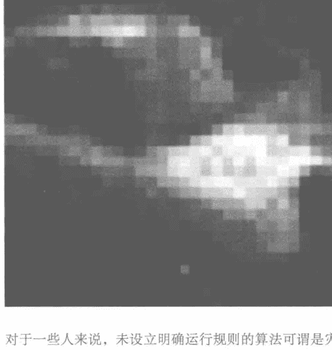
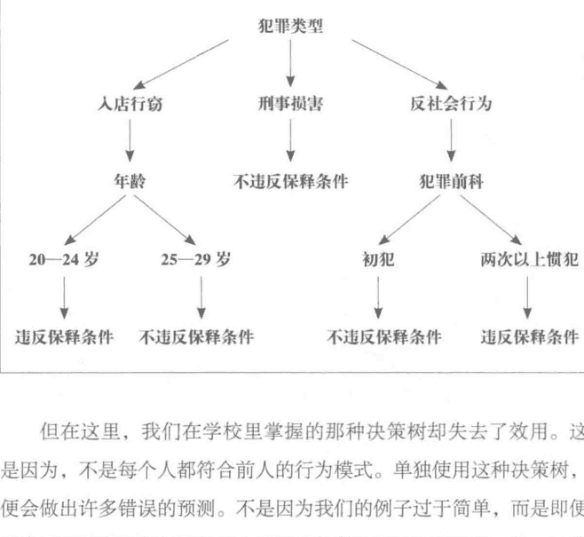
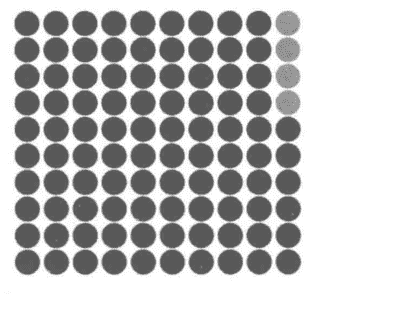
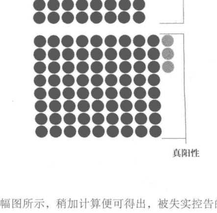
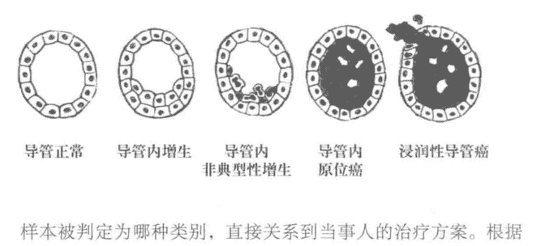
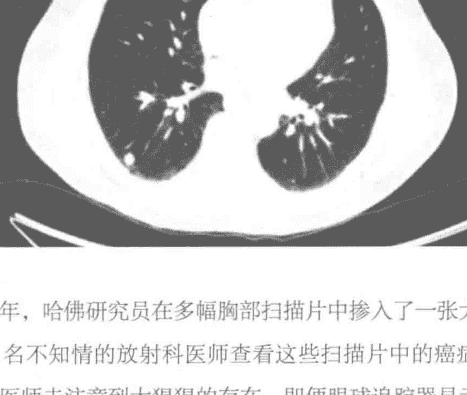
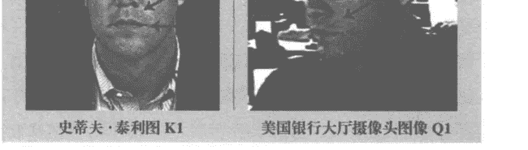
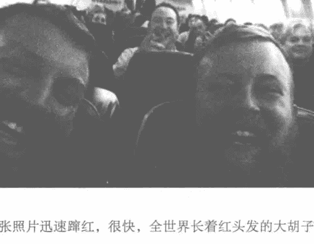
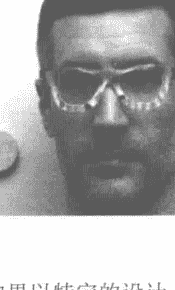
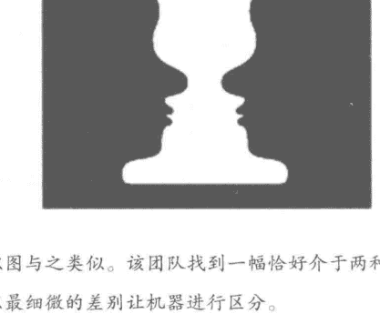

# 算法统治世界


献给玛丽·弗莱
感谢您永不言弃

## 书名解释

在我 7 岁时的一天，我的父亲带着一份礼物回到家，送给我和我的姐姐。那是一部 ZX Spectrum——我们家的第一台 8 位个人电脑。虽说当时这款电脑已经停产五年多，并且我们拿到的是个二手货，但我还是立刻对这个小玩意儿产生了无限好感。Spectrum 和康懋达 64（尽管只有邻居家的时髦小孩才能拥有那么一台）算是同类产品，但我一直觉得前者更具美感。光滑的黑色塑料外壳手感很棒，灰色橡胶按键和角落处的一抹彩虹更是让人心生爱意。

对我而言，ZX Spectrum 的出现就是幸福夏天的开始。我和姐姐一起窝在阁楼里，编写“贪吃蛇游戏”考验对方，或是用代码画出简单的图形。当然，那些“高端”的玩法都是后来才学会的。一开始，我们不得不先掌握基础知识。

现在回想起来，我已经记不清自己是何时第一次写出计算机程序的了，但可以肯定的是，我仍然记得具体内容——既是我在伦敦大学学院的必讲程序，也是在任何一本计算机科学入门级教材第一章就会教授的课程。这是因为，学过编程的人之间流传着一项传统，几乎可以说是“入门礼”——初学编程时，你的第一项任务就是让计算机在屏幕上显示一个著名短句：

## “HELLO, WORLD”

这项传统可以追溯到二十世纪七十年代。当时，布莱恩·柯林汉将其收录在自己流传甚广的编程教材中¹。这本书以及这句短语的出现，成为计算机历史中的一个重要节点。那时，微处理器刚刚登上历史舞台，即宣告计算机进入转定期——从以往依靠打孔卡和纸带的专业人士使用的庞然大物，逐渐变成我们现在所熟知的所有屏幕、键盘和闪烁光标的个人电脑。随着人类与计算机之间的交流成为可能，“Hello, world” 应运而生。

多年之后，布莱恩·柯林汉向《福布斯》杂志的一名采访记者讲述了自己选择这句短语的灵感来源：他看过一部卡通片，内容是一颗蛋刚刚孵化出小鸡，出生后的小鸡叽叽地叫着 “Hello, world”，而这一幕一直萦绕在他的脑海里。

那个情境中的小鸡到底代表着谁，至今没有定论：是一脸稚气的人类，骄傲地宣告成功走进编程世界，还是计算机本身，从堆积如山的表格与文档中苏醒，准备用自己的心智与真实世界相连，完成新主人的命令？也许两者都有。不过，正是这个短句，紧紧联结着所有程序员，以及被编程过的每一台机器。

这句短语存在着另外一种让我珍视的特质，而这种特质只有在现今的时代背景下，才显得最为贴切或重要。计算机算法越来越多地控制和决定着我们的未来，而 “Hello, world” 则代表着人类与机器之前曾有过的对话状态。在那一刻，控制者与受控者之间的界线变得

模糊不清。它昭示着一种合作关系，一段充满可能性的旅程，而关系中的彼此则形影相依。

身处机器时代，这种情感值得我们存于心间。

## 引言

去过纽约长岛琼斯海滩的都知道，在抵达大海之前，需要驶过一连串桥洞。这些原本供人们上下高速公路的桥梁，却隐藏着不寻常的功能。这些大桥静静地架在车水马龙之上，但举架较低，有的地方高度仅约9英尺（约2.7米）。

如此奇怪的设计事出有因。二十世纪二十年代，罗伯特·摩西斯（Robert Moses）在琼斯海滩建成一座屡获大奖的州立公园。这位显赫的纽约城市设计师想将此地规划为美国富有白人的“后花园”。那些“尊贵”的宾客会驾驭私家车前往海滩，而贫穷的黑人则需要乘坐公交车。于是，他故意在高速公路沿线修建了数百座大桥，低矮的桥洞成为阻挡了那些高达12英尺（约3.7米）的公交车¹。

对人们形成潜在控制力的事物，不止这些带有种族歧视色彩的大桥。在历史长河中，散落着诸多超出原本功能的发明创造²。有些是处心积虑的设计，有些是草率行事的恶果（比如城市里的某些区域未开设无障碍通道），还有一些则是阴差阳错的意外（比如十九世纪机械化纺织机器，其设计初衷原本是为了简化纺织品的复杂工艺，但最终却因为对薪资、就业率和工作条件的巨大冲击，沦为了维多利亚时代资本主义的“替罪羊”）。

现代化的发明亦是如此。在庞大的互联网推出新的不雅语言过滤器之后，英国北部斯肯索普（Scunthorpe）的居民就曾因为自己城市的名称（译者注：Scunthorpe 中含有 “cunt”，属于不雅语言）而无法登录美国在线（AOL）的账户³；一名尼日利亚裔脸书（Facebook）员工楚库埃梅卡·阿菲宝（Chukwuemeka Afigbo）在网络上分享了一段视频，视频中出现的是是一款洗手液自动喷射器，他的白人朋友将手伸到机器下方，可迅速释放洗手液，而他自己却因为较深的肤色，无法被喷射器识别⁴。2004 年，在宿舍写出脸书代码的马克·扎克伯格（Mark Zuckerberg），怎能料想到自己的创造会被操控在全球范围内多次协助篡改选举投票结果⁵呢？

隐藏在上述发明背后的便是算法。那些无形的代码是现代机器时代的基石，从社交媒体到搜索引擎，再到卫星导航和音乐推荐系统，算法如同桥梁、大楼和工厂一样，是现代社会的“基础设施”。我们的医院、法庭和汽车里存在着它们的身影，执法机关、超市和电影工作室也是它们大显身手之地。算法学习我们的喜好，告诉我们看哪部剧，读哪本书，约哪个人。它们拥有一股隐形力量，慢慢改变着人之所以为人的那些规范，并且从未停止过。

在本书中，我们将涉猎一系列不同的算法。很可能在不经意间，我们已经对这些算法产生了越来越强烈的依赖性。我们将梳理它们的索求，探究它们所具备的秘而不宣的权柄，并直面因它们而产生的重重谜团。书中会提到警察辨别嫌犯时所借助的算法，让我们在保护受害者与无辜的被告人之间做出抉择；法官为罪犯定刑时所使用的算法，进而决定司法体制的走向；医生用来改写自己诊断结果的算

法；以及隐藏在无人驾驶车内、强调人类是道德之主的算法；还有参与我们情感表达的算法，甚至包括足以侵蚀民主社会的算法。

我并不是主张算法“性本恶”。其实，本书的大量章节都在阐述对未来生活的乐观与积极的态度。没有任何一件物品或算法带有与生俱来的“善”与“恶”，而是我们的使用目的，在决定着一切。研发GPS（全球定位系统）的初衷是为了发射核弹头，而现在却用来派遣比萨；流行音乐被循环播放后会成为一种酷刑。如果落入恶人之手，再美丽的花环也可以成为置人于死地的凶器。对某套算法建立一种态度的基础是理解人与机器之间的关系。每种算法都与它的创造者和使用者有着难以分解的复杂关系。

也就是说，本书的核心是人。我们是谁？要去哪儿？我们该珍视什么？又如何被科技所改变？那些伴随着我们的生活和工作，帮助我们增强能力、纠正错误、解决问题，又制造麻烦的算法，我们与它们之间又何种关系呢？

本书将追问：算法是否存在一种毫无“副作用”的社会价值？人类何时应该相信机器胜于自己的判断？又该在何时清醒地抵制机器的控制？通过对算法的剖解，找出它们的漏洞，再反观我们自己，发现自身的局限。然后，趋利避害，扬长避短，让世界变成我们想要的样子。

因为，未来并非自然发生，而是由我们共同创造的。

## 第一章
权柄
POWER

加里·卡斯帕罗夫深谙击溃对手之道。他在 34 岁时就已经成为全世界最受瞩目的国际象棋大师。一听到他的大名，任何对手都会不寒而栗。他有一个震慑对手的招数，屡试不爽。在对弈中，如坐针毡的对手可能正经历着人生中最煎熬的比赛，而这位俄罗斯棋王则漫不经心地拿起摆放在棋盘边的手表，优雅地戴在手腕上。这是一个众所周知的信号：卡斯帕罗夫打算结束这场无聊的比赛了，而这块手表就是提示对手认输的道具。他们可以选择放手一搏，但依然无法抵挡卡斯帕罗夫势如破竹的胜利¹。

1997 年 5 月,IBM 的深蓝与卡斯帕罗夫展开了一场著名的博弈。在机器面前，那些战术黯然失色。虽然比赛结果早已家喻户晓，但深蓝如何做到稳操胜券，却鲜为人知。在这场象征着人机大战的对决中，机器的胜利从诸多层面昭示着算法时代的到来，其中涉及的根源问题也远不止于原始计算能力。为了击败卡斯帕罗夫，深蓝不但需要学习他的高超棋艺，还要了解他的脾气秉性。

为此，IBM 工程师提出了一项令人折服的改良方案：大幅提升深蓝的不确定性。在那颇具传奇色彩的六局比赛中，机器对手会在完成计算后，间或故意拖延落棋时间，拖延的时间有时甚至长达数分钟。但在卡斯帕罗夫看来，这种延迟不仅是机器计算捉襟见肘的表现，更应验了他的猜测：他已经成功掌控了比赛，棋局走势之复杂，完全超出了深蓝的应对能力，导致其举棋不定²。殊不知，机器对手是在“欲擒故纵”，任凭时间流逝。这种战术虽然有些诡诈，但收效显著。卡斯帕罗夫在第一局中便无法专注比赛，因为他摸不透这位机器对手的真正实力³。

虽然卡斯帕罗夫拿下了第一局，但第二局才是他与深蓝的真正较量。卡斯帕罗夫设下圈套，诱敌深入以期有所斩获；同时，他还趁机策划自己的攻势，打算在几步棋之后搬出皇后进行攻击⁴。和卡斯帕罗夫一样，观看比赛的所有国际象棋专家也都认定机器会上钩。但出乎卡斯帕罗夫意料的是，深蓝似乎早已察觉棋王的预谋，果断封堵了他的皇后，将原本属于人类的胜利扼杀在摇篮之中⁵。

卡斯帕罗夫大惊失色，不明白自己为什么会对计算机的能力做出如此误判。他在几天后的一次受访中声称深蓝“如有神助”⁶。多年以后，当他回忆起当时的感受时，他写道：“自己曾认为的计算机不可能走的棋路，实际上是非常强大的棋路。”⁷但不管怎样，算法取得了最终的胜利。它通过对人类心智与人性弱点的了解和认知，击垮了人类。

令人痛心的是，卡斯帕罗夫在第二局放弃了争取平局，主动认输了。此后他便意志消沉，连续打平第三、第四、第五局。来到第六局时，卡斯帕罗夫彻底崩溃溃了。最终结果是 3.5:2.5，深蓝赢了卡斯帕罗夫。

这场惜败可谓异常蹊跷。卡斯帕罗夫原本完全有能力杀出重围，但由于他低估了算法的实力，最终导致自己乱了阵脚。“深蓝的棋术令我震惊不已，”他在 2017 年回忆那场比赛时写道，“由于我一直在揣测它的实力到底有多强，致使我始终没弄明白失败的根本原因，是我太弱，还是它太强？”⁸

本书将反复强调对事物建立预期的的重要性。深蓝击败棋王的故事表明，算法的实力不局限于代码的内容。我们只有发现自己的不足

和弱点，并找出机器的缺陷，才能知己知彼，百战不殆。

不过，就连卡斯帕罗夫这样的天赋异禀之人 都栽了跟头，我们普通人又能有几分胜算呢？在接下来的章节中，我们将揭露算法究竟是如何潜入现代生活的方方面面——从健康医疗、刑事犯罪到交通运输和国际政坛。在这个过程中，我们逐渐对算法建立起既轻蔑又恐惧的复杂态度，它的能力让我们不寒而栗。至此，我们变得无所适从：是人类被迫放弃了太多，还是早已无力回天？

### 什么叫算法？

在探讨上述问题之前，有必要先弄清楚“算法”的真正含义。尽管它是个快被用烂的术语，但在通常情况下，却极少能传达出任何实际信息。部分原因在于术语本身就词义模糊。词典给出如下定义⁹：

算法（名词）：为解决某一问题或达到某项目的而采取的逐步法，特指计算机领域。

简单来说，算法是一套具备逻辑性的完整指令，介绍如何自始至终完成一项任务。从广义上看，蛋挞配方就是一种算法，为迷路的陌生人指出的路线也是一种算法。从理论上讲，为实现特定、明确的目标而提出的完整指令即可被界定为算法，比如宜家手册、优兔（YouTube）教学视频，甚至自助书籍。

不过，这不是该术语的实际用法。通常，算法具备更明确的指

向性。虽然其本质仍然是一套完整的指令，但所指对象基本都属于数学领域。此类算法包含一系列数学运算——涉及方程式、算法、代数、微积分、逻辑学和概率学——并将其翻译成计算机代码。接着，来自现实世界的数据汇入其中，树立一个目标，然后通过一系列计算来实现。此类算法是计算机科学成为一门学科的基石，同时也是机器创造现代奇迹的决定性动力。

算法的种类可谓多如繁星，每一种都有各自不同的目标、特质、个性与缺陷。如何对算法进行分类，尚无定论。但从广义上来讲，它们所要实现的现实目的可分为以下四大类¹⁰：

### 优先级排序：编制序列清单

谷歌通过对搜索结果进行排序来预测你所要寻找的页面，网飞（Netflix）会向你推荐新剧目，TomTom 导航能够挑选出最快路线。上述这些行为均采用了数学运算，将众多可能的选项进行排序。深蓝本质上也属于一种优先级排序算法——浏览比赛中所有可能的棋路，并计算出胜算最大的那一条。

### 分类：选择种类

当我快到 30 岁时，我的脸书页面挤满了钻戒广告。而等我结婚后，互联网又塞来验孕广告。这些都是分类算法的“小伎俩”。此类算法是广告商们眼中的“法宝”，在幕后默默运行，根据你的个性特点，将你划分成会喜爱装

推荐的人（虽然有时起些作用，但开会时弹出育儿套装广告，确实会让人抓狂）。

此类算法还能够自动分类和删除 YouTube 中不适宜的内容，为照片贴上场景标签，以及扫描手写内容并将页面上的每一处标记以字母表的形式进行分类。

### 关联：找到联系

关联是指找出并标记不同事物之间的关系。用于交友的算法（比如 OkCupid）之核心就是关联；找出会员之间的联系，从而建立配对。亚马逊购物网的推荐功能采用了类似的概念——将你的购物喜好与过往顾客联系起来，进而导出比较有趣的导购建议。比如，红迪网（Reddit）用户 Kerbobocat 在亚马逊上订购了一支棒球棍，结果收到一条导购建议：“您可能会喜欢这个巴拉克拉瓦头套。”¹¹

### 筛选：留下最重要的内容

算法经常需要去除一些信息，以便突出重点，就像从嘈杂的环境中分辨出关键信号。实际生活中时常会出现这种情况；语音识别算法（比如 Siri、Alexa 和小娜所使用的算法）首先需要将你的语音从背景音中“过滤”出来，才能进一步破译语音内容。还有些情况则属于“深层次”筛选：脸书和推特（Twitter）会根据你的已知兴趣爱好，为你定做专属的信息推送。

绝大多数算法会囊括以上所有功能。例如，“优步拼车”（Uber Pool）能够将去往同一方向的乘客彼此联结起来。你确定起止点之后，算法筛选出可以抵达你的住所的路线，接着再寻找前往相同方向并且能够建立联结的其他用户，最后选择一组推送给你。与此同时，算法还会为驾驶员规划出最短行驶路线，让整个行程尽可能快捷高效¹²。

以上就是算法的作用。那么，具体是如何实现的呢？乍一看，尽管存在无尽的可能，但总有分类的途径。广义上来讲，算法所采取的方式可分为两大类，本书将逐一讲解。

### 基于规则型算法

第一种以规则为基础。由人类负责构建指令，直接且明确。可以把此类算法的执行过程想象为蛋糕的制作步骤：第一步，执行这项操作；第二步，如果出现这种情况，那么请做如下处理。此例并非暗示这类算法功能单一，实际上，它们有着巨大潜能，成为功能强大的程序。

### 机器学习型算法

第二种类型的设计灵感来自生物的学习本能。举个例子，设想一下你如何教一只小狗击掌。可能并不需要制定一份严谨的操作清单，再“传授”给那只小狗。作为训练员，你只需要建立明确的教学目标以及奖励机制。而具体的实施过程就是强化“对”的行为，弱化“错”的行为，并通过大量的练习，让受训对象自身建立起行为模型。此类算法被称为机器学习型算法，属于广义上的人工智能（AI）。人类为机器输入数据，设立目标，并在正确的节点给予机器反馈，然后让机器自身以最稳妥的方式完成剩余的工作。

以上两种类型皆有优缺点。由于基于规则型算法的规则是由人类所编写，所以易于理解。从理论上来说，任何人都能将此类算法拆解，找出其中的运行逻辑¹³。但这也是弊端，会将基于规则型算法限制在人类所了解的编写运行规则的范畴内，严重影响此类算法能够解决的问题数量。

相比之下，在规则编写无法处理的领域，机器学习型算法则发挥着越来越大的作用。它们能够识别图片中的物体，理解人类的语言，在不同的语种之间完成互译——总之，是基于规则型算法长久以来的“痛点”。其弊端是，当机器自主解决了某一项问题后，人类很少能看懂具体的解决路径，即便是权威的程序员也很难参透其中的奥秘。

以图像识别为例。一组日本研究员近期演示了算法与人类在看世界的角度上的巨大差异。你或许看过这样一张错视图，不太能分清看到的到底是一只花瓶，还是两张脸（如果没看过，请参阅本书备注中的示例）¹⁴。计算机也存在类似的错视图。该团队通过改变下图中前轮的一块像素，就能让机器学习型算法改变主意，原本认为图片中是车，后改成小狗¹⁵。



对于一些人来说，未设立明确运行规则的算法可谓是灾难的开始。我们如何控制尚未了解的事物？如果富有感情的超级智能机器超越了其创造者的能力，会发生什么？又如何保证我们既不理解又无法控制的人工智能不会成为人类的敌人？

类似的有趣假设有很多，关于悬而未决的人工智能灾难的书籍更是层出不穷。如果你想在这里找到类似的内容，那么很抱歉，这不是一本那样的书。虽然人工智能在近几年呈现出突飞猛进的发展趋势，但仍局限在最狭义的“智能”范畴内。相比智能革命，聚焦计算统计学革命的来龙去脉，可能更具研究价值。当然，这么说会显得有些枯燥（除非你真的对统计学很感兴趣），却是对目前发展形势的一种更为精确的探究。

眼下，对人工智能噩梦的恐慌如同担心火星的拥堵问题一样。或许终有一天，我们将要面对计算机智能超越人类智力的事实，但目前仍属杞人忧天。事实上，我们距创造出猕猴级别的智能水平还有一段很长的路要走。截至目前，甚至无人能创造出超过蠕虫的智能。

不似如此，所有有关人工智能的炒作都有“避重就轻”之嫌，绕开了更为迫切，以及在我看来也更有趣的话题。让我们先把无所不能的人工智能机器放在一边，将思绪从遥远的未来拉回到现在，因为有些算法已经具备一定程度的控制权柄，足以充当“自主决策人”。比如量定刑期、应对车祸、为癌症病人制定医疗方案等。它们早已代表我们做出了改变命运的抉择。

问题在于，我们将如此重要的权柄拱手让出，而它们真的会不负众望吗？

* 摘自计算机科学家和机器学习先驱学者吴恩达在 2015 年发表的一次演讲。详见技术峰会：2015 年 “GPU 技术大会” 第三天议题：深度学习的未来，YouTube，2015 年 11 月 20 日，https://www.youtube.com/watch?v=qP9TOX8T-kI.

** 模拟蠕虫的大脑是国际科学项目“开放蠕虫”（OpenWorm）的研究课题。他们希望人工复制在秀丽隐杆线虫大脑中发现的 302 个神经元。相比之下，人类拥有约 1000 亿个神经元。“开放蠕虫”项目官网：http://openworm.org/.

### 盲目信任算法

2009 年 3 月 22 日，星期日，是罗伯特·琼斯（Robert Jones）倒霉的一天。他刚刚拜访了几位好友，准备驱车返程。当时他正徜徉在西约克郡的美丽小城托德莫登市内，却发现自己的宝马车亮起了燃油指示灯。在燃油耗尽之前，他需要行驶 7 英里（译者注：约 11 千米）才能抵达一处加油站，着实让他捏了一把汗。幸运的是，他的 GPS 找到了捷径——一条通往山谷一侧的路，狭窄而崎岖。

罗伯特按照机器的指令行进，但眼前的路却变得越发陡峭、狭长。数英里之后，他来到了 一条泥泞的土道上，糟糕的路况让马匹都难以行走，更别说汽车了。但罗伯特并未因此而动摇，因为开车是他的谋生手段，他每周需要行驶 5000 英里（译者注：约 8000 千米），可谓经验丰富、手法老到。另外，他觉得“没有理由不相信 TomTom 卫星导航”16。

在此之后不久，如果有人恰巧抬头望向山谷，定会在峭壁边缘处看到罗伯特的宝马车头悬在半空。若不是撞到了一处残破的木质栅栏，怕是早就掉进数百英尺的深渊中了。

最终，靠着 1 台拖拉机和 3 辆四轮摩托车，罗伯特的车才得以“生还”。同年晚些时候，当他以鲁莽驾驶的指控出现在法庭上时，他承认自己当时并未想过要违背机器的指令。“它很肯定那就是路，”他在事后向一家报纸说道，“所以我就信了，从未想过能被导向悬崖。”17

是啊，罗伯特，你肯定没想过。

这件事情有着一定的寓意。尽管琼斯当时可能觉得自己有些荒唐——竟无视眼前的真实路况（比如看到车窗外的悬崖峭壁），而义无反顾地相信根本没那么智能的算法——但会这么做的人绝不止他一个。毕竟，卡斯帕罗夫在大约 12 年前就掉入了相同的陷阱之中。其实，几乎每一个人都在犯这样的错误，只是方式没那么“惊心动魄”，有时甚至连人们自己都不知道。

早在 2015 年，科学家便开始研究搜索引擎（如谷歌）是如何拥有改变民众世界观的“权柄”的18。对于搜索结果，我们是会理性对待，还是会盲目地跌入“悬崖”？

这项实验将焦点放在一场即将开始的印度大选。研究小组由心理学家罗伯特·爱泼斯坦（Robert Epstein）带领，他们在全国找来 2,150 位犹豫不决的选民，并提供了一个特制的搜索引擎“Kadoodle”，用于了解所有候选人，帮助选民确定投票意向。

Kadoodle 被动了手脚。参与者在不知情的情况下，被分为若干组。每组的搜索结果略有不同，但都会偏向某一位候选人。如果某一组成员访问了该网站，那么页面顶部的链接便会特别倾向于某一位候选人。这意味着，参与者必须向后翻动很久才能看到有利于其他候选人的内容。并且，不同分组会推送不同的候选人。

毫无疑问，参与者的大部分时间都用来阅读网站第一页最上面的内容了。正如互联网流行的一句玩笑所说的那样：掩藏死尸最保险的地方是谷歌搜索结果的第二页。在实验中，几乎没人留意排在搜索列表后面的链接。不过，排序对实验参与者观点的 影响程度仍令爱泼斯坦感到震惊。在看到搜索引擎提供的偏激结果后，参与者对 Kadoodle 推送的候选人的支持率，在短短几分钟之内就提升了 12%。

在《科学》杂志 2015 年刊登的一篇采访中19，爱泼斯坦详细阐述了当时的情况：“我们期望搜索引擎能做出明智的选择，但参与者说：‘的确，我看到了选择差异，这也说明搜索引擎起了作用。’”或许，更可怕的，不是我们如今从诸如搜索引擎的算法中能够获得的信息量，而是人们对自己的观点中存在的“二手信息”的认知程度。“如果人们不知道自己已经进了他人的圈套，那么他们倾向于他们已经自发地接受了新的观念。”爱泼斯坦在一篇原创论文中这样写道20。

当然，Kadoodle 不是唯一被指控暗中操纵民众政治态度的算法。这一点在《数据》章节中会有详述，而现在需要聚焦的是，我们在该实验中对几乎所有抛弃的算法所展现出的态度。最终，我们认定这些算法拥有优于人类的判断力21。经过一段时间后，我们甚至不再意识到自己对它们存在“偏执”。

在生活中，算法为我们带来了一种唾手可得的“权柄”，推卸责任变得轻而易举，思考也显得有些多余。谁会每次都翻看谷歌搜索的第二页内容，认真思考每一条搜索结果呢？谁又会考察所有航空公司，只为确认天巡网( Skyscanner )是否真的囊括了所有廉价机票呢？又有谁会拿着尺子和地图，验证 GPS 规划的路线是否距离最短？反正我不会。

这里需要区分一下。信赖一个较为可靠的算法是一回事，而在不了解的情况下盲目信赖则是另外一回事了。

### 人类热衷于停留在算法表面

2012 年，居住在爱达荷州的许多行动不便人士收到通知，他们的医疗补助被削减了²²。虽然这些人都符合补助条件，但爱达荷州仍在毫无预警的情况下，对财政支持做出高达30%的大幅压缩²³，导致这些人员不得不自行支付医疗费用。然而，这并非一项政治决议，而是源自爱达荷州卫生与福利部新近投入使用的一款“预算工具”——这款软件能自动计算每个人应得的财政支持等级²⁴。

其症结在于，预算工具做出的决策并不符合实际情况。在外人看来，软件计算出来的那些数字纯属臆断。有的人收到的补助比前几年增多了，还有一些则下降了近万美元，导致他们不得不放弃家庭治疗，挤进医院²⁵。

由于无法理解锐减的补助金额，抑或是想讨个说法，这些居民找到了美国公民自由联盟（ACLU）爱达荷州分部的法务总监理查德·埃平克负责此案²⁶。2017年，他在一篇博文中写道：“我原以为是个很简单的案子，只要和州政府说：请解释一下这些补助金额为什么下降这么多²⁷。但事实上，整个过程耗时4年，涉及4,000名原告，在经过一场集体诉讼后，此案才得以尘埃落定。”²⁸

埃平克和团队将算法的运转规则作为切入点，但医疗补助团队拒绝透露任何细节，强调处理此类事宜的软件属“商业机密”，不得与外界分享²⁹。幸亏接管此案的法官并不买账。最终，这款对居民权益肆意“践踏”的预算工具得以公之于世——不是什么高端人工智能，也并非严谨编写的数学模型，只是一个Excel运算表³⁰。

该运算表基于历史事件记录进行计算，但由于其中的数据充满漏洞和错误，导致整个运算表基本属于无用的假设³¹。更糟糕的是，美国公民自由联盟团队剖析运算方程式后，发现“公式架构方式本身即充满基础性统计缺陷”。该预算法工具曾为大量人员提供过随机的计算结果。此算法——如果非要这样称呼的话——由于太过糟糕，法院最终判定它违反了宪法32。

这里有两个并行的人为错误线程。第一，有人编写出如此糟糕的运算表；第二，他人盲目地信任它。这里所谓的“算法”不过是伪装在编码中的骗品。那么，体制内的办事员为何会急于“美化”如此糟糕的设计呢？

埃平克对此给出了自己的看法：

> 我们对经过计算机处理的结果持有一种共有的“偏见”——全盘相信，从不质疑。计算机生成的内容，正如你让一位统计员参阅一些数据后，得出一个公式一样，我们只管相信那个公式，从来不会说：“等一下，这样真的可行吗？” 33

我也知道，深入研究数学公式的运算原理显然并不合大家的胃口（虽然我很喜欢），不过，埃平克还是提出了一个极为重要的观点：人类热衷于停留在算法表面，从不深究背后的内容。

作为一名数学家，我与数据和算法打交道多年，得出一条结论：客观评判一个算法是否值得信赖的唯一途径，是深挖其运算原理。在我看来，算法更像是一种魔术幻象。起初，它颇具魔法般的魅力。不过，一旦摸清背后的玄机，谜团也随之消散。通常，隐藏在“华丽外表”之下的往往是些可笑的简单把戏或令人脊背发凉的轻率之举。

在随后的章节中，通过我们即将深入研究的算法，我会尽我所能地披露“幕后故事”。其详尽程度虽然不足以让你将算法重现，却能够让你树立起较为清晰的认识。

不过，即便是铁杆的数学粉，也会遇到被算法牵着鼻子走的境遇。这或许是因为，在天巡和谷歌搜索结果的“加持”下，核查算法的运行原理变得越发难以实现；抑或是由于诸如爱达荷州预算工具以及我们即将涉猎的其他算法被视为“商业机密”；还有可能是因为对于某些机器学习技术，摸清其逻辑的过程无异于水中捞月。

我们终究会遇到这样的时刻：在被逼无奈之下，或不得不将控制权让给未知的，甚至明知会出错的算法；或在自己的判断与机器的判断之间做出抉择。如果我们选择相信自己，那么我们必须需要足够的勇气说服自己。

### 否定算法并非易事

斯坦尼斯拉夫·彼得罗夫（Stanislav Petrov）是一名苏联军官，负责监控核武器预警系统，保卫苏联领空安全。一旦计算机显示出任何美军偷袭迹象，他需要立即向上级汇报34。

1983 年 9 月 26 日，彼得罗夫负责值班。午夜刚过，警报响起，声音让所有人都心惊胆战。苏联卫星探测到敌方导弹正向其领土袭来。当时正值冷战时期，突袭显然是有可能的，但一件事让彼得罗夫有些迟疑——他不太相信算法，因为它只探测到五枚导弹。作为美国发起袭击的序幕，这个数量显然有些不合逻辑35。

彼得罗夫坐在椅子上，屏气凝神。一切由他决定：上报消息，将整个世界推向几乎已成定局的核战争；抑或等待，采取忽略态度，即使深知逝去的每一秒钟，都是在让自己的祖国慢慢丧失反击的良机。

幸运属于我们全人类，彼得罗夫选择了后者。虽然他无从确定警报有误，但23分钟之后——定是每一秒都如坐针毡——最终确定苏联境内未发现任何导弹迹象。这时，他才知道自己是对的，而算法出现了错误。

如果该系统完全自动运行，没有像彼得罗夫这样的人做最终决策，那么历史无疑将被改写。苏联很可能会采取报复行动，进而全面触发核战争。这则故事至少可以让我们看到，在整个过程中，起到关键作用的是人类。唯一能够避免错误发生的合理办法，是让人类拥有否定的权柄，在审视算法给出的建议之后，再做决定。

毕竟，只有人类才能感受到做出决定的责任与分量。负责与克里姆林宫通信的算法，根本不会思考这样一个决定能够引发的潜在后果。但是彼得罗夫却想：“我十分清楚，一旦我做出错误决定，任何人都无力挽回。”36

这样的结论存在的唯一问题，是人类也有不靠谱的时候。像彼得罗夫这样否定算法，有时是正确的选择。但在通常情况下，最好无视人类的直觉判断。

再列举一个安全事件。虽然人类错误否定算法的情况，如同受到照顾般少之又少，但在英国最大的主题公园内，依然发生了骇人听闻的奥尔顿塔“微笑者”（Smiler）过山车事故37。

视线拉回至 2015 年 6 月，两名工程师应要求处理过山车的一处故障。修理完成后，他们发出一辆空车，测试一切是否正常，却没有发现这辆空车未能返回。不知什么原因，这辆车后退到一块斜坡处，停在了轨道中间。

与此同时，在工程师不知情的情况下，运行工作人员新增了一辆过山车，以便缓解游客的等候压力。当获得控制室的安全指令后，他们便开始让兴高采烈的游客登上过山车，扣紧安全带，然后将第一辆车驶入轨道。他们完全没有意识到，那辆由工程师发出的“搁浅”空车就停在前方。

幸运的是，过山车设计师早已针对此类情况做出规划，他们的安全算法达到了预计效果。为避免此类碰撞，载人过山车停在了第一处攀爬点，并向控制室发出了警报。不过，工程师坚信自己刚刚修理好故障，断定这是自动警报系统的误判。

否定算法并非易事：他们需要形成一致的判断，并同时按下按钮，才能重启过山车。这便导致坐满游客的过山车冲下斜坡，径直撞向那辆滞留的多余空车。后果触目惊心：多名人员重伤，两名女童失去双腿。

奥尔顿塔事故和彼得罗夫警报，都是生死时刻，都戏剧性地展现了更深层次的困境。在人类与算法的权柄之争中，谁（或什么）拥有最终话语权？

### 人类与算法，谁拥有最终话语权？

在历史的长河中，有着这样一场辩论。1954 年，明尼苏达大学的临床心理学教授保罗·米尔（Paul Meehl）出版了著作《临床预测与统计预测》，其中一边倒的言论激起了一代人的愤怒38。

在著作中，米尔在诸多方面——从预测学生成绩到预测病人心理健康——对人类与算法的表现做了系统性对比，并总结得出：不管多么简单的数学算法，几乎总是会做出优于人类的预测。

自那之后的半个世纪中，有不计其数的研究印证了米尔的发现。如果你的工作涉及任何形式的计算，那么一定要站在算法这一边：无论是医疗诊断或销售预报，预测自杀率或职业满意度，还是兵役健康评估或预测学习成绩39。虽然机器不尽完美，但让人类否定算法只能是错上加错。

或许，这不足为奇。人类的使命不是计算，超市里的一排排收款员并不会用眼睛统计我们的购物总价，而是借助一种（极为简单的）算法代替人类进行计算。大多数情况下，我们最好不要插手。这恰好印证了流传在航空公司飞行员间的一种说法——最棒的飞行团队要具备三大要素：飞行员、计算机和狗。计算机负责驾驶飞机，飞行员负责喂狗，而那只狗则负责在飞行员试图触碰计算机时，上前撕咬

* 有趣的是，二十世纪五十年代末到二十世纪六十年代，出现了一系列有关“诊断”（这是他们的说法，不是我的）同性恋的研究，罕见地推翻了算法的优越性。在这些实例中，人类的判断能够做出更好的预测，远远超出算法的能力所及范围。这表明，那些本质充满人性的事物，是数据和数学算法永远也无法参透的。


以阻止飞行员。

不过，人类与机器之间的关系存在一条悖论。尽管我们会对自己不理解的任何事物秉持一种盲目相信的态度，但一旦我们意识到算法也会出错后，又会产生一种过激的反应——全盘否定算法，转而投向我们自己并不严谨的判断。这种现象被研究人员称为“算法厌恶症”。相对于自身的错误，人类更无法容忍算法出错，即使我们的错误更难堪。

这种现象在诸多实验中被反复证实40，在某种程度上，你自己可能也会意识到。只要 Citymapper（译者注：一款城市交通应用程序）显示的路程时长高于我的预期，我就会认为自己更了解状况（即便这样几乎总是导致自己迟到）。我们都至少骂过一次 Siri 是傻瓜，这是因为在使用过程中，我们逐渐忘记了掌上语音助手背后所蕴藏的惊人技术成就。还记得在使用移动 GPS 应用程序位智（Waze）的初期，堵在路上的我，一直觉得掉头往回走肯定更快（但实际情况恰恰相反）。如今，我选择相信——正如罗伯特·琼斯和他的宝马车一样，我会义无反顾地跟着应用程序的路线走下去（尽管我坚信自己不会掉下悬崖）。

我们秉持的这种“非黑即白”的处事态度——要么把算法视作万能之王，要么把它视为一堆垃圾——在如今的高科技时代存在一定的问题。如果我们想要最大限度地去享受科技，那我们就需要客观一些。我们应该吸取卡斯帕罗夫的经验教训，认识到自身的不足，斟酌凭借直觉做出的反应，对生活中的算法建立更多的认知。而另外，我们不应该把算法供上“神坛”，而是要秉持更加谨慎的态度，验证它们是否真的具备其所宣称的能力。只有这样，我们才能判定算法是否能够不负所托。

可惜，一切总是说起来容易做起来难。通常情况下，我们很少拥有话语权来干涉算法在我们生活中的权柄范畴，即便这些算法与我们息息相关。

有些算法充分印证了这一点，它们交易着一种最基础的现代商品：数据。此类算法在互联网中偷偷地跟踪我们，收集我们的个人信息，侵犯我们的隐私，推断我们的个性，进而悄然影响我们的行为。

而这场交织着盲目的信任、权柄与影响力的风暴，所产生的后果足以从根本上改变人类社会。

## 第二章
数据
DATA

2004 年，刚刚创建脸书不久的大学生马克·扎克伯格，在即时信息中与一位朋友说道：

> 扎克：如果需要哈佛大学里任何一个人的信息，
> 扎克：尽管问。
> 扎克：我有超过 4,000 条电子邮件、照片、地址……
> 【好友姓名被打了马赛克】：哼？你如何做到的？
> 扎克：他们提交的。
> 扎克：我也没弄明白。
> 扎克：他们“信任我”。
> 扎克：真是一群大傻瓜¹。

2018 年，脸书爆出丑闻之后，上述言论便被新闻记者反复引用，以此说明公司对隐私的不屑一顾。我个人认为，对于一个 19 岁小伙子发表的吹嘘之词，我们应该保持较为宽容的态度。但同时，我也认为扎克伯格存在认知错误。人们不只是在提交个人信息，实际上是在用信息进行交换——作为回报，他们获得算法的使用权，让他们能够自由地与亲好友沟通，构建起与他人分享生活的空间。这是在这广袤的万维网中的一片私人网络区域。我不清楚别人，但当时的我，完全认同这种平等互换。

这种逻辑只存在一个问题：我们不一定会注意到这种“交易”所带来的长期影响。因为我们很难了解到自己的数据到底能用来做什么，或者导入到一个智能算法后，会产生多大的价值。抑或，反过来，我们以什么样的价格“被出售”。

### 个人数据的价值

超市处于率先发现个人数据价值的队列中。在该行业里，各家公司为吸引顾客而不断明争暗斗，因为小额优惠幅度即可将民众的购物行为转化为对品牌的忠诚。每一次微小的提升，终将积累成巨大的优势。正是因为这一点，最终英国超市企业乐购（Tesco）于1993年推出了一项革新型试验。

在夫妻档“智囊团”埃德温娜·唐恩（Edwina Dunn）和克莱夫·哈姆比（Clive Humby）的指导下，乐购在指定的几家店铺中推出了全新的会员卡：采用塑料材质，大小和形状与信用卡相同，客户需要在支付货款时出示，以便结账。其中蕴藏着简单的交易：顾客每次使用会员卡进行结账，都会得到积分，用于下次在店内消费；与此同时，乐购保存顾客的姓名和购物记录²。

在这次试验期间，会员卡收集到的数据十分有限。除了顾客的姓名与住址外，仅记录下购物金额与时间，并未涉及顾客购物篮中的具体物品。不过，唐恩和哈姆比还是从这些简单的数据中发掘出了非常重要的信息。

他们发现，销售额主要源自一小部分忠实顾客。经过对邮编的逐个分析，他们掌握了顾客为光顾商店而愿意出行的距离；了解到了乐购在哪些社区没有市场，又在哪些社区的市场占有率高。数据指出，有些顾客会每天光顾，还有些会把购物安排在周末。有了上述信息后，他们便通过向会员卡用户寄送代金券的形式，刺激顾客的购买行为。高消费人群收到的代金券金额介于 3 英镑和 30 英镑之间，而低消费人群的则介于 1 英镑和 10 英镑之间。这一措施收效显著；不仅约 70% 的代金券被兑换，顾客的购买力也得到提升——拥有会员卡的顾客的消费额在整体上超出非会员的 4%。

1994 年 11 月 22 日，克莱夫·哈姆比将试验期间的研究成果向乐购董事会做了汇报。他先后展示了收集到的数据、回应率、客户满意度证明以及销售额涨幅。董事会成员全程安静聆听。在汇报尾声，董事会主席率先发言：“有件事让我感到害怕，你在 3 个月内对我的顾客建立的认知，比我 30 年了解的还要多。” 3

随后，乐购向所有顾客开放了会员卡制度。民众广泛认为，正是凭借这项措施，乐购超过了劲敌森宝利（Sainsbury），一跃成为英国规模最大的超市。随着时间的推移，数据收集变得越发详细，顾客的购买习惯也更易于捕捉。

在网上购物出现的早期，该团队推出一项功能，名为“我的收藏”。凡是使用“忠诚卡”购买过的物品，在顾客登录乐购网站时，都会出现在显著的位置。和会员卡一样，这项措施再次获得巨大成功。顾客无需翻阅页面，即可迅速找到自己想要的产品。销售额上升，顾客也买得开心。

不过，还是有一些例外。该功能推出后不久，一位女士便向乐购投诉数据错误。她一直在网上购物，却在“我的收藏”列表中发现了避孕套。她说那不可能是她丈夫的，因为他不用那些东西。应这位女士的要求，乐购分析师查看了数据，发现她的列表并未出错。

然而，为避免此事成为婚姻破裂的诱因，他们采取了策略性回应：为“数据损坏”道歉，并从她的收藏中删除了“问题”商品。

根据克莱夫·哈姆比有关乐购的著作，这种做法已成为公司的一项“不成文规定”。只要遇到稍微棘手的问题，他们就采取道歉和删除数据的处理方式。这得到了埃里克·施密特（Eric Schmidt）的认同，他在担任谷歌执行总裁期间说过：“谷歌的政策就是触碰底线，但绝不跨越底线。”⁴

收集到足够的数据后，将有怎样的发现就很难说了。生活用品并不只是消费品，它们还代表着人的个性。通过仔细观察一个人的购物习惯，通常会发现有关这个人的各种细节信息，有时——正如避孕套的案例一样——还会带来一些让人宁愿不知道的事实。不过，在大多数情况下，隐藏在数据背后的真相，则会成为一家公司可以利用的优势。

### 用数据打开目标市场

2002 年，美国折扣超市塔吉特（Target）已开始寻找与以往不同的数据模式⁵。从牛奶和香蕉，到毛绒玩具和庭院家具，塔吉特出售的商品可谓一应俱全。自千禧年之后，与几乎所有其他零售商一样，塔吉特也通过使用信用卡号和问卷调查，将顾客与在店内所买商品绑定在一起，以便分析顾客的购物行为。

有这样一则故事——美国读者早已有所耳闻——在美国闹得沸沸扬扬。塔吉特公司发现，女性顾客购买无香型身体乳之后，通常会注册参加店内举办的“宝宝派对”（译者注：在孩子出生前举办的特殊派对）。他们是在数据中找到的“提示信号”。因为女性进入孕中期后，会开始担心妊娠纹。因此，她们购买用于保持皮肤水分的保湿乳液时，便预示了接下来的故事发展。把时间向回倒，这些女性很可能会在塔吉特超市大量购入各种维他命和营养品（如钙片和锌片）；将时间向前推，数据甚至会给出婴儿的预产期——具体的迹象是目标女士在店内购买超大包装的脱脂棉⁶。

孕妇是零售商的理想顾客。如果你能让孕妇在怀孕期间建立对品牌的忠诚，那么在她们生产完后，很可能会继续购买你的产品。毕竟，嗷嗷待哺的婴儿已耗尽了妈妈们的大部分精力，每周例行的购物也会迅速被习惯性的选择填满。正是此极具价值的发现，让塔吉特赢在了起跑线上，在吸引顾客方面超过了其他品牌。

接着，事情就简单了。塔吉特采用一种算法，用以计算女性顾客已经怀孕的可能性。如果该可能性超过了特定阈值，那么零售商就会自动向目标女性发送海量优惠券，用于购买可能会用到的物品：奶嘴、润肤乳、婴儿湿巾，等等。

随后的发展一直很顺利，直至该工具问世一年之后，一名十几岁女孩的父亲气冲冲地闯入了明尼阿波利斯的塔吉特店面，要与经理当面对质。原因是他的女儿收到了孕期用品的优惠券，这让他大为恼火，认为商家把青少年怀孕草率地视为合理之事。店面经理诚恳道歉，并在几天后致电这位男士，再次表达了公司对整个事件的歉意。但《纽约时报》的一则报道称，这位父亲也做了自我检讨。

“我和我的女儿进行了沟通，”他告诉那位经理，“结果发现，家里确实发生了一些事，而我一直被蒙在鼓里。其实8月是她的预产期。”

我不清楚别人怎么看，但就我而言，如果率先知道女儿怀孕的不是家长，而是一种算法，那么可以说，这种算法严重超越了底线。然而，这份难堪并没有让塔吉特公司彻底废除此项工具。

塔吉特公司的一位执行总监解释道：“我们发现，只要不让孕妇产生被‘监视’的感觉，她们就会放心使用代金券，因为她们会以为周围的邻居也收到了尿布和婴儿床的优惠券。所以，只要我们不挑起孕妇的紧张神经，就万事大吉。”

和现今的大部分零售商一样，塔吉特公司仍在默默使用“孕妇预测器”。唯一的不同，是与怀孕相关的产品代金券会掺杂在一般性物品中，以便打消顾客的猜疑。比如，婴儿床的广告会放在酒杯旁边，而婴儿服的代金券会伴随着古龙水的广告一起出现。

采用此类手段的企业不止塔吉特公司一家。虽然新闻很少提到根据这些数据到底能推断出什么，但此类算法一直存在，并且默默“奋战”在商业最前线。大约一年前，我与一家保险公司的首席数据官聊天，得知他们可以查看一家超市的忠实客户奖励计划表，获知有关人购物习惯的详尽信息。通过分析，他们发现，选择在家中做饭的家庭很少要求房屋保险索赔，公司也因此会得到更多收益。这一点也符合直观感觉。因为愿意投入时间、精力和金钱打造精致美食的家庭，基本不会放任孩子在家里踢足球。不过，他们是如何辨别出哪些购物的顾客会在家中烹饪呢？很简单，购物篮中的某些特定商品可与低索赔率相关联。他告诉我，最能说明一个人具有责任感和顾家特质的商品是新鲜的茴香。

如果这就是购物习惯能推断出的现实结果，那么可以想见，在获得更多数据之后能够发现什么。如果你拥有某人的全部线上行为记录，又会有怎样意想不到的“收获”呢？

### 数据监管的荒蛮之地

帕兰提尔技术公司（Palantir Technologies）是硅谷史上最成功的创业公司之一，由彼得·蒂尔（Peter Thiel，拥有PayPal的“光环”）于2003年创立，据最新统计数据显示，估价约200亿美元⁷。

这家公司的市值与推特不分伯仲，但你很可能不认识这家公司。不过，相信我，帕兰提尔肯定“认识”你。

帕兰提尔是一家新兴的“数据代理”公司——购买和收集个人信息，然后通过转售或分享实现盈利。此类企业还有很多：安客诚（Acxiom）、核心逻辑（CoreLogic）、数据逻辑（Datalogix）和 eBureau 等——你可能从未正面接触过这些大公司，但它们却一直在监视和分析你的行为⁸。

无论是在线购物、登录获取新闻资讯或在某网站注册，抑或咨询新车、填写保修卡、购买新房、注册投票等，只要提交任何个人数据，你的信息就会被收集起来再卖给数据代理商。比如，你向房产中介透露的购房要求，会被卖给数据代理商；你曾在保险对比网站上填写的那些详细信息，也会被卖给数据代理商；甚至在某些情况下，你浏览器的所有历史记录也会被打包出售⁹。

代理商的作用是合并上述所有数据，并参照已购得的每一条信息，创建一个有关你的详细文件：你的“数字化身”的数据资料。用最直白的话说，在上述一些代理商的数据库中，存在一个印有你身份号码（你永远无从知晓该号码）的数字文件，打开之后，你会发现自己过去的一切痕迹：姓名、出生日期、信仰、度假习惯、信用卡使用情况、资产净值、体重、身高、政治面貌、下注的习惯、障碍与缺陷、使用药物、是否有过堕胎行为、父母是否离异、是否容易上瘾、是否遭受过强奸、对枪支管制的看法、可能的性取向和实际的性取向，以及是否容易被煽动。这样的详细信息多如繁星，被分成若干种类存储在服务器上，行迹难觅，无人幸免10。

正如塔吉特公司对孕期的预测，此类数据大部分都是推断所得。订阅《连线》杂志说明你可能对科技感兴趣，而轻武器使用许可证则暗示你或许喜欢打猎。一直以来，数据代理商都在使用简单而巧妙的算法，以帮助自己丰富数据。而这正是那些超市曾经的做法，只不过在规模上有所扩大罢了。

这可以带来诸多好处。数据代理商通过对我们的了解，可以防止诈骗犯伪装成信用良好的顾客。同样，在知晓我们的喜好之后，他们便可以在我们浏览网页时，尽可能地推送与我们兴趣相关的广告。相比天天被律师或支付保护保险索赔广告狂轰滥炸，如此做法反而能够营造更为愉快的体验。此外，由于信息能直接传达给目标顾客，所以广告费用也从根本上得到降低，使得拥有优质产品的小型企业也能吸引到新顾客，形成一种可谓“各取所需”的局面。

当然，我料定你也想到了，一旦将人类划分成不同类别的群体，就会出现一系列问题。我稍后会详细论述这一点，但首先，有必要简单解释一下藏在背后的“隐形”过程——当你在互联网上点击操作时，在线广告是如何找到你的？数据代理商在其中又扮演着怎样的角色？

假设我拥有一家高端旅游公司，名叫“弗莱思”（Fry’s）。多年间，我一直号召大家在我的网站上写下自己的喜好，所以目前已拥有很多顾客的电子邮件地址。如果我想深入了解这些用户——比如他们热衷于哪些节假日——就可以把这些用户的电子邮件地址列表发送给数据代理商，在他们的系统中通过姓名找到这些用户，然后将相关数据连同我的列表一并返回。类似于在电子表格中新增一列内容。届时，当你再次浏览弗莱思网站时，我就能知道，你对热带岛屿有着强烈的向往，接着便可以向你推送夏威夷的旅游广告。

这是第一种做法。还有第二种做法，假设弗莱思网站留有一小部分空间，想要出售给其他广告商。我再一次联系了一家数据代理商，并且向其提供了我所掌握的用户信息。代理商开始寻找想要投放广告的公司。为配合故事的发展，假设一家销售防晒霜的公司投来橄榄枝。为让该公司相信弗莱思拥有其所需要的目标顾客，代理商经过推断，总结出了弗莱思用户的一些特点：类似于拥有红色头发的群体所占比例等数据。或者，防晒霜销售商也交出自己拥有的用户电子邮件列表，而代理商计算出双方客户之间的重合率。如果防晒霜销售商接受，那么相应的广告就会投放到弗莱思网站上，而代理商和我都会得到佣金。

从目前来看，上述方法所采用的技术尚属于营销商在定位客户时的惯用手段。不过，这第三种方法让我觉得事情开始有些诡异。这次，弗莱思准备吸收新客户：男女均可，要求 65 岁以上，钟爱热带岛屿，拥有巨额收入，可以随心支配，并希望他们能够参加我公司新推出的加勒比游轮项目。我找到一家数据代理商，通过他们的数据库查找符合要求的人员名单。

假设你出现在名单之上——但代理商绝不会将你的姓名告知弗莱思——代理商会找出你经常浏览的其他网站。同时，他们极有可能与你收藏的某一家网站有业务关系，譬如社交媒体网站或新闻网站等。只要你无意间登录这家已收藏的网站，代理商就会收到你上线的通知，并瞬间在你的电脑上留下一面“小旗帜”，即所谓的 Cookie。Cookie* 类似于一种信号，告知互联网中的所有其他网站，你是弗莱思加勒比游轮项目的广告受众。不管你是否需要，也无论你出现在互联网的何处，这些广告都会找到你。

此处，我们遇到一个根本性问题：如果不希望看到这些广告，会发生什么呢？诚然，被加勒比游轮的图片“轰炸”，会造成一定的困扰。不过，有些广告商却能给人带来更严重的困扰。

海蒂·沃特豪斯（Heidi Waterhouse）不幸流产之后¹¹，她取消了所有订阅，不再接收每周都会发送的有关胎儿成长和水果搭配的电子邮件，并退出了自己在对婴儿降生满怀期待时注册的所有邮件列表和心愿单。然而，正如她在 2018 年的一次会议上对一位开发人员所说的那样，她根本无法摆脱互联网上有关于怀孕的广告。即使没有妈妈或婴儿作为载体，有关怀孕的数据也会继续独立运算下去。“该系统的构建人员根本没想过这样的后果。”她说。

类似的系统，无论是因为粗心大意，还是有意为之的设计，都具备成为“摇钱树”的潜质。发薪日贷款商可直接用它找出信用评级低的人群，投注类广告也能直接推送给经常浏览此类网站的网民。不过，对人进行此类数据分析也会带来一些问题，比如：摩托车爱好者会被贴上“爱冒险”的标签，而食用无糖甜品则会被视为患有糖尿病，导致无法获得保险服务。2015 年的一项研究表明，面对网上冲浪的男女，谷歌倾向于把高薪管理类招聘广告更多地推送给男性网民¹²。

有一位哈佛大学教授是非洲裔美国人，她用谷歌搜索自己的姓名后，却得到了针对拥有犯罪记录人员的广告（还因此被迫向一家招聘方证明自己从未被警方拘捕过）。于是，她开始搜索投放给不同种族的广告，发现：与听起来像白人的姓名相比，搜索听起来像黑人的姓名时，所得结果中出现包含“逮捕”（比如：“你曾被逮捕过吗？”）字眼的广告会明显增多¹³。

上述手段不只数据代理商在用，谷歌、脸书、照片墙（Instagram）和推特的运行方式与之别无二致。这些互联网巨头并不靠“拥有用户”盈利，他们的商业模式基础是精准投放。这些网站是庞大的广告投放机，通过数以百万计的用户登录网站、点击内容、阅读赞助商的帖文、观看赞助商的视频、查看赞助商的图片获得利润。这样的算法在互联网中无处不在，交易着你不知道但他们拥有也绝不会主动提供的信息。他们把你最个人、最私密的信息变成了商品。

不幸的是，很多国家的法律并不会给予你足够的保护。对数据代理商的管控基本处于“真空”状态（美国尤为严重），而压制代理商权力的机会也被政府一再“错过”。举个例子，2017 年 3 月，美国参议院投票废除了多项条例，这些条例原本可以阻止数据代理商在未获得当事人明确同意下，擅自出售其互联网浏览器历史记录的行为。尽管早在 2016 年 10 月，联邦通信委员会就已审核通过了上述条例，但经过当年年底的政府管理层变动后，联邦通信委员会的新任共和党多数人以及国会中的共和党人却推翻了此项决议¹⁴。

那么，对于你的隐私来说，以上所有内容意味着什么呢？为了能梳理出一个比较清晰的概念，我将讲述一下由德国记者希瓦·埃克特（Svea Eckert）和数据科学家安德烈亚斯·迪尤斯（Andreas Dewes）共同开展的一项调查¹⁵。

埃克特及其团队假扮成一家数据代理商，以期购买 300 万德国公民的匿名互联网浏览数据（掌握民众的互联网历史记录颇为简单。多家公司坐拥无数有关英国或美国客户的此类数据，可随时出售。唯一的难题是获得德国民众在此方面的數據）。数据采集一直由用户主动下载的一个 Google Chrome 插件*完成，但他们根本不知道自己已经全程监视。

此插件此前累积了不计其数的 URL（译者注：统一资源定位符，

* 讽刺的是，该插件却叫做“信任之网”（The Web of Trust），并在其条款与条件中明确标注了这条信息。

（即网址），记录下一个月内所有人的一切网上行为：每一次搜索、每一个页面、每一次点击，并且都可以合法出售。

对于埃克特和她的同事来说，唯一棘手之处在于这些浏览器数据都是匿名的。对于那些历史记录被出售的民众来说，这算是件好事，对吧？可以避免尴尬的发生。但事实并非如此，该团队在2017年度黑客大会（DEF CON）上所做的演讲表明，对于庞大的浏览器历史记录，数据库进行“去匿名化”处理是一件极为简单的事情。

具体的实现方法如下：URL 有时会直接透露出用户的身份。例如，浏览 Xing.com 网站（德国版领英）时，单击自己的资料照片后，会进入一个页面，其地址类似于：

```
www.xing.com/profile/Hannah_Fry?sc_omxb_p
```

其中的姓名会立刻暴露你的身份，而用户名后面的文本则表示用户已登录并正在查看自己的资料。因此，幕后团队便可以确定，此用户正在浏览自己的页面。这和推特如出一辙：只要浏览自己在推特上的分析页面，那么该用户的操作就会暴露给幕后团队。如果数据中未包含明显的“标识符”，那么幕后团队还可以施展另一种“诡计”。只要有用户在线发布了一条链接——可能是有关一个网站的推文，或分享自己在优兔上的公开播放列表——基本上，只要公开留下有关个人真实姓名的数据痕迹，就会在不经意间暴露自己的真实身份。幕后团队采用了一种简单的算法，在公众与匿名人员之间相互对照16，然后以链接发布在网上的日期和时间为依据，对已掌握的 URL 列表进行筛选，进而找出数据，集中了在同一时间浏览相同网站的人员。最终，他们获得了数据，集中了几乎所有人员的真实姓名，以及数百万德国人在一个月内的完整浏览记录。

在上述 300 万民众中，有几位显赫人物。其中包括一位在线搜索药品的政客，以及将敏感案件的文档复制粘贴到谷歌翻译中的警官，研究人员可以看到相关 URL 中的所有细节信息。还有一位法官，浏览记录显示其每天都会浏览特定的内容（大部分为色情网站）。

每天浏览网页时，这位法官还会经常在线搜索婴儿姓名、折叠式婴儿车以及妇产医院等。于是，该团队得出结论：他的配偶正在备孕。

在此，需要说明的是该法官并未做出任何违法行为，包括我在内的许多人都会认为他的所作所为无任何不妥。只是，这类材料可能会成为把柄，被人利用，对他进行敲诈，或羞辱他的家人。

而这，正是我们迷失底线的开始。在你不知情的情况下，你的私人敏感信息被他人擅自收集，并最终用来操控你自己。英国政治咨询公司“剑桥分析”（Cambridge Analytica）就上演了这一幕。

### 算法与政治广告

如今，你可能已经知道了事件的梗概。

自二十世纪八十年代，心理学家便沿袭了一套系统，用五种特质来量化个体的性格。针对以下每种特质：经验开放性、尽责性、外向性、亲和性以及情绪不稳定性，你会得到一个相应的分数，将所得分数相加，即可依照他们的标准，快速描述出你是什么样的人。

2012 年，即剑桥分析成立的前一年，一组来自剑桥大学和牛津大学的科学家开始探究这五种特质与脸书网“点赞”页面之间的联系¹⁷。基于这一点，他们在脸书上推出了一套测试题，希望用户能够实际参与心理测验，以期找出个体的实际人格与线上人格之间的联系。下载测试题的网友交出了两种数据：自己在脸书网上的“点赞”记录，以及通过一系列问题而得出的真实性格得分。

“点赞”与个性之间很容易建立起联系。正如他们在次年发表的论文中所指出的那样¹⁸，喜欢萨尔瓦多·达利（Salvador Dalí）、冥想或 TED 演讲的网友，几乎都会在“经验开放性”方面获得高分，而酷爱聚会、跳舞和电视实境秀《泽西海岸》的剧中人史务基（Snooki）的群体，则更具“外向性”。这项研究颇为成功。在找到联系之后，该团队构建了一种算法——仅依靠在脸书网上的点赞内容，就可以推断出一个人的性格。

2014 年，在他们推出第二项研究之后¹⁹，该科研团队宣称：如果可以从某个人的脸书资料中收集到 300 条“点赞”内容，那么算法就能够推断出该人的性格，其准确程度甚至超出其配偶。

让我们回到现今，一家学术研究机构（剑桥大学心理测验中心）在扩展了自己的算法之后，通过推特新鲜事也能推测出用户的个性。为此，他们设立了一个网站，开放访问，方便大家亲测。鉴于我的推特资料已经处于公开状态，所以我想，试探一下这些研究人员的预测也无大碍。于是，我上传了自己的推特记录，并填写了用于对比的传统问卷式个性测试。结果，在五种特质中，算法准确地做出了三项评定。虽然依照传统个性测试来看，我本人比推特资料显示的更为外向和情绪不稳定。

以上的一系列举措，其背后动机是如何助力广告业。到 2017 年时20，这支学术团队已经开始尝试根据个体的性格特点推送“定制”广告。该团队以脸书平台为依托推送一款化妆品广告，针对性格外向的群体，使用口号是“纵情舞动吧，就像没人在看你（但他们肯定在愉悦）”，而内向型群体看到的则是一个女孩微笑着站在镜子前，图中标语是“美丽，不言自明”。

在一项类似的实验中，“经验开放性”得分较高的目标顾客看到的拼字游戏广告内容是：“亚里士多德（Aristoteles）？塞舌尔群岛（The Seychelles）？在无尽的拼字游戏中释放创造力，挑战想象力！”同一款拼字游戏，面对“经验开放性”较低的群体时，广告语则变成“拥抱史上最棒！一款让几代人无法释怀的拼字游戏”。研究团队表示，从整体上来看，依据个性特点精准投放广告，相比于使用一般性、非个性化的广告语来说，点击率增加了 40%，购买率也提高了 50%。这激起了广告商的浓厚兴趣。

学术团队研究得风生水起，其他机构也进展得如火如荼。其中就包括为特朗普竞选服务的剑桥分析。

现在，让我们稍微回溯一下。剑桥分析所采用的技术手段与我假设的高端旅游公司弗莱思相同，这一点毫无疑问。他们的方法是，
- 这种特殊的组合似乎在暗示：如果我不那么在乎别人的看法，可能会在线发布更多的内容。
找出他们觉得可以说服的一群民众，并直接命中目标，而不是推送通用型广告。例如，他们发现，购买优质的美国造福特机动车的顾客很多都是共和党支持者。于是，他们找出喜欢福特机动车但尚不是共和党支持者的民众，然后利用“纯美国货”的广告煽动这些人的爱国情结，以期影响他们的政见。在某种意义上，此做法无异于候选人找出摇摆不定的选民，挨家挨户拉票。从网络层面来看，奥巴马和克林顿在竞选期间也采取了相同的措施。西方世界的任何一个主要政党都在对选民使用广泛分析和精准投放等手段。

但是，如果“第四新闻台”录制的偷拍视频属实，则说明剑桥分析当时还利用选民的个人资料来投放情绪化的政治信息。例如，找出“情绪不稳定性”分数较高的单身妈妈，并放大她们对入室抢劫的恐惧，进而说服她们支持枪支管控。商业广告一直在广泛采用这些技术手段，那么政治竞选肯定也一样。

不过，除此以外，剑桥分析被指控将广告伪装成新闻稿。根据一位举报人对《卫报》的证词，竞选期间效用最高的一则交互式图片广告，名为“克林顿基金会的十大丑闻”21。而另一位举报人更为彻底，宣称剑桥分析有意散播的所谓“文章”，经常是一派胡言22。

为了进行讨论，在此假设以上所有内容均属实：剑桥分析基于人们的心理资料，在脸书上操控虚假新闻，蒙蔽民众。但问题是：这么做有用吗？

### 精准推送与有限影响

我们在审视有针对性的政治类广告时，存在一种不对称的认知。我们倾向于认为自己拥有独立的头脑，不会受到外界操控，并觉得他人——尤其是那些拥有不同政见的人——极易被鼓吹和煽动。但是，实际情况或许介于两者之间。

我们知道自己的情绪会受到脸书上帖子的影响。2013年，脸书员工开展了一次颇具争议的试验，在当事人不知情（或未授权）的情况下，操控了689,003名用户的新闻订阅内容，以期控制这些人的情绪，影响他们的心情23。试验员先是撤销了包含正能量词语的好友帖，接着又隐藏了含负能量字眼的帖子，进而观察毫不知情的试验对象在两种情形下会做何反应。用户看到推送中少了很多负能量内容后，自己会发布更多的正能量内容，而时间线中的正能量帖文被隐藏起来的用户，则更多地会选择使用负能量字眼。结论：我们以为自己不会受到情绪操控，但事实可能恰恰相反。

通过《权柄》一章中提到的爱泼斯坦实验，我们了解到，只是搜索引擎的页面顺序就足以将犹豫不决的选民推向某一候选人。同时，那些学者使用经过剑桥分析篡改的算法所实现的效果，也让我们看到，以个性作为依据的广告更有效。

诚然，合并以上所有内容，可明确得出一种结论：这些手段能够影响人们的投票，正如能够影响人们的消费行为一样。但是——一个程度很深的“但是”——在盖棺论定之前，还有一些事情需要了解。

尽管以上所有内容都属实，但实际效果却微乎其微。在脸书的试验中，如果负面新闻被屏蔽，用户确实更喜欢发布正面信息。只是浮动不足千分之一。

同样，在定位广告事例中，考虑到性格因素后，销售给内向型群体的化妆品确实更为成功，但提升程度却不足挂齿。在 1000 人中，通用型广告获得 31 人点击，而定位广告获得 35 人点击。即便是本书 45 页提到的 50% 的增长率( 该数字在学术论文中被突出显示 )，实际指的却是在 1000 人中，从 11 次点击增长到 16 次。

这些方法虽然切实可行，但广告商却无法将信息强行灌输给被动的受众，因为我们并不会 “坐以待毙”，我们比那些推送这些信息的人所想象的更善于忽视广告或嗤之以鼻。于是，即便是最到位的、最撩人耳目的精准广告，也只能对目标群体产生极为有限的影响。

然而，在一场选举中，如此有限的影响可能具备足以打破平衡的潜力。面对数千万或上亿之众，千分之一的变动能够迅速累积。你可能还记得，杰米·巴特利特（Jamie Bartlett）在写给《旁观者》周刊的一篇文章中指出，特朗普在 600 万的选票中以 44,000 票赢得宾夕法尼亚州，又分别以 22,000 和 11,000 票拿下威斯康星州和密歇根州。或许，你需要的只是那不足 1% 的差额 24。

实际上，我们根本无法确切说出此类差额会对美国总统选举产生多大的影响。即便我们掌握了所有事实，仍无法回到过去，破解因果谜团，找出所有人如此投票的原因。过去的已经过去，未来的路如何走，才是当下的关键所在。

### 算法给你评分

我们需要了解到：大家都是这种互联网模式的受益人。在全世界范围内，人们享受着免费、方便的全球即时通信网络，人类智慧的结晶尽在指尖。最新的环球资讯，以及可以无限使用的最精尖的软件和技术，一切都由私人企业构建，由广告商买单。这是我们达成的“协议”。用免费的技术换取你的数据，然后利用你的数据来影响你，并从中获利。

如果我们认为这样的交易可以接受，那也无可厚非。在这里，存在着另一条发展线，即实际运用这些相互联系的海量数据集。这个曾出现在网飞的著名影视剧《黑镜》中的情节，却真实发生在现实世界之中。那就是“芝麻信用”——中国蚂蚁金服集团对用户使用的一种积分系统。

想象一下，把数据代理商可能收集到的关于你的每一条信息都换算成一个分数。一切都涵盖在其中：除了信用记录、手机号、住址等常规信息之外，还涉及你的日常行为，如社交媒体发布的内容，约车应用程序的数据，甚至是在线交友记录。最终得到了一个介于 350 和 950 之间的数字。

尽管芝麻信用并未公开复杂计分算法的详细信息，但该公司的技术人员在接受北京《财新周刊》的一次采访中，分享了一些有关得分能够推断出的内容示例。“每天玩电子游戏十个小时的人，会被认为是闲散的人；经常买尿布的人会被认为可能是父母，总之，他们更有可能有责任感。” 25

这些分数相当重要。假如你的评分在 600 分以上，你会获得一张特殊的信用卡；那些分数超过 650 的人，租车时可以不用支付押金，并有权使用北京机场的 VIP 通道；超过 666 分，则可以享受更高的信贷额度；分数超过 750 的，可以申请欧洲快速签证。

处于自愿参加阶段的该项计划是一种娱乐和消遣。但到 2020 年强制实施该用户信用评分系统之时，分数低的群体将会感受到来自各个方面的生活压力。即所谓以诚信为荣，以失信为耻。正如莱顿大学（Leiden University）范·沃伦霍芬研究所（Van Vollenhoven Institute）中国法制研究专员罗吉尔·克里默斯（Rogier Creemers）的观点：“最好的理解方式，是将其视为诚信奖励机制的‘私生子’。” 26

在数据科学领域中，有许多人早就知道可以利用民众的信息进行牟利，但对此一直持拒绝的态度。不过，直至发生激起民愤的剑桥分析事件之后，此类情况才在国际范围内获得持续、广泛的关注。2018 年年初爆发丑闻时，公众才第一次知道算法是如何在背后悄悄“收割”他们的数据的，而且他们发现，如果没有监管或规范，将会产生难以预见的后果。

规范正在逐步建立。如果你居住在欧洲，会发现最近出台了一项条例，叫作《通用数据保护条例》(简称 GDPR)，这项条例将数据代理商的大部分业务定性为违法行为。从理论上讲，如果目的不明，他们不可以存储你的数据，并且收集你的数据的原因与用途必须前后一致。不过，这并不一定意味着此类做法会终结，一方面，我们在上网时很少注意那些使用须知，导致我们会在不经意间同意授权；另一方面，由于大部分数据分析与传输颇具隐蔽性，导致此类违法行为难以识别，法规的实施工作也难以开展。目前，我们只能静观其变。

除了幸运的欧洲人之外，美国也出台了类似的法规。联邦贸易委员会早在 2014 年就刊登了一份谴责数据代理商暗箱操作的报告，并从那时起，一直积极维护消费者的权益。如今，苹果公司已经在 Safari 浏览器中建构了“智能跟踪预防”功能，火狐浏览器也推出了类似举措，脸书正切断与数据代理商的业务往来。阿根廷、巴西、韩国等许多国家已全面实施与《通用数据保护条例》类似的规定。欧洲可能起步较早，但世界其他地区也都在朝着这个正确的方向前行。

如果把数据视为金子，那么我们一直生活在荒蛮的美国西部。不过，我对此持乐观态度。对于我们中的大部分人来说，最坏的时代即将一去不复返。

然而，我们最好不要忘记，天下没有免费的午餐。随着法律的完善，企业利润与社会公益之间的战斗打响，我们应小心谨慎，避免形成错误的隐私意识。只要使用算法——特别是免费的——就需要了解其中所隐藏的动机。为什么这个应用程序会免费让我使用？这个算法真正目的是什么？其中的交易是否妥当？如果不使用，是否会更稳妥？

这样的经验教训，适用的范围不止于虚拟场景。如今，此类算法的影响早已渗入社会的各个方面。数据与算法所拥有的权柄，不仅可以预测我们的购物习惯，还能剥夺我们的自由。

## 第三章
正义
JUSTICE

进入夏季后，一到周末晚上，布里克斯顿的街道便满是畅饮欢聚的景象。我们的故事就是从这里开始。位于伦敦南部的布里克斯顿，素来是夜生活的绝佳去处。故事发生的当天晚上，音乐节刚刚落下帷幕，路上挤满了欢乐的人群，有的准备回家，有的赶着去聚会。深夜 11:30，气氛突变，市政住宅区有人斗殴，警察未能控制住局面，混乱迅速蔓延至布里克斯顿市中心，数百名年轻人卷入其中。

时值 2011 年 8 月。事件发生的前一天晚上，城市的另一端曾出现一场抗议活动，起因是一位名叫马克·达根（Mark Duggan）的托特纳姆年轻人被警察击毙，原本有序的活动最终演变成一场骚乱。紧接着第二天，市内多处陷入混乱，而这次，活动性质完全变了。最初的小范围示威游行，已经发展成秩序失控和大规模哄抢。

混乱之中，有一名 23 岁的电气工程专业大学生，名叫尼古拉斯·罗宾逊（Nicholas Robinson），他在女朋友那里度过周末后，正像往常一样在布里克斯顿市内抄小路回家。此时，曾经熟悉的街道已然面目全非：掀翻的车辆、破碎的门窗、肆意点燃的火堆，以及被强行闯入的沿街店铺²。警方一直在拼命镇压，但已无力回天，被打砸的店铺门前停满蜂拥而至的汽车和摩托，车上塞满偷来的衣物、鞋帽、笔记本电脑和电视。布里克斯顿彻底陷入暴乱。

一家电器商城被洗劫一空。几条街之外，尼古拉斯·罗宾逊正路过自己街区的超市。和所有别的店铺一样，这家超市也未能幸免：玻璃窗和店门已遭破坏，哄抢导致店内一片狼藉。迎面不时跑来骚乱分子，他们怀里抱着崭新的笔记本电脑，而警察在一旁视而不见。混乱之中，有些口渴的尼古拉斯走进商店，提了一箱价值 3.5 英镑的矿泉水。就在他准备离开时，警察冲进了超市。尼古拉斯当即意识到自己做了什么，立刻扔下箱子，转身逃跑³。

周一夜间，英国多地发生暴动。当晚，暴乱者再次占领街道⁴。

18 岁的理查德·约翰逊（Richard Johnson）也在其中。看完新闻以后，他戴上（明显不适合夏季的）巴拉克拉法帽（译者注：类似于劫匪的头套），跳上车，朝着当地的购物中心飞驰而去。蒙着脸的理查德闯入市里的游戏商店，然后抱着一堆电脑游戏盘跑回车内⁵。倒霉的是，他停车的位置正好处于摄像头监控范围内。警方根据车牌很快就找到了他，并依据摄像头拍摄的证据对他提起诉讼⁶。

理查德·约翰逊和尼古拉斯·罗宾逊因自己在 2011 年暴乱中的行径而双双被捕，皆被指控犯有盗窃罪，并经过审判后认罪服法。但两人接下来却经历了迥然不同的境遇。

事件发生后不到一周，尼古拉斯·罗宾逊便第一个出现在了坎伯威尔（Camberwell）地方法庭的被告席上。尽管他所偷的瓶装水价格低廉，并且他无犯罪前科，正在接受全日制教育，又在法庭上做出了深刻忏悔，但法官仍宣布他的所作所为对布里克斯顿当晚的暴乱起到了推波助澜的作用。伴随着家人在旁听席中传出的声声叹息，尼古拉斯·罗宾逊被判服刑 6 个月⁷。

2012 年 1 月，约翰逊的案件才进入审理阶段。尽管他当时的打扮意在掩盖自己的身份，并且蓄意抢劫，对公共秩序造成了严重影响，但是，约翰逊却侥幸逃脱了牢狱之苦。他被处以缓刑，并被勒令从事 200 小时的义工服务⁸。

### 和谐一致的谜题

司法系统的人知道，司法本身并不完善，但也没有完善的必要，因为审判罪名和裁定刑法并非精密科学，法官无从保证精准度。也正因如此，“合理怀疑”和“相当理由”等短语会成为重要的法律词汇，上诉会成为重要流程。同时，整个系统的人都心知肚明：绝对的确定是无法实现的。

即便如此，一些被告——如尼古拉斯·罗宾逊和理查德·约翰逊——遭遇的区别对待仍显得有失公允。鉴于其中涉及的因素太多，导致我们无法笃定地将刑罚中的差异指定为“不公平”。但在合理的范围内，我们仍希望法官在定罪时能够保持一致的态度。例如，假设你和自己想象中的双胞胎犯了相同的罪，那么你一定希望法官给你他们定下相同的判决。不过，真的会这样吗？

二十世纪七十年代，一组美国研究员尝试回答这个问题中的一种情况⁹。他们未使用双胞胎罪犯（可行性低，又缺乏道德说服力），而是编造了一系列假想案件，然后交由 47 名来自弗吉尼亚州地方法院的法官进行独立审理。以下是这项研究中的一个案例，你会如何处理呢？

18 岁的女性被告因持有大麻而被捕，同时被抓的还有她的男朋友和 7 名好友。证据表明，现场有大量已吸食和尚未吸食的大麻，但未在她本人身上直接查到任何大麻。她出生于中产家庭，是一名好学生，没有任何前科。对于自己的行为，她既不反驳，也不认罪。


最终的判决差异巨大。47 位法官中，有 29 人认为被告无罪，18 人判定被告有罪。在判处有罪的法官中，8 人建议缓刑，4 人认为罚款是最妥当的处理方式，3 人表示应该同时执行缓刑与罚款，还有 3 人执意要将被告送进监狱。

相同的案件，一致的证据，被告人的境遇却从无罪释放跨越到锒铛入狱，这完全取决于自己侥幸（或不幸）遇到的法官。

对于那些对一致性判决抱有期望的人来说，这无疑是一次巨大的打击。更糟的是，不仅法官之间彼此意见不合，他们自己甚至还自相矛盾。

在一项近期开展的研究中，81 位英国法官受邀裁定是否应该保释这些假设的被告10。每个假设的案件都没有单独的背景故事和犯罪记录。与弗吉尼亚州的那项研究如出一辙，这些英国法官在面对 41 项案件时也未能给出任何一致的判决11。不过，在此次的 41 项假定案件中，有 7 项重复出现了两次——第二次出现时，被告人姓名会有变动，以便让法官不会注意到重复的情况。虽然方法有些不妥，但收效显著。大多数法官在面对相同的案件时，均未能在第二次做出与第一次一致的判决。甚至还有一些法官，除了前后不一以外，说他们是随机给出保释判决的，恐怕也不为过12。

大量其他研究也得出了与此相同的结论：法官一旦可以独自裁定案件，前后就会出现巨大差异。允许法官拥有自由裁量权，就意味着司法系统掺杂着运气的成分。

当然，这个问题很容易解决。撤销法官行使自由裁量的权力，便可保证断案的一致性。如果所有因相同罪行被起诉的个体受到一样的判决，判决的精准度便得到了保障——至少在保释与量刑的层面上。事实上，一些国家早已采取这样的方式。美国的联邦层以及澳大利亚的部分地区也采取了规范的量刑体系¹³。然而，保持这样的一致性，需要付出一定的代价。因为依靠保持精准所获得的一切，势必要牺牲另一种公平。

举个例子，假设两名被告均以在超市偷盗被起诉。其中一人是惯犯，经济情况较好，选择性偷窃；而另一位则刚刚失业，疲于应付各种费用，于是选择偷东西供养家人，并对自己的行为充满悔恨。如果撤销量刑自由，不考虑这些减刑因素，而是严格遵循规章制度，对相同罪行的人做出同等判决，那么部分被告会因此遭受不必要的伤害，还有一些则会痛失恢复正常生活的可能。

这是个谜题。无论为法官设立何种体系，都需要找到一个平衡点，巧妙应对个体正义与判决一致性之间的关系。面对这一困境，大部分国家所采取的解决方案，是建立一种介于美国联邦法的极致规范性与完全基于法官的自由裁量权（如苏格兰所执行的体系）之间¹⁴的系统。在西方世界，量刑准则趋向于界定出最高刑罚（如爱尔兰）或最低刑罚（如加拿大），或两者皆有（如英格兰和威尔士）¹⁵，允许法官在此之间做出上下浮动。

完美的系统是不存在的，相互矛盾的不平等以及相互对立的不公正也无可避免。但在这场复杂对抗中，算法拥有自己的一席之地。因为，算法融入系统之后，一致性和个体正义都会得到保障，不再需要人类做出艰难的抉择。

### 正义的方程式

算法无法判定谁有罪，无法权衡被告与检方的陈述，也无法分析证据或判断被告是否真心悔改。所以，在短时间内，算法不会取代法官的位置。不过神奇的是，算法能够使用个体的數據计算他们再犯的风险系数。同时，鉴于多数法官都是基于罪犯再次犯罪的可能性而做出判罚的，因此算法也不失为一种计算再犯风险系数的有效手段。

数据与算法在司法系统中的应用已有近一百年的历史，首批案例出现在二十世纪二十年代的美国。当时，美国的体制是按照最重的处罚标准处罚罪犯的，然后经过一段时间后，再给予其假释的资格*。基于这一点，成千上万的囚犯提前获得了自由。其中有些人顺利投入到正常的生活 中，有些则没有。但总体上来讲，他们恰好构成了一项自然实验：能否预测犯人会不会违背其在假释时做出的承诺？

芝加哥大学的加拿大籍社会学家恩斯特·W. 伯吉斯（Ernest W. Burgess）对预测十分着迷。伯吉斯大力提倡量化社会现象，积极从事预测事业，从退休产生的影响到婚姻是否成功，他无所不预测。1928年，他率先成功构建出一套工具，能够预测犯罪行为的风险系数。预测基于测量的数据，而非凭借直觉。

凭借来自伊利诺伊州三座监狱的3000名囚犯的各类数据，伯吉斯找出21种因素，在判定个体违背保释承诺的可能性上起着“可能很重要的作用”。这些因素中包含犯罪类型、监狱服刑时长以及囚犯的社会类型（单凭这一点，即可推断出这位社会科学家来自二十世纪初）。他将人划分为不同类型，如“流浪汉”“酒鬼”“窝囊废”“乡巴佬”和“移民”¹⁶。

伯吉斯为每一名囚犯在 21 种因素中逐一打分，0 分或 1 分。他认为，获得高分（16 至 21 分之间）代表重犯的可能性最低，而获得低分（4 分或更少）则有可能会违背假释承诺。

所有囚犯最终均获得假释，同时也拥有了背叛假释条款的自由，而这正是伯吉斯检验自己预测准确度的良机。凭借这项基础性分析，他获得了惊人的准确度。低风险群体中，有 98% 顺利通过了假释期，而三分之二的高风险群体未能撑过假释期¹⁷。结果证实，即使是粗浅的统计模型，也能做出比专家更准确的预测。

不过，他的成果也遭到了批评。怀疑者质疑，虽然这些因素对个别假释情况做出了一次成功的预测，但在其他情况下面又有几分准确度呢？（他们的观点是：不清楚“乡巴佬”这个类别对于预测现代都市犯罪的再犯率，会起到何种作用。）其他学者则抨击伯吉斯只是在盲目使用手中现有的数据，根本没调查信息的相关性¹⁸。还有些则质疑他为囚犯打分的方法，毕竟，他的方法不只是用方程式表达观点。尽管如此，拥有惊人预测能力的伯吉斯方法，最终在 1935 年被伊利诺伊州多家监狱采纳，协助假释委员会完成裁定¹⁹。到世纪之交时，伯吉斯方法衍生的数学模型已在全球得到广泛应用²⁰。

时间回到现今，法院所采用的顶尖风险评估算法比伯吉斯设计的初级工具要复杂得多。它们不仅可以协助完成保释裁定，匹配囚犯与干预方案，还能断定谁应该获得假释，而近期，还可帮助法官完成量刑。其中的基本原则与以往相同：输入的是被告的基本信息——年龄、犯罪记录以及罪行的严重程度等，而输出的是对释放罪犯的风险系数的预测。

那么，这些算法是如何运行的呢？一般来说，优秀的当代算法均使用一种叫做“随机森林”的技术，而其核心则极为简单——决策树。

### 从“决策树”到“随机森林”

你可能还记得上学期间接触到的“决策树”。数学老师经常用它解构观察到的结果，比如抛硬币或掷骰子。画好之后，决策树就变成了流程图：在一系列环境条件下，逐步分析接下来的操作内容；在算法的环境中，还能分析接下来会发生什么。

假设你对是否应该假释某个人正犹豫不决。对于此情况，决策应基于正演计算，与罪行无关。你只需预测一下：如果允许被告出狱，那么被告是否可能违反自己的保释协议呢？

为了便于做出预测，你拿到了大量前罪犯的数据，有些在保释期间潜逃或重操旧业，有些则没有。凭借这些数据，你可以设想构建一个简单的决策树。如下图所示，依据每一名罪犯的特点画出一个流程图。画好后，这个决策树就能够用来预测新罪犯的行为方式。根据罪犯的特点，推演相关分支，即可获得预测。只要他们符合前人的行为模式，就能保证预测的准度。



但在这里，我们在学校里掌握的那种决策树却失去了效用。这是因為，不是每个人都符合前人的行为模式。单独使用这种决策树，便会做出许多错误的预测。不是因为我们的例子过于简单，而是即使拥有了早期案例的海量数据集以及无比复杂的对比流程图，单一的决策树也只是略好于随机猜测。

然而，如果你构建出多个决策树，就会发生翻天覆地的变化。与一次性使用所有数据不同，我们可以化整为零，各个击破。有一种概念叫作“系综”，即利用数据中的随机内容构建数千个小型决策树；接着，在遇到新被告时，只需查看每一种决策树对于是否给予保释的推算结果——尽管结果会不尽相同，并且每个决策树仍有做出错误预测的可能，但如果将所有推算结果进行平均，就会大幅提高预测准度。

这类似于电视节目《百万富翁》(译者注：Who Wants To Be A Millionaire? 英国电视游戏节目，1998 年首播，中央电视台的《开心辞典》与之相仿) 中的“求助现场”环节。与你所认识的那位最聪明的朋友相比，在场的那些陌生人答对的概率更高(“求助现场”这条求助线的成功率为 91%，而“电话求助”仅为 65%)。21 因为多数人所犯的错误可以彼此抵消，使得群体的智力水平要高于个人。

同理，将大量决策树汇集到一起，就组成了“随机森林”(一语双关)。鉴于算法的预测源自在数据中学到的模型，随机森林可视作一种机器学习算法，属于广义上的人工智能(“机器学习”出现在《权柄》一章中，我们在后面的内容中还会遇到更多此类算法。在此，值得一提的是，尽管听上去很华丽，但此类算法的实质仅仅是我们上学期间经常画的流程图，再加入一点数学运算罢了)。事实证明，随机森林在现实世界中得到了广泛的应用。网飞以你以往的喜好为基础，预测你想要看到的内容22；爱彼迎(Airbnb)用这种算法检测有欺诈行为的账户23；而在医疗保健领域，则用来进行疾病诊断(下一章会详细讲解)。

这类算法用于审核罪犯时，拥有人类不具备的两大优势：第一，在条件相同的情况下，算法会始终给出相同的答案，这样既保障了一致性，也没有牺牲个人正义；第二个重要优势是，算法的预测更精确。

### 人类与机器的对抗

2017年，一组研究人员想要探明，在机器与人类法官之间，谁会给出更好的预测²⁴。

为达到这一目标，该团队获得了5年间（2008年至2013年）纽约市所有被捕人员的历史记录。这5年间，有75万人召开了保释听证会。这样的数 据足以让机器与人类法官来一场真正的较量。

在审理上述案件时，纽约司法系统从未使用过任何算法。研究人员需要构建大量决策树，分析被告违反保释条件的风险预测率。其间，需要输入罪犯的数据如犯罪记录、犯下的罪行等，而导出的是被告触犯假释条款的可能性。

在实际的数据中，有408,283名被告在接受审讯前已被释放。其中，只要有人逃跑或者犯下其他罪行，就可以用 来检验算法预测与人类裁决的准确度。因为我们已经掌握了后来未能出庭的概率（15.2%）以及保释期间因再次犯罪而重新被捕的概率（25.8%）。

不巧的是，法官当时认为风险较高的被告，很有可能没有保释机会。因此，这些案例也就无从证明法官的审核是否准确，进而导致研究进展困难。这意味着，根本没有办法得出一个冰冷又残酷的数字，从整体上阐明法官断案的准确程度。同时，在无法获知这些被告将如何行动的情况下，也就不能评定算法的准确性。此时，你只能做有事实依据的猜想——如果释放这些被关押的被告，他们会做何反应²⁵——并且以一种迂回的方式，在人类与机器之间做对比。

不过，可以肯定的：法官和机器都不赞同彼此的预测。研究人员发现，许多被算法标记成坏蛋的被告，在法官眼中却属于低风险人群。实际上，在被算法定为风险最高的群体中，有近一半收到了法官给予的假释。

到底谁是对的呢？数据显示，算法所担忧的群体确实呈现出一定的风险性。其中，超过 56% 的被告接受了法庭审理，62.7% 的罪犯在假释期间再次犯罪——包括最恶劣的罪行：强奸和谋杀。对此，算法都准确做出了预判。

研究人员强调，无论何种用途，算法都会远远优胜于人类法官，并且有数据为证。比如，想要减少狱中的候审人数，算法能够将监狱中的罪犯人数降低 41.8%，而犯罪率保持不变。又如，你对目前被告获得假释的比率很满意，那么算法可以帮你准确选择所要释放的犯人，将保释期的撤销率降低 24.7%。

以上并非纸上谈兵。在过去的 8 年中，美国罗德岛州的多家法院一直在使用此类算法，狱中犯人数量减少 17%，重犯率下降 6%。这意味着，监狱里少了数百名低风险犯人，数百起犯罪案件被遏制在萌芽之中。此外，在英国，因禁一名罪犯的年费用是 3 万英镑26；而在美国，住在重刑犯监狱一年的费用，相当于哈佛大学一年的学费27——也就是保住了数百万纳税人的钱。对任何人来说，这都是双赢的局面。

但的确如此吗？

### 假阴性错误与假阳性错误

诚然，没有任何算法能够准确预测人类未来的行为。因为人类太过矛盾、荒谬和冲动，根本无法准确预测即将发生的一切。即便算法能给出一些稳妥的预测，但仍会犯错。问题是，那些被误判为低风险的群体，会带来什么样的后果呢？

算法的错误分为两种。对此，宾夕法尼亚大学犯罪统计学教授、再犯预测领域先锋人物理查德·伯克（Richard Berk）做出了重要阐述。

“有好人，也有坏蛋。”他对我说，“算法实际上是在问：‘谁是达斯·维德（Darth Vader）？谁是卢克·天行者（Luke Skywalker）？’”

[译者注：达斯·维德（Darth Vader）和卢克·天行者（Luke Skywalker）都是著名科幻电影《星球大战》中的角色。达斯·维德代表邪恶，卢克·天行者代表正义。]

放走“达斯·维德”是一种错误，称为“假阴性错误”，未能准确判断个体的风险值时，就会导致这种情况。

另外，囚禁“卢克·天行者”是“假阳性错误”，即算法错误地将某个人定位成高风险个体。

这两种错误——假阳性和假阴性——都可能导致再犯。这两个概念会在本书中反复出现。任何用于分类的算法都会出现此类错误。

伯克的算法号称能够预测某人是否会继续杀人，准确度为75%，是近来最准确的算法之一28。如果你考虑到人类意志的自由度，那么这一成绩的确难能可贵。但是，准确率即使高达75%，仍有为数众多的“卢克·天行者”无法获得保释，因为他们看起来像“达斯·维德”。

除了制定保释决策外，如果算法还用于量刑的话，那么为被告贴错标签，会引发更为严重的后果。这是发生在现代社会的事实：近期，美国部分州开始允许法官在判刑时参考罪犯的风险值。这样的举措引发了热议，原因在于：计算是否应该提前出狱是一回事，而计算罪犯最初应该被关多久则更难。

部分问题在于，判定刑期的长度时，需要考虑多重因素，并非只有罪犯的再犯率——这是算法唯一起作用的方面。法官还要考虑到罪犯对他人构成的风险、量刑决策对其他罪犯的震慑效果、对受害者的补偿问题，以及被告实现改造的可能。这些要素都需要得到平衡。因此，也就不难理解，民众会反对给予算法过多的决策权重，也会因保罗·齐勒（Paul Zilly）等事件而深感迷茫29。

齐勒因偷盗割草机被起诉。2013年2月，他站在威斯康星州巴龙县巴布勒（Babler）法官面前，心里已经知道，自己的辩护团队已与检方达成认罪协议。双方同意：就他的案件而言，较长的刑期并不是最好的方案。于是，他期望着法官能直接同意这项协议。

不幸的是，威斯康星州法官当时使用了一套获得专利的风险评估算法，叫作COMPAS。与《权柄》一章中提到的爱达荷州预算工具一样，COMPAS的内部工作原理也是一项商业机密。然而，有别于上文提到的预算工具，COMPAS编码至今仍未公布于众。据了解，运算的基础是被告在问卷调查中给出的答案。其中的问题有：“饥肠辘辘的人有权利偷东西，是否同意这种说法？”以及：“如果你曾和父母住在一起，那么他们分居时，你几岁？”30等。该算法的设计宗旨是预测被告在两年内的再犯概率，并且实现了70%的预测准确度31。也就是说，每3个被告中，大约有1人被错判。尽管如此，法官们还是在量刑时使用此算法。

齐勒的分数不佳。算法将他定为暴力犯罪的高风险人群，以及普通累犯的中度风险人群。“我看到了风险评估，”巴布勒法官在法庭上说，“分数真是糟透了。”

看到齐勒的得分后，法官更加相信算法，而非辩护团队和检方达成的协议。于是法官驳回了认罪协议，将齐勒的刑期加倍，从一年县监狱上升到两年州监狱。

以 70% 的准确率即能证明算法可以优于其他要素，这个门槛虽然很低，但仍无从确定齐勒是否应该得到高风险评分。

虽然齐勒案被人熟知，但此类案件还有很多。2003 年，克里斯托弗·德鲁·布鲁克斯（Christopher Drew Brooks），19 岁，男，与一名 14 岁的女孩发生了性关系（在双方自愿的情况下），结果被弗吉尼亚州的一家法院判处法定强奸罪。起初，量刑准则给出 7 ~ 16 个月的服刑期。但随后建议提高他的风险值（在此使用的并不是 COMPAS），服刑期上限达到 24 个月。鉴于此，法官最终判处其 18 个月的监禁³²。

这里有个问题。这套算法将年龄视作一项要素，用于计算再犯分数。对于布鲁克斯来说，在青年时期性犯罪的确是个不利的因素，但这仅意味着他在年龄方面与受害者相仿。事实上，如果布鲁克斯 36 岁（比女孩年长 22 岁），那么算法可能都不会让他服刑³³。

人们相信计算机胜于自己的判断，并不是从上述事例开始的，未来还会有类似的情况发生。问题是，有何对策？威斯康星州最高法院有独特的见解。针对法官过于依赖 COMPAS 算法所带来的危害，该法院强调：“我们认为，巡回法庭在评估每位被告的 COMPAS 风险值时，应当充分践行自由裁量权。” 34 但是，理查德·伯克认为这番言论有点不切实际：“法院，特别是那些由公众任命的法官，在意的是不犯错。算法恰好为他们提供了一种既清闲又能免责的工作方式。” 35

这里还有一个问题。如果算法将某人定为高风险，法官因此将其监禁起来，那么我们将无从知晓算法的预测是否准确。以齐勒为例，他或许会继续施暴，或许不会。对于他来说，被贴上高风险罪犯的标签，并送入州监狱，与接受认罪协议相比，可能是完全不同的两种人生道路。我们没法验证算法的预测，也就无从知晓法官是否应该相信风险评分。齐勒到底是“达斯”还是“天行者”呢？

这是个棘手的问题。要如何告诫人们合理使用这些算法？即使是能够合理使用这些算法，这里还存在一个与预测再犯相关的问题——或许是最具争议性的问题。

### 机器偏见

2016 年，曾率先报道齐勒案的独立网络媒体 ProPublica，开始深究 COMPAS 算法的细节，并采取逆向工程的手段，在 2013 年或 2014 年的案件中，处理该算法对佛罗里达州的七千余名真实罪犯的预测 36 。研究人员通过查出真正再犯的群体，验证 COMPAS 分数的准确性。同时，他们还想弄清楚，在对黑人与白人被告进行风险预测时，是否存在差异。

尽管算法并未明确地将种族划为风险预测的要素之一，但记者发现，在计算过程中，并非所有人都得到了公平对待。虽说面对黑人和白人时，算法误判的概率近乎相同，但面对不同种族时，算法的误判却不尽相同。

假设你是一名被告，初次被捕之后并未再犯，算是“卢克·天行者”。但如果你是黑人，那么算法误给你贴上高风险标签的概率，要比你是白人高出两倍之多。算法会对黑人犯下更多的假阳性错误。相反，对于那些在两年内再次犯罪的被告——达斯·维德——来说，白人罪犯被误判为低风险的可能性要高于黑人罪犯两倍。可见，算法的假阴性错误多发生在白人身上。

不出所料，ProPublica 的研究在美国内外激起了广泛民愤。百余篇文章声讨无情算法对人类正义的践踏，指责尚不完善且带有偏见的算法在量刑中的滥用，可能对当事人的未来产生巨大的影响。许多批评之声不乏说服力——每个人都有权得到公正、平等的对待，这一点与谁接手他们的案件无关。ProPublica 的研究让算法一时间四面楚歌。

不过，让我们暂时收起摒弃“不完善的算法”的观点，在将算法彻底从司法体系中剥离前，有一个问题值得思考：不带偏见的算法，应该是什么样的呢？

你肯定会认为，这样的算法应该在黑人和白人罪犯之间做出平等而准确的预测，并且对所有人使用相同的“高风险”评定标准。不管被告的人种（或其他自然情况）如何，都能准确筛选出可能再犯的个体。此外，正如 ProPublica 所指出的，该算法对所有人做出同类错误的概率应该保持一致，不会受到种族的影响。

* 趣闻：“假释”（parole）源自法语“parole”，意为“语音，说出的话”。该词在十八世纪被赋予现在的含义，起因是如果囚犯承诺不再犯法，就可被释放。https://www.etymonline.com/word/parole.


上述期望，没有一个算得上奢求。但即便如此，仍存在问题。因为从数学的角度出发，公平与公平之间是会相互抵触的。

让我细细讲来。假设用算法对街上行人进行预测，看谁会杀人。鉴于大部分杀人犯都是男性（实际上，全球 96% 的杀人犯都是男性）37，那么“寻找杀人犯”的算法要想准确预判，势必会认为男性比女性的风险更高。

假设“寻找杀人犯”算法的准确率是 75%，这意味着，算法选定的高风险群体中，有四分之三必定是“达斯·维德”。

最终，预测人数达到一定数量，有 100 人成为算法认定的潜在杀人犯。为符合犯罪统计数据的要求，其中 96 人必须是男性，剩下 4 人是女性。如下图所示，黑色圆圈代表男性，浅灰色圆圈代表女性。

算法对男女的预测准度均为 75%，因此，有四分之一的女性和四分之一的男性是真正的“卢克·天行者”，即被误判为高风险，实际却没有任何危险性。





如第二幅图所示，稍加计算便可得出，被失实指控的无辜男性多于无辜女性，诱因在于男性实施的谋杀比女性多。

这一点与罪行无关，与算法也无关：纯粹是数学必然性。偏差的结果源自偏差的现实，犯下谋杀罪的男人更多，所以被误判有杀人犯潜质的概率也就越大*。

* 即便不将性别设置为算法要素，也会出现这种情况。只要预测所参考的要素与某一组对象的关系更为密切（如被告的暴力犯罪史），那么这种不公平现象就会出现。

长久以来，非裔美国人饱受偏见与不公的待遇。也正因如此，他们中的大部分始终处在社会经济领域的底层，而在犯罪统计数据中又居高不下。还有证据显示——至少是一些发生在美国的案件——黑人是警方的重点抓捕对象。比如，吸食大麻发生在黑人和白人中的比率相同，但非裔美国人的逮捕率要高出 8 倍之多 38。不管是什么原因导致这种差异，结果是令人沮丧的：美国各种族的被捕率存在不均衡现象，与白人相比，黑人更容易遭到多次逮捕。算法的评判标准虽说不是肤色，却与美国根深蒂固的失衡社会所导致的成见有关。除非各种族的被捕率持平，否则此类偏差会一直持续下去。

以上内容并非全盘否定 ProPublica 的研究成果，它至少展示出算法可以轻而易举地延续过去的不平等现象；也不是在为 COMPAS 算法开脱，因为任何依靠分析民众数据盈利的公司，都有义务（如果算不上法律责任）披露自己的不足与存在的隐患。恰恰相反，开发 COMPAS 的 Equivant（原 Northpointe）公司，至今仍将算法视为企业知识产权，严守着其中的秘密 39。

这里有几种选择。上述算法并不存在任何固有的机制，要求必须重复以往的偏见，决定一切都是输入的数据。我们可以选择成为“愚钝的经验主义者”（理查德·伯克如是说），使用已有的数据；也可以认为现状失衡，对数据做相应调整。

举个相似的例子，在谷歌图片中搜索“数学教授”，得到的大部分图片的内容一定是中年白人男子站在写满粉笔字的黑板前。在我的搜索反馈中，前 20 张里只有一位女性。这印证了一项残酷而不争的事实：大约 94% 的数学教师为男性 40。但是，不管结果如何准确，

我们仍可以说，使用算法映照现实世界并非适用于一切，尤其当算法所映照的现实是几个世纪以来偏见的累积。倘若接受这种观点，谷歌可以选择对算法进行微调，提高女性或非白人教授的出现比率，让搜索结果更加均衡，映射出我们向往的社会，而不是投射当下。

司法系统亦是如此。我们使用算法，实际上是在问：在全面公平的社会中，特定群体高风险比例应该是多少？算法是我们获得那个数值的快捷通道。如果说将所有偏见从司法体系中一次性摘除显得有些不切实际，那么至少我们可以让算法朝着这个方向一步步努力。

另外，在对待高风险罪犯时，也有多种选择。保释期间，被告未能按时出庭也是算法评判的一项重要依据，标准的处理方式是拒绝所有高风险人员接受保释。不过，算法也可以选择探究当事人为何错过出庭。他们是否具有能力乘坐合适的交通工具？是否因照顾孩子而无法出席？能否使用算法缓和社会失衡的情况，而不是使之恶化？

回答以上问题，需要公共舆论和政府机构的努力，而不是私企的内部讨论。幸运的是，建立算法行业监管机构的呼声越来越高。正如制药行业中的美国食品药品监督管理局，它们将秘密测试药品的药效、药性和副作用，并有权批准或撤销某种产品的临床使用。不过，在未实现之前，类似 ProPublica 等机构必须继续督促算法承担起责任。对偏见的谴责，也不能仅仅是为了禁用这些算法。至少，如果禁用它们，我们必须想清楚如何应对残局。

### 直觉与思考的对抗

有一点很重要：如果我们彻底抛弃算法，司法系统会变成什么样？毕竟，法官存在的问题不只是“一致性”这一项。

从法律层面来讲，法官的判决不应受到种族、性别和阶级的影响（毕竟，法律面前人人平等）。然而，尽管绝大多数法官竭力保持公正，但事实证明，区别对待的现象仍时有发生。美国国内的多项研究显示，一般情况下，黑人罪犯被监禁的时间更长⁴¹，获得保释的可能性更低⁴²，但被判死刑的概率却偏高⁴³，被执行死刑的可能性也较大⁴⁴。还有研究表明，在犯相同罪行的情况下，男性受到的刑罚比女性要重得多⁴⁵，低收入和低文化水平的被告通常会被处以更长的刑期⁴⁶。

和算法的情况一样，造成上述差异的诱因，并不一定是明显的偏见，有时也是历史的重演。产生社会与文化偏见是人类决策方式的必然结果。

为说明其中的原因，我们当简单了解一下人类的直觉。现在，思考一个司法系统之外的问题：

- 一根球棒和一只球的总价是 1.10 英镑。
- 球棒比球贵 1 英镑。
- 球的价格是多少？

这个问题原本收录在诺贝尔经济学奖得主、经济学家、心理学家丹尼尔·卡尼曼（Daniel Kahneman）的畅销书《思考，快与慢》（Thinking, Fast and Slow）⁴⁷中，它呈现了一个我们都会掉入的思考陷阱。

只要稍加思考，就能得出正确答案。不过，头脑中还是会先跳出一个错误答案，那就是 10 便士。*

* 球的价格是 10 便士，意味着球棒是 1.10 英镑，总价变成了 1.20 英镑。

如果没算出正确答案（5 便士），也没关系，因为 71.8% 的法官都答错了48。即便是那些最终答对的人，也是经过了与第一直觉抗争的。

直觉与思考的对抗，是法官判决的关键环节。心理学家大多认为我们有两种思考方式。方式 1 是无意识的、出于本能的，但经常是错误的（这种思维方式导致你看到上一题会直接得出 10 便士的答案）。方式 2 需要分析思考，耗时费力，人们经常懒于采用49。

如果你问选择是如何形成的，那一定是用方式 2 计算出来的结果。不过，借用丹尼尔·卡尼曼的话说，“经常需要认可或修改方式 1 产生的想法和感受”50。

在这一点上，法官和其他人别无二致。毕竟，他们也是人，存在和我们一样的虚妄和缺点。事实上，我们的思维并不适合对庞杂事物进行理性分析，也不擅长权衡事件中的不同要素，找出事物之间的逻辑关系，同时还要阻止直觉思维方式 1 的“捣乱”和“投机取巧”。

以保释为例，你可能期待法官能够全面审视整个案件，谨慎权衡正反观点，最终做出裁决。然而，事实恰恰相反。心理学家已经证实，法官所做的，只不过是在头脑中按照先后顺序核实了一遍警示事项而已。如果任何警示项——案底、社群关系、检方请求——出现在被告案件中，那么法官就会拒绝保释⁵¹。

问题在于，许多警示项都与种族、性别和教育程度有关，法官不得不越发依赖于直觉。如此一来，他们在不经意间固化了体系中的偏见。

不仅如此，我们还几乎无视了自己在公平决断方面的无能表现。

如果你曾因为五折优惠而买了一件奢侈服饰，并说服自己钱花得值（我经常如此），那么你肯定知道所谓的“锚定效应”。我们不善于以数字衡量事物的价值，我们喜欢在多个价值之间直接做对比，而不是考虑单个价值。

毫无疑问，锚定效应已成为营销人员的惯用手段，它不仅可以影响我们对特定物品的估价，还能控制我们的购买数量。比如超市中“每人限购 12 罐”的标语，原意并不是我们想的那样——防止顾客把库存一扫而光。它们存在的目的 是悄悄“操控”我们对需求量的认知，大脑会以数字 12 为基准点，然后向下调整。早在二十世纪九十年代的一项研究显示，此类标语能将顾客的人均购买量从 3.3 罐提升至 7 罐⁵²。

读到这里，你会发现，法官会受到锚定效应的影响，也就不足为奇了。如果检方要求高额赔偿，法官就会处以重罚⁵³；如果检方要求罪加一等，那么法官就会延长刑期⁵⁴。研究甚至显示，在一个假设的案件中，如果你想大幅改动刑期，可在休息期间让记者采访法官，然后不经意间说出具有建议性的话语。（对于本案，刑期应该是三年以上还是三年以下？⁵⁵）或许，最糟糕的是，改变法官的判决就像让他们在审案前掷骰子一样简单⁵⁶。即便最富有经验的法官也逃脱不了这样的操纵手段 57。

人类做数字对比时出现的另一个缺陷，也能够影响量刑的公平性。你可能自己也意识到了这种特殊的思维怪癖。一点点调高音响的音量能够减弱实际的声音效果；1.20 英镑升高到 2.20 英镑，感觉是巨大的变化，但 67 英镑增加到 68 英镑，就显得不足轻重。此外，随着年龄的增长，时间变得越来越快，这是因为人类的感觉是相对的，而不是绝对的。在我们的认知中，一年不是一段固定的时间，而是生命中越来越小的碎片。我们对时间、金钱或音量的感知，遵循的是一种极为简单的数学表达式，叫作“韦伯定律”。

简单来说，韦伯定律指出，可以感知到的最小刺激变量，即“最小可觉差”，与原刺激量呈比例关系。这一发现也早已成为营销商的利器。他们深谙缩水之道，让顾客毫无察觉；精通涨价之法，始终让客户觉得物有所值。

司法语境中的问题在于，韦伯定律可以影响法官的量刑。不同刑期之间的差异会随着处罚的严重性而逐渐增大。比如，某项罪行的最低处罚是 20 年监禁，那么增加 3 个月的刑期肯定是不够的：因为 20 年与 20 年又 3 个月之间的差异不够明显。但无论之前有什么样的惩罚，3 个月的刑期仍然是一段刑期。不过，法官不会只增加几个月，而是会给出足以引起注意的刑罚——25 年 58。

通过将实际判罚结果与韦伯定律预测值相对比，我们会发现，这几乎是一种必然。2017 年的一项研究，从英国和澳大利亚的 1 万条判决中得出，99% 的被告所获的刑罚符合这一定律 59。

“这一点与犯罪类型无关，”这项研究的带头人曼迪普·哈密（Mandeep Dhami）告诉我，“与被告类型、判罚所在地、监狱服刑或社区服刑都无关。”一切都归根于出现在法官脑海中那个感觉对的数字。

提到法官的不客观性，还有一些不得不说的情况。家有女儿的法官会偏袒女性被告⁶⁰；如果本地的体育队近期有失利表现，则会降低法官给予保释的概率；一项著名的研究甚至表示，审判的时间也能影响最终的判决⁶¹。

尽管此项研究有待重现⁶²，影响的程度也颇具争议，但还是有证据表明，午饭前的时间对被告非常不利：研究显示，如果法官在审判前能够休息一会儿，给出保释的概率最高，而饭前给出保释的概率最低。

另一项研究显示，法官会避免连续做出类似的判决。如果在审理你的案件之前，连续出现4个保释成功案例，那么你获得保释的可能性就会降至谷底⁶³。

一些研究人员还宣称，我们对陌生人的看法会随手中饮品的温度而变化。他们认为，在面见生人前，如果你喝的是热饮，那么更容易看到对方温柔、体贴、大方的一面⁶⁴。

这些仅是我们能够掌控的，还有无数我们无法验证的因素也在影响着我们的行为。

### 引入算法帮助法官

坦白地说，我第一次听说法庭使用算法时，是持反对意见的。

算法会出错，会剥夺当事人获得自由的权利。让机器拥有如此权柄，我认为是不负责任的表现。

不止我一个人这么想，许多（或许是绝大部分）在司法体系中处于劣势的人都有同样的感受。曼迪普·哈密曾告诉我，她接触过的罪犯这样看待对自己未来的判决，她说：“即便人类法官的犯错概率更大，他们也宁愿选择人类，而不是算法。他们需要的是人情味儿。”

说到这里，律师也有同感。我认识的一位伦敦辩护律师曾说，他在法庭上的作用是利用司法系统中的不确定性进行辩护，但算法把他的工作变得越发艰难。“判决的可预测性越高，辩护的空间就越小。”

我把问题抛给了曼迪普·哈密，如果她面临监禁，会做何感想，她却给出了截然不同的答案：“如果有人要决定我的未来，我希望凭借的不是直觉，而是合乎逻辑的行为准则。我们竭力保留司法中的自由裁量权，以为那是神圣而美好的。殊不知，研究证明，事实恰恰相反。”

和其他人一样，我也认为法官的判决应尽可能保持公正，依据的应该是每个当事人的特定情况，而不是恰好归入的组别。在这方面，算法虽然并不称职，但也不足以对算法进行全盘否定。我们需要做的，不是在有缺陷的算法和虚幻的完美体系之间做出选择，真正有益的，是对使用算法前后的情况做对比。

随着阅读的文章和接触的人逐渐增多，我越发认为，我们对人类法官的期望太过厚重了。在人类体系中，不公平是根深蒂固的。每出现一个被算法不公对待的“克里斯托弗·德鲁·布鲁克斯”案件，都会伴随着更多因法官自身的不确定性而被误判的“尼古拉斯·罗宾逊”。因此，在我看来，引入算法——即便是不完善的算法——帮助法官应对自身时常出现的错误认知，是一项正确的选择。一套精心设计、监管到位的算法，至少可以剔除系统性偏差和随机性错误。彻底改变整个法官队伍是不可能的，因为他们也说不清自己是如何制定决策的。

为刑事司法体系设计算法，需要认真思考司法体系的效用。除了虔诚祷告外，我们还要赋予算法一个清晰、明确的目标、并阐明所要修正的人性缺点。这势必需要讨论到法庭中判罚的制定流程，虽然很棘手，却是决定算法胜负与否的关键。

司法体系中的对立关系让一切进展缓慢，不易找到相应的解决方案。不过，在其他一些冲突性没那么强烈的领域中，也出现了算法的身影。在这些领域中，算法所要实现的目标更为明确，对社会的积极贡献也更显而易见。

## 第四章
医疗
MEDICINE

2015 年，一组极具开创性的科学家针对癌症诊断的准确性，展开了一项不寻常的研究¹。他们为 16 位测试员准备了触摸显示器，实验目标是分类乳腺组织图像。病理样本采自真实女性的乳腺组织，经过活体组织切片所得。血管和乳腺导管通过化学染色，被标记成红色、紫色和蓝色。测试者需要做的是，辨别图片中的证型（译者注：疾病属性的外在表现）是否表示存在癌细胞。

测试员经过短时训练后，独立完成实验，结果出乎意料——样本评估准确率达 85%。

研究人员又惊讶地发现，如果对答案进行池化——合并所有测试员的答案，对各图片做整体评估——准确率竟然达到 99%。

这项实验最特别之处，不在于测试员的水平，而在于“他们”的身份。这些果敢的“神医”不是肿瘤学家、病理学家或护士，甚至不是医学生——“他们”是一群鸽子。

目前来看，肿瘤学家还不至于失业，因为即便是设计这项研究的科学家，应该也不会建议把医生换成一群鸽子。不过，这项实验说明了一件重要的事情：并非只有人类才能找出细胞群中隐藏的证型。鸽子能做到，算法为什么不能？

### 证型捕手

整个现代医学的历史与实践基础是寻找数据中的证型。自大约 2,500 年前，古希腊的希波克拉底（Hippocrates）创立医学院以来，观察、实验和数据分析就成了捍卫人类健康的法宝。

在那之前的大部分时候，药品和魔法别无二致。人们认为，生病是触犯神灵，身体被邪灵入侵的结果。所以，医师在工作时，需要进行念咒、伴唱等迷信活动，这听起来可能有些滑稽，但对于病人来说，的确是救命稻草。

这里并不是说，希波克拉底凭借一己之力让世界彻底摆脱了愚昧和迷信（别忘了，有传闻说他为了生女儿，吃了一条千足虫）²。不过，他确实提出了一条革命性的医学道路。在他看来，病因应该通过合理的调查研究而不是魔法进行解释。他强调病例报告与观察，进而建立了医学，被称为“现代医学之父”³。

虽然，希波克拉底和他的同事做出的科学解释不大经得起现代医学的推敲——他们认为健康的状态是血液、痰（译者注：古代和中世纪医学认为，痰是昏睡症的诱因）、黄胆汁和黑胆汁的有机平衡⁴——不过，他们得出的结论却站稳了脚跟⁵，是他们最先告诉我们“肥胖的人比苗条的人寿命短”。这种发现是需要长时间积累才能获得的。在这个过程中，我们学会了寻找证型以及分类病状，并利用观察到的数据预测病人的未来。这条科学认知之路虽然坎坷，但终究收获满满。

医学历史上充满了这类事例。比如十五世纪的中国，当时的医生发现，通过接种可以治疗天花。后来，经过几百年的实验，又有医生发现一种证型，能够将这种病的致死率降低 90%。做法是找到一位轻度天花患者，收集病人的疱痂，晒干，碾碎，让健康人通过鼻子吸入体内⁶。又如在被誉为医学黄金年代的十九世纪，科学用药逐步盛行，在数据中寻找证型成为医师的一项重要工作内容。匈牙利的伊格纳兹·塞麦尔维斯（Ignaz Semmelweis）就是这样一位医师。十九世纪四十年代，他发现了产科病房中死亡案例数据的惊人之处。在病房中由医生完成接生的女性，与由产婆接生的相比，罹患败血症的概率要高出五倍。不仅如此，数据还指出了其背后的原因：正解剖死尸的医生，经常会立即投入到接生之中，根本不洗手7。

无论是从十五世纪的中国还是十九世纪的欧洲延续下来的正确方法，仍普遍适用于现今的医生。这些方法不仅引领了群体疾病的研究，还指导着日常医疗护理工作。这处骨骼是否出现骨折？这次的头疼是正常现象，还是某种病症的征兆？有没有必要开具抗生素类药物消除病痛？归根结底，一切都是对症型的识别、分类和预测，而这，恰好是算法最为擅长之事。

诚然，医生所具备的许多素质，算法可能永远也无法拥有。比如同理心，或是从社会、心理甚至是经济方面给予病人支持的能力。不过，医学中还是存在一些领域可以让算法一展身手的，特别是那些要求排除一切干扰因素，需要进行最纯粹的医学症型辨识、分类和预测的领域，比如病理学。

病理学家是患者很少能见到的医生。不过，只要涉及检测血液样本或组织样本，在实验室中进行实验、撰写报告的就是这群医生。他们的工 作处在诊断流程的末端，因此，对业务水平、准确度和可靠性有着极高的要求。通常，就是他们最终判定你是否罹患癌症。其实，你和化疗、手术或更糟糕的境遇之间，只隔着一块他们正分析着的活体组织切片，所以，准确性意味着一切。

这样的工作并不简单。作为工作的一部分，病理医师人均每天要检测上百个切片，每个都含有数万个——有时达到数十万个——待检细胞，相当于能够想象到的最难级别的《威利在哪里》(译者注：英国儿童书籍，需要在复杂的图片中找到特定的人物“威利”)。他们需要一丝不苟地查看每个样本，在显微镜下寻找隐藏在细胞海洋中的任何异常现象。

“这是一项‘不可能完成的任务’，”安迪·贝克（Andy Beck）⁸（哈佛病理学家，2016年创立PathAI公司，致力于用算法分类活体组织切片）说，“病理医师每天只检查五个切片的话，可以保证万无一失。但现实世界可不是这样的。”

的确，在现实世界中，生物学令人崩溃的复杂性让这项工作变得越发艰难。我们再以鸽子完美辨认的乳腺癌为例，判断某人是否患病，并非只是一道是非题。乳腺癌诊断呈现光谱式发展。一端是良性样本，细胞处于正常状态；另一端是最严重的恶性肿瘤——浸润性乳腺癌，此时的癌细胞已穿破乳腺导管，侵入到周围组织中。上述两种极端情况极易被发现，近期一项研究也表示，病理学家在分析恶性肿瘤样本时实现了96%的准确率，这与那群鸽子从事类似工作时的水平大致相同⁹。

不过，夹杂在两种极端病例——完全正常的细胞与肉眼可辨识的恶性肿瘤——之间的是几种模糊的情况，如下图所示。样本或许存在一组非典型细胞，虽可疑，但无须紧张；或许是癌前病变，可能恶化，也可能不会；又或许存在癌症，但尚未扩散到乳腺导管以外（这种疾病被称为“乳腺导管原位癌”）。



样本被判定为哪种类别，直接关系到当事人的治疗方案。根据样本的具体情况，医生给出的建议可能从不治疗跨越到乳房切除。

问题的关键在于，分辨这些模糊的类别是一件非常棘手的事情。即便是病理学专家，也会针对某个样本产生不同的观点。

为验证医生间的意见有多么不统一，2015年出现了这样一项研究——以72份乳腺组织活体切片为例，它们均被认为含有良性病灶细胞（即位于光谱图中间的类别），然后找来115位病理学家进行诊断。结果令人不安，达成一致诊断的比率仅为48%¹⁰。

面对这种情况，抛硬币决定诊断结果可能更高效。正面朝上，接受一次不必要的乳房切除手术（如果你住在美国，可能要花掉几十万美元）；背面朝上，可能会错过治疗早期癌症的机会。无论怎样，结果都很糟糕。

风险如此之高，准确率是重中之重。那么，算法能扭转局面吗？

### 长了“眼睛”的机器

曾几何时，编写的算法只要能识别出图片中的随便什么事物（更别说癌细胞了），就已经是天大的新闻。虽说看图说话对于人类来说轻而易举，但要准确解释其中的原理，却是一个无法想象的难题。

为了了解其中的原因，假设我们编写一套指令，教计算机分辨照片中是否有狗。可以先从简单的内容入手：是否有四条腿、是否有松软下垂的耳朵、是否浑身长满软毛等。不过，如果照片中是一条坐着的狗，或者根本看不到狗腿，该怎么办？遇到尖尖的小耳朵怎么办？竖挺的耳朵呢？如果狗背对着镜头呢？软毛和地毯有何不同？又如何与羊毛或草地做区分？

诚然，以上这些情况都可以写出明确的指令，覆盖各种可能的狗耳朵类型、软毛类型或坐姿。不过，这样一来，甚至还未完成狗与其他浑身长满软毛的四条腿生物之间的区分，算法就已经因过于庞大而彻底瘫痪了。所以，必须另辟蹊径，放弃基于规则的模型，转而投向“神经网络”11。

我们可以把神经网络想象成一个巨大的、布满仪表盘和控制旋钮的数学结构，在一端放入照片，经过处理，在另一端得出对照片内容的猜测，即成为各类别的可能性：是狗，非狗。

最初，神经网络一片混沌，没有任何知识储备——分辨不出一个东西是不是狗，所有的仪表盘和控制旋钮处于随机状态。所以，它给出的答案也是杂乱无章的。如果神经网络的电源依赖于正确答案，那么它肯定一道题也答不对。不过，随着导入的图片越来越多，逐渐调整仪表盘和控制旋钮，慢慢地，神经网络“开悟”了。

导入一张小狗的图片后，神经网络做出的每一次猜测，都会有一套数学法则对控制旋钮进行调整，让预测越发靠近正确答案。接着，再导入第二张、第三张图片，针对错误做出调整，通过设置控制旋钮，强化得出正确答案的路径，弱化失败路径。有关一张小狗图片与另一张的相似之处的信息，会在神经网络中传播开来。这个过程会一直持续，并在导入成百上千张图片之后，把错误率降至最低。最终，当导入一张神经网络从未见过的新图片时，它会以较高的准确度判断出图片中的东西是不是小狗。

神经网络的一个神奇之处在于，幕后的操作员并不了解算法如何或者为什么能够得出正确结论。分辨小狗照片时，神经网络不会像你我那样依照小狗的特征进行判断，不会依照“吉娃娃类”或“大丹犬类”的方式来进行衡量，而是以一种更为抽象的方式——查看图片中边界的模式以及光影这些对人类观察者来说意义不大的东西（回看《权柄》一章中图片识别的例子，就能明白我的意思）。鉴于人类难以梳理此过程，也就意味着，操作员只要知道自己已经“调教”好算法，能够找到正确答案，而无须了解其中的细节。

如同《正义》一章中的随机森林一样，神经网络也是一种“机器学习型算法”，能够超越操作员的编程内容，独自学习导入的图片。正是这种学习能力，为这套算法赢得了“人工智能”的名号。此外，在多层分布的仪表盘和控制旋钮的加持下，更赢得了“深度学习”的标签。

神经网络本可以在二十世纪中叶发挥作用，不过由于我们缺少强劲的计算机作为支持，它还无法实现充分利用，直至近几年，这种情况才有所改善。转机出现在 2012 年，计算机科学家杰弗里·辛顿（Geoffrey Hinton）和他的两名学生带着一种全新的神经网络参加了一场识图比赛¹²，内容是在不同事物中找到小狗。他们的人工智能算法最终脱颖而出，并由此拉开了深度学习的大幕。

一套算法在我们无法理解的情况下独自做出判断，虽然听起来有点像“巫术”，但这和人类的学习过程颇有些类似。让我们做个对比。有支团队近期研发出了一套算法，可以分辨狼和宠物狗哈士奇的照片。接着，通过观察算法自身对仪表盘的调整方式，他们发现，算法根本没有把狗作为判断依据，而是将图片背景有没有积雪作为参考。有雪，是狼；没雪，是哈士奇¹³。

他们的论文发表不久，我有幸联系到了剑桥大学数学教授弗兰克·凯利（Frank Kelly）。他向我讲述了发生在他和自己孙子之间的一段对话。那天，他和4岁的小孙子正步行前往托儿所，恰好身边路过一只哈士奇，他的孙子说那只狗“看起来像”狼。于是弗兰克就问，为什么他知道那不是狼，孙子回答说：“因为它栓着链子。”

### 人工智能盟友

一套好的乳腺癌筛选算法应该具备两点：必须足够灵敏，能够挑出长有肿瘤的乳腺中一切异常的情况，不会错过一丝一毫，不会草草了事；同时，还必须足够具体，不会将正常的乳腺组织标记成可疑目标。

在《正义》一章中，我们曾遇到过“敏感性”和“特异性”的原则，属于“假阴性”和“假阳性”（或达斯·维德和卢克·天行者——说起来，这是学术报告中应该采用的官方说法）的近亲。在这里，假阳性指的是健康女性被告知患有乳腺癌，而假阴性则是长有肿瘤的女性被诊断为一切正常。特异性测试很少出现假阳性错误，而敏感性测试会出现少数的假阴性错误。这种情况与算法作业的环境无关——预测再犯率、诊断乳腺癌或（即将在《犯罪》章节中提到的）辨认犯罪行为模式——症结都是一样的，希望尽可能不出现假阳性和假阴性的错误。

问题在于，改善算法经常意味着要在“敏感性”和“特异性”之间取舍，结果顾此失彼。例如，如果想优先完成消除假阴性错误的任务，那么算法会把见到的每一个乳腺都划为可疑，“敏感性”达到100%，实现了最初目标。但这也意味着，有无数健康人员无故接受治疗。或者，想要优先消除假阳性错误，算法会把所有人都标记为健康，然后在“特异性”方面获得满分，任务完成！不过，如果你是被算法无视的长有肿瘤的女性，就另当别论了。

有趣的是，人类病理学家在“特异性”方面似乎不大犯错，几乎不会将原本不是癌细胞的细胞误判为癌细胞。不过，人类在“敏感性”方面却有失水准，经常会漏掉小型肿瘤，甚至是明显的恶性肿瘤。

上述人类诊断的缺点在近期举行的一场人机对抗赛中被展现得淋漓尽致。成员来自世界各地的计算机队与病理学家们展开了一场名为“CAMELYON 16”的对决，比赛内容是在400份切片中找出所有肿瘤。为方便起见，所有病例均为两种极端情况：完全正常的组织或浸润性乳腺癌。比赛对病理学家一方没有时间限制，他们可以放心地检查所有切片。正如预料的那样，病理学家的诊断基本正确（准确率达96%）¹⁴，并且未出现一例假阳性错误。不过，他们还是漏掉了大量隐藏在活体组织中的小型癌细胞。经过 30 个小时的鏖战，他们最终只找出了 73% 的癌细胞。

问题的根本可能不是待查看的像素数量，而是人类确实很容易忽视非常明显的异常情况，即便与它们直接对视，也会漏掉。



2013 年，哈佛研究员在多幅胸部扫描片中掺入了一张大猩猩的照片，让 24 名不知情的放射科医师查看这些扫描片中的癌症迹象。结果 83% 的医师未注意到大猩猩的存在，即便眼球追踪器显示，大部分医师实际上曾直接看到了那张图片¹⁵。你可以试看一下上方的图片¹⁶。

算法存在的问题恰恰相反。它们急于找出异常细胞，甚至会误判健康细胞。例如，在 CAMELYON 16 对抗赛中，表现最佳的神经网络最终找出了 92.4% 的肿瘤¹⁷，但代价是错误地将一组正常的细胞标记为可疑细胞，从而出现了 8 例假阳性错误。由于具有如此低的“特异性”，即便是目前顶尖的算法，在诊断病情时也肯定秉承着“人人都有乳腺癌”的标准，并且还根本不能自主创建病理报告。

不过，好消息是我们也未打算要求它们自主创建病理报告。相反，我们的目标是让人类和机器的优点强强联合，让算法完成对切片信息的复杂搜索工作，做出重点标记，然后让病理学家介入。

如果出现被标记的细胞无癌变，也没有关系，因为人类专家能迅速做出反应，并及时筛选。这种借助算法预先筛分的合作方式，不仅能够节省大量时间，还能将诊断准确率整体提高至惊人的99.5%¹⁸。

尽管听起来令人振奋不已，但事实上，诊断恶性肿瘤一直是人类病理学家的强项，真正的难点在于夹杂于其中的模糊地带，癌症与非癌症之间的差别微乎其微。算法还能派上用场吗？答案（可能）是肯定的。不过，诊断的依据不是病理学家一直采用的难以辨别的分类。相反，算法在数据碎片中找寻异常的能力远超过人类。算法将通过人类医生无法实现的途径，提高诊断准确率。

### 修女研究

1986 年，肯塔基大学的流行病学家大卫·斯诺登（David Snowden）先后去说服 678 位修女 “贡献” 出她们的大脑。这些来自圣母院修女会的修女，最终同意帮助斯诺登，共同完成针对阿尔茨海默病病因的伟大科学探索。

实验开始时，这些女性的年龄介于 75 岁和 103 岁之间。在随后的余生中，她们每天都要进行一系列的记忆测试。等到去世后，她们的大脑将捐赠给该研究项目。无论是否存在失智症的症状，她们都承诺允许斯诺登的团队取走她们最宝贵的器官，用于病症分析¹⁹。

修女们的慷慨无私造就了这套举世瞩目的数据集。鉴于她们均无子女，不吸烟，也很少饮酒，科学家才得以排除外界认为的与阿尔茨海默病相关的多项因素。另外，她们的生活方式几近相同，在医疗与社会救助上也别无二致，因此，这些修女自身带有良好的实验可控性。

几年后，团队发现，这组实验对象蕴藏着另一种数据“宝藏”。现已进入暮年的修女，年轻时曾被要求提交一份书面的自传给“姊妹会”，才能加入修女会。那时，她们人均 22 岁，根本不会显露出任何失忆症的症状。同时，科学家在手稿中挖掘出惊人的线索，竟能依此预测她们的未来。

研究人员通过分析每篇文章的语言复杂程度，找出修女年轻时的表达能力与年老时患失忆症的可能性之间的联系。

比如，以下一段话摘自一位修女的文章，她一生都保持着良好的认知能力：

> 1921 年，我读完八年级后，决定去曼卡托住一间。但我自己并没有勇气去征得我父母的同意，于是姊妹阿格丽达（Sister Agreda）帮我出头，他们很快就答应了。

写下面一段话的修女，她的记忆力在晚年出现了明显的减退，我们做个对比：

我离开学校后，在邮局上班。

可见，相关性已经足够明显，研究人员甚至可以通过只阅读这些手稿，就能推断出哪些修女可能患有失忆症：90%患失忆症的修女在年轻时的“语言能力较低”，而在仍保持认知能力的老年修女中，只有13%在手稿中展示出了“较低的思想稠密度” 20。

这项研究投射出一个事实——我们对自己的身体尚不够了解。因为即便知道存在这样的相关性，我们仍无法查明原因。（良好的教育能够延缓失忆症？有患阿尔茨海默病倾向的人，更习惯使用简单的语言？）不过，这件事让我们看到，患上阿尔茨海默病可能需要几十年的时间。

对于本书来讲，它展示出的更重要的一点是，隐藏在数据碎片中最微不足道的信息——甚至在我们出现任何症状的数年之前——预示着我们未来的健康状况。这也昭示着未来医学算法在数据挖掘方面的巨大潜能，或许有一天，算法能够先于医生几年发现癌症迹象。

### 预测的力量

二十世纪七十年代末，一组来自丹麦里伯郡的病理学家对83具尸体执行了双乳切除术。这些已故女性的年龄介于22岁和89岁之间，其中有6位死于浸润性乳腺癌。研究人员将切下的乳房备好——将每个乳房切成4片，然后将组织切成薄片放到载玻片上，再交由病理医师检查，结果发现这6个样本的确存在明显的病灶。但出乎研究人员意料的是，剩余 77 位女性的死因均与癌症不相关，包括因心脏病、车祸而死亡的——有近四分之一存在危险的乳腺癌迹象，而这些迹象正是病理医师试图在活着的患者身上所寻找的依据。

在未露出任何症状的情况下，其中的 14 位女性存在尚未进入乳导管或腺体的原位癌细胞，如果这些女性在世的话，她们会被认定患有恶性乳腺癌；还有 3 位存在非典型细胞，可视作活体组织切片中存在值得关注的问题；另外 1 位女性实际已经患有浸润性乳腺癌，只不过去世时并不知情²¹。

虽然这些数字令人吃惊，但研究结果却不是偶发事件。其他一些研究人员也得出了相似的结论。有人甚至认为，在任何时间点，都有约 9% 的女性携带乳腺肿瘤而全然不知²²——而实际诊断患有乳腺癌的比率更是高出 10 倍之多²³。

这是怎么了？难道这是一种隐性传染病？医学革新者、蒙特利尔麦吉尔大学外科住院部医师乔纳森·凯尼伍斯基（Jonathan Kanevsky）认为，答案是否定的。至少不完全是肯定的。因为癌症的存在不一定是亟待解决的问题：

如果某人体内存在癌细胞，免疫系统有可能会将其划分为突变细胞，并将其围攻杀死，把原本可怕的癌症扼杀在萌芽中。但免疫系统也有可能出错，身体会辅助癌症生长和扩张，届时，癌症就致命了²⁴。

并非所有肿瘤都是以同样的方式被创造出来的，有些可以被身体处理掉，有些直至主人去世也不会发生任何变化，还有些则可能发展成侵袭性癌症。棘手之处在于，我们经常无从判断哪种情况会出现哪种后果。

这就是为什么良性与恶性肿瘤之间的那些分类会成为一种困扰，而这些类别是医生真正需要处理的。如果医生在你的活体组织切片中找到一组可疑细胞，那么他们所选的类别只能用于描述组织内部的情况，并不会对你未来的病情产生多大的启示作用。而对于忧心忡忡的患者来说，病情的未来发展才是最重要的。

这种情况会导致患者在选择治疗方式上特别谨慎。以原位癌为例，它在光谱中紧邻最骇人的末端，这意味着癌细胞出现增长，但尚未扩展到周围组织。这听起来很严重，但只有十分之一的原位癌会发展成为致命病症。尽管如此，在美国接受此类诊断的女性中，仍有四分之一选择彻底切除乳房——这种大型手术经常会对她们的身体和心理造成重大影响²⁵。

实际情况是，你对乳腺癌查得越紧，对那些原本会快乐地生活下去的，并且对自己的良性肿瘤毫不介意的女性的生活影响越大。一支独立的英国专家组得出了一个结论：在未来 20 年内，受邀参加乳腺造影的每 1 万名女性中，有 43 名可避免死于乳腺癌。《新英格兰医学杂志》刊登的一项研究声称，定期进行乳腺造影的每 10 万名女性中，会有 30 名提前检测出肿瘤癌变的可能性²⁶。不过这取决于你使用上述哪一组统计数据——有 3 到 4 倍的女性会被过度诊断，会因为这本不致命的肿瘤²⁷而接受治疗。

擅长于检测异常情况，但无法预测未来发展，这种情势必会导致过度诊断和过度治疗的发生。不过，希望还是有的。或许——正如提交手稿的修女一样——那些能够预示人类未来数年的健康状况的细微线索，就隐藏在我们过去和当下的数据中。如果是这样，神经网络便是数据挖掘工作的不二之选。

医生可能需要花费数十年，才能探明为什么一种异常现象比另一种更致命，而在这一领域中，算法即便在未经训练的情况下，也能胜任。只要导入足够多的活体组织切片（包括最终转移——扩散至身体其他部位的某些肿瘤样本——以及未发生扩散的样本）训练神经网络，就能找出对未来健康状况有益的隐藏线索，不用担心因理论而产生任何偏差。正如乔纳森·凯尼伍斯基所说：“应该由算法对每张图片中的独特情况进行分析，判定肿瘤是否会癌变。”28。

有这样一套算法，活体组织切片被划归于何种类别就显得不那么重要了。你也无需纠结于背后的原因或过程，便可以直接奔主题：是否需要治疗？

好消息是，此类算法已在研发之中。上文曾提到的哈佛病理学家、PathAI 公司 CEO 安迪·贝克近期分析了荷兰多位病人的病理样本，结果发现，病人存活率的最佳预测因子，不是癌症本身，而是邻近组织中的异常细胞29。这是一项重要进展，证明算法自身能够促进科研工作，找出提升预测能力的关键要素。

现在，我们拥有海量数据可以利用。全球例行的乳腺造影为我们提供的乳腺组织图片数量，比其他身体器官的图片数量多得多。虽然笔者不是病理学家，但我接触过的每一位专家，都曾让我相信，准确预测问题样本是否会癌变已经指日可待。很有可能在本书最终印刷出版时，已经有人将此想法变成足以改变世界的现实。

### 数字化诊断

这些理念的适用范围远不止乳腺癌，安迪·贝克等人建构的神经网络并不十分挑剔所要寻找的内容，你可以让它们分类任何事物：小狗、帽子或芝士。人类只要在关键时刻指出对错，它们就能最终掌握所学内容。如今，此类算法已经足够完善并投入使用，正对现代医学的诸多领域产生深远影响。

比如，近期的一项重大成果来自谷歌大脑团队，他们编写的算法可以筛选出全球最主要的导致可预防性失明的病因——糖尿病视网膜病变。这种疾病可以影响眼睛感光区域的血管，如果你知道自己患有此病，可以通过接受注射的方法保住视力。倘若未能及早发现，则会导致不可逆性失明。在印度，由于接受专家诊断的机会有限，45%患有糖尿病视网膜病变的病人将在不知情的情况下失去部分视力。谷歌团队与印度医生合作推出的这套算法，能够和人类眼科医生一样，做出准确诊断。

同理，还有算法可以排查心血管疾病³⁰、肺气肿³¹、脑中风³²以及黑素瘤³³。甚至还有系统能够在进行结肠镜检查的同时，执行息肉诊断。

事实上，无论什么事物，只要你能对其进行拍照，贴上标签，就能编写出算法进行寻找，并且会给出比人类医生更准确（还可能更早）的诊断结果。

不过，该如何利用那些更为复杂的医学数据呢？是否可以延伸此类算法的成功范围，而不只是停留在高度专业、特定的目标上？比如，能否从医生凌乱的笔记中提炼出价值？或者在你对病症的描述中找到线索？

还有那些出现在科幻小说中的终极医疗设备，能够在诊疗室中倾听你的病症、分析你的医疗记录。我们是否可以设想拥有这样一台机器，囊括所有尖端医学数据，能够做出精准诊断，并制定因人而异的治疗方案？

简言之，有些类似于 IBM 出品的沃森（Watson）的东西。

### 医学乌托邦

2004 年的一天，查尔斯·利克尔（Charles Lickel）正在纽约的一家餐厅里，尽情地和同事享用着牛排晚餐。吃到一半，用餐区的人越来越少。好奇的查尔斯跟着走动的人群，发现大家在一台电视机前围成一团，聚精会神地看着著名的游戏类节目《危险边缘》（Jeopardy），赫赫有名的比赛冠军肯·詹宁斯（Ken Jennings）有望创造连胜 6 个月的新纪录，所以大家不想错过好戏³⁴。

查尔斯·利克尔是 IBM 软件部的副总裁，自深蓝击败加里·卡斯帕罗夫之后的几年间，IBM 高层就一直督促查尔斯寻找下一个值得公司上下关注的新挑战。此时他，站在纽约的一家餐厅里，看着食客着迷于《危险边缘》中人与人之间的较量，利克尔心想，能否设计出一款机器打败人类选手呢？


但实施起来并没有那么简单。查尔斯在餐馆里构想的这个名叫“沃森”的机器，耗时7年才最终完成。在《危险边缘》的特辑中，沃森得以向肯·詹宁斯发起挑战，并以压倒性优势击败了原本以为胜券在握的肯·詹宁斯。而在研发过程中，IBM曾为自己设定的目标是建造世界首款功能强劲的诊断仪器，这一点我们稍后再谈。在此，我们先了解一下沃森赢得《危险边缘》比赛的一些幕后故事，这为医学诊断算法做了铺垫。

给从未听说过《危险边缘》的读者简单介绍一下——这是一档美国家喻户晓的游戏类节目，节目采取“反常识竞猜”的方式进行比赛：提示以“答案”的形式给出，参赛者需要反推出“问题”。例如，在“自相矛盾的词”题目下，提示可能是：

> 用于固定东西的紧固件；使其弯曲、变形，在热力或压力的作用下会迅速失效。

算法可能需要分几步，才能得出正确答案：“英语单词‘buckle’是什么意思？” 第一步，沃森需要学习语言，能够理解问题的意思，并且意识到“紧固件”“固定”“弯曲”“变形”和“迅速失效”都是提示的一部分。而这，对于算法来说，是一项巨大的挑战。

这只是第一步。接下来，沃森需要找到符合各提示信息的潜在候选项。“紧固件”会引出海量答案：比如“clasp（钩子）”“button（纽扣）”“pin（大头针）”“tie（领带）”以及“buckle（带扣/使弯曲）”。沃森要逐一考虑可能性，衡量与其他提示的符合程度。发现无法找到“pin（大头针）”与提示信息“弯曲”和“变形”相关联的证据，而单词“buckle（带扣/使弯曲）”却能与题干建立联系，就会增强沃森的信心，认为这就是一种可能的答案。最终，整合所有的证据之后，沃森不得不拿出真本事，选出一个作为答案。

看起来，虽然参与《危险边缘》没有诊断疾病那么重要，不过，其中涉及的一些逻辑机制是相同的。假设你去看医生，说自己最近体重下降，胃疼，还有点胃灼热，那么投射到《危险边缘》中，问题就变成了寻找可能的诊断（答案），能够解释症状（提示），并逐一寻找证据，可用信息逐渐增多，最终增强对某个特定答案的信心。医生把这个过程叫作“鉴别诊断”，而数学家则称之为“贝叶斯定理”。

尽管“竞赛冠军沃森”已成功问世，但打造“医学天才沃森”却非易事。尽管如此，IBM 公布进军医疗行业的计划时，还是夸下海口。他们向世界承诺，沃森的终极目标是“消除癌症”³⁵，还聘请了著名演员乔·汉姆（Jon Hamm）做代言，宣称沃森是“最强大的一种人造工具”。

它的确是一种医学乌托邦，给人带来无限遐想。不过——你可能已经知道了——沃森似乎辜负了大家的期待。

首先，与得克萨斯大学 MD 安德森癌症中心的知名合作于 2016 年终止。传言称，投入 6,200 万美元进行技术研发³⁶，经过 4 年的努力，沃森能做的仍只是在人类监督下完成小规模测试。接着，在 2017 年 9 月末，由医疗网媒 STAT 开展的一项调查显示，沃森“还在努力学习癌症类型的基本知识” 37。

* 《汽车》一章会详细阐述“贝叶斯定理”。

情况尴尬，令人心疼。

不过，公平地说，还是有一些好消息的。在日本，沃森成功诊断出一位女性患有罕见型白血病，而医生却未能做到 38。沃森展开的分析还导出与运动神经元病或肌萎缩性侧索硬化症 39 相关的五种基因。不过，从整体上来看，IBM 的程序员未能完全兑现公司营销部门许下的承诺。

对此，我们不免唏嘘。建构一个能诊断病情的仪器（甚至给病人制定合理的治疗方案）在理论上是可行的，是一个让人憧憬的远大目标。不过，难度也可想而知，远超过《危险边缘》的竞赛，更别提识别图片中的癌细胞了。

看起来，多功能诊断仪器可能只是以上文提到的在图片中寻找癌症的算法为基础，加上一些逻辑组成的。但这些发现癌症的算法却拥有一项重要的优势：可以找出可能存在问题的实际细胞。相比之下，诊断仪器只能够对根本问题做信息延展。

例如，有位患者四肢发麻，诱因是肌肉痉挛，肌肉痉挛的诱因是压迫神经，压迫神经的诱因是重体力劳动过度。又如，患者出现便血情况，诱因是痔疮，痔疮的诱因是便秘，便秘的诱因是不良饮食。算法（或医生）需要依据单个症状，然后回溯得出准确的诊断。这是沃森需要完成的任务——一项极为困难的任务。

当然，还有其他一些问题。还记得分辨狗／狼的神经网络吗？训练过程很简单，程序员只需导入一堆做好标记的“狗”或“狼”的图片。涉及的数据集清晰，不复杂。“但是，”计算病理学家托马斯·福克斯（Thomas Fuchs）在《麻省理工科技评论》上表示，“对于专业的医学领域，可能需要对专家进行10年以上的培训，才能完成对信息的妥善标记，并最终导入计算机。” 40

对于针对性较强的问题，尚可解决（比如将乳腺癌病例切片分为“绝对良性”和“完全恶性”）。但如沃森这样的全能型诊断仪器，则需要掌握几乎每一种可能的疾病。这意味着一群专业素质极高的从业人员需要准备海量患者信息以及相应的病例特点，并导入仪器，这是一项长期而艰苦的任务。一般来说，这些从业人员还肩负着其他职责，比如参与真正的救死扶伤。

至此，我们面临着最后一个，也是最难以解决的问题。

### 数据困境

塔玛拉·米尔斯（Tamara Mills）刚出生不久，她的父母就发现她存在呼吸问题。等长到9个月大时，医生诊断她患有哮喘——一种困扰着540万英国人和2,500万美国人的疾病41。尽管塔玛拉的年纪比其他患者小得多，但她的症状在幼年时期可以得到很好的控制。和其它患病儿童一样，她也是在英国北部沿海地区度过的童年（虽然吸入器不离手）。

塔玛拉8岁时，经历了一次严重的猪流感。事后证明，那是她健康情况急转直下的关键点。自那时起，她的呼吸道感染久治不愈，哮喘病发作期间，嘴唇甚至会变成蓝色。塔玛拉和她的妈妈需要经常去当地医院就诊，她对吸入器的使用量也远超出规定标准，但无论情况如何恶化 42，没有任何一位医生推荐专业人士为她做诊断。

与此同时，她的家人和老师意识到事情正变得严重起来。塔玛拉曾先后两次经历几乎近致命的发作，而不得不住院接受治疗。接着又被免去上体育课。后来家里的楼梯也成了负担，她便投奔爷爷奶奶，住进了平房。

2014 年 4 月 10 日，塔玛拉再次患上呼吸道感染。当晚，她的爷爷发现她呼吸困难，于是 一边打电话叫救护车，一边用两个吸入器和氧气罐尽可能地协助她呼吸，但情况仍持续恶化。当天晚些时候，塔玛拉离开了人世，年仅 13 岁。

虽然哮喘病一般不致命，但英国每年仍有 1,200 人因此丧命，其中 26 人为儿童 43。据估计，有三分之二的死亡病例是可以避免的——正如塔玛拉的情况一样。但预防措施完全取决于是否能够发现危险信号，并及时采取行动。

在她最后一次致命发作前的 4 年里，塔玛拉去当地就诊多达 47 次，很显然，她的治疗方案并没有奏效；同时，医护人员每次都是应一时之急，根本不进行全面诊断，也没有发现任何异常，甚至没人注意到持续恶化的病情，及时提出新的治疗方案 44。

这背后必有其因。恐怕你不会相信（住在当地的人可能会），在英国国家医疗服务体系（NHS）中，没有彼此联结健康档案的习惯。如果你去一家国家医疗服务体系下的医院就诊，那里的医生则不会了解你此前在当地的医疗记录。许多记录仍以纸质的形式保存，几十年 来，医生间信息分享的方式从未变过——这也是英国国家医疗服务体系一直号称是全球最大的传真机买主的一项重要原因⁴⁵。

尽管听起来很荒唐，但这种情况比比皆是。美国存在大量彼此间无信息共享的私人医生和医院网络；还有一些国家，如德国，虽然已为病人建立起电子档案，但远没有形成健全的机制。对于塔玛拉·米尔斯来说，缺少可共享的单一健康档案，意味着任何一位医生都无法对她病情的严重程度做全面了解。对于这一缺陷，任何补救措施虽已是亡羊补牢之举，但对医疗事业的未来仍是亟须面对的挑战。如果数据能够实现收集、整理和连接，那么如沃森一样的仪器就能够在数据中找到线索，从而挽救无数个“塔玛拉·米尔斯”。

数据代理商手里的数据集与医疗行业的数据集有着本质区别：前者数量庞大，信息精准，后者数量稀少，彼此隔绝。至今为止，医疗数据仍是一团糟。即便我们的医疗档案实现了统一存储（事实并非如此），但由于数据本身的形式过于繁杂，算法根本不可能直接使用这些信息，例如有扫描片需要分析，有各种报告需要审阅，还有表格、处方和笔记等，不胜枚举。此外，书面数据的记录方式也是难点，需要掌握所有缩略词，辨认各式笔迹，找出可能存在的人为错误。除此之外，还要分析各种病症，这个人所说的“凉”是指温度的冷，还是“着凉感冒”？那位患者的胃疼是真的“难以忍受”，还是在夸大病情？以上内容意在说明，医学可以复杂到无以复加的程度，导致仪器参透数据也变得难上加难⁴⁶。

在敢于与杂乱无章的医疗数据进行“殊死搏斗”的尖锐部队中，不止 IBM 的身影。2016 年，谷歌旗下的人工智能部门 DeepMind，在伦敦与皇家慈济 NHS 信托会签署了一项合同，授权 DeepMind 使用该市三家医院的医疗数据，而作为回报，DeepMind 应研发出一款手机应用程序，帮助医生准确识别急性肾损伤。合作初衷是利用智能学习算法解决医疗问题，但最终虎头蛇尾，因为研究人员发现他们所掌握的数据，根本不足以实现最初的目标。

除了实际操作中面临的挑战外，DeepMind 与 NHS 之间的合作还引出一项争议问题。研究人员的承诺只是帮助医生识别肾损伤，但皇家慈济并不具备肾脏数据集，转而授权 DeepMind 使用记录在案的全部信息：160 万名患者在 5 年间的医疗记录。

从理论层面来看，如此庞大的信息量足以挽救无数人的生命。鉴于每个月有近千人死于急性肾损伤，拥有时间跨度巨大的数据，应该能够帮助 DeepMind 找出重要的线索。另外，患有肾损伤的病人一般都会有其他疾病缠身，所以覆盖范围广泛的数据集更容易捕捉信息，找出与患者未来健康相关的数据。

然而，项目收获的不是掌声，而是一片骂声，并且骂得有理有据，授权 DeepMind 使用记录在案的全部信息就是“罪证”。该公司知道谁在何时被送往医院，谁探访过住院患者，还有影像检查的病例报告内容，以及谁曾堕过胎，谁有过抑郁症，甚至谁被诊断感染了艾滋病病毒。最让人无法容忍的是，这一切并未获得患者的同意，也没有给予患者拒绝的权利，甚至在没有通知的情况下，就把患者纳入研究项目中47。

在此，有必要补充一下，项目有明令禁止谷歌将此信息用于其他业务。公正地说，谷歌在数据安全方面比 NHS 略胜一筹。2017 年，NHS 旗下的多家医院被韩国勒索病毒攻击而全面瘫痪，原因是这些医院仍在使用 Windows XP 系统⁴⁸。但即便如此，允许这样一家世界领先的科技巨擘访问如此精确的个人信息，仍是一件极为不妥的事情。

### 隐私问题

坦白地说，谷歌并不缺少我们的隐私，甚至是私密信息。但我们的医疗记录却与之有着本质上的不同，可以说达到了“机密”的程度。

对于很少生病的人来说，似乎不太容易理解其中的原因。如果不得不公开医疗数据或浏览器记录，你会选择哪个？我会毫不犹豫地选择前者，我想很多人都会这么做的。并不是说我要隐藏某些特定的喜好，只因为前者可以看作是我的“生物学快照”，而后者是我的“性格写真”。

医疗数据可能不太容易让人陷入尴尬的境地，不过，《大数据》的作者、英国广播公司（BBC）第4台节目《面向未来》（Future Proofing）主持人蒂曼德拉·哈克尼斯（Timandra Harkness）认为，这件事值得我们特别关注。

“首先，许多民众的医疗数据是他们生活的写照，”她告诉我，“比如，3名英国女性中，就有1位曾经经历过流产——可能有人对此并不知情。”她还指出，医疗记录的关联性不限于当事人，“如果有人掌握了你的基因数据，他们对你的父母、兄弟姐妹和孩子也会有所了解。”况且，这样的数据一旦泄露，会造成不可逆转的影响。“你无法改变或否认自己的生物信息。如果有人采集了你的 DNA，你根本就束手无策。你可以选择整形手术改变容貌，可以佩戴手套遮盖指纹，却无法摆脱自己的 DNA，它永远和你相关联。”

那么这有何危害呢？蒂曼德拉告诉我，她曾在 2013 年运用“焦点小组”的方法，研究普通民众对医疗数据的忧虑。“总体来看，民众担心的不是自己的数据被盗或泄露，而是以群体为基础做出假设，最终反作用于他们自己。”

他们最担心的，其实是自己的数据会如何反作用于自己。“假设有人把自己的超市会员卡与医疗记录绑定在一起，那么在接受髋部手术前，医生会说：‘抱歉，我们发现你一直在购买大量的比萨或香烟，所以，我们得推迟进行你的手术。’”

在英国，这是一种普遍存在的恐惧心理，因为一些资金紧张的 NHS 医院会优先为非烟民患者进行膝盖和髋部手术⁴⁹。而在全球范围内，有许多国家甚至会拒绝为肥胖患者提供保险或治疗服务⁵⁰。

此处存在一个进退两难的境遇。人类作为一个物种，将自己的医疗记录导入算法后，可获得巨大的好处。沃森可以不再只是梦。但要实现这个梦，我们必须把自己的医疗记录交给那些富得流油的大公司，好带领我们跨过“鸿沟”，找到那位魔法电子医生。但选择放弃隐私，意味着我们的历史记录时刻存在被盗用、泄露或用来对付我们自己的可能。这样的风险，你愿意承担吗？这些算法及其带来的好处，足以让你牺牲自己的隐私吗？

或者，当那一天真的来临时，你还会在意这些吗？

### 基因泄露

弗朗西斯·高尔顿（Francis Galton）是维多利亚时代的统计学家、人类遗传学家，是他所处的时代中最伟大的人物之一，同时还是查尔斯·达尔文（Charles Darwin）的表弟。他的许多思想对现代科学有着深远的影响，尤其是他的作品为现代统计学奠定了坚实的基础。对此，我们应向高尔顿致以崇高的敬意（不巧的是，他还是优生运动——源自优生学，采取移民限制、强制节育甚至种族灭绝等手段解决“劣生”问题——的积极参与者，而这一点不在我们的致敬范围内）。

高尔顿想通过数据学习人类特性，那时，他已经知道，必须拥有大量的数据才能进行相关研究。但同时他也深知，人们对自己的身体有一种接近贪婪的好奇心。他发现，只要能够吊足民众的胃口，他们就会为了获得专业人士对自己的评价而放弃隐私。不仅如此，他们为了满足这种欲望，甚至会付钱。

1884 年，在维多利亚女王的支持下，伦敦举办了一场盛大的展览来庆祝英国在医疗事业中取得的成就，而高尔顿则在其中找到了属于自己的机会。他自费在展厅中设了个展位，起名叫“人体测量实验室”，希望在参观的人潮中找到几位愿意花钱接受人体测量的人。

结果，他的展位成了焦点。大量民众持币排队等候，门口满是争先恐后交钱的人。进入实验室后，需要操作一系列经过特殊设计的仪器，测量视觉灵敏度、判断力、拉力、握力和出拳的敏捷度等多项内容⁵¹。后来，由于高尔顿的实验室过于火爆，不得不一次接待两人。（他很快发现，家长和孩子最好分开测量，以免因自尊心作祟而浪费时间。事后，他在一篇期刊文章中写道：“长辈不喜欢输给晚辈，因此会一直要求重测。”） 52

无论成绩如何，他们最终的测量结果都会被潦草地写在一张白色卡片上，并作为纪念品送给他们。不过，真正的赢家是高尔顿。展会后，他拿到了所有信息的备份文件——9,337 人的生物计量数据，以及一笔可观收入。

时间往前推进 130 年，你可能会发现当前的基因测试存在某些相似之处。花上 149 英镑，然后把唾液样本邮寄给基因组与生物科技公司 23andMe，即可得到自己的基因特质报告，以及诸多问题的答案，例如：你的耳垢是什么类型的？是否有一字眉的基因？ 53 是否有看太阳会打喷嚏的基因？ 54 还有一些比较严重的问题：是否容易患乳腺癌？是否有患阿尔茨海默病的倾向？ 55

在此期间，这家公司积累了庞大的基因信息数据库，涉及数百万份样本。这也是互联网巨头一直在做的事情，只是把提交的东西从我们的 DNA 换成了最私人的数据。这样造就的数据库，有益于我们每个人。它蕴藏着无限潜能，能帮助我们更加深入地理解人类基因组。在全世界范围内，有无数的学术机构、制药公司和非营利组织都在焦虑地等待着与 23andMe 建立合作（不管在不在算法的帮助下），从他们的数据中有所斩获，以期回答可以影响所有人的重要问题：各种疾病有哪些遗传因素？能否研发出新药品，治疗特定病情下的患者？有没有更好的方法治疗帕金森病？

数据集本身也蕴藏着巨大的价值。尽管相关研究有着重大的社会意义，但 23andMe 终究不是慈善机构。如果你同意（和 80% 的客户一样)，那么该公司会将你的基因数据以匿名的形式出售给上文提到的那些科研合作伙伴，以年取暴利 56。这笔收入并非“意外之财”，而是他们实际的业务目的。一位 23andMe 董事会成员告诉《快公司》杂志：“长远的目标不是以贩卖测试套装产品为赢利点，尽管这些产品是获得基础数据的手段。”每次索要商业化的基因报告时，请记住：你不是在使用商品，因为你就是商品 57。

这真是为我们敲响了警钟。不过，我对“匿名化”的承诺也将信将疑。2005 年，有一位年轻人 58曾认为自己是由完全匿名的精子捐赠者所生，他通过寄送检验自己的唾液样本，并依据自己 DNA 代码中的线索，最终找到了自己的生父 59。2013 年，一组科研人员在一篇著名的论文中证明，只要一台家用电脑，在互联网上做一些技巧性搜索，就能通过基因辨识数百万民众 60。

还有一种情况，也会让你不想把自己的 DNA 放入任何数据集中。尽管有法律保护民众免受基因歧视——以便我们的未来社会在评判贝多芬或史蒂芬·霍金时，依据的不是遗传素质，而是他们的才华——但此类规定并不适用于人寿保险。虽然你不想就没人能强迫你接受 DNA 测试，不过在美国，保险公司会问你是否参加过测试，或者是否计算过自己患有特定疾病的风险值，比如帕金森病、阿尔茨海默病或乳腺癌，如果答案不符合他们的要求，他们就会拒绝提供保险服务。在英国，保险公司可以将亨廷顿舞蹈症的基因测试结果作为提供服务的依据（前提是保险金额超过 50 万英镑）61。当然，你可以撒谎，假装自己从未参加过此类测试，不过这样会导致协议失效。所以，避免此类歧视的唯一方法是拒绝参与任何此类测试。有时，忽视也是一种“美德”。

事实上，没有比几百万民众的测序基因组更有利于理解人类健康的数据集了，但我可能仍不会在短期内进行基因测试。不过，仍有数百万民众自愿贡献自己的数据（感谢社会）。据最新统计，23andMe 已有超过 200 万基因型客户⁶²，而 MyHeritage 和 Ancestry.com——甚至国家基因地理计划——拥有的客户数量更多。所以，这种“进退两难”的境遇似乎已不存在。毕竟，市场已经证明：以你的隐私作为交换，为公共事业做出贡献可能不值得，但能够发现自己是四分之一的维京人，就很值得了。

### 最大的善意？

是的，我是在开玩笑。在决定是否要寄送样本进行基因测试时，可能没人会把未来人类医疗的发展放在思考的第一位。诚然，这样也是情有可原的——从个体或人类一分子的角度出发，我们有着不同的考虑。

不过，这一点却引出一个重要问题：如果能够制造出一款诊断

* 我的好友、遗传学家亚当·卢瑟福（Adam Rutherford）告诉我，没人能直接辨认出一个人是不是维京人。在此，我多半是想调侃他一下。为真正理解背后的科学原因，请阅读他的著作 A Brief History of Everyone Who Ever Lived; The Stories in Our Genes（伦敦：Weidenfeld & Nicolson 出版社，2016 年）（译为《我们人类的基因》）。


仪器，可以给出治疗建议，那么应该服务哪个群体？个人还是大众？因为，有时候，这是一项不得不做出的选择。

例如，假设你因为咳嗽去就诊，本来可以自愈，但仪器接手后，为了安全起见，作为病人的你可能需要进行 X 射线检查和验血；如果你提出要求，可能还会给你开具抗生素类药品，即便效用没那么明显。这是因为算法的唯一目标是确保你的健康和舒适，所以这样的药方是有必要的。

不过，如果仪器服务的对象是群体，那么在抗菌素耐药性方面就会谨慎得多。只要病情不致命，承受暂时性的痛苦是理所应当的，因为算法只会在必要的时候开具药品，并且为了避免资源浪费或排队候诊等情况发生，除非病症恶化，否则不会让你做进一步检查。算法很可能只会告诉你服用阿司匹林，并拿出勇气与病魔抗争。

同理，即便是决定谁应该接受器官移植时，服务于群体的算法也会将“尽可能挽救更多人的生命”作为核心目标。与只关心你一个人的仪器相比，这种算法制订的治疗计划也将大不相同。

服务于 NHS 或保险公司的仪器，会尽可能压缩成本，而专供制药公司使用的机器，则会在药品的使用上做文章。

与刑事审判的情况不同，医疗行业相对平和得多，不存在被告和原告，系统中的所有人都为了同一个目标而努力——尽快让患者恢复健康。但在实现共同目标的过程中，各方还是有着自己的“小算盘”。

无论算法介入生活中的哪个方面，都需要权衡各方利益：隐私与公共利益，个体与群体，各种不同的挑战和优先级排序等。尽管完善的医疗体系会带来明确的好处，抵御来自各方的刺激，但想要找到一条直接实现目标的道路却不是一件容易的事。

不过，让情况更糟的是，各方忙于互相竞争，却看不到既得利益；算法的作用被高估，而风险却被忽视，而我们自己，则不知道应该相信什么，谁又是在利用我们的信赖来谋取利益。

## 第五章 汽车 CARS
### 汽车 CARS

2004 年 3 月 13 日清晨，太阳还未升起，位于莫哈维沙漠中的 Slash X 酒吧已是人声鼎沸¹。酒吧坐落在小城巴斯托的市郊，地处洛杉矶和拉斯维加斯之间，附近就是乌玛·瑟曼（Uma Thurman）在《杀死比尔2》中爬出棺材那一幕的拍摄地²。

牛仔和越野赛车手经常造访这座城市，不过，在这个春季清晨，却迎来了不一样的客人。荒野之中，临时搭建的赛场上，站满了激动不已的工程师、满怀期待的观众以及“一直往南方开”的自驾游旅行者。他们为着同一个目标：成为见证无人车比赛的世界第一人。

车赛的主办方是美国国防高级研究计划局³（DARPA，也称为五角大楼的“疯狂科学”部门）。该机构对无人汽车期待已久，背后的缘由是：战场上，路边炸弹和对军用车辆的针对性攻击是造成美军人员伤亡的一大原因。2004 年早些时候，该机构宣布，在 2015 年之前，美军陆战部队三分之一的车辆将实现无人驾驶⁴。

实现这一目标既耗时又烧钱。20 多年间，美国国防高级研究计划局花费约 5 亿美元，资助了多所大学和多家企业进行相关研究工作⁵。不过，他们后来想出一个好办法：通过举办竞赛在国内进行公开选聘，让民间高手带着自己建造的无人车，在长途赛道上一决高下，获胜者可赢得 100 万美元奖金⁶。这不仅是一项前无古人的赛事，更是美国国防高级研究计划局以低成本高效实现目标的方法。

在美国国防高级研究计划局的精心设计下，全长约 142 英里的赛道布满陡坡、沙砾、沟壑、坑洼以及路障般的仙人掌，部分泥泞路段只有几英尺宽。开赛前两小时，主办方为各支参赛队提供了 GPS 坐标 CD⁷，内含两千多个路标，如同面包屑一样撒满赛道。这些路标能够显示赛道的走向，却无法帮助赛车避让障碍物。

挑战异常艰难，但首届比赛仍有 106 支团队勇敢应战，其中有 15 支参赛队通过了资格赛，具备在赛道中稳妥比赛的能力。参赛车辆造型迥异：有的像沙漠越野车，有的像巨轮卡车，还有的酷似坦克。传闻甚至有人打算抵押房产造车参赛。为了吸引人眼球，有位参赛选手在车顶插了两块冲浪板，甚至还有人研制出了自平衡摩托车⁸。

比赛当天一早，Slash X 门庭若市，除了数以千计的观众外，还有酷似从电影《疯狂的麦克斯》或动画片《怪车大赛》中跑出来的赛车。在没有驾驶员的情况下，这些车依次驶向出发点。炫酷的造型不是重点，能够在无人类干预的情况下，在 10 小时内跑完全程赛道，才是制胜关键。

比赛可谓状况百出。有辆车在发车区就发生了侧翻，不得不退赛⁹，而那辆自平衡摩托车也未能跨过起跑线，倒向一侧而被迫退赛。有的车在驶出 50 码之后撞向混凝土墙体；有的缠在了钢丝网栅栏中；还有的卡在两团风滚草之间（以为它们是固定的物体），多次前后移动而不得脱身，最终无奈采取了人为干预措施¹⁰。此外，卡在鹅卵石路、跌入水沟的比比皆是，断裂的轴承、脱落的轮胎以及车身零件更是随处可见。Slash X 酒吧周围看起来就像是机器人埋葬场。

最终，卡内基梅隆大学的参赛车以 7 英里的行驶里程缔造了整场最佳成绩。该车因在一处坡路出现误判，导致轮胎空转，最终起火¹²。上午 11 点整，比赛结束。美国国防高级研究计划局的工作人员乘坐直升机飞向赛程终点，通知在那里等候多时的记者，没有哪辆赛车能够行驶到终点13。

整个赛场可谓满目疮痍，并且无“车”完赛。所有参赛团队努力一年的成果，最多只撑满了几分钟的时间。不过，比赛本身却是一场胜利，并由此迸发出无数的创意火花。到 2005 年第二届挑战大赛时，无人车已经成为热门的技术。

第二届赛事的入围参赛队中，只有一支在 2004 年取得过 7 英里的成绩。不过，在第二届比赛中，最终有 5 辆赛车在无人干预的情况下，成功跑完了长达 132 英里的完整赛道14。

如今，10 余年过去了，无人车是交通工具的未来发展趋势已成为广泛共识。2017 年年末，英国财政大臣菲利普·哈蒙德（Philip Hammond）宣布，英国政府有望在 2021 年之前投放无需任何安全人员操控的全自动驾驶车辆。戴姆勒承诺 2020 年之前研制出无人车15，而福特的预计时间是 2021 年16。其他汽车制造商也先后做出过类似承诺。

媒体报道的焦点也从无人驾驶是否会成为现实，转为如何解决无人驾驶带来的问题。2016 年 6 月，《纽约时报》发问：“无人车是否应该为了保全你的生命而冲撞行人？”17 2017 年 11 月，该报再次发问：“当汽车接管一切，该如何应对马路杀手和交通罚单？”18 此外，2018 年 1 月，《金融时报》也做出了警示：“卡车迎来无人驾驶时代，工会警告称数百万司机将因此失业。”19

到底哪里发生了变化？这项技术是如何在短短几年间从一无可取发展成一股革命性力量？我们是否有理由相信这样的高速发展能够持续？

### 我的周围是什么？

我们对全自动驾驶车辆的幻想，可以追溯到喷气背包飞行器、宇宙飞船、锡箔宇航服和射线枪的科幻年代。1939 年在纽约举办的世界博览会上，通用汽车向世人展示了他们对未来的憧憬。与会人员坐在一张装有语音设备的椅子上，借助传送带体验了一场 16 分钟长的未来世界之旅 20。

透过玻璃，人们看到了通用汽车的梦幻剪影：超级高速公路遍布全国，农场与城市间联系紧密，道路纵横交错，路面上满是由无线电控制的自动车辆，能够以每小时 100 英里的速度安全行驶。“前所未见？” 传来一声旁白，“如梦似幻？难以置信？记住，1960 年的世界就是这样的！” 21

为了实现这一远大蓝图，各方在随后数年间做出了很大努力。通用汽车在二十世纪五十年代推出了火鸟 2 概念车 22；二十世纪六十年代，英国研究人员投放了雪铁龙 DS19 通勤车（介于斯劳与雷丁镇之间，如今还留有当时建造的 9 英里长的电缆）23。此外，还有二十世纪八十年代卡内基梅隆大学的 Navlab 项目，以及二十世纪九十年代耗资 10 亿美元的尤里卡普罗米修斯计划 24。虽然新项目层出不穷，但始终无法拨开无人车的神秘面纱。

表面上来看，制造一辆无人车应该很简单，因为大部分民众都能掌握驾驶技术。另外，需要输出的也只有两项内容：速度和方向。问题的实质就是油门的大小和方向盘的转动程度。这有何难？

不过，正如美国国防高级研究计划局挑战大赛所展示的那样，制造无人车并非想象的那么简单。让算法控制一架钢铁之躯以每小时 60 英里的速度行进，其实是一件极为复杂的事情。

一般认为，用于检测乳腺肿瘤的神经网络，应该足以帮助无人车“看到”周围路况。2004 年，神经网络（尽管与如今的版本相比略显初级）已应用于概念无人车中 25，解析车顶摄像头发摄的画面。诚然，摄像头能够提供海量有用信息，而神经网络能够识别颜色、质地，甚至前方场景的物理特性，如直线、曲线、边缘和角度。但问题是，获得信息后，该如何让其发挥作用？

可以给车辆下达这样的命令——“只能行驶在柏油路般的路面上”，但并不适用于沙漠地区的沙石路；或者告诉车辆“行驶在画面中最平缓的区域”。然而，这样的区域不是天空就是玻璃结构的建筑物。当然，也可以尝试用更抽象的方式描述道路：“寻找两侧界线相对笔直的物体，两条界线在画面底部彼此分开，并以锥形的方式延伸至画面顶部。”这样虽足够严谨，但不巧的是，树木在图像中也是如此呈现的。况且一般来说，让车辆驶上树木也不是一件明智的事情。

问题在于，摄像头无法给出范围或者距离感，而这正是电影导演试图不爽的表现手法。回想一下《星球大战》的开场，灭星者从黑暗的星际中缓缓出现，驶过画面顶部后最终消失。你可以清晰感受到灭星者是一只硕大无比的怪物，而现实中，拍摄所使用的道具不过几英尺长——这是银幕表现手法在起作用。不过，对于无人车来说，两条平行线代表的可能是前方的道路，也可能是附近的树干。此时，对距离的准确判断可谓关乎生死。

即便使用多台摄像头将周围画面构建成 3D 图像，仍会因过于依赖神经网络而产生另一个潜在问题。正如卡内基梅隆大学学者迪恩·波默洛（Dean Pomerleau）在二十世纪九十年代遇到的情况。当时，他正建造一辆叫作 ALVINN 的神经网络自动驾驶陆地载具，以人类驾驶员的操作为基础，学习理解周围环境。波默洛和其他工作人员轮流驾驶 ALVINN 进行长途旅行，记录下这个过程中发生的一切人类行为，进而形成培训数据集，供神经网络学习：如何像人类一样驾车，避免误入歧途 26。

起初，一切进展顺利。ALVINN 经过训练后，能够独立在场景简单的路段行驶。但遇到桥梁时，ALVINN 因判断错误，猛然转弯，幸好波默洛迅速掌控方向盘，才避免了惨剧的发生。

经过对事故数据持续数周的研究，波默洛探明了问题所在：ALVINN 接受培训的道路两旁均有草地。就像《医学》一章中的神经网络以图片中是否有积雪判断哈士奇一样，ALVINN 的神经网络以草地为关键要素判断行驶路线。一旦草地消失不见，仪器便不知所措。

与摄像头不同，激光器可以测量距离。有些车辆搭载着一种叫做 LiDAR（激光探测与测距，首次亮相是在 2005 年第二届美国国防高级研究计划局挑战大赛）的激光雷达系统，由激光器发射光子，记录光子遇到障碍物反射回来的时间，以此估算障碍物的距离。但仍存在缺陷：LiDAR 无法探测质地或颜色，无法读取路标，也无法准确估算较远的距离。相比之下，雷达——原理相同，但采用的是无线电波——能够应对各类天气情况和远距离测距，甚至能透视某些物质，但无法给出障碍物的形状或结构信息。

上述数据源——摄像头、LiDAR 和雷达——均无法独立解读车辆周围的情况，唯有将这些数据整合，才能成功制造出无人车。如果这些数据源对于“看到”的内容能够形成相同的认知，那么一切都变得迎刃而解。如若不然，又将跌入左支右绌的境地。

回想一下首届美国国防高级研究计划局挑战大赛，其中有一辆车卡在了两团风滚草之间。假设你的无人车遇到了相同的问题，LiDAR 报告称前方有障碍物，摄像头表示同意，而雷达“穿透”稀疏的风滚草，表示不用担心。此时，算法应该相信谁？

如果摄像头占主导，又会发生什么？比如在阴天的情况下，有一辆白色大卡车出现在前方道路中，LiDAR 和雷达均同意实施制动，但在灰白色的天际映衬下，摄像头却未辨认出任何危险信号。

除了上述问题，还存在另外一种情况。传感器不仅会对周围环境产生误解，还可能做出错误测量。

谷歌地图上的蓝圈代表的就是GPS数据读取中出现的潜在错误。蓝圈较小的时候，可准确标记出你所在的位置，但有些会变得很大，并且中心出现在完全错误的地方。在大多数情况下，鉴于对地点的熟悉程度，我们可以忽略此类错误信息，无人车则无法做到这一点。在宽度不到4米的机动车道上行驶时，如果仅依靠GPS信号，无人车根本无法准确断定自己所处的位置。

事实证明，带来不确定因素的不止GPS。车辆做出的测量均存在误差成分：雷达读数、前后左右倾角、车轮转速以及车辆惯性等，准确度均达不到100%。不仅如此，各种外界条件也让情况进一步恶化：雨水能够影响LiDAR系统27，耀眼的阳光会影响摄像头28，而颠簸的长途驾驶会对加速器造成巨大损坏29。

总之，收获的是一团糟。看似简单的问题——我在哪儿？周围有什么？应该怎么处理？——却变得难上加难，几乎不知道该相信什么。

几乎不知道，说明还有一丝希望。

因为，混乱之中存在一条解决之道——在杂乱无章的世界中做出合理的猜测。这条解决之道，实际上是一个无比强大的数学公式，称为“贝叶斯定理”。

### 贝叶斯定理

毫不夸张地说，贝叶斯定理是史上最具影响力的理论之一，曾在科学家、机器学习专家和统计学专家中引发强烈反响。然而，其核心概念却十分简单，以至于让人觉得只是在陈述事实。

在此，我随便举个例子加以说明。

假设你正坐在一家餐厅里吃晚饭，席间，你的朋友靠过来小声说道，有人发现嘎嘎小姐（Lady Gaga）正在对面桌用餐。

在亲自确认之前，你肯定会对这番话的可信度加以判断，并从已掌握的信息入手进行分析：这家餐厅的档次，你与嘎嘎小姐位于马布里的家之间的距离，以及你朋友的视力水平，等等。经过推敲，你会对可信度得出一个量化结果——一种对可能性的程度描述。

当你把目光投向那位女士的时候，自然而然会利用眼前的每一条线索来再次衡量朋友假设的可信度。淡金黄色的头发符合你对嘎嘎小姐的期待，可信度升高，但身旁没有保镖的事实又削弱了可信度。

总之，每一次观察都影响着最终的判断。

这就是贝叶斯定理：以证据为基础，全面考量一种假设的可信度30。面对无法确定真假的理论，可利用现有的信息做出最接近正确的判断。所以，当你发现对桌的女士身穿一袭生肉做的外衣时——一种非“嘎嘎”群体而不敢尝试的时尚——那么可信度就会达到阈值，进而得出结论：餐厅中的那位女士的确是嘎嘎小姐。

不过，贝叶斯定理不只是用来解释人类抉择的过程，还具有更深远的意义。借用《不朽之论》( The Theory That Would Not Die ) 作者莎荣·迈克雷尼（Sharon Bertsch McGrayne）的话，“贝叶斯重创了现代科学注重客观性与准确性的传统观点”31。贝叶斯提出了一种机制，可以衡量你对某种事物的信任度，让你能够利用零散的观察，利用杂乱、匮乏、粗糙的数据，甚至是在不知情的情况下得出合乎情理的结论。

贝叶斯定理并不只是用来肯定我们已有的认知的。事实表明，被迫量化对某事的信任度经常会形成反直觉的结论。比如《正义》章节中第71、第72页的案例，便运用贝叶斯定理解释了为什么被误判成杀人犯的男性多于女性；又解释了为什么即使你已经被诊断患有乳腺癌，但医疗检查中的误差却能证明你并未患病(请参阅第97页《医疗》章节)。对于各类学科来说，贝叶斯定理都是一种强大的工具，能够去伪存真，形成真知灼见。

不过，贝叶斯定理真正发挥作用是当你同时考虑多个假设之时。例如，根据病状诊断病人的病情*或依照传感器数据确定无人车的具体位置。从理论的角度来看，任何一种疾病，或地图中的任一点，均代表一种潜在的事实，而你需要做的就是权衡证据，推断得出最可能正确的结论。

在这一点上，确定无人车的位置类似于一个让托马斯·贝叶斯（Thomas Bayes）十分困扰的问题。托马斯·贝叶斯是英国长老会牧师，也是一位难得的数学家，贝叶斯定理就是以他的名字命名的。在十八世纪中叶，他撰写了一篇文章，详细介绍了是一款游戏，用以诠释这个问题。大致内容如下³²：

假设你端坐在前，身后有一张方形桌子。在你看不见的情况下，我在桌子上扔了一颗红球，而你需要猜出红球的位置。这个游戏并不简单，因为根本没有任何可用信息，所以无从知晓红球的着陆点。

为了帮助你做出判断，我向这张桌子扔了一颗不同颜色的球，而你的任务仍是判定那颗红球的位置。但此时，我会告诉你第二颗球与第一颗球在桌子上的相对位置：位于红球的前面、后面、左边或右边，方便你做出猜测。

然后重复这个过程，我向这张桌子扔出第三颗、第四颗和第五颗球，并分别告诉你各颗球与第一颗红球的相对位置，以便你猜出红球的位置。

* 《医疗》章节中提到的 IBM 医疗机器 Watson（沃森）广泛使用所谓的贝叶斯定理。请参阅 https://www.ibm.com/developerworks/library/os-indwatson/.

扔的球越多，给出的信息越多，你对红球位置的假设就越清晰。虽然你无法精确得出红球的位置，但你可以不断给出更准确的答案，直至最终做出胸有成竹的判断。

在某种程度上，无人车的位置类似于红球游戏。不同点在于，背对桌子的人换成了测量车辆位置的算法，桌子上的其他小球变成了不同的数据源：GPS、惯性测量等。算法无法利用任何一项数据得出车辆的位置，但汇总各项数据后，算法便可以不断完善结果。这就是所谓的“概率推理”——使用数据（和贝叶斯定理）推导出物体的真正位置。如加以准确整合，便是一种新的机器学习算法。

世纪之交时，工程师早已在巡航导弹、火箭舰艇和飞行器领域突破了定位难题。不过，让无人车回答“我在哪儿”这一问题，仍属烫手山芋。但在贝叶斯定理的帮助下，局势有了改观。

从 2004 年满目疮痍的挑战赛，到 2005 “科技雪耻年” —— 5 辆车在无人操控的情况下行驶 100 余英里——众多难以逾越的关卡在贝叶斯定理的加持下得以突破。正是基于贝叶斯定理的算法帮助车辆解决了迫在眉睫的难题——“我的周围是什么？”和“我该怎么做？”

### 所以无人车应该为了保护乘客而舍弃行人的性命吗？

让我们稍做停顿，先考虑一下另一个问题。2016 年初秋，奔驰品牌发言人在巴黎车展上的一番言论，让原本熙攘的车展一片寂静。该公司辅助驾驶系统与主动安全部经理克里斯多夫·冯·雨果（Christoph von Hugo）在接受采访时遇到了这样一个问题：无人驾驶的奔驰车发生碰撞时，会做何应对？

“如果至少能保住一个人的性命，那就务必先救那个人。”他答道33。

你可能觉得这答案合情合理，很难成为新闻头条。

但是，雨果被问及的不是别的旧闻，而是可以追溯到二十世纪六十年代的一道经典难题，探讨的是一场极为特殊的事情。记者当时为他捏下一个进退两难的选择，类似于著名的“有轨电车难题”。原题中的对象是失控的有轨电车，而此时则变成了无人车，问题内容大致如下：

假设在未来的某一年，你坐在一辆自动驾驶车里，愉快地畅行在路上。此时，前方的信号灯变成红色，但车辆因突发机械故障而无法停车，一场在所难免的碰撞即将发生。刹那之间，自动驾驶车必须做出选择：是转弯撞向旁边的墙，不顾乘客死活，还是继续行驶，保护车内乘客安全，但迎头撞上过路行人？应该为车辆输入哪种程序？又如何抉择谁死谁活？

仁者见仁，智者见智。或许有人会认为应该以绝大多数人的生命为重，也会有人觉得在任何情形下都需要铭记《圣经》中“不可杀

* 2005 年车赛冠军由斯坦福大学代表队摘得，来自斯坦福大学的数学家佩尔西·戴康尼斯（Persi Diaconis）评价道：“冠军车的每一颗螺栓都得益于贝叶斯定理。”


人的戒律，让车内乘客独自承担一切后果。

雨果一语道破奔驰的立场：“保住乘客性命。”他接着说，“如果唯一能确定的是可以让一个人避免死亡，那么这就是首要任务。”

采访结束后的几天里，网络上满是讨伐奔驰立场的文章。“他们就像是那些开着欧系豪车的刻板司机。”34 一篇文章这样写道。同年夏季，《科学》杂志刊登的一项调查研究显示35，76%的受访者认为无人车保护更多人的性命就符合道德规范，所以车内乘客应该听天由命。这一次，奔驰站在了大多数群众的对立面。

但真的是这样吗？在同一项调查研究中，还有这样一道题：如果车辆遭遇车祸时不会保护乘客安全，你会购买这样的车吗？受访者的态度立刻大扭转，纷纷表示不愿以自己的性命换取更大的善。

分歧的诱因便在于此，而非标准答案是什么。作为一项思考实验，它深受科技报道和记者的喜爱。但当我向无人车专家提出这一问题时，收获的无一不是嫌弃和不耐烦。就我个人而言，这道题让我始终无法释怀。其选项之清晰，足以让我们意识到无人车的深层问题，以及我们应以怎样的态度去面对能够决定你我生死的算法。此类新科技的核心问题也正是几乎所有算法所面临的问题，即权柄、期待、控制力和责任分派，以及科技应该适应人类，还是人类应该适应科技。不过，我也能理解这些问题在无人车领域遭受的冷遇，因为那些科技人员才最了解“有轨电车难题”何时会出现在现实生活中。

* 从《纽约时报》到《星期日邮报》，多家报刊曾先后抛出不同版本的问题：如果行人是一位 90 岁的老奶奶，该怎么办？是个小孩子，又该怎么办？如果车内乘客是诺贝尔奖获得者呢？这些问题都有着相同的核心争议。

### 如何让车辆适时地违反交规？

自美国国防高级研究计划局开展汽车挑战赛以来，自动驾驶在贝叶斯定理和概率学的帮助下得到了长足发展。保罗·纽曼（Paul Newman）是牛津大学机器人学的教授，也是Oxbotica公司的创始人，致力于制造无人车并在英国进行路测。我采访过他有关无人车的最新运行机制，他做出如下解释：“就是数千万条代码，整合起来可称为概率推理。”36

不过，尽管贝叶斯定理在某种程度上解释了无人车为何成为可能，但同时也揭示了，要实现不借助任何人为因素的全自动驾驶，是何等困难。

保罗·纽曼解释道，假设“有两辆车相向而行”，比如从不同的方向驶入弯度不大的A字形路口。人类驾驶员很清楚这种场景，知道对方车辆会始终沿着对向车道行进，并在数米后安全会车。“但在那之前的很长一段时间里，”纽曼说道，“两车却看似要撞到一起。”如何才能让无人车轻松应对这样的情景呢？一方面，不能让车辆驶出车道以避免一场根本不可能发生的碰撞；另一方面，又不能因此而忽视即将发生的真实碰撞。此外，无人车只会依据编程内容做出判断，那么如何保证每次都能做出正确的决定呢？“这是一个极其困难的问题。”纽曼说。

虽然这一问题困扰专家良久，但终究有解决之道。关键在于内置一个模块，学习其他（正常的）司机如何驾驶。遗憾的是，这样的方法无法应用于那些只存在细微差别的驾驶场景。

纽曼解释说：“难点在于，所有与行车有关的问题都与驾驶无关。”比如，告诉算法在听到叫卖声或一群孩子在路旁的玩闹声时，应该谨慎行驶；又如，让算法识别一只因惊吓而到处乱跳的袋鼠（撰写本书时，沃尔沃汽车正尝试攻克这一问题）37。虽然这些对于乡村马车不算什么，却是无人车在澳大利亚行驶的必备技能。

还有更棘手的问题：如何让车辆适时地违反交通规则？例如，你停车等待红灯，有人跑到车前，然后疯狂示意你往前开；一辆亮起警示灯的救护车行进在狭窄的车道中，而你必须驶入人行道才能把路让开；抑或一辆被撞的油罐车停在路中间，而你无论如何都要抓紧驶离现场。

“所有这些都不在交通法规中。”纽曼适时地说道。然而，一辆真正的自动驾驶车必须掌握这些“常识”，才能在遇到紧急情况时，也不依赖于任何人类因素的介入。

但并不是说无法解决这些问题。“我不相信有哪个智能水平是我们机器难以企及的，”纽曼告诉我，“一切都是时间问题。”

然而很不幸，这个问题的答案是：这是场持久战。那个全世界共同期盼的“无人车之梦”比我们想象的要遥远得多。

这是因为，在打造畅行无阻、无所不能的无人车的道路上，存在另一个超越技术鸿沟的难题：全自动驾驶车还需要应付“人性恶”。

杰克·斯蒂尔格（Jack Stilgoe）是一位来自伦敦大学学院的社会学家，在技术上的社会影响领域颇有建树。他说过：“人类爱搞恶作剧。他们具有能动性，而非被动的假设。” 38

假设世界上存在完美的全自动驾驶车，那么车载算法的第一条规定将是尽可能避免一切碰撞，而这一点会改变交通形态。比如你站在无人车前，它不得不停；如果你在路口切到一辆无人车前面，那么它的驾驶行为就会受到你的影响。

2016年，伦敦政治经济学院专项小组的一名成员曾这样说道：

“你会立刻想要整蛊一番。既然它们会停车，为何不试试？” 这意味着：无人车会被“虐待”。

对此，斯蒂尔格持相同观点：“在交通中曾处于相对弱势的群体，如骑车人，届时可能会在无人车前缓慢骑行，因为知道不会有什么严重的后果。”

要想解决这一问题，可能需要制定更为严格的交规来限制不守规矩的骑车人或行人。当然，类似的规定早已出台，比如限制违章横穿马路的行为；抑或是强制驱逐一切其他要索远离公路，正如机动车问世之时的情形一样，这也就是为什么在机动车道上不会看到自行车、手推车、马车或是行人。

如果要实现全自动驾驶，那么还要再次推行类似的举措，限制莽撞的司机、商贩、孩童、道路施工标志、行动不便的路人、救援车辆、骑车人、电动踏板车，以及其它一切阻碍自动驾驶的事物。虽然上述内容均可实现，但其中的理念却有别于当下的宣传。

“自动驾驶和交通运输的底色是不改变世界，”斯蒂尔格和我说，“即保持世界原有的样子，制造完善的机器，并在导航方面超越人类。我觉得这种理念很愚蠢。”

这里需要说明一下，因为有些读者可能会认为，这个问题不是早就被解决了嘛？因为谷歌出品的自动驾驶车 Waymo（至少接近于全自动驾驶）早已行驶了数百万英里，并且 Waymo 最近还出现在亚利桑那州凤凰城的周边。

上述情况的确属实，但路况千差万别。大多数街道属于简单平稳型路段，对驾驶技术的要求不高；当然还有一些路段具有较高的挑战性。在写本章内容时，Waymo 尚不随意行驶，活动范围局限在一片预设区域内。戴姆勒和福特公司出品的无人车也处于相同阶段，预计分别在 2020 年和 2021 年获得上路权。这些车辆会用于网约车服务，并设有有限的服务区域，进而大大降低自动驾驶的难度。

保罗·纽曼认为，这是未来可期的无人车发展趋势： “它们会出现在知名地段，展示出令人信服的能力。地点应该位于城区内，而非偏僻路段或是动物出没的地区。或许还会划定具体的运营时间以及天气要求，类似于一种交通服务。”

但是，这一畅想别于全自动驾驶。对此，杰克·斯蒂尔格自圆其说： “看似自动驾驶，实则‘一厢情愿’。”

我们认定的其实是自己的臆想。正如承诺的是每人一辆豪华私家车，但实际只是辆小型巴士。

在这一点上，如果你仍未想通，那么我会借用美国规模最大的汽车杂志之一《人车志》中的一段话作为最终的解释：

> 充满未来感的街道上满是无人车，碰撞风险得到全面解除，这样的乌托邦并非汽车厂商所真心期待的，至少不要在近几十年内发生。其实，他们希望出现的是行业投资，以及民众对未来的憧憬和对驾驶的轻视。同时，他们还希望借助前沿的辅助驾驶技术卖掉更多的车³⁹。

那么，辅助驾驶技术又是怎么一回事呢？毕竟，无人车并不是一蹴而就的产物。

无人驾驶技术分为 6 个等级：0 级指无任何自动化技术，最高级 5 级指实现完全自动。其间涵盖巡航控制（2 级）和行动范围受限的自动驾驶车（4 级）。可简单表述为：1 级不用脚，2 级不用手，3 级不用眼，4 级不用脑。

从目前来看，5 级尚遥不可及，而 4 级也未必会如此发展，但定会涌现大量的自动化功能。不过，只是慢慢提高私家车的科技水平，又有何不妥呢？车内设有方向盘、制动踏板以及驾驶位座椅，人类可安心乘坐，只需在紧急情况下接管控制，又有何问题？这些随着技术的进步便可实现。

遗憾的是，事情远没有这么简单。这条路上还存在另一个“鸿沟”，涉及大量新问题。而这些问题是实现全自动驾驶必须解决的。

### 法航坠机事故

皮埃尔 - 塞德里克 · 博宁（Pierre-Cédric Bonin）是法国航空公司的一名飞行员，人称“公司宠儿”⁴⁰。他 26 岁时进入法航，当时累计飞行时长仅有几百个小时，随后在空中巴士航线中摸爬滚打。加入 AF447 航班时博宁年仅 32 岁，虽然他的飞行时长已高达 2,936 小时，但仍是机上三位飞行员中经验最少的一位⁴¹。

2009 年 5 月 31 日，经验不足的博宁还是坐在了法航 AF447 航班的副驾位。当时，飞机要从里约热内卢加利昂国际机场起飞，返回巴黎⁴²。

这是一架空中巴士 A330，属于当时最先进的商用机型之一。飞机所采用的自动驾驶系统能够独立处理除起飞和降落外的一切飞行操作。即便飞行员进行操作时，其内置的多项安全功能也可以最大限度降低人类误操作的风险。

然而，建造这样一套自动化系统，虽然能够稳妥处理设计师预先想到的所有问题，却带来了另一种隐患。因为如果飞行员只是特殊情境下才需要接管控制，那么他们就会逐渐丧失独立操控飞机的能力。故而，在遭遇意想不到的紧急情况时，飞行员经验不足的问题就会突显。

这就是法航 AF447 航班的遭遇。尽管博宁曾在空中巴士的驾驶舱内累计工作数千小时，但亲手操作飞行 A330 的经验却少之又少。担任飞行员期间，他的大部分工作只是监控自动系统。这意味着，在当晚的飞行中，自动驾驶系统发生故障后，博宁根本不知道如何安全地驾驶飞机⁴³。

事故的导火索是飞机前部内置风速传感器中出现冰晶，由于无法有效读取数据，自动驾驶系统发出警报，通知人类飞行员进行接管。这原本是很正常的操作流程，可当飞机遇到小型气流时，经验不足的博宁做出了过度反应。当时飞机开始缓慢向右滑动，博宁见状便手握侧杆拉向左侧。致命的是，他又回拉了一下控制杆，导致飞机迅速大角度爬升 44。

机身周围的空气开始稀薄，但博宁继续回拉控制杆，由于机头太高了，空气已无法正常流过机翼。此时，机翼立刻变成破风装置，而飞机迅速失去助推力，机头朝上开始自由落体。

警报四起，机长此时才从休息室中跑回驾驶舱。而 AF447 航班正以每分钟 10,000 英尺的速度坠向大海。

此时，冰晶已融化，机械故障也已解除，在坠入大海之前，他们仍有充足的时间恢复飞行。博宁与副飞行员只需前推控制杆，使机头下降，让气流再次穿过机翼，便可在 10 ~ 15 秒钟内轻松挽救机上全体人员的性命 45。

但是，惊恐万分的博宁一直回拉侧杆，并且没人发现这一致命操作。宝贵的时间在分秒飞逝，机长建议平衡两侧机翼，他们不过短暂讨论了飞机正在上升还是下降的问题。接着，在距离海平面 8,000 英尺时，副飞行员开始接管飞行 46。

“快上升，快上升！” 副飞行员收到紧急指示。

“但我一直在回拉控制杆！” 博宁喊道。

恍然大悟的机长终于发现飞机正以失速的状态自由落体，并已持续了 3 分多钟，他随即下达上升命令。但为时已晚，飞机距离海平面太近了！博宁惊叫：“不好！要坠机了，这不可能！” 47 随后，飞机坠入大西洋，机上 228 名乘客全部遇难。

### 自动化的“副作用”

1983 年，即发生法航坠机事故的 26 年前，心理学家立萨尼·班布里奇（Lisann Bainbridge）发表了一篇重要论文，探讨过度依赖自动化系统的潜在危害⁴⁸。她解释道，虽然制造机器是为了提高人类效率，却会引发一种“副作用”——降低人类的行为能力。

如今，每个人都有类似的觉察。这就是为什么人们记不住电话号码，认不清自己的笔迹，离开 GPS 就会迷失方向。在科技的“加持”下，我们很少有机会锻炼自己的动手能力。

有人担心自动驾驶也会出现同样的问题，但风险要比认不清笔迹高得多。在彻底实现全自动之前，车辆有时会在毫无预警的情况下让人类接管驾驶。届时，我们还能迅速做出稳妥操作吗？那些未来的年轻驾驶员，还有机会事先掌握必要的驾驶技能吗？

不过，即使所有驾驶员都能保持(持续保有)必要能力，仍存在另一个需要面对的问题。这是因为，在自动驾驶退出之前，人类驾驶员的操作内容也十分关键，并且只有两种可能。如班布里奇所说，两种可能均不容乐观。

“2 级不用手”型汽车需要人类驾驶员始终留意路况⁴⁹，全盘依赖车辆显然不明智，必须给予人为监控。对此，《连线》(Wired) 杂志描述道：“如同让蹒跚学步的小孩帮你刷碗。”⁵⁰

* 有些方法可以避免因缺乏练习而导致的问题。例如，自法航空难后，新晋飞行员会重点训练自动驾驶系统故障时的应急能力，并鼓励所有飞行员定期关闭自动驾驶系统，以便进行技能训练。

撰写本书时，特斯拉的自动辅助驾驶系统便属此类⁵¹。此时，它类似于一套高级巡航控制系统，能够在机动车道上完成转向、制动和加速等操作，但需要驾驶员始终保持警觉，随时准备接管驾驶。为确保人类驾驶员能够集中注意力，如果双手离开方向盘的时间太久，该系统会实施警报提醒。

然而，正如班布里奇在文章中所写，这种方法治标不治本。让人类长时间保持警觉是一件不太现实的事情：“即便是高度自觉的人，面对长时间不变的信息，也很难保持有效的注意力。”⁵²

证据表明，人们很难留意到特斯拉电动车发出的关注路况提醒。2016 年，约西亚·布朗（Joshua Brown）丧命于特斯拉车轮下。在撞到一辆横穿车道的卡车前，他已经使用了 37.5 分钟的自动辅助驾驶功能。美国国家公路交通安全管理局（NHTSA）的调查显示，在发生车祸时，布朗并没有观看道路信息⁵³。此事故在全球引起了轩然大波，但依然有个别不计后果的自媒体人，热衷于录制各种视频，教授人们如何“哄骗”自动驾驶系统，躲过路况提醒。据说在方向盘上塞入一瓶红牛⁵⁴或是一颗橙子⁵⁵，就能让车辆停止烦人的责任警告。

其他程序也出现了类似的情况。比如优步的无人车每行驶 13 英里便需要人类介入一次⁵⁶，但让驾驶员保持注意力仍很难。2018 年 3 月 18 日，一辆优步无人车重创一位行人，车内录制的视频片段显示，驾驶位上的“人类监控者”在碰撞之前一直没有关注路况⁵⁷。

这个问题很严重，但可用替换方案来解决。汽车厂商了解人类的弱点，也知道溜号是人的天性。毕竟，开车时看书是自动驾驶的吸引力之一。而这也正是“2级不用手”和“3级不用眼”的区别所在。

显然，3级的技术难度要高于2级。不过，许多制造商已经在着手打造适应人类注意力变化的车辆。奥迪出品的交通拥堵驾驶系统便是其中一例58。遇到拥堵路段时，该系统能够完全接管车辆行驶，免去驾驶员的烦心操作，人类只需在出现问题时介入即可。*

奥迪之所以将辅助驾驶系统限制在管制路段的拥堵场景中，是因为高速公路拥堵情况发生重大安全事故的风险相对较低，这一点很重要。因为人类司机停止观察路况后，一旦发生紧急情况，便是所有最坏可能性的集合。

溜号中的司机只有极为短暂的时间来审视周围环境并做出判断。想象一下，你坐在自动驾驶车内，忽然听到一声警报，于是把目光从书上转向车辆行驶的方向，发现一辆卡车正沿着你所在的车道迎面驶来。一瞬间，你需要处理周围的所有信息：左侧车道中的摩托车，前方紧急刹车的面包车，还有右侧盲区中的汽车。你需要在最短的时间内熟悉最陌生的路况，加之缺乏练习，你很可能会以最狼狈的状态应对最需要技术能力的场景。

多项无人车模拟实验均验证了这一事实。其中一项研究让参与者在行进的车内看书或玩手机，结果发现，在警报响起后，参与者甚至需要长达 40 秒的时间才能重新把控车辆⁵⁹。而这正是法航 AF447 航班上上演的一幕。杜布瓦（Dubois）机长原本可以顺利解除危机，却花费了足足一分钟的时间才摸清当时的情况，想出亡羊补牢之策⁶⁰。

极具讽刺意味的是，随着自动驾驶技术的不断完善，上述问题将会愈演愈烈。一款相对落后的自动辅助驾驶系统虽每隔 15 分钟发出一次警报，却能让司机持续保持警觉状态，并定期进行操作练习。而那种全自动、几乎无故障的尖端系统，则需要谨慎对待。

正是基于这一点，丰田研发部负责人吉尔·普拉特（Gill Pratt）发表了以下言论：

> 最糟糕的情况是，一辆车每 20 万英里需要驾驶员介入一次……每 10 万英里换一辆（新）车的人将永远也无法见证（自动驾驶系统移交控制权的哪一天）。不过，在偶尔的情况下，可能每换两台车就会遇到一次这样的场景：车辆突然发出“哔哔哔”的声响，提示你接管车辆控制！而已经多年未遇到这种情况的你，定将……不知所措⁶¹。

### 未来可期

尽管如此，我们仍有足够的理由推进自动驾驶的发展，其带来的好处多于弊端。车祸是世界上导致可避免性死亡的最重要诱因之一，如果科学技术能够从整体上稍微降低车祸数量，那么不推广这样的技术，就是有违道德。

当然还有其他一些好处：简单的自动辅助驾驶功能可以降低燃油消耗 62，减少道路拥堵 63。另外，坦白地讲，“速度七十迈，不用双手开”，哪怕只持续一小会儿，也是一种酷酷的感觉。

不过，班布里奇的警言揭示了当下的自动驾驶技术存在的架构问题。

以特斯拉为例，它是首批将自动驾驶技术市场化的汽车厂商之一。他们的系统能够让驾驶者更安全，可以说收获了如潮的好评。在网上很容易找到介绍“前撞预警”功能的视频，该功能可以先于驾驶员识别事故风险，并及时发出警报，防止碰撞的发生 64。

然而，车辆实际的功能——主要借助前置驻车传感器和巡航控制来实现——与功能介绍之间存在些许差异。比如，该公司在 2016 年 10 月对外宣称“目前生产的所有特斯拉电动车均配备全自动驾驶硬件”。在科技媒体 The Verge 刊登的一篇文章中，特斯拉缔造者伊隆·马斯克（Elon Musk）补充道：“借此，所有特斯拉电动车将标配全自动驾驶功能。” 65 虽然此处用的是“全自动”，但使用当时的自动辅助驾驶功能时，却会收到一则警告：“您需要保持车辆控制，以便保证行驶安全。” 66

期待是有分量的。虽然有人可能持不同意见，但在我看来，把橙子塞进方向盘——我在网络上还看到过更糟的情况，有机构研制并贩卖“（允许）早期使用者（在驾车的同时）减少或关闭自动辅助驾驶系统的检测警告”的设备*——便是那些知名厂商宣传语误导的必然结果。

当然，汽车行业中不止特斯拉一家犯过这样的错误。所有厂商都极力迎合消费者的幻想，以便兜售产品。依我看，为了增添个人魅力而购买一瓶香水，与为了获得自动驾驶功能的安全性而购买一辆车之间，是存在本质区别的。

先不考虑营销策略，我一直有一种感觉：我们所有人是不是都错待了无人车？

截至目前，我们了解到，人类极其擅长解读分析过程中的细微差异，借用现有的经验以及区分不同的模式；同时，我们的弱点是注意力、精准度、连贯性以及对周围环境的全面认知不够。简言之，我们与算法有着截然不同的技能特点。

所以，为什么不遵循医疗领域中肿瘤排查软件的发展模式，利用机器的优势弥补人类的不足，最终实现互补？在实现全自动驾驶前，我们为何不掉转研制方向，让自动驾驶系统支持驾驶员，而非本末倒置？比如研制一种类似于 ABS 防抱死系统或牵引力控制系统的安全保障机制，能够持续监控路况，并提示驾驶员注意容易被人为忽略

* 3级车辆（如搭载交通拥堵驾驶系统的奥迪车）在部分自动化的基础上实现进一步提升，能够在条件允许的情况下接管特定行驶场景。虽然驾驶员仍需要在车辆无法处理的场景中介入，但已无需长时间持续关注路况与车况。此技术等级相当于让十几岁的少年帮你洗碗。

* 这是一款真实存在的产品，名叫“辅驾宝”（The Autopilot Buddy），售价 179 美元。值得一提的是，其官网刊登的附属细则提道：“辅驾宝将很快用于公共道路。” https://www.autopilotbuddy.com.

* 2018 年 2 月，撰写本书时，“全自动驾驶硬件”以选配的方式推出，可在购车时购买，不过其电动车当时的软件尚无法实现全自动驾驶。特斯拉官网发文称：“上述各项功能的具体推出时间尚不确定。”请参阅 https://www.tesla.com/en_GB/blog/all-tesla-cars-being-produced-now-have-full-self-driving-hardware.


视的危险。不是再造司机，而是护卫。

丰田的研究人员一直秉承这一原则，并在车内构建了两种模式：一种是“司机”模式，与奥迪的交通拥堵驾驶系统类似，可以完成堵车场景中的驾驶作业；另一种是“护卫”模式，可在后台运行，在人类驾驶期间充当一种安全保障机制 57，能够在驾驶员未能及时察觉的突发情况下，降低事故风险。

沃尔沃也采取了相似的科研理念，研发出“自动紧急制动”系统，如果车辆距离前车太近，可自动降低车速。沃尔沃 XC90 有口皆碑的安全性能即得益于该项技术。自该车型于 2002 年在英国首次开售以来，已卖出超过 5 万辆，并且尚无任何司机或乘客在驾驶或乘坐该款车时因车祸而丧生 68。

这项科技的最终走向和媒体广泛讨论的其他无人车技术一样，让我们拭目以待。但有一点是可以肯定的：随着时间的推移，自动驾驶技术还会衍生出驾驶领域以外的问题。不仅包括向人类移交控制权时的混乱，还涉及人类对算法的理性期待。

如果事情发展正如我所料，那么我们就要调整现有的思维方式，不再将汽车认定为完美无瑕的产品，并接受这一事实：机械故障虽罕见但存在，那么算法发生故障也是时间的问题。

错误在所难免，科技进步意味着拥抱不确定性，在这样的前提下，无人车领域的困境将迫使我们思考“好技术”的界限，一项自动驾驶技术要达到何种标准才能被允许上路使用，这是一个关键性问题，且适用于各个领域。“好”的界限在哪里？比如你编写了一套有漏洞的算法，虽然它具备计算能力，但你敢放心使用吗？

## 第六章 犯罪 CRIME

那是 1995 年 6 月的一天，天气温和，一名 22 岁的女大学生收拾好书本，离开利兹图书馆，走向自己的车。她一整天都在忙论文的收尾工作，此时终于可以享受暑假了。就在她坐进驾驶位准备离开时，她听到有人穿过立体停车场向她跑来。还未来得及做出反应，一名男子已经把匕首探进打开的车窗，架在她的脖子上，该名男子胁迫她坐到后排座位上，捆绑，用胶水封眼，然后开着她的车迅速离开。

一段惊恐之旅后，车停在了一处荒凉的堤坝上。她听到男子降低座椅时发出的金属碰撞声，接着一阵挪动，男子便开始脱衣服。虽然看不见，但她预感到男子要对她实施强奸，于是她开始奋力反抗。她把膝盖蜷缩到胸前，摆腿出脚，阻止男子上前。撕扯间，男子被手中的匕首划伤了指头，鲜血流到了座椅上。他朝女大学生的头部挥了两拳，接着就跳车逃走了，这让她感到莫大解脱。劫难发生两个小时后，有人看到她出现在利兹市的环球路上，惊恐万分，狼狈不堪，面部因受到重击而泛起血红，双眼依然被胶水封着¹。

与之类似的性侵陌生人案件一般极少发生，不过一旦出现，基本都属于连环作案。果不其然，这次不是该男子的初犯。警方通过分析车内血液，发现 DNA 与两年以前发生的另一起立体式停车场强奸案的血样相匹配，而这起案件发生在距离该地南部约 100 千米外的诺丁汉。经过英国广播公司《绳之以法》栏目的报道后，警方又发现，这起案件与 10 年前分别发生在布拉德福德、利兹和莱斯特的三起案件有关²。

不过，抓捕这名连环强奸犯并非易事。上述案件共跨越 7,046 平方千米，不仅辐射英国大部分地区，同时还涉及了 33,628 名嫌疑人，需要通过调查或审问逐一排查³。

这个过程需要开展大量的调查工作，并且要重复多次。10年前的案件就展开过大规模抓捕行动。上门调查14,153次，收集到不计其数的样本、头发样本以及其他各式证据，但最终，警方的调查仍无任何进展，而最新一次的搜查工作在很大程度上也将重复以往。直至前加拿大警探金·罗斯姆（Kim Rossmo）带着他新开发的算法出现后，事情才发生改变⁴。

罗斯姆提出了一个颇具胆识的观点：他的算法不考虑大量已知证据，几乎忽略一切数据，将重点全部集中在一个要素，即地理位置上。

罗斯姆表示，罪犯很可能不会随机选取作案地点，他对位置的选择或许不是完全自主或有意识的决定。尽管案发地遍布全英国，但罗斯姆怀疑背后存在某种无意识的规律，而这足以成为突破口。他坚信，作案地点很可能成为确定罪犯所在地的依据，而这起连环强奸案便是检验这一理论的机会。

### 山猫行动与草坪喷灌器

犯罪分子会下意识地在地理要素上形成规律——这一观点最初并不是罗斯姆提出的。具体可以追溯到十九世纪二十年代，当时有一名叫安德烈-米歇尔·盖里（André-Michel Guerry）的律师，后转行成为统计员，供职于法国司法部，他开展的案件收集工作涵盖发生在法国多地的强奸、谋杀和抢劫⁵。

如今，收集此类数据已成为标准流程，但在一个数学和统计学仅仅应用于自然科学的年代，此方法只会用来描述物理定律：追踪某个行星的运行轨道，计算蒸汽机中的各种作用力等。从来没人考虑过要收集犯罪数据，也没人想过应该记录什么、如何记录或记录的频率如何。当时的普遍观点是，记录又有何用？人是独立且强大的，只按着自己的自由意志行事。想要凭借琐碎的统计数据来展现人类的行为，根本就是无稽之谈⁶。

然而，盖里对自己收集的全国犯罪人口普查数据进行分析后，却得出了截然相反的结果。他发现，在法国境内，无论案发何处，犯罪内容、犯罪经过以及犯罪人员都呈现出某种明显的规律。实施犯罪的人群中，年轻人多于老年人，男性多于女性，贫穷阶层多于富裕阶层。有趣的是，他很快发现这些规律不会随时间的推移而变化，并且各区域特有的犯罪统计数据也很少出现变动。当年与下一年出现的抢劫、强奸和谋杀的案件数量都惊人地相似，甚至谋杀手段也变得可以预测。这意味着，盖里及其同事能够随意选定某一区域，并预测特定年份中使用匕首、刀剑、石头、绳索或使人溺水实施谋杀的案件数量⁷。

由此可见，犯罪可能与自由意志无关，不具备随机性，并且可以预测。而金·罗斯姆想要借用的，正是盖里在两个世纪前发现的这种可预测性。

虽然盖里集中研究国家与区域层面的规律，但在个体层面上，犯罪行为也呈现出一定的地理性规律。和我们一般人一样，犯罪分子也倾向于选择熟悉的区域，就近作案。也就是说，即便是最恶劣的罪行，罪犯也会选择在自己的住所附近作案。因此，距离案发现场越远，找到嫌犯的概率就越低⁸。这种现象被犯罪学家称为“随距递减”。

另外，为了避免引起不必要的警方的注意，或是被邻居发现，连环罪犯也不会选择距离自己太近的受害者。这就是所谓的“缓冲区”，即以罪犯的住所为中心的一片区域，作案概率降低⁹。

大部分严重犯罪案件的地理画像中都存在随距递减和缓冲区，而这两大规律正是罗斯姆算法的核心。他首先在地图上标注案发地点，接着用数学的方法平衡两大要素，最后描绘出嫌犯可能居住的区域。

这种方法不太适用于单起案件。由于信息匮乏，所谓的“地理画像算法”只能得出一些中规中矩的常识性结论。不过，随着案件数量的累积，地理画像开始变得清晰，逐渐将焦点切入到城市地图中，最终指出最有可能抓到嫌犯的重点区域。

连环罪犯犹如一只旋转中的草坪喷灌器。正如很难预判下一滴水会落向何处，我们也无法预知罪犯的下一个攻击目标。然而，经过一段时间的浇灌后，落水点会形成一定的规律，此时便很容易推导出草坪喷灌器的位置。

罗斯姆算法就是依据这样的道理，参与“山猫行动”来追捕那名连环强奸犯的。此时，该团队已经掌握了5个不同的作案地点，并了解到，连环强奸犯曾使用偷来的信用卡在多处购买酒品、香烟和游戏光碟。基于这些位置，算法推导出两片疑似嫌犯居住地的重要区域：米尔盖斯和克林贝克，均位于利兹市郊¹⁰。

而在重案调查室中，警方找到了另一条重要证据：早前的一起案件现场找到的连环强奸犯留下的部分指纹。由于尺寸过小，自动指纹识别系统无法在已决犯指纹数据库中进行匹配，导致所有比对工作需要专业人士借助放大镜完成，逐一谨慎筛查。尽管有来自五大部门的180位警官倾力助阵，但转眼即将迈入第三个年头，专案行动因屡战屡败而开始显露疲态。

于是，警官决定从算法划定的两大区域入手，人工比对指纹记录。第一站是米尔盖斯，但搜索当地警方存储的指纹数据后却一无所获。于是转战克林贝克，经过940个小时的记录筛选，警方最终锁定了一个名字：克莱夫·巴威尔（Clive Barwell）。

巴威尔，42岁，已婚，有4个孩子，曾在作案间隙期因持械抢劫而被判入狱。此时，他是一名卡车司机，因工作需要，他经常往返全国各地。不过他住在克林贝克，还经常去米尔盖斯看望自己的母亲。而这两地正是算法划定的区域¹¹。虽然单凭那块残缺的指纹无法最终确认其身份，但随后的DNA检测证实，他就是那些惨案的罪魁祸首。警方随即将其逮捕。1999年12月，巴威尔在法庭上认罪，法官最终判处其八次终身监禁¹²。

专案行动结束后，罗斯姆终于有机会审视算法的表现。尽管它自始至终未指出“巴威尔”这个名字，却在地图上为警方标注了重点区域。如果警方采用该算法基于居住地对嫌犯进行重点筛选，再逐一比对指纹，采集DNA样本，那么就会避免打扰大量无辜群众，只需对该地区3%的人群进行排查即可找到克莱夫·巴威尔¹³。

事实证明，该算法行之有效，并伴随着其他一些优势。比如，它只筛选已有嫌犯名单，不会受《正义》章节中出现的偏差影响。此外，它只提高效率，无法取代人类侦探的工作，大幅降低人类对算法产生依赖性的概率。

该算法的“兼容性”极高。自“山猫行动”以来，它的身影先后出现在全球350多个执法机构中，其中包括美国联邦调查局以及加拿大皇家骑警。它的应用场景也超越了执法领域，该算法曾以埃及境内疟疾发病地为依据，找到蚊虫繁殖所在的污水池14。目前，我带的一名伦敦大学学院博士生正尝试使用该算法，以简易爆炸装置的使用地点为基础，预测炸弹工厂的位置。还有一组来自伦敦的数学家曾借助此算法追踪街头艺术家班克斯（Banksy）15，所依据的竟是他作品的所在位置。

幸好，地理画像法最擅长处理的案件——连环强奸、谋杀和暴力袭击等——数量较少。“克莱夫·巴威尔案”的抓捕模式并不适用于现实生活中的绝大多数违法行为。如果算法想要在极端条件以外大显身手，就需要对地理画像法进行改良。比如将一座城市视为一个整体，或在巡警熟知的街区找出规律。而杰克·梅普尔（Jack Maple）恰好在这方面颇有建树。

### 未来趋势图

二十世纪八十年代，纽约市地铁曾是许多人每天不得不经历的噩梦。在那片令人心生厌恶之地，目光所及之处遍是涂鸦，车厢内尿臊味刺鼻，站台上充斥着瘾君子、小偷和劫匪。每年，这座地下城都会有20余位无辜群众遇害，成为名副其实的危险之境。

杰克·梅普尔就是在这样的背景下成了一名警察的。近期，他靠自身努力荣升为运输部副官。在位期间，治标不治本的工作风气让他极为恼火。郁闷之下，他想出了一条对策。

“在一块 55 英尺见方的墙上，我画出了纽约市的每个站点和每条线路。” 1999 年，梅普尔在一次受访中说道，“然后用蜡笔画出曾发生的每一起暴力犯罪、抢劫和盗窃案，并标出已结案件与未结案件。” 16

虽然听起来很简单，但以彩色蜡笔展现在褐色画纸上时，这张地图就变成了“未来趋势图”，这在当时可谓一项革命性的举动。因为，此前从未有人想过以这种方式审视犯罪行为。梅普尔后退了几步，一览整个城市的犯罪活动，猛然，他获得了前所未有的新发现。

“它折射出很多问题。”他说道，“到底是什么原因导致有些犯罪活动会出现在特定地点？” 当时的症结在于，每一通报警电话都被视作独立的个案。例如，你看到一群嚣张的贩毒人员正在街角游荡，于是你打电话报警，警察抵达时，他们已经逃离现场。对此，警方不会做任何记录，下次再接到针对同一群贩毒人员的举报电话时，也不会与你的这次报警建立联系。反观梅普尔的地图，他可以明确指出何处的犯罪活动具有持续性，进而推演出背后的原因。“这儿是不是有一家购物中心，所以才会发生多起偷窃和抢劫？这儿是不是设有一所学校，所以每天下午 3 点（译者注：美国学校一般下午 3 点放学）都会有事故发生？这儿附近是不是矗立着一座废弃的房屋，所以才会有毒贩出没？” 17

回答这些问题，是解决城市问题的第一步。所以，当唯才是举的比尔·布拉顿（Bill Bratton）于 1990 年成为纽约运输警队的队长后，梅普尔便向其呈上了自己的“未来趋势图”。随后，两人以此为利刃，“斩妖除魔”，重塑地铁的安全氛围18。

布拉顿有自己的独到之处。他知道乞讨、逃票和随地小便是地铁顽疾，并安排警力集中处理上述不端行为，但不整治同样泛滥于“地下城”的更为严重的犯罪，如抢劫和谋杀。

此举可谓一石二鸟。首先，重拳打击犯罪高发地出现的反社会行为，能让民众强烈感受到任何形式的违法行为都在打击范围内，进而树立合乎常理的行为观念；其次，在一定程度上，逃票人员就是那些计划实施更为严重的违法行为的犯罪分子。如果以逃票的罪名将其逮捕，就可以在很大程度上消除这样的隐患。“通过整治逃票现象，那些携带武器的重刑犯还没来得及进入地铁实施犯罪，就已经被我们控制在了地铁入口。”1991年，布拉顿接受《新闻日报》采访时说道19。

这套治理策略卓有成效。治安手段越发巧妙，地铁也变得越来越安全。1990年至1992年，在“梅普尔地图”和“布拉顿战术”的双重作用下，地铁重案数下降27%，抢劫案数量减少三分之一20。

后来，布拉顿晋升为纽约警察局局长，他依然没有忘记梅普尔的“未来趋势图”。经过研发与改进，“未来趋势图”摇身一变，成为CompStat数据追踪系统，现被美国境内以及海外多个警察部门所使用。其核心仍是杰克·梅普尔提出的简单原则：记录案件地点，找出城市中的案件高发区。

案件高发区一般具有集聚性。例如在波士顿，一项长达28年的研究显示，66%的街道抢劫案件集中在8%的城市街道中21。而另一项研究通过对比明尼阿波利斯市的30万通报警电话，最终发现，半数警情集中在 3% 的城区内 22。

不过，随着时间的推移，高发地并非一成不变，而是持续移动，犹如油滴落水。2002 年，布拉顿转战洛杉矶，并开始思考，在违法行为的发生时间和地点方面是否有其他规律可循。对于已经发生的案件，是否可以通过现象抓住本质？除了让梅普尔郁闷不已的机械式应付以及案发后打击罪犯，我们是否可以对犯罪行为进行预测？

### 风险差异和环境触发

谈到预测犯罪，入室盗窃是个不错的切入点。这是因为，入室盗窃有明确的作案地点。这与扒窃不同，受害人很有可能到家后才发现手机被盗。同时，遭遇入室盗窃的大部分民众都会报警，所以这方面的数据极为丰富，相比之下，贩毒人员的信息就比较难收集。另外，人们也较易推断入室盗窃发生的时间（比如上班期间或晚上外出后），类似于是故意损坏公物等违法行为则不具备此条件。

与罗斯姆研究的连环杀人犯和强奸犯相比，入室盗窃人员也具备类似特点：倾向于选择熟悉的区域作案。如今我们知道，如果你居住的街区恰好位于窃贼日常活动区域内，比如上班或上学的必经之路，那么你遭遇入室盗窃的可能性就会升高 23；我们*还了解到，窃贼对街区环境有特殊的要求：街道不能过于繁忙，闲逛的外地人最好多一些——可以作为掩护（不过不可以有太多好事人员，会碍手碍脚）24。

这只是窃贼对作案地点的第一项要求。其中一些要素是不会随着时间的推移而发生变化的，比如你的居住地或街区的车流量。这些要素构成的“风险差异”决定了你的家是否会成为窃贼的作案目标。不过，先别急着卖房搬到安静和谐、社区联防的深巷中，因为还有一件事你需要了解：犯罪高发地也具有流动性。导致你的住所“被盯上”的第二个要素可能更为关键，具体取决于附近周边居民的当下状态，被称为“环境触发”。

如果你曾在短时间内遭遇过两次入室盗窃，那么你肯定知道“环境触发效应”。发生首次盗窃后，警方会提醒你，犯罪分子很可能会在同一地点重复作案。也就是说，无论你住在哪儿，在遭遇第一次盗窃后的几天内，发生第二次盗窃的风险非常高，实际上会升高12倍之多25。

有几个原因导致窃贼可能会重复作案。比如，已经掌握了住所的格局或贵重物品的位置（毕竟受害人很快就会购入新的电视或电脑等家电），或是如何打开门锁，具体的逃跑路线等，还有可能是因为第一次作案时无法搬走的大物件。无论出于何种原因，环境触发效应的受害者却不局限于你。研究表明，你周围的邻居遭遇盗窃的可能性也会大幅升高，这其中还包括邻居的邻居，甚至是整个街区。

可以把这种效应想象成一束烟花，烟花在空中爆炸，然后射向各方，随着距离的增加，效果越来越微弱。此效应也受到时间的影响，在不出现新盗窃的情况下，一般会在两个月后彻底消失26。

违法行为中的“风险差异”与“环境触发”规律，在自然界也有类似的情况，那就是地震。确实，我们无法准确预测地震第一次发生的时间和地点（虽然有些地方发生的可能性更大）。不过，一旦发生地震之后，我们便可以大致掌握余震出现的地点和频率：震源地风险最高，距离越远，风险越低，并且随时间而逐渐下降。

将地震与入室盗窃相关联是布拉顿最先提出的。为了找到预测犯罪的方法，洛杉矶警察局联合了加州大学洛杉矶分校的多名数学家，并向其提供了警方掌握的所有数据：80 年间发生的 1,300 万宗案件。此时，虽然犯罪学家早在几年前就已掌握了“风险差异”与“环境触发”理论，但加州大学洛杉矶分校的专项小组却率先发现，用于预测地震和余震风险的数学程式也可以用于预测犯罪和犯罪后效应，并且适用范围不局限于入室盗窃，还包括盗车、暴力事件和故意损坏公物等大量违法行为。

这项发现意义非凡。以往，对于城市中近期发生犯罪案件的区域，只能给出“风险升高”的模糊界定，而在方程式的加持下，却可以量化风险值，并具体到每一条街道。如果能从概率的层面指出，市内的某一特定区域在某晚将成为窃贼的重点袭击区域，那么便很容易编写出一种算法，为警方指明打击目标。

也正因此，警情预测（PredPol）系统问世了。

### 警情预测系统

或许，你早已听说过警情预测系统。自 2011 年问世起，它便成为媒体争相报道的焦点，文章标题中一般都会提及汤姆·克鲁斯（Tom Cruise）主演的电影《少数派报告》。该系统是算法界的金·卡戴珊（Kim Kardashian）：知名度极高，是媒体重点抨击的对象，又没人能真正说清一二。

你的脑海里可能会闪现出这样的画面：漂浮在水面上的先知，口中喊出不祥的预兆。但此处需要按下暂停键，让我重新布置一下“场景”。在罪犯作案前，警情预测系统是不会实施追踪的，也无法瞄准任何个体，它能提供的只是地理图像。虽然我一直在使用“预测”这个词，但算法并不是先知，也不是什么魔法水晶球，它能够预测的只是未来事件的风险程度，而不是事件本身——这一差别虽细微，但很关键。

可以把算法视为赌注经纪人。一群警官站在市区地图前，纷纷下注，预测当晚哪里会有警情，由警情预测系统计算概率。它如同“内线”一样，在地图上画出红色方块，圈定当晚的“热门”街区。

关键在于，内线划定的“热门”是否能“中奖”。为测试算法的“超凡之力”27，先后举办过两次试验，与人类权威的犯罪分析师对决。一次发生在英国南部的肯特郡，另一次在洛杉矶西南区。测试的形式是一对一挑战，算法和人类专家需要在地图上标注 20 个方框，每个方框代表 150 平方米，用以框定未来 12 小时内的案件高发区。

在揭晓结果之前，有必要介绍一下该挑战的困难程度。如果换成你我参与挑战，假设我们对肯特郡或加州的犯罪情况都知之甚少，那么我们很可能只会随机放置方框，并且覆盖区域极有限——以肯特郡为例，只占城区总面积的千分之一28——每隔 12 小时我们都要

撤回所有方框，重新来过。以这种随机的方法，“预测”成功率连百分之一都达不到 29。

相比之下，专家组的成绩要好得多。在洛杉矶的比赛中，犯罪分析师成功预测了 2.1% 即将发生的案件 30，英国赛区的专家则取得了 5.4% 的成功率 31，鉴于当地面积是洛杉矶的 10 倍之大，所以此成绩可谓来之不易。

算法最终独占鳌头。在洛杉矶的比赛中，它成功预测的案件数量是人类的两倍以上，而在英国测试的某一环节中，五分之一的已发案件都出现在由数学运算划定的红色方框中 32。警情预测系统虽不是魔法水晶球，但在预测犯罪行为方面，可谓前无古人、开天辟地。

### 预测引导实践

这里存在一个问题。算法能够相对准确地预测出未来 12 小时内的案件高发地，警方肩负的任务却是：降低未来 12 小时内的案件发生率。算法给出了判断，但接下来如何操作尚不十分明确。

诚然，存在几种选择。以入室盗窃为例，可以安装监控摄像头，或安插卧底，将犯罪分子当场抓获。不过，“明者暗于萌”效果或许更好。毕竟，一种情况是抓到嫌犯，但你已成为犯罪受害者；另一种是让违法行为消失在萌芽中。你会做何选择？

我们可以提醒当地居民看管好财物，提供完善门锁的服务，安装防窃报警器，或在电灯开关上安装计时器，让路过的歹徒误以为家中有 人。2012 年，曼彻斯特曾开展过一项类似研究 33，成功将入室盗窃的数量降低了四分之一。但此举略有不足：研究人员经计算发现，这种“目标强化法”预防一次入室盗窃的费用是 3,925 英镑³⁴。试想一下，洛杉矶警察局每年要处理 15,000 起入室盗窃案件，如均采用此方法，会产生多少费用³⁵？

还有一种与传统治安手段如出一辙的选择——“按点布警”。

“我们那个时候，”前伦敦警长斯蒂夫·科尔根（Steyve Colgan）告诉我，“‘巡逻’按地界安排。拿来地图，分成片区，逐一分摊。你负责这片巡逻区，他负责那片巡逻区。就这么简单。”但一项英国研究的计算数据显示，一名警察在随机指定的片区步行巡逻，八年才能碰见一次入室盗窃案发现场³⁶。

如果依照按点布警，只需将警力安排到算法划定的犯罪高发区即可（叫“蹲点”更合适，只是够不够文雅）。其中的理念是，如果警力充足，并且在对的时间出现在对的地点，其震慑力很可能会遏制犯罪行为，起码能够在案发后第一时间做出反应。

肯特郡就上演了这一幕。当时，上文提到的研究已进入第二阶段，晚班巡警上岗前，警长会将地图打印出来，并用红色方框标记好当晚的高危区域。只要巡警出现空闲，就会前往最近的“红框”区域，下车步行巡视。

一天晚上，警察来到一般不会造访的市区，看到一位东欧女子和她的孩子。结果发现该名女子受到了虐待，并且她的孩子在几分钟前遭遇了性侵。当晚值班的警长断言：“正是因为她们出现在了PredPol 系统划定的范围内，我们的巡警才得以发现她们。”³⁷ 当天晚上稍后，嫌犯在案发现场附近被抓获。

在“按点布警”试行期间，算法救助的民众远不只这对母女，肯特郡的犯罪率也整体下降了 4%。在美国开展的类似研究（由警情预测系统公司承办）取得了更为喜人的成绩。洛杉矶山麓区采用算法后，四个月就将犯罪率降低了 13%，而采用传统治安手段的其他城区则升高了 0.4%。毗邻洛杉矶的加州城市阿罕布拉，于 2013 年 1 月部署算法系统后，入室盗窃犯罪率锐减 32%，盗车案件也减少了 20%³⁸。

不过，很难将喜人的成绩明确归功于警情预测系统。伦敦大学学院数学家与犯罪学家托比·戴维斯（Toby Davies）曾告诉我：“安排警力沿街执法、下车巡查，无论在哪儿，都有可能直接触发‘犯罪率’下降。”

还有另一个层面问题。假设执法力度越大，效果越强，那么出警本身就能改变犯罪率。“警察出现在某地，”戴维斯说，“当然会比不在场时要侦测到更多的违法行为。即便两地存在相同的犯罪率，他们在所处地侦测到的案件数还是会多于他们未出现的另一地。”

这意味着，“按点布警”策略存在着重大漏洞。以算法的预测为依据，将警力派遣至某地执法，会增加掉入“反馈回路”的风险。

例如，起初，一处较贫穷的街区存在高犯罪率，那么算法可能会预测该地区未来会出现更多的违法行为。于是，警力出现在该街区，发现了更多的犯罪案件。算法会因此预测该地区将会发生更多的案件，进而继续加大警力派遣力度，最终无限循环。此类反馈回路很可能会恶化与贫困区相关的违法行为，如乞讨、流浪汉和低量级的吸毒。

在英国，部分群众会对街面上警力不足颇有微词，对某些区域加大警力投入却似乎无感。不过，并非所有人都能处理好与警察的关系。“每天看到警察在自家门前走来走去，民众出现压迫感是合情合理的事，即便没人违法，即便警察只是在巡逻。”戴维斯告诉我，“可以说，你有权不承受因警察监视而产生的压力。”

我倾向于赞同此观点。

至此，是时候编写一套完善的算法，收编警方惯用的策略，使算法不再划定失衡的目标街区了——如将警力随机派遣至中风险和高风险区域——至少在理论上是可行的。然而，不幸的是，我们无从知晓警情预测系统是否能够彻底摆脱反馈回路，也无法断定它是否可以实现更具普遍性的平衡。警情预测系统属于专利算法，代码不向大众公开，所以没人确切了解它的运行机制。

市面上并非只有警情预测系统一款软件，其竞争对手之一是预感实验室（HunchLab），通过整合某一区域的所有统计数据进行运算，包括上报案件、报警电话和人口普查数据（以及一些令人不解的指标，如月相）等。预感实验室没有什么理论支撑，也不解释为什么某些区域的犯罪率高于其他区域，它只负责找出数据中存在的规律。因此，它准确预测的犯罪类型比警情预测系统（核心理论是犯罪分子的地理画像规律）更丰富。不过，鉴于预感实验室同样受到知识产权保护，外界无法有效判定其是否会对某些人群施行区别对待³⁹。

另外一套神秘的预测型算法是芝加哥警察局所使用的战略目标名单（Strategic Subject List，SSL）⁴⁰。与其他竞争对手相比，此算法可谓独辟蹊径，它抛开地理要素，专注预测将要参与涉枪犯罪的相关个体。它以大量相关要素为基础，推导出很有可能在近期卷入枪支暴力的高危人员名单（枪手或被害人）。其背后的理论颇为独到：今天的受害者通常是明天的施害者。其编写初衷也可谓用心良苦：警察按照监察名单进行走访，提供干预方案，帮助当事人摆脱困境。

有人怀疑战略目标名单未能实现承诺。由非营利机构兰德智库（RAND Corporation）新近开展的一项调查显示，该算法实际上并未改变个体卷入到枪击事件的可能性，反倒提高了他们的被捕概率⁴¹。调查报告总结，这种结果或许是因为警方将监察名单草率地视作枪击案的嫌犯名单。

预测型警务算法颇具前景，背后的研发人员也无不心怀善意。只是，质疑算法带来偏见和歧视并非无中生有。对我来说，一个平等的社会必须妥善应答这样的质疑，才能让我们相信执法机构能够合理使用此类算法。这只是众多事例中的一例，宣告我们迫切需要独立学者和监察机构来保证算法的“善”大于“恶”。

其实，潜在的伤害远超乎想象。正如我们在大量案例中所见，算法极有可能为错误的结果配上“权威”的挡箭牌，这将造成难以预料的后果。我们不能因为计算机的判断而颠倒是非。

### 你认为自己是谁？

2014 年，丹佛南部，史蒂夫·泰利（Steve Talley）正在家中睡觉，忽然听到有人敲门⁴²。他打开家门，看到一名男子道歉，称刚刚不小心撞到了他的车，想让泰利出来检查一下，于是他跟着陌生男子走出家门。就在他蹲下身子查看驾驶位车门的受损情况时⁴³，一颗闪光弹爆炸了，接着出现了三名戴着头盔的黑衣男子，他们将泰利击倒在地。其中一人压着他的头部，另一人绑住他的双手，剩下一人用枪托对他实施攻击。

泰利的伤势非常严重。当天晚上，他出现了神经损伤、血液凝块、阴茎骨折等症状⁴。“我还真不知道阴茎能骨折，”他后来接受新闻网站 The Intercept 的采访时说道，“当时我还向警察求救，结果发现打我的人就是警察。” ⁴⁵

史蒂夫·泰利因两起发生在当地的银行抢劫案而被拘捕。在第二起抢劫案中，有一名警察被强奸，泰利认为这是导致自己在被抓时遭遇毒打的原因。“我当时就说他们疯了，”他记得他冲警察喊道，“你们抓错人了！”

泰利没有说谎。他之所以被捕，是因为他和一个人——那个真正的劫匪——长得特别像。

### 对比图 12



虽然最初是因为泰利所在公寓的维修工看到当地新闻之后偷偷举报，却是联邦调查局专家借助人脸识别软件 46 对比监控画面后，得出的最终结论：“画面中的嫌疑人就是泰利。” 47

虽然泰利有充足的不在场证据，但联邦调查局专家又提供了证词，他仍花了将近一年的时间才洗清罪名。这期间，他在最严酷的牢房中被关押了两个月，直到证据确凿之后才被释放，这导致他根本无法上班。等到痛苦的经历结束后，他不仅丢掉了工作，失去了家庭，还丧失了子女的看护权。而这一切，都源于一次错误的身份识别。

### 看到另一个自己

人脸识别算法正逐渐成为现代警务的常用工具。这些算法能够在照片、视频或 3D 摄像机拍摄的快照中探测到人脸，测量特征，并在已有的人脸数据库中进行比对，最终判定图中人员的身份。

在柏林，人脸识别算法被安装在地铁站识别过往乘客，以便锻炼筛选恐怖分子的能力 48。自 2010 年以来，算法单在美国纽约州一处，就抓捕了 400 余名诈骗犯 49。英国人将摄像头安装在车上，外观酷似加强版谷歌街景拍摄车，在行进中即可自动比对行人与通缉犯的相似度 50。2017 年 6 月，一辆巡逻车在南威尔士拍摄到一名在逃犯，迎来这种做法的首场胜利 51。

我们的生命与财产安全经常取决于我们识别人脸的能力。不过，让人类处理这件事显然有些不妥。以海关工作人员为例，一项新近的研究模拟机场安检，得出专业人脸识别员有 14% 的概率放行身份虚假人员的结论，而错误扣留率也达到6%52。我不清楚别人对此的看法，不过考虑到希思罗机场每天的客流量，这样的数据确实让我有些不安。

我们将会发现，人脸识别算法完胜人类。不过，在抓捕罪犯方面，鉴于错误识别会导致严重后果，算法在此领域的应用也将遇到一个重要问题：一个人的身份与另一个人的身份到底存在多大的混淆概率？我们中间，又有多少人有着“史蒂夫·泰利式”的自己存在于世界的某个角落？

2015 年的一项研究表明，一个人在现实中拥有自己“分身”（无论是不是银行劫匪）的概率可谓微乎其微。阿德莱德大学的特翰·卢卡斯（Teghan Lucas）以 8 项面部要素为标准，在 4,000 张人像中做比对，一番周折之后，竟未找到一对相似的结果。于是，她得出结论：两个人拥有相同面容的概率低于万亿分之一53。这样看来，泰利不是一般倒霉，因为他的这位万亿分之一的“邪恶分身”就住在他身边，还恰巧是名罪犯。我们可以推算，下一次重演类似悲剧，应该是 一万年之后。

不过，还是有理由质疑这样的概率是不是一成不变的。我们的确很难想象遇到一位和自己长得一模一样的人，不过，毫无关系的“陌生双胞胎”偶遇事件还是时有发生，频率明显高于卢卡斯的研究结果。

尼尔·道格拉斯（Neil Douglas）就偶遇了一次。当时他刚登上飞往爱尔兰的航班，发现自己的“分身”就坐在他的位置上。这张自拍中就是他俩，还有多名大笑的围观乘客。



这张照片迅速蹿红，很快，全世界长着红头发的大胡子纷纷发来自己的照片，宣称和他们长得很像。“我突然觉着我们是一支超生游击队。”尼尔接受英国广播公司采访时说54。

我自己也有类似的经历。那是我22岁的时候，有个朋友给我看了一张照片，是他们在一支当地乐队的 Myspace 页面上看到的。那是一张由多幅照片组成的拼图，拍摄于我从未参加过的一场演出现场。图片中的人们正尽情欢乐，其中有一位和我惊人地相似。但我一点都想不起来自己看过这场演出。为了确认我当晚没有失忆，也没有去现场，我给乐队主唱发了封电子邮件，结果得到验证：我的这位爱好合成器流行乐的“分身”比我热爱社交。

泰利、道格拉斯和我至少都有一个自己的分身，或许更多。我们是75亿人中的三个分子，并且还没认真计算过，就已经超过了卢卡斯提出的万亿分之一的概率。

之所以出现这种差距，是源于研究人员对“相似”的定义。卢卡斯在研究中要求两人的测量数据必须完全吻合。尽管尼尔和他的“分身”看起来很像，但如果一个鼻孔或一侧耳垂存在毫米之差，那么按照她的标准，就不能算作是“分身”。

不过，在对比同一个人的不同照片时，精准测量无法折射出我们每个人的变化，那些因年龄增长、疾病、劳累、表情或镜头角度而扭曲的容貌变化。以毫米为单位捕捉人脸的基本要素，会发现同一个人的面容变化不亚于人与人之间的差异。简言之，单靠测量数据本身无法区分人脸。

尽管容貌不尽相同，可我还是分不太清照片中的尼尔和他的分身。泰利案也是一样，可怜的史蒂夫和真正的劫匪长得并不像，但联邦调查局专家仍做出了误判，一口咬定他犯下了从未做过的罪行，并将其关进最严酷的监牢中。

正如海关工作人员展示的那样，我们非常容易混淆陌生人的长相，即便他们长得一点都不像。也就是说，人类极其不擅长辨认陌生人。这也解释了为什么我的朋友觉得克里斯托弗·诺兰（Christopher Nolan）的杰作《敦刻尔克》很难看——她分不清那些演员；为什么青少年喜欢“借”长辈的身份证买酒；为什么美国非营利法律组织“清白专案（Innocence Project）”会得出结论：70%以上的冤假错案的诱因之一是目击证人的误判55。

然而，旁观者可能很容易混淆尼尔和他的旅伴，但他的母亲却能轻松地在照片中认出自己的儿子。面对熟知的人，我们就具备了超人般的辨认能力，即使是“分身”也能迎刃而解。面对双胞胎，如果只是泛泛之交，可能会认错，一旦熟悉后就很容易区分。

有一点很重要：像不像，观察者说了算。相似性没有严格的定义，在此前提下，差异度变得无法测量，相似度也没有界限。我们说不清楚“分身”是什么样的，也道不明某个人的长相有多常见，更致命的是，我们甚至无法判断两张照片中是不是同一个人。

这意味着，作为一种识别方法，人脸识别与 DNA 大相径庭，后者坐拥坚实的统计信息平台。使用 DNA 检测进行取证时，信息收集主要集中在基因组的特定片段中，因为人类在那些区域的差异性相对较大。此时，差异的程度至关重要：如果案发现场找到的身体组织样本中的 DNA 序列，与取自嫌疑人的样本中的序列相匹配，则意味着你可以计算两者源自同一个体的概率；同时，也可以算出存在其他个体拥有相同 DNA 序列的概率 56。标本越多，失配的可能性越低。所以，世界上每一个司法系统都有充足的权力，通过选择所要检测的标本数量，来决定自己愿意容忍的遭受质疑的程度 57。

虽然我们的面容是身份的本质象征，但因为缺乏对人体其他差异的认知，所以单凭人脸识别罪犯是不具备科学严谨性的。通过照片辨认个体——引用一位联邦调查局取证机构工作人员的表述——“缺乏统计数据意味着：得出的结论完全是个人意志的体现” 58。

遗憾的是，借助算法实现的人脸识别未能解决这一难题，这也是为什么我们在指认罪犯时应谨慎使用算法。无论算法变得多么精准，相似与一致从来不是一回事，未来也是如此。

还有一项因素要求我们应该严肃对待人脸识别算法：它们没有我们想象的那样善于识别人脸。

### 骗过算法

上述算法存在两大运行机制。一种是构建人脸 3D 模型，方法是整合大量 2D 图片，或使用特殊的红外照相机进行扫描。苹果公司在其 iPhone 的面容 ID（Face ID）系统中采用的就是这种机制。这些算法成功避免了面部表情差异问题以及衰老现象，直接将焦点投放在硬性组织和骨骼上，比如眼眶弧度或鼻梁。

苹果公司曾宣称，他人通过面容 ID 打开你的手机的概率是百万分之一，但这并不意味着算法无懈可击，双胞胎⁵⁹、兄弟姐妹⁶⁰或自己的孩子都可能“蒙混过关”（面容 ID 问世后不久，流传过一段视频，一名 10 岁男孩可以骗过其母亲的 iPhone 人脸识别系统，导致母亲不得不删除少儿不宜的信息）⁶¹。还有新闻报道称，特制的 3D 打印面具再配上眼部红外图像，也可以骗过算法⁶²。这意味着，该算法用于解锁手机尚可，要是用于保护银行账户，就没那么可靠了。

扫描护照照片或监控视频也很少使用此类 3D 算法，而是采用了第二种算法，这种算法以 2D 图片为基础，以统计为手段。此类算法并不直接关注被你我认定为特征的标志性要素，而是对图片中的明暗规律做统计性描述。研究人员近期发现，类似于《医疗》章节中用来识别小狗的算法，其实不必依赖于人类来判断最佳规律，只要在大型人脸数据集中试错，就可以自动掌握最佳组合规律，其中典型的做法是借助神经网络。这类算法使得性能表现与准确度在近期有了大幅提升。不过，性能表现的完善是有代价的。我们并不十分清楚算法是如何判断一个人的面容类似于另一个人的。

这就是说，所谓的顶尖算法也很容易被愚弄。鉴于它们是通过探测人脸上的明暗规律来进行识别的，那么佩戴时尚混搭眼镜就能“混淆视听”。




如果以特定的设计凸显某人的面容特征，甚至还能达到以假乱真的效果——图中的男子就是因为佩戴眼镜，导致算法认为他“长得很像”女演员米拉·乔沃维奇（Milla Jovovich）⁶³。眼镜能起到伪装的效果？看来超人对此早已心知肚明。

不过，除了识破不了眼镜带来的伪装外，此类统计性算法的识别能力还是引起了媒体的广泛兴趣。例如，谷歌出品的 FaceNet。为测试它的识别能力，FaceNet 被要求辨认五千幅名人头像。人类识别员做过相同的测试，成绩优异，正确识别率高达 97.5%（其实不足为奇，因为参与者应该很熟悉这些名人的长相）⁶⁴。不过，FaceNet 技高一筹，正确率达到惊人的 99.6%。

表面上看，机器似乎已经掌握了超人般的识别技术。漂亮的成绩或许足以证明此类算法可以用于指认罪犯。不过，还存在有待商榷之处。事实上，五千幅名人头像的测试效果极为有限。要想借助算法打击犯罪，测试图片的基数必须达到百万张，而非几千张。

原因在于，英国目前掌握的 1,900 万张人脸图像，均为嫌犯被捕时所拍；联邦调查局坐拥的 4.11 亿张图片的数据库，据称收录了全美一半的成年人 65；中国的身份证数据库可直接获取数十亿张面孔，有关部门在人脸识别领域投入巨大，街道、地铁和机场都装有摄像头。

问题是，误判概率会随人脸存量的增加而迅速上升。算法检索的人脸越多，找到相似面容的可能性越大。所以，一旦将此类算法应用于较大数量的人脸数据库，辨认准确度就会大幅下降。

这就类似于，让我匹配 10 位陌生人的身份证，熟练之后，我对外宣称自己辨认人脸的准确率达到了 100%。接着便让我在纽约市中心指认在逃犯，那么我的准确率必然会下降。

算法的情况也是如此。2015 年，华盛顿大学举办 MegaFace 挑战赛，来自世界各地的参赛选手在存有 100 万张人脸的数据库中测试自己的算法 66。虽然挑战赛在规模上仍与一些政府机构的项目有些差距，但这差距正在缩小。然而，即便如此，挑战赛的整体成绩仍不尽如人意。

曾在识别名人像方面取得接近完美成绩的谷歌出品的 FaceNet，这次居然仅斩获 75%* 的识别率 67，其他算法的成功率也只有可怜的 10%。撰写本书时，世界最佳成绩保持者是来自中国的腾讯优图，识

* 此数字代表算法为避免误判而遗漏的正确人脸匹配量。《正义》章节中讨论了算法可能犯下的更多错误类型；《医疗》章节中则列举了测量准确率的不同方法。


错误率高达 83.29%⁶⁸。

换句话说，以上所述数字为基础，如果想要在百万量级的数据库中找到某个罪犯，最低的错误率是六分之一。

在此需要补充的是，此领域的发展速度非常快，准确率稳步攀升，无人能确切预判未来几年或几个月会发生什么。不过，我可以负责任地说，光线、姿势、图片质量和整体外观等差异，是影响人脸识别准确性和可靠性的关键要素。在轻松识别 4.11 亿张人像或找出万亿分之一“分身匹配”之前，我们还有很长的路要走。

### 权衡利弊

上文虽发人深省，但情况尚未到不可挽回的地步。有些算法还是能够胜任一些应用场景的。例如，在加拿大的安大略，赌博成瘾的民众可以自愿录入管制名单，强行限制自己进入赌场。如果没忍住偷偷溜了进去，识别算法会发现他们，赌场工作人员会随即请他们离开⁶⁹。对于那些因系统误判被迫扫兴而归的民众来说，该算法的确有失公允。不过，如果此举能够帮助一些人摆脱旧日恶习，那么因误判造成的不便也是情有可原的。

零售业也存在类似情况。曾经，店内保安的办公室墙上贴满了商店扒手的拍立得照片；如今，你只要踏入店内，算法就会把你的长相与惯犯数据库进行对比检验，如果与某一罪犯相匹配，值班保安的智能手机上就会收到一条警告信息，接着在货架间将你抓获。

商店采用此类技术实属形势所迫。仅英国，每年就会发生约 360 万起店面盗窃案件，零售界相应的损失高达 6.6 亿英镑⁷⁰。2016 年，美国因商店扒手嫌犯导致的暴力死亡人数达 91 人⁷¹。有观点认为，能防止惯犯进店、避免事件升级，这样的解决方案可谓众望所归。

不过，打击商店扒手的高科技解决方案存在诸多弊端，隐私泄露便是其中之一（安保软件重要供应商之一 FaceFirst 宣称不会存储正常顾客的图像，而商店却使用人脸识别追踪顾客的消费习惯），还有谁将最终进入数字黑名单的问题。如何断定进入名单的每个人都是“罪有应得”？在找到罪犯之前，无辜民众应该怎么办？以及那些意外上榜的人，该如何脱榜？当然，还有不完美的算法做出误判的潜在风险。

此中利弊难以得到准确权衡，即便是零售业主之间也存在着分歧。有些人对这样的技术全盘接受，也有一些人对此敬而远之——如沃尔玛就因投资回报率低，取消了店面的 FaceFirst 测试作业⁷²。

不过，在打击犯罪方面，利弊分界相对清晰一些。的确，以不稳定的统计数据为基础的不只是这些算法，指纹技术⁷³、咬痕分析、血迹形态对比⁷⁴或弹道学⁷⁵均没有明确的错误率。实际上，依据美国国家科学院于 2009 年发表的一篇文章来看，除 DNA 检测外，尚无任何其他刑事技术能够“在证据与特定个体或信息源之间建立明确关系”⁷⁶。尽管如此，这些技术还是成了不可或缺的警务手段——前提是不过度依赖它们推演出的证据。然而，即便是最先进的人脸识别算法，准确率也并不如人意。有人曾指出，如果某项技术会升高“史蒂夫·泰利”类型案件的发生率，哪怕只是轻微浮动，那就应该停止使用这项不完善的技术，停止对他人自由的侵害。不过，唯一的问题是，不能以泰利事件“一条以蔽之”。这是因为，虽然使用人脸识别抓捕罪犯存在巨大弊端，但仍难以掩盖其中的优势。

### 微妙的平衡

2015 年 5 月，一名男子在曼哈顿街头横冲直撞，手持黑色羊角锤攻击行人。他最初出现在帝国大厦附近，冲向人群，并袭击了一名 20 岁男子的后脑。6 个小时后，他南下联合广场，使用同一把锤子敲击了一名正坐在公园长椅上的女子头部。几分钟后，他再次出现，攻击了一名路过公园外的 33 岁女子 77。借助案发现场的监控录像，一款人脸识别算法认定嫌疑男子为大卫·贝利尔（ David Baril）。案发前几个月，该男子曾在照片墙上发布了一张照片，画面中是一把滴血的锤子 78。他对袭击指控供认不讳，并被判处 22 年监禁。

随着人脸识别技术的突破性发展，历史悬案也逐渐水落石出。2014 年，算法将改名换姓 15 年的美籍在逃犯绳之以法。尼尔·施塔默（ Neil Stammer）在保释期间逃跑，身负包括儿童性虐待和绑架等多项指控。联邦调查局将他的通缉令放入护照数据库中进行比对，发现头像与生活在尼泊尔的一名异姓男子相匹配，进而将其抓捕归案 79。

2017 年夏末秋初，发生在伦敦桥的一起恐怖袭击导致 8 人丧生。我能想象到使用此类算法的系统能够对杜绝这起惨案而起到的关键性作用。在博罗市场附近开车冲撞行人并实施暴力的三人中，有一人名叫尤瑟夫·札格巴（ Youssef Zagba），他是意大利记录在案的恐怖分子嫌疑人，人脸识别算法本可以在他踏入国门之前就将其发现。

在这样的情况下，应该如何权衡隐私与保护、公平与安全？我们愿意牺牲多少个“史蒂夫·泰利”，来换取对“大卫·贝利尔”和“尤瑟夫·札格巴”的快速识别？

让我们看看纽约市警察局提供的统计数据。2015年，成功指认1,700名嫌犯，逮捕900人次，误判5人80。对于这5人来说，问题依然存在：这样的比率合理吗？为了减少犯罪，我们是否愿意承受这样的代价？

从目前来看，毫无瑕疵的算法（类似于本章开头提到的金·罗斯姆地理剖析）属于特例，而非主流。在执法领域，所有算法都是在某一方面游刃有余，而在另一方面力有不逮。警情预测系统、预感实验室、战略目标名单和人脸识别都承诺解决所有问题，又都在这个过程中产生了新的问题。

依我看，在犯罪领域制定算法的管理规则已迫在眉睫，因为此类系统在执法领域制造出了诸多难以解决的困境。但不管怎样，我们必须积极面对这些难题。我们是否应该坚持只选用我们能理解或者分析的算法，尽管这些算法脱离其所有者意味着效率下降（和犯罪率上升）？是否需要摒弃所有存在偏见或犯错可能的数据系统，即使这样将导致算法超出人类极限？偏见的程度该如何界定？又将在何时选择拯救可预知的犯罪受害者，而放弃保全承受算法误差的无辜群众？

在此，整个社会都需要做出抉择：成功意味着什么？我们优先考虑的是什么？是最大限度降低犯罪率，还是不遗余力地保护无辜民众的自由？为了维护他人的利益，你愿意做出多大的牺牲？

麻省理工学院社会学教授加里·马克思（Gary Marx）在接受《英国卫报》采访时，对这一困境做了精彩的阐述：“苏联以极强的力度，让街头犯罪率低到难以想象。不过，这代价也太大了吧？” 81

最终，我们可能会认为算法的范围应该受到限制，有些事不应该被分析和计算。这可能是一种超越犯罪领域的情绪态度。也许，这种情绪不是缘于算法本身“不够努力”，而（有可能）是因为有些事情是冰冷的机器永远无法领悟的。

## 第七章
艺术
ART

贾斯汀（Justin）陷入了沉思。2018 年 2 月 4 日，在田纳西州孟菲斯市的家中，他坐在客厅里，一边看着超级碗，一边吃着 M&M 糖豆。本周早些时候，他刚庆祝完自己 37 岁生日，而现在——似乎已经变成了每年的习惯——他开始回想自己的人生。

他知道自己应该感恩，真的。舒适惬意的生活，朝九晚五的体面工作，有住房，有和睦的家庭。但他总是不知道足，从小到大，他一直觉得自己早晚要出人头地。

那么，又是什么导致他现在如此平庸呢？“还不是因为那个男团，”他暗自想着，那是他 14 岁加入的一支乐队，“如果我们当时火了，一切都会改变。”然而，不知为何，乐队无疾而终。这位可怜的、不再年轻的贾斯汀·汀布莱克（Justin Timberlake）从未尝过成功的滋味。

难掩沮丧的情绪，他又开了瓶啤酒，心里想象火了以后的事情。电视里，超级碗广告结束，音乐响起，中场秀开始。在平行宇宙中——除了一个细节，其他几乎完全相同——另一位 37 岁的贾斯汀·汀布莱克登场献唱。

### 多重世界

为什么这位贾斯汀·汀布莱克如鱼得水？而另一位贾斯汀·汀布莱克却郁郁不得志？一些人（包括 14 岁时的我）*认为，明星贾斯汀

* 补充一下，我 14 岁时还特别喜欢 PJ&Duncan 乐队，所以期待不要太高。

的成功是理所应当的：天赋异禀、外貌俊朗、舞技出众、音乐美妙，出名可谓势不可当。可能有人并不同意，认为汀布莱克没什么特别之处，那些被成群的粉丝追捧的流行巨星也不例外。能歌善舞的人随处可见，那些明星拥有的只不过是运气。

此事无人能说清，除非我们构建多个相同的平行世界，让汀布莱克逐个进入，观察后续发展，看看他是否能够在每个世界中都脱颖而出。遗憾的是，人造多元宇宙对于绝大多数人来说不太可能实现，但如果将视线转向知名度在汀布莱克之下的音乐人，或许有可能找到运气与才华对于知名度的影响。

2006 年，马修·萨尔甘尼克（Matthew Salganik）、彼得·道兹（Peter Dodds）和邓肯·瓦茨（Duncan Watts）本着这一想法，创建了多个数字化世界¹。几位科学家各自做出了一个在线音乐播放器，类似于简化版的 Spotify，能够将访问者划分至 8 个平行的音乐网站中，每个网站都存放着相同的 48 首来自未知艺术家的歌曲。

在这个后来被熟知的音乐实验室（Music Lab）²里，共有 14,341 位音乐爱好者受邀登录到该播放器中，逐首收听，并给出评分，还能下载他们最喜欢的歌曲。

和真实版 Spotify 一样，访问者能够大致了解其他“世界”中的使用者正在收听的内容。除了音乐人姓名和歌曲名称，参与者还可以看到自己世界中持续变化的歌曲下载量。所有数据都从零开始计数，随着时间的推移，数字开始发生变化，8 个平行世界中最受欢迎的歌曲逐渐浮出水面。

同时，为了能让歌曲流行度更具真实性，团队还架构了一个受控世界，访问者的选择不受他人影响，歌曲随机出现在网页中——以分块或列表的形式——但看不到下载统计数据。

结果很有戏剧性。在所有世界中，有些歌被集体认定为“惨不忍听”，有些则大获全胜：在每个世界中都拥有极高的人气，即便在无法看到下载数据的世界中也是如此。然而，榜单首尾之间，各位音乐人获得的却是五味杂陈的感觉。

以来自密尔沃基的朋克乐队 52Metro 为例，他们的歌曲《禁闭》（Lockdown）在其中一个世界中广受好评，最终问鼎流行榜；在另一个世界中，这首歌却遭遇了滑铁卢——在 48 首歌曲中仅排名第 40。同一首歌，竞争歌曲也完全相同，但偏偏在这个世界中 52Metro 未能一举成名³。成功，有时真是运气使然。

登上榜首的方法不尽相同，研究人员发现，访问者更喜欢下载他人喜欢的歌曲。一首位于中间排位的歌曲，如果能在初期有幸登顶，那么它的流行度就会像滚雪球一样，下载量攀升，进而吸引更多的人下载，“假象”变成现实。可见，最后的成功可能只是将随机性放大的结果。

上述结果事出有因，即一种被心理学家称为“社会认同”（social proof）的现象。由于信息匮乏而无法独自做出决策时，我们习惯于复制周围人的行为。这就是为什么剧院有时会暗中安排工作人员坐在观众席，适时鼓掌欢呼。我们听到别人鼓掌时，也会加入其中。同理，在选择音乐方面，倒不至于一定和别人听一模一样的歌曲，但流行度是快速“排雷”的有效依据。“选择太多了，”萨尔甘尼克在接受“生活科学”（LiveScience）网站采访时说道，“既然没法全部听完，那么捷径自然是听听别人听什么。” ⁴

在各种形式的娱乐活动中，流行度都被视作作品质量的代名词。例如，2007 年有一项研究想要探明某本书登上《纽约时报》畅销书榜这件事会让民众对这本书的认知产生哪些影响。研究带头人艾伦·索伦森（Alan Sorensen）探索畅销榜单形成的特点，跟踪研究那些因出众的销量而本应上榜却——因时滞和意外疏忽——未能如愿的书籍，并与榜单中的书籍进行对比。结果发现了一个戏剧性的效应：登榜会导致销量平均增长 13% ~ 14%，首次登榜则意味着销量会陡增 57%。

参考的流行榜越多——畅销书榜、亚马逊销量榜、烂番茄评分、Spotify 榜单——社会认同效应越明显。面对砸向我们的无数选项，以及市场营销、娱乐明星、媒体宣传和评论刷屏的“狂轰滥炸”，社会认同效应将更“变本加厉”。

由此可以看出，糟糕的音乐有时也能上榜。我这么说并不是讽刺挖苦。二十世纪九十年代，传言两位英国音乐制作人——完全知道这一事实——打赌谁能把最烂的歌送进排行榜。结果是一支叫作香草（Vanilla）的女子乐团，她们的首支单曲是 No way no way, mah na mah na，灵感源自知名的木偶电影插曲。她们的表演往好听了说是唱歌，艺术设计像是用微软画图随意完成的，宣传片更是被普遍认为是史上最差⁵。但香草乐队拥有强大的“友军”，凭借多篇杂志专题报道，以及在英国广播公司《流行之巅》（Top of the Pops）节目中亮相，这首歌最终在排行榜上排名第14。这支乐队的成功可谓昙花一现。发行第二首单曲后，人气已经不在，也就再没发行第三首歌。这件事表明，社会认同效应并不是唯一起作用的因素——音乐实验室团队的后续实验也验证了这一点。

这次的研究场景和第一次大体一致，研究人员做出变动之处，是为了测试对流行度的认知在何种程度上会演变成“自证预言”。在每个世界形成固定的排行榜后，他们会暂停实验，将排行榜倒置。新访问者进入音乐播放器后，会看到一个与之前相颠倒的榜单，原来的榜首出现在榜尾，而原来的榜尾则变成了第一。

效果立竿见影，访问者下载总量迅速下降。由于问鼎的歌曲没有吸引力，导致人们对网站内的所有音乐都丧失了兴趣。下载量下降最严重的是现在位于榜首的那些粗制滥造的歌曲，而沉寂在榜尾的好歌，虽然下载量逊色于原来在榜首时的数字，但与原来位于榜尾的歌曲相比，仍存在优势。如果科学家让这项实验运行足够长的时间，那么那些最佳歌曲终将会再次流行起来。小结：市场并非一成不变，运气与品质都很重要⁶。

在现实中——只有来自一个世界的数据——对于音乐实验室的实验结果，这里有一个直截了当的解释：品质很重要，并且与人气是两码事。品质最高的歌曲能够重新获得人气，说明有些音乐“天生丽质”。从一个极端的角度看，一首由出色的艺术家演绎的动人歌曲，理应（至少在理论上）获得成功。但这种情况反过来可能就不成立。

* 我真的非常想让你听一下这首歌到底有多烂，鉴于这本书的格式无法收录音乐，求你一定要搜索来听。

成功并不代表高品质。

当然，这与如何定义品质有直接关系，我们稍后会谈到。不过，在某些情况下，品质本身并不那么重要。以一家唱片公司、电影制片人或出版商的角度来看，最值钱的问题是：能预测稳赚的项目吗？算法能迎合市场需求吗？

### 迎合市场

电影投资是个风险行当，赚钱的没几个，平本的大多数，亏损的也常有⁷。这是需要巨额投资的行业：制作电影的成本已经上亿，如果不能准确预测市场需求，那么后果将是灾难性的。

2012 年的电影《异星战场》( John Carter ) 就给迪士尼上了这样一课。该电影工作室豪掷 3.5 亿美元拍摄电影，并有信心拍出继《玩具总动员》( Toy Story ) 和《海底总动员》( Finding Nemo ) 之后的又一标志性力作。你是不是没看过？我也没看过。电影未能收获观众的芳心，损失 2 亿美元，直接导致华特迪士尼影业集团的高管引咎辞职⁸。

好莱坞名流深知我们无法准确预测电影票房，而只能凭借直觉。投资的电影最终成为票房毒药也是常事。1978 年，美国电影协会主席和首席执行官杰克·瓦伦蒂 ( Jack Valenti ) 曾这样说道：“没人能告诉你一部电影究竟会有怎样的市场，只有当电影在黑暗的影院中开场，大屏幕和观众之间光影交错时，答案才能揭晓。”⁹ 5 年后，即 1983 年，威廉·高德曼( William Goldman )——电影《公主新娘》 （ The Princess Bride ）和《虎豹小霸王》（ Butch Cassidy and the Sundance Kid ）的编剧——给出的评论更加简洁有力：“没人说得清。” 10

不过，从本书前几章的内容来看，现代算法总是会做出看似不可能的预测。所以，用算法来在电影行业中做出预测又何尝不可呢？电影的成功程度可以从票房收入和影评的角度衡量，而电影的结构和特点也能够从诸多方面入手解析，如主演、电影类型、预算、时长、情节特色等。故此，为什么不使用这些手段来挖掘“瑰宝”，揭开票房冠军的神秘面纱？

近期，先后有多项科学研究致力于此领域，深挖诸如“互联网电影数据库（ IMDb ）”或“烂番茄”等网站收集和组织的大量信息，并提炼出数据背后隐藏的大量有趣发现——这或许在意料之中。

以 2013 年萨米特·斯林瓦森（ Sameet Sreenivasan ）开展的研究为例 ¹，他发现，互联网电影数据库通过让用户为电影做剧情关键词的标签，形成了大量详细的描述目录，揭示了我们对电影的品位是如何随着时间而变化的。开展此项研究之时，互联网电影数据库的目录下收录的电影已超过 200 万部，时间跨度超过一个世纪，每一部电影都拥有多个标签。有些属于对电影的概括性描述，如“集团犯罪”或“父子关系”；还有一些属于地理要素，如“曼哈顿-纽约市”；或有关特定剧情，如“枪支威胁”或“座椅捆绑”。

单凭关键词，我们便会发现自己对特定剧情要素的兴趣呈井喷式发展，比如有关“二战”的电影或关注堕胎题材的电影，涉及同一主题的电影会在短时间内接二连三地上映，接着便是一段真空期。将这些标签整合之后，斯林瓦森能够对每部电影在发行时的新颖度打出

一个分数——介于 0 与 1 之间——用以对比票房成绩。

如果某特定情节或主要特征——如女性裸体或集团犯罪——与先前的某些电影相似，那么该关键词将会拉低这部电影的新颖度分数；任何原创剧情——如二十世纪七十年代前后在动作片中引入功夫——可在首次登上银幕时为电影赢得较高的新颖度分数。

由此可见，我们与新颖度有着较为复杂的关系。一般来说，电影的新颖度越高，票房成绩越好，但这有一定的作用范围，而且如果超过新颖阈值，就会对抗不及。比如新颖度超过 0.8，那么电影收入将会遭遇滑铁卢。斯林瓦森的研究验证了社会学家长久以来的疑点：我们不喜欢套老陈旧，又讨厌激进新奇。最好的电影都是介于“新颖”和“不过于新颖”之间。

新颖度分数或许可以帮助电影工作室剔除亏本项目，但无法预测某部电影的市场前景。在这方面，可以参考一支欧洲团队的研究成果。他们发现，在距离一部电影上映前一个月，其维基百科页面中的编辑条数与最终票房成绩之间存在一定的关系¹²。编辑内容通常由与电影发行无关的民众完成，一般都是影迷来完成电影页面的信息填充。编辑条数越多，围绕电影上映的话题就越丰富，进而最终提升票房收入。

他们提出的模型所具备的整体预测能力不容小觑：研究涉及 312 部电影，准确预测出 70 部电影收入，准确率达 70% 以上。电影越成功，维基百科页面的编辑内容越丰富，团队获得的可用数据也就越多，进而可以持续提升预测准确度。票房收入前 6 部电影的预测准确度高达 99%。

此类研究既有趣又巧妙，但该预测模型只在电影上映前一个月才奏效，这显然不能满足投资者的要求。那是否可以开门见山地解决 问题呢？比如收集早期所有的已知要素——电影类型、主演的名气、限制级别（PG、12等）——然后使用机器学习算法，预测某部电影 是否能大卖。

2005年，一项知名的研究采用的就是这种方法，在电影上映前，借助神经网络预测市场表现13。为尽可能简化问题，研究人员并 没有直接预测精确收入，而是从票房毒药到票房冠军，将电影分为9 个类别。遗憾的是，即使如此简化，得出的结果仍不尽如人意。神经 网络完胜以往的统计手段，但在对电影的表现进行分类时，平均准确 率也只达到36.9%。对于类别顶端的大片——收入超过2亿美元—— 准确率可达47.3%。在算法筛选出的“必火电影”中，约有10%收 入低于2,000万美元——以好莱坞的标准衡量，这是个极为可怜的 数字。

还有其他一些研究也在试图提升预测的准确度，但无一取得突 破性成绩。所有的事实都说明了一个问题——在掌握观众的初期反馈 前，流行度几乎是无法预测的。高德曼说得对，没人能在众多选项中 挑出“热门”项。

### 量化品质

由此可见，流行度是很难预测的。我们很难区分自己喜欢什么 与为什么喜欢，这给算法带来了难以想象的鸿沟，因为既然无法使用

流行度衡量什么是“好内容”，那么又该如何测量品质呢？

有一点很重要：如果我们想让算法在艺术领域拥有任何形式的自主能力——创作新作品，或教我们重新审视自己的创作——就需要对品质进行测量，从客观的角度正确引导算法，并提供一套可以作为参考的“坐标系”，在艺术领域做出类似于“该细胞群已癌变”或“此被告会继续犯罪”的判断，否则将很难出现突破性进展。如果我们连自己口中的“好”都无法定义，又怎能奢望设计出一套算法，来创作或寻找“好”歌曲呢？

遗憾的是，在寻找客观衡量品质的方法的过程中，我们会遇到一个老生常谈的哲学问题，一个可以追溯到柏拉图（Plato）时期、争论长达两千多年的问题：如何评断艺术的美学价值？

有些哲学家——如戈特弗里德·莱布尼茨（Gottfried Leibniz）——认为，如果存在所有人都认为“美”的事物，例如米开朗琪罗（Michelangelo）的《大卫》（David）或莫扎特（Mozart）的《流泪之日》（Lacrimosa），那么“美”就应该有可以被定义、可以被测量的本质，这足以使一件艺术品在客观上优越于另一件。

然而，这种毫无异议的情况实属罕见。包括大卫·休谟（David Hume）在内的另外一些哲学家提出，美只存在于观察者的眼中。以安迪·沃霍尔（Andy Warhol）为例，有些人能在作品中体会到美学冲击，而在另外一些人眼中，其艺术价值和一听罐头差不多。

不过，还有包括伊曼努尔·康德（Immanuel Kant）在内的其他人认为真实情况介于上述两种观点之间，即我们对“美”的判断既不彻底主观，又不完全客观，并同时融合了感知、情绪和智力等要素；同时，最为关键的是，这种判断会根据观察者的心理状态而逐渐变化。

此观点有一定事实依据。班克斯（Banksy）的粉丝可能还有印象，他于2013年在纽约市中央公园摆了个摊位，化名贩卖原创黑白喷绘布画，单价60美元。他夹杂在一排兜售旅游纪念品的摊位中，所以这个价位在过往游客的眼中显得偏高。过了好几个小时之后，才出现一位买家。当天的进账总额是420美元¹⁴，但一年后，在伦敦的一家拍卖行里，面对同一幅布画作品，另一位买家认为其艺术价值高达68,000英镑（当时折合115,000美元）¹⁵。

不可否认，并不是所有人都喜欢班克斯的。《黑镜》的创作者查理·布鲁克（Charlie Brooker）曾指班克斯是“‘胡扯王’，‘他的作品’让傻子感到如获至宝。”¹⁶或许你会由此认为，这个故事足以证明班克斯的作品不具备一定的品质，惊人的高价根本就是炒作（和社会认同）的结果。然而，即便在“货真价实”的高品质艺术面前，我们的审美判断也同样“判若两人”。

我常用的例子是《华盛顿邮报》（Washington Post）于2007年开展的一项实验¹⁷。该报邀请到全球知名小提琴演奏家约夏·贝尔（Joshua Bell），让他在他原本火爆的常规交响乐厅演出外临时加演一场。于是，贝尔带着价值350万美元的斯特拉迪瓦里提琴（Stradivarius），来到华盛顿一处地铁站的扶梯口附近，将帽子倒放在地上，面对早高峰人群，献上长达43分钟的精彩演奏。《华盛顿邮报》这样写道：“‘现场是一位‘世界上最具才华的古典音乐家，用史上最贵的小提琴，演奏史上最动听的音乐篇章’。结果呢？只有7人停下脚步听了一会儿，其余一千多人视而不见，径直走过。演出结束时，贝尔的帽子里只收到了 32.17 美元。”

我们的“心头好”也并非一成不变。虽然我们对某些类型的古典音乐始终钟爱有加，似乎并不受时间的影响，但对另外一些艺术形式的态度则大相径庭。帝国理工学院进化生物学教授阿曼德·利来（Armand Leroi）对流行乐的进化史颇有研究，并找到了我们品位变化的证据。“人们生来有一种无聊耐受度，总是需要新鲜的事物来加以缓解。” 18

举个例子，二十世纪八十年代末期的流行乐坛刮起鼓机和合成器风，其流行程度之高直接导致各大排行榜的音乐多样性急剧下降。

“只要听起来像麦当娜（Madonna）早期或杜兰杜兰（Duran Duran）的作品，”利来解释道，“你可能会说‘嗯，这就是流行乐坛的巅峰了，到此为止，我们已经找到了终极模式’。”当然，事实并非如此。因为很快，随着嘻哈音乐的兴起，排行榜中的音乐风格又丰富起来。这样的变化是因为嘻哈音乐的某些特质吗？我问利来。“我觉得不是。应该另有他因，只不过嘻哈音乐恰好出现了而已。美国听众对此的回答是‘以前没听过，可以多来点儿’。”

实际上，即使存在某些客观标准，可以用来判定一部作品好于另一部作品，但鉴于我们的审美受到环境的影响，那么试图找到一个具备普适性的美学品质衡量机制，自然会成为一种妄想。无论何种统计方法，或人工智能手段，抑或机器学习型算法，使用数字阐明艺术作品的实质，无异于竹篮打水。

不过，巧妇难为无米之炊，算法也是。抽离流行度和内在品质后，就只剩下一个可以量化的要素：与以往事物的相似度。

相似度的可利用空间还是很大的。比如建造一个推荐引擎，类似于网飞和 Spotify 所使用的机制，相似度可能是再合适不过的依据。两家公司均可以帮助用户发现新电影和歌曲，并且还能够通过订阅功能准确预测用户的喜好。他们的算法依据的可不是流行趋势，否则用户可能会天天被推送贾斯汀·比伯（Justin Bieber）和电影《小猪佩奇》（Peppa Pig The Movie）；同时，品质的任何外在表象（如评论）也无法作为参考凭证，否则他们的首页就会沦为无聊的艺术辩论区，而在外奔波了一天的观众，只想沉浸在惊悚片或瑞恩·高斯林（Ryan Gosling）的电影之中放松自我。

相比之下，相似度可以让算法将焦点直接放在个人喜好方面，如收听的歌曲、观看的影片，以及反复浏览的内容等。然后，借助互联网电影数据库、维基百科、音乐博客或杂志文章等，为每首歌、艺术家或电影贴上标签，分别分类，全面覆盖，接着就可以轻松找到并推荐拥有相似关键词的歌曲和电影。此外，还可以挖掘喜欢同类电影和歌曲的其他用户，了解他们喜欢的不同歌曲和电影，并推荐给自己的用户。

网飞和 Spotify 从来不纠结于推送完美契合的歌曲或电影，这不是他们的初衷。Spotify 的发现（Discover）功能并没有承诺要找到与你的品位和心情完美呼应的那支乐队，他们用算法推荐的歌曲和电影，只要起到点缀的效果即可，不会对你的业余生活构成干扰。虽然他们偶尔也能推出完全符合你的口味的内容，但这颇有些冷读术的意味。不过，你只需要时不时地敲一下键盘，就能体会到发现新音乐的机缘巧合带来的乐趣，所以推荐引擎不必做到万无一失。

相似度完全实现了推荐引擎的功能。但如果让算法在对品质毫无概念的情况下创作艺术，会产生怎样的火花呢？仅凭借对以往艺术的认知，算法能拥有创作力吗？

### 机器无法做出真正的艺术

1997 年 10 月，一群观众来到俄勒冈大学，参加一场不同寻常的音乐会。舞台上只摆放了一架钢琴，钢琴演奏家威妮弗蕾德·肯纳（Winifred Kerner）坐在琴键前，开始演奏三段不同的乐章。

第一首是巴洛克巨匠约翰·塞巴斯蒂安·巴赫（Johann Sebastian Bach）创作的一首知名度较低的钢琴曲，第二首是由该大学的音乐教授史蒂夫·拉尔森（Steve Larson）以巴赫的风格创作的曲子，第三首曲子则由算法模仿巴赫的风格编写而成。

现场观众欣赏完钢琴演奏后，需要对三首曲子做出区分。让史蒂夫·拉尔森悲痛欲绝的是，绝大部分观众投票认为，他创作的曲子是计算机所写。当观众被告知他们认为是天才巴赫创作的音乐竟然是机器所为时，现场更是一片哗然。

拉尔森受了不小的打击。实验后，他在接受《纽约时报》的采访时说：“我对‘巴赫’的音乐的敬仰可谓情真意切，那天的观众竟然能被计算机程序给骗了，真让人唏嘘。”

笼罩在不安情绪中的不止他一人，大卫·科普（David Cope）——发明了了不起的计算机编曲算法的人——也曾遇见过类似情况。

“我‘先’逐个和他们做我称之为游戏的实验，”他和我说，“他们猜错了之后，都会恼羞成怒，认为我的整个理念都是有问题的。因为创造力是人类特有的素质。”¹⁹

当然，这一切都源自认知学家大卫·侯世达（David Hofstadter），他就是这场音乐会的策划人。几年之前，在获得 1979 年普利策奖的作品《哥德尔，艾舍尔，巴赫》(Gödel, Escher, Bach) 中，侯世达就已明确给出了相关阐述：

> 音乐是表达情绪的语言。除非计算机程序具备和人类一样的复杂情感，否则将永远无法创作出美妙的作品……
> 让预编程的“音乐盒”创作出巴赫级别的作品，可谓无稽之谈，是对人类精神的浅薄解读。²⁰

然而，听到科普算法的作品——所谓的“音乐智能实验”（EMI）——侯世达坦言，事情或许并没有那么简单：“EMI 让我感到不安与困惑，”俄勒冈大学的这场实验结束的几天后，他说道，“此时，唯一能给我些许安慰的是，EMI 并不能自己生成音乐风格，而是依赖于对以往作曲家的模仿。不过，这仍然无法打消我的顾虑。‘或许’音乐从来不是我想象的那样复杂、丰富，这简直是毁三观。”²¹

那么，实际情况到底是什么？只有人类才具备审美能力吗？算法能进行艺术创作吗？观众无法分辨 EMI 音乐和真正的名家之作，是否证明机器拥有了真正的创造力？

让我们逐一解答，先从最后一个问题入手。为提出有见解的观点，我们有必要先大致了解一下算法的工作原理*。大卫·科普特地为我做出了慷慨解答。

构建算法的第一步，是将巴赫的音乐转译成机器语言：“在数据库中，每个音符需要用 5 种标志来表示：开始时间、时长、音高、音量和乐器。”这意味着，对于巴赫作品集中的每个音符，科普都需要 在电脑上手动输入 5 个数字。仅巴赫谱写的赞美诗就多达 371 首，还有数量更大的和声，音符可能多达上万个，替代标志的数量将是 5 倍之多。对于科普来说，这是一项艰苦卓绝的工作。“我每天的任务就是敲击数字，一敲就是几个月。幸好，我本人比较偏执。”

输入工作完成后，科普开始逐个分析巴赫音乐中的节拍，研究接下来的走势。对于巴赫赞美诗中的每个音符，科普均记录下后一个音符。科普的数据存放形式类似于字典，算法可以在其中查看某一和弦，并找到巴赫曾在此和弦后面写下的所有不同的音符。

从这层意义上看，EMI 与智能手机上的输入预测算法相似。凭借你以往输入的句子，手机会记录你可能想要输入的下文，并在你输入文字的时候做出提醒**。

* 同时还推荐读者上网收听科普的音乐。我个人比较喜欢以维瓦尔第（Vivaldi）风格创作的管弦乐曲：https://www.youtube.com/watch?v=2kuY3BrmTfQ.

** 也可以使用预测文字“创作”出个性化的句子。打开新便笺，简单输入几个字作为开始，如“ 我生来 ”，接着点击屏幕上弹出的提示文字。这是我的版本（未做任何删减），开头很好，后面的画风有些诡谲：“我生来’是个好人我喜欢和你在一起我认识很多人你拿不到我的电子邮件我没时间理它。”

最后一步是让机器发挥。科普为系统输入初始和弦，指导算法查找“字典”，在列表中随机选择后续和弦，然后重复这个过程——在“字典”中查找上一个和弦，然后选择接下来的音符。最终形成一部像极了巴赫写的原创作品。

或许，这就是巴赫自己写的曲子。当然，这是科普的观点。“是巴赫创造了所有这些和弦。这就相当于把帕玛森乳酪放进食物搅拌机，再重新码放起来，结果还是一块帕玛森乳酪。”

无论归功于谁，有一点是毋庸置疑的：不管 EMI 音乐听起来有多动听，本质都是对已有作品的再融合，是对巴赫音乐规律的模仿，而不是自主创作。

近期出现了另外一些算法，在纯粹的音符重组基础上挺进了一步，可以谱写出具备美感的音乐。其中较为成功的方法是遗传算法——另外一种机器学习型算法，集中探索自然选择的机制。毕竟，孔雀经过了时间的考验，证明进化对“美”是有一定认知的。

原理很简单。这些算法将音符视作音乐的 DNA，并以一定数量的“歌曲”(每首都是音符的杂乱堆砌)作为起点。经过数代“繁衍”，算法在这些“歌曲”中找到“美”的元素，培育出“更好”的作品。虽然我用了“美”和“更好”，但众所周知，我们无法确定这些词的真正含义。纵使算法有能力写诗、画画甚至创作音乐，只不过都是对以往内容的相似度的考量。

* 科普还发现，在算法谱曲期间，还需要记录多项其他要素，如乐句的长度和作品的长度都必须与巴赫作品保持高度一致。

有时，这足以满足你的需求。比如你想为自己的网站或优兔视频找一首民谣作为背景音乐，此时你关心的不是这首歌和那些最热门的民谣歌曲的相似程度，你需要一些可以避免侵犯版权的內容，又无须自己创作。如果这是你想要的服务，市面上有许多公司可以考虑。来自英国的创业公司 Jukebox 和 AI Music 早已推出了类似使用算法创作音乐的服务。有些作品具有市场价值，有些则具备（也许）原创性，还有些听起来确实很美妙。无疑，这些算法是杰出的模仿者，但算不上厉害的创作者。

这么说并不是对算法的恶意中伤，许多来自人类作曲家的作品也并不具备足够的创新性。如果你咨询研究流行乐进化史的进化生物学家阿曼德·利来，就会知道，我们对人类的创新能力看得太重。他说，即便是排行榜上的热门歌曲，也完全有可能是机器所写。以下是他对法瑞尔·威廉姆斯（Pharrell Williams）的《高兴》（Happy）这首歌的评价（这告诉我，他不是粉丝）：

> “高兴，高兴，高兴，我真高兴”，我的天啊！歌词一共 4 个字，这应该是最具代表性的机写歌曲了吧。纯粹为了满足人类对夏季愉悦的憧憬。可以说是市面上最弱智、最直白的歌了。如果这就是标准的话，那真没什么难度。

利来对阿黛尔（Adele）的抒情歌也不认同：“分析任意一首歌，你会发现其中的情感都是‘伤感歌曲生成器’能够达到的水准。” 或许你持反对意见（我自己不确定），不过，一直有一种声音认为，人类的创造力——类似于“创作型”算法的作品——只是对已有观点的重新整合。正如马克·吐温（Mark Twain）所说：

> 没有什么新观点，不太可能存在新的观点。我们只是把旧观点放进“精神万花筒”中，稍加调整，形成新奇的组合而已。我们不断地调整，胡乱地组合，但所使用的一切东西都已经有几百年的历史了²²。

对于创造力，科普有一套比较简单的定义，恰好也概括了算法的机制：“创造力就是在看似并无联系的两者之间建立起关系。”

或许吧。不过，我一直有个看法，如果说 EMI 和与其类似的算法展现出了一定的创造力，那么这种创造力并不具备强大的生命力。它们创作的音乐或许动听，但毫无意义。无论我怎么努力，还是甩不掉这种感觉：将这些机器的产出视为艺术，会让我们的世界变成文化废墟。也许，它们是一种文化食粮，但绝对称不上艺术。

查阅本章相关资料时，我发现，自己对算法从艺术创作的不适感，并非来自算法创作艺术这件事情本身。问题不是机器能否拥有创造力。它们可以创造，但关键在于，什么是艺术。

我是名数学家，在准确性和统计数据方面，我可以游刃有余地处理假阳性和绝对真理。但在艺术领域，我更赞同列夫·托尔斯泰（Leo Tolstoy）的观点。我和他一样，也认为真正的艺术是人与人之间的联结，是情绪的沟通。正如他所讲：“艺术不是手工品，而是艺术家对自身情感的传达。”²³ 如果你也同意托尔斯泰的观点，那么就不难理解为什么机器无法做出真正的艺术。对此，道格拉斯·侯世达在开展 EMI 实验之前，曾做出这样的阐述：

> 一个会写歌的“程序”……应该在世界上独自闯荡，经历生活的雨雪风霜和分分秒秒的时光；能够体会冷风夜的欣喜与孤独，对陪伴的渴望，对故乡的思念，以及生死离别后的心碎与重生；了解何为无奈的叹息、最后的倔强、悲伤、绝望、毅力、成功、虔诚与敬畏；曾经挣扎在希望与恐惧、痛苦与欢笑、平静与焦虑之间。对优雅、幽默和节奏也应该有足够的意识，对意外有所期待——当然，对鲜活的创造魄力也有细腻的感知。这样——也只有这样——才能孕育出音乐的意义²⁴。

对此，我或许错了。因为，如果算法艺术具备人类创造的特点——如 EMI——那么我们还是会学着欣赏，并赋予它们意义。在流行乐的历史长河中，我们发现，对于虚假的情感联结，人类也能够形成一定的情绪反馈。也许，当算法艺术更为普遍，当我们逐渐意识到某件艺术品并非人造时，可能就不会对单向联结感到不适。毕竟，人们对无感情回馈的事物是可以建立起情感联结的——比如童年时代的泰迪熊或宠物蜘蛛。

不过，对于我来说，真正的艺术不是偶然间创造出来的。算法力有不逮，量化的范围也存在局限。数据和统计学虽然为我呈现了一个五彩缤纷的奇异世界，但仍无法告诉我做人的滋味。

## 总结

瑞海娜·易卜拉欣（Rahinah Ibrahim）是一名建筑师，育有4个孩子，丈夫居住海外。她是当地一家医院的志愿者，斯坦福大学在读博士生。已然忙到不可开交的她，偏偏又遭遇了紧急子宫切除手术——尽管她现在应该已经基本恢复——并且需要接受药物治疗才能自主站立。屋漏偏逢连夜雨，第38届国际系统科学年会即将于2005年1月召开，她急忙为自己预订了前往夏威夷的机票，准备在年会上向同行演讲自己最新撰写的学术文章¹。

2005年1月2日清晨，易卜拉欣和女儿抵达旧金山机场。下了飞机，她们径直来到服务台提交手续，并询问工作人员是否可以提供轮椅服务，却遭遇了拒绝。因为电脑屏幕上显示，她的名字出现在了联邦禁飞名单中——“9·11事件”后为限制嫌疑恐怖分子出行而设立的数据库。

易卜拉欣的女儿才十几岁，无助地站在柜台旁，焦急地给家里打电话说妈妈被人戴上手铐带走了。与此同时，易卜拉欣被推进警车后座。她被带到警察局后，他们开始搜查她的头巾，拒绝了她的医疗请求，并将她监禁起来。两个小时后，国土安全人员送来释放文书，并告知已经将她从名单上删除。易卜拉欣最终参加了夏威夷会议，并在会后飞往祖国马来西亚看望了家人。

一名联邦调查局工作人员打错了钩，导致易卜拉欣出现在禁飞名单中。具体原因可能是没有分清楚伊斯兰祈祷团（Jemaah Islamiyah，制造2002年巴厘岛爆炸案的恐怖组织）和伊斯兰社团（Jemaah Islam，一个专业的马来西亚留学生组织）。易卜拉欣是后者的成员，与前者无任何关系。这个错误很低级，影响却极为严重。

随着错误蔓延到自动系统中，一种“权威”的气息笼罩其上，上诉似乎也无济于事。然而，故事并未在旧金山结束。

两个月后，易卜拉欣踏上归程，在即将登上从马来西亚飞回美国的航班前，她再次被拦下，而这次的脱身来得着实不易。因她被怀疑与恐怖主义有联系，她的护照被吊销。尽管她是一名美国公民的母亲，在旧金山有自己的家庭，并且就读于美国最知名的大学之一，但易卜拉欣仍无权返回美国。她前后耗费了近10年的时间，才最终赢得这场官司，为自己洗清“罪名”。在这10年间，她不得踏入美国半步，而这场苦难的罪魁祸首是一个人为错误，以及机器拥有的无上权威。

## 人机融合

毫无疑问，自动化为我们的生活带来了诸多积极影响。迄今为止，我们所构建的算法可谓“功成名就”：帮助我们诊断乳腺癌，抓捕连环杀人犯，消除坠机风险，所有人类智慧的结晶都唾手可得，全球即时通信的古老梦想也早已成为现实。在对自动化的渴求和对解决

世界性难题的盼望中，我们其实是在用问题解决难题。算法——如此强大——最终还是给我们留下了“一团乱麻”。

目之所及，司法系统、医疗机构、警务部门，甚至在线购物在隐私、偏见、误差、问责制和透明度等方面均存在难以逾越的鸿沟。就现有算法而言，我们所面临的公平问题，直接触及一些核心理念；作为人类，我们是谁？我们的社会应该有怎样的外在呈现？我们能忍受冰冷的科技拥有多少权威？

或许这就是一切的根源，将算法视作某种权威，本身就是一种错误。

一方面，我们不愿挑战算法的权威，这给想要剥削我们的人以可乘之机。在撰写本书期间，我曾遇到过各式江湖骗子，想要兜售各种神奇产品，骗取我们的钱财。尽管存在大量科学证据能够证伪，但仍有人向警方和政府推销算法，声称仅凭面部特征就可以“预测”恐怖分子或恋童癖者。还有些强调他们算法可以修改剧本台词，让电影拥有更高的票房收入*。甚至还有人扬言——不带一丝惭愧的意味——自己的算法能够帮人找到真爱。

* 在一次采访中，我遇到了这家公司的首席执行官，我问他是否验证过自己的算法真的像宣传的那样神奇，他却和我说起一则传闻——一位知名好莱坞明星如何因神经网络做出的分析而错过参演一部系列电影。我当即指出，该事例只能证明有人买了他的算法，并不能说明算法奏效。他回答说：“我们又不是搞学术的。”

然而，那些“名不虚传”的算法却常暴露出乱用权威的问题。本书便收录了大量“算法伤人”的事例：“预算工具”随意削减爱达荷州行动不便人士的财政补助；“累犯算法”（以历史数据为依据）更倾向于将黑人被告划定为较高风险等级；“肾损伤检测系统”强迫数百万民众在不知情或未授权的情况下放弃最重要的个人隐私数据；“超市算法”无情地剥夺了一位少女向生父坦白自己怀孕的机会；旨在帮助挽救犯罪受害人的战略目标名单，在警方手里却变成了抓捕名单。可以说，不公平之事随处可见。

但是，指出算法的瑕疵会带来另一种风险：暗示有完美的解决方案等待我们发现。我曾苦思冥想，试图找到一个公平的算法，但即使是那些看似完美的算法——如飞机上的自动驾驶系统或诊断癌症的神经网络——也存在难以解决的问题。正如你在《汽车》章节中看到的，自动辅助驾驶系统可以将习惯于自动化的司机或乘客置于极其危险的境地，甚至有人担心，我们在《医疗》一章中看到的那些神奇的肿瘤查找算法并不适用于所有种族。然而，就剔除算法，公平的系统也并不多。无论什么领域，无论何种环境，一旦往深了钻研，你都会发现偏见的痕迹。

* 有一种方法可以测试出垃圾算法，我称为“魔法测试”。当你看到一则有关某一算法的故事，看看能不能把其中的流行词——“机器学习”“人工智能”和“神经网络”——替换成“魔法”，替换后有没有语病？有没有语义丢失？如果没有，恐怕这则故事就是在胡编乱造。因为在我看来——在可见的未来——我们“用魔法解决全球饥饿问题”或“用魔法写出精彩的剧本”，和我们使用人工智能解决上述问题有着一样的效果。

因此，假设我们接受了完美是不存在的，知道算法必然会犯错，必然不公平，那么即使如此，也无法阻挡我们提高算法准确率、降低偏见的愿望和行动。不过，认识到算法和人类一样不完美，或许会降低我们对算法权威的期待。

想象一下，既然不可能实现以绝对的公平标准打造算法，我们能否将注意力集中到建立辅助纠错机制？能否将时间和精力平均投放到对自动化系统的挑战与使用中？或许，我们应该从最初就打造一个能够提出质疑的算法。例如，算法可以协助而不是命令人类做出某种选择；能够知晓算法推演出特定决策的原因和根据，而不是直接告知我们结果。

在我看来，最佳算法是时刻考虑人类的算法，它知道我们习惯于过度信任机器的决策，并且能够认识到自身的不足，坦然接受自身的不确定性。

这是赢得游戏类节目《危险边缘》冠军的 IBM 沃森所具备的优势之一。尽管测试题只有一个正确答案，但该算法却能将思考过程中的其他选项一并列出，并附上相应的准确度分值。如果累犯风险值也存在类似机制的话，那么法官就很容易分析算法给出的信息；如果人脸识别算法能够给出多个可能的匹配项，而不是只给出单一人像，那么可能就不会再产生误判的问题。

神经网络也凭借这一特点在筛选乳腺癌切片方面取得了优异成绩。算法不会判定哪些病人有肿瘤，而是在海量细胞中划分出可疑区域，方便病理学家观察诊断。这样，不但算法能做到万无一失，病理学家也可以减少误诊。算法和人类相互配合，相辅相成。

还有另外一些事例，包括本书开头的象棋案例。惜败给深蓝以后，加里·卡斯帕罗夫非但没有拒绝计算机技术，反而成了“半人马象棋赛”(Centaur Chess)的积极推动者，倡导人类棋手与算法组队，并以此为单位进行对战。算法评估每个走位的可能结果，减少失误，而人类棋手负责掌控大局。

对此，卡斯帕罗夫说道：“计算机的辅助减轻了我们的计算负担，让我们有更多的时间专心研究策略布局。在这种情况下，人类的创造力反而变得更加重要。”² 借此，象棋竞技水平达到了前所未有的高度。步法细腻，布局缜密，可谓人机合一的完美境界。

这就是我所期待的未来：本书中提到的那些“傲慢”“独裁”的算法将不复存在，我们不再把机器奉为客观事实的集大成者，而是与其他任何权力之源一样，我们可以质疑它们的决定，审视它们的动机，让它们了解我们的情绪，掌握利益走向，为自己的错误承担责任，并且不再盲目乐观。我认为，如何让算法变成社会的一般纯粹“正能量”，是实现上述愿望的关键。同时，这也是我们必须负担起的责任和事业。因为，有一点是毋庸置疑的：正是算法时代的到来，人类才显得如此重要。

## 致谢

我想，对于有些人来说，写作从来不是难事。你知道的，就是那种人——天还没亮就起床，午饭之前能写完一整章内容，还经常忘记吃晚饭，因为文思泉涌，无阻无挡，以至于连时间都忘了。

我肯定不是这类人。

在写这本书的过程中，我每天都在“打仗”：一边摒弃想要瘫坐在沙发上吃薯片看网飞的懒惰想法，一边抵御因攻读博士学位而对未来产生的担忧与恐惧。其实这本书不是写出来的，而是从我的身体里“抽”出来的，有时真的需要撕打和喊叫。

所以，我特别感谢一直以来帮助过我的人。我可遇不可求的出版团队，在过去的一年里无私奉献了大量时间和宝贵建议：苏珊娜·韦德森（Susanna Wadeson）、琼杜（Quynh Do）、克莱尔·康拉德（Claire Conrad）、艾玛·帕里（Emma Parry）、吉莉安·萨默斯凯尔斯（Gillian Somerscales）、艾玛·伯顿（Emma Burton）、苏菲·克里斯托弗（Sophie Christopher）、汉娜·布莱特（Hannah Bright）、卡罗琳·塞内（Caroline Saine），以及 Janklow&Nesbit 联合公司、Transworld 出版公司和 Norton 出版公司的所有人员，感谢你们的默默付出。同时，还有苏·里德尔（Sue Rider）、凯特·比（Kat Bee）和汤姆·考普森（Tom Copson），没有你们，就没有现在的我。

还要感谢我的受访人（有些在书中已提到），帮助塑造整本书的立意：乔纳森·罗森（Jonathan Rowson）、奈杰尔·哈维（Nigel Harvey）、亚当·班福拉多（Adam Benforado）、贾尔斯·纽厄尔（Giles Newell）、理查德·贝克（Richard Berk）、希娜·厄温（Sheena Urwin）、斯蒂夫·科尔根（Steyve Colgan）、曼迪普·哈米（Mandeep Dhami）、艾德里安·韦勒（Adrian Weller）、托比·戴维斯（Toby Davies）、罗伯·詹金斯（Rob Jenkins）、乔恩·凯尼伍斯基（Jon Kanevsky）、蒂曼德拉·哈克尼斯（Timandra Harkness）、丹·波普尔（Dan Popple）和西米德兰兹郡警察局团队、安迪·贝克（Andy Beck）、杰克·斯蒂尔格（Jack Stilgoe）、卡罗琳·兰斯（Caroline Rance）、保罗·纽曼（Paul Newman）、菲利斯·埃拉密（Phyllis Illarmi）、阿曼德·莱昂尼（Armand Leoni）、大卫·科普（David Cope）、埃德·芬恩（Ed Finn）、凯特·德夫林（Kate Devlin）、希莉·海曼（Sheila Hayman）、汤姆·查特温（Tom Chatwin）、卡尔·冈布里奇（Carl Gombrich）、约翰尼·莱恩（Johnny Ryan）、乔恩·克劳克罗夫特（Jon Crowcroft）和富兰克·凯莉（Frank Kelly）。

还有来自 Network Typing（译者注：一家位于伦敦的转录公司）的苏·韦伯（Sue Webb）和黛比·恩莱特（Debbie Enright），以及莎伦·理查德森（Sharon Richardson）、斯如稀·拉奥（Shruthi Rao）和威尔·斯托尔（Will Storr），对于本书的结构起到关键性作用。另外，在本书初现雏形之时，有幸得到詹姆斯·富乐克（James Fulker）、伊丽莎白·阿德林顿（Elisabeth Adlington）、布兰登·马金尼斯（Brendan Maginnis）、伊恩·亨特（Ian Hunter）、奥马尔·米兰达（Omar Miranda）、亚当·丹尼特（Adam Dennett）、迈克尔·威尔（Michael Veale）、乔斯林·贝利（Jocelyn Bailey）、凯特·布莱克（Cat Black）、特蕾西·弗莱（Tracy Fry）、亚当·卢瑟福（Adam Rutherford）和托马斯·奥莱隆·埃文斯（Thomas Oléron Evans）的帮助，才将所有瑕疵消灭在萌芽之中。还有杰夫·达尔（Geoff Dahl），不但在整个过程中给予我强大的精神支持，还贡献出精巧的封面设计。

非常感谢我的审稿人：伊丽莎白·克莱沃顿（Elizabeth Cleverdon）、伯大尼·戴维斯（Bethany Davies）、本·迪克森（Ben Dickson）、麦克·唐斯（Mike Downes）、查理（Charlie）和劳拉·格兰（Laura Galan）、凯蒂·希斯（Katie Heath）、米亚·卡齐-佛罗伦（Mia Kazi-Fornari）、法塔赫·爱娃莱特妮（Fatah Ioualitene）、西沃恩·马瑟斯（Siobhan Mathers）、梅布尔·斯美尔（Mabel Smaller）、阿里·塞伊洪·萨拉尔（Ali Seyhun Saral）、珍妮弗·谢利（Jennifer Shelley）、爱德华·斯蒂尔（Edward Steele）、丹尼尔·维斯马（Daniel Vesma）和贾思·乌西比（Jass Ubhi）。

我还要特别感谢我的家人，感恩他们无条件地支持和信任。菲尔（Phil）、特雷西（Tracy）、娜塔莉（Natalie）、玛吉（Marge）和派吉(Parge)、奥马尔(Omar)、麦克(Mike)以及塔妮娅(Tania)——你们的耐心让我受宠若惊（不过别太当真，因为我可能还会继续写书，到时还需你们的帮助）。

最后，同样值得感谢的是伊迪丝（Edith）。坦白地说，你并没有帮到什么，但就是不可或缺。

## 图片来源

- 1. 15 页：“猫狗”，经日本福冈九州大学达尼洛·瓦斯康塞洛斯·瓦格斯（Danilo Vasconcellos Vargas）许可后复制。
- 2. 93 页：“胸中的大猩猩”，经美国盐城犹他大学的特拉弗顿·杜鲁（Trafton Drew）许可后复制。
- 3. 163 页：“史蒂夫·泰利图像”，© 史蒂夫·泰利（Steve Talley）（左）与联邦调查局。
- 4. 166 页：“尼尔·道格拉斯（Neil Douglas）与‘分身’”，经尼尔·道格拉斯许可后复制。
- 5. 170 页：“玳瑁色眼镜”，经美国匹兹堡卡内基梅隆大学马哈茂德·谢里夫（Mahmood Sharif）许可后复制；“米拉·乔沃维奇（Milla Jovovich）在戛纳电影节”由乔治·比亚尔（Georges Biard）拍摄。

## 参考文献及注释

### 书名解释

- 1. Brian W. Kernighan and Dennis M. Ritchie, *The C Programming Language* (Upper Saddle River, NJ: Prentice-Hall, 1978).

### 引言

- 1. Robert A. Caro, *The Power Broker: Robert Moses and the Fall of New York* (London: Bodley Head, 2015), 318 页。
- 2. 关于此观点，有多篇值得品读的文章。第一篇是兰登·温纳的 *Do artifacts have politics?* *Daedalus*, 1980 年第一期第 109 卷，121–136 页，https://www.jstor.org/stable/20024652，内附摩西斯大桥的事例。另外一篇比较有现代感的文章是凯特·克劳福德的 *Can an algorithm be agonistic? Ten scenes from life in calculated publics*, *Science, Technology and Human Values*, 2016 年第一期第 41 卷，77–92 页。
- 3. 《斯肯索普晚报》, 1996 年 4 月 9 日。
- 4. Chukwuemeka Afigbo (@nke_ise) 在推特上发布了一条关于此效应的短视频，值得一看。YouTube 网址： https://www.youtube.com/watch?v=87QwWpzVy7I.
- 5. CNN 采访， Mark Zuckerberg: ‘I’m really sorry that this happened’, YouTube, 2018 年 3 月 21 日 , https://www.youtube.com/watch?v=G6DOhioBfyY.

### 权柄

- 1. 与象棋大师乔纳森·罗森的一次私下交流。
- 2. Feng-Hsiung Hsu, ‘IBM’s Deep Blue Chess grandmaster chips’, IEEE Micro, 1999 年第二期第 19 卷, 70-81 页, http://ieeexplore.ieee.org/document/755469/.
- 3. Garry Kasparov, Deep Thinking: Where Machine Intelligence Ends and Human Creativity Begins (London: Hodder & Stoughton, 2017).
- 4. TheGoodKnight, ‘Deep Blue vs Garry Kasparov Game 2 (1997 Match)’, YouTube, 2012 年 10 月 18 日, https://www.youtube.com/watch?v=3Bd1Q2rOmok&t=2290s.
- 5. 同上。
- 6. Steven Levy, ‘Big Blue’s Hand of God’, 《新闻周刊》, 1997 年 5 月 18 日, http://www.newsweek.com/big-blues-hand-god-173076.
- 7. Kasparov, Deep Thinking, 187 页。
- 8. Kasparov, Deep Thinking, 191 页。
- 9. 《韦氏词典: 牛津英语词典》的定义更注重算法的数学特性: “一种程序或一套规则，用于计算或其他解决问题的操作，尤指计算机。
- 10. 有多种不同的方法对算法分组，肯定会有一些计算机科学家认为此列表过于简单。诚然，更详尽的列表可能会包含其他类别：例如映射、还原、回归和聚类等。不过，我最终选择了此种分类——源自 Nicholas Diakopoulos, *Algorithmic Accountability Reporting: On the Investigation of Black Boxes* (New York: Tow Center for Digital Journalism, Columbia University, 2014)——因其对基础性内容做了很全面的概括，能够让复杂的研究变得通俗易懂。
- 11. Kerbobotat, “Went to buy a baseball bat on Amazon, they have some interesting suggestions for accessories”, *Reddit*, 2013 年 9 月 28 日, https://www.reddit.com/r/funny/comments/1nb16l/went_to_buy_a_baseball_bat_on_amazon_they_have/.
- 12. Sarah Perez, ‘Uber debuts a “smarter” UberPool in Manhattan’, *TechCrunch*, 2017 年 5 月 22 日, https://techcrunch.com/2017/05/22/uber-debuts-a-smarter-uberpool-in-manhattan/.
- 13. 我故意用“理论上”，是因为现实生活可能有所不同。有些算法背后有着成千上万名研发人员，花费数年完成，并且在不断地进步完善。代码不断增多，系统也越发复杂，直至逻辑线变成一盘缠绕不清的意大利面。最终，算法变得过于复杂，无人能懂。

2013 年，丰田因其车辆发生严重车祸，而被勒令支付 300 万美元赔偿金。该车加速控制失灵，驾驶员踩下制动踏板也无济于事。鉴定证人向陪审团表示，隐藏在软件深处的意外操作才是罪魁祸首。详见 Phil Koopman, *A case study of Toyota unintended acceleration and software safety* ( Pittsburgh: Carnegie Mellon University, 2014 年 9 月 18 日 ), https://users.ece.cmu.edu/~koopman/pubs/koopman14_toyota_ ua_slides.pdf.
- 14. 此图（样本源自 https://commons.wikimedia.org/wiki/File:Vase of rubin.png)叫“鲁宾花瓶”，是为了纪念它的提出者爱德加·鲁宾。 这幅图片是模糊图的范例——边界两边是两张对视的深色脸庞，中间是白色花瓶。如图所示，很容易在头脑中分清楚两幅图，而在图片中，只需将几条线朝向一个或另一个方向，比如脸庞上的眼睛轮廓，或花瓶颈部的阴影。



猫狗识图与之类似。该团队找到一幅恰好介于两种动物之间的图片，以最细微的差别让机器进行区分。
- 15. Jiawei Su, Danilo Vasconcellos Vargas and Kouichi Sakurai, “One pixel attack for fooling deep neural networks”, arXiv:1719.08864v4 [cs.LG], 2018 年2月22日 , https://arxiv.org/pdf/1710.08864.pdf.


16. Chris Brooke, “I was only following satnav orders” is no defence: driver who ended up teetering on cliff edge convicted of careless driving’, 2009 年 9 月 16 日, http://www.dailymail.co.uk/news/article-1213891/Driver-ended-teetering-cliff-edge-guilty-blindly-following-sat-nav-directions.html#ixzz59vihbQ2n.

17. 同上。

18. Robert Epstein and Ronald E. Robertson, ‘The search engine manipulation effect (SEME) and its possible impact on the outcomes of elections’, 《美国国家科学院院刊》, 2015年第 33 期 第 112 卷, E4512-4521 页, http://www.pnas.org/content/112/33/E4512。

19. David Shultz, ‘Internet search engines may be influencing elections’, 《科学》, 2015 年 8 月 7 日, http://www.sciencemag.org/news/2015/08/internet-search-engines-may-be-influencing-elections.

20. Epstein 和 Robertson: 《搜索引擎操控效应（SEME）》。

21. Linda J. Skitka, Kathleen Mosier and Mark D. Burdick, ‘Accountability and automation bias’, International Journal of Human-Computer Studies, 2000 年第 52 期, 701-717 页, http://lskitka.people.uic.edu/IJHCS2000.pdf.

22. KW v. Armstrong, 爱达荷州联邦地区法院, 2012 年 5 月 2 日, https://scholar.google.co.uk/scholar_case?case=17062168494596747089&hl=en&as_sdt=2006.

23. Jay Stanley, Pitfalls of Artificial Intelligence Decision making Highlighted in Idaho ACLU Case, 美国公民自由联盟, 2017 年 6 月 2 日, https://www.aclu.org/blog/privacy-technology/pitfalls-artificial-intelligence-decisionmaking-highlighted-idaho-aclu-case.

24. ‘K.W. v. Armstrong’, Leagle.com, 2014 年 3 月 24 日, https://www.leagle.com/decision/infdco20140326c20.

25. 同上。

26. 美国公民自由联盟爱达荷州员工, https://www.acluidaho.org/en/about/staff.

27. 斯坦利：《人工智能决策的误区》。

28. 美国公民自由联盟, 判决要求对爱达荷州发育障碍群体的合理程序权予以保障, 2016 年 3 月 30 日, https://www.aclu.org/news/federal-court-rules-against-idaho-department-health-and-welfare-medicaid-class-action.

29. 斯坦利：《人工智能决策的误区》。

30. 同上。

31. 同上。

32. 同上。

33. 同上。

34. Kristine Phillips, ‘The former Soviet officer who trusted his gut – and averted a global nuclear catastrophe’, 《华盛顿邮报》, 2017 年 9 月 18 日, https://www.washingtonpost.com/news/retropolis/wp/2017/09/18/the-former-soviet-officer-who-trusted-his-gut-and-averted-a-global-nuclear-catastrophe/?utm_term=.6546e0f06cce.

35. Pavel Aksentov, ‘Stanislav Petrov: the man who may have saved the world’ , BBC 新闻, 2013 年 9 月 26 日 , http://www.bbc.co.uk/news/world-europe-24280831.

36. 同上。

37. Stephen Flanagan, Re: Accident at Smiler Rollercoaster, Alton Towers, 2 June 2015: Expert's Report, 应卫生安全局的要求, 2015 年 10 月, http://www.chiark.greenend.org.uk/~ijackson/2016/Expert%20witness%20report%20from%20Steven%20Flanagan.pdf.

38. Paul E. Meehl, Clinical versus Statistical Prediction: A Theoretical Analysis and a Review of the Evidence ( 明尼阿波利斯市 : 明尼苏达大学, 1996 年 ; 首次出版 : 1954 年 ), http://citeseerx.ist.psu.edu/viewdoc/download?doi=10.1.1.693.6031&rep=rep1&type=pdf.

39. William M. Grove, David H. Zald, Boyd S. Lebow, Beth E. Snitz and Chad Nelson, ‘Clinical versus mechanical prediction: a meta-analysis’, 《心理评估》, 2000 年第 1 期第 12 卷, 19 页。

40. Berkeley J. Dietvorst, Joseph P. Simmons and Cade Massey. ‘Algorithmic aversion: people erroneously avoid algorithms after seeing them err’ , 《实验心理学杂志》, 2014 年 9 月, http://opim.wharton.upenn.edu/risk/library/WPAF201410-AlgorithmAversion-Dietvorst-Simmons-Massey.pdf.

### 数据
- 1. Nicholas Carlson, ‘Well, these new Zuckerberg IMs won’t help Facebook’s privacy problems’, 《商业内幕》, 2010 年 5 月 13 日, http://www.businessinsider.com/well-these-new-zuckerberg-ims-wont-help-facebooks-privacy-problems-2010-5?IR=T.
- 2. Clive Humby, Terry Hunt and Tim Phillips, *Scoring Points: How Tesco Continues to Win Customer Loyalty* (伦敦: Kogan Page 出版社, 2008 年)。
- 3. 出处同前。Kindle 版, 1313–1317 页。
- 4. 请参阅 Eric Schmidt, ‘The creepy line’, *YouTube*, 2013 年 2 月 11 日, https://www.youtube.com/watch?v=o-rvER6YTss.
- 5. Charles Duhigg, ‘How companies learn your secrets’, 《纽约时报》, 2012 年 2 月 16 日, https://www.nytimes.com/2012/02/19/magazine/shopping-habits.html.
- 6. 同上。
- 7. Sarah Buhr, ‘Palantir has raised $880 million at a $20 billion valuation’, *TechCrunch*, 2015 年 12 月 23 日。
- 8. 联邦贸易委员会, *Data Brokers: A Call for Transparency and Accountability*, (华盛顿, 2014 年 5 月), https://www.ftc.gov/system/files/documents/reports/data-brokers-call-transparency-accountability-report-federal-trade-commission-may-2014/140527databrokerreport.pdf.
- 9. 同上。
- 10. Wolfie Christl, *Corporate Surveillance in Everyday Life*, Cracked Labs, 2017 年 6 月 , http://crackedlabs.org/en/corporate-surveillance.
- 11. Heidi Waterhouse, ‘The death of data: retention, rot, and risk’ , The Lead Developer 网站，得克萨斯州奥斯汀，2018 年 3 月 2 日， https://www.youtube.com/watch?v=mXvPChEo9iU.
- 12. Amit Datta, Michael Carl Tschantz and Anupam Datta, ‘Automated experiments on ad privacy settings’ , 《强化隐私保障技术学报》, 2015 年第 1 期, 92–112 页。
- 13. Latanya Sweeney, ‘Discrimination in online ad delivery’ , 《队列》杂志, 2013 年第 3 期第 11 卷, 10 页, https://dl.acm.org/citation.cfm?id=2460278.
- 14. Jon Brodkin, ‘Senate votes to let ISPs sell your Web browsing history to advertisers’ , 《科技艺术》, 2017 年 3 月 23 日, https://arstechnica.com/tech-policy/2017/03/senate-votes-to-let-isps-sell-your-web-browsing-history-to-advertisers/.
- 15. Svea Eckert 和 Andreas Dewes, ‘Dark data’, 第 25 届 DEFCON 黑客大会, 2017 年 10 月 20 日, https://www.youtube.com/watch?v=InvYGi7-Lxo.
- 16. 研究人员将此部分内容基于 Arvind Narayanan 和 Vitaly Shmatikov 于 2008 年 5 月 18–22 日在 IEEE 安全与隐私研讨会上发表的文章 ‘Robust de-anonymization of large sparse datasets’。
- 17. Michal Kosinski, David Stillwell and Thore Graepel. ‘Private traits and attributes are predictable from digital records of human behavior’ , 2013 年第 15 期第 110 卷, 5802–5805 页。
- 18. 同上。
- 19. Wu Youyou, Michal Kosinski and David Stillwell, ‘Computer-based personality judgments are more accurate than those made by humans’, 《美国国家科学院院刊》, 2015 年第 4 期第 112 卷, 1036–1040 页。
- 20. S. C. Matz, M. Kosinski, G. Nave and D. J. Stillwell, ‘Psychological targeting as an effective approach to digital mass persuasion’, 《美国国家科学院院刊》, 2017 年第 48 期第 114 卷, 201710966。
- 21. Paul Lewis and Paul Hilder, ‘Leaked: Cambridge Analytica’s blueprint for Trump victory’, 《英国卫报》, 2018 年 3 月 23 日。
- 22. ‘Cambridge Analytica planted fake news’, BBC, 2018 年 3 月 20 日, http://www.bbc.co.uk/news/av/world-43472347/cambridge-analytica-planted-fake-news.
- 23. Adam D. I. Kramer, Jamie E. Guillory and Jeffrey T. Hancock, ‘Experimental evidence of massive-scale emotional contagion through social networks’, 《美国国家科学院院刊》, 2014 年第 24 期第 111 卷, 8788–8790 页。
- 24. Jamie Bartlett, ‘Big data is watching you – and it wants your vote’, 《旁观者》, 2018 年 3 月 24 日。
- 25. Li Xiaoxiao, ‘Ant Financial Subsidiary Starts Offering Individual Credit Scores’, 财新网, 2015 年 3 月 2 日, https://www.caixinglobal.com/2015-03-02/101012655.html.
- 26. Rachel Botsman, *Who Can You Trust? How Technology Brought Us Together – and Why It Could Drive Us Apart* (伦敦：企鹅出版社，2017)，Kindle 版，151 页。

### 正义
- 1. John-Paul Ford Rojas, ‘London riots: Lidl water thief jailed for six months’,《每日电讯报》, 2012年1月7日, http://www.telegraph.co.uk/news/uknews/crime/8695988/London-riots-Lidl-water-thief-jailed-for-six-months.html.
- 2. Matthew Taylor, ‘London riots: how a peaceful festival in Brixton turned into a looting free-for-all’,《英国卫报》, 2011年8月8日, https://www.theguardian.com/uk/2011/aug/08/london-riots-festival-brixton-looting.
- 3. Rojas, ‘London riots’.
- 4. Josh Halliday, ‘London riots: how BlackBerry Messenger played a key role’,《英国卫报》, 2011年8月8日, https://www.theguardian.com/media/2011/aug/08/london-riots-facebook-twitter-blackberry.
- 5. David Mills, ‘Paul and Richard Johnson avoid prison over riots’, News Shopper, 英国新闻网, 2012年1月13日, http://www.newsshopper.co.uk/londonriots/9471288.Father_and_son_avoid_prison_over_riots/.
- 6. 同上。
- 7. 罗贾斯 (Rojas)：《伦敦骚乱》。“正常情况下，警方不会因你犯下这样的过错而逮捕你，也不会拘留你，也不会把你送上法庭。”

曼彻斯特大学刑法与刑事审判高级讲师汉娜·夸克（Hannah Quirk）在2015年就尼古拉斯案这样写道：Carly Lightowlers and Hannah Quirk, ‘The 2011 English “riots” : prosecutorial zeal and judicial abandon’,《英国犯罪学期刊》, 2015年第1期第55卷, 65–85页。

- 8. Mills, ‘Paul and Richard Johnson avoid prison over riots’.
- 9. William Austin and Thomas A. Williams III, ‘A survey of judges’ responses to simulated legal cases: research note on sentencing disparity’,《刑事法律和犯罪学期刊》, 1977年第2期第68卷, 306–310页。
- 10. Mandeep K. Dhami和Peter Ayton, ‘Bailing and jailing the fast and frugal way’,《行为决策杂志》,2001年第2期第14卷,141–168页, http://onlinelibrary.wiley.com/doi/10.1002/bdm.371/abstract.
- 11. 多达半数的法官对任何一个案件的最佳处理方式都无法达成一致。
- 12. 统计学家使用一种叫作 “Cohen Kappa” 的方法测量判决的一致性。其中涉及一个事实——你无论如何也猜不到——可能在巧合的情况下达成一致。1分代表高度一致,0分代表接近随机,而法官的分数介于0与1之间,平均值是0.69。
- 13. Diane Machin, ‘Sentencing guidelines around the world’, 用于苏格兰量刑委员会,2005年5月,https://www.scottishsentencing-council.org.uk/media/1109/paper-31a-sentencing-guidelines-around-the-world.pdf.
- 14. 同上。


15. 同上。

16. Ernest W. Burgess, ‘Factors determining success or failure on parole’, 收录在 The Workings of the Intermediate-sentence Law and Parole System in Illinois ( Springfield, IL: State Board of Parole, 1928 )。很难找到原版，这是伯吉斯的同事蒂柏斯的版本，是对原始版的后续研究：Clark Tibbitts, ‘Success or failure on parole can be predicted: a study of the records of 3,000 youths paroled from the Illinois State Reformatory’, 《刑事法律和犯罪学期刊》, 1931 年春季第 1 期第 22 卷, https://scholarlycommons.law.northwestern.edu/cgi/viewcontent.cgi?article=2211&context=jclc. 伯吉斯使用的其他类别包含 “贩家子” “偶犯” “吸毒” 和 “匪徒”。他最新发现，“农村男孩” 很可能再次犯罪。

17. Karl F. Schuessler, ‘Parole prediction: its history and status’, 《刑事法律和犯罪学期刊》, 1955 年第 4 期第 45 卷, 425–431 页, https://pdfs.semanticscholar.org/4cd2/31dd25321a0c14a9358a93ebccb6f15d3169.pdf.

18. 同上。

19. Bernard E. Harcourt, Against Prediction: Profiling, Policing, and Punishing in an Actuarial Age ( 芝加哥与伦敦：芝加哥大学出版社, 2007 ), 1 页。

20. Philip Howard, Brian Francis, Keith Soothill and Les Humphreys, OGRS 3: The Revised Offender Group Reconvi... Research Summary 7/09 ( 伦敦：司法部, 2009 ), https://core.ac.uk/download/pdf/1556521.pdf.

21. 温馨提示：此统计数据可能存在一些递项偏见，“求助现场”一般会在游戏初期使用，因为问题相对简单。尽管如此，认为团体的观点比个人的观点更准确，是有一定根据的。对此，请参阅詹姆斯·索罗维基《群体的智慧：如何做出最聪明的决策》(纽约：双日出版社，2004)，4页。

22. 网飞技术博客，https://medium.com/netflix-techblog/netflix-recommendations-beyond-the-5-stars-part-2-d9b96aa399f5.

23. Shih-ho Cheng, ‘Unboxing the random forest classifier: the threshold distributions’, Airbnb 工程与数据科学, https://medium.com/airbnb-engineering/unboxing-the-random-forest-classifier-the-threshold-distributions-22ea2bb58ea6.

24. Jon Kleinberg, Himabindu Lakkaraju, Jure Leskovec, Jens Ludwig and Sendhil Mullainathan, Human Decisions and Machine Predictions, 美国国家经济研究局研究报告服务，编号23180（Cambridge, MA: National Bureau of Economic Research, Feb. 2017）, http://www.nber.org/papers/w23180. 此项研究实际使用了“梯度增强版决策树”，与随机树相似。两者均合并了多种决策树的预测结果，最终形成决策，但梯度增强版的决策树是循序展开的，而随机决策树是平行展开的。为开展此项研究，数据集被一分为二。一半用于训练算法，另一半保留不用。算法就绪后，使用先前保留不用的另一半数据中的案例，来预测即将发生的事件（如果事先不分割数据，那么算法就会变成“查找表”）。

25. 学者一致致力于研发统计手段，精准处理此事，所以仍可以在法官和算法的预测之间做出有质量的对比。更多信息，请参阅 Kleinberg et al., Human Decisions and Machine Predictions.

26. ‘Costs per place and costs per prisoner by individual prison’, 《国家罪犯管理年度报告与账目》 2015–2016，管理信息补充，司法部信息发布，2016 年 10 月 27 日，https://www.gov.uk/government/uploads/system/uploads/attachment_data/file/563326/costs-per-place-cost-per-prisoner-2015-16.pdf.

27. Marc Santora, ‘City’s annual cost per inmate is $168,000, study finds’, 《纽约时报》, 2013 年 8 月 23 日, http://www.nytimes.com/2013/08/24/nyregion/citys-annual-cost-per-inmate-is-nearly-168000-study-says.html; Harvard University, ‘Harvard at a glance’, https://www.harvard.edu/about-harvard/harvard-glance.

28. 卢克·多梅尔：《算法时代》( Luke Dormehl, The Formula: How Algorithms Solve All Our Problems . . . and Create More )(伦敦: W. H. Allen, 2014 ), 123 页。

29. Julia Angwin, Jeff Larson, Surya Mattu and Lauren Kirchner, ‘Machine bias’, ProPublica, 2016 年 5 月 23 日, https://www.propublica.org/article/machine-bias-risk-assessments-in-criminal-sentencing.

30. “风险评估” 问卷调查, https://www.documentcloud.org/documents/2702103-Sample-Risk-Assessment-COMPAS-CORE.html.

31. Tim Brennan, William Dieterich and Beate Ehret (Northpointe Institute), ‘Evaluating the predictive validity of the COMPAS risk and needs assessment system’, Criminal Justice and Behavior, 2009 年第 1 期第 36 卷, 21-40 页, http://www.northpointeinc.com/files/publications/Criminal-Justice-Behavior-COMPAS.pdf. 2018 年的一项研究表明，COMPAS 算法与人类的“统计”有着相似的准确度。研究人员表示，20 位无经验的参与者与 COMPAS 系统取得一样的累犯预测率。这样的对比结果很有趣，不过值得注意的是，在真实的法庭中，法官并没有这样一群人来投票帮自己做决定，法官只能靠自己。这一点才是关键之处。请参阅 Julia Dressel 和 Hany Farid, ‘The accuracy, fairness, and limits of predicting recidivism’, 《科学发展》, 2018 年第 1 期第 4 卷。

32. Christopher Drew Brooks v. Commonwealth, Court of Appeals of Virginia, Memorandum Opinion by Judge Rudolph Bumgardner III, 2004 年 1 月 8 日, https://law.justia.com/cases/virginia/court-of-appeals-unpublished/2004/2540023.html.

33. ‘ACLU brief challenges constitutionality of Virginia’s sex offender risk assessment guidelines’, 美国公民自由联盟弗吉尼亚州分部, 2003 年 10 月 28 日, https://acluva.org/en/press-releases/aclu-brief-challenges-constitutionality-of-virginias-sex-offender-risk-assessment.

34. State v. Loomis, Supreme Court of Wisconsin, 2016 年 7 月 13 日, http://caselaw.findlaw.com/wi-supreme-court/1742124.html.

35. 理查德·伯克的话源自私人交谈。

36. Angwin et al., ‘Machine bias’.

37. Global Study on Homicide 2013 (维也纳：联合国毒品和犯罪问题办公室，2014), http://www.unodc.org/documents/gsh/pdfs/2014_GLOBAL_HOMICIDE_BOOK_web.pdf.

38. ACLU, ‘The war on marijuana in black and white’, 2013 年 6 月, www.aclu.org/files/assets/aclu-the waronmarijuana-ve12.pdf.

39. 威斯康星州最高法院驳许支持 Equivalent 对此事的态度。法官借助 COMPAS 风险评估工具判处埃里克·卢米斯（Eric Loomis）6 年监禁后，埃里克·卢米斯进行了申诉。“卢米斯对威斯康星州”案件声称，使用所有权专属、闭源式风险评估软件为其定刑，违反了诉讼程序，因为被告无法挑战得分的科学性。不过，威斯康星州最高法院裁定，预审法院使用风险评估算法进行量刑并不侵犯被告的诉讼权：威斯康星州最高法院，案件编号：2015AP157-CR，意见签发日期：2016 年 7 月 13 日，https://www.wicourts.gov/sc/opinion/DisplayDocument.pdf?content=pdf&seqNo=171690.

40. Lucy Ward, ‘Why are there so few female maths professors in universities?’, 《英国卫报》, 2013年3月11日, https://www.theguardian.com/lifeandstyle/the-womens-blog-with-jane-martinson/2013/mar/11/women-maths-professors-uk-universities.

41. Sonja B. Starr and M. Marit Rehavi, Racial Disparity in Federal Criminal Charging and Its Sentencing Consequences, Program in Law and Economics Working Paper 编号 12-002 (安阿伯市：密歇根大学法学院, 2012 年 5 月 7 日), http://economics.ubc.ca/files/2013/05/pdf_paper_marit-rehavi-racial-disparity-federal-criminal.pdf.

42. David Arnold, Will Dobbie and Crystal S. Yang, Racial Bias in Bail Decisions, NBER Working Paper 编号 23421（马萨诸塞州坎布里奇：美国全国经济研究所，2017）, https://www.princeton.edu/~wdobbie/files/racialbias.pdf.

43. John J. Donohue III, Capital Punishment in Connecticut, 1973–2007: A Comprehensive Evaluation from 4686 Murders to One Execution（加州斯坦福和马萨诸塞州坎布里奇：斯坦福法学院和美国全国经济研究所，2011 年 10 月）, https://law.stanford.edu/wp-content/uploads/sites/default/files/publication/259986/doc/slspublic/fulltext.pdf.

44. 亚当·本福拉多：《不平等的审判》。Adam Benforado, Unfair: The New Science of Criminal Injustice（纽约：皇冠出版, 2015）, 197 页。

45. Sonja B. Starr, Estimating Gender Disparities in Federal Criminal Cases, University of Michigan Law and Economics Research Paper 编号 12-018（安阿伯市：密歇根大学法学院，2012 年 8 月 29 日）, https://ssrn.com/abstract=2144002 or http://dx.doi.org/10.2139/ssrn.2144002.

46. David B. Mustard, ‘Racial, ethnic, and gender disparities in sentencing: evidence from the US federal courts’, 《法律与经济学杂志》, 2001 年 4 月第 2 期第 44 卷, 285–314 页, http://people.terry.uga.edu/mustard/sentencing.pdf.

47. 丹尼尔·卡尼曼：《思考，快与慢》（纽约：法劳·斯特劳斯·吉罗公司，2011 年）, 44 页。

48. Chris Guthrie, Jeffrey J. Rachlinski and Andrew J. Wistrich, Blinking on the Bench: How Judges Decide Cases, 文章编号 917（纽约：康奈尔法学院，2007 年）, http://scholarship.law.cornell.edu/facpub/917.

49. 丹尼尔·卡尼曼：《思考，快与慢》(Kahneman, Thinking, Fast and Slow), 13 页。

50. 丹尼尔·卡尼曼：《思考，快与慢》(Kahneman, Thinking, Fast and Slow), 415 页。

51. Dhami and Ayton, ‘Bailing and jailing the fast and frugal way’.

52. Brian Wansink, Robert J. Kent and Stephen J. Hoch, ‘An anchoring and adjustment model of purchase quantity decisions’, 《营销研究杂志》, 1998 年第 35 卷, 71-81 页, http://foodpsychology.cornell.edu/sites/default/files/unmanaged_files/Anchoring-JMR-1998.pdf.

53. Mollie Marti and Roselle Wissler, ‘Be careful what you ask for: the effect of anchors on personal injury damages awards’, 《实验心理学杂志：实用》, 2000 年第 2 期第 6 卷, 91-103 页。

54. Birte Englich and Thomas Mussweiler, ‘Sentencing under uncertainty: anchoring effects in the courtroom’, 《应用社会心理学杂志》, 2001 年第 7 期第 31 卷, 1535-1551 页, http://onlinelibrary.wiley.com/doi/10.1111/j.1559-1816.2001.tb02687.x.

55. Birte Englich, Thomas Mussweiler and Fritz Strack, ‘Playing dice with criminal sentences: the influence of irrelevant anchors on experts’ judicial decision making’, 《个性与社会心理学通报》, 2006 年第 32 卷, 188-200 页, https://www.researchgate.net/publication/7389517_Playing_Dice_With_Criminal_Sentences_The_Influence_of_Irrelevant_Anchors_on_Experts%27_Judicial_Decision_Making?enrichId=rgreq-f2fedfeb71aa83f8fad80cc24df3254d-XXX&enrichSource=Y292ZXJQYWdlOzczODk1MTc7QVM6MTAzODIzNjIwMTgyMDIyQDE0MDE3NjQ0ODgzMTA%3D&el=1_x_3&_esc=publicationCoverPdf.

56. 同上。

57. 同上。

58. Mandeep K. Dhami, Ian K. Belton, Elizabeth Merrall, Andrew McGrath and Sheila Bird, ‘Sentencing in doses: is individualized justice a myth?’ , 正在审查中。与曼迪普·哈密（Mandeep Dhami）的私人对话中获得。

59. 同上。

60. Adam N. Glynn and Maya Sen, ‘Identifying judicial empathy: does having daughters cause judges to rule for women’s issues?’ , 《美国政治学杂志》, 2015 年第 1 期第 59 卷, 37–54 页, https://scholar.harvard.edu/files/msen/files/daughters.pdf.

61. Shai Danziger, Jonathan Levav and Liora Avnaim-Pesso, ‘Extraneous factors in judicial decisions’, 《美国国家科学院刊》, 2011 年第 17 期第 108 卷, 6889–6892 页, http://www.pnas.org/content/108/17/6889.

62. Keren Weinshall-Margel and John Shapard, ‘Overlooked factors in the analysis of parole decisions’, 《美国国家科学院刊》, 2011 年第 42

期第 108 卷 , E833, http://www.pnas.org/content/108/42/E833.long.

63. Uri Simonsohn and Francesca Gino, ‘Daily horizons: evidence of narrow bracketing in judgment from 9,000 MBA-admission interviews’, 《心理科学》, 2013 年第 2 期第 24 卷, 219-224 页, https://ssrn.com/abstract=2070623.

64. Lawrence E. Williams and John A. Bargh, ‘Experiencing physical warmth promotes interpersonal warmth’, 《科学》第 5901 期第 322 卷, 606-607 页, https://www.ncbi.nlm.nih.gov/pmc/articles/PMC2737341/.

### 医疗

1. Richard M. Levenson, Elizabeth A. Krupinski, Victor M. Navarro and Edward A. Wasserman. ‘Pigeons (Columba livia) as trainable observers of pathology and radiology breast cancer images’, 《公共科学图书馆：综合》, 2015 年 11 月 18 日, http://journals.plos.org/plosone/article?id=10.1371/journal.pone.0141357.

2. ‘Hippocrates’ daughter as a dragon kills a knight, in "The Travels of Sir John Mandeville"’, 大英图书馆在线画廊, 2009 年 3 月 26 日, http://www.bl.uk/onlinegallery/onlineex/illmanus/harlmanucoll/h/011hr1000003954u00008v00.html.

3. Eleni Tsiompanou, ‘Hippocrates: timeless still’, JLL Bulletin: Commentaries on the History of Treatment Evaluation (牛津与爱丁堡：詹姆斯·林德图书馆，2012 年 )，http://www.jameslindlibrary.org/articles/hippocrates-timeless-still/.

4. David K. Osborne, ‘Hippocrates: father of medicine’, Greek Medicine. net, 2015 年，http://www.greekmedicine.net/whos_who/Hippocrates.html.

5. Richard Colgan, ‘Is there room for art in evidence-based medicine?’, 《美国医学协会伦理学杂志》, 虚拟导师 13: 1, 2011年1月, 52–54 页，http://journalofethics.ama-assn.org/2011/01/msoc1-1101.html.

6. 李约瑟：《中国科学技术史》，第 6 卷，生物学及相关技术，第 VI 分册，医学，南森·席文（剑桥：剑桥大学出版社，2004 年），143 页，https://monoskop.org/images/1/16/Needham_Joseph_Science_and_Civilisation_in_China_Vol_6-6_Biology_and_Biological_Technology_Medicine.pdf.

7. ‘Ignaz Semmelweis’, Brought to Life: Exploring the History of Medicine（伦敦：科学博物馆），http://broughttolife.sciencemuseum.org.uk/broughttolife/people/ignazsemmelweis.

8. 安迪·贝克（Andy Beck）的语录源自私人谈话。

9. Joann G. Elmore, Gary M. Longton, Patricia A. Carney, Berta M. Geller, Tracy Onega, Anna N. A. Tosteson, Heidi D. Nelson, Margaret S. Pepe, Kimberly H. Allison, Stuart J. Schnitt, Frances P. O’ Malley and Donald L. Weaver, ‘Diagnostic concordance among pathologists interpreting breast biopsy specimens’, 《美国医学会杂志》, 2015 年 3 月 17 日第 11 期第 313 卷, 1122–1132 页，https://jamanetwork.com/journals/jama/fullarticle/2203798.

10. 同上。

11. “神经网络”是对大脑活动的一种类比。在大脑中，无数的神经元在巨大的网络中彼此联结，一旦发现邻近的神经元兴奋后，各神经元便会监听连接，并发送信号。该信号会让收听的神经元兴奋。

神经网络比大脑运动更为简化和有秩序，其（人造）神经元呈分层结构，每层的神经元会听取上一层神经元。以狗为例，第一层是图片中的各像素，然后是上千个神经元分布在多个层中，最后

12. Alex Krizhevsky, Ilya Sutskever and Geoffrey E. Hinton, ‘ImageNet classification with deep convolutional neural networks’, in F. Pereira, C. J. C. Burges, L. Bottou and K. Q. Weinberger, eds, 《神经信息处理系统进展》，第 25 期（加州拉荷亚，神经信息处理系统基金会，2012 年），1097–1105 页，http://papers.nips.cc/paper/4824-imagenet-classification-with-deep-convolutional-neural-networks.pdf. 该特定算法被称为卷积神经网络，与输入整张图片不同，该算法会先使用大量不同的过滤器，寻找图片被扭曲的特点。

13. Marco Tulio Ribeiro, Sameer Singh and Carlos Guestrin, “‘Why should I trust you?’ Explaining the predictions of any classifier’, 第 22 届 ACM SIGKDD 数据挖掘及知识发现会议，2016 年旧金山，1135–1144 页，http://www.kdd.org/kdd2016/papers/files/rfp0573-ribeiroA.pdf.

14. 这与专家小组的评估做对比，专家小组的集体分析被视作是切片内容的“基本事实”。

15. Trafton Drew, Melissa L. H. Vo and Jeremy M. Wolfe, ‘The invisible gorilla strikes again: sustained inattentional blindness in expert observers’, 《心理科学》, 2013 年 9 月第 9 期第 24 卷, 1848–1853 页, https://www.ncbi.nlm.nih.gov/pmc/articles/PMC3964612/.

16. 狸狸位于图片的右上角。

17. Yun Liu, Krishna Gadepalli, Mohammad Norouzi, George E. Dahl, Timo Kohlberger, Aleksey Boyko, Subhashini Venugopalan, Aleksei Timofeev, Philip Q. Nelson, Greg S. Corrado, Jason D. Hipp, Lily Peng and Martin C. Stumpe, ‘Detecting cancer metastases on gigapixel pathology images’, 康奈尔大学图书馆, 2017 年 3 月 8 日, https://arxiv.org/abs/1703.02442.

18. Dayong Wang, Aditya Khosla, Rishab Gargeya, Humayun Irshad and Andrew H. Beck, ‘Deep learning for identifying metastatic breast cancer’, 康奈尔大学图书馆, 2016 年 6 月 18 日 , https://arxiv.org/abs/1606.05718.

19. David A. Snowdon, ‘The Nun Study’, Boletin de LAZOS de la Asociación Alzheimer de Monterrey, vol. 4, no. 22, 2000; D. A. Snowdon, ‘Healthy aging and dementia: findings from the Nun Study’, 《内科学年鉴》, 2003 年 9 月第 5 期第 139 卷, 450-454 页。

20. 思想密度——语言复杂程度的代名词——通过计算修女每使用 10 个字所传达的思想数量而得。对此，有一篇比较翔实的评论：美联社，“修女的研究将早期语言技能与阿尔茨海默病联系在一起”, 《洛杉矶时报》, 1996 年 2 月 21 日, http://articles.latimes.com/1996-02-21/news/mn-38356_1_alzheimer-nuns-studied.

21. Maja Nielsen, Jørn Jensen and Johan Andersen, ‘Pre-cancerous and cancerous breast lesions during lifetime and at autopsy: a study of 83 women’, Cancer, 1984 年第 4 期第 54 卷, 612-615 页, http://onlinelibrary.wiley.com/wol1/doi/10.1002/1097-0142(1984)54:4%3C612::AID-CNCR2820540403%3E3.0.CO;2-B/abstract.

22. H. Gilbert Welch and William C. Black, ‘Using autopsy series to estimate the disease “reservoir” for ductal carcinoma in situ of the breast: how much more breast cancer can we find?’ 《内科学年鉴》, 1997 年 12 月第 11 期第 127 卷, 1023-1028 页, www.vaoutcomes.org/papers/Autopsy_Series.pdf.

23. 很难获得一份准确的统计数据，具体取决于国情与人口结构（以及该国对乳腺癌的筛查程度）。如欲获得一份概要，请参阅：http://www.cancerresearchuk.org/health-professional/cancer-statistics/statistics-by-cancer-type/breast-cancer.

24. 乔纳森·凯尼伍斯基（Jonathan Kanevsky）的引言来自私人谈话。

25. ‘Breakthrough method predicts risk of DCIS becoming invasive breast cancer’, Artemis, 2010 年 5 月, http://www.hopkinsbreastcenter.org/artemis/201005/3.html.

26. H. Gilbert Welch, Philip C. Prorok, A. James O’ Malley and Barnett S. Kramer, ‘Breast-cancer tumor size, overdiagnosis, and mammography screening effectiveness’,《新英格兰医学杂志》, 2016 年第 375 卷, 1438–1447 页, http://www.nejm.org/doi/full/10.1056/NEJMoa1600249.

27. Independent UK Panel on Breast Cancer Screening, ‘The benefits and harms of breast cancer screening: an independent review’,《柳叶刀》, 2012 年 10 月 30 日, 第 9855 期第 380 卷, 1778–1786 页, http://www.thelancet.com/journals/lancet/article/PIIS0140-6736(12)61611-0/abstract.

28. 私人交谈。

29. Andrew H. Beck, Ankur R. Sangoi, Samuel Leung, Robert J. Marinelli, Torsten O. Nielsen, Marc J. van de Vijver, Robert B. West, Matt van de Rijn and Daphne Koller, ‘Systematic analysis of breast cancer morphology uncovers stromal features associated with survival’, Science Translational Medicine, 2014 年 12 月 19 日 , https://becklab.hms.harvard.edu/files/becklab/files/sci_transl_med-2011-beck-108ra113.pdf.

30. Phi Vu Tran, ‘A fully convolutional neural network for cardiac segmentation in short-axis MRI’, 2017 年 4 月 27 日 , https://arxiv.org/pdf/1604.00494.pdf.

31. ‘Emphysema’, Imaging Analytics, Zebra Medical, https://www.zebra-med.com/algorithms/lungs/.

32. Eun-Jae Lee, Yong-Hwan Kim, Dong-Wha Kang et al., ‘Deep into the brain: artificial intelligence in stroke imaging’, 《卒中杂志》, 2017 年第 3 期第 19 卷, 277–285 页, https://www.ncbi.nlm.nih.gov/pmc/articles/PMC5647643/.

33. Taylor Kubota, ‘Deep learning algorithm does as well as dermatologists in identifying skin cancer’, 《斯坦福新闻》, 2017年 1 月 25 日, https://news.stanford.edu/2017/01/25/artificial-intelligence-used-identify-skin-cancer/.

34. Jo Best, ‘IBM Watson: the inside story of how the Jeopardy-winning supercomputer was born, and what it wants to do next’, 《科技国度》, https://www.techrepublic.com/article/ibm-watson-the-inside-story-of-how-the-jeopardy-winning-supercomputer-was-born-and-what-it-wants-to-do-next/.

35. Jennings Brown, ‘Why everyone is hating on IBM Watson, including the people who helped make it’ , Gizmodo, 2017 年 8 月 14 日 , https://www.gizmodo.com.au/2017/08/why-everyone-is-hating-on-watsonincluding-the-people-who-helped-make-it/.

36. https://www.theregister.co.uk/2017/02/20/watson_cancerbusting_trial_on_hold_after_damning_audit_report/.

37. Casey Ross and Ike Swetliz, ‘IBM pitched its Watson supercomputer as a revolution in cancer care. It’s nowhere close’ , STAT, 2017 年 9 月 5 日 , https://www.statnews.com/2017/09/05/watson-ibm-cancer/.

38. Tomoko Otake, ‘Big data used for rapid diagnosis of rare leukemia case in Japan’,《日本时报》, 2016 年 8 月 11 日 , https://www.japantimes.co.jp/news/2016/08/11/national/science-health/ibm-big-data-used-for-rapid-diagnosis-of-rare-leukemia-case-in-japan/#.Wf8S_hO0MQ8.

39. ‘Researchers validate five new genes responsible for ALS’,《科学日报》, 2017 年 12 月 1 日 , https://www.sciencedaily.com/releases/2017/12/171201104101.html.

40. John Freedman, ‘A reality check for IBM’s AI ambitions’,《麻省理工科技评论》, 2017 年 6 月 27 日。

41. Asthma facts and statistics, Asthma UK, 2016, https://www.asthma.org.uk/about/media/facts-and-statistics/; Asthma in the US, Centers for Disease Control and Prevention, May 2011, https://www.cdc.gov/vitalsigns/asthma/index.html.

42. ‘Schoolgirl, 13, who died of asthma attack was making regular

trips to A&E and running out of medication – but was NEVER referred to a specialist even when her lips turned blue, mother tells inquest’,《每日邮报》, 2015 年 10 月 13 日 , http://www.dailymail.co.uk/news/article-3270728/Schoolgirl-13-died-asthma-attack-not-referred-specialist-lips-turned-blue.html.

43. My Data, My Care: How Better Use of Data Improves Health and Wellbeing ( 伦敦 : Richmond Group of Charities, 2017 年 1 月 ), https://richmondgroupofcharities.org.uk/publications.

44. Terence Carney, ‘Regulation 28: report to prevent future deaths’ , coroner’s report on the case of Tamara Mills, 2015 年 10 月 29 日 , https://www.judiciary.gov.uk/publications/tamara-mills/.

45. Jamie Grierson and Alex Hern, ‘Doctors using Snapchat to send patient scans to each other, panel finds’ ,《英国卫报》, 2017 年 7 月 5 日 , https://www.theguardian.com/technology/2017/jul/05/doctors-using-snapchat-to-send-patient-scans-to-each-other-panel-finds.

46. 即便解决了所有问题，但有时数据本身也不存在。有数以千计具有潜在遗传因素的罕见疾病同样很特别。医生很难逐一做出判断，因为他们几乎从未见过类似情况。世界上所有的算法都无法解决样本量较小的问题。

47. Hal Hodson, ‘Revealed: Google AI has access to huge haul of NHS patient data’ ,《新科学家》, 2016 年 4 月 29 日 , https://www.newscientist.com/article/2086454-revealed-google-ai-has-access-to-huge-haul-of-nhs-patient-data/.

48. 实际上，公众将这个所谓的“法律不当”交易主要归罪于皇家信托会，该机构可能太过急于与世界上顶级人工智能公司建立合作。请参阅国家数据卫士菲奥娜·卡尔迪科特（Dame Fiona Caldicott）爵士透露给天空新闻台的信件：Alex Martin, ‘Google received 1.6 million NHS patients’ data on an “inappropriate legal basis”’, 天空新闻台, 2017 年 5 月 15 日, https://photos.google.com/share/AF1QipMdd5VTK0RNQ1AC3Dda1526CMG0vPD4P3x4x6_qmj0Zf101rbKyxfkfyputSPvqdA/photo/AF1QipP1_rnJMXkRyy3IuFHasilQHY EknKgnHFOFEy4T?key=U2pZUDM4bmo5RHhKYVptaDlkbEhfVFh4Rm1iVUVR.

49. Denis Campbell, ‘Surgeons attack plans to delay treatment to obese patients and smokers’, 《英国卫报》, 2016 年 11 月 9 日, https://www.theguardian.com/society/2016/nov/29/surgeons-nhs-delay-treatment-obese-patients-smokers-york.

50. Nir Eyal, ‘Denial of treatment to obese patients: the wrong policy on personal responsibility for health’, 《国际卫生政策与管理》, 2013 年 8 月第二期第 1 卷, 107–110 页, https://www.ncbi.nlm.nih.gov/pmc/articles/PMC3937915/.

51. 如欲了解程序细节，请参阅 http://galton.org/essays/1880-1889/galton-1884-jaigi-anthro-lab.pdf.

52. Francis Galton, ‘On the Anthropometric Laboratory at the late international health exhibition’, 《英国和爱尔兰人类学研究所学报》, 1885 年第 14 卷, 205–221 页。

- 53. ‘Taste’, https://permalinks.23andme.com/pdf/samplersreport_traits.pdf.

- 54. ‘Sneezing on summer solstice?’, 23andMeBlog, 2012 年 6 月 20 日 , https://blog.23andme.com/health-traits/sneezing-on-summer-solstice/.

- 55. ‘Find out what your DNA says about your health, traits and ancestry’, 23andMe, https://www.23andme.com/en-gb/dna-health-ancestry/.

- 56. Kristen v. Brown, ‘23andMe is selling your data but not how you think’, Gizmodo, 2017 年 4 月 14 日 , https://gizmodo.com/23andme-is-selling-your-data-but-not-how-you-think-1794340474.

- 57. Michael Grothaus, ‘How 23andMe is monetizing your DNA’,《快速公司》, 2015 年 1 月 15 日 , https://www.fastcompany.com/3040356/what-23andme-is-doing-with-all-that-dna.

- 58. Rob Stein, ‘Found on the Web, with DNA: a boy’s father’, 《华盛顿邮报》, 2005 年 11 月 13 日 , http://www.washingtonpost.com/wp-dyn/content/article/2005/11/12/AR2005111200958.html.

- 59. 完成 DNA 检测后，该青年男子发现自己的 Y 染色体中的一段特定模式——父子之间遗传——也存在于相同姓氏下的两人身上（父亲一侧的远房亲戚）。凭借该姓氏以及其父亲的出生地和时间，足以找到他。

- 60. M. Gymrek, A. L. McGuire, D. Golan, E. Halperin and Y. Erlich, ‘Identifying personal genomes by surname inference’,《科学》，2013 年 1 月第 6117 期第 339 卷，321–324 页，https://www.ncbi.nlm.nih.gov/pubmed/23329047.

- 61. 目前，任何商业 DNA 测试手段都无法对亨廷顿的病进行基因测试。

- 62. Matthew Herper, ‘23andMe rides again: FDA clears genetic tests to predict disease risk’, 《福布斯》, 2017 年 4 月 6 日, https://www.forbes.com/sites/matthewh...fda-clears-genetic-tests-to-predict-disease-risk/#302aea624fdc.

### 汽车

- 1. DARPA, Grand Challenge 2004: Final Report (Arlington, VA: Defence Advanced Research Projects Agency, 2004 年 7 月 30 日), http://www.esd.whs.mil/Portals/54/Documents/FOID/Reading%20Room/DARPA/15-F-0059_GC_2004_FINAL_RPT_7-30-2004.pdf.

- 2. The Worldwide Guide to Movie Locations, 2014 年 9 月 7 日, http://www.movie-locations.com/movies/k/Kill_Bill_Vol_2.html#.WkYiqrTQoQ8.

- 3. Mariella Moon, What you need to know about DARPA, the Pentagon's mad science division, Engadget, 2014年7月7日, https://www.engadget.com/2014/07/07/darpa-explainer/.

- 4. DARPA, Urban Challenge: Overview, http://archive.darpa.mil/grandchallenge/overview.html.

- 5. Sebastian Thrun, ‘Winning the DARPA Grand Challenge, 2 August 2006’ , YouTube, 2007 年 10 月 8 日 , https://www.youtube.com/watch?v=j8zjs5IBpFTY.

- 6. DARPA, Urban Challenge: Overview.

- 7. ‘DARPA Grand Challenge 2004 – road to . . .’ , YouTube, 2014 年 1 月 22 日 , https://www.youtube.com/watch?v=FaBJ5sPPmcI.

- 8. Alex Davies, ‘An oral history of the DARPA Grand Challenge, the grueling robot race that launched the self-driving car’ ,《连线》杂志 , 2017 年 3 月 8 日 , https://www.wired.com/story/darpa-grand-challenge-2004-oral-history/ .

- 9. ‘Desert race too tough for robots’ , BBC 新闻 , 2004 年 3 月 15 日 , http://news.bbc.co.uk/1/hi/technology/3512270.stm.

- 10. Davies, ‘An oral history of the DARPA Grand Challenge’ .

- 11. Denise Chow, ‘DARPA and drone cars: how the US military spawned self-driving car revolution’ ,《生活科学》, 2014 年 3 月 21 日 , https://www.livescience.com/44272-darpa-self-driving-car-revolution.html.

- 12. Joseph Hooper, ‘From Darpa Grand Challenge 2004 DARPA’s debacle in the desert’ ,《科技新时代》, 2004 年 6 月 4 日 , https://www.popsci.com/scitech/article/2004-06/darpa-grand-challenge-2004darpas-debacle-desert.

- 13. Davies, ‘An oral history of the DARPA Grand Challenge’ .

- 14. DARPA, Report to Congress: DARPA Prize Authority. Fiscal Year 2005 Report in Accordance with 10 U.S.C. 2374a, 2006 年 3 月 ， http://archive.darpa.mil/grandchallenge/docs/grand_challenge_2005_report_to_congress.pdf.

15. Alan Ohnsman, ‘Bosch and Daimler to partner to get driverless taxis to market by early 2020s’, 《福布斯》, 2017 年 4 月 4 日, https://www.forbes.com/sites/alanohnsman/2017/04/04/bosch-and-daimler-partner-to-get-driverless-taxis-to-market-by-early-2020s/#306ec7e63c4b.

16. Ford, Looking Further: Ford Will Have a Fully Autonomous Vehicle in Operation by 2021, https://corporate.ford.com/innovation/autonomous-2021.html.

17. John Markoff, ‘Should your driverless car hit a pedestrian to save your life?’, 《纽约时报》, 2016 年 6 月 3 日, https://www.nytimes.com/2016/06/24/technology/should-your-driverless-car-hit-a-pedestrian-to-save-your-life.html.

18. Clive Thompson, Anna Wiener, Ferris Jabr, Rahawa Haile, Geoff Manaugh, Jamie Lauren Keiles, Jennifer Kahn and Malia Wollan, ‘Full tilt: when 100 per cent of cars are autonomous’, 《纽约时报》, 2017 年 11 月 8 日, https://www.nytimes.com/interactive/2017/11/08/magazine/tech-design-autonomous-future-cars-100-percent-augmented-reality-policing.html#the-end-of-roadkill.

19. Peter Campbell, ‘Trucks headed for a driverless future: unions warn that millions of drivers’ jobs will be disrupted’, 《金融时报》, 2018 年 1 月 31 日, https://www.ft.com/content/7686ea3e-0dd-11e7-a0d4-0944c5f49e46.

20. Markus Maurer, J. Christian Gerdes, Barbara Lenz and Hermann Winner, Autonomous Driving: Technical, Legal and Social Aspects (纽约：施普林格, 2016 年 5 月 ), 48 页。

21. Stephen Zavestoski and Julian Agyeman, Incomplete Streets: Processes, Practices, and Possibilities (伦敦：劳特利奇, 2015 年), 29 页。

22. Maurer et al., Autonomous Driving, 53 页。

23. David Rooney, Self-guided Cars (伦敦：科学博物馆, 2009 年 8 月 27 日 ), https://blog.sciencemuseum.org.uk/self-guided-cars/.

24. Blake Z. Rong, ‘How Mercedes sees into the future’, 《汽车周刊》, 2014 年 1 月 22 日 , http://autoweek.com/article/car-news/how-mercedes-sees-future.

25. Dean A. Pomerleau, ALVINN: An Autonomous Land Vehicle In a Neural Network, CMU-CS-89-107 (匹兹堡：卡内基梅隆大学, 1989 年 1 月 ), http://repository.cmu.edu/cgi/viewcontent.cgi?article=2874&context=compsci.

26. Joshua Davis, ‘Say hello to Stanley’, 《连线》杂志, 2006 年 1 月 1 日 , https://www.wired.com/2006/01/stanley/; 有关更多详情，请参阅 Dean A. Pomerleau, Neural Network Perception for Mobile Robot Guidance (纽约：施普林格, 2012 年 ), 52 页。

27. A. Filgueira, H. González-Jorge, S. Lagüela, L. Diaz-Vilariño and P. Arias, ‘Quantifying the influence of rain in LiDAR performance’,

Measurement 杂志，2017 年 1 月第 95 卷，143–148 页，DOI: https://doi.org/10.1016/j.measurement.2016.10.009; https://www.sciencedirect.com/science/article/pii/S0263224116305577.

28. Chris Williams, ‘Stop lights, sunsets, junctions are tough work for Google’s robo-cars’, The Register 新闻网, 2016 年 8 月 24 日, https://www.theregister.co.uk/2016/08/24/google_self_driving_car_problems/.

29. Novatel, IMU Errors and Their Effects, https://www.novatel.com/assets/Documents/Bulletins/APN064.pdf.

30. 定理本身只是个等式，如有已观察到的证据，可链接假设的可能性，如有假设，可链接该证据的可能性。更全面的导读可前往 https://arbital.com/p/bayes_rule/?l=1zq.

31. Sharon Bertsch McGrayne, The Theory That Would Not Die: How Bayes’ Rule Cracked the Enigma Code, Hunted Down Russian Submarines, and Emerged Triumphant from Two Centuries of Controversy (纽约 : 耶鲁大学出版社, 2011 年)。

32. M. Bayes and M. Price, An Essay towards Solving a Problem in the Doctrine of Chances. By the Late Rev. Mr. Bayes, F.R.S. Communicated by Mr. Price, in a Letter to John Canton, A.M.F.R.S. (1763), 数字副本上传于 archive.org 2011 年 8 月 2 日, https://archive.org/details/philtrans09948070.

33. Michael Taylor, ‘Self-driving Mercedes-Benzes will prioritize occupant safety over pedestrians’, 《人车志》, 2016 年 10 月 7 日, https://blog.caranddriver.com/self-driving-mercedes-will-prioritize-occupant-safety-over-pedestrians/.

34. Jason Kottke, Mercedes’ Solution to the Trolley Problem, Kottke.org, 2016 年 10 月 24 日 , https://kottke.org/16/10/mercedes-solution-to-the-trolley-problem.

35. Jean-François Bonnefon, Azim Shariff and Iyad Rahwan (2016), ‘The social dilemma of autonomous vehicles’, 《科学》, 2016 年 6 月 24 日 , 第 35 卷 , DOI 10.1126/science.aaf2654; https://arxiv.org/pdf/1510.03346.pdf.

36. 保罗·纽曼 (Paul Newman) 的所有引言均源自私人谈话。

37. Naaman Zhou, ‘Volvo admits its self-driving cars are confused by kangaroos’, 《英国卫报》, 2017 年 7 月 1 日 , https://www.theguardian.com/technology/2017/jul/01/volvo-admits-its-self-driving-cars-are-confused-by-kangaroos.

38. 杰克·斯蒂尔格 (Jack Stilgoe) 的所有引言均源自私人谈话。

39. Jeff Sabatini, ‘The one simple reason nobody is talking realistically about driverless cars’, 《人车志》, 2017 年 10 月 , https://www.caranddriver.com/features/the-one-reason-nobody-is-talking-realistically-about-driverless-cars-feature.

40. William Langewiesche, ‘The human factor’, 《名利场》, 2014 年 9 月 17 日 , https://www.vanityfair.com/news/business/2014/10/air-france-flight-447-crash.

41. 法国航空事故调查处，关于 2009 年 6 月 1 日事故的《最终报告》（Final Report）, 法国航空航班 AF447, 里约热内卢—巴黎, 空中巴士 A330-203, 注册 F-GZCP, 英语版（巴黎, 2012 年 7 月更新）, https://www.bea.aero/docspa/2009/f-cp090601.en/pdf/f-cp090601.en.pdf.

42. 同上。

43. Langewiesche, ‘The human factor’.

44. 同上。

45. Jeff Wise, ‘What really happened aboard Air France 447’, 《大众机械》, 2011 年 12 月 6 日, http://www.popularmechanics.com/flight/a3115/what-really-happened-aboard-air-france-447-6611877/.

46. Langewiesche, ‘The human factor’.

47. Wise, ‘What really happened aboard Air France 447’.

48. Lisanne Bainbridge, ‘Ironies of automation’, 《自动化》, 1983 年 11 月第 6 期第 19 卷, 775–779 页, https://www.sciencedirect.com/science/article/pii/0005109883900468.

49. 同上。

50. Alex Davies, ‘Everyone wants a level 5 self-driving car – here’s what that means’, 《连线》, 2016 年 7 月 26 日.

51. Justin Hughes, ‘Car autonomy levels explained’, The Drive 汽车新闻网, 2017 年 11 月 3 日, http://www.thedrive.com/sheetmetal/15724/what-are-these-levels-of-autonomy-anyway.

52. Bainbridge, ‘Ironies of automation’.

53. Jack Stilgoe, ‘Machine learning, social learning and the governance of self-driving cars' ,《社会科学研究》, 2017年第1期第48卷, 25-56页。

54. Eric Tingwall, ‘Where are autonomous cars right now? Four systems tested’,《人车志》,2017年10月, https://www.caranddriver.com/features/where-are-autonomous-cars-right-now-four-systems-tested-feature.

55. Tracey Lindeman, ‘Using an orange to fool Tesla’s autopilot is probably a really bad idea’, Motherboard, 2018年1月16日, https://motherboard.vice.com/en_us/article/a3na9p/tesla-autosteer-orange-hack.

56. Daisuke Wakabayashi, ‘Uber’s self-driving cars were struggling before Arizona Crash’,《纽约时报》, 2018年3月23日, https://www.nytimes.com/2018/03/23/technology/uber-self-driving-cars-arizona.html.

57. Sam Levin, ‘Video released of Uber self-driving crash that killed woman in Arizona’,《英国卫报》, 2018年3月22日, https://www.theguardian.com/technology/2018/mar/22/video-released-of-uber-self-driving-crash-that-killed-woman-in-arizona.

58. Audi, The Audi vision of autonomous driving, Audi Newsroom, 2017年9月11日, https://media.audiusa.com/en-us/releases/184.

59. P. Morgan, C. Alford and G. Parkhurst, Handover Issues in Autonomous Driving: A Literature Review. Project Report (布里斯托尔: 西英格兰大学, 2016年6月), http://eprints.uwe.ac.uk/29167/1/Venturer_WP5.2Lit%20ReviewHandover.pdf.

60. Langewiesche, ‘The human factor’ .

61. Evan Ackerman, ‘Toyota’s Gill Pratt on self-driving cars and the reality of full autonomy’ , IEEE 综述, 2017 年 1 月 23 日 , https://spectrum.ieee.org/cars-that-think/transportation/self-driving/toyota-gill-pratt-on-the-reality-of-full-autonomy.

62. Julia Pyper, ‘Self-driving cars could cut greenhouse gas pollution’ , 《科学美国人》, 2014 年 9 月 15 日 , https://www.scientificamerican.com/article/self-driving-cars-could-cut-greenhouse-gas-pollution/.

63. Raphael E. Stern et al., ‘Dissipation of stop-and-go waves via control of autonomous vehicles: field experiments’ , arXiv: 1705.01693v1, 2017 年 5 月 4 日 , https://arxiv.org/abs/1705.01693.

64. SomeJoe7777, ‘Tesla Model S forward collision warning saves the day’ , YouTube, 2016 年 10 月 19 日 , https://www.youtube.com/watch?v=SnRp56XjV_M.

65. Jordan Golson and Dieter Bohn, ‘All new Tesla cars now have hardware for “full self-driving capabilities” : but some safety features will be disabled initially’ , The Verge, 2016 年 10 月 19 日 , https://www.theverge.com/2016/10/19/13340938/tesla-autopilot-update-model-3-elon-musk-update.

66. Fred Lambert, ‘Tesla introduces first phase of “Enhanced Autopilot” : “measured and cautious for next several hundred million miles” – release notes’ , Electrek, 2017 年 1 月 1 日 , https://electrek.co/2017/01/01/tesla-enhanced-autopilot-release-notes/.

67. DPC Cars, ‘Toyota Guardian and Chauffeur autonomous vehicle platform’, YouTube, 2017年9月27日, https://www.youtube.com/watch?v=IMdceKGJ9Oc.

68. Brian Milligan, ‘The most significant development since the safety belt’, BBC News, 2018年4月15日, http://www.bbc.co.uk/news/business-43752226.

### 犯罪

1. Bob Taylor, Crimebuster: Inside the Minds of Britain’s Most Evil Criminals (伦敦: Piatkus 出版社, 2002年), 第9章, ‘A day out from jail’.

2. 同上。

3. Nick Davies, ‘Dangerous, in prison – but free to rape’, 《英国卫报》, 1999年10月5日, https://www.theguardian.com/uk/1999/oct/05/nickdavies1.

4. João Medeiros, ‘How geographic profiling helps find serial criminals’, 《连线》, 2014年11月, http://www.wired.co.uk/article/mapping-murder.

5. Nicole H. Rafter, ed., The Origins of Criminology: A Reader (阿宾顿: 劳特利奇, 2009年), 271页。

6. Luke Dormehl, The Formula: How Algorithms Solve All Our Problems... and Create More (伦敦: W. H. Allen 出版社, 2014年), 117页。

7. Dormehl, The Formula, p. 116.

8. D. Kim Rossmo, ‘Geographic profiling’, in Gerben Bruinsma and David Weisburd, eds, Encyclopedia of Criminology and Criminal Justice (纽约：施普林格, 2014 年), https://link.springer.com/referenceworkentry/10.1007%2F978-1-4614-5690-2_678.

9. D. Kim Rossmo, ‘Geographic profiling’, in Gerben Bruinsma and David Weisburd, eds, Encyclopedia of Criminology and Criminal Justice (纽约：施普林格, 2014 年), https://link.springer.com/referenceworkentry/10.1007%2F978-1-4614-5690-2_678.

10. João Medeiros, ‘How geographic profiling helps find serial criminals’.

11. 同上。

12. “‘Sadistic’ serial rapist sentenced to eight life terms’, Independent (爱尔兰), 1999 年 10 月 6 日, http://www.independent.ie/world-news/sadistic-serial-rapist-sentenced-to-eight-life-terms-26134260.html.

13. 同上。

14. Steven C. Le Comber, D. Kim Rossmo, Ali N. Hassan, Douglas O. Fuller and John C. Beier, ‘Geographic profiling as a novel spatial tool for targeting infectious disease control’, 《国际健康地理学杂志》, 2011 年第 1 期第 10 卷, 35 页, https://www.ncbi.nlm.nih.gov/pmc/articles/PMC3123167/.

15. Michelle V. Hauge, Mark D. Stevenson, D. Kim Rossmo and Steven

C. Le Comber, ‘Tagging Banksy: using geographic profiling to investigate a modern art mystery’, 《区域科学杂志》, 2016 年第 1 期第 61 卷, 185–90 页, http://www.tandfonline.com/doi/abs/10.1080/14498596.2016.1138246.

16. Raymond Dussault, ‘Jack Maple: betting on intelligence’, 《政府科技》, 1999 年 3 月 31 日, http://www.govtech.com/featured/Jack-Maple-Betting-on-Intelligence.html.

17. 同上。

18. 同上。

19. Nicole Gelinas, ‘How Bratton’s NYPD saved the subway system’, 《纽约邮报》, 2016 年 8 月 6 日, http://nypost.com/2016/08/06/how-brattons-nypd-saved-the-subway-system/.

20. Dussault, ‘Jack Maple: betting on intelligence’.

21. Andrew Guthrie Ferguson, ‘Predictive policing and reasonable suspicion’, 《艾莫里法学杂志》, 2012 年第 2 期第 62 卷, 259 页, http://law.emory.edu/elj/content/volume-62/issue-2/articles/predicting-policing-and-reasonable-suspicion.html.

22. Lawrence W. Sherman, Patrick R. Gartin and Michael E. Buerger, ‘Hot spots of predatory crime: routine activities and the criminology of place’, 《犯罪学》, 1989 年第 1 期第 27 卷, 27–56 页, http://onlinelibrary.wiley.com/doi/10.1111/j.1745-9125.1989.tb00862.x/abstract.

23. Toby Davies and Shane D. Johnson, ‘Examining the relationship between road structure and burglary risk via quantitative network analysis',《定量犯罪学研究杂志》, 2015 年第 3 期第 31 卷, 481–507 页, http://discovery.ucl.ac.uk/1456293/5/Johnson_art%253A10.1007%252Fs10940-014-9235-4.pdf.

24. Michael J. Frith, Shane D. Johnson and Hannah M. Fry, ‘Role of the street network in burglars’ spatial decision-making’,《犯罪学》, 2017 年第 2 期第 55 卷, 344–76 页, http://onlinelibrary.wiley.com/doi/10.1111/1745-9125.12133/full.

25. Spencer Chainey, Predictive Mapping (Predictive Policing), JDI Brief (伦敦: 吉尔丹多安全与犯罪科学研究所, 伦敦大学学院, 2012 年), http://discovery.ucl.ac.uk/1344080/3/JDIBriefs_PredictiveMappingSChaineyApril2012.pdf.

26. 同上。

27. 免责声明： PredPol 算法并未公开。书中提到的实验由研发 PredPol 的数学家展开，所采取的技术与专有软件的描述相匹配。虽然所有线索都表明它们是同一个事物，但严格来讲，我们并没有十足的把握。

28. G. O. Mohler, M. B. Short, Sean Malinowski, Mark Johnson, G. E. Tita, Andrea L. Bertozzi and P. J. Brantingham, ‘Randomized controlled field trials of predictive policing’,《美国统计学会刊》, 2015 年第 512 期第 110 卷, 1399–1411 页, http://www.tandfonline.com/doi/abs/10.1080/01621459.2015.1077710.

29. 肯特警署企业服务分析部, PredPol Operational Review, 2014 年, http://www.statewatch.org/docbin/uk-2014-kent-police-predpol-op-review.pdf.

30. Mohler et al., ‘Randomized controlled field trials of predictive policing’ .

31. 肯特警署企业服务分析部, PredPol Operational Review: Initial Findings, 2013 年, https://www.whatdotheyknow.com/request/181341/response/454199/attach/3/13%2010%20888%20Appendix.pdf.

32. 肯特警署企业服务分析部, PredPol Operational Review.

33. 实际并非 PredPol, 而是一种也使用 “风险差异” 与 “环境触发” 理论、更简单的算法。请参阅 Matthew Fielding and Vincent Jones, ‘Disrupting the optimal forager: predictive risk mapping and domestic burglary reduction in Trafford, Greater Manchester’, 《国际警察科学与管理杂志》, 2012 年第 1 期第 14 卷, 30–41 页。

34. Joe Newbold, “‘Predictive policing’, ‘preventative policing’ or ‘intelligence led policing’. What is the future?’ Consultancy project submitted in assessment for Warwick MBA programme, 沃里克大学商学院, 2015 年。

35. Data from 2016: COMPSTAT, Citywide Profile 12/04/16–12/31/16. http://assets.lapdonline.org/assets/pdf/123116cityprof.pdf.

36. Ronald V. Clarke and Mike Hough, Crime and Police Effectiveness, Home Office Research Study no. 79 (伦敦: 英国文书局, 1984 年), https://archive.org/stream/op1276605-1001/op1276605-1001_djvu.txt, as told in Tom Gash, Criminal: The Truth about Why People Do Bad Things (伦敦：艾伦·莱恩出版社，2016 年)。

37. 肯特警察企业服务分析部, PredPol Operational Review.

38. PredPol, ‘Recent examples of crime reduction’, 2017, http://www.predpol.com/results/.

39. Aaron Shapiro, ‘Reform predictive policing’, 《自然》, 2017 年 1 月 25 日第 7638 期第 541 卷, http://www.nature.com/news/reform-predictive-policing-1.21338.

40. 芝加哥数据门户网，战略目标名单，https://data.cityofchicago.org/Public-Safety/Strategic-Subject-List/4aki-r3np.

41. Jessica Saunders, Priscilla Hunt and John Hollywood, ‘Predictions put into practice: a quasi-experimental evaluation of Chicago’s predictive policing pilot’, 《实验犯罪学杂志》, 2016 年第 3 期第 12 卷, 347–371 页。

42. Copblock, ‘Innocent man arrested for robbery and assault, spends two months in Denver jail’, 2015 年 4 月 28 日, https://www.copblock.org/122644/man-arrested-for-robbery-assault-he-didnt-commit-spends-two-months-in-denver-jail/.

43. 同上。

44. Ava Kofman, ‘How a facial recognition mismatch can ruin your life’, The Intercept 网站, 2016 年 10 月 13 日。

45. 同上。

46. Copblock, ‘Denver police, “Don’t f*ck with the biggest gang in Denver” before beating man wrongfully arrested – TWICE!!’ , 2016 年 1 月 30 日, https://www.copblock.org/152823/denver-police-fck-up-again/.

47. 实际上，泰利的故事比我在此总结的更令人痛心。第一次被捕后，他被监禁两个月，随后无罪释放。一年之后——此时的他寄身于一处收容所——他第二次被捕。这次，指控并未撤销，联邦调查局做出指证。不过，银行职员在强盗穿过柜台时发现其手上有疤子，但泰利手上并没有，于是当庭做证：“他不是抢劫我的那个人。”泰利现在正索赔 1,000 万美元。如欲了解详情，请参阅 Kofman, ‘How a facial recognition mismatch can ruin your life’ .

48. Justin Huggler, ‘Facial recognition software to catch terrorists being tested at Berlin station’, 《电讯报》, 2017 年 8 月 2 日, http://www.telegraph.co.uk/news/2017/08/02/facial-recognition-software-catch-terrorists-tested-berlin-station/.

49. David Kravets, ‘Driver’s license facial recognition tech leads to 4,000 New York arrests’, 科技艺术网站, 2017 年 8 月 22 日, https://arstechnica.com/tech-policy/2017/08/biometrics-leads-to-thousands-of-a-ny-arrests-for-fraud-identity-theft/.

50. Ruth Mosalski, ‘The first arrest using facial recognition software has been made’, Wales Online 网站, 2017年6月2日, http://www.walesonline.co.uk/news/local-news/first-arrest-using-facial-recognition-13126934.

51. Sebastian Anthony, ‘UK police arrest man via automatic face recognition tech’, 科技艺术网站, 2017年6月6日, https://arstechnica.com/tech-policy/2017/06/police-automatic-face-recognition.

52. David White, Richard I. Kemp, Rob Jenkins, Michael Matheson and A. Mike Burton, ‘Passport officers’ errors in face matching’, 《公共科学图书馆：综合》, 2014年8月18日, http://journals.plos.org/plosone/article?id=10.1371/journal.pone.0103510#s6.

53. Teghan Lucas and Maciej Henneberg, ‘Are human faces unique? A metric approach to finding single individuals without duplicates in large samples’, 《国际法医学》, 2015年12月第257卷, 514.e1–514.e6页, http://www.sciencedirect.com/science/article/pii/S0379073815003758.

54. Zaria Gorvett, ‘You are surprisingly likely to have a living doppelganger’, BBC Future, 2016年7月13日, http://www.bbc.com/future/story/20160712-you-are-surprisingly-likely-to-have-a-living-doppelganger.

55. ‘Eyewitness misidentification’, 清白專案, https://www.innocenceproject.org/causes/eyewitness-misidentification.

56. Douglas Starr, ‘Forensics gone wrong: when DNA snares the innocent’, Science, 2016年3月7日, http://www.sciencemag.org/news/2016/03/forensics-gone-wrong-when-dna-snares-innocent.

57. 这并不是说 DNA 不存在错误识别的情况，确实时有发生，只是 有办法尽可能地降低发生率。

58. Richard W. Vorder Bruegge, Individualization of People from Images (Quantico, Va., FBI Operational Technology Division, Forensic Audio, Video and Image Analysis Unit), 2016年12月12日, https://www.nist.gov/sites/default/files/documents/2016/12/12/vorderbruegge-face.pdf.

59. Lance Ulanoff, ‘The iPhone X can’t tell the difference between twins’, Mashable UK, 2017 年 12 月 31 日, http://mashable.com/2017/10/31/putting-iphone-x-face-id-to-twin-test/#A87kA26aAqqQ.

60. Kif Leswing, ‘Apple says the iPhone X’s facial recognition system isn’t for kids’, Business Insider UK, 2017年9月27日, http://uk.businessinsider.com/apple-says-the-iphone-xs-face-id-is-less-accurate-on-kids-under-13-2017-9.

61. Andy Greenberg, ‘Watch a 10-year-old’s face unlock his mom’s iPhone X’, 《连线》, 2017 年 11 月 14 日, https://www.wired.com/story/10-year-old-face-id-unlocks-mothers-iphone-x/.

62. ‘Bkav’s new mask beats Face ID in “twin way” : severity level raised, do not use Face ID in business transactions’ , Bkav 公司 , 2017年11月27日 , http://www.bkav.com/dt/top-news/-/view_content/content/103968/bkav%EF%BF%BDs-new-mask-beats-face-id-in-twin-way-severity-level-raised-do-not-use-face-id-in-business-transactions.

63. Mahmood Sharif, Sruti Bhagavatula, Lujo Bauer and Michael Reiter, ‘Accessorize to a crime: real and stealthy attacks on state-of-the-art face recognition’ , 发表于 2016 年 ACM SIGSAC 大会 , https://www.cs.cmu.edu/~sbhagava/papers/face-rec-ccs16.pdf.

64. Ira Kemelmacher-Shlizerman, Steven M. Seitz, Daniel Miller and

Evan Brossard, *The MegaFace Benchmark: 1 Million Faces for Recognition at Scale*, 计算机视觉基金会, 2015 年, https://arxiv.org/abs/1512.00596.

65. ‘Half of all American adults are in a police face recognition database, new report finds’, 新闻稿, 乔治敦大学法学院, 2016 年 10 月 18 日, https://www.law.georgetown.edu/news/press-releases/half-of-all-american-adults-are-in-a-police-face-recognition-database-new-report-finds.cfm.

66. Daniel Miller, Evan Brossard, Steven M. Seitz and Ira Kemelmacher-Shlizerman, *The MegaFace Benchmark: 1 Million Faces for Recognition at Scale*, 2015 年, https://arxiv.org/pdf/1505.02108.pdf.

67. 同上。

68. MegaFace and MF2: Million-Scale Face Recognition, ‘Most recent public results’, 2017 年 3 月 12 日, http://megaface.cs.washington.edu/; ‘Leading facial recognition platform Tencent YouTu Lab smashes records in MegaFace facial recognition challenge’, 美通社, 2017 年 4 月 14 日, http://www.prnewswire.com/news-releases/leading-facial-recognition-platform-tencent-youtu-lab-smashes-records-in-megaface-facial-recognition-challenge-300439812.html.

69. Dan Robson, ‘Facial recognition a system problem gamblers can’t beat?’, *TheStar.com*, 2011 年 1 月 12 日, https://www.thestar.com/news/gta/2011/01/12/facial_recognition_a_system_problem_gamblers_cant_beat.html.

70. British Retail Consortium, 2016 Retail Crime Survey (伦敦：英国零售商协会，2017 年 2 月), https://brc.org.uk/media/116348/10081-brc-retail-crime-survey-2016_all-graphics-latest.pdf.

71. D&D Daily, The D&D Daily’s 2016 Retail Violent Death Report, 2017 年 3 月 9 日, http://www.d-ddaily.com/archivesdaily/DailySpecialReport03-09-17F.html.

72. Joan Gurney, ‘Walmart’s use of facial recognition tech to spot shoplifters raises privacy concerns’, iQ Metrix, 2015 年 11 月 9 日, http://www.iqmetrix.com/blog/walmarts-use-of-facial-recognition-tech-to-spot-shoplifters-raises-privacy-concerns.

73. Andy Coghlan and James Randerson, ‘How far should fingerprints be trusted?’, 《新科学家》, 2005 年 9 月 14 日, https://www.newscientist.com/article/dn8011-how-far-should-fingerprints-be-trusted/.

74. Phil Locke, ‘Blood spatter – evidence?’, The Wrongful Convictions Blog, 2012 年 4 月 30 日, https://wrongfulconvictionsblog.org/2012/04/30/blood-spatter-evidence/.

75. Michael Shermer, ‘Can we trust crime forensics?’, 《科学美国人》, 2015 年 9 月 1 日, https://www.scientificamerican.com/article/can-we-trust-crime-forensics/.

76. National Research Council of the National Academy of Sciences, Strengthening Forensic Science in the United States: A Path Forward (华盛顿：国家学术出版社，2009 年), 7 页, https://www.ncjrs.gov/pdffiles1/nij/grants/228091.pdf.

77. Colin Moynihan, ‘Hammer attacker sentenced to 22 years in prison’, 《纽约时报》, 2017 年 7 月 19 日, https://www.nytimes.com/2017/07/19/nyregion/hammer-attacker-sentenced-to-22-years-in-prison.html?mcubz=0.

78. Jeremy Tanner, ‘David Baril charged in hammer attacks after police-involved shooting’, Pix11, 2015 年 5 月 14 日, http://pix11.com/2015/05/14/david-baril-charged-in-hammer-attacks-after-police-involved-shooting/.

79. ‘Long-time fugitive captured juggler was on the run for 14 years’, 联邦调查局, 2014 年 8 月 12 日, https://www.fbi.gov/news/stories/long-time-fugitive-neil-stammer-captured.

80. Pei-Sze Cheng, ‘I-Team: use of facial recognition technology expands as some question whether rules are keeping up’, NBC 4NewYork, 2015 年 6 月 23 日, http://www.nbcnewyork.com/news/local/Facial-Recognition-NYPD-Technology-Video-Camera-Police-Arrest-Surveillance-309359581.html.

81. Nate Berg, ‘Predicting crime, LAPD-style’, 《英国卫报》, 2014 年 6 月 25 日, https://www.theguardian.com/cities/2014/jun/25/predicting-crime-lapd-los-angeles-police-data-analysis-algorithm-minority-report.

### 艺术

1. Matthew J. Salganik, Peter Sheridan Dodds and Duncan J. Watts, ‘Experimental study of inequality and unpredictability in an artificial cultural market’, 《科学》, 2006 年 2 月 10 日第 311 卷, 854 页, DOI: 10.1126/science.1121066, https://www.princeton.edu/~mjs3/salganik_dodds_watts06_full.pdf.

2. http://www.princeton.edu/~mjs3/musiclab.shtml.

3. Kurt Kleiner, ‘Your taste in music is shaped by the crowd’, 《新科学家》, 2006 年 2 月 9 日, https://www.newscientist.com/article/dn8702-your-taste-in-music-is-shaped-by-the-crowd/.

4. Bjorn Carey, ‘The science of hit songs’, 《生活科学》, 2006 年 2 月 9 日, https://www.livescience.com/7016-science-hit-songs.html.

5. ‘Vanilla, indeed’, True Music Facts Wednesday Blogspot, 2014 年 7 月 23 日, http://truemusicfactswednesday.blogspot.co.uk/2014/07/tmfw-46-vanilla-indeed.html.

6. Matthew J. Salganik and Duncan J. Watts, ‘Leading the herd astray: an experimental study of self-fulfilling prophecies in an artificial cultural market’, 《社会心理学季刊》, 2008 年秋季第 4 期第 74 卷, 338 页, DOI: https://doi.org/10.1177/019027250807100404.

7. S. Sinha and S. Raghavendra, ‘Hollywood blockbusters and long-tailed distributions: an empirical study of the popularity of movies’, 《欧洲物理杂志》, 2004 年第 42 卷, 293–296 页, DOI: https://doi.org/10.1140/epjb/e2004-00382-7; http://econwpa.repec.org/eps/io/papers/0406/0406008.pdf.

8. ‘John Carter: analysis of a so-called flop: a look at the box office and critical reaction to Disney’s early tentpole release John Carter’, WhatCulture 网站, http://whatculture.com/film/john-carter-analysis-of-a-so-called-flop.

9. J. Valenti, ‘Motion pictures and their impact on society in the year 2000’, 演讲发表于 1978 年 4 月 25 日堪萨斯城中西部能源研究所，7 页。

10. William Goldman, Adventures in the Screen Trade (纽约：华纳，1983 年)。

11. Sameet Sreenivasan, ‘Quantitative analysis of the evolution of novelty in cinema through crowdsourced keywords’, 《科学报告 3》，文章编号 2758, 2013 年，更新于 2014 年 1 月 29 日，DOI: https://doi.org/10.1038/srep02758, https://www.nature.com/articles/srep02758.

12. Márton Mestyán, Taha Yasseri and János Kertész, ‘Early prediction of movie box office success based on Wikipedia activity big data’, 公共科学图书馆·综合, 2013 年 8 月 21 日, DOI: https://doi.org/10.1371/journal.pone.0071226.

13. Ramesh Sharda and Dursun Delen, ‘Predicting box-office success of motion pictures with neural networks’, Expert Systems with Applications, 2006 年第 2 期第 30 卷, 243–244 页, DOI: https://doi.org/10.1016/j.eswa.2005.07.018; https://www.sciencedirect.com/science/article/pii/S0957417405001399.

14. Banksy NY, ‘Banksy sells work for $60 in Central Park, New York–video’,《英国卫报》, 2013 年 10 月 14 日, https://www.theguardian.com/artanddesign/video/2013/oct/14/banksy-central-park-new-york-video.

15. Bonhams, ‘Lot 12 Banksy: Kids on Guns’, 2014 年 7 月 2 日, http://www.bonhams.com/auctions/21829/lot/12/.

16. Charlie Brooker, ‘Supposing . . . subversive genius Banksy is actually rubbish’,《英国卫报》, 2006 年 9 月 22 日, https://www.theguardian.com/commentisfree/2006/sep/22/arts.visualarts.

17. Gene Weingarten, ‘Pearls before breakfast: can one of the nation’s greatest musicians cut through the fog of a DC rush hour? Let’s find out’,《华盛顿邮报》, 2007 年 4 月 8 日, https://www.washingtonpost.com/lifestyle/magazine/pearls-before-breakfast-can-one-of-the-nations-greatest-musicians-cut-through-the-fog-of-a-dc-rush-hour-lets-find-out/2014/09/23/8a6d46da-4331-11e4-b47c-f5889e061e5f_story.html?utm_term=.a8c9b9922208.

18. 阿曼德·利来 (Armand Leroi) 的引言源自私人对话。他所指的研究是: Matthias Mauch, Robert M. MacCallum, Mark Levy and Armand M. Leroi, ‘The evolution of popular music: USA 1960–2010’, 皇家学会开放科学, 2015 年 5 月 6 日, DOI: https://doi.org/10.1098/rsos.150081.

19. 大卫·科普 (David Cope) 的言论源自私人对话。

20. 此言论已经过简化处理。请参阅 Douglas Hofstadter, *Gödel, Escher, Bach: An Eternal Golden Braid* (伦敦: 企鹅出版社 1979 年), 673 页。

21. George Johnson, ‘Undiscovered Bach? No, a computer wrote it’, 《纽约时报》, 1997 年 11 月 11 日。

22. Benjamin Griffin and Harriet Elinor Smith, eds, *Autobiography of Mark Twain*, vol. 3 (加州奥克兰和伦敦, 2015 年), 第一部, 103 页。

23. Leo Tolstoy, *What Is Art?* (伦敦: 企鹅出版社, 1995 年; 1897 年首版)。

24. 侯世达：《哥德尔, 艾舍尔, 巴赫》, 674 页。

### 总结

1. 如欲了解瑞海娜·易卜拉欣 (Rahinah Ibrahim) 的故事, 请参阅 https://www.propublica.org/article/fbi-checked-wrong-box-rahina h-ibrahim-terrorism-watch-list; https://alumni.stanford.edu/get/page/magazine/article/?article_id=66231.

2. GenPact, *Don't underestimate importance of process in coming world of AI*, 2018 年 2 月 14 日, http://www.genpact.com/insight/blog/dont-underestimate-importance-of-process-in-coming-world-of-ai.


## 作者介绍

汉娜·弗莱 (Hannah Fry) 是英国伦敦大学学院城市数学系副教授。在日常工作中，她利用数学模型研究人类行为规律，并先后与政府机关、警务部门、健康分析机构和超市建立合作关系。她的 TED 演讲获得上百万点击量。她曾参与制作英国广播公司和美国公共电视网出品的电视纪录片。此外，她还负责主持英国广播公司科普播客《卢瑟福与弗莱奇事谈》(The Curious Cases of Rutherford & Fry)。
