# 机器在掌权

致玛丽·弗莱
  谢谢你坚持到底

## 名字的来历
七岁那年，父亲带回一个礼物，给了我和姐姐。那是一台 ZX Spectrum，我们家的第一台 8 位个人电脑。虽然型号早已停产五年，拿到手的还是二手，但我立刻对它着迷。Spectrum 和邻居家有钱小孩才能拥有的康懋达 64 同属一个时代，我却觉得它更有味道。光滑的黑塑料外壳握在手里舒服，灰色的橡胶键帽和角落那抹彩虹让人忍不住想抚摸。

对我而言，Spectrum 意味着一个漫长的快乐夏天。我和姐姐躲在阁楼里，用代码互相较劲写贪吃蛇，或是画出最简单的线条图形。高级的玩法是后来才摸到的，先学会的基础才是入口。

如今我已记不清第一次写程序是什么时候，却清楚记得内容。那是我在伦敦大学学院被要求写的程序，也是任何一本计算机入门教材第一章都会出现的内容。写代码的人之间有一种不成文的仪式，几乎算得上入会礼：让机器在屏幕上打出那句标志性的问候。

## 那句“你好，世界”
这个习惯可以追溯到七十年代。布莱恩·柯林汉把它写进了当时广为流传的编程教材里¹。那本书和这句话一起，成为计算机史的一个坐标。当时微处理器刚起步，电脑正从打孔卡、纸带时代的巨型专业设备，转向我们熟悉的屏幕、键盘与闪烁光标。人类和机器开始对话，“Hello, world”就诞生了。

多年后，柯林汉对《福布斯》记者说灵感来自一部卡通：刚孵出的小鸡叫着“Hello, world”，这个画面一直在他脑中。这只小鸡究竟指谁，至今没有定论。是满脸稚气的人类，宣告自己进入编程世界；还是电脑本身，从堆满表格的沉睡中醒来，用心智连接真实世界，执行主人的指令。也许两者皆是。这句话把所有程序员和所有被编程的机器紧紧连在一起。

这句话还有另一层我始终珍视的意味，在今天尤其贴切。算法正越来越多地决定我们的未来，而“Hello, world”代表着人与机器曾有过的对话时刻。那一刻，操控者与被操控者的界限变得模糊。它指向一种合作，一段充满可能性的旅程，双方彼此依存。

在机器时代，这份感受值得保留。

## 序章
去过纽约长岛的琼斯海滩的人都知道，抵达海边前必须穿过一串桥洞。这些桥本为高速公路上下匝道而建，却藏着不寻常的功能。它们低低地横跨车流，有的净空只有约 9 英尺，2.7 米左右。

这种怪异设计是有意的。二十年代，罗伯特·摩西斯在琼斯海滩修建了一座获奖的州立公园。这位纽约城市设计师想把它打造成富裕白人的后花园。尊贵的客人会开私家车来，而贫穷的黑人只能坐公交。于是他沿线修了数百座矮桥，桥洞刚好挡住高约 12 英尺的公交车¹。

能够潜移默化地控制人的东西，不止这些种族歧视的桥。历史里散落着大量超出初衷的发明创造²。有处心积虑的设计，有草率的恶果，比如城市某些区域缺乏无障碍通道，也有纯属意外，比如十九世纪的机械纺织机，原本为简化工艺，后来却因冲击工资、就业与工作条件，成为维多利亚资本主义的替罪羊。

现代发明亦然。互联网推出新的不雅词过滤后，英国北部斯肯索普的居民就因地名里含有 “cunt” 而无法登录美国在线³；脸书员工楚库埃梅卡·阿菲宝在网上分享一段视频，视频里洗手液自动喷射器能识别他白人朋友深色的手并喷液，却对他更深的肤色视而不见⁴。2004 年在宿舍写出脸书代码的马克·扎克伯格，又怎会料到自己的创造会被用来在全球多次干预选举⁵。

藏在这些发明背后的，是算法。无形的代码是当代机器时代的基石，如同桥梁、大楼与工厂，是社会的基础设施。它们在医院、法庭、汽车里，在执法机关、超市、影视公司里活跃。它们学习我们的偏好，告诉我们看什么剧、读什么书、约谁。它们拥有隐形力量，悄悄改变构成人的规范，并且从未停歇。

本书将梳理一系列算法。我们很可能早已不自觉地依赖它们。我们会审视它们的诉求，探究它们不公开的权力，直面由此产生的谜团。书中会提到警方辨认嫌犯用的算法、法官量刑用的算法、医生用于修正诊断的算法、藏在无人车里把人类奉为道德主宰的算法，以及侵蚀民主的算法。

我并非说算法天生邪恶。书里大量篇章对未来持乐观态度。没有哪件物品或算法天生善恶，使用目的决定一切。GPS 最初为发射核弹头而研制，如今用来叫披萨。流行音乐循环播放后会变成酷刑。落入恶人手中，再美的花环也能杀人。对一种算法的态度建立在理解人与机器的关系上。每种算法都与创造者与使用者有着难以拆分的复杂关系。

换句话说，本书的核心是人。我们是谁，要去哪儿，珍视什么，又如何被技术改变？那些伴随我们生活与工作、增强能力、纠正错误、解决问题也制造麻烦的算法，我们与它们是什么关系？

本书要追问：算法是否可能拥有零副作用的社会价值？人类何时该相信机器胜过自己的判断？何时该清醒地抵制机器的控制？通过剖析算法找出漏洞，再反观自身局限。趋利避害，让世界变成我们想要的样子。

因为未来不是自然发生的，而是我们共同创造的。

## 第一章
权力

POWER

加里·卡斯帕罗夫精通击溃对手。34 岁时他已是全世界最受瞩目的国际象棋大师。听到他的名字，对手就会发抖。他有一个标志性的动作：在对手煎熬时，他漫不经心地拿起棋盘边的手表，优雅地戴上。这是信号，他打算结束这场无聊的比赛，提示对手投降¹。

1997 年 5 月，IBM 的深蓝与卡斯帕罗夫对弈。机器面前战术黯淡。比赛结果人人皆知，但深蓝为何稳操胜券鲜为人知。这场人机大战预示了算法时代的到来，根源远不止计算能力。为了击败卡斯帕罗夫，深蓝不但要学会他的棋艺，还要摸清他的脾气。

于是 IBM 工程师做了一个令人折服的改动：大幅提高深蓝的不确定性。在六局传奇对局中，机器在计算后会偶尔故意拖延落子，有时拖几分钟。卡斯帕罗夫把这解读为计算吃力，并应验了他的判断：他掌控了比赛，局面复杂到超出深蓝承受，于是它犹豫²。实际上机器在“欲擒故纵”，时间流逝就是战术。这种诡诈很有效。第一局卡斯帕罗夫就无法专注，因为摸不清对手真实实力³。

卡斯帕罗夫虽赢下首局，第二局才是真正的较量。他设下陷阱，诱敌深入，同时准备数步后祭出皇后⁴。所有专家都认为机器会上钩。出乎意料，深蓝早已察觉预谋，果断封堵皇后，把本该属于人类的胜利扼杀在摇篮⁵。

卡斯帕罗夫惊愕，不懂自己为何误判。他几天后受访称深蓝“如有神助”⁶。多年后他写道：“我认为计算机不可能走的棋路，实际上非常强。”⁷不管怎样，算法赢了。它通过理解人类心智与弱点击垮了人类。

令人惋惜的是，卡斯帕罗夫在第二局放弃争平，主动认输。此后意志消沉，和棋第三至第五局。第六局彻底崩溃。最终 3.5:2.5，深蓝获胜。

这场惜败很蹊跷。卡斯帕罗夫本有实力突围，却因低估算法而乱了阵脚。“深蓝的棋术让我震惊，”他 2017 年回忆，“我一直在揣测它的实力，始终没弄明白失败根源，是我太弱，还是它太强？”⁸

本书反复强调预期的重要性。深蓝击败棋王说明算法实力不限于代码。我们只有认清自己的不足与机器的缺陷，才能知己知彼。

可连卡斯帕罗夫这样的天才都栽了，我们普通人又能有多少胜算？接下来几章将揭示算法如何渗透医疗、刑侦、交通与政治。我们对算法的态度变得又轻蔑又恐惧。它让我们不寒而栗，无所适从：是人类放弃太多，还是早已无力？

### 什么叫算法
在讨论之前，得先弄清“算法”的含义。即便词滥情深，通常也传递不出实际信息。词典定义⁹：算法：为解决问题或达成目标而采取的逐步方法，特指计算机领域。

简单说，算法是一套有逻辑的完整指令，说明如何从头到尾完成任务。广义上，蛋挞配方是算法，迷路时指路也是算法。宜家手册、教学视频、自助书籍都能算。

但实际用法更具体。虽然仍是完整指令，指的常是数学领域。它们包含方程式、代数、微积分、逻辑与概率，把运算翻译成代码。现实数据流入，设定目标，通过计算达成。这类算法是计算机科学的基石，也是机器创造奇迹的动力。

算法种类繁多，分类并无定论。广义上，现实目的可分四大类¹⁰：

### 优先级排序：编制序列清单
谷歌按预测结果排序，网飞推荐剧目，TomTom 挑选最快路线，都在用数学把选项排序。深蓝本质也是排序算法，遍历所有棋路，算出胜算最大的一条。

### 分类：选择种类
我三十岁时脸书满是钻戒广告，结婚后换成验孕广告。这是分类算法的小把戏。广告商靠它把人划分成会喜欢什么的人。算法也能自动筛掉 YouTube 不适内容，为照片打标签，把手写扫描成字母。

### 关联：找到联系
关联是标记事物间关系。交友算法如 OkCupid 的核心就是关联；亚马逊推荐也是同理，把你的购买与他人联系起来。红迪用户 Kerbobocat 订一根棒球棍，却收到“你可能喜欢这顶巴拉克拉瓦头套”的建议¹¹。

### 筛选：留下最重要的内容
算法常需去掉信息，突出信号。语音识别先把你的声音从背景音中“滤”出，再转译。脸书与推特按已知兴趣为你定制信息流。

大多数算法兼具这些功能。优步拼车会筛选可达路线，关联同向乘客，建立配对，再为司机规划最短路径¹²。

那具体怎么实现？广义分两大类。

### 基于规则型算法
第一种靠人类写死的指令，明确直接。可想象成做蛋糕的步骤：第一步做这，第二步若出现这种情况就这样做。它看似简单，潜力很大。

### 机器学习型算法
第二种灵感来自生物学习。教狗击掌，不必列清单再“传授”。作为训练者，你只需设定目标与奖励，强化对的行为，弱化错的行为，靠大量练习让对象自己建立模型。这类算法叫机器学习，属于广义人工智能。人类输入数据、设定目标、提供反馈，机器自行完成余下工作。

两者各有利弊。基于规则的算法易于理解，理论上任何人都能拆解运行逻辑¹³。但这也是限制，它只能解决人类已能写规则的问题。

机器学习在规则无法处理的领域大放异彩。它能识别图像、理解语言、跨语种翻译，是规则型算法的痛点。代价是机器解决问题后，人类很难看懂路径，连权威程序员也难参透。

以图像识别为例。日本研究员演示了人机看世界的差异。你可能见过花瓶还是两张脸的错视。计算机也有类似错视，改变下图前轮的一个像素，就能让机器学习系统把原本判断为车的图像改判为小狗¹⁵。

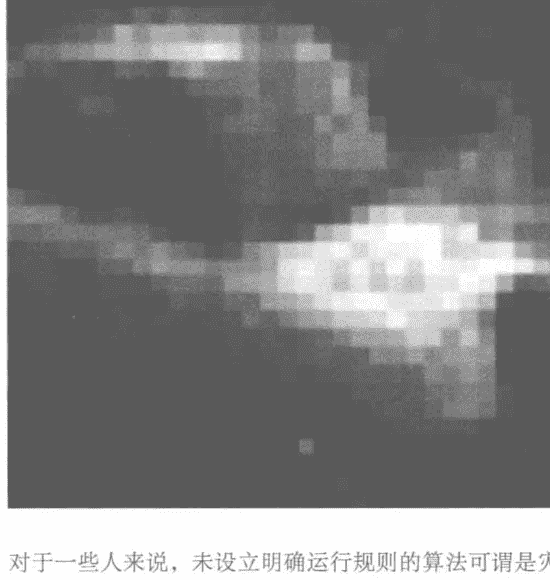

对一些人，缺乏明确规则的算法是灾难的开始。如何控制尚未理解之物？如果有感情的超级智能超越创造者会怎样？如何保证我们既不理解又无法控制的人工智能不成为敌人？

类似假设很多，关于人工智能灾难的书层出不穷。如果你想找那种内容，很抱歉，这不是本书的书。虽然人工智能近年突飞猛进，仍局限在最狭义的“智能”范畴。聚焦计算统计学革命可能更有价值。虽显枯燥，却更贴近现实。

眼下对人工智能的恐慌如同担心火星堵车。也许有一天计算机智能会超越人类，现在仍是杞人忧天。我们距离创造猕猴级智能还很远，目前甚至无人能复现蠕虫级智能。

不如说，所有人工智能炒作都避重就轻，绕开了更迫切也更有趣的话题。让我们把全能的人工智能先放一边，把思绪从遥远未来拉回现在，因为有些算法已具备一定决策权柄，足以充当“自主决策人”。它们已决定量刑、应对车祸、制定癌症治疗方案。

问题是，我们把如此重要的权柄拱手相让，它们真的可靠吗？

### 盲目信任算法
2009 年 3 月 22 日，星期日，是罗伯特·琼斯倒霉的一天。他刚拜访了几位朋友，准备驾车返程。当时他正行驶在西约克郡托德莫登的美丽街区，宝马车亮起了燃油指示灯。在油耗尽前他需要开 7 英里，约 11 公里，才能到加油站，着实让他捏把汗。幸运的是，GPS 找到了捷径，一条通往山谷一侧的路，狭窄而崎岖。

算法悬崖：当我们把方向盘交给机器

罗伯特一路跟着机器的指示开下去，前方的路却越来越陡、越来越窄。数英里之后，车子到了条泥泞的土路，马都难走，更别谈汽车。但他没有迟疑，开车是他的生计，每周要跑 5000 英里，约 8000 公里，经验足够老道。他也觉得“总不能不信 TomTom 的卫星导航”16。

再往前不久，若有人抬头看向山谷，就会看见罗伯特的宝马上半截悬在悬崖边。幸亏撞到了一处破旧的木栅栏，才没有直接坠入数百英尺的深渊。

最后靠一台拖拉机和三辆四轮摩托，车才被弄了回来。同年晚些时候，他因鲁莽驾驶出庭，承认当时完全没有想过违抗机器。“它认定那就是路，”他事后对报纸说，“所以我照信了，从未想过会被领到悬崖边。”17

是啊，罗伯特，你的确没想过。

这件事的警示不止于一次事故。琼斯当时大概觉得自己荒唐，竟无视窗外清晰的悬崖，而相信一个并不多么聪明的算法。但这样的人绝不只有他。卡斯帕罗夫大约十二年前就掉进过同一个陷阱。其实几乎每个人都在犯类似的错，只是没那么惊险，有时自己都察觉不到。

早在 2015 年，就有学者开始研究搜索引擎像谷歌这类工具，如何获得了左右大众世界观的“权力”18。我们会理性对待搜索结果，还是会直接跌进“悬崖”？

实验的对象是一场即将到来的印度大选。负责人是心理学家罗伯特·爱泼斯坦，他在全国招募了 2150 名摇摆选民，给他们一个名为 Kadoodle 的特制搜索引擎，去了解候选人并形成投票意向。

Kadoodle 被动了手脚。参与者被蒙在鼓里，分到不同组，每组看到的结果都偏向某位候选人。只要进入网站，顶部链接就会明显倾向那个人，要想看到其他候选人的内容，必须翻很久。不同分组推的人也不同。

事实上，人们大半时间都在看第一页最上面的内容。互联网上有一句玩笑：藏尸体最好的地方是谷歌第二页。实验里几乎没人会去点后面的链接。可排序带来的影响仍让爱泼斯坦震惊：看过偏向性结果后，受试者对被推候选人的支持率，在几分钟内就提升了 12%。

在 2015 年《科学》的一次访谈中19，爱泼斯坦解释道：“我们指望搜索引擎做出明智的选择，而参与者则表示：‘的确，我看到了差异，这就说明搜索引擎起作用了。’”更可怕的或许不是算法能给我们多少信息，而是人们对自己观点里有多少“二手信息”毫无自知。“如果不知道自己被圈进别人的套路里，就很容易把新观念当成自己自发的。”他在原论文里写道20。

Kadoodle 并非唯一被质疑操纵政治态度的算法，数据章节会详述。现在要说的是，我们对这些算法的态度。最终我们默认它们在判断力上优于人类21。久而久之，我们甚至不再意识到自己对它们有种偏执。

算法在日常里给了我们一种唾手可得的权威，推卸责任变得容易，思考显得多余。谁会每次都翻到谷歌第二页仔细核对？谁会比对所有航空公司来确认天巡网是否真的列全了最便宜的机票？谁会拿着尺子和地图去核实 GPS 的路线是否最短？我不会。

这里要分清。信任一个相对可靠的算法是一回事，在不了解的情况下盲目信任是另一回事。

### 人类总停留在算法的表层

2012 年，爱达荷州许多行动不便的人收到通知，医疗补助被削减了22。他们明明符合条件，州政府却毫无预警地把财政支持压了高达 30%23，逼得他们自掏腰包。这并非政治决定，而是州卫生与福利部新上线的一款“预算工具”在自动算等级24。

问题在于，工具算出的结果与现实不符。外人看来，那些数字纯属臆测。有人的补助比往年还多了，有人则少了近万美元，被迫放弃家庭治疗挤进医院25。

想弄明白补助为何暴跌，居民找到了美国公民自由联盟爱达荷分部的法务总监理查德·埃平克26。2017 年他在博文中写道：“我本以为很简单，只要问州政府为什么补助下降就是了27。但实际耗时四年，涉及 4000 名原告，打完集体诉讼才了结。”28

埃平克团队从算法运行规则入手，医疗补助方却拒绝对外透露，称软件属“商业机密”29。幸运的是受理法官不买账。这款被指肆意践踏居民权益的预算工具终于曝光——既不是高端人工智能，也不是严谨的数学模型，只是一个 Excel 表30。

表基于历史记录计算，但数据漏洞百出，基本成了无用的假设31。更糟的是，ACLU 拆解公式后发现，“公式的架构本身就存在基础性的统计缺陷”。这款工具给大量人算出了随机的结果。因为太糟糕，法院最终判定它违反宪法32。

这里有两条并行的失误。第一，有人做出如此糟糕的表格；第二，有人盲目信任它。所谓的“算法”不过是披着代码的骗局。那么体制内的办事员为何急于美化这烂设计？

埃平克的看法是：

> 我们对计算机处理的结果有一种共同的“偏见”——全盘相信，从不质疑。计算机给出的东西，就像你让统计员看数据后得出公式一样，我们只会照信，从来不会问：“等等，这样真的行吗？”33

我知道深究数学原理并不讨喜，但埃平克点出了关键：人类热衷于停留在算法表面，从不探究背后。

作为常年和数据打交道的人，我的结论是：判断一个算法是否可信的唯一办法，是挖到它的运算原理。算法像魔术。起初很迷人，一旦拆开原理，谜团就散了。藏在华丽外表下的，往往是可笑的把戏或轻率的举动。

后面章节我会尽量揭开这些算法的幕后，详尽到足以建立清晰认知，却不足以让它被复现。

即便铁粉也会被牵着走。可能是因为天巡和谷歌结果的便利，让核查变得困难；可能是爱达荷预算工具这类东西被当成商业机密；也可能是某些机器学习根本难以追踪。

终究会有时刻：被迫把控制权交给不明甚至已知会错的算法，或是在自己的判断和机器判断之间抉择。若选择相信自己，就需要勇气去说服自己。

### 否定算法其实很难

斯坦尼斯拉夫·彼得罗夫是苏联军官，负责监控核武器预警系统。一旦电脑显示美军偷袭迹象，他必须立刻上报34。

1983 年 9 月 26 日值班，午夜刚过警报大作，卫星探测到敌导弹袭来。那正是冷战高峰期，突袭有可能，但彼得罗夫犹豫了——算法只捕捉到五枚导弹，作为首轮打击来说数量不合逻辑35。

他坐着屏息。世界在他一念之间：上报就可能把世界推向核战，等待就可能让祖国失去反击时机。

人类因此幸运。彼得罗夫选择了后者。虽然无法确定警报有误，但 23 分钟后确认境内并无导弹迹象。他是对的，算法错了。

如果系统完全自动化，没有彼得罗夫做最后裁决，历史会被改写。苏联可能报复，进而触发全面核战。这个故事至少显示，最终起关键作用的是人。避免错误的唯一合理办法，是让人类保留否决权，在审视建议后再决定。

毕竟只有人类才会感受到决定的重量。对克里姆林宫通信的算法不会思考后果，但彼得罗夫想：“我清楚，一旦我错了，没人能挽回。”36

结论唯一的麻烦是人类也不靠谱。像彼得罗夫那样否定算法有时是正确的，但通常情况下，最好忽视人类直觉。

再看一个安全事件。人类错误否决算法的情况虽少，但在英国最大主题公园还是发生了骇人的奥尔顿塔“微笑者”过山车事故37。

2015 年 6 月，两名工程师按要求修理故障，修好后放出一辆空车测试，却没发现它没返回。原因不明，空车倒退到斜坡，卡在轨道中间。

与此同时，运行人员为缓解排队压力，不知情的情况下又放了一辆载客车。得到控制室安全指示后，游客坐上车系好安全带驶入轨道，完全没意识到前方停着那辆搁浅的空车。

设计师早有预案，安全算法奏效：载人车在第一处爬坡点停下并报警。但工程师坚信刚修好故障，断定是自动警报误报。

否定算法不是小事：他们需要达成一致并同时按按钮才能重启。这导致坐满游客的车直接撞上滞留的空车。后果惨烈：多人重伤，两名女童失去双腿。

奥尔顿塔和彼得罗夫警报都是生死时刻，都戏剧化地呈现同一个困境：在人类与算法的权力之争里，谁拥有最终话语权？

### 人类与算法，究竟谁说了算？

1954 年，明尼苏达大学临床心理学教授保罗·米尔出版《临床预测与统计预测》，观点激怒了一代人38。

书中他把人类与算法在学生成绩预测、病人心理健康预测等方面做了系统对比，得出结论：不管多简单的数学模型，几乎总是优于人类。

之后的半个世纪无数研究证实了米尔。对任何需要计算的工作，都应站在算法一边：医疗诊断、销售预测、自杀率预测、职业满意度、兵役健康评估、学习成绩预测39。机器不完美，但让人类否定它只会错上加错。

这不奇怪。人类的本职不是计算，超市收银员不会用眼睛合计购物总额，而是靠一种极简算法。多数情况下不必插手。这印证了飞行员间的说法：最好的飞行团队有三件东西——飞行员、计算机和狗。计算机开飞机，飞行员喂狗，狗负责在飞行员想碰计算机时咬他。

* 有趣的是，五六十年代有一系列关于“诊断”同性恋的研究，罕见地推翻了算法的优越性。那时人类判断比算法更准，说明本质上人性的事物是数据永远参不透的。

人类与机器的关系有个悖论。尽管我们对不理解的事物盲目相信，一旦意识到算法会出错，又会过激反应——全盘否定，转向自己并不严谨的判断。这被称作“算法厌恶”。

这种现象在实验中反复出现，你自己也可能体会到。只要 Citymapper 显示的时长高于预期，你就会觉得自己更懂路，哪怕这几乎总是导致迟到。我们都骂过 Siri 傻瓜，却忘了语音助手背后的技术成就。还记得 Waze 初期堵路上，你总觉得掉头更快，其实往往更慢。现在我选择相信，就像罗伯特·琼斯和他的宝马一样，跟着 App 走下去，只是我坚信自己不会掉下悬崖。

这种非黑即白的态度——要么把算法当神，要么当垃圾——在高科技时代很成问题。若想最大化享受科技，我们需要更客观。要吸取卡斯帕罗夫的教训，认识到自己的局限，审慎对待直觉反应，对生活中的算法多些认知。也不要把算法供神，而要谨慎验证它是否真有宣称的能力。只有这样才知道它是否值得托付。

可惜说起来容易做起来难。我们很少有权力干涉算法在生活中的权限范围，即便它们与我们息息相关。

有些算法印证了这一点，它们交易的是现代最基础的商品：数据。这些算法在互联网里悄悄跟踪我们，收集个人信息，推断个性，进而影响行为。

而这场交织着盲目信任、权力与影响力的风暴，其后果足以从根本上改变人类社会。

## 第二章

数据

DATA

2004 年，刚创办脸书不久的大学生马克·扎克伯格在即时消息里对朋友说：

> 扎克：如果需要哈佛里任何人的信息，
> 扎克：尽管问。
> 扎克：我有超过 4000 条邮件、照片、地址……
> 【好友姓名被打码】：哼？你怎么弄到的？
> 扎克：他们自己提交的。
> 扎克：我也没明白。
> 扎克：他们“信任我”。
> 扎克：真是一群大傻瓜1。

2018 年脸书丑闻后，这段话被反复引用，用来说明公司对隐私的漠视。我个人觉得，对一个 19 岁小伙子的吹嘘要宽容一些。但扎克伯格也有认知偏差。人们不只是提交信息，而是在用信息交换——作为回报，他们获得算法的使用权，能自由与亲友沟通，建立分享生活的私域网络。我不清楚别人，但那时的我完全认同这种等价交换。

逻辑只有一个问题：我们很难注意到这笔“交易”的长期影响。因为不清楚自己的数据能用来做什么，或导入智能算法后价值多大。或者反过来，我们以什么价码被“出售”。

### 个人数据的价值

超市最早嗅到个人数据价值。在行业里，各家公司为抢顾客明争暗斗，小幅优惠就能把购物行为转化为品牌忠诚。微小提升累积起来就是巨大优势。正因如此，英国超市乐购 1993 年启动了一项试验。

在夫妻档“智囊团”埃德温娜·唐恩和克莱夫·哈姆比指导下，乐购在指定门店推出了全新会员卡：塑料材质，大小像信用卡，结账时出示。交易很简单：顾客用卡结账得积分，下次消费可用；乐购保存姓名和购物记录2。

试验期收集的数据很有限。除姓名住址外，只记录金额和时间，并未记购物篮具体内容。但唐恩和哈姆比仍从这些简单数据里挖出关键信息。

他们发现销售额主要来自少数忠实顾客。通过邮编逐个分析，他们掌握了顾客愿为光顾商店而行驶的距离；知道乐购在哪些社区没市场，哪些社区占有率高。数据还显示，有些顾客每天来，有些周末才来。有了这些信息，他们向会员寄送代金券刺激购买。高消费人群券面 3 到 30 英镑，低消费人群 1 到 10 英镑。效果显著：约 70% 的券被兑现，会员的消费额整体比非会员高 4%。

1994 年 11 月 22 日，克莱夫·哈姆比向乐购董事会汇报试验成果。他展示数据、回应率、客户满意度证明和销售额涨幅。董事会全程沉默。汇报尾声，主席开口：“有件事让我害怕，你在三个月内对我的顾客的认知，比我三十年了解的还要多。”3

随后乐购向所有顾客开放会员卡。普遍认为正是这项措施，让乐购超过劲敌森宝利，一跃成英国最大超市。随着时间推移，数据收集越来越细，顾客习惯愈发清晰。

网上购物的早期，该团队推出“我的收藏”功能。凡用忠诚卡买过的商品，在顾客登录乐购网站时会自动置顶。和会员卡一样，这招也大获成功。顾客无需翻页就能找到想要的产品。销售额上升，体验也好。

不过也有例外。功能上线不久，一位女士投诉数据错误。她常网购，却在“我的收藏”里看到避孕套。她说那不可能，她丈夫不用。经她要求，乐购分析师查了数据，发现列表没错。

为避免婚姻破裂，他们做了策略性回应：为“数据损坏”道歉，并从她的收藏里删除了“问题”商品。

据克莱夫·哈姆比著述，这种做法已成公司的“不成文规定”。遇到棘手问题就道歉并删除数据。这与埃里克·施密特的说法一致，他在任谷歌执行总裁时说过：“谷歌的政策是触碰底线，但绝不跨越底线。”4

数据越堆越多，能读出来的事儿就越让人意外。家里的日常用品看似只是买来用的东西，其实也在悄悄泄露使用者的性格密码。把个体消费轨迹拆开审视，能拼出不少生活碎片，有时候像避孕套那样，挖出来的东西是人们宁愿不被知道的。大多数时候，埋在数字背后的真相，最后都会被公司变成可用的竞争力。

### 数据如何撬开市场
2002年的美国，折扣超市塔吉特已经开始寻找一种与过去不同的消费组合⁵。从牛奶、香蕉，到毛绒玩具、庭院家具，商品品类极广。千禧年后，像几乎所有零售商一样，塔吉特把信用卡号码和问卷信息和店内购买记录关联起来，用来分析行为模式。

在美国流传很广的故事是，女性买了无香型身体乳后，常常会报名店里的宝宝派对。这是数据里捕捉到的信号。孕中期女性会担心妊娠纹，所以先买保湿乳液护肤，就能推断后续走向。往前看，这批女性很可能在塔吉特大量购买维生素、钙片、锌片等补剂；往后看，数据甚至能给出大致预产期，最明显的标志是会采购超大包装脱脂棉⁶。

孕妇对零售商而言是极具价值的群体。孕期培养品牌忠诚，生产后仍可能持续回购。新生儿占据妈妈几乎全部精力，每周的例行采购很容易被习惯占据。正是这个发现，让塔吉特抢在对手前面拿下先机。

下一步就很直接。塔吉特用算法评估女性是否怀孕，一旦概率超过设定阈值，系统就会自动推送奶嘴、润肤乳、婴儿湿巾等优惠券。

工具上线一年后，十多岁女孩的父亲冲进明尼阿波利斯的门店要找经理对质。女儿收到了孕期用品券，让他非常恼火，觉得商家把青少年怀孕当成理所当然。店员道歉，几天后再次致电表达歉意。据《纽约时报》报道，这位父亲随后反思。

“我和女儿谈了，”他说，“家里确实发生了事，我始终被蒙在鼓里。预产期是八月。”

个人看法是，如果算法比父母更早知道女儿怀孕，那就是严重越界。但尴尬并未让塔吉特废弃工具。

一名执行总监解释：“只要孕妇不觉得被监视，她们会安心用券，因为会以为邻居也收到了尿布婴儿床的优惠券。所以别触动敏感神经就行。”

和现在的大多数零售商一样，塔吉特仍在暗中使用孕妇预测器。区别只是相关券会混在普通商品里降低怀疑。比如婴儿床广告会放在酒杯旁边，婴儿服装券会和古龙水广告一起出现。

不止塔吉特在用这类手段。虽然媒体很少报道能推断出什么，但类似算法持续存在并在商业前线运转。约12个月前，和保险机构的首席数据官聊过，他们能查阅超市的忠实客户奖励记录，获得非常详尽的购物习惯。通过分析，他们发现常在家做饭的家庭很少提出房屋险索赔，公司因此获益。这也符合直觉，愿意花时间精力金钱做精致美食的家庭，通常不会让孩子在家踢足球。怎么分辨谁会做饭？购物篮里某些特定商品和低索赔率相关。他说，最能体现责任感和顾家特质的商品是新鲜茴香。

如果购物习惯就能推断这些，拿到更多数据会怎样？如果掌握某个人的完整线上行为，又会收获哪些意想不到的信息？

### 数据经纪的灰色地带
帕兰提尔技术公司是硅谷历史上最成功的创业公司之一，由拥有PayPal光环的彼得·蒂尔于2003年创立，最新估值约200亿美元⁷。

市值和推特相当，但你很可能不认识它。相信我，它认识你。

帕兰提尔是一家新兴数据经纪商，买进收集个人信息再转售或分享盈利。类似企业还有安客诚、核心逻辑、数据逻辑、eBureau等，你可能从未直接接触，但它们持续分析你的行为⁸。

只要在线购物、登录看新闻、在网站注册，或咨询新车、填保修卡、买新房、注册投票，提交的任何个人数据都会被收集并卖给经纪商。比如你向房产中介透露的购房需求会被转卖，你在保险比价网站填的详细信息也会被转卖，甚至某些情况下浏览器全部历史记录会被打包出售⁹。

经纪商把这些数据合并，参照已购买的每条信息，为你建立一份详细档案，也就是数字化身。直白说，在某些经纪商数据库里，存在一份印有你身份号码的文件，你永远不知道这个号码。打开它，能看到过去的一切痕迹：姓名、出生日期、信仰、度假习惯、信用卡使用、资产净值、体重身高、政治立场、下注习惯、身体缺陷、用药情况、是否做过流产、父母是否离异、是否易上瘾、是否遭强奸、对枪支管制的看法、可能的性取向和实际性取向，以及是否易被煽动。如此详尽的信息被分类存放在服务器上，难以追踪，无人例外¹⁰。

正如塔吉特对孕期的预测，这类数据很大一部分是推断出来的。订阅《连线》可能意味着你对科技感兴趣，持有轻武器使用许可则暗示你可能喜欢打猎。数据经纪商一直用简单巧妙的算法丰富数据，和超市做法类似，只是规模被放大了许多。

这能带来好处。经纪商通过了解我们，可以防止诈骗分子伪装成信用良好的顾客。也正因知道偏好，他们才能在浏览时推送相关广告。相比被律师或支付保护保险广告轰炸，体验更愉快。此外信息直达目标顾客，广告成本大幅下降，让优质产品的小企业也能吸引新客户，形成一种各取所需局面。

当然，一旦把人类划分为不同类别，就会带来一连串问题。稍后会展开，但先简单解释隐形过程，当你在互联网上点击时，在线广告是如何找到你的？数据经纪商扮演什么角色？

假设拥有一家高端旅游企业弗莱思。多年间长期号召客户在网站上留下喜好，积累了许多邮箱。如果想更深入了解他们，比如偏爱哪些假期，就可以把邮箱列表发给数据经纪商，在他们的系统里通过姓名定位用户，然后把相关数据连同我的列表返回。相当于在表格里新增一列。之后当你再次访问弗莱思网站，就能知道你对热带岛屿有强烈向往，于是推送夏威夷旅游广告。

这是第一种方式。第二种是，假设弗莱思网站有一小块空间要卖给其他广告商。再次联系一家数据中介，并提供掌握的用户信息。中介开始寻找想投放广告的公司。配合故事发展，假设一家防晒霜公司表示兴趣。为了让该公司相信弗莱思拥有其需要的目标人群，中介会通过推断总结出用户的特征，比如红色头发人群占比等数据。或者，防晒霜销售商也交出自己的用户邮箱列表，中介计算双方客户的重合率。如果销售商接受，广告就会投放到弗莱思网站，中介和自己都会获得佣金。

第三种方式让人觉得诡异。这次弗莱思想吸纳新客户，男女皆可，65岁以上，热爱热带岛屿，收入丰厚可自由支配，希望参加公司新推出的加勒比游轮项目。找到一家数据中介，通过他们的数据库查找符合条件的人名单。

假设你出现在名单上，但中介绝不会把你的姓名告诉弗莱思，中介会找出你常浏览的其他网站。同时，他们很可能与你收藏的某个网站有业务往来，比如社交媒体或新闻网站。只要你不经意登录这个收藏的网站，中介就会收到你在线的通知，并瞬间在你的电脑上留下被称为Cookie的小旗帜。Cookie类似于信号，告诉互联网中其他所有网站，你是弗莱思加勒比游轮项目的广告受众。不管你是否需要，无论你在互联网的哪个角落，这些广告都会找到你。

这里出现根本问题，如果不希望看到这些广告会怎样？被加勒比游轮图片轰炸确实令人困扰，但有些广告商带来的困扰更严重。

海蒂·沃特豪斯不幸流产后，她取消了所有订阅，不再收到每周关于胎儿成长和水果搭配的邮件，也退出了孕期时注册的所有邮件列表和心愿单。然而正如她在2018年一场会议上对一位开发者所说，她根本摆脱不了互联网上关于怀孕的广告。即使没有妈妈或婴儿作为载体，怀孕相关的数据仍在独立运行。“系统构建者根本没考虑过这种后果。”她说。

类似的系统，无论是粗心还是刻意设计，都具备摇钱树的潜质。发薪日贷款商可以直接用它找到信用评分低的人群，投注类广告也能精准推送给常浏览此类网站的网民。但对人做此类数据分析也会带来问题，比如摩托车爱好者会被贴上爱冒险标签，食用无糖甜品会被视为患糖尿病，从而无法获得保险。2015年一项调查显示，谷歌在向浏览网的男女推送高薪管理类招聘广告时，更倾向于推送给男性¹²。

一位非裔美国的哈佛大学教授在谷歌搜索自己的姓名后，却收到了针对有犯罪记录人员的广告，还因此被迫向一家招聘方证明自己从未被警方拘留。于是她开始搜索投放给不同种族的广告，发现与听起来像白人的姓名相比，搜索听起来像黑人的姓名时，出现包含逮捕一词的广告明显增多¹³。

上述手段不只是数据经纪商在用，谷歌、脸书、Instagram和推特的运作方式也类似。这些互联网巨头并不靠拥有用户盈利，它们的商业模式建立在精准投放之上。这些网站是庞大的广告投放机器，通过数百万计的用户登录、点击、阅读赞助帖文、观看赞助视频、查看赞助图片来获利。这样的算法无处不在，交易着你不知道但他们拥有且绝不主动提供的信息。它们把你最个人、最私密的信息变成了商品。

不幸的是，很多国家的法律并不能给予足够保护。对数据经纪商的监管基本处于真空状态，美国尤为严重，而遏制经纪商权力的机会也一再被政府错过。例如2017年3月，美国参议院投票废除了多项条例，这些条例原本可以阻止数据经纪商在未获当事人明确同意的情况下出售其互联网浏览器历史记录。尽管早在2016年10月联邦通信委员会就已审核通过这些条例，但在当年年底政府换届后，联邦通信委员会的新任共和党多数以及国会里的共和党人推翻了该决定¹⁴。

那么这些对你的隐私意味着什么？为了理清思路，将讲述德国记者希瓦·埃克特与数据科学家安德烈亚斯·迪尤斯共同完成的一项调查¹⁵。

埃克特和她的团队假扮成一家数据经纪商，试图购买三百万德国居民的匿名互联网浏览数据。掌握民众的互联网历史记录其实很容易，多家公司持有大量英国或美国客户的数据并随时出售。唯一难题是获取德国民众的相关数据。数据采集由用户主动下载的Google Chrome插件完成，但他们并不知道自己已被全程监控。

该插件此前累积了无数URL，即统一资源定位符，记录了30天内所有人的网上行为：每次搜索、每个页面、每次点击，并且可以合法出售。

对埃克特和同事来说，最棘手的环节是这些浏览器数据都是匿名的。对被出售历史记录的民众来说这算好事吧？可以避免尴尬。但事实并非如此。该团队在2017年黑客大会DEF CON上的演讲表明，对庞大的浏览器历史记录进行去匿名化其实非常简单。

实现方式如下：有时URL本身就会泄露身份。例如，浏览Xing.com网站（德国版领英）时，点击自己的头像后会进入页面，地址类似于：

```
www.xing.com/profile/Hannah_Fry?sc_omxb_p
```

其中的姓名会立刻暴露身份，而用户名后面的文本则表示用户已登录并正在查看自己的资料。因此幕后团队就能确定，该用户正在浏览自己的页面。这和推特一样，只要浏览自己在推特上的分析页面，操作就会暴露给幕后团队。如果数据中没有明显标识符，幕后团队还能用另一种伎俩。只要用户在线发布一个链接，可能是关于某个网站的推文，或分享自己在优兔上的公开播放列表，基本上，只要在网络上留下与真实姓名相关的痕迹，就会无意中暴露身份。幕后团队使用一个简易算法，将公众信息与匿名人员相互对照¹⁶，然后以链接发布在网上的日期时间为依据，对已掌握的URL列表进行筛选，最终找出数据，集中到几乎所有人员的真实姓名，以及数百万德国人在30天内的完整浏览记录。

在三百万民众中，有几位显赫人物。其中包括一位在线搜索药品的政客，以及一位把敏感案件文档复制粘贴到谷歌翻译的警官，研究人员可以看到URL中的所有细节。还有一名法官，浏览记录显示他每天都会浏览特定内容，大多是色情网站。

这位法官在浏览网页时，还经常在线搜索婴儿姓名、折叠式婴儿车以及妇产医院。于是团队得出结论，他的配偶正在备孕。

需要说明的是，这位法官并未做任何违法行为，包括我在内的许多人都会认为他的行为并无不妥。只是这类材料可能成为把柄，被人用来敲诈或羞辱他的家人。

这正是我们底线迷失的开始。在你不知情的情况下，你的私人敏感信息被他人擅自收集，最终用来操控你自己。英国政治咨询公司剑桥分析就发生了这一幕。

### 算法与政治营销
你可能已经知道这个事件的大致经过。

自二十世纪八十年代起，心理学家就沿用一套系统，用五种特质来量化个体性格。针对经验开放性、尽责性、外向性、亲和性以及情绪不稳定性，你会得到相应分数，把分数加起来，就能按照他们的标准快速描述一个人的样貌。

2012年，也就是剑桥分析成立前一年，一支来自剑桥大学和牛津大学的科学家开始探究这五种特质与脸书点赞页面之间的联系¹⁷。基于此，他们在脸书推出了一套测试题，希望用户参与心理测验，以便找到个体真实人格与线上人格的关联。我把自己的推特记录上传并填写了用于对比的传统问卷式个性测试。结果在五种特质中，算法准确做出了三项判断。虽然按传统测试，我本人比推特资料显示的更为外向和情绪不稳定。

这一系列举措背后动机是助力广告业。到2017年，这支学术团队已开始尝试根据个体性格特点推送定制广告。他们以脸书为平台推送化妆品广告，对外向性格群体使用口号纵情舞动吧，就像没人在看你，但他们肯定在愉悦，而内向群体看到的则是一个女孩微笑着站在镜子前，标语是美丽，不言自明。

在一个类似实验中，经验开放性得分较高的目标顾客看到的拼字游戏广告是：亚里士多德？塞舌尔群岛？在无尽拼字游戏中释放创造力，挑战想象力！同一款游戏，面对经验开放性较低的群体时，广告语则变成拥抱史上最棒！这款产品让几代人无法释怀。研究团队表示，依据个性特点精准投放广告，与使用一般非个性化广告语相比，点击率提升40%，购买率提高50%。这激发了广告商的浓厚兴趣。

学术团队研究得如火如荼，其他机构也在同步推进。其中就包括为特朗普竞选服务的剑桥分析。

现在让我们稍微回溯。剑桥分析所用的技术手段与我假设的高端旅游企业弗莱思完全相同。他们的方法是，
- 这种特殊的组合似乎在暗示，如果我不那么在乎别人的看法，可能会在线发布更多的内容。

精准投放的套路，从来不是广撒网，而是先找准那群“好说服”的人下手。与其投放面向所有人的通用广告，不如锁定特定人群直击要害。比如有人发现，买美制福特车的消费者里共和党支持者占比很高，于是锁定喜欢福特却尚未投共和党的群体，用“纯正美国制造”这类爱国牌去煽动，进而撬动政治立场。说白了，就跟候选人挨家挨户找摇摆选民拉票一样。奥巴马、克林顿竞选时也玩过这一套，西方主流政党基本都在用大数据分析和精细投放。

假如“第四新闻台”拍到的偷拍视频属实，剑桥分析还把这套玩进了更深的层次：拿个人画像做情绪化政治投放。比如筛出情绪不稳定分数高的单亲妈妈，放大她们对入室抢劫的恐惧，推动枪支管控支持。商业广告早就把这些技术用烂了，政治战自然也不例外。

更进一步的指控是把广告伪装成新闻稿。据一位向《卫报》爆料的举报人说，竞选期间效果最好的一条交互式图广告叫“克林顿基金会的十大丑闻”21。另一位举报人则说，剑桥分析放出的所谓“文章”，很多根本就是胡编乱造22。

姑且把以上都当成事实：剑桥分析靠心理画像在脸书上操控假新闻，蒙住公众。那问题是，这招到底管用吗？

### 精准推送与有限影响

看政治定向广告时，我们心里总有种不对称的错觉。觉得自己脑子很清醒，不会被带节奏，却觉得跟自己立场不同的人特别容易被洗脑。现实大概介于两者之间。

我们承认脸书上的帖子会左右情绪。2013年，脸书内部做过一次争议极大的实验，未经用户许可就对689,003名用户的新闻流进行操纵，试图控制他们的情绪23。先把好友含正能量词的帖子撤掉，再把含负能量词的帖子隐藏，观察无知觉的用户会怎样反应。看到负面内容变少的人，后来自己发的内容更正向；看到正向内容被藏起来的用户，则更爱用负能量字眼。结论很讽刺：我们以为自己免疫，事实可能正好相反。

《权柄》一章里提到的爱泼斯坦实验显示，仅是搜索引擎的结果顺序，就能把犹豫的选民推向某位候选人。再加上学者用剑桥分析改造过的算法做出的效果，也证明以性格为依据的广告确实更有效。

把这些拼起来，能得出一个结论：这些手段确实能影响投票，就像影响消费一样。——但有一个很深的但是——在下定论前，还有几件事必须看清楚。

即便一切属实，实际效果却微乎其微。脸书实验里，负面新闻被屏蔽后用户确实更爱发正面内容，可波动连千分之一都不到。

同理，谈到定位广告，就算纳入性格因素，给内向人群推化妆品确实更有效，提升却可以忽略不计。1000人里，通用广告拿到31次点击，定向广告拿到35次。即便书中第45页提到的50%增长，在论文里被重点标出，实际只是1000人里从11次点击涨到16次。

这些方法可行，但广告主没法把信息硬塞进被动受众的脑子，因为我们不会乖乖待宰，比投放者想象的更会装看不见、嗤之以鼻。所以哪怕最精准、最抓眼的定向广告，对目标群体的影响也极其有限。

不过选举就是这样，微小的变动可能成为破局点。面对数千万乃至上亿选民，千分之一的漂移会迅速累积。你可能还记得，《旁观者》周刊的贾米·巴特利特指出，特朗普在宾夕法尼亚州以44,000票赢下600万选票，在威斯康星州赢22,000票，在密歇根州赢11,000票。也许你只需要那不到1%的差额24。

事实上，我们根本无法精确量化这种差额对美国总统选举的影响。即使掌握所有事实，也回不到过去解开因果谜团。过去已成定局，眼下关键在于未来怎么走。

### 算法给你评分

要明白，我们都是这种互联网模式的受益人。全球范围内的人享受免费、便捷的即时通信，知识与资讯唾手可得。最前沿的软件和技术全由私企打造，广告商买单。我们达成的潜规则是：用数据换免费，然后被数据影响并为之付费。

如果这笔交易你能接受，也无可厚非。另一条线是，这些海量互联数据集的实际运用。《黑镜》里演过的情节，现实里已经存在，那就是中国的芝麻信用——蚂蚁金服给用户算的分。

想象一下，把数据经纪人能收集到的你的一切，换算成一个分数。覆盖信用记录、手机号、住址这些常规信息，也包括社交媒体发帖、打车App记录、甚至线上约会痕迹。最后得到一个350到950之间的数字。

芝麻信用没公开完整的计分公式，但技术人员在接受《财新周刊》采访时透露了一些推断逻辑。“每天打游戏十小时的人会被归为闲散；经常买尿布的人可能有孩子，因而更有责任感。”25

分数很有用。600分以上能拿到一张特殊信用卡；650分以上租车免押金，还能进北京机场VIP通道；666分以上获得更高信贷额度；750分以上可申请欧洲快速签证。

起初这只是自愿参与的娱乐。到2020年强制推行用户信用评分后，分数低的群体开始感受到全方位的生活压力。所谓以诚信为荣、以失信为耻。正如莱顿大学范·沃伦霍芬研究所中国法制研究员罗吉尔·克里默斯所说，这可以被理解为诚信奖励机制的“私生子”26。

数据科学圈里很早就知道能靠民众信息牟利，但长期抵制。直到剑桥分析事件引爆民愤，2018年初丑闻爆发，公众才第一次清楚算法在背后如何悄悄收割数据，也才意识到缺乏监管会带来不可预见的后果。

规范在逐步到来。住在欧洲的人会发现《通用数据保护条例》GDPR已经出台，把数据经纪人的大部分业务定性为违法。理论上，未明确用途就不能存你的数据，收集目的必须前后一致。这不一定能终结行为，因为上网时我们很少细看使用条款，极易不经意授权；而且大部分数据分析和传输极具隐蔽性，违法行为难被发现，执法也困难。目前只能走着看。

除了欧洲，美国也在行动。联邦贸易委员会早在2014年就发布报告谴责数据经纪人的暗箱操作，此后持续维护消费者权益。如今苹果的Safari已内置“智能跟踪预防”，火狐有类似功能，脸书正在切断与数据经纪人的合作。阿根廷、巴西、韩国等许多国家也实施了与GDPR相近的规定。欧洲起步早，但世界其他地区也在向前走。

若把数据比作黄金，我们一直生活在美国西部的蛮荒年代。对大部分人而言，最坏的时代或将过去。

但免费午餐从来没有。法律完善后，企业利润与社会公益的博弈会加剧，我们要留心别养成错误的隐私观。只要使用算法，尤其是免费的，就要弄清背后的动机。这个应用为什么免费给我用？算法的真正目的何在？交易划算吗？不用会不会更安全？

这种教训不止于虚拟世界。如今算法的影响已渗透社会各个角落。数据与算法的权力不仅能预测购物习惯，还能剥夺自由。

## 第三章

正义

JUSTICE

入夏后的周末夜，布里克斯顿的街头总挤满喝酒狂欢的人。故事就从这里开始。伦敦南部的布里克斯顿向来是夜生活重镇。那晚音乐节刚结束，人群有的回家有的去聚会。11点30分左右，气氛骤变，市政住宅区爆发斗殴，警察控制不住，混乱迅速蔓延到市中心，数百名年轻人卷入其中。

时间是2011年8月。前一天晚上，城东因警察击毙托特纳姆青年马克·达根引发抗议，秩序失控演成骚乱。第二天，多地陷入混乱，性质完全变了。最初的小规模示威变成大规模打砸抢。

混乱中，23岁的电气工程大学生尼古拉斯·罗宾逊刚在女友家过周末，正抄近路回家。他熟悉的街道已经面目全非：被掀的车、破碎的门窗、街头的火堆、被闯入的店铺。警方疲于镇压，抢劫者从被砸的店里搬出衣物、鞋帽、笔记本电脑和电视。附近一家电器商被洗劫一空。几条街外，罗宾逊路过自家街区的超市。超市玻璃和大门被砸，店内一片狼藉。不断有人抱着新笔记本电脑跑出来，警察在一旁几乎视而不见。口渴的他走进去提了一箱3.5英镑的矿泉水。准备离开时警察冲进超市，他立刻扔下箱子转身逃跑3。

周一夜间，英国多地仍在暴动。18岁的理查德·约翰逊也在其中。看完新闻后，他戴上不合时节的巴拉克拉法帽，驾车冲向当地购物中心，蒙脸闯进游戏店，抱着一堆游戏光盘回车。倒霉的是停车位在摄像头范围内。警方凭车牌找到他，并以视频证据起诉6。

两人都在2011年骚乱后被捕，被控盗窃并认罪。但后续走向截然不同。

事件发生不到一周，罗宾逊就被带上坎伯威尔地方法庭。尽管他偷的东西价值低廉、无前科、在读全日制、庭上真诚忏悔，法官仍称其行为助长了布里克斯顿当晚的暴乱。在家人叹息声中，他被判监6个月7。

2012年1月，约翰逊案才开审。尽管他刻意伪装身份、蓄意抢劫、对公共秩序造成严重影响，却侥幸躲过牢狱。他被判缓刑并要求做200小时义工服务8。

### 和谐一致的谜题

司法系统的人都清楚，司法不完美也无需完美，因为审判与量刑不是精密科学，法官无法保证精准。因此才有“合理怀疑”“相当理由”这类法律表述，上诉机制才显得重要。整个体系都明白绝对确定不可能实现。

即便如此，罗宾逊和约翰逊这类被告受到的区别对待仍显得不公。变量太多，我们无法断定刑罚差异就是不公平。但在合理范围内，我们仍希望法官定罪时保持一致。假如你和你想象的双胞胎犯了相同罪，你一定希望得到相同判决。但真的会这样吗？

上世纪七十年代，一组美国研究员尝试回答这个问题。他们没用双胞胎罪犯，而是编造一系列假想案件，让47名弗吉尼亚州地方法官独立审理。其中一个案例是这样的：18岁女性因持有大麻被捕，男友和7名好友同被抓到，现场有大量已吸未吸的大麻，但未在其本人身上查到。她出身中产、成绩好、无前科。对行为她既不反驳也不认罪。

判决差异巨大。47位法官中29人判无罪，18人判有罪。在判有罪的法官里，8人建议缓刑，4人认为罚款合适，3人主张缓刑加罚款，还有3人坚持要送监狱。

同一案件、同一证据，被告的命运从无罪释放到入狱，完全取决于碰到哪位法官。

对一致性抱有期待的人，这无疑是打击。更糟的是，法官自己也在自相矛盾。

近期一项研究邀请81位英国法官决定是否保释这些假设被告。每个案件没有背景故事和犯罪记录。与弗吉尼亚研究类似，这些法官面对41个案件时也毫无一致。更微妙的是，其中7个案件重复出现两次，只改了被告姓名以防被察觉。大多数法官在面对相同案件时，第二次的决定与第一次不一致。甚至有人看起来像在随机给出保释决定12。

大量其他研究得出相同结论：一旦法官拥有自由裁量权，前后差异会很大。允许自由裁量，就等于把运气掺进了司法。

当然问题好解：取消自由裁量权即可保证一致性。若对同罪者一律同判，精准度就能得到保障——至少在保释与量刑层面。事实上一些国家已这么做。美国联邦层以及澳大利亚部分地区采用规范量刑体系13。然而一致性是有代价的，因为它牺牲了另一种公平。

比如两名超市盗窃被告。一人是惯犯、经济宽裕、选择性偷窃；另一人刚失业、为养家糊口偷东西并深感悔恨。若撤销量刑自由、严格按规章同罪同罚，部分被告会因此承受不必要的伤害，也有人会失去重返正常生活的机会。

这是一个谜题。无论怎么设计体系，都要在个体正义与判决一致性之间找平衡。大部分国家采取中间路线，介于美国联邦法的极致规范性与苏格兰式的完全自由裁量之间14。西方世界的量刑准则倾向于设定最高刑或最低刑，或两者兼有15，允许法官在此区间浮动。

完美系统不存在，矛盾的不平等与对立的不公也不可避免。但在这场复杂博弈中，算法有了席位。因为算法进入系统后，一致性和个体正义都能被兼顾，人类不再需要做艰难抉择。

### 正义的方程式

算法不能判定有罪，无法权衡供证陈述，也无法分析证据或判断悔改是否真诚。短期内它不会取代法官。但算法能用个体数据计算再犯风险系数。而多数法官在量刑时本就基于再犯可能性，所以算法算再犯风险是有效手段。

数据与算法在司法中的应用已有近百年，最早可追溯到二十世纪二十年代的美国。当时体制是按最重刑罚判处后一段时期再给予假释资格。成千上万囚犯提前获释，其中有人重返生活，有人没有。这形成了一次自然实验：能否预测犯人会否违反假释承诺？

芝加哥大学的加拿大社会学家恩斯特·W·伯吉斯痴迷预测。他积极量化社会现象，从退休影响到婚姻成功无所不测。1928年，他率先构建出一套预测犯罪风险的工具，基于测量数据而非直觉。

他用伊利诺伊州三所监狱3000名囚犯的数据，找出21个在判断是否违反假释承诺上“可能很重要”的因素。包括犯罪类型、服刑时长、社会类型——单凭这一点就能看出这位社会学家来自上世纪初。他把人划分为“流浪汉”“酒鬼”“窝囊废”“乡巴佬”“移民”16。

伯吉斯给每名囚犯在这21项因素上逐项打0分或1分。认为16到21分代表重犯可能性最低，4分或更少则极可能违反假释承诺。

所有囚犯最终都获假释，也都有背叛条款的自由，这正好让伯吉斯检验预测准确度。凭借这项基础分析，他得到惊人准确率。低风险群体中98%顺利度过假释期，而三分之二的高风险群体未能撑过假释期17。结果证明，即使粗糙的统计模型也能比专家更准确。

成果也遭到质疑。怀疑者问，这些因素只成功预测了一次假释情况，在其他情形下又有几分准？“乡巴佬”这一类对现代都市再犯率有何用？另一些学者批评伯吉斯盲目使用手头数据，从未检验相关性。还有人质疑打分方法，因为这不仅是用方程式表达观点。尽管如此，伯吉斯方法最终在1935年被伊利诺伊州多家监狱采纳，协助假释委员会裁定19。到世纪之交，其衍生的数学模型已在全球广泛应用20。

算法坐镇法庭，准了还是偏了

如今法庭里运转的风险评估系统，已远非伯吉斯当年那种简易工具。它们不仅参与取保决定，还能为服刑人员匹配矫正项目、判断是否假释，近年甚至伸向量刑环节。底层思路没变：把年龄、前科、罪行轻重等基础信息输入，输出一个关于将来再犯可能性的分数。

这些系统究竟怎么算出来的？表现最好的模型多半靠随机森林，而随机森林的骨架就是判断树。

### 单棵树撑不住，成群才稳

你可能还记得课堂上老师用流程图拆解抛硬币或掷骰子的例子。画出来就是一棵棵分支的判断树：按环境条件一步步推导出下一步该做什么。放到算法里，它也是在推演接下来会怎样。

比如在犹豫是否放人出来时，真正要算的是：若让他离开，会不会违反取保约定？这和罪名本身关联不大。

手里有一批过去服刑者的历史，有的在取保期间潜逃或再犯，有的平安度过。基于这些记录，就能先搭一棵简易的判断树，用旧案例的特征画出路径，用来猜测新人的行为。只要新人走的路和旧人相似，预测看起来就靠谱。

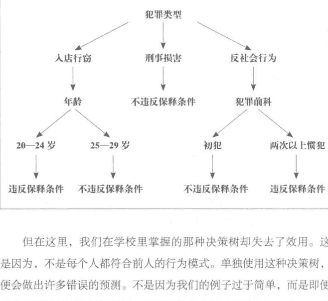

问题在于，现实里并非所有人都沿着旧路走。单独一棵树会犯不少错。即便数据再多、对比流程再复杂，单棵树的表现也只比瞎猜好一点点。

换成多棵树就不一样。这就是系综的思路：不把全部数据塞进一棵树，而是随机抽样训练上万棵小树。对一个新案，每棵树都投一次票，有的说放，有的说不放。把这些意见取平均，准确率会明显提升。

这有点像《百万富翁》里的“问观众”。和你最聪明的朋友相比，现场一群陌生人的平均答案更可靠，问观众的成功率约91%，电话求助只有65%。错误互相抵消，群体智慧往往高于个人。

把大量判断树聚在一起，就成了随机森林，也是双关的名字。它属于机器学习，更广义的人工智能。说白了，就是上学时画的流程图加了点数学。网飞用它猜你想看什么，爱彼迎用它揪出欺诈账号，医疗领域也用来做疾病诊断。

用在人员审核上，它有两点人类做不到的优势：同样条件下永远给出一样的结果，保证一致性；预测精度上通常更胜一筹。

### 机器和法官，谁的眼更准

2017年一组研究者想直接比一比，机器和人类法官谁的预测更好。

他们拿到了2008到2013年间纽约市所有被捕人员的记录，五年里有75万人开了取保听证。这足够一场正面交锋。

纽约司法系统在这段时间里从没用过算法。研究者自己搭建大量判断树，输入犯罪记录、所犯罪行等信息，输出当事人违反取保条件的概率。

在真实数据里，40万8千多名当事人审前被释放。只要有人失约出庭或再犯，就能检验预测和裁决的准度。后来未出庭的概率是15.2%，取保期因再犯被重新逮捕的概率是25.8%。

麻烦的是，法官对自己认为高危的人基本不放，这部分案例就无法验证。于是整体准确率算不出来，只能靠推断做间接比较。

结果两者分歧很大。大量被算法标为危险的人，在法官眼里却是低危。最危险的那批人里，近一半仍获得了法官的释放许可。

谁对？数据指向算法。算法担心的那群人确实风险更高，其中超过56%最终到庭出问题，62.7%在取保期间再犯，甚至包括强奸和谋杀这类严重罪行。

研究者指出，算法全面优于人类法官。想减少候审在押人数，算法能让监狱人数下降41.8%同时犯罪率不变；如果想维持现有释放比例，算法能把取保撤销率降低24.7%。

这不是纸上谈兵。美国罗德岛州八年多来在多家法院使用类似系统，在押人数减少17%，复犯率下降6%。相当于数百名低危者不必关在里面，数百起案件被扼杀在萌芽。英国关押一人一年要3万英镑，美国重刑监狱一年的花费相当于哈佛一年的学费，省下的纳税人钱以百万计。看上去是双赢。

但真的如此吗？

### 放走恶人还是羁押好人

没有任何系统能完美预言人类下一步会做什么。人类矛盾、冲动，必然会出错。问题在于错在哪类人身上。

宾大犯罪统计学教授理查德·伯克把错误分成两类。他说算法其实在问：谁是达斯·维德，谁是卢克·天行者。

放走达斯·维德叫假阴性错误，看似低危实则危险。把卢克·天行者关起来叫假阳性错误，错误地把人定为高危。

两种错都可能导致再犯。

伯克的模型预测是否会继续杀人，准确率75%，已经是较高水平。但75%意味着仍有大量卢克被误判为达斯，失去释放机会。

一旦算法进入量刑，贴错标签的代价更大。近年美国部分州允许法官参考风险值来判刑。量刑不只是复犯概率，还要考虑对受害者的威慑、补偿、以及改造可能。算法只负责其中一项，民众因此争议很大。

典型就是保罗·齐勒的案子。2013年2月，他因偷割草机在威斯康星州巴龙县巴布勒法官面前等判。辩方和检方已达成认罪协议，期望刑期较轻。

当时法官在使用专利风险评估工具COMPAS。像爱达荷州预算工具一样，COMPAS内部运行是商业机密，代码至今未公开。据了解它基于问卷，比如“饥饿的人偷东西是否合理？”“父母分开时你多大？”等。设计目标是预测两年内再犯，准确率约70%，每3人就有1人被判错。

齐勒得分很差，被定为暴力犯罪高危、普通累犯中度风险。法官说“我看了风险评估，分数糟透了”，于是驳回协议，把刑期从一年县监狱加倍到两年州监狱。

70%的准确率并不足以证明他真的该高分。

类似的还有2003年克里斯托弗·德鲁·布鲁克斯案。19岁的他在双方自愿情况下与14岁女孩发生关系，被判法定强奸。原量刑准则7到16个月，后因风险值上调，上限提到24个月，最终判18个月。算法把年龄作为要素，青年性犯罪是不利信号，可这恰好因为他和受害者年龄相近。若他36岁、比女孩大22岁，算法可能根本不会让他入狱。

威斯康星州最高法院后来提醒法官使用COMPAS时要充分行使自由裁量权。伯克却认为这不现实：法官怕犯错，算法正好提供省事又免责的挡箭牌。

更棘手的是，一旦法官按高危把人关了，就没法验证预测是否正确。齐勒会不会再暴力？我们永远不知道。他的人生因此分叉，却无法检验。

### 算法偏见从何来

2016年，报道齐勒案的ProPublica对COMPAS做逆向工程，分析了2013或2014年佛罗里达州七千多名真实罪犯的预测。他们想知道，对黑人和白人的风险评估是否公平。

算法表面没用种族作为输入，但结果并不公平。整体误判概率相近，误判的类型却不同。黑人被错误标为高危的概率约为白人的两倍，假阳性更多落在黑人身上。相反，白人被错误标为低危的概率约为黑人的两倍，假阴性更多发生在白人。

消息在美国内外引发舆论风暴。

公平的算法应该对不同族群同等准确，也该用统一的高危评定标准。但数学上，多种公平会互相冲突。

举个极端例子：假设街上随便抓人预测谁会杀人。全球约96%的杀人犯是男性。若算法准确率75%，被挑出的100名高危者里，96人是男性，4人是女性。两性误判率都是25%，但因基数不同，被错怪的无辜男性数量远多于女性。这与罪行和算法无关，是数学必然。

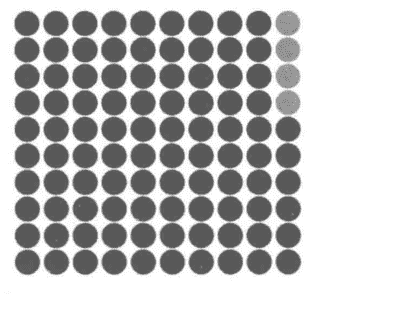

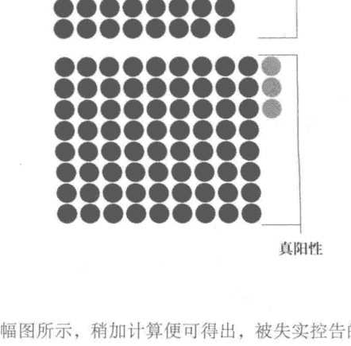

长期以来非裔美国人承受系统性偏见，他们在社会经济底层比例高，在犯罪统计中也高。还有证据显示警方针对性执法，比如大麻使用率在黑白人群中相近，但黑人被捕率高出约8倍。结果是黑人被多次逮捕的比例更高。算法不用肤色，但它学习的是这种失衡社会产生的数据。

这不等于为COMPAS开脱。开发方Equivant原名Northpointe至今把算法当商业机密。问题的关键是，我们可以选择做“愚钝的经验主义者”，直接用现有数据；也可以承认现状失衡，对数据做调整。

谷歌搜索“数学教授”会得到大量中年白人男子站在黑板前的照片，我的前20条结果里只有一位女性。这反映现实：约94%的数学教师是男性。但我们仍可微调算法，让女性和非白人教授出现更多，映射我们想要的社会而非当下。

司法也可如此。算法本质上在问：在一个真正公平的社会里，各群体的高危比例应是多少？这可以成为一个改进方向。

另外，对高危者的处理也有选择。取保未出庭是重要指标，但可以进一步探究原因：是没钱坐车？是为照顾孩子？算法可以用来缓解失衡，而非放大它。

这些问题需要公共舆论和政府机构来定，而非私企内部讨论。建立类似药品监管的FDA式的算法监管机构呼声升高。在那之前，ProPublica之类的监督不可或缺。对偏见的批评不应只为禁用算法而应为改进算法。禁用之前，我们得先想好替代方案。

### 假如彻底不用算法

值得问一句：若彻底抛弃算法，司法系统会变成什么样？毕竟法官的问题不只是不一致。

偏见如何悄悄进入法庭

制度蓝图里，裁决理应不因族裔、性别或阶层而异，因为法律一开始就预设了平等。现实运转中，绝大多数审判者都在努力保持中立，但系统性偏差仍在反复出现。美国的研究数据反复指向同一图景：黑人被告平均被羁押的时间更长⁴¹，保释通过率更低⁴²，被判死刑的比例偏高⁴³，死刑实际执行的概率也更大⁴⁴。罪名相同的情况下，男性所受制裁明显重于女性⁴⁵，社会经济地位低、文化背景弱的被告更易被判处更久的刑期⁴⁶。

这些分化不全是显性歧视，有时是历史惯性的再现。人类的判断方式天然会把社会与文化成见带入决策。

要看清机制，可以先离开法庭看一个直觉陷阱。卡尼曼在《思考，快与慢》⁴⁷里收录的经典例题：

- 球棒和棒球加起来卖1.10英镑。
- 球棒比棒球贵1英镑。
- 棒球卖多少钱？

稍作计算答案是5便士，但第一反应几乎总是10便士。* 

*如果棒球是10便士，球棒就是1英镑，两项合计1.10镑？实际会变成1.20镑。

答错不要紧，71.8%的法官也在第一遍算错⁴⁸。即使最终纠正，也都要经历与第一印象的对抗。

直觉与审慎的拉扯正是判决的关键。心理学家把人类思维分为两类：一种是无意识、本能、快速且易错，它会让你立刻报出10便士；另一种是刻意、耗能、缓慢，需要人们主动启用⁴⁹。选择看似是第二种的结果，但正如卡尼曼所言，“我们经常需要认可或修改第一种思维产生的想法和感受”⁵⁰。

法官和普通人并无本质差别，都不擅长处理庞杂信息，也难以在权衡多重因素的同时压制直觉的干扰。

以保释为例，理想中法官会全面审阅卷宗、权衡利弊。实证显示操作更像逐项核对清单：前科、社会联系、检方意见，只要出现任一警示项，保释就容易被否⁵¹。而许多警示项本身就与族裔、性别、教育背景耦合，依赖直觉越深，无意中固化的系统性成见就越牢。

我们对自己在公平判断上的无能也近乎盲目。

你可能为五折优惠买单后自我安慰觉得划算，这就是锚定偏误。我们不擅长评估绝对价值，更习惯比较。营销正是利用这一点，超市的“每人限购12罐”并非为防止扫货，而是悄悄抬高需求的心理锚点。九十年代的研究显示，有此提示时人均购买量从3.3罐升到7罐⁵²。

法官同样会受锚定影响。检方索赔金额越高，判罚越重⁵³；检方建议加刑，刑期就会延长⁵⁴。研究甚至发现，通过休息时“不经意”的媒体引导——“本案刑期应三年以上还是三年以下？”——就能显著撬动判决⁵⁵。更极端的是，让法官在审案前掷骰子，裁决也会跟着波动⁵⁶，即便是资深审判者也难逃操纵⁵⁷。

量刑还受感知相对性的支配，即韦伯法则。一点点调高音量，听感提升有限；1.20英镑到2.20英镑感觉是巨变，67英镑到68英镑却微不足道。随着年龄增长时间感加速，也是因为我们感知的是相对比例而非绝对长度。

该法则指出，最小可觉差与原刺激量成正比。营销商深谙缩水与涨价的艺术，正是利用这点让顾客无感。司法中，刑期的增量感知会随基数增大而递减。比如最低刑期20年时，加3个月几乎不可察觉，审判者于是会给出25年这样的“能被感知”的幅度⁵⁸。2017年的研究分析了英澳1万条判决，发现99%符合该法则的预测⁵⁹。带头人曼迪普·哈密告诉我，“这一点与案件类型无关，与被告特征、审理地、监禁或社区服刑无关。归根结底是法官脑中‘感觉对’的那个数字。”

不客观还体现在更细微处：有女儿的法官更可能偏向女性被告⁶⁰；本地球队近期失利会降低保释率；审判时段也会起作用⁶¹。研究显示午饭前判决保释概率最低，休息后最高，虽然可重复性存疑⁶²，但趋势存在。还有研究指出，若前四个案件都获保释，第五个案件获保释的可能性会跌至谷底⁶³。甚至饮品温度都会影响我们对陌生人的好感——热饮让人更显温柔体贴⁶⁴。

这些可控与不可控因素，都在暗中塑造裁决。

### 引入算法帮助法官

坦白说，我第一次听说法庭用算法时是反对的。算法会出错，会剥夺自由，让机器掌握如此权力我认为不负责任。司法弱势群体里也有同样担忧。曼迪普·哈密说，她接触的罪犯宁愿选择更易犯错的人类法官，因为他们要的是人情味。

律师也有同感。一位伦敦辩护律师告诉我，法庭的不确定性正是他辩护的空间，算法让可预测性升高，辩护空间就缩小。

我把同样问题抛给曼迪普·哈密，她的回答截然不同：“如果决定我未来的，不应靠直觉，而应靠逻辑一致的规则。我们把自由裁量权神圣化了，但研究证明恰恰相反。”

我同样希望判决公正，依据个人情况而非群体标签。算法并不完美，但与其在有缺陷的算法和虚幻的完美体系间二选一，不如对比使用前后的实质差异。阅读与交流越多，我越觉得对人类的期望过高。在人类的体系里，不公是结构性的。每出现一个被算法误伤的“克里斯托弗·德鲁·布鲁克斯”，就会有更多因法官不确定性而被误判的“尼古拉斯·罗宾逊”。因此，即便是不完美的算法，只要精心设计、严格监管，也能剔除系统性偏差与随机错误。而彻底改变法官的决策方式几乎不可能，因为他们也说不清自己如何做决定。

为刑事司法设计算法，需要先明确司法的效用，除了祷告，还要赋予算法清晰目标，并直面需要修正的人性弱点。这关乎判决流程的设计，虽棘手却是成败关键。刑事司法的对抗性让进展缓慢，但在冲突性较弱的领域，算法已显现出更明确的目标与价值。

## 第四章

医疗

MEDICINE

2015年，一组科学家做了一项反常的研究，测试癌症诊断的准确性¹。他们给16位测试者提供触摸屏，让他们分类乳腺组织图像。样本来自真实女性的活检，血管和导管经化学染色呈红、紫、蓝。任务是判断图像中是否含有癌细胞。

短暂训练后独立操作，平均准确率达85%。若把所有人的答案合并池化，对每张图做整体评估，准确率跃升至99%。

最引人注目的是测试者的身份。这些“神医”不是肿瘤学家、病理学家或医学生——是一群鸽子。

这并不意味着肿瘤学家要失业，提出研究的科学家也不会建议用鸽子替代医生。但实验说明，识别细胞群中的证型并非人类专利，鸽子能做到，算法为何不能？

### 证型捕手

现代医学的全部实践都建立在寻找数据中的证型之上。约2500年前，古希腊希波克拉底创立医学，观察、实验与数据分析成为守护健康的武器。

在此之前，疾病被视为神祇惩罚或邪灵入侵，医师需念咒伴唱。希波克拉底提出革命性道路：病因应靠调查而非魔法解释。他强调病例记录与观察，被称为“现代医学之父”³。他的具体生理学解释已不合时宜——血液、痰、黄胆汁、黑胆汁平衡论⁴——但结论站稳脚跟，比如“肥胖者寿命更短”。这种发现需长期积累，我们学会寻找证型、分类病状并据此预测未来。

医学史充满类似情节。十五世纪中国医生发现接种可防治天花，后来有人发现一种证型，能把致死率降90%——采集轻症患者的痂皮晒干研磨，让健康者经鼻吸入⁶。十九世纪医学黄金年代，匈牙利医生伊格纳兹·塞麦尔维斯从病房死亡数据中发现，由医生接生的产妇败血症死亡率是产婆接生的五倍，原因在于刚解剖尸体的医生不洗手就接生⁷。

从中国到欧洲延续至今的方法，仍指导今天的医生。骨骼是否骨折？头痛是常态还是征兆？是否需要抗生素？归根结底都是证型的识别、分类与预测，这正是算法所长。

当然，医生的同理心、社会心理与经济支持是算法无法替代的。但在需要排除干扰、进行纯粹医学证型辨识、分类与预测的领域，算法大有可为，尤其是病理学。

病理学家是病人很少见到的医生，却处在诊断末端。血液、组织样本在实验室被他们检测、解读报告。最终判定你是否患癌的，往往是他们。你与化疗、手术之间的距离，只隔着一片他们正在分析的切片，准确性即一切。

这工作极难。病理医师人均每天要检视上百个切片，每个含数万至数十万个细胞，堪比最难的《寻找威利》。他们必须在显微镜下在细胞海洋中捕捉异常。

哈佛病理学家安迪·贝克⁸，2016年创立PathAI，致力于用算法分类切片，他说：“这是一项不可能完成的任务。每天只看五片才能万无一失，现实世界不允许。”

以鸽子完美辨认的乳腺癌为例，诊断并非简单的有无。存在光谱，一端是良性细胞，另一端是浸润性乳腺癌，癌细胞已突破导管侵入周围组织。两极易辨，病理学家对恶性肿瘤样本准确率可达96%⁹，与鸽子相近。

夹在中间的是模糊地带：非典型细胞、可疑但无需紧张、癌前病变可能进展也可能不、导管原位癌尚未扩散。这些类别决定治疗方案，从观察到乳房切除。

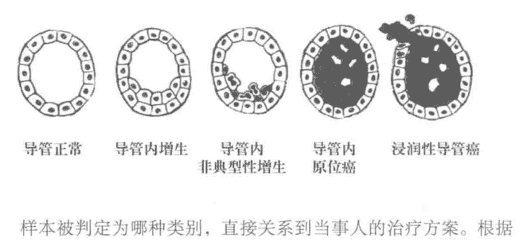

样本被判定为哪种类别，直接关系到当事人的治疗方案。根据样本的具体情况，医生给出的建议可能从不治疗跨越到乳房切除。

问题的关键在于，分辨这些模糊的类别是一件非常棘手的事情。即便是病理学专家，也会针对某个样本产生不同的观点。

为验证医生间的意见有多么不统一，2015年出现了这样一项研究——以72份乳腺组织活体切片为例，它们均被认为含有良性病灶细胞（即位于光谱图中间的类别），然后找来115位病理学家进行诊断。结果令人不安，达成一致诊断的比率仅为48%¹⁰。

面对这种情况，抛硬币决定诊断结果可能更高效。正面朝上，接受一次不必要的乳房切除手术（如果你住在美国，可能要花掉几十万美元）；背面朝上，可能会错过治疗早期癌症的机会。无论怎样，结果都很糟糕。

风险如此之高，准确率是重中之重。那么，算法能扭转局面吗？

### 长了“眼睛”的机器

过去，若算法能认出图片中的任何东西，就已是惊人新闻。看图对人类轻而易举，但向计算机解释原理却极难。

假设要教计算机分辨照片里是否有狗。你可以列规则：四条腿、下垂耳朵、全身柔毛。但狗坐着、腿看不见、耳朵尖、背对镜头、毛与地毯相似、与羊毛草地区分……规则会迅速爆炸。于是转向神经网络¹¹。

可以把神经网络想象成庞大的数学结构，布满仪表盘和旋钮。照片输入一端，另一端输出类别概率：狗、非狗。

初始时网络一片混沌，旋钮随机，答案杂乱。随图片不断输入，数学法则调整旋钮，使预测趋近正确答案。成百上千张图片后，错误率降到最低，面对新图也能以较高准确度判断。

神奇之处在于操作员并不清楚算法为何正确。分辨狗时，网络不会像人那样找耳朵或毛型，而是捕捉边界模式、光影等人类难以解释的抽象特征。正因如此，使用者只需知道它已“调教”好，能给出正确答案，无需理解细节。

神经网络属于机器学习，能超越编程自行学习。配合多层结构，被称为深度学习。它为算法提供了在病理切片中寻找隐藏证型的可能。

神经网络的雏形其实在上世纪五十年代就已经露头，只是当时算力跟不上，只能先搁置。等到硬件跟上来之后，真正让它起来的转折点是 2012 年。耶鲁？不，是计算机科学家杰弗里·辛顿带着两个学生，用一种新式的神经网络参加了一场找小狗的图像识别比赛¹²，最终一举胜出，也由此掀开了深度学习的大幕。

机器在我们看不懂的情况下给出判断，乍听像巫术，却和人类的学习有几分相像。最近有团队训练了一个分辨狼和哈士奇的模型。研究者好奇地追踪模型在调整仪表盘时的逻辑，发现它根本没看狗，而是看背景有没有雪。有雪就判狼，没雪就判哈士奇¹³。

论文出来后，我联系到剑桥的数学教授弗兰克·凯利。他讲了自己和四岁孙子的一段经历。那天他们去托儿所的路上正好碰到一只哈士奇，孙子说这狗“像狼”。凯利问怎么知道不是狼，孙子答：“因为它拴着链子。”

### 人工智能盟友

要筛乳腺癌，一套算法得同时做到两件事：敏感到能把肿瘤相关的一切异常都揪出来，绝不放过；又要特异到不把正常组织当成可疑目标。

这里就涉及到敏感性与特异性的权衡，也就牵出假阴性和假阳性。假阳性是把健康人吓成癌症患者，假阴性是放走真正有瘤的人。特异性强就少误报，敏感性强就少漏报。无论是预测再犯、诊断乳腺癌还是寻找犯罪模式，这个两难都一样。

改进算法往往要在这两者间做取舍。只追求零假阴性，敏感性拉到 100%，算法会把所有乳腺都标成可疑，目标达成了，却让无数健康人白受治疗。反过来只追求零假阳性，特异性满分，算法会把所有人都判为健康，那被忽略的真正患者就倒霉了。

人类病理医师在这方面表现很有趣：特异性很高，很少把正常细胞误当癌细胞；敏感性却打折，常漏掉微小肿瘤，甚至明显恶性灶也看走眼。

这点在 CAMELYON 16 人机对抗赛里暴露无遗。来自世界各地的计算机队伍对上病理医生，在 400 张切片里找所有肿瘤。医生没有时间限制，可以慢慢看。结果准确率约 96%¹⁴，且零假阳性。但他们只找出了 73% 的癌细胞，30 小时鏖战后仍有大量小灶潜藏其中。

根源可能不是像素太多，而是人眼极易忽略近在眼前的异常。

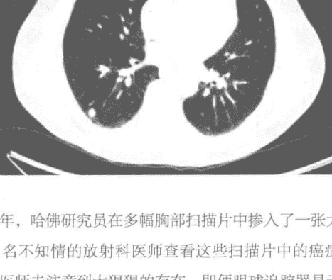
2013 年，哈佛的研究人员在多张胸部 CT 里偷偷放了一张大猩猩，让 24 位放射科医生找癌症迹象。83% 的人没看到大猩猩，即使眼动追踪显示很多人其实扫过它¹⁵。你可以试着想想那种错过。

算法的毛病正好相反。它们太想找异常，会把健康细胞也当可疑。CAMELYON 16 里最好的神经网络找出了 92.4% 的肿瘤¹⁷，但也把一组正常细胞误判，产生 8 例假阳性。特异性这么低，顶级算法本质上就是“我全都当有癌”，还做不出病理报告。

好在我们也不需要它独立写报告。更实际的打法是人机分工：算法负责粗筛和重点标注，医生再来复核。若标注错了，人类专家很快就能纠正。这种预筛协作，能把整体诊断准确率推到 99.5%¹⁸。

听起来很振奋，但恶性肿瘤的判定本来就是病理医生的强项，难的是灰色地带。算法的价值不在于模仿医生的分类标准，而在于它能在数据碎片里捕捉人类看不到的异常，从而提升判断。

### 修女研究

1986 年，肯塔基大学流行病学家大卫·斯诺登说服了 678 位修女捐出大脑。她们属于圣母院修女会，研究开始时年龄在 75 到 103 岁之间，余生每天做记忆测试，死后把大脑交给科研项目¹⁹。无论是否出现痴呆症状，她们都同意捐赠。

这批修女没有子女，很少吸烟、很少喝酒，生活方式高度一致，成为极佳的对照样本。多年后团队发现另一座宝藏：年轻时她们为了入会，约 22 岁左右写过自传。科学家分析语言复杂度，发现年轻时的表达能力与晚年是否失智高度相关。

一位认知一直良好的修女写道：

> 1921 年，我读完八年级后想去曼卡托住一间，但自己没勇气征求父母同意，于是姊妹阿格丽达帮我出头，他们很快答应了。

另一位在晚年明显记忆衰退的修女则写：

> 我离开学校后，在邮局上班。

相关性很强：90% 患失智的修女年轻时语言能力偏低，而认知完好的老年修女中只有 13% 手稿里出现“思想稠密度低”²⁰。

这提醒我们，身体的秘密远比想象深。我们仍说不清原因，是教育延缓了失智，还是易感者天生语言简单。但它说明阿尔茨海默病可能酝酿几十年，而数据碎片里最不起眼的信息，可能在症状出现多年前就已泄露健康走向。未来医学算法或许就能提前几年捕捉到癌症信号。

### 预测的力量

上世纪七十年代末，丹麦里伯郡的病理学家对 83 具女性尸体做了双侧乳房切除，年龄从 22 到 89 岁，其中 6 人死于浸润性乳腺癌。把乳房切成薄片检查后，这 6 例的病灶确认无疑。意外的是，另 77 人死于心脏病、车祸等非癌死因，却有近四分之一带着危险的乳腺癌征象。

其中 14 人有原位癌，若在世会被诊断为恶性乳腺癌；3 人有非典型细胞；1 人其实已患浸润癌，死时未知²¹。类似结果反复出现。有人估计，任何时候约有 9% 的女性体内携带有不知情的乳腺肿瘤²²，而实际被确诊的比率只有它的十分之一左右²³。

这正常吗？蒙特利尔麦吉尔大学的乔纳森·凯尼伍斯基认为并非传染病。癌细胞存在不等于必须处理：免疫系统可能把突变细胞围剿，扼杀在萌芽；也可能失误，反而助长癌症²⁴。有些肿瘤会被身体清除，有些终生不发病，有些才变成侵袭性癌。问题是，我们常分不清哪种会发生。

正是这种不确定，让良恶性分类变得棘手。医生从切片描述形态，却难以预言未来。对患者而言，未来才最重要。

过度诊断随之而来。以原位癌为例，虽然光谱上接近最可怕的一端，但只有约十分之一会致命。美国被如此诊断的女性中，四分之一仍选择全乳切除，这种大手术对身心都是重创²⁵。

筛查越紧，伤害越大。英国专家估算，未来 20 年邀请 1 万名女性做乳腺造影，可避免 43 人死于乳腺癌。《新英格兰医学杂志》则说每 10 万名常规筛查女性，可提前发现 30 例癌变²⁶。数据取舍不同，结果相差 3 到 4 倍，意味着大量女性会为并不致命的肿瘤接受治疗²⁷。

要避免过度，算法需要的不只是“发现异常”，而是“预测演化”。就像修女的手稿藏着未来健康线索，我们过去和现在的数据里也可能藏着数年后的风险信号。神经网络正适合做这种海量数据挖掘。

只要用足够多的切片训练——既有最终转移的，也有未转移的——算法可以在不被理论束缚的情况下，找出与未来有关的隐藏特征。正如凯尼伍斯基所说，应该让算法逐张分析，判断这个肿瘤是否会恶变²⁸。届时，切片的分型就不再关键，关键是该不该治。

这种算法已经在研发。哈佛病理学家、PathAI 创始人安迪·贝克分析荷兰患者样本发现，预测生存率最好的因子不是癌症本身，而是邻近组织的异常细胞²⁹。这证明算法能推动科研，发现人类忽略的预测要素。

我们手头的影像数据已经足够庞大。乳腺造影产生的图片远超其他器官。业内专家普遍认为，准确预测样本是否会恶变的时代已经不远，甚至可能在本书印刷时已经到来。

### 数字化诊断

这些思路远不止乳腺癌。安迪·贝克等人搭建的网络并不挑食，可以分类小狗、帽子或奶酪，只要在关键时刻纠正，它就能学会。如今这类系统已进入医学多个领域。

谷歌大脑团队的算法能筛查导致可预防性失明的糖尿病视网膜病变。在印度，45% 的患者因缺乏专家而未被发现，算法的诊断水平与人类眼科医生相当。

类似系统还能排查心血管疾病³⁰、肺气肿³¹、脑卒中³²、黑素瘤³³，甚至在结肠镜检查时实时识别息肉。

只要能拍照并标注，算法就能学会寻找，而且往往比人更准、更早。那更复杂的数据呢？医生的手写笔记、患者的描述，能否也被挖掘？科幻里那台能听诊、整合病历、给出个性化诊疗的机器，是否可能？

这正是 IBM 的沃森曾想做的。

### 医学乌托邦

2004 年，IBM 软件副总裁查尔斯·利克尔在纽约餐厅看《危险边缘》。肯·詹宁斯正创连胜纪录，他灵光一现：能否造一台机器打败人类？这台叫沃森的系统花了 7 年才完成，于特辑中击败冠军。在此之前，IBM 的目标是打造一台强大的诊断仪器，后话再叙，先看它赢得游戏的原理。

《危险边缘》是反向问答：给出答案提示，选手反推问题。比如提示“用于固定的紧固件，受热会变形失效”，机器要先理解语言，再从“带扣、纽扣、大头针”等候选项中筛选，最后综合证据给出“buckle”。这和医生的鉴别诊断很像，基于症状提示寻找最可能诊断，并用贝叶斯定理不断更新信心。

沃森赢了游戏，却没能复制医学上的成功。IBM 曾高调承诺“消除癌症”，还请乔·汉姆代言。现实是，2016 年与 MD 安德森癌症中心的合作宣告终止，投入 6,200 万美元、耗时 4 年后，系统仅能在人类监督下小规模测试³⁶。2017 年 STAT 调查看到，沃森“仍在学习癌症类型的基础知识”³⁷。

尴尬且心疼。公平地说，也有些亮点：日本有例罕见白血病被沃森诊断出，而医生产生遗漏；它还关联出与肌萎缩侧索硬化相关的五种基因。但整体上，营销的承诺远未兑现。

造出能诊断甚至制定方案的仪器在理论上可行，但难度远超游戏，也远超识别切片里的癌细胞。图像算法能指出具体的细胞异常，而通用诊断仪器只能做信息外推。差距就在这里。

例如有人手脚发麻，追溯下来是肌肉痉挛在作祟，而痉挛又源于神经被压迫，压迫则来自长期重体力劳动的过度消耗。再比如有人出现便血，表面看是痔疮，往前一层是便秘，再往前则是饮食习惯不佳。无论是医生还是算法，都得从一个个表象症状出发，反向推敲出真正的病因，而这正是沃森要完成的任务，也是极其困难的任务。

类似的难题还不止于此。以区分狗和狼的神经网络为例，工程很直观——投入大量已标注好的狗图和狼图训练即可，数据干净、结构简单。可《麻省理工科技评论》上，计算病理学家托马斯·福克斯指出，医学领域的信息标注远非如此轻松，要想把临床信息妥善标记并输入系统，相关专家往往需要十年以上的专业训练。

针对性强的细分问题尚可应付，例如把乳腺癌切片简单划分为“绝对良性”和“完全恶性”。但若要打造沃森这种全能型诊断设备，就必须覆盖几乎全部可能的疾病。这意味着一支专业水准极高的团队要整理海量的患者资料和典型病例并导入系统，工作量巨大而漫长，而这些人本就身兼救治患者的重任。

到了这里，我们碰到的最后一个，也是最难解的问题。

### 数据困境
塔玛拉·米尔斯出生不久后，父母就发现她呼吸不畅。9 个月大时被诊断为哮喘，这种病在英国影响约 540 万人，美国约 2,500 万人 41。尽管年纪很小，她的症状在童年期尚可控制，和其他患儿一样在英国北部沿海长大，吸入器几乎不离身。

8 岁那年一次严重的猪流感成了转折点。此后呼吸道感染反复，哮喘发作时嘴唇会发青。她和母亲频繁往返当地医院，吸入器用量远超标准 42，可无论恶化到何种程度，都没医生建议她接受专科诊断。

家人和老师眼见情况危急。她两次险些丧命、住院，随后被免去体育课，家中楼梯也成了负担，最后搬到爷爷奶奶的平房居住。

2014 年 4 月 10 日，塔玛拉再次感染。晚上爷爷发现她呼吸困难，一边打电话叫救护车，一边用两个吸入器和氧气罐抢救，仍无济于事。当晚她离世，年仅 13 岁。

哮喘通常不致命，但英国每年仍有约 1,200 人因之死亡，其中 26 人为儿童 43。据估算，其中三分之二本可避免  ——正如塔玛拉的案例。但预防的前提是及时捕捉危险信号并采取行动。

在致命发作前的四年里，她已在当地就诊多达 47 次 44，治疗方案始终无效。医护人员只做急时处理，未做整体诊断，也没人注意到病情的持续下滑并提出新方案。

原因很现实。在英国国家医疗服务体系内，健康档案互通并不普遍。你在一家 NHS 医院就诊，医生看不到你在社区的既往记录。许多档案仍是纸质，数十年来信息传递方式几乎未变，这也是 NHS 常被戏称为全球最大传真机买主的原因 45。

美国同样存在大量互不联通的私立医生和医院网络；德国虽有电子病历，却缺乏健全的共享机制。对塔玛拉而言，缺少统一共享的健康档案意味着没有任何医生能全面评估病情严重程度。修补这一缺陷为时已晚，却是医疗未来的紧迫挑战。若数据能被收集、整理并联通，沃森这类仪器才可能在其中找线索，挽救下一个“塔玛拉”。

数据经纪商手里的信息与医疗机构的数据截然不同：前者庞大且精准，后者稀少且孤立。迄今医疗数据仍是一团乱麻。即便实现集中存储，数据形式本身就极不友好：影像需要解读，报告需审阅，还有表格、处方、随手笔记等不一而足。笔录的难点在于缩写、笔迹、人工错误，以及对症状描述的歧义——病人说的“凉”是体温低还是感冒？胃疼到底是“难以忍受”还是夸张？医学的复杂性让仪器解析数据变得愈发艰难 46。

敢于直面这种混乱的尖兵不止 IBM。2016 年，谷歌旗下 DeepMind 与伦敦皇家自由 NHS 信托会签约，获准使用该市三家医院的数据，换取研发一款能准确识别急性肾损伤的手机应用。初衷是利用智能学习解决临床难题，最终却虎头蛇尾，研究人员发现手头数据根本不足以达成目标。

更引发争议的是授权范围。研究团队原本承诺仅识别肾损伤，但皇家自由信托会实际开放的是全部记录信息：160 万名患者长达 5 年的医疗档案。从理论上看，这么大的信息量足以挽救大量生命，每月近千人死于急性肾损伤，跨度大的数据本可帮助找出关键线索，且肾损伤患者常合并其他疾病，宽泛的数据集更容易捕捉关联。

项目得到的却是批评。授权使用全部记录被视为“罪证”。DeepMind 可知谁何时入院、谁探视过、影像报告内容、谁曾流产、谁有抑郁史，甚至谁感染 HIV 47。最让人无法接受的是，这一切未经患者同意，也未给予拒绝权，更未事先通知就纳入研究。

需要补充的是，协议明令禁止谷歌将信息用于其他业务。公正而言，谷歌的数据安全比 NHS 略好。2017 年 NHS 多家医院因仍在使用 Windows XP 系统，被 WannaCry 勒索病毒攻击而瘫痪 48。即便如此，允许顶级科技巨头接触如此精细的个人信息仍极不妥当。

### 隐私问题
坦率说，谷歌并不缺少我们的隐私甚至私密信息。但医疗记录的性质截然不同，已接近“机密”。

对少生病的人而言难以理解。若必须公开医疗数据或浏览器记录，你会选哪个？我会毫不犹豫选前者，想必很多人也是如此。不是要隐藏特定癖好，只因前者像是“生物学快照”，后者像是“性格写真”。

医疗数据不一定让人尴尬，但《大数据》作者、BBC《面向未来》主持人蒂曼德拉·哈克尼斯认为它值得特别关注。

“首先，许多人的医疗记录就是他们生活的写照，”她告诉我，“例如英国每三名女性中就有一人经历过流产——有些人自己都不清楚。”她还指出医疗记录的关联性会波及他人，“掌握你的基因数据，就等于了解你的父母、兄弟姐妹和孩子。”一旦泄露，后果不可逆转。“你无法改变或否认自己的生物信息。有人采集了你的 DNA，你就无能为力。你可以整形改变容貌、戴手套遮指纹，却摆脱不了 DNA，它永远与你绑定。”

危害何在？蒂曼德拉在 2013 年用焦点小组研究过公众担忧。“总体上，民众担心的不是数据被盗或泄露，而是基于群体做出的假设最终反噬自己。”

他们最怕数据如何被用来对付自己。“比如超市会员卡与医疗记录绑定，医生在髋部手术前说：‘抱歉，我们发现你常买披萨或香烟，手术得推迟。’”

在英国，这类恐惧很普遍，资金紧张的 NHS 医院会优先为非吸烟者做膝、髋手术 49。全球范围内，不少国家甚至会拒保或拒治肥胖患者 50。

这就陷入两难。作为物种，把医疗记录导入算法能带来巨大收益，沃森才不再是梦。但实现它需要把最私密记录交给富可敌国的公司，帮助跨过鸿沟找到“电子名医”。代价是历史记录随时可能被盗用、泄露或用来针对自己。你愿意承担这种风险吗？这些算法的好处足以换取隐私吗？

或者，当那一天到来时，你还会在意吗？

### 基因泄露
弗朗西斯·高尔顿是维多利亚时代的统计学家、人种遗传学家，达尔文的表弟，为现代统计学奠基，同时也是优生运动的积极参与者——后者不在致敬范围内。

高尔顿想用数据学习人类特质，深知需要海量样本。他也明白民众对自身身体有近乎贪婪的好奇，只要吊足胃口，他们愿为专业评价放弃隐私，甚至付费。

1884 年，在维多利亚女王支持下，伦敦举办医疗成就展，高尔顿自费设了“人体测量实验室”。参观者排队付费接受视觉灵敏度、判断力、握力、拉力、出拳敏捷度等多项测量 51。后因人太多不得不两人同进。（他发现长辈和晚辈最好分开，以免长辈因自尊心要求重测。） 52

无论成绩如何，结果都潦草写在白卡上作为纪念品送回。真正的赢家是高尔顿——展会后他拿到 9,337 人的生物计量数据备份，以及可观收入。

130 年后，基因检测出现了相似图景。花 149 英镑把唾液寄给 23andMe，就能得到基因特质报告：耳垢类型、一字眉基因、是否见光打喷嚏 54，以及是否易患乳腺癌、是否倾向阿尔茨海默病 55。

这家公司因此积累了数百万样本的基因数据库。互联网巨头们只不过把收集对象从 DNA 换成了最私人的数据。数据库对每个人都有益，能帮助理解人类基因组。全球学界、制药公司和非营利机构都在等待与 23andMe 合作，借助数据回答关键问题：疾病的遗传因素、新药开发、帕金森更优治疗等。

数据集本身价值巨大。尽管研究意义重大，23andMe 终究不是慈善机构。若同意——约 80% 客户同意——公司会以匿名形式把基因数据卖给科研伙伴，年入不菲 56。这并非意外之财，而是核心业务。一位董事会成员对《快公司》说：“长期目标不是靠卖检测套装盈利，尽管套装是获取基础数据的手段。”每次索要商业化基因报告时要记住：你不是在用商品，你就是商品 57。

这敲响警钟。匿名承诺也令人怀疑。2005 年，一名自认由匿名精子捐赠者所生的年轻人，通过 DNA 线索找到了亲生父亲 59。2013 年，一篇著名论文证明，用家用电脑在网上做技巧性搜索，就能通过基因识别数百万民众 60。

还有法律漏洞。尽管法律保护民众免受基因歧视——评判贝多芬或霍金应看才华而非遗传——但人寿保险不在此列。美国保险公司可询问你是否做过 DNA 测试，或是否评估过患帕金森、阿尔茨海默、乳腺癌的风险，不符合要求就拒保。英国保险公司在保额超 50 万英镑时可依据亨廷顿舞蹈症基因测试结果做决定 61。你可以撒谎，但会导致合约失效。避免歧视的唯一办法是拒绝参与此类测试。有时，忽视也是一种美德。

事实上，几百万人的测序基因组是最利于理解人类健康的资源，但我短期内可能仍不会做基因检测。不过数百万人自愿贡献数据——感谢他们。据统计，23andMe 已超 200 万基因型客户 62，MyHeritage、Ancestry.com 乃至国家基因地理计划客户更多。所以“进退两难”似乎已不存在。市场已证明：以隐私换公共事业贡献可能不值，但能发现自己是四分之一的维京人，就很值了。

### 最大的善意？
是的，我在开玩笑。决定是否寄样本做基因检测时，几乎没人会把未来人类医疗发展放在首位。很正常——从个体角度出发，考量不同。

这引出一个关键问题：若能制造出给出治疗建议的诊断仪器，应服务个人还是大众？有时必须二选一。

假设你因咳嗽就诊，本可自愈。但仪器接手后，为求安全，可能建议你做 X 光和验血，若你要求，还会开抗生素，即便效果有限。因为算法的唯一目标是保障你的健康和舒适，这样的处方是必要的。

若仪器服务于群体，情况会保守得多。在抗菌素耐药性面前，暂时的不适是可以承受的。算法只在必要时开药，除非病症恶化，否则不会安排进一步检查以避免浪费资源或排队。它更可能只建议服用阿司匹林，鼓起勇气与病魔对抗。

同样，器官移植的分配上，服务群体的算法会把“尽可能挽救更多生命”作为核心目标。与只关心你一个人的仪器相比，治疗方案将大不相同。

为 NHS 或保险公司服务的仪器会尽可能压缩成本，为制药公司服务的机器则会在药品使用上做文章。

与刑事审判不同，医疗行业相对平和，没有原告被告，所有人都为同一目标努力——尽快让患者康复。但在实现共同目标的过程中，各方都有自己的算盘。

无论算法介入何处，都需要权衡隐私与公共利益、个体与群体、不同挑战与优先级。完善的医疗体系带来的好处明确，能抵御各方刺激，但找到直接达标的道路并不容易。

更糟的是，各方忙于竞争既得利益，算法作用被高估，风险被忽视，而我们自己也不知道该信什么，谁在利用我们的信任谋利。

## 第五章 汽车 CARS
### 汽车 CARS
2004 年 3 月 13 日清晨，太阳未升，莫哈维沙漠中的 Slash X 酒吧已人声鼎沸 1。酒吧位于巴斯托市郊，介于洛杉矶与拉斯维加斯之间，附近正是《杀死比尔 2》中乌玛·瑟曼爬出棺材的取景地 2。

牛仔和越野赛手常来此地，但这个早春清晨迎来的是不同客人。荒野临时搭建的赛场上，挤满了激动工程师、期待观众和自驾旅行者。他们齐聚一地，只为成为见证无人车比赛的世界第一人。

赛事由美国国防高级研究计划局主办 3，也称五角大楼的“疯狂科学部门”。该机构长期看好无人汽车，因战场上路边炸弹和针对军车的攻击是美军伤亡主因。2004 年初其宣布，至 2015 年美军陆战部队三分之一车辆将实现无人驾驶 4。

实现目标耗时费钱。二十余年间，美军防高级研究计划局投入约 5 亿美元资助多所大学和企业研究 5。后来他们想出低成本办法：举办公开竞赛，让民间高手自建无人车在长途赛道竞技，胜者获 100 万美元奖金 6。这既是前所未有的赛事，也是高效实现目标的手段。

赛道全长约 142 英里，布满陡坡、沙砾、沟壑、坑洼和仙人掌障碍，部分泥泞路段仅数英尺宽。开赛前两小时，主办方向各队提供 GPS 坐标光盘 7，内含两千多个路标，像面包屑般撒满赛道。这些路标能指示走向，却无法帮助车辆避让障碍。

# 当106台机器集体翻车：无人车的至暗时刻

一场近乎不可能的较量，仍有106支队伍硬着头皮上阵，最终只有15支扛过了资格赛，算是具备了在赛道上不至于立刻歇菜的能力。造出来的车五花八门，有沙漠越野的硬派，有巨型货车的笨重，也有坦克式的装甲感。坊间甚至传出有人为了参赛把房子都押了进去。为了抢眼球，有人把两块冲浪板竖在车顶上场，还有团队造出了一台自平衡摩托。

比赛当天清晨，Slash X 人山人海。数千名观众外加一群像是从《疯狂的麦克斯》或《怪车大赛》里开出来的怪车，把现场烘托得像科幻片外景。无人驾驶时，车队一辆接着一辆滑向起点。炫酷的外形算不上关键，真正决定胜负的是——在完全没有人操控的前提下，能否在10小时内把整段赛道跑完。

结果是灾难级别的混乱。起步区就有车直接侧翻，宣告退赛；那台自平衡摩托也没能逃过命运，连起跑线都没越过就倒了。有人刚驶出50码就撞上混凝土墙，有人被钢丝网死死缠住，有人把两团风滚草当成固定障碍，前后推搡了好几回才发现打不开，最后只能靠人手去拽。鹅卵石路面、水沟陷车更是家常便饭，断轴、掉轮胎、零件散落一地，围着Slash X的酒吧看起来像一座机器人坟场。

最后的最好成绩出自卡内基梅隆。他们的车跑了7英里，暂时领跑全场，只是后来在一处上坡路段判断失误，轮胎空转后起火熄火。上午11点整，组委会叫停。美国国防高级研究计划局的工作人员坐直升机飞到终点告诉媒体——没有一辆车能真正跑到终点。赛场狼藉、零完赛。团队一年心血，往往几分钟就打回原形。但这场大溃败也点燃了无数灵感。到2005年第二届时，局势彻底反转：当年只跑出7英里成绩的那支队伍依然在列，却出现了5辆车在无人干预下完整跑完132英里赛道的局面。

十多年过去，无人车要成为交通主流，已是各方共识。2017年底，英国财政大臣菲利普·哈蒙德放话，英国希望在2021年前投放无需安全员在旁的全自动车辆。戴姆勒喊出2020年造出无人车，福特的表态是2021年。其他车企也纷纷跟进。

讨论的焦点也随之迁移。媒体不再追问会不会成真，而是开始问会带来什么麻烦。2016年6月，《纽约时报》发问：无人车该为了保全乘客而撞向行人吗？2017年11月，该报再追问：当汽车接管一切，该如何处理马路杀手和罚单？2018年1月，《金融时报》提醒：卡车自动化浪潮下，数百万司机可能失业。

到底发生了什么？这项技术怎么能在短短几年里从一文不值变成革命性力量？我们能指望这种速度一直延续吗？

### 车辆到底该怎么看世界

我们对自动驾驶的想象，可以追溯到喷气背包、宇宙飞船的科幻年代。1939年纽约世博会上，通用汽车用一张带语音的椅子和传送带，给参观者做了一场16分钟的未来之旅。透过玻璃，人们看到的是遍布全国的超级公路，农场与城市被紧密连通，道路上跑的是靠无线电控制的自动汽车，稳稳地以每小时100英里行驶。旁白说：别惊讶，1960年的世界就是这样。

随后数十年，各方都在试。五六十年代通用有火鸟2概念车，六十年代英国在斯劳到雷丁之间铺了9英里电缆跑雪铁龙DS19通勤车，八十年代卡内基梅隆的Navlab，九十年代耗资10亿美元的尤里卡普罗米修斯计划。项目不少，却始终揭不开无人车的面纱。

直觉上造一辆无人驾驶车很容易——人都能开，输出无非是速度和方向，也就是油门深浅和方向盘角度。但DARPA挑战赛已经证明，这远非如此。让算法带着一台钢铁机器以每小时60英里的速度跑起来，是极其复杂的系统工程。

2004年，神经网络已经开始被用来解析车顶摄像头的画面。它能认颜色、纹理，甚至能分辨直线、曲线、边缘和角度。但拿到信息后怎么办？告诉它“只走柏油路”在沙漠里就不管用；告诉它“走画面里最平的地带”，结果可能把目标指向天空或玻璃幕墙。用更严谨的描述——“找两条在画面底部分开、向顶部收敛的边界线”——听起来可行，但树木在图像里也是如此。更致命的是，单眼摄像头没有距离感。像《星球大战》开场，灭星者看上去巨大无比，其实道具只有几英尺，那是镜头语言。对无人车来说，两条平行线可能是远处的车道，也可能是近处的树干，误判就是生死问题。

即便用多摄像头拼出三维，神经网络仍会掉坑。九十年代，卡内基梅隆的迪恩·波默洛造了ALVINN这台学习型自动驾驶车，用人类驾驶记录来训练。简单路段它能行，但一到桥梁这种训练中没有的场景，它突然猛打方向，幸亏被及时接管。后来发现，ALVINN把“路边有草地”当作行驶路线的核心特征。草地一消失，它就懵了。

激光能测距。2005年第二届DARPA赛上亮相的LiDAR，通过发射光子并计算回波时间来估算距离。但它看不到材质和颜色，读不了路牌，也对远处不准。雷达用无线电波，能抗雨雪、能远测、甚至能穿透某些物体，却给不出形状结构。

摄像头、LiDAR、雷达单打独斗都不行，必须融合。只有当它们对“看到”的东西达成一致，才有机会工作；一旦分歧，就陷入两难。首届大赛里有辆车被两团风滚草卡住。LiDAR说前面有障碍，摄像头也认同，雷达却穿透了稀疏的草说没事。算法该信谁？反过来阴天里一辆白色大卡车，LiDAR和雷达都叫停，摄像头在灰白天际下却什么也没发现，又该怎么办？

传感器还会出错。GPS的蓝圈就是定位误差的直观表现，圈小时准，圈大时中心可能跑到别处。车道宽度不到4米时，仅靠GPS根本定位不准。雷达读数、倾角、轮速、惯性，都有误差。雨会干扰LiDAR，强光会致盲摄像头，长途颠簸会损坏硬件。于是“我在哪、周围有什么、该怎么做”这三个看似简单的问题，变得极其棘手。要命的是，我们几乎不知道该信什么。

但“几乎不知道”就意味着还有一线希望——在混乱中做合理猜测。靠的就是贝叶斯定理。

### 贝叶斯定理

贝叶斯定理影响深远，却非常朴素。想象你在餐厅吃饭，朋友小声说对面坐的是Lady Gaga。在确认前，你会先评估可信度：餐厅档次、距离她家的远近、朋友的视力等等，形成一个初步的概率。随后你抬眼看：淡金色头发加分，没有保镖减分。信息不断更新，判断也在变化。

贝叶斯定理就是用证据不断修正假设的可信度。还能用来量化不确定性，让人在数据稀缺、粗糙甚至无知时仍能做出合乎逻辑的推断。它常给出反直觉的结论，比如被误诊的概率等。

当同时考虑多个假设时威力更强。诊断疾病、定位无人车都是同一逻辑：每个可能的疾病或地图上的每个点都是一个假设，证据进来后权衡哪个最可能成立。

托马斯·贝叶斯曾用“红球游戏”来说明这个问题：桌上有一个看不见的红球，你要猜位置。我往桌上扔不同颜色的球，并告诉你它们与红球的相对位置——前面后面左右。球扔得越多，信息越多，你对红球位置的估计就越精确。

无人车的定位就很像这个游戏。算法看不见“红球”，桌上的其他球就是GPS、惯性测量等数据源。单项数据无法定位，汇总后就能不断收敛。这就是概率推理，用贝叶斯定理把多源数据融合。

世纪之交巡航导弹和飞行器早已用类似方法定位，但让地面无人车回答“我在哪”长期是个烫手山芋。有了贝叶斯的加持，从2004年的满目疮痍到2005年的“科技雪耻年”，5辆车跑出百余英里，两个关键问题——“我的周围是什么”和“我该怎么做”——才有了可解的路径。

### 无人车该为了救自己人而撞向行人吗

先停一下伦理。2016年初秋，奔驰发言人在巴黎车展接受采访时，被问到无人车碰撞时该如何选择。辅助驾驶系统与主动安全部经理克里斯多夫·冯·雨果说：如果能保住一个人，就必须先救那个人。

这听着合理，却点燃争议。记者抛出的其实是老掉牙的“有轨电车难题”迁移版：自动驾驶车失控无法刹车，是撞向路边墙体牺牲乘客，还是继续前行保住乘客却撞倒行人？该如何编程抉择？

雨果代表奔驰的立场是保乘客。采访后网络一片抨击。有调查显示76%的受访者认为无人车应保护更多人，乘客该自认倒霉。但同一调查反转提问：如果车不会自保，你会买吗？态度立刻逆转，没人愿意拿生命换大善。

分歧不在答案，而在权柄、责任和人类该适应技术还是技术适应人类。专家们对这道思想实验普遍不耐烦，因为他们清楚这类两难在现实中出现的概率极低。但这恰恰暴露了算法的核心困境：谁来决定生死。

### 教会机器什么时候该“犯规”

自DARPA挑战赛后，自动驾驶在贝叶斯和概率学的推动下突飞猛进。牛津大学机器人教授、Oxbotica创始人保罗·纽曼说，无人车的运行本质就是数千万行代码的概率推理。

即便如此，完全无人干预仍极难。纽曼举例：两辆车从不同方向驶入一个略带弯度的A字路口。对人来说很清楚，对方会沿车道走并在几米后安全会车。但在会车前很长一段，两车看起来都像要撞上。无人车不能因误判而驶出车道，也不能放任真实碰撞，程序必须每次都做对——这非常困难。

解决思路是让系统学习正常司机的行为。但细微差异的场景没法全靠模仿。想要真正的全自动驾驶，还需要机器懂得在必要时灵活“破规”。这正是当前最棘手的工程难题。

保罗·纽曼说，无人车最难啃的骨头，往往和“开车”本身没什么关系。你得教算法听到路边小贩的吆喝、孩子们的嬉闹声时收敛点速度；得让它认出被惊吓后乱窜的袋鼠——写书时沃尔沃就在攻克这个澳洲常见难题。对乡村马车来说算不上事，却是想在澳大利亚跑通无人车必须具备的生存技能。

更棘手的是常识层面：什么时候该合理地违背交规。红灯前停着，行人突然冲到车头前拼命招手让你先走；救护车开着警示灯在狭窄车道推进，你只能临时借用人行道让路；前面一辆被撞的油罐车横在路上，你必须立刻想办法绕开。这些情境在法条里找不到依据。纽曼强调，真正的自动驾驶必须内化这类常识，才能在突发状况下不靠人类接手也能应对。

“这并非无解。”纽曼对我讲，“我不觉得有机器达不到的智力水平，只是时间问题。”可现实是持久战。全球翘首以盼的无人车乌托邦，比想象中远得多。

因为在技术鸿沟之上，还有一道人性鸿沟。伦敦大学学院的社会学家杰克·斯蒂尔格观察到：人类爱捉弄人，具有主动性而非被动假设。若全自动驾驶车真的完美运行，车载系统第一要务就是避免一切碰撞，这会改变道路生态。你站在车前它得停，你从它前面猛切进去，它的行驶逻辑就会被你牵着走。

2016 年伦敦政经学院小组里有人说：“你会立刻想整它。既然它会停，为什么不试试？”换句话说，无人车会被“欺负”。斯蒂尔格也持相同看法：过去相对弱势的骑行者，未来可能故意在无人车前慢行，因为知道代价不大。

解决办法或许得靠更严的交规限制不守规矩的行人或骑行者。类似禁令早有先例——当年汽车普及时就把自行车、手推车、马车和行人都赶出了机动车道。若要全自动驾驶成真，可能得重演那段历史：限制莽撞司机、小贩、孩子、施工标志、行动不便者、救援车辆、骑行者、电动滑板车等一切干扰要素。技术上能做，但这和当下“技术万能”的宣传叙事并不一致。

“自动驾驶的潜台词是不改造世界，”斯蒂尔格说，“世界照旧，造出完美机器，人类导航会被超越。我觉得这种想法很愚蠢。”

有人会说这问题早解决了。Waymo 毕竟已经在亚利桑那凤凰城周边跑了数百万英里，看起来接近全自动驾驶。情况部分属实，但路况千差万别。大多数运营区域是简单平顺的路段。写作时 Waymo 活动范围仍被限制在预设的地理围栏内。戴姆勒和福特的无人车也处于同类阶段，计划分别在 2020、2021 年获批上路，主要用于网约车，服务区有限，这自然降低了难度。

纽曼认为这会是主流走向：无人车会先出现在城市知名地段，能力看起来可信，不会在偏僻路段或动物频繁区运行，甚至会限定运营时段和天气，像一种受控的交通服务。

斯蒂尔格则一针见血：看似自动，实为一厢情愿。我们以为买到的是豪华私家车，实际得到的是小型巴士。

美国汽车杂志《人车志》的一段话算是总结：

> 未来感街道上无人车满街跑、碰撞风险被彻底解除的乌托邦，并非厂商真正期待的，至少不是近几十年。它们更想要的是行业投资、公众对未来的憧憬、对驾驶的厌倦，以及靠先进辅助驾驶卖更多车。

那辅助驾驶是怎么回事？无人驾驶分六级，0 级无自动化，5 级完全自动。中间有巡航控制的 2 级和受限自动驾驶的 4 级。粗略说：1 级不用脚，2 级不用手，3 级不用眼，4 级不用脑。

5 级遥不可及，4 级也不一定会如愿，但自动化功能会大量普及。方向盘、刹车踏板、驾驶座还在，人类在紧急时接管，看起来也没问题。随着技术成熟似乎能实现。可事情没那么简单，这条路上还有另一个鸿沟。

### 法航坠机事故

皮埃尔-塞德里克·博宁是法航的“宠儿”。26 岁进入公司时飞行小时数只有几百小时，32 岁执飞 AF447 航班时总时长已达 2936 小时，却仍是机组里最嫩的。

2009 年 5 月 31 日，AF447 从里约热内卢加利昂起飞回巴黎。机型是空客 A330，当时最先进的民航机之一。自动驾驶系统能处理除起飞降落外的全部飞行，内置多重安全逻辑可降低人为误操作风险。

自动化能稳妥处理设计师预见的问题，却也埋下隐患：飞行员只在特殊情境下才需接管，长期下来会丧失手动操控能力。遇到意外，经验不足就会暴露。

AF447 就是例证。博宁在 A330 驾驶舱累计工作数千小时，却很少亲手飞。日常主要是监视自动系统。飞行中自动驾驶因前部风速探头结冰读数失效而报警，要求人工接管。遇到轻微气流，经验不足的博宁过度反应。飞机缓慢向右滑，他把侧杆往左拉，又多回拉了一下，飞机猛然爬升。

空气变稀，机头抬得太高，机翼失速，飞机进入失速坠落。机长从休息室赶回时，飞机正以每分钟 10000 英尺的速度下沉。冰晶已融化，机械故障解除，留有足够时间恢复，只要前推杆子让机头下降，10 到 15 秒就能救下 228 条命。

但惊恐的博宁一直回拉杆子，无人察觉。机长建议平衡翼面，机组短暂争论飞机是上升还是下降。在距海面 8000 英尺时副驾驶接手。

“快上升，快上升！”指令传来。
“但我一直在回拉控制杆！”博宁喊。

机长终于意识到飞机已自由落体超过 3 分钟，下令爬升。为时已晚。博宁惊叫：“不好！要坠机了，这不可能！”随后飞机坠入大西洋，全员遇难。

### 自动化的“副作用”

1983 年，心理学家丽萨安·班布里奇就发表论文警告过度依赖自动化的隐患：机器提升效率的同时会削弱人的行为能力。如今人人有感：记不住电话号码，分不清自己笔迹，离开 GPS 就迷路。技术让我们少了练习机会。

自动驾驶若出现同样副作用，代价远高于认错笔迹。在完全自动化前，系统会无预警要求人类接管。那时我们还能稳妥操作吗？年轻一代驾驶员还有机会学会必要的技能吗？

即便驾驶员保持能力，班布里奇指出两种接管情境都不乐观。

“2 级不用手”的车要求驾驶员始终关注路况，全靠机器不明智。有人形容像让刚学走路的孩子帮你刷碗。

特斯拉的自动辅助驾驶就是典型。高级巡航控制可在车道内完成转向、制动、加速，但驾驶员必须保持警觉，双手离开方向盘过久会报警。

班布里奇早已指出，长时间保持警觉不现实：“即便高度自觉的人，面对长时间不变的信息，也很难维持有效注意力。”

现实证据很残酷。2016 年约西亚·布朗死于特斯拉之下。撞上一辆横穿的卡车前，他已使用自动辅助驾驶 37.5 分钟。美国国家公路交通安全管理局调查显示事故时他并未看路。事件引发全球讨论，却仍有人拍视频教人用红牛罐或橙子塞进方向盘来骗过监控。

优步的无人车也类似，平均每 13 英里需人类介入一次。2018 年 3 月 18 日，一辆优步车撞死行人，车内视频显示“人类监控者”在碰撞前一直没看路。

厂商清楚人性弱点，溜号正是自动驾驶的吸引力之一。这里就出现了 2 级和 3 级的区别。3 级难度更高，目前已有厂商尝试让系统在特定条件下完全接管，奥迪的交通拥堵驾驶系统就是例子。它能在拥堵路段接管行驶，驾驶员只需在系统无法处理时介入。系统限定在管控路段的拥堵场景，因为此时出现重大事故的风险相对低，人类停止观察后一旦出事就是最坏集合。

想象你在车里看书，突然响起警报，你抬头发现一辆卡车迎面驶来左车道，右侧盲区有车，前方面包车急刹。你要在极短时间内消化陌生路况并做出判断，缺乏练习的你极可能在最需要技术时表现最狼狈。

模拟实验证实了这一点。参与者在行驶车内看书或玩手机，警报后有人需要长达 40 秒才能重新掌控车辆。法航 AF447 航班上演的就是同类剧情。机长本可解危，却花了一分钟才弄清状况。

讽刺的是，技术越完善问题越严重。低级辅助系统每隔 15 分钟报警，能让司机保持警觉并练习。几乎无故障的尖端系统却更危险。

丰田研发负责人吉尔·普拉特曾说：

> 最糟糕的情况是，一辆车每 20 万英里才需要一次人工介入……每 10 万英里换一次车的人永远遇不到交接那天。可能两台车后才遇到一次：车辆忽然“哔哔哔”要求你接管，而多年未碰过这种情况的你，肯定会手足无措。

### 未来可期

即便如此，推进自动驾驶仍有理由。车祸是全球可避免死亡的重要原因，技术哪怕微小降低事故率也有道德价值。辅助驾驶还能省油、缓解拥堵。坦白说，“时速七十迈，双手不离胸口”的感觉很酷。

但班布里奇的警告揭示了架构性难题。以特斯拉为例，它是首批把自动驾驶推向市场的厂商，系统号称更安全，网上前撞预警的演示视频广受欢迎。

实际功能主要靠前置驻车雷达和巡航控制，与宣传有差距。2016 年 10 月特斯拉对外宣称所有新车标配全自动驾驶硬件，CEO 马斯克补充说所有特斯拉将具备全自动驾驶功能。但使用时仍会收到“您需保持车辆控制以确保安全”的警告。

期待被喂养是有代价的。把橙子塞进方向盘——网上还有更离谱的“辅驾宝”之类装置，售价 179 美元，声称可减少或关闭检测警告——正是厂商宣传误导的必然结果。

特斯拉并非独例。整个行业都靠迎合消费者幻想来卖车。买香水增加魅力，和买车追求安全，本质不同。

我们是不是一直误读了无人车？人类擅长解读细微差异、利用经验区分模式，弱点在于注意力、精准度、连贯性和整体环境认知。算法正好相反。

也许该效仿医疗肿瘤筛查软件的发展路径，用机器的长处补人类的短板，实现互补，而非取代。在全自动到来前，为何不让自动驾驶系统支持驾驶员，像 ABS 防抱死或牵引力控制那样持续监控路况，提示容易被忽略的危险？不是重造司机，而是守护。

丰田的研究者就坚持这一原则，车内有两种模式：一种是“司机”模式，类似奥迪堵车系统；另一种是“护卫”模式在后台运行，像安全网，在人类未及时察觉的突发情况中降低事故风险。

沃尔沃走相似路线，自动紧急制动系统可在车距过近时自动降速。沃尔沃 XC90 的安全口碑就源于此。自 2002 年在英国上市以来，已售出超 5 万辆，据称尚未有司机或乘客因车祸身亡。

技术最终走向如何，还需观察。但有一点确定：自动驾驶会带来超出驾驶本身的问题。不仅是控制权交接的混乱，还有人类对算法的理性期待。

如果发展如我所料，我们必须调整思维，不再把汽车视为完美无瑕。机械故障虽罕见但存在，算法故障也是时间问题。错误难以避免，进步意味着拥抱不确定性。在此前提下，无人车困境迫使我们思考“好技术”的边界：自动驾驶要达到什么标准才能上路？这问题适用于各领域。算法有漏洞仍具备计算能力，你敢放心使用吗？“好”的界限在哪里？

## 第六章 犯罪 CRIME

1995年6月，利兹的天气平和。22岁的女大学生在图书馆赶完论文，打包好书本准备开车回家。坐进驾驶座的瞬间，她听见立体停车场里有人朝她跑来。还没反应过来，门被拉开，一把匕首从车窗伸进来抵在她颈侧。对方把她拽到后座、用绳索捆住、再用胶水封住双眼，然后驾着她的车疾驰离去。

惊恐的车程后，车辆停在荒凉的堤岸。女大学生听见座椅下降的金属声，随后是挪动和脱衣的声音。她猜到接下来要发生什么，立刻蜷起膝盖顶胸，用腿猛力蹬踹阻挡。撕扯中，匕首割破了袭击者的手指，血渗到座椅上。男人朝她头部挥了两拳，随即跳车逃走。两个小时后，有人看见她出现在利兹环球路，衣衫不整、神情惊慌，脸上因重击而发红，双眼仍被胶水封着¹。

这类针对陌生人的性侵极少见，一旦出现往往是连环作案。这次也不例外。警方从车内提取的血迹经DNA比对，与两年前面临的另一起立体停车场强奸案吻合，而那起案子发生在南边约100公里的诺丁汉。BBC《绳之以法》节目播出后，警方又发现时间线可以往前追溯十年，与布拉德福德、利兹、莱斯特的三起案件有关联²。

抓捕进展缓慢。七起案件横跨7,046平方公里，覆盖英国大半区域，排查范围涉及33,628名嫌疑人³。调查要反复进行。十年前的案件曾上门走访14,153次，采集了大量样本、毛发及其他物证，最终仍一无所获。最新的搜查几乎要重走老路，直到加拿大警探金·罗斯姆带着他新发展的模型出现，局面才被打破⁴。

罗斯姆提出一个大胆假设：模型可以几乎不看物证指向，把全部权重放到地理位置。

在他看来，罪犯不会随机挑点，选址未必是清醒的决定，但潜意识里会留下可被捕捉的规律。即便作案点散布全英，背后仍有无意识的轨迹，而这正是突破口。他相信，通过作案地点就能反推罪犯的活动范围，这起连环强奸案成了检验理论的场域。

### 山猫行动与草坪喷灌器

把地理规律套在犯罪个体上的想法并非罗斯姆独创。可追溯到十九世纪二十年代，法国律师出身的统计员安德烈-米歇尔·盖里在司法部工作时，对法国多地的强奸、谋杀、抢劫进行全国性收集⁵。

当时数学统计只用于自然科学，用来算轨道、算蒸汽机力。人是自由意志的常见说法没人去系统记录犯罪数据，也不清楚该记什么、怎么记、记多频繁⁶。盖里却用全国犯罪普查数据得出相反结论：在法国各地，犯罪类型、经过、作案人群呈现稳定规律。年轻人多于老年人，男性多于女性，贫穷阶层高于富裕阶层。这些规律随时间变化不大，各区域的犯罪统计也相当稳定。抢劫、强奸、谋杀的年间数量惊人相似，甚至杀人手段都能被预测，比如用匕首、刀、石、绳或溺水致死的数量⁷。

犯罪或许并非自由意志的随机产物，而是可预测的。罗斯姆借用的正是盖里两百年前的可预测性。

在个体层面，犯罪同样带地理性。像常人一样，罪犯倾向于在熟悉的地带就近作案，所以离案发现场越远，嫌犯出现的概率越低⁸，这被称作随距递减。为避免被警方注意或被邻居认出，连环作案者会保持一个“缓冲区”，即以住处为中心、作案概率偏低的区域⁹。

随距递减与缓冲区构成了地理画像的两大支柱。罗斯姆先在地图上标出案发点，再用数学方法权衡两者，最后圈出嫌犯可能居住的区间。

单一案件信息太少，模型只能给出常识性结论。随着案件增多，画像才会收敛，最终指向城市地图上的重点街区。

连环罪犯像一只旋转的草坪喷灌器。下一滴水落在哪儿难以预料，但久而久之落点会形成分布，由此反推喷头的位置。罗斯姆的模型正是基于此逻辑，参与了代号“山猫行动”的追捕。当时已掌握五处作案地点，还发现嫌犯曾用赃卡在多地购买酒、烟、游戏光盘。模型由此锁定两个高概率居住区：米尔盖斯与克林贝克，均在利兹郊外¹⁰。

与此同时，重案组手里有一枚从旧案现场拾取的部分指纹。因面积过小，自动指纹系统无法在在逃库里匹配，必须靠警官用放大镜手工比对。五大部门投入了180名警官，三年过去仍显疲态。

于是从模型圈定的两区入手进行人工比对。米尔盖斯查无收获，转到克林贝克，筛查耗时940小时，最终锁定名字：克莱夫·巴威尔。

巴威尔42岁，已婚，四孩之父，曾因持械抢劫入狱。当时他是卡车司机，工作需要全国跑，但住在克林贝克，母亲住在米尔盖斯，两地正好落在模型区间¹¹。虽然残缺指纹不足以定罪，随后的DNA检测证实他就是系列案的作案人。警方将其逮捕，1999年12月，巴威尔在法庭认罪，被判八次终身监禁¹²。

行动结束后，罗斯姆复盘模型表现。它从未点名巴威尔，却在地图上标出了重点。若先按居住地筛选再比对指纹、采DNA，只需排查该区域约3%的人口就能找到他¹³。

模型经验证有效，且有额外好处：它只在已有嫌疑名单上筛选，不受偏差干扰；只提升效率，不取代侦探，降低对技术的依赖。兼容性极强。自“山猫行动”后，它已进入全球350多个执法机构，包括FBI和加拿大皇家骑警。应用也超出执法：曾以埃及疟疾发病点定位蚊媒繁殖的污水池¹⁴；伦敦大学学院的博士生尝试用它以简易爆炸装置投放点预测炸弹工厂；伦敦的数学家曾用同一方法追踪街头艺术家班克斯，依据是作品出现的位置¹⁵。

可惜最适合地理画像的连环强奸、谋杀、暴力案件本就稀少。巴威尔案的抓捕模式难以复制到绝大多数违法行为。若要更广地发挥，需要改进地理画像，比如把整座城市当整体，或在巡警熟悉的街区找规律。杰克·梅普尔在这一点上做了探索。

### 未来趋势图

八十年代的纽约地铁是噩梦。涂鸦满墙、车厢刺鼻、站台聚集瘾君子、小偷和劫匪，每年有二十多名无辜者遇害。

杰克·梅普尔正是在这种环境下入警，后升任运输部副官。他不满头痛医头的治安方式，于是想出对策。

1999年他回忆：“我在55英尺见方的墙上画出纽约所有站点和线路，然后用蜡笔标出每一起暴力犯罪、抢劫和盗窃，已结和未结都在图上。”¹⁶

看似简单，褐色纸上彩色蜡笔的地图却成了“未来趋势图”，当时堪称革命。因为此前没人用这种方式审视犯罪。退后一步俯瞰全城犯罪活动，梅普尔获得了全新洞察。

“它暴露很多问题。”他说，“为什么某些地点会出现持续犯罪？”当时每通警情都被当作孤立事件。看到街角聚众贩毒报警，警察赶到人已散场，警方不做关联，下一次举报同一团伙仍被视作新案。梅普尔的地图能清楚指出哪些地点的犯罪具有持续性，进而追问原因：是否因附近购物中心导致偷窃，是否因学校放学三点钟出现事故，是否因废弃房屋滋生毒贩¹⁷。

回答这些问题是解决城市问题的起点。1990年，比尔·布拉顿出任纽约运输警察队长，梅普尔把未来趋势图呈上。两人用它重塑地铁安全¹⁸。

布拉顿有自己的思路。他把乞讨、逃票、随地小便等反社会行为列为打击重点，却不把主要资源放在抢劫、谋杀上，因为前者更泛滥。

这是一石二鸟。首先，重拳打击高发地的反社会行为，让公众感受到任何违法都在打击范围，建立合规预期；其次，逃票者往往也是准备实施更严重违法的人。1991年他对《新闻日报》说：“通过整治逃票，那些携械的重刑犯还没进地铁实施犯罪，就被我们挡在了入口。”¹⁹

策略奏效。1990至1992年，在未来趋势图与布拉顿战术作用下，地铁重案下降27%，抢劫减少三分之一²⁰。

布拉顿后来升任纽约警察局局长，仍未忘此图。经过研发改进，未来趋势图演变为CompStat数据追踪系统，现被美国及海外多部门使用。核心仍是梅普尔的简单原则：记录案发地点，找出城市高发区。

高发区具有集聚性。波士顿一项长达28年的研究显示，66%的街头抢劫集中在8%的街道²¹。明尼阿波利斯对比30万通警情发现，半数警情集中在3%的城区²²。

随着时间推移，高发地会移动，像油滴入水。2002年布拉顿转战洛杉矶，开始思考违法行为在时间与空间上的规律。已发生的案件能否帮助预判？除了被动应对和事后打击，能否对犯罪进行预测？

### 风险差异和环境触发

谈预测犯罪，入室盗窃是好的切入点。它有明确作案地点，不像扒窃那样受害者回家后才发现；报案率高，数据充足；作案时段易推断，如上班或夜间外出。

与连环杀手不同，小偷也偏好熟悉区域。若你的街区落在窃贼日常通勤路线，比如上班或上学必经之路，被盯上的概率会上升²³；窃贼对环境也有偏好：街道不宜过于拥挤，需要一些陌生人作掩护，但不能有太多热心路人碍事²⁴。

其中一些要素是静态的，比如居住地或街区车流量，它们构成“风险差异”，决定房屋是否易被选中。但别急着搬家，因为还有动态因素：犯罪高发地会流动。真正关键的“环境触发”取决于周边居民的即时状态。

你若在短时间内被盗两次，就会懂环境触发效应。首次盗窃后警方会提醒，罪犯很可能回头再犯。无论住在哪儿，首次被盗后几天内二次被盗风险激增约12倍²⁵。

原因包括：已熟悉户型与财物位置，受害人很快会添置新电视电脑，知道如何开锁，了解逃跑路线，甚至第一次未搬走的大件仍在。无论动机如何，效应还会外溢。研究显示，邻居、邻居的邻居，乃至整个街区被盗概率都会大幅上升。可想象成一束烟花，爆炸后向四周扩散，随距离衰减，也随时间衰减，约两个月后消失²⁶。

违法行为中的风险差异与环境触发，在自然界有类比：地震。首次地震时间地点难以精确预测，但余震的空间分布与频率可大致推断：震中风险最高，随距离下降，随时间递减。

布拉顿最先提出此类比。为寻找预测方法，洛杉矶警察局联合加州大学洛杉矶分校的数学家，提供了80年间1300万宗案件。犯罪学家早知风险差异与环境触发理论，但UCLA团队首次发现，预测地震与余震的数学程序同样适用于预测犯罪及其后效，且不限于入室盗窃，还包括盗车、暴力、故意损坏等。

意义在于，以往只能模糊地说“近期案件区风险升高”，现在可以量化到街道层面。若能从概率上指出某片区当晚易成窃贼目标，就能生成算法指引警力。

于是警情预测系统诞生。

### 警情预测系统

你可能听说过它。自2011年问世，它就成为媒体焦点，常与汤姆·克鲁斯的《少数派报告》并提。它是算法界的金·卡戴珊：名气极大，被批得厉害，没人说清细节。

脑中可能浮现水面先知喊预兆的画面。但要暂停并重设场景。系统不会在犯罪前追踪个人，也不会锁定具体对象，它提供的是地理图像。虽常用“预测”，但它预测的是风险程度而非事件本身，二者差异很关键。

可以把它看作赌注经纪人。警官围着市区地图下注，预测当晚哪会有警情，系统计算概率，像内线一样在地图上画出红色方块，圈定当晚的热门街区。

关键是内线是否中奖。为检验“超能力”，曾进行两次人类对决。一次在英国肯特郡，一次在洛杉矶西南区。规则是算法与人类犯罪分析师各在地图上标出20个方框，每个约150平方米，用以框定未来12小时的案件高发区。

先说难度。若你我参与，对肯特郡或加州犯罪一无所知，很可能随机放置方框。肯特郡的覆盖率仅约千分之一，每12小时重置。以随机方法，预测成功率不足百分之一²⁹。

专家成绩更好。洛杉矶比赛中，分析师预测到2.1%的即将发生案件³⁰，英国赛区得5.4%³¹，考虑到当地面积是洛杉矶十倍，这个成绩已不易。

算法最终胜出。洛杉矶中，算法预测的案件数量超过人类两倍以上；英国测试某环节中，五分之一的已发案件落在数学划定的红色方框里³²。警情预测系统不是水晶球，但在犯罪预测上开创了先例。

### 预测引导实践

这里有个问题。算法能相对准确地预测未来12小时的案件高发地，警方的任务却是降低未来12小时的案件发生率。算法给出了判断，怎么做仍不明确。

有几种选择。针对入室盗窃，可装监控或安插卧底当场抓人。但“防患于未萌”可能更好。一种情况是抓到嫌犯，但你已是受害者；另一种是让违法行为消失在萌芽。你会怎么选？

想把入室盗窃挡在门外，社区里常会给出这类建议：提醒邻居看好财物、提供加固门锁服务、装防盗报警器，甚至在灯开关上接个定时器，让经过的贼误以为屋里有人。2012 年曼彻斯特做过一轮类似实验，入室盗窃确实被压低了约四分之一，可账算下来就不那么好看了：单次预防的成本是 3,925 英镑。洛杉矶警察局一年要处置 15,000 起入室盗窃，若全部照搬这套“目标强化”，费用会是一个令人咋舌的数字。

还有一种更像传统做法的思路——“按点布警”。

前伦敦警长斯蒂夫·科尔根曾这样描述过去的巡逻：“我们按片区分地图，你守这块，我守那块，就这么简单。” 但英国的一项测算显示，一名警察被随机派到某个片区步行巡逻，平均要花八年才能碰上一次入室盗窃案现场。

按点布警的做法是把警力集中到算法划定的高发区去“蹲点”。逻辑很直白：人手够、时间地点的匹配度高，震慑会更有效，至少能更快响应案发。

肯特郡就演过这一幕。第二阶段试验时，晚班上岗前警长会打印地图，用红色方框把当晚的高风险区域标出来，巡警空下来就去最近的红框下车徒步。高危区本不是常去的地方，一晚巡逻却遇上一名东欧女子带着孩子。经查女子正遭受家暴，孩子几分钟前刚被性侵。当晚警长说，正因为她俩恰好落在 PredPol 系统划定的范围内才被发现。稍后嫌犯就在案发现场附近被抓。

试验期间被算法“救下”的不止这对母女，肯特郡整体犯罪率掉了 4%。美国的同类研究成绩更亮眼：洛杉矶山麓区用上算法后四个月犯罪率降 13%，而沿用传统方式的邻区同期反而涨了 0.4%。毗邻的阿罕布拉在 2013 年 1 月上线系统后，入室盗窃下滑 32%，盗车也少了 20%。

喜人之处归功于不到位。伦敦大学学院的数学家与犯罪学家托比·戴维斯提醒过我：“警力沿街执法、下车巡视，无论在哪，都有可能让犯罪率数字往下走。” 更关键的是侦测偏差：警察到场的地方，自然比没到场的地方发现更多违法。即便两地实际发案相同，在场的会记录更多。

这就带来“按点布警”最大的漏洞——反馈回路。一处贫困街区本就发案多，算法会预测它未来还会更糟，于是投放更多警力，警察到场又揪出更多案件，算法随之再次加码，循环往复。乞讨、流浪、少量吸毒等与贫困相关的行为尤其容易被放大。

民众的感受也不一致。英国人常抱怨街面警力不足，对某些区域加码却无感。戴维斯说得直白：“每天看到警察在自家门口走来走去，压迫感是合理的，哪怕没人违法、警察只是在巡逻。你有权不被监视带来的压力所困扰。” 我倾向于认同。

到这里，理论上可以设计一套更平衡的模型，把警力随机撒向中高风险区，避免算法只盯着同一批街区。可现实是，我们根本不知道警情预测能否真正摆脱反馈回路，也不敢确定它能否实现更公平的覆盖。因为这些系统属于专利算法，代码不公开，没人能确切知道它在怎么运行。

市场上不止 PredPol 一家。竞争者预感实验室 HunchLab 会把上报案件、报警电话、人口普查等多项数据甚至月相这类看似怪异的指标一起运算。它没有理论解释为什么某地犯罪率高，只是找数据规律，所以能覆盖的犯罪类型比 PredPol 更广。但同样受知识产权保护，外界也难以判断它是否对某些人群区别对待。

更另类的预测型工具是芝加哥警察局的战略目标名单 Strategic Subject List，SSL。它抛开地理，专注预测可能参与涉枪犯罪的个人。理论是“今天的受害者往往是明天的施害者”，初衷是让警察上门走访、提供干预。兰德智库 RAND Corporation 的最新调查却显示，该算法并未降低个体卷入枪击的可能性，反而提高了被捕概率。报告认为，名单常被草率当成嫌犯名单使用。

预测警务很有前景，研发者也多怀善意。但质疑它制造偏见和歧视并非无中生有。对我而言，一个平等的社会必须正面回应这些质疑，才能让人相信执法机构能合理使用这类技术。这只是众多案例之一，说明我们迫切需要独立学者和监督机构来确保算法的“善”大于“恶”。

潜在伤害远不止于此。正如大量案例所示，算法极易为错误的结果披上“权威”外衣，后果难以预料。我们不能因为计算机的判断就颠倒是非。

### 你认为自己是谁？
2014 年丹佛南部，史蒂夫·泰利 Steve Talley 正在家睡觉，门被敲响。一名男子道歉说不小心撞到他的车，想请泰利出来查看。泰利跟着走出家门，蹲下检查驾驶位车门时，一枚闪光弹炸开，随后三名头盔黑衣人把他放倒，压住头部、绑住双手，还用枪托击打。

当晚他出现神经损伤、血栓、阴茎骨折。“我还真不知道阴茎能骨折，”他后来对 The Intercept 说，“我还喊警察，结果打我的人就是警察。”

泰利因当地两起银行抢劫案被捕，第二起案中一名警察被强奸，泰利认为这就是自己被毒打的原因。“你们抓错人了！”他喊道。

他没说谎。他被抓是因为长得像真正的劫匪。

### 对比图 12
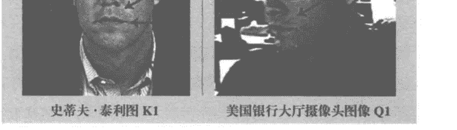
起初是公寓维修工看到新闻后举报，随后联邦调查局专家用面部识别软件比对监控画面，得出结论：画面中的嫌疑人就是泰利。

即便泰利有充足的不在场证据，专家仍作证。他被关了近一年才洗清罪名，其中两个月在最严酷的牢房。等出来时工作没了、家庭散了、子女监护权也丢了。这一切源于一次错误的身份识别。

### 看到另一个自己
面部识别算法正成为现代警务的常规工具。它能在照片、视频或 3D 快照里捕捉面部、测量特征，再与数据库比对确认身份。

柏林的地铁站曾装上系统以训练恐怖分子筛选能力。自 2010 年起，美国纽约州一处就靠算法抓获 400 多名诈骗犯。英国则把摄像头装上车，外观像加强版谷歌街景车，行驶中自动比对行人。2017 年 6 月，南威尔士一辆巡逻车拍到逃犯，成了首例成功。

人脸识别对安全很重要，但让人类来做显然不可靠。有项模拟机场安检的研究显示，专业人脸识别员有 14% 的概率放行身份造假者，误扣率也达 6%。以希思罗的客流量看，这样的失误让人不安。

算法在很多场景完胜人类，但用于抓人时会出现关键问题：一个人和另一个人的身份到底有多大混淆可能？我们中间有多少人拥有“史蒂夫·泰利式”的分身？

2015 年的研究给出了乐观数字。阿德莱德大学的特翰·卢卡斯 Teghan Lucas 以 8 项面部要素为标准，在 4000 张人像中比对，未找到一对完全吻合。她据此认为两个人拥有相同面容的概率低于万亿分之一。泰利的倒霉在于，他的万亿分之一分身就住在身边，还恰好是罪犯。下次重演要等上万年。

可这个概率值得怀疑。现实中“陌生双胞胎”偶遇并不罕见，频率明显高于研究结果。

尼尔·道格拉斯 Neil Douglas 登上飞往爱尔兰的航班，发现自己的分身正坐在他的座位上。这张自拍里就是两人，还有围观乘客的大笑。

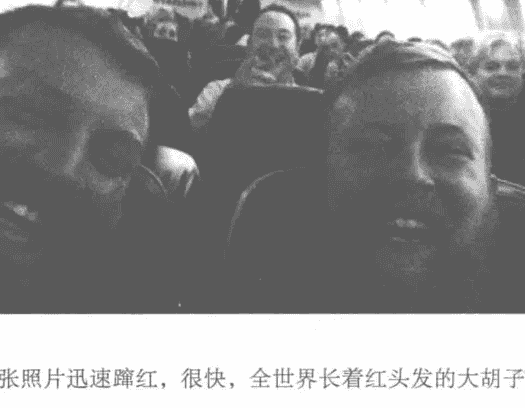
照片走红后，全世界红发大胡子纷纷发图攀亲。“我突然觉得我们是一支超生游击队，”尼尔在 BBC 采访中说。

我也有类似经历。22 岁时朋友给我看一张 Myspace 拼图，是当地乐队演出现场。她指给我看一位和我惊人相似的人，我却一点记忆都没有。发邮件给主唱确认后才知道，我的合成器流行乐分身比我更爱社交。

泰利、道格拉斯和我至少各有一个分身。我们是 75 亿人中的三个分子，却已经超过卢卡斯提出的万亿分之一概率。

差距来自“相似”的定义。卢卡斯要求测量数据完全吻合，即便尼尔和他的分身看起来很像，鼻孔或耳垂有毫米级差异就不算。更重要的是，同一个人不同照片间的变化——年龄、疾病、疲劳、表情、角度——带来的面容波动，不亚于人与人之间的差异。仅凭测量数据很难区分。

即便容貌不完全相同，我们仍容易混淆。海关人员的表现证明人对陌生人极不擅长辨认。这也解释了为什么我的朋友觉得《敦刻尔克》难看——她分不清演员；为什么青少年敢借长辈身份证买酒；为什么美国非营利法律组织 Innocence Project 认定 70% 以上的冤案与目击者误认有关。

但对熟人，我们辨认力惊人。母亲能在一堆照片里立刻认出孩子，双胞胎对泛泛之交会认错，对熟人却很容易区分。

关键在于，像不像由观察者决定。相似性没有严格定义，差异度无法测量，相似度也没有边界。我们说不清分身长什么样，道不明某人的长相有多常见，更致命的是，我们甚至无法判断两张照片是不是同一个人。

这意味着面部识别与 DNA 完全不同。DNA 取证集中在差异大的基因片段，能计算样本同源概率和他人撞库概率。标本越多，误配可能性越低，司法系统可自行决定容忍度。

面部虽是身份象征，却缺乏坚实的统计平台。引用一位联邦调查局取证人员的话，“缺乏统计数据，结论完全是个人意志的体现”。

遗憾的是，算法化的面部识别并未解决这个问题，指认罪犯时使用它仍需谨慎。无论多精准，相似与一致永远不是一回事。

更需严肃对待的是，算法并不像我们想象的那样擅长认人。

### 骗过算法
这类算法大致两类。一类是构建 3D 面部模型，整合多张 2D 图片或用红外扫描，苹果 iPhone 的 Face ID 就用此法。它避开表情和衰老干扰，直接聚焦眼眶弧度、鼻梁等硬组织。

苹果曾称他人误开概率是百万分之一，但双胞胎、兄弟姐妹甚至自己的孩子都能蒙混。面容 ID 上线不久就传出 10 岁男孩能解锁母亲手机的视频。特制 3D 打印面具配眼部红外图像也能骗过它。解锁手机或可接受，用来保护银行账户就不可靠了。

扫描护照或监控多用第二类 2D 统计算法。它不关注人类认定的标志性特征，而是对图片明暗规律做统计描述。近年借助神经网络在大规模人脸数据中试错，性能大幅提升，但我们并不清楚它到底怎么判断“像”。

顶尖算法也很容易被愚弄。它们依赖明暗规律，戴上花哨混搭眼镜就能“干扰”。

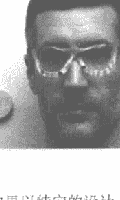
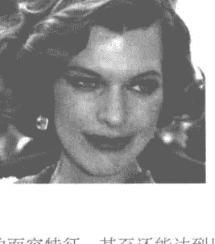
特定设计的眼镜甚至能让算法把一人误认成另一人，图中的男子因戴眼镜被系统判定很像女演员米拉·乔沃维奇 Milla Jovovich。眼镜能伪装，看来超人早已明白。

统计算法除了被眼镜戏弄，其识别能力也引发关注。谷歌的 FaceNet 被要求辨认五千幅名人头像，人类识别员正确率 97.5%，FaceNet 达到 99.6%。表面看机器已超人。

可测试基数太小。要打击犯罪，测试集必须达到百万量级而非几千。英国目前掌握约 1900 万张嫌犯面孔，FBI 数据库约 4.11 亿张，据称收录了全美一半成年人；中国身份证库可达数十亿，摄像头遍布街头地铁机场。

误判概率会随库容迅速上升。人脸越多，找到相似者的可能性越大。算法在大数据下准确度大幅下降。

这就像我能 100% 匹配十个陌生人的身份证，却未必能在纽约市中心指认逃犯。

2015 年华盛顿大学举办 MegaFace 挑战赛，参赛者在百万张人脸库中测试算法。曾在名人头像上近乎完美的 FaceNet，这次仅获 75% 识别率，其他算法成功率约 10%。撰写时最佳成绩保持者是中国腾讯优图，错误率高达 83.29%。

换句话说，基于这些数字，在百万级库中找罪犯，最低错误率约六分之一。

领域发展很快，准确率在攀升，但光线、姿势、画质、外观差异仍是关键变量。在能轻松辨认 4.11 亿张人像或找到万亿分之一分身前，我们还有很长的路。

### 权衡利弊

虽然前文的警示让人心里发紧，但局面并未滑向无可挽回。现实中仍有一些算法在限定场景里发挥了作用。

拿加拿大安大略省的赌博防治来说，有成瘾倾向的民众可以主动登记进入管控名单，赌场据此拒绝他们入内。若有人忍不住溜进去，人脸识别系统会把他揪出来，工作人员随即将其请走⁶⁹。被误判而扫兴而归的人当然会觉得不公平。只是如果这套机制真的帮到一部分人戒掉旧瘾，偶发的误伤也就有了可容忍的理由。

零售业的处境类似。过去保安室墙上贴满商店扒手的拍立得，现在顾客一进门，系统就把面容与惯犯库比对，匹配上时值班保安的手机会立刻报警，然后在货架间把人拦下。

商家被迫拥抱这类技术。仅在英国，每年就有约360万起门店盗窃，零售业损失高达6.6亿英镑⁷⁰。2016年，美国因扒手案件导致的暴力死亡达91人⁷¹。能把惯犯挡在门外、避免事态升级，在不少人看来是众望所归。

但高科技反盗窃也有明显副作用。隐私泄露是其一——安保软件主要供应商之一FaceFirst声称不会保存普通顾客的图像，可门店却在用人脸识别追踪客流购买习惯。还有数字黑名单的边界问题：谁有权把人列入？凭什么断定名单上的人都“罪有应得”？被冤枉的要怎么申诉、如何除名？算法本身不完美带来的误判风险也始终存在。

利弊很难精确衡量，连零售业主内部都分裂。有的人全盘接受，有的人敬而远之——沃尔玛就因投资回报不理想叫停了店内的FaceFirst试点作业⁷²。

在打击犯罪的议题上，利弊的分界显得更清晰一些。指纹⁷³、咬痕分析、血迹形态对比⁷⁴、弹道学⁷⁵等技术同样缺乏明确的错误率。美国国家科学院2009年的一篇文章指出，除DNA之外，没有其他刑事技术能“在证据与特定个体或信息源之间建立明确关系”⁷⁶。尽管如此，它们仍是不可或缺的警务工具，前提是不要过度依赖其推导出的结论。即便是最前沿的人脸识别，准确率也让人难以放心。有人提出，如果一项技术会抬高“史蒂夫·泰利”式冤案的发生率哪怕一点点，就该停用。对此不能一概而论，因为即便抓捕成本高昂，人脸识别在侦破上的价值仍难以忽视。

### 安全与自由的拉锯
2015年5月，一名男子在曼哈顿街头挥舞黑色羊角锤袭击路人，先在帝国大厦附近追打一名20岁男子，6小时后又南下联合广场敲击一名女子头部，几分钟后又伤一名33岁女子⁷⁷。监控画面经人脸识别比对，锁定嫌疑人为大卫·贝利尔David Baril。案发前几个月，他在照片墙上发过一把滴血锤子的照片⁷⁸。他认罪，被判22年监禁。

技术成熟后，旧案也在解开。2014年，算法让改名潜逃15年的美籍通缉犯落网。尼尔·施塔默Neil Stammer保释期间逃跑，身负儿童性侵、绑架等指控。FBI把通缉令放进护照数据库比对，发现头像与生活在尼泊尔的另一名男子相似，最终将其抓捕归案⁷⁹。

2017年夏末，伦敦桥恐袭造成8人死亡。若当时启用这类系统，或许能避免悲剧。三名行凶者之一尤瑟夫·札格巴Youssef Zagba在意大利已被列为恐怖分子嫌疑人，人脸识别本可以在他入境前将其揪出。

到这里，隐私与保护、公平与安全该如何权衡？我们愿意用多少个“史蒂夫·泰利”，来换取更快辨认出“大卫·贝利尔”和“尤瑟夫·札格巴”？

纽约市警局的数据是：2015年成功指认嫌犯1,700人，逮捕900次，误判5人⁸⁰。对这5个人而言，问题依旧：这个比例算合理吗？为了降罪，我们是否愿意付这样的代价？

目前来看，毫无瑕疵的算法像本章开头提到的金·罗斯姆地理画像一样，属于特例而非常态。执法里的各种算法——警情预测、预感实验室、重点名单、人脸识别——都承诺包打天下，却也在解决问题的同时制造新问题。

在我看来，犯罪领域的算法治理已经迫不及待，因为它们在执法中制造了许多难以解决的困境。我们是否只能选用能被理解、能被拆解的模型，哪怕这意味着效率下降、犯罪上升？是否要彻底抛弃任何带有偏见或出错可能的数据系统，即使那样会让算法失去超越人类的优势？偏见的度该怎么划？在何时拯救可预见的受害者，又在何时保全可能被算法误伤的无辜者？

整个社会都得做出选择：成功是什么？我们更看重极致压低犯罪率，还是不遗余力守护无辜者的自由？为了他人的安全，你能承受多大的牺牲？

麻省理工学院社会学教授加里·马克思Gary Marx在接受《英国卫报》采访时说得直白：“苏联把街头犯罪压到难以想象的低水平，可代价也太大了吧？”⁸¹

最终我们可能认为算法的边界该被限定，有些事就不该被分析与计算。这或许不止是犯罪议题的情绪反应，也许是因为有些真相是冰冷机器永远无法领悟的。

## 第七章

创作
ART

贾斯汀陷在回忆里。2018年2月4日，他在田纳西州孟菲斯的家里看超级碗，边吃M&M豆。本周刚过37岁生日，像往年一样，他开始盘点人生。

他知道自己该感恩：体面工作、安稳住房、和睦家庭。但他始终不满足，从小就觉得自己该出人头地。

“还不是那个男团。”他暗想，14岁时加入的乐队本该成名，却无疾而终。这位不再年轻的贾斯汀·汀布莱克Justin Timberlake从未尝到成功的滋味。

沮丧中他又开了瓶啤酒，电视切到中场秀。在另一个几乎相同的平行宇宙里，另一位37岁的贾斯汀·汀布莱克正登台演唱。

### 平行试听
为什么一个汀布莱克如鱼得水，另一个却郁郁不得志？有人——包括14岁的我——会觉得明星版理所当然：天赋、样貌、舞技、嗓音。也有人认为他不过运气好，能歌善舞的人遍地都是。

要论清，只能让汀布莱克进入无数相同的平行世界，看他能否每次都崭露头角。可人造多元宇宙不现实。于是研究者把目光转向知名度更低的音乐人。

2006年，马修·萨尔甘尼克Matthew Salganik、彼得·道兹Peter Dodds和邓肯·瓦茨Duncan Watts搭建了多个数字化世界¹。每人得到一个简化版Spotify样的在线播放器，被分到8个平行站点，每个站点都有相同的48首未知艺术家作品。

后来被称为音乐实验室Music Lab²的实验里，14,341名乐迷登录播放、打分还能下载。和真实流媒体一样，参与者能看到自己世界里其他人的收听倾向。除了歌手名和歌名，他们还能看到歌曲下载量的实时变化。所有数据从零开始，8个世界里最热的歌逐渐浮现。

为做对照，还设了一个受控世界，参与者看不到下载数据，歌曲随机呈现。

结果戏剧化。所有世界里，有歌被集体判定“难听”，有歌则全面爆红，即便在看不见数据的世界也如此。但榜单中段的差别很大。密尔沃基朋克乐队52Metro的《禁闭》Lockdown在某世界夺冠，在另一世界只排到第40名。同一首歌、同一批对手，命运却不同³。成功有时就是运气。

研究者发现，访客偏爱下载别人已下载的歌。初期稍占上风的曲目会滚雪球式攀升，“假象”变成现实。

这源于心理学家说的社会认同social proof。信息不足时，人倾向复制身边行为。剧院常暗中安排观众鼓掌，看到别人鼓掌就会跟进。选音乐时，流行度是快速排雷的捷径。“选择太多，听别人听什么最省事。”萨尔甘尼克对LiveScience说⁴。

社会认同在娱乐中无处不在。2007年一项研究追踪《纽约时报》畅销书榜，艾伦·索伦森Alan Sorensen发现上榜会让销量平均增13%~14%，首次上榜可暴涨57%。

可参考的榜单越多，效应越强。面对海量选项和营销轰炸，社会认同会被放大。

于是烂歌也能上榜。20世纪90年代，两位英国制作人打赌把最烂的歌送进榜单。女子组合香草Vanilla的《No way no way, mah na mah na》灵感来自木偶电影插曲，表演拙劣、设计像微软画图、宣传片被公认史上最差⁵。但靠杂志专题和BBC《流行之巅》Top of the Pops曝光，单曲冲到第14名。昙花一现后无人再理。

社会认同并非唯一因素。后续实验在榜单稳定后，把排行榜倒置。新访客看到的榜单与原先相反。下载总量立刻下降，榜首的烂歌更惨，榜尾的好歌虽不及原先夺冠时，但仍优于原先垫底的歌。如果实验足够长，好歌终会回暖。小结：市场会变，运气和品质都重要⁶。

现实只有单一世界的数据。音乐实验室提示：品质重要，且与人气并非一回事。好歌终能重获人气，是音乐“自带光环”的证据。反过来，成功并不保证高品质。

定义品质的方式不同，结果也会不同。对唱片公司、制片人、出版商最实际的问题是：能否预测稳赚项目？算法能否迎合市场？

### 市场迎合
电影投资风险极大，赚钱的极少，打平的多，亏本的不少⁷。制作成本上亿，预测失误代价惨重。

2012年《异星战场》John Carter让迪士尼吃亏。斥资3.5亿美元拍摄，却无人问津，亏损2亿美元，直接导致高管辞职⁸。

好莱坞深知票房难测。1978年美国电影协会主席杰克·瓦伦蒂Jack Valenti说：“没人能告诉你电影的市场表现，直到它在黑暗的影院开场。”⁹5年后编剧威廉·高德曼William Goldman说得更狠：“没人说得清。”¹⁰

但本书前几章显示，现代算法总在做看似不可能的预测。电影成功可从票房与影评衡量，结构特征也可拆解：主演、类型、预算、时长、情节标签等。于是有人试图从中挖“宝藏”。

2013年萨米特·斯林瓦森Sameet Sreenivasan的研究用互联网电影数据库IMDb的用户关键词标签，追踪品味如何随时间变化。当时IMDb收录超200万部电影，跨越一个多世纪，每部都有多标签。有些是概括性描述如“团伙犯罪”“父子关系”，有些是地理要素如“曼哈顿-纽约市”，有些是具体情节如“枪支威胁”“座椅捆绑”。

仅凭关键词就能看到品味的井喷：二战题材、堕胎议题的电影会集中上映，然后进入真空期。整合标签后，他为每部电影在发行时的新颖度打分0到1，再对比票房。

一般来说新颖度越高票房越好，但有个上限。超过0.8，收入就会崩盘。研究验证了社会学家的怀疑：我们厌恶陈旧，也排斥过度新奇。最好的电影介于“新”与“不过于新”之间。

新颖度能帮工作室剔除亏本片，却不能预测爆款。可参考欧洲团队的发现：电影上映前一个月，维基百科页面的编辑次数与最终票房相关¹²。编辑多为影迷自发，编辑越频繁，话题越热，票房越高。

模型覆盖312部电影，70部预测准确率超70%。越成功的电影，页面编辑越多，预测越准。前6名票房电影的预测准确率高达99%。

这类研究有趣，但一个月前才奏效，对投资者太晚。能否用更早的信息——类型、主演热度、分级——直接预测？

2005年一项著名研究用神经网络在上映前做预测。为简化问题，没预测精确收入，而是把电影分为9档，从毒药到冠军。结果即便简化，平均准确率也只有36.9%。对2亿美元以上的顶级大片，准确率仅47.3%。算法挑出的“必火片”里，约10%收入不到2000万美元——在好莱坞是惨不忍睹的数字。

热度不可预测，品质难量化

研究者不断调参、堆模型，想把爆款命中率抬上去，可到现在也没出现真正的突破。现实很直接：在观众给出最初反馈之前，流行几乎注定是盲盒。戈德曼那句话依然成立——面对海量选项，没人能准确挑出将要引爆的那个。

### 量化品质

从这里看，热度注定难以提前锁定。我们常常分不清自己到底偏爱什么、为何偏爱，这对算法而言是道几乎跨不过的鸿沟。既然“好内容”不能靠热度来定义，那要如何丈量品质？

这件事的关键在于自主权。若想让算法在艺术领域获得哪怕一点点创作或再诠释的能力，就必须先把品质变成可测的坐标，像医学判断癌变、司法评估再犯风险那样给出客观参照。否则连“好”的边界都说不清，又怎能指望机器去生产或挖掘“好”的音乐？

可惜，这条路撞上了老生常谈的哲学难题，追溯到柏拉图，争论已超过两千年：艺术的美学价值该怎么评断？

莱布尼茨阵营认为美是可以被定义、被测量的。因为存在几乎全员认可的作品，比如米开朗琪罗的大卫、莫扎特的《流泪之日》，所以美应当有本质，艺术品在客观层面可以分高下。

休谟走向另一极，认为美只存在于观者心里。以沃霍尔为例，有人从中感受到强烈冲击，有人却觉得艺术含量跟听罐头差不多。

康德则居中，判断既非彻底主观也非完全客观，它揉合感知、情绪与智力，并随观察者心理状态推移而变化。

班克斯的一次摆摊很说明问题。2013年他在纽约中央公园化名卖黑白喷绘布画，每张60美元，夹在旅游纪念品摊位里。对路人而言价格偏高，数小时才卖出一张，当天进账约420美元¹⁴。次年同一件作品在伦敦拍卖行以68,000英镑成交，约合115,000美元¹⁵。

并非所有人都买账。《黑镜》主创查理·布鲁克称班克斯是“胡扯王”，作品只让傻子如获至宝¹⁶。即便如此，即便面对公认的高品质艺术，审美判断仍然判若两人。

常引用的例子是《华盛顿邮报》2007年的实验¹⁷。报社请小提琴家约夏·贝尔在常规演出之外，到华盛顿地铁扶梯口即兴演奏。他背着价值350万美元的斯特拉迪瓦里，帽子放在地上，演奏了43分钟。报道写道现场是“世界上最具才华的古典音乐家，用史上最贵小提琴演奏最动听乐章”。结果仅7人驻足听了一会儿，其余上千人视而不见，帽中只剩32.17美元。

品味并非恒定。对某些古典音乐的偏爱似乎稳定，对其他艺术形式的态度则会大幅波动。帝国理工进化生物学教授阿曼德·利来研究流行乐演化，提出“人天生有无聊耐受度，总需要新鲜刺激”¹⁸。

比如八十年代末，鼓机与合成器席卷乐坛，排行榜多样性急剧收窄。“只要听起来像早期的麦当娜或杜兰杜兰，你会觉得流行乐已找到终极模式。”利来解释。事实并非如此。很快嘻哈兴起，榜单再次丰富。这并非嘻哈有特殊特质，而是时机合适。“美国听众的反应是‘以前没听过，可以多来点’。”

即便存在某种客观标准，审美仍受环境牵引。想用普适美学指标衡量作品，本质是执念。无论统计、人工智能或机器学习，用数字解释艺术实质，都像竹篮打水。

算法也巧妇难为无米之炊。抽离热度与内在品质后，唯一可量化的只剩相似度。

相似度的操作空间很大。网飞与Spotify的推荐机制就建立在相似度上，能帮助用户发现新电影与新歌，也能靠订阅数据较准预测偏好。它们不靠热度，否则大家会被不断推送贾斯汀·比伯与《小猪佩奇大电影》；也不靠评论等品质外显，否则首页会沦为无聊的艺术辩论区，下班归来的观众只想看部惊悚片或一部瑞恩·高斯林的电影放松。

相似度把焦点拉回个人偏好——听过什么、看过什么、反复点开什么。借助互联网电影数据库、维基百科、音乐博客等，为每首歌、每个艺术家、每部电影打标签分类，就能快速找到关键词相近的内容。还能找到品味相近的其他用户，看他们在听什么、看什么，再推荐给你。

网飞与Spotify从不承诺推送完美契合的内容。Spotify的发现模块不是要找到与你当下心情百分之百对应的乐队，算法只要起到点缀作用即可，不会打扰生活。偶尔命中口味，像冷读的运气。你只要时不时操作一下，就能体会偶然发现好音乐的乐趣，所以推荐引擎不必万无一失。

相似度足以支撑推荐。但若让算法在对品质一无所知的情况下去创作艺术，会产生什么火花？仅靠对过往艺术的记忆，能拥有创造力吗？

### 机器真能创作出艺术吗

1997年10月，一群观众来到俄勒冈大学参加一场别开生面的音乐会。舞台仅放一架钢琴，演奏家威妮弗蕾德·肯纳连奏三段。

第一段是巴赫一首知名度较低的钢琴曲，第二段是该校音乐教授史蒂夫·拉尔森模仿巴赫风格写的曲子，第三段由算法模仿巴赫风格生成。

听完后观众要分辨真伪。让史蒂夫·拉尔森痛心的是，绝大多数人把他写的曲子当成电脑写的。当观众得知他们以为是巴赫天才之作的东西其实是机器产物时，现场一片哗然。

拉森受了打击，事后对《纽约时报》说：“我对巴赫音乐的敬仰是真心的，那天观众竟被电脑程序骗了，唏嘘不已。”不安的不止他一人，发明著名编曲算法的大卫·科普也经历过类似场景。

“我会先逐个做我称之为游戏的实验，”他告诉我，“猜错后他们会恼羞成怒，觉得我整个理念都有问题。因为创造力被认为是人类专属。”¹⁹

这一切的源头是认知学家大卫·侯世达，他策划了这场音乐会。早在《哥德尔，艾舍尔，巴赫》里他就写道：

> 音乐是表达情绪的语言。除非计算机程序具备和人类一样的复杂情感，否则永远无法创作出美妙的作品……让预编程的“音乐盒”做出巴赫级别的作品，无稽之谈，是对人类精神的浅薄解读。²⁰

但听过科普的EMI系统后，侯世达承认事情没那么简单：“EMI让我不安又困惑，”实验结束后几天他说，“唯一让我稍安的是，EMI不能自己生成风格，只能模仿往昔作曲家。不过这仍无法消除我的疑虑。或许音乐从来没有我想象的那么复杂、丰富，这简直是毁三观。”²¹

现实到底如何？只有人类才有审美吗？算法能艺术创作吗？观众分不出EMI和名家之作，能证明机器有真正的创造力吗？

先从算法原理看。大卫·科普详细解释过构建过程。

第一步是把巴赫的音乐转成机器语言：“在数据库里，每个音符用5个标记表示：开始时间、时长、音高、音量和乐器。”这意味着科普要为每一段巴赫作品手动输入5个数字。巴赫的赞美诗就有371首，和声更多，音符上万，标记量是5倍。对科普而言是苦行，“我每天就是敲数字，敲了好几个月。幸好我比较偏执。”

输入完成后，他逐段分析巴赫音乐的节拍和走向。对每个音符记录下一个音符，形成类似字典的结构：算法可以查某个和弦，看到巴赫在此和弦后写过哪些不同的音符。

这和手机输入法的预测很像。基于你过去的输入记录，手机猜测你下一步可能要打什么，并在你打字时提示。

最后一步是让机器运行。科普输入一个起始和弦，让算法查字典，在候选后续和弦中随机挑选，然后重复——查上一个和弦，再选下一个音符。最终拼出一部像巴赫亲笔的原创。

或许这就是巴赫原本的曲子，这是科普的说法。“是巴赫创造了所有这些和弦。这就像把帕玛森乳酪丢进搅拌机再码回来，还是帕玛森乳酪。”

无论归功与谁，EMI音乐听起来再动听，本质都是对已有作品的重组，是对巴赫规律的模仿，而非自主创作。

后来出现了一些更进一步的算法，比如遗传算法。它把音符视作音乐DNA，以一批杂乱的“歌曲”作为起点，经过多代“繁衍”，在其中筛选“美”的元素，培育出“更好”的作品。虽然我用了“美”和“更好”，但我们根本说不清这两个词的含义。即便算法能写诗、画画、作曲，衡量标准仍只是在相似度上打转。

有时这已足够。想要给网站或YouTube视频配首民谣背景音乐时，你不在乎它和热门民谣有多像，只想要避免侵权又不用自己写。市场上已有公司在做这件事，英国的Jukebox与AI Music就提供类似服务。有些作品有市场价值，有些谈得上原创，有些单纯好听。毫无疑问，它们是优秀的模仿者，不是厉害的创作者。

这不是对算法的贬低。许多人类作曲家的作品创新性也不足。流行乐进化史研究者阿曼德·利来认为，榜单热门甚至可能是机器写的。他评价法瑞尔·威廉姆斯的《高兴》：

> “高兴，高兴，高兴，我真高兴”，天啊，歌词就4个字，这绝对是机写典范。为了迎合人类对夏日愉悦的渴望。市面上最弱智、最直白的歌。要是这就是标准，难度真不大。

他对阿黛尔的抒情歌也没兴趣：“分析任何一首歌，你会发现情感都在‘伤感歌曲生成器’能达到的水平。”或许有人反对，我自己也不确定。但一直有声音认为人类创造力——与所谓创作型算法相似——只是对已有观点的重新整合。正如马克·吐温所说：

> 没有新观点，也不太可能有新观点。我们只是把旧观点放进精神万花筒，稍作调整，形成新奇组合。我们不断调整、胡乱组合，但用的东西都有几百年历史了²²。

科普对创造力的定义很简单：“在看似毫无关联的两者之间建立关系。”

或许如此。但我一直觉得，如果EMI这类算法展现出某种创造力，那种创造力缺乏生命力。它们能写出动听的东西，却没有意义。我总有种不安：把机器产出当成艺术，会让文化变成废墟。也许它们是文化快餐，绝非艺术。

研读本章资料时，我发现自己对算法创作的不适感，并非来自它是否能创作。问题在于什么是艺术。

我是数学家，在准确性和统计上游刃有余。但在艺术领域，我更认同列夫·托尔斯泰的看法：真正的艺术是人与人之间的联结，是情绪的沟通。正如他所言：“艺术不是手工品，而是艺术家对自身情感的传达。”²³如果你也认同这一点，就不难理解机器为何无法做出真正的艺术。道格拉斯·侯世达在EMI实验前曾这样描述一个会写歌的程序：

> 它应该在世界上独自闯荡，经历生活的风雨和分秒时光；能体会冷夜的欣喜与孤独，对陪伴的渴望，对故乡的思念，以及生死离别后的心碎与重生；了解无奈的叹息、最后的倔强、悲伤、绝望、毅力、成功、虔诚与敬畏；曾经在希望与恐惧、痛苦与欢笑、平静与焦虑间挣扎。对优雅、幽默和节奏有足够意识，对意外有所期待——当然，对鲜活的创造魄力也有细腻感知。这样，也只有这样，才能孕育出音乐的意义²⁴。

我也许错了。如果算法艺术具备人类创造的特征——像EMI那样——我们仍会学会欣赏并赋予其意义。流行乐史上，我们就能对虚假的情感联结产生情绪反馈。也许当算法艺术更普遍，当我们逐渐意识到某件作品并非人造，单向的联结就不会让人不适。毕竟，人们也能对无回应的事物产生感情——比如童年的泰迪熊或宠物蜘蛛。

对我而言，真正的艺术不是偶然拼凑出来的。算法力有不逮，量化的边界也很有限。数据和统计能呈现一个五彩缤纷的奇异世界，却无法告诉我做人的滋味。

## 总结
瑞海娜·易卜拉欣是名建筑师，育有四个孩子，丈夫在海外。她在当地医院做志愿者，同时是斯坦福在读博士。手术后她本应休养，却还要靠药物才能站立。2005年1月，第38届国际系统科学年会将在夏威夷召开，她订好机票准备去演讲¹。

2005年1月2日清晨，她和女儿抵达旧金山机场。办理手续时询问轮椅服务，却被告知她的名字在联邦禁飞名单上——“9·11”后为限制嫌疑恐怖分子出行设立的数据库。女儿十几岁，站在柜台旁给家里打电话说妈妈被戴上手铐带走了。与此同时，易卜拉欣被推进警车后座。她被带到警局搜身、拒绝医疗请求并被关押。两小时后，国土安全人员送来释放文件，说已将她从名单删除。她最终赶上会议，结束后飞回马来西亚探亲。

一名联邦调查局工作人员点错了选项，导致她出现在禁飞名单。可能的原因是混淆了伊斯兰祈祷团Jemaah Islamiyah——制造2002年巴厘岛爆炸案的恐怖组织——和伊斯兰社团Jemaah Islam，一个马来西亚留学生专业组织。易卜拉欣是后者成员，与前者无关。这个错误很低级，后果却极重。

错误扩散到自动系统后，笼罩上“权威”的气息，上诉也很难奏效。故事并未在旧金山结束。

两个月后，她准备从马来西亚飞回美国登机时再次被拦，这次脱身更艰难。因被怀疑与恐怖主义有关，她的护照被吊销。尽管她是美国公民的母亲，在旧金山有家，又就读于美国顶尖大学之一，她仍被禁止入境。她前后花了近十年才打赢官司，为自己洗清罪名。那十年里她不得踏入美国一步，而这场苦难的根源是一个人为错误，以及机器拥有的无上权威。

## 算法不是裁判

自动化在多个维度上确实提升了生活品质。借助模型，病理专家可以更快圈出乳腺癌病灶，执法部门得以追踪惯犯，航空失事概率被显著压低。人类累积的知识被封装成即用工具，曾经遥不可及的全球即时互联也已成常态。可越是试图用技术解决宏大难题，就越容易催生新的混乱。强大到近乎无所不能的系统，最终留下的，往往是理不清的纠缠。

司法、医疗、警务以及电商平台，都在隐私保护、系统偏见、操作失误、责任归属和信息公开上出现明显缝隙。以当下运行的系统来看，公平议题已牵动身份追问：我们是谁？社会该呈现何种模样？愿意把多少裁量权交给冰冷的代码？根源或许在于一开始就把算法等同于权威。

对这种权威缺乏质疑，给了投机者操作空间。撰书过程中我接触到不少推销者，兜售各种神奇产品谋利。明明已有大量研究可证伪，仍有人向警政机构兜售系统，宣称仅凭面部特征就能“预判”恐怖分子或恋童癖者。另有团队声称模型能改写剧本对话，提升电影票房*。甚至有人理直气壮表示，其算法能为用户牵线真爱。

* 访谈时，我见到了该公司负责人，询问是否验证过宣传效果，对方却提起传闻——某好莱坞明星因神经网络分析而错失一部剧集的演出机会。我当即指出，该案例仅说明有人购买产品，并不证明模型有效。对方回应：“我们做的是生意，不是搞学术。”

名声在外的系统，往往更暴露权威滥用。本书列举了诸多“算法伤人”案例：某预算工具随意削减爱达荷州行动不便者的财政补助；以历史数据为依据的累犯风险模型更倾向将黑人被告归入高风险；肾损伤筛查系统让数百万人未经知情同意就交出核心个人隐私；超市推荐算法阻断一名少女向亲生父亲坦白怀孕的可能；本为拯救受害者的战略名单，在警方手中变成立案抓捕清单。失衡的现象比比皆是。

指出缺陷也会带来另一风险：暗示存在完美解法在等我们发现。我曾苦思寻找一个完全公平的模型，但即便看似无懈可击的系统——如飞机自动驾驶或诊断癌症的神经网络——也藏着难以根除的问题。就如《汽车》章节所述，自动辅助驾驶会让习惯依赖系统的驾驶者或乘客陷入极度危险；《医疗》一章中那些令人惊叹的肿瘤定位模型，也有人质疑并不适用于所有族群。把算法全部剔除，公平的系统也寥若星辰。深挖任何领域，偏见的痕迹总会浮现。

* 我自创一个检验垃圾算法的小技巧，称作“魔法测试”。读到某算法报道时，试着把“机器学习”“人工智能”“神经网络”替换成“魔法”，若句子依然通顺且不损失原意，那篇报道很可能在造势。对我而言，可预期的未来里，“用魔法消除饥荒”“用魔法写出精彩剧本”与用人工智能完成同样任务的效果并无二致。

既然接受完美不存在，明白模型注定会出错、注定有偏，我们仍渴望提升准确度、降低偏见。认识到算法与人类一样不完美，或许能冷却我们对算法权威的期待。

既然无法以绝对公平打造模型，能否把重心转向建立纠错机制？能否把同等时间投入到挑战与善用自动化系统上？也许应该从设计之初就造一个会提问的系统。系统可以辅助而非指令人类做选择；它能解释推导某个决定的依据，而不是直接给出结论。

在我看来，最理想的系统是始终把人放在眼前的系统。它清楚我们习惯过度信任机器判断，也承认自身局限，坦然面对不确定性。

夺得《危险边缘》冠军的IBM沃森具备这种特质。题目只有一个正确答案，该系统却会把思考过程中出现的其他选项一并列出，并标注可信度分数。若累犯风险评估也有类似机制，法官就能更透彻地解读信息；若人脸识别能给出若干可能匹配而非单一人像，误判也许就不至于发生。

神经网络在筛查乳腺癌切片时也靠这个思路。系统不会直接判定谁有肿瘤，而是在大量细胞中圈出可疑区域，供病理学家观察诊断。这样算法不易出错，医生也能减少误诊，双方相互补位。

还有本书开头的象棋案例。败给深蓝后，加里·卡斯帕罗夫并未排斥计算机，反而大力推动“半人马象棋赛”Centaur Chess，倡导人机组队对抗。算法负责评估每个走法的可能性，人类棋手掌控整体战略。

卡斯帕罗夫说过：“计算机的辅助减轻了我们的计算负担，让我们有更多的时间专心研究策略布局。在这种情况下，人类的创造力反而变得更加重要。”² 借此，象棋水平达到前所未有的高度，步法精细、布局缜密，是人机合一的极致。

我期望的未来是这样的：本书里那些“傲慢”“独裁”的算法不再存在。我们不再把机器奉为客观事实的化身，而是像对待任何权力来源一样，可以质疑它的决定、审视它的动机、让它感知我们的情绪、追踪利益走向、为错误负责，并不再盲目乐观。我认为，把算法转化为社会的纯粹正能量，并让它承担起应有的责任，才是关键。因为毋庸置疑，算法时代的到来，恰恰让人类显得更为重要。

## 致谢

对有些人来说，写作就像呼吸一样自然。天还没亮就起身，上午就能完成一章，灵感喷涌到忘了晚饭。

我绝不在此列。

写这本书的日子，我每天都在跟惰性对抗：压制想瘫在沙发上磕薯片追网飞的冲动，同时抵御读博带来的未来焦虑。这本书更像是被挤出身体的产物，有时得靠撕扯和喊叫才能推进。

因此，我由衷感谢所有伸手相助的人。我的出版团队在过去一年里慷慨付出时间和建议：苏珊娜·韦德森（Susanna Wadeson）、琼杜（Quynh Do）、克莱尔·康拉德（Claire Conrad）、艾玛·帕里（Emma Parry）、吉莉安·萨默斯凯尔斯（Gillian Somerscales）、艾玛·伯顿（Emma Burton）、苏菲·克里斯托弗（Sophie Christopher）、汉娜·布莱特（Hannah Bright）、卡罗琳·塞内（Caroline Saine），以及 Janklow&Nesbit 联合公司、Transworld 出版公司和 Norton 出版公司的所有人员，感谢你们的默默付出。同时，还有苏·里德尔（Sue Rider）、凯特·比（Kat Bee）和汤姆·考普森（Tom Copson），没有你们，就没有现在的我。

还要感谢我的受访人（有些在书中已提到），帮助塑造整本书的立意：乔纳森·罗森（Jonathan Rowson）、奈杰尔·哈维（Nigel Harvey）、亚当·班福拉多（Adam Benforado）、贾尔斯·纽厄尔（Giles Newell）、理查德·贝克（Richard Berk）、希娜·厄温（Sheena Urwin）、斯蒂夫·科尔根（Steyve Colgan）、曼迪普·哈米（Mandeep Dhami）、艾德里安·韦勒（Adrian Weller）、托比·戴维斯（Toby Davies）、罗·詹金斯（Rob Jenkins）、乔恩·凯尼伍斯基（Jon Kanevsky）、蒂曼德拉·哈克尼斯（Timandra Harkness）、丹·波普尔（Dan Popple）和西米德兰兹郡警察局团队、安迪·贝克（Andy Beck）、杰克·斯蒂尔格（Jack Stilgoe）、卡罗琳·兰斯（Caroline Rance）、保罗·纽曼（Paul Newman）、菲利斯·埃拉密（Phyllis Illarmi）、阿曼德·莱昂尼（Armand Leoni）、大卫·科普（David Cope）、埃德·芬恩（Ed Finn）、凯特·德夫林（Kate Devlin）、希莉·海曼（Sheila Hayman）、汤姆·查特温（Tom Chatwin）、卡尔·冈布里奇（Carl Gombrich）、约翰尼·莱恩（Johnny Ryan）、乔恩·克劳克罗夫特（Jon Crowcroft）和富兰克·凯莉（Frank Kelly）。

还有来自 Network Typing 的苏·韦伯（Sue Webb）和黛比·恩莱特（Debbie Enright），以及莎伦·理查德森（Sharon Richardson）、斯如稀·拉奥（Shruthi Rao）和威尔·斯托尔（Will Storr），对本书的结构起到关键性作用。另外，在本书初现雏形之时，有幸得到詹姆斯·富乐克（James Fulker）、伊丽莎白·阿德林顿（Elisabeth Adlington）、布兰登·马金尼斯（Brendan Maginnis）、伊恩·亨特（Ian Hunter）、奥马尔·米兰达（Omar Miranda）、亚当·丹尼特（Adam Dennett）、迈克尔·威尔（Michael Veale）、乔斯林·贝利（Jocelyn Bailey）、凯特·布莱克（Cat Black）、特蕾西·弗莱（Tracy Fry）、亚当·卢瑟福（Adam Rutherford）和托马斯·奥莱隆·埃文斯（Thomas Oléron Evans）的帮助，才将所有瑕疵消灭在萌芽之中。还有杰夫·达尔（Geoff Dahl），不但在整个过程中给予我强大的精神支持，还贡献出精巧的封面设计。

非常感谢我的审稿人：伊丽莎白·克莱沃顿（Elizabeth Cleverdon）、伯大尼·戴维斯（Bethany Davies）、本·迪克森（Ben Dickson）、麦克·唐斯（Mike Downes）、查理（Charlie）和劳拉·格兰（Laura Galan）、凯蒂·希斯（Katie Heath）、米亚·卡齐-佛罗伦（Mia Kazi-Fornari）、法塔赫·爱娃莱特妮（Fatah Ioualitene）、西沃恩·马瑟斯（Siobhan Mathers）、梅布尔·斯美尔（Mabel Smaller）、阿里·塞伊洪·萨拉尔（Ali Seyhun Saral）、珍妮弗·谢利（Jennifer Shelley）、爱德华·斯蒂尔（Edward Steele）、丹尼尔·维斯马（Daniel Vesma）和贾思·乌西比（Jass Ubhi）。

我还要特别感谢我的家人，感恩他们无条件地支持和信任。菲尔（Phil）、特雷西（Tracy）、娜塔莉（Natalie）、玛吉（Marge）和派吉(Parge)、奥马尔(Omar)、麦克(Mike)以及塔妮娅(Tania)——你们的耐心让我受宠若惊（不过别太当真，因为我可能还会继续写书，到时还需你们的帮助）。

最后，同样值得感谢的是伊迪丝（Edith）。坦白地说，你并没有帮到什么，但就是不可或缺。

## 图片来源

- 1. 15 页：“猫狗”，经日本福冈九州大学达尼洛·瓦斯康塞洛斯·瓦格斯（Danilo Vasconcellos Vargas）许可后复制。

- 2. 93 页：“胸中的大猩猩”，经美国盐城犹他大学的特拉弗顿·杜鲁（Trafton Drew）许可后复制。

- 3. 163 页：“史蒂夫·泰利图像”，© 史蒂夫·泰利（Steve Talley）（左）与联邦调查局。

- 4. 166 页：“尼尔·道格拉斯（Neil Douglas）与‘分身’”，经尼尔·道格拉斯许可后复制。

- 5. 170 页：“玳瑁色眼镜”，经美国匹兹堡卡内基梅隆大学马哈茂德·谢里夫（Mahmood Sharif）许可后复制；“米拉·乔沃维奇（Milla Jovovich）在戛纳电影节”由乔治·比亚尔（Georges Biard）拍摄。

## 参考文献及注释

### 书名解释

- 1. Brian W. Kernighan and Dennis M. Ritchie, *The C Programming Language* (Upper Saddle River, NJ: Prentice-Hall, 1978).

### 引言

- 1. Robert A. Caro, *The Power Broker: Robert Moses and the Fall of New York* (London: Bodley Head, 2015), 318 页。

- 2. 关于此观点，有多篇值得品读的文章。第一篇是兰登·温纳的 *Do artifacts have politics?* *Daedalus*, 1980 年第一期第 109 卷，121–136 页，https://www.jstor.org/stable/20024652，内附摩西斯大桥的事例。另外一篇比较有现代感的文章是凯特·克劳福德的 *Can an algorithm be agonistic? Ten scenes from life in calculated publics*, *Science, Technology and Human Values*, 2016 年第一期第 41 卷，77–92 页。

- 3. 《斯肯索普晚报》, 1996 年 4 月 9 日。

- 4. Chukwuemeka Afigbo (@nke_ise) 在推特上发布了一条关于此效应的短视频，值得一看。YouTube 网址： https://www.youtube.com/watch?v=87QwWpzVy7I.

- 5. CNN 采访， Mark Zuckerberg: ‘I’m really sorry that this happened’, YouTube, 2018 年 3 月 21 日 , https://www.youtube.com/watch?v=G6DOhioBfyY.

### 权柄

- 1. 与象棋大师乔纳森·罗森的一次私下交流。

- 2. Feng-Hsiung Hsu, ‘IBM’s Deep Blue Chess grandmaster chips’, IEEE Micro, 1999 年第二期第 19 卷, 70-81 页, http://ieeexplore.ieee.org/document/755469/.

- 3. Garry Kasparov, Deep Thinking: Where Machine Intelligence Ends and Human Creativity Begins (London: Hodder & Stoughton, 2017).

- 4. TheGoodKnight, ‘Deep Blue vs Garry Kasparov Game 2 (1997 Match)’, YouTube, 2012 年 10 月 18 日, https://www.youtube.com/watch?v=3Bd1Q2rOmok&t=2290s.

- 5. 同上。

- 6. Steven Levy, ‘Big Blue’s Hand of God’, 《新闻周刊》, 1997 年 5 月 18 日, http://www.newsweek.com/big-blues-hand-god-173076.

- 7. Kasparov, Deep Thinking, 187 页。

- 8. Kasparov, Deep Thinking, 191 页。

- 9. 《韦氏词典: 牛津英语词典》的定义更注重算法的数学特性: “一种程序或一套规则，用于计算或其他解决问题的操作，尤指计算机。

- 10. 有多种不同的方法对算法分组，肯定会有一些计算机科学家认为此列表过于简单。诚然，更详尽的列表可能会包含其他类别：例如映射、还原、回归和聚类等。不过，我最终选择了此种分类——源自 Nicholas Diakopoulos, *Algorithmic Accountability Reporting: On the Investigation of Black Boxes* (New York: Tow Center for Digital Journalism, Columbia University, 2014)——因其对基础性内容做了很全面的概括，能够让复杂的研究变得通俗易懂。

- 11. Kerbobotat, “Went to buy a baseball bat on Amazon, they have some interesting suggestions for accessories”, *Reddit*, 2013 年 9 月 28 日, https://www.reddit.com/r/funny/comments/1nb16l/went_to_buy_a_baseball_bat_on_amazon_they_have/.

- 12. Sarah Perez, ‘Uber debuts a “smarter” UberPool in Manhattan’, *TechCrunch*, 2017 年 5 月 22 日, https://techcrunch.com/2017/05/22/uber-debuts-a-smarter-uberpool-in-manhattan/.

- 13. 我故意用“理论上”，是因为现实生活可能有所不同。有些算法背后有着成千上万名研发人员，花费数年完成，并且在不断地进步完善。代码不断增多，系统也越发复杂，直至逻辑线变成一盘缠绕不清的意大利面。最终，算法变得过于复杂，无人能懂。

2013 年，丰田因其车辆发生严重车祸，而被勒令支付 300 万美元赔偿金。该车加速控制失灵，驾驶员踩下制动踏板也无济于事。鉴定证人向陪审团表示，隐藏在软件深处的意外操作才是罪魁祸首。详见 Phil Koopman, *A case study of Toyota unintended acceleration and software safety* ( Pittsburgh: Carnegie Mellon University, 2014 年 9 月 18 日 ), https://users.ece.cmu.edu/~koopman/pubs/koopman14_toyota_ ua_slides.pdf.

- 14. 该图的原始文件存放于维基共享资源，文件名 Vase of rubin.png，学界普遍称之为鲁宾花瓶，用以纪念提出者爱德加·鲁宾。它是一则典型的感知双稳态演示：左右两侧各浮现一对相对而视的黑色面孔，中央则呈现一只白色的花瓶。人在认知层面可以迅速在两种解读之间来回转换，而在画面本身，只要把勾连轮廓的数条线稍稍朝向某一侧倾斜——比如改动面部眼廓的走向，或是调整花瓶颈部阴影的落点——就能迫使观者不断在两种解释之间反复摇摆。

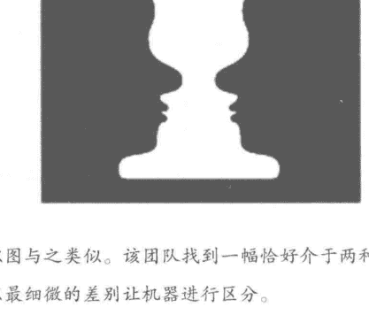

在计算机视觉的实验里也出现了类似的边界问题。有研究者专门挑选了一张落在猫与狗类别中间地带的临界图，用几乎不可察觉的差异来测试模型是否能够做出明确的二元判断。

- 15. Jiawei Su, Danilo Vasconcellos Vargas and Kouichi Sakurai, “One pixel attack for fooling deep neural networks”, arXiv:1719.08864v4 [cs.LG], 2018 年2月22日 , https://arxiv.org/pdf/1710.08864.pdf.
16. Chris Brooke, “I was only following satnav orders” is no defence: driver who ended up teetering on cliff edge convicted of careless driving’, 2009 年 9 月 16 日, http://www.dailymail.co.uk/news/article-1213891/Driver-ended-teetering-cliff-edge-guilty-blindly-following-sat-nav-directions.html#ixzz59vihbQ2n.
17. 同上。
18. Robert Epstein and Ronald E. Robertson, ‘The search engine manipulation effect (SEME) and its possible impact on the outcomes of elections’, 《美国国家科学院院刊》, 2015年第 33 期 第 112 卷, E4512-4521 页, http://www.pnas.org/content/112/33/E4512。
19. David Shultz, ‘Internet search engines may be influencing elections’, 《科学》, 2015 年 8 月 7 日, http://www.sciencemag.org/news/2015/08/internet-search-engines-may-be-influencing-elections.
20. Epstein 和 Robertson: 《搜索引擎操控效应（SEME）》。
21. Linda J. Skitka, Kathleen Mosier and Mark D. Burdick, ‘Accountability and automation bias’, International Journal of Human-Computer Studies, 2000 年第 52 期, 701-717 页, http://lskitka.people.uic.edu/IJHCS2000.pdf.
22. KW v. Armstrong, 爱达荷州联邦地区法院, 2012 年 5 月 2 日, https://scholar.google.co.uk/scholar_case?case=17062168494596747089&hl=en&as_sdt=2006.
23. Jay Stanley, Pitfalls of Artificial Intelligence Decision making Highlighted in Idaho ACLU Case, 美国公民自由联盟, 2017 年 6 月 2 日, https://www.aclu.org/blog/privacy-technology/pitfalls-artificial-intelligence-decisionmaking-highlighted-idaho-aclu-case.
24. ‘K.W. v. Armstrong’, Leagle.com, 2014 年 3 月 24 日, https://www.leagle.com/decision/infdco20140326c20.
25. 同上。
26. 美国公民自由联盟爱达荷州员工, https://www.acluidaho.org/en/about/staff.
27. 斯坦利：《人工智能决策的误区》。
28. 美国公民自由联盟, 判决要求对爱达荷州发育障碍群体的合理程序权予以保障, 2016 年 3 月 30 日, https://www.aclu.org/news/federal-court-rules-against-idaho-department-health-and-welfare-medicaid-class-action.
29. 斯坦利：《人工智能决策的误区》。
30. 同上。
31. 同上。
32. 同上。
33. 同上。
34. Kristine Phillips, ‘The former Soviet officer who trusted his gut – and averted a global nuclear catastrophe’, 《华盛顿邮报》, 2017 年 9 月 18 日, https://www.washingtonpost.com/news/retropolis/wp/2017/09/18/the-former-soviet-officer-who-trusted-his-gut-and-averted-a-global-nuclear-catastrophe/?utm_term=.6546e0f06cce.
35. Pavel Aksentov, ‘Stanislav Petrov: the man who may have saved the world’ , BBC 新闻, 2013 年 9 月 26 日 , http://www.bbc.co.uk/news/world-europe-24280831.
36. 同上。
37. Stephen Flanagan, Re: Accident at Smiler Rollercoaster, Alton Towers, 2 June 2015: Expert's Report, 应卫生安全局的要求, 2015 年 10 月, http://www.chiark.greenend.org.uk/~ijackson/2016/Expert%20witness%20report%20from%20Steven%20Flanagan.pdf.
38. Paul E. Meehl, Clinical versus Statistical Prediction: A Theoretical Analysis and a Review of the Evidence ( 明尼阿波利斯市 : 明尼苏达大学, 1996 年 ; 首次出版 : 1954 年 ), http://citeseerx.ist.psu.edu/viewdoc/download?doi=10.1.1.693.6031&rep=rep1&type=pdf.
39. William M. Grove, David H. Zald, Boyd S. Lebow, Beth E. Snitz and Chad Nelson, ‘Clinical versus mechanical prediction: a meta-analysis’, 《心理评估》, 2000 年第 1 期第 12 卷, 19 页。
40. Berkeley J. Dietvorst, Joseph P. Simmons and Cade Massey. ‘Algorithmic aversion: people erroneously avoid algorithms after seeing them err’ , 《实验心理学杂志》, 2014 年 9 月, http://opim.wharton.upenn.edu/risk/library/WPAF201410-AlgorithmAversion-Dietvorst-Simmons-Massey.pdf.

### 数据
- 1. Nicholas Carlson, ‘Well, these new Zuckerberg IMs won’t help Facebook’s privacy problems’, 《商业内幕》, 2010 年 5 月 13 日, http://www.businessinsider.com/well-these-new-zuckerberg-ims-wont-help-facebooks-privacy-problems-2010-5?IR=T.
- 2. Clive Humby, Terry Hunt and Tim Phillips, *Scoring Points: How Tesco Continues to Win Customer Loyalty* (伦敦: Kogan Page 出版社, 2008 年)。
- 3. 出处同前。Kindle 版, 1313–1317 页。
- 4. 请参阅 Eric Schmidt, ‘The creepy line’, *YouTube*, 2013 年 2 月 11 日, https://www.youtube.com/watch?v=o-rvER6YTss.
- 5. Charles Duhigg, ‘How companies learn your secrets’, 《纽约时报》, 2012 年 2 月 16 日, https://www.nytimes.com/2012/02/19/magazine/shopping-habits.html.
- 6. 同上。
- 7. Sarah Buhr, ‘Palantir has raised $880 million at a $20 billion valuation’, *TechCrunch*, 2015 年 12 月 23 日。
- 8. 联邦贸易委员会, *Data Brokers: A Call for Transparency and Accountability*, (华盛顿, 2014 年 5 月), https://www.ftc.gov/system/files/documents/reports/data-brokers-call-transparency-accountability-report-federal-trade-commission-may-2014/140527databrokerreport.pdf.
- 9. 同上。
- 10. Wolfie Christl, *Corporate Surveillance in Everyday Life*, Cracked Labs, 2017 年 6 月 , http://crackedlabs.org/en/corporate-surveillance.
- 11. Heidi Waterhouse, ‘The death of data: retention, rot, and risk’ , The Lead Developer 网站，得克萨斯州奥斯汀，2018 年 3 月 2 日， https://www.youtube.com/watch?v=mXvPChEo9iU.
- 12. Amit Datta, Michael Carl Tschantz and Anupam Datta, ‘Automated experiments on ad privacy settings’ , 《强化隐私保障技术学报》, 2015 年第 1 期, 92–112 页。
- 13. Latanya Sweeney, ‘Discrimination in online ad delivery’ , 《队列》杂志, 2013 年第 3 期第 11 卷, 10 页, https://dl.acm.org/citation.cfm?id=2460278.
- 14. Jon Brodkin, ‘Senate votes to let ISPs sell your Web browsing history to advertisers’ , 《科技艺术》, 2017 年 3 月 23 日, https://arstechnica.com/tech-policy/2017/03/senate-votes-to-let-isps-sell-your-web-browsing-history-to-advertisers/.
- 15. Svea Eckert 和 Andreas Dewes, ‘Dark data’, 第 25 届 DEFCON 黑客大会, 2017 年 10 月 20 日, https://www.youtube.com/watch?v=InvYGi7-Lxo.
- 16. 研究人员将此部分内容基于 Arvind Narayanan 和 Vitaly Shmatikov 于 2008 年 5 月 18–22 日在 IEEE 安全与隐私研讨会上发表的文章 ‘Robust de-anonymization of large sparse datasets’。
- 17. Michal Kosinski, David Stillwell and Thore Graepel. ‘Private traits and attributes are predictable from digital records of human behavior’ , 2013 年第 15 期第 110 卷, 5802–5805 页。
- 18. 同上。
- 19. Wu Youyou, Michal Kosinski and David Stillwell, ‘Computer-based personality judgments are more accurate than those made by humans’, 《美国国家科学院院刊》, 2015 年第 4 期第 112 卷, 1036–1040 页。
- 20. S. C. Matz, M. Kosinski, G. Nave and D. J. Stillwell, ‘Psychological targeting as an effective approach to digital mass persuasion’, 《美国国家科学院院刊》, 2017 年第 48 期第 114 卷, 201710966。
- 21. Paul Lewis and Paul Hilder, ‘Leaked: Cambridge Analytica’s blueprint for Trump victory’, 《英国卫报》, 2018 年 3 月 23 日。
- 22. ‘Cambridge Analytica planted fake news’, BBC, 2018 年 3 月 20 日, http://www.bbc.co.uk/news/av/world-43472347/cambridge-analytica-planted-fake-news.
- 23. Adam D. I. Kramer, Jamie E. Guillory and Jeffrey T. Hancock, ‘Experimental evidence of massive-scale emotional contagion through social networks’, 《美国国家科学院院刊》, 2014 年第 24 期第 111 卷, 8788–8790 页。
- 24. Jamie Bartlett, ‘Big data is watching you – and it wants your vote’, 《旁观者》, 2018 年 3 月 24 日。
- 25. Li Xiaoxiao, ‘Ant Financial Subsidiary Starts Offering Individual Credit Scores’, 财新网, 2015 年 3 月 2 日, https://www.caixinglobal.com/2015-03-02/101012655.html.
- 26. Rachel Botsman, *Who Can You Trust? How Technology Brought Us Together – and Why It Could Drive Us Apart* (伦敦：企鹅出版社，2017)，Kindle 版，151 页。

### 正义
- 1. John-Paul Ford Rojas, ‘London riots: Lidl water thief jailed for six months’,《每日电讯报》, 2012年1月7日, http://www.telegraph.co.uk/news/uknews/crime/8695988/London-riots-Lidl-water-thief-jailed-for-six-months.html.
- 2. Matthew Taylor, ‘London riots: how a peaceful festival in Brixton turned into a looting free-for-all’,《英国卫报》, 2011年8月8日, https://www.theguardian.com/uk/2011/aug/08/london-riots-festival-brixton-looting.
- 3. Rojas, ‘London riots’.

当法官遇到算法：量刑里的不确定性

2011 年伦敦骚乱里，BlackBerry Messenger 被《卫报》记者指为快速动员的关键通道。事后围绕同一场骚乱的司法处理出现了明显的落差：News Shopper 报道的父子二人因参与骚乱最终没有入狱，而学者罗哈斯指出，平常情况下警方根本不会因为类似过错就逮捕、羁押或送上法庭。曼彻斯特大学的汉娜·夸克与同事在 2015 年回顾 2011 年英格兰骚乱时，用“检察机关过度热情、司法机关放任”来形容当时的量刑节奏。

法官之间的一致性到底有多高？1977 年奥斯汀与威廉姆斯对模拟案例的判罚差异调查，以及后来多项关于保释与判决的心理学研究，都指向同一个结论：人们倾向于用快速简便的启发式做决定。更直接的数据是，半数以上的法官在同一个案件的恰当处理上无法达成共识。统计学家用 Cohen Kappa 来衡量一致性，1 代表完全一致，0 接近随机猜测，实证中法官的平均值落在 0.69 左右。

为压住这种分歧，不少司法体系引入了量刑指南。苏格兰量刑委员会 2005 年整理的全球指南综述显示，各地都在尝试用规则把自由裁量拉回轨道。但历史提示我们预测从不简单。1928 年伯吉斯在伊利诺伊州假释研究里就尝试用“贩家子、偶犯、吸毒者、匪徒”等标签分类，甚至得出“农村男孩再犯风险更高”的结论。随后的学者如舒斯勒在 1955 年梳理了假释预测的演进史。伯纳德·哈考特在《反对预测》里批判这种精算时代的 profiling 逻辑。英国司法部 2009 年发布的 OGRS 3 便是这一脉络的产物。

当群体智慧被拿来对冲个体偏差时，讨论又转向另一种思路。詹姆斯·苏罗威基在《群体的智慧》里提醒，集体判断往往比单人更准，但“求助现场”这类在早期就被频繁使用的数据会带来递项偏见。技术界的类比很响亮：Netflix 技术博客讨论的推荐系统、Airbnb 工程文章拆解的随机森林阈值分布，都在说明集成模型如何合并多棵树的预测。诺贝尔经济学相关研究团队克莱因伯格等人 2017 年在 NBER 的报告把法官判决与梯度增强决策树放在同一数据集上比较，先用一半数据训练，另一半检验，避免了查找表的陷阱，研究者也呼吁用严谨的统计方法保持可比性。

成本让问题更现实。英国司法部 2015-16 年度报告公布了各监狱每床位与每名囚犯的费用，纽约时报 2013 年引用一项研究称纽约市年均每名囚犯成本约 16.8 万美元，相当于哈佛大学的学费账单。卢克·多梅尔在《公式》里讨论算法如何试图解决所有问题并制造新的问题。

争议的焦点最终落到 COMPAS 这类风险评估工具。ProPublica 2016 年 5 月的《机器偏见》调查揭开了算法在量刑中可能放大的不公。北洛因特公司 2009 年对 COMPAS 预测效度的评估被后续研究对照：2018 年德雷塞尔与法里德发现，无经验的 20 名普通人对再犯的预测准确度与 COMPAS 相当，但法庭里没有 20 人投票，只有个别法官在做决定。弗吉尼亚州 2004 年布鲁克斯案以及 2003 年 ACLU 对性侵风险评估指引合宪性的挑战，显示了工具使用早期的法律摩擦。威斯康星州最高法院 2016 年 7 月 13 日在卢米斯案中裁定，借助 COMPAS 风险评估定刑并不必然违反正当程序，尽管被告无法审计闭源软件的计分方式。

种族与性别的裂缝始终存在。ACLU 2013 年《大麻战争的黑白》报告、斯塔尔与雷哈维关于联邦刑事指控种族差异的研究、阿诺德、道比与杨 2017 年关于保释决策中种族偏见的 NBER 工作论文，以及斯塔尔对性别差异的估计，都指向结构性不平等。联合国 2014 年《全球凶杀研究》提供了更宏观的背景。

从 BlackBerry 消息到随机森林，从 Cohen Kappa 0.69 到 16.8 万美元的年均关押成本，线索指向同一现实：无论是人还是算法，都在不完美的信息里做预测。人有冲动与不一致，算法有历史数据里的偏见与黑箱。把二者简单对立，或简单互换，都可能错过真正需要被追问的问题。

核心参考文献概览

46. 作者 David B. Mustard，论文《Racial, ethnic, and gender disparities in sentencing: evidence from the US federal courts》，发表在《法律与经济学杂志》2001年4月第44卷第2期，页码285-314，可见 http://people.terry.uga.edu/mustard/sentencing.pdf。
47. 丹尼尔·卡尼曼著《思考，快与慢》，纽约法劳·斯特劳斯·吉罗公司2011年版，第44页相关。
48. Chris Guthrie、Jeffrey J. Rachlinski、Andrew J. Wistrich 合著《Blinking on the Bench: How Judges Decide Cases》，2007年康奈尔法学院出版，文章编号917，链接 http://scholarship.law.cornell.edu/facpub/917。
49. 丹尼尔·卡尼曼《思考，快与慢》英文原名Thinking, Fast and Slow，第13页内容。
50. 同书《思考，快与慢》第415页亦有论及。
51. Dhami 与 Ayton 合作论文《Bailing and jailing the fast and frugal way》。
52. Brian Wansink、Robert J. Kent、Stephen J. Hoch 在《营销研究杂志》1998年第35卷发表《An anchoring and adjustment model of purchase quantity decisions》，页71-81，原文PDF http://foodpsychology.cornell.edu/sites/default/files/unmanaged_files/Anchoring-JMR-1998.pdf。
53. Mollie Marti 与 Roselle Wissler 的《Be careful what you ask for: the effect of anchors on personal injury damages awards》登载于《实验心理学杂志：实用》2000年第6卷第2期，91-103页。
54. Birte Englich、Thomas Mussweiler 合写《Sentencing under uncertainty: anchoring effects in the courtroom》，见《应用社会心理学杂志》2001年第31卷第7期1535-1551页，网址 http://onlinelibrary.wiley.com/doi/10.1111/j.1559-1816.2001.tb02687.x。
55. Birte Englich、Thomas Mussweiler、Fritz Strack 的论文《Playing dice with criminal sentences: the influence of irrelevant anchors on experts’ judicial decision making》刊于《个性与社会心理学通报》2006年第32卷188-200页，检索地址 https://www.researchgate.net/publication/7389517_Playing_Dice_With_Criminal_Sentences_The_Influence_of_Irrelevant_Anchors_on_Experts%27_Judicial_Decision_Making?enrichId=rgreq-f2fedfeb71aa83f8fad80cc24df3254d-XXX&enrichSource=Y292ZXJQYWdlOzczODk1MTc7QVM6MTAzODIzNjIwMTgyMDIyQDE0MDE3NjQ0ODgzMTA%3D&el=1_x_3&_esc=publicationCoverPdf。
56. 同上。
57. 同上。
58. Mandeep K. Dhami 等5人撰稿《Sentencing in doses: is individualized justice a myth?》，稿件在审，信息源自与 Mandeep Dhami 的私人交流。
59. 同上。
60. Adam N. Glynn 与 Maya Sen 发表于《美国政治学杂志》2015年第59卷第1期《Identifying judicial empathy: does having daughters cause judges to rule for women’s issues?》，37-54页，链接 https://scholar.harvard.edu/files/msen/files/daughters.pdf。
61. Shai Danziger、Jonathan Levav、Liora Avnaim-Pesso 论文《Extraneous factors in judicial decisions》刊载《美国国家科学院刊》2011年第108卷第17期6889-6892页，可查 http://www.pnas.org/content/108/17/6889。
62. Keren Weinshall-Margel 与 John Shapard 合著《Overlooked factors in the analysis of parole decisions》，发表在《美国国家科学院刊》2011年第108卷第42期E833页，地址 http://www.pnas.org/content/108/42/E833.long。
63. Uri Simonsohn 与 Francesca Gino 在《心理科学》2013年第24卷第2期发表《Daily horizons: evidence of narrow bracketing in judgment from 9,000 MBA-admission interviews》，219-224页，SSRN 预印本 https://ssrn.com/abstract=2070623。
64. Lawrence E. Williams 与 John A. Bargh 的《Experiencing physical warmth promotes interpersonal warmth》见《科学》第322卷第5901期606-607页，PMC 版本 https://www.ncbi.nlm.nih.gov/pmc/articles/PMC2737341/。

医疗

1. Richard M. Levenson 等4人研究《Pigeons (Columba livia) as trainable observers of pathology and radiology breast cancer images》，2015年11月18日刊于《公共科学图书馆：综合》，链接 http://journals.plos.org/plosone/article?id=10.1371/journal.pone.0141357。
2. 英国图书馆在线画廊2009年3月26日收录插画《Hippocrates’ daughter as a dragon kills a knight, in "The Travels of Sir John Mandeville"》，图源 http://www.bl.uk/onlinegallery/onlineex/illmanus/harlmanucoll/h/011hr1000003954u00008v00.html。
3. Eleni Tsiompanou 文《Hippocrates: timeless still》发表于 JLL Bulletin: Commentaries on the History of Treatment Evaluation，詹姆斯·林德图书馆牛津与爱丁堡2012年出版，网址 http://www.jameslindlibrary.org/articles/hippocrates-timeless-still/。
4. David K. Osborne 在 Greek Medicine.net 2015年刊载《Hippocrates: father of medicine》，地址 http://www.greekmedicine.net/whos_who/Hippocrates.html。
5. Richard Colgan 撰《Is there room for art in evidence-based medicine?》，发表于《美国医学协会伦理学杂志》2011年1月虚拟导师第13卷第1期52-54页，链接 http://journalofethics.ama-assn.org/2011/01/msoc1-1101.html。
6. 李约瑟主编《中国科学技术史》第6卷生物学及相关技术第VI分册医学，南森·席文整理，剑桥大学出版社2004年，第143页，可下载 https://monoskop.org/images/1/16/Needham_Joseph_Science_and_Civilisation_in_China_Vol_6-6_Biology_and_Biological_Technology_Medicine.pdf。
7. 伦敦科学博物馆“Brought to Life: Exploring the History of Medicine”专题介绍 Ignaz Semmelweis，网址 http://broughttolife.sciencemuseum.org.uk/broughttolife/people/ignazsemmelweis。
8. Andy Beck 的相关说法来自私人谈话。
9. Joann G. Elmore 等11位学者合著《Diagnostic concordance among pathologists interpreting breast biopsy specimens》，刊于《美国医学会杂志》2015年3月17日第313卷第11期1122-1132页，原址 https://jamanetwork.com/journals/jama/fullarticle/2203798。
10. 同上。
11. 神经网络常被形容为大脑活动的简化模型。真实脑中大量神经元形成庞大网络，邻近神经元兴奋时会传递信号，使下游神经元激活。人造网络结构更规整，神经元分层排列，每层仅接收上一层输入。以犬类识别为例，底层处理图像像素，随后数千个处理单元分层处理，最终输出判断。
12. Alex Krizhevsky、Ilya Sutskever、Geoffrey E. Hinton 合著《ImageNet classification with deep convolutional neural networks》，收录于《神经信息处理系统进展》第25辑，神经信息处理系统基金会加州拉荷亚2012年出版，1097-1105页，链接 http://papers.nips.cc/paper/4824-imagenet-classification-with-deep-convolutional-neural-networks.pdf。该算法属卷积神经网络，采用多组滤波器捕捉图像形变特征，而非整图直接输入。
13. Marco Tulio Ribeiro、Sameer Singh、Carlos Guestrin 在2016年旧金山第22届 ACM SIGKDD 数据挖掘及知识发现会议提出《‘Why should I trust you?’ Explaining the predictions of any classifier》，页1135-1144，获取地址 http://www.kdd.org/kdd2016/papers/files/rfp0573-ribeiroA.pdf。
14. 此结论可对照专家小组评估，后者集体判断通常被视作切片的事实标准。
15. Trafton Drew、Melissa L. H. Vo、Jeremy M. Wolfe 论文《The invisible gorilla strikes again: sustained inattentional blindness in expert observers》发表于《心理科学》2013年9月第24卷第9期1848-1853页，链接 https://www.ncbi.nlm.nih.gov/pmc/articles/PMC3964612/。
16. 图中狸狸位于右上角。
17. Yun Liu 等12位研究者论文《Detecting cancer metastases on gigapixel pathology images》于2017年3月8日存档康奈尔大学图书馆，预印链接 https://arxiv.org/abs/1703.02442。
18. Dayong Wang、Aditya Khosla、Rishab Gargeya、Humayun Irshad、Andrew H. Beck 撰《Deep learning for identifying metastatic breast cancer》，2016年6月18日发表于康奈尔大学图书馆，地址 https://arxiv.org/abs/1606.05718。
19. David A. Snowdon 的《The Nun Study》见 Boletin de LAZOS de la Asociación Alzheimer de Monterrey 第4卷第22期2000年；其文《Healthy aging and dementia: findings from the Nun Study》刊于《内科学年鉴》2003年9月第139卷第5期450-454页。
20. 思想密度即语言复杂度指标，按修女每10个字所含观念数量计算。相关评述见美联社报道“修女的研究将早期语言技能与阿尔茨海默病联系在一起”，《洛杉矶时报》1996年2月21日，链接 http://articles.latimes.com/1996-02-21/news/mn-38356_1_alzheimer-nuns-studied。
21. Maja Nielsen、Jørn Jensen、Johan Andersen 论文《Pre-cancerous and cancerous breast lesions during lifetime and at autopsy: a study of 83 women》刊于 Cancer 杂志1984年第54卷第4期612-615页，摘要链接 http://onlinelibrary.wiley.com/wol1/doi/10.1002/1097-0142(1984)54:4%3C612::AID-CNCR2820540403%3E3.0.CO;2-B/abstract。
22. H. Gilbert Welch 与 William C. Black 论文《Using autopsy series to estimate the disease “reservoir” for ductal carcinoma in situ of the breast: how much more breast cancer can we find?》收录《内科学年鉴》1997年12月第127卷第11期1023-1028页，PDF http://www.vaoutcomes.org/papers/Autopsy_Series.pdf。
23. 精确统计受国情、人口结构及筛查覆盖率影响而难以取得，概览可参阅 http://www.cancerresearchuk.org/health-professional/cancer-statistics/statistics-by-cancer-type/breast-cancer。
24. Jonathan Kanevsky 的引述源自私人交谈。

AI医疗的热潮背后：突破、争议与边界

这份梳理把近年关于AI进入医疗、基因与自动驾驶的关键讨论按时间线摊开，既有实验室里的进展，也有临床、伦理与监管上的拉扯。

乳腺癌筛查与影像AI的争议
25. 2010年5月《Artemis》报道了一种被称作突破性的方法，可评估DCIS发展为浸润性乳腺癌的风险。
26. 2016年《新英格兰医学杂志》第375卷发表Welch等人研究，讨论肿瘤大小、过度诊断与乳腺X线筛查有效性之间的关系。
27. 2012年10月30日《柳叶刀》第380卷第9855期刊出英国独立乳腺癌筛查小组的评估，概括筛查带来的获益与伤害。
28. 一次私人交流的记录被用作补充视角。
29. 2014年12月19日《Science Translational Medicine》刊载Beck等人的系统形态学分析，发现乳腺癌基质特征与生存的相关性。
30. 2017年4月27日Phi Vu Tran在arXiv发布预印本，介绍一种全卷积神经网络用于短轴心脏MRI分割。
31. Zebra Medical的Imaging Analytics产品线提供肺气肿筛查算法。
32. 2017年《卒中杂志》第19卷第3期发表Lee等人的综述，聚焦AI在卒中影像中的应用。
33. 2017年1月25日《斯坦福新闻》Taylor Kubota报道，深度学习在皮肤癌识别上与皮肤科医生的表现相当。

商业AI的喧嚣与回落
34. 《科技国度》Jo Best回顾了IBM Watson的诞生内幕与Jeopardy夺冠背后的故事。
35. 2017年8月14日Gizmodo Jennings Brown撰文解释为何包括参与者也在批评Watson。
36. 2017年2月20日《The Register》报道Watson癌症项目因审计报告而暂停。
37. 2017年9月5日STAT Casey Ross与Ike Swetliz发文指出IBM把Watson包装成癌症护理革命，但实际远未兑现。
38. 2016年8月11日《日本时报》Tomoko Otake报道日本利用大数据快速确诊罕见白血病案例。
39. 2017年12月1日《科学日报》报道研究人员验证了五个与ALS相关的全新基因。
40. 2017年6月27日《麻省理工科技评论》John Freedman发表文章，对IBM的AI雄心进行现实检验。

数据缺口、隐私与临床伦理
41. 英国哮喘协会2016年统计与美国CDC 2011年5月发布的美国哮喘数据描绘了疾病负担。
42. 2015年10月13日《每日邮报》报道一名13岁哮喘致死病例，家属称孩子多次就诊且药量不足，却未被转介专科。
43. Richmond Group of Charities 2017年1月出版的《My Data My Care》探讨数据更好使用如何改善健康福祉。
44. 法医Terence Carney在2015年10月29日就Tamara Mills案件出具Regulation 28报告，以防未来类似死亡。
45. 2017年7月5日《英国卫报》Jamie Grierson与Alex Hern报道医生使用Snapchat互传患者影像的监管问题。
46. 即便技术问题全部解决，仍有根本限制：数据本身可能不存在。成千上万种或与遗传有关罕见病极其稀少，医生一生难得一见，样本量太小，算法也无能为力。
47. 2016年4月29日《新科学家》Hal Hodson揭露Google AI可接触到巨量NHS患者数据。
48. 舆论主要把这起被称作法律依据不当的交易归咎于皇家自由医院信托，认为其急于与全球顶尖AI企业合作。其依据可对照国家数据监督人菲奥娜·卡尔迪科特爵士致天空新闻台的信件，Alex Martin曾报道Google获取160万名NHS患者数据的消息。
49. 2016年11月9日《英国卫报》Denis Campbell报道外科医生反对推迟肥胖和吸烟患者治疗的计划。
50. 2013年8月《国际卫生政策与管理》第1卷第2期Nir Eyal撰文认为对肥胖患者拒治是错误的人身责任政策。

基因数据商业化的风险线索
51. 可参考Galton 1884年《JAIGI人类测量实验室》的原始程序细节。
52. Francis Galton在1885年第14卷《英国和爱尔兰人类学研究所学报》发表《论国际卫生展览会的人类测量实验室》。
53. 23andMe发布的《品味》采样报告PDF。
54. 2012年6月20日23andMe Blog讨论夏至打喷嚏的现象。
55. 23andMe官网介绍通过DNA检测健康、性状与祖源信息。
56. 2017年4月14日Gizmodo Kristen v. Brown写道23andMe在出售数据但方式并非外界想象。
57. 2015年1月15日《快速公司》Michael Grothaus分析23andMe如何变现DNA。
58. 2005年11月13日《华盛顿邮报》Rob Stein报道通过网络DNA找到男孩生父的案例。
59. 做完消费级基因检测后，这名年轻人发现自己的Y染色体上一个由父系传递的特异片段，也出现在同姓的两名男性身上，很可能是父系远亲。配合姓氏、父亲出生地与时间，个人身份即可被推断。
60. 2013年1月《科学》第339卷第6117期M. Gymrek等发表论文，说明通过姓氏推断可识别个人基因组。
61. 目前市面上任何消费级DNA检测都不能用于亨廷顿病基因检测。
62. 2017年4月6日《福布斯》Matthew Herper报道FDA批准23andMe的遗传风险预测检测。

汽车
1. DARPA于2004年7月30日发布Grand Challenge 2004最终报告，Arlington, VA。
2. 2014年9月7日《世界电影拍摄地指南》收录《杀死比尔2》的取景地。
3. 2014年7月7日Engadget Mariella Moon撰文介绍DARPA这一五角大楼的奇思妙想部门。
4. DARPA Urban Challenge概览页面归档了该城市挑战项目的说明。

**无人驾驶的沙漠起源**

2004 年的莫哈韦沙漠，二十多辆原型车齐声轰鸣却集体失速。BBC 当时就用“太难了”概括了那场失败，科技媒体也把 DARPA Grand Challenge 称为沙漠里的溃败。Sebastian Thrun 在 2006 年 8 月的演讲《Winning the DARPA Grand Challenge》里回顾了翻盘的关键，YouTube 上那段 2007 年 10 月上传的影像成为一代工程师的启蒙。

转折在 2005 年到来。Stanley 以神经网络感知技术完成穿越，卡内基梅隆大学的 ALVINN 项目为它提供了早期思路。DARPA 紧接着推出 Urban Challenge，用城市路况取代荒野。连线杂志 2017 年 3 月的口述史把这段历史拼凑完整，生活科学 2014 年的梳理则直指结论：美国军方的竞赛计划孵化了整场自动驾驶革命。

### 从实验室走向车企的产品表

福布斯 2017 年 4 月报道博世与戴姆勒携手，要在 2020 年代初推出无人出租，福特同一时期宣布 2021 年投放完全自主车型。看似势头迅猛，技术面却在不断碰壁。

雨水会削弱 LiDAR 性能，红绿灯、黄昏、路口让谷歌的测试车手足无措。惯性测量单元的误差、贝叶斯规则在感知不确定性中的作用，都在论文和行业笔记里被反复提醒。算法能识别标准场景，却被沃尔沃的测试案例戏弄——袋鼠的出现让车辆陷入困惑。

### 伦理与社会的拷问

当技术从沙漠走向街头，问题从“能不能开”变成“该怎么开”。《纽约时报》2016 年 6 月提出经典困境：若必须抉择，车该保谁？同年 10 月，人车志曝出奔驰的内部取舍倾向优先保护车内人员，Kottke 的评论随即引发舆论波澜。Science 2016 年 6 月发表的社会困境研究，用实验数据量化了公众对自动车道德偏好的分裂。

产业的声音与社会担忧并存。金融时报 2018 年 1 月提醒数百万司机岗位可能被冲击，《纽约时报》2017 年 11 月的互动报道则描绘了道路无伤亡的乌托邦与现实的落差。

### 人与自动化之间的铁律

自动化从不等于免责。Air France 447 的最终报告、范妮花杂志对人类因素的剖析，都指向同一个老问题：过度依赖系统会削弱接管能力。Lisanne Bainbridge 1983 年提出的自动化悖论在此重现——系统越可靠，人越容易失误。特斯拉 Autopilot 被橙子干扰的案例，Uber 阿里佐那撞人事故前的系统挣扎，都是当下对这一规律的注脚。

从 2004 年无人车的集体熄火，到今天的 L2/L3 普及，DARPA 的沙漠竞赛种下了种子。历史不会简单重复，技术的成熟需要算法、传感器、规则和人性的同步进化。

自动驾驶与预测警务：技术前沿的双重叙事

当算法开始接管车轮与警徽，学术与媒体的讨论早已从概念走向现场验证。近年的文献集中在两条主线上：无人驾驶的技术可行性与伦理风险，以及以地理画像和预测模型为代表的算法警务成效与争议。

自动驾驶的希望与暗礁
2018年3月，《卫报》记者Sam Levin披露了亚利桑那州Uber无人车致死事故的影像，该事件成为公众审视安全边界的标志性案例。同期奥迪新闻室于2017年9月发布了旗下关于自动驾驶愿景的官方阐述，显示主机厂在愿景层面持续加码。

关于人机交接的困境，布里斯托尔西英格兰大学团队在2016年6月完成的一份文献综述系统梳理了交接问题。同样聚焦人因因素的论述见于Langewiesche撰写的《The human factor》。丰田首席技术官Gill Pratt在2017年1月接受IEEE Spectrum访谈时，直言完全自动化的现实路径仍存疑问。

在效益层面，《科学美国人》2014年9月的报道提出无人车有望降低温室气体排放；arXiv于2017年5月刊载的Raphael E. Stern等人的实地实验，则证明通过管控自动车可削弱堵车波的形成。安全辅助的普及也被记录下来：2016年10月YouTube用户SomeJoe7777上传的视频展示了特斯拉Model S前向碰撞预警发挥作用的瞬间。

特斯拉的硬件与策略演进亦被多家媒体追踪。2016年10月《The Verge》报道称新车已预装“完全自动驾驶”硬件，但部分安全功能初期受限；2017年初Electrek转述的官方发布笔记指出“增强版自动驾驶”将以“审慎”姿态在数亿英里里程中逐步验证。丰田的Guardian与Chauffeur双层自动驾驶平台在2017年9月的YouTube演示中被重点介绍。BBC在2018年4月以“继安全带以来最关键的进展”为题，概括了行业对自动驾驶的期待。

算法警务的实践脉络
犯罪研究部分的核心是地理画像与预测部署。Bob Taylor在2002年出版的《Crimebuster》中记录了典型案件轨迹，Nick Davies于1999年10月在《卫报》披露的“狱中危险、获释后仍可性侵”案例，凸显风险评估难题。João Medeiros在2014年《连线》撰文解释地理画像如何锁定连环凶手，随后多篇综述进一步规范了该方法。

D. Kim Rossmo在施普林格《犯罪学与刑事司法百科全书》中的条目被多次引用，成为该领域的标准表述。Steven C. Le Comber等人2011年在《国际健康地理学杂志》提出的传染病防控应用，以及Michelle V. Hauge等2016年在《区域科学杂志》以Banksy作品为对象的研究，显示地理画像方法在非传统场景的迁移。

纽约警局的实践被反复讨论。Raymond Dussault在《政府科技》1999年的文章介绍Jack Maple的情报化思路，Nicole Gelinas在《纽约邮报》2016年的回顾则归功于Bratton时期的地铁安全改善。Andrew Guthrie Ferguson在《艾莫里法学杂志》探讨的预测性警务与合理怀疑边界，提供了法理审视。

热点犯罪与网络结构的研究由Sherman等1989年的经典论文奠基，后续Toby Davies、Shane D. Johnson等在2015年及Michael J. Frith等在2017年的研究细化了街区结构对入室盗窃的影响。Spencer Chainey在伦敦大学学院发布的《预测制图》简报，系统介绍了预测式部署框架。

PredPol的实证与质疑构成争议焦点。G. O. Mohler等人在《美国统计学会刊》2015年发表的随机对照试验为其提供支持；肯特警署企业服务分析部在2013与2014年的运营评估报告则提供了英国警务的本地化检验。相关免责说明指出PredPol算法未公开，书中实验由研发方数学家完成，技术描述与商业软件高度吻合但缺乏最终确认。Aaron Shapiro在《自然》2017年的评论文章呼吁改革预测警务，芝加哥数据门户公开的战略目标名单则成为透明度讨论的案例。

从车轮到街区，技术承诺与社会风险始终并行。文献整体呈现出一个共通结论：自动化与算法化工具在效率与预防上具备潜力，但人机协作、责任归属、数据偏见与监督机制仍是不可绕开的议题。

人脸识别的精准神话，正在被现实一再戳破

人脸识别常被包装成零失误的未来执法利器，宣传稿里写满命中率和效率。但堆起来的研究和新闻显示，真正落到人身上的，往往是误认、误捕和隐私被掏空。

芝加哥的预测警务试点经过准实验评估已经被反复讨论，问题并不只在算法偏见。当把人脸比对放到街头，代价就更直接。丹佛就出现过无辜者因抢劫袭击被捕、关了两个月才被放出来的案例。几乎同一时间线里，另一名男子泰利的故事更令人心寒。第一次被错抓入狱两个月后无罪释放，一年后他寄住在收容所，再次被捕。这一次联邦调查局给出指证，却是银行柜员在庭上指出，案发时抢匪手上有疤，而泰利手上没有，“他不是抢我的那个人”。如今他提起1000万美元索赔。

这些不是个案。报道记录了人脸匹配出错如何毁掉一个人的生活。丹佛警方甚至出现过对同一名被错抓男子两次使用武力的记录。媒体也追踪到德国柏林车站测试人脸识别抓捕恐怖分子的计划，以及纽约州用驾照人脸比对技术一年内带来约4000起逮捕的新闻。2017年6月，威尔士首次使用人脸识别实施逮捕，同月英国警方也宣布通过自动面部识别抓到嫌疑人。

技术本身的脆弱性比错警更根本。护照官员在面部比对上的失误率被专门研究证实，人们的面孔并不像常想的那样唯一， metric 研究和BBC的报道都指出生活里找到生理双胞的概率被严重低估。眼证误认导致的冤案数据早已为人熟知，而法医实践里DNA也会出错，只是DNA的错误可以通过流程被尽可能压下来。相比之下，人脸比对的容错机制要薄弱得多。

FBI内部的面部个体化报告、学术基准测试都显示大规模比对的难度。MegaFace挑战以百万级人脸为基准，业界不断刷榜，但实验室成绩不等于街头表现。苹果Face ID的局限被反复验证：它难以区分双胞胎，对13岁以下儿童的识别准确度下降，10岁儿童能解锁母亲的iPhone X，甚至已有研究团队用面具在“双胞胎方式”下攻破Face ID。CMU的研究也演示了如何通过配饰实现对顶尖人脸识别的隐蔽攻击。

尺度问题更令人不安。2016年的调查显示约半数美国成年人已被纳入警方的人脸数据库。伦敦零售犯罪调查、沃尔玛试点人脸识别抓小偷的报道，把技术从追捕恐怖分子延伸到商场监控。指纹可信度、血迹喷溅证据等传统法证手段的争议，也在提醒公众：任何单一定罪技术都不是绝对的。国家科学院当年就强调法医科学需要加强。

从泰利手上的疤，到收容所里的第二次抓捕；从丹佛的冤狱到百万级人脸库的扩张，人脸识别的问题不是“会不会误判”，而是误判发生时，谁来承担代价。技术可以进步，但对错误率的容忍度、隐私边界和监督机制，远比宣传语更值得被审视。

81. Nate Berg 撰写《Predicting crime, LAPD-style》，刊于《英国卫报》2014年6月25日，原文链接 https://www.theguardian.com/cities/2014/jun/25/predicting-crime-lapd-los-angeles-police-data-analysis-algorithm-minority-report。

### 艺术
1. 《Experimental study of inequality and unpredictability in an artificial cultural market》，作者 Matthew J. Salganik、Peter Sheridan Dodds、Duncan J. Watts，《科学》2006年2月10日第311卷854页，DOI 10.1126/science.1121066，PDF https://www.princeton.edu/~mjs3/salganik_dodds_watts06_full.pdf。
2. 相关在线演示：http://www.princeton.edu/~mjs3/musiclab.shtml。
3. Kurt Kleiner，《Your taste in music is shaped by the crowd》，《新科学家》2006年2月9日，https://www.newscientist.com/article/dn8702-your-taste-in-music-is-shaped-by-the-crowd/。
4. Bjorn Carey，《The science of hit songs》，《生活科学》2006年2月9日，https://www.livescience.com/7016-science-hit-songs.html。
5. True Music Facts Wednesday Blogspot 2014年7月23日博文《Vanilla, indeed》，http://truemusicfactswednesday.blogspot.co.uk/2014/07/tmfw-46-vanilla-indeed.html。
6. Matthew J. Salganik 与 Duncan J. Watts，《Leading the herd astray: an experimental study of self-fulfilling prophecies in an artificial cultural market》，《社会心理学季刊》2008年秋季第74卷第4期338页，DOI https://doi.org/10.1177/019027250807100404。
7. S. Sinha、S. Raghavendra，《Hollywood blockbusters and long-tailed distributions: an empirical study of the popularity of movies》，《欧洲物理杂志》2004年第42卷293-296页，DOI https://doi.org/10.1140/epjb/e2004-00382-7，另版 http://econwpa.repec.org/eps/io/papers/0406/0406008.pdf。
8. WhatCulture 网站文章《John Carter: analysis of a so-called flop: a look at the box office and critical reaction to Disney’s early tentpole release John Carter》，http://whatculture.com/film/john-carter-analysis-of-a-so-called-flop。
9. J. Valenti，《Motion pictures and their impact on society in the year 2000》，1978年4月25日在堪萨斯城中西部能源研究所演讲，7页。
10. William Goldman，《Adventures in the Screen Trade》，纽约华纳，1983年。
11. Sameet Sreenivasan，《Quantitative analysis of the evolution of novelty in cinema through crowdsourced keywords》，《科学报告 3》文章编号2758，2013年发表、2014年1月29日更新，DOI https://doi.org/10.1038/srep02758，https://www.nature.com/articles/srep02758。
12. Márton Mestyán、Taha Yasseri、János Kertész，《Early prediction of movie box office success based on Wikipedia activity big data》，公共科学图书馆·综合，2013年8月21日，DOI https://doi.org/10.1371/journal.pone.0071226。
13. Ramesh Sharda 与 Dursun Delen，《Predicting box-office success of motion pictures with neural networks》，《Expert Systems with Applications》2006年第30卷第2期243-244页，DOI https://doi.org/10.1016/j.eswa.2005.07.018，https://www.sciencedirect.com/science/article/pii/S0957417405001399。
14. 《英国卫报》2013年10月14日视频 Banksy NY《Banksy sells work for $60 in Central Park, New York–video》，https://www.theguardian.com/artanddesign/video/2013/oct/14/banksy-central-park-new-york-video。
15. Bonhams 2014年7月2日拍卖 Lot 12 Banksy: Kids on Guns，http://www.bonhams.com/auctions/21829/lot/12/。
16. Charlie Brooker，《Supposing . . . subversive genius Banksy is actually rubbish》，《英国卫报》2006年9月22日，https://www.theguardian.com/commentisfree/2006/sep/22/arts.visualarts。
17. Gene Weingarten，《Pearls before breakfast: can one of the nation’s greatest musicians cut through the fog of a DC rush hour? Let’s find out》，《华盛顿邮报》2007年4月8日，https://www.washingtonpost.com/lifestyle/magazine/pearls-before-breakfast-can-one-of-the-nations-greatest-musicians-cut-through-the-fog-of-a-dc-rush-hour-lets-find-out/2014/09/23/8a6d46da-4331-11e4-b47c-f5889e061e5f_story.html?utm_term=.a8c9b9922208。
18. 阿曼德·利来 Armand Leroi 私人交流提及的研究：Matthias Mauch、Robert M. MacCallum、Mark Levy、Armand M. Leroi，《The evolution of popular music: USA 1960–2010》，皇家学会开放科学 2015年5月6日，DOI https://doi.org/10.1098/rsos.150081。
19. 大卫·科普 David Cope 的相关说法来自私下谈话。
20. 该表述为简化。参见 Douglas Hofstadter，《Gödel, Escher, Bach: An Eternal Golden Braid》，伦敦企鹅出版社1979年，第673页。
21. George Johnson，《Undiscovered Bach? No, a computer wrote it》，《纽约时报》1997年11月11日。
22. Benjamin Griffin 与 Harriet Elinor Smith 编，《Autobiography of Mark Twain》第3卷，奥克兰与伦敦2015年，第一部103页。
23. Leo Tolstoy，《What Is Art?》，伦敦企鹅出版社1995年再版，初版1897年。
24. 侯世达《哥德尔, 艾舍尔, 巴赫》第674页。

### 总结
1. 关于瑞海娜·易卜拉欣 Rahinah Ibrahim 的个案，可参考 ProPublica https://www.propublica.org/article/fbi-checked-wrong-box-rahina h-ibrahim-terrorism-watch-list；斯坦福校友杂志 https://alumni.stanford.edu/get/page/magazine/article/?article_id=66231。
2. GenPact 2018年2月14日文章 *Don't underestimate importance of process in coming world of AI*，http://www.genpact.com/insight/blog/dont-underestimate-importance-of-process-in-coming-world-of-ai。

## 作者介绍
汉娜·弗莱 Hannah Fry 担任伦敦大学学院城市数学系副教授，借助数学模型探索人群行为规律，与政府部门、警务系统、健康数据团队及零售企业均有合作项目。其 TED 演讲点击量已过百万，曾参与 BBC 与美国 PBS 联合制作的纪录片，并主持 BBC 科普播客《卢瑟福与弗莱奇事谈》The Curious Cases of Rutherford & Fry。