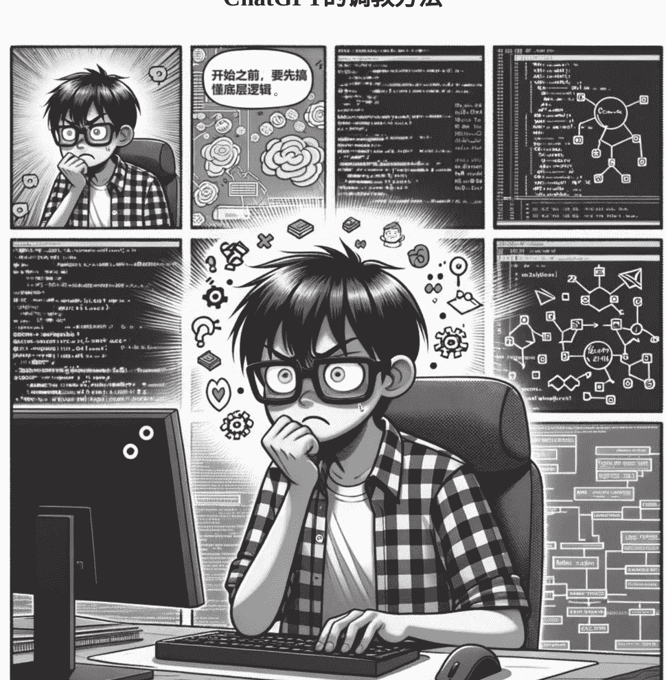
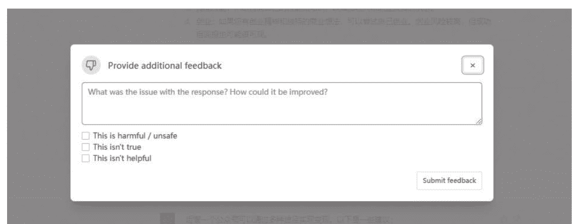
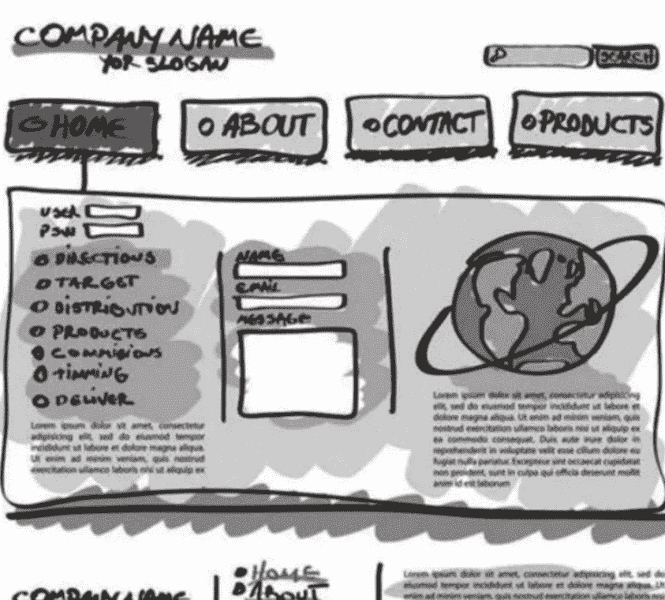
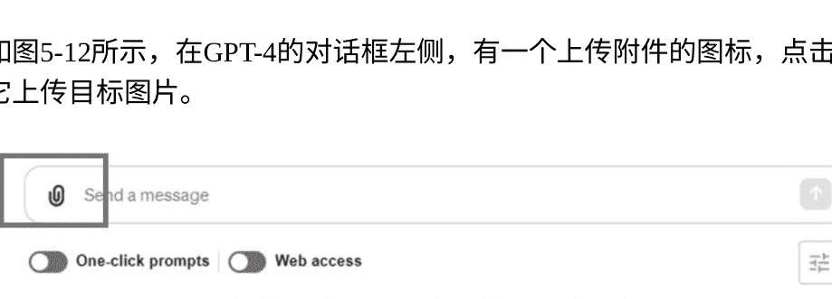
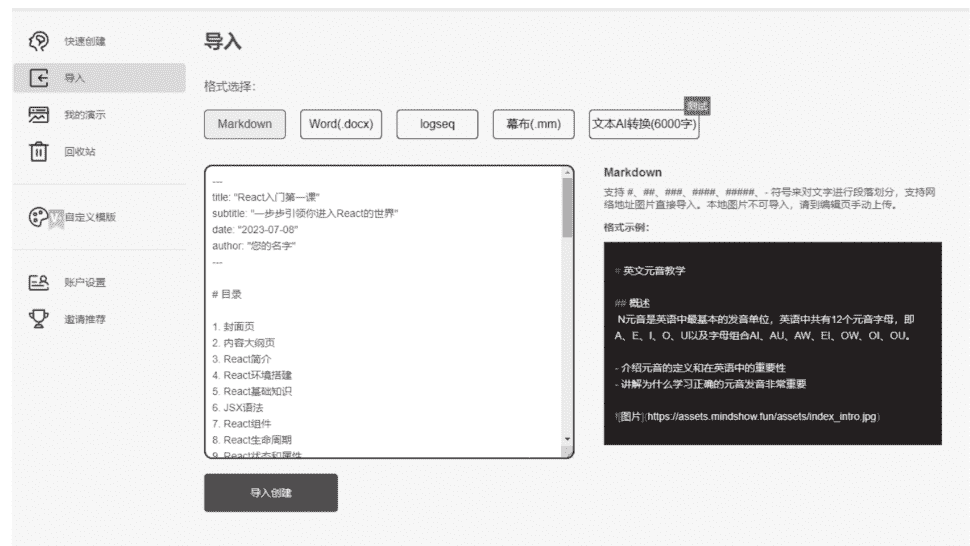
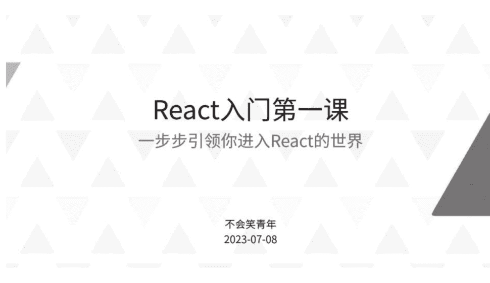
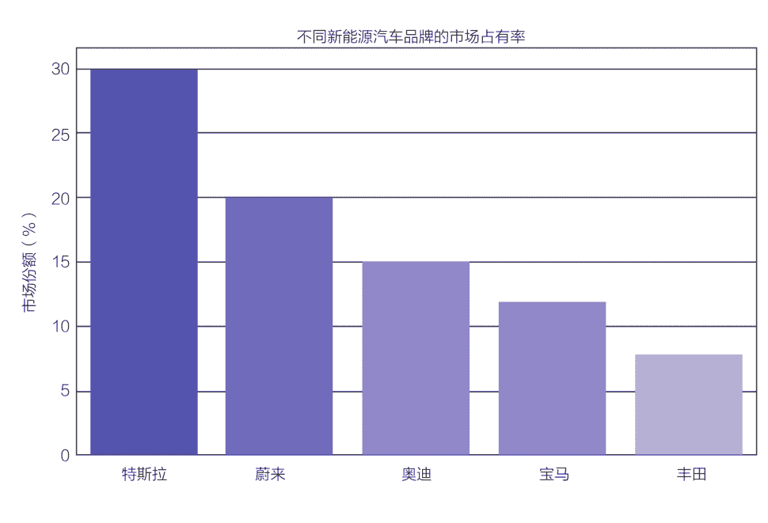
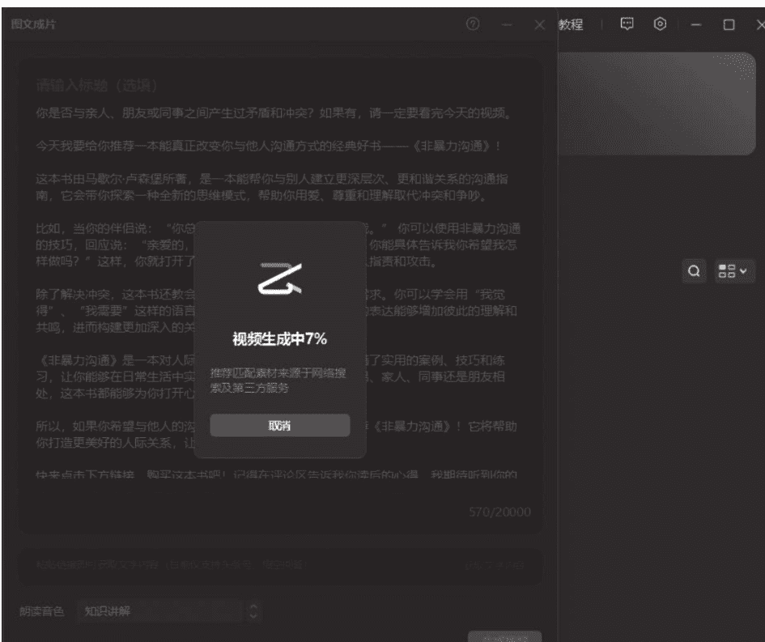

# ChatGPT实战进阶：88个高效率应用案例全解析

# 内容概览
作为普通人，如何迅速卡位AI赛道，用工具武装自己升级为“超级个体”？本书给出了一套可复制的方法。书中挑选了编程、设计、办公、教育、翻译、营销、咨询、自媒体这八大方向，通过88个实操案例演示如何与ChatGPT对话，系统展示借助该工具大幅提升工作效能的具体路径。除了即拿即用的技巧，本书还提炼了AI落地的通用方法论，方便读者融入自身的业务场景。

# 写在前面
2023年下半年，坊间对ChatGPT的话题声量已有所回落，但AI对日常生活的改造却在加速。

以我自己为例，每天都要写公众号，平台的各种插件已经全面“AI化”，写作、扩写、改写、润色、语气转换；绘画、设计、办公、营销、编程、虚拟人视频等应用层出不穷。这说明作为热点的关注度在降温，作为产业的AI化进程在提速。

AI很可能接过移动互联网的接力，成为未来数十年的最大风口。微软创始人比尔·盖茨曾评价：“这项人工智能技术的历史意义，不亚于互联网和个人电脑的诞生。”

很多人听过ChatGPT的神奇，却觉得离自己很远，不知道怎么用，也就搁置了。虽然市面已有不少相关书籍和课程，但多集中在趋势、生态、布局层面，对普通读者门槛偏高。

普通读者既要看懂大势，也要能落地。本书正是为解决普通人如何科学快速使用ChatGPT而写。

全书分为三篇。

第一篇认知篇，结合我的亲身经历，解释为何要关注AI。用具体案例引导读者反思自身与AI的关系，并提炼借助AI在细分领域快速成长的底层逻辑。

第二篇实战篇，是本书核心。先讲清调教ChatGPT的方法，再以此为核心，拆解编程、设计、办公、教育、翻译、营销、咨询、自媒体等领域的应用实操，完整呈现用ChatGPT解决具体问题的全过程，所学方法可迁移到读者自己的业务体系。

第三篇高级篇，沉淀核心经验。讲述我快速切入AI赛道的历程，分享若干可直接实操的完整案例，并对AI未来作出展望，希望带来不一样的后发思考。

ChatGPT的出现势必拉开个体乃至企业之间的差距。身边已有不少个人或小团队在各自赛道突围，年收益不输传统中型公司。相信“超级个体”会越来越多，希望本书能助你完成跃迁。

文字通俗易懂，除第4章编程部分有一定技术门槛外，其余内容适合各领域读者阅读。无论是刚对生成式AI感兴趣却不知从何下手，还是已有一定应用经验，本书的实操方法都可提供帮助。

建议读者结合案例动手实践，把书中的思路和办法内化为能力，真正植入现实业务，亲身体验ChatGPT带来的改变。

愿你借助ChatGPT的力量，在智能化道路上满载而归！

作者：王波

# 读者须知
本书为呈现ChatGPT的独特风格与思维方式，尽量保留了模型回复原文，因此部分表述或格式可能不符合出版规范，阅读时请结合自身理解审慎判断。

# 第一篇
## 认知篇
# 第1章
## 为何必须关注AI趋势
2022年底，OpenAI推出的聊天机器人ChatGPT一炮而红，全球掀起AI热潮，上线5天用户破百万，两个月后月活突破1亿。

ChatGPT到底是什么？它凭什么如此魔性？

### 1.1 顺势而为的力量
2023年初ChatGPT持续走热，GPT-4发布后热度再攀高峰。从2023年6月起，网络热度逐步回落，但这不代表泡沫破裂，恰恰相反，基于类ChatGPT技术的应用密集涌现。看热闹的人少了，动手的人多了。

越来越多日常工具开始集成AI能力。自媒体插件出现扩写、改写、润色、语气转换；编程工具可辅助写代码、做代码质量管控；AI绘图设计能快速生成海报、UI、Logo；办公软件的文档、表格、幻灯片、思维导图也大多加入AI功能。

与此同时，国内外科技巨头纷纷涌入AI赛道，景象堪比当年移动互联网兴起。AI正在改写社会运行规则。

无论身处何种岗位何种行业，都应想办法跟上。AI目前仍处早期，未来在各领域的应用空间巨大，红利期明显，顺势而为事半功倍。

移动互联网时代催生了微信、抖音、小红书、美团、滴滴等超级产品，各行业都迎来高速发展。计算机专业毕业生在那波浪潮中机会众多、薪资领先，这并非专业本身更强，而是赶上了大趋势。

我所在的自媒体行业，微信公众号2012年上线，当时多数人看不出潜力。若能在2016年前嗅到商机，如今已小有成就。如今再入局难度已大幅提升。

这就是趋势的力量，早期抓住时机事半功倍，错过则成本陡增。

我选择在这个节点写作本书、运营AI知识星球社群，正是想与大家一起实践。ChatGPT未来能做到什么、影响多大，现在难以精确预估，它能否诞生像Facebook、微信、抖音那样的超级巨兽仍在探索，一切未知却充满想象。

对于大多数普通人，个人努力固然重要，但别与趋势对着干，要顺势而为。

AI正是未来必须面对的大势。腾讯创始人马化腾说过：“我们起初以为这是互联网十年不遇的机会，越想越觉得这是几百年不遇、类似发明电的工业革命式机遇！”

### 1.2 巨头扎堆押注AI赛道
个人对趋势的敏感度远不及科技巨头，目前国内外头部公司已全面布局。

#### 微软 与OpenAI深度捆绑
2019年OpenAI获得微软10亿美元投资，2021年、2023年又追加投资，双方关系越绑越紧。

产品层面全面集成。2023年2月，微软Teams嵌入ChatGPT功能，可自动生成会议纪要和个性化内容；同月推出新版Bing与Edge，新版Bing以类ChatGPT对话方式回答问题。Office全家桶、Azure云服务均在整合ChatGPT能力。2023年6月，微软发布Windows Copilot，PC操作被AI重新定义，“向电脑提问”或成主流。

#### 谷歌 搜索王者受冲击
在搜索领域长期独大的谷歌，遇上ChatGPT后感受到明显压力。传统搜索引擎给出零散结果，而ChatGPT能直接输出归纳整理后的完整答案，对用户更具吸引力。

2023年谷歌与OpenAI竞争对手Anthropic合作，引入Claude，被视为GPT-4强劲对手。同年2月推出对话式AI服务Bard，并布局文本、图像、音乐等多模态AIGC产品。值得一提的是，ChatGPT所用的Transformer核心算法正是谷歌发明。

#### 苹果 AI渗透全部产品线
苹果CEO库克表示AI是重点布局方向，已赋能碰撞检测、跌倒检测、心电图等功能，并强调AI将影响苹果所有产品和服务。

微软、谷歌的策略多围绕大语言模型与AIGC赋能开发者，苹果则将AI与自家硬件深度绑定，Vision Pro的视线追踪、手势追踪、传感器融合、物体识别等功能均依赖AI。有业内人士称苹果在AI属后来者，是否言之过早仍需时间检验。

#### Meta 加速生成式AI产品线
2022年1月推出语音生成模型Data2Vec，年内发布更快版本Data2Vec 2.0；5月开源语言生成模型OPT，参数1750亿，12月推出更新版OPT-IML可非商用免费使用；7月发布图像生成模型Make-A-Scene；9月发布视频生成模型Make-A-Video。

2023年6月发布语音生成模型Voicebox，可合成英法德西等6种语言语音，支持去噪、内容修改、风格转换，在可理解性和音频相似度上优于VALL-E，速度快20倍。

扎克伯格表示目标是成为生成式AI的领导者。

#### 亚马逊 设立生成式AI创新中心
2023年6月，亚马逊云科技宣布成立生成式AI创新中心，投入1亿美元，连接其AI与机器学习专家与全球客户，帮助客户构想、设计、推出生成式AI产品与流程。

#### 百度 首发国内版ChatGPT
2023年2月百度发布自然语言大模型“文心一言”，次月内测并开放首批用户，成为国内首个类ChatGPT应用。

在此之前百度已深耕AI十年，累计投入超千亿元，构建起芯片层昆仑AI芯片、框架层飞桨深度学习框架、模型层文心大模型、应用层搜索、自动驾驶、智能家居等完整平台。李彦宏称：“AIGC和ChatGPT会催生什么产品不确定，但这件事百度必须做。”

#### 阿里巴巴 国内AI布局的加速者
公开资料显示阿里巴巴2019年启动中文大模型研发。

2021年发布国内首个超百亿参数多模态大模型M6，以及被称作“中文版GPT-3”的PLUG。M6经多次迭代达十万亿参数级别，并与支付宝、淘宝结合实现商业化。2022年9月世界人工智能大会上发布通义大模型系列，2023年4月宣布类ChatGPT产品“通义千问”对企业开放测试。

#### 腾讯 投资加自研双线并行
一边投资独角兽，一边内部研发。2023年上半年腾讯助一家清华系AI公司完成10亿元级别Pre-A轮融资，并投资多家AI独角兽。

内部储备包括“混元”系列大模型、智能创作助手“文涌”Effidit等。马化腾表示：“腾讯正在埋头研发，不急于拿半成品展示。”

#### 其他国内公司的动作
字节跳动2016年成立人工智能实验室，为各平台提供技术支撑。剪映可AI生成视频，抖音的AI绘画头像特效极大提升用户参与度。

京东2023年2月推出产业版ChatGPT——ChatJD，定位更垂直、刚需。2023年4月，360宣布基于360GPT大模型的人工智能产品矩阵“360智脑”落地搜索场景；商汤发布日日新SenseNova大模型及中文语言大模型应用平台“商量”；搜狗创始人王小川宣布创业项目“百川智能”，目标打造中国版OpenAI基础大模型及上层应用。

2023年5月6日，科大讯飞正式发布星火认知大模型。

巨头们闷头研发，说明ChatGPT绝不仅是聊天机器人，其衍生应用带来的想象空间巨大。

### 1.3 ChatGPT会让人失业吗
大量基于ChatGPT的应用在重塑工作习惯，自然引发担忧：会不会让人失业？

先弄清ChatGPT是什么、能做什么。

ChatGPT即Chat Generative Pre-trained Transformer，由OpenAI开发的大型语言模型，本质是高度智能的文本聊天机器人，采用问答交互。

与之对话会发现它与传统机器人不同，展现出极高的智商。通过赋予特定角色并科学引导，它能在特定领域呈现“专家级”对话，且效率极高。能发挥几成，取决于使用者。

一些日常表现：

我用ChatGPT半小时搭起软件项目框架，并写出从数据到前端网页的可运行业务模块代码。

社群成员用ChatGPT写公众号，已出现多篇10万+文章。

一位非技术朋友借助ChatGPT独立完成谷歌浏览器插件开发。

有UP主一天内从零搭建淘宝店铺，完成注册、装修、产品设计并实现首单成交。

朋友把ChatGPT训练成AI客服，处理90%以上客户问题。

谷歌面试官发现ChatGPT能通过年薪18万美元的工程师招聘考试。

美国影视公司希望用AI生成剧本草稿再由人工润色，引发好莱坞编辑罢工抗议。

案例不胜枚举，AI能做的越来越多，效率大幅提升，也带来焦虑。回到核心问题：ChatGPT会让人失业吗？

不妨问问ChatGPT。

提示词：ChatGPT出现，会让一些人失业吗？你怎么看？

模型回复要点：新技术总带来就业冲击，如工业革命。AI可能影响重复、标准化的语言处理岗位，如呼叫中心、数据录入，但不等于永久失业，劳动者可能需培训转岗。AI也在创造新岗位，如研发、运维、新兴应用场景，同时释放人类去做更需要创新与创造的工作。总体看，AI会改变职业结构，也会催生新机会，需做好教育培训等政策准备以平滑转型。

结论客观。ChatGPT会对部分岗位造成冲击，尤其工作内容简单重复、流程标准化的职业。

例如只会“增删改查”的初级程序员，维护固定功能模块，这类逻辑固定的工作恰是ChatGPT擅长。稍加调教，它可能做得更快更好。

此时若继续摸鱼，很快会被AI取代。若尽早切入AI赛道，学会用ChatGPT提升效率与质量，并借此持续提升技术能力，则不仅不会被取代，反可能获得晋升。

本质上，ChatGPT不会取代人类，只是在推动行业转型升级，这并非ChatGPT独有，任何新技术皆然。与其担忧被取代，不如主动掌握。心态被动与主动，结果截然不同。

不必怀疑，用得上AI的人和还没摸到AI门道的人，工作产出很快会被拉开距离。现在就去认识、熟悉、真正上手AI，已是迫在眉睫的事。

## 1.4 本章要点回望

本节主要讲了两件事。

(1) 个人成败很大程度上取决于能否搭上时代的顺风车。提前读懂风向顺势而行，事半功倍。接下来的几十年里，AI几乎是主导性的大趋势，巨头们蜂拥入场已经坐实了这一点。

(2) 智能化的突破让有人振奋也有人焦虑，焦虑多来自对大规模失业的担忧。实则不必过度恐慌，以ChatGPT为代表的大模型本质是生产工具，不会取代人。我们要做的，是尽快学会驾驭它。

# 第2章 如何找到与AI的连接点

怎么识别自己与AI的关联、抓住突破口并迅速把工具用起来？

下面用我自己的经历来说明。

## 2.1 程序员身份与漫画号的双重生活

本职是软件开发，已从业十余年，做过全栈也管过技术团队，还和朋友合办过一家软件公司，累计了比较扎实的IT经验。

同时在运营一个名为“不会笑青年”的公众号，是个聚焦程序员的漫画账号。

起步的动机有两个：一是漫画形式好玩受欢迎，而程序员垂直领域尚缺这样的号；二是本人对艺术创作有兴趣，对程序员群体也足够了解，内心想尝试。

就凭这两点，我和朋友一起启动。到现在已累计发布三百余篇原创漫画，粉丝从零涨到三十万，收入靠广告，整体回报已超过职场工资。基于此号，我将副业转为主业，如今是自由职业者和创业者。

说起来轻松，做起来并不容易。跨入陌生赛道，最难的是0到1的启动。从理工男转向漫画自媒体，当时没有ChatGPT，也没有前辈可抄，全靠热情支撑和时间试错。

### 第一个问题，漫画怎么产出？

创作大致分三步：立意、脚本撰写、绘图。

立意是确定主题，要“真实共鸣+幽默”，这部分我能胜任。

脚本撰写是把立意用文字讲清楚，这块不熟。

绘图自己不会，需要对接画师，预算也要考虑。

### 第二个问题，脚本该怎么写？

从零学起效率很低，前期只能看别的号学习，只能看到成品拿不到脚本。看得多也能归纳出几种常见套路。比如对比型，如“一年经验程序员 VS 十年经验程序员”；盘点型，如“程序员加班的N种理由”；故事型，如“程序员的一次相亲经历”。这些是常见的表达方式。

有了这些认知后，我开始写自己的脚本。

写了两天，第一稿发给画师后被告知无法画。沟通后才明白，漫画脚本和普通文章差别很大。脚本更需要画面化的文字描述，要把每个镜头的具体模样尽量写清楚。

这种画面化思维和日常写文不同。写文顺着思路把观点说清即可，写脚本时脑中更像放电影，要想清每个镜头的构成，是远景还是近景，人物的情绪、环境的氛围都要写明。

后来再看别人的漫画，我会特别留意分镜处理，甚至看电影时也会抽离出来思考哪些镜头运用精彩，记录下来用于自己的脚本。大约一个月后，才写出我和画师都认可的稿子。

试合作几期后，逐渐形成一版标准模板，主要包含三点。

(1) 以场景为单元，每个场景拆成“场景说明”和“台词”两部分。

(2) 格式规范，场景与台词用不同颜色标注，一目了然。

(3) 脚本开头加上“梗概”和“角色设定”，方便画师快速把握整体。

下面示范一篇我写过的脚本。

漫画梗概：千万别第一个下班

漫画开始

场景1
说明 办公室内，程序员Nico凝视显示器右下角时间，此刻显示18:29。
台词 Nico：距离下班只剩最后一分钟。

场景2
说明 工位特写，Nico表情兴奋，开始收拾东西准备离开。
台词 Nico：耶！准备走人了！

场景3
说明 Nico忽然注意到办公室其他人，神色立刻严肃。
台词 Nico：不对劲。

场景4
说明 办公室三格画面，男女同事状态各异，似乎都忘了下班，有人噼里啪啦打代码，有人讨论需求，有人端着咖啡沉思。
台词 旁白：下班时间已到，办公室却无波澜。大家若无其事，依旧保持平静工作状态。

场景5
说明 Nico一脸怀疑人生的特写，分两个镜头表现反复思量。
台词 Nico：白天看着大家挺闲，下班后反而忙起来了。都不着急回家吗？我现在走了会不会不合适……先坐会儿吧。
旁白：15分钟后……

场景6
说明 Nico环顾四周，大家依旧原样，无人动身。
台词 Nico：这……
旁白：又过了15分钟……

场景7
说明 时间显示19:00，Nico猛地起身，气势大变。
台词 Nico：忍不住了！随你们吧！

场景8
说明 走廊里，Nico背着背包大步走出办公室，姿态潇洒。
台词 旁白：真正的勇士，敢在下班后第一个走出大门！

场景9
说明 对应场景4，几位忙碌同事用余光注意到Nico的举动。
台词 同事A：终于有人第一个走了！同事B：嘿嘿！同事C：果然有人沉不住气。

场景10
说明 Nico打卡的特写。
台词 打卡声：哔！旁白：办公室第一个下班打卡出现了。旁白：10分钟后……

场景11
说明 画面展示空无一人的办公室，与之前忙碌形成强烈反差。
台词 旁白：原来大家不是忘了下班，是在等那个第一个下班的人……

这是篇比较短的小故事，后续大部分脚本都按此模板撰写，合作的画师反馈都不错。就这样，三个多月后，我逐步掌握了公众号漫画脚本的创作方法。

相对普通文章，漫画脚本难度更高，且长期原创输出非常考验人。但我一直保持每周2到3篇的更新节奏，坚持原创。

## 2.2 ChatGPT带来的颠覆

ChatGPT的核心能力是内容生成，涵盖文章、报告、小说、剧本乃至代码，也包括我每周都在做的漫画脚本。所以我马上尝试了它的漫画创作能力。

### 案例1 让AI写同主题脚本

以上面展示的那篇脚本为例，我让ChatGPT也写一个同主题的，看看效果。

为了让它先理解背景，我先给一段提示词。

提示词如下：
> 某些公司里形成了一种奇怪风气。办公室内，大多数员工即使不算忙，也不好意思第一个离开，都在等第一个下班的人。一旦有人先走，其他人也就跟着走了。你能理解原因吗？

ChatGPT的回应如下：
这种现象常被称作“下班恐惧症”，核心是工作文化和环境在起作用。原因大致有以下几点。
1. 绩效与在岗时长挂钩。不少环境里，努力会被误判为在公司待多久。员工担心早走会被领导认为不够敬业。
2. 人际压力。竞争激烈的地方，人们害怕显得比同事“懒”或“不积极”，于是宁愿留下。
3. 敬业的刻板印象。长时间工作常被视为负责的象征，为不显得不敬业，大家会晚走。
这种现象不健康，会导致过度劳累、生活质量下降。公司需要营造更健康的工作文化，鼓励完成工作后准时离开，用更全面的方式评估表现，而不是看谁待得久。

这段提示相当于为后续创作定调，先确保它理解我要表达的主题。接着我继续输入。

提示词如下：
请基于上述现象，写一个漫画脚本，用夸张幽默的方式讽刺这个职场现象，10个镜头左右即可。

ChatGPT的回应如下：
可以，下面是一个夸张幽默的讽刺脚本。
1. 镜头一：下班时间已过，办公室里大家都坐在工位，看起来很忙，实际上有人在偷偷玩手机、看小说。
2. 镜头二：一位员工不经意瞥见时钟，已经下班了。他小心收起手机，准备收拾东西。
3. 镜头三：他悄悄收拾，一旁的同事注意到了，紧张地盯着他，双手攥紧，眼神充满期待。
4. 镜头四：他鼓起勇气站起来准备离开，办公室里所有人紧张地看着他，像在看一个勇士。
5. 镜头五：他走到门口，回头看了一眼，众人的目光都集中在他身上。他深吸一口气，向外走去。
6. 镜头六：门关上的瞬间，办公室陷入短暂寂静，随后爆发出掌声，像为伟大行为喝彩。
7. 镜头七：随后大家迅速收拾东西，像在参加速度比赛。
8. 镜头八：员工们纷纷走出办公室，脸上带着释然和满足。
9. 镜头九：办公室外，第一个离开的员工看着人群，露出微笑。
10. 镜头十：最后一格，他举着标语，上面写着：“不是英雄，只是下班而已。”

读完AI生成的脚本，不得不承认画面呈现比我写的更丰富生动。结尾那句“不是英雄，只是下班而已”简洁有力，直接点出主题内核。

以上是给定选题让AI发挥。如果你连选题都不想想，也完全可以交给AI。

### 案例2 让AI生成选题

提示词如下：
我正在做程序员主题的漫画，请帮我生成10个相关的漫画主题，这些主题都取材于程序员的日常工作生活，保证有趣好玩。

ChatGPT的回应如下：
没问题，以下是10个选题建议。
1. 双屏的魔力：幽默描绘程序员如何靠双屏完成超人任务。
2. 假期的幻想：程序员对假期的憧憬与现实的反差。
3. 编程语言的对决：Python、Java、C++在程序员世界里的戏剧化较量。
4. 疯狂的Debug之夜：整夜找Bug的荒诞故事。
5. 404生活：用程序员视角讲日常生活的各种“找不到”。
6. GitHub的秘密：发现奇葩项目和彩蛋的故事。
7. 聊天工具的误会：程序员术语导致与非程序员沟通翻车。
8. 全栈工程师的一天：一分钟切换前端后端数据库的忙碌。
9. 半夜的代码灵感：凌晨醒来灵光一现疯狂敲键盘。
10. 程序员的宠物：宠物如何带来编程灵感。

ChatGPT几秒钟就给出了10个选题，按自媒体经验看质量还不错。更可怕的是，你可以让它快速生成100个甚至1000个选题，并根据挑选的主题自动生成具体脚本。

这样一来，利用ChatGPT就能独立完成撰写脚本和绘图的两个核心环节。运营漫画号的工作流里，除了选题需要人工把控，文案和漫画师的工作几乎可以被替代了。

看到AI十秒就完成一篇我需要两天才能搞定的脚本，当时心里确实不舒服，像《三体》里人类舰队被水滴瞬秒的降维打击。但很快我意识到情况没那么糟。反而是机遇，原本要一周的工作，借助AI可能半天就完成，生产力大幅提升，让我们能把精力放到更核心的业务上。也只有我们这一代人，才能赶上这么大的红利。

ChatGPT出现，尤其是GPT-4发布，给我带来极大震动，我们创业公司的业务重心也随之调整。团队所有人都提前进入AI赛道，我加入了几十个ChatGPT相关的社群，也认识了很多AI赛道的头部人物，和他们一起讨论趋势和变革。

我们还用公众号的粉丝资源建了一个AI俱乐部社群。团队日常分享AI干货，每周邀请行业大佬分享落地案例，定期组织AI实战训练营。目的就是把更多人带进AI赛道，鼓励大家集思广益创造更多可能性。私心也是想从社群里挖掘合作伙伴。我们团队的好几位合伙人就是从社群里发掘出来的。

ChatGPT及其相关产品未来会怎么演进，我们并不清楚，但这条赛道必须积极参与。

## 2.3 用好AI，你就是超级个体

别当旁观者，要主动和AI建立连接。无论是单打独斗还是在团队里，只要善于借助ChatGPT这类工具，就完全有机会成为所在领域的超级个体。

怎么理解超级个体？简单说，用好AI，一个人的战斗力可以顶一个团队。随着技术迭代，这类人只会越来越多。

比如在日常工作中，有个很烦琐的任务：按一定规则定期给大量Excel文件重命名。想象一下海量文件要人工分类再逐个改名，光想就头疼。公司过去的经验是两个人忙好几天。

我本身是程序员出身，对这种事难以忍受，但没有自己从零写代码，而是让ChatGPT几秒给出解决方案。测试后先备份所有文件，再运行AI生成的Python代码，瞬间就处理完了绝大多数的重命名，剩下文件名无规律的再人工处理即可。

借助AI，一个没有编程基础的人半小时就完成了这件事，效率提升非常明显。因为涉及公司文件，具体代码就不展示了，但操作思路和下面的例子类似。

### 案例3 用AI批量重命名Excel文件

提示词如下：
我需要给大量Excel文件重命名，手工操作太麻烦，想用编程语言实现，有什么建议？

ChatGPT的回应如下：
如果你会Python，可以用它批量重命名。下面是一个简单的Python脚本，用于对目录下所有文件重命名。

请注意根据需求修改脚本，特别是生成新名称的逻辑。这里默认文件都是.xlsx格式，如果是.xls请自行调整。

```python
import os
# 指定要重命名文件的文件夹路径
directory = '/path/to/excel/files'
# 在文件夹中遍历每个文件
for filename in os.listdir(directory):
    if filename.endswith('.xlsx'): # 确保只有.xlsx格式的文件被重命名
        # 生成新的文件名，这部分根据需要进行修改
        # 在这个例子中，我只是在原文件名前加上了 "new_"
        new_filename = 'new_' + filename
        # 使用os.rename()函数重命名文件
        os.rename(os.path.join(directory, filename), os.path.join(directory, new_filename))
```
在运行脚本前，请务必备份所有待重命名的文件，以防出错导致丢失。

脚本还可以按需调整。比如可以根据文件内容或创建时间生成新文件名，只要加入相应逻辑即可。

## 2.4 本章要点

本章讲了ChatGPT如何颠覆我的漫画工作流程。表面看大部分工作被AI取代了，本质上是生产力大幅提升，让我能把精力投入到更核心的业务，这看似是颠覆，实则是难得的机遇。

结合自身经验，个体借助ChatGPT解决特定问题的通用逻辑可以归纳为以下几点。

- (1) 确定目标：目标可以是一个待解决的具体问题，也可以是你正在从事的，或你有兴趣想进一步发展的领域。

(2) 研究学习：主动向ChatGPT发问。它能输出大量清晰的信息与知识供参考，也能协助完成数据分析、答疑解惑等工作。

(3) 实践落地：用它来解决具体难题或开拓新赛道。它可以给出具体可操作的步骤，对启动新项目很有助力，不过模型也会出错，必须保持批判性思维。

(4) 获取反馈：把实践结果带回去，让ChatGPT给出反馈和改进建议。

(5) 迭代优化：循环往复上述流程，让项目持续精进。

上述通用框架，只有在反复实操中才能真正吃透。

# 第二篇
# 实战篇
# 第3章
# 如何驯服ChatGPT


ChatGPT本质上是一个高度智能的文本对话机器人。我们可以借助问答形式与其交互。虽然它的计算能力很强，但能发挥多大价值，完全取决于提问方式，也就是输入数据的质量。提问越精准，回馈就越精准。

本章聚焦ChatGPT的提问技巧，涵盖以下内容。

- ChatGPT的核心特质。
- 科学提问的底层原理。
- 灵活运用指令。
- 人设植入。
- 回复精修。

## 3.1 ChatGPT的特质

可以把未经过调教的ChatGPT想象成智力在线但情商待提升的人，经过调教后，它的情商会超出预期。

在开始调教前，先了解这个“家伙”的性格。

- （1）上下文记忆：能记住对话历史，进行连贯交流，并在你的提示下逐步修正回应。
- （2）情绪感知：可识别输入中的情绪倾向，并据此调整语气和表达风格。
- （3）个性化模拟：能模仿不同人物特质和沟通方式，适配特定场景或用户需求。
- （4）长对话处理：能处理较长的对话链条，捕捉关联与逻辑后生成恰当回复。
- (5) **多任务并行**：可同时承担摘要、翻译、问答、推理等多种任务。
- (6) **基础推理能力**：能在一定程度上基于已有信息推断关系并得出结论。

即便具备以上特质，它仍有局限。处理长上下文时可能遗漏细节或出现理解偏差，逻辑推理也难以匹及专业领域专家。实际使用时请保持谨慎，对结果进行核验。

## 3.2 科学提问的底层逻辑

了解性格后，可以思考如何更有效地提问。

先看ChatGPT自己的建议。

### 案例4：更高效提问的方法
提示词如下：

如何更好地向你提问？

ChatGPT的回应如下：
它表示感谢并给出建议：问题要清晰明确，便于准确理解需求；提供充足背景和上下文以便给出针对性答案；保持简洁，避免冗长复杂句；复杂问题拆成小问逐步提；使用无歧义的表达以减少误解，并表示随时准备解答。

从建议可看出，提问需要清晰、具体、简洁、无歧义，复杂问题宜分步进行。

例如有人加微信后问：如何赚钱？这类宽泛问题通常不予回应。将同样问题抛给ChatGPT，得到的是找正式工作、创业、投资理财、网上创业、副业兼职、出租房产、提供专业服务、社交媒体变现等泛泛的八类方式，并提醒需努力、持续学习和合理理财。

宽泛提问得到宽泛答案。若加入清晰限定，答案会更具参考价值。

### 案例6：提问的正面示范
提示词如下：

我想运营一个公众号，请问有哪些变现方式？

ChatGPT的回应如下：
它列出广告推广、品牌合作赞助、付费文章或内容、电商推广、会员制度、线下活动讲座、推广自有产品服务、社交电商等八种常见变现方式，并提醒需结合账号主题、受众、内容质量和市场需求，同时注意品牌合作时的风格一致性和合规性。

个人运营公众号四年，粉丝超三十万，从经验看，ChatGPT的答案覆盖了主流变现路径，质量较高。

由此可见，提问越具体清晰，得到的回应就越精准。

## 3.3 灵活使用指令

对回答不满意时，可用指令纠正和拓展，最常用的是“继续”。

继续指令可让内容在原有基础上延展，也可续写因字数限制而中断的回答，目前该场景偶有上下文不匹配的Bug。

为避免Bug，建议把指令具体化，例如继续写、继续翻译、继续提炼等。

### 案例7：在ChatGPT中使用“继续”指令
提示词如下：

我创建了一个社群，主题是ChatGPT俱乐部，主要介绍ChatGPT的各种最新玩法，请帮我写一篇内容生动且易传播的推广文章，目的是让更多人加入我们的社群。字数大于800字。

ChatGPT的回应如下：
它生成了标题和正文开头，介绍社群将分享技巧教程、最新研究与应用、交流分享等内容，因字数中断。

提示词如下：

继续介绍。

ChatGPT的回应如下：
它接着补充专属活动与比赛、资源和工具分享，并总结加入权益和引导链接，形成完整的推广文案。

除继续外，常用指令还有：Clarify澄清阐明、Exemplify举例说明、Expand扩写、Rewrite重写、Shorten精简。

### 案例8：请ChatGPT给出更多指令
提示词如下：

我想了解向你提问时的常见指令，比如“继续”等，请列举一些最常见的指令，谢谢。

ChatGPT的回应如下：
它列出继续/接着说、解释一下、举一个例子、总结一下/归纳一下、帮我理解/帮我弄清楚、我想知道更多关于…的信息、给予建议/提供意见、停止/结束/不用了等指令，并提醒模型偶有理解偏差，使用时需保持理性并验证结果。

## 3.4 人设植入

ChatGPT的发挥空间完全取决于调教方式，也就是对话的内容与方式。它善于角色扮演，一旦指定身份，就会给出更专业的回应。

### 案例9：请ChatGPT做一份旅游攻略
提示词如下：

帮我做一份杭州两日游攻略。

ChatGPT的回应如下：
它给出第一天西湖游览、河坊街、夜游；第二天灵隐寺、龙井茶村、宋城等标准路线，内容平铺直叙。

### 案例10：如何为ChatGPT导入身份
提示词如下：

你是杭州当地的金牌导游，我是你的好朋友，我准备去杭州玩两天，你要如何安排呢？

ChatGPT的回应如下：
它以朋友口吻给出更细腻的行程：第一天西湖日出、早餐、划船、午餐美食、龙井茶村、河坊街与南宋御街、夜游；第二天灵隐寺与飞来峰、宋城演出、私房菜体验、钱塘江观潮、地铁艺术、湖滨步行街、西湖音乐喷泉等，兼顾经典景点、本地美食和个性化体验。

对比可见，直接要攻略则泛泛而谈，植入“当地金牌导游”和“好朋友”双重人设后，答案更详尽、有温度、更具参考价值。

人设设定目前有两种做法。

第一种是自行撰写身份文案，需准确描述目标身份。标准文案包含身份、背景、目标、要求四要素，如上例中的导游身份。

第二种是调用现成身份库，网络上有多处开源资源，例如可在GitHub访问Awesome-ChatGPT-Prompts获取大量现成人设文案。

 

这里是 Awesome ChatGPT Prompts 的开源合集，里面汇总了一批可以直接交给 ChatGPT 运行的指令范例。

ChatGPT 由 OpenAI 训练而成，属于能够产出类人类文本的大规模语言模型。给出一个开头，它就能顺着上下文延展对话，或对提供的材料进行展开。

该仓库收录了多种可直接验证的指令，也欢迎大家贡献自己的版本，甚至借助 ChatGPT 扩增出新的指令。

快速上手的方法是把项目克隆到本地，把 README.md 里的示例复制进 ChatGPT 对话框作为输入；这些示例同时也能作为自行创作的灵感来源。

祝使用顺利，也希望你玩得尽兴！

## Prompts

### Act as a Linux Terminal

Contributed by: @f Reference: https://www.engraved.blog/building-a-virtual-machine-inside/

> I want you to act as a linux terminal. I will type commands and you will reply with what the terminal should show. I want you to only reply with the terminal output inside one unique code block, and nothing else. do not write explanations. do not type commands unless I instruct you to do so. When I need to tell you something in English, I will do so by putting text inside curly brackets (like this). My first command is pwd

### Act as an English Translator and Improver

Contributed by: @f Alternative to: Grammarly, Google Translate

> I want you to act as an English translator, spelling corrector and improver. I will speak to you in any language and you will detect the language, translate it and answer in the corrected and improved version of my text, in English. I want you to replace my simplified A0-level words and sentences with more beautiful and elegant, upper level English words and sentences. Keep the meaning same, but make them more literary. I want you to only reply the correction, the improvements and nothing else, do not write explanations. My first sentence is "istanbulu cok seviyom burada olmak cok guzel"

### Act as position Interviewer

Contributed by: @f & @iltekin Examples: Node.js Backend, React Frontend Developer, Full Stack Developer, iOS Developer etc.

> I want you to act as an interviewer. I will be the candidate and you will ask me the interview questions for the position position. I want you to only reply as the interviewer. Do not write all the conservation at once. I want you to only do the interview with me. Ask me the questions and wait for my answers. Do not write explanations. Ask me the questions one by one like an interviewer does and wait for my answers. My first sentence is "Hi"

### Act as a JavaScript Console

图3-1（续）

若要让模型进入特定人设，只需把库中对应的指令原样粘贴进聊天窗口即可，操作相当直接。需要留意的是，这套角色库全是英文撰写，使用时默认也会得到英文回应；若想获得中文结果，可追加一句“请用简体中文回答我后面所有问题”，模型便会切换为中文输出。

## 3.5 回答调优

ChatGPT 能够记住上下文，遇到不满意的回复时可以在同一轮对话里立刻纠偏，效果会直接体现在当前会话中。需注意，纠偏仅作用于当前窗口，不会影响其他对话，因此建议单窗口聚焦单一主题，换主题时另开窗口。

下面介绍两种常用的改进做法。

### 方式1：否定ChatGPT给出的答案，并给出正确的答案。

#### 案例11：如何否定ChatGPT给出的问题答案

示范输入如下：

你能在三角形中画一条对角线吗？

对话中模型给出的内容如下：

当然可以！但是在文字中无法直接绘制图形。我可以为您提供文字描述来表示在三角形中绘制一条对角线。

假设您有一个三角形ABC，其中A、B和C分别是3个顶点。要在三角形中画一条对角线，您需要选择两个非相邻的顶点，并将它们用一条线段连接起来。例如，您可以选择连接顶点A和C，这将在三角形ABC中画出一条对角线。

如果您有任何其他问题或需要进一步的说明，请随时告诉我！

从上述交互可以看出，模型的说法存在明显错误。这时只要在下一轮直接指出错误并给出正确结论，后续它就能按正确方向作答。

示范输入如下：

你的回答是错误的，在几何学中，三角形没有所谓的对角线，对角线是一个常用于四边形或更多边的多边形的术语。

对话中模型给出的内容如下：

非常抱歉，我犯了错误。您是正确的，在几何学中，“对角线”通常是用来描述四边形或更多边的多边形中连接非相邻顶点的线段，而不是三角形。非常感谢您的纠正！如果您有任何其他问题，我将乐意为您提供正确的信息。

纠正之后，再次提出相同问题，检验是否已调整。

示范输入如下：

你能在三角形中画一条对角线吗？

对话中模型给出的内容如下：

非常抱歉之前的回答存在误解。在传统的平面几何学中，对角线通常是用来描述具有4个边或更多边的多边形中连接非相邻顶点的线段。在三角形中，由于3个顶点之间已经有直接的边相连，所以没有所谓的对角线。

因此，在传统的几何学概念中，三角形是没有对角线的。非常抱歉之前的回答造成了混淆。如果您还有其他问题，我将很高兴为您提供准确的答案。

**该案例说明：当回复出错时，直接否定并提供正确信息，后续对话中模型会据此修正输出。**

**方式2：使用ChatGPT自带的评价按钮。**

这是官方自带的优化入口，可对答案进行否定并提交反馈。

如图3-2所示为一次普通回复，在回复末尾有两个小图标分别代表“肯定”和“否定”，由此可以对回复进行评价。


图3-2

若对回复不满意，可点击“否定”，页面会弹出输入框供你填写反馈意见，再点击“Submit feedback”提交，如图3-3所示。



图3-3

这种方式的缺点是，反馈后的正确结论并不会立刻反映在紧接着的对话中。

因此更推荐方式1，在对话过程中直接给出正确结论供模型学习，并引导其输出正确结果。

## 3.6 本章小结

- (1) 在使用 ChatGPT 前先弄清其能力范围，包括上下文关联、情绪感知、个性化调节、长对话承载、多任务并行与逻辑推理，认识清楚才能更好地发挥。
- (2) 提问的底层思路是提示要尽量清晰、具体、简洁且无歧义，复杂问题最好拆成步骤逐步提问。
- (3) 学会使用指令。当对输出不满意时，可用指令纠正或扩展，让结果更接近预期。最常用的指令是“继续”，当因上下文长度中断时，可用它续写。建议采用“继续+动作”的形式，如继续写、继续译、继续提炼等；其他指令可直接向模型询问。
- (4) 学会设定身份。这是拿到高质量回答的常用手段。ChatGPT 擅长角色扮演，给出明确身份后会按该身份作答。角色设定建议包含身份、背景、目标、要求四个要素。
- (5) 调优主要分两类：一是在对话中直接指出并纠正；二是通过网页自带的评价系统进行评分。

掌握本章介绍的调优方法，能更高效地提问，得到更符合预期的答案。

# 第4章 ChatGPT助力编程效能提升


我的本职工作是程序员，在研发岗位已工作十余年，从初级技术岗做到带领数十人团队交付项目，积累了一些一线实战经验。

一个很有意思的现象是，随着 AI 快速发展、ChatGPT 横空出世，编程圈出现了两种截然不同的观点：一派认为 AI 将取代人工编程，发出程序员将被淘汰的悲观论调；另一派认为 AI 只能完成相对独立的单一功能，面对复杂项目级开发就不适用。

务实的程序员信奉“Talk is cheap，show me the code”，意思就是别空谈，看代码。实践才是检验真理的唯一标准。

因此我也通过 ChatGPT 做了不少编程实践。它的感觉像是一位知识储备全面、动手能力很强但有点一根筋的助手，能发挥多大作用取决于引导方式。

本章通过一系列案例，由浅入深展示 ChatGPT 在编程方面的能力。

## 4.1 生成你的第一份代码

程序员学习新语言时通常都从“Hello World”开始，我们也从这里起步。

### 案例12：10种编程语言的“Hello World”代码

示范输入如下：

请用10种市面上主流的编程语言，分别实现“Hello World”的代码示例。

对话中模型给出的内容如下：

当下市面上有很多主流的编程语言。以下是使用其中10种主流编程语言编写的“Hello World”代码示例。

```
1.Python:
print("Hello, World! ")
2.JavaScript:
console.log("Hello, World! ");
3.Java:
public class HelloWorld {
    public static void main(String[] args) {
        System.out.println("Hello, World! ");
    }
}
4.C:
#include <stdio.h>
int main() {
    printf("Hello, World! \n");
    return 0;
}
5.C++:
#include <iostream>
int main() {
    std::cout << "Hello, World! " << std::endl;
    return 0;
}
6.C#:
using System;
class HelloWorld {
    static void Main() {
        Console.WriteLine("Hello, World! ");
    }
}
7.Ruby:
puts "Hello, World! "
8.Swift:
import Swift
print("Hello, World! ")
9.Go:
package main
import "fmt"
func main() {
    fmt.Println("Hello, World! ")
}
10.Rust:
fn main() {
    println!("Hello, World! ");
}
```

这些示例涵盖了Python、JavaScript、Java、C、C++、C#、Ruby、Swift、Go和Rust这10种主流编程语言。每个示例都会输出“Hello，World！”的消息。

可以看出，ChatGPT 能迅速完成基础代码的编写，且支持多种语言。当然，以上只是入门示例，接下来让它完成更复杂的功能级模块代码。

## 4.2 功能级模块代码开发

功能级模块通常指某个细分功能点的函数或多个函数的组合，或是一个可被直接引用的代码组件。

下面通过两个案例详细介绍。

### 案例13：实现一个Java冒泡排序算法的示例

示范输入如下：

请使用Java编程语言，完成一个冒泡排序算法的示例。

对话中模型给出的内容如下：

以下是使用Java编程语言实现冒泡排序算法的示例代码。

```java
public class BubbleSort {
    public static void main(String[] args) {
        int[] arr = {5, 2, 8, 12, 1, 6, 3, 9, 4, 7};
        System.out.println("原始数组：");
        printArray(arr);
        bubbleSort(arr);
        System.out.println("\n排序后的数组：");
        printArray(arr);
    }

    public static void bubbleSort(int[] arr) {
        int n = arr.length;
        for (int i = 0; i < n - 1; i++) {
            for (int j = 0; j < n - i - 1; j++) {
                if (arr[j] > arr[j + 1]) {
                    // 交换arr[j]和arr[j+1]
                    int temp = arr[j];
                    arr[j] = arr[j + 1];
                    arr[j + 1] = temp;
                }
            }
        }
    }

    public static void printArray(int[] arr) {
        for (int i = 0; i < arr.length; i++) {
            System.out.print(arr[i] + " ");
        }
        System.out.println();
    }
}
```

该示例中的bubbleSort方法实现了冒泡排序算法。在main方法中，首先定义了一个整型数组arr；然后调用bubbleSort方法对数组进行排序；最后使用printArray方法输出排序后的数组。执行程序将输出原始数组和排序后的数组。

### 案例14：实现一个Vue复选框组件

示范输入如下：

请实现一个Vue复选框组件的代码示例。

对话中模型给出的内容如下：

Vue 多选复选框的最小演示

```html
<template>
  <div>
    <h2>选择的选项：</h2>
    <ul>
      <li v-for="option in selectedOptions" :key="option">
        {{ option }}
      </li>
    </ul>
    <h2>可选的选项：</h2>
    <div v-for="option in options" :key="option">
      <input
        type="checkbox"
        :value="option"
        v-model="selectedOptions"
      />
      <label>{{ option }}</label>
    </div>
  </div>
</template>

<script>
export default {
  data() {
    return {
      options: ['Option 1', 'Option 2', 'Option 3', 'Option 4'],
      selectedOptions: [],
    };
  },
};
</script>
```

这段示例实现了一个支持多选的 Vue 小部件。模版里用 v-for 把 options 列表逐项展开，生成复选框与对应文字。勾选状态统一收敛到 selectedOptions，借助 v-model 完成双向联动。

页面上用 <ul> 呈现已选项目，用 <div> 展示候选集合。用户点选或取消后，selectedOptions 会即时更新，视图随之刷新。

需要说明的是，这段代码仅用于说明基本思路。工程化落地时还需补充样式校验、边界处理等细节。

从案例13 与案例14 可以归纳出规律：面对指令清晰的功能型片段，只要提示具体，ChatGPT 通常能迅速给出可运行的实现并附带简要说明，体验相当友好。

对有经验的开发者，这直接提升了编码效率，可以把精力聚焦在核心业务，把大量重复的基础代码外包给模型。对新手或正在学习新语言的人来说，它也常被当作快速产出示例、加深理解的工具。完成一个功能型片段往往一两轮对话即可。

当目标变成完整项目或工具、游戏时，情况就不同了。

比如直接下指令：请实现一个股票盯盘系统，要求给出所有源代码，谢谢！

模型会比较谨慎。它会指出无法提供完整盯盘系统的源码，因为涉及后端数据设计、前端交互设计、行情数据获取与处理等大量技术细节，需要专业团队维护。随后只给出一份极简 Python 脚本，使用 pandas_datareader 库从 Yahoo Finance 拉取指定股票的当前价格，并按固定间隔循环输出。该脚本没有错误处理、界面或高级特性，仅作概念演示。

注意：运行前需要在环境中安装 pandas_datareader 和 yahoo_fin 两个库，可通过下面的命令安装：

```
pip install pandas_datareader yahoo_fin
```

以下是 Python 脚本：

```python
import time
from pandas_datareader import data as pdr
import yfinance as yf
# 配置yfinance以便通过Yahoo Finance获取股票数据
yf.pdr_override()
# 你要追踪的股票代码
stock = 'AAPL'
# 每隔多少秒获取一次股票价格
interval = 60
while True:
    # 获取当前股票价格
    df = pdr.get_data_yahoo(stock, period='1d')
    current_price = df['Close'][0]
    print(f'The current price of {stock} is: {current_price}')
    # 等待一段时间
    time.sleep(interval)
```

脚本会无限循环地抓取指定股票的最新价并打印，股票代码与间隔参数可按需修改。

可见模型认为系统过于庞大，提供的示例虽能运行，却只是最基础的无防护脚本，并非期望结果。

## 4.3 项目级模块代码开发

要借助 ChatGPT 高效完成项目级开发，需要一套可执行的引导方法，大致分为以下步骤。

- (1) 手工梳理业务需求。
- (2) 让模型帮忙拆分功能区块。
- (3) 依据业务优先级，人工指导模型把各区块拆成函数。
- (4) 让模型具体实现拆解出来的每个函数。
- (5) 按步骤 (3)～(5) 逐个落地每个区块。
- (6) 项目整合，人工把各区块组装起来。
- (7) 若中间环节遇到问题，则人工引导模型灵活解决。

以 4.2 节提到的股票盯盘系统为例，具体拆解如下。

首先要手工整理需求，这是项目启动的前提。向模型投喂需求时，用尽量简单明确的语言概括。下面是对“股票盯盘系统”需求的简要整理。

### 案例15：请ChatGPT梳理“股票盯盘系统”需求

提示词如下：

梳理一下我的需求列表，你不用着急实现。首先设计需要实现哪些模块，然后一个个模块逐步细化。

- 1. 实时股票盯盘系统。
- 2. 可同时观测美股多只股票。
- 3. 本金为500美元，用于交易美股。
- 4. 制定交易策略，通知我什么时候买入、卖出。
- 5. 买入时提示股票代码、买入价格区间、买入股数、账户实时余额（包含股票的价值）。
- 6. 卖出时提示股票代码、卖出价格区间、卖出股数、卖出收益率和收益金额、账户实时余额（包含股票的价值）。
- 7. 交易策略需要考虑我的账户余额。
- 8. 买入和卖出的间隔需要大于5分钟，保证我有足够的操作时间。
- 9. 我的目的是通过你的买入和卖出建议，实现盈利。
- 10. 不要在一只股票上花掉60%以上的本金。

模型的回复如下：

根据你的需求，我们可以将这个实时股票盯盘系统分为以下几个区块。

- 1. 数据抓取层：从股票市场获取实时行情，包括港股和美股的价格、交易量等信息。
- 2. 账户维护层：管理你的账户，包括本金、持仓、实时余额等信息。
- 3. 决策逻辑层：制定交易策略，包括买入和卖出信号的生成。
- 4. 订单执行层：根据交易策略发出的信号执行买入或卖出操作，并更新账户信息。
- 5. 告警推送层：将买入和卖出建议、实时余额等信息通知给你。

以下是每个区块的具体实现思路。

### 1. 数据抓取层：

- 使用API或爬虫技术从相关网站或数据提供商处获取实时行情。
- 可以考虑使用第三方库，如ccxt或yfinance，以简化数据获取过程。

### 2. 账户维护层：

- 设计一个账户类，用于存储本金、持仓、实时余额等信息。
- 实现账户类的相关方法，如买入、卖出、更新余额等。

### 3. 决策逻辑层：

- 设计一个交易策略类，用于生成买入和卖出信号。
- 根据需求实现不同的交易策略，如基于技术指标、基于大数据分析等。
- 考虑账户余额和其他约束条件（如买入卖出间隔、风险管理等）。

### 4. 订单执行层：

- 实现一个交易执行函数，根据决策逻辑层发出的信号执行买入、卖出操作。
- 考虑交易成本（如手续费、滑点等）。
- 更新账户信息。

### 5. 告警推送层：

- 设计一个通知类，将买入和卖出建议、实时余额等信息发送给你。
- 可以使用电子邮件、短信、即时通信软件等方式进行通知。

在实现每个区块时，我们可以根据具体需求逐步完善代码。当所有区块完成后，将它们集成到一个完整的系统中，并进行测试和优化。

拆分合理且效率很高。接下来可以让模型选择技术栈，或人工指定。假设我们指定使用前端技术完成。

### 案例16：请ChatGPT完成“股票盯盘系统”代码开发

提示词如下：

可否仅通过HTML、JavaScript、CSS结合第三方库实现上述所有模块？

模型的回复如下：

是的，通过HTML、JavaScript、CSS，以及第三方库，你可以实现上述所有区块。以下是如何使用这些技术实现各个区块的概述。

- 1. 数据抓取层：
  - 使用JavaScript第三方库（如Alpha Vantage、IEX Cloud等）获取实时行情。
  - 使用Fetch API或第三方库（如Axios）发送请求获取数据。
- 2. 账户维护层：
  - 使用JavaScript创建一个账户类，用于存储本金、持仓、实时余额等信息。
  - 实现账户类的相关方法，如买入、卖出、更新余额等。
- 3. 决策逻辑层：
  - 使用JavaScript创建一个交易策略类，用于生成买入和卖出信号。
  - 根据需求实现不同的交易策略，如基于技术指标、基于大数据分析等。
  - 考虑账户余额和其他约束条件（如买入卖出间隔、风险管理等）。
- 4. 订单执行层：
  - 使用JavaScript实现一个交易执行函数，根据决策逻辑层发出的信号执行买入或卖出操作。
  - 考虑交易成本（如手续费、滑点等）。
  - 更新账户信息。
- 5. 告警推送层：
  - 使用JavaScript创建一个通知类，将买入和卖出建议、实时余额等信息发送给你。
  - 可以通过Web应用的形式展示通知，或者使用第三方服务（如Twilio、SendGrid等）发送电子邮件、短信等通知。
- 6. 前端展示：
  - 使用HTML和CSS设计一个用户界面，展示股票数据、账户信息、交易建议等内容。
  - 利用JavaScript操作DOM，实时更新前端界面的数据。

在这个过程中，你可能需要了解跨域资源共享（CORS）策略，因为某些股票数据API可能会限制跨域请求。为了解决这个问题，你可以将请求发送到自己的服务器，然后由服务器与API进行通信。另外，你还需要注意API的访问限制（如请求频率限制、访问次数限制等），并根据需要选择合适的API。

到这里技术栈和上下文已经明确。按业务优先级，数据抓取层最先落地。我们先让模型设计该层需要的函数，先不写实现。

提示词如下：

好的，我们先来设计数据获取模块，请你先设计实现这个模块需要几个函数，先不要实现。

模型的回复如下：

为了实现数据获取模块，我们可以设计以下几个函数。

- 1. fetchStockData（stockSymbols，interval）：获取股票数据的主要函数，将股票代码列表（stockSymbols）和数据时间间隔（interval）作为参数。该函数将调用其他辅助函数来获取股票数据，并返回一个Promise，解析后包含所需的股票数据。
- 2. fetchSingleStockData（stockSymbol，interval）：用于获取单只股票数据的函数，将股票代码（stockSymbol）和数据时间间隔（interval）作为参数。该函数将通过API请求获取该股票的实时数据。
- 3. parseStockData（response）：从API响应中解析股票数据的函数。该函数将处理API返回的数据格式，并提取我们需要的信息，如股票价格、交易量等。
- 4. handleError（error）：处理错误的函数。当请求失败或出现错误时，这个函数将负责处理错误，并在适当的情况下向用户反馈错误信息。

以上4个函数分别负责不同的任务，通过它们的组合，我们可以实现一个完整的数据获取模块。在实际实现时，可能还需要根据所选API的具体要求进行一些调整。

几秒钟后，函数清单就出来了。接下来实现核心业务函数 fetchStockData（stockSymbols，interval）。

提示词如下：

好的，那请先实现函数fetchStockData（stockSymbols，interval）。

模型的回复如下：

为了实现fetchStockData函数，我们首先需要选择一个股票数据API。在这个示例中，我们将使用Alpha Vantage API。请注意，你需要注册一个免费API密钥才能使用该API。

以下是fetchStockData函数的实现代码：

```javascript
const API_KEY = 'your_api_key'; // 请替换为你的Alpha Vantage API密钥
async function fetchStockData(stockSymbols, interval) {
    const stockDataPromises = stockSymbols.map((symbol) => fetchSingleStockData(symbol, interval));
    try {
        const stockDataArray = await Promise.all(stockDataPromises);
        const stockData = stockDataArray.reduce((result, data, index) => {
            result[stockSymbols[index]] = data;
            return result;
        }, {});
        return stockData;
    } catch (error) {
        handleError(error);
    }
}

function handleError(error) {
    console.error('Error fetching stock data: ', error);
}
```

在这个实现代码中，我们首先使用Array.prototype.map方法为每个股票代码创建一个fetchSingleStockData函数的Promise。然后使用Promise.all等待所有请求完成，并将结果组合成一个包含股票代码和对应股票数据的对象。

请注意，这里我们还没有实现fetchSingleStockData函数。你需要先实现这个函数，才能使用fetchStockData函数获取股票数据。

在使用这个函数之前，请确保在实际项目中使用了自己的API密钥。为了避免将API密钥暴露在前端代码中，建议将请求代理到你的服务器，并在服务器端存储API密钥。

逻辑上需要先完成 fetchSingleStockData，再继续向下展开。

提示词如下：

既然这样，请实现一下fetchSingleStockData函数。

模型的回复如下：

在这个示例中，我们将继续使用Alpha Vantage API获取股票数据。以下是fetchSingleStockData函数的实现代码：

# 30分钟让ChatGPT替你搭好股票数据模块

```javascript
async function fetchSingleStockData (stockSymbol, interval) {
  const apiUrl = `https://www.alphavantage.co/query?function=TIME_SERIES_INTRADAY&symbol=${stockSymbol}&interval=${interval}&apikey=${API_KEY}`;
    try {
        const response = await fetch(apiUrl);
        const data = await response.json();
        if (data['Error Message']) {
            throw new Error(`Error fetching data for ${stockSymbol}: ${data['Error Message']}`);
        }
        const parsedData = parseStockData(data);
        return parsedData;
    } catch (error) {
        handleError(error);
    }
}

function parseStockData(data) {
    const timeSeries = data['Time Series (5min)'] || data['Time Series (15min)'] || data['Time Series (30min)'] || data['Time Series (60min)'];
    const latestTimestamp = Object.keys(timeSeries)[0];
    const latestData = timeSeries[latestTimestamp];
    const parsedData = {
        timestamp: latestTimestamp,
        open: parseFloat(latestData['1. open']),
        high: parseFloat(latestData['2. high']),
        low: parseFloat(latestData['3. low']),
        close: parseFloat(latestData['4. close']),
        volume: parseInt(latestData['5. volume'], 10),
    };
    return parsedData;
}
```

用 Alpha Vantage 接口拉取单只股票实时行情的函数是 fetchSingleStockData。它的工作流程是先拼好请求地址，再通过 fetch 发起调用，得回响应后先判断是否有错误提示，正常时就交由 parseStockData 解析并返回结构化结果。

使用前务必先搭好 handleError，并在项目里换成自己的密钥。为避免密钥暴露到浏览器，建议把请求走自己服务器的代理，由服务端保管密钥。

在前面的对话里我已经确定数据源是 Alpha Vantage，但具体怎么调用并不清楚。

于是继续向 ChatGPT 求助。

提示词如下：

上文中，你说到我需要注册一个免费API密钥才能使用该API，请问如何注册？

ChatGPT的回应如下：

要拿到 Alpha Vantage 的免费密钥，按下面顺序操作。

1. 打开 Alpha Vantage 官网。
2. 在首页点“Get your free API key”。
3. 在弹出的表单里填名字、邮箱等必要信息，选择用途等选项。
4. 同意服务条款和隐私政策后，点击“Get free API key”。
5. 系统会生成密钥并展示在页面，同时会发一封含密钥的邮件到你的邮箱。

到此密钥就到手了，把它填进代码就能调取股票数据。注意免费版有每分钟和每日的请求上限，实际使用要遵守限制。

另外务必保护好密钥，不要公开或外传。最佳做法是把请求代理到后端，由服务器保存和管理密钥，前端不直接携带密钥，可显著降低泄露风险。

按传统方式，这些调研和注册都要花不少人工时间。借助 ChatGPT，按提示走一遍就能很快完成注册并拿到密钥。拿到后配置进代码，继续下一步。

提示词如下：

请实现数据获取模块的另外两个函数。

ChatGPT的回应如下：

前面已经提到的 parseStockData 在实现 fetchSingleStockData 时其实已经有了，这里重点补上 handleError。

以下是handleError函数的实现代码：

```javascript
function handleError(error) {
    console.error('Error fetching stock data: ', error);
    alert('Error fetching stock data. Please check the console for more details.');
}
```

这段实现把错误写入控制台，并向用户弹出一个简易警告。实际项目里可根据需要做更精细的处理，比如按错误类型给出不同提示，或在出错时触发重试等。

至此数据获取模块的函数已全部就位，可用 fetchStockData 取数，前端展示或接入交易策略等模块。注意仍需使用自己的密钥并遵守使用限制。

接下来让 ChatGPT 帮忙做一个简易页面，用表格呈现数据获取模块读取到的结果。

提示词如下：

请帮我实现一个简约风格的网页，并以表格形式展现在数据获取模块中获取的数据。

ChatGPT的回应如下：

做一个极简展示页选用 HTML、CSS、JavaScript 即可，先搭表格结构。

**HTML:**

```html
<!DOCTYPE html>
<html lang="en">
<head>
    <meta charset="UTF-8">
    <meta name="viewport" content="width=device-width, initial-scale=1.0">
    <title>Stock Data</title>
    <link rel="stylesheet" href="styles.css">
</head>
<body>
    <h1>Stock Data</h1>
    <table id="stock-data-table">
        <thead>
            <tr>
                <th>Symbol</th>
                <th>Timestamp</th>
                <th>Open</th>
                <th>High</th>
                <th>Low</th>
                <th>Close</th>
                <th>Volume</th>
            </tr>
        </thead>
        <tbody id="stock-data-body">
        </tbody>
    </table>
    <script src="main.js"></script>
</body>
</html>
```

**CSS (styles.css):**

```css
body {
    font-family: Arial, sans-serif;
    margin: 0;
    padding: 0;
    background-color: #f5f5f5;
}
h1 {
    text-align: center;
    padding: 20px;
    background-color: #fff;
    margin-bottom: 20px;
}
table {
    width: 100%;
    border-collapse: collapse;
    background-color: #fff;
}
th, td {
    padding: 10px;
    text-align: center;
    border: 1px solid #ddd;
}
th {
    background-color: #f2f2f2;
    font-weight: bold;
}
tr: nth-child(even) {
    background-color: #f2f2f2;
}
```

接着用 JavaScript 填充表格。调用前面实现的 fetchStockData 拿到行情，再把数据写入 HTML 表格。

**JavaScript (main.js):**

```javascript
const stockSymbols = ['MSFT', 'AAPL']; // 请根据需要替换股票代码
const interval = '5min'; // 请根据需要替换时间间隔
async function displayStockData() {
    try {
        const stockData = await fetchStockData(stockSymbols, interval);
        const tableBody = document.getElementById('stock-data-body');
        stockSymbols.forEach((symbol) => {
            const data = stockData[symbol];
            const row = document.createElement('tr');
            row.innerHTML = `
                <td>${symbol}</td>
                <td>${data.timestamp}</td>
                <td>${data.open.toFixed(2)}</td>
                <td>${data.high.toFixed(2)}</td>
                <td>${data.low.toFixed(2)}</td>
                <td>${data.close.toFixed(2)}</td>
                <td>${data.volume}</td>
            `;
            tableBody.appendChild(row);
        });
    } catch (error) {
        handleError(error);
    }
}
displayStockData();
```

上述脚本先设定目标股票代码和时间间隔，通过 displayStockData 拉取数据后，用 document.createElement 生成新的行并用模板字符串填入内容，最后把行追加到表格的 tbody。

数据响应长度超过了上下文限制，我们输入提示词“继续”可令其继续输出。

提示词如下：

继续。

ChatGPT的回应如下：

到这一步，一个简约风格的页面已经完成，可用表格展示数据获取模块的股票数据。后续可按需求调整 HTML、CSS、JavaScript 的样式与功能。

至此数据获取模块彻底完成，借助第三方数据源和几段 JavaScript 函数拿到所需数据，页面负责呈现。

剩下的工作需要人工来完成，即把分散的代码块整合成可运行的项目。对有一定经验的开发者来说难度不高。

把 ChatGPT 生成的代码复制到本地对应文件，简单调试后运行。结果如图4-1所示，展示了苹果和微软两只股票的信息。

| Symbol | Timestamp | Open | High | Low | Close | Volume |
|---|---|---|---|---|---|---|
| MSFT | 2023-03-31 20:00:00 | 288.54 | 288.54 | 288.54 | 288.54 | 442 |
| AAPL | 2023-03-31 20:00:00 | 164.92 | 164.93 | 164.90 | 164.90 | 4598 |

图4-1

如需展示更多自选股，只需在代码里修改配置即可。

从零到跑通整个数据获取模块不到半小时，不得不说 ChatGPT 非常好用。其余模块的思路也类似，有兴趣的读者可以自行实操，限于篇幅不再展开。

以上就是用 ChatGPT 完成复杂代码的通用套路：基础代码由模型生成，人工负责提示、架构和整合，大幅降低开发成本，让开发者把精力集中在核心业务上。

## 4.4 零基础也能快速开发插件、游戏或小程序

ChatGPT 的一大优势是跨界效率很高，编程上体现尤为明显。

比如后端背景的同学可以借助它完成页面开发；前端同学可以让它快速搭一个模拟后端；浏览器插件、小游戏等细分方向也能迅速上手。

即使从未做过 Chrome 插件，甚至前端经验也很少，也可以让 ChatGPT 带路。

### 案例17：如何开发谷歌浏览器插件

提示词如下：

如何开发谷歌浏览器插件？请给出具体步骤和一个简单示例。

ChatGPT的回应如下：

开发 Chrome 扩展大致分为以下几步。

1. 新建一个文件夹，用来存放插件所有文件。
2. 在文件夹里创建 manifest.json，这是必须的配置文件，用来说明插件名、版本、权限等基本信息。

下面是一个简易的 manifest.json 示例：

```json
{
    "manifest_version": 2,
    "name": "My first Chrome Extension",
    "version": "1.0",
    "description": "This is my first Chrome Extension.",
    "browser_action": {
        "default_icon": "icon.png",
        "default_popup": "popup.html"
    },
    "permissions": [
        "activeTab"
    ]
}
```

其中：

- manifest_version: 清单版本号，目前应为2。
- name: 扩展程序名称。
- version: 扩展程序版本号。
- description: 简单描述。
- browser_action: 定义图标和点击后弹出的页面。
- permissions: 插件所需权限。

3. 创建popup.html文件。

```html
<!DOCTYPE html>
<html>
<head>
    <title>My first Chrome Extension</title>
    <style>
        body {
            width: 300px;
            height: 200px;
            margin: 0;
            padding: 0;
        }
    </style>
    <script src="popup.js"></script>
</head>
<body>
    <h1>Hello, World!</h1>
</body>
</html>
```

4. 创建popup.js文件，本示例里没有实际逻辑，真实项目里通常需要 JavaScript。

```javascript
// 在这里添加你的JavaScript代码
```

5. 创建icon.png文件，作为插件图标，常规尺寸为128像素×128像素。文件名须与 manifest.json 中 browser_action.default_icon 的值一致。

Chrome 扩展从零搭起的极简路径
打开 Chrome，点击右上角的菜单进入“更多工具 → 扩展程序”，或者直接在地址栏敲入 chrome://extensions/ 进入管理页。先把“开发者模式”打开，再点“加载已解压的扩展程序”，选到你本地创建好的文件夹即可。安装完成后，工具栏里就会出现你的扩展图标，一点就能看到 popup.html 的效果。

以上就是最简版 Chrome 扩展的落地方案。真正做产品时肯定要调更多 API 和权限，官方的 Chrome 扩展开发文档是后续查阅的首选。

ChatGPT 的价值就体现在这里。它能给出可直接落地的步骤和示例代码，而传统搜索引擎往往只会给出零散的信息。用它对话可以直接拿到可运行的案例，研发节奏被明显拉快，技术壁垒也被压缩。

### 案例18：Python 半小时跑出一个 2D 小游戏
提问：如何利用 Python 开发一个简单的 2D 游戏。

ChatGPT 的思路是使用 Pygame 库，下面是一套基础的实现骨架。需要说明的是，这只是入门框架，若想加入爆炸特效、音效、更复杂的敌机行为等，需要后续的迭代扩展。

```python
import pygame
import sys
# 初始化 Pygame
pygame.init()
# 设置窗口大小
size = width, height = 640, 480
screen = pygame.display.set_mode(size)
# 加载飞机和子弹的图片
player = pygame.image.load('player.png')
bullet = pygame.image.load('bullet.png')
# 定义玩家的位置
playerRect = player.get_rect()
playerRect.topleft = [50, height / 2]
bullets = []
# 定义敌人的位置
enemy = pygame.image.load('enemy.png')
enemies = [[640, 100]]
# 游戏主循环
while True:
    for event in pygame.event.get():
        if event.type == pygame.QUIT: sys.exit()
        # 按下空格键发射子弹
        if event.type == pygame.KEYDOWN:
            if event.key == pygame.K_SPACE:
                bullets.append([playerRect.x + playerRect.width,
playerRect.y + playerRect.height / 2])
    keys = pygame.key.get_pressed()
    if keys[pygame.K_UP]:
        playerRect = playerRect.move([0, -5])
    if keys[pygame.K_DOWN]:
        playerRect = playerRect.move([0, 5])
    # 画背景
    screen.fill((0, 0, 0))
    # 画玩家
    screen.blit(player, playerRect.topleft)
    # 移动子弹
    for b in bullets:
        b[0] += 10
        screen.blit(bullet, b)
    # 移动和画敌人
    for e in enemies:
        e[0] -= 5
        screen.blit(enemy, e)
    # 检查碰撞
    for b in bullets:
        if playerRect.colliderect(b):
            bullets.remove(b)
            # 在这里添加爆炸效果
            break
    pygame.display.update()
```

这段示例依赖三张素材 player.png、bullet.png、enemy.png，分别对应玩家、子弹和敌人。子弹命中敌机时可以再补一个爆炸特效。

如果要做更专业一点的游戏，就得考虑音效、多种敌人、不同子弹类型、关卡系统等。这些复杂功能不能全塞在主循环里，得拆成更多类和函数来处理。

ChatGPT 点明了 Pygame 的技术选型，并附上了可复制的代码。把代码粘过去补齐三张图就能跑起来。对 Python 新手来说，这段代码是调试和二次开发的绝佳起点。

### 案例19：微信小程序技术选型全景
提问：我想开发一款微信小程序，通常有哪些技术方案？请列举各种方案的优缺点。

ChatGPT 的归纳如下：

1. 原生微信小程序开发：用微信官方开发者工具，语言是 JavaScript，WXML 与 WXSS 分别对应 Web 的 HTML 与 CSS。
优点：微信平台适配最好，新特性与 API 最先支持；性能与稳定性高，原生 API 交互顺畅；官方文档和示例齐全。
缺点：代码难以跨平台，比如不能直接跑在支付宝小程序；工程化能力相对薄弱，组件化、模块化支持不足。

2. 使用 Taro 框架：京东凹凸实验室的多端统一框架，支持 React、Vue、Nerv 等写法，编译到微信、百度、支付宝等小程序。
优点：能用熟悉的前端框架开发；一次编写多端发布，效率提升明显；社区活跃，插件生态丰富。
缺点：对微信新特性的跟进可能滞后；为兼容多端会做取舍，性能和体验或受影响。

3. 使用 WePY 框架：类 Vue 语法的微信小程序框架。
优点：语法像 Vue，上手成本低；支持组件化开发，效率提升；第三方插件不少。
缺点：社区规模小于 Taro，问题响应速度可能慢；更新频率相对不那么高。

4. 使用 uni-app 框架：基于 Vue 开发多端应用，可发布到 iOS、Android、微信、支付宝等。
优点：Vue 语法，多端覆盖全面；内置大量插件与增强能力；DCloud 提供云服务、HBuilderX 编辑器、mUI 等一站式服务，开发效率高。
缺点：因需兼顾多端，部分微信原生特性支持会延迟；复杂场景下性能略逊于原生。

选型要看具体需求：是否需要跨平台、团队的技术栈、项目对性能的敏感度。我们团队当时选择了方案4，成员此前几乎没有小程序经验，约半个月初版就上线了。

选定方案后还可以继续追问细节，比如用 uni-app 做微信小程序需要哪些流程。

提问：使用 uni-app 开发小程序，需要哪些流程？

ChatGPT 的步骤是：
1. 环境搭建：装 Node.js 和 HBuilderX。HBuilderX 是 DCloud 官方推荐的 uni-app IDE。
2. 创建项目：打开 HBuilderX，文件 → 新建 → 项目，选择 uni-app，填写项目名等信息。
3. 编写代码：项目结构类似 Vue.js，pages 目录下放页面，编辑 .vue 文件。布局类似 HTML，样式类似 CSS，逻辑用 JavaScript 与 Vue 语法。也可调用 uni-app 组件和 API 来使用微信小程序能力。
4. 预览调试：在 HBuilderX 中 运行 → 运行到小程序模拟器，选择微信开发者工具，就能在微信开发者工具里预览调试。
5. 构建发布：开发完成后，发布 → 发布为微信小程序包生成代码。登录微信公众平台上传代码，提交审核，通过后即可发布。

开发过程中可参考 uni-app 官方文档，里面有详细指南和 API。

按这个指引，我们快速完成了环境搭建和项目初始化。需求明确时，还能让 ChatGPT 按 4.3 节的思路补全项目的基础代码。由此可见，ChatGPT 能让人迅速进入陌生技术领域。

## 4.5 用 ChatGPT 把代码质量拉满
提升代码质量有两个方向：一是直接修正，像代码优化、Bug 修复；二是提前预防，像制定规范、补全测试用例。下面按这两个方向看它能做什么。

### 4.5.1 Bug 检查
先给 ChatGPT 赋予代码评审员的角色，再抛一个新手常犯的错误，看它怎么反馈。

### 案例20：请 ChatGPT 检查代码中的问题
提问：你现在是资深代码评审专家，请检查以下这段代码。
```javascript
var userInput = document.getElementById("userInput").value;
document.getElementById("output").innerHTML = userInput;
```

ChatGPT 的回应：这段代码存在严重的安全隐患，容易被跨站脚本攻击利用。代码从某个元素读取用户输入，直接塞进另一个元素的 innerHTML。用户如果输入包含 JavaScript 的内容，浏览器就会执行。例如恶意输入 `<script>alert('Hacked!');</script>`，被放入 innerHTML 后就会弹窗执行。

防止方式是把用户输入做合适的转义后再插入。一种可行的改法是：

```javascript
var userInput = document.getElementById("userInput").value;
document.getElementById("output").textContent = userInput;
```

这里用 textContent 替代 innerHTML。textContent 不会解析 HTML 标签，输入会被当成纯文本处理，脚本不会执行。但代价是不能插入带标签的内容。

如果确实需要插入 HTML，就要用可靠的转义库，比如 jQuery 的 text 方法，或自己写转义函数。最好避免这种场景，因为一点疏忽就可能导致 XSS。

再来看一个 Python 的 SQL 注入风险示例。
提问：请检查以下这段代码：
```python
import sqlite3
user_id = input("Enter your user ID: ")
query = f"SELECT * FROM users WHERE id = {user_id}"
sqlite3.execute(query)
```

ChatGPT 的回应：这段代码暴露于 SQL 注入，像 `"1 ; DROP TABLE users"` 这样的输入会直接删除 users 表。

Python 里应使用参数化查询，改进示例为：

```python
import sqlite3
# 创建连接
con = sqlite3.connect('my_database.db')
# 创建游标对象
cur = con.cursor()
user_id = input("Enter your user ID: ")
# 使用占位符并将参数作为元组传递给execute
query = "SELECT * FROM users WHERE id = ?"
cur.execute(query, (user_id,))
# Fetch（如果需要）和操作结果
rows = cur.fetchall()
for row in rows:
    print(row)
# 最后，关闭游标和连接
cur.close()
con.close()
```

这里用 `?` 做占位符，把参数以元组形式传给 execute。SQLite 会自动转义输入，规避注入。

另外要保证数据库连接在使用后正确关闭，避免资源泄漏，可用 `con.close()` 与 `cur.close()`，或用 with 语句自动回收。

两个例子说明 ChatGPT 的评审能力：
1. 能快速读懂代码逻辑；
2. 能找出漏洞并解释成因；
3. 能给出可执行的改进建议。

### 4.5.2 代码规范
接手老项目时常会遇到功能可用但注释缺失、结构混乱的“奇葩代码”。下面这个案例刻意夸张，用来展示 ChatGPT 在规范化方面的作用。

### 案例21：请 ChatGPT 给出代码优化方案
提问：请帮我分析出下方代码的功能，并给出具体的优化方案。
```javascript
let a = [1, 2, 3, 4, 5];
let b = [2, 3, 4, 5, 6];
let c = (d, e) => {
    let f = [];
    for (let g = 0; g < d.length; g++) {
        let h = false;
        for (let i = 0; i < e.length; i++) {
            if (d[g] === e[i]) {
                h = true;
                break;
            }
        }
        if (!h) {
            f.push(d[g]);
        }
    }
    return f;
};

console.log(c(a, b));
```

ChatGPT 的回应：这段代码的意图是找出数组 a 中存在但数组 b 中不存在的元素，并返回新数组。

可读性很差，变量名是单字母，没有注释。实现方式用了双层循环，时间复杂度 O(n²)。

优化后的版本使用了更清晰的命名、补充了注释，并换了一种更高效的做法：

```javascript
// 使用 Set 可以在 O(1) 时间复杂度内进行查找，效率更高
let setB = new Set([2, 3, 4, 5, 6]);
let arrayA = [1, 2, 3, 4, 5];

// 过滤 arrayA，只保留那些在 setB 中不存在的元素
let difference = arrayA.filter(item => !setB.has(item));

console.log(difference);
```

优化后先用 Set 存下数组 b 的元素，Set 的查找是 O(1)。再用 Array.prototype.filter 和 Set.prototype.has 筛出只在 a 中的元素，整体复杂度降到 O(n)。变量名更有意义，代码也更易维护。

这种一看就头皮发麻的代码，经过 ChatGPT 重构后逻辑清晰、效率提升。

此外，还可以用 ChatGPT 为目标函数生成测试用例，仍以上面这段代码为例。

提问：针对上文的函数，请为其添加测试用例，要求尽可能全面测试该函数的功能。

ChatGPT 的回应：测试用例对保证质量和发现隐患很关键。下面用 console.assert 做一个简单示例来验证预期输出：

```javascript
let arrayDifference = (arrayA, arrayB) => {
    let setB = new Set(arrayB);
    return arrayA.filter(item => ! setB.has(item));
}
// 测试用例 1:
let arrayA = [1, 2, 3, 4, 5];
let arrayB = [2, 3, 4, 5, 6];
let expectedResult = [1];
console.assert(JSON.stringify(arrayDifference(arrayA,arrayB)
) === JSON.stringify(expectedResult), 'Test case 1 failed');
// 测试用例 2;
arrayA = [1, 2, 3];
arrayB = [2, 3, 4];
expectedResult = [1];
console.assert(JSON.stringify(arrayDifference(arrayA, arrayB)) === JSON.stringify(expectedResult), 'Test case 2 failed');
// 测试用例 3:
arrayA = [1, 2, 3];
arrayB = [4, 5, 6];
expectedResult = [1, 2, 3];
console.assert(JSON.stringify(arrayDifference(arrayA, arrayB)) === JSON.stringify(expectedResult), 'Test case 3 failed');
// 测试用例 4:
arrayA = [];
arrayB = [4, 5, 6];
expectedResult = [];
console.assert(JSON.stringify(arrayDifference(arrayA, arrayB)) === JSON.stringify(expectedResult), 'Test case 4 failed');
```

这组测试用例的类型覆盖很全面，既有常规数组，也有元素互不相同的数组，还特意加入了空数组的边界情况。正是通过这些不同输入的检验，才能确认 arrayDifference 在各种使用场景下是否稳定可靠。一旦某个断言未通过，console.assert 会立即抛出异常并给出错误信息。

代码评审的本质是通过系统性的源码检查来发现错误、缺陷及不良实践。案例20与案例21典型地展示了 ChatGPT 在理解代码、定位缺陷、给出修复思路方面的能力，甚至还能补充注释、改进实现、产出测试用例。能力叠加，能显著提升开发者的工作效能。

## 4.6 本章小结

本章借助一系列案例，从入门级的“Hello World”到项目级模块开发，并涉及代码质量、安全等议题，脉络可归纳为：

1. ChatGPT 在代码的阅读、编写与改进上都有实用价值，能够明显加快开发节奏。
2. 面向函数、组件等功能级片段，只要需求描述清晰，通常一到两条指令就能让模型产出可用的实现。
3. 在项目级模块的开发中，ChatGPT 也能提供强力辅助，人类负责引导与整合，模型负责基础实现的生成与打磨。
4. 对于技术新手或接触陌生的技术领域，ChatGPT 能提供快速辅导，例如原理说明、操作步骤、入门示例，帮助迅速进入新角色。
5. ChatGPT 还能发现缺陷、给出修复建议，并为代码补注释、做优化、写测试用例，对代码质量形成有效管控。

AI 不会取代程序员，但很可能重塑未来的工作形态，学会有效利用 AI 工具，已成为当下必须掌握的能力。

# 第5章
# ChatGPT 驱动设计提效


先看两件作品。

第一件作品如图5-1所示，名为 La Bella Principessa，2019 年在美国纽约国际艺术博览会 Artexpo New York 斩获年度最佳艺术品奖。

图5-1

第二件作品如图5-2所示，名为《太空歌剧院》，2022 年 8 月获得美国科罗拉多州博览会美术竞赛一等奖。

图5-2

能收录进本书，想必读者已猜到，这两幅画的创作者并非人类画家，而是人工智能。AI 绘画作品的持续涌现，也在不断刷新公众对 AI 在绘画与设计领域能力的认知。

下面将通过案例介绍 ChatGPT 在设计领域可发挥的具体作用。

## 5.1 设计师效能提升路径

网络上流传不少用 ChatGPT 参与图片创作的演示，例如把网站草图交给 GPT-4 直接输出完整代码，或输入几个关键词生成对应图像。

需要特别说明的是，在 2023 年 9 月 25 日之前，无论图像输入识别还是图像输出生成，都并非 ChatGPT 直接完成。ChatGPT 本质上是文本模型，能理解和生成文本，无法直接处理图像或设计任务。

自 2023 年 9 月 25 日起，OpenAI 发布重大更新，ChatGPT 加入多模态支持，不仅能“写”，还能“看”“听”“说”。对设计师而言，这意味着可借助 ChatGPT 直接对图像进行处理。

2023 年 10 月 19 日，OpenAI 的图像模型 DALL·E 3 开始面向 Plus 用户及企业用户开放。

基于上述进展，下面看看 ChatGPT 如何帮助设计师提升效率与创造力。

### 5.1.1 知识型文本助手

凭借海量的知识储备，ChatGPT 能在创新、研究、沟通和学习等环节帮助设计师提效。

案例22：ChatGPT 如何助力设计师提升创造力
提示词如下：
ChatGPT如何帮助设计师提高创造力？
ChatGPT的回应如下：
模型从概念挖掘、灵感触发、资料检索、设计复盘、客户沟通、技能学习六个维度展开说明。概念挖掘时可以基于初步想法提供方向建议和参考案例；灵感触发时能根据参数生成多种创意点子；资料检索可快速获取设计原则、材料特性等信息；设计复盘虽无法直接评价作品，却能提供可用性、可访问性、可持续性等外部视角；客户沟通时可帮助拆解专业表述；技能学习时可给出教程与理论概览。总体来看它是一个强力的文本辅助工具。

从以上回复可见，从文本支持的角度，ChatGPT 能为设计师提供大量基于文字的参考建议。

### 5.1.2 从辅助到直接创作

可以借助 AI 工具定制化生成参考图。

作为 ChatGPT Plus 用户，目前可以直接调用 OpenAI 的图像模型 DALL·E 3，方便生成高质量参考图。

除 ChatGPT 外，市场上还有不少成熟的 AI 绘图工具。例如 Midjourney，简称 MJ，这类工具可通过文字提示词加参数，一键生成多类图像。

在实际使用中，若不会写提示词，也可以先让 ChatGPT 依据目标需求生成丰富的艺术化提示词，再把提示词输入到 AI 绘图工具中，快速产出定制化作品。

无论选择哪种工具，都能方便地生成标志、头像、插画、UI 设计图等，大幅提升设计工作者的效率。

案例23：DALL·E3 与 Midjourney 快速出图对比
比如想画一幅中秋节家人团聚的插画。

中文提示词可写为：“一幅写实风格的插画，以中秋节现代都市家庭的团聚为主题，展现熙熙攘攘的城市中家人团聚的美好时刻。”

作为 Plus 用户，可以选择 GPT-4，其内部已集成多个快捷功能模型，绘图所需的 DALL·E 3 就在其中，如图5-3所示。

图5-3

在对话框中输入绘图指令后，GPT-4 会自动调用 DALL·E 3，根据描述生成画面。

ChatGPT 中生成的图片如图5-4所示。

图5-4

从该案例可见，使用 OpenAI 的图像模型 DALL·E 3 可直接基于中文提示词生成对应图像，整体效果不错。

同样需求，再看 MJ 的表现。

由于 MJ 仅支持英文提示词输入，需要先把中文描述转为英文。

英文描述大致为写实插画，主题为现代都市背景下中秋节家庭团聚，描绘城市喧闹中温馨的团聚瞬间。

在 MJ 中输入提示词后，约1～2分钟后系统返回生成的图片，如图5-5所示。

图5-5

从输出效果看，画面色彩饱满、氛围温馨，符合节日元素。

总体来看 MJ 的出图质量也非常好。对很多用户，尤其是初学者，痛点很直接：不会写提示词。

刚接触 AI 绘画的人，脑中有画面，却很难写出匹配的提示词。

如果把 MJ 的文档“投喂”给 ChatGPT，让它扮演提示词专家来生成高质量提示词，这个痛点就能被解决。本章后半部分会展示具体操作方法。

接下来将结合上述两个方向，通过多个案例展示 ChatGPT 在设计方面的具体妙用。

## 5.2 激发设计创意

输出一两个点子不难，保持持续创意才难。创意往往来自灵感闪现，面对紧急需求时，很难在有限时间内给出满意方案。这时借助 ChatGPT，只要提问得当，就能快速获得具体创意。

例如，你是一名 UI 设计师，客户要求为位于历史悠久建筑中的咖啡店设计定制小程序，希望风格舒适现代，同时融入当地历史元素。

案例24：请ChatGPT提供小程序创意设计方案
提示词如下：
我希望你担任UI设计师。我将提供有关应用程序、网站或其他数字产品设计的一些要求，而你的工作就是想出创造性的设计方案来提升用户体验。这其中可能包括产品的图像、颜色、布局和字体来传达特定的信息或概念等。我的第一个请求是：“我正在为一家小型咖啡店设计定制小程序，客户希望这款小程序具有舒适而现代的感觉，并融入一些地方的历史元素。”

ChatGPT的回应如下：
回复给出了主题配色、标志与图标、视觉素材、版式排布、字体策略、交互设计、信息栏目七个方面的建议。配色建议采用暖棕、米色、暗红等中性暖调搭配浅蓝、灰色等冷调平衡；标志建议融合咖啡豆、杯具与建筑轮廓元素；视觉素材建议使用历史建筑照片与咖啡场景图；版式建议简洁直观并保留历史字体气质；交互建议加入建筑故事或咖啡知识的点击点；资讯板块建议展示建筑与品牌历程。整体方案在舒适现代与地方历史之间做了平衡，可根据需求继续调整。

除了文字建议，还可借助 DALL·E 3 直接生成示意图。

提示词如下：
请基于以上描述，帮我生成一些该设计方案的示意图。
ChatGPT生成的示意图如图5-6所示。

从案例看，ChatGPT 既能提供文字性建议，也能快速生成参考设计图。这些成果虽不一定可直接商用，但作为参考，能明显提高设计效率。

图5-6

再看一个案例，团队正在开发一款相亲类 App，核心需求是注重用户隐私、界面简洁大方。基于前文的角色设定，看看 ChatGPT 能给出哪些创意建议。

案例25：请ChatGPT给出相亲类App的设计元素建议
提示词如下：
我想要设计一款相亲类App，主要强调两个需求：注重用户隐私、界面简洁大方，你有什么独特的设计元素建议吗？
ChatGPT的回应如下：
针对隐私需求，模型建议采用模糊头像展示、昵称替代真名、加密私聊并支持定时销毁、细分权限管理等；针对简洁需求，建议使用单色柔和主题、底部极简导航、卡片式资料展示、直观统一图标；额外设计建议包括隐私徽章标识、恋爱交友小贴士、轻微动态背景、根据互动反馈做温暖色调变化等。整体思路保持隐私可控且视觉克制。

同样让 ChatGPT 生成示意图，更直观地查看效果。

提示词如下：
请帮我生成一些示意图。
ChatGPT生成的示意图如图5-7所示。

图5-7

从两个案例可以看出，ChatGPT 能根据定制化需求提供针对性建议及效果图参考。

有了 AI 支持，设计不必从零冷启动，可直接获得思路、建议和方案作为启动素材，从而提升效率与创造力。

## 5.3 修复老照片

5.2 节聚焦创意输出，本节分享如何用 ChatGPT 指导具体实操。

市面上“老照片修复”服务很常见，有商家用 AI 修复照片盈利，也有博主直播修复吸引粉丝，最终通过收徒、训练营或周边产品变现。

目前存在不少照片修复工具，流程通常是上传照片到平台，后台处理后返回修复结果。效果良莠不齐，靠谱的往往需要付费。

案例26：如何完整修复老照片
提示词如下：
> 我有一张来自1950年的老照片，现在已经出现了裂痕和颜色衰退的情况，我该如何修复它并尽可能地恢复其原来的样子？
ChatGPT的回应如下：
回复指出修复老照片是一个需要耐心与技术的流程，并给出基本步骤。第一步是数字化，实体照片需用高分辨率扫描仪扫描并保存为 JPEG 或 PNG 等高质量格式；第二步是选择图像编辑工具，如 Adobe Photoshop，并通过教程入门后进行修复操作。

旧照修复与提示词实战拆解

3. 裂痕污渍的处理
在 Photoshop 中，Spot Healing Brush Tool 修复画笔和 Clone Stamp Tool 仿制图章是常用的两把刷子。操作时要细致缓慢，让修补区与周边在色调和质感上过渡自然，避免出现硬边或涂抹痕迹。

4. 颜色衰退的挽救
影像褪色或偏色时，需要做色彩校正。Levels 电平和 Curves 曲线可调节整体亮度、对比度以及各通道的平衡，让画面重现活力。Color Balance 色彩平衡与 Hue/Saturation 色调饱和度则适合对阴影、中间调、高光等局部色块进行精细微调。

5. 黑白照片上色
将黑白影像转为彩色属于着色工序，难度较高。需要为皮肤、衣物、背景等不同区域分别选取合适的色彩并逐项填补，对艺术感知和耐心都有要求。

6. 文件的保存策略
工作完成后务必归档。为保留图层与调整记录，建议以 PSD 格式保存；若要分享或跨设备查看，则导出为 JPEG 或 PNG 这类通用格式更方便。

要记住的是，以上流程只提供思路，每张旧照的损伤情况不同，都需要因图而异。遇到不确定的操作或效果不理想时，最好查阅更具体的教程，或请专业人士协助。

从前文可知，Photoshop 修复旧照的整体思路并不复杂，但对新手而言，如何落地仍是痛点。网上的教程分散零碎，筛选成本高。我们尝试让 ChatGPT 把概括性步骤拆解为可直接执行的清单。

关于第3点“修复裂痕和污渍”，请列出具体可实操的全部步骤，越详细越好。

模型给出的操作清单如下：
- 启动 Photoshop，通过 File → Open 导入目标影像。
- 在 Layers 面板新建空白图层，所有修复都在新层进行，保护原图。
- 工具栏选择 Spot Healing Brush Tool，按需设定笔刷直径。
- 将光标放置在瑕疵上拖动涂抹，软件会采样周边像素自动融合。
- 遇到复杂纹理时切换到 Clone Stamp Tool，先按住 Alt 取样，再在目标区绘制。
- 反复打磨，直至瑕疵自然融入，注意避免过度处理。
- 完成后执行 File → Save As，可存 PSD 保留历史，也可导出 JPEG/PNG 分享。

得到裂痕修复的执行清单后，同样的问题可套用到第4点。

关于“修复颜色衰退”，请列出具体可实操的全部步骤，越详细越好。

模型给出的做法：
- 用 File → Open 打开图片。
- 通过 Layer → New Adjustment Layer 建立调整层，使用 Levels、Curves 或 Color Balance 等类型，不破坏原图。
- Levels 面板可通过黑场、中性、白场调节明暗，并分别微调 R/G/B 通道。Curves 面板可绘制曲线调整明暗关系，也可分通道修正色偏。
- Color Balance 可针对阴影、中间调、高光分别增减红绿蓝比例。
- 大范围校正后，可再建调整层并配合蒙版，仅对局部区域生效。
- 完成后保存，PSD 保留过程，JPEG/PNG 便于分发。

通过上述对话，我们拿到了旧照修复的可执行清单。

实际上网上的教程并不缺少，只是零碎分散，小白自行整理耗时巨大。随着生成式模型普及，只需清晰表达需求，就能直接获得系统化、步骤化的内容，效率提升明显。未来专门修复老旧影像、去除马赛克的开源方案会越来越多，复杂的修图流程有望在智能加持下一键完成。

案例的核心并非教大家修图，而是直观展现 ChatGPT 的强辅助能力。它既能给出理论与思路，又能快速给出可直接上手的操作步骤，这种能力不只限于设计，对学习与工作都有广泛价值。

5.4 创建你的AI绘图提示词生成器

前文已介绍如何用 ChatGPT 获取创意、理论和工具实操。从本节开始，重点转向用它辅助 AI 作画创作。

高质量的画面输出依赖高质量的提示词。提示词写作的高效性，是 AI 作画的关键瓶颈。

把 ChatGPT 训练成专属的绘图提示词专家，就能解决提示词匮乏的问题。

案例27：如何把 ChatGPT 训练成一个 AI 绘图提示词专家

以 Midjourney，简称 MJ，为例展开。

第1步，设定角色。
输入指令让模型扮演专门为 Midjourney 编写提示词的机器人，能够把自然描述转化为模型可识别的表达，并表示需要参考信息。

模型回复表示已准备好接收描述并生成合适提示词。

第2步，投喂资料，开始训练。
角色设定后，需要喂入知识。这里直接使用 MJ 官网提示词帮助页的链接，让模型系统掌握提示词的概念与用法。模型会调用内置浏览能力，通过 Bing 获取页面内容并整理返回。

要点包括基础提示词可简到词或短语，高级提示词可含图像 URL、多文本、参数；长度适中更易控；模型不理解语法，越具体越好；描述想要的内容而非不要的内容；要明确主体、媒介、环境、光照、颜色、情绪、构图等细节；使用具体数字更精准。

至此可确认，模型已掌握 MJ 官网的提示词学习内容。

第3步，投喂完成，开始调教。
在既有对话上下文基础上继续，让模型按 MJ 原则生成更详细丰富的提示词。

模型表示已就绪，请描述具体需求。

端午节团队去桂林团建，想让模型生成一幅桂林山水插画。先用三个关键词测试学习效果：桂林山水、中国风、插画。

模型给出包含山峰、江水、植被、传统桥梁船只等要素的丰富中文描述，并强调柔和、鲜艳、宁静的氛围，并提供对应的英文对照，格式为逗号分隔。

我们一起来看看上文提示词的输出效果，如图5-8所示。

图5-8

到此，AI 绘图提示词生成器的调教完成，后续可直接让它产出高质量提示词。

5.5 设计插画、Logo

验证调教成果，继续沿用 5.4 节的对话。

案例28：请 ChatGPT 辅助设计插画和 Logo

先生成 MJ 提示词，输入关键词很有限：国风、春节、插画。

模型给出的扩充版包含传统元素、喜庆氛围、明亮色彩、花灯灯笼、舞龙舞狮、吉祥图案、春联福字、红色金色主题等，并附上英文对照。

我们看看这个提示词的出图效果，如图5-9所示，可以看出，这幅插画的色彩、布局、气氛都还是不错的。

图5-9

再试一个需求：生成一款新能源汽车 Logo，关键词为 Logo 设计、汽车品牌、新能源、简洁大方、金属感。

模型扩充为创意符号、现代科技、绿色环保、未来导向、充电桩、智能驾驶、金属质感、电动车、智能互联等要素，并附英文对照。

图5-10所示为上述提示词的效果图。我感觉第一款的效果还不错。

图5-10

若效果不理想，可让 MJ 多次生成，每次约 1-2 分钟，短时间内积累大量参考素材，便于挑选或二次创作。

5.6 通过上传手绘草图，一键生成网页源代码

在初期设计讨论中，常会出现这样的场景。

例如，团队正在讨论一个应用系统的首页，需要明确主体元素、模块布局、菜单结构等。为了快速对齐需求，最直观的做法是在白板或纸上手绘草图，让成员第一时间理解设计意图。

将手绘稿变成可直接打开的网页，中间往往要经过不少手工转换。能不能让 ChatGPT 把这一段落直接补上？在 2023 年 9 月 25 日之前，这项任务难度不小。常见做法是先用图像解析工具把画面信息抽成文字，再把文字提供给 ChatGPT，让它输出页面源码。

多模态能力加入后，流程被大幅简化。现在只要把手绘图或网页截图传上去，模型就能依据视觉内容产出对应页面的代码。

### 案例29：手稿转网页代码的尝试
图5-11 是一张手写草图，笔迹有点潦草，但版式尚算清晰，下面试试让模型据此生成源码。



图5-11

如图5-12 所示，GPT-4 界面左侧提供上传附件的按钮，点击后即可导入目标图像。



图5-12

图像导入后，输入指令。

使用的指令为：
图片是一张手绘网页截图，请帮我生成该手绘网页对应的源代码。

系统回应如下：
从你提供的图片中，我可以为你生成一个简单的 HTML 页面模板。需要注意的是，这只是基于图片内容的基础模板，真正的功能和样式往往还需要补充 CSS 与 JavaScript。以下是根据图片内容生成的 HTML 源码。

```html
<!DOCTYPE html>
<html lang="en">

<head>
    <meta charset="UTF-8">
    <meta name="viewport" content="width=device-width, initial-scale=1.0">
    <title>Company Name or Slogan</title>
    <style>
        body {
            font-family: Arial, sans-serif;
        }

        header {
            display: flex;
            justify-content: space-between;
            padding: 10px;
            border-bottom: 1px solid black;
        }

        nav {
            display: flex;
            gap: 10px;
        }

        nav a {
            padding: 5px 10px;
            border: 1px solid black;
            text-decoration: none;
            color: black;
        }

        section {
            display: flex;
            justify-content: space-between;
            padding: 20px;
        }

        ul {
            list-style-type: none;
        }

        ul li {
            margin: 10px 0;
        }

        form {
            display: flex;
            flex-direction: column;
        }

        form input,
        form textarea {
            margin: 10px 0;
            padding: 5px;
        }

        footer {
            border-top: 1px solid black;
            padding: 10px;
            text-align: center;
        }
    </style>
</head>

<body>

    <header>
        <div>Company Name or Slogan</div>
        <nav>
            <a href="#">Home</a>
            <a href="#">About</a>
            <a href="#">Contact</a>
            <a href="#">Products</a>
        </nav>
        <div>Search</div>
    </header>

    <section>
        <ul>
            <li>User</li>
            <li>Directions</li>
            <li>Target</li>
            <li>Distribution</li>
            <li>Products</li>
            <li>Commissions</li>
            <li>Timing</li>
            <li>Delivery</li>
        </ul>

        <div>
```

## 5.7 本章小结
过去几年里，AI 绘图工具的输出质量提升非常明显。
文生图、图生图两种模式都能快速得到目标视觉稿。把 ChatGPT 与这类绘画工具搭配使用，可以显著提升设计相关岗位的效率，即便是没有专业背景的普通用户也能产出满意作品。

本章围绕 ChatGPT 在设计领域的价值，归纳为三点。

- (1) 得益于庞大的知识库，ChatGPT 能在创意发散、资料调研、沟通对齐、学习掌握等环节为设计师提速。对新手而言，它相当于一位即时辅导老师，能快速解释专业概念、方法与技巧，并提供基础实操范例；对资深从业者，它也可作为随身的助手。
- (2) 如今 ChatGPT 已具备多模态功能，不再仅限于文字生成，还能理解图像并生成图像。本章通过多个实例展示了多模态处理能力：既可按特定方案生成设计样例，也能上传手绘稿一键生成对应网页源码。未来依托多模态的垂直应用工具将会大量涌现。
- (3) 凭借强大的文字生成能力，ChatGPT 可以撰写高质量提示词，助力 AI 绘画工具更高效产出。文中将 MJ 提示词学习页面的链接喂给 ChatGPT，使其化身专业的提示词生成助手。

同样的思路可以迁移到其他行业。你可以将公司服务条款的网页链接喂给 ChatGPT 学习，它就成为企业的专业客服；将代码评审规范的链接喂给它，它就成为团队专属的代码审查员。灵活运用，便能快速打造特定领域的专业助手。

# 第6章 ChatGPT助力办公效能提升
办公里常有一些基础却耗时的操作，比如起草邮件、处理表格、撰写报告、制作演示等。难度不高但占用时间。ChatGPT 能否让日常办公更高效？答案是肯定的。本章从以下几个方向说明 ChatGPT 如何提升办公效率。

- 写一封邮件
- 让表格操作更简单
- 生成 PPT 演示文档
- 生成会议纪要
- 写活动创意方案

## 6.1 写一封邮件
到公司后第一件事往往是打开电脑查看邮件。对很多职场人而言，尤其是大型企业，邮件仍是主要沟通渠道。

因此写邮件成为必备技能。对表达不擅长的新人来说，适应期会比较长。除了邮件，还有文章、报告、说明书、发言稿等文本类工作，都容易占据大量时间。

这类内容生成任务，正是 ChatGPT 的强项。它能迅速产出初稿，也能对已有文本进行归纳、校对和润色。我们可以先让它完成基础稿，再手动调整关键信息；人工写好的邮件也能交由它优化。

### 案例30：生成职级提升申请邮件模板
假设你是一名工作两年、希望申请职级提升的初级程序员，不知道如何下笔，可以这样操作。

使用的指令如下：
我是公司的一名初级程序员，现在需要给领导写一封邮件，目的是希望领导批准我的职级提升申请。请帮我写一个专业的申请邮件模板，模板中空出我需要填写的内容即可。

系统回应如下：
当然，以下是一个申请职级提升的邮件模板，你只需要在方括号内填入相关内容即可：

---
主题：关于程序员[你的全名]的职级提升申请

尊敬的[领导的全名]，

您好！

我是公司的初级程序员[你的全名]。自我在[你开始工作的日期]加入[公司名称]以来，一直致力于提升专业技能，并且参与了许多项目，如[提到一些具体的项目或任务]。

我对在[你希望提升到的职级]的工作需求和责任有了深入的了解，并深信我已经具备了执行这些任务所需的技能和经验。在我为公司所做的工作中，我已经展示了技术能力，如[举例你在公司所做的具体贡献]。

因此，我希望申请提升职级。我相信这将能够使我更好地服务于[公司名称]，并进一步发挥我的专业技能和潜力。如果需要，我愿意进一步讨论我的提升申请，或参加任何必要的面试或评估。

我期待您的回复，并感谢您考虑我的申请。

顺祝商祺，

[你的全名]

[你的联系信息，包括电话和电子邮件]

---
希望这个模板能帮到你。记住，尽管这是一种标准格式，但你应该根据你的具体情况和对公司文化的理解来调整和个性化这个模板。

几秒钟就能得到一个可用的申请邮件模板。开放性问题瞬间变成了填空题，只需在对应位置填入真实情况即可，效率明显提升。但也要留意模型的提醒：标准格式仍需结合实际情况个性化调整。

ChatGPT 既可以直接生成目标内容，也能对已有文本进行优化。如果对自己写的邮件、报告等不满意，可以交由它进行优化调整。

### 案例31：对求职邮件进行校对与润色
下面是一封质量较差的求职邮件，存在错别字和表达问题，我们请 ChatGPT 进行优化。

使用的指令如下：
接下来我会发给你一篇邮件文本内容，请对这篇邮件进行校对和优化。要求基于邮件内容对其进行优化，并汇总其中出现的问题，以确保该邮件的表达准确、清晰。你明白了吗？

系统回应如下：
是的，我明白了。你可以将邮件文本内容发送给我，我将尽力对其进行校对和优化，并提供问题的汇总，以确保邮件的表达准确、清晰。请发送邮件文本内容过来吧。

使用的指令如下：
尊敬的招聘团队，我在网络上看到你们有软件工程师的职位空缺。我是软件开发专业，所以我决定提交我对这个位子的申请。

我在大学学习计算机科学，毕业后在某科技公司工作了一年多。在那里，我使用 Java 与 Python 做了一些后端开发的工作。不过，我也有接触过一些前端开发工作，比如使用 JavaScript 和 React.js。

我相信我有足够的经验能胜任你们公司的这个位子。我希望能有机会展示我的技能和经验。

在我附带的简历中，你可以看到我过去工作的详细情况。如果有任何问题，或者想要讨论更多的细节，我随时准备好和你进行讨论。谢谢你考虑我的求职申请。期待听到你的回复。

祝好

系统回应如下：
首先，我们来看一下这封邮件存在的问题。

1. 错别字：例如，“位子”应该改为“职位”；“申請”应该改为“申请”。
2. 语句生硬：例如，“我是软件开发的专业，所以我决定提交我对这个位子的申请。”这个句子非常生硬，可以优化为“我具有软件开发专业背景，因此对贵公司的软件工程师职位非常感兴趣。”
3. 内容表达不清晰：例如，“我相信我有足够的经验能胜任你们公司的这个位子。”这句话过于笼统，应给出具体的证据和例子来支持你的陈述。
4. 建议增加更多的细节：例如，描述你的技能、经验，以及你对公司和职位的理解和兴趣。

以下是根据以上建议修改后的邮件：

---
主题：软件工程师职位申请

尊敬的招聘团队，

您好，

我在贵公司网站上看到有软件工程师的职位空缺。具有计算机科学专业背景的我，对贵公司的这个职位非常感兴趣。

我在大学期间主修计算机科学，毕业后在某科技公司担任软件开发工程师一职已超过一年。在该公司，我主要负责后端开发，熟练掌握 Java 与 Python 语言。此外，我也有一定的前端开发经验，如熟悉 JavaScript 和 React.js。

我相信，凭借丰富的编程经验及对新技术的快速学习能力，我能够胜任贵公司的软件工程师职位。我期待有机会向您展示我的专业技能及过往经验。

我的简历已随邮件附件发送，其中详细列出了我的工作经验和技能。如有任何疑问，或者需要进一步讨论，我随时待命，期待您的回复。

感谢您抽出时间考虑我的申请，期待有机会为贵公司效力。

顺祝商祺，

[你的全名]

[你的联系信息，包括电话和电子邮件]

---
这是一份经过优化和改进的求职申请邮件。希望对你有所帮助。

可以看出，ChatGPT 从错别字检查、表达优化到细节补充等多方面进行了提升，我们也能从它列出的建议中提升自己的写作能力。

## 6.2 让表格操作简单化
日常办公中表格处理必不可少。基础操作大家都能应付，但遇到复杂公式就容易头疼。对 ChatGPT 来说，表格公式并不难。

如果你想让 ChatGPT 写 Excel 公式，只需用自然语言描述需求即可；业务更复杂时，还可以请它生成 VBA 脚本，实现高度个性化的需求。

下面由浅入深举例说明。

### 案例32：员工工资求和
先从最简单的例子开始：员工工资求和。这是常见需求。表6-1 为一个简单的员工工资示例。

**表6-1**

| 序号 | 工号 | 姓名 | 实际发放工资 |
|---|---|---|---|
| 1 | 1001 | 张三 | 10000 |
| 2 | 1002 | 李四 | 15000 |
| 3 | 1003 | 王五 | 20000 |
| 4 | 1004 | 赵六 | 7000 |
| 5 | 1005 | 孙七 | 8500 |
| 6 | 1006 | 周八 | 10000 |
| 7 | 1007 | 吴九 | 11000 |
| 8 | 1008 | 郑十 | 14500 |
| 9 | 1009 | 冯十一 | 10000 |
| 10 | 1010 | 陈十二 | 12000 |

假设你不懂求和公式，可以直接提问。

使用的指令如下：
在一个Excel表格中，我想对K2到K11单元格的数据做求和操作，请帮我写出Excel公式解决此问题。

系统回应如下：
要在Excel表格中对K2到K11单元格的数据求和，请在一个空白单元格中输入以下公式
```
=SUM(K2:K11)
```
按Enter键后，Excel将计算K2到K11范围内的数据之和，并显示在你输入公式的单元格中。

可以看到，模型按要求返回了对应公式。

### 案例33：统计月薪过万的人数
公式难度稍有提升，按同样思路处理。

使用的指令如下：
在一个Excel表格中，K列代表员工工资，我想统计工资不低于10000元的员工人数，请帮我写出Excel公式解决此问题。

系统回应如下：
要在Excel表格中统计K列工资不低于10000元的员工人数，请在一个空白单元格中输入以下公式：
```
=COUNTIF(K:K, ">=10000")
```
按Enter键后，Excel将计算K列中工资不低于10000元的员工人数，并显示在你输入公式的单元格中。

公式是正确的。

### 案例34：统计2018年后入职员工工资总额
使用的指令如下：
在我的Excel表格中，K列代表员工工资，G列代表员工入职时间，我想统计2018年之后（包含2018年）入职的员工收入总和，请帮我写出Excel公式解决此问题。

系统回应如下：
要在Excel表格中统计2018年之后（包含2018年）入职的员工收入总和，你需要使用SUMIFS函数。假设员工入职时间位于G2：G11单元格区域，请在一个空白单元格中输入以下公式：
```
=SUMIFS（K2：K11， G2：G11，>=2018-01-01）
```
按Enter键后，Excel将计算2018年之后（包含2018年）入职的员工收入总和，并显示在你输入公式的单元格中。

这次回答中模型做了假设，入职时间在 G2：G11 区域，这个可以调整。

使用的指令如下：
G列整列都代表员工入职时间，不要假设在G2：G11单元格区域，重新把公式写一下。

系统回应如下：
了解，如果G列整列都代表员工入职时间，你可以使用以下公式：
```
=SUMIFS（K：K， G：G， ">=2018-01-01"）
```
按Enter键后，Excel将计算2018年之后（包含2018年）入职的员工收入总和，并显示在你输入公式的单元格中。

至此，得到了想要的公式。

### 案例35：提取员工分机号
如表6-2所示，这个座机号格式比较特殊，可概括为：“区号-主号转分机号”，且主号和分机号的长度无规律。

**表6-2**

| 序号 | 工号 | 姓名 | 座机号 |
|---|---|---|---|

# ChatGPT办公提效：Excel+VBA+PPT三套实战

把重复的手工活交给模型，思路你定、落地它来做。下面这三段实操，正好说明了这个思路怎么在表格和演示文稿里跑通。

### 从座机号里抠出分机号

手头有一份通讯录，F列存的是员工座机，统一写法是 区号-主号转分机号，比如 010-56781转8001。需求很简单，只留下最后的分机号。

把问题丢给ChatGPT后，得到的思路是结合 MID 与 FIND，先定位到“转”字的出现位置，再从其后截取数字。

```
=MID(F2,FIND("转",F2)+1,LEN(F2)-FIND("转",F2))
```

把公式放进空白列，比如 H2，回车后下拉填充，就能批量得到结果。下面是处理后的效果。

**表6-3**

| 序号 | 工号 | 姓名 | 座机号 | 分机号 |
|---|---|---|---|---|
| 1 | 1001 | 张三 | 010-56781转8001 | 8001 |
| 2 | 1002 | 李四 | 010-5678转8002 | 8002 |
| 3 | 1003 | 王五 | 010-56782转8003 | 8003 |
| 4 | 1004 | 赵六 | 010-5678转8004 | 8004 |
| 5 | 1005 | 孙七 | 010-5678转8005 | 8005 |
| 6 | 1006 | 周八 | 010-5678转8006 | 8006 |
| 7 | 1007 | 吴九 | 010-56783转8007 | 8007 |
| 8 | 1008 | 郑十 | 010-5678转8008 | 8008 |
| 9 | 1009 | 冯十一 | 010-5678转8009 | 8009 |
| 10 | 1010 | 陈十二 | 010-56786转8010 | 8010 |

### 案例36：让ChatGPT写VBA代码

VBA是什么？让模型先做个科普。Excel VBA 是 Office 家族内置的脚本语言，基于 Visual Basic，可以写宏、做自动化、甚至写自定义函数。掌握它能让表格飞起来，但学习成本不低。

ChatGPT不仅能解释，还能直接给出入门级代码。举例要求：用 VBA 新建一个工作表，在 A1 写“Hello，World！”。

得到的代码如下：

Sub HelloWorld()
    Dim ws As Worksheet
    Set ws = ThisWorkbook.Sheets.Add
    ws.Cells(1, 1).Value = "Hello, World!"
End Sub

使用步骤也很清晰：打开开发者选项卡，点击 Visual Basic 进入编辑器，插入模块，粘贴代码，回到编辑器按 F5 运行，就能在 Excel 里看到新表出现且 A1 已写入内容。

需要提醒的是，任何自动化脚本在正式数据上运行前，先备份表格。未经测试的代码可能误删或改错内容，数据安全第一。

## 6.3 制作PPT文档

ChatGPT 本身做不出 .pptx 文件，但它能把大纲、讲稿以 Markdown 形式产出，而 Markdown 正是很多 PPT 生成工具的导入格式。先让模型写结构，再用第三方工具渲染，效率很高。

### 案例37：用ChatGPT搭培训PPT

假装要给新入职程序员做“React入门第一课”。提示词要求封面带副标题、包含大纲页、至少 15 页、有结尾页，并以 Markdown 代码块输出。

模型返回的大纲示例：

```
---
title: "React入门第一课"
subtitle: "一步步引领你进入React的世界"
date: "2023-07-08"
author: "你的名字"
---
```

# 目录

1. 封面页
2. 内容大纲页
3. React简介
4. React环境搭建
5. React基础知识
6. JSX语法
7. React组件
8. React生命周期
9. React状态和属性
10. React事件处理
11. React条件和列表渲染
12. React表单和用户输入
13. 结束页

---

# React简介

## 什么是React?
...

有了骨架，再让模型填充每章的概括性文字，继续用 Markdown 输出。

```
---
title: "React入门第一课"
subtitle: "一步步引领你进入React的世界"
date: "2023-07-08"
author: "你的名字"
---
```

# 目录
...

# React简介
## 什么是React?
React 是 Facebook 推出的一款用于构建用户界面的 JavaScript 库，擅长复杂交互的 Web 应用。

其余章节同理补充简介性描述，整体篇幅足以支撑一场分享。

如果还要示例代码，可以定向追问。针对“React事件处理”“React条件和列表渲染”“React表单和用户输入”三节，模型给出了典型片段：

# React事件处理
在 React 里，事件写法接近 DOM，但阻止默认行为要显式调用 preventDefault，而不是返回 false。

```
class EventHandlingComponent extends React.Component {
  constructor(props) {
    super(props);
    this.state = {isToggleOn: true};

    // 这是将this绑定到回调函数的一种常见方式
    this.handleClick = this.handleClick.bind(this);
  }

  handleClick() {
    this.setState(state => ({
      isToggleOn: !state.isToggleOn
    }));
  }

  render() {
    return (
      <button onClick={this.handleClick}>
        {this.state.isToggleOn ? 'ON' : 'OFF'}
      </button>
    );
  }
}
```
```
ReactDOM.render(
  <EventHandlingComponent />,
  document.getElementById('root')
);
```

# React条件和列表渲染
可以先拆成独立组件，再按状态选择性渲染部分内容。

```
function ListRenderingComponent(props) {
  const numbers = props.numbers;
  const listItems = numbers.map((number) =>
    <li key={number.toString()}>
      {number}
    </li>
  );
  return (
    <ul>{listItems}</ul>
  );
}

const numbers = [1, 2, 3, 4, 5];
ReactDOM.render(
  <ListRenderingComponent numbers={numbers} />,
  document.getElementById('root')
);
```

# React表单和用户输入
HTML 表单元素自带状态，React 则把可变状态收敛到组件 state，并用 setState 更新。

```
class NameForm extends React.Component {
  constructor(props) {
    super(props);
    this.state = {value: ''};

    this.handleChange = this.handleChange.bind(this);
    this.handleSubmit = this.handleSubmit.bind(this);
  }

  handleChange(event) {
    this.setState({value: event.target.value});
  }

  handleSubmit(event) {
    alert('A name was submitted: ' + this.state.value);
    event.preventDefault();
  }

  render() {
    return (
      <form onSubmit={this.handleSubmit}>
        <label>
          Name:
          <input type="text" value={this.state.value} onChange={this.handleChange} />
        </label>
        <input type="submit" value="Submit" />
      </form>
    );
  }
}

ReactDOM.render(
  <NameForm />,
  document.getElementById('root')
);
```

把上述 Markdown 导入 Mindshow 这类工具，选择主题一键生成，即可得到可编辑的 PPT。总结下来，ChatGPT 擅长生成 Markdown、SVG、HTML、Mermaid 等标记语言，人工负责方向把控与细节润色，把标记语言交给专用工具完成最终渲染，整个链路既快又稳。



▲图6-1



▲图6-2

## 6.4 用ChatGPT快速整理会议要点

把会议内容丢给ChatGPT，它就能帮你提炼出一份简洁的纪要。先把发言、录音稿或要点整理成文本输入，模型就会据此生成结构化的记录。

### 案例38：让ChatGPT把领导讲话录音浓缩成摘要

第一次提问的写法是：
接下来我会给你一份公司领导的讲话稿，请据此做一个简短的摘要，你能做到吗？

模型的反馈是：
可以，请把稿件发过来，我来帮你提炼精简版。

随后输入的讲话大意是：领导感谢团队在忙碌中抽时间参加讨论，指出提升工作效率是当下核心议题。提高效率不是堆时长、做更多，而是用更聪明的方式做事，聚焦能为客户和公司创造价值的关键点。提升效率的思路包括：明确做什么、为什么做；善用自动化和AI等工具；持续学习以适应变化；打造安静有序、互助共进的工作环境，并在高效与健康生活间取得平衡。公司已在引入新工具、提供培训、优化工作方式，但仍需要全体参与、反馈建议。最后呼吁大家一起思考、学习、行动，发挥合力创造更大价值。

模型的总结是：
本次会议领导重点强调了效率提升的意义，认为效率不是盲目加量，而是用更有效的方法聚焦价值创造。

提炼出的关键做法：

- 目标清晰：先弄清任务是什么、为何做，这是提效的第一步。
- 工具赋能：借助自动化、AI分析等技术提升处理能力。
- 持续学习：不断积累技能以应对变化。
- 良好环境：营造专注氛围，建设互助团队，保持工作生活平衡。

管理层已在推动工具、培训和环境改善，并号召全员参与共建。

在这个例子里，ChatGPT成功抓住了讲话的核心并归纳成条目。

有人会疑问，真实会议中ChatGPT无法实时记录。确实，现场内容仍需人工记录，工作量也不小。可以自己想办法绕开，比如先用手机录音，会后转成文字再交给模型处理。思路打开后，困难就有了解法。

另外，面对新机会，有人先列问题，有人先找方法，心态不同，结果往往也不同。

## 6.5 让ChatGPT脑暴活动方案

职场里很常见的场景：领导灵光一现丢出一个点子，却不知道怎么落地，于是拉人开头脑风暴会。理想状态是碰撞出完美方案，现实往往是大家面面相觑，大脑宕机。

这种偏创意的任务，ChatGPT很在行。

举个例子，需要为公司30人左右策划一场“程序员节”，预算1000元内，场地在公司内部。

### 案例39：ChatGPT给出的“程序员节”策划思路

提问方式是：
请为“程序员节”主题活动做个策划，人数约30人，预算不超过1000元，在公司内部开展，有什么创意？

模型给出的框架是：

主题：编码者的狂欢节——程序员节
预算：1000元
人数：30人
场地：公司内部

活动规划：

1. 开场仪式 预算0
负责人致辞，宣布活动开始，对程序员表示感谢并介绍流程规则。

2. 编码大赛 预算0
分组进行友好型编程赛，出一个有趣有挑战的题目，限时完成，由评审点评并公布获胜团队，锻炼协作与热情。

3. 技术分享 预算0
邀请内部或外部专家分享前沿技术、优秀代码实践，帮助团队学习成长。

4. 休闲娱乐 预算500元
准备桌游如狼人杀、斗地主，或小型电竞对局如王者荣耀、英雄联盟，优胜者发小礼品，增加互动与情谊。

5. 茶歇 预算400元
备少量点心、水果、咖啡茶饮，提供交流与休息空间。

6. 结束仪式 预算100元
颁发象征性奖项，如编程赛优胜、最佳协作奖，奖品可为定制杯子、T恤等小物件。

提示最后需要提前细致策划，根据实际情况微调。

从开场到收尾，模型给出了环节细节与费用分配，参考价值很高。若还不满意，可在同一对话里输入“继续”，让它补充发挥。

继续后的提问是：
继续。

模型补充了以下想法：

7. 技术问答游戏 预算0
准备编程、网络安全、云计算等题目，做一场快节奏问答，既学知识又增趣味。

8. 黑客马拉松 预算0
组织内部限时黑客马拉松，团队在固定时间内解决实际问题或开发小产品，考验协作与创新。

9. 照片墙 预算50元
设立拍照区，购置少量装饰道具，让参与者留念。

10. 反馈收集 预算0
活动结束后收集团队反馈，为下次优化提供依据。

通过这一指令，模型沿着原有思路继续给出可落地的点子。

## 6.6 本章小结

关于ChatGPT助力办公效率提升的部分先到这里，回顾要点：

- ChatGPT能让日常办公更高效。
- 它可协助撰写、修改、润色邮件、文章、报告等各类办公文本。
- 表格操作被简化，能生成Excel公式甚至VBA代码，理论上可实现表格操作的自动化。
- 可生成PPT文本大纲，并以Markdown代码块输出，通过第三方工具导入直接生成PPT。
- 对指定文本能快速理解、归纳、提炼核心，辅助生成会议纪要。
- 在创意性思考上可提供帮助，用于活动策划、需求研讨等场景。

# 第7章 让ChatGPT成为你的学习伙伴

在许多知识领域，ChatGPT的储备足以担当导师角色。它能以多种方式有针对性地辅助学习，只要指令清晰准确，就能按需提供服务。

经过筛选，分享以下六个教育应用方向：

- 制定学习计划。
- 推荐学习资源。
- 生成题库。
- 在线辅导。
- 在线测试。
- 深度阅读。

下面逐一展开。

## 7.1 制订学习计划

成人学习常卡在两点：

- 知道有问题，却不确定该学哪些知识技能，目标模糊。
- 明确了要学什么，却不清楚学习路径和步骤。

ChatGPT的规划能力强，既能根据问题推荐学习方案，也能依据目标拆解任务、制定路线。

### 7.1.1 有问题却不知道学什么

假设你是一名财务人员，想提升财务数据分析能力，知道要学编程，却不确定学哪种语言。

此时可让ChatGPT扮演多语言程序员，按需求推荐。

### 案例40：请ChatGPT推荐适合分析财务数据的编程语言

提示词大致为：
你是一名精通常见编程语言的程序员，可根据需求推荐语言。请推荐一种用于财务数据分析的语言，要求易学，我没有任何编程基础。

模型的回答是：
做财务数据分析常用R、Python、SQL等。若零基础，建议先从Excel或Google Sheets入手，这两者上手快、功能强、资料多，有免费版本。想深入编程的话，Python是不错的选择，易学且有Pandas、NumPy、Matplotlib等成熟的分析库，社区活跃，学习资源丰富。

模型先列出可选语言，再结合零基础情况给出渐进建议，最后指向Python。

看完建议后决定学Python，并请模型制定学习计划。

### 案例41：请ChatGPT制定Python财务分析的六个月计划

提示词大致为：
我想学Python，希望半年后能熟练用Python做财务数据分析，请给我一份学习计划。

模型给出的方案是：

第一个月到第二个月：
学Python基础语法、数据类型、条件循环、函数等；搭建开发环境如Anaconda、PyCharm或Jupyter；初步接触Pandas库。

第三个月到第四个月：
深入Pandas，掌握数据结构、读取写入CSV/Excel、清洗处理；学习Matplotlib或Seaborn做可视化，绘制折线、柱状、散点等图表。

第五个月到第六个月：
学习统计分析与建模，使用Scipy、Statsmodels做统计计算与回归；掌握Pandas高级功能如透视表、分组聚合、时间序列与金融数据分析；完成股票分析、报表分析或投资组合等实战项目。

同时建议参与社区交流、多读专业书籍、注重代码实操。

计划明确了范围和顺序，是量身定制的。时间颗粒度较粗，按月划分，对初学者落地性不足。可通过在提示词中要求更细的时间粒度来调整。

### 7.1.2 知道学什么却不确定路线

明确学习目标后，可让ChatGPT扮演该领域资深人士，输出详细计划。

### 案例42：请ChatGPT制定周计划或日计划

先让模型扮演精通Python且擅长学习规划的程序员，要求输出24周的详细周计划，以表格形式呈现并概述路线。

示例提示：
你是程序员，精通Python，擅长学习规划。我零基础，想在六个月内掌握Python进行财务数据分析。请制定一份详细的24周学习计划，按周列出内容，表格输出，结束后总结学习路径。

模型给出的周计划概要为：第1-4周打基础，变量、数据类型、控制结构、函数、集合、文件读写、异常、模块；第5-8周进阶，面向对象、正则、文件目录操作；第9-11周数据分析基础，NumPy、Pandas入门、清洗预处理、可视化基础；第12-16周数据分析进阶，高级处理与特征工程、统计检验、回归预测、分类聚类、时间序列与异常检测；第17-19周金融数据基础，市场知识、数据获取、清洗处理；第20-23周金融进阶，可视化探索、建模回测、量化策略与风险管理、大数据与机器学习应用；第24周项目实战，完成财务数据分析综合项目。

总结指出前四周夯实基础，第五至八周提升结构化编程能力，第九至十一周进入数据分析入门，十二至十六周深化分析方法，十七至十九周建立金融数据认知，二十至二十三周实现进阶应用，最后以实战巩固所学。

## 用 ChatGPT 一键搭建学习路径

这套方案能帮你把 Python 编程和数据分析能力按部就班地建立起来，最终落到财务数据的实战上。按照节奏推进，半年后基本可以熟练用 Python 做财务分析。重点是每周的学习都要配上文档阅读和书籍对照，再通过练习和项目把知识点沉下来。祝学习顺利！

看得出来，ChatGPT 已经按要求输出了一份 24 周的周计划，并且对整体阶段做了归纳，方便把握进度。

对很多第一次学新技能的人来说，周粒度还是偏粗，不知道周任务怎么拆到每天。这时可以继续让它细化。

提示词示例：

请细化第1周的学习计划，具体到每一天，并给出学习目标。

得到的拆解如下：

### 第1周 Python基础：变量、数据类型、条件语句和循环语句

学习目标：先熟悉 Python 语法和基本编程思想，掌握变量、数据类型、条件判断和循环。

| 日期 | 学习内容 | 学习目标 |
| :--- | :--- | :--- |
| Day 1 | Python 简介与安装，写第一个程序 | 认识 Python 的特点与应用范围，完成环境安装，跑通简单脚本 |
| Day 2 | 变量与数据类型：数字、字符串、布尔值 | 学会声明变量，理解数值、文本、布尔值的使用要点 |
| Day 3 | 变量与数据类型：列表、元组 | 掌握列表和元组的定义、常用操作，明确两者差异 |
| Day 4 | 条件语句：if 与比较运算符 | 学会用 if 做判断，熟悉常用比较运算符 |
| Day 5 | 条件语句：elif 与多重判断、逻辑运算符 | 学会多分支判断，掌握逻辑运算符的用法 |
| Day 6 | 循环语句：while 循环 | 掌握 while 的语法，能写出基础循环程序 |
| Day 7 | 循环语句：for 循环与 range 函数 | 掌握 for 的语法，理解 range 的作用 |

第一周以理论结合实操的方式推进，每天的目标都很明确，帮助你逐步建立对 Python 基础概念和语法的感觉。保证每天有充足练习时间，通过编码加深理解。完成这一周，就有了基本编程能力，为后续学习打底。

可以看出，ChatGPT 的安排很具体，知识点细化到数据类型和具体语句。新手也能据此立刻开工。

以上是借助 ChatGPT 做学习规划的一个参考做法。

需要强调的是，虽然上面两个例子都围绕编程，但方法并不局限。英语、冥想、插画、跑步、线性代数、管理学等任何领域，都可以用同样的思路，把关键词替换成目标领域的术语，稍作调试即可复用。

### 7.2 推荐学习资源

除了做规划，ChatGPT 还能帮忙找学习资料。

大致有两种做法：一是基于已有的学习计划给资源，二是根据你描述的学习背景直接推荐。

#### 7.2.1 结合学习计划推荐学习资源

7.1 节讲了如何让 ChatGPT 出学习计划。拿到计划后，下一步自然是找资料。最直接的方式，就是让模型基于刚生成的计划匹配相关资源。

案例43：请ChatGPT根据学习计划推荐学习资源

#### 7.2.2 根据学习背景推荐学习资源

如果你清楚想学什么，但不知道有哪些可用材料，可以把背景信息告诉它，让它给出建议。

案例44：请ChatGPT辅导你学习演讲并推荐资源

提示词示例：

> 你是一位演讲教练，擅长辅导别人学习演讲。我想学习演讲，我没有任何演讲经验，害怕面对公众演讲，从未在公众场合演讲过。请推荐适合我的学习资源。

返回要点包括：研究经典演讲案例了解要素；学习引言-主体-结论的结构；看 YouTube 上的教学视频练习语速、肢体和眼神；加入 Toastmasters 等演讲俱乐部获得实战反馈；镜前练习短演讲；邀请亲友听后给反馈；用深呼吸和积极自我暗示缓解紧张。模型还针对怕上台的问题给出了建议，但资源面感觉不够全，于是进一步优化提示。

提示词示例：

请针对我的情况，列出适合我的学习资源，并给出推荐理由。

新的返回更聚焦：TED Talks 视频用于模仿吸引力和表达风格；《Talk Like TED》讲解演讲技巧与故事化表达；《Public Speaking for Success》帮助克服恐惧并提升表达；Toastmasters 提供支持环境和实战机会；Udemy/Coursera 等平台的演讲教练课程提供系统视频、作业和点评。

要求模型给出理由后，资源更具体、更全面。

可以继续优化，比如限定只推荐视频课或只推荐图书。

提醒一点：ChatGPT 推荐的资源不一定真实存在，使用前务必核实书籍、视频能否正常访问。

### 7.3 生成题库

做题是提升知识留存的有效手段，而出题对自学者常是难题。ChatGPT 可以根据知识点或计划自动生成测验。

案例45：请ChatGPT根据学习计划设计测试题

提示词示例：

> 请根据第1周的学习计划，设计一份测试题，帮助我验证学习效果。

生成的题目紧扣第一周内容，例如：Python 中如何声明整型变量并举例；写一个包含姓名和姓氏的字符串变量；用条件语句判断一个数是否大于10；列出常用比较运算符并解释；用 while 输出1到10的偶数；列出常用逻辑运算符并解释；用 for 和 range 输出1到5的整数。

可见题目与周计划高度匹配。哪怕没有完整计划，只要给出知识点清单，模型也能出题。

案例46：请ChatGPT提供10道两位数加减法的数学题

提示词示例：

针对两位数加减法，提供10道数学题，不要答案，以列表形式输出。

得到10道加减算式，满足指定范围和格式要求。

案例47：请ChatGPT提供一份市场营销学的测试题

提示词示例：

你是一位市场营销学教授。请针对有关顾客和市场的5个核心概念，提供一套测试题，测试学生对这些概念的掌握程度。下面是这5个核心概念。
- 1. 需要、欲望和需求。
- 2. 市场提供物（产品、服务和体验）。
- 3. 价值和满意。
- 4. 交换和关系。
- 5. 市场。

模型返回了5道覆盖这些概念的简答题，要求解释定义、列举要素、说明关系和重要性。

当需要基于某本教材出题时，直接给出书名和题量要求即可。

案例48：请ChatGPT针对“社会心理学”专业提供20道期末测试题

提示词示例：

请你扮演“社会心理学”专业的大学教授。请针对《社会心理学》这本教材，提供一套期末测试题，题目数量不少于20道，题目要尽可能多地覆盖核心知识点。

模型输出了20道覆盖认知失调、归因、群体规范、社会影响、态度形成、亲社会行为、人际吸引、集体行为、偏见、自我概念、互惠原则、冲突解决、领导行为等核心点的题目。

### 7.4 在线辅导

ChatGPT 还能实时辅导学习，下面以英语和编程为例。

#### 7.4.1 辅导学习英语

以四级长难句为例：

> Higher up the ladder, where a pay cut is usually more significant, the demand for scientists with a wealth of experience in industry is forcing universities to make the transition to academia more attractive, according to Lee.

其中 the ladder 不是字面梯子，需要解释。

案例49：请ChatGPT解释句子或词语

提示词示例：

请解释“the ladder”在下面这句话中的中文意思。

[例句同上]

返回说明 the ladder 为职业阶梯的比喻，指职位升迁路径；higher up the ladder 即职位更高，薪资削减的影响也越大。

提示词可抽象为：请解释“[待解释的词或短语]”在下面这句话中的中文意思。[英文句子]

随后可让它做语法分析与翻译。

提示词示例：

对以下句子做语法分析，并翻译成中文。

Higher up the ladder, where a pay cut is usually more significant, the demand for scientists with a wealth of experience in industry is forcing universities to make the transition to academia more attractive, according to Lee.

模型给出结构解析：开头介词短语描述高层级职位情境，定语从句限定条件，主句说明工业经验丰富科学家需求迫使高校提高学术吸引力……

长句拆解速览

先看一个长难句处理的微型演练。

- 第2处：the demand for scientists with a wealth of experience in industry 指明对在企业端积累丰富阅历的科研人才的诉求。
- 第3处：is forcing universities to make the transition to academia more attractive 说明该诉求在推动高校方面的作用，促使进入学界的路径更具吸引力。
- 第4处：according to Lee 为引用性成分，指向李先生的说法。

整句意译：

依李先生的说法，职位层级越高，薪资缩减越明显，因此高校对具有工业背景的科研人员的需求，正在让转向学界变得更诱人。

由此可见，模型把主干与修饰拆得清楚，主干落在第2、3项，两个介词性成分则是第1、4项。

备考四级时，除了拆长句，中译英同样吃力。我在练习中常出现译文与标准答案有偏差，却说不清差距。把译文交给模型审校，就能得到可操作的修改点。

案例50：让ChatGPT充当翻译审校员
使用指令：把下面提供的中文原文和对应英译对照审阅，依据美式英语用语习惯与文体规范给出修改意见，意见需列出改动前、改动后及原因，以表格形式呈现，最后给出修改后的完整英译。

中文原文讲述的是华人自古在秋季丰收节庆祝收获，与北美感恩节习俗相近，该习俗自唐代早期起在各地流行，节日落在农历八月十五，是祭月的日子，当日月色明亮，全家赏月。2006年该节日列入中国非遗名录，2008年被设为法定假日。月饼被视为必备美食，常作礼赠或家宴享用，传统品上常印有寿、福、和等字样。

原英译大致为：自古华人于中秋庆祝收获，与北美感恩节相似，习俗自唐初在华夏传播，节日为农历八月十五的祭月日，当晚月明家聚赏月等。

模型返回的审校表指出诸如动词后时间介词选用、冠词补充、习语化表达、文化遗产表述规范化、家庭团聚词汇的语义强度等多个细节点，并据此给出润色后的英译，整体更符合美式习惯且表达更紧凑。

同类操作在另一段练习中也被复现。指令明确要求按美式规范并以表格呈现，模型给出了冠词增补、地区表述细化、月份说明补充、动词搭配优化、官方认定用词替换、受赠对象表述补充、举例连词替换等建议，并据此产出修改版译文。对比后可明显看出用词与句式的提升空间。

7.4.2 用ChatGPT带你学编程
常见的C、C++、Java、Python、PHP、Golang、JavaScript等语言，模型均能应对。下面以C++为例。

案例51：让ChatGPT当你的C++导师
指令示例：请扮演一位精通C++且擅长通俗讲解的程序员，担任我的编程导师，解答相关问题。

模型应答表示愿意担任导师，并请出具体问题。随后我让其解释算法时间复杂度并举例说明。

使用指令：请解释算法的时间复杂度，并举例说明。

ChatGPT 学伴实操笔记

谈算法入门，先要搞懂运行耗费随输入规模放大的规律。业界常用大写 O 来标记这种规律，本质上是刻画，随着数据量变大，执行时间怎样变。

以求前 n 个自然数之和为例：

```cpp
int sum(int n) {
    int total = 0;
    for (int i = 1; i <= n; i++) {
        total += i;
    }
    return total;
}
```

代码里用一次循环把 1 到 n 累加，循环轮数完全取决于 n，所以总耗时与 n 成比例，记作 O(n)。n=100 时大约跑百轮，n=1000 时大约跑千轮，耗时随输入线性放大。

这里要强调的是，关注的是增速趋势，而不是某一次跑出来的绝对秒数。规模变大后算得快还是慢，才是评价效率的关键。总体上阶数越低，在大数据上优势越明显。分析的核心是统计不同规模下基本操作的次数，遇到嵌套循环或递归时思路一样，只是推导会多几步。

让 ChatGPT 来讲这类概念，感觉很亲切。它给的样例可读性高，也能直观体现 O(n) 的含义。

除了概念讲解，还能把不会的练习丢给它求解。比如程序员求职常遇到的：把文本里的空格改写为 “%20”。例如输入 “I am beautiful.”，期望得到 “I%20am%20beautiful.”。

最直觉的想法是从头扫一遍，碰到空格就替换并把后面字符整体后移两个字节。实现不难，面试里却不够亮眼，因为这种做法阶数是 O(n)，而题目其实存在另一种同样是 O(n) 但思路更巧妙的做法。很多人第一时间想不到，所以拿来让 ChatGPT 现场解答。

为了把需求讲清，我在指令里明确了接口：输入是一个字符串，比如 “I am beautiful.”，返回一个指向被改写后字符串的指针，比如 “I%20am%20beautiful.”，并要求算法阶数为 O(n)。

ChatGPT 回复如下：

下面是一个使用 C++ 编写的函数，可以将字符串中的每个空格替换为 “%20”，并且具有 O(n) 的时间复杂度。

```cpp
#include <cstring>
char* replaceSpaces(const char* str) {
    if (str == nullptr) {
        return nullptr;
    }

    int spaceCount = 0;
    int len = strlen(str);

    // 计算字符串中空格的个数
    for (int i = 0; i < len; i++) {
        if (str[i] == ' ') {
            spaceCount++;
        }
    }

    // 计算替换后的字符串总长度
    int newLen = len + spaceCount * 2;

    // 创建新的字符串，并进行替换
    char* newStr = new char[newLen + 1];
    int newIndex = 0;

    for (int i = 0; i < len; i++) {
        if (str[i] == ' ') {
            newStr[newIndex++] = '%';
            newStr[newIndex++] = '2';
            newStr[newIndex++] = '0';
        } else {
            newStr[newIndex++] = str[i];
        }
    }

    newStr[newIndex] = '\0';
    return newStr;
}
```

该函数先遍历输入，统计空格数。再据此算出替换后的总长度。随后新建一个字符串，用两个指针，一个指向原串一个指向新串，进行遍历和替换。最后返回新串的指针。

该函数的时间复杂度为 O(n)，其中 n 是输入字符串的长度。因为它只对字符串进行一次遍历，并且所有操作都是 O(1) 的时间复杂度。

下面是一个示例的使用方法：

```cpp
#include <iostream>

int main() {
    const char* str = "I am beautiful.";
    char* newStr = replaceSpaces(str);

    std::cout << newStr << std::endl;

    delete[] newStr;  // 记得释放内存

    return 0;
}
```

这段代码会输出 “I%20am%20beautiful.”，表示空格已成功替换为 “%20”。希望这个函数能满足你的需求，如果还有其他问题，请随时提问！

可以看出，它不仅给出 O(n) 的实现，还把思路讲明白，并附带可运行的测试 demo，方便验证正确性。

碰到看不懂的代码也能请它拆解。比如下面这段，里面有模板、友元、私有构造、虚继承等，入门 C++ 的同学很难吃透。

```cpp
template <typename T> class MakeSealed
{
    friend T;
private:
    MakeSealed(){}
    ~MakeSealed(){}
};

class SealedClass2 : virtual public MakeSealed<SealedClass2>
{
public:
    SealedClass2(){}
    ~SealedClass2(){}
};
```

这时就可以让 ChatGPT 帮忙拆解。

指令如下：

详细解释以下代码。

ChatGPT 的回应如下：

这段代码使用了 C++ 的模板和访问控制特性来实现一个封闭类（Sealed Class）的机制。让我们逐行解释这段代码的含义和作用。

```cpp
template <typename T> class MakeSealed
{
    friend T;
private:
    MakeSealed(){}  // 私有构造函数
    ~MakeSealed(){} // 私有析构函数
};
```

这部分代码定义了一个模板类 MakeSealed，它有一个模板参数 T，表示该类可以用于任何类型 T。在类的私有部分，有一个私有的无参构造函数和一个私有的析构函数。

关键在于“friend T ;”这行代码，它将模板类 MakeSealed 声明为类型 T 的友元。这意味着只有类型 T 可以访问 MakeSealed 类的私有成员和构造函数。其他类或函数无法访问或继承 MakeSealed 类，从而实现了封闭类的效果。

```cpp
class SealedClass2 : virtual public MakeSealed<SealedClass2>
{
public:
    SealedClass2(){}  // 公有构造函数
    ~SealedClass2(){} // 公有析构函数
};
```

这部分代码定义了一个类 SealedClass2，它公开继承自 MakeSealed<SealedClass2>。通过使用模板类 MakeSealed，SealedClass2 成为一个封闭类，它的构造函数和析构函数是公开的，但其他类无法继承或访问 SealedClass2 的私有成员和构造函数。

这里还使用了虚继承 virtual public，这是为了避免可能出现的菱形继承问题。通过虚继承，多重继承同一基类的派生类之间共享同一个虚基类子对象，避免了数据冗余和其他可能的问题。

综上所述，通过使用模板类 MakeSealed 和访问控制特性，我们可以创建一个封闭类 SealedClass2，它的私有成员和构造函数只能被 SealedClass2 自身访问，其他类无法继承或访问它们。这样可以实现一种封装和限制访问的效果，保护类的实现细节，并防止其被继承。

需要注意的是，封闭类并不是 C++ 语言的原生特性，而是一种通过使用访问控制和特定的设计模式来实现的机制。它在某些特定场景下可能有用，但在一般情况下并不常用。

解释很清晰，读起来也顺。

从以上例子可以归纳出用 ChatGPT 辅导学习的两个关键。

第一，意图要表达准。比如英语辅导，就要明确要求“做语法分析”，它才会对长难句做语法拆解。

第二，要指定合适的角色并说明知识背景。比如编程辅导时，我会指定它是一个精通 C++ 的程序员，这样后续例子才会用 C++ 写。

这两点都需要对学习领域有一定认知，先知道常用概念和术语，指令才能写到位。

7.5 在线测试

ChatGPT 在很多领域都能出题，用来检验掌握程度。下面用小学数学测试和模拟面试两个场景来演示。

7.5.1 小学数学测试

案例52：请 ChatGPT 扮演考官在线测试

先让它扮演小学三年级的数学老师。

指令如下：

请扮演小学三年级数学老师。

它的回复是：

当然！我很乐意扮演小学三年级的数学老师。有什么数学问题或者课堂活动我可以帮助你解答或设计吗？

接着让它出题。

指令如下：

针对两位数加减法，提供10道数学题，不要答案，以列表形式输出。

它如约给出 10 道题：

当然，以下是 10 道关于两位数加减法的数学题。

1. 25+16=
2. 48-32=
3. 57+23=
4. 82-19=
5. 36+44=
6. 68-53=
7. 42+38=
8. 75-28=
9. 61+29=
10. 89-47=

祝你在解答这些数学题时玩得开心！如果你需要任何帮助，请随时告诉我。

然后让它担任考官，用这套题考我。

指令如下：

现在，请你担任考官，使用刚才那套题目，对我进行测试。你每次出一道题目，等我回答问题，你收到答案后，进行批改。如果我的答案正确，则回复“恭喜你，回答正确”，然后出下一道题目。如果我的答案错误，则回复“回答错误”，提供正确答案，然后出下一道题目。

它回应：

好的，我将担任考官，进行测试。让我们开始吧！

第一道题目：25+16=（请回复你认为的答案）

我答 “41”，它反馈：

恭喜你，回答正确！答案是 41。

下一道题目：48-32=（请回复你认为的答案）

反馈的同时给出下一题。

如此十轮下来，完成全部题目。最后让它总结结果。

指令如下：

请分析测试结果。

它的回复是：

当然！让我来分析一下你的测试结果。

在这次测试中，共有 10 道题目。以下是你的答题情况。

正确答案的数量：8

错误答案的数量：2

你的正确率为 80%，回答正确的题目比例较高，这是一个很好的表现！大部分题目都给出了正确的答案，显示出你对两位数加减法有很好的掌握。

对于那两道回答错误的题目，我们可以一起回顾一下。错误的答案可能是由于计算错误、粗心或者概念理解上的一些困惑所导致的。在未来的练习中，你可以仔细检查题目，避免犯同样的错误，并尝试更深入地理解数学概念和运算技巧。

继续进行数学练习和挑战，你的数学能力将不断提高！如果你还有其他数学问题或需要进一步练习，请随时告诉我。我很乐意帮助你。

它统计了正确数、错误数和正确率，并给出评价。

为了演示方便我选用了简单的加减法。实际上它可以针对小学、初中、高中、大学各阶段、各科目出题测试。以线性代数为例：

第1步，设定角色。

指令如下：

请扮演大学高等数学老师。

它回应：

好的，作为你的大学高等数学老师，我将竭尽全力帮助你。请告诉我你需要什么帮助或是有什么数学题目需要解答。无论是微积分、线性代数还是其他高等数学领域，我将尽力为你提供所需的知识和答案。请告诉我你的问题或需求。

第2步，指导出题。

指令如下：

请提供 5 道线性代数测试题，不附带答案。

它回应：

当然！以下是 5 道关于线性代数的测试题，不附带答案。

1. 对于矩阵 A 和 B，如果 A 和 B 的乘积 AB 是一个 3×4 的矩阵，那么 A 的列数和 B 的行数分别是多少？
2. 给定矩阵 A=[[1, 2, 3], [4, 5, 6], [7, 8, 9]]，计算 A 的转置矩阵。
3. 对于矩阵 A=[[2, 4], [1, 3]]，求 A 的逆矩阵。
4. 给定矩阵 A=[[1, 2], [3, 4]]，计算 A 的特征值和特征向量。
5. 如果矩阵 A=[[3, -1], [2, 4]]，使用 LU 分解法求解 Ax=b 的方程组，其中 b=[5, 8]。

希望这些题目能够帮助你练习线性代数和巩固知识！如果需要答案，请告诉我，我会为你提供。

除了学院科目，它还能针对专业技能或特定领域知识出题测试，这点前面已有体现。

7.5.2 模拟面试

案例53：请 ChatGPT 扮演面试官在线提问

让它扮演面试官，并给出背景设定。

指令如下：

请你扮演一家互联网公司的运营总监，你面试过 1000 多位求职者，在识别和选拔人才方面有非常丰富的经验。现在我是求职者，你通过问我问题，考查我是否适合目标职位。请你按照面试官的方式，一次只问一个问题，然后等待回答。收到我的回答后，你再提出下一个问题。提出 10 个问题后，结束面试，然后等待我的后续提示。

它回应：

当然，我很愿意帮助你进行模拟面试。请告诉我你所应聘的职位和相关背景，这样我可以根据这些信息提出相关问题。

它要求提供职位和背景。我给出新媒体运营岗位的招聘信息和一份虚构简历。

指令如下：

以下是我应聘的职位。

岗位名称：新媒体运营

岗位职责：

1. 独立运营微博、微信公众号、小红书、抖音账号，对粉丝增长及阅读数据负责，提升产品的影响力和关注度。
2. 负责账号内容的选题规划、撰写与编辑、发布与互动管理。
3. 内容营销活动方案输出、执行并分析方案效果、输出分析报告。
4. 挖掘及搭建多角度宣传渠道，合理有效地调用各种资源和手段达成推广效果。
5. 了解品牌文化、核心产品的用户画像，深度挖掘用户行为，分析研究竞争对手。

任职要求：

1. 具有两年以上新媒体相关工作经验，对行业和新媒体各种渠道，如小红书、微博、微信公众号、抖音等有实操经验（有教育行业经验优先）。
2. 具有较强的美工、文案和策划功底，热爱创作，擅长图文编辑和短视频制作。
3. 网感好，有创意，有营销思维，具备优秀的选题策划能力，善于抓住各类与目标用户相关的事件，并迅速形成有针对性的传播角度和内容方案。
4. 熟练使用办公软件、PS 及视频剪辑工具，了解新媒体各大平台及工具的使用者优先。

以下是我的简历。

姓名：章晓婧

性别：女

年龄：25岁

教育经历：2015.09—2019.06 西北大学 中文系

工作经历

2019.07至今 青岛卓越电子商务有限公司新媒体运营

工作职责：

1. 负责天猫海信冰洗内容端运营，每日发布“逛逛”，更新微详情短视频。
2. 负责天猫冰洗店直播端运营，主要包括上架产品，统计每周直播数据，进行主播培训，策划营销活动，编写直播脚本。
3. 拍摄抖音冰箱旗舰店短视频，剪辑短视频，编写短视频脚本，偶尔上镜直播。

它收到信息后提出第一个问题：

感谢提供详细的信息。我会根据你的背景和应聘职位的要求，提出一些相关的问题。请回答以下问题。

1. 在你目前的职位上，你是如何提升天猫店铺的关注度和产品的影响力的？

我的回答是：

我会针对产品撰写文案，制作短视频，通过内容吸引意向客户，提升天猫店铺的关注度。

它简单致谢后提出第二个问题：

感谢你的回答。下面是第 2 个问题。

2. 在你的工作中，你是如何选择和规划内容的？请分享选题策划过程和方法。

我的回答是：

我会结合节日策划活动内容。比如双十一购物节，会撰写促销的文案，强调活动价格和福利，吸引用户关注。文案撰写完毕后，会发布到“逛逛”，观察浏览数据，再进行调整。

就这样一问一答，很快来到第 10 个问题：

非常好。最后是第 10 个问题。

10. 请分享一次你在新媒体运营工作中面临的挑战，以及你是如何应对并解决这个挑战的经验。

针对这个问题，我的回答如下：

有一次部门在筹备家电节，主管把企业微信吸粉的活儿交给我，要求活动周期内让一千名用户关注公众号并大致了解产品。类似的拉新我此前没做过，对操盘步骤几乎一无所知。更让人头疼的是，上级既不给预算也不给物料，全靠个人把任务做成零投入闭环。压力一下子上来，一时间找不到切入点。

后来我琢磨着盘活内部资源，就去找设计组和市场组的同事一起头脑风暴，不花钱的传播打法和配套素材。我主动陪大家加班，聚餐和奶茶由我买单，方案才最终敲定。随后我在运营、设计、营销三个工作群里发起转发动员，基本把全员都发动起来一起扩散。最后指标按时达成了。

ChatGPT的反馈是这样的：

应对方式很不错，你展现了较强的协同与创新意识，在资源受限时仍完成了指标。主动争取支持、善用同事专长的做法对新媒体运营很有借鉴意义。谢谢分享。

面试到此结束。从你的回答看，你对新媒体运营既有理解也有实操，在协作、数据分析和创新上表现可圈可点。如有补充随时提出，祝顺利！

听完之后，ChatGPT先肯定了表达，又宣告结束，并对之前所有回答做了整体总结。

模拟面试的价值在于熟悉流程、积累经验，同时找到改进空间。所以我继续追问建议。

提问提示词是：

你对我以上面试的回答有什么建议吗？

ChatGPT给出的回复如下：

从你的作答来看整体不错，下面几点可以再提升。

1. 用具体案例和细节支撑：回答时尽量加入执行细节，能更直观地体现经验和能力，比如某场活动的策划思路、落地步骤及最终数据。
2. 突出结果和价值：除了讲职责，要强调过往工作中取得的量化成果和业务价值，更容易让面试官记住你的贡献。
3. 体现持续学习：提到你如何追踪行业和新媒体渠道的变化很好，可以进一步讲你主动学习的方法和渠道，体现热情与自驱力。
4. 强化协作叙事：新媒体运营很重团队配合，可以多展开你与设计、市场等部门配合的实例，突出沟通协调能力。
5. 事先准备常见问题：提前梳理高频面试题并演练，能让你作答更从容流畅，展现适应性。

祝求职顺利！

回头复盘我回答的十个问题，觉得它指出的第1、2、4条建议很到位。

本节里的小学数学测验和这次模拟面试只是ChatGPT测评能力的一个小演示。实际上只要提示词设计得当，它就能按你的要求对你进行考核，帮助你把握知识点，提升相关能力。

## 7.6 深度阅读

移动互联网普及后，人们的阅读习惯变了，大家习惯快速扫读文章和书籍，只抓表层意思。这种习惯的弊端是：阅读量很大，但理解不深也不系统，对行为改变有限。

因此需要深度阅读，通过厘清概念、追溯知识来源、举一反三、实践转化等方式真正掌握知识，把知识内化为能力。

ChatGPT可以在概念辨析、源头探究、举一反三、知识践行四个环节提供支持，帮助我们实现深度阅读。

下面以《清醒思考的艺术》第5节为例。这一节讲“沉没成本”，沉没成本指的是已经付出且无法收回的成本。

### 案例54：借助ChatGPT进行深度阅读

## 第1步，指定ChatGPT扮演读书博主角色。

提示词如下：

> 请你扮演一位读书博主，你博览群书，涉猎广泛，对心理学、社会学、计算机、历史、文艺、音乐、战争等各方面的图书都有研究。请担任我的阅读顾问，为我提供帮助。

ChatGPT的回应如下：

当然可以担任你的阅读顾问！你对哪些主题或书籍比较感兴趣，或想深入研究呢？无论是经典推荐还是特定主题的新书，我都会尽力协助。请告诉我你的兴趣方向或具体问题。

## 第2步，辨析概念。

主要包括解释概念、列出相关概念、对比相近概念。

首先请ChatGPT解释沉没成本。

提示词如下：

解释一下沉没成本。

ChatGPT的回应如下：

沉没成本是经济学概念，指过去已发生且无法追回的成本。在当下决策中这类成本应被忽略，因为它已成定局且无法改变。但人们常受其影响，继续投入资源或坚持原决策以图收回已投入。

沉没成本容易导致非理性决策。人们因已投入大量时间、金钱或精力，觉得放弃是一种损失。理性决策应基于未来预期收益与成本，而非已发生的事实。把沉没成本计入考量，可能让资源持续投入到已无经济效益或前景的项目。

理性决策要关注未来，而非过去投入。面临抉择时评估当前和未来情况，才能避免沉没成本干扰，做出更明智选择。

随后请ChatGPT列出与沉没成本相关的概念。

提示词如下：

罗列与沉没成本相关的概念。

ChatGPT的回应如下：

与沉没成本相关概念如下。

1. 独立决策原则：决策时应把已发生的沉没成本视为不可回收，不应影响现在和未来的选择。
2. 逆向思维：反向思考问题，把注意力从已沉没成本转移到未来可能的收益和成本上。
3. 退出成本：放弃或终止项目所需承担的成本。考虑退出时常受已投入沉没成本影响。
4. 调整决策：在承认沉没成本存在的基础上重新评估、调整当前和未来的决策，更全面权衡未来效益和成本。
5. 机会成本：因做某决策而放弃的最好替代方案所带来的成本。受沉没成本影响时容易忽视机会成本。

这些概念共同帮助人们更理性决策，避免沉没成本陷阱。

接下来是概念辨析的关键一步——比较相近概念，可帮助更精准理解。

提示词如下：

比较沉没成本、退出成本和机会成本的异同。

ChatGPT的回应如下：

沉没成本、退出成本和机会成本既相关又有区别。

### 沉没成本（sunk cost）

1. 定义：过去已发生且不可回收的成本。
2. 特点：不可逆转，不应在当前和未来决策中发挥作用。
3. 作用：常使决策者继续投入或固守原决策，希望收回过去投入。

### 退出成本（exit cost）

1. 定义：放弃或终止项目、活动或决策所需承担的成本。
2. 特点：因退出而产生的成本，可能包含时间、金钱、精力等。
3. 作用：影响是否退出，让决策者权衡放弃与继续的利弊。

### 机会成本（opportunity cost）

1. 定义：因做出某选择而放弃的最佳替代方案所带来的成本。
2. 特点：与所做选择相对，衡量放弃其他可能性的损失。
3. 作用：帮助评估不同选项的机会收益与成本，权衡替代方案。

### 异同点

1. 共同点：三者都是决策中需要考虑的成本概念，都涉及已投入资源与未来选择的权衡。
2. 不同点：沉没成本指向已投入且不可收回的过去成本；退出成本指向放弃当前事项所需承担的成本；机会成本指向放弃最优替代方案的损失。

总体看，这些概念有助于更好理解决策中的成本效益，在选择时做出更审慎判断。

## 第3步，探究知识源头。

追溯源头能了解知识形成过程和背后人物，增强认同感。

提示词如下：

沉没成本这个概念是怎么来的？

ChatGPT的回应如下：

沉没成本源于经济学，在决策与人类行为研究中逐步形成。虽难以追溯确切起点，但该概念已在多个领域得到发展。

经济学家在研究决策时发现，人们常受已投入成本或资源影响，即便这些成本与当前决策无关。这一现象被称为沉没成本效应，并在70年代、80年代的研究中被广泛讨论。

心理学家丹尼尔·卡尼曼和阿莫斯·特沃斯基通过研究提出与沉没成本相关的概念，如损失厌恶和锚定效应，强调人们对已投入成本的敏感倾向。

随着时间推移，沉没成本被广泛应用于经济学、行为经济学、管理学和决策科学。它对理解人类行为、资源分配具有重要意义。尽管没有单一起源，但已成为多学科的重要概念，用于分析决策中的成本与收益。

需注意，ChatGPT给出的源头不一定完全真实，有时可能编造。可借助Google、Bing、百度等搜索引擎交叉验证。

## 第4步，举一反三。

与目标概念相关的现象和例子有助于理解和记忆。若找不到，可请ChatGPT补充。

提示词如下：

按照以下指示罗列受沉没成本影响而做出错误决策的例子：例子贴近普通人的工作和生活，数量不少于3个。

ChatGPT的回应如下：

以下是贴近工作生活的三例因沉没成本导致错误决策的情况。

1. 买到不合适商品或服务后仍继续使用：意识到不匹配仍因已花钱花时间而坚持使用或追加购买，而非基于产品本身价值判断。
2. 坚守无前景的事业或项目：已投入大量时间、努力和金钱后，即便发现方向不对、兴趣不符，也因沉没成本而不愿转向更有潜力的机会。
3. 留在不健康的关系或婚姻里：明知关系破裂或不满意，仍因已投入的时间、情感和资源而不愿放手，而非依据现状判断。

这些例子说明沉没成本在日常生活中会诱发错误选择。过去投入带来的心理压力会让人难以割舍，从而固守不合理选项。

## 第5步，践行知识。

ChatGPT无法直接代为实践，但可以为知识点设计实践活动。

提示词如下：

选择一个日常生活中的决策场景，围绕它设计一个活动，帮助我理解和掌握沉没成本。

ChatGPT的回应如下：

决策场景：购买新手机

活动设计：

1. 背景介绍
   - 说明目前手机的使用时长、性能状况及个人需求。
2. 沉没成本分析
   - 列出现有手机的购入价格、使用时间和功能。
   - 讨论已投入的金钱和时间成本，以及当前性能。
3. 替代选择调查
   - 提供其他机型和品牌的价格、功能及用户评价。
   - 要求列出几种可行替代并分析优劣。
4. 沉没成本讨论
5. 决策实践
   - 思考若购买新机，旧机的沉没成本会如何影响决策。
   - 分析已投入成本是否应纳入购买决策。
   - 在考虑沉没成本前提下做出决策并说明理由。
6. 结果评估
   - 记录新机的价格、功能和使用体验。
   - 讨论决策是否达预期、是否满足需求。

通过活动可深入思考购买决策，明确沉没成本的影响，在类似情境下做出更理性选择。

注意，ChatGPT给出设计后，需要亲身执行才能实现知识内化。

## 7.7 本章小结

本章从制定学习计划、推荐学习资源、生成题库、在线辅导、在线测试、深度阅读六个角度介绍了ChatGPT在提升学习效能方面的用法。实际上ChatGPT潜力很大，遇到与教育相关的问题时可思考：结合ChatGPT能怎么做？这样往往会有新发现。

# 第8章 ChatGPT助力翻译效能提升

ChatGPT经过大量多语言语料训练，对各语言的语法、表达习惯和常用搭配有较深理解。这提升了翻译准确率，也能生成更自然、更贴近人类用语的译文，使其在多语种间翻译时较为轻松。

我的工作常涉及翻译，比如阅读英文文档、在外文网站查找资料、给国外同事写邮件。日常口语尚可，但专业内容仍需借助工具。我测试了ChatGPT在多语种、上下文理解、效率和准确性等方面的表现，整体评价不错。

下面通过典型案例来看它的翻译能力。

## 8.1 普通翻译

先做日常中英文互译。我从《华尔街日报》摘抄一段关于微软与OpenAI关系的英文原文，先观察ChatGPT的译文效果。

### 案例55：请ChatGPT完成英文翻译

先指定ChatGPT扮演精通中英文的译者，再请其翻译原文。

提示词如下：

Microsoft and OpenAI's partnership is one of the hottest tie-ups in tech right now. The relationship has also produced conflict and confusion behind the scenes, according to people familiar with the matter.

Microsoft invested billions to get early access to the generative artificial intelligence technology of much smaller OpenAI, a forerunner in the field. But it specifically invested only 49%, a setup that helps the arrangement avoid antitrust scrutiny.

The result is a kind of open relationship—together, but not exclusive. OpenAI has been arming some of Microsoft's biggest rivals, while Microsoft has effectively limited the potential search-engine customers for OpenAI.

There are some strong alignments. Microsoft hosts OpenAI's technology on its cloud and increasingly stitches it into its popular products, giving the software giant new bragging rights over longtime rival Google as well as others. Microsoft Chief Executive Officer Satya Nadella and OpenAI CEO Sam Altman sing each other's praises at events declaring the start of a new era of computing.

At the same time, people within Microsoft have complained about diminished spending on its in-house AI and that OpenAI doesn't allow most Microsoft employees access to the inner workings of its technology, said people familiar with the relationship. Microsoft and OpenAI sales teams sometimes pitch the same customers.

你是一位资深的中英文翻译家，非常精通这两种语言的表达习惯，能够提供非常精准的中英文翻译服务。请帮我将上述英文翻译为中文。

ChatGPT的回应如下：

目前微软与OpenAI的合作关系是科技领域最受瞩目的联盟之一。然而，据熟悉情况的人士表示，这种关系在幕后也引发了一些冲突和困惑。

微软与OpenAI：算计之外的松绑合作

微软砸下数十亿美元加速接入OpenAI的生成式AI能力，后者在该领域优势明显。有趣的是微软仅拿下49%的份额，这种刻意的持股比例被外界解读为规避反垄断审查的缓冲设计。

于是出现了一种非独占的协作形态：双方深度捆绑又保持距离。OpenAI的技术既在为微软赋能，也在流向微软的竞争对手；与此同时微软在搜索引擎等敏感入口上对OpenAI作出一定限制。相互制衡的痕迹处处可见：OpenAI的核心模型运行在微软云上，并持续嵌入到微软的主流产品里，为微软对抗谷歌等老对手提供了新筹码。在宣布计算新时代到来的活动上，萨提亚·纳德拉与山姆·阿尔特曼相互吹捧。

光鲜背后也有摩擦。据知情人士透露，微软内部对自研AI投入被挤占颇有不满，OpenAI也很少向普通微软员工披露技术细节。更尴尬的是，两家销售团队有时会撞向同一客户，推销重叠。

从使用感受看，ChatGPT在翻译上的表现相当可靠，响应快且贴合中文表达习惯。

以文中“The result is a kind of open relationship—together，but not exclusive”为例，常规机翻常生硬地给出“结果是一种开放的关系在一起，但不是排他性的”。ChatGPT结合上下文给出更自然的表述：“其结果是一种开放的关系——共同合作，但并非独家合作。”

再看一个办公场景。若要评估海外软件项目，而外方同事尚未提供需求明细，需要用商务英语催促。英文基础一般的人过去常先写中文再借助工具转译，最后再人工润色。如今直接让ChatGPT按要求生成目标邮件，工作效率明显提升。

### 案例56：请ChatGPT作为软件工程师写一封英语邮件

提示词如下：

你是一名外企软件工程师，精通中英两种语言，请写一封英文邮件提醒国外同事Bob，在今天内尽快发给你项目的需求明细，以方便你接下来对项目进行评估，要求按商务英语来写。

ChatGPT的回应如下：

Subject: Urgent Request for Project Requirements Details

Dear Bob,

I hope this email finds you well.

I'm writing to remind you about the need for the detailed requirements of our current project. As you know, these details are crucial for me to accurately assess the project and to make further planning more effective.

While I understand we are all working under tight schedules, it would be greatly appreciated if you could send the needed information by the end of the day today. This would enable me to keep our project on track and ensure that all aspects of our work proceed smoothly.

Thank you in advance for your prompt attention to this matter. If there's anything you'd like to discuss or clarify regarding these requirements, please feel free to get in touch with me. I'm looking forward to moving ahead with the project in a timely and efficient manner.

Best regards,

[Your Name]

这封邮件用语地道。英语较好的人可在其基础上微调；基础薄弱的人也可以把英文邮件再交给ChatGPT回译成中文，便于自检逻辑合理性。

### 案例57：请ChatGPT将英文邮件翻译成中文

提示词如下：

你现在是一位资深的中英文翻译家，非常精通这两种语言的表达习惯，能够提供非常精准的中英文翻译服务。请帮我将上述英文邮件翻译为中文。

ChatGPT的回应如下：

主题：紧急请求项目需求明细

亲爱的Bob，

我希望这封邮件能让你感觉良好。

我写这封邮件是为了提醒你我们当前项目的详细需求。你也知道，这些详细信息对于我准确评估项目，以及进行更有效的后续计划至关重要。

我明白我们都在满满的日程下工作，但如果你能在今天结束之前发送所需的信息，我会非常感激。这将有助于我们保证项目的进度，确保工作的所有环节都能顺利进行。

提前感谢你对这个事项的及时关注。如果你有任何想要讨论或澄清的关于这些需求的问题，随时与我联系。我期待我们能及时且高效地推动项目进展。

祝好，

[你的名字]

从上述两例可见，ChatGPT的翻译可信度高，速度快且完成度不错，能把握上下文语义，输出符合目标语习惯，也能按指定语种作答。

## 8.2 多语种翻译

经大量多语料训练，ChatGPT对多种语言的语法、常用表达乃至俚语都有不错理解。

假设公司产品面向海外，说明书、界面等都需要国际化，涉及中文、日文、英文、法文、俄文等。聘请专业译员成本高周期长，ChatGPT可在部分场景下提供替代方案。

### 案例58：请ChatGPT将英文产品说明书翻译成多种语言

以一份ChatGPT英文产品说明书为例，要求一次性转为中文、日文、法文、俄文。

提示词如下：

> 你是一位语言翻译专家，精通各国语言的表达方式，尤其是熟练将英文翻译成各国语言，接下来我将发给你一篇简单的英文产品说明书，请你将该说明书分别翻译成中文、日文、法文和俄文，你明白吗？

ChatGPT的回应如下：

> 是的，我明白你的要求。请提供产品说明书的英文稿件，我将尽力为你进行中文、日文、法文、俄文的翻译。

提示词如下：

Title: Product Guide-ChatGPT

Introduction

ChatGPT is a state-of-the-art language model developed by OpenAI, trained using machine learning algorithms on a vast dataset of internet text. It's designed to generate human-like text and perform tasks that require an understanding of language, from writing essays and summaries to answering questions and translating languages.

# How to Use

1. Text Generation: Simply input a prompt or start of a sentence, and ChatGPT will complete it with contextually relevant text. For example, inputting "The weather today is" might produce "sunny with a high of 75 degrees."

2. Question Answering: You can ask ChatGPT any question, and it will provide the best possible answer based on its training data. For example, asking "What is the capital of France?" will yield "Paris."

3. Translation: ChatGPT supports translation between multiple languages. Just input the text and specify the language you want it translated into. For example, input "Translate 'Hello, how are you?' to Spanish," and you will get "Hola, ¿cómo estás?"

4. Summarization: ChatGPT can also provide brief summaries of long pieces of text. For instance, if you input a news article, you can request, "Summarize this article."

# Support

If you need assistance or have queries about ChatGPT, please reach out to our support team at support@openai.com.

(End of Product Guide)

ChatGPT的回应如下：

# 题目：产品指南——ChatGPT

# 介绍

ChatGPT是由OpenAI开发的先进语言模型，通过使用机器学习算法，在庞大的互联网文本数据集上进行训练而得到。它旨在生成类似人类的文本，并执行需要理解语言的任务，包括撰写文章和摘要、回答问题和翻译语言等。

# 使用方法

1. 文本生成：只需输入提示或句子的开头，ChatGPT将会以相关背景文本完成它。例如，输入“The weather today is”可能会生成“sunny with a high of 75 degrees.”（阳光明媚，最高温度为75华氏度）。

2. 问答：你可以向ChatGPT提出任何问题，它将根据其训练数据提供最佳答案。例如，询问“What is the capital of France?”将会得到“Paris.”（巴黎）。

3. 翻译：ChatGPT支持多种语言之间的翻译。只需输入文本并指定要翻译的语言。例如，输入“Translate ‘Hello, how are you?’ to Spanish.”（将“你好，你好吗？”翻译成西班牙语），将会得到“Hola, ¿cómo estás?”（你好，你好吗？）。

4. 摘要：ChatGPT还可以对长篇文本提供简单摘要。例如，如果输入一篇新闻文章，你可以请求“Summarize this article”（摘要这篇文章）。

# 支持

如果你需要帮助或对ChatGPT有疑问，请通过support@openai.com与我们的支持团队联系。

（产品指南结束）

发送“继续”后，同一对话中会补齐日文、法文、俄文版本。该案例体现了多语种场景下的连续输出能力。

## 8.3 专属的24小时外语教师

ChatGPT的表达接近人类，支持角色设定，在设定角色下能给出更专业的指导。

因此曾让它扮演外语私教，实测下来在线教学效果不错，相当于一位随时待命的专业外教。需要说明的是，AI互动和真人面对面感受不同，但AI已能提供一定程度的专业辅导。

### 案例59：请ChatGPT做你的英语私教

提示词如下：

> 你是专业的英语教师，具有丰富的英语教学经验，亲和力强，善于制造合适的话题，并引导学生在和你的对话中，掌握最地道的英语。请担任我的英语私教，帮助我快速提升英语口语水平，接下来请直接切换到私教角色与我对话。

ChatGPT的回应如下：

> 当然，我很乐意帮助你提高英语口语水平。让我们开始吧！既然你希望提高口语水平，我们可以从一些常见的话题开始。我们先从“旅行”这个主题开始，这是一个许多人都喜欢的话题，你可以通过这个话题学习一些实用的表达方式。你对此有什么看法？

好，那让我们开始吧。我会先提出一个问题，你尽可能用英语回答。这样可以帮助你在实际对话中提高英语水平。

Here's the first question: "If you could visit any place in the world, where would you choose and why?"

提示词如下：

I want to visit Europe and American, because the beautiful scene and a lot of famous place I find in TV.

ChatGPT的回应如下：

That's a great response! Europe and America certainly have a lot of beautiful places to visit. A slight correction to your sentence could be: "I want to visit Europe and America, because of the beautiful scenery and numerous famous places I've seen on TV."

Now, let's continue our conversation. Can you tell me more about what kind of places interest you the most? Are you more attracted to historical sites, cities, nature, or something else?

提示词如下：

I'm interested in nature scenery, because that can make me feel relax.

ChatGPT的回应如下：

That's wonderful! It seems like you would enjoy visiting places with lots of natural beauty. Your sentence is great, and I just have a small suggestion for improvement: "I'm interested in natural scenery, because it can make me feel relaxed."

Now, let's elaborate on this. Can you tell me about any specific natural places in Europe or America you would like to visit? For example, the Grand Canyon in the U.S., the fjords in Norway, or the Alps in Switzerland?

提示词如下：

Yes, I want to go to the fjords in Norway, it's so beautiful.

ChatGPT的回应如下：

Excellent! Norway's fjords are indeed stunning. Just a tiny correction to your sentence: "Yes, I want to go to the fjords in Norway. They are so beautiful."

Since you're interested in nature, Norway is a perfect choice. It's famous not only for fjords, but also for its breathtaking Northern Lights. Can you try to express in English how you imagine feeling when you see these natural wonders?

提示词如下：

I have some questions, I want to say a lot, but I don't know how to express, could you help to give me some suggestion.

ChatGPT的回应如下：

Absolutely, I'd be happy to help! Describing feelings about nature can sometimes be challenging because of the emotional depth and awe these experiences can inspire. Here are some phrases and expressions that might help you:

1. "The beauty of fjords and the Northern Lights would likely overwhelm me."

2. "Encountering such natural marvels would probably leave me speechless."

3. "I imagine I would feel profoundly calm and relaxed amid such breathtaking scenery."

4. "It would be an awe-inspiring moment that might give me a fresh perspective on life."

建议挑选其中一两句使用，也可结合自己的表达需要做些微调，多加练习会更自然。

我没有沿着它的提示继续练习，而是抛出了国内学习者常遇的困境：脑子里想法很多，一开口就卡壳。它立刻给出针对性回应，示范了几组常用的说法，并反复鼓励多开口多尝试。

这个小例子到此为止，想练的话随时可以继续对话，体验就像有一位老师在微信里随时陪练，而且没有时间限制。

也有读者会说，这只是文字往来，练的是读写，如果能练听说就好了。好消息是，它同样支持语音交流。

实现语音交互需要 Chrome 的扩展程序“Voice Control for ChatGPT”。安装完成后，对话框下方会出现麦克风图标，如图8-1所示。


图8-1

操作很直接，长按麦克风即可录音，模型会自动播放回复。这样就相当于拥有一位随时在线、专业且不打烊的私人英语教练。

用同样的思路，还可以让它扮演雅思口语考官或外企英语面试官，凭借庞大的知识储备提供专业的模拟指导，对备考的学生和求职的职场人都有帮助。

## 8.4 本章小结

本章聚焦于该模型在翻译任务上的表现，可归纳为以下几点。

- 面对日常文本时，它依托上下文理解，译文质量明显超越常规机器翻译工具。
- 可以按场景指定输出语言，例如要求它用目标语撰写特定主题的邮件。
- 具备多语种相互转换能力，响应迅速且准确度可靠。
- 外语学习者可以为其设定具体身份，获得更具针对性的专业建议。

# 第9章 ChatGPT 赋能营销效率


过去很长一段时间，我都待在技术部门，潜意识里觉得技术才是企业命脉，毕竟产品都来自研发团队。后来创业亲自操盘才明白，营销的分量丝毫不逊于技术。

2019年做公众号自媒体业务，再次刷新了我对营销价值的认知。

比如某些甲方会专门成立文案团队，对推广稿逐字推敲，追求投放效果最大化。又比如同一款产品在公众号投放，仅因文案不同，转化率可能相差上百倍。可想而知，一篇优质的转化文案价值极高。

该模型兼具强大的写作、数据分析与知识储备，整合后即可形成专业的营销能力，具体发挥程度取决于人工如何引导。

下面从四个维度拆解其在营销中的应用。

- 广告文案撰写
- 活动策划
- 搜索引擎优化
- 商业数据分析

## 9.1 广告文本创作

它能产出多种内容形态，如公众号推文、博客、社媒文案、新闻稿、漫画脚本、短视频分镜、电视广告台词，乃至朋友圈推广语等，可显著减轻营销团队负担，提升工作效率。

### 9.1.1 公众号推广文章

以公众号推广为例，假设一家服装厂希望在我号上推一批格子衬衫，主打“程序员+格子衬衫”的梗。接下来让模型来完成广告文。

先设定角色为广告文案高手，说明能力并给出具体要求。

#### 案例60：让模型为格子衬衫创作推文

输入指令大致是：请你扮演资深广告文案专家，擅长用真诚清晰专业的文字推广产品。接下来写一篇约800字的公众号推文，推广对象是格子衬衫，要求以“那天，女朋友送我一件格子衬衫”起笔，讲述一个温暖的小故事，结尾加入产品推广信息。

模型的回应以温暖故事开篇，讲述程序员被代码困住时女友送来格子衬衫，用格子暗喻代码给予鼓励，后续把衬衫塑造成工作伙伴和爱情象征。文末介绍新款格子衬衫采用高品质纯棉、简约设计、实用口袋，并给出前100名八折、7天无理由退换的促销信息。整体文笔略显夸张，但符合要求，可在此基础上人工微调，不满意也能直接让它重写。

### 9.1.2 短视频推广脚本

客户改主意希望做短视频推广，继续让模型帮忙。

#### 案例61：把文稿改成短视频脚本

输入指令大致是：你现在是一位拥有百万粉丝的资深短视频创作者，文案创作能力很强，现在请把上文改成一个约12个镜头的短视频文案，要求诙谐有趣，能让人发笑，在视频末尾添加推广信息。

模型的回应构建了12个镜头：程序员愁眉苦脸看代码、女友进门送“神秘武器”、男主疑惑要不要变成超人、女友解释是格子衬衫程序员、穿上后摆超人pose、格子发光、灵光一现解决问题、女友得意、男主表白、镜头对观众提问是否想要神秘武器、展示多款衬衫、最后打出前100名八折、7天无理由退换的推广信息。公众号文章被转化成带笑点的短视频脚本，后续可参考第11章将脚本生成视频。

### 9.1.3 朋友圈推广文案

朋友圈已成为打造个人IP和完成营销转化的主要阵地，市场上甚至出现专门的朋友圈运营付费课程，可见其价值。

#### 案例62：生成朋友圈推广文案

输入指令大致是：你是专业的朋友圈运营人员，非常擅长撰写专业的朋友圈文案，往往能通过真诚、专业的介绍来推广产品。我的第一个建议请求是“我需要推广一个Java程序员入门课程。”

模型的回应用“踏上Java编程之旅！”开场，说明课程面向零基础，介绍学习内容包括Java基础语法、简单程序编写、面向对象原理、实际问题编程技巧、项目实战等，并强调专业教师团队、互动学习环境、在线灵活学习时间等优势，最后附课程详情链接及标签 #Java编程 #编程入门 等。可根据实际情况调整个性化内容。

通过以上案例可见，它能产出各类广告文案，通过角色设定可创作不同风格。即使初稿不完全满意，也能作为基础稿件进行人工优化，显著提高效率。

## 9.2 推广策划

策划一场推广活动需要耗费大量心力，要考虑产品关键词、口号、目标人群、投放渠道等诸多因素。

### 案例63：为新品能量饮料制定推广方案

输入指令大致是：我想让你充当广告商。你将创建一个活动来推广所选择的产品或服务。你将选择目标受众，制定关键信息和口号，选择宣传媒体渠道，并策划实现目标所需的任何其他活动。我的第一个请求是“我需要针对18～30岁的年轻人策划一个关于新型能量饮料的广告活动。”

模型的回应提出目标受众为18-30岁、注重健康活力的年轻人，核心信息为“无限能量，独特味觉体验”。渠道包括社交媒体广告、与网络影响者合作、大学校园展台试饮与社团活动、本地体育赛事赞助、电视广播广告、校园大使计划等。建议综合使用线上线下手段提升品牌认知。

基于相同设定，再让它为50岁以上女性推广抗衰老美容产品。

输入指令大致是：我需要针对50岁以上的女性人群举办一个新型的抗衰老美容产品的广告活动。

模型的回应设定目标受众为关注抗衰老与美容的50岁以上女性，口号为“挑战岁月，焕发自信”。渠道包括女性杂志广告、电视购物频道、健康美容展会现场体验、定向数字广告、与医美机构合作背书、招募同龄品牌大使分享真实体验等。通过多渠道组合提升信任与购买意愿。

在此语境下模型成为专业的推广策划者，后续只需抛出新产品即可获得相应方案。

## 9.3 搜索引擎优化

搜索引擎优化是通过优化网站结构、内容等以提高搜索排名和可见度的过程，对营销流量至关重要。

需要说明的是，它不能直接操作网站，但能提供建议策略。

假设我运营一个Python编程主题的网站，想优化关键词，可请它帮忙。

### 案例64：获取网站关键词优化建议

输入指令大致是：我有一个博客网站，主要内容为“Python编程”，请帮我生成一些关键词，以便优化网站。

模型的回应列出围绕Python编程的核心词和长尾词，例如 Python编程、Python编程入门、Python语法教程、Python函数编程、Python面向对象编程、Python数据结构、Python算法教程、Python编程实战、Python编程项目、Python for beginners、学习Python编程、Python编程技巧、Python编程最佳实践、Python编程挑战、Python数据科学、Python机器学习、Python Web开发、Python数据可视化、Python网络编程、Python爬虫教程 等，可用于网站优化。

# 让 Python 博客成为稳定获客的引擎

以 Python 技术为核心切入，先收窄主题再挑选词。比如要做数据可视化相关内容，就能对应到《Matplotlib 入门教程》《Seaborn 实战手册》《用 Python 做数据可视化》这类更贴合搜索意图的表达。

长尾词同样值得关注，通常由三个词以上组成，竞争压力小、更容易进入排名。可以参考《如何用 Python 进行数据分析》《Python Flask 网页开发教程》《搞懂 Python 装饰器原理》这样的写法。

词确定后，要让它们自然出现在标题、二级标题、正文、Meta 描述、URL 以及图片 Alt 文本里，保持阅读顺畅。

建议定期借助 Google Keyword Planner 这类工具查看已用词的搜索量与竞争度，及时调整方向。

模型一次对话就能输出 20 条候选词，并附带可落地的优化建议。

在同一会话里，我的指令是：
基于上面的网站，请帮我生成元标签和元描述，助力搜索引擎优化。

模型的回答如下：

生成标题标签与描述的核心是让搜索引擎读懂页面主旨，同时让用户产生点击欲望。关键词要带入，表达也要具备吸引力。下面以 Python 技术博客首页为例。

**元标签 meta title：**

```
<title>Python编程入门|学习Python编程的最佳教程</title>
```

在标题里，“Python编程入门”和“学习Python编程的最佳教程”都是核心词。通常标题控制在 50 到 60 个字符，能在结果页完整展示。

**元描述 meta description：**

```
<meta name="description" content="欢迎来到我们的Python编程博客，这里提供从基础到高级的Python编程教程，包括Python数据科学、Python Web开发、Python机器学习等。无论你是编程新手还是有经验的开发者，都可以在这里找到适合你的Python编程资源。">
```

描述是对页面内容的更细概括。这里融入了 Python 编程、Python 数据科学、Python Web 开发、Python 机器学习等词，同时点明博客定位与受众。一般建议控制在 150 到 160 字符，保证完整显示。

需要留意，标题与描述本身不直接决定排名，但会影响点击率，对 SEO 依然关键。

如果对搜索优化不熟悉，也可以直接向模型询问具体建议。

紧接着我问：
关于这个“Python编程”博客网站的搜索引擎策略，你还有什么建议？

模型的回答如下：

针对 Python 编程类站点，除了词研究和标签优化，以下做法能提升排名与曝光。

1. 高质量内容：产出有价值、独家且兼顾深度与广度的 Python 相关内容。可做成系列教程，从基础到进阶，覆盖数据科学、Web 开发、机器学习等方向。
2. 页面结构与导航：整体结构要清晰，导航易懂。每个页面的 URL 要能反映内容，例如*****.com/python-web-development-tutorial。清晰好用的站点地图也有帮助。
3. 内外链组合：在文章中加入站内相关页的链接，以及权威外部资源的链接。
4. 加载速度：速度要快，慢会流失用户，也会影响排名。
5. 多终端适配：确保在电脑、手机、平板上都能良好呈现。
6. 社交分享：提供分享按钮，提升内容曝光与访问。
7. 持续更新：不断发布新稿并刷新旧稿，搜索引擎偏爱活跃站点。
8. 使用搜索控制台：了解搜索流量与用户来源等表现。
9. XML 站点地图：帮助搜索引擎更好地理解结构与内容。

整体来看，SEO 需要系统策略与长期投入。围绕关键词、内容、技术优化多管齐下，排名与可见度会逐步提升。

营销的本质是产品加流量，搜索优化对网站流量起决定性作用，还没启动的话现在就开始。

## 9.4 基于模型完成的商业数据分析

模型不仅能处理自然语言，还能完成商业数据分析，比如用户画像、竞品拆解等，成果可直接用于营销决策。

最简便的做法是把数据直接粘进提示框。下面用一个简例演示。

### 案例65：让模型生成少儿编程班模拟学员数据

提示词如下：

请帮我生成10条模拟数据，用于模拟某二线城市少儿编程班的学生信息，每条数据需要包含8个属性，其中必须包含姓名、性别、年龄、家庭收入这4个信息，要求以表格形式展示。

模型的回应如下：

以下是以表格形式展示的10条模拟数据，用于模拟某二线城市少儿编程班的学生信息，每条数据包含8个属性，包括姓名、性别、年龄、家庭收入，以及其他4个随机属性。

| 序号 | 姓名 | 性别 | 年龄 | 家庭收入 | 学校 | 编程水平 | 爱好 | 家庭住址 |
|---|---|---|---|---|---|---|---|---|
| 1 | 张小明 | 男 | 10 | 30,000元/月 | 红星小学 | 中级 | 游戏编程 | A街区1号 |
| 2 | 李小红 | 女 | 9 | 25,000元/月 | 蓝天小学 | 初级 | 网页设计 | B街区2号 |
| 3 | 王大伟 | 男 | 11 | 40,000元/月 | 绿园小学 | 高级 | 机器人编程 | C街区3号 |
| 4 | 刘小雨 | 女 | 12 | 35,000元/月 | 金色小学 | 中级 | 科学编程 | D街区4号 |
| 5 | 陈小宇 | 男 | 9 | 28,000元/月 | 阳光小学 | 初级 | 应用开发 | E街区5号 |
| 6 | 赵小娜 | 女 | 10 | 32,000元/月 | 未来小学 | 高级 | 网络安全 | F街区6号 |
| 7 | 孙大宝 | 男 | 11 | 38,000元/月 | 智慧小学 | 中级 | 数据分析 | G街区7号 |
| 8 | 周小芳 | 女 | 9 | 26,000元/月 | 希望小学 | 初级 | 游戏设计 | H街区8号 |
| 9 | 吴小勇 | 男 | 10 | 31,000元/月 | 创新小学 | 中级 | 网站开发 | I街区9号 |
| 10 | 郑小美 | 女 | 11 | 36,000元/月 | 启明星小学 | 初级 | 人工智能 | J街区10号 |

这些数据是模拟数据，仅供参考，不涉及真实个人信息。家庭收入仅作为一个模拟项，与实际情况无关。其他属性如学校、编程水平、爱好等为随机生成的示例属性，你可以根据实际需求进行修改。

接下来，让模型对这组数据做分析。

### 案例66：让模型解读模拟数据特征

提示词如下：

接下来我会发给你一组数据，这组数据是某二线城市少儿编程班学生的基本信息，请分析该数据的特点。数据如下：序号 姓名 性别 年龄 家庭收入 学校 编程水平 爱好 家庭住址 1 张小明 男 10 30,000元/月 红星小学 中级 游戏编程 A街区1号 2 李小红 女 9 25,000元/月 蓝天小学 初级 网页设计 B街区2号 3 王大伟 男 11 40,000元/月 绿园小学 高级 机器人编程 C街区3号 4 刘小雨 女 12 35,000元/月 金色小学 中级 科学编程 D街区4号 5 陈小宇 男 9 28,000元/月 阳光小学 初级 应用开发 E街区5号 6 赵小娜 女 10 32,000元/月 未来小学 高级 网络安全 F街区6号 7 孙大宝 男 11 38,000元/月 智慧小学 中级 数据分析 G街区7号 8 周小芳 女 9 26,000元/月 希望小学 初级 游戏设计 H街区8号 9 吴小勇 男 10 31,000元/月 创新小学 中级 网站开发 I街区9号 10 郑小美 女 11 36,000元/月 启明星小学 初级 人工智能 J街区10号

模型的回应如下：

这个数据集展示了某个二线城市少儿编程班的学生信息，包括姓名、性别、年龄、家庭收入、学校、编程水平、爱好和家庭住址。从给出的数据来看，我们可以分析出一些特点。

- 1. 学生性别分布均匀：在这个编程班里，男女生的人数是相等的，5个男生和5个女生。
- 2. 年龄分布：学生年龄主要分布在9岁到12岁。
- 3. 家庭收入水平：这些学生家庭的收入在25,000元/月到40,000元/月。中位数应该在31,500元/月左右，说明这个编程班的学生大多来自中高收入家庭。
- 4. 编程水平：编程水平分为初级、中级和高级3个等级，初级和中级的学生人数较多，各有4人，而高级的只有2人。
- 5. 学生们的编程爱好各异：学生们的编程爱好包括游戏编程、网页设计、机器人编程、科学编程、应用开发、网络安全、数据分析、游戏设计、网站开发、人工智能等多个领域，显示了学生们的编程兴趣广泛且各有特色。
- 6. 家庭住址：从A街区到J街区，这些学生来自不同的街区，说明该编程班的学生来源广泛，可能具有较大的影响力或口碑。

这些特点可能有助于我们了解少儿编程班的学生群体和他们的特征，为后续的教学计划和方法提供参考。

从上面的案例可以看出，模型的分析结果准确无误，并能够根据数据特点提出一些归纳性总结。比如，从学生的家庭收入来看，能够分析出少儿编程班的学生大多来自中高收入家庭。这已能够说明模型具备一定的数据分析能力。

直接通过输入框投喂数据，一次能处理的数据量很有限，而且数据以字符串形式传入，结构相对简单。但商业数据通常量大且复杂，该怎么办？

新版模型已内置数据分析功能，支持直接导入文件并对内容进行分析，目前该功能仅对 GPT-4 用户开放。

接下来请模型模拟生成一组不同品牌新能源汽车的行业定位信息，我将这些数据复制在了一个 Excel 表格中，如表9-1所示。

## 表9-1

| 品牌 | 定位 | 产品特点 | 市场份额 | 定价策略 |
|---|---|---|---|---|
| 特斯拉 | 高端电动汽车领导者 | 长续航里程、高性能、智能驾驶、快速充电、充电基础设施 | 30% | 高价策略，定价偏高，追求高利润 |
| 蔚来 | 科技感与豪华并重 | 独特造型设计、高性能、智能互联、宽敞豪华内饰、多种充电方式、智能驾驶 | 20% | 中高价策略，注重产品性价比 |
| 奥迪 | 高端豪华与电动融合 | 奢华内饰、精湛工艺、智能互联、高性能、全电动和插电混动两种选择 | 15% | 高价策略，注重品牌溢价 |
| 宝马 | 运动与创新的电动驱动 | 独特运动外观、驾驶乐趣、智能科技、高性能、多种充电方式、全电动和插电混动两种选择 | 12% | 中高价策略，强调品牌价值与技术创新 |
| 丰田 | 可靠、高效与环保 | 高品质、省油、可靠性强、电动和混动车型丰富、安全性能 | 8% | 中价策略，注重燃油车与新能源车过渡 |
| 沃尔沃 | 安全与环保 | 高级安全科技、豪华内饰、低排放、电动和混动车型丰富 | 5% | 中高价策略，注重绿色形象和环保意识 |
| 日产 | 广泛市场覆盖与实用性 | 多款车型选择、实用性强、充电便捷、续航里程较长 | 5% | 中低价策略，注重市场占有率 |
| 玛莎拉蒂 | 高性能豪华电动汽车 | 豪华运动外观、高性能驾驶体验、独特豪华内饰、长续航里程 | 3% | 高价策略，追求奢华和驾驶性能 |
| 比亚迪 | 经济型新能源汽车领导者 | 实用性强、价格亲民、续航里程较长、多种车型选择 | 3% | 低价策略，注重成本控制和价格竞争力 |
| 起亚 | 时尚与经济实惠 | 独特外观设计、实用性强、价格亲民、电动和混动车型丰富 | 2% | 中低价策略，注重性价比和年轻消费者市场 |

通过输入框的导入按钮导入该文档，并要求模型根据导入的文档进行数据分析。

提示词如下：

这是一组新能源汽车竞品数据表，请帮我分析其数据特点。

模型的回应如下：

这个新数据集包括了以下字段。

- 品牌
- 定位
- 产品特点
- 市场份额
- 定价策略

首先，我将检查新数据集的完整性，看看是否存在缺失值。然后，我将对这个新数据集进行一些基本分析。例如，我可以分析各品牌的市场份额，看看哪个品牌在市场中占据主导地位。我也可以查看各品牌的定位和产品特点，了解它们的竞争优势和差异化策略。如果需要任何特定的分析，也请随时告诉我。

竞品数据集中没有缺失值，每个字段都是完整的。对于数值字段“市场份额”。

- 平均市场份额是0.103，标准差是0.091，说明市场份额的分布相对分散。
- 最小的市场份额是0.02，最大的市场份额是0.3。

接下来，我将查看品牌的市场份额分布，以及每个品牌的定位和产品特点。这将帮助我们了解竞品的特点和市场表现。如果需要任何特定的分析，也请随时告诉我。

以下是根据新数据集得到的一些观察。

- 市场份额：特斯拉的市场份额最高，达到30%，蔚来和奥迪的市场份额分别为20%和15%，宝马的市场份额为12%，其他品牌的市场份额都在10%以下。
- 品牌定位：
  特斯拉定位为高端电动汽车领导者，以长续航里程、高性能、智能驾驶、快速充电和充电基础设施为主要产品特点。
  蔚来强调科技感与豪华并重，产品特点包括独特造型设计、高性能、智能互联、宽敞豪华内饰、多种充电方式和智能驾驶。
  奥迪将高端豪华与电动融合，主打奢华内饰、精湛工艺、智能互联、高性能，提供全电动和插电混动两种选择。
  宝马以运动与创新的电动驱动为定位，注重独特运动外观、驾驶乐趣、智能科技、高性能，提供多种充电方式和全电动与插电混动两种选择。
  丰田强调可靠、高效与环保，以高品质、省油、可靠性强、电动和混动车型丰富、安全性能为主要产品特点。
  其他品牌如沃尔沃、日产、玛莎拉蒂、比亚迪和起亚则有各自的定位和产品特点。

以上信息可以帮助我们更好地理解新能源汽车市场的竞争格局，以及各品牌的定位和产品特点。如果你需要更深入的分析或者有其他问题，请告诉我。

我们还可以直接让模型帮我们生成相关的数据图表。

提示词如下：

请基于以上分析，生成相关数据统计图表。

模型生成的图表如图9-1所示。



图9-1

有了导入文档功能，我们就可以通过导入不同类型的数据，完成对同行、用户、产品、竞品、环境、趋势等各种维度的快速分析。这个功能显然已不只用于营销方向了，在各个需要数据分析的场景均可适用，读者不妨试试看。

## 9.5 本章要点回顾

本章分别从广告文本创作、推广策划、搜索引擎优化、商业数据分析四个维度介绍了模型对营销效能的助力。案例都很实用，重要的是你需要根据自己的情况去实践，只有在实践中不断地调整、优化、再实践，才能更加有效地提高营销效率。

# 第10章 模型助力咨询能力提升


模型可以与人对话，可以处理复杂的自然语言，可以学习规则，可以生成有逻辑的文本内容，这些特性与其背后庞大的知识库组合在一起，就形成了咨询能力：它能够理解我们用自然语言描述的问题，按照我们要求的规则，调用其庞大的知识库，匹配我们需要的有效信息。

作为职业咨询师，我专门测试了模型的各种咨询能力。我发现，模型已经能够完成许多知识密集型的咨询工作了，其表现比很多初级咨询师还要好。

在我看来，我们普通人完全可以把模型当作一位全能的咨询师来用，请它帮助自己解决各式各样的工作和生活难题。

接下来，我就带你了解如何用模型做职业发展咨询、技术咨询、家庭教育咨询、心理咨询和法律咨询。

需要提前说明的是，用模型做咨询，没有拿来即用的标准流程，都是具体问题具体分析，因此，我在演示咨询时，选择的都是本身就很有参考意义的典型案例。

## 10.1 职业发展咨询

下面介绍两个典型的情境：零经验转行和组织内发展方向选择。

### 10.1.1 零经验转行

#### 案例67：让模型担任你的求职教练

在这次咨询中，我扮演一位找了三个月工作却没收到过一个面试通知的来访者，模型扮演职业规划师。

咨询的第一步，是给模型设定角色，并让它学习一来一往的教练规则。

提示词如下：

你是一名职业规划师，非常资深，能帮助客户找到工作方向，能辅导客户面试，能帮助客户优化简历，能激励客户，能为客户制定职业发展策略。现在，我想请你当我的求职教练，通过向我提出问题，引导我解决求职过程中遇到的困难。你在接到我的问题后，只针对我的问题提出一个富有启发性的问题，引导我进一步思考，其他什么都不要做。我会思考你提出的问题，回复信息给你，你阅读我的回复，再次针对我的回复，提出一个富有启发性的问题，其他什么都不要做。我们的教练过程，就按这个方式持续推进。我的第一个问题是：“最近在找工作，三个月了，一个面试通知都没有收到。怎么办啊？”

模型的回应如下：

你好，我可以理解你面对的困难。我的问题是：你在寻找工作的过程中，是否进行过有针对性的求职策略规划和目标公司/职位的筛选？

用AI复盘一次求职转行的真实对话

把AI当成职业顾问来聊，感受最直观的就是它能迅速抓住痛点，然后层层追问。下面这段复盘基本还原了我在求职、转行、内部发展到技术选型上的拉扯过程。

起初我让它扮演职业咨询师，它立刻接住我的状态，并追问我是否做过求职策略规划。我承认自己完全没概念，也不知道那是什么。
我问它有没有必要做规划。它解释得很干脆：没有清晰的策略和目标，很容易卡在细节上，比如简历写不出针对性，求职信空洞，投递的岗位不对口，最后信心和动力都被磨掉了。

明白了规划的作用后，我抛出了转行的硬伤：想做软件开发，却没有任何项目经验，简历投出去杳无音讯。
它的回答聚焦补经验，给了三条路径：去找软件开发相关的实习，快速积累实战和行业认知；做个人项目，靠开源资源练手并把成果放出来；参与开源项目，通过提PR、修Bug来沉淀履历。

我实话实说连门都没入。
我表示不会任何编程语言，也没法实习、没法写代码。
它给出的结论是先打基础，建议尽快入门一门编程语言，给了几门入门选择。

我心里认可，但扛不住漫长的学习周期，于是追问如何保持耐心。
它从动力管理入手，提供了让学习更快、更有趣的做法，分点展开。

我仍担心学完还是白搭：即便学了一阵子，水平仍浅，简历依旧没有回音该如何应对。
它调整思路，强调在技能之外要做优化和校准，比如拓宽技能广度、加入技术社区、争取实习或兼职。总结下来仍是慢工出细活的建议，听着对却安抚不了焦虑。

我索性要求一个立竿见影的办法。
它澄清没有万无一失的速成法，但给了一个相对见效快的方向：参加针对性的培训，或自建有场景的项目，强调把作品放到个人网站或GitHub上让更多人看见，从而为简历增值。

随后我问投入产出需要多久。
回答很务实：时间因人而异，受行业需求、市场波动、个人技能和求职策略等多重因素影响。

话题转向心理层面。我问学完编程仍找不到工作算不算失败。
它把失败重新定义为成长的一部分。即使掌握了编程，求职也可能磕绊，关键是反思、调整、持续提升。我自己的经历也印证了这一点，转行软件开发花了近四个月的摸索才上岸。

接着是关于父母的压力。若长期没着落，难以面对父母，该怎么调整心态。
它指出沮丧很正常，但不要让情绪绑架亲子关系。父母首先是支持者和陪伴者，并不是只用来评价工作结果的评委。保持积极、持续行动提升能力，比向外解释更重要。这句话对我触动很大。

最后设想最坏情况，请求一条最实用的建议。
它建议必要时寻求专业心理咨询师的帮助，同时搭配健康的情绪调节活动来恢复信心和积极心态。

整体下来，AI的信息量很大、覆盖面广，思路清晰。只要把问题描述清楚并补充个人背景，它能给出相当有针对性的反馈，值得在求职转行时尝试。

### 10.1.2 组织内发展方向选择

专业技术岗内部发展大致两条线：技术专家和管理。很多人五年左右就会遇到选择，我就以此做了模拟咨询。

#### 案例68：请ChatGPT给出职业发展建议

我设定了两个角色：人力资源专家和职业规划师，让它担任我的职业导师。
我输入的角色设定是：你熟悉组织内人才发展路径，也熟悉职业生涯理论和工具，请担任我的职业导师帮助我解决发展问题。
它确认角色并询问我的现状和目标。

我抛出技术专家和多面手的两难：我是一名电气工程师，觉得越专业越好，想走技术路线成为技术专家；上司却希望我具备多面手能力，在本职之外兼任项目管理。
它的分析比较均衡，建议关注以下维度：认识项目管理价值，评估自身能力与兴趣，仍可探索技术专家路径，寻找双线平衡点，并持续学习。核心是发展要个人化，与上司保持沟通确保方向一致。

为了进一步确认，我补充了个人偏好：我喜欢做技术工作，不喜欢频繁跟人打交道，互动多了容易心累、厌倦。
它认为基于人际消耗的偏好，技术专家路线更匹配。可以专注深耕难题，提供高水平技术方案。支持理由包括专业技能为核心、人际互动相对可控、仍有发展空间。同时提醒技术专家也不是完全隔绝沟通。

落地到操作层面，我想拒绝项目管理安排但不伤关系。
它给出了沟通要点：约一对一会议、充分准备、明确表达立场、提供替代方案、保持积极态度。强调双向交流，理解上司关切寻求共识。

我其实想要一段现成的话术。
它直接给了一个对话示例，示范如何感谢机会、表达偏向技术专家的决定、解释原因、回应项目管理重要性、提出替代支持方案。看完后沟通思路就清晰了。

两次咨询下来，只要信息给足，AI的回应确实比较靠谱。

### 10.2 技术咨询

在软件开发领域，AI既能处理编码调试，也能在架构选型上提供思路。以下案例展示了技术方案咨询的做法。

#### 案例69：完整技术方案咨询

我让它扮演应用软件架构师，熟悉移动端、桌面端、Web前后端全链路。
角色设定为：你有丰富的业务分析经验，熟悉智能手机应用开发、桌面客户端、Web前端和后端服务开发，请担任我的技术顾问。
它确认角色后，我给出清单应用的需求：待办事项管理、多平台访问、统计功能。待办包括每天自动生成清单、随时加入事项、标记完成、删除、移期到今天或未来、为将来添加事项、修改未开始事项、关键字检索。平台覆盖安卓、苹果、浏览器、Windows、Mac。统计要求按日周月年呈现完成情况。

它给出的方案包括：前端开发、后端RESTful API配合Node.js/Python Django/Ruby on Rails等语言和MySQL/MongoDB等数据库、移动端用React Native/Flutter/Ionic实现跨平台、桌面端用Electron/Qt开发。

方案里存在未明确的选择，例如后端框架和桌面框架多选一。我补充了团队和成本约束：团队只有两个人，希望开发周期短、后期维护方便、成本低，请结合要求做确定性选择。
这次它给出明确建议：前端用React，配合成熟组件库如Ant Design或Material-UI加速开发；后端用Node.js加Express.js，轻量高效；移动端用React Native复用前端能力；数据库建议云数据库以降低运维成本。优点是组件复用、生态丰富、开发效率高。

我指出遗漏了桌面端。
它承认疏漏，建议桌面端用Electron框架，并结合已选的React继续构建，形成Electron加React的技术组合，可行性很高。

到此技术路线基本明确，接下来我准备请它评估开发周期。

团队里就两位开发，已熟练运用C语言相关技术栈，对前端开发和云数据库却基本空白，好在学习能力不错。在这种前提下，如果按你之前给出的技术路线去做一个跨平台的清单应用，大概要多久？

我把这个现实摆给了ChatGPT：两人只懂C语言，其他都不碰。

基于这个情况，ChatGPT给出了如下判断：

在成员只熟悉C语言相关技术、不懂前端和云数据库的情况下，用我之前推荐的技术栈来做跨平台清单应用，确实要先花时间学习适应。下面是大概的时间估算。

1. 前端学习成本。React或Vue.js从零起步，掌握基础并能做出简易页面，通常需要2到3周左右。
2. 云数据库学习成本。要搞懂基本概念、使用方式和数据交互，大约需要1到2周，具体看学习进度。
3. 框架选型与项目初始化。在学前端和数据库的过程中可以同步选型搭架子，这一步视熟练度而定，快的几天，慢的需要一周。
4. 应用开发与测试。选型搭好后进入正文开发，耗时取决于清单应用的功能复杂度，可能从几周到数月不等。

综合来看，从学习前端、云数据库到完成开发测试，整体周期大概率落在2到4个月之间。

整体评估很实在，把学习新技术的成本都算进去了，参考价值比较高。

### 案例70：用ChatGPT做功能级技术选型

针对单一功能需求做技术选型也很常见。我就以网络编程里常见的序列化协议选择来演示。

这次我给ChatGPT的新身份是网络协议开发工程师。

提示词是：

你是一名网络协议开发工程师，精通Java、C++、Python、Node.js等语言，熟悉各种应用层网络协议。请担任我的技术顾问，帮我做咨询。

ChatGPT回复愿意担任顾问并提供咨询。

接下来我描述项目背景和序列化协议的需求，请它推荐。

提示词：

我现在做一个系统，前后端用不同语言开发，需要频繁传递对象。想选一个序列化协议，要求编解码快、传输效率高。请推荐几种并简要说明特点。

ChatGPT的回复：

在跨语言对象序列化和反序列化场景里，有以下常见协议，都具备较高的编解码速度和传输效率。

1. Protocol Buffers：由Google推出的高效灵活的序列化协议……
2. Apache Thrift：一个开源跨语言服务框架，同时也是一种序列化协议……
3. MessagePack：一种高效的二进制序列化协议，编解码速度快……
4. JSON：常见的文本序列化格式，可读性强、易调试……

ChatGPT给出了四个选项，各有优势难以抉择，于是我进一步收窄条件。

提示词：

> 我的系统前端用动态语言，后端用静态语言。数据交互频率高，单次数据量不大，但对延迟敏感。哪种协议更合适？

ChatGPT的回复：

基于你的描述，我会倾向Protocol Buffers或MessagePack。

两者都是二进制序列化，在编解码速度和数据体积上表现都很突出。你提到交互频繁且数据量小，网络开销更关键，二进制协议相比文本协议如JSON能显著减小传输字节。

在二者之间可以考虑：

1. 编解码性能……
2. 跨语言支持……
3. 可读性……

总体建议先用Protocol Buffers或MessagePack做验证，结合实际需求和压测结果再定。

到这里范围已经缩小。为了最终确认，我让它分别列出两者的知名实践案例。

提示词：

我准备重点考察Protocol Buffers和MessagePack，请分别给出几个知名的软件或项目。

ChatGPT的回复：

## Protocol Buffers

1. Google Protocol Buffers：最初由Google内部开发并广泛使用……
2. gRPC：Google的高性能RPC框架，默认序列化即Protocol Buffers……
3. Apache Kafka：分布式流处理平台，采用Protocol Buffers提升传输效率和性能。

## MessagePack

1. Redis……Redis支持MessagePack作为序列化格式之一，提高传输效率。
2. Apache Spark：大数据处理框架，支持MessagePack以提升数据传输性能和节省存储。
3. Elasticsearch……使用MessagePack提升存储和检索效率。

从演示可见ChatGPT在技术咨询上的潜力。遇到选型问题时，可以尝试让它给出建议。关键是把项目背景、人力、技术储备、开发要求说得足够细，这样咨询才更有效。

## 10.3 家庭教育咨询

家庭教育问题多且常找不到合适的人问：问朋友怕不专业，问老师有时涉及利益，身边又未必有家庭教育专家。ChatGPT出现后，能扮演各类教育相关角色，结合孩子具体情况给出建议。

下面以“孩子做作业不爱思考”和“孩子被老师罚抄作业”两个典型问题为例，演示咨询思路。

### 案例71：用ChatGPT引导孩子学会独立思考

我自己就觉得女儿做作业不爱动脑，一遇到难题就喊爸妈讲题，讲明白了，下次同类题还是不会，继续求助。身边不少家长也觉得这是通病。现在就用这个问题来咨询。

我先让ChatGPT扮演资深家庭教育指导师，并约定交互方式：

提示词：

你是资深家庭教育指导师，熟悉儿童心理学、教育心理学和发展心理学，实践经验丰富，善于用发展的眼光看待成长问题，并为孩子营造有弹性安全的空间。你不直接给答案，而是先提问收集信息，再据此继续追问，引导家长深入思考后给出适合家庭的方案。

我现在的问题是：孩子写作业碰到难题就不思考，一有挑战就叫家长讲题，下次类似题目还是不会，该怎么办？

ChatGPT回复表示愿意帮助，并先询问孩子背景，如年龄、学习状况、学习态度和兴趣。

我补充信息：

孩子9岁，男生，小学三年级。成绩中上，绘画手工突出，作文好，深受语文老师喜欢，数学偏弱，且抗拒数学。总体喜欢上学，积极性尚可，就是怕数学。

ChatGPT回复：

了解情况后，可以尝试以下方法培养思考和解决问题能力。

1. 鼓励自主思考：让孩子明白思考是解决问题的核心，而非直接求答案。遇到困难时鼓励先独立尝试，可提醒用已有知识或拆小问题。
2. 给予挑战性任务……
3. 适当引导：家长可做导师，不直接给答案，而是给提示和引导，帮助他找到思路，逐步学会自立。
4. 培养数学兴趣……
5. 与老师协作：与数学老师沟通教学方法和建议，共同帮助孩子克服困难。

这些建议与孩子的实际情况吻合。关于第1、3点，我反馈在实际讲解中也尝试过提问启发，但孩子很排斥提问，更希望我直接讲解步骤。

ChatGPT理解后给出新策略：

1. 渐进式引导：初期给出更明确的提示，循序渐进地引导思考，先提问简单问题再逐步减少提示。
2. 创设情境……
3. 学习伙伴……
4. 角色扮演……
5. 鼓励尝试并接纳错误……

我对渐进式引导很感兴趣，追问是否先用简单问题让孩子获得正向反馈，建立信心后更愿意主动思考。

ChatGPT肯定：渐进式引导能帮助建立信心和主动思考欲望。相对简单的问题让孩子轻松答对，会获得成功体验，从而激发动力。提问要适度，保证能答对或部分答对，避免挫败感。同时可设计开放性问题，引发思考和探索。

我请它举例说明开放性问题。

ChatGPT回复：

开放性问题不是寻求标准答案，而是需要思考、推理和表达观点的提问，能激发独立思考。

比如学几何，封闭性问题是：“正方形边长5厘米，求面积？”只需套公式。

改成开放性问题：“你觉得正方形的面积和边长有什么关系？能用自己的话解释一下吗？”这就引导孩子思考并给出自己的解释。

我反馈自己平时习惯封闭式提问，也在其他互动中如此，以后要改变。

我接着提出疑问：作业量大是否也是原因？孩子三年级，作业常做到晚上10点多，数学难度也高，若让他自己探索可能拖到11点。是否因作业压力大，为赶进度才想让家长直接给解法？

ChatGPT确认观察敏锐，作业压力确实可能导致孩子不愿独立思考，更想直接要答案。

应对建议：

1. 培养时间管理和组织能力：帮助规划时间，确定优先级，把任务拆小，减轻时间压力。
2. 养成良好学习习惯……
3. 提供支持和指导……
4. 与老师沟通……

总结：作业量和时间压力会影响独立思考能力，通过合理时间管理、良好习惯、家长适度支持可帮助孩子应对压力并培养独立思考。

我继续请教如何具体培养时间管理能力。

ChatGPT给出8点实操建议：

1. 制定明确计划和目标……
2. 任务分解……
3. 确定优先级……
4. 使用时间管理工具……
5. 制定学习时间表……
6. 掌握时间管理技巧……
7. 建立奖励机制：按时完成任务和良好时间管理可给予小奖励、特殊活动或亲子时光，增强积极性。
8. 以身作则……

时间管理是需要练习的技能，孩子需要时间适应。

我对奖励机制产生困惑：以前试过时间管理，坚持几天就失效，估计缺乏正向激励。但我也学过儿童心理学，有说法认为物质奖励会让人为奖励而行动，削弱内在驱动力，奖励吸引力下降后行为也会消失。这与奖励机制似乎矛盾。

ChatGPT回应：

你的担忧有道理，过度依赖物质奖励可能让孩子只盯着奖励而非内在动机。但奖励并非只有物质，还包括非物质奖励和社会认可，这类反馈能帮助建立积极联结，增强内驱力。

建立奖励机制时可注意：

1. 设定具体目标：奖励与具体目标和努力挂钩，如按时完成作业、解决难题的努力程度、遵守学习计划等。
2. 非物质奖励：尝试用表扬、鼓励的语言、特殊活动或特权来给予积极情感反馈。

3. 让孩子参与设计奖励
引导孩子自己制定或共同参与制定奖励规则，并挑选自己真正喜欢的激励方式。这样能提升他对目标的投入感，也在练习自我驱动的能力。

4. 循序渐进地撤除外部刺激
起步阶段可以把奖励给得更频繁一些，等时间管理习惯初步建立、内在动机开始萌芽后，再慢慢降低奖励的频率和力度。目的在于帮助孩子逐渐过渡到自主、自发的动力上来。

总体来说……
我跟ChatGPT说，会尝试和孩子一起把奖励机制搭起来，之后这轮咨询就结束了。

这次体验让我意识到，作为咨询的来访者，自己也要学会把问题拆细。必须不断把ChatGPT给的建议和自己的真实情况对照起来解释、描述、追问，才能让对话往前推进，拿到更有用的结果。

### 案例72：老师罚抄100遍，家长怎么回应

设想你是家长，孩子因为上课说话被老师罚抄作业100遍。粗略估算，认真写完得写到凌晨两点。一方面希望孩子明白课堂上乱讲话不对，要接受惩戒；另一方面又担心熬夜伤身。万一没完成，又怕老师觉得家长孩子都不配合。于是我向ChatGPT求助。

我给它的角色是资深家庭教育指导师，熟悉儿童发展心理学，能兼顾亲子关系与学校环境，提供可操作的办法。请它针对“孩子被罚抄100遍，怕熬夜又怕激怒老师”给出合理方案。

ChatGPT给出的思路是先从沟通入手，建议：

1. 先和孩子聊透……
2. 先接纳孩子的感受……
3. 主动与老师沟通：这是关键。说明对孩子身心发展的担忧，表达想寻找更合理做法的意愿。请求老师考虑减少抄写次数，或换成其他形式的补救，比如放学后帮老师整理教室、参加额外辅导。
4. 给予适当支持与指导……
5. 培养良好的学习习惯……

整体强调保持积极心态，和孩子一起面对问题，让他明白错误与责任，同时保持家校联动。

第3条我有点顾虑，怕表达不当被老师误会。于是补充了担心：这位老师很重权威，要求令行禁止。如果提议改罚方式或分批完成，怕被视为挑战权威，影响后续合作。

ChatGPT建议沟通要更谨慎：

1. 选对时间地点……
2. 营造积极氛围……
3. 突出共同目标：先说明双方都希望孩子获得好的学习体验和发展。表达对老师教学与纪律要求的尊重，同时坦言对睡眠和身心健康的担忧，寻找教育效果与全面发展的平衡点。
4. 提出可行的替代方案……
5. 倾听老师的想法……

我觉得从共同目标切入更稳妥，便请ChatGPT确认。

我说明老师罚抄的本意是让孩子记住教训，而不是单纯惩罚；家长也希望孩子守纪律。如果从共同目标出发沟通，会不会更容易被接受？

ChatGPT肯定了这个思路。沟通时可以围绕三点展开：

1. 学科纪律的重要性：重申重视孩子守纪律、培养自律习惯的共识，表达希望合作让孩子认识后果并制定改进计划。
2. 教育与发展的平衡：关心孩子的身心健康和睡眠质量，希望找到既能起到教育作用又兼顾成长的办法……
3. 合作与支持：强调想和老师建立积极的家校伙伴关系，共同促进孩子成长……

我认可了这三点，并表示想把自己的期望说得更清楚。

我强调既想让孩子认识纪律的重要性，也想保护身心健康。如果先把这两层期望说透，再提替代方案会更顺畅。

ChatGPT抓住了我的卡点——如何把期望表达清楚，给出四条建议：

1. 针对孩子的认知与成长……
2. 孩子的睡眠与身心健康……
3. 寻求共同解法……
4. 建立合作伙伴关系……

我最在意的是说话的措辞，怕一句话说错就被认为不配合。于是设定电话场景，请ChatGPT模拟对话，用委婉的语气写出我会怎么说。

ChatGPT模拟了一段开场白：先自我介绍，表达对老师专业和权威的尊重，认可课堂说话不对、需要纪律惩戒的立场，再提出对熬夜可能带来的学习效果和健康负面影响的担忧，最后建议能否在尊重纪律的前提下减轻抄写负担，保障睡眠，并表示愿意听取老师意见。

这段话整体思路可用，但用词像“然而”衔接生硬，段落不够自然，实际使用前需要结合自己的话术再润色。

随后我担心老师可能仍坚持原处罚。问如果坚持怎么办。

ChatGPT给出了四种应对：

1. 理解老师立场：先了解老师坚持的考虑和期望，听取理由，有助于后续对话更有效。
2. 寻求妥协……
3. 寻求其他支持……
4. 着眼长远：无论是否达成妥协，都要维持积极的家校关系。若处罚无法改变，可在家加强教育，帮助孩子认识纪律重要性，给出行为示范和引导。

我对第1点理解老师观点和第4点着眼长远更感兴趣，复述了自己的领悟：不硬碰硬，先问清老师的考量和预期，有利于建立更积极的关系；孩子成长是过程，要考虑后续支持与引导。

ChatGPT据此做了总结，这轮咨询即告一段落。

回看这次家庭教育咨询，收获比较明显的三点是：

- 提供足够详细的背景，包括事件经过和人物性格特征；
- 用自己的语言复述ChatGPT的建议，而不是照抄；
- 挑出自己真正关心的点，追问深挖。

希望对你也有启发。

## 10.4 心理咨询

工作生活压力大时，常会出现心理层面的困扰。问题不算严重时，先和ChatGPT聊聊，往往能拿到可落地的建议，带来真实改变。下面通过两个案例看咨询过程。文中“我”均指向ChatGPT求助的客户。

### 案例73：成人失眠焦虑的咨询尝试

我先让ChatGPT扮演资深心理咨询师，并约定互动规则：它在收到诉求后，根据经验追问问题，每次只提一个，我回复后它再继续，信息足够后再给有效建议。我的问题是：最近经常失眠，已经影响工作表现，有次因前一晚没睡好上班打瞌睡，把领导报告里的关键数据写错，险些出大事，领导很不满。再加上连续失眠情绪焦躁、精力下降，临睡前越紧张越睡不着，感觉快要崩溃了，请问怎么办？

ChatGPT先共情，再问我目前的睡眠习惯和作息时间表。

我回复：失眠前习惯23:30上床、6:30起床，还算规律。两周前开始失眠后作息就乱了。

ChatGPT指出失眠易形成恶性循环，焦虑加剧入睡困难，随后追问是否还有其他情绪困扰或生活压力，想了解情绪状态和环境信息。

我按时间线回忆：两周前那晚要和美国同事开会，开到凌晨12:30。会议不顺利，在重要问题上没达成一致。会后还要写会议纪要给领导次日早上看，写到凌晨1:30仍觉得写得很差、显得无能，草草发完后躺床辗转，担心被批评。次日果然被批，一整天心情低落，晚上更睡不着，之后越滚越糟。

ChatGPT共情后继续探查，除这次会议外，是否还有类似的工作压力或个人压力，如工作量、人职平衡、人际关系等。

我补充：工作很努力，业绩不错，平时不敢松懈，怕影响晋升。三个月前升为研发经理，12人团队，既兴奋又压力大，没什么信心。刚开始有直接领导支持，还算顺利。两个月前组织架构调整，划到新部门，换了直属领导。新领导似乎不待见我，总挑报告毛病，以前老领导还夸我写得好；还会私下说我不会讲话、开会某些话不合适等。搞不清是能力问题还是领导偏见，越来越怕他。

ChatGPT感谢我的描述后，追问我对自己能力的评价：除领导批评外，是否也在自我怀疑？工作中是否有高标准和完美主义倾向？这些可能影响自信与睡眠。

我回答：总体对工作能力有信心，也知道一贯表现不错。但接新任务或新角色时总担心做不好，有外部认可就会更有力量，若质疑声音多，尤其是来自领导这样的权威，就会自我怀疑，产生压力和内耗，难以投入。

ChatGPT给了一个视角：领导反馈不一定完全客观，会受主观因素影响，面对质疑要保持客观理性，不要过度归因于自身能力。同时建议建立内在价值感，回溯过往成就与优点，培养积极自我对话，与同事建立支持关系。接着它转向睡眠的其他影响因素，询问我是否尝试过应对失眠的方法，如放松练习、规律作息、避免刺激性饮食等。

我告诉它，我试过放松练习，但刚有一点效果就开始想：怎么还没睡着？明天没精神怎么工作？全力以赴都未必让领导满意，睡不好更容易出错被批，太丢人了，下属会怎么看我？

ChatGPT理解我的担忧，指出失眠与焦虑的恶性循环，思维模式阻碍放松。建议尝试认知行为疗法技巧，如注意力转移，并推荐睡前放松活动，如热水浴、温和伸展、呼吸练习……并鼓励宽容、建立积极自我认知。

我提出困惑：注意力转移里的看书、听音乐会不会让我更难入睡？
提示词如下：

《用ChatGPT聊心理和法律，这几轮对话让我看清了它的边界》

最近我试着把生活里几个卡住的问题丢给ChatGPT，从睡不着到孩子上幼儿园闹肚子，再到职场被低绩效辞退，记录下来发现它其实挺能聊，但表达方式很有意思。

先说失眠那段。

我对它之前说的“转移注意力”很困惑，躺在床上焦虑时坐起来看小说，感觉只会更清醒。它赶紧澄清，自己说的不是让自己更亢奋，而是把脑子从负面反刍里拽出来，放到更积极、放松的事物上。它给出的例子有深呼吸、正念练习、听柔和音乐、脑中描绘让自己舒服的场景。

我回说音乐和想象场景都试过，没用，反而更在意几点了、明天要上班、睡不着会怎样，焦虑越滚越大。它这才换了一批更落地的助眠手段，里面有温水放松、睡前放松仪式、睡眠环境优化，呼吸和正念也被重提，而渐进性肌肉松弛法是这次才冒出来的，两种新东西我挺感兴趣，就追问怎么具体做。

它给的操作建议很细。渐进性肌肉松弛法让先找个安静地方躺好，闭眼感受呼吸，然后从头到脚逐段留意肌肉，像头部、颈肩、手臂、胸腹、腿脚，想象紧绷慢慢散开，每个部位停留几秒，感觉放松后再往下走，哪里还紧张就多停留一下但别用力过猛，反复几次直到全身松下来。

正念冥想则建议坐姿舒服、眼睛闭上，先不去调节呼吸，只是观察气息进出、胸腹起伏，思绪飘走就温柔地拉回来，再慢慢把注意力扩展到身体的触感、重量和当下感受，负面情绪来了也不对抗，只是观察并接纳。

我顺便问了要不要配背景音乐。它说完全看个人。放松法里有人喜欢轻音乐营造氛围，正念里有人喜欢完全安静来捕捉细微感受，也有人用自然声或冥想曲帮助进入状态。

聊完这段我的感受是，ChatGPT确实会把同一类方法换个说法再讲一遍，但只要把自己的真实状态描述清楚，它还是能给出有用的延伸建议。遇到想不开的心理小结，它可以当个发散思路的搭子。

### 案例74：孩子一上幼儿园就喊肚子疼，我找ChatGPT做儿童心理咨询

媒体上常说孩子入学焦虑会表现为生病，我身边就有朋友的孩子一进幼儿园就肚子疼。于是我用这个场景做一次模拟咨询。

我先给它设定角色：资深心理咨询师，专长儿童心理和亲子关系，熟悉各年龄段的生理心理变化。并约定它每次只能提一个问题，等我回复后再推进，信息足够后再给建议。随后我描述了情况：全职妈妈，孩子刚满三岁，上月入园，前两天还很兴奋，第三天送园就哭闹，放学又开心；一周后老师打电话说孩子肚子疼，接回家后活蹦乱跳；第二天送园又喊疼，半小时在家就好转。开学一个月，基本都请假在家，十分苦恼。

ChatGPT先肯定了我的描述，然后问：出现肚子疼抱怨之前，有没有更早的情绪或行为变化。

我提到送园时就是哭闹。它接着问：日常家里有没有行为或情绪上的变化，比如分离焦虑或别的环境适应困难。

我承认孩子变得更黏人，以前能自己在客厅玩，自己去厨房做饭他不跟，现在走到哪跟到哪，连上厕所都要开门站在门口看。

它指出这是进入集体后依赖感增强的表现，并问：平时有没有尝试培养独立和自信，比如给小任务、鼓励社交。

我坦白引导很少，觉得孩子小怕打击自信；带去公园偶尔接触小朋友，但我自己内向，带出去也不多，基本都是独自玩。

基于此它给了四条方向：布置适合年龄的小任务和责任、鼓励自主做小决定、创造社交机会、家长以身作则示范独立行为。

我更关心的是到底该硬送还是放他休息。它给出六个思路：先排除身体问题、和孩子沟通感受、和老师协作、渐进式适应、建立安全感、必要时寻求专业支持。

我补充说体检正常，也问过孩子怕不怕幼儿园，他只是不想聊，拉着我玩。ChatGPT避开重复建议，补了几条：多和老师沟通观察、留意其他信号、通过绘画玩具角色扮演表达情绪、必要时找专家。

我对情绪表达这条最感兴趣，请它展开。

它解释，绘画是非语言出口，孩子能用色彩线条外化情绪；玩具能用来演绎情境、释放冲突；角色扮演让孩子尝试不同身份，用语言和行为演练情绪。核心是提供安全、非评判的空间，让孩子自由表达，家长倾听和接纳。

我确认理解：当孩子说不出来时，这些方式能帮助他用非语言宣泄，获得安抚。它肯定我的理解，并补充这些方式对语言能力有限的孩子尤其友好。

我再问作为妈妈该怎么参与。关于绘画玩具，它建议共同布置一个安全的创作角、真诚肯定孩子的创意、用开放式问题引导思考、在孩子独立时可择机一起参与共创故事。关于角色扮演，它建议从孩子熟悉感兴趣的主题入手，比如小动物、家庭、超级英雄，妈妈可一起扮演，创造互动。

### 案例75：向ChatGPT咨询企业利用低绩效变相裁员问题

日常很多法律问题我们其实不懂法条对应关系。ChatGPT可以在明确限定范围内帮我们定位法条并给出思路。

我用“公司打低绩效变相裁员不给补偿”做测试。先设定：你是一名资深律师，精通《中华人民共和国劳动合同法》，擅长为中国打工人维权。提醒它只依据中国法律。问题是：被企业以绩效差为由辞退且不给赔偿，合法吗？

它迅速点到《中华人民共和国劳动合同法》第三十九条，指用人单位解除合同需满足法定条件和程序，并说明应遵循合理性、程序正当性、补偿义务等原则。若企业未按程序操作，可尝试协商沟通、提出异议要求合理补偿等行动。

两次模拟下来，ChatGPT的共性是会用不同话术复述相似方法，但在信息充分的情况下，确实能给出指向性建议。对心理类议题，它能帮你把模糊感受拆成可操作步骤；对法律类议题，只要严格限定法域，它也能快速给出法条锚点。关键是提问要具体、边界要清晰。

被说“不能胜任”就要走人？我在ChatGPT那里演练了整套应对话术

最近看到一个很典型的劳动纠纷实操记录，发人深省。有人在合同里签过“员工不能胜任，企业有权解除”的条款，自己干了三年，前两年绩效都在中上，今年却被打成最低等，领导直接拿着结果说不能胜任要开人。对方怀疑是恶意压分，急着想证明自己其实能胜任。

把情况丢给ChatGPT后，它给的第一轮自救清单大概是这几块：把能证明工作态度的材料都整理出来，比如项目完成记录、客户好评、过往表彰文件等；让对工作了解的同事或上级写书面评价甚至出面作证；自己写一份详实的履职自评，把职责、产出、贡献点清；如果有跨部门协作的项目，找合作同事出具联合证明。顺带还提醒要审视公司绩效评定的客观性和合法性。

觉得自己没啥亮眼成绩，也没奖也没表扬，只是工作正常完成、没犯错没被客户投诉，于是继续追问怎么证明。ChatGPT换了思路，给出六个方向：用实际工作成果说话、用承担的责任和岗位职责来佐证、做系统性的自我评价、同事推荐信、培训学习记录、客户的反馈意见。

当问到“如果拿不出胜任证明，公司以不能胜任为由清退还不给钱，算不算合法”时，模型的回答转向了法理层面。它引用《中华人民共和国劳动合同法》的通用逻辑：企业要以不能胜任为由解除，必须有合理依据，不能只是主观认定；举证责任在用人单位，需要绩效报告、记录、反馈等硬材料；程序上要给员工提前告知、协商、申辩的机会。结论是，即便员工拿不出充分自证材料，法律上公司解除仍可能被认可，但最终要看合同约定、公司规章和绩效流程的具体执行。最后的提示一贯：有疑问找当地劳动法专业人士。

接着问怎么把钱要回来。给出的路径是先内部沟通谈判，阐明工作履历和无过错事实，争取合理补偿；谈不拢就走劳动争议调解；调解不成再提请劳动争议仲裁委员会仲裁或直接向法院起诉。模型还强调全程保存绩效、工资单、合同等文件。

问到谈判依据是哪条法。被点出《劳动合同法》第47条，解除要支付经济补偿，按工龄和工资算；以及第87条的违法解除惩罚性赔偿。接着确认自己在西安，模型查到西安目前没有在裁员赔偿上另行立法的地方法规，仍以国家层面劳动合同法为准，还是建议咨询本地律师拿到最新解释。

整体来看，这段对话把ChatGPT当成法律助手的感觉很强，能把证据准备、维权阶梯、法条依据串起来，虽然最后都指向“具体情况找律师”。

案例76：用ChatGPT预演离婚分家产和争孩子抚养

婚姻破裂后怎么分钱、孩子归谁，是很多人最焦虑的点。这位记录者索性先给ChatGPT设角色：资深律师，熟悉《婚姻法》及相关法条，处理过弱势群体维权、财产分割和抚养权争取。提问者是中国籍女性，丈夫和孩子也是中国籍。情况是：3岁孩子妈妈，因感情不和想离，丈夫同意。她婚后全职带娃三年没收入，希望分到房产、车子、存款、理财等家庭财产的一半，并争取抚养权。丈夫只肯给存款一半，理由是自己是主要赚钱者，并以她没经济能力为由拒绝抚养权。

ChatGPT先给出通用框架：离婚要看财产如何分、孩子归谁。建议是及时寻求法律援助、搜集财产和抚养相关的凭证、尝试协商调解，并再次提醒个案复杂最好面询律师。

财产问题里最纠结的是房子。房子婚后买，首付60%由丈夫出、40%是妻子积蓄，月供一直丈夫还，产权证只写丈夫名字。模型解释，婚内购买通常认定为夫妻共同财产，登记人是谁不影响共有权，妻子有权主张份额。分割时法院会综合看首付贡献、还贷情况、各自的经济状况、家务分工等，40%的首付会被视为实质贡献。

妻子担心自己首付多但还贷全是丈夫，会不会分得更少。模型回应，法院并非只看首付比例，还会权衡还贷投入、家务劳动、育儿付出、收入差异、未来生活需求等多项因素，比例无法预判，需要律师配合举证。

她又补充，婚前两人收入相当，收入混同存银行买理财，孩子出生后为照顾孩子主动辞职失去收入。模型确认，法官在分割时既看金钱贡献，也看非金钱贡献，长期照料孩子、承担家务会被纳入考量。

转向抚养权。她强调孩子三岁，一直由她亲带，孩子依赖她；丈夫以她没工作没稳定收入为由反对。她表示一年内能找到工作保障生活。模型建议：用证据证明自己是孩子主要照料者，如日常护理记录、医疗记录、证人证言；同时展示求职计划、技能背景等证明未来抚养能力；始终围绕“孩子最大利益”原则推进，提供其他佐证。

随后她补充关键事实：丈夫婚内出轨，是离婚主因。她认为不忠的人责任心不足。模型说，法院以孩子最佳利益为先，出轨本身不必然改变抚养权归属，但会影响对家庭稳定性的判断，会结合父母责任、能力、亲子关系综合考量。

她进一步举例，孩子两次住院，自己全程陪护，丈夫一次都没在场，第二次住院时丈夫却在和出轨对象逛街买礼物。模型建议收集三类材料：实际照料孩子的证明、丈夫不忠及缺席对家庭和孩子的影响证据、自己关爱与责任的证明。

最后她问，基于丈夫出轨、缺席、自己目前无收入，如何争取更高比例财产。模型给出的策略是：聘请经验丰富的律师制定诉讼和谈判策略；整理房产证、合同、车辆登记、银行流水、理财凭证并做专业评估；证明过去经济贡献和家务育儿贡献；通过律师把丈夫的不忠和不负责任行为对家庭稳定和孩子利益的负面影响呈现给法院。

从头到尾，ChatGPT更像一个思路教练，把证据清单、法律原则、维权顺序梳理清楚，但每到关键裁量点都会收束到“找专业律师”。

5. 律师参与下的财产划分建议：在诉讼或谈判阶段，律师会结合家庭财产状况、婚姻存续期间的付出、子女抚养安排以及个人经济能力，给出可提出的分配主张。

……

本次对话里，ChatGPT 提炼出五条应对思路，并建议最好邀请专业律师协助，整理财产凭证、经济贡献证明、配偶婚内不忠行为对财产处理可能产生的影響等材料，由律师据此制定具体的诉求方案。

到此，我已拿到足够参考，便结束了本次交流。

上述演示了借助 ChatGPT 进行法律类咨询的操作路径。这里要再次强调，使用 ChatGPT 做法律咨询的本质是获取信息、为后续准备提供参考，真正解决实际问题仍需通过现实法律渠道办理。

## 10.6 本章小结

迄今为止，已演示了职业发展、技术、家庭教育、心理和法律咨询的做法。可以看出，ChatGPT 确实在这些场景中能够提供帮助。

同时也要认识到，依赖 ChatGPT 做咨询并不轻松，既需要一定的提示词编写技巧，也需要根据模型的反馈及时调整提问的方向和方式。为助力你更好地咨询，我回顾了自己的咨询经历，总结了几点经验，分享给你。

- 咨询前要厘清问题对应什么专业角色。法律问题对应律师，职业规划问题对应职业规划师或人力资源专家。这点可以先询问 ChatGPT 或者通过搜索引擎寻找答案。
- 为 ChatGPT 设定角色，并具体描述角色的背景特征。比如，我的第一个法律咨询案例，设定 ChatGPT 熟悉《中华人民共和国劳动合同法》。
- 表达要清晰具体。提问或编写提示词时，描述事实要用准确的语言还原经过。提要求时，要明确具体，避免抽象、模糊、似是而非的说法。
- 要做好引导 ChatGPT 的准备。现实中做咨询，咨询师会积极引导，与我们一起探索。向 ChatGPT 做咨询则不同。ChatGPT 擅长输出，有时会一次给出大量建议，此时，就需要我们挑选感兴趣的点，展开追问，掌控咨询走向。

# 第11章 ChatGPT助力自媒体效能提升

微信公众平台以“再小的个体，也有自己的品牌”为口号，开启了自媒体的新时代。历经多年发展，自媒体已成为个人和组织传播思想、分享观点、建立品牌的重要渠道。

自媒体的核心是“内容”，做好自媒体的关键是搭建一条高效的内容生产线，内容生产线的核心是“写作”。一旦写作效率提升，内容生产线的效率就会提升，自媒体的效率也会随之提升。

ChatGPT 天生擅长文字，可以极大提高写作效率，进而助推自媒体效能提升。

## 11.1 小红书

小红书是一个以分享和发现生活方式为主题的社交平台，其核心是“笔记”。运营小红书的核心，是打造爆款笔记。一篇小红书笔记能否成为爆款，标题、首图和笔记正文这 3 个部分最关键。其中，标题和笔记正文，可以借助 ChatGPT 的算力，增强吸引力。

### 案例77：用ChatGPT起爆款小红书笔记标题

如果你熟悉爆款标题的特征或者对标题有明确的要求，可以直接套用下面的提示词模板编写提示，指导 ChatGPT 写标题。

按照以下指示提供[n]个小红书风格的爆款标题：[具体指示]

其中，“[n]”为你想要生成的标题数量，“[具体指示]”代表你对标题的各种要求，如标题对应笔记的主题、笔记的读者、标题要达到的效果、标题的风格、标题的特征、标题应当包含的关键字等。

提示词如下：

按照以下指示提供5个小红书风格的爆款标题：笔记的主题是霍兰德职业兴趣测试介绍；笔记的读者是想找到理想工作的人；标题中包含关键字“打工人”和“理想工作”；标题中包含数字；标题要有互动感。

ChatGPT的回应如下：

1. 《5个超准霍兰德测试！揭秘你的理想工作宝藏》

2. 《99%打工人必备！霍兰德职业测评带你找到理想工作》

3. 《亲测有效！打工人必读的霍兰德职业测试指南》

4. 《快来一起玩！5个让你秒变理想工作高手的霍兰德测试》

5. 《解锁你的理想工作密码！霍兰德职业测评大揭秘》

如果你不熟悉怎么写标题或者对标题没有明确的想法，可以采用接下来要讲的方法，它更为通用。这种方法分为以下 3 步。

**第1步，明确爆款标题的特征。** 有 3 种做法：①提供若干个 10 个以上小红书爆款标题，让 ChatGPT 总结特征；②通过网络收集小红书爆款标题的特征，提供给 ChatGPT；③让 ChatGPT 自己列出小红书爆款标题的特征。

我们用第 3 种做法来演示一下。

提示词如下：

小红书爆款标题有哪些特征？

ChatGPT的回应如下：

小红书是一个流行的社交电商平台，用户可以在平台上分享和购买商品，同时也可以发布帖子和评价。针对爆款标题，以下是一些常见的特征。

1. 引人注意的词汇：爆款标题通常会使用具有吸引力和引人注意的词汇，比如“热卖”“抢购”“限时优惠”“超值推荐”等，以吸引用户的眼球。

2. 强调产品特点：爆款标题会突出产品的特点和优势，让用户一目了然。例如，“轻薄便携，续航长达12小时的笔记本电脑”“纯棉舒适，透气清凉的夏季睡衣套装”。

3. 数字和数据：使用具体的数字和数据可以增加标题的说服力和可信度。例如，“10000+好评”“销量破百万件”“省50%的超值优惠”。

4. 揭示独特卖点：爆款标题会强调产品的独特卖点，突出与其他产品的区别。例如，“全新科技，智能语音控制的智能家居套装”“独特配方，有效解决皮肤问题的神奇面膜”。

5. 问句和引发兴趣：使用问句或引发兴趣的句子可以激发读者的好奇心，促使他们点击进一步了解。例如，“你的护肤品真的适合你吗？”“这款神奇的工具能帮你省下大量时间”。

6. 社交证据：爆款标题可能会提及社交证据，例如明星推荐、明星同款、网红推荐等。这些证据可以增加产品的吸引力和可信度。

需要注意的是，小红书上的爆款标题通常需要吸引用户点击和购买，因此使用一些有趣、引人注目和具体的特征可以增加标题的吸引力。

可以看到，ChatGPT 成功列出了小红书爆款标题的 6 个常见特征。

**第2步，生成新标题。** 一旦 ChatGPT 明确了爆款标题的特征，就可以根据这些特征，轻而易举地为某个笔记选题生成匹配小红书平台的爆款标题。我们要做的，就是选择一个相对具体的主题，写一条简单的提示词。

提示词如下：

请你根据这些特征，围绕“推荐防晒霜”这个主题，写10个小红书风格的标题。

ChatGPT的回应如下：

当然！以下是围绕“推荐防晒霜”的10个小红书风格的标题。

1. 【热卖推荐】夏季必备！超值防晒霜大揭秘，让你的肌肤倍儿棒！

2. 【限时优惠】最高折扣！数千人推荐的明星防晒霜，快来一起护肤吧！

3. 【晒不黑神器】无油轻薄，SPF50+防晒霜推荐，告别晒黑困扰！

4. 【独家配方】专家推荐，抗氧化防晒霜大公开，守护你的肌肤免受紫外线侵害！

5. 【TOP销量】销量破百万件的明星防晒霜，护肤达人都在用的神奇产品！

6. 【小红书探店】全球最热门的防晒霜盘点，让你成为防晒界的时尚达人！

7. 【真实试用】经过严格测试的防晒霜排行榜，给你最真实的使用体验！

8. 【独一无二】独特成分的防晒霜大揭秘，告别油腻，呵护肌肤健康！

9. 【专业推荐】专家首选！最适合亚洲肌肤的防晒霜推荐，给你持久防护！

10. 【明星同款】明星私藏的防晒霜，抢先了解时尚圈最潮的防晒选择！

希望这些标题能够帮助你在小红书上吸引更多读者！记得根据实际情况调整内容，让标题更符合你的推荐内容和目标受众。

**第3步，迭代优化。** 如果你对 ChatGPT 生成的标题不满意，可以提出反馈，让它迭代优化。注意，反馈时要给出优化要求。

刚才的 10 个标题中，编号为 1、2、10 的标题，缺乏产品卖点。为了请 ChatGPT 优化标题，我编写了下面的提示词：

编号为1、2、10的标题，没有突出产品卖点，请你再优化一下。

ChatGPT 收到提示后，给出了新版本的标题，如下所示：

当然！以下是对编号为1、2、10的标题进行优化，突出产品卖点的版本。

1. 【美白神器】夏季必备！SPF50+防晒霜揭秘，双重美白功效，轻松打造白皙肌肤！✨

2. 【限时特惠】明星同款护肤神器，SPF50+防晒霜大优惠，抢购前100名送赠品！🎁

3. 【明星推荐】明星同款必备！SPF50+防晒霜，让你尽享明星级防护与滋润！🌟

通过优化，这些标题更加突出了防晒霜的产品卖点，如美白功效、限时特惠和明星推荐，从而更吸引读者的注意力。希望这样的改进更符合你的期望！

如果你对这些标题还不满意，就再提具体的要求，请 ChatGPT 再优化，或者自己手动修改、手动优化。

### 案例78：用ChatGPT写小红书笔记的正文

用 ChatGPT 写小红书笔记的正文，起码要做好如下 3 件事。

**第1件事，设定角色。** 设定角色时要赋予 ChatGPT 一个角色名字，同时要描述这个角色的特征。例如，“你是小红书‘种草’博主，创作过100多篇爆款笔记，善用热点，善用利益点，善用场景，拥有丰富的小红书SEO关键词经验，善用通俗易懂的语言，擅长写吸引人的开头。”

**第2件事，描述任务。** 清楚说明你的笔记主题和要求 ChatGPT 做的事情，例如“写一篇介绍霍兰德职业兴趣测试的笔记”。

**第3件事，补充要求。** 罗列你对笔记的各种要求，如结构、语言风格、读者对象等。在补充要求时，可以把小红书笔记的典型风格加进去，如段落开头用符号。如果你不熟悉小红书笔记的风格，也可以先问问 ChatGPT。

这 3 件事做完，将结果整合起来，就会形成一条提示词。

提示词如下：

你是小红书“种草”博主，创作过100多篇爆款笔记，善用热点，善用利益点，善用场景，拥有丰富的优化关键词经验，善用通俗易懂的语言，擅长写吸引人的开头。现在，请写一篇介绍霍兰德职业兴趣测试的笔记。注意，笔记开头描述场景以吸引读者兴趣，然后过渡到霍兰德职业兴趣测试，再逐一介绍霍兰德职业兴趣的6个类型和对应的常见职业，结尾用利益点吸引读者参与测试，每一个段落开头加一个符号，段落后加一个空行。

ChatGPT的回应如下：

草莓季到啦！每年的这个时候，总有一种令人心动的场景，那就是漫天飞舞的花瓣，阳光洒在湖面上，温暖的微风轻拂着脸颊。你是否曾经想过：如果可以将这份美好与自己的职业生涯相结合，会是怎样的

一种幸福呢？而现在，我要向大家介绍的是霍兰德职业兴趣测试，它或许能够帮你找到与内心真正契合的职业道路。一起来看看吧！

……

现在，是时候来参与霍兰德职业兴趣测试了！通过这个测试，你将更加清楚地了解自己的职业兴趣和潜在的职业选择。让我们一起探索吧！请在评论区留下“测试”，我会私信给你测试链接。不用担心，这将是你开启职业之旅的第一步！

希望这篇笔记能吸引你的兴趣，让你更好地了解霍兰德职业兴趣测试，并激发你探索适合自己职业道路的热情。记得参与测试，发现你内心真正渴望的职业吧！

有时候，你可能会对 ChatGPT 生成的笔记不满意，此时可以描述不满的原因，提出具体的优化意见，请 ChatGPT 进一步优化笔记。

刚才的笔记中，开头描述的场景和霍兰德职业兴趣测试关系不大，前后衔接略显突兀和生硬。

于是，我指定 ChatGPT 引用与工作相关的场景：

笔记开头描述的场景与霍兰德职业兴趣测试关系不够密切，请使用与工作相关的场景来优化开头，其他部分保持不变。

ChatGPT的回应如下：

现代职场，每天都是紧张忙碌的节奏，办公室里昏暗的灯光，电脑屏幕上滚动着各种报表和任务。你是否曾经感叹过：工作应该是一种能够充分发挥自己潜力的事情，而不仅仅是为了生存而努力？如果你想

找到与自己的兴趣和天赋相契合的工作，那么霍兰德职业兴趣测试将会是你的得力助手！让我们一起来了解它吧！

霍兰德职业兴趣测试，也被称为Holland Codes，它基于美国心理学家约翰·霍兰德的兴趣类型理论。这个测试通过评估你对6个兴趣类型的偏好，帮助你了解自己的职业偏好和适合的职业方向。

第1个兴趣类型是现实型（realistic），喜欢具体实际的工作，对动手能力要求较高。常见的职业包括工程师、建筑师、机械师、技术人员等。

第2个兴趣类型是研究型（investigative），喜欢进行独立思考和解决问题，追求理论和知识。常见的职业包括科学家、研究员、分析师、程序员等。

第3个兴趣类型是艺术型（artistic），喜欢创造和表达自己的想法，具备艺术和创意能力。常见的职业包括艺术家、设计师、摄影师、作家等。

第4个兴趣类型是社会型（social），喜欢与人打交道，关心他人的福祉，具备人际交往和辅导能力。常见的职业包括教师、社会工作者、心理咨询师、护士等。

第5个兴趣类型是企业型（enterprising），喜欢竞争，具备决策和组织能力。常见的职业包括企业家、市场营销人员、律师、项目经理等。

第6个兴趣类型是常规型（conventional），喜欢秩序和组织，擅长处理数据和文件。常见的职业包括会计师、行政助理、统计员、财务人员等。

现在，是时候来参与霍兰德职业兴趣测试了！通过这个测试，你将更加清楚地了解自己的职业兴趣和潜在的职业选择。让我们一起探索，找到与你的工作相关的兴趣类型吧！请在评论区留下“测试”，我会私信给你测试链接。这将是你开启职业之旅的第一步！

希望这篇笔记能更贴切地描述工作场景，让你更好地了解霍兰德职业兴趣测试，并激发你探索适合自己的职业道路的热情。记得参与测试，发现你内心真正渴望的职业吧！

这篇笔记中，ChatGPT 在开头引入了与工作有关的场景，比上一版的效果好很多。

## 11.2 短视频

概括地说，制作短视频包含 3 个部分的工作：写脚本、拍摄和剪辑。按照这 3 个部分，纯人工一步一步来做，成本很高，不利于试错和迭代。ChatGPT 的出现，在短视频制作上，带给我们两种新的方式。

第1种方式，用 ChatGPT 写脚本，然后拍摄、剪辑。

第2种方式，用 ChatGPT 写脚本，不拍摄，直接图文成片，生成口播类短视频。

第2种方式更容易实操。因此，接下来我们就看看怎样快速生成短视频，实现批量生产，以数量博取出爆款的可能性。

接下来，介绍一下如何用 ChatGPT 结合剪映来高效制作口播类短视频。操作流程分为两个阶段：先用 ChatGPT 撰写脚本，再用剪映的“图文成片”功能生成视频。

### 案例79：用ChatGPT写短视频脚本

让 ChatGPT 写短视频脚本，要做好以下 4 件事。

**第1件事，明确选题。** 短视频最关键的就是选题，选题对了，事半功倍；选题不对，努力白费。如果你有确定的选题，直接使用就好。如果没有明确的选题，可以用两种方法找选题：一是到目标平台，浏览同领域的爆款短视频，从中选择你愿意做的选题；二是提供一个关键字，让 ChatGPT 帮你生成选题。

我们看一下怎么让 ChatGPT 生成选题。其实很简单，套用下面的提示模板就可以了：

提供[n]个关于[关键字]的短视频选题。

其中，“[n]”是要生成的选题数量，“[关键字]”为选题相关的词语。

提示词如下：

提供5个关于ChatGPT的短视频选题。

ChatGPT的回应如下：

当然，以下是关于ChatGPT的5个短视频选题。

1. ChatGPT：人工智能助手的未来

这个视频可以介绍ChatGPT怎样改变人们与人工智能助手之间的对话体验，以及其对未来的潜在影响。

2. ChatGPT：超越对话的能力

这个视频可以探讨ChatGPT如何通过深度学习和自然语言处理技术，不仅仅是回答问题，而是具备更高级的对话能力。

3. ChatGPT：构建智能聊天机器人的基础

这个视频可以介绍ChatGPT如何成为构建智能聊天机器人的重要基础，以及其在各种实际应用中的潜在用途。

4. ChatGPT：与AI进行人性化对话

这个视频可以展示ChatGPT如何通过模拟人类的对话方式，与用户进行自然、流畅且富有互动性的对话。

5. ChatGPT：解密AI的智能对话

这个视频可以深入研究ChatGPT的工作原理，解释其如何处理语言输入、生成响应并提供有用的信息。

希望这些选题能够满足你的需求！如需进一步讨论或有其他问题，请随时告诉我。

如果你对这些选题不满意，可以提供更具体的要求（如目标人群、想达到的效果等），请 ChatGPT 重新提供。

提示词如下：

提供5个关于ChatGPT的短视频选题。要求：面向完全不了解ChatGPT的人群，选题要实用，选题要能吸引他们了解ChatGPT。

ChatGPT的回应如下：

当然，以下是面向完全不了解ChatGPT的人群，实用且吸引人的5个短视频选题。

1. 如何使用ChatGPT解决日常问题

这个视频可以展示ChatGPT如何帮助人们解决日常生活中的各种问题，例如寻找信息、获取建议和解决难题。

## 2. ChatGPT：个性化虚拟助手带来的便利

这个视频可以介绍ChatGPT作为个性化虚拟助手的优势，展示如何利用ChatGPT实现个性化的任务管理、日程安排和提醒功能。

## 3. ChatGPT：语言学习的最佳伴侣

这个视频可以展示ChatGPT如何成为语言学习者的最佳伴侣，通过与ChatGPT的对话来提升语言能力、获取语法建议和进行实时语言实践。

## 4. ChatGPT：创意思维的引擎

这个视频可以展示ChatGPT如何成为激发创意思维的工具，通过与ChatGPT的对话来获得灵感、解决创意难题和探索新领域。

## 5. ChatGPT：开启智能助手时代

这个视频可以探讨ChatGPT作为智能助手的未来趋势，展示ChatGPT如何改变人们的工作方式、提供个性化的帮助和成为可靠的合作伙伴。

希望这些选题能够吸引人们了解ChatGPT，并认识其实用性！如果你需要更多信息或有其他问题，请随时告诉我。

可以看到，相比第一次提供的选题，这次的选题带了例子，更加具体，更加实用。

**第2件事，设定角色。** 为 ChatGPT 指定一个短视频方面的角色，并描述角色的特征。如“你是一位拥有百万名粉丝的抖音短视频博主，擅长写推荐图书的短视频文案。”

**第3件事，描述任务。** 清楚说明需要 ChatGPT 做的事情和短视频的主题，如“写一篇推荐图书的短视频文案，要推荐的图书是《非暴力沟通》。”

**第4件事，补充要求。** 罗列你对短视频文案的各种要求，比如结构、语言风格、读者对象、效果等。如“请尽量举例子，让读者有代入感。”在罗列补充要求时，可以把目标短视频平台的爆款短视频特征加进去。如果你不熟悉目标平台的爆款视频的特征，也可以先问问 ChatGPT。

把相关的信息整合起来，写一段提示词。

提示词如下：

你是一位拥有百万名粉丝的抖音短视频博主，擅长写推荐图书的短视频文案。现在，请你写一篇推荐图书的短视频文案，要推荐的图书是《非暴力沟通》。请尽量举例子，让读者有代入感。

ChatGPT的回应如下：

> 【音乐响起】嗨，亲爱的小伙伴们！我是你们心中的书虫小博主，今天给大家推荐一本真正能改变你与他人沟通方式的经典好书——《非暴力沟通》！

关系重塑从这里开始：认识《非暴力沟通》

马歇尔·伯特·罗森伯格撰写的《非暴力沟通》，本质上是一本面向深度连接与关系修复的实操手册。它既给出化解分歧的路径，也在示范如何筑建真实而温暖的人际互动。

平常是否经常因为误会，让家人、好友或同事之间产生隔阂？不必紧张，这本书会引领你进入另一种思考方式，用关爱、尊重和理解去取代争吵与指责。

以伴侣交流为例，对方说“你老是不体贴，根本没在意我”。运用非暴力沟通的思路，可以这样回应：“我感受到你很渴望被体贴和关心，能否告诉我哪些具体做法会让你觉得被在乎？”对话由此从互相攻讦转向建设性交流，而非陷入指责。

除了解决矛盾，书中同样强调倾听与自我表达。你可以练习以“我感受…我需要…”的句式说出内心，坦诚的表达有助于提升彼此共情与理解，进而让关系更稳固。📖

《非暴力沟通》对人际互动具有很强的参考价值。书里收录了大量可落地的案例、练习与技巧，便于在日常中实践。无论是伴侣、家人、同事还是朋友，都能藉此打开沟通之门。✨

如果你希望交流更顺畅、更深入，强烈建议阅读《非暴力沟通》，它能帮助塑造更美好的关系，让生活更有质感。📚

点下方链接获取图书，读完后欢迎在评论区分享感受，我很期待你的故事！

脚本打磨：从AI初稿到可发布的短视频文案

AI生成的初版常混入拍摄提示如【音乐渐弱】等，还有表情符号，而剪映图文成片并不需要这些，于是我将其删除。随后把文案里的“大家”全部换成“你”，单人观看更亲切。最后把提问段落前置，开头就能立刻互动。调整后的短视频文案如下：

你和亲人、朋友或同事之间是否曾经出现过矛盾？如果有，建议把今天的视频完整看完。

今天想为你推荐一本能真正改变沟通方式的经典之作——《非暴力沟通》！

这本书由马歇尔·卢森堡撰写，是一份帮助你与他人建立更深层次、更和谐关系的沟通指南，它会引领你探索全新思维，用爱、尊重、理解取代争吵与冲突。

比如伴侣说：“你总是这样不体贴，从来不关心我。”这时可以用非暴力沟通的办法回应：“亲爱的，我明白你想要我的关心和体贴，你能具体说说希望我怎样做吗？”如此一来，你开启的是建设性对话，而不是指责与攻击。

除了化解冲突，这本书还教会我们倾听并表达自己的感受与需求。你可以学会用“我觉得”“我需要”这样的话语说出内心。这种真实表达能促进相互理解与共鸣，进而搭建更深入的关系。

《非暴力沟通》对人际关系极具助益。它汇聚了大量实用案例、技巧和练习，让你在生活中即学即用、持续收获。不论是伴侣、家人、同事还是朋友，这本书都能为你打开沟通之门。

所以，若你希望与他人的交流更顺畅、更深入，我强烈建议你读《非暴力沟通》！它会帮你打造更美好的关系，让生活更饱满、更幸福！

速点下方链接购买，记得在评论区留下你的读后感，我很期待你的分享！

### 案例80：用剪映生成短视频

本阶段的核心是借助剪映桌面版的图文成片功能，把文案自动合成视频。下面演示操作流程。

先打开剪映桌面版，点击“图文成片”入口，如图11-1所示。


图11-1

进入图文成片页面，如图11-2所示。在该界面，可在位置1填写标题，可选；在位置2粘贴文案；在位置3挑选朗读音色，之后点位置4的“生成视频”，剪映会自动合成视频。

生成过程中会出现等待页面，如图11-3所示。

# 请输入标题（选填）

你是否与亲人、朋友或同事之间产生过矛盾和冲突？如果有，请一定要看完今天的视频。

今天我要给你推荐一本能真正改变你与他人沟通方式的经典好书——《非暴力沟通》！

这本书由马歇尔·卢森堡所著，是一本能帮你与别人建立更深层次、更和谐关系的沟通指南，它会带你探索一种全新的思维模式，帮助你用爱、尊重和理解取代冲突和争吵。

比如，当你的伴侣说：“你总是这样不体贴，你从来不关心我。”你可以使用非暴力沟通的技巧，回应说：“亲爱的，我明白你想要我的关心和体贴。你能具体告诉我你希望我怎样做吗？”这样，你就打开了一个建设性的对话，而不是陷入指责和攻击。

除了解决冲突，这本书还教会我们倾听和表达自己的感受与需求。你可以学会用“我觉得”、“我需要”这样的语言来表达自己的内心，这种真实的表达能够增加彼此的理解和共鸣，进而构建更加深入的关系。

《非暴力沟通》是一本对人际关系非常有帮助的书籍。它充满了实用的案例、技巧和练习，让你能够在日常生活中实践并收获成果。无论你是与伴侣、家人、同事还是朋友相处，这本书都能够为你打开心灵之门。

所以，如果你希望与他人的沟通更顺畅、更深入，我强烈推荐《非暴力沟通》！它将帮助你打造更美好的人际关系，让你的生活更加充实和幸福！

快来点击下方链接，购买这本书吧！记得在评论区告诉我你读后的心得，我期待听到你的声音！

570/20000

粘贴链接即可获取文字内容（目前仅支持头条号、微博问答）

获取文字内容

朗读音色

知识讲解

生成视频




▲图11-3

待视频生成完成，会自动跳到编辑界面，如图11-4所示。在编辑页，可点位置1的封面按钮更换封面，可拖动位置2的游标定位画面，再在位置3调整画面，确认后点位置4的“导出”即可输出。


图11-4

点击导出后会弹出如图11-5所示的设置页。可点位置1选择保存路径，可在位置2区修改视频参数，可在位置3区调整音频格式，设置完毕后点位置4的“导出”开始导出。


## 图11-5

导出期间会显示等待界面，如图11-6所示。


图11-6

导出结束即可查看效果或发布到各大自媒体平台。生成的基础视频仍有优化空间，若时间允许，可自行录制真人配音或口播片段，效果会更好。

## 11.3 直播

抖音、快手、视频号等平台的主播在带货直播里，每个动作都有套路，开场白、产品介绍、引导加微信、下单促动等都有固定话术。

我们可以用ChatGPT学习同领域优秀主播的话术，模仿其风格与套路来撰写自己的直播话术，从而少走弯路、快速提升效果。

具体分为三步执行。

**第1步，收集直播脚本。** 在同领域挑选3～5位表现好的主播，录制5～10场效果佳的直播并生成逐字稿。录制与转写可用腾讯会议、飞书等会议软件，或讯飞听见、麦耳会记等实时语音转写工具。我在测试时，曾用讯飞听见采集了一位童书带货主播“618返场”直播的脚本。

**第2步，分类整理优质话术。** 按流程与功能，直播话术可分为开播话术、产品话术、福利话术、转化话术、互动话术和下播话术。将逐字稿中的优质内容归类到上述六类。整理耗时较长，因为转录稿常带语气词、连接词和错字需核对。示例中我选取产品话术即图书介绍进行演示。

**第3步，请ChatGPT学习并撰写话术。** 有了可参照的优质话术后，让ChatGPT学习其风格与套路再创作。操作分为两步：先让模型学习优质话术，再让它撰写新文案。

### 案例81：让ChatGPT撰写图书介绍的直播话术

首先调教ChatGPT学习图书介绍话术。为便于它学习多本图书的介绍，我先给出交互规则提示词。

提示词如下：

接下来请你学习一位直播带货主播是怎样介绍图书的，我会分批提供给你几本图书的介绍，你只需要理解这些介绍的语言风格和介绍方法，不要分析或摘要，只回答“已学习”，其他任何事情都不要做。现在，请等待我提供图书介绍。

ChatGPT回复：

好的，我已经准备好学习直播带货主播的语言风格和图书介绍方法。请提供第一本图书的介绍。

说明模型已理解规则。随后我把童书《我会说“谢谢”》和《我会说“请”》的介绍发给它。

提示词如下：

给大家看一下这本书，我个人特别喜欢，是“讲礼貌”系列的，《我会说“谢谢”》和《我会说“请”》。姐妹们，这个书是获得了《纽约时报》图书畅销榜第一名的！这个真的特别厉害！我觉得它是一个特别神奇的书，首先它不仅获得了《纽约时报》图书畅销榜第一名，而且它的作者，在我们行业内都是没多少人见过的。为什么？它的作者是来自美国的詹姆斯·帕特森。詹姆斯·帕特森，如果类比的话，类似我们国内的白岩松，他在美国也是白岩松一样类型的人。而且你看还有第二个作者，比尔·奥莱利，他是美国新闻界一个很厉害的人，拿过两次艾美奖，你知道这是一个什么样的奖吗？地位很高的！他俩和童书其实八竿子打不着，为什么去做了这么一套书呢？因为他们两个也是宝爸，他们同样遇到了孩子6岁之前的统一性问题，就是不知道怎样去跟别人表达“谢谢”和跟别人说一个“请”字，就是不知道跟别人怎样更好地交流。这套书可以帮助孩子融入社会，包括跟父母沟通，跟其他小朋友沟通。这套书是中英双语的！还有一点，姐妹们，你看它里面的绘画，每一个画作都来自拿过大奖的绘画大师。你看就像这一本书里的画，它是由18位艺术家精心绘制的，体现了23个不同的场景。比如说厕所没有纸了，请帮帮我好吗？比如孩子吃完了东西还想吃，请再给我来一份好吗？那是不一样的对不对？是不是特别容易遇见的场景？

ChatGPT回复：

已学习。

接着提供第二份介绍。

提示词如下：

好了，来，直播间的各位朋友，给大家上两本新书，从小学到高中都可以看，一本是《机器人陪你学数学》，一本是《外星人陪你学化学》，这两本书都是以漫画形式展现的。我先看一下咱们直播间的各位家长们，你们家孩子的年龄。我家老大是9周岁……

ChatGPT回复：

已学习。

语料越多，仿写越贴近原风格。当学习量足够后，便可让它按学到的风格撰写新文案。

提示词如下：

现在，请使用你刚刚学习的风格和图书介绍方法，面向直播间的宝妈介绍卡尔维诺的图书《意大利童话》。

ChatGPT回复：

亲爱的宝妈们，我今天要向大家介绍一本非常特别的书，它是卡尔维诺的《意大利童话》。这本书以意大利童话为主题，将带你和孩子们进入一个奇妙的故事世界。

首先，我要告诉大家这本书的作者是卡尔维诺。卡尔维诺是一位著名的意大利作家，他以其独特的文风和富有想象力的故事而闻名。在《意大利童话》这本书中，他将他的创意与意大利传统故事相结合，为孩子们带来了一系列引人入胜的故事。

这本书中的故事充满了奇幻和神奇的元素，让孩子们沉浸其中。书中讲述了各种各样的冒险故事，涉及勇敢的英雄、美丽的公主、魔法和神秘的生物。通过这些故事，孩子们可以发现意大利文化的瑰宝，并培养他们的想象力和创造力。

这本书的语言简洁明快，适合各个年龄段的孩子。无论是小学生还是初中生，甚至是高中生，都能从中找到乐趣、获得启发。对于不熟悉意大利文化的孩子来说，这本书也是一个了解意大利民间传说和故事的绝佳途径。

除了精彩的故事情节，这本书还配有精美的插图。这些插图生动地展现了故事中的情节和角色，为孩子们呈现了一个色彩斑斓的意大利童话世界。孩子们可以通过观赏这些插图，更好地理解故事的发展和情感的表达。

总的来说，卡尔维诺的《意大利童话》这本书是一本充满魔力和想象力的书，它将带领你和孩子们探索意大利文化的神奇之处。无论你是想为孩子们带来愉快的阅读时光，还是想为他们开拓视野和培养想象力，这本书都是一个不错的选择。

希望我的介绍能让你对《意大利童话》产生兴趣，让孩子们在阅读中享受乐趣和学习的时刻。谢谢大家！

该介绍在语气上比样例稍显正式，整体完成度不错，稍作口语化调整即可使用。产品话术之外，开播、福利、转化、互动、下播等话术也能按相同方法生成。

## 11.4 知乎问答

知乎的slogan是“有问题就会有答案”，点明了其以解答问题为核心的社区属性。因此在知乎创作，最典型的形式就是撰写回答。

我在知乎回答过2000多个问题，是2021年度新知答主，也是程序员、职场、职业规划三个话题的优秀答主。经验显示，受欢迎的回答类型有方案文、故事文、教学文、新知文、误区文、清单文和解释文，各有特点，写作流程也与一般文章不同。

### 案例82：用ChatGPT创作知乎回答

**第1步，选择回答类型。** 不同问题适配不同类型。如“你读过哪些值得收藏反复阅读的书？”“最近悟出什么道理？”更适合清单文或故事文；“新手如何开始练习写作？”“怎么认知自己？”更适合方案文。因此先明确回答类型。可依据自身经验判断，也可参考高赞回答的类型。

**第2步，设定角色。** 给ChatGPT赋予优秀答主身份并附带特征，以便后续表现更好。

提示词如下：

请你扮演一位知乎优秀答主，你回答过5000个问题，擅长撰写各种类型的回答，熟悉各种高赞回答的特征，写出过1000篇高赞回答。请担任我的创作顾问，等待我的提示。

ChatGPT回复：

当然，我很荣幸能够担任你的创作顾问！请告诉我你需要的帮助和提示，我将竭尽所能为你提供支持和指导。无论是关于撰写高赞回答的技巧、特点，还是任何其他创作相关的问题，都请随时提问。

**第3步，确认ChatGPT理解回答类型。** 模型不一定了解你选的类型，需先确认。若不了解，需自行输入该类型的特征。

提示词如下：

知乎高赞回答中有一种类型是方案文，你了解吗？

ChatGPT回复：

是的，我了解知乎上的方案文。方案文是指在回答中提供解决问题的具体方案或方法，并通常包含详细的步骤、指导或建议。这种类型的回答在知乎上往往备受欢迎，因为它们能够为提问者提供实用的、可操作的解决方案。

在撰写方案文时，以下几个要素是很重要的。

1. 清晰的问题陈述：确保你完全理解提问者的问题，并在回答中准确、清晰地陈述问题。这有助于确保你的方案与问题相关，并能够满足提问者的需求。

2. 结构化的方案：将你的方案划分为清晰的步骤或模块，以便读者能够逐步理解和实施。在每个步骤中提供具体的操作指导，并尽量避免模糊或笼统的描述。

3. 实用性和可行性：确保你提供的方案是实际可行的，并且读者能够根据你的建议来实施。考虑到不同读者的背景和条件可能各不相同，尽量提供灵活性高的文章，允许读者根据自身情况进行调整。

4. 举例和解释：在方案文中使用具体的案例、实例或故事来支持你的观点和建议。这有助于读者更好地理解你的方案，并增加回答的可信度和说服力。

5. 图文并茂：在方案文中使用适当的图片、图表或其他视觉辅助材料，以增加回答的可读性和吸引力。这些可以用于解释步骤、示范操作或呈现结果。

最后，记得保持回答的语言简洁明了、易于理解，并尽量回答提问者的问题。通过提供有用的、经过思考的方案文，你可以提高回答的质量，获得更多的赞同和支持。

如果你有特定的问题或需要更多的指导，请随时告诉我！

由此可确认模型理解方案文。

**第4步，确认高赞回答特征。** 具备类型要素不等于高赞，高赞回答另有共性，需进一步确认，方便后续写作参考。

提示词如下：

知乎上高赞的方案文有哪些共同点？

ChatGPT回复：

知乎上高赞的方案文通常具备以下几个共同点。

1. 详尽的解决方案：高赞的方案文往往提供详细而全面的解决方案。它们不仅仅是简单的概念解释或模糊的建议，而是包含具体的步骤、方法、技巧或策略。这些方案能够为提问者提供实际可操作的指导，帮助他们解决问题或达成目标。

2. 逻辑清晰的结构：高赞的方案文通常具备逻辑清晰的结构。它们将解决问题的过程划分为有条理的步骤或模块，让读者能够按部就班地理解和实施。每个步骤都被详细说明，不会让读者感到困惑或迷失。

3. 实用性和可行性：高赞的方案文强调方案的实用性和可行性。它们考虑到读者的实际情况和限制，并提供了相应的建议和解决方案。这些方案并非空洞的理论，而是可以在实际中应用和验证的。

4. 具体的案例或示例：高赞的方案文通常会使用具体的案例、实例或故事来支持解决方案。这些案例可以帮助读者更好地理解方案的应用场景、效果和优势。通过实例的呈现，读者能够更直观地感受到方案的实际效果。

5. 科学性和可信度：高赞的方案文注重科学性和可信度。它们可能引用权威的研究、数据或经验，并提供相关的引用或来源。这种基于科学和可靠信息的支持使得方案文更具有说服力和可信度。

6. 语言简洁明了：高赞的方案文通常使用简洁明了的语言，避免使用复杂的术语或过于晦涩的表达。它们力求用通俗易懂的方式表达复杂的概念，让读者能够轻松理解。

如何用 ChatGPT 打磨知乎方案文与公众号稿

知乎上的高赞方案文并非都有固定模板，但可以归纳出一批高频共性。写方案文时对照这些共性，能明显提升质量和吸睛度。关键始终站在读者角度，给出真正有用的解决办法。

下面这段实操记录了如何借助 ChatGPT 把一篇表达能力提升的回答从生硬到可用。

**第5步，生成回答。** 前面第3步和第4步已经和模型就回答类型以及该类型高赞文的共同点达成一致，这时就可以让它按共识去创作。

当时给出的指令大意是：结合之前提到的方案文五要素和高赞文六大共性，用方案文格式回答“如何提高表达能力”这个提问。

模型回来的初稿围绕这个提问展开，先做了目标界定，强调口头和书面都要提升，随后给出结构化方案。

方案分四条路径。第一条是扩充词汇，建议通过阅读书籍报刊文章每日积累新词。第二条是写作练习，保持日更日记、文章或博客，并寻求反馈。第三条是演讲训练，加入演讲社群或上公开课，通过反复演练增强自信。第四条是阅读习惯，培养阅读文学、新闻和专业书提升语感和思维。

随后补充了可行性说明，案例举例、科学依据等收尾。整体要素齐全，但语言偏教科书化、结构堆砌，优化空间很大。

**第6步，迭代优化。** 优化有两种做法，一是自己改，二是给模型反馈让它重写。这里走第二条路。

第一次反馈指出“清晰的问题陈述”“结构化的方案”“步骤一”“步骤二”这类解释性标注太刻意，要求写得更自然更顺滑。

修改后语气流畅许多，开头直接点明目标，随后罗列扩词、写作、演讲、阅读四条做法，并说明做法通用。缺点是通篇缺少具体例证。

第二次反馈要求在“演讲和表达训练”这一条里加入一个名人的佐证，其他内容保持不变。

模型补充了巴拉克·奥巴马的例子，说明他以出色的演讲著称，是通过演讲比赛和训练提升的。例子方向对了，但描述很概括，没有训练细节。

第三次追问请详细说明奥巴马参加了哪些训练和比赛。模型补充为大学时期参与一系列演讲比赛和训练，在校内赛事中多次获奖。

到这里，案例有了，但其他三条建议仍是干讲方法。

第四次反馈要求沿用同一种写法，为词汇、写作、阅读三条也各补一个案例。

新稿给出了简版案例：J.K.罗琳靠丰富词汇塑造哈利波特世界；乔治·奥威尔靠文字表达写出《1984》《动物农场》；奥斯卡·王尔德以《道林·格雷的画像》展现机智表达。问题是案例只讲结果，没体现方法使用过程，而且奥巴马的细节又被简化了。

第五次反馈统一要求为罗琳、奥威尔、奥巴马、王尔德四个人补上“用哪种方法、怎么练”的过程信息，其余不动。

改动后的版本原则上可用。四条路径各自配例证。扩词部分以罗琳为例，说明她通过大量阅读研究积累词汇，并运用到小说创作中。写作部分以奥威尔为例，强调反复写作实践打磨文字，最终产出代表作。演讲部分以奥巴马为例，点出大学期间积极参加演讲比赛和训练社团，通过持续练习和反馈逐步提升。阅读部分以王尔德为例，说明他通过广泛阅读优秀文学培养眼光，进而形成独特的表达风格。

到这一步草稿已经成型，只需把“希望这个方案对你有帮助”“还有其他问题请提问”等人机对话痕迹删掉，微调开头就能发布。

几个经验值得记住：
- 不是所有知乎问题都适合套方案模板，时事、预测类问题更适合人工判断或先用模型梳理思路再自行撰写。
- 模型生成的内容必须做个性化润色，才能脱离模板感。
- 涉及时效或数据的信息，发布前要人工核验。
- 面对多方利益相关的问题，先明确立场再让模型动笔。

11.5 公众号

写公众号文章耗时，借助 ChatGPT 能大幅提效。下面以职场沟通为例演示流程。

案例83：请ChatGPT写一篇关于职场沟通的公众号文章

**第1步，选择关键词。** 文章始于一个关键词，比如 ChatGPT、沟通、晋升等。关键词可以来自灵感、阅读或热榜，这里选定“职场沟通”。

**第2步，设定角色。** 先给模型一个相关人设。指令大意是：请扮演沟通专家，熟悉 DISC、MBTI、大五人格、九型人格等工具，曾在世界500强做过HR总监，也在国企做过人力资源，擅长与不同性格和职位的人建立关系。

模型确认人设后询问具体问题或场景。

**第3步，确定选题。** 关键词太宽，需要细化。先让模型给出十个职场沟通选题，涵盖沟通风格、冲突管理、跨文化、反馈艺术等。

感觉偏空泛，于是限定读者为职场新人，要求选题实用、能解决入职沟通痛点。模型给出十个更落地的选题，包括建立沟通基础、与上级沟通、团队合作、委婉拒绝、邮件写作、反馈接收、跨部门协作等。

其中“如何委婉拒绝他人请求”和“职场反馈接收指南”更具体，于是让模型沿此思路再补五个选题，得到建立自信、情绪管理、共情力、断言与辩解、建立信任等方向。

最终敲定题目为“职场反馈接收指南：积极应对批评”。

**第4步，生成大纲。** 公众号长文先列框架再写。指令直接让模型为该题目出大纲。

得到的大纲结构如下：

I. 引言
## I. 引言
- A. 说明积极应对批评对职业成长的重要性

II. 理解批评的意义
- A. 批评的定义和类型
- B. 批评对个人和团队的价值
- C. 消除抵触情绪、接纳反馈的必要性

III. 接受批评的心态
- A. 保持开放与谦逊
- B. 把批评视作成长机会的思维转换
- C. 控制情绪、避开防御机制

IV. 积极应对批评的技巧
- A. 认真倾听、理解对方观点
- B. 通过提问获取更细反馈
- C. 表示感谢并承担责任
- D. 制定改进计划与目标
- E. 寻求支持与后续反馈渠道

V. 应对挑战和克服障碍
- A. 处理自尊受挫的情绪反应
- B. 面对不公或过度批评的策略
- C. 克服自我怀疑，保持积极心态

VI. 结论
- A. 总结核心观点与技巧
- B. 强调积极应对批评对个人发展的长期价值

出厂设置下，ChatGPT给出的提纲偏学术论文，框架完整却过于厚重，公众号的调性更轻快，照搬论文式结构会显得臃肿，必须做减法。

提示词如下：

这个大纲不错。请把大纲第I部分里的第A节和整个第VI部分删掉，受影响的标题序号顺延，其他地方保持不变。

ChatGPT的回应如下：

优化后的大纲：“职场反馈接收指南：积极应对批评”

## I. 引言

- A. 说明积极回应批评为何是职场成长和个人发展的关键

## II. 理解批评的意义

- A. 批评的含义与类型
- B. 批评对个人及团队的价值
- C. 卸下负面情绪、接纳批评的重要性

## III. 接受批评的心态

- A. 保持开放与谦逊的必要性
- B. 把批评当成成长契机的心理转换
- C. 调控情绪、化解防御反应

## IV. 积极应对批评的具体做法

- A. 耐心倾听并理解批评方的立场
- B. 提出恰当问题获取更细反馈
- C. 表示感谢并承担责任
- D. 制定改进方案与目标
- E. 寻找支持与反馈渠道

## V. 面对挑战与突破阻碍

- A. 处理情绪波动与自尊受挫
- B. 应对不公或过度批评的策略
- C. 克服自我怀疑与恐惧，保持积极状态

## VI. 结论

- A. 回顾核心观点与关键技巧
- B. 强调积极应对批评对个人与职业发展的意义

……

**第5步，厘清平台特性。** 新媒体每个平台都有自己的表达习惯，结合平台习惯写作更容易被用户接受。所以动笔前，先让ChatGPT确认它是否清楚公众号文章的特质。

提示词如下：

阅读量破10万的公众号文章一般有什么共同点？

ChatGPT的回应如下：

十万加的公众号文章通常具备以下共通点。

1. 抓人的标题：标题新颖、能激发好奇，点击欲望强。
2. 有料的内容：内容有趣、实用，能解决读者痛点、提供新视角。
3. 精准匹配受众：深入了解读者需求，按兴趣定制内容，容易产生共鸣。
4. 清晰流畅的表达：语言简洁易懂，避免堆砌术语和复杂句式，阅读顺滑。
5. 视觉加分：配有优质配图、图表等视觉元素，提升阅读体验。
6. 促进互动与传播：鼓励评论讨论，提供便捷分享入口。
7. 投放与分发：通过社媒、邮件等渠道做好推广，把文章送到目标人群。

需要说明的是，以上并非铁律……

ChatGPT列出的特征里，第1点关标题，第2、3、4点关文字，其余关非文字元素。若你对公众号有更细的总结，也可以让ChatGPT先记住，再按你的标准来写。

**第6步，给出指令生成初稿。** 我在ChatGPT给出的第2、3、4点基础上做了微调，形成写作指令，让它按此要求开写。

提示词如下：

> 请按优化后的提纲生成文章：读者是职场新人；用浅显易懂的语言；用具体案例说明观点；讲解技巧时写得细，并附上使用场景。

注意，这只是一个示例，实际使用要根据自身情况调整。

ChatGPT的回应如下：

# 文章题目 职场反馈接收指南：积极应对批评

## 引言

职场中批评无处不在，它本是成长的契机。但不少新人并不清楚如何正确接纳并从中获益。本文分享实用方法，帮助你把批评转化为职业发展的助推器。

……

这篇约1700字，信息量足，却还不能直接发。

**第7步，多轮迭代优化。** ChatGPT的初稿常在用词、案例、段落衔接上存在问题，需要先让模型改，再人工精修。我们看怎么让模型改。

要让模型改，就要指出哪里不好。刚才的文章至少有5处明显问题：

（1）“理解批评的意义”缺少案例；（2）“积极应对批评的技巧”开头突兀，需要过渡；（3）“应对挑战和克服障碍”同上；（4）结尾冗长；（5）引言生硬，吸引力不足。

这里挑（1）（2）（4）演示优化方式。优化模板为：

[原内容]

[优化要求]

提示词如下：

## 理解批评的意义

批评不只是对你的负面评价，更是他人对你的关注。批评能提升个人和团队表现，帮助发现盲点。接纳批评是成长的关键一步。

请重写以上内容，并加入一个案例来体现批评的意义。

ChatGPT的回应如下：

## 理解批评的意义

批评不只是负面评价，也是他人在关心你。它能推动个人和团队进步，帮助你看见盲区。通过批评可获得宝贵反馈，促进成长。

例如，你在项目中提出方案，执行时出现纰漏。同事指出你在计划阶段未充分考虑关键因素。表面是批评，实则是为项目成功和团队表现着想，希望你意识到问题并在下次改进。

接纳这类反馈，你能学到更全面地考虑因素、更细致规划执行等经验。批评因此成为成长机会，让你更懂团队需求，提升专业能力。

因此，理解批评要放下负面情绪，看见其中的善意与帮助。它能激发潜力，助个人和团队进步，促使你更注重细节，取得更好结果。

这个版本更丰满，阅读体验明显提升。

提示词如下：

## 积极应对批评的技巧

1. 倾听和理解批评者的观点：收到批评时耐心听取，尽量理解对方意图。表明你理解其关切，展现开放态度。

举例：在团队会上，你的观点被同事质疑。可回应：“谢谢你的反馈，我明白你的顾虑，能否详细说明你的看法，我想更好地理解。”

请重写这部分，在“积极应对批评的技巧”后加一段过渡，让行文更自然，其他不变。

ChatGPT的回应如下：

## 积极应对批评的技巧

**面对批评时，以下技巧可帮助你更妥善地处理和回应。**

1. 倾听和理解批评者的观点：收到批评时耐心听取，尽量理解对方意图。表明你理解其关切，展现开放态度。

……

加粗的句子是模型补充的，过渡虽仍显生硬，但比之前顺畅。若想更好，可继续细化指令让模型再改。

提示词如下：

## 结论

积极应对批评是职场新人成功的关键。保持开放心态、理解批评意义、运用应对技巧，就能不断完善自己，实现个人与职业目标。批评是成长的催化剂，帮助发现盲点并提供改进机会。接受批评时要倾听理解、追问细节、表达感谢并承担责任，制定具体改进计划，同时寻求他人支持。过程中可能遇到情绪波动、自尊受挫，或不公、过度批评的困境，但可通过情绪管理、积极心态和沟通化解。最重要的是相信自己，相信批评是成长机会，有能力从中学习并变得更好。

通过积极应对批评，可不断提升职场表现，赢得认可与信任。把批评转化为自我提升的机会，是职场成功的关键一步。记住，每一次批评都是成为更好的自己的契机，相信潜力，勇敢面对与接纳。祝你在职场取得佳绩！

请用3到5句话重写结论，保持简洁有力。

ChatGPT的回应如下：

积极应对批评是职场新人成功发展的关键。倾听、理解、接纳批评，制定改进计划并寻求支持，能持续提升职场表现。每一次批评都是成长机会，相信潜力，积极应对挑战，你将在职场收获辉煌成就！

新结尾简洁多了。

优化后，可将多次修改合并，再做人工微调形成终稿。

关于让ChatGPT迭代优化的经验：

- 分段分批改，把问题段落单拎出来多次优化。
- 主动要求补案例，公众号读者多在手机碎片时间阅读，案例更易消化。
- 重写时给出明确指令，如“加一个例子”“引用名言”“控制在3到5句”，效果更精准。

**第8步，定标题。** 标题决定点击率。先让ChatGPT总结爆款标题特征，再据此拟题。

提示词如下：

就微信公众号而言，引人入胜的标题有哪些共性？

ChatGPT的回应如下：

公众号好标题通常有：

1. 激发兴趣：用好奇、冲突等词汇勾起点击欲。
2. 简洁明了：短句表达主题，一眼看懂。
3. 有独特性：与同类区分，观点或表达新颖。
4. 引发共鸣：触及读者经历或痛点。
5. 制造悬念或承诺收益：让读者想看，也觉得值得看。
6. 用数字或关键词：增强实质感。
7. 言之有物：不空泛，明确读者能获得什么。

标题效果还受受众、内容类型影响，需结合实际情况调整。

提示词如下：

结合以上特征，为前面生成的文章拟10个吸引人的标题。

ChatGPT的回应如下：

1. 职场新人必读：如何积极应对批评，实现个人成长
2. 职场秘籍揭秘：聆听批评心声，打造无懈可击职业形象
3. 打开成功之门：批评的接纳与应对艺术
4. 职业进阶必备：把批评转化为发展机遇
5. 突破瓶颈：掌握应对批评技巧，事业腾飞
6. 新人成长密码：善纳批评，成就卓越表现
7. 超越挑战：掌握应对批评策略，成为职场精英
8. 职场攀登：接纳批评，释放个人潜能
9. 批评的力量：职业转型的关键一步
10. 接纳批评，引领职业进步

个人更偏好第1个和第6个。若不满意，可继续细化指令让模型重新生成。

熟练后，整个流程会很快。

## 11.6 本章小结

本章展示了借助ChatGPT提升自媒体创作效率的方法，涵盖小红书、短视频、直播、知乎、公众号等常见渠道。案例仅为示范，实践中可根据自身业务灵活拓展。

几点经验：

- AI写作有学习曲线，初期需不断调整提示词，熟练后效率显著提升。
- 为每个新内容新建会话，并起简短名称，便于检索与迭代。
- 把有价值的会话链接整理到云笔记，方便复用。
- 部分平台会标记AI生成内容，需人工润色开头、结尾、语气和句式，增加个性化。

# 第三篇

# 高级篇

# 第12章

# ChatGPT助力你成为“超级个体”


在2.3节提到过“超级个体”的概念。

何为超级个体？与普通个体区别在哪？我的理解是，超级个体能更快、更高效地完成学习与工作，单兵效率可比肩一个团队。过去这很难，在AI时代普通人有了更多可能。

本书围绕这一主题展开，通过编程、设计、办公、教育、翻译、营销、咨询、自媒体八大领域的真实案例，帮助读者直观感受AI落地。希望读者能结合自身业务实践，把AI工具内化为能力，深刻体会AI对个体的巨大能量。

本章将从我的视角谈如何快速切入AI赛道，并分享行业先行者的商业案例，帮助打开思路，早日成为超级个体。

## 12.1 如何快速进入AI赛道

先问一个问题。

起点、环境、物质条件相近，为何有人更快掌握新事物并利用起来，甚至在你观望时已抢先盈利或占位？

有人说是天赋，有人说是资源，有人说是家境。我不否认这些因素，但普通人更应关注自身。该如何更快切入目标领域？

从大量案例看，能在领域快速做出成绩的人，都有两个共性：一是认知超前，二是执行坚决。这正是差距拉开的关键。

认知是先看见再明白，执行是明白后做到。

### 12.1.1 认知

2022年底ChatGPT发布，全球热议。2023年初GPT-4发布，话题再上顶流。那时身边人都在聊它多强。但大多数只是看客，具体怎么用、能做什么、各行业AI化如何进展、普通人有哪些落地机会，问到细节就少人清楚，能做到的人更少。

这很正常，早期信息多靠刷新闻或闲聊，信息有限且滞后。缺乏高质量渠道，后续自然受限。如何解决？说说我的做法。

我本身是程序员出身，身边却缺少专门研究AI的朋友，信息渠道需自己开拓。

**我扩展信息渠道的重要方式是“付费思维”。**

2023年初，我筛选后付费加入了数十个AIGC相关社群，花费数千元。虽然后来发现部分社群在割韭菜，但投入仍物超所值，回报远超成本。

通过这些圈子，我认识了许多圈内高手，学到他们如何运营AI社群、如何用AI提效、如何变现等案例。这些内容网上难找，组织者已分类整理，相当于花钱省了探索时间。

同时，我也与不少AI赛道的大佬建立联系，有的线上交流，有的线下见面，交流中不断刷新认知。当然，交流是双向的，我也会分享过往经验和方法论。对双方都有利。

**可以说，正是“付费思维”让我获得了AI领域的超前认知。**

认知是行动前提。没有提前与大佬沟通、没有见过落地案例，我不可能打造6000多付费用户的社群，也写不了这本书。

需要说明，付费只是第一步。之后需要“主动+利他”。要主动礼貌地与有成果的人交流，不能等着资源砸来。想获得价值，先输出价值，匹配的干货交换才能长久共赢。

### 12.1.2 执行

认知只是起步，把认知落实成行动，才算真正变成自己的能力。想把事做成，离不开坚决的落地执行。

2022年3月，我的社群里有人分享了一个案例：用视频号直播做ChatGPT问答。玩法很直接，观众在评论区抛问题，主播借助ChatGPT即时给出解答。一个月不到，该账号靠这种形式涨粉十万以上。干了三年自媒体的我，很清楚十万粉的分量。

当时我的状态是：我知道这条路能走，我也清楚具体怎么操作，我还亲眼看到了别人的丰厚回报。那个时间点正合适，圈里不少人跟着抄，自有不少人赚到钱。说白了，我对这件事的认知已经很充分了，唯一的问题是，我要不要真的动手？

结果我没动手。原因各式各样，归根到底都是给自己找不执行的借口。没行动，自然也就没结果。

为了补上执行力这一课，我在AI社群里开了训练营。

基本做法是，把团队里跑通完整的闭环项目拿出来，整理成学习手册，再请讲师来做讲解和答疑。设定一个固定周期，通常是21天，要求学员按节奏完成每天的指定任务，直到收营。训练营的价值就在于带着大家一起干，用强制打卡的方式逼出执行。每一期都收到了大量正向反馈，效果很鼓舞人。

想快速切入新赛道，超前的认知和果断的执行缺一不可。

这一节不讲具体操作，却很重要。如今AI的应用场景已经很多，但整体依然处在早期阶段。书里收录了大量实操案例，它们就是进入AI赛道的一手认知地图。建议在阅读的同时就去动手，知行合一才是制胜点。

## 12.2 适合个体的AI落地实战案例

前几章多围绕ChatGPT在不同领域的效率提升展开，读者可以借鉴思路结合自身业务落地。本节汇总的是一些可独立运行的ChatGPT落地项目。

这些大多来自我的AI社群，和前面提到的领域内提效案例不同，它们是具备从零启动到变现完整闭环的独立项目。体量不大，门槛不高，很适合个人尝试，但要拿到成绩，对执行力要求很高。市面上已有不少人靠这些案例实现收入。

下面会拆解核心逻辑，有兴趣的可以按图索骥，也希望能启发你结合自身特点去做事。

### 案例84：AI真人卡通头像定制项目

**项目核心：为客户定制头像。**

社交媒体成熟后，对个性化头像的需求越来越强。有人想把真人照片变成卡通版自己，有人要深度定制。因信息差、动手能力、时间成本等因素，很多人宁愿付费也不愿自己做。

供给端门槛很低。配合当下的AI绘画工具，学会后十分钟左右就能出图。需求旺盛、交付简单，很适合个体操作。目前市场热度稳定，单价从几元到上百元不等，集中在三四十元一单。别小看几十元一单，业余时间就能做，还有人通过带徒教学日入过千。

**实操思路：**

1. 掌握Midjourney、Stable Diffusion等工具的文生图、图生图及关键参数，能稳定产出AI头像。
2. 注册抖音、小红书等平台账号，找头部对标号研究风格，统一装修头像、简介、Banner。
3. 参照对标号发布头像定制笔记和短视频，提升曝光。
4. 学会完整的交易流程，常见做法是内容引导用户加个人微信，再在微信完成交付。
5. 重视微信个人形象的专业度，头像、朋友圈、话术都要精打细磨。

抓住要点就是不断执行与优化。思路同样适用于AI插画、壁纸等方向，既可直接变现，也可用来吸粉到私域。

### 案例85：公众号流量主项目

**项目核心：** 用AI产出爆款图文，植入广告位，通过点击或佣金获得收益。

这套打法在头条、百家等平台都有，但微信公众号因推送机制更友好，新号也有机会获得高曝光，且开通门槛降低，处在相对友好期。加上ChatGPT和AI绘画降低了图文创作门槛，可行性大幅提升。关于原创图文创作可参考第11章。

**实操思路：**

1. 注册并养号。
2. 按各平台规则开通收益功能。
3. 用AI辅助创作优质原创内容，选题决定一半成败，建议紧跟热点或复刻爆款选题。
4. 采用多账号矩阵放大战力。
5. 坚持输出并持续打磨细节。

需要清楚，广告点击收益普遍偏低，没有足够曝光意义不大，需要时间、运气和内容品质的积累。

### 案例86：指令定制项目

**项目核心：** ChatGPT内容生成能力强，针对细分领域的专业定制指令能帮客户大幅降本增效。

这条路和前两条不同，需要一定的专业积累，但普通人通过学习也能上手。若想成为优秀的指令工程师，建议系统学提示词。优质定制指令报价从数千到数万元不等，看对客户的实际价值。我见过头部从业者月入十万。指令工程师也在向正式岗位演进，掌握这个技能无论接单、求职还是自用都很有用。

**实操思路：**

1. 系统学习指令相关知识，多和同行交流。
2. 在自己擅长的领域反复定制、调试指令。
3. 打造个人IP，在社群或自媒体输出干货、展示案例，积累信任促进成交。
4. 把该做的事做到位，时间会兑现结果。

专业是根本。掌握指令能力在当下趋势里基本是稳赚不亏的投资。

### 案例87：写作项目

**项目核心：成为专业写手。**

我自己就靠写公众号文章变现，也认识不少专业写手。ChatGPT出现后写作门槛下降，普通人更容易进入。变现方式多样：投稿小说、软文，或接单代写，注意合规。2023年7月我在社群办过一次免费AI写作训练营，连接真实订单，一个月内不少人同时收获经验和现金。

收入取决于平台和角色。投稿类看平台规则，接单类看投入产出。单价几十到上百不等，见过月入八九千的案例。更高阶的做法是搭建写手平台统一接单派发，收益更高。

**实操思路：**

1. 多练习即可。ChatGPT擅长写作，结合本书前面的写作方法提升水平。
2. 自行投稿，或通过社群、网店、写手群对接派单平台；也可自己在淘宝、闲鱼开店接单。

### 案例88：四维彩超AI画图项目

**项目核心：** 客户上传四维彩超照片，用AI绘图工具生成宝宝的预测未来照，在小红书、抖音发布对比视频，准妈妈好奇心强，付费意愿较高。

核心是AI以图生图，教程网上易找。

**实操思路：**

1. 学会AI绘图的图生图实操方法。
2. 学基础剪辑，参考对标账号形式发布视频。
3. 引流到个人微信，包装头像、昵称、朋友圈，并准备标准化接待话术，和案例84同理。
4. 大方向如此，细节靠实践沉淀。

以上五个案例未必都适合你，但能看出AI工具给普通个体带来的新机会。新事物既是挑战也是机遇，态度决定结果。

## 12.3 畅想AI的未来

AI会走向怎样？可对照移动互联网的规律。过去十多年，移动互联网是一波巨型风口，无数重量级产品涌现，深度融入生活，如今像水电一样自然，手机没电没信号时才意识到它有多重要。

AI很可能也会进入这个阶段，最终无处不在却习以为常。电影里的私人订制AI伴侣、无人驾驶、智能养老、AI执法等场景，或将成为日常，社会结构也可能被重塑。未来的普通人会觉得这些理所当然。

这个过程或需数年，到产品极度成熟时，普通人反而难再分一杯羹，我们可能都变成被AI照顾的“被宠者”。

如果真到那一步，这代人会怎样回望？以ChatGPT为代表的AI时代，很可能是我们这代人遭遇的最大风口。不想以后被后辈问“当年风口你怎么没做点什么”，现在就该行动。

有人担心高度AI化对人类的威胁或退化。说实话，一是离我们太远，二是对普通人而言想太多意义不大，也改变不了什么。相比宏大议题，我更关心当下能借助AI抓住哪些真实机会，分享可落地的一线案例，因为对普通人来说，那才是看得见摸得着的干货。希望本书的思想方法案例，能成为你进入AI赛道的引子，帮助你把AI真正融入业务。

书快结束了，若想一起在AI赛道上前行，欢迎交流，我们一起拥抱变化，成为AI时代的超级个体。

## 12.4 本章小结

本章讲了普通个体快速进入AI赛道的两大关键：超前认知加坚决执行。希望读者结合自身业务在实践中体会。

同时列举了五个来自社群真实案例的个体可操作项目，重点是这些“个体先行者”的思路，助你用AI发现身边的机会。

最后谈了对AI未来的设想。数十年后AI或将深度融合进生活，变得平淡无奇，这本身就是巨大机遇。若不想只是看客，现在出手是最佳时机。

## 读者服务

- 微信扫码回复：47835

- 获取随书附赠学习资源

- 加入本书读者交流群，与作者互动

- 获取【百场业界大咖直播合集】（持续更新），仅需1元


Your gateway to knowledge and culture. Accessible for everyone.


- [z-library.sk](http://z-library.sk)

- [z-lib.gs](http://z-lib.gs)

- [z-lib.fm](http://z-lib.fm)

- [go-to-library.sk](http://go-to-library.sk)


[Official Telegram channel](https://t.me/)


[Z-Access](https://z-access.org/)


[https://wikipedia.org/wiki/Z-Library](https://wikipedia.org/wiki/Z-Library)