# 精进 Excel：AI 赋能，成为 Excel 高手

# **前言**

**Excel****不懂数据分析报表凌乱 懂数据分析条理清晰**

**为什么写这本书？**

Excel 在工作中出现的频率极高，很多用户使用 Excel 的目的是提高工作效率，但实际使用过程中却发现付出与收获不成正比，原因在哪里？

1． 认为 Excel 仅是记录数据的表格，而计算数据还需使用计算器，未意识到 AI 赋能后的自动化分析潜力。

2． 觉得 Excel 基础操作过于简单不用学，而函数部分又太难学不会。结果基础操作未掌握，进阶功能又畏惧学习，使用时自然屡屡碰壁。

3． 希望制作出美观、清晰、易懂的图表，却不知道从何入手。

本书立足数十年实战经验，直击职场痛点，深度融合 AI 技术，革新传统工作流程，从思维、方法到工具，全方位破解效率困局，助你成为“人机协同”时代的 Excel 高手。

**本书的特点是什么？**

1． 本书不仅有“大咖”成熟的 Excel 数据整理与获取方法，还有数据分析与函数使用的“大招”，更有鲜为人知的高级技法。

2． 本书从实际出发，面向工作、生活和学习，解决报表处理中可能遇到的各类难题，搞定各类报表“势如破竹”。

3． 本书拒绝死板的文字描述或大量的操作步骤，阅读轻松，内容活泼、有趣。

4． 本书附有自测练习，帮助读者检验学习效果。

5． 本书以 DeepSeek 为核心工具，将 AI 能力深度融入 Excel 工作场景，让烦琐任务一键简化，助力职场人轻松实现效率跃迁。

**通过这本书能学到什么？**

1． 跳出误区，了解 Excel 高手的成功之道：了解效率低下的原因和高手的奇妙思维，助你养成好的习惯，掌握成为高手的学习方法及路径。

2． 练就基本功的方法：搞定基础表的设计方法、数据的获取与整理之道、整理数据源时可能遇到的各类疑难问题。

3． 让图表数据一目了然的方法：掌握选择合适的图表类型、让图表更美观的方法，并重点掌握经典的图表设计操作。

4． 分析数据的方法：掌握排序、筛选、合并、汇总数据分析的四大绝技，以及创建及美化数据透视表的设计套路。

5． 公式和函数的使用：轻松搞定公式引用、命名的方法、3 个常用函数及函数嵌套的使用。

6．跃迁为“未来型”高手：用 AI 生成数据分析报告、编写宏代码，10 分钟完成 1 天工作量。

### **注意事项**

1． 适用软件版本：本书所有操作均依托 Excel 2024 软件，但书中介绍的方法和设计精髓适用于所有的 Excel 版本。

2． 菜单命令与键盘指令：本书中，当需要介绍软件界面的菜单命令或键盘按键时，会使用“【】”符号。例如，介绍组合图形时，会描述为“选择【组合】选项”。

3． 本书涉及的隐私数据均为虚构示例，非真实信息。

4． 高手自测：本书附有测试题。建议读者根据题目回顾相关内容，进行思考后再进行上机操作，最后查看参考答案。

**除了本书，还能得到什么？**

1． 本书配套的素材文件和结果文件。

2. 10 招精通超级时间整理术教学视频。

3. 5 分钟教你学会番茄工作法教学视频。

4. 1000 个 Office 常用模板。

**温馨提示：**本书赠送资源已上传至百度网盘，供读者下载。读者可用微信“扫一扫”功能扫描图书封底的二维码，关注微信公众号，输入本书 77 页资源下载码，根据提示获取下载地址及密码。

资源下载码：Ex2511

**本书作者**

本书由周庆麟、孔长征、周奎奎编著。在本书编写过程中，我们竭尽所能地呈现更好、更全的实用功能，但仍难免有疏漏和不妥之处，敬请广大读者指正。

# **第一章 唯彻悟，成大道：Excel 高手的成功之道**

怎样才能成为 Excel 高手呢？这个问题很难回答，有人只需 3 个月就将公式和函数运用得出神入化，也有人学了两三年仍成效甚微。其中的关键就是学习方法，找到科学有效的学习方法，这本身就是一项重要技能。本章详细讲解如何才能更快成为 Excel 高手。

## **1.1**  **原因：为什么有些人使用 Excel 效率低下**

效率是人们工作中追求的目标之一。为什么有人每天玩得那么潇洒，却从来不被老板批评？为什么有人每天加班，却有做不完的工作？这就是效率的差距！

**1** **对 Excel 认识错误**

一些人认为 Excel 就是比手写表格更容易修改的电子表格，方便输入和修改数据。他们抱着这种心态，感觉 Excel 很简单，很容易学会。其实他们只是具备了入门水平，在工作中使用 Excel 时，则屡屡碰壁、经常做不好。

实际上，Excel 的使用非常广泛，可以应用到人们的工作、学习、生活中。并且，其功能也异常强大。只要学好 Excel，就会让你终身受益。

**2** **以为自己会 Excel，知识已经够用**

看过一些入门级别的参考书，就觉得自己掌握的知识足够使用，这是很多学习者的通病。他们仅仅掌握了软件的菜单功能，就以为精通 Excel。其实这只是比“入门级”水平高，但比“中级”水平要低很多。

他们自诩精通 Excel，谈到 Excel 的数据分析时，却不知道从哪里下手，这就是典型的“眼高手低”。在周围人 Excel 水平都不高的情况下，“浮躁”的心态导致他们在实际应用中不知所措，几分钟就能做完的事情却几小时都做不完。

**3** **头痛医头，脚痛医脚**

“头痛医头，脚痛医脚”是 Excel 中级水平者的常规表现。这些人有一定的 Excel 基础，也掌握了一部分技巧，但无法满足实际工作需求。他们可以通过其他途径，如问同事、网上搜索等，多花点时间，按部就班地解决问题。但解决了眼前问题后，他们却疏于思考，不懂得总结，也懒得学习，当再次遇到同样的问题时，还是无法快速解决。

因此，建议在学习 Excel 时，学习者要善于思考和积累，懂其源，究其根，这样才能一劳永逸。

**4** **姿势不对，越用越费劲**

在使用 Excel 时，需要掌握一些技巧，这样可以高效地完成一些烦琐的工作。不过有些技巧虽然堪称“神技”，但并不一定适合所有的情况。必须应用高效的方法解决对应的问题，否则会越做越累、越低效。下面“曝光”几个 Excel 使用误区，希望读者能通过本书的学习，告别低效率，从此不加班。

（1）逐个输入大量重复或有规律的数据。

在使用 Excel 时，经常需要输入大量重复或有规律的数据，逐个手动输入会浪费大量时间。

正确的做法是使用快速填充功能。输入第一个数据，将鼠标指针放在单元格右下角的填充柄上，按住填充柄向下拖曳至结尾单元格，如下图所示。

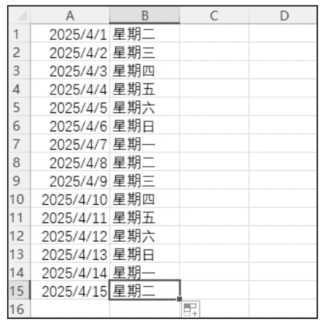

（2）使用计算器计算数据。

在 Excel 中计算数据的总和、平均值时，如果使用计算器计算，不仅效率低下，还容易出错。

Excel 将求和、平均值、最大值、最小值、计数等常用的函数添加为按钮，不需要插入函数。如下图所示，直接单击【公式】→【函数库】→【自动求和】下拉按钮，在弹出的下拉列表中选择相应的选项，即可实现快速计算。

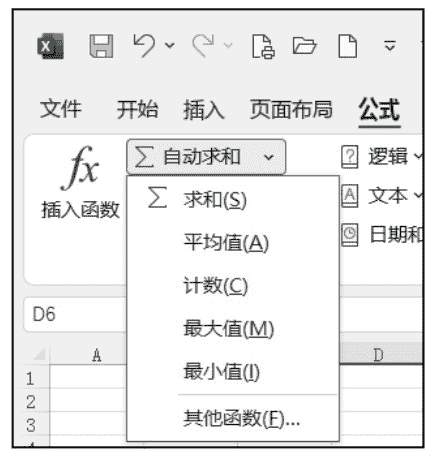

（3）图表类型选择不恰当。

创建图表时，首先要明确每一类图表的用途。例如，要查看每一个数据在总数中所占的比例，使用柱形图就不能清晰表达，这时应该选择饼图，如下图所示。因此，选择合适的图表类型很重要。

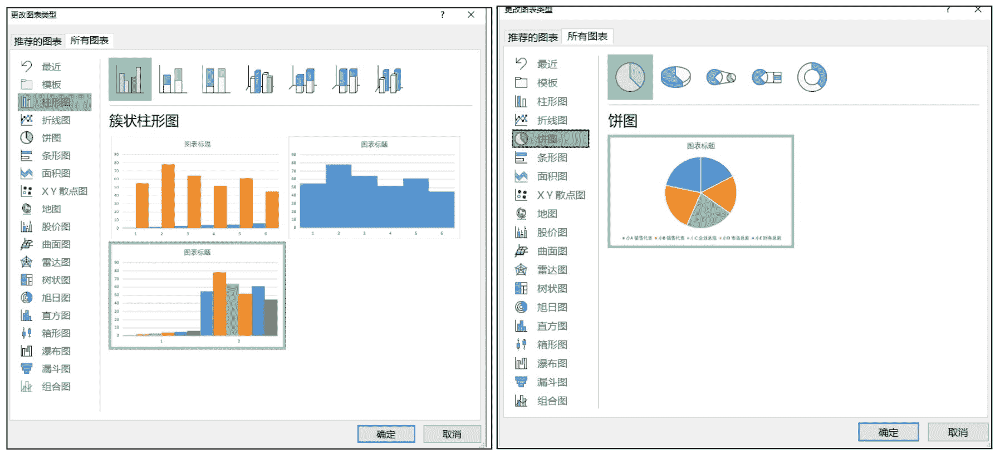

（4）不善用排序和筛选功能。

排序和筛选功能是 Excel 的强大功能之一。它们不仅能将数据快速按照升序、降序或自定义序列进行排序，还能快速并准确地筛选出满足条件的数据。

## **1.2**  **思维：高手的奇思妙想**

高手的世界很难理解，但可以学习高手的奇思妙想，一旦学会，就可以成为高手了！

**1** **正确组织 Excel 数据**

新奇的东西容易引起人们的注意和警惕，而熟悉的东西更容易被理解和记忆。例如，在广场上和一位大妈讲量子力学，那谈话会很快结束，因为量子力学根本不在大妈的生活范围内。所以，要想让读者记住并理解表格内容，最好按照他们熟悉的思维框架来组织。没有经过组织的 Excel 数据，就是一堆密密麻麻的数字，看了令人头疼。

**2** **保持读者的注意力**

读者刚看一张表格时，注意力都会非常集中，但如果一直都是普通的数据，随着数据量的增加，由于新鲜感的消失和疲劳的产生，注意力就会越来越差。

其解决方法就是在大量的数据中添加一些其他的形式，让读者在阅读的过程中不时产生一些新鲜感，能够吸引他们的注意力，如下图所示。（素材\ch01\1.2-1.xlsx）

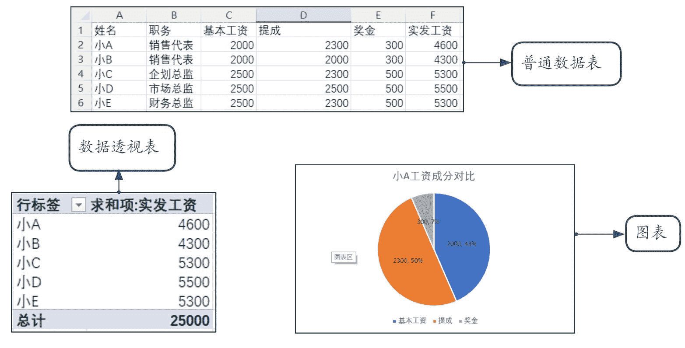

**3** **用图表说话效果更好**

大家可能以为，Excel 就是用来制作表格的，那就太小看 Excel 了！其实，Excel 也可以加入图片、图表等。在分析数据的同时加入一些其他元素，能让整个表格看起来非常漂亮，也更能吸引人，如下图所示。（素材\ch01\1.2-2.xlsx）

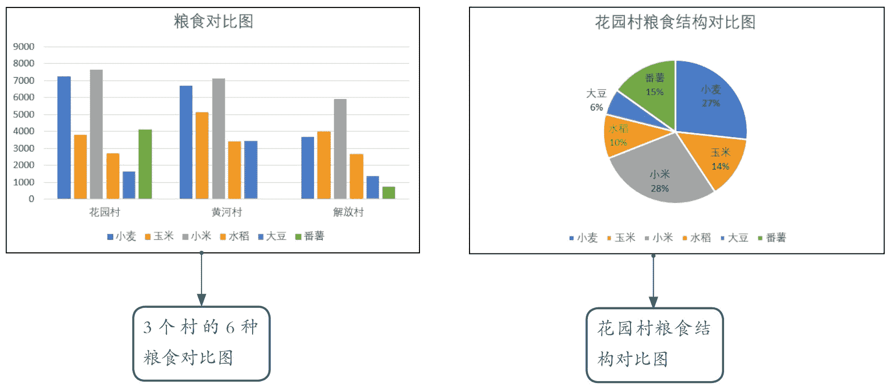

不难发现，图形化数据看起来比原始数据更简洁、清晰。

**4** **表格也可以美化**

爱美之心，人皆有之。虽然 Excel 的重点是数据处理和统计，但是如果能对下图所示的普通表格进行美化，那就是锦上添花。（素材\ch01\1.2-3.xlsx）

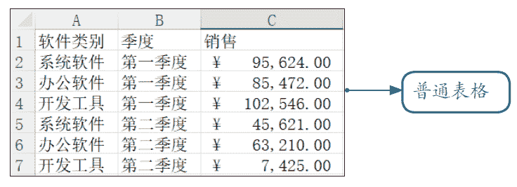

例如，适当调整“普通表格”中的字体、字号、行高和列宽，然后加上边框和底纹，效果如下图所示。

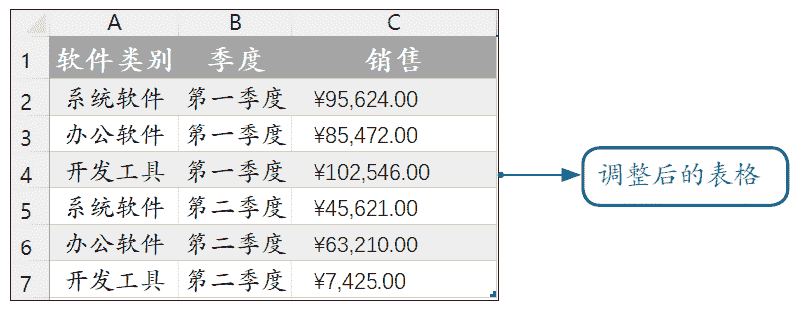

## **1.3****习惯：养成好的习惯就成功了一半**

人们常说，养成好的习惯就成功了一半！那么，使用 Excel 都有哪些好的习惯呢？

**1 不要轻易合并单元格**

单元格合并可以让表格看起来更好看，如下左图所示。

但需要进行其他操作，如排序时，就可能会出现如下右图所示的提示。

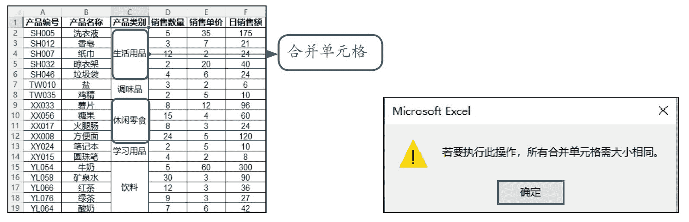

**2 不要滥用空格**

有时使用空格可以在一定程度上起到对齐的作用，如下图所示。

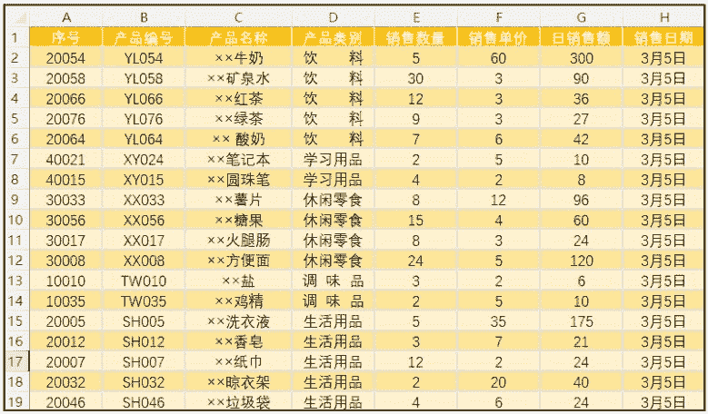

当需要对表格做其他操作，如查找“饮料”时，是查找“饮 料”“饮 料”，还是“饮 料”呢？

**3 日期格式要统一**

输入日期时，不注意格式，可能会方便输入操作，但看起来会很不舒服，如下图所示。

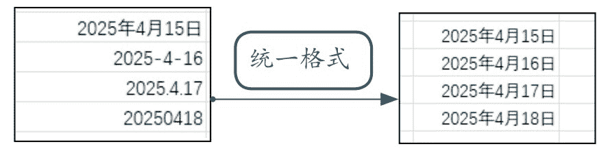

**4 数据与单位得分离**

按照传统习惯，数量后面紧跟单位，如下图所示。（素材\ch01\1.3-4-1.xlsx）

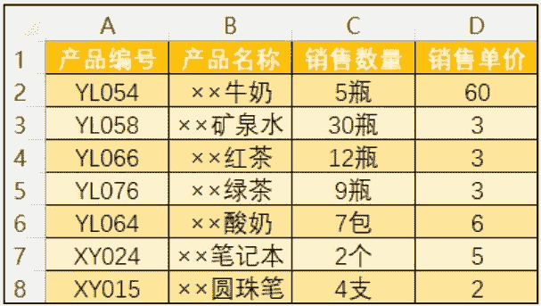

可是，一旦涉及计算，就会出现问题，如下图所示。

如果把数量和单位分离，再进行计算就没问题了，如下图所示。（素材\ch01\1.3-4-2.xlsx）

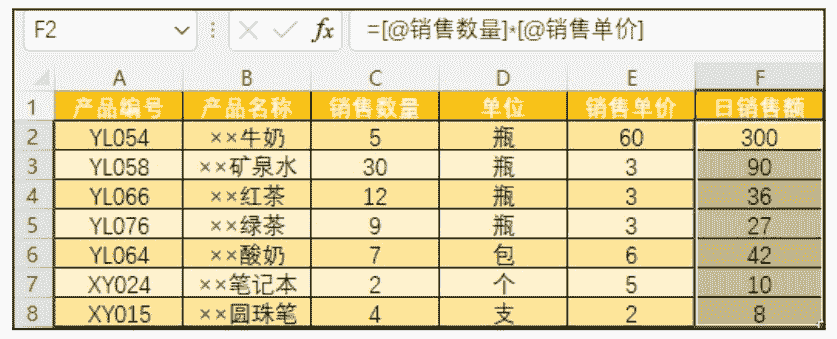

**5 用 PDF 文件备份**

如果需要把制作完成的报表发给其他用户查看，又不希望数据被修改，就可以把报表导出为 PDF 文件，如下图所示。

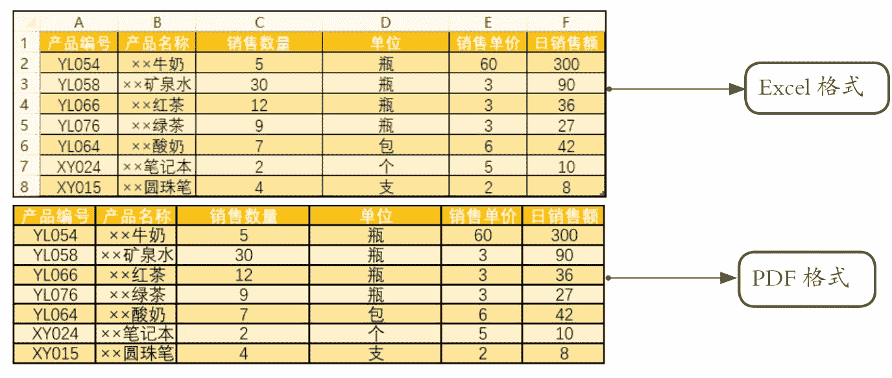

## **1.4**  **学习：成为高手的最佳学习方法及路径**

高手不是自封的，而是通过好的学习方法及路径一步一步走过来的！怎么走？往下看！

**1** **确定目标，勇往直前**

学习 Excel 的目的是什么？

如果是工作需要，那么可以根据工作内容有针对性地学习一些常用技巧。例如，如果从事人力资源工作，可以学习一些基本的字符处理技巧；如果从事商品销售和库存管理工作，可以学习数据透视表等便捷的统计功能；如果希望提升工作效率，摆脱加班的命运，那么除了一些常规技巧外，还需要多了解一些函数、公式的高级用法，甚至可以接触 VBA（Visual Basic for Applications）和宏。

**2** **会用右键，事半功倍**

选定一个对象后，在其上方右击，就会弹出一个快捷菜单。

右键菜单的命令都是针对选定对象的相关设置或操作，因为选定的对象不同，右键菜单也会有所区别，如下左图所示。

与右键菜单同时出现的还有浮动工具栏，如下右图所示。这也是右击后自动显示的，可以用于设置对象的外观属性。

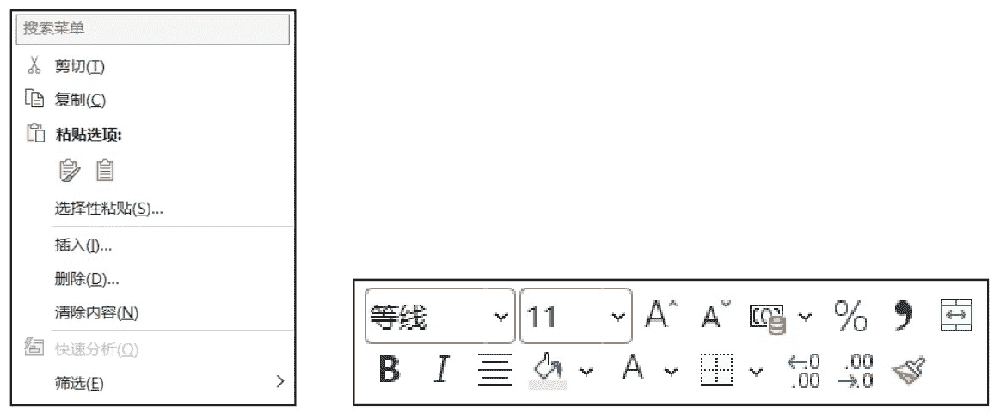

**3** **私人定制，随心所欲**

Excel 的“自定义功能区”和“自定义快速访问工具栏”可以让使用者像 Excel 开发人员一样定制属于自己的菜单栏。

单击【自定义快速访问工具栏】按钮，即可在弹出的下拉菜单中定制快速访问工具栏，如下左图所示。

在功能区的空白处右击，弹出的快捷菜单中可以自定义功能区，如下右图所示。

**4** **懂函数，会公式**

Excel 丰富的功能可以满足许多数据处理和运算的需求，这主要得益于其强大的公式与函数功能，如求和、求平均值等，如下图所示。

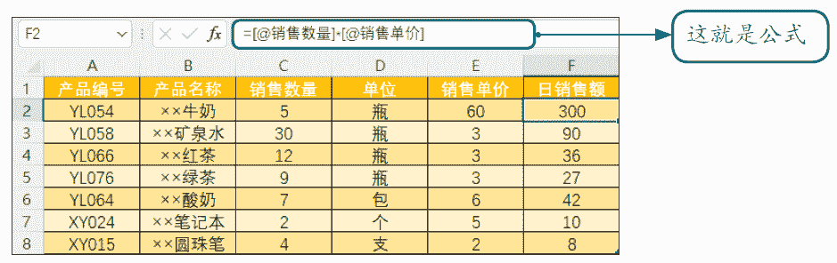

**5** **善用【F1】键，那都不是事**

遇到问题时，如果对需要使用的功能不太熟悉，此时最好的办法就是用【F1】键调出 Excel 的帮助文档，集中精力学习这个功能，如下图所示。该方法在学习 Excel 函数时特别适用，因为 Excel 有数百个函数，想记住全部函数的参数与用法几乎是不可能的。Excel 的帮助文档是权威、系统的学习资源之一；由于它随 Excel 软件一同安装，因此也是最可靠、最便捷的学习资源。

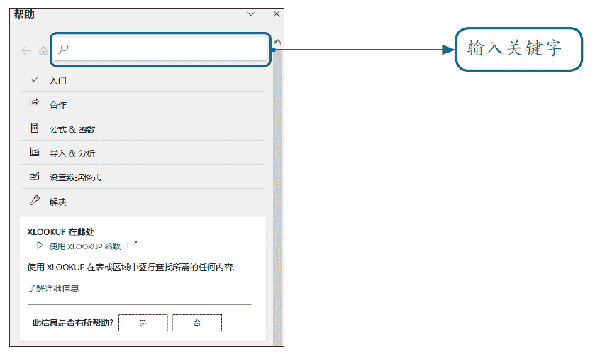

**6** **多阅读，多实践**

多阅读 Excel 技巧或案例方面的文章与书籍，能够拓宽自己的视野，并从中学到许多有用的知识。

学习 Excel，阅读与实践必须并重。阅读来的知识，只有亲自在计算机上实践几次，才能把他人的知识真正转化为自己的知识。通过实践，还能够举一反三，即围绕一个知识点，通过各种假设来测试，以验证自己的理解是否正确和完整。

## **1.5**  **破茧：用 AI 重构数据分析工作流**

在处理海量数据、复杂公式和不断变化的业务需求时，传统的 Excel 操作常常让用户陷入“数据泥潭”——既耗时又容易出错，效率低下。如今，人工智能（Artifical Intelligence,AI）技术的迅猛发展正在改变这一局面，为数据分析领域带来了前所未有的变革。从数据处理、数据分析，到可视化展示和报告生成，AI 正在全面提升效率和准确性，帮助用户轻松应对复杂数据，显著提升工作效率。

### **1.5.1**  **AI 对传统数据分析模式的变革**

AI 技术正在改变 Excel 的数据玩法。从手动清洗数据、死磕公式，到用聊天就能处理表格，再到自动出图表和报告，AI 让操作更简单，效率翻倍，数据结果能快速变成老板们看得懂的决策干货。

**1** **从“手工劳作”到“智能清洗”**

过去，在 Excel 中进行表格合并与拆分、数据清洗、查找与核对等操作时，用户必须熟练掌握各种复杂的函数和操作技巧，不仅过程烦琐，而且容易出错。如今，AI 的自然语言交互功能使这一切变得轻而易举。用户只需像日常聊天一样，向 AI 模型描述需求，AI 就能快速理解并执行指令，高效完成任务。这显著降低了操作门槛，即使是非专业的数据人员也能轻松处理复杂的数据工作，从而大幅提高了工作效率。

如下图所示，使用了豆包的数据分析功能，发送“删除空白单元格：删除所有有空白单元格的行，重新生成一个 Excel 文件”命令后，豆包会自动执行命令进行操作，并提供下载文件。

**2** **从“公式恐惧”到“智能推导”**

在数据计算分析中，公式计算和函数应用一直是困扰 Excel 使用者的难题。不同的业务场景往往需要运用各种复杂的函数，从简单的 SUM 求和，到 VLOOKUP 查找匹配，再到更高级的数组函数，记忆并正确运用这些函数并非易事。然而，AI 模型的出现为这一难题提供了理想的解决方案。

以 DeepSeek 为例，当用户遇到不熟悉的函数时，只需描述其计算需求，如“在 Excel 中，如何计算 A 列去掉最大值和最小值后的平均值”,DeepSeek 便能迅速生成相应的计算公式，如下图所示。不仅如此，AI 还能根据数据特点和业务逻辑，推荐最合适的计算方法，从而确保计算结果的准确性，使数据计算分析过程更加高效、精准。

**3** **从“手动调图”到“AI 一键生成”**

数据可视化对于直观展示数据规律、辅助决策至关重要。但在 Excel 中创建精美的图表，同样需要花费大量时间调整格式、选择合适图表类型。AI 在这方面展现出强大的优势，用户只需输入对图表的要求。

以智谱清言为例，如“根据这些销售数据生成一个柱状图，对比各季度销售额”，就能迅速生成符合要求的图表，如下图所示。

### **1.5.2**  **Excel 有问 AI 必答**

在使用 Excel 时，我们难免会遇到一些疑难问题，不知道如何解决或进行操作。此时我们可以借助 DeepSeek、豆包、文心一言等 AI 工具来协助解决这些问题。

例如，需要快速合并多列数据并去重，尝试了多种方法没能解决。以 DeepSeek 为例，用户只需输入问题“Excel 如何将 A、B、C 三列数据合并为一列并删除重复项”,DeepSeek 即可提供其解决方法，如下图所示。

AI 的出现，极大地提高了用户使用 Excel 的效率。用户应充分利用 AI 来解决各种疑难问题，使其成为办公中的得力助手。

### **1.5.3**  **Excel 数据分析必备 AI 工具**

随着 AI 技术的迅猛发展，众多 AI 工具应运而生，为数据处理和分析提供了极大的便利。本节将介绍几款主流的 AI 工具，帮助你了解其特色，以便在合适的应用场景中做出最佳选择，具体如表 1-1 所示。

表 1-1 主流的 AI 工具

除了表中列出的 AI 工具外，还有文心一言、通义千问等可供选择。用户可以根据实际需求和操作情况，合理选用这些工具，以提升 Excel 操作和数据分析的效率。

### **1.5.4**  **将 AI 嵌入 Excel 中——呼叫 AI**

除了 1.5.3 节介绍的工具外，用户还可以将 AI 工具嵌入 Excel 中，但需要掌握 VBA 编程，这使得操作难度相对较高。

Excel Home 为 Excel 用户开发了一款功能扩展工具软件，中文名为“Excel 易用宝”。该工具集成了超过一百个功能模块，解决用户在数据处理与分析过程中的多项常用需求，还内置了“呼叫 AI”功能，用户只需进行简单的设置，即可轻松调用 DeepSeek、Kimi 等 AI 工具。

Excel 易用宝兼容 Windows 系统环境，包括 Windows 10、Windows 11 等版本，并支持 Excel 2010 至 2024 全系列版本（含 Excel 365）。用户可通过其官方网站下载安装包，并将其安装到计算机中。关于“呼叫 AI”功能的使用方法，请参考帮助中心的视频教程进行配置操作，此处不再详细说明。下图为“呼叫 AI”功能中内置的多个 AI 模块，可以根据需求进行互动。

## **高手自测**

**本章主要介绍了 Excel 高手的思维习惯，在结束本章之前，不妨先测试一下本章的学习效果。打开“素材\ch01\高手自测．xlsx”文档，在 5 个工作表中分别根据要求完成相应的操作。若能顺利完成，则表明已经掌握了本章知识；否则，建议先重新学习本章内容，再学习后续章节。**

（1）打开“素材\ch01\高手自测．xlsx”文档，“高手自测 1”工作表如下左图所示。快速调整工作表中数据的列宽，如下右图所示。

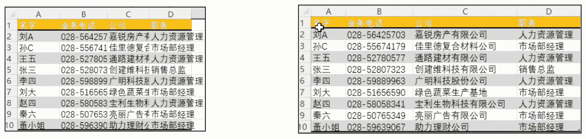

（2）打开“素材\ch01\高手自测．xlsx”文档，“高手自测 2”工作表中的数据宽度较大，如下图所示。如果使用默认的纵向打印，可能会导致部分数据不能被打印，或者多打印一页，所以要将其设置为横向打印。

（3）打开“素材\ch01\高手自测．xlsx”文档，“高手自测 3”工作表如下左图所示。请在工作表中快速完成数据的求和，如下右图所示。

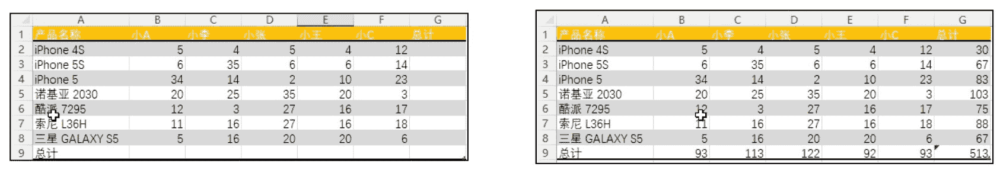

（4）打开“素材\ch01\高手自测．xlsx”文档，“高手自测 4”工作表如下左图所示。请为工作表中的内容设置自动换行，如下右图所示。

（5）打开“素材\ch01\高手自测．xlsx”文档，“高手自测 5”工作表如下左图所示。在工作表中，当拉动滚动条查看后面的内容时，无法看到标题行。若想让首行不滚动，可以使用【冻结窗口】功能，如下右图所示。

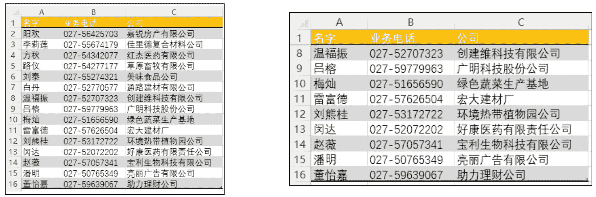

# **第二章**

# **洗髓易筋：天下只有一张表**

经常会有人抱怨，看了不少书，也学了不少 Excel 技巧，但当使用 Excel 时，却发现学的知识好像都用不上，制作的表格还是没有进步，为什么呢？其实，这是初学者的一个通病—没有真正科学、合理地使用 Excel！

## **2.1****99%的失误源于基础表**

每个人面对的工作各不相同，使用的表格也不尽相同。但是，一些不太好的使用习惯，甚至是一些错误的使用方式，却是相同的。

**1 Excel 与记事本**

Windows 中有一个“记事本”，主要用于记录一些日常信息，如工作便签。但也有人用 Excel 来做记录，他们可能会说：“因为 Excel 已经画好了网格线啊！”

其实，用 Excel 来做记录本身无可厚非，只是，也需要考虑 Excel 的感受……

如果仅仅把 Excel 当成记事本来用，确实有些“大材小用”。但既然已经用它记录了信息，何不继续用它为记录的事件做出相应的统计和分析呢？

例如，有一天，你和几个小伙伴出去旅游，然后用 Excel 做了如下图所示的记录。（素材\ch02\2.1-1. xlsx）

如果觉得“记事本”版的 Excel 有些不美观，可以使用 Excel 做如下图所示的记录。

还可以做如下图所示的排序。

也可以对其进行分类汇总，如下图所示。

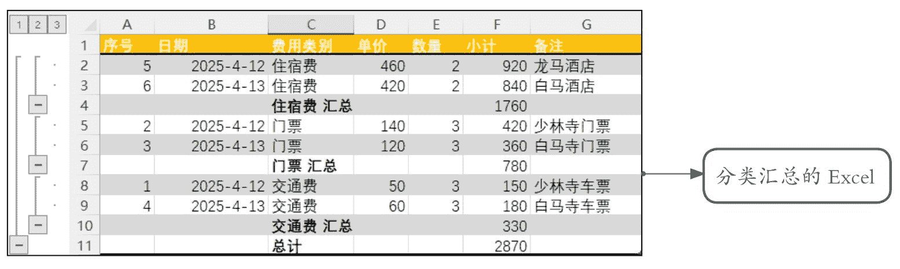

还可以用图表来统计，如下图所示。

看到这里，你做记录时，是用 Excel 还是用“记事本”呢？

**2 单元格内换行**

提到单元格内换行，很多人都觉得特别简单，不就是按【Alt+Enter】组合键，很好用的！如下图所示，换行后看上去很整齐，也避免了合并单元格。（素材\ch02\2.1-2.xlsx）

然而，这种做法在数据处理中的意义并不大，且副作用不小。如下图所示，当需要进行排序、筛选、查询等操作时，一系列的麻烦就来了……

可以看到，现在是无法筛选某一个人的。

**3 无意义的空行**

有人喜欢在工作表中加入空行，好像分隔起来更明显了，如下图所示。（素材\ch02\2.1-3.xlsx）

然而，如果后面涉及其他操作，如排序，其效果就不是想要的了，如下图所示。

在筛选时也会出问题，如下图所示。

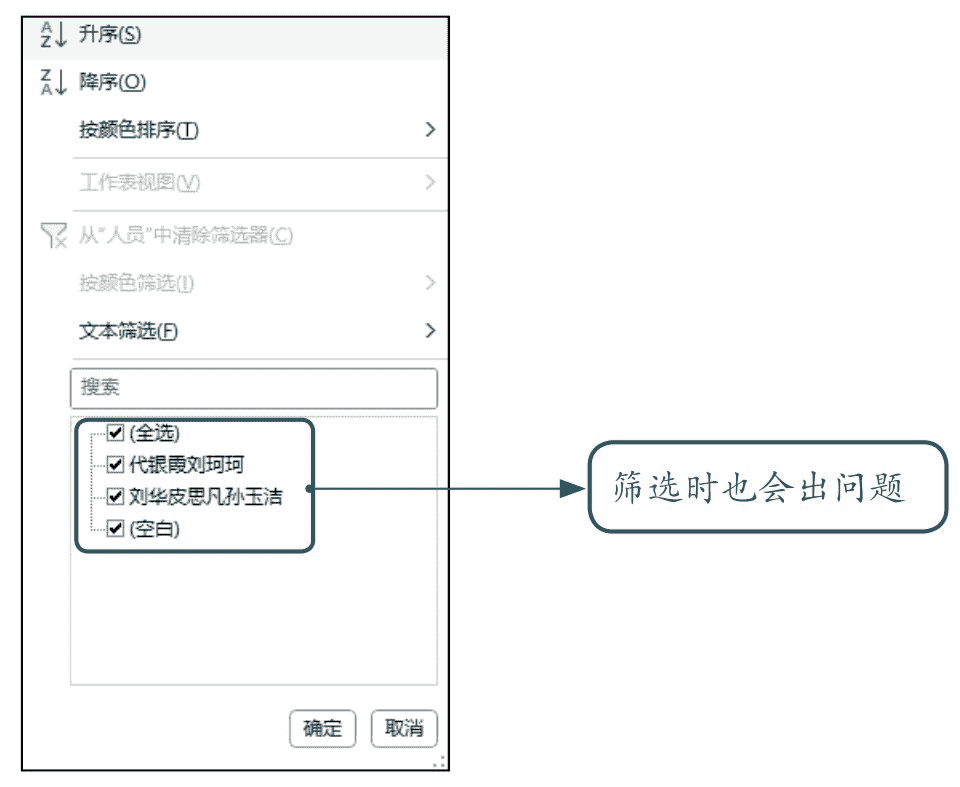

**4 表述混乱**

同一个名词，如果使用了其他的名称或简称等，就会导致表格内容不规范，如下图所示，不知道到底有几个部门。（素材\ch02\2.1-4.xlsx）

**5 烦人的小计**

手动插入“小计”行看似详细，实则不仅操作烦琐，还会破坏数据表的连续性，影响统计，如下图所示。（素材\ch02\2.1-5.xlsx）

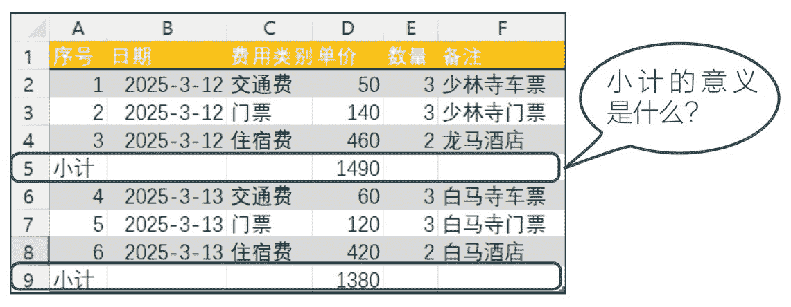

如果想统计怎么办？用数据透视表啊！

**6 滥用批注**

单元格右上角有个小三角，这就是批注。将鼠标指针移上去，会自动显示批注，如下图所示。（素材\ch02\2.1-6.xlsx）

在单元格中添加批注能够起到一定的说明或强调作用，增强数据的可读性。但过多的批注会使表格显得杂乱，反而影响阅读。甚至有人喜欢把数据放进批注，如下图所示，导致其无法直接用于计算和分析。

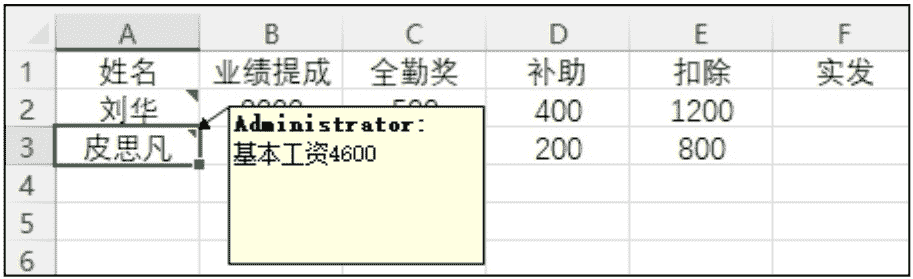

## **2.2****基础表设计的基本原则**

设计科学规范的 Excel 基础表是高效数据分析的第一步，因为数据分析的源头就是基础表。

要想玩转 Excel，首先必须玩转基础表。只有掌握基础表设计的精髓，才能对 Excel 有正确的认识。是菜鸟，还是高手，就看能否玩转基础表。

**1 简洁，但不简单**

所谓结构简洁，就是按照工作性质、管理内容、数据种类设计出不同的基础表，以保存不同的数据，如下图所示。基础表越简洁越好，但要保证数据量充足，不能有残缺数据，更不能缺少功能，即虽然简洁，但不简单。（素材\ch02\2.2-1.xlsx）

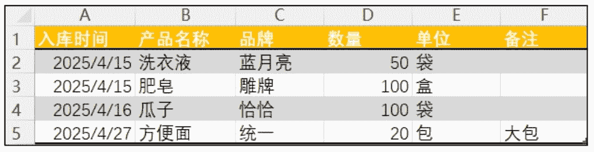

**2 规范，但不死板**

无规矩不成方圆，Excel 也一样。一个杂乱的表格是很难实现数据统计和高效分析的。只有结构合理、数据完整、层次分明的基础表，才能达到易于读取、便于汇总分析的目的，如下图所示。（素材\ch02\2.2-2.xlsx）

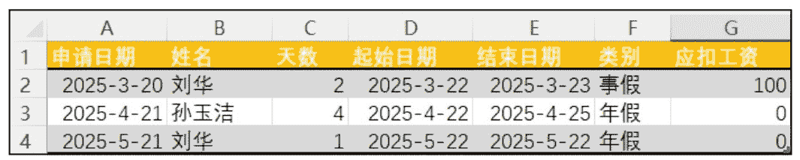

**3 通用，但不硬搬**

一般情况下，一项工作只做一张表。基础表只有一张，而且还是一维数据表。无论是行政、财务、销售还是物流，都可以用类似的方式记录在基础表中，其区别仅仅是字段名和具体内容不同。

**4 美观，但不花哨**

无论是基础表，还是报告，都要尽量把表格做得漂亮。基础表的美化以容易整理数据为原则，而报告的美化以分析结果清晰为原则。

要特别强调的是，表格既要美观、大方，又不能花哨，不要在一个表中出现太多的颜色和太多不同的线条，如下图所示。

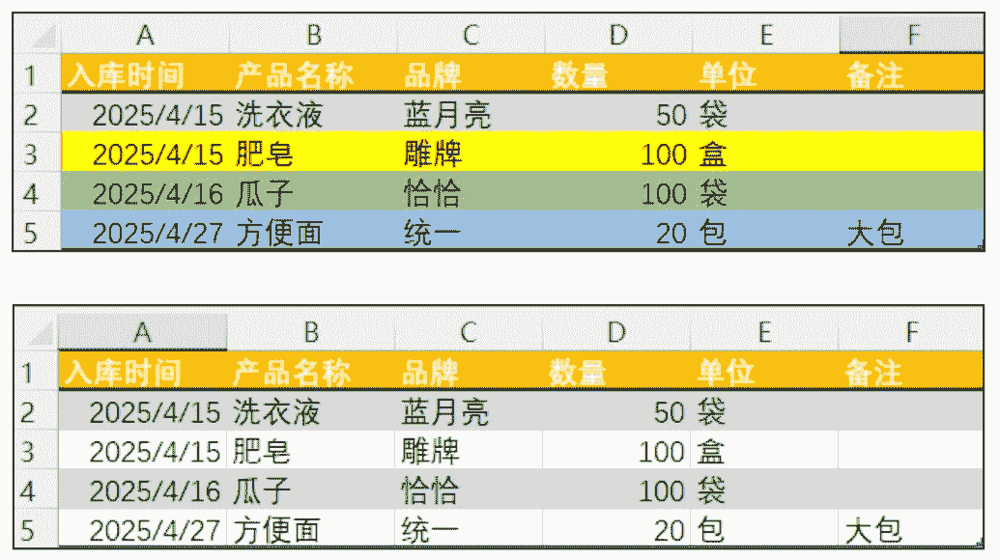

一张标准、规范的基础表应该满足以下条件。

（1）一维数据表，只有顶端标题行，没有左侧标题列。

（2）有且只有一个标题行。

（3）没有合并单元格。

（4）数据信息完整准确。

## **2.3****计算机的喜好与人的喜好**

既要记录原始数据，又要挖掘出数据背后的故事，就不能只让领导一个人满意，还要研究一下计算机的喜好。按照 Excel 制作表格的规律，不能简单地把工作中手工处理的各种信息纸质表格原样搬到计算机上，而要将原始表格的设计视为首要任务。设计得当，事半功倍；设计不当，后患无穷。

区别于“报表型”表格，可以将用于管理日常业务的系列表格称为“事务型”表格。站在管理者的角度考虑问题，要有大局观，了解整个业务流程，知道上下级各需要什么样的数据，理解管理者所期待的目标，把握“事务型”表格设计的原则。

要真正会使用 Excel 软件，先要理解并注意以下事项。

（1）表格结构一定要符合第一行为标题行、下面为一行行记录的形式。标题行为若干不重复的数据项名称，下面也不能出现完全相同的记录行。

（2）在安排标题名称排列的顺序时，最好考虑操作者能按日常的工作顺序输入数据。

（3）表格中不能有空行和空列。

（4）规范数据输入内容、取值范围和格式。

（5）同一对象命名要统一，同一列数据类型要一致。

（6）不要有不必要的小计、合计、汇总等行和列，不能有合并单元格。

（7）要考虑业务的扩展性。

（8）不同作用的数据要分别设计不同的表格进行存放。

（9）保证数据安全，及时备份数据。

## **2.4****要学好 Excel，必须学点数据库知识**

数据库（Database）技术在生活、工作中的应用无处不在！例如，在超市买东西，结账时只需刷一下会员卡和商品的条码，营业员使用的销售系统就能自动从后台存放会员信息和商品信息的数据库中检索到相关数据，并显示在终端屏幕上；结账完成后，后台数据库将记录本次消费的详情，并相应减少本次消费所涉及的所有商品库存；如果通过银行卡结账，销售系统还要联机访问银行的数据库系统查询顾客的账户信息，并把顾客的本次消费记录在银行的数据库中。如果没有数据库技术，难以想象在这样一个小小的销售活动中发生的所有信息是如何保存和处理的。

数据库是按照一定的数据结构将相关的数据组织、存储起来，以便于管理和使用的数据仓库。

数据库与 Excel 有什么关系呢？它们都是通过对信息进行采集、整理，然后以数据的形式进行分类、存储的系统。日后，还可以对这些存储的信息进行添加、删除、修改、查询、统计、打印等管理工作。利用好这些工具不仅可以记录日常工作中各种信息往来，还能高效进行数据分析和处理，从而为决策者挖掘出隐藏在数据背后的信息。为了有效利用原始数据进行分析、处理，数据库技术对数据库的结构设计做了严格规定。Excel 系统中记录原始数据的工作表结构参照了这些规定。否则，后期对数据的处理和分析就是虚谈。

数据库与 Excel 显然是不同的两种系统。数据库中管理的数据要通过编程进行处理，而 Excel 基本不需要编程就可以让用户在工作簿中完成各种基本的数据管理工作。

如果只是把表原样输入、打印出来交给上司，那么此部分可以不用学习了。

目前最流行的关系型数据库系统，规定了数据结构、数据操作、完整性约束等方面的要求。因此，在设计一个 Excel 工作簿时，要把它当成一个系统来设计，分析该系统中要管理什么信息，信息之间是什么关系。不同工作环节中产生的信息要分别存放在不同的工作表中，每个工作表的结构要如何定义才能完整地反映工作中的所有属性。将来如何对这些数据进行分析处理，以及用什么方法实现这一目标。要设计好一张工作表的结构、一个工作簿的功能是非常不容易的，只有经验足够丰富才能有所感悟。现在可以先严格按照表 2-1 中的规范做起来。

表 2-1 关系数据库与 Excel 工作簿的数据规范

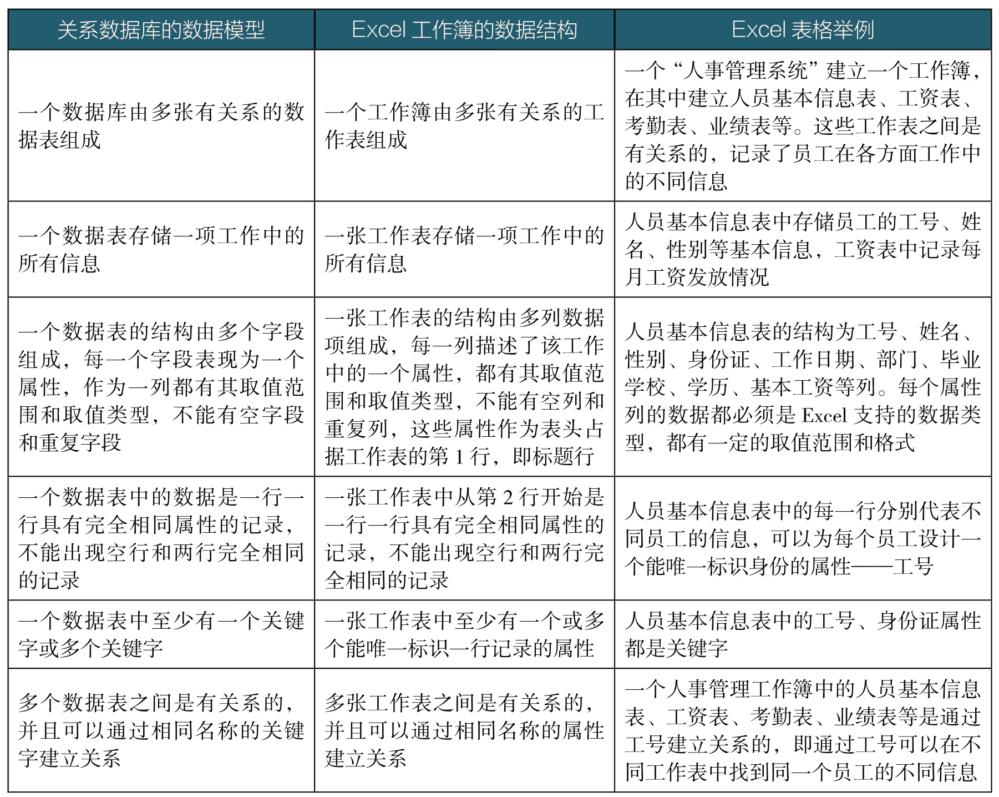

## **2.5****数据效率低的根源—数据冗余性**

数据的冗余性是指表格中存在多余、重复的数据。这些数据的出现不仅增加了表格设计和输入的负担，更让整个表格结构变得臃肿，大大降低了表格的可读性和可分析性！如下图所示。（素材\ch02\2.5.xlsx）

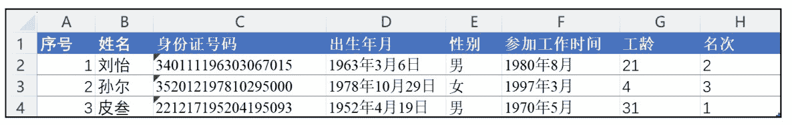

上图中的表格看上去好像没什么问题，但仔细观察就会发现，有了“身份证号码”，就可以通过公式计算“出生年月”和“性别”，如下图所示。

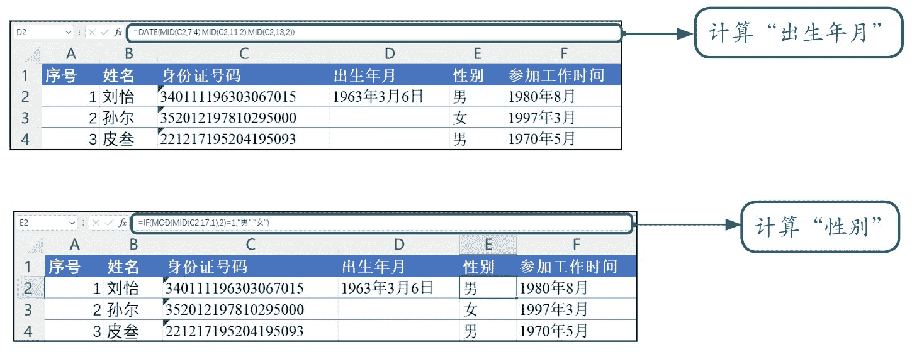

## **2.6**  **“糊涂账”的解决之道—数据耦合性**

耦合性描述了数据项之间“你中有我，我中有你”的相互依赖关系 。在 Excel 中，数据的耦合性指的是两个或两个以上的对象之间存在互相依赖的关系，在同一张工作表或不同工作表之间存在耦合。如果处理好这种关系可以简化表格结构，否则就是一本“糊涂账”。

**1** **同一张工作表中的数据耦合**

数据耦合性其实有很多好处，如下图中的例子。

有了“身份证号码”，可以很轻松地计算出“出生年月”和“性别”，不仅减少了手工输入的麻烦，提高了制表效率，更重要的是，不会因为输入而出错，大大提高了数据准确性！

但是，反过来，如果被依赖数据出了问题，就会出现错误，如下图所示。

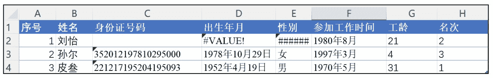

**2** **不同工作表之间的数据耦合**

工作表之间的数据存在依赖关系是常见的情况。通常把一些标准的、原始的数据，或者基本保持不变的数据作为参数单独存放在一张工作表中，而一些经常变化的日常数据被存放在第二张工作表中，将最终的汇总、分析结果存放在第三张工作表中，这样 3 张工作表之间就存在了密不可分的关系。

（1）“基本信息”表如下图所示。（素材\ch02\2.6-2-1.xlsx）

（2）“实发信息”表如下图所示。（素材\ch02\2.6-2-2.xlsx）

（3）“最终信息”表如下图所示。（素材\ch02\2.6-2-3.xlsx）

具体操作步骤如下。

步骤 01 计算“实发工资”，如下图所示。

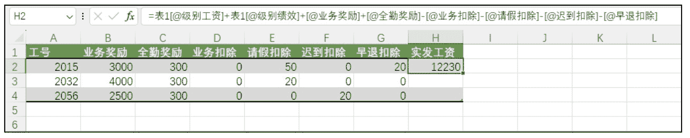

步骤 02 计算“姓名”，如下图所示。

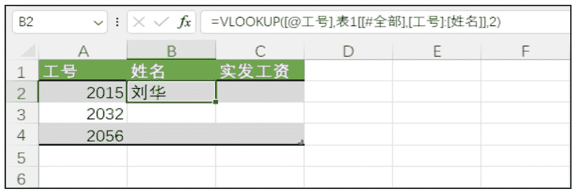

步骤 03 使用 VLOOKUP 函数调用“实发工资”数据，如下左图所示，最终结果如下右图所示。

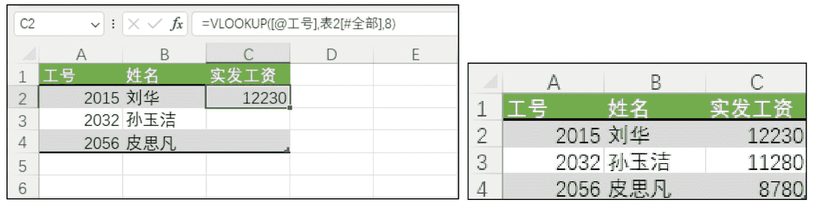

## **2.7****领导交代的任务无法完成—数据完整性**

从字面上理解，数据完整性就是在创建一张或多张工作表时，必须完整地记录所有需要的信息。

以考勤而言，需要记录以下 3 类信息。（素材\ch02\2.7.xlsx）

（1）基础信息：工号、姓名、上班时间、下班时间，如下图所示。

（2）考勤信息：工号、上班打卡时间、是否迟到、下班打卡时间、是否早退、是否请假、是否公出、是否旷工，如下图所示。

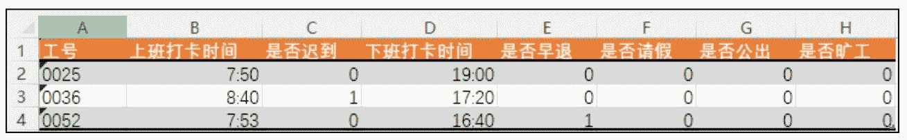

（3）统计信息：工号、迟到扣款、早退扣款、请假扣款、旷工扣款、实际扣款，如下图所示。

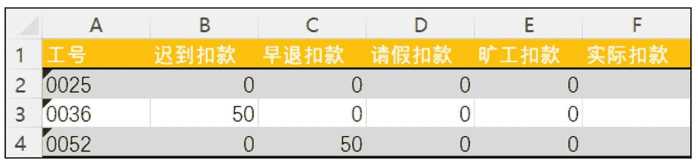

然后，计算是否“迟到”“早退”，如下图所示。

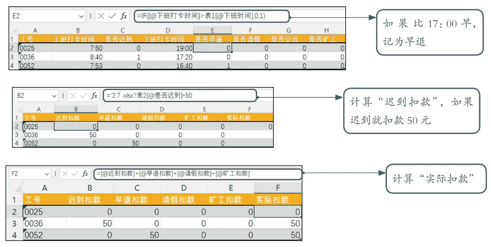

## **2.8****改造不规范的基础表**

“凡事预则立，不预则废”，设计基础表亦然。在设计之前，应该先了解工作环境，需要做什么，并设计如何去做。

**1 了解工作环境，明确制表目的**

修改和设计表格之前，应该详细了解工作环境，清楚领导的要求、部门之间的合作关系，以及公司的企业文化，如下图所示。

了解了工作环境后，下一步就要明确制表的目的，弄清楚通过表格要达到什么目的。下图所示为领导需要的一份各部门费用情况统计表。（素材\ch02\2.8-1.xlsx）

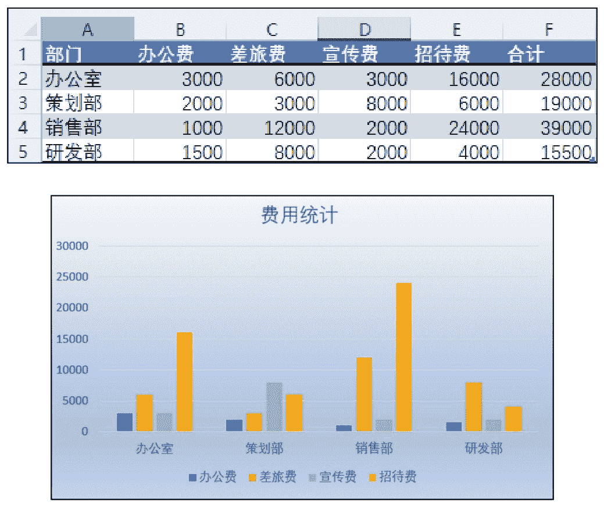

**2 设计表格字段**

一个看似简单的工作表，却是由一个个字段勾勒出来的精美作品。每个表格的框架、字段设计，都充分反映了设计者的工作智慧。

有人说，如果不了解这个行业，就不可能做出与该行业有关的表格。实际上，从表格设计的角度来讲，在任意一个领域足够专业的人，很容易领悟其他行业的管理要点和工作流程。只要充分了解制表的背景和目的，就能把握设计表格的命脉。下图所示为一张工资表。（素材\ch02\2.8-2. xlsx）

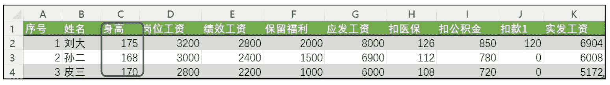

从该表的设计可以看出，其目的是说明每个员工的工资情况，其中有些字段是多余的，如“身高”，与此目的完全无关。

当然，除了多余的字段，还有不足的字段。缺少了这些字段不足以说明问题，甚至可能会出现误会和错误。例如，在上图中，关键字字段应该是“姓名”，可是，如果公司有两个人同名怎么办？所以需要添加“工号”字段来进行唯一标识。同时，“扣款 1”字段扣的是什么需要进行说明，所以这里需要补充一个“备注”字段，如下图所示。

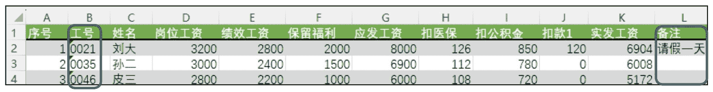

**3 美化表格**

基础表设计出来后，可以根据个人爱好将其美化，制作出令人赏心悦目的精美表格。美化表格的方法包括设置字体格式及对齐方式、调整行高或列宽、为单元格填充颜色等。

下图所示为某公司年会活动得分排名表。（素材\ch02\2.8-3.xlsx）

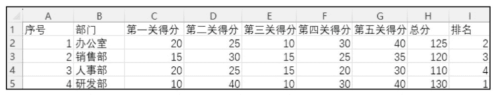

美化排名表的具体操作步骤如下。

步骤 01 调整字体格式。设置所有汉字字体为“仿宋”、字号为“12”，设置所有数字字体为“Times New Roman”、字号为“12”，并适当调整列宽，如下图所示。

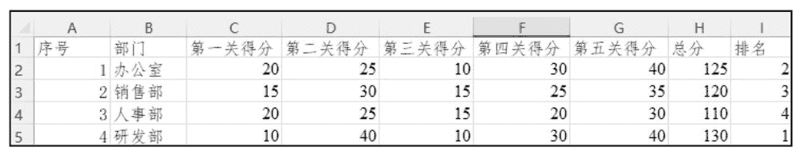

步骤 02 设置对齐方式。由于每列数字位数相同，因此将表格设置为“居中对齐”，如下图所示。

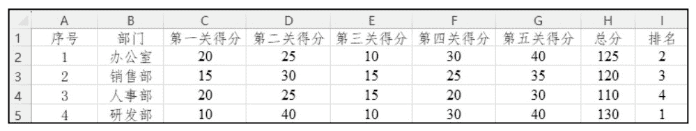

步骤 03 设置行高和列宽。习惯上，把行高设置为“18”，让文字上下多一点空间，以方便阅读，如下图所示。

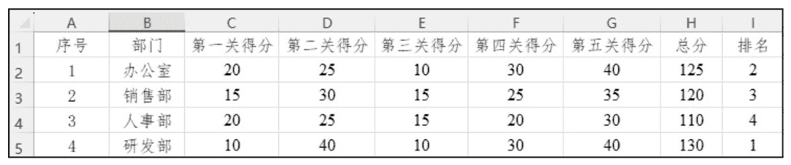

步骤 04 设置适当的边框和底纹并再次统一字体，如下图所示。

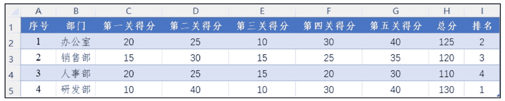

步骤 05 因为是比赛，所以可以把每关的最高分标识出来，如下图所示。

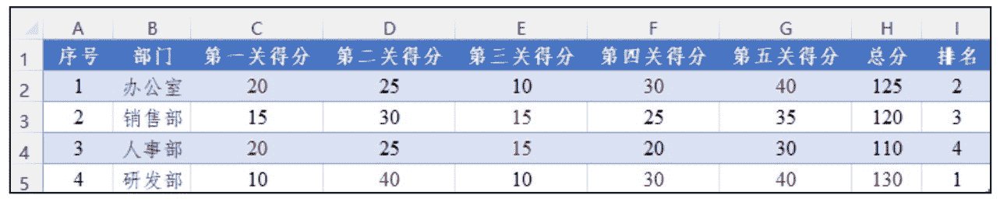

## **2.9****用模板也能“打”天下**

在工作时，经常需要制作多种表格，如工作表、资金报表、财务报表等。如果逐个制作，不仅烦琐，而且往往需要重复操作。那么怎样才能一劳永逸呢？这就需要模板了。

简单地说，模板就是针对某一特殊领域的应用而专门设定的一个格式，如下图所示。（素材\ch02\2.9.xlsx）

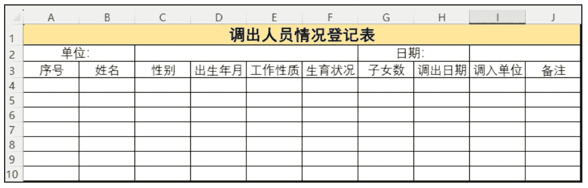

那么，如何设计模板呢？

（1）取消单元格锁定。

在修改模板之前，首先需要取消单元格的锁定。选中 A1:J10 单元格区域，在其上右击，在弹出的快捷菜单中，单击【设置单元格格式】按钮，在弹出的【设置单元格格式】对话框中，选择【保护】选项卡，取消选中【锁定】复选框，然后单击【确定】按钮，如下图所示。

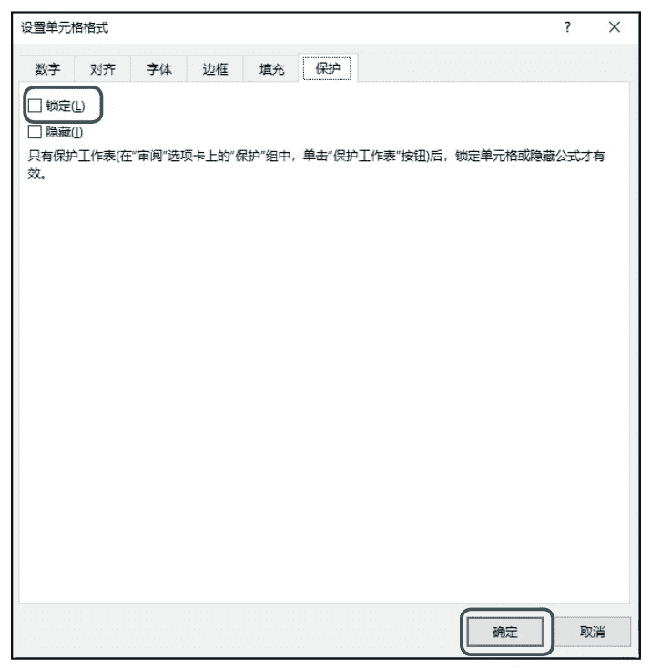

（2）设置“序号”列属性。

根据此处的需要设置“序号”列的单元格格式和数据验证，具操作步骤如下。

步骤 01 选中 A 列并右击，在弹出的快捷菜单中，选择【设置单元格格式】选项，在弹出的【设置单元格格式】对话框中，选择【数字】选项卡，选择【分类】列表框中的【数值】选项，并设置【小数位数】为【0】，然后单击【确定】按钮，如右图所示。

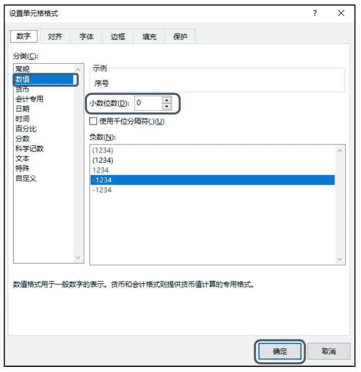

步骤 02 单击【数据】选项卡【数据工具】组中的【数据验证】按钮，在弹出的【数据验证】对话框中选择【设置】选项卡，在【验证条件】中，设置【允许】为【整数】【数据】为【介于】【最小值】为【0】【最大值】为【999】，如下左图所示。

步骤 03 选择【输入信息】选项卡，在【标题】文本框中输入【输入限制】，在【输入信息】文本框中输入【只能输入 0~999 的整数。】，如下右图所示。

步骤 04 选择【出错警告】选项卡，在【样式】下拉列表中选择【停止】选项，在【标题】文本框中输入【输入错误】，在【错误信息】文本框中输入【只能输入 0~999 的整数。】，然后单击【确定】按钮，如下左图所示。

步骤 05 此时，如果选择 A4:A10 单元格区域中的任意单元格，就会出现输入提示，如下右图所示。

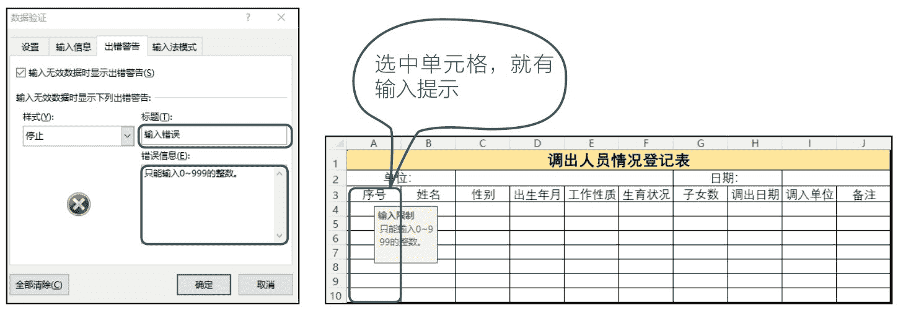

步骤 06 如果输入的数据不在 0~999 范围内，就会弹出【输入错误】对话框，如下图所示。

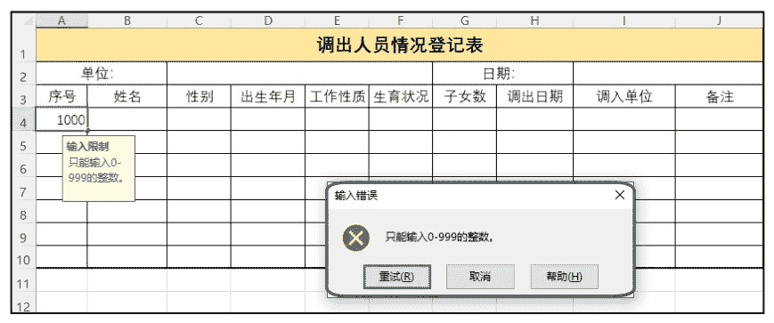

（3）设置“性别”列属性。

根据此处的需要设置“序号”列的数据验证，具体操作步骤如下。

步骤 01 选中 C 列，单击【数据】选项卡【数据工具】组中的【数据验证】按钮，在弹出的【数据验证】对话框中选择【设置】选项卡，在【验证条件】中设置【允许】为【序列】，在【来源】中输入【男，女】，如下左图所示。

步骤 02 在【输入信息】选项卡中进行设置，如下右图所示。

步骤 03 在【出错警告】选项卡中进行参数设置，然后单击【确定】按钮，如下图所示。

（4）设置“出生年月”列属性。

根据此处的需要设置“出生年月”列的单元格格式。选中 D 列并右击，在弹出的快捷菜单中选择【设置单元格格式】选项，在弹出的【设置单元格格式】对话框中，选择【数字】选项卡，在【分类】列表框中，选择【日期】选项，在【类型】列表框中选择一个日期格式，然后单击【确定】按钮，如下图所示。

（5）锁定表格结构。

锁定相关单元格的表格结构，具体操作步骤如下。

步骤 01 选择相关单元格，如右图所示。

步骤 02 在选中的单元格上右击，在弹出的快捷菜单中选择【设置单元格格式】选项，在弹出的【设置单元格格式】对话框中，选择【保护】选项卡，选中【锁定】复选框，单击【确定】按钮，如右图所示。

（6）保护工作表。

设置工作表的保护，防止工作表数据的丢失，具体操作步骤如下。

步骤 01 单击【审阅】选项卡【保护】组中的【保护工作表】按钮，弹出【保护工作表】对话框，在【取消工作表保护时使用的密码】文本框中设置密码，这里设置为【123】，在 【允许此工作表的所有用户进行】列表框中进行参数设置，然后单击【确定】按钮，如下左图所示。

步骤 02 在弹出的【确认密码】对话框中，再次输入密码“123”，然后单击【确定】按钮，如下右图所示。

此时，模板就被保护起来，在“子女数”列上右击时，会发现在弹出的快捷菜单中【删除】等一些选项不可用，也就是不能进行删除等操作，如下图所示。

同样，如果想修改“子女数”标题的名称，就会出现下图所示的情况。

当然，如果想要增加记录，是没有问题的，如下图所示。

最后修改工作表名称，将其保存后退出，“调出人员情况登记表”的模板就制作完成了！

## **2.10****AI 助力 Excel 表格设计与多表管理**

在传统 Excel 表格处理中，人工制表、多表联动往往耗时费力。AI 技术通过自然语言生成表格框架、自动识别文本或图片转表、智能合并拆分多表数据，将表格设计与管理效率提升至新维度。

### **2.10.1****使用 AI 将文本或图片秒转表格**

如下图所示，当收到的销售数据为文本格式时，若手动录入 Excel 中会耗费大量时间。此时，我们可以借助 AI 技术，将文本或图片中的数据快速转化为表格格式。转换后的表格内容可直接粘贴到 Excel 中，极大地简化了手动输入的烦琐步骤，显著提升了数据处理的效率。

步骤 01 打开 DeepSeek，将数据粘贴至输入框中，然后按【Ctrl+Enter】进行换行，输入指令“将这些数据整理为表格格式”，单击 按钮，如下左图所示。

步骤 02 DeepSeek 会将数据转换成表格形式，如下右图所示。

步骤 03 选择表格中的数据，单击鼠标右键，在弹出的菜单中，选择【复制】命令，如下左图所示。

步骤 04 打开 Excel，将数据粘贴至单元格中，即可完成数据的转化，如下右图所示。

### **2.10.2****使用 AI 生成表格示例**

当缺乏表格设计经验时，只需向 AI 输入需求，即可自动获取含表头、数据格式等表格框架，一键复制至 Excel 后直接编辑使用，大幅降低制表门槛。下面以 DeepSeek 为例，生成一个“加班时长统计表”的表格框架。

步骤 01 打开 DeepSeek，在输入框中输入下方指令，单击 按钮，如下左图所示。

指令：请帮我生成一个包含虚拟数据的加班时长统计表，采用表格格式。

步骤 02 DeepSeek 即会生成一个加班时长统计表，然后将表格数据粘贴至 Excel 中即可，如下右图所示。

### **2.10.3****使用 AI 一键合并和拆分多表数据**

以往合并或拆分多表需手动操作，费时易错。AI 通过智能识别数据结构与关联字段，实现多表数据一键合并或拆分。下面以“豆包”为例合并多表数据，具体操作步骤如下。

步骤 01 打开并登录豆包，单击对话框下方的【数据分析】按钮，如下左图所示。

步骤 02 进入“数据分析”技能页面，将要合并的工作簿拖曳至输入框中，待其上传完成后，输入下方指令，然后单击【Enter】键，如下右图所示。

指令：将“2.10.3-2.xlsx”中的数据合并到“2.10.3-1.xlsx”中，以两表的 A 列为唯一匹配列，执行横向合并，重新生成一个 Excel 文件。

步骤 03 豆包即会根据指令读取数据、处理数据并生成 Excel 文件，单击页面下方的 Excel 文件图标，根据指示下载该文件，如下左图所示。

步骤 04 下载完成后，使用 Excel 打开该文件，可以根据需求对表格进行调整，如下右图所示。

通过上述方法，可以实现对工作表的合并操作。另外，还可以使用豆包进行数据拆分、过滤、清洗、去重、格式转换等操作。

## **2.11****考勤表设计**

考勤工作至关重要，其结果直接影响工资发放。然而，这项工作并不简单，不同公司、不同岗位的考勤制度和办法各异。

在本例中，把复杂的考勤工作简单化，假定每个月的打卡记录和每个月的考勤统计数据均存于单独工作表，以此展示 Excel 如何自动、高效、准确地处理很多工作，把工作人员从日常事务中解放出来。

假设单位平时打卡登记上下班时间，每月初统计上个月单位的出勤情况，可以设计 5 张工作表分别存放不同类别的信息。

**1 参数表**

参数表存放每月的应出勤天数、每天上下班时间，以及部门、民族、学历等相对固定不变的信息，如下图所示。该表中数据按照本单位实际情况输入即可，日常也可以进行修改和增删。（素材\ch02\2.11.xlsx）

**2 员工基本信息表**

下图中设计的表格，存放着本公司员工的基本信息。新员工入职时可增加记录，员工离职后可删除记录。但是删除记录前一定要做好数据备份，特别是与该表相关的其他表格要做好备份，最好打印出来存档，留下不同时间节点的工作痕迹。单位要制定严格的管理制度，规定记录删除的时间节点、操作流程等，否则会造成记录信息的不完整。

**3 打卡表**

打卡表存放员工每天上下班打卡时间信息。假定每天上班打一次卡、下班打一次卡，打卡时系统自动记录打卡人的工号、打卡日期、打卡时间，并能自动判断是“上班”还是“下班”打卡，同时根据公司规定的每天上下班时间判断是否迟到、早退，发生一次迟到、早退现象记录违纪“0.5”天，如下图所示。该表不需要工作人员进行任何操作，在购置打卡系统时将本公司的具体要求告知供应商即可。

**4 请假表**

请假表存放公司员工请假信息。所有请假事项需要依据领导批准过的请假申请输入，除“姓名”字段自动填充外，其他字段都需要由工作人员手工输入，其中“时长”字段只记录两种情况：半天和一天，分别用“½”和“¹”表示（½和¹是两个特殊字符），请假一天产生一条记录，如果某员工请三天假就要产生三条“请假日期”不同的记录，如下图所示。

**5 考勤统计表**

考勤统计表存放每个月公司所有员工的考勤汇总信息。表中除了“黄底红字”的文字外，其他所有单元格在统计前均为空白，如下图所示。统计某月考勤情况时，只需输入“年”和“月”，本例中是“2003”和“3”，表中其他单元格数据全部自动填充。该表每月一张，从表上可以看出每个员工在统计月中每天的迟到、早退、请假情况，以及当月实际出勤的汇总天数。为了简化表格设计，本例中没有考虑旷工、产假、公休假、出差等诸多情况。

以上五张表各司其职、相互配合，共同完成考勤管理统计。其中，参数表、员工基本信息表极少维护，打卡表不需要人工维护，请假表需要人工输入数据，考勤统计表只需输入统计的年和月，当月汇总数据全部可以自动填充。可以看出，考勤统计表不但结构最复杂，而且其中的所有数据均来自其他四张表。下面主要介绍请假表和考勤统计表的设计过程。

（1）请假表的设计。

① 工号。

选中 A 列，将其设置为文本格式。假设工号由 6 位字符组成，此表中工号可以出现重复数据。选中 A2 单元格，设置“数据验证”。单击【数据】选项卡【数据工具】组中的【数据验证】按钮，弹出【数据验证】对话框，在【设置】选项卡中进行参数设置，将【允许】设置为【文本长度】,【数据】设置为【等于】，在【长度】文本框中输入【6】，然后单击【确定】按钮。向下复制 A2 单元格的验证。

② 姓名。

员工姓名根据“工号”自动从“员工基本信息表”中取得。在 B2 单元格中输入公式【=IF(A2<>"",VLOOKUP(A2，员工基本信息表！$A:$B,2),"")】。向下复制 B2 单元格的公式。

③ 请假日期。

选中 C 列，将其设置为短日期格式。

④ 时长。

如果请假半天，输入【½】，请假一天，输入【¹】，这是两个特殊符号。选中 D2 单元格，设置“数据验证”，弹出【数据验证】对话框，在【设置】选项卡中进行参数设置，将【允许】设置为【序列】，在【来源】文本框中输入【½,¹】。向下复制 D2 单元格的验证。

⑤ 原因。

请假有两种情况：“病假”或“事假”。选中 E2 单元格，设置“数据验证”，弹出【数据验证】对话框，在【设置】选项卡中进行参数设置，将【允许】设置为【序列】，在【来源】文本框中输入【病假，事假】。向下复制 E2 单元格的验证。

（2）考勤统计表的设计。

当输入“年”和“月”后，所有单元格数据自动根据“打卡表”和“请假表”中的考勤信息计算并填充。

① 工号。

自动从“员工基本信息表”中提取所有员工工号。在 A3 单元格中输入公式【=IF(AND (NOT(ISBLANK($C$1)),NOT(ISBLANK($E$1))),IF(ISBLANK(员工基本信息表！A2),""，员工基本信息表！A2),"")】。向下复制 A3 单元格的公式，即可自动从“员工基本信息表”中依次提取所有员工的工号。

② 姓名。

员工姓名可根据工号从“员工基本信息表”中引用。在 B3 单元格中输入公式【=IF(AND( NOT(ISBLANK($C$1)),NOT(ISBLANK($E$1))),IF(ISBLANK(员工基本信息表！B2),""，员工基本信息表！B2),"")】。向下复制 B3 单元格的公式。

③ 部门。

部门可根据工号从“员工基本信息表”中引用。在 C3 单元格中输入公式【=IF(AND(NOT (ISBLANK($C$1)),NOT(ISBLANK($E$1))),IF(ISBLANK(员工基本信息表！C2),""，员工基本信息表！C2),"")】。向下复制 C3 单元格的公式。

④ 1（日）。

首先，判断“请假表”中该员工当天有无记录，若有则把“时长”值填充在当前单元格中，否则看“打卡表”中的打卡记录。为方便在“请假表”中找到相关请假记录，添加一个辅助列—合并工号和请假日期，将其放在“时长”字段前，在 D2 单元格中输入公式【=A2&YEAR (C2)&MONTH(C2)&DAY(C2)】。向下复制 D2 单元格公式，如下图所示。

然后，在“打卡表”中查找该员工的刷卡信息，若有迟到或早退则累加“天数”，并记入统计表当前单元格中。在 D3 单元格中输入公式【=IF(ISERROR(VLOOKUP($A3&$C$1&$E$1&D$2，请假表！$D$2:$E$5,2,)="#N/A"),IF(SUMIFS(打卡表！$E$2:$E$21，打卡表！$A$2:$A$21,考勤统计表！$A3，打卡表！$B$2:$B$21，考勤统计表！$C$1&"/"&考勤统计表！$E$1&"/"&考勤统计表！D$2)=0,"",SUMIFS(打卡表！$E$2:$E$21，打卡表！$A$2:$A$21，考勤统计表！$A3，打卡表！$B$2:$B$21，考勤统计表！$C$1&"/"&考勤统计表！$E$1&"/"&考勤统计表！D$2)),VLOOKUP($A 3&$C$1&$E$1&D$2，请假表！$D$2:$E$5,2,))】，如下图所示。向下复制 D3 单元格的公式，向右复制 D3 单元格的公式到 31（日）列。

这个公式实在太长，使用公式实现此功能并不是上策，可以在学习了 VBA 后用编程的方法解决此类复杂的问题。

应注意对打卡表行数的引用！如果公司员工有 100 个，每天打卡两次，一个月按 31 天计算，一个月的数据量为 6200 行。如果该表记录一年的打卡数据，就要引用 74400 行记录。因此，可以考虑每个月的打卡数据单独保存在一张工作表中。这样就要设计好工作表的名称，因为在表间进行数据引用时“工作表名”也会被引用。

⑤ 应出勤天数。

应出勤天数根据统计“月”从“参数表”中引用。在 AI3 单元格中输入公式【=IF(NOT (ISBLANK(A3)),VLOOKUP($E$1，参数表！$E$2:$F$13,2),A3)】。向下复制 AI3 单元格的公式。

⑥ 迟到早退天数。

引用 D3:AH3 单元格区域，直接累加填充的数据“0.5”和“1”，迟到或早退一次记“0.5 天”，若当天迟到和早退各有一次则记为“1 天”。在 AJ3 单元格中输入公式【=IF(SUM (D3:AH3)=0,"",SUM(D3:AH3))】。向下复制 AJ3 单元格的公式。

⑦ 病事假天数。

引用 D3:AH3 单元格区域，统计特殊字符“½”和“¹”的个数，换算为天数进行累加。在 AK3 单元格中输入公式【=IF(COUNTIF(D3:AH3,"½")*0.5+COUNTIF(D3:AH3,"¹")=0,"",COUNTIF (D3:AH3,"½")*0.5+COUNTIF(D3:AH3,"¹"))】。向下复制 AK3 单元格的公式。

⑧ 实际出勤天数。

实际出勤天数=当月应出勤天数－迟到早退天数/2－病事假天数。在此，迟到和早退天数减半计入。在 AL3 单元格中输入公式【=AI3-IF(AJ3<>"",AJ3/2,0)-IF(AK3<>"",AK3,0)】。向下复制 AL3 单元格的公式。

（3）对两张表结构的保护设置。

对以上两张表结构的保护设置参照前面对“员工基本信息表”的保护设置的操作步骤。

最后强调数据安全，不要只看到考勤统计表能自动填充所有汇总数据，还要想到一旦其他四张表中任何一个被其引用的数据有改动，其后果是相当严重的—统计表中的数据会自动更新！所以，每个月汇总出结果后，一定要对最终的考勤统计表格“数据值”进行【复制】→【选择性粘贴】，即去除公式后仅复制数据的备份，否则可能出现数据不完整的情况。

## **2.12****进销存表格设计**

公司的进货、销售和库存在管理上相当复杂，且因公司规模、管理模式、财务管理制度的差异，很难设计统一的物资进销存系统。

在本例中，将每个月的进出流水和盘存数据分别保存在单独的工作表中，以展示 Excel 在该工作中的应用。假设所有物资存放在一个仓库中，可设计四张工作表来分别存放不同类别的信息。

**1 参数表**

参数表存放货物名称、品牌、单位、货物分类、部门、经手人等相对固定不变的信息，如下图所示。表中数据按照本公司实际情况输入即可，日常也可以进行修改和增删。（素材\ch02\2.12xlsx）

**2 库存表**

库存表存放仓库每个盘存周期期初的物资存放信息，如下图所示。该表建立后基本不需要人工维护。有新物资入库时首先在该表中增加其基本信息，然后才可以在其他两表中处理该物资进出及统计。日常也可以修改和删除物资记录，但是物资编号一旦输入就不能修改。删除记录前必须备份并按规定处理，否则会造成与流水表、统计表数据不一致或数据不完整的情况。

**3 流水表**

流水表存放进出仓库记录，如下图所示。该表建立后，仓库每发生一次物资的进出就要在表中记录进出单上的基本信息。

**4 统计表**

统计表是指在规定的盘存日期对仓库物资进行一次汇总，一般每月进行一次。建立统计表时，只需在表头部输入盘存的年份和月份，其他单元格区域数据能自动根据库存表和流水表计算并填充数据，如下图所示。

后三个表分别记录仓库物资在不同状态下的数据，且相互配合共同完成仓库物资的管理工作。其中，库存表极少维护，流水表人工处理最多，统计表只需输入统计的年份和月份，当月汇总数据全部可以自动填充。下面介绍这三个表的设计过程。

（1）库存表设计。

① 编号。

假设物资编号由 6 位字符组成，并且编号不能出现重复数据。选中 A2 单元格，在【数据】选项卡中单击【数据验证】下拉按钮，选择【数据验证】选项，弹出【数据验证】对话框。在【设置】选项卡中进行参数设置，将【允许】设置为【自定义】，在【公式】文本框中输入【=AND (COUNTIF($A:$A,A2)=1,LEN(A2)=6)】。向下复制 A2 单元格的验证。

② 货物名称。

选中 B 列，设置“数据验证”。弹出【数据验证】对话框，在【设置】选项卡中，将【允许】设置为【序列】,【来源】设置为【="进销存-参数表"!$A$2:$A$5】。

③ 品牌。

选中 C 列，设置“数据验证”。弹出【数据验证】对话框，在【设置】选项卡中，将【允许】设置为【序列】,【来源】设置为【="进销存-参数表"!$B$2:$B$6】。

④ 单位。

选中 E 列，设置“数据验证”。弹出【数据验证】对话框，在【设置】选项卡中，将【允许】设置为【序列】,【来源】设置为【="进销存-参数表"!$C$2:$C$3】。

⑤ 货物分类。

选中 F 列，设置“数据验证”。弹出【数据验证】对话框，在【设置】选项卡中，将【允许】设置为【序列】,【来源】设置为【="进销存-参数表"!$D$2:$D$3】。

（2）流水表设计。

① 单据号。

假设单据号由 10 位字符组成，并且单据号不能出现重复数据。选中 A2 单元格，在【数据】选项卡中单击【数据验证】下拉按钮，选择【数据验证】选项，弹出【数据验证】对话框。在【设置】选项卡中进行参数设置，将【允许】设置为【自定义】，在【公式】文本框中输入【=AND (COUNTIF($A:$A,A2)=1,LEN(A2)=10)】。向下复制 A2 单元格的验证。

② 发生日期。

选中 B 列，将其设置为短日期格式。

③ 编号。

假设物资编号由 6 位字符组成，该表中编号可以出现重复数据。选中 C2 单元格，在【数据】选项卡中单击【数据验证】下拉按钮，选择【数据验证】选项，弹出【数据验证】对话框。在【设置】选项卡中进行参数设置，将【允许】设置为【文本长度】,【数据】设置为【等于】，在【长度】文本框中输入【6】。向下复制 C2 单元格的验证。

④ 货物名称。

根据输入的货物“编号”自动从“库存表”中获取“名称”并填充。选中 D2 单元格，输入公式【=IF(C2<>"",VLOOKUP(C2,’进销存-库存表’!$A$2:$B$14,2,0),"")】，并向下复制公式。

⑤ 品牌。

根据输入的货物“编号”自动从“库存表”中获取“品牌”并填充。选中 E2 单元格，输入公式【=IF(C2<>"",VLOOKUP(C2,’进销存-库存表’!$A$2:$C$14,3,0),"")】，并向下复制公式。

⑥ 单位。

根据输入的货物“编号”自动从“库存表”中获取“单位”并填充。选中 G2 单元格，输入公式【=IF(C2<>"",VLOOKUP(C2,’进销存-库存表’!$A$2:$E$14,5,0),"")】，并向下复制公式。

⑦ 货物分类。

根据输入的货物“编号”自动从“库存表”中获取“分类”并填充。选中 H2 单元格，输入公式【=IF(C2<>"",VLOOKUP(C2,’进销存-库存表’!$A$2:$F$14,6,0),"")】，并向下复制公式。

⑧ 部门。

选中 I 列，设置“数据验证”。弹出【数据验证】对话框，在【设置】选项卡中，将【允许】设置为【序列】,【来源】设置为【="进销存-参数表"!$E$2:$E$3】。

⑨ 出库类型。

出库类型有 3 种：销售、调拨、报废。选中 N2 单元格，设置“数据验证”，弹出【数据验证】对话框，在【设置】选项卡中进行参数设置，将【允许】设置为【序列】，在【来源】文本框中输入【销售，调拨，报废】。向下复制 N2 单元格的验证。

⑩ 经手人。

选中 O 列，设置“数据验证”。弹出【数据验证】对话框，在【设置】选项卡中，将【允许】设置为【序列】,【来源】设置为【="进销存-参数表"!$F$2:$F$5】。

另外，对于“入库数量、入库单价、出库数量、出库单价”也需要设置输入条件：当“单据号”首字符为“R”时只能在“入库数量、入库单价”列输入数据，并且值要满足“入库数量≥1 且入库单价＞0”；当“单据号”首字符为“C”时只能在“出库数量、出库单价”列输入数据，并且值要满足“出库数量≥1 且出库单价≥0”，因为“报废”时“单价”为 0。

● 选中 J2 单元格，在【数据】选项卡中单击【数据验证】下拉按钮，选择【数据验证】选项，弹出【数据验证】对话框。在【设置】选项卡中进行参数设置，将【允许】设置为【自定义】，在【公式】文本框中输入【=AND(LEFT(A2,1)="R",J2>=1)】。向下复制 J2 单元格的验证。

● 选中 K2 单元格，在【数据】选项卡中单击【数据验证】下拉按钮，选择【数据验证】选项，弹出【数据验证】对话框。在【设置】选项卡中进行参数设置，将【允许】设置为【自定义】，在【公式】文本框中输入【=AND(LEFT(A2,1)="R",K2>0)】。向下复制 K2 单元格的验证。

● 选中 L2 单元格，在【数据】选项卡中单击【数据验证】下拉按钮，选择【数据验证】选项，弹出【数据验证】对话框。在【设置】选项卡中进行参数设置，将【允许】设置为【自定义】，在【公式】文本框中输入【=AND(LEFT(A2,1)="C",L2>=1)】。向下复制 L2 单元格的验证。

● 选中 M2 单元格，在【数据】选项卡中单击【数据验证】下拉按钮，选择【数据验证】选项，弹出【数据验证】对话框。在【设置】选项卡中进行参数设置，将【允许】设置为【自定义】，在【公式】文本框中输入【=AND(LEFT(A2,1)="C",M2>=0)】。向下复制 M2 单元格的验证。

（3）统计表设计。

每个盘存日，工作人员在 B1 单元格中输入年份，在 D1 单元格中输入月份，其他单元格中的数据能自动从另外几张工作表中取得、汇总并填充在相应位置。

① 编号、货物名称、品牌、规格型号、单位、货物分类。

● 编号。自动从“库存表”中提取所有物资编号。在 A3 单元格中输入公式【=IF(AND(NOT (ISBLANK($B$1)),NOT(ISBLANK($D$1))),IF(ISBLANK(’进 销 存-库 存 表’!A2),"", ’进 销 存-库 存表’!A2),"")】。向下复制 A3 单元格的公式。

● 货物名称。自动从“库存表”中提取所有物资名称。在 B3 单元格中输入公式【=IF(AND (NOT(ISBLANK($B$1)),NOT(ISBLANK($D$1))),IF(ISBLANK(’进销存-库存表’!B2),"",’进销存-库存表’!B2),"")】。向下复制 B3 单元格的公式。

● 品牌。自动从“库存表”中提取所有物资品牌。在 C3 单元格中输入公式【=IF(AND(NOT (ISBLANK($B$1)),NOT(ISBLANK($D$1))),IF(ISBLANK(’进 销 存-库 存 表’!C2),"", ’进 销 存-库 存表’!C2),"")】。向下复制 C3 单元格的公式。

● 规格型号。自动从“库存表”中提取所有物资规格型号。在 D3 单元格中输入公式【=IF (AND(NOT(ISBLANK($B$1)),NOT(ISBLANK($D$1))),IF(ISBLANK(’进销存-库存表’!D2),"", ’进销存-库存表’!D2),"")】。向下复制 D3 单元格的公式。

● 单位。自动从“库存表”中提取所有物资单位。在 E3 单元格中输入公式【=IF(AND(NO T(ISBLANK($B$1)),NOT(ISBLANK($D$1))),IF(ISBLANK(’进销存-库存表’!E2),"", ’进销存-库存表’!E2),"")】。向下复制 E3 单元格的公式。

● 货物分类。自动从“库存表”中提取所有物资分类。在 F3 单元格中输入公式【=IF(AND(N OT(ISBLANK($B$1)),NOT(ISBLANK($D$1))),IF(ISBLANK(’进销存-库存表’!F2),"", ’进销存-库存表’!F2),"")】。向下复制 F3 单元格的公式。

② 期初库存。

自动从“库存表”中提取所有物资分类期初库存。选中 G 列，按【Ctrl+1】组合键弹出【设置单元格格式】对话框，在【数字】选项卡中，选择【分类】列表框中的【数值】选项，并设置【小数位数】为【0】，单击【确定】按钮。然后，在 G3 单元格中输入公式【=IF(AND(NOT(ISBLANK ($B$1)),NOT(ISBLANK($D$1))),IF(ISBLANK(’进销存-库存表’!G2),"", ’进销存-库存表’!G2),"")】。向下复制 G3 单元格的公式。

③ 单价。

自动从“库存表”中提取所有物资分类期初单价。选中 H 列，按【Ctrl+1】组合键弹出【设置单元格格式】对话框，定义 H 列为“数值”类型，且没有小数位。然后，在 H3 单元格中输入公式【=IF(AND(NOT(ISBLANK($B$1)),NOT(ISBLANK($D$1))),IF(ISBLANK(’进销存-库存表’!H2),"", '进销存-库存表’!H2),"")】。向下复制 H3 单元格的公式。

④ 入库量。

选中 I 列，按【Ctrl+1】组合键弹出【设置单元格格式】对话框，定义 I 列为“数值”类型，且没有小数位。然后，在 I3 单元格中输入公式【=IF(SUMIF(’进销存-流水表’!$C$2:$C$21,’进销存-统计表’!A3,’进销存-流水表’!$J$2:$J$24)=0,"",SUMIF(’进销存-流水表’!$C$2:$C$21,’进销存-统计表’!A3,’进销存-流水表’!$J$2:$J$24))】。向下复制 I3 单元格的公式。

⑤ 入库价。

选中 J 列，按【Ctrl+1】组合键弹出【设置单元格格式】对话框，定义 J 列为“数值”类型，且没有小数位。然后，在 J3 单元格中输入公式【=IF(ISNUMBER(I3),SUMPRODUCT((’进销存-流水表’!$C$2:$C$18=’进销存-统计表’!A3)*(’进销存-流水表’!$J$2:$J$18)*(’进销存-流水表’!$K$2:$K$18))/I3,"")】。向下复制 J3 单元格的公式。

⑥ 出库量。

选中 K 列，按【Ctrl+1】组合键弹出【设置单元格格式】对话框，定义 K 列为“数值”类型，且没有小数位。然后，在 K3 单元格中输入公式【=IF(SUMIF(’进销存-流水表’!$C$2:$C$21,’进销存-统计表’!A3,’进销存-流水表’!$L$2:$L$24)=0,"",SUMIF(’进销存-流水表’!$C$2:$C$21,’进销存-统计表’!A3,’进销存-流水表’!$L$2:$L$24))】。向下复制 K3 单元格的公式。

⑦ 出库价。

选中 L 列，按【Ctrl+1】组合键弹出【设置单元格格式】对话框，定义 L 列为“数值”类型，且没有小数位。然后，在 L3 单元格中输入公式【=IF(ISNUMBER(K3),SUMPRODUCT((’进销存-流水表’!$C$2:$C$19=’进销存-统计表’!A3)*(’进销存-流水表’!$L$2:$L$19)*(’进销存-流水表"!$M$2:$M$19))/K3,"")】。向下复制 L3 单元格的公式。

⑧ 期末库存。

选中 M 列，按【Ctrl+1】组合键弹出【设置单元格格式】对话框，定义 M 列为“数值”类型，且没有小数位。然后，在 M3 单元格中输入公式【=G3+IF(ISNUMBER(I3),I3,0)-IF(ISNUMBER(K3),K3,0)】。向下复制 M3 单元格的公式。

⑨ 期末金额。

选中 N 列，按【Ctrl+1】组合键弹出【设置单元格格式】对话框，定义 N 列为“数值”类型，且没有小数位。然后，在 N3 单元格中输入公式【=M3*((G3*H3+IF(ISNUMBER(I3),I3,0)*IF(ISNUM BER(J3),J3,0)))/(G3+IF(ISNUMBER(I3),I3,0))】。向下复制 N3 单元格的公式。

每个月盘存数据如下图所示。

## **2.13**  **横向科研经费奖励表格设计**

在公司年底科研奖励管理工作中，先由项目负责人根据实际工作中项目组成员承担的工作量填写奖金分配比例，再由公司审批后发放奖金。

公司所有已经审核过的奖励信息保存在“横向科研项目奖励表”中，在填写申请表时只需填写“项目编码”，就能自动查找并填充其他信息在相应单元格中；输入“工号”后，能自动在“员工基本信息表”中查找并填充姓名、部门等信息在相应单元格中。如果申请表中的分配金额等于“横向科研项目奖励表”中的奖励金额，那么在右侧“分配初步校验”处会显示“分配完成”，否则说明分配金额不对，需要重新分配，直到把奖励金额全部分配完为止。

本系统一共设计了三张表：员工基本信息表、横向科研项目奖励表、横向科研项目奖励申请表，如下图所示。（素材\ch02\2.13xlsx）

这里主要介绍“横向科研项目奖励申请表”的设计过程。该表在填写过程中只允许在绿色框中输入信息。输入数据流程分为三步：①输入本次奖励下达编码（项目编码）;②输入分配给人员的工号；③输入分配金额。要求奖励金额本年度全部分配完，不能预留到下年度，待右侧“自动审核提示”中的“分配初步核验”显示“分配完成”时，即可保存并打印表格。

（1）利用“数据验证”功能添加“步骤提示”。单击 F5 单元格，在【数据】选项卡中单击【数据验证】下拉按钮，弹出【数据验证】对话框，选择【输入信息】选项卡，在【输入信息】文本框中输入【第一步：请输入学校通知的“奖励编码”。】，单击【确定】按钮。同上，选中 C9:C20 单元格区域，设置【输入信息】为【第二步：请输入工号。】；选中 F9:F20 区域，设置【输入信息】为【第三步：请分配金额。】。

（2）定义第一步输入“项目编码”后找到“横向科研项目奖励表”中的相应数据，并填充在申请表中。

● 申请单位：选中 C2 单元格，输入公式【=IF(F5<>"",VLOOKUP(F5，横向科研项目奖励表！A:C,3),"")】。

● 申请日期：选中 F2 单元格，输入公式【=IF(F5<>"",TODAY(),"")】。

● 项目名称：选中 D3 单元格，输入公式【=IF(F5<>"",VLOOKUP(F5，横向科研项目奖励表！A:B,2),"")】。

● 项目类型：选中 D4 单元格，输入公式【=IF(F5<>"",VLOOKUP(F5，横向科研项目奖励表！A:E,5),"")】。

● 负责人姓名：选中 F4 单元格，输入公式【=IF(F5<>"",VLOOKUP(F5，横向科研项目奖励表！A:F,6),"")】。

● 承担单位：选中 D5 单元格，输入公式【=IF(F5<>"",VLOOKUP(F5，横向科研项目奖励表！A:D,4),"")】。

● 年留校经费：选中 D6 单元格，输入公式【=IF(F5<>"",VLOOKUP(F5，横向科研项目奖励表！A:G,7),"")】。

● 高层次奖励归类：选中 F6 单元格，输入公式【=IF(F5<>"",VLOOKUP(F5，横向科研项目奖励表！A:H,8),"")】。

● 经费来源：选中 D7 单元格，输入公式【=IF(F5<>"",VLOOKUP(F5，横向科研项目奖励表！A:J,10),"")】。

● 高层次奖励金额：选中 F7 单元格，输入公式【=IF(F5<>"",VLOOKUP(F5，横向科研项目奖励表！A:I,9),"")】。

（3）定义第二步输入“工号”后找到“员工基本信息表”中的相应数据并填充在申请表中。

● 姓名：选中 D9 单元格，输入公式【=IF(C9<>"",VLOOKUP(C9，员工基本信息表！A:B,2),"")】。

● 所有单位：选中 E9 单元格，输入公式【=IF(C9<>"",VLOOKUP(C9，员工基本信息表！A:C,3),"")】。

（4）定义第三步输入所有人员分配“金额”后初步判断分配是否符合规定，在【自动审核提示】区域显示信息。

● 待分配奖励总额：选中 I9 单元格，输入公式【=F7】。

● 已分配奖励金额：选中 I10 单元格，输入公式【=SUM(F9:F20)】。

● 还余：选 L10 单元格，输入公式【=IF(ISNUMBER(I9),I9-I10,"")】。

● 分配初步校验：选中 I11 单元格，输入公式【=IF(L10=0,"分配完成","")】。同时设置该单元格字体为 20 号、红色、加粗。在【开始】选项卡中选择【条件格式】下拉列表中的【突出显示单元格规则】选项，在扩展列表中选择【其他规则】选项，如下图所示。在打开的对话框中选择【使用公式确定要设置格式的单元格】选项，在公式中输入【=L10=0】，单击【格式】按钮，设置【填充】为【浅绿】，单击【确定】按钮。

将所有单元格进行设置后，在本次奖励下达编码单元格中输入【HX2017091】，输入分配奖励人员的工号和金额，系统会自动初步审核，检查分配是否符合规定并给出“分配完成”的提示信息，如下图所示，然后就是打印申请表、领导审核签字了。

（5）保护用户不能编辑的区域。

● 选中 A1:M22 单元格区域，按【Ctrl+1】组合键，弹出【设置单元格格式】对话框，选择【保护】选项卡，取消选中【锁定】复选框，单击【确定】按钮。

● 选中 A1:M22 单元格区域中除绿色外的所有单元格，按【Ctrl+1】组合键，弹出【设置单元格格式】对话框，选择【保护】选项卡，选中【锁定】复选框，单击【确定】按钮。

● 选择【审阅】选项卡，单击【更改】组中的【保护工作表】按钮，在弹出的【保护工作表】对话框中选中【选定未锁定的单元格】复选框，输入两次保护密码，这里输入的密码是“123”，单击【确定】按钮。

通过上面三步设置保护了除绿色区域之外的其他单元格，使其只能阅读而不能进行其他任何操作。另外，也可以同时把“员工基本信息表”和“横向科研项目奖励表”保护起来，或者把这两张表隐藏起来，以免被用户修改。

## **高手自测**

**本章主要介绍了如何整理规范的数据源表。在结束本章之前，不妨先测试下本章的学习效果。打开“素材\ch02\高手自测．xlsx”文件，在 5 个工作表中分别根据要求完成相应的操作。如果能顺利完成，则表明已经掌握了本章知识；否则，建议先重新学习本章的内容，再学习后续章节。**

（1）打开“素材\ch02\高手自测．xlsx”文档，“高手自测 1”工作表如下左图所示。请为工作表输入正确的身份证号，如下右图所示。

（2）打开“素材\ch02\高手自测．xlsx”文档，“高手自测 2”工作表如下左图所示。在工作表中输入“三一班”时，简写成“3-1”，按【Enter】键后，“3-1”马上变成了“3 月 1 日”。请对“班级”列单元格设置正确的格式，效果如下右图所示。

（3）打开“素材\ch02\高手自测．xlsx”文档，“高手自测 3”工作表如下左图所示。在工作表中输入订单号，如“000231”时，按【Enter】键后，立即变成了“231”,“000”不见了！请将“订单号”列的单元格设置为文本格式，效果如下右图所示。

（4）打开“素材\ch02\高手自测．xlsx”文档，“高手自测 4”工作表如下左图所示。请为工作表中“返利金额”数据加上货币符号“¥”，如下右图所示。

（5）打开“素材\ch02\高手自测．xlsx”文档，“高手自测 5”工作表如下左图所示。请将工作表中“本月达成”和“进度达成”这两列的数据设置为百分比的格式，如下右图所示。

# **第三章**

# **追本溯“源”：数据获取与整理之道**

Excel 是分析和处理数据的工具，而数据的获取正是第一步！那么获取满意的数据就成了其中的关键！本章主要介绍如何获取数据，以及如何整理数据。

## **3.1****没有搞不定的数据**

Excel 是使用最广泛的数据处理工具之一。数据处理包括数据输入、数据加工和数据输出三个密不可分的环节。如果在数据输入环节的效率就很低，那么再强大的工具也难以发挥作用。

数据是多种多样的，有数值型数据，如销售量；有文本型数据，如产品名称；有日期和时间型数据，如业务产生的时间等，如下图所示。在 Excel 中输入数据时可能会遇到各种问题，如身份证号码显示不全、特殊字符的输入等。本节主要介绍如何快速准确地输入数据。

### **3.1.1****身份证号码显示不全**

除常规数据外，还有一些比较特殊的数据，如身份证号码。大家在输入身份证号码时，是不是都会遇到下面的问题呢？

明明输入的是这样的：

按【Enter】键后却是这样的：

在该数据上双击后，是这样的：

怎么解决呢？其实很简单，在输入身份证号码之前，先输入一个英文单引号。

然后按【Enter】键：

这样就没问题了。只是单元格的左上角有点特别，因为 Excel 中默认数字显示 11 位。如果超过 11 位，就会显示为科学记数法，如“4.1E+17”，如果超过 15 位，15 位后的数字就会显示为 0，如“411111201903032000”。这就是上面例子出现“意外”的原因，而解决方法就是将数值型数据转换为文本型数据。在输入数字前，先输入一个英文单引号，如“'411111201903032359”。并且在默认情况下，数字会右对齐，而文本会左对齐。

### **3.1.2****输入特殊字符**

在单元格中输入键盘上没有的符号，如在 B5 单元格的文字前输入“§”小节符，具体操作步骤如下。

步骤 01 把光标定位在文字的最前面，选择【插入】选项卡，在功能区中选择【符号】组中的【符号】选项。

步骤 02 在弹出的【符号】对话框中选择【符号】选项卡，找到需要的小节符号，如下图所示。单击【插入】按钮，即可把“§”插入编辑区光标所在位置。

提示：在插入特殊字符前记得先把光标定位在要插入的位置。

### **3.1.3****输入多个 0 的方法**

有时要输入的数据非常大，如“1200000”，后面有很多 0，特别容易输错。这时用下面的方法，可以快速输入。

先数一下数据共有 5 个“0”，在单元格中输入【12**5】，按【Enter】键即可。最后的数字 5 表示末尾有 5 个“0”，前面用两个“*”分隔。若数据格式无变化，则需手动将单元格的数据格式转换为数字。最终显示数据为“1.20E+06”，这是因为 Excel 对比较大的数自动按“科学记数法”的格式显示，可以将单元格的数据格式设置为【常规】，即可显示为“1200000”。

### **3.1.4****只允许输入某范围内的数据**

工作表中有些数据的取值范围非常明显，如“学生成绩表”中的成绩范围在 0~100 之间，可以利用“数据验证”功能保证输入的成绩都是有效的。该功能可以在输入数据前进行有效提醒，而不是输入错误数据后再提醒，这样可以大大提高输入效率，具体操作步骤如下。

步骤 01 选中 C2:E6 单元格区域，选择【数据】选项卡，在【数据工具】组中单击【数据验证】下拉按钮，选择【数据验证】选项，如下左图所示。

步骤 02 弹出【数据验证】对话框，在【设置】选项卡中，设置【允许】为【小数】、【数据】为【介于】，在【最小值】参数框中输入【0】、【最大值】参数框中输入【100】，如下右图所示。

步骤 03 在【输入信息】选项卡中，在【标题】文本框中输入【数据范围】,【输入信息】文本框中输入【0~100 的实数】，如下左图所示。

步骤 04 在【出错警告】选项卡中，在【标题】文本框中输入【输入错误】,【错误信息】文本框中输入【数据范围为 0~100 的实数。】，单击【确定】按钮，如下右图所示。

步骤 05 单击 C2:E6 单元格区域中的任一单元格，系统会显示设置的“输入信息”，提醒用户输入数据的范围。如果数据输入错误，系统自动显示设置的“出错警告”，提示需要重新输入正确数据。

提示：如果“输入信息”提示框挡住了输入数据的单元格，可以把它拖动到不影响输入的区域。在【数据验证】对话框的【设置】选项卡中，【允许】下拉列表中还有一些常用数据验证设置，如“整数”“日期”“文本长度”“序列”等，甚至数据范围中可以用函数作为参数，该功能有非常实际的管理意义。

### **3.1.5****防止输入重复数据**

在“学生成绩表”中，学号具有唯一性。此外，还有身份证号、物资编号、快递单号等都是没有重复的数据，同样可以通过设置“数据验证”防止输入重复数据，具体操作步骤如下。

步骤 01 选中 A2:A11 单元格区域，选择【数据】选项卡，在【数据工具】组中单击【数据验证】下拉按钮，选择【数据验证】选项。

步骤 02 在【设置】选项卡中，设置【允许】为【自定义】，在【公式】参数框中输入【=countif(A:A,A2)=1】，即在 A 列中 A2 单元格的值只能有一个，A 列后省略了行号，如下图所示。

步骤 03 在【出错警告】选项卡中，在【标题】文本框中输入【输入错误】,【错误信息】文本框中输入【学号不能重复！】，单击【确定】按钮。

步骤 04 单击 A7 单元格，如果输入的数据与之前的数据重复，系统自动显示设置的“出错警告”，提示需要重新输入正确数据。

提示：COUNTIF 函数中的数据范围“A:A”表示“A 列中的所有数据”。由于 Excel 的运算精度是 15 位，而身份证号码是 18 位文本型数据，COUNTIF 函数会将身份证号码第 16 位后的不同数字误作为相同的数字进行判断，从而造成数据验证设置错误。这时需要用到 SUMPRODUCT 函数，公式为“=sumproduct (N(A:A=A2))=1”。

### **3.1.6****防止分数变成日期**

在单元格中输入分数“1/5”，按【Enter】键后变成了日期“1 月 5 日”。这与系统的默认设置有关，输入数据前要把单元格格式设置为“分数”。将单元格格式设置为分数的方法有以下四种。

（1）选择单元格区域，按【Ctrl+1】组合键，弹出【设置单元格格式】对话框，在【数字】选项卡的【分类】列表框中选择【分数】选项，在【类型】列表框中选择其中一种格式，单击【确定】按钮，如下图所示。

（2） 在输入的分数前加“'”（半角的单引号）。

（3） 在输入的分数前加“0 ”（数字 0 和一个空格）。

（4） 把单元格格式设置为“文本”格式。

提示：这种情况不能输入数据后再设置成“分数”格式。

## **3.2**  **数据搜集也是个“技术活”**

学会利用一切可利用的资源是走向成功的秘诀之一。万千事物之间总存在着或多或少的联系，充分发挥主观能动性，找到事物之间的联系，并通过这些联系利用周围一切可利用的资源，从而在最短的时间内达到想要的结果，这就是数据搜集。

**1** **将网页数据导入 Excel**

如果想使用一个网站上的表格，可是又不想自己制作，怎么办呢？能不能直接把网站上的表格导入 Excel 呢？例如，把下图所示的网页中的表格导入 Excel，具体操作步骤如下。

步骤 01 单击【数据】选项卡【获取外部数据】组中的【自网站】按钮，如下左图所示。

步骤 02 在弹出对话框的【URL】栏中输入对应的网址，然后单击【确定】按钮，如下右图所示。

步骤 03 在弹出的对话框中选中对应的表格，然后单击【加载】按钮，如下左图所示，即可把网页中的表格导入 Excel，如下右图所示。

**2** **将文本文件的数据导入 Excel**

在 Excel 中，通过“获取数据”功能可以将．txt 文档中的内容直接导入 Excel，如下图所示，具体操作步骤如下。

步骤 01 单击【数据】选项卡【获取和转换数据】组中的【从文本/CSV】按钮，如右图所示。

步骤 02 在弹出的【导入数据】对话框中，选中要导入的文本文件，单击【导入】按钮，如右图所示。

步骤 03 弹出【1.txt】对话框，单击【加载】下拉按钮，选择【加载到】选项。然后在弹出的【导入数据】对话框，设置数据放入位置，单击【确定】按钮，即可完成文本数据的导入，如下图所示。

## **3.3**  **以一当十的数据输入**

数据输入工作是 Excel 中最基础的操作，那么如何既快又准地完成数据的输入呢？下面介绍几种高效输入数据的方法。

**1** **快速输入当前时间和日期**

时间和日期的输入很麻烦，但如果按【Ctrl+;】组合键，就可以直接得到当前日期。而按【Ctrl+Shift+:】组合键，可以直接得到当前时间，如下图所示。

**2** **自动填充**

从下左图到下右图的自动填充，只需拖动鼠标就能完成。

使用自定义序列也可以实现，如下图所示。

它还可以自定义，具体操作步骤如下。

步骤 01 选择【文件】→【选项】选项，在弹出的【Excel 选项】对话框中，选择【高级】选项，在【常规】选项区域单击【编辑自定义列表】按钮，如右图所示。

步骤 02 弹出【自定义序列】对话框，在【输入序列】文本框中依次输入“苹果”“桃”“西瓜”“香蕉”“梨”“土豆”，然后单击【添加】按钮。在左侧的【自定义序列】列表框中就会出现刚才添加的序列。然后，单击【确定】按钮，如下左图所示。

步骤 03 返回【Excel 选项】对话框，单击【确定】按钮，如下右图所示。

**3** **内置序列填充**

当需要输入大量的有规律的数据时，可以使用 Excel 的序列填充功能快速输入数据，如快速输入连续的有规律的日期、有规律的数字及甲乙丙丁等有顺序的文本。

如下图所示，可以直接拖动填充柄，也可以通过相应的命令填充，具体操作步骤如下。

步骤 01 选中“2025/1/1”所在列需要填充的单元格，如下左图所示。

步骤 02 单击【开始】选项卡【编辑】组中的【填充】下拉按钮，在弹出的下拉菜单中选择【序列】命令，如下中图所示。

步骤 03 在弹出的【序列】对话框中，在【序列产生在】选项区域选中【列】单选按钮，在【类型】选项区域选中【日期】单选按钮，在【日期单位】选项区域选中【日】单选按钮，将【步长值】设置为【1】，然后单击【确定】按钮，如下右图所示。拖动填充柄即可得到第二列和第三列的效果。

当然，还有更简单的办法，如下图所示。

在填充选项中，选中【以月填充】或【以年填充】单选按钮，即可快速生成按月或年递增的日期序列，如下图所示。

**4** **快速输入大量小数**

输入大量带有小数位的数字，特别是小数位数固定时，如 465.0675 这个数字，要怎样输入呢？如果原样输入表格中，小数点点错了位置还要重新修改；如果当前是汉字输入状态可能小数点还会输入为“。”。Excel 有小数点自动定位功能，可以让所有数值的小数点自动定位。这样，就可以只输入数字部分而不用输入小数点了，具体操作步骤如下。

步骤 01 在工作表中，选择【文件】选项卡，弹出如下图所示的窗口。

步骤 02 在界面左侧选择【选项】命令，在弹出的【Excel 选项】对话框左侧选择【高级】选项，在界面右侧设置区域选中【编辑选项】栏中的【自动插入小数点】复选框，并将【位数】设置为【4】，单击【确定】按钮，如下左图所示。

步骤 03 在单元格中输入【4650675】，系统会自动根据刚才设置的小数位数自动插入小数点，如下右图所示。

提示：如果需要输入另一批小数位数不同的数字，需要重新设置小数位数。

## **3.4****能批量处理绝不一个个来**

Excel 中，批量处理相关技巧的实用性是不言而喻的。掌握一些批量处理的技巧可以显著提高工作效率，节省工作时间。在避免单调重复的手动操作的同时，也大大减少了因为粗心而引起的错误，可以说是一举多得！

**1 批量输入相同内容**

如果需要输入的内容相同，那就非常简单了。首先选中需要输入内容的单元格，其次输入内容，如“涨工资”，最后按【Ctrl+Enter】组合键即可，如下图所示。

**2 批量填充空值**

从下图中可以看出，“刘华”和“皮思凡”都是“销售部”的，“刘珂珂”“代银霞”和“孙玉洁”都是“客服部”的。这时为了操作简单，如果不想一个个地输入部门信息，就可以采用批量填充空值的方式，具体操作步骤如下。

步骤 01 选中需要填充的 A2:A8 单元格区域，如右图所示。

步骤 02 按【F5】键，弹出【定位】对话框，单击【定位条件】按钮，如下左图所示。

步骤 03 弹出【定位条件】对话框，选中【空值】单选按钮，单击【确定】按钮，如下右图所示。

步骤 04 在 A3 单元格中输入【=A2】，表示 A3 单元格需要引用 A2 单元格的内容，如下左图所示。

步骤 05 按【Ctrl+Enter】组合键，就可以批量填充，如下右图所示。

**3 批量为城市添加省份**

在下图中列举了河南的几个城市，如果担心他人不知道这些城市属于哪个省，就需要在前面都加上“河南”两个字，具体操作步骤如下。

步骤 01 选中需要添加省份的单元格，这里选择 A2:A5 单元格区域，如右图所示。

步骤 02 在选中的单元格区域上右击，在弹出的快捷菜单中，选择【设置单元格格式】选项，如下左图所示。

步骤 03 在弹出的【设置单元格格式】对话框中，选择【数字】选项卡，在【分类】列表框中选择【自定义】选项，在【类型】文本框中输入【河南@】，然后单击【确定】按钮，如下右图所示。

步骤 04 此时，每个城市前面都添加了“河南”两个字，如右图所示。

**4 批量将工资上调 10%**

涨工资是大家都期望的，如果领导在涨工资后让你制作一个工资表，是重新制作一个，还是直接在原工资表上批量修改呢？肯定是要批量修改的，如下图所示，具体操作步骤如下。（素材\ch03\3.4-4.xlsx）

步骤 01 在 A11 单元格中输入涨幅，如果需要涨工资 10%，那就在 A11 单元格中输入【1.1】，然后复制 A11 单元格，选中需要涨工资的区域，这里选择 C2:C8 单元格区域，如右图所示。

步骤 02 在选中的单元格区域上右击，在弹出的快捷菜单中选择【选择性粘贴】命令，如下左图所示。

步骤 03 在弹出的【选择性粘贴】对话框中选中【乘】单选按钮，然后单击【确定】按钮，如下右图所示。

步骤 04 即可实现批量涨工资 10%，如右图所示。

## **3.5****数据整理从何入手**

通过前面的学习，相信大家已经感受到，要在 Excel 表格中进行计算、统计和分析数据，并没有多大难度。如果再配上数据透视表，就能在表格间游刃有余。然而，在实际工作中，我们面对的数据往往没那么理想。当面对糟糕的数据源和不规范的表格结构时，可能就寸步难行！

例如，理想中的数据如下左图所示。（素材\ch03\3.5-1.xlsx）将其按“智力值”排序，如下右图所示。（素材\ch03\3.5-2.xlsx）

此时，排序只需一键即可完成！

然而，实际看到的数据往往如下图所示。（素材\ch03\3.5-3.xlsx）

这就尴尬了！如果不知道如何把数据拆分开，那就只能手工处理。

其实，除此之外，可能还经常遇到以下的问题。

● 多列信息混在一起。

● 日期格式混乱。

● 数字前面有小绿帽。

● 错字一大堆。

● 多余空格到处都是。

● 重复记录一条条。

● 要排序，系统却不同意。

这时，可能 80%的时间都花在各种“奇葩”数据及不按套路出牌的表格上，最终结果就是—我！又！要！加！班！

所以，为了提升表格使用的畅快感和处理琐碎工作的幸福感，掌握一套常用的数据整理方法，是非常有必要的！

## **3.6****DeepSeek 助力整理不规范的数据**

在制作源数据表时，不同的人可能有不同的制表习惯，有时甚至为了图一时的方便，制作出“漏洞百出”的表格，为后续工作埋下隐患。因此，要严格按照 Excel 规范来操作，养成良好的制表习惯，避免因错误习惯带来不必要的麻烦。

1 多格式日期统一化

如下图所示，表格中存在多种日期格式，且含有错误日期格式及缺失日期等问题。如果数据很多，手动处理不仅工作量大，而且容易出错，此时可使用 DeepSeek 规范日期格式。

步骤 01 将 Excel 文件拖曳至 DeepSeek 输入框中，然后输入下方指令，单击 按钮，如下左图所示。

指令：将 A 列日期统一转为“YYYY-MM-DD”格式，自动识别原始数据中的年、月、日成分，缺失日期的行标记为“待补充”。

步骤 02 DeepSeek 会将混乱的日期格式统一，整理成新的表格，如下右图所示。

**2 快速拆分复杂字段**

如下图所示，表格的 C 列包含了地址信息。现需将这些杂乱的地址信息拆分为“省”“市”“区”三列。下面将通过 DeepSeek 对地址字段进行拆分操作。

步骤 01 将 Excel 文件拖曳至 DeepSeek 输入框中，然后输入下方指令，单击 按钮，如下左图所示。

指令：将 C 列地址按行政级别拆分为“省”“市”“区”三列，自动补全省份信息。

步骤 02 DeepSeek 会拆分地址字段，整理成新的表格，如下右图所示。

**3 混合文本数值清洗**

如下图所示，商品价格列包含占位符（9999）、带单位数值（50 元）、口语化表达（五十 k），需转换为纯数字格式。下面将通过 DeepSeek 对混合文本数据进行清洗，转换为数字格式。

步骤 01 将 Excel 文件拖曳至 DeepSeek 输入框中，然后输入下方指令，单击 按钮，如下左图所示。

指令：清洗 F 列价格数据，去除非数字字符，将其转换为纯数字格式。

步骤 02 DeepSeek 会转换数字格式，然后将处理后的表格数据粘贴至 Excel 中，如下右图所示。

提示：除了上述 3 种情况外，用户在实际应用中可能会遇到各种不规范数据问题。针对这些问题，可以采用上述思路进行处理。如果数据量较大，建议使用 DeepSeek 生成 VBA 代码，可以有效解决不规范数据问题。

## **高手自测**

**本章主要介绍了数据的获取与整理，在结束本章之前，不妨先测试一下本章的学习效果。打开“素材\ch03\高手自测．xlsx”文档，在 4 个工作表中分别根据要求完成相应的操作。如果能顺利完成，则表明已经掌握了本章知识，否则，建议先重新学习本章的内容，再学习后续章节。**

（1）打开“素材\ch03\高手自测．xlsx”文档，“高手自测 1”工作表如下左图所示。在工作表中，将“开会时间”列的数据格式由 24 小时制改成上午—下午模式，如下右图所示。

（2）打开“素材\ch03\高手自测．xlsx”文档，“高手自测 2”工作表如下左图所示。在工作表中，为“数量”列的数据添加单位，如下右图所示。

（3）打开“素材\ch03\高手自测．xlsx”文档，“高手自测 3”工作表如下左图所示。在工作表中，将混乱的数据变成表格，如下右图所示。

（4）打开“素材\ch03\高手自测．xlsx”文档，“高手自测 4”工作表如下左图所示。在工作表中，从“学号”列数据信息中提取学生的年级。例如，学号“24050223”中的“24”表示 2024 年入学，也就是 24 级；“05”表示所在院系的编号；“02”表示班号；“23”表示班级中的编号，如下右图所示。

# **第四章**

# **高手素养：让工作彻底零失误**

很多工作，尤其是财务、银行类的工作，是不允许有丝毫差错的！那么，如何才能避免出错呢？本章将讲解避免出错的三大法则。

## **4.1**  **整理数据源**

身处大数据时代，每天都要接收来自外界的大量数据。可是，面对浩瀚的数据海洋，如何才能从中提炼出有价值的信息呢？

其实，任何一个数据分析人员在做这方面的工作时，都是先获得原始数据，然后对数据进行整合、处理，再根据实际需要，将数据进行展现。只有这样，才能在大量的数据中提取有价值的核心数据，为企业创造更多的价值。

同样，在制作 Excel 图表的过程中，也是先获得原始数据表，这里的数据很多、很复杂，再根据需要对数据进行整合，如排序、筛选、汇总等，为数据的进一步处理做好准备。

### **4.1.1**  **三张表**

Excel 是一款电子表格处理软件，其功能主要有三类：计算、管理和分析。虽然在 Excel 中有大量的表格及报表，但实际上只表现为三张表—参数表、基础表和呈现表。

**1** **参数表**

参数表类似于企业管理系统中的配置参数，其中的数据供基础表和汇总表进行调用，属于原始数据。参数表通常用于表示数据之间的匹配关系，或者用于表示事物或事件的属性等不会经常变更的数据，如销售员表、部门表等，如下图所示。

在制作参数表时，只要保证配置参数全面、准确，按其属性进行竖向展示即可。

## **2** **基础表**

基础表主要用于输入数据明细。从本质上讲，在系统中输入的数据和在 Excel 中输入的数据是一样的，只不过在系统中表现为输入栏，在 Excel 中表现为单元格。

下图是一个基础表，详细记录了销售数据，如时间、销售业绩等。（素材\ch04\4.1.1-2. xlsx）

做好基础表，既不用记忆大量的功能按钮和菜单命令，也不用学习多样的公式和函数，还不用纠结复杂的 VBA 编程。基础表相当于企业管理系统中的数据流水账，可通过字段的保护和识别来确保输入的一致性和合法性。

只有打好基础，才能万丈高楼平地起。Excel 中一切与数据输入相关的工作都可以在基础表中进行，因此日常工作的最主要环节就是做好基础表。

**3** **呈现表**

呈现表是经过汇总和分析数据后的表，也是最终要交给领导的表。所以，不管明细数据做得如何细致，都要把它变成汇总结果，体现数据背后的含义和价值。呈现表可以自动获得，也可以通过函数或“变”表工具来实现，如数据透视表。

在上面的例子中，通过插入数据透视表，可以轻松地分析出每个销售员的月销售状况，如下图所示。

也可以轻松地分析出某个销售员第一季度的销售状况，如下图所示。

呈现表就是企业管理系统中自动获得的报表，可以通过数据透视表来获得。得到单个数据没有什么意义，只有将大量的数据分门别类地汇总到一起才能更好地体现它们的价值。

使用 Excel 的最终目的是得到各种各样用于管理和决策的分类汇总表。这些表无须手工输入，可以像“变魔术”一样把它们变出来，如下图所示。

一般情况下，参数表和基础表中都是原始数据，是不可修改的，而呈现表是经过加工处理后得到的表格，能够根据用户的特殊需要显示部分数据，不同的加工得到的呈现表也不同。

在现实中，这三个表之间没有特殊的界限，或者说，一个表在一个条件下是呈现表，而在另一个条件下可能又是基础表。例如，公司的每个员工将自己一年的业绩做成一个记录表，并将该表交给了组长，如下图所示。

上图中的表就是最初的基础表。组长将本组人员的业绩进行合并计算，得到整组的业绩表呈现给经理。这时的表对组长而言，就是呈现表，如下左图所示。

但对于经理而言，他管理三个组，每个组都有一张类似的表，如下图所示。

经理需要将这三张表整理后呈交给领导，而这三张组长的呈现表，就成为经理的基础表。经理通过合并计算，得到自己部门的销售业绩，并交给领导，如下图所示。

**4** **表格的潜规则**

在 Excel 中有很多隐含的规则，但很多人可能没有注意到或者根本不知道这些规则，从而让一些非常简单的事情变得很烦琐。

那么，在 Excel 中，到底有哪些规则呢？主要表现在以下几个方面。

（1）一维数据表。

（2）一个标题行。

（3）字段分类清晰。

（4）数据属性完整。

（5）数据连续。

（6）无合并单元格。

（7）无分隔行或列。

（8）无合计行。

（9）数据区域无空白单元格。

（10）单元格内容禁用短语或句子。

### **4.1.2**  **数据的提炼**

整理完 Excel 的三张表之后，接下来就是数据的提炼。根据实际需要提炼表格中的数据，并以图表的形式展现出来，从而进行数据的分析。

**1** **排序后制作图表**

下图所示为一张原始数据表，从中可以看出公司各部门的财务状况。（素材\ch04\4.1.2-1.xlsx）

如果此时制作图表分析财务状况，就会出现下图所示的情况。

此时，虽然也能获得一些信息，但是比较吃力，领导肯定希望能清晰地看出哪个部门效益最好，哪个部门效益最差。因此，将原始数据表按“利润”进行从高到低排序，如下图所示。

这时制作图表，就可以很清晰地看出哪个部门盈利最多，哪个部门亏损最严重，如下图所示。

从市场上获得的数据一般都是杂乱无序的，通过排序后，可以很清晰地形成对比，尤其方便找到最值，从而忽略一些意义不大的数据。

**2** **筛选后制作图表**

当遇到大量数据时，如下图所示，如果直接制作图表，会大大降低图表的可读性。（素材\ch04\4.1.2-2.xlsx）

如果直接制作图表，得到如下图所示的结果。

此时，图表确实能说明问题，但信息量太大，看着比较累。如果对原始数据进行筛选，只看某个公司的销售状况，就可以很清晰地看出每个楼盘的销售状况，如下图所示。

筛选后的数据既简单又精练，不仅制作的图表干净利索，还能直接满足领导的审阅需求。

**3** **分类汇总后制作图表**

如果制作图表时不注重过程，只注重结果，那么，对数据进行分类汇总就很有必要了。

下图所示为一组已经按店名排序的原始数据。（素材\ch04\4.1.2-3.xlsx）

如果直接制作图表，会显示每个店每类产品两个季度的营业额对比，如下图所示。

数据量有点大，并且领导可能不关心每类产品的细节，而是想了解这两个季度的总体情况。将数据进行分类汇总，得到如下图所示的数据表。

只显示汇总数据，如下图所示。

然后用汇总数据制作图表，如下图所示。

此时就可以明显地看出两个店两个季度的营业额对比情况。

在制作图表前，利用分类汇总功能能够方便、快捷地得到数据结果。因此，分类汇总功能不仅在统计数据时可以快速地分析数据，在制作图表时也有不可取代的作用。

**4** **使用辅助列**

有时辅助列的使用可以让制作出来的图表变得更漂亮、更有个性。

例如，直接使用如下左图中的数据制作图表，会得到如下右图所示的简单图表。（素材\ch04\4.1.2-4.xlsx）

简单图表虽然也能说明问题，但是不能引起人的注意。如果适当修改基础表，添加两个辅助列，如下左图所示，再通过一些加工，就可以制作出如下右图所示的图表。（素材\ch04\4.1.2-5. xlsx）

## **4.2****彻底避免出错的不二心法**

要避免计算错误，就只做简单的计算，即尽量简化计算，因为计算越复杂越容易出错，最好能简单到任何人都能看懂！

**1 算式中不要手动输入数字**

如果计算公式中含有手动输入的数字，就会导致他人看不出数据的来源，也很难理解公式。同时，手动输入数字也增加了出现错误的概率。

如下图所示，由于这个月公司业绩不错，领导决定给每个员工加 500 元奖金，因此在公式中就出现了“+500”的字样。直接输入数字，他人很难明白 500 的意思。

正确的公式如下图所示。

**2 不要使用太长的公式**

长公式就是在一个单元格内完成所有复杂计算的公式。长公式不仅容易出错，而且出错后难以定位问题。看到长公式，也很难理解要算什么。

工资计算示例如下图所示。

工资项目太多导致公式特别长，大大增加了出错的概率，因此可以考虑将项目分别进行计算。首先计算“应发合计”，如下图所示。

其次计算“扣款合计”，如下图所示。

最后计算“实发合计”，如下图所示。

这样，一个复杂的公式就变成了几个相对简单的公式。

**3 公式要从左到右进行计算**

Excel 的计算是一项非常复杂的工作，一般人的习惯是从左到右进行公式计算。某些人不按这个习惯操作，一方面会增大出错的概率，另一方面也增加了他人阅读的难度。

例如，前面提到的例子，如下图所示。

该计算公式先把所有数据相加，再减去要扣除的数据，并没有按照从左到右的习惯进行计算，这样就容易漏掉数据。正确的公式写法如下图所示。

**4 制作工作表的框架图**

一个 Excel 文件中可能有多张工作表，通常会给每个工作表命名，以表示该工作表记录的基本数据和功能。此时，如果工作表太多，或者工作表的顺序没有直接关联，他人就难以理解各张表的功能。

因此，需要一张工作表框架图来描述各张表之间的联系，如下图所示。有了工作表框架图，即使他人第一次看到这个文件，也能迅速理解该文件的内容和计算方法。

**5 不要隐藏工作表**

当一个工作表的使命完成后，一般会将其删除。不过，有一些工作表可能以后还会使用，所以不能删除这些工作表。在这种情况下，很多人会选择将工作表隐藏。

但是，长期隐藏的工作表容易被忘记。在发送 Excel 工作表时，如果未察觉其中包含隐藏的工作表，且该工作表中含有敏感信息，可能造成严重的数据泄露风险！所以不要隐藏工作表！

## **4.3**  **永远不要忘记再检查一遍**

无论制表过程多么仔细，结果都难免会出现差错，因为错误是不可能完全避免的。但是，我们可以在制作完表格后做一些有效的检查，尽量减少出错的概率。下面介绍一些常用的检查方法。

**1** **学会使用【F2】键**

使用【F2】键是常用的检查方法之一，先选中有公式的单元格，再按【F2】键，就可以知道计算的内容，即显示计算公式的内容。

如下图所示，选中有计算公式的单元格，如 H2 单元格。

然后按【F2】键，就会显示出单元格的计算内容，如下图所示。

**2** **使用错误检查**

Excel 自带的错误检查功能，在【公式】选项卡下【公式审核】组中，如下图所示。

使用方法也很简单，如下图所示，公式中显示有错误，具体检查步骤如下。

步骤 01 选中有错误公式的单元格，单击【错误检查】按钮，如下左图所示。

步骤 02 弹出【错误检查】对话框，提示基本错误信息，如下右图所示。

**3** **追踪错误**

同样，在【公式】选项卡的【公式审核】组中有追踪功能，如下图所示，可以获取相关的信息，具体操作步骤如下。

步骤 01 选中含有公式的单元格，单击【追踪引用单元格】按钮，如下左图所示。

步骤 02 此时会出现一个蓝色的箭头，指出被引用的单元格，如下右图所示。

步骤 03 选中一个参与计算的单元格，这里选择 E3 单元格，然后单击【追踪从属单元格】按钮，如下左图所示。

步骤 04 此时会出现一个蓝色的箭头，指出从属单元格，如下右图所示。

步骤 05 追踪完成后，可能需要去掉追踪痕迹。单击【删除箭头】按钮即可，如右图所示。

**4** **在 Excel 工作中安排充足的时间**

除了以上几种检查错误的方法外，需要再次强调的是，希望能在 Excel 上多花费一些时间。制作 Excel 时越心急越容易出错，如果工作时间太过紧迫，不但会让计算变得杂乱无章，检查工作也会做得不够细致。如此一来，自然就增加了失误的概率，也会让你觉得 Excel 太难，太容易出错。

总的来说，制作 Excel 图表是一个需要耐心和细心的工作，一定要安排充足的时间来处理相关工作，按部就班地完成数据计算，仔细检查，制作出准确无误的 Excel 工作表。

## **4.4**  **AI 助力数据高效核对与异常排查**

传统数据核对耗时费力且易疏漏，而借助 AI 技术，无须复杂分析即可快速识别数据异常，精准核对海量信息，大幅提升效率与准确性，让“零失误”成为常态，彻底解放人力，规避潜在风险。

### **4.4.1**  **快速比对数据**

无论是跨表核对还是复杂计算验证，AI 可以帮助用户快速完成数据比对。下面以 DeepSeek 为例，核对不同工作簿中的数据准确性。

步骤 01 打开 DeepSeek，将要核对的工作簿拖曳至输入框中，并输入下方指令，然后单击 按钮，如下左图所示。（素材\ch04\4.4.1.xlsx 和 4.4.2.xlsx）

指令：请帮我核对工作表中“销售金额”数据，是否一致。

步骤 02 DeepSeek 会列出不一致的销售金额记录，如下右图所示。

### **4.4.2**  **快速识别表中异常值**

人工检查数据异常费时又易漏，AI 可以快速找出错误数值和异常点，几秒完成全表排查。下面以 DeepSeek 为例，检查表中数据的异常值。

步骤 01 打开 DeepSeek，将工作簿拖曳至输入框中，并输入下方指令，然后单击 按钮，如下左图所示。（素材\ch04\4.4.3.xlsx）

指令：请帮我分析表中数据的异常值。

步骤 02 DeepSeek 对表格数据进行检查，识别明显的异常值，如下右图所示。

## **4.5**  **团队协作才能避免出错**

很多情况下，误算发生的原因来自和别人共享同一个 Excel 文件。由于不了解团队成员手中的文件，才会发生错误。要减少错误，就得构建一套工作方法和模式。如果不严格制定避免误算的原则或方法，误算的情况就不会减少，这需要整个团队的共同努力。

**1** **团队协作的原则**

团队协作的首要原则就是各司其职！但计算一定要由专人负责，即团队中只有一个人负责计算，否则结果可想而知……

当然，为了安全起见，也可以一个人负责计算，其他人协助检查，这样可以进一步提高计算的准确性。

另外，文件只能有一个版本！有人习惯把文件分成几个部分，你做一部分，我做一部分，他再做一部分，这样表面上看可以提高效率，但实际上会出现很多问题。例如，几个人的风格不同、习惯不同，甚至是水平不同，会导致最终的文件无法合并！所以，文件最好只有一个版本！

**2** **重视简单计算**

简单计算会降低出错的概率。更重要的是，在团队合作中，公式是给团队成员看的，当然越简单越好，要使用大家都会的方法。

团队首先讲究的是合作，而不是个人秀。如果写出了一个很完美的计算公式，但是团队成员看不懂，也就无法验证其正确性。例如，一个 Excel 高手离职后，他的工作无人接手，也无人能接手，因为他写的公式其他人看不懂！

所以，团队合作的目标之一就是建立以简单计算为目标的团队！

**3** **团队负责人很重要**

能否保证没有误算，取决于团队负责人！

第一，负责人的心态很重要。

大家都不喜欢计算，更不希望出错。此时，如果团队负责人整天说：“我是业务出身，不擅长计算，所以算错也是没办法的事！”那么团队成员在计算时，也就不会有“绝对不出错”的强烈意念！身为负责人，要牢牢记住：能否减少整个团队的误算，完全取决于负责人的心态！

第二，负责人要经常提出疑问。

身为负责人，该用什么样的方法和团队进行沟通呢？当团队成员将文件交给你确认时，要尽可能地提出问题，确认对方的计算是否真的符合要求。例如，“为什么要这样计算呢？”“为什么是这个结果呢？”“你考虑了市场变化吗？”等等。一旦发现不对，就要立即修改。

Excel 并不是计算出结果就结束了，还要能够清楚地说明最后的结果。身为负责人，需要追根究底地提出疑问，让团队成员能够借着操作 Excel 的过程，不断增强对商业数字的敏感度。

第三，负责人需要给予成员充分的工作时间。

负责人需要给予成员充足的工作时间，因为越仓促完成的 Excel，越容易出错。在安排工作进程时，要考虑是否有充足的时间，让团队成员可以按部就班地完成 Excel 工作。

决定了完成期限后，在成员提交工作之前，不要时不时地提出自己的意见，否则会让成员很有压力。更重要的是，可能会扰乱他们原有的工作计划，导致 Excel 工作失去了原有的完整性和正确性。做出来的结果要么漏洞百出，要么不能很好地解决实际问题！

## **4.6****数据安全很重要**

工作中要随时有这样的意识—辛辛苦苦设计的表格、输入的数据一定要保护好。因此要定期复制数据！如果是分发给下级部门使用，还要考虑谁可以打开它、谁可以编辑它？允许什么范围的编辑？这样数据就不会轻易被破坏。在 Excel 中，从工作簿、工作表和单元格三个层次都可以对文件和信息进行保护，只有拥有相应权限的用户才能看到相应信息或进行允许的操作，这样就大大加强了信息的安全性。

### **4.6.1****给单元格加把“安全锁”**

工作表的结构一旦设计好，在工作中一般是不允许随意修改的。平时只有个别列的信息需要基层工作人员输入、编辑，而有些列的信息只能看不能改。通过对单元格格式的“保护”设置，可以满足这项功能需求，具体操作步骤如下。

步骤 01 打开“成绩表”，选中整个工作表，按【Ctrl+1】组合键，弹出【设置单元格格式】对话框，选择【保护】选项卡，取消选中【锁定】复选框，单击【确定】按钮，如下左图所示。

步骤 02 选中 A、B 两列，同时选定 C1:G1 单元格区域，按【Ctrl+1】组合键，弹出【设置单元格格式】对话框，选择【保护】选项卡，选中【锁定】复选框，单击【确定】按钮，如下右图所示。

步骤 03 选择【审阅】选项卡，单击【保护】组中的【保护工作表】按钮，在弹出的【保护工作表】对话框中选中【选定解除锁定的单元格】复选框，输入两次保护密码，单击【确定】按钮。返回工作表后，刚才“锁定”的单元格区域就只能查看，不能做任何编辑，而其他区域可以正常编辑，如下图所示。

提示：如果要使对单元格的“锁定”生效，必须同时在【审阅】选项卡中设置“保护工作表”，否则对单元格的保护是无效的。如果要撤销对单元格的保护，只需在【审阅】选项卡中“撤销保护工作表”即可。

### **4.6.2****需要密码才能打开的 Excel 文件**

2024 版的 Excel 提供了七种保护文件的方式，常用的有三种：把文件保存为只读文件、设置打开文件的密码、设置对工作表可以进行的操作。现以“设置打开文件的密码”对文件保护为例，具体操作步骤如下。

步骤 01 在当前工作簿任一工作表中打开【文件】选项卡，弹出对文件可以进行各种操作的界面，在界面左侧显示当前选项为【信息】，在右侧单击【保护工作簿】下拉按钮，选择【用密码进行加密】选项，如下左图所示。

步骤 02 在弹出的【加密文档】对话框中输入两次相同的密码，单击【确定】按钮。再次打开该文件时，只有输入正确的密码才能打开工作簿，如下右图所示。

提示：对文件加密也可以在另存文件时设置。单击【另存为】对话框中【保存】按钮左侧的【工具】下拉按钮，选择【常规选项】选项，弹出【常规选项】对话框，在其中可以设置【打开权限密码】和【修改权限密码】，如下右图所示。

### **4.6.3****生成 PDF 文档，防止数据被修改**

PDF 格式文档译为可移植文档格式。这种文档格式与操作系统平台无关，是进行电子文档发布和数字化信息传播的理想文档格式。它可以将文字、字体、格式、颜色及独立于设备和分辨率的图形图像等封装在一个文件中，封装后就不能进行编辑。因此，把文档保存为 PDF 格式也有保护文档的作用，具体操作步骤如下。

步骤 01 选择【文件】选项卡，在打开的界面右侧选择【打印】选项，在【打印机】下拉列表中选择【Microsoft Print to PDF】选项，如下图所示。单击【打印】按钮，指定保存文件位置，生成 PDF 文档。

步骤 02 在保存文件的文件夹中双击刚生成的 PDF 文档，将其打开，即为只能查看不能修改状态。

提示：也可以通过另存文件的方法，在【文件类型】下拉列表中选择 PDF 格式保存文档。

## **高手自测**

**本章主要介绍了如何避免图表错误。在结束本章之前，不妨先测试下本章的学习效果。打开“素材\ch04\高手自测．xlsx”文件，在 2 个工作表中分别根据要求完成相应的操作。如果能顺利完成，则表明已经掌握了图表的制作；如果不能，请重新认真学习本章的内容，再学习后续章节。**

（1）打开“素材\ch04\高手自测．xlsx”文档，“高手自测 1”工作表如下左图所示。根据工作表中的数据，制作数据透视表，并显示 3 个月的销售情况，如下右图所示。

（2）打开“素材\ch04\高手自测．xlsx”文档，“高手自测 2”工作表如下左图所示。根据工作表中的数据，按“总套数”降序进行数据分析，如下右图所示。

# **第五章**

# **高手气质：让图表数据一目了然**

图表能够更加形象、直观地反映数据的变化规律和发展趋势，帮助分析和比较工作中的大量数据。

## **5.1**  **别把 Excel 图表当 PPT 做**

或许你已经发现，数据图表及其他的可视化数据展现手段越来越广泛地被采用。现在是“读图时代”，越来越快的生活节奏和越来越高的视觉需求，促使大多数人更愿意选择美观而又节省阅读时间的图表作为他们获取信息的媒介。

图表是以图形化的方式传递和表达数据信息的工具。相对于文字而言，使用图表来展现数据信息可以令其更加生动具体、一目了然。也可以说，图表是一种能够让数据“开口说话”的工具。

在 Excel 的帮助下，几乎所有人都可以轻松地制作图表。但事实上，只有少数人能制作出美观、简洁的图表。许多人在制作图表时，都会陷入一些误区，比如下面两个例子。

（1）盲目地将表中的所有数据都加入图表中。

如下图所示，图表中有太多的数据，而且有些数据加深了阅读的难度，降低了数据信息传递的效能。（素材\ch05\5.1-1.xlsx）

（2）单纯机械地将现有表格数据转换为图表。

如下图所示，将图表中的数据放一起，根本没有比较的作用，也就没有必要制作成图表。（素材\ch05\5.1-2.xlsx）

## **5.2****常用的 3 种 Excel 图表**

Excel 2024 中包含了 15 种图表类型，但经常会用到的图表只有 3 种：饼图、柱形图和折线图。只要掌握这 3 种常用图表，其他图表也能轻松制作。

1 饼图

饼图主要用来显示组成数据系列的各分类项在总和中所占的比例，通常只显示一个数据系列，如公司各产品销售贡献率、各地区销售占比、各销售渠道销售占比等。

饼图是通过各类别的数据大小占总额的比例来划分其面积的，面积越大意味着数值与占比越大。在 Excel 2024 中，饼图分为一般饼图、复合饼图、复合条饼图和三维饼图，如下图所示。由于三维饼图在设置不当时会严重干扰读图，因此使用较少，尤其不推荐初学者使用。

例如，某市各城区常住人口情况，如下图所示，市区含金水区、中原区、二七区、管城区、惠济区 5 个中心城区。如果要展示各城区常住人口所占比例情况，饼图是最适合的。（结果\ch05\5.2-1.xlsx）

**2 柱形图**

柱形图主要用来进行不同分类项之间的对比，如产品销量之间的比较、公司销售额之间的比较、少量时间轴上的跟踪比较等。其中，簇状柱形图是 Excel 默认的图表，它通过柱子的高低使数据的优劣一目了然！

柱形图是最容易读懂的图表之一，它利用柱子的高低来反映数值的大小。以横坐标为界，正数数值越大，柱子就越高；如果为负数，那么柱子越短，数值越大。Excel 2024 提供的柱形图既有二维柱形图，如簇状柱形图、堆积柱形图和百分比堆积柱形图；也有三维柱形图，如三维簇状柱形图、三维堆积柱形图、三维百分比堆积柱形图和三维柱形图，如下图所示。同样，除非必要，一般不推荐使用三维柱形图。

例如，如果要统计 2024 年四个季度的目标完成情况，可以使用如下图所示的柱形图。（结果\ch05\5.2-2.xlsx）

**3 折线图**

折线图主要用一系列以折线相连且间隔相同的点来显示数据的变化趋势，其中的折线和数据点折线两种类型最为常用。在折线图中，横坐标代表时间，纵坐标代表数值，线条表示在横坐标各个时间点上的数值大小、变化波动和变化趋势情况，如网站流量、每月营业额、产品销售数量、每月成本控制等。

Excel 2024 提供的折线图包括折线图、堆积折线图、百分比堆积折线图、带数据标记的折线图、带数据标记的堆积折线图和带数据标记的百分比堆积折线图，当然也有三维折线图，如下图所示。

下图所示的例子中统计了 2024 年每个月“销售数量”的变化情况。（结果\ch05\5.2-3. xlsx）

## **5.3**  **选好图表类型就成功了一半**

制作专业的图表，必须了解图表的适用范围和设计技巧。不同的图表类型，其侧重点和反映的信息也不同。一个完美的图表，从图表类型的选择开始。

### **5.3.1**  **图表类型选择的技巧**

在 Excel 2024 中，除了前面介绍的 3 种图表，还有很多图表类型可供选择。

**1** **条形图—描述各项类型数据之间的差异**

条形图用水平条来表示各项数据，虽然看起来与柱状图类似，但更倾向于表示各类型数据之间的差异，使用水平条来弱化时间的变化，强调数据之间的比较。

Excel 2024 提供了二维条形图（如簇状条形图、堆积条形图和百分比堆积条形图）和三维条形图（如三维簇状条形图、三维堆积条形图和三维百分比堆积条形图），如下图所示。

条形图用条形长度反映数值的大小，以纵坐标为界，正数数值越大，条形就越向右伸展；负数数值越大，条形就越向左伸展。条形图主要用于数值排序或排名，如销售人员的销售量排名、各部门业绩排名、产品销售排名等。下图所示的例子显示了全国各地区调查人口占比。（结果\ch05\5.3.1-1.xlsx）

**2** **面积图—显示变动幅度**

面积图直接使用大块面积表示数据，突出了随时间变化的数值变化量，用于显示一段时间内数值的变化幅度，同时可以看出整体的变化。虽然面积图的功能与折线图类似，但它的可视化效果更突出。

Excel 2024 同样提供了二维面积图（包括面积图、堆积面积图和百分比堆积面积图）和三维面积图（包括三维面积图、三维堆积面积图和三维百分比堆积面积图），如下图所示。

使用面积图不仅可以直观地比较数值的大小，而且可以了解数据的变化趋势，常用于描述网站每日访问量、每日订单数、整年增长趋势等。下图所示的例子描述了 2024 年每月的收入和支出情况。（结果\ch05\5.3.1-2.xlsx）

**3** **雷达图—显示相对于中心点的值**

雷达图比较像蜘蛛网，所以也被称为蛛网图。它可以同时对单个系列或多个系列进行多个类别的对比，尤其适用于系列之间的综合对比，能直观、有效地反映各个系列的综合表现。

Excel 2024 提供了多种雷达图，包括雷达图、带数据标记的雷达图和填充雷达图，如下图所示。

那么在雷达图中如何比较数据呢？只需关注各个属性点的长度即可，长度越长代表数值越大。雷达图不仅可以用于少系列、少属性类别的综合对比，还可以用于多系列、多属性类别的综合对比。例如，公司的综合评估，其属性包括公司知名度、产品数、销售规模、服务质量等。下图所示的例子描述了公司某产品实际与标准对比。（结果\ch05\5.3.1-3.xlsx）

**4** **散点图—显示不同点之间的数值变化关系**

散点图用来显示值集之间的关系，通常表示不均匀时间段内的数据变化。此外，散点图还可以快速精准地绘制函数曲线，在教学、科学计算中经常用到。如果在不考虑时间的情况下比较大量数据，散点图是最好的选择，而且散点图中包含的数据越多，比较的效果就越好。默认情况下，散点图以圆点显示数据。

Excel 2024 提供的散点图包括散点图、带平滑线和数据标记的散点图、带平滑线的散点图、带直线和数据标记的散点图及带直线的散点图，如下图所示。

散点图与折线图在表现形式上类似，但折线图一般用于显示随时间而变化的连续数据，非常适合显示在相等时间间隔下数据的变化趋势。在折线图中，时间数据沿横坐标均匀分布，所有数值都沿纵坐标均匀分布。而散点图有两个数值轴，沿横坐标显示一组数据，沿纵坐标显示另一组数据。散点图将这些数值合并到单一数据点并以不均匀间隔显示它们。在下图所示的例子中，描述了一个小朋友在成长过程中的身高数据，可以看到他的妈妈并不是有规律地测量孩子身高。

**5** **树状图—用矩形显示数据所占的比例**

树状图是展现有群组、层次关系比例数据的一种分析工具，它通过矩形的面积、排列和颜色显示复杂的数据关系，并具有群组、层级关系展现功能，能够直观体现同级数据之间的比较。

通常提到表示结构关系的图表，第一个想到的是饼图。一般情况下，绘制饼图的数据需控制在 5 个左右，但实际上往往会超过 5 个，甚至出现几十或上百个数据的情况，这时再用饼图显然不合适，那么可以用什么图表来表示呢？可以用树状图，它非常适合展示构成项目较多的结构关系，如果能够继续归纳分类，还可以展现分类之间的比例大小及层级关系。

在下图所示的例子中，使用树状图描述了两个店的产品价格和销量，可以很清楚地看出哪种产品销量最好。（结果\ch05\5.3.1-5.xlsx）

**6** **旭日图—用环形显示数据关系**

旭日图是一种现代饼图，它超越了传统的饼图和环图，能表达清晰的层级和归属关系，以父子层次结构来显示数据构成情况。在旭日图中，离圆点越近表示级别越高，相邻的两层是内层包含外层的关系。

在实际项目中使用旭日图，可以更细分、溯源分析数据，真正了解数据的具体构成。旭日图不仅数据直观，而且图表用起来特别炫酷，能够拉高数据汇报的“颜值”！很多数据场景都适合用旭日图。如下图所示，在销售汇总报告中，可以方便地看到每个时间段的业绩情况。（结果\ch05\5.3.1-6.xlsx）

**7** **直方图—用于展示数据型数据**

直方图是展示数据的分组分布状态的一种图形，它用矩形的宽度和高度表示频数分布。通过直方图，用户可以直观地看出数据分布的形状、中心位置及数据的离散程度等。在下图所示的例子中，使用直方图能非常明显地展示员工考核的成绩分布（70~80 分的人最多）。（结果\ch05\5.3.1-7.xlsx）

**8** **瀑布图—显示数值的演变**

瀑布图是指通过巧妙的设置，使图表中数据点的排列形状看似瀑布。这种效果的图形不仅能反映数据在不同时期受不同因素影响的程度及结果，还能直观地反映数据的增减变化，在工作表中非常有实用价值。在下图所示的例子中，使用瀑布图描述了本月工资的基本情况。（结果\ch05\5.3.1-8.xlsx）

### **5.3.2**  **DeepSeek 基于数据特征智能推荐最佳图表**

虽然 5.3.1 节介绍了不少 Excel 图表选择技巧，但实际操作中遇到陌生复杂数据而不知选哪种图表时，可借助 DeepSeek 来辅助选择。只需描述数据特征或上传文件，DeepSeek 就能提供最佳图表类型的选择建议。

步骤 01 打开 DeepSeek，在输入框中输入指令，然后单击 按钮，如下左图所示。

步骤 02 DeepSeek 可根据指令提供图表类型的参考建议，如下右图所示。

## **5.4****为何很多人制作的图表不好看**

生成图表并不算完成工作，还需要进行适当的美化。美化图表，不仅要在外观上，还要注意适当添加数据元素，让图表更加完美。

### **5.4.1****图表元素**

适当添加图表元素不仅能展示更多的图表信息，使人易于理解，还能使图表看起来更美观、更专业。

**1 添加图表标题**

给图表添加一个合适的标题，既可以表明图表的用途，又可以直观地显示图表的作用，具体操作步骤如下。

步骤 01 选中图表，单击【图表设计】选项卡【图表布局】组中的【添加图表元素】按钮。在弹出的下拉菜单中，选择【图表标题】→【图表上方】选项，如下左图所示。

步骤 02 输入图表标题“2024 年各季度食品销售图”，效果如下右图所示。

**2 添加数据标签**

数据标签就是在图表上显示出的具体数值，便于用户直接获取图形代表的数值信息。添加数据标签的具体操作步骤如下。

步骤 01 选中图表，单击【图表设计】选项卡【图表布局】组中的【添加图表元素】按钮。在弹出的下拉菜单中，选择【数据标签】→【数据标签外】选项，如下左图所示。

步骤 02 此时，即可完成数据标签的添加，如下右图所示。

**3 添加数据表**

如果希望能同时看到图表和原始数据表，可以把原始数据表也加入图表中，具体操作步骤如下。

步骤 01 选中图表，单击【图表设计】选项卡【图表布局】组中的【添加图表元素】按钮。在弹出的下拉菜单中，选择【数据表】→【显示图例项标示】选项，如下左图所示。

步骤 02 此时，即可完成原始数据表的添加，如下右图所示。

当然，图表的元素比较多，如下图所示，每一个元素都有其存在的意义，大家可以根据需要进行相关的设置，这里不再赘述。

### **5.4.2****调整图表布局**

Excel 中内置了多种图表布局样式，包含不同的图表布局，用户可以根据需要选择布局类型。

步骤 01 打开“素材\ch05\商场销售统计分析表（柱状图）.xlsx”文件，如下左图所示。

步骤 02 选中图表，单击【图表设计】选项卡【图表布局】组中的【快速布局】按钮，如下右图所示。

步骤 03 在弹出的下拉菜单中，根据需要选择一个布局，这里选择【布局 2】选项。该布局包括图表标题、图例（顶部）、数据标签（数据标签外）和横坐标轴，如下左图所示。

步骤 04 即可完成图表布局的调整，如下右图所示。

那么，如何知道某个布局所包含的内容呢？其实很简单，将鼠标指针移动到布局名称上，系统就会给出该布局所包含的内容（如果对图表比较熟悉，看图标就可以知道）。图表布局其实就是系统已经设定好几个元素，可以直接使用，而无须自己再去设定元素，如右图所示。

### **5.4.3****修改图表样式**

图表样式用起来很方便，系统不仅设定好元素和布局，还搭配好色彩。使用时直接选择一个合适的样式即可。

步骤 01 打开“素材\ch05\商场销售统计分析表（柱状图）.xlsx”文件，如右图所示。

步骤 02 选中图表，单击【图表设计】选项卡【图表样式】组中的【样式 4】图标，如下图所示。

步骤 03 即可完成图表样式的修改，如下图所示。

### **5.4.4****色彩搭配**

从前面的内容中不难看出，专业的商务图表在色彩搭配上往往恰到好处，既能强化数据关系、突出主体，又能在色彩上达到深浅适宜、一目了然的效果。

**1 基本色彩理论**

三原色通常分为两类：一类是色光三原色，即红、绿、蓝；另一类是颜料三原色，即青、品红、黄。但在美术上又把红、黄、蓝定义为色彩三原色。因此，三原色不仅应用在美术方面，而且广泛应用在图表设计领域。

原色是色环中所有颜色的基础。在色环中，只有红、黄、蓝 3 种颜色不是由其他颜色调和而成的，如下图所示。

三原色很少同时使用。但是，红黄搭配还是十分常见的，其应用的范围很广，在图表设计中经常会看到这两种颜色搭配在一起。蓝红搭配也很常见，但只有当两者的区域分离时，才会显得吸引人，如果是紧挨在一起，则会有些突兀。

二次色即间色，是由红、黄、蓝三原色中任意两种原色调配成的色相。由两种原色按不同比例可调配多种二次色。二次色位于两种三原色中间，如下图所示。

每两种二次色之间共享一种原色。其中，两种共同拥有红色，两种共同拥有黄色，两种共同拥有蓝色，这是它们轻易能够形成协调搭配的原因。如果 3 种二次色同时使用，则显得很舒适、吸引人，并具有丰富的色调。它们同时具有的颜色深度及广度，在其他颜色关系上很难找到。

三次色是由相邻的两种二次色调合而成的，如下图所示。

色环是在彩色光谱中所见的长条形的色彩序列，只需将首尾连接在一起，使红色连接到另一端的紫色，每一种颜色都拥有相邻的颜色，循环形成一个色环。在色环中，共同的颜色是颜色关系的基本要点，如下图所示。

色环通常包括 12 种不同的颜色，这 12 种常用颜色组成的色环，称为 12 色环，如下图所示。

在色环上直线相对的两种颜色称为补色。例如，红色和绿色互为补色，不仅形成强烈的对比效果，而且传达出活力、能量、兴奋等意义，如下图所示。

要想补色达到最佳的效果，最好其中一种颜色面积比较小，另一种颜色面积比较大。例如，在一个橙色的区域中搭配蓝色的小圆点。

相邻的颜色称为类比色。类比色都拥有共同的颜色，如下图所示。这种颜色搭配可以产生一种令人悦目的、低对比度的和谐美感。类比色很丰富，应用这种搭配可产生不错的视觉效果。

一种颜色由暗、中、明 3 种色调组成，这就是单色。单色在搭配上虽没有形成颜色的层次，但形成了明暗的层次。这种搭配应用在设计中时，整体效果很和谐，如下图所示。

**2 图表色彩搭配中的几个误区**

在图表制作和设计过程中，如果不懂基本的色彩理论，就很难设计出专业的 Excel 图表，并且容易陷入图表色彩搭配的误区。

误区一：背景色不协调。

这里说的背景色是指整个图表区域的背景色，可以直接填充各种颜色、纹理或图片。但是设置的背景色不宜过重，否则会影响整个图表的视觉效果，如下图所示。

修改方案如下图所示。

误区二：主体颜色混乱。

图表数据系列的颜色不宜过多，最好不要超过 3 种，否则就会造成颜色混乱，如下图所示。

修改方案如下图所示。

## **5.5**  **盘点经典的图表设计**

本节通过几种常见的经典图表类型，介绍图表的设计方法。

**1** **综合实战—制作营销分析图表**

营销分析图表是企业营销市场部门常用的图表类型。制作营销分析图表的操作步骤如下。

步骤 01 打开“素材\ch05\第一季服饰销售统计．xlsx”文件，如下左图所示。

步骤 02 选中 A1:D8 单元格区域，单击【插入】选项卡【图表】组中的【插入柱形图或条形图】下拉按钮，在弹出的下拉列表中选择【二维柱形图】选项组中的【簇状柱形图】选项，生成如下右图所示的图表。

步骤 03 选中图表，单击【图表设计】选项卡【图表布局】组中的【添加图表元素】按钮，在弹出的下拉菜单中选择【图表标题】→【图表上方】选项，并编辑图表标题为“第一季度服装销售统计”，如右图所示。

步骤 04 选中图表，单击【图表设计】选项卡【图表布局】组中的【添加图表元素】按钮，在弹出的下拉菜单中，选择【数据标签】→【数据标签内】选项，结果如右图所示。

步骤 05 根据需要对图表进行美化，最终效果如下图所示。

**2** **制作复合饼图**

制作某市人口分布的复合饼图，在大的饼图中展示主要城区常住人口比例，在小的饼图中展示周边城区常住人口比例，具体操作步骤如下。

步骤 01 打开“素材\ch05\复合饼图设计．xlsx”文件，如下左图所示。

步骤 02 同时选中【市区】和【比例】两列数据，单击【插入】选项卡【图表】组中的【插入饼图或圆环图】按钮，在弹出的下拉列表中选择【二维饼图】中的【子母饼图】选项，在工作表中插入复合饼图，如下右图所示。

步骤 03 在饼图上右击，在弹出的快捷菜单中选择【设置图表区域格式】选项，如下左图所示。

步骤 04 弹出【设置图表区格式】任务窗格，单击【图表选项】下拉按钮，在弹出的下拉列表中选择【系列“比例”】选项，如下右图所示 。

步骤 05 弹出【设置数据系列格式】对话框，单击【系列选项】按钮，设置【第二绘图区中的值】为【7】，即后 7 个区为“周边城区”，其人口比例要放在小的饼图中，而前 5 个区为“主城区”，其人口比例要放在大的饼图中，单击【关闭】按钮关闭对话框，如下左图所示。

步骤 06 双击【图表标题】进入编辑状态，将其更改为“某市区常住人口分布”，如下右图所示。

步骤 07 选中图表，单击右侧最上面的【图表元素】按钮，在弹出的下拉列表中选择【数据标签】选项，在弹出的扩展列表中选择【更多选项】选项，如下左图所示。

步骤 08 打开【设置数据标签格式】窗格，选择【标签选项】选项卡，选中【标签包括】栏中的【类别名称】【百分比】和【显示引导线】复选框，并选中【标签位置】栏中的【最佳匹配】单选按钮，如下右图所示。

步骤 09 选中图表标题和所有数据标签，根据需要设置字体大小及颜色，并为图表添加背景，结果如右图所示。

**3** **创建迷你图**

在 Excel 中还有一种图表—迷你图。它是一种小型图表，可以直接放在单个单元格中。经过压缩的迷你图可以直观地显示大量数据集反映的图表。

制作迷你图的具体操作步骤如下。

步骤 01 打开“素材\ch05\商场销售统计分析表．xlsx”文件，如下图所示。

步骤 02 选择 F2:F7 单元格区域，单击【插入】选项卡【迷你图】组中的【折线迷你图】按钮，如下左图所示。

步骤 03 弹出的【创建迷你图】对话框，在【数据范围】参数框中选择【B2:E7】单元格区域，单击【确定】按钮，如下右图所示。

步骤 04 插入迷你图，效果如下图所示。

步骤 05 选中【迷你图】选项卡【显示】组中的【标记】复选框，让图表中产生标记，如下图所示。

步骤 06 单击【迷你图】选项卡【样式】组中的【迷你图颜色】和【标记颜色】按钮，修改迷你图颜色和迷你图中的标记，如下图所示。

步骤 07 修改迷你图的背景颜色，结果如下图所示。

**4** **制作双纵轴图表**

如果两个系列数据值差别较大，在制作折线图时，数值较小的折线会显示为一条在横轴上的直线，此时需要用到双纵轴图表。

制作双纵轴图表的具体操作步骤如下。

步骤 01 打开“素材\ch05\手机销售统计表．xlsx”文件，选中整个表格，如下左图所示。

步骤 02 单击【插入】选项卡【图表】组中的【插入折线图或面积图】按钮，生成折线图，如下右图所示。

步骤 03 在图表区域右击，在弹出的快捷菜单中选择【设置图表区域格式】选项，如下左图所示。

步骤 04 在弹出的【设置图表区格式】任务窗格中，单击【图表选项】下拉按钮，如下中图所示。

步骤 05 在弹出的下拉菜单中选择【系列“销售数量”】选项，如下右图所示。

步骤 06 选择【系列选项】选项，并选中【次坐标轴】单选按钮，表示该系列产生在次坐标轴，如下左图所示。

步骤 07 这样，一个双纵轴的图表就制作完成。左侧是“销售额”坐标轴，右侧是“销售数量”坐标轴，如下右图所示。

步骤 08 适当地美化图表，结果如右图所示。

**5** **制作不等距间隔的折线图**

在制作图表时，系统默认水平轴的数据间隔是等距的。如下图所示，每次时间间隔都是 1 个月，所以制作图表非常方便。

如下左图所示的这组数据是一位妈妈记录的自己孩子身高的数值，其中一段特定时间给孩子吃了助生长的药。现在想将这些数据制作成折线图，以查看药效。

直接生成折线图，效果如下右图所示。

从上图中可以发现，横坐标轴上的日期与数据表中的日期是不一样的，怎么解决呢？

要解决这个问题，首先需要启动“日期坐标轴”。图表的分类轴有 3 个选项，分别为“根据数据自动选择”“文本坐标轴”和“日期坐标轴”。通常情况下，Excel 会默认启用前两个选项，即分类轴上的间距是完全相等的，而只有启动“日期坐标轴”才可以实现让数据源中的数值差来决定间距。

当然，在开始制作图表前，首先要根据需要来修改数据表，具体操作步骤如下。

步骤 01 根据作图需要来修改数据表，增加一个辅助列，如下左图所示。

步骤 02 生成折线图。

提示：此时的折线图有两个系列，第二个系列值全为 0，所以第二个折线图就是最下面的那条水平线，如下右图所示。

步骤 03 双击坐标轴，在弹出的【设置坐标轴格式】任务窗格中，展开【坐标轴选项】，将【坐标轴类型】设置为【日期坐标轴】，并设置【边界】和【单位】中的内容，如下左图所示。

步骤 04 设置完成后，就会得到一个非常有趣的图表，如下右图所示。

步骤 05 横坐标由于日期太多，出现了日期重叠现象。这里先删除横坐标轴的标签，为辅助列添加【类型名称】标签，并设置为【靠下】，将标签【文字方向】设置为【竖排】，如下图所示。

步骤 06 将辅助列设置为【无线条】，将其隐藏起来，如下左图所示。

步骤 07 添加数据标签，选中【值】和【显示引导线】复选框，如下右图所示。

步骤 08 合理调整数据标签的位置，并添加元素【线条】【垂直线】，修改标题，效果如下图所示。

步骤 09 将“2019/12/8”的数据标签修改为“开始吃药，99.5”，将“2022/6/17”的数据标签修改为“停止吃药， 122.1”，并将两点之间的折线设置为红色，如下图所示。

步骤 10 去掉网格线，为“身高”系列添加线性趋势线，如下左图所示。

步骤 11 结果如下右图所示，从图中可以看出，吃药还是有一定效果的。

**6** **制作 3D 魔方图**

普通图表制作起来很轻松，但不能凸显自己的水平。下图是一个 3D 魔方图，其制作的操作步骤如下。（素材\ch05\5.5-6.xlsx）

步骤 01 修改数据格式，如下图所示。

步骤 02 根据需要合理着色，并设置列宽为 5，如下图所示。

步骤 03 复制每个表，然后粘贴为【链接的图片】，如下左图所示。

步骤 04 在【设置图片格式】任务窗格中调整第一张图片的角度，如下中图所示。

步骤 05 调整第一张图片角度后的效果，如下右图所示。

步骤 06 调整第二张图片的角度，如下左图所示。

步骤 07 调整后的效果如下右图所示。

步骤 08 调整第三张图片的角度，如下左图所示。

步骤 09 调整后的效果如下右图所示。

此时，图片中的数据与表格中是相关联的，如果修改数据，图片会发生相应的变化。然后将其合理摆放，并根据需要适当修改表格中的格式即可，效果如下图所示。

**7** **层叠柱形图的设计**

在“销售业绩表”中，如果既有年初的销售“计划”，又有年底的“全年销售额”，可以生成层叠柱形图制造透明效果，以展示年底销售计划完成情况，具体操作步骤如下。（素材\ch05\5.5-7.xlsx）

步骤 01 同时选中【姓名】【计划】和【全年销售额】3 列数据，单击【插入】选项卡【图表】组中的【插入柱形图或条形图】按钮，在弹出的下拉菜单中选择【簇状柱形图】选项，如下图所示。

步骤 02 双击蓝色“计划”柱形，弹出【设置数据系列格式】任务窗格，在【系列选项】中设置【系列重叠】值为“100%”，则“计划”和“全年销售额”两个柱形重合；设置【系列绘制在】为【次坐标轴】。这时，在图表区域的右侧出现“次 Y 轴”，并且它的值域与左边的“主 Y 轴”不同，如下图所示。

步骤 03 可以设置“次 Y 轴”的值域为【0~180】，也可以将其删除，只用“主 Y 轴”说明销售金额。单击【次 Y 轴】，按【Delete】键删除。设置【图表区】为紫色，修改图表标题为“销售计划完成情况”，设置【标题】【Y 轴数值】【X 轴姓名】【图例】的字体均为【加粗】【白色】，如下图所示。

步骤 04 右击“计划”柱形，在弹出的快捷菜单中选择【设置数据系列格式】选项，弹出【设置数据系列格式】窗格，选择【填充与线条】选项卡，设置【填充】为【无填充】、【边框】为【实线】、【颜色】为【黄色】、【宽度】为【1.5 磅】，如下左图所示。

步骤 05 设置结束，关闭对话框，即可展示一个“计划”和“实际完成”的销售额相层叠的柱形图，如下右图所示。图中每个人的销售计划完成情况一目了然。

**8** **数据行列转换图表的设计**

在“销售业绩表”中，不仅要展示每个季度所有业务员的销售额对比情况，而且要显示出每个季度所有业务员的平均销售额。

制作数据行列转换图表的具体操作步骤如下。

步骤 01 选中 B1:F6 单元格区域，插入【簇状柱形图】，如右图所示。

步骤 02 单击图表，在【图表设计】选项卡【数据】组中单击【切换行/列】按钮，如下图所示。

步骤 03 选中图表，在【图表设计】选项卡【数据】组中单击【选择数据】按钮，如下图所示。

步骤 04 弹出【选择数据源】对话框，单击【添加】按钮，如右图所示。在弹出的【编辑数据系列】对话框中设置【系列名称】为“B7”单元格，【系列值】为“C7:F7”单元格区域，并保存设置。

步骤 05 选择图表，单击【图表设计】→【类型】→【更改图表类型】按钮，如下图所示。

步骤 06 在打开的【更改图表类型】对话框中的【所有图表】选项卡中选择左侧的【组合图】图标，在右侧【为您的数据系列选择图表类型和轴】列表框中设置【平均】为【折线图】，同时选中【次坐标轴】复选框，保存设置，如下图所示。

步骤 07 删除右侧的“次 Y 轴”，把“主 Y 轴”的最大值设置为【70】，删除“主 Y 轴”。修改图表标题为“销售业绩统计”，并将字体加粗。同时把 X 轴、图例中的文本字体加粗，把图例移动到标题下方，则“绘图区”向下移动。设置“平均”线为红色，“图表区”为浅绿色，如下左图所示。

步骤 08 设置显示“数据标签”位置为【轴内侧】，数字颜色为【白色】。把“平均”线的图表类型更改为【带数据标记的折线图】，并拖动每个季度的“平均销售额”标签到合适位置，将其字体加粗并改为红色，如下右图所示。

**9** **动态柱形图的设计**

在“销售业绩表”中，如果想每次展示一个季度所有员工的销售业绩，并且在一个图中随机选择季度，可以使用动态图表，具体操作步骤如下。

步骤 01 添加“控件”列表框，可以让用户在列表框中选择要展示的季度。在【开发工具】选项卡中单击【插入】下拉按钮，选择【列表框】控件，在工作表中拖动鼠标绘制一个列表框，如右图所示。

步骤 02 在 I 列设计一个在列表框中显示季度选项值的辅助列，输入“第一季度、第二季度、第三季度、第四季度、全年”。右击【列表框】，在弹出的快捷菜单中选择【设置控件格式】选项，如下左图所示，弹出【设置对象格式】对话框。

步骤 03 选择【控制】选项卡，设置【数据源区域】为【$I$2:$I$6】、【单元格链接】为【$I$1】，单击【确定】按钮，列表框中就有了选项，如下右图所示。右击【列表框】控件，可以对其外形大小进行编辑。

步骤 04 定义引用数据区域的名称。在【公式】选项卡中单击【定义名称】下拉按钮，选择【定义名称】选项，弹出【新建名称】对话框，设置【名称】为【季度】，在【引用位置】中输入公式【=INDEX(动态！$C$2:$G$6,,$I$1)】，单击【确定】按钮，如下左图所示。如果在列表框中选中【第二季度】，因为“第二季度”是列表框中 5 个数据的第 2 个数据项，所以用 INDEX 函数定位到 C2:G6 单元格区域中的第 2 列“D2:D6”上，即第二季度数据列，图表中即只显示该季的柱形图。

步骤 05 插入柱形图。选中 B1:C6 单元格区域，插入柱形图。把图表标题修改为“季度销售额”，把列表框移动到图表区的右上角，美化图表区的背景，修改 Y 轴最大值为【160】，因为显示全年销售额时数值比较大，如下右图所示。

步骤 06 选中图表，在【图表设计】选项卡中单击【选择数据】按钮，弹出【选择数据源】对话框，选中【第一季度销售额】复选框，单击【编辑】按钮，如下左图所示。

步骤 07 弹出【编辑数据系列】对话框，在其中设置【系列名称】为【="季度"】、【系列值】为【=样表．xlsx!季度】（刚才定义的名称），单击【确定】按钮，如下右图所示。

步骤 08 一个按季度可以动态显示的销售额图表制作完成，如右图所示。

**10** **雷达图的设计**

在“成绩表”中，使用雷达图可以展示出每位学生 C 语言、英语、高数三门课程的成绩对比情况，具体操作步骤如下。

步骤 01 同时选中【姓名】【C 语言】【高数】【英语】4 列数据，单击【插入】选项卡【图表】组中的【插入曲面图或雷达图】按钮，在弹出的下拉菜单中选择【带数据标记的雷达图】选项，如下图所示。

步骤 02 美化图表，修改图表标题。从雷达图上可以显示出每个人的强势科目和弱势科目，如下图所示。

步骤 03 把“学生成绩分析”图复制一份放右侧，单击绘图区，选择【设计】选项卡中的【切换行/列】选项，改为对所有学生各门课程成绩的对比，如右图所示。

雷达图适合对一个或少量的几个对象在少量的几个项目上进行对比，比较的对象在雷达图内部用连线连接数据顶点，比较的项目（方面、系列）在外侧四周顶点上。内部对象顶点越靠近外部顶点说明数值越大，表示情况越好；越靠近中心点说明数值越小，表示情况越糟糕。

**11** **排列柱形图的设计**

在对“成绩表”中各科成绩用柱形图高低比较大小时，除了可以让矩形柱统一落在 X 轴上，也可以每隔一定的高度，单独显示一门课程成绩的矩形柱并进行比较。这种方法需要设计每门课程成绩的辅助列，让“原成绩+辅助列=100 分”，即让每门课程成绩的柱形所占高度统一为 100。其原理是设计成堆积图，然后把图中表示辅助列的数据块隐藏，其余显示出来的数据块即为三门课程的原始成绩，具体操作步骤如下。

步骤 01 添加“C 语言”“高数”课程的辅助列，“英语”不需要添加辅助列，如下右图所示。

步骤 02 选中 B1:G6 单元格区域，单击【插入】选项卡【图表】组中的【插入柱形图或条形图】按钮，在弹出的下拉菜单中选择【三维堆积柱形图】选项，如下图所示。

因为要在 Y 轴上展示每个学生同一门课程的成绩比较，即 X 轴上显示学生，Y 轴上显示每门课程的成绩。所以，要把现在图表中的行、列进行转置。

步骤 03 选择图表，单击【设计】选项卡中的【切换行/列】按钮，如下图所示。

步骤 04 分别选中两个辅助列矩形块，即图中黄色和橘色的矩形块，将其【填充色】设置为【无填充】，其余部分即为三门课程成绩柱形，且它们在同一水平网格线上，这样即可对它们进行对比，如下图所示。

步骤 05 修改图表标题为“成绩分析”，添加【数据标签】，同时删除辅助列的数据标签，设置样式，修改矩形块和标签的颜色，加粗字体、放大字号，修改 X 轴和 Y 轴的旋转角度等，如下图所示。

**12** **图表生成高级技巧**

平时设计的图表基本是基础图表，要想把它设计得“高大上”，让人眼前一亮，就需要掌握一些高级技巧，下面详细进行介绍。

（1）设计一个双 Y 轴图表，左右两边的 Y 轴分别用来标记不同类型的数据，这样就可以直观地反映出多组数据的变化趋势。

如果想在销售业绩统计图中同时反映每个人完成年初计划的比例，可以在图表中用左 Y 轴表现每个人累计的销售额，用右 Y 轴表现每个人完成计划的比例情况（左右 Y 轴单位是不同的），如下图所示。

设计这个图表有以下两个方法。

① 用组合图。把第一季度至第四季度销售额用堆积柱形图表现，作为主 Y 轴放左边；完成比例用带点折线图表现，作为次 Y 轴放右边。

② 先用堆积柱形图把每个人的销售额显示出来，并且销售额作为主 Y 轴；然后添加数据系列“完成比例”，选择带点的折线图，作为次 Y 轴。

图表设计出来后再调整标题、标签、Y 轴值、X 轴值、图例的格式，改变 Y 轴的最大值、标签的位置、图表背景颜色等，所需的信息都会简洁、美观地展现。

上图中，次 Y 轴上的数字是分色的，这样完成业绩的高低数字区域一清二楚。需要突出哪个区域就把哪个区域的数值颜色设计醒目即可。将鼠标指针指向次 Y 轴，在其上右击，在弹出的快捷菜单中选择【设置坐标轴格式】选项。在窗格中设置【数字】的【类别】【类型】。【类别】设置为【自定义】,【类型】要在下面的【格式代码】框中填写【[红色][>=1]0%;[蓝色][<0.6]0%;0%】，单击【添加】按钮把定义好的格式赋值给【类型】即可，效果如下图所示。

（2）设计一个带有悬空效果的销售业绩统计图（也称瀑布图），表现汇总数据中包含了哪些数据项，每个数据项有多少，具体操作步骤如下。

步骤 01 对销售业绩进行全年的汇总，如右图所示。

步骤 02 同时选中 B2:B7 和 H2:H7 单元格区域，在【插入】选项卡中选择【瀑布图】类型的图表。双击“总计”柱形，系统弹出【设置数据系列格式】窗格。在【系列选项】中选中【设置为汇总】复选框，如下图所示。

步骤 03 修改图表标题为“全年销售业绩统计图”，添加“图表区”的背景色，一个简洁、美观的瀑布图就制作完成，如右图所示。

## **5.6**  **让图表动起来**

制作动态图表的方式有很多种，这里介绍一种简单的筛选动态图表的方法，具体操作步骤如下。

步骤 01 打开“素材\ch05\家电销售统计分析表．xlsx”文件，如下图所示。

步骤 02 单击【数据】选项卡【排序和筛选】组中的【筛选】按钮，如下左图所示。

步骤 03 数据表进入筛选状态，如下右图所示。

步骤 04 在“产品类型”中筛选出“电视”，如右图所示。

步骤 05 即可得到只统计“电视”的图表，如下图所示。

若需要图表展示其他数据，改变其筛选条件，动态图表也会随之变化。

## **高手自测**

**本章主要介绍了图表的相关操作。在结束本章之前，不妨先测试下本章的学习效果。打开“素材\ch05\高手自测．xlsx”文件，在 5 个工作表中分别根据要求完成相应的操作。若能顺利完成，则表明已经掌握了本章的知识；否则，建议先重新学习本章的内容，再学习后续章节。**

（1） 打开“素材\ch05\高手自测．xlsx”文件，“高手自测 1”工作表如下左图所示。在工作表中根据提供的数据创建饼图，并对创建的图表进行美化，如下右图所示。

（2） 打开“素材\ch05\高手自测．xlsx”文件，“高手自测 2”工作表如下左图所示。在工作表中根据提供的数据创建柱形图，并对创建的图表进行美化，如下右图所示。

（3） 打开“素材\ch05\高手自测．xlsx”文件，“高手自测 3”工作表如下左图所示。在工作表中包含源数据及创建的柱形图，在原柱形图中添加数据，显示新数据系列，如下右图所示。

（4） 打开“素材\ch05\高手自测．xlsx”文件，“高手自测 4”工作表如下左图所示。在工作表中根据提供的数据创建折线图，并对创建的图表进行美化，如下右图所示。

（5） 打开“素材\ch05\高手自测．xlsx”文件，“高手自测 5”工作表如下左图所示。在工作表中添加数据标签并美化图表，如下右图所示。

# **第六章**

# **高手暗箱：分析数据游刃有余**

数据分析是 Excel 处理数据的重头戏，主要是用适当的统计分析方法对收集来的大量数据进行分析，提取有用信息并形成结论，从而对数据进行详细研究和概括总结。Excel 中常用的分析数据的方法包括排序、筛选、合并计算、分类汇总、创建数据透视表等。

## **6.1****数据分析的四大绝技之一：排序**

排序是指按照指定的顺序将数据重新排列，是分析数据的一种重要手段，如下图所示。

对于很多人而言，排序可能只是对数值进行排序，其实还有很多其他方式的排序。例如，汉字按拼音首字母排序，如下图所示。

空格也能参与排序，如下图所示。

在 Excel 中，格式也能排序，如下图所示。

### **6.1.1****排序的原理**

Excel 中的数据主要可以分为数字和文本两种类型。不同类型的数据有不同的特点，所以，它们在排序的方式上也会不同。

**1 数字排序**

数字的排序一般都是按照数值大小来进行的，如下图所示。

**2 文本排序**

文本内容一般是按照英文字母的顺序或汉语拼音的顺序来进行排序的，如下图所示。如果有多个字符，则从左到右按字符进行比较，先比较第一个字符，如果相同再比较第二个字符，以此类推，直到比较出大小关系。

**3 混合型数据排序**

混合型数据是指既有文本又有数字的数据，这时一般是按照从左到右的顺序进行比较，数字按数字的规则，文本按文本的规则，如下图所示。

**4 逻辑型数据排序**

汉语中有一些传统的顺序关系，如“甲乙丙丁”“子丑寅卯”等，它们也是可以排序的，如下图所示。

**5 汉字排序**

汉字排序默认按汉语拼音排序，也可以按笔画来排序，如下图所示。

注意，还要提防不合理的数据，如下图所示，看上去是数字，但在单元格左上角还有一个三角形标志，说明它们其实是字符型数据。Excel 2024 能够将它们按照数字进行识别，然后按数字进行排序。

### **6.1.2****排序的操作**

排序数据时原来数据的顺序会发生变化，所以在排序前要注意以下事项，防止出错或数据混乱。

**1 数据要规范**

一般情况下，不管是数字还是文本，Excel 都能识别并正确排序。但数字前、中、后均不能出现空格。如下图所示，需要按照“产品类别”进行排序，但是，由于部分内容中含有空格，因此，结果有点混乱。

对于这种情况，可使用【Ctrl+H】组合键调出替换对话框，在【查找内容】文本框中输入一个空格，在【替换为】文本框中不输任何内容，再单击【全部替换】按钮，把所有空格替换掉，然后再进行排序，如下图所示。

**2 不让“序号”也排序**

在排序时，序号参与了排序就会变得很乱，如下图所示。

如何才能让序号不参与排序呢？只需要选择要排序的单元格区域并只对这部分数据排序即可，如下图所示。

**3 数据源要有标题行**

如果数据源没有标题行，那么系统会自动将第一行设置为标题行。此时，该行就不会参与排序，如下图所示。

解决方法是添加一个标题行或伪标题行，如下图所示。

**4 数据要连续**

如果数据不连续，进行快速排序的时候，不连续的部分不会参与排序，如下图所示。

解决方法是删除空行和空列，或者选中全部排序内容，单击【排序】按钮进行排序，如下图所示。

### **6.1.3****排序的注意事项**

排序包括一键快速排序、多条件排序、自定义排序等多种方式。

**1 一键快速排序**

一键快速排序是人们经常使用的简单排序，它具有操作简单、快速的特点。以下将以“超市日销售报表”为例，演示一键快速排序的过程。

打开“素材\ch06\排序．xlsx”文件。选中要排序关键字所在列的任意单元格。例如，按“日销售额”排序，如下图所示。

一键快速排序的方法有如下两种。

**2 多条件排序**

前面介绍的是按照某一条件进行排序，其实，排序也可以按照多个条件进行。要按照“产品类别”排序，产品类别相同时按“日销售额”进行排序，此时就是多条件排序，如下图所示。

打开“素材\ch06\排序．xlsx”文件。选中所要排序关键字所在列的任意单元格。例如，按“产品类别”和“日销售额”排序。具体操作步骤如下。

步骤 01 单击【数据】选项卡下【排序和筛选】组中的【排序】按钮，如下图所示。

步骤 02 在弹出的【排序】对话框中分别设置排序的【主要关键字】和【次要关键字】。然后单击【确定】按钮即可，如下图所示。

提示：如果需要按更多的条件进行排序，只需要单击【添加条件】按钮进行设置即可。

**3 自定义排序**

Excel 可以按照数值进行排序，也可以按照字符进行排序，还可以按照自然习惯进行排序，如“春夏秋冬”。当然，除此以外，Excel 2024 也具有自定义排序功能。用户可以按照所需设置自定义排序序列。例如，将“排序表”按照“产品类别”排序，排序结果如下图所示，具体操作步骤如下。

步骤 01 单击【数据】选项卡下【排序和筛选】组中的【排序】按钮，如右图所示。

步骤 02 在弹出的【排序】对话框中设置【主要关键字】为【产品类别】,【排序依据】为【单元格值】，单击【次序】下拉按钮，在弹出的下拉列表中选择【自定义序列】选项，然后单击【确定】按钮，如右图所示。

步骤 03 弹出【自定义序列】对话框，在【输入序列】文本框中输入所需的排序序列，每项条目间用【Enter】键换行。输入完成后，单击【添加】按钮，在左侧的【自定义序列】列表框中就会出现刚才添加的序列，然后单击【确定】按钮，如右图所示。

步骤 04 返回【排序】对话框，单击【确定】按钮，如右图所示。

## **6.2****数据分析的四大绝技之二：筛选**

如果手中有一张包含几万条数据的表，而只需要其中几条数据，如何能快速找到所需要的信息呢？在处理数据时，会经常用到数据筛选功能来查看一些特定的数据。

### **6.2.1****筛选的类型**

不同类型的数据，所支持的筛选类型不同，下面分别介绍。

**1 文本类型的筛选**

文本类型数据的筛选，包括等于、不等于、开头是、结尾是、包含、不包含等筛选类型，如下图所示。

**2 日期类型的筛选**

日期类型数据的筛选，包括等于、之前、之后、介于、今天、明天、下周、本月、下季度、明年等与时间相关的筛选类型，如下图所示。

**3 数字类型的筛选**

数字类型的筛选，包括大于、等于、小于、介于、低于平均值等筛选类型，如下图所示。

### **6.2.2****筛选的操作**

要使用筛选功能，就要先掌握筛选的常用操作。

**1 一键打开筛选状态**

默认情况下，筛选开关是关闭的，如果需要筛选，需要手动打开筛选开关。具体操作步骤如下。

步骤 01 单击【数据】选项卡【排序和筛选】组中的【筛选】按钮，如下图所示。

步骤 02 进入筛选状态。默认情况下，打开筛选状态后会在数据区域的首行显示筛选器，如下图所示。

提示：如果需要关闭筛选状态，只需要再次单击【筛选】按钮即可。

打开筛选状态，并不代表已完成了筛选操作，只是表示可以进行筛选操作。

**2 直接利用复选框筛选**

只需要简单的筛选时，可用一键添加筛选。打开“素材\ch06\筛选．xlsx”文件，假设需要筛选出所有的“生活用品”，如下图所示。

**3 单一条件的范围筛选**

Excel 包含一些常用的条件筛选操作，如筛选大于、小于、前 10 项等，方便用户筛选数据。例如，在下图中筛选“日销售额”大于等于 100 的商品。具体操作步骤如下。

步骤 01 单击【日销售额】右边的下拉按钮，在弹出的菜单中选择【数字筛选】→【大于】选项，如右图所示。

步骤 02 在弹出的【自定义自动筛选】对话框中，按下图所示进行设置，然后单击【确定】按钮，即可完成筛选。

4 单一条件的精确筛选

如果要筛选出精确的数据，可以使用【等于】选项。打开“素材\ch06\筛选．xlsx”文件，将“超市日销售报表”中产品编号为“SH007”的记录筛选出来，如下图所示。

根据前面的操作，在弹出的【自定义自动筛选】对话框中的【产品编号】下选择【等于】选项，并在后面输入【SH007】，然后单击【确定】按钮，如下图所示。

**5 单一条件的模糊筛选**

自定义筛选中也可以使用通配符。例如，想要将表格中的茶类饮料筛选出来，如下图所示。

根据前面的操作，在弹出的【自定义自动筛选】对话框中的【产品名称】下选择【等于】选项，并在后面输入【*茶】，然后单击【确定】按钮，如下图所示。

**6 按同一数据的两个要求进行筛选**

要筛选出满足两个要求的数据，如筛选出 80~200 之间的数据，如下图所示。

根据前面的操作，在弹出的【自定义自动筛选】对话框中的【日销售额】下，参照下图进行设置，然后单击【确定】按钮。

提示：如果需要两个条件同时成立，则选中【与】单选按钮；如果两个条件只需要满足一个即可，就选中【或】单选按钮。例如，如果需要筛选【日销售额】不在[100,200]的记录，也就是【日销售额】小于 100 或者大于 200 的记录，如下图所示。

**7 高级筛选**

在一些特殊的情况下需要高级筛选功能。假设现在需要筛选出“销售数量”大于 10 的所有“饮料”，如下图所示，具体操作步骤如下。

步骤 01 先设置条件，在“J1:K2”单元格区域内按下左图设置高级筛选条件。

步骤 02 单击【数据】选项卡下【排序和筛选】组中的【高级】按钮，如下右图所示。

步骤 03 在弹出的【高级筛选】对话框中设置【列表区域】和【条件区域】,【列表区域】为原数据区域， 【条件区域】为步骤 1 中设置的筛选条件区域，然后单击【确定】按钮，如右图所示。

提示：高级筛选主要用于筛选条件多于两个，或者两个筛选条件之间涉及不止一类数据。例如，如果筛选“日销售额”大于 100 的数据，这是一个条件，可以利用【自定义自动筛选】来完成；筛选“日销售额”大于 100 和“日销售额”小于 200 的数据，这虽然是两个条件，但是只涉及“日销售额”这一个数据，也可以利用【自定义自动筛选】来完成。如果筛选“日销售额”小于 100、“日销售额”大于 200 及“日销售额”在[120,150]的数据，这就是 3 个条件。虽然也只涉及“日销售额”这一个数据，但利用【自定义自动筛选】是无法完成的，只能使用高级筛选。另外，像上面的例子中，条件涉及“产品类别”和“销售数量”两个数据，这时就只能用高级筛选。

**8 取消筛选**

筛选完成后，如果要取消筛选，有两种方法。

方法一：单击【开始】选项卡【编辑】组中的【排序和筛选】按钮，在弹出的菜单中选择【清除】选项即可取消筛选结果，如下左图所示。

方法二：单击【产品类别】下拉按钮，在弹出的菜单中选择【从“产品类别”中清除筛选器】选项，然后单击【确定】按钮，如下右图所示。

### **6.2.3****筛选的注意事项**

在制作表格的过程中，经常会用到合并单元格或用空行分隔数据的情况。虽然这样可以让表格看起来更加美观，但对于要用来进行分析的数据来说，却是不合理的操作，会导致出错。因此，将用作数据分析的数据源制作成普通的、不间断的一维表格或二维表格即可。

**1 原始数据不能含有合并单元格**

筛选的原始数据不能含有合并单元格，否则只能筛选出合并部分的第一行数据，如筛选产品类别是“生活用品”后的效果如下图所示。

解决方法是取消单元格合并，并将数据补充完整。

**2 原始数据不能含有空行**

筛选时如果原始数据中含有空行，那么空行以后的数据将不进行筛选，如筛选产品类别是“生活用品”后的效果如下图所示。

解决方法是删除原始数据中的空行。

## **6.3****数据分析的四大绝技之三：合并**

在 Excel 2024 中，如果需要对多个工作表进行处理分析，可以先将数据合并到一个工作表中，然后再进行相关操作。

打开“素材\ch06\合并计算．xlsx”文件，看到包含如下图所示的 4 个表，将其合并计算的操作步骤如下。

步骤 01 选中“总表”的 A1 单元格，如下图所示。

步骤 02 单击【数据】选项卡下【数据工具】组中的【合并计算】按钮，如下图所示。

步骤 03 在弹出的【合并计算】对话框中，【函数】选择【求和】,【引用位置】选择“北京”表中的 A1:C6 单元格区域，单击【添加】按钮。用同样的方法添加其他几个表中的数据。然后选中【标签位置】选项区域中的【首行】和【最左列】复选框，如下左图所示。

步骤 04 单击【确定】按钮，即可得到合并计算后的结果。可以看到，每种产品的“数量”和“销售金额”都进行了求和计算，如下右图所示。

## **6.4**  **数据分析的四大绝技之四：汇总**

在日常工作中，经常接触到 Excel 二维数据表格，需要通过表中某列数据字段对数据进行分类汇总，得到汇总结果。需要注意的是，汇总之前需要先排序。

**1** **快速分类汇总**

快速分类汇总是一种分类汇总方式。下面将“超市日销售报表”中的数据按照“产品类别”进行快速分类汇总，如下图所示。其具体操作步骤如下。

步骤 01 打开“素材\ch06\汇总．xlsx”文件，选中“产品类别”字段下的任意单元格，然后单击【数据】选项卡下【排序和筛选】组中的【降序】按钮，如下左图所示。

步骤 02 使得数据按照“产品类别”降序排列，效果如下右图所示。

步骤 03 然后单击【数据】选项卡下【分级显示】组中的【分类汇总】按钮，如下左图所示。

步骤 04 在弹出的【分类汇总】对话框中按下右图设置【分类字段】【汇总方式】和【选定汇总项】，然后单击【确定】按钮即可。

**2** **显示或隐藏分级显示中的明细数据**

显示或隐藏分级显示中的明细数据，该功能可以只显示自己想看到的分类汇总数据。将分类汇总好的表格中“产品类别”为“饮料”的汇总数据隐藏和显示，如下图所示。

**3** **分级显示数据**

默认情况下，分类汇总会显示 3 级汇总结果，用户可以根据需要来显示 1 级或 2 级汇总结果。此时，只需要分别单击级别中的数字 1 或 2 即可，如下图所示。

**4** **删除分类汇总**

当不需要分类汇总时，可以将创建的分类汇总删除。具体操作步骤如下。

步骤 01 单击【数据】选项卡下【分级显示】组中的【分类汇总】按钮，如右图所示。

步骤 02 在弹出的【分类汇总】对话框中单击【全部删除】按钮，如右图所示，即可清除分类汇总。

## **6.5****数据透视表的设计**

数据透视表是一种交互式的表，可以进行求和与计数等计算。之所以被称为数据透视表，是因为它可以动态地改变数据的版面布置，可以按照不同方式分析数据。每次改变版面布置时，数据透视表会立即按照新的布置重新计算数据，如下图所示。如果原始数据发生更改，则可以更新数据透视表。

数据透视表可以在一张很复杂的表中仅统计出需要的部分数据，用起来非常方便。

### **6.5.1****数据透视表的创建**

**1 轻松创建数据透视表**

创建数据透视表的具体操作步骤如下。（素材\ch06\6.5 数据透视表．xlsx）

步骤 01 单击【插入】选项卡下【表格】组中的【数据透视表】按钮，如下左图所示。

步骤 02 在弹出的【来自表格或区域的数据透视表】对话框的【选择表格或区域】参数框中选中表 1 的全部内容，如下右图所示。

步骤 03 创建一个空白的数据透视表，效果如下左图所示。

步骤 04 将相应字段名拖曳到对应位置，如将【客户】字段拖曳至【行】区域，将【收账款额】拖曳至【值】区域，效果如下右图所示。

**2 多级分类汇总与交叉汇总**

当分类字段之间存在包含与被包含的关系时，通常采用多级分类汇总，如下图所示。（素材\ch06\6.5-1.xlsx）

步骤 01 将【姓名】和【类别】字段拖曳至【行】区域，【销售金额】字段拖曳至【值】区域，效果如下左图所示。

步骤 02 完成数据透视表的创建，效果如下右图所示。

如果分类字段之间存在交叉关系，可以考虑进行交叉汇总，如下图所示。（素材\ch06\6.5-2.xlsx）

汇总类型的选择很重要。例如，下图所示的汇总就不够简洁、清晰。

**3 取消某些字段**

如果需要取消某些字段在数据透视表中的显示，通常有两种方法。

第一种方法是将字段拖出去，如下图所示。

第二种方法是在字段列表中取消选中，如下图所示。

### **6.5.2****数据透视表的布局和美化**

使用数据透视表进行汇总统计，最大的好处就是灵活。不仅统计方式灵活，布局调整和美化也非常灵活。

**1 调整字段**

调整字段后，数据透视表会自动更改显示方式。调整字段非常简单，只需要拖曳字段到相应的区域即可，如下图所示。

**2 快速修改布局**

创建数据透视表后，如果需要不显示或在组的顶部显示或在组的底部显示汇总项，就要更改数据透视表的汇总类型。只需要单击【布局】组中的【分类汇总】下拉按钮，在弹出的菜单中选择【在组的底部显示所有分类汇总】即可，如下图所示。

此外，还可以以压缩形式、大纲形式、表格形式显示数据透视表，以方便查看数据透视表中的数据，如下图所示。

单击【数据透视表工具—设计】选项卡下【布局】组中的【报表布局】下拉按钮，在弹出的菜单中选择显示方式即可，如下图所示。

**3 修改字段名称**

数据透视表中的文字标签、字段名称都可以根据需要修改。选择要修改的字段的单元格，并输入要更改为的字段名称即可，如下图所示。

当修改完一个字段名称后，按【Enter】键，同一级别的字段名称会全部修改，如下图所示。

**4 一键美化**

和普通表格一样，数据透视表也可以选择样式。单击【数据透视表工具—设计】选项卡下【数据透视表样式】组中的【其他】按钮，在弹出的菜单中选择一种合适的样式即可，如下图所示。

### **6.5.3****“高大上”的数据透视表**

掌握基本的数据透视表操作后，下面通过几个案例介绍如何制作“高大上”的数据透视表。

**1 对同一个字段的多种汇总方式**

有时候可能需要对同一个字段做多次汇总。例如，下图所示的情况需要统计出各类产品的总数、最大值和最小值（素材\ch06\6.5-2.xlsx）。具体操作步骤如下。

步骤 01 首先将【产品】拖入【行】区域，并将【数量】拖入【值】区域 3 次，如下左图所示。

步骤 02 在得到的数据透视表中，双击第二个【数量】，如下右图所示。

步骤 03 在弹出的【值字段设置】对话框中将【计算类型】设置为【最大值】。使用同样的方法将第三个“数量”设置为【最小值】即可，如右图所示。

除了这种方法外，还可以在【数量】上右击，在弹出的快捷菜单中选择【值汇总依据】选项，然后在级联菜单中选择需要的汇总类型，如【最大值】选项，如下图所示。

提示：只有【值】区域中可以将同一个字段拖入多次，而【行】和【列】区域中，一个字段只能拖入一次。

**2 统计百分比**

在数据透视表中需要对比几个数据所占的比例时，用数据对比效果不明显，可以将数值转换成百分比来进行统计，如下图所示。

右击数据透视表中的数据单元格，在弹出的快捷菜单中选择【值显示方式】选项，在级联菜单中选择【总计的百分比】选项，如下图所示。

**3 汇总后排序**

数据透视表中的数据也可以像普通表格一样进行排序操作，如下图所示，以便于观察各项数据值的最大值和最小值。

在需要排序的字段上右击，在弹出的快捷菜单中选择【排序】选项，在级联菜单中选择排序方式，如【降序】选项，如下图所示。

**4 按类别拆分数据**

工作中往往需要全方位的统计。例如，按类别分别进行统计，如下图所示。

**5 让数值显示更完美**

在数据透视表中，有些数据的类型不一样，可能显示的效果也需要不一样。例如，金额类数据需要在前面加上“$”或“¥”之类的符号，如下图所示，其具体操作步骤如下。

步骤 01 右击需要修改的数据单元格，在弹出的快捷菜单中选择【设置单元格格式】选项，如下左图所示。

步骤 02 在弹出的【设置单元格格式】对话框中，按下右图所示进行设置，然后单击【确定】按钮。

### **6.5.4****常见问题及解决办法**

在使用数据透视表的过程中，难免会出现各种问题，下面就介绍一些常见的问题及解决办法。

**1 如何查看某个汇总数据背后的明细数据**

如果想查看下面这个数据透视表中“办公设备”的明细数据，可以双击“办公设备”的“销售金额”，系统会自动弹出相关明细数据，如下图所示。

**2 修改数据源后，汇总结果如何更新**

由于数据透视表处理的数据量一般都比较大，为了提高运行效率，数据透视表不会自动更新数据，需要用户手动更新。方法是右击数据透视表，在弹出的快捷菜单中选择【刷新】选项，如下图所示。

3 刷新后，如何固定数据透视表的列宽

刷新数据透视表后，数据透视表的列宽都会变回默认状态，将其列宽固定的操作步骤如下。

步骤 01 在数据透视表中右击，在弹出的快捷菜单中选择【数据透视表选项】选项，如下左图所示。

步骤 02 在弹出的【数据透视表选项】对话框中，选择【布局和格式】选项卡，取消选中【更新时自动调整列宽】复选框，如下右图所示。

这时，即使有更新，数据透视表的列宽也不会变回默认状态。

## **6.6****让数据动起来**

平时做完表格，很有可能会遇到一些经常变动的数据，如下图所示，“收账款额”就有可能会变。（素材\ch06\6.6 数据透视表．xlsx）

那么源数据变动以后，是不是需要重新做数据透视表呢？其实，修改数据源后只要刷新数据透视表即可，如下图所示。

## **6.7****“业务员订单业绩”数据透视表设计**

用数据透视表快速实现对“业务员订单业绩”表中业务员的订单金额、订单金额占比和订单业绩进行排名统计（素材\ch06\6.7.xlsx）。具体操作步骤如下。

步骤 01 在【插入】选项卡中的【表格】组中单击【数据透视表】按钮，弹出【创建数据透视表】对话框，设置原数据区域和汇总结果的保存位置，单击【确定】按钮，如下左图所示。

步骤 02 在【数据透视表字段】任务窗格中把字段【业务员】拖入【行】区域中，把字段【订单金额】拖入【值】区域中 3 次。单击【值】区域中的第二个【求和项】下拉按钮，在弹出的下拉列表中选择【值字段设置】选项，如下右图所示。

步骤 03 在弹出的【值字段设置】对话框中选择【值显示方式】选项卡，在【值显示方式】下拉列表中选择【总计的百分比】选项，单击【确定】按钮，如下左图所示。

步骤 04 对【值】区域中的第三个【求和项】进行值字段设置。在弹出的【值字段设置】对话框中选择【值显示方式】选项卡，在【值显示方式】下拉列表中选择【降序排列】选项，单击【确定】按钮，如下右图所示。

步骤 05 给数据透视表各字段设置合适的名称，如下图所示。

## **6.8**  **超市商品销售数据透视表设计**

用数据透视表快速显示“超市商品每日销售表”中每天各类商品（按商品种类统计）的销售金额小计和销售排名，如下图所示（素材\ch06\6.8.xlsx），具体操作步骤如下。

步骤 01 计算每种商品的“销售金额”。在 H2 单元格中输入公式【=F2*G2】，向下复制公式。

步骤 02 在【插入】选项卡中的【表格】组中单击【数据透视表】按钮，弹出【创建数据透视表】对话框，设置原数据区域和汇总结果保存位置，单击【确定】按钮。

步骤 03 在【数据透视表字段】任务窗格中把字段【商品种类】拖入【行】区域中，把字段【销售金额】拖入【值】区域中两次。

步骤 04 单击【值】区域中的第二个【求和项】下拉按钮，在弹出的下拉列表中选择【值字段设置】选项。在【值字段设置】对话框中选择【值显示方式】选项卡，在【值显示方式】下拉列表中选择【降序排列】，单击【确定】按钮。

步骤 05 修改字段名。选中【销售排名】列数据，单击【数据】选项卡中的【降序】按钮，如右图所示。

步骤 06 如果还想查看销售金额小计大于等于 200 的商品种类有哪些，单击标题行【商品种类】下拉按钮，在弹出的下拉列表中选择【值筛选】→【大于或等于】选项，在弹出的【值筛选】对话框中输入【200】，单击【确定】按钮，如下图所示。

## **6.9**  **库存货物数据透视表/图设计**

用数据透视表和数据透视图对“库存货物表”进行“货物分类”，分别按“货物名称”“品牌”统计期初库存数量、金额。在该汇总中不对比不同分类货物的汇总值，即不对比“家电”和“小家电”两种类别货物的汇总结果，如下图所示（素材\ch06\6.9.xlsx），具体操作步骤如下。

步骤 01 计算每种货物的“期初金额”。在 J2 单元格中输入公式【=F2*I2】，向下复制公式。选中 A1:L14 单元格区域，在【插入】选项卡的【图表】组中单击【数据透视图】按钮，在弹出的菜单中选择【数据透视图和数据透视表】选项，如下左图所示。

步骤 02 在弹出的【创建数据透视表】对话框中，【表/区域】选择 A1:L14 单元格区域，透视表的位置选择【新工作表】，单击【确定】按钮，如下右图所示，进入下一步设置状态。

步骤 03 按照工作汇总需求，把字段【货物分类】拖入【筛选】区域中，把两个汇总条件字段【货物名称】【品牌】依次拖入【轴（类别）】区域中，把汇总字段【期初库存】【期初金额】依次拖入【值】区域中，如下左图所示，单击工作表空白处，关闭设置框。库存货物的透视表和透视图创建成功。

步骤 04 当更新原表中的数据后，右击数据透视表，在弹出的快捷菜单中选择【刷新】选项，即可更新透视表数据，同时数据透视图随之更新。选中数据透视图，在【设计】选项卡中通过【图表样式】快速美化图表，并可根据需求添加图表元素。双击两个求和项的标题，在弹出的对话框中修改为【期初总金额】【期初总库存】，如下右图所示。

步骤 05 因为“期初总金额”与“期初总库存”值相差太大，所以数据透视图中“库存总数量”的柱形根本显示不出来，因此要利用“次 Y 轴”显示“期初总库存”的值。选中【期初总库存】柱形标签并右击，在弹出的快捷菜单中选择【设置数据系列格式】选项，如下左图所示。

步骤 06 在【设置数据系列格式】任务窗格中设置【系列绘制在】为【次坐标轴】，如下右图所示。这时会发现“期初总库存”和“期初总金额”两个柱形重合了，解决办法是用不同的图形显示“期初总库存”和“期初总金额”。

步骤 07 选择“期初总库存”柱形，在【设计】选项卡下的【类型】组中单击【更改图表类型】按钮，弹出【更改图表类型】对话框，把“期初总库存”的图表类型改为【带数据标记的折线图】，单击【确定】按钮，如下左图所示。

步骤 08 在数据透视图中可以筛选任意货物，观察、对比其库存和金额的期初汇总数据，如下右图所示。

步骤 09 在上面创建图表时，不关心“家电”和“小家电”两类货物的对比数据，设置时把字段【货物分类】拖入【筛选器】区域中。如果想得到这两类货物的对比数据，就把字段【货物分类】也拖入【轴（类别）】区域中，其他操作同上，如下图所示。

## **6.10****考勤打卡数据透视表设计**

对考勤工作中记录每天员工上下班时间的“打卡表”建立数据透视表，可以快速统计出每周员工迟到、早退次数，观察公司工作纪律维持情况（素材\ch06\6.10.xlsx）。其具体操作步骤如下。

步骤 01 选择表中所有数据，单击【插入】选项卡中的【数据透视表】按钮，弹出【创建数据透视表】对话框。在该对话框中设置【表/区域】，透视表的位置选择【新工作表】选项，单击【确定】按钮。

步骤 02 因为需求是“按日期统计出每天迟到早退次数”，所以把【打卡日期】字段拖入【行】区域中；把【迟到/早退】字段拖入【值】区域中，并且将其【值字段设置】中的【值汇总方式】选为【计数】；把【上/下班】字段拖入【列】区域中，如下图所示。

步骤 03 如果只是统计每天迟到、早退次数，到此工作就可以结束。如果还想得到每周的统计结果，可以利用 Excel 透视表中的组合功能，对日期的统计时段进行设定。单击透视表中的任意统计日期，在【数据透视表分析】选项卡中单击【组合】组中的【分组选择】按钮，弹出【组合】对话框，在对话框中设置【起始于】和【终止于】的日期，【步长】选择【日】,【天数】选择【7】，单击【确定】按钮，如下左图所示。

步骤 04 在完成的数据透视表中可以看到，统计日期按设定的时段（1 周）进行了统计，如下右图所示。

## **6.11****两个关联表的数据透视表设计**

在考勤管理工作中，如果月末要“按部门”汇总每个人的迟到、早退情况，但员工姓名、部门等基本信息在“员工基本信息表”中，迟到、早退信息在“打卡表”中，该如何设计透视表呢？两个表可以通过“工号”字段建立关联（素材\ch06\6.11.xlsx）。其具体操作步骤如下。

步骤 01 首先把两个表生成“表格”。选中“打卡表”中的任一单元格，单击【插入】选项卡中【表格】组的【表格】按钮，在弹出的对话框中，系统会自动选中当前工作表中的所有单元格区域，单击【确定】按钮，即由“打卡表”生成了“表格”，如下左图所示。对另一个表也生成“表格”，如下右图所示。

步骤 02 对两个表建立“关系”。单击“打卡表”中的任一单元格，如下左图所示。在【数据】选项卡中的【数据工具】组中单击【数据模型】下拉列表中【关系】按钮，弹出【管理关系】对话框。

步骤 03 在对话框中单击【新建】按钮，又弹出【创建关系】对话框，选择两个表按照【工号】字段建立关系，单击【确定】按钮返回【管理关系】对话框，如下右图所示，单击【关闭】按钮创建关系。

步骤 04 建立数据透视表。在“打卡表”中单击【插入】选项卡中【表格】组的【数据透视表】按钮，弹出【来自外部源的数据透视表】对话框，单击【使用外部数据源】的【选择连接】按钮，如下左图所示。

步骤 05 弹出【现有连接】对话框，在【现有连接】对话框的【表格】选项卡中选择【表 3】，如下右图所示，单击【打开】按钮并返回【来自外部源的数据透视表】对话框中，选择透视表的位置为【新工作表】，单击【确定】按钮。

步骤 06 在【数据透视表字段】任务窗格中选择【全部】选项卡，可以看到所有可以引用的表格。现在就有“员工表”和“打卡表”两个表格，如下左图所示。单击表格前的三角形按钮，可以看到每个表格的所有字段，下面通过拖曳就可以完成透视表的创建。

步骤 07 因为是按部门显示所有员工（姓名）的迟到、早退情况，所以把【表 3】的【列 3】和【列 2】两个字段拖入【行】区域中；把【表 2】的【迟到/早退】字段拖入【值】区域中，并且将【值字段设置】中的【计算类型】选为【计数】；把【上/下班】字段拖入【列】区域中；把【打卡日期】字段拖入【筛选器】区域中，如下右图所示。至此，透视表创建完毕。

步骤 08 对透视表进行美化。单击数据透视表，在【设计】选项卡中单击【布局】组中的【报表布局】按钮，在弹出的菜单中选择【以大纲形式显示】选项，如下左图所示。

步骤 09 修改标题行，应用一种样式，一个动态的、漂亮的、符合要求的数据透视表就制作好了，如下右图所示。

## **6.12**  **数据透视表高级技巧**

上面数据透视表的应用实例比较简单。要真正用好数据透视表还需要学习一些常用的技巧。

**1** **更改数据源**

创建数据透视表后，如需更改引用的原数据区域，不需要重新建立数据透视表，直接更改原有数据透视表的数据源即可。单击数据透视表的任意区域，单击【数据透视表工具—分析】选项卡中【数据】组的【更改数据源】按钮，重新选择数据区域即可，如下图所示。

**2** **更改“值”的汇总方式**

例如，对超市商品按种类进行销售金额汇总后，想查看每类商品单笔最高的销售金额情况。

单击【值】区域中的第一个求和项（销售金额），进行值字段设置。在【值汇总方式】选项卡中将【计算类型】改为【最大值】即可，如下图所示。

**3** **数据刷新**

如果更改了原数据表中的数据值，可以设置数据透视表汇总结果自动更新。

方法一：单击数据透视表的任意区域，使用【数据透视表工具—分析】选项卡中【数据】组的【刷新】功能即可，如下左图所示。

方法二：可以设置在打开数据透视表时自动更新汇总数据。单击数据透视表的任意区域，在【数据透视表工具-分析】选项卡中单击【数据透视表】组的【选项】按钮，在弹出的【数据透视表选项】对话框的【数据】选项卡中选中【打开文件时刷新数据】复选框，保存即可。

为了防止在刷新数据时调整透视表的列宽和单元格格式，在【数据透视表选项】对话框的【布局和格式】选项卡中取消选中【更新时自动调整列宽】复选框，如下右图所示，保存即可。

**4** **禁止查看数据明细**

如果需要禁止查看汇总数据的明细，可在【数据透视表工具-分析】选项卡中单击【数据透视表】组中的【选项】按钮，在弹出的【数据透视表选项】对话框中【数据】选项卡下取消选中【启用显示明细数据】复选框，如下图所示，保存即可。

**5** **显示数据明细**

双击数据透视表中的任意一项数据，会生成一张新的工作表，列出该类数据的明细条目。这种分析方法就是“下钻”，即按“年-月-日”从上向下观察原始数据。通过基础数据建立数据透视表形成汇总表是“上钻”，即按“日-月-年”从下向上观察汇总数据。

**6** **对某列汇总项进行排序**

选中该列数据，选择【数据】选项卡中的【排序和筛选】组，单击【排序】按钮，进行升序或降序排列即可。

**7** **空白单元格显示为 0**

当数据透视表中对应的单元格没有数据时，该单元格会显示为空白。在【数据透视表工具—分析】选项卡中的【数据透视表】组，单击【选项】按钮，在弹出的【数据透视表选项】对话框中，选中【布局和格式】选项卡的【对于空单元格，显示】复选框，并在后面的文本框中输入【0】，保存即可。

**8** **样式改变为表格形式**

如果要把数据透视表显示为一般的表格样式，在【数据透视表工具—设计】选项卡的【布局】组中，单击【报表布局】下拉按钮，选择【以表格形式显示】选项即可。

## **高手自测**

**本章主要介绍了 Excel 数据分析的相关操作。在结束本章之前，不妨先测试下本章的学习效果。打开“素材\ch06\高手自测．xlsx”文件，在 3 个工作表中分别根据要求完成相应的操作。如果能顺利完成，则表明已经掌握了本章内容，否则，建议先重新学习本章的内容，再学习后续章节。**

（1）打开“素材\ch06\高手自测．xlsx”文件，在“高手自测 1”工作表中根据提供的数据筛选出女性员工的销售情况，如下图所示。

（2） 打开“素材\ch06\高手自测．xlsx”文件，在“高手自测 2”工作表中按照“销售金额”实现数据的分类汇总操作，如下图所示。

（3） 打开“素材\ch06\高手自测．xlsx”文件，在“高手自测 3”工作表中将数据按照“类别”降序排列，类别相同时，则按照“销售金额”降序排列，如下图所示。

# **第七章**

# **高效赋能：公式和函数之美**

在 Excel 中计算数据，首先想到的就是公式和函数。不敢说公式和函数是万能的，但是，在 Excel 中没有公式和函数是万万不能的。

公式和函数能轻松地进行各类数据的运算，是 Excel 高手必须掌握的内容。

## **7.1****谁说一定要背函数：AI 自然语言转公式**

传统 Excel 学习依赖大量函数和公式语法的记忆，效率低且门槛高。本节结合 AI 工具 DeepSeek，展示如何通过自然语言交互快速解析、生成复杂公式，并自动追踪数据逻辑，帮助用户告别“死记硬背”，提升数据处理效率与准确性。

### **7.1.1****DeepSeek 解析复杂公式逻辑**

对那些不熟悉 Excel 公式或需要快速理解公式意义的用户来说，通过 AI 拆解复杂公式的逻辑结构，能帮助用户理解嵌套函数、条件判断等场景的逻辑，避免手动推导的烦琐。

步骤 01 在 DeepSeek 的输入框中开启【深度思考】模式，然后输入指令并单击 按钮，如下左图所示。

步骤 02 DeepSeek 可根据指令进行思考推理，并解释该函数的用法，如下右图所示。

步骤 03 如果还想了解该函数的具体使用方法，可以继续提问，发送指令，如下左图所示。

步骤 04 DeepSeek 可根据新的指令进行回复，如下右图所示。

### **7.1.2****DeepSeek 解读函数的意义与用法**

Excel 函数的学习难点在于其语法复杂、参数多变，难以理解和记忆；应用场景多样，需要经验积累；错误分析和调试困难；实际应用案例的掌握需要大量实践。但通过使用 AI 技术，我们可以快速掌握 Excel 函数的基本概念、语法规则、应用场景等方面的知识，从而提高学习效率。

**1 已知函数，问用法**

打开 AI 语言模型后，直接输入某个函数的名称，即可了解该函数的用法以及使用示例。例如，向 DeepSeek 提问“请详细解读 Excel 中 VLOOKUP 函数的意义、用法、参数要求，并给出使用示例”, DeepSeek 即可根据指令生成相关函数的解释及用法，如下图所示。

**2 根据目的，问应该用什么函数**

知道要计算的某个数值，但不知道用什么函数，可以向 AI 提问。例如，向 DeepSeek 提问“在 Excel 中，要查找某行中满足特定条件的数据，应该使用什么函数”,DeepSeek 即可根据指令生成相关函数的解释及用法，如下图所示。

### **7.1.3****用自然语言生成公式**

在使用 Excel 过程中，如遇表格数据复杂且不确定应采用何种公式时，可借助 AI 助手解决。AI 能够依据你所提供的信息及需求，为你推荐适宜的公式，从而提高工作效率。

例如，下图是一份店铺销售数据表，需要计算出“花园路店”所有销售金额总和，但是不知道使用什么函数。

步骤 01 将 Excel 文档拖曳至 DeepSeek 的输入框中，输入指令并单击 按钮，如下左图所示。

步骤 02 DeepSeek 即可根据指令生成相应公式，单击【复制】按钮，粘贴至相应单元格中计算，如下右图所示。

## **7.2****Excel 也会出错**

在 Excel 中输入公式时，因操作不当或函数使用错误，常会导致公式返回错误值，这是用户经常遇到的问题，很多新手见此往往不知所措。那么，常见的问题有哪些？产生的原因是什么？出现后又该如何解决呢？

### **7.2.1****常见错误有哪些**

使用 Excel 函数在计算过程中常见的错误有 9 种类型。下面就来介绍这些常见的错误类型及其解决办法。

**1 “####”错误**

这种错误的主要原因是单元格中的数字、日期或时间比单元格宽，如下图所示。解决方法是改变列宽。

使用鼠标拉宽，或者双击列标右侧即可，如下图所示。

如果单元格中的数据类型不对，也会出现这种错误，此时在【设置单元格格式】对话框中修改数据类型即可。

另外，如果是不合理的结果，也会出现这种错误。例如，日期和时间型的数据出现了负值，这种情况肯定是计算公式的错误造成的，修改公式即可。

需要特别注意的是，在单元格中输入错误的公式不仅会导致错误的出现，而且还会产生一些意外的结果，甚至会产生一系列的连锁反应，导致其他直接或者间接引用该单元格的计算也出错。所以，一定要保证计算的正确性。

**2 “#DIV/0”错误**

这种错误的原因是除数为“0”，如下图所示，也许是引用了错误的单元格，需要再检查一下公式。

**3 “#N/A”错误**

这种错误出现的概率比较高，错误原因是使用公式计算时未找到可用的数值，如下图所示。包括目标数据缺失（如 VLOOKUP 函数在匹配过程中未找到匹配项）、源数据缺失（多为复制表格后数据尺寸不匹配）、参数缺失（指在输入公式时遗漏了必要的参数）、数组之间不匹配（数组运算时，数组元素个数不匹配）等。

出现这种错误时，需要检查目标数据、源数据、函数的参数是否完整及运算的数组是否匹配等。

**4 “#NAME?”错误**

这种错误的原因是函数名出错，即函数名写错了，如下图所示，改为正确的名称即可。

这种错误也可能是宏的加载问题、公式的中英文输入问题（如英文引号输成了中文引号等）、单元格名称问题（单元格名称输入错误），还可能是因为 Excel 的版本问题（所使用的版本并不支持该函数）。

出现这种错误，首先要检查函数的输入是否正确，然后检查所使用的 Excel 版本是否支持该函数。

**5 “#NULL!”错误**

这种错误的原因是使用了不正确的区域运算符，也就是说，公式中提供的单元格区域可能不存在，如下图所示。一种是输入的两个区域不存在交集；另一种是输入的格式不对，也就是单元格区域输入错误。

如果输入的区域确实不存在交集，而又需要计算这两个区域时，可以使用“,”来进行联合运算，如【=A2,B3】。

6 “#NUM!”错误

这种错误的原因是使用了无效的数字或值，也就是说，函数中出现了无法接受的参数。例如， 10³⁰⁹ 的计算结果超过了最大值，如下图所示。

**7 “#REF!”错误**

这种错误的原因是单元格引用无效，最大可能就是数据单元格被删除或移动，或者是引用无效，如下图所示。

出现这种错误时，需要修改公式，检查被引用的单元格区域、返回参数的值是否存在或有效，检查是否有单元格中途被删除等。

**8 “#VALUE!”错误**

这种错误一般是由参数造成的，可能是参数值错误或参数类型错误。例如，数值型和非数值型数据进行了算术运算，如下图所示。

出现这种问题，需要确认公式或函数是否使用了正确的参数或运算对象类型，确认公式引用的单元格中是否包含有效的数值。

**9 “参数数量不对”错误**

这种错误的原因一般是参数太多或者太少，这时，系统一般都会弹出一个对话框，如下图所示。

### **7.2.2****出错了怎么办**

如果公式出现错误，就要检查错误和解决问题，应该怎么做呢？

**1 检查错误**

检查错误的作用是检查使用公式时发生的常见错误，可以显示出错误的公式及错误原因。其具体操作步骤如下。

步骤 01 选中有错误公式的单元格，单击【公式】选项卡下【公式审核】组中的【错误检查】下拉按钮，在弹出的下拉列表中选择【错误检查】选项，如下左图所示。

步骤 02 在弹出的【错误检查】对话框中，可以看到系统的错误提示，如下右图所示。

**2 追踪错误**

追踪错误可以使用蓝色箭头标识出追踪到的错误，用于指示哪些单元格会影响当前所选单元格中的错误值。其具体操作步骤如下。

步骤 01 单击【公式】选项卡下【公式审核】组中的【错误检查】下拉按钮，在弹出的下拉列表中选择【追踪错误】选项，如下左图所示。

步骤 02 表格中会出现蓝色箭头，标识出追踪到的错误，如下右图所示。

**3 追踪引用单元格**

追踪引用单元格是指用箭头标明影响当前单元格中数值的单元格。其具体操作步骤如下。

步骤 01 追踪引用单元格可以看到单元格引用的情况。单击【公式】选项卡下【公式审核】组中的【追踪引用单元格】按钮，如下左图所示。

步骤 02 表格中会出现蓝色箭头，标识出单元格的引用情况，如下右图所示。

提示：要去掉用以追踪的蓝色箭头，可以单击【公式】选项卡下【公式审核】组中的【移去箭头】按钮。

## **7.3**  **必须遵循的公式和函数规则**

要想正确地使用公式和函数，就必须严格遵守它的基本规则。那么，在使用公式和函数的时候，到底需要注意什么呢？

### **7.3.1**  **公式中的运算符与优先级**

运算符是公式中不可缺少的组成元素，它决定了公式中的元素执行的计算类型。总体来讲， Excel 的公式中主要有 5 类运算符，如下图所示。

**1** **算术运算符**

算术运算符是最常见的运算符，实现常说的加、减、乘、除等数学运算，是所有类型的运算符中使用频率最高的运算符。

常见的算术运算符主要有“+”（加）、“－”（减）、“×”（乘）、“/”（除）、“%”（百分比）、“^”（幂）、“+”（正号）、“－”（负号），如下图所示。

**2** **比较运算符**

Excel 中的比较运算符主要用于比较值的大小关系，得到的结果是逻辑值 true 或 false。

常见的比较运算符有“=”（等于）、“>”（大于）、“>=”（大于等于）、“<”（小于）、“<=”（小于等于）、“<>”（不等于），如下图所示。

**3** **文本连接运算符**

Excel 中有一个文本连接运算符“&”，它的主要作用是连接两个或多个文本，也可以连接数字，如下图所示。

**4** **引用运算符**

引用运算符主要用于引用单元格，对单元格进行导向操作。

常见的引用运算符有“:”（冒号，范围引用）、“,”（逗号，联合引用）、“ ”（空格，交集引用），如下图所示。

**5** **括号运算符**

括号运算符主要用于改变运算符的优先级顺序，也就是为了提高某些运算符的优先级。

常见的括号运算符有“（）”（小括号）、“[ ]”（中括号）、“{}”（大括号），如下图所示。

**6** **运算符优先级**

公式的计算顺序由运算符的优先级决定。优先级决定了先计算哪部分，后计算哪部分。

Excel 中 5 类运算符的基本优先级顺序如下图所示。

### **7.3.2**  **公式中常用的引用**

相对引用、绝对引用与混合引用都属于单元格的引用。所谓单元格引用，就是引用单元格的地址，把数据与公式联系在一起。下面就介绍分别在什么情况下使用相对引用、绝对引用和混合引用。

**1** **相对引用**

相对引用就是指单元格的引用会随着公式所在的位置的变化而发生变化，如下图所示。（素材\ch07\7.3-工资 1.xlsx）

向下拖曳鼠标复制公式，计算数据会自动随着结果的移动方向而移动，如下图所示。

**2** **绝对引用**

绝对引用就是指在复制公式时，无论公式所在的位置怎样改变，引用单元格的地址都不会发生变化，就好像“加了锁”。绝对引用需要在普通地址的前面加“$”符号。例如，D3 的绝对引用形式为$D$3（当想要使某个值保持不变时就使用绝对引用），如下图所示。

此时，如果拖曳鼠标复制公式，无论向哪个方向，结果都不会变，因为引用的数据不变，如下图所示。

提示：其实，整列中所有的计算公式都一样，因为是绝对引用，参与计算的数据不会改变。

**3** **混合引用**

所谓混合引用，就是同时使用相对引用与绝对引用（当需要固定行引用、改变列引用或固定列引用、改变行引用时，就要用混合引用）。例如，D3 单元格，若需要固定行引用、改变列引用，就可以表示为 D$3；若需要固定列引用、改变行引用，就可以表示为$D3。

先看只锁定列标的情况，如下图所示。

向下拖曳填充柄复制公式，结果如下图所示。

再看只锁定行标的情况，如下图所示。

继续向下拖曳填充柄复制公式，结果如下图所示。

最后，这几种单元格引用的格式及特性，如表 7-1 所示。

表 7-1 单元格引用的格式及特征

**4** **跨表引用**

跨表引用指的是引用非本工作表中的数据，基本格式为“工作表名！单元格名”，如下图所示。（素材\ch07\7.3-基本工资．xlsx、素材\ch07\7.3-工资 1.xlsx）

接下来计算工资总计，如下图所示。

**5** **引用方法**

在公式中，引用单元格的方法主要有 3 种。

第一种：手动输入单元格地址，如下图所示。

第二种：用鼠标选择单元格地址，如下图所示。

第三种：使用折叠按钮选择单元格地址，具体操作步骤如下。

步骤 01 选中存放结果的单元格，单击【插入函数】按钮，如下图所示。

步骤 02 在弹出的【插入函数】对话框中选择需要的函数，单击【确定】按钮，如下左图所示。

步骤 03 在弹出的【函数参数】对话框中设置相应的参数。由于系统设定不准确，需要自己设定参数，单击 按钮，如下右图所示。

步骤 04 手动设定参数后，单击 按钮，如下图所示。

步骤 05 返回【函数参数】对话框，设置完成后单击【确定】按钮，如右图所示。

其实，不用刻意去记相对引用、绝对引用及混合引用的定义，通过实例就可以理解它们的作用是什么、主要用在哪些地方。

### **7.3.3**  **给公式命名**

引入名称是为了介绍一些 Excel 2024 的小技巧，可以通过名称迅速查找到需要的单元格。

**1** **名称的定义**

定义名称的具体操作步骤如下。

步骤 01 单击【公式】选项卡下【定义的名称】组中的【定义名称】按钮，如下左图所示。

步骤 02 弹出【新建名称】对话框，在【名称】文本框中输入【张三的工资】，在【引用位置】中设置 D2:G2 的绝对引用，如下右图所示。

**2** **名称的使用**

计算已经定义名称的单元格区域时，直接在单元格中输入名称就可以完成计算。具体操作步骤如下。

步骤 01 选中需要存放结果的 H2 单元格，在编辑栏中输入【=sum()】，将光标定位到括号中，如下左图所示。

步骤 02 单击【公式】选项卡下【定义的名称】组中的【用于公式】下拉按钮，在弹出的菜单中选择【张三的工资】选项，如下右图所示。

步骤 03 此时，编辑栏如下图所示。

步骤 04 按【Enter】键。注意，现在不能自动计算出所有人的工资，如下图所示。

也可以继续定义“李四的工资”“王五的工资”……

### **7.3.4**  **如何隐藏公式**

当单击一个带有公式的单元格时，编辑栏中会显示出具体使用的公式，如下图所示。若不想让别人知道具体的计算方法，可以把公式隐藏起来，具体操作步骤如下。

步骤 01 选中需要隐藏公式的单元格，如下左图所示。

步骤 02 右击选中的单元格，在弹出的快捷菜单中选择【设置单元格格式】选项，弹出【设置单元格格式】对话框，选择【保护】选项卡，选中【锁定】和【隐藏】复选框，然后单击【确定】按钮，如下右图所示。

步骤 03 单击【审阅】选项卡下【保护】组中的【保护工作表】按钮，如下左图所示。

步骤 04 在弹出的【保护工作表】对话框中输入密码，如【123】，然后单击【确定】按钮，如下右图所示。

步骤 05 在弹出的【确认密码】对话框中再次输入密码【123】，然后单击【确定】按钮，如下左图所示。

步骤 06 当再次选中 C2 单元格时，就会发现编辑栏中不再显示公式。也就是说，公式被隐藏，如下右图所示。

## **7.4****3 个函数走遍天下**

函数的种类很多，但常用的函数只有以下 3 种，只要掌握这 3 种函数，就可以解决常见的计算问题。

### **7.4.1****IF 函数**

IF 函数是 Excel 中最常用的函数之一，它可以对值和期待值进行逻辑比较。IF 函数最简单的形式如下图所示。

计算过程如下图所示。

IF 语句可能有两个结果，当 Logical_test 结果为 true 时，系统去计算 Value_if_true 这个表达式，并将结果返回；当 Logical_test 结果为 false 时，系统去计算 Value_if_false 这个表达式，并将结果返回，如下图所示。（素材\ch07\7.4.1.xlsx）

### **7.4.2****SUM 函数与 SUMIF 函数**

SUM 函数和 SUMIF 函数是常用的求和函数。SUM 函数用于计算所有参数数值的和；SUMIF 函数根据指定条件对若干单元格求和。

**1 SUM 函数**

SUM 函数用于求和。基本格式如下图所示。

SUM 函数的应用如下图所示。

在调出 SUM 函数时，系统一般会自动选择计算范围，如果计算范围正确，直接按【Enter】键即可。

但是，如果系统选择的范围不正确，如下图所示。显然，“工龄”是不应该参与计算的，这时该怎么办呢？

其实很简单，重新选择计算范围即可，如下图所示。

还有一个问题，如果需要计算的数据不是连续的怎么办？这时就需要选择多个区域，如下图所示。

如果使用【插入函数】对话框，如下图所示。

最后，来看一招最简单的求和—【Alt+=】组合键。先选中需要求和的单元格，然后按【Alt+=】组合键，即可一键求和，如下图所示。

**2 SUMIF 函数**

SUMIF 函数是有条件的求和函数，它的基本格式如下图所示。

SUMIF 函数的基本功能是，在 range 中找符合 criteria 条件的数据对应的 sum_range 中的数据进行求和。

例如，求下图所示工作表中所有“技术员”的工资总和。

### **7.4.3****VLOOKUP 函数**

VLOOKUP 函数是 Excel 中使用频率很高的函数。一般在以下几种情况会用到 VLOOKUP 函数。

（1） 按工号从一张表查找另一张表中对应的【姓名】等信息。

（2） 按照某种特定的对照关系，将绩效评分和等级一一匹配。

（3） 核对两张表中重复的记录。

**1 VLOOKUP 函数**

VLOOKUP 函数的基本格式如下图所示。

VLOOKUP 函数的作用是在 table_array 中查找 lookup_value，然后返回 col_index_num 列的具体值。range_lookup 指定匹配规则，其中，false 表示精确匹配，true 表示模糊匹配。

**2 同一个工作表中使用 VLOOKUP 函数**

在同一个工作表中使用 VLOOKUP 函数进行查找比较简单。例如，想找到“工号”为“1005”的员工的“姓名”（素材\ch07\vlookup.xlsx），如下图所示。

**3 在不同表中使用 VLOOKUP 函数**

跨表匹配时，只需要注意单元格引用即可。例如，想通过“基本信息表”来填充“工资表”中的【姓名】字段（素材\ch07\vlookup.xlsx），基本信息表如下左图所示，工资表如下右图所示。这时就需要跨表访问数据。

结果如下图所示。

## **7.5****函数嵌套可以实现一切计算**

一个复杂的问题如果用一个函数解决不了，就需要使用函数的嵌套。函数的嵌套，简单地说，就是一个函数中含有其他函数。

嵌套函数最常用的方法就是拆分，就像剥洋葱一样，一层层剥开。

括号是函数的一个重要组成部分，一对括号就是一层函数，顺着括号，由外向内一层层剥开，就能看出函数的结构。

### **7.5.1****IF 函数的嵌套**

下面以 IF 函数为例介绍单独 IF 函数的嵌套及 IF 函数与其他函数的嵌套。

**1 单独 IF 函数的嵌套**

IF 函数的嵌套可以解决年终考核等级的问题，如下图所示。（素材\ch07\7.5.1-1.xlsx）

这是本月几名员工的业绩，公司规定，超过 300000 元的为“优秀”，超过 250000 元的为“良好”，超过 200000 元的为“合格”，其他为“不合格”。那么该如何计算等级呢？这就需要使用 IF 函数的嵌套，如下图所示。

也许有人会说函数太长，看不懂。没关系，把这个函数的格式调一下，如下图所示。

这样就比较好理解，意思是大于 300000 元就是“优秀”，大于 250000 元就是“良好”，大于 200000 元就是“合格”，剩下的就是“不合格”。

**2 IF 函数与 OR 函数的嵌套**

某公司考核员工业绩，如果 3 个月中有任意 1 个月超过 30 万元，本季度考核就算合格，否则为不合格。那么该怎么做呢？如下图所示。（素材\ch07\7.5.1-2.xlsx）

因为是三选一，所以需要使用到 OR 函数，OR 函数的基本格式如下图所示。

OR 函数可以有 30 个参数，只要有 1 个为真，整个函数的返回值即为 true，如下图所示。

**3 IF 函数与 AND 函数的嵌套**

如果公司要求只有每个月都合格，最终才能算合格，该怎么办呢？这时就要用 AND 函数。AND 函数的基本格式，如下图所示。

AND 函数可以有 30 个参数，当所有参数都为真时，结果为 true，如下图所示。

使用 IF 函数时需注意以下几点。

（1）函数看不懂，可以换行理解。

（2）单方向梳理逻辑，思路更清晰。

（3）嵌套可以无限制，但头脑要清醒。

（4）必要时，可以与其他函数配合使用。

### **7.5.2****不同函数的嵌套**

现在又有一个问题，如下图所示，要想求出表中“小 A”“小 C”和“小 G”的“员工号”及“工资”，该怎么办？

有人说，用两个 VLOOKUP 函数就可以解决，如下图所示。

能不能用一个函数完成呢？当然可以，不过，需要用到一个新的函数—MATCH 函数。

**1 VLOOKUP 函数与 MATCH 函数的嵌套**

MATCH 函数用于查找对象在一组数据中的具体位置，并返回一个数值结果。MATCH 函数的语法结构如下图所示。

例如，想查找“小 A”“小 C”和“小 G”在表中的第几行，如下图所示。

再如，想查找【员工号】字段和【工资】字段分别在表中的哪一列，如下图所示。

会用 MATCH 函数后回到开头的问题，怎么一次性求出多个列值？可先求出一个值，如下图所示。

再向右拖曳填充柄复制公式，结果如下图所示。

然后向下拖曳填充柄复制公式，结果如下图所示。

最后将 VLOOKUP 函数和 MATCH 函数嵌套，即可让 VLOOKUP 函数返回多列结果。

**2 MATCH 函数与 INDEX 函数的嵌套**

使用 VLOOKUP 函数查找匹配，一个前提条件是查找对象必须在匹配范围的首列。如果查找对象不在首列，有以下两种方法。

第一种：设置匹配范围，让查找对象成为首列。

如下图所示，查找对象肯定是“员工号”，那么匹配范围本来应该是 A:D 列。可以将匹配范围设置为 B:D 列，这样，查找对象“员工号”就在匹配范围的首列。

如果上面的方法不能用，出现下图所示的情况，应该怎么办？

第二种：使用 INDEX 函数，INDEX 函数的基本格式如下图所示。

INDEX 函数的功能是，在给定的区域内返回第几行第几列的值。

如下图所示，先求某一列数据中某行的值。

再求某行数据中某列的值，如下图所示。

然后，求一片区域内某行某列的值，如下图所示。

联合使用 MATCH 函数和 INDEX 函数，结果如下图所示。

## **7.6**  **懒人神器——AI 自动编写宏代码**

VBA 是 Excel 中功能强大的工具，能够实现数据清洗、复杂计算、报表生成等重复性工作的自动化。然而，传统的 VBA 开发要求用户掌握编程语法、对象模型等专业知识，这给非技术人员构成了较高的学习壁垒。如今，AI 技术的应用显著降低了这一门槛。通过自然语言交互，AI 能够准确理解用户需求，并自动生成任意复杂度的 VBA 代码。无论是多条件的数据筛选、跨工作表的操作，还是动态图表的生成，只需用户语言描述任务目标，AI 便能在数秒内生成完整且可执行的宏代码。

例如，有一个电器采购明细表，需要在工作表的 C2:C10 单元格区域插入电器图标，如下左图所示。我们希望将如下右图所示的所有图标插入其中，并实现与 B 列对应的电器名称（如“冰箱”“洗衣机”）的自动关联。若采用传统的手动操作方法，需要逐一插入图片并调整其位置及大小，过程烦琐且容易出错。而采用 VBA 编程的方式，则可以批量插入图片并实现图片与数据的关联。

下面将以 DeepSeek 为例，介绍 DeepSeek 生成 VBA 代码，解决本例疑难问题。

步骤 01 打开 DeepSeek，在输入框中输入指令，然后单击 按钮，如下左图所示。

步骤 02 DeepSeek 可根据指令生成相应 VBA 代码，单击【复制】按钮，如下右图所示。

步骤 03 打开“素材\ch07\7.6.xlsx”素材文件，按【Alt+F11】组合键，打开 VBA 编辑器，单击【插入】→【模块】选项，如下左图所示。

步骤 04 将复制的 VBA 粘贴至窗口中，如下右图所示。

步骤 05 单击【运行子过程/用户窗体（F5）】按钮 ，如下左图所示。

步骤 06 即可看到所有图标插入相应单元格中，并提示“图片优化插入完成”，效果如下右图所示。

在实际操作中，DeepSeek 可能无法一次性解决问题，可以多次尝试调试代码，直到实现自动化操作。为了便于理解，我们再举一个例子，在工作表中创建带链接的目录。

如下图所示，该工作簿中包含了多个工作表。目前需要在“目录”工作表中创建一个带链接的目录，方便进行工作表的切换操作。下面仍通过 DeepSeek 生成 VBA 代码进行操作。

步骤 01 打开 DeepSeek，在输入框中输入指令，生成相应 VBA 代码，执行【复制】操作，如下图所示。

步骤 02 在 Excel 中，打开 VBA 编辑器并插入一个模块，将代码粘贴至窗口中，按【F5】键运行该代码。此时，即会弹出【宏】对话框，单击【运行】按钮，如下左图所示。

步骤 03 此时在“目录”工作表中，创建了一份与当前工作簿中所有工作表的名称对应的链接目录，单击链接即可进入相应的工作表中，如下右图所示。

除上述两个案例外，用户在具体操作过程中，可根据实际需求灵活运用 AI 模型生成 VBA 代码，以此类推，触类旁通。

## **高手自测**

**本章主要介绍了函数与公式的相关操作。在结束本章之前，不妨先测试下本章的学习效果。打开“素材\ch07\高手自测．xlsx”文件，在 4 个工作表中分别根据要求完成相应的操作。如果能顺利完成，则表明已经掌握了图表的制作，否则，建议先重新学习本章的内容，再学习后续章节。**

（1） 假设经理级别的差旅住宿报销额度是 500 元，其他人是 300 元。打开“素材\ch07\高手自测．xlsx”文件，“高手自测 1”工作表如下左图所示。在工作表中，根据职位计算出差旅住宿费用，如下右图所示。

（2） 打开“素材\ch07\高手自测．xlsx”文件，“高手自测 2”工作表如下左图所示。在工作表中根据员工的入职时间计算出员工的工作年限，如下右图所示。

（3） 打开“素材\ch07\高手自测．xlsx”文件，“高手自测 3”工作表如下左图所示。编号不是“ABC”开头的是 A 类员工，编号为“ABC”开头的是 B 类员工。在工作表中根据员工编号计算出员工编制，如下右图所示。

（4） 打开“素材\ch07\高手自测．xlsx”文件，“高手自测 4”工作表如下左图所示。在工作表中根据源数据中的快递单号信息，使用函数计算出对应的寄件人，如下右图所示。

# **第八章**

# **能量跃迁：让 Excel 成为真正的利器**

学习是一个积累经验、总结教训的过程。前面几章帮助大家完成知识的累积，现在就是检验学习成果的时候。能顺利完成，就证明大家已经能够熟练使用 Excel。

## **8.1****用 Excel 轻松地做出一张信息图表**

信息图表或信息图形是指信息、数据、知识等的视觉化表达。信息图表通常用于复杂信息的高效、清晰传递，在计算机科学、数学及统计学领域也有广泛应用，可优化信息的传递。

Excel 是一个绝佳的信息图表制作工具：信息图表常用的图表、图示等，用 Excel 制作，轻而易举；工作表中可以自由地摆放各种图表、图示、图形等对象；网格线是很好的对齐参考线，也可以使用分布与对齐功能。

**1 10 市 AQI（空气质量指数）对比图**

根据下图所示的环境监控数据试做一个信息图表。（素材\ch08\8.1.xlsx）

对比图一定要突出重点，要让人第一眼就能够看出关键问题所在，如下图所示。

**2 空气质量走势图**

根据北京一周的空气质量检测结果，使用条形图制作出空气质量走势图，如下图所示。

**3 一年空气质量对比图**

根据某地区一年内各个空气质量等级的天数，使用饼图展示各个空气质量等级在一年中所占的百分比，如下图所示。

## **8.2**  **轻松搞定产品成本核算**

成本核算是指将企业在生产经营过程中产生的各种费用按照一定的对象进行分配和归集，以计算总成本和单位成本。成本核算是成本管理的重要组成部分，对企业的成本预测和企业的经营决策等有直接影响。那么如何做一份让领导满意的成本核算表呢？

例如，下图所示的基础成本核算表。（素材\ch08\8.2.xlsx）

**1** **验证数据**

如果领导为了控制成本，希望场地费在 1500~2000 元之间，那么，就来验证一下，是否有不符合要求的场地费？

步骤 01 选择需要验证的 B2:D2 单元格区域，如下图所示。

步骤 02 单击【数据】选项卡下【数据工具】组中的【数据验证】按钮，如下图所示。

步骤 03 此时，系统会弹出提示框，单击【是】按钮，如下图所示。

步骤 04 在弹出的【数据验证】对话框中设置验证条件，然后单击【确定】按钮，如下图所示。

步骤 05 此时在 D2 单元格的左上角会出现一个小三角形标志，表示该单元格的数据未通过验证，如下图所示。

 

步骤 06 选中 D2 单元格，在其左侧会出现图标，单击图标，在弹出的菜单中选择【显示类型信息】选项，如下图所示。

步骤 07 在弹出的【字段类型信息】对话框中会给出错误提示，如下图所示。

**2** **计算合计**

接下来根据需要，计算每个单项开支合计和每个项目的费用合计，如下图所示。

3 筛选数据

如果要查看满足一定条件的数据，可以根据需要进行筛选。

步骤 01 单击【数据】选项卡下【排序和筛选】组中的【筛选】按钮，如下左图所示。

步骤 02 筛选出“活动费”和“广告费”，如下右图所示。

4 制作数据透视表

制作数据透视表可以实现数据和图表的联动，以便于观察和分析数据。下面介绍根据源数据生成数据透视表。

步骤 01 单击【插入】选项卡下【表格】组中的【数据透视表】按钮，如下左图所示。

步骤 02 在弹出的【数据透视表字段】任务窗格中，将【费用类别】拖曳到【行】区域中，并选中【项目 1】【项目 2】【项目 3】复选框，如下右图所示。

步骤 03 生成数据透视表，如下左图所示。

步骤 04 然后可以根据需要进行筛选，如下右图所示。

**5** **制作图表**

使用图表可以更直观地显示数据，可以使用柱形图展示各项目开支对比，使用饼图展示项目 1 的费用占比情况。

（1）制作各项目开支对比图，如下图所示。

（2）制作项目 1 费用对比图，如下图所示。

## **8.3****让领导赞不绝口的数据分析报告**

数据分析报告不仅是一项工作的完成和总结，也是一份摆在领导办公桌上的文件，更是公司经营管理决策的一份重要参考资料。

**1 数据分析报告的含义**

数据分析报告就是采用数据分析的原理和方法，运用数据和图表来形象地反映或者分析某项工作或某个事物的现状、问题、原因、规律，并得出结论，提出解决方案的一种分析性文件，如下图所示。

**2 数据分析报告的作用**

一份专业的数据分析报告的输出是整个分析过程的成果，既是一个产品或者一个项目的定性结论，也是一个产品或者一个项目决策的参考依据。

数据分析报告的主要作用，如下图所示。

**3 使用 Excel 制作数据分析图表**

在分析报告中使用图表可以使数据更直观、易懂。（素材\ch08\8.3-1.xlsx）

（1）用 Excel 制作月销量对比图，如下图所示。

（2）用 Excel 制作 2024 年销量走势图，如下图所示。

（3）用 Excel 制作产品结构对比图，如下图所示。

**4 数据分析报告的结构**

使用 Excel 制作图表后，可以将图表以图片的形式粘贴至 PPT 中，以便将制作的数据分析报告用于讲演。专业的数据分析报告通常具有特定的结构，但这种结构不是一成不变的。不同的数据分析专家、不同的产品，最后形成的数据分析报告结构可能存在差异。一般来说，数据分析报告主要包括如下图所示的内容。

在撰写数据分析报告时，要根据场景选择合适的字体，同时还要考虑字号的大小，建议字号不要小于 18。

更重要的是，作为一个绘图高手，要充分利用 Excel 提供的各种工具，做出一份准确无误并且赏心悦目的数据分析报告。

**5 使用 DeepSeek 制作分析报告**

通过上述介绍，我们已经了解数据报告的结构。接下来，我们将使用 DeepSeek 工具来辅助完成一份出色的数据分析报告。

步骤 01 打开 DeepSeek，将文件拖曳到输入框中，然后输入指令并单击 按钮，如下左图所示。

指令：你是一名专业的数据分析师，请根据我上传的 Excel 数据文件，生成一份完整的数据分析报告。报告需采用以下结构化格式：开篇（标题、前言、目录）、正文、结尾（结论、致谢）。

步骤 02 DeepSeek 即可根据指令生成一份结构化的数据分析报告，如下右图所示。

提示：在实际应用中，可根据具体情况灵活调整指令内容。通过充分输入数据报告的需求或进行多次对话尝试，以便 DeepSeek 生成令人满意的报告内容。

如果认为上述报告稍显单调，希望制作一份更具视觉吸引力的数据看板，那么可以使用 DeepSeek 来创建一份可视化数据看板。

步骤 01 打开 DeepSeek，将文件拖曳到输入框中，然后输入下方指令并单击 按钮，如下图所示。

指令：请根据我上传的 Excel 数据文件，创建一个专业的数据看板，要求如下：

1． 分析 Excel 数据，提供一个看板标题；2． 顶部显示关键 KPI 指标的卡片；3． 使用 Chart.js 绘制图表；4． 添加分析结论（3 条）和改进建议（2 条）;5． 响应式设计，适配手机屏幕；6． 使用简洁现代的风格，配色用蓝白主色调；7． 输出完整 HTML 文件。

步骤 02 DeepSeek 思考后，即可根据指令生成 HTML 格式的代码，单击【运行】按钮，如下图所示。

步骤 03 此时，在窗口右侧即会运行生成的代码，用户可以查看看板的效果。如果需要对看板进行调整，可以在对话框中继续输入指令，调整看板效果，如下图所示。

步骤 04 如果要查看代码的完整的效果，可以单击【下载】按钮，如下图所示。

步骤 05 待浏览器将 HTML 文件下载完成后，在【下载】列表中，单击【打开文件】按钮，如下图所示。

步骤 06 浏览器即会打开该文件，并查看数据看板的效果，如下图所示。

