# AI 驱动 Excel：从熟练到高手

# 前言

不懂分析的 Excel，报表必然混乱；掌握分析的 Excel，条理自然分明。

**为什么要写这本内容**

职场中 Excel 的出现频率极高，很多人的初衷是提升效率，却常觉得投入和产出不成比例，症结在哪里？

1. 把 Excel 当成手写表格的电子版，记数据用它，算数据还靠计算器，完全没看到 AI 加持后自动化分析的可能性。
2. 觉得基础操作太简单懒得学，函数又难到不敢碰。结果底子没打牢，进阶功能也一直绕着走，用起来处处卡壳。
3. 想做漂亮清晰好懂的图表，却无从下手。

本书基于多年实战沉淀，直击职场痛点，将 AI 融入传统工作方式，从思维到方法再到工具全面拆解效率瓶颈，帮助你在人机协同的时代真正成为 Excel 高手。

**本书有什么不一样**

1. 既有大咖沉淀的数据整理与获取套路，也有数据分析与函数的高阶打法，还涵盖鲜为人知的进阶技巧。
2. 从工作、生活、学习出发，覆盖报表处理中的各种实操难题，让各类报表处理得心应手。
3. 摒弃枯燥说教与堆砌步骤，阅读轻松，内容活泼易懂。
4. 内置自测练习，便于检验学习成果。
5. 以 DeepSeek 为核心，将 AI 深度植入 Excel 场景，让重复繁琐的工作一键完成，助力效率跃升。

**读完能带走什么**

1. 跳出误区，get 高手的底层逻辑：弄清效率低的原因和高手的思维习惯，形成正确学习路径。
2. 夯实基本功：学会基础表设计、数据获取与整理，并解决整理数据源时的常见疑难。
3. 让数据可视化：学会挑选合适的图表类型，提升图表美观度，掌握经典图表制作套路。
4. 数据分析能力：掌握排序、筛选、合并、汇总四大核心手段，以及数据透视表的创建与美化方法。
5. 公式与函数：轻松理解引用与命名方法，熟练使用 3 个常用函数及函数嵌套。
6. 迈向未来型高手：用 AI 生成数据分析报告、编写宏代码，10 分钟省下 1 天的工作量。

### 注意事项

1. 软件版本：本书操作以 Excel 2024 为主，但方法和设计思路适用于所有 Excel 版本。
2. 菜单与快捷键：文中涉及软件界面或键盘操作时，使用“【】”标注。例如，介绍组合图形时会写成“选择【组合】选项”。
3. 数据说明：文中案例数据均为虚构示例，非真实信息。
4. 高手自测：书中附有测试题，建议先回顾内容思考，再动手操作，最后对照参考答案。

**除了本书还能获得什么**

1. 书配套的素材文件与结果文件。
2. 10 招精通超级时间整理术教学视频。
3. 5 分钟教你学会番茄工作法教学视频。
4. 1000 个 Office 常用模板。

**温馨提示：**本书赠送资源已上传至百度网盘。读者可使用微信“扫一扫”扫描图书封底二维码，关注公众号，输入本书 77 页资源下载码，按提示获取地址及密码。

资源下载码：Ex2511

**本书作者**

本书由周庆麟、孔长征、周奎奎编著。编写过程中我们尽力呈现更全面实用的功能，但难免有疏漏，欢迎读者指正。

# 第一章 成长的密码：Excel 高手养成指南

怎样才能成为 Excel 高手？答案并不唯一，有人几个月就能灵活运用函数，有人学了多年仍停滞不前。关键在于学习方法。本章拆解成为高手的底层路径。

## 1.1 低效根源：为何有人用 Excel 总是慢

效率是职场核心。有人轻松自在却从不被批评，有人加班到深夜仍堆满工作，这就是差距。

**1 对 Excel 认知偏差**

不少人认为 Excel 就是比纸质表格好改的电子表，方便录入修改。抱着这种心态只停留在入门阶段，实际工作中就会频繁碰壁。

事实上 Excel 应用极广，功能强大，学好后能长期受益。

**2 自以为会了就够用**

读过几本入门书就觉得够用，是常见通病。他们仅会菜单操作，自认精通。谈到数据分析却无从下手，属于典型眼高手低。在周围水平都不高的环境里，这种浮躁心态让简单任务耗时数小时。

**3 只解决表面问题**

头痛医头、脚痛医脚是中级用户的常态。他们有一定基础，也会临时搜索解决问题。但问题解决后不总结、不归纳，下次遇到同样情况仍要重头来。

建议学习时多思考、多积累，抓住本质才能一劳永逸。

**4 方法用错越做越累**

讲究技巧才能高效，但并非所有技巧都通用。用错方法只会更低效。以下几个误区值得避开。

（1）手工输入大量重复或规律数据。
重复性数据逐条输入极费时间。
正确做法是用快速填充。输入首个数据，鼠标移到单元格右下角填充柄，按住向下拖曳即可。
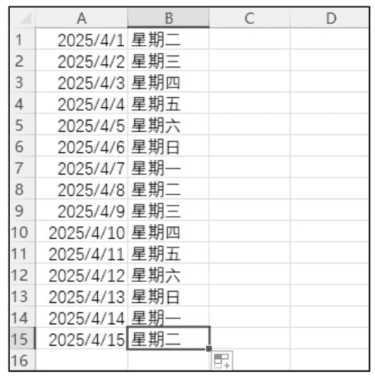

（2）用计算器做运算。
在 Excel 里用计算器算求和、平均值，效率低且易错。
Excel 已把求和、平均值、最大值、最小值、计数等常用功能做成按钮。直接点【公式】→【函数库】→【自动求和】下拉，选择对应选项即可快速计算。
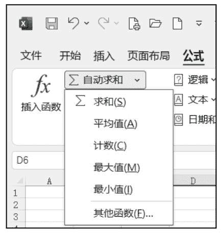

（3）图表类型选错。
做图前要先明确用途。如要看各数据占总数的比例，柱形图表达不清，应选饼图。
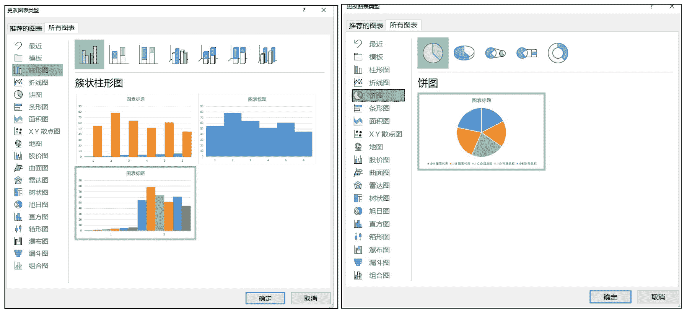

（4）不会排序筛选。
排序和筛选能快速按升序、降序或自定义序列排列数据，也能精准筛出符合条件的数据，是强力工具。

## 1.2 思维：高手的思考方式

高手的思路可以学习，学会就能上手。

**1 合理组织数据结构**

新奇内容易吸引注意，熟悉框架更易记忆。比如对大妈讲量子力学会很快结束。让读者理解表格，最好按其熟悉的思维方式来组织。未组织的 Excel 数据就是一堆数字，看着头疼。

**2 留住阅读注意力**

刚打开表格时注意力集中，但数据量一大，新鲜感消失，注意力便下降。
对策是在大量数据中穿插形式变化，制造新鲜感，持续吸引注意，如下图所示。（素材\ch01\1.2-1.xlsx）
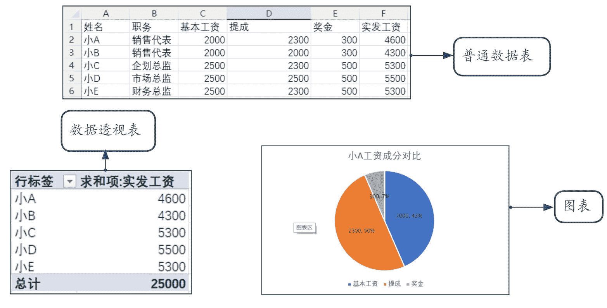

**3 用图表让数据发声**

Excel 不止做表格，还能加入图片和图表。把分析结果图形化，整体更美观，也更易吸睛，如下图所示。（素材\ch01\1.2-2.xlsx）
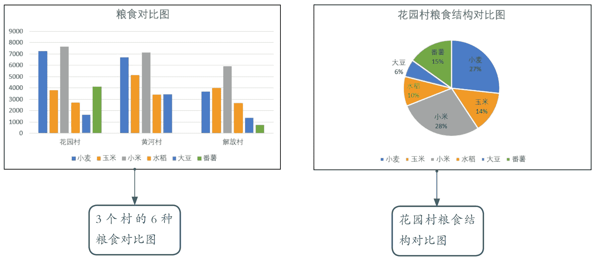
图形化数据比原始数据更简洁清晰。

**4 表格也要会美化**

数据处理是核心，但适当美化是加分项。下图所示的普通表格经过字体、字号、行高列宽调整，加上边框和底纹，效果明显提升。（素材\ch01\1.2-3.xlsx）
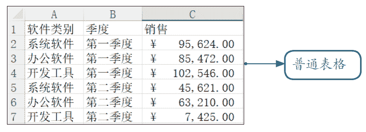
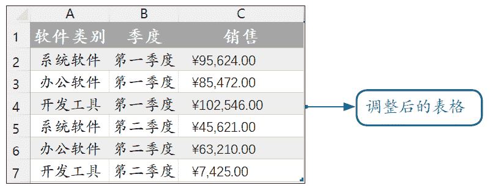

## 1.3 习惯：细节决定成败

**1 慎用合并单元格**

合并单元格能让表头更美观，如下左图所示。
但合并后排序等操作会报错，如下右图所示。
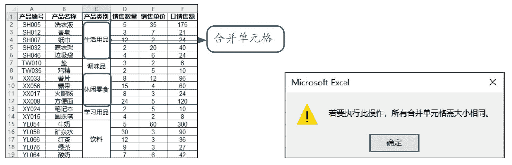

**2 别滥用空格**

空格有时能起到对齐作用，如下图所示。
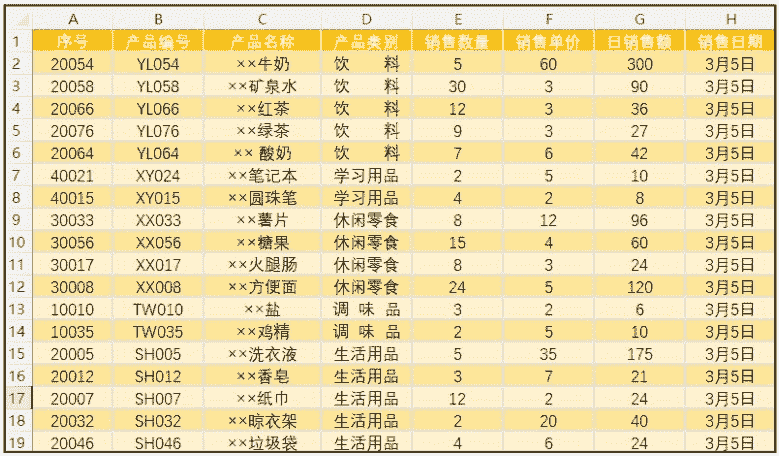
这会给后续查找带来麻烦，比如查找“饮料”时，空格位置不同就匹配不到。

**3 日期格式保持统一**

日期格式不统一，输入方便但看起来混乱，如下图所示。
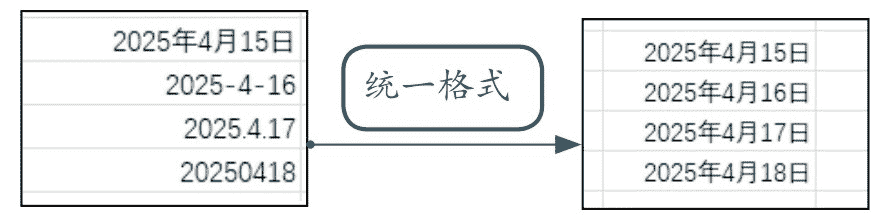

**4 数据与单位分离**

传统习惯把数量和单位写在一起，如下图所示。（素材\ch01\1.3-4-1.xlsx）
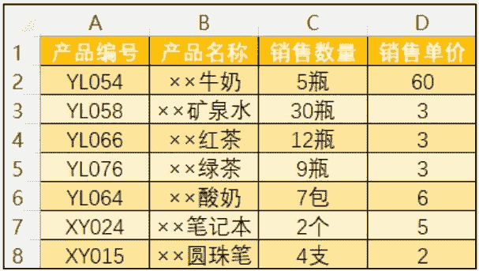
一旦计算就会出错，如下图所示。
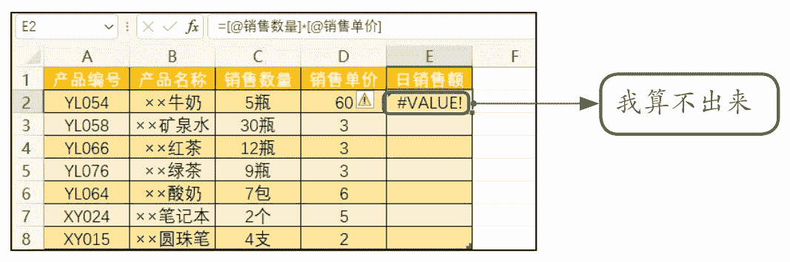
把数量和单位分开再计算就没问题了，如下图所示。（素材\ch01\1.3-4-2.xlsx）
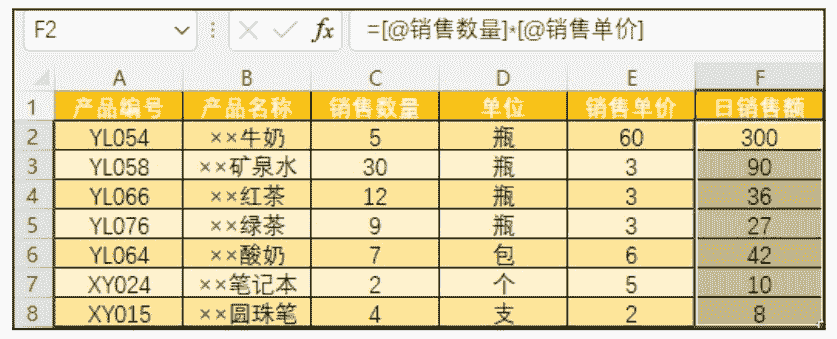

**5 用 PDF 做备份**

报表需要发给他人查看且不希望被修改，可导出为 PDF，如下图所示。
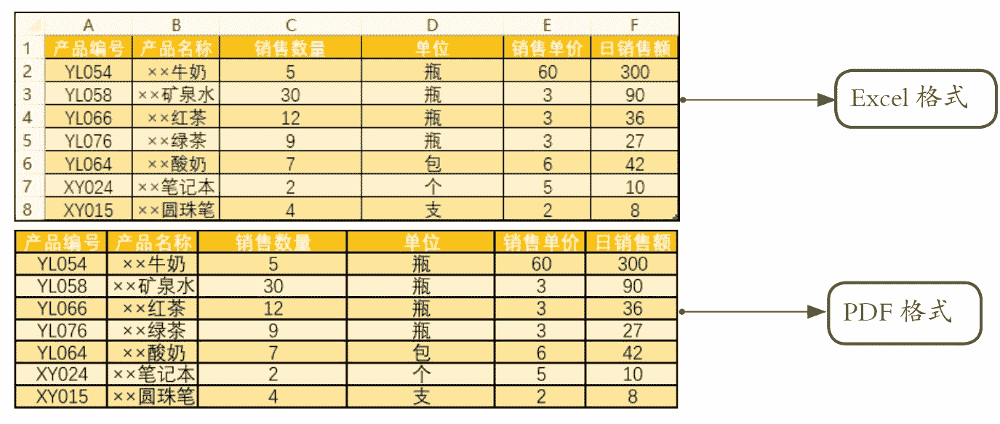

## 1.4 学习路径：从入门到精通

高手都是靠方法一步步走出来的。

**1 先定目标再行动**

学习目的决定路径。若为工作需要，可针对性学习。例如做人力资源可学字符处理；做销售库存可学数据透视表；想摆脱加班，还需深入函数公式，甚至接触 VBA 和宏。

**2 善用右键菜单**

选中对象后右击会弹出快捷菜单，命令都针对当前对象，操作更快，如下左图所示。
同时会出现浮动工具栏，用于快速设置外观，如下右图所示。
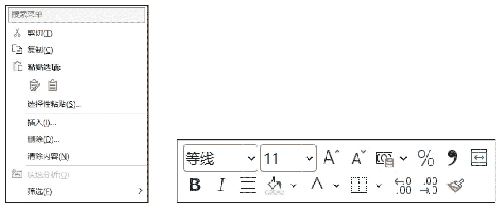

**3 定制自己的界面**

“自定义功能区”和“自定义快速访问工具栏”可让菜单按需定制。
点【自定义快速访问工具栏】按钮可设置常用工具栏，如下左图所示。
在功能区空白处右击可自定义功能区，如下右图所示。
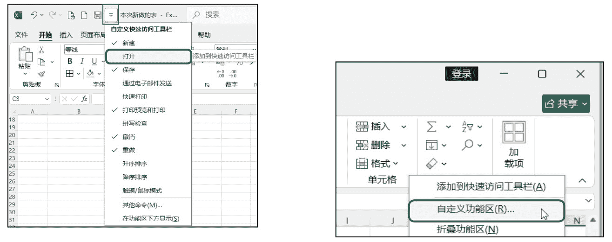

**4 熟悉函数公式**

Excel 的强大来自公式与函数，求和、平均值等都是典型应用，如下图所示。
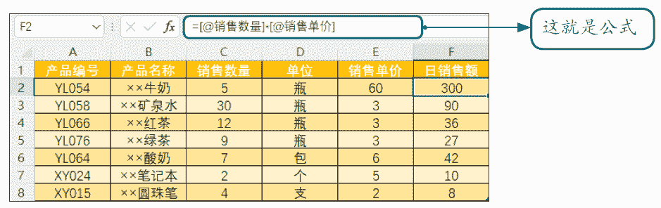

**5 多用【F1】帮助**

遇到不熟悉的功能，按【F1】调出帮助文档是最高效的学习方式，尤其在学习几百个函数时特别实用，如下图所示。
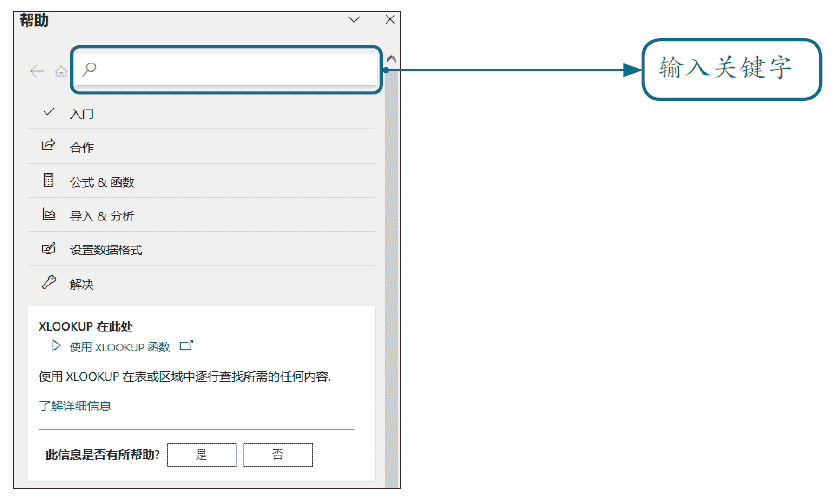

**6 阅读结合实操**

多阅读技巧和案例能拓宽视野，但阅读必须配合实践。动手几次才能把知识内化，通过假设测试还能举一反三。

## 1.5 重塑工作流：AI 重构数据分析

面对海量数据和复杂需求，传统 Excel 操作易陷入“数据泥潭”。AI 的到来正改变这一现状，从清洗到可视化再到报告生成，全流程提效。

### 1.5.1 从手工到智能的转变

AI 正在改写 Excel 的玩法，从手动公式到对话处理，再到自动出图出报告，效率倍增，决策更直观。

**1 从手工劳作到智能清洗**
过去合并拆分、清洗核对数据都要靠熟练函数，繁琐易错。如今用自然语言交互即可完成。用户像聊天一样描述需求，AI 就能执行。
如下图所示，使用豆包的数据分析功能，发送“删除空白单元格：删除所有有空白单元格的行，重新生成一个 Excel 文件”指令后，AI 自动处理并提供下载。

**2 从公式恐惧到智能推导**
函数一直是难点，从 SUM 到 VLOOKUP 再到数组函数，记忆使用都困难。AI 能根据需求直接给出公式。
例如问 DeepSeek“在 Excel 中，如何计算 A 列去掉最大值和最小值后的平均值”，即可快速得到公式，如下图所示。

**3 从手动调图到一键生成**
可视化需要大量格式调整。AI 可直接生成图表。
例如对智谱清言说“根据这些销售数据生成一个柱状图，对比各季度销售额”，就能迅速得到所需图表，如下图所示。
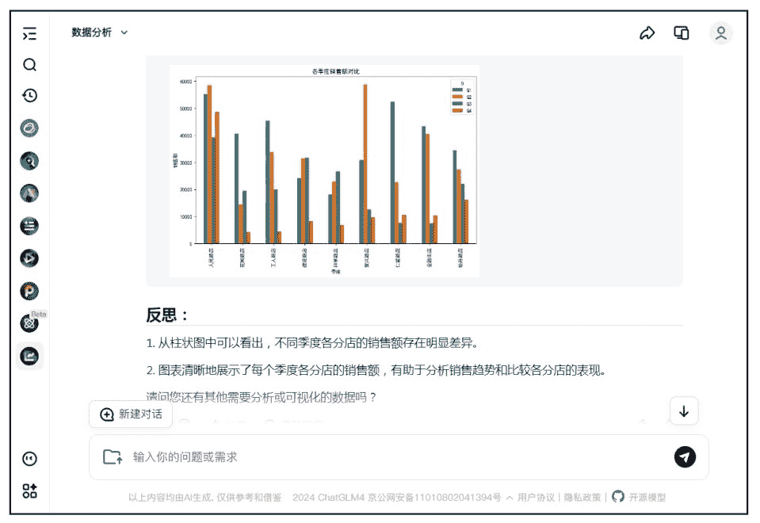

### 1.5.2 Excel 有问 AI 必答

使用 Excel 时遇到疑难，可借助 DeepSeek、豆包、文心一言等 AI 工具快速解答操作问题。

比如想把 A、B、C 三列内容快速拼到一列里并剔除重复值，翻来覆去试了不少办法还是卡住。以 DeepSeek 为例，只要把需求写成“Excel 如何把 A、B、C 三列数据合并为一列并删除重复项”，它就能马上给出可直接用的解法，示意图如下。

生成式 AI 的普及正让 Excel 的使用效率发生质变。把 AI 当成解决疑难杂症的助手，日常办公会轻松很多，能把很多繁琐操作变成几句话的事。

### **1.5.3** **数据分析场景下的 AI 利器**

AI 技术发展很快，围绕数据处理和分析涌现出大量工具。下面盘点几款主流产品，帮助判断在不同 Excel 场景下该用谁，具体清单见表 1-1。

表 1-1 主流的 AI 工具

表里没列的文心一言、通义千问同样好用。实际选用时结合自己的需求和操作习惯去匹配，就能让 Excel 的处理和分析速度明显提升。

### **1.5.4** **把 AI 直接装进 Excel：呼叫 AI**

除了前面介绍的独立工具，还可以把 AI 能力嵌入到 Excel 里面使用，不过这条路通常要动到 VBA，门槛会高一些。

Excel Home 为用户打造的扩展插件“Excel 易用宝”，内置一百多个常用功能模块，覆盖数据处理和分析的日常需求，同时集成“呼叫 AI”功能。完成简单配置后就能直接调用 DeepSeek、Kimi 等模型。

该插件适配 Windows 10、Windows 11 等环境，兼容 Excel 2010 至 2024 全部版本，含 Excel 365。可在官网下载安装包到本地。关于“呼叫 AI”的具体配置，可参考帮助中心提供的视频教程。下图展示了呼叫 AI 内置的多个模型模块，可按需交互。

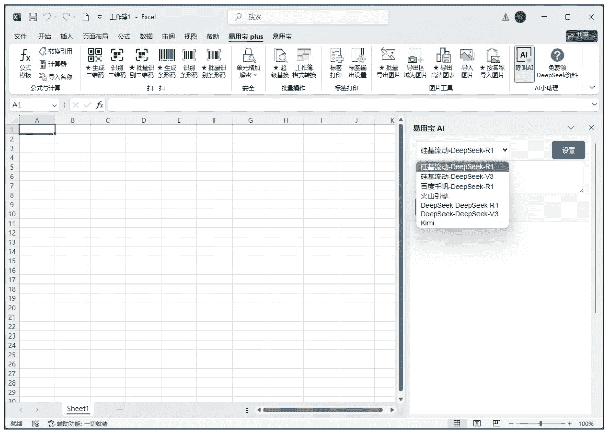

## **高手自测**

本章主要是 Excel 高手的思维习惯，学完不妨做个小测验。打开“素材\ch01\高手自测．xlsx”，在 5 个工作表中按要求完成操作。若都能一次通过，说明本章已掌握；若有卡点，建议回头重读再进入下一章。

（1）打开“素材\ch01\高手自测．xlsx”，“高手自测 1”工作表左图为初始状态。目标是把列宽快速调整到合适显示，效果见右图。

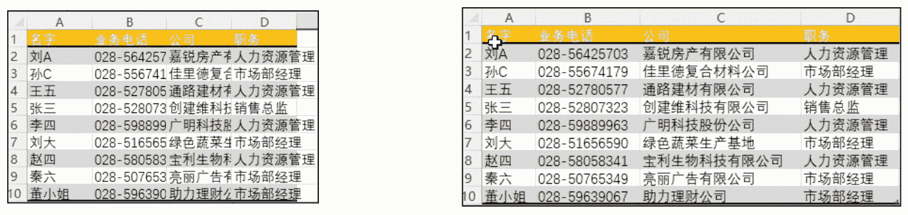

（2）打开“素材\ch01\高手自测．xlsx”，“高手自测 2”工作表的数据列比较宽，默认纵向打印很容易导致内容被截断或多出空白页，需要改为横向打印。

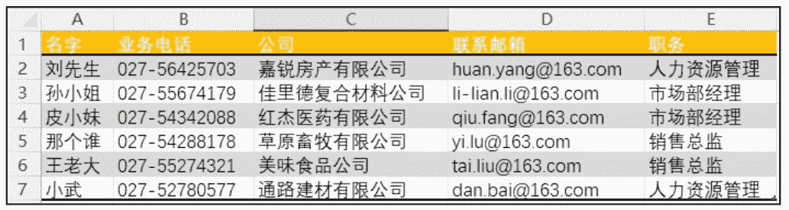

（3）打开“素材\ch01\高手自测．xlsx”，“高手自测 3”工作表左图为初始状态。请快速完成数据的求和运算，效果见右图。

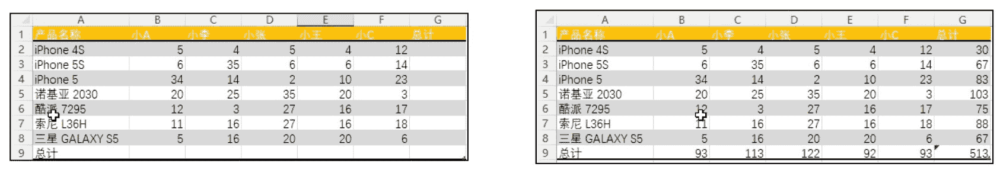

（4）打开“素材\ch01\高手自测．xlsx”，“高手自测 4”工作表左图为初始状态。请为内容设置自动换行，效果见右图。

（5）打开“素材\ch01\高手自测．xlsx”，“高手自测 5”工作表左图为初始状态。拖动滚动条查看后部内容时标题行会丢失，可用【冻结窗口】让首行始终可见，效果见右图。

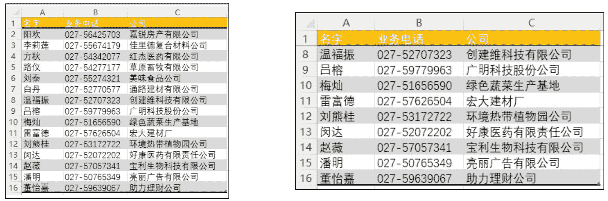

# **第二章**

# **一表在手：回到 Excel 的本质**

经常有人吐槽：书看了不少，技巧也记了不少，真正上手做表时却总觉得用不上，表格还是老样子。归根结底是初学者常见的问题——对 Excel 的使用方式不够科学、合理。

## **2.1** **九成问题都来自基础表**

工作场景各不相同，表格形态也千差万别。但一些不良习惯和错误用法却是高度重复的。

**1 Excel 与记事本**

Windows 自带的记事本常用来记日常便签，也有人拿 Excel 来做记录，理由往往是“有网格线”。拿 Excel 做记录本身没错，只是大材小用。既然信息已经在表里，为什么不顺手做统计和分析一把呢？

比如几个人外出旅游，用 Excel 记录如下图所示。（素材\ch02\2.1-1. xlsx）

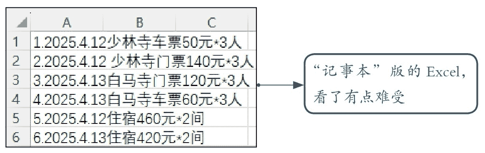

如果觉得“记事本风格”不够好看，可以整理成下面这种样式。

还能按需求排序。

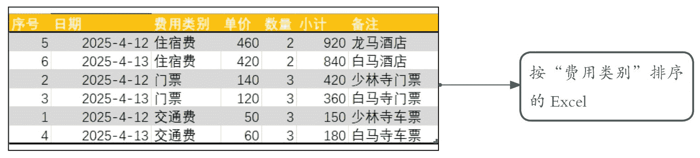

也能做分类汇总。

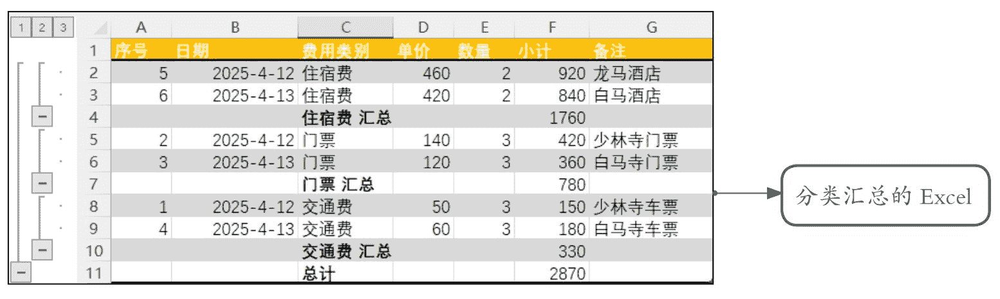

也可以用图表呈现。

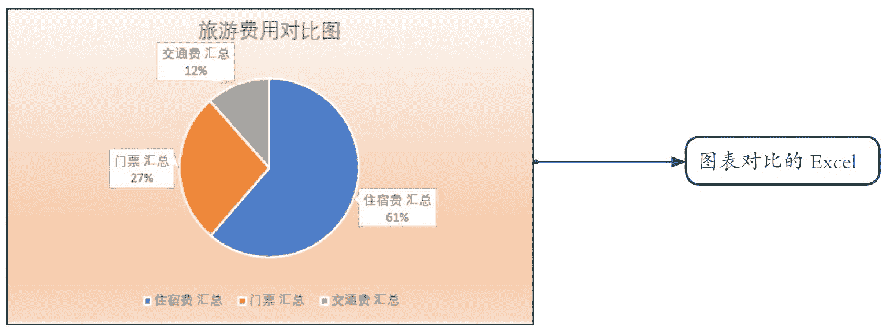

看到这里，做记录你会选 Excel 还是记事本？

**2 单元格内换行**

很多人觉得 Alt+Enter 换行很方便，看起来整齐还能避免合并单元格，示例如下图。（素材\ch02\2.1-2.xlsx）

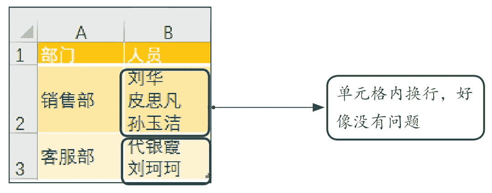

但在数据处理层面，这种写法弊端明显。排序、筛选、查找时会出现各种麻烦，如下图所示。

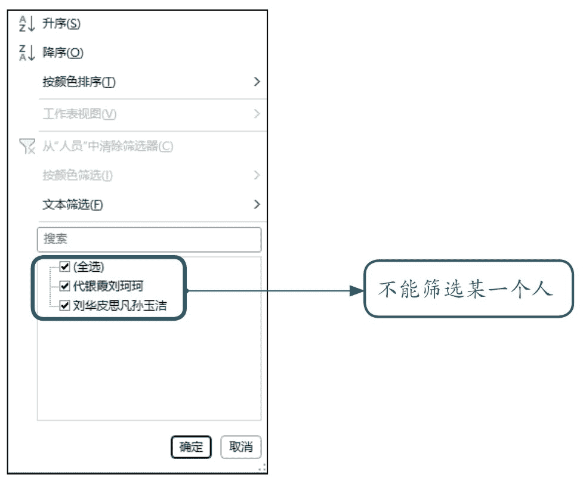

现在根本筛不出某个人。

**3 无意义的空行**

有人喜欢插入空行来分隔，感觉更清晰，如下图。（素材\ch02\2.1-3.xlsx）

排序后结构就乱了，如下图。

筛选也会出错，如下图。

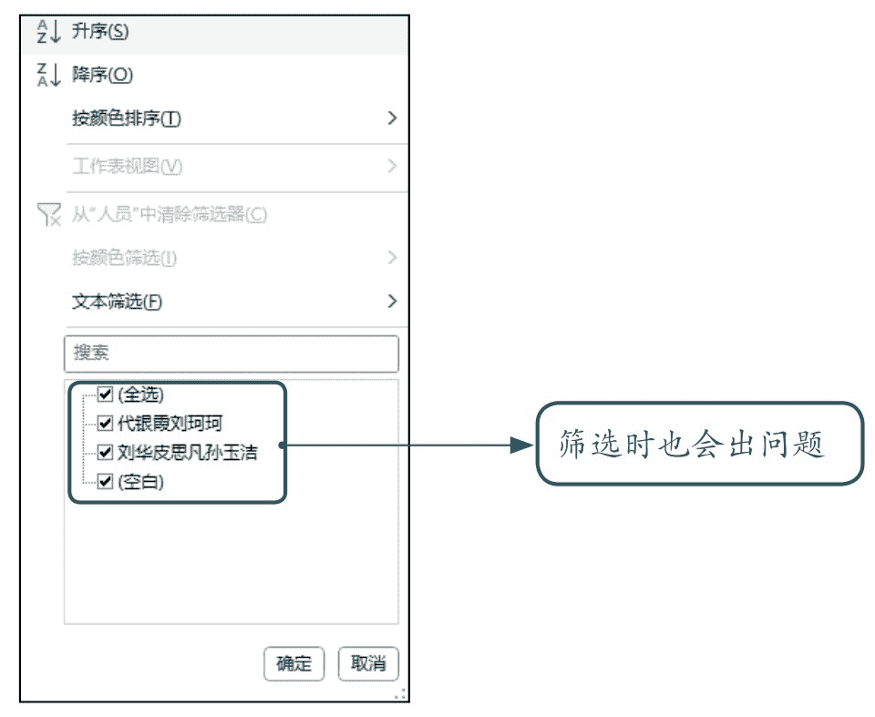

**4 表述混乱**

同一个概念用不同名字、简称混用，会让表格规范性受损，下面例子就分不清到底有几个部门。（素材\ch02\2.1-4.xlsx）

**5 烦人的小计**

手动加小计行看似细致，实则操作繁琐且破坏数据连续性，影响后续统计，如下图。（素材\ch02\2.1-5.xlsx）

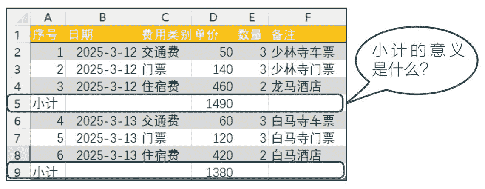

想汇总，直接用数据透视表即可。

**6 滥用批注**

单元格右上角的小三角就是批注，悬停会显示说明，如下图。（素材\ch02\2.1-6.xlsx）

适量的批注能增强可读性，但批注过多会让表格杂乱。更糟的是有人把数据藏进批注，导致无法直接计算和分析，如下图。

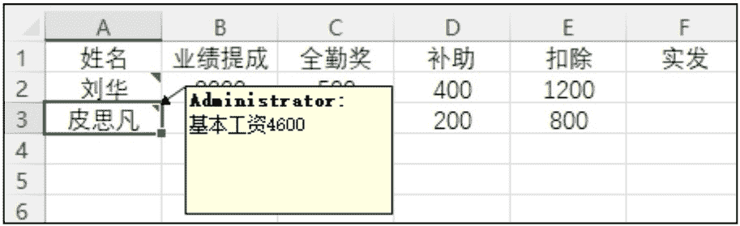

## **2.2** **基础表设计的基本原则**

科学规范的基础表是高效分析的前提，分析的源头永远是基础表。

玩转 Excel 先要玩转基础表，懂了基础表的精髓才能对 Excel 有正确认知，菜鸟和高高手手的区别就在这里。

**1 简洁，但不简单**

结构要简洁，按工作性质、管理内容、数据类型设计不同的基础表来存放不同数据，如下图所示。表要越简洁越好，但数据要充足完整，功能不能缺失，简洁不等于简陋。（素材\ch02\2.2-1.xlsx）

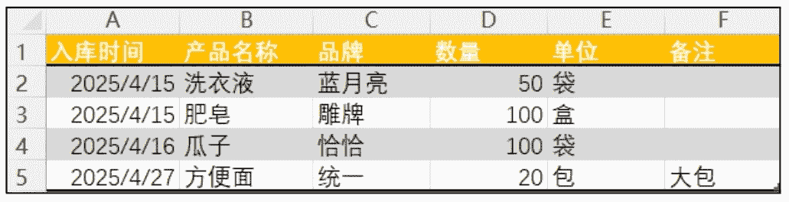

**2 规范，但不死板**

有规矩才好用，混乱的表格很难统计分析。只有结构合理、数据完整、层次清晰的基础表才便于读取和汇总，如下图所示。（素材\ch02\2.2-2.xlsx）

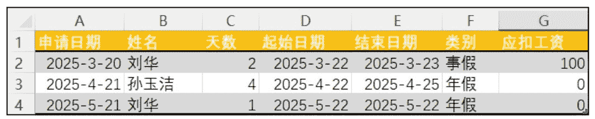

**3 通用，但不硬搬**

一般一项工作只建一张基础表，且是一维数据表。行政、财务、销售、物流都能用类似结构记录，区别只是字段名和内容。

**4 美观，但不花哨**

基础表和报告都要好看。基础表的美化服务于整理数据，报告的美化服务于结果表达。不要在同一张表里堆太多颜色和线条，如下图所示。

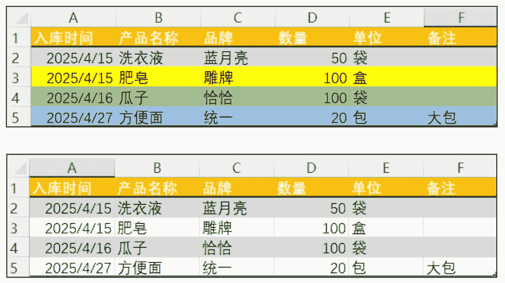

一张合格的基础表应具备：

（1）一维数据表，只有顶部标题行，没有左侧标题列。
（2）仅有一个标题行。
（3）不使用合并单元格。
（4）数据信息完整且准确。

## **2.3** **计算机的喜好与人的喜好**

既要记录原始数据，又要挖掘故事，就不能只讨好领导，还要考虑计算机的习惯。不能把纸质表格原样搬进 Excel，必须先设计好电子表格。设计得好事半功倍，设计不好后患无穷。

区别于“报表型”表格，用于日常业务管理的可称为“事务型”表格。从管理者视角要有全局观，理解业务流程和上下级数据需求，把握设计原则。

使用 Excel 请注意：

（1）结构必须是一行为标题、下面为记录行的形式，标题不重复，记录行不完全相同。
（2）标题顺序最好按日常录入习惯排列。
（3）表格中不出现空行空列。
（4）规范输入内容、取值范围和格式。
（5）同一对象命名统一，同一列数据类型一致。
（6）不要出现不必要的小计、合计、汇总行列，也不要合并单元格。
（7）考虑业务扩展性。
（8）不同用途的数据分别存放在不同表格。
（9）保证数据安全，及时备份。

## **2.4** **学好 Excel 要懂点数据库**

数据库技术无处不在。超市结账刷会员卡和条码，系统会从后台数据库调取会员和商品信息，结账后自动记录消费并扣减库存；银行卡支付还要联机查询银行数据库，把交易写进去。没有数据库，这些信息无法高效保存和处理。

数据库是按结构组织、存储数据以便管理和使用的仓库。Excel 和数据库都做信息采集、整理、分类、存储，后续可增删改查统计打印。数据库对结构设计有严格规范，Excel 记录原始数据的工作表结构也遵循这些规范，否则后续处理就是空谈。

数据库需要编程处理，Excel 基本无代码即可完成大部分管理工作。若只是把表原样打印交上去，这一章可跳过。

目前主流的关系型数据库对数据结构、操作、完整性约束有明确要求。设计 Excel 工作簿时要像设计系统一样思考：管理什么信息，信息间什么关系，不同环节数据分表存储，结构如何完整反映属性，后续如何分析处理。设计一张表的结构、一个簿的功能并不容易，需积累经验。下面先严格按表 2-1 的规范执行。

表 2-1 关系数据库与 Excel 工作簿的数据规范

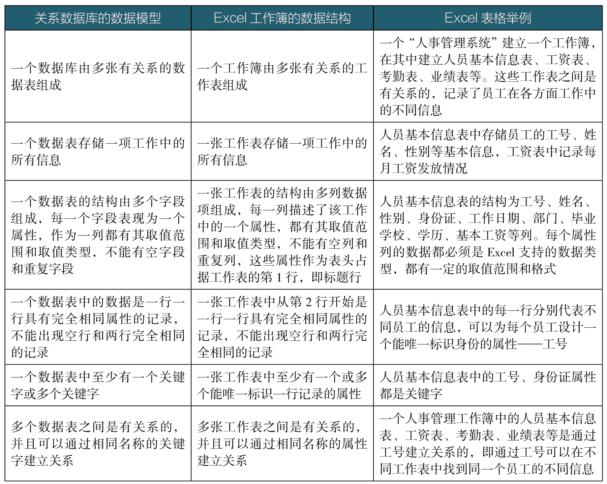

## **2.5** **数据效率低的根源—数据冗余**

数据冗余指表格里存在多余重复信息，不仅增加录入负担，还让结构臃肿，可读性和可分析性下降，如下图所示。（素材\ch02\2.5.xlsx）

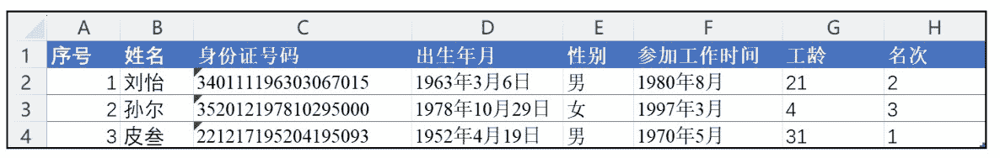

上表看似正常，实则有了身份证号码，就能通过公式推导出出生年月和性别，如下图所示。

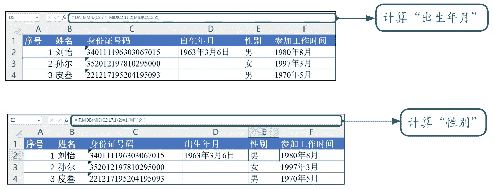

## **2.6** **“糊涂账”的解决之道—数据耦合性**

耦合性指数据项间的相互依赖。Excel 中若两个或多个对象存在依赖关系，同一表或不同表之间就会产生耦合。处理得好能简化结构，处理不好就是糊涂账。

**1 同一张工作表中的数据耦合**

耦合也能带来好处，比如有身份证号就能轻松算出出生年月和性别，减少手工输入并提高准确性，如下图。

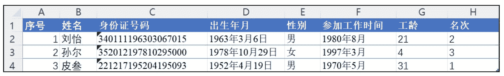

反过来，若被依赖的数据出错，结果也会跟着错，如下图。

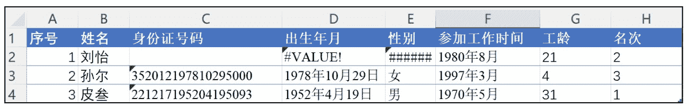

**2 不同工作表之间的数据耦合**

常见做法是把稳定不变的参数或标准数据单独存表，日常变动数据放另一表，结果汇总分析放第三表，三表相互依赖。

（1）“基本信息”表如下图所示。（素材\ch02\2.6-2-1.xlsx）

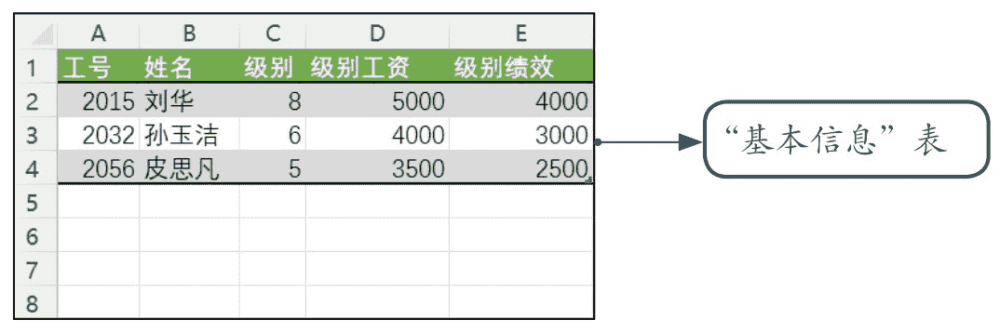

（2）“实发信息”表如下图所示。（素材\ch02\2.6-2-2.xlsx）

（3）“最终信息”表如下图所示。（素材\ch02\2.6-2-3.xlsx）

操作思路：

步骤 01 计算“实发工资”，如下图所示。

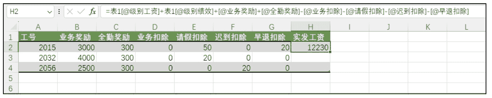

步骤 02 计算“姓名”，如下图所示。

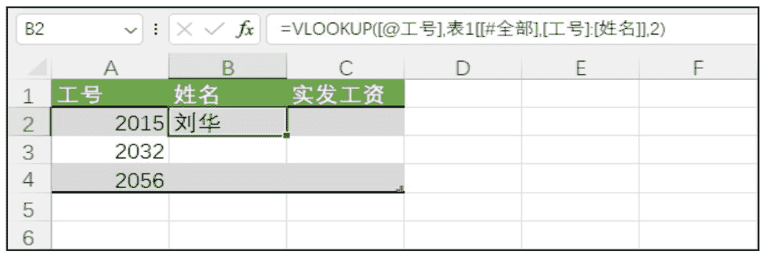

步骤 03 用 VLOOKUP 函数调用“实发工资”数据，如下左图所示，最终结果如下右图所示。

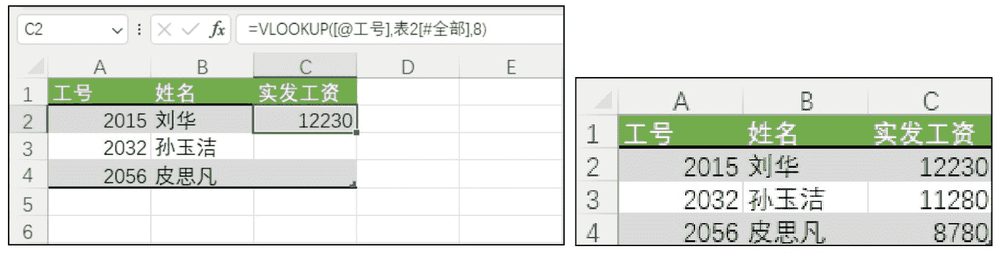

## **2.7** **任务完不成的关键—数据完整性**

数据完整性指建表时必须完整记录所有必要信息。

以考勤为例，需要记录三类信息。（素材\ch02\2.7.xlsx）

（1）基础信息：工号、姓名、上班时间、下班时间，如下图所示。

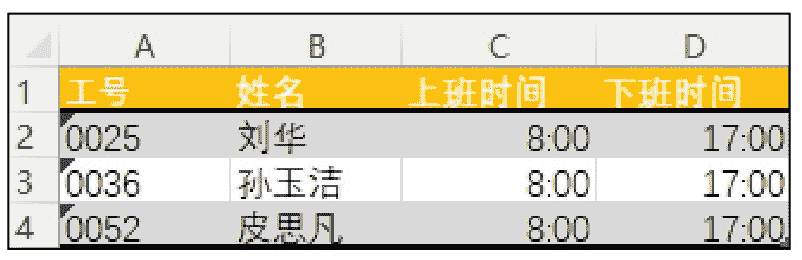

（2）考勤信息：工号、上班打卡时间、是否迟到、下班打卡时间、是否早退、是否请假、是否公出、是否旷工，如下图所示。

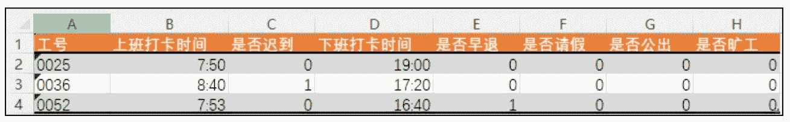

（3）汇总信息展示：工号以及迟到、早退、请假、旷工、实扣金额等数据，一并呈现于配图中。

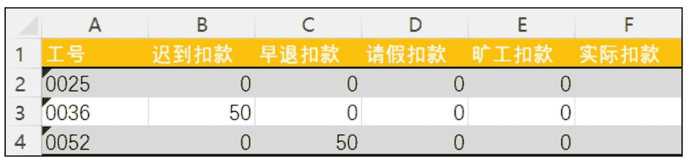

随后对迟到与早退进行判断，具体依据图示。

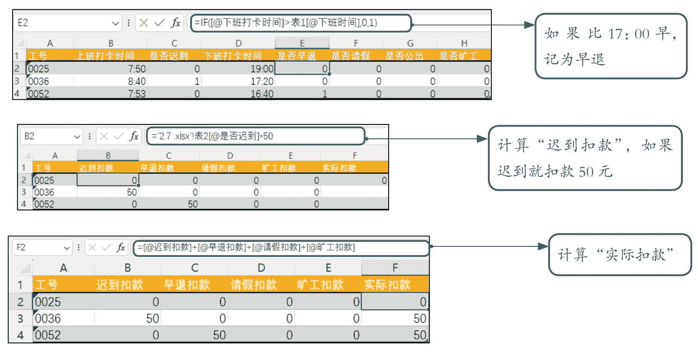

## **2.8 基础表规范化改造**

“预则立，不预则废”，构建基础表也需先行规划。正式动手前，先弄清业务场景、需求与实现路径。

**1 调研环境，明确目标**

在修改或新建表格之前，先全面摸清楚工作环境，了解管理层的期望、跨部门协作模式以及企业文化氛围，配图可供参考。

摸清背景之后，要把制表目的厘清，搞明白表格要解决什么问题。下图展示了领导所需的各部门费用情况汇总表。（素材\ch02\2.8-1.xlsx）

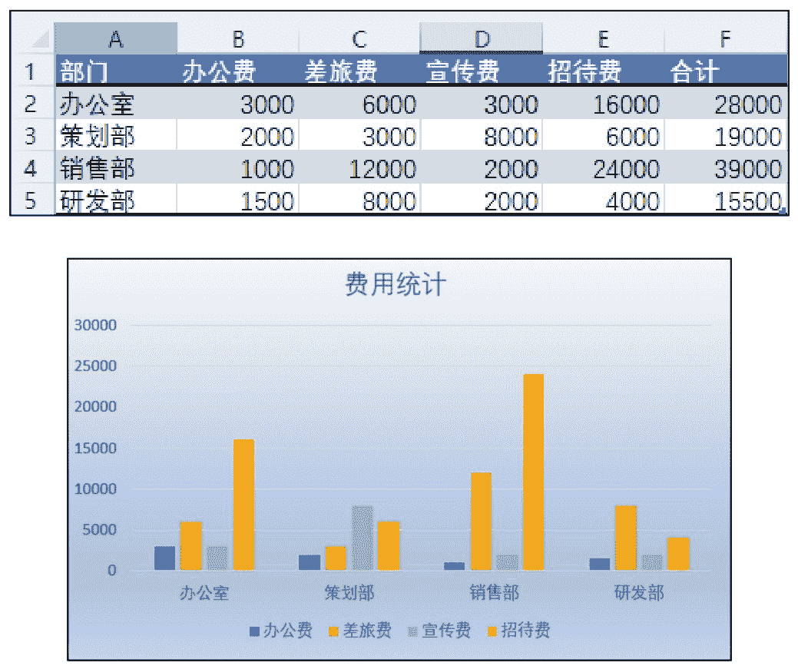

**2 字段规划**

表面简单的表格，实际是由诸多字段构成。框架与字段的选择，直接体现设计者的专业思维。

有人觉得不懂行业就做不好表格。实际上，从设计视角看，某个领域足够专业的从业者，也能快速把握其它行业的管理逻辑与业务流程。只要吃透制表背景与目标，就能把握设计要点。下图是一张薪酬表格。（素材\ch02\2.8-2.xlsx）

从该表可看出，其核心是说明每位员工的薪酬情况，其中“身高”字段明显多余，与目标无关。

除冗余字段外，缺失字段同样致命，会导致信息不完整甚至产生误会。例如图中关键标识用了“姓名”，若公司存在同名员工就会混淆，因而需要补充“工号”作为唯一主键。同时“扣款 1”具体扣的是什么应加以说明，需要增设“备注”字段，图示如下。

**3 表格美化**

基础框架确定后，可按个人审美进行修饰，打造更易读的排版。常见手段包括字体与对齐调整、行列尺寸修改、单元格着色等。

下图是某公司年会得分排行表。（素材\ch02\2.8-3.xlsx）

美化排名表的具体流程如下。

步骤 01 调整字体。对汉字使用“仿宋”12号，数字使用“Times New Roman”12号，并适度调节列宽，见图示。

步骤 02 对齐设置。因各列数字位数相同，统一采用居中对齐，见图示。

步骤 03 行高列宽。常规做法是将行高设为“18”，上下留白更舒适，见图示。

步骤 04 边框底纹与字体统一，呈现整洁效果，见图示。

步骤 05 竞赛场景下，可将每轮最高分突出显示，见图示。

## **2.9 模板化复用策略**

工作中常需制作工作表、资金表、财务表等多类表格，逐张制作既繁琐又易重复。借助模板可实现一次性搭建、重复使用。

简言之，模板是对特定领域预先定义好的格式，见图示。（素材\ch02\2.9.xlsx）

模板制作要点如下。

（1）解除锁定。

编辑模板前，先取消锁定。选取 A1:J10 区域，右键选择【设置单元格格式】，进入【保护】页签，去掉【锁定】勾选，确认，见图示。

（2）序号列配置。

按需求设置序号列的格式与校验，具体如下。

步骤 01 选中 A 列，右键【设置单元格格式】，在【数字】页签选择【数值】，小数位数设为【0】，确认，见右图。

步骤 02 点击【数据】选项卡【数据工具】组中的【数据验证】，在【设置】中允许【整数】，条件为【介于】，下限【0】上限【999】，见左图。

步骤 03 切换至【输入信息】，标题填写【输入限制】，提示内容填写【只能输入 0~999 的整数。】，见右图。

步骤 04 切换至【出错警告】，样式选【停止】，标题填写【输入错误】，错误提示填写【只能输入 0~999 的整数。】，确认，见左图。

步骤 05 此时选中 A4:A10 任一格会弹出输入提示，见右图。

步骤 06 若输入超出范围会弹出【输入错误】提示框，见图示。

（3）性别列配置。

为性别列设定校验，具体如下。

步骤 01 选中 C 列，点击【数据验证】，在【设置】中允许【序列】，来源填写【男，女】，见左图。

步骤 02 在【输入信息】页签进行设置，见右图。

步骤 03 在【出错警告】页签设置参数后确认，见图示。

（4）出生年月列配置。

选中 D 列，右键【设置单元格格式】，在【数字】页签选择【日期】，类型挑选一种日期样式，确认，见图示。

（5）锁定结构。

锁定指定单元格，具体如下。

步骤 01 选取需要锁定的区域，见右图。

步骤 02 右键【设置单元格格式】，在【保护】页签勾选【锁定】，确认，见右图。

（6）保护工作表。

为防止误改，需对工作表进行保护，具体如下。

步骤 01 点击【审阅】选项卡【保护】组中的【保护工作表】，在密码栏输入【123】，在允许用户操作列表中设定权限，确认，见左图。

步骤 02 在确认密码窗口再次输入“123”，确认，见右图。

此时模板已受保护，在“子女数”列右键，可见【删除】等操作不可用，见图示。

若尝试修改“子女数”标题名称，也会被限制，见图示。

当然，增加记录仍可正常操作，见图示。

最后修改工作表名称并保存退出，“调出人员情况登记表”的模板即完成！

## **2.10 AI 赋能的表格设计与多表管理**

传统手工制表与多表联动耗时耗力。AI 可通过自然语言生成框架、图文转表、智能合并拆分，提升效率。

### **2.10.1 用 AI 实现文本或图片秒转表格**

如图所示，若销售数据以文本形式接收，手工录入成本很高。借助 AI 可将文本或图片内容迅速转为表格格式，复制到 Excel 后即可使用，大幅减少手工输入。

步骤 01 打开 DeepSeek，将数据粘贴到输入框，按【Ctrl+Enter】换行，输入指令“将这些数据整理为表格格式”，单击 按钮，见左图。

步骤 02 DeepSeek 会输出表格形式，见右图。

步骤 03 选中表格数据，右键选择【复制】，见左图。

步骤 04 打开 Excel，粘贴到单元格，即完成转换，见右图。

### **2.10.2 用 AI 生成表格样例**

缺乏设计经验时，只需向 AI 描述需求，即可自动获得含表头与格式的框架，复制到 Excel 后直接编辑。以 DeepSeek 为例生成“加班时长统计表”。

步骤 01 打开 DeepSeek，输入指令，单击 按钮，见左图。

指令：请帮我生成一个包含虚拟数据的加班时长统计表，采用表格格式。

步骤 02 DeepSeek 生成表格后，直接粘贴到 Excel 即可，见右图。

### **2.10.3 用 AI 一键合并与拆分多表数据**

以往合并或拆分多表需手工操作，易错费时。AI 可识别数据结构与关联字段，实现一键合并拆分。以“豆包”为例合并多表，具体如下。

步骤 01 打开并登录豆包，点击对话框下方【数据分析】，见左图。

步骤 02 进入数据分析页面，将待合并的工作簿拖入输入框，上传完成后输入指令并回车，见右图。

指令：将“2.10.3-2.xlsx”中的数据合并到“2.10.3-1.xlsx”中，以两表的 A 列为唯一匹配列，执行横向合并，重新生成一个 Excel 文件。

步骤 03 豆包处理完成后，点击下方 Excel 图标下载文件，见左图。

步骤 04 下载后用 Excel 打开，按需调整，见右图。

同理，还可使用豆包进行拆分、过滤、清洗、去重、格式转换等操作。

## **2.11 考勤表设计方案**

考勤结果直接影响薪酬发放，工作并不轻松，不同公司制度差异较大。

本例作简化处理，假设每月打卡记录与考勤统计分别存于不同工作表，展示 Excel 如何自动、高效、准确处理批量工作。

假设单位每日打卡上下班，每月初汇总上月出勤，可设计 5 张工作表承载不同信息。

**1 参数表**

存放每月应出勤天数、每日上下班时间，以及部门、民族、学历等相对固定信息，见图示。数据按实际情况填写，可后续增删改。（素材\ch02\2.11.xlsx）

**2 员工基本信息表**

存放本公司员工基础信息。新员工入职可新增记录，离职后可删除，但删除前务必备份相关表，最好打印存档。应制定严格管理制度，明确删除时点与流程，避免信息缺失。

**3 打卡表**

存放每日上下班打卡时间。假设每天上班打一次卡、下班打一次卡，系统自动记录工号、日期、时间，并自动判断上下班，同时依据公司规定判断迟到早退，每次迟到早退记违纪“0.5”天，见图示。该表无需人工干预，采购打卡系统时告知供应商即可。

**4 请假表**

存放员工请假信息。需依据领导批准的申请录入，除“姓名”自动填充外，其余字段手工输入，其中“时长”仅记录半天与一天，用“½”和“¹”表示，请假一天产生一条记录，请三天则产生三条不同日期记录，见图示。

**5 考勤统计表**

存放每月全体员工考勤汇总。除“黄底红字”文字外，其余单元格统计前为空白。统计某月时只需输入“年”与“月”，本例为“2003”和“3”，其余数据自动填充。该表每月一张，可查看每日迟到早退请假情况及当月实际出勤天数。为简化设计，未考虑旷工、产假、公休假、出差等情况。

五张表各司其职、相互配合完成考勤管理。参数表与员工基本信息表维护频率低，打卡表无需人工维护，请假表需手工录入，考勤统计表只需输入年、月即可自动汇总。考勤统计表结构最复杂，数据均来自其他四表。下面重点介绍请假表与考勤统计表的设计。

（1）请假表的设计。

① 工号。

选中 A 列设为文本格式。假设工号由 6 位字符组成，可重复。选中 A2 单元格设置【数据验证】，允许【文本长度】，条件【等于】，长度填【6】，确认后向下复制。

② 姓名。

姓名根据工号自动从“员工基本信息表”获取。在 B2 输入公式【=IF(A2<>"",VLOOKUP(A2，员工基本信息表！$A:$B,2),"")】，向下复制。

③ 请假日期。

选中 C 列设为短日期格式。

④ 时长。

考勤自动统计与校验实战

半天请假时录入【½】，整天请假时录入【¹】，这两个符号作为特殊标记使用。先激活 D2，调出数据有效性窗口，在设置页签把允许条件改为序列，来源栏填写【½,¹】，随后把该规则拖动填充到下方单元格。

⑤ 原因。
请假类别归纳为“病假”或“事假”两类。激活 E2，同样打开数据有效性，在设置里选择允许为序列，来源中写入【病假，事假】，之后将校验向下拉伸应用。

（2）考勤统计表的构建。
在表头键入年份与月份后，整张统计表会依据打卡表与请假表的信息自动计算并回填。

① 工号。
工号按行从员工基本信息表拉取。A3 写入公式【=IF(AND NOT(ISBLANK($C$1)),NOT(ISBLANK($E$1))),IF(ISBLANK(员工基本信息表！A2),"",员工基本信息表！A2),"")】，对该公式执行向下填充，即可逐行带出全部工号。

② 姓名。
姓名依工号从员工基本信息表引用。B3 写入公式【=IF(AND( NOT(ISBLANK($C$1)),NOT(ISBLANK($E$1))),IF(ISBLANK(员工基本信息表！B2),"",员工基本信息表！B2),"")】，向下延伸。

③ 部门。
部门同样按工号从员工基本信息表取值。C3 写入公式【=IF(AND(NOT ISBLANK($C$1)),NOT(ISBLANK($E$1))),IF(ISBLANK(员工基本信息表！C2),"",员工基本信息表！C2),"")】，向下填充。

④ 1（日）。
首要步骤是检查请假表里该员工当天是否已有记录，有则把时长填入当前格，无则转向打卡表查询。为便于在请假表定位，新增一辅助列把工号与请假日期拼接，置于时长字段之前，D2 写入公式【=A2&YEAR C2)&MONTH(C2)&DAY(C2)】，向下填充。

随后在打卡表查找该员工刷卡记录，若存在迟到或早退则累计天数写入统计表。D3 写入公式【=IF(ISERROR(VLOOKUP($A3&$C$1&$E$1&D$2，请假表！$D$2:$E$5,2,)="#N/A"),IF(SUMIFS(打卡表！$E$2:$E$21，打卡表！$A$2:$A$21,考勤统计表！$A3，打卡表！$B$2:$B$21，考勤统计表！$C$1&"/"&考勤统计表！$E$1&"/"&考勤统计表！D$2)=0,"",SUMIFS(打卡表！$E$2:$E$21，打卡表！$A$2:$A$21，考勤统计表！$A3，打卡表！$B$2:$B$21，考勤统计表！$C$1&"/"&考勤统计表！$E$1&"/"&考勤统计表！D$2)),VLOOKUP($A 3&$C$1&$E$1&D$2，请假表！$D$2:$E$5,2,))】，如图所示。将 D3 向下并向右扩展至 31 日列。

该表达式篇幅过长，纯函数实现并不高效，掌握 VBA 后建议用程序来处理此类复杂逻辑。

注意打卡表引用的行数。若企业员工 100 人，每日打卡 2 次，按 31 天计，单月约 6200 行，全年约 74400 行。建议按月拆分打卡数据，并统一工作表命名，因为跨表引用会携带表名。

⑤ 应出勤天数。
应出勤天数按统计月份从参数表读取。AI3 写入公式【=IF(NOT ISBLANK(A3)),VLOOKUP($E$1，参数表！$E$2:$F$13,2),A3)】，向下填充。

⑥ 迟到早退天数。
汇总 D3:AH3 区域内已填充的 0.5 与 1，迟到或早退一次计 0.5 天，当日两者兼有计 1 天。AJ3 写入公式【=IF(SUM D3:AH3)=0,"",SUM(D3:AH3))】，向下填充。

⑦ 病事假天数。
统计 D3:AH3 中特殊字符【½】和【¹】出现次数并换算为天数累计。AK3 写入公式【=IF(COUNTIF(D3:AH3,"½")*0.5+COUNTIF(D3:AH3,"¹")=0,"",COUNTIF (D3:AH3,"½")*0.5+COUNTIF(D3:AH3,"¹"))】，向下填充。

⑧ 实际出勤天数。
实际出勤=当月应出勤-迟到早退天数/2-病事假天数。AL3 写入公式【=AI3-IF(AJ3<>"",AJ3/2,0)-IF(AK3<>"",AK3,0)】，向下填充。

（3）对两张表结构的保护设置。
这两张表的结构保护操作与员工基本信息表的设置保持一致。

最后提醒数据安全。统计表能自动汇总不代表源表可随意改动，一旦打卡表、请假表等被引用数据变动，统计结果会即时刷新。每月汇总完成后，务必对最终考勤统计表的数据值执行复制→选择性粘贴，去掉公式仅保留数值备份，避免源数据变动导致统计缺失。

2.12 进销存表格设计

企业进货、销售与库存管理牵涉面广，受规模、模式与财务制度差异影响，很难形成统一的进销存方案。

本例把每月进出流水与盘点数据分置到独立工作表，以展示 Excel 应用。假设物资集中存放于单一仓库，可用四张表分别承载不同类别信息。

1 参数表
参数表存放货物名称、品牌、单位、分类、部门、经手人等相对固定信息，如下图所示。日常可按企业实际填写、修改或增删。（素材\ch02\2.12xlsx）

2 库存表
库存表记录仓库每个盘点周期的期初期末存量，如下图所示。建立后基本无需人工维护。新增物资先在库存表补全基础信息，再在其他表处理进出。日常可修改或删除记录，但物资编号一旦录入不得更改。删除前必须备份并按流程处理，否则会与流水表、统计表产生不一致或缺失。

3 流水表
流水表记录仓库每次进出明细，如下图所示。凡有物资进出，均需在表内登记单据基本信息。

4 统计表
统计表用于在规定盘点日对仓库物资汇总，通常按月进行。建表时只需在表头填入盘点年份与月份，其余区域会自动依据库存表与流水表计算填充，如下图所示。

后三张表分别承载物资在不同状态下的数据，并相互配合完成仓库管理。库存表维护频率低，流水表手工录入最多，统计表只需输入年份与月份即可自动汇总。下面说明三张表的设计要点。

（1）库存表设计。
① 编号。
假设物资编号为 6 位字符且不可重复。选取 A2，通过数据有效性设置自定义规则，公式文本框输入【=AND (COUNTIF($A:$A,A2)=1,LEN(A2)=6)】，向下填充校验。
② 货物名称。
选取整列 B 设置数据有效性，允许选序列，来源设为【="进销存-参数表"!$A$2:$A$5】。
③ 品牌。
选取整列 C 设置数据有效性，允许选序列，来源设为【="进销存-参数表"!$B$2:$B$6】。
④ 单位。
选取整列 E 设置数据有效性，允许选序列，来源设为【="进销存-参数表"!$C$2:$C$3】。
⑤ 货物分类。
选取整列 F 设置数据有效性，允许选序列，来源设为【="进销存-参数表"!$D$2:$D$3】。

（2）流水表设计。
① 单据号。
单据号假设为 10 位字符且不允许重复。选取 A2，数据有效性选自定义，公式输入【=AND (COUNTIF($A:$A,A2)=1,LEN(A2)=10)】，向下填充。
② 发生日期。
选取整列 B，设定为短日期格式。
③ 编号。
物资编号为 6 位，可重复出现。选取 C2，数据有效性选文本长度，数据等于，长度填【6】，向下填充。
④ 货物名称。
依据编号自动从库存表获取名称。D2 输入【=IF(C2<>"",VLOOKUP(C2,’进销存-库存表’!$A$2:$B$14,2,0),"")】，向下填充。
⑤ 品牌。
依据编号从库存表自动带出品牌。E2 输入【=IF(C2<>"",VLOOKUP(C2,’进销存-库存表’!$A$2:$C$14,3,0),"")】，向下填充。
⑥ 单位。
依据编号从库存表自动带出单位。G2 输入【=IF(C2<>"",VLOOKUP(C2,’进销存-库存表’!$A$2:$E$14,5,0),"")】，向下填充。
⑦ 货物分类。
依据编号从库存表自动带出分类。H2 输入【=IF(C2<>"",VLOOKUP(C2,’进销存-库存表’!$A$2:$F$14,6,0),"")】，向下填充。
⑧ 部门。
选取整列 I 设置数据有效性，允许选序列，来源设为【="进销存-参数表"!$E$2:$E$3】。
⑨ 出库类型。
出库类型有销售、调拨、报废三种。选取 N2 设置数据有效性，允许选序列，来源填入【销售，调拨，报废】，向下填充。
⑩ 经手人。
选取整列 O 设置数据有效性，允许选序列，来源设为【="进销存-参数表"!$F$2:$F$5】。

另外，对入库数量、入库单价、出库数量、出库单价设置输入条件：单据号首字符为 R 时仅允许在入库数量、入库单价列输入，且入库数量≥1 且入库单价＞0；单据号首字符为 C 时仅允许在出库数量、出库单价列输入，且出库数量≥1 且出库单价≥0，报废时单价为 0。

● 选取 J2 设置自定义校验，公式【=AND(LEFT(A2,1)="R",J2>=1)】，向下填充。
● 选取 K2 设置自定义校验，公式【=AND(LEFT(A2,1)="R",K2>0)】，向下填充。
● 选取 L2 设置自定义校验，公式【=AND(LEFT(A2,1)="C",L2>=1)】，向下填充。
● 选取 M2 设置自定义校验，公式【=AND(LEFT(A2,1)="C",M2>=0)】，向下填充。

（3）统计表设计。
盘点时在 B1 填入年份，D1 填入月份，其余单元格会自动从库存表与流水表取数汇总。
① 编号、货物名称、品牌、规格型号、单位、货物分类。
● 编号。自动从库存表提取。A3 输入【=IF(AND(NOT ISBLANK($B$1)),NOT(ISBLANK($D$1))),IF(ISBLANK(’进 销 存-库 存 表’!A2),"", ’进 销 存-库 存表’!A2),"")】，向下填充。
● 货物名称。自动从库存表提取。B3 输入【=IF(AND NOT(ISBLANK($B$1)),NOT(ISBLANK($D$1))),IF(ISBLANK(’进销存-库存表’!B2),"",’进销存-库存表’!B2),"")】，向下填充。
● 品牌。自动从库存表提取。C3 输入【=IF(AND(NOT ISBLANK($B$1)),NOT(ISBLANK($D$1))),IF(ISBLANK(’进 销 存-库 存 表’!C2),"", ’进 销 存-库 存表’!C2),"")】，向下填充。
● 规格型号。自动从库存表提取。D3 输入【=IF (AND(NOT(ISBLANK($B$1)),NOT(ISBLANK($D$1))),IF(ISBLANK(’进销存-库存表’!D2),"", ’进销存-库存表’!D2),"")】，向下填充。
● 单位。自动从库存表提取。E3 输入【=IF(AND(NO T(ISBLANK($B$1)),NOT(ISBLANK($D$1))),IF(ISBLANK(’进销存-库存表’!E2),"", ’进销存-库存表’!E2),"")】，向下填充。
● 货物分类。自动从库存表提取。F3 输入【=IF(AND(N OT(ISBLANK($B$1)),NOT(ISBLANK($D$1))),IF(ISBLANK(’进销存-库存表’!F2),"", ’进销存-库存表’!F2),"")】，向下填充。

② 期初库存。
自动从库存表提取期初库存。G 列设为数值格式且无小数。G3 输入【=IF(AND(NOT(ISBLANK ($B$1)),NOT(ISBLANK($D$1))),IF(ISBLANK(’进销存-库存表’!G2),"", ’进销存-库存表’!G2),"")】，向下填充。

③ 单价。
自动从库存表提取期初单价。H 列设为数值格式且无小数。H3 输入【=IF(AND(NOT(ISBLANK($B$1)),NOT(ISBLANK($D$1))),IF(ISBLANK(’进销存-库存表’!H2),"", '进销存-库存表’!H2),"")】，向下填充。

④ 入库量。
I 列设为数值格式且无小数。I3 输入【=IF(SUMIF(’进销存-流水表’!$C$2:$C$21,’进销存-统计表’!A3,’进销存-流水表’!$J$2:$J$24)=0,"",SUMIF(’进销存-流水表’!$C$2:$C$21,’进销存-统计表’!A3,’进销存-流水表’!$J$2:$J$24))】，向下填充。

⑤ 入库价。
J 列设为数值格式且无小数。J3 输入【=IF(ISNUMBER(I3),SUMPRODUCT((’进销存-流水表’!$C$2:$C$18=’进销存-统计表’!A3)*(’进销存-流水表’!$J$2:$J$18)*(’进销存-流水表’!$K$2:$K$18))/I3,"")】，向下填充。

⑥ 出库量。

先把 K 列的显示方式统一一下，用 Ctrl+1 打开【设置单元格格式】，把类型设为数值并且不显示小数。K3 写入以下公式，再向下填充：
【=IF(SUMIF(’进销存-流水表’!$C$2:$C$21,’进销存-统计表’!A3,’进销存-流水表’!$L$2:$L$24)=0,"",SUMIF(’进销存-流水表’!$C$2:$C$21,’进销存-统计表’!A3,’进销存-流水表’!$L$2:$L$24))】。

⑦ 出库价。
把 L 列同样用 Ctrl+1 调为数值型、无小数格式。L3 输入公式后向下复制：
【=IF(ISNUMBER(K3),SUMPRODUCT((’进销存-流水表’!$C$2:$C$19=’进销存-统计表’!A3)*(’进销存-流水表’!$L$2:$L$19)*(’进销存-流水表"!$M$2:$M$19))/K3,"")】。

⑧ 期末库存。
M 列按 Ctrl+1 设为数值且不带小数。M3 的公式为：
【=G3+IF(ISNUMBER(I3),I3,0)-IF(ISNUMBER(K3),K3,0)】，向下填充即可。

⑨ 期末金额。
N 列同样设置成数值无小数格式。N3 输入：
【=M3*((G3*H3+IF(ISNUMBER(I3),I3,0)*IF(ISNUM BER(J3),J3,0)))/(G3+IF(ISNUMBER(I3),I3,0))】，再向下复制。

每个月盘存数据如下图所示。

## **2.13** 横向科研经费奖励表设计思路

年底科研奖励发放时，项目负责人先按工作量填写奖金分配比例，公司审核通过后再拨付。所有已审核的奖励信息集中保存在“横向科研项目奖励表”中，填写申请表时只需填入“项目编码”即可自动回填其余信息；填入“工号”后也能自动从“员工基本信息表”中带出姓名、部门等。申请表里的分配金额与奖励表中原额一致时，右侧“分配初步校验”会显示“分配完成”，否则提示金额不匹配，需重新调整直至全部分配完毕。

本方案共包含三张表：员工基本信息表、横向科研项目奖励表、横向科研项目奖励申请表，如下图所示。（素材\ch02\2.13xlsx）

下面重点说明申请表的搭建过程。该表仅允许在绿色区域手工录入，录入顺序分三步：①填写本次奖励下达编码即项目编码；②填写受奖人员工号；③填写分配金额。要求当年度奖励必须全部分配完毕，不能结转，右侧“自动审核提示”中的“分配初步核验”显示“分配完成”后方可保存打印。

（1）用数据验证增加步骤提示。选中 F5 单元格，在【数据】选项卡打开【数据验证】，在【输入信息】里写入【第一步：请输入学校通知的“奖励编码”。】，确定后同理设置 C9:C20 的输入提示为【第二步：请输入工号。】，F9:F20 的输入提示为【第三步：请分配金额。】。

（2）输入项目编码后自动从奖励表中拉取数据并填充。

● 申请单位：C2 单元格公式【=IF(F5<>"",VLOOKUP(F5，横向科研项目奖励表！A:C,3),"")】。
● 申请日期：F2 单元格公式【=IF(F5<>"",TODAY(),"")】。
● 项目名称：D3 单元格公式【=IF(F5<>"",VLOOKUP(F5，横向科研项目奖励表！A:B,2),"")】。
● 项目类型：D4 单元格公式【=IF(F5<>"",VLOOKUP(F5，横向科研项目奖励表！A:E,5),"")】。
● 负责人姓名：F4 单元格公式【=IF(F5<>"",VLOOKUP(F5，横向科研项目奖励表！A:F,6),"")】。
● 承担单位：D5 单元格公式【=IF(F5<>"",VLOOKUP(F5，横向科研项目奖励表！A:D,4),"")】。
● 年留校经费：D6 单元格公式【=IF(F5<>"",VLOOKUP(F5，横向科研项目奖励表！A:G,7),"")】。
● 高层次奖励归类：F6 单元格公式【=IF(F5<>"",VLOOKUP(F5，横向科研项目奖励表！A:H,8),"")】。
● 经费来源：D7 单元格公式【=IF(F5<>"",VLOOKUP(F5，横向科研项目奖励表！A:J,10),"")】。
● 高层次奖励金额：F7 单元格公式【=IF(F5<>"",VLOOKUP(F5，横向科研项目奖励表！A:I,9),"")】。

（3）输入工号后自动从员工信息表调取资料。

● 姓名：D9 公式【=IF(C9<>"",VLOOKUP(C9，员工基本信息表！A:B,2),"")】。
● 所属单位：E9 公式【=IF(C9<>"",VLOOKUP(C9，员工基本信息表！A:C,3),"")】。

（4）在【自动审核提示】区完成分配校验。

● 待分配奖励总额：I9 公式【=F7】。
● 已分配奖励金额：I10 公式【=SUM(F9:F20)】。
● 剩余：L10 公式【=IF(ISNUMBER(I9),I9-I10,"")】。
● 分配初步校验：I11 公式【=IF(L10=0,"分配完成","")】，并将字体设为20号、红色、加粗。随后在【开始】选项卡选择【条件格式】→【突出显示单元格规则】→【其他规则】，使用公式【=L10=0】设置填充色为浅绿。

设置完毕后，在奖励下达编码单元格输入【HX2017091】，再依次录入工号和金额，系统会自动核验并给出“分配完成”的提示，如下图所示，之后打印申请表并由领导签字审核。

（5）锁定不可编辑区域。

● 选中 A1:M22，按 Ctrl+1 打开格式设置，在【保护】选项卡取消“锁定”，确定。
● 在 A1:M22 范围内除绿色区域外的单元格再次按 Ctrl+1，进入【保护】选项卡勾选“锁定”，确定。
● 进入【审阅】选项卡，点击【保护工作表】，勾选“选定未锁定的单元格”，设置密码为“123”，确定。

这样只有绿色区域可编辑，其余区域只读。若需进一步保护，可同时锁定“员工基本信息表”和“横向科研项目奖励表”，甚至将其隐藏。

## **高手自测**

本章着重讲解数据源表的规范整理。为检验学习效果，请打开“素材\ch02\高手自测．xlsx”文件，在 5 个工作表中按要求完成操作。若能顺利完成说明已掌握本章要点，否则建议复习后再进行后续学习。

（1）打开“素材\ch02\高手自测．xlsx”文档，“高手自测 1”工作表如下左图所示。请为工作表输入正确的身份证号，如下右图所示。

（2）打开“素材\ch02\高手自测．xlsx”文档，“高手自测 2”工作表如下左图所示。在工作表中输入“三一班”时，简写成“3-1”，按【Enter】键后，“3-1”马上变成了“3 月 1 日”。请对“班级”列单元格设置正确的格式，效果如下右图所示。

（3）打开“素材\ch02\高手自测．xlsx”文档，“高手自测 3”工作表如下左图所示。在工作表中输入订单号，如“000231”时，按【Enter】键后，立即变成了“231”,“000”不见了！请将“订单号”列的单元格设置为文本格式，效果如下右图所示。

（4）打开“素材\ch02\高手自测．xlsx”文档，“高手自测 4”工作表如下左图所示。请为工作表中“返利金额”数据加上货币符号“¥”，如下右图所示。

（5）打开“素材\ch02\高手自测．xlsx”文档，“高手自测 5”工作表如下左图所示。请将工作表中“本月达成”和“进度达成”这两列的数据设置为百分比的格式，如下右图所示。

# **第三章**
# **溯源之道：数据获取与整理实操**

Excel 是数据分析的主力工具，数据处理包含输入、加工、输出三个环节。若输入环节效率低下，再强的工具也难以发挥价值。

数据类型多样，包含数值型如销售量、文本型如产品名称、日期时间型如业务发生时间等，如下图所示。Excel 录入时常会遇到身份证号截断、特殊字符无法输入等难题，本节介绍如何实现快速准确的录入。

## **3.1** 数据录入从容应对

Excel 是目前最常用的数据处理软件。数据处理包括输入、加工、输出三个紧密关联的步骤。若输入阶段效率不高，后续再强大也无用武之地。

数据形态各异，有数值型如销售量；有文本型如产品名称；有日期时间型如业务产生时间等，如下图所示。录入时可能出现各种问题，如身份证号显示不全、特殊字符输入困难等。本节主要讲如何高效准确地录入数据。

### **3.1.1** 身份证号录入不完整

除了常规数据外，身份证号这类特殊数据更常见问题。输入时是否经常出现以下情况？

明明输入的是：

回车后变成：

双击后显示：

解决方法很简单，先在号码前加一个英文单引号。

再回车：

这样就正常了。单元格左上角会出现小标记。因为 Excel 默认最多显示 11 位数字，超过会转为科学计数法，如“4.1E+17”，超过15位则后位变0，如“411111201903032000”。原因在于数值型处理，解决方法是转为文本型。输入前加单引号，如“'411111201903032359”。默认数字右对齐，文本左对齐。

### **3.1.2** 录入键盘外的特殊字符

要在单元格文字前插入如 B5 单元格的“§”小节号，操作如下。

步骤 01 把光标定位到文字前端，切换到【插入】选项卡，在【符号】组点击【符号】。
步骤 02 在弹出的【符号】对话框中选择【符号】选项卡，找到所需的小节符号，点击【插入】即可把“§”放到光标位置。

提示：插入前务必先将光标定位到目标位置。

### **3.1.3** 快速输入多个 0 的技巧

有时需要录入很大的数，如“1200000”，末尾多个0容易出错，可用快捷方式。

先数清有 5 个“0”，在单元格输入【12**5】回车即可。末尾数字 5 表示补 5 个0，中间用两个*分隔。若格式未变，需手动把单元格格式改为数字。最终可能显示“1.20E+06”，这是 Excel 对大数自动采用科学计数法，可把格式改为【常规】即可显示为“1200000”。

### **3.1.4** 限定输入范围

表中部分数据的取值范围明确，如成绩在 0~100 之间，可用“数据验证”提前提醒，避免录入错误，提升效率，具体如下。

步骤 01 选中 C2:E6，选择【数据】选项卡→【数据工具】→【数据验证】。
步骤 02 在【设置】选项卡中，【允许】选【小数】、【数据】选【介于】，【最小值】填【0】、【最大值】填【100】，如下右图。

步骤 03 切换到【输入信息】选项卡，【标题】填【数据范围】，【输入信息】填【0~100 的实数】，如下左图。
步骤 04 切换到【出错警告】选项卡，【标题】填【输入错误】，【错误信息】填【数据范围为 0~100 的实数。】，确定，如下右图。

步骤 05 点击 C2:E6 任一单元格，会弹出设置的输入提示；若输入错误，系统会自动弹出出错警告，要求重新输入。

提示：输入提示框可拖动位置。数据验证的【允许】下拉列表还包括“整数”“日期”“文本长度”“序列”等，可用函数作为校验条件，管理意义很强。

### **3.1.5** 杜绝重复录入

学号、身份证号、物资编号等都要求唯一，可用数据验证禁止重复。

步骤 01 选中 A2:A11，打开【数据验证】。
步骤 02 在【设置】选项卡中，【允许】选【自定义】，【公式】输入【=countif(A:A,A2)=1】，即 A 列中该值只能出现一次。
步骤 03 在【出错警告】选项卡中，【标题】填【输入错误】，【错误信息】填【学号不能重复！】，确定。

步骤 04 选中 A7，若输入的值已存在，系统会弹出错误提示。

提示：COUNTIF 的数据范围“A:A”表示整列。Excel 计算精度为 15 位，而身份证号为 18 位文本，COUNTIF 会把第16位后的不同数字误判为相同。此时可用 SUMPRODUCT，公式为“=sumproduct (N(A:A=A2))=1”。

### **3.1.6** 防止分数被误转为日期

输入分数“1/5”回车后可能变成“1 月 5 日”。这是系统默认行为，需提前把单元格格式设为“分数”。四种做法如下。

（1）选中区域，按 Ctrl+1 打开【设置单元格格式】，在【数字】选项卡的【分类】里选【分数】，【类型】里选所需格式，确定，如下图所示。

（2）在分数前加“'”半角单引号。
（3）在分数前加“0 ”即数字0加空格。
（4）直接把单元格格式设为“文本”。

提示：数据录入后再改格式无效，必须先设置。

## **3.2** 数据搜集也是门技术

善用手边能调动的资源，往往就是提速的诀窍。万事万物之间都存在联系，主动去挖掘并串联起来，就能借助周边的条件尽快达成目标，这正是数据收集的思路。

**1** **把网页表格搬进 Excel**
想用网页上的表格又不想手打复制，最省事的做法就是直接把它拉进表格。以某个网站的表格为例，流程如下。

第一步 打开【数据】选项卡，在【获取外部数据】组点【自网站】，左图示意。

第二步 在弹出的对话框【URL】栏里填入对应网址后点【确定】，右图示意。

第三步 在后续对话框中勾选所需表格，点击【加载】，操作后效果见右图，即完成网页表格到 Excel 的迁移。

**2** **把文本文件读进表格**
Excel 的“获取数据”功能可以把 .txt 内容直接读取。操作步骤如下。

第一步 在【数据】选项卡的【获取和转换数据】组中点【从文本/CSV】，右图示意。

第二步 在【导入数据】对话框里选中目标文本文件，点击【导入】，右图示意。

第三步 弹出【1.txt】预览框，点击【加载】下拉选择【加载到】，随后在【导入数据】对话框里设定放置位置后点【确定】，导入完成，效果如图。

## **3.3** **数据录入提速攻略**
录入是 Excel 最基础的工作，想又快又准，就要善用内置快捷方式。下面介绍几类高效输入方法。

**1** **瞬间填入今天的日期时间**
手工输入日期时间很费时。按【Ctrl+;】可直接写入当前日期，按【Ctrl+Shift+:】可直接写入当前时间，图示如下。

**2** **拖拽与自定义序列填充**
从左图到右图，这样的填充只要拖动鼠标就能完成。

用自定义序列也能实现，见下图。

序列也可以自行定义，具体如下。

动作一 进入【文件】→【选项】，在弹出的【Excel 选项】对话框里选择【高级】，在【常规】区域点【编辑自定义列表】，右图示意。

动作二 在【自定义序列】对话框的【输入序列】框里依次填入“苹果”“桃”“西瓜”“香蕉”“梨”“土豆”，点【添加】，左侧列表会显示新序列，再点【确定】，左图示意。

动作三 返回【Excel 选项】对话框点【确定】，右图示意。

**3** **规律序列快速生成**
面对大量有规律的数据，可用序列填充迅速完成，如连续日期、等差数字、甲乙丙丁等有序文本。

图示中可直接拖动填充柄，也可通过命令实现，具体步骤如下。

动作一 选中“2025/1/1”所在列需要延伸的单元格，左图示意。

动作二 点【开始】选项卡【编辑】组中的【填充】下拉，选择【序列】，中图示意。

动作三 在【序列】对话框中，【序列产生在】选【列】，【类型】选【日期】，【日期单位】选【日】，【步长值】设为【1】，点【确定】，右图示意。拖动填充柄即可得到第二列和第三列的效果。

更简便的做法见下图。

在填充选项中勾选【以月填充】或【以年填充】，即可快速生成按月或年递增的日期序列，图示如下。

**4** **小数点自动定位输入**
输入大量固定小数位数字，容易点错小数点。若当前为汉字输入，小数点还可能变成“。”。开启小数点自动定位后，只需输入数字主体，小数点会自动补齐，具体步骤如下。

动作一 在工作表中点【文件】选项卡，弹出如下窗口。

动作二 左侧选【选项】，在【Excel 选项】对话框左侧选【高级】，右侧【编辑选项】栏勾选【自动插入小数点】，并将【位数】设为【4】，点【确定】，左图示意。

动作三 在单元格输入【4650675】，系统会按设定的小数位数自动插入小数点，右图示意。

提示：若后续需输入不同小数位数的数字，需重新设置位数。

## **3.4** **批量操作省时避错**
Excel 里批量处理的价值不言而喻。掌握批量技巧能明显提升效率，减少重复手工带来的失误。

**1** **同一内容批量写入**
需要整列相同内容时，先选中目标单元格，输入内容如“涨工资”，最后按【Ctrl+Enter】即可，图示如下。

**2** **空白单元格快速补齐**
图中“刘华”“皮思凡”同属“销售部”，“刘珂珂”“代银霞”“孙玉洁”同属“客服部”。不想逐个填写，可批量填充空值，具体步骤如下。

动作一 选中待填充区域 A2:A8，右图示意。

动作二 按【F5】弹出【定位】对话框，点击【定位条件】，左图示意。

动作三 在【定位条件】对话框中选中【空值】，点【确定】，右图示意。

动作四 在 A3 单元格输入【=A2】，表示引用上方内容，左图示意。

动作五 按【Ctrl+Enter】组合键完成批量填充，右图示意。

**3** **给城市统一加上省份前缀**
下图列出河南多个城市，若想在前面统一加上“河南”二字，可按以下方式操作。

动作一 选中需要添加省份的单元格，这里选 A2:A5，右图示意。

动作二 右键选中的区域，在快捷菜单中选择【设置单元格格式】，左图示意。

动作三 在【设置单元格格式】对话框选【数字】选项卡，【分类】选【自定义】，在【类型】文本框输入【河南@】，点【确定】，右图示意。

动作四 此时每个城市前均自动加上“河南”二字，右图示意。

**4** **工资整体上浮**
领导要求涨薪后制作工资表，直接批量修改更高效，具体操作如下。

动作一 在 A11 单元格输入涨幅，如涨 10% 输入【1.1】，复制该单元格，选中需调整的区域 C2:C8，右图示意。

动作二 右键选中区域，在快捷菜单中选择【选择性粘贴】，左图示意。

动作三 在【选择性粘贴】对话框中选中【乘】，点【确定】，右图示意。

动作四 即可实现工资整体上调 10%，右图示意。

## **3.5** **数据整理的切入点**
学完前面的计算与分析可知，Excel 处理数据并不难，配合数据透视表更游刃有余。现实中数据源往往不理想，结构不规范时就会受阻。

例如理想数据如下左图。将数据按“智力值”排序后如下右图。

排序只需一键完成。

然而实际看到的数据往往如下图。

这就棘手了，若不会拆分，只能手工处理。

此外常会遇到以下问题。

● 多列信息混在一起。
● 日期格式混乱。
● 数字前面出现小绿三角。
● 错字较多。
● 多余空格散落各处。
● 重复记录成串。
● 想排序却被系统拒绝。

这时 80% 的时间可能浪费在处理“奇葩”表格上，最后只能加班。所以掌握常用整理方法，对提升使用体验和工作幸福感至关重要。

## **3.6** **用 DeepSeek 清理混乱数据**
制表习惯不同，容易留下隐患。按规范操作并养成好习惯，可避免后续麻烦。

**1** **日期格式标准化**
如下图，表格中日期格式多样，还有错误和缺失，手工整理工作量大且易错，可用 DeepSeek 统一格式。

动作一 把 Excel 文件拖到 DeepSeek 输入框，输入下方指令，单击 按钮，左图示意。

指令：将 A 列日期统一转为“YYYY-MM-DD”格式，自动识别原始数据中的年、月、日成分，缺失日期的行标记为“待补充”。

动作二 DeepSeek 会把混乱日期整理为规范表格，右图示意。

**2** **地址字段拆分**
如下图，C 列包含地址信息，需拆分为“省”“市”“区”三列。下面通过 DeepSeek 进行拆分。

动作一 将 Excel 文件拖曳至 DeepSeek 输入框，输入下方指令，单击 按钮，左图示意。

指令：将 C 列地址按行政级别拆分为“省”“市”“区”三列，自动补全省份信息。

动作二 DeepSeek 会拆分地址字段并整理成新表格，右图示意。

**3** **价格文本清洗为数字**
如下图，商品价格列混有占位符 9999、带单位的 50 元、口语化表达五十 k，需转为纯数字。

动作一 将 Excel 文件拖曳至 DeepSeek 输入框，输入下方指令，单击 按钮，左图示意。

指令：清洗 F 列价格数据，去除非数字字符，将其转换为纯数字格式。

动作二 DeepSeek 会转换格式，将处理后的表格粘贴回 Excel，右图示意。

提示：实际应用中不规范数据形式多样，可按上述思路处理。数据量大时建议让 DeepSeek 生成 VBA 代码，更高效解决问题。

## **高手自测**
本章聚焦数据获取与整理，为检验掌握程度，可打开“素材\ch03\高手自测．xlsx”，在四个工作表中按要求完成操作。若均能顺利完成，说明本章已掌握，否则建议回头复习。

（1）打开“素材\ch03\高手自测．xlsx”，“高手自测 1”工作表如下左图所示。在工作表中将“开会时间”列由 24 小时制改为上午—下午模式，如下右图所示。

（2）打开“素材\ch03\高手自测．xlsx”，“高手自测 2”工作表如下左图所示。为“数量”列数据添加单位，如下右图所示。

（3）打开“素材\ch03\高手自测．xlsx”，“高手自测 3”工作表如下左图所示。将混乱的数据整理成规范表格，如下右图所示。

（4）打开“素材\ch03\高手自测．xlsx”，“高手自测 4”工作表如下左图所示。从“学号”列提取年级。例如学号“24050223”中“24”表示 2024 年入学，即 24 级；“05”为院系编号；“02”为班号；“23”为班级内编号，如下右图所示。

# **第四章**
# **高手素养：让工作彻底零失误**
很多工作尤其是财务、银行类，容不得丝毫差错。本章将讲解避免失误的三大法则。

## **4.1** **梳理源数据**
大数据时代每天接收大量信息，如何从中提炼价值？分析人员通常先获取原始数据，再整合处理，按需呈现，才能从海量信息中提取核心价值。

制作 Excel 图表时也是先拿到原始表，数据多且复杂，再按需整合，如排序、筛选、汇总，为后续处理做准备。

### **4.1.1** **三张表**

Excel 的本质就是算、管、析三件事。虽然日常会见到各种报表，其实背后只有三张表在运转：参数表、基础表和呈现表。

**1 参数表**
参数表相当于企业系统里的配置字典，里面的值被基础表和汇总表反复调用，属于源头数据。它主要用来定义数据间的对应关系，或记录那些变化不频繁的属性信息，比如销售员名录、部门清单等，如下图所示。

搭建参数表时，关键是参数要齐全准确，按属性纵向排列即可。

**2 基础表**
基础表是用来录入明细的地方。系统里填数据是输入框，Excel 里填数据是单元格，原理一样。以下图为例，完整记录了时间、业绩等销售明细。（素材\ch04\4.1.1-2. xlsx）

基础表做扎实了，就不用死记菜单按钮、不必钻研复杂函数，更不用碰 VBA。它的定位类似管理系统的流水账，通过字段保护和校验，可以保证录入一致且合规。

基础打牢了才有高楼。Excel 里一切与录入相关的工作都能在基础表完成，所以日常的重心就是把基础表做好。

**3 呈现表**
呈现表是汇总分析后的结果，也是最终递交给领导看的表。明细再细，也要提炼成汇总，才能体现数据价值。呈现表可以自动生成，也能用函数或“变表”工具如数据透视表来实现。

在上面例子里，用数据透视表就能快速看出每个销售员的月度表现，如下图所示。

同样也能快速定位某销售员一季度的走势，如下图所示。

呈现表就相当于系统里自动生成的报表。单一数据没有意义，只有把海量信息归类汇总后才有价值，如下图所示。

通常参数表和基础表存放的是原始数据，不宜随意改动，而呈现表是加工后的结果，能按需求展示部分内容，不同加工方式得到的呈现表也不同。

实际上三张表之间边界很模糊。同一张表在一种场景下是基础表，在另一种场景下就成了呈现表。例如员工把自己一年的业绩整理成记录表交给组长，如下图所示。

这张表对员工来说是基础表。组长把本组成员的业绩合并后呈报经理，这时对组长而言就是呈现表，如下左图所示。

对经理而言，他管着三个组，每组都有一张类似报表，如下图所示。

经理要把三张组长报表整合后再上交，这三张呈现表就成了经理的基础表。合并计算后得到部门业绩再交给领导，如下图所示。

**4 表格的潜规则**
Excel 里有很多隐性规则，不注意就会让简单工作变复杂，主要包括：
（1）一维数据表。
（2）一个标题行。
（3）字段分类清晰。
（4）数据属性完整。
（5）数据连续。
（6）无合并单元格。
（7）无分隔行或列。
（8）无合计行。
（9）数据区域无空白单元格。
（10）单元格内容禁用短语或句子。

### 4.1.2 数据的提炼
三张表整理完，下一步就是提炼。按需抽取数据并用图表呈现，才能做分析。

**1 排序后制作图表**
下图是一份原始数据，反映公司各部门财务状况。（素材\ch04\4.1.2-1.xlsx）

直接制图会得到下图，信息杂乱难以辨识。

把原始表按“利润”从高到低排序后，如下图所示。

此时制图就能清晰看出谁盈利最多、谁亏损最重，如下图所示。

市场数据往往杂乱，排序后对比更直观，便于抓住极值，忽略干扰信息。

**2 筛选后制作图表**
数据量大时，如下图直接制图可读性会大幅下降。（素材\ch04\4.1.2-2.xlsx）

直接生成的结果如下图，信息过载看着费劲。

对原始数据筛选，只看某家公司的销售，就能清晰呈现各楼盘情况，如下图所示。

筛选后的数据更精炼，图表干净，领导审阅更高效。

**3 分类汇总后制作图表**
只看结果不看过程时，分类汇总很有必要。下图是按店名排序的原始数据。（素材\ch04\4.1.2-3.xlsx）

直接制图会显示每个店每类产品两个季度的对比，如下图所示。

数据量偏大，且领导更关心整体。分类汇总后得到下表。

只展示汇总结果，如下图所示。

用汇总数据制图，如下图所示。

此时两个店两个季度的营业额对比一目了然。分类汇总在统计和制图时都能快速提炼结果。

**4 使用辅助列**
辅助列能让图表更美观个性化。例如直接用左图数据制图，只能得到右图的朴素图表。（素材\ch04\4.1.2-4.xlsx）

如果在基础表上增加两个辅助列，如左图，再做加工，就能得到右侧更有视觉冲击力的图表。（素材\ch04\4.1.2-5. xlsx）

## 4.2 彻底避免出错的不二心法
要减少计算错误，就把计算做简单，越简单越易懂，越不容易错。

**1 算式中不要手动输入数字**
公式里出现手动数字，别人看不出来源，也容易出错。下图为奖励500元，直接在公式里写“+500”，来源不明。

正确做法应引用参数单元格，如下图所示。

**2 不要使用太长的公式**
长公式在一个单元格完成所有计算，容易出错且难排查。以工资计算为例，如下图所示。

项目太多公式过长，可拆分计算。先算“应发合计”，如下图所示。

再算“扣款合计”，如下图所示。

最后算“实发合计”，如下图所示。

复杂公式拆成几个简单公式更稳妥。

**3 公式要从左到右进行计算**
Excel 计算习惯是自左向右。有人先加后减，不符合阅读习惯，易漏项。下图就是典型写法。

按从左到右习惯改写，逻辑更清晰，如下图所示。

**4 制作工作表的框架图**
文件工作表多时，命名虽能表意，但关系仍难理清。一张框架图能说明各表联系，如下图所示。第一次打开也能迅速理解逻辑和计算方式。

**5 不要隐藏工作表**
任务完成的工作表可删除，暂存的工作表切勿隐藏。长期隐藏容易遗忘，发送文件时若带出敏感信息，会造成泄露风险。所以不要隐藏工作表。

## 4.3 永远不要忘记再检查一遍
再仔细也可能出错，检查是降低失误的关键。

**1 学会使用【F2】键**
选中带公式的单元格，按【F2】可查看公式内容。下图选中 H2。

按下【F2】后显示计算内容，如下图所示。

**2 使用错误检查**
【公式】选项卡下的【公式审核】组提供错误检查功能，如下图所示。

如下图公式报错，检查步骤如下。

步骤 01 选中错误单元格，点【错误检查】。
步骤 02 弹出对话框提示基本错误信息，如下右图所示。

**3 追踪错误**
同样在【公式审核】组中可追踪引用关系。
步骤 01 选中公式单元格，点【追踪引用单元格】，如下左图。
步骤 02 出现蓝色箭头指向被引用单元，如下右图。

步骤 03 选中参与计算的单元格，点【追踪从属单元格】，如下左图。
步骤 04 出现箭头指向从属单元，如下右图。

步骤 05 追踪完点【删除箭头】清除痕迹，如右图所示。

**4 在 Excel 工作中安排充足的时间**
心急易错，时间紧张会让计算凌乱、检查走样。给足时间，按部就班计算并仔细核对，才能做出准确无误的工作表。

## 4.4 AI 助力数据高效核对与异常排查
传统核对费时费力，AI 能快速识别异常、精准比对海量信息，提升效率和准确性。

### 4.4.1 快速比对数据
跨表核对或计算验证，AI 可快速完成。以 DeepSeek 为例核对销售金额是否一致。
步骤 01 打开 DeepSeek，将待核对工作簿拖入输入框，输入指令后单击 按钮，如下左图所示。（素材\ch04\4.4.1.xlsx 和 4.4.2.xlsx）
指令：请帮我核对工作表中“销售金额”数据，是否一致。
步骤 02 DeepSeek 列出不一致的记录，如下右图所示。

### 4.4.2 快速识别表中异常值
人工排查易漏，AI 秒级完成。以 DeepSeek 为例检查异常值。
步骤 01 打开 DeepSeek，拖入工作簿并输入指令，单击 按钮，如下左图所示。（素材\ch04\4.4.3.xlsx）
指令：请帮我分析表中数据的异常值。
步骤 02 DeepSeek 完成检查并指出异常点，如下右图所示。

## 4.5 团队协作才能避免出错
共享同一个 Excel，容易因不了解他人操作而出错。需要建立方法论，团队共同遵守。

**1 团队协作的原则**
首要原则是各司其职，计算应由专人负责，可由一人计算、他人复核。为安全起见，文件最好只有一个版本。多人分段制作风格不一，最终合并困难。

**2 重视简单计算**
简单计算出错率低。团队内公式是给人看的，用大家都能懂的方法，越简单越好。

团队打仗，关键看能否抱团，而不是比谁的个人操作更惊艳。就算你搞出一个堪称完美的计算公式，队友看不懂、验证不了，那也等于零。比如 Excel 玩得很溜的人一走，他留下的工作就成孤儿了，没人敢接、没人能接，就是因为公式写法太个人化。

所以，和团队共事时，努力方向之一就是把计算做简单，让大家都能看懂、能接手。

3 团队负责人很重要

能不能把误算压到最低，最后要看负责人。

第一，负责人的心态很重要。
大家都不爱算账，也怕算错。这时候如果负责人总是说：“我业务出身，算数不擅长，错一点也很正常。”团队自然不会形成“必须零差错”的紧迫感。记住，整个团队的出错率能不能降下来，根上取决于负责人的态度。

第二，负责人要经常提出疑问。
跟团队沟通时，文件交上来就确认，别直接点头。具体做法是多追问，确认计算逻辑是否到位。比如“这个口径为什么这么定？”“结果推导合理吗？”“有没有考虑市场波动的影响？”发现不对当场调整。Excel 的价值不止算出数字，还要能把结果讲清楚。负责人不断追根究底，团队在操作过程中对商业数字的敏感度才会上去。

第三，负责人需要给予成员充分的工作时间。
赶工的表格出错概率更高。排期时要留出从容推进的缓冲，让大家能按部就班完成。期限定了之后，交稿前不要反复插话提修改，否则成员压力会变大，原有思路被打乱，表格的完整性和准确性都会受损，最后做出来的东西要么漏洞多，要么解决不了实际问题。

## 4.6 数据安全很重要
工作中要时刻有保护意识，自己辛苦搭建的表格和录入的数据必须定期备份。若要下发给下游部门使用，还得明确谁能打开、谁能修改、修改范围限制在哪里，这样数据才不易被破坏。Excel 支持工作簿、工作表、单元格三层保护，只有具备相应权限的人才能查看或操作，安全性明显提升。

### 4.6.1 给单元格加把“安全锁”
工作表框架确定后，日常使用中不宜随意改动。通常只有部分列需要基层人员填写，其余列只能查看。借助单元格格式的保护设置就能实现。具体操作如下。
步骤 01 打开“成绩表”，全选工作表，按 Ctrl+1 打开设置单元格格式对话框，切换到保护选项卡，取消锁定复选框，点确定。
步骤 02 选中 A、B 两列，再选定 C1:G1 区域，按 Ctrl+1 打开设置单元格格式对话框，切换到保护选项卡，勾选锁定复选框，点确定。

步骤 03 进入审阅选项卡，点击保护组中的保护工作表按钮，在弹出的对话框里勾选选定解除锁定的单元格，输入两次密码后确定。返回工作表后，被锁定的区域只能查看无法编辑，其余区域可正常操作。

提示：单元格锁定要生效，必须在审阅选项卡中同时开启工作表保护，否则保护无效。撤销保护时，只需在审阅选项卡中执行撤销工作表保护即可。

### 4.6.2 需要密码才能打开的 Excel 文件
Excel 2024 共提供七种文件保护方式，常用的是保存为只读、设置打开密码和限制工作表操作。下面以设置打开密码为例。
步骤 01 在任意工作表打开文件选项卡，左侧显示信息，点击右侧保护工作簿下拉按钮，选择用密码进行加密。
步骤 02 在加密文档对话框中两次输入相同密码并确定。下次打开该文件时，只有正确密码才可进入。

提示：加密也可以在另存时设置。点击另存为对话框中保存按钮左侧的工具下拉按钮，选择常规选项，在弹出的常规选项对话框里可设置打开权限密码和修改权限密码。

### 4.6.3 生成 PDF 文档，防止数据被修改
PDF 即可移植文档格式，与系统平台无关，封装文字、字体、颜色和图形后无法编辑，适合做只读分发。
步骤 01 选文件选项卡，进入打印界面，在打印机下拉列表里选择 Microsoft Print to PDF，点打印按钮指定保存位置生成 PDF。

步骤 02 在保存文件夹里双击刚生成的 PDF，即可进入只能查看不可修改的状态。
提示：也可以通过另存文件，在文件类型里选择 PDF 格式保存。

高手自测
本章主要讲了如何规避图表错误，结束前可以自检学习成果。打开“素材\ch04\高手自测．xlsx”，在两个工作表按要求操作，完成则说明图表制作已掌握，否则需回头复习。
（1）打开“素材\ch04\高手自测．xlsx”，“高手自测 1”工作表如图左所示。依据表中数据制作数据透视表，呈现三个月的销售情况，如图右所示。

（2）打开“素材\ch04\高手自测．xlsx”，“高手自测 2”工作表如图左所示。依据表中数据按“总套数”降序进行数据分析，如图右所示。

# 第五章
# 高手气质：让图表数据一目了然
图表能更形象地呈现数据的变化规律和发展趋势，辅助快速分析和比较海量信息。

## 5.1 别把 Excel 图表当 PPT 做
数据可视化被越来越广泛使用，是“读图时代”的体现。人们更愿意用美观省时的图表获取信息。图表是用图形传递数据信息的工具，比文字更直观，也能让数据“自己说话”。
Excel 能让几乎所有人快速出图，但能做出简洁美观的图的人很少，下面两种误区很常见。
（1）盲目把表格所有数据都塞进图表。
如下图所示，数据过多反而干扰阅读，降低信息传递效率。（素材\ch05\5.1-1.xlsx）

（2）机械地把表格转成图表。
如下图所示，数据并列摆放毫无对比意义，制作成图表也无价值。（素材\ch05\5.1-2.xlsx）

## 5.2 常用的 3 种 Excel 图表
Excel 2024 内置 15 种图表类型，日常高频使用的是饼图、柱形图和折线图。掌握这三类，其余图表也易上手。

1 饼图
饼图用于展示各分类在整体中所占比重，通常只呈现一个数据系列，如各产品贡献率、各区域占比等。面积大小代表数值与占比。Excel 2024 的饼图包括普通饼图、复合饼图、复合条饼图和三维饼图，三维饼图易干扰阅读，不建议初学者使用。

例如展示某市五城区常住人口占比，饼图最合适。（结果\ch05\5.2-1.xlsx）

2 柱形图
柱形图适合做分类间的对比，如销量、销售额比较，或少量时间轴上的追踪。簇状柱形图是默认样式，通过柱高直观看出优劣。横坐标为界，正数越高柱子越高，负数则反向。Excel 2024 提供了二维柱形图如簇状、堆积、百分比堆积，以及三维柱形图，三维样式除必要情况外不推荐。

例如统计 2024 年四个季度的目标完成情况，柱形图很清晰。（结果\ch05\5.2-2.xlsx）

3 折线图
折线图用等间隔点连线展示变化趋势，横轴多为时间，纵轴为数值，适用于网站流量、月营业额、销售数量等。常用类型有折线图、堆积折线图、百分比堆积折线图等，也包含带数据标记的变体和三维折线图。

下例统计了 2024 年各月销售数量的变化。（结果\ch05\5.2-3.xlsx）

## 5.3 选好图表类型就成功了一半
专业图表需要了解适用场景和设计要点。不同类型的侧重点不同，选对类型是第一步。

### 5.3.1 图表类型选择的技巧
除上述三类外，Excel 2024 还提供多种图表。

1 条形图—描述各项类型数据之间的差异
条形图用水平条表示数据，更强调类型间的比较而弱化时间。提供二维条形图如簇状、堆积、百分比堆积，以及三维条形图。

条长反映数值大小，主要用于排序或排名，如销售人员、部门业绩排名。下例显示全国各地区调查人口占比。（结果\ch05\5.3.1-1.xlsx）

2 面积图—显示变动幅度
面积图以大块面积呈现数据，突出随时间变化的累计量，可视化效果比折线更强。二维面积图包括面积图、堆积面积图、百分比堆积面积图，三维也有对应类型。

常用于每日访问量、订单数、年度增长趋势等。下例描述 2024 年每月收入与支出。（结果\ch05\5.3.1-2.xlsx）

3 雷达图—显示相对于中心点的值
雷达图类似蜘蛛网，可多系列多类别综合对比，直观看出综合表现。Excel 提供雷达图、带数据标记的雷达图和填充雷达图。

比较时关注属性点的长度，越长数值越大。适用于公司综合评估等场景。下例为某产品实际与标准对比。（结果\ch05\5.3.1-3.xlsx）

4 散点图—显示不同点之间的数值变化关系
散点图展示值集间的关联，常用于不均匀时间间隔的数据，也可绘制函数曲线。Excel 提供散点图、带平滑线、带直线等多种样式。

与折线图不同，折线适合等间隔时间序列，散点图横纵轴为两组数值，以不均匀间隔呈现点。下例描述儿童身高随时间的变化，测量并非规律进行。

5 树状图—用矩形显示数据所占的比例
树状图用矩形面积、排列和颜色展示层级比例关系，适合展示构成项目很多的结构。下例用树状图描绘两个店的产品价格和销量，直观看出销量最好的产品。

6 旭日图—用环形显示数据关系
旭日图是现代饼图变体，以父子层次结构展示构成，离圆心越近级别越高。适合溯源分析，提升汇报质感。下例在销售汇总报告中展示各时间段业绩。

7 直方图—用于展示数据型数据
直方图用矩形宽高表示频数分布，可看出分布形态、中心位置和离散程度。下例清晰展示员工考核成绩分布，70~80 分区间人数最多。

8 瀑布图—显示数值的演变

瀑布图的核心在于通过特殊排布，让数据点呈现出层层下落的视觉形态。借助这种可视化方式，不仅可以清晰呈现各阶段影响因素对数据带来的增减幅度及最终结果，还能一眼看出数值的波动趋势，在日常表格分析里用得非常广泛。文中示例就用它来拆解本月薪资构成。（结果\ch05\5.3.1-8.xlsx）

### **5.3.2** **DeepSeek 智能挑图助手**

5.3.1 里分享了许多挑选图表的思路，可是在面对不熟悉或结构复杂的素材时，仍会犹豫该用什么图。这时就可以让 DeepSeek 来帮忙，只要把数据的特点写出来或直接上传表格，它就能给出比较合适的图表类型建议。

步骤 01 启动 DeepSeek 应用，在对话框里填写需求描述，随后点按  按钮，如左图。

步骤 02 系统会依据输入的描述给出图表类型的参考方案，如右图所示。

## **5.4** **图表做出来却很难看的原因**

做出图形只是第一步，后续的精修同样关键。美化不仅关乎视觉效果，还要合理增补信息要素，才能让图表更完整、更专业。

### **5.4.1** **提升质感的常用元素**

适当地补上一些元素，可以让信息更充分、理解更顺畅，同时视觉质感也会明显提升。

**1 添加图表标题**

一个清晰的标题能点明图表用途并快速传达主题，下面是添加方法。

步骤 01 选中目标图表，切到【图表设计】，在【图表布局】里点击【添加图表元素】，在下拉列表中依次选择【图表标题】→【图表上方】，如图左。

步骤 02 将标题修改为“2024 年各季度食品销售图”，呈现效果如图右。

**2 添加数据标签**

数据标签的作用是把数值直接标注在图形上，使用者不用估算就能读取具体数据，具体做法如下。

步骤 01 选中图表，进入【图表设计】→【图表布局】→【添加图表元素】，选择【数据标签】→【数据标签外】，如图左。

步骤 02 标签会立即显示在图形外部，如图右。

**3 添加数据表**

若想让图表与源数据同屏展示，可把数据表一起纳入图表，操作如下。

步骤 01 选中图表，通过【图表设计】→【图表布局】→【添加图表元素】打开菜单，选择【数据表】→【显示图例项标示】，如图左。

步骤 02 原始数据表随即附在图表下方，如图右。

图表可配置的组件其实不少，如图所示，每个部件都有其功能，可按需求自行调整，这里不再展开。

### **5.4.2** **一键更换图表布局**

Excel 内置了多套预设布局，组合了不同的元素排列，用户可按偏好直接选用。

步骤 01 打开素材文件“素材\ch05\商场销售统计分析表（柱状图）.xlsx”，如图左。

步骤 02 选中图表，进入【图表设计】→【图表布局】，点击【快速布局】，如图右。

步骤 03 在列表中挑选合适的方案，这里选用【布局 2】。该方案包含标题、置顶图例、外置数据标签以及横轴，如图左。

步骤 04 布局更新完成，效果如图右。

想了解每个布局具体带了哪些部件，只需把鼠标悬停在布局名称上，系统会即时提示其包含的元素；对图表熟悉的朋友也可以直接从缩略图判断。布局本质上是预先打包好的元素组合，省去手动逐项设置，如图右。

### **5.4.3** **快速套用图表样式**

样式功能更进一步，连配色都已做好。只需挑选一个喜欢的样式即可一键应用。

步骤 01 打开文件“素材\ch05\商场销售统计分析表（柱状图）.xlsx”，如图。

步骤 02 选中图表，进入【图表设计】→【图表样式】，点选【样式 4】图标，如图。

步骤 03 样式立即生效，效果如图。

### **5.4.4** **专业图表的色彩思路**

从前面案例可以看出，商务图表的配色都很克制，既能凸显数据关系和重点，又保持整体和谐、阅读顺畅。

**1 基本色彩理论**

三原色的划分存在不同体系。色光三原色是红、绿、蓝；颜料三原色是青、品红、黄；美术上常说的三原色则是红、黄、蓝。虽然分类不同，这些基础色都在图表设计中被广泛运用。

原色是色环的根基，只有红、黄、蓝无法通过混色得到，如图。

三原色通常不会全用。红与黄的组合十分常见且适用范围广；蓝与红的搭配也频繁出现，但前提是两者区块分开，紧挨在一起会显得冲突。

二次色又称间色，由两种原色混合而成，比例不同会产生多种变化，它们位于原色之间，如图。

任意两种二次色都会共用一种原色，分别是红、黄、蓝各两组。正因如此它们易于搭配。若三色同时使用，整体感舒适且层次丰富，这种和谐度在其他配色中较难达到。

三次色由相邻的两种二次色混合产生，如图。

色环是将光谱首尾相连形成的循环序列，红与紫相连，每个颜色都有邻居。色环中共同的颜色决定了配色关系，如图。

常见的色环包含 12 个颜色，合称 12 色环，如图。

色环上相对的颜色称为补色，比如红与绿。它们对比强烈，能传递活力、能量、兴奋的感觉，如图。

使用补色时，建议面积比例失衡，一大一小效果更佳，例如橙色大底上点缀少量蓝色圆点。

彼此相邻的颜色叫类比色，它们共享基础色，如图。这种搭配低对比、温和悦目，应用非常广泛。

同一种颜色的暗、中、明三个明度称为单色系。虽色相一致，却能通过明暗制造层次，整体非常统一，如图。

**2 配色常见误区**

若缺乏色彩基础，做出来的 Excel 图表很难专业，很容易掉进配色陷阱。

误区一：背景色不协调。

这里的背景色指的是图表整体区域的底色，可填充纯色、纹理或图片。但底色过重会压制数据可读性，如图。

优化后的效果如下图。

误区二：主体颜色混乱。

数据系列的用色不宜过多，建议控制在 3 种以内，否则会显得杂乱，如图。

调整后的配色如下图。

## **5.5** **经典图表实战合集**

本部分挑选了几类常用图表，示范其制作思路。

**1 实战制作营销分析柱图**

营销分析图是市场部门高频使用的图表，下面演示制作流程。

步骤 01 打开文件“素材\ch05\第一季服饰销售统计．xlsx”，如图左。

步骤 02 选中 A1:D8 区域，到【插入】→【图表】→【插入柱形图或条形图】，选择【二维柱形图】下的【簇状柱形图】，生成如图右的图形。

步骤 03 选中图表，通过【图表设计】→【图表布局】→【添加图表元素】添加标题，位置选上方，改为“第一季度服装销售统计”，如图右。

步骤 04 同样进入【添加图表元素】，选择【数据标签】→【数据标签内】，数值会显示在柱内，如图右。

步骤 05 依需求继续润色，最终呈现如图。

**2 制作子母饼图**

下面制作一份城市人口分布的子母饼图，主饼展示主城区，副饼展示周边城区，步骤如下。

步骤 01 打开文件“素材\ch05\复合饼图设计．xlsx”，如图左。

步骤 02 选中“市区”和“比例”两列，到【插入】→【图表】→【插入饼图或圆环图】，选择【二维饼图】中的【子母饼图】，插入如图右的复合饼图。

步骤 03 右键点击饼图，从快捷菜单里选择【设置图表区域格式】，如图左。

步骤 04 打开【设置图表区格式】窗格，点击【图表选项】下拉，选择【系列“比例”】，如图右。

步骤 05 在【设置数据系列格式】对话框中打开【系列选项】，将【第二绘图区中的值】设为 7，这样后 7 项进入小饼，前 5 项保留在大饼，分别对应周边城区和主城区，关闭对话框，如图左。

步骤 06 双击标题编辑，改为“某市区常住人口分布”，如图右。

步骤 07 选中图表，点击右侧【图表元素】，勾选【数据标签】并选择【更多选项】，如图左。

步骤 08 在【设置数据标签格式】中打开【标签选项】，勾选类别名称、百分比、显示引导线，并将标签位置设为最佳匹配，如图右。

步骤 09 调整标题与标签的字体大小颜色，并为图表添加背景，得到如图右的最终效果。

**3 在单元格中插入迷你图**

Excel 还提供迷你图这种微型可视化，可直接嵌在单元格里，用极小空间折射大量数据的趋势。

制作步骤如下。

步骤 01 打开文件“素材\ch05\商场销售统计分析表．xlsx”，如图。

步骤 02 选中 F2:F7 单元格，到【插入】→【迷你图】，点击【折线迷你图】，如图左。

步骤 03 在弹出的【创建迷你图】对话框里，将【数据范围】设为 B2:E7，然后确定，如图右。

步骤 04 迷你图已插入，效果如图。

步骤 05 切到【迷你图】选项卡，在【显示】组勾选【标记】，折线上会出现点，如图。

步骤 06 在【样式】组中点击【迷你图颜色】和【标记颜色】按钮，调整配色，如图。

步骤 07 最后修改背景色，完成效果如图。

**4 制作双 Y 轴折线图**

当两个数据系列量级差异很大时，普通折线图会让数值小的系列贴在横轴上，看不出变化，这时需要双纵轴。

制作方法如下。

步骤 01 打开“素材\ch05\手机销售统计表．xlsx”，全选表格，如图左。

步骤 02 到【插入】→【图表】→【插入折线图或面积图】，生成初始折线图，如图右。

步骤 03 右键点击图表区域，选择【设置图表区域格式】，如图左。

步骤 04 在任务窗格中点击【图表选项】下拉，如图中。

步骤 05 从下拉列表中选择【系列“销售数量”】，如图右。

步骤 06 进入【系列选项】，勾选【次坐标轴】，该系列将使用右侧坐标轴，如图左。

步骤 07 双纵轴图表完成，左侧为销售额，右侧为销售数量，如图右。

步骤 08 稍作美化后效果如图右。

**5 处理日期不等距的折线图**

默认情况下，Excel 的水平轴是等距排列。如下图示例，每个时间点间隔均为 1 个月，绘制很方便。

如左图所示，这是一位妈妈记录的孩子身高数据，期间在某段时间喂了助长药，想用折线图观察效果。

直接生成折线图，结果如图右。

可以看到，图表横轴的日期与原始数据不一致，该如何修正？

关键在于启用“日期坐标轴”。分类轴共有三种模式：自动、文本坐标轴、日期坐标轴。默认多用前两者，间距固定。只有切换到日期坐标轴，轴间距才会随实际日期间隔变化。

在绘图前，先对数据表做适当调整，具体步骤如下。

步骤 01 按需求修改数据表，增加一列辅助数据，如图左。

步骤 02 生成折线图。

提示：这张折线图其实叠了两组数值，第二组全是 0，因此它在画面里就成了最底下那条平直的水平线，见右图。

第三步 双击轴线调出【设置坐标轴格式】面板，展开【坐标轴选项】，把【坐标轴类型】换成【日期坐标轴】，同时为【边界】和【单位】设定好参数，左图示意。

第四步 参数确定后，图形立刻变得很有趣，见右图。

第五步 横轴日期太多会重叠，先把横轴的文字标签去掉，给辅助列加上【类型名称】标签并设为【靠下】，再把标签【文字方向】改成【竖排】，如图。

第六步 把辅助列的样式改成【无线条】从而隐藏，左图。

第七步 增加数值标注，勾选【值】和【显示引导线】，右图。

第八步 合理挪动标注位置，再插入元素【线条】【垂直线】，一并修改标题，效果如图。

第九步 把“2019/12/8”的标注改为“开始吃药，99.5”，把“2022/6/17”的标注改为“停止吃药，122.1”，并把两点之间的折线涂成红色，如图所示。

第十步 去掉网格线，为“身高”这一组添加线性趋势线，左图。

第十一步 右图是最终成品，从走势可以清楚看出，吃药对指标的确产生了作用。

**6** **3D 魔方图表打造**
基础图形上手快但缺乏亮点，下面的 3D 魔方就能体现功底。素材\ch05\5.5-6.xlsx

第一步 先把数据格式统一整理好，如图所示。

第二步 按需求上色，并把列宽调到 5，如图所示。

第三步 把每个表格分别复制，再以【链接的图片】形式粘贴，如左图所示。

第四步 在【设置图片格式】面板里调整第一张图片的透视角度，如中图所示。

第五步 调整角度后的呈现效果，如右图所示。

第六步 接着调整第二张图片的角度，如左图所示。

第七步 调整完成后的效果，如右图所示。

第八步 再调整第三张图片的角度，如左图所示。

第九步 调整后的效果，如右图所示。

这时候图片与源表是联动的，修改数据图片也会同步变化。最后把三张图合理摆放，并按需微调表格格式即可，效果如图。

**7** **层叠柱形透视法**
在“销售业绩表”里既有年初的“计划”，也有年底的“全年销售额”，用层叠柱形制造半透明效果就能直观看出计划完成度，具体做法如下。素材\ch05\5.5-7.xlsx

第一步 同时选中【姓名】【计划】和【全年销售额】三列，点击【插入】-【图表】-【插入柱形图或条形图】，选择【簇状柱形图】，如图。

第二步 双击蓝色“计划”柱形，打开【设置数据系列格式】面板，在【系列选项】里把【系列重叠】设为“100%”，让“计划”与“全年销售额”完全重合；再把【系列绘制在】改为【次坐标轴】。此时右侧会出现次纵轴，且刻度与主纵轴不同，如图所示。

第三步 次纵轴范围可设为【0~180】，也可直接删除。点选次纵轴按 Delete 删除后只保留主纵轴说明金额。把【图表区】设为紫色，标题改为“销售计划完成情况”，并让【标题】【纵轴数值】【横轴姓名】【图例】的字体都加粗并设为白色，如图所示。

第四步 右键“计划”柱形，选择【设置数据系列格式】，切换到【填充与线条】，把【填充】设为【无填充】、【边框】设为【实线】、颜色选【黄色】、宽度选【1.5 磅】，如左图所示。

第五步 设置完成，一个计划与实际销售额层叠的柱形图就出来了，如右图所示。每个人计划达成情况一目了然。

**8** **行列互换组合图**
在“销售业绩表”中，既要对比每个季度各业务员的销售额，也要展示各季度的平均销售额，可以这样做。

第一步 选中 B1:F6 区域，插入【簇状柱形图】，如右图所示。

第二步 点中图表，在【图表设计】-【数据】组点击【切换行/列】，如图。

第三步 选中图表，点击【图表设计】-【数据】-【选择数据】，如图。

第四步 在弹出的【选择数据源】对话框点【添加】。在【编辑数据系列】里把【系列名称】设为 B7 单元格，【系列值】设为 C7:F7 区域，保存。

第五步 选中图表，点击【图表设计】→【类型】→【更改图表类型】，如图。

第六步 在【更改图表类型】对话框的【所有图表】中选【组合图】，在右侧设置里把【平均】设为【折线图】，并勾选【次坐标轴】，保存，如图所示。

第七步 删除右侧的“次纵轴”，把“主纵轴”最大值调成【70】后删除该轴。标题改为“销售业绩统计”并加粗，横轴、图例文字加粗，图例移至标题下方，绘图区随之下移。把“平均”线设为红色，“图表区”设为浅绿色，如左图所示。

第八步 打开“数据标签”，位置选【轴内侧】，数字颜色选【白色】。把“平均”线改成【带数据标记的折线图】，并将各季度的平均销售额标签拖到合适位置，加粗并改成红色，如右图所示。

**9** **一键切换的动态柱形**
想在同一张图里随意切换季度查看各员工业绩，可以用列表框做动态图表，具体步骤如下。

第一步 添加“控件”列表框，让用户在列表里选季度。在【开发工具】选项卡点【插入】下拉，选择【列表框】控件，在工作表上拖出一个列表框，如右图所示。

第二步 在 I 列做一个辅助列，依次输入“第一季度、第二季度、第三季度、第四季度、全年”。右键列表框选【设置控件格式】，如图左，打开【设置对象格式】对话框。

第三步 切换到【控制】选项卡，设置【数据源区域】为【$I$2:$I$6】、【单元格链接】为【$I$1】，确定后列表框就出现了选项，如右图所示。右键列表框可调整大小。

第四步 定义名称引用。在【公式】选项卡点【定义名称】→【定义名称】，新建名称设为【季度】，【引用位置】输入【=INDEX(动态！$C$2:$G$6,,$I$1)】，确定。如左图所示。若在列表框里选【第二季度】，INDEX 会定位到 C2:G6 中的第 2 列数据，图表即只显示该季度柱形。

第五步 插入柱形图。选中 B1:C6 插入柱形，标题改为“季度销售额”。把列表框移到图表区右上角，美化背景，纵轴最大值设为【160】以容纳全年数据，如右图所示。

第六步 选中图表，点击【图表设计】-【选择数据】，在对话框里选中【第一季度销售额】复选框，点击【编辑】，如图左。

第七步 在【编辑数据系列】里把【系列名称】设为【="季度"】、【系列值】设为【=样表．xlsx!季度】，确定，如右图所示。

第八步 至此，一个可按季度动态切换的销售额图表就完成了，如右图所示。

**10** **雷达图多维度对比**
在“成绩表”中，用雷达图能直观展示每位学生 C 语言、英语、高数三科的成绩差异，操作如下。

第一步 同时选中【姓名】【C 语言】【高数】【英语】四列，点击【插入】-【图表】-【插入曲面图或雷达图】，选择【带数据标记的雷达图】，如图。

第二步 美化图表并修改标题。从雷达图上可以一眼看出每个人的强项与弱项，如图所示。

第三步 把“学生成绩分析”图复制到右侧，点中绘图区，在【设计】选项卡点击【切换行/列】，变为对所有学生各科成绩的横向对比，如右图所示。

雷达图适合少量对象在少量指标上的对比，对象用连线连接各顶点，指标分布在外围。顶点越靠外数值越大，情况越好；越靠近中心数值越小，情况越差。

**11** **等高排列柱形技巧**
对比各科成绩时，可让矩形柱统一落在 100 分高度上比较。原理是做堆积图再把辅助列隐藏，具体如下。

第一步 为“C 语言”“高数”增设辅助列，“英语”无需增设，如右图所示。

第二步 选中 B1:G6 区域，点击【插入】-【图表】-【插入柱形图或条形图】，选择【三维堆积柱形图】，如图。

因要让纵轴展示每个学生同一科目的成绩对比，即横轴为学生、纵轴为成绩，所以需要行列转置。

第三步 选中图表，点击【设计】-【切换行/列】，如图。

第四步 分别选中两个辅助列对应的矩形块，即黄、橘色块，把【填充色】设为【无填充】，其余可见部分即为三科原始成绩，且在同一水平网格线上，便于对照，如图所示。

第五步 把图表标题改为“成绩分析”，添加【数据标签】并删除辅助列标签，设置样式、颜色、加粗字号、调整横轴与纵轴旋转角度等，如图所示。

**12** **进阶图表美化技巧**
日常图表多为基础款，若想做出“高大上”的效果，需要掌握一些高级手法。

（1）双纵轴图表，左右纵轴标记不同类型数据，直观呈现多组趋势。若想在销售业绩统计中同时反映个人累计销售额和完成计划比例，可用左纵轴表现销售额，右纵轴表现完成比例，单位不同。

实现方法有两种：
① 用组合图：第一到四季度销售额用堆积柱形图为主纵轴置左，完成比例用带点折线图为次纵轴置右。
② 先用堆积柱形图显示销售额为主纵轴，再添加数据系列“完成比例”并选择带点折线图作为次纵轴。

做好后调整标题、标签、纵轴刻度、横轴、图例格式，改变纵轴最大值、标签位置、图表背景色，信息会更简洁美观。

上图中次纵轴数字是分色的，业绩高低区域一目了然。想突出某个区域就把该区数值的颜色调醒目即可。鼠标指向次纵轴右键选【设置坐标轴格式】，在窗格中把【数字】的【类别】设为【自定义】，【类型】在【格式代码】框中填入【[红色][>=1]0%;[蓝色][<0.6]0%;0%】，点【添加】即可，效果如图所示。

（2）带有悬空效果的销售业绩统计图，即瀑布图，用于展示汇总数据由哪些项构成及各占多少，具体步骤如下。

第一步 先对全年销售业绩做汇总，如右图所示。

第二步 同时选中 B2:B7 和 H2:H7 区域，在【插入】选项卡选择【瀑布图】类型。双击“总计”柱形，弹出【设置数据系列格式】窗格，在【系列选项】中勾选【设置为汇总】，如图。

第三步 修改标题为“全年销售业绩统计图”，给“图表区”加上背景色，一个简洁美观的瀑布图就完成，如右图所示。

**5.6** **让图表动起来**
制作动态图表的方法很多，这里介绍一种简单筛选的动态效果，具体操作如下。

第一步 打开“素材\ch05\家电销售统计分析表．xlsx”文件，如图所示。

第二步 点击【数据】选项卡【排序和筛选】组中的【筛选】按钮，如左图所示。

第三步 数据表进入筛选状态，如右图所示。

第四步 在“产品类型”筛选条件中选中“电视”，如右图所示。

第五步 此时图表即只统计“电视”数据，如图所示。

只要想让图表展示别的指标，调整筛选条件后，关联的动态图表会立刻跟着变化。

## **高手自测**

这一章的图表操作就先到这里，赶紧做个小检查看看吸收得怎样。打开“素材\ch05\高手自测．xlsx”，在 5 个工作表里按提示完成任务，全部通关就代表本章已经掌握；若卡住就回头再梳理一遍再往下学。

（1） 打开“素材\ch05\高手自测．xlsx”文件，定位到“高手自测 1”工作表。参照左图所示的源数据生成饼图，并对图形进行修饰美化，使视觉效果与右图所示一致。

（2） 打开“素材\ch05\高手自测．xlsx”文件，切换到“高手自测 2”工作表。基于提供的资料制作柱形图，并对图表进行优化美化，达到右图呈现的效果。

（3） 打开“素材\ch05\高手自测．xlsx”文件，进入“高手自测 3”工作表。该表已包含源数据与柱形图，需在现有柱形图上补充数据，使新增的数据系列得以显示，效果同右图。

（4） 打开“素材\ch05\高手自测．xlsx”文件，进入“高手自测 4”工作表。依据左表数据绘制折线图，并对图表样式进行美化，呈现出右图所示效果。

（5） 打开“素材\ch05\高手自测．xlsx”文件，进入“高手自测 5”工作表。为图表添加数据标签并整体美化，使展示效果与右图一致。

# **第六章**
# **数据分析游刃有余的进阶打法**

数据分析是 Excel 的核心应用，用合适的统计手段对海量采集数据进行提炼、归纳并得出结论。常用的数据分析手段包括排序、筛选、合并计算、分类汇总以及数据透视表等。

## **6.1 数据分析的四大绝技之一：排序**

排序即按指定规则重新排列数据，是数据分析的基础操作，如下图所示。

很多人以为排序只是数字大小，其实排序方式很多。汉字可按拼音首字母排序，如下图所示。

空白字符也会影响排序结果，如下图所示。

单元格格式同样参与排序，如下图所示。

### **6.1.1 排序的原理**

Excel 数据主要分数字和文本两类，不同类型排序规则不同。

**1 数字排序**
数字一般按数值大小排列，如下图所示。

**2 文本排序**
文本按英文字母顺序或汉语拼音顺序排列。若多字符，则从左往右逐位比较，遇到不同即分出高低，如下图所示。

**3 混合型数据排序**
既含文本又含数字的混合数据，按从左到右顺序比较，数字按数字规则，文本按文本规则，如下图所示。

**4 逻辑型数据排序**
汉语传统顺序如“甲乙丙丁”“子丑寅卯”等也能参与排序，如下图所示。

**5 汉字排序**
汉字默认按拼音排序，也可按笔画排序，如下图所示。

注意数据是否规范，例如看似数字的单元格左上角出现绿色三角，说明实际为文本型。Excel 2024 能自动识别并按数值排序。

### **6.1.2 排序的操作要点**

排序会改变原有顺序，操作前需注意以下问题。

**1 数据要规范**
Excel 能识别数字和文本，但数字前后中最好不要带空格。如“产品类别”中混入空格，排序结果会混乱。

可用【Ctrl+H】打开查找替换，将查找内容设为空格，替换为空，再全部替换后排序。

**2 避免序号被带跑**
序号若参与排序会错位，如下图所示。

解决方法是仅选中需要排序的区域进行排序。

**3 数据源要有标题行**
无标题行时系统会默认首行为标题，该行不参与排序。

可补一个标题行或伪标题行来解决。

**4 数据要连续**
不连续区域快速排序时，断开部分不参与排序。

删除空行空列，或选中全部内容后执行排序。

### **6.1.3 排序的常用方式**

排序包括一键快速排序、多条件排序、自定义排序等。

**1 一键快速排序**
操作简单快捷。以“超市日销售报表”为例演示。
打开“素材\ch06\排序．xlsx”，选中“日销售额”列任意单元格。

快速排序有两种入口。

**2 多条件排序**
可先按“产品类别”，再按“日销售额”排序。

打开“素材\ch06\排序．xlsx”，选中排序列任意单元格。
步骤 01 单击【数据】选项卡【排序和筛选】组中的【排序】按钮。

步骤 02 在【排序】对话框中设置主要关键字和次要关键字后确定。

提示：需要更多条件可点【添加条件】。

**3 自定义排序**
可按“春夏秋冬”等自然顺序排序，Excel 2024 也支持自定义序列。

步骤 01 单击【数据】选项卡【排序和筛选】组中的【排序】按钮。

步骤 02 在【排序】对话框中将主要关键字设为【产品类别】，依据设为【单元格值】，次序选【自定义序列】。

步骤 03 在【自定义序列】对话框输入序列，每项回车换行，点击【添加】再确定。

步骤 04 返回【排序】对话框确定。

## **6.2 数据分析的四大绝技之二：筛选**

面对几万条记录时，用筛选快速定位所需信息非常实用。

### **6.2.1 筛选的类型**

**1 文本型筛选**
支持等于、不等于、以…开头、以…结尾、包含、不包含等。

**2 日期型筛选**
支持等于、之前、之后、介于、今天、明天、下周、本月、下季度、明年等。

**3 数字型筛选**
支持大于、等于、小于、介于、低于平均值等。

### **6.2.2 筛选的操作**

**1 一键打开筛选**
默认筛选关闭。步骤 01 单击【数据】选项卡【排序和筛选】组【筛选】按钮。

步骤 02 数据区首行出现筛选器。

提示：再次点击可关闭筛选。打开筛选只是进入可操作状态。

**2 复选框直接筛选**
简单筛选可用复选框。打开“素材\ch06\筛选．xlsx”，筛选出全部“生活用品”。

**3 单一条件的范围筛选**
如筛选“日销售额”大于等于 100。

步骤 01 点击“日销售额”下拉，选择【数字筛选】→【大于】。

步骤 02 在【自定义自动筛选】对话框设置条件后确定。

**4 单一条件的精确筛选**
用【等于】筛选精确值。如筛选产品编号为“SH007”。

在对话框中选择【等于】并输入【SH007】后确定。

**5 单一条件的模糊筛选**
可用通配符。如筛选名称含“茶”的饮料，输入【*茶】。

在对话框中选择【等于】输入【*茶】后确定。

**6 同一列的双重条件**
如筛选 80~200 之间的数据。

在对话框中对【日销售额】设置上下限后确定。

提示：【与】表示同时成立，【或】表示一个成立即可。如筛选不在[100,200]，即小于100或大于200。

**7 高级筛选**
适用于多条件或跨列条件。如筛选“销售数量”大于10且类别为“饮料”。

步骤 01 在“J1:K2”设置条件区域。
步骤 02 单击【数据】选项卡【排序和筛选】组【高级】按钮。

步骤 03 在【高级筛选】对话框设置列表区域和条件区域后确定。

提示：高级筛选适合条件超过两个或涉及多列的情况，常规自动筛选无法满足时使用。

**8 取消筛选**
方法一：【开始】选项卡【编辑】组【排序和筛选】→【清除】。
方法二：点击列筛选按钮，选择【从“产品类别”中清除筛选器】。

### **6.2.3 筛选的注意事项**

数据清洗与透视表实战指南

在日常建表时，很多人喜欢用合并单元格或空行来让报表更整洁。可一旦这份表要拿去做分析，这种美化就会反噬，轻则筛选失真，重则计算出错。所以用于分析的源表， 最稳妥的做法就是做成连续、完整的一维或二维结构，不要断裂。

**1 原始表里别用合并单元格**
筛选时若源数据存在合并单元格，只能拿到合并区域的第一行结果，之后的行会被忽略。例如按产品类别筛“生活用品”时，后续行就会丢掉。

处理方式是取消合并，并把被隐藏的单元格补齐数据，让每一行都是独立完整的信息。

**2 原始表里别留空行**
筛选过程中遇到空行，后面所有数据都会被跳过。例如同样筛“生活用品”，空行之后的数据将不再参与筛选。

处理方式是直接删除源数据中的空行，保证数据块连续。

## **6.3** 数据分析四招之三：合并
Excel 2024 要处理多张工作表时，先把数据汇总到一张表里再操作会更高效。

打开“素材\ch06\合并计算．xlsx”，里面有 4 张表。合并计算的流程如下。

步骤 01 定位到“总表”的 A1 单元格。

步骤 02 点【数据】选项卡的【数据工具】组里的【合并计算】。

步骤 03 在弹出的对话框里，【函数】选【求和】，【引用位置】填入“北京”表的 A1:C6，点击【添加】。同理把其余几张表的数据依次添加。随后勾选【标签位置】中的【首行】和【最左列】。
步骤 04 点【确定】即可完成合并。每种产品的“数量”和“销售金额”都会自动累加。

## **6.4** 数据分析四招之四：汇总
工作中经常需要对二维表格按某一列进行分类汇总，汇总前记得先排序。

**1 快速分类汇总**
以“超市日销售报表”为例，按“产品类别”做快速汇总。

步骤 01 打开“素材\ch06\汇总．xlsx”，选中“产品类别”下的任意单元格，点击【数据】→【排序和筛选】→【降序】。
步骤 02 数据会按“产品类别”降序排列。

步骤 03 接着点【数据】→【分级显示】→【分类汇总】。
步骤 04 在对话框里设置【分类字段】、【汇总方式】和【选定汇总项】后确定即可。

**2 明细的显示与隐藏**
分类汇总后可以按需收起或展开明细，例如只保留“饮料”类别的汇总行进行隐藏或显示。

**3 分级显示的切换**
默认会显示 3 级汇总结果，如需只看 1 级或 2 级，直接点对应数字的级标即可。

**4 删除分类汇总**
不再需要时，可点【数据】→【分级显示】→【分类汇总】，在对话框中点【全部删除】。

## **6.5** 数据透视表的设计
数据透视表是可交互的分析表，支持求和、计数等运算。它的核心优势是版面可动态调整，调整后会立刻重新计算；源数据更新后刷新即可同步。

它能在复杂大表中快速提炼出需要的片段，效率很高。

### **6.5.1** 数据透视表的创建

**1 快速上手**
以“素材\ch06\6.5 数据透视表．xlsx”为例。
步骤 01 点【插入】→【表格】组→【数据透视表】。
步骤 02 在【来自表格或区域的数据透视表】对话框中选择表 1 的全部区域。

步骤 03 生成空白透视表后，把【客户】拖到【行】区，【收账款额】拖到【值】区。

**2 多级与交叉汇总**
当字段存在层级关系时，可做多级汇总，如【姓名】+【类别】放【行】，【销售金额】放【值】。

字段间交叉时则做交叉汇总。

汇总维度的选择会直接影响可读性，过杂的汇总往往不够清晰。

**3 移除字段**
不需要的字段可直接拖出透视区，或在字段列表中取消勾选。

### **6.5.2** 数据透视表的布局和美化

**1 字段调整**
拖拽字段到不同区域，透视表会即时改变呈现方式。

**2 布局快速切换**
可在【设计】→【布局】→【分类汇总】中选择汇总项显示在组底部或顶部。也可切换压缩、大纲、表格三种视图。

通过【报表布局】下拉菜单即可修改显示形式。

**3 重命名字段**
选中字段标签直接输入新名称，按 Enter 后同级字段会同步更新。

**4 一键美化**
【数据透视表工具—设计】→【数据透视表样式】→【其他】可挑选合适样式快速美化。

### **6.5.3** 高级透视表技巧

**1 同一字段多种汇总**
例如统计各类产品的数量总数、最大值、最小值。
步骤 01 把【产品】拖到【行】，【数量】重复拖进【值】区三次。
步骤 02 双击第二个【数量】，在【值字段设置】里把计算类型改为【最大值】，同理把第三个设为【最小值】。

也可在字段上右击→【值汇总依据】选择所需类型。

提示：【值】区可重复添加同一字段，【行】【列】区同一字段只能出现一次。

**2 百分比统计**
对比占比时，将数值转为百分比更直观。右击单元格→【值显示方式】→【总计的百分比】。

**3 汇总后排序**
右击字段→【排序】→【降序】等，可快速找出最大值最小值。

**4 按类拆分**
可为不同类别分别生成独立透视视图，进行全方位分析。

**5 数值格式优化**
金额类数据可加上货币符号。右击单元格→【设置单元格格式】，按需设置前缀。

### **6.5.4** 常见问题与解决

**1 查看明细**
双击透视表中的汇总值，如“办公设备”的“销售金额”，系统会弹出对应的明细数据。

**2 数据更新**
源数据变化后需手动刷新。右击透视表→【刷新】。

**3 固定列宽**
刷新后列宽会恢复默认。右击透视表→【数据透视表选项】→【布局和格式】选项卡，取消【更新时自动调整列宽】。

刷新后列宽即可保持不变。

## **6.6** 让数据动起来
报表中的变动数据，如“收账款额”，源表修改后无需重建透视表，只需刷新即可同步结果。

## **6.7** 业务员订单业绩透视表设计
用透视表快速统计业务员的订单金额、占比及排名。素材为“素材\ch06\6.7.xlsx”。

步骤 01 【插入】→【表格】→【数据透视表】，设定数据源和放置位置后确定。
步骤 02 在字段窗格中把【业务员】拖入【行】，【订单金额】拖入【值】三次。点第二个求和项的下拉→【值字段设置】。

步骤 03 在【值字段设置】的【值显示方式】中选【总计的百分比】确定。
步骤 04 对第三个求和项做值字段设置，选择【值显示方式】中的【降序排列】确定。

步骤 05 为透视表各字段重新命名，使表头更清晰。

## **6.8** 超市商品销售数据透视表设计
目标是按商品种类显示每日销售金额小计及排名。素材为“素材\ch06\6.8.xlsx”。

步骤 01 在 H2 输入公式【=F2*G2】向下填充，计算每种商品的销售金额。
步骤 02 【插入】→【表格】→【数据透视表】，设置数据源和输出位置后确定。
步骤 03 把【商品种类】拖入【行】区，【销售金额】拖入【值】区两次，用于小计和排名分析。

步骤04：在【值】区域内定位第二个【求和项】，点开其下拉箭头选择【值字段设置】。在打开的对话框里切换到【值显示方式】标签页，把显示方式的下拉框改为【降序排列】后点确定。

步骤05：把【销售排名】整列选中，切换到【数据】选项卡，点击【降序】按钮完成排序，示意如图。

步骤06：如需筛选出小计金额不小于200的商品种类，点击【商品种类】标题行的筛选下拉，在菜单中依次选择【值筛选】→【大于或等于】，在弹出的条件框内输入【200】后确认，效果见图。

## 6.9 库存透视图表联动实操
以“库存货物表”为数据源，利用数据透视表和透视图，按货物分类的前提下，以货物名称和品牌为维度汇总期初库存量与期初金额。汇总时不做不同类别之间的横向比较，例如不把家电与小家电的合计结果放在一起对比，参考图（素材\ch06\6.9.xlsx），具体操作如下。

步骤01：先在J2单元格输入公式【=F2*I2】计算每种货物的期初金额，并向下复制。选中A1:L14区域后，点击【插入】选项卡【图表】组中的【数据透视图】，二级菜单里选择【数据透视图和数据透视表】，如图左。
步骤02：在【创建数据透视表】对话框中，将【表/区域】指定为A1:L14，放置位置选择【新工作表】，点确定后进入配置状态，如图右。

步骤03：根据汇总需求，把【货物分类】字段拖到【筛选】区域，把【货物名称】【品牌】两个字段依次拖到【轴（类别）】区域，再把【期初库存】【期初金额】依次拖到【值】区域，如图左。点击空白处关闭设置窗，即可生成库存的透视表和透视图。
步骤04：源表更新后，右键透视表选择【刷新】即可同步数据，图表也会随之更新。选中透视图，在【设计】选项卡借助【图表样式】快速美化，并可添加元素。双击两个求和项的标题，在对话框里分别改为【期初总金额】【期初总库存】，如图右。

步骤05：由于【期初总金额】与【期初总库存】的数值级差过大，透视图中库存的柱形几乎不可见，需要借助次坐标轴来显示【期初总库存】。选中【期初总库存】的柱形标签右键，选择【设置数据系列格式】，如图左。
步骤06：在【设置数据系列格式】窗格中把【系列绘制在】改为【次坐标轴】，如图右。此时两个系列会重叠，建议用不同图形来区分“期初总库存”和“期初总金额”。

步骤07：选中“期初总库存”系列，在【设计】选项卡【类型】组点击【更改图表类型】，在对话框里把该系列改为【带数据标记的折线图】，点确定，如图左。
步骤08：透视图支持对任意货物进行筛选，可以直观看出其库存与金额的期初汇总，效果如图右。

步骤09：前面创建时【货物分类】放在了【筛选器】区域，因此不做“家电”与“小家电”的对比。若想对比，则再把【货物分类】拖入【轴（类别）】区域，其余操作保持不变，如图所示。

## 6.10 考勤打卡周汇总
针对考勤工作中记录员工每日上下班时间的“打卡表”，用数据透视表可快速统计每周迟到、早退次数，观察公司纪律执行情况（素材\ch06\6.10.xlsx）。操作步骤如下。
步骤01：选中整表数据，点击【插入】选项卡的【数据透视表】按钮，在【创建数据透视表】对话框确认【表/区域】，位置选【新工作表】，点确定。
步骤02：需求是按日期统计每天迟到早退次数，因此把【打卡日期】拖入【行】区域；把【迟到/早退】拖入【值】区域，并在【值字段设置】里把汇总方式改为【计数】；把【上/下班】拖入【列】区域，如图所示。

步骤03：若仅统计每日次数，到此即可。若想得到周汇总，可利用透视表的组合功能对日期分组。选中透视表中的任意统计日期，在【数据透视表分析】选项卡【组合】组点【分组】按钮，在对话框中设定【起始于】和【终止于】日期，【步长】选【日】，【天数】选【7】，点确定，如图左。
步骤04：组合完成后，统计日期会按一周为单位汇总，如图右。

## 6.11 跨表关联透视实践
月末按部门汇总员工迟到、早退时，姓名部门等基础信息在“员工基本信息表”，迟到早退信息在“打卡表”。两表可通过“工号”建立关联（素材\ch06\6.11.xlsx）。操作如下。
步骤01：先把两张表转为表格。选中“打卡表”任意单元格，点击【插入】选项卡【表格】组的【表格】按钮，系统自动选中整块区域，点确定即生成表格，如图左。对另一张表同样处理，如图右。

步骤02：建立表间关系。选中“打卡表”任意单元格，进入【数据】选项卡【数据工具】组，点击【数据模型】下拉列表中的【关系】，打开【管理关系】对话框。
步骤03：在对话框中点【新建】，弹出【创建关系】对话框，按【工号】字段关联两个表，点确定返回【管理关系】对话框，如图右，再点【关闭】完成关系。

步骤04：在“打卡表”中点【插入】选项卡【表格】组的【数据透视表】按钮，弹出【来自外部源的数据透视表】对话框，点击【使用外部数据源】下的【选择连接】，如图左。
步骤05：在【现有连接】对话框的【表格】选项卡中选择【表 3】，点【打开】返回上一步对话框，透视表位置选【新工作表】，点确定。

步骤06：在【数据透视表字段】窗格切换到【全部】选项卡，可看到所有可引用表。此时出现“员工表”和“打卡表”，点开表格前的小三角可查看字段，通过拖拽创建透视表，如图左。
步骤07：为按部门展示员工的迟到早退情况，把【表 3】的【列 3】和【列 2】拖入【行】区域；把【表 2】的【迟到/早退】拖入【值】区域，并在设置中把计算类型改为【计数】；把【上/下班】拖入【列】区域；把【打卡日期】拖入【筛选器】区域，如图右。透视表创建完成。

步骤08：美化透视表。选中透视表，在【设计】选项卡【布局】组点击【报表布局】，菜单中选择【以大纲形式显示】，如图左。
步骤09：修改标题行并套用样式，一个动态美观且符合需求的透视表就制作好了，如图右。

## 6.12 透视表进阶技巧
前面的示例较为基础，熟练使用透视表还需掌握一些常用技巧。
1 更改数据源
透视表创建后若需更换原数据区域，无需重建。选中透视表任意区域，进入【数据透视表工具—分析】选项卡【数据】组，点击【更改数据源】，重新指定区域即可，如图所示。

2 更改值的汇总方式
例如超市商品按种类汇总销售额后，想查看每类商品单笔最高销售额。选中【值】区域第一个求和项，打开设置，在汇总方式中把计算类型改为【最大值】即可，如图所示。

3 数据刷新
原表数据变动后可刷新汇总结果。
方法一：选中透视表任意区域，使用【数据透视表工具—分析】选项卡【数据】组的【刷新】功能即可，如图左。
方法二：设置打开文件时自动刷新。选中透视表，点击【数据透视表工具—分析】选项卡的【选项】按钮，在【数据透视表选项】对话框的【数据】选项卡勾选【打开文件时刷新数据】并保存。为避免刷新时调整列宽，在【布局和格式】选项卡取消勾选【更新时自动调整列宽】，如图右，保存即可。

4 禁止查看明细
如需禁止查看汇总数据的明细，在【数据透视表工具—分析】选项卡点击【选项】按钮，在【数据透视表选项】对话框的【数据】选项卡取消勾选【启用显示明细数据】，保存即可，如图所示。

5 显示数据明细
双击透视表中的任意一项数据，会新建工作表列出该类的明细条目，这就是下钻分析。由明细构建汇总为上钻，从下往上观察汇总数据。
6 对某列汇总项排序
选中该列数据，进入【数据】选项卡【排序和筛选】组，点击【排序】按钮，选择升序或降序即可。
7 空白单元格显示为 0
透视表中无数据时单元格会空白。在【数据透视表工具—分析】选项卡点击【选项】按钮打开【数据透视表选项】对话框，切换到【布局和格式】选项卡，勾选【对于空单元格，显示】并在文本框输入【0】，保存即可。
8 样式改为表格形式
若想把透视表显示为普通表格样式，在【数据透视表工具—设计】选项卡【布局】组点击【报表布局】下拉按钮，选择【以表格形式显示】即可。

## 学习效果自测
本章介绍了 Excel 数据分析的相关操作。结束前可自测掌握程度。打开“素材\ch06\高手自测．xlsx”，在 3 个工作表中按要求完成操作。若能顺利完成即说明掌握了本章内容，否则建议回头复习后再学后续章节。
（1）打开“素材\ch06\高手自测．xlsx”，在“高手自测 1”工作表中筛选出女性员工的销售情况，如下图所示。

（2）打开“素材\ch06\高手自测．xlsx”，在“高手自测 2”工作表中按“销售金额”实现数据的分类汇总，如下图所示。

（3）打开“素材\ch06\高手自测．xlsx”，在“高手自测 3”工作表中先按“类别”降序排列，类别相同时再按“销售金额”降序排列，如下图所示。

# 第七章
# 公式函数实战篇
在 Excel 里做计算离不开公式和函数。虽不能说无所不能，但没有它们几乎无法高效工作。
公式和函数能轻松地进行各类数据的运算，是 Excel 高手必须掌握的内容。

## 7.1 自然语言生成公式
传统学习 Excel 依赖大量函数和公式语法的记忆，效率低且门槛高。本节结合智能工具 DeepSeek，展示如何通过自然语言交互快速解析、生成复杂公式，并自动追踪数据逻辑，帮助用户告别“死记硬背”，提升数据处理效率与准确性。

### 7.1.1 DeepSeek 解析复杂公式逻辑
对那些不熟悉 Excel 公式或需要快速理解公式意义的用户来说，通过 AI 拆解复杂公式的逻辑结构，能帮助用户理解嵌套函数、条件判断等场景的逻辑，避免手动推导的烦琐。
步骤 01 在 DeepSeek 的输入框中开启【深度思考】模式，然后输入指令并单击 按钮，如下左图所示。
步骤 02 DeepSeek 可根据指令进行思考推理，并解释该函数的用法，如下右图所示。

步骤 03 如果还想了解该函数的具体使用方法，可以继续提问，发送指令，如下左图所示。
步骤 04 DeepSeek 可根据新的指令进行回复，如下右图所示。

### 7.1.2 DeepSeek 解读函数的意义与用法
Excel 函数的学习难点在于其语法复杂、参数多变，难以理解和记忆；应用场景多样，需要经验积累；错误分析和调试困难；实际应用案例的掌握需要大量实践。但通过使用 AI 技术，我们可以快速掌握 Excel 函数的基本概念、语法规则、应用场景等方面的知识，从而提高学习效率。
1 已知函数，问用法
打开 AI 语言模型后，直接输入某个函数的名称，即可了解该函数的用法以及使用示例。例如，向 DeepSeek 提问“请详细解读 Excel 中 VLOOKUP 函数的意义、用法、参数要求，并给出使用示例”, DeepSeek 即可根据指令生成相关函数的解释及用法，如下图所示。

2 根据目的，问应该用什么函数
知道要计算的某个数值，但不知道用什么函数，可以向 AI 提问。例如，向 DeepSeek 提问“在 Excel 中，要查找某行中满足特定条件的数据，应该使用什么函数”,DeepSeek 即可根据指令生成相关函数的解释及用法，如下图所示。

### 7.1.3 用自然语言生成公式
在使用 Excel 过程中，如遇表格数据复杂且不确定应采用何种公式时，可借助 AI 助手解决。AI 能够依据你所提供的信息及需求，为你推荐适宜的公式，从而提高工作效率。
例如，下图是一份店铺销售数据表，需要计算出“花园路店”所有销售金额总和，但是不知道使用什么函数。

步骤 01 将 Excel 文档拖曳至 DeepSeek 的输入框中，输入指令并单击 按钮，如下左图所示。
步骤 02 DeepSeek 即可根据指令生成相应公式，单击【复制】按钮，粘贴至相应单元格中计算，如下右图所示。

## 7.2 Excel 常见错误解析
在 Excel 中输入公式时，因操作不当或函数使用错误，常会导致公式返回错误值，这是用户经常遇到的问题，很多新手见此往往不知所措。那么，常见的问题有哪些？产生的原因是什么？出现后又该如何解决呢？

### 7.2.1 常见错误有哪些
使用 Excel 函数在计算过程中常见的错误有 9 种类型。下面就来介绍这些常见的错误类型及其解决办法。
1 “####”错误
这种错误的主要原因是单元格中的数字、日期或时间比单元格宽，如下图所示。解决方法是改变列宽。

使用鼠标拉宽，或者双击列标右侧即可，如下图所示。

Excel 公式排错与实战要点

当格内的数据类型与运算需求冲突时就会弹出报错，这时打开【设置单元格格式】对话框把类型改对即可。
另外结果本身不合理也会触发报错，比如日期时间出现负数，基本可以断定计式写法有问题，需要回头修正。
特别要提醒的是，计式写错不仅会直接报错，还可能输出看似正常实则错误的数值，并牵连直接或间接引用该格的其他计算一起出错，所以计算的正确性一定要保障。

**2 “#DIV/0”错误**
这类提示多是除数写成了“0”，见示意，通常是引用到了错误的格子，计式要再审视一遍。

**3 “#N/A”错误**
报错频率比较高，核心是公式在查找时找不到可用数据，见示意。主要包括目标数据缺失，例如 VLOOKUP 匹配不到对应项；来源数据缺失，多在复制表格后区域尺寸不一致时出现；参数漏填，即输入时少了必要参数；数组运算时元素个数不匹配等。

遇到此类提示，要核查目标数据与来源数据是否齐全，函数参数是否完整，以及参与运算的数组是否一一对应。

**4 “#NAME?”错误**
多数情况是函数名称写错，见示意，改成正确写法即可。

这类提示也可能源于宏未加载、公式里中英文符号混用，例如英文引号被输成中文引号、名称写错，或当前 Excel 版本并不支持该函数。
碰到时先确认函数写法是否正确，再检查所用版本是否支持。

**5 “#NULL!”错误**
原因是区域运算符用错，也就是公式提供的格区可能不存在，见示意。一类是两个输入区域没有交集；另一类是区域书写格式错误。

若两个区域确实无交集但仍需运算，可用“,”做联合运算，如【=A2,B3】。

6 “#NUM!”错误
提示说明函数接收到无效数字或值，例如计算 10³⁰⁹ 超出上限，见示意。

**7 “#REF!”错误**
主要是引用失效，最常见的是被引用的数据被删或移动，或引用本身无效，见示意。

出现时需修改计式，检查被引用区域、返回参数的值是否存在且有效，并排查是否有格子中途被删除。

**8 “#VALUE!”错误**
一般由参数引起，可能是参数值错误或参数类型不匹配。例如数值型与非数值型做算术运算，见示意。

遇到此类问题，要确认公式或函数使用的参数与运算对象类型是否正确，同时检查被引用的格内是否包含有效数值。

**9 “参数数量不对”错误**
通常是参数太多或太少，这时系统会弹出提示框，见示意。

### **7.2.2****出错了怎么办**
计式出错后如何排查解决？

**1 检查错误**
检查错误的作用是定位使用计式时常见的异常，并显示错误公式及原因。具体操作如下。
步骤 01 选中报错的格子，切换到【公式】选项卡，在【公式审核】组点击【错误检查】下拉，从列表里选择【错误检查】，如下左图。
步骤 02 随后弹出的【错误检查】对话框会给出系统的错误说明，如下右图。

**2 追踪错误**
通过蓝色箭头标出导致当前格子出错的追踪路径。操作步骤如下。
步骤 01 点击【公式】选项卡下【公式审核】组中【错误检查】下拉，在列表里选择【追踪错误】，如下左图。
步骤 02 表格中会显示蓝色箭头，标明错误来源，如下右图。

**3 追踪引用单元格**
用箭头标出影响当前格子数值的来源格子。具体操作如下。
步骤 01 要查看引用关系，点击【公式】选项卡下【公式审核】组中的【追踪引用单元格】按钮，如下左图。
步骤 02 表格中会出现蓝色箭头，表示引用情况，如下右图。

提示：若要清除追踪用的蓝色箭头，可点击【公式】选项卡下【公式审核】组中的【移去箭头】按钮。

## **7.3**  **必须遵循的公式和函数规则**
要让公式和函数正常工作，就必须遵守其基本规则，实际使用时要注意什么呢？

### **7.3.1**  **公式中的运算符与优先级**
运算符是公式的重要构成，决定了元素的计算方式。Excel 公式中主要包含 5 大类运算符，如下图。

**1 算术运算符**
算术运算符使用最频繁，用于实现加减乘除等数学运算。
常见算术运算符有“+”加、“－”减、“×”乘、“/”除、“%”百分数、“^”幂、“+”正号、“－”负号，如下图。

**2 比较运算符**
比较运算符用于判断数值大小，返回结果为逻辑值 true 或 false。
常见比较运算符有“=”等于、“>”大于、“>=”大于等于、“<”小于、“<=”小于等于、“<>”不等于，如下图。

**3 文本连接运算符**
Excel 的文本连接运算符是“&”，主要用于拼接多个文本，也可拼接数字，如下图。

**4 引用运算符**
引用运算符用于指向格子，完成导向操作。
常见引用运算符有“:”冒号表示范围引用、“,”逗号表示联合引用、“ ”空格表示交集引用，如下图。

**5 括号运算符**
括号运算符用来改变运算优先级，提升特定运算符的优先顺序。
常见的括号运算符有“（）”小括号、“[ ]”中括号、“{}”大括号，如下图。

**6 运算符优先级**
公式的计算先后由运算符优先级决定。
Excel 中 5 类运算符的基本优先级顺序如下图。

### **7.3.2**  **公式中常用的引用**
相对引用、绝对引用和混合引用都属于格子引用，本质上是把数据与公式通过地址联系起来。下面介绍各自的适用场景。

**1 相对引用**
相对引用会随公式所在位置的变化而变化，如下图。（素材\ch07\7.3-工资 1.xlsx）

向下拖动填充柄复制公式时，计算所用数据会随移动方向自动调整，如下图。

**2 绝对引用**
绝对引用在复制公式时地址保持不变，像是被锁定。需要在地址前加上“$”符号。例如 D3 的绝对引用写作 $D$3，用于需要保持不变的值，如下图。

此时无论向哪个方向拖动复制，结果都不会改变，因为引用数据固定，如下图。

提示：整列公式相同也是因为采用了绝对引用，参与计算的数据始终不变。

**3 混合引用**
混合引用是相对与绝对的结合，用于固定行或列，同时让另一维度变化。例如 D3 固定行变列可写成 D$3，固定列变行可写成 $D3。

先看锁定列标的情况，如下图。

向下拖动填充柄复制公式，结果如下图。

再看锁定行标的情况，如下图。

继续向下拖动填充柄复制公式，结果如下图。

最后，这几种引用的格式与特性汇总如表 7-1 所示。

表 7-1 单元格引用的格式及特征

**4 跨表引用**
跨表引用是指引用本工作表以外的标签页数据，格式为“工作表名！单元格名”，如下图。（素材\ch07\7.3-基本工资．xlsx、素材\ch07\7.3-工资 1.xlsx）

随后计算工资总计，如下图。

**5 引用方法**
公式中引用格子主要有 3 种方式。
第一种是手动输入格子地址，如下图。

第二种是用鼠标选取格子地址，如下图。

第三种是使用折叠按钮选取地址，具体步骤如下。
步骤 01 选中存放结果的格子，点击【插入函数】按钮，如下图。

步骤 02 在弹出的【插入函数】对话框中挑选所需函数，点击【确定】，如下左图。
步骤 03 在【函数参数】对话框中设置参数。因系统设定可能不准，需自行调整，点击 按钮，如下右图。

步骤 04 手动设定好参数后，点击 按钮，如下图。

步骤 05 返回【函数参数】对话框，设置完成后点击【确定】，如右图。

其实不用死记相对、绝对、混合引用的定义，通过实际例子就能明白它们的作用和用法。

### **7.3.3**  **给公式命名**
引入名称是为了快速定位需要的格子，是 Excel 2024 的实用技巧之一。

**1 名称的定义**
定义名称的步骤如下。
步骤 01 点击【公式】选项卡下【定义的名称】组中的【定义名称】按钮，如下左图。
步骤 02 弹出【新建名称】对话框，在【名称】文本框输入【张三的工资】，在【引用位置】设置 D2:G2 的绝对引用，如下右图。

**2 名称的使用**
计算已定义名称的区域时，直接在格子里输入名称即可完成。具体步骤如下。
步骤 01 选中需要放结果的 H2 格子，在编辑栏输入【=sum()】，将光标定位到括号内，如下左图。
步骤 02 点击【公式】选项卡下【定义的名称】组中的【用于公式】下拉按钮，在菜单中选择【张三的工资】，如下右图。

步骤 03 此时编辑栏显示如下图。

步骤 04 按【Enter】键。注意，这样并不能一次性算出所有人的工资，如下图。

可以继续定义“李四的工资”“王五的工资”……

### **7.3.4**  **如何隐藏公式**
选中带公式的格子时，编辑栏会显示公式。若不想暴露计算方法，可将其隐藏，具体步骤如下。

步骤 01 选中需要隐藏公式的格子，如下左图。
步骤 02 右键点击格子，在快捷菜单中选择【设置单元格格式】，弹出对话框后切换到【保护】选项卡，勾选【锁定】和【隐藏】，然后点击【确定】，如下右图。

步骤 03 点击【审阅】选项卡下【保护】组中的【保护工作表】按钮，如下左图。
步骤 04 在弹出的【保护工作表】对话框中输入密码，如【123】，点击【确定】，如下右图。

步骤 05 在【确认密码】对话框中再次输入密码【123】，点击【确定】，如下左图。
步骤 06 再次选中 C2 格子，可发现编辑栏不再显示公式，即公式已被隐藏，如下右图。

## **7.4****3 个函数走遍天下**
函数种类繁多，但常用到能解决大部分计算问题的只有 3 类，掌握它们即可。

### **7.4.1****IF 函数**
IF 函数是 Excel 中最常用的函数之一，可对数值与期望值做逻辑比较。最简单的形式如下图。

计算过程如下图。

IF 语句最多有两个分支，当 Logical_test 结果为 true 时系统计算 Value_if_true 并返回；为 false 时计算 Value_if_false 并返回，如下图。（素材\ch07\7.4.1.xlsx）

### **7.4.2****SUM 函数与 SUMIF 函数**
SUM 函数和 SUMIF 函数是常用的求和工具。SUM 用于求所有参数的和；SUMIF 按指定条件对格子求和。

**1 SUM 函数**
SUM 函数用于求和，基本格式如下图。

SUM 函数的应用如下图。

调用求和函数时，Excel 通常会自动帮你框定求和区域，区域没问题就直接回车确认就行了。

可有时系统选的范围会跑偏，比如下面这张图，“工龄”列明显不该被算进去，遇到这种情况怎么处理？

其实处理起来很轻松，只要手动重新框选正确的求和区域就行，像下面这样操作。

如果要加总的区域是断开的，不是连续一整块呢？这时就需要多选几个不相连的区域来求和，如下图所示。

如果你习惯用【插入函数】对话框来操作，界面是这样的。

最后分享一个最省事的求和技巧——【Alt+=】快捷键。先点一下要放结果的单元格，按下【Alt+=】就能自动完成求和，像这样。

**2 条件求和 SUMIF 详解**
SUMIF 是带条件的求和工具，其标准语法结构如下图所示。

它的核心逻辑是，在指定查找区域中筛选出符合条件的数据，然后把对应求和区域里的数值累加起来。

比如要算出表格里所有岗位为“技术员”的人员工资合计。

### **7.4.3 VLOOKUP 查找匹配核心用法**
VLOOKUP 在 Excel 里是使用率最高的查找函数之一，常见场景包括：
（1） 用工号去另一张表里匹配对应的姓名等信息。
（2） 根据评分对照表把绩效分数映射成等级。
（3） 对比两张表找出重复记录。

**1 VLOOKUP 语法结构**
该函数会在指定的表格区域里寻找查找值，返回所在列第几列的返回结果。匹配模式参数决定是精确找还是近似找，FALSE 为精确匹配，TRUE 为模糊匹配。

**2 同一表格内 VLOOKUP 查找**
在同一个 sheet 里使用就很直接。比如要查工号 1005 对应的员工姓名，结果如下图所示。

**3 跨表 VLOOKUP 数据引用**
跨表引用时关键是引用别写错。比如用“基本信息表”里的内容自动补全“工资表”中的姓名列，左侧是基本信息，右侧是工资表，需要跨表取值。完成后的效果如下图所示。

## **7.5 嵌套函数解决复杂计算**
当单个函数搞不定复杂需求时，就要用到函数嵌套，简单说就是函数里套函数。最实用的拆解思路是像剥洋葱一样层层剥开。括号代表一层结构，从外到内逐层解析，就能看清公式的逻辑框架。

### **7.5.1 IF 函数嵌套实战**
下面以 IF 函数为例介绍单独 IF 函数的嵌套及 IF 函数与其他函数的嵌套。

**1 纯 IF 多层嵌套**
这里有几位员工的月度业绩，评级规则是：业绩超过 30 万为优秀，超过 25 万为良好，超过 20 万为合格，其余为不合格。如何自动评级？就需要多层 IF 嵌套，如下图所示。

公式看起来有点长？把换行美化一下会好懂很多，如下图所示。

这样阅读就清晰了：大于30万评优秀，大于25万评良好，大于20万评合格，其他全部不合格。

**2 IF 结合 OR 实现或逻辑**
考核规则是三个月只要有一个月业绩超过30万就算合格。需要 OR 函数，OR 的用法如下图所示。只要任一条件为真，结果就为真。

**3 IF 结合 AND 实现且逻辑**
如果要求三个月全部达标才算合格，就要用 AND 函数。AND 的语法如下图所示，只有全部条件为真时才返回真。

使用 IF 嵌套时建议注意：
（1）看不懂就换行排版更清楚。
（2）按单向逻辑梳理思路。
（3）嵌套层数理论上不限，但要保持清醒。
（4）必要时配合其他函数一起用。

### **7.5.2 跨函数组合嵌套技巧**
如图要同时取出小A、小C、小G的员工号和工资，有人会用两个VLOOKUP来分别取。

能否只用一个公式搞定？可以，引入 MATCH 函数就能实现。

**1 VLOOKUP 与 MATCH 协同取值**
MATCH 的作用是定位目标在区域中的位置并返回序号。比如查小A、小C、小G在第几行。语法结构如下图所示。

又如查员工号和工资列在第几列。

学会 MATCH 后回到原问题，如何一次性返回多列？先求出一个列的公式，然后向右填充，再向下填充，最后把 VLOOKUP 和 MATCH 嵌套，就能动态返回多列数据。

**2 MATCH 配合 INDEX 精准定位**
VLOOKUP 有个限制：查找列必须在最左边。如果不在左边，可先调整区域让它靠左。若调整不了，就用 INDEX 替代。INDEX 能根据行列序号返回对应单元格的值。

如下图所示，查找对象肯定是“员工号”，那么匹配范围本来应该是 A:D 列。可以将匹配范围设置为 B:D 列，这样，查找对象“员工号”就在匹配范围的首列。

如果上面的方法不能用，出现下图所示的情况，应该怎么办？

INDEX 的基本格式如下图所示。

先单独取列、取行，再取交叉位置，最后用 MATCH 动态给出行列号，与 INDEX 结合即可灵活取值。

联合使用 MATCH 函数和 INDEX 函数，结果如下图所示。

## **7.6 用 AI 秒出 VBA 宏代码**
VBA 能把数据清洗、重复计算、报表生成等工作自动化，但传统方式需要懂语法和对象模型，门槛较高。现在借助 AI，只需用自然语言描述需求，就能自动生成各种复杂度的宏代码，几秒钟就能得到可运行的 VBA 脚本。

举例说，有张电器采购表，需要在 C2:C10 区域批量插入对应的电器图标，并按 B 列的电器名称自动关联。手工插入要一张张调位置大小，很费时易错。用 VBA 就能批量完成。

下面将以 DeepSeek 为例，介绍 DeepSeek 生成 VBA 代码，解决本例疑难问题。

步骤 01 打开 DeepSeek，在对话框里输入需求说明，点击  按钮，如下左图所示。

步骤 02 模型生成代码后，点击复制按钮，如下右图所示。

步骤 03 打开“素材\ch07\7.6.xlsx”素材文件，按【Alt+F11】组合键，打开 VBA 编辑器，单击【插入】→【模块】选项，如下左图所示。

步骤 04 把复制的代码粘贴进模块窗口，如下右图所示。

步骤 05 按 F5 运行宏，如下左图所示。

步骤 06 图标自动插入对应单元格，并弹出完成提示，效果如下右图所示。

实际使用中可能需要反复调试才能完美运行。再举一个例子：为多表格的工作簿在“目录”页生成带超链接的导航表，方便快速切换，同样可以用 AI 生成代码。

步骤 01 在 DeepSeek 输入需求，复制生成的代码，如下图所示。

步骤 02 在 Excel 的 VBA 编辑器中粘贴代码，按【F5】键运行该代码。此时，即会弹出【宏】对话框，单击【运行】按钮，如下左图所示。

步骤 03 目录页自动生成所有工作表的链接，点击即可跳转，如下右图所示。

以上两个案例只是示范，实际工作中可根据需求灵活调用 AI 生成各种 VBA 宏。

实战自测
本章围绕函数与公式展开，学习完可以做下面四个实操题检验掌握程度。打开“素材\ch07\高手自测．xlsx”，在四个工作表按要求完成操作，完成即说明已掌握。

（1） 假设经理住宿报销上限500元，其他职级300元。在“高手自测1”表中按职位计算报销费用，结果如右图所示。

（2） 在“高手自测2”表中根据入职日期算出每个员工的工作年限，如右图所示。

（3） 在“高手自测3”表中，按编号前缀判断编制：非ABC开头为A类，ABC开头为B类，如右图所示。

（4） 在“高手自测4”表中，根据快递单号在源数据中查找对应的寄件人，如右图所示。

# **第八章**

# **让 Excel 成为真正的数据利器**
学习靠积累和复盘，前面的章节已把知识点串起来，现在到了检验成果的阶段，能轻松完成说明 Excel 已入门上手。

## **8.1 用 Excel 快速制作信息图表**
信息图表是把数据和知识可视化，用来高效传达复杂信息。Excel 做信息图非常顺手：常用图表一键生成，可自由摆放图形对象，网格线和对齐工具让版式更整齐。

**1 十城 AQI 对比信息图**
基于环境监控数据做一张对比图，重点要一眼看出差异，如下图所示。

**2 北京一周空气质量走势**
用条形图展示北京一周的空气质量变化趋势，如下图所示。

**3 年度空气质量等级占比**
用饼图呈现某地区全年各空气质量等级的天数占比，如下图所示。

## **8.2 产品成本核算实操**
成本核算就是把费用按对象归集分配，算出总成本和单位成本，是成本管理和经营决策的基础。怎么做出领导认可的核算表？比如下面这张基础表。

**1 数据校验**

当主管要求场地支出控制在 1500 元至 2000 元区间时，就需要核查账表中是否存在超出该区间的记录。

步骤 01 先将待检查的范围定位到 B2:D2，见图。

步骤 02 随后进入【数据】页签，在【数据工具】分组里点选【数据验证】入口，如图所示。

步骤 03 这时会弹出确认窗口，点击【是】继续操作。

步骤 04 在随后出现的【数据验证】设置窗中定义校验规则，确认后按【确定】。

步骤 05 此时 D2 单元格左上角会显示警告三角，说明该值未通过设定的校验。
 

步骤 06 把光标置于 D2，左侧会浮现提示符号，点击后在菜单中挑选【显示类型信息】。

步骤 07 打开的【字段类型信息】窗口会明确指出错误原因。

**2** **汇总计算**
接下来按需求分别汇总各明细支出小计以及各项目总支出，呈现效果见图。

3 筛选数据
当需要只呈现符合特定条件的记录时，可借助筛选功能进行过滤。

步骤 01 在【数据】页签的【排序和筛选】区点开【筛选】，见左图。

步骤 02 保留“活动费”和“广告费”两类，其余隐藏，见右图。

4 制作数据透视表
透视表能让源数据与图表联动，便于多维度观察。下面演示生成流程。

步骤 01 切换到【插入】标签，在【表格】组里启动【数据透视表】，见左图。

步骤 02 在【数据透视表字段】面板中把【费用类别】拖入【行】区，同时勾选项目 1、项目 2、项目 3，见右图。

步骤 03 确认后生成透视表，见左图。

步骤 04 生成后可视需求对结果做进一步过滤，见右图。

5 制作图表
图表可直观呈现数值关系，柱状图适合对比各项目开销，饼图则能展示项目 1 内部占比。

（1）各项目开支对比图见下图。

（2）项目 1 费用构成图见下图。

## **8.3** 让管理层点赞的数据分析报告

数据分析报告既是对工作的归纳总结，也是呈现在领导面前的正式文档，更为企业经营决策提供关键依据。

**1 数据分析报告的含义**
数据分析报告借助分析原理与可视化手段，对某项业务或事项的现状、痛点、成因及规律进行描述，并据此形成结论与对策，是一种以数据为支撑的分析性文档，图示如下。

**2 数据分析报告的作用**
一份专业报告是整个分析工作的成果物，既是项目定性判断，也是决策参考依据。核心作用见下图。

**3 使用 Excel 制作数据分析图表**
在报告中嵌入图表能提升可读性。（素材\ch08\8.3-1.xlsx）

（1）月度销量对比图示例。

（2）2024年度销量趋势图。

（3）产品结构对比图。

**4 数据分析报告的结构**
完成图表后，可将其另存为图片插入 PPT 用于汇报。规范的分析报告通常遵循一定框架，但并非一成不变，不同专家与项目可能呈现差异。一般框架包括下图内容。

撰写时应结合场景挑选字体与字号，建议不低于 18。更关键的是，充分利用 Excel 的绘图功能，产出准确且美观的分析报告。

**5 使用 DeepSeek 制作分析报告**
了解框架后，可借助 DeepSeek 辅助生成高质量报告。

步骤 01 启动 DeepSeek，把 Excel 文件拖入输入区，键入指令后点按  按钮，见左图。
指令：你是一名专业的数据分析师，请根据我上传的 Excel 数据文件，生成一份完整的数据分析报告。报告需采用以下结构化格式：开篇（标题、前言、目录）、正文、结尾（结论、致谢）。

步骤 02 DeepSeek 会依据指令输出结构化报告，见右图。

提示：在实际应用中，可依据具体情况灵活调整指令内容，通过充分输入需求或多次对话，让 DeepSeek 生成更满意的报告内容。

若觉得上述报告略显单调，想制作更具视觉吸引力的数据看板，也可借助 DeepSeek 来创建。

步骤 01 启动 DeepSeek，将文件拖入输入区后输入下方指令并点按  按钮，如图所示。
指令：请根据我上传的 Excel 数据文件，创建一个专业的数据看板，要求如下：
1． 分析 Excel 数据，提供一个看板标题；2． 顶部显示关键 KPI 指标的卡片；3． 使用 Chart.js 绘制图表；4． 添加分析结论（3 条）和改进建议（2 条）；5． 响应式设计，适配手机屏幕；6． 使用简洁现代的风格，配色用蓝白主色调；7． 输出完整 HTML 文件。

步骤 02 DeepSeek 思考后生成 HTML 格式代码，点击【运行】按钮，如图所示。

步骤 03 此时窗口右侧会运行生成的代码，用户可查看看板效果。如需调整，可在对话框中继续输入指令进行修改，如图所示。

步骤 04 如需查看完整效果，可点击【下载】按钮，如图所示。

步骤 05 等待浏览器下载完成后，在【下载】列表中点击【打开文件】按钮，如图所示。

步骤 06 浏览器会打开该文件并展示数据看板效果，如图所示。
