# 精进PPT：AI赋能，成为PPT高手

# **前言**

**PPT**  **做得好是成功的基石** **做不好就是绊脚石**

在数字化办公浪潮中，PPT 已成为职场人必备的技能之一。从苹果发布会 PPT 的极简设计引发行业效仿，到某企业高管因 PPT 呈现不当影响决策效果而遭质疑，无不证明优秀的 PPT 既是专业素养的体现，更是职场竞争力的关键。

多年来，PPT 软件在市场中不断发展进化，历经多次升级优化。随着 AI 技术的兴起，PPT 制作也迎来了新的变革。如今，借助 AI 的力量，我们可以更高效地梳理逻辑、优化排版、美化设计，让 PPT 制作如虎添翼。

然而，许多人在打开 PPT 时仍感到头脑空白，常常以“没灵感”为由敷衍了事。实际上，“没灵感”只是表面现象，真正的灵感源于深思熟虑。正如一位 PPT“大咖”所言，他每次接到客户的单子，会用 70%的时间整理资料、厘清逻辑，再根据逻辑思考设计，最后只用 30%的时间打开软件完成 PPT 制作。本书正是基于这一理念，系统整合“大咖”们的实践方法，从底层逻辑到视觉表达，助你彻底摆脱 PPT 焦虑。

**为什么升级改版**

本书自第 1 版发行以来，凭借实用的内容和通俗易懂的讲解方式，市场反馈良好，深受广大职场人士和 PPT 爱好者的喜爱，成为众多读者学习 PPT 制作技巧、提升职场竞争力的重要参考书籍。然而，随着科技的飞速发展， PPT 软件历经多次重大更新升级，功能日益强大且复杂，同时，人工智能（Artificial Intelligence,AI）技术取得突破性进展，为 PPT 制作带来了全新的思路和方法。为了满足读者对 PPT 技能提升的更高追求，跟上时代发展的步伐，我们对本书进行了全面升级改版。

在新版中，特别增加了大量与 AI 相关的知识内容，如利用 AI 工具自动生成 PPT 内容与设计、AI 智能配色方案生成、AI 工具智能生成图表、AI 录制音频及制作视频等，还涵盖了 AI 演讲彩排辅助、自动生成 PPT 演讲提示词等诸多实用功能。这些新增内容紧跟当下 PPT 制作技术的发展潮流，使本书的知识体系更加丰富完整，旨在帮助读者在掌握传统 PPT 制作技巧的基础上，熟练运用 AI 技术，进一步提升 PPT 制作的效率和质量，为读者在职场中应对各种复杂场景下的演示需求提供强有力的支撑。

**本书内容**

# **第一章**

聚焦 PPT 制作常见的“通病”或“误区”，深入剖析“为什么我做的 PPT 不出彩”，并引入 AI 辅助梳理逻辑与优化排版的解决方案。

# **第二章**

全方位揭秘高手的前期准备工作，涵盖 AI 模板智能匹配、图片素材一键生成等前沿技巧，助力读者高效收集与整理素材。

**第 3～7 章**

系统讲解制作“高大上”PPT 的核心思路与精进技术。其中，第三章 精讲排版与配色，从基础规范到借助 AI 工具生成精美配色方案；第四章 深挖文字、图片、形状等元素的创意表达，搭配 AI 文案优化与图形绘制；第五章 锁定数据可视化，除经典表格、图表绘制外，着重推介 AI 工具智能生成图表及 WPS 演示打造动态图表；第六章 探索动画、音频、视频融合，引入 AI 音频录制与视频制作；第七章 全方位筹备演讲，从内容包装到现场演绎，依托 AI 演讲彩排辅助、自动生成演讲提示词等功能，全方位提升演讲表现力。

**本书特色**

**案例专业**

本书选择的案例均是各行各业的 PPT 典范，大气、高端，有艺术审美价值。

**有效训练**

心理学研究表明，有效的学习需要配合即时的练习。为了检验读者的学习效果，本书提供了 20 个“高手自测”题（答案与思路可参考资源下载中提供的文档）。

## **高手神器**

PowerPoint 不是专业的设计工具，它有短板。为了提高读者的 PPT 制作效率，本书介绍 PPT 高手平常都在使用的 13 个 PPT 制作工具。

**配套资源**

如果你是一个新手，请先看“PPT 完全自学教程教学视频”；如果你还不会充分利用时间，请看“10 招精通超级时间整理术教学视频”“五分钟教你学会番茄工作法教学视频”。

以上资源及 PPT，请扫描下方二维码关注公众号，输入代码 Hte25625，获取下载地址及密码。

**读者交流**

1\. Excel Home 技术社区发帖交流：http://club.excelhome.net。

2． 读者交流 QQ 群：725510346（新精英充电站-7 群）、639117672 （办公之家 8 群）。如果加群显示群已满，请根据提示加新群。

本书由周庆麟、胡子平编写。在本书的编写过程中，我们竭尽所能地为读者呈现最好、最全的实用功能，但难免有疏漏和不妥之处，敬请广大读者不吝指正。若在学习过程中产生疑问或有任何建议，可以登录 Excel Home 网站社区咨询，也可以通过 E-mail 或 QQ 群与我们联系。

# **第一章**

# **为何你做的 PPT 就是不出彩**

在这个追求体验、视觉化的时代，仅有思想和成果已远远不够，还要学会表达、学会展现。PPT 这个设计门槛较低的工具无疑是高效利器。在职场上，PPT 是过硬的方案呈现工具；在商场上，PPT 是项目合作、产品推广的演讲武器；对毕业生来说， PPT 更可能是职业生涯中第一次展示自己创意的“利器”。

做出让人鼓掌的 PPT，当然需要学习，但是并没有想象中的那么难，只需要从逻辑出发、从目的出发、提高审美、掌握技巧……

**请带着下面的问题走进本章**

1 在设计 PPT 页面内容时，页面只要美观就可以吗？

2 观众分别是中年人和青少年时，PPT 的设计是否需要有所不同？

3 使用 AI 工具来辅助制作 PPT 时，能否快速生成设计主题、排版框架，并根据输入的内容自动调整布局和风格，以达到高效且美观的效果？

## **1.1****因为你不懂逻辑**

逻辑是 PPT 的灵魂，没有逻辑的 PPT 就是文字、图片的堆积，不能让观众领悟内涵，更谈不上打动观众。PPT 的逻辑贯穿始终，从最开始的资料整理，到最后的动画添加，都需要考虑逻辑。简单来说，逻辑的目的是让 PPT 内容按照观众最容易理解的方式呈现。

### **1.1.1****80%的人都会犯的逻辑错误**

逻辑看似无形却有形，它是串联整份演示文稿的主线。然而不少人在制作 PPT 前不事先整理内容逻辑，在制作页面内容时，也仅从美观的角度而非逻辑的角度来构思，忽略了内在逻辑。PPT 的学习之路，应从思维的改变开始，让逻辑为王的理念植入内心。下面来看看，大部分人可能犯的逻辑错误有哪些。

**1 不梳理内容就开始做 PPT**

没有系统地学习过 PPT 设计的人常常会出现这样的情况：PPT 做到一半却发现内容顺序不对、内容多余或遗漏，然后只能慌忙地重做。这往往是由于没有事先梳理内容逻辑导致的。

事先梳理逻辑可以减少后期不必要的修改。下面所示的五张图，是从一份已经完成的 PPT 中提取出来的目录结构。通过观察可以发现存在以下问题。

“成功项目展示”应该包含在“年度工作成绩”中；“年度工作概述”应该是标题“01”，先介绍工作概况再介绍工作成绩是正确的逻辑顺序；在“年度工作成绩”这一小节中，“服务宗旨”不属于“成绩”范畴，应该放在“年度工作概述”这一小节中。

以上的逻辑错误在 PPT 制作完成以后再进行修改，十分费时费力。除此之外，没有事先梳理要制作的 PPT 内容，还可能在制作完成后，发现有遗漏的内容，如下面的案例中，发现没有添加“工作不足反思”这一项，又需要花费时间进行调整。

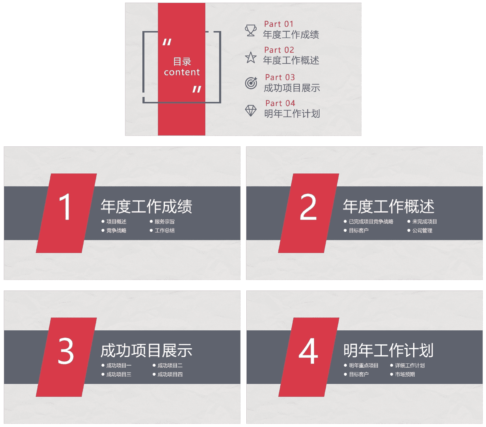

**2 页面内容不以逻辑为主**

与整份 PPT 的逻辑相比，单独幻灯片页面的逻辑更容易被忽视。幻灯片页面的逻辑影响观众对页面内容的理解程度。幻灯片页面中的图片、图形、文字，甚至图形颜色、大小、内容元素的位置关系，都是为逻辑服务的。例如，在中国的一些财经图表（如股票市场）中，红色常表示盈利状态，与西方惯例相反，具体颜色含义应以图表图例为准。

为了保证逻辑无误，在制作每一页幻灯片时，可以带着这类疑问：这个图形的颜色是否有特殊含义？这张图表与文字的位置进行调换是否影响观众理解？这张配图是否能增强页面含义的表达？页面内容调换位置是否可行……

如右图所示，圆环按数据大小从左到右排列，圆环中的数字从左到右越来越小且圆环颜色从深到浅。观众的阅读视线习惯从左到右移动，这样的内容设计可以让观众快速了解各分店销售库存的大小排序，提高信息传达效率。整个页面中，文字、图表、颜色、排版等所有设计元素均围绕着同一个逻辑主题。

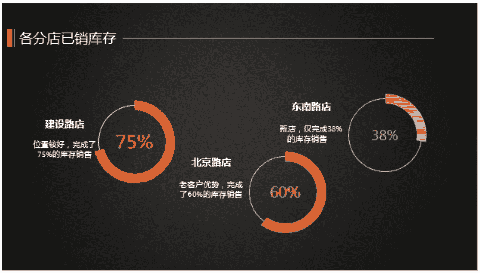

### **1.1.2****万无一失的逻辑梳理方法**

PPT 的内容逻辑可能是并列关系、递进关系、因果关系、包含关系等，种种关系让 PPT 新手头晕眼花。这里介绍一种最简单的逻辑方法，可以完全抛开“专业逻辑术语”。

右图是制作 PPT 前梳理内容逻辑的思路。首先，需要根据演讲目的、观众特点、场合等因素来确定这份 PPT 的演讲主题是什么，并收集能说明主题的资料。其次，整理资料，并根据资料列出这份 PPT 要讲的内容要点，即提纲。最后，将提纲细化，列出每一页幻灯片中的内容。完成内容梳理后，要对整体逻辑进行检查。

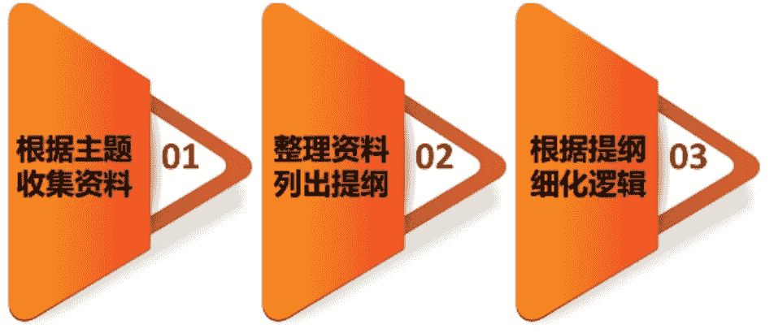

梳理内容逻辑时，可以使用思维导图逻辑直观地展现。例如，现在需要制作一份关于社群培训的商务策划书，需要在投资方面前演示，目的是获得投资。根据这样的要求，这份 PPT 的内容就应该围绕“这是一个靠谱且能赚钱的社群培训”这一主题来展开讲述。

下图所示为这份 PPT 在制作前的内容整理：根据主题去收集资料，把最有说服力最必要的资料列成提纲。首先讲述行业现状和竞争分析，引起投资人的兴趣；其次介绍公司，展示公司优势；再次展现营销计划，让投资人了解这是一份完整的策划方案；最后抛出目标，让投资人了解项目的利润所在。有了提纲后，再将具体的细化内容罗列出来。

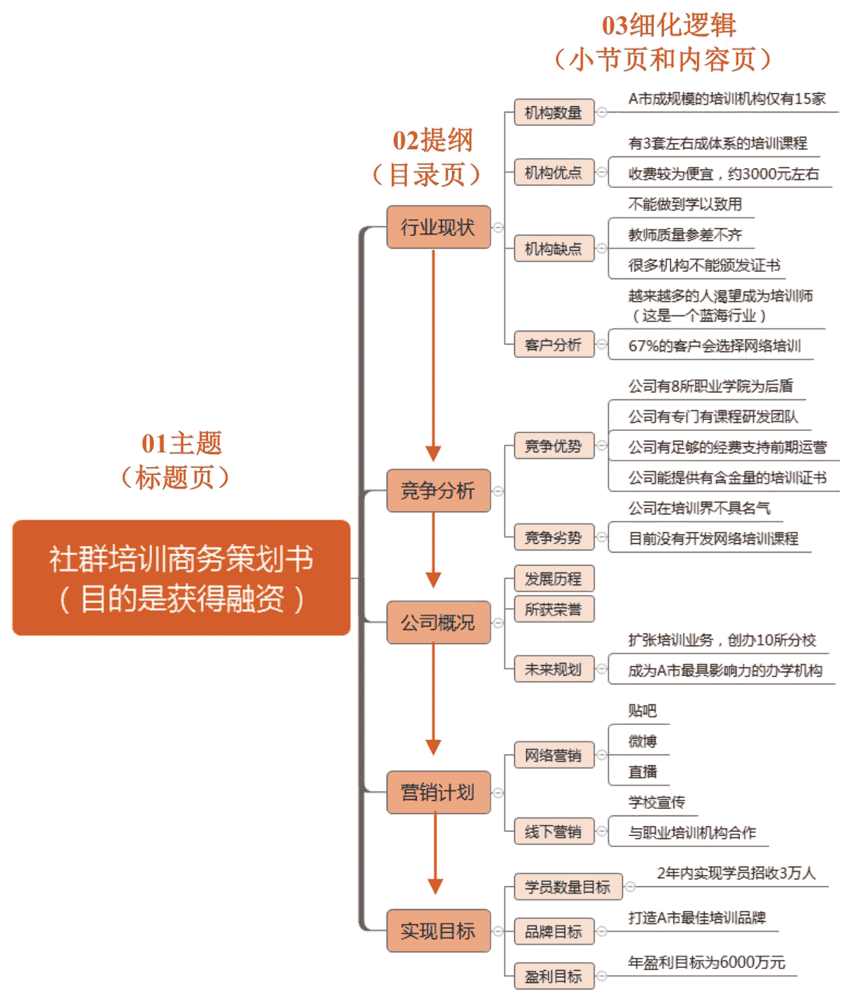

在这张思维导图中，主题相当于 PPT 的标题页，提纲相当于 PPT 的目录页，提纲下面的第一级内容相当于 PPT 的小节页，而最后一级内容就是每一页内容页幻灯片展现的内容。现在需要做的就是将思维导图的内容用图片、图表等形式表现出来，成为一页一页的幻灯片。

### **1.1.3****牢记这四种经典逻辑结构**

根据 PPT 的内容关系可以概括出多种逻辑关系，但是万变不离其宗，PPT 最经典的逻辑结构是总分结构，其他结构均可以由此变换而来。只要理解经典结构，就能在制作 PPT 时做到心中有数。

**1 最基本的结构——总分**

在利用 PPT 进行演讲汇报时，通常的顺序是从头到尾演讲，这就意味着同一时刻只能展现一个内容。因此将内容“打包”，顺序展现是 PPT 最基础的逻辑结构之一。所有 PPT 都可以做成这种结构，只不过可以通过幻灯片页面内容、演讲时强调这种方式来展现因果、递进、转折的关系。

如右图所示，内容被“打包”成“目录 1”“目录 2”“目录 3”。而“目录 1”又包含了“内容 1”“内容 2”。诸如此类，在演讲时，按照这样的顺序，依次展现不同的内容。

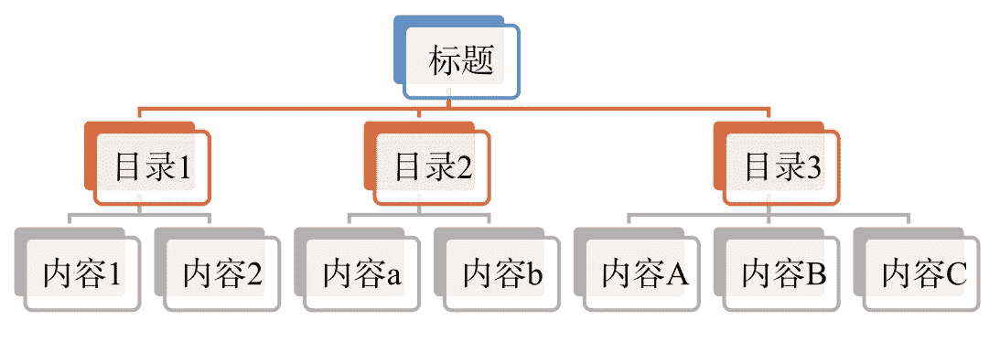

**2 并列**

上面的总分关系图也可以代表并列关系。例如，在制作职场文案写作的教学培训 PPT 时，“目录 1”“目录 2”“目录 3”分别是“了解文案写作”“文案写作思路”“学会咬文嚼字”，这三个部分彼此独立，属于并列关系。

**3 因果、递进**

在总分关系的基础下，被“打包”的内容可能存在前因后果、递进变化的关系，其结构如右图所示。该结构的目录中，箭头表示因果关系：因为人类的种种行为，导致环境受到影响，所以产生了环境污染的结果。

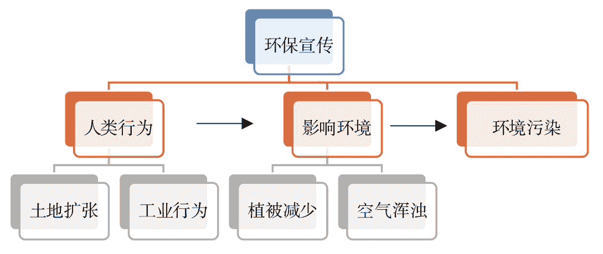

值得注意的是，这种结构的 PPT 可以在每个部分添加一页幻灯片来强调内容的因果关系。例如，在“人类行为”这部分的最后一页幻灯片中写上“人类行为对环境造成了什么影响？”的字样。

**4 转折**

当被“打包”的内容之间存在转折关系时，其结构如下图所示，该结构表示“过去的产品性能因为人们的生活需求发生了改变”。为了强调这种转折，可以在演讲到“人们的生活需求”这一部分时通过手势、语气加强来说明转折。

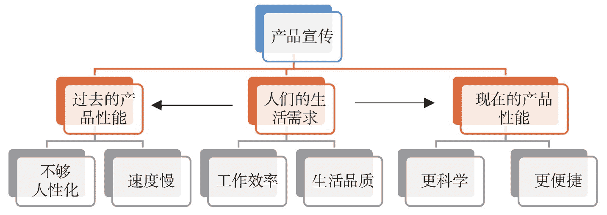

### **1.1.4****不懂逻辑还谈什么排版**

在设计每一页幻灯片页面内容时，正确的思考顺序是：①梳理内容的逻辑关系；②确定每页的核心信息及其前后衔接关系；③如何排版内容才能美观。按照这样的思路设计幻灯片的页面排版，将会容易很多。下面来看三种最典型的逻辑排版方式。

**1 表示关系对等的内容**

并列是最常见的页面逻辑，如“方法 1、方法 2、方法 3”。如右图（左）所示是经过整理的页面内容，彼此之间的关系是并列的，那么这四点并列的关系只需要平衡地排列在页面中即可，可选择的排列方式如右图（右）所示的两种，黑色圆点代表四个并列内容。

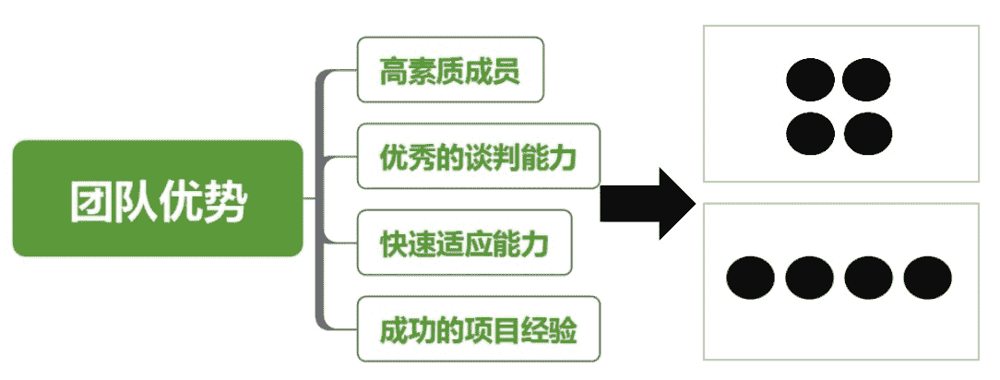

选择右上图中的第二种排列方式，将四点文字内容配上图片，即可完成这页幻灯片的制作，效果如下图所示。

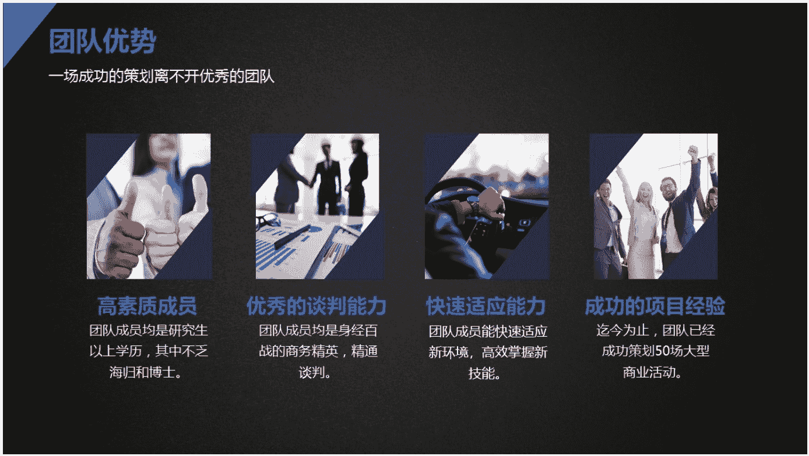

**2 表示关系变化的内容**

因果、递进、时间顺序这三种关系十分类似，都是在描述内容之间的变化过程。强调这种逻辑最好用的“利器”就是箭头。下图展示的是经过整理的页面内容，有时间的先后顺序。现在只需要将这四点内容按照顺序排列在幻灯片中，再通过箭头连接即可，可行的排版方式如下图（右）所示的三种。

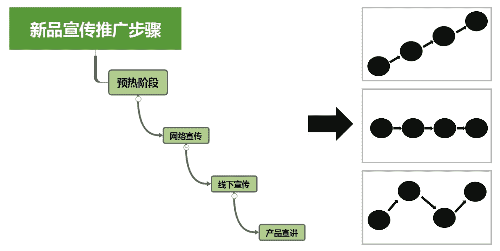

选择其中一种排版方式，将四点内容添加上美观的背景图形，即可完成这页幻灯片的制作，效果如下图所示。

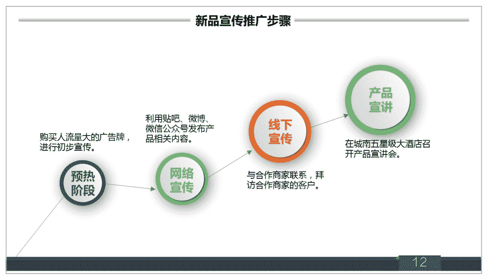

**3 表示关系对比的内容**

对比关系是指将几组不同性质的内容并置，以突出它们之间的差异。在实际应用中，常通过颜色、大小对比来实现。如下图（左）所示，是经过整理的 4 点对比内容，这 4 点内容有明确的大小关系，因此可以通过大小或颜色变化的方式来实现对比。常用的排版方法如下图（右）所示。

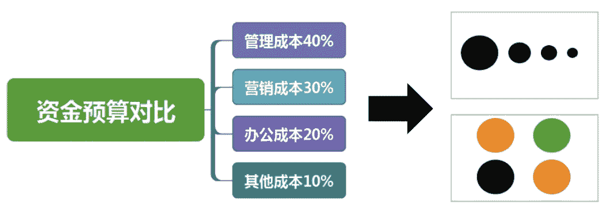

选择上图中的第二种排版方法，将代表不同内容的圆圈换成美观的图形，效果如下图所示，一张表示资金预算对比的幻灯片便完成了。

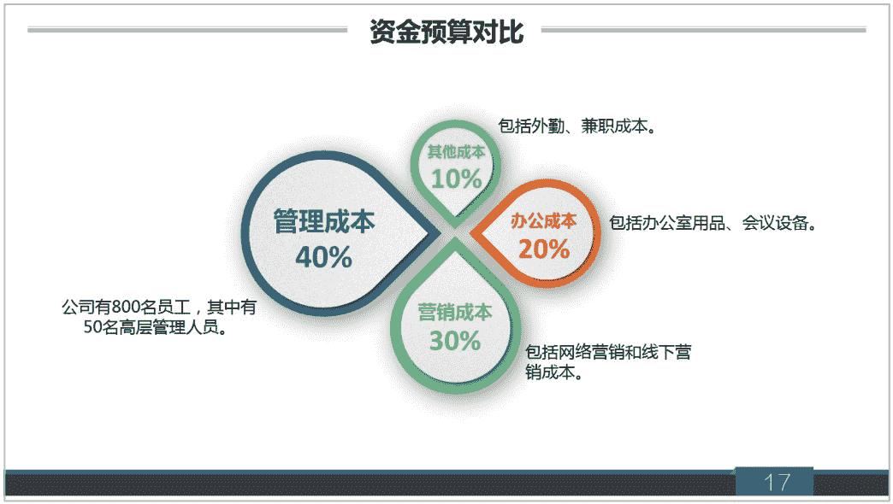

### **1.1.5****没有逻辑的动画不是好动画**

PPT 动画分为页面切换动画和页面内容动画。大多数人使用动画都是因为“酷炫”，在选择动画时，也是凭感觉，什么动画的效果更炫就选择什么动画。

PPT 动画看似简单，却属于高阶玩法。新手制作 PPT 时，如果对动画理解不深，反而会让 PPT 在播放时眼花缭乱，甚至打乱内容原本表达的含义。

好钢要用在刀刃上，下面就来揭开切换动画和内容动画的逻辑面纱。

### **1 切换动画**

切换动画，顾名思义就是幻灯片当前页面切换到下一页面的过渡动画。打开 PowerPoint 的切换动画窗格，如下图所示，根据动画的名称就可以推测出动画的效果。例如，【风】这种效果，即为当前幻灯片页面出现被“风”吹走的效果，随之出现下一页幻灯片。如果从名称无法推断出效果，可以选择这种动画后查看具体效果，如果想再次查看切换动画效果，可以单击【预览】按钮。

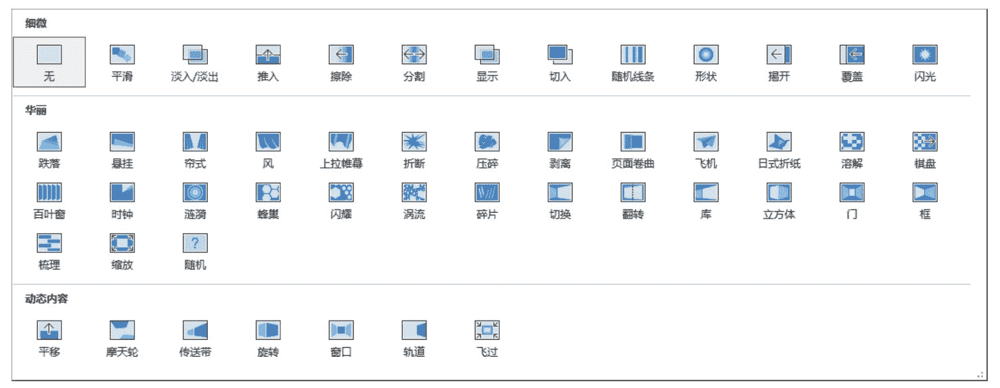

很多人容易滥用切换效果。一般来说，如果没有特别要表达的内容，可以不用切换效果，或者选择最简单的切换效果【淡出】。当内容有特别含义时，可以借助动画来体现逻辑。要想借助动画加强内容逻辑，其方法在于——联想。

例如，【涟漪】动画让人想到水波纹，而水波纹营造出梦境、回忆的氛围。因此【涟漪】动画可以用在同学聚会上展示昔日的同窗旧照片，强调“逝去的时光”。

又如，【翻转】动画让人想到事件反转、正反对比，因此可以用来表现改进前的事物是什么样，改进后的事物又是什么样。

如下图所示，这两页幻灯片的切换就可以使用【翻转】的切换效果，通过翻转动画切换页面，形成强烈的对比，冲击观众的视觉，让观众感受到截然不同的效果。

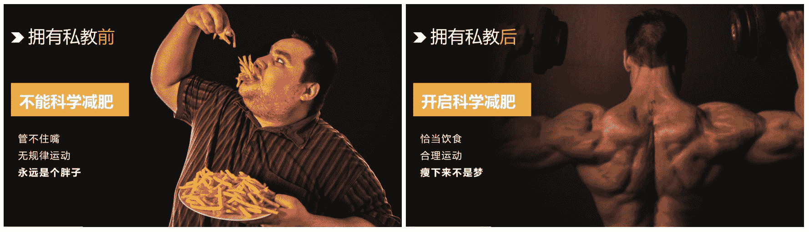

**2 内容动画**

PowerPoint 提供进入、强调、退出类型的动画，以及动作路径动画。从字面意思来看，就能理解进入、强调、退出动画的作用。路径动画可以设置一个特定的动画路径。另外，触发动画可通过设置触发器元素来控制播放。

将这些动画应用到文字、图片、图形等内容上，可以让幻灯片页面元素“动”起来。如果没有目的地胡乱添加动画，会让页面内容“动”得混乱，引起观众反感。通常情况下，商务 PPT 中较少使用动画，以免给人不正式、不专业的印象。课件制作或广告宣传类 PPT 则多使用动画，增加趣味性和吸引力。

在添加动画时，要思考“给该内容元素添加这种动画的目的是什么”。例如，文字内容添加了【飞入】的进入动画，目的是让文字呈现出“飞入”幻灯片页面的效果，这是符合逻辑的。又如，为一张图片添加了【脉冲】的强调效果，是因为这张图片是重点图片，需要用闪烁的脉冲效果来引起观众注意，这也是符合逻辑的。

### **高手自测 1**

下面两张图分别是产品宣传 PPT 的目录和其中一张内容页，它们是否存在逻辑上的问题？如果存在，应该如何修改？

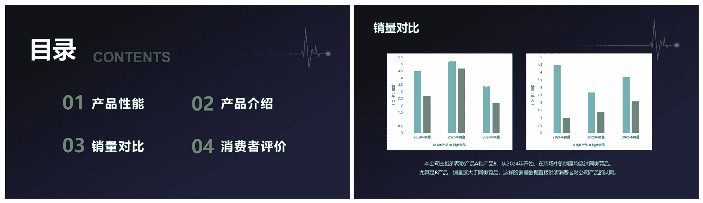

## **1.2****因为你没有分析目的**

不围绕目的制作的幻灯片页面很容易达不到理想效果。确定分析目的可以有效防止 PPT 内容“跑偏”，也能找到正确的内容展现方式。例如，一份为了招生的职业培训 PPT，其核心目的是“招生”而不是“培训”。所以在制作 PPT 时，不应将知识的讲解作为重点，而应展现公司的培训实力。培训实力可以用学员人数、学员反馈等数据来展现；知识的讲解可以讲一半留一半，制造悬念引起观众的报名兴趣。

如何根据分析目的找到 PPT 的内容及展现方式？这里推荐使用“金字塔思维”分析法：从目的出发进行倒推，最终推导出内容展示的重点，如右图所示。即先分析 PPT 制作的目的，再推导达成目的所需要素，最后明确展现这些要素所需的具体内容。

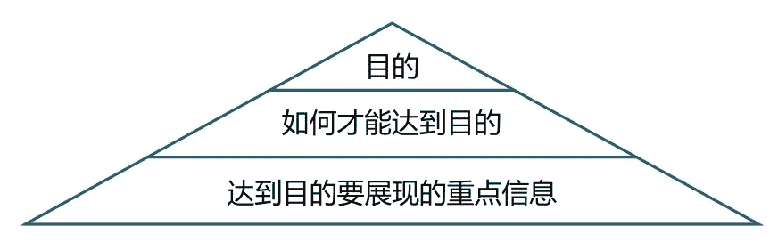

### **1.2.1****为了谈项目**

根据“金字塔”思维，谈项目的 PPT 内容分析的推导过程如下。

制作 PPT 的目的是赢得项目；为此需满足对方需求；进而通过调研分析需求、痛点及解决方案进行分析；最后用理性论据（如数据）证明能力，并展现过往成功案例，如右图所示。

有了金字塔分析作为基础，便可推导出项目 PPT 中应该呈现的重点内容大纲，结果如下图所示。有了这样的大纲，在制作项目 PPT 时就不会出现“跑题”情况，如突然想起某个管理大师的员工激励法很有用，把内容加进 PPT 中。

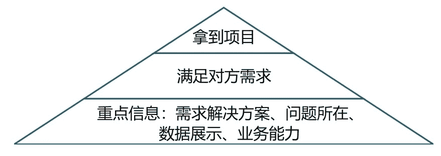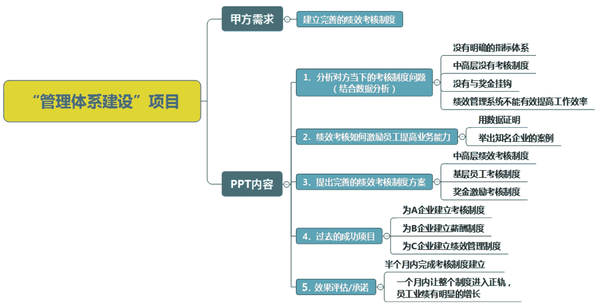

### **1.2.2****为了做培训**

做培训是 PPT 的常用功能之一，此类 PPT 的分析过程如下图所示。培训的目的是让学生学到知识。学生能高效学习知识的前提是课程有趣且明白易懂，换句话说就是要有趣、有条理地传授知识。PPT 内容要有趣，就需要图文结合、添加视频演示；要条理清晰地传授知识，可以使用总分的 PPT 经典结构，将知识进行归类总结，分成几个小节展示。小节讲解时，将重点内容突出展示；小节完成后，穿插思考题，让学生及时巩固，提高学习效率。

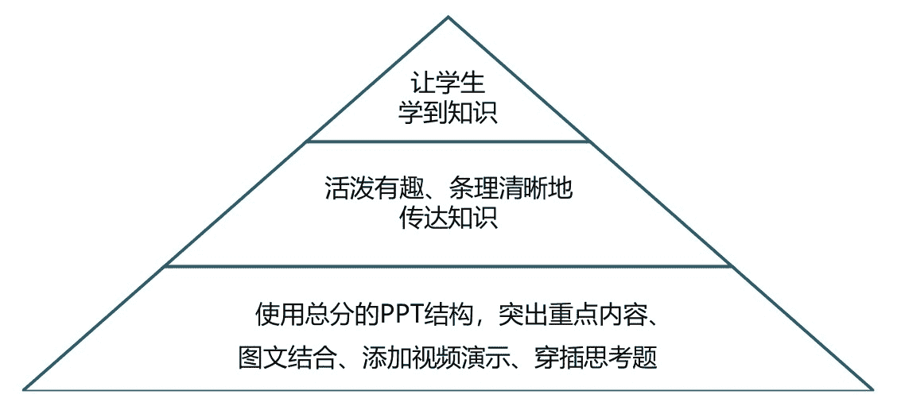

### **1.2.3****为了找工作**

随便下载的 Word 模板等于不用心的简历，一个连推销自己都懒得花心思的人如何赢得 HR 的好感？所以，使用 PPT 制作简历，成了当下流行风潮。但是 PPT 华丽得如同设计大师的作品就能赢得 HR 的青睐吗？答案是不能，首先要分析 HR 到底想看到什么。

具体的分析思路如右图所示。投简历的目的是得到工作，得到工作的前提是吸引 HR 的注意并让 HR 觉得你能胜任。为什么能胜任——因为符合招聘需求。那么 HR 不关心的信息不要展现，不要为了增加篇幅在简历上乱放内容。

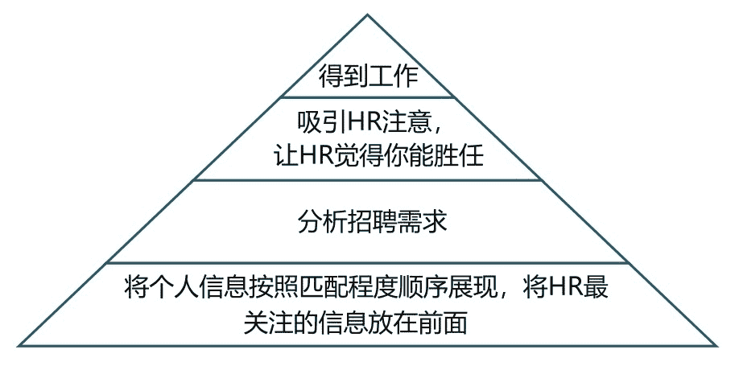

根据金字塔分析，很容易找到简历 PPT 的制作要点，如下图所示，整份简历都是在告诉 HR“我能胜任这份工作”。至于内容出现的顺序，是充分考虑了 HR 的关注点。例如，之所以把教育背景放在后面，是因为很多应聘者的专业与岗位并不符合，这种情况下 HR 可能会认为应聘者不符合要求（若教育背景与岗位需求一致则可放在前面）。之所以把联系方式放在最后，是因为 HR 会先关注应聘者的工作经验、技能是否能胜任这份工作，再考虑要不要联系这位应聘者。换句话说，在让 HR 了解自己有一定工作能力前，最好不要展现无关的多余信息。

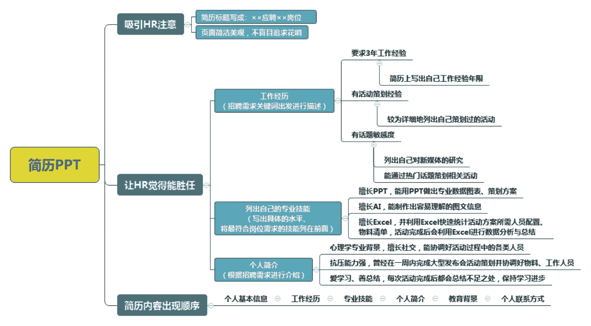

### **1.2.4****为了做宣传**

制作宣传类 PPT 的终极目的是通过让观众了解企业、产品、活动等，最终激发其与企业合作、购买产品或参加活动的兴趣。以产品宣传 PPT 为例，其金字塔思考流程如右图所示。

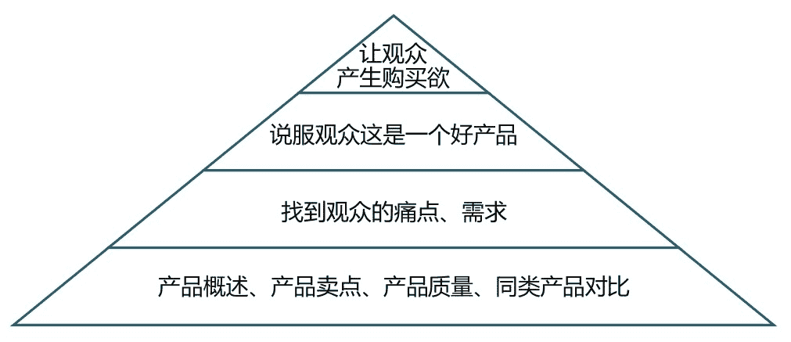

根据分析可以发现产品宣传 PPT 最重要的地方在于找到观众的痛点和需求，从而有针对性地展示产品。例如，一款足浴盆产品，观众的痛点在于“担心身体健康”，因此需要着重展示产品的按摩保健功能；同时观众需要产品的安全性有保证，因此还需要强调产品的防漏电设计等。

对于产品宣传 PPT，如何找到最直击人心的需求和痛点？首先可以通过剖析产品的作用、设计原理、材质等内容进行拟定，如下图所示。也可以在购物网站中，查看这款商品有哪些功能（卖点），没有列出的功能很可能就是观众不关心的点，可以不用在 PPT 中展示出来。设置售价时，分析在同品类产品售价范围内销量最好的商品的介绍方式；这些商品之所以销量靠前，通常与商品描述有密切关系。

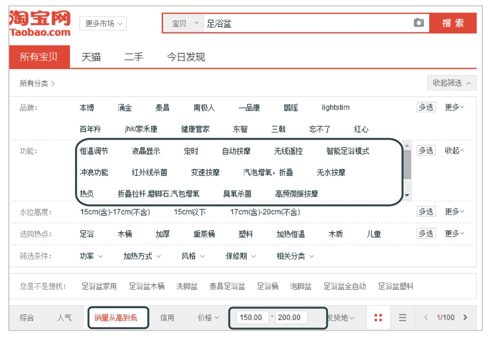

### **高手自测 2**

做工作汇报 PPT，如何通过分析目的找到制作方向？

## **1.3****因为你不了解观众**

观众想要的是一个苹果，如果给了他一颗香甜的草莓，即使这是一颗天价草莓，也不能打动观众。这就是制作 PPT 前分析观众的作用所在——理解观众才能打动观众。

### **1.3.1****从心理学的角度分析观众**

为什么别人做的产品推广 PPT 能瞬间抓住消费者？为什么别人的培训课件能获得学员的一片掌声？让观众被 PPT 吸引、打动人心，靠的不是魔法，而是对观众情绪的精准把握。研究目标观众的心理诱因，可以让 PPT 的内容轻松叩开观众的心门。

观众的心理类型比较多，在制作 PPT 时，只要利用目标观众最典型的两三种心理，即可提升 PPT 的吸引力。如下图所示，是一些观众心理，在制作青少年人群的产品推广 PPT 时，可以利用青少年的自我表现心理和共鸣心理，强调产品的个性，来赢得他们的好感。

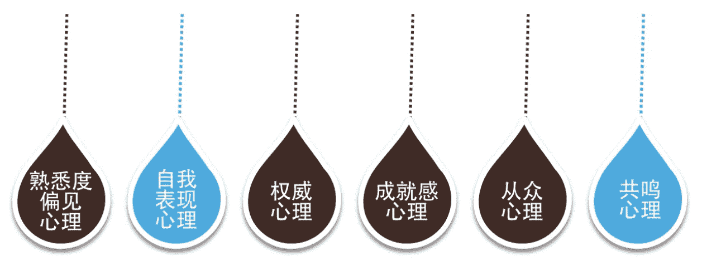

由此可见，只有熟知常见的观众心理，才能在 PPT 设计中精准切中需求，让内容更具吸引力。下面就针对 PPT 可利用的典型观众心理进行介绍。

**1 熟悉度偏见心理**

熟悉度偏见心理指的是观众更倾向于相信自己熟悉的事物。制作 PPT 时如果刻意添加目标观众熟悉的内容，能快速建立信任感和亲切感。

熟悉度偏见心理案例：①到 A 市去播放文创产品推广 PPT，插入 A 市的景点配图和特色文化，赢得 A 市观众信任感；②产品 B 新上市，观众对它很陌生，但是对市场上的老产品 C 很熟悉，通过类比产品 B 与 C，让观众快速熟悉 B 产品；③面对全职妈妈的产品推广，更多地使用家庭图片，而非职场图片。

**2 自我表现心理**

自我表现心理指的是观众会对能彰显自我个性的内容表现出认同感，如有个性的服装、定制型产品，从而让用户的心理得到满足。

自我表现心理常常用于观众是青少年人群和有个性化色彩的产品推广。如右图所示，是婚礼方案 PPT 的页面，页面没有像普通婚礼方案那样配上了高清大图，而是手绘图片，文字也使用了手写体，整个页面都在强调这是“定制的个性化婚礼”。

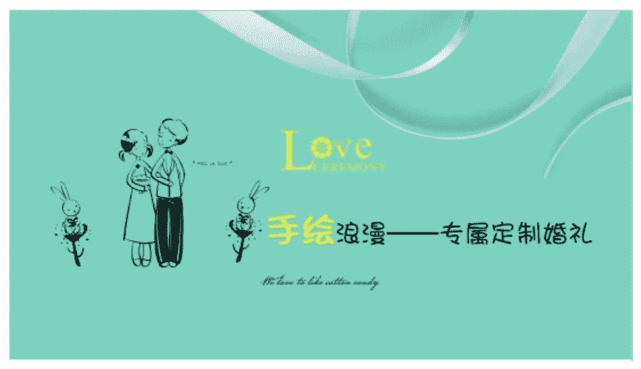

**3 权威心理**

权威心理，学术上称为“权威效应”，指人们倾向于信任地位高、有威信或具备成功经验的权威人士，因此常被应用于培训场景中。例如，在课程伊始展示讲师的头衔和成功案例，利用权威心理快速激发学员的信任感。

权威心理通常用在培训课件、调查报告、发布会 PPT 中。

**4 成就感心理**

人的内心深处有一种驱使自己成功的力量，希望通过努力来实现自我，这就是用户的成就感心理。使用成就感心理需要掌握度，人们喜欢成功，但是不喜欢太遥远、不切实际的成功，如果观众意识到这样的成功是他不能达到的，就会产生挫败感心理。例如，职业培训时，使用的典范人物是比尔·盖茨，观众就会认为无论自己怎么努力也成不了第二个比尔·盖茨，从而失去对 PPT 培训内容的兴趣。

成就感心理通常用在培训类、商务提案类、自我实现类产品的 PPT 中，通过可实现的成功，来刺激观众的成就感心理，鼓励观众参与其中。如右图所示的 PPT 便利用了观众的成就感心理，鼓励观众参加职业培训，实现职场上的成功。

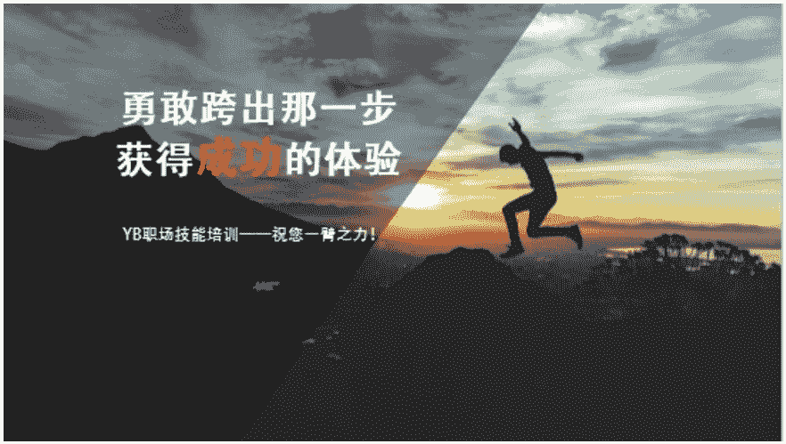

**5 从众心理**

社会群体中的个体会努力保持与社会大众一致，这就是从众心理。从众心理能让观众产生购买、参与冲动，使其产生“大家都在用，应该没问题”“不参与就落后”的冲动。

从众心理通常用在产品推广、活动宣传 PPT 上，通过配图和文案来刺激用户的从众心理，如用可视化数据告诉观众有多少消费者购买了这款产品。

**6 共鸣心理**

共鸣心理指的是让观众看到能产生强烈认同的画面和文案，从而产生强烈的共鸣情绪。通常情况下，新鲜、时尚、搞笑的内容会引起青少年的共鸣；对家庭的辛苦付出、职场家庭的兼顾问题，会引起母亲群体的共鸣；身体方面的不适、对亲情的渴望会引起老年人群的共鸣；旧照片、老事物会引起怀旧人士的共鸣。

共鸣心理普遍适用于各类 PPT 中，方法是呈现目标观众的焦点事物。如右图所示的是关于 90 后减压产品推广的 PPT 页面，页面中呈现出了 90 后最关注的就业压力、生活压力、住房压力，引起观众的共鸣。

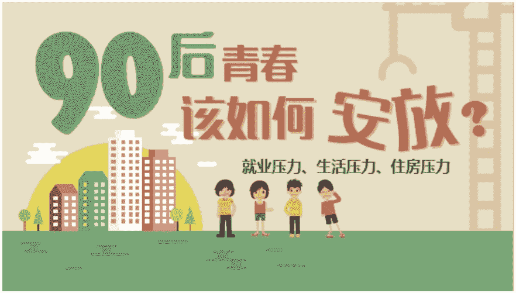

**7 相关心理**

与共鸣心理类似的是相关心理，指的是观众更关注与自己相关的信息，而对与自身无关的信息则不感兴趣。

相关心理在制作 PPT 时应用十分广泛，可以通过呈现与观众相关的信息，有效吸引观众的注意力。例如，向某公司介绍某项目，应把重心放在该项目对公司的影响上，而不是一味地谈论这个项目如何好，项目再好与此公司无关，是不能引起对方兴趣的；又如，介绍某款产品时，不知道如何选择描述卖点，就去思考这款产品与目标观众的工作、生活有什么联系，最大的作用是什么；再如，吃西餐与青年观众有什么相关性呢？青年人为什么一定要学吃西餐呢？要向单身的青年观众推荐吃西餐的礼仪课程，可以抓住吃西餐的优雅举止能赢得异性好感这个关联，设计如右图所示的 PPT 页面，吸引观众的注意力，让观众不再置身事外。

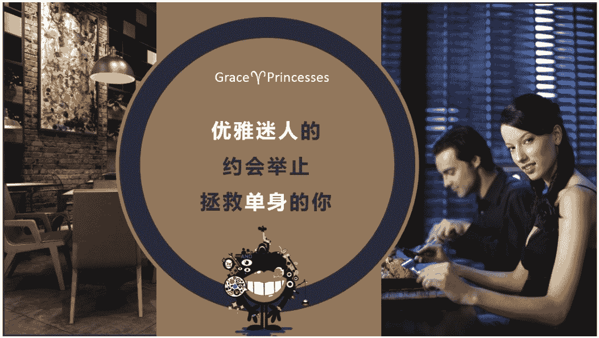

### **1.3.2****从文化背景的角度分析观众**

符合观众认知偏好、价值取向的 PPT 内容更容易让观众接纳。而文化背景是影响观众观念的重要因素，来自不同地域、接受不同文化教育的观众，其观念是不相同的，这也是制作 PPT 时应当考虑的背景层面。

**1 地域层面**

所谓一方水土养一方人，不同的地域由于环境、人文、经济水平的不同，人的性格也不相同。考虑目标观众的地域，可以将 PPT 做得更符合观众的“调性”。例如，西方文化强调个人主义，而东方文化注重集体主义和家庭观念。观察很多产品在东西方的海报，会发现两种截然不同的风格。

考虑观众的地域层面，应该考虑观众来自什么国家、什么地区，这个地方的人有什么价值观、喜欢什么颜色、禁忌是什么，从而制作出符合观众观念的 PPT。

如下所示的两张图，同样是宣传训练营产品，左下图强调自我突破，右下图则强调家庭的期望，这就是针对不同文化背景人群的 PPT 页面。

**2 文化教育层面**

面向小学生和大学生的宣传 PPT，文字表述、配图肯定是不一样的，这是因为 PPT 的内容要符合观众的认知程度。从观众的教育程度出发，使用观众看得明白的表现方式制作 PPT，能提高页面信息的传达效率，让内容更容易被观众熟记。

如下所示的是针对职场人士（左）和小学生（右）的礼仪培训 PPT 页面，其文字表述和配图都是截然不同的风格。

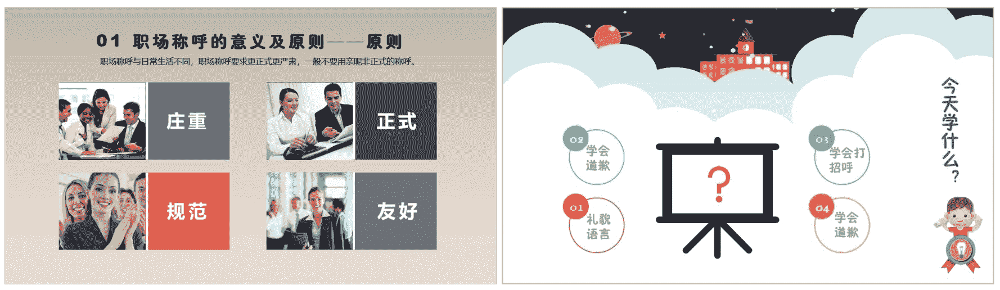

### **1.3.3****从年龄层次的角度分析观众**

观众的年龄不同，所喜欢的颜色、风格、内容表述也不相同。总体来说，年龄越小的观众，越喜欢颜色鲜艳、风格活泼、动画较多、有趣的内容描述。而年龄越大的观众，则更喜欢颜色较深、配色简单、风格沉稳、动画较少、描述理性的 PPT。

例如，针对中年人的 PPT，可以选择藏青色、灰色、黑色为主要色调，尽可能地使用数据、调查报告这类理性的论据观点，少用或不用动画，通过严谨的内容来说服观众。如下图所示的是一页理性十足的 PPT 页面，对中年男性来说颇具说服力。

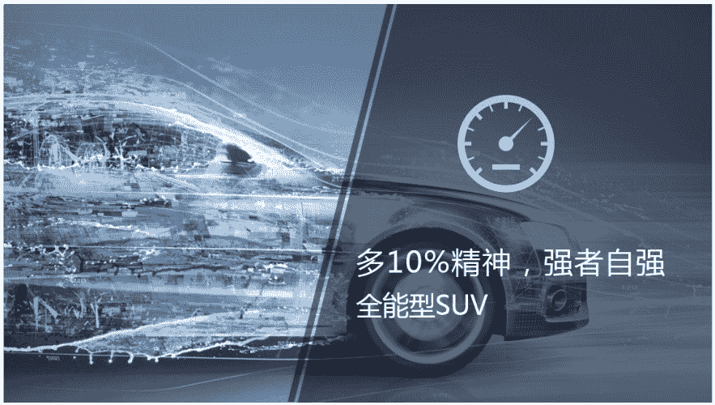

### **高手自测 3**

如果要向中年男性宣传新产品，可以从哪些方向考虑 PPT 的内容？

## **1.4****因为你欠缺技能**

学习了一些 PPT 理念，如排版要整齐、要用图表表现数据、要使用优质图片，可是打开 PowerPoint 问题却来了：图片之间怎么对不齐？图表怎么不按要求显示数据？图片不清晰怎么办？原来 PPT 制作不是简单地插入文字图片就可以，该掌握的技能一个都不能少！这些必备技能都将穿插在本书后面的内容中，下面先来初步了解一下，做到心中有数。

### **1.4.1****PPT 图文怎么堆**

在 PPT 新手看来，排版就是将图片、文字放在 PPT 页面中，凭感觉调整一下位置。而 PPT 高手会充分使用参考线、网格线、标尺、对齐功能，甚至是插件来精准排版。掌握科学的排版技巧而非靠感觉，是成为高手的关键技能之一。

**1 使用参考线、网格线**

在 PowerPoint 的【视图】选项卡下选中【网格线】和【参考线】复选框，可以在移动对象位置时有一个统一的标准。如下图所示的是打开网格线和参考线的效果，使用水平和垂直方向上的线，精准调整对象位置。选择对象后，还可以通过单击【设计工具】任务窗格中【参考线布局】栏中的按钮来快速根据参考线布局对象。

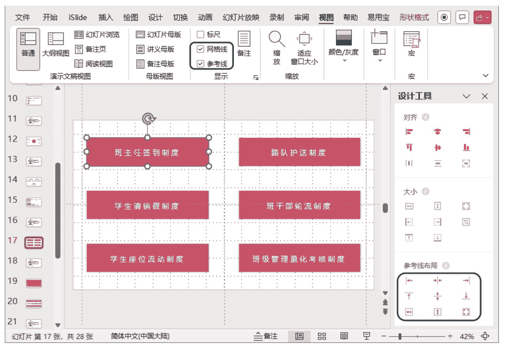

PowerPoint 提供了智能参考线功能，在移动对象时，会出现一条红色的虚线，显示对象关于某个位置的对齐状态。如下图所示，移动右边的文本框，显示的参考线表示文本框与左边的图片顶端对齐，与右上角的图形左边对齐。打开智能参考线的方法是，在 PPT 页面中右击，在弹出的快捷菜单中选择【网格线和参考线】选项，选中【智能参考线】复选框。

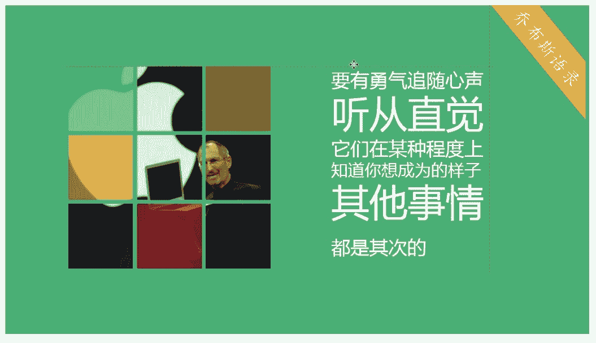

**2 使用标尺排版**

标尺是针对文字排版的工具，主要作用是方便对齐文字。如下图所示，在【视图】选项卡中选中【标尺】复选框就能打开水平和垂直方向的标尺，选中文字移动标尺，就可以看到文字对应的标尺，移动标尺可以调整文字排版。

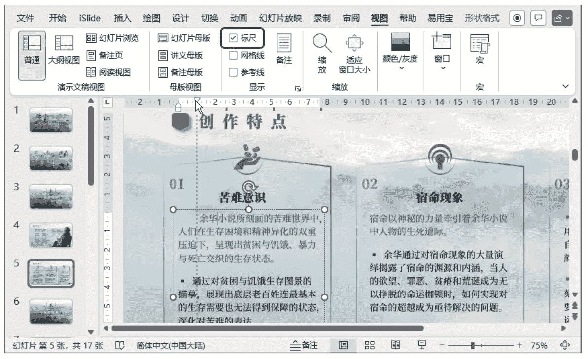

**3 使用对齐功能排版**

如何快速让元素顶端对齐、左对齐、在水平方向的间距相等？答案就是使用对齐功能。如下图所示，选中需要排版的 2 个文本框和 2 张图片，单击【对齐】下拉按钮，在弹出的下拉菜单中选择对齐方式就能让它们整齐排列。如果选择【横向分布】或【纵向分布】选项，还能让图片在横向或纵向的间距相等。选择对象后，还可以在【设计工具】任务窗格中单击【对齐】栏中的按钮来快速排列对象。

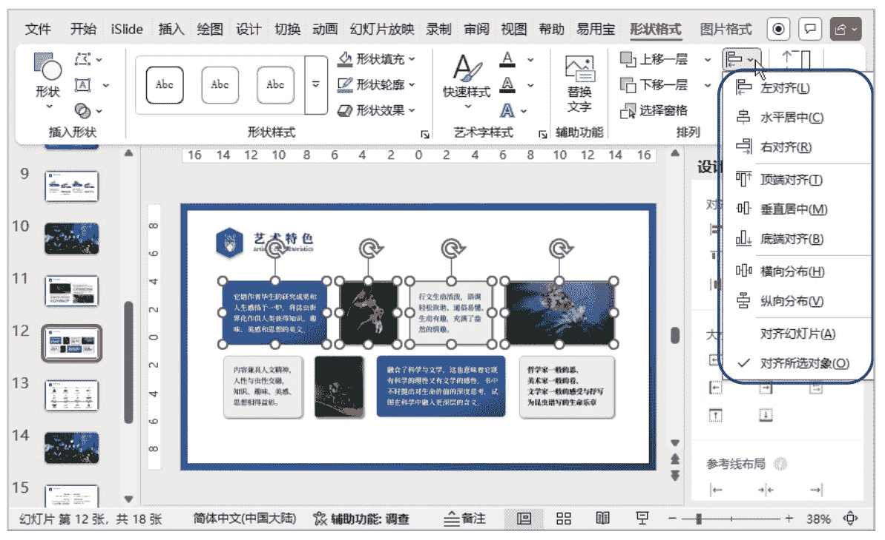

**4 使用插件排版**

PowerPoint 自带的功能只能满足常规的排版，对于创意性排版，往往需要使用插件。现在很多 PowerPoint 插件都带有排版功能，如下图所示，使用 iSlide 插件中的【环形布局】功能，可以设置参数将对象排列成符合需求的环形。

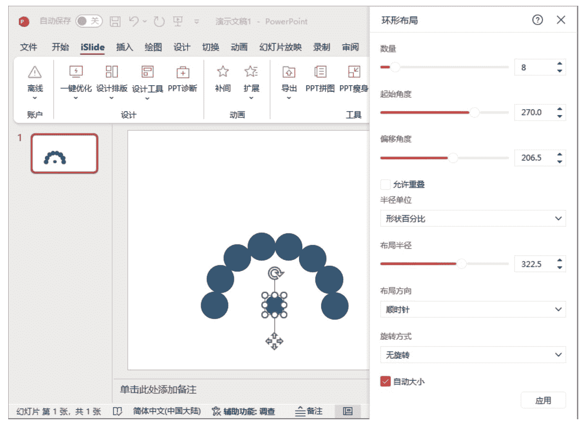

### **1.4.2****不同的内容不同的表达**

要表现团结的力量是使用一句话还是一张配图？要表现一组数据是使用文本框还是表格或是图表？如何将内容以最正确的方式呈现是 PPT 能否出彩的一个关键。

在幻灯片页面中可以插入多种不同类型的对象，如下图所示，在【插入】选项下，可以插入表格、图片、图标、图表等对象。但是什么情况下该选择什么对象元素插入？插入对象后，如何编辑才能正确地表达含义？这是制作 PPT 需要思考的两个问题，只有正确理解不同的对象，学会编辑对象，才能制作出吸引观众目光的 PPT。

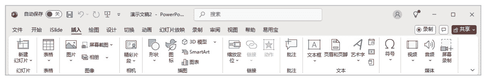

在幻灯片页面插入不同的对象元素并进行编辑是制作 PPT 的重点，如下图所示，是 PPT 常用对象元素的作用及操作要点。

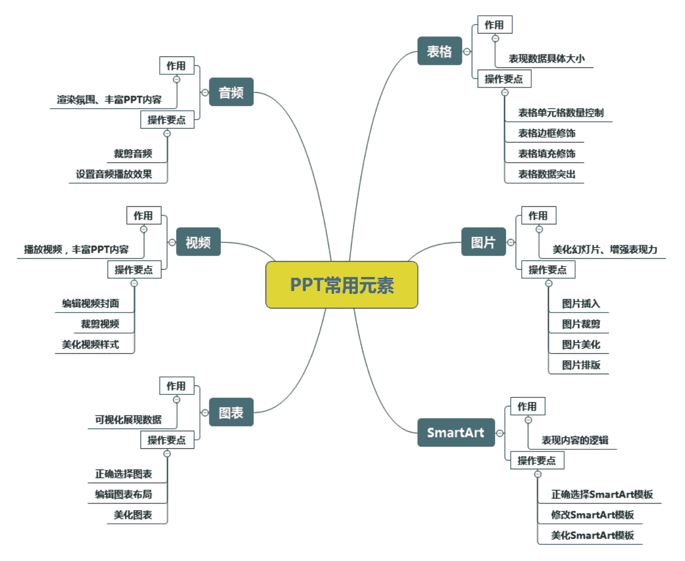

### **1.4.3****非科班出身，这样提高审美**

设计出专业级 PPT 不是设计师的专利，非科班出身的普通人也能设计出专业水平的 PPT，关键在于掌握方法。提高 PPT 的美观度可以参照优秀的作品、使用网络工具和 PowerPoint 自带的工具实现更高级的配色，也可以通过寻找优秀的素材来提高页面的美观度。

**1 参照优秀作品**

如果我能看得更远一些，那是因为我站在巨人的肩膀上——这句话用在 PPT 制作上同样适用。PPT 新手没有设计基础，但是找到优秀的作品作为参照，就能在很大程度上提高水准。优秀的作品主要是指 PPT 模板，还包括设计网站的海报、文案，这些都是参照物。关键在于选择哪些专业网站和何种类型的优质案例作为参照，具体方法将在 2.1 节详细解析。

**2 快速配色**

颜色是观众接收到的首要信息，配色的美观度决定了 PPT 的设计水准。配色对于非美术专业的人来说很难掌握，值得庆幸的是，无论是 PowerPoint 软件还是网络工具，都有许多方便配色的功能。

如下图所示，先到配色网站中将优秀配色截图到幻灯片页面，再通过【取色器】吸取颜色，就可实现快速专业配色。

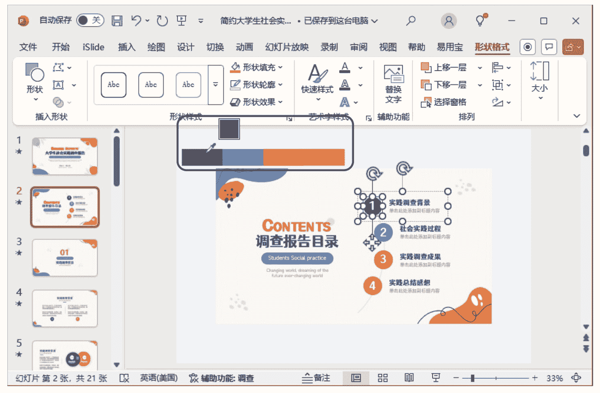

**3 使用好的素材**

PPT 素材用得好，既能提高效率又能优化页面视觉效果。PPT 素材不仅包括图片，还包括表格素材、图标素材、逻辑图素材、音频素材、视频素材。不同的素材有不同的寻找渠道，找到素材后要正确处理素材并合理保存使用，才能发挥素材的最大功效。

以图片为例，表达理想的概念，有人会直接搜索关键词“理想”，有的人则会搜索“雄狮”，这两种不同的思路，找到的素材风格迥然不同。面对众多搜索结果，学会筛选，能大大提高效率，如下图所示。

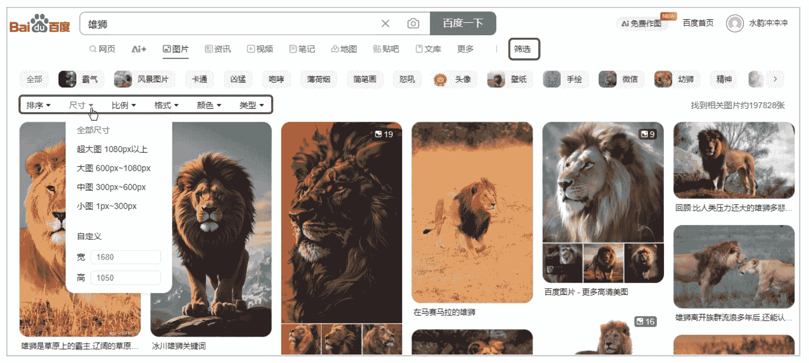

### **1.4.4****AI 辅助，让 PPT 制作事半功倍**

在 AI 技术的加持下，PPT 制作的全流程——从逻辑构建、内容生成到视觉设计——均可通过智能工具实现效率跃升。接下来我们将以 DeepSeek 与 WPS AI 两大工具为核心，从框架构建到视觉设计，系统讲解如何借助 AI 技术突破效率瓶颈，让新手用户也能轻松产出专业级作品。

**1 用 DeepSeek 生成 PPT 逻辑框架**

无论是工作汇报还是产品宣传，逻辑混乱往往是 PPT“不出彩”的根源。DeepSeek 的“逻辑框架生成”功能可通过自然语言交互解决这一问题：用户只需输入主题或关键词（如“智能家居产品发布会 PPT 大纲”）,AI 将自动分析内容逻辑，生成包含封面、目录、核心章 节（如市场分析、产品亮点、用户案例）的结构化框架，并标注每部分的重点内容，如下图所示为节选内容。

若框架存在章 节重复或缺失，AI 还会提供优化建议（如增加数据对比页、调整过渡页顺序）。生成后的框架可直接导出至 PowerPoint 软件，用户只需填充具体内容，即可避免传统制作中“边写边改”的低效问题。这一功能尤其适合逻辑能力较弱或时间紧迫的职场新人，10 分钟完成传统 2 小时的手工梳理工作。

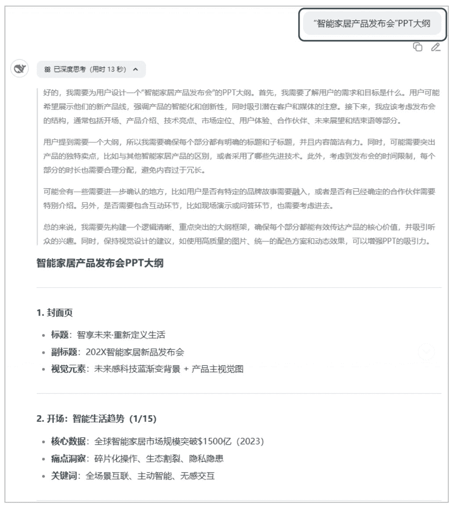

**2 WPS AI 一键生成初版 PPT**

WPS AI 的“一键生成”功能，是缺乏设计经验的用户快速产出初稿的利器。在 WPS 演示中选择【AI 生成 PPT】命令，然后输入核心主题（如“新能源汽车行业研究报告”）并选择风格偏好（如商务、科技、简约等）,AI 将自动匹配模板、生成 15～30 页完整初稿，涵盖封面、目录、图表页、总结页等模块。例如，输入“大学生创业计划书”,AI 不仅会生成包含执行摘要、项目背景、产品服务体系、市场分析、营销计划、财务规划等的页面，还会根据内容自动插入其他元素，如形状、图片、表格、数据可视化图表等，如右图和下图所示。用户可在此基础上局部调整文字、替换图片或增减页面，大幅降低从零起步的制作压力。此功能特别适用于紧急任务（如临时汇报、答辩），甚至能帮助非专业人士产出视觉上相当规范、专业的 PPT。

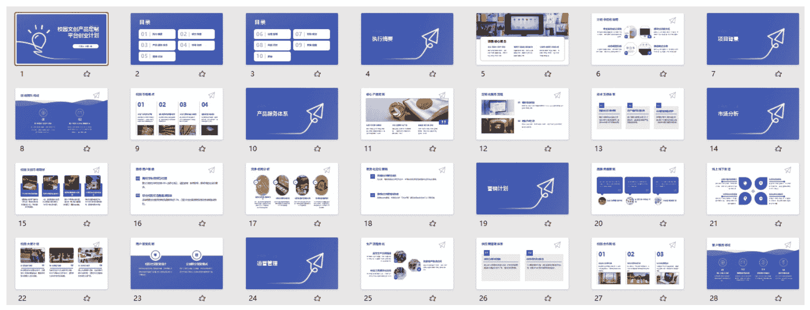

**3 AI 快速优化排版与配色**

排版杂乱、配色突兀是 PPT“廉价感”的罪魁祸首。DeepSeek 可根据 PPT 主题和应用环境提供字体组合版权规避建议，也可根据行业属性（如医疗蓝、教育绿、科技紫）或关键词（如“活力”“沉稳”）生成和谐配色方案，还可在上传 PPT 后自动分析文字、图片、图表等元素的视觉权重，推荐对称式、焦点式或卡片式排版方案。在 WPS 演示中还可以直接对 PPT 进行页面快速布局、更改配色方案和字体方案等，如下图所示。

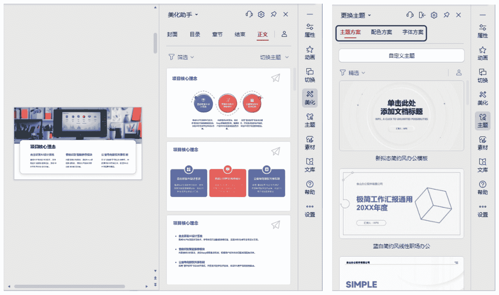

**4 AI 快速生成合适的素材**

在 PPT 制作中，高质量素材的获取往往耗时费力，而 AI 工具的快速发展让这一难题迎刃而解。以即梦为例，作为一款全能型 AI 素材生成工具，其“智能素材库”可覆盖图片、视频、数字人等全类型需求，大幅降低用户从零创作的门槛，如下图所示。

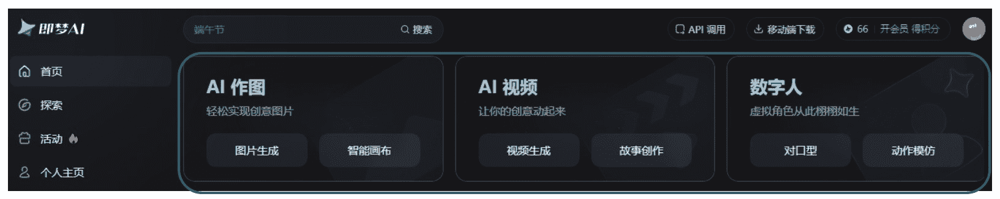

若需制作产品宣传 PPT，可通过即梦的“文生图”功能输入描述（如“未来感智能手表悬浮于星空”）,AI 将自动生成 4K 高清产品场景图，并支持调整光影、透视角度，用以匹配不同页面风格；对于缺乏实拍素材的页面，其“AI 视频生成”功能可基于关键词（如“数据流动特效”“科技粒子背景”）一键生成 5～10 秒动态视频，直接嵌入 PPT 作为转场或背景元素。此外，即梦的“数字人讲解”功能尤为亮眼：用户上传演讲稿后，AI 自动生成虚拟主播（支持多形象、服装、动作定制），并同步输出带唇形匹配的配音，适用于产品发布会、培训课件等场景。例如，输入“新能源汽车性能解读”,AI 数字人将以专业口播配合 3D 车型拆解动画，让 PPT 演示从静态页面升级为沉浸式体验。

### **高手自测 4**

幻灯片页面中需要表现公司业绩在一年 12 个月中的变化趋势，具体应该使用什么元素来表达？为什么？

## **高手神器 1 用 AI 工具自动优化逻辑与排版**

PPT 的逻辑结构与视觉排版是决定演示效果的核心，而国内 AI 工具的深度整合让这一环节从“手动调整”升级为“智能优化”。

Kimi“PPT 助手”的“智能诊断”功能可深度解析 PPT 的逻辑问题。用户上传 PPT 文件或演讲文稿后，输入“标注逻辑漏洞，并生成优化建议报告”,AI 便会自动标注逻辑漏洞（如章 节断层、重点缺失），并生成优化建议报告。例如，若产品介绍页缺乏用户痛点分析，Kimi 会建议新增“需求场景”模块，并自动调整目录层级。下图所示为 Kimi 针对“采购谈判技巧培训”PPT 展开分析后所形成的优化建议报告（节选），在该报告的最后还提供了【一键生成 PPT】按钮，单击可以根据上传的 PPT 内容和优化建议，重新生成内容更加精炼、逻辑更加清晰、信息更加系统的 PPT，从而提升培训效果和观众的学习体验。

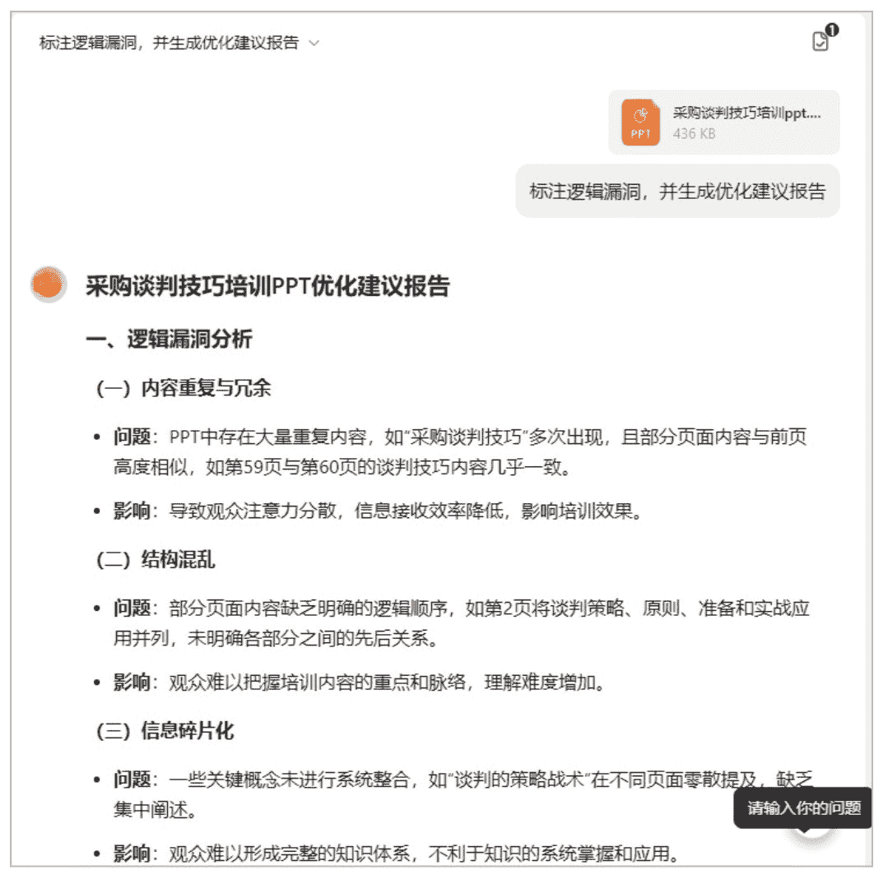

类似 Kimi“PPT 助手”的 AI 工具还有很多。例如，橙篇擅长将文字内容转化为结构化设计，其在细节方面的处理尤为出色；爱设计则专注于提供丰富的视觉设计模板和素材，能够快速提升 PPT 的视觉效果。

对于追求效率的用户，可先用 Kimi 优化逻辑，再通过橙篇生成初稿；对于内容创作者，则可先用 DeepSeek 输出 Markdown 框架，再导入爱设计实现视觉升级。不同的工具组合可以满足不同用户在 PPT 制作过程中的多样化需求，从而提高工作效率和内容质量。

# **第二章**

# **高手在做 PPT 前都做了哪些准备**

在这个追求效率的时代，“聪明偷懒”才是正道。不会 P 图、不会设计的非科班人士，要想快速完成专业级别的 PPT 制作，关键不在于临场发挥，而在于提前准备。

纵观高手制作的 PPT，实际上就是由精美的图片、表意清晰的逻辑图、风格统一的图标等元素构成。如果在上网浏览之余，通过特定的渠道收集好这些素材元素，制作时直接调用，效率事半功倍！

**请带着下面的问题走进本章**

1 在设计 PPT 前，事先准备内容有什么好处？应该如何准备？

2 模板的质量对 PPT 效果有什么影响？

3 为什么高手 PPT 中的字体总是那么好看？

4 什么类型的图片放进 PPT 中会降低其质量？

5PPT 中表示内容元素并列、递进等关系的一些图形是什么图？这种图可以事先收集为素材吗？

## **2.1****时间不够，模板来凑**

方案截止时间快到了，PPT 还没有开始做；没有灵感，找不到设计的思路……做 PPT 的路上总是有太多的“绊脚石”。不要着急，学会使用模板，效率、灵感都不是问题。

### **2.1.1****找到优秀模板的渠道**

记住一句忠告——永远把重心放在模板的质量上，而不是数量上！好的模板犹如一位优秀的导师，将精心的设计呈现在你眼前，供你使用、模仿。而低设计水平的模板不仅影响审美，还可能限制使用者 PPT 设计水平的提升。对比低劣模板和优秀模板，可以发现优秀的模板有统一的配色、插图风格、排版风格，让使用者受到“优秀品质”的熏陶。

如下图所示，前者是质量低劣的模板，后者是配色、版式设计均统一的模板，使用后者自然更容易制作出高质量 PPT。

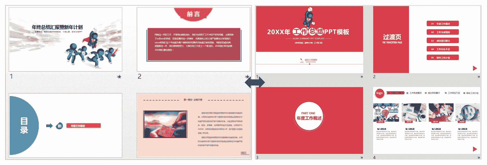

**1 微软 OfficePLUS**

要推荐的第一个 PPT 模板网站便是微软 OfficePLUS。它是微软官方模板网站，通过这个渠道找到的模板不仅有 PPT 单页、SmartArt 图和图表设计，更重要的是几乎不会出现格式上的错误和问题。同时也会根据当下流行的软件版本和尺寸来提供优秀的模板。

如下图所示，在 PPT 模板界面可以通过选择行业、文档类型和主体颜色来进行搜索限定，可以快速找到所需要的模板。

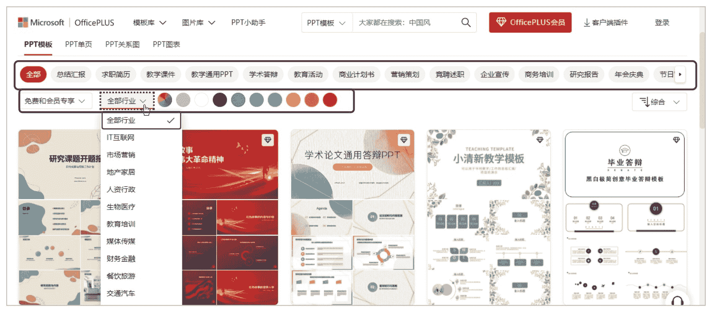

**2 WPS 稻壳**

WPS 稻壳是 WPS Office 软件内置的模板库，在 WPS Office 界面中单击【找稻壳模板】选项卡，即可打开【来稻壳 找模板】窗口，在左侧单击【演示】选项卡，可以看到其中提供了海量的 PPT 模板资源，如下图所示。这些模板涵盖了各种主题和风格，在界面的最上方还可以通过分类、场景、用途、风格、颜色等对 PPT 模板进行筛选。稻壳模板的优势在于其与 WPS 软件的无缝集成，用户可以直接在 WPS 中搜索、下载和使用这些模板，无须离开软件界面，大大提高了工作效率。

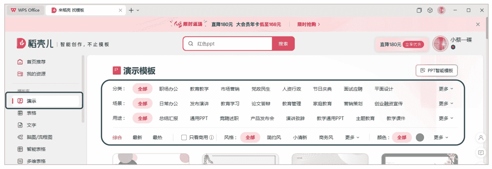

**3 第 1PPT**

想要设计更精美、在商务场合拿得出手的 PPT，可以使用第 1PPT，这里有不同类型、行业的模板，更重要的是可以找到 PPT 背景素材、图表素材、逻辑图素材，类型十分丰富，如下图所示。

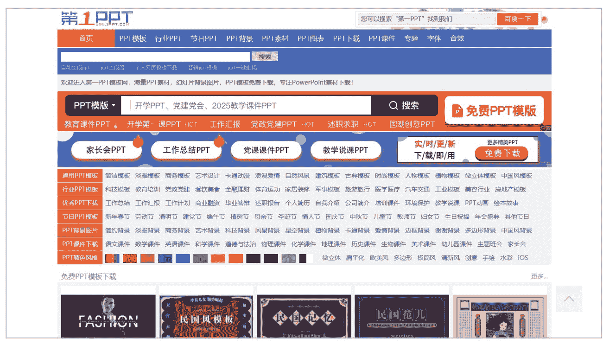

**4 演界网**

演界网提供不同场景、行业、风格的模板，以及定制模板，模板分为免费和付费，是一个能找到高质量 PPT 模板的网站，如下图所示。

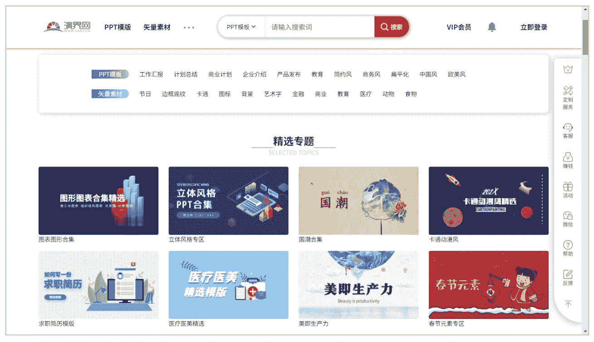

**5 优品 PPT**

优品 PPT 是一个分享高质量模板的网站，除了模板，还有各种 PPT 制作时所需要的素材，包括图表、背景图片、字体及 PPT 教程，如下图所示。

### **2.1.2****找到模板不会用，等于零**

与其囤积无数模板，不如精通一个。滥用模板只会让 PPT 显得杂乱，而掌握删除、替换、修改的技巧，才能让模板真正为你所用。

**1 基本技法：删除**

面对 PPT 模板，最基本的步骤就是删除多余元素，包括不符合需求的页面和水印。

在一份 PPT 模板中，并不是所有页面都会被用到，并且模板中往往会包含模板介绍页面、使用说明页面，删除多余页面，可以让精力更为集中。删除多余页面有一个技巧，可以进入【幻灯片浏览】视图界面下，快速浏览所有页面，并按住【Ctrl】键选中不需要的页面，再按【Delete】键删除即可，十分方便。

模板水印的删除分为两种情况：一是水印可以直接在幻灯片页面中选中删除；二是水印在幻灯片页面无法选中，这时就要到【幻灯片母版】视图下进行删除。如下图所示，进入幻灯片母版视图状态后，找到有水印的版式，就能选中母版中的水印，删除即可。

**2 通用技法：替换**

使用 PPT 模板，最常用的技法就是替换。将模板中的图片、文字替换成所需要的内容。为了防止在替换过程中出现图片变形、文字格式改变的情况，可以用下面的技巧进行替换。

替换图片时，右击图片，在弹出的快捷菜单中选择【更改图片】选项，而不是重新插入图片，如下图所示。

如果右击图片没有出现【更改图片】选项，说明这是一张填充在形状中的图片，此时应该打开【设置图片格式】任务窗格，在【形状选项】选项卡中单击【插入】按钮，重新选择填充图片，以实现替换图片的目的，如下图所示。

在修改模板文字时，不要将文本框中的文字全部删除再重新输入或复制文字。正确的做法是复制文字后，选中文本框，单击【粘贴】下拉按钮，从弹出的下拉菜单中选择【只保留文本】的粘贴方式。原文本框的内容即可被替换，并且格式不变，如下图所示。

如果要重新输入文字，可以将文本框中的文字删除，只保留第一个字，随后输入的文字就会保留第一个文字的格式，最后再删除第一个文字即可。

**3 高级技法：修改**

利用模板制作 PPT，还需要一些“高级”技能，以满足更多的需求。例如，发现模板配色不符合需求时，可以修改配色。配色修改一般有两种情况，一是有固定配色要求，如要求使用企业的专用配色；二是配色格调不符合需求，此时可以到配色网站中，找到合适的配色，再进行替换。在修改配色时，切忌没有依据地胡乱修改，正确的思路如右图所示。左边是 PPT 模板，有三种配色，不同颜色有不同的用途；右边是在配色网站中找到的另外三种配色，根据实际需求，将这三种配色用途进行分类，最后得出配色替换方案。

除了配色，模板中有不同的形状或简单的色块等可以说明信息之间关系的逻辑图（也就是 PPT 模板下载网站中提供的 PPT 图表）很多时候也是不符合要求的，如模板中的逻辑图只能表现三种逻辑关系，但实际需要表现两种或三种以上逻辑关系，那么就需要改变逻辑图的数量。

减少逻辑图数量的方法非常简单，只需要选择逻辑图中多余的部分，按【Delete】键删除即可。如果要增加逻辑图的数量，如想要将三个组成形状组成的逻辑图变成四个组成形状组成的逻辑图，那么只需要复制一个组成形状，再对形状的颜色、文字内容进行修改，以及形状位置进行调整即可，如下图所示。

### **2.1.3****字体素材，让模板尽善尽美**

下载模板时可能出现这样“奇怪”的现象，网站中的模板字体明明很有艺术感，下载打开后却变得平淡无奇。这是因为计算机中没有安装模板中的字体素材所致。所以要想充分利用模板，字体素材不能少。

**1 好字体这里找**

寻找字体的渠道有多种，使用好一种就能满足绝大部分的需求。这里推荐“求字体网”，在该网站中，可以通过两种方式来搜索字体。如果知道要下载字体的名称，则可以直接输入字体名称搜索字体下载。如果想下载其他 PPT 中使用的字体，但并不知道使用的是什么字体，那么可将 PPT 保存为图片，然后上传图片进行识别搜索，如下图所示，再对识别出的字体进行下载即可。

**2 找到字体这样用**

下载好字体素材后，需要进行安装才能在 PowerPoint 中使用。方法是将下载的字体素材解压后，单击后缀为“.ttf”的字体文件打开，打开字体窗口，单击【安装】按钮即可对字体进行安装，如下图所示。

### **2.1.4****AI 模板智能匹配**

传统模板搜索往往依赖人工筛选，耗时且匹配度低，而 AI 技术的介入让模板选择从“大海捞针”变为“精准投喂”。国内主流工具如 Office365、WPS 演示和 Kimi“PPT 助手”已实现“内容驱动型”模板推荐，通过智能解析用户需求，快速匹配风格、主题、行业适配的模板库，甚至能根据内容动态调整模板细节，极大缓解“模板好看但不合用”的痛点。

Office365 的“设计器”是内置在 PowerPoint 中的 AI 辅助功能，其核心能力在于“内容即时分析+智能设计生成”。当用户新建空白演示文稿并输入文字、图片或图表后，设计器会自动识别页面元素，结合 AI 算法推荐排版方案、配色模板及图文组合样式，实现“零基础秒变专业设计”。例如，在封面页输入标题“2025 智能家居趋势报告”，设计器会实时分析关键词“智能家居”“趋势”，推荐几种风格化布局，如右图所示。对于内容页，AI 会根据元素类型动态适配模板。

文字密集页：自动拆分为“标题+要点列表+图标注释”的三栏布局，并添加留白。

图文混排页：智能裁剪图片尺寸，匹配“左图右文”或“上图下文”的网格结构。

数据图表页：为柱状图、折线图添加渐变填充与动态浮出效果，同步调整配色与字体层级。

在使用 WPS AI、Kimi“PPT 助手”、橙篇、爱设计等 AI 工具生成 PPT 时，当用户输入 PPT 主题或上传文字大纲，AI 会基于语义分析推荐几套高适配模板，用户选择模板后就可以创建对应的 PPT 了。如下图（左）所示是在 Kimi“PPT 助手”中输入“大学生创业计划书”主题后返回的内容，单击【挑选模板】按钮，在弹出的窗口中右侧默认显示推荐的智能匹配最适合的 PPT 模板，这里可以看到 AI 优先推荐了那些充满创意、色彩鲜明、能够展现校园青春气息的模板，同时避免使用过于正式或商务化的风格，如下图（右）所示。若用户选定某套模板后，AI 还会根据实际内容自动调整页面布局，在窗口的左侧可以预览到套用该模板后的部分页面效果，单击【创建幻灯片】按钮，即可根据所选模板创建 PPT。

### **高手自测 5**

现在要制作毕业答辩 PPT，如何快速找到符合需要的模板？

## **2.2****找到好图片，成就精彩页面**

“文不如表，表不如图”，这是 PPT 制作的一个原则，可见图片对于 PPT 来说非常重要。一张富有寓意，构图美观的图片，再配上几个精雕细琢的文案，一页感染力极强，直击观众内心的精彩幻灯片页面便大功告成。

### **2.2.1****AI 工具快速生成图片素材**

在以前的 PPT 制作中，高质量图片素材的获取往往面临版权限制、设计门槛高、风格不匹配等难题。而随着国内 AI 图像生成工具的成熟，用户找图的第一渠道应该是 AI 生图，通过自然语言描述快速产出定制化图片素材，彻底解决“无图可用”或“图文割裂”的痛点。

在 PPT 图片素材生成领域，国内外 AI 工具已形成差异化竞争格局。国内工具以即梦、文心一格和通义万相为代表，主打“中文友好”与“场景适配”——用户输入“校园文创帆布包设计”等描述，工具能精准识别文化语境（如国潮元素、校园符号），生成符合本土审美的插图，且支持直接商用授权（如即梦的企业版素材库）。通常在对中文语义和文化语境的理解上更具优势。

国外工具如 DALL·E 3、Midjourney 和 Stable Diffusion 则以“创意突破”见长，擅长生成高艺术性、概念化的图像。例如，输入“未来大学图书馆与 AI 助手共生”这类抽象描述，可产出充满科技幻想的场景图，细节精度与光影层次远超多数国内工具。但这类工具对中文语义理解较弱（需依赖精准英文提示词），且版权规则复杂（如 Midjourney 禁止部分商业用途），实际使用时需谨慎合规审查。

值得注意的是，Adobe 推出的 Firefly 正在尝试平衡两者：其“生成式填充”功能可智能扩展或修改现有图片（如将普通教室背景替换为虚拟展厅），且 Adobe 宣称其输出内容默认商用授权，有效降低版权风险；微软 Designer 则与 PPT 深度绑定，用户插入文字后自动推荐配图并适配页面布局，实现“边写边设计”（见 1.4.4 小节）。对于普通用户，国内工具更易快速上手；而专业设计师可组合使用国内外工具——用 DALL·E 3 生成创意草图，再通过即梦优化细节并确保版权安全，最终形成高效合规的素材生产链路。

这里，我们以使用人数较多的即梦为例，介绍一下生成图片素材的具体操作步骤。

步骤 01 选择创作方式。进入即梦官网首页，单击【AI 作图】栏中的【图片生成】按钮，如下图所示。

步骤 02 设置生图参数。在新界面中的左侧文本框中输入生成图像需要的提示词，还可以上传参考图，然后在下方设置图像生成的参数，包括生图模型、图像清晰度、图片比例、图像尺寸等，设置好所有参数后单击【立即生成】按钮，就可以开始生成海报图像了。

步骤 03 单击图标。即梦 AI 会根据用户提供的素材和设定的参数，利用其深度学习算法，自动生成图像。这个过程可能需要几分钟到几十分钟不等，具体时间取决于图像的复杂程度。生成图像之后，会在页面右侧给出提示。单击右上角的“文件夹”图标，如下图所示。

步骤 04 查看生成的图片。在新页面中可以看到生成的多张图片，如右图所示。单击图片即可查看大图。

步骤 05 优化调整图像并下载。初步生成的图像可能并不完美，可能需要在细节上进行微调，在需要调整的图片页面上单击【重新编辑】按钮，并重新设置提示词和生图参数即可。优化调整的过程可能需要多次迭代，每次根据反馈进行小幅度的修改，直到最终达到满意的效果。在查看图像效果界面的上方单击【下载】按钮，即可下载生成的当前图像，如下图所示。

### **2.2.2****好用的四个专业图库网站**

如果 AI 生成的图像未能达到预期效果，或在创作过程中缺乏灵感，可考虑浏览专业图库网站。互联网上存在多种图库网站，包括以图片素材交易为主的付费平台，以及以共享互利为宗旨的免费资源网站；既有提供高清晰度 JPG 格式图片的图库，亦有矢量图形或小图标等特定类型图片的资源网站。建议将以下图库网站加入浏览器的收藏夹，以满足日常制作 PPT 时对图片的需求。然而，在使用这些图片时，必须留意版权相关事宜。

**1 视觉中国：优秀高清图片网站**

视觉中国是一个专业的图片网站，提供了大量的优质图片、视频、音乐等素材，如下图所示，而且在搜索图片时，可以按分类、构图、版权类型、色彩、格式、人物等筛选条件，对搜索出来的图片进行筛选，需要付费下载。

**2 Pixabay：免费好图网站**

在 Pixabay 网站中，可以找到免费、高质量的好图素材。该网站中约有几百万张免费的图片、矢量文件和插画，注册后即可免费下载高清大图。其中的大多数图片即便是商业用途也可任意使用，无须注明出处。且该网站支持中文和英文搜索，还可以对搜索结果进行图像类型、方向、尺寸、颜色方面的筛选。Pixabay 网站的搜索结果如下图所示，图片质量明显高于普通的搜索引擎。

**3 全景网：付费好图网站**

全景网提供了多个领域的图片素材，质量较高，付费下载后可用于商业。全景网搜索结果，如下图所示。

**4 图虫创意网：海量摄影图片**

图虫创意网中有海量的高清摄影图，是摄影爱好者共同分享的图片。在图虫创意网中可以找到许多构图优秀、意境深刻的图片。该网站图片分为付费和免费，免费图片搜索结果如下图所示。

### **2.2.3****好图标“藏”在哪里**

随着扁平风格的流行，越来越多的 PPT 开始使用图标类型的插图，简洁又美观，且趣味性十足。如下图所示，PPT 页面中仅用了文字、简单图形和 4 个小图标，一页言简意赅又不失美观的 PPT 便制作完成。找到合适的图标，是制作扁平风格 PPT 的关键所在。

**1 PPT 软件中**

在早期版本的 PowerPoint 中，要想插入矢量图标，用户需要先通过网络搜索下载，再以图片的形式插入。而在 PowerPoint 365 中提供的图标功能集成了各种类型的矢量图标，可以快速插入 PPT 中。如下图所示，在计算机连接网络的情况下，单击【插入】选项卡中的【图标】按钮后，在打开的【图像集】对话框中进行选择，即可插入图标。

另外，插入 PPT 中的图标还可以根据实际情况在【图形格式】选项卡的【图形样式】组中对图形填充、图形轮廓、图形效果等进行编辑，如下图所示。

**2 在图标素材网站中**

网上有很多免费的图标素材网站，如 Easyicon、IcoMoon 等，当 PPT 中提供的图标不能满足需要时，可以在这些图标素材网站中通过输入关键字进行搜索，搜索的方法与前面图片的搜索方法类似。

例如，在 IcoMoon 图标素材网站中下载图标，具体操作步骤如下。

步骤 01 单击按钮。打开 IcoMoon 官网，单击网站上方的【IcoMoon App】按钮，如左下图所示。

步骤 02 选择需要的图标。跳转到小图标选择页面，在【IcoMoon-Free】选项界面下找到目标图标后，单击选中（被选中的图标底色变成白色），如右下图所示。若要下载多个图标，则选中多个图标，再次单击选中的图标可以取消选择。

步骤 03 选择生成文件类型。单击网页下方的【Generate SVG & More】（生成 SVG 图片和其他类型文件）按钮，如左下图所示，网页跳转至图标生成选项设置页面。

步骤 04 设置下载参数下载图标。单击页面上方的【Preferences】（偏好设置）按钮，打开偏好设置对话框。在对话框中勾选【Override size】（图标面积）复选框，在其后的数值框中输入尺寸大小，输入的数字为 2 的次方数，如 1024（210），数字越大，生成的 PNG 图片尺寸越大。

在【Color（hex）】（颜色）数值框中输入 HTML 颜色值，设置生成 PNG 图标的颜色，如输入“2f73f8”（天蓝色），如右下图所示。全部设置完成后，单击该对话框外任意区域，退出设置状态，再单击页面左下方的【Download】（下载）按钮，即可将图片下载至计算机硬盘中。

步骤 05 使用下载的图标。下载到计算机中的是一个压缩文件，解压之后在一个名为“PNG”的文件夹中找到下载的图标。若之前选择的是多个图标文件，也都将存在这个“PNG”文件夹中。后续即可将这些图标插入 PPT 中进行使用。此外，还可以在名为 SVG 的文件夹中找到图标所对应的矢量文件（后缀名为． svg），如右图所示。将这个 SVG 文件导入 CorelDRAW 软件，再导出为 emf 或 wmf 图片，插入 PPT 中使用时便可以随意修改颜色，缩放大小而不变模糊、马赛克。

### **2.2.4****PPT 中坚决不用的 4 种图片**

PPT 新手可能会遇到找不到感染力强的优秀图片的情况，但是至少可以做到避免误入雷区。若使用了“雷人”图片，则会瞬间降低 PPT 的品质。

**1 不用“驴唇不对马嘴”图**

使用 PPT 图片切忌没有目的性地添加，或者仅仅是为了美观、个人喜好随意添加无关的图片。图片的添加要有目的性，要与页面的内容意义相符，否则容易造成页面内容表述不清，同时会降低 PPT 水平。检验 PPT 配图是否与主旨相关的方法是，询问自己“这页幻灯片一定要用这张图片的理由”，如果能说出三点及三点以上的理由，图片便具有目的性，不会与主旨不符。

如右图所示，页面文字“我们，在路上”与图片的道路内容相符合，“进无止境”与图片中的道路延伸含义相符，图片有美观性，因此这是一张有目的的图片。如果换成食物、服饰等内容的图片，即使构图再美观，也显得文不对题，让人捉摸不透。

**2 不用水印图**

图片中的水印犹如华丽服饰上一个破洞，十分碍眼。找到图片时，务必去除水印，如果无法去除，则应当舍弃这张图片。如右图所示，PPT 页面没有问题，唯一的问题是左下方的水印，显得格格不入，同时让观众感受到凌乱，显得不专业。

**3 不用模糊图**

像素不高的模糊图片会降低 PPT 的页面质量，让观众丧失阅读欲望。通常情况下，应当选择尺寸较大、画面内容较清晰的图片。

为了保证图片足够清晰，可以使用下面两种方法。

①在找图片时就选择尺寸较大的图片，如下图所示。

②在有目标图片的前提下，将图片放到【百度图片】的【百度识图】中，搜索尺寸更大的图片，如下图所示。

**4 不用变形图**

应避免使用比例失调的变形图片。不仅在寻找图片素材时需留意，将图片放入幻灯片后，也务必保持等比例调整图片的大小。如果使用了变形图片，会使画面呈现出劣质感，降低 PPT 品质。如下图所示，背景图片变形，圆形的咖啡杯变成了椭圆形，画面丧失协调性。

### **高手自测 6**

需要做一款家居用品宣传的 PPT，如何找到富有感染力的配图？

## **2.3****这么多素材，弄混了怎么办**

在 PPT 这条路上越走越远，各类素材收集越来越多，找不到素材的情况时有发生。面对乱成一锅粥的文件夹，可能仅是找素材就会花费半个小时，PPT 设计的灵感就在寻找中消耗殆尽了。有意识地学习素材整理，将不同类型的素材用最恰当的方法归类，是成为 PPT 制作高手的必经之路。

### **2.3.1****再多也不乱的素材管理方法**

素材整理不是简单地将同种类型的素材放到同一文件夹中这么简单。结合 PowerPoint 软件的特性，可将矢量图、图标、逻辑图类素材适合保存成 PowerPoint 文件，方便后期调用。

**1 文件夹分类**

图片、音频、视频、PPT 模板这四类素材适合保存在文件夹中。文件夹分类示例如下图所示。

在文件夹中保存素材，可遵循以下四个核心要点。

①量体裁衣，根据每个人的设计需求不同，为文件夹分类。例如，教师会有更多的教学类素材，而公司策划专员会有更多与商务相关的素材。越是常用的素材，越应该详细分类，如行政人员常常用到各类工作汇报的图表，那么“图表”这个文件夹中肯定会包含很多的图表素材，在“图表”文件夹下面建立“柱形图”“饼图”这样更详细的文件夹，可以保证常用素材有条不紊。

②文件夹分类要让任何一个新素材都能找到归属，换句话说，在建立素材文件夹前，要尽量全面考虑后期会收集到的素材。如果考虑不完全，可以预留一个空文件夹，收集新类型素材。

③文件夹数量在三个及三个以上时，可以编序号，让文件夹能按照优先级排序，方便素材浏览。在编号时，将最常用、最重要的素材靠前编号。

④文件夹中的素材命名要有统一的规范，并且越详细越好。例如，以“名称-大小-适用场合”的方式命名素材，那么图片名称可以是“苏格兰风景-1600 长 900 宽-适用于 PPT 背景”。

**2 利用 PPT 保存素材**

逻辑图、矢量图和图标类素材可以使用 PPT 保存，方便在使用时直接调用。其原因是，这三类图在下载后，需要修改格式、调整颜色或其他细节，才能被 PPT 使用。如果每次调用素材时，都打开专门软件进行修改，费时又费力。在素材下载完成后，就完成所有修改，保存到 PPT，可以实现素材的快速调用。

（1）转换矢量图素材格式

矢量图素材下载时，常见的格式是．ai 和．cdr，这些格式都不能使用 PowerPoint 进行编辑。此时可以利用 Illustrator 软件进行矢量化处理，再复制粘贴到 PPT 中，其具体操作步骤如下。

步骤 01 在 Illustrator 软件中打开图片。如下图所示，在文件夹中双击打开下载好的．ai 格式或．cdr 格式的文件。注意，计算机要提前安装 Adobe Illustrator 软件。

步骤 02 将 Illustrator 软件中的图形拖动到 PowerPoint 软件中。在打开的素材文件中，选中需要转换成矢量图格式的图形，将图片拖动到 PowerPoint 软件中，如下图所示。

步骤 03 取消图片的组合。拖动到 PowerPoint 软件中的图片此时还不能编辑，需要取消组合才能进行编辑。如左下图所示，右击图片，在弹出的快捷菜单中选择【组合】→【取消组合】选项。此时会弹出右下图所示的窗口，单击【是】按钮。

步骤 04 编辑矢量图素材。完成转换的图片就可以在 PowerPoint 中自由编辑了，不仅可以删减图片的元素，还可以随意更改颜色，如下图所示。

（2）利用 PowerPoint“节”功能保存素材

将素材保存在 PowerPoint 软件中，其原则是同一类型的素材保存在一个 PowerPoint 文件中。如右图所示的是将相同类型的素材做成了一个 PPT 文件。

在 PowerPoint 文件中，为了避免素材过多增加素材搜索时间，可以将素材再进行分类，同种类型的素材归到一个“节”中。如左下图所示，已经建立了一个名为【男人】的幻灯片“节”。右击第三张到第四张幻灯片的空隙，在弹出的快捷菜单中选择【新增节】命令，增加一个名为【女人】的素材“节”，效果如右下图所示。为素材建立“节”后，可以将不需要的素材折叠起来，减少不必要信息的干扰。

### **2.3.2****提高效率的素材调用方法**

素材收集得再多，也要物尽其用才能显示其价值。不同类型的素材有不同的调用方法，在找不到素材时也可以利用一些搜索技巧，快速找到所需素材。

**1 插入法**

图片、音频、视频类素材均是通过【插入】选项卡下对应功能按钮实现的，如下图所示，单击相应的功能即可打开文件夹插入素材。

**2 重用幻灯片**

保存在 PowerPoint 文件中的素材可以利用【重用幻灯片】功能，直接调用，其具体操作步骤如下。

步骤 01 执行【重用幻灯片】命令。单击【新建幻灯片】按钮，从打开的下拉菜单中选择【重用幻灯片】选项，如下图（左）所示。

步骤 02 打开素材文件。在【重用幻灯片】窗格中单击【浏览】按钮，如下图（中）所示，选择素材文件打开。

步骤 03 选择所需素材幻灯片。此时就在【重用幻灯片】窗格中打开素材 PPT 文件，勾选下方的【保留源格式】复选框，浏览幻灯片，单击素材所在的幻灯片，如下图（右）所示。即可新建一页与素材一模一样的幻灯片，此时就可以使用素材了。

**3 素材搜索**

在素材太多，确实找不到的情况下，可以利用文件夹搜索的方法快速找到素材。如下图所示，在素材可能存在的文件夹右上方的搜索框中，搜索文件可能包含的关键字，就可以搜索出相关文件。

### **高手自测 7**

制作幻灯片时，如何快速调用图标类素材？

## **高手神器 2 用 AI 工具快速处理图片**

在 PPT 制作中，图片处理是提升视觉品质的关键环节，而 AI 工具的介入让这一过程从“专业门槛”变为“一键操作”。当前主流的图片处理工具中，国外产品如 Adobe Photoshop（AI 功能）、Remove.bg 和 Canva 以功能全面见长。例如，Photoshop 的“神经滤镜”可智能修复老照片、生成虚拟背景，Remove.bg 的精准抠图技术能快速分离复杂主体（如发丝、玻璃器皿）。然而，这类工具往往需要付费订阅，且对中文用户的操作界面和本地化支持较弱。相比之下，国内工具如百度 AI 图片助手、美图秀秀 AI 和稿定设计更注重实用性与场景适配，尤其在中文语义理解、本土化素材库和免费功能上具备显著优势。

以百度 AI 图片助手为例，其核心功能覆盖从基础优化到高阶创意的全链路需求，且适合多种 PPT 制作场景需求。以下是其典型应用方法。

（1）智能抠图与背景替换

在制作产品介绍 PPT 时，常需将主体从杂乱背景中分离。百度 AI 图片助手的“智能抠图”功能支持批量处理：上传图片后， AI 自动识别主体边缘（如文创产品的纹理细节、人物衣褶），生成透明背景图，精度可达发丝级。例如，处理一张“校园帆布包实物图”,AI 不仅能精准抠出包体，还能保留刺绣图案的立体感，如右图所示。

完成抠图后，用户可直接调用“背景替换”功能，输入关键词（如“校园樱花背景”）一键替换，生成符合 PPT 风格的多张场景化图片，如下两图所示。

（2）画质修复与增强

对于分辨率低、噪点多的老旧素材（如扫描版校园建筑照片），通过“变清晰”功能，AI 可智能补全细节、修复模糊区域，并提升色彩饱和度。例如，将一张 500px×215px 的模糊图提升至 4K 分辨率，同时优化光影层次，使其适配 PPT 全屏展示需求。

（3）风格化滤镜与特效

为统一 PPT 视觉风格，百度 AI 图片助手提供“风格转换”功能。选择目标风格（如【宫崎骏风】【复古胶片】）后，AI 将分析图片内容并匹配特效参数。例如，将学生设计稿转为炫彩插画风格后， AI 会自动强化笔触质感、弱化机械线条，使图片更贴合“校园文创”主题的文艺调性。此外，其“提取线稿”功能可从图片成品中提取线稿，“AI 扩图”功能可根据当前画面扩展尺寸并生成逼真的扩展区域画面内容。

## **高手神器 3** **用灵犀一键生成 PPT 内容与设计**

在 PPT 制作中，内容策划与视觉设计的双重压力常令人望而生畏，而 WPS Office 的灵犀作为集成式 AI 助手，深度集成 DeepSeek R1 大模型，真正实现了“一句话生成完整 PPT”。其核心能力在于“内容-设计-素材”的全链路自动化：输入主题关键词，AI 同步完成大纲撰写、模板匹配、图表生成与素材填充，10 分钟内产出可直接演讲的 PPT 初稿。

灵犀已预装在 2025 新春版及以后的 WPS Office 中。WPS 的付费用户可通过 WPS 客户端快速调用该功能。打开 WPS Office 客户端，单击右上角的【立即登录】按钮，选择微信扫码或手机号验证登录（首次使用需完成实名认证）。登录后单击左侧导航栏中的【灵犀】图标 ，如左下图所示，即可打开【WPS 灵犀】界面，如右下图所示。在左侧可以看到灵犀提供了【AI 写作】【AI PPT】【AI 文书】【AI 搜索】【AI 阅读】选项卡，页面右侧对话框的上方也提供了【搜全网】【读文档】【生成图像】【快速创作】【生成 PPT】等按钮，单击这些选项卡和按钮可以快速跳转到灵犀的对应 AI 功能操作界面。在对话框的底部可以看到有一个【深度思考】开关，如果启用该开关则可以连接到 DeepSeek R1，然后就可以在对话框中向 DeepSeek 提问了。

另外，网页版灵犀可供所有用户免费使用，页面与上右图相似。下面以网页版灵犀为例，介绍如何生成 PPT。

步骤 01 登录灵犀。在浏览器中进入网页版灵犀的首页界面，并登录账户。

步骤 02 启用 DeepSeek R1 并提问。在 WPS 灵犀界面的左侧单击【AI PPT】选项卡，在右侧的对话框底部找到【DeepSeek R1】开关并启用。然后在对话框中输入要生成的 PPT 主题，这里输入“生成校园文创产品定制平台创业计划 PPT，包含市场分析、产品设计、运营模式、财务规划四部分，风格年轻化”，单击【发送】按钮，如下图所示。

步骤 03 查看生成的 PPT 大纲。稍后便可以看到 WPS 灵犀思考了 10 秒，如左下图所示，并生成了一篇关于校园文创产品定制平台创业计划的 PPT 大纲，如右下图所示，用户可以对该大纲进行调整编辑，这里直接单击【挑选 PPT 模板】按钮。

步骤 04 选择需要使用的模板。进入【选择模板生成 PPT】界面，此时 WPS 灵犀根据大纲推荐了适配风格的 PPT 模板，还可以根据需求在上方选择模板类型，如这里选择【高校专区】选项。然后在下方选择模板，即可在右侧的【模板预览】窗格中查看对应的模板效果。选择好需要使用的模板后，单击【生成 PPT】按钮，如下图所示。

步骤 05 编辑和下载生成的 PPT。稍后就可以看到 WPS 灵犀根据大纲和选择的模板生成的 PPT 了，如下图所示。在该界面中可以通过上方和下方的按钮对 PPT 进行简单操作，在右侧的任务窗格中可以看到 PPT 的大纲内容，还可以在该处编辑修改 PPT 内容。完成编辑后，单击【下载】按钮，将 PPT 保存到本地，方便随时访问和分享；也可以单击【去 WPS 编辑】按钮切换到 WPS 演示操作界面中对 PPT 进行更细致的操作。

# **第三章 做好排版与配色，80 分 PPT 不是梦**

排版与配色是 PPT 特有的视觉语言，良好的排版和设计能营造舒适的阅读体验，反之则可能造成混乱。它们看似神秘，不像图片插入或图表编辑那样有明确的步骤可循。但设计出优秀的排版与配色并非难事，只需保持兴趣、掌握方法并付出努力。

**请带着下面的问题走进本章**

1 好的版式是否有共同的特点？

2 对于新手来说，不懂太多的排版技能，是否能依靠几种经典的版式，活学活用，完成优秀排版？

3 什么是色彩？色彩的三大属性是什么？利用这些简单的色彩知识，如何做到科学配色？

4PowerPoint 中主题色是什么？在过去的 PPT 制作生涯中，你使用过吗？

## **3.1**  **掌握规律，新手也能做到惊艳排版**

三分内容，七分版式，排版的重要性不言而喻。然而优秀的版式设计并不是突然的灵感爆发，而是有意识地学习、模仿、实践得来的。学习排版规律，懂得如何引导观众视线，了解留白的艺术，知道不同类型页面的排版规律……排版水平的提升就是这么简单。

### **3.1.1**  **排版引导，让观众视线跟着走**

苦苦思索排版大法，不如回到问题的本质——究竟想让观众的视线如何走？引导观众的视线，是排版的一大目的。通过指向性元素，让观众的视线跟着页面元素走，让观众对信息的关注与理解最大化。

**1 视线基本规律：从左到右、从上到下**

设计出具有引导性的排版页面，必须符合基本的视线规律，如果强行反其道而行之，最终只会降低页面的可读性。在横排阅读习惯的文化背景下（如中文、英文）,“从左到右”是人们阅读幻灯片的基本的视线规律之一，也就是说观众看到幻灯片的第一眼，会习惯性地从左到右进行阅读。那么在通过排版进行视线引导时，可以安排信息从左到右排列，顺着观众的视线排版。

如右图所示，是四项内容的排版，有序号和箭头强调顺序，如此排版，可以引导观众从左到右观看。反之，如果从左到右的排版顺序是“4、3、2、1”，就会带给观众倒序的感觉，产生理解误差。

“从上到下”也是观众阅读幻灯片的一个视线规律，这就是很多图文排版的方式，是上图下文的原因所在——观众首先看到上方的图片，产生一个基本概念，然后将注意力放到下方的文字上，加强对信息的理解，如下图所示。

**2 引导视线的方法：使用指向性元素**

建立在基本视线规律的基础上，可以总结出引导视线的排版设计原则，思路如下图所示。如果页面内容有严格的阅读顺序，必须符合基本的视线规律。否则，便可以使用有指向意味的元素来引导观众的视线。

如下图所示，分别是人物眼神朝向引导和高山指向引导的 PPT 页面，页面中元素指向的中心均是页面上方。如此一来，观众在看到这样的画面时，视线会自然地聚焦到页面上方，从而寻找主题。

这便是视线引导的作用：让观众自然地定位重点、流畅阅读，同时确保页面中所有的元素都服务于主题。如此一来，即使图片内容再绚丽，也不会喧宾夺主。

### **3.1.2**  **留白的艺术，让页面高大上**

纵观如今的发布会，无论是苹果、谷歌还是小米，PPT 都遵循简洁质朴的风格。随着简约设计成为主流，PPT 内容过多反而降低专业感和沟通效率。那么简洁设计的根本是什么？那就是留白的排版艺术。

留白的“白”不仅局限于白色，还指留出空间，让观众呼出一口气，在简洁的页面中阅读文字，抓住信息。如下图所示，页面右边留出足够多的空间，写上尽可能少的文字，达到言简意赅又不空旷的排版效果。

留白似乎天生散发着高雅、文艺、简约的气质，这样神秘的气质又要如何驾驭？可以采用下面的方法，将留白的艺术落实到排版中。

**1 用对图片**

到自己的图片收藏夹中，找一张有空白、有空间的图片，就成功了一半。此时只需要将文字进行提炼，放在图片的空白处，一张充满艺术感的留白排版新鲜出炉，效果如下图所示。

**2 使用蒙版**

有时找到的背景素材并没有留出足够的空间，这种情况下就可以在下方添加一个半透明的色块，即蒙版，来人为地制造出留白，让观众的视线聚焦于蒙版之上的文字。如下图所示，文字下方的蒙版较好地制造出了留白。

**3 留出面积**

除了恰当地运用图片外，还可以刻意在 PPT 页面中留出一片面积来放置文字。将少量的文字放在大面积的区域上，可以让观众一目了然、轻松地阅读，感受到留白之美。常见的留白方法是将页面中的某个位置空出来，添加文字，效果简洁而醒目，如下图所示。

### **3.1.3**  **让观众过目难忘，就要有重点**

通过 PPT 演讲，总期望能让观众记住点什么。然而人类的记忆特点，是对不同寻常的事物有异常的敏感性。将这个记忆特点用到 PPT 制作中，实现重点内容的突出，让观众过目难忘。

强调 PPT 内容重点的核心原则是制造差异化视觉效果，具体的做法如下。

**1 颜色对比法**

改变强调内容的颜色是最常用的方法，因为人眼接收颜色信息的效率大于文字信息，改变颜色可以让观众在第一时间感受到差异。使用颜色对比强调重点内容，可以有两个方法，一是色相对比，即让重点内容的颜色与周围元素的颜色不同；二是使用饱和度/亮度对比，通过改变饱和度和亮度，让重点内容看起来颜色更“深”，如右图所示。

使用色相对比时，应选择对比效果强烈的颜色，具体选择方法可以参考左下图所示的色相环。在色相环上，两个颜色之间的角度越大，对比越明显，角度呈 180°时对比效果最明显，如橙色和紫色。

使用饱和度和亮度对比时，可以在 PowerPoint 中打开元素填充的【颜色】对话框，选择【HSL】的颜色模式，如右下图所示。保持色调参数不变，调整饱和度和亮度值来改变元素的填充色。

如下图所示，是通过颜色对比强调内容的幻灯片效果，在页面中，使用了两种对比强烈的颜色，让“客户”这项重点内容引起观众的视觉差异感受。

**2 形状差异法**

制造形状差异有两种方法，一是制造形状大小的差异，二是制造形状形态的差异，以此来突出重点信息的与众不同，如下图所示。

如下图所示，分别是改变形状大小和改变形状形态的强调效果，均能起到强调作用，突出传递重点信息。

**3 位置改变法**

人眼视线具有中心优先效应，总会优先关注视野中心区域或靠前区域的视觉元素。如左下图所示，幻灯片中心区域位置的元素会优先引起注意。如右下图所示，靠前区域的位置会优先引起注意。因此强调内容时，要将其放在中间区域或靠前区域位置。

如右图所示，将要强调的元素放在幻灯片中间位置，能有效聚焦观众视线，实现强调效果。

**4 添加修饰法**

为需要强调的元素添加一些修改性元素，如底色、装饰图形等，也可以实现强调作用。如右图所示，左边是需要强调的重点内容，不仅为文字添加了底色，还绘制了星形图形，实现双重强调的效果。

### **3.1.4**  **版面统一，让 PPT 更加和谐**

在 PPT 中，如果说有什么“绝招”是既简单又最容易被忽视的，那就是排版的统一性。稍加注意，则能迅速提高 PPT 的格调，一旦忽视，则会降低 PPT 的水准。

所谓的统一，指的是元素类型的运用、颜色、风格等保持一致。不统一的排版会有“东拼西凑”的感觉，显得十分拙劣。

**1 元素类型统一**

有很多人会犯这样的错误：在素材网站上看到 A 图片不错，又看到 B 图形设计得精美，于是都下载下来放在 PPT 中。需要强调的是，在 PPT 中“堆”内容时，要考虑这是不是一种类型的内容。这就是为什么优秀的模板中，内容元素总是保持高度统一的原因所在。

PPT 中类型不同的元素主要分为两种，思路如下图所示。

PPT 中常使用插图增强内容信息，插图类型影响了版面统一性。一份幻灯片，要么统一使用拍摄类图片，要么统一使用设计类图片。如下图所示，图片类型的不同，产生了完全不同的版面效果。

在 PPT 中使用形状时，为了不让版面看起来太过随意、混乱，可以事先规划好使用的形状。通常情况下，选择三种左右的形状互相配合即可，可以选择其中一种形状为主要形状。如下图所示，是同一份 PPT 中的两个页面，页面中均使用了同样的形状作为主要形状，这使版面保持了高度统一。

**2 颜色统一**

颜色统一指的是 PPT 页面中颜色的运用从头到尾要保持一致。通常情况下，保持一份 PPT 颜色统一的方式有两种，其思路如下图所示。至于颜色如何选择搭配将在 3.2 节中详细讲解。

如下图所示，PPT 由一种主题色、一种强调色、一种辅助色构成。这份 PPT 中其他页面的配色也遵循这个规律。

如下图所示，PPT 页面由一种主题色，搭配上另外四种通用色。这四种通用色关系平等，并且随着内容项目数量的变化而变化，如果其他页面中只有三项内容，则只选用其中三种通用色与主题色搭配使用。这种配色方式是目前比较流行的一种方式。

**3 风格统一**

在排版时，要保证所有幻灯片页面的风格统一。这里的风格包括文字风格、立体效果风格及其他风格，其思路如下图所示。

文字风格指的是字体、字号、颜色。在制作 PPT 前，可以事先设计好页面中的标题、内容及强调内容的文字风格。

立体效果风格是常被人们混淆忽视的一点。完全没有立体感的风格称为扁平风，除此之外，现在还流行微立体风，指的是稍微有立体感的风格。如果一份 PPT 中，有的页面是扁平风，有的页面是立体风，版面会十分混乱。

除了以上两点，不同的 PPT 会带给观众不同的感受，这种感受是由 PPT 的风格决定的，风格的不同决定了排版方式的不同。

如下图所示，分别来自不同的 PPT。通过观察两张图可以发现，虽然两张图都以花朵图案为插图，但是前者稍微带有立体感，而后者完全是平面化的。前者给人的感觉是清新风格，后者给人一种奢华复古的感觉。这两种不同的风格决定了版面中元素的排列、字体和色调的设计。

### **3.1.5**  **封面：用好三种套路就够了**

PPT 封面决定了观众是否有阅读的冲动。那么有没有一种最方便、效果最好的封面制作方法？答案是肯定的，观察优秀的 PPT，将那些震撼人心的封面找出来，其实就是以下几种。

**1 屡试不爽的套路——全图型**

要想让封面吸睛、又能凸显主题、又要制作简单，毫无疑问，要选择全图型封面。这种封面只有两个要求：找好的图片和合理地放上文字。至于好图片在哪里找，本书第二章 已经讲过。

全图型封面之所以吸引人，是因为一张好的图片能传达丰富的信息，达到“一切尽在不言中”的效果。如右图所示，背景与众不同又略带挣扎感的个性化人物图片，较好地强调了“找回自我”这个主题。

全图型封面的制作虽然简单但是也需要注意一些事项，并且文字在页面中的设计方式也有多种，其思路如下图所示。

通常情况下建议将文字放在页面中间位置，这是视觉焦点区域。如果图片中间有内容，不适合放文字，再考虑将文字放在其他位置，同时可以增加遮罩。如左下图所示，将文字放在右下方，图片内容较少的地方，遮罩保证了文字的清晰。

除了增加遮罩，在文字周围画上线框，也能起到聚焦作用，同时强调文字、增加文字清晰度，如右下图所示。

**2 简洁而不简单的套路——极简型**

有一种 PPT 封面既没有炫目的图片，也没有设计复杂的图形，有的只是寥寥数字、几个中规中矩的色块、几根简单的线条，却能收获意想不到的简洁之美。这种类型的封面适合用在个人答辩、演讲类的场合。

这种封面的制作虽然看起来简单，却十分考验制作者的设计功能和审美基础，否则一不小心，简洁就变成了单调。这里建议参考以下典型的极简型封面，将这些封面收藏在自己的脑海中，在打开自己思路的同时做到随学随用。

（1）上下型

上下型封面是常见的一种排版方式，只需要在上方或下方添加矩形色块，然后在色块上和页面空白处输入文字即可。需要注意的是，文字的颜色要与色块颜色区别较大，从而保证文字清晰显示，如深蓝色色块与白色文字、红色色块与白色文字。上下型封面的示例，如左下图所示。

（2）中间型

这种封面的规律是，将色块及线条添加在界面四周，从而突出一个中间的空白区域，将 PPT 的主题放在中间区域。如右下图所示，是中间型封面。

极简型封面的魅力就在于简单却变化丰富，如左下图所示，同样是中间型封面，效果却与上面的例子完全不同。但是万变不离其宗，其原则同样是用简单的元素包围中间位置，在中间输入主题文字。

（3）左右型

这种类型的封面是将色块或线条元素放在界面的左边或右边，另一边则输入主题文字。为了避免页面单调，这种类型的封面通常会使用类似于三角形、圆等简单形状的色块，能起到视线引导作用，同时显得活泼，如右下图所示。

**3 经典又耐看的套路——半图型**

在设计 PPT 封面时，如果找不到灵感，可以试试经典又耐看的排版方法——半图型。设计理念很简单，将一张与 PPT 主题相关的高质量图片放到页面中，再进行裁剪，覆盖住页面上方部分。页面下方的空白处则可以添加文字。一页简单又不失格调的封面就完成了。典型的半图型排版方式，如左下图所示。

如果觉得半图型太单调、太普通，可以在经典半图型的基础上稍加变化，制作出更有张力的封面。例如，将图片裁剪成其他形状，文字内容放在图片上方会使页面显得更有韵味，效果如右下图所示。

### **3.1.6**  **目录：高手都在用的样式**

目录页的作用在于展示 PPT 内容的大框架，帮助观众厘清逻辑。好的目录设计应该满足两个条件：清晰有序的目录文字，与幻灯片内容页面相搭配的设计风格。高手常用的 PPT 目录有以下四种。

**1 左右结构**

左右结构顾名思义，就是将目录二字或图片等装饰性内容放在页面左边，目录内容放在右边。这种顺序符合观众从左到右的视线规律，最终将视线落在居于页面右边的目录文字上。当然，在特殊设计情况下，也可以考虑将文字放在左边。典型的左右型目录结构，如右图所示。如果目录项目数较多，可以考虑让目录项目之间倾斜对齐。

**2 上下结构**

上下结构的目录，就是将目录二字或图片等装饰性内容放在页面上边，目录内容放在页面下边。页面下边的目录可以呈“一”字排开，如右图所示。如果是偶数项目的目录，也可以两两对齐。

**3 中间型**

幻灯片页面中间是视线聚焦点，将目录文字放在页面中间，也是一种强调目录内容的好方法。这种排版方法效果如右图所示，只需要找到一张合适的背景图片，或者将色块等修饰性元素放在界面四周，再将目录放在页面中间即可。如果想要实现更简洁的效果，页面四周可以什么都没有，仅将目录文字放在中间，只要将文字的字体设计得醒目、美观，效果同样很好。

**4 拼图型**

拼图型目录会显得更有科技感、有互联网产品的风格，效果如右图所示。

这种类型的目录排版有多种方式：一是绘制多个相同大小的矩形，使用【排列】工具对齐后，挑选其中几个矩形输入文字；二是插入表格快速得到排列整齐的网格，将表格单元格的【底纹】填充色设置为【无填充】，使其背景透明化；三是利用 SmartArt 图形快速规范排列的形状，如下图所示，是排列整齐的六边形。

### **3.1.7**  **内容页：学会四招告别图文排版之痛**

要想设计出高大上的内容页排版，方法和思路有很多。因为内容页是 PPT 的重要内容，主题和逻辑不同，排版形式就多种多样。但是在众多形式的内容页中，图文型是最常见也是最常用的类型。下面就介绍图文内容页的通用排版方法。

**1 单张图**

只有一张图片时，如果图片够清晰，可以采用全屏型排版方式。这种排版方式多用于发布会、演讲等场合。全屏型的排版中，文字应放在图片内容较少的地方，可以添加遮罩图形，增加文字清晰度。如下图所示，是三种常见的全屏型图文排版方式。

全屏型图文排版通常文字较少，效果如右图所示。

当图片不够大，或者是文字较多时，图片不适合放大到全屏。此时可以将图片放在左边、右边、上边、下边、中间进行排版，如下图所示。根据现在流行的 16∶9 的幻灯片页面比例，放在左右两边的图片应该是长图型，如果图片的宽度较大，则适合放在上下位置。

如下图所示，分别是图片在左边和上边的图文排版效果。

**2 奇数图片**

对称是一种美，也是 PPT 排版的一大原则。所以奇数张图片最重要的排版方式是让其对齐。奇数张图片无法做到两两对齐，但是可以使所有图片在水平或垂直方向对齐，排版如下图所示。

根据幻灯片的比例，奇数张图片数量较少时可以选择垂直对齐，数量较多时建议选择横向对齐。当数量为三张时，两种对齐方式均可。如右图所示，是三张图片横向对齐的排版方式。

保证图片的对齐，包括左右、上下对齐，以及图片的间距分布相等，除了使用前面章 节讲到过的【横向分布】【纵向分布】来保证图片间距相等外，还可以在对齐图片时观察参考线。如下图所示，图片之间的箭头表示此时图片间的距离是均等的。

**3 偶数图片**

适用于奇数张图片的排版方式也适用于偶数张图片，除此之外，偶数张图片还可以使用如下图所示的四种排版方式，这四种排版方式同样要注意图文的上下左右对齐及间距是否均等分布。

如右图所示，是两张图片的排版案例。

**4 不规则排版**

如果要追求更有设计感、更个性化的排版方式，或者是图片数量超过六张时，可以使用不规则排版。这种排版方式十分灵活，变化多样，但是其核心原则同样是对齐，可以是水平方向对齐、垂直方向对齐、沿着一条斜线对齐等。右面是四种不规则排版示意图。

不规则排版方式中，所有图片的大小不一定相等，但是整体版面要符合对齐原则，效果如右图所示。

### **3.1.8**  **结尾页：告别“谢谢”，惊艳全场**

结尾页是每个 PPT 中不可缺少的部分，惯用的 PPT 结尾页都是沿用封面的版式，并且文字内容要么是“感谢观看”，要么是“Thank You”等内容，感觉毫无新意，如下图所示。

那么，结尾页放哪些内容，才显得更有创意呢？其实，可添加的内容并不是固定的，可以根据 PPT 的类型、作用或实际情况来进行添加。

在 PPT 中，结尾页可以放公司的 LOGO、联系方式、企业愿景，以及对未来的展望等，如左下图所示为个人简历 PPT 结尾页，放的就是个人联系方式。

也可以留一个问题，引发观众思考，或者让大家进行讨论，如右下图所示。

### **3.1.9**  **文字排版的诀窍**

“文不如表，表不如图”是 PPT 制作的一个原则，但是又有哪份 PPT 能做到一个字都没有？很多人把文字排版的重心放在字体的艺术美化上。实际上，文字排版的核心是让读者以最轻松的方式读懂文字。基于此，优秀文字排版的原则是字迹清晰、平衡分布、保持对齐。

**1 字迹清晰**

要想做到字迹清晰，道理很简单，文字不要太小、颜色应与背景形成反差、不选择花哨影响阅读的字体。然而这三个简单的道理却常常被人忽视。

（1）文字大小

文字大小没有标准值，这需要根据 PPT 播放的具体场景而定，以观众能看清页面上的文字为基本原则。需要注意的是，不能为了让观众看清文字而一味加大字号，从而影响页面美感。建议作者在制作幻灯片时，尽量地放大文字，当放大到某一个值时，文字开始变得太大而产生“莽撞”感，此时再稍微缩小一下文字即可。如下图所示两张幻灯片内容一样，但就因为文字大小的不同，而产生了不同的效果。

（2）文字颜色

文字颜色在前面的内容中有所涉及，最大的忌讳就是文字颜色与背景色太过接近。例如，在蓝色背景上输入深蓝色文字，这会造成观众的阅读困难，如下图所示。

（3）字体可读性

字体可读性是最容易被忽视的一个点，正确做法是为文字选择的字体首先是可读性高的，如黑体、微软雅黑，不要标新立异地选择辨识度低的手写体（除非内容需要）；不要无缘无故为文字设置倾斜、阴影等影响阅读的效果。如下图所示，右边幻灯片中的字体比左边幻灯片中的字体更有可读性。

**2 平衡分布**

让文字在页面中的排版平衡分布，不仅要让文字与页面其他内容形成平衡，还包括间距的调整，其核心思路如下图所示。

行间距：文字行与行之间的距离，在 PowerPoint 中，文字的默认行间距通常是单倍行距，这个行距让文字看起来有点局促，建议适当增加行距。调整行距可以选中文字后，单击【段落】组中的【行距】按钮 ，从弹出的下拉菜单中选择合适的行间距即可，如下图所示。

段间距：段落与段落之间的距离，这个距离应该比行距稍大一些，以区分出段落。设置段落间距，需要单击【段落】组中的对话框启动器按钮 ，在打开的【段落】对话框中的【间距】选项区域中进行设置。需要注意的是，段落距离等于段前间距与段后间距之和，如果需要设置间距为 12 磅，那么仅设置段前间距为 12 磅即可，如左下图所示。

字符间距：文字与文字之间的距离。通常情况下，不需要刻意设置字符间距，但是在封面和标题文字中，为了不让文字“挤”在一起，可以适当增加字符间距，让文字散开，方便阅读。设置字符间距需要单击【字体】组中的对话框启动器按钮 ，打开【字体】对话框，切换到【字符间距】选项卡，为间距选择【加宽】选项，然后在【度量值】文本框中设置参数，默认为 1 磅，可以设置为 2 磅、3 磅……最后审视文字的具体显示效果，单击【确定】按钮即可，如右下图所示。

**3 保持对齐**

PowerPoint 中对齐方式有四种，左对齐、右对齐、居中对齐、两端对齐。通常情况下建议文字较少时选择居中对齐，文字较多时选择两端对齐，效果如下图所示。其原因是，较少的文字更注重平衡感，居中对齐能让文字左右两边平衡。根据常规阅读习惯，文字较多时要保持左右两边对齐，形成一个文字方块。

如下图所示，是大段文字左对齐、右对齐和居中对齐的效果，均不是理想的对齐效果。

### **高手自测 8**

以下 PPT 页面的排版有什么问题？应当如何修改？

## **3.2****这样配色，再也不用担心 PPT“颜值”**

配色，似乎是一种很神秘的能力。有的人追求热情奔放，有的人追求平淡质朴。然而光靠感觉是不能搭配出“好看”的色彩的。一切还要从基础做起，了解色彩知识，使用有限的知识避开搭配雷区，做到 80 分配色。再学会模仿和利用，将主题色、大师配色融入自己的 PPT 中，实现 90 分配色。

### **3.2.1****用最基础的知识做最精彩的配色**

色相、明度、饱和度的概念是做好配色的必备知识，打开 PowerPoint 的【颜色】对话框，选择 HSL 颜色模式，即可轻松调节颜色的这 3 个参数值。下面将结合案例介绍如何将这些基本的知识具体运用到 PPT 设计中。

**1 色相（H）**

按照色彩理论上的解释，色相是色彩所呈现出来的本质面貌。通俗来讲，不同色相就是指不同的颜色，如蓝色和红色是两个色相。

将不同的色相放在一起，组成色相环，根据色相环中颜色之间的角度来判断这两种颜色的对比程度。如右图所示，箭头所指的两种颜色之间的角度约为 30°，这是比较小的角度，因此这两种颜色是色相相近、对比不强烈的。

在设计 PPT 时，记住一个理念：要想页面颜色和谐、融洽，选择角度小的、隔得近的颜色，要想突出对比、强调内容，选择角度大、隔得远的颜色，颜色数量不超过四种。运用这个理念，制作一页和谐的 PPT，效果如下图所示，背景色、色块颜色、文字色均是相隔角度在 45°之间的相近颜色。

**2 明度（L）**

明度是色彩在明亮程度这个维度上的强弱情况。每一种纯色都有与其相应的明度，如黄色明度最高，蓝紫色明度最低，红、绿色为中间明度。色彩的明度变化往往会影响到纯度，如红色加入黑色以后明度会降低，同时纯度也会降低；如果红色加入白色则明度会提高，纯度却会降低，如右图所示。

新手在做 PPT 时很少注意明度问题，实际上在为 PPT 选择配色方案时，如果配色中包含了多种颜色，应尽量确保颜色的明度一致，否则会使整个 PPT 看起来有些混乱。如下图所示，是相同色相不同明度的颜色展示，在同一水平线上，颜色的明度相同，使用明度相同的颜色搭配，会呈现出和谐感。

在这种情况下可以选择不同明度的配色：同一色相，不同明度，形成单色系配色方案。这种配色方法可以体现出色彩的层次感，并且呈现简洁美。

如下图所示，就是同一种色相，不同明度的配色效果。

**3 饱和度（S）**

饱和度是指色彩的鲜艳程度。高度饱和的，如鲜红色、鲜绿色。混杂上白色、灰色或其他色调的颜色，是不饱和的颜色，如绛紫色、粉红色、黄褐色等，如下图所示。

根据明度和饱和度的知识，可以发现饱和度越高，颜色就越明显、艳丽，但是饱和度太高又会有些刺眼，如鲜绿色。因此，当饱和度居于较高水平但未达到极值时，最能引起人们的注意力。基于这样的知识，可以找到 PPT 配色的一个规律：在不刺眼的前提下使用饱和度较高的颜色，可以增加画面的质感，让观众集中注意力。

如左下图所示，这页 PPT 的颜色搭配并没有大问题，但是颜色看起来有气无力，太平淡了，不能引起人们的注意力，这是因为选择饱和度低的颜色所致。增加颜色的饱和度，如右下图所示，整个页面效果顿时得到了提高。

### **3.2.2****如何利用主题配色**

PowerPoint 的主题配色常常被忽略，然而主题配色却有两大用处：不懂配色的新手可以直接选择系统预设的配色使用，实现较好的配色效果；通过设置主题配色，可以方便后期修改整份 PPT 的配色。

**1 选择配色/新建配色**

主题配色在【设计】选项卡下，单击【变体】下拉按钮，从弹出的下拉列表中选择【颜色】选项，可以看到系统已经预设好的 20 多种配色，这些配色都是经过合理搭配的，可以放心使用，如下图所示。

选择其中一种配色，即可快速看到 PPT 套用该主题色后的效果。如果不满意主题的配色，可以自己更改配色的颜色，只需要在该下拉列表中选择【自定义颜色】选项，打开【新建主题颜色】对话框，其中【着色 1】到【着色 6】是图表、表格色彩的配色顺序，根据需要修改配色后，输入一个自定义的名称，最后保存即可，如右图所示。

**2 使用配色**

完成配色选择或自定义配色后，在幻灯片页面中插入文字、艺术字、公式、形状、图表、SmartArt 图形、表格等都将自动配好颜色。如下图所示，是选择配色方案后，主题颜色和主题样式的颜色变化。

完成 PPT 制作后，如果想要更改配色，可以重新选择主题颜色或新建配色方案，效果如下图所示，更改配色方案后，页面元素配色也立刻发生了改变。

### **3.2.3****把大师的配色运用到自己的 PPT 中**

主题配色确实好用，但若想自定义一套万无一失的配色方案，并确保视觉效果协调，最简单的方法是参考不同权威渠道提供的“大师”级别的配色，通过模仿学习其规律。

**1 Color Hunt：专业的配色方案**

Color Hunt 是一个提供专业配色方案的网站，选择网站中的某种配色时，就会显示出该颜色具体的参数值，如下图所示。

**2 Color Blender：在线配色器**

Color Blender 是一个在线配色网站，网站中提供的是现成的颜色搭配，可以根据实际需求，设置一种主色，网站再根据这种主题搭配出其他颜色。如左下图所示，拖动下方的 RGB 参数值，完成主题设置，上方就会自动搭配出配色方案。有了配色方案后，就可以利用 PowerPoint 中的【取色器】工具快速完成内容元素的配色了，如右下图所示。

**3 使用优秀作品的配色**

在花瓣网、昵图网能找到许多配色优秀的图片，在各类 PPT 模板网站中也能找到配色优秀的模板。无论是图片还是模板都可以截图放到 PPT 中，再使用【取色器】直接使用这些优秀作品中的配色，如下图所示。

值得注意的是这些网站可能存在版权争议，应避免直接复制整套配色。

### **3.2.4****DeepSeek 配色方案生成**

非专业用户在使用前面两种方法为 PPT 自行配色时，依然可能陷入“色彩堆砌”或“风格割裂”的困境。DeepSeek 的配色生成功能通过语义解析及行业适配双引擎，将抽象主题转化为和谐配色方案。用户输入行业属性、场景关键词或情绪描述，AI 就自动输出主色、辅色、渐变组合及使用比例建议，彻底解决“凭感觉配色”的盲目性。

DeepSeek 的配色功能主要是基于以下三种方式来进行分析推荐的。

（1）语义驱动

分析关键词背后的文化、场景与情绪关联，如“科技峰会”关联冷色调与金属质感，“儿童教育”关联暖色与柔软肌理。

（2）行业规则库

内置医疗、金融、教育等行业的色彩心理学规则，如医疗禁用高饱和度红色，金融倾向金色或蓝色搭配。

（3）动态调优

根据上传 PPT 中页面元素复杂度自动调整对比度，如文字密集页提高背景与字体色差，图表页强化数据色阶区分。

例如，我们为校园文创产品路演 PPT 手动配色方案为“大红+明黄+纯黑”，导致页面刺眼、文字辨识度低，且缺乏校园文创的文艺感。现在使用 DeepSeek 优化 PPT 配色，具体输入关键词可以如下。

**用户提问：**

请为校园文创产品定制平台路演 PPT 提供配色方案，需体现青春活力与文化沉淀感，规避高饱和度对比色。

**DeepSeek 回答：**

主色：陶土红（#C45C4A）——象征手工质感，替代原刺眼的大红。

辅色：松石绿（#4FB0AE）+米白（#F5F0E6）——传递清新与纸张肌理感。

点睛色：琥珀黄（#FFC107）——用于数据标注与按钮，提升活力。

禁用色：自动规避纯黑，改用深灰（#333333）提升阅读舒适度。

如果在提问时，上传了 PPT 文件作为参考，DeepSeek 还可以给出更有针对性的优化配色方案，具体操作步骤如下。

步骤 01 上传附件。在浏览器中进入 DeepSeek 的对话界面，并登录账户。在对话框中单击【上传附件】按钮 ，如左下图所示。

步骤 02 向 DeepSeek 提问。在打开的对话框中选择要上传到 DeepSeek 的 PPT 文件，稍后即可在对话框上方看到文件的上传进度。在对话框中输入要向 DeepSeek 提出的问题，单击【发送】按钮 ，如右下图所示。

步骤 03 查看 DeepSeek 的回复。稍后就可以看到 DeepSeek 根据上传的文件和提问给出的回复，如下图所示。可以看到 DeepSeek 不仅给出了核心配色体系，还针对不同场景应用给出了配色方案。

### **高手自测 9**

下面这页 PPT 的配色是否有问题？如果有，应该如何修改？

## **高手神器 4 用设计器实时美化 PPT 版面**

PowerPoint 365 中的设计器是一个智能化的设计助手，它凭借强大的 AI 算法和海量的设计数据，像是一个拥有丰富设计经验的专家，能够依据我们的操作和页面内容，实时给予精准且富有创意的版面美化建议，让我们在制作 PPT 的过程中，实现“边创作边优化”，极大地提升 PPT 的设计质量与美观度。

一般情况下，当我们新建一个 PPT 文件后，【设计器】任务窗格往往会自动出现在窗口右侧。假若它没有自动弹出，我们也可以通过单击【开始】选项卡中的【设计器】按钮，快速将其调出，如下图所示。这个任务窗格就如同一个实时更新的设计灵感库，它所展示的内容紧密围绕我们当前所选幻灯片的布局、元素等进行定制化的设计推荐。

一旦我们在幻灯片中输入文字、插入图片或添加其他元素，【设计器】便会即刻启动分析模式。它会参考这些元素的类型、数量、大小、位置等多维度信息，从海量的设计模板和排版规则中筛选出最合适的设计方案。例如，我们在幻灯片中输入了一段标题文字和一段正文内容后，【设计器】会迅速根据文字的长度、字体、字号等，推荐几种不同的文字排版方案。这些方案可能包括：将标题居中放大以突出重点，并将正文分段对齐排列以增强可读性；或将标题文字以艺术字形式呈现，并搭配合适的阴影、轮廓等效果，使其更具视觉吸引力，同时将正文内容以图文混排的布局进行展示。我们只需单击选定的方案，即可快速套用，瞬间提升页面的整体美感，如下图所示。

再比如，当我们向幻灯片中插入了一张图片，【设计器】会依据图片的风格、色彩、主题等因素，给出多种图片排版设计。它可能会建议将图片作为背景，通过调整透明度和添加半透明的蒙版，让图片与页面上的文字内容完美融合，营造出层次分明、意境深远的视觉效果；也可能会推荐将图片放置在页面的一侧，以图文并茂的形式呈现，并自动调整文字的排版，使其与图片的大小、位置相匹配，保持页面的平衡与协调，如下图所示。

除了针对单个幻灯片的设计建议，【设计器】还能从整个 PPT 的角度出发，保证各幻灯片之间的设计风格统一、过渡自然。当我们完成了一页幻灯片的设计，并应用了【设计器】的某套方案后，它会根据该方案的风格特点，为后续新建的幻灯片推荐与之相呼应的设计模板，从而使整个演示文稿在视觉上形成一个有机的整体，展现出专业、连贯的设计风格，如下图所示。

当我们对【设计器】给出的某套设计建议感兴趣时，只需在任务窗格中选择对应的推荐选项， PowerPoint 会立即自动将该设计应用到当前幻灯片上，让我们即刻看到美化的实际效果。如果对效果不满意，也无须担心，我们随时可以撤销操作，重新选择其他的设计建议进行尝试，【设计器】会耐心地为我们提供多种备选方案，直到我们找到最满意的那一款。

总之，PowerPoint 365 中的【设计器】功能，让我们即使没有专业的设计技能，也能够轻松打造出美观、专业、富有吸引力的 PPT 版面，极大地提升了 PPT 制作的效率和质量，使我们的演示文稿在众多同类作品中脱颖而出，成为真正的“高手神器”。

## **高手神器 5** **用 WPS 演示快速美化 PPT 版面**

WPS 演示的智能化设计工具集将 PPT 美化从“逐页手动调整”升级为“全局一键优化”，尤其适合追求效率与专业度的用户。其功能覆盖单页微调、全文统一、更换主题、对象美化等，深度融合 AI 能力实现“所想即所得”。

在 WPS 演示中单击【设计】选项卡中的【美化助手】按钮，可以展开【美化助手】任务窗格，在其中可以看到提供的多个贴心且实用的 PPT 美化功能，如下图所示。接下来我们介绍几个核心功能。

**1 单页美化：精准解决局部视觉痛点**

当需要对某一张幻灯片进行美化时，单页美化功能是不二之选。它能够快速分析页面内的元素，如文字、图片等，然后根据这些元素的特点，自动调整排版布局、字体样式、颜色搭配等。

选择 PPT 中需要重新设计的幻灯片，然后在【美化助手】任务窗格中选择【单页美化】选项，即可随机美化该页幻灯片效果，如果不满意还可以在右侧的任务窗格中选择需要套用的其他页面效果，如下图所示。

在选择需要重新设计的幻灯片后，单击【设计】选项卡中的【单页美化】按钮，或单击状态栏中的【智能美化】下拉按钮，在弹出的下拉列表中选择【单页美化】选项，也可以在打开的【美化单页幻灯片】对话框中选择要采用的页面效果，如下图所示。

**2 更换主题：一键焕新 PPT 视觉效果**

更换主题功能为 PPT 的外观切换提供了高效途径。它预设了多种精心设计的主题，涵盖商务、教育、创意等领域风格。

在【美化助手】任务窗格中选择【更换主题】选项，即可随机更换一种主题效果，如果不满意还可以在右侧的任务窗格中选择需要套用的其他主题效果，还可以单独调整配色方案和字体方案，如下图所示。

要使用此功能，还可以在【设计】选项卡的列表框中选择主题选项，或者单击【更多主题】按钮，打开【主题方案】对话框，浏览并挑选心仪主题，双击即可瞬间应用到整个 PPT，如下图所示。每个主题包含独特的配色、字体和效果设置，能迅速改变演示文稿的视觉基调，使其焕然一新，满足不同场景的演示需求。同时，用户还能对主题进行个性化调整和保存，以便后续复用。

**3 全文美化：一键打造风格统一的演示文稿**

全文美化功能适用于对整个 PPT 进行整体的风格统一和美化提升。它会综合考虑整个演示文稿的内容主题、各页面的元素分布等因素，一键为所有幻灯片应用一套统一而协调的设计方案。无论是商务汇报、学术讲座还是创意展示，这一功能都能快速地让整个 PPT 从外观上焕然一新，展现出专业、精致的风格。

在【美化助手】任务窗格中选择【全文美化】选项，或者单击【设计】选项卡中的【全文美化】按钮，又或单击状态栏中的【智能美化】下拉按钮，在弹出的下拉列表中选择【全文美化】选项，都可以在打开的【全文美化】对话框中选择要采用的模板效果，如下图所示。选择之后就可以快速改变所有幻灯片页面的效果。比如，原本各页面排版各异、色彩搭配混乱的 PPT，运用全文美化后，所有的文字会采用统一的字体、字号和颜色，图片也会按照统一的风格进行布局和修饰，各页面之间的过渡也会更加流畅自然，使整个演示文稿在视觉上形成一个有机的整体，增强演示的连贯性和感染力，让观众更容易沉浸在演示内容中，跟随演讲者的思路前进。

**4 对象美化：提升单个对象的视觉表现**

无论是图表、图片还是 SmartArt 图形，对象美化功能都能为它们提供专门的优化方案。以图表美化为例，选中幻灯片中的图表后，单击【绘图工具】中的【图表样式】按钮，系统会立即展示一系列契合图表类型和数据特点的美化模板。这些模板不仅优化了颜色搭配，使数据柱、线或饼图区域的色彩对比鲜明且和谐，还调整了字体样式与大小，确保图例、轴标签等文本元素清晰可辨。用户只需点击喜欢的模板，即可一键完成图表的高级美化，使其更具视觉冲击力，数据传达也更加精准直观。

**5 从版式新建幻灯片：高效布局幻灯片内容**

从版式新建幻灯片功能为用户提供了高效的内容布局和排版方式。单击【开始】选项卡中的【新建幻灯片】下拉按钮，在弹出的下拉菜单中选择【从版式新建】命令，在弹出的下级子菜单中可以看到该功能提供了多种预设的版式模板，如下图所示，这些模板涵盖了常见的幻灯片内容布局，如标题和内容、两栏内容、节标题、图片与标题等。

当需要新建幻灯片时，可以根据要呈现的内容类型选择相应的版式，这样不仅能快速确定页面的基本结构，还能确保各元素之间的比例和间距合理，使页面在视觉上更加美观、清晰。例如，在制作一个展示产品特点的 PPT 时，选择【两栏内容】版式，就可以在左侧放置产品图片，右侧则可以详细阐述产品的主要特点和优势，让观众一目了然地获取关键信息，提高演示的效率和效果。同时，这些版式还可以根据需要进行灵活调整，满足不同用户的个性化要求，是打造专业、规范 PPT 版面的得力助手。

## **高手神器 6 ColorSchemer 配色好工具**

前面我们介绍了很多专业的配色网站。而在无网络的情况下，还可以借助计算机中提前安装好的 ColorSchemer 软件来建立专业的 PPT 配色方案。

比如，根据某一种主题色，建立配色方案，只需在左侧的【基本颜色】窗格中输入主题色的 RGB、HSB 色值，在窗口右侧的【实时方案】选项卡下就会自动生成配色方案，如下图所示。

若无明确主题色，可单击软件窗口左下方的 按钮，获得随机的专业配色方案。

单击软件上方的【图库浏览器】按钮 ，切换到印象配色模式，在搜索框中输入配色关键词（英文），即可获得相应的一些配色方案，如下图所示。不过，印象配色要求计算机连接网络。

单击软件上方的【图像方案】按钮 ，切换到图片配色模式，打开一张图片，软件将根据该图片自动提供配色方案，如下图所示。

# **第四章**

# **一学就会，内容出神入化的技法**

武侠至高境界是手中无剑而万物为剑。PPT 设计亦是如此，高手同样不会刻意追求眼花缭乱的元素，他们只是将朴素的文字、普通的图片、简单的图形用到极致。这是 PPT 设计的真理，领悟内容元素的本质，站在高山之巅，以俯视的角度、全局的眼光，将 PPT 最重要、最普通的元素妥善运用，做到出神入化。

**请带着下面的问题走进本章**

1 文字是否只能设计字体、大小、颜色？是否有更多的设计思路？

2 有哪些技巧可以优化 PPT 文案？

3 PPT 中是否一定要有足够多、足够炫目的图片，才能吸引观众的目光？

4 如果找到的素材图片太小，又需要在 PPT 中放大显示，如何对图片进行放大处理？

5 观察复杂的图形，是否可以由简单的图形，如矩形、圆形……经过组合、调节等操作完成绘制？

## **4.1****文字，它的表达力超乎想象**

有的人认为文字只是平淡无奇的方块，PPT 高手却认为文字是可塑性极高的璞玉。只要将一个个的方块字打磨雕琢，再少的文字也能表达无尽的话语，再多的文字也不会显得拥挤累赘。

### **4.1.1****文字太多，如何删**

PPT 不是 Word，不要将幻灯片当成 Word 文档堆砌大段的文字，这是制作 PPT 的大忌。永远记住这么一个理念：放在 PPT 中的文字是精华。如果将所有内容都放在页面中，还需要演讲者做什么？

如果放到幻灯片页面中的内容太多，如何删减才能保证不会“误伤”重要信息，给观众留下深刻的印象？文字的删减要从目的出发，将文字的提取当成广告文案细细推敲，提取出内容的关键信息，留下最能说明主题的文字。

**1 发布会**

如果制作 PPT 是为了在发布会上配合演讲，那么演讲者想说的话一定要保留，不能完全输入 PPT 中。否则观众在看到了页面文字内容后，就会失去对演讲的兴趣。总体来说，发布会上播放的 PPT 信息要精简，能给观众留下悬念。文字内容可以是演讲者演讲内容的关键词提炼，也可以是问句，不断地引起观众的兴趣。

例如，一个关于人工智能产品发布会的 PPT，当演讲者讲到人工智能的概念时，可以提取的关键词就是“人工智能”，但是仅在页面中放上“人工智能”4 个字又显得平淡无奇。这场发布会的目的在于引起观众对人工智能产品的兴趣，那么将信息内容与观众联系起来，同时又制造悬念，可以将文字修改为“人工智能如何改变你的生活？”，其思考过程如下图所示。

根据以上思考，这页 PPT 的文字精简后，效果如右图所示，此时演讲者就可以开始口述人工智能的概念了。

**2 教学课件**

教学课件的目的是传播教学信息，因此需要将知识点条理清晰、内容齐全地列在 PPT 中，此时文字就等于知识点的大纲框架，提醒观众当前在讲的知识点是什么，帮助观众梳理逻辑。

课件类 PPT 中，知识点数量较多，但是谨遵一个原则：一页 PPT 只讲一个知识点，不要贪多。基于此，页面中所有的文字都应该围绕一个核心。

例如，一份讲解着装礼仪的 PPT，当讲到领带打法时，如果讲解的目的是要详细介绍常用的领带打法，可以一个页面放一种打法的文字信息。文字信息只需要说明打法的名称和简要介绍。至于具体的操作方式、典故、知识延伸，应该由授课老师口述讲解，如右图所示。

**3 宣传推广**

宣传推广的 PPT，目的在于让观众对产品产生兴趣，需要用产品亮点、真实数据、观众痛点来直击观众内心。精简这类 PPT 的文字，可以围绕的问题核心是“观众最想知道什么”“产品能给观众带来什么”等。

如下图所示，是一段马术俱乐部的招生信息，在这段信息中，该俱乐部有多少个班是观众不太关心的信息，这类信息应该删除。事实上，在这段信息中，招生对象、费用及课时数量是最需要传达给观众的信息，也是观众最需要的信息，基于这样的数据信息观众可以考虑是否要报名。

文字精简后的 PPT 效果如下图所示，可以将数据类信息加粗强调显示。

**4 工作汇报**

工作汇报类 PPT，其目的就是让观众快速了解工作的进展、成果。这类 PPT 在精简信息时，方法是“结论先行”，再根据版面的大小决定是否保留导致结论的相关因素、相关数据。换句话说，工作汇报型 PPT 要保留的信息是齐全的工作数据、明确的工作总结。如下图所示，左边的红色是提取出的重点信息，由这些重点信息可以提取出结论和相关因素。

用同样的方法，可以对年度工作的其他内容进行精简。完成内容删减后，发现版面有空间可以排列其他成果，因此制作出的 PPT 页面效果如下图所示。

### **4.1.2****文字太多不能删，只需三步就搞定**

PPT 的文字太多，删减一些可以减少页面拥挤感。但是如果每个文字都是重要的，都不能删除呢？大段的文字，要保证可读性和美观性，十分考验设计者的功力。其实搞定文字很简单，只要整理清楚文字逻辑、提取出重点、进行修饰，再多文字也不是问题。

**1 整理文字逻辑**

文字的逻辑常见的有三类，可以按照如下图所示的思路进行整理，其中按类别进行整理是最常见的一种。

具体的整理方法是，对大段的文字内容进行分段，然后增加段落间的间距，将段落内容彼此区分开来。如下图所示，这段文字是按照业绩的类别进行整理的，根据业绩的不同，可将其分为三个部分。

**2 提取关键词**

文字内容进行逻辑整理后，就需要提取不同内容的关键词，拟定标题。需要提取的关键词通常有两类：一是标题性关键词，起到概括总结作用；二是需要强调的信息，如数字、项目名称。

如下图所示，是完成关键词提取后的结果。在此例中，既有标题关键词也有强调关键词，可根据后面的版式设计来决定强调关键词是否需要单独展示。

**3 修饰文字**

如何将整理好的大段文字变成美观的 PPT？只需要符合两个原则，一是对关键词进行强调，二是排版整齐，思路如下图所示。其中文字排版可以回顾本书第三章 的内容，下面重点讲解如何强调关键词。

（1）加粗字体

针对大段的文字，即使是简单地加粗、加大关键词字体，也可以让观众快速找到重点。将标题加粗、加大，再根据段落数量设计不同的对齐方式即可。如右图所示，因为有四个段落，所以设计为左右两两对齐，即使文字很多，观众也可以快速明白这页幻灯片所表达的文字内容。

（2）添加色块

强调标题文字，还可以为文字添加色块。色块可以起到视觉聚焦的作用，同时突出主题，效果如下图所示。

（3）图标修饰

如果想丰富界面内容，且高度强调关键词，可以使用图标修饰。因为图标有很强的设计感，使用符合关键词内容的图标，可以使内容形象化。如下图所示，在只有三个段落的前提下，使用了图标和色块的方式单独强调关键词，并且加粗了标题，使大段文字内容的重点信息得到较好的突出，让观众即使不阅读段落文字，也能抓住信息的核心。如果段落有四段，为了使页面不那么拥挤，可以使用左右两两对齐，为标题添加图标即可。

### **4.1.3****DeepSeek 文案优化**

人工优化文案还是很耗时耗力的一件事，DeepSeek 的文案优化功能通过语义解析和场景适配双引擎，可以实现从“冗长模糊”到“精准有力”的智能升级。用户输入原始文案后，AI 自动执行精简冗余、强化重点、修正逻辑、匹配场景四重优化，显著改善“词不达意”或“专业感不足”的痛点。

例如，在制作“校园文创产品定制平台”融资路演 PPT 时，原文案存在一些问题。例如，产品优势页的文案为“我们的平台是一个很好的平台，让大学生可以自己设计文创产品，比如帆布包、徽章 什么的，有很多学校的学生都很喜欢。目前已经有一些用户，复购率还不错”。

这种内容太过平淡和口语化，需要进行优化和提炼。使用 DeepSeek 进行优化时，就可以根据需要输入优化目标和要求，这里输入如下所示的提问。

**用户提问：**

优化以下文案：

目标场景：面向投资人的融资路演 PPT

核心需求：精简文字、突出数据、强化专业感

原文：我们的平台是一个很好的平台，让大学生可以自己设计文创产品，比如帆布包、徽章 什么的，有很多学校的学生都很喜欢。目前已经有一些用户，复购率还不错。

此时，如果使用的是 DeepSeek 的“深度思考（R1）”模式，则可以看到类似如下所示的 AI 思考路径，其实就是分层优化。

**DeepSeek 尝试思考：**

精简冗余：

删除重复表述（如“平台是一个很好的平台”）及模糊词汇（如“什么的”“还不错”）。

数据强化：

将“有一些用户”替换为具体数据“覆盖 50 所高校，注册用户 8 万+”;“复购率还不错”转为“用户复购率 65%，远超行业均值 40%”。

逻辑修正：

补充因果链条：“依托 200+校园设计师资源”解释“用户高复购率”的原因。

场景匹配：

植入投资人关注关键词：“轻资产运营模式”“可扩展生态”。

紧接着，就可以看到 DeepSeek 最终给出的优化结果了，甚至会给出 PPT 设计的相关建议，如下所示。此时，我们再根据具体情况修改相关数据或内容即可快速完成文案的优化整理。

**DeepSeek 回答：**

“平台汇聚 200+校园设计师资源，提供帆布包、徽章 等定制化文创产品，已覆盖 50 所高校，注册用户 8 万+。轻资产运营模式下，用户复购率达 65%（超出行业均值 25 个百分点），形成可扩展的校园创意生态。”

PPT 落地效果：

视觉强化：

AI 建议将关键数据拆分为图标化布局，并添加对比动画：

[设计师图标] 200+校园设计师

[地图图标] 覆盖 50 所高校

[用户图标] 8 万+注册用户

[增长率箭头] 复购率 65%（行业均值 40%）

演讲备注生成：

自动输出口语化讲解提示：

“此处需强调：高复购率源于学生群体对个性化产品的强需求及设计师资源的稀缺性壁垒。”

使用 DeepSeek 优化文案时，还可以给出字数限制、提取关键词、翻译成其他语言等要求，如“将以下文字改为 15 字以内的金句，适合 PPT 封面”。总之，DeepSeek 文案优化将“文字打磨”转化为可量产的工业流程。用户无须纠结字词雕琢，只需明确传播目标，即可获得精炼、有力、无漏洞的文本内容，尤其适合需高频产出 PPT 的商务、教育、营销从业者。

### **4.1.4****字体用得好，感觉不会少**

从网络中下载了许多的字体，安装好后却不知道怎么用，或者是随心所欲地用，这是 PPT 制作者常犯的错误。不少初学者甚至认为字体越多越好，一页 PPT 中包含四种以上的字体。其实，只要用得好，一二种字体即可。

**1 字体选用的两大原则**

选择不同的字体、应用不同的字体搭配方案能够让 PPT 呈现出丰富多样的风格。所以，在真正运用字体前，我们应该了解字体运用的一些原则，这样才能更好地运用字体。

（1）选无衬线字体，不选衬线字体

字体分为衬线体和无衬线体。衬线体指的是在笔画开始和结束的地方有修饰的字体，衬线体的特点是笔画的粗细不一致，如 Times New Roman、Georgia、宋体等都是衬线体。无衬线体则没有过多的修饰，而且笔画粗细保持一致，如 Verdana、Arial、黑体等都是无衬线体。

如下图所示，是衬线体与无衬线体的区别。

在制作 PPT 时，建议选择无衬线体。因为无衬线字体粗细一致，显得简洁干净。在投影时，无衬线体由于没有过细的笔锋，会显示更加清晰，方便远距离观众的观看。

如下图所示的两页 PPT，第一页使用了衬线体，这让文字辨认有些困难。修改成第二页的无衬线体后，文字清晰明朗多了。

（2）选扩展字体，不选预置字体

在安装系统或软件时，往往会提供一些预置的字体，如 Windows 10 系统自带的微软雅黑字体、Office 自带的等线字体等。这些字体虽然使用方便，但由于普及度高，容易使 PPT 设计显得千篇一律，缺乏个性。为了让你的 PPT 独树一帜，吸引眼球，建议选择一些独特、美观的扩展字体，这里推荐几款。

不过，在使用扩展字体时，一定要注意字体的版权问题。许多精美的字体并非免费商用，未经授权的使用可能会引发版权纠纷。例如，方正兰亭圆、汉仪大黑简等字体，都是需要购买授权才能在商业项目中使用的。在下载和使用扩展字体时，务必仔细查看字体的授权条款，确保合法合规地使用。如果需要免费商用的字体，可以关注一些开源字体库，如思源黑体、文泉驿等，这些字体在遵守相应开源协议的前提下，可以免费用于商业用途。

方正兰亭黑简体：简洁、清晰，比系统自带黑体的线条更典雅、柔美，是时下非常流行的一款字体，被很多手机系统、软件作为默认字体。应用在汇报、教学、娱乐等多种类型的 PPT 中均可，如左下图所示。

方正粗雅宋简体：有笔锋，能够将汉字的美感展现出来。且较系统自带“宋体”更粗壮、有力，作为标题投影显示效果也不差。适合应用在政府、事业单位、文化类型的 PPT 中，如右下图所示。

张海山锐谐体：粗细均匀、简洁，有一种机械打磨出来的严整感，适合科技类、工业类的一些 PPT，如左下图所示。

迷你简特细等线体：比等线 Light 字体更纤细，让文字呈现出一种纯粹的线条美感，适合目前流行的极简设计风格 PPT 使用，如右下图所示。

汉仪综艺体简：综艺类电视节目上常常看到的画面配字字体，粗壮、清晰，还有一种连笔的美感，作为商务汇报、教学等各种类型 PPT 的标题、副标题效果都非常好，如左下图所示。

方正静蕾简体：是方正电子携手明星徐静蕾打造的一款特别的字体，清秀、简洁、大方的手写感觉，非常适合文艺、轻松、娱乐，非正式场合类型的 PPT，如右下图所示。

文鼎习字体：这款汉字书法类型的字体圆润、遒劲，清晰明了，非常能彰显汉字书法的感觉，它还自带田字格，文化韵味顷刻跃然眼前。适合中国风类型的 PPT 使用，如左下图所示。

方正胖娃简体：这款字体清晰、醒目，且圆润可爱，配上缤纷的色彩后效果更好，尤其适合针对儿童设计的教学、娱乐型 PPT，如右下图所示。

除了 Arial 和 Times New Roman 之外，如果你还需要拓展一些经典耐看、好用的英文字体，推荐安装下面几款。

Impact：极为粗壮的一款英文字体，清晰、醒目，数字使用亦具有同样的效果，适合做标题或大号的英文装饰文字，如左下图所示。

Roboto Th：纤细如发的一款英文字体，能够展现出纯粹的线条美感，简洁、清晰。和迷你简特细等线体中文字体一样，适用于极简风格类 PPT，如右下图所示。

ADAMAS：多边形镂空感觉的英文字体，给人一种独特的视觉效果，适合科技、时尚类型的 PPT。这款字体仅适用于大写英文字母，小写英文字母、中文、数字均不可使用，如左下图所示。

LeviBrush：一款适用于英文的书法字体，其浓重的笔画、真实的笔触，展现出一种强烈的力度感，如右下图所示。

**2 防止字体丢失的 5 种方法**

你用你的字体搭配方案在你的电脑上设计的完美 PPT，拿到别人的电脑上投影播放，很有可能因为字体缺失变得面目全非。因为他人电脑上若没有安装你 PPT 中所采用的字体，则文字就会按他人电脑上的默认字体显示。如何解决这个问题？有下面五种方法。

（1）将字体嵌入 PPT 文件

将字体嵌入在 PPT 文件中，即让该份 PPT 文件自带字体，即便在缺失字体的电脑中播放也不受影响。PowerPoint 软件默认设置中，字体不会嵌入 PPT 文件，若需要嵌入需要手动设置。

设置方法为：单击【文件】选项卡，在打开的界面左侧单击【选项】命令，打开【PowerPoint 选项】对话框，在左侧单击【保存】选项卡，在右侧选中【将字体嵌入文件】复选框，选中【仅嵌入演示文稿中使用的字符】或【嵌入所有字符】单选按钮，单击【确定】按钮即可，如左下图所示。

不过，PPT 中使用到的某些特定字体，不适用于该方法，保存时可能会打开【连同字体保存】对话框，提示“某些字体无法随演示文稿一起保存”，如右下图所示。此时，可以使用其他方法来确保 PPT 在其他计算机播放时不发生字体改变。

（2）将字体文件随文件拷贝

将 PPT 中应用的所有字体随 PPT 文件一起拷贝到别人的计算机中，如右图所示。如果出现字体缺失问题，则将字体安装至该计算机中，然后重新打开 PPT 文件，问题就解决了。如果不怕在字体库中找字体、拷贝字体的麻烦，这是解决字体缺失问题最为简单、直接的办法。

（3）保存为 PDF 文件

若你的 PPT 文件内容已确定不需要修改，且观看时无须动画效果，可直接将 PPT 文件保存为 PDF 文件，PDF 文件打开观看时不受字体的影响。

将 PPT 文件保存为 PDF 文件的具体方法为：单击【文件】选项卡，在打开的界面左侧单击【导出】命令，在右侧单击【创建 PDF/XPS 文档】按钮，如左下图所示。打开【发布为 PDF 或 XPS】对话框，对发布位置进行设置，单击【发布】按钮即可，如右下图所示。

（4）转换成 PNG 图片

如果 PPT 中应用的系统外的字体并不多，比如只是封面标题应用了“文鼎习字体”，其他内容全部采用微软雅黑字体。此时可以利用“选择性粘贴”的方法，将文本转换为图片，这样就能解决出现文鼎习字体缺失的情况，但转换为图片后，不能对文字进行修改。具体方法如下。

步骤 01 复制文字内容。选择应用“文鼎习字体”的文字，按【Ctrl+C】组合键复制。

步骤 02 粘贴为 PNG 格式。按【Ctrl+Alt+V】组合键，打开【选择性粘贴】对话框，在【作为】列表框中选择图片的粘贴方式，如选择【图片（PNG）】，单击【确定】按钮，如右图所示。即可将文字转换成无底色的 PNG 图片，再将原来的文字删除（或隐藏），调整 PNG 图片至原文字位置即可。

（5）转换成形状

转换成 PNG 图片后，始终不如原来的矢量文字清晰，怎么办？在可能产生缺失字体的文字并不多的情况下，我们还可以利用“合并形状”工具，将文字转换成形状，这样既能保证不出现字体缺失问题，同时仍然具有矢量图形的清晰度。这种方式类似于 CorelDRAW 软件中的“转曲”操作。

步骤 01 在当前 PPT 页中插入任意一个形状，先选中要转换的标题文字所在的占位符，再选中绘制的形状。单击【形状格式】选项卡【插入形状】组中的【合并形状】按钮 ，在弹出的下拉列表中选择【剪除】选项，如左下图所示。

步骤 02 这样，就把标题文字转换成为矢量形状。变成形状后的文字，虽然和 PNG 图片一样不能再改变文字内容，但却可以改变填色、边框色，如右下图所示。

**3 四种经典字体搭配**

一份完整的 PPT 往往是由三种以内的字体互相搭配的，字体搭配与色彩搭配一样，恰当的搭配能使页面发挥出最佳效果。

为了提高 PPT 的制作效率，可以预先设置好字体搭配。其方法是在 PowerPoint 的【设计】选项卡【变体】组中的【字体】下拉菜单中选择【自定义字体】命令，打开如右图所示的【新建主题字体】对话框。在该对话框中，设置好这份 PPT 中文和英文标题及正文字体，避免在制作过程中，反复调整字体。

下面总结四种常用且效果较佳的字体搭配方式。

（1）微软雅黑（加粗）+微软雅黑（常规）——商务 PPT

微软雅黑是系统自带且美观、简洁的字体，这种字体是无衬线字体，文字显示清晰，又不像宋体那样太过普通。微软雅黑字体的粗细搭配可以用在商务型 PPT 中，呈现出简洁、大气的美感。对于新手来说，在不具备良好审美的前提下，使用这种字体搭配也是保险的做法。如左下图所示，标题采用微软雅黑加粗字体，正文采用微软雅黑常规字体，保持了高度统一性。

（2）方正正中黑简体+方正正黑简体——政务 PPT

方正正中黑简体和方正正黑简体这两种字体搭配效果能让 PPT 界面清晰、严整、明确，非常适合政府、事业单位公务汇报等较为严肃场合下的 PPT，效果如右下图所示。

（3）汉仪综艺体简+微软雅黑——学术 PPT

汉仪综艺体简和微软雅黑字体搭配，既不失严谨又不会显得太刻板，适合用在学术报告、论文、教学课件等类型的 PPT 中。如左下图所示是学术报告 PPT，标题和正文分别使用了汉仪综艺体简和微软雅黑字体。

（4）方正正黑简体+Arial——时尚 PPT

在 PPT 中添加英文能有效提升时尚感，在这种情况下，中文使用方正正黑简体，英文使用 Windows 系统自带的 Arial 字体，可以使 PPT 页面时尚、大方。如右下图所示，是这两种字体搭配使用的效果，英文使用 Arial 字体后，会变得圆润，而方正正黑简体的中文则显得有棱角，两者搭配呈现出艺术感。

### **4.1.5****让思想飞，三招玩转文字填充**

文字除了改变字体、大小、颜色外，还能有更多变化吗？答案是肯定的，虽然 PPT 字体有些呆板，但是只要发散自己的思维，就能使用 PowerPoint 中简单的操作变幻出无限的可能。

**1 颜色填充**

很多人觉得文字颜色就是给文字换个颜色，却没有想过文字的颜色填充也可以玩出新花样。例如，将一个文字填充为不同的颜色，可以有更丰富的象征意义，可以代表“彩色”“梦幻”等内涵。如右图所示，是文字的彩色填充效果，与幻灯片主题相得益彰。

如右图所示的彩色填充，需要将文字变成图形，进行裁剪后，再分别为文字的上半部分和下半部分填充上不同的颜色，具体操作步骤如下。

步骤 01 输入文字，绘制波形。在 PPT 中插入文本框，输入文字，文字的字体要选择较粗的字体，然后绘制一个波形，如左下图所示。调整文本框和波形的位置，如右下图所示。

步骤 02 裁剪文字。按住【Ctrl】键的同时选中文字和波形，再按【Ctrl+D】组合键，复制文字及波形。按照顺序依次选中文本框和波形，选择【形状格式】→【插入形状】→【合并形状】→【相交】选项，如左下图所示。按照同样的方法，依次选中复制的文本框和波形，执行【剪除】命令，如右下图所示。

步骤 03 组合文字。将裁剪过后的文字上半部分和下半部分组合，如左下图所示。

步骤 04 为文字填充不同的颜色。分别选中文字的上、下部分，单击【形状格式】选项卡下的【形状填充】下拉按钮为文字填充颜色，就能完成彩色字制作，如右下图所示。

**2 图片填充**

图片的效果是丰富的，如果将图片填充在文字中，文字将获得图片的丰富效果。如下图所示，为了表达丰富多彩的泰国之旅的主题，将“泰国之旅”这 4 个标题字填充上了图片，文字的效果顿时得到了提升。

设置文字的图片填充效果，方法是选中文字后，选择【文本填充】→【图片】选项，如左下图所示，再选择事先保存好的素材图片即可。需要注意的是，图片的选择与填充效果关系密切，如本例中，需要表达的是“丰富多彩”这个概念，而泰国又有植被多的特点，所以使用一张颜色丰富的森林图片作为素材，才能衬托出主题，如右下图所示。

**3 渐变填充**

设置文字的渐变填充，可以获得发光、有层次感、变化的效果，可以用来体现新科技产品的出现、希望的光芒等概念。如下图所示，是科技公司的新品发布 PPT，页面中的文字使用了渐变填充的效果，文字顿时充满了闪光的感觉，寓意着这是一款给生活带来新希望的产品。

设置文字的渐变填充，最重要的就是设置【渐变光圈】的参数。渐变光圈的颜色不能随意选择，要根据页面的效果选择与之搭配的颜色，如本例中，文字的渐变色其实是从背景中获取的。文字的【渐变光圈】设置，如下图所示。

### **4.1.6****做出海报效果，文字特效很简单**

PPT 虽然不是 Photoshop，却不代表做不出海报效果的文字特效。运用 PowerPoint 的文字效果功能，增强文字效果很简单。然而，特效用得好是亮点，用得不好就成了败笔。只有结合具体的主题、页面元素设置特效，才能起到画龙点睛的效果。

PowerPoint 中一共有六种文字效果，常用的有五种。【三维旋转】效果不常用的原因是文字旋转后不好辨认。为文字选择不同效果的方法如右图（左）所示，选中文本框后，在【形状格式】选项卡中的【文本效果】菜单中进行选择。选择了具体的效果后，还可以打开如右图（右）所示的【设置形状格式】窗格，在【文本选项】选项卡中的【文字效果】窗格中，调整具体的效果参数即可。

**1 阴影效果**

为文字添加阴影效果，可以让文字有一种朦胧的感觉，适用于水墨风格的 PPT 中。需要注意的是，文字设置了阴影效果后，可能会变得模糊，不利于识别，这种情况最好取消设置阴影效果。如右图所示的 PPT 中的文字设置了阴影效果，与水墨画较好地映衬，让文字不会显得突兀、刻板。

**2 映像效果**

文字的映像效果会让文字呈现出水面倒影的效果，可以增强文字的立体感。映像效果通常用在与天空、水面这种会产生倒影的相关图片中。如右图所示，图片中水天相接，文字又设置了映像效果，页面中的立体感顿时得到了提升，且文字的映像营造出沉稳、厚重的视觉感受，与主题相符。

**3 发光效果**

发光文字的光芒效果会营造出梦幻的感觉，通常用在与“光”“梦”“夜景”相关的主题中。需要注意的是，文字的发光颜色要与背景相符合，否则会显得突兀。如右图所示，页面中的标题文字设置了发光效果，且选择了与背景颜色一致的紫色光，起到了烘托气氛、强调主题的效果。

**4 棱台效果**

设置文字的棱台效果可以让文字具有立体感，在【设置形状格式】窗格下的【三维格式】选项中，可以调整棱台的厚度、颜色、材料等参数。棱台效果适用于立体、微立体风格的 PPT 中，否则单独设置文字的立体效果，会让文字与背景元素无法融洽展示。如右图所示的 PPT 是微立体风格，为文字设置【松散嵌入】的棱台效果，且将材料设置为【金属】，让文字发出金属光泽与背景更好地相融。

**5 转换效果**

文字的转换效果可以将传统的文字排列方式变成更活泼有趣的排列方式。为文字设置转换效果的 PPT 通常是与艺术、儿童、活动相关的主题。如右图所示，文字设置了【弯】转换效果后，提升了活力，更符合主题。

### **高手自测 10**

要做一份产品宣传 PPT，可以如何设计文字？

## **4.2**  **图片，破解单调乏味的利器**

图片是 PPT 的“利器”，平淡的内容配上一张好的图片，视觉效果和内容深度都能瞬间提高。要想让图片在 PPT 中发挥最大作用，除了找到合适的图片外，还要学会处理图片，让图片与内容达到形神合一、完美配合。

### **4.2.1**  **如何处理素材图片**

插入 PPT 中的图片，需要进行初步处理，让图片符合实际需求，处理方法具体包括以下三个方面。

**1 背景处理**

图片的背景处理是最基本的处理方法，因为很多素材图片无法较好地融入 PPT 的背景中，删除图片的背景，可以增加图片的融合度。如右图所示，页面左边的图片正是因为删除了背景，才能如此融洽地放在绿色色块上。

删除 PPT 图片背景的方法是：单击【图片格式】选项卡下的【删除背景】按钮，进入如右图所示的背景消除界面中，利用【标记要保留的区域】记号笔在要保留的区域中进行标记，利用【标记要删除的区域】记号笔在不需要保留的背景区域进行标记，完成标记后，要删除的背景区域呈紫红色，此时单击【保留更改】按钮即可完成背景删除。

PowerPoint 的背景删除功能适合用在背景颜色与图片物体颜色反差较大，且背景颜色单一的情况，复杂的背景删除则最好使用 Photoshop 等专业设计软件来完成。

**2 大小处理**

图片的大小处理有两种方法，一种是手动调整大小，另一种是参数调整大小。原则有两个：一是不要改变图片的长宽比，二是大小调整后要保证图片清晰可见。

手动调整图片大小时，选中图片后，图片四周将出现八个点，这些点便是图片大小的控制点。按住鼠标左键拖动这些控制点就可以随意改变图片的大小。不改变图片比例的缩放方法是，按住【Shift】键的同时拖动图片四个对角的点。

参数调整图片大小时，可以右击图片，在弹出的快捷菜单中选择【大小和位置】选项，然后在如右图所示的【大小】选项区域中进行参数设置，注意选中【锁定纵横比】和【相对于图片原始尺寸】复选框。

**3 方向调整**

在找图片素材时会遇到这样的情况，图片内容符合需要，但是内容的朝向不对，此时只需要调整图片的方向即可。除了调整图片内容的朝向外，图片的方向调整还可以改变图片的旋转方向，让图片呈现更灵活的排版方式。

调整图片的旋转，可以在【设置图片格式】窗格中设置旋转参数，也可以按住鼠标左键拖动图片上方的旋转控制点 进行调整。

调整图片的朝向意义重大，如左下图所示，页面右边的图片人物朝向向右，而页面的文字在左边，如此一来，PPT 的两部分内容出现矛盾，与视线引导原则相悖。此时只需要将图片进行水平旋转，即可调整朝向，效果如右下图所示。

### **4.2.2**  **将图片裁剪得更有神韵**

图片裁剪的作用通常有三个：一是将图片不重要的部分剪除，留下主体，达到突出重点的作用；二是改变图片的大小，以符合排版需要，如将多张图片大小裁剪得一模一样，实现整齐排版的效果；三是将图片裁剪成其他形状，提升页面视觉效果。

**1 裁剪图片大小**

常规的图片裁剪方法是，单击【图片格式】选项卡中的【裁剪】按钮，此时图片就进入了裁剪状态，图片的四条边及四个角都出现了裁剪图片的控制点。将鼠标指针置于控制点上，按住鼠标拖动控制点即可裁剪图片，如左下图所示。

将多张图片大小裁剪得一样，技巧是：首先在【图片格式】选项卡中的【大小】组中设置图片的高度或宽度一样，然后再裁剪图片。如右下图所示，先设置两张图片的宽度为 11.82 厘米，这样图片就只剩下高度不同，再将两张图片顶端对齐，裁剪右边图片的下方。按住鼠标左键拖动裁剪控制点时，当左边图片高度与右边图片高度一致时，会出现一条红色虚线，此时就说明两张图片的高度保持一致了，松开鼠标，退出裁剪状态即可。

**2 裁剪图片形状**

选中图片，在【裁剪】下拉菜单中选择【裁剪为形状】选项可以将图片裁剪成不同的形状，实现更艺术的排版。下图是将图片裁剪成其他形状的效果。

### **4.2.3**  **将图片的艺术性提高 50 分**

找到的素材图片似乎总是缺点韵味，不够大气、不够梦幻、色调不对……别急着否定图片，只需要利用 PowerPoint 中现有的功能，对图片“施点魔法”，艺术效果就出来了。

**1 调整图片的颜色**

在 PPT 中插入图片后，可以利用【图片格式】选项卡下【颜色】下拉菜单中的选项改变图片的饱和度、色调、重新着色。

改变图片颜色可以让页面中的多张图片颜色保持一致，达到和谐效果。如下图所示，四张图的原图色调是不统一的，调整图片的色调，使四张图都呈现出相似的颜色类型，降低了页面的混乱感。

改变图片的颜色还可以通过将图片的饱和度降为 0，制作出黑白照片，营造出经典、怀旧的历史感。如下面所示的两张图，将图片饱和度降为 0 后，不仅与页面色块颜色相搭配，还与主题的“历史韵味”相搭配。

**2 设置艺术效果**

PowerPoint 虽然不是专业的修图软件，但是在【图片格式】选项卡下的【艺术效果】下拉菜单中，提供了一些功能设置，让图片经过简单处理就可以呈现出风格迥异的艺术效果，如水彩画效果、虚化效果。如左下图所示，是艺术效果功能，选中图片后，再选择其中一项效果即可将该效果运用到图片上。

图片的艺术效果不能滥用，将图片进行艺术处理需要有实际的意义。例如，使用【虚化】的艺术效果，可以弱化背景图片，而突出主题文字，实现聚焦作用，如右下图所示。

**3 设置发光、映像等效果**

利用 PowerPoint 中的【图片效果】功能，可以为图片设置阴影、映像、发光等效果。如左下图所示，每种效果都有多种系统预置效果，如果觉得不满意，还可以在【设置图片格式】窗格调整每种效果的参数。值得注意的是，图片的效果和艺术字的效果一样，用得好就是点睛之笔，用得不好就是画蛇添足。

通常情况下不需要设置图片的阴影效果。在微立体、立体风格的 PPT 中可以考虑添加阴影效果。图片的阴影设置可以让图片具有立体感。

此外，映像效果和柔化边缘效果是常用的两种效果。映像效果可以增加图片的气势、呈现出倒影的立体感。柔化边缘效果可以降低图片与页面元素的违和度。这两种效果也可以结合起来使用。如右下图所示的两张图，前者使用了柔化边缘+映像效果，后者使用了柔化边缘效果。

**4 技能升级，做出素描效果**

合理运用 PowerPoint 中提供的图片操作功能，将多种功能结合使用并灵活设置参数，还可以制作出效果更丰富的图片。下面以素描图片的制作为例，介绍如何做出更复杂的图片效果。如下图所示，是将图片处理成素描图片的效果。

步骤 01 调整图片清晰度和对比度。将图片插入 PPT 中，在【设置图片格式】窗格的【图片校正】选项区域中，将【清晰度】和【对比度】参数都调整为“100%”，如下图（左）所示。

步骤 02 调整图片颜色。选中图片，单击【图片格式】选项卡下的【颜色】按钮，设置图片颜色为“黑白：75%”，如下图（右）所示。

步骤 03 设置图片发光边缘。在【图片格式】选项卡下的【艺术效果】下拉列表中，选择【发光边缘】艺术效果，如下图（左）所示。

步骤 04 设置透明色。单击【颜色】下拉按钮，在弹出的下拉列表中选择【设置透明色】选项，如下图（中）所示。此时鼠标指针变成笔形状，在图片中黑色的背景上单击，表示将背景色设置透明色，达到消除背景的效果，如下图（右）所示。

步骤 05 调整图片亮度。在【设置图片格式】窗格中，增加图片的【亮度】参数，直到图片的内容最为清晰为止，如下图（左）所示。

步骤 06 改变图片颜色。此时已经成功将图片内容变成了素描效果，可以更改图片的颜色，以满足不同的需求。如下图（右）所示，可以将图片改成褐色。

转换成素描的图片可以改变颜色，效果如下图（左）所示。还可以在图片下方绘制一个有颜色的色块，让图片呈现更丰富的效果，如下图（右）所示。

### **4.2.4**  **无目的不上图**

在 PPT 中使用的图片应该都是带有某种目的性的，由着个人的喜好随意添加图片不会增加 PPT 的含金量，只会让 PPT 的质量打折扣。纵观优秀的 PPT，主要在下面四种情况中使用图片。

**1 展示**

以图片的形式展示作品、工作成果、产品及团队成员等，并进行辅助说明。有时候，任何文字的描述都不及一张图片直观、真实。如下图中的两页 PPT，同样的内容，配有效果图的这页 PPT 能让观众直接体会法式风情、巴洛克建筑的特点，在其心中留下更为直观的印象。展示产品、设计作品图时，一般会将 PPT 的背景设置为黑色、白色或灰色，以衬托图片本身。

**2 解释**

有时候某些概念用语言描述显得有些苍白，让人摸不着头脑。如果配上图片，观众可以更直观地接受信息。这类图片通常不在审美上有过多要求，但要求能正确清晰地解释内容。如右图所示，三张手机图片在一起直观地解释了什么是“远程协助”。

**3 渲染**

有时为了增强文字的感染力，需要添加图片来营造意境。在这种情况下，图片也往往会以覆盖整个页面的全图方式使用。如右图所示，在这页 PPT 中，东江湖的实景美图让广告语更富感染力。

**4 增强设计感**

小图标、花纹图片等使用得好，能够增强 PPT 的设计感。如右图这页 PPT 中的四个图标图片，让目录的排版具有了扁平化风格的设计感。

### **4.2.5**  **一图当 N 张用**

当页面上仅有一张图片时，为了增强页面的表现力，通过多次的图片裁剪、重新着色等，也能排出多张图片的设计感。

如下图所示，将猫咪图用平行四边形截成各自独立又相互联系的四张图，表现局部的美，又不失整体的“萌”感。

如下图所示，从一张完整的图片中截取多张并列关系的局部图片共同排版。

如下图所示，将一张图片复制多份，选择不同的色调分别重新着色排版。

### **高手自测 11**

下面这页幻灯片的图片如何处理能达到更好的页面效果？

## **4.3****形状，PPT 的半壁江山**

如果不用图片能做好 PPT 吗？答案是能！如今流行扁平风、简洁风 PPT，而这两种风格都依赖形状的变幻。形状，看起来简单，无非是矩形、三角形、圆形……然而，最复杂的事物往往是由最简单的事物构成的。

### **4.3.1****形状在 PPT 中的 5 大妙用**

刚接触 PPT 时，对“形状”的认识，很多人可能都会停留在作为“一个普通的页面元素”直接使用上，即只是用形状的外形来表达特定的内容，比如用一个椭圆形来表达地球运转轨道的形状，用一个对话气泡来指代某人说的话等，如下图所示。其实，除了直接用其形，形状还有很多的用法。

**1 作为色块，衬托文字**

将形状作为色块，置于重要文字内容的下层，能够起到衬托的作用，突出这些文字内容。如左下图所示，添加一个圆形将“24h”衬托得更加突出。又如右下图所示，在文字的小标题下添加对角圆角形，使小标题从大片的内文中更加突显出来。

当文字置于图上时，很可能因为图片本身比较复杂，影响文字的阅读，此时也可以在文字与图片之间添加一个形状作为色块，将文字从图片上衬托出来，如下图所示幻灯片的标题文字。

**2 作为蒙版，弱化背景**

在全图型幻灯片中，既不愿让文字内容受图片影响不便阅读，又不希望图片被形状完全遮挡，此时便可以利用带有一定透明度（在【设置形状格式】对话框中设置）的形状作为图片蒙版（类似 PS 中的图层蒙版）解决这一问题。

如下图所示，文字直接添加在图片上，由于图片本身比较复杂，文字内容并不突出，不便阅读。

而右图所示的幻灯片在文字与图片之间添加了一个设置为 28%透明度的形状，既让文字更便于阅读，也没有完全遮挡底层的图片，同时还形成了一种不错的设计感。

作为蒙版的形状还可以设置为渐变填充。渐变的形状中，部分区域设置较高的透明度，部分区域设置较低的透明度，使图片形成一种半遮半掩的效果。在各式各样的背景图片页面上排版，都能实现灵活处理。如右图所示，图片与文字之间添加了渐变色形状蒙版，该形状蒙版左下角透明度高，使城市突出，右上角透明度低，用于衬托文字。

同理，我们还可以使用局部镂空形的形状（可通过“合并形状”剪除操作得到）使背景图的局部透过形状镂空部分显示出来，而其他部分则被形状遮盖。这样能够起到弱化干扰，突出图片重点展示位置的作用，如右图所示。

**3 作为装饰，辅助设计**

为了增强页面的设计感，适当添加合适的形状作为装饰也能取得不错的效果。如左下图所示的幻灯片，纯粹的文字内容显得有些单调枯燥。而如右下图所示在页面下方添加两个形状（填充色须符合整个 PPT 的色彩规范）后，提升视觉效果和设计感。

页面下添加长条矩形是简单、常见的一种做法。当然，添加的也可以是其他形状，如右下图所示幻灯片左侧添加了一个特殊的梯形，是不是就比左下图所示 PPT 的效果更有设计感？

同一页面上有多张图片、图标时，也可以通过添加统一形状来辅助排版。如左下图所示，各种合作伙伴 LOGO 造型各异，虽然有意排成九宫格，但依然达不到整齐的视觉效果。而右下图所示将每个 LOGO 分别置于一个圆角矩形中，通过矩形实现 LOGO 的整齐化。

**4 作为素材，矢量鼠绘**

在 PPT 中，“形状”是矢量的图形，通过边框、填充色自定义色彩可添加效果。右键菜单中选择【另存为】命令，可将“形状”导出为 JPG/PNG 等常见格式的图片，也可导出为不受尺寸拉大、缩小影响的 WMF/EMF 矢量格式图片。因此，只要能灵活运用各种形状，即使使用 PPT 也能创作出令人惊叹的矢量格式电子绘画作品，甚至能满足一些基础的印刷需求。如右图所示便是 PPT 爱好者们用 PPT 绘制的作品。

**5 作为工具，裁剪转化**

在本章 前面，我们已提到过借助形状的“剪除”将字体转换为形状，在图片章 节中，又讲到利用形状来灵活裁剪图片，这两种用法，形状作为一种工具，作用也不容小觑。

### **4.3.2****绘制形状太难，因为你不懂方法**

PowerPoint 中提供了几十种不同类型的形状，如矩形、圆形、直线等。很多 PPT 制作者表示，这些形状看起来简单，在绘制的时候却总差那么一点点，如圆形不是那么圆、直线画得不够直……这些苦恼只需要一点小技法就可解决。

**1 绘制一个形状/多个形状**

在 PPT 中绘制形状的方法是，单击【插入】选项卡【插图】组中的【形状】按钮，在弹出的下拉列表中选择需要的形状，如左下图所示，即可在界面中按住鼠标左键绘制相应的形状。如果要连续绘制多个形状，方法是右击【形状】下拉列表中的形状，在弹出的快捷菜单中选择【锁定绘图模式】选项，如右下图所示，即可在界面中连续绘制多个形状，完成绘制后，按【Esc】键退出绘图模式即可。

**2 绘图时使用快捷键**

在绘制形状时，如果配合快捷键可以绘制出更理想的形状，以下快捷键在绘制形状时使用频率较高。

①【Shift】键：按住【Shift】键可以绘制规则形状、线段。例如，绘制椭圆时，按住【Shift】键可以绘制出正圆；绘制直线时，按住【Shift】键可以绘制出水平、垂直、倾斜度为 45°倍数的线段。

②【Ctrl】键：按住【Ctrl】键可以以某个点为中心进行绘制。在绘制【曲线】时，按住【Ctrl】键可以绘制出由直线段组成的图形，不按【Ctrl】键则绘制出由曲线段组成的图形，如右图所示，左右两边分别是没有按住【Ctrl】键和按住【Ctrl】键绘制的曲线效果。

③【Ctrl+D】组合键：完成一个图形绘制后，选中图形，按【Ctrl+D】组合键，可以快速复制出一个一模一样的图形。

**3 完成绘制后使用调节控制点**

有的图形绘制完成后，会出现一个黄色的控制点，通过调节这个控制点，可以改变图形的形状。如下面所示的两组图，通过调节黄色的控制点，将笑脸变成哭脸，以及改变扇形的面积区域。

### **4.3.3****形状变形，只有想不到没有做不到**

形状是由一个一个的点连接而成的，这些点称为形状的顶点，通过调节这些点的位置可以实现形状变形的效果。只要合理地编辑形状的顶点，就可以将简单的图形变成复杂的图形。

**1 删除与添加顶点**

右击绘制的形状，在弹出的快捷菜单中选择【编辑顶点】选项，如左下图所示，即可进入顶点编辑状态。进入顶点编辑状态后，右击某一顶点，在弹出的快捷菜单中会出现【添加顶点】和【删除顶点】选项，如右下图所示。

添加顶点可以在所选顶点旁边添加一个顶点，如左下图所示。删除顶点往往会改变形状原本的轮廓，如右下图所示。

**2 开放路径与关闭路径**

通过编辑顶点的路径方式，可以将图形调整为封闭或开放的图形，从而实现图形的轮廓改变。首先来理解一下，什么是封闭图形，什么是开放图形。

封闭图形：形状的轮廓线条形成封闭状态，填充色填充在其封闭空间中，如圆形、矩形等。如下图所示，是封闭图形，顶点呈首尾相接状态。

开放图形：形状的轮廓线条处于首尾不相接、形状不封闭的状态，如直线、曲线等。很多开放图形无法填充颜色，如左下图所示的一组图形。如果开放图形可以填充颜色，那么填充色填充在开放后的首尾两个顶点连接起来的封闭空间中，如右下图所示的一组图形。

将顶点变为开放路径：在顶点编辑状态下，右击顶点，在弹出的快捷菜单中选择【开放路径】选项，可以将原本关闭的顶点变成开放路径。变成开放路径的顶点可以移动位置，使开放的“口”变得更大，效果如下图所示。

顶点变成开放路径后，图形的轮廓会发生改变，在不填充颜色的状态下，可以看到开放路径的顶点附近没有轮廓线。通过改变轮廓线的颜色、线型、粗细可以得到不同的轮廓效果，如下图所示。

将顶点变为关闭路径：右击顶点，在弹出的快捷菜单中选择【关闭路径】选项，即可将原本开放的路径变为关闭，如下图所示。

图形的开放顶点变成关闭状态后，图形会变成封闭图形。如下图所示，是顶点关闭后，图形轮廓的变化。

**3 顶点的类型**

图形的顶点类型一共有三种，角部顶点、平滑顶点、直线点。顶点类型的不同，调整的方法也不同，调整的效果自然也不相同。在顶点编辑状态下，顶点类型前面打勾就表示该顶点当前所处的顶点类型，可以根据需要自由调整顶点类型。因此下面介绍不同类型的顶点，有利于顶点类型的选择与灵活编辑。

角部顶点：调整一个控制杆时，另一个控制杆不会发生改变。如下图所示，调整该角部顶点的 b 控制杆，a 控制杆不会受到影响。

在 PowerPoint 中绘制图形，有的图形默认只有一个角部顶点，如圆形。有的图形则默认有多个角部顶点，如三角形有三个角部顶点。

平滑顶点：调整一个控制杆时，另一个控制杆位移的方向及其长度同时发生对称变化。轮廓是曲线的形状通常会是平滑顶点，如左下图所示，该顶点类型就是平滑型。换句话说，平滑顶点会让两个控制杆同时发生改变，实现平滑的效果。如右下图所示，调整顶点的控制句柄，两个控制句柄同时发生变化，始终保持该点的轮廓是平滑状态。

直线点：调整一个控制杆时，另一个控制杆位移的方向与该控制杆发生对称改变，而控制杆的长度不发生改变。如左下图所示，是直线点，右下图所示是调整直线点控制句柄的效果。

运用上述顶点的编辑知识，可以实现图形的变形，绘制出效果丰富的形状。下面以绘制苹果形状为例进行讲解。具体操作步骤如下。

步骤 01 绘制正圆。为了绘制方便，在【视图】选项卡下选中【网格线】和【参考线】复选框。在页面中绘制一个直径为 7 厘米的正圆，并进入顶点编辑状态，如左下图所示。

步骤 02 添加顶点。选中圆形上方的顶点，添加两个顶点，此时圆形上方有三个顶点，如中下图所示。

步骤 03 调整顶点位置。将圆形左右两边的顶点位置下移，效果如右下图所示。

步骤 04 调整顶点类型。分别选中顶点，调整顶点的类型，如左下图所示。

步骤 05 调整顶点控制杆。选中不同顶点的控制杆，进行移动调整，慢慢改变图形的轮廓，效果如中下图所示。

步骤 06 添加叶子图形。用同样的方法，绘制一个矩形，调整矩形顶点，使其变成叶子形状，效果如右下图所示。此时便完成了一个简单苹果图形的绘制。

### **4.3.4****简单的形状组合出复杂的图形**

PowerPoint 中提供了简单的形状，将这些形状进行组合、剪除等操作可以得到更复杂的形状，这就是【合并形状】功能。发挥想象，将图形进行合并、使用 A 图形剪除 B 图形的一部分……可以有无限的可能。

**1 形状联合**

形状联合功能可以将两个形状合并成一个形状，合并后的图形无相交部分，彼此是一个整体，有共同的轮廓。如右图所示，是形状合并后的效果。

**2 形状组合**

形状组合功能可以将两个形状合并在一起。与形状联合功能的区别是：如果形状之间有相交部分，形状组合后，将剪除相交部分，效果如右图所示；如果形状之间无相交部分，则效果与形状联合相同。

**3 形状拆分**

形状拆分功能可以将有重叠部分的形状分解为三个部分：①A、B 两个形状重叠的部分；②A 形状剪除与 B 形状重叠部分之后的部分；③B 形状剪除与 A 形状重叠之后的部分。因此无相交部分的两个形状不能执行形状拆分操作。如右图所示，形状进行拆分后，成为三个部分，可以为这三个部分设置不同的填充色和轮廓。

**4 形状相交**

形状相交功能可以剪除重叠部分的非相交部分，因此无相交形状不能进行形状相交操作。如右图所示，两个形状执行相交操作后，只剩下相交部分。

**5 形状剪除**

形状剪除功能可以让一个形状“剪去”与另一个形状的相交部分。因此该操作的结果与形状选择的先后顺序有关。例如，A、B 两个形状，先选择 A 再选择 B，执行形状剪除操作，结果是 A 形状“剪去”与 B 形状的相交部分。如右图所示，是两种选择顺序下的形状剪除效果。

### **高手自测 12**

通过形状组合功能，绘制一个机器人。

## **高手神器 7** **用即梦生成特定风格的文本**

为了避免因使用未经授权的字体引发侵权问题，同时为 PPT 添加个性化且具有特定风格的文本内容，可以借助即梦生成特定风格的文本图片，然后将这些图片导入到幻灯片中使用。

例如，需要为一个 PPT 制作文本内容为“历史回顾”的封面标题，但又不想使用未经授权的字体，可以按照以下步骤操作。

步骤 01 向即梦提出生成指令。登录即梦官网，进入图片生成界面。在文本框中输入“生成一张背景透明的文本图片，文本内容为‘历史回顾’，字体为手写风格，文字为棕色，适合用作 PPT 的章 节标题。”，单击【生成】按钮，如下图所示。

步骤 02 查看生成的图片并下载。即梦会根据你的描述生成一张或多张文本图片。在左侧单击【资产】选项卡，即可看到生成的图片，你可以浏览并选择最符合你需求的图片进行下载。如下图所示，虽然这些图片没有生成背景透明的效果，但其他效果还是符合要求的，可以先下载字体效果最符合需求的图片。

步骤 03 将图片导入 PPT。将下载后的图片插入 PPT 相应的幻灯片中，根据需要调整图片的大小和位置，确保它与幻灯片的整体设计风格相匹配。如果不需要图片的背景，再通过“删除背景”功能简单进行处理即可。

## **高手神器 8 增强图形绘制功能就用 OneKeyTools**

OneKeyTools 是一款多功能的 PPT 插件，下载安装后，启动 PowerPoint 软件即可使用。使用 OneKeyTools 可以更方便地绘制图形，如等比例调整图形大小、矩阵复制图形、快速设置图形的三维效果，具体操作方法如下。

等比例调整图形大小：在 PPT 中绘制几个图形，第一个图形和最后一个图形的大小不同。同时选中图形，选择【OneKey】→【尺寸递进】→【从小到大】选项，如下图所示。

此时图形就调整为从小到大等比例增加的大小，效果如下图所示。使用这个方法，可以制作出均匀增大或减小的图形，而不用费心设置图形的尺寸。

矩阵复制图形：在绘制图形时，如果需要绘制大小相同且呈矩阵排列的图形，可以使用【矩式复制】功能来实现。如下图所示，在界面中绘制一个长方形，选中图形单击【矩式复制】按钮，在打开的【矩式复制】对话框中，设置【行】【列】数，单击【确定】按钮后，界面中即呈现出图形矩阵复制的效果。

一键三维效果：在 PPT 中绘制一个圆形，选择【OneKey】→【三维辅助】→【一键球体】选项，平面圆形立刻变成球体，效果如下图所示。使用这个功能，可以快速实现矩形、椭圆、圆形的三维效果。

# **第五章**

# **信息时代，实现数据可视化的两大利器**

大数据时代，要学会用数据来说话。但是仅在 PPT 页面中放上一堆数字，恐怕又会让观众食之无味。

解决这个问题的方法就是“数据可视化”——将枯燥的数据转换成生动的图表，赢得观众的目光。图表甚至可以“操纵”观众，有目的地设计图表，展现数据，让观众跟着你的思路走。

如果一定要展现纯粹的数据，就要使用表格，用精准的眼光、恰当的操作，让数据犹如“清洗”过一般，干净整齐地放进表格中，让观众感到赏心悦目。

**请带着下面的问题走进本章**

1 面对一堆数据，该选择表格还是图表来展现？

2 设计表格时，表格颜色越鲜艳，越能吸引观众目光吗？

3 PowerPoint 中十几种图表，该如何选择？

4 柱形图和条形图看起来都差不多，它们是否真的没有区别？

5 高手制作的数据图表有什么特点？要如何做才能制作出那样“高级”的图表？

6 设计 PPT 页面内容时，能否快速插入图表、图表、表格等内容，并熟练地将这些内容编辑成理想状态？

## **5.1**  **增加表格表现力，你只差这些方法**

表格在 PPT 中常因单调的线框、枯燥的数字，容易降低观众的信息接收效率。但若能站在观众的角度，通过调整表格的颜色、线框、数字，使其更美观、更有可读性，表格将变成 PPT 的有效工具。

### **5.1.1**  **什么情况下应该使用表格**

表格如果设计不当，容易破坏 PPT 的美感，可是有的人却一遇到数据就使用表格来体现。殊不知，不是所有类型的数据都需要表格，通常情况下，只有两种情况需要用表格来展示内容。

**1 展示多项目数据明细**

与数据相关的内容，一般必须展示多个项目的数据明细时才会使用表格。换句话说，表格的作用在于，让观众清楚地看到，不同项目的具体数据是多少，而不仅是让观众对数据大小有个模糊的概念。

如下图所示，为了展示不同产品具体的销售数据而使用表格，这是合情合理的，展示的目的就是要让观众了解具体的数据明细。

如果 PPT 中的数据仅是向观众传达大致的数据对比、数据趋势，那么使用图表效果会更好。

如左下图所示，从标题就可以看到这页 PPT 是对 2026 年上半年各月份的入职人数和离职人数进行分析，需要传达的信息是“2026 年上半年，哪个月是人员流动的高峰期”等内容。虽然图表上方标注了具体的数据，但是这不是重点传达的信息。

如果将左下图所示的图表转换成表格，效果如右下图所示，那么观众很难从这一堆数据中快速分析出哪个月是人员流动的高峰期。

**2 展示多项目情况**

在特殊情况下，需要展示诸如调查问卷之类的信息，这类信息项目超过三项且分类情况复杂，难以用单纯的文字、图形、图表来展示，此时表格是最佳选择。如下图所示，是一项关于不同商品在不同店铺的销售情况调查，用表格可以条理清晰地进行展示。

### **5.1.2**  **让表格听话的绘制方法**

高效制作 PPT 表格的前提是掌握基础操作。正确的操作能减少创建时的冗余步骤，并在后续美化中快速应用格式优化，提高效率。

**1 插入表格的方法**

插入表格最常用的方法是直接插入，如右图所示，在【插入】选项卡下【表格】菜单中选择行列数，即可在界面中插入一个表格。

以上这种方法插入表格的缺点是，最大只能插入 7×6 的表格，如果想插入更多行列数的表格，需要下面的方法。

选择【表格】下拉菜单中的【插入表格】选项，弹出【插入表格】对话框，在该对话框中输入行列数单击【确定】按钮，就能插入设定好的行列数的表格，如左下图所示。

插入表格后，如果发现行列数不够，可以右击单元格，单击快捷菜单中的【插入】按钮，然后在级联菜单中选择【在左侧插入列】等选项，如右下图所示。

**2 选择表格的方法**

要对表格进行操作，前提是选中表格或表格中的部分单元格。将鼠标移至表格的边框上，当指针变为四向箭头时单击，即可选中整张表格。将鼠标指针放到表格行的左边或是列的上方，当鼠标指针变成 形状或是 形状时，单击鼠标即可选中这一列或是这一行单元格。

如右图所示，选中“所属部门”这一列所有的单元格。

如果不需要选中整行或整列，可以按住鼠标左键，拖动选中单元格，如左下图所示，拖动鼠标选中了第 3 行，从“运营部”单元格到“16”单元格区域。

还可以使用【Shift】键来选择连续单元格：单击起始单元格，然后按住【Shift】键单击结束单元格，即可选中两个单元格及之间连续的区域。如右下图所示，单击第 2 行第 1 列的“运营部”单元格，再按住【Shift】键，单击人数为“1”的单元格，此时两个单元格及中间区域都被选中了。

**3 设置表格行高/列宽**

调整表格的行高和列宽，可以使文字在单元格中不会显得太拥挤或太空旷。调整行高和列宽的方法有两种：一是上下拖动表格横向或竖向的框线，从而改变行高和列宽。如右图所示，往下拖动第一行下方的框线，可以增加第一行的行高。

二是通过设置参数来调节行高和列宽。如下图所示，选中需要设置行高或列宽的单元格区域，在【表布局】选项卡的【单元格大小】组中，输入具体的行高或列宽参数，实现行高或列宽的调整。

**4 改变表格颜色/线框**

表格是否美观，很大程度上取决于填充色和边框的设计。改变表格的填充色方法是选中单元格区域，在【表设计】选项卡下的【底纹】颜色菜单中，选择一种颜色，如下图所示。

与改变单元格填充色相比，边框线的设置是很多新手的大难题。表格的边框总是“不听指挥”，如果想将部分边框线设置成特定的颜色，更是不知从何下手。正确的边框线设置思路如下图所示。

按照这个边框线的设置思路，下面对表格的部分行设置蓝色框线。

步骤 01 选择单元格区域。选中整个表格，单击【表设计】选项卡下【绘制边框】组中的【笔颜色】按钮，从中选择一种笔的颜色，如下图所示。

步骤 02 选择边框线类型。单击【表设计】选项卡下【边框】按钮 ，从弹出的下拉列表中选择【上框线】类型，如下图所示。此时选中行的上框线会变成蓝色。

步骤 03 完成其他框线设置。目前只设置了第一行单元格的上框线，不容易查看到效果，用同样的方法，继续为表格设置下框线和内部横框线。由于前面的步骤已经选择了笔颜色，后面的步骤会直接采用同样的颜色。最终效果如下图所示。

### **5.1.3**  **表格从零变身，按照这四个步骤来**

会插入表格并不代表会设计表格，面对表格这个枯燥的元素，很多人无从下手。那么不妨按照下面四个步骤来，表格从零变美就是这么简单。

**1 统一行高/列宽**

表格要想显得整齐，就需要让同类信息的单元格行高和列宽保持统一，具体操作步骤如下。

步骤 01 增加单元格列宽。单元格中的文字如果不是字数特别多，尽量不要分行显示。如右图所示，表格最后一列的文字分行显示的状况，可以拖动表格的框线，增加列宽，让文字在一行显示。

步骤 02 分布行。【分布行】命令可以让选中的单元格行高均匀分布，保持一致。如左下图所示，增加标题行的行高，然后选中标题行以下的单元格，执行【分布行】命令。

步骤 03 分布列。【分布列】命令可以让选中的单元格列宽均匀分布，保持一致。该案例中，由于表格最后一列文字较多，因此在保持整体协调的前提下，允许其列宽略大于其他列。如右下图所示，选中除最后一列之外的单元格，执行【分布列】命令。

调整行高和列宽后的表格效果如下图所示。

**2 对齐**

为了方便阅读、整齐显示，表格的第二步是元素的对齐调整。对齐表格元素的方法是在【表布局】选项卡下依次执行【垂直居中】和【居中】命令。按照此方法调整后的表格效果如下图所示，此时单元格中的内容在单元格的中心显示。

**3 套用样式**

经过前面的步骤，此时的表格已经调整得干净整齐，此时还需要让表格变得更美观一些。对于新手来说，不建议自定义样式，因为系统预置的表格样式中就包含许多大气、美观的样式。如左下图所示，可以从这些样式中挑选一个进行运用。

套用表格样式后，表格的效果立刻得到了增强，如右下图所示。

**4 突出重点**

有时表格需要突出重点数据，如最大数据、最小数据，此时可以通过加粗/增大文字、改变颜色、设置底纹及综合运用来突出重点。

①加粗文字并增大字号的效果，如左下图所示。

②改变文字颜色的效果，如右下图所示。

③改变底纹颜色的效果，如左下图所示。

④加粗字号、增大字号、改变文字颜色综合运用的效果，如右下图所示。

### **5.1.4**  **重点突破，表格变美的心法**

如果不想运用系统预置的表格样式，那么可以自行设计，这里提供四个建议，让表格越变越美。

**1 表头突出**

表格中最上面的一行就是表头，通常显示项目名称。为了让观众清楚地辨认项目名称，表头需要突出显示，方法是增大字号、增加单元格行高、添加对比强烈的底纹颜色。如下图所示的效果，仅对表头进行了突出设计，表格简洁而不失美观。

**2 用底纹区分行**

表格的行数较多时，观众很难区分不同的行，可能导致数据错读。此时可以对表格的行设置两种不同的底纹填充色，便于查看。表格底纹颜色的选择对色彩驾驭能力要求较高，通常情况下使用白色和灰色，或者是与页面背景颜色同色系、但颜色更浅的色彩。如下图所示，使用了白色和浅灰色交替填充行。

**3 用底纹区分列**

当表格的列存在项目分类，或者是需要提醒观众进行列的区分时，可以对表格的列设置不同的底纹填充色，便于观众根据列查看信息。如下图所示，表格的左右两边都是相同的项目分类，需要提醒观众进行列的区分，因此为左右两边的列设置了不同的填充色，表格的信息分类便一目了然。

**4 简化表格**

减少底纹填充和边框线的使用，可以使表格呈现极简效果，带给观众整洁、清爽的视觉感受。如下图所示，表格无底纹填充，且边框线只使用了横框线，显得十分整洁清爽，方便观众查看。

### **高手自测 13**

要将下面的这组数据转换成表格，应该如何做？

R300L 尊贵型车型的贷款相关数据：利率（原利率）、首付（203400 元）、贷款额（474000 元）、期数（24 个月）、月供（22007 元）、总利息（54168 元）。

R300L 尊贵型车型的贷款相关数据：利率（0 利率）、首付（191400 元）、贷款额（446600 元）、期数（24 个月）、月供（18608 元）、总利息（0 元）。

R350L 豪华型车型的贷款相关数据：利率（原利率）、首付（239400 元）、贷款额（558600 元）、期数（24 个月）、月供（25903 元）、总利息（63068 元）。

R350L 豪华型车型的贷款相关数据：利率（0 利率）、首付（239400 元）、贷款额（558600 元）、期数（24 个月）、月供（23275 元）、总利息（0 元）。

## **5.2**  **用好图表，让数据开口说话**

图表与表格不同之处在于，表格用来展示具体的数据明细，而图表用来直观展现数据的趋势、大小对比、占比等情况，让观众快速掌握所有数据的整体倾向。与表格相比，图表的可视化程度更高。不同的图表用不同的元素直观展现数据，如柱形图用柱形的高低来表示数据的大小，饼图用扇形面积的大小来表示数据的占比大小……由于人眼识别图形的效率更高，因此观众对图表数据的解读速度会更快。

### **5.2.1**  **图表不能滥用，让数据对号入座**

制作精美 PPT 图表的第一步是为数据选择恰当的图表类型。PowerPoint 中提供了十几种类型的图表，如果不了解每种图表的用途、特点，确实很难选择。更让新手感到疑惑的是，有的图表看起来区别不大，如柱形图和条形图。那么究竟什么时候选择柱形图，什么时候选择条形图呢？下面就来介绍最常用的图表所对应的数据。

**1 数据大小对比：柱形图、条形图**

柱形图与条形图均使用矩形条来展现各项目数据的大小，观众通过对比矩形条的高低、长短就可判断出项目数据的大小情况。它们的区别在于，当项目的名称过长时，应该选择条形图，名称较短时，选择柱形图和条形图都可以。

如下图所示，柱形图体现了两个品牌的手机销量对比。

当数据项目的名称较长时，如下图所示，选择条形图来制作更为恰当。条形图的数据项目名称排列在左边，名称字数多也不会影响显示。如果换成柱形图，项目名称过长会导致排列拥挤、文字模糊不清的情况。

如果需要展现几个子项目之间的大小、占比情况，可以使用堆积柱形图、堆积百分比柱形图，以及堆积条形图、堆积百分比条形图来展现。如下图所示的堆积条形图，表现了三类产品在不同季度的销售情况。

**2 数据趋势：折线图、面积图**

当需要表现连续时间段内的数据变化趋势时，应该选择折线图，观众通过折线的趋势即可判断出走向，如下图所示。

折线图中的线不一定是折线，还可以调整为平滑线。折线使观众更容易看出数据拐点，而平滑线更倾向于表现数据的连续趋势。将折线变成平滑线的方法是，右击折线，选择【设置数据系列格式】选项，在打开的【设置数据系列格式】窗格中选中【平滑线】复选框，如左下图所示。

数据不仅体现的是趋势，还体现了数据项目之间的趋势积累，此时面积图更为恰当。观众可以从面积的轮廓走向中判断出数据趋势，还可以从面积的大小判断出数据的积累。如右下图所示的面积图，表现了不同层次人群在 30 年内的收入增长趋势，根据面积大小还可以判断出不同层次人群的收入积累量的变化。

在制作面积图时，需要注意表示不同项目的面积之间是否存在遮挡情况，如左下图所示，“B 店”和“C 店”项目的面积挡在了“A 店”前面，让“A 店”后面的趋势无法看到。此时应该分别选中“B 店”和“C 店”的面积，调整填充色的透明度，让“A 店”趋势显示出来，如右下图所示。

如下图所示，面积填充色的透明度调整后，就不存在面积遮挡情况，所有项目的趋势及量的变化均一目了然。

**3 数据比例：饼图**

当需要体现不同项目之间的数据占比，同时所有项目都共同属于一个整体时，饼图是最佳选择。如下图所示，饼图的不同扇形体现了网民使用微信公众号的用途占比，而所有扇形的占比总和为 100%，完整代表了使用微信公众号的网民群体。

为了使制作出来的饼图更人性化，需要注意以下两方面。

（1）对扇形进行排序

不少新手制作饼图时，并不会注意扇形的大小是否按照顺序排列，不按照顺序排列可能会增加观众阅读数据的难度。对扇形面积进行排序，需要打开饼图的原数据，在右键菜单中执行【升序】或【降序】命令，如下图所示。

（2）调整数据标签的显示方式

在默认情况下，饼图有图例，添加数据标签后，只会显示数据。这种情况需要观众对照着图例，再看数据标签，如左下图所示，降低了阅读效率，十分不方便。如果在数据标签中同时显示扇形区域的名称和数据，观众阅读起来就会方便很多。其方法是，删除图例，然后双击数据标签，在【设置数据标签格式】窗格中选中【类别名称】和【值】复选框，如右下图所示。

在 PPT 页面中放一个饼图容易显得单调，不方便排版设计，此时可以用多个饼图来表示数据占比情况。如下图所示，表现了不同季度的市场占比情况。

PowerPoint 中的饼图还包括圆环图，圆环图通过圆环的长短来体现占比。如果是多层圆环图，其每个环分别代表一个总和为 100%的数据系列。圆环图是十分有趣的图表，通常改变圆环的填充方式、边框线格式，可以做出效果丰富的图表。

下图所示的是使用圆环图来表示人们喜欢选择的运动方式。图表表示，在被调查人群中，有 34%的人喜欢骑单车，有 55%的人喜欢举重……

要制作出上图所示的圆环图，需要一些小技巧，关键在于设置辅助数据。如下左图所示，是圆环图的原始数据，每一个项目都有一个对应的辅助数据，辅助数据与项目数据之和为整个圆环的 100%。

完成数据输入后，需要设置代表辅助数据的圆环片段为无填充、无边框格式。如下右图所示，选中“跑步”数据的辅助数据圆环片段，在【设置数据点格式】窗格中选中【无填充】和【无线条】单选按钮，该圆环片段就会“消失不见”。

**4 数据分布：散点图**

XY 散点图中，由 X 轴和 Y 轴的一组数据共同决定一个点的位置。通过 XY 散点图，可以了解数据的情况。如下图所示，散点图展示了 2025 年欧洲各国家庭福利开支与生育率的关系，从中可以看到这些国家的生育率分布、家庭福利分布情况，以及两者关系。

XY 散点是二维图表，只有 X、Y 两个参数。还有一种散点图是三维的，那就是气泡图。气泡图包含 X、Y、Z 三个参数，分别代表气泡的 X 轴、Y 轴坐标参数和气泡大小。使用气泡图可以表现三维的数据关系和分布。如下图所示，气泡图体现了网店商品的收藏量、访客数、销量三者之间的关系，从图表中可以看出，访客数越多、收藏量越大，销量也越高。

**5 数据转化：漏斗图**

漏斗图能够科学、全面、流程化地反映对象从开始到结束的各阶段状态，通过比较各状态，找出问题阶段所在，做出针对性改进措施，被广泛应用于网站数据分析、电商数据分析、流量监控、目标转化等领域中。

右图所示为用漏斗图来分析一款直播产品的用户转化率，目的是找到转化方向。在漏斗图中，将用户使用产品的完整流程呈现出来，并统计出各阶段的用户数。从漏斗图中可以发现，最开始所有的用户都激活了这款产品 App，但是最终只有 21%的用户购买礼物。在这个过程中，用户损失最大的环节是进入直播间到开始互动的环节，损失率为 35%，可见这款直播产品需要优化的环节在“开始互动”。

根据上面案例中的漏斗图模型，可以发现利用漏斗图思路进行数据分析时的一些要点。

①漏斗图适用于业务流程规范、有一定周期和环节的流程分析。如果数据本身不能呈现阶段性变化，那么可以考虑其他分析思路。

②漏斗图思路可以展现转化率趋势，即从一个阶段到下一个阶段之间，成功转化的用户数量，通过转化率来衡量用户的行为变化，为用户营销提供更科学的指导策略。

③漏斗图思路需要科学地分析原因。在企业的实际运转过程中，业务转化流程往往不会像理想中的那样简单，导致一个事件的原因可能有多个，这时漏斗图思路分析就会出现障碍。其解决方法是，在转化节点上，根据事件对转化效果的大小进行设置。

④漏斗图用于展现数据变化的一个逻辑流程，如果数据是无逻辑顺序的占比比较，则不建议使用漏斗图，使用饼图更合适。

**6 综合数据：雷达图、组合图**

当需要表达数据项目的数据时可以选择雷达图和组合图。雷达图适合于表现项目较多的综合数据，如下图所示的是通过雷达圈外扩的程度体现数据的变化，即使数据项目很多，也不会显得拥挤。

如果数据的类型不同，或者表现的侧重点不同，应选择组合图。如下图所示的组合图中既表现了数据的大小又表现了数据的趋势，还综合体现了两者的关系。

制作组合图时需要注意数据项目所在的坐标轴。如上图中一个数据项是市场份额，另一个数据项是 3D 电影数量，两者的数量单位不同。如此一来，用一个坐标轴体现两种单位的数据就会出错。因此将市场份额数据项目绘制在次坐标轴上，如右图所示。

### **5.2.2**  **玩点心机，让图表起引导作用**

图表可以直观地展现数据，其侧重点不在于数据明细，因此可以通过修改图表的呈现方式，进行有目的的设计，让图表表达特定的意义，做到一样的数据，不一样的图表。

**1 修改坐标轴**

修改坐标轴可以改变柱形图、条形图、折线图的数据呈现，实现数据“放大”“缩小”的效果。

如下图所示，对比下面两张图，图表的原始数据是一样的，但是第一张图的数据趋势并不明显，带给观众的感受是“变化不大”，而第二张图却趋势明显，让观众感受到“起伏不定”。

其实这两张图表仅是 Y 坐标轴的边界值范围不同而已，如右图所示，是两张图表的 Y 轴边界值范围。使用相同的方法，可以利用图表来有效引导观众的数据感受。

**2 突出显示数据**

图表中展示的数据有时并不希望观众全部注意到，如在工作汇报时，希望领导更多地看到好的成绩，而更少地关心做得差的业绩。在这种情况下，可以刻意调整图表的设计，让需要强调的数据颜色更亮、位置更靠前，从而引起观众的注意。而不需要强调的数据则使用不明显的颜色，或者是放在不明显的位置，让观众忽视。

如下图所示，市场部开拓客户的三个城市中，成都和昆明都不太理想，只有重庆业绩最好，因此将代表“重庆”的数据系列用明亮的颜色填充，其他数据则使用不明显的灰色。

### **5.2.3**  **图表填充，让图表与众不同**

PPT 是演示工具，对视觉效果有较高的要求。因此很多人会觉得图表不够艺术，没有立体感，没有真实性。其实可以通过修改图表的填充方式，将实物填充到图表中，这样既保证了数据的正确性，又产生奇妙的真实效果，让观众眼前一亮。

如下图所示，是条形图使用橙子和草莓图片填充后的效果，观众可以轻易辨认出代表橙子和草莓的数据，并且页面效果更加真实有趣。

在此案例中，要先创建好图表，然后准备好橙子和草莓图片，图片的大小要和条形的宽度差不多。准备图片后，首先选中橙子图片，按【Ctrl+C】组合键复制图片，然后选中图表中代表橙子的条形，按【Ctrl+V】组合键粘贴图片。条形被橙子图片填充后，需要在【设置数据系列格式】窗格中选中【层叠】单选按钮，否则填充图片会受到拉伸影响美观度。草莓图片的填充方式也是如此，如下图所示。

饼图也可以进行食物填充，效果如下图所示，将比萨饼按比例划分，代表不同季度的营业额，页面效果十分生动。

为折线图添加数据标记后，可以使用更改标记的填充方式，使用爱心图形填充标记，与主题更贴切，效果如下图所示。

需要注意的是，饼图的填充需要选中【绘图区】填充，而不是选中扇形，如下图（左）所示。

折线图的标记设置方式如下图（中）所示。在本案例中，折线图标记填充的爱心可以直接使用爱心形状进行绘制，如下图（右）所示。

修改图表的填充方式，还可以设计出更多效果丰富的图表，不过这需要一定的设计基础，并且需要借助第三方设计工具。如下图所示的图片可以提供一些思路，拓展图表设计的思维。

### **5.2.4**  **高手与新手的差距就在图表布局**

观察高手制作的图表，布局元素很少，甚至连坐标轴都没有，可是却丝毫不影响图表数据表达，整体视觉效果又显得简洁大气。高手能有这种功夫，是因为高手对图表的布局了如指掌，他知道什么主题挑选什么布局、哪些布局能为图表加分。

**1 重中之重——了解布局**

想精通图表制作，不可操之过急，夯实基础才是重点，而布局，正是图表的根基所在。在 PPT 中插入图表，单击【图表设计】选项卡下【添加图表元素】按钮，可以看到不同的布局元素，如下图（左）所示。不同的图表在布局上会有一些差异，如果布局元素的选项是灰色的，表示该图表不允许添加这种布局元素。

为图表添加布局元素后，双击这种布局，就可以进行格式设置。如下图（中）和下图（右）所示，分别是【图例】和【网格线】布局的格式设置窗格，在该窗格中，可以自由设置图例显示的位置、网格线的颜色和线型等格式。正是因为布局的格式设置，导致了 PPT 图表的千差万别。

在众多布局元素中，大部分布局元素从名称来看就可明白这种布局的作用，如【坐标轴】【图表标题】等布局，这类布局不再赘述其功能。下面针对容易出错或不容易明白作用的布局进行思路讲解，读者可参照下图的思路，为图表添加这些布局。

**2 制表的原则—根据主题选布局**

在理解了图表不同的布局元素后，就可以动手为图表布局了。布局的原则是根据主题选择布局。换句话说，这页 PPT 想表达什么，就选择最能表现此含义的布局。

例如，一页表达产品销售测试结果的 PPT，需要展示 A、B、C 三款产品在四个季度的销售数据，通过对比不同产品的销售占比来判断产品的销售情况好坏，因此选择百分比堆积柱形图表。主题需要展示的就是具体的销售情况，而非大概的销售趋势，因此需要数据标签布局来展示具体数据。为了进一步强调产品之间的差距，还可以添加网格线以辅助阅读。图例布局可以让观众明白数据条代表的数据项目。坐标轴可以让观众知道 X 轴和 Y 轴代表的含义。经过综合分析，制作出如下图所示的图表。

**3 极简的秘诀—布局功能不重复**

极简风格的 PPT 看起来更高级，使用尽可能少的元素将含义表达清楚，同时减轻观众的阅读压力。要制作出极简风格的图表，秘诀在于不要使用功能相似或重复的布局。建议新手在制作图表时，尝试将其中的布局删除，然后询问自己“删除这项布局，对观众理解图表有没有影响”，如果答案是“没有”，那么这项布局就可以被删除。

如右图所示，折线图表中添加了太多的布局，以至于布局功能有重复。其中数据标签功能与下方的数据表功能重复，两者都是显示数据具体数值；网络线功能和线条功能重复，两者均有强调数据差距的作用；Y 坐标轴作用和数据标签、数据表格重复，既然数据的具体值已经标注出来，观众就不需要通过 Y 轴来判断数据大小。

将功能重复的布局元素删除，让图表实现极简化，效果如右图所示。不仅删除了重复布局元素，还将背景色设置为透明，因为颜色也是一种信息，会增加观众的阅读成本。

绝大多数图表都可以进行简化，如下图所示的是条形图和柱形图的简化效果。

### **5.2.5**  **AI 工具智能生成图表**

数据图表是 PPT 传递信息的核心载体，但传统图表制作需手动处理数据、选择类型、调整样式，耗时且易出错。如今，众多 AI 图表工具通过“数据输入—自动分析—智能出图”的闭环，将这一过程压缩至秒级，同时规避类型误用、视觉混乱等常见问题。常见的代表性工具有镝数图表、帆软 FineBI、畅图、亿图图示 AI、网易有数、百度图说等。本节我们主要结合 DeepSeek 来介绍生成图表的方法。

**1 用 DeepSeek 直接生成图表**

DeepSeek 作为强大的 AI 工具，不仅能够直接联网搜索数据并生成图表，还支持用户复制数据后由 AI 生成图表。如果用户手中已有现成的数据，只需将其复制并粘贴到 DeepSeek 的对话框中，或直接上传数据文件，同时说明所需的图表类型，如“根据以下数据生成柱状图展示各地区销售额”。DeepSeek 会迅速分析数据并生成相应的图表代码，直接运行即可查看图表效果。

当用户没有明确的数据来源时，只需输入如“根据最新销售数据生成柱状图”等指令，明确数据范围和图表类型，DeepSeek 便会联网获取相关数据，并返回相应的图表代码。

例如，要生成 2024 年成都锦江区的房价走势图，若已有数据，将其复制到 DeepSeek 对话框，并输入“请根据以下数据生成 2024 年成都锦江区的房价走势图，用折线图展示。”若无现成数据，则按下面的操作步骤执行。

步骤 01 向 DeepSeek 提问。在 DeepSeek 对话页面中，输入“帮我整理 2024 年成都锦江区的房价，用折线图展示主要涨跌趋势，用 HTML 格式输出。”，并启用“联网搜索”功能，单击【发送】按钮。

步骤 02 查看回复并运行代码。DeepSeek 联网获取数据并生成代码，单击代码框右上方的【运行】按钮，如下图所示，即可在页面右侧显示出运行代码后生成的折线图。此时截图即可运用到 PPT 中。若需修改图表样式或数据，可返回 DeepSeek 进行调整。

**2** **Deepseek+ECharts 快速生成其他类型图表**

PPT 中自带的图表样式都是普通的基础款，如果想制作其他类型的图表，通过 DeepSeek 依然可以实现，只是操作稍微复杂一点，需要先找到喜欢的图表模板并复制代码，然后在 DeepSeek 中调整数据和样式。

ECharts 是功能强大的可视化库，但对不会代码的新手有一定难度。不过我们可以在 ECharts 官网找到喜欢的图表模板并复制代码，然后借助 DeepSeek 来快速生成符合需求的图表。例如，要生成一个玫瑰图，具体操作步骤如下。

步骤 01 寻找需要的图表模板。在浏览器中打开 ECharts 官网，并根据需要找到合适的图表模板，这里在页面左侧单击【饼图】选项卡，然后在右侧选择【基础南丁格尔玫瑰图】选项，如下图所示。

步骤 02 复制代码。进入新的界面，在页面左侧显示着所选图表对应的代码，按【Ctrl+A】组合键全选所有代码内容，并在右键快捷菜单中选择【复制】命令，如下图所示。

步骤 03 粘贴代码。为了更好地让 DeepSeek 准确理解我们的制图需求，可以把复制的代码粘贴到文本文件中并保存，如左下图所示。

步骤 04 向 DeepSeek 提问。在 DeepSeek 对话框中上传刚刚复制代码的文本文件，在对话框中输入文字告诉它我们想让它读取文件中的代码并将数据替换成下方的数据，最后生成 html 代码，如右下图所示，单击【发送】按钮。

步骤 05 查看回复并运行代码。稍等片刻，即可看到 DeepSeek 返回的仿制代码，这些代码是根据上传的代码和指定的数据进行生成的。单击代码框右上方的【运行】按钮，即可在页面右侧显示出运行代码后生成的玫瑰图，其中的数据都是后期指定提供的，如下图所示，此时截图即可运用到 PPT 中。

如果想保存生成的 HTML 文件，可以单击代码框右上方的【复制】按钮，然后新建文本文件并粘贴刚刚复制的代码。最后保存文件并修改文件的后缀名为．html，这样后期双击文件用浏览器打开文件就能看到图表了。

### **高手自测 14**

需要将某公司在 13 个城市的销量数据通过图表展现出来，不仅要展现出销量的大小，还要展现出总销量变化趋势，应该选择什么图表？

## **高手神器 9** **用 WPS 演示快速创建动态图表**

WPS 演示的图表功能不仅支持 30 多种基础图表类型（柱状图、折线图、雷达图等），可实现一键创建个性图表，如下图所示为柱形图类型图表，更可通过“动态数据呈现”能力，将静态数字转化为具有叙事力的视觉故事。

在现代办公中，动态图表因其强大的视觉吸引力和信息传达能力而备受青睐。WPS 演示为用户提供了便捷的工具，能够实现“零代码动态化”——用户无须编程或复杂设置，通过勾选、拖曳即可实现数据动画、实时刷新与交互控制，显著提升 PPT 的数据感染力和演讲引导效果。

例如，需要展示一个项目的进度情况时，想要通过动态仪表盘直观呈现项目的完成度，具体操作步骤如下。

步骤 01 单击【插入动态图表】按钮。在 WPS 演示中单击【插入】选项卡中的【插入动态图表】按钮，如下图所示。

步骤 02 选择图表类型。打开【动态图表】对话框，在左侧单击需要的图表类型，这里单击【仪表盘】选项卡，然后在右侧选择需要的图表模板，如下图所示。

步骤 03 编辑图表数据。将图表插入幻灯片后会显示默认的数据，选中图表，单击右侧出现的【选择数据】图标 ，如左下图所示。

步骤 04 修改图表数据。打开 WPS 表格，并显示出图表对应的数据，此时可以修改数据内容和链接图表的数据区域。仪表板图表的数据比较简单，这里直接修改 B2 单元格中的数据内容并关闭窗口即可，如右下图所示。

步骤 05 设置图表效果。返回 PPT 中即可看到仪表板中显示的数据值发生了变化，同时图表动画也随之变化了。选择图表并单击右侧出现的【设置图表区域格式】图标 ，在【对象属性】窗格中设置图表中需要显示的元素，这里取消勾选【标题】复选框，即可删除图表标题，如下图所示。

步骤 06 演示 PPT。放映 PPT，可以看到在放映过程中，动态图表以自带的酷炫动画进行了显示。由于 WPS 演示的动态图表功能能够将复杂数据直观、生动地呈现给观众，可以帮助用户在演示中更好地讲述数据背后的故事，提升演示的效果和说服力。

# **第六章**

# **锦上添花，让 PPT“动”得恰到好处**

初学者做 PPT——看山是山，看水是水。因此沉迷于“炫技”，恨不得用上所有能“动”的元素——动画、音频、视频，三者能加则加。

高手做 PPT——看山不是山，看水不是水。因为他们明白 PPT 是工具、是手段，而不是内涵。他们深刻地领悟了 PPT 制作的内在意义，掌握了每一项元素。动画、音频、视频只有用得恰到好处，才能达到“无招胜有招”的最高境界。

**请带着下面的问题走进本章**

1 什么是切换动画？什么是内容动画？

2 如何根据主题、内容逻辑选择切换动画？

3 内容动画添加后，播放顺序不对，如何调整？

4 视频插入页面中，如何才能不突兀、不影响页面美观？

5 是否所有的 PPT 都需要添加背景音乐？

## **6.1**  **添加动画不是为了炫技**

PPT 动画看似简单，无非就是选择动画类型进行添加。实则内涵高深，高手经过精心设计，可以做出与 Flash 媲美的动画。新手不假思索，容易做出凌乱、花哨的页面效果，让观众一头雾水。

添加动画不是为了炫技，更不是为了让 PPT 看起来“有水平”，而是为了帮助观众理解内容。因此，对于大多数场合来说，动画的要点是符合逻辑、过渡自然。

### **6.1.1**  **切换动画，一定要避免花哨**

切换动画指的是从一页幻灯片切换到下一页幻灯片时的页面过渡动画。PowerPoint 中提供了 40 多种切换效果，如下图所示，单击【切换效果】按钮即可看到不同的切换效果。要为幻灯片设置动画切换效果，方法是选中这页幻灯片，再选择一种切换效果。动画选择好后，可以设置具体的动画效果及换片方式。

为幻灯片页面设置切换动画很简单，关键在于如何根据不同的场景选择恰当的切换动画。一个恰到好处的切换动画，不仅会让观众赞赏，还会瞬间加强 PPT 的内容表达效果。下面就来介绍几种典型的切换动画的逻辑适用的场合。希望读者通过以下几种切换动画的学习，达到举一反三的效果。

**1 淡入/淡出：自然地呈现**

淡入/淡出动画是最常用且百搭的切换动画，其效果是让页面渐渐地自然呈现，通常用于封面幻灯片，或者是答案揭晓类幻灯片中。淡入/淡出动画有两种效果，一种是让页面柔和地呈现，另一种是让页面从全黑屏中渐渐呈现，其中第二种效果更加强烈。

如下图所示，是全黑型淡出效果，这页封面幻灯片从黑屏中慢慢浮现，将主题缓缓地呈现在观众眼前，让观众自然地进入主题。

**2 帘式：华丽地拉开帷幕**

帘式动画呈现出帘幕缓缓拉开的效果，让幻灯片内容在帘幕拉开后呈现。其逻辑可以用来呈现新上市产品、新的篇章 等内容，效果如下图所示。

**3 折断：打破现状、冲破束缚**

折断的切换效果让页面折断成碎块，再呈现出幻灯片页面内容。这种效果给人一种力量、突破的感觉，因此常用来表达打破现状、冲破束缚，让观众感受到激情和希望。如下图所示的健身宣传 PPT 页面，使用了折断切换动画后，动画逻辑与主题相符，增强了页面内容的感染力。

**4 百叶窗：改朝换代、事物更新**

百叶窗切换动画让前一页幻灯片以百叶窗的形式逐渐翻页，出现下一页幻灯片，从而带给观众旧事物消逝、新事物呈现的感觉。如下图所示的用百叶窗切换动画展现互联网时代的来临，与主题十分贴切。

**5 涟漪：回忆、过去的时光**

涟漪切换动画让页面犹如水面波纹一般闪动着出现，似回忆的旋涡。这种动画能表达对逝去时光的回忆，引起观众的怀旧共鸣。如下图所示的一页追忆年少时期篮球梦的 PPT 内容，使用了涟漪动画，让年少时的梦缓缓出现在观众脑海中，调动观众的情绪。

**6 飞机：希望、起航、未来**

飞机动画让上一页幻灯片变化成纸飞机飞向远方，出现新的幻灯片页面。纸飞机的远飞象征着希望、梦想的起航，用来表现与未来、希望相关的概念。如下图所示的飞机动画效果，表现了大数据时代的新希望。

### **6.1.2**  **学好动画的精髓再动手**

PPT 切换动画针对的是整页幻灯片的切换，而内容动画针对的是单独幻灯片页面中的不同的元素，如文本框、图片、图形，让这些内容合理地动起来。内容动画分为不同的类型，不同的类型作用不同。添加动画后，又可以进行时间、顺序、开始方式等项目的设置。如果不明白这些概念，很容易出现内容不听指挥“乱动”的现象。

**1 为什么要添加动画**

没有目的地添加动画会让页面内容动得莫名其妙，为页面内容添加动画通常有以下三个作用。

（1）为了让内容有序出现

当 PPT 页面中有多个项目的内容时，可以为内容添加动画，让内容有序地出现在观众的眼前，引导观众的思路。内容有序地出现，还可以更好地配合演讲节奏，让内容跟随演讲者的思路依次出现。如下图所示，在这页 PPT 中有三个项目的内容，演讲者可以根据自己的演讲节奏控制内容从左到右顺序出现。

让内容顺序出现，通常选择【进入】类型的动画，如下图所示。如果不满意这些动画类型，还可以打开【更多进入效果】对话框选择更多类型的进入动画。

（2）为了强调

页面中的文字、图片、图形等内容如果需要引起观众特别注意，可以添加强调动画。强调动画会以闪烁、旋转等方式对内容进行强调。如下图所示，演讲者在演示这页 PPT 时需要强调“6 次总决赛 MVP”这一项内容，那么可以为该文字所在的文本框添加强调动画。

打开【动画】菜单，可以看到如下图所示的强调动画，如果不满意这些强调动画，还可以打开【更多强调效果】对话框中进行选择。

（3）为了让内容消失

在演讲展示时，为了表达“改变”“翻页”等概念，会让 A 内容覆盖在 B 内容上，再通过动画，让 A 内容消失展现出 B 内容，这时就需要用到退出动画。

下面所示的两张图是一页 PPT 的内容，左边代表垃圾食品的图片覆盖在右边代表健康食品的图片上，通过动画让垃圾食品图片消失，出现健康食品图片，表达“改变”的理念。如果不使用退出动画，垃圾食品图片将无法从健康食品图片上揭开。

下图所示的是退出动画选项，其作用在于让内容以某种方式消失。

**2 如何设置动画**

为内容元素添加动画的方式是选中内容元素，再选择一种动画类型。添加动画后，需要进入以下设置，才能让动画按照需求动起来。

（1）选择动画效果

内容元素添加动画后，可以选择动画的具体效果。不同类型的动画所提供的效果不同，如左下图所示的是【飞入】动画的效果选项，可以选择飞入的方向。

（2）设置开始方式

动画的开始方式有三种，如中下图所示。这三种方式决定了动画如何启动，是在演讲者单击鼠标时启动、还是与上一动画同时启动，或者是上一动画完成后启动。

（3）设置时间参数

对动画的时间参数设置包括【持续时间】和【延迟】两方面的设置，如右下图所示。

持续时间指的是该动画过程持续的时长，如果想让动画时间持续得较久，时间就要设置得长一些。反之，则将时间设置得短一些。

延迟时间可以让动画延迟启动，作用是配合时间轴上的其他动画，在更恰当的时间启动。例如，为内容设置了【与上一动画同时】的启动方式，同时又设置了 0.25s 的延迟时间，那么该动画将比上一动画延迟 0.25s 启动。

（4）设置动画窗格

PPT 页面中的动画都会在动画窗格中排列出来，其中【进入】动画是绿色的，【强调】动画是黄色的，【退出】动画是橙色的。在完成页面动画添加后，进行预览，如果发现有需要调整的地方，可以在动画窗格中进行调整。

如左下图所示，将鼠标指针放到动画的时间条上，当鼠标指针变成双向箭头形状时，按住鼠标左键不放，向左或向右拖动鼠标，可以增加或减少动画的持续时间。

在动画窗格中还可以方便地调整动画顺序，方法是选中某动画，按住鼠标左键不放，向上或向下拖动动画，就可以调整动画的顺序，如右下图所示。

### **6.1.3**  **简单的动画组合出高级的效果**

任何看起来高级的动画都是由最简单的动画组合而成的，合理运用 PowerPoint 中提供的动画，巧妙地设置动画参数，可以制作出效果奇妙的动画。

**1 褪色动画**

将相同的图片层叠到一起，并改变其中一张图片的颜色，再设置【淡出】动画，可以制作出图片褪色的效果，从而表达“变化”“消逝”等概念。下图所示的是褪色动画在播放时的效果。

制作褪色动画的具体操作步骤如下。

步骤 01 设置图片颜色。在 PPT 中放置一张灯光、色彩比较亮的图片，然后复制图片，将复制图片的饱和度调整为 0，如下图所示。

步骤 02 设置图片动画。将两张图片重叠，没有改变饱和度的图片在上方，并为这张图片添加【淡化】的退出动画，在【持续时间】文本框中增加持续时间，如下图所示。由此可以让图片由明变暗的过程更缓慢，此时便完成了褪色动画设置。

使用这种方法不仅可以制作出褪色动画，还可以反过来让图片由暗变明，制作出“上色”动画。

**2 波纹动画**

重复使用相同的动画也可以制作出丰富的效果，如图所示的是重复使用【缩放】动画而得出的波纹动画效果，适用于封面页呈现标题时。

案例所示的波纹动画具体操作步骤如下。

步骤 01 绘制三角形。在 PPT 页面中绘制两个三角形，【高度】和【宽度】分别设置为“14.32 厘米”“16.54 厘米”，将这两个三角形旋转后组合，如右图所示。

步骤 02 锁定纵横比。选中组合后的图形，在【设置形状格式】窗格中，选中【锁定纵横比】复选框，避免后面复制的图形在改变大小时发生变形，如左下图所示。

步骤 03 添加动画。为组合后的图形添加【缩放】动画。设置动画的开始方式为“与上一动画同时”,【持续时间】设置为“00.75”s，如右下图所示。

步骤 04 复制图形设置大小。选中组合后的图形，按【Ctrl+D】组合键，复制另外一个组合图形，在【大小】组中设置图形的【高度】为“17.45 厘米”，如下图（左）所示。由于锁定了图形的纵横比，因此只需调整高度，宽度会自动调整。复制的图形会自带缩放动画，所以不用重复添加动画。按照同样的方法，复制另外的图形，并分别调整高度等距离缩小。

步骤 05 调整图形层次。单击【开始】选项卡中的【选择】按钮，并在弹出的下拉菜单中选择【选择窗格】命令，在【选择】窗格中调整图形的层级，最大的图形排在最上方，最小的图形排在最下面，如下图（右）所示。

步骤 06 对齐图形。按【Ctrl+A】组合键，选中所有图形，依次执行【水平居中】和【垂直居中】命令，让所有图形关于一个中心对齐，如下图（左）所示。

步骤 07 调整动画延迟时间。打开【动画窗格】窗格，此时可以看到所有图形的动画排列，设置第二个图形延迟 0.25s，第三个图形延迟 0.50s，第四个图形延迟 0.75s，以此类推，如下图（右）所示。

### **高手自测 15**

下面这页幻灯片的页面动画应该如何设计？内容的出现顺序应该是怎样的？

## **6.2**  **添加视频增强幻灯片表现力**

视频是 PPT 中特殊的内容元素，是图片、文字、图形无法取代的。视频通过动态的画面，结合声音，真实生动地进行展示，富有感染力，又能增强幻灯片的说服力。但是插入视频，不是为了博取人们的眼球，而是要讲究目的、讲究技巧地带给观众好感。

### **6.2.1**  **需要添加视频的情况**

在决定添加视频前，先思考这个视频对 PPT 有什么作用？一般来说，PPT 中添加视频有以下三种情况。

**1 为了演示**

在 PPT 中插入视频，最常见的作用就是为了演示，如演示礼仪的具体动作、操作方法等。通过视频的演示，观众可以直观地理解内容，而不是凭想象。下图所示为化学教学课件中的视频，其作用是演示实验操作的方法。这样演示比教师口述内容效果更好。

**2 为了增加趣味**

视频的趣味性高于图片和文字，在演讲时，为了增加趣味性，吸引观众注意，不让观众感到枯燥无聊，可以添加相关视频。例如，观众是小朋友时，可以插入一节《动物世界》的视频或动画片视频，来吸引小朋友注意，页面效果如右图所示。

**3 为了解释说明**

当需要说明的内容是新产品这类难以用语言描述清楚的内容时，可以添加视频进行解释说明，帮助观众理解。如右图所示的是解释家庭机器人是如何工作的。

**4 为了增强感染力**

在 PPT 中添加视频，不仅能丰富内容呈现，更能借助动态画面提升观众的观看体验，极大地增强演示的感染力和视觉吸引力。随着 AI 技术的飞速发展，如今我们可利用 AI 工具按需生成视频，精准契合 PPT 的背景或转场场景，为演示增添感染力。如右图所示的是某 PPT 的结束页视频。

### **6.2.2**  **视频添加后，这样处理**

插入 PPT 中的视频要想发挥最大作用，需要考虑视频放置的位置是否恰当、外观是否美观、是否会按照要求播放特定的片段。

**1 视频位置**

视频是一种补充说明的材料，建议新建一页幻灯片单独放置视频，否则可能导致视频画面太小，观众看不清。单独放在一个页面的视频，出于美观考虑，要放在页面的中间，并且视频窗口尽可能地放大。如果必须与其他内容放在一起，可以将视频放在页面左边，文字或图片内容放在页面右边。

**2 视频外观**

在 PPT 中插入的视频，若需缩放，应在【锁定纵横比】或按住【Shift】键的基础上，将鼠标指针移至视频的四个边角处操作，否则会导致视频长宽比例失调。

插入 PPT 中的视频可以选择一张美观的图片作为静态时的封面图片。方法是选择【视频格式】→【海报框架】→【文件中的图像】选项，选择事先准备好的素材图片，如下图所示。

还可以为视频外观设置样式，最简单的方法是在如下图所示的【视频样式】列表中选择一种样式。如果具有较高的审美要求，也可以自行设置【视频形状】【视频边框】【视频效果】3 个选项。

**3 视频播放设置**

插入的视频可以进行播放设置，如下图所示，其中最常用到的设置有：裁剪视频，只播放固定的一段视频；设置淡入淡出时间，让视频内容在自然过渡状态下播放或关闭；选中【全屏播放】复选框，可以让视频播放时自动放大到全屏。

### **高手自测 16**

下面是一份培训 PPT 的部分页面，哪一页 PPT 需要添加视频？如何添加视频不影响页面的美观效果？

## **6.3****添加音频，渲染演讲氛围**

PPT 绘声绘色离不开音频的功劳，在演讲时播放音乐，可以渲染气氛，煽动观众情绪。与视频相同，插入页面中的音频需要进行正确设置才能发挥作用。

### **6.3.1****根据目的选择音频**

插入 PPT 中的音频通常有两种作用，一是作为背景音乐，二是作为录音材料。如果插入 PPT 中的音频没有任何作用，建议不要添加，否则音频的存在会干扰观众的注意力，影响演讲效果。音频的作用不同，所选择的音乐也不同。

**1 作为背景音乐**

作为背景音乐的音频要根据 PPT 的目的进行选择。例如，婚礼策划 PPT，其目的是让观众感受到浪漫、甜蜜的爱情，因此可以选择浪漫的歌曲，或者是轻音乐；团建活动总结 PPT，其目的是让观众回忆起团建过程中的事迹，可以选择比较有激情的背景音乐，音乐的主题最好与“团结”“友情”相关。

并不是所有的 PPT 都需要添加背景音乐，如科技公司的新品发布 PPT、教育课件 PPT，演讲者在讲台上认真地演讲，没有其他声音的干扰，观众反而听得更清楚。

背景音乐的音频通常添加在封面页，音频的播放过程贯穿整个 PPT 的放映过程。

**2 作为录音材料**

音频的另一个作用是作为录音材料来补充说明内容，如教育课件中的对话、朗读、名师讲解录音等。

作为录音材料的音频应单独添加在相应的 PPT 页面中，而不是贯穿整个放映过程。

### **6.3.2****处理音频让音乐更精致**

与视频一样，音频添加后也需要进行设置，如播放方式设置、裁剪设置，让音频的播放符合实际需求。

**1 播放方式设置**

背景音乐的音频通常插入封面页幻灯片中，放在页面边角不明显的地方，如下图所示，将喇叭图标移动到页面左上角并缩小处理。

背景音乐插入后，可以在如下图所示的界面中进行设置：设置音频的渐强、渐弱时间，让背景音乐缓缓开始播放又缓缓停止；音频的开始方式可以选择【自动】方式，效果是幻灯片开始放映时音频就开始播放，也可以选择【单击时】选项，需要单击音频才能播放音乐；选中【跨幻灯片播放】复选框可以让背景音乐在切换幻灯片后仍然继续播放；选中【循环播放，直到停止】复选框可以让背景音乐循环播放，直到幻灯片放映完毕；选中【放映时隐藏】复选框可以在放映幻灯片时隐藏音频的喇叭图标。

作为录音材料的音频插入相应的页面，通常不需要设置音频的渐强、渐弱时间，也不用选中【跨幻灯片播放】等复选框。开始方式最好选择【在单击序列中】选项，让演讲者在需要时单击音频开始播放录音材料。

**2 裁剪音频**

插入页面中的音频可以进行裁剪，只播放固定片段的音频。如右图所示，打开【剪裁音频】对话框，将绿色和红色的滑块移动到音频开始和结束的地方即可完成音频裁剪。

### **高手自测 17**

添加音频后，如何设置才能让音频声音缓缓出现，并在结束时声音缓缓变小？

## **高手神器 10 动画制作就用口袋动画 PA**

当需要制作比较复杂的动画效果时，仅利用 PowerPoint 自带功能可能需要进行非常烦琐的操作，而口袋动画插件的主要功能就是简化 PPT 动画设计过程，完善 PPT 动画功能。

口袋动画 PA 是基于 PowerPoint 的一个插件，将所有功能以选项卡的形式集成显示到 PowerPoint 中，如下图所示。

在【动画盒子】和【一键动画】组中可以直接添加部分动画效果。另外，在【动画盒子】组中单击【超级动画库】按钮，会打开如下图所示的【个人设计库】任务窗格，在【动画盒子】界面中提供了 PPT 模板，包括图片、文字、动画等素材，只需下载即可使用；在【添加动画】界面中可以为选择的对象添加动画效果；在【全文动画】界面中可为 PPT 的对象添加模板中提供的动画效果。

## **高手神器 11** **使用 AI 生成音频**

在 PPT 演示中，专业配音与背景音乐能显著提升观众沉浸感，但传统配音存在成本高、周期长、音色单一等痛点。AI 音频生成技术正在重塑内容创作。国内诸多 AI 工具，如天工 SkyMusic、网易云音乐·X Studio、秒创、魔音工坊、腾讯智影、讯飞配音等，为用户提供了高效便捷的音频创作体验，涵盖音乐创作和文字转音频等多种场景。

假设某 PPT 需要添加录制音频，但苦于时间紧张且专业配音人员成本较高，可借助 AI 音频生成器来快速生成语音。下面以腾讯智影为例介绍具体操作步骤。

步骤 01 注册登录。在浏览器中打开腾讯智影的官网，完成注册并登录账号。

步骤 02 选择【文本配音】选项。在创作页面中的【智能小工具】栏选择【文本配音】选项，如右图所示。

步骤 03 选择音色并输入文本。在新界面的左侧提供了多种音色，如男声、女声、儿童音等，根据 PPT 风格和内容需求从中选择合适的音色。在右侧的文本框中输入需要配音的文字内容，单击【添加配乐】按钮，如下图所示。

步骤 04 选择背景音乐。切换到【添加配乐】页面，在左侧的列表框中选择合适的音频背景音乐，单击其后的【使用】按钮，即可添加该音乐，如下图所示。

步骤 05 设置参数并生成音频。返回到编辑界面，通过对话框周围的按钮可以根据需要调整语速、音量、停顿时长、多音字读音等参数，然后单击【试听】按钮听一听效果，直到达到理想的配音效果后，单击【生成音频】按钮，如下图所示。

步骤 06 下载音频。等待系统自动完成文字转语音的处理，在新的界面中可以看到生成的音频，如下图所示。单击【下载】按钮可以将生成的音频直接下载到本地，也可将其导入视频编辑软件中，与视频进行合成，完成视频的配音工作。

步骤 07 剪辑音频。如果对生成的音频不满意，还可以在上个界面中单击【剪辑】按钮进入音频剪辑页面，在其中可以对音频进一步进行剪辑处理，如下图所示。

## **高手神器 12** **使用 AI 制作视频**

在 PPT 演示中，动态视频素材的加入能够显著提升视觉吸引力和信息传递效率。然而，传统视频制作涉及拍摄、剪辑、特效等多个环节，成本高且周期长。如今，AI 视频生成工具的成熟，让用户仅需输入文字或图片，即可快速生成专业级视频内容，大幅降低了制作门槛。

目前，国内常见的 AI 视频生成工具包括即梦、可灵、海螺等，它们在功能上各有侧重。

（1）即梦

抖音推出的一站式 AI 创作平台，擅长文生视频、动态素材合成，支持高清 4K 输出，适用于产品演示、宣传片制作等。

（2）可灵

通过 AI 技术将文本转化为生动的动画视频，适合制作故事性、解说类视频，可自定义角色、场景等元素。

（3）海螺

字节跳动推出的 AI 视频创作平台，提供丰富模板和特效，能快速生成短视频，适配抖音等平台的创意内容需求。

这些工具的共同特点是“零基础操作”，用户无须专业剪辑经验，仅需输入需求，AI 即可自动完成视频生成与优化。

例如，要生成一个开着汽车奔驰在戈壁沙滩的视频，使用即梦来制作的具体操作步骤如下。

步骤 01 注册登录。在浏览器中打开即梦官网，完成注册并登录账号。在首页中的【AI 视频】栏单击【视频生成】按钮，如下图所示。

步骤 02 输入提示词。进入视频创作界面，在左侧自动选择了【图片生视频】选项卡，单击【上传图片】按钮，并上传一个事先准备好的相应图片。（如果事先没有准备合适的图片，也可以直接单击【文本生视频】选项，通过文本来生成图片。）然后在文本框中输入视频的主题，并在下方根据需求设置视频的时长、风格等参数，单击【生成视频】按钮，如下图所示。

步骤 03 下载视频。等待系统自动完成视频的制作，视频生成后会直接在右侧页面中显示，单击对应的按钮，可以直接下载到本地电脑中，也可将其上传至社交媒体或公司官网进行宣传。如下图所示。

# **第七章 你的舞台你做主，成就一场完美演绎**

PPT 为分享和表演而生。完成制作不是终点，演讲才是决胜战场。演讲者是分享者，更是舞台的掌控者。既要以气度风范引导全场，也要用实战技能驾驭现场。

演讲前充分准备，解决格式问题、兼容问题……应对不同突发情况；登台呈现时，用遥控翻页笔精准控场；结合演讲技巧，从容面对紧急状况，用开场白、手势调动观众情绪，最终实现知识传递与情感共鸣的双重价值。

**请带着下面的问题走进本章**

1 演讲场地的 PowerPoint 版本不同，打不开 PPT 文件怎么办？

2 PPT 文件保存成视频、图片、Flash 格式有什么用？

3 演讲排练时，重点是在练什么？

4 演讲场地没有提供激光笔怎么办？

5 演讲时遇到观众质疑如何巧妙应对？

## **7.1****做有心人，确保演讲万无一失**

《战国策》有言，“行百里者半九十”，这句话在 PPT 中同样适用。完成设计仅是前半程，唯有严谨收尾（规范保存、适配性测试、清晰备注），才能确保演讲的流畅无障，让所有努力终见成效。

### **7.1.1****文件打包，再也不怕内容丢失**

当 PPT 文件中插入视频、音频、Flash 文件，以及使用了特殊字体时，将文件换一台计算机播放容易出现内容丢失的情况。例如，在演讲时可能遇到视频无法播放、音频没有声音的情况。为了避免这种情况发生，可以在保存文件时使用打包操作，将所有用到的素材文件都打包到一起，复制时将整个打包文件一起复制。

文件打包的方法是，单击【文件】菜单中【导出】选项卡下的【将演示文稿打包成 CD】按钮，再单击【打包成 CD】按钮，如右图所示。

打包文件时有一些需要说明和注意的地方。执行打包命令后，会出现【打包成 CD】对话框。通常情况下单击【复制到文件夹】按钮，将打包文件打包到计算机中的文件夹，也可以单击【复制到 CD】按钮，但是需要提前插入 CD 光盘，打包文件才能打包到 CD 光盘中，如左下图所示。

在打包文件时可能会出现如右下图所示的对话框，单击【是】按钮才能将 PPT 文件中的视频、音频等素材文件一起打包。

### **7.1.2****酷炫格式，没有安装 Office 也能播放**

PowerPoint 提供了多种保存格式，满足 PPT 在不同情形下的分享需要。

**1 视频格式**

将 PPT 保存成视频格式适用于展会、多媒体教室等场地播放，且不要求播放计算机中有 Office 软件，也不用担心兼容问题。将文件导出成视频的方法如下图所示。

视频导出可以选择【超高清（4K）】【全高清（1080p）】【高清（720p）】【标准（480p）】4 种模式，文件大小也依次减小。如果不要求文件大小，建议选择【全高清（1080p）】选项，最大限度地保持视频的清晰度。

在导出视频时可以使用录制的计时和旁白，这样视频在播放时就会按照设置的时间进行播放，同时播放演讲者提前录制的解说旁白。

**2 PDF/XPS 格式**

如果 PPT 文件中没有视频、音频、Flash 内容元素，又希望最大限度地方便分享，且不想让他人轻易修改 PPT 中的内容，可以选择将文件保存为 PDF/XPS 格式。这两种格式可以保留 PPT 中的文字、图片、图形内容，阅读效果很好。计算机中的很多阅读器都支持打开 PDF 文件，XPS 文件可以使用 Web 中的浏览器打开。

**3 讲义格式**

在制作教学课件时，希望将备注中的内容也一同分享给学生，此时可以将 PPT 文件保存为讲义格式，让学生既能浏览 PPT 页面又能获得教师补充讲解的知识要点。

将文件保存为讲义的方法如左下图所示。保存为讲义前要设置版式，选择备注与幻灯片的位置关系，如【备注在幻灯片旁】，选中【粘贴】单选按钮可以让讲义中包含幻灯片图片，如右下图所示。

保存成讲义文件类型是 Word 格式，如下图所示，文档中包含了幻灯片及备注，也可以将这份 Word 文档打印出来发给观众，以便观众在演讲时能即时找到重点。

**4 图片格式**

在媒体时代，图文成了主要的传播方式之一。如果想在微博、微信等媒体平台分享 PPT，可以将文件保存为图片格式，方便分享。不建议使用截图的方式保存每一页幻灯片，因为截图后再保存会影响清晰度，并且不够方便。

将文件保存为图片的方法如下图所示，如果保存为图片需要进行打印，就选择【PNG 可移植网络图形格式】，要在网络上分享，就选择【JPEG 文件交换格式】。

将文件保存为图片时，会弹出对话框询问要导出哪些幻灯片，单击【所有幻灯片】按钮即可快速将所有幻灯片保存为图片，如左下图所示。最后导出成图片的 PPT 文件效果如右下图所示，这些图片都有较高的清晰度。

### **7.1.3****文件大小，游刃有余**

特殊情况特殊处理，一成不变的 PPT 文件大小并不能适应所有场合。例如，客户在网络的另一端等着接收提案 PPT,PPT 包含大量内容，导致文件过大需要很多时间发送。又如，要将 PPT 导出成图片进行打印，结果图片尺寸太小，导致打印出来的图片不清晰。下面就来介绍如何让文件变小，如何让导出的图片像素变大。

**1 让 PPT 文件小一点**

PPT 文件中包含了大量图片时会让文件变得很大，可以通过压缩图片的方式让文件变小。压缩图片的方法有以下两种。

第一种方法压缩图片，可以在页面中选中图片，单击【图片工具-格式】选项卡下的【压缩图片】按钮，如下图所示。

单击【压缩图片】按钮会弹出【压缩图片】对话框，如左下图所示，选中【仅应用于此图片】复选框，则只压缩当前选中的这一张图片，取消选中该复选框则将压缩 PPT 文档中的所有图片。如果图片进行了裁剪，则选中【删除图片的剪裁区域】复选框意味着软件将不再保留图片裁剪外的部分，如果确定不再对图片的裁剪区域进行修改，选中该复选框可实现对图片的有效压缩。

第二种压缩图片的方法是在 PPT 文件保存时，单击【工具】按钮，在弹出的下拉菜单中选择【压缩图片】选项，也可实现对文件中的图片压缩，如右下图所示。

**2 让导出图片像素大一点**

将 PPT 文件导出为 JPG 或 PNG 格式时，导出的图片像素通常不会特别高，如果要将图片打印成尺寸极大的海报、KT 版，就会出现模糊。这时可以通过修改注册表的方式将导出图片的像素变大。具体操作步骤如下。

步骤 01 按【Windows+R】组合键，打开【运行】对话框，在对话框中输入“regedit”后单击【确定】按钮，如右图所示，此时可以快速打开【注册表编辑器】对话框。

步骤 02 在打开的【注册表编辑器】对话框中，按照 HKEY_CURRENT_USER\Software\Microsoft\Of fice\16.0\PowerPoint\Options 的顺序依次展开菜单层级（16.0 对应的是计算机安装的 Office 2016 版本，如果安装的是 Office 2013 版本则选择 13.0，以此类推。虽然计算机中安装的是 Office 365，但由于注册表编辑器中没有 Office 365 版本对应的文件，所以，本例将在 16.0 下进行操作，同样能够实现）。在右侧窗口空白处右击，在弹出的快捷菜单中选择【新建】→【DWORD（32 位）值】选项，如左下图所示。

步骤 03 新建文件后，右击新建的注册表文件，在弹出的快捷菜单中选择【重命名】选项，并将其重命名为“ExportBitmapResolution”，如右下图所示。

步骤 04 双击新建的文件，打开【编辑 DWORD（32 位）值】对话框，选中【十进制】单选按钮，并在【数值数据】文本框中输入“1024”，最后单击【确定】按钮，如右图所示。此时便完成了注册表设置。

完成注册表设置后，再导出 PPT 图片，会发现图片像素与之前相比大多了。下图所示是设置注册表前后导出的图片大小对比，后者的像素、尺寸都特别大。需要说明的是，选中 PPT 页面中的图形、文字等元素并右击，在弹出的快捷菜单中执行【另存为图片】命令时，其大小不受这种方法的影响。

### **7.1.4****兼容问题，这样解决**

微软公司在不同的时期发布了不同的 Office 软件版本，其中包括 PowerPoint 2003、PowerPoint 2007、PowerPoint 2010、PowerPoint 2013、PowerPoint 2016、PowerPoint 2019、PowerPoint 2021、PowerPoint 365 等。软件版本不同，就会带来兼容问题，如用 PowerPoint 2021 版本制作的 PPT 无法在安装了 PowerPoint 2003 的计算机上打开或编辑。

为了避免出现兼容问题，可以在完成 PPT 制作后，检查兼容性，方法如右图所示，选择【检查问题】下拉菜单中的【检查兼容性】选项。

对 PPT 文件进行兼容性检查后，会弹出检查结果，如左下图所示，其中列出了可能导致兼容性问题的具体项目，只要按照说明解决这些项目问题即可。如果实在不知道如何解决，可以单击【帮助】按钮，查看帮助说明。

Office 软件不同的版本间，有向下兼容的特点，即高版本可以打开低版本软件，而低版本软件无法打开高版本软件。如果用高版本制作好 PPT，但是放映计算机中的 Office 软件版本比较低，可以将 PPT 文件另存为较低版本。如右下图所示，在【另存为】对话框中，选择文件的保存类型为【PowerPoint 97-2003 演示文稿（*.ppt）】类型，就可以将文件保存为 PowerPoint 2003 版本的 PPT 文件。

### **7.1.5****文件加密，权限你说了算**

PPT 文件有时会包含一些机密信息，如企业的新品介绍 PPT、定制教学课件 PPT，此时就需要为文件加密。在不同的情况下，观众所具有的权限也不同，如有的 PPT 只允许观众查看但不能编辑，而有的 PPT 可以让知道密码的观众编辑。

**1 知道密码才能查看**

用密码进行加密后，只有知道密码的人才能打开 PPT 查看并编辑，加密方法如下图所示，单击【文件】菜单中【信息】面板的【保护演示文稿】按钮，选择【用密码进行加密】选项，然后在打开的【加密文档】对话框中输入密码，单击【确定】按钮即可。

如果要取消 PPT 文件的密码，只需再次单击【保护演示文稿】按钮，选择【用密码进行加密】选项，将【加密文档】对话框中的密码删除再重新保存文件即可。

**2 知道密码才能编辑**

文件加密还可以设置编辑密码，只有正确输入密码才能修改 PPT 中的内容。这种设置密码的操作步骤如下。

步骤 01 单击【更多选项】。在【文件】菜单的【另存为】面板中，单击【更多选项】，如下图所示。

步骤 02 选择【常规选项】选项。在【另存为】对话框中，单击【工具】按钮，在弹出的下拉菜单中选择【常规选项】选项，如左下图所示。

步骤 03 设置修改权限密码。在【常规选项】对话框中的【修改权限密码】文本框中输入修改密码，然后单击【确定】按钮，如右下图所示。此时文件就成功设置了修改密码。

### **7.1.6****成功的演讲应该这样排练**

“台上一分钟，台下十年功”，充分道出了排练演讲的重要性。在演讲之前，演讲者最好使用 PowerPoint 的排练计时功能进行多次练习，也可以找一些朋友充当观众进行练习，将自己的心态气场都调整到最佳状态。

**1 使用排练计时功能**

使用 PPT 进行演讲汇报前，可以进行演练，调整演讲语速和内容，控制每页幻灯片的演讲时间。如左下图所示，单击【排练计时】按钮即可进入排练状态。

进入排练计时状态后，如右下图所示，计时器记录了演讲者演讲每一张幻灯片的时长和演讲完所有幻灯片的时长。演讲者在排练时需要不断调整语速，直到自己能很好地控制演讲时间。

**2 有观众在场**

有观众在场的排练和单独排练效果是不同的。因此，如果条件允许，演讲者可以邀请几个熟悉的朋友在场听自己演讲。在场的观众注意记录演讲者说诸如“嗯”“啊”之类的语气词的次数、说口语的地方和次数、停顿的次数、忘词的地方。然后在演讲完后进行总结，改掉不好的演讲习惯。

**3 练习不同版本的演讲**

做事周全的人凡事都会有 A、B 两个方案，演讲也是如此。演讲当天的情况是不能完全预料和可控的，根据需求准备不同的演讲版本很有必要。面对突发情况，如果有应急方案，那么就能够从容面对，收放自如。例如，工作汇报 PPT，领导可能因为有紧急事情，将会议时间缩短，所以可以准备 10 分钟、5 分钟、3 分钟，3 个时长版本的演讲。

**4 在摄像状态下演讲**

在演讲排练时，推荐事先使用手机进行录制，如果有条件，也可以使用摄像机录像。观看自己的演讲录像可以发现很多问题，如是否驼背、是否有一些不经意的小动作、状态是否自信，方便纠正自己在演讲时的姿势、动作。

### **7.1.7****备注是提词器，不是演讲稿**

PowerPoint 软件提供了备注功能，演讲者可以在每一页幻灯片下方添加备注，防止在演讲时忘词。

但是有很多人写备注的方式是错的，太多的人将备注写成了演讲稿。事实上，备注的功能相当于提词器，记录关键词、演讲逻辑线索，才能发挥最大的用处。

如下图所示是错误的写备注方式。演讲者把内容事无巨细都统统记录在备注中。问题是，这么多的字，在演讲时根本看不完，而且眼睛一直盯着计算机看，会显得不自信、没有演讲风度。

正确的备注是将这页幻灯片的演讲内容按照先后顺序的逻辑，记下关键词，让演讲者看到关键词就能想起要说什么，如下图所示。

### **7.1.8****DeepSeek 演讲彩排辅助**

在演讲前进行充分的彩排是至关重要的，它可以帮助演讲者熟悉演讲内容、掌握演讲节奏、增强自信心，并及时发现和解决可能存在的问题。DeepSeek 提供了一系列的演讲彩排辅助功能，涵盖演讲内容逻辑分析、演讲节奏优化建议及演讲语言润色与改进等方面，能够为演讲者提供全方位的支持，提升彩排的效果和质量。

**1 演讲内容逻辑分析**

DeepSeek 能够对演讲内容进行全面的逻辑分析。它会仔细审视演讲稿的结构和逻辑，检查是否存在逻辑漏洞、论点是否充分、论据是否有力等问题。例如，如果演讲稿中某个观点的论述不够充分，DeepSeek 会指出并建议演讲者增加相关的论据或进一步阐述观点，以确保演讲内容的严谨性和说服力。举例如下。

用户提问：

请对以下演讲稿进行内容逻辑分析，检查是否存在逻辑漏洞、论点是否充分、是否有有力的论据等，并给出改进建议。

演讲稿主题是“环境保护”，内容如下：“大家好，今天我演讲的题目是‘环境保护’。环境保护是当今社会的重要议题。随着工业化的发展，环境污染问题日益严重。我们必须采取行动来保护环境。首先，我们需要减少污染。工厂排放大量的废气和废水，严重污染了空气和水源。我们应该加强对工厂的监管，要求他们减少排放。其次，我们需要推广可再生能源。太阳能、风能等可再生能源是清洁能源，可以减少对化石燃料的依赖。最后，我们需要提高公众的环保意识。通过教育和宣传，让更多的人了解环境保护的重要性，积极参与到环保行动中来。谢谢大家。”

**DeepSeek 回答：**

演讲稿中提到“我们必须采取行动来保护环境”，但没有具体说明为什么要采取行动，缺乏对环境保护紧迫性的论述，导致论点不够充分。

建议在开头增加对环境保护紧迫性的论述，如引用环境恶化的具体数据或实际发生的环境事件，以增强论点的说服力。

**2 演讲节奏优化建议**

DeepSeek 可以为演讲者提供有关演讲节奏的优化建议。它会根据演讲稿的内容和长度或 PPT 的内容和布局，结合演讲者设定的时间限制，分析每一部分的演讲时间分配是否合理。如果发现某一部分的演讲时间过长或过短，DeepSeek 会提醒演讲者进行调整，以确保整个演讲的节奏流畅，各个部分的时间分配均衡。

例如，我们向 DeepSeek 上传了一个 PPT 文件，并进行了下面的对话来让它提供对应的帮助。用户提问：

请对我的 PPT 演讲进行节奏优化分析，演讲主题是“人工智能的未来发展趋势”，我需要演讲时间控制在 10 分钟以内，请指出各页 PPT 的建议演讲时间，并给出优化建议。

**DeepSeek 回答：**

第一页 PPT 的内容较为简洁，主要是引出主题，建议用时 1 分钟，语速适中，配合一些停顿，以引起听众的注意；第二页 PPT 介绍了人工智能的发展历程，内容较多，建议用时 2 分钟，语速稍慢，重点突出关键节点和重要事件，避免过于冗长导致听众注意力分散……

**3 演讲语言润色与改进**

DeepSeek 还具备对演讲语言进行润色和改进的功能。它会检查演讲稿中的语言表达是否准确、生动和具有感染力，是否存在语法错误或用词不当等问题。DeepSeek 会为演讲者提供更精准、更富有表现力的词汇和表达方式，帮助演讲者提升语言的表达效果，使演讲更加吸引听众。

例如，我们向 DeepSeek 上传了一个 PPT 文件，并输入内容：“请对我的 PPT 演讲进行语言润色，使其更加生动、准确、具有感染力。PPT 演讲主题是‘人工智能的未来发展趋势’，内容如下：‘大家好，今天我演讲的题目是‘人工智能的未来发展趋势’。人工智能是当今科技领域的重要发展方向。随着技术的不断进步，人工智能在各个领域发挥着越来越重要的作用。首先，人工智能在医疗领域的应用日益广泛，如辅助诊断、药物研发等，大大提高了医疗效率和质量。其次，人工智能在交通领域展现出巨大的潜力，智能交通系统能够有效缓解交通拥堵，提高交通安全。最后，人工智能在教育领域不断拓展，个性化学习系统为学生提供更加精准的教学支持。谢谢大家。'”DeepSeek 返回的润色后演讲稿会变得更加生动、准确且富有感染力，如将开头改为“尊敬的各位来宾，女士们，先生们：大家好！在科技飞速发展的浪潮中，人工智能正以其磅礴的力量引领着时代的变革。今天，我将与大家一同探索‘人工智能的未来发展趋势’，一同见证这场科技革命如何重塑我们的世界。”通过这些具体功能的运用，演讲者能够在 DeepSeek 的辅助下，有效提升演讲稿的质量，优化演讲节奏和语言表达，从而在正式演讲中展现出更加出色的表现，实现演讲的预期目标。

### **高手自测 18**

PPT 制作完成后，如何操作才能保证换一台计算机也能正常播放？

## **7.2****做细心人，演讲时的十八般武艺**

在演讲中要想赢得鲜花和掌声，不仅需要演讲者收放自如的精彩演讲，还需要正确的设备操作，否则就会出现诸如“幻灯片放映不听控制”的尴尬情形，影响演讲者原本的状态。

### **7.2.1****手机遥控器，轻松控制放映**

并非所有的演讲场地都会准备激光笔。在没有激光笔，又没有放映助手的情况下，演讲者需要自己到计算机前进行幻灯片切换等操作，打破了排练好的演讲节奏，影响演讲者的状态。建议演讲者安装一个手机遥控器，使用手机控制幻灯片，以最佳的姿态分享 PPT。

手机端控制 PPT 的 App 有多种选择，如使用 iPhone 可选择“PPT 控制器”App。分别在手机端和电脑端安装软件后，打开手机端 App 扫描电脑端的二维码，就会出现如右图（左）所示的界面，表示连接成功。此时可以通过手机来控制放映的进度，也可以直接将手机变成激光笔，来指向幻灯片页面中的重点内容，如右图（右）所示。

### **7.2.2****放映方式设置，游刃有余**

放映 PPT 前需要进行放映设置，方法是单击【幻灯片放映】选项卡下的【设置幻灯片放映】按钮，打开如右图所示的【设置放映方式】对话框，演讲者可以在这里进行放映设置。需要注意的设置如下。

放映类型：通常选中【演讲者放映（全屏幕）】类型，这样演讲者可以自行控制幻灯片放映；在展厅这样的场合可以设置为【观众自行浏览（窗口）】类型，让观众来控制幻灯片放映；选中【在展台浏览（全屏幕）】单选按钮则会让 PPT 自动放映。

激光笔颜色：要根据 PPT 的色调来选择笔颜色。例如，PPT 的色调是红色，激光笔要选择绿色或蓝色，否则红色的激光笔放在红色的幻灯片页面中会不明显，观众无法注意。

推进幻灯片：选中【手动】单选按钮，则由演讲者手动切换幻灯片；如果需要播放事先录制好的幻灯片，则选中【如果出现计时，则使用它】单选按钮。

### **7.2.3****添加实时字幕，方便观众理解**

在 PowerPoint 365 中，演讲者可以利用其便捷的字幕设置功能为演示文稿添加实时字幕，以便观众更好地理解演讲内容，尤其在嘈杂环境或跨语言交流场景中，该功能显得格外实用。

要使用此功能，演讲者首先需打开 PPT，在【幻灯片放映】选项卡的【辅助字幕与字幕】组中勾选【始终使用字幕】复选框，然后单击【字幕设置】下拉按钮，在弹出的下拉列表中对字幕参数进行设置，如设置字幕语言和字幕的显示位置。下图展示的是添加实时将中文翻译为英语并显示在幻灯片下方的字幕设置。

随后，在放映该 PPT 时将自动识别演讲者的语音并将其转换为英语字幕，实时呈现在幻灯片下方，如下图所示。

演讲者还可以根据需要调整字幕的语言、字体大小和样式等，以满足不同观众的需求。例如，在国际会议演讲中，演讲者可将字幕设置为目标语言，方便不同语言背景的观众理解演讲内容；而在嘈杂环境中，开启字幕功能能让观众即使听不清声音，也能通过文字获取关键信息，确保演讲效果不受影响。

### **7.2.4****放映时的操作，简简单单**

在放映幻灯片时，为了达到最佳演讲效果，演讲者需要调出备注作为提词器，演讲时可以使用各种小工具，如激光笔。

**1 开启演示者视图**

开启演示者视图可以让演讲者看到备注，而观众看不到。方法是按【Windows+P】组合键，在计算机桌面右侧出现如右图所示的界面，一共有 4 种选择方式。选择【扩展】方式，这种方式允许计算机屏幕和投影显示不同内容。而【复制】方式是指计算机屏幕和投影显示相同内容。【仅电脑屏幕】方式是只在计算机上显示内容。【仅第二屏幕】方式则是只在外接的投影仪或第二块显示器上显示内容。

进行【扩展】设置后，在放映幻灯片时右击，在弹出的快捷菜单中选择【显示演示者视图】选项，如左下图所示，演讲者就可以看到备注了。右下图所示是演讲者看到的视图内容，界面右边显示了备注内容。

**2 使用笔**

在放映 PPT 时，使用笔的功能，可以即时引起观众对重点内容的关注。单击左下方的【笔】按钮 ，可以选择不同类型的笔，如下图（左）所示。其中【激光笔】可以指向重点内容，而【笔】和【荧光笔】可以勾画重点内容。如下图（中）和下图（右）所示，分别是激光笔和笔的效果。

**3 中场黑屏/白屏**

在演讲 PPT 时，特殊情况下需要中场休息，此时可以按【W】键或【B】键，将屏幕调整为白屏或黑屏。如果要继续演讲，则按【Esc】键，屏幕会回到刚才暂停的幻灯片界面。

**4 放大显示 PPT 内容**

在放映 PPT 时，还可以像放大镜一样放大显示幻灯片中的内容，让 PPT 中的内容更清晰地呈现给观众。具体操作步骤如下。

步骤 01 选择【放大幻灯片】命令。进入 PPT 全屏放映状态，在需要放大显示的幻灯片中右击鼠标，在弹出的快捷菜单中选择【放大幻灯片】命令，如右图所示。

步骤 02 设定需要放大查看的范围。此时鼠标指针变成 形状，并自带一个半透明框，将鼠标指针移动到放映的幻灯片上，将半透明框移动到需要放大查看的内容上，如下图所示。

步骤 03 放大查看内容。单击鼠标，即可放大显示半透明框中的内容，效果如下图所示。此时鼠标呈 形状，按住鼠标左键不放，拖动放映的幻灯片，可调整幻灯片放大的区域；按【Esc】键可恢复到正常放映大小进行放映。

### **高手自测 19**

演讲时要给观众标注出重点内容应该怎么做？

## **7.3****做有魅力的人，这样演讲 PPT**

销售人员做好项目方案 PPT 需要在客户面前落落大方地演讲，打动客户；部门主管做好工作总结 PPT 需要在领导面前有条有理地陈述，让领导了解工作进展；学生做好毕业答辩 PPT 需要在导师面前展示汇报，让导师看到学生的成果。如果说 PPT 是躯体，那么演讲就是灵魂。为了一场完美的演讲，可以刻意学习、练习使用技巧，打动观众。

### **7.3.1****扣人心弦的 5 种开场方式**

一个干净利落、扣人心弦的开场白至关重要。开场白要根据演讲的目的来安排，而不能盲目模仿。很多演讲者会讲搞笑段子、会表演魔术，这些开场方式也许能逗乐观众，但是如果开场的内容与 PPT 主题无关，反而会让观众疑惑“这场演讲是关于什么的？”所以要记住：开场白的目的是抓住观众的注意力和好奇心。基于这项原则，面对不同的 PPT，有以下 5 种开场方式值得借鉴。

**1 戳痛点**

像刀锋一样锋利的开场会带给观众一个印象深刻的开头。这种开场方式的技巧是，抓住观众的痛点，然后放大痛点。例如，一场商品宣传会，商品是老年人的保健产品，目的是想让观众产生购买欲。那么开场可以是：“今天请各位来到这里，我要讲一个非常严肃的问题，如果今后你们父母患病卧床怎么办？”这样的开场方式给观众制造了一个悬念，有效吸引注意力。

戳痛点式的开场方式适用于商品推广 PPT、公益活动 PPT、教育课件 PPT。需要注意的是，要找到观众合理的痛点，在没有痛点的情况下不能强行为之。

**2 总结现状/问题**

对当下的现状或问题进行短小精悍又直指要害的总结，这种逻辑缜密的开场方式容易引起观众的好感，让观众感到演讲者是一个理性、可靠的人。例如，一个商务合作提案，如果一来就讲解提案的内容，观众可能不感兴趣。但是开场就开门见山地对当前问题进行犀利的总结，观众就会产生疑问“这些问题怎么解决”，从而有了倾听的欲望，自然而然地想听听提案中的问题分析、对策、规划等内容。

总结现状或问题式的开场适用于商务合作 PPT、新品介绍 PPT、项目方案 PPT、运营规划 PPT 中。需要注意的是对现状或问题的总结是逻辑缜密的，否则开场就会出现逻辑上的漏洞，会让观众怀疑演讲者的水平。

**3 题外话**

为了拉近与观众的距离，在开场前可以使用题外话来缓和现场气氛。题外话可以是演讲者自己的一些经历，这种经历可以让观众感受到这是一个真实的人，而不是一个演讲机器。例如，一位礼仪培训师可以这样开场：“昨天我刚到这座城市时，遇到了一些小状况。我将钱包落在出租车上了，结果出租车司机用了各种方法找到了我。这让我感受到身为出租车司机的职业素养，我顿时爱上了这座城市。”

从题外话谈起的开场方式适用于培训 PPT、婚礼策划 PPT、旅游介绍 PPT。需要注意的是，这种方式所找的题外话也需要与演讲的主题相关，否则就是跑题。

**4 给出定论**

有的演讲稿内容犹如一篇论文，整个演讲都在论述一个问题，直到得出结论。那么可以在开场时，就先将演讲最后的定论抛出。这符合内容的金字塔原理，可以让观众对内容结构更加明白，在倾听演讲的过程中犹如“顺藤摸瓜”般地听完整个演讲。例如，一场关于大数据营销的演讲，开场白可以是“未来，已经发生改变！大数据时代，将会是一个可怕又可爱的时代。”

开场抛出定论的方式，适用于网络科技 PPT、论文答辩 PPT、环境保护 PPT、金融经济 PPT。这种方式要求开场的定论要独特、惊艳，否则平淡无奇的定论反而会让观众失去兴趣。

**5 讲故事**

讲故事是比较广为人知的开场方式，因为故事容易有趣、吸引人。例如，在公司宣传会上，演讲者以公司在开创过程中一个艰苦且又感人的故事作为开场白，在吸引观众的同时，打动观众。故事可以说是一种情怀，能奠定演讲的基调，能以情动人。

以故事开场的方式适用于公司宣传 PPT、工作室 PPT、公益活动 PPT、环境保护 PPT。需要注意的是，故事再好听，也需要与主题息息相关，故事是为观点服务的。如果有多个故事要讲，最好梳理一些思路顺序，选择最动人的故事作为开场，其他故事则穿插到演讲过程中，为演讲高潮作铺垫。

### **7.3.2****演讲中常见问题的应对方法**

演讲过程中难免会出现意料之外的情况，如观众反应很冷淡、观众提出了难以回答的问题、演讲超时……无论遇到什么问题，都不能自乱阵脚，影响接下来的发挥。下面就来介绍这些演讲中的典型问题如何理性应对。

**1 观众反应冷淡**

正常情况下，演讲时无论是出于尊重还是对内容本身的兴趣，观众都会比较专心地听演讲。但是在有的情况下，观众对演讲的态度表现得极为冷淡，甚至自顾自地玩手机。这种情况会让演讲者感到气馁，想打退堂鼓。

应对方法：为了避免观众玩手机、看笔记本电脑，可以在开场时就礼貌地请求观众关闭电脑，将手机调成静音放在包里，这样的请求会让观众的行为得到收敛。当有观众出现漫不经心的行为时，可以再次礼貌提醒；或是更加重视认真听讲的观众，与他们进行眼神交流。也可以迅速跳过当下的演讲环节，进入后面更精彩的提问环节、抽奖环节，其思路如下图所示。

**2 观众质疑**

学术型演讲、产品介绍演讲等情况下，可能会有观众对演讲者的观点质疑，或者是表现出不认同、不屑的态度。

应对方法：演讲者应该明白一个事实，在演讲场地中，演讲者是拿着话筒的人，是有主动权的人。因此在开场时就要立下规矩，说明本次演讲的互动方式，规定观众可以提问和发言的时间。只要观众不在演讲时质疑，就能把对演讲者的影响降到最小。如果观众打破规矩在演讲时质疑，这时一定不能发火，要礼貌地打断他、说服他，或者告诉他“确实有很多朋友存在这样的疑惑，演讲完后我会给您一个满意的答案”，其思路如下图所示。

**3 幻灯片上内容有误**

一般来说，在演讲前要进行多次幻灯片内容检查，不要有错别字甚至是错误信息。如果真的遇到这种情况，甚至是观众指出错误，演讲者应该坦然面对。

应对方法：当观众指出幻灯片上的错误时，首先要承认错误，然后感谢观众，也可以对观众的专业进行表扬，并更正错误，最后回归正常继续演讲，其思路如下图所示。

**4 观众人数少于预期**

有的演讲事先无法确定到场观众的人数，如产品发布会、活动宣传，只能发出邀请，但是观众可以自由选择到场与否。当出现观众人数过少时，不能以既定的方式进行演讲，而应该换种方式保证演讲效果。

应对方法：观众人数过少，不能将其当成一群观众来演讲。演讲者可以关注到每一个观众，在演讲过程中，让观众单独提问或是与观众一对一交流，其思路如下图所示。

**5 无法解答观众的提问**

演讲者不是万能的，遇到观众提出超过演讲者知识水平或认知范畴的问题很正常。

应对方法：演讲者要学会说“不知道”，坦然的态度比不懂装懂更好。同时可以记录下这些问题，留下观众的联系方式，保证自己会回去进行思考，并将答案发送给观众。也可以向现场的观众求助，请他人来解决这个问题，同时也给观众一个展现的机会，其思路如下图所示。

**6 演讲超时**

在演讲之前进行排练就需要对时间进行把控，让每一段演讲内容都在既定的时间内平稳进行。演讲者兴致高涨，或者是有突发情况时，可能导致演讲超时。

应对方法：演讲者可以在开场前请助手在时间还剩 15 分钟时做出手势提醒， 以便调整下面的演讲内容。如果没有助手，同时又演讲超时，也不要慌张，可以根据观众的关注点进行内容取舍。也不要敷衍了事，草草收场，将重点内容讲出来，放弃次要内容即可，其思路如下图所示。

### **7.3.3****用手势加强演讲说服力**

心理学上有一个公式：信息的传达=7%的语言+38%的声音+55%的肢体动作。这表明人们获取的信息大部分来自视觉印象，肢体语言的重要性不言而喻。在演讲中，手势又是最为重要的肢体语言，“大师”级别的演说家善于运用手势，辅助表达“坚定的信心”“深沉的悲痛”等复杂情绪，在很大程度上感染了观众。

**1 请观众回答问题**

当希望与观众互动时，可以将手掌合并伸出去，并说“下面请这位观众讲一下您的观点”，同时眼神要注视着这位观众。这种手势比用食指指向观众更为礼貌，如右图所示。

**2 表示反对、无话可说**

当谈论到某个观点，且不认同该观众，认为这个观点是无稽之谈时，可以两手向外伸开，表达出无奈的情绪。这种手势较为中性，不会引起观众反感，如右图所示。

**3 表达坚定的观点**

要表达坚定的观点可以食指指向上方，给人一种坚决、有力量的感觉。注意食指不要指向观众，否则显得有挑衅意味，不够礼貌，如右图所示。

**4 展示商品**

展示商品时，应该将商品托起，掌心向上，高度位于脸颊上下，且离脸部有一定距离，同时配合脸部微笑，如右图所示。这种展示商品的手势表达的是自信、满意。不要将商品拿在胸前、腹部，这样显得小气且不雅观。

**5 表达坦然的手势**

当没有特定内容需要手势配合时，手不要背在身后，显得古板，最好也不要自然下垂，显得不够自信。可以将手的十指轻松相触，放在胃部的位置。这个手势显得自信、轻松，如右图所示。

### **高手自测 20**

演讲开始时，观众兴趣不高，如何利用开场白调动观众情绪？

## **高手神器 13 DeepSeek 自动生成 PPT 演讲提示词**

为 PPT 撰写演讲提示词，可以帮助演讲者更流畅地表达自己的观点，增强演讲的效果。DeepSeek 提供了自动生成 PPT 演讲提示词的功能，为用户节省了大量的时间和精力。

用户只需将 PPT 文件上传到 DeepSeek 平台，然后输入相关的指令。例如，“请为我的 PPT 生成演讲提示词，主题是‘人工智能在医疗领域的应用’，每页 PPT 的提示词长度控制在 100 字左右，语言风格要专业且通俗易懂”。DeepSeek 能分析 PPT 的内容结构，根据用户的指令，自动生成对应的演讲提示词。

通过这种方式，DeepSeek 能够为用户提供个性化的演讲提示词，帮助他们更好地完成演讲任务。