# 用 AI 升级 PPT，从此做汇报不焦虑

# 前言

演示做得漂亮能助力项目落地，做得拙劣则会成为推进的阻力。

在数字化协作成为日常的今天，演示文稿已是职场人标配的生产力。从苹果发布会以极简风格引发行业跟风，到某公司高层因呈现失误导致决策被质疑，都在印证：好的演示既是专业度的外化，也是竞争力的体现。

多年来演示软件持续迭代，生成式人工智能的爆发让制作逻辑迎来拐点。依托智能能力，我们能更快梳理思路、优化版式、提升视觉，把做 PPT 的效率和质感一起拉满。

很多人打开软件就脑子空白，常以“没灵感”搪塞。灵感并非凭空出现，而是思考的副产品。如一位资深讲师所说，他接单后会花 70% 时间做资料整理与逻辑厘清，再基于逻辑构思视觉方案，最后只用 30% 时间在软件里落地。本书正是基于这种工作方式，汇总多位实战派经验，从底层思维到视觉表达，帮助你摆脱演示焦虑。

**为何要改版升级**

首版发行后凭借实用性和通俗讲解获得市场认可，成为不少职场人和爱好者提升演示能力的参考。只是软件功能持续更新，人工智能取得突破性进展，制作方式和可用工具都已不同。为跟上技术节奏，全书做了全面改版。

新版大幅扩充了人工智能相关内容，例如借助智能助手自动生成演示内容与设计、智能配色方案输出、智能图表生成、语音旁白制作与视频合成，还涵盖智能演讲彩排、自动生成演讲提示词等实用功能。这些新增内容贴合当前制作趋势，让知识体系更完整，帮助读者在掌握传统技巧的基础上，用好智能能力提升效率和品质，更好应对复杂场景的演示需求。

**本书内容**

# 第一章
聚焦演示制作的常见通病与误区，解析“为什么我的演示总是不出彩”，并给出借助智能手段梳理逻辑、优化排版的思路。

# 第二章
完整拆解高手的前期准备，涵盖智能模板匹配、素材一键生成等前沿做法，帮助高效收集与整理资料。

# 第 3～7 章
系统讲解做出“高大上”演示的核心思路与进阶技术。第三章 讲排版与配色，从基础规范到借助智能工具生成精美配色方案；第四章 剖析文字、图片、图形等元素的创意表达，配合文案优化与图形绘制智能化；第五章 聚焦数据可视化，除经典表格图表绘制外，重点推荐智能图表生成及 WPS 演示打造动态图表；第六章 探索动画、音频、视频的融合，引入语音录制与视频合成智能化；第七章 全面筹备演讲，从内容包装到现场演绎，依托智能彩排辅助、自动生成演讲提示词等功能，提升演讲表现力。

**本书特色**

**案例专业**
所选案例均来自各行业演示标杆，气质高级、审美在线。

**有效训练**
学习需要即时练习。本书提供 20 道“高手自测”题，答案与思路可在资源下载文档中查看。

**高手神器**
PowerPoint 并非专业设计软件，存在局限。为提升制作效率，本书整理了高手日常使用的 13 款演示制作工具。

**配套资源**
新手可先看“PPT 完全自学教程教学视频”；想提升时间管理可看“10 招精通超级时间整理术教学视频”“五分钟教你学会番茄工作法教学视频”。

以上资源及演示文稿，请扫描下方二维码关注公众号，输入代码 Hte25625，获取下载地址及密码。

**读者交流**

1. Excel Home 技术社区发帖交流：http://club.excelhome.net。
2. 读者交流 QQ 群：725510346（新精英充电站-7 群）、639117672 （办公之家 8 群）。如果加群显示群已满，请根据提示加新群。

本书由周庆麟、胡子平编写。编写过程中我们尽力呈现最好最全的实用功能，但难免有疏漏，敬请读者指正。若学习中有疑问或建议，可登录 Excel Home 网站社区咨询，也可通过 E-mail 或 QQ 群与我们联系。

# 第一章

# 为何你的演示总显平淡

当下强调体验与视觉传达，光有想法和成果已不够，还要会表达、会呈现。演示文稿门槛低、效率高，是职场利器。在工作场景它是方案落地的抓手；在商业场景它是项目合作、产品推广的演讲武器；对毕业生而言，它很可能是职业生涯第一份创意展示。

做出让人鼓掌的演示并非难事，关键是从逻辑出发、从目的出发、提升审美、掌握方法即可。

**请带着下面的问题进入本章**

1 页面内容设计时，好看就足够了吗？
2 听众是中年人还是青少年，呈现手法是否需要区分？
3 借助人工智能制作演示时，能否快速生成主题、版式框架，并根据输入内容自动调整布局和风格，实现高效且美观的效果？

## 1.1 逻辑缺失是演示的硬伤

逻辑是演示的骨架。没有逻辑的演示就是文字和图片堆砌，既传达不了内涵，也难以打动人。逻辑贯穿全程，从资料整理到动画添加都要考虑。简单说，逻辑就是让内容以听众最容易理解的方式呈现。

### 1.1.1 大多数人都会踩的逻辑坑

逻辑看似抽象却真实存在，是整份文稿的主线。不少人在制作前不先梳理逻辑，做页时只追求好看而忽略内在结构。演示学习应从思维转变开始，让“逻辑为王”的理念扎根。下面是常见错误。

**1 没梳理就开做**
没有系统训练过设计的人常有这种情况：做了一半才发现顺序错乱、内容冗余或遗漏，只能重来。这多半源于前期未梳理逻辑。

提前梳理能减少后期返工。以下五张图从一份已完成演示中提取的目录结构，可看出问题。

“成功项目展示”应归入“年度工作成绩”；“年度工作概述”应为“01”，先总览再展开业绩才是合理顺序；在“年度工作成绩”小节中，“服务宗旨”不属于成绩范畴，应放到“年度工作概述”中。

这些逻辑失误若在完成后才改，会耗费大量时间。此外，未提前梳理还可能导致内容遗漏，如案例中漏掉“工作不足反思”，又要返工调整。

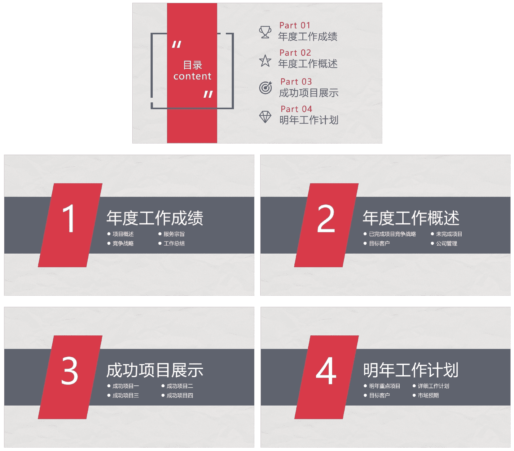

**2 单页逻辑被忽视**
整份演示的逻辑之外，单页逻辑更容易被忽视。单页逻辑决定听众能否快速理解。页面中的图片、图形、文字、颜色、大小、元素位置，都应服务于逻辑。例如中国部分财经图表中，红色代表盈利，与西方惯例相反，具体含义需以图例为准。

为保证无误，做每一页时可自问：该图形颜色是否有特殊含义？图表与文字互换位置会影响理解吗？配图能否强化页面表达？元素位置是否可以优化？

如右图所示，圆环按数据大小从左到右排列，数值递减、颜色由深变浅。阅读习惯自左向右，这样的设计能让听众迅速把握各分店销售库存排序。文字、图表、颜色、排版全部围绕同一逻辑主题。

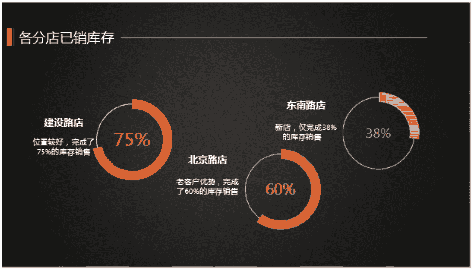

### 1.1.2 稳妥的逻辑梳理路径

演示逻辑可能是并列、递进、因果、包含等关系，对新手来说容易混淆。以下是一种去术语化的简单方法。

右图展示制作前的梳理思路。首先结合演讲目的、听众特征、场合等因素确定主题并收集支撑资料；其次整理资料，列出演示要讲的要点即提纲；最后细化提纲，明确每页内容。完成后要整体检查逻辑。

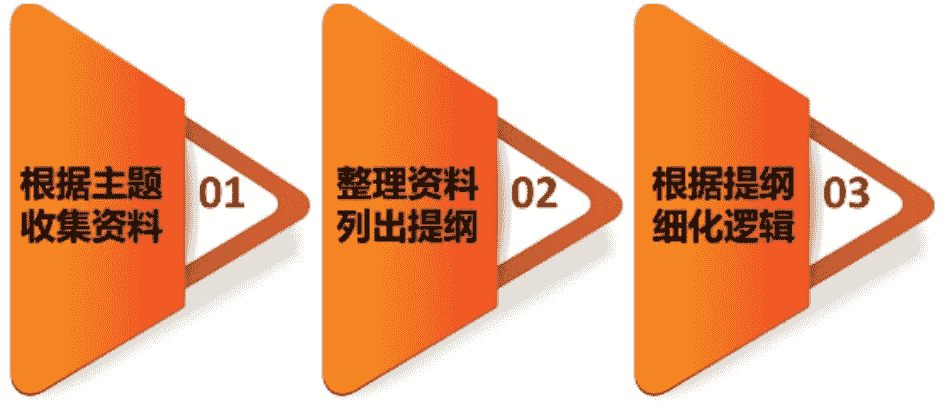

梳理时可用思维导图让逻辑更直观。例如要做一份面向投资的社群培训商务策划书，主题应围绕“这是一个靠谱且能赚钱的社群培训”展开。

下图为制作前的内容整理：围绕主题收集资料，筛选最具说服力的要点形成提纲。先讲行业现状与竞争分析吸引兴趣，再介绍公司展示优势，接着呈现营销计划体现方案完整，最后给出目标揭示利润点。提纲确定后，再细化具体内容。

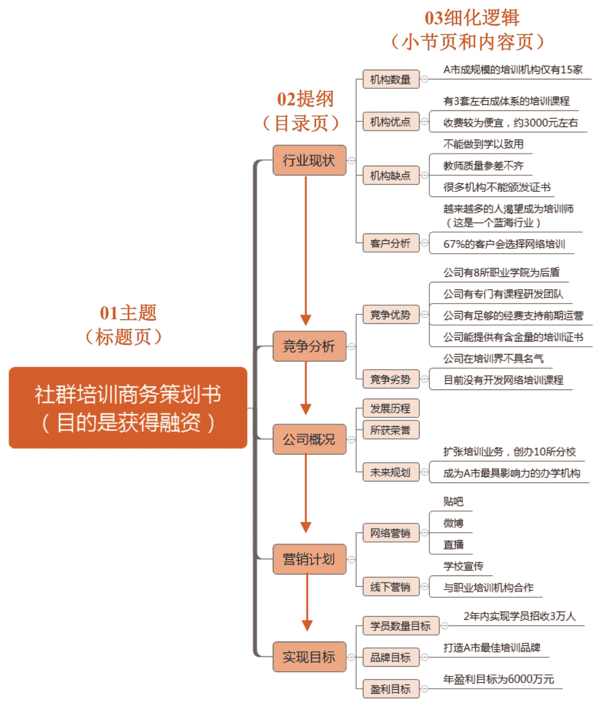

在思维导图中，主题相当于标题页，提纲相当于目录页，第一级内容相当于小节页，最后一级内容即每页幻灯片的具体内容。接下来只需把思维导图转化为图片、图表，成为逐页幻灯片。

### 1.1.3 四种经典结构要记住

演示内容关系多种多样，但万变不离其宗，最经典的是总分结构，其他结构均可由此演化。掌握经典结构，制作时才能胸有成竹。

**1 最基本的结构——总分**
演讲汇报通常是线性进行，同时只能呈现一个内容。因此把内容“打包”顺序呈现是演示最基础的逻辑。所有演示都可做成这种结构，只是可通过页面设计和演讲强调体现因果、递进、转折。

如右图所示，内容被打包成“目录 1”“目录 2”“目录 3”，“目录 1”下又包含“内容 1”“内容 2”。演讲时按顺序依次展开。

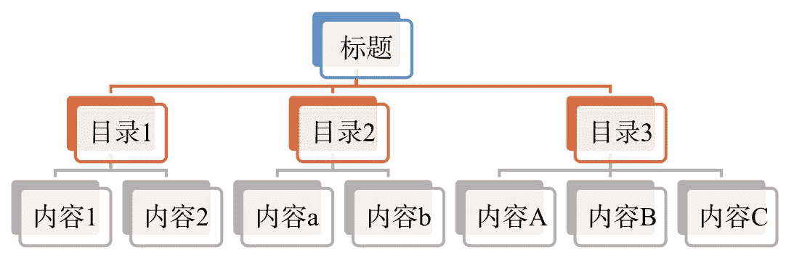

**2 并列**
上图也可视为并列关系。例如在职场文案写作培训演示中，“目录 1”“目录 2”“目录 3”分别对应“了解文案写作”“文案写作思路”“学会咬文嚼字”，三者相互独立。

**3 因果、递进**
在总分基础上，被打包的内容可能存在因果或递进关系，结构如右图所示。目录中箭头表示因果：因为人类行为导致环境受影响，进而产生环境污染。

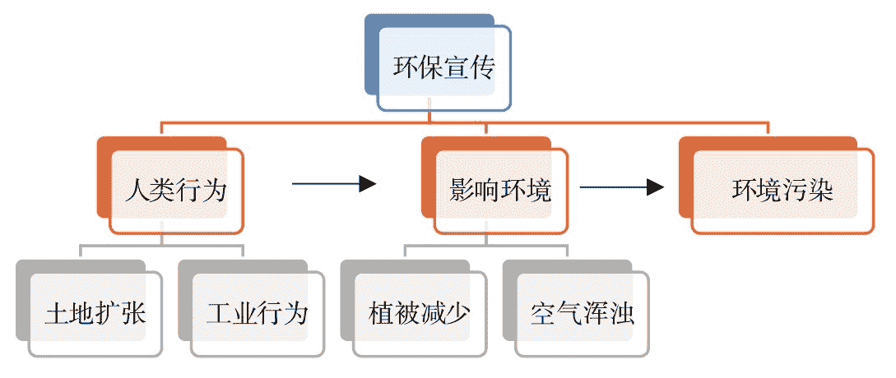

可为每个部分加一页强调因果关系。例如在“人类行为”部分最后一页写上“人类行为对环境造成了什么影响？”

**4 转折**
当内容间存在转折关系时，结构如下图所示，表示“过去产品因人们生活需求发生变化”。为强调转折，可在演讲到“人们的生活需求”时加重语气或手势。

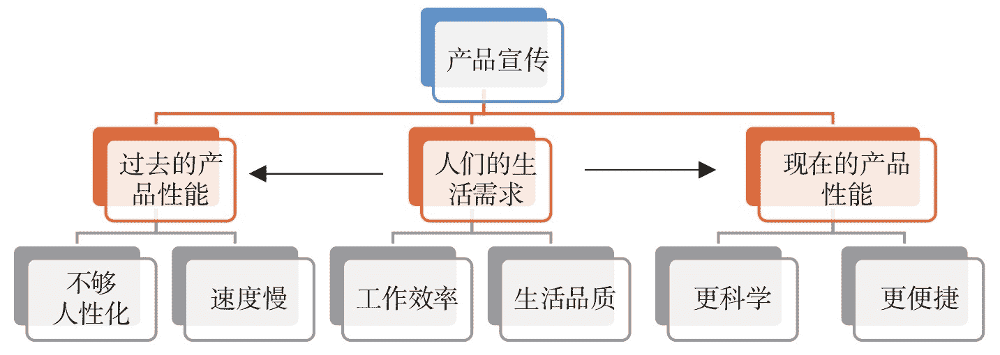

### 1.1.4 先有逻辑再谈排版

设计单页时正确顺序是：①梳理内容逻辑关系；②确定每页核心信息及其衔接；③再考虑如何排版美观。按此思路排版会更顺畅。下面是三种典型逻辑排版方式。

**1 表示关系对等的内容**
并列是常见页面逻辑，如“方法 1、方法 2、方法 3”。右图左为整理后的页面内容，四点并列关系只需平衡排列即可，可选的排列如右图右所示，黑点代表四个并列项。

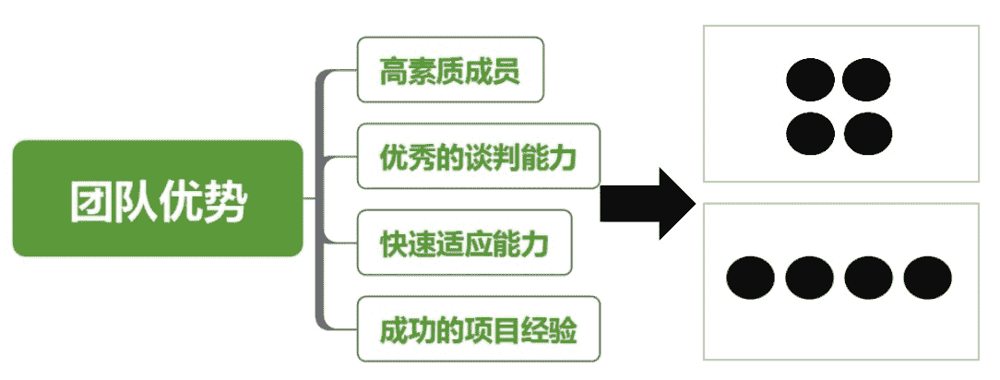

选择右上图第二种排列方式，配上图片即可完成页面，效果如下图所示。

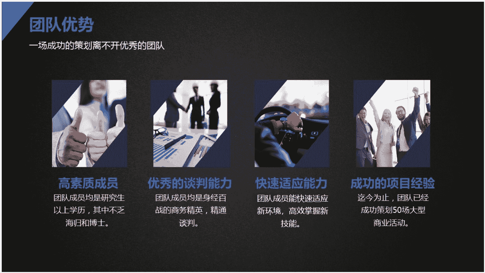

**2 表示关系变化的内容**
因果、递进、时间顺序属于变化关系，强调这类逻辑最有效的工具是箭头。下图展示的页面内容有时间先后顺序，只需按顺序排列并用箭头连接即可，可行排版如下图右所示三种。

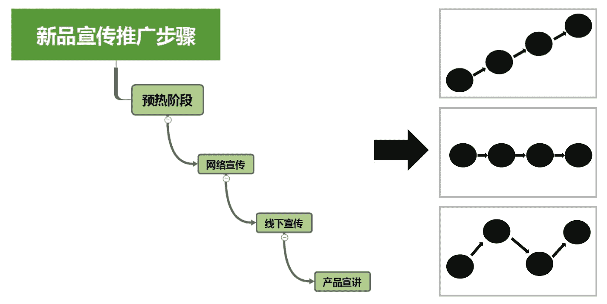

选定一种排版方式，加上美观背景图形即可完成，效果如下图所示。

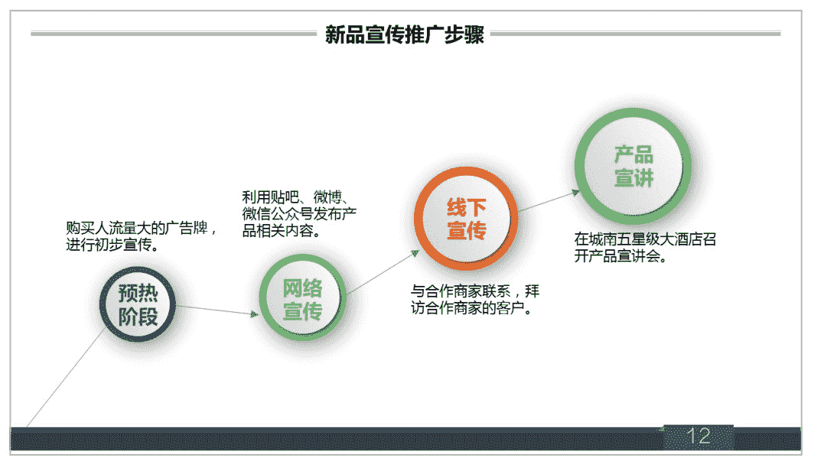

**3 表示关系对比的内容**
对比关系是将不同性质内容并置以突出差异，常通过颜色、大小对比实现。如下图左所示为整理的 4 点对比内容，有明确大小关系，可用大小或颜色变化体现。常用排版方法如下图右所示。

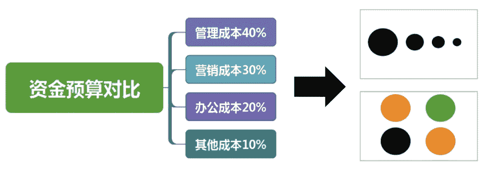

选择上图第二种排版方法，把代表不同内容的圆圈换成美观图形，效果如下图所示，一张资金预算对比页就完成了。

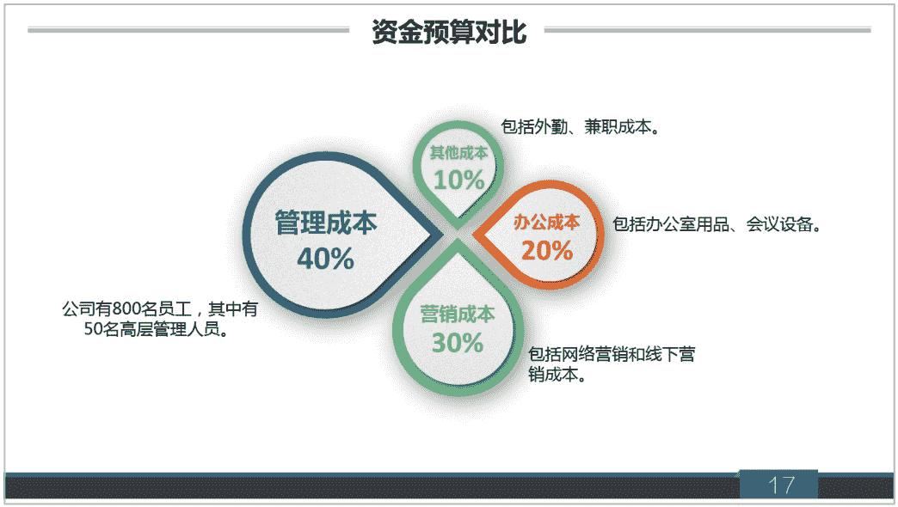

### 1.1.5 动画也要讲逻辑

演示动画分页面切换动画和页面内容动画。多数人用动画只为“酷炫”，选择凭感觉，越炫越好。

动画看似简单实为高阶玩法。新手若理解不深，易导致播放眼花缭乱，甚至破坏原意。

好钢用在刀刃上，下面拆解切换动画和内容动画的逻辑。

**1 切换动画**
切换动画指当前页到下一页的过渡效果。打开切换动画窗格，如下图所示，从名称即可推测效果。例如【风】就是页面被风吹走再呈现下一页的感觉。若名称不直观，可先预览，必要时点【预览】按钮查看效果。

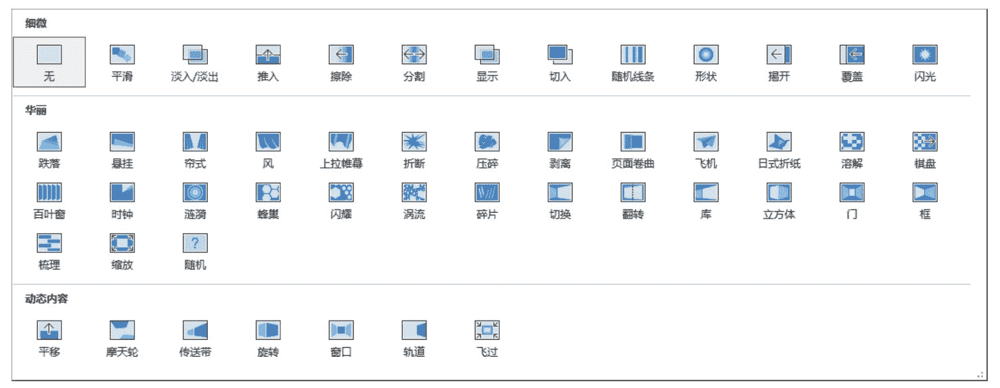

很多人滥用切换效果。其实无特殊表达时，可不用或选最简单的【淡出】。当内容有特定含义时，可借助动画强化逻辑，关键在于联想。

例如【涟漪】让人联想到水波纹，营造梦境、回忆氛围，因此适合在同学聚会中展示旧照，强调时光流逝。

又如【翻转】让人联想到事件反转、正反对比，可用来表现改进前后的差异。

如下图所示，这两页的切换可用【翻转】效果，形成强烈对比，冲击视觉，让听众感受到差异。

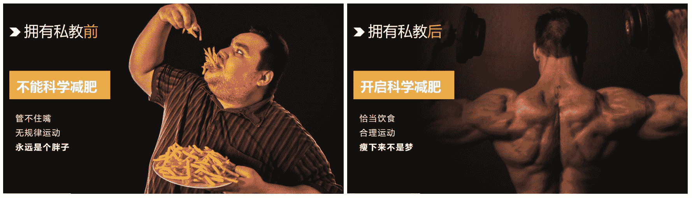

**2 内容动画**
PowerPoint 提供进入、强调、退出类动画，以及动作路径动画。字面意思即可理解其作用。路径动画可设置特定轨迹，触发动画可通过触发器控制播放。

把这些动画加到文字、图片、图形上，能让页面元素动起来。若无目的地乱加，会显得混乱。商务演示通常少用动画，保持正式专业；课件或广告类演示则多用动画提升趣味性。

添加动画前应思考目的。例如文字加【飞入】是为了让文字呈现飞入效果，符合逻辑；图片加【脉冲】强调是为了突出重点，引起注意，也符合逻辑。

### 高手自测 1

下面两张图分别是产品宣传演示的目录和其中一张内容页，是否存在逻辑问题？如果有，该如何修改？

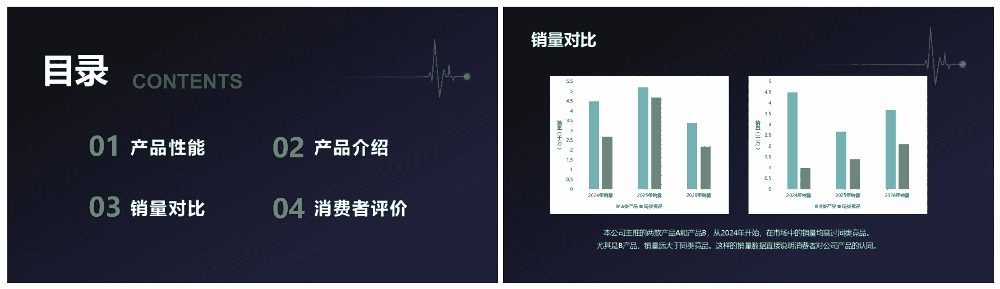

## 1.2 目的不清导致跑偏

不围绕目的做的页面很难达到预期效果。明确目的能防止内容跑偏，也能找到合适的展现方式。例如一份为招生的职业培训演示，核心目的应是“招生”而非“培训”。因此制作时不应以知识讲解为重点，而应突出公司培训实力。可通过学员人数、学员反馈等数据展现实力，知识讲解可留半截制造悬念，激发报名兴趣。

先定目标再定内容：用金字塔倒推 PPT 逻辑

做 PPT 先别急着排版，先想清楚为什么要做。用金字塔思维反向拆解——先锁定最终目的，再推导出达成目的必须具备的要素，最后才明确每项要素需要呈现的具体信息。思路理顺了，内容和呈现方式自然就不会散，可参考右图。

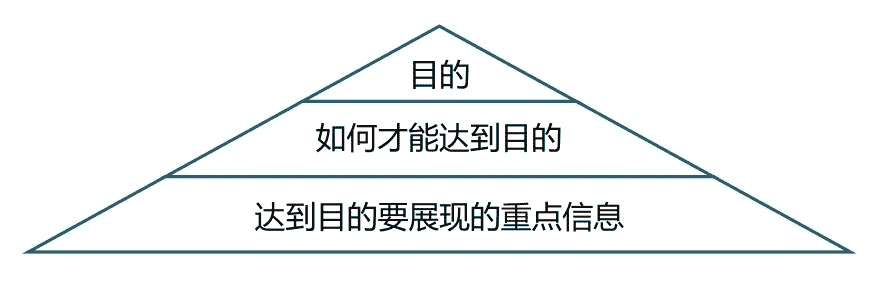

### 1.2.1 项目汇报篇

以拿下项目为目标，沿着金字塔从上往下拆，推导链条是这样的。

最顶层的需求是赢单。要赢单，就得先满足客户要什么。满足需求之前必须先做功课：调研出对方的需求、痛点，再给出对应的解决方案。结论部分要用数据等硬证据证明自身能力，并用过往成功的案例背书，示意图可见右侧。

有了这套逆向推导，项目 PPT 的骨架就出来了，具体框架见下图。有了框架，制作时就不容易发散，比如不会为了塞进一个听起来很厉害的管理大师激励法而跑题。

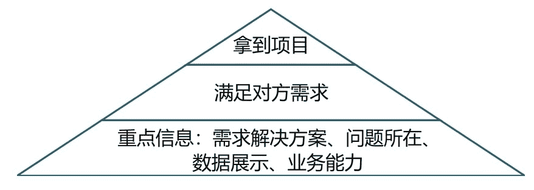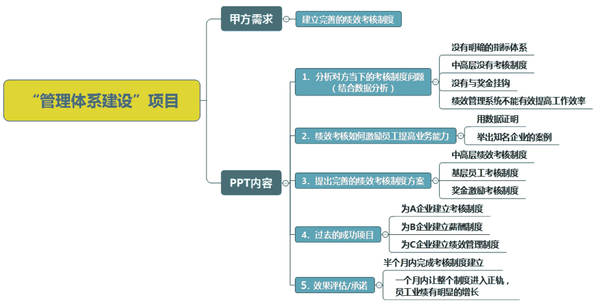

### 1.2.2 培训授课篇

培训类 PPT 用得非常普遍，推导思路见下图。核心目标是帮助学员真正学会。学会的前提是内容好玩又好懂，简单说就是既有趣又有条理。想有趣，就要图文并茂、适时加入视频演示；想有条理，就用总分结构把知识归类，分成若干小节推进。每节讲完先把要点高亮，再安排一个小思考题，帮学员即时复盘，提升吸收效率。

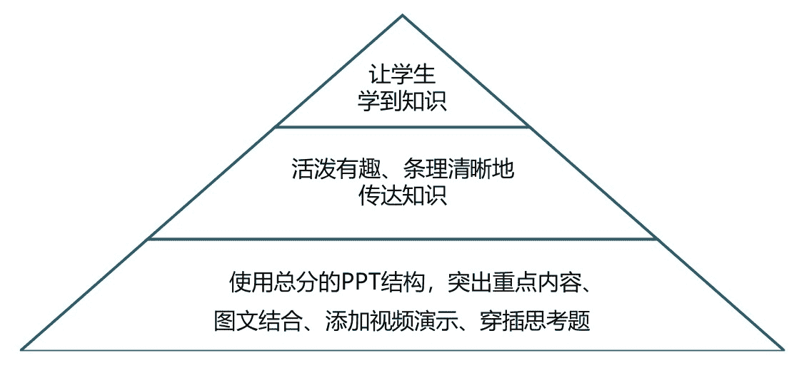

### 1.2.3 简历投递篇

随便套个 Word 模板，等于告诉 HR 我对自己都不上心。这样的人怎么让人家愿意多看一眼？现在不少人改用 PPT 做简历，风头正劲。但光做得炫酷像设计大片就能加分吗？不行，得先搞明白 HR 真正在找什么。推导图在右侧。拿到 offer 是最终目的，前提是先抓住 HR 眼球并让对方认可你的胜任力。而胜任力的依据就是与岗位要求匹配。凡是 HR 不在意的就别硬塞，为了凑页数乱加内容只会适得其反。

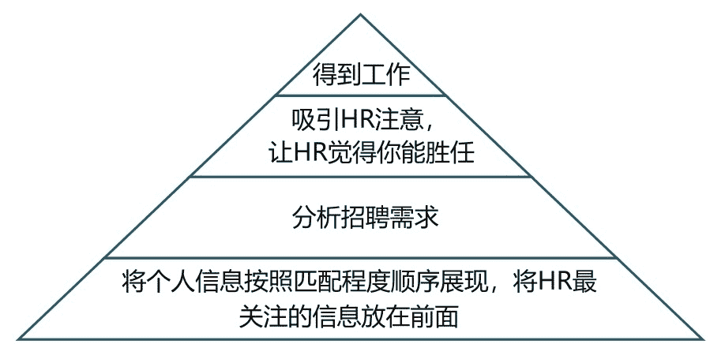

按金字塔梳理，简历 PPT 的要点一目了然，见下图。整份材料都在回答同一件事：我能胜任。排序也是围绕 HR 的阅读习惯安排。比如教育背景常后置，是因为不少人的专业和岗位对不上，容易先被刷掉；只有专业高度契合时才值得前置。联系方式放到最后也是同理，HR 先看经验和技能是否够格，确认后再决定是否联络。还没建立起能力信任前，少放无关信息最稳妥。

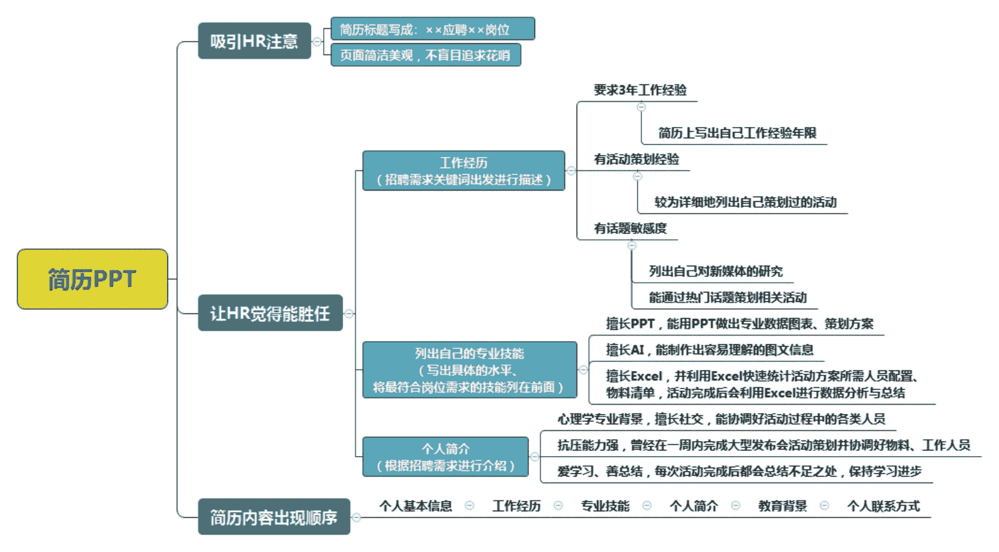

### 1.2.4 产品宣传篇

做宣传类 PPT，归根结底是让观众认识品牌、产品或活动，进而产生合作、购买或参与的意愿。以介绍产品为例，思路的层级关系如下图所示。

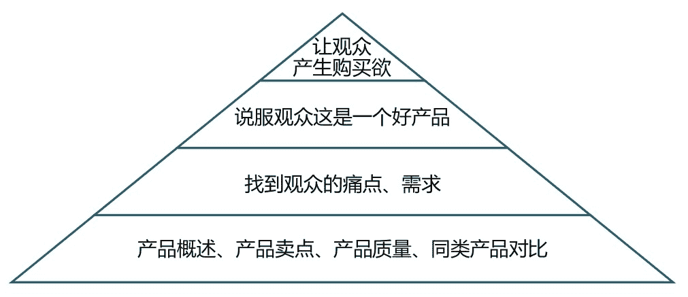

分析下来，宣传 PPT 的核心就是精准踩住观众的痛点和需求，再对症展示卖点。比如足浴盆，核心顾虑是健康问题，于是要重点呈现按摩保健的功效；同时消费者也在意安全，所以防漏电等设计也必须明确突出。

怎么挖出最打动人的痛点？一个办法是拆解产品的用途、原理、材质，推导出用户可能在意的点，见下图。另一个办法是去电商平台看同款卖得好的商品都在强调什么卖点，哪些功能没人提，基本就是用户无感的，可以省去。定价时也可以参考同价位销量冠军的文案风格，爆款的描述方式往往藏着用户偏好。

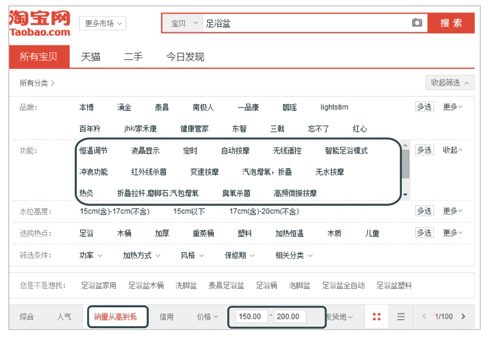

### 高手自测 2

做工作汇报 PPT，如何通过分析目的找到制作方向？

## 1.3 忽略观众，再美的 PPT 也打动不了人

观众要的是苹果，你送再甜的草莓也没用，哪怕是天价。PPT 能否打动人，关键就卡在是否先读懂了观众。

### 1.3.1 用心理学抓住观众心智

为什么别人的推广 PPT 一放就抓人？为什么别人的课件能收获满堂掌声？靠的不是玄学，是对情绪的精准拿捏。先摸清目标人群的心理触发点，内容才能顺着心门进去。

观众心理千差万别，PPT 制作时抓住两三条最典型的就够了，提升感很明显。如图所示，针对青少年做推广，就可以用自我表达和共鸣这两条心理，主打个性化来拉近距离。

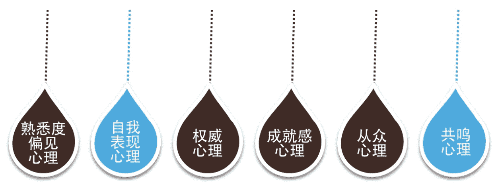

说到底，熟悉常见心理才能精准命中需求。下面拆解几类在 PPT 中最常用的心理。

**1 熟悉度偏见心理**

人天然更信任自己熟悉的东西。PPT 里适当植入观众熟悉的元素，信任感和亲切感会迅速建立起来。

案例：①到 A 市做文创推广，PPT 里放 A 市的景点和特色文化，本地观众更容易信赖；②新品 B 面世，用户不熟，但老品 C 熟悉，通过类比 B 与 C，让用户快速建立认知；③面向全职妈妈推广，多用家庭场景图，而非职场图。

**2 自我表现心理**

自我表现心理就是观众喜欢那些能凸显个人独特性的内容，比如个性服装、定制产品，看到就会有被满足感。

这条心理常用在青少年或强调个性化的产品上。例如右侧的婚礼方案 PPT，没用常见的精修大图，而是手绘插画加手写字体，全程在传递“这是一场为你定制的个性婚礼”。

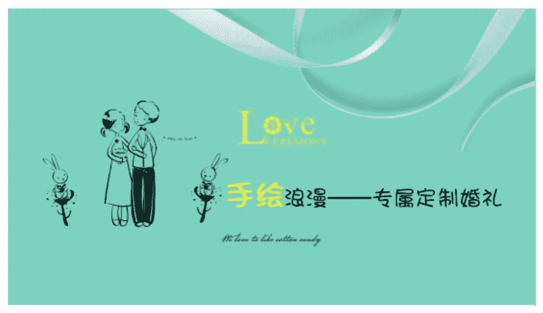

**3 权威心理**

权威心理即权威效应，人们倾向于信任地位高、有威信或有成功经历的人，因此常被用在培训场景。例如课程开头展示讲师头衔和成功案例，利用权威效应快速建立信任。

该心理常见于培训课件、调研报告、发布会 PPT。

**4 成就感心理**

人们内心都有想通过努力实现的自我提升欲望，这就是成就感心理。使用时要把握尺度，成功太遥远不切实际会产生挫败感。比如职业培训若举比尔·盖茨为典范，学员会觉得自己永远达不到，从而失去兴趣。

成就感心理常用在培训类、商务提案类、自我实现类产品 PPT 中，通过可实现的目标刺激参与欲。如图所示的页面就用可达成的职场成功来激励学员报名培训。

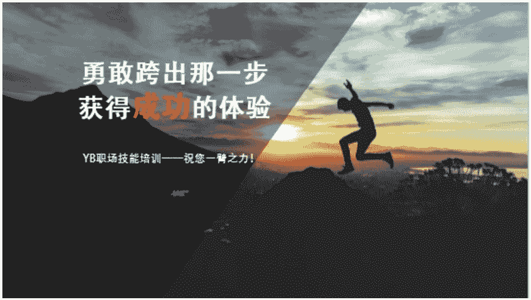

**5 从众心理**

群体中的个体渴望与大众保持一致，这就是从众心理。它能触发“大家都在用应该没问题”“不参与就落后”的冲动。

通常用在产品推广、活动宣传 PPT 上，通过配图和文案刺激，比如用可视化数据告诉观众有多少人已购买。

**6 共鸣心理**

共鸣心理是通过画面和文案让观众产生强烈认同。新鲜时尚搞笑的内容容易引起青少年共鸣；对家庭付出、职场与家庭平衡的描述会触动母亲群体；身体不适、对亲情的渴望会打动老年人；旧照片老物件会唤起怀旧人士情绪。

共鸣心理适用于各类 PPT，做法是呈现目标观众关注的焦点事物。如图所示的 90 后减压产品页面，点出了就业压力、生活压力、住房压力，直击共鸣点。

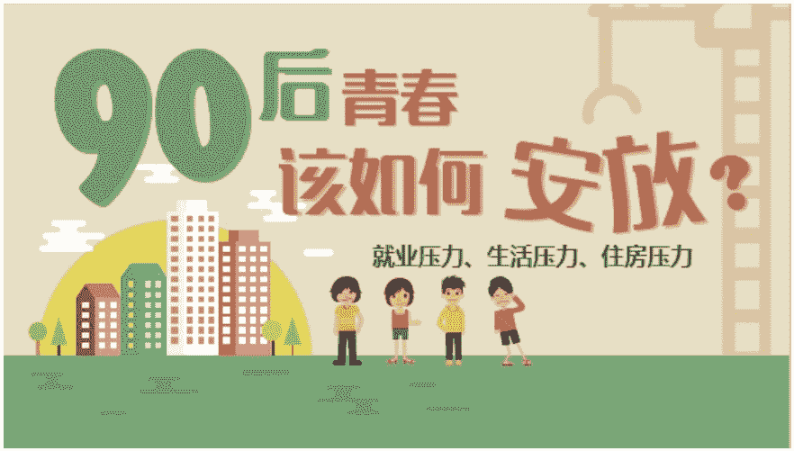

**7 相关心理**

相关心理与共鸣相近，指观众只关注与自己有关的信息，对无关信息无感。

应用很广，可以通过呈现相关信息抓住注意力。例如向某公司推项目，重心应放在项目对该公司的影响，而不是空谈项目多好；介绍产品卖点时，先思考产品与目标用户的工作生活有什么关联、最大作用是什么；向单身青年推西餐礼仪课，可抓住“优雅举止能赢得异性好感”这一关联点，设计如图所示页面，让观众不再置身事外。

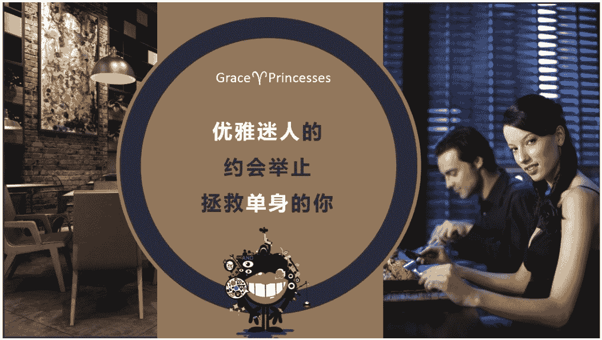

### 1.3.2 文化背景决定接受方式

符合观众认知偏好和价值取向的内容更容易被接受。文化背景深刻影响观念，地域、教育背景不同，看待问题的方式就不一样。

**1 地域层面**

一方水土养一方人，环境、人文、经济水平不同，性格和偏好也不同。考虑地域能让 PPT 更对味。例如西方强调个人主义，东方更看重集体与家庭。

做 PPT 时要想清观众来自哪个国家或地区，当地人的价值观、喜爱的色彩、禁忌是什么。两张训练营宣传图，左图强调自我突破，右图强调家庭期望，正是针对不同文化背景的差异化表达。

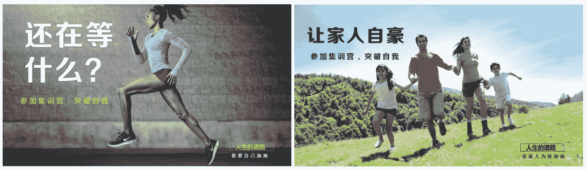

**2 文化教育层面**

面向小学生和大学生的宣传，文字表述和配图肯定不一样，因为内容要贴合认知水平。从观众的教育程度出发，用其能看懂的方式表达，能大幅提升信息传达效率，也更容易记住。

如图所示，职场人士的礼仪培训页与小学生礼仪培训页，文案和配图风格截然不同。

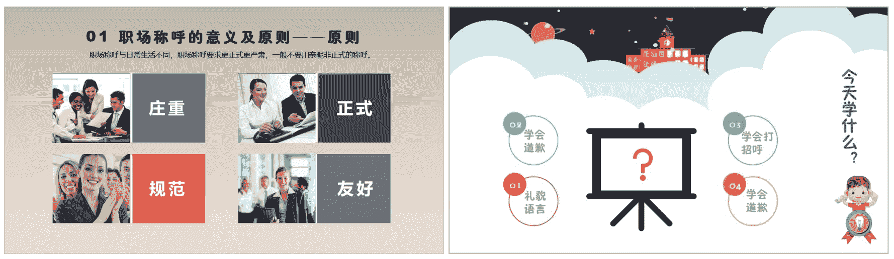

### 1.3.3 年龄不同，审美偏好不同

年龄差异带来颜色、风格、表述偏好的差异。总的来说，年龄越小，越喜欢鲜艳活泼、动画多、有趣的描述；年龄越大，越偏爱深沉简洁、稳重、动画少、理性表达的页面。

例如面向中年人的 PPT，可选藏青、灰、黑为主色调，多用数据、调研报告这类理性论据，少用动画，用严谨的内容说服人。如图所示的一页理性风格页面，对中年男性颇具说服力。

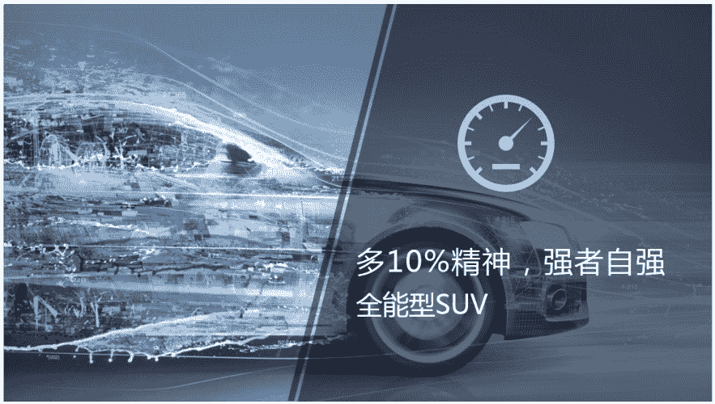

### 高手自测 3

如果要向中年男性宣传新产品，可以从哪些方向考虑 PPT 的内容？

## 1.4 PPT 卡壳，多半是技能没补上

学了排版要整齐、数据用图表、图片要用好的理念，打开 PowerPoint 却卡住了：图怎么对不齐？图表数据不按预期显示？图片模糊怎么办？原来制作不是简单堆文字图片，必备技能一个都不能少。下面先做个初步盘点，心里有数。

### 1.4.1 排版靠技巧，不靠手感

新手做排版就是把文字图片放上去凭感觉挪位置。高手会用参考线、网格线、标尺、对齐功能，甚至插件来精准定位。掌握科学方法而不是靠感觉，是分水岭。

**1 开启参考线和网格线**

在【视图】选项卡中勾选【网格线】和【参考线】，移动对象时就有统一参照。效果如图所示，水平和垂直参考线能精准定位。选中对象后，也可通过【设计工具】任务窗格里的【参考线布局】快速对齐。

PowerPoint 还提供智能参考线，拖动对象时会弹出红色虚线，提示与周边元素的对齐关系。如图所示，移动文本框时虚线显示其与左侧图片顶端、右上角图形左边的对齐状态。开启方法是右键菜单→【网格线和参考线】→勾选【智能参考线】。

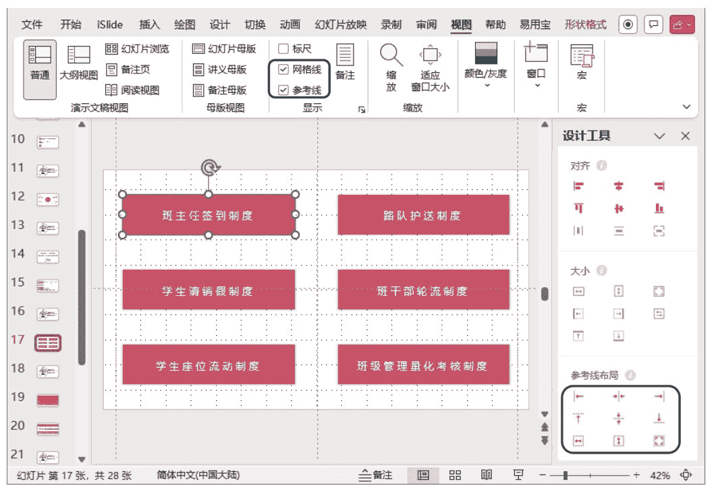
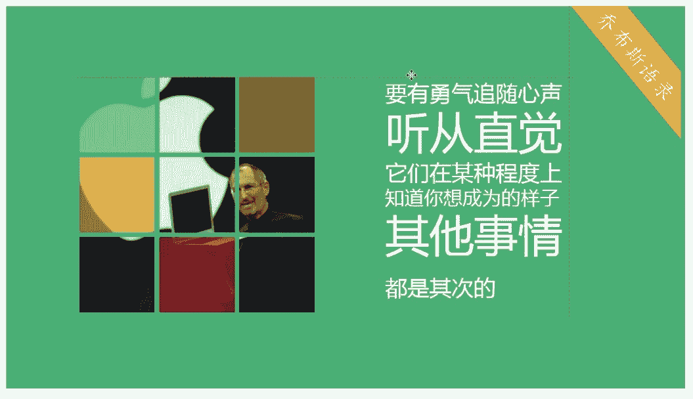

**2 使用标尺排版**

标尺主要服务文字对齐。在【视图】选项卡勾选【标尺】，水平和垂直标尺就会出现，拖动标尺可微调文字位置。

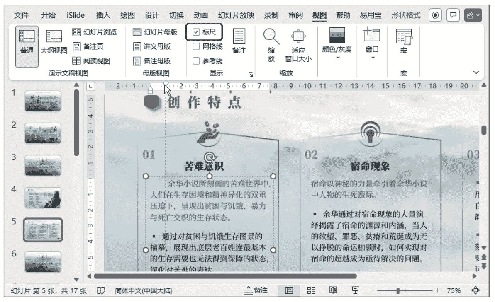

**3 使用对齐功能排版**

想让元素顶端对齐、左对齐、间距相等？用对齐功能。如图所示，选中多个对象后点【对齐】下拉菜单，选择对应方式即可整齐排列。选择【横向分布】或【纵向分布】还能让间距一致。也可以在【设计工具】任务窗格的【对齐】栏中快速操作。

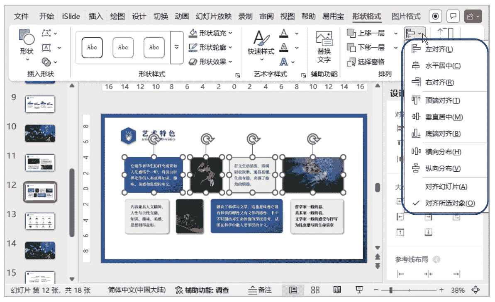

**4 使用插件排版**

自带功能满足常规需求，创意排版往往需要插件。很多插件带排版功能，如图所示，iSlide 的【环形布局】可设置参数把对象排成环形。

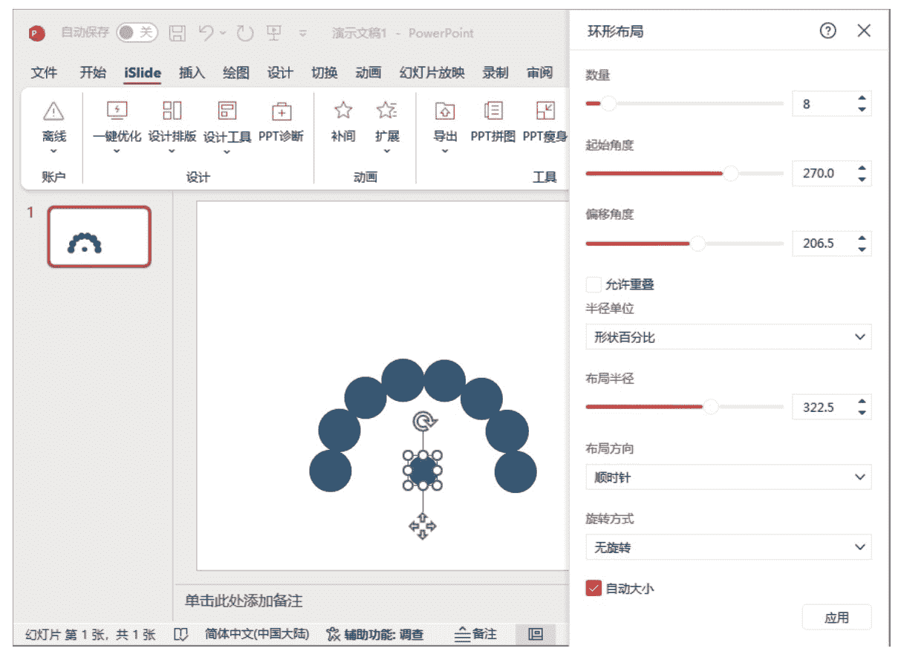

### 1.4.2 内容决定形式，选对表达工具

表现团队力量是一句话更有效还是一张图？一组数据用文本框、表格还是图表呈现？选对形式是 PPT 出彩的关键。

幻灯片里可插入多种对象，如图所示，【插入】选项下有表格、图片、图标、图表等。但什么场景用什么、插入后怎么编辑才能准确传达含义，是制作时必须思考的两个问题。只有理解不同对象并学会编辑，才能做出抓眼球的页面。

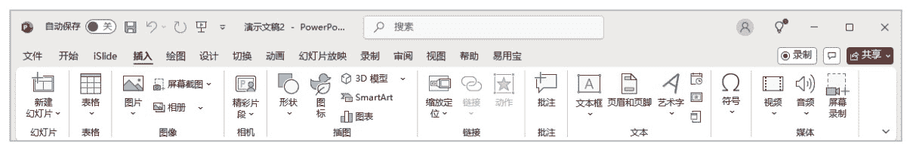

在幻灯片中插入并编辑不同对象是制作重点，如图所示，是常用对象的作用与操作要点。

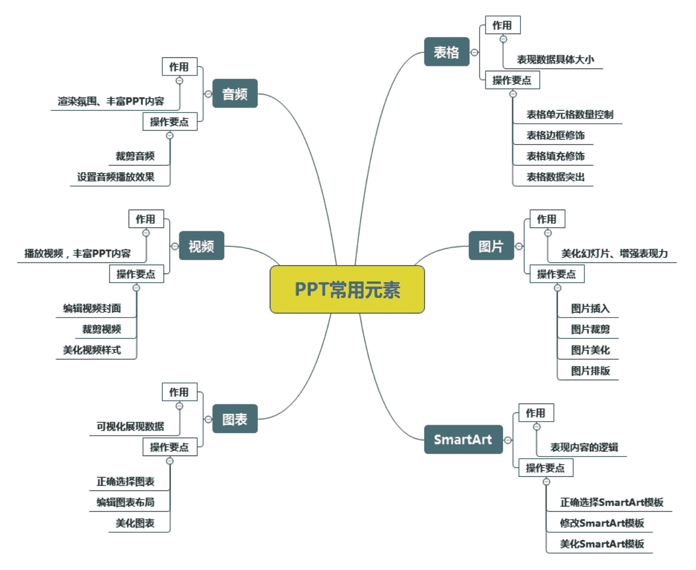

### 1.4.3 非设计出身也能做出专业感

做出专业级 PPT 不是设计师专属，普通人掌握方法也能做到。提升美观度可通过参考优秀作品、用网络工具和 PowerPoint 自带工具调色，也可通过找好素材优化视觉。

**1 参照优秀作品**

“站在巨人肩膀上”同样适用于 PPT。新手没设计基础，找优秀案例参照就能大幅提升水准。参照物包括 PPT 模板、设计网站的海报和文案。关键是选对专业网站和优质案例，具体方法将在 2.1 节展开。

**2 快速配色**

颜色是第一信息，配色好坏决定设计水准。对非美术专业的人来说配色难，但软件和网络工具提供了方便功能。

如图所示，先在配色网站截取优秀配色到幻灯片，再用【取色器】吸取颜色，就能实现快速专业配色。

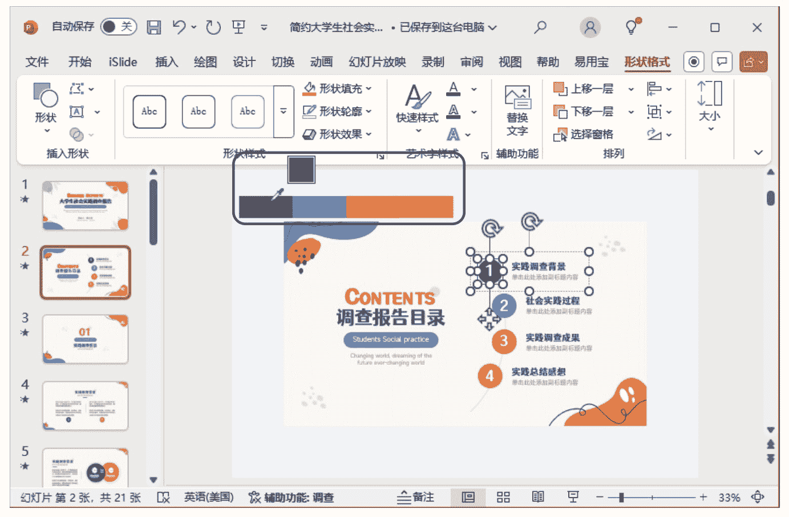

**3 使用好的素材**

素材用得好，既省时又提质。PPT 素材包含图片、表格、图标、逻辑图、音频、视频等，不同类型有不同获取渠道。找到后要会处理和归档，才能发挥最大价值。

以图片举例，表达理想，有人搜“理想”，有人搜“雄狮”，思路不同结果差异很大。面对大量搜索结果，学会筛选能大幅提升效率，如图所示。

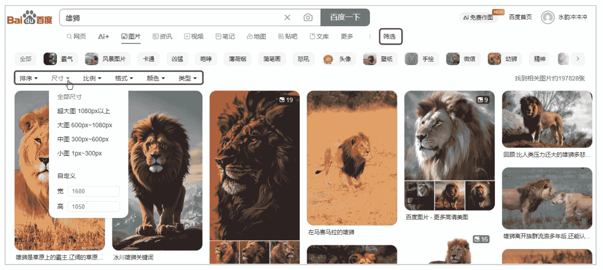

### 1.4.4 AI 辅助，让 PPT 制作事半功倍

## AI 全链路提效：从构思到成稿一步到位

在生成式 AI 支持下，演示文稿的策划、填充与视觉定稿各环节都能获得明显提速。以下以 DeepSeek 与 WPS AI 为主线，梳理从骨架搭建到画面优化的实用路径，助力非专业用户也能产出对标专业的水准。

**1 DeepSeek 负责构建思路框架**

思路不清晰通常是演示拿不到好评的主因。DeepSeek 提供自然对话式大纲生成：输入主题词如“智能家居新品发布大纲”，系统会解析逻辑脉络，输出包含封面、目录及市场分析、亮点介绍、案例分享等章节的结构，并标注每部分的要点，如下图所示节选。

若某章节冗余或缺位，模型还会给出改进建议，例如补增数据对比页或调整过渡顺序。生成后可一键导出到 PowerPoint，再补充细节即可，避免传统手写边改的低效模式。对逻辑薄弱或时间紧张的职场新人尤其友好，十分钟内可完成原本两小时的手工梳理。

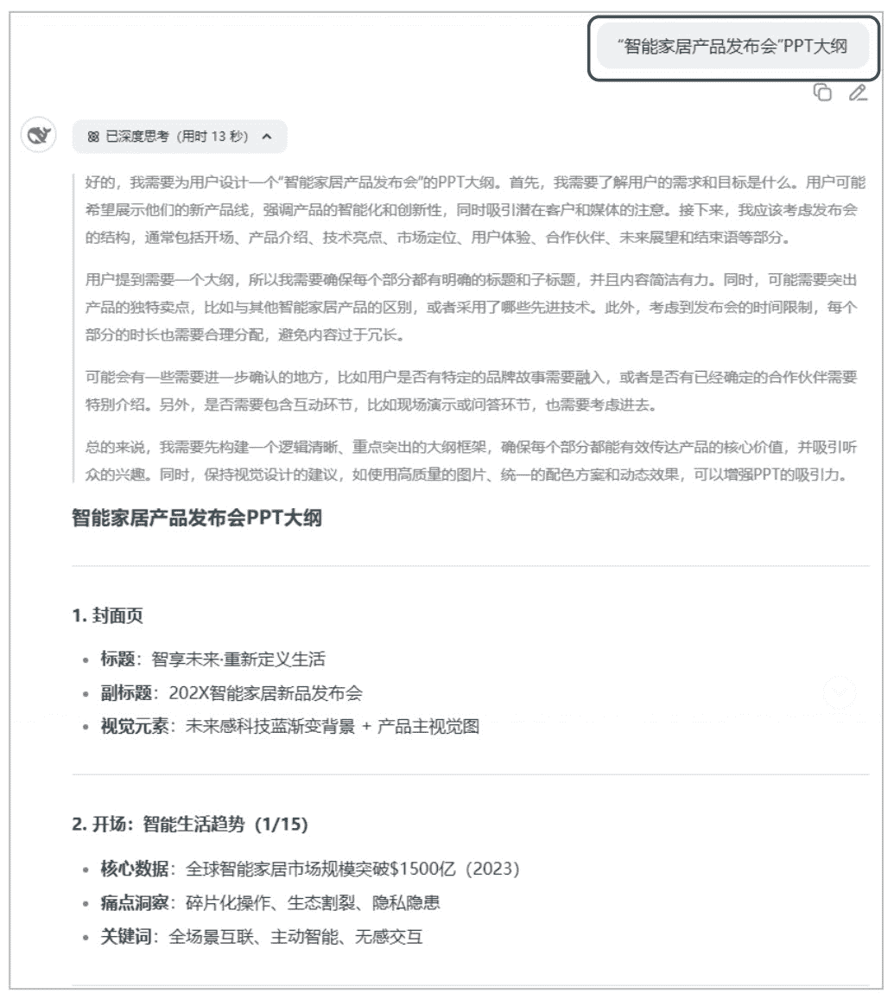

**2 WPS AI 一键产出可编辑初稿**

缺乏设计经验时，WPS AI 的自动成稿能力可快速拿到可用初稿。在演示中选择【AI 生成 PPT】，输入核心主题如“新能源汽车行业研究报告”并指定风格偏好如商务、科技、简约，系统会自动匹配模板并生成 15～30 页完整初稿，涵盖封面、目录、图表页、总结页等。举例输入“大学生创业计划书”，即可得到执行摘要、项目背景、产品服务体系、市场分析、营销方案、财务规划等页面，同时自动插入形状、配图、表格及数据可视化图表，如右图及下图所示。后续可局部改文案、换图或增删页，降低从零开始的门槛。该能力尤其适合临时汇报、答辩等紧急场景，也能让非设计人员产出视觉规范的演示稿。

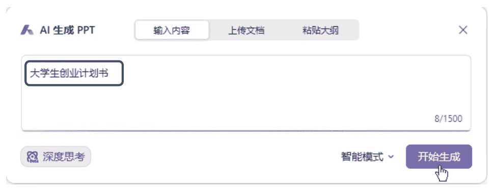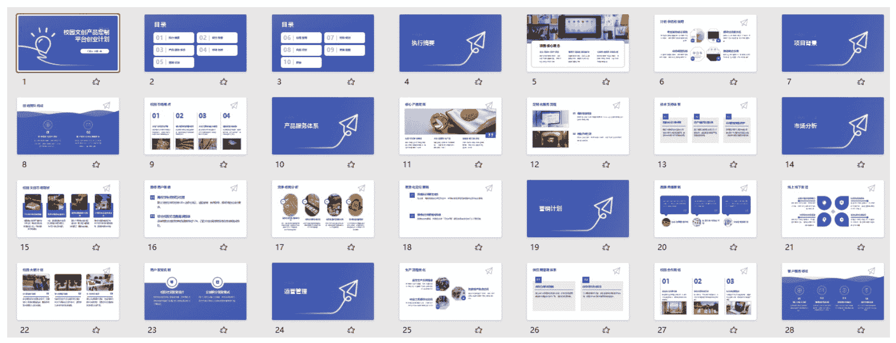

**3 版面与配色的智能优化**

杂乱排版与冲突配色是显廉价感的常见原因。DeepSeek 能依据主题与使用场景给出兼顾版权安全的字体搭配建议，也可按行业调性如医疗蓝、教育绿、科技紫，或关键词如活力、沉稳生成协调配色方案；上传文件后还能自动评估文字、图片、图表的视觉权重，推荐对称式、焦点式或卡片式布局。WPS 演示内部同样支持页面快速排布、配色与字体方案切换，如下图所示。

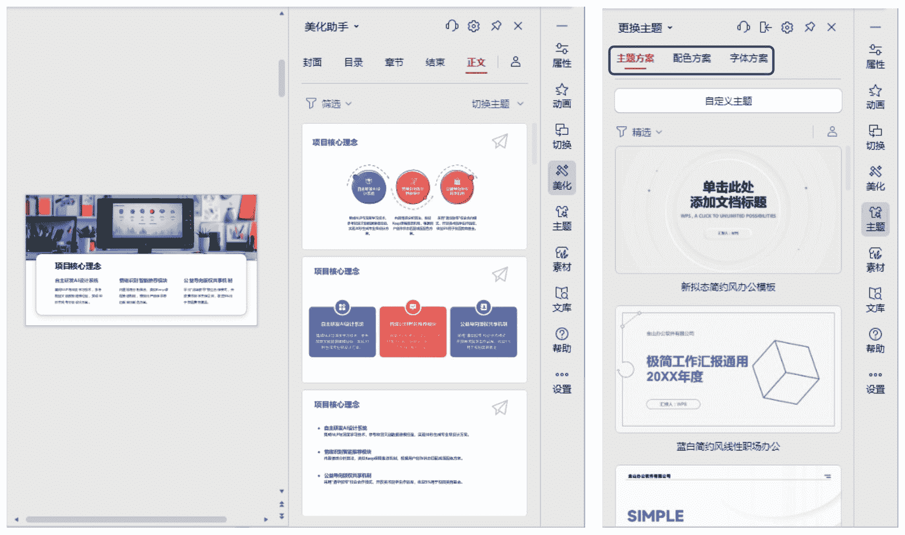

**4 快速获取适配的演示素材**

制作演示时，高质量素材搜集常耗时费力，AI 工具大幅缓解这一痛点。以即梦为例，其素材库覆盖图像、短视频、数字人等多种形态，显著降低原创成本，如下图所示。

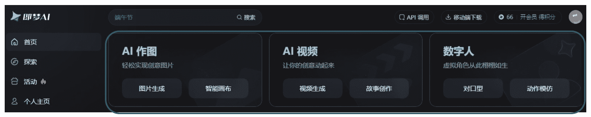

做产品宣传时，可用即梦的文生图输入描述如“未来感智能手表悬浮于星空”，系统会生成 4K 清晰的产品场景，并支持光影、透视角度微调，以适配不同页面风格；面对缺少实拍素材的页面，其视频生成可基于关键词如“数据流动特效”“科技粒子背景”快速产出 5～10 秒动态片段，直接嵌入演示作为转场或底图。此外，即梦的数字人讲解功能突出：上传讲稿后，系统自动创建虚拟主播，支持形象、服装、动作定制，并同步生成带口型同步的配音，适用于发布会、培训等场景。例如输入“新能源汽车性能解读”，数字人即可以专业口播配合 3D 车型拆解动画，让演示从静态页面升级为沉浸体验。

### **高手自测 4**
幻灯片需呈现公司 12 个月业绩走势，应选用哪类可视化形式，原因是什么？

## **高手神器 1 用智能工具自动诊断并优化结构排版**

演示成败的关键在于逻辑与视觉，而国内 AI 产品的深度融合已把手动调校转为智能优化。

Kimi PPT 助手的智能诊断可深入解析稿件的逻辑问题。上传文件或讲稿后，指令“标注逻辑漏洞并输出优化建议报告”，系统会自动标出如章节断层、重点缺失等问题，并生成改进报告。例如产品介绍页若缺少用户痛点分析，Kimi 会建议新增“需求场景”模块并自动调整目录层级。下图所示为 Kimi 对“采购谈判技巧培训”演示分析后的建议报告节选，报告末尾提供【一键生成 PPT】按钮，点击后可基于上传内容与建议重新生成逻辑更清晰、信息更系统的演示，提升培训效果与观众学习体验。

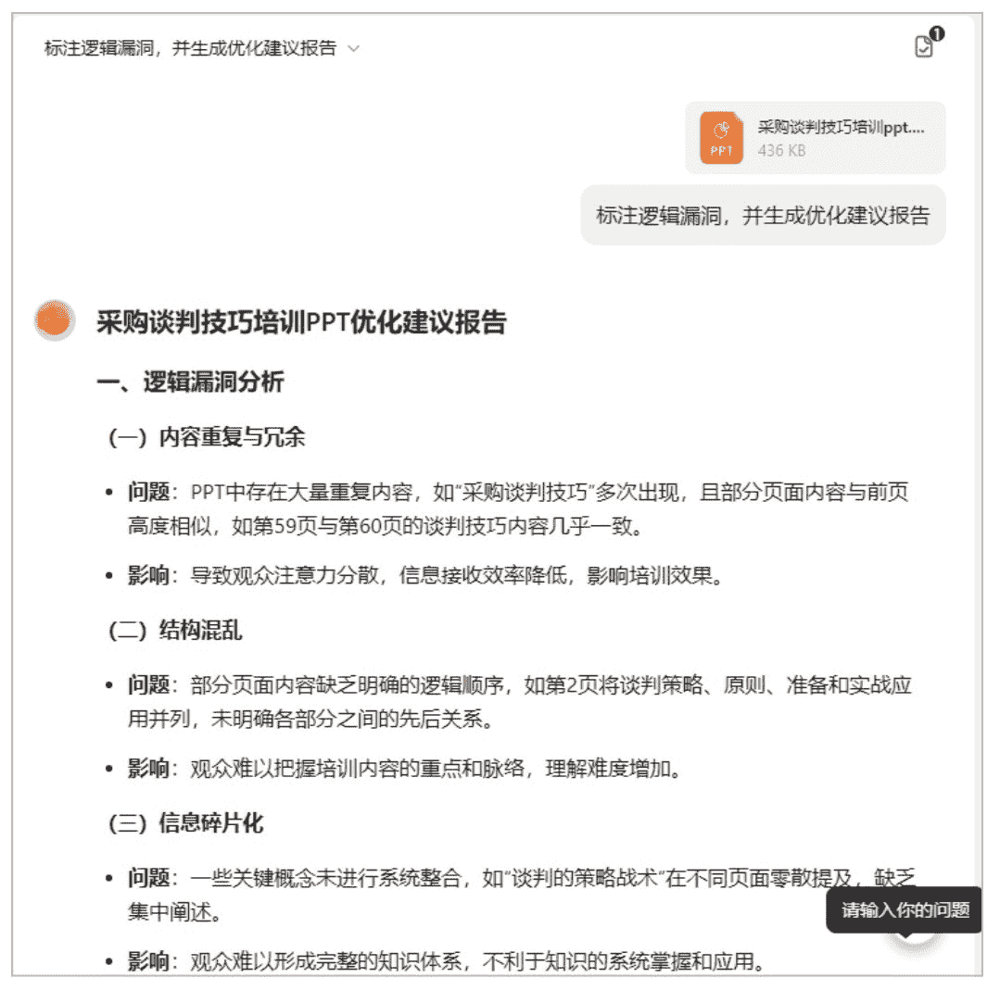

与 Kimi 类似的工具还有很多。例如橙篇擅长将文字转化为结构化视觉且细节处理精细；爱设计专注提供丰富的视觉模板与素材，能迅速提升演示观感。

追求效率的用户可先用 Kimi 优化逻辑，再用橙篇生成初稿；内容创作者则可先用 DeepSeek 输出 Markdown 大纲，再导入爱设计完成视觉升级。不同工具组合可满足制作过程中的多样化需求，提升工作效率与内容质量。

# **第二章**
# **高手在做 PPT 前都做了哪些准备**

在效率优先的时代，提前准备是聪明做法。非设计背景的人想快速完成专业级演示，关键在于制作前的积累。

高手作品基本由精美图片、表达清晰的逻辑图、风格统一的图标构成。若在日常浏览时通过特定渠道提前收集这些元素，制作时直接调用，效率会大幅提升。

**本章先思考**

1 设计演示文稿前，提前准备内容有什么好处？该如何准备？
2 模板质量对演示效果有何影响？
3 为什么高手演示的字体总是显得好看？
4 什么类型图片会拉低演示质量？
5 演示中表达并列、递进等关系的图形是什么？能否提前收集为素材？

## **2.1 时间不够，模板来凑**
方案截止临近，演示未动工；灵感匮乏，设计思路难寻……制作演示常遇到阻碍。学会使用模板，灵感与效率问题都能迎刃而解。

### **2.1.1 找到优秀模板的渠道**
记住一条原则——永远把重心放在模板质量而非数量上。优秀模板如同导师，将精心设计呈现眼前供你借鉴；而设计水平低的模板不仅影响审美，还可能限制使用者设计水平的提升。对比劣质模板与优秀模板可发现，优秀模板在配色、插图、排版风格上高度统一，使用者更易被优秀品质熏陶。

如下图所示，前者是质量低劣的模板，后者是配色、版式设计统一的模板，使用后者自然更容易做出高质量演示。

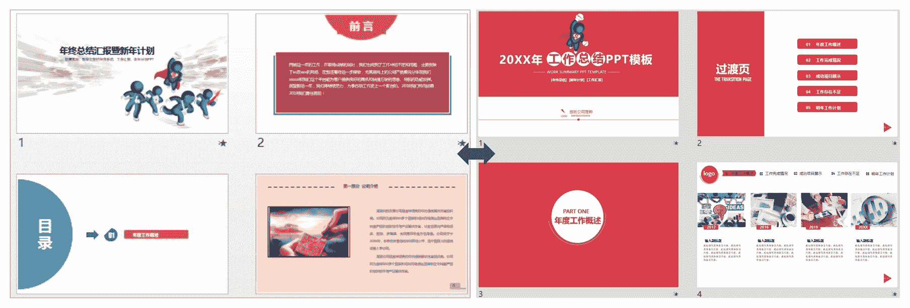

**1 微软 OfficePLUS**
首推微软官方模板网站 OfficePLUS。通过该渠道获取的模板包含幻灯片单页、SmartArt 图和图表设计，且几乎不会出现格式错误，并会依据流行软件版本和尺寸提供优质模板。

如下图所示，幻灯片模板界面可通过行业、文档类型、主色调进行筛选，快速定位所需模板。

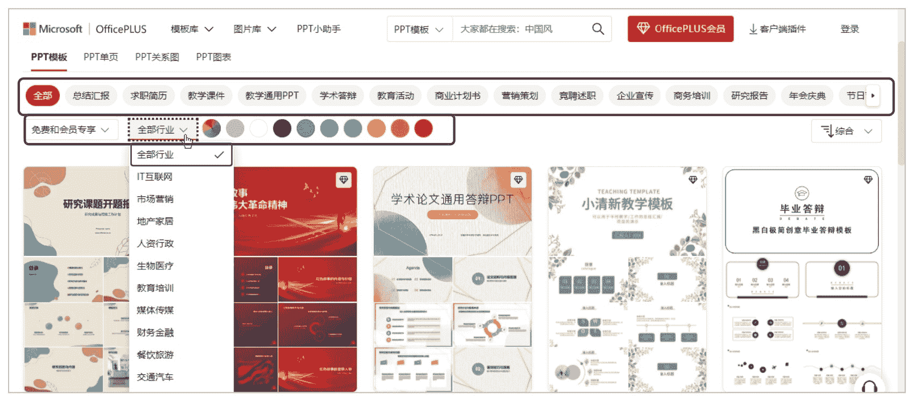

**2 WPS 稻壳**
WPS 稻壳是 WPS Office 内置的模板库。进入 WPS Office 界面单击【找稻壳模板】，打开【来稻壳 找模板】窗口后切换【演示】标签，即可看到海量幻灯片模板资源，如下图所示。这些模板主题与风格丰富，顶部还支持按分类、场景、用途、风格、颜色筛选。稻壳模板的优势在于与 WPS 软件无缝集成，可在不离开软件界面的情况下搜索、下载和使用，极大提升效率。

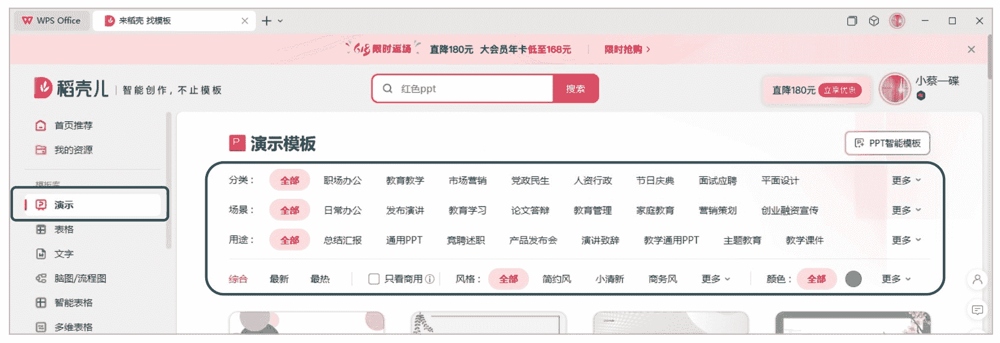

**3 第 1PPT**
若想做更精美的商务演示，可使用第 1PPT。这里不仅有不同类型与行业的模板，还能找到幻灯片背景素材、图表素材、逻辑图素材，类型十分丰富，如下图所示。

**4 演界网**
演界网提供不同场景、行业、风格的模板及定制服务，模板分为免费与付费，是一个可找到高质量幻灯片模板的网站，如下图所示。

**5 优品 PPT**
优品 PPT 是一个分享高质量模板的站点，除模板外还提供图表、背景图片、字体及幻灯片教程等制作所需素材，如下图所示。

### **2.1.2 会用模板，才算真正掌握**
与其囤积无数模板，不如精通其一。滥用模板只会让演示显得杂乱，掌握删除、替换、修改技巧才能让模板真正为己所用。

**1 基本技法：删除**
面对幻灯片模板，最基础的步骤是删除多余元素，包括不符合需求的页面和水印。

一份模板并非所有页面都需要使用，且常包含模板介绍、使用说明页，删除它们可让精力更集中。删除多余页面可在【幻灯片浏览】视图下快速浏览全部页面，按住【Ctrl】键多选后按【Delete】键删除即可，十分便捷。

模板水印的去除分两种情况：一是水印可在幻灯片页面直接选中删除；二是水印在页面中无法选中，则需进入【幻灯片母版】视图删除。如下图所示，进入母版视图后找到对应版式，即可选中并删除母版中的水印。

**2 通用技法：替换**
使用模板最常用的操作是替换。将模板中的图片、文字替换为所需内容时，可用以下技巧避免变形或格式改变。

替换图片时，右击图片在快捷菜单中选择【更改图片】，而不是重新插入，如下图所示。

若右击图片未出现【更改图片】选项，说明该图片为形状填充图，此时应打开【设置图片格式】任务窗格，在【形状选项】选项卡中单击【插入】按钮重新选择填充图片以实现替换，如下图所示。

修改模板文字时，不要全删后重输或复制粘贴。正确做法是复制好文字后选中文本框，单击【粘贴】下拉按钮选择【只保留文本】。原文本框内容会被替换且格式保持不变，如下图所示。

若需重新输入文字，可先删除文本框中除第一个字之外的所有文字，随后输入的新文字会继承第一个字的格式，之后再删除第一个字即可。

**3 高级技法：修改**
利用模板制作幻灯片还需一些“高级”技能以满足更多需求。例如模板配色不符合需求时，可进行配色修改。配色修改一般有两种情况：一是要求使用企业专用配色；二是配色格调不符，此时可在配色网站找到合适配色后替换。修改时切忌无依据乱改，正确思路如右图所示。左边是幻灯片模板，有三种配色各有用途；右边是在配色网站找到的另外三种配色，根据实际需求对用途进行归类，最后得出配色替换方案。

除配色外，模板中不同形状或色块构成的逻辑图很多时候也不符合要求，如模板逻辑图只能表现三种关系，但实际需要两种或三种以上，就需要改变数量。

减少逻辑图数量只需选中多余部分按【Delete】键删除。若要增加数量，例如把由三个组成形状构成的逻辑图变为四个，可复制一个组成形状，再修改颜色、文字内容及位置即可，如下图所示。

### **2.1.3 字体素材，完善模板细节**
下载模板时常出现“奇怪”现象：网站中模板字体艺术感十足，下载后却平淡无奇。原因多为电脑未安装模板字体。因此充分利用模板离不开字体素材。

**1 哪里找好字体**
字体获取渠道很多，精通其一即可满足大部分需求。推荐“求字体网”。该站支持两种搜索方式：已知字体名称可直接输入搜索下载；若不确定字体，可将幻灯片保存为图片上传识别搜索，如下图所示，再对识别出的字体进行下载即可。

**2 安装与使用**
下载字体素材后需安装才能在 PowerPoint 中使用。将字体解压后，双击后缀为“.ttf”的文件打开字体窗口，单击【安装】按钮即可，如下图所示。

### **2.1.4 智能实现模板智能匹配**
传统模板搜索依赖人工筛选，耗时且匹配度低。智能介入后，模板选择从“大海捞针”变为“精准投喂”。Office365、WPS 演示和 Kimi PPT 助手等主流工具已实现“内容驱动型”模板推荐，通过智能解析用户需求匹配风格、主题、行业适配的模板库，甚至能随内容动态调整模板细节，极大缓解“模板好看不合用”的痛点。

Office365 的“设计器”是内置于 PowerPoint 的智能辅助功能，核心能力是“内容即时分析+智能设计生成”。新建空白演示文稿并输入文字、图片或图表后，设计器会自动识别页面元素，结合智能算法推荐排版方案、配色模板及图文组合样式，实现零基础秒变专业设计。例如封面页输入标题“2025 智能家居趋势报告”，设计器会实时分析关键词“智能家居”“趋势”，推荐多种风格化布局，如右图所示。对于内容页，智能会根据元素类型动态适配模板。

文字密集页：自动拆分为“标题+要点列表+图标注释”三栏布局并增加留白。
图文混排页：智能裁剪图片尺寸，匹配“左图右文”或“上图下文”网格结构。
数据图表页：为柱状图、折线图添加渐变填充与动态浮出效果，同步调整配色与字体层级。

在使用 WPS AI、Kimi PPT 助手、橙篇、爱设计等智能工具生成幻灯片时，用户输入主题或上传文字大纲，系统会基于语义分析推荐几套高适配模板，选择后即可创建对应幻灯片。如下图左所示，在 Kimi PPT 助手 中输入“大学生创业计划书”主题后返回内容，单击【挑选模板】按钮，右侧默认显示智能匹配最合适的幻灯片模板，可见系统优先推荐创意感强、色彩鲜明、能体现校园青春气息的模板，同时避免过于正式或商务化风格，如下图右所示。若用户选定模板，系统还会依据实际内容自动调整页面布局，窗口左侧可预览套用效果，单击【创建幻灯片】即可生成幻灯片。

### **高手自测 5**
现在要制作毕业答辩幻灯片，如何快速找到符合需要的模板？

## **2.2 选对图片，让页面更有感染力**
“文不如表，表不如图”，可见图片对幻灯片的重要性。一张寓意丰富、构图美观的图片配合精炼文案，就能形成直击观众内心的精彩页面。

### **2.2.1 智能工具快速生成图片素材**
过去高质量图片素材获取常受版权限制、设计门槛高、风格不匹配困扰。随着国内智能图像生成工具成熟，用户找图的第一渠道应是智能生图，通过自然语言描述快速产出定制化图片素材，彻底解决“无图可用”或“图文割裂”的痛点。

在幻灯片图片素材生成领域，国内外工具已形成差异化竞争。国内工具以即梦、文心一格、通义万相为代表，主打“中文友好”与“场景适配”——用户输入“校园文创帆布包设计”等描述，工具能精准识别文化语境如国潮元素、校园符号，生成符合本土审美的插图，且支持直接商用授权如即梦企业版素材库。通常在中文语义和文化语境理解上更具优势。

跨平台智能绘画与演示素材治理实战

西方主流的 DALL·E 3、Midjourney、Stable Diffusion 更强调想象力，擅长产出艺术感浓厚、概念性强的画面。举例输入“未来高校图书馆与智能助手共生”这类抽象描述，即可得到充满科幻氛围的场景，细节丰富度与光影层次往往超出多数本土产品。短板也很明显，对中文指令的理解不够敏锐，通常需要用精准的英文提示来驱动；版权政策也比较复杂，例如 Midjourney 就限制部分商业场景，使用前必须做好合规核查。

中间路线正在完善。Adobe 推出的 Firefly 就在尝试兼顾：它的生成式扩展可以对已有图像进行智能扩充或局部改写，比如把普通教室背景替换成虚拟展馆，Adobe 明确表示模型产出默认具备商业授权，有效降低版权风险。微软 Designer 则与演示文稿深度整合，输入文字后会自动推荐配图并匹配版式，实现边撰写边排版，详细情况可参考 1.4.4 小节。对普通用户来说，本土产品上手更快；专业设计师更倾向混合工作流，先用 DALL·E 3 探索创意草案，再用即梦精修细节并锁定版权，最终形成高效且合规的素材链路。

下面以使用人数较多的即梦为例，梳理从零到可用图的实操流程。

步骤 01 选择创作入口。打开即梦官网首页，点选【AI 作图】板块里的【图像生成】按钮，界面如下。

步骤 02 配置生成参数。在新页面的左侧文本框里填入描述性指令，也可上传参考素材，之后在下方调整模型类型、清晰度、画面比例、尺寸等选项，确认无误后按下【立即生成】即可开始出图。

步骤 03 进入结果列表。即梦会依据提供的素材和设定调用深度学习模型自动绘图，耗时从数分钟到数十分钟不等，具体取决于画面复杂度。完成后页面右侧会提示，点按右上角的文件夹图标即可进入结果页，图示如下。

步骤 04 预览多张结果。在新页面可以看到本次生成的若干图像，轻点任意一张即可放大查看细节。

步骤 05 精修与导出。初版往往需要微调，在图像页面点按【重新编辑】，修改指令和参数即可迭代优化，反复小幅调整直至满意。确认效果后在上方点击【下载】按钮保存当前图像，参考图示。

### 2.2.2 四大专业图库盘点

智能绘画未达到预期或缺乏灵感时，专业图库是不错的补充。市场上既有付费交易的平台，也有以共享互利为宗旨的免费资源；既提供高清 JPG，也有矢量图形、小图标等专项资源。建议把下方站点加入收藏，日常制作演示文稿时可快速调用。注意，使用前务必核查版权。

**1 视觉中国：高清付费素材站**

视觉中国提供大量优质图像、视频、音乐等素材，图示如下。检索时可按分类、构图、版权类型、色彩、格式、人物等维度筛选，下载需付费。

**2 Pixabay：免费高质量图库**

Pixabay 收录数百万张免费图像、矢量文件和插画，注册后即可下载高清大图。多数作品可商用且无需署名，支持中英文检索，并可按类型、方向、尺寸、颜色筛选。检索示例见下图，画质明显优于普通搜索引擎。

**3 全景网：付费商业图库**

全景网素材覆盖多个领域，整体质量较高，付费后可用于商业用途。检索示例见下图。

**4 图虫创意网：摄影图海量分享**

图虫创意网汇集大量高清摄影作品，构图和意境都很出色。平台同时提供付费和免费图像，免费检索结果如下图所示。

### 2.2.3 图标资源怎么找

扁平风格流行后，演示文稿里越来越多地使用图标类插图，简洁美观且提升趣味性。如下图所示，仅用文字、基础图形和 4 个小图标就能做出一页清爽的幻灯片。

**1 演示文稿自带图标库**

早期 PowerPoint 需要先下载再插入图标，而 PowerPoint 365 已集成大量矢量图标，可直接调用。如下图所示，在联网状态下，点击【插入】选项卡中的【图标】按钮，在弹出的【图像集】对话框里挑选即可。

插入后可在【图形格式】选项卡的【图形样式】组里，对填充、轮廓、效果等进行调整，如下图所示。

**2 第三方图标素材站**

网上还有不少免费图标站，如 Easyicon、IcoMoon 等，当自带库不够用时，可用关键词检索，方式与图像检索类似。

以 IcoMoon 为例，下载步骤如下。

步骤 01 打开应用。进入 IcoMoon 官网，点击顶部【IcoMoon App】按钮，如左下图所示。

步骤 02 挑选图标。跳转到图标选择页，在【IcoMoon-Free】界面找到目标图标后点击选中，被选中的图标底色会变白；多选时可重复点击，取消选择同理。

步骤 03 选择导出格式。点击底部【Generate SVG & More】按钮，进入生成选项页。

步骤 04 设置参数并下载。点击顶部【Preferences】按钮打开偏好设置，勾选【Override size】并输入尺寸，数值建议为 2 的次方如 1024；在【Color】框内输入 HTML 颜色值，如“2f73f8”表示天蓝色。设置完成后关闭对话框，点击左下方的【Download】按钮即可保存到本地。

步骤 05 使用下载文件。解压后可在“PNG”文件夹中找到所需图标；“SVG”文件夹里保存的是矢量源文件，导入 CorelDRAW 后导出为 emf 或 wmf 格式，插入演示文稿中可自由改色、缩放不失真。

### 2.2.4 演示文稿配图四忌

新手常找不到有感染力的图，至少要避开雷区，否则一张不当的图就会拉低整页质感。

**1 主题不相关的图**

切忌为美观随意添加无关图像，配图需有目的性，与页面内容意义一致。检验方法很简单，自问“这张图在这页必须出现的理由”，能说出三个要点以上才算合理。如右图所示，“我们，在路上”与道路意象契合，“进无止境”与道路延伸含义一致，具有目的性。若换成食物、服饰等画面，再美也文不对题。

**2 带水印的图**

水印如同华丽服饰上的破洞，十分刺眼。务必在选用时去除水印，无法去除就放弃。如下图所示，页面本身无问题，左下角的水印却让整体显得凌乱、不专业。

**3 模糊低像素的图**

像素不足的模糊图会降低页面质量，削弱阅读欲望。用图时应优先选择尺寸大、画面清晰的素材。可通过两种方式保证清晰度：① 检索时就挑选大尺寸图，如下图所示；② 在有目标图像的前提下，将图像放到百度图片的百度识图里，搜索尺寸更大的版本，如下图所示。

**4 比例失调的变形图**

避免使用拉伸或压缩变形的图像。放入幻灯片后也要保持等比例缩放。如下图所示，背景图像被拉伸，圆形咖啡杯变成椭圆，画面失去协调感。

高手自测 6
要做一款家居用品宣传的演示文稿，该如何找到更具感染力的配图？

## 2.3 素材越来越多，怎么保持不乱

做演示文稿越久，素材越堆积，翻找浪费的时间会消耗掉灵感。养成有意识的整理习惯，按类型归类，是成为高手的必经之路。

### 2.3.1 高效素材管理的两种做法

素材整理不只是把同类文件扔进一个文件夹，结合 PowerPoint 特性，可把矢量图、图标、逻辑图类保存为演示文稿文件，后续直接调用。

**1 文件夹分类**

图像、音频、视频、演示模板这四类适合用文件夹管理，示例结构如下图所示。

文件夹管理可遵循四个核心要点：
① 量体裁衣，按个人设计需求划分。例如教师需要教学类素材，公司策划需要商务类素材，常用素材分类要更细。
② 分类要覆盖未来需求，能让任何新素材都有归属位。若不确定，可预留一个临时文件夹收纳新类型。
③ 文件夹数量在三个以上时，可编序号按优先级排序，常用且重要放在前面。
④ 命名统一且详细，例如“名称-尺寸-适用场景”，如“苏格兰风景-1600×900-适用于幻灯片背景”。

**2 用演示文稿保存素材**

逻辑图、矢量图和图标类适合保存在演示文稿中，原因是它们下载后通常需要改格式、调颜色等处理。提前处理好存入演示文稿，可实现即拿即用。

（1）转换矢量图格式

常见下载格式为 .ai 和 .cdr，PowerPoint 不能直接编辑。可借助 Illustrator 处理后粘贴。

步骤 01 在 Illustrator 中打开文件。如图所示，双击打开下载的 .ai 或 .cdr 文件，需提前安装 Adobe Illustrator。

步骤 02 拖动到 PowerPoint。选中目标图形，直接拖入 PowerPoint 文档，如图所示。

步骤 03 取消组合。右键图像，选择【组合】→【取消组合】，弹出确认框后点【是】。

步骤 04 编辑矢量素材。转换完成后可在 PowerPoint 中自由删减元素、改色。

（2）用“节”功能归类素材

同一类型素材放在一个演示文稿文件里，按主题建“节”便于快速定位。如右图所示，已建好【男人】节。右键在幻灯片间插入【新增节】命名为【女人】，效果如下。折叠不需要的节，可减少干扰。

### 2.3.2 三种快速调用方式

素材再多也要能快速用起来，不同类型有不同的调用技巧。

**1 插入法**

图像、音频、视频都可通过【插入】选项卡对应按钮打开文件选择器插入，如下图所示。

**2 重用幻灯片**

保存在演示文稿中的素材可通过重用幻灯片调用。

步骤 01 执行命令。点击【新建幻灯片】下拉菜单，选择【重用幻灯片】。

步骤 02 打开素材文件。在重用幻灯片窗格中点【浏览】，选择素材演示文稿打开。

步骤 03 选择幻灯片。勾选【保留源格式】，在窗格中点选所需幻灯片，即可新建一页相同页面。

**3 文件夹搜索**

当素材太多找不到时，可在文件所在文件夹右上方的搜索框输入关键词快速定位，如下图所示。

高手自测 7
制作幻灯片时，有哪些方法能快速调用图标类素材？

高手神器 2 用 AI 工具快速处理图像

PPT 里，图片的质感往往决定整份文件的观感，AI 的渗透让原本需要专业技巧的图片处理，从门槛极高的操作变成了“一键搞定”。市面上主流的图像工具里，海外阵营以 Adobe Photoshop 的 AI 功能、Remove.bg、Canva 为代表，功能覆盖面很广。比如 Photoshop 的神经滤镜能对老照片智能修复、生成虚拟背景，Remove.bg 的抠图技术对发丝、玻璃器皿这类复杂主体也能做到精准分离。但这类产品多为付费订阅，且对中文界面的友好度、本地化支持相对不足。

相比之下，百度 AI 图片助手、美图秀秀 AI、稿定设计等国内产品更强调实用与场景适配，在中文语义理解、本土素材库以及免费权益上更有优势。

以百度 AI 图片助手为例，从基础优化到创意增强都能覆盖，正好契合 PPT 制作里的多种需求。具体用法可以归纳为下面几类。

（1）智能抠图与背景替换
做产品介绍页时，主体常被杂乱背景干扰。百度 AI 图片助手的智能抠图支持批量上传，AI 会自动抓取边缘细节，如文创产品的纹理、人物褶皱，并输出透明底图，精度可达发丝级别。例如一张校园帆布包实物图，系统既能把包身完整抠出，也不损失刺绣的立体感，如右图所示。

抠图完成后，可直接进入背景替换，输入关键词如“校园樱花背景”即可一键套用，快速得到几张符合 PPT 调性的场景图，如下两图所示。

（2）画质修复与增强
扫描版校园建筑、分辨率低噪点多的老素材，用“变清晰”功能就能让 AI 补全细节、抚平模糊、提升色彩饱和度。比如把一张 500px×215px 的模糊图放大到 4K，同时优化光影层次，足以满屏展示。

（3）风格化滤镜与特效
为了让整套 PPT 视觉统一，平台提供“风格转换”。挑选目标风格如【宫崎骏风】【复古胶片】后，AI 会解析画面内容并匹配特效参数。把学生设计稿转成炫彩插画时，系统会自动强化笔触、弱化机械线条，更贴合校园文创的文艺气质。此外还支持“提取线稿”和“AI 扩图”，能在保留原画氛围的前提下扩展画幅并生成逼真的延伸内容。

## **高手神器 3** **灵犀一语生成 PPT 全流程**
做 PPT 时，内容搭建和视觉呈现的双重负担让人头疼。WPS Office 自带的灵犀集成 DeepSeek R1 大模型，把“一句话生成完整 PPT”变成了现实。它实现的是内容、设计、素材的一体化自动化：只输入主题词，AI 会同步完成提纲撰写、模板匹配、图表生成与素材填充，十分钟内就能拿到可直接演讲的初稿。

灵犀已随 2025 新春版及之后的 WPS Office 预装。付费用户可在客户端调用。打开 WPS Office，点击右上角【立即登录】，用微信扫码或手机号验证，首次使用需完成实名认证。登录后点左侧导航的【灵犀】图标 ，如左下图所示，即可进入【WPS 灵犀】主界面，如右下图所示。左侧提供【AI 写作】【AI PPT】【AI 文书】【AI 搜索】【AI 阅读】等入口，右侧对话区的上方有【搜全网】【读文档】【生成图像】【快速创作】【生成 PPT】等快捷按钮。底部有【深度思考】开关，开启后即可接入 DeepSeek R1 进行问答。

网页版灵犀对所有用户免费，界面与客户端相似。下面以网页版为例说明生成流程。

步骤 01 登录灵犀。在浏览器打开网页版灵犀首页并登录账号。

步骤 02 启用 DeepSeek R1 并提问。在左侧点开【AI PPT】，在对话区底部打开【DeepSeek R1】开关，输入主题，例如“生成校园文创产品定制平台创业计划 PPT，包含市场分析、产品设计、运营模式、财务规划四部分，风格年轻化”，点击【发送】，如下图所示。

步骤 03 查看生成的 PPT 大纲。等待数秒后，WPS 灵犀会显示思考了 10 秒，如左下图所示，并输出创业计划的 PPT 大纲，如右下图所示。大纲可自行调整，确认后点【挑选 PPT 模板】。

步骤 04 选择模板。进入【选择模板生成 PPT】页面，系统会根据大纲推荐适配风格的模板，也可在上方筛选类型，如【高校专区】，右侧【模板预览】可实时查看效果。选定后点击【生成 PPT】，如下图所示。

步骤 05 编辑与下载。生成完成即可预览，顶部和底部按钮可做简单操作，右侧任务窗格展示大纲并支持直接修改。完成后点【下载】保存到本地，或点【去 WPS 编辑】进入 WPS 演示做更精细的调整。

# **第三章 排版配色打磨，轻松拿下高分 PPT**
排版与配色是 PPT 独有的视觉语言，好的排版让阅读更顺畅，差的排版则会带来混乱。它们不像插入图片或图表那样有清晰步骤，看起来有些玄妙，但只要保持兴趣、掌握方法并多加练习，做出优秀的排版与配色并不难。

**进入本章前思考**
1 优秀的版式通常有哪些共性？
2 新手没学太多排版技巧，能否靠几套经典版式活学活用？
3 色彩是什么？三大属性如何帮助科学配色？
4 PowerPoint 的主题色是什么？你用过吗？

## **3.1** **抓住规律，新手排版也能惊艳**
三分内容七分版式，排版的分量不言而喻。好的版式不是灵光一现，而是学习、模仿、反复实践积累出来的。弄懂排版规律、学会引导视线、掌握留白技巧、熟悉不同页面的排布逻辑，水平自然提升。

### **3.1.1** **视线引导，让页面自带动线**
与其纠结排版套路，不如先想清楚观众的眼睛要怎么走。引导视线是排版的核心目的之一，通过指向性元素让信息被有序接收、重点被放大。

**1 视线基本规律：自左向右、自上而下**
有引导力的页面必须顺应基本视线习惯，否则可读性会下降。在横排阅读语境下，“从左到右”是默认规律，观众第一眼会习惯性横向扫描。所以信息宜按左→右排列。

如右图所示，四项内容带序号和箭头，顺势引导目光从左到右阅读。若顺序写成“4、3、2、1”，就会产生倒序错觉。

“从上到下”同样关键，图文排版多采用上图下文，让观众先看画面形成概念，再读下方文字加深理解，如下图所示。

**2 引导视线的方式：借助指向性元素**
在基本规律之上，可总结出视线引导的设计思路，如下图所示。若页面存在严格阅读顺序，就应遵循基本规律；否则可用具有指向意味的元素来牵引视线。

如图所示，人物眼神朝向和高山指向的页面，元素都指向画面上方，观众自然会先聚焦顶部寻找主题。这就是视线引导的价值：让重点被先看到，元素为主题服务而不抢戏。

### **3.1.2** **留白的艺术，让画面更高级**
如今苹果、谷歌、小米的发布会 PPT 都走简洁质朴路线。简约成为主流，信息堆砌反而降低专业感。简洁的本质就是留白。

留白不只是白色，更是指留出呼吸空间，让文字在干净的区域被清晰读取。如图所示，右侧留出大面积空间，文字极简，言简意赅又不显空洞。

如何落地留白，可参考以下方法。

**1 选对图片**
在素材库里找一张本身就有空白和透气的图，就成功一半。提炼文字放在图片的留白处，即可得到艺术感强的排版，如下图所示。

**2 用蒙版制造空间**
如果背景素材不够空，可以在下方加一层半透明色块做蒙版，人为制造留白区，文字置于其上更易聚焦，如下图所示。

**3 刻意留出版心**
也可主动在页面某个区域留出大面积空白，放少量文字。少量文字占据大版面，既清晰又显高级，如下图所示。

### **3.1.3** **制造差异，让重点过目难忘**
演讲时总希望观众能记住关键点。人脑对异常事物更敏感，把这一特点用在 PPT 上，通过视觉差异突出重点。

强调的核心做法是制造差异化视觉效果，具体有：

**1 颜色对比法**
改变强调对象的颜色是最直接的手法，人眼对颜色的敏感度高于文字。可采用色相对比，让重点色与周围不同；也可采用饱和度/亮度对比，让重点看起来更“深”或更亮，如右图所示。

选对比色可参考色相环，环上角度越大对比越强，180°对比最强烈，如橙色与紫色。用饱和度/亮度对比时，在 PowerPoint 颜色对话框选择【HSL】模式，保持色调不变，调整饱和度和亮度即可，如右下图所示。

下图即是用强烈对比色突出“客户”的效果。

**2 形状差异法**
差异可体现在大小和形态上，改变形状尺寸或轮廓，都能让信息显得与众不同，如下图所示。

改变大小或形态的强调方式都能有效传递重点，如下图所示。

**3 位置改变法**
人眼有中心优先效应，会先看视野中心或前方区域。如左下图所示，中心位置元素更易被注意；如右下图所示，前方区域也更抢眼。因此强调内容宜放在中间或靠前位置。

把要强调的元素放在幻灯片中央，能迅速聚拢视线，如右图所示。

**4 添加修饰法**
为重点元素加底色、装饰图形等修饰，也能起到强调作用。如右图所示，重点文字加了底色并配星形点缀，实现双重强化。

### **3.1.4** **版面统一，让整体更和谐**
PPT 里最简单却最容易被忽略的“绝招”就是统一性。注意统一，格调立刻提升；忽视统一，质感迅速下降。

统一指元素类型、色彩、风格保持一致，否则会有拼凑感。

**1 元素类型统一**
别把网站上觉得好看的图片、图形随意堆砌。要思考是否属于同一类型。优秀模板之所以耐看，就是元素高度统一。
PPT 中元素主要分为两类，思路如下图所示。

图片类型要统一，整份幻灯片要么全用实拍图，要么全用设计图，不同类型混用会破坏版面，如下图所示。

使用形状时，先规划好种类。通常配合使用三四种即可，其中一种为主。如下图所示，两个页面都用同一主形状，版面保持一致。

**2 颜色统一**
一份 PPT 的配色应贯穿始终。常见做法有两种，思路如下图所示。

例如由一种主题色、一种强调色、一种辅助色构成，整套页面遵循这一规律，如下图所示。

另一流行做法是主题色搭配四种通用色，四色地位平等，随内容项数增减，如下图所示。

**3 风格统一**
所有页面风格应一致，包括文字风格与立体效果风格，思路如下图所示。

文字风格指字体、字号、颜色，建议先设计好标题、正文、强调的规范。立体效果上，扁平风与微立体风混用会显得混乱。除此之外，不同风格会带来不同的感受，风格决定排版方式。

两张来自不同演示的截图都以花卉做点缀。仔细比对可知，前者保留了轻微的立体层次，后者则完全走扁平路线。前者的整体氛围显得清新自然，后者则呈现出华丽复古的调性。风格取向的差异，直接牵动着版面构造、字形选择与色调设定的方向。

### **3.1.5** **封面三式快速掌握**

封面是否能抓住眼球，往往决定了观众是否愿意继续浏览。有没有一种既省力又有效的制作思路？答案是肯定的。把市面上令人印象深刻的封面归纳起来，基本可以收敛到以下三种做法。

**1 全屏图片封面，吸睛且省心**

要让封面有冲击力、点出主题又不复杂，最直接的是采用整页图片的方案。这类封面只需要两件事：挑一张足够出彩的主图，以及把文字安放得合理。优质图片的来源，第二章已有说明。

整页图片之所以好用，在于一张优秀的视觉素材自带信息量，能做到耐人寻味。比如右图中那张背景独特、略带挣扎情绪的人物照，就很自然地强化了“找回自我”的主题。

全图封面操作并不复杂，但细节仍要留意，文字的落位也存在多种思路，下图做了概括。

通常建议把文字放在画面中央，这是视觉的集聚区。若中心已被主体占据，不适合落字，可考虑移至其他区域并配合遮罩提升可读性。左下图把文字挪到右下角画面较空的部位，借助遮罩保证了清晰。

除遮罩外，在文字外围加一根细线亦可起到聚焦点的作用，同时强化文字的辨识度，如右下图所示。

**2 极简封面，看似简单实则考验审美**

还有一种封面没有大图也没有繁复图形，只有寥寥数字、几块纯色色块、几根线条，却能获得意外的简洁之美。这类风格很适合个人答辩、演讲等场合。

表面看容易，实则对设计功底和审美要求很高，否则简洁很容易滑向单调。建议先把下面几类典型极简封面收在脑中，积累后再灵活调用。

（1）上下分区

上下分区是常见做法，只需在版面上方或下方放置一块矩形色块，再在色块区与空白区分别输入文字即可。关键是文字颜色要与色块形成足够对比，例如深蓝配白、红配白，保证清晰。左下图即为示例。

（2）中心留白

这种做法是在界面四周布置色块或细线，突出中间一块留白，主题文字就置于这块留白内。右下图是典型的中心留白样式。

极简封面的魅力在于变化丰富却始终简洁，如左下图所示，同属中心留白，呈现效果与前例大不相同。核心规律不变：用简单的元素围住中间，在中间写主题。

（3）左右分区

左右分区把色块或线条放在左侧或右侧，另一侧用来书写主题。为了避免单调，这类封面常会使用三角形、圆形等简约形状做点缀，既能引导视线也更活泼，如右下图所示。

**3 半屏图片封面，经典且好变化**

如果一时缺少灵感，可以试试半屏这种经典排版。思路很直白：挑一张与主题相关的高质量图片，放进页面后裁剪掉上半部分，下方留白用于写文字，一页有质感的封面就完成了。左下图是典型做法。

觉得太常规，可以在经典基础上做点变化。比如把图片裁成其他形状，或把文字放在图片上方，整体会更有韵味，效果如右下图所示。

### **3.1.6** **目录页四种常用排布**

目录页的作用是呈现整份演示的大框架，帮助观众理清逻辑。好的目录需要做到两点：目录文字清晰有序，视觉风格与内容页保持一致。高手常用的目录样式主要有四种。

**1 左右布局**

顾名思义，标题或装饰性元素放在左侧，目录列表放在右侧。这种从左到右的视觉动线很符合阅读习惯，视线最终落在右侧的文字上。特殊情况下也可把文字置左。右图是典型示例，目录项较多时可以让项目之间做轻微倾斜对齐。

**2 上下布局**

把标题或装饰性元素放在上方，目录列表放在下方。下方列表可排成一列，如右图所示；如果是偶数项，也可两两并列。

**3 中心布局**

页面正中是视觉焦点，把目录文字集中在中心能起到强调效果。如右图所示，只需配一张合适的背景图，或在四周加些色块装饰，再把目录置中即可。想要更极简，四周什么都不加，仅靠醒目的字体把目录放在中间，效果同样不错。

**4 拼图布局**

拼图布局的目录更有科技感和互联网产品气质，效果如右图所示。

实现方式多样：一是画多个同尺寸矩形，用【排列】工具对齐后在部分矩形里填文字；二是插入表格快速做出整齐网格，再把单元格【底纹】设为【无填充】让背景透明；三是借助 SmartArt 图形快速生成规范形状，下图即为排列整齐的六边形示例。

### **3.1.7** **内容页图文排版四要点**

内容页的排版思路很多，受主题和逻辑影响差异很大。但在所有类型里，图文结合是最常见也最实用的。下面重点讲图文页的通用做法。

**1 单张图片处理**

只有一张图时，如果图像清晰，可以用全屏排版，多用于发布会、演讲场景。全屏布局下文字应放在画面信息较少的位置，可配遮罩提高可读性。下图展示了三种常见全屏图文方式。

全屏图文通常文字量不大，效果如右图所示。

若图片尺寸不够大或文字较多，就不适合铺满整屏。此时可把图片放在左侧、右侧、上侧、下侧或中央，如下图所示。按现在流行的 16∶9 比例，左右两侧适合长图，上下方适合宽图。

下图分别是图片在左侧和上方的排版效果。

**2 奇数张图片**

对称是排版美感的重要来源。奇数图无法两两配对，但可以做到整体水平或垂直方向对齐，如下图所示。

按幻灯片比例，图片数量少时可垂直对齐，数量多时建议横向对齐。三张图两种方式都可行，右图是三张横向对齐的例子。

对齐要包括左右上下以及间距一致，除了用前面讲过的【横向分布】【纵向分布】，对齐时也可以借助参考线。如下图所示，箭头表示图片间距相等。

**3 偶数张图片**

偶数图可用奇数图的对齐方式，也可采用下图所示的四种常见布局，这四种也要注意图文的整体对齐和间距均等。

右图是两张图的排版案例。

**4 非规则排版**

追求设计感或图片超过六张时，可尝试非规则排版。变化灵活，但核心仍是对齐，可以是水平对齐、垂直对齐或沿斜线对齐。右边展示了四种非规则示意。

非规则排版中图片大小不必一致，整体版面要符合对齐原则，效果如右图所示。

### **3.1.8** **结尾页别再只是谢谢**

结尾页必不可少，但沿用封面样式再写“感谢观看”或“Thank You”已经太过程式化，如下图所示。

更有创意的结尾可以根据演示类型和用途来定。

可以放公司 LOGO、联系方式、企业愿景、对未来的展望等，左下图是个人简历演示结尾页，放个人联系方式的例子。

也可以留一个开放性问题，引发思考或讨论，如右下图所示。

### **3.1.9** **文字排版要点**

“文不如表，表不如图”是演示的共识，但完全没有文字的情况很少。很多人把重点放在字体美化上，其实文字排版的核心是让读者轻松读懂。好排版应做到字迹清晰、分布平衡、严格对齐。

**1 字迹清晰**

道理很简单：别太小、颜色要与背景形成反差、别用影响阅读的花哨字体。但这三点恰恰最容易被忽略。

（1）字号

没有统一标准，要以现场观众能看清为准。别为了看清而盲目放大，放大到“莽撞”感出现时适当回退即可。下图两页内容相同，只因字号不同效果迥异。

（2）文字颜色

忌讳文字色与背景色过于相近，比如蓝色背景配深蓝文字，会严重影响阅读，如下图所示。

（3）字体可读性

选字先看可读性，黑体、微软雅黑等是安全选择，避免无意义地使用辨识度低的手写体；不要随意加倾斜、阴影等效果。下图右边字体可读性明显优于左边。

**2 平衡分布**

文字在页面的分布要与整体元素平衡，还包括行距、段距、字距的调整，核心思路如下图所示。

行间距：行与行之间的距离。PowerPoint 默认单倍行距显得局促，建议适当放宽。选中文字后点【段落】组中的【行距】按钮 ，在下拉菜单里选择合适值即可，如下图所示。

段间距：段与段之间的距离，应大于行距以区分段落。点【段落】组的对话框启动器按钮 ，在打开的【段落】对话框的【间距】区域设置。段间距等于段前加段后，若要 12 磅，可只设段前 12 磅，如左下图所示。

字符间距：字与字之间的距离。日常不必刻意调整，但在封面标题里，为避免拥挤可适当加宽字间距。点【字体】组的对话框启动器按钮 ，打开【字体】对话框，切到【字符间距】，选【加宽】并在【度量值】中设置，默认 1 磅，可调到 2、3 磅……预览后确认，如右下图所示。

**3 保持对齐**

PowerPoint 提供左对齐、右对齐、居中对齐、两端对齐四种方式。一般文字少时用居中对齐求平衡，多时用两端对齐形成整块文字，效果如下图所示。

下图展示了大段文字左对齐、右对齐、居中对齐的效果，均不理想。

### **高手自测 8**

以下演示页面的排版有什么问题？应如何修改？

## **3.2** **配色得当，演示颜值直接提升**

配色像是门神秘的技艺，有人偏好热情奔放，有人追求淡雅质朴。但仅靠感觉很难配出好看的色彩。先从基础做起，掌握色彩知识避开雷区，做到 80 分；再学习模仿和借用主题色、大师配色，就能稳定达到 90 分。

### **3.2.1** **从基础知识开始配出好颜色**

色相、明度、饱和度是配色的基础。打开 PowerPoint 的【颜色】对话框，切换到 HSL 模式，就能直观调节这三个参数。下面结合案例说明如何把这些知识用到设计里。

**1 色相 H**

色相即颜色的本质，蓝和红就是不同的色相。

把不同色相放在一起形成色相环，按环上角度判断对比强度。如右图所示，箭头所指两色夹角约 30°，角度小，对比弱，相近和谐。

设计时记住：想要和谐就选角度小、相近的颜色；想要对比强调就选角度大、相距远的颜色，整体不超过四种色。按此原则做的和谐页，背景、色块、文字色夹角都在 45°以内。

**2 明度 L**

明度指颜色的明亮程度。黄最亮，蓝紫最暗，红绿居中。明度变化会影响纯度：红加黑明度降、纯度降；红加白明度升、纯度降，如右图所示。

新手常忽略明度。若配色含多种颜色，最好保持明度一致，否则画面会显混乱。下图展示相同色相不同明度的效果，同一水平线上明度相同，搭配会更和谐。

也可以有意使用不同明度：同一色相、不同明度，形成单色系方案，能体现层次感且简洁。

下图即为同一色相不同明度的配色效果。

**3 饱和度拆解**

饱和度本质上是色彩的纯净与鲜明程度。纯度高的色块例如亮红、亮绿会显得非常抢眼；掺入了白、灰或邻近色调后，色彩的浓度就会下降，呈现出绛紫、粉红、黄褐这类柔和的低饱和状态，如下图所示。

结合明度与饱和度的规律可以看出，饱和度提升会让颜色更突出、更有张力，但拉满后容易产生视觉疲劳，比如过于鲜艳的嫩绿色就会显得刺眼。实践中，最能抓住注意力的区间是饱和度偏高却留有余地的状态。由此推导出 PPT 配色的一个实用原则：在保证舒适观感的前提下选用偏高的饱和度，既能提升质感又能引导焦点。

例如左下方的页面，整体配色没有明显错误，但整体发闷、缺乏力量，正是因为使用了低饱和的色块。把饱和度适度拉升后，如右下方所示，画面瞬间提神，观感明显更好。

### **3.2.2 主题配色的使用逻辑**

PowerPoint 自带的主题配色常被使用者忽略，实际上它有两大价值：一是可以让配色小白直接套用系统方案快速获得协调效果；二是统一主题后后期整套文件调色会非常便捷。

**1 选择配色 / 新建配色**

进入【设计】选项卡，点击【变体】下拉，选择【颜色】，即可看到系统内置的二十余套经过搭配的配色方案，可直接选用，如下图所示。

选中某套方案，文档会即时预览效果。若不满意，可在同级菜单选择【自定义颜色】，打开【新建主题颜色】对话框。界面中的【着色 1】至【着色 6】对应图表、表格等元素的色彩顺序，按需调整后命名保存即可，如右图所示。

**2 应用配色**

完成选择或自定义后，往幻灯片里添加文字、艺术字、公式、形状、图表、SmartArt、表格等元素，颜色会自动遵循主题设定。如下图所示，切换配色方案后主题色与样式会同步变化。

制作完成后若想换风格，只需重新指定主题颜色或新建方案，整套页面元素会立刻随之更新，效果如下图所示。

### **3.2.3 向高手借鉴配色方案**

主题配色好用，但要做到万无一失，最省事的做法是参考权威渠道的“大师级”配单，通过模仿掌握规律。

**1 Color Hunt：专业配色库**

Color Hunt 提供大量经过验证的配色方案，点击任一套即可查看具体的色值参数，如下图所示。

**2 Color Blender：在线调色盘**

Color Blender 也是在线配色工具，会提供现成搭配。先设定一个主色，通过下方 RGB 参数拖动来确定，随后上方会自动生成和谐的配色组合。确定方案后，借助 PowerPoint 的【取色器】即可把颜色快速应用到元素上，如右下图所示。

**3 借用优秀作品的配色**

花瓣网、昵图网及各大 PPT 模板站里都有大量配色出众的案例。无论是图片还是模板，都可以截图进 PPT，再用【取色器】直接提取其中的配色，如下图所示。

需要注意的是，部分站点存在版权争议，请避免整套照搬。

### **3.2.4 DeepSeek 智能生成配色**

即使掌握了前两种方法，非专业用户仍易陷入色彩堆砌或风格不一致的问题。DeepSeek 的配色生成功能依托语义解析与行业适配双引擎，把抽象主题转化为协调的配色体系，用户只需输入行业属性、场景关键词或情绪描述，AI 就会输出主色、辅色、渐变组合及使用比例建议，杜绝盲目试错。

DeepSeek 主要从三方面进行推演。

（1）语义驱动
解析关键词背后的文化、场景与情绪关联，例如“科技峰会”倾向冷调与金属质感，“儿童教育”则偏向暖调与柔软肌理。

（2）行业规则库
内置医疗、金融、教育等行业的色彩心理学规则，比如医疗场景避免高饱和红色，金融领域常用金色或蓝色搭配。

（3）动态调优
根据上传 PPT 的页面元素复杂度自动调节对比度，文字密集页会提高背景与字体的色差，图表页则强化数据色阶区分度。

比如，某校园文创产品路演 PPT 初版用了“大红+明黄+纯黑”，页面刺眼且辨识度低，还缺乏文艺氛围。改用 DeepSeek 优化后可这样提问。

**用户提问：**

请为校园文创产品定制平台路演 PPT 提供配色方案，需体现青春活力与文化沉淀感，同时规避高饱和对比色。

**DeepSeek 回答：**

主色：陶土红 #C45C4A，体现手工质感，替代刺眼的大红。
辅色：松石绿 #4FB0AE + 米白 #F5F0E6，传递清新与纸张肌理。
点睛色：琥珀黄 #FFC107，用于数据标注与按钮，提振活力。
禁用色：规避纯黑，改用深灰 #333333，提升阅读舒适度。

若在提问时同时上传 PPT 文件，DeepSeek 会给出更具针对性的优化建议，具体流程如下。

步骤 01 上传附件。在浏览器打开 DeepSeek 对话并登录，点击对话框中的【上传附件】按钮 ，如左下图所示。

步骤 02 向 DeepSeek 提问。选择要上传的 PPT 文件，等待上传进度后在对话框输入问题，点击【发送】按钮 ，如右下图所示。

步骤 03 查看回复。系统会基于文件与问题给出完整反馈，如下图所示，可看到核心配色体系及不同场景的应用建议。

### **高手自测 9**

这页 PPT 的配色是否存在问题？若有，该如何调整？

## **高手神器 4 设计师实时版面优化**

PowerPoint 365 的设计器相当于一位内置的智能设计师，基于海量设计数据与 AI 算法，能根据操作与页面内容实时给出精准的版面美化建议，实现边做边优化，大幅提升设计质量。

新建文件时，【设计器】任务窗格通常会自动出现在右侧。若未弹出，可通过【开始】选项卡中的【设计器】按钮调出，如下图所示。该窗格会根据当前幻灯片的布局与元素提供定制化推荐。

在幻灯片中输入文字、插入图片或添加其他元素后，设计器会即刻分析元素的类型、数量、尺寸与位置，从模板库中筛选最合适的排版。例如，输入标题与正文后，它会推荐放大居中标题以突出重点、或将正文分段对齐提升可读性；也可能建议将标题做成艺术字并配以阴影轮廓，正文采用图文混排。我们只需点击方案即可套用，如下图所示。

插入图片时，设计器会依据图片风格与色彩给出多种排版。它可能会建议将图片设为背景并加半透明蒙版，与文字融合营造层次；也可能推荐将图片置于一侧形成图文并茂布局，并自动调整文字位置保持平衡，如下图所示。

设计器不仅关注单页，还会维护整套演示的风格统一。应用某页方案后，后续新建幻灯片会自动推荐风格呼应的模板，使整体形成连贯视觉，如下图所示。

选中心仪的建议后 PowerPoint 会立即应用，效果不满意可随时撤销并尝试其他备选，直至找到最佳方案。

## **高手神器 5 WPS 一键美化演示**

WPS 演示的智能美化工具把 PPT 优化从逐页手工调整升级为全局一键处理，覆盖单页微调、全文统一、主题更换与对象美化，并深度融合 AI 能力。

点击【设计】选项卡中的【美化助手】，可展开任务窗格查看各项美化功能，如下图所示。

**1 单页美化：解决局部视觉痛点**

针对单张幻灯片，系统会分析文字、图片等元素并自动调整排版、字体与配色。

选中目标幻灯片，在【美化助手】中选择【单页美化】即可随机生成新效果，不满意可在右侧选择其他样式，如下图所示。

也可通过【设计】选项卡的【单页美化】按钮，或状态栏【智能美化】下拉中的【单页美化】打开对话框挑选页面效果，如下图所示。

**2 更换主题：一键焕新视觉**

该功能提供多套预设主题，涵盖商务、教育、创意等风格。

在【美化助手】中选择【更换主题】可随机切换，右侧可继续挑选并单独调整配色与字体方案，如下图所示。

同可在【设计】选项卡列表中选择主题，或点【更多主题】打开【主题方案】对话框浏览并双击应用，每套主题包含配色、字体与效果设置，如下图所示。

**3 全文美化：打造风格统一的整体**

该功能综合整份文档的主题与各页元素分布，一键为所有幻灯片套用协调设计方案。

在【美化助手】中选择【全文美化】，或通过【设计】选项卡、状态栏【智能美化】下拉进入对话框挑选模板，如下图所示。应用后文字与图片会统一字体、颜色与布局，页面过渡更流畅。

**4 对象美化：提升单个元素的表现**

图表、图片、SmartArt 等均可单独优化。以图表为例，选中后点【绘图工具】中的【图表样式】，系统会展示适配的数据美化模板，优化颜色对比与字体大小，一键提升视觉冲击力。

**5 从版式新建幻灯片：快速布局内容**

点击【开始】选项卡【新建幻灯片】下拉，选择【从版式新建】，会看到标题与内容、双栏内容、节标题、图文标题等多款预设版式，如下图所示。

根据内容类型选择版式，可快速确定结构并保持比例与间距合理，提升制作效率。

## **高手神器 6 ColorSchemer 离线配色利器**

无网络时，可借助本地安装的 ColorSchemer 软件构建专业配色。

例如指定主题色后，在左侧【基本颜色】窗格输入 RGB 或 HSB 值，右侧【实时方案】选项卡会即时生成配色组合，如下图所示。

若没有明确主题色，可点击软件左下方的  按钮获取随机专业配色方案。

点击上方【图库浏览器】按钮  切换到印象配色模式，在搜索框输入英文关键词即可获取对应配色，注：该模式需联网。

点击上方【图像方案】按钮  切换到图片配色模式，打开一张图片后软件会据此自动提取配色方案，如下图所示。

# **第四章**

# **一学就会，内容出神入化的技法**

无剑胜有剑，PPT 也一样

武侠里讲的最高境界是手中无剑却万物皆可为剑，演示文稿的修炼路数相近。真正的高手从不靠堆砌特效取胜，而是把最朴素的文字、最普通的配图、最基础的图形反复打磨到极致。这就是演示设计的底层逻辑，看清每个要素的实际作用，以全局视角审视整份稿件，把最常见也最关键的部件用准用好，自然就能收放自如。

进入本节前，先思考下面几个问题

1 文字除了调字体、字号、颜色之外，还能从哪些角度进行设计？
2 文案在幻灯片上有哪些可落地、可复制的优化手段？
3 演示是否必须塞满大量吸睛的图片才能抓住注意力？
4 手头的素材尺寸不够，放大到页面展示时该怎么处理？
5 复杂的图形能不能拆解成矩形、圆形等基础形状后组合完成？

### 4.1 文字表达力远超预期

很多人把文字看成呆板的方块，高手却把它当成可塑性极强的璞玉。每个字都打磨到位，少量文字也能承载大量信息，大段文字也能保持清爽不累赘。

#### 4.1.1 文案过量时怎么删

幻灯片不是长文文档，不要把页面当成 Word 来堆砌内容，这是最常见的误区。要记住，出现在页面上的文字必须是提炼后的精华。若把所有信息都搬上去，讲述者还有什么可讲？

页面文字过多时，删减的核心是紧扣目标，把内容当作广告文案来推敲，提炼核心要点，只保留最能说明主题的表达。

**1 发布会场景**
发布会稿件要配合现场讲述推进，讲述者想表达的内容不能全放上屏，否则观众看完页面就失去聆听兴趣。整体要精简并制造悬念，文字可以是浓缩的关键词，也可用提问不断勾起好奇。

比如一场人工智能新品发布，讲到概念时可提炼出“人工智能”四个字，但单独放出显得单薄。考虑到发布会要激发兴趣并拉近与听众的联系，可改写成“人工智能会怎样改变我们的生活？”，推演过程如下图所示。

按此思路精简后，这页稿件的效果如右图所示，讲解者即可在此基础上口述概念展开。

**2 教学课件场景**
教学课件的任务是传递知识点，需要条理清晰、信息完整，文字相当于知识大纲，帮助听众理清思路。

课件类内容知识点多，但要坚守单页聚焦单核的原则。所有文字都应围绕同一个知识点展开。

例如讲解着装礼仪中的领带打法，若目的是详细介绍常用手法，可每页讲一种打法，只写打法名称和简要说明，具体操作、典故和拓展由讲师口述，如右图所示。

**3 宣传推广场景**
宣传推广型稿件的目标是激发对产品的兴趣，要用亮点、数据和用户痛点直击内心。精简时可围绕“听众最关心什么”“产品能带来什么”来取舍。

下图是一则马术俱乐部的招生文案，俱乐部开了几个班不是听众关心的重点，这类信息应舍弃。真正需要传达的是招生对象、费用和课时数，基于这些数据听众才能判断是否报名。

文字精简后的呈现如下图所示，可把数据类信息字重加重突出。

**4 工作汇报场景**
工作汇报要让听众迅速get进展与成果。精简方法是先抛结论，再视版面决定是否保留支撑结论的因素和数据。换句话说，要保留完整数据和明确总结。如图所示，左边红色为提取的重点信息，可由此得出结论和原因。

同理可对年度工作的其他部分进行精简。删减完成后版面有余地，可再排列其他成果，最终页面效果如下图所示。

#### 4.1.2 删不掉的篇幅也能清晰呈现

文字多删一点能减少拥挤，但若每个字都重要就不能动。这时只要厘清逻辑、提炼重点、做适当装饰，多大的篇幅都能兼顾可读性和美观。

**1 厘清文字逻辑**
文字逻辑主要有三种，可按下图所示思路梳理，其中按类别归纳最为常用。

具体做法是对大段内容分段落，增加段间距，使每段彼此独立。如图所示，这段文字按业绩类别整理，分为三个板块。

**2 提炼关键词**
逻辑整理后要提炼关键词并设定标题。关键词通常分两类：一是起概括作用的标题词，二是需要强调的信息，如数字、项目名称。

下图是完成关键词提取后的效果，既有标题词也有强调词，后续版式可决定强调词是否单独展示。

**3 适当装饰**
把大段文字变美观，只要做到两点：突出关键词，排版整齐，思路如下图所示。排版可参考本书第三章，重点讲怎么强调。

（1）加重字重
对大段文字，即使只是提升字重、放大关键词，也能迅速引导视线。将标题字重加大，并根据段落数设计对齐方式即可。如右图，四段文字采用左右两两对齐，重点一目了然。

（2）色块点缀
为标题文字配色块能形成视觉聚焦，凸显主题，效果如下图所示。

（3）图标点缀
想丰富界面并强化关键词，可用图标点缀。选对关键词的图标能让内容形象化。下图在三段文字中用图标和色块共同强调关键词，并加重标题，即使不读正文也能抓住核心。若段落为四段，可采用左右对齐加图标的方式，避免拥挤。

#### 4.1.3 用 DeepSeek 打磨文案

手工打磨文案耗时耗力，DeepSeek 的文案优化功能借助语义解析与场景适配双引擎，可把“冗长模糊”升级为“精准有力”。输入原始文案后，AI 会自动执行精简冗余、强化重点、修正逻辑、匹配场景四重处理，有效解决词不达意或专业气质不足的问题。

以“校园文创产品定制平台”融资路演稿为例，原文案为“我们的平台是一个很好的平台，让大学生可以自己设计文创产品，比如帆布包、徽章什么的，有很多学校的学生都很喜欢。目前已经有一些用户，复购率还不错。”表述口语化且数据模糊，需要提炼。

**用户提问：**

优化以下文案：

目标场景：面向投资人的融资路演稿
核心需求：精简文字、突出数据、强化专业气质
原文：我们的平台是一个很好的平台，让大学生可以自己设计文创产品，比如帆布包、徽章什么的，有很多学校的学生都很喜欢。目前已经有一些用户，复购率还不错。

在“深度思考 R1”模式下，AI 的思考路径类似分层优化。

**DeepSeek 尝试思考：**

精简冗余：
删去重复表述如“平台是一个很好的平台”及模糊词如“什么的”“还不错”。

数据强化：
把“有一些用户”改为“覆盖 50 所高校，注册用户 8 万+”；“复购率还不错”改为“用户复购率 65%，远超行业均值 40%”。

逻辑修正：
补充因果链：“依托 200+校园设计师资源”解释高复购率原因。

场景匹配：
植入投资人关注词：“轻资产运营模式”“可扩展生态”。

**DeepSeek 回答：**

“平台汇聚 200+校园设计师资源，提供帆布包、徽章等定制化文创产品，已覆盖 50 所高校，注册用户 8 万+。轻资产运营模式下，用户复购率达 65%（超出行业均值 25 个百分点），形成可扩展的校园创意生态。”

稿件落地效果：

视觉强化：
AI 建议把关键数据拆成图标化布局并加对比动画：
[设计师图标] 200+校园设计师
[地图图标] 覆盖 50 所高校
[用户图标] 8 万+注册用户
[增长率箭头] 复购率 65%（行业均值 40%）

演讲备注生成：
自动输出口语化提示：
“此处需强调：高复购率源于学生对个性化产品的强需求及设计师资源的稀缺性壁垒。”

使用 DeepSeek 优化时，还可指定字数限制、提取关键词、跨语言翻译等，如“把以下文字改成 15 字以内的金句，适合封面”。它把文字打磨变成可复制的流程，只要明确传播目标，就能获得精炼、有力、无漏洞的文本，特别适合高频产出稿件的商务、教育、营销从业者。

#### 4.1.4 字体选得准，质感自然提升

很多人下载大量字体却不会用，甚至一页稿件里混用四种以上字体，这是常见误区。选好一两种字体，用对了就够了。

**1 字体选择的两大原则**

不同字体搭配能带来不同风格，使用前了解原则很重要。

（1）优先无衬线，摒弃衬线
衬线体在笔画收尾处有装饰，粗细不均，如 Times New Roman、Georgia、宋体。无衬线体笔画均匀简洁，如 Verdana、Arial、黑体。

下图是两者的区别。

做稿件建议用无衬线体，简洁干净且投影时清晰易读。下图左页用衬线体辨识度低，改成右页无衬线体后文字明朗许多。

（2）选用扩展字体，少用预装字体
系统自带的微软雅黑、等线等预装字体普及度高，容易千篇一律。建议选用独特美观的扩展字体，增加辨识度。

注意版权问题。许多精美字体非免费商用，未授权使用会引发纠纷。如方正兰亭圆、汉仪大黑简等需购买授权。免费商用可关注开源库如思源黑体、文泉驿等。

方正兰亭黑简体：简洁清晰，线条典雅柔美，适合汇报、教学、娱乐等多类型稿件，如左下图所示。
方正粗雅宋简体：有笔锋，彰显汉字美感，比宋体更粗壮有力，标题投影效果好，适合政府、事业单位、文化类稿件，如右下图所示。

张海山锐谐体：粗细均匀，机械感强，适合科技、工业类稿件，如左下图所示。
迷你简特细等线体：比等线 Light 更纤细，呈现纯粹线条美，适合极简风格，如右下图所示。

汉仪综艺体简：笔画粗壮清晰，有连笔感，适合商务汇报、教学等各类稿件标题副标题，如左下图所示。
方正静蕾简体：清秀简洁的手写感，适合文艺、轻松、非正式场合稿件，如右下图所示。

文鼎习字体：书法风格圆润遒劲，自带田字格，文化韵味强，适合中国风稿件，如左下图所示。
方正胖娃简体：圆润可爱，配色更佳，适合儿童教学、娱乐类稿件，如右下图所示。

英文字体推荐：
Impact：极粗壮，醒目，适合标题或装饰大字，如左下图所示。
Roboto Th：纤细如发，线条纯粹，和迷你简特细等线搭配极简风，如右下图所示。

ADAMAS：多边形镂空，视觉独特，适合科技、时尚类，仅大写可用，如左下图所示。
LeviBrush：英文书法字体，笔触浓重，力度强，如右下图所示。

**2 防止字体缺失的几种办法**

在自己电脑上完美的稿件，拿到别台电脑播放可能因字体缺失变形。解决方法如下：

（1）将字体嵌入 文件
PowerPoint 默认不嵌入字体，需手动设置。点击【文件】-【选项】-【保存】，勾选【将字体嵌入文件】，选择仅嵌入使用字符或嵌入所有字符，确定即可，如左下图所示。部分字体不支持嵌入，保存时会提示“某些字体无法随演示文稿一起保存”，如右下图所示，需用其他方法。

（2）将字体文件随文件拷贝
把稿件使用的所有字体一起拷贝到目标电脑，如右图所示，缺失时安装后重开即可，是最直接的办法。

（3）保存为 PDF 文件
若内容已定且不需要动画，可导出为 PDF，PDF 打开不受字体影响。

将演示文稿输出为 PDF 的操作路线是这样的：先点顶部菜单栏的【文件】，进入后在左侧列表找到【导出】，右侧区域就显示【创建 PDF/XPS 文档】，点击后会弹出【发布为 PDF 或 XPS】对话框，里面设置好保存位置，最后按【发布】即可完成，如左下图所示为第一步，右下图为对话框界面。

（4）文本转 PNG 解决字体缺失
如果整份 PPT 里非系统字体用量很少，例如仅封面大标题用了“文鼎习字体”，其余全部是微软雅黑，就可以用“选择性粘贴”把文字做成图片来规避缺字风险。转成图片后文字就不可编辑了。操作如下。

步骤 01 复制文字内容。选中使用“文鼎习字体”的文字，按【Ctrl+C】复制起来。

步骤 02 粘贴为 PNG 格式。按【Ctrl+Alt+V】调出【选择性粘贴】对话框，在【作为】列表里挑选【图片（PNG）】，点【确定】即可得到无底色的 PNG 图片，再删除或隐藏原来的文字，把 PNG 调整到原位即可。

（5）文字转矢量形状
PNG 虽然解决了缺字，但清晰度不如矢量。在需要转换的文字量不大的场景，还可以用“合并形状”把文字变成矢量图形，既避免字体丢失，又保留矢量锐利度，原理类似 CorelDRAW 的转曲。

步骤 01 在当前页先画一个任意形状，再按顺序选中要转换的标题文字占位符和刚才画的形状。切换到【形状格式】选项卡的【插入形状】组，点击【合并形状】按钮 ，下拉列表中选择【剪除】，如左下图所示。

步骤 02 标题即被转成矢量图形。此时文字内容不可修改，但可以像图形一样改变填充色和描边色，如右下图所示。

**3 高效字体搭配方案**
完整 PPT 一般控制在三种字体以内，搭配得当就像色彩搭配一样能大幅提升阅读体验。为了提升效率，可提前在 PowerPoint 的【设计】选项卡【变体】组里打开【字体】下拉菜单，选择【自定义字体】，弹出【新建主题字体】对话框，如右图所示，在此统一设定中文标题、中文正文、英文标题、英文正文的字体，后续制作就不用反复调整。

下面归纳四组常用且效果不错的搭配。

（1）微软雅黑加粗+微软雅黑常规——商务汇报
微软雅黑是系统自带、简洁易读的无衬线字体，不像宋体那样普通。粗细对比用在商务 PPT 上显得干净大气。对审美要求不高的新手来说也是稳妥选择。如左下图所示，标题用加粗，正文用常规，保持高度统一。

（2）方正正中黑简体+方正正黑简体——政务汇报
这两种字体组合呈现出清晰、严谨、有秩序的视觉感，非常适合政府、事业单位等正式汇报场景，效果如右下图所示。

（3）汉仪综艺体简+微软雅黑——学术报告
汉仪综艺体简不失严谨又带点灵动，与微软雅黑搭配，适合学术报告、论文讲解、教学课件等。左下图所示的学术报告，标题用汉仪综艺体简，正文用微软雅黑。

（4）方正正黑简体+Arial——时尚调性
加入英文能立刻提升时尚感。中文用方正正黑简体，英文用 Windows 自带的 Arial，页面会显得大方有型。如右下图所示，Arial 的英文圆润，方正正黑简体的中文棱角分明，组合起来有艺术感。

### **4.1.5** **文字填充进阶玩法**
除了改字体、字号、颜色，文字还能玩出更多变化吗？当然可以。PPT 自带的文字功能看似基础，只要发散思路，就能做出无限可能。

**1 彩色填充**
很多人只会给文字换个单色，其实文字可拆分上色，象征意义更丰富，能传达彩色、梦幻等意蕴。如右图所示就是彩色填充的效果，与幻灯片主题很搭。

下图所示的彩色填充需先把文字转为图形再裁剪，分段上色。具体步骤：

步骤 01 输入文字并画波形。在 PPT 中插入文本框输入文字，建议选较粗的字重，再画一个波形，如左下图所示，调整两者位置关系，如右下图所示。

步骤 02 裁剪文字。按住【Ctrl】同时选中文字和波形，按【Ctrl+D】复制。按顺序选中文本框和波形，执行【形状格式】→【插入形状】→【合并形状】→【相交】，如左下图所示。同理选中复制的文本框和波形，执行【剪除】，如右下图所示。

步骤 03 组合文字。把裁剪后的上下两部分组合起来，如左下图所示。

步骤 04 分段填充。分别选中文字上下部分，点击【形状格式】下的【形状填充】下拉按钮赋色，即可完成彩色字，如右下图所示。

**2 图片填充**
把图片填充进文字，文字就会继承图片的丰富质感。如图所示，为表达“泰国之旅”主题，把四个标题字填充了旅游图片，瞬间提升质感。

设置方法：选中文字后，选择【文本填充】→【图片】，如左下图所示，再指定本地素材即可。图片选择很关键，本例想表达丰富多彩，泰国又以植被丰富著称，所以选用色彩丰富的森林图作为填充源，效果如右下图所示。

**3 渐变填充**
文字做渐变填充能呈现发光、层次、变化感，适合表现新科技、希望等概念。如图所示的科技新品发布页，文字使用了渐变填充，显得闪亮，寓意带来新希望。

做渐变填充关键在【渐变光圈】参数设置，颜色要与页面协调，本例的渐变色其实是从背景中提取的。文字的【渐变光圈】设置参考下图所示。

### **4.1.6** **文字特效打造海报感**
PPT 不是 Photoshop，但也能做出海报级文字特效。PowerPoint 的文字效果功能很实用，用好了是点睛之笔，用不好会成败笔，必须结合主题和页面元素使用。

PowerPoint 共提供六种文字效果，常用五种。【三维旋转】使用较少，因旋转后易影响辨识度。选择方式如右图左所示：选中文本框后，在【形状格式】选项卡的【文本效果】菜单中挑选。选定后可在【设置形状格式】窗格的【文本选项】→【文字效果】中细调参数，如右图右所示。

**1 阴影效果**
加阴影能让文字产生朦胧感，适合水墨风格。注意加阴影后文字可能变模糊，影响识别时最好取消。如右图所示，水墨背景下文字带阴影，更显融合不突兀。

**2 映像效果**
映像会让文字产生水面倒影，增強立体感。常用于天空、水面倒影类画面。如右图所示，画面水天相接，文字带映像后立体感提升，沉稳厚重，契合主题。

**3 发光效果**
发光文字营造梦幻感，常用于“光”“梦”“夜景”等主题。注意发光色要与背景协调，否则会很突兀。如右图所示，标题文字加了与背景同色系的紫色发光，烘托氛围并突出主题。

**4 棱台效果**
棱台能让文字呈现立体感，可在【设置形状格式】窗格的【三维格式】里调节厚度、颜色、材质。适合微立体风格，单独使用易与背景脱节。如右图所示的微立体页面，文字使用了【松散嵌入】棱台并设为【金属】材质，与背景融合良好。

**5 转换效果**
转换效果可把常规文字排版变为更活泼有趣的形态，常用于艺术、儿童、活动主题。如右图所示，文字应用了【弯】转换效果，活力感更强，贴合主题。

### 高手自测 10
制作一份产品宣传 PPT，文字设计可以从哪些角度入手？

## **4.2** **用图片打破PPT单调**
图片是 PPT 的利器，普通内容配上好图，视觉和内容深度都能立刻提升。想让图片发挥最大效果，除了选对图，还要学会处理，让图片与内容形神合一。

### **4.2.1** **素材图片基础处理**
插入的图片需要做初步处理以符合需求，主要包括以下三方面。

**1 背景处理**
素材图常因背景不搭而难以融合，去除背景可大幅提升融合度。如右图所示，左侧图片因去掉了背景，才能自然地放在绿色色块上。

PPT 去背景的方法：点击【图片格式】选项卡下的【删除背景】，进入背景消除界面。用【标记要保留的区域】在主体上标记，用【标记要删除的区域】在背景上标记，待要删区域变紫红色后，点击【保留更改】即可完成。

该功能适合背景颜色与主体反差大且单一的场景，复杂背景建议用 Photoshop 等专业软件处理。

**2 大小处理**
调整大小有手动和参数两种方式。原则是不改长宽比，且保证清晰可见。

手动调整：选中图片会出现八个控制点，拖动即可改变大小。保持比例需按住【Shift】拖动四个角点。

参数调整：右击图片选【大小和位置】，在【大小】区设置数值，注意勾选【锁定纵横比】和【相对于图片原始尺寸】。

**3 方向调整**
有时图片内容合适但朝向不对，只需调整方向。除了改变人物朝向，还能改变整体旋转角度，使排版更灵活。

旋转可在【设置图片格式】窗格里设置参数，也可拖动图片上方的旋转控制点  实现。

朝向调整很重要，如左下图所示，右侧图片人物朝右，而文字在左侧，视觉引导矛盾。水平翻转后，如右下图所示，朝向与文字一致，阅读更顺畅。

### **4.2.2** **精准裁剪提升画面**
裁剪主要有三作用：一是去掉不重要部分突出主体；二是统一尺寸便于整齐排列；三是裁成异形提升视觉效果。

**1 裁剪图片大小**
常规裁剪：点击【图片格式】选项卡的【裁剪】，四边和四角会出现控制点，拖动即可裁剪，如左下图所示。

多图统一：先在【图片格式】→【大小】组中统一高度或宽度，再裁剪。如右下图所示，先把两张图的宽度设为 11.82 厘米，再将右侧图底部裁剪，拖动时出现红色虚线即高度一致，松手退出裁剪即可。

**2 裁剪图片形状**
选中图片后在【裁剪】下拉菜单选【裁剪为形状】，即可把图片裁成艺术形状，实现更独特的排版。下图展示了裁剪为不同形状的效果。

### **4.2.3** **让图片更有艺术气质**
找到的素材常觉得差点韵味，不够大气或色调不对。借助 PowerPoint 现有功能稍加处理，艺术感立刻提升。

**1 调整图片的颜色**
【图片格式】选项卡下的【颜色】下拉菜单可改变饱和度、色调、重新着色。

统一色调可让多张图和谐。如图所示，四张原图色调各异，调整后呈现相似色系，页面更统一。

降饱和度到 0 可做黑白照片，营造经典怀旧感。如下面两图，黑白处理后与页面色块协调，也与“历史韵味”主题契合。

**2 设置艺术效果**
【图片格式】→【艺术效果】下拉菜单提供水彩、虚化等效果，简单处理即可呈现不同风格。如左下图所示，选中图片后直接套用即可。

艺术效果不宜滥用，需有意义。例如用【虚化】弱化背景，突出主题文字，聚焦效果明显，如右下图所示。

**3 设置发光、映像等效果**
利用【图片效果】可为图片添加阴影、映像、发光等。如左下图所示，每种效果都有预置，必要时可在【设置图片格式】窗格调参数。效果用得好是点睛，用不好是画蛇添足。

一般不需要给图片加阴影，微立体、立体风格可考虑。阴影能增强立体感。

映像和柔化边缘是常用组合。映像增加气势并呈现倒影，柔化边缘降低与页面的违和感。两者可结合使用。如右下图，前者用柔化边缘+映像，后者只用柔化边缘，各有特色。

**4 进阶技巧：快速做出素描风格**

在 PowerPoint 里把图片处理功能组合起来用，能做出更丰富的视觉效果。这里就以制作手绘素描感为例，演示一套更完整的处理思路。效果示意如下。

步骤 01 提升清晰与对比。将素材放进幻灯片后，打开【设置图片格式】→【图片校正】，把【清晰度】和【对比度】都拉到 100%，参考左图。

步骤 02 转为黑白。选中图片，在【图片格式】选项卡点【颜色】，选择“黑白：75%”，参考右图。

步骤 03 加发光边缘。在【图片格式】→【艺术效果】下拉里挑选【发光边缘】，参考左图。

步骤 04 去除底色。点击【颜色】下拉，选择【设置透明色】，鼠标变成画笔后在图片黑色背景上点一下，即可把背景去底，参考中右图。

步骤 05 提亮至最佳。在【设置图片格式】里调高【亮度】，直到主体最清晰为止，参考左图。

步骤 06 调色应用。此时图片已具备素描质感，可以改色适配需求，例如染成褐色，参考右图。

素描化后的图片支持换色，效果见左图。还可以在下方加一块纯色色块，让整体更有层次感，见右图。

### **4.2.4** **上图之前先想清楚目的**

PPT 里的配图都应该服务于表达，随意堆图只会稀释质量。优秀的演示大致在四类场景下使用图片。

**1 展示**

用图直观呈现作品、成果、产品或团队成员，文字难以代替的真实感靠图片补齐。比如法式风情、巴洛克建筑这类特点，有效果图一目了然。展示类页面通常把背景做成黑白灰，以突出主体。

**2 解释**

某些概念语言表达费力，配图能让理解立刻落地。这类图不求精美，但求准确清晰。如右图三张手机示意，直观解释“远程协助”含义。

**3 渲染**

需要氛围时，一张全屏大图能瞬间提升感染力。如右图，东江湖实景铺满整页，广告语更有情绪张力。

**4 增强设计感**

小图标、花纹等点缀得当，会让版面更精致。如右图的目录页，四枚图标带来扁平化的现代感。

### **4.2.5** **一张图拆成多张用**

页面只有一张素材时，通过裁剪、重着色也能做出多图排布的丰富感。

如下图，同一只猫咪被平行四边形切成四块，既保留局部细节又维持整体萌感。

如下图，从一张完整照片中截取出若干并列的局部片段拼排。

如下图，把同张图片复制多份，分别赋予不同色调后再组合。

### **高手自测 11**

这张幻灯片的配图怎样处理会更出效果？

## **4.3** **形状撑起 PPT 的半壁江山**

不用图也能做 PPT？完全可以。扁平风、极简风正是靠形状的变换支撑。形状看似基础，却是复杂表达的起点。

### **4.3.1** **形状的五大实用妙用**

新手常把形状当成单纯的图形符号，比如用椭圆表示轨道、用气泡表示对话，如下图所示。其实形状的用法远不止这些。

**1 当作色块，突出文字**

把形状放在文字底层当底衬，能让重点更抢眼。如左下图，用圆形托起“24h”。如右下图，在小标题下加斜角圆角矩形，使其从大段文字中跳出来。

文字压在复杂图上易难读时，可在中间加一层形状做底，如下图所示的标题处理。

**2 当作蒙版，柔化背景**

全图幻灯片里，文字要清晰又不想遮死背景，就用带透明度的形状做蒙版。如右图直接放文字可读性差。

右图在图文间加了 28%透明度的形状，文字更清晰，背景也保留，设计感同时提升。

蒙版还能做渐变，局部高透明局部低透明，形成半遮半露。如右图左下更透突出城市，右上更实衬托文字。

同理可做局部镂空，通过合并形状剪出空洞，让背景局部透出，弱化干扰突出重点，如右图。

**3 当作装饰，提升格调**

适度点缀形状能化解文字的单调。如左下图纯文字显枯燥，右下图底部添两块形状后视觉更舒适。

底部加长条矩形常见，也可换造型。如右下图左侧加特殊梯形，比左下图更具设计感。

多图多图标时，用统一形状收拢排版。如左下图九宫格 LOGO 参差不齐，右下图每个 LOGO 套进圆角矩形后立即整齐。

**4 当作素材，做矢量鼠绘**

形状是矢量图形，可自定描边填充，还能右键【另存为】导出 JPG/PNG 或 WMF/EMF 矢量格式。因此 PPT 也能做出像右图那样的矢量绘画作品，满足基础印刷需求。

**5 当作工具，裁切转换**

前面提过用形状剪除把文字转形状，本章也讲过用形状裁剪图片。这两种工具用法同样重要。

### **4.3.2** **绘制不准？掌握这几个方法**

PowerPoint 自带几十种基础形状，很多制作者觉得画不圆、线不直，其实只需小技巧。

**1 画一个或连续画多个**

点击【插入】→【插图】→【形状】，在列表选定后拖拽绘制。如需连续绘制，右键列表中的形状选【锁定绘图模式】，画完按 Esc 退出。

**2 配合快捷键更精准**

① 按住【Shift】可画规则图形：椭圆变正圆，直线变水平/垂直/45°倍数。

② 按住【Ctrl】可中心对称绘制；画曲线时按住【Ctrl】会生成折线，不按则生成平滑曲线，如右图所示对比。

③ 完成图形后按【Ctrl+D】可快速复制一个完全相同的图形。

**3 画完后调黄色控制点**

部分图形绘制后会出现黄色控制点，拖动它可改变形态。如下面两组图，笑脸调成哭脸，以及扇形面积的改变。

### **4.3.3** **形状变形，顶点就是关键**

形状由顶点连线构成，编辑顶点位置就能实现复杂变形。

**1 增加或删除顶点**

右键形状选【编辑顶点】进入编辑状态，再右键某个顶点可选择【添加顶点】或【删除顶点】。

添加顶点会在选中点旁插入新点，如左下图。删除顶点会改变轮廓，如右下图。

**2 开放路径与封闭路径**

封闭图形轮廓首尾相连，可填充，如圆形、矩形，如下图。

开放图形轮廓不闭合，如直线、曲线，多无法填充。如左下图。若开放图形能填充，则填充于首尾连线形成的区域，如右下图。

把顶点打开：在编辑状态下右键顶点选【开放路径】，路径会打开，可拉大开口，效果如下图。

打开后轮廓线在开口处消失，可通过改线色、线型、粗细获得不同效果，如下图。

把顶点关闭：右键选【关闭路径】即可恢复封闭，如下图。

关闭后图形重新封闭，轮廓变化如下图。

**3 三种顶点类型**

角部顶点：拖动一个控制杆，另一个不受影响，如下图调 b 控制杆，a 不变。

平滑顶点：拖动一侧控制杆，另一侧同步对称变化，保持曲线平滑，如左下图。

直线点：拖动一侧控制杆，另一侧方向对称但长度不变，如左下图，效果见右下图。

掌握以上编辑技巧就能自由变形。下面以画苹果为例：

步骤 01 开启【视图】的【网格线】和【参考线】，画一个直径 7 厘米的正圆并进入顶点编辑，如左下图。

步骤 02 选中圆上方顶点添加两个新点，上方共三个点，如中下图。

步骤 03 把左右两侧顶点向下拖动，如右下图。

步骤 04 逐个选中顶点调整类型，如左下图。

步骤 05 拖动各顶点的控制杆慢慢塑形，如中下图。

步骤 06 用同样方法画矩形并调顶点成叶子状，如右下图，完成简单苹果绘制。

### **4.3.4** **组合形状，创造更复杂图形**

基础形状经合并、剪除可得到更复杂的轮廓，这就是【合并形状】功能。

**1 形状联合**

把两个形状合并成整体，去掉相交部分，轮廓统一，如右图所示。

**2 形状组合**

形状组合能把两块图形合并为一体。与联合操作不同，重叠区域的处理方式不同：当两块图形出现重叠，组合完成后重叠区会被削掉，右侧示例呈现这一结果；若两块图形彼此分离，组合后的呈现就跟联合操作一致。

**3 形状拆分**

形状拆分可把存在重叠的图形拆成三块：第一块是 A 与 B 的共用区域，第二块是剔除共用区后剩余的 A，第三块是剔除共用区后剩余的 B。因为操作依赖重叠，所以两块图形若没有交集就无法进行拆分。拆分完成后会得到三个独立对象，可分别调整填充与边线。

**4 形状相交**

形状相交只保留两块图形的公共区域，其余部分都被去除，所以操作的前提是图形必须有交集。执行后仅剩余重叠的那块，非重叠部分全部被裁掉。

**5 形状剪除**

形状剪除能让其中一个图形把与另一图形重叠的部分切掉，结果受选中顺序影响。比如先点选 A 再点选 B，A 就会失去与 B 交集的那部分。配图展示了两种不同选中顺序带来的差异。

### **高手自测 12**

请尝试利用形状组合绘制一台机器人。

## **高手神器 7 即梦制作风格化文字图**

为规避未授权字体的版权风险，并为幻灯片增添独特性，可借助即梦将特定风格的文字渲染成图像，再导入使用。

例如要制作封面主标题“历史回顾”，又不想使用未授权字体，可按以下流程操作。

步骤 01 提交生成描述。登录即梦官网，进入图片生成界面。在输入框填写“生成一张背景透明的文字图片，文字内容为‘历史回顾’，字体为手写风格，文字颜色棕色，适合用作 PPT 章节标题。”，点按【生成】按钮，示意如图。

步骤 02 查看成品并下载。即梦会依据描述产出若干文字图。切换左侧【资产】标签即可浏览成品，选择最符合需求的版本保存。配图显示背景透明未完全达成，但字体效果已符合要求，可先行下载。

步骤 03 导入图片到 PPT。将下载的图片插入对应幻灯片，按需调整大小与位置，使其与整体风格协调。若背景并不透明，可再用“删除背景”功能做简单处理即可。

## **高手神器 8 OneKeyTools 提升绘图效率**

OneKeyTools 是面向 PowerPoint 的多功能插件，安装后启动 PowerPoint 即可调用。它能简化图形绘制，如等比例调节尺寸、矩阵式复制、快速添加立体效果，具体做法如下。

等比例调整图形大小：在幻灯片中绘制若干图形，使第一个与最后一个尺寸不同。全部选中后选择【OneKey】→【尺寸递进】→【从小到大】，示意如图。

图形会按从小到大等比例递增，效果如图。用此方式能快速做出均匀放大或缩小的序列，无需手动设定尺寸。

矩阵复制图形：需要绘制尺寸相同且排列成矩阵的图形时，可用【矩式复制】功能。先绘制一个矩形，选中后点按【矩式复制】按钮，在弹出的对话框中设定行数与列数，确认后即可得到矩阵复制结果。

一键立体效果：在幻灯片中绘制一个圆形，选择【OneKey】→【三维辅助】→【一键球体】，平面圆立即变成球体，效果如图。该功能也可快速为矩形、椭圆、圆形添加立体外观。

# **第五章**

# **数据可视化的两大核心工具**

大数据时代，用数据说话是基本功。只是把大量数字堆在 PPT 上，观众很容易失去兴趣。解决办法是数据可视化，把枯燥数字转化为生动图表，抓住观众注意力。图表甚至能引导观看方向，有目的的设计可让观众沿着你的思路走。

若必须呈现原始数据，就要用数据表，借助精准排版与细致处理，让数据像被清洗过一样整洁有序，给人赏心悦目的观感。

**请带着下面的问题走进本章**

1 大量数据面前，选用数据表还是图表更合适？
2 设计数据表时，色彩越鲜艳就越能吸引目光吗？
3 PowerPoint 内置十几种图表，该怎样挑选合适的类型？
4 柱形图与条形图看似相近，二者真的没有差别吗？
5 高手制作的数据图表有何特征，如何才能做出同样高级的效果？
6 制作 PPT 页面时，能否快速插入图表、数据表等元素并熟练编辑到理想状态？

## **5.1** **提升数据表表现力的方法**

数据表因线框单调、数字堆砌容易降低信息接收效率。若从观众视角出发，优化色彩、线框和数字的呈现，数据表就能成为 PPT 的有效工具。

### **5.1.1** **何时使用数据表**

数据表设计不当会破坏美感，有人一见数据就用数据表，其实并非所有数据都适合。总体来看，只有两种场景才适合用数据表呈现。

**1 展示多项目数据明细**

与数据相关的内容，只有需要展示多个项目的具体明细时才适合用数据表。数据表的价值在于让观众清晰看到各项目的具体数值，而非仅获得模糊的概念。

如图所示，为展示不同产品的具体销售额而使用数据表，是合理的做法，目的就是让观众了解明细数据。

如果只需要向观众传达大致对比或趋势，用图表更有效。

左下图是对 2026 年上半年各月入职与离职人数的分析，核心信息是哪个月人员流动高峰。虽然图表上方标注了具体数值，但这并非重点。

若把左下图的图表换成右下图的数据表，观众很难快速判断哪个月是高峰期。

**2 展示多项目情况**

在特殊情况下，如调查问卷等信息，项目超过三项且分类复杂，难以用文字或图形表达时，数据表是最佳选择。如图所示，不同商品在不同店铺的销售调查，用数据表呈现条理清晰。

### **5.1.2** **数据表绘制技巧**

高效制作的前提是掌握基础操作，正确的方法能减少创建冗余，并在后续美化中快速套用格式。

**1 插入数据表的方法**

最常用的方式是直接插入，如图所示，在【插入】选项卡下【数据表】菜单中选择行列数即可创建。

该方法最多只能创建 7×6 的数据表，若需要更大尺寸，可采用另一种方式。

选择【数据表】下拉菜单中的【插入数据表】，弹出对话框后输入行列数并确认，即可得到指定大小的数据表，如左下图所示。

创建后若行列不足，可右击单元格，选择快捷菜单中的【插入】，再选【在左侧插入列】等选项，如右下图所示。

**2 选择数据表的方法**

操作数据表前需先选中数据表或部分单元格。将鼠标移到数据表边框，当指针变为四向箭头时单击，可选中整张表。将指针移到行左侧或列上方，指针变为  或  形状时单击，可选中整行或整列。

如图所示，选中了“所属部门”这一列全部单元格。

若只需选中部分，可按住鼠标左键拖动，如左下图所示，拖动选中了第 3 行从“运营部”到“16”的区域。

还可用【Shift】键选择连续单元格：先点起始单元格，按住【Shift】再点结束单元格，即可选中中间全部区域。如右下图所示，先点第 2 行第 1 列的“运营部”，再按住【Shift】点人数“1”的单元格，中间区域全部被选中。

**3 设置行高/列宽**

调整行高列宽可避免文字拥挤或空旷。方法一是拖动横向或竖向边框改变大小。如图所示，向下拖动第一行下方边框即可增加行高。

方法二是参数设置。选中目标单元格区域，在【表布局】选项卡的【单元格大小】组中输入具体数值，实现精确调整。

**4 改变颜色/线框**

数据表美观度很大程度上取决于填充色和边框。改变填充色只需选中单元格区域，在【表设计】选项卡的【底纹】颜色菜单中选择颜色，如图所示。

边框设置是新手难点。数据表边框往往不听使唤，若想局部设色，需要按思路操作，如图所示。

按此思路为数据表部分行设置蓝色边框。

步骤 01 选择单元格区域。选中整张表，点击【表设计】选项卡下【绘制边框】组中的【笔颜色】，选择一种颜色，如图所示。

步骤 02 选择边框线类型。点击【表设计】选项卡下【边框】按钮 ，在下拉列表中选择【上框线】，此时选中行的上框线变为蓝色。

步骤 03 完成其余边框。目前仅设置了第一行的上框线，可见度不高，继续用相同方法设置下框线和内部横框线。前面已选好笔颜色，后续操作会沿用。最终效果如图所示。

### **5.1.3** **数据表从零到美观的四步**

会插入不代表会设计，可按以下四步让数据表变美。

**1 统一行高/列宽**

让同类信息单元格保持一致的行高列宽，数据表会更整齐。具体步骤如下。

步骤 01 增加列宽。文字不多的情况下尽量避免分行显示。如图所示，最后一列文字分行，可拖动边框增加列宽，使文字在一行显示。

步骤 02 分布行。【分布行】命令可让选中单元格行高均匀。如左下图所示，先增加标题行行高，再选中下方单元格执行【分布行】。

步骤 03 分布列。【分布列】命令可让列宽均匀。案例中最后一列文字较多，可在保持协调前提下让其略宽。如右下图所示，选中除最后一列外的单元格执行【分布列】。

调整后的数据表效果如图所示。

**2 对齐**

为便于阅读，需对元素进行对齐。在【表布局】选项卡中依次执行【垂直居中】和【居中】命令。调整后内容居于单元格中心，如图所示。

**3 套用样式**

经过前两步数据表已干净整齐，再套用样式即可提升美观度。新手不建议自定义，系统预置样式已包含许多大气美观的选择，如左下图所示，可直接挑选使用。

套用后效果明显增强，如右下图所示。

**4 突出重点**

数据表常需突出最大最小等重点数据，可通过加粗、放大字号、改色、设底纹或综合运用来实现。

①加粗并放大字号的效果，如左下图所示。

②改变文字颜色的效果，如右下图所示。

③改变底纹颜色的效果，如左下图所示。

④加粗、放大字号、改色综合运用的效果，如右下图所示。

### **5.1.4** **数据表美化心法**

若不想使用预置样式，可自行设计，提供四个建议。

**1 表头突出**

表头通常显示项目名称，需突出显示。可增大字号、增加行高、添加对比色底纹。如图所示，仅对表头做突出处理，数据表简洁不失美观。

**2 用底纹区分行**

行数较多时观众易混淆，可对行使用两种底纹交替，便于查看。色彩选择要求较高，常用白色与浅灰，或与页面同色系但更浅的色。如图所示，使用白色与浅灰交替填充。

**3 用底纹区分列**

当列存在分类或需提醒观众注意列区分时，可为列设置不同底纹。如图所示，左右两边为相同分类，为其设置不同填充色后，信息分类一目了然。

**4 简化数据表**

减少底纹和边框的使用，可呈现极简效果，带来整洁清爽感。如图所示，数据表无底纹，边框仅保留横线，查看更方便。

### **高手自测 13**

请将以下数据整理成数据表，应如何处理？

R300L 尊贵型车型贷款相关数据：利率（原利率）、首付（203400 元）、贷款额（474000 元）、期数（24 个月）、月供（22007 元）、总利息（54168 元）。

R300L 尊贵型车型贷款相关数据：利率（0 利率）、首付（191400 元）、贷款额（446600 元）、期数（24 个月）、月供（18608 元）、总利息（0 元）。

R350L 豪华型车型贷款相关数据：利率（原利率）、首付（239400 元）、贷款额（558600 元）、期数（24 个月）、月供（25903 元）、总利息（63068 元）。

R350L 豪华型车型贷款相关数据：利率（0 利率）、首付（239400 元）、贷款额（558600 元）、期数（24 个月）、月供（23275 元）、总利息（0 元）。

## **5.2** **用好图表，让数据开口说话**

**PPT图表实战指南：让数据自己会说话**

数据呈现，表格管明细，图表管感觉。表格把数字堆成清单让人逐项核对，图表则把趋势、差距、占比视觉化，让观众在一眼之间抓住整体走向。可视化强度是图表的最大优势。柱形靠高低来讲大小，饼图靠扇形面积来讲份额……人类对图形的识别速度远快于文字，所以看图理解比看表快得多。

### **5.2.1** **先选对图表，别让数据穿错衣服**

做出好看PPT的第一步，是让数据和图表类型匹配上。PowerPoint自带十几种图表，特性不熟就容易用错。柱形图和条形图长得很像，新手常拿不准。下面把常用场景拆开说。

**1、比大小就用柱形或条形**
柱形和条形都是用矩形条来表达数值，靠高低或长短直接对比。关键分水岭是项目名称的长度。名称很长时选条形，标签放在左侧不会挤破；名称短时柱形条形都能用。

下面这张柱形图就很清晰地对比了两款手机的销量。

当项目名称过长时，用条形图更从容。条形图的标签横放在左侧，即使字数多也不会拥挤。若换成柱形，文字就会重叠模糊。

需要同时看子项目间的高低和占比，就用堆积柱形、堆积百分比柱形，或对应的堆积条形、堆积百分比条形。比如这张堆积条形图，就把三类产品在不同季度的销售拆开来看。

**2、看趋势选折线或面积**
连续时间段的走势变化，折线图最直观，线的走向就是答案。

折线不一定要锯齿状，也可以改成平滑曲线。右键点击折线，打开【设置数据系列格式】，勾选【平滑线】即可。折线适合捕捉拐点，平滑线更强调连贯趋势。

数据既有走向也有累积量时，面积图更合适。轮廓能看出趋势，面积大小能看出总量。这张面积图展示了不同收入层级人群30年收入增长，面积还能反映积累规模的变化。

做面积图要注意遮挡。左下图里B店和C店的面积盖住了A店，趋势被挡住。解决办法是单独选中被遮挡的面积，给B店C店的填充色调低透明度，让A店露出来。

透明度调好后，所有层级的走向和量感都一目了然。

**3、讲占比首选饼图**
当若干项目构成一个整体、总额为100%时，饼图最合适。不同扇形大小直接对应份额，下面这张饼图展示了网民使用微信公众号的用途分布。

想让饼图更友好，注意两点。

1）扇形排序。没排序的饼图阅读成本高。打开源数据，右键选择【升序】或【降序】排列扇形。

2）标签要完整。默认饼图只有图例，数据标签只显示数值，需要对照图例。更好的做法是去掉图例，双击数据标签，在【设置数据标签格式】里勾选【类别名称】和【值】，名称和数值同时出现。

单个饼图单调，可用多个饼图并列展示不同时期的占比，比如各季度的市场份额。

PowerPoint的饼图家族还包括圆环图，用环宽表达份额，多层圆环可放多个100%的数据系列。改变填充和边框，就能出很有趣的效果。

下图用圆环图展示人们偏爱的运动方式。

要做出这种效果，核心是辅助数据。每个项目都配一个辅助值，项目值加辅助值等于100%。做好数据后，把辅助数据对应的环段设为【无填充】【无线条】，环段就“消失”了。

**4、看分布用散点或气泡**
XY散点图用x轴和y轴共同决定一个点的位置，能看出两种变量的关系。下面这张散点图呈现了2025年欧洲各国家庭福利开支与生育率的分布及关联。

散点是二维的关系图，若还要表现第三个维度，就用气泡图。气泡的x、y坐标加上气泡大小，对应三维数据。下面这张气泡图反映了网店商品的收藏量、访客数与销量，访客越多、收藏越大，销量也越高。

**5、讲转化用漏斗图**
漏斗图把从起点到终结的流程拆成阶段，对比各阶段数量，找到流失点，常用于网站、电商、流量监控和目标转化分析。

右图分析一款直播产品的用户转化。App激活后，最终只有21%购买礼物，最大流失发生在进入直播间到开始互动，损失率高达35%，说明“开始互动”环节需要优化。

用漏斗思路分析要注意：
①只适合有明确阶段和周期的业务流程，数据没有阶段性别硬用。
②能呈现转化率趋势，衡量阶段间行为变化，给营销提供依据。
③原因要科学分析，实际转化受多因素影响，可在关键节点按影响大小设定权重。
④无逻辑顺序的占比比较别用漏斗，饼图更合适。

**6、综合对比用雷达或组合**
指标很多时，雷达图用圈外扩程度表现变化，即使项目多也不拥挤。

数据类型或侧重点不同时，用组合图。下面这张组合图同时呈现大小和趋势，并体现两者关系。

组合图要注意坐标轴。市场份额和3D电影数量单位不同，若共用一个坐标轴会失真。把份额放到次坐标轴上，两个指标才能准确比较。

### **5.2.2** **给图表加点引导力，让重点自己冒出来**

图表的重点不是罗列明细，而是传递意图。通过呈现方式的微调，可以引导观众的感受。

**1、动手的坐标轴**
改动坐标轴范围就能放大或缩小变化感。两张数据完全相同，Y轴上下限不同，第一张显得平稳，第二张显得起伏不定。

差别就在于Y轴的边界值范围。利用这点，能有效控制观众的情绪感受。

**2、把重点色调亮起来**
汇报时想让领导看到好成绩，就把重点数据用亮色、靠前的位置突出，不重要的用灰色、后置来弱化。

比如市场部三个城市，成都和昆明偏弱，重庆最好。用明亮色填充重庆，其他用灰色，目光自然被带过去。

### **5.2.3** **用填充玩创意，让图表有记忆点**

PPT要视觉冲击，图表也可以“穿衣服”。通过更换填充方式，把实物贴进图表，数据准确性不变，真实感大增。

下面这张条形图用橙子和草莓图片填充，数据一目了然又很有趣。

做法是先建好图表，准备好与条宽接近的水果图。复制水果图，粘贴到对应条形上，并在【设置数据系列格式】里选择【层叠】，防止拉伸。

饼图也能做食物填充，比如用披萨按比例分割代表各季度营业额，生动很多。

折线图加数据标记后，换个标记填充，比如爱心，更贴合主题。

注意：饼图的填充要选【绘图区】填充，不是单独选扇形。折线标记可直接用形状绘制爱心替换。

填充方式变化很多，需要一定设计功底和第三方工具辅助，能打开更多创意思路。

### **5.2.4** **布局决定质感，高手都在藏东西**

高手的图表元素很少，甚至没有坐标轴，依然表达清晰。秘诀是对布局了如指掌。

**1、先搞懂布局有哪些**
插入图表后，在【图表设计】-【添加图表元素】里可以看到各种可选布局。不同图表支持的布局不一样，灰色即不支持。双击布局即可调格式，比如图例位置、网格线颜色线型。

布局名称基本自解释，坐标轴、标题等不再多说。容易踩坑的布局可参照下图思路添加。

**2、按主题挑布局**
布局要服务主题。想表达A B C三款产品四个季度的销售占比判断好坏，选百分比堆积柱形。需要具体数值就加数据标签，需要对比就加网格线，图例说明代表的产品，坐标轴说明含义。综合后效果如下。

**3、极简靠删减重复元素**
极简图表高级感强，删到刚好能懂为止。试着把布局逐个去掉，问自己去掉后观众还能不能理解，不能就留，能就删。

右图折线原本布局过多：数据标签和下方数据表重复展示数值；网格线和线条功能重复；Y坐标轴和标签表重复。删除重复后，配上透明背景，简洁很多。

条形和柱形也能这样精简。

### **5.2.5** **用AI秒出图，告别手工调样式**

图表是信息传递的核心，但传统做法要手动排数据、选类型、调样式，费时易错。现在的AI图表工具实现数据输入-自动分析-智能出图的闭环，规避类型误用和视觉混乱。常见工具有镝数图表、帆软 FineBI、畅图、亿图图示 AI、网易有数、百度图说等。下面以DeepSeek为例介绍生成方法。

**1、用 DeepSeek 直接生成图表**
DeepSeek既能联网找数据出图，也能基于用户提供的数据生成图表。把已有数据复制粘贴或上传文件，并说明需求，例如“根据以下数据生成柱状图展示各地区销售额”，AI会分析并给出可运行的图表代码，秒速呈现效果。

**零数据也能联网出图**

没有现成的数表时也不必先去找数据再画图。只要在 DeepSeek 里用“依据最新销售数据生成柱状图”这类表述，把时间范围和图型种类说清楚，模型就会自动联网抓取信息并给出可直接执行的 HTML 源代码。

以 2024 年成都锦江区房价走势为例。已有表格时直接把数据贴进会话窗口，提示“请根据下面数据生成 2024 年成都锦江区房价走势，用折线图呈现”。若没有现成数据，按下面做法即可。

第一步 提出请求。在 DeepSeek 会话页输入“帮我整理 2024 年成都锦江区的房价，用折线图展示主要涨跌趋势，以 HTML 形式输出”，并打开联网搜索开关，按下发送。

第二步 预览并执行。模型联网后会返回源码，点按代码区右上角的运行键，右侧就能看到生成的折线图，直接截图即可放进 PPT。需要改样式或数据源时返回会话继续调整即可。

**2 DeepSeek+ECharts 快速生成其他类型图表**

PPT 自带的图形多为基础款，想做更精致的样式，用 DeepSeek 也可以实现，流程稍多一点：先在 ECharts 官网挑选模板拷贝源码，再让 DeepSeek 按自有数据和风格改写。

ECharts 功能强大，对非程序员不太友好。思路是先在官网找到喜欢的范例拷贝源码，再借助 DeepSeek 快速套入自己的数据。以玫瑰图为例。

第一步 寻找模板。打开 ECharts 官网，左侧点开饼图分类，右侧选择基础南丁格尔玫瑰图。

第二步 拷贝源码。进入详情页，左侧展示对应代码，按 Ctrl+A 全选后右键复制。

第三步 暂存源码。为提升理解准确度，可先把拷贝的代码贴到文本文档保存，如左下图所示。

第四步 交给 DeepSeek 处理。在 DeepSeek 会话中上传刚才保存的文本文件，并在提示中说明让它读取文件内的代码、把数据替换成提供的新数值并输出 HTML 源码，如右下图所示，按下发送。

第五步 查看并运行。稍等片刻，模型会返回基于模板和新数据的代码。点代码区右上角执行，右侧即展示玫瑰图，数据全部来自指定内容，截图即可用于 PPT。

如需本地保存，点代码区右上角复制，新建文本文档贴入，保存后把后缀改为 .html，双击用浏览器打开即可查看图表。

### 高手自测 14
某公司在 13 个城市的销量数据，需要同时体现各城市销量大小和整体销量变化趋势，适合选用哪类图表来呈现？

## 高手神器 9 用 WPS 演示快速创建动态图表

WPS 演示内置 30 多种基础图形，柱形、折线、雷达等均可一键生成，如下图为柱形示例，还支持“动态数据呈现”，把静态数字转成有叙事感的视觉内容。

汇报场景里，动态图形因画面冲击力和信息传达效率被广泛使用。WPS 提供了零代码动态化能力，无需编程，通过勾选和拖拽就能实现数据动画、实时刷新与交互控制，大幅提升 PPT 的感染力和引导力。

以展示项目完成度为例，用动态仪表盘更直观。

第一步 加入动态图形。WPS 演示中点插入选项卡，点击插入动态图表。

第二步 选择类型。打开动态图表对话框，左侧点入所需类型，这里点仪表盘，右侧挑选模板。

第三步 编辑数据。图形插入后带默认数据，选中图形，点击右侧出现的选择数据图标 ，如左下图。

第四步 修改数据。打开关联的 WPS 表格，可调整内容并修改数据区域。仪表盘数据较简单，直接改 B2 单元格数值后关闭窗口即可，如右下图。

第五步 调整呈现效果。回到 PPT，数据更新后仪表盘数值与动画同步变化。选中图形，点击右侧设置图表区域格式图标 ，在对象属性面板里勾选需要显示的元素，例如取消标题复选框即可隐藏标题，如下图。

第六步 试放映。放映时，动态图形会以自带动画呈现。WPS 的动态图形能把复杂信息生动化，帮助讲述数据背后的故事，提升说服力。

# 第六章
# 让 PPT 动得恰到好处

新手做 PPT 常陷炫技误区，动画、音频、视频能加全加。高手懂得 PPT 只是载体，关键是理解。动画、音频、视频只有用得精准，才能达到无招胜有招。

**带着这些问题进入本章**

1 切换动画和内容动画分别指什么？
2 如何根据主题和逻辑选切换动画？
3 内容动画播放顺序错了怎么调整？
4 视频插入页面如何不突兀、不破坏美感？
5 所有 PPT 都需要配背景音乐吗？

## 6.1 动画的本质是服务表达
PPT 动画看起来简单，实则讲究。高手经精心设计可达 Flash 级效果，新手随意操作易导致画面杂乱，观众难以聚焦。

加动画不是为了炫技，也不是为了显得有水平，而是帮助听众理解内容。对大多数场合，动画的核心是逻辑清晰、过渡自然。

### 6.1.1 切换动画，一定要避免花哨
切换动画是指从一页到下一页的过渡效果。PowerPoint 提供 40 多种切换样式，点击切换效果即可浏览。设置方法很简单：选中当前页，选择一种切换效果，再细化参数和换页方式。

关键在于场景化选择。合适的切换能强化内容表达，下面几种是典型用法。

**1 淡入淡出：自然呈现**
最常用也最百搭，让页面渐进出现，常用于封面或答案揭晓页。淡入淡出有两种表现，一种是柔和浮现，一种是从全黑屏渐显，后者更强烈。
如下图为全黑型淡出，封面从黑屏缓缓浮现，引导观众自然进入主题。

**2 帘式：华丽揭幕**
呈现帘幕缓缓拉开的画面，适合新品发布、章节开启等场景。

**3 折断：打破与突破**
页面像碎块般折断再重组，传递力量和突破感，常用于表达打破现状、冲破束缚。健身宣传页配合折断切换，感染力更强。

**4 百叶窗：新旧更替**
前页以百叶窗形式翻开呈现后页，营造旧事物消逝、新事物来临的感受。用于展现互联网时代到来等主题十分贴切。

**5 涟漪：回忆与时光**
如水面波纹般闪现，带有怀旧和回忆的情绪。追忆年少篮球梦的页面配合涟漪，能唤起共鸣。

**6 飞机：希望与起航**
上一页化作纸飞机飞向远方，出现新页。象征希望、梦想起航，适合与未来相关的主题。如下图大数据时代新希望的表达。

### 6.1.2 先懂原理再用动画
切换动画针对整页，内容动画针对页面内的文本框、图片、图形等元素。内容动画分类型，每种作用不同，添加后还可设置时间、顺序和启动方式。不懂这些概念容易出现元素乱动。

**1 为何要加动画**
盲目加动画会让页面莫名其妙，合理使用通常有三类目的。

（1）有序出现
页面有多项内容时，用动画让其依次出现，引导思路并配合演讲节奏。如图有三项内容，可从左到右依次呈现。

通常选用进入类动画，如下图。如需更多样式，可打开更多进入效果。

（2）重点强调
对需要突出的文字、图片等，可添加强调动画，通过闪烁、旋转等方式抓取注意力。如图需强调“6 次总决赛 MVP”，为对应文本框添加强调效果即可。

打开动画菜单可见强调选项，如不满意可进入更多强调效果挑选。

（3）让元素消失
演讲中常需 A 覆盖 B 再让 A 消失以表达改变。此时需退出动画。图示中垃圾食品图片覆盖健康食品，通过退出动画揭开，表达转变概念。

退出动画选项如下图，用来让元素以某种方式消失。

**2 动画的设置要点**
选中元素后选择动画类型，之后进入以下设置。

（1）选择具体效果
不同动画提供不同效果，例如飞入可选择方向。
（2）设置启动方式
有三种启动方式，如中下图所示，分别是单击启动、与上一动画同时、上一动画后启动。
（3）设置时间参数
包括持续时间与延迟，如右下图所示。持续时间决定播放时长，延迟可让动画稍后启动，配合时间轴。

（4）调整动画窗格
所有动画都会在动画窗格中列出，进入动画为绿色，强调为黄色，退出为橙色。预览后如需调整，可在窗格中操作。
将鼠标移到时间条上，指针变为双向箭头时拖动可增减持续时间，如左下图。选中某项动画拖动上下可改变顺序，如右下图。

### 6.1.3 用基础动画拼出高级质感
看似高级的效果多由基础动画组合而成，合理设置参数就能做出精妙表现。

**1 褪色效果**
将同张图片叠放，上层图片饱和度调为 0，再为上层添加淡出退出动画，就能做出由彩到灰的褪色感，用来表达变化或消逝。

第一步 调整色彩。放置一张色彩明亮的图片，复制后把饱和度调为 0，如下图。

第二步 设置动画。将未调色的图片放在上方，为其添加淡化退出动画并延长持续时间，如下图。图片会缓慢由明变暗，完成褪色。

反向操作可做出由暗变明的上色效果。

**2 波纹效果**
重复使用同一动画也能产生丰富视觉，重复缩放动画可做出波纹感，适合封面标题呈现。

第一步 绘制基础图形。在 PPT 中绘制两个三角形，高度 14.32 厘米、宽度 16.54 厘米，旋转后组合，如右图。

第二步 锁定比例。选中组合图形，在设置形状格式面板中勾选锁定纵横比，防止后续复制时变形，如左下图。
第三步 添加动画。为组合图形添加缩放动画，启动方式设为与上一动画同时，持续时间设为 00.75 秒，如右下图。

第四步 复制并调整尺寸。选中图形按 Ctrl+D 复制，在大小组中把高度改为 17.45 厘米，宽度随比例自动变化。复制的图形自带缩放动画，无需重复添加。按同样方法继续复制并等距缩小，即可形成波纹序列。

步骤 05 调整图形叠放层级。在【开始】选项卡内展开【选择】的下拉菜单，调用【选择窗格】功能，打开窗格后手动拖动改变各个图形的前后顺序，让面积最大的图形置于最上层，最小的图形沉到最底层，右侧效果图可作参考。

步骤 06 实现整体居中。用 Ctrl+A 全选页面上所有图形，依次执行【水平居中】与【垂直居中】两个对齐命令，使全部元素以同一中心点为基准分布，左侧示例即为该效果。

步骤 07 配置动画延时。打开【动画窗格】面板，查看所有图形的动画序列，为第二个对象设置 0.25 秒延迟，第三个对象 0.50 秒，第四个对象 0.75 秒，之后依次递增，右侧图示为效果。

### **高手自测 15**
请看下面这页幻灯片，动画该如何设计？各个内容应按什么顺序出现？

## **6.2** 视频助力提升演示张力
视频是 PPT 里比较特殊的信息载体，单靠图文难以达到同等效果。动态画面配合音声，能更真实地呈现信息，提升感染力与说服力。插入视频的初衷不应只是博眼球，而要明确目的、注重手法，让观众获得正向体验。

### **6.2.1** 哪些场景值得加入视频
在决定是否使用视频前，先思考它对演示的贡献。常见的加入时机主要有以下几种。

**1 用于直观演示**
PPT 中最常使用视频来演示具体动作或操作流程，例如礼仪规范、实验步骤等。通过影像展示，观众无需想象即可理解要点。如化学教学课件里用视频呈现实验操作，比口头讲解更清晰。

**2 提升趣味性**
相较于静态图文，视频更具吸引力。演讲过程中适时插入相关片段可抓住注意力，避免枯燥。如面向儿童的讲解，可加入《动物世界》或动画片段，右侧为呈现效果。

**3 帮助理解说明**
当某些内容如新品原理难以用语言描述清楚时，可用视频辅助解释，加速理解。如右侧图所示家庭机器人的工作原理演示。

**4 增强情感共鸣**
视频不仅丰富形式，还能通过动态画面提升观感，显著增强感染力与视觉吸引力。现阶段借助 AI 按需生成视频，可精准匹配 PPT 背景或转场，如右侧所示的结束页 AI 视频。

### **6.2.2** 插入视频后的优化要点
要让视频发挥最大作用，需要注意版面位置、外观美化与播放控制。

**1 版面位置**
视频属于补充说明材料，建议单独新建一页呈现，避免画面过小。独立页的视频应置于页面中央并尽量放大。若必须与文字同页，推荐视频放左侧，文字或图片放右侧。

**2 外观处理**
缩放视频时需在【锁定纵横比】开启或按住 Shift 的情况下拖动四角，防止比例失调。

视频可以设置封面图作为静态预览。操作路径为【视频格式】→【海报框架】→【文件中的图像】，挑选事先准备好的图片素材。

还可通过【视频样式】列表快速套用样式；审美要求更高时，可自行调整【视频形状】、【视频边框】、【视频效果】。

**3 播放参数设置**
插入后可对播放行为进行设置，如下图所示，常用做法包括裁剪视频只播放指定区间；设置淡入淡出时长实现自然过渡；勾选【全屏播放】让视频播放时自动铺满全屏。

### **高手自测 16**
下面是一组培训 PPT 页面，哪一页适合加入视频？怎样添加才不影响页面美感？

## **6.3** 借助音频营造演讲氛围
PPT 的生动离不开音频配合，演讲时播放音乐能调动情绪、渲染气氛。与视频一样，音频插入后需正确配置才能生效。

### **6.3.1** 根据用途挑选音频
PPT 中的音频主要有两种角色，一是背景音乐，二是录音补充说明。若音频没有实际作用，建议不加，以免分散注意力。不同角色对音乐的选择也不同。

**1 作为背景音乐**
背景音乐需贴合演示目的。例如婚礼策划 PPT 追求浪漫甜蜜，可选浪漫曲目或轻音乐；团建总结 PPT 想唤起回忆，可选激昂且主题关联团结友情的音乐。

并非所有 PPT 都适合加音乐，如科技新品发布、教学课件等，演讲者专注讲解时保持安静反而更清晰。

背景音乐通常放置于封面页，放映全程伴随。

**2 作为录音材料**
录音用于补充说明，如教学中的对话、朗读、专家讲解等。

这类音频应单独放置在对应页面，而非贯穿整场。

### **6.3.2** 音频后期精修
与视频类似，音频加入后也需调整播放方式与剪辑范围，使其符合实际需求。

**1 播放方式配置**
背景音乐一般插入封面页，图标置于页面角落不显眼处，如下图所示，可将喇叭图标移至左上角并缩小。

插入后可在如下界面设置：设定渐强渐弱时长，让音乐自然起落；开始方式可选【自动】放映即播放，也可选【单击时】手动触发；勾选【跨幻灯片播放】可使音乐在翻页时持续；勾选【循环播放，直到停止】可循环至放映结束；勾选【放映时隐藏】可隐藏播放图标。

作为录音材料的音频置于对应页面，通常无需渐强渐弱也不需跨页播放。开始方式建议选【在单击序列中】，便于演讲者按需触发。

**2 音频裁剪**
页面中的音频可裁剪为固定片段。如右图所示，打开【剪裁音频】对话框，拖动绿色与红色滑块定位起止点即可完成。

### **高手自测 17**
音频加入后，如何设置才能让声音逐渐变大并在结束时逐渐变小？

## **高手神器 10** 动画设计首选口袋动画 PA
当动画需求较为复杂时，仅用 PowerPoint 原生功能操作繁琐。口袋动画插件的核心价值在于简化设计流程并扩展动画能力。

口袋动画 PA 基于 PowerPoint 运行，以选项卡形式集成到界面中，如下图所示。

在【动画盒子】和【一键动画】组内可直接添加部分效果。点击【动画盒子】中的【超级动画库】会打开【个人设计库】任务窗格；【动画盒子】界面提供可下载的 PPT 模板素材；【添加动画】界面为选中对象添加动画；【全文动画】界面可批量套用模板动画。

## **高手神器 11** 用 AI 生成配音音频
专业配音与背景音乐能显著提升沉浸感，但传统方式成本高、周期长、音色单一。AI 音频生成正在重塑创作方式。国内如天工 SkyMusic、网易云音乐·X Studio、秒创、魔音工坊、腾讯智影、讯飞配音等，覆盖音乐创作与文字转语音等多场景。

若时间紧、成本高，可借助 AI 快速生成语音。以腾讯智影为例：

步骤 01 注册登录。在浏览器打开腾讯智影官网，完成注册并登录。

步骤 02 选择【文本配音】选项。在创作页【智能小工具】栏选择【文本配音】，如右图所示。

步骤 03 选择音色并输入文本。左侧提供男声、女声、儿童音等音色，根据风格与内容挑选。右侧文本框输入待配音内容，点击【添加配乐】。

步骤 04 选择背景音乐。切换到【添加配乐】页面，左侧列表挑选合适背景音乐，点击其后的【使用】即可添加。

步骤 05 调整参数并生成音频。返回编辑界面，通过周边按钮调整语速、音量、停顿时长、多音字读音等，点击【试听】确认效果，满意后点击【生成音频】。

步骤 06 下载音频。系统完成文字转语音后，在新界面显示生成结果，点击【下载】保存到本地，也可导入视频编辑软件合成。

步骤 07 进一步剪辑。若不满意，可点击【剪辑】进入剪辑页，进一步处理音频。

## **高手神器 12** 用 AI 制作演示视频
动态视频素材能显著提升视觉吸引力与信息传达效率。传统制作涉及拍摄、剪辑、特效，成本高周期长。如今 AI 视频生成工具成熟后，只需输入文字或图片即可快速生成专业级内容，大幅降低门槛。

国内常见工具包括即梦、可灵、海螺，各有侧重。

即梦为抖音旗下平台，擅长文生视频与动态素材合成，支持 4K 输出，适用于产品演示与宣传片。

可灵可将文本转为生动动画，适合故事性解说视频，支持自定义角色与场景。

海螺为字节跳动平台，提供丰富模板与特效，可快速生成适配短视频平台的创意内容。

共同特点是零基础操作，无需专业剪辑经验，输入需求即可自动生成与优化。

以即梦制作汽车在戈壁沙滩奔驰的视频为例：

步骤 01 注册登录。打开即梦官网，完成注册并登录。首页【AI 视频】栏点击【视频生成】。

步骤 02 输入提示词。进入创作界面，左侧默认【图片生视频】，点击【上传图片】上传准备好的素材，若无素材可切换【文本生视频】。在文本框输入主题，并设置时长、风格等参数，点击【生成视频】。

步骤 03 下载视频。系统制作完成后，视频显示在右侧，点击对应按钮可下载到本地，也可上传至社交媒体或官网宣传。

# **第七章** 你的舞台你做主，成就一场完美演绎
PPT 为分享与表演而生，制作完成只是前半段，演讲才是关键。演讲者既是分享者，也是舞台掌控者，需以气度引导全场，以实战技能驾驭现场。

演讲前要充分准备，解决格式、兼容等潜在问题，应对突发状况；登台时用遥控翻页笔精准控场，结合演讲技巧从容应对，用开场白、手势调动情绪，最终实现知识传递与情感共鸣。

**请带着下面的问题走进本章**
1 演讲场地的 PowerPoint 版本不同，打不开 PPT 文件怎么办？
2 PPT 文件保存成视频、图片、Flash 格式有什么用？
3 演讲排练时，重点是在练什么？
4 演讲场地没有提供激光笔怎么办？
5 演讲时遇到观众质疑如何巧妙应对？

## **7.1** 做有心人，确保演讲万无一失
《战国策》云“行百里者半九十”，在 PPT 工作中同样适用。设计完成后，规范保存、适配测试、清晰备注等收尾工作，才能确保演讲流畅无碍。

### **7.1.1** 文件打包，防止素材丢失
当 PPT 中插入视频、音频、Flash 或使用特殊字体时，换电脑播放易出现素材丢失，如视频无法播放、音频无声。为避免此类问题，可在保存时使用打包功能，将演示文稿及全部素材一并打包，复制时整体迁移。

操作为单击【文件】菜单中【导出】选项卡下的【将演示文稿打包成 CD】按钮，再点击【打包成 CD】，如右图所示。

打包时需注意。执行命令后会出现【打包成 CD】对话框，通常点击【复制到文件夹】将文件打包到本地文件夹，也可点击【复制到 CD】，但需提前插入光盘，如左下图所示。

打包过程中可能会弹出提示框，如右下图所示，单击【是】才能将视频、音频等素材一并打包。

### **7.1.2** 多种格式，无 Office 亦可播放
PowerPoint 提供多种保存格式，满足不同场景分享需求。

**1 视频格式**
将 PPT 保存为视频格式适用于展会、多媒体教室等无需安装 Office 的场景，也可避免兼容问题。导出方法如下图所示。

视频导出可选【超高清 4K】、【全高清 1080p】、【高清 720p】、【标准 480p】四种模式，文件大小依次递减。若对大小无要求，建议选用【全高清 1080p】以最大程度保留清晰度。

导出时可使用录制的计时与旁白，使视频按设定时间播放并同步解说。

**2 PDF/XPS 格式**
若 PPT 中不含视频、音频、Flash，且希望便于分享、限制他人修改，可保存为 PDF/XPS 格式。这两种格式能保留文字、图片、图形内容，阅读效果良好。PDF 可用多种阅读器打开，XPS 可用浏览器打开。

**3 讲义格式**
制作教学课件时，若希望将备注内容一同分享给学生，可保存为讲义格式，让学生同时浏览页面与教师补充要点。

保存为讲义的方法如左下图所示。保存前需设置版式，选择备注与幻灯片的位置关系，如【备注在幻灯片旁】，选中【粘贴】可让讲义包含幻灯片图片，如右下图所示。

保存后文件类型为 Word 格式，如下图所示，文档中包含幻灯片及备注，可打印发放给观众，便于演讲时快速查阅重点。

**4 PPT转图 分享更省心**

图文传播已成主流，在微博、微信等平台分发PPT时，把整份文件导出成图片是最顺手的办法。直接用截屏一张张保存效率低、清晰度也容易受损，不建议这样操作。

导出时可根据用途挑选格式，打印海报、资料建议用【PNG 可移植网络图形格式】，要发到网上传播建议用【JPEG 文件交换格式】，方法示意图如下。

点击导出图片会弹出幻灯片选择框，点【所有幻灯片】就能一次性把整套内容转成单张图，如左下图。完成后得到的是清晰度较高的图片序列，如右下图。

### **7.1.3 文件体积 轻松掌控**

PPT 并非一成不变的大小才能应对所有场景。对方在远端等着收提案，文件太大传不动；把幻灯片导出成图再放大打印，图片像素不够就会糊。下面讲怎么让文件变小、让导出图的像素变大。

**1 让 PPT 文件更轻盈**

幻灯片里图片多，体积自然就大，压缩图片是常见手段，有两种操作路径。

第一种是在页面中点选目标图片，进入【图片工具-格式】选项卡，点击【压缩图片】按钮，如下图所示。

弹出【压缩图片】对话框后，如左下图，勾选【仅应用于此图片】就只处理当前这张，取消勾选则对整份文档的图片一并压缩。若图片曾被裁剪，勾选【删除图片的剪裁区域】表示丢弃裁剪外的原始数据，确认不再调整裁剪范围时勾选，可进一步减小体积。

第二种是在保存文件时操作，点击【工具】按钮，从下拉菜单里选择【压缩图片】，同样能实现批量压缩，如右下图所示。

**2 导出图片 像素拉满**

默认导出 JPG 或 PNG 时像素偏低，放大到海报、KT板尺寸就会模糊。可通过修改注册表提升导出分辨率，具体步骤如下。

步骤 01 按【Windows+R】打开【运行】，输入“regedit”后确定，快速进入【注册表编辑器】，如右图所示。

步骤 02 在注册表编辑器里依次展开 HKEY_CURRENT_USER\Software\Microsoft\Office\16.0\PowerPoint\Options。16.0 对应 Office 2016，Office 2013 用 13.0，以此类推。即使装的是 Office 365，注册表路径仍以 16.0 操作即可。在右侧空白区右键，新建→【DWORD（32 位）值】，如左下图所示。

步骤 03 新建完成后右键重命名，命名为“ExportBitmapResolution”，如右下图所示。

步骤 04 双击该值打开【编辑 DWORD（32 位）值】，选择【十进制】，在【数值数据】中填入“1024”，确定保存，如右图所示。注册表设置即完成。

设置完成后再次导出，图片的像素和尺寸明显提升。下图为修改前后的对比，后者的清晰度大幅提高。注意，通过页面元素右键【另存为图片】的方式不受此方法影响。

### **7.1.4 兼容性问题 一键排查**

Office 不同时期发布了多个版本，PowerPoint 2003、2007、2010、2013、2016、2019、2021、365 等。用高版本做的稿子在低版本电脑上可能打不开或编辑受限。

制作完成后可先自检兼容性，如右图所示，选择【检查问题】下拉菜单里的【检查兼容性】。

检查后会列出可能导致问题的具体项，按提示修正即可，如左下图。若不确定如何处理，可点【帮助】查看说明。

Office 具有向下兼容特性，高版本能打开低版本文件，低版本无法打开高版本文件。若放映机 Office 版本较低，可另存为旧格式，如右下图所示，在【另存为】对话框里把保存类型选为【PowerPoint 97-2003 演示文稿（*.ppt）】，即可得到兼容的版本。

### **7.1.5 文件加密 权限自定**

PPT 常包含机密内容，如新品方案、定制课件，需要加密。不同场景下观看与编辑权限也可以区分设置。

**1 输入密码才能打开**

加密后只有知晓密码的人能打开查看与编辑。如图操作：【文件】菜单→【信息】面板→【保护演示文稿】→【用密码进行加密】，在【加密文档】对话框输入密码并确定即可。

取消密码时再次进入【保护演示文稿】→【用密码进行加密】，清空密码后保存文件即可。

**2 输入密码才能修改**

可单独设置修改权限密码，只有正确输入才能编辑内容。

步骤 01 在【文件】菜单的【另存为】面板点击【更多选项】，如下图所示。

步骤 02 在【另存为】对话框中点【工具】按钮，从下拉菜单选【常规选项】，如左下图所示。

步骤 03 在【常规选项】对话框的【修改权限密码】文本框输入密码后确定，如右下图所示。文件即完成编辑密码设置。

### **7.1.6 演讲彩排 四个关键动作**

“台上一分钟，台下十年功”，彩排是稳定发挥的基础。可多用 PowerPoint 的排练计时功能反复练习，也可请朋友当观众，调整心态和气场。

**1 使用排练计时功能**

演讲前可演练并控制每页时长。如左下图，点击【排练计时】即可进入排练状态。

进入后如右下图，计时器会记录每张幻灯片的用时及总时长，演讲者可根据反馈调整语速，直至时间可控。

**2 邀请观众在场**

单独练习和有观众练习感受不同。条件允许时可请熟悉的朋友旁听，请他们记录语气词“嗯”“啊”出现次数、口语化表达、停顿、忘词点，结束后复盘改进。

**3 准备多版本演讲**

周全的准备要有 A、B 方案。会议时长可能临时压缩，提前准备 10 分钟、5 分钟、3 分钟三个版本，应对突发情况更从容。

**4 在摄像状态下练习**

排练时用手机或摄像机录下全程，回看能发现驼背、不经意小动作、是否自信等细节，有助于纠正姿态与表现。

### **7.1.7 备注是提示卡 不是讲稿**

PowerPoint 提供备注区，可在每页下方写提醒，防止忘词。但很多人把备注写成了完整演讲稿，这是误区。备注应发挥提词器作用，记录关键词和逻辑线索即可。

下图是错误示范。内容面面俱到，演讲时根本看不完，还会让视线长时间停留在电脑上，显得不自信。

正确做法是按该页的讲述顺序，用关键词串起逻辑，看到就能联想完整表达，如下图所示。

### **7.1.8 DeepSeek 演讲彩排辅助**

彩排的核心是熟悉内容、掌握节奏、增强信心。DeepSeek 能提供内容逻辑分析、节奏优化建议和语言润色等全方位支持，提升彩排质量。

**1 演讲内容逻辑分析**

DeepSeek 会审视结构与论证，指出逻辑漏洞、论点是否充分、论据是否扎实。例如对“环境保护”主题的稿子，它会指出“必须行动”后缺乏紧迫性论述，建议补充数据或典型事件以增强说服力。

**2 演讲节奏优化建议**

上传 PPT 后，DeepSeek 可结合时长限制给出每页建议用时并提示调整方向。例如 10 分钟的人工智能发展趋势主题，第一页引题建议 1 分钟，第二页发展历程内容较多建议 2 分钟、语速稍慢并突出节点，避免冗长导致注意力分散。

**3 演讲语言润色与改进**

DeepSeek 会检查表达准确性、生动性和感染力，提供更精准的词汇。例如将开头“大家好，今天我演讲的题目是……”润色为“尊敬的各位来宾，女士们先生们，大家好！在科技飞速发展的浪潮中，人工智能正以磅礴力量引领时代变革。今天我们一同探索‘人工智能的未来发展趋势’……”语言更具张力。

高手自测 18
PPT 制作完成后，如何操作才能保证换一台计算机也能正常播放？

## **7.2 做细心人 演讲时的十八般武艺**

精彩演讲不仅靠内容，还靠设备操作不出错。下面聚焦实操细节。

### **7.2.1 手机遥控 轻松掌控放映**

没有激光笔或助手时，频繁跑到电脑前切页会打断节奏。建议安装手机遥控 App，用手机控制。

iPhone 可用“PPT 控制器”。手机端和电脑端分别安装后，手机扫描电脑二维码即可连接，如右图左。连接成功后可用手机翻页，也可把手机当激光笔指向重点，如右图右。

### **7.2.2 放映设置 预案齐全**

放映前先设置：【幻灯片放映】选项卡→【设置幻灯片放映】，打开【设置放映方式】对话框，如右图。

放映类型：演讲者自行控制选【演讲者放映（全屏幕）】；观众自阅选【观众自行浏览（窗口）】；自动播放选【在展台浏览（全屏幕）】。

激光笔颜色：根据幻灯片底色选择对比色，红底避免用红笔。

推进方式：手动切换选【手动】；需要定时播放选【如果出现计时，则使用它】。

### **7.2.3 添加实时字幕 提升理解**

PowerPoint 365 支持实时字幕。在【幻灯片放映】选项卡的【辅助字幕与字幕】组勾选【始终使用字幕】，点击【字幕设置】可调整语言和显示位置。下图展示中文演讲并实时翻译为英语字幕显示在幻灯片下方，在嘈杂或跨语言场景下帮助观众更好地理解。

PPT 播放时，系统会自动捕捉讲者的口语并实时转成英文字幕，字幕会固定在幻灯片下方滚动呈现。

字幕的语言、字号和样式都支持按需调整，以匹配不同受众的需求。比如在国际会议上，可以把字幕设为听众的目标语种，帮助多语言背景的听众跟上思路；在嘈杂的会场开启字幕，即使听不清也能靠文字获取要点，保证传递效果不受干扰。

### **7.2.4 放映实战小技巧**

在放映环节想呈现最佳效果，讲者需要调出备注作为提词，同时善用各类小工具去引导注意力，比如激光笔。

**1 调出演示者视图**

开启演示者视图后，讲者能看到备注而观众看不到。操作是按【Windows+P】组合键，桌面右侧会出现选择面板，一共四种模式。选【扩展】模式，电脑屏和投影可显示不同内容；【复制】模式是两者同步显示；【仅电脑屏幕】只在本地显示；【仅第二屏幕】只在投影或副屏显示。

完成【扩展】设置后，放映时右键点击画面，在快捷菜单里选择【显示演示者视图】，讲者端就会出现专用界面，右侧区域即为备注内容。

**2 善用笔工具**

放映时点按左下角的【笔】按钮 ，即可切换不同笔型。如下图左，【激光笔】用于指向重点，【笔】和【荧光笔】用于圈注重点。图中左右两图分别展示了激光笔和普通笔的使用效果。

**3 临时黑屏或白屏**

演讲中需要中场停顿，可按【W】或【B】键把画面切为白屏或黑屏。继续时按【Esc】键，即可回到刚才暂停的那一页。

**4 放大镜式查看内容**

放映中可以像放大镜一样局部放大幻灯片细节，让要点更清晰。具体步骤如下。

步骤 01 选择【放大幻灯片】命令。进入全屏放映后，在当前页右键，选择【放大幻灯片】。

步骤 02 框选放大范围。鼠标指针会变成  样式并带一个半透明选取框，将框拖动到想放大的区域。

步骤 03 放大查看。单击后半透明框内的内容会被放大。此时鼠标呈  样式，按住左键拖动可调整放大区域，按【Esc】即可恢复正常放映。

### **高手自测 19**

演讲时想给观众标出重点，应该如何操作？

## **7.3 让演讲更有魅力的打法**

销售用方案 PPT 需要在客户面前从容自如地陈述打动人，部门主管用总结 PPT 需要在领导面前有条理地汇报进展，学生用答辩 PPT 需要在导师面前清晰展示成果。PPT 像是躯体，演讲才是灵魂。为了高质量的呈现，刻意练习技巧非常重要。

### **7.3.1 五大吸睛开场法**

干净利落的开场至关重要，开场要服务于演讲目的，不能盲目照搬。讲笑话、变魔术虽能活跃气氛，若与主题脱节只会让人困惑演讲到底讲什么。开场的核心是抓住注意力和好奇心，基于此可参考以下五种方式。

**1 戳痛点**

以锋利的切入点留下深刻第一印象，关键是抓住听众痛点并加以放大。例如推广老年保健品时可以问：“今天请大家来，我想聊一个严肃话题，如果以后父母卧床病重怎么办？”制造悬念即可吸引注意力。

适用商品推广、公益、教学类 PPT。注意痛点要合理，不能硬造。

**2 概括现状与问题**

用简短有力的方式总结当下现状或核心问题，逻辑清晰会让人觉得演讲者可靠。如商务合作提案，开门见山点出当前困境，听众自然会想“怎么解”，从而产生聆听提案的欲望。

适用商务合作、新品介绍、项目方案、运营规划。注意总结必须逻辑严谨，否则会露怯。

**3 先聊题外话**

为拉近距离，可先用一段与演讲者有关的趣事暖场，让人感受到真实感。例如礼仪培训师可说：“我刚到这座城时把钱包落在出租车上，司机各种办法找回给我，这让我感受到这座城的职业素养。”

适用培训、婚礼策划、旅游介绍。题外话需与主题相关，否则变成跑题。

**4 开场即定论**

论文式演讲往往最后才下结论，可把最终结论前置，符合金字塔原理，让听众对结构更清晰。如大数据营销演讲可开场说：“未来，已经发生改变！大数据时代，将是可怕又可爱的时代。”

适用科技、论文答辩、环保、金融。定论需独特惊艳，平淡则失去吸引力。

**5 讲故事**

故事易于引发共鸣。例如公司宣传会以创业艰辛感人的片段开场，既吸睛又定调。

适用企业宣传、工作室、公益、环保。故事必须围绕主题服务观点，多故事时应梳理顺序，以最动人的作为开场，其他穿插其中。

### **7.3.2 现场突发问题化解术**

现场难免出现意外，观众冷场、难题提问、超时等都要保持冷静并理性应对。

**1 观众反应冷淡**

观众低头玩手机会打击情绪。应对方法是开场就礼貌请大家关闭电脑、手机静音收起；若仍有分心，可再次提醒，或多与认真听讲者眼神交流，迅速跳过当前环节进入互动问答或抽奖环节。

**2 观众质疑**

学术或产品演讲中常有质疑。讲者手握话筒拥有主导权，可在开场说明互动规则与提问时段。现场被打断时不要发火，可礼貌制止并说“这个问题很多朋友关心，演讲结束后我会给出满意解答”。

**3 幻灯片出现错误**

演讲前应反复校对。若被指出错，先坦然承认，感谢指出，并肯定对方专业，立即更正后回归正题。

**4 到场人数不足预期**

人数少不要按大场演讲。可转为聚焦式交流，逐一互动、一对一提问，提升参与感。

**5 提问超出能力范围**

学会坦然说“不知道”，记录问题并留下联系方式，承诺后续研究后回复。也可向现场求助，让观众参与解答。

**6 演讲超时**

排练时要控制时长。可请助手在剩余15分钟时示意，以便取舍内容。若无助手也超时，不要草草收尾，应根据观众关注点删减次要内容，保住重点。

### **7.3.3 手势助力说服力**

心理学认为信息传递=7%语言+38%声音+55%肢体动作，手势是关键。

**1 邀请观众发言**

想互动时可双手掌心相对向前伸出并说“请这位观众分享观点”，眼神注视对方，比用手指点人更礼貌。

**2 表达无奈或反对**

谈到不认同的观点时，双手向外打开表达无奈感，手势中性不具攻击性。

**3 强调坚定观点**

食指向上抬起给人坚决有力之感，注意不要指向观众，否则显得挑衅。

**4 展示实物**

展示商品时手掌向上托起，高度在脸颊上下，与脸保持距离，配合微笑，传递自信满意。避免放在胸前或腹部显得局促。

**5 保持坦然状态**

无特定配合时不要背手或垂手，可让十指轻触放在胃部位置，显得从容自信。

### **高手自测 20**

演讲伊始观众兴趣不高，如何用开场白调动情绪？

## **高手神器 13 DeepSeek 一键生成演讲提示**

为 PPT 制作演讲提示词能让表达更流畅、效果更好。DeepSeek 提供自动生成提示词的功能，可节省大量时间。

用户只需上传 PPT 文件并输入指令，例如“请为我的 PPT 生成演讲提示词，主题是‘人工智能在医疗领域的应用’，每页提示词约100字，语言专业且通俗易懂”。DeepSeek 会解析结构并按要求生成个性化提示，助力完成演讲任务。