# DeepSeek 全场景应用通关宝典

# **推荐序 打牢智能根基 携手面向未来**

智能化浪潮正以惊人速度重塑现实。

量子运算、基因改造、智慧型城区、数位外交……人工智能既在改造产业形态，也在改写人类认知的框架。面对这场深远转型，既需要仰望星空的视野，也需要扎根理论的定力。北京大学出版社推出的“人工智能与人类未来丛书”，堪称春雨般的助力，从观念到落地都在为社会变革提供参照。

在学理层面，这套丛书最鲜明的是追溯能力。当市场上热衷于调参的即时回报时，《人工智能大模型数学基础》等书把线性代数、概率统计、微积分等算力根基梳理清晰，把卷积核解释为张量空间的映射，把损失函数对应到变分法的最优控制视角。这种把工程现象拉回数学本源的写法，让认知结构更完整，也为后续创新留下空间。

书中独创的“数学考古”视角，让读者重走高斯、牛顿等先驱的思路，在微分流形里理解 Transformer 架构，在泛函空间里体认大模型的涌现规律。

在实践层面，丛书提倡“理论即代码”的写法。《人工智能大模型：动手训练大模型基础》等实战书抛开概念堆砌，以 PyTorch 为底给出上百个可运行示例，把反向传播具体化为矩阵求导运算，把注意力机制展示为概率图模型。《DeepSeek 源码深度解析》则逐层拆解国产大模型的核心设计，从分布式训练的参数同步到混合专家的动态路由，每个技术点都配有工业级实现。这种庖丁般的剖析，既让人看到全貌，也能掌握关键模块的落地细节。

叢書的视野覆盖中国乃至全球的未来。当算力竞争趋于白热，《Python 大模型优化策略：理论与实践》系统归纳模型压缩、量化训练、稀疏计算等要点，为突破算力壁垒提供方法论。《DeepSeek 图解：大模型是怎样构建的》大量采用三维可视化，把万亿参数规模的训练过程转译为可理解的动力学系统，大幅降低进入门槛。

这些创新的方向呼应了“十四五”规划对底层技术突破的部署，也为打造自主可控的技术生态储备人才。

作为见证者和参与者，我很高兴看到丛书的三重价值：学理上贯通数学基础与技术前沿；产业上搭建从创新到工程转化的桥梁；战略上响应新时代科技自立自强的国家需求。它既能作为高校培养复合型人才的立体教材，也可成为产业界破解技术瓶颈的参考书，还能成为公众了解智能技术的必读之作。

站在智能时代的关键节点，我们更需要兼具厚度与智慧的启蒙之作。愿此书点燃更多探索者的思想火花，共同描绘人工智能赋能文明的美好图景。

于剑

北京交通大学人工智能研究院院长

交通数据分析与挖掘北京市重点实验室主任

中国人工智能学会副秘书长兼常务理事

中国计算机学会人工智能与模式识别专委会荣誉主任

# **前言**

在 AI 技术加速演进的今天，DeepSeek 已成为一款高效且多模态的智能工具，在金融、文化创意、软件开发、教育、工业制造等多个赛道展现出强劲潜力。不论是企业管理者、技术开发者还是普通职场人，DeepSeek 都能提供智能化的工作方案。本书的目标是帮助读者从零起步，循序渐进掌握 DeepSeek 的核心功能与使用技巧，最终成长为行业应用高手。不论你是智能新手，还是希望进一步提升职业能力的用户，都能在这本书中找到从入门到精通的清晰路径。

本书以实用与可操作为核心，特别适合零基础学习。从对 DeepSeek 的基础认知出发，逐步深入到进阶技巧与跨平台应用，覆盖学习、写作、办公等多场景，每个知识点都配有详细实操步骤，边学边练，快速上手。通过丰富的实战案例，读者不仅能掌握基本操作，还能灵活调用功能解决真实问题，提升效率与创造力。

本书由一线资深专家执笔，作者团队拥有多年 AI 应用与培训经验，结合丰富案例确保内容的可靠性和可操作性。不论职场新人、技术开发者还是企业管理者，都能从中获取宝贵知识与技能，快速掌握 DeepSeek 应用精髓。本书既是各行业提升智能技能的入门指南，也是实现智能化办公的实用工具书。希望读者通过本书在智能时代脱颖而出，从容应对工作挑战，尽享智能便利。

崔文竹

2025 年 1 月

扫码或搜索关注微信公众号“AI 共进社”，发送“001”即可领取 DeepSeek 的 100+份学习资料，期待与您共赴 AI 之旅！

# **第一章**

# **全面认识 DeepSeek**

**本章的主要内容**

◆ DeepSeek 的起源与演进
◆ 核心优势概览
◆ 典型能力与使用场景
◆ 行业落地案例

在智能技术快速发展的背景下，DeepSeek 以创新实力获得业界广泛关注。作为新锐力量，其发展速度已对全球科技版图产生明显影响，技术突破甚至让部分巨头感受到竞争压力。

## **1.1 DeepSeek 的起源与发展轨迹**

**1. 名称由来**

DeepSeek 中文名“深度求索”，由杭州深度求索人工智能基础技术研究有限公司推出。英文名由 Deep 与 Seek 组合而成，体现了依托深度学习持续探索人工智能前沿的理念，也概括了技术特征。

通俗来讲，DeepSeek 的终极目标是让机器像人一样思考与学习，不再局限于执行简单指令，而能在复杂问题中展现接近人类的智慧。其核心是一个强大的语言模型，擅长理解自然语言并生成高质量文本。不论是解答疑难、撰写文章，还是进行复杂逻辑推理，都能从容应对。

**2. 关键发展节点**

成长历程充满创新突破，主要分为以下阶段。

（1）2023 年 7 月 17 日，由幻方量化正式成立。
（2）2023 年 11 月 2 日，发布首个开源代码大模型 DeepSeek-Coder，支持多语言代码生成、调试与数据分析任务。
（3）2024 年 1 月 20 日，发布推理模型 DeepSeek-R1 正式版，在数学、代码、自然语言推理等任务上，性能与 OpenAI o1 正式版相当，训练成本仅为 o1 的 3%～5%，约 560 万美元。
（4）2024 年 12 月 26 日，发布 DeepSeek-V3 模型，基于自研 MoE 混合专家架构，总参数 6710 亿，激活参数 370 亿，在多项基准测试中表现突出。

**3. 与幻方的关联**

DeepSeek 并非完全独立的初创公司，而是源自幻方量化，是其在 AI 前沿领域的“技术外溢”成果，两者同源但各自发展。DeepSeek 由幻方量化孵化并全资控股，幻方在量化投资领域积累的经验与技术，为 DeepSeek 发展奠定坚实基础。

得益于顶尖团队的技术基因、清晰的商业化路径以及与行业巨头的生态协同，DeepSeek 在垂直领域深耕并坚持开源，正重塑中国 AGI 产业的竞争格局。

## **1.2 核心优势盘点**

DeepSeek 为何备受关注，相较其他智能工具，其优势体现在：

**1. 训练与推理效率**

采用 FP8 混合精度技术加速训练，提升效率。该技术通过聚焦最相关 token 减少注意力计算量，降低计算开销，增强模型的泛化与鲁棒性。

**2. 多模态与长上下文处理**

（1）多模态交互。支持文本、代码、数学推理等多模态交互，可处理复杂多模态任务。
（2）长上下文窗口。上下文窗口扩展至 128k tokens 以上，能有效处理长文档分析、代码生成等复杂任务。

**3. 中英双语优化**

针对中文语法与语义进行深度优化，更好理解中文用户需求。英文能力对标国际顶尖模型，在权威评测中表现优异。

**4. 深度思考能力**

DeepSeek-R1 是一款高性能推理模型，深度思考功能聚焦复杂场景推理能力。采用长链推理技术，思维链长度可达数万字，通过多步逻辑推理解决复杂问题，思考过程模拟人类大脑，生成内容更贴合真实场景，在同类模型中具有竞争力。

**5. 开源免费**

发布了 DeepSeek-R1、DeepSeek-V3 等多个开源模型，为学术研究与工业应用提供支持。同时推出 DeepSeek-LLM 推理加速框架，通过优化显存利用率与计算吞吐量，降低企业级大模型应用门槛，推动大模型商业化落地，具有跨时代意义。

**6. 高性能低成本**

在性能与成本上优势明显。DeepSeek-V3 在多项评测中超越 Qwen2.5-72B 与 Llama-3.1-405B 等开源模型，并与 GPT-4o、Claude-3.5-Sonnet 等闭源顶尖模型相当。例如在 MMLU、MMLU-Pro、GPQA、SimpleQA 等知识类任务上表现较前代 DeepSeek-V2.5 显著提升，接近 Claude-3.5-Sonnet-1022；在 Codeforces 等算法类代码任务上远超市面上非 o1 类模型；在 SWE-BenchVerified 等工程类代码任务上表现接近 Claude-3.5-Sonnet-1022。

大模型训练成本不足 600 万美元，仅为同性能模型的 5%～10%。DeepSeek-V3 API 服务输入价为 0.5 元/百万 tokens（缓存命中）和 2 元/百万 tokens（缓存未命中），输出价为 8 元/百万 tokens，虽较 DeepSeek-V2 调升，但与 GPT、Claude 等相比仍具明显性价比。

## **1.3 能力边界与典型用法**

DeepSeek 是一款多功能智能工具，提供文本生成、辅助编程与代码处理、数据分析与挖掘等能力。支持联网搜索与深度思考模式，可读取各类文件及图片文字，广泛应用于多个领域。

**1. 文本生成**

包括文本创作与文本摘要两大核心能力。创作方面，能按主题或提示生成高质量文章、故事、新闻，并灵活调整风格与语气，广泛用于写作、营销文案与社交媒体内容生成。摘要方面，能从长文本中自动提取核心内容生成简洁摘要，帮助用户快速获取信息，如新闻聚合平台的每日简报，或学术领域中快速把握长篇论文要点，显著提升信息处理效率。

**2. 自动化办公与创意设计**

自动生成文档内容、自动生成会议纪要等功能大幅提升办公效率，减少人工操作。在创意设计领域，可提供创作建议辅助设计工作，在音乐创作方面，能自动生成简单旋律与和弦，为创作提供灵感。

**3. 辅助编程与代码处理**

可按需求生成代码片段，如 Python、JavaScript，自动补全代码与生成注释，提升开发效率。代码调试时能分析错误并提供修复建议，同时给出性能优化提示，帮助提升代码质量。还能自动生成 API 文档、代码库解释与示例，简化技术文档编写。

**4. 智能客服**

智能客服功能强大，能实时自动回答用户问题，减轻人工客服负担并提升响应速度，支持复杂多轮对话，提供更自然流畅的交互体验。

**5. 数据分析与挖掘**

具备数据清洗功能，可自动处理缺失值与异常值，提升数据质量。能生成丰富的数据可视化图表，帮助直观理解数据特征与趋势。基于历史数据，还能进行准确预测分析，为决策提供支持。

**6. 个性化推荐**

通过深入分析用户兴趣与行为，精准推送文章、视频等内容。在电商领域，能智能分析购买习惯，推荐符合需求的商品，有效提升转化率。

## **1.4 跨行业落地实践**

本节深入探讨 DeepSeek 如何为各行业注入活力，推动智能化转型。随着 AI 技术快速发展，DeepSeek 已成为众多行业的核心驱动力，在金融、软件服务、教育、医疗、工业制造、交通物流等领域，通过深度学习与数据分析优化流程、提升服务、激发创新、提供决策支持。以下通过具体案例展示其在不同行业的突破。

### **1.4.1 金融领域——智能决策的范式重构**

在金融领域，DeepSeek-R1 借助动态路由机制对海量金融数据进行多维度解析，涵盖结构化交易数据、非结构化财报文本、实时新闻舆情等多模态信息。其开源特性支持金融机构快速构建私有化模型，结合联邦学习技术在保障数据隐私的同时实现跨机构风险联防联控。DeepSeek-R1 在金融领域的关键技术突破如图 1-1 所示。

图 1-1 DeepSeek-R1 驱动金融领域的技术突破要点

**1. 自动化运营**

DeepSeek 可自动化处理大量重复性工作，如数据录入、报表生成、账户对账等，显著提升运营效率并减少人为错误。据麦肯锡研究，引入 DeepSeek 等 AI 工具可使银行运营效率提升 30% 以上。

**2. 科学决策支持**

DeepSeek 具备强大数据分析与预测能力，帮助金融机构优化资源配置、降低风险。例如通过分析客户交易记录与风险偏好，推荐合适的理财产品或贷款方案。

**3. 个性化服务**

DeepSeek 能依据客户个性化需求与行为模式提供定制化服务方案。例如中国邮政储蓄银行集成 DeepSeek 实现精准识别用户需求并提供个性化服务。

**4. 智能客服与交互**

多家银行利用 DeepSeek 开发智能客服助手，提升客户体验。例如北京银行通过 DeepSeek 实现客服助手智能化升级，显著提升服务质量。

**5. 风险管理**

江苏银行部署 DeepSeek 构建智能合同质检系统，实现合同自动化处理。系统可快速扫描合同内容，自动找出条款风险点与错误，大幅提高质检效率与准确性。

2025 年 2 月，DeepSeek 在金融领域掀起热潮，多家金融机构纷纷宣布接入或部署该模型，金融行业对 AI 技术的热情全面升温。

### **1.4.2 文化与创意——人机共创的美学革命**

在文化与创意产业，DeepSeek-V3 通过多模态语义理解框架实现对文本、图像、音视频的跨维度解析。其知识增强预训练技术 KGPL 整合全球 2000 余个文化数据库，涵盖文学经典、艺术流派、非遗技艺等，形成覆盖多语言的创意知识图谱。在影视创作场景中，模型可自动分析《千里江山图》等名画构图规律，生成符合宋代美学风格的动画分镜脚本。

**1. 文学创作的工业化升级**

2025 年 2 月 5 日，阅文集团宣布旗下作家辅助创作平台“作家助手”已集成独立部署的 DeepSeek-R1，用户下载作家助手并升级至最新版本即可试用并参与内测，共同探索 AI 赋能网文创作的最佳实践路径，如图 1-2 所示。这是 DeepSeek 首次应用于网文领域，标志着网文创作进入更高效智能时代。

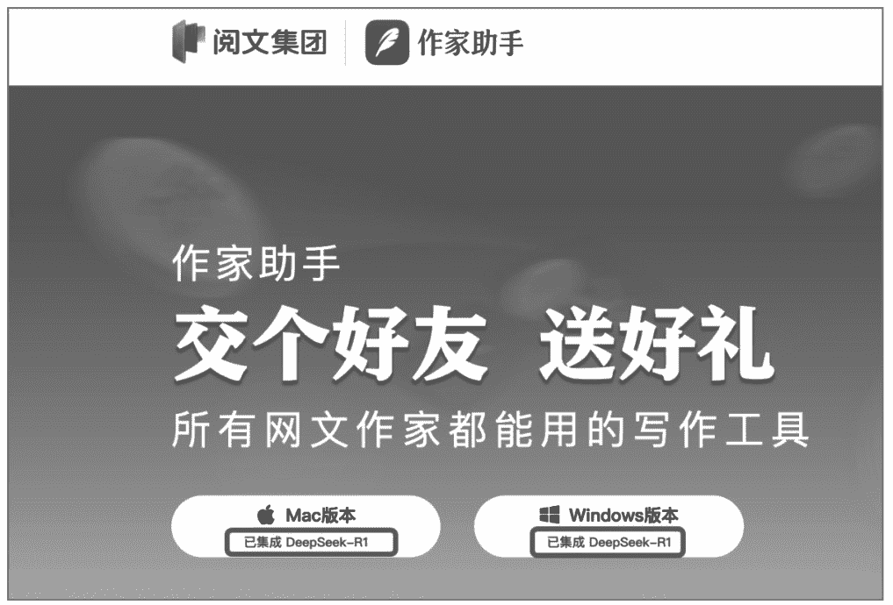

图 1-2 阅文作家助手接入 DeepSeek

作家助手集成 DeepSeek-R1 后，将在智能问答、灵感激发与文本润色三方面显著升级，提供更智能的创作辅助服务。

**2. 影视工业的智能重塑**

唐德影视已将 DeepSeek 应用于中短剧内容创意生成及筛选、剧本创作辅助等环节，结合其他大模型工具，在剧本内容创作与微短视频生成方面取得较好效果。在 AI 技术应用方面，唐德影视密切跟踪发展趋势，深度参与浙江广电集团智媒果 AIGC 技术平台的研发与应用，已运用该平台创作多部短剧与短视频。唐德影视与轩晔科技共建 AIGC 实验室，将持续通过 AI 等创新科技提升内容品质与效率，图 1-3 所示为“智媒果”首页中显示接入 DeepSeek。

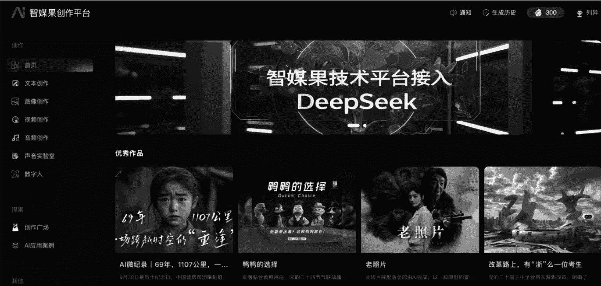

图 1-3 智媒果平台展示 DeepSeek 接入情况

**3. 数字艺术的范式创新**

智媒换挡：DeepSeek 驱动 Z视介全链路智能

以 DeepSeek-R1 为核心算力，浙江卫视旗下新媒体平台 Z视介 正在进行一次整体性的智能化重塑，内容生产、用户互动与文化传播的方式被重新定义。2025 年开年，平台智媒果与 DeepSeek-R1 完成深度对接，依托千亿级参数模型在语义理解与多模态生成上的优势，平台智能水平明显提升：节目素材处理效率大约提高 47%，制作流程大幅精简；用户互动响应快了约三倍，观看体验更顺畅；内容制作成本压缩超 60%，智能创作的降本增效效应显现。

智媒果持续探索传统文化当代转译的新路径。2025 年浙江卫视《越韵中国年》春晚期间，智媒果调用 DeepSeek 的知识图谱与自然语言能力，推出“一键识屏”互动功能。观众点一下画面即可调取剧情解读、经典唱段赏析、身段讲解等专业资料，仿佛有位资深戏曲老师在现场拆解“老戏新编”，让经典与现代演绎的交融之美更易感知。该功能还支持逐帧拆解，基于越剧表演艺术家李云霄 27 个经典水袖动作生成可跟练的互动教程，为戏曲爱好者带来沉浸式学习场景，如图 1-4 所示。

图 1-4 DeepSeek 对视频逐帧拆解

智媒果不仅改进了生产环节，也重塑了 Z视介 的互动形态。凭借 DeepSeek 的强推理能力，平台已形成智能推荐、用户画像、精准投放的闭环，助力文化内容更精准触达并实现个性化互动，提升用户满意度与商业价值。

Z视介 已累计上线多款 AI 互动产品，互动类智能体包括 AI 宋韵社区、跑男第九人、德寿宫宋舞风华、越韵幻颜等，工具类智能体包括 AI 魔法相机、AI 音乐制作人、AI 海报等，如图 1-5 所示。

图 1-5 DeepSeek 构建的智能体

在网络文学、动画、设计等创意赛道，DeepSeek 使创意周期平均缩短 40%，人力开销下降 35%。截至 2025 年 2 月中旬，已助力 127 个非遗项目完成数字化转化，例如苏州缂丝技艺结合智能纹样生成系统，已产出 800 余款契合当代审美的跨界产品，充分体现其在文化创意领域的推动力。

### **1.4.3 软件服务行业——软件创新的加速器**
DeepSeek-R1 采用 MoE 混合专家架构并配合无辅助负载均衡策略，通过动态路由在代码生成质量与推理时效间取得平衡。其自有的多词元预测 MTP 技术可并行推断多段代码，有效加快开发节奏。模型支持端云协同部署，适配企业级开发环境，开源特性使私有化定制成本降低 60% 以上。

在软件研发全生命周期，从需求分析、设计、编码、测试到部署运维，DeepSeek 均可贯穿其中，如表 1-1 所示。它为开发者提供智能化辅助，提升效率、改善代码质量、优化体验，并降低开发与维护支出。

表 1-1 DeepSeek 在软件服务行业的技术应用
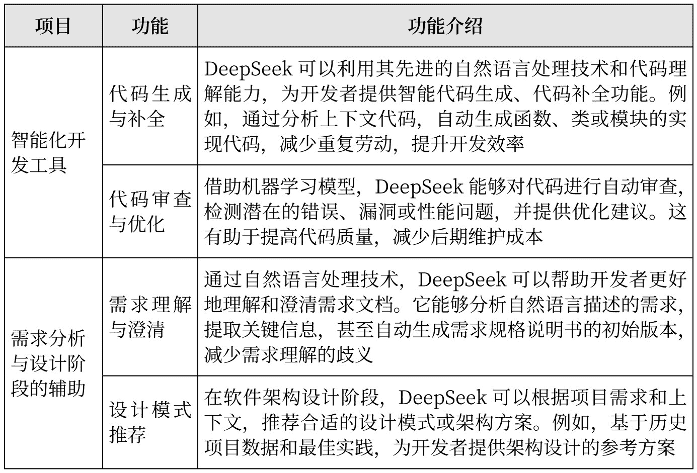
续表
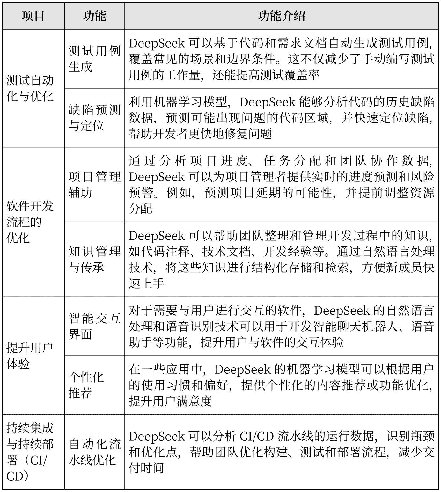

### **1.4.4 教育与培训——教育创新的范式重构**
DeepSeek-R1 依托动态知识图谱构建与自适应学习算法，能精准识别学习者的认知水平与知识盲区。模型可与教育信息化系统深度融合，形成“数据采集—分析诊断—资源推送”的闭环，应用场景持续拓展。

中信证券研报指出，2025 年 1 月起多家教育企业先后接入 DeepSeek，在强推理大模型加持下，教育+AI 正加速走向商业化。DeepSeek 在准确性、推理能力与训练成本上的优势，有望推动教育+AI 的规模化推广，其场景理解、数据沉淀与产品化能力正成为新的竞争要素。目前教育硬件、软件订阅、智慧校园三大赛道落地势头强劲，对传统教培的效率提升也十分明显。

2025 年 2 月 12 日，高途宣布完成 DeepSeek 接入，主要用于教研、教学、产品研发及内容创作等核心业务，并计划在未来三个月内陆续公布调优成果与新功能，如图 1-6 所示。
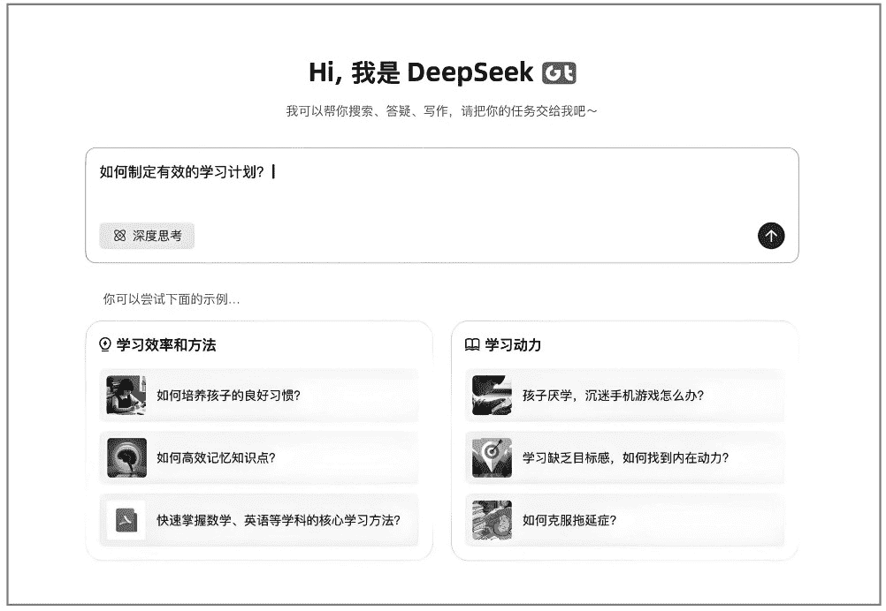
图 1-6 高途接入 DeepSeek

除此之外，云学堂、希沃等多家教育企业也宣布旗下产品接入 DeepSeek，进一步推动 AI 技术在教学场景中的创新应用。

2025 年 2 月，广东技术师范大学依托与华为的全面战略合作，在“鲲鹏+昇腾”生态支撑下，将 DeepSeek 全面接入广东省教育行业信创适配中心，如图 1-7 所示。
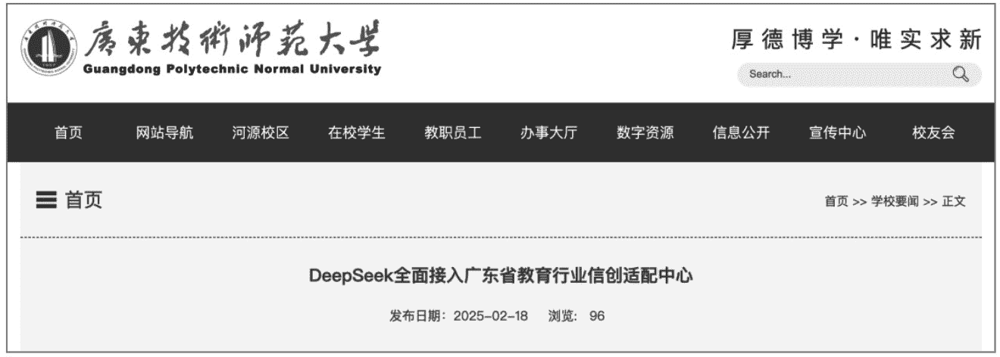
图 1-7 广东技术师范大学接入 DeepSeek

基于 DeepSeek-GDVE 教育大模型，适配中心将汇聚丰富的教育行业知识库，依托国产算力打造“教育智能体平台”，在智能教学辅助、科技创新支持、产教融合与成果转化等方面解决高校教学、科研与管理服务难题；在职业教育方面重点发力，把 AI 大模型融入现代产业升级所需的应用型人才培养全流程，实现教育全领域的 AI 赋能。

### **1.4.5 工业与制造业——智能制造的范式重构**
DeepSeek-R1 融合混合专家架构与多模态工业知识图谱，突破了传统工业 AI 对结构化数据的依赖。其推理框架可联合解析设备振动频谱、热成像数据、工艺参数日志等异构工业数据，实现设备健康管理、工艺优化与供应链协同的端到端智能化。

**1.央国企上线 DeepSeek“算力+AI”赋能工业发展**
中国石油化工集团有限公司在天翼云算力与技术支持下，快速推进模型部署调试，成功上线全尺寸 DeepSeek-R1 671b 大模型，如图 1-8 所示。

图 1-8 天翼云接入 DeepSeek 助力中国石化
此次合作为中国石化 AI 全面应用奠定基础，也为央国企数智转型提供标杆。

**2.DeepSeek 在东莞市人工智能大模型中心部署完成**
2025 年 2 月 12 日，在相关部门指导下，DeepSeek 在东莞市人工智能大模型中心完成部署并上线，为用户提供高质量服务，如图 1-9 所示。
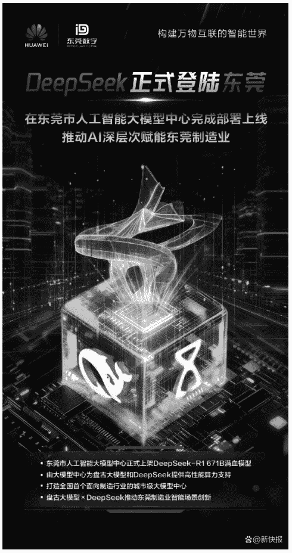
图 1-9 DeepSeek 在东莞市人工智能大模型中心部署完成

工业和信息化部发布的《智能制造典型场景参考指引（2025 年版）》从工厂建设、产品研发、生产管理、生产作业等 8 个重点环节，提炼出 40 个典型场景。

除上述案例外，DeepSeek 在工业与制造的典型应用还包括：
（1）设备健康管理——由被动维修转向预测性维护。
北方导航控制技术股份有限公司部署 DeepSeek 设备智能运维系统，基于数控机床振动、温度、电流等 12 类传感器数据构建故障预测模型，实现 90% 故障提前 72 小时预警，涵盖轴承磨损、刀具断裂等，设备非计划停机时间减少 65%，年维护成本节约 2800 万元。
（2）智能质检——光学检测的精度升级。
中国联通在汽车零部件产线部署 DeepSeek 多模态质检系统，结合工业相机与超声波探伤数据，对曲轴、齿轮等关键部件实现全自动检测，缺陷识别准确率达 99.3%，检测效率较人工提升 4 倍，年质量损失下降 1.2 亿元以上。
（3）生产调度优化——动态响应的智慧中枢。
宝沃汽车中德智造示范工厂集成 DeepSeek 生产排程引擎，实时解析订单、物料库存、设备状态等 200 余项参数，动态调整 8 个车型混流线节拍，车型切换调试时间由 4 小时压缩至 15 分钟，整体产能利用率提升 22%。

在 DeepSeek 助力下，工业制造正经历深刻变革：
● 生产效率跃升：工业场景平均设备综合效率 OEE 提升 18%～35%，关键工艺良品率突破 99%。
● 成本结构优化：预测性维护使备件库存减少 40%，智能排产使能耗成本降低 25%，形成可持续的绿色制造模式。
● 制造模式革新：由大规模标准化生产转向“全球订单—区域工厂—柔性产线”三级协同网络，订单交付周期缩短 50% 以上。

### **1.4.6 政务系统接入 DeepSeek——“AI 公务员”提升办公效率**
2025 年 2 月 8 日，深圳市龙岗区政务服务和数据管理局在政务外网部署上线 DeepSeek-R1 全尺寸模型，成为广东省首个在政务信创环境下上线的行政单位。2 月 10 日，深圳市完成 DeepSeek-R1 671b 满血版在政务云的部署，2 月 13 日开展全市操作培训，成为广东省首个实现全市范围政务云信创环境部署应用的城市。2 月 16 日，深圳市面向各区各部门正式提供 DeepSeek 模型应用服务，实现 AI 政务一体化赋能升级。

深圳市福田区推出基于 DeepSeek 的 AI 数智员工，并上线福田区政务大模型 2.0 版。大模型在通用能力基础上，结合部门业务流程定制个性化智能体，首批可覆盖 240 个业务场景，如图 1-10 所示。
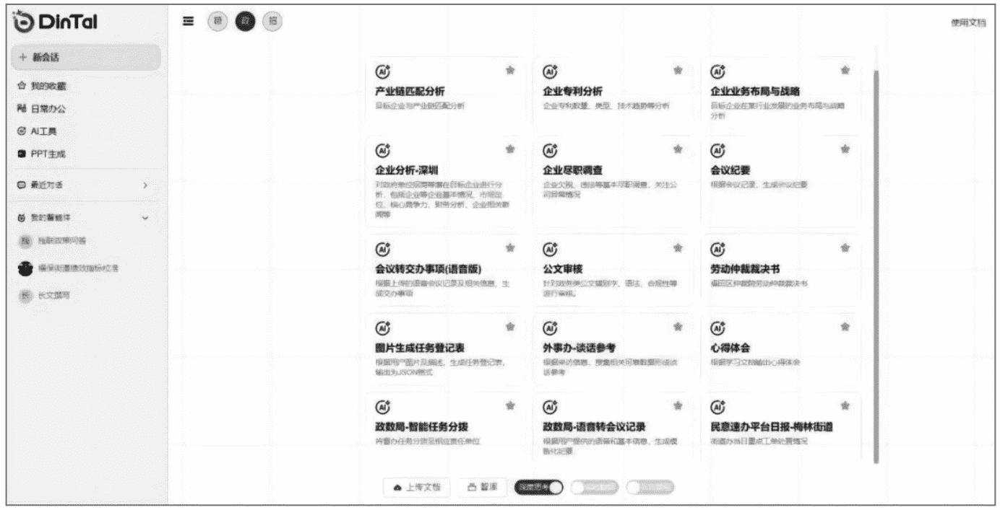
图 1-10 基于 DeepSeek 开发的 AI 数智员工

目前 11 大类 70 名数智员工已覆盖政务服务全链条。“公文格式修正”准确率超 95%，审核时间缩短 90%，错误率控制在 5% 以内；“执法文书生成助手”可秒级将执法笔录生成初稿；“民生诉求分拨”准确率从 70% 提升至 95%，支持民情周报、日报初稿一键生成；“安全生产助手”演练脚本生成效率提升 100 倍；“AI 招商助手”企业分析筛选效率提升 30%，分析时长压缩至分钟级；“深小服”覆盖党务咨询、流程规范等业务；“AI 任务督办助手”跨部门分派效率提升 80%，按时完成率提升 25%。

北京、广州、呼和浩特、赣州、无锡、临沂等多地也相继完成政务领域 DeepSeek 系列大模型部署，政务服务效率、质量与体验将迎来系统性提升。如图 1-11 所示，北京市海淀区海国投集团基于电子云打造智算云，接入 DeepSeek，全面服务海淀区客户。
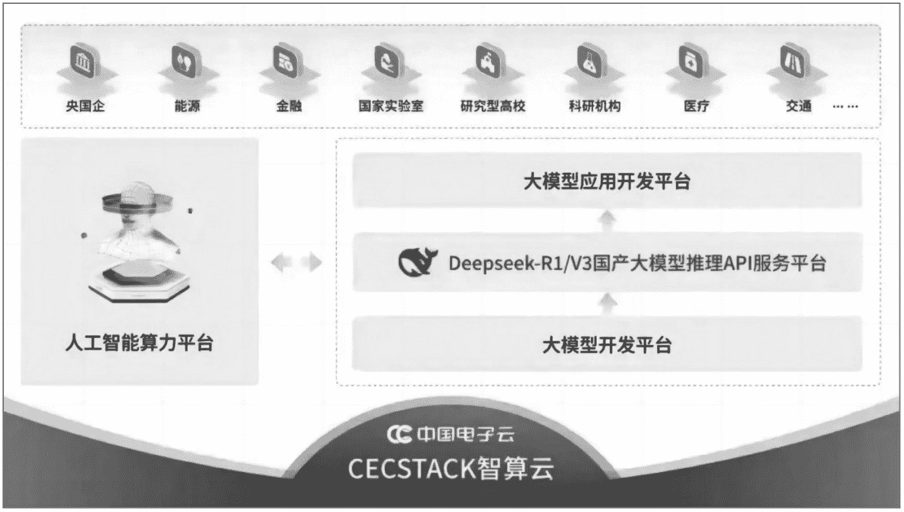
图 1-11 北京市海淀区海国投集团智算云接入 DeepSeek

# **第二章**

# **DeepSeek 的使用方法与技巧**

本章的主要内容
◆ 注册属于自己的 DeepSeek 账号
◆ DeepSeek 对话页面功能介绍
◆ 与 DeepSeek 进行对话的基本流程
◆ 深度思考模式
◆ 联网搜索模式
◆ DeepSeek 的指令
本章将为读者呈现一份通俗易懂的 DeepSeek 使用攻略，手把手教读者从零开始上手操作 DeepSeek。

## **2.1 注册属于自己的 DeepSeek 账号**
本节引导读者完成 DeepSeek 账号注册，开启智能学习与工作之旅。登录入口有三种。

**1.网页版**
（1）打开浏览器搜索 DeepSeek 官网。
（2）直接在地址栏输入 www.deepseek.com 进入官网，如图 2-1 所示。
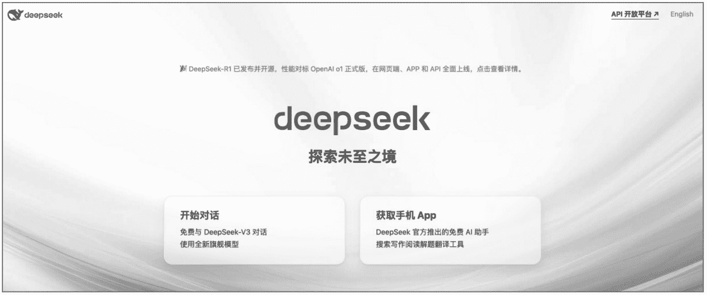
图 2-1 DeepSeek 官网
（3）进入官网后点击“开始对话”，首次使用需注册，可用手机号、微信或邮箱注册，注册后进入登录页，如图 2-2 所示。
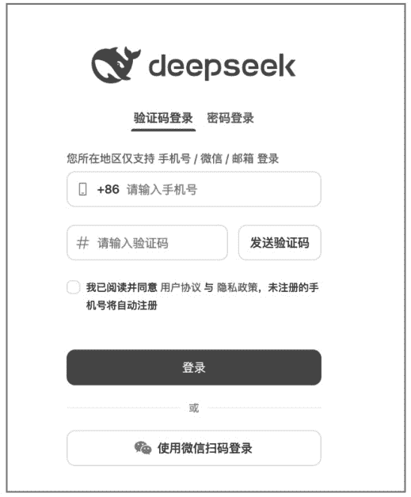
图 2-2 DeepSeek 登录页面
（4）选择登录方式，按提示输入信息完成登录。
提示：注册后建议立即绑定手机号，便于找回账号。
（5）登录后进入对话页，可与 DeepSeek 交互，如图 2-3 所示。
提示：在对话页左侧可查看历史对话，可重命名便于查找，如图 2-4 所示。
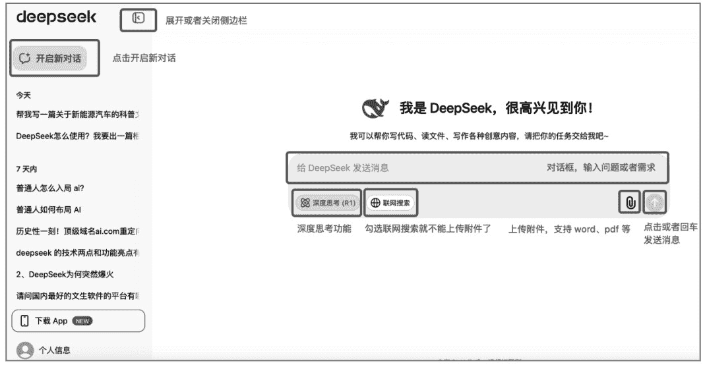
图 2-3 DeepSeek 对话页面
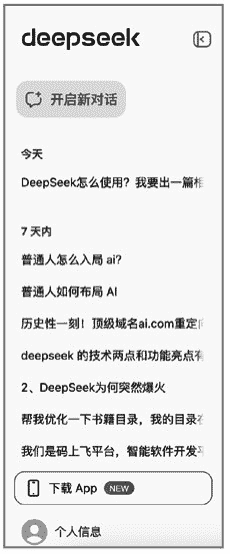
图 2-4 历史对话

**2.App**
在手机应用商店搜索“DeepSeek”，下载安装后用手机号或微信完成注册登录即可，如图 2-5 所示。

图 2-5 在手机应用商店中搜索“DeepSeek”

**3.其他入口**
在飞书、钉钉、纳米 AI 搜索等合作平台找到内置的 DeepSeek 入口即可，如图 2-6 所示。
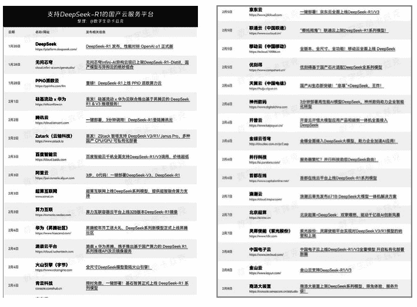
图 2-6 找到内置的 DeepSeek 入口

## **2.2 DeepSeek 对话页面功能介绍**
以网页版为例。点击官网“开始对话”后进入对话页，如图 2-7 所示。
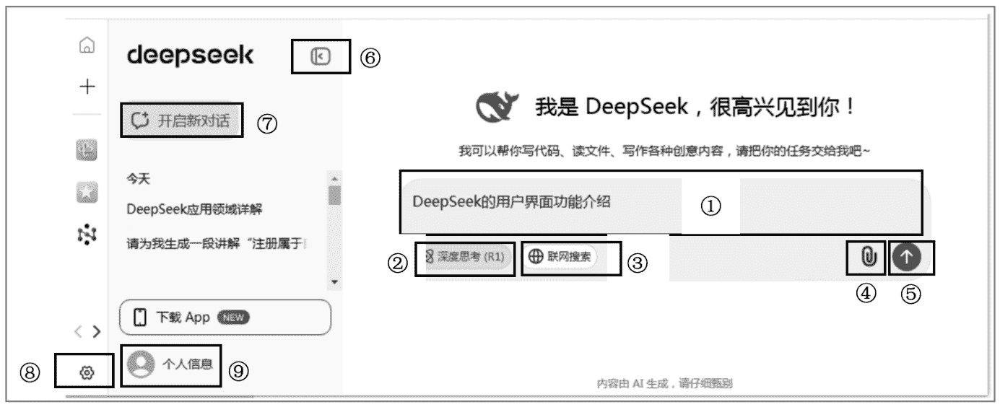
图 2-7 DeepSeek 的对话页面

页面设计简洁，主要交互如下：
①对话框：位于页面中央，用于输入指令。
②“深度思考”按钮：位于对话框左下方，点击调用 DeepSeek-R1 模型，具备更强推理分析能力。
③“联网搜索”按钮：位于对话框左下方，点击后 DeepSeek 会从网络筛选最新信息。
④“上传附件”按钮 ：位于对话框右下方，可上传本地文档、带文字图片等，目前仅支持文字识别。
⑤“发送”按钮 ：位于对话框右下方，点击发送指令获取回答。
⑥“边栏”按钮 ：位于页面左上方，点击查看历史对话。
⑦“开启新对话”按钮 ：位于页面左上方，点击新建对话。
⑧“设置”按钮 ：用于各项设置。
⑨“个人信息”按钮 ：点击展开菜单，可设置个人信息、更改系统设置、退出登录等，如图 2-8 所示。
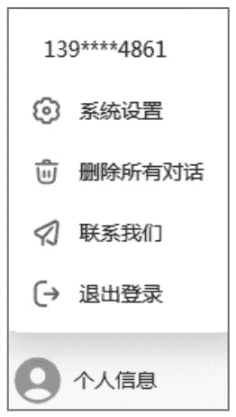
图 2-8 “个人信息”菜单

## **2.3 与 DeepSeek 进行对话的基本流程**
DeepSeek 通过自然语言处理理解用户输入并给出回答，基本流程如下。
（1）打开 DeepSeek。
通过网页版、App 或 API 接口打开。
（2）用户输入。
用自然语言输入问题，如“我想了解今天的天气情况”。描述越清晰，理解越准确。
（3）DeepSeek 处理输入。
发送问题后，DeepSeek 分析语义、意图与上下文，并从知识库检索信息。
（4）DeepSeek 回答。
以文本或可视化形式返回结果，如“今天晴天，气温 20℃到 28℃”。若无法理解，会请求进一步澄清。
（5）用户进一步交互。

DeepSeek 对话实战全流程

和 DeepSeek 交流可以拆解成几个动作。拿到一次回复后，能顺着话题继续深挖，比如追问“明天降水概率如何”。若返回结果不符合预期，换个说法再问一次即可。

（6）结束对话
需求一旦满足就可以收尾。退出方式是发送“退出”或点按右上角的关闭键。

（7）评价与优化
每条回答下方有“有帮助”“无帮助”的标记。用户的选择会回流到训练体系，模型据此结合交互记录持续调优。

按这套节奏，信息获取更快更准。

**操作实践**

（1）进入 DeepSeek 的对话页。
（2）在输入框用口语化方式描述任务，例如“为初中生写一篇约五百字的新能源汽车科普”。

开启“深度思考”后，模型会在正式输出前先展开推理过程，示例如下。

R1：深度思考
用户想要一篇约五百字、面向中学生的新能源科普。先判断使用场景，可能是自学也可能是教师备课，所以语言要浅显活泼，避免堆砌专业术语，核心要覆盖基本概念、分类、优点与发展方向。
结构上通常是开场、正文、收束。开场可用生活化场景切入，比如放学路上看到的绿色牌照车辆，容易产生共鸣。正文可分成“什么是新能源车”“三种驱动方式”“绿色出行的未来”等小块，用小标题提升可读性。
内容要准确且易懂。主流分纯电、插电混动、燃料电池三类，需分别说明原理与差异：纯电靠电池驱动，插混既能加油也能充电，燃料电池用氢气发电只排出水。可以用“手机充电”作类比。
还要点出长处：排放低、节能、安静，对比燃油车说明减排意义。再提挑战如充电设施覆盖、里程焦虑，并展望快充、电池回收，保持客观。
语言要贴合初中生认知，避免复杂数据，用具象例子：充满电能跑多远、加氢需要几分钟。语气可活泼，使用“环保小卫士”“心脏”之类的比喻。字数控制在五百字左右，取舍要精，信息须准确，如燃料电池排放仅为水。最后可加个小问题提升参与感。
思路归纳为：明确需求、搭建框架、挑选案例、调整语言、核对准确性。

模型给出的示范如下。

《新能源汽车：城市里的绿色新势力》
放学路上，有没有留意到车流中多了不少绿色牌照的车？它们行驶安静、无尾气排放，正是身边的低碳出行代表——新能源汽车，正在悄然改变城市空气和出行习惯。

一、各具特色的动力家族
新能源车并非一模一样。纯电动车像一台巨型充电宝，完全靠电池供电；插电式混动车像“两栖选手”，加油充电都行；燃料电池车像“喝氢发电”的魔术箱，反应产物只有水珠。它们共同的特点是能量回收，把刹车时的动能转回电能储存。

二、路面上正在发生的环保实践
传统燃油车每烧一升汽油约排放两点五公斤二氧化碳，而纯电车的碳排放约为其三分之一。北京冬奥会期间，1213辆氢燃料车累计减排约二千二百吨二氧化碳，相当于种植约十二万株树木。这些车运行安静，道路噪声可减少三至五分贝，街道更显清爽。

三、通向未来的智慧出行
新能源车正演变为“移动电源”，未来可为家庭反向供电，并通过车联网组成智慧电网。宁德时代的钠离子电池让成本下降约百分之三十，比亚迪刀片电池经针刺测试验证安全性。上海已试运营自动驾驶新能源出租车，这些“聪明座驾”正在勾勒未来交通图景。

从一八八一年法国人古斯塔夫造出首辆电动车，到中国新能源汽车产销量连续八年位居全球第一，绿色出行浪潮才刚刚起步。未来加油站或许变为充电公园，加氢站融入社区，而我们每个人都是这场变革的参与者。

（3）优化回答
若结果不满意，可在上下文里追问、补充需求，多轮打磨。常见做法有：
● 补充细节：如“再加一段电池技术的对比”。
● 调整风格：如“改成更幽默的表达”。
● 纠正错误：直接指出问题，如“第三段数据不对，应为××”。

下面以追问“增加一段电池性能数据对比并用表格呈现”为例进行优化。

R1：深度思考+联网搜索
用户此前已拿到一篇新能源科普，现在希望补充电池性能数据并以表格呈现。先回看原文结构确定插入位置，再结合检索到的最新资料整理参数。
检索结果显示，固态电池在二零二五年能量密度有望突破四百Wh/kg，成本降至一百美元/kWh以下，循环寿命约一千次。刀片电池属于磷酸铁锂路线，能量密度高且稳定。钠离子电池能量密度约一百六十Wh/kg，成本低但循环寿命相对较短。三元锂与磷酸铁锂在低温和安全上表现不同，比亚迪冬季测试提供了低温场景参考。
需要整合的类型包括磷酸铁锂、三元锂、固态、钠离子、刀片等，指标涵盖能量密度、循环寿命、成本、低温适应性、安全等。数据来源需对应网页1、2、4、6、9、10等。表格要简明，术语通俗化，例如把循环寿命解释为充放电次数，并附上备注说明来源为实验室成果与二零二五年产业化预测。

DeepSeek 优化后的结果如下。

以下为新增的电池性能数据对比表，结合主流技术及二零二五年预测整理：

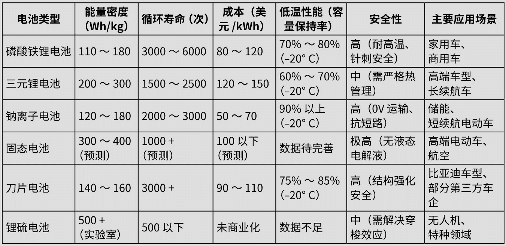

关键对比解析
能量密度方面，三元锂和固态电池占优，钠离子电池通过材料改进正缩小差距。
低温性能上，钠离子表现突出，刀片电池凭借结构设计提升低温适应性。
成本层面，钠离子因资源丰富且不依赖钴镍，成本约为锂电池的三成到四成，适合储能场景。
安全性上，磷酸铁锂和钠离子内阻较大、热失控风险低；固态电池因无液态电解液，从根本上降低可燃性。
注：数据综合实验室成果与二零二五年产业化预测，实际表现可能随技术突破变化。

## **2.4** **深度思考模式**
DeepSeek 的深度思考是其核心推理引擎，通过技术创新与开源生态重塑大模型在复杂场景下的能力，并让使用者感受到类似人类的思考过程。下面从主要功能与应用场景展开说明。

1. 主要功能
深度思考具备以下三方面能力。
（1）深度推理与结构化分析
● 多维度拆解问题：采用SWOT、5W1H等框架，例如在碳中和城市方案设计中，从能源、交通、建筑等多视角对比。
● 因果链推演：构建含十二个以上变量的博弈模型，预测行业趋势，如“二零二五年二线品牌淘汰率可能达百分之三十七”。
（2）实时数据融合与验证
可结合联网搜索接入三千多个信息源，如Bloomberg、arXiv，并通过三角互证方法交叉核对官方公报与学术论文。
预训练数据截止二零二四年七月，联网模式下可获取最新信息，如二零二五年春晚相关动态。
（3）自我纠错与教育适配
推理过程中会展示完整链路，包括假设、逻辑检查与错误修正，适合教学场景，例如向小学生解释流星形成；提供“小学生沟通模式”，用通俗语言解释复杂概念。

2. 应用场景
典型场景包括：
（1）教育与学术研究
● 自动生成含多个知识点的习题并给出解题步骤，如三年级数学思维题。
● 辅助论文写作，通过知识图谱关联跨学科文献。
（2）商业决策与战略分析
● 在投资可行性分析中，融合锂价波动等实时数据与深度推演，生成《价格战下的技术突围路径》等报告。
● 预测行业趋势，提前捕捉新兴概念，如室温超导技术。
（3）开发者与工程师工具
● 通过思维链API实时展示推理过程，支持代码生成与调试。
● 可集成至低代码平台，如钉钉宜搭，用于数据分析与自动化流程设计。

使用建议：
● 追求效率时关闭深度思考与联网搜索，如会议纪要整理。
● 复杂决策时同时开启两者，如分析二零二五年新能源汽车市场，结合供应链实时数据与博弈模型。
● 技术边界：目前在数学、编程等可验证领域表现更佳，法律、伦理类问题仍需人工判断。

**操作实践**
下面用深度思考模式生成一份短视频带货脚本，并与普通模式对比。

（1）输入需求
请生成一份短视频带货脚本，产品是智能扫地机器人，受众为家庭主妇，侧重清洁效果与便捷性。
（2）开启深度思考（R1）后，模型先进行思考：
用户需要面向家庭主妇的带货脚本，关注点是清洁力与省心。家庭主妇关心效率、操作简便、噪音、是否适合有小孩或宠物。脚本需有抓眼球开场、痛点呈现、核心卖点、场景演示、促销收尾。核心卖点包括大吸力、智能路径、扫拖一体、手机客户端控制、自动回充、语音控制。场景可展示厨房油渍、宠物毛发、孩子零食残渣，对比传统清洁突出省时。镜头要切换流畅，配轻快温馨音乐，旁白简洁有号召力。还可体现安全与耐用，如避障、续航。结尾需行动号召，提升转化，整体控制在三十秒内。

（3）生成内容如下。
【短视频带货脚本：智能扫地机器人三十秒版】
背景音乐：轻快温馨钢琴曲，间杂科技音效
镜头1 三秒
画面：妈妈手忙脚乱擦地，孩子跑过留脚印，宠物毛发乱飞
旁白：“每天扫三小时？时间不该被灰尘绑架！”
镜头2 五秒
特写：机器人启动，吸走饼干屑与宠物毛
字幕：“飓风吸力｜99.9%除螨｜宠物家庭首选”
镜头3 四秒
画面：手机客户端一键启动，机器绕开拖鞋玩具
画外音：“连两厘米桌腿都能绕开，比老公还细心！”
镜头4 五秒
分屏对比：左为传统拖把反复擦拭，右为高频震动拖地酱油渍消失
红字：“扫拖一体｜自动回充｜三小时续航”
镜头5 三秒
画面：妈妈敷面膜喝咖啡，机器人作业，时钟快进
旁白：“每天多出两小时，这才是生活该有的样子！”
镜头6 五秒
特写：产品展示，纤薄机身与尘盒
大字：“前一百名送六个拖布+一年延保，直播专属减三百元！”
结尾五秒
妈妈抱娃微笑，机器人回充
快闪字幕：“三十天无理由｜顺丰包邮｜德国TÜV认证”
旁白：“点进购物车，把清洁专家带回家！”
创意点：痛点场景共鸣、实验室数据背书、限时赠品制造紧迫感、与精致生活方式关联。建议搭配实测切片增强可信度。

（4）关闭深度思考采用普通模式重新生成，结果如下。
短视频带货脚本：解放双手，从这款智能扫地机器人开始！
目标受众：家庭主妇 时长三十秒 风格温馨生活化
场景：阳光客厅 人物：年轻妈妈与孩子 BGM轻快
镜头1 特写干净地板 画外音：打扫最头疼？
镜头2 妈妈疲惫拖地孩子弄脏地板 画外音：刚拖完又脏？
镜头3 机器人出发工作 画外音：试试智能扫地机器人，解放双手！
镜头4 机器人避障穿梭 画外音：智能规划，无死角！
镜头5 特写强力吸尘 画外音：强劲吸力，连缝隙都不放过！
镜头6 妈妈喝咖啡孩子玩耍机器人工作 画外音：省时省力，多陪家人！
镜头7 自动回充 画外音：智能回充，无需操心！
镜头8 产品展示 画外音：时尚外观，值得拥有！
镜头9 妈妈出镜报优惠 画外音：现购优惠，速点链接抢购！
字幕要点重复卖点与行动号召。备注可根据实际调整时长，邀请KOL推广，结合节日营销。
对比可见，深度思考模式输出更详细具体，达到专业脚本水准。

## **2.5** **联网搜索模式**
DeepSeek 的联网搜索基于RAG技术，融合多源实时检索与AI语义解析，支持文本、语音、图片输入，抓取权威数据，理解复杂查询，过滤低质广告，结构化呈现结果，同时保护隐私。该模式可将时效性问答准确率提升约四成，适用于教育、研究、商业等领域。

1. 使用场景
（1）实时新闻与动态信息：查询最新新闻、赛事比分等。
（2）跨应用信息整合：从聊天记录提取关键信息等。
（3）专业领域检索：接入权威金融数据库与学术论文库，提供背景信息。

2. 操作方式
用户可点击对话页面的“联网搜索”按钮开启，如图2-9所示。
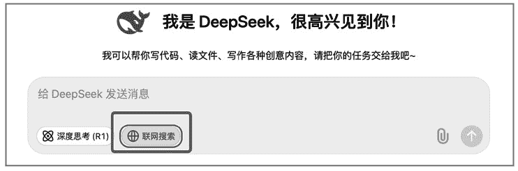
图2-9“联网搜索”按钮
（1）基础操作：同时开启深度思考与联网搜索，输入指令后模型自动生成多组检索词并抓取结果，如图2-10所示。
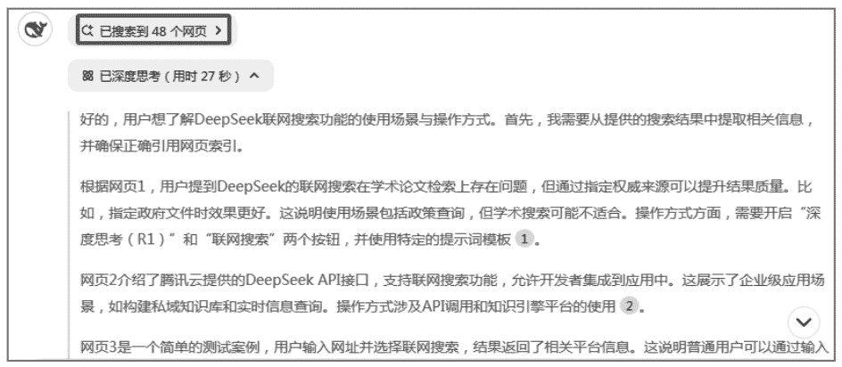
图2-10 同时开启深度思考模式和联网搜索模式
提示：点击搜索结果后的超链接数字可跳转至原网页查看详情，如图2-11所示。
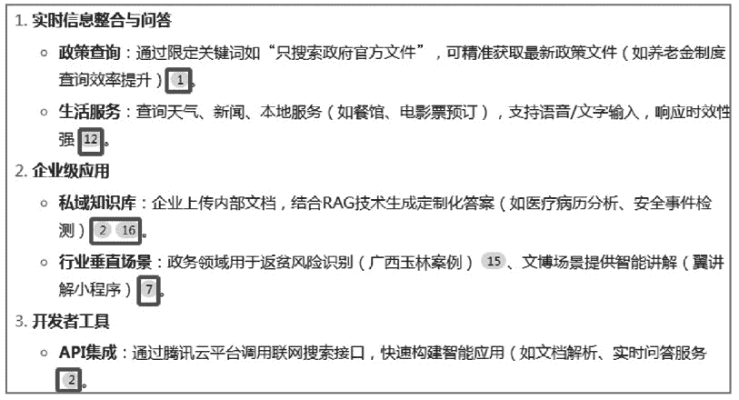
图2-11 单击超链接数字
（2）高级技巧
● 限定权威来源：指令中指定“仅搜政府官网/学术网站”，过滤低质信息。
● 结构化指令模板：附加提示词“请使用高级搜索技巧生成关键词”，提升精准度。
提示：模型可通过API调用集成到自有应用中。

3. 使用建议与注意事项
（1）场景化配置建议。

# 联网搜索开关，怎么用才顺手

在讲究回应的速度时，比如整理会议记录、归纳既有文档这类对外部实时资讯依赖不高的活儿，把在线搜索关掉，模型会更快更稳。相反，面对投资研判、市场研判这类需要新鲜事实又要严密推演的场景，就建议把联网检索和深度思考同时打开，让信息抓取和逻辑校验一起走。

使用边界要心里有数。受网站反爬策略影响，部分内容拿不到，特别是登录后才能看的付费报告、会员专区，输出会缺口。API 侧目前还不支持在线检索，只能在网页端直接用，或借助腾讯云、天工 AI 这类集成平台调用。

把开关用对，就能在信息时效和思考深度之间找到平衡，从日常查证到专业研究都能覆盖。DeepSeek 的在线检索结合实时拉取和语义理解，让助手在实用性和灵活度上明显提升，工作和生活里都能更快拿到一手资料。

## 2.6 DeepSeek 指令用法

在 DeepSeek 里，用自然语言就能划定行为边界和输出逻辑，指导任务拆解、内容产出和交互流程，让结果更贴合个人诉求。

### 2.6.1 零样本提示词

产出质量和提示的质量高度相关。虽然官方有提示词库，但面对日常简单问题，越贴近口语的输入效果越好，比如“蛋炒饭怎么做”“给我排一周健康餐单”“有哪些冷笑话”“帮我推测下期彩票”。模型对口语化意图的识别很强。

以“蛋炒饭怎么做”为例，系统会给出家常做法的说明。主材是隔夜米饭、鸡蛋、葱花、盐、可选生抽、油，再配火腿、胡萝卜、青豆等可选配料。做法上，先把米饭用手抓散，鸡蛋加一点盐打匀，热锅凉油把蛋炒至凝固盛出，再下米饭用铲子压散炒热，倒回蛋液拌匀，加盐和生抽调味，最后撒葱花出锅。小技巧是配菜可先炒熟再混入，且要大火快炒防止粘锅。

### 2.6.2 让 AI 用更通俗的表达

DeepSeek 的回应有时偏学术，补一句“说人话”“用大白话解释”“详尽版”等口语化指令，表达会更易懂。

1.使用方式
直接在提问里追加口语化提示，如“说人话”“用大白话”。例如问“什么是量子纠缠”，默认是专业版，补充口语提示后会转为通俗表述。提供背景和具体需求也有帮助，例如“我要向老板汇报比亚迪谈判进展，老板不懂电池技术，请用菜市场大妈都能听懂的说法说明核心技术优势、报价区间以及谈判时的专业姿态”。把抽象概念换成具体名词，问题会更清晰。

2.应用场景
解释复杂概念：量子力学、链式账本技术等，用生活化比喻更易理解。比如把量子纠缠比作心有灵犀的双胞胎，远隔千里一方变化另一方也随之变化。写作润色：帮助优化表达，让段落更自然易读。

操作实践
先问“什么是区块链？”。专业要点为分布式账本、去中心化、不可篡改、公开透明，区块记录交易与时间戳并链接，运行流程是验证交易、共识机制、打包上链，应用包括加密币、智能合约、供应链溯源、身份验证，优点是安全透明降成本，缺点是扩展性、能耗与监管不确定。
再追加“说人话”。通俗要点是像大家共同维护的公共账本，无中心机构管理，写入后难以修改，公开可查，安全靠加密。可类比一群人记账，每笔交易写在纸上放入透明盒，盒子串成链条，人人可看不可改。应用如比特币记账、智能合约自动执行、供应链溯源。优点为安全透明无需中间人，缺点为速度慢、耗电高、技术复杂。

再以“帮我写一篇关于量子计算的文章”为例。专业版会包含引言、量子比特叠加、量子纠缠与干涉、超导、离子阱、光量子、拓扑等硬件进展、Shor、Grover 等算法、量子云计算、密码学、药物研发、优化、AI 应用前景，以及纠错、硬件稳定、算法完善、标准与产业化等挑战。补充“用大白话写”后，通俗版会说明量子比特可同时为0和1实现并行计算，优势在于超并行、纠缠关联、干涉筛选正确答案，当前硬件在超导、离子阱、光子路线推进，Google、IBM 有原型机，算法如 Shor 用于破解密码、Grover 用于搜索，已有云平台可体验。能做的事情包括破解传统密码与量子密钥、模拟分子加速新药、优化物流投资、加速机器学习。难题是比特易受干扰需极低温、寿命短、算法不足、普及还早。总结为潜力巨大但挑战仍多。

加上“用大白话”“说人话”“直白一些”“小孩也能听懂”等提示，使用体验会更友好。

### 2.6.3 提问技巧和模板

1.RTGO 提示词结构

RTGO 用于引导模型完成结构化任务，通过角色、任务、目标、操作要求四个维度让指令更精准。

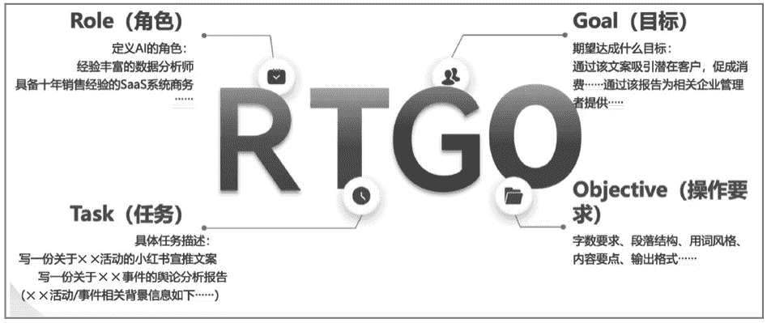
图 2-12 RTGO 提示词结构
RTGO 结构为：
Role 角色 + Task 任务 + Goal 目标 + Objective 操作要求

Role 角色：明确模型的专业身份。例：经验丰富的数据分析师。
Task 任务：具体需完成的动作。例：写一份××产品市场分析报告。
Goal 目标：可量化的期望效果。例：为企业管理者提供策略支撑。
Objective 操作要求：格式、字数、风格等细节。例：不少于1500字，PDF 输出。

操作实践：生成物联网设备日志分析
Role：经验丰富的数据分析师
Task：分析2025年Q1用户行为数据
Goal：产出含3个关键趋势的可视化报告
Objective：用Markdown表格呈现，附Matplotlib代码示例
输入需求，如图 2-13 所示。

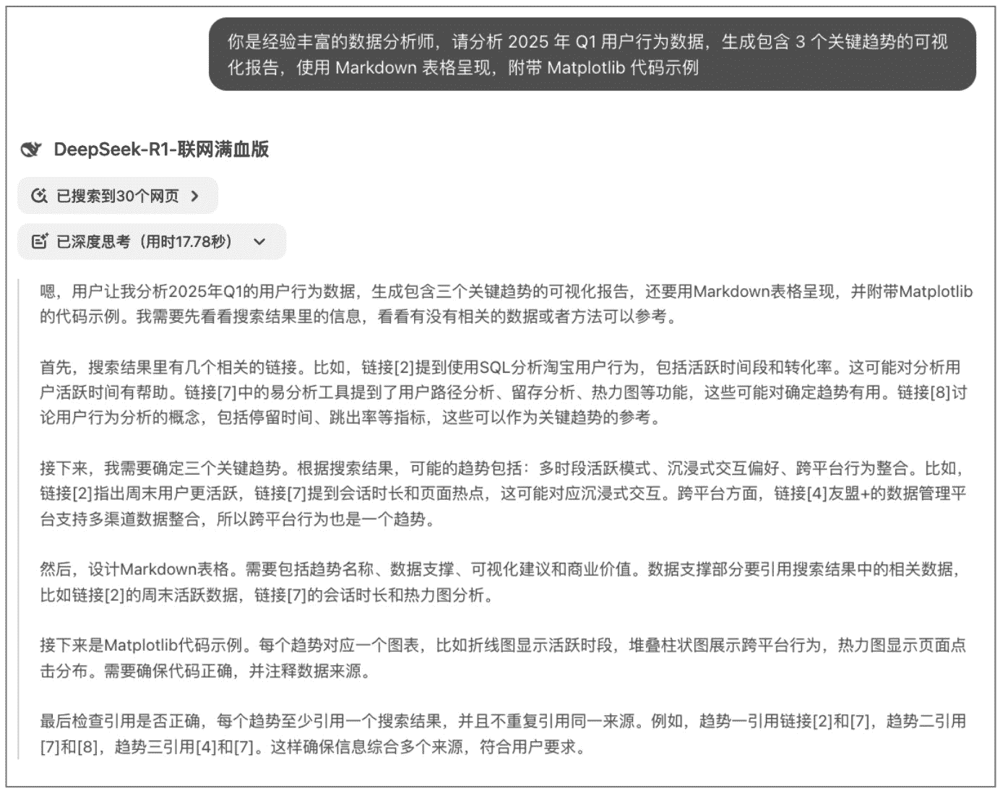
图 2-13 以 RTGO 提示词结构输入需求
模型给出的样例如下。
基于2025年Q1用户行为数据的分析，结合最新行业动态，总结出三大关键趋势。报告框架及实现方案如下。
2025年Q1用户行为数据核心趋势报告

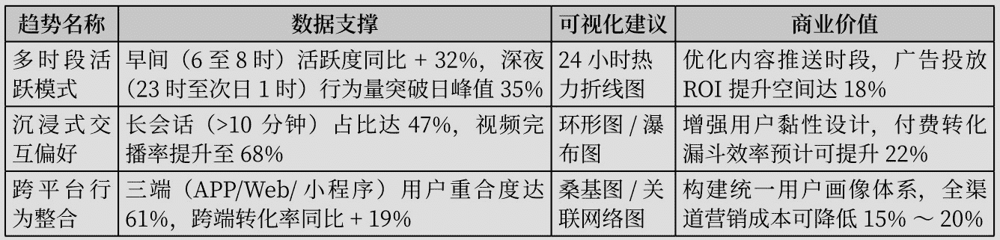
Matplotlib 可视化代码示例

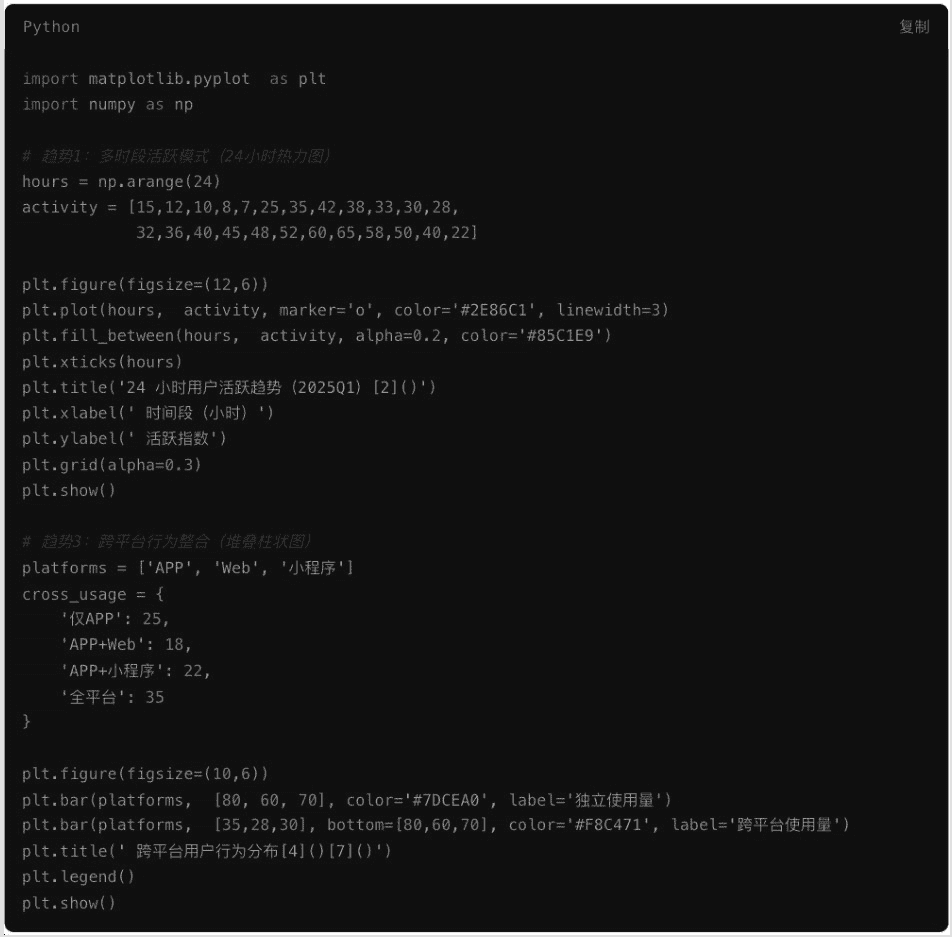
深度解读
时段策略优化建议：
早间加强资讯类推送，点击率提升约29%
深夜布局沉浸式短视频，观看时长增加约41%
交互设计启示：

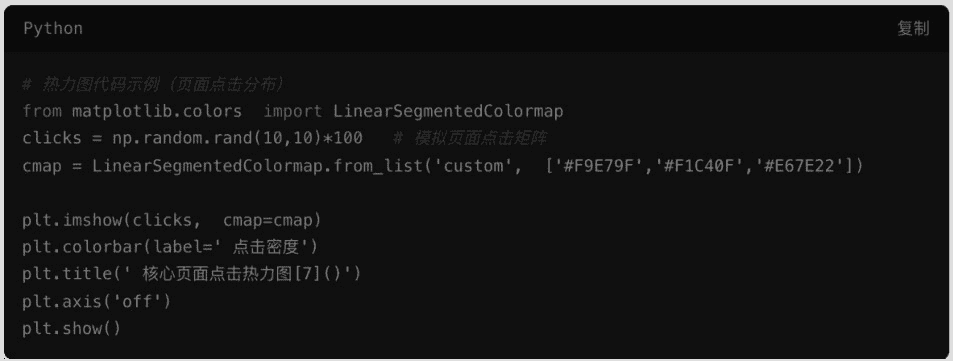
如需完整报告及数据源，可参考来源方法论。该体系经A/B测试验证，对留存提升和成本控制有效。

适用场景：
技术类任务：代码生成、数据分析等
结构化任务：需要明确步骤和结果的任务

2.CO-STAR 提示词框架

CO-STAR 由新加坡政府技术局团队开发，在2024年提示工程竞赛中获奖。用六个维度定义需求，让创意类任务更准确。

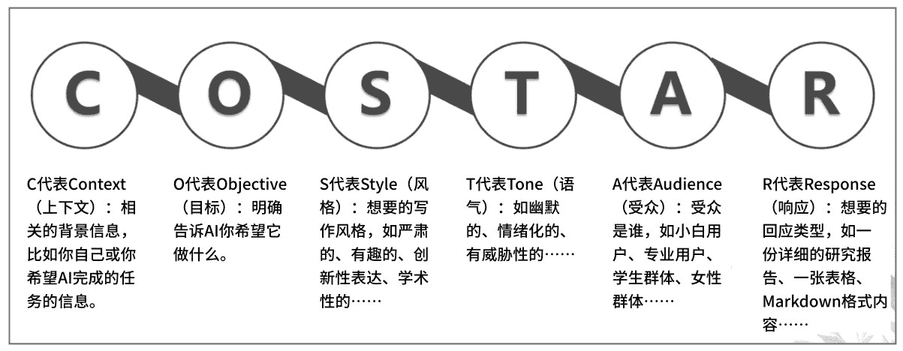
图 2-14 CO-STAR 提示词框架
CO-STAR 结构为：
Context 上下文 + Objective 目标 + Style 风格 + Tone 语气 + Audience 受众 + Response 响应

C Context：背景信息
O Objective：希望达成的目标
S Style：写作风格
T Tone：语气
A Audience：受众
R Response：期望的输出形式

操作实践
生成智能手表营销脚本
指令示例：
Context：健康监测智能手表新品上市
Objective：两周内完成1000台预售
Style：科技博主“何同学”解说风格
Tone：专业又有趣
Audience：25～35岁运动爱好者
Response：3个15秒抖音脚本+详情页架构
输入需求，如图 2-15 所示。

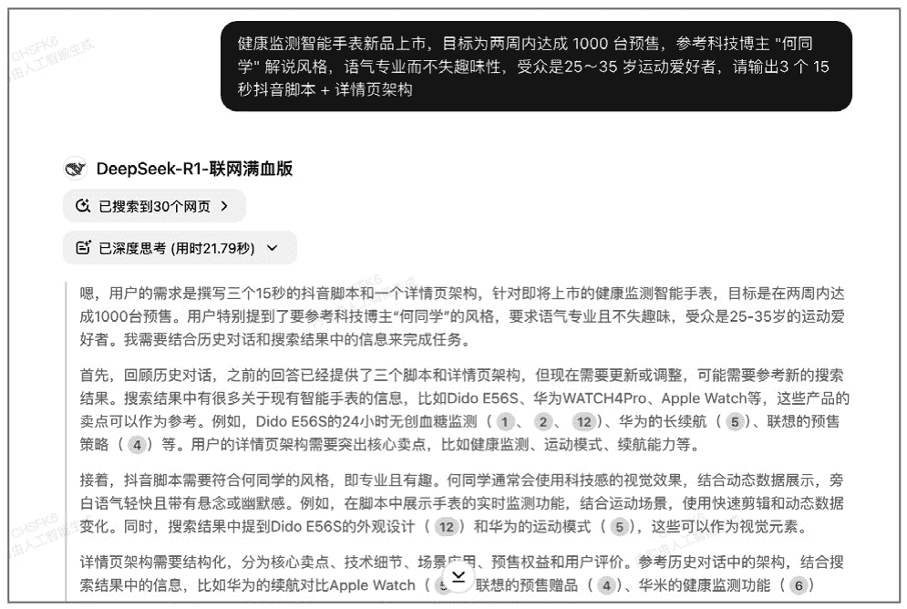
图 2-15 以 CO-STAR 提示词框架输入需求
模型产出如下。
以下是为健康监测智能手表定制的3个15秒抖音脚本及详情页架构，风格专业有趣，面向25～35岁运动人群。

一、15秒抖音脚本
脚本1：心率警报篇
[开场]第一视角奔跑镜头，手表特写心率飙升至180
（画外音严肃）“你的心脏说：再跑就罢工！”
[切]手表震动弹出红色警报，主角紧急停下喝水

（轻松语调）“双核生物感知就绪，运动急救小分队正式上岗”

【收尾】品牌 LOGO 呈现，底部字幕：预售直降 200 元，心率守护限量抢

脚本 2：运动模式秒切篇

[镜头]主人公在骑行、游泳、攀岩之间连续切换，腕表画面实时判定运动类型
（快节奏剪辑+机械音效）骑行转游泳再攀岩……它总是比你更早进入状态
[特写]表盘 3D 动画滚动数据：卡路里 738 大卡→水深 12 米→海拔 3848 米，幽默口吻：五十种运动可选，冲榜党福音，建议量力而行
【收尾】轻点屏幕直达预售页

脚本 3：水下血氧彩蛋篇

[画面]主角下潜时抬腕，气泡里浮现血氧 98%
（惊讶音效）连鱼群都像在关心我的血氧值？
[实验室场景]产品在离心机里持续运行
（专业语气）军规级防水配合 21 天续航，称得上全天候数字教练
【收尾】手表弹出“今日运动达标”表情，字幕：预售前 100 名赠潜水表带

二、详情页架构

1．开屏冲击区
3D 产品悬浮动态展示，核心卖点以弹幕形式闪过：
双核生命感知｜50 米防水｜21 天长续航｜50+ 运动模式
紧迫标语：千台预售已抢订 63%，剩余库存：■■□□□

2．技术剧场 模块化交互

健康哨兵系统
GIF 演示：夜间睡眠时红外传感器工作，清晨生成睡眠质量报告
对比图：传统手环与本品心率监测曲线的精度差异

运动元宇宙引擎
滑动查看：登山模式下实时海拔/气压/体温三维面板
彩蛋触发：连续左滑三次出现“开发者模式”趣味小游戏

特种兵电量方案
实验视频：满电设备在 -20℃ 冷冻 24 小时后仍正常工作
续航柱状对比：Apple Watch 1.5 天/华为 GT 14 天/本品 21 天

3．场景渗透区
分镜故事板：
07:00 晨跑自动识别步频→12:00 久坐办公震动提醒→19:30 泳池记录划水次数→23:00 解析恢复指数

4．信任加成区
证书瀑布流：
国家体育总局训练局合作产品/德国 TÜV 精准度认证/极限温差测试报告
用户弹幕墙：
“马拉松 PB 提升 8%！按心率区间调训练确实有效！”——@跑步教练大 K

5．收官促销
悬浮倒计时：距预售结束 12:34:56
阶梯福利：
● 前 100 名：赠水下摄影表带+运动数据私教课
● 101～500 名：赠运动保险含损伤理赔
● 全员：晒单加赠年度健康报告解读

6．极客问答 折叠
Q：游泳时能接电话吗？
答：内置定向骨传导麦克风，湿手通话依旧清晰
Q：表带会过敏吗？
答：医疗级硅胶+磁吸快拆，3 秒切换商务/运动风格
整体以强场景绑定与数据可视化建立专业信任，年轻化交互彩蛋降低决策门槛，契合用户对科学训练与趣味体验的双重需求。

3. 框架选用指南

（1）技术向任务优先 RTGO
代码生成：借助 RTGO 规范接口参数校验逻辑
数据分析：借助 RTGO 定义可视化图表类型

（2）创意向任务选用 CO-STAR
营销文案：用 CO-STAR 打造节日限定款故事
产品设计：用 CO-STAR 构建用户旅程地图

（3）混合任务组合打法
用 CO-STAR 设定品牌调性
用 RTGO 生成技术文档
联网检索获取竞品数据

### 2.6.4 提问万能公式

1. 分析类问题公式
公式：是什么+为什么+怎么做
适用：需要深度拆解的复杂议题
示例：区块链是什么？为何重要？如何开发区块链？

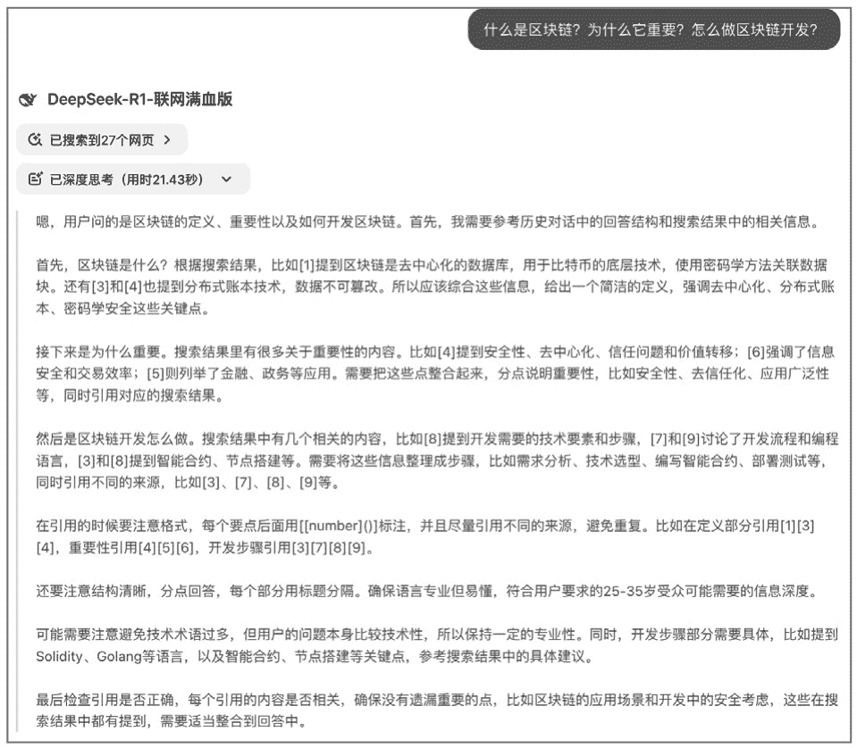
图 2-16 分析类问题提问与深度思考流程

DeepSeek 生成示例如下。

什么是区块链？
区块链是一种分布式账本，通过加密把数据按时间打包成区块并链式相连，保证防篡改、公开透明。核心特征：
去中心化：无单一服务器，由多节点共同维护
不可篡改：区块以哈希相连，修改需改动后续所有区块，成本极高
透明可追溯：交易记录公开，可追踪地址历史
共识机制：如工作量证明 PoW、权益证明 PoS 等，保证节点一致
例如：比特币是首个应用，用于点对点转账；以太坊支持智能合约，扩展功能。

为什么区块链重要？
去中介化
传统交易依赖银行、支付平台等第三方，区块链点对点直连，降低成本提升效率，如跨境汇款从数天缩至数分钟
增强信任与安全
加密加分布式存储难以被攻击篡改，适用于金融、司法存证等。沃尔玛用区块链追溯食品供应链，快速定位污染源
智能合约自动化
合约写入链上自动执行，如条件达成自动理赔，减少人为干预
催生新经济模式
支持代币化，实现资产数字化如 NFT 代表艺术品所有权，和去中心化金融 DeFi 的创新

如何开发区块链？
1. 学习基础
原理：哈希算法、共识机制 PoW/PoS/DPoS、默克尔树、非对称加密
语言：Solidity 智能合约、Rust 波卡/Solana、Go Hyperledger Fabric
平台：公链如以太坊比特币、联盟链 Hyperledger、私链 Corda
2. 环境与工具
合约开发：Remix 在线 IDE、Truffle/Hardhat 框架
节点网络：Ganache 本地测试链、Ropsten 测试网、Infura API 接入主网
3. 安全与测试
常见漏洞：重入攻击如 The DAO 事件、整数溢出、权限缺失
审计工具：Slither、MythX，第三方审计如 OpenZeppelin
4. 部署与维护
前端集成：Web3.js 或 Ethers.js 连接钱包 MetaMask
监控工具：Chainlink 获取链下数据、The Graph 索引链上数据
学习资源
入门课程：Coursera Blockchain Basics 普林斯顿、B9Lab 开发者课程
文档：以太坊官方文档、Solidity 中文手册
社区：GitHub 开源项目、StackExchange 技术问答、Ethresear.ch 前沿研究
总结
区块链重构信任机制，正重塑金融、供应链、物联网等领域。开发者需掌握密码学、分布式系统原理及工具链，并把安全放在首位。随着 Layer2 扩容如 Optimism、zkSync 和跨链技术 Cosmos、Polkadot 发展，应用将更高效多元。

2. 反向提问公式
公式：需求+担忧/问题+解决措施
适用：针对潜在风险寻求对策
示例：我计划做跨境电商（需求），担心政策变动影响物流（担忧），请给出 3 条规避风险策略（解决措施）。

3. 个性化输出公式
公式：身份+目标对象+核心重点+风格要求
适用：对语言风格有明确要求
示例：我是母婴博主（身份），要为新手妈妈推荐辅食工具（目标对象），重点讲安全性和性价比（核心重点），语气亲切易懂（风格要求）。

### 2.6.5 有效提问十个技巧

掌握清晰提问能让 AI 更准确输出，提升效率。

1. 技巧 1：明确需求
清晰表达目标，避免模糊指令。细节越具体，输出越贴合。
错误示例：帮我做个设计。
正确示例：我要一张海报，用于公司新品发布会，风格科技感且具创新感。

2. 技巧 2：提供背景信息
补充上下文帮助模型理解问题维度。
错误示例：优化这个流程。
正确示例：这是客服部处理投诉流程，近期满意度下降，请分析原因并优化（附流程文档）。

3. 技巧 3：指定输出形式
不同形式适配不同场景。
错误示例：写几个活动方案。
正确示例：用思维导图呈现三种周年庆方案，需含主题、流程、预算。

4. 技巧 4：控制输出长度
根据受众调整详略。
错误示例：展开讲讲。
正确示例：用 300 字以内向非专业人士介绍 AI 在医疗影像诊断中的应用。

5. 技巧 5：及时纠正
输出不符时给出具体反馈。
错误示例：这个设计颜色太暗了。
正确示例：颜色偏暗，请改为明亮清新的色调后重做。

6. 技巧 6：分步提问
复杂问题拆解为小问逐步引导。
错误示例：帮我写完整市场推广计划，含目标策略预算执行。
正确示例：
（1）请制定提升品牌知名度 20% 的推广计划。
（2）基于目标给三种策略。
（3）针对第二种策略列预算和时间表。

7. 技巧 7：提供示例
给出风格范例便于模仿。
错误示例：写篇环保文章。
正确示例：写篇环保文章，风格类似‘地球是我们共同家园……’，突出个人行动。

8. 技巧 8：设定角色
指定视角获得专业回答。
错误示例：分析这个营销方案。
正确示例：假设你是一名资深市场营销专家，请从专业角度分析优缺点并建议改进。

9. 技巧 9：明确优先级
多需求时排序。
错误示例：设计网站要美观、功能强、加载快。
正确示例：设计网站，首要加载速度，其次功能，最后美观。

10. 技巧 10：限制选项范围
缩小范围提高精准度。
错误示例：推荐学习资源。
正确示例：推荐三本适合初学者的 Python 入门书，要求通俗易懂并带实践案例。

### 2.6.6 DeepSeek 常用基础指令

（1）/续写 或 /continue
用途：续接因长度中断的回答。
示例：模型回答中断→用户输入 /续写→继续生成。
注意：部分场景自动续写。

（2）/重置 或 /new 或 /reset
用途：清空上下文开始新对话。
示例：输入 /reset→系统提示会话已重置。

（3）/帮助 或 /help
用途：查看指令列表与权限说明。
示例：输入 /help→返回帮助文档。

（4）/格式 或 /format
用途：指定输出格式如 Markdown、纯文本、JSON。
示例：/format markdown→后续启用 Markdown。

（5）/简化 或 /simplify
用途：用更简洁语言重组回答。
示例：介绍区块链后输入 /简化→得到摘要。

（6）/深度 或 /deep
用途：请求专业深度分析。
示例：/deep 分析 2023 年全球通胀的经济成因。

（7）/角色 或 /role
用途：切换身份视角。
示例：/role 高中化学老师→后续采用教学风格。

（8）/翻译 或 /translate
用途：指定语言翻译。
示例：/translate EN 请把“人工智能改变世界”译成英文。

（9）/停止 或 /stop
用途：手动终止流式生成。
示例：生成中输入 /stop→立即停止。

（10）/反馈 或 /feedback
用途：提交错误或改进建议。
示例：/反馈 引力波描述与最新研究不符。

（11）/示例
用途：展示具体案例辅助理解。
示例：/示例 展示 Python 快速排序代码。
注意：需说明案例类型与场景。

（12）/步骤
用途：分步指导操作流程。
示例：/步骤 如何配置 Python 虚拟环境？
注意：可补充准备条件与注意事项。

（13）/检查
用途：检查文档代码错误。
示例：/检查 以下代码为何报错（粘贴代码）？
适用场景：代码调试、润色、数据校验。

（14）/总结
用途：提取长文本核心要点。
示例：/总结 以下文章主旨（粘贴内容）。
注意：可指定字数如 200 字以内。

（15）/解释
用途：解释专业术语概念。
示例：/解释 机器学习中的“过拟合”。

（16）/优化
用途：优化表达、代码或数据呈现。
示例：/优化 以下文案/代码。
适用场景：重构、润色、逻辑调整。

（17）/生成
用途：按需生成文本、代码、表格。
示例：/生成 一份关于智能家居满意度的调查问卷模板。
注意：可明确格式与长度要求。

这组指令覆盖了生成、精简、核验到改进等多个环节，对新手来说是快速吃透 DeepSeek 核心用法的一套入门路径。有了它们，与模型的配合更顺手，各项任务的完成效率也会明显提升。

**名师点拨：** 组合使用往往更有效，比如先用“/生成”起草代码框架，再用“/检查”定位问题，最后用“/优化”重塑结构。遇到对上下文依赖强的场景，像代码调试时，最好一次性把完整背景提供清楚。

### 2.6.7 优化生成结果
下面梳理几类提升 DeepSeek 输出质量的做法，融合了提示设计、参数调节与知识库调用的思路。

**1.逻辑与结构打磨**
（1）重构与分层
● 以“疑问-剖析-结论”为骨架重新组织表述，借助小标题、要点列举等结构化手段提升阅读体验。
● 审视论证链条是否闭环，补充“因此”“需要留意的是”等衔接语，让段落衔接更自然。
（2）关键词校准
● 厘清核心词，使高频词汇更贴合真实意图，例如把笼统的“优化”细化为“成本优化”或“流程优化”。
● 用 SEO 工具监测词频，将密度控制在 5% 到 8% 之间。

**2.内容增强策略**
（1）案例与数据补充
● 为抽象判断配上具体事例，比如讲采购流程改进时引用企业实际降本的百分比。
● 对复杂信息加入图表或流程图，实现可视化呈现。
（2）专业性与通俗性平衡
● 把模糊表述量化，例如把“效果显著”改为“效率提升 37%”。
● 为专业术语加括号解释，例如“L2 正则化（用于抑制过拟合的技术）”。

**3.多维度验证**
（1）角色模拟复核
从不同立场审视输出：
● 专家视角：核查专业表述准确度。
● 新手视角：检验易懂程度。
● 决策者视角：评估结论的实用价值。
（2）多版本对比融合
生成 2 到 3 个风格不同的版本，取长补短，例如取 A 版的数据、B 版的结构、C 版的案例进行融合。

**4.技术调优手段**
（1）参数回溯调整
对已有结果可回调参数重跑：
● 把 Temperature 降到 0.4 附近，降低随机波动。
● 增加限制条件，例如“用 300 字概括，并包含 3 个实证案例”。
（2）跨模型校验
把输出投递到 GPT-4、Claude3 等其他大模型复核：
● 核验事实正确性。
● 查找逻辑漏洞。

# 第三章
# DeepSeek 高效学习
本章要点
◆ 以 DeepSeek 为学习搭档
◆ 化解考试与作业难题

学习节奏加快，效率直接决定成长。本章拆解如何借助 DeepSeek 把传统低效的学习方式升级为高效模式，呈现丰富场景与可操作技巧，帮助你在知识海洋中快速定位方向、达成目标。

## 3.1 学习小助手——学习路上的贴心伙伴
学业路上需要可靠的陪伴与指引。本节说明 DeepSeek 如何成为得力助手。阅读晦涩文献时，它能迅速归纳要点、提炼核心观点；面对大量书籍时，可精准推荐资料并规划路径；学习外语词汇时，能用趣味互动和科学记忆法帮助轻松掌握。它既能减轻负担，也能激发兴趣，是学习路上不可或缺的伙伴。

### 3.1.1 读文献——轻松啃下“硬骨头”
文献阅读常因信息量大、表述艰深而耗时。如何高效抽取关键信息是每个学习者必须面对的问题。DeepSeek 如同经验丰富的学术导师，帮助迅速把握文献核心。

在文献处理上，DeepSeek 擅长解析、整合与互动三大方面，能显著提升处理效率。

**1.智能解析**
（1）多格式文献解析
支持上传 PDF、Word、PPT、Excel、TXT 等，兼容 PDF 扫描件的 OCR 自动识别。
例如上传 200 页的 PDF 论文，系统可自动完成：
● 提取标题、作者、摘要等元信息。
● 识别数学公式和化学式。
● 标注文献中的关键结论。
（2）结构化信息提取
可生成“研究方法→结论→创新点”三线表，把论文核心信息浓缩为结构化呈现。
（3）跨语言文献处理
● 中英互译并做术语对齐，如把“mitochondria”自动关联“线粒体”。
● 对比阅读，上传中英文版本后生成双语对照摘要。

**2.高效整合**
（1）跨文献知识图谱
例如上传 20 篇阿尔茨海默病相关论文后，5 分钟内生成“β淀粉样蛋白假说”的演进脉络图，并自动标注关键争议点。
（2）动态文献矩阵
可按自定义维度如实验样本量、统计方法、效应值建立对比矩阵，快速定位研究空白。
（3）参考文献溯源
对引文“et al.”的智能展开准确率约 82%，比传统引文管理软件节省约 60% 追溯时间。

**3.深度交互**
（1）质疑式问答
用户问“这个结论是否可靠”时，系统会主动分析样本量不足、未校正多重假设等潜在风险。
（2）假设推演
输入“如果改变实验温度参数会怎样”，可触发跨文献的参数效应模拟，并基于已有数据给出概率预测。
（3）写作协同
撰写文献综述时，可实时推荐相关引文并自动生成 APA 格式引用，大幅提升引用效率。

**操作实践**
背景：研究人员需快速掌握《新英格兰医学杂志》一篇关于 mRNA 疫苗的突破性论文。
操作步骤：
（1）上传论文：将 PDF 文件上传至 DeepSeek。
（2）核心信息提取，指令：
请提取以下内容。
1. 图 3 的免疫应答数据。
2. 不良反应统计表。
3. 与 Moderna 疫苗的对比内容。
（3）深度分析，指令：
请对以下内容进行深度分析。
1. 用 GRADE 系统评估证据等级。
2. 指出随访期不足可能带来的偏差。
3. 生成患者知情同意书的要点摘要。
（4）知识整合，指令：
1. 将该研究与另外 2 篇上传文献整合。
2. 绘制“mRNA 疫苗保护效力随时间变化”曲线图。

### 3.1.2 读书——书籍信息结构化
DeepSeek 在辅助阅读方面提供以下功能，有效提升体验与效率。

**1.智能推荐书籍**
基于阅读偏好、知识缺口分析和学术趋势预测，通过多维度匹配算法推荐适读书籍，需用户授权学习目标及兴趣标签。

**2.结构化内容解构**
对获版权许可的开放获取书籍如古腾堡计划公版书，可自动生成：
● 概念关系图谱。
● 核心论点推导树。
● 跨学科知识关联网络。

**3.交互式理解辅助**
在合规文本范围内可执行：
● 输入“/question”指令生成思辨性问题。
● 输入“/debate”指令启动观点批判模式。
● 输入“/example”指令获取现实应用案例。

**4.智能笔记系统**
● 自动提取高频术语索引并带页码定位。
● 创建多维标签体系如理论/案例/数据。
● 生成 APA 格式引文，需完整元数据。

**名师点拨：**
以下是 15 个 DeepSeek 辅助读书的常见场景问题。
（1）学术研究场景：正在研读一本人工智能专著，能否提取书中关键算法与实验结果？
（2）专业学习场景：学习编程，能否总结《Python 编程从入门到实践》中的核心语法与常用库？
（3）个人成长场景：阅读《高效能人士的七个习惯》，能否提炼实用建议与实践方法？
（4）兴趣阅读场景：对历史感兴趣，能否梳理《明朝那些事儿》中的主要事件与人物关系？
（5）职场提升场景：阅读《影响力》，能否概括核心观点与应用场合？
（6）考试备考场景：备考注册会计师，能否提取《会计》教材重点知识点与典型例题？
（7）技能提升场景：学习摄影，能否总结《摄影的艺术》中的拍摄技巧与构图方法？
（8）文化拓展场景：对外国文学感兴趣，能否分析《百年孤独》的魔幻现实主义手法与主题？
（9）健康管理场景：阅读《饮食术》，能否提取健康饮食原则与食谱推荐？
（10）亲子教育场景：阅读《正面管教》，能否总结教育理念与实用技巧？
（11）旅游规划场景：阅读《孤独星球》环球指南，能否提取热门目的地与特色景点？
（12）金融投资场景：阅读《穷爸爸富爸爸》，能否总结投资理念与理财策略？
（13）艺术鉴赏场景：对绘画感兴趣，能否分析《艺术的故事》中的流派与代表作品？
（14）心理学场景：阅读《乌合之众》，能否提取群体心理分析与结论？
（15）生活技能场景：阅读《整理生活》，能否总结整理技巧与收纳方法？

**操作实践**
用 DeepSeek 提取《高效能人士的七个习惯》中的实用建议与实践方法。
（1）登录 DeepSeek 提问：
我正在读《高效能人士的七个习惯》，你能帮我提取书中的实用建议和实践方法吗？
（2）生成结果示例：
《高效能人士的七个习惯》蕴含诸多实用建议和实践方法，以下是提炼要点。
习惯一：积极主动
实用建议：
明确影响圈与关注圈，把精力集中在可控的影响圈，减少对不可控关注圈的无谓担忧。例如不纠结他人评价，专注提升自身能力。
主动设定目标，而非被动等待任务分配。如制定周学习计划、健身计划，成为生活的主宰。
用积极语言模式，改用“我可以”“我能”替代“我不得不”，增强掌控感。
实践方法：
每天早晨花 10～15 分钟反思与目标设定，写下当天重要事项及行动计划。
遇到挑战先问“我能做些什么改善现状”，立刻行动，哪怕迈一小步。
习惯二：以终为始
实用建议：
形成清晰的个人使命宣言，明确长期价值观与目标，如同人生指南针。
依据使命制定短长期目标，确保每个阶段努力指向愿景。
做重要抉择时思考“人生终点时希望如何选择”，做出符合内心期望的决定。
实践方法：
抽时间回顾过往经历与未来理想状态，撰写个人使命宣言并定期微调。
制作“人生资产负债表”，列出真正重要的事物与消耗精力却无益的事物，据此调整日常行为。
习惯三：要事第一
实用建议：
运用时间管理矩阵，区分重要紧急、重要不紧急、紧急不重要、不重要不紧急，优先处理重要事项，大量投入重要不紧急事务，削减无效投入。
按目标与使命确定每日每周要事并排入日程，避免被琐事牵着走。
学会拒绝不符合要事优先原则的请求，保持计划稳定。
实践方法：
每周日晚规划下周安排，按矩阵分类排序，把要事安排到具体时段并灵活调整。
用番茄工作法提升专注，例如 25 分钟专注处理要事后休息 5 分钟，每完成 4 个番茄小休一次较长时间。
……
提示：由于篇幅限制，部分生成内容省略。

### 3.1.3 学习英语单词——单词记忆不再难
本节讲解如何借助 DeepSeek 实现个性化单词记忆，结合词根词缀、谐音联想、场景化训练等多维度方法提升效率与趣味性。

**1.分步学习法**
系统可把单词学习拆分为“拆分词根→场景化造句→谐音联想”的阶段性目标，通过多轮对话逐步加深记忆。
例如输入“分三步教我记忆 procrastination”。
生成结果：
①拆分词根：pro（向前）+ crastinus（明天）+ ation（名词后缀）= 把事情推到明天；
②场景化造句：My procrastination made me miss the deadline；
③谐音联想：破壳拉屎挺累的→拖延不想动。

**2.智能联想与场景构建**
可要求系统生成故事化联想或视觉化场景，增强记忆黏性。
例如输入“为 ephemeral 设计一个记忆场景”。
生成结果：
想象樱花在春日盛开，花瓣只绽放三天就凋谢→关联短暂美好的概念。

**3.多模态学习支持**
可让系统生成表格、思维导图辅助记忆。
例如输入“用表格对比 affect 和 effect 的用法”。
DeepSeek 生成结果如下。
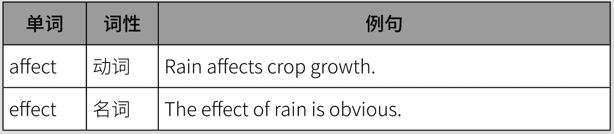

**4.个性化复习计划**
基于艾宾浩斯遗忘曲线，生成动态复习任务和例句填空练习。

**操作实践**
案例：制定一周掌握 50 个雅思高频词的复习表。
（1）用户指令：
制定一周内掌握 50 个雅思高频词的复习表。
（2）输出示例：
一周雅思高频词汇复习表（50 词）
总体原则
记忆与复习结合：基于艾宾浩斯遗忘曲线，学习后需在当天、次日、第 4 天、第 7 天复习。
多维度应用：通过听、说、读、写强化记忆，结合例句、场景联想、同义词拓展。
分阶段目标：每天掌握 7～8 个新词，共 50 个，按词性分配动词 20%、名词 30%、形容词 40%、副词 10%。
每日计划表
Day 1：学习词汇 7 词
新词：analyze, environment, significant, sustainable, impact, resource, global
方法：
晨间 20 分钟：用词汇 App 学习发音及例句。
午间 15 分钟：制作闪卡，正面英文+音标，反面中文+例句。
晚间 20 分钟：听写并造句，如 “The government analyzes the impact of global warming on natural resources.”
Day 2：学习 8 词 + 复习 Day 1
新词：controversy, innovation, phenomenon, consumption, emission, policy, regulate, consequence
复习：遮住中文回忆含义。
方法：
场景联想：把词汇与环保议题结合，如 “The controversy over carbon emissions requires strict policies.”
听力练习：用剑桥真题材料，标记含新词句子并跟读。
Day 3：学习 7 词 + 复习 Day 2
新词：alternative, efficient, generate, renewable, infrastructure, urbanization, biodiversity
复习：快速问答英文→中文、中文→英文。
方法：
阅读应用：精读一篇环保类雅思文章，划出新词并总结段落。
写作练习：用 3 个新词写小作文，如 “Renewable energy is an efficient alternative to fossil fuels.”
……
提示：由于篇幅限制，部分生成内容省略。

### 3.1.4 跨语互译——英汉交流无阻
全球化背景下跨语言交流频繁，准确翻译需兼顾语言、文化、术语与语境。DeepSeek 可作为智能翻译工具，提供高质量英汉互译服务，帮助跨越语言障碍。

使用 DeepSeek 辅助英汉互译可大幅提升效率与准确性，适用于日常沟通、学术研究和商务文件。

翻译需求与推荐指令示例 表 3-1
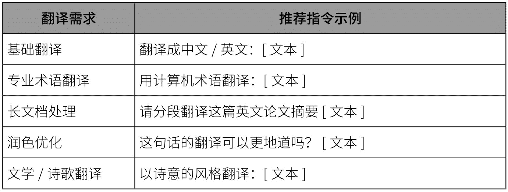
使用 DeepSeek 辅助英汉互译的方法如下。

**1.基础翻译**
（1）直接输入文本进行翻译。
英译汉：输入英文句子或段落，系统会натив译成流畅中文。
示例输入：
The rapid development of artificial intelligence has brought significant changes to various industries.
示例输出：

# DeepSeek 中英互译实战手册

大模型正在重塑各行业的沟通方式，语言转换的效率也在同步提升。掌握合理的提问技巧，中文转英文、英文转中文都能得到更自然、更实用的结果。

**基础直译：把中文交给模型**
直接给出一段中文，让模型按地道英文表达输出即可。

试试这样问：
深度学习在图像识别和自然语言处理领域表现优异。

模型回：
Deep learning performs exceptionally well in the fields of image recognition and natural language processing.

**风格可控**
需要特定语体的译文时，把风格要求写进指令即可。

试试这样问：
请将以下句子翻译成商务英语：我们期待与贵公司建立长期合作关系。

模型回：
We look forward to establishing a long-term cooperative relationship with your company.

**提升译文质量**

**1. 补充背景信息**
缺少语境容易导致用词偏位，补充使用场景能让模型做出更精准的取舍。

示范：
原文：The model achieves state-of-the-art performance on the benchmark dataset.
背景说明：该句出自一篇评估深度学习模型性能的学术论文。
译文：该模型在基准数据集上实现了最前沿的性能。注：state-of-the-art 在论文语境里通常译作“最先进的”或“SOTA”。

**2. 锁定专业术语**
法律、医学、科技类文本最好提前约定译法，保持用词统一且专业。

示范：
原文：The defendant shall be liable for all damages caused by the breach of contract.
术语约定：“liable”译为“承担责任”，“breach of contract”译为“违约”。
译文：被告应就违约所造成的一切损害承担赔偿责任。

**长篇与复杂内容的应对**

**1. 分段推进**
较长文本逐段处理能兼顾准确与逻辑，适合论文、报告、技术资料。

示范提问：
请分段翻译以下英文文章：
In recent years, artificial intelligence (AI) has made significant progress in various fields, including healthcare, finance, and transportation. AI technologies such as machine learning and deep learning have enabled computers to perform tasks that were previously thought to be possible only by humans. For example, AI systems can now diagnose diseases, predict stock market trends, and drive autonomous vehicles. However, the rapid development of AI also raises concerns about its impact on employment and privacy. As AI continues to advance, it is crucial to address these challenges to ensure that the benefits of AI are maximized while minimizing potential risks.

模型呈现的分段译文：
第一段：
In recent years, artificial intelligence (AI) has made significant progress in various fields, including healthcare, finance, and transportation.
近年来，人工智能在医疗、金融、交通等多个领域取得显著进展。
第二段：
AI technologies such as machine learning and deep learning have enabled computers to perform tasks that were previously thought to be possible only by humans.
机器学习、深度学习等技术让计算机能够完成此前被认为只有人类才能胜任的任务。
第三段：
For example, AI systems can now diagnose diseases, predict stock market trends, and drive autonomous vehicles.
比如，现在的 AI 系统可以诊断疾病、预测股市走势并驾驶自动驾驶汽车。
第四段：
However, the rapid development of AI also raises concerns about its impact on employment and privacy.
不过，AI 的快速发展也引发了对其对就业和隐私影响的担忧。
第五段：
As AI continues to advance, it is crucial to address these challenges to ensure that the benefits of AI are maximized while minimizing potential risks.
随着 AI 不断进步，必须直面这些挑战，以最大化收益并降低风险。

**2. 先概括再翻译**
对长材料先提炼主旨再进行语言转换，能兼顾效率与连贯。

示范提问：
请先总结这段英文文章的主要思想，再翻译成中文：
In recent years, artificial intelligence (AI) has made significant progress in various fields, including healthcare, finance, and transportation. AI technologies such as machine learning and deep learning have enabled computers to perform tasks that were previously thought to be possible only by humans. For example, AI systems can now diagnose diseases, predict stock market trends, and drive autonomous vehicles. However, the rapid development of AI also raises concerns about its impact on employment and privacy. As AI continues to advance, it is crucial to address these challenges to ensure that the benefits of AI are maximized while minimizing potential risks.

模型呈现的结果：
核心思想提炼：
近年来 AI 在医疗、金融、交通等领域发展迅速，机器学习与深度学习让计算机完成以往人类专属任务，如疾病诊断、股市预测和自动驾驶。但快速发展也带来就业与隐私的焦虑，未来需妥善应对，以发挥效益并控制风险。
中文译文：
近年来，人工智能在医疗保健、金融和交通运输等多领域取得明显进步。机器学习和深度学习等技术让计算机能执行过去只由人类完成的任务。例如，AI 系统现可诊断疾病、预测股市趋势及驾驶自动驾驶车辆。然而 AI 的迅猛发展也让人担心其对就业和隐私的冲击。随着技术持续演进，解决这些难题十分关键，才能在放大利好的同时把潜在风险降到最低。

**校对与润色**

**1. 优化已有译文**
把自己的参考译文交给模型润色，提升流畅度和地道感。

示范提问：
“AI technology changes the world”，我的译法是“AI 技术改变世界”，感觉不够顺，请优化。
模型建议：
建议改为“人工智能技术正在改变世界”，更贴合中文表达习惯。
解析：
原译意思清晰但偏生硬，缺乏时间感。加入“正在”增强动态感，“人工智能技术”比“AI 技术”更正式，适合严肃场景。

**2. 修正语法与用词**
针对汉译英句子检查自然度。

示范提问：
请检查以下汉译英是否自然：这个 APP 很好用。→This APP is very well to use.
模型建议：
更地道的说法是“This APP is very user-friendly.”或“This APP works very well.”
解析：
原句语法不规范，very well 不能修饰 to use。“user-friendly”是常用形容词，“works very well”也更自然。

**特殊场景**

**1. 口语化表达**
口语译文要贴近日常，避免过度书面化。

示范提问：
请把以下中文翻译成自然的口语英语：这事儿真让人头疼！
模型给出：
This is such a headache!
解析：
“headache”在口语里指麻烦事，“such a”加强语气，整体更生动。

**2. 文学与诗歌**
文学翻译需在传达原意的同时保留意境与美感。

示范提问：
请将李清照《如梦令》“昨夜雨疏风骤”译成英文，保留诗意。
模型给出：
Last night, the rain was light and the wind fierce.
解析：
“light”对应雨疏，“fierce”对应风骤，画面感与语言流畅兼顾。

**回译校验**
把译文再译回源语，可以检验准确性与一致性。

示范提问：
请将我翻译的英文“Time is money.”回译成中文，看是否一致。
模型给出：
回译结果：Time is money. → 时间就是金钱，确认无误。
解析：
原句为常见谚语，英文译文标准，回译后语义一致。

**配合外部工具**

**1. 语音输入**
先用讯飞听见等语音转文字工具生成文本，再导入模型翻译。
**2. 图片文字提取**
用微信扫一扫等 OCR 工具提取图片文字，粘贴到模型进行翻译。
灵活组合以上方法，可高效完成高质量英汉互译。遇到特殊需求，直接告知模型即可。

**实操案例**

本例将一篇关于人工智能在医疗领域应用的英文文章译成中文，要求专业、流畅且符合科技论文习惯。

第 1 步：直接翻译，获取初稿。
用户指令：
请将以下英文文本翻译成中文，保持专业性和流畅性：
Recent advances in deep learning have enabled AI systems to analyze medical images with remarkable accuracy. For instance, convolutional neural networks (CNNs) can now detect early signs of diseases such as cancer from X-ray and MRI scans, significantly improving diagnostic efficiency.

模型输出：
深度学习的最新进展使人工智能系统能够以极高准确性分析医学影像。例如，卷积神经网络可通过 X 光和核磁共振扫描检出癌症等疾病的早期迹象，大幅提升诊断效率。

第 2 步：优化术语与表达，提升专业度。
用户指令：
刚才译文里“diagnostic efficiency”译成“诊断效率”是否准确？是否有更专业的说法？请调整句式，更贴合中文科技论文。
模型输出：
医学语境中更常用“诊断效能”，兼顾准确性与速度。优化后：
“深度学习的最新突破使人工智能系统能高精度解析医学影像。以卷积神经网络为例，其现可通过 X 射线与 MRI 扫描识别癌症等疾病的早期征兆，显著提升诊断效能。”
说明：“remarkable accuracy”→“高精度”更简洁；“detect early signs”→“识别早期征兆”更专业。

第 3 步：拆分长难句。
用户指令：
这句话较长，请拆成 2～3 个短句，保持逻辑清晰：
Despite its potential, the integration of AI into clinical practice faces challenges such as data privacy concerns, regulatory hurdles, and the need for extensive validation in diverse patient populations.

模型输出：
尽管人工智能潜力巨大，但其在临床实践中的应用仍面临多重挑战。例如数据隐私问题、法规障碍，以及需要在不同患者群体中进行充分验证等，都亟待解决。

第 4 步：回译验证一致性。
用户指令：
请将我译的中文回译成英文，核对关键术语是否一致：
深度学习的最新突破使人工智能系统能高精度解析医学影像。
模型输出：
The latest breakthroughs in deep learning enable AI systems to analyze medical images with high precision.
对比原文关键术语 deep learning、analyze medical images 保持一致，语义完整。

第 5 步：最终润色，适配学术演讲。
用户指令：
请让译文更流畅，适合在学术演讲中使用。
模型输出：
深度学习领域的最新进展，让人工智能系统能够高精度解析医学影像。以卷积神经网络为例，它已能借助 X 光与核磁共振成像检测癌症等疾病的早期病变，明显提升了临床诊断效能。不过，AI 在医疗落地的过程中，仍需应对数据隐私、法规合规性以及多人群验证等挑战。

### 3.1.5 知识预习——提前踏入知识殿堂

预习是高效学习的基础，能提前建立认知框架、激发兴趣、提升课堂效率。DeepSeek 可根据学习主题或课程内容快速生成预习资料、梳理知识脉络、提供资源链接和引导问题，帮助用户系统预习，为正式学习做好准备。

以高等数学“微积分”预习为例：
**1. 学习目标解析**
学科定位：明确微积分在数学体系中的位置。
认知分级：初级为概念理解，如导数定义；中级为公式推导，如微分中值定理证明；高级为综合应用，如最优化问题建模。
难点预测：基于历史数据，学生常混淆微分与导数，需重点提示。

**2. 模板化指令牵引产出**

采用统一的框架式提问来锁定产出方向。示范句式为：

以[学习角色]身份，我要提前研读[知识模块]，请给出预习提纲，需包含：

● 核心概念做三层拆解：通俗理解、形式化表述、几何含义

● 关键公式的推导路线图

● 典型应用场景的分类

● 易错点提示与辨析方法

按[指定呈现方式]输出，难度对齐[目标学段]。

**3. 产出质量优化手段**

（1）认知脚手架搭建
● 前置知识树，如学微积分前需具备的三角函数基础
● 视觉化辅助，用文字描述函数图像演变过程
● 渐进式问答设计，从基础计算逐步过渡到证明题

（2）互动强化策略
● 要求“用费曼技巧讲解链式法则”
● 要求“设计一个生活比喻帮助理解积分意义”

操作实践

（1）用户指令示例

作为大一新生，我要预习高等数学微积分基础章节。请输出预习指南，包含：
1. 核心概念的多视角表述，几何、物理、经济角度
2. 关键公式推导的逻辑示意
3. 典型例题的解题思路路径
4. 常见理解误区提示
形式以对比表配合流程图呈现，难度定位在工科入门。

（2）模型产出示例

微积分核心概念预习框架

1. 双核概念解析
……

2. 公式推导路线
基本导数公式推导流程：

……

3. 典型解题路径

求曲线在*x*=1 处的切线方程

①计算导数
②确定切点坐标(1,1)
③代入点斜式方程：*y*—1=3(*x*—1)

4. 常见误区警示 
微分误解：误把*dy*当成Δ*y*的近似值

✓正解： 是Δ*y*的最佳线性逼近 
积分混淆：将定积分与不定积分计算规则混用
✓辨析：定积分强调区间累积，上下限处理不可忽略

提示：篇幅所限，部分内容省略。

（3）优化应用技巧

①动态调整策略
● 实时追问：请用拉格朗日中值定理解释导数应用
● 逐步细化：展开说明分部积分法的选用技巧

②个性化适配
● 加入工科背景：请结合机械运动说明导数的物理意义
● 增加难度标签：★入门 │★★进阶 │★★★综合

按此做法，可快速搭建条理清晰、符合认知规律的预习框架。

### 3.1.6 复习内容自动生成——把握核心要点

复习是巩固知识、查漏补缺并为考核做准备的关键环节。时间紧、内容多易导致效率下降。智能模型能按学习需求快速生成结构化复习材料，精准定位重点，提供个性化建议与练习，帮助高效掌握要点、提升效果。

使用前做好准备能显著提升效率，主要包括资料整理、目标明确和框架搭建三步。

（1）资料整理：将分散资料集中到可数字化的平台。具体做法为把教材重点拍照或扫描成 PDF/图片，整理电子笔记到 OneNote、Notion 等工具，收集历次作业测验的错题并按知识点建立表格。这些资料构成生成复习内容的基础语料。

（2）目标明确：明确范围、深度和输出形式。例如复习宏观经济学第3～5章，深度为基础梳理、难点突破、综合应用，输出形式为思维导图、对比表或记忆口诀。例如：我需复习数据结构中“树与二叉树”，重点比较遍历算法时间复杂度，请生成对比表与典型例题解析。

（3）框架先行：即使对某些知识点尚未完全掌握，也可按教材目录或课程大纲搭建初稿。例如把“操作系统”划分为进程管理、内存管理、文件系统、设备管理四大模块，每个模块列出3～5个核心概念，有助于生成更具逻辑性的内容。

名师点拨：在准备阶段建议建一个专用复习文件夹，分“原始资料”“AI 生成内容”“最终整理”三类，每次复习前花10分钟更新，长期积累形成个人知识库。

准备完成后可采用三种高效生成方式：知识框架梳理、难点简化解析、错题强化训练。

**1.知识框架梳理**

操作步骤：
（1）输入清晰指令。例如：请为生物化学“酶动力学”章节生成三级框架，一级按主题分类如米氏方程、抑制剂类型，二级包含定义与关键公式，三级标注易混点与记忆技巧，用Markdown输出并附实例。
（2）提供背景资料。如有教材PDF或笔记可上传，并在上传后补充说明，例如请基于我上传教材第45～52页内容补充参数与图表引用。
（3）优化输出。查看框架后可追问细化，例如请把“竞争性抑制与非竞争性抑制”对比扩展为表格，并具体说明米氏常数与最大反应速率的变化。

操作实践
假设复习细胞生物学“细胞信号转导”章节。
（1）用户指令：请为“细胞信号转导”生成知识框架，要求：1. 一级按信号分子类型如激素、神经递质分类；2. 二级包含受体类型、主要通路与生理效应；3. 三级用红色标注常用实验研究方法；4. 为每个通路配一个简易图示说明。用Markdown输出，适合导入Obsidian。
（2）模型输出示例
细胞信号转导知识框架
1. 激素信号
1.1 类固醇激素
受体类型：细胞内受体
主要通路：扩散入细胞→结合受体→入核调控基因表达
生理效应：慢反应，小时/天级，如性激素作用
研究方法：■报告基因检测 ■核质分离实验
[图示]激素-受体复合物穿过核孔
2. 神经递质信号
……

**2.难点解析简化**

操作步骤：
（1）定位难点。例如不理解经济学“边际效用递减规律”的数学表达。
（2）请求通俗解释。例如请用大一学生能懂的方式解释该规律，含基本定义、数学表达、现实案例、常见误解，要求用对话体呈现，如老师答疑。
（3）请求多角度阐释。例如用Python模拟不同商品消费量与总效用的关系，并绘制三种效用函数的对比图。

操作实践
复习量子力学基础时困惑于“波函数坍缩”。
（1）用户指令：我正在学量子力学基础，对“波函数坍缩”感到困惑，请：1. 用高中生能理解的比喻解释；2. 说明其在双缝实验中的表现；3. 列出三位物理学家的不同解读；4. 指出本科阶段需掌握的程度。请避免使用大一数学以上公式。
（2）模型输出示例
1. 生活比喻：就像在房间找手机，它可能在各处，波函数描述概率；当你打开抽屉找到它时，其他位置的可能性瞬间“坍缩”到此处。
2. 双缝实验表现：未观测时电子呈波动性形成干涉条纹，一旦试图观测通过哪条缝，条纹消失坍缩为粒子性……
3. 不同解读：
哥本哈根解释：坍缩是测量行为的数学描述。
多世界解释：所有可能性平行实现。
……
提示：因篇幅限制，部分内容省略。

**3.错题强化练习**

操作步骤：
（1）提供错题信息。将题目以文本或图片形式提供，包含题目内容、错误答案、正确答案。
（2）请求错题分析。指令模板：请分析我的错误原因，①还原错误思路；②指出知识漏洞；③说明正确解题逻辑；④推荐3道考察相同知识点的递进变式题。
（3）生成变式练习。可进一步要求为每道题提供分步解析，先隐藏答案，尝试后再显示。

操作实践
条件概率题做错。
（1）用户指令：这是我做错的条件概率题：某病发病率1%，检测准确率99%。若某人检测为阳性，实际患病概率是多少？我错误地认为是99%，忽略了基础发病率。请：1. 通俗解释为何不是99%；2. 用具体数字举例；3. 提供3道考察角度不同的练习题。
（2）模型输出示例
1. 解释：1000人中约10人患病，真阳性约9人；990人未患病但会出现约10人假阳性。阳性共19人，实际患病约9人，概率≈47%。
2. 练习题：
（1）若检测准确率降为95%，概率变为多少？
（2）若要求检测后概率>90%，发病率至少为多少？
（3）设计两种检测方法以提高准确性。

### 3.1.7 学习计划制定——理清推进路径

科学合理的学习计划是提升效率、达成目标的关键。智能助手可根据目标、时间安排和学习习惯生成个性化计划，并通过智能分析动态调整。

以Python数据分析学习为例。

**1.目标定义**
指令需包含：我是[职场人士/学生]，每天可投入[时间]，希望[周期]内掌握[技能]，达到[具体水平]，目前[掌握情况]。请：1. 拆解核心模块；2. 评估当前基础；3. 生成SMART学习目标。

**2.知识体系分解**
指令示例：请对Python数据分析进行分解：1. 基础模块必学；2. 进阶模块可选；3. 各模块关键知识点并标注难度★，用Markdown表格呈现。
模型输出示例：
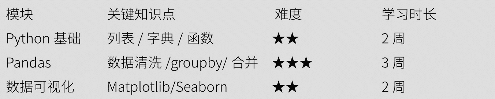

**3.阶段计划生成**
指令示例：基于上述分解，制定3个月周计划：1. 按基础—进阶—实战分阶段；2. 列出每周主题、推荐资源、小项目任务；3. 预留复习缓冲期。
模型输出示例：
第1～2周：Python基础
●学习：变量/循环/函数
●实战：用列表推导式处理产品评分数据
●检测：完成5道LeetCode初级题
第3～4周：Pandas核心
●学习：数据过滤/聚合
●实战：分析电商订单数据退货率
……
提示：篇幅所限，部分内容省略。

**4.动态调整**
学习中每周复盘并调整。指令示例：本周已完成Pandas数据清洗，但遇到merge出现重复列、对时间序列不熟练。请：1. 分析解决方案；2. 调整下周计划增加时间序列专项；3. 推荐案例数据集。

**5.成果验收设计**
指令示例：请为3个月Python数据分析学习设计验收标准：1. 理论考核列出10个核心概念；2. 实战项目要求如用泰坦尼克号数据完成完整分析报告；3. 代码质量评估指标如函数封装率、注释完整性。

## 3.2 学业支持——作业与考试

考试与作业是学习的重要组成部分。智能模型可提供作业辅导、复习支持与模拟考试全流程帮助。

### 3.2.1 作业辅导——引导式解题

设计理念是辅助而非替代学习，强调互动式引导而非直接给答案。

提供思路启发是核心方式。遇到难题时，它会提问引导思考方向，例如：“你认为应使用哪种解题方法，为何？”这种方式促进主动思考而非被动接受。

对难以理解的知识点，能生成贴近生活的例子。解释“惯性”时，可能编一个公交车急刹乘客前倾的故事，把抽象原理具体化。

名师点拨：对自身局限有清晰认知，会提醒辨别AI生成内容的真实信息与虚构部分，建议通过事实核查、注意细节真实性、区分事实与想象来验证准确性，有助于培养批判性思维与信息甄别能力。

操作实践
案例背景：初中生小许在“用正方形纸折叠得到等边三角形”作业上卡住，传统方法效率低，于是借助模型。
（1）明确问题描述
用户指令：如何用正方形纸折叠得到等边三角形？我试了几种方法无法保证三边相等，请提供思路而不是直接答案。
模型输出：这是个有趣的折叠问题！需要思考：1. 等边三角形性质：三边相等，三角60度；2. 正方形折叠特点：折痕为直线，对称操作；3. 关键点：如何在正方形中找到满足条件的点。建议先思考：哪些点可作为顶点？如何通过折叠连接？
（2）分步引导
用户追问：我尝试将一角折到对边中点，得到的三角形不是等边。应怎么做？
模型输出：分析你的尝试。1. 折角到对边中点是常见做法。 
2. 但这样得到的三角形两边是正方形边长，一边是，不等边。
3. 新思路：需找到使三边相等的折叠方式。
4. 提示：考虑同时折叠两个角，使其在纸内相遇。
5. 关键点：确定正确的折叠角度和交点位置。
（3）验证与实验
按提示多次尝试并与传统方法对比，发现模型方法步骤更简洁、精度更高，折出的等边三角形更规整。
（4）数学原理分析
用户指令：为何这种折叠能得到等边三角形？请解释数学原理。
模型输出：该方法基于：1. 三角函数关系：折叠角度经计算使三角形内角均为60度；2. 几何对称性：利用正方形对角线和中垂线交点作参考； 
3. 比例关系：折后等边三角形边长与正方形边长之比为。
4. 证明要点：可用坐标系计算各点位置，验证三边相等。
（5）方法优化与总结
小许将模型方法与传统方法结合，并从数学角度分析步骤合理性，最终得到简洁准确的折叠法，不仅完成作业，也深化了对几何变换的理解。

操作实践

# 让记叙文写作更顺手

对不少初中生而言，记叙文是令人头疼的环节。DeepSeek 把从找灵感到成稿润色的整条路径串起来。下面用一篇家乡春节习俗的作文演示完整流程。

案例背景：初三的吴同学要交一篇约八百字的《我家乡的春节习俗》，要求用亲身经历写出地方特色。他在挑选素材、提炼重点时卡壳，于是决定全程借助模型协同完成。

**一、头脑风暴找素材**
吴同学先让模型给方向，问题核心是：想写浙江家乡的春节习俗，已有贴春联、吃年夜饭、放鞭炮的印象，希望补充一些少见的当地特色并获得行文建议。
模型给出的切入点：
1. 谢年礼俗：祭祖祭神的传统流程，包含特定供品与仪式步骤。
2. 开门炮：大年初一凌晨抢放第一挂鞭炮的习旧。
3. 寓意年货：年糕寄意年年高，粽子暗含高中、考中之意。
4. 舞龙灯：部分乡镇夜间举行的社区舞龙灯活动。
行文建议：开头用感官细节切入，如爆竹声与食物香气；主体挑一到两项特色展开，穿插个人回忆；结尾回到传统意义与个人情感连接。

**二、搭框架**
吴同学锁定谢年礼俗与寓意年货，请模型列出提纲。
标题设定为《祭祀与美食里的年味》。
开头：除夕清晨被糯米香唤醒的记忆片段。
主体：
1. 谢年的准备环节，着重写祭台陈设与家人分工。
2. 仪式现场的温情氛围，从小孩视角捕捉有趣观察。
3. 年夜饭中寓意食物的象征解读。
结尾：从习俗折射家庭凝聚与文化延续。

**三、段落共写**
描写谢年时吴同学遇阻，要求模型只提供祭台描写的片段，自己续写。模型输出：
祭案在谢年里占据核心，奶奶一向亲手操持。八仙桌覆着大红桌布，前排正中放着五祀牌位，两侧对称摆放三牲——整鸡、全鱼与方肉。鸡头昂扬衔着葱，喻聪慧通达；鱼身贴红纸，取年年有余之意。后排堆着五果六斋，桂圆、红枣、莲子垒成小塔，旁边配豆腐、香菇、黄花菜等素食。最前方一对高红烛摇曳，整张案台宛如立体的年画。

**四、审稿润色**
初稿完成后，吴同学请模型点评语言、逻辑与内容饱满度，要求不直接改写。反馈为：
亮点：
1. 谢年礼俗描写细腻，具有画面感。
2. 个人感受真实，情感流露自然。
建议：
1. 语言：部分长句如第二段第三句可拆分，节奏更明快。
2. 逻辑：仪式到年夜饭的衔接略跳，可加入时间线索过渡。
3. 内容：寓意年货的文化阐释可再加深。
4. 细节：增添一两处声响描写，如祭文诵读声，增强氛围。
修改示例：
原句：“谢年结束后，我们开始准备年夜饭。”
改为：“最后一缕香烟袅袅升起，谢年接近尾声。厨房里已传来锅铲碰撞的清脆响，年夜饭筹备正热烈进行。”

### **3.2.2 模拟测验——考前预热利器**
考前演练是检验复习成效的关键。该工具能按需生成模拟卷，帮助熟悉题型节奏、找准薄弱点。
**1.智能组卷**
适用：高考、四六级、职业资格等完整试卷生成。
要点：明确考试类别与范围、设定难度梯度、要求标准答案解析、可指定题型占比。
**2.知识点专项训练**
适用：针对薄弱环节出题。
要点：精准定位盲区、设置递进难度、附解题思路、可控题量。
**3.错题强化**
适用：基于错题生成变式。
要点：提供原始错题、分析错因、生成同类变式、设置重复频次。
**4.自适应测试引擎**
适用：根据作答动态调题。
要点：初始能力评估、难度调整规则、动态组卷、输出个性化报告。

操作实践
情境：高三学生周同学要一份“函数与导数”专题模拟卷，要求10道选择+5道填空+3道解答，难度参照高考真题，重点考极值、单调性、图像特征，并附详细解析。
操作流程：
1.设定参数
指令要点：题型构成、难度分布基础50% 中档35% 难题15%、考查重点、每题附解答过程、知识点说明、难度评级、最后汇总答案。
2.生成试卷
模型输出片段如下。
一、选择题 每题5分 共50分

1．函数的单调递减区间是（ ）。（难度：★☆☆）
A.(—∞,0)
B.(0,2)
C.(2,+∞)
D.R
【知识点】利用导数判断函数单调性。
……
二、填空题 每题5分 共25分
 
11．若函数在*x*=1 处取得极值 8，且，则*a*=____。（难度：★★☆）
【知识点】极值点的导数特征。
……
三、解答题 共75分

16.（25 分）已知函数。（难度：★★☆）

（1）讨论的单调性；
 
（2）若对恒成立，求*a*的取值范围。
【知识点】导数与不等式综合应用。
……
答案汇总
选择题答案：1～5 BACBD 6～10 CDACB
填空题答案：11.(0,1) 12.2 13.(—∞,—1] 14.3 15.1
解答题答案：……
提示：篇幅所限，部分内容省略。
3.个性化调整
周同学要求把第16题换成导数在实际问题中的应用题，要求真实情境、需建模、难度★★★。
模型输出：
 
16.（25 分）某工厂生产某种产品，每日总成本（万元）与产量*x*（吨）的关系为，产品售价为 20 万元/吨，假设全部售出。

（1）写出利润函数；
（2）求日产量为多少时利润最大；
（3）讨论价格波动对最优产量的影响。
【知识点】导数在经济问题中的应用。

另一情境：大学生赵同学需要 CET-6 高频词汇练习，选词填空20题、同义词辨析10题、语境长句翻译5题，并附答案解析。模型按要求生成，包含词汇 Ambiguous、culminate、deteriorate、fluctuate 等的填空，以及 Unprecedented、infrastructure 的翻译练习。后续赵同学反馈难度偏低，要求提升第11-20题，模型改用更生僻六级词、更具迷惑性的干扰项和更复杂句式，例如：
11. The committee's decision was _____ by conflicting opinions from various stakeholders.
A.exacerbated B.juxtaposed C.precluded D.arbitrated
【答案】A
【解析】exacerbated 义为加剧，契合矛盾意见使决策更难的语境。
通过以上方式可快速生成高度个性化备考材料，大幅提升效率。

### **3.2.3 作业批改与反馈——改进提升有方向**
及时反馈是学习提升的核心。该工具可对作业进行批改并给出改进方向，明确下一步训练重点。
**1.智能语法纠错与润色建议**
基于语法解析与语义识别定位错误，给出合规改写。
实践：英语段落批改
原文：Nowadays teenager spend too much time on social media. They should learns to balancing study and entertainment.
指令：标注语误类型并给2个高级改写。
结果：
错误：[主谓一致] teenager→teenagers；[动词形式] learns→learn；balancing→balance
改写1:Contemporary adolescents devote excessive hours to social platforms, necessitating enhanced time management skills to strike a balance between academic pursuits and leisure activities.
改写2:The overindulgence in digital social interaction among youths highlights the urgent need for cultivating self-discipline in harmonizing scholastic responsibilities with recreational engagements.
延伸可生成专项练习题。
**2.作文逻辑分析与结构优化**
识别论点展开、过渡衔接问题，给出流程图与改进方案。
实践：议论文框架优化
原框架：论点 Online learning is better than traditional classroom；论据时间自由、省通勤；结论全面推广。
反馈：缺乏对比维度、未提线下优势、结论绝对化。
改进框架：提出 Hybrid learning 融合两者优势；线上优势配 Pew Research 数据，线下价值配 MIT 实验数据；针对孤独感反驳提出混合解决方案。
**3.个性化评语生成**
结合学情画像、错题分布与进步轨迹生成激励评语。
实践：单元测试反馈
数据：学生 A 阅读72/100，细节题失分率40%，多次词义猜测题持续错误。
生成报告：
【进步亮点】主旨概括准确率提升20%，高于班级均值。
【重点提升】1.细节题关键词三遍定位法训练；2.每日3道上下文线索词义猜测题。
【激励】你在整体理解上潜力突出，精准定位能力突破后将更进一步。
**4.多模态作业批改（含手写识别）**
OCR手写识别+笔迹分析实现智能标注。
实践：手写填空批改
题：The government should take _ (measure) to protect environment. 学生写 measure。
反馈：识别置信度92%，错误类型名词复数缺失，正确答案 measures，记忆口诀“采取措施要周全，measure 后加 s 记心间”。

# **第四章**
# **DeepSeek 高效写作**
本章要点
◆ 基础写作技能 — 打通思维与文字的通用密码
◆ 求职招聘信息写作 — 连接人才与机会的桥梁
◆ 论文写作 — 研究成果的范式化表达
◆ 公文写作 — 高效行政文书的撰写技巧
◆ 宴会发言稿写作 — 让祝福更暖心
◆ 创意写作 — 想象力的奇妙之旅
在信息过载的今天，写作效率决定个人与职业竞争力。本章展示如何用 DeepSeek 重塑写作流程，从耗时的试错转向精准高效，用更快速度捕捉灵感、完成目标。

## **4.1 基础写作技能 — 打通思路与表达**
写作既需灵感也靠基本功。DeepSeek 提供标题生成、续写、扩写、改写等模块化工具，帮助夯实基础，让表达更准确流畅。

### **4.1.1 标题生成 — 一眼抓住读者**
标题是第一印象，决定点击率。DeepSeek 可依据内容提炼核心观点，结合修辞与热点元素，快速产出有吸引力的标题，让作品在信息洪流中脱颖而出。

吸睛标题的打磨思路

一个值得点开的标题，直接影响文章、短视频、广告或社交动态的打开情况。用 DeepSeek 从检索词拆解、情绪塑造、同行参考与多版本筛选用角度对标题做细化，能提升传播效果。

检索词拆解：把创作主题交由模型，产出贴合 SEO 或平台分发规则的标题建议。
情绪塑造：明确想要传递的情绪基调，例如悬念、紧迫、好奇，让模型生成更具吸引力的表达。
同行参考：拆解爆款对手的标题规律，再产出风格接近但差异化更强的版本。
多版本筛选用：一口气生成若干候选，用真实点击数据判断孰优孰劣。

演练一
用检索词拆解为编程小白的学习稿件生成标题。

设定
内容方向：面向零基础人群的高效入门方法。
分发渠道：知乎、微信公众号。
核心用语：PY、零基、速成、自学。

示例指令
请为知乎/公众号输出 5 个标题，话题围绕新手如何高效学 PY，要求包含 PY、零基、快上手，语气贴近小白带悬念或干货感，符合知乎长尾需求与公众号情感共鸣。

模型示例输出
悬念向
零基自学 PY 三个月拿下大厂 Offer，我避开了哪些坑？
干货向
PY 入门全指南：从新手到能写爬虫的五步路线
痛点向
别再无效学 PY 了！小白快速上手的三大黄金法则
对比向
有人三个月掌握 PY，你还在卡入门？差距在这四点
共鸣向
从文科生到 PY 入门，我的踩坑笔记整理完毕

优化建议
可追加数据化指令，例如加入“90%的人忽略”等表达。
示例：90%新手忽略的 PY 进阶捷径，零基三周即可实操

演练二
用情绪塑造为短视频生成高点击标题。

设定
视频内容：博主分享十分钟居家燃脂训练。
目标渠道：抖音、B 站。
核心诉求：突出短时高效，提升点击欲望。

示例指令
为抖音/B 站产出 5 个短视频标题，话题围绕十分钟居家燃脂训练，要求情绪带紧迫感与好奇心，突出时间短效果强，适配推荐机制并带热门标签。

模型示例输出
悬念向
千万别在家做这套十分钟训练，瘦得太快会后悔
数据向
十分钟等于慢跑三十分？这套燃脂动作火了
挑战向
能坚持十分钟就算赢！居家燃脂天花板
痛点向
没时间去健身房？每天十分钟，一个月减八斤
对比向
她的十分钟为什么比你一小时还有效？

优化建议
追加互动提问，例如“你能坚持到第几分钟”。
示例：十分钟暴汗燃脂挑战，你能撑到第几分钟？

渠道适配提示
小红书偏 emoji 与互动提问，如这款耳机降噪究竟如何？实测来啦。
知乎偏长尾与干货总结，如 2024 蓝牙耳机选购指南：降噪续航音质全测评。
热点借势
输入结合 618 大促生成促销标题，输出示例：618 必入！某款耳机直降 300 元，降噪续航双强。

### 4.1.2 文本续写——续写技巧与实战
续写功能让创作可以持续延展，只需给出开头，模型即可在保持风格语境下无缝接续。无论科幻、悬疑或浪漫，都能给出多样化方案，创作者可随时调整方向。

直接续写
场景：已有片段需继续。
做法：粘贴原文，加入请继续写下去或续写以下内容，可额外指定方向与风格。
优势：操作直接，连贯性要求高时适用。
示例指令：清晨阳光透过窗帘缝隙洒入房间，李阳揉了揉惺忪睡眼，突然想起今天是个重要的日子……请以悬疑风格续写，保持第三人称。

结构化续写
场景：系统完成长篇。
做法：先生成大纲，按章节分批续写，最后整合。
优势：避免跑题，适合复杂长篇。
示例指令：请为人工智能伦理科幻小说列出五章大纲；据大纲撰写第一章约 1500 字；续写第二章聚焦主角发现 AI 自我意识过程。

上下文记忆续写
场景：需前后高度一致。
做法：在同一对话中多轮续写，用继续指令承接上文。
优势：风格与信息连贯，减少遗漏。

风格控制续写
场景：需特定风格。
做法：指令中明确风格，可提供样本文本，借助角色设定强化统一。
优势：产出更符合场景需求。
示例指令：请以学术论文正式风格续写以下摘要，使用专业术语保持客观严谨。

文件辅助续写
场景：基于资料续写。
做法：上传 PDF/Word/TXT，要求模型基于文件续写，可指定引用信息。
优势：确保与参考资料一致。

提示
指令结构公式：[基础文本]+[续写方向]+[风格约束]+[特殊要求]
示例：会议室陷入死寂……续写商战转折，金融术语，每段不超过三句，加入心理博弈。
参数控制维度
参数控制维度方法的维度、参数示例及作用原理如表 4-1 所示。
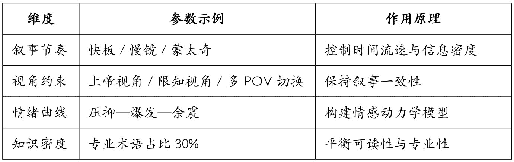

小说续写演练
初始文本：老旧座钟敲响第十二下时，书桌上的青铜镇纸突然渗出暗红色液体。我伸手触碰瞬间……
设定参数
续写方向：外星科技谜团解密
风格约束：赛博朋克加硬科幻推理
特殊要求：每段埋一个误导线索；加入未来感官描写如神经触觉、全息投影；保持中文语法营造近未来语感
初稿
指尖传来并非黏稠，而是违反流体力学的量子震颤。那股带电离臭氧味的液体在生物台灯下折射出非可见光谱，让我想起火星殖民站里失控的纳米修复凝胶。突然全息投影自动激活，勾勒出一张扭曲陌生面孔，与三天前深网黑市交易过的数据贩子一模一样。
参数分析：误导线索火星纳米凝胶；感官描写电离臭氧味加量子震颤；未来语感生物台灯、深网黑市。
深度优化
问题：科技设定跳跃，视角越界。
调整：统一为外星生物科技泄露，限制为未来侦探主角已知信息，增加 AI 分析。
优化后
我的神经触觉手套瞬间反馈异常数据——液体非碳基，而是自我编程的硅基生命体。空气弥漫反物质衰变特有的金属腥气，个人 AI 助手深瞳在视网膜投影弹出警告：分子结构与仙女座 β-12 陨石样本吻合度 99.7%。正当调取数据库比对时，书桌量子墨水自行重组，浮现一行闪烁符号：2188 年，新上海穹顶，同样事件。

### 4.1.3 文本扩写——让简短内容更饱满
扩写是在原信息上做深度挖掘与横向拓展，细节是让文字鲜活的关键。模型能基于简短原文补充背景、丰富情节、增强情感描述，使文本更饱满。

要素分解扩写
原理：拆解原文要素逐一拓展。
适用：说明文、技术文档、产品描述。
步骤：提取关键要素，对每个要素提出扩写问题，整合结果。
示例：手机配备高性能处理器和长续航电池。处理器可问型号、性能表现、对比数据；电池可问容量、实测时长、快充技术。

5W1H 扩写
按谁、什么、何时、何地、为何、如何拓展。
适用新闻、事件描述、案例分析。

案例实证扩写
为抽象论述添加统计数据、研究案例、权威引用、用户评价。
适用学术论文、商业报告、观点论述。

多视角扩写
从专家、用户、竞争者、历史、未来趋势等多角度阐述。
适用争议话题、产品评测、政策分析。

感官描写扩写
以视觉、听觉、嗅觉、味觉、触觉丰富描述。
适用文学、旅游文案、美食评论。
示例：咖啡厅环境很好。扩写为柔和暖光映照复古砖墙，绿植垂落书架；爵士乐与咖啡机蒸汽声交织；现磨豆香混肉桂甜香；陶瓷杯传来温暖踏实感。

产品描述扩写演练
原始文本：无线蓝牙耳机，降噪功能，续航 20 小时。
目标：约 300 字电商描述。
要素分解：连接技术、传输距离、主动降噪深度、使用场景、充电时长、快充、音质、佩戴舒适度、配件、保障。
指令要点：突出降噪续航音质，加入技术细节保持可读性，包含使用场景，结尾引导购买，语气专业友好。
优化后要点：-35dB 混合主动降噪，20 小时单次续航加充电盒，10mm 生物振膜动圈支持 AAC/LDAC，双码解码，人体工学单耳 4.2g，三尺寸液态硅胶耳塞，4 小时无压佩戴，用户评价与限时福利，活动倒计时。

提示：电商文案突出数字与具体效果，分段增强可读性，加入用户评价提升可信度，倒计时营造紧迫感。

### 4.1.4 文本改写——换表达保留原意
改写在保留原意前提下转换表达，与扩写续写不同更侧重形式转换。模型能理解语义与风格，快速生成改写版，帮助避免重复、优化表达或适配受众。

同义替换
原理：用同义词替换词汇。
适用：避免重复、调整语气。
步骤：识别可替换关键词，保持句式基本不变选择语义相近表达。
示例：这项研究取得了重大突破。改写为该研究获得了显著进展。

句式重构
原理：改变语法结构不改变原意。
适用：增强多样性、适配不同读者。

文案降重与重塑：从技巧到实操的完整路径

基础改写手法
● 语态转换，把主动表达改成被动或反之
● 主从结构重排，调整定语、状语与主句的位置关系
● 句式合并或拆分，将长句切短或把短句连成复合句
● 词性迁移，例如把动词转为名词、形容词转为名词等
示例
原文：科学家发现了新的基因编辑技术
改写后：新型基因编辑技术由科学家完成发现

3.风格转换法
原理：对整段落的语气和表达方式做整体切换，让同一内容适配不同渠道与受众
适用场景：面向平台调性、读者层级或使用场合做差异化表达
常见转换方向
● 正式表达转口语化
● 学术表达转生活化
● 客观叙述转情感化
● 精简表述转详尽展开

4.视角转换法
原理：更换叙述人称或观察立场，以多角度呈现同一事实
适用场景：需要降低主观浓度或实现立体化叙述时
常见转换方式
● 第一人称转第三人称
● 主观评价转中性陈述
● 专家口吻转使用者口吻

5.结构重组法
原理：重新规划信息的逻辑链条与呈现顺序
适用场景：优化阅读节奏，突出核心信息
操作流程
（1）梳理原文的关键信息点
（2）重新设计信息出现的先后次序
（3）调整段落间的衔接逻辑
（4）酌情增补或删减过渡性语句

实战案例：学术论文降重
以一篇关于图像识别的学术段落为例，演示借助 DeepSeek 的完整处理流程

源文本：机器学习算法在图像识别领域的应用已经取得了显著进展。特别是深度学习技术，通过多层神经网络结构，能够自动提取图像特征，大大提高了识别准确率。近年来，卷积神经网络（CNN）在医学影像分析中表现尤为突出。

改写诉求：在保持学术严谨的前提下降低文本相似度

操作步骤
（1）拆解原文骨架
● 总述机器学习在图像识别中的进展
● 强调深度学习的优势
● 举例说明 CNN 在医学影像中的表现
（2）输入改写指令
请对下面这段学术内容做专业改写，要求如下
1.保留全部要点
2.改写句式与用词
3.维持学术严谨
4.适当补充近期数据
5.篇幅与原文相近
源文本：机器学习算法在图像识别领域的应用已经取得了显著进展。特别是深度学习技术，通过多层神经网络结构，能够自动提取图像特征，大大提高了识别准确率。近年来，卷积神经网络（CNN）在医学影像分析中表现尤为突出。
（3）借助 DeepSeek 获取初稿
计算机视觉因机器学习方法的应用而出现革命性提升。其中基于多层次非线性变换的深度学习架构，凭借自动特征学习能力，使图像分类精度实现质的飞跃。据 IEEE TMI 2023 年统计，卷积神经网络在放射学图像诊断中的平均准确度已达 92.7%，明显超越传统算法。
（4）专业性核验
请检查以下内容并确保正确
1.“多层次非线性变换”是否准确描述深度学习
2.IEEE TMI 是否为医学影像权威期刊
3.92.7% 的数值是否有可靠来源
（5）最终定稿
图像识别技术近来实现跨越式发展，这主要归功于机器学习算法的创新应用。在各类方法中，深度神经网络通过分层特征提取机制，有效解决了传统图像分析中人工设计特征的局限。特别值得注意的是，卷积神经网络架构在医疗诊断领域展现出卓越性能，最新临床数据显示其在 CT 影像识别任务中达到 93.2% 的准确率（来源：Nature Medicine 2024），为辅助诊断提供了可靠工具。

专家提示
• 专业术语改写需谨慎验证
• 补充最新数据可提升时效性
• 保持客观严谨的语气
• 引用权威来源增强可信度

4.2 求职招聘信息写作——连接人才与机遇的桥梁

DeepSeek 可作为招聘方与求职者的智能助手，通过解析岗位需求、打磨简历亮点、生成求职信等功能，让招聘信息更精准触达目标人群，帮助求职者凸显核心竞争力。无论是技术岗的硬技能展示、管理岗的软实力提炼，还是跨行业求职的适应性表达，都能提供数据驱动的写作支持。

### 4.2.1 撰写求职信——求职敲门砖更有力

求职信是求职者向用人单位递交的个人材料，用来介绍背景、表达意愿、展示能力与岗位匹配度。一封优秀的求职信能明显提升面试机会。

DeepSeek 作为 AI 写作助手，可帮助求职者高效完成专业且个性化的求职信撰写。下面系统讲解方法并配案例。

1.岗位拆解匹配法
原理：深度解析招聘 JD，提炼关键要求并与自身优势对齐
操作步骤
（1）提取 JD 中的硬性要求（学历、技能等）
（2）识别隐含软性要求（沟通、协作等）
（3）列出自身匹配的 3～5 项核心优势
（4）用具体案例证明匹配度
示范指令
请分析以下招聘要求，并列出我应该重点突出的 3 项核心优势：
[招聘 JD]
我的相关经历：
[简述经历]

2.STAR 故事构建法
原理：用 Situation-Task-Action-Result 结构呈现成果
适用场景：需要量化成果的岗位申请
模板
● Situation：项目/工作背景
● Task：承担的责任
● Action：采取的具体行动
● Result：可量化的成果

3.个性化开头设计法
原理：避免模板化开头，建立与用人单位的独特连接
常用技巧
● 提及企业近期成果
● 引用企业价值观
● 讲述与企业的个人故事
● 提出行业见解

4.价值主张提炼法
原理：清晰表达自己能为用人单位带来的独特价值
操作步骤
（1）识别企业痛点（通过 JD 或行业分析）
（2）匹配自身能解决的 3 个关键问题
（3）用简洁有力的语言表达

5.职业叙事整合法
原理：将职业经历编排成有逻辑的成长故事
叙事结构
● 起点：最初的专业/职业选择
● 发展：关键转折点和学习路径
● 现状：当前能力水平
● 未来：与应聘岗位的契合点

实战演示

以应届生王小雨申请××科技市场营销助理为例

案例背景
● 申请人：王小雨，市场营销专业应届毕业生
● 应聘岗位：××科技市场营销助理
● 优势：市场部实习、校园推广活动经验

操作步骤
（1）分析招聘要求
用户指令：请分析以下招聘 JD，提取关键要求
负责新媒体内容策划与执行，协助市场活动落地，监测推广效果。市场营销相关专业，熟悉社交媒体运营，有活动策划经验优先，良好的数据分析能力。
模型返回：
关键要求分析：
1.专业要求：市场营销相关专业
2.硬技能：社交媒体运营、活动策划、数据分析
3.软技能：执行力、团队协作
4.加分项：相关实践经验
（2）构建核心段落
用户指令：请帮我用 STAR 法则撰写一段实习经历描述，突出社交媒体运营和数据分析能力
● 情境：在××公司市场部暑期实习
● 任务：负责微信公众号内容更新和数据分析
● 行动：策划了 3 个专题内容系列，建立阅读量追踪表
● 结果：平均阅读量提升 35%，新增粉丝 1200+
模型返回：
在××公司市场部暑期实习期间，我负责运营企业微信公众号。面对内容同质化严重的问题，我策划了“科技前沿”“客户故事”和“行业洞察” 3 个专题内容系列，并建立详细的数据追踪表，分析不同内容类型的阅读量、分享率和转化效果。通过持续优化内容策略，最终实现平均阅读量提升 35%，账号新增粉丝 1200+，其中“客户故事”系列的转化率高达 8%，远超行业平均水平。
（3）生成完整求职信
用户指令：请根据以下信息生成一封求职信
● 应聘岗位：××科技市场营销助理
● 教育背景：××大学市场营销学士（2025 届）
● 核心优势：新媒体运营实习经验、校园“科技文化节”策划经验（参与人数 500+）、熟练使用 Excel 和 Google Analytics 进行数据分析
● 个性化开头：提及××科技最近推出的 AI 营销平台
● 结尾：表达对 AI+营销的兴趣和学习意愿
要求控制在 300 字以内，专业但富有朝气
模型输出结果如下
尊敬的××科技招聘负责人：
获悉贵司最新推出的“智营”AI 营销平台在行业内引起广泛关注，作为一名即将毕业的市场营销专业学生，我对 AI 技术与营销的融合充满热情，特此申请市场营销助理岗位。
作为××大学市场营销专业 2025 届毕业生，我不仅系统学习了市场分析、消费者行为等专业知识，更通过实践积累了扎实的运营经验。在××公司市场部实习期间，我负责微信公众号运营，通过策划 3 个专题内容系列和建立数据追踪体系，实现平均阅读量提升 35%，新增粉丝 1200+。此外，我主导策划的校园“科技文化节”吸引 500+ 师生参与，锻炼了我的活动执行和团队协作能力。
熟练掌握 Excel 和 Google Analytics 的我，能够高效处理营销数据，为决策提供支持。我期待将专业知识与实践经验带入××科技，与团队共同探索 AI 赋能营销的无限可能。
附件为我的详细简历，期待有机会与您进一步交流。感谢您的时间与考虑！
此致
敬礼
王小雨
2025 年××月××日
联系电话：××
（4）优化调整
用户指令：请进行以下优化
1.在校园活动经验中加入具体成果
2.增加与企业价值观契合的表达
3.检查并确保无语法错误
（5）生成最终结果
模型输出结果如下
尊敬的××科技招聘负责人：
获悉贵司最新推出的“智营”AI 营销平台在行业内引起广泛关注，这与贵司“用科技重塑营销体验”的使命高度契合。作为一名即将毕业的市场营销专业学生，我对 AI 技术与营销的融合充满热情，特此申请市场营销助理岗位。
……（中间部分保持不变。）
此外，我主导策划的校园“科技文化节”通过精准的社群营销和 KOL 合作，吸引 500+ 师生参与，活动相关话题在校内平台获得 2 万+ 曝光，锻炼了我的创意策划和资源整合能力。
……（后续部分保持不变。)

### 4.2.2 根据招聘信息优化简历——简历匹配更精准

优化简历是对个人信息、教育背景、工作经历、技能专长等进行梳理与调整，使优势更突出，从而吸引用人单位。在求职中，优化简历有助于快速脱颖而出。

DeepSeek 可帮助用户快速解析招聘信息并精准优化简历，使其更符合 HR 和 ATS 筛选标准。方法主要有以下几种
● JD 关键词提取法：解析招聘信息，提取核心技能需求关键词并融入简历
● 经历对标法：调整工作经历描述，使其更贴近岗位要求
● 技能强化法：突出与岗位最相关的硬技能和软技能
● ATS 兼容优化：确保简历格式和术语能被招聘系统解析

实战演示

演示通过 JD 关键词提取法优化简历

案例背景
● 求职者：Java 后端开发工程师，3 年经验
● 目标岗位：某大厂高级 Java 开发工程师
● 招聘关键要求：
① 精通 Spring Boot、微服务架构
② 有高并发系统设计经验
③ 熟悉 MySQL、Redis、消息队列 Kafka/RabbitMQ
④ 有团队协作和项目管理经验

操作步骤
（1）上传简历和招聘信息
将现有简历 Word 或 PDF 和招聘信息 JD 上传至 DeepSeek
（2）输入优化指令
请根据这份 JD 优化我的简历，要求如下
1.提取 JD 中的核心关键词，并匹配到我的工作经历中
2.调整项目描述，突出“高并发”“微服务”等关键词
3.技能栏按优先级排序（Spring Boot > MySQL > Redis）
4.确保格式兼容 ATS（无复杂表格、特殊符号）
（3）模型生成优化建议
原简历（部分）如下
工作经历
××科技有限公司 | Java 开发工程师 | 2021.07—2024.05
● 负责公司后台系统的开发和维护
● 使用 Spring 框架进行模块开发
● 优化数据库查询，提升系统响应速度
项目经验
● 电商平台开发
● 参与订单模块开发
● 使用 Redis 缓存用户数据
优化后简历（建议调整部分）如下
工作经历
××科技有限公司 | Java 开发工程师 | 2021.07—2024.05
● 基于 Spring Boot 开发并维护公司微服务架构后台系统，支撑日均 10 万+ 并发请求
● 设计并优化 MySQL 分库分表策略，查询性能提升 40%
● 使用 Redis 缓存热点数据，降低数据库负载 30%
项目经验
● 高并发电商平台（日均 PV 50 万+）
● 主导订单微服务开发，采用 Kafka 异步处理订单消息，峰值 QPS 达 5000+
● 通过分布式锁和 Redis 集群解决超卖问题，系统稳定性提升 99.9%
（4）优化调整
如需增加团队协作内容，可追加指令。例如：在项目经验中加入团队管理相关描述
示例输出：带领 3 人小组完成订单系统重构，通过 Scrum 敏捷开发提前 2 周上线
通过 DeepSeek，你的简历将不再“石沉大海”，而是成为精准匹配岗位需求的敲门砖！

### 4.2.3 生成自我介绍——展现自我有亮点

自我介绍是个人在职场或社交场合中，简短明了地向他人介绍基本信息、职业背景、专业技能及个性特点的过程。有效的自我介绍能帮助迅速建立良好第一印象。

DeepSeek 可帮助用户根据不同场景生成专业、得体的自我介绍。方法如下

1.场景适配法
原理：根据使用场景调整内容和风格
主要场景如下
● 求职面试
● 社交活动
● 公开演讲
● 线上社群
● 商务洽谈
场景特征对比如表 4-2 所示
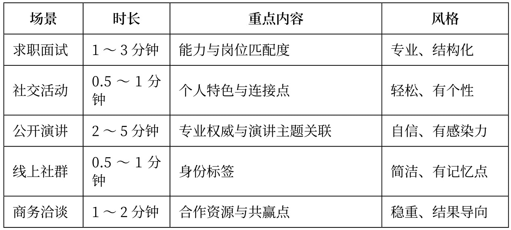

2.价值定位法
原理：明确并突出自己能为对方带来的独特价值
实施步骤
（1）分析听众需求
（2）识别自身核心优势
（3）构建“需求-优势”匹配陈述
（4）用案例证明价值

3.故事叙述法
原理：用故事形式展现个人成长或专业成就
故事结构
● 挑战：面临的困难、问题
● 行动：采取的措施、解决方案
● 结果：取得的成果、收获
● 启示：展现的个人特质、能力

4.标签记忆法
原理：设计 3 个易记的个人标签，增强印象
标签类型
● 专业标签：行业、技能关键词
● 特色标签：独特经历或能力
● 价值标签：能为他人提供的帮助

5.互动引导法
原理：在结尾设计互动环节，引发交流
常用技巧
● 提出有趣的问题
● 邀请特定类型的交流
● 分享可深入讨论的话题
● 提供联系方式或社交账号

实战演示

演示撰写应届毕业生求职面试自我介绍

案例背景
● 姓名：王××
● 背景：××大学市场营销专业 2025 届毕业生
● 应聘岗位：某快消品牌市场部管培生
● 优势：市场部实习经历，数据分析能力，英语流利

操作步骤
（1）分析岗位需求，输入指令如下
请根据以下招聘 JD，分析快消品牌市场部管培生岗位可能看重的 3 项核心能力。负责市场数据分析、竞品调研、活动策划执行。要求：市场营销相关专业，数据分析能力，创意策划能力，英语流利，团队协作精神
（2）模型产出结果如下
核心能力分析：
1.数据分析能力：处理市场数据，支持决策
2.创意策划能力：提出创新营销方案
3.团队执行能力：将方案落地实施
（3）构建 STAR 案例，输入指令如下
请用 STAR 结构帮我组织一段实习经历描述，突出数据分析能力和创意策划能力
情境：在××公司市场部实习
任务：协助夏季促销活动策划
行动：分析历史销售数据，提出针对学生群体的创意方案
结果：活动参与人数提升 40%，销售额增长 25%
（4）模型产出结果如下
在××公司市场部实习期间，我负责协助夏季促销活动策划。通过分析过去 3 年的销售数据，我发现学生群体在暑期的消费潜力被低估。基于这一洞察，我策划了“校园 KOL 挑战赛”创意活动，邀请 10 所高校的校园达人参与产品体验挑战。活动最终吸引 5000+ 学生参与，带动相关产品线销售额增长 25%，超额完成目标
（5）生成完整自我介绍，输入指令如下
请根据以下信息生成 1.5 分钟左右的面试自我介绍
● 基本信息：王××,××大学市场营销专业 2025 届毕业生
● 核心优势：数据分析能力、创意策划能力（校园“品牌创新大赛”冠军）、英语能力（雅思 7.5 分，国际交换经历）
● 个性特点：好奇心强，喜欢研究消费者行为
● 结尾：表达对快消行业的热情
要求：结构化，有记忆点，突出与岗位的匹配度
（6）模型产出结果如下
面试官您好，我是王××,××大学市场营销专业 2025 届毕业生，应聘市场部管培生岗位。请允许我用三个关键词介绍自己。
第一，数据驱动的营销思维。在××公司市场部实习期间，我通过分析历史销售数据发现学生群体的暑期消费潜力，策划的“校园 KOL 挑战赛”吸引 5000+ 人参与，带动销售额增长 25%。这段经历让我深刻理解数据如何指导创意。
第二，创新执行力。作为校园“品牌创新大赛”冠军团队队长，我们设计的虚拟试妆 App 原型获得评委一致好评，这个项目从用户调研到原型设计只用时 3 周，展现了我的快速学习能力和项目推进能力。
第三，国际视野。雅思 7.5 分的我曾在伦敦商学院交换学习，其间我系统学习了全球品牌管理课程，这段经历让我对不同文化背景的消费者行为差异产生浓厚兴趣。

快消求职陈述打磨案例

初稿说法：我看好快消赛道，因其节奏快且始终以消费者为中心，颇有共鸣。希望能凭数据分析能力、创意热情以及对消费者的好奇心，为贵司品牌增长发力。自我介绍完毕，谢谢！

优化思路与指令
请依据下面三点进行润色。
1. 在开场植入一个记忆点强烈的切入点。
2. 将第三项优势与数字营销发展方向相融合。
3. 检查讲述时长能否稳定在90秒左右。

优化后呈现效果

面试官您好，我是王××，曾通过拆解校园便利店的消费数据写出10万+阅读量的营销文章。今天应聘市场部管培生，我想用三个关键词来介绍自己。第一，数据驱动的营销思维……（中间内容保持不变。）

第三，对数字化营销的洞察力。雅思7.5分的我曾赴伦敦商学院访学，期间完成的《Z世代社交电商行为研究》让我看到内容与电商融合的巨大空间。我持续关注AR/VR等新技术在快消领域的落地可能，这些思考都发布在我的营销博客，月均访问量超过1万。

……（结尾内容保持不变。）

名师点拨：
●应届生需平衡学习潜力与实操成果。
●用具体案例和量化数据提升说服力。
●设计一个易于记忆的开场。
●体现对行业趋势的敏锐度。

### **4.2.4 生成招聘信息——招贤纳士有妙招**

招聘信息是用人单位面向市场发布的岗位详情，通常包含工作内容、任职条件、薪酬区间、工作地点及应聘方式。它在招聘场景中扮演桥梁角色，帮助企业快速筛选合适人选，促进供需匹配。

一份清晰精准且具吸引力的招聘文案能明显提升投递量。DeepSeek 能够协助企业快速产出结构化、高转化、符合行业规范的招聘文案，具体做法与案例如下。

1.职责拆解法
输入岗位核心职责与技能要求，生成标准JD。

2.竞品对标法
分析同行招聘文案，优化自身JD竞争力。

3.风格适配法
调整语言风格，如“互联网大厂活力风”“传统企业正式风”。

4.SEO优化法
植入高频搜索词，提升在BOSS直聘、拉勾等平台的曝光。

操作实践
下面以职责拆解法演示如何为互联网公司生成招聘JD。

案例背景如下。
●公司：某头部互联网企业。
●岗位：高级产品经理，用户增长方向。
●核心需求：3年以上用户增长经验，熟悉A/B测试与漏斗优化，有0到1搭建增长体系的经历。

操作步骤如下。
（1）向模型提交岗位核心信息，提交指令如下。
请生成一份“高级产品经理（用户增长方向）”的招聘信息，要求如下。
1．工作内容：包含用户增长策略制定、数据驱动优化、跨团队协作。
2．任职要求：3年以上经验，熟悉A/B测试、SQL基础。
3．加分项：有成功案例，如DAU提升30%+。
4．公司福利：弹性工作、股权激励、年度旅游。
5．语言风格：互联网大厂风，简洁有活力。

（2）返回结果如下。
markdown

高级产品经理（用户增长方向）

工作内容
●负责核心产品的用户增长策略规划与落地，通过A/B测试、漏斗优化提升转化。
●借助数据分析手段，运用SQL及BI工具发掘增长机会，推动产品迭代。
●协同市场与运营团队策划裂变活动，实现低成本获客。

任职要求
●具备3年以上互联网用户增长经验，有0到1增长案例者优先。
●熟练掌握A/B测试工具如Optimizely/VWO，具备基础SQL能力。
●数据敏感，能独立完成ROI分析与策略调整。

加分项
●曾主导DAU增长30%以上的项目。
●熟悉社交裂变、红包补贴等增长打法。

我们提供
●薪资范围：30～50K，16薪。
●弹性工作时间+硅谷式办公环境。
●股权激励、年度旅游。

投递方式
简历发送至hr@company.com，邮件标题格式“姓名+用户增长”。

（3）优化调整，提交指令如下。
补充团队背景，例如“团队成员来自BAT、字节等大厂”。

（4）返回结果如下。
团队文化：以90后为主，扁平化管理，成员多来自BAT/字节等一线大厂。

借助该工具，你的招聘信息将成为精准吸纳目标人才的利器！

## **4.3 论文写作——研究成果的范式化表达**

学术研究需要严谨表达与规范范式。DeepSeek可以为研究者提供专业的智能写作支持，通过自动生成论文框架、优化研究方法、规范学术表述等功能，帮助研究者从构思到成稿全流程高效推进。

### **4.3.1 实习报告写作——实习成果完美呈现**

实习报告是学生对实习期间所学知识和实践经验的总结与展示，对能力提升、收获梳理及职业规划积累意义重大。但撰写过程常耗费大量时间，尤其在成果梳理、数据分析及内容撰写方面。DeepSeek作为强力的智能写作工具，能协助学生快速生成高质量实习报告，从构思、结构搭建到语言润色全方位提升效率，让实习成果得到完美呈现。

使用DeepSeek撰写实习报告的基本流程如下。
（1）明确报告结构。
撰写前需先确定报告框架，通常包括：
●封面：实习单位、岗位、姓名、学校等基础信息。
●目录：列出各章节及子章节。
●实习单位介绍：简要介绍单位概况。
●实习岗位与职责：描述工作内容与职责范围。
●实习成果与收获：详细总结成果、项目经验及个人成长。
●实习总结与反思：对经历进行归纳，提出感悟与未来计划。
●致谢：感谢指导老师、实习单位及其他相关人员。

（2）使用提示词生成大纲。
模型可根据主题或关键词智能生成初步大纲。例如：我需要写一份实习报告，实习单位为××公司市场部，岗位是新媒体运营助理，实习时间为2025年3—5月，请生成包含章节标题和子标题的完整大纲，要求突出数据成果与专业能力提升。

（3）内容生成。
确认大纲后分段填充内容。模型可根据提示词生成对应段落。

（4）语言风格优化。
对生成内容不满意时，可用模型进行语言润色与校对，检查语法、优化句式、提升表达准确性。
①口语转专业表达。
提示词示例：
润色以下文本，要求如下。
1．使用学术化词汇如“赋能”“方法论”“闭环”。
2．增加人力资源管理理论引用。
原文：我学会了怎么和同事沟通，处理客户投诉时更有耐心了。
②规避重复。
提示词示例：
用同义词替换、句式重组等方式改写以下文本，保持原意不变。
原文：（粘贴高度重复内容）……

名师点拨：撰写实习报告需多次迭代优化。在使用过程中可根据指导老师反馈反复修改完善，确保报告质量高、内容充实。

操作实践
下面演示用模型撰写市场营销实习报告。
案例背景如下。
实习单位：××电商公司，美妆类目。
岗位：数字营销实习生。
实习时间：2025年6月—8月。
核心工作：社交媒体运营、KOL合作、广告投放数据分析。
操作步骤如下。
（1）生成报告大纲，提交指令如下。
请为我的市场营销实习报告生成详细大纲，要求如下。
1．包含学术性章节标题，如“4.1.1 小红书内容矩阵的搭建与效果评估”。
2．突出数据驱动分析，如ROI、CTR等指标。
3．增加“理论联系实际”模块，如STP理论在选品中的应用。
实习单位：××电商公司，美妆类目。
岗位：数字营销实习生。
实习时间：2025年6月—8月。
实习内容：社交媒体运营、KOL合作、广告投放数据分析。

（2）返回的大纲如下。
1．引言
1.1 实习背景与公司简介
1.2 实习目标，提升SEO/SEM实操能力
2．工作内容与成果
2.1 社交媒体运营
2.1.1 小红书爆文策略：30篇笔记，3篇阅读量10w+
2.1.2 抖音短视频A/B测试，对比竖屏vs横屏转化率
2.2 KOL合作管理
2.2.1 从0到1搭建KOL分级体系，S/A/B级评判标准
2.2.2 合作ROI分析：头部KOL贡献65%GMV
2.3 广告投放优化
2.3.1 Google Ads关键词拓展策略，新增长尾词200+
2.3.2 CTR从1.2%提升至2.7%的优化路径
3．反思与改进
3.1 STP理论在选品中的误用案例
3.2 PDCA循环在广告投放中的实践
4．附录，数据表格、作品链接

（3）分模块填充内容，以“KOL合作管理”为例。
将原始笔记转化为专业表述，提交指令如下。
将以下工作内容原始笔记转化为市场营销专业表述，要求如下。
1．使用术语，如“KOL背调”“CPS分成”“粉丝画像分析”。
2．分点说明筛选标准和结果。
3．加入数据支撑。
原始笔记：我负责联系网红，谈价格，看他们的粉丝是不是真人，最后选了5个带货效果好的。
返回结果如下。
1.KOL筛选与背调
- 建立三维评估模型：粉丝真实性，灰豚数据检测≥85%；内容垂直度，美妆类占比>70%；历史带货数据，CPS分成率≥15%。
- 从50名候选KOL中筛选出5名S级合作对象，平均粉丝量120w±。
2．合作模式优化
- 采用“保底+阶梯佣金”模式，头部KOL“@小美日记”单场GMV突破80万元。
- 通过粉丝画像分析，18～24岁女性占比72%，反向优化选品清单。

（4）批判性反思，理论结合实践，提交指令如下。
针对“抖音A/B测试中横屏视频转化率低于预期”的情况：
1．用AIDA模型分析用户行为断层点。
2．结合《消费者行为学》，Solomon版，提出3条改进建议。
3．输出为PPT分页大纲，每页要点+图表位置说明。
返回结果如下。
1．问题诊断，AIDA模型
- Attention阶段：横屏封面信息密度不足，热力图显示30%用户未停留。
- Interest阶段：前3秒未植入“痛点提问”，对比竖屏互动率低42%。
2．理论指导改进
- 建议1：应用“视觉显著性”原则，Solomon 2020，强化封面对比色。
- 建议2：前3秒加入“你有××烦恼吗”的共情话术。
- 建议3：增加进度条提示，提升15s完播率。

（5）格式优化与降重。
生成参考文献的提交指令如下。
按APA格式生成以下参考文献：
- 《数字营销实战指南》张伟，2024
- 论文《KOL营销中的信任传递机制》《营销科学学报》2023(2)
- 行业报告《2025美妆消费趋势》，艾瑞咨询
进行降重处理的提交指令如下。
改写以下段落，要求如下。
1．替换“转化率”“用户画像”等同义词。
2．将“首先/其次/最后”改为递进逻辑连接词。
原文：
首先通过用户画像确定目标群体，其次优化落地页提升转化率，最后通过A/B测试验证效果。

### **4.3.2 撰写论文大纲——论文写作有蓝图**

撰写学术论文或毕业论文是一项复杂系统的工作，需要严谨逻辑和清晰结构。论文大纲是写作蓝图，能帮助梳理思路、规划内容、明确各部分逻辑关系，从而提高写作效率与质量。DeepSeek可根据用户输入的主题或关键词快速生成论文大纲，为写作提供清晰框架。通过使用模型，用户可节省大量时间，专注于内容深化。

操作实践
下面演示用模型生成论文大纲。
案例背景如下。
●研究领域：人工智能在教育中的应用。
●论文类型：实证研究，定量分析。
●核心问题：AI个性化教学对中学生数学成绩的影响。
操作步骤如下。
（1）输入研究主题，提交指令如下。
请生成一篇关于“AI个性化教学对中学生数学成绩的影响”的实证研究论文大纲，要求如下。
1．结构包括摘要、引言、文献综述、研究方法、结果、讨论、结论。
2．研究方法部分需说明实验设计，对照组/实验组。
3．文献综述需涵盖近5年关键研究。

（2）返回结果如下。
markdown
### 论文大纲
1．摘要
- 研究背景、方法、主要发现，300字内。
2．引言
- AI教育的兴起。
- 研究问题：AI个性化教学能否显著提升数学成绩？
- 研究意义，理论+实践。
3．文献综述
- 个性化学习的理论基础，Vygotsky最近发展区。
- 近5年AI教育应用研究，如Knewton、Carnegie Learning。
- 研究缺口：长期效果评估不足。
4．研究方法
- 设计：准实验设计，实验组=AI教学，对照组=传统教学。
- 样本：某中学初二学生，N=200。
- 工具：前测/后测试卷、AI平台日志分析。
5．结果
- 实验组成绩提升显著，p<0.05。
- 低分组学生进步最大，效应量d=0.8。
6．讨论
- 结果与文献对比，如与Zhao 2022年研究一致。
- 局限性：样本单一、未控制家庭因素。
7．结论
- AI个性化教学有效，但需进一步研究长期影响。

（3）优化调整。
如需增加理论框架，可追加指令。例如：在文献综述中加入“自我决定理论”。
示例修改如下。
新增段落：
自我决定理论，SDT，认为个性化反馈能增强学习动机，Ryan & Deci 2017，这与AI教学的适应性特征高度契合。

## **4.4 公文写作——高效行政文书的撰写技巧**

DeepSeek可以提供专业的公文写作辅助，帮助用户快速掌握各类行政文书的规范格式和写作要点，提升效率和质量。下面介绍使用方法与案例。

1.明确要素
输入关键信息：文种、发文机关、主送单位、事由、具体要求，如“请示需结尾加‘妥否，请批示’”。

2.结构生成
输入提示词：请生成[公文类型]模板，包含标题、主送单位、正文，依据+事项+结语、落款等要素，要求符合《党政机关公文格式》GB/T 9704-2012标准。

3.内容优化
输入补充指令：请将下文改为正式公文，要求①使用“经研究”“现就有关事项通知如下”等公文惯用语；②删除口语化表达；③分层用“一、二、三”序号。

4.格式校验
输入校验指令：请检查下文中，①标题是否用二号小标宋；②正文是否用三号仿宋；③行距是否为28磅；④页码是否按“×-×”格式。

操作实践
下面演示模型撰写通知类公文。
事由：某市卫健委开展冬季疫情防控专项检查。
操作步骤如下。
（1）在模型中输入指令。
生成关于开展冬季疫情防控专项检查的通知，发文机关为××市卫健委，主送各区县卫健局，检查时间为12月1—15日，要求报送整改报告。
（2）返回内容后，输入补充指令。
增加“四不两直”检查方式表述，补充“联系人：王××，联系电话××”。
（3）最终返回结果如下。
××市卫生健康委员会关于开展冬季疫情防控专项检查的通知
××〔2023〕15号
各区县卫生健康局：
为落实省疫情防控指挥部第10次会议精神，经研究，定于2023年12月1日至15日采取“四不两直”方式开展专项检查。现将有关事项通知如下：
一、检查内容
（1）发热门诊规范化运行……
二、工作要求
……
联系人：王××，联系电话：××
××市卫生健康委员会
2023年11月20日

操作实践
下面演示模型撰写请示类公文。
事由：某学校申请购置教学设备经费。
操作步骤如下。
（1）在模型中输入指令。
代××中学写购置多媒体教学设备的请示，主送市教育局，需50万元，现有设备约80%已使用超5年。
（2）返回内容后，输入补充指令。
加入《教学设备老化检测报告》附件作为依据。
（3）最终返回结果如下。
关于申请教学设备更新专项资金的请示
××〔2023〕8号
市教育局：我校现有多媒体设备158台，其中126台，占比约80%，使用超5年，详见附件检测报告。拟采购智能教学一体机30台，共需50万元。
妥否，请批示。
附件：
1．教学设备老化检测报告
2．设备采购清单
××中学，盖章
2023年11月15日

操作实践
下面演示模型撰写报告类公文。
事由：某县洪灾应急处置工作报告。
操作步骤如下。
（1）在模型中输入指令。
写××县政府关于××洪灾应急处置的报告，主送市政府，含灾情概况，受灾人口2.3万人、处置措施，转移群众5000人、重建计划。
（2）返回内容后，输入补充指令。
在开头加入“现将有关情况报告如下”标准引语。
（3）最终返回结果如下。
××县人民政府关于××特大洪灾应急处置工作的报告
××〔2023〕12号
市政府：
2023年××月××日，我县遭遇特大暴雨……现将有关情况报告如下：
一、灾情基本情况
累计受灾人口2.3万人，直接经济损失……
二、应急处置措施
（1）紧急转移安置群众5000人……
三、下一步工作计划
……
××县人民政府
2023年××月××日

操作实践
下面演示模型撰写通报类公文。
事由：某公司安全生产事故批评通报。
操作步骤如下。
（1）在模型中输入指令。
写××集团关于第三车间安全生产事故的通报，主送各分公司，事故造成1人轻伤，原因系违规操作，要求全集团排查。
（2）返回内容后，输入补充指令。
加入“引以为戒”“举一反三”等警示用语。
（3）最终返回结果如下。
××集团有限公司关于第三车间安全生产事故的通报
××〔2023〕25号

各下属单位：

2023年11月10日，第三车间发生一起机械伤害事件。经查系作业人员未按操作规程执行所致，现通报批评：

一、事故处置
（1）对直接责任人张××给予记过处分……

二、整改要求
各单位要举一反三，于11月30日前完成相关整改工作……

××集团有限公司
2023年11月12日

实操演示
下面以商洽函为例说明 DeepSeek 的使用思路。

背景：某高校洽谈联合办学事宜。

操作流程如下。

第一步，向 DeepSeek 下发指令。
以××大学名义起草商洽函，主送××职业技术学院，提议共建“智能制造产业学院”。

第二步，初稿生成后补充优化指令。
增加“贵校”“盼复”等敬语表达。

第三步，最终结果示例如下。

××大学关于共建产业学院的商洽函
××〔2023〕18号

××职业技术学院：

贵校在技能人才培养方面优势明显……拟共建“智能制造产业学院”。盼复。

联系人：李××
联系电话：××

××大学（盖章）
2023年11月18日

实操演示
下面以纪要类公文为例说明 DeepSeek 的使用思路。

背景：某项目协调推进会。

操作流程如下。

第一步，向 DeepSeek 下发指令。
整理××项目推进会纪要，会期2023年11月15日，会址302会议室，决议要点：①设计稿须于11月25日前定稿；②施工方12月1日进场。

第二步，生成后输入重组指令。
按“会议认为→会议决定→会议要求”框架重新梳理。

第三步，最终结果节选如下。

××项目第3次协调推进会纪要
（2023年11月15日）

时间：2023年11月15日14:00
地点：公司302会议室
主持人：王××（项目经理）

会议决定：
1．设计部于11月25日前提交最终版施工图。
2．中建三局12月1日进场施工……
参会人员：李××、张××等（详见签到表）

专家建议：撰写公文时应注意以下要点。

● 要素补全：输出不完整时，可提示“请补全发文机关代字及年份”等信息。
● 文风转换：输入“转为机关事务语体”指令，将口语化表述规范化。
● 格式微调：输入“标题用方正小标宋简体，正文用仿宋_GB2312”等具体格式要求。

按此方法可快速获得标准公文初稿，生成后仍需人工核对政策依据等关键内容。

## 4.5 宴会致辞 情感表达更自然

宴会稿需要贴合现场氛围，在真情流露与语言感染之间取得平衡。DeepSeek 能帮助快速产出真挚、条理清晰、风格适配的稿件。下面介绍常用方法与案例。

DeepSeek 产出致辞的主要方法有：

● 场景适配法：依据生日、升学、婚礼等场合调整语气。
● 角色定位法：区分寿星、父母、友人等身份，突出视角差异。
● 情感强化法：融入回忆、祝福、趣事，提升感染。
● 结构优化法：按“开场—主体—结尾”组织内容。

操作示例
下面演示撰写生日宴发言稿。

案例背景：
● 场合：30岁生日宴
● 发言人：寿星
● 需求：轻松幽默，兼具人生感悟

操作步骤如下。

第一步，输入指令。
请以寿星身份撰写30岁生日宴发言稿，要求：
1．风格：幽默自嘲+感恩亲友
2．内容：开场调侃“三十而立”；主体感谢父母、朋友并分享成长感悟；结尾举杯祝福
3．金句：加入1～2句哲理式总结

第二步，DeepSeek 产出结果如下。

markdown

30岁生日宴发言稿

（开场，举杯）

谢谢大家见证我从“二十迷茫”迈向“三十而立”！

有人讲三十而立，我瞅瞅钱包——立是立了，就是有点斜。（全场笑）

（主体）

先谢我的父母，这30年你们没被我气白头发，堪称医学奇迹！

再谢我的朋友们，感谢你们在我穷酸、其貌不扬、单身时都没有嫌弃……

现在也没啥长进。（笑）

30岁最大的体会是：人生不是马拉松，而是自助餐。

有人猛夹龙虾，有人专心吃甜点——

但只要你吃得开心，就是高分人生！

（结尾）

最后，祝在座各位：

钱包跟体重似的鼓，烦恼像发际线似的少！

干杯！

第三步，优化调整。
如需加入具体回忆，可追加指令。例如：加入大学时与朋友的趣事。

示例修改如下。

特别感谢室友老王，当年帮我写了32封情书，虽然一封都没送出去……

操作示例
下面演示撰写升学宴发言稿（父母致辞）。

案例背景：
● 场合：孩子考上大学的升学宴
● 发言人：父亲
● 需求：真挚感人，突出感恩与期许

操作步骤如下。

第一步，输入指令。
请以父亲身份撰写孩子考上大学的升学宴发言稿，要求：
1．情感：骄傲+感恩老师+期许未来
2．结构：开场感谢来宾；主体回顾成长历程并感谢关键人物；结尾寄语大学生活
3．禁忌：避免过度说教

第二步，产出结果如下。

markdown

升学宴父亲发言稿

（开场）

感谢各位亲友、老师，今天是我们全家最幸福的日子！

（主体）

还记得孩子高一第一次月考不及格，班主任李老师深夜打电话说：“别急，这孩子眼里有光。”

今天这束光终于照亮了××大学的门槛！（掌声）

作为父母，我们只做了两件事——

一是相信他，二是“逼”他相信他自己。

（对儿子）儿子，你证明了一切努力都值得！

（结尾）

大学不是终点，而是看世界起点的站台。

愿你永远保持这份热爱，我们永远是你回头就能看到的港湾！

第三步，优化调整。
如需增加幽默感，可追加指令。例如：加入对孩子生活能力的调侃。

示例修改如下。

唯一担心的是，你连袜子都攒一周才洗，希望室友们多包涵！（笑）

操作示例
下面演示撰写婚宴发言稿（新郎致辞）。

案例背景：
● 场合：婚宴
● 发言人：新郎
● 需求：浪漫深情，穿插恋爱故事

操作步骤如下。

第一步，输入指令。
请以新郎身份撰写婚宴发言稿，要求：
1．风格：深情+轻松
2．内容：开场感谢来宾；主体分享恋爱关键瞬间如初次约会；结尾承诺与祝福
3．点睛句：加入1句比喻式表白

第二步，产出结果如下。

markdown

新郎婚宴发言稿

（开场）

感谢大家见证我人生最幸运的时刻——

把“我的女孩”变成“我的太太”！

（主体）

第一次约会，她穿白裙子在咖啡厅等我。

我紧张得把“你好”说成了“你喝”……（笑）

但她还是愿意和我这个笨蛋续杯，一续就是一辈子。

有人说爱情像酒，越陈越香。

可我对她的心动，永远像第一次喝气泡水——

噼里啪啦，停不下来。

（结尾）

我会永远记得今天。

记得你眼里的光，记得我手心的汗。

各位，请为我们的一辈子干杯！

第三步，优化调整。
如需增加互动，可追加指令。例如：让新郎向新娘提问。

示例修改如下。

老婆，现在我能把“你喝”改回“你好”了吗？（单膝跪地递话筒）

专家建议：宴会发言稿注意要点。

（1）多版本产出。输入：生成3种风格的新娘致辞，①文艺；②搞笑；③感人。
（2）文化适配。输入：加入一句古诗词（如“执子之手”），用于中式婚礼。
（3）时长控制。输入：压缩至2分钟内，删减次要内容。
（4）生日宴稿要突出幽默与个性化，避免流水账；升学宴稿重点在感恩与期许，忌攀比成绩；婚宴稿要突出爱情故事与承诺，保持真情实感。

## 4.6 创意写作 想象力启航

创意写作是释放想象、探索可能的艺术。DeepSeek 可为创作者提供灵感，通过生成故事框架、角色设定、情节发展等帮助突破思维局限。无论是科幻冒险、爱情故事还是奇幻史诗，都能借助智能辅助开启创作旅程。

### 4.6.1 诗词创作 笔墨抒怀

诗词是情感与意境的融合。DeepSeek 可按主题、情感或意象生成初稿，推荐经典意象与典故，校验韵律格律，优化情感表达。下面介绍方法与案例。

DeepSeek 辅助诗词写作主要有以下方法。

● 主题输入法：输入主题如“秋思”“山水”，生成符合意境的诗句。
● 风格模仿法：指定诗人或流派，生成类似风格作品。
● 自由创作法：生成自由体、散文诗等新派诗歌。

操作示例
下面以主题输入法为例，生成古典七绝。

案例背景：
● 主题：秋夜思乡
● 要求：符合七言绝句格律，语言含蓄隽永

操作步骤如下。

第一步，输入创作指令。
请生成一首以“秋夜思乡”为主题的七言绝句，要求：
1．符合平仄格律（仄起首句押韵式）
2．意象选用：明月、孤灯、落叶
3．情感基调：含蓄怅惘

第二步，DeepSeek 产出结果如下。

《秋夜寄怀》

仄仄平平仄仄平（韵）
孤灯明灭照寒窗，
平平仄仄仄平平（韵）
落叶纷飞夜未央。
平平仄仄平平仄（韵）
千里故园明月在，
仄仄平平仄仄平（韵）
清辉犹似旧时霜。

格律校验
● 押韵：窗、央、霜，符合要求。
● 平仄：完全符合仄起首句押韵式。

第三步，优化调整。
如需更强烈的情感，可追加指令。例如：将最后一句改为更直白的思乡表达。

示例修改如下。

清辉怎解客心伤。

操作示例
下面以风格模仿法为例，模仿李清照填词。

案例背景：
● 词牌：《如梦令》
● 模仿对象：李清照婉约风格
● 主题：暮春感怀

操作步骤如下。

第一步，输入创作指令。
模仿李清照婉约风格，填写一首《如梦令》，主题“暮春感怀”，要求：
1．使用李清照常用意象（残花、细雨、酒）
2．语言清丽，情感细腻
3．符合《如梦令》格律（单调33字，五仄韵）

第二步，生成结果如下。

《如梦令·暮春》

仄仄仄平平仄（韵）
昨夜雨疏风骤，
仄仄仄平平仄（韵）
满院落红谁收？
平仄仄平平（韵）
独倚小阑干，
仄仄仄平平仄（韵）
忍见柳绵吹瘦。
平仄（韵）
知否，
平仄（韵）
知否？
仄仄仄平平仄（韵）
春去不如归酒。

要点校验
● 押韵：骤、收、瘦、酒，符合要求。
● 意象：落红、柳绵、酒，贴合李清照常用词汇。

第三步，优化调整。
如需增加典故，可追加指令。例如：加入《声声慢》的“雁过也”意象。

示例修改如下。

忍见雁回人瘦。

操作示例
下面以自由创作法为例，生成现代散文诗。

案例背景：
● 主题：城市孤独
● 核心意象：霓虹、地铁、玻璃幕墙

操作步骤如下。

第一步，输入创作指令。
生成一首关于“城市孤独”的现代诗，要求：
1．采用自由体，段落错落有致
2．核心意象：霓虹、地铁、玻璃幕墙
3．结尾留有哲思余味

第二步，生成结果如下。

《城市切片》

霓虹在视网膜上，
烙下24小时的溃疡。
地铁车厢里，
我们用口罩交换，
陌生的抗原。
玻璃幕墙倒映出，
一千个相同的影子——
谁在等待，
谁的回声？

风格分析
● 意象：溃疡、抗原、回声，强化病态与疏离感。
● 结构：短句分行，强化节奏。

第三步，优化调整。
如需更强对比，可追加指令。例如：加入“乡村”作为对立意象。

示例修改如下。

而母亲来信说，老家的稻穗/仍垂向土地/像一句未完成的祷告。

专家建议：诗词写作注意要点。

（1）多版本产出。输入：生成3种不同风格的《春晓》续写，①杜甫式沉郁；②王维式禅意；③现代口语化。
（2）典故嵌入。输入：化用“庄周梦蝶”典故，颔联对仗。
（3）词牌定制。输入：自创词牌，双调58字，上下片各三仄韵，生成样例。
（4）古典诗词重格律、意象、流派风格；现代诗歌重自由表达与哲思。
（5）优化核心：通过指令调整情感浓度与语言风格，结合校验工具确保合规。

### 4.6.2 剧本创作 构建故事舞台

剧本是影视创作的灵魂。DeepSeek 能依据大纲生成场景描述、角色对话与情节转折，提供拍摄建议与场景灵感。

剧本创作涉及角色、情节、对话与场景设计，DeepSeek 可帮助快速生成结构完整、风格鲜明的剧本。下面介绍方法与案例。

DeepSeek 辅助剧本创作主要有两种方法。

● 类型模板法：输入剧本类型如悬疑、爱情、喜剧，生成符合模板的结构。
● 角色驱动法：设定角色性格、目标、冲突，生成符合逻辑的对话与情节。

操作示例
下面以类型模板法为例，生成悬疑短剧剧本。

案例背景：
● 类型：悬疑/惊悚
● 时长：10分钟
● 核心设定：主角收到匿名信预言其即将死亡，线索指向20年前的家族秘密

操作步骤如下。

第一步，输入剧本要求。
生成一个10分钟悬疑短剧剧本，要求：
1．三幕结构
● 开端：主角收到匿名死亡预言信
● 发展：调查发现与家族旧照人物有关
● 高潮：真凶是主角的孪生兄弟
2．角色
● 主角：多疑的记者
● 反派：隐藏身份的孪生兄弟
3．风格：希区柯克式悬念，对话简洁冷峻

第二步，生成结果如下。

标题：《预言信》
类型：悬疑/惊悚
时长：10分钟

第一幕：开端
【场景1：公寓内】
深夜，记者林晏拆开匿名信，特写信上红色字：你将在7日后死亡。镜头切到墙上的家族旧照，其中一张人脸被划破。

林晏（冷笑）
“恶作剧？还是警告？”

……
第二幕：发展
【场景2：档案馆】
林晏翻查旧报纸，发现一桩20年前的悬案：富商之子失踪。

档案员递来一张泛黄照片，林晏瞳孔骤缩——照片中的少年与自己一模一样。

档案员（低声）
“听说那孩子有个双胞胎弟弟……”

……
第三幕：高潮
【场景3：废弃医院】
林晏追踪至医院，阴影中走出与他面孔相同的男人。

神秘人（轻笑）
“哥哥，你终于来找我了。”

镜头拉远，地上散落着前6天林晏“死亡”的伪造新闻剪报。

……

第三步，优化调整。
如需增加误导性线索，可追加指令。例如：在第二幕加入假凶手，档案员行为可疑。

示例修改如下。
新增场景：
档案员偷偷撕掉一页资料，被林晏瞥见。

操作示例
下面以角色驱动法为例，生成情景喜剧对话。

案例背景：
● 类型：都市情景喜剧
● 设定：合租公寓里的三个奇葩室友
● 角色：①程序员（台词简短、技术梗）；②主播（台词夸张、网络热词）；③医生（台词严谨、强迫症式吐槽）

操作步骤如下。

第一步，输入角色与场景。
生成一段5分钟情景喜剧对话，场景：三人争夺唯一卫生间。要求：
1．角色台词符合人设
● 程序员：“我有个算法能优化排队时间……”
● 主播：“家人们谁懂啊！厕所被霸凌了！”
● 医生：“根据《合租卫生条例》第三条……”
2．冲突：主播直播到一半被医生打断
3．笑点：程序员试图用代码解决

第二步，生成结果如下。

【场景：合租公寓清晨】
主播小美举着手机冲进卫生间，医生老陈提着消毒喷雾紧随其后。

小美（对镜头）：
“宝子们看好了！今天教你们5分钟伪素颜……哎你干什么？”

老陈（推眼镜）：
“根据《合租卫生条例》第三条，7:00—7:15是我的消毒时间。”

程序员阿呆从房间里探头，举起笔记本电脑。

阿呆（面无表情）：
“我写了个马桶调度算法，按BMI指数分配使用权……”

小美（尖叫）：
“你才需要算法减肥！老铁们双击666怼他！”

阿呆默默打开计算器：“你今晨摄入热量已超标23.7%。”

……

第三步，优化调整。
如需增加callback笑点，可追加指令。例如：让程序员最后用算法抢到卫生间。

示例修改如下。
新增结尾：
阿呆掏出遥控器按下，智能马桶自动移出卫生间：“优先级——代码>颜值。”

专家建议：剧本创作注意要点。

（1）分镜辅助。输入：在剧本中加入特写/运镜提示（如“镜头摇晃表现眩晕感”）。
（2）类型混合。输入：生成科幻+黑色幽默风格的法庭辩论戏。
（3）角色小传。输入：先为每个角色生成500字背景故事，再写剧本。
（4）悬疑短剧重整体结构、伏笔设计、反转合理性；情景喜剧依赖角色反差、语言节奏、callback笑点。
（5）优化核心：通过指令细化角色动机和情节逻辑，结合类型模板调整叙事节奏。

# 第五章

# DeepSeek 职场提效方案

本章主要内容
◆ 职场效率小帮手——工作难题轻松破
◆ 智能生成营销方案——营销创意一键出

在职场中，提升工作效率能带来诸多益处。借助 DeepSeek 的力量，工作效率可在多维度显著提升。DeepSeek 既可作为日常办公辅助工具，支持邮件撰写、工作计划制定、PPT制作等常规场景；又能胜任高阶创意工作，涵盖小红书营销策略智能生成、短视频带货脚本创作等专业领域，在营销创意方面发挥重要作用。

## 5.1 办公提效助手 破解工作难题

DeepSeek 面向职场人群打造的高效助手，覆盖从日常对接到项目落地的全流程。无论是撰写商务信函、梳理执行方案，还是信息对齐与结果汇总，都能对工作环节进行全链路提效，让琐碎事务管理更细、关键事项推进更顺，帮助用户把注意力集中在能产生更大价值的事情上。本章围绕真实办公场景挑选案例，展示该工具在日常工作中的落地方式。受篇幅所限，部分演示直接给出成品，读者在跟随指引练习时，可自行决定是否深挖背后的思考过程。

### **5.1.1** **邮件写作更省心**

在办公室沟通里，邮件仍是主流载体。依托 DeepSeek，用户能迅速产出专业得体、语气恰当的文案。无论是进度汇报、协同安排还是客户联络，都可以依据具体需求匹配模板并获得语言优化建议，使信息传递更清晰、语气更妥帖，大幅降低撰写成本。

邮件相关的核心能力可归纳为：

（1）起草辅助
● 根据简短指令补全整封邮件
● 自动切换语域，覆盖正式、半正式与非正式
● 优化结构与逻辑链
● 提供多版本表达供挑选

（2）润色提质
● 提升流畅度与专业感
● 校对语法并修正错漏
● 调整篇幅与详略
● 强化说服力与行动呼吁

（3）回复建议
● 解析来信要点
● 给出多种回复思路
● 生成完整回复样例
● 提取邮件中的关键诉求

（4）归类与提炼
● 抽取长邮件核心信息
● 判断紧急程度
● 整理收件箱归类
● 生成待办提醒

**实操演示**

下面以求职跟进邮件为例说明用法。

场景描述
李明一周前应聘××科技公司的产品经理岗位，希望写信询问进展并表达持续兴趣。

执行路径

（1）提供基础信息，提示词范例如下
请帮忙撰写一封求职跟进邮件，需求如下
1. 一周前面试××科技公司的产品经理岗位
2. 致谢面试官王总监投入的时间
3. 表达对该岗位的持续热情
4. 礼貌询问招聘进展
5. 保持专业且友好的语气
6. 控制在 200 字以内

（2）系统给出的第一版如下
主题：关于产品经理面试的跟进询问

尊敬的王总监：

您好！我是上周三面试××科技公司产品经理岗位的李明。首先，衷心感谢您抽出宝贵时间与我深入交流，让我对贵公司的发展理念和团队文化有了更深入的了解。

经过这次面试，我对加入贵公司团队、参与创新产品开发的热情更加高涨。贵公司在智能硬件领域的领先地位与我的职业发展方向高度契合。

冒昧请问目前该岗位的招聘流程进展如何？如有任何需要补充的材料，我将随时准备提供。

再次感谢您的时间和考虑，期待您的好消息。

祝工作顺利！

此致

敬礼

李明

电话：××

邮箱：liming@email.com

（3）优化调整，提示词范例如下
这封邮件整体可以，但希望做以下优化
1. 开头更简洁直接
2. 加入面试中讨论的具体项目细节
3. 结尾的行动呼吁更明确

（4）优化后的版本如下
主题：产品经理岗位面试跟进

王总监您好：

感谢上周三关于××科技产品经理岗位的面试机会，特别是我们就智能家居控制系统产品路线图的深入讨论，让我受益匪浅。

我对面试中提到的跨部门协作开发模式印象深刻，这与我在××项目中的经验高度契合。相信我能为团队带来即时价值。

不知目前招聘流程进展如何？如需要任何额外信息，请随时告知。

期待有机会加入贵公司卓越的团队。感谢您的时间和考虑！

祝好，

李明

[联系方式]

### **5.1.2** **项目排期更清晰**

制定工作计划是项目成败的关键。DeepSeek 能解读项目诉求与时间约束，迅速输出详尽方案，明确任务归属与节点，并支持动态调整，帮助团队灵活应对变化，保持推进节奏。

生成工作计划的常用做法如下

（1）明确核心要素
需涵盖
● 目标，如项目交付、活动策划、销售目标等
● 时间范围，如季度、月度、周计划
● 任务分解，含子任务、责任人、优先级
● 资源需求，含预算、人力、工具
● 关键指标 KPI，如完成率、转化率、交付标准

（2）结构化提示设计
对结构化提示响应更好，建议格式如下
请为××项目/任务生成一份工作计划，要求包含
1. 目标：具体目标，如“完成产品上线”
2. 时间范围：起止时间
3. 任务分解
● 按阶段列出子任务，如需求分析、开发、测试
● 标注责任人，如技术部、市场部
● 设定优先级 P0～P2
4. 资源需求
● 预算分配，如开发费用、推广费用
● 人力需求，如开发人员、设计师
● 工具需求，如 Jira、Figma
5. 关键指标 KPI：如“需求文档完成率 100%”“测试覆盖率≥90%”
输出形式：Markdown 表格 + 甘特图 Mermaid 代码

（3）优化调整
● 补充细节，如风险管理、依赖关系等
● 调整优先级，基于团队反馈优化顺序
● 格式转换，导出为 Excel、PPT 或导入 Jira、Asana 等工具

**实操演示**

下面演示电商双 11 大促活动方案的生成。

场景描述
某电商公司计划在 2024 年 11 月 1—11 日开展双 11 大促，目标 GMV 5000 万元，需制定执行方案

执行路径

（1）输入结构化提示
请生成一份《2024 年双 11 大促活动工作计划》，要求包含
1. 目标：实现 GMV 5000 万元，新增用户 30%
2. 时间范围：2024 年 11 月 1—11 日，分预热期、爆发期、复盘期
3. 任务分解
● 按阶段列出子任务，如选品、页面设计、广告投放
● 标注责任人，市场部、运营部、技术部
● 设定优先级 P0～P2
4. 资源需求
● 预算分配，推广费、优惠券、直播费用
● 人力需求，运营、设计、客服
● 工具需求，Google Analytics、抖音 DOU+
5. 关键指标 KPI
● 页面 UV ≥ 100 万
● 转化率 ≥ 8%
● 客服响应时间 ≤ 30 秒
输出形式：Markdown 表格 + 甘特图 Mermaid 代码

（2）工具返回的初稿如下
1. 任务分解表
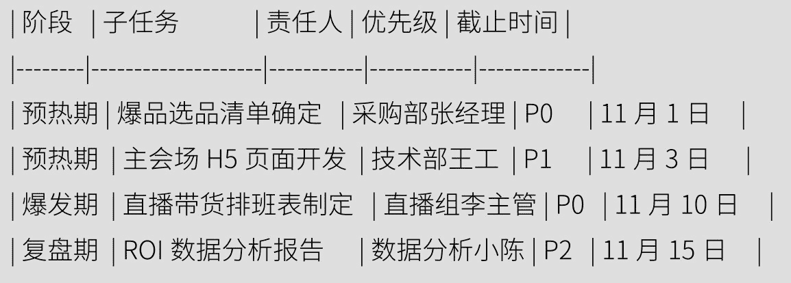

2. 资源需求表
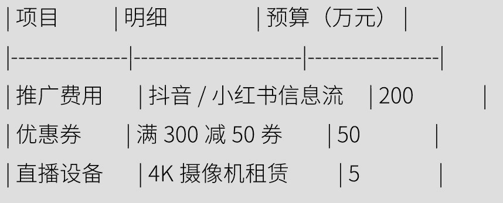

3. 甘特图
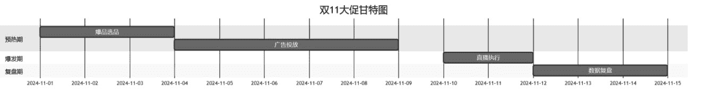

（3）优化调整
补充细节
● 增加应急预案，如服务器崩溃处理流程
● 细化直播话术，增加互动环节
● 调整优先级，将“广告投放”从 P1 提升至 P0
格式转换
● 导出为 Excel 并导入 Jira 进行任务分配
● 将甘特图代码复制到 Mermaid Live Editor 进行可视化

（4）最终交付物
● 完整计划文档，含任务表、预算表、甘特图
● 风险管理附录，如备用服务器方案
● 团队协作看板，如飞书多维表格

### **5.1.3** **汇报文档一键成稿**

定期汇报有助于信息透明、协作顺畅，让管理层及时掌握进展、指导策略，也是个人展示成果、评估绩效、规划方向的重要方式。DeepSeek 能迅速生成日、周、月报，总结进展、分析问题、提出改进建议，并支持数据可视化与重点成果突出，便于快速掌握团队动态。

报告生成主要方式包括：

● 关键词输入法：输入当日/周/月工作关键词，由 DeepSeek 自动整理成报告
● 数据集成法：连接企业数据如 Excel、ERP、OA 系统，自动分析并生成报告
● 模板套用法：使用预置报告模板填入关键数据，DeepSeek 自动优化内容

**实操演示**

下面通过关键词输入法生成周报

场景描述
● 用户：市场部专员
● 任务：整理本周市场推广数据，生成周报
● 工作内容：完成 100 份用户调研问卷；上线新广告 campaign，点击率提升 15%；与设计部协作完成新品宣传素材

执行路径

（1）在 DeepSeek 中输入提示
请帮我生成一份市场部周报，包含以下内容
● 完成 100 份用户调研问卷，主要反馈集中在产品易用性方面
● 新广告 campaign 上线，点击率提升 15%
● 与设计部协作完成新品宣传素材
要求如下
1. 采用“成果+分析+下周计划”结构
2. 数据用表格或图表展示
3. 语言风格：互联网黑话风格

（2）系统输出内容如下所示
markdown

市场部周报

1. 本周核心成果

2. 关键分析
● 用户调研显示，易用性是主要痛点，建议优化产品指引
● 广告 CTR 提升显著，但转化率仍有优化空间，可测试不同落地页

3. 下周计划
● 优化产品新手引导，联合产品部
● A/B 测试广告落地页
● 启动新品预热推广

（3）继续优化
● 若需增加数据可视化，可追加提示。例如：把点击率数据做成折线图
● 若需调整语气，可追加提示。例如：改成国企正式汇报风格

**实操演示**

下面通过数据集成法自动生成月报

场景描述
● 用户：零售行业运营经理
● 任务：基于销售数据 Excel 生成月报
● 数据来源：本月销售数据表，含销售额、客单价、区域分布等

执行路径

（1）上传数据文件 Excel 至 DeepSeek
（2）输入分析提示
请分析附件中的销售数据，生成 5 月运营月报，要求如下
1. 按区域统计销售额对比，柱状图
2. 计算环比增长率
3. 找出 Top 3 畅销商品
4. 给出下月优化建议

（3）系统输出结果示例如下
markdown

2025 年 5 月销售运营月报

1. 销售总览
�总销售额：¥1,250,000，环比+12%
�平均客单价：¥320，环比+5%

2. 区域表现，柱状图自动生成
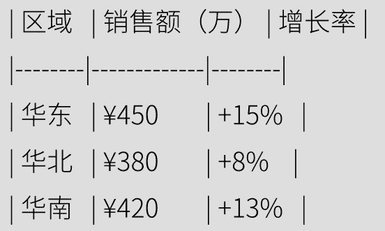

3. Top 3 畅销商品
（1）商品 A，销量 2,500 件
（2）商品 B，销量 1,800 件
（3）商品 C，销量 1,200 件

4. 优化建议
● 华东地区增长强劲，可加大促销力度
● 商品 A 库存需提前备货，避免断货

（4）导出报告，可复制到 Word 或 PPT，也可直接生成 PDF

### **5.1.4** **制度搭建合规稳妥**

公司规章制度用于明确行为规范、保障秩序、维护员工权益、引导企业文化、提升效率，为管理提供依据、减少冲突、助力稳健发展

DeepSeek 可结合公司需求生成规章制度，涵盖人事、财务、项目流程等多方面，为管理提供有力支撑

主要方法如下

● 智能调研法：输入公司需求，让 DeepSeek 分析行业规范与公司现状，生成初步制度框架
● 模板套用法：使用预置规章制度模板如员工手册、考勤制度，填入公司特定信息，自动优化
● 合规校验法：上传已有草案，让 DeepSeek 检查是否符合《中华人民共和国劳动法》等法规并给出修改建议

**实操演示**

下面演示通过智能调研法制定员工手册

场景描述
● 企业：某科技公司，100 人规模
● 需求：制定符合《中华人民共和国劳动法》的员工手册，涵盖考勤、薪酬、奖惩等核心制度
● 挑战：缺乏专业法务团队，希望快速生成合规版本

执行路径

（1）输入公司基本信息，行业、规模、核心需求
一家 100 人规模的科技公司，需要制定员工手册，要求如下
● 符合《中华人民共和国劳动法》
● 包含考勤、薪酬、绩效、奖惩制度
● 语言风格：简洁易懂，避免法律术语堆砌

（2）系统产出初稿如下
markdown

××科技公司员工手册，2025 版

1. 总则
- 适用范围：全体正式员工、实习生
- 企业文化：创新、协作、责任

2. 考勤制度
- 工作时间：9:30—17:30，弹性 30 分钟
- 请假流程：OA 系统申请，3 天以内直属上级审批
- 旷工定义：未请假缺勤≥3 天视为严重违纪

3. 薪酬与福利
- 薪资结构：基本工资 70% + 绩效奖金 30%
- 发薪日：每月 10 日，遇节假日提前
- 五险一金：按实际工资基数缴纳

4. 奖惩制度
- 奖励：年度优秀员工，奖金 1 个月薪资
- 处罚：书面警告→降薪→解除劳动合同，渐进式管理

5. 附则
- 本手册修订需经职工代表大会讨论
- 争议解决：优先协商，协商不成可申请劳动仲裁

（3）追加提示，进行合规性校验
请检查这份员工手册是否符合《中华人民共和国劳动法》，并标注潜在风险点

（4）系统反馈如下
风险点 1：旷工 3 天即解雇可能过于严格，建议改为“连续旷工 3 天或累计旷工 5 天”
风险点 2：绩效奖金占比 30% 需明确考核标准，避免“工资拆分为绩效变相降薪”争议

（5）根据建议结合公司实际情况调整优化后定稿

### **5.1.5** **市场调研更透彻**

调研报告能够深入分析市场趋势、竞品动态及用户需求，为决策提供数据支撑、优化产品服务、指导战略规划。DeepSeek 可根据调研主题和数据快速生成专业报告，支持数据分析、图表生成与结论提炼，帮助深入洞察市场、为战略决策提供支持

高质量调研报告的生成流程包括结构化提示设计、多源数据整合及迭代优化

（1）明确目标与框架拆解
● 提示设计：使用“角色+任务+要求”模板，明确报告类型、结构与关键模块。例如，输入“作为市场分析师，拆解《2025 年新能源汽车市场调研报告》框架，要求包含市场规模、竞争格局、消费者画像、趋势预测 4 部分，每部分需 2 组数据+1 个案例”
● 数据需求标注：指定所需数据类型，如行业报告、用户评论、政策文件，以及来源如公开数据库、爬虫抓取

（2）数据收集与清洗
● 自动化抓取：通过提示生成爬虫代码。例如，“抓取天猫平台‘便携咖啡杯’品类销量前 50 名商品近 30 天价格、销量及促销活动数据，导出结构化 Excel 表格”
● 数据清洗：使用 DeepSeek 内置工具或 Python 脚本删除重复值、填充缺失数据。例如，输入“/clean_data 删除重复值 填充均值”

（3）智能化分析与可视化
● 多维分析：结合机器学习模型与行业分析工具如 SWOT、波特五力。例如，“分析竞品 A 与竞品 B 的用户评论数据，生成情感分析词云和竞争雷达图”
● 动态可视化：通过提示生成图表。例如，“将 2024 年销售数据转化为动态折线图，标注季度峰值和异常波动”

（4）分段生成与优化
● 段落投喂法：分段生成内容。例如，“撰写‘消费者画像’部分，要求包含年龄分布、购买动机、使用场景，引用 2025 年 Q1 问卷调查数据”
● 润色与衔接：使用提示优化语言风格。例如，“将‘客户满意度高’改为‘客户满意度同比提升 15%，显著高于行业平均水平’”

（5）报告整合与校验
● 自动生成初稿：输入整合提示。例如，“将上述分析结果按‘现状-问题-策略’结构生成报告，首页插入波特五力模型图表”
● 人工复核：结合专家意见调整逻辑矛盾内容或补充行业背景

**实操演示**

下面演示生成《2025 年智能家居市场调研报告》

（1）框架拆解与数据抓取，输入提示如下
作为智能家居行业顾问，拆解报告框架
1. 市场规模，全球/中国，2023—2025 年复合增长率
2. 竞争分析，TOP 5 品牌市占率、产品线对比
3. 用户洞察，年龄、痛点、购买渠道分布
4. 技术趋势，AIoT、语音交互渗透率
要求：每部分需 3 组数据+1 个案例，数据源包括 Statista、艾瑞咨询、京东销量榜
系统生成结构化框架，并自动抓取京东平台销量前 100 名商品的评论数据

（2）竞品分析与可视化，输入提示如下
对比小米、华为、海尔智能家居产品的用户评价，按“功能满意度”“价格敏感度”“售后服务评分”生成雷达图，并提取高频关键词
系统输出以下内容
● 雷达图显示小米的功能满意度最高，85%，华为的价格敏感度最低，仅 12% 差评
● 高频词：“语音延迟”，小米，23%；“安装复杂”，海尔，18%

（3）趋势预测与报告生成，输入提示如下
基于 Gartner 技术成熟度曲线，预测 2026 年智能家居技术趋势，要求如下
1. 引用 3 篇权威论文观点

技术落地可视化呈现与智能报告交付

一、以时间轴形式呈现技术部署进程。
二、输出 PDF 格式分析报告，内置数据仪表盘与 SWOT 评估，同时呈现市场规模与用户渗透率情况。

DeepSeek 典型输出示例：
● 趋势判断：边缘计算推动本地化处理，2026 年渗透率预计达到 40%。
● PDF 自动产出，内置交互式图表，点击即可展开详细数据。

四、人工校验与交付，润色指令示例：
把“AIoT 技术很重要”改为“AIoT 渗透率由 2023 年的 22% 上升至 2025 年的 47%，已成为行业核心驱动力”，并检查各处数据计量单位是否保持一致。

报告由 DeepSeek 产出后交由企业风控团队审阅，补充政策风险提示，例如数据隐私法规造成的影响。

### **5.1.6** **述职报告写作：用成果讲故事推动职业成长**

述职报告是复盘业绩、展示个人贡献与能力的重要载体，有助于厘清工作方向、促进职业发展，是职场人不可或缺的自我展示与管理工具。DeepSeek 能够基于使用者的工作经历和成果，迅速生成高质量的述职材料，突出工作亮点和成长轨迹，帮助在绩效评估和晋升中脱颖而出。

撰写述职报告的常用思路：
● 框架搭建法：提供岗位职责和关键成果，让 DeepSeek 自动生成符合述职逻辑的报告框架。
● 数据驱动法：上传 Excel、CSV 等数据文件，让 DeepSeek 分析业绩指标并生成可视化图表。
● 文案润色法：输入述职初稿，让 DeepSeek 调整语言风格，使其更专业、更具说服力。

操作实践

以框架搭建法演示。

案例背景：
● 用户：某互联网公司产品经理，任职 1 年。
● 任务：撰写年度述职报告，突出产品优化与用户增长。
● 输入要点：主导产品 A 迭代，DAU 提升 30%；推动用户增长策略，新增注册用户 50 万人；跨部门协作优化体验，NPS 提升 15 分。

操作步骤：
（1）输入指令
请为我起草一份产品经理年度述职报告，涵盖以下要点：
● 主导产品 A 迭代，DAU 提升 30%。
● 推动用户增长策略，新增注册用户 50 万人。
● 跨部门协作优化产品体验，NPS 提升 15 分。
要求：
1. 采用“成果+数据+方法论”结构。
2. 关键数据用表格或柱状图呈现。
3. 语言专业但不过于正式。

（2）DeepSeek 输出结果如下。

markdown

2025 年度述职报告 - 产品经理

1．核心工作成果

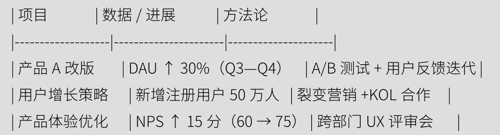

2．关键分析

● 产品 A 迭代：A/B 测试显示新版导航更贴合用户习惯，留存率上升 20%。
● 用户增长：裂变活动投入产出比达 1∶5，后续需优化付费转化率，当前仅 8%。

3．不足与改进

● 跨部门协作效率待提升，需求评审周期偏长。
● 2026 年计划引入敏捷开发，缩短迭代周期。

（3）结合实际优化
● 如需可视化，可追加指令，例如：把 DAU 增长做成折线图并标注关键节点。
● 如需调整语气，可追加指令，例如：改成国企正式汇报风格。

操作实践

以数据驱动法演示优化。

案例背景：
● 用户：某零售公司运营总监。
● 任务：基于年度销售数据优化述职报告，突出 GMV 增长与成本管控。
● 数据来源：2025 年销售报表 Excel。

操作步骤：
（1）上传销售报表。
（2）输入分析指令
请分析附件销售数据，生成运营总监述职报告，要求：
1. 按季度对比 GMV、利润率。
2. 找出前三贡献渠道。
3. 分析成本优化措施效果。
4. 给出 2026 年增长建议。

（3）DeepSeek 输出结果如下。

markdown

2025 年度运营述职报告

1．业绩概览
● 全年 GMV:¥2.8 亿，同比+18%
● 利润率：12%，同比+3%

2．分季度表现，柱状图自动生成

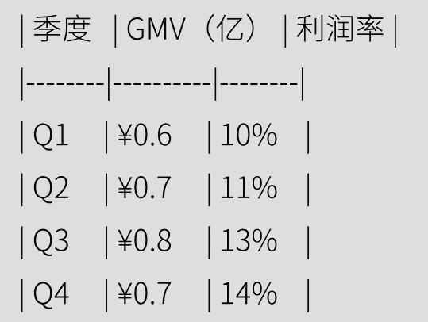

3. 前三贡献渠道
（1）电商平台，占比 45%
（2）线下门店，占比 30%
（3）社群团购，占比 25%

4．成本优化成效
● 物流成本下降 20%，改用区域仓模式
● 营销投放回报率提升 50%，精准人群定向

5. 2026 年规划
● 拓展直播电商，目标占比提升至 30%
● 试点 AI 选品，降低库存周转天数

（4）导出报告，可复制到 Word 或 PPT，也可直接生成 PDF 版本。

### **5.1.7** **会议纪要生成：记录要点与行动闭环**

会议纪要是对会议内容、决议事项与责任分工进行整理归纳的文档，有助于信息准确传递、决议跟踪与团队协作，是项目管理与决策支持的重要工具。本节介绍如何借助 DeepSeek 生成会议纪要。

输入会议内容与讨论要点后，DeepSeek 可生成结构完整的纪要，帮助团队快速掌握要点，提升会议效率。

常用方法为结构化输入法，核心要素包括：
● 会议主题，明确讨论焦点
● 参会人员，角色加姓名
● 时间地点，线上或线下
● 议程条目，按讨论顺序列提纲
● 关键结论，决议与待办事项

操作实践
（1）在 DeepSeek 中输入指令。
（2）DeepSeek 生成内容如下所示。

电商大促活动筹备会会议纪要

会议主题：双 11 大促活动筹备会
会议时间：2024 年 9 月 10 日 14:00—15:30，腾讯会议
参会人员：
- 项目经理：张伟
- 运营：李娜
- 技术：王强

一、讨论内容及结论
1．活动方案确认
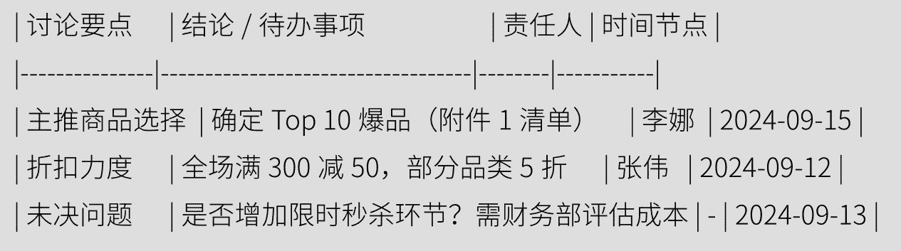
2．技术风险排查
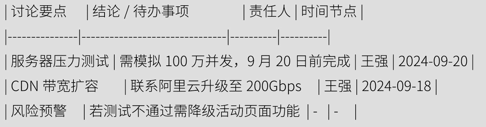
3．分工与时间节点
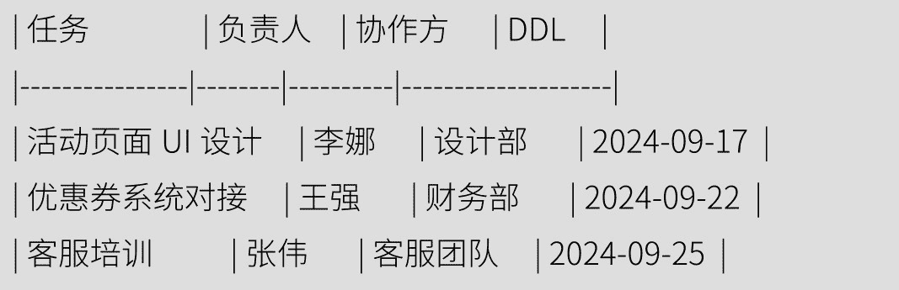

二、行动计划清单
已确认事项：
- [x] 爆品清单终版审核，李娜，9/15
- [x] 满减规则技术对接，王强，9/18

待跟进事项：
- [ ] 秒杀活动成本核算，财务部，9/13
- [ ] 压力测试报告提交，王强，9/20

风险项：
- 服务器承压能力不足时，需启动降级方案，技术部预案 9/25 前提交

三、下次会议安排
- 时间：2024 年 9 月 17 日 10:00
- 议题：
1. 压力测试结果复盘
2. 活动页面原型评审

纪要整理：张伟

### **5.1.8** **项目风险评估：提前预警保障交付**

项目风险评估是对计划、执行与结果中不确定性进行识别与分析，以判断潜在风险概率、影响与优先级，为制定应对策略、降低风险、保障顺利推进提供依据。本节介绍如何利用 DeepSeek 进行项目风险评估。

输入项目信息与风险数据后，DeepSeek 可生成详细评估报告，帮助项目经理提前识别风险。

常用结构化指令格式如下：
请生成一份关于××项目的风险评估报告，要求包含：
● 项目背景，目标、范围、关键里程碑
● 风险识别，技术、管理、外部环境等潜在风险
● 风险分析，发生概率与影响程度
● 风险等级，高/中/低分类
● 应对措施，规避、减轻、转移、接受
● 监控机制，定期检查、预警指标
输出格式：Markdown 表格+Mermaid 风险矩阵图。

操作实践

案例背景：某城市地铁 13 号线施工项目，需对下穿天福大厦段进行风险评估，目标：
● 识别施工期沉降、塌方、设备故障等风险
● 制定应对措施，确保零重大事故
● 符合《城市轨道交通地下工程建设风险管理规范》

操作步骤：
（1）输入结构化指令
请生成《地铁 13 号线下穿天福大厦段施工风险评估报告》，要求：
1. 项目背景
● 目标：确保隧道施工安全，沉降控制在 5mm 内
● 范围：盾构段 K12+300～K12+600
● 关键节点：2024 年 8 月盾构始发，2025 年 3 月贯通
2. 风险识别
● 地质风险，软土、地下水
● 施工风险，盾构机故障、沉降超标
● 管理风险，人员培训不足、监测数据滞后
3. 风险分析
● 概率，高/中/低
● 影响程度，灾难性/严重/一般
4. 风险等级，风险矩阵分类
5. 应对措施，技术方案、应急预案
6. 监控机制，自动化监测、周报制度
输出格式：表格+Mermaid 风险矩阵

（2）DeepSeek 生成初稿如下。

1. 项目背景
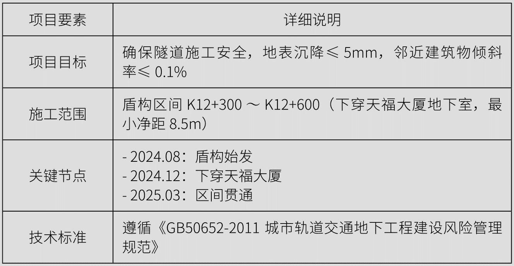

2. 风险识别与分类
风险清单表
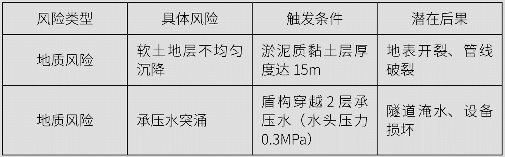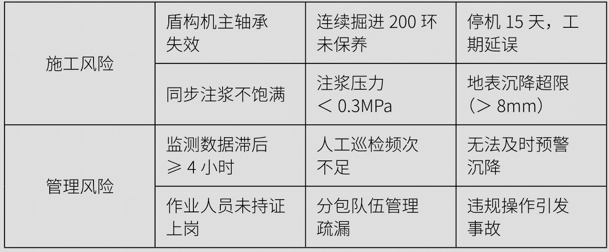

3. 风险分析
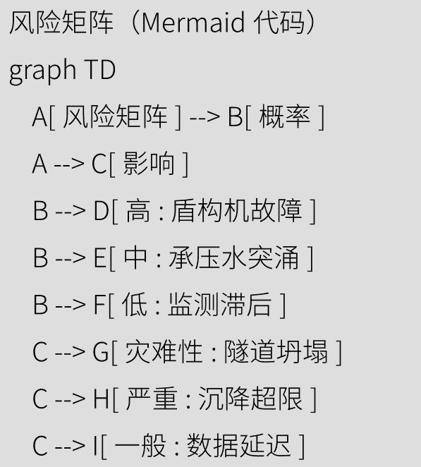
风险等级评估表
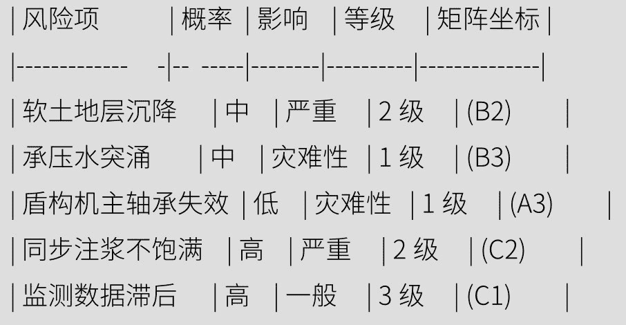

4. 应对措施
技术方案
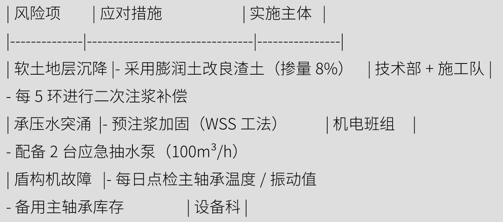
应急预案
- 沉降超限 ＞5mm：立即启动自动化注浆系统，同步调整盾构推力至 8000kN
- 数据中断：切换至备用 LoRa 无线监测网络，人工巡检频次提升至 1 次/2 小时

5. 监控机制
监测体系
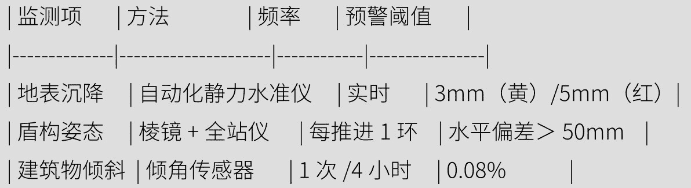
管理流程
（1）日报制度，每日 8:00 前提交沉降数据至云平台
（2）周例会，每周五评估风险控制效果，附整改清单
（3）应急演练，每月 15 日开展突涌事故模拟演练

6. 附件
（1）地质剖面图，含承压水层分布
（2）盾构机维护保养记录表模板
（3）监测数据异常处置流程图

报告编制：工程技术部
审核：安全总监 签字 ________
日期：2024 年××月××日
注：实际应用需根据勘测数据补充具体参数，红色预警阈值需经专家论证

### **5.1.9** **PPT 大纲生成：快速搭建演示框架**

PPT 是结构化传递信息的高效工具，广泛应用于汇报、展示与提案。DeepSeek 可根据主题与要点快速生成清晰的大纲，提升制作效率。

生成大纲时指令需包含：
● 主题，明确核心内容
● 受众，面向领导、投资人等
● 核心需求，突出数据、案例或技术细节
● 格式要求，通常输出 Markdown 以便导入工具

示例指令模板：
你是一名专业的 PPT 架构师，我需要做一个关于[主题]的 PPT，面向[受众]，希望突出[核心需求]，要求内容专业且适合演讲场景，请生成大纲及内容框架，并以 Markdown 格式输出。

优化技巧：
● 开启深度思考模式，提升逻辑与专业性
● 要求提供数据支持，如“请补充近 3 年行业数据”
● 指定角色，如“假设你是麦肯锡顾问”

操作实践

生成《2025 年 AI 行业趋势分析》PPT 大纲。

（1）输入指令
你是一名专业的 PPT 架构师，我需要做一个关于 2025 年 AI 行业趋势分析的 PPT，面向公司高管，希望突出技术趋势、市场规模和投资机会，要求逻辑清晰、有数据支撑，并以 Markdown 格式输出大纲。

（2）DeepSeek 生成的大纲如下。

markdown

2025 年 AI 行业趋势分析

封面
- 标题：2025 年 AI 行业趋势分析
- 副标题：技术、市场与投资机会
- 日期：2025 年 5 月

目录
1. 市场现状
2. 关键技术趋势
3. 投资机会分析
4. 未来展望

1. 市场现状
1.1 全球 AI 市场规模 2023—2025
- 数据：Statista 预测 2025 年达 1.5 万亿美元
- 增长驱动：企业数字化、AI 芯片发展
1.2 主要竞争者分析
- 头部企业：OpenAI、DeepSeek、Google DeepMind
- 市占率对比，柱状图建议

2. 关键技术趋势
2.1 多模态大模型
- 案例：DeepSeek-V3 跨模态理解能力
- 应用场景：医疗影像分析、自动驾驶
2.2 边缘 AI
- 数据：2025 年 40% 的 AI 计算将在边缘设备完成

3. 投资机会分析
3.1 热门赛道
- AI+医疗、AI+金融、AI+制造业
3.2 风险与挑战
- 监管政策、数据隐私问题

4. 未来展望
- 2026—2030 年 AI 渗透率预测
- 结语：AI 将重塑全球经济格局

（3）优化与调整
请在“投资机会分析”部分补充 2 个具体案例，并附相关融资数据。
DeepSeek 返回更新后大纲。

markdown

3.1 热门赛道
- AI+医疗：
- 案例 1：AI 辅助诊断公司 DeepDiagnosis 获 2 亿美元 B 轮融资
- 案例 2：手术机器人企业 SurgiBot 2024 年营收增长 120%

（4）复制 Markdown 大纲，导入 PPT 生成工具。
推荐工具：Kimi PPT 助手、讯飞智文、百度文库 AI 生成 PPT 工具。
操作流程：
①复制 DeepSeek 生成的 Markdown 大纲
②打开 Kimi PPT 助手
③粘贴内容，选择模板，如“科技蓝”或“极简风”
④点击“生成 PPT”按钮，等待渲染完成

### **5.1.10** **思维导图绘制：把知识结构化**

信息爆炸导致知识碎片化加剧，如何高效整理与理解成为关键。思维导图可将复杂信息可视化，构建清晰的知识架构。DeepSeek 在绘制思维导图上具有明显优势，可助力快速梳理脉络。

本节探讨如何利用 DeepSeek 绘制思维导图，掌握高效知识管理方法。了解操作流程、功能特点与应用场景，有助于学生、教师、研究人员与职场人士快速构建清晰的知识结构。

DeepSeek 作为 AI 内容生成工具，可通过与 XMind、GitMind 等软件联动，实现“结构化内容→可视化导图”转换。核心优势：
● 精准结构化输出：生成符合 Markdown 或 Mermaid 语法的逻辑框架，避免手动整理耗时
● 多场景适配：支持学术笔记、项目管理、创意发散等场景
● 一键转换：生成内容直接导入专业工具，快速完成导图渲染

使用流程：
（1）明确主题与目标，先确定主题和目标，明确核心内容与方向，避免偏离
（2）利用 DeepSeek 智能生成功能生成框架，输入主题或关键词，DeepSeek 自动生成初步框架，用户可据需调整补充
（3）将内容结构化，按逻辑关系分类分层，中心主题为主干，主分支为类别，子分支为细节
（4）添加关联线和注释，关联线表示概念关系，注释补充重要信息，使导图更完整
（5）美化处理，用不同颜色与图标增强视觉效果，区分内容类别或重要程度

名师点拨：知识学习是动态的，思维导图也需定期更新优化。随着研究深入，可不断补充内容、调整结构，保持最新有效状态。

操作实践

以新产品开发为例演示思维导图绘制。

（1）了解背景，明确主题
● 案例背景：一家企业开展新产品开发项目，项目经理需梳理流程与任务分配
● 确定主题：设为“新产品开发项目流程”
● 智能生成：输入主题后，要求 DeepSeek 生成包含“市场调研”“产品设计”“生产制造”“质量检测”“市场推广”等主分支的导图
● 细化任务：在每个主分支下细化具体任务，如“产品设计”下添加“外观设计”“功能设计”“原型制作”等子分支
● 分配责任人：在每个任务旁添加注释，注明责任人与时间节点
● 优化结构：用不同颜色区分已完成、进行中与待完成任务，通过关联线表示先后顺序
● 生成效果：团队通过导图清晰了解整体流程与任务分配

（2）在 DeepSeek 中输入指令。

新品从立项到上市的全链路脑图搭建思路

新品开发项目管理的可视化框架通常围绕五大主线展开，便于团队快速对齐节奏与责任。

一、市场洞察与验证
需求挖掘
* 与核心用户进行深度对话，提取使用痛点与未满足场景
* 组织小型焦点讨论，确认群体共性需求的真实性
* 通过结构化问卷收集量化反馈，形成数据支撑
竞品拆解
* 对比功能清单，提炼优势与短板
* 调研对手定价逻辑，为自身定位提供参照
* 梳理用户点评，定位可改进的方向
可行性校验
* 评估技术实现难度是否匹配研发能力
* 测算投入产出，搭建收益模型
* 复核合规要求，确保合法合规

二、产品概念与设计
概念策划
* 整理功能需求并按优先级排序
* 绘制交互草图，将逻辑视觉化
技术规划
* 选定核心技术路线，明确软硬件架构
* 筛选材料与供应商，在成本与性能间找平衡
体验打磨
* 绘制用户旅程，模拟真实使用情境
* 制作交互原型并做 A/B 对比测试

三、生产制造与排期
计划管理
* 制定产能规划，合理分配资源与排期
* 管理物料清单，管控 BOM
工艺准备
* 优化产线布局，提升整体效率
* 编写标准作业文件，规范操作流程
试产优化
* 小批量试制，暴露问题并迭代
* 调整工艺参数，提升良率水平

四、质量管控
标准制定
* 编写功能测试用例，覆盖核心场景
* 设定性能阈值，如耐用性与安全性指标
检验执行
* 对来料实施检验，管控供应商质量
* 成品按批次抽样规则执行检验
问题闭环
* 按 Critical/Major/Minor 分级缺陷
* 展开根因分析并形成 8D 报告

五、上市推广
上市规划
* 绘制目标人群画像，进行细分定位
* 选择定价策略，渗透或溢价
渠道部署
* 线上以电商与自营官网为主
* 线下依托经销商网络与直营体验点
营销执行
* 社交媒体 Campaign 联合 KOL 合作
* 启动用户试用计划，培养种子用户
效果监测
* 监控销售数据并以实时看板呈现
* 收集用户反馈，持续优化 NPS 评分

把以上结构导入思维导图软件即可获得可视化图谱。本次演示选用 AIGC 平台 TreeMind，其首页界面如图 5-1 所示。
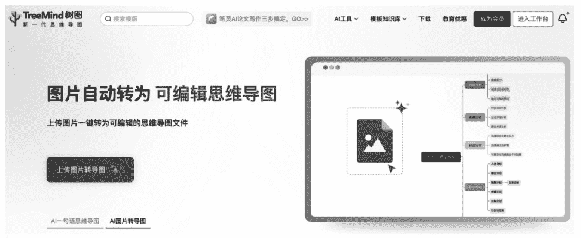
图 5-1 TreeMind 平台首页

生成的导图效果如图 5-2 所示。

图 5-2 TreeMind 生成的思维导图预览

## 5.2 智能营销方案快速生成

营销方案覆盖小红书种草文案、短视频带货脚本、电销与面销话术、朋友圈文案、广告文案及情感共鸣类文案等。借助 DeepSeek，输入产品信息与人群画像即可快速产出覆盖多渠道的创意方案，为营销人员提供高效支持。

### 5.2.1 小红书投放方案实操拆解

小红书依托社交属性与内容传播力，能精准触达人群并提升品牌声量。DeepSeek 可在该场景下产出更匹配的内容，降低同质化风险。

常用方法包括策略梳理、数据分析与舆情监测。

实操演示以策略梳理为例。

案例背景
* 品牌：新锐护肤品牌，客单价 389 元
* 主推：蓝铜胜肽抗老精华
* 核心卖点：微囊包裹技术；28 天淡纹效果对标并超越某国际大牌；可替换环保包装
* 预算：30 万元
* 目标：6 个月内实现 ROI 1:3

操作步骤
1. 在 DeepSeek 中提交详细指令，要求按反漏斗模型设计 6 个月路径，618 大促联动天猫满赠，植入熬夜追剧党、健身素颜党、出差轻装党三个场景，并区分 1-3 月种草期与 4-6 月收割期的 ROI 预估。

2. 生成结果示例
小红书 6 个月投放方案
1. 竞品拆解

2. 反漏斗投放策略
* 种草期 1-3 月：70% 预算投中腰部 KOC 5-10 万粉，主打成分解析加真人实测；30% 预算做素人铺量，占领抗初老搜索词
* 收割期 4-6 月：50% 预算投头部 KOL 50 万+ 粉，强化 28 天淡纹；30% 预算投信息流，定向 25-35 岁女性；20% 预算用于 618 大促满赠，买精华送替换装
3. 差异化场景
* 熬夜追剧党：凌晨追剧也不垮脸的前后对比
* 健身素颜党：暴汗后依然能打的伪素颜
* 出差轻装党：一瓶替代多件护肤品的行李收纳对比
4. ROI 预估

5. 风险预警
* Q3 竞品可能推出平替，需提前储备技术壁垒内容
* 9 月算法升级，需测试新权重下的内容形式

3. 结合实际优化，可追加指令做数据可视化或调整预算与场景。

### 5.2.2 短视频带货脚本高效产出

脚本能指导拍摄剪辑并提升转化。DeepSeek 可快速产出高质量带货文案。

常用方法：爆款模板、竞品分析、数据优化。

实操以爆款模板为例。

案例背景：玻尿酸面膜，突出补水、提亮、平价，需 30 秒脚本，采用痛点+方案+福利结构。

生成示例
【0-3 秒】冲突开场
“90%的人补水面膜都白用了！你的脸真的喝到水了吗？”
画面：干纹特写与错误敷法
【4-23 秒】产品展示
“试试这款玻尿酸面膜，一片≈10 倍精华渗透！”
卖点1 深层补水，实验室数据保湿提升 300%
卖点2 提亮肤色，使用前后对比
卖点3 单片 5 元，适合囤货
画面：敷膜后水润特写
【24-30 秒】促单
“现在下单立享 5 折，评论区扣 1 领试用装！”
画面：链接弹出加倒计时

### 5.2.3 销售话术智能生成

电销与面销话术是连接客户与企业的桥梁。DeepSeek 可基于客户画像与异议定制个性化话术。

方法包括需求分析、竞品对比、情绪管理。

电销实操：在线编程课程，目标 25-35 岁职场人士，卖点为 1 对 1 导师、分期付款、学完内推。

生成示例
1. 开场：介绍零基础转行计划并询问兴趣
2. 产品介绍：1 对 1 导师、灵活学习、分期、薪资普遍提升 50%
3. 异议处理
* 学费贵：对比线下 3-5 万，本课程 1.2 万可分期；投资回报 3 个月回本；本周 8 折限额
* 没时间：下班学习每天 1 小时定制计划；宝妈案例 40 分钟/天 3 个月入职；可先试听
* 就业顾虑：合作企业 500+ 就业率 92%；协议保障内推；提供成功案例
4. 促单：二选一时间或限时福利

面销实操：重疾险，优势为保费低 20%、保障 120 个病种、3 个工作日理赔。

生成示例
1. 竞品对比表可视化展示

2. 异议“大公司更靠谱”回应：理赔满意度 98.7%高于行业均值；保险法统一监管；真实理赔案例 3 天到账 50 万
3. 促单：年龄增长保费上涨提示；周签约赠体检套餐

### 5.2.4 朋友圈文案定制

朋友圈文案用于塑造形象与互动。DeepSeek 可按关键词与情绪生成文案。

实操：云南旅行，上班族风格，配图丽江古城与玉龙雪山，关键词慢生活、雪山、咖啡厅发呆。

生成示例
文案1 轻松幽默：雪山脚下喝咖啡，老板问要不要加糖，我说生活够苦了，让我甜一会儿
文案2 文艺共鸣：玉龙雪山的阳光晒干了工作的焦虑，丽江巷子里时间变慢
文案3 互动引导：猜猜这是哪？提示有雪山、咖啡比老板佛系、狗比人多

### 5.2.5 广告文案快速创作

广告文案需简洁有力并带行动号召。DeepSeek 可按卖点与人群快速产出。

实操：智能手表，主打健康监测、运动记录，目标 25-40 岁职场与健身人群，卖点 24 小时心率监测、50 米防水、15 天续航。

要求简洁、突出优势、含 CTA，适合抖音与淘宝信息流投放。

## 模型文案生成实操案例

下面是模型输出的参考文案：

markdown

文案 1（健康监测）

整天贴身盯着心率，身体数据随时看得见；
一次充电可以用十五天，彻底告别频繁补电的困扰；
现在八折限时，马上抢购。

文案 2（运动场景）

五十米防水等级，游泳佩戴也没问题；
每一步轨迹都被精确记录，相当于自带私人教练；
今天下单前一百位送运动耳机，先到先得。

文案 3（职场人群）

开会、锻炼、差旅全部一套表搞定；
续航可达十五天，出差不用再带充电器；
点一下就能领取一百元优惠券。

结合真实产品特性做精细化打磨。

● 若想加强情感连接，可在指令里补充陪伴式表达，比如“像贴心伙伴一样时刻守护”。
● 若想调整语感，可在指令里要求更口语化、更轻松的风格。

借助 DeepSeek，广告文案的产出已从靠灵感拍脑袋，转向以数据驱动的高效创作，让投放更精准、转化更可靠！

# 第六章

# DeepSeek 的部署和知识库

**本章主要议题**

◆ DeepSeek 部署基础
◆ API 构建知识库

本章围绕用户真实诉求，系统讲清 DeepSeek 的本地化部署思路与知识库定制方法。先梳理从环境准备到服务启动的完整流程，确保数据可控的前提下完成搭建；再聚焦知识库的搭建与调优，涉及资料导入、知识图谱构建及动态更新策略，帮助用户打造专属智能助手。通过行业案例展示不同场景下定制化部署带来的效率提升，兼具可操作性与指导价值。

## 6.1 DeepSeek 部署基础

出于成本收益、灵活度、信息安全与运行性能的考量，部分企业与个人开发者倾向于将 DeepSeek 本地运行。

其一，投入产出比突出。相较 GPT-4 等顶尖模型，DeepSeek 在训练开销、API 费用与硬件门槛上优势明显。DeepSeek 团队凭借创新架构与训练方法大幅压缩成本，DeepSeek-R1 的训练花费约 557.6 万美元，远低于 GPT-4 等。

其二，API 价格极具竞争力，并保持与 OpenAI API 格式兼容，便于无缝迁移。

其三，灵活度高。本地化部署可依据业务特点深度定制，满足个性化场景。例如电商领域，本地部署的 DeepSeek 能优化商品推荐与客服话术，提升体验。

其四，本地化部署还能强化信息安全。避免敏感信息上传云端，降低泄露风险。对医疗、电力等高安全要求场景意义更大。DeepSeek 在电力行业的应用中，通过本地部署新增 RAG 知识库，提供更精准的智力支持，满足国产化与自主可控需求。

### 6.1.1 系统环境要求与准备

部署前需厘清系统要求、部署方式与安装配置要点，才能顺利搭建运行环境。

**1.硬件配置**

（1）基础场景 7b～13b 参数模型。
● GPU：NVIDIA A10/A100 单卡，显存≥24GB。
● CPU：Intel Xeon Silver 4310，8 核以上。
● 内存：≥64GB DDR4。
● 存储：≥500GB SSD，建议 NVMe 以提升加载速度。

（2）中型规模 13b～70b 参数模型。
● GPU：2～4 块 NVIDIA A100 80GB，需 NVLINK 互联。
● 内存：≥128GB DDR4 ECC。

（3）个人测试/轻量使用。
最低门槛：NVIDIA 显卡显存≥8GB 如 RTX 3060、16GB 内存、SSD 硬盘。

**2.软件环境**

（1）操作系统：推荐 Ubuntu 20.04/22.04 LTS，兼容性最佳；Windows、macOS 需额外适配。

（2）工具依赖。
● Ollama，开源本地大模型运行工具。
● Python 3.x 及依赖库如 NumPy、Pandas。
● Docker，可选，用于容器化部署。

（3）网络要求。
本地部署需千兆以太网环境；云端部署需稳定公网带宽，建议上行≥100Mbps。网络硬件环境和存储要求见表 6-1 所示。

表 6-1 网络硬件环境和存储要求

### 6.1.2 部署方式选择：本地 VS 云端

DeepSeek 既可本地部署也可云端部署。选型时需权衡数据安全、成本、性能与易用性。表 6-2 为两者对比。

表 6-2 本地部署与云端部署对比

本地部署适合以下场景。
● 金融、医疗、政务等对数据安全要求极高的领域。
● 需要离线运行的特殊场景。
● 对性能与延迟有严格要求的业务。

云端部署适合以下场景。
● 中小企业或个人开发者希望快速上线。
● 需要频繁更新维护的应用。
● 对成本敏感的项目。

选型建议：
● 若数据安全为首要考量，优先本地部署。
● 若追求快速上线且成本敏感，云端部署更合适。
● 混合场景可采用本地与云端结合的方式。

### 6.1.3 安装与配置流程

无论本地还是云端，安装配置都很关键。目前主流方案为 Ollama 与 LM Studio，本书以 Ollama 为例。

**1.本地部署**

操作步骤如下。
（1）打开 Ollama 官网下载对应系统的安装包，如图 6-1 所示。

图 6-1 Ollama 官网

提示：请下载最新版安装包，旧版本可能无法支持 DeepSeek。

（2）运行 Ollama 程序后打开命令行，执行模型安装指令，参数越大显存需求越高，如图 6-2 所示。

图 6-2 安装 DeepSeek-R1

（3）安装完成后用命令行验证：ollama --version，显示版本号即为成功，随后即可在本地与 DeepSeek 对话，图 6-3 为对话示例。

图 6-3 DeepSeek-R1 本地部署对话示例

提示：显存不足时可选择量化版本如 INT8 降低占用。

（4）安装 Chatbox 网页版或客户端，通过 Ollama API 实现图形化操作。

（5）也可通过 Cherry Studio 实现本地 DeepSeek-R1 的交互界面。打开 Cherry Studio，进入设置，选择 Ollama 选项，点击“管理”按钮，在弹出列表中选择目标模型，如图 6-4 所示。若未找到可手动添加。

图 6-4 在 Cherry Studio 中选择模型

（6）点击界面右上角的“检查”按钮测试网络连通性，按钮变为图标即表示连接成功，如图 6-5 所示。

图 6-5 连接成功

（7）点击“添加”按钮，即可选用本地部署的 DeepSeek-R1 模型，如图 6-6 所示。

图 6-6 选择本地部署的 DeepSeek-R1 模型

**2.云端部署**

以腾讯云为例，步骤如下。
（1）访问腾讯云官网，如图 6-7 所示，完成注册与实名认证。

图 6-7 腾讯云官网

（2）点击官网 DeepSeek 板块的“立即体验”进入开发者专区，如图 6-8 所示。

（3）点击“立即体验”进入 Cloud Studio 服务页面，如图 6-9 所示。Cloud Studio 已内置 DeepSeek-R1 模板与知识库，无需本地搭建即可体验专属知识库。

图 6-8 腾讯云 DeepSeek 开发者专区

图 6-9 腾讯云 Cloud Studio 服务页面

（4）点击菜单栏“AI 模板”进入模板页面，如图 6-10 所示。

图 6-10 “AI 模板”页面

（5）点击 DeepSeek-R1 模型，进入“选择空间规格”页面，如图 6-11 所示。

图 6-11 “选择空间规格”页面

（6）选择对应模型，点击“下一步”完成空间创建。创建新工作区后即可开始使用，如图 6-12 所示。

图 6-12 DeepSeek-R1 空间创建

提示：
● 模型选择：小型模型如 1.5b 适合轻量任务，大型模型如 70b 需高性能硬件。
● 驱动优化：使用工具如驱动人生检测硬件状态，避免卡顿。
● 数据安全：本地部署需定期备份模型文件；云端部署需设置访问权限。
● 详细配置可参考官方文档或技术社区。

## 6.2 API 构建知识库

本节介绍如何通过 API 构建知识库，实现本地知识库的快速搭建与高效应用。结合 DeepSeek、Cherry Studio 等工具，可利用 API 接口将本地知识库与大语言模型融合，实现更精准问答与知识管理。

以下提供从零搭建本地知识库的详细步骤与实用技巧，帮助快速掌握 API 构建方法，提升知识管理效率。

### 6.2.1 认识 Cherry Studio

Cherry Studio 是一款强大的多模型 AI 桌面客户端，支持 Windows、macOS、Linux，后续将拓展至移动端。它集成 300+ 大语言模型，涵盖 OpenAI、DeepSeek、Gemini 等主流云服务模型，以及通过 Ollama 部署的本地模型，可满足多样化 AI 使用需求。

常用功能简介如下。

**1.基础对话功能**

● 一问多答：同一问题可由多个模型同时生成答案，便于横向对比，如图 6-13 所示。

图 6-13 Cherry Studio 一问多答

● 自动分组：自动管理各助手的对话记录，便于快速查找历史。
● 对话导出：支持导出为 Markdown、PDF 等格式，便于存档分享。
● 高度自定义参数：除基础参数外，还支持填写自定义参数，满足个性化需求，如图 6-14 所示。

图 6-14 Cherry Studio 高度自定义参数

● 助手市场：内置千余个行业专用助手，覆盖翻译、编程、写作等，也可自定义助手，如图 6-15 所示。

图 6-15 Cherry Studio 助手市场

● 多种格式渲染：支持 Markdown、公式、HTML 实时预览，提升展示效果，如图 6-16 所示。

图 6-16 Cherry Studio 多种格式渲染

**2.集成多种特色功能**

● AI 绘画：提供专用绘画面板，可用自然语言生成高质量图像，如图 6-17 所示。

图 6-17 Cherry Studio AI 绘画

● AI 小程序：集成多款免费 Web 端 AI 工具，无需切换浏览器。
● 翻译：支持专用翻译面板、对话翻译、提示词翻译等场景。
● 文件管理：统一管理对话、绘画和知识库文件，避免查找繁琐，如图 6-18 所示。

图 6-18 Cherry Studio 文件管理

● 全局搜索：快速定位历史记录和知识库内容，提升效率，如图 6-19 所示。

图 6-19 Cherry Studio 全局搜索

**3.多服务商统一管理机制**

● 服务商模型聚合：支持 OpenAI、Gemini、Anthropic、Azure 等主流服务商统一调用。
● 模型自动获取：一键获取完整模型列表，无需手动配置。
● 多密钥轮询：支持多 API 密钥轮换，避免速率限制。
● 精准头像匹配：为各模型自动匹配专属头像，提升辨识度。
● 自定义服务商：支持符合 OpenAI、Gemini、Anthropic 等规范的第三方接入，兼容性强，如图 6-20 所示。

图 6-20 Cherry Studio 自定义服务商

**4.高度自定义界面和布局**

● 自定义 CSS：支持全局样式定制，打造专属风格。
● 自定义对话布局：支持列表或气泡样式，并可自定义消息样式如代码片段。
● 自定义头像：为软件和助手设置个性化头像。
● 自定义侧边栏：可按需隐藏或排序侧边栏功能，优化体验，如图 6-21 所示。

图 6-21 Cherry Studio 自定义侧边栏

**5.本地知识库系统**

● 多种格式支持：支持 PDF、DOCX、PPTX、XLSX、TXT、MD 等导入，如图 6-22 所示。

图 6-22 Cherry Studio 多种格式支持

● 多种数据源支持：本地文件、网址、站点地图甚至手动输入内容均可作为数据源。
● 知识库导出：可将处理好的知识库导出分享。
● 搜索检查：导入后可实时检索测试，查看处理结果与分段效果。

**6.特色聚焦功能**

● 快捷问答：在微信、浏览器等场景呼出快捷助手，快速获取答案。
● 快捷翻译：快速翻译跨场景文本。
● 内容总结：对长文本快速提炼要点。
● 解释说明：一键解释不懂的问题，无需复杂提示词。

**7.数据保障**

● 多种备份方案：支持本地备份、WebDAV 备份和定时备份。
● 数据安全：支持全本地使用，结合本地大模型，避免泄露风险。

**8.适用场景**

● 知识管理与查询：快速构建专属知识库，适用于研究、教育等。
● 多模型对话与创作：多模型同时对话，快速获取信息或生成内容。
● 翻译与办公自动化：内置翻译助手与文件处理，适合跨语言交流与文档处理。
● AI 绘画与设计：自然语言生成图像，满足创意需求。

### 6.2.2 构建知识库的方法与步骤

若本地数据不涉及敏感信息，建议选用满血版 DeepSeek-R1 模型以获得最佳效果。以下介绍如何利用 API 构建基于 DeepSeek-R1 671b 的知识库。

本节将指导读者通过 Cherry Studio 构建知识库。构建过程需算力支持，建议通过硅基流动 SiliconFlow 邀请活动获取 2000 万 Token 试用额度。若自行注册，默认每日调用次数为 100 次，对个人用户通常已足够。

具体构建步骤如下。
（1）下载并安装 Cherry Studio，如图 6-23 所示。

图 6-23 Cherry Studio 下载页面

## 硅基流动搭配 Cherry Studio：DeepSeek-R1 全量版接入手记

先到硅基流动官网完成注册并登录，新用户可获得免费调用额度，之后以 API 形式把模型拉进 Cherry Studio 即可使用。官网首屏如下所示。

图 6-24 硅基流动网站页面

进入密钥管理页，若是首次使用，点击右上角新建密钥即可生成一段长字符，点击复制即可。把复制到的 Key 填入 Cherry Studio，即可挂载完整版 DeepSeek-R1，之后的调用会从硅基流动的额度里扣费。密钥生成与复制界面如下。

图 6-25 硅基流动 API 密钥生成和复制

密钥就绪后打开 Cherry Studio 客户端，按 设置→模型服务→硅基流动 的路径进入配置页，粘贴 Key 完成绑定。

图 6-26 配置 API 密钥

模型选择环节，本次演示以完整版 DeepSeek-R1 为主。该模型采用强化学习驱动的推理框架，在去重与可读性上做了改善。若需要更强的推理能力，可前往模型广场挑选硅基流动联合华为云发布的 DeepSeek-R1/V3 系列，复制模型名称后在 Cherry Studio 中新建。

图 6-27 模型广场

在 Cherry Studio 的 设置→模型服务→硅基流动 页面点添加，创建 DeepSeek-R1 实例，同样流程也可再新增一个 DeepSeek-V3。

图 6-28 添加模型

模型添加后点检查，选择对应实例验证接口通达情况。

图 6-29 检测模型

对话模型就位后还需一个嵌入模型。嵌入模型负责把本地文档转为向量存入向量库，提问时借助 RAG 在库内检索相似内容。本例选用 BAAI/bge-m3，若追求更高检索精度可改用 Pro/BAAI/bge-m3。

图 6-30 选择嵌入模型

按相同方式把嵌入模型接入 Cherry Studio。

图 6-31 添加嵌入模型

提示：嵌入模型无需再执行检查操作。

新建知识库时指定刚才的嵌入模型，系统会自动用该模型对资料做向量化。

图 6-32 添加知识库

导入本地文件开始向量化。需注意，手写扫描件或包含复杂表格、数学公式的文件解析效果差，甚至无法解析。

图 6-33 添加本地文件

新建一个助手并绑定已配置的完整版 DeepSeek-R1 进行实际对话测试。

图 6-34 选择模型

不想每次新建助手都手动挑选模型的话，可在设置里指定默认助手模型。

图 6-35 设置默认助手模型

### 6.2.3 构建智能客服

智能客服能为各行业提供一体化解决方案。以婚纱摄影门店为例，用 DeepSeek API 搭建自动回复客户咨询的系统。

思路框架如下：

**1. 需求分析与规划**
（1）明确目标。界定客服系统的核心能力，如自动解答价格、套餐、拍摄流程等高频问题，引导预约并给出个性化推荐。
（2）分析客户需求。汇总常见咨询，整理成结构化知识库，保证系统能快速准确响应。

**2. 系统搭建**
（1）环境准备。安装 Python 及 requests、Flask 等依赖，配置 MySQL 等数据库保存客户信息与知识库。
（2）API 集成。注册获取 DeepSeek API 密钥，通过接口调用大模型实现自然语言理解与自动回复。
（3）知识库构建。将常见问答整理为结构化数据，在 API 调用时作为上下文，提升答案质量。

**3. 功能开发**
（1）自动回复。基于 DeepSeek API 生成答案并推送给用户。
（2）多渠道接入。将系统接入微信公众号、小程序、抖音等，实现多入口咨询。
（3）个性化推荐。结合咨询内容与历史行为，由模型输出套餐、拍摄风格等定制化建议。

**4. 测试与优化**
（1）功能测试。模拟真实咨询，检验理解准确性与回答合理性。
（2）性能优化。依据测试结果调优响应速度，保证高并发下稳定。
（3）体验优化。打磨话术，使其兼具婚纱摄影行业的专业感与亲和力。

**5. 部署与维护**
（1）选择部署环境。按需决定云端或本地服务器部署。
（2）上线与监控。上线后持续跟踪运行状态，及时处理异常。
（3）知识库更新。结合客户反馈与业务变化定期迭代知识库，提升服务能力。

按此流程，婚纱摄影店即可快速上线基于 DeepSeek API 的智能客服，提升服务效率与满意度，降低人力成本。

# 第七章 DeepSeek 跨平台组合应用

本章主要内容
◆ 企业级应用与云服务
◆ 开发者与算力服务
◆ 搜索工具
◆ DeepSeek+ 的王炸组合

DeepSeek 通过与多领域平台合作，构建起覆盖算力、企业级应用、开发者生态的完整体系，并广泛服务于政务、教育及第三方 AI 应用平台。

## 7.1 企业级应用与云服务
该板块聚焦企业级数据检索与分析。借助先进算法与强算力，帮助企业从海量数据中挖掘价值信息，本地或云端部署均可，提升处理效率，助力精准决策。

### 7.1.1 钉钉 AI 助理
**1. 企业级应用**
钉钉 AI 助理接入 DeepSeek 系列模型后能力显著增强：
（1）深度融合与自动化。通过低代码平台宜搭，可把 DeepSeek 能力嵌入工作流，实现数据分析、智能客服、项目管理等自动化。钉钉多维表引入 DeepSeek-R1 完整版后新增“字段模板”AI 字段，三步即可批量生成数据、完成分析和触发流程。
（2）智能化方案。钉钉提供开箱即用的智能方案，覆盖协同办公、数据处理、应用开发与专属模型定制。宜搭结合 DeepSeek 已推出销售、采购、生产等行业方案，可快速部署到制造、餐饮、建筑等十余个领域。
（3）数据安全与隐私保护。钉钉个人助理采用专属部署的 DeepSeek-R1 模型，企业数据本地化处理，隐私有保障。

**2. 云服务**
依托阿里云，模型部署与调用高效稳定：
（1）模型部署。通过阿里云 PAI Model Gallery 一键部署 DeepSeek-R1、DeepSeek-V3 等。部署成功后可在钉钉直接调用，无需复杂配置。
（2）云服务优势。提供高性能算力支撑大规模推理，支持多机型选择，满足不同企业资源需求。

**3. 接入方式**
方式 1：个人用户接入
（1）打开最新版钉钉；
（2）点击右上 AI 助理图标进入主页；
（3）点“+”创建助理，选择 DeepSeek-R1（671b）或 DeepSeek-V3；
（4）发布后即可使用深度思考、联网搜索等功能。

方式 2：企业级接入
（1）在阿里云 PAI 平台部署 DeepSeek 模型；
（2）创建钉钉应用并配置机器人，将 DeepSeek 服务与钉钉机器人关联；
（3）通过宜搭将 DeepSeek 快速集成到企业工作流。

图 7-1 钉钉接入 DeepSeek 示意

### 7.1.2 企业微信
**1. 企业级应用**
（1）智能机器人。企业微信上线智能机器人，基于 DeepSeek 大模型如 DeepSeek-R1、混元等，企业仅需配置名称和角色即可创建专属机器人，实现 24 小时在线、带情绪回复、自动打标签、引导成交等功能。
（2）智能表格与客户跟进。智能表格在 DeepSeek 加持下可快速生成客户跟进总结，自动同步微信昵称、添加时间、服务人员等信息，提炼兴趣点与下单意向。
（3）知识库与个性化回答。内部资料可上传至机器人，提问时结合知识库与推理能力给出精准个性化回复。

**2. 云服务**
依托腾讯云 DeepSeek API 服务，提供稳定安全易用的云端支撑。企业可通过腾讯云大模型知识引擎平台快速创建基于 DeepSeek 完整版 671b 的应用，并支持联网搜索，突破训练数据时效限制。

**3. 接入方式**
第 1 步：创建企业微信应用
（1）进入企业微信开发者中心扫码登录，选择企业身份创建内部应用；
（2）填写名称、介绍、Logo，设置可见范围；
（3）复制 AgentID 和 Secret。

第 2 步：创建 AppFlow 连接流
（1）用 AppFlow 模板进行企业微信鉴权，填企业 ID、AgentID、Secret；
（2）配置 DeepSeek 鉴权凭证，选择计算巢实例并填写模型名称如 DeepSeek-R1:7b、DeepSeek-R1:14b；
（3）发布后复制 WebhookUrl。

第 3 步：配置自动回复与智能机器人
（1）在管理后台“智能客服”开启自动回复，配置基础内容与关键词触发；
（2）创建智能机器人并上传知识库，结合 DeepSeek 提供智能回复。

图 7-2 企业微信接入 DeepSeek 示意

### 7.1.3 WPS
**1. 企业级应用**
（1）智能扩写与润色。DeepSeek 可根据输入文本快速扩写或润色，输出更详细流畅的内容。
（2）公文生成。根据主题或提纲自动生成完整公文，含格式与规范表达。
（3）数据分析。在 WPS 表格中对数据进行智能分析，自动生成图表与分析报告。
（4）多语言翻译。文档内直接实现多语种互译，满足跨语言办公。

**2. 云服务**
主要通过腾讯云或 DeepSeek API 开放平台申请密钥后配置到 WPS，调用模型能力。

**3. 接入方式**
方式 1：WPS“灵犀”功能，适合新手
（1）更新到最新版 WPS；
（2）打开文档启用“灵犀”；
（3）在灵犀界面输入 DeepSeek-R1 并启用模型。

方式 2：OfficeAI 插件，适合高级用户
（1）下载安装 OfficeAI 插件；
（2）登录 DeepSeek 官网申请 API Key；
（3）在 WPS 中配置插件并选择模型。

方式 3：宏代码自定义，适合普通开发者
（1）申请 API Key；
（2）启用开发工具打开宏编辑器；
（3）编写宏代码调用 API；
（4）自定义功能区添加宏按钮。

方式 4：JS 宏调用，适合高级开发者
（1）启用开发工具并查看代码；
（2）在宏编辑器插入模块粘贴 JS 宏代码；
（3）配置密钥与接口地址后保存测试。

### 7.1.4 飞书多维表格与 DeepSeek
**1. 企业级应用**
（1）批量化处理。结合推理能力实现批量文本生成与数据处理。用户在表格中输入主题即可批量生成文案、脚本、报告等，大幅提升处理效率。

图 7-3 飞书接入 DeepSeek 实现批量处理

（2）业务化应用。AI 生成内容可直接用于销售跟进、客户关系管理、内容创作等场景，无需二次加工。

图 7-4 飞书接入 DeepSeek 实现业务应用

（3）结构化输出。模型不仅能生成高质量内容，还能自动整理为表格或文档形式，自动生成标题、摘要、标签等关键信息。过去手工撰写短剧剧本效率低，现在在多维表格输入标题主题，DeepSeek 即可构思剧情并自动生成为云文档。

图 7-5 飞书接入 DeepSeek 实现结构化输出

（4）响应速度快。

# 飞书联动 DeepSeek，卡顿问题明显改善

DeepSeek 出圈后，官方客户端与网页端在高峰时段常出现排队、响应迟缓。飞书把 DeepSeek 的后端能力深度打通后，整体可用性与回复效率得到明显拉升，使用过程基本不再出现卡顿与等待。

**2.云服务**
飞书依托云端资源与 DeepSeek 实现深度绑定，提供强劲的智能支撑与部署弹性。

（1）调用：飞书以接口形式直连 DeepSeek 推理引擎，完成高效稳定的交付。无需开发，便可在多维表格里直接启用。
（2）多引擎兼容：平台同时兼容 DeepSeek-R1、智谱 GLM 等主流大模型，用户可按需切换。
（3）资源管理：平台为每位使用者提供一定免费配额，约 100 万 token/人。额度耗尽后，可自行绑定火山引擎账号获取更多算力。

**3.接入方式**
飞书接入 DeepSeek 的流程简洁，具体步骤如下。

（1）新建飞书多维表格：登录飞书创建多维表格，清空默认多余列，仅保留用于输入需求的第一列。
（2）配置 DeepSeek 字段：在表格新增一列，选择“探索字段捷径”，检索并绑定 DeepSeek-R1 架构。在“自定义要求”里写入具体指令，例如“根据输入主题生成 500 字的文案”。
（3）输入需求并生成结果：在输入列填写关键词或需求，DeepSeek 按指令自动处理，结果实时回填表格，并可查看思考过程。
（4）扩展应用：可结合飞书云文档、任务、日程等功能，进一步搭建更强大的自动化工作流。

**4.应用场景**
飞书与 DeepSeek 的组合可覆盖以下场景。

（1）内容创作：批量产出文案、脚本、策划案，适合自媒体、广告等行业。
（2）数据分析：批量处理数据并生成报告或图表，适用于市场调研、行业分析。
（3）客户关系管理：批量梳理客户信息、提炼要点、生成回复话术。
（4）智能巡检与翻译：批量处理门店巡检记录、批量翻译内容等。

**名师点拨：** DeepSeek 还能接入其他主流平台。例如经阿里云直接调用或私有化部署可接入阿里云百炼，提供 DeepSeek 架构的云端一键部署、推理加速和接口调用；通过云平台控制台调用接口或本地化部署可接入华为云、腾讯云、百度智能云，这些平台支持 DeepSeek 架构的私有化部署与调优，并适配国产 GPU 如昇腾；通过 ZStack 平台部署 DeepSeek 全量架构可接入 ZStack 智塔，打造企业级私有化智能平台，支持多品牌 GPU 适配。

## **7.2 开发者与算力服务**
开发者与算力服务相互依存。开发者打造软件、模型和应用时，需要算力来加速计算、处理数据和执行复杂任务。算力服务提供高性能计算资源、云服务和数据中心支撑，帮助开发者落地想法、提升效率、缩短上市周期。这种协作推动技术创新与数字经济发展。

### **7.2.1 国家超算互联网（算力合作）**
国家超算互联网是由中国政府主导、多方企业共建的国家级算力基础设施网络，致力于整合分散的超算中心、智算中心和云计算节点，通过统一调度为科研机构、企业和开发者提供高性能计算服务。其核心在于打破算力孤岛，降低使用门槛，助力人工智能、大数据、工业仿真等创新。

**1.国家超算互联网市场行情**
随人工智能等技术快速发展，算力需求持续攀升，国家超算互联网成为推动数字经济的重要力量。

2023 年，中国智能算力规模达 260 EFLOPS，预计年增速超 50%。
超算互联网直接服务于千亿级 AI 模型训练市场，覆盖自动驾驶、生物医药、智能制造等场景。
国家“东数西算”工程推动算力向西部低成本地区转移，超算互联网承担跨区域调度。
地方政府为智算中心建设提供土地、电价、税收优惠，如贵州、内蒙古等地。

**2.国家超算互联网的功能**
平台连接全国多个超算中心，形成强大算力网络，主要功能如下。

（1）算力资源整合与调度：统筹全国超算、智算资源，实现算力调度。
（2）模型服务：支持 DeepSeek、Qwen 等多类智能模型在线推理、定制化开发和接口部署。
（3）应用软件支持：覆盖生命科学、工业设计、量子计算等多领域计算需求。
（4）SaaS 平台服务：免安装维护，用户订阅即可获取资源。
（5）数据支持：提供科研数据和数据分析工具，助力科研创新。
（6）技术服务与支持：提供模型部署、接口调用、Chatbot 交互等一站式方案。

**3.相关公司及合作方**
平台与多家企业机构合作普及算力服务，主要合作方如下。

（1）360：在网络安全和 AI 领域开展合作。
（2）弘信电子：作为算力硬件及整体解决方案提供商，深耕 AI 算力服务器，与多家大模型公司及运营商合作，推动智算中心建设。
（3）燧原科技：与弘信电子深度合作，共同推动算力技术发展。
（4）英伟达：经弘信电子全资子公司安联通，提供高性能 GPU 算力支持。
（5）阿里云：与弘信电子合作，共同推进智算中心建设。

**4.接入方式**
接入国家超算互联网平台主要通过合作智算中心调用模型服务，具体步骤如下。

（1）注册账号：访问平台官网注册账号。
（2）选择算力资源：按需选择异构算力资源。
（3）申请模型服务：平台提供即开即用的智能模型服务，支持 DeepSeek 等模型在线推理和定制化开发。
（4）接口调用：通过接口调用所需模型，实现高效灵活的算力使用。
（5）技术支持：提供 7×24 小时专业技术支持。

平台整合全国算力资源，为用户提供高效便捷的计算服务，推动 AI 普及。通过与 360、弘信电子等企业合作，持续优化服务、降低门槛，助力数字经济高质量发展。

**5.超算云接入 DeepSeek 的核心优势**

（1）算力倍增：提供千卡级 GPU 集群，可将 DeepSeek 大模型训练周期从月级压缩至天级，如训练 175b 参数模型仅需 7 天。
（2）成本优化：采用按需付费，价格低至商用云的 60%，节省自建算力中心的千万级硬件投入。
（3）自主可控：适配国产算力底座如华为昇腾、海光 DCU，满足 AGI 领域安全合规需求。
（4）生态协同：集成数据湖、分布式存储，可直接调用 DeepSeek 的 MoE 架构推理接口。
（5）政策支持：联合申报国家 AI 重大专项可获算力补贴，最高 100 万 GPU 小时/年。

**6.接入场景：超算云+DeepSeek 的典型应用**

（1）大模型训练：利用弹性调度能力，动态扩展训练任务至数千 GPU 节点，如训练 7b 至 340b 参数量级模型。支持混合精度计算与梯度压缩，显存占用降低 40%。
（2）实时推理服务：部署 DeepSeek-R1 实时推理引擎，经超算云边缘节点实现 10ms 级响应，如智能客服、金融风控。
（3）多模态研究：调用超算云高速存储网络，带宽达 100GB/s，加速 DeepSeek-Vision 视频生成模型的训练与渲染。

**7.接入 DeepSeek 的方法与步骤**
超算云接入 DeepSeek 主要通过国家超算互联网平台完成，步骤如下。

（1）注册并登录国家超算互联网平台：访问官网注册登录。
（2）选择 DeepSeek 模型服务：在商品列表搜索“DeepSeek”，选择所需模型服务。
（3）配置接口：①在接口管理界面创建密钥；②复制密钥供后续调用。
（4）调用 DeepSeek 模型：①在接入工具或平台如 Chatbox、Cherry Studio 中选择“添加自定义提供方”；②输入接口域名、接口路径和密钥；③选择 DeepSeek 架构如 DeepSeek-R1 并保存配置。
（5）测试与使用：配置完成后输入测试问题如“你是谁”进行对话测试，确认响应正常后即可开展推理和应用开发，如图 7-6 所示。

图 7-6 超算云接入 DeepSeek

**名师点拨：** （1）资源限制：平台对免费资源使用有限制，如接口调用次数或算力时长，建议提前了解资源政策。（2）技术支持：接入遇到问题可联系平台专业技术团队，或通过 AI 社区获取帮助。（3）生态合作：平台提供“AI 生态伙伴加速计划”，企业用户可申请免费使用 DeepSeek 接口和算力资源池。

通过以上步骤，企业和开发者可快速接入 DeepSeek，利用国家超算互联网的强大算力实现 AI 模型高效部署和应用。

### **7.2.2 英伟达（国际合作伙伴）**
英伟达具备强大的图形处理与人工智能技术，是全球领先的 GPU 厂商。公司持续创新，提供高性能计算解决方案，广泛应用于游戏、数据中心、自动驾驶等领域。英伟达构建开放平台，与全球开发者紧密合作，推动行业进步。先进的 CUDA 架构和深度学习框架加速了 AI 应用发展，为合作伙伴带来技术与市场竞争力。

**1.接入 DeepSeek 的优点**

（1）强大的推理加速能力：英伟达 GPU 架构如 H800、H100 为 DeepSeek 提供卓越推理加速。在 Blackwell 架构芯片上引入 DeepSeek-R1 优化后，推理吞吐量较 H100 提升 25 倍，单 token 成本降低 2000%，使实时推理成为可能。
（2）多语言支持：通过 NeMo Retriever 微服务提供多语言支持，覆盖英语、法语、德语、西班牙语、意大利语、葡萄牙语、俄语、中文、日语等，支持母语嵌入与检索，提升检索准确性。
（3）极快的推理速度：NIM 神经推理微服务支持全量参数 DeepSeek-R1 架构，推理速度极快；TensorRT-LLM 推理库进一步优化大语言模型推理性能。
（4）灵活的部署选项：支持云服务、本地部署、边缘计算等多种部署方式，满足不同需求。
（5）提升模型准确性和效率：可对检索结果进行评估与重排，确保答案准确相关；通过优化训练与推理过程显著提升模型效率。

**2.接入 DeepSeek 的方法**
英伟达接入 DeepSeek 主要通过云平台和相关服务实现，具体如下。

方式 1：通过 NIM 服务接入 DeepSeek。
（1）访问英伟达官网 NIM 服务页面。
（2）注册并登录账户。
（3）选择 DeepSeek-R1 架构，进入体验页面。
（4）创建接口密钥，按文档配置以便接口调用。
（5）测试模型：使用密钥或直接在网页端测试推理能力。

方式 2：通过 NeMo Retriever 微服务接入。
（1）访问 NeMo Retriever 相关页面。
（2）注册并登录账户。
（3）配置所需语言，保障多语言数据处理能力。
（4）将 DeepSeek 架构部署到 NeMo Retriever，通过接口调用。
（5）优化和测试，确保多语言环境下的准确性与效率。

英伟达凭借高性能 GPU 为 DeepSeek 提供强大推理加速，多语言支持和灵活部署使其在全球范围内广泛应用。经 NIM 服务或 NeMo Retriever 微服务，用户可轻松接入 DeepSeek，体验其推理能力。

**名师点拨：** 英伟达的 NVIDIA 使用最新 HGXH200 服务器部署了满血版 DeepSeek-R1，如图 7-7 所示。

图 7-7 英伟达接入 DeepSeek

## **7.3 搜索工具**
搜索工具与 DeepSeek 合作，旨在把 DeepSeek 的深度搜索技术融入个人日常工具，大幅提升信息检索精准度和效率。合作优化了个人搜索体验，也拓宽了 DeepSeek 应用场景，实现技术与用户需求的高效对接。

### **7.3.1 纳米 AI 搜索**
纳米 AI 搜索是一款集成先进 AI 技术的搜索引擎，能高效处理并理解多模态信息，包括文本、图像、语音等。支持实时联网搜索，获取最新全面信息。针对移动端优化，可随时随地快速调用 AI 能力，在通勤、会议记录等碎片场景中便利性极高。智能解析与生成能力使搜索结果更精准易懂。

纳米 AI 搜索提供高速版和满血版，高速版用于基础问答、短文生成，响应速度受限；满血版用于解锁联网搜索、长文本解析，免费。

**1.接入 DeepSeek 的优点**

（1）满血版性能：接入 DeepSeek-R1 满血版 671b 参数和高速专线 32b 参数架构，系统性能和响应速度显著提升，解决了服务器繁忙和响应慢的问题。
（2）联网搜索能力：支持联网，通过“深度思考”功能结合联网搜索结果，获取更全面准确的回答，对时效性信息需求尤为重要。
（3）多模态交互：支持文字、语音、图片、视频等多种输入输出，大幅降低使用门槛，提升体验。用户可通过拍照、语音输入直接提问，无需复杂提示词。
（4）一站式 AI 体验：整合国内多种主流智能模型，无需下载多个 App 即可体验不同模型，还支持 AI 生成图片和视频，满足多样化创作需求。
（5）丰富的创作功能：不仅是搜索工具，更是创作平台，可在已有搜索信息基础上进行风格化改写、导出，甚至生成创意视频。

**2.接入 DeepSeek 的方法与步骤**
方式 1：纳米 AI 搜索 App 接入。
（1）下载与安装：在应用商店下载纳米 AI 搜索 App。
（2）选择 DeepSeek 专线：打开 App 后，在首页右下角“大模型”栏选择 DeepSeek 专线，如图 7-8 所示。
（3）使用与体验：支持语音、文字、图片输入，输入问题后点击“R1 深度”按钮，即可让 DeepSeek 基于搜索结果总结分析。

图 7-8 纳米 AI 搜索 App

方式 2：通过网页端接入。
（1）访问网页端：打开纳米 AI 搜索网页端，如图 7-9 所示。
（2）选择 DeepSeek 架构：选择“DeepSeek-R1-联网满血版”。
（3）输入问题并获取回答：输入问题后单击“R1 深度”和“联网”按钮，获取基于联网搜索的详细回答。

纳米 AI 搜索接入 DeepSeek 后具备更强性能、联网搜索和多模态交互能力，极大提升用户体验。无论 App 还是网页端，用户都能快速上手。

图 7-9 纳米 AI 搜索网页端

### **7.3.2 微信 AI 搜索**
微信 AI 搜索深度融合微信生态内公众号、小程序、聊天记录等多源数据，通过自然语言处理和语义理解实现精准跨场景智能搜索。支持语音、文字多模态输入，可解析复杂长句并关联上下文意图。搜索结果整合图文、视频、服务入口，直接提供结构化答案。依托微信社交关系链优先展示好友分享的高可信度内容，同时采用端侧加密保障隐私。

**1.接入 DeepSeek 的优点**

（1）智能化搜索体验：接入 DeepSeek 后功能更智能，用户可通过快速回答和深度思考两种模式获取信息。快速回答满足即时需求，深度思考通过长思考能力生成更系统全面的答案。
（2）整合微信生态内容：整合公众号、视频号等微信生态信息源，强化平台内闭环体验。
（3）联网搜索能力：支持联网搜索，可实时获取最新网络信息，为用户提供更全面准确的答案。

（4）体验升级：DeepSeek 对用户意图的捕捉相当灵敏，即便提问模糊或出现错别字，也能通过上下文进行推理，返回更贴近预期的内容。
（5）传播更顺畅：搜索结果支持一键分享到对话或朋友圈，让信息传递更连贯。

**2.接入 DeepSeek 的操作路径**

目前微信与 DeepSeek 的联动还在灰度阶段，并非所有账号都能看到入口，已覆盖的用户可按以下方式试用。

方式 1：微信自带的智能检索通道
（1）在微信首页点开顶部搜索框。
（2）若出现“AI 检索”入口，点击进入。
（3）把对话框左下角的模式切换为“深度思考”。
（4）键入疑问后点“问 AI”，系统将调用 DeepSeek-R1 模型进行处理。

提示：未看到“AI 检索”入口，说明账号暂未被纳入灰度范围，请耐心等待全面放开。

方式 2：腾讯文档小程序
（1）在微信顶部搜索“腾讯文档”，打开小程序。
（2）点击“开始使用”，确认相关条款。
（3）进入文档后，点顶部菜单里的“AI 助手”。
（4）把模型指定为“DeepSeek-R1”，随后提交指令即可。

方式 3：DeepSeek 官方公众号
（1）在微信顶部搜索“DeepSeek”，定位官方公众号。
（2）进入“网页对话”，登录后即可开始使用。
（3）可将该页面加入浮窗，下次打开更快捷。

方式 4：ima 知识库小程序
（1）在微信顶部搜索“ima 知识库”，进入小程序。
（2）点击“同意并继续”进入首页。
（3）在输入区选择“DeepSeek-R1”模型后即可提问。

提示：ima 知识库里的 DeepSeek-R1 功能受限，未联网，使用时偶尔会出现“服务器繁忙”的提示。

整体来看，接入后微信检索的智能化程度和命中率明显提升，同时融合了微信生态内容与联网核验能力，信息获取更全面及时。即便目前属于有限放量，也可通过内置检索、腾讯文档、官方公众号等多种入口先行体验。

### 7.3.3 百度搜索

百度作为国内主流检索平台，抓取与收录能力很强，可快速索引网页、图片、视频、学术资料等海量资源，支持关键词、语音、图像等多种查询方式，并结合个性化排序与百科、地图等工具，提升信息获取效率。

**1.对接 DeepSeek 的优势**
（1）查找到的内容更精准更全面：结合文心大模型的深度检索能力，能提供经核验整理的优质答案。
（2）交互形态更丰富：除文字外，还整合智能写作、图画绘制与修复、AI 阅读等功能，可处理多模态输入输出。
（3）使用感受更流畅：降低检索时出现幻觉的概率，提升信息可信度，同时优化结果呈现，便于快速抓住要点。
（4）零费用且生态开放：DeepSeek 与文心大模型的深度检索可免费使用，开发者也可通过文心智能体平台调用 DeepSeek 引擎构建智能体。
（5）回复更贴合且有温度：结合深度检索，可给出更符合个人偏好、带有温度感的回答。

**2.对接 DeepSeek 的操作路径**

百度已全面对接 DeepSeek-R1 完整版，可通过以下方式体验深度检索。

方式 1：百度 App
（1）打开百度 App，在搜索栏填入疑问。
（2）在结果页点击“AI+”进入 AI 检索模式。
（3）在该模式下选择 DeepSeek-R1 完整版，即可使用联网检索、智能写作等能力。

方式 2：网页端
（1）打开百度检索网页首页。
（2）点击搜索框下方“AI 检索 DeepSeek-R1 完整版”，如图 7-10 所示。
（3）输入问题后即可获得深度思考与联网核验的结果。

图 7-10 百度搜索接入 DeepSeek

方式 3：开发者接入
（1）使用文心智能体平台的开发者可经由百度智能云平台调用 DeepSeek 引擎。
（2）创建并持续优化智能体，拓展更强的 AI 功能。

对接后，百度在结果质量、多模态交互与个性化回复层面都有提升。用户可在 App 或网页端便捷体验 DeepSeek 的能力，开发者也能借助文心智能体平台进一步拓展应用场景。

### 7.3.4 秘塔 AI 检索

秘塔 AI 检索是一款基于人工智能的深度检索工具，擅长理解复杂查询意图，从海量数据中提炼有价值信息。除返回相关页面外，还提供智能摘要、知识图谱等功能，助力用户高效理解内容。

**1.接入 DeepSeek 的价值**
（1）推理能力更强：接入 DeepSeek-R1 完整版后，能处理复杂查询与多条件筛选任务。
（2）实时联网：可实时连接全网信息，解决传统检索信息滞后的问题。
（3）知识库扎实：对接数十亿网页数据与数千万篇学术文献，结合推理能力提供更精准全面的答案。
（4）检索模式多样：支持“简洁”“深入”“研究”三种模式，满足不同深度需求。
（5）可信度提升：推理能力可辅助过滤谣言与虚假信息，提升结果权威性。
（6）无广告体验：提供纯净的检索环境，使用更舒适。

**2.接入 DeepSeek 的操作路径**

秘塔 AI 检索已全面接入 DeepSeek-R1 完整版，可通过以下方式体验。

方式 1：网页端
（1）打开秘塔 AI 检索网页端。
（2）在搜索框填入疑问。
（3）开启“长思考·R1”模式，并指定“简洁”“深入”或“研究”模式获取不同深度结果，如图 7-11 所示。

图 7-11 秘塔 AI 检索接入 DeepSeek

方式 2：App 接入（待上线）
秘塔 AI 检索 App 计划于后续版本推出，届时可更便捷地使用 DeepSeek-R1 的深度检索功能。

接入后，秘塔实现了“强推理+实时全网检索+高质量知识库”的组合，显著提升检索准确性与使用体验，无论日常资讯还是专业研究都能快速获得精准结果。

## 7.4 DeepSeek 组合应用方案

### 7.4.1 DeepSeek 加 Kimi 快速制 PPT

DeepSeek 负责内容生成，Kimi 负责智能排版，形成从提纲到成稿的极速闭环。先用 DeepSeek 输入主题或关键词，自动产出结构化提纲、演讲稿与数据可视化文案，例如提示“生成碳中和政策解读 PPT 框架，含 3 个论点和 5 个数据图表”；随后 Kimi 解析文本语义，匹配商务、科技、教育等风格模板，一键完成图文混排、动画逻辑与字体配色，约 10 分钟产出专业级 PPT，支持 Markdown、Word 直接导入，修改时可联动 AI 同步优化内容与设计，效率较传统制作提升 5 倍以上。操作流程如下。

**1.DeepSeek 智能生成框架**
（1）在 DeepSeek 中提交提示词。
公式：身份＋情境＋详细需求（可拆分细节）。
示例：我是一个工作十年的新媒体工作者，工作中经常需要了解某个陌生的行业，帮我写一份关于人工智能行业发展趋势报告的 PPT，内容包括行业最新研究报告、产业上下游关系、内容大纲，最终以 Markdown 形式输出。

深度思考过程如下。
需要为这位有十年新媒体经验、常需了解陌生行业的用户制定一份 PPT。大纲要清晰、内容扎实且易懂，便于向同事或客户展示。按照行业报告惯例，结构通常包括概述、现状分析、发展趋势、产业链分析、挑战与对策、案例、未来展望。需收集麦肯锡、Gartner、IDC 等权威机构或国内“十四五”规划等最新数据，确保市场规模、增长率、投融资等信息时效准确。产业链部分需覆盖基础层、技术层、应用层，分别说明芯片、云计算、数据服务、机器学习、计算机视觉、自然语言处理及医疗、金融、制造等应用场景，并点名代表企业。语言需通俗化，用案例帮助理解。挑战与对策要列出数据隐私、算法偏见、人才短缺等问题并给出法规、伦理、人才培养等建议。案例选取 OpenAI、Google DeepMind、百度、商汤等。未来展望结合通用人工智能、人机协作、伦理法规等趋势。整体逻辑连贯、重点突出，最终以 Markdown 组织标题与列表。

（2）DeepSeek 自动产出 Markdown 文本，包含标题、分论点、图表说明等，生成的部分结果如图 7-12 所示。

图 7-12 生成的部分结果

**2.Kimi 导入内容**
（1）登录 Kimi，点按页面左侧工具栏的 Kimi+按钮 ，进入 Kimi+页面，如图 7-13 所示。

图 7-13 进入 Kimi+页面

（2）在 Kimi+页面中点按“PPT 助手”选项，如图 7-14 所示。

图 7-14 单击 Kimi+页面中的“PPT 助手”选项

（3）在 Kimi 输入框粘贴 DeepSeek 生成的大纲，点按“发送”按钮，如图 7-15 所示。

图 7-15 把生成的大纲粘贴到 Kimi 输入框中

**3.选择模板并生成 PPT**
（1）点按 Kimi 回复下的“一键生成 PPT”按钮，如图 7-16 所示。

图 7-16 单击“一键生成 PPT”按钮

（2）选择场景、设计风格、主题色等，并挑选合适的 PPT 模板，如图 7-17 所示。

图 7-17 选择合适的 PPT 模板

（3）选择完成后点按页面右上方“生成 PPT”按钮，数秒后提示“PPT 制作已完成”，可点按“去编辑”优化，如图 7-18 所示。

图 7-18 预览生成的 PPT

**4.优化与导出 PPT**
（1）在线编辑：在 Kimi 编辑页调整文字、图片、图表与动画。
（2）细节优化：若层级混乱可返回 DeepSeek 细化大纲。
（3）模板更换：风格不合适可在 Kimi 中切换模板。
（4）导出 PPT：点按右上方“下载”按钮，可导出 PPTX 或 PDF 格式。

### 7.4.2 DeepSeek 加即梦一键出片

DeepSeek 负责生成详尽脚本与分镜文案，提供画面描述与创意方向；即梦负责将文案快速转化为视频，支持多样风格与特效，保证成片质量与创意度。

**1.DeepSeek 生成提示词**
（1）登录 DeepSeek，开启深度思考模式，输入并发送需求，即可获取精准创意的脚本与提示词。
公式：目的＋分步＋细节。
示例输入：我想做一个关于酱牛肉的 AI 视频，帮我设计脚本、文案、画面，包含时间轴，以表格形式输出，时长约 30 秒。

深度思考过程如下。
用户需要 30 秒的酱牛肉 AI 视频，需包含脚本、文案、画面与时间轴表格。用途未明确，暂按宣传或教学设计。开头要用诱人画面抓住注意力，随后展示食材准备、炖煮过程、切片成品，时间分配紧凑。画面建议特写食材、热气、慢动作展示肉质。文案简洁有力，突出“秘制”“入口即化”等卖点。可加入背景音乐与字幕建议，确保时间轴连贯，过渡自然。结尾可加入品牌信息。

（2）DeepSeek 会产出包含时间轴、画面描述、文案设计、视觉要点等的详细脚本，生成结果如图 7-19 所示。

图 7-19 生成结果

**2.即梦生成视频**
（1）启动即梦，将优化后的 DeepSeek 提示词粘贴进去，如图 7-20 所示。

图 7-20 将提示词粘贴到即梦

（2）设置视频风格、时长、帧率等参数后点按“生成视频”按钮。

提示：即梦免费版每次仅生成 5s，需分段输入各分镜提示词分别生成。

（3）即可预览并调整效果，如图 7-21 所示。

图 7-21 生成视频片段

**3.后期处理**
若需进一步加工，可用剪映等工具处理。
（1）导入视频片段：将生成的片段导入剪映。
（2）剪辑与优化：按分镜时间轴排列片段；添加背景音乐、字幕与特效；提升流畅度与美观度。
（3）导出视频：预览确认后导出高质量文件。

### 7.4.3 DeepSeek 加可灵批量出图

DeepSeek 与可灵组合，可高效批量生成海报、产品图、视频帧等高质量图像。首先在 DeepSeek 输入图片描述生成提示词；再把提示词粘贴到可灵，选择比例并上传参考图，批量生成多张；最后下载成片。若效果不理想，可调整提示词细节迭代优化。

提示：生成图像可能需微调细节，通过修改提示词或参数实现。

下面以具体案例说明操作步骤。

**1.DeepSeek 生成提示词**
（1）以 DeepSeek 网页版为例，打开网页版并登录。

一键把想法变成可灵 AI 真实感画面

在用 AI 绘图工具创作时，常用的拆解方式是先锁定意图，再补足画面要素。简化的写法可以概括为：创作目标 + 画面描述，其中画面描述又由人物、行为、地点、环境细节和表现手法构成。

人物是东亚地区的年幼男童。行为是捕捉蝴蝶。地点设定在公园的草坪上。环境补充是天气晴好、草地浓绿、四周开满花卉、远处有休闲游玩的人影。表现手法要求接近照片级的写实。

把这些要点带入 DeepSeek。对话里我明确了用途：想用可灵 AI 画一张图。随后给出具体要求：主体是亚洲小男孩，时间是阳光明媚的上午，场景是公园草地，动作是扑蝴蝶，细节包含绿油油的草坪、遍地花朵、远方游人，风格保持写实。

接下来是思路拆解的过程。

用户希望通过可灵 AI 得到一张图。需求点很清晰：亚洲小男孩为主角，阳光上972~10点左右的公园草地，核心动作是追蝶。细节上要体现翠绿草坪、繁花、远景游人；整体要写实。

在角色上，除了种族需要准确外，年龄感、发式和着装有助于强化灵动感，例如短袖T恤配短裤的运动装扮，表情可以是欢喜或专注。动作要体现动态张力，比如奔跑、跃起、伸手，捕捉扑蝶的瞬间。

光线方面，上午的阳光偏柔和，可以加入金色透射、树叶间光斑，制造温暖氛围。草地强调翠绿的质感和细腻。花卉可具象化为三色堇、雏菊或野花，提升丰富度。

远景的人群作为景深点，处理得稍模糊，用散步、放风筝、野餐等行为增加生活气息，避免抢主体。写实风格要规避卡通化，注重肌肤、布料褶皱和真实的光影。整体色调自然鲜亮，不过度饱和。

构图上可考虑人物偏中，蝴蝶飞行方向引导视线，阴影方向统一，运动瞬间保留清晰与轻微动态感的平衡。让画面充满生机，色彩协调，信息完整。

提示词顺序建议按主体-场景-动作-细节-风格排列，描述具体但不堆砌，保证模型理解优先级。

优化后的中英双语提示词如下。

【中文提示词】

“写实风格，万里晴空的上午，金色清晨光线透过叶片洒下，翠绿草坪上露珠闪亮，东亚男孩约8到10岁，黑短发，红T恤配卡其短裤，正开怀追逐一只黄色凤蝶，蝶翼泛着微光，男孩身体前倾伸手抓取的瞬间，前景有紫色三色堇与白色雏菊点缀，中景散落野餐篮与五彩风筝，后景樱花林旁亲子野餐人群虚化，远处可见橙色气球与旋转木马，暖调基调，皮肤纹理超精细，衣物褶皱自然，景深分明，4K超清”

【英文提示词】

“Realistic style, sunny morning with clear blue sky and soft clouds, golden daylight filtering through leaves, emerald lawn sparkling with dewdrops, East Asian boy aged 8 to 10 with short black hair wearing red T-shirt and khaki shorts joyfully chasing a yellow swallowtail with iridescent wings, dynamic mid-action of leaning forward to catch it, foreground with purple pansies and white daisies, midground with picnic basket and colorful kites, background with cherry grove and softly blurred families picnicking, distant orange balloons and carousel, warm palette, hyper-detailed skin, natural fabric folds, cinematic depth of field, 4K ultra HD”

结构拆解：

主体定位：以年龄、发色、服饰细化东亚男孩形象
动态强调：用mid-action、前倾抓取强化扑蝶瞬间
光影质感：晨光、露珠、蝶翼反光提升真实感
空间层次：前景花卉、中景道具、后景人潮分层构建
色彩取向：红蓝黄为主，暖调统一
写实技巧：超清纹理、自然褶皱、景深强化真实

生成时可附加参数：

--ar 3:4 适配移动端竖屏
--style realistic 强化写实
--v 6.0 保障画质

**2. 可灵 AI 绘图实操**

（1）打开可灵 AI 网页版，进入 AI 图片模块，如图 7-22 所示。（2）把 DeepSeek 整理好的描述复制到创意描述框，点击立即生成，数秒后批量产出 4 张作品，如图 7-23 所示。

图 7-22 可灵 AI 网页版

图 7-23 可灵 AI 生成图片

（3）挑选满意作品下载使用。

把 DeepSeek 的提词能力与可灵的生成能力结合，可以实现快速、精准的批量出图，满足创意与商业需求。

### **7.4.4** **DeepSeek** **+** **CodeFlying=自动生成**

DeepSeek 负责自然语言理解与指令拆解，CodeFlying 主攻代码落地，两者配合可以让智能体的设计与开发流程自动化。DeepSeek 将复杂需求转化为清晰逻辑框架，CodeFlying 再把框架实现为可用代码，通过规则与工具调用减少人工干预，提升效率。

**1.DeepSeek 生成提示词**

（1）开启 DeepSeek 深度思考模式，输入需求即可得到智能体创建用的提示词。

公式：需求+功能+目标。

本次输入示例：

现在要做一个美食助手智能体，需求是理解各类菜系，能够依据不同体质和个人需求给出饮食建议，请据此生成提示词。

思考过程要点：先确认核心目标，比如个性化菜品推荐，覆盖健康管理或饮食限制场景。功能上需涵盖中餐、日料、西餐、地中海等菜系知识，体质可参考中医分类或现代营养学，需求包括减脂、增肌、素食、过敏等。

再思考延伸：是否提供营养分析、购物清单、本地餐厅匹配，是否考虑烹饪难度与食材可得性。提示词要覆盖常见交互：指定菜系查询、体质适配、饮食禁忌处理、节庆聚餐等情境。对模糊提问要引导补充信息，如偏好、过敏、健康目标等，支持多轮追问与迭代。

最后要做错误容错：处理不存在菜系、矛盾需求时的友好澄清，并提供使用边界提示。

（2）生成结果如下。

以下是美食助手智能体的结构化提示词方案，涵盖功能与交互。

一、基础能力提示词

1．菜系知识库
“请依据{川菜/粤菜/日料/地中海饮食等}特征进行分析”
“解析{某菜品}的烹饪技法与文化背景”
“比较{菜系 A}与{菜系 B}的调味差异”

2．体质分析模块
“针对{湿热/阳虚/过敏等体质}推荐适配食材”
“为{孕期/术后恢复/健身增肌}人群制定营养方案”
“根据用户描述的症状匹配饮食禁忌”

二、交互逻辑提示词

1．需求澄清框架
“请说明饮食偏好、过敏源、健康目标”
“更看重风味还是便捷？”
“是否需要结合{节庆/聚餐}场景调整？”

2．智能推荐系统
“基于用户画像生成3套个性化餐单”
“在指定菜系内筛选符合{低糖/高蛋白}的食谱”
“口味与健康冲突时提供替代方案”

三、进阶功能提示词

1．营养可视化模块
“生成本周膳食的营养分析报告”
“拆解{某食谱}的热量为蛋白碳水脂肪占比”
“记录饮食并给出优化建议”

2．跨文化适配
“为海外用户推荐本地食材替代”
“调整{传统菜品}辣度咸度适配地域口味”
“结合节气推荐养生餐”

四、对话管理机制

1．上下文处理
“回顾前三次建议并优化后续推荐”
“用户修改限制时自动更新逻辑”
“多轮对话中保持营养目标连贯”

2．安全边界设定
“检测到矛盾需求时请用户澄清，如无麸质但要面食”
“医疗级饮食建议转专业营养师”
“涉及食品安全风险时给出明确警示”

五、示例交互流程

用户：“体检胆固醇偏高，想吃江浙菜”
Agent 触发医疗需求分析、地域菜系适配、食材替代
回复：“推荐清蒸鲈鱼替代醉虾、东坡豆腐替代东坡肉，并附控胆固醇小贴士”

该体系支持复合查询，例如“生理期适合吃什么泰国菜”，可联动体质调理、东南亚菜系、温热食材数据库联合推理。

**2.Codeflying 开发智能体**

（1）登录 Codeflying 网页版，进入智能体页面，将提示词填入输入框，如图 7-24 所示。

图 7-24 在 Codeflying 输入框中输入提示词

（2）确认需求后平台生成文档、测试用例与架构，点击“确认设计，开始开发”，如图 7-25 所示。

图 7-25 确认设计

（3）数分钟后开发完成，点击“立即体验”在线试用，如图 7-26 所示。

图 7-26 体验开发完成的智能体

（4）满意后可下载文档与代码，部署到本地使用。