# 精通MCP：AI智能体开发实战


## 内容提要

本书专为AI智能体开发者打造，分三个模块，系统介绍MCP的基础理论、开发环境与实战应用，助力开发者快速掌握MCP的核心技术与应用实践。

第一部分（第1～2章）介绍MCP的基础理论与架构设计，主要包括MCP的起源、MCP在AI智能体开发中的角色、MCP整体架构、MCP分层和MCP核心能力，为后续实践应用奠定理论基础。

第二部分（第3～4章）聚焦MCP开发环境与技术栈，介绍TypeScript和Python开发环境的搭建、MCP工具链与SDK的安装与使用，帮助读者快速搭建AI智能体开发环境。

第三部分（第5～9章）是本书的核心，包括5个完整的实战项目——从快速构建一个简单的AI智能体，到复杂的商城智能体、论文研究智能体、数据洞察分析ChatBI智能体，以及深度研究报告生成智能体。每个项目均包含详细的架构设计与代码实现，帮助读者理解MCP在不同业务场景下的应用实践。

本书既适合AI研究人员、软件开发工程师、产品经理阅读，也适合计算机相关专业学生和AI技术爱好者阅读。

## 推荐序

我们正站在一个历史性的转折点。人工智能（Artificial Intelligence，AI），特别是大语言模型（Large Language Model，LLM），正在逐步走出实验室，成为重塑各行各业生产方式的重要力量。在这场波澜壮阔的变革中，一个根本性的挑战浮出水面：如何确保日益强大的AI智能体（Agent）安全且高效地融入我们的数字与物理世界，去感知、认知并自主执行现实任务，从而实现自主应用的能力？

答案就藏在你此刻捧读的这本书中——《精通MCP：AI智能体开发实战》。

本书深入剖析的模型上下文协议（Model Context Protocol，MCP），正是解决这一核心难题的“关键基石”。它不仅是一项技术，更是一个具有开创性的开放标准协议。在我看来，MCP之于AI智能体，就如同TCP/IP之于互联网，旨在解决AI应用与外部世界集成时面临的“孤岛困境”与“定制化泥潭”问题。

在MCP出现之前，开发者若想为不同的模型（如OpenAI的GPT、Anthropic的Claude）接入外部数据或工具，必须为每个模型、每个数据源编写特定的适配代码。这类代码不仅开发成本高昂，而且稳定性差。这种点对点的集成方式效率极低，严重阻碍了复杂且可扩展的AI系统的构建。MCP的卓越之处在于，它借助一个统一、优雅的协议，为所有LLM提供了标准化的方式来访问外部的海量数据源和功能工具，革命性地简化了开发流程，将过去的集成难题转变为对标准能力的声明与调用。

本书的作者陈光剑先生，是一位理论基础扎实且具备丰富一线实战经验的技术布道者。相识多年，我深知他始终走在技术实践的前沿，其持续的探索精神与卓越的学习能力令人深感敬佩。由他执笔的这本书，不仅保证了技术内容的准确性，更融入了大量来自一线的“踩坑”经验与工程智慧——这正是实战类技术书籍最珍贵的价值所在。

除技术内容扎实外，本书的学习路径设计也充分契合开发者的认知规律：首先围绕MCP的基础架构与核心逻辑展开，帮助读者建立完整的理论框架；接着手把手指导开发环境搭建，扫清实战前的技术障碍；最后通过5个生产级实战项目，带领读者亲身体验如何运用MCP整合各类工具、解决真实业务问题。整个学习过程没有冗余的理论堆砌，每一步都指向“可落地、可复用”的实用技能。

对于AI研究者、软件工程师、技术负责人、产品经理及所有对AI技术怀有热情的爱好者而言，本书都是一份宝贵的学习指南。它不仅能帮助读者掌握MCP这一即将成为业界标准的技术，更能让大家深入理解“以上下文为中心”的AI智能体设计范式——这正是我们在“人工智能+”浪潮中构建核心竞争力的关键。

衷心希望读者通过阅读本书，不仅能学会如何“使用”MCP，更能领悟其背后的设计哲学，最终释放无限创造力，共同构建更智能、高效且充满可能性的未来。

木羽 阿里云技术内容负责人
2025年秋于杭州

## 推荐语

（以推荐人的姓氏拼音为序排列）

作者长期奋战在技术一线，深度参与众多大型项目的架构设计与实施。他对前沿技术趋势的敏锐洞察，以及在实战中积累的丰富经验，为本书奠定了扎实的专业基础。从MCP的技术架构、创新特性，到丰富多元的应用场景，本书均进行了全面且深入的解析。无论是希望系统掌握AI技术体系的专业人士，还是期待借助MCP推动业务创新发展的企业管理者，抑或是对前沿科技抱有浓厚兴趣的技术爱好者，都能从本书中汲取到宝贵的知识养分，获得启发与指引。毫不夸张地说，这是一本在AI与MCP领域兼具专业性与实用性的佳作，诚挚推荐给所有关注未来科技发展的朋友。

——常磊 字节跳动资深AI应用工程师

在AI智能体蓬勃发展的今天，如何让LLM真正落地、与现实世界无缝交互，已成为开发者面临的核心挑战。MCP正是打通这“最后一公里”的关键所在。它借助标准化的资源、工具与提示词管理，为AI搭建起一座连接外部数据和系统的可靠桥梁。本书系统阐释了如何有效利用这一桥梁，从协议原理到项目实战，“手把手”带领开发者跨越从“思考”到“行动”的难关。

——陈明熙 资深应用研发工程师

在AI大模型技术飞速渗透、行业对实战型人才需求日益迫切的当下，许多开发者常面临“懂理论却难落地”“学技术却找不准方向”的困境，这本书恰好为其提供了极具价值的启发。

作为在阿里巴巴、字节跳动等一线互联网企业拥有丰富经验的技术专家，作者将十余年架构开发经验与对AI的深刻洞察力融入本书，旨在为读者提供一份实用的“启蒙指南”。本书以MCP为核心，不仅从底层逻辑上解析了AI智能体的架构设计、数据安全、系统兼容等新手必须掌握的理论知识，还通过5个真实案例全面展示了从需求分析到部署上线的全流程，并详细标注了开发过程中应避免的陷阱和优化策略。对于那些渴望进入大模型领域的开发者来说，这本书不仅能够帮助你快速搭建从理论到实践的知识框架，避免“纸上谈兵”的错误，还能让你提前了解企业真实业务场景下的开发逻辑，为未来职业发展奠定坚实的基础。

——邓子明 Coupang Technical Expert, Kafka Committer

本书融合了大模型应用、智能数据分析与企业级架构的实践经验，“手把手”指导读者从零开始构建AI智能体，重构工作流范式。书中阐述了如何将工程思维与AI原生理念相结合，以重构企业工作流并激发个体创造力；同时提供了丰富的开箱即用案例库，帮助开发者全面掌握基于MCP开发AI智能体的知识和技能，将前沿AI技术转化为实际生产力！

——董家云 新华三资深解决方案架构师

本书以一线大厂实际大模型落地项目经验为框架，以协议级架构视角为核心，系统解析了MCP如何成为AI智能体连接内外能力的“USB-C”接口。书中既包含对标准化交互范式的深度思考，又提供了基于TypeScript与Python的全栈实战，更融入了作者在电商、科研、BI等场景下的调试与优化经验，为大模型安全、高效、可扩展地调用数据与工具提供了宝贵思路。

——杜蒙 字节跳动后端技术专家

本书系统阐释了MCP在AI智能体开发中的核心作用，内容详尽，涵盖了MCP的起源、架构设计、开发环境的搭建，以及多场景下的实战项目。作者依托其丰富的互联网实战经验，提供了从理论到实践的全方位指导，帮助读者全面掌握AI应用开发。无论是作为理论学习参考还是项目开发指南，本书都堪称AI智能体开发领域的专业教材。

——樊继本 国电南瑞资深解决方案工程师

本书作者凭借十余年一线互联网企业的架构研发经验，将MCP的创新理念与实际业务需求深度融合，系统梳理了MCP的理论基础、架构设计与核心能力。同时，本书结合TypeScript与Python两大技术栈，带领读者从零开始搭建高效的AI智能体开发环境，并通过5个完整的实战项目助力开发者掌握AI应用的落地方法，成为AI智能体开发领域的领跑者。

无论你是AI研究人员、软件工程师还是产品经理，本书都能为你打开AI智能体开发的新视角，助力个人与团队掌握驾驭AI大模型的能力。

——郭宇 阿里云高级技术专家

本书直面AI智能体开发的核心挑战——如何高效地将大模型与真实业务系统相连接。作者不仅从理论层面深入解析了MCP这一关键协议，而且通过商城智能体、数据洞察分析ChatBI智能体、深度研究报告生成智能体等高质量实战项目，系统展示了从协议原理到架构落地的完整路径。本书内容同时涵盖了TypeScript与Python技术栈，代码条理清晰、案例极具代表性，为电商领域的商品管理、订单处理等场景提供了切实可行的解决方案。

在“人工智能+”深入实施的背景下，本书是开发者快速掌握智能体开发、跨越AI落地障碍的专业实战指南。

——赖文豫 某头部互联网大厂消费者业务数据智能技术负责人

在AI技术正在重塑各行各业的今天，如何确保强大的AI智能体安全、高效地融入实际业务场景，成为业界关注的核心课题。本书的出版恰逢其时，为开发者提供了破局之道。

作者以MCP为核心，从理论架构到实战项目逐步深入——详细阐释了协议设计底层逻辑，并借助丰富的实战案例指导读者进行AI应用开发。本书兼顾理论深度与工程实践，既适合初学者作为入门指南，也能够帮助经验丰富的开发者突破技术瓶颈。相信这本书能够帮助更多人在“人工智能+”浪潮中抢占先机，强烈推荐！

——李健 小红书资深研发工程师

如果说AI是未来的核心引擎，那智能体就是引擎的“操作系统”。这本书不仅会指导你如何“造轮子”，还会进一步指导你如何将轮子打造成驱动业务增长的“超级引擎”——这不仅仅是一本技术教程，更是一套将AI能力转化为业务价值的系统方法论。

——李梦旭 字节跳动资深研发工程师

本书不仅深入浅出地介绍了MCP是什么、怎么用，而且系统解析了其技术原理及实战应用，带领我们徜徉在AI技术的浪潮之巅，可以称得上是AI开发者从入门到独立做项目的一站式开发指南。

——梁莹莹 阿里巴巴前技术专家、字节跳动前技术专家

作者不仅是一位经验丰富的IT专业人士，还是MCP领域的早期探索者和布道者。作为最早一批购买AI服务器并进行大模型调优的个体实践者，他毫无保留地分享了自己宝贵的实践经验和教训，使得本书不仅深入浅出地讲解了技术细节，还融入了对性能优化、资源管理和工程实践的独到见解。阅读本书，仿佛在与一位富有远见卓识且经验丰富的导师对话，让人受益匪浅。

——刘鼎亮 锐捷网络技术专家

本书以全局视角深度剖析了AI应用的设计理念与实践路径，融入了丰富的工业级实战案例，内容全面且讲解通俗易懂。无论你是经验丰富的AI应用开发者、AI架构师，还是AI领域的初学者，本书都是一本不可错过的实用宝典，值得反复研读。

——刘文中 字节跳动前资深架构师、阿里巴巴前技术专家

本书不仅仅是一本简单的开发手册，还从架构层面深入剖析了MCP如何实现AI应用的解耦，能够在一定程度上推动模块化开发，进而提升团队协作效率，增强系统稳定性。本书对于技术选型和未来技术规划有极高的参考价值，强烈推荐所有对AI应用架构感兴趣的同仁阅读。让我们一起来探讨如何将MCP融入原有技术栈。

——刘钊 字节跳动后端技术专家

如何打破AI与现实世界之间的壁垒，确保智能体安全、高效地连接海量外部数据和功能强大的工具集，是每一位开发者面临的核心挑战。本书为此提供了理想的解决方案。它不仅系统阐述了MCP如何以其开创性的优雅标准来解决集成孤岛的混乱问题，而且将其真正的价值深植于实际应用之中。通过5个场景下的实战项目，本书将带领读者使用Python和TypeScript亲手构建下一代AI智能体。对于任何渴望在AI时代抢占先机、构建真正有价值应用的开发者、工程师和AI爱好者而言，这本理论与实践并重的著作无疑是不容错过的专业指南。

——罗光 某头部互联网大厂高级技术专家

本书不仅系统解析了分层设计、核心能力与安全机制，更通过五大实战项目，“手把手”指导读者运用TypeScript与Python构建“可控、可扩、可协作”的智能体系统。在AI智能体技术蓬勃发展的当下，这本书是开发者将大模型从“知识库”升级为“行动派”的实战手册。

——罗张挥弦 字节跳动资深研发工程师

本书紧密契合“人工智能+”国家战略，深入探讨AI智能体在多个领域的实践应用。作者凭借其深厚的大厂研发与架构设计经验，将前沿AI技术与具体的业务场景有机融合，通过引入MCP的标准化设计，有力促进了AI与生产生活的高效对接，为读者开拓了AI创新与创业的新视野。全书内容深入浅出，兼顾理论深度与实践指导，是AI智能体开发者、架构师和产品经理不可多得的指南。

——马巍巍 中国电信资深工程师

这是一本将MCP协议讲透、把AI智能体开发讲活的实战指南。作者凭借其在一线大厂的深厚积累，为我们铺就了一条从理论到实战的清晰路径。无论是初学者还是资深开发者，都能够从本书中获得启发与力量。

——牟家彬 字节跳动资深架构师、前阿里巴巴高级技术专家

本书最引人注目的特点之一是其“可复现性”。读者不仅能掌握理论知识，还能动手运行和调整5个完整的实战项目，体验TypeScript在类型安全方面的优势，以及Python在数据处理和科学计算方面的强大能力。本书充分展现了MCP跨语言互操作性的魅力，引导开发者灵活运用最佳技术栈，构建真正安全可控的AI智能体。

——彭茜雯 字节跳动后端技术专家

当LLM陷入“只会输出文本不会落地”的困境时，MCP的出现重新定义了AI智能体的能力边界。本书正是引领你把握这一趋势的关键读物。作者以实战派的笔触，不仅清晰阐述了MCP如何从解决“集成碎片化”问题成长为行业标准，更通过5个跨场景项目，展现了AI如何利用MCP“读取数据库”“调用工具”“管理上下文”，真正实现“从思考到行动”的突破。书中对ReAct代理、多模态交互的深入讲解，更是预判了AI智能体的发展方向。无论你是希望入门的开发者，还是计划布局的研究者，本书都能引领你站在技术前沿，掌握下一代智能应用的核心能力。

——孙磊 字节跳动资深AI应用工程师

在“人工智能+”国家战略的推动下，AI的落地已从单纯的技术问题升级为复杂的生态问题。本书敏锐地捕捉到了MCP这一正在成为业界标准的关键基础设施，它不仅指导读者如何用MCP开发智能体，更深入阐释了其作为“AI世界USB-C”的生态价值：通过统一标准，终结集成碎片化，促进工具和数据的自由流动。

——王龙 字节跳动资深AI应用工程师

本书就像一份为AI智能体开发者精心绘制的“技术地图”。作者不仅清晰地标注了MCP架构中的每一个关键“地标”，更难得的是，它还原了真实的开发动线：从如何选择TypeScript或Python技术栈的决策点，到搭建开发环境时可能遇到的依赖问题，再到实战项目中从需求分析、架构设计到测试部署的完整闭环。这种对细节的精细打磨和对开发流程的全面覆盖，使得它成为一本真正的实战指南。

——王帅 某头部互联网大厂高级技术专家

本人有幸与本书作者在阿里巴巴技术部门共事多年，深刻认识到他是技术领域少有的“实践派”“远见者”，本书正是他对技术始终保持纯粹热爱的见证。本书并非抽象概念的堆砌，而是通过通俗的类比与示例，结合简单易上手的工具链，提供了一份AI工程技术敏捷实施的指南，为希望在AI时代快速构建业务价值的开发者与技术人员提供了宝贵的实用参考。

——王志红 华为技术有限公司数据技术专家

作者凭借深厚的大厂系统架构研发与设计经验，成功将前沿AI技术与实际业务需求深度融合。本书在理论上高屋建瓴，清晰阐释了MCP作为开放标准如何推动AI原生应用范式的革新；在实践上则细致入微，对TypeScript与Python SDK的使用、五大实战项目的代码实现乃至部署细节都提供了详尽指导。它既是构建知识体系的理想读物，也是解决实际开发难题的专业指南，可以说是AI智能体开发者案头的理想工具书。

——肖玉哲 字节跳动AI应用技术专家

这是一本兼具技术深度与实用性的AI开发指南。作者以MCP为核心，系统性地剖析了智能体开发的关键技术，涵盖了分层架构设计、标准化工具调用、多语言支持（TypeScript与Python）及主流AI框架的集成。本书通过5个精心设计的实战项目，将抽象的理论知识转化为可落地的解决方案，每个项目都配备了详尽的代码示例和开发流程解析。无论是技术选型、环境搭建还是性能优化，开发者都能从这本书中获得启发。

——杨通 某头部互联网大厂消费者业务营销增长技术负责人

本书真正做到了兼顾广度与深度，为具有不同知识背景的读者铺设了一条顺畅的学习路径。初学者可以依照其明确的“三部曲”结构，从基础知识逐步过渡到实际应用；而经验丰富的开发者则能直接深入MCP的架构核心与高级应用，例如利用LangGraph构建复杂的代理工作流。书中包含丰富的代码示例及清晰的注释，使复杂的技术变得易于掌握和应用，这是一本能够满足不同水平读者学习需求的优质教程。

——张海东 字节跳动客户端技术专家

本书是当前AI智能体开发领域不可多得的专业著作，无论您是希望入门该领域的初学者，还是期待提升实战能力的中高级开发者，都能从中受益良多。

作为一部系统讲解基于MCP的AI智能体开发实战指南，本书巧妙地将学习路径划分为三个阶段：首先奠定MCP架构的理论基础，然后掌握TypeScript与Python双技术栈的开发环境搭建，最后通过5个典型实战项目（如商城智能体、数据分析ChatBI智能体等）实现知识的融会贯通。对于初学者而言，这是一条循序渐进的学习路径；对于中高级开发者来说，书中关于架构设计、安全模型和性能调优的深度解析，将带来新的技术启发。

——张隽睿 字节跳动资深AI应用工程师

在AI智能体开发领域，“如何让LLM安全且高效地对接外部数据源与工具”已成为行业普遍存在的技术痛点——不同模型的交互机制分散、集成成本高昂且可扩展性不足。本书提供了一套系统化的应用解决方案。作者凭借十多年的实践经验，深入阐述了MCP的“标准化连接”理念：从设计基础架构、搭建TypeScript与Python开发环境，到5个由浅入深的实战项目，每个环节都配有详尽的代码示例和测试部署流程，甚至提供了可以直接复用的GitHub源代码。本书不仅是一本技术指南，更是一本实战手册，旨在帮助读者将“LLM能力”转化为“实际的业务价值”，引领AI智能体开发从“定制化试错”走向“标准化落地”。

> ——张圣海 字节跳动资深AI应用工程师

本书内容广泛，涵盖了从MCP的起源、架构，到开发环境的搭建，再到多场景实战项目等多个方面，旨在帮助读者构建一个系统化的知识体系。书中对MCP核心概念的阐释尤为清晰，配合典型的实战案例，确保读者在理论学习或项目开发过程中都能获得全面且有效的指导。

> ——张小侠 字节跳动后端技术专家

对于每一位致力于深耕AI智能体开发的软件工程师而言，本书堪称一部“工程实践宝典”。它没有停留在MCP的理论阐述，而是直击工程核心：如何运用TypeScript或Python进行MCP Server的规范开发、如何管理资源与工具的生命周期、如何设计安全可靠的权限模型。书中5个由浅入深的实战项目，特别是从零开始构建商城智能体与论文研究智能体的完整过程，为我们提供了可复用的代码范式和架构设计思路，是解决AI智能体与外部系统集成标准化难题的重要参考。

> ——章华龙 字节跳动AI应用技术专家

当大模型技术如潮水般席卷而来，开发者既怀揣着对创新应用的无限憧憬，又面临着技术落地的重重挑战：开发流程烦琐、跨场景适配困难、技术栈复杂导致学习门槛居高不下。本书正是为了帮助开发者应对这些挑战而生，提供了系统化的解决方案。第一部分阐述MCP基础与架构，清晰展现其在简化流程、提升适配能力方面的优势；第二部分聚焦开发环境与技术栈，从环境搭建到工具链、SDK使用的详尽介绍，为实践筑牢根基；第三部分的实战内容更是将理论与应用深度融合，不同场景下的智能体开发案例极具参考价值。无论是初涉大模型领域的开发者，还是渴望在MCP应用上取得突破的从业者，都能从本书中获得宝贵的启发，在大模型开发的道路上稳步前进。

> ——朱金清 抖音电商增长与数据技术负责人

# 前言

我们正处在一个由人工智能（Artificial Intelligence，AI）技术浪潮驱动的深刻变革时代。2025年8月，国务院印发《关于深入实施“人工智能+”行动的意见》，标志着我们迈入了一个以“智能经济”和“智能社会”为核心目标的新发展阶段。“人工智能+”行动旨在推动AI与千行百业的深度融合，重塑生产生活范式，其核心正是要加快形成人机协同、跨界融合、共创分享的智能经济和智能社会新生态。

在这一宏大愿景下，以大语言模型（Large Language Model，LLM）为代表的AI技术正迅猛发展，它不仅重新定义了人机交互方式，更重塑了软件开发的范式。然而，当AI的能力边界持续向外扩展时，一个关键挑战也随之浮现：如何才能搭建起一座坚实、可靠的桥梁，让日益强大的AI智能体（Agent）能够安全、高效地感知并融入我们的数字世界与物理世界，从中获取实时、精准的上下文信息，并自主地执行具有现实意义的任务与操作？

这正是模型上下文协议（Model Context Protocol，MCP）诞生的时代背景及其所肩负的历史使命。

MCP是一项为解决AI与外部系统集成这一核心难题而设计的开创性的开放标准协议。如果说“人工智能+”行动描绘了AI赋能千行百业的宏伟蓝图，那么MCP则为这张蓝图的实现提供了至关重要的技术基石。它好比是AI世界的“USB-C”接口，为LLM提供了一种前所未有的标准连接方式，使其能够无缝、安全地接入无穷无尽的数据源和功能强大的工具集。

在MCP出现之前，AI应用与现实世界的每一次“握手”都几乎是一次定制化的、脆弱的尝试。开发者需要为每一个新增加数据源或API编写专用的“适配器”，这种点对点的集成方式不仅成本高昂、效率低下，更使得构建可扩展、可维护的复杂AI系统成为一项艰巨的挑战。MCP的出现，正是要用一个统一、优雅的协议，取代这种混乱而分散的“集成孤岛”，为AI智能体提供一种通用、可靠且安全的数据与工具访问机制。

作为一名致力于AI智能体系统架构研究与开发的技术专家，我深信MCP不仅是一项技术协议，更是通往AI时代的钥匙。它简化了应用的开发流程，将过去困扰开发者的集成难题，转变为对标准能力的声明与调用。同时，它内建了一套精巧而完备的安全与权限模型，确保AI在探索和改变世界的过程中，始终处于人类的有效监督和控制之下，这与“人工智能+”行动所强调的“安全可控”要求不谋而合。

更重要的是，MCP的开放性与可扩展性，为构建超越单一模型能力的复杂AI智能体系统和自主工作流，提供了坚实基础。本书将带领读者深入MCP的世界，从核心理念到架构设计，从开发实践到高级应用，系统探索如何利用MCP来构建下一代AI原生应用，共同迎接“人工智能+”时代的到来。

基于这一技术背景，本书旨在为读者提供一份全面而实用的指南，帮助他们系统掌握MCP技术并将其应用于实际项目中。

**本书分为三大部分：基础与架构、开发环境与技术栈、基于MCP的AI智能体开发实战，覆盖了从MCP核心概念到实际应用开发的全过程。**

第一部分（第1～2章）：MCP基础与架构。首先，介绍MCP的基本概念、架构设计和核心组件，帮助读者建立对MCP的整体认知框架。然后，详细解释MCP的客户端—服务器架构，以及资源、工具和提示词等核心概念，为后续的实践应用奠定理论基础。

第二部分（第3～4章）：开发环境与技术栈。本部分聚焦于MCP的开发环境搭建和技术栈选择，详细介绍TypeScript、Python的MCP SDK安装与配置，解析相关工具链和技术栈生态，帮助读者快速构建高效的开发环境。

第三部分（第5～9章）：基于MCP的AI智能体开发实战。本部分通过精心设计的5个完整的实战项目，展示如何使用TypeScript或Python语言在不同场景下开发MCP应用。从快速创建基于MCP的AI智能体，到创建复杂的商城智能体、论文研究智能体、数据洞察分析ChatBI智能体和深度研究报告生成智能体，每个项目都包含详细的架构设计与代码实现，为读者提供全面的开发指南。

第三部分实战项目的具体内容如下。

第5章基于MCP TypeScript SDK快速创建一个简单AI智能体、第6章基于MCP TypeScript SDK创建商城智能体，这两个项目选择使用TypeScript主要是考虑到其强大的类型系统有助于初学者更好地理解MCP的核心概念和数据结构。通过TypeScript的静态类型检查，读者可以在编码阶段及时发现潜在问题，节省调试时间。此外，TypeScript与Node.js的结合使得服务器部署变得简单直观，适合作为MCP开发的第一个实战项目。

第7章是基于MCP Python SDK和arxiv创建论文研究智能体。学术论文研究智能体需要处理大量结构化和非结构化数据，包括论文检索、内容分析和知识提取，而Python在科学计算和文本处理领域的优势使其成为此类应用的最佳选择。本章利用Python的arxiv、docling等专业库，展示如何构建一个能够理解和分析学术论文的智能体，这些功能在其他语言中实现会复杂得多。

第8章是基于MCP Python SDK创建数据洞察分析ChatBI智能体。数据分析和可视化是Python技术特长的典型应用场景，Python生态系统中的Pandas、Matplotlib、Seaborn等库为数据处理提供了强大支持。本章展示了如何利用Python构建一个能够将自然语言查询转换为SQL、生成数据可视化和提供数据洞察的ChatBI智能体。Python与LangGraph的集成使得复杂的对话管理变得简单直观，这是构建此类系统的核心优势。

第9章是基于MCP Python SDK和browser-use创建深度研究报告生成智能体。研究报告生成智能体需要进行网络搜索、内容提取和报告生成，这些任务都需要强大的网络爬虫和文本处理能力。Python的browser-use、Playwright等库提供了先进的网页交互和内容提取功能，而Python的文本处理能力则使报告生成变得简单高效。此外，Python的Streamlit库使得构建交互式用户界面变得异常简单，非常适合快速开发此类应用的原型。

虽然第三部分的 **5个实战项目使用了TypeScript和Python语言**，但值得强调的是，MCP的设计理念之一就是支持跨语言互操作。在实际项目中，开发者可以使用TypeScript构建客户端，同时使用Python开发服务器，或者反之。MCP确保了不同语言实现的客户端和服务器可以无障碍通信，这为开发者提供了极大的灵活性，使其能够为每个组件选择最适合的语言。

读者可以在GitHub代码仓库https://github.com/AIGeniusInstitute/mastering_mcp中查看本书配套的项目源代码，也可以在异步社区下载。

MCP技术生态正在快速发展，越来越多的企业和开发者开始采用这一标准。从Block、Apollo等通用科技企业，到Zed、Replit、Codeium和Sourcegraph等开发工具公司，MCP正在成为连接AI与实际应用的关键桥梁和AI智能体开发的业界标准。随着生态系统的成熟，AI智能体将能够实现对不同工具和数据集的上下文管理，用可持续架构替代如今分散的集成方式。

作为一名技术作者和实践者，我深信MCP将成为AI智能体开发的核心技术。本书旨在帮助开发者构建完整的技术认知体系，提供可落地的实践方法，赋能开发者实现技术突破。无论你是AI研究人员、软件开发工程师、产品经理，还是计算机相关专业学生或AI技术爱好者，都能从中习得实用开发技巧和项目实战经验。

在这个AI技术日新月异的时代，持续学习和实践是保持竞争力的关键。本书不仅是一本教程，更是一份邀请——邀请你加入到MCP的探索和创新中来。让我们一起揭开AI与现实世界交互的新篇章，构建更智能、更高效的人机协同新范式。

最后，我谨向所有为MCP生态系统做出贡献的开发者和组织致以最诚挚的谢意，正是你们的前沿探索与持续创新使这一技术从理论走向现实。同时，也要感谢人民邮电出版社的编辑团队和技术审阅人员，是你们的专业支持使本书得以呈现在读者面前。感谢亲爱的读者，是你们对技术的热情追求激励着我不断前进。期待与你们共同见证AI技术的下一个飞跃。

陈光剑
2025年9月于杭州

# 第一部分
MCP基础与架构

在AI技术迅猛发展的今天，LLM已经成为推动技术革新的核心力量。然而，这些功能强大的模型如何有效地与现实世界交互、获取必要的上下文信息，并融入实际应用中，成为开发者面临的重大挑战。MCP正是为解决这一问题而生。
本部分将深入探讨MCP的基础理论与架构设计，帮助开发者快速构建起理解和应用MCP的知识体系。

# 第1章
## MCP的起源与发展

本章作为全书的开篇，旨在帮助读者建立对MCP的整体认知，快速掌握MCP的核心理念与基础应用。主要内容包括：

- MCP的起源与发展历程，阐述在AI智能体开发中为何需要MCP这样的标准协议；
- 系统梳理MCP在AI智能体中的角色与定位，剖析其作为连接LLM与现实世界的桥梁作用；
- 简要介绍MCP如何帮助开发者解决上下文管理等实际开发难题。

通过本章学习，读者将能够全面理解MCP的由来、意义和基础应用，为后续深入掌握MCP架构和AI智能体开发打下坚实基础。

### 1.1 MCP的起源

随着ChatGPT、Claude等LLM在应用开发领域的广泛应用，其强大的推理与内容生成能力备受瞩目。然而，这些模型在与外部系统交互时，由于缺乏统一的标准接口，给开发者带来了新的技术挑战。各模型采用独特的交互机制，例如OpenAI的Function Calling、Claude的Tool Use，其调用外部API时的数据格式、参数传递和错误处理方式截然不同。这使得开发者在集成不同模型时需要为每个模型单独设计适配方案，导致代码冗余且难以维护，系统架构也因此陷入碎片化的困境。

想象一个简单的应用场景，若希望通过模型调用相关API获取天气信息，对接ChatGPT可能需要按照特定格式编写JSON函数调用代码，而接入Claude时则需要重新设计自然语言指令拼接参数的逻辑。当应用需要同时支持多个LLM时，这种非标准化的交互模式会使代码逻辑变得错综复杂，维护成本直线上升，开发效率大打折扣。

在此背景下，MCP应运而生。2023年底，Anthropic公司首次提出了MCP的概念，旨在为LLM提供标准化的上下文获取协议。2024年初，MCP的第一个规范版本发布，定义了基于JSON-RPC 2.0的通信格式和核心功能。随后，MCP迅速获得了包括OpenAI、Google、Microsoft等头部AI企业的支持，成为行业内广泛采用的标准协议。2025年，MCP已经成为行业标准，并建立起完善的SDK生态系统，形成了完整的技术闭环。

#### 1.1.1 从传统应用到AI智能体

软件应用与AI技术的结合经历了3个主要发展阶段：传统应用、AI增强应用和AI智能体。

##### 1. 从传统应用到AI增强应用

传统应用程序通常建立在确定性逻辑和严格规则的基础上。在这类应用中，所有功能均由开发者预先设计并固定下来，用户界面以表单、按钮、下拉菜单等结构化元素为主导。数据处理遵循明确定义的规则和流程，就像一条预设好的生产线，每个环节都有其特定的功能和位置。这种确定性使得系统行为高度可预测——只要输入相同的数据，即可得到完全一致的输出结果。这种设计模式已经相当成熟，为数字世界的稳定运行提供了可靠保障。

然而，传统应用的局限性也日益凸显，具体表现为缺乏适应复杂环境的灵活性，对于非结构化数据（如自然语言、图像、视频等）的处理能力有限，难以应对需要理解上下文或具有模糊边界的任务。在日新月异的数字世界中，这些局限逐渐成为提升用户体验的主要障碍。

随着机器学习和深度学习技术的快速发展与成熟，我们迎来了AI增强应用的时代。这类应用巧妙地将传统软件架构与AI能力融为一体，创造出更加智能、更具适应性的数字体验。AI增强应用实现以下重大突破：推荐系统为用户精选内容，智能搜索引擎理解查询意图而非仅匹配关键词，智能客服能够理解并回应自然语言问题。虽然这类应用的用户界面仍然以传统交互元素为基础，但背后的处理逻辑已经发生了质的变化。系统行为呈现出部分可预测性，AI组件引入的不确定性为应用增添了“人性化”的特质，能够根据不同场景和用户需求提供差异化响应。

AI增强应用代表了数字产品演进的过渡阶段，它们在保持传统应用稳定性和可靠性的同时，逐步融入AI的适应性和创新性。在这个阶段，AI技术已经开始展现其价值，但尚未完全重塑应用的核心架构和交互模式。这种混合模式为开发者和用户提供了逐步适应AI技术的机会，也为未来AI智能体的大规模普及奠定了基础。

随着技术的不断发展和用户期望的持续提高，我们可以预见，AI增强应用将继续演化，AI角色将从辅助功能逐渐过渡到核心驱动力，最终引领我们进入真正的AI智能体时代，重新定义人机协同的边界。

##### 2. AI智能体的定义与特性

随着AI技术的浪潮席卷而来，我们正在见证应用软件领域一场深刻的范式革命。在传统应用和AI增强应用之后，AI智能体正从概念走向现实，它颠覆了我们对软件设计、交互乃至其本质的理解。

AI智能体从设计之初就将AI作为核心架构基础。与传统应用和AI增强应用的本质区别在于，AI智能体围绕AI（特别是LLM）能力构建整体架构、数据流传输和用户体验，AI不再是一个可选的功能模块，而是整个应用的基础和核心。

这种以AI为中心的理念，催生了AI智能体一系列鲜明的特性。

- 彻底改变了人机交互的界面。传统的按钮、菜单和表单被自然、流畅的对话所取代。用户不再需要学习复杂的操作逻辑，而是可以直接通过文本或语音表达自己的意图，实现零成本类人交互体验。
- 具备卓越的上下文感知与记忆能力。这使得每一次交互都建立在之前沟通的基础之上，应用能够提供更加流畅且高度相关的智能响应。
- 具备强大的自适应学习的能力。它通过持续分析与用户的每一次交互，不断学习用户的偏好、习惯和需求，并据此动态调整自身的行为模式和输出策略。这意味着应用会随着使用时间的推移从一个通用工具逐渐演变为一个高度个性化的AI智能体。
- 普遍支持多模态的输入与输出。用户可以通过文本、语音、图像甚至视频等多种方式传递信息，应用也能够智能选择最恰当的方式进行反馈。这种多通道的交互能力，打破了单一信息维度的限制，使沟通变得更加高效和富有表现力。
- 具备强大的工具使用和环境交互能力。通过调用外部API、检索实时信息、操作本地文件或与其他服务联动，它能够将自身的核心智能延伸到广阔的数字世界中，完成远超自身范围的复杂任务。

正是这种高度灵活、可扩展且具备自我进化能力的架构，赋予了AI智能体无与伦比的潜力，使其能够从容应对复杂多变的现实场景和任务需求，引领我们真正迈入一个万物皆有灵的智能应用新纪元。

#### 1.1.2 AI智能体面临的挑战

尽管AI智能体展现出巨大潜力，但其发展仍面临技术实现、商业组织及伦理社会等多维度的深层挑战。

##### 1. 技术层面的深水区

在技术实现层面，AI智能体面临着一系列挑战。首先便是上下文管理的难题。一个真正智能的应用，必须能够像人类一样拥有连贯的记忆。然而，在LLM有限的“注意力窗口”内，如何高效地存储、检索并传递横跨长期对话历史和用户个人偏好的海量信息，本身就是一项艰巨的任务。当对话中出现信息冲突或语义歧义时，系统如何精准判断用户的真实意图并做出合理响应？在保证对话深度的同时，又如何避免性能的急剧下降？这些问题共同构成了上下文管理的难题。

其次，作为应用核心的模型本身也存在局限性。LLM时而出现的幻觉（Hallucination）问题，即生成看似合理却与事实不符的内容，会严重影响系统可靠性。同时，它们在严密的逻辑推理、处理实时性知识及深入垂直专业领域方面的能力依然有待提升。因此，开发者必须围绕模型设计一套精密的验证与补充机制，通过外部知识库、事实核查工具等手段，来确保输出结果的准确性与可靠性。

此外，系统集成的复杂性也不容小觑。在现实的企业环境中，AI智能体必须与庞杂的遗留系统、异构的数据源及多样的第三方服务进行无缝对接。如何打通这些新旧系统之间的数据壁垒，构建稳定高效的集成方案成为关键难题。

在性能与资源消耗方面，模型推理所需的高昂计算成本和巨大的内存占用，使其在规模化部署，特别是向资源受限的边缘设备迁移时面临巨大压力。如何优化模型、提升运算效率，并构建能够从容应对高并发访问的弹性架构，成为决定其应用前景的关键因素。

最后，由于模型输出的非确定性，我们很难像测试传统软件那样，定义一个唯一的“正确”行为。如何系统性地评估应用的表现？如何有效覆盖无限的用户交互场景？面对持续动态演进的模型，如何保证测试的有效性和一致性？这些问题都迫使我们必须要探索和建立全新的测试范式与质量保障体系。

##### 2. 商业与组织层面的变革阵痛

在技术挑战之外，将AI智能体成功推向市场并融入企业运营体系，同样需要克服商业与组织层面的多重障碍。

最突出的挑战是人才资源的巨大缺口。构建和运营AI智能体需要组建具备跨学科能力的团队，团队成员不仅要掌握传统的软件开发技术，还要深入理解机器学习、提示工程（Prompt Engineering）、数据科学等领域的知识。对于大多数企业而言，这意味着必须加大内部培训投入或积极寻求外部合作，以弥补关键人才缺口。

随之而来的是成本控制与投资回报的不确定性。从模型训练与推理的算力开销，到海量数据的处理与存储，再到顶尖人才的薪酬支出及持续迭代的维护成本，每一个环节都意味着巨大的资金投入。企业必须在项目初期就构建清晰且可持续的商业模式，向决策者证明这项前沿投资能够在未来创造可持续的商业价值。

更深层次的挑战在于组织文化的变革。AI智能体的开发与运营模式，天然要求跨部门无缝协作、敏捷迭代的开发流程及数据驱动决策。这往往会冲击传统企业固有的层级结构和工作方式，不可避免地会遭遇来自内部的惯性阻力。推动这种自上而下的文化变革，是比技术攻关更为复杂的管理课题。

即便是完美的应用，也需要克服用户习惯改变这一终极考验。如何引导用户从熟悉的图形界面交互，平滑过渡到以自然语言为主的对话式交互？如何通过精心的设计和持续的教育来管理用户的期望值，引导其建立对AI智能体的信任？如何巧妙地处理不同用户群体之间对新技术接受度的差异？这些问题是决定产品最终成败的关键。

##### 3. 伦理与社会层面的深远考量

当AI以前所未有的深度融入我们的生活时，一系列深刻的伦理与社会问题也随之浮现，成为AI智能体发展道路上必须时刻警醒的红线。

数据隐私是高悬在头顶的达摩克利斯之剑。AI智能体对个性化服务的追求，建立在对海量用户数据的学习基础上。在利用数据的同时，严格遵守法律法规，以最高标准保护用户隐私，防止数据泄露与滥用，是企业必须承担的首要社会责任。

算法的透明度与可解释性是建立信任的基础。当前许多AI模型的决策过程如同一个“黑箱”，这种不透明性不仅会引发用户的普遍担忧，也给监管带来了巨大挑战。如何让AI的决策过程更加清晰、可追溯，是赢得公众信任的关键。

同时，我们必须警惕算法偏见的潜在危害。如果用于训练模型的数据本身就包含了现实世界中存在的偏见（如种族、性别、地域歧视等），那么AI智能体很可能会无意识地复制甚至放大这些偏见，从而在招聘、信贷、司法等关键领域造成严重的社会不公。

技术滥用风险也日益凸显。AI强大的内容生成能力若被恶意利用，可能成为制造虚假信息、进行网络诈骗、损害个人声誉的工具。建立有效的技术防线和监管机制，防止AI能力被用于不当用途，是一场持续的攻防较量。

最后，AI自动化对就业市场的冲击引发了广泛的社会变革焦虑。随着AI逐渐胜任更多曾经由人类完成的认知任务，部分工作岗位的消失将不可避免。如何通过教育转型、社会保障体系的完善以及新就业机会的创造，来平稳地应对这场由技术驱动的社会结构变迁，是全社会需要共同面对的宏大议题。

这些挑战需要开发者、企业和社会共同面对和解决。尽管面临诸多挑战，AI智能体仍然在提高生产效率、创造新的商业模式、解决复杂问题、推动社会进步等方面具有巨大的机遇。

### 1.2 MCP的诞生

函数调用（Function Calling）为LLM与现实世界搭建了一座桥梁。通过这种方式，开发者可以向模型提供一组函数定义，包含名称、参数结构和功能描述。当用户提出相关请求时，模型能够智能识别何时需要调用特定函数，并生成符合参数要求的结构化输出。这一机制极大地增强了模型的实用性，使其能够执行查询数据库、控制设备、调用API等复杂任务。以天气查询为例，当系统定义了get_weather(location, date)函数后，用户询问“明天北京天气如何”时，模型会自动识别需求并提供正确参数，实现与天气服务的无缝对接。

与此同时，ReAct框架为模型提供了更为系统的“思考-行动”模式。这一框架将复杂任务分解为连续的思考、行动、观察和调整4个阶段。模型首先分析问题并制定解决方案，然后执行具体操作，接着观察执行结果，最后根据新获取的信息调整后续计划。这种结构化的问题解决方式特别适合处理需要多步推理和信息收集的复杂任务，显著提升了模型的推理深度和准确性。

尽管这些方法在实践中取得了显著成效，但随着应用复杂度的提升，其局限性也日益凸显。标准化不足导致跨平台开发困难，不同模型提供商各自为政，实现方式各不相同；能力表达有限使得复杂资源关系难以描述；上下文管理不足影响了长期交互的连贯性；安全边界模糊增加了应用的风险；割裂的开发体验则降低了开发效率。这些问题共同制约着AI智能体的规模化发展。

当我们深入观察当前AI智能体开发生态，可以发现几个突出的问题正在制约行业发展。

- (1) 缺乏统一标准导致了严重的生态碎片化。每个模型提供商都采用独特的API格式和交互方式，开发者需要为不同模型编写适配代码，增加了开发成本和维护难度。如果一个应用要支持OpenAI、Anthropic和本地模型，开发者往往需要编写三套不同的集成逻辑，这种重复工作极大地降低了开发效率。
- (2) 上下文管理的复杂性成为构建高质量AI智能体的主要障碍。上下文是LLM理解和响应用户需求的关键，但传统方式下，上下文管理完全依赖于应用层面的实现，缺乏统一的机制来处理上下文的传递、更新和优化。当对话变得复杂或需要持久化保存时，开发者必须自行设计复杂的上下文管理系统，这不仅增加了开发难度，还容易引入一致性问题。
- (3) 工具调用和资源访问的标准化不足限制了模型的扩展能力。虽然Function Calling等技术允许模型调用外部函数，但缺乏描述复杂资源关系和访问模式的统一方式。每个模型提供商对工具的定义和调用方式各不相同，开发者需要针对不同平台编写适配层，而且现有方案对工具能力的表达也相对有限，难以支持更复杂的交互模式。
- (4) 安全控制的粒度不足日益突出。随着AI智能体接触越来越多的敏感数据和系统，精细化的权限控制和安全隔离变得尤为重要。然而，现有方案往往缺乏完善的安全机制，难以实现对访问权限的精确控制，增加了数据泄露和系统滥用的风险。
- (5) 开发体验的割裂严重影响了生产效率。由于缺乏统一的开发框架和工具链，开发者需要在不同平台间切换，使用不同的文档和工具，使得开发流程分散且效率低下。这种割裂的开发体验不仅增加了学习成本，也降低了代码的可维护性和可扩展性。

MCP的设计初衷便是解决这些问题。它通过定义统一的通信标准，消除了平台碎片化问题；通过提供完善的上下文管理机制，简化了复杂对话的处理过程；通过标准化的资源和工具定义，实现了模型能力的灵活扩展；通过精细的权限控制，提升了应用的安全性；通过统一的开发框架，改善了开发体验。从更深层次来看，MCP体现了AI智能体架构的重要变革。传统应用以数据为中心，而AI智能体则以上下文为中心，这是一种全新的架构模式。

在AI智能体的技术生态中，MCP标准化协议占据着核心位置。它作为互联互通的枢纽，一端对接丰富的AI应用场景，包括聊天界面（如Claude Desktop、LibreChat）、IDE和代码编辑器（如Claude Code、Goose），以及5ire、Superinterface等；另一端则整合了多类数据源和工具，包括由PostgreSQL、SQLite、GDrive构成的数据和文件系统，开发工具（如Git、Sentry），以及生产力工具（如Slack、Google Maps）等。借助MCP的标准化适配，不同类型的AI应用得以高效调用各类工具资源，各类工具也能向AI应用层输出能力，进而构建起一套模块化、可扩展的AI智能体技术交互体系，为AI应用的功能拓展与生态协同奠定了标准化的技术基础。MCP在AI智能体中的生态位如图1-1所示。

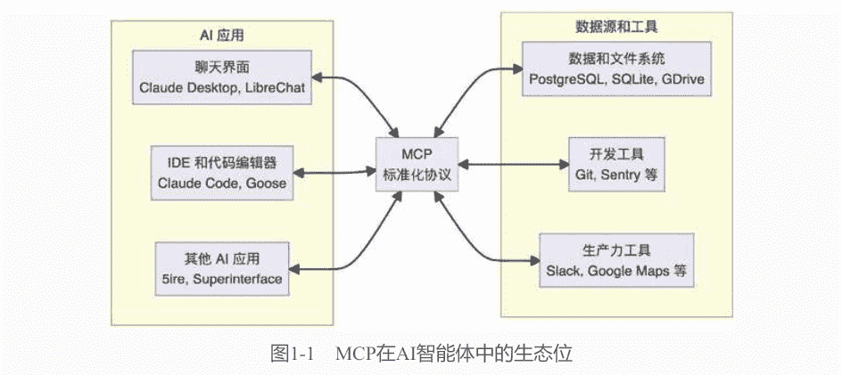

相较于LangChain和LlamaIndex等流行框架，MCP采取了截然不同的设计理念。这些框架通常是针对特定编程语言的库，而MCP则定位为语言无关的协议规范；框架提供了高级抽象和组件，而MCP专注于定义底层通信标准；框架往往与特定模型紧密绑定，而MCP支持任何符合协议标准的模型实现。值得注意的是，MCP并不与这些框架竞争，而是为这些框架提供更加统一和强大的底层支持，LangChain等框架完全可以基于MCP构建更加丰富的生态系统。

Function Calling作为OpenAI等公司推出的重要功能，与MCP存在本质区别。Function Calling通常是模型提供商的专有功能，缺乏跨平台标准；其功能实现主要聚焦于函数调用这一单一场景，而MCP则提供了更为全面的上下文管理框架；Function Calling通常需要在每次请求中重新定义函数，而MCP支持动态发现和注册机制，显著提升了系统灵活性和运行效率。

MCP的设计理念深刻反映了AI智能体发展的新趋势。它将模型、上下文和工具视为3个核心实体，通过标准化协议定义它们之间的交互方式。MCP采用了“客户端-服务器”架构，支持多种传输协议，并提供了完善的生命周期管理、安全授权和错误处理机制。这种设计不仅解决了当前AI智能体开发面临的技术挑战，也为未来更加复杂和智能的应用奠定了坚实基础。

MCP与其他AI集成方案的主要区别，如表1-1所示。

表1-1 MCP与其他AI集成方案的主要区别

| 特性 | MCP | 传统API调用 | LangChain等框架 | Function Calling |
| :--- | :--- | :--- | :--- | :--- |
| 标准化程度 | 高 | 低 | 中 | 低 |
| 语言无关性 | 高 | 高 | 低 | 中 |
| 上下文管理 | 内置 | 需自行实现 | 提供组件 | 有限 |
| 工具调用 | 标准化 | 需自行实现 | 提供组件 | 内置但有限 |
| 动态发现 | 支持 | 不支持 | 有限支持 | 不支持 |
| 生态系统 | 开放 | 分散 | 特定框架 | 特定提供商 |

MCP的主要优势在于它提供了一个开放、标准化的协议，使不同的模型和应用能够实现无缝互操作。这种标准化大大降低了集成的复杂性，使开发者能够更容易地构建复杂的AI智能体。

### 1.3 MCP在AI智能体中的角色

MCP作为一个标准化的协议，在AI智能体的开发和部署中扮演着关键角色。它解决了AI与现实世界交互的核心问题，为AI智能体提供了坚实的基础。

#### 1.3.1 作为AI与现实世界的桥梁

在AI智能体中，LLM需要与各种外部系统和数据源交互，获取所需的上下文信息和执行各种操作。MCP正是连接AI与现实世界的桥梁，通过定义标准化的接口和通信格式，使这种交互变得标准化和高效。

MCP为LLM开启了通往数据世界的大门，彻底打破了传统模式下模型只能处理预设文本的局限。通过MCP，模型能够动态访问各类数据源，包括文件系统、关系型数据库、NoSQL数据库、Web API等。这种动态数据访问能力使模型不再局限于训练时获取的知识储备，而是能够获取最新、最相关的信息。例如，当用户希望查询某公司最新财报数据时，模型不必依赖可能已经过时的训练数据，而是可以通过MCP直接查询财务数据库或公开API，获取实时准确的信息，从而提供更有价值的分析和见解。

更令人振奋的是，MCP赋予了LLM使用各种专业工具的能力。在协议的支持下，模型可以调用代码执行器、图像处理服务、数值计算库甚至是物联网设备控制接口。这种工具使用能力极大地拓展了模型的应用场景，使其不仅能够“思考”，还能够“行动”。以财务顾问AI为例，它不仅能理解用户的投资需求，还能通过MCP调用金融分析工具，执行复杂的投资组合优化计算，甚至直接与交易系统对接，提供从分析到执行的一站式服务。这种无缝衔接的体验，在传统AI架构下几乎不可能实现。

随着技术的演进，模型的交互形式也日益多样化。MCP前瞻性地支持多模态内容处理，能够无缝处理文本、图像、音频、视频等各种类型的数据。这种能力使AI智能体能够理解和生成更丰富的内容形式，为用户提供更自然、更沉浸的交互体验。在教育应用场景中，借助MCP的多模态支持，AI导师可以理解学生上传的手写笔记图片，识别其中的数学公式或化学结构，通过动态生成的图表或模拟动画展示相关概念，并配合口语化的文字解释，打造全方位的学习体验。

MCP的桥梁作用不仅表现在技术层面，更体现在它对AI智能体生态的深远影响。通过标准化的接口定义，MCP促进了工具、模型和应用之间的互操作性，降低了集成成本，加速了创新扩散。开发者可以专注于构建专业工具或特定领域模型，而不必担心系统集成问题。这种模块化、可组合的特性，为AI智能体带来了前所未有的灵活性和扩展性。

随着MCP的广泛应用，我们正在进入一个AI能力大幅扩展的新时代。模型不再是孤立的文本处理器，而是能够感知、思考和行动的综合智能体。它们可以检索最新知识，操作专业工具，维护长期记忆，处理多种媒体形式，这些能力的融合正在重新定义AI智能体的可能性边界。从个人智能体到企业决策支持，从创意创作到科学研究，MCP正在赋能一代更加强大、更加实用的AI智能体，推动AI技术从实验室走向广泛的产业实践。

#### 1.3.2 解决上下文管理问题

在构建AI智能体的过程中，上下文是LLM理解用户意图、保持对话连贯性和提供个性化服务的关键基础。然而，当我们深入这一领域时，会发现上下文管理面临着一系列复杂而微妙的挑战，这些挑战不仅源于技术局限，也源于应用场景的多样性和用户体验的高要求。上下文管理包括上下文窗口限制、相关性判断、上下文的实时更新机制、多源信息的整合，以及隐私和安全问题等方面。

(1) 上下文窗口限制是一个根本性的技术约束。LLM虽然强大，但它们处理信息的能力仍受到上下文窗口大小的严格限制。即使是最先进的LLM，其上下文窗口也只能容纳有限数量（通常在几千到几万不等）的token。这意味着在长时间交互或处理复杂任务时，模型无法完整记忆全部对话历史和相关信息。以客服场景为例，当用户与AI智能体进行数小时的深入咨询后，系统必须精准判断哪些关键信息需要保留，哪些次要内容可以舍弃，这就如同要求一个人在有限的工作记忆中维持一整天的会议内容一样具有挑战性。上下文窗口的限制迫使开发者必须设计精巧的信息流动管理机制，确保核心内容始终保持在模型的“视野范围”内。

(2) 相关性判断则涉及一个更为棘手的问题：在海量信息中识别真正重要的内容。AI系统需要具备“理解”哪些信息对当前对话具有实际价值的能力。这不仅需要考虑语义相关性，还需要理解任务目标、用户意图甚至情感状态。例如，在一个财务咨询系统中，用户可能提到自己的年龄、职业、投资经验、风险偏好等各种信息，系统需要在不同的咨询阶段判断哪些是关键信息，并将其保留在活跃上下文中。判断失误可能导致关键信息丢失或上下文被无关信息充斥，两种情况都会严重影响模型的表现。实现高质量的相关性判断通常需要结合语义相似度计算、主题建模、用户意图识别等多种技术，甚至可能需要模型自身参与信息重要性评估。

(3) 上下文的实时更新机制同样至关重要。在动态环境中，信息的时效性可能直接影响决策质量。以智能家居控制系统为例，当用户发出指令“把温度调高一点”时，系统需要实时掌握当前的温度设置、室内实际温度、用户的温度偏好模式等信息，而这些信息可能在秒级或分钟级别就会发生变化。构建能够实时捕获环境变化并更新上下文的机制，成为开发响应灵敏的AI智能体的关键挑战。这通常需要完善的事件监听和上下文更新框架，能够在关键状态变化时及时刷新模型的信息视图，确保决策始终基于最新情境。

(4) 多源信息的整合则代表更高层次的复杂性。现代AI智能体需要处理来自不同系统、不同模态、不同时间点的异构数据，并将其融合为统一的上下文表示。在企业智能体场景中，系统可能需要同时访问CRM系统中的客户数据、知识库中的产品信息、邮件系统中的历史沟通记录及日历系统中的会议安排等多源信息。如何在语义层面整合这些信息，处理可能的冲突和重叠，建立一致且连贯的上下文模型，构成了需要综合运用知识图谱、信息抽取和语义理解等多种技术的复杂问题。

(5) 隐私和安全问题为上下文管理增加了更深层次的复杂性。上下文信息往往包含用户的个人数据、偏好设置、行为模式等敏感信息。在追求智能化和个性化的同时，系统必须严格保护用户隐私和数据安全。这要求建立精细的权限控制机制，遵循数据最小化原则，并采用加密传输、匿名化处理等技术手段保护敏感信息。例如，一个健康咨询AI可能需要访问用户的医疗记录，但应该遵循严格的访问控制和数据处理规范，确保这些敏感信息不会被不适当地泄露或滥用。在全球数据保护法规日益严格的背景下，合规的上下文管理策略已经成为AI智能体设计不可回避的关键考量。

这些挑战相互关联、相互影响，共同构成了AI智能体上下文管理的复杂生态。MCP通过以下机制解决上下文管理问题。

(1) 资源抽象。MCP将上下文信息抽象为“资源（Resources）”，每个资源都有唯一的URI和类型。这种抽象使LLM能够以统一的方式访问不同类型的上下文信息。

资源可以是各种类型的数据，如文件、数据库记录、API响应等。MCP定义了标准的操作，如列出资源、读取资源内容等，使LLM能够方便地访问这些资源。

(2) 动态发现。MCP支持动态发现资源和工具，使LLM能够根据实际需求获取相关的上下文信息。这种动态发现机制使上下文管理更加灵活和高效。

例如，LLM可以首先列出可用的资源，然后根据当前对话的具体需求选择性地读取相关资源的内容。这种方式避免了将所有可能相关的信息都加载到上下文中，从而提高了处理效率。

(3) 上下文优化。MCP允许服务器对上下文信息执行优化操作，如压缩、过滤、排序等，使其更好地适应LLM的需求。这种优化可以减少上下文窗口的占用，提高模型的运行效率和响应效果。

例如，服务器可以根据当前对话的主题，有针对性地提供最相关的信息，或者将长文档提炼为关键点，减少上下文窗口的使用。

(4) 分布式上下文。MCP支持分布式上下文管理，使上下文信息可以部署在多个服务器上。这种分布式架构增强了系统的扩展性，能够处理更大规模和更复杂的上下文信息。

例如，一个服务器可以提供文件系统的访问，另一个服务器可以提供数据库的访问，第三个服务器可以提供API的访问。LLM可以根据需要从不同的服务器获取上下文信息。

随着MCP等标准化协议的发展，上下文管理正逐步从个别解决方案走向系统化框架，为构建更智能、更自然、更安全的AI智能体奠定基础。

## 小结

本章从当前AI智能体开发的挑战出发，深入剖析了在LLM与现实世界交互时，由缺乏统一标准而导致的生态碎片化、开发效率低下等一系列严峻挑战。无论是OpenAI的Function Calling，还是Anthropic的Tool Use，这些方案虽然在特定场景下增强了模型的能力，但也无形中为开发者构筑起了技术壁垒，使得构建跨平台、可扩展的复杂AI智能体变得举步维艰。

在这样的背景下，MCP应运而生。通过将外部数据源和功能抽象为标准化的资源和工具，MCP为LLM提供了一套统一的交互语言来感知和操作世界，无论是读取本地文件、查询数据库，还是调用一个远端的Web API，都可以通过标准化协议实现无缝对接。

更重要，本章探讨了MCP如何破解上下文管理这一AI智能体中最棘手、最核心的难题之一。传统的上下文管理方式往往需要在应用层面进行复杂且易错的设计，而MCP通过其内在的资源抽象、动态发现和分布式上下文机制，提供了一套优雅且高效的解决方案。这不仅显著降低了开发复杂度，还将上下文管理从应用开发者的“负担”转化为协议层的内置能力，从而保证了长对话的连贯性与深度，为实现真正智能、个性化的交互体验奠定了坚实的基础。

## 第2章 MCP架构详解

本章将深入剖析MCP的架构设计与核心组成部分，主要包括以下内容。

- MCP总体架构，包括MCP的整体设计理念，MCP Host、MCP Client和MCP Server三大核心组件的功能定位及其协作关系。
- MCP分层及实现，包括MCP的分层架构，各层的职责与相互配合，以及传输层、协议层的划分与实现方式。
- MCP的3大核心能力，包括资源（Resources）管理、工具（Tools）集成和提示词（Prompts）模板是如何支撑AI智能体的丰富功能和上下文扩展能力的。

通过本章的学习，读者将全面了解MCP的架构设计思想、技术细节及其在实际应用中的运作方式，为后续MCP开发环境搭建和应用实战打下坚实的理论与实践基础。

### 2.1 MCP总体架构

MCP遵循“客户端-服务器”架构，包括MCP Host、MCP Client和MCP Server三大组件，如图2-1所示。

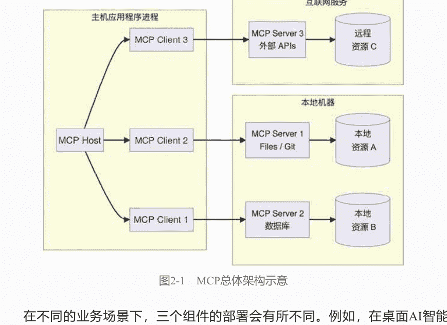

图2-1 MCP总体架构示意

在不同的业务场景下，三个组件的部署会有所不同。例如，在桌面AI智能体、IDE集成、Web应用和移动应用等典型场景下，MCP Host、MCP Client和MCP Server的实际载体各不相同。清晰理解这些角色划分，有助于在后续设计和实现基于MCP的智能体时进行合理的系统架构规划。表2-1展示了在4种常见场景下，MCP Host、MCP Client和MCP Server的角色。

表2-1 在不同应用场景下MCP组件的角色

| 应用场景 | MCP Host角色 | MCP Client角色 | MCP Server角色 |
| :--- | :--- | :--- | :--- |
| 桌面AI智能体 | Claude Desktop应用 | 内嵌MCP Client | 文件系统、API集成服务器 |
| IDE集成 | VS Code等IDE | IDE插件中的MCP Client | 代码分析、版本控制服务器 |
| Web应用 | 浏览器中的AI应用 | JavaScript MCP Client | 后端MCP Server |
| 移动应用 | 移动AI智能体应用 | 移动应用中的MCP Client | 云端MCP Server |

#### 2.1.1 MCP Host

MCP Host本质上是一个集成了LLM能力的应用环境，其职责体系围绕着建立、维护和优化用户与AI智能体之间的连接这一核心目标展开。

首先，它负责初始化和管理MCP Client，确保与相应服务器建立稳定可靠的连接。这个过程包括服务发现、认证授权、会话建立等一系列复杂操作。

其次，MCP Host提供了用户与系统交互的前端界面。这不仅仅是简单的输入框和输出区域，而是一个精心设计的交互环境，它需要清晰展示系统能力，引导用户有效使用，并提供即时反馈。优秀的界面设计能够显著降低用户的认知负担，提升整体体验。

再次，MCP Host承担着信息转换的关键职责。它需要将各种形式的输入（文本、语音、图像等）转化为规范的MCP请求格式，同时将模型返回的结构化数据转换为用户友好的呈现形式。

作为MCP Client与服务器之间的协调者，MCP Host需要管理复杂的数据流动。这包括请求排队、并发控制、响应处理等多个环节。在高负载场景下，有效的流量管理能力直接影响系统的响应速度和稳定性。

最后，MCP Host在安全与权限管理方面承担着守门人的职责。它需要实施严格的访问控制，确保用户只能在授权范围内使用系统功能和访问敏感数据。同时，MCP Host还需要保护用户隐私，防止个人信息被不当收集或滥用。这种安全保障措施对于建立用户信任至关重要。

在实际应用生态中，MCP Host呈现出丰富多样的形态。专业的AI智能体应用，如Claude Desktop，将强大的对话式AI能力封装在精心设计的用户界面中；融合AI功能的开发环境，如Visual Studio Code（VS Code）和JetBrains系列IDE，将代码补全、文档生成等AI能力无缝集成到开发流程中；更广泛的是各类生产力工具，从文档处理到图像编辑，AI功能正在逐渐成为标配；此外，开发者还可以基于MCP框架构建完全定制化的专业应用，以满足特定领域的独特需求。

#### 2.1.2 MCP Client

在MCP架构中，MCP Client不仅是连接MCP Host应用程序（Host Application）与MCP Server的桥梁，更是驱动双方信息交换的引擎。MCP Client由MCP Host应用程序负责实例化和管理，是深度嵌入在MCP Host环境中的一个动态组件，是MCP Host应用程序借以调用外部模型、数据和工具能力的“神经中枢”。具体来说，其功能主要包括以下几个方面。

- 负责建立、维护与目标服务器的连接，并在任务完成后执行连接关闭操作，保障通信链路的稳定运行。
- 作为交互过程的发起端，MCP Client将来自MCP Host应用程序的需求（包括数据请求、工具调用、提示词获取等）封装为符合协议规范的请求，发送至目标服务器，并对返回的响应进行解析与处理。
- 能够动态识别服务器暴露的资源，并根据需求读取资源内容，持续为MCP Host应用程序提供上下文信息。
- 支持调用服务器提供的工具，实现外部系统功能与MCP Host应用程序工作流的无缝集成。
- 可获取服务器预定义的提示词模板，降低与大模型交互的实现复杂度。
- 对通信链路及协议交互过程中可能出现的错误进行监测与处理，确保系统运行的健壮性。

MCP Client在整个MCP架构中具有承上启下的作用，是保证整个应用流畅、可靠运行的基石。一个设计良好、实现完善的客户端，能够将复杂的网络通信和协议细节完美封装，为MCP Host应用程序提供简洁、稳定且功能强大的接口，从而使开发者能够更专注于业务逻辑和用户体验的创新。因此，构建高质量的MCP Client必须遵循一系列经过验证的最佳实践。

##### 1. 构建MCP Client的最佳实践

与大模型交互或执行远程工具调用时，网络延迟是不可避免的。同步阻塞式操作会冻结MCP Host应用程序，严重影响用户体验。因此，**采用异步API是首要原则**。这使得MCP Client可以在等待网络I/O期间将控制权交还给主线程，确保应用程序始终保持响应。

针对网络抖动或服务器短暂不可用等问题，一个健壮的MCP Client应实现智能**重试机制**（如指数退避策略），以提高连接的成功率。同时，为所有网络操作**设置合理的超时机制**，能够防止应用程序因无尽的等待而陷入僵局。

MCP Client必须是资源管理的典范，在完成通信后，应确保所有网络连接、文件句柄等**系统资源被正确释放**。在错误处理方面，它不能仅停留在捕获异常层面，更重要的是**实现优雅的错误传播机制**。当错误发生时，应向上层（MCP Host应用程序）提供清晰、有意义的错误信息，而非模糊不清的底层细节，从而帮助开发者快速定位问题，或向用户提供恰当的反馈。

在工程实现上，利用现代编程语言的**类型安全特性**，可以在编译期捕获大量潜在的运行时错误，极大地提升了代码的可靠性。与此同时，**审慎的日志记录**也必不可少。记录关键的操作流程与错误信息是调试与监控的生命线。但必须警惕，任何时候都不应在日志中记录用户的敏感数据或凭证信息。

最后，**易于测试的架构**是高质量软件的重要标志。通过依赖注入等设计模式，将网络通信等外部依赖与核心逻辑解耦，可以使得MCP Client的各个单元能够被独立、高效地进行测试，从而有效保障其行为的正确性。

##### 2. MCP Client的错误处理哲学

即使在全面遵循最佳实践的情况下，故障在分布式系统中依然是常态而非偶然。MCP Client必须建立一套完善的错误识别与处理机制，以应对不同层面的异常问题。

连接层面的挑战是最基础也是最常见的故障类型之一，网络中断、DNS解析失败、连接超时、握手失败等问题都属于连接错误。MCP Client需要能够识别这些问题，并根据预设的重试策略尝试恢复，在最终失败时向上层报告明确的网络故障。

协议层面的错误通常出现在客户端与服务器之间的“对话”不符合MCP规范时。这可能源于客户端发送了格式错误的消息，或调用了一个服务器不支持的方法，也可能是双方版本不兼容等原因导致的。客户端需要能够解析出这类错误，并将其转化为对开发者有用的调试信息。

服务器端的功能性障碍表现为另一种情况：即使连接和协议均无问题，服务器自身也可能因依赖的下游服务故障或内部逻辑异常而在处理请求时出错。此时，服务器会返回明确的错误响应。客户端的职责是正确解析这些错误码和信息，并将其传递给MCP Host应用程序。

资源与工具的访问限制，通常出现在客户端尝试访问不存在或被权限策略禁止访问的资源时，或者在调用工具提供无效参数等场景。这些并非系统级故障，而是特定的业务逻辑或权限校验失败。客户端需要准确地区分这些错误，以便MCP Host应用程序能够据此调整行为，例如提示用户“文件未找到”或“输入参数有误”等。

MCP Client是连接AI模型能力与具体应用场景的纽带，其设计的优劣直接决定了上层AI智能体的响应速度、稳定性和可靠性。

#### 2.1.3 MCP Server

MCP Server作为连接LLM与现实世界的关键桥梁，不仅仅是一个简单的数据中转站，更是赋予AI智能体“动手能力”的核心组件。通过提供统一的接口，MCP Server使LLM能够安全、可控地获取实时数据、访问外部API、执行自动化操作，甚至调用复杂的业务工具，从而大幅拓展了AI智能体的边界，使其能够在真实场景中有效解决实际问题。

MCP Server主要提供以下三大核心能力。

- 资源管理：为LLM提供结构化的数据访问能力，如知识库检索、数据库查询、文件存储等。
- 工具集成：向LLM暴露一组可用的外部工具，例如自动化脚本、计算引擎、第三方API等，支持模型通过工具执行具体任务。
- 提示词模板：针对特定场景，预置高效的提示词模板，提升LLM的指令理解与任务完成能力。

此外，MCP Server还承担请求路由、权限控制、会话管理、日志审计等基础职责，确保整个系统的安全性和可扩展性。

##### 1. MCP Server的分类

MCP Server根据其功能通常可分为以下4类。

- 资源型MCP Server：专注于为模型提供结构化、半结构化或实时动态数据资源。例如，企业知识库服务器、财务报表接口、新闻资讯聚合、IoT设备数据中台等。它们负责数据的统一抽象、权限隔离和高效检索，是AI智能体获取信息的中枢。
- 工具型MCP Server：聚焦于能力扩展，能够将模型的自然语言指令映射为可执行的操作流程，例如自动化运维脚本、文件批处理工具、搜索引擎接口、邮件/日程管理智能体等。这类服务器使LLM不再局限于语言生成，能够直接操作外部系统。
- 提示词型MCP Server：深耕垂直领域，内置大量高质量Prompt模板，面向客户服务、代码开发、法律咨询、市场分析等具体场景，能够显著提升LLM的任务执行效率和上下文理解能力，尤其适用于对指令精度要求极高的行业场景。
- 混合型MCP Server：融合了上述多种能力，通常被用于企业级AI解决方案或开发者平台。例如，集成了知识库、自动化工具、业务数据和Prompt管理的综合型MCP Server，能够为复杂业务流程提供一站式AI基础设施支持。

一个设计精良的MCP Server，能够决定整个AI智能体的智能上限、性能表现、安全边界和未来的扩展能力。因此，构建MCP Server的过程无异于奠定整个智能系统的基石，需要周全的架构设计与严谨的工程实践。

##### 2. MCP Server设计原则

卓越的服务器设计始于两大基石：对协议的遵循与面向未来的可扩展性。

首先，严格遵循MCP规范，是保障MCP Server与各类MCP Client及MCP Host应用程序无缝协作的前提。这不仅要求精确实现实现协议定义的每一个交互细节，还需提供清晰、标准化的API接口文档，使其成为外部开发者可以信赖和依赖的稳定契约。

其次，MCP Server的架构应具备高度的可扩展性。通过采用模块化乃至插件化的设计理念，开发者能够像组装乐高积木一样，轻松地为服务器扩展新的能力，而无须对核心代码进行颠覆性修改。支持TypeScript、Python、Java/Kotlin等多种主流语言的SDK，则进一步确保了这种扩展能力能够融入千差万别的技术生态，极大地降低了集成壁垒。

再次，现代AI智能体往往面临着高并发的挑战，这就要求MCP Server必须具备卓越的I/O处理能力、高效的并发模型及智能的数据缓存策略。为了应对流量的潮汐变化，采用云原生架构是理想选择。通过容器化（如Docker）和微服务化部署，并借助Kubernetes等编排工具，可以轻松实现服务的弹性扩缩容和高可用性，确保系统在各种负载下都能稳定运行。部署模式的灵活性同样关键，无论是作为一个独立的微服务，还是嵌入到现有的企业数据中台，MCP Server都应能够无缝集成，并通过支持流式HTTP、标准输入输出（stdio）等传输协议，适配构建命令行工具、实现本地集成、进程通信、处理shell脚本、构建基于MCP Client的Web应用系统等多种业务场景与网络环境。

接下来，安全性在所有的设计原则中具有最高且不容妥协的优先级。安全体系的构建是全方位的，首先需要建立坚固的访问边界——通过集成OAuth、API Key或JWT等成熟机制，对客户端身份与权限进行严格认证与授权，确保每次访问都有据可查、合规合法。与此同时，必须对所有客户端输入实施严格校验，过滤掉任何可能引发注入攻击或跨站脚本的恶意数据。在系统内部，多租户设计原则下的资源隔离至关重要，确保不同客户端或业务之间的数据与操作互不干扰。对于服务器与真实环境交互的工具，其执行权限必须被严格限制在最小必要范围内，甚至在沙箱环境中运行，以杜绝任何潜在的恶意利用。所有敏感数据的存储与传输都应加密，并配合完善的审计日志记录，以满足合规要求并为事后追溯提供依据。

最后，将设计精良且高度安全的服务器从理念变为现实，需要依托成熟的工程实践与运维理念来支撑。这套实践始于“契约先行”的开发模式，优先设计并明确资源、工具与提示的输入输出格式，以此作为团队协作的共同语言，实现前后端的并行开发与系统解耦。在部署方面，应将配置与代码彻底分离，利用环境变量或配置中心来管理密钥、数据库地址等敏感信息，以提升部署的灵活性和安全性。健壮的服务器同样体现在其优雅的错误处理机制上，通过设计规范的错误码与异常体系，客户端能够清晰地识别问题并自动执行恢复或重试逻辑。覆盖核心路径的自动化测试是质量保障的关键，它确保了每一次代码变更都不会损害系统关键功能的正确性与鲁棒性。完备的文档与丰富的示例，则是降低开发者集成成本、促进生态繁荣的重要助力。

综上所述，开发MCP Server是一项融合了协议理解、架构智慧、安全意识与工程纪律的综合性挑战。它不仅要求开发者持续跟进MCP的演进，保持技术的前沿性，更要求以构建传世之作的心态，精心雕琢每一个细节。

### 2.2 MCP分层及实现

MCP采用4层架构模型，从底层到顶层依次为：传输层（Transport Layer）、协议层（Protocol Layer）、能力层（Capability Layer）和应用层（Application Layer）。

- 传输层负责处理客户端和服务器之间的实际通信，通过抽象底层网络细节，提供统一的接口用于发送和接收消息。
- 协议层负责消息帧的处理、请求/响应的关联及高级通信模式的实现。该层严格遵循JSON-RPC 2.0规范，为整个通信过程提供了结构化的框架支持。
- 能力层定义了MCP支持的核心功能，具体实现了MCP的3大核心能力：资源管理、工具集成和提示词模板。
- 应用层负责将MCP的能力集成到实际应用中，实现了具体的业务逻辑和用户交互。

这种分层架构设计不仅明确了各组件的职责边界，还为整个生态系统提供了坚实的扩展基础，堪称现代AI智能体集成的最佳实践。

理解MCP架构的关键在于把握传输层和协议层的具体实现，因此下文将深入探讨其技术细节。随后的章节将详细介绍能力层和应用层，展示如何将这些基础组件组合为功能强大的AI智能体。

#### 2.2.1 传输层实现

本节将介绍MCP传输层的实现，主要包括传输层类型、消息类型及错误代码、请求-响应模式。

##### 1. 传输层类型

为了适应不同的部署场景，MCP支持以下3种传输层实现。

- 标准输入/输出（stdio）传输。
- HTTP/SSE传输。
- 自定义传输。

stdio传输通过进程的标准输入（stdin）和标准输出（stdout）进行通信：客户端通过stdout发送消息，通过stdin接收消息；服务器通过stdin接收消息，通过stdout发送消息。

以下代码使用TypeScript实现了一个基于MCP的客户端-服务器通信系统，以展示客户端如何启动子进程服务器并建立通信。

```typescript
// 客户端代码
// 创建MCP Client实例，指定客户端名称和版本
const client = new Client({
  name: "example-client",
  version: "1.0.0"
}, {
  // 声明客户端支持的能力（功能特性）
  capabilities: {}
});

// 创建基于stdio传输的客户端传输层，该传输层会启动服务器进程并通过标准输入/输出与其通信
const transport = new StdioClientTransport({
  command: "./server",
  args: ["--option", "value"]
});
// 客户端通过传输层连接到服务器，之后客户端和服务器即可开始交换消息
await client.connect(transport);

// 服务器代码
// 创建MCP Server实例，指定服务器名称和版本
const server = new Server({
  name: "example-server",
  version: "1.0.0"
}, {
  // 声明服务器支持的能力（功能特性）
  capabilities: {}
});

// 创建基于stdio传输的服务器传输层，该传输层会监听标准输入/输出以接收客户端消息
const transport = new StdioServerTransport();

// 服务器通过传输层监听客户端连接，之后服务器就可以接收来自客户端的消息并返回响应
await server.connect(transport);
```

stdio传输是MCP支持的最简单的一种传输机制，具有实现简便、无须网络配置和低延迟等优势，尤其适用于进程间通信场景。然而，stdio传输也存在一定局限性，例如仅支持本地通信、无法支持多客户端同时连接，且进程终止会导致连接终止等。因此，stdio传输特别适用于以下场景。

- 构建命令行工具并与后台服务进行交互。

## 2.2.1 传输层

MCP内置的HTTP/SSE传输机制，是一种将HTTP与服务器发送事件（Server-Sent Events，SSE，一种HTML5标准下用于实现服务器向客户端单向实时通信的技术）相融合的传输方案，适用于跨网络通信场景，尤其是Web应用场景。

该传输机制支持通过HTTP POST请求实现双向通信：一方面可实现服务器到客户端的流式事件推送（基于SSE特性），另一方面也能满足客户端到服务器的请求发送需求。

客户端与服务器间的通信流程，如图2-2所示。

（1）建立SSE连接：客户端向服务器发送HTTP POST/mcp请求以建立SSE连接，服务器处理后返回200 OK响应，完成SSE连接的建立确认。

（2）请求-响应交互。

- 客户端通过HTTP POST/mcp发送JSON-RPC请求至服务器。
- 服务器接收请求并处理后，以SSE事件形式返回JSON-RPC响应至客户端。
- 客户端可多次发送HTTP POST/mcp的JSON-RPC请求，服务器依次通过SSE事件返回响应。

（3）连接关闭：客户端发送HTTP POST/mcp（携带关闭请求相关信息），服务器接收后执行操作，最终关闭SSE连接，完成一次完整的通信流程。

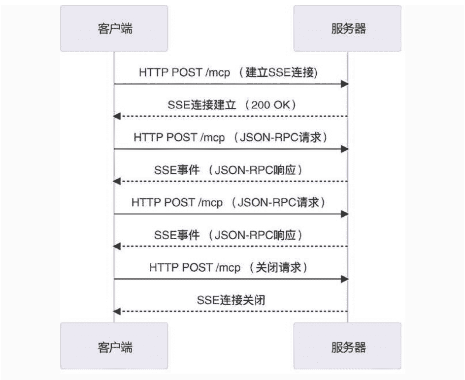

图2-2 客户端与服务器的通信示意

以下TypeScript代码通过HTTP/SSE传输机制实现了客户端与服务器的双向通信。

```typescript
// 服务器端代码
// 使用Express框架搭建HTTP服务器（MCP Server）
import express from "express";
const app = express();
const server = new Server({
  name: "example-server",
  version: "1.0.0"
}, {
  capabilities: {}
});

let transport: SSEServerTransport | null = null;

// 处理SSE连接请求，创建SSE传输层并连接MCP Server
app.get("/sse", (req, res) => {
  transport = new SSEServerTransport("/messages", res);
  server.connect(transport);
});

// 处理客户端发送的消息（通过POST请求）
app.post("/messages", (req, res) => {
  if (transport) {
    transport.handlePostMessage(req, res);
  }
});

// 启动服务器，监听3000端口
app.listen(3000);

// 客户端代码
// 创建MCP Client并连接到服务器
const client = new Client({
  name: "example-client",
  version: "1.0.0"
}, {
  capabilities: {}
});

const transport = new SSEClientTransport(
  new URL("http://localhost:3000/sse")
);
await client.connect(transport);
```

stdio传输与HTTP/SSE传输的对比如表2-2所示。

表2-2 stdio传输与HTTP/SSE传输的对比

| 特性 | stdio传输 | HTTP/SSE传输 |
| :--- | :--- | :--- |
| 通信范围 | 本地进程 | 本地或远程 |
| 复杂度 | 低 | 中 |
| 延迟 | 极低 | 低至中 |
| 安全性考虑 | 最小 | 需要TLS、认证等 |
| 适用场景 | 命令行工具、本地插件 | Web应用、远程服务 |
| 实现难度 | 低 | 中 |
| 防火墙兼容性 | 不兼容 | 良好 |
| 多客户端支持 | 不支持 | 支持 |

传输层的选择和实现对基于MCP的智能体的性能、安全性和可靠性有重要影响，开发者应根据具体需求选择合适的传输机制。在实践中，应综合考虑以下因素选择合适的传输层实现。

- 部署环境：本地应用优先采用stdio传输，Web应用或远程服务则更适合采用HTTP/SSE传输。
- 安全需求：远程通信应使用TLS加密和适当的认证机制。
- 性能要求：对延迟敏感的应用更适合采用stdio传输。
- 可扩展性：需要支持多客户端的场景应选择HTTP/SSE传输。
- 错误处理：网络传输应实现重试和断线重连机制。

为满足特定的通信需求，MCP允许开发者依据Transport接口规范来自定义传输层。以下TypeScript代码定义了一个基于JSON-RPC的Transport接口，包含消息发送/接收、连接管理及错误处理的抽象方法和回调机制。

```typescript
interface Transport {
    // 启动传输层，初始化连接并开始监听消息
    start(): Promise<void>;

    // 发送JSON-RPC格式的消息（请求/响应/通知）
    send(message: JSONRPCMessage): Promise<void>;

    // 关闭连接
    close(): Promise<void>;

    // 回调函数
    onclose?: () => void;
    onerror?: (error: Error) => void;
    onmessage?: (message: JSONRPCMessage) => void;
}
```

需要实现自定义传输层的应用场景主要包括以下4个：

- 需要自定义网络协议；
- 需要使用特定的通信通道；
- 需要与现有系统集成；
- 对传输协议的性能要求较高，需要进行性能优化。

##### 2. 消息类型与错误代码

在MCP中，JSON-RPC 2.0主要用于实现以下4种消息类型。

（1）请求（Request）：期望对方响应的消息，其定义如下代码所示。

```json
{
    "jsonrpc": "2.0",
    "id": 1,
    "method": "resources/list",
    "params": {}
}
```

（2）结果（Result）：对请求的成功响应，其定义如下代码所示。

```json
{
    "jsonrpc": "2.0",
    "id": 1,
    "result": {
        "resources": [
            {
                "uri": "file:///example.txt",
                "name": "Example File"
            }
        ]
    }
}
```

（3）错误（Error）：表示请求失败的响应，其定义如下代码所示。

```json
{
    "jsonrpc": "2.0",
    "id": 1,
    "error": {
        "code": -32601,
        "message": "Method not found"
    }
}
```

（4）通知（Notification）：不期望响应的单向消息，其定义如下代码所示。

```json
{
    "jsonrpc": "2.0",
    "method": "notifications/resources/updated",
    "params": {
        "uri": "file:///example.txt"
    }
}
```

除了这4种常用消息类型，MCP还定义了一组标准错误代码，如下代码所示。

```typescript
enum ErrorCode {
    // 标准JSON-RPC 2.0错误代码
    ParseError = -32700,    // 解析错误
    InvalidRequest = -32600, // 无效请求
    MethodNotFound = -32601, // 方法未找到
    InvalidParams = -32602,  // 无效参数
    InternalError = -32603   // 内部错误
}
```

SDK和应用程序也可以定义自己的错误代码，但错误代码的值必须大于-32000。

##### 3. 请求-响应模式

MCP采用JSON-RPC 2.0标准，客户端与服务器之间的通信遵循请求-响应模式，如图2-3所示。

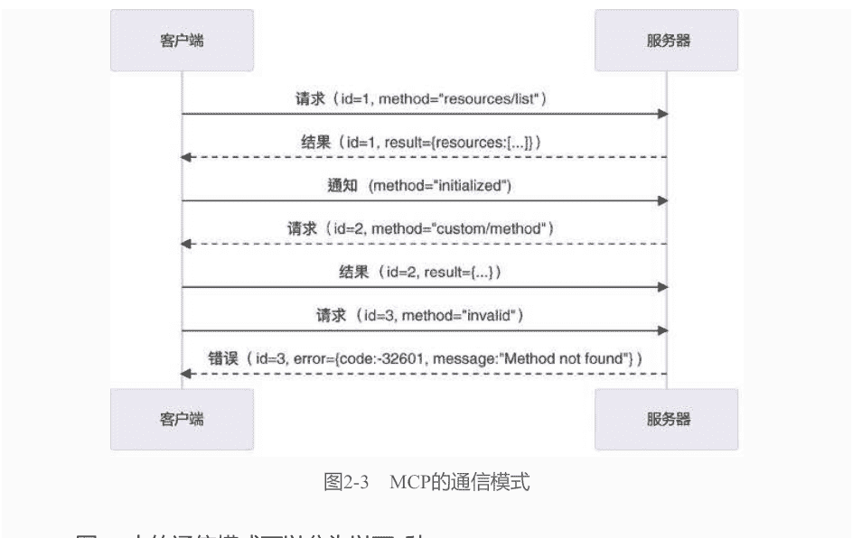

图2-3中的通信模式可以分为以下4种。

（1）客户端发起请求，服务器响应结果。

客户端发送一条包含id和method字段的请求消息，服务器处理请求后返回一条包含id和result字段的响应消息。

- 请求消息的id：唯一标识符（值为1），用于匹配对应的响应。
- 请求消息的method：要调用的方法名（resources/list），代表请求获取可用资源列表。
- 响应消息的id：与请求消息相同的唯一标识符（值为1），确保响应与请求的匹配。
- 响应消息的result：方法执行结果，是一个包含资源列表的对象。

实际JSON示例：

```json
// 请求
{
  "jsonrpc": "2.0",
  "id": 1,
  "method": "resources/list",
  "params": {}
}

// 响应
{
  "jsonrpc": "2.0",
  "id": 1,
  "result": {
    "resources": [
      {"id": "file:///path/to/document.txt", "type": "text/plain"},
      {"id": "db://mydb/users", "type": "application/x-database"}
    ]
  }
}
```

（2）客户端发送通知，服务器仅接收通知但不发送响应。

客户端发送一条只包含method字段的通知消息。其中，method代表通知类型（initialized），表示客户端已完成初始化。

注意，通知消息中没有id字段，这是通知与请求的关键区别，服务器会接收通知但不发送响应。

实际JSON示例：

```json
// 通知
{
  "jsonrpc": "2.0",
  "method": "initialized",
  "params": {
    "clientInfo": {
      "name": "MCP Example Client",
      "version": "1.0.0"
    }
  }
}
```

（3）服务器发起请求，客户端响应结果。

MCP允许双向通信，因此服务器也可以向客户端发送请求。服务器发送一条包含id和method字段的请求消息，客户端处理请求后返回一条包含id和result字段的响应消息。

- 请求消息的id：唯一标识符（值为2）。
- 请求消息的method：要调用的方法名（custom/method）。
- 响应消息的id：与请求消息相同的唯一标识符（值为2）。
- 响应消息的result：方法执行结果。

实际JSON示例：

```json
// 服务器请求
{
  "jsonrpc": "2.0",
  "id": 2,
  "method": "custom/method",
  "params": {
    "action": "refresh",
    "target": "cache"
  }
}

// 客户端响应
{
  "jsonrpc": "2.0",
  "id": 2,
  "result": {
    "status": "success",
    "refreshed": true,
    "timestamp": 1621234567890
  }
}
```

（4）客户端发送无效请求，服务器返回错误。

客户端发送一条包含id和method字段的请求消息，但方法名无效，导致服务器返回包含id、error、code和message字段的错误响应。

- 请求消息的id：唯一标识符（值为3）。
- 请求消息的method：使用了无效的方法名（invalid）。
- 响应消息的id：与请求相同的唯一标识符（值为3）。
- 响应消息的error：错误对象，包括错误代码Code（-32601）和错误描述message（Method not found，方法未找到）。

实际JSON示例：

```json
// 请求
{
  "jsonrpc": "2.0",
  "id": 3,
  "method": "invalid",
  "params": {}
}

// 错误响应
{
    "jsonrpc": "2.0",
    "id": 3,
    "error": {
        "code": -32601,
        "message": "Method not found",
        "data": {
            "availableMethods": ["resources/list", "resources/get", "tools/list", "tools/call"]
        }
    }
}
```

在MCP中，这种请求-响应模式主要支持资源发现与获取、工具调用与执行，以及LLM请求这3种交互场景。

（1）资源发现与获取。

```
Client->Server: resources/list
Server->Client: 返回可用资源列表

Client->Server: resources/get (id=file:///path/to/doc.txt)
Server->Client: 返回文档内容
```

（2）工具调用与执行。

```
Client->Server: tools/list
Server->Client: 返回可用工具列表

Client->Server: tools/call (name=analyze_text, args={...})
Server->Client: 返回工具执行结果
```

（3）LLM请求。

```
Server->Client: sampling/complete (prompt="分析以下数据...")
Client->LLM: 传递提示词
LLM->Client: 生成内容
Client->Server: 返回生成的内容
```

通过这种标准化的JSON-RPC通信机制，MCP实现了灵活、可靠的客户端-服务器交互，为AI智能体与各种数据源和工具的集成奠定了坚实基础。

#### 2.2.2 协议层实现

协议层位于传输层与应用层之间，负责接收来自应用层的请求，将其转换为标准的JSON-RPC消息并通过传输层发送；同时从传输层接收响应消息，将其解析为结构化对象后传递给应用层。通过标准化的JSON-RPC消息格式、类型安全的请求处理机制和强大的错误处理能力，协议层能够帮助开发者构建出可靠、高效的AI智能体。

通过理解和正确实现MCP的协议层，开发者可以创建能够无缝集成各种数据源和工具的AI智能体，同时保持代码的可维护性和安全性。

在协议层的代码实现中，包括如下3个关键类。

- Protocol类：协议处理类，负责管理消息传递和处理。
- Client类：客户端实现，负责发起请求和处理响应。
- Server类：服务器实现，负责接收请求并返回响应。

##### 1. Protocol类

Protocol类是MCP的协议层的基础，它是一个泛型类，可以适应不同类型的请求、通知和结果。Protocol接口定义如下：

```typescript
class Protocol<Request, Notification, Result> {
  // 注册一个处理特定类型请求的处理器
  setRequestHandler<T>(schema: T, handler: (request: T, extra: RequestHandlerExtra) => Promise<Result>): void

  // 注册一个处理特定类型通知的处理器
  setNotificationHandler<T>(schema: T, handler: (notification: T) => Promise<void>): void

  // 发送请求并等待响应
  request<T>(request: Request, schema: T, options?: RequestOptions): Promise<T>

  // 发送单向通知，不期望响应
  notification(notification: Notification): Promise<void>
}
```

Protocol类通过泛型和模式定义来确保类型安全，并利用请求id来维护请求和响应之间的对应关系。另外，协议层还提供了标准化的错误处理机制，以增强系统的可靠性。

协议层支持双向通信，允许服务器向客户端发送请求，如图2-4所示。

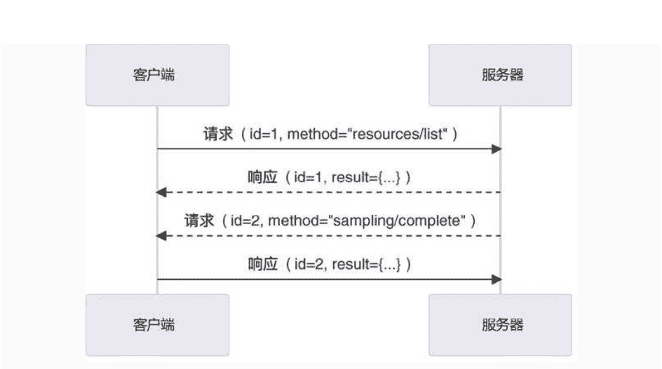

##### 2. Client类

Client类是MCP中的客户端实现，负责向服务器发送请求并处理响应。它封装了与服务器通信的复杂性，提供了一套简洁易用的API，使开发者能够轻松地与MCP Server交互。Client类的主要职责包括以下6个方面：

- 建立与服务器的连接并完成协议版本和能力协商；
- 发现和调用服务器提供的工具；
- 访问和管理服务器提供的资源；
- 使用服务器提供的提示词模板；
- 管理文件系统根目录；
- 支持LLM采样。

Client类通常实现如下接口：

```typescript
class Client {
    // 初始化连接，进行协议版本和能力协商
    initialize(): Promise<InitializeResult>

    // 发送请求并等待响应
    request<T>(method: string, params: any, resultSchema: T): Promise<T>

    // 发送通知，不期望响应
    notification(method: string, params: any): Promise<void>

    // 关闭连接
}
```

close(): Promise<void>
}

在实际应用中，Client类通常会提供更高级别的API，使开发者能够更方便地使用MCP的各种功能。例如，对于工具调用，Client类可能提供如下方法：

```
// 列出服务器提供的所有工具
listTools(): Promise<Tool[]>

// 调用特定工具
callTool(name: string, params: object): Promise<CallToolResult>
```

Client类支持同步和异步两种API风格，以适应不同的应用场景。同步API适用于简单的顺序操作，而异步API则更适用于复杂的并发处理场景。

在 MCP Java SDK 中，Client 类的实现分为 McpSyncClient (mcp/src/main/java/io/modelcontextprotocol/client/McpSyncClient.java) 和 McpAsyncClient (mcp/src/main/java/io/modelcontextprotocol/client/McpAsyncClient.java) 两个变体，分别提供同步和异步的API。以下为创建和使用Client的示例代码：

```
// 创建同步客户端
McpSyncClient client = McpClient.sync(transport)
    .requestTimeout(Duration.ofSeconds(10))
    .capabilities(ClientCapabilities.builder()
        .roots(true)    // 启用根目录功能
        .sampling()     // 启用采样功能
        .build())
    .build();

// 初始化连接
client.initialize();

// 列出可用工具
ListToolsResult tools = client.listTools();

// 调用工具
CallToolResult result = client.callTool(
    new CallToolRequest("calculator",
        Map.of("operation", "add", "a", 2, "b", 3))
);
```

Client类的一个重要特性是能力协商。在初始化连接时，客户端会向服务器声明其支持的功能，服务器也会返回其自身所提供的功能列表。通过这一机制，双方能够明确哪些功能可用，哪些功能不可用。例如，客户端可以声明它支持采样功能，这样服务器就可以请求客户端执行LLM采样。

Client类支持多种传输方式，包括stdio和HTTP/SSE。stdio传输适用于本地进程间通信，而HTTP/SSE传输则适用于远程通信。开发者可以根据应用场景选择合适的传输方式。

在错误处理方面，Client类提供了统一的错误处理机制。当服务器返回错误时，Client类会将其转换为标准的错误对象，其中包含错误代码、错误消息和可选的错误数据。开发者可以通过捕获这些错误来处理各种异常情况。

总体而言，Client类是MCP的核心组件之一，它通过提供高级API并封装底层通信细节，显著简化了与MCP Server的交互过程，使开发者能够便捷地利用服务器提供的各种功能来构建强大的AI智能体，大大简化了AI智能体的开发过程。

##### 3. Server类

Server类是MCP中的服务器实现，负责接收客户端请求并返回响应。它是AI智能体的核心组件，提供了工具、资源和提示词模板等功能，使客户端能够利用这些功能构建强大的AI智能体。Server类的主要职责包括以下7个方面。

- 接收和处理客户端的连接请求。
- 进行协议版本和能力协商。
- 提供工具供客户端调用。
- 管理资源供客户端访问。
- 提供提示词模板供客户端使用。
- 支持结构化日志记录和通知。
- 管理并发客户端连接。

Server类通常实现如下接口：

```
class Server {
    // 注册请求处理器
    setRequestHandler<T>(method: string, schema: T, handler: (params: T) => Promise<any>): void

    // 注册通知处理器
    setNotificationHandler<T>(method: string, schema: T, handler: (params: T) => Promise<void>): void

    // 连接传输层
    connect(transport: Transport): Promise<void>

    // 关闭服务器
    close(): Promise<void>
}
```

在实际应用中，Server类通常会提供更高级别的API，使开发者能够更方便地实现MCP Server的各种功能。例如，对于工具注册，Server类可能提供如下方法：

```
// 添加工具
addTool(tool: Tool, handler: (params: any) => Promise<any>): void

// 添加资源
addResource(resource: Resource, handler: (params: any) => Promise<any>): void

// 添加提示词模板
addPrompt(prompt: Prompt, handler: (params: any) => Promise<any>): void
```

与Client类相似，Server类也支持同步和异步两种API风格。在MCP的Java SDK 中，Server 类的实现分为 McpSyncServer（mcp/src/main/java/io/modelcontextprotocol/server/McpSyncServer.java）和 McpAsyncServer（mcp/src/main/java/io/modelcontextprotocol/server/McpAsyncServer.java）两个变体，分别提供同步和异步的API。以下为创建和配置Server的示例代码：

```
// 创建同步服务器
McpSyncServer server = McpServer.sync(transportProvider)
    .serverInfo("my-server", "1.0.0")
    .capabilities(ServerCapabilities.builder()
        .resources(false, true)    // 启用资源功能
        .tools(true)               // 启用工具功能
        .prompts(true)             // 启用提示词模板功能
        .logging()                 // 启用日志功能
        .build())
    .build();

// 注册工具
server.addTool(new McpServerFeatures.SyncToolSpecification(
    new Tool("calculator", "基础计算器", schema),
    (exchange, arguments) -> {
        // 工具实现
        String operation = (String) arguments.get("operation");
        double a = ((Number) arguments.get("a")).doubleValue();
        double b = ((Number) arguments.get("b")).doubleValue();

        double result = 0;
        switch (operation) {
            case "add":
                result = a + b;
                break;
            case "subtract":
                result = a - b;
                break;
            // 其他操作...
        }

        return new CallToolResult(String.valueOf(result), false);
    }
));
```

Server类的一个重要特性是能力声明（Capability Declaration）。在初始化连接时，服务器会向客户端明确声明其提供的功能，从而使客户端了解可用的功能范围。例如，服务器可以声明其提供工具、资源和提示词模板等功能，客户端便可以调用这些功能。

Server类支持多种传输提供者（Transport Provider），包括标准stdio和HTTP/SSE。对于基于Spring框架的应用，MCP还提供了WebFluxSseServerTransportProvider和WebMvcSseServerTransportProvider等专门的传输提供者。

在工具实现方面，Server类允许开发者定义工具规范（Tool Specification），包括工具名称、描述和参数模式，以及处理工具调用的函数。工具函数接收两个参数：一个是ServerExchange对象，用于与客户端交互；另一个是工具参数映射。

```
var toolSpecification = new McpServerFeatures.SyncToolSpecification(
    new Tool("calculator", "基础计算器", schema),
    (exchange, arguments) -> {
        // 工具实现
        return new CallToolResult(result, false);
    }
);
```

类似地，Server类也支持资源规范（Resource Specification）和提示词模板规范（Prompt Specification），使开发者能够定义和实现各种资源及提示词模板。

Server类还支持从客户端请求LLM采样。如果客户端支持采样功能，服务器可以请求其执行LLM采样，并获取返回结果。这一机制使得服务器能够利用客户端的LLM能力，而无须自行实现或调用外部的LLM API。

```
// 检查客户端是否支持采样
if (exchange.getClientCapabilities().sampling() != null) {
    // 创建采样请求
    McpSchema.CreateMessageRequest request = McpSchema.CreateMessageRequest.builder()
        .messages(List.of(new McpSchema.SamplingMessage(McpSchema.Role.USER,
            new McpSchema.TextContent("计算: " + arguments.get("expression")))))
        .systemPrompt("你是一个有用的计算器智能体。只提供数值答案。")
        .maxTokens(100)
        .build();

    // 请求客户端执行采样
    McpSchema.CreateMessageResult result = exchange.createMessage(request);

    // 处理结果
    String answer = result.content().text();
    return new CallToolResult(answer, false);
}
```

在日志记录方面，Server类提供了结构化日志记录功能，允许服务器向客户端发送不同严重级别的日志消息。客户端可以通过设置最低日志级别来过滤接收的日志消息。

总体而言，Server类是MCP的核心组件之一，它使开发者能够轻松地实现MCP Server，为客户端提供各种功能。通过封装高级API和处理底层通信细节，Server类大大简化了AI智能体服务器的开发过程。

### 2.3 MCP核心能力

2.1.3节提到，MCP Server提供了三大核心能力：资源管理、工具集成和提示词模板。这些能力构成了AI智能体与现实世界进行高效交互的基础。每种能力均针对特定的交互模式设计，共同构建了一套完整的AI智能体功能体系。本节将详细分析这些核心能力的工作原理、实现方式及其应用场景。

#### 2.3.1 资源管理

资源是MCP的核心概念之一，指服务器可以提供给LLM的任何类型的数据或内容。MCP提供的资源管理功能使LLM能够访问和利用外部数据源，从而提供更准确、更相关的响应。在MCP中，资源类型遵循多用途互联网邮件扩展（Multipurpose Internet Mail Extensions，MIME）规范，如表2-3所示。

表2-3 MCP的资源类型

| 资源类型 | MIME类型 | 描述 |
| :--- | :--- | :--- |
| 纯文本 | text/plain | 普通文本内容 |
| HTML | text/html | HTML格式内容 |
| JSON | application/json | JSON格式数据 |
| XML | application/xml | XML格式数据 |
| PDF | application/pdf | PDF文档 |
| 图像 | image/* | 各种图像格式 |
| 二进制 | application/octet-stream | 通用二进制数据 |

MCP资源的标识使用统一资源标识符（Uniform Resource Identifier，URI），遵循RFC 3986规范，但通常会简化为以下格式：

```
[protocol]://[host]/[path]
```

其中，协议前缀[protocol]用于制定资源类型（如file、postgres），并支持自定义方案；主机[host]用于标识资源所在服务器，本地资源可为空；路径[path]用于明确资源的具体位置（如/home/user/data）。协议前缀[protocol]和路径[path]由MCP Server定义，不同协议前缀适配不同的资源场景，典型示例如下：

```
file:///documents/report.md 本地文件
postgres://database/customers/schema 数据库记录
api://weather/forecast?city=london API资源
kb://company/products/123 知识库条目
```

资源API的交互流程涵盖了资源发现、资源访问、资源订阅和资源更新的完整生命周期，其中涉及资源列表（resources/list）、资源读取（resources/read）、资源更新通知（notifications/resources/update）等API，为客户端与服务器之间建立了一个强大而灵活的通信框架。

资源API的交互流程，如图2-5所示。

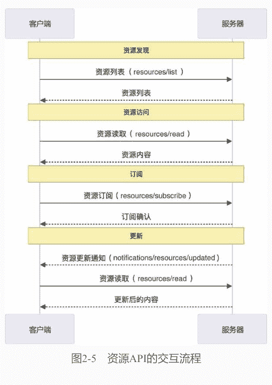

##### 1. 资源列表（resources/list）

资源列表是客户端发现服务器资源的入口，客户端通过发送resources/list请求来获取服务器上可用的资源清单。该操作支持分页，客户端可以通过可选的游标参数来获取大量资源的分页结果。

```json
// 请求示例
{
  "jsonrpc": "2.0",
  "id": 1,
  "method": "resources/list",
  "params": {
    "cursor": "optional-cursor-value"
  }
}

// 响应示例
{
    "jsonrpc": "2.0",
    "id": 1,
    "result": {
        "resources": [
            {
                "uri": "file:///project/src/main.rs",
                "name": "main.rs",
                "title": "Rust Software Application Main File",
                "description": "Primary application entry point",
                "mimeType": "text/x-rust"
            }
        ],
        "nextCursor": "next-page-cursor"
    }
}
```

服务器返回的资源信息包括：资源的唯一标识符uri、资源名称name、可选的可读名称（用于显示）title、可选的资源描述description、可选的MIME类型mimeType和可选的资源大小（字节）size。

##### 2. 资源读取（resources/read）

客户端通过resources/read请求获取特定资源的内容。客户端需要提供目标资源的URI，服务器会返回资源内容列表。

```json
// 请求示例
{
    "jsonrpc": "2.0",
    "id": 2,
    "method": "resources/read",
    "params": {
        "uri": "file:///project/src/main.rs"
    }
}
```

```json
// 响应示例
{
    "jsonrpc": "2.0",
    "id": 2,
    "result": {
        "contents": [
            {
                "uri": "file:///project/src/main.rs",
                "name": "main.rs",
                "title": "Rust Software Application Main File",
                "mimeType": "text/x-rust",
                "text": "fn main() {\n    println!(\"Hello world!\");\n}"
            }
        ]
    }
}
```

资源内容可以是文本或二进制数据，其中文本资源使用text字段、二进制资源使用blob字段（Base64编码）。值得注意的是，服务器可以针对单个resources/read请求返回多个资源，例如，读取目录时可以返回该目录中的文件列表。

##### 3. 资源更新通知（notifications/resource/updated）

MCP通过两种机制支持资源的实时更新。

（1）列表变更通知：当可用资源列表发生变化时，声明了listChanged能力的服务器会发送通知。

```json
{
  "jsonrpc": "2.0",
  "method": "notifications/resources/list_changed"
}
```

（2）资源订阅（resources/subscribe）机制：客户端可以订阅特定资源的变更。

```json
// 订阅请求
{
  "jsonrpc": "2.0",
  "id": 4,
  "method": "resources/subscribe",
  "params": {
    "uri": "file:///project/src/main.rs"
  }
}
```

```json
// 更新通知
{
  "jsonrpc": "2.0",
  "method": "notifications/resources/updated",
  "params": {
    "uri": "file:///project/src/main.rs",
    "title": "Rust Software Application Main File"
  }
}
```

当订阅的资源发生变化时，客户端会收到通知，然后可通过resources/read请求获取最新内容。客户端也可以使用resources/unsubscribe方法取消订阅。

服务器应返回标准的JSON-RPC错误，常见的错误包括资源未找到错误（错误码-32002）和内部错误（错误码-32603）。

```json
// 资源未找到错误示例
{
    "jsonrpc": "2.0",
    "id": 5,
    "error": {
        "code": -32002,
        "message": "Resource not found",
        "data": {
            "uri": "file:///nonexistent.txt"
        }
    }
}
```

```json
// 内部错误示例
{
    "jsonrpc": "2.0",
    "id": 5,
    "error": {
        "code": -32603,
        "message": "Internal errors",
        "data": {
            "uri": "file:///nonexistent.txt"
        }
    }
}
```

在构建MCP Server并实现资源API的过程中，安全性是需要高度重视的议题。服务器负责向AI模型暴露各种本地或远程的数据源，从文件系统到数据库，再到外部API，任何设计或实现上的疏忽都可能导致严重的安全漏洞。一个设计精良的MCP Server必须建立纵深防御体系，以确保其所管理的资源得到保护。

该体系的第一道防线便是对资源URI的严格验证。服务器应将接收到的任何资源请求URI视为不可信的外部输入。验证过程远不仅需检查URI格式的合规性，更要确保其指向的资源位于预期的、授权的范围之内，从而有效抵御路径遍历（Path Traversal）等恶意攻击，防止恶意客户端通过构造如../../etc/passwd之类的相对路径，访问文件系统中本不应暴露的敏感文件。可以说，URI验证是守护资源安全的第一道防线。

当确认URI指向一个合法且处于授权范围内的资源后，下一道防线是实施精细化的访问控制。并非所有资源都应被平等对待，对于包含用户个人信息、系统配置或商业机密等内容的敏感资源，服务器必须实施严格的权限管理策略。这不仅仅是确认客户端“能否”访问，还应依据操作类型（如读取、写入或执行）来判断“是否授权”其执行该特定操作。更重要的是，权限检查必须在实际执行资源操作前的瞬间完成，以确保授权状态的即时性与有效性，防止因权限状态变更而产生安全风险。这一机制遵循了“最小权限原则”，确保每个客户端只能访问其完成任务所必需的最少资源。

最后，数据的完整性与保真度同样至关重要。当服务器处理的资源为二进制格式（如图像、音频或可执行文件）时，必须在传输前进行正确的编码处理，例如转换为Base64格式。MCP通常依赖于基于文本的传输协议（如JSON-RPC），直接传输原始二进制流可能会导致协议解析错误或数据损坏。通过适当的编码，服务器能够确保数据在跨越协议边界后，客户端接收到的内容与原始资源完全一致，从而保障了整个交互链路的数据完整性和保真度。综上所述，通过URI的严密验证、基于最小权限原则的访问控制，以及对二进制数据的审慎编码，开发者才能构建出既功能强大又安全可靠的MCP Server。

#### 2.3.2 工具集成

MCP允许服务器暴露LLM可以调用的工具。借助这些工具，模型能够与外部系统交互，例如查询数据库、调用API或执行计算、访问实时数据，以及实现各种自动化任务等。每个工具都由名称唯一标识，并包含描述其使用模式的元数据。

在MCP中，工具可以依据功能和特性分为6类，如表2-4所示。

表2-4 MCP工具的类型

| 工具类型 | 描述 | 示例 |
| :--- | :--- | :--- |
| 计算工具 | 执行计算和数据处理 | 计算器、单位转换、统计分析 |
| 数据检索工具 | 从外部源获取数据 | 天气查询、股票价格、新闻搜索 |
| 内容生成工具 | 创建或修改内容 | 图像生成、代码格式化、文档转换 |
| 通信工具 | 与外部系统或人员通信 | 电子邮件发送、消息通知、API调用 |
| 自动化工具 | 执行系统操作或工作流 | 文件操作、任务调度、工作流触发 |
| 分析工具 | 分析和解释数据 | 情感分析、文本摘要、数据可视化 |

每个工具都有一个唯一的名称，以及定义其参数和返回值的JSON Schema。MCP工具定义通常包含以下内容：

```json
{
    "name": "string", // 唯一标识符，用于在系统中区分不同工具
    "description": "string", // 详细描述，帮助用户和AI理解工具的用途和功能，建议提供充分信息
    "inputSchema": { // 工具参数的JSON Schema规范定义，用于验证输入参数的格式和类型
        "type": "object",
        "properties": { ... } // 工具特定的参数定义，包括参数名称、类型、是否必须、默认值等
    },
    "annotations": {
        // 工具行为的额外提示信息，帮助客户端和模型更好地理解和使用工具
        "title": "string", // 工具的简短标题，适合在UI界面上显示，比description更简洁
        "readOnlyHint": "boolean", // 如果为true，表示工具仅读取数据而不修改任何状态或环境
        "destructiveHint": "boolean", // 如果为true，表示工具可能执行不可逆的破坏性操作，客户端需额外确认
        "idempotentHint": "boolean", // 如果为true，表示使用相同参数多次调用该工具不会产生额外副作用
        "openWorldHint": "boolean" // 如果为true，表示工具会与外部系统或网络交互，可能受网络状态影响
    }
}
```

MCP定义了以下3个工具API。

- 工具列表（tools/list），用于获取可用工具列表。
- 工具调用（tools/call），用于调用特定工具。
- 工具列表更新通知（notifications/tools/list_changed），当可用工具列表发生变化时，声明了listChanged功能的服务器将发送该通知。

MCP工具API的交互流程如图2-6所示。

下面分别来介绍这些工具API的核心功能和代码示例。

##### 1. 工具列表（tools/list）

工具列表API是客户端发现服务器提供的工具能力的入口。客户端通过发送tools/list请求来获取服务器上可用的工具清单。该操作支持分页，客户端可以通过可选的游标参数来获取大量工具的分页结果。

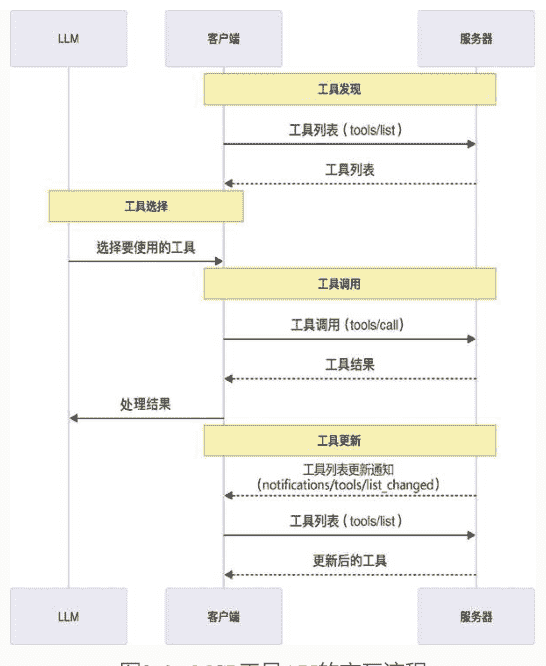

图2-6 MCP工具API的交互流程

请求示例：

```json
{
  "jsonrpc": "2.0",
  "id": 1,
  "method": "tools/list",
  "params": {
    "cursor": "optional-cursor-value"
  }
}
```

响应示例：

```json
{
  "jsonrpc": "2.0",
  "id": 1,
  "result": {
    "tools": [
      {
        "name": "get_weather",
        "title": "Weather Information Provider",
        "description": "Get current weather information for a location",
        "inputSchema": {
          "type": "object",
          "properties": {
            "location": {
              "type": "string",
              "description": "City name or zip code"
            }
          },
          "required": ["location"]
        }
      }
    ],
    "nextCursor": "next-page-cursor"
  }
}
```

出于安全考虑，客户端必须将工具注释视为不受信任的，除非它们来自受信任的服务器。

##### 2. 工具调用 (tools/call)

客户端通过tools/call请求调用特定工具。客户端需要提供工具名称和符合工具输入模式的参数。请求示例：

```json
{
    "jsonrpc": "2.0",
    "id": 2,
    "method": "tools/call",
    "params": {
        "name": "get_weather",
        "arguments": {
            "location": "New York"
        }
    }
}
```

响应示例：

```json
{
    "jsonrpc": "2.0",
    "id": 2,
    "result": {
        "content": [
            {
                "type": "text",
                "text": "Current weather in New York: \n Temperature: 72°F \n Conditions: Partly cloudy"
            }
        ],
        "isError": false
    }
}
```

工具调用结果可以包含结构化或非结构化内容。结构化内容在structuredContent字段中返回为JSON对象。为了向后兼容，返回结构化内容的工具也应该返回功能等效的非结构化内容（例如，在文本内容块中返回序列化的JSON）。而非结构化内容在content字段中返回，可以包含以下类型的内容。

- 文本内容：{"type": "text", "text": "工具结果文本"}。
- 图像内容：{"type": "image", "data": "base64编码数据", "mimeType": "image/png"}。
- 音频内容：{"type": "audio", "data": "base64编码音频数据", "mimeType": "audio/wav"}。
- 资源链接：{"type": "resource_link", "uri": "file:///project/src/main.rs", ...}。
- 嵌入资源：{"type": "resource", "resource": {"uri": "...", "text": "..."}}。

如果工具提供了输出模式（outputSchema），服务器必须提供符合此模式的结构化结果，客户端应该根据此模式验证结构化结果。

工具调用错误处理采用以下两种机制。

（1）协议错误：标准JSON-RPC错误，用于未知工具、无效参数等问题。示例如下：

```json
{
  "jsonrpc": "2.0",
  "id": 3,
  "error": {
    "code": -32602,
    "message": "Unknown tool: invalid_tool_name"
  }
}
```

（2）工具执行错误：在工具结果中通过isError: true报告，用于API失败、无效输入数据等。示例如下：

```json
{
  "jsonrpc": "2.0",
  "id": 4,
  "result": {
    "content": [
      {
        "type": "text",
        "text": "Failed to fetch weather data: API rate limit exceeded"
      }
    ],
    "isError": true
  }
}
```

##### 3. 工具列表更新通知（notifications/tools/list_changed）

当可用工具列表发生变化时，声明了listChanged能力的服务器应该发送通知：

```json
{
    "jsonrpc": "2.0",
    "method": "notifications/tools/list_changed"
}
```

收到此通知后，客户端可以重新发送tools/list请求以获取更新后的工具列表。

在MCP中，工具设计代表了一种强大而灵活的能力，它使LLM能够与外部系统交互并执行实际操作。然而，这种能力也带来了显著的安全挑战。MCP中的工具设计遵循“模型控制，人类监督”的核心理念。这意味着LLM可以基于上下文理解和用户提示自动发现并建议调用工具，但最终决定权始终掌握在人类手中。这种设计哲学在保持AI智能体灵活性的同时，确保了安全边界不被突破。

MCP中的工具实现并不局限于特定的用户交互模式。协议本身保持中立，允许应用程序根据自身需求设计最适合的接口。无论是命令行界面、图形用户界面还是API调用，MCP均可提供一致的工具访问机制，同时保持必要的安全控制。MCP工具设计的一个关键安全原则是人在循环中（Human-in-the-Loop）。这不仅是一种技术实现，更是一种安全哲学。在实践中，应用程序应该做到以下几点。

- 提供透明度：通过清晰的用户界面，明确显示哪些工具被暴露给AI模型，使用户随时了解AI可能调用的功能范围。
- 可视化工具调用：当AI模型请求执行工具时，应插入明确的视觉指示使用户能够直观地识别正在发生的操作。
- 确认机制：对于可能产生影响的操作，应向用户提供确认提示，确保用户能够审查并批准或拒绝AI的行动建议。

通过实施“人在循环中”的设计理念，结合严格的输入验证、权限控制、资源限制和错误处理，开发者可以构建既强大又安全的MCP工具实现。这种设计不仅增强了系统的安全性，还提升了用户对AI智能体的信任度。用户不再是被动接受AI决策的观察者，而是决策过程的积极参与者。MCP工具设计代表了AI智能体与现实世界交互的新范式，它在提供强大功能的同时，也带来了新的安全挑战。

随着MCP生态系统的发展，我们可以预期更多安全增强功能的出现，如标准化的权限模型、更强大的沙箱执行环境、改进的提示过滤机制等。开发者应密切关注MCP规范的更新，及时采纳新的安全最佳实践。MCP工具的安全性不仅依赖于技术实现，还依赖于整个生态系统的共同努力，包括规范制定者、工具开发者、应用程序开发者和最终用户。只有各方共同努力，才能确保MCP工具在释放AI潜力的同时，保持必要的安全边界。

#### 2.3.3 提示词模板

MCP为服务器提供了一种标准化的方式来向客户端展示提示词模板。提示词允许服务器提供结构化的消息和指令，用于与LLM进行交互。客户端可以发现可用的提示词，获取其内容，并提供参数来定制它们。提示词是MCP的第三个核心概念，它允许服务器定义和提供可重用的提示词模板。提示词模板是指服务器定义的可参数化的消息序列，使开发者能够创建结构化、参数化的提示词，从而实现一致的LLM交互模式和工作流。

MCP提示词模板通常使用模板引擎来生成最终的提示词消息。常见的模板引擎包括以下4个。

- Handlebars/Mustache：轻量级的逻辑模板语言。
- Jinja2：Python生态系统中流行的模板引擎。
- EJS：JavaScript的嵌入式模板。
- 自定义模板引擎：专为提示词设计的模板引擎。

客户端通过发送prompts/list请求来检索可用的提示词模板，此操作通过cursor字段参数来支持分页。请求示例如下：

```json
{
  "jsonrpc": "2.0",
  "id": 1,
  "method": "prompts/list",
  "params": {
    "cursor": "optional-cursor-value"
  }
}
```

返回提示词模板数据结构示例如下：

```json
{
  "jsonrpc": "2.0",
  "id": 1,
  "result": {
    "prompts": [
      {
        "name": "code_review",
        "title": "Request Code Review",
        "description": "Asks the LLM to analyze code quality and suggest improvements",
        "arguments": [
          {
            "name": "code",
            "description": "The code to review",
            "required": true
          }
        ]
      }
    ],
    "nextCursor": "next-page-cursor"
  }
}
```

MCP定义了以下2个核心提示词API。

- 提示词列表（prompts/list）：客户端通过该接口获取服务器端可用提示词模板列表。
- 提示词获取（prompts/get）：获取特定提示词模板的消息。

MCP提示词模板的API交互流程，如图2-7所示。

## 小结

本章从宏观的总体设计到微观的技术实现，为读者描绘了一幅清晰而完整的MCP体系蓝图。

首先，本章介绍了MCP的总体架构。该架构采用经典的客户端-服务器模型，由MCP Host、MCP Client和MCP Server三大核心组件构成。MCP Host是用户与AI交互的入口和协调中心；MCP Client作为连接的枢纽，负责通信管理与协议转换；而MCP Server则负责将协议的潜力转化为实际的应用能力。通过暴露资源、工具与提示词，MCP赋予了LLM感知和影响现实世界的能力。这种清晰的职责划分实现了AI智能体开发过程中的关注点分离，显著提升了系统的模块化、可维护性和扩展性。

然后，本章深入到MCP架构的内部，介绍了其分层设计——从底层到顶层依次为传输层、协议层、能力层和应用层。其中，传输层通过支持标准输入/输出（stdio）、HTTP/SSE等多种机制，灵活地适配了从本地进程间通信到跨网络远程服务的各类部署场景，解决了“如何通信”的问题。建立于其上的协议层严格遵循JSON-RPC 2.0规范，定义了请求、响应、通知和错误等标准化的消息格式与交互模式，解决了“通信内容与规则”的问题。这种分层思想不仅保障了通信的可靠性与规范性，也为上层能力的实现奠定了坚实基础。

最后，本章介绍了MCP的三大核心能力——资源管理、工具集成和提示词模板，这三大能力是MCP将LLM从一个封闭的计算单元，转变为能够与现实世界互动的智能体的关键所在。资源管理为模型提供了访问外部知识的“眼睛”，使其能够获取实时、动态的数据；工具集为模型提供了执行具体任务的“双手”，使其能够调用API、执行脚本，从而对外部环境产生实际影响；而提示词模板则为模型提供了标准化的“沟通范式”，通过可复用的模板，确保了在特定场景下交互的一致性与高效性。

总而言之，本章不仅阐明了MCP“是什么”，更重要的是揭示了它“为什么”这样设计。通过学习其总体架构、分层实现和核心能力，可以强化对MCP的认识——它不仅仅是一个协议，更是一套构建下一代AI智能体的先进思想和工程实践。

## 第二部分 MCP开发环境与技术栈

随着LLM技术的迅猛发展，AI智能体已从前沿概念快速走向工程实践。MCP作为连接大模型与应用程序的桥梁，为开发者提供了标准化的交互方式。本部分将深入探讨MCP开发环境与技术栈的构建，帮助读者建立高效、可靠的AI智能体开发基础。

该部分将首先介绍MCP开发环境搭建，包括基础环境配置、包管理工具、SDK安装与配置、开发工具选择与设置；然后介绍MCP工具链与生态，包括MCP Inspector，以及 TypeScript、Python 两大主流语言的工具链生态。

## 第3章 MCP开发环境搭建

本章重点介绍如何从零开始构建高效、专业的基于MCP的AI智能体开发环境，主要包括以下内容。

- MCP开发环境概述，包括集成开发环境、版本控制工具、运行时与包管理工具的介绍。
- MCP TypeScript开发环境的搭建，包括TypeScript技术栈选型、包管理工具安装、开发环境配置。
- MCP Python开发环境的搭建，包括Python技术栈选型、包管理工具安装、开发环境配置。

通过本章的学习，读者将掌握搭建MCP开发环境的完整流程和最佳实践，具备独立构建、管理和优化MCP项目开发环境的能力，为后续基于MCP的AI智能体开发与实战项目奠定坚实基础。

### 3.1 MCP开发环境概述

MCP开发环境是指支持基于MCP的AI智能体开发的集成开发环境（IDE）、库和框架的集合，它为开发者提供了从设计、编码、测试到部署的全流程支持。

构建MCP开发环境的核心，在于将一系列关键组件有机地整合为连贯的工作流。这些组件协同运作，覆盖了从代码编写、版本追溯、依赖管理到最终运行的各个环节。

#### 3.1.1 IDE

IDE是编写代码的主要工具。现代IDE早已超越了文本编辑器，是集成了代码高亮、智能补全、调试工具、版本控制、重构辅助等诸多功能于一体的综合平台。在MCP开发生态中，IDE的选择主要有两类。

一类是新兴的AI辅助编程环境（如Cursor或字节跳动出品的Trae），它们正在成为追求极致开发效率和AI原生体验的开发者的新选择。这类工具深度集成了AI能力，能够理解开发者的意图，在编码、调试、代码优化等方面提供了前所未有的智能支持，使开发者更专注于业务逻辑的创造。

另一类是经典的IDE。VS Code凭借其轻量级的设计、强大的扩展性和活跃的社区生态，成了无数开发者的首选。无论是前端的TypeScript还是后端的Python开发，VS Code都能通过丰富的插件提供近乎完美的开发体验。对于追求特定语言极致体验的开发者，JetBrains家族的IntelliJ IDEA（针对Java/Kotlin）、WebStorm（针对TypeScript/JavaScript）及PyCharm（针对Python）则提供了更为专业和深入的功能支持。

目前并没有任何一款IDE具备绝对优劣，关键在于其是否符合开发者个人的工作习惯及项目需求。

#### 3.1.2 版本控制工具

在软件开发领域，唯一不变的就是变化。如何管理代码的演进、支持团队协作、安全地进行功能迭代，是一个永恒的话题。

作为当今业界公认的分布式版本控制系统，Git是管理MCP项目代码历史、创建分支进行实验，以及与团队成员协同工作的重要工具。无论是通过命令行直接操作，还是借助GitHub Desktop或GitKraken这类图形化客户端来简化工作流程，都离不开Git。

#### 3.1.3 运行时与包管理

MCP的强大能力离不开其丰富的生态系统，而我们与这一生态系统进行交互的关键工具便是不同编程语言的运行时（Runtime）环境和包管理（Package Manager）工具。

运行时环境是执行代码的基础，如Node.js（对于JavaScript/TypeScript）或Python解释器。根据MCP SDK的要求，通常需要安装较新版本的运行时环境，如Node.js v16.0.0+或Python 3.8+，以便充分利用最新的语言特性并获得更佳的性能支持。

与运行时环境相辅相成的是包管理工具。无论是TypeScript生态的npm、yarn，Python生态的pip、conda，还是新兴的高性能工具如uv，都承担着将MCP的SDK及项目所需的众多第三方库集成到项目中的重要职责。这些工具能够有效处理复杂的依赖关系，确保项目构建的一致性和可复现性。

综上所述，一个功能完备的MCP开发环境，是由高效的IDE、可靠的Git版本控制、稳定的运行时，以及高效的包管理器共同构成的。虽然这些组件的安装与配置看似是基础操作，但正是这些基础决定了开发过程的顺畅程度。接下来将深入细节，演示如何为TypeScript和Python这两种主流的MCP开发语言，从零开始搭建完整而高效的开发环境。

### 3.2 MCP TypeScript开发环境

本节将从MCP TypeScript技术栈选型、包管理工具安装和开发环境搭建这3个方面展开介绍。

#### 3.2.1 技术栈选型

使用TypeScript开发基于MCP的AI智能体时，常用的技术框架主要包括以下6种。

- Node.js：作为服务器运行环境，能够提供非阻塞I/O特性和丰富的生态系统。
- TypeScript：提供静态类型检查，有助于提高代码质量和开发效率。
- Express.js：具有轻量级Web框架，适用于构建HTTP服务器和API端点。
- MCP SDK：使用官方提供的MCP SDK（@modelcontextprotocol/sdk），可简化MCP的实现过程。
- Zod：用于数据验证和类型定义，确保API输入输出的类型安全。
- SSE（Server-Sent Events）：用于实现服务器到客户端的实时通信。

当开发者选择使用TypeScript来构建MCP Server时，不仅仅是选择了一门语言，更是拥抱了一个由多个强大、成熟的框架和库共同构建的现代化技术生态系统。这个生态系统中的每一个组件都扮演着关键角色，它们协同工作，共同构建起一个健壮且高效的AI智能体后端。

#### 3.2.2 包管理工具安装

TypeScript包管理工具主要有npm、yarn和pnpm三种。

1. npm

目前，npm（Node Package Manager）是Node.js的默认包管理器，也是全球最大的软件注册表。它深度集成于Node.js开发体系，依托庞大的生态汇集了超过150万个软件包，覆盖各类开发场景需求，使开发者能够便捷地复用代码、提升开发效率。同时，npm通过package.json实现规范的依赖管理，清晰记录项目所需包及版本，便于在团队协作时统一依赖，并且简化了后续维护与升级流程。凭借其内置的便捷性、丰富的资源支持与规范的管理机制，npm为开发者提供了高效且可靠的包管理体验。

安装Node.js时，npm会自动附带安装，无须额外操作。如需验证安装是否成功，只需在终端运行npm -v命令，查看npm的版本号以确认安装状态。

npm的常用命令如下：

```
# 初始化项目
npm init

# 安装依赖
npm install @modelcontextprotocol/sdk

# 安装开发依赖
npm install typescript --save-dev

# 更新依赖
npm update

# 运行脚本
npm run start
```

MCP Server和Client的相关配置如下：

```json
// package.json
{
  "dependencies": {
    "@modelcontextprotocol/sdk": "^1.0.0",
    "zod": "^3.21.4"
  },
  "devDependencies": {
    "typescript": "^5.0.0",
    "ts-node": "^10.9.1"
  },
  "scripts": {
    "start:server": "ts-node src/server/index.ts",
    "start:client": "ts-node src/client/index.ts",
    "build": "tsc"
  }
}
```

2. yarn

yarn是Facebook开发的替代npm的包管理器，专注于速度、安全性和一致性。其安装方法如下：

```
# 使用npm安装
npm install -g yarn

# 或使用Homebrew (macOS)安装
brew install yarn
```

yarn的常用命令如下：

```
# 初始化项目
yarn init

# 安装所有依赖
yarn

# 添加依赖
yarn add @modelcontextprotocol/sdk

# 添加开发环境依赖
yarn add typescript --dev

# 更新依赖
yarn upgrade

# 运行脚本
yarn start
```

3. pnpm

pnpm是一个快速、节省磁盘空间的包管理器，通过硬链接共享依赖。其安装方法如下：

```
# 使用npm安装
npm install -g pnpm

# 或使用Homebrew (macOS)安装
brew install pnpm
```

pnpm的常用命令如下：

```
# 初始化项目
pnpm init

# 安装依赖
pnpm add @modelcontextprotocol/sdk

# 安装开发依赖
pnpm add -D typescript

# 更新依赖
pnpm update

# 运行脚本
pnpm start
```

#### 3.2.3 开发环境搭建

MCP开发环境的搭建相对简单，但需要一些基础的开发工具和依赖。本章将以具备类型安全和面向对象特性的TypeScript作为主要开发语言介绍MCP开发环境的搭建过程。

在开始搭建开发环境之前，需要确保系统满足以下要求。

- 已安装Node.js（推荐v16或更高版本）。
- 已安装npm或yarn包管理器。
- 支持基本的命令行操作。
- 已安装文本编辑器或IDE（如VS Code、WebStorm等）。

1. 安装Node.js和TypeScript

从Node.js官网下载并安装最新的LTS版本。安装完成后，通过如下命令验证安装是否成功：

```
node --version
npm --version
```

继续安装TypeScript和其他必要的开发工具：

```
# 安装TypeScript
npm install -g typescript

# 安装ts-node（用于直接运行TypeScript文件）
npm install -g ts-node

# 验证安装
tsc --version
ts-node --version
```

2. 配置环境

首先，新建一个Node.js项目，并初始化：

```
# 新建项目目录
mkdir mcp-nodejs-demo
cd mcp-nodejs-demo

# 初始化npm项目
npm init -y

# 安装MCP SDK和其他依赖
npm install @modelcontextprotocol/sdk zod express
npm install typescript ts-node @types/node @types/express --save-dev

# 初始化TypeScript配置
npx tsc --init
```

然后，编辑tsconfig.json文件，确保包含以下配置：

```json
{
  "compilerOptions": {
    "target": "es2022",
    "module": "NodeNext",
    "moduleResolution": "NodeNext",
    "esModuleInterop": true,
    "strict": true,
    "outDir": "./dist",
    "skipLibCheck": true,
    "forceConsistentCasingInFileNames": true
  },
  "include": ["src/**/*"],
  "exclude": ["node_modules"]
}
```

最后，创建项目的基本目录结构：

```
mkdir -p src/server src/client src/utils
```

至此，MCP开发环境的基本搭建已完成。项目结构如下：

```
mcp-nodejs-demo/
├── node_modules/
├── src/
│   ├── server/    # MCP Server代码
│   ├── client/    # MCP Client代码
│   └── utils/     # 工具函数和共享代码
├── package.json
├── tsconfig.json
└── package-lock.json
```

### 3.3 MCP Python开发环境

Python生态以其丰富的库和强大的社区支持而闻名，但同时也带来了依赖管理的复杂性。一个精心配置的环境能够确保项目依赖的纯净性，有效避免版本冲突，并使项目部署和协作更为顺畅，是成功开发基于MCP的AI智能体的前提。

本节将从MCP Python技术栈选型、包管理工具安装和开发环境搭建这3个方面展开介绍。

#### 3.3.1 技术栈选型

选择Python作为MCP的开发语言，意味着我们将依托一个成熟且充满活力的技术生态。该生态中的核心组件协同工作，为构建从简单的工具服务器到复杂的AI智能体等各类应用提供了全方位的支持。

使用Python开发基于MCP的AI智能体，常用的技术框架包括异步服务器网关接口（Asynchronous Server Gateway Interface，ASGI）、Web框架和数据模型与验证工具。

1. ASGI服务器：Uvicorn

与Node.js的非阻塞I/O理念相似，现代Python Web开发的核心是ASGI，它原生支持异步操作，能够高效处理WebSocket和SSE等长连接，因此非常适用于构建高性能、高并发的MCP Server。在工程实践中，通常会选择高性能的ASGI服务器来运行应用，其中Uvicorn以出色的速度和稳定性成为当前的事实标准。

2. Web框架：FastMCP

在ASGI服务器之上，通常需要一个Web框架来处理路由、请求解析和业务逻辑。FastAPI基于标准的Python类型提示，提供了极高的开发速度、自动化的数据验证和交互式API文档（基于OpenAPI和JSON Schema）。其设计理念与构建类型安全的MCP工具和服务高度契合。正因如此，MCP Python SDK推出了FastMCP，这是一个基于FastAPI构建的高阶封装。它不仅继承了 FastAPI 的优点，并在此基础上增强了对 MCP 的支持。通过简单的装饰器（如 @mcp.tool() 和 @mcp.resource()），开发者可以轻松地将Python函数转换为符合MCP规范的工具和资源。

##### 3. 数据模型与验证：Pydantic

FastAPI和FastMCP的强大功能，很大程度上源于Pydantic。Pydantic利用Python的类型注解机制，为数据验证、序列化和文档生成提供了强大支持。在MCP中，当AI模型需要调用某个工具时，Pydantic确保了传入的参数符合预定义的类型和约束；当工具返回结构化数据时，Pydantic则保证了输出格式的正确性和一致性。这种在代码运行时进行严格数据校验的机制是构建可靠、可信赖的AI工具系统的关键。

##### 4. AI框架与集成：LangChain/LangGraph

在更复杂的应用场景中，不仅需要提供工具，更需要构建能够进行多步推理、具备记忆能力、可自主规划的智能体。此时，LangChain和LangGraph等框架便显得尤为重要。

LangChain提供了一套标准化的组件来构建端到端的LLM应用，而LangGraph则允许以图（Graph）的形式来定义和控制Agent的循环和状态，从而构建出更为复杂和可控的多智能体系统。MCP Python SDK与这些框架实现了良好的集成，使开发者能够将MCP Server提供的工具无缝接入由LangChain或LangGraph构建的复杂工作流中，实现强大的协同效应。

这一由ASGI服务器、FastMCP、Pydantic与LangChain/LangGraph等AI框架共同组成的技术栈，为Python开发者提供了从底层网络通信到顶层智能体编排的全方位解决方案，是我们在Python生态系统中构建先进基于MCP的AI智能体的坚实基础。

#### 3.3.2 包管理工具

常用的Python包管理工具有pip、conda和uv。

##### 1. pip

pip是Python的标准包管理器，用于安装和管理Python包。现代Python版本通常已预装pip，若需验证是否已预装，可执行`pip --version`命令查看版本信息。pip以其简单易用的特点著称，能够便捷访问并安装PyPI（Python Package Index）并通过其安装大量第三方包，并支持通过`requirements.txt`文件统一管理项目依赖。

pip的常用命令如下：

```
# 安装包
pip install modelcontextprotocol

# 安装特定版本
pip install modelcontextprotocol==1.0.0

# 从requirements.txt安装
pip install -r requirements.txt

# 更新包
pip install --upgrade modelcontextprotocol

# 列出已安装的包
pip list
```

##### 2. conda

conda是一个开源的包管理与环境管理系统，最初设计用于Python，同时支持多种编程语言，在数据科学领域尤为流行。用户可通过安装Anaconda（包含conda及一系列常用数据科学包）或Miniconda（仅包含conda和Python）来获取conda。其核心优势在于能同时管理软件包和隔离环境，提供跨平台支持，并可管理非Python依赖，特别适用于数据科学与机器学习项目。

conda的常用命令如下：

```
# 创建环境
conda create -n mcp-env python=3.10

# 激活环境
conda activate mcp-env

# 安装包
conda install -c conda-forge modelcontextprotocol

# 导出环境
conda env export > environment.yml

# 从环境文件创建环境
conda env create -f environment.yml
```

##### 3. uv

uv是由Astral团队开发的新型Python包管理器，其核心优势在于极快的安装速度（实测比pip的安装快10～100倍）和可靠的依赖解析能力。同时，uv保持了与pip的兼容性，并内置了虚拟环境管理功能，无须额外安装其他工具。

uv的安装方法如下：

```
# 使用pip安装
pip install uv

# 或使用Homebrew (macOS)安装
brew install uv
```

uv的常用命令如下：

```
# 创建虚拟环境
uv venv

# 安装包
uv pip install mcp

# 从requirements.txt安装
uv pip install -r requirements.txt

# 同步环境（安装缺失的包，移除多余的包）
uv pip sync requirements.txt
```

#### 3.3.3 开发环境搭建

本节将详细介绍MCP Python开发环境的安装过程，并验证开发环境是否配置成功。

##### 1. 使用uv进行环境搭建

首先，创建项目目录，并使用uv对其进行初始化。假设项目名为mcp-python-project：

```
# 创建并进入项目目录
mkdir mcp-python-project
cd mcp-python-project

# 使用uv初始化项目环境
uv init
```

执行`uv init`命令后，uv会在当前目录下自动创建一个名为`.venv`的Python虚拟环境，并生成一个`pyproject.toml`文件。该文件是现代Python项目的标准配置文件，用于声明项目元数据和依赖关系。

环境初始化完毕后，下一步是将MCP的Python SDK添加到项目中。MCP SDK以`mcp`作为包名发布在PyPI上。为了获得完整的开发体验，包括其强大的命令行工具（如MCP Inspector），本书推荐安装带有cli附加项的版本：

```
uv add "mcp[cli]"
```

`uv add`命令会智能地解析依赖关系，从PyPI下载`mcp`包及其所有必需的依赖项，并将它们安装到`.venv`虚拟环境中。同时，该命令会自动更新`pyproject.toml`文件，将`mcp[cli]`记录为项目依赖。这种声明式的依赖管理方式，确保了任何协作者或部署环境都能复现出完全一致的开发环境。

##### 2. 使用pip进行环境搭建

如果项目工作流更倾向于使用pip和venv，同样可以轻松搭建MCP开发环境。首先，需要手动创建并激活虚拟环境：

```
# 创建并进入项目目录
mkdir mcp-python-project
cd mcp-python-project

# 创建虚拟环境
python -m venv .venv

# 激活虚拟环境 (Windows)
# .\.venv\Scripts\activate
# 激活虚拟环境 (macOS/Linux)
source .venv/bin/activate
```

激活虚拟环境后，命令提示符前端会显示`.venv`标识，表明当前所有Python相关的操作都将被限制在该环境中。此时，可使用pip安装MCP SDK：

```
pip install "mcp[cli]"
```

此命令会完成与`uv add`类似的工作，即将`mcp`包及其cli附加依赖安装到当前已激活的虚拟环境中。

##### 3. 验证安装

无论采用何种方式安装，最后一步都是验证MCP工具链是否可用。执行以下命令：

```
# 如果使用uv
uv run mcp --help

# 如果使用pip (并已激活虚拟环境)
mcp --help
```

`uv run`命令能够便捷地执行虚拟环境中的命令，而无须手动激活。如果安装成功，上述命令将打印出`mcp`命令行工具的帮助信息，列出所有可用的子命令，如`install`、`dev`、`inspect`等。这些输出即表明MCP Python开发环境已准备就绪，开发者可以开始构建第一个基于MCP的AI智能体。

## 小结

工欲善其事，必先利其器。本章不仅介绍了构建基于MCP的AI智能体开发环境的基本理念，还详细说明了TypeScript和Python开发环境的搭建过程。

首先，本章从全局视角出发，明确了构成基于MCP的AI智能体开发环境的四大基石：功能强大的IDE、用于保障代码演进与团队协作的Git版本控制系统、为代码提供运行时支持的运行时环境，以及高效管理生态依赖的包管理工具。

随后，本章针对MCP生态中两种主流开发语言——TypeScript和Python，分别提供了详尽的开发环境搭建指南。

对于TypeScript，演示了如何安装npm、yarn和pnpm等包管理工具，以及Node.js与TypeScript的安装、项目初始化、tsconfig.json文件配置等步骤，并引入了包括Express.js框架和Zod库在内的核心依赖。

对于Python技术栈，则着重说明了技术栈的选型，pip、conda和uv等包管理工具的安装与使用，以及如何利用uv和pip搭建开发环境并完成安装验证。

通过本章的学习，读者可以掌握构建、管理和优化MCP开发环境的最佳实践，为后续探索、创建基于MCP的AI智能体奠定坚实的基础。

# 第4章 MCP工具链与SDK

本章介绍MCP生态系统中的主流工具链、开发辅助工具及其在实际开发过程中的应用方法，主要包括以下内容。

- TypeScript工具链生态，涵盖核心SDK、常用工具包、开发框架及自定义MCP Server的构建方法。
- Python工具链生态，系统介绍FastAPI、Uvicorn、Streamlit、browser-use、playwright、arxiv、docling、pydantic等常用开发组件，并详细说明LangChain和LangGraph如何与MCP无缝集成，以提升开发效率。

通过本章的学习，读者将全面了解MCP生态中的主要工具及其最佳实践，掌握在多语言、多框架环境下进行MCP开发的核心技巧，能够高效地选择并搭建适合自身项目的MCP开发工具链，从而更高效地构建、调试和部署AI智能体。

## 4.1 MCP技术生态介绍

MCP作为一个开放协议，其设计理念之一是实现语言无关性，使开发者能够使用多种编程语言构建基于MCP的AI智能体，并依据自身技术背景、项目需求和团队专长选择最合适的开发语言。目前，MCP生态系统已经提供了多种语言的官方SDK支持，包括但不限于以下几种语言。

- TypeScript：作为Web开发的主流语言，TypeScript SDK提供了类型安全和完整的MCP实现，特别适合构建Web应用和Node.js服务。
- Python：凭借其在数据科学、机器学习和后端开发领域的广泛应用，Python SDK为AI开发者提供了熟悉且便利的开发环境。
- Java：作为企业级应用开发的主力语言，Java SDK为需要高性能和强类型保证的企业应用提供支持。
- Kotlin：作为Java的现代替代语言，Kotlin SDK在保持Java性能优势的同时，提供了更现代的语法特性。
- Go：以其高性能和并发特性，Go语言实现的MCP SDK适合构建高吞吐量的服务器应用。
- Rust：注重内存安全和性能的系统编程语言，Rust SDK为需要极致性能的基于MCP的AI智能体提供支持。
- C#：微软生态系统的核心语言，.NET SDK使Windows平台开发者能够无缝集成MCP功能。

每种语言SDK都针对其语言特性和使用场景进行了优化，提供了符合该语言习惯用法的API设计。例如，TypeScript SDK充分利用了Promise和异步、等待模式，而Python SDK则采用了异步I/O和上下文管理器等Python特有的模式。

在众多支持MCP的编程语言中，本书选择TypeScript和Python作为主要示例语言，这一决定基于以下5个关键考量。

（1）生态系统成熟度与普及率。TypeScript和Python在AI智能体开发领域拥有成熟的生态系统和广泛的开发者基础。TypeScript作为JavaScript的超集，继承了JavaScript在Web开发中的主导地位，同时提供了静态类型检查，显著提升了代码质量和开发效率。Python则凭借其简洁的语法和丰富的科学计算、数据分析库，成为AI和数据科学领域的首选语言。

（2）MCP官方支持优先级。MCP的官方开发团队优先支持TypeScript和Python SDK，这两个SDK通常最先实现新特性并得到持续更新。TypeScript SDK是第一个官方发布的SDK，Python SDK紧随其后，两者均保持着活跃的开发和维护状态。这确保了本书中的示例代码能够体现MCP的最新功能和最佳实践。

（3）互补的应用场景覆盖。

- TypeScript擅长构建交互式Web应用、前端界面和Node.js后端服务，特别适合开发需要复杂用户界面的MCP Client应用。
- Python在数据处理、科学计算和机器学习集成方面表现出色，非常适用于构建需要复杂数据分析或模型集成的MCP Server。

通过结合这两种语言，本书能够覆盖基于MCP的AI智能体开发中的绝大多数常见场景，为读者提供全面的实践指导。

（4）学习曲线与可访问性。TypeScript和Python均以相对平缓的学习曲线著称，这使得不同背景的开发者都能快速上手。Python的简洁语法使其成为初学者的理想选择，而TypeScript则为有JavaScript基础的开发者提供了自然的进阶路径。这种可访问性确保了本书的内容能够被更广泛的读者群体理解和应用。

（5）企业与开源社区的双重认可。这两种语言在企业环境和开源社区中均获得了广泛认可。TypeScript被微软、Google等科技巨头广泛采用，Python则在学术界和工业界拥有深厚的应用基础，这从根本上保障了基于这两种语言开发的基于MCP的AI智能体能够在各种环境中获得良好支持。

## 4.2 TypeScript工具链生态

作为MCP生态系统的核心开发语言，TypeScript提供了从基础SDK到各类扩展框架的完整工具链支持，使开发者能够高效构建功能丰富、性能优越的基于MCP的AI智能体。

### 4.2.1 常用框架

TypeScript SDK是MCP生态中最核心的开发工具之一。它不仅为MCP Server或Client的开发提供了强大的基础设施，还内置了丰富的原生功能与扩展机制，极大地降低了基于MCP的AI智能体开发的门槛。

TypeScript SDK具备良好的类型提示和文档支持，非常适合中大型AI智能体项目的开发。根据项目场景不同，可选择以下两种安装方式。

1. 快速安装（适用于已有TypeScript环境的项目）

若项目已配置TypeScript开发环境（包括Node.js、TypeScript编译器及基础配置），可通过以下npm命令一键安装TypeScript SDK：

```
npm install @modelcontextprotocol/sdk
```

安装完成后，开发者可以直接调用SDK包内提供的`@modelcontextprotocol/server`等模块，快速启动MCP Server或Client实例。快速创建并启动一个MCP Server实例的代码如下：

```
import { createServer } from '@modelcontextprotocol/server';

const server = createServer({
  // 服务器配置项
});

server.start();
```

2. 完整安装与配置（适用于全新项目）

针对从零开始的全新项目，需按以下步骤完成TypeScript环境搭建与SDK集成。

(1) 创建新项目并初始化：

```
mkdir my-mcp-app
cd my-mcp-app
npm init -y
```

(2) 安装TypeScript基础依赖（开发依赖）：

```
npm install typescript ts-node @types/node --save-dev
npx tsc --init # 初始化TypeScript配置文件
```

(3) 安装MCP SDK及数据验证依赖（运行依赖）：

```
npm install @modelcontextprotocol/sdk zod
```

(4) 配置`tsconfig.json`（编译器选项）：

```json
{
  "compilerOptions": {
    "target": "es2022",
    "module": "NodeNext",
    "moduleResolution": "NodeNext",
    "esModuleInterop": true,
    "strict": true,
    "outDir": "./dist",
    "skipLibCheck": true,
    "forceConsistentCasingInFileNames": true
  },
  "include": ["src/**/*"],
  "exclude": ["node_modules"]
}
```

(5) 配置`package.json`（项目信息与脚本）：

```json
{
  "name": "my-mcp-app",
  "version": "1.0.0",
  "main": "index.js",
  "scripts": {
    "test": "echo \"Error: no test specified\" && exit 1",
    "start_mcp_server": "ts-node ./src/server/simple-server.ts",
    "start_mcp_client": "ts-node ./src/client/simple-client.ts",
    "kill_mcp_server": "lsof -t -i :3000 | xargs kill -9"
  },
  "keywords": [],
  "author": "",
  "license": "ISC",
  "description": "",
  "devDependencies": {
    "@types/express": "^5.0.2",
    "@types/node": "^22.15.30",
    "ts-node": "^10.9.2",
    "typescript": "^5.8.3"
  },
  "dependencies": {
    "@modelcontextprotocol/sdk": "^1.12.1",
    "zod": "^3.25.23"
  }
}
```

### 4.2.2 常用工具包

MCP TypeScript生态围绕核心SDK构建了一系列高可用的工具包，显著扩展了开发者的能力范围。以下介绍几种常用工具包。

**MCP Inspector** 是用于调试和测试MCP Server的工具，用于验证服务器的功能和行为。安装命令如下：

```bash
npm install -g @modelcontextprotocol/inspector
```

常用启动方式为：

```bash
npx @modelcontextprotocol/inspector <command>
```

其中，`<command>`需要替换为具体的子命令。例如，使用`node`子命令可以分析和调试Node.js服务器代码：

```bash
npx @modelcontextprotocol/inspector node --host=127.0.0.1 --port=8000
```

Inspector支持多种模式，适用于本地开发、自动化测试、协议兼容性验证等多种场景。

**server-filesystem** 是官方实现的文件系统资源服务器，允许模型在安全受控的条件下访问本地文件系统，常用于为AI模型提供数据文件读取能力。

安装命令如下：

```bash
npm install @modelcontextprotocol/server-filesystem
```

创建只读文件系统服务器的示例代码如下：

```typescript
import { createServer } from '@modelcontextprotocol/server-filesystem';

const server = createServer({
  rootDir: '/path/to/files',
  readOnly: true
});
server.start();
```

以上代码将启动一个只读的MCP文件服务器，只允许模型访问`/path/to/files`目录及其子目录中的文件，有效防止越权访问，降低数据泄漏风险。

随着MCP生态的持续发展，未来将会出现更多实用的工具包，例如数据库访问、缓存管理、API集成等，具体选型建议关注MCP在GitHub上的代码仓库。

### 4.2.3 开发框架集成

将MCP Server与Express框架集成，能够使现有的Express应用支持MCP。以下代码展示了如何实现这种集成。

```typescript
import express from 'express';
import { createServer, HttpTransport } from '@modelcontextprotocol/server';

const app = express();
const mcpServer = createServer();

// 创建HTTP传输层，将MCP Server挂载到Express应用的/mcp路径
const transport = new HttpTransport({
  path: '/mcp',
  server: mcpServer
});

// 将MCP Server挂载到Express应用
app.use(transport.middleware());

app.listen(3000, () => {
  console.log('Server running on port 3000');
});
```

通过以上配置，Express应用即可通过`/mcp`路径处理MCP的请求。

在Next.js应用中集成MCP Server，可以为应用的API路由添加MCP支持。以下是在Next.js中实现MCP Server的示例代码。

```typescript
// pages/api/mcp.ts
import { createServer, HttpTransport } from '@modelcontextprotocol/server';
import type { NextApiRequest, NextApiResponse } from 'next';

const mcpServer = createServer();
const transport = new HttpTransport({
  path: '/api/mcp',
  server: mcpServer
});

export default async function handler(req: NextApiRequest, res: NextApiResponse) {
  await transport.handleRequest(req, res);
}
```

上述代码在Next.js API路由中处理MCP请求，使应用能够通过 `/api/mcp` 路径与MCP Client进行通信。

## 4.3 Python工具链生态

Python社区为MCP提供了丰富的开发框架与工具包，覆盖了服务器开发、交互式应用、浏览器自动化、文档处理、数据验证、与LLM应用集成等方方面面。借助Python生态，开发者能够以极低的门槛快速搭建高效、可扩展的基于MCP的AI智能体，满足多样化的AI场景需求。

本节将系统介绍MCP Python生态的核心组件和常用工具，配合丰富的代码实例与详细注释，帮助读者快速掌握基于Python的MCP开发能力。

**FastAPI** 是一个现代且具有高性能的Python Web框架，专为构建API和异步Web服务设计。凭借其对ASGI标准的支持、自动化文档生成以及极低的学习曲线，FastAPI成为构建MCP Server的首选框架。安装命令如下：

```bash
pip install fastapi uvicorn
```

**Uvicorn** 是一款高性能的ASGI（Asynchronous Server Gateway Interface）服务器，常与FastAPI搭配使用来部署异步Web服务。Uvicorn支持热重载和并发运行，是MCP生产环境部署的优选工具。安装命令如下：

```bash
pip install uvicorn
```

**Streamlit** 是一个用于快速构建数据驱动型Web应用的Python框架。通过与MCP Client结合，可以轻松实现交互式AI智能体，适合快速原型与可视化展示。安装命令如下：

```bash
pip install streamlit
```

**browser-use** 是一个轻量级的浏览器自动化库，支持以Python代码控制网页浏览、数据抓取等操作。在MCP生态中，它可作为“工具”被注册，赋能AI代理进行网页交互。安装命令如下：

```bash
pip install browser-use
```

**playwright** 是微软推出的强大浏览器自动化库，支持Chromium、Firefox、WebKit等多浏览器自动化操作。在MCP应用场景中，常用于网页截图、数据采集等工具集成。安装命令如下：

```bash
pip install playwright
playwright install
```

**arxiv** 是用于访问arXiv.org学术论文数据的Python包。集成该工具后，MCP可支持AI代理自动检索学术论文，扩展智能文献助手应用的功能。安装命令如下：

```bash
pip install arxiv
```

**docling** 是一个用于文档解析与处理的Python库。在MCP生态中，docling可作为文档处理工具使用，支持多种格式的文本提取。安装命令如下：

```bash
pip install docling
```

**pydantic** 是Python生态中广泛使用的数据验证、序列化与结构定义库，常用于参数校验和结果建模。在MCP中，Pydantic可用于定义工具参数和响应模式，有效提高数据可靠性和开发效率。安装命令如下：

```bash
pip install pydantic
```

**LangChain** 是构建LLM应用的主流框架，支持对话、链式推理、工具集成等高级功能。通过`langchain-mcp-adapters`适配器，可以将MCP工具直接集成至LangChain流程，充分发挥AI智能体的巨大潜力。安装命令如下：

```bash
pip install langchain langchain-openai langchain-mcp-adapters
```

**LangGraph** 是LangChain的扩展组件，支持定义复杂的AI工作流和有向状态图。结合MCP工具，可以实现多轮对话、任务分解、工具调度等复杂智能流程。安装命令如下：

```bash
pip install langgraph langchain-mcp-adapters
```

通过对以上核心Python生态组件的系统讲解，开发者可以在MCP体系下灵活构建多样化的AI智能体。从底层服务器搭建到高阶LLM工作流编排，Python工具链为每一位开发者打开了智能应用创新的广阔空间。

## 小结

本章的核心目的是为读者绘制一幅清晰的“工具图谱”，系统展示在使用TypeScript和Python这两门语言开发基于MCP的AI智能体时，应如何选择最适合的工具来构建高效、健壮的AI智能体。

首先，本章阐述了MCP作为一个开放协议所具有的语言无关性的设计理念，并说明了选择TypeScript与Python作为本书开发语言的主要原因。然后，本章分别介绍了TypeScript与Python的工具链生态。

随着MCP生态系统的不断发展，未来将涌现出更多的工具和框架，为开发者提供更丰富的技术选择。下一章将深入探讨MCP具体项目开发实践，帮助开发者更好地理解和应用MCP。

# 第三部分
基于MCP的AI智能体开发实战

本部分将通过以下5个实战项目，展示如何利用MCP构建功能强大的AI智能体。

- 基于MCP TypeScript SDK快速创建一个简单的AI智能体。
- 基于 MCP TypeScript SDK创建商城智能体。
- 基于MCP Python SDK和arxiv创建论文研究智能体。
- 基于MCP Python SDK创建数据洞察分析ChatBI智能体。
- 基于 MCP Python SDK 和 browser-use 创建深度研究报告生成智能体。

这5个项目的设计遵循从简单到复杂的原则，旨在帮助读者掌握MCP Server开发的核心技能，并能够熟练地构建自己的AI智能体。

# 第5章
基于MCP TypeScript SDK快速创建一个简单的AI智能体

本章将带领读者使用TypeScript SDK从零开始开发MCP Server和Client程序，完整体验AI智能体开发的全过程，主要包括以下内容。

- 搭建MCP开发环境，涵盖操作系统、依赖包、SDK与工具链的完整准备流程。
- 创建第一个MCP Server的详细步骤，包括项目结构设计、核心代码实现与服务启动。
- MCP Server的调试方法，介绍常用的调试工具、日志分析与故障排查技巧。
- 构建简单的AI智能体，实现一个基础的MCP Client与Server的交互，帮助读者理解MCP的核心工作流程。

通过本章的学习，读者将完成从零开始开发一个简单但功能完整的MCP Server的全过程，掌握MCP基础服务开发的实用技能，并为后续复杂应用的开发奠定坚实基础。

## 5.1 创建一个MCP Server

一个功能完整的MCP Server，需要包含以下功能。

- 资源管理：管理应用程序配置信息等静态资源和基于用户ID生成的用户资料等动态资源。
- 工具集成：执行基础数学运算（加减乘除）的计算工具、通过字节跳动的API调用LLM的API集成工具。
- 提示词模板：用于生成针对特定用户问候消息的问候模板。
- 会话管理：支持创建和维护会话、处理会话初始化、请求处理和终止。
- 通信管理：基于HTTP/SSE的通信机制，以及支持流式响应。

### 5.1.1 实现过程

下面分步骤介绍基于Express的HTTP服务器的代码实现过程。

##### 1. 导入依赖与初始化应用

在编写具体逻辑之前，首先需要引入项目所需的依赖库，并搭建应用的基础框架。

```typescript
// 导入Express框架，用于构建HTTP服务器
import express from "express";
// 从Node.js内置的crypto模块导入randomUUID，用于生成唯一的会话ID
import { randomUUID } from "node:crypto";
// 从MCP TypeScript SDK中导入构建服务器所需的核心类和类型定义
import { McpServer, ResourceTemplate } from "@modelcontextprotocol/sdk/server/mcp.js";
import { StreamableHTTPServerTransport } from "@modelcontextprotocol/sdk/server/streamableHttp.js";
import { isInitializeRequest } from "@modelcontextprotocol/sdk/types.js";
// 导入Zod
import { z } from "zod";

// 导入预定义的应用常量，如外部API的URL和端点ID
import { ARK_API_URL, ENDPOINT_ID } from "../const/const";

// 创建一个Express应用实例，作为Web服务的起点
const app = express();
// 添加Express的JSON中间件，使其能够自动解析请求体中的JSON数据
app.use(express.json());

// 定义一个对象，用于存储和管理所有活跃的会话
// 键（key）是会话ID（字符串），值（value）是会话对应的传输层实例
const transports: { [sessionId: string]: StreamableHTTPServerTransport } = {};
```

这段代码是项目的入口和基础，主要实现了以下3项功能。

（1）依赖导入。`express`是HTTP服务器的核心；`@modelcontextprotocol/sdk`提供了MCP Server和传输协议的实现；`zod`则扮演着“类型守卫”的角色，确保后续工具接收到的参数符合预期格式，这对于构建健壮的AI智能体至关重要。

（2）应用创建。`const app = express()`创建了一个Express应用，该应用如同一个待配置的中央调度器。`app.use(express.json())`是一项关键配置，它指示Express应用在接收到HTTP请求时，若请求头中的`Content-Type`是`application/json`，就自动将请求体中的字符串解析为JavaScript对象。

（3）会话存储。`transports`对象是实现会话管理的关键数据结构。MCP是面向连接的协议，每个客户端连接到服务器时，都会创建一个独立的会话。通过`transports`对象可以追踪每一个会话（以唯一的`sessionId`标识），并保存与之关联的`StreamableHTTPServerTransport`实例，该实例负责处理对应会话的所有底层通信细节。

##### 2. 创建MCP Server实例并注册资源

在完成HTTP服务器的基础框架搭建后，接下来需要创建MCP层面的核心——`McpServer`实例，并注册其所能提供的资源。

以下通过实例化`McpServer`并注册静态资源与动态资源，构建支持配置信息管理和用户资料动态生成的服务框架。其中，静态资源`config`用于提供应用程序配置信息；动态资源`user-profile`使用`ResourceTemplate`定义参数化URI模板，可根据用户ID动态生成用户资料。代码如下。

```typescript
/**
 * 创建并配置一个McpServer实例
 * @returns {McpServer} 配置完成的MCP Server实例。
 */
function createServer(): McpServer {
  // 实例化McpServer，并为其提供元数据，如名称和版本号
  const server = new McpServer({
    name: "MyFirstMcpServer",
    version: "1.0.0"
  });

  // 注册一个名为"config"的静态资源
  // 当客户端请求"config://app"这个URI时，此回调函数将被执行。
  server.resource(
    "config",    // 资源的逻辑名称
    "config://app", // 资源的唯一标识符
    async (uri) => ({
        // 返回的资源内容必须是一个数组
        contents: [{
            // 内容的URI应与请求的URI保持一致
            uri: uri.href,
            // 资源的文本内容
            text: "这是应用程序的配置信息。\n版本: 1.0.0\n环境: development"
        }]
    })
  );

  // 注册一个名为"user-profile"的动态资源
  // 它使用ResourceTemplate来定义一个带有参数的URI模式。
  server.resource(
    "user-profile", // 资源的逻辑名称
    // 定义一个URI模板，"{userId}"是一个占位符，匹配用户ID
    new ResourceTemplate("users://{userId}/profile", { list: undefined }),
    // 当客户端请求匹配此模板的URI时（例如 "users://123/profile"），此回调将被执行
    // 第二个参数是一个对象，包含了从URI中解析出的参数，这里是 { userId: "123" }
    async (uri, { userId }) => ({
        contents: [{
            uri: uri.href,
            // 根据解析出的userId动态生成返回的文本内容
            text: `用户ID: ${userId}\n姓名: 用户${userId}\n注册时间: ${new Date().toISOString()}`
        }]
    })
  );

  // 返回配置好的服务器实例
  return server;
}
```

这段代码是实现MCP Server的核心代码，主要实现了以下功能。

（1）实例化MCP Server。使用`new McpServer(...)`命令创建了MCP的逻辑核心。该实例与底层的HTTP传输协议（Express）解耦，专门负责处理MCP自身的消息和逻辑，包括资源、工具和提示词的管理。

（2）注册静态资源。`server.resource()`的第一次调用展示了如何定义一个静态资源。`config://app`是一个固定的URI，无论何时被请求，返回的内容都保持一致。这种方式非常适用于提供应用配置、固定说明文档等场景。回调函数`async (uri) => ({...})`定义了当该URI被请求时应返回的数据内容。

（3）注册动态资源。`server.resource()`的第二次调用展示了如何定义一个动态资源。

##### 3. 实现计算器工具

以下代码为MCP Server注册了一个名为calculate的计算工具，通过Zod库进行参数校验，实现了基本数学运算，并针对除数为零的情况进行了错误处理，最终以标准化文本格式返回运算结果。

```
// 注册名为calculate的计算工具
server.tool(
  "calculate",
  {
    // 使用Zod库定义输入参数的验证规则
    operation: z.enum(["add", "subtract", "multiply", "divide"]),
    a: z.number(),
    b: z.number()
  },
  // 工具的核心处理逻辑，接收验证后的参数并执行计算
  async ({ operation, a, b }) => {
    let result: number;
    switch (operation) {
      case "add":
        result = a + b;
        break;
      case "subtract":
        result = a - b;
        break;
      case "multiply":
        result = a * b;
        break;
      case "divide":
        // 处理除数为零的特殊情况
        if (b === 0) {
          return {
            content: [{ type: "text", text: "错误: 除数不能为零" }],
            isError: true
          };
        }
        result = a / b;
        break;
    }
    // 返回计算结果，以标准化文本格式呈现
    return {
      content: [{ type: "text", text: `计算结果: ${a} ${operation} ${b} = ${result}` }]
    };
  }
);
```

##### 4. 实现大模型API集成工具

在MCP Server中实现一个名为ask-model的工具，用于集成LLM API。该工具通过标准化接口接收用户问题，调用远程LLM服务并处理流式响应，最终返回完整的LLM生成结果。该工具具备参数验证、请求构建、流式处理和错误恢复等完整功能，体现了与LLM API集成的典型实现模式。

下面详细说明该LLM API集成工具的实现步骤。

(1) 工具注册。以下代码通过MCP Server的tool方法注册了名为ask-model的工具，定义了接收的参数类型，并绑定了处理用户请求的异步函数，为后续调用LLM API做好准备。

```
// 注册一个名为ask-model的工具
server.tool(
  "ask-model",
  {
    // 使用Zod库z.string()定义一个名为question的字符串参数
    question: z.string()
  },
  // 定义一个异步函数，用于接收解构的参数对象 { question }
  async ({ question }) => {
    // 实现逻辑
  }
);
```

(2) API请求构建。以下代码构建并发送HTTP请求至大模型API，设置了请求头（包括认证信息）和请求体（指定模型、启用流式输出并构建对话消息），通过标准的fetch API实现与远程服务的通信。

```
try {
  // 调用大模型API
  const response = await fetch(ARK_API_URL, {// 使用预定义的ARK_API_URL常量作为API端点
    method: "POST",// 使用POST请求
    headers: {
        "Content-Type": "application/json",
        // 添加Bearer令牌认证，优先使用环境变量ARK_API_KEY，若环境变量不可用则使用默认值
        "Authorization": `Bearer ${process.env.ARK_API_KEY || "your_api_key_here"}`
    },
    body: JSON.stringify({
        model: ENDPOINT_ID,// 指定模型ID
        stream: true, // 启用流式输出
        messages: [// 构建消息数组，包含系统提示和用户问题
            { role: "system", content: "你是AI智能体." },
            { role: "user", content: question }
        ]
    })
  });
```

(3) 错误处理。以下代码对API响应进行基础验证，检查HTTP状态码是否成功及响应体是否存在，若发现异常则抛出明确错误，确保后续处理逻辑能够在正常响应的基础上进行。

```
  if (!response.ok) {
      throw new Error(`API请求失败: ${response.status} ${response.statusText}`);
  }

  // 确保响应体response.body不为null
  if (!response.body) {
      throw new Error("响应体为空");
  }
```

(4) 流式响应处理。流式响应通过Web标准的Streams API实现，允许服务器逐步发送生成的内容，而非等待全部内容完成后一次性返回。这一技术对大模型交互至关重要，能够有效减少首字延迟、提升实时交互性并优化资源使用效率。

以下代码负责处理LLM返回的流式响应数据，通过ReadableStream接口逐块读取数据，解码并解析符合SSE格式的内容，提取模型生成的文本片段并逐步累加，最终形成完整的回复内容。

```
  // 处理流式响应
  const reader = response.body.getReader();// 获取可读流的读取器
  const decoder = new TextDecoder();// 将二进制数据解码为文本
  let fullText = "";// 创建fullText变量存储完整响应

  // 循环读取并处理流式数据
  while (true) {
      const { done, value } = await reader.read();// 读取数据块
      if (done) break;// 检查是否读取完成

      const chunk = decoder.decode(value, { stream: true });// 解码数据块为文本
      const lines = chunk.split('\n').filter(line => line.trim() !== "");// 按行分割文本并过滤空行

      // 逐行处理数据
      for (const line of lines) {
          if (line.startsWith('data: ')) {// 检查是否为数据行
              const data = line.substring(6);// 提取数据部分
              if (data === '[DONE]') continue;// 检查是否为结束标记

              // 解析JSON
              try {
                  const json = JSON.parse(data);// 尝试将数据解析为JSON对象
                  if (json.choices && json.choices[0].delta) {// 检查是否包含选择和增量内容
                      const reasoning_content = json.choices[0].delta.reasoning_content;
                      if (reasoning_content) {
                          fullText += reasoning_content;// 提取推理内容
                          // 这里可以添加日志来调试
                          console.log(`收到内容: "${reasoning_content}"`);
                      }
                      const content = json.choices[0].delta.content;
                      if (content) {
                          fullText += content;// 提取普通内容
                          // 这里可以添加日志来调试
                          console.log(`收到内容: "${content}"`);
                      }
                  }
              } catch (e) {
                  console.error('解析流式响应出错:', e, '原始数据:', data);
              }
          }
      }
  }
```

(5) 结果返回。流式响应处理完成后，将累加的fullText作为完整结果，以标准化的文本格式返回，确保调用方能够统一解析。

```
  console.log(`最终文本: "${fullText}"`);
  // 返回完整响应
  return {
      content: [{ type: "text", text: fullText }]
  };
```

(6) 错误处理与返回。以下代码负责处理整个过程中可能发生的错误。这种错误处理方式能够确保即使在出错的情况下，工具也能返回有意义的信息，而不是直接崩溃。

```
} catch (error) {
    // 捕获错误并返回标准化错误信息
    console.error("调用大模型API出错:", error);// 记录错误信息
    return {
        content: [{ type: "text", text: `调用大模型API出错: ${error instanceof Error ? error.message : String(error)}` }], // 返回包含错误消息的内容对象
        isError: true // 设置isError标志为true，表明发生了错误
    };
}
```

综上，“ask-model”工具凭借其对LLM API的集成能力和流式响应处理特性，能够灵活适配多种应用场景。

- 聊天机器人场景：接收用户提出的问题，调用大模型生成对应回答，并通过实时展示回答生成过程，使用户快速感知交互反馈。
- 内容生成场景：依据给定提示创作文章、故事等内容，并显示生成进度，支持用户在生成过程中进行干预调整。
- 辅助写作场景：提供写作建议或补全部分文本，实时展示建议的形成过程，允许用户选择或修改。
- 代码生成与解释领域：生成代码示例、解读复杂代码并提供编程相关帮助。

此外，“ask-model”还能作为基础组件，通过与其他工具和服务的集成，构建出功能更丰富的智能应用。

##### 5. 实现提示词模板

以下代码注册了名为greet-user的提示词模板，该模板接收用户名称和可选的时间段参数，能够动态生成符合LLM输入格式的问候提示消息，为构建个性化交互场景提供标准化的提示词生成能力。

```
// 注册提示词模板greet-user，用于生成个性化问候消息
server.prompt(
    "greet-user",
    {
        // 定义参数验证规则
        // 使用Zod定义必选参数"name"，类型为字符串
        name: z.string(),
        // 可选参数"time"，限定为三个枚举值之一
        time: z.enum(["morning", "afternoon", "evening"]).optional()
    },
    // 模板处理函数，接收参数并返回结构化消息
    ({ name, time }) => ({
        messages: [{
            // 定义消息角色为用户
            role: "user",
            // 动态生成提示文本，若未提供time则使用默认值
            content: { type: "text", text: `请用${time ? time : "适当的时间"}问候${name}。` }
        }]
    })
);
return server;
}
```

### 5.1.2 实现HTTP请求处理

以下代码实现了对/mcp路径POST请求的处理逻辑，通过检查请求头中的会话ID管理现有会话或创建新会话，结合传输层实例完成请求的接收与处理，确保会话的有效维护与请求的正确响应。

```
// 处理POST请求的路由，这是MCP的主要入口
app.post('/mcp', async (req, res) => {
  // 检查现有会话ID
  const sessionId = req.headers['mcp-session-id'] as string | undefined;
  // 声明传输层实例变量，用于处理数据传输
  let transport: StreamableHTTPServerTransport;

  // 若存在有效的会话ID且对应传输层实例已存在
  if (sessionId && transports[sessionId]) {
    // 重用已有的传输层实例
    transport = transports[sessionId];
  // 若不存在会话ID且请求为初始化请求
  } else if (!sessionId && isInitializeRequest(req.body)) {
    // 创建新的流式HTTP传输层实例
    transport = new StreamableHTTPServerTransport({
      sessionIdGenerator: () => randomUUID(),
      onsessioninitialized: (sessionId) => {
        // 将新会话的传输层实例存入transports对象
        transports[sessionId] = transport;
      }
    });

    // 设置传输层关闭时的回调
    transport.onclose = () => {
      // 若存在会话ID，从transports中删除对应的传输层实例
      if (transport.sessionId) {
        delete transports[transport.sessionId];
      }
    };

    // 创建MCP Server实例
    const server = createServer();
    // 将传输层连接到MCP Server
    await server.connect(transport);
  } else {
    // 返回400错误响应，提示会话ID无效
    res.status(400).json({
      jsonrpc: '2.0',
      error: {
        code: -32000,
        message: 'Bad Request: No valid session ID provided',
      },
      id: null,
    });
    // 终止当前请求处理
    return;
  }

  // 将有效请求委托给传输层处理，完成数据的接收与响应
  await transport.handleRequest(req, res, req.body);
});
```

##### 1. 实现GET和DELETE请求处理

以下代码实现了对/mcp路径GET和DELETE请求的处理逻辑，通过通用的会话请求处理函数验证会话有效性并委托传输层处理，最终启动服务器监听指定端口，完成服务的部署。

```
// 定义通用的会话请求处理函数，用于处理GET和DELETE请求
const handleSessionRequest = async (req: express.Request, res: express.Response) => {
  // 从请求头中获取会话ID
  const sessionId = req.headers['mcp-session-id'] as string | undefined;
  // 若会话ID不存在或对应的传输层实例不存在，返回400错误
  if (!sessionId || !transports[sessionId]) {
    res.status(400).send('Invalid or missing session ID');
    return;
  }
  // 获取该会话对应的传输层实例
  const transport = transports[sessionId];
  // 委托传输层处理当前请求
  await transport.handleRequest(req, res);
};

// 注册GET请求路由，使用通用处理函数（支持SSE通知）
app.get('/mcp', handleSessionRequest);

// 处理DELETE请求，使用通用处理函数（支持SSE通知）（用于会话终止）
app.delete('/mcp', handleSessionRequest);

// 定义服务器监听端口
const PORT = 3000;
// 启动服务器并监听指定端口，输出启动日志
app.listen(PORT, () => {
  console.log(`MCP HTTP Server is running on port ${PORT}`);
});
```

##### 2. 运行MCP Server

创建一个启动脚本start_server.sh：

```bash
#!/bin/bash
export ARK_API_KEY="your_api_key_here" # 替换为实际API密钥
```

## 5.2 使用MCP Inspector调试服务

使用MCP Inspector可以调试MCP Server中提供的工具、提示词模板和资源管理等服务。在以协议为核心、多组件交互的分布式MCP系统中，传统断点调试的局限性日益凸显。我们需要的不仅仅是一个能够暂停代码执行的工具，更是一个能够洞察协议通信、模拟交互，以及验证服务行为的“控制塔”。MCP Inspector正是为此而生。

本节将探讨如何利用MCP Inspector，对5.1节创建的服务器提供的3大核心能力——资源、提示词模板和工具——进行精准、高效的调试。

### 5.2.1 调试资源

调试资源的核心目标是验证：对于给定的URI，服务器是否能够正确、安全地返回预期内容。

在Inspector的交互界面中，可以直接输入想要请求的资源URI，打开MCP Inspector主界面，可以看到传输类型（Transport Type）选项，如图5-1所示。

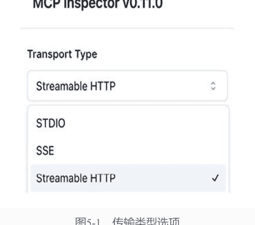

图5-1 传输类型选项

选择“Streamable HTTP”，依次点击“Resources”→“List Resources”，即可看到config资源，如图5-2所示。

点击图5-2中的“config”，可以看到窗口右侧的输出内容，与5.1.1节创建MCP Server示例时注册静态资源的代码完全对应。

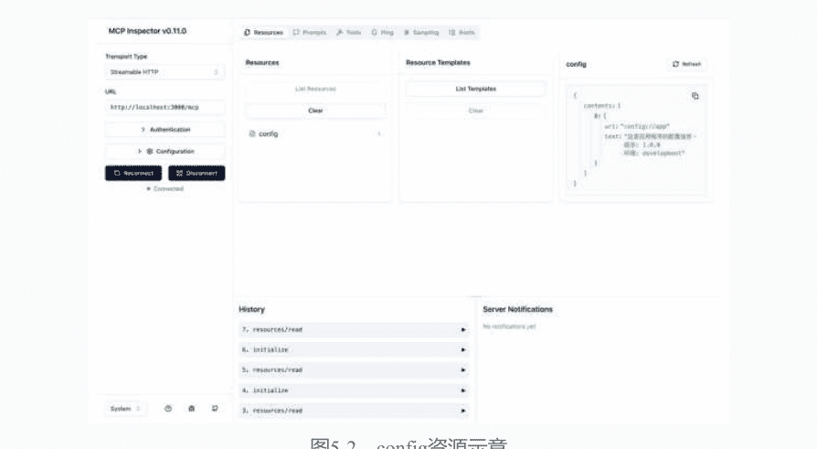

图5-2 config资源示意

### 5.2.2 调试提示词模板

提示词模板是指导AI模型行为的蓝图。即使是一个微小的语法错误或逻辑瑕疵，也可能导致模型输出完全偏离预期。调试提示词模板的关键在于实现“所见即所得”——在将其发送给LLM之前，必须确保模板在填入具体参数后能够正确渲染出期望的文本内容。

如图5-3所示，依次点击“Prompts”→“List Prompts”，选中“greet-user”，并将name、time字段分别设置为MCP、morning，点击“Get Prompt”按钮后可得到输出。

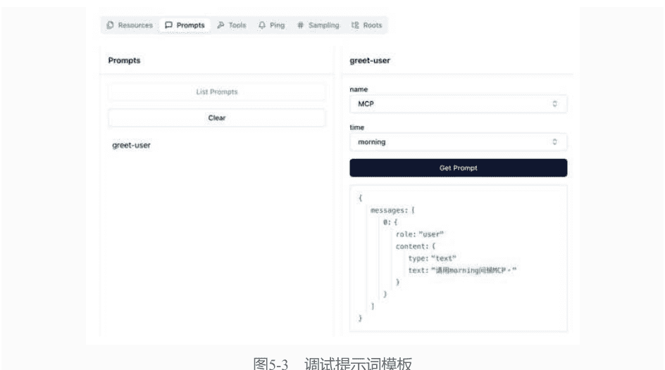

图5-3 调试提示词模板

### 5.2.3 调试工具

工具是MCP Server的核心价值所在，它赋予了AI模型执行实际操作的能力。调试工具是整个调试环节中交互性较强、较为关键的环节。我们需要验证工具在接收到特定输入后，能否正确执行其逻辑，并返回结构化的、可预测的输出。MCP Inspector将服务器上所有注册的工具都以表单的形式直观地展示出来。

要调试 calculate 工具，可以在图 5-4 中依次点击 “Tools”→“List Tools” →“calculate”，选中“calculate”工具后将operation字段设置为“add”，将操作数a、b 分别设置为1，点击“Run Tool”按钮即可查看输出结果。

MCP Inspector将显示工具执行的结果，使开发者能够验证工具的逻辑是否正确，并测试各种输入参数的处理情况，包括边界条件和错误处理。

在MCP Server调试过程中，开发者可以使用多种调试技巧，包括通过提供无效参数测试、验证边界条件下的错误处理、使用不同参数组合测试动态资源响应，以及观察流式工具的数据传输情况；同时遵循增量开发原则，先测试单个组件再整合、结合手动与自动化测试、分析服务器日志了解内部执行细节，并在重大更改前做好版本控制以便回滚比较，这些实践能显著提高开发效率和应用质量。

通过“调用→观察→验证”的闭环流程，MCP Inspector将复杂的服务器调试过程简化为了直观、可重复的交互式操作，确保交付的每一项服务都稳定可靠。作为开发过程中的重要工具，MCP Inspector大大简化了MCP Server的调试和验证工作，使开发者能够快速迭代和改进服务器功能，保障最终应用的质量和可靠性。

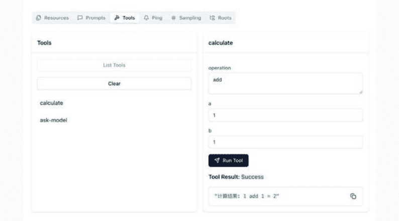

图5-4 调试工具

至此，我们已经成功构建并运行了一个功能完整的MCP Server。

## 5.3 创建一个MCP Client

MCP Client是用户或上层应用与MCP Server交互的入口。通过MCP Client，可以将MCP Server提供的原子能力（如数据查询、工具调用）编排成连贯的且有意义的工作流。本节将创建一个简单的命令行客户端，用来与5.1节构建的MCP Server进行交互。

### 5.3.1 主要功能

该MCP Client的主要功能如下。

- 通过HTTP，建立与MCP Server的安全连接。
- 动态查询并列出MCP Server当前提供的所有资源、工具和提示词模板。
- 主动地读取资源、调用工具，并渲染提示词模板。
- 优雅地处理通信过程中的潜在错误，并在任务完成后关闭连接。

### 5.3.2 实现过程

在项目的src/client目录下创建一个名为http_client.ts的文件，并填入以下代码。这段代码将成为我们理解客户端运作机制的生动范例。

```typescript
// src/client/http_client.ts

import { Client } from "@modelcontextprotocol/sdk/client/index.js";
import { StreamableHTTPClientTransport } from "@modelcontextprotocol/sdk/client/streamableHttp.js";

async function main() {
  console.log("启动MCP HTTP客户端...");

  // 1. 初始化传输层：指定服务器的地址和协议
  // 使用StreamableHTTPClientTransport来与基于HTTP的MCP Server通信
  // URL指向了我们在服务器中挂载MCP服务的确切路径
  const transport = new StreamableHTTPClientTransport(
    new URL("http://localhost:3000/mcp")
  );

  // 2. 创建客户端实例：赋予客户端身份标识
  // 这有助于在复杂的系统中进行日志记录和调试
  const client = new Client({
    name: "MyFirstMcpHttpClient",
    version: "1.0.0"
  });

  try {
    // 3. 建立连接：这是所有交互的起点
    await client.connect(transport);
    console.log("成功连接到MCP HTTP服务器");

    // --- 发现并交互：系统地调用服务器能力 ---

    // 4. 发现资源：询问服务器“你有哪些数据可以提供？”
    console.log("\n --- 正在列出所有可用资源 ---");
    const resources = await client.listResources();
    console.log(JSON.stringify(resources, null, 2));

    // 5. 读取资源：获取具体数据
    console.log("\n --- 正在读取静态配置资源 ---");
    const config = await client.readResource({ uri: "config://app" });
    console.log(JSON.stringify(config, null, 2));

    console.log("\n --- 正在读取动态用户资源 ---");
    const userProfile = await client.readResource({ uri: "users://123/profile" });
    console.log(JSON.stringify(userProfile, null, 2));

    // 6. 发现工具：询问服务器“你能做哪些事情？”
    console.log("\n --- 正在列出所有可用工具 ---");
    const tools = await client.listTools();
    console.log(JSON.stringify(tools, null, 2));

    // 7. 调用工具：请求服务器执行具体操作
    console.log("\n --- 正在调用计算工具 ---");
    const calculationResult = await client.callTool({
        name: "calculate",
        arguments: { operation: "add", a: 5, b: 3 }
    });
    console.log(JSON.stringify(calculationResult, null, 2));

    console.log("\n --- 正在调用大模型API工具 ---");
    const modelResult = await client.callTool({
        name: "ask-model",
        arguments: { question: "常见的十字花科植物有哪些？" }
    });
    console.log(JSON.stringify(modelResult, null, 2));

    // 8. 发现提示词：询问服务器“你有哪些预设的对话模板？”
    console.log("\n --- 正在列出所有可用提示词模板 ---");
    const prompts = await client.listPrompts();
    console.log(JSON.stringify(prompts, null, 2));

    // 9. 渲染提示词：获取一个填充好参数的完整提示
    console.log("\n --- 正在获取一个具体的问候提示 ---");
    const greetPrompt = await client.getPrompt({
        name: "greet-user",
        arguments: { name: "张三", time: "morning" }
    });
    console.log(JSON.stringify(greetPrompt, null, 2));
  } catch (error) {
    // 10. 错误处理：捕获并报告交互过程中的任何问题
    console.error("操作失败:", error);
  } finally {
    // 11. 关闭连接：无论成功与否，都应释放资源
    await transport.close();
    console.log("连接已关闭");
  }
}

main().catch(error => {
  console.error("未处理的顶层错误:", error);
  process.exit(1);
});
```

上述代码清晰地展示了MCP Client的典型生命周期，可以分解为以下4个关键步骤。

（1）初始化与连接。首先，从 MCP SDK 中导入 Client 和 StreamableHTTPClientTransport。Transport对象是物理连接的抽象，负责通过特定协议（此处为HTTP）与服务器通信。Client实例则是逻辑上的客户端，利用Transport执行所有符合MCP的交互。client.connect(transport)是至关重要的一步，负责完成协议握手，建立一条稳定的通信信道。

（2）服务发现（list*系列方法）：一个健壮的客户端不应该硬编码服务器的能力。通过listResources()、listTools()和listPrompts()，客户端可以在运行时动态“发现”服务器提供的服务。这使得客户端和服务器可以独立地进行功能迭代，实现松耦合，是构建可扩展系统的关键实践。

（3）服务消费（readResource、callTool和getPrompt方法）：这是客户端的核心功能所在。

- readResource({ uri: "..." })通过唯一的URI来精确获取数据。
- callTool({ name: "...", arguments: {...} })则类似于远程函数调用（RPC），客户端指定工具名称和所需的参数，服务器执行后返回结果。
- getPrompt({ name: "...", arguments: {...} })允许客户端利用服务器预设的模板，只需提供变量即可获得完整、规范的提示词，极大简化了与LLM交互的准备工作。

（4）资源管理与错误处理：专业的代码必须考虑到异常情况。try...catch...finally结构确保了即使在交互过程中发生错误（如网络中断、服务器返回错误码），我们的程序也能够捕获异常、给出提示，并最终在finally块中执行transport.close()来优雅地断开连接，释放网络资源。

接下来，实际运行这个MCP Client，并观察其与MCP Server之间的交互。

### 5.3.3 运行客户端

创建一个启动脚本start_client.sh：

```bash
#!/bin/bash
ts-node src/client/http_client.ts
```

确保脚本具有执行权限：

```bash
chmod +x start_client.sh
```

运行客户端（确保服务器已经在运行）：

```bash
./start_client.sh
```

可以看到类似以下输出：

```
Starting MCP HTTP Client...
Connected to MCP HTTP Server

--- 列出所有资源 ---
{
  "resources": [
    {
      "uri": "config://app",
      "name": "config"
    }
  ]
}

--- 读取配置资源 ---
{
  "contents": [
    {
      "uri": "config://app",
      "text": "这是应用程序的配置信息。\n版本: 1.0.0\n环境: development"
    }
  ]
}

--- 读取用户资源 ---
{
  "contents": [
    {
      "uri": "users://123/profile",
      "text": "用户ID: 123\n姓名: 用户123\n注册时间: 2025-05-17T09:33:24.417Z"
    }
  ]
}

--- 列出所有工具 ---
{
  "tools": [
    {
      "name": "calculate",
      "inputSchema": {
        "type": "object",
        "properties": {
          "operation": {
            "type": "string",
            "enum": [
              "add",
              "subtract",
              "multiply",
              "divide"
            ]
          },
          "a": {
            "type": "number"
          },
          "b": {
            "type": "number"
          }
        },
        "required": [
          "operation",
          "a",
          "b"
        ],
        "additionalProperties": false,
        "$schema": "http://json-schema.org/draft-07/schema#"
      }
    },
    {
      "name": "ask-model",
      "inputSchema": {
        "type": "object",
        "properties": {
          "question": {
            "type": "string"
          }
        },
        "required": [
          "question"
        ],
        "additionalProperties": false,
        "$schema": "http://json-schema.org/draft-07/schema#"
      }
    }
  ]
}

--- 调用计算工具 ---
{
  "content": [
    {
      "type": "text",
      "text": "计算结果: 5 add 3 = 8"
    }
  ]
}

--- 调用大模型API工具 ---
{
  "content": [
    {
      "type": "text",
      "text": "嗯, 用户问的是常见的十字花科植物有哪些。首先, 我需要回忆一下十字花科的特征, 例如十字形花冠、四强雄蕊、角果这些..."
    }
  ]
}

--- 列出所有提示 ---
{
  "prompts": [
    {
      "name": "greet-user",
      "arguments": [
        {
          "name": "name",
          "required": true
        },
        {
          "name": "time",
          "required": false
        }
      ]
    }
  ]
}

--- 获取问候提示 ---
{
  "messages": [
    {
      "role": "user",
      "content": {
        "type": "text",
        "text": "请用morning问候张三。"
      }
    }
  ]
}
```

## 小结

本章基于MCP TypeScript SDK构建了一个功能完备的AI智能体。

首先，设计并实现了一个功能完备的MCP Server。通过注册静态资源与动态资源，使MCP Server具备了提供上下文信息的能力；通过集成本地计算工具和与外部LLM API对接的ask-model工具，赋予AI模型感知与行动的权力，并深入探讨了流式响应的处理技术，这是提升AI智能体交互体验的关键技术。此外，还定义了提示词模板，为规范化、可复用地指导模型行为提供了优雅的解决方案。所有功能均构建于强大的Express框架之上，通过精心实现基于HTTP的会话管理和请求路由，确保了通信的稳定与高效。

随后，通过MCP Inspector提供的交互式界面，对MCP Server的资源、工具和提示词模板进行了精准的“调用→观察→验证”闭环测试。这一过程不仅验证了服务器的正确性，更重要的是建立了一种主动验证而非被动排查错误的开发范式，这对于构建复杂、可靠的分布式AI智能体至关重要。

最后，为了使MCP Server的价值得以充分体现，我们构建了一个MCP Client。该命令行应用清晰地展示了客户端的完整生命周期：从初始化传输层、建立连接，到动态地服务发现（查询服务器的能力），再到有序的服务消费（读取资源、调用工具、渲染提示词），最终在完善的错误处理机制的保障下优雅地关闭连接。通过观察客户端运行的输出，可以见证基于MCP的AI智能体的端到端数据流动的完整过程，将理论知识与实际运行结果完美地结合在一起。

通过本章的学习，读者不仅可以掌握使用TypeScript SDK开发MCP Server与Client的核心技能，更重要的是，能够亲手构建一个属于自己的AI智能体。

## 第6章 基于MCP TypeScript SDK创建商城智能体

本章将带领读者通过一个完整的商城智能体项目，深入理解MCP在真实业务场景中的应用实践。本章主要包括以下内容。

- 商城智能体概述。
- MCP Server实现。
- MCP Client开发。
- 系统集成运行与测试。

通过本章学习，读者不仅可以掌握MCP在电商场景下的实际应用方法，还能独立开发具备商品查询、下单、订单管理等智能对话能力的AI助手应用，为后续更复杂的AI智能体开发打下坚实基础。

### 6.1 商城智能体概述

电子商务是AI智能体的一个重要领域，购物智能体可以显著提升用户体验，帮助用户更高效地查找商品、比较价格、完成订单。本章将开发一个基于MCP的商城智能体，它能够帮助用户查询商品、管理库存、处理订单，并提供个性化的购物建议。

在开始编码之前，本节首先介绍项目的需求与目标、设计系统架构，并选择适合的技术栈。

#### 6.1.1 项目需求与功能规划

商城智能体旨在通过AI技术提升电子商务平台的用户体验。在项目规划阶段，需首先明确用户在购物过程中可能遇到的痛点，如难以找到合适商品、无法确定商品库存状态、订单流程烦琐等。基于这些痛点，我们为该项目确定了以下核心功能。

- 商品查询与推荐：用户应该能够通过自然语言描述查找商品，系统能够理解用户意图并返回相关商品。例如，用户输入“我想找一款性价比高的智能手表”，系统应返回符合条件的商品列表。
- 库存管理：系统需要实时反馈商品库存状态，避免用户下单后出现商品缺货的情况。当用户询问特定商品时，系统应该能够准确告知当前库存状况。
- 订单处理：用户应该能够通过自然语言对话完成下单流程，系统需要处理订单信息，包括商品选择、数量确认、客户信息收集等环节。
- 个性化推荐：基于用户的历史行为和当前对话内容，系统应该能够提供个性化的商品推荐。
- 多轮对话支持：系统需要维护对话上下文，支持多轮交互，使用户能够在一次对话中完成从商品查询到下单的全流程。

在进行功能规划时，需要综合考虑功能的实用性（确保每个功能都能解决用户的实际问题）、可行性（结合当前MCP和LLM的能力边界）和扩展性（为未来添加新功能预留足够扩展空间）。除了这些核心功能，以下增强功能可以在基础版本完成后逐步添加。

- 价格比较：比较同类商品的价格和特性。
- 评价分析：汇总和分析用户评价，提取关键信息。
- 促销信息：提供当前可用的优惠券和促销活动。
- 售后服务：处理退换货请求和售后咨询。

#### 6.1.2 系统架构设计

基于商城智能体的功能规划，项目采用分层架构设计，如图6-1所示。整个系统分为用户场景应用层、业务服务层和数据层。

- 用户场景应用层：用户通过MCP Client与系统交互。客户端负责展示界面、接收用户输入，并将请求转发给MCP Server。
- 业务服务层：包含商品服务、库存服务和订单服务等核心业务逻辑，负责处理具体的业务请求。该层与数据层交互，实现数据的增删改查。其中，MCP Server作为系统的核心，负责接收和处理来自MCP Client的请求，并调用相应的服务完成任务。MCP Server实现了MCP协议，提供资源访问、工具调用和提示词模板等功能。
- 数据层：负责数据的持久化存储和访问。为了简化实现，本项目使用内存数据结构模拟数据库，但在实际生产环境中，该层通常连接至真实的数据库系统。

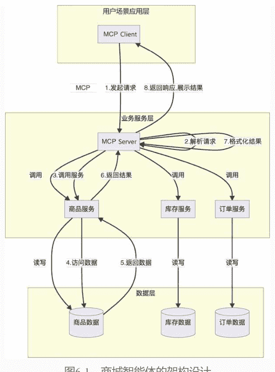

这种分层架构有助于灵活地扩展系统功能，同时保持代码的清晰性和可维护性。在后续开发中，可以根据需要调整或优化各层的具体实现，而不会影响整体架构。用户场景应用层、业务服务层和数据层之间的组件交互流程如下。

- 用户通过MCP Client发起请求。
- 请求通过MCP传递给MCP Server。
- MCP Server解析请求，并调用相应的业务服务。
- 业务服务处理请求，在此期间可能需要访问数据层获取或更新数据。
- 业务服务将处理结果返回给MCP Server。
- MCP Server将结果格式化后通过MCP返回客户端。
- 客户端展示结果给用户。

### 6.2 MCP Server实现

在明确项目需求、完成架构设计并搭建好开发环境的基础上，本节将介绍MCP Server的具体实现。本项目的MCP Server实现主要包括获取商品列表、查询库存信息、获取订单列表功能的MCP工具实现与注册。

#### 6.2.1 商品列表工具开发

商品是智能商城的核心数据，用户需要能够浏览、搜索和查询商品信息。在MCP架构中，这些功能通过商品列表工具来提供。

在src/types/index.ts中添加以下代码，定义商品、库存和订单的数据结构。

```typescript
// 商品数据结构
export interface Product {
  id: number;
  name: string;
  price: number;
  description: string;
}

// 库存数据结构
export interface Inventory {
  productId: number;
  quantity: number;
  product?: Product; // 关联的商品信息，用于返回给客户端
}

// 订单数据结构
export interface Order {
  id: number;
  customerName: string;
  items: { productId: number, quantity: number }[];
  totalAmount: number;
  orderDate: string;
}
```

创建src/services/inventory-service.ts文件并添加以下代码，实现商品服务模块。该模块通过内存数据模拟存储商品、库存和订单信息，提供了获取商品列表、库存信息、订单列表及创建订单的功能，为电商系统的核心数据操作提供基础支持。

```typescript
// 导入商品、库存和订单的数据结构定义
import { Product, Inventory, Order } from '../types/index.js';

// 模拟商品数据存储，初始化部分商品信息
let products: Product[] = [
  { id: 1, name: "华为智能手表", price: 1299, description: "健康监测，运动追踪，支持多种应用" },
  { id: 2, name: "蓝牙耳机Pro", price: 899, description: "主动降噪，30小时续航，IPX7防水" },
  { id: 3, name: "便携式移动电源", price: 299, description: "20000mAh大容量，支持快充，轻薄设计" },
  // 更多商品...
];

// 模拟库存数据存储，记录各商品的库存数量
let inventory: Inventory[] = [
  { productId: 1, quantity: 100 },
  { productId: 2, quantity: 50 },
  { productId: 3, quantity: 200 },
  // 更多库存...
];

// 模拟订单数据存储，初始为空数组
let orders: Order[] = [];

// 获取所有商品列表的函数，返回商品数组
export async function getProducts(): Promise<Product[]> {
  return products;
}

// 获取库存信息的函数，关联商品详情后返回
export async function getInventory(): Promise<Inventory[]> {
  // 遍历库存项，为每个库存项匹配对应的商品信息
  return inventory.map(item => {
    const product = products.find(p => p.id === item.productId);
    // 返回包含商品详情的库存信息
    return {
      ...item,
      product
    };
  });
}

// 获取订单列表的函数，按订单日期倒序排列
export async function getOrders(): Promise<Order[]> {
  // 复制订单数组并按订单日期从新到旧排序
  return [...orders].sort((a, b) =>
    new Date(b.orderDate).getTime() - new Date(a.orderDate).getTime()
  );
}

// 创建购买订单的函数，接收客户名称和购买项，返回创建的订单
export async function createPurchase(customerName: string, items: { productId: number, quantity: number }[]): Promise<Order> {
  ...
}
```

值得注意的是，createPurchase函数不仅负责创建订单，还包含库存验证和更新。这种设计确保了订单创建的原子性，有效避免了库存不足的订单被错误创建的情况。

为了将商品服务暴露为MCP工具供客户端调用，我们应创建src/mcp-server-tools.ts文件并添加以下代码。这段代码的主要功能是创建一个MCP Server实例，并将商品服务中的获取商品列表、查询库存信息、获取订单列表等功能注册为MCP工具，使这些功能能够通过MCP Server的接口被调用，并返回标准化的响应内容。每个工具均包含名称、描述、参数模式和处理函数。

```typescript
import { McpServer } from "@modelcontextprotocol/sdk/server/mcp.js";
import { z } from "zod";
import { getProducts, getInventory, getOrders, createPurchase } from "./services/inventory-service.js";

// 创建MCP Server实例，设置名称、版本和描述
export const server = new McpServer({
  name: "mcp-sse-demo",
  version: "1.0.0",
  description: "提供商品查询、库存管理和订单处理的MCP工具"
});

// 获取商品列表工具
server.tool(
  "getProducts",
  "获取所有产品信息",
  {},
  // 工具处理函数，异步调用获取商品列表的服务函数
  async () => {
    console.log("获取产品列表");
    const products = await getProducts(); // 调用服务函数获取商品列表
    return { // 返回标准化格式的响应，包含商品列表的JSON字符串
      content: [
        {
          type: "text",
          text: JSON.stringify(products)
        }
      ]
    };
  }
);

// 获取库存信息工具
server.tool(
  "getInventory",
  "获取所有产品的库存信息",
  {},
  // 工具处理函数，异步调用获取库存信息的服务函数
  async () => {
    console.log("获取库存信息");
    const inventory = await getInventory(); // 调用服务函数获取库存信息
    // 返回标准化格式的响应，包含库存信息的JSON字符串
    return {
      content: [
        {
          type: "text",
          text: JSON.stringify(inventory)
        }
      ]
    };
  }
);

// 获取订单列表工具
server.tool(
  "getOrders",
  "获取所有订单信息",
  {},
  // 工具处理函数，异步调用获取订单列表的服务函数
  async () => {
    console.log("获取订单列表");
    const orders = await getOrders(); // 调用服务函数获取订单列表
    // 返回标准化格式的响应，包含订单列表的JSON字符串
    return {
      content: [
        {
          type: "text",
          text: JSON.stringify(orders)
        }
      ]
    };
  }
);
```

上述代码使用content数组来返回结果，这是MCP的标准格式，允许返回多种类型的内容，包括文本、图像等。

#### 6.2.2 订单管理工具集成

本节将添加订单管理功能，使用户能够通过MCP Client创建订单。在src/mcp-server-tools.ts文件中添加以下代码。

```typescript
// 购买商品工具
server.tool(
  "purchase",
  "购买商品",
  {
    items: z.array(
      z.object({
        productId: z.number().describe("商品ID"),
        quantity: z.number().describe("购买数量")
      })
    ).describe("要购买的商品列表"),
    customerName: z.string().describe("客户姓名")
  },
  async ({ items, customerName }) => {
    console.log("处理购买请求", { items, customerName });
    try {
      const order = await createPurchase(customerName, items);
      return {
        content: [
          {
            type: "text",
            text: JSON.stringify(order)
          }
        ]
      };
    } catch (error: any) {
      return {
        content: [
          {
            type: "text",
            text: JSON.stringify({ error: error.message })
          }
        ]
      };
    }
  }
);
```

订单管理工具实现了购买商品的功能。它接收两个参数：items（要购买的商品列表）和customerName（客户姓名）。参数使用Zod库进行验证，确保输入数据符合预期格式。处理函数调用createPurchase服务函数创建订单，并将结果返回给客户端。

值得注意的是这段代码中错误处理的实现。如果在创建订单的过程中发生错误（如库存不足），系统会捕获异常并返回包含错误信息的响应，避免异常传播到上层。这种设计使客户端能够获得有意义的错误信息，而不是简单的“服务器错误”。

订单管理工具的集成使商城智能体具备了完整的购物流程支持，用户可以查询商品、检查库存并创建订单。这些功能通过MCP暴露给客户端，使LLM能够理解和使用这些工具，为用户提供自然、流畅的购物体验。

在实际应用中，还可以进一步扩展订单管理功能，如取消订单、查询订单状态等。这些功能可以按照类似的模式实现，注册为MCP工具供客户端调用。

6.2.1节及本节实现的MCP Server Tools的完整源代码，可以在本书配套GitHub代码仓库的mcp-shopping-assistant-server/src/mcp-server-tools.ts文件中查看。

#### 6.2.3 实现基于Express的MCP Server

本节将实现一个基于Express的MCP Server，使用SSE技术实现与客户端的实时通信。整个MCP Server的核心工作流程可以概括如下。

1. 初始化：创建Express应用和MCP Server实例。
2. 连接建立：客户端通过 /sse端点建立SSE连接。
3. 消息处理。
   - 客户端通过 /messages端点发送消息。
   - 服务器根据会话ID找到对应的SSE连接。
   - 消息被转发给MCP Server处理。
   - MCP Server调用相应的工具或执行其他操作。
   - 结果通过SSE连接实时返回给客户端。
4. 连接管理：跟踪所有活跃连接，处理连接关闭。
5. 优雅关闭：在服务器关闭时通知所有客户端并清理资源。

下面分步骤讲解其核心逻辑。

##### 1. 导入依赖和初始化

具体代码如下。

```typescript
import express, { Request, Response, NextFunction } from "express";
import cors from "cors";
import { SSEServerTransport } from "@modelcontextprotocol/sdk/server/sse.js";
import { server as mcpServer } from "./mcp-server-tools.js"; // 重命名以避免命名冲突

const app = express();
app.use(cors({
  origin: process.env.ALLOWED_ORIGINS?.split(',') || '*',
```

##### 2. 连接管理

创建一个Map对象来存储所有活跃的SSE连接。每个连接都以会话ID为键，对应的SSEServerTransport实例为值。这种设计允许服务器跟踪所有连接，并在需要时（如服务器关闭）优雅地关闭它们。

```
// 存储活跃连接
const connections = new Map();
```

##### 3. 健康检查端点

健康检查端点可以提供服务器的健康状态信息，包括服务器状态、版本号、运行时间、当前时间戳、活跃连接数等。

```
app.get('/health', (req, res) => {
  res.status(200).json({
    status: 'ok',
    version: '1.0.0',
    uptime: process.uptime(),
    timestamp: new Date().toISOString(),
    connections: connections.size
  });
});
```

这对于监控和调试非常有用，特别是在生产环境中。

##### 4. SSE连接建立

SSE连接建立是MCP Server实现的核心部分，其核心逻辑如下。

- 当客户端请求/sse端点时，服务器创建一个新的SSEServerTransport实例。
- 从传输对象获取唯一的会话ID。
- 将新连接存储在connections Map中。
- 设置连接关闭事件监听器，在客户端断开连接时清理资源。
- 将传输对象与MCP Server连接，使MCP Server能够通过该传输对象与客户端通信。

具体代码如下。

```
// SSE连接建立端点
app.get("/sse", async (req, res) => {
  // 实例化SSE传输对象
  const transport = new SSEServerTransport("/messages", res);
  // 获取sessionId
  const sessionId = transport.sessionId;
  console.log(`[${new Date().toISOString()}]新的SSE连接建立: ${sessionId}`);

  // 注册连接
  connections.set(sessionId, transport);

  // 连接中断处理
  req.on('close', () => {
    console.log(`[${new Date().toISOString()}] SSE连接关闭: ${sessionId}`);
    connections.delete(sessionId);
  });

  // 将传输对象与MCP Server连接
  await mcpServer.connect(transport);
  console.log(`[${new Date().toISOString()}] MCP Server连接成功: ${sessionId}`);
});
```

这种基于SSE的实现允许服务器向客户端推送实时更新，非常适合AI智能体中的流式响应。

##### 5. 消息处理端点

消息处理端点主要用来处理来自客户端的消息，其核心逻辑如下。

- 从请求查询参数中获取会话ID。
- 在connections Map中查找对应的SSE传输对象。
- 如果找到匹配的传输对象，使用其handlePostMessage方法处理消息。
- 如果没有找到匹配的连接或处理过程中出错，返回适当的错误响应。

```
// 接收客户端消息的端点
app.post("/messages", async (req: Request, res: Response) => {
  try {
    console.log(`[${new Date().toISOString()}]收到客户端消息:`, req.query);
    const sessionId = req.query.sessionId as string;

    // 查找对应的SSE连接并处理消息
    if (connections.size > 0) {
      // 获取第一个可用的传输对象（在生产环境中应该使用更精确的匹配机制）
      const transport: SSEServerTransport = connections.get(sessionId) as SSEServerTransport;
      // 使用transport处理消息
      if (transport) {
        await transport.handlePostMessage(req, res);
      } else {
        throw new Error('没有活跃的SSE连接');
      }
    } else {
      throw new Error('没有活跃的SSE连接');
    }
  } catch (error: any) {
    console.error(`[${new Date().toISOString()}]处理客户端消息失败:`, error);
    res.status(500).json({ error: '处理消息失败', message: error.message });
  }
});
```

这段代码中的关键是transport.handlePostMessage方法，该方法由MCP SDK提供，负责将客户端消息转发给MCP Server，然后MCP Server会根据消息内容调用相应的工具或执行其他操作。

##### 6. 连接关闭管理

优雅关闭机制用于确保客户端能够收到MCP Server关闭的通知，避免因突然断开连接影响用户体验。连接关闭的核心逻辑如下。

- 遍历所有存储的连接。
- 向每个连接发送服务器关闭事件，通知客户端服务器即将关闭。
- 结束响应流。
- 清空连接映射。

具体代码如下。

```
// 优雅关闭所有连接
async function closeAllConnections() {
  console.log(`[${new Date().toISOString()}]关闭所有连接 (${connections.size}个)`);
  for (const [id, transport] of connections.entries()) {
    try {
      // 发送关闭事件
      transport.res.write('event: server_shutdown\ndata: {"reason": "Server is shutting down"}\n\n');
      transport.res.end();
      console.log(`[${new Date().toISOString()}]已关闭连接: ${id}`);
    } catch (error) {
      console.error(`[${new Date().toISOString()}]关闭连接失败: ${id}`, error);
    }
  }
  connections.clear();
}
```

##### 7. 错误处理和进程信号监听

具体代码如下。

```
// 错误处理
app.use((err: Error, req: Request, res: Response, next: NextFunction) => {
  console.error(`[${new Date().toISOString()}]未处理的异常:`, err);
  res.status(500).json({ error: '服务器内部错误' });
});

// 优雅关闭所有连接和服务器
process.on('SIGTERM', async () => {
  console.log(`[${new Date().toISOString()}]接收到SIGTERM信号，准备关闭`);
  await closeAllConnections();
  server.close(() => {
    console.log(`[${new Date().toISOString()}]服务器已关闭`);
    process.exit(0);
  });
});

// 优雅关闭连接和进程
process.on('SIGINT', async () => {
  console.log(`[${new Date().toISOString()}]接收到SIGINT信号，准备关闭`);
  await closeAllConnections();
  process.exit(0);
});
```

这段代码实现了以下代码处理错误和进程信号。

- 全局错误处理中间件捕获未处理的异常，返回统一的错误响应。
- SIGTERM信号处理器（通常由容器编排系统如Kubernetes发送）优雅地关闭所有连接和服务器。
- SIGINT信号处理器（通常由Ctrl+C触发）同样优雅地关闭连接和进程。

这些处理器确保了服务器在各种情况下都能正常关闭，避免留下未完成的连接或操作。

##### 8. 服务器启动

启动HTTP服务器的具体代码如下：

```
// 启动服务器
const port = process.env.PORT || 8083;
const server = app.listen(port, () => {
  console.log(`[${new Date().toISOString()}]智能商城MCP SSE服务器已启动，地址: http://localhost:${port}`);
  console.log(`- SSE连接端点: http://localhost:${port}/sse`);
  console.log(`- 消息处理端点: http://localhost:${port}/messages`);
  console.log(`- 健康检查端点: http://localhost:${port}/health`);
});
```

这部分代码的核心逻辑如下。

- 从环境变量获取端口号，默认为8083。
- 启动Express应用。
- 打印服务器信息和可用端点。

本节实现的MCP Server的完整源代码，可以在本书配套GitHub代码仓库的mcp-shopping-assistant-server/src/app.ts文件中查看。

至此，商城智能体的MCP Server开发工作已完成。接下来，6.3节和6.4节分别介绍两种不同形态的MCP Client实现：一种是简单的基于CLI的MCP Client应用，另一种是功能丰富的Web应用程序。

### 6.3 MCP Client实现之CLI应用程序

本节将从最经典、最直接的交互方式入手：创建一个CLI应用程序。对于开发者而言，CLI不仅是验证后端服务功能、进行快速测试的有效工具，其本身也是一种高效、无干扰的交互范式，备受青睐。

#### 6.3.1 核心流程

该CLI应用程序需要准确理解用户的意图，并将其转换为对MCP Server的请求；同时，还需接收并解析服务器返回的信息，最终以清晰、自然的方式呈现给用户。

实现该客户端的核心在于设计一个稳健的交互循环（Interactive Loop）。该循环构成了从应用程序启动、与用户互动，直至最终退出的整个生命周期，这个核心流程可以分解为几个关键阶段。

（1）初始化与连接阶段。当应用程序启动时，它会执行一系列准备工作：加载所有必需的依赖库，并向用户显示欢迎信息。紧接着，客户端将尝试与6.2节部署的MCP Server建立连接。一旦连接成功，客户端并不会盲目地等待用户指令，而是会主动向MCP Server发起“握手”请求，查询并获取当前MCP Server能提供的所有工具的详细列表。这个自发现的过程体现了MCP的强大能力，使客户端无须硬编码即可动态了解并使用后端服务的功能，为未来的功能扩展奠定基础。

（2）交互循环阶段。该循环始于等待并读取用户的输入。当用户在终端输入查询（如“帮我查找最近的订单”），客户端会将这条自然语言指令连同之前对话的上下文，一并发送给LLM进行处理。

（3）采用流式响应（Streaming）机制处理 LLM 的返回结果。这意味着客户端无须等待LLM生成完整的回答后才能有所动作，而是可以实时地接收并展示其“思考”过程中的每一个词语。这种设计显著提升了用户体验，使用户能够直观地看到智能体的响应正在实时生成，获得即时的反馈，有效缓解等待过程中的焦虑感。

（4）工具调用。当LLM判断出要完成用户的请求（例如查询订单状态）需要借助外部能力时，它会在其响应中包含一个结构化的工具调用请求。客户端会敏锐地捕捉到这个请求，并根据其要调用的工具名称和所需参数精确地执行相应的MCP Server工具。完成调用后，客户端会将工具执行的结果（如查询到的订单详情）再次发送给LLM，作为其继续生成最终答复的依据。

这个“对话→思考→调用工具→整合结果→最终回复”的闭环，正是基于MCP构建的AI智能体的核心魅力所在。它无缝地将LLM的语言能力与现实世界的实际功能结合起来，使智能体不再是一个只能纸上谈兵的聊天机器人，而成为一个真正能解决问题的智能工具。

（5）循环终止并退出。当用户输入“exit”或程序遇到无法恢复的错误时，交互循环终止，客户端将优雅地退出，释放所有资源，完成其使命。

通过这种精心设计的流程，该CLI应用程序不仅功能强大，而且具备卓越的交互体验和稳健性，可以展示如何将MCP、LLM API和交互式命令行界面结合起来，创建一个功能强大的智能体应用。该CLI应用程序可以作为构建更复杂AI智能体的基础，或者作为测试MCP Server功能的工具。

#### 6.3.2 实现步骤

本节将介绍一个基于命令行的MCP Client的实现步骤，它能够连接到MCP Server，获取可用工具，并通过LLM API与用户进行交互。

##### 1. 导入依赖和初始化

导入应用所需的依赖库、工具函数、MCP Client SDK及常量配置，具体代码如下。

```
import chalk from 'chalk';
import ora from 'ora';
import readlineSync from 'readline-sync';
import { config } from './config.js';
import { formatToolResult } from './utils.js';
import { Client as McpClient } from "@modelcontextprotocol/sdk/client/index.js";
import { SSEClientTransport } from "@modelcontextprotocol/sdk/client/sse.js";
import { ENDPOINT_ID } from "./const.js";
import { ARK_API_URL } from "./const.js";
```

其中，chalk用于在终端中输出彩色文本，ora用于提供终端加载动画，readlineSync用于同步读取用户输入，config用于本地配置，utils是工具函数，McpClient代表MCP Client SDK，SSEClientTransport是流式传输对象，ENDPOINT_ID和ARK_API_URL分别是常量API端点和模型ID的定义。

##### 2. 主函数结构

main()函数是整个应用的入口点，使用async/await处理异步操作。函数末尾的.catch()用于捕获任何未处理的异常，确保程序不会因错误而崩溃，而是显示错误信息并优雅退出。

```
async function main() {
  // 显示欢迎信息
  // 连接MCP Server
  // 获取工具列表
  // 交互式命令行循环
  // 处理用户输入
  // 调用LLM
  // 处理AI响应和工具调用
}

main().catch(error => {
  console.error(chalk.red('程序运行出错:'), error);
  process.exit(1);
});
```

##### 3. 连接MCP Server

以下代码片段展示了与MCP Server建立连接的过程。该过程通过加载动画等细节处理，有效提升了用户体验。

```
// 1.创建一个加载动画，提示用户正在连接MCP Server
const spinner = ora('正在连接到MCP Server...').start();
try {
  // 2.创建MCP Client
  const mcpClient = new McpClient({
    name: 'mcp-sse-demo',
    version: '1.0.0',
  });

  // 3.定义并配置传输层
  const transport = new SSEClientTransport(
    new URL(config.mcp.serverUrl)
  );

  // 4.发起连接
  await mcpClient.connect(transport);
  ...
```

这里使用SSE作为传输协议，允许服务器向客户端推送实时更新，尤其适用于AI智能体中的场景流式响应。

##### 4. 获取和转换工具列表

以下代码实现了工具列表的获取与格式适配。

- 通过调用mcpClient.listTools()从MCP Server获取所有可用工具。
- 利用reduce方法将工具列表转换为以工具名为键的对象toolset，便于后续快速查询工具信息。
- 通过map方法将工具列表转换为arkTools，使其符合LLM API对工具参数的格式要求。
- 转换完成后，通过加载动画反馈操作结果，并在终端打印工具列表。

```
// 获取可用工具
const { tools } = await mcpClient.listTools();
const toolset = tools.reduce((acc: Record<string, any>, tool: any) => {
  acc[tool.name] = {
    name: tool.name,
    description: tool.description,
    parameters: tool.inputSchema?.properties || {}
  };
  return acc;
}, {});
spinner.succeed('已连接到MCP Server并获取工具列表');
console.log(chalk.green('工具列表:'), toolset);

const arkTools = tools.map((tool: any) => {
  return {
    type: "function",
    function: {
      name: tool.name,
      description: tool.description,
      parameters: tool.inputSchema,
    }
  };
});
```

由于MCP与LLM API对工具的描述格式存在差异，这种转换是实现二者无缝集成的必要步骤。

##### 5. 交互式命令行循环

以下代码通过无限循环实现了交互式命令行交互功能。

- 循环中使用readlineSync.question提示用户输入问题并读取输入内容。
- 若用户输入“exit”（不区分大小写），则退出循环；否则，进入用户输入处理流程。

```
// 交互式命令行循环
while (true) {
  const question = readlineSync.question(chalk.green('请输入您的问题 (输入 "exit" 结束): '), {
    hideEchoBack: false, // 显示输入内容
```

##### 6. 调用LLM API

以下代码实现了LLM API的调用与基础响应检查。

- 通过加载动画提示用户API请求正在处理。
- 使用fetch发送POST请求至LLM API，请求头包含内容类型和认证信息，请求体指定模型ID、启用流式输出、对话消息（含系统提示与用户问题）、可用工具列表及最大生成令牌数。
- 请求完成后检查响应状态，若状态异常则抛出错误，确保问题能被后续异常处理机制捕获。

```javascript
// 显示加载动画，提示用户AI正在思考中
const aiSpinner = ora('AI正在思考中...\n').start();

try {
  // 调用大模型API
  const response = await fetch(ARK_API_URL, {
    method: "POST",
    headers: {
      "Content-Type": "application/json",
      "Authorization": `Bearer ${process.env.ARK_API_KEY || "your_api_key_here"}`
    },
    body: JSON.stringify({
      model: ENDPOINT_ID,
      stream: true, // 启用流式输出
      messages: [
        { role: "system", content: "你是AI智能体." },
        { role: "user", content: question }
      ],
      tools: arkTools,
      max_tokens: 8192,
    })
  });

  if (!response.ok) {
    throw new Error(`API请求失败: ${response.status} ${response.statusText}`);
  }

  aiSpinner.succeed('AI回复已就绪');
```

其中，`stream: true`参数代表启用了流式输出，使AI的回复能够逐步显示，而不是等待完整响应，这是实现响应内容实时输出的关键。

##### 7. 处理流式响应

与LLM交互的魅力不仅在于最终生成的答案，更在于其逐步展开、仿佛“思考”一般的生成过程。当LLM开始响应时，它并非一次性返回完整的结果，而是通过持续的数据流将生成的文本片段（称为delta）逐一发送。以下代码片段正是为此设计的“解码器”，负责捕获、解析并实时呈现该数据流。

以下代码实现了LLM流式响应的接收、解析与实时输出。

- 通过`response.body.getReader()`获取响应数据流读取器，使用`TextDecoder`将字节流转换为字符串。
- 通过循环持续读取数据块，按换行符分割后过滤有效行。
- 对于符合SSE协议规范（以“data:”为前缀）的数据行，剥离前缀后解析为JSON对象，提取delta字段中的增量内容，包括`reasoning_content`（推理过程文本）、`content`（回复内容）和`tool_calls`（工具调用请求）。

```javascript
// 处理流式响应
const reader = response.body.getReader(); // 1. 获取响应体的数据流读取器
const decoder = new TextDecoder(); // 2. 初始化文本解码器，将字节流转换为字符串
let fullText = ""; // 3. 用于累积完整的响应文本

// 4. 启动一个异步循环，持续消费数据流
while (true) {
  // 从流中读取下一个数据块
  const { done, value } = await reader.read();

  // 如果done为true，表示数据流已结束，跳出循环
  if (done) break;

  // 5. 将接收到的字节块（value）解码为字符串片段（chunk）
  const chunk = decoder.decode(value, { stream: true });
  // 按换行符分割，因为SSE协议是基于行的
  const lines = chunk.split('\n').filter(line => line.trim() !== "");

  // 6. 遍历每一行数据
  for (const line of lines) {
    // 7. 检查该行是否为SSE协议的有效数据载荷（以"data: "开头）
    if (line.startsWith('data: ')) {
      // 提取 "data: " 后面的JSON字符串
      const data = line.substring(6);
      // OpenAI等服务的流结束时会发送一个特殊标记
      if (data === '[DONE]') continue;

      try {
        // 8. 解析JSON字符串，获取结构化数据
        const json = JSON.parse(data);
        // 9. 深入到嵌套结构中，提取核心的增量内容(delta)
        if (json.choices && json.choices[0].delta) {
          const { reasoning_content, content, tool_calls } = json.choices[0].delta;

          // 处理模型的"思考过程"或中间步骤文本
          if (reasoning_content) {
            fullText += reasoning_content;
            process.stdout.write(reasoning_content); // 实时输出到终端
          }
          // 处理模型的最终回复内容
          if (content) {
            fullText += content;
            process.stdout.write(content); // 实时输出到终端
          }

          // 如果delta中包含工具调用请求，则在此处进行处理...
          if (tool_calls) {
            // (此处的逻辑将在后续章节中详细展开)
          }
        }
      } catch (e) {
        // 健壮性设计：捕获并报告解析错误，防止程序崩溃
        console.error('解析流式响应出错:', e, '原始数据:', data);
      }
    }
  }
}
```

这段代码中最关键的部分在于对`content`的处理。对于解析后的内容，一方面将其追加到`fullText`累积完整响应，另一方面通过`process.stdout.write`实时输出到终端，实现响应内容的动态呈现。代码还包含异常捕获机制，确保JSON解析错误时能输出错误信息而不中断程序。

##### 8. 处理工具调用

以下代码实现了LLM工具调用请求的处理，是连接LLM与MCP工具的核心环节。

- 当流式响应中解析出`tool_calls`时，代码遍历所有工具调用请求，提取工具名称和参数；若工具名称不存在则跳过，若参数为空则默认处理为空对象；随后在终端打印工具调用信息（工具名称、参数），通过`mcpClient.callTool`调用对应的MCP工具，并通过加载动画反馈执行状态。
- 工具执行成功后，调用`formatToolResult`格式化结果并输出；若执行失败，则通过加载动画提示错误信息。

```javascript
// 处理工具调用
const tool_calls = json.choices[0].delta.tool_calls

if (tool_calls) {
  for (const tool_call of tool_calls) {
    // 获取工具调用信息
    const toolName = tool_call.function.name;
    if (!toolName) {
      continue;
    }

    // 如果arguments是一个空字符串，将其转换为null
    const toolInput = tool_call.function.arguments || {};

    // 处理工具调用
    console.log(chalk.yellow('\n工具调用:'));
    console.log(chalk.gray(`工具: ${JSON.stringify(tool_call, null, 2)}`));
    console.log(chalk.blue(`调用工具: ${toolName}`));
    console.log(chalk.gray(`参数: ${JSON.stringify(toolInput, null, 2)}`));

    // 调用MCP工具
    const toolSpinner = ora(`正在执行 ${toolName}...`).start();
    try {
      const toolResult = await mcpClient.callTool({
        name: toolName,
        arguments: toolInput
      });
      toolSpinner.succeed(`${toolName} 执行完成`);

      // 格式化并显示结果
      const formattedResult = formatToolResult(toolResult);
      console.log(chalk.blue(`工具结果: ${formattedResult}`));

      // 发送工具结果给AI...
    } catch (error: any) {
      toolSpinner.fail(`${toolName} 执行失败: ${error.message}`);
    }
  }
}
```

以上代码实现允许LLM使用MCP Server提供的工具扩展能力，实现更复杂的任务处理。

##### 9. 发送工具结果给AI

在前面的步骤中，智能体已经能够理解用户的意图，并调用外部工具来获取真实世界的数据。然而，获取数据本身并非终点。一个真正智能的系统必须能够理解这些数据，并将其融入与用户的对话中，最终形成自然、连贯且有价值的回复。这一过程称为对话的闭环。

以下代码是实现“用户提问→工具查询→结果解读”完整闭环的关键环节，负责将工具执行结果反馈给LLM，使其基于新信息生成最终回复。具体流程如下。

工具执行完成后，先通过`formatToolResult`对结果进行格式化处理，再通过`fetch`调用向LLM API发起第二轮（或第N轮）请求。请求体中精心构建了对话上下文，包含两部分核心信息：一是用户的原始问题（`{ role: 'user', content: question }`），确保LLM锚定初始任务；二是格式化后的工具结果（`{ role: 'user', content: formattedResult }`），以用户角色补充关键信息，引导LLM将其作为事实依据进行推理。同时，请求保持`stream: true`参数启用流式输出，维持实时交互体验。

若API响应状态正常，则复用“7. 处理流式响应”的逻辑。

这种设计体现了两层核心逻辑：一是通过上下文传递实现对话连贯性，将工具结果自然融入交互流程，避免LLM脱离原始问题；二是通过复用流式数据处理代码，在减少冗余的同时保证用户体验的一致性。工具结果反馈至LLM并生成最终回复的闭环形成，标志着系统从单纯的工具调用执行者，升级为能结合外部能力完成复杂任务的完整交互系统。

```javascript
// 1. 将工具执行结果作为新的信息，发送给AI
const followUpResponse = await fetch(ARK_API_URL, {
  method: "POST",
  headers: {
    "Content-Type": "application/json",
    // 确保请求的合法性与安全性
    "Authorization": `Bearer ${process.env.ARK_API_KEY || "your_api_key_here"}`
  },
  body: JSON.stringify({
    model: ENDPOINT_ID, // 指定使用的模型
    stream: true,   // 再次请求流式输出，以获得最佳体验

    // 2. 精心构建上下文，这是对话连贯性的核心
    messages: [
      // 包含用户的原始问题
      { role: 'user', content: question },
      // 包含工具返回的结果，同样以'user'角色提供
      { role: 'user', content: formattedResult }
    ],
    max_tokens: 8192, // 设定生成内容的最大长度
  })
});

// 3. 打印最终的综合性回复
if (followUpResponse.ok) {
  // 这部分代码与之前处理流式响应的逻辑完全相同，它负责捕获、解码并实时显示LLM基于工具结果生成的最终答案
  const reader = followUpResponse.body.getReader();
  const decoder = new TextDecoder();
  let fullText = "";
  // 循环读取并处理流式数据
  while (true) {
    const { done, value } = await reader.read();
    if (done) break;
    const chunk = decoder.decode(value, { stream: true });
    const lines = chunk.split('\n').filter(line => line.trim() !== "");
    for (const line of lines) {
      if (line.startsWith('data: ')) {
        const data = line.substring(6);
        if (data === '[DONE]') continue;
        try {
          const json = JSON.parse(data);
          if (json.choices && json.choices[0].delta) {
            // 注意：此时返回的通常是'content'，即最终面向用户的回复
            const content = json.choices[0].delta.content;
            if (content) {
              fullText += content;
              process.stdout.write(content); // 实时将最终答案打印到终端
            }
          }
        } catch (e) {
          console.error('解析最终流式响应出错:', e, '原始数据:', data);
        }
      }
    }
  }
}
```

##### 10. 错误处理和程序结束

以下代码通过多层异常捕获机制保障程序稳定性：在LLM API调用环节，try-catch块捕获请求错误并通过加载动画提示失败信息；在MCP Server连接环节，外部try-catch块捕获连接错误并输出提示。

程序正常退出时，打印感谢信息并以状态码0终止；异常退出时，则以状态码1终止，通过不同退出码区分程序运行状态。

```javascript
... } catch (error: any) {
  aiSpinner.fail(`调用AI失败: ${error.message}`);
}

console.log('\n' + chalk.cyan('----------------------------------------') + '\n');
}
console.log(chalk.cyan('感谢使用，再见！'));
process.exit(0);
```

```javascript
} catch (error: any) {
  spinner.fail(`连接MCP Server失败: ${error.message}`);
  process.exit(1);
}
```

这种多层错误处理机制能够确保程序在各种异常情况下均提供有意义的反馈，而不是简单地崩溃。

### 6.4 MCP Client实现之Web应用程序

本节将介绍如何开发一个Web应用程序作为智能体的MCP Client。该Web应用程序不仅是用户与整个系统交互的窗口，更是充分发挥MCP Server与LLM的潜力的关键。

#### 6.4.1 核心流程

该Web应用需要准确理解用户的输入意图，并将其转化为对MCP Server的请求；同时，还需接收并解析服务器返回的流式信息，最终以直观、透明的方式呈现给用户。

实现这样的Web应用，其核心在于设计一套基于流式通信的交互流程。该流程构成了从应用初始化、用户发起交互，直至任务完成的完整生命周期，可以分解为5个关键阶段。

- （1）初始化阶段。当用户首次打开Web应用时，客户端的核心任务是完成启动初始化并进入交互就绪状态。它会主动向MCP Server发起请求，获取当前所有可用的工具列表——这些信息是后续用户引导与功能展示的基础支撑。与此同时，应用程序会完成界面元素的加载与渲染，呈现出整洁待命的对话窗口。
- （2）用户输入环节。这是交互的起点，用户在界面输入框中键入问题或指令并点击发送后，将触发客户端的核心逻辑执行。
- （3）请求处理阶段。用户提交请求后，系统随即进入该阶段。客户端首先会将用户输入即时显示在对话历史中，给予用户直接反馈；紧接着，它会按照MCP规范对请求进行封装，并发送至后端服务器。为缓解用户等待感知，界面会立即展示明确提示（如“AI正在思考中...”），告知用户系统正处于任务处理状态。
- （4）流式响应处理阶段。这是流程的技术核心环节，客户端与服务器之间未采用传统的“一问一答、等待完整结果返回”的阻塞模式，而是基于SSE构建流式通信机制。服务器会持续将处理过程中的信息“推送”至客户端，客户端接收事件流后将执行精细化处理：当事件内容为AI生成的文本时，客户端会将文字逐字或逐词地动态呈现在界面上，使用户能即时获取AI的输出轨迹。
- 当事件内容涉及工具调用（Tool Call）时，客户端会清晰展示AI正在使用的工具名称、传入参数及工具执行返回结果。这一过程的透明化呈现，使用户能够理解AI如何分解问题并借助外部能力推进任务。

（5）收尾阶段。当服务器发来标识任务完成的最终事件后，流程进入该阶段。客户端会对整个对话消息进行最后的格式化处理，确保其展示清晰、规范。同时，它会将这一次完整的交互（包括用户的提问、AI的输出过程、工具调用详情及最终答案）作为一个整体，存入对话历史记录中，为后续可能存在的上下文关联对话做好数据准备。

相较于传统的请求-响应模式，这种基于SSE的流式处理架构具备显著的优势。首先，用户能够实时观察AI的输出过程，增强了人机交互的可感知性与可信度。其次，对于需要较长处理时间或生成大量文本的复杂请求，内容可以逐步加载和显示，有效降低用户的等待感知。最后，工具的调用过程被完整地呈现给用户，使得整个系统的决策逻辑变得透明、可追溯，用户不再面对不透明的处理过程，而是能清晰感知智能助理的工作逻辑。这种设计理念正是构建现代化、高体验AI智能体的核心逻辑所在。

#### 6.4.2 前端实现

本节介绍如何构建一个基于MCP的实时对话界面。通过SSE通信、流式响应处理、打字机效果和工具调用展示等技术，前端提供了流畅、自然的用户体验。同时，全面的错误处理和用户体验考量确保了应用的健壮性和易用性。

##### 1. 主页框架

一个友好的用户界面，其精髓在于能够将复杂的后台逻辑以直观、优雅且易于理解的方式呈现给用户。iShop商城智能体客户端通过HTML结构与CSS样式构建交互基础，其核心目标是为用户提供清晰、流畅的对话体验，将后台处理过程以直观方式呈现。Web应用基础结构由index.html定义，规范页面了核心组件及层次关系。

首先，在public目录下创建index.html文件：

```html
<!DOCTYPE html>
<!-- 指定文档语言为简体中文，有助于浏览器和搜索引擎正确解析 -->
<html lang="zh-CN">
<head>
    <meta charset="UTF-8">
    <meta name="viewport" content="width=device-width, initial-scale=1.0">
    <title>iShop - 商城智能体</title>
    <!-- 引入我们精心设计的样式表 -->
    <link rel="stylesheet" href="styles.css">
</head>
<body>
    <!-- 页面顶部，展示应用的品牌和核心定位 -->
    <header>
        <h1>iShop Agent商城智能体</h1>
        <p>一个由MCP驱动、深度集成LLM的AI商城助理</p>
    </header>

    <main>
        <!-- 主要交互区，采用分栏布局 -->
        <div class="chat-container">
            <!-- 聊天消息展示区 -->
            <div class="chat-messages" id="chat-messages">
                <!-- 初始欢迎消息，引导用户开始交互 -->
                <div class="message bot">
                    <div class="message-content">
                        欢迎使用iShop商城智能体！您可以向我咨询商品信息、查询库存、管理订单，甚至直接通过对话完成购买。请问有什么可以帮您？
                    </div>
                </div>
            </div>

            <!-- 用户输入区 -->
            <div class="chat-input">
                <textarea id="user-input" placeholder="请在此输入您的问题或指令..."></textarea>
                <button id="send-button">发送</button>
            </div>
        </div>

        <!-- 右侧的工具面板，用于展示MCP Server提供的能力 -->
        <div class="tools-panel">
            <h2>可用工具</h2>
            <!-- 动态加载的工具列表 -->
            <div class="tools-list" id="tools-list">
                <!-- 初始状态显示加载中，提升用户体验 -->
                <div class="loading">正在加载工具列表...</div>
            </div>
        </div>
    </main>

    <!-- 页面底部，包含版权和技术信息 -->
    <footer>
        <p>Demonstration of an AI Shopping Assistant integrated with LLMs via MCP. :copyright:2025</p>
    </footer>
    <!-- 引入第三方库marked.js，用于将Markdown格式的AI回复渲染为富文本 -->
    <script src="content_150557_0.jpg"></script>
    <!-- 引入我们的核心客户端逻辑脚本 -->
    <script src="content_150557_1.jpg"></script>
</body>
</html>
```

在这段代码中，页面结构分为页眉（<header>）、核心交互区（<main>）和页脚（<footer>）。<main>采用分栏布局，包括聊天容器（.chat-container，含消息展示区.chat-messages和用户输入区.chat-input）与工具面板（.tools-panel，动态展示MCP工具列表）。

值得注意的是，文档末尾引入了两个JavaScript文件。其中，marked.min.js用于实现Markdown转HTML，content_150557_1.jpg用于处理用户输入、SSE通信及页面动态更新。

##### 2. DOM元素与状态管理

以下代码负责获取核心DOM元素并管理对话状态，为界面交互与数据存储提供基础支持。

```javascript
// DOM元素获取
const chatMessages = document.getElementById('chat-messages');
const userInput = document.getElementById('user-input');
const sendButton = document.getElementById('send-button');
const toolsList = document.getElementById('tools-list');

// 消息历史记录数组，用于存储对话上下文
let messageHistory = [];
```

首先获取4个关键DOM元素：聊天消息容器、用户输入框、发送按钮和工具列表容器。这些元素构成了界面交互的基础载体。

messageHistory数组作为核心状态容器，用于存储完整的对话历史，每条消息包含role（角色）和content（内容）字段，其格式与主流LLM API兼容，便于向后端传递上下文。状态管理采用简洁的数组方式，未引入复杂状态管理库（如Redux或MobX），适用于中小型应用需求。

##### 3. 消息展示与格式化

消息展示是用户界面的核心部分，决定了用户如何查看和理解对话内容。以下代码实现了几个关键的消息展示函数。

- addMessage函数用于创建消息DOM元素并添加到聊天容器，同时更新消息历史，支持后续流式更新。
- addSystemMessage和addThinkingIndicator函数分别用于处理系统提示与AI加载状态，增强交互反馈。
- formatMessage函数借助marked.js库将Markdown文本转换为HTML，支持粗体、列表等富文本格式，提升AI生成内容的可读性与结构化呈现能力。

```javascript
// 添加消息到聊天窗口的函数
function addMessage(content, isUser = false) {
  // 创建消息元素并添加到DOM
  // 更新消息历史
  // 返回消息内容元素，用于流式更新
}

// 添加系统消息到聊天窗口
function addSystemMessage(text) {
  // 创建系统消息元素并添加到DOM
}

// 添加"AI思考中"的提示动画
function addThinkingIndicator() {
  // 创建思考提示元素并添加到DOM
}

// 格式化消息内容，主要用于将Markdown文本转换为HTML
function formatMessage(text) {
  return marked.parse(text);
}
```

##### 4. 工具调用展示

商城智能体的一个关键特性是能够调用各种工具（如查询商品、处理订单等）。以下代码实现了工具调用过程与结果的展示功能，用于将复杂工具数据转换为用户友好的呈现形式。

- addToolCallMessage函数用于创建结构化工具调用卡片，包含工具名称、参数及结果，默认折叠状态保持界面整洁，用户可点击展开查看详情。
- formatJSON和formatParsedResult函数用于将复杂JSON数据转换为带语法高亮、缩进的HTML结构，递归处理嵌套数据，使工具调用结果更易读，实现复杂数据的用户友好呈现。

```javascript
// 添加工具调用信息到聊天窗口
function addToolCallMessage(toolCall) {
  // 创建工具调用消息容器
  // 添加可折叠的标题
  // 添加参数和结果信息
  // 实现折叠/展开功能
}

// 格式化JSON对象为HTML字符串，带语法高亮效果
function formatJSON(obj) {
  // 将对象转为格式化的JSON字符串
  // 添加HTML标签实现语法高亮
}

// 将从工具结果中解析出的数据格式化为更友好的HTML结构
function formatParsedResult(data) {
  // 根据数据类型（数组/对象）创建不同的HTML结构
  // 递归处理嵌套数据
}
```

通过精心设计的格式化和交互功能，系统能够将复杂的技术数据以直观、清晰的方式呈现给用户。

##### 5. 工具列表加载

为使用户全面了解系统当前可用的工具，前端需要从服务器获取工具列表并进行展示。以下代码实现从后端获取工具列表并动态生成展示内容的功能，有助于增强系统功能透明度，方便用户了解可用工具。

```javascript
// 异步函数：从后端API加载所有可用的工具信息
async function loadTools() {
  try {
    // 发送请求获取工具列表
    // 解析响应并创建工具列表UI
    // 处理嵌套参数结构
  } catch (error) {
    // 处理错误情况
  }
}
```

loadTools函数在页面加载时自动执行，通过API请求从后端获取工具列表，解析后动态生成UI元素，展示工具的名称、描述及参数信息，包括嵌套参数结构（如数组中的对象元素）。工具列表展示功能不仅增强了系统功能透明度，帮助用户理解可请求AI执行的具体操作，同时也为开发者提供了调试参考。

##### 6. SSE通信与流式响应处理

前端与后端的通信是基于SSE实现的，该机制支持服务器向客户端实时推送更新信息。以下代码能够实现前端与后端的SSE实时通信，处理用户消息发送与服务器流式响应，为用户提供实时交互体验。

```javascript
// 异步函数：发送消息到服务器并处理SSE流式响应
async function sendMessage(message) {
    // 显示用户消息和思考提示
    // 发送POST请求到后端
    // 处理SSE流
    // 内部函数：处理不同类型的SSE事件
}
```

sendMessage函数作为前端核心交互逻辑，负责将用户消息发送至后端并处理SSE流式响应。通过监听服务器推送事件，前端可实时更新界面内容，对于AI生成的长回复支持逐段显示，用户无须等待完整响应即可获得即时反馈，从而实现流畅的实时交互体验。

这种基于事件的流式处理方式能够确保前端动态响应后端的状态变化，有效优化用户对对话过程的感知。

##### 7. 打字机效果实现

为了提供更自然的对话体验，以下代码实现了打字机效果，使AI的回复呈现为逐字输入的效果。以下代码通过逐字符显示实现AI回复的打字机效果，增强交互的自然感，并支持动画取消机制。

```javascript
// 打字机效果的Promise队列
let typingQueue = Promise.resolve();

// 实现字符逐个显示的打字机效果函数
function typeCharacterByCharacter(element, textChunk, speed = 10) {
    // 将新的打字任务添加到Promise队列
    // 检查取消标志
    // 逐个字符追加到元素
}
```

打字机效果基于Promise队列实现，确保多个文本块按顺序正确显示：每个新的打字任务都会被添加到队列末尾，等待前序任务完成后再执行，从而避免多文本块同时动态更新可能造成的显示混乱。该函数还支持取消机制，当收到stream_end事件时可立即终止动画并直接显示完整内容，这一特性尤其适用于处理生成长回复场景。

通过逐字符动态显示增强AI回复，有效增强了生成过程的实时感，使用户交互体验更加流畅自然。

##### 8. 事件处理与用户交互

前端需要响应用户的各种交互行为，如点击发送按钮或按下Enter键。以下代码实现了对用户交互事件的监听与处理，支持通过按钮点击或键盘操作发送消息，符合主流聊天应用的交互习惯。

```javascript
// 处理发送按钮点击和Enter键按下的函数
function handleSend() {
    const message = userInput.value.trim();
    if (message) {
        sendMessage(message);
    }
}

// 绑定事件监听器
sendButton.addEventListener('click', handleSend);

userInput.addEventListener('keydown', (e) => {
    if (e.key === 'Enter' && !e.shiftKey) {
        e.preventDefault();
        handleSend();
    }
});
```

上述代码为发送按钮绑定了点击事件，并为输入框添加了键盘事件监听：用户点击按钮或按下Enter键时，将触发handleSend函数发送消息；按下Shift+Enter组合键时则保留换行功能，符合主流聊天应用的交互习惯。这一设计使用户能够直观、便捷地完成消息发送，有效降低了使用门槛。

##### 9. 初始化与自动加载

页面加载完成后，需要执行一系列初始化操作。以下代码用于实现页面加载完成后的初始化操作，确保核心功能就绪，并自动加载工具列表，方便用户了解系统功能。

```javascript
// 页面加载完成后，自动加载可用工具列表
loadTools();
```

页面加载完成后，系统将自动执行loadTools函数，获取并展示当前可用的工具列表，使用户在打开页面后即可迅速了解系统功能。在实际应用中，初始化过程还可进一步扩展，例如加载用户个性化配置、检查登录状态等操作，为应用运行提供必要的基础环境。

#### 6.4.3 MCP Client Web应用程序开发

在构建商城智能体的过程中，客户端应用是用户与系统进行交互的主要界面。本节将深入分析基于MCP的Web客户端实现，探讨其架构设计、核心功能及面临的技术挑战。我们将通过对源代码的逐步解析，揭示如何构建一个流畅且响应迅速的AI对话界面。

商城智能体的Web客户端采用了现代化的架构设计，主要包括以下几个核心部分。

- Express服务器：提供静态文件服务和API路由支持。
- MCP Client：与MCP Server通信，获取工具列表并调用相关工具。
- LLM集成：通过Maas API实现与LLM的交互。
- SSE通信：建立从服务器到客户端的实时数据流传输机制。
- 前端界面：提供用户交互功能和消息内容展示。

该架构设计将前端UI与后端逻辑有效分离，同时通过Express服务器提供必要的API端点，从而构建出了一个功能完整的Web应用。

```typescript
// web-client.ts
import express from "express";
import path from "path";
import { fileURLToPath } from "url";
import { Client as McpClient } from "@modelcontextprotocol/sdk/client/index.js";
import { SSEClientTransport } from "@modelcontextprotocol/sdk/client/sse.js";
import { config } from "./config.js";
import { ARK_API_URL, ENDPOINT_ID } from "./const.js";
import { formatToolResult } from "./utils.js";
```

上述代码展示了应用的主要依赖：Express框架用于构建Web服务器，MCP SDK提供与MCP Server通信的能力，以及一些辅助工具和配置。这些依赖共同构成了应用的技术基础。

#### 1. 初始化与配置

客户端应用的初始化过程包括设置Express服务器、配置中间件和初始化MCP Client。这些步骤为应用的正常运行奠定了基础。

```typescript
// 获取当前文件的目录路径
const __filename = fileURLToPath(import.meta.url);
const __dirname = path.dirname(__filename);

const MAX_TOKENS = 16000;
let mcpClient: McpClient | null = null;
```

let arkTools: any[] = [];

const app = express();

// 使用中间件
app.use(express.json());
app.use(express.static(path.join(__dirname, "./public")));

上述代码完成了几项关键的初始化工作。

- 获取当前文件的目录路径，这一步骤在使用ES模块时尤为必要，因为ES模块本身不提供内置的__dirname变量。
- 设置最大令牌数（MAX_TOKENS），用于限制LLM生成的文本长度。
- 初始化mcpClient和arkTools变量，这两个变量将在后续代码中被赋值。
- 创建Express应用实例。
- 配置中间件，包括JSON请求体解析和静态文件服务。

这些初始化步骤看似简单，但为整个应用的正常运行提供了必要的基础设施。特别是静态文件服务的配置，使前端HTML、CSS和JavaScript文件能够被客户端浏览器正常访问。

##### 2. MCP Client初始化

MCP Client作为应用与MCP Server之间的通信桥梁，负责获取工具列表并调用工具。初始化MCP Client是应用启动过程中的关键步骤。

```javascript
// 初始化MCP Client
async function initMcpClient() {
  if (mcpClient) return;

  try {
    console.log("正在连接到MCP Server...");
    mcpClient = new McpClient({
      name: "mcp-client",
      version: "1.0.0",
    });

    const transport = new SSEClientTransport(new URL(config.mcp.serverUrl));

    await mcpClient.connect(transport);
    const { tools } = await mcpClient.listTools();

    console.log("连接到MCP Server成功");
    console.log("获取到的工具列表:");
    console.log(tools);

    // 转换工具格式为Maas API所需的Tool数组形式
    arkTools = tools.map((tool: any) => {
      return {
        type: "function",
        function: {
          name: tool.name,
          description: tool.description,
          parameters: tool.inputSchema,
        }
      };
    });
    console.log("MCP Client和工具已初始化完成");
  } catch (error) {
    console.error("初始化MCP Client失败:", error);
    throw error;
  }
}
```

这个函数完成了MCP Client的完整初始化过程。

- 创建MCP Client实例，并配置名称和版本信息。
- 创建SSE传输对象，并指定MCP ServerURL。
- 建立与MCP Server的连接。
- 获取当前可用的工具列表。
- 将工具列表转换为LLM API所需的格式。

其中包含一个重要的转换步骤：将MCP工具格式转换为LLM API所需的格式。这一转换步骤是必要的，因为不同系统可能使用不同的数据格式。通过这种转换，我们可以将MCP工具无缝集成到LLM的工作流程中。

值得注意的是，该函数使用了单例模式，确保MCP Client仅被初始化一次。这种设计有效避免了重复连接MCP Server，从而提高了应用的效率。

##### 3. 路由设置与API端点

Express服务器提供了多个API端点，用于支持前端与后端之间的通信。这些端点主要包括获取工具列表、直接调用工具和处理聊天请求等功能。

```javascript
// 主页
app.get("/", (req, res) => {
  console.log("访问主页:", __dirname);
  res.sendFile(path.join(__dirname, "../public/index.xhtml"));
});

// 创建路由器
const apiRouter = express.Router();

// 中间件：确保MCP Client已初始化
apiRouter.use((req, res, next) => {
  if (!mcpClient) {
    initMcpClient().catch(console.error);
  }
  next();
});

// API：获取当前可用的工具列表
apiRouter.get("/tools", async (req, res) => {
  try {
    res.json({ tools: arkTools });
  } catch (error: any) {
    res.status(500).json({ error: error.message });
  }
});

// API：直接调用工具
apiRouter.post("/call-tool", async (req, res) => {
  try {
    const { name, args } = req.body;

    if (!name) {
      console.warn("请求中工具名称为空");
      return res.status(400).json({ error: "工具名称不能为空" });
    }
    if (!mcpClient) {
      console.error("MCP Client未初始化");
      throw new Error("MCP Client未初始化");
    }

    const result = await mcpClient.callTool({
      name,
      arguments: args || {},
    });
    res.json({ result });
  } catch (error: any) {
    console.error("工具调用请求处理失败:", error);
    res.status(500).json({ error: error.message });
  }
});

// 注册API路由
app.use("/api", apiRouter);
```

上述代码设置了以下几个关键的路由和API端点。

- 主页路由（“/”）：返回前端HTML文件。
- 中间件：确保在处理API请求前MCP Client已初始化。
- 获取工具列表API（“/api/tools”）：返回当前可用的工具列表。
- 直接调用工具API（“/api/call-tool”）：支持直接调用MCP工具。

这些API端点为前端提供了必要的数据和功能支持，使用户能够查看可用工具并直接调用相关工具。特别是工具列表API，它使前端能够清晰展示系统的功能范围，有效提升了用户体验的透明度。

值得注意的是，每个API端点都包含了完善的错误处理逻辑，确保即使在出现异常的情况下也能向客户端返回有意义的错误信息。这种设计显著增强了应用的健壮性，有效提升了用户体验。

##### 4. 聊天API与SSE流处理

聊天API是应用的核心功能，负责处理用户的聊天请求，调用LLM，并通过SSE流实时返回生成结果。该API的实现相对复杂，涉及多个步骤和异步操作。

```javascript
// API: 聊天请求
apiRouter.post("/chat_sse", async (req, res) => {
  const localToolResultsForClient: any[] = []; // Store tool results to send to client via stream

  try {
    console.log("收到聊天请求");
    const { message, history = [] } = req.body;
    console.log(`用户消息: ${message}`);
    console.log(`历史消息数量: ${history.length}`);

    if (!message) {
      console.warn("请求中消息为空");
      if (!res.headersSent) {
        res.status(400).json({ error: "消息不能为空" });
      }
      return;
    }

    // Set headers for streaming
    res.setHeader('Content-Type', 'application/x-ndjson');
    res.setHeader('Cache-Control', 'no-cache');
    res.setHeader('Connection', 'keep-alive');
    res.flushHeaders(); // Send headers immediately

    const sendStreamData = (data: any) => {
      if (!res.writableEnded) {
        res.write(JSON.stringify(data) + '\n');
      }
    };

    sendStreamData({ type: 'stream_start' });

    const messages: any[] = [...history, { role: "user", content: message }];
    console.log(`准备发送到AI的消息总数: ${messages.length}`);
    sendStreamData({ type: 'thinking_update', content: 'AI正在分析您的问题...' });
    ...
```

上述代码完成了聊天API的初始设置。

- 从请求体中提取用户消息和历史记录。
- 验证消息非空。
- 设置SSE流所需的HTTP头。
- 定义发送流数据的辅助函数。
- 发送流开始事件和思考状态更新事件。

SSE是一种服务器推送技术，它允许服务器向客户端实时发送更新。在AI对话应用中，SSE尤其重要，它能够实现AI回复的流式显示，提供良好的用户体验。

设置SSE流的关键在于正确配置HTTP头：Content-Type: application/x-ndjson表示响应体由换行符分隔的JSON对象组成，Cache-Control: no-cache和Connection: keep-alive则确保连接保持打开状态且不被缓存。

sendStreamData函数是一个辅助函数，负责将数据对象序列化为JSON字符串，并写入响应流。该函数在整个处理过程中会被多次调用，用于发送不同类型的事件。

##### 5. 第一次LLM调用

聊天API的下一步是调用LLM以获取初始回复。该过程涉及发送HTTP请求、读取流式响应和解析事件数据。

```javascript
// 1.调用大模型API（第一次调用）
const response = await fetch(ARK_API_URL, {
  method: "POST",
  headers: {
    "Content-Type": "application/json",
    "Authorization": `Bearer ${process.env.ARK_API_KEY || "your_api_key_here"}`
  },
  body: JSON.stringify({
    model: ENDPOINT_ID,
    stream: true,
    messages: messages,
    tools: arkTools,
    max_tokens: MAX_TOKENS,
  })
});
if (!response.ok) {
  throw new Error(`API请求失败: ${response.status} ${response.statusText}`);
}

const reader = response.body!.getReader();
const decoder = new TextDecoder();

// 处理第一次AI调用的流式响应
while (true) {
  const { done, value } = await reader.read();
  // 如果done为true，跳出循环
  if (done) break;

  const chunk = decoder.decode(value, { stream: true });
  const lines = chunk.split('\n').filter(line => line.trim() !== '');

  for (const line of lines) {
    if (line.startsWith('data: ')) {
      const data = line.substring(6);
      if (data === '[DONE]') continue;

      try {
        const json = JSON.parse(data);
        if (json.choices && json.choices[0].delta) {
          const delta = json.choices[0].delta;

          // 推理内容
          if (delta.reasoning_content) {
            sendStreamData({ type: 'text_delta', content: delta.reasoning_content });
            process.stdout.write(delta.reasoning_content);
          }

          // 输出正文
          if (delta.content) {
            sendStreamData({ type: 'text_delta', content: delta.content });
            process.stdout.write(delta.content);
          }
        }
      } catch (e) {
        // 忽略解析错误
      }
    }
  }
}
```

上述代码完成了LLM的初次调用和响应处理。

- 向LLM API发送POST请求，其中包含消息历史、可用工具列表和其他参数。
- 检查响应状态，确保请求成功。
- 获取响应体的读取器和文本解码器。
- 循环读取响应流直至结束。
- 解析每一行数据，提取其中的delta对象。
- 处理推理内容和输出正文，并将生成结果发送至客户端。

LLM API的响应是流式数据包含多个事件的一个。每个事件都是一个JSON对象，其中的delta字段表示文本的增量更新。通过持续读取这些增量更新并实时推送至客户端，我们实现了AI回复的流式显示效果。

值得注意的是，代码使用了ReadableStreamAPI和TextDecoder来处理流式响应。这些API是现代Web平台的重要组成部分，提供了高效的流处理能力。

##### 6. 工具调用处理

LLM在执行过程中可能会请求调用工具来完成特定任务。聊天API需要处理这些工具调用请求，调用相应的MCP工具，并将结果返回给LLM。

```javascript
// 检查是否有工具调用
if (delta.tool_calls) {
  for (const tc of delta.tool_calls) {
    if (tc.function && tc.function.name) {
      const toolId = tc.id;
      const toolName = tc.function.name;
      const toolInputString = tc.function.arguments;
      // 检查工具是否已注册
      const registeredTool = arkTools.find(t => t.function.name === toolName);
      if (!registeredTool) {
        console.warn(`工具 ${toolName} 未注册`);
        continue;
      }

      // 发送工具调用Stream数据
      sendStreamData({
        type: 'tool_call_request',
        data: {
          id: toolId,
          name: toolName,
          arguments_str: toolInputString
        }
      });

      sendStreamData({ type: 'thinking_update', content: `AI准备使用工具${toolName}...` });

      let toolInput = {};
      try {
        if (toolInputString && toolInputString.trim() !== "") {
          toolInput = JSON.parse(toolInputString);
        }
      } catch (parseError) {
        console.error(`解析工具参数失败for ${toolName}:`, parseError, `参数: ${toolInputString}`);
        const errorResult = {
```

##### 7. 第二次LLM调用

在处理完所有工具调用后，聊天API需要再次调用LLM，生成最终回复。该过程与第一次调用类似，但包含了工具调用的结果。

```javascript
// 2.调用大模型API (第二次调用)
sendStreamData({ type: 'final_response_start', content: '工具使用完成，AI正在生成最终回复...'
});
// 所有工具调用处理完毕，将结果发送至AI进行最终回复
const followUpResponse = await fetch(ARK_API_URL, {
  method: "POST",
  headers: {
    "Content-Type": "application/json", "Authorization": `Bearer ${process.env.ARK_API_KEY || "your_api_key_here"}`
  },
  body: JSON.stringify({
    model: ENDPOINT_ID,
    stream: true,
    messages: messages,
    tools: arkTools,
    max_tokens: MAX_TOKENS,
  })
});

if (!followUpResponse.ok) {
  console.warn(`API后续请求失败: ${followUpResponse.status} ${followUpResponse.statusText}`);
  return;
}

const followUpReader = followUpResponse.body!.getReader();
const followUpDecoder = new TextDecoder();

while (true) {
  // 处理后续AI调用的流式响应
  const { done, value } = await followUpReader.read();
  // 如果done为true，跳出循环
  if (done) break;

  const chunk = followUpDecoder.decode(value, { stream: true });
  const lines = chunk.split('\n').filter(line => line.trim() !== '');

  for (const line of lines) {
    if (line.startsWith('data: ')) {
      const data = line.substring(6);
      if (data === '[DONE]') continue;
      try {
        const json = JSON.parse(data);
        if (json.choices && json.choices[0].delta) {
          const delta = json.choices[0].delta;
          if (delta.reasoning_content) {
            sendStreamData({ type: 'text_delta', content: delta.reasoning_content });
            process.stdout.write(delta.reasoning_content);
          }
          if (delta.content) {
            sendStreamData({ type: 'text_delta', content: delta.content });
            process.stdout.write(delta.content);
          }
        }
      } catch (e) {
        console.error('解析流式响应出错 (后续调用):', e, '原始数据:', data);
      }
    }
  }
}

// 发送最终响应
sendStreamData({ type: 'stream_end' });

// 确保响应已发送
if (!res.writableEnded) {
  res.end();
}
```

上述代码完成了LLM的第二次调用和响应处理。

- 向客户端发送最终响应开始事件。
- 向LLM API发送POST请求，其中包含更新后的消息历史（包含工具调用结果）。
- 检查响应状态，确保请求成功。
- 获取响应体的读取器和文本解码器。
- 循环读取响应流直至结束。
- 解析每一行数据，提取其中的delta对象。
- 处理推理内容和输出正文，并将结果发送至客户端。
- 向客户端发送流结束事件。
- 结束响应。

第二次LLM调用是必要的，因为它使AI能够基于工具调用的结果生成最终回复。这种设计使AI能够综合考虑用户问题和工具提供的信息，从而生成更准确、更有价值的回复内容。

值得注意的是，代码采用了与第一次调用相同的流处理逻辑，确保最终回复也能够实时显示。这种一致性简化了前端处理逻辑，同时提高了代码的可维护性。

##### 8. 错误处理与服务器启动

聊天API的最后部分涵盖了错误处理和服务器启动。这些机制确保应用能够妥善处理各种异常情况，并正确启动服务器。

```javascript
...
} catch (error: any) {
  console.error("聊天请求处理失败:", error);
  const errorData = { type: 'error', message: error.message };
  if (!res.headersSent) {
    // If headers not sent, we can still send a proper JSON error
    res.status(500).json({ error: error.message });
  } else if (!res.writableEnded) {
    // If headers sent, try to write error to stream and end
    res.write(JSON.stringify(errorData) + '\n');
    res.write(JSON.stringify({ type: 'stream_end' }) + '\n');
    res.end();
  }
}
});

// 启动服务器
const PORT = process.env.PORT || 3000;

app.listen(PORT, () => {
  console.log(`Web客户端服务器已启动，地址: http://localhost:${PORT}`);

  // 预初始化MCP Client
  initMcpClient().catch(console.error);
});
```

上述代码完成了错误处理和服务器启动。

- 捕获聊天API处理过程中可能出现的任何错误。
- 根据当前响应状态选择适当的错误处理方式。
- 设置服务器端口（默认为3000）。
- 启动Express服务器。
- 预初始化MCP Client。

错误处理是保障应用健壮性的关键部分。代码考虑了两种情况：头部尚未发送和头部已发送但响应尚未结束。这种设计确保了在各种异常情况下都能向客户端返回清晰且有意义的错误信息。

服务器启动后，代码立即调用initMcpClient函数对MCP Client进行预初始化。这种设计使MCP Client在首个用户请求到达前就已准备就绪，有效减少了用户等待时间。

##### 9. 关键技术总结

首要的技术挑战来自流式响应的处理。LLM的回复并非一次性生成，而是以“令牌”为单位逐步生成的。传统的请求-响应模式会导致用户在发送请求后经历漫长的等待，直至模型生成完整回复，这种体验难以满足交互体验。为了营造实时对话的感受，我们采用了流式处理技术，并最终选定了SSE方案。通过SSE，后端Express服务器可以在从LLM接收数据流的同时，将每一个增量内容实时推送给前端。前端则利用ReadableStream API和TextDecoder解析数据流，逐字将AI的回复渲染到界面上，使用户能够直观地看到AI“思考”和“输出”的过程，显著提升了交互的即时性和沉浸感。

其次是工具调用的集成与透明化。当用户的需求超出LLM自身的知识范畴，例如查询实时商品库存或创建订单时，就需要调用外部工具。后端服务器必须能够准确地解析模型返回的工具调用请求，包括工具名称和所需的参数。随后通过MCP Client调用相应的MCP工具，并将执行结果格式化后，再次提交给LLM以生成最终回复。为了让用户理解AI的行为，我们在前端将这一过程进行了可视化展示，明确提示用户“AI正在调用某某工具”，并显示工具返回的结果。这种透明化处理不仅增强了用户的信任感，也使得调试过程更加直观。

再者是健壮的错误处理与状态管理。在一个涉及多个异步服务（前端、后端API、LLM服务、MCP Server）的复杂系统中，任何一个环节都可能出现异常。我们设计了全面的错误处理机制，确保无论是网络超时、模型服务过载还是工具执行失败，前端都能捕获并向用户展示清晰、友好的错误提示，避免出现崩溃或空白页面。同时，对话的状态管理也至关重要。每一次交互都依赖于之前的对话历史。我们通过在后端维护消息数组来管理上下文，从而确保多轮对话的连贯性。尽管本项目使用了简单的内存数组，但在生产级别的复杂应用中，通常会引入更专业的状态管理库（如Redux、Zustand）或持久化存储方案。

为了实现前后端的松耦合，我们定义了一套清晰的API接口作为两者之间的通信契约。这种设计使得前后端团队可以并行开发和独立测试，提升了开发效率和系统的可维护性。

- GET /api/tools：此端点用于前端获取当前MCP Server上所有可用的工具列表。前端在应用加载时调用此接口，可以将工具信息展示给用户，或用于调试等目的。
- POST /api/chat_sse：这是整个应用的核心交互接口。前端通过POST请求将用户的输入消息发送至此。服务器接收到请求后，便开始与LLM进行交互，并通过SSE连接将模型的思考过程、工具调用事件及最终回复以流式方式返回给前端。
- POST /api/call-tool：为便于开发和调试，我们还提供了一个可以直接调用MCP工具的端点。前端可以通过这个接口绕过LLM，直接测试特定工具的功能是否正常。

Web客户端的实现深度依赖于其后端与MCP的集成。这一集成主要体现在以下几个关键环节。

- MCP Client初始化：在Express服务器启动时，我们会根据配置实例化MCP Client。该客户端实例负责维护与一个或多个MCP Server的长连接，处理协议层面的握手、消息收发和生命周期管理。
- 工具能力的动态发现与适配：后端通过MCP Client从MCP Server获取工具列表。这些工具定义遵循MCP规范，但LLM服务（如OpenAI API）有其自身的工具格式要求。因此，后端必须承担格式转换职责，将MCP的工具定义动态转换为LLM API所兼容的格式，从而使模型能够“理解”并正确地请求使用这些工具。
- 工具调用的代理与结果格式化：当LLM决定调用工具时，后端API服务器会接收请求，并通过MCP Client向目标MCP Server发起精确的工具调用。调用完成后，formatToolResult等辅助函数会将MCP工具返回的结构化数据（通常是JSON）与原始文本，包装成符合LLM要求的格式，以便模型能够继续其推理过程。

总而言之，商城智能体的Web客户端不仅是一个用户界面，更是一个精密的协调中枢。它通过采用SSE流式通信、透明化的工具调用流程及健壮的错误处理机制，为用户提供了流畅、自然且可靠的对话体验。其背后所依赖的，正是后端Express服务器与MCP的无缝集成，这种架构将LLM的智能与现实世界的丰富能力连接起来，充分展现了基于MCP构建下一代AI智能体的巨大潜力。

### 6.5 系统集成运行与测试

目前，已经构建完成了MCP Server和Client，本节将进入整个开发流程中最关键的阶段——系统集成、运行与测试。本节将详细阐述服务器的启动与就绪、客户端的配置与连接，并最终通过模拟真实的用户交互场景，对整个系统的协同工作能力进行一次全面的检验。

#### 6.5.1 命令行终端应用程序运行测试

首先，对架构相对简洁的CLI客户端进行集成测试。这种测试环境剥离了前端界面渲染的复杂性，使我们能够更专注于验证后端服务之间，即MCP Server与作为MCP Client的Express服务器之间的核心通信逻辑。在命令行终端应用程序中，使用以下命令启动MCP Server：

```bash
#!/bin/bash
tsx src/app.ts
```

启动成功日志如下：

```
[2025-05-18T09:40:09.203Z]智能商城MCP SSE服务器已启动，地址: http://localhost:8083
- SSE连接端点: http://localhost:8083/sse
- 消息处理端点: http://localhost:8083/messages
- 健康检查端点: http://localhost:8083/health
```

在客户端中，可以使用以下命令来连接MCP Server：

```bash
#!/bin/bash
export ARK_API_KEY="xxx" # 替换为实际API密钥
tsx watch src/cli-client.ts
```

启动成功日志如下：

```
==================================================
欢迎使用智能商城MCP Client
==================================================
✓ 已连接到MCP Server并获取工具列表
工具列表: {
  getProducts: { name: 'getProducts', description: '获取所有产品信息', parameters: {} },
  getInventory: { name: 'getInventory', description: '获取所有产品的库存信息', parameters: {} },
  getOrders: { name: 'getOrders', description: '获取所有订单信息', parameters: {} },
  purchase: {
    name: 'purchase',
    description: '购买商品',
    parameters: { items: [Object], customerName: [Object] }
  }
}
```

在客户端中，使用以下命令来获取所有产品信息：

输入您的问题 (输入 "exit" 结束): 所有产品

获取成功日志如下：

üAI回复已就绪
用户想获取所有产品信息，现有工具中`getProducts()`函数的功能是获取所有产品信息，正好可以满足用户需求，所以调用该函数。

工具调用：
工具：{
"function": {
"arguments": "",
"name": "getProducts"
},
"id": "call_b3mibyogonrcq1cn18syw3n3",
"index": 0,
"type": "function"
}
调用工具: getProducts
参数: {}

ügetProducts执行完成
工具结果: [
{
"id": 1,
"name": "华为智能手表",
"price": 1299,
"description": "健康监测，运动追踪，支持多种应用"
},
...
]

好的，我现在需要处理用户提供的产品列表数据。首先，我需要仔细阅读这些数据，了解每个产品的信息，包括ID、名称、价格和描述。用户可能希望我进行一些分析或总结，例如分类、价格排序、推荐等。首先，我应该先整理这些产品，看看有哪些类别。

首先，产品列表中有14个产品，我需要分类。观察名称，可能的类别有智能手表、耳机、移动电源、笔记本电脑、智能音箱、智能电视、路由器、摄像机、智能门锁。例如：

- 智能手表：华为智能手表 (id1)
- 耳机：蓝牙耳机Pro (id2)
- 移动电源：便携式移动电源 (id3)
...

接下来，价格方面，最高的是MacBook Pro M3 (19999元)，最低的是智能音箱Echo Dot和智能门锁Pro (199元)。需要注意是否有价格错误，例如华为MateBook X Pro的价格是1599元，可能偏低，通常笔记本电脑价格更高，可能用户输入错误？例如可能是15999元？但在未确认前，暂时按照用户提供的原数据处理。

总结来说，我需要将产品按类别分组，列出每个类别下的产品，包括名称、价格和主要特点，这样用户可以更清晰地查看所有产品的信息。

以下是所有产品的分类整理，按类别分组展示名称、价格及核心特点：

##### 一、智能穿戴

- **华为智能手表** (ID:1)
  价格：1299元
  特点：健康监测、运动追踪、支持多种应用

...

**总结**：产品覆盖智能穿戴、音频、充电、电脑、家居（音箱/电视/路由器/门锁）、监控等场景，价格跨度大（199元~19999元），核心功能围绕“智能”“便携”“高清”“长续航”等关键词。

MCP Server的日志如下：

```
[2025-05-18T09:41:30.131Z]收到客户端消息：{ sessionId: 'f8d84a5c-4144-41f8-85f9-2fe0693e731d' }
获取产品列表
[2025-05-18T09:59:18.160Z] SSE连接关闭: f8d84a5c-4144-41f8-85f9-2fe0693e731d
[2025-05-18T09:59:21.169Z]新的SSE连接建立: 7a6a6c76-236d-4bfa-8f63-9bea8666bb97
[2025-05-18T09:59:21.169Z] MCP Server连接成功: 7a6a6c76-236d-4bfa-8f63-9bea8666bb97
[2025-05-18T09:59:30.915Z] SSE连接关闭: 7a6a6c76-236d-4bfa-8f63-9bea8666bb97
```

#### 6.5.2 Web应用程序运行测试

在Web应用程序中，可以使用以下命令来启动MCP Server：

```
#!/bin/bash
export ARK_API_KEY="xxx" # 替换为你的实际API密钥
tsx src/web-client.ts
```

启动成功日志如下：

```
正在启动Web客户端... /Users/bytedance/ai/mcp-in-action-chaptor3/mcp-shopping-assistant-client/src
Web客户端服务器已启动，地址: http://localhost:3000
正在连接到MCP Server...
连接到MCP Server成功
获取到的工具列表:
[
  {
    name: 'getProducts',
    description: '获取所有产品信息',
    inputSchema: {
      type: 'object',
      properties: {},
      additionalProperties: false,
      '$schema': 'http://json-schema.org/draft-07/schema#'
    }
  },
  {
    name: 'getInventory',
    description: '获取所有产品的库存信息',
    inputSchema: {
      type: 'object',
      properties: {},
      additionalProperties: false,
      '$schema': 'http://json-schema.org/draft-07/schema#'
    }
  },
  {
    name: 'getOrders',
    description: '获取所有订单信息',
    inputSchema: {
      type: 'object',
      properties: {},
      additionalProperties: false,
      '$schema': 'http://json-schema.org/draft-07/schema#'
    }
  },
  {
    name: 'purchase',
    description: '购买商品',
    inputSchema: {
      type: 'object',
      properties: [Object],
      required: [Array],
      additionalProperties: false,
      '$schema': 'http://json-schema.org/draft-07/schema#'
    }
  }
]
```

至此，MCP Client 和工具已完成初始化。在浏览器中打开 http://localhost:3000/，可以看到iShop Agent商城智能体的Chat Bot界面，如图6-2所示。

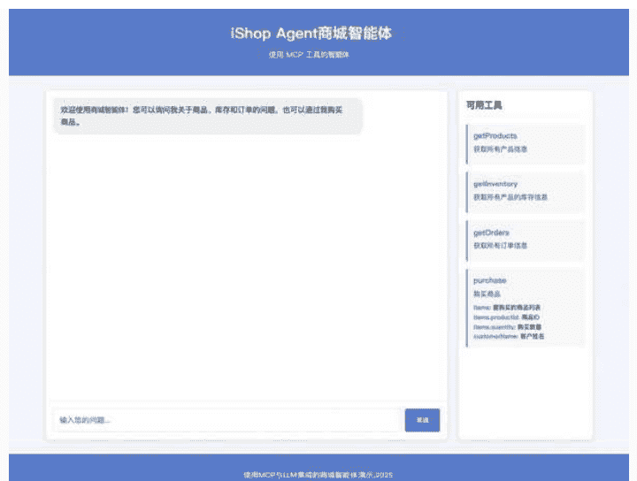

图6-2 iShop Agent商城智能体的Chat Bot界面

在对话框中输入“库存最少的3个产品信息，表格形式给出”，可以看到智能商城助手给出了回复，如图6-3所示。

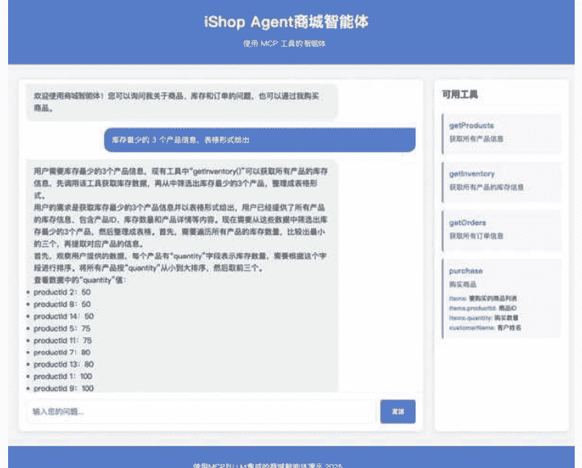

图6-3 iShop Agent商城智能体对话1

在对话框中输入“所有智能手表产品”，可以看到商城智能体给出了回复，如图6-4所示。

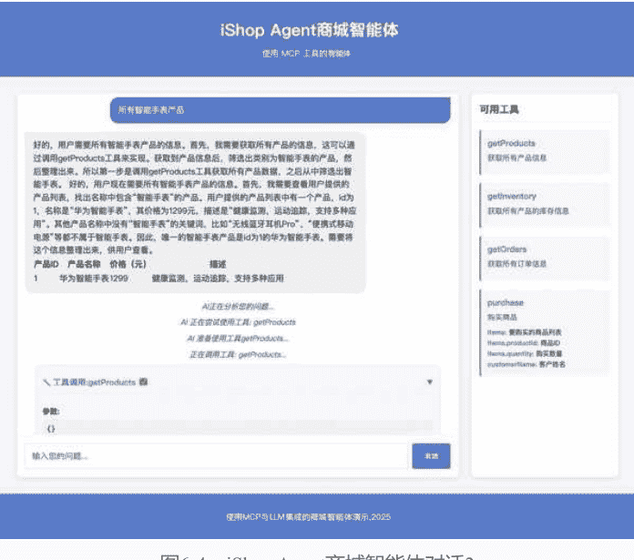

图6-4 iShop Agent商城智能体对话2

## 小结

本章通过一个完整的商城智能体项目，带领读者完成了一次从概念到可运行应用的AI智能体开发的完整旅程。我们不仅深入探讨了项目从需求分析到架构设计的完整过程，更关键的是，亲手实践了如何利用MCP和TypeScript技术栈，构建出一个功能完备、交互流畅的智能体。

首先，我们聚焦于系统的“大脑”与能力核心——MCP Server的构建，学习了如何将核心业务逻辑，如商品查询、库存管理和订单处理，抽象并封装成标准化的MCP工具。通过将getProducts、getInventory、purchase等函数注册为工具，并以AI模型可理解和调用的方式有效暴露出来。随后，我们利用Express框架和SSE技术，实现了一个健壮的后端服务。这不仅为MCP工具提供了运行环境，还通过SSE建立了与客户端实时、流式通信的桥梁，为实现“打字机”式的动态回复效果奠定了坚实的基础。

接着，我们将视角转向用户交互的“窗口”——客户端的开发。本章采用了一种双管齐下的策略，分别构建了两种形态的客户端，以应对不同的应用场景。我们首先开发了一个CLI应用，它作为快速验证后端功能、进行调试的利器，完美诠释了“对话→思考→工具调用→整合回复”的核心工作流程。随后，我们更进一步开发了一个功能丰富的Web应用程序。通过构建一个作为“客户端的客户端”的Express后端，将复杂的MCP通信与状态管理逻辑封装起来，使得前端能够聚焦于提供极致的用户体验。从动态加载工具列表到实时渲染AI的思考过程与工具调用细节，该Web客户端充分展现了如何将MCP、LLM与现代Web技术深度融合，从而构建出透明、可信且富有吸引力的人机交互界面。

最后，在系统集成与测试环节，将所有独立开发的模块——MCP Server、CLI客户端和Web应用——组装在一起，进行了全面的端到端测试。当用户在命令行或浏览器中输入“查询库存最少的商品”等指令时，我们见证了请求如何在客户端、后端服务、MCP Server与LLM之间顺畅传递，并最终以清晰、准确的回答呈现给用户。这一过程不仅验证了系统架构的合理性和代码实现的正确性，更生动地诠释了MCP作为AI智能体“USB-C”端口的核心价值：它成功地将LLM的通用智能与特定领域的业务能力解耦，并以标准化的方式实现无缝连接。

通过本章的实战演练，读者不仅掌握了使用TypeScript开发完整基于MCP的AI智能体的技术方案，更深入理解了如何基于MCP构建能够解决实际问题的AI Agent。从后台服务到前端交互，从工具封装到流式通信，这些宝贵的实践经验为探索和构建更高级、更复杂的AI智能体奠定了坚实基础。

# 第7章 基于MCP Python SDK和arxiv创建论文研究智能体

本章将通过基于MCP Python SDK和arxiv创建的论文研究智能体项目，展示如何将AI智能体应用于科研领域。本章主要包括以下内容。

- 项目概述与背景。
- MCP Server实现。
- MCP Client实现。
- Streamlit UI实现。
- 系统集成。
- 运行测试。

通过本章的学习，读者不仅可以掌握使用MCP构建复杂AI智能体的完整流程，还将理解如何将协议的设计思想、工具链的强大能力与LangChain等业界领先框架相结合，为后续在其他垂直领域中构建智能信息系统奠定坚实基础。

## 7.1 项目概述与背景

当前，学术研究正以前所未有的速度发展。以开放获取的学术预印本平台arXiv网站为例，其托管的论文数量已超过两百万篇，并仍以每月上万篇的速度持续增长。如此庞大的信息洪流，为科研工作者带来了双重挑战：一方面是错失关键研究的焦虑，另一方面则是在海量文献中进行筛选、甄别与研读所耗费的巨大时间成本。在这种挑战面前，传统的文献检索与阅读方式已显得力不从心。研究人员宝贵的时间与精力本应聚焦于创新性的思考与实验，却不得不大量消耗在重复性的信息处理工作中。

为了将研究人员从这种困境中解放出来，本章构思了一个实战项目：基于MCP的论文研究智能体。该项目旨在充分利用LLM的强大能力，并借助MCP打造一个能够与研究人员自然对话、深度协作的智能伙伴。

### 7.1.1 项目目标

本节将详细介绍如何基于MCP构建一个论文研究智能体，该助手能够帮助研究人员高效地搜索、获取、分析和理解arXiv网站上的学术论文。本项目主要围绕以下4个核心目标展开。

- 高效检索文献：通过自然语言交互，帮助用户精确定位相关研究论文，缩短搜索时间。
- 快速提取内容：自动从PDF论文中提取关键信息，包括摘要、方法、结果等，降低用户阅读整篇论文的时间成本。
- 深度内容理解：利用LLM的能力，帮助用户理解复杂的学术概念和研究方法。
- 交互式研究辅助：提供一个对话式界面，使用户能够通过自然语言提问来探索研究内容，实现高效的人机协同。

### 7.1.2 选择技术栈

为实现上述目标，一个精心设计的系统架构与一套强大的技术栈是不可或缺的。为了系统的每一部分都能够独立开发、测试与迭代，同时也为未来的功能升级预留充足的空间，本项目没有采用大而全的单体架构，而是遵循模块化、可扩展的微服务理念构建了一个论文研究智能体系统。选择的技术栈如下。

- MCP：用于提供一种标准化的方式来连接LLM与外部数据源（如arXiv数据库、本地文档等）和工具。
- LangChain：用于构建基于LLM的应用程序的框架，提供丰富的工具和组件。特别是其ReAct代理模式赋予了系统自主思考、规划与执行复杂任务的能力。
- FastAPI：高性能的Python Web框架，用于构建稳定、高效的API服务，将MCP Server封装为可远程调用的接口。
- Streamlit：用于快速构建交互式Web应用的Python库，支持开发者使用纯Python代码快速构建出美观、交互性强的Web应用。
- arXiv API：用于搜索和获取arXiv网站上的学术论文。
- Docling：用于从PDF文档中提取和分析文本内容的工具。
- Docker：用于容器化和部署应用程序，支持一键启动整个系统，并在不同环境运行时保持一致。

### 7.1.3 设计系统架构

本项目的系统架构如图7-1所示。

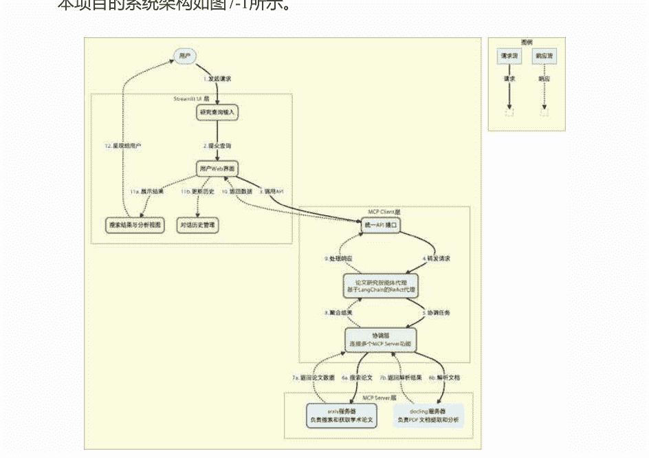

图7-1 论文研究智能体的系统架构

整个论文研究智能体可以被清晰地划分为以下3层。

(1) MCP Server层 (MCP Server Layer)：作为系统的能力基础，负责将原始的数据源与功能封装成符合MCP规范的服务。该层主要包含两个独立的微服务。

- arxiv服务器：负责与arXiv网站进行交互，以搜索和获取学术论文。它对外提供如“按关键词搜索论文”“根据ID获取论文详情”等标准化的工具接口。
- docling服务器：专注于文档的深度处理，能够将接收到的论文的PDF文件解析为纯文本，或者提取其章节、图表等结构化信息，并将这些功能封装为MCP工具。

(2) 客户端服务器层 (Client Server Layer)：如果说MCP Server层是系统的“四肢”，那么客户端服务器层就是系统的“大脑”和“中枢神经”。它作为协调层，通过MCP Client同时连接到后端的多个MCP Server。该层内嵌了基于LangChain的ReAct代理，该代理接收到用户的复杂指令后（如“帮我找找最近关于AI智能体的研究，并总结其中3篇的实现方法”），能够智能地解析任务，自主决策调用arxiv服务器的搜索工具和docling服务器的文档分析工具，协同完成任务。最终，该层会通过一个统一的API接口，将处理结果提供给前端应用。

(3) Streamlit UI层 (Streamlit UI Layer)：作为系统与用户直接交互的门户，该层是一个独立的Web应用，通过调用客户端服务器层提供的API与后端进行通信。它为用户提供了一个友好、直观的聊天界面，用户可以在此输入研究问题、查看系统返回的论文信息与分析结果，并进行多轮的询问与探索。同时，该层还负责管理用户的会话状态，保存完整的对话历史，以提供连贯的交互体验。

这种分层解耦的架构设计不仅逻辑清晰、易于理解，更重要的是充分体现了MCP的核心思想：将提供上下文的“能力”与使用上下文的“智能”分离开来。

## 7.2 MCP Server实现

本节介绍arxiv服务器和docling服务器这两个MCP Server的实现，以及其部署与配置。

### 7.2.1 arxiv服务器

arxiv服务器是独立的MCP Server，其核心职责是将arXiv网站提供的检索能力封装成符合MCP规范、可被上层应用（客户端服务器）调用的标准化工具。

在架构设计上，将与arXiv网站的交互逻辑独立成一个微服务，这背后蕴含着深刻的设计考量。arXiv网站拥有其独特的API规范、数据结构及访问策略。通过创建一个专属的MCP Server，我们能够将这些与平台相关的复杂性完全隔离，从而实现关注点分离：上层的智能代理无须关心如何构造arXiv的查询语句或如何解析返回的 XML 数据，只需通过 MCP 调用一个语义清晰的工具，如 search_arxiv(query="...", max_results=...)即可。这种解耦设计不仅简化了上层应用的逻辑，也为未来接入其他学术数据源（如PubMed、IEEE Xplore等）提供了便利——只需参照此模式开发新的MCP Server，而无须修改现有逻辑，极大地增强了系统的可扩展性。

#### 1. 服务器设计与实现

arxiv服务器的核心功能是接收自然语言查询，调用官方的arxiv Python库与arXiv API进行通信，并将检索到的论文信息进行结构化处理，最终以易于LLM理解的格式返回结果。以下是该服务器的逐步构建过程。

```python
# 导入必要的库
import arxiv
from mcp.server.fastmcp import FastMCP #MCP Python SDK中用于快速构建服务器的核心类
from typing import Optional, List # 导入类型提示，增强代码的可读性和健壮性
from pydantic import BaseModel # 用于数据建模和验证的强大工具
import asyncio # Python内置的异步I/O框架，用于运行服务器

# 1. 初始化一个FastMCP Server实例，服务器名为"Research Article Provider"，端口号是8000
mcp = FastMCP(
    "Research Article Provider", port=8000
)

# 2. 数据建模（定义论文信息的结构化模型）
# 定义一个继承自pydantic.BaseModel的数据模型类Article，以自动获得数据校验、序列化等能力
class Article(BaseModel):
    title: str # 论文标题
    summary: str # 论文摘要
    published_date: str # 发表日期
    pdf_link: Optional[str] # PDF链接，可能不存在，因此使用Optional

    # 定义一个类方法，用于将arxiv库的Result对象转换为自定义的Article对象
    # 这是一个典型的适配器模式应用，将外部数据结构转换为内部标准结构
    @classmethod
    def from_arxiv_result(cls, result: arxiv.Result) -> 'Article':
        # 从result.links列表中筛选出包含 '/pdf/' 的链接，即为PDF下载链接
        pdf_links = [str(i) for i in result.links if '/pdf/' in str(i)]
        # 如果找到了PDF链接，则取第一个；否则设为None
        if len(pdf_links):
            pdf_link = pdf_links[0]
        else:
            pdf_link = None
        # 使用提取到的信息创建并返回一个新的Article实例
        return cls(
            title=result.title,
            summary=result.summary,
            # 将datetime对象格式化为 'YYYY-MM-DD' 格式的字符串
            published_date=result.published.strftime('%Y-%m-%d'),
            pdf_link=pdf_link
        )

    # 重写__str__方法，定义Article对象在被转换为字符串时的表现形式
    def __str__(self):
        # 格式化输出，包含标题、日期、PDF链接，以及摘要的前三行，并以[...]表示省略，避免上下文过长
        return f'Title: {self.title}\nDate: {self.published_date}\nPDF Url: {self.pdf_link}\n\n' + '\n'.join(
            self.summary.splitlines()[:3]) + '\n[...]'

# 3. 核心业务逻辑实现（论文搜索与数据处理）
def get_articles_content(query: str, max_results: int) -> List[Article]:
    # 创建一个arxiv客户端实例
    client = arxiv.Client()
    # 构建一个搜索查询对象，包含查询关键词、最大结果数以及按相关性排序的规则
    search = arxiv.Search(query=query, max_results=max_results, sort_by=arxiv.SortCriterion.Relevance)
    # 执行搜索，client.results(search) 返回一个迭代器，包含所有搜索结果
    # 使用map函数，将每个结果通过Article.from_arxiv_result方法进行转换
    articles = map(lambda x: Article.from_arxiv_result(x), client.results(search))
    # 过滤掉没有PDF链接的文章，确保下游处理的有效性
    articles_with_link = filter(lambda x: x.pdf_link is not None, articles)
    # 将最终结果转换为列表并返回
    return list(articles_with_link)

# 4. 注册为MCP工具（对外暴露能力）
# 使用 @mcp.tool装饰器，将一个普通的Python函数注册为MCP Server对外暴露的工具
# 这是将内部逻辑封装为标准化能力的关键步骤
@mcp.tool(
    name="search_arxiv",
```

##### 2. Article模型详解

在复杂的数据驱动系统中，数据模型扮演着基石的角色。它不仅是数据的载体，更是系统内部对现实世界实体（本例中为“学术论文”）的抽象理解和统一表达。本例设计的Article模型正是这样一个关键组件，它并非一个简单的Python类，而是整个arxiv服务器乃至上层应用理解和处理论文信息的核心数据结构。

```python
# 导入Pydantic的BaseModel，作为数据模型的基础
from pydantic import BaseModel
# 导入类型提示工具，以增强代码的清晰度和健壮性
from typing import Optional
# 导入arxiv库中定义的Result类型，用于类型注解
import arxiv

class Article(BaseModel):
    """
    Article模型代表了一篇学术论文的结构化信息
    它继承自Pydantic的BaseModel，从而自动获得了强大的数据验证、序列化和文档生成能力
    """
    # 论文的核心属性定义
    title: str  # 论文标题，字符串类型
    summary: str  # 论文摘要，字符串类型
    published_date: str  # 发表日期，存储为格式化后的字符串
    pdf_link: Optional[str]  # PDF下载链接，可能不存在，因此类型为Optional[str]

    @classmethod
    def from_arxiv_result(cls, result: arxiv.Result) -> 'Article':
        """
        这是一个类方法，扮演了工厂（Factory）和适配器（Adapter）的角色
        它负责将来自外部arxiv库的Result对象，转换为系统内部的Article标准模型
        """
        # 1. 适配和提取：从arxiv.Result对象的链接列表中，筛选PDF链接
        pdf_links = [str(link) for link in result.links if '/pdf/' in str(link)]

        # 2. 健壮性处理：判断是否存在PDF链接，并进行相应的赋值
        pdf_link = pdf_links[0] if pdf_links else None

        # 3. 创建实例：调用类的构造函数（cls(...)），传入处理和格式化后的数据，
        # 创建一个符合内部规范的Article实例
        return cls(
            title=result.title,
            summary=result.summary,
            # 将Python的datetime对象转换为统一的 'YYYY-MM-DD' 字符串格式
            published_date=result.published.strftime('%Y-%m-%d'),
            pdf_link=pdf_link
        )

    def __str__(self) -> str:
        """
        重写对象的字符串表示方法，这不仅仅是为了调试方便，更是为LLM设计的一个“可读”接口
        它定义了当Article对象被注入到提示词（Prompt）中时，应呈现的格式
        """
        # 精心设计的格式化字符串，突出关键信息，并截断过长的摘要以节省上下文空间
        return (
            f'Title: {self.title}\n'
            f'Date: {self.published_date}\n'
            f'PDF Url: {self.pdf_link}\n\n'
            f'{"\n".join(self.summary.splitlines()[:3])}\n[...]'
        )
```

这个看似简洁的Article模型，实际上蕴含着丰富的设计思想，我们可以从以下3个层面进行深入剖析。

- **作为数据契约的属性定义**：选择Pydantic的BaseModel作为基类，而非使用普通的Python类或dataclass，是因为Pydantic强制实施了类型注解。这意味着在创建Article实例时，Pydantic都会自动校验传入数据的类型是否正确，例如title必须是字符串类型。通过在数据入口处实施严格校验，系统的健壮性得到显著提升，有效避免了因数据类型不匹配而导致的下游运行时错误。Article类因此成为一份可靠的“数据契约”，任何需要处理论文信息的组件都可以确信从Article对象中获取的数据是符合预期的。
- **作为适配器的工厂方法**：from_arxiv_result融合了设计模式中“工厂方法”与“适配器模式”，承担了“翻译官”的职责，将外部数据源（arxiv库的Result对象）中复杂、原始的数据结构，适配为系统内部简洁、统一的Article模型。这一适配过程封装了所有底层处理逻辑，例如从众多链接中找出PDF链接、将datetime对象转换为格式化字符串等。通过这种方式，系统的其他部分无须了解arXiv API的具体实现细节，有效实现了与外部依赖的解耦。
- **为AI设计的文本接口**：__str__方法的设计是整个模型中最具AI智能体特色的部分。在传统软件中，该方法通常用于日志记录或调试输出。但在这里，它被赋予了全新的使命：为LLM生成上下文信息。本例精心设计了其输出格式，使用换行符清晰地分隔标题、日期、链接和摘要，并明智地截取了摘要的前三行，最后以[...]标志结尾。这种做法具有双重优势：首先，结构化的文本更易于LLM理解和解析，帮助其准确识别各信息字段；其次，截断摘要可以有效地控制注入到提示词中的上下文长度，在处理多篇论文时，有助于节约计算成本并避免超出模型的上下文窗口限制。

综上所述，Article模型的设计完整展示了从原始数据到结构化知识，再到AI可消费信息（AI-Consumable Information）的转化过程。它不仅是数据的容器，更是保障系统数据一致性和可维护性，以及与AI高效协同工作的关键组件。

##### 3. 论文搜索功能实现

在构建arxiv服务器的诸多功能中，论文检索无疑是其核心引擎。该功能直接关系到整个智能体能否精准、高效地为用户提供研究所需的文献资源。其核心任务是将用户用自然语言表达的模糊需求，转化为对arxiv数据库的精确查询，并以一种结构化、模型友好的方式返回结果。下文将深入剖析该工具的实现细节，阐述其如何从代码逻辑逐步封装为可被AI代理调用的强大MCP工具。

以下是实现该功能的核心代码。整个逻辑被拆分为两个函数：get_articles_content()负责与arXiv API进行纯粹的数据交互，而get_articles()则将其封装成一个符合MCP规范的、具备异步特性和日志输出的工具。这种关注点分离的设计模式，使得代码结构更加清晰，便于维护和测试。

```python
# 导入arXiv官方Python客户端库，它是与arXiv网站交互的桥梁
import arxiv
# 导入MCP Server框架，特别是`mcp.tool`装饰器，用于将普通函数注册为MCP工具
from mcp.server.fastmcp import FastMCP
# 导入自定义的Article数据类，用于结构化地表示论文信息
from .data import Article

# 实例化FastMCP Server，并为其命名为"Arxiv"
# 这个实例将作为注册所有相关工具和资源的容器
mcp = FastMCP("Arxiv")

def get_articles_content(query: str, max_results: int) -> list[Article]:
    """
    一个同步函数，封装了调用arXiv API进行论文搜索和结果解析的核心逻辑
    它不直接暴露为MCP工具，而是作为内部的核心业务逻辑被调用

    Args:
        query (str): 用户输入的搜索关键词或查询语句
        max_results (int): 希望获取的论文最大数量

    Returns:
        list[Article]: 一个包含多个Article对象的列表，每个对象代表一篇符合条件的论文
    """
    # 步骤1: 初始化arxiv客户端。这是与arXiv API进行所有交互的入口
    client = arxiv.Client()

    # 步骤2: 构建一个搜索查询对象。在这个对象内定义搜索的核心参数
    # - query: 使用用户提供的查询字符串
    # - max_results: 限制返回结果的数量
    # - sort_by: 设置排序标准为"Relevance"（相关性），确保最匹配的结果排在前面
    search = arxiv.Search(
        query=query,
        max_results=max_results,
        sort_by=arxiv.SortCriterion.Relevance
    )

    # 步骤3: 执行搜索并处理结果
    # client.results(search)会返回一个迭代器，其中包含了原始的搜索结果
    # 使用map函数，将迭代器中的每一个原始结果（result）都通过Article.from_arxiv_result方法
    # 转换成自定义的、结构更加清晰的Article数据对象
    articles = map(lambda x: Article.from_arxiv_result(x), client.results(search))

    # 步骤4: 过滤掉没有提供PDF下载链接的论文
    # 考虑到后续可能需要对论文进行深度分析，确保每篇论文都有可访问的PDF源是至关重要的
    # filter函数会筛选出那些Article对象的pdf_link属性不为None的论文
    articles_with_link = filter(lambda x: x.pdf_link is not None, articles)

    # 步骤5: 将最终的迭代器结果转换为列表并返回
    return list(articles_with_link)

@mcp.tool(
    name="search_arxiv",
    description="Get `max_results` articles for a given search query on Arxiv."
)
async def get_articles(query: str, max_results: int) -> str:
    """
    这是一个注册为MCP工具的异步函数。它作为现实世界（如AI代理）调用论文搜索功能的正式入口
    负责处理外部请求，调用内部逻辑，并以对模型友好的格式返回结果

    Args:
        query (str): 来自MCP Client的搜索查询
        max_results (int): 希望返回的最大结果数

    Returns:
        str: 一个格式化后的字符串，其中包含所有找到的论文信息，供LLM直接消费
    """
    # 在服务器端打印日志，便于开发者调试，了解工具是否被正确调用
    print(f"Searching for '{query}'...")

    # 调用核心逻辑函数，执行实际的搜索任务
    articles = get_articles_content(query, max_results)

    # 打印另一条日志，告知开发者找到了多少篇文章，便于追踪流程
    print(f"Found {len(articles)} articles.")

    # 将Article对象列表格式化为单一的、易于LLM解析的字符串
    # 首先，使用map函数将每个Article对象通过其自身的__str__方法转换为字符串
    # 然后，使用join方法将这些字符串用一个清晰的分隔符连接起来
    # .strip()用于移除最终字符串两端可能存在的空白符，确保格式的整洁
    return '\n\n-------\n\n'.join(map(str, articles)).strip()

##### 5. 启动MCP服务（运行服务器）
# 这是Python脚本的标准入口点
if __name__ == "__main__":
    # run_sse_async() 是一个异步函数，会启动一个支持SSE协议的Web服务器
    # asyncio.run() 负责运行这个异步服务器，直到程序被终止
    asyncio.run(mcp.run_sse_async())
```

上述代码的核心逻辑，可以总结如下。

- **数据建模**：首先使用Pydantic的BaseModel定义一个Article类。Article类不仅是一个数据容器，可以提供强大的数据校验能力，确保从arXiv API获取的数据能够被正确解析和结构化。同时，Article类定义了系统关于“论文”这一概念的标准数据契约。from_arxiv_result类方法和__str__方法的设计则优雅地实现了外部数据到内部模型，以及内部模型到LLM友好文本的转换。
- **核心业务逻辑实现**：get_articles_content函数是纯粹的业务逻辑实现，负责与arxiv库交互，执行搜索、排序、过滤和数据转换。将业务逻辑与MCP的协议层代码分离是一种良好的软件工程实践。
- **注册为MCP工具**：@mcp.tool装饰器能够将get_articles函数从一个普通的内部函数提升为遵循MCP规范、可被远程调用的标准化工具。FastMCP在底层会自动处理工具元数据的生成（包括函数名、参数、描述等）、输入参数的解析和校验，以及将函数返回值打包成MCP消息等所有繁杂的协议细节，开发者只需专注于工具功能本身的实现。
- **启动MCP服务**：通过asyncio.run(mcp.run_sse_async())启动一个异步的、基于SSE协议的Web服务器。这意味着arxiv服务器已经准备就绪，可以在指定端口（本例中为8000）监听来自MCP Client的连接和工具调用请求。

至此，我们已经成功构建了一个功能完备且结构清晰的arxiv服务器。它像一个忠实的图书管理员，随时可以为论文研究智能体提供精准、快速的文献检索服务。7.2.2节将以类似的方式，构建另一个关键的能力服务器——docling服务器。

get_articles_content()函数是整个功能的核心，其职责专注于与arxiv库进行纯粹的数据交互。该函数首先初始化客户端，接着构建一个Search对象，该对象如同发给arxiv服务器的一张详细订单，上面写明了查询内容（query）、返回数量（max_results）及排序方式（sort_by）。获取原始结果后，代码并没有直接返回，而是通过map和filter进行了一系列数据转换与清洗。map函数将原始、结果复杂的arxiv.Result对象，逐一转换为自定义的、结构更清晰的Article数据类实例，该步骤是实现数据标准化的关键。随后的filter操作则保证了数据的可用性，剔除了那些没有提供PDF链接的论文条目，因为对于智能体而言，无法获取原文的论文不具备后续分析价值。

get_articles()函数则扮演着“适配器”与“门面”的角色。它通过@mcp.tool装饰器将自身注册到MCP Server的工具列表中，以便被任何符合MCP的客户端发现和调用。该函数被定义为async，表明它是一个异步函数，能够很好地融入现代Web服务器的异步I/O模型中，避免因为等待arXiv API的响应而阻塞整个服务。函数内部首先打印日志，这一在实际工程中至关重要的调试手段，可以清晰地记录工具被调用的时间和具体方式。然后，它调用get_articles_content来完成实际工作，并将返回的Article对象列表，通过join和map操作，精心编排成一个长字符串。

这种最终输出为字符串的格式是专为LLM消费而设计的。通过使用鲜明的分隔符\n\n-------\n\n，LLM可以轻易地将长字符串切分开，识别出每一篇独立的论文条目，从而在后续的推理和分析中准确地引用它们。至此，我们便成功将一个复杂的外部API调用封装成了一个简洁、健壮且对AI友好的MCP工具。

### 7.2.2 docling服务器：赋予AI深度阅读的能力

docling服务器是一个负责从PDF文档中提取和分析文本内容的MCP Server。它使用docling库将PDF文档转换为结构化的文本，并提供全文提取和预览生成功能。如果说arxiv服务器为智能体提供了通往知识宝库的“索引卡”，那么docling服务器则是赋予它直接阅读和理解这些知识典籍本身——即PDF论文——的深度阅读能力。在我们的系统中，获取论文的PDF链接仅仅完成了信息获取的第一步。真正的挑战在于如何跨越从“版式复杂、为人类视觉优化的PDF”到“结构清晰、为机器理解优化的纯文本”之间的鸿沟。docling服务器正是为解决这一核心挑战而设计的，它是一个专注于文档解析与内容提取的MCP微服务。

将文档处理能力封装成一个独立的服务器，同样是源于我们对模块化和关注点分离架构理念的坚持。PDF解析与OCR（光学字符识别）是一项计算密集型任务，且依赖于特定库（如docling）。将其独立出来，可以使主客户端服务器保持轻量，专注于更高层次的推理与规划，而无须陷入处理二进制文件和复杂文本格式的细节。这种设计显著提升了系统的健壮性和可维护性，并且可以独立升级或替换文档解析引擎，而不会影响到系统的其他部分。

#### 1. 服务器设计与实现

docling服务器的核心职责是接收一个指向PDF文档的URL，利用docling库将其内容（包括文本和图表）高效地转换为结构化的Markdown文本，并对外提供两个关键工具：一个用于获取论文全文，另一个则用于生成一个固定长度的“预览”，以便在不消耗过多上下文的情况下快速把握论文主旨。

```python
# 导入必要的库
from mcp.server.fastmcp import FastMCP  # MCP Server快速构建框架
from docling.document_converter import DocumentConverter  # 核心的PDF解析库
from langchain_text_splitters import RecursiveCharacterTextSplitter  # 来自LangChain的智能文本分割工具
import tiktoken  # OpenAI开发的、用于精确计算token数量的库
import asyncio  # 异步I/O框架

# 初始化MCP Server实例
# 服务器名为 "Research Article Extraction Provider"，以清晰表明其职责
# 监听8001端口，与arxiv服务器（8000端口）区分开
mcp = FastMCP(
    "Research Article Extraction Provider", port=8001
)

def get_article_content_str(article_url: str) -> str:
    """
    该函数是文档处理的核心，负责将远程PDF URL转换为Markdown文本
    它封装了与docling库的直接交互
    """
    # 1. 创建DocumentConverter实例，这是执行转换的入口点
    converter = DocumentConverter()
    # 2. 调用convert方法，传入PDF的URL。docling会在后台下载、解析、
    # 甚至在必要时OCR该文档，并返回一个结构化的结果对象
    result = converter.convert(article_url)
    # 3. 将解析后的结构化文档导出为Markdown格式
    research = result.document.export_to_markdown()
    return research
```

```python
def first_lines(text: str, chunk_size: int = 1536) -> str:
    """
    此函数用于从长文本中精确地提取出前导部分（预览）
    它并非简单地按字符数截断，而是使用token数量作为标准，这与LLM的计费和上下文限制完全对齐
    """
    # 1. 获取针对 'gpt-4' 模型的编码器，以确保token计算的准确性
    encoder = tiktoken.encoding_for_model('gpt-4')
    # 2. 创建一个LangChain提供的递归字符文本分割器
    text_splitter = RecursiveCharacterTextSplitter(
        # 核心参数：定义每个文本块的目标大小为chunk_size个token
        chunk_size=chunk_size,
        # 块之间不重叠
        chunk_overlap=0,
        # 指定长度计算函数：使用tiktoken编码器来计算文本的token数，而非简单的len(text)
        length_function=lambda x: len(encoder.encode(x)),
        # 不使用正则表达式作为分隔符，依赖其内置的智能分割逻辑
        is_separator_regex=False,
    )
    # 3. 执行分割并返回第一个文本块，即为我们所需的预览
    return text_splitter.split_text(text)[0]
```

```python
# 注册第一个MCP工具：提取全文
@mcp.tool(
    name="extract_article_content",
    description="Extracts the full text content from a research article PDF using OCR technology based on its pdf link `article_url`"
)
async def get_article_content(article_url: str) -> str:
    """Get article content extracted from OCR given its pdf url link `article_url`."""
    # 调用核心逻辑函数获取全文
    articlecontent = get_article_content_str(article_url)
    # 返回前去除首尾可能存在的空白字符
    return articlecontent.strip()
```

```python
# 注册第二个MCP工具：获取预览
@mcp.tool(
    name="get_article_preview",
    description="Retrieves the first portion of a research article based on its pdf link `article_url` with a specified token limit (`chunk_size`), useful for quick previews"
)
async def get_article_first_lines(article_url: str, chunk_size: int = 1536) -> str:
    """Get `chunk_size` tokens for an article based on its pdf url link `article_url`."""
    # 获取全文内容
    articlecontent = get_article_content_str(article_url)
    # 基于全文生成指定token数量的预览
    first_lines_content = first_lines(articlecontent.strip(), chunk_size)
    # 返回处理后的预览内容
    return first_lines_content.strip()
```

##### 服务器启动入口

```python
if __name__ == "__main__":
    asyncio.run(mcp.run_sse_async())
```

上述代码实现了一个基于FastMCP的docling服务器。docling服务器的强大之处体现为其对文档的深度处理能力，主要由get_article_content_str()和first_lines()两个函数共同实现。

（1）get_article_content_str()：智能化的全文提取。

该函数是docling服务器与docling库沟通的桥梁，其执行过程远比代码表面所呈现的更为复杂。

创建DocumentConverter实例：实例化一个转换器对象，作为执行所有后续操作的句柄。

调用.convert()：这是实现转换的关键步骤。docling库接收article_url后，会在内部处理网络请求并下载PDF文件。随后，它会运用先进的文档布局分析算法，准确区分文本块、标题、列表、图片、表格等元素。对于扫描件或图片中的文字，它还能自动调用OCR引擎进行识别。

导出为Markdown：转换的最终结果并非无序的纯文本，而是结构化的Markdown格式。这是一种明智的选择，因为Markdown格式（如#标题，-列表项）本身就携带了丰富的语义信息，有助于LLM更好地理解原文的层次结构和重点内容，这对于后续的摘要生成、问答等任务至关重要。

（2）first_lines()：面向LLM的精准文本切片。

该函数解决了AI智能体中一个普遍且关键的问题：如何在不丢失关键信息的前提下，高效利用有限的上下文窗口。如果简单地按字符数截取，可能会在句子中间断开，破坏语义完整性。first_lines()函数则采用了如下两个非常精妙的策略。

以Token为尺：该函数未使用Python内置的len()函数，而是引入了tiktoken库。这是因为LLM的计费和上下文长度限制都是以Token为单位的。通过tiktoken，可以精确地计算文本在模型中的“实际开销”，从而实现对上下文成本的精准控制。

智能边界分割：使用了LangChain提供的RecursiveCharacterTextSplitter。该工具的“递归”特性意味着它会智能地尝试按段落、句子、单词等自然边界进行分割，而不是在达到chunk_size时简单截断。这种做法最大限度地保证了返回的预览文本在语义上的连贯性和完整性。

通过get_article_content_str()和first_lines()这两个精心设计的函数，并借助@mcp.tool装饰器将它们封装为标准化的服务，docling服务器为研究智能体提供了两项关键能力：既能深入“精读”整篇论文，也能快速“泛读”以获取初步印象。这为上层ReAct代理制定灵活的研究策略（例如，先预览多篇论文，再对相关性最强的一篇进行全文分析）奠定了坚实的基础。

#### 2. MCP工具注册

docling服务器注册了两个MCP工具，分别用于提取全文和生成预览。以下是这些工具的注册信息：

```python
@mcp.tool(
    name="extract_article_content",
    description="Extracts the full text content from a research article PDF using OCR technology based on its pdf link `article_url`"
)
async def get_article_content(article_url: str) -> str:
    """Get article content extracted from OCR given its pdf url link `article_url`."""
    articlecontent = get_article_content_str(article_url)
    return articlecontent.strip()

@mcp.tool(
    name="get_article_preview",
    description="Retrieves the first portion of a research article based on its pdf link `article_url` with a specified token limit (`chunk_size`), useful for quick previews"
)
async def get_article_first_lines(article_url: str, chunk_size: int = 1536) -> str:
    """Get `chunk_size` tokens for an article based on its pdf url link `article_url`."""
    articlecontent = get_article_content_str(article_url)
    first_lines_content = first_lines(articlecontent.strip(), chunk_size)
    return first_lines_content.strip()
```

上述代码注册了两个MCP工具，分别提供不同的文档处理功能。

（1）extract_article_content工具。

- 名称：extract_article_content()。
- 描述：使用OCR技术从研究论文PDF中提取全文内容。
- 参数：article_url（PDF链接）。
- 功能：调用get_article_content_str()函数获取全文内容，并返回去除首尾空白字符的处理结果。

（2）get_article_preview工具。

- 名称：get_article_preview()。
- 描述：获取研究论文的前一部分，用于快速预览。
- 参数：article_url（PDF链接）和chunk_size（预览大小，默认值为1536个token）。
- 功能：先调用get_article_content_str()函数获取全文，然后调用first_lines()函数提取指定长度的预览内容，并返回去除首尾空白字符的结果。

这种设计提供了两种不同的文档访问方式，以适应不同的使用场景。

- 全文提取：适用于需要深入分析论文完整内容的场景。
- 预览生成：适用于快速浏览论文概要的场景，有效避免处理过大文本量造成负担。

### 7.2.3 MCP Server部署与配置

至此，我们已经成功构建了arxiv服务器和docling服务器这两个功能强大的MCP微服务。然而，在软件工程实践中，编写出能够运行的代码仅仅是完成了整个工作的“一半”。另一半同样至关重要，即如何将这些代码可靠、一致、可扩展地部署到生产环境中，使其从开发者本地环境中的“程序”真正蜕变为稳定可靠的“服务”。本节将深入探讨如何运用现代DevOps的最佳实践——容器化技术，来实现这一关键转变。

在现代复杂的应用架构中，我们常常面临一系列经典的部署挑战：开发环境与生产环境的不一致性（“在我机器上是好的啊！”）、烦琐易错的手动配置步骤，以及令人头痛的依赖库版本冲突。容器化技术，特别是以Docker为代表的实现，为这些问题提供了优雅而强大的解决方案。它通过将应用程序及其全部依赖（包括库文件、运行时环境和系统工具）打包进一个轻量、可移植的“容器”中，从而确保应用在任何运行环境下都能保持高度的一致性。

#### 1. Docker容器化

我们将为arxiv服务器和docling服务器分别创建一个Dockerfile。Dockerfile本质上是一份构建蓝图，如同一个自动化的“装箱清单”，它精确地定义了如何逐步构建出一个自包含的、可独立运行的Docker镜像。

以下是对arxiv服务器的Dockerfile解析：

```dockerfile
# 1. 基础镜像选择（FROM）
# 我们选择一个官方的、轻量级的Python 3.10 slim镜像作为起点
# "slim"版本不包含许多非必需的系统工具，可以显著减小最终镜像的体积
FROM python:3.10-slim

# 2. 设置工作目录（WORKDIR）
# 在容器内部创建一个 /app目录，并将其设置为后续所有命令的执行路径
# 这是一个良好实践，可以避免将应用文件散落在容器的根文件系统中
WORKDIR /app

# 3. 依赖管理（COPY & RUN）
# 首先只复制requirements.txt文件，以充分利用Docker的层缓存机制
# 只要这个文件不改变，下一步的pip install就不需要重新执行，从而加快后续构建速度
COPY requirements.txt .
# --no-cache-dir选项指示pip不存储缓存，有助于减小镜像的体积
RUN pip install --no-cache-dir -r requirements.txt

# 4. 复制代码（COPY）
# 在所有依赖都安装完毕后，再将我们的服务器主程序代码复制到容器中
COPY arxiv_server.py .

# 5. 暴露端口（EXPOSE）
# 声明该容器内的服务将监听8000端口
# 这主要是一个文档性指令，用于告知使用者（或其他容器）这个容器的预期用途，实际的端口映射在运行时指定
EXPOSE 8000

# 6. 定义启动命令（CMD）
# 指定当容器启动时，默认要执行的命令
# 这里我们直接使用python启动我们的arxiv_server.py脚本
CMD ["python", "arxiv_server.py"]
```

docling服务器的Dockerfile与arxiv服务器的结构高度相似，唯一的区别在于它暴露的是8001端口，并启动docling_server.py。这种构建模式的一致性，本身就体现了架构设计的优雅。

docling服务器的Dockerfile如下：

```dockerfile
FROM python:3.10-slim

WORKDIR /app

COPY requirements.txt .
RUN pip install --no-cache-dir -r requirements.txt
COPY docling_server.py .
EXPOSE 8001
CMD ["python", "docling_server.py"]
```

这些Dockerfile定义了构建Docker镜像的步骤。

（1）使用Python 3.10作为基础镜像。
（2）设置工作目录为/app。
（3）复制requirements.txt文件并安装所需依赖。
（4）将对应的服务器代码复制到镜像中。
（5）暴露相应的端口（arxiv服务器为8000，docling服务器为8001）。
（6）设置启动命令。

#### 2. Docker Compose配置

现在，我们拥有了两个独立的、可运行的容器化服务。然而，论文研究智能体是一个多组件协同工作的系统，我们需要一种方法来定义、启动、连接并管理这一整套服务。这正是Docker Compose的价值所在，它允许我们使用一个简单的YAML文件来描述整个应用的服务栈、网络结构及各种服务之间的依赖关系。为了协调多个服务的部署和运行，我们使用Docker Compose创建了一套完整的部署配置。以下为docker-compose.yml文件的具体内容：

```yaml
# docker-compose.yml
services:
  # 定义第一个服务：arxiv服务器
  arxiv-server:
    build:
      # build指令告诉Compose如何构建这个服务的镜像
      context: . # context: . 表示构建上下文是当前目录
      dockerfile: docker/Dockerfile.arxiv # 指定使用哪个Dockerfile
    ports:
      # "宿主机端口:容器端口"，将宿主机的8000端口映射到容器的8000端口
      # 这使得我们可以通过访问本机的8000端口来与arxiv服务器通信
      - "8000:8000"

  # 定义第二个服务：docling服务器
  docling-server:
    build:
      context: .
```

#### 3．启动脚本

为便于开发和测试，我们还创建了一系列启动脚本，用于在本地环境中快速启动各个服务。以下是相关脚本内容：

```
run_arxiv_server.sh:

#!/bin/bash
python arxiv_server.py

run_docling_server.sh:

#!/bin/bash
python docling_server.py

run_client.sh:

#!/bin/bash
python client_server.py

run_app.sh:

#!/bin/bash
streamlit run streamlit_app.py
```

这些脚本使得我们可以在开发过程中单独启动和测试各个组件，而不必每次都启动整个系统。

#### 4．环境变量配置

在实际部署中，我们需要配置一些环境变量，如API密钥、模型配置等。为了简化这一配置过程，我们可以创建一个.env文件，并使用dotenv库加载它。以下为一个示例.env文件：

```
# API配置
API_KEY=your_api_key_here
BASE_URL=https://api.example.com

# 模型配置
MODEL=gpt-4
```

然后，在代码中使用dotenv库加载这些环境变量：

```
from dotenv import load_dotenv
import os

# 加载环境变量
load_dotenv()

# 使用环境变量
api_key = os.environ['API_KEY']
base_url = os.environ['BASE_URL']
model = os.environ['MODEL']
```

这种方式使得我们可以在不修改代码的情况下，通过环境变量配置系统的操作显著提升了系统的灵活性和安全性。

## 7.3 MCP Client实现

在论文研究智能体系统中，如果说MCP Server是连接现实世界（如arXiv网站、Docling文档处理工具包）的“感官”和“手臂”，那么MCP Client就构成了整个系统的“大脑”和“中枢神经系统”。它承担着至关重要的协调者角色，负责接收来自用户界面的指令，理解用户意图，并调度各个MCP Server协同工作，最终将处理结果呈现给用户。

本项目的MCP Client是基于高性能的Python Web框架FastAPI构建的。选择FastAPI的原因在于其卓越的性能、对异步操作的天然支持，以及与Pydantic的无缝集成能力，这使得我们能够轻松构建响应迅速、类型安全且易于维护的API服务。更重要的是，我们在该服务器中集成了强大的LangChain ReAct代理，它赋予论文研究智能体以思考、推理和行动的能力，从而实现了系统的核心智能功能。

### 7.3.1 MCP Client设计与实现：构建论文研究智能体的大脑

MCP Client 的核心职责并非直接提供工具，而是作为智能的“调度中心”。它通过MultiServerMCPClient连接到一个或多个下游MCP Server，动态发现并聚合它们所提供的全部工具。随后，它将这些工具与一个LLM相结合，依托ReAct代理模式，来理解和执行用户的复杂研究任务。

接下来，通过代码来深入解析这个“大脑”的构建过程与运作机制。

```
# 导入必要的库
import os # 用于访问环境变量，确保敏感信息（如API密钥）的安全
from typing import Dict, Any # 导入类型提示，增强代码的可读性和健壮性

import uvicorn # 导入ASGI服务器，用于运行FastAPI应用
from dotenv import load_dotenv # 用于从.env文件加载环境变量，方便本地开发
from fastapi import FastAPI # 核心Web框架，用于构建API
from langchain_mcp_adapters.client import MultiServerMCPClient # MCP Client，用于连接和管理多个MCP Server
from langchain_openai import ChatOpenAI # OpenAI模型适配器，用于与LLM交互
from langgraph.prebuilt import create_react_agent # 从LangGraph库导入预构建的ReAct代理创建函数
from pydantic import BaseModel # 用于数据验证和设置定义的基类

# 定义API请求的数据结构
# 使用Pydantic的BaseModel可以确保接收到的POST请求体包含一个名为prompt的字符串字段
class ResearchRequest(BaseModel):
    prompt: str

# --- 初始化与配置 ---

# 加载当前目录下的.env文件中的环境变量
# 这样做可以将配置与代码分离，便于管理
load_dotenv()

# 初始化LLM
# 从环境变量中读取模型名称、API密钥和基础URL，并创建一个ChatOpenAI实例
# 这是ReAct代理进行思考和推理的核心驱动力
model = ChatOpenAI(
    model=os.environ['MODEL'],
    api_key=os.environ['API_KEY'],
    base_url=os.environ['BASE_URL'],
)

# 创建FastAPI应用实例
# title参数会在API文档（如Swagger UI）中显示
app = FastAPI(title="Research Assistant API")

# --- 核心处理逻辑 ---

async def process_prompt(prompt: str) -> Dict[str, Any]:
    """
    处理用户输入的核心函数
    该函数负责连接MCP Server、创建代理并执行任务
    """
    # 1. 实例化多服务器MCP Client
    # MultiServerMCPClient可以同时连接和管理多个MCP Server
    # 这里配置了两个服务器：arxiv和docling
    # url指向各自服务器的SSE端点，transport指定了传输协议
    # 注意：代码中同时包含了本地开发（localhost）和Docker部署（服务名）的URL，可以根据环境切换
    mcp_client = MultiServerMCPClient({
        "arxiv": {
            # "url": "http://arxiv-server:8000/sse", # Docker环境下的服务名访问
            "url": "http://localhost:8000/sse", # 本地开发环境下的访问
            "transport": "sse",
        },
        "docling": {
            # "url": "http://docling-server:8001/sse", # Docker环境下的服务名访问
            "url": "http://localhost:8001/sse", # 本地开发环境下的访问
            "transport": "sse",
        }
    })

    # 2. 动态获取工具
    # 客户端连接到服务器后，通过get_tools()方法异步获取所有可用工具的定义
    # 这是MCP的强大之处，客户端无须硬编码工具列表
    tools = await mcp_client.get_tools()

    # 3. 创建ReAct代理
    # 使用create_react_agent，将LLM（model）和动态获取的工具（tools）绑定在一起
    # 这个代理现在就具备了使用这些工具与现实世界交互的能力
    agent = create_react_agent(model, tools)

    # 4. 调用代理并执行任务
    # ainvoke是异步调用代理的方法，用于将用户输入的prompt包装后传给代理
    # 代理会根据prompt进行思考，决定是否以及如何调用工具，并与模型多次交互，直到任务完成
    response = await agent.ainvoke({"messages": prompt}, debug=False)

    # 5. 格式化响应
    # 从代理的执行结果中提取出有意义的消息内容，并将其格式化为前端期望的JSON结构
    messages = [{i.type: i.content} for i in response['messages'] if i.content != ""]
    return {"messages": messages}

# --- API端点定义 ---

@app.post("/research")
async def research(request: ResearchRequest):
    """
    定义一个POST类型的API端点，路径为/research
    它接收一个符合ResearchRequest结构的JSON请求体
    当收到请求时，它会调用process_prompt函数来处理并返回结果
    """
    return await process_prompt(request.prompt)

# --- 服务器启动入口 ---

if __name__ == '__main__':
    # 这段代码确保只有在直接运行此脚本时，才会启动服务器
    # 如果此文件被其他模块导入，则不会执行
    # uvicorn.run()启动ASGI服务器，监听在0.0.0.0:8080，意味着可以从本地网络中的任何机器访问
    uvicorn.run(app, host="0.0.0.0", port=8080)
```

上述代码优雅地实现了客户端服务器的核心功能，其实现过程可分解为以下5个关键步骤：

- （1）环境配置与初始化：程序启动时，首先通过dotenv加载配置信息，这是一种将配置与代码分离的最佳实践。随后，根据这些配置初始化与LLM通信所需的ChatOpenAI实例为整个系统的智能决策奠定了基础。
- （2）Web服务框架搭建：通过app = FastAPI(...)创建了一个FastAPI应用实例作为API服务的容器。
- （3）核心任务处理（process_prompt函数）：这是系统智能的体现。
    - 连接与发现：MultiServerMCPClient的实例化是实现服务编排的第一步。它根据配置连接到arxiv和docling这两个MCP Server。紧随其后的await mcp_client.get_tools()是一个关键操作，客户端在此刻动态地“发现”了下游服务提供的所有能力（工具），而无须在代码中预先定义。这种松耦合设计极大地增强了系统的可扩展性——未来若要增加新的工具，只需部署一个新的MCP Server，客户端服务器无须修改代码即可自动集成其能力。
    - 代理创建：create_react_agent(model, tools)这一行代码是系统智能的核心所在。它将LLM的推理能力与外部工具集完美结合，创建出一个既能“思考”又能“行动”的智能代理。
    - 任务执行与响应：代理通过ainvoke方法接收任务，并在内部执行“思考→行动→观察→再思考”的循环过程，直至完成用户的请求。最后，代码对代理返回的复杂消息流进行解析和格式化，提取出对前端有用的核心信息。
- （4）API接口暴露：@app.post("/research")装饰器将research函数注册为一个HTTP POST端点。它使用Pydantic模型ResearchRequest自动验证传入请求的格式，确保接口的健壮性。任何发往/research的有效请求都会触发process_prompt函数的执行。
- （5）服务启动：if __name__ == '__main__': 块是Python脚本的标准入口。它使用Uvicorn这一高性能的ASGI（Asynchronous Server Gateway Interface）服务器来运行FastAPI应用，使其能够处理高并发的异步网络请求。

通过这样的设计，客户端服务器成为一个灵活、强大且可扩展的智能中枢，为构建复杂的AI智能体奠定了坚实的基础。它清晰地将工具的提供方（MCP Server）与工具的使用方和编排方（MCP Client）分离开来，充分体现了微服务架构的优越性。

### 7.3.2 MultiServerMCPClient：连接多个MCP Server

复杂的AI智能体往往需要从多个异构的源头获取信息或调用功能。例如，一个论文研究智能体可能需要同时查询学术论文数据库、调用数据分析工具、并访问最新的网络资讯。如果为每一个外部服务都编写一套独立的连接和调用逻辑，代码将会变得异常复杂且难以维护。MultiServerMCPClient正是为解决此类问题而设计。

MultiServerMCPClient是MCP Python SDK提供的一个强大组件，其设计初衷是为了优雅地解决“一对多”的服务器连接问题。它扮演着“客户端聚合器”或“工具集线器”的角色，使应用程序能够通过一个统一的入口，同时与一个或多个MCP Server建立连接并进行交互。它将底层烦琐的连接管理、协议握手、消息传输等细节完全封装，为上层应用（在这里是我们的ReAct代理）提供了统一的工具调用接口。

让我们再次聚焦于 process_prompt 这一核心函数，深入剖析MultiServerMCPClient的实际运用方式——它如何将来自不同服务器的独立工具，无缝整合为一个强大的、可供LLM统一调度的工具箱。作为客户端服务器的核心组件，MultiServerMCPClient负责连接多个MCP Server，并提供统一的接口来访问其工具集。下面详细解析这个组件的使用。

```
async def process_prompt(prompt: str) -> Dict[str, Any]:
    """
    处理用户输入的核心函数，展示了MultiServerMCPClient的完整工作流程
    """
    # 步骤1: 实例化MultiServerMCPClient，并配置目标服务器
    # 我们提供一个字典作为配置，其中的每一个键（如 "arxiv", "docling"）
    # 都代表一个逻辑上的服务器别名，便于管理
    # 字典的值是该服务器的连接细节，包括:
    # - "url": 服务器的端点地址。在本地开发时使用localhost
    #         在容器化的生产环境中，这里应该换成Docker的服务名，
    #         例如 "http://arxiv-server:8000/sse"
    # - "transport": 指定通信协议，这里我们使用 "sse"，
    #               这是一种非常适合流式数据传输的轻量级协议
    mcp_client = MultiServerMCPClient({
        "arxiv": {
            "url": "http://localhost:8000/sse", # arxiv服务器的地址
            "transport": "sse",
        },
        "docling": {
            "url": "http://localhost:8001/sse", # 文档分析服务器的地址
            "transport": "sse",
        }
    })

    # 步骤2: 异步获取并聚合所有服务器的工具
    # 这是MCP动态发现机制的核心体现
    # 调用get_tools()后，客户端会并发地连接到所有已配置的服务器，请求各自的工具清单
    # SDK会自动将这些来自不同源的工具整合到一个列表中，并将其适配为LangChain框架兼容的格式
    tools = await mcp_client.get_tools()

    # 步骤3: 创建ReAct代理，赋予其使用工具的能力
    # 将我们的LLM (model) 和刚刚聚合的工具列表 (tools)
    # 作为参数，创建一个ReAct代理实例
    # 从这一刻起，这个代理就同时拥有了访问arXiv网站和分析文档的能力
```

### 7.3.3 ReAct代理实现：赋予系统思考与行动的能力

如果说客户端服务器是论文研究智能体的大脑，那么ReAct代理无疑是其中负责思考、推理和决策的“核心处理单元”。它使得系统不再是一个被动执行固定指令的程序，而成为一个能够主动规划、执行、适应变化，并最终完成复杂任务的智能体。正是ReAct代理的存在，真正实现了系统的“智能化”，标志着从简单问答到自主任务处理的范式革命。

传统的LLM应用多为“输入-输出”模式，模型根据输入直接生成最终答案。而ReAct框架则赋予了LLM一个动态、迭代的思考过程，其工作流程高度模拟了人类解决复杂问题的方式。

- （1）接收任务（Receive）：代理首先接收来自用户的原始、高层次的自然语言指令，例如“帮我查找关于‘Mixture of Experts’的最新研究，并总结其优势与挑战”。
- （2）思考（Reason）：代理并不会立即作答，而是像真正的研究者一样开始“思考”。它会分析任务，将其分解为更小的、可执行的步骤。例如：“首先，我需要调用一个工具来搜索最新的论文。我应该使用arxiv工具，关键词是‘Mixture of Experts’。”
- （3）行动（Act）：基于思考结果，代理会选择并“行动”。例如调用arxiv工具，并传入相应的参数。
- （4）观察（Observe）：代理会“观察”工具执行后返回的结果，例如获得包含多篇最新论文标题和链接的列表。
- （5）再次思考（Re-Reason）：观察到的结果成为新一轮思考的输入。代理会继续推理：“很好，我已经找到了论文。下一步需要阅读并理解它们的内容。我应该对每一篇论文使用Docling工具的summarize_document功能。”
- （6）循环与生成（Iterate & Generate）：这一“思考→行动→观察”的循环过程会持续进行，直至代理认为已经收集到足够的信息来回答最初的问题。最后，它会综合所有步骤中获得的信息，生成一段通顺、连贯且详实的最终响应，并呈现给用户。

这种强大的迭代模式使得代理能够处理那些需要多步推理、信息整合和工具协同才能完成的复杂任务，这对于构建一个名副其实的“论文研究智能体”来说，是不可或缺的核心能力。

在本项目中，我们选用LangChain生态中的LangGraph库来构建ReAct代理。LangGraph专为构建循环、有状态且基于LLM的应用而设计，它将复杂的代理执行流程抽象为一张“图”（Graph），使得定义和控制代理的思考与行动循环变得前所未有地清晰和简洁。其中，`create_react_agent()`函数便是LangGraph提供的一个预构建（prebuilt）的、开箱即用的ReAct代理构造器。下面通过代码介绍它是如何被构建和启动的。

```python
# 导入LangGraph中预构建的ReAct代理创建函数
from langgraph.prebuilt import create_react_agent
# 导入OpenAI模型适配器
from langchain_openai import ChatOpenAI

# --- 准备构建代理所需的核心组件 ---

# 1. LLM (The "Brain")
# 这是代理进行所有思考和推理的基础。
# 我们从环境变量中加载配置，创建一个强大的LLM实例。
model = ChatOpenAI(
    model=os.environ['MODEL'],
    api_key=os.environ['API_KEY'],
    base_url=os.environ['BASE_URL'],
)

# 2. 工具集 (The "Hands")
# 这是代理与现实世界交互的手段
# 通过MultiServerMCPClient动态地获取所有可用的工具
tools = await mcp_client.get_tools()

# --- 创建并使用代理 ---

# 3. 创建ReAct代理实例
# 调用create_react_agent函数，将“大脑”（model）和“双手”（tools）组装在一起
# 这一步操作就完成了一个功能完备的ReAct代理的创建
agent = create_react_agent(model, tools)

# 4. 激活代理，执行任务
# 调用代理的ainvoke（异步调用）方法，将用户的原始请求作为输入
# 代理内部的“思考-行动-观察”循环将即刻启动
response = await agent.ainvoke({"messages": prompt}, debug=False)

# 步骤5: 对最终结果进行解析和格式化
# 代理的执行过程会产生一系列消息（思考过程、工具调用、最终答案等）
# 我们在这里对消息进行筛选和清理，过滤掉空内容，
# 并将其构造成一个清晰的、适合API返回的JSON格式
messages = [{i.type: i.content} for i in response['messages'] if i.content != ""]
return {"messages": messages}
```

通过上述代码，我们可以清晰地看到一个完整且高效的MultiServerMCPClient工作流程。

（1）实例化与配置：流程始于MultiServerMCPClient的实例化。其配置采用简洁的Python字典结构，极具可读性。这种配置方式不仅清晰地声明了系统所依赖的外部服务，而且具有极高的可扩展性——当需要接入更多MCP Server时，我们仅仅需要在这个字典中增加新的条目，而无须修改任何核心逻辑代码。

（2）动态的工具发现：`mcp_client.get_tools()`方法是实现系统解耦的关键。它将“工具的发现”从静态的编译时过程转变为动态的运行时过程。客户端服务器无须预先知道arxiv服务器具体提供了哪些工具，也不关心docling服务器的功能细节。它只需发起“我需要所有可用工具”的请求，MCP Client和服务器之间的协议即可自动完成后续处理。这种机制使得下游MCP Server的升级、增删或修改对上游的客户端服务器完全透明。

（3）无缝代理集成：获取的tools列表被直接传递给`create_react_agent()`函数。SDK确保了从MCP Server获取的工具元数据被正确地转换为LangChain Agent可识别的格式。这意味着ReAct代理可以无差别地调用来自不同服务器的工具，仅关注工具的名称、描述和参数，而不在意这个工具的实现究竟部署于哪个物理或虚拟的服务器上。

（4）智能的查询处理：当用户查询通过`agent.ainvoke()`处理时，代理会利用LLM的推理能力，结合可用工具描述，自动制定一个行动计划。例如，如果用户输入“查找关于大模型Agent的最新论文，并总结其核心思想”，代理可能会首先调用arxiv服务器提供的search_papers工具获取论文，然后将返回的论文内容传递给docling服务器的summarize_document工具生成摘要。整个过程由代理自主完成，无须人工干预。

（5）标准化响应：无论内部执行过程是通过一次简单的模型调用完成，还是通过多次复杂的工具调用完成，系统最终都会将结果统一格式化后再输出。这保证了前端应用接收到的数据结构始终是一致的，从而显著简化了前端的开发。

综上所述，MultiServerMCPClient不仅仅是一个连接工具，更是构建模块化、可扩展AI智能体的核心组件。它使得客户端服务器能够专注于业务逻辑的编排与调度，而将具体功能的实现下沉到各个独立的MCP Server中，完美体现了“高内聚、低耦合”的软件设计原则。

在这段简洁的代码背后，`create_react_agent()`函数接收了两个至关重要的参数。

- model：即LLM实例。它不仅是最终答案的生成者，更是整个ReAct流程的“指挥官”，负责在每一步进行推理，决定下一步应该调用哪个工具，或者判断是否已经可以结束任务。
- tools：一个包含了所有代理可以调用的操作的工具列表。每个工具都代表一项可供代理使用的“超能力”，使其能够完成搜索、计算、文件操作等超越LLM本身限制的任务。

创建出的agent实例所拥有的`ainvoke()`方法，便是启动这一智能流程的入口。只需传入用户请求，代理便会自动开始其探索与执行过程，直至返回用户所需的答案。

要构建一个真正高效、可靠的生产级论文研究智能体，仅仅创建原型代理是远远不够的。我们还需要在如下5个维度上对其进行精心的配置与优化。

（1）模型选择的智慧：代理的推理能力上限很大程度上取决于其所依托的LLM。选择如GPT-4.5、Claude 4或Gemini 2.5 Pro等功能强大的模型，可显著提升其在复杂任务分解和工具选择方面的准确性。同时，精调温度（temperature）等参数，有助于在创造性与确定性之间取得理想的平衡。

（2）工具描述的艺术：工具的描述是代理理解其功能的唯一途径。描述应清晰、准确、详尽，内容应包含：工具用途、适用场景、参数说明及具体的输入输出示例。这相当于为工具撰写一份高质量的使用说明书，确保代理能够准确理解并正确调用。

（3）健壮的错误处理机制：现实环境中充满不确定性。网络中断、API异常或工具执行失败时有发生。我们必须为代理建立全面的错误处理机制，使其在遇到异常时能够优雅地恢复，或者至少向用户提供清晰、友好的错误提示，而不是直接崩溃。

（4）极致的性能优化：对于交互式应用，响应速度至关重要。全面采用异步编程是提升并发处理能力、降低延迟的关键。此外，针对那些计算成本高昂且结果相对稳定的工具调用引入缓存机制可以有效避免重复计算，显著提升用户体验。

（5）全面的日志记录：详尽的日志是调试和优化代理行为的“飞行记录仪”。我们应该记录下代理的每一次思考过程、每一次工具调用及其返回结果。通过分析这些日志，我们不仅能快速定位和修复问题，更能深入理解代理的行为模式，挖掘潜在的改进空间，从而实现持续迭代，使论文研究智能体越来越智能。

通过在这些方面持续优化，我们才能将一个基础的ReAct代理，逐步打磨成一个真正能够为用户创造价值、值得信赖的高效研究伙伴。

### 7.3.4 API接口设计

客户端服务器提供了一个简洁而强大的API接口，供前端应用调用。该接口基于FastAPI框架实现，支持异步处理能力，并具备自动生成交互式文档的功能。

#### 1. 请求模型

API接口使用Pydantic定义了请求模型，以确保输入数据的有效性和一致性。

```python
from pydantic import BaseModel

class ResearchRequest(BaseModel):
    prompt: str
```

该模型定义了一个简单的请求结构，只包含一个字符串类型的prompt字段，用于表示用户的研究查询。Pydantic会自动验证请求数据是否符合模型定义，若不符合，将返回详细的错误信息。

#### 2. API端点

为处理研究查询，API接口定义了一个端点，代码如下。

```python
@app.post("/research")
async def research(request: ResearchRequest):
    """处理研究查询，使用arxiv和文档分析工具"""
    return await process_prompt(request.prompt)
```

该端点具有以下特点：

- 采用POST方法，适用于发送复杂数据；
- 路径设置为“/research”，简洁直观；
- 接收一个由FastAPI自动解析和验证的ResearchRequest对象；
- 提供了简短的文档字符串，端点功能清晰明了；
- 调用process_prompt函数处理查询并返回结果；
- 使用async/await语法支持异步处理，提高系统的并发性能。

#### 3. 响应格式

API接口返回一个JSON格式的响应，包含处理结果。

```json
{
    "messages": [
        {"ai": "这是智能体的回复内容..."}
    ]
}
```

每条消息是一个字典，键是消息类型（如“ai”）、值是消息内容，这种简单的响应格式使得前端应用可以轻松解析和显示结果。

#### 4. 错误处理

API接口实现了全面的错误处理机制，确保系统能够优雅地应对各种异常情况。

- 请求验证错误：如果请求数据不符合模型定义，FastAPI将自动返回详细的错误信息。
- 处理错误：如果在处理过程中发生错误，系统会返回适当的错误响应。
- 服务器错误：如果发生服务器错误，会返回标准的500状态码及对应提示。

上述完善的错误处理机制显著增强了系统的健壮性，使其能够应对各种异常情况。

#### 5. API文档

FastAPI自动为API接口生成了交互式文档，用户可以通过访问“/docs”路径进行查看：

http://localhost:8080/docs

该文档包含以下内容。

- API概述：接口的标题与功能描述。
- 端点列表：所有可用的端点及其对应的HTTP方法和路径。
- 请求模型：各端点接收的请求数据结构。
- 响应模型：各端点返回的响应数据结构。
- 示例：提供请求和响应的具体示例。
- 交互式测试：支持直接在文档中测试API调用。

自动生成的文档大大简化了API的使用与测试流程，有效提升了开发效率。

## 7.4 Streamlit UI实现

Streamlit UI作为整个系统的前端界面，为用户与研究智能体之间的交互提供了一个简单而直观的方式。在本项目中，我们基于Streamlit库构建了一个功能丰富的Web应用，支持多轮对话、聊天历史管理和实时响应显示。

### 7.4.1 UI设计与实现

Streamlit UI的核心功能是提供一个聊天界面，支持用户通过自然语言与研究智能体交互。Streamlit UI的具体实现代码如下：

```python
import datetime

import requests
import streamlit as st

# 查询论文研究智能体API的函数
def query_research_assistant(prompt):
    try:
        return requests.post(
            # f"http://client-server:8080/research",
            "http://localhost:8080/research",
            headers={'accept': 'application/json'},
            json={'prompt': prompt}
        ).json()

    except requests.exceptions.RequestException as e:
        st.error(f"Error connecting to API: {e}")
        return None


def main():
    # 页面设置
    st.set_page_config(page_title="Research Assistant", layout="wide")
    st.title("Research Assistant")

    # 初始化聊天历史的数据结构
    if "chats" not in st.session_state:
        st.session_state.chats = {
            1: {"title": "New Chat", "messages": []}
        }

    # 跟踪当前活动聊天ID
    if "active_chat_id" not in st.session_state:
        st.session_state.active_chat_id = 1

    # 跟踪下一个要分配的聊天ID
    if "next_chat_id" not in st.session_state:
        st.session_state.next_chat_id = 2

    # 侧边栏导航
    with st.sidebar:
        # "新聊天"按钮
        if st.button("New Chat", key="new_chat_btn"):
            # 创建新聊天
            new_id = st.session_state.next_chat_id
            timestamp = datetime.datetime.now().strftime("%H:%M")
            st.session_state.chats[new_id] = {
                "title": f"Chat {new_id} ({timestamp})",
                "messages": []
            }
            st.session_state.active_chat_id = new_id
            st.session_state.next_chat_id += 1
            st.rerun()

        # 显示"清除当前聊天"按钮
        if st.button("Clear Current Chat"):
            st.session_state.chats[st.session_state.active_chat_id]["messages"] = []
            st.rerun()

        # 显示可用聊天列表
        st.write("### Your Chats")

        # 为单选按钮创建聊天选项列表
        chat_options = {str(chat_id): chat_data["title"] for chat_id, chat_data in st.session_state.chats.items()}

        # 将active_chat_id转换为字符串，用于单选按钮
        selected_chat = str(st.session_state.active_chat_id)

        # 使用单选按钮选择聊天
        selected_chat = st.radio(
            "Select a chat:",
            options=list(chat_options.keys()),
            format_func=lambda x: chat_options[x],
            label_visibility="collapsed",
            index=list(chat_options.keys()).index(selected_chat)
        )

        # 当选择更改时更新活动聊天ID
        if int(selected_chat) != st.session_state.active_chat_id:
            st.session_state.active_chat_id = int(selected_chat)
            st.rerun()

    # 获取当前聊天数据
    current_chat = st.session_state.chats[st.session_state.active_chat_id]
    current_messages = current_chat["messages"]

    # 显示当前聊天中的所有消息
    for message in current_messages:
        with st.chat_message(message["role"]):
            st.markdown(message["content"])
```

## 7.4.1 Streamlit UI实现

上述代码实现了一个基于Streamlit的论文研究智能体UI，主要包含以下几个部分。

(1) 页面设置：设置页面标题和整体布局。

(2) 会话状态初始化：初始化聊天历史的数据结构、当前活动聊天ID和下一个要分配的聊天ID。

(3) 侧边栏导航。

- 提供“新聊天”按钮，用于创建新的聊天会话。
- 提供“清除当前聊天”按钮，用于清除当前聊天的消息历史。
- 聊天列表，用于显示所有可用的聊天会话，并支持用户在不同会话间切换。

(4) 聊天界面。

- 显示当前聊天的所有消息。
- 提供聊天输入框，供用户输入研究问题。
- 处理用户输入，将其发送至后端API，并显示响应结果。

(5) API交互：使用query_research_assistant函数与后端API进行通信，发送用户查询并获取响应内容。

### 7.4.2 会话状态管理

Streamlit UI利用会话状态（session state）机制来管理聊天历史和用户界面状态。该机制能够在用户会话期间持续存储数据，即使页面刷新也不会丢失数据。

#### 1. 会话状态初始化

会话状态的初始化是UI实现的关键环节，它确保了用户界面的一致性和数据的持久性。

```python
# 初始化聊天历史的数据结构
if "chats" not in st.session_state:
    st.session_state.chats = {
        1: {"title": "New Chat", "messages": []}
    }

# 跟踪当前活动聊天ID
if "active_chat_id" not in st.session_state:
    st.session_state.active_chat_id = 1

# 跟踪下一个要分配的聊天ID
if "next_chat_id" not in st.session_state:
    st.session_state.next_chat_id = 2
```

上述代码初始化了以下3个关键的会话状态变量。

- `chats`: 一个字典结构，键是聊天ID、值是对应的标题和消息列表，用于存储所有聊天会话的数据。
- `active_chat_id`: 当前活动聊天的ID。
- `next_chat_id`: 下一个要分配的聊天ID。

通过这种设计，用户可以创建并管理多个独立的聊天会话，每个会话均具备各自的历史记录。

#### 2. 聊天管理

聊天管理功能允许用户创建新的聊天会话、切换会话和清除当前会话：

```python
# 新聊天按钮
if st.button("New Chat", key="new_chat_btn"):
    # 创建新聊天
    new_id = st.session_state.next_chat_id
    timestamp = datetime.datetime.now().strftime("%H:%M")
    st.session_state.chats[new_id] = {
        "title": f"Chat {new_id} ({timestamp})",
        "messages": []
    }
    st.session_state.active_chat_id = new_id
    st.session_state.next_chat_id += 1
    st.rerun()

# 显示清除当前聊天按钮
if st.button("Clear Current Chat"):
    st.session_state.chats[st.session_state.active_chat_id]["messages"] = []
    st.rerun()

# 为单选按钮创建聊天选项列表
chat_options = {str(chat_id): chat_data["title"] for chat_id, chat_data in
                st.session_state.chats.items()}

# 将active_chat_id转换为字符串，用于单选按钮
selected_chat = str(st.session_state.active_chat_id)

# 使用单选按钮选择聊天
selected_chat = st.radio(
    "Select a chat:",
    options=list(chat_options.keys()),
    format_func=lambda x: chat_options[x],
    label_visibility="collapsed",
    index=list(chat_options.keys()).index(selected_chat)
)

# 当选择更改时更新活动聊天ID
if int(selected_chat) != st.session_state.active_chat_id:
    st.session_state.active_chat_id = int(selected_chat)
    st.rerun()
```

上述代码主要实现了以下3个功能。

(1) 创建新聊天。

- 生成新的聊天ID。
- 创建新的聊天历史的数据结构，包含标题和空消息列表。
- 更新活动聊天ID和下一个聊天ID。
- 重新运行应用，刷新界面。

(2) 清除当前聊天。

- 清空当前活动聊天的消息列表。
- 重新运行应用，刷新界面。

(3) 切换聊天。

- 使用单选按钮显示所有可用的聊天。
- 当用户选择不同的聊天时，更新活动聊天ID。
- 重新运行应用，刷新界面。

通过这种设计，用户可以方便地管理多个研究主题，每个主题均拥有独立的对话历史记录。

### 7.4.3 聊天界面实现

聊天界面是用户与论文研究智能体进行交互的主要方式，它负责显示对话历史，并支持用户输入新的查询：

```python
# 获取当前聊天数据
current_chat = st.session_state.chats[st.session_state.active_chat_id]
current_messages = current_chat["messages"]

# 显示当前聊天中的所有消息
for message in current_messages:
    with st.chat_message(message["role"]):
        st.markdown(message["content"])

# 聊天输入
if prompt := st.chat_input("Ask a research question..."):
    # 将用户消息添加到聊天历史
    current_messages.append({"role": "user", "content": prompt})

    # 显示用户消息
    with st.chat_message("user"):
        st.markdown(prompt)

    # 处理响应
    with st.chat_message("assistant"):
        with st.spinner("Researching..."):
            if len(current_messages) == 1:
                response = query_research_assistant(prompt)
            else:
                message_history = '\n'.join([
                    f"{msg['role'].capitalize()}:\n{msg['content']}"
                    for msg in current_messages
                ])
                response = query_research_assistant(message_history)

            if response:
                # 处理响应
                full_response = ""

                for msg in response.get("messages", []):
                    for msg_type, content in msg.items():
                        if msg_type == "ai":
                            full_response += "\n\n" if full_response else ""
                            full_response += content

                st.markdown(full_response)

                # 添加到聊天历史
                current_messages.append({"role": "assistant", "content": full_response})
```

上述代码实现了聊天界面的3个主要组成部分。

(1) 显示消息历史。

- 获取当前活动聊天的消息列表。
- 使用`st.chat_message`组件显示每条消息，并根据角色（用户或智能体）设置不同的样式。
- 使用`st.markdown`展示消息内容，支持Markdown格式。

(2) 用户输入处理。

- 使用`st.chat_input`组件提供聊天输入框。
- 当用户提交新查询时，将其添加到消息历史。
- 使用`st.chat_message`组件展示用户消息。

(3) 响应处理。

- 显示加载动画，提示查询正在处理中。
- 根据消息历史的长度，判断应发送单个查询还是完整的对话历史。
- 调用`query_research_assistant`函数，将查询发送至后端API。
- 处理API响应，提取智能体消息。
- 使用`st.markdown`显示智能体消息。
- 将智能体消息添加至消息历史记录。

这种实现方式提供了一个流畅、直观的聊天体验，用户可以轻松地与论文研究智能体进行多轮对话。

### 7.4.4 API交互

Streamlit UI通过HTTP请求与后端API交互，发送用户查询并获取响应：

```python
def query_research_assistant(prompt):
    try:
        return requests.post(
            # f"http://client-server:8080/research",
            "http://localhost:8080/research",
            headers={'accept': 'application/json'},
            json={'prompt': prompt}
        ).json()

    except requests.exceptions.RequestException as e:
        st.error(f"Error connecting to API: {e}")
        return None
```

该函数实现了与研究助手API的交互。

(1) 发送请求。

- 使用`requests.post`方法发送POST请求。
- URL可配置为Docker服务名（在Docker环境中）或localhost（在本地开发环境中）。
- 设置请求头，声明接受JSON格式响应。
- 设置请求体，包含用户查询内容。

(2) 处理响应。

- 使用`.json()`方法解析返回的JSON响应。
- 返回解析后的响应数据。

(3) 错误处理。

捕获请求过程中可能出现的异常，如连接错误、超时等。

- 使用`st.error`显示错误消息。
- 返回`None`，表示请求失败。

该实现方式简洁高效，封装了HTTP请求的底层细节，为上层提供了一个简洁的API交互接口。

### 7.4.5 Docker部署

为了简化部署过程并确保运行环境的一致性，我们为Streamlit UI创建了Docker镜像。以下是Streamlit UI的Dockerfile：

```dockerfile
FROM python:3.10-slim

WORKDIR /app

COPY requirements.txt .
RUN pip install --no-cache-dir -r requirements.txt

COPY streamlit_app.py .

EXPOSE 8501

CMD ["streamlit", "run", "streamlit_app.py"]
```

该Dockerfile定义了构建Docker镜像的步骤。

- 使用Python 3.10作为基础镜像。
- 设置工作目录为`/app`。
- 复制`requirements.txt`文件并安装依赖。
- 复制Streamlit应用代码。
- 暴露8501端口（Streamlit的默认服务端口）。
- 设置启动命令，运行Streamlit应用。

通过以上配置，可使用Docker Compose启动整个系统，包括Streamlit UI：

```bash
docker-compose up --build
```

该命令将构建所有服务的Docker镜像，并按照依赖关系启动。Streamlit UI可通过`http://localhost:8501`进行访问。

## 7.5 系统集成

在完成各个组件的开发后，我们需要将其集成为一个完整的系统，并进行全面测试，以确保系统能够正常运行。本节将介绍系统集成的方法、测试策略和常见问题的解决方案。

系统集成是将多个独立开发的组件组合为一个完整系统的过程。在本项目中，我们采用自下而上的集成策略，先测试基础组件，再逐步集成更高层次的组件。

### 7.5.1 组件依赖关系

在进行系统集成之前，我们需要明确各个组件之间的依赖关系。

- Streamlit UI：依赖于Web客户端。
- Web客户端：依赖于arxiv服务器和docling服务器。
- arxiv服务器：独立MCP Server组件，不依赖其他组件。
- docling服务器：独立MCP Server组件，不依赖其他组件。

基于这种依赖关系，制定以下集成策略。

- 测试arxiv服务器和docling服务器，确保它们能够独立正常运行。
- 集成客户端服务器，测试其与MCP Server的交互功能。
- 集成Streamlit UI，测试完整的用户体验。

### 7.5.2 Docker Compose集成

Docker Compose是一个强大的工具，可以帮助我们定义和运行多容器Docker应用。在本项目中，我们使用Docker Compose来协调各个组件的部署和运行。

`docker-compose.yml`文件的具体内容如下：

```yaml
services:
  arxiv-server:
    build:
      context: .
      dockerfile: docker/Dockerfile.arxiv
    ports:
```

### 7.5.3 本地开发集成

在开发过程中，我们可能需要在本地环境中测试系统，而不是使用Docker。为了简化测试过程，我们创建了一系列启动脚本。

run_arxiv_server.sh:

```bash
#!/bin/bash
python arxiv_server.py
```

run_docling_server.sh:

```bash
#!/bin/bash
python docling_server.py
```

run_client.sh:

```bash
#!/bin/bash
python client_server.py
```

run_app.sh:

```bash
#!/bin/bash
streamlit run streamlit_app.py
```

这些脚本支持在不同的终端窗口中启动各个组件，方便调试和测试。

为了停止所有服务，我们还创建了一个kill_all.sh脚本：

```bash
#!/bin/bash
lsof -i tcp:8501 | grep LISTEN | awk '{print $2}' | xargs kill -9
lsof -i tcp:8080 | grep LISTEN | awk '{print $2}' | xargs kill -9
lsof -i tcp:8001 | grep LISTEN | awk '{print $2}' | xargs kill -9
lsof -i tcp:8000 | grep LISTEN | awk '{print $2}' | xargs kill -9
```

该脚本会找到监听特定端口的进程，并终止它们，确保端口不会被占用。

## 7.6 运行测试

本节来实际运行论文研究智能体。首先，分别启动应用程序：

```bash
run_app.sh
run_arxiv_server.sh
run_client.sh
run_docling_server.sh
```

在浏览器中输入http://localhost:8501/，即可进入系统界面，如图7-2所示。


图7-2 系统界面

在图7-2最下方的对话框中输入“搜索关于AI Agent最新论文”，即可以获得系统返回的结果，如图7-3所示。

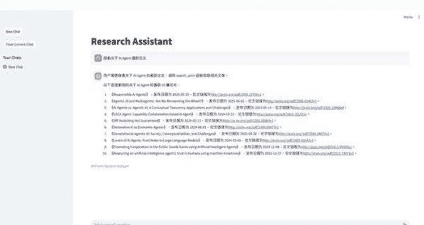

图7-3 系统输出

## 小结

本章基于MCP Python SDK和arxiv从零开始构建了一个功能完备的论文研究智能体。该项目不仅仅是一个独立的应用程序，更是对MCP核心理念的一次深入实践与生动展示。通过将复杂的学术研究任务分解为一系列标准化的、可组合的服务，实现了将AI智能体的开发从混沌引入秩序。

首先从系统架构设计入手，确立了以MCP为通信中枢的微服务体系。该架构将整个系统解耦为3个层次分明的协作单元：MCP Server层（arxiv服务器与docling服务器）、客户端服务器层（MCP Client Layer）和Streamlit UI层。这种关注点分离的设计理念，为构建复杂、可扩展、可维护的系统奠定了基础。arxiv服务器和docling服务器作为独立的MCP服务，分别封装了与外部数据源（arXiv网站）和特定能力（Docling文档处理工具包）的交互逻辑，并通过标准化的MCP工具（Tools）接口，对外提供核心能力。

在MCP Client层的实现上，MultiServerMCPClient的优势得以充分展现。它汇集了来自不同MCP Server的工具，为上层的智能代理提供了一个统一、聚合的工具集视图。这充分体现了MCP的核心优势：客户端无须关心工具的具体来源和底层实现，只需通过标准协议即可实现工具的发现和调用。随后，引入了LangChain和LangGraph中的ReAct代理，它作为系统的大脑，能够基于用户的自然语言查询，动态执行“思考→行动→观察”的循环过程，智能地规划并调用底层的MCP工具，无论是论文搜索、提取内容，还是整合信息，均能高效完成。这一过程生动地展示了如何将底层的原子能力（MCP工具）组合成高级的、面向目标的智能工作流。

前端界面部分，借助Streamlit快速构建了一个交互友好、支持多轮对话的用户界面。通过精巧的会话状态管理，为用户提供了流畅、连贯的交互体验，使其能够轻松地管理多个研究主题。前端与后端通过一层清晰的API实现解耦，再次体现了分层架构的优越性。

最后，使用Docker和Docker Compose将所有独立的组件进行了系统集成与部署，并系统探讨了从单元测试、集成测试到“端到端”测试的完整测试策略。这不仅确保了项目的健壮性与可靠性，还提供了在真实环境中部署和维护此类系统所必需的工程实践。

通过本章的学习，读者不仅能够掌握构建论文研究智能体的具体技术，还将理解一种基于MCP的、先进的AI智能体开发范式。这种将大模型智能与现实世界通过标准化协议进行解耦与集成的模式，拥有巨大的发展潜力和广阔的应用前景。

# 第8章 基于MCP Python SDK创建数据洞察分析ChatBI智能体

本章将带领读者从零开始设计、实现并完善一个基于MCP的数据洞察分析ChatBI智能体。该系统以自然语言交互为核心，使用户能够以“对话”方式对企业数据进行查询、分析和洞察，实现“AI+BI”的创新融合。本章主要包括以下内容。

- 系统概述。
- 系统架构设计。
- MCP Server实现。
- LangGraph对话管理实现。
- API服务层实现。
- 前端界面实现。
- 运行测试。
- 未来展望。

另外，本章将深入讲解自然语言到SQL的转换、多轮对话分析、智能可视化推荐、自动化数据洞察生成等ChatBI（Chat-based Business Intelligence）系统的高级功能与技术实现细节。

基于MCP的ChatBI系统代表了商业智能领域的一个重要创新。该系统将LLM的自然语言理解能力与传统BI工具的数据分析能力相结合，创造了一种更加直观、高效的数据分析方式。随着技术的不断发展，这类系统将在企业数据分析和决策支持中发挥越来越重要的作用，推动数据民主化和数据驱动决策的普及。通过本章的学习，读者不仅能够掌握基于MCP开发数据洞察分析ChatBI智能体的全流程，还能深入理解AI驱动的数据洞察分析在实际业务中的落地方法与创新路径，为企业数智化转型奠定坚实基础。

## 8.1 系统概述

在当今数据驱动的商业环境中，企业普遍面临海量数据的挑战。传统的数据分析方法通常需要专业的技术背景，业务人员难以直接从数据中获取有效洞察。ChatBI智能体结合了自然语言处理和数据分析能力，使用户能够通过自然语言对话的方式与数据进行交互，轻松实现数据查询、分析与可视化。

### 8.1.1 系统定义与价值

ChatBI是一种新型的商业智能系统，它将对话式AI与传统BI工具相结合，使用户能够通过自然语言对话的方式进行数据分析和可视化。与传统BI工具相比，ChatBI智能体具有以下优势。

- 降低使用门槛：用户无须掌握SQL、数据建模等专业技能，只需通过自然语言提问即可获取数据洞察。
- 提高分析效率：通过对话式交互，用户可以快速迭代分析思路，减少传统BI工具中烦琐的操作步骤。
- 增强数据民主化：各级员工均可便捷地访问和理解数据，促进数据驱动的决策文化。
- 智能洞察推荐：系统能基于上下文和历史交互，主动推荐相关分析和洞察，引导用户发现更有价值的信息。

在企业实践中，ChatBI智能体已经展现出巨大的商业价值。例如，销售团队可以快速了解“上个季度哪些产品在北美地区的销售增长最快”，而无须等待数据分析师生成报表；产品经理可以随时查询“用户对新功能的反馈趋势”，及时调整产品策略；高管可以通过简单对话获取“各业务线的关键绩效指标”，做出科学决策。

### 8.1.2 功能特性

对于一个设计精良的ChatBI智能体来说，其核心价值在于将复杂的数据分析流程无缝融入到自然、流畅的对话交互中。基于MCP架构的ChatBI智能体，通过一系列精心设计的功能特性，构建了一个从数据理解、查询、分析到洞察生成的完整闭环，彻底改变了用户与数据互动的方式。该系统主要包括以下6个功能。

##### 1. 强大的自然语言数据查询能力

传统的数据分析工作通常要求用户学习并熟练掌握SQL，这构成了巨大的技术壁垒。ChatBI智能体则彻底打破了这一障碍。用户无须关心底层数据库的复杂表结构和查询语法，只需像与人类分析师对话一样，用日常语言描述自己的需求。

例如，当用户提出“显示上个月各地区的销售额排名”时，系统内置的自然语言理解模块会精准地解析其意图，识别出时间范围（“上个月”）、分析维度（“地区”）、度量指标（“销售额”）及分析类型（“排名”）。随后，系统会自动将其转换为精确的SQL查询语句并执行查询操作。这种转换不仅局限于简单的查询，还能理解筛选、排序、分组、聚合等复杂操作，甚至通过支持模糊匹配与近义词识别，显著提升了查询的容错性和用户体验。

##### 2. 上下文感知的多轮对话

真正的智能对话并非一问一答的机械重复，而应是连贯且深入的探索过程。为此，系统引入了多轮对话分析机制，赋予了分析过程以“记忆”，能够精细地维护对话的上下文，准确理解每次追问与前序交互之间的内在联系。

当用户在查阅初步的销售数据后，可以自然地追问“哪个产品的增长最快？”此时，系统无须用户重复“销售额”或“上个月”等背景信息，而是能够自动从上下文中继承这些关键要素，理解用户的关注点已经转移至“产品”维度和“增长率”这一新指标，从而给出精准的回答。

这种连贯的对话机制使用户能够层层深入、逐步挖掘问题本质，同时也支持用户在对话中对分析结果进行即时的澄清与修正，使整个分析过程更加灵活和人性化。

##### 3. 数据可视化

原始的数据表格往往枯燥且难以揭示规律，而有效的数据可视化则是洞察的催化剂。ChatBI智能体将数据可视化提升到了一个全新的智能化水平。它不仅仅是被动地等待用户指令来生成图表，而是能够主动根据数据本身的特性（如时间序列、地理分布、类别比较等）和用户的分析意图，智能推荐最恰当的可视化类型。

无论是条形图、折线图、饼图，还是更复杂的散点图与热力图，系统都能信手拈来。更重要的是，它还会自动优化图表细节，从坐标轴的范围、刻度，到色彩方案的选择和标签的布局，力求以最清晰、最直观的方式呈现数据中有价值的信息。

例如，当用户探究“分析产品类别的销售趋势”时，系统会敏锐地捕捉到“趋势”这一关键词，并自动生成一目了然的时间序列折线图。此外，系统还支持将多个相关图表整合至统一的仪表盘中，为用户提供宏观、全面的分析视图。

##### 4. 从数据中提炼出有价值的洞察

ChatBI智能体内置了先进的分析引擎，能够自动扫描数据，识别其中隐藏的模式、趋势、相关性及值得关注的异常点。它不仅能够呈现销售增长等基础图表，更会主动提供解读与建议。

例如，系统可明确指出：“我们发现，电子产品类别在亚太地区的销售额环比增长了15%，这一增长率显著高于其他地区，可能与该地区近期开展的营销活动有关。”这种由数据驱动的洞察能力，将分析师从烦琐的数据处理和模式识别工作中解放出来，使其更专注于业务决策与战略思考，真正帮助用户理解数据背后的商业含义。

##### 5. 数据库元信息理解

为了实现上述所有智能功能，系统必须具备深刻理解自身所管理的数据资源的能力，即数据库元信息理解能力。在启动之初，系统就会自动解析数据库的完整结构，包括所有表、字段、数据类型、主外键关系及约束条件。但这种理解并非停留在物理层面，系统能够通过语义分析将“cust_addr”等技术字段名与“客户地址”等业务术语进行关联。

因此，用户可以轻松询问“系统里都有哪些和客户相关的数据？”。此时，系统会像一位熟悉业务的数据库管理员一样，清晰地列出客户信息表、订单表中的相关字段及其业务含义，为用户提供一份清晰的数据资源地图，极大地降低了数据探索的门槛。

##### 6. 保障企业级应用严谨性的拓展功能

为了保障企业级应用的严谨性，系统还提供了一整套完善的辅助功能。会话管理与历史回溯功能会妥善保存每一次分析的完整过程，并自动生成摘要标题，用户可以随时回顾、复现甚至延续之前的分析任务。同时，安全与权限控制机制确保了数据访问的合规性，每位用户仅可查看其权限范围内的数据，并有效防范SQL注入等安全风险。此外，交互式结果探索功能赋予了用户极大的灵活性，可以在已有图表和报告基础上，通过简单的指令进行排序、下钻、筛选和维度切换，实现对数据的自由探索，并支持将结果导出为多种格式，以支持后续的报告撰写或分享。

综上所述，这些功能特性共同将ChatBI智能体塑造为一个强大、易用且安全的数据分析智能体，真正实现了数据分析能力的普惠化。凭借其强大的自然语言交互和智能分析能力，ChatBI智能体可以广泛应用于销售数据分析、市场营销数据分析、客户服务改进、人力资源管理等多种业务场景，使不同角色的用户能够便捷地获取数据洞察，无须依赖专业的数据分析团队，大大提高了数据驱动决策的效率和普及度。

## 8.2 系统架构设计

基于MCP的ChatBI智能体采用了现代化的微服务架构，将复杂的功能分解为多个独立的服务组件，通过标准化的接口进行通信。这种架构设计不仅提高了系统的可维护性和可扩展性，还使得各组件能够独立演化和优化。下面详细介绍系统的架构设计。

### 8.2.1 整体系统架构

基于MCP的ChatBI智能体采用了现代化的技术架构，结合了LLM、数据库技术和可视化工具，构建了一个灵活、可扩展的智能数据分析平台。ChatBI智能体的系统架构如图8-1所示。

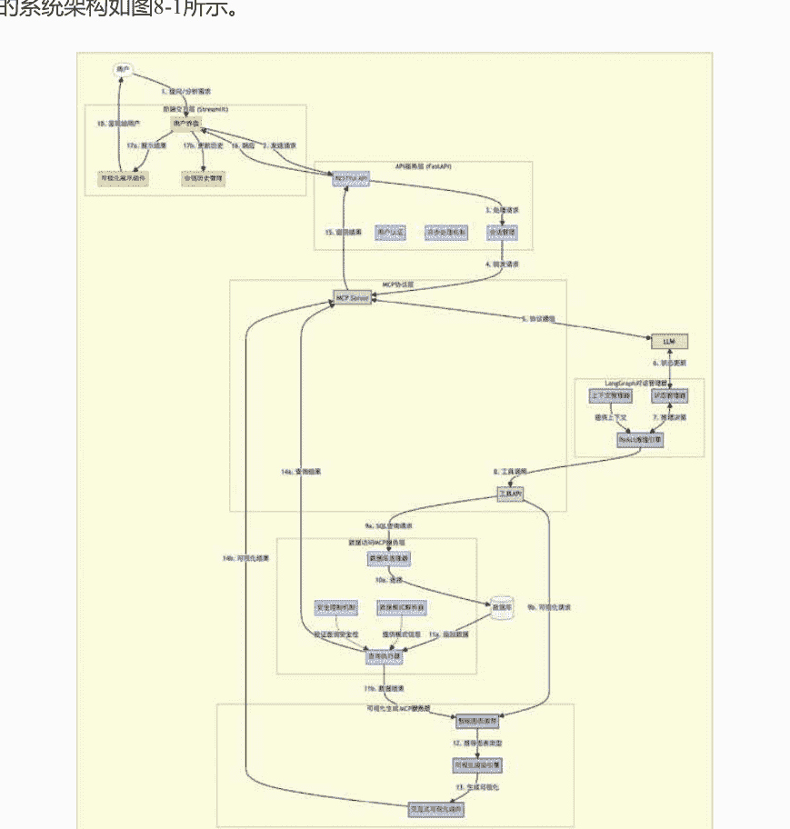

对于ChatBI这样一个旨在将自然语言的灵活性与商业智能的严谨性融为一体的系统而言，其架构不仅是代码的组织方式，更是设计哲学的集中体现。ChatBI智能体采用了分层、模块化的架构，确保各个组件之间的高内聚、低耦合，从而为系统赋予了出色的可扩展性、可维护性和稳定性。从核心的通信协议到最终的用户交互界面，每一层都经过精心设计，各司其职，共同协作，最终构成了一个有机的整体。

以下介绍ChatBI智能体的核心组件，包括组件的核心职责及其如何协同工作，以提供流畅、智能的数据分析体验。

（1）MCP协议层是系统核心。若将LLM视为系统的大脑，负责思考与推理，那么MCP便是连接大脑与现实世界的“中枢神经系统”。它并非简单的数据管道，而是一套标准化的通信规范，定义了LLM如何发现、理解并调用外部的工具与资源。

在ChatBI系统中，MCP发挥着关键作用：它搭建了一座桥梁，使抽象的LLM能够与具体的数据库查询工具、图表生成引擎等功能模块进行精确、高效的交互。通过部署MCP Server，系统将“执行SQL查询”或“根据数据生成条形图”等复杂操作封装为LLM可以理解并调用的标准化工具API。这种设计实现了LLM推理能力与外部工具执行能力的彻底解耦，极大地增强了系统的灵活性和可扩展性。

（2）LangGraph对话管理层。仅让LLM具备“对话”能力远远不够，真正的智能体现在能够“思考”并联系上下文采取“行动”。这正是对话管理层的核心任务，我们选择使用LangGraph来构建这一关键层级。LangGraph作为一个强大的框架，专门用于构建有状态、可循环的复杂智能体应用。

ChatBI智能体基于LangGraph实现了ReAct模式。这意味着AI在接收到用户请求后，并非直接执行某个工具，而是先进行一系列“思考”。例如，“用户希望了解‘上个季度销售额最高的地区’，我首先需要查询订单表，按地区进行分组并计算销售额总和，然后对结果进行排序。”在形成这样一个清晰的行动计划后，它才会调用相应的工具，如执行SQL查询。LangGraph负责管理这一系列复杂的思考与行动流程，并维持整个对话的状态，使得系统能够深入理解用户的连续提问和追问，从而提供连贯且精准的分析。

（3）数据访问MCP服务层。数据访问层直接与底层数据源（如本项目使用的MySQL关系型数据库）进行交互。其职责不仅限于建立连接和执行查询，还具备以下关键能力。首先，内置的数据模式（Schema）解析工具能够动态理解数据库结构及表与表之间的关联关系，这是将自然语言准确转换为SQL查询的前提。其次，为了保障系统的性能和安全，该层还集成了查询优化和安全控制机制。它会审查并可能重写由LLM生成的SQL，以防止低效查询影响数据库性能，同时有效防御潜在的SQL注入等安全风险，确保每一次数据访问既高效又安全。

（4）可视化生成MCP服务层。原始的数据报表往往枯燥且难以理解。可视化生成层的使命是将这些冰冷的数据转化为生动、直观的图形，使隐藏在数字背后的趋势、关联和异常点一目了然。其核心是一个智能图表推荐系统，能够根据数据的内在特性（如时间序列、类别分布、相关性等）和用户的分析意图，自动建议最合适的可视化方式。一旦确定了图表类型，强大的可视化渲染引擎便会接管，无论是经典的条形图、折线图、饼图，还是用于深度分析的散点图，都能精确、美观地绘制出来。更重要的是，这些可视化组件是交互式的，用户可以轻松地对图表进行缩放、筛选、下钻等探索性操作，从而进行更深层次的分析。

（5）API服务层。为了将后端强大的分析能力开放给前端应用，ChatBI系统构建了基于FastAPI的高性能API服务层。

FastAPI以其卓越的性能和现代化的特性（如自动化的API文档生成和数据校验）而著称，是构建该层服务的理想选择。该层提供了一套遵循RESTful风格的统一接口，前端应用只需通过简单的HTTP请求即可调用。此外，API层还承担着会话管理和用户认证的关键职责，确保不同用户之间数据访问的隔离性与安全性。得益于FastAPI原生的异步处理能力，API层可以高效应对高并发请求，即使用户与AI进行密集的、计算量大的交互时，系统仍能保持快速响应，提供流畅的用户体验。

（6）前端交互层。所有强大的后端功能都需要一个优雅、直观的界面来呈现给用户，这正是前端交互层的核心任务。ChatBI智能体选用Streamlit来快速构建数据应用的优势，打造了一个对话式的用户界面。用户无须学习复杂的操作，只需像与分析师交流一样，在对话框中输入问题即可。前端界面负责清晰地展示AI的回复、生成的分析结果及可视化图表，并精心设计了会话历史管理功能，支持用户随时回溯之前的分析对话，并在此基础上继续探索，使整个数据分析过程自然、连贯。

这种分层架构设计赋予了系统高度的模块化和可扩展性，各组件之间通过标准化接口进行通信，便于维护和升级。同时，MCP作为核心协议层，为系统提供了与LLM交互的统一标准，大大简化了AI能力集成与工具扩展。

### 8.2.2 组件交互流程

系统各组件之间的交互流程如下。

- (1) 用户通过Streamlit前端提交自然语言查询。
- (2) 前端将查询发送至FastAPI服务。
- (3) FastAPI服务创建或恢复会话上下文，并将请求转发至LangGraph对话管理器。
- (4) LangGraph对话管理器调用LLM进行意图理解与推理。
- (5) LLM通过MCP调用相应的工具（如数据库查询、可视化生成等）。
- (6) MCP Server执行工具调用，并将结果返回给LLM。
- (7) LLM基于工具调用结果生成最终响应。
- (8) 响应通过API服务返回至前端，并在界面上展示。

### 8.2.3 微服务部署架构

ChatBI智能体采用Docker容器化部署，各组件作为独立的微服务运行。

- (1) api服务。
  - 运行FastAPI应用，提供RESTful API。
  - 暴露8000端口供前端访问。
- (2) Streamlit服务。
  - 运行Streamlit前端应用。
  - 依赖api服务。
  - 暴露8501端口供用户访问。
- (3) database-mcp服务。
  - 运行数据库MCP Server。
  - 暴露8002端口供api服务访问。
- (4) visualization-mcp服务。
  - 运行可视化MCP Server。
  - 暴露8003端口供api服务访问。

这种微服务架构设计赋予了系统高度的模块化和可扩展性，各组件可以独立开发、测试和部署，同时通过标准化的接口实现无缝集成。

## 8.3 MCP Server实现

在ChatBI智能体中，MCP Server是连接LLM与外部工具和资源的关键桥梁。本节将详细介绍系统中两个核心MCP Server的实现：数据库MCP Server和可视化MCP Server。

### 8.3.1 数据库MCP Server

数据库MCP Server负责提供数据库查询和分析功能，使LLM能够通过标准化的接口访问和操作数据库。其详细实现如下。

（1）初始化与配置。初始化一个名为“Database Query Provider”的MCP Server，并从环境变量中加载数据库连接信息，具体代码如下：

```python
import os
import mysql.connector
import pandas as pd
import json
from mcp.server.fastmcp import FastMCP
import asyncio
from dotenv import load_dotenv

# 加载环境变量
load_dotenv()

# 初始化MCP Server
mcp = FastMCP("Database Query Provider", port=8002)

# 数据库连接设置
DB_HOST = os.getenv("DB_HOST", "localhost")
DB_USER = os.getenv("DB_USER", "root")
DB_PASSWORD = os.getenv("DB_PASSWORD", "password")
DB_NAME = os.getenv("DB_NAME", "chatbi")
DB_PORT = os.getenv("DB_PORT", "3306")
```

（2）数据库连接函数。提供数据库连接和查询执行的基本功能，支持SELECT查询和其他SQL操作，具体代码如下：

```python
def get_db_connection():
    """创建到MySQL数据库的连接"""
    try:
        connection = mysql.connector.connect(
            host=DB_HOST,
            user=DB_USER,
            password=DB_PASSWORD,
            database=DB_NAME,
            port=DB_PORT
        )
        return connection
    except mysql.connector.Error as err:
        print(f"连接MySQL时出错: {err}")
        return None

def execute_query(query: str):
    """执行SQL查询并返回结果"""
    connection = get_db_connection()
    if not connection:
        return {"error": "无法连接到数据库"}

    try:
        cursor = connection.cursor(dictionary=True)
        cursor.execute(query)

        # 检查查询是否为SELECT查询
        if cursor.description:
            results = cursor.fetchall()
            return results
        else:
            connection.commit()
            return {"affected_rows": cursor.rowcount}
    except mysql.connector.Error as err:
        return {"error": str(err)}
    finally:
        if connection.is_connected():
            cursor.close()
            connection.close()
```

（3）工具定义。数据库MCP Server定义了6个工具——获取表结构工具、列出所有表工具、执行SQL查询工具、执行SQL查询并返回JSON工具、获取表样本工具、获取数据库统计信息工具，使LLM能够执行各种数据库操作。这6个工具的具体实现代码如下所示。

获取表结构工具的实现代码如下：

```python
@mcp.tool(
    name="get_table_schema",
    description="获取数据库中特定表的结构"
)
async def get_table_schema(table_name: str) -> str:
    """获取数据库中特定表的结构"""
    connection = get_db_connection()
    if not connection:
        return "无法连接到数据库"

    try:
        cursor = connection.cursor()
        cursor.execute(f"DESCRIBE {table_name}")
        columns = cursor.fetchall()

        schema_info = f"表'{table_name}'的结构:\n"
        for col in columns:
            schema_info += f"- {col[0]}: {col[1]}"
            if col[2] == "NO":  # NOT NULL
                schema_info += " (NOT NULL)"
            if col[3] == "PRI":  # Primary Key
                schema_info += " (PRIMARY KEY)"
            if col[4]:  # Default value
                schema_info += f" (DEFAULT: {col[4]})"
            schema_info += "\n"

        return schema_info
    except mysql.connector.Error as err:
        return f"获取表'{table_name}'的结构时出错: {err}"
    finally:
        if connection.is_connected():
            cursor.close()
            connection.close()
```

列出所有表工具的实现代码如下：

```python
@mcp.tool(
    name="list_tables",
    description="列出数据库中的所有表"
)
async def list_tables() -> str:
    """列出数据库中的所有表"""
    connection = get_db_connection()
    if not connection:
        return "无法连接到数据库"

    try:
        cursor = connection.cursor()
        cursor.execute("SHOW TABLES")
        tables = cursor.fetchall()

        table_list = "数据库中的表:\n"
        for table in tables:
            table_list += f"- {table[0]}\n"

        return table_list
    except mysql.connector.Error as err:
        return f"列出表时出错: {err}"
    finally:
        if connection.is_connected():
            cursor.close()
            connection.close()
```

执行SQL查询工具的实现代码如下：

```python
@mcp.tool(
    name="execute_sql_query",
    description="在数据库上执行SQL查询并返回结果"
)
async def execute_sql_query(query: str) -> str:
    """执行SQL查询并返回结果"""
    results = execute_query(query)

    if isinstance(results, dict) and "error" in results:
        return f"执行查询时出错: {results['error']}"

    if isinstance(results, dict) and "affected_rows" in results:
        return f"查询执行成功。受影响的行数: {results['affected_rows']}"

    # 将结果转换为格式化字符串
    if not results:
        return "查询执行成功。未返回结果。"

    # 转换为DataFrame以获得更好的格式
    df = pd.DataFrame(results)
    return df.to_string()
```

执行SQL查询并返回JSON工具的实现代码如下：

```python
@mcp.tool(
    name="execute_sql_query_json",
    description="执行SQL查询并以JSON格式返回结果"
)
async def execute_sql_query_json(query: str) -> str:
    """执行SQL查询并以JSON格式返回结果"""
    results = execute_query(query)

    if isinstance(results, dict) and "error" in results:
        return json.dumps({"error": results["error"]})

    if isinstance(results, dict) and "affected_rows" in results:
        return json.dumps({"affected_rows": results["affected_rows"]})

    # 以JSON格式返回结果
    return json.dumps(results, default=str)
```

获取表样本工具的实现代码如下：

```python
@mcp.tool(
    name="get_table_sample",
    description="获取特定表的行样本"
)
async def get_table_sample(table_name: str, limit: int = 5) -> str:
    """获取特定表的行样本"""
    query = f"SELECT * FROM {table_name} LIMIT {limit}"
    results = execute_query(query)

    if isinstance(results, dict) and "error" in results:
        return f"从表'{table_name}'获取样本时出错: {results['error']}"

    # 将结果转换为格式化字符串
    if not results:
        return f"表'{table_name}'中未找到数据"

    # 转换为DataFrame以获得更好的格式
    df = pd.DataFrame(results)
    return df.to_string()
```

获取数据库统计信息工具的实现代码如下：

```python
@mcp.tool(
    name="get_database_stats",
    description="获取数据库表的统计信息"
)
async def get_database_stats() -> str:
    """获取数据库表的统计信息"""
    connection = get_db_connection()
    if not connection:
        return "无法连接到数据库"

    try:
        cursor = connection.cursor()
        cursor.execute("SHOW TABLES")
        tables = cursor.fetchall()

        stats = "数据库统计信息:\n"
        for table in tables:
            table_name = table[0]
            cursor.execute(f"SELECT COUNT(*) FROM {table_name}")
            count = cursor.fetchone()[0]
            stats += f"- {table_name}: {count} rows\n"

        return stats
    except mysql.connector.Error as err:
        return f"Error retrieving database statistics: {err}"
    finally:
        if connection.is_connected():
            cursor.close()
            connection.close()
```

### 8.3.2 可视化MCP Server实现

可视化MCP Server负责提供数据可视化功能，使LLM能够生成各种类型的图表和可视化展示。其详细实现如下。

（1）初始化与配置，代码如下：

```python
import json
import pandas as pd
import matplotlib.pyplot as plt
import io
import base64
from mcp.server.fastmcp import FastMCP
import asyncio
import mysql.connector
import os
from dotenv import load_dotenv
import plotly.express as px
import plotly.graph_objects as go
import numpy as np

# 加载环境变量
load_dotenv()

# 初始化MCP Server
mcp = FastMCP("Visualization Provider", port=8003)

# 数据库连接设置
DB_HOST = os.getenv("DB_HOST", "localhost")
DB_USER = os.getenv("DB_USER", "root")
DB_PASSWORD = os.getenv("DB_PASSWORD", "password")
DB_NAME = os.getenv("DB_NAME", "chatbi")
DB_PORT = os.getenv("DB_PORT", "3306")
```

（2）数据库连接函数，代码如下：

```python
def get_db_connection():
    """创建到MySQL数据库的连接"""
    try:
        connection = mysql.connector.connect(
            host=DB_HOST,
            user=DB_USER,
            password=DB_PASSWORD,
            database=DB_NAME,
            port=DB_PORT
        )
        return connection
    except mysql.connector.Error as err:
        print(f"连接MySQL时出错: {err}")
        return None

def execute_query(query: str):
    """执行SQL查询并返回结果作为pandas DataFrame"""
    connection = get_db_connection()
    if not connection:
        return None

    try:
        return pd.read_sql(query, connection)
    except mysql.connector.Error as err:
        print(f"执行查询时出错: {err}")
        return None
    finally:
        if connection.is_connected():
            connection.close()
```

(3) 可视化工具定义。可视化MCP Server定义了6个工具——条形图生成工具、折线图生成工具、饼图生成工具、散点图生成工具、热力图生成工具、仪表盘生成工具，用于生成不同类型的图表。每个工具的具体实现代码如下。

条形图生成工具的实现代码如下：

```python
@mcp.tool(
    name="create_bar_chart",
    description="从SQL查询结果创建条形图可视化"
)
async def create_bar_chart(
    query: str,
    x_column: str,
    y_column: str,
    title: str = "Bar Chart",
    color_column: str = None
) -> str:
    """
    从SQL查询结果创建条形图可视化

    Args:
        query: 要执行的SQL查询
        x_column: x轴的列名
        y_column: y轴的列名
        title: 图表标题
        color_column: 可选的颜色分组列名

    Returns:
        包含图表配置的JSON字符串
    """
    df = execute_query(query)
    if df is None or df.empty:
        return json.dumps({"error": "查询未返回数据"})

    # 检查列是否存在
    if x_column not in df.columns or y_column not in df.columns:
        return json.dumps({"error": f"查询结果中未找到列{x_column}或{y_column}"})

    if color_column and color_column not in df.columns:
        return json.dumps({"error": f"查询结果中未找到颜色列{color_column}"})

    # 创建图表数据
    if color_column:
        chart_data = []
        for color_val in df[color_column].unique():
            filtered_df = df[df[color_column] == color_val]
            chart_data.append({
                "x": filtered_df[x_column].tolist(),
                "y": filtered_df[y_column].tolist(),
                "type": "bar",
                "name": str(color_val)
            })
    else:
        chart_data = [{
            "x": df[x_column].tolist(),
            "y": df[y_column].tolist(),
            "type": "bar"
        }]

    # 创建图表配置
    chart_config = {
        "title": title,
        "chart_type": "bar",
        "chart_data": {
            "data": chart_data,
            "layout": {
                "title": title,
                "xaxis": {"title": x_column},
                "yaxis": {"title": y_column}
            }
        }
    }

    return json.dumps(chart_config)
```

折线图生成工具的实现代码如下：

```python
@mcp.tool(
    name="create_line_chart",
    description="从SQL查询结果创建折线图可视化"
)
async def create_line_chart(
    query: str,
    x_column: str,
    y_column: str,
    title: str = "Line Chart",
    color_column: str = None
) -> str:
    """
    从SQL查询结果创建折线图可视化

    Args:
        query: 要执行的SQL查询
        x_column: x轴的列名
        y_column: y轴的列名
        title: 图表标题
        color_column: 可选的颜色分组列名

    Returns:
        包含图表配置的JSON字符串
    """
    df = execute_query(query)
    if df is None or df.empty:
        return json.dumps({"error": "查询未返回数据"})

    # 检查列是否存在
    if x_column not in df.columns or y_column not in df.columns:
        return json.dumps({"error": f"查询结果中未找到列{x_column}或{y_column}"})

    if color_column and color_column not in df.columns:
        return json.dumps({"error": f"查询结果中未找到颜色列{color_column}"})

    # 创建图表数据
    if color_column:
        chart_data = []
        for color_val in df[color_column].unique():
            filtered_df = df[df[color_column] == color_val]
            chart_data.append({
                "x": filtered_df[x_column].tolist(),
                "y": filtered_df[y_column].tolist(),
                "type": "line",
                "name": str(color_val)
            })
    else:
        chart_data = [{
            "x": df[x_column].tolist(),
            "y": df[y_column].tolist(),
            "type": "line"
        }]

    # 创建图表配置
    chart_config = {
        "title": title,
        "chart_type": "line",
        "chart_data": {
            "data": chart_data,
            "layout": {
                "title": title,
                "xaxis": {"title": x_column},
                "yaxis": {"title": y_column}
            }
        }
    }

    return json.dumps(chart_config)
```

饼图生成工具的实现代码如下：

```python
@mcp.tool(
    name="create_pie_chart",
    description="从SQL查询结果创建饼图可视化"
)
async def create_pie_chart(
    query: str,
    labels_column: str,
    values_column: str,
    title: str = "Pie Chart"
) -> str:
    """
    从SQL查询结果创建饼图可视化

    Args:
        query: 要执行的SQL查询
        labels_column: 饼图标签的列名
        values_column: 饼图值的列名
        title: 图表标题

    Returns:
        包含图表配置的JSON字符串
    """
    df = execute_query(query)
    if df is None or df.empty:
        return json.dumps({"error": "查询未返回数据"})

    # 检查列是否存在
    if labels_column not in df.columns or values_column not in df.columns:
        return json.dumps({"error": f"查询结果中未找到列{labels_column}或{values_column}"})

    # 创建图表数据
    chart_data = [{
        "labels": df[labels_column].tolist(),
        "values": df[values_column].tolist(),
        "type": "pie"
    }]

    # 创建图表配置
    chart_config = {
        "title": title,
        "chart_type": "pie",
        "chart_data": {
            "data": chart_data,
            "layout": {
                "title": title
            }
        }
    }

    return json.dumps(chart_config)
```

散点图生成工具的实现代码如下：

```python
@mcp.tool(
    name="create_scatter_plot",
    description="从SQL查询结果创建散点图可视化"
)
async def create_scatter_plot(
    query: str,
    x_column: str,
    y_column: str,
    title: str = "Scatter Plot",
    color_column: str = None,
    size_column: str = None
) -> str:
    """
    从SQL查询结果创建散点图可视化

    Args:
        query: 要执行的SQL查询
        x_column: x轴的列名
        y_column: y轴的列名
        title: 图表标题
        color_column: 可选的颜色分组列名
        size_column: 可选的点大小列名

    Returns:
        包含图表配置的JSON字符串
    """
    df = execute_query(query)
    if df is None or df.empty:
        return json.dumps({"error": "查询未返回数据"})

    # 检查列是否存在
    if x_column not in df.columns or y_column not in df.columns:
        return json.dumps({"error": f"查询结果中未找到列{x_column}或{y_column}"})

    if color_column and color_column not in df.columns:
        return json.dumps({"error": f"查询结果中未找到颜色列{color_column}"})

    if size_column and size_column not in df.columns:
        return json.dumps({"error": f"查询结果中未找到大小列{size_column}"})

    # 创建图表数据
    if color_column:
        chart_data = []
        for color_val in df[color_column].unique():
            filtered_df = df[df[color_column] == color_val]
            scatter_data = {
                "x": filtered_df[x_column].tolist(),
                "y": filtered_df[y_column].tolist(),
                "mode": "markers",
                "type": "scatter",
                "name": str(color_val)
            }
            
            if size_column:
                scatter_data["marker"] = {"size": filtered_df[size_column].tolist()}
            
            chart_data.append(scatter_data)
    else:
        scatter_data = {
            "x": df[x_column].tolist(),
            "y": df[y_column].tolist(),
            "mode": "markers",
            "type": "scatter"
        }
        
        if size_column:
            scatter_data["marker"] = {"size": df[size_column].tolist()}
        
        chart_data = [scatter_data]

    # 创建图表配置
    chart_config = {
        "title": title,
        "chart_type": "scatter",
        "chart_data": {
            "data": chart_data,
            "layout": {
                "title": title,
                "xaxis": {"title": x_column},
                "yaxis": {"title": y_column}
            }
        }
    }

    return json.dumps(chart_config)
```

热力图生成工具的实现代码如下：

```python
@mcp.tool(
    name="create_heatmap",
    description="从SQL查询结果创建热力图可视化"
)
async def create_heatmap(
    query: str,
    x_column: str,
    y_column: str,
    z_column: str,
    title: str = "Heatmap"
) -> str:
    """
    从SQL查询结果创建热力图可视化

    Args:
        query: 要执行的SQL查询
        x_column: x轴的列名
        y_column: y轴的列名
        z_column: z轴的列名（值）
        title: 图表标题

    Returns:
        包含图表配置的JSON字符串
    """
    df = execute_query(query)
    if df is None or df.empty:
        return json.dumps({"error": "查询未返回数据"})

    # 检查列是否存在
    if x_column not in df.columns or y_column not in df.columns or z_column not in df.columns:
        return json.dumps({"error": f"查询结果中未找到列{x_column}、{y_column}或{z_column}"})

    # 透视数据用于热力图
    try:
        pivot_df = df.pivot(index=y_column, columns=x_column, values=z_column)

        # 创建图表数据
        chart_data = [{
            "z": pivot_df.values.tolist(),
            "x": pivot_df.columns.tolist(),
            "y": pivot_df.index.tolist(),
            "type": "heatmap"
        }]

        # 创建图表配置
        chart_config = {
            "title": title,
            "chart_type": "heatmap",
            "chart_data": {
                "data": chart_data,
                "layout": {
                    "title": title,
                    "xaxis": {"title": x_column},
                    "yaxis": {"title": y_column}
                }
            }
        }

        return json.dumps(chart_config)
    except Exception as e:
        return json.dumps({"error": f"创建热力图时出错: {str(e)}"})
```

仪表盘生成工具的实现代码如下：

```python
@mcp.tool(
    name="create_dashboard",
    description="从SQL查询创建包含多个可视化的仪表盘"
)
async def create_dashboard(
    dashboard_title: str,
    chart_configs: str  # 包含图表配置的JSON字符串
) -> str:
    """
    从SQL查询创建包含多个可视化的仪表盘

    Args:
        dashboard_title: 仪表盘标题
        chart_configs: 包含图表配置的JSON字符串
            格式: [
                {
                    "chart_type": "bar|line|pie|scatter|heatmap",
                    "query": "SQL查询",
                    "x_column": "x列名",
                    "y_column": "y列名",
                    "title": "图表标题",
                    ...其他图表特定参数
                },
```

## （4）启动服务器。

```python
if __name__ == "__main__":
    asyncio.run(mcp.run_sse_async())
```

该可视化MCP Server提供了丰富的图表生成功能，支持条形图、折线图、饼图等多种可视化类型，并且能够根据SQL查询结果自动生成相应的图表配置。这些工具使得LLM能够根据用户的需求生成数据可视化方案，大大增强了ChatBI智能体的数据分析能力。

## 8.4 LangGraph对话管理实现

在ChatBI智能体中，LangGraph负责管理对话流程和状态，并协调LLM与MCP工具之间的交互。

LangGraph实现了ReAct模式，使AI能够进行推理并执行相应的工具调用。以下是LangGraph对话管理的详细实现方式。

(1) 定义对话状态的数据结构，代码如下：

```python
# 定义对话状态的数据结构
class MessagesState(TypedDict):
    messages: List[BaseMessage]
    tools: List[BaseTool]
```

以上代码定义了一个MessagesState类型，其中包含两个关键字段：用于存储对话历史消息的messages字段和用于存储可用工具列表的tools字段。

(2) 创建LangGraph对话图，定义对话流程，代码如下：

```python
def make_graph(tools: List[BaseTool]):
    """
    创建ChatBI代理的LangGraph

    Args:
        tools: 代理可用的工具列表

    Returns:
        ChatBI代理的StateGraph
    """
    # 初始化模型
    model = ChatOpenAI(
        model=os.environ.get("MODEL", "gpt-4-turbo"),
        api_key=os.environ.get("API_KEY"),
        base_url=os.environ.get("BASE_URL", "https://api.openai.com/v1"),
        temperature=0
    )

    # 定义节点

    # 代理节点 - 决定下一步操作
    def agent(state: MessagesState) -> Dict[str, Any]:
        """决定下一步操作的代理节点"""
        messages = state["messages"]
        tools = state["tools"]

        # 系统消息，包含指令
        system_message = """你是ChatBI，一个高级商业智能体，帮助用户分析数据并创建可视化。

你可以：
1. 使用SQL查询MySQL数据库
2. 基于数据创建可视化
3. 提供洞察和分析

当用户询问有关数据的问题时，请按照以下步骤操作：
1. 理解他们需要什么数据
2. 制定适当的SQL查询
3. 使用数据库工具执行查询
4. 分析结果
5. 在适当时创建可视化
6. 用清晰、商业友好的语言解释洞察

始终向用户展示你的SQL查询并解释你的推理过程。
创建可视化时，为数据和分析选择最合适的图表类型。
"""
        ...

    # 工具节点 - 执行工具
    tool_node = ToolNode(tools)

    # 定义图
    workflow = StateGraph(MessagesState)

    # 添加节点
    workflow.add_node("agent", agent)
    workflow.add_node("tool", tool_node)

    # 定义边
    workflow.add_edge("agent", "tool")
    workflow.add_edge("tool", "agent")

    # 设置入口点
    workflow.set_entry_point("agent")

    return workflow.compile()
```

该函数创建了一个LangGraph对话图，包含两个主要节点。

- agent节点：负责理解用户意图，决定是直接回答还是调用工具。
- tool节点：负责执行具体的工具调用，处理数据库查询和可视化生成。

对话流程如下。

- 从agent节点开始，模型在该节点分析用户消息。
- 如果模型决定使用工具，流程转至tool节点。
- tool节点执行工具调用后，流程返回至agent节点。
- agent节点基于工具调用结果生成最终响应。
- 如果模型决定直接回答，则流程结束。

(3) 实现对话处理服务，将LangGraph与MCP工具集成，代码如下：

```python
import json
import logging
import os
from typing import List, Dict, Tuple, Any

from dotenv import load_dotenv
from langchain_mcp_adapters.client import MultiServerMCPClient
from langchain_openai import ChatOpenAI
from langgraph.prebuilt import create_react_agent
from sqlalchemy.orm import Session

# 加载环境变量
load_dotenv()

logger = logging.getLogger(__name__)

async def process_chat_message(
    message_history: List[Dict[str, str]],
    db: Session
) -> Tuple[str, List[Dict[str, Any]]]:
    """
    使用LangGraph代理处理聊天消息

    Args:
        message_history: 包含'role'和'content'的消息字典列表
        db: 数据库会话

    Returns:
        包含响应文本和可视化列表的元组
    """
    # 初始化模型
    model = ChatOpenAI(
        model=os.environ.get("MODEL", "gpt-4-turbo"),
        api_key=os.environ.get("API_KEY"),
        base_url=os.environ.get("BASE_URL", "https://api.openai.com/v1"),
    )

    # 连接到MCP Server
    mcp_client = MultiServerMCPClient({
        "database": {
            "url": "http://localhost:8002/sse", # 数据库MCP Server
            "transport": "sse",
        },
        "visualization": {
            "url": "http://localhost:8003/sse", # 可视化MCP Server
            "transport": "sse",
        }
    })

    # 从MCP Server获取工具
    tools = await mcp_client.get_tools()

    logger.info(f"可用工具: {tools}")

    # 创建ReAct代理
    agent_executor = create_react_agent(model, tools)

    response_text = ""
    visualizations = []

    try:
        agent_input = {"messages": message_history}

        visualization_tool_names = [
            "create_bar_chart",
            "create_line_chart",
            "create_pie_chart",
            "create_scatter_plot",
            "create_heatmap",
            "create_dashboard"
        ]

        # 流式处理代理事件
        async for event in agent_executor.astream_events(agent_input, version="v1"):
            ...

    except Exception as e:
        print(f"使用LangGraph代理处理消息时出错: {e}")
        response_text = "抱歉，处理您的请求时遇到错误。"
        visualizations = [] # 错误时清空可视化

    return response_text, visualizations
```

该函数实现了使用LangGraph代理处理聊天消息的核心逻辑。它连接到MCP Server获取工具，创建ReAct代理，处理用户查询，并从工具调用结果中提取可视化数据。

(4) 处理可视化工具输出，代码如下：

```python
# 定义可视化工具名称列表
visualization_tool_names = [
    "create_bar_chart",
    "create_line_chart",
    "create_pie_chart",
    "create_scatter_plot",
    "create_heatmap",
    "create_dashboard"
]

# 处理工具调用结束事件
if kind == "on_tool_end":
    tool_name = event["name"]
    tool_output = event["data"].get("output")
    print(f"工具结束: {tool_name}，输出 {tool_output}")
    if tool_name in visualization_tool_names and tool_output:
        try:
            # 处理工具输出
            tool_output_str = tool_output.content if hasattr(tool_output, 'content') else str(tool_output)

            # 解析JSON字符串
            viz_data = json.loads(tool_output_str)

            # 验证并添加可视化数据
            if isinstance(viz_data, dict) and (viz_data.get("chart_type") or viz_data.get("dashboard_title")):
                visualizations.append(viz_data)
            elif isinstance(viz_data, dict) and viz_data.get("error"):
                print(f"可视化工具 {tool_name} 返回错误: {viz_data.get('error')}")
            elif isinstance(viz_data, list):
                visualizations.extend(
                    chart for chart in viz_data if isinstance(chart, dict) and chart.get("chart_type")
                )
        except json.JSONDecodeError:
            print(f"警告: 无法解析来自工具 {tool_name} 的可视化数据: {tool_output}")
        except Exception as e:
            print(f"处理工具 {tool_name} 的输出时出错: {e}")
```

上述代码专门用于处理可视化工具的输出，将工具生成的JSON数据解析为可视化配置，并添加到可视化列表中。它还包含了错误处理逻辑，确保即使某个可视化生成失败，整个处理流程仍能继续。

## 8.5 API服务层实现

API服务层是ChatBI智能体的核心组件之一，负责处理前端请求、协调后端服务，并管理会话和消息。以下是API服务层的详细实现方式。

(1) 创建FastAPI应用并配置必要的中间件，代码如下：

```python
# src/api/main.py
import os
from fastapi import FastAPI, Depends, HTTPException, status
from fastapi.middleware.cors import CORSMiddleware
from dotenv import load_dotenv

from .routers import chat
from .database import get_db, engine
from . import models

# 加载环境变量
load_dotenv()

# 创建数据库表
models.Base.metadata.create_all(bind=engine)

app = FastAPI(title="ChatBI API")

# 配置CORS
app.add_middleware(
    CORSMiddleware,
    allow_origins=["*"],
    allow_credentials=True,
    allow_methods=["*"],
    allow_headers=["*"],
)

# 包含路由
app.include_router(chat.router, prefix="/api/chat", tags=["chat"])

@app.get("/")
def read_root():
    return {"message": "欢迎使用ChatBI API"}

@app.get("/health")
def health_check():
    return {"status": "healthy"}

if __name__ == "__main__":
    import uvicorn
    uvicorn.run(app, host="0.0.0.0", port=8000)
```

这段代码创建了一个FastAPI应用，配置了CORS中间件以允许跨域请求，并包含了聊天相关的路由。

(2) 定义系统使用的数据模型，代码如下：

```python
# src/api/models.py
from sqlalchemy import Column, Integer, String, Text, ForeignKey, DateTime, JSON
from sqlalchemy.sql import func
from sqlalchemy.orm import relationship
from .database import Base

class User(Base):
    __tablename__ = "users"

    id = Column(Integer, primary_key=True, index=True)
    username = Column(String(50), unique=True, index=True, nullable=False)
    email = Column(String(100), unique=True, index=True, nullable=False)
    password_hash = Column(String(255), nullable=False)
    created_at = Column(DateTime(timezone=True), server_default=func.now())

    conversations = relationship("Conversation", back_populates="user")

class Conversation(Base):
    __tablename__ = "conversations"

    id = Column(Integer, primary_key=True, index=True)
    user_id = Column(Integer, ForeignKey("users.id", ondelete="CASCADE"))
    title = Column(String(255), nullable=False)
    created_at = Column(DateTime(timezone=True), server_default=func.now())
    updated_at = Column(DateTime(timezone=True), server_default=func.now(),
                        onupdate=func.now())

    user = relationship("User", back_populates="conversations")
    messages = relationship("Message", back_populates="conversation", cascade="all, delete-orphan")
    visualizations = relationship("Visualization", back_populates="conversation", cascade="all, delete-orphan")

class Message(Base):
    __tablename__ = "messages"

    id = Column(Integer, primary_key=True, index=True)
    conversation_id = Column(Integer, ForeignKey("conversations.id", ondelete="CASCADE"))
    role = Column(String(20), nullable=False)
    content = Column(Text, nullable=False)
    created_at = Column(DateTime(timezone=True), server_default=func.now())

    conversation = relationship("Conversation", back_populates="messages")

class Visualization(Base):
    __tablename__ = "visualizations"

    id = Column(Integer, primary_key=True, index=True)
```

## 8.6 前端界面实现

前端界面是用户与ChatBI智能体交互的窗口，它需要提供直观的对话界面和可视化展示。本节使用Streamlit构建前端界面。

（1）初始化Streamlit应用，设置页面标题和布局，代码如下：

```python
# src/streamlit/app.py
import streamlit as st
import requests
import json
import datetime
import plotly.graph_objects as go
import pandas as pd
from plotly.subplots import make_subplots
import os
from dotenv import load_dotenv

# 加载环境变量
load_dotenv()

# API URL
API_URL = os.getenv("API_URL", "http://localhost:8000")

st.set_page_config(layout="wide", page_title="ChatBI")

st.title("ChatBI: 数据分析与洞察")
st.caption("与您的数据进行对话，获取智能洞察和可视化图表。")
```

（2）封装与API的通信逻辑，以支持GET和POST请求，代码如下：

```python
def query_chatbi_api(endpoint, method="GET", data=None):
    """查询ChatBI API"""
    url = f"{API_URL}{endpoint}"
    try:
        if method == "GET":
            response = requests.get(url)
        elif method == "POST":
            response = requests.post(url, json=data)
        response.raise_for_status()
        return response.json()
    except requests.exceptions.RequestException as e:
        st.error(f"连接API时出错: {e}")
        return None
```

（3）实现可视化渲染函数，代码如下：

```python
def render_visualization(viz_data):
    """根据类型和数据渲染可视化"""
```

该函数负责根据数据生成相应的Plotly图表，支持条形图、折线图、饼图、散点图和热力图等类型。

（4）实现主应用逻辑，代码如下：

```python
def main():
    # 初始化会话状态

    # 创建侧边栏
    with st.sidebar:
        st.header("会话")

        # 新会话按钮
        if st.button("新会话"):
            # 创建新会话
            new_conversation = query_chatbi_api(
                "/api/chat/conversations",
                method="POST",
                data={"title": "新会话"}
            )
            if new_conversation:
                st.session_state.conversations.append(new_conversation)
                st.session_state.active_conversation_id = new_conversation["id"]
                st.session_state.messages = []
                st.session_state.visualizations = []
                st.rerun()

        # 列出会话
        for conv in st.session_state.conversations:
            if st.button(f"{conv['title']}", key=f"conv_{conv['id']}"):
                st.session_state.active_conversation_id = conv["id"]
                # 获取会话详情
                conversation = query_chatbi_api(f"/api/chat/conversations/{conv['id']}")
                if conversation:
                    st.session_state.messages = conversation["messages"]
                    # 获取可视化
                    visualizations = query_chatbi_api(f"/api/chat/conversations/{conv['id']}/visualizations")
                    st.session_state.visualizations = visualizations if visualizations else []
                st.rerun()

    # 主内容区域
    if st.session_state.active_conversation_id is None:
        st.info("从侧边栏选择一个会话或创建一个新会话")
    else:
        # 显示聊天消息
        for message in st.session_state.messages:
            with st.chat_message(message["role"]):
                st.markdown(message["content"])

        # 显示可视化
        if st.session_state.visualizations:
            st.header("可视化")
            cols = st.columns(2)
            for i, viz in enumerate(st.session_state.visualizations):
                with cols[i % 2]:
                    st.subheader(viz["title"])
                    fig = render_visualization(viz)
                    if fig:
                        st.plotly_chart(fig, use_container_width=True)

        # 聊天输入
        if prompt := st.chat_input("询问关于您数据的问题..."):
            # 将用户消息添加到聊天
            with st.chat_message("user"):
                st.markdown(prompt)

            # 将用户消息添加到状态
            st.session_state.messages.append({"role": "user", "content": prompt})

            # 发送消息到API
            with st.spinner("思考中..."):
                response = query_chatbi_api(
                    f"/api/chat/conversations/{st.session_state.active_conversation_id}/messages",
                    method="POST",
                    data={"content": prompt}
                )

                if response:
                    # 将智能体消息添加到聊天
                    with st.chat_message("assistant"):
                        st.markdown(response["content"])

                    # 将智能体消息添加到状态
                    st.session_state.messages.append({"role": "assistant", "content": response["content"]})

                    # 刷新可视化
                    visualizations = query_chatbi_api(f"/api/chat/conversations/{st.session_state.active_conversation_id}/visualizations")
                    st.session_state.visualizations = visualizations if visualizations else []

                    # 重新运行以更新UI
                    st.rerun()

if __name__ == "__main__":
    main()
```

该主函数实现了Streamlit应用的核心逻辑，包括：初始化会话状态；创建侧边栏，显示会话列表和新建会话按钮；在主内容区域显示聊天消息和可视化内容；处理用户输入，发送至API并显示最终响应。

通过这些组件，Streamlit应用提供了一个直观的用户界面，使用户能够轻松与ChatBI智能体进行交互，查看对话历史和可视化结果。

## 8.7 运行测试

本节将通过一个完整的销售数据分析案例，展示ChatBI智能体如何帮助业务用户分析销售数据，发现趋势和洞察，并做出数据驱动的决策。

某电子产品零售公司希望分析其2023年的销售数据，以了解不同产品类别和地区的销售表现，识别增长机会与潜在问题。销售经理小王负责这项分析，但是他缺乏SQL编程经验，也不熟悉数据可视化工具。

公司的销售数据存储在MySQL数据库中，包含以下3个表。

- sales表：销售记录表，包含销售日期、产品ID、客户ID、数量、单价、总金额、地区等字段。
- products表：产品信息表，包含产品名称、类别、供应商、成本价、售价等字段。
- customers表：客户信息表，包含客户名称、邮箱、城市、国家、加入日期等字段。

（1）创建数据库，代码如下：

```sql
-- scripts/init_db.sql
CREATE DATABASE IF NOT EXISTS chatbi;
USE chatbi;
```

（2）创建表并初始化数据，代码如下：

```sql
-- Create tables
CREATE TABLE IF NOT EXISTS users (
    id INT AUTO_INCREMENT PRIMARY KEY,
    username VARCHAR(50) NOT NULL UNIQUE,
    email VARCHAR(100) NOT NULL UNIQUE,
    password_hash VARCHAR(255) NOT NULL,
    created_at TIMESTAMP DEFAULT CURRENT_TIMESTAMP
);

CREATE TABLE IF NOT EXISTS conversations (
    id INT AUTO_INCREMENT PRIMARY KEY,
    user_id INT,
    title VARCHAR(255) NOT NULL,
    created_at TIMESTAMP DEFAULT CURRENT_TIMESTAMP,
    updated_at TIMESTAMP DEFAULT CURRENT_TIMESTAMP ON UPDATE CURRENT_TIMESTAMP,
    FOREIGN KEY (user_id) REFERENCES users(id) ON DELETE CASCADE
);
```

);

CREATE TABLE IF NOT EXISTS messages (
    id INT AUTO_INCREMENT PRIMARY KEY,
    conversation_id INT,
    role VARCHAR(20) NOT NULL,
    content TEXT NOT NULL,
    created_at TIMESTAMP DEFAULT CURRENT_TIMESTAMP,
    FOREIGN KEY (conversation_id) REFERENCES conversations(id) ON DELETE CASCADE
);

CREATE TABLE IF NOT EXISTS visualizations (
    id INT AUTO_INCREMENT PRIMARY KEY,
    conversation_id INT,
    title VARCHAR(255) NOT NULL,
    chart_type VARCHAR(50) NOT NULL,
    chart_data JSON NOT NULL,
    created_at TIMESTAMP DEFAULT CURRENT_TIMESTAMP,
    FOREIGN KEY (conversation_id) REFERENCES conversations(id) ON DELETE CASCADE
);

-- Sample data
INSERT INTO users (username, email, password_hash) VALUES
('admin', 'admin@example.com',
'$2b$12$1234567890123456789012uQYxg7vLu/GJo/mTq1kJt1UrPmG5GXW'),
('demo', 'demo@example.com',
'$2b$12$1234567890123456789012uQYxg7vLu/GJo/mTq1kJt1UrPmG5GXW');

-- Sample tables for BI queries
CREATE TABLE IF NOT EXISTS sales (
    id INT AUTO_INCREMENT PRIMARY KEY,
    product_id INT NOT NULL,
    customer_id INT NOT NULL,
    sale_date DATE NOT NULL,
    quantity INT NOT NULL,
    unit_price DECIMAL(10, 2) NOT NULL,
    total_amount DECIMAL(10, 2) NOT NULL,
    region VARCHAR(50) NOT NULL
);

CREATE TABLE IF NOT EXISTS products (
    id INT AUTO_INCREMENT PRIMARY KEY,
    name VARCHAR(100) NOT NULL,
    category VARCHAR(50) NOT NULL,
    supplier VARCHAR(100) NOT NULL,
    cost_price DECIMAL(10, 2) NOT NULL,
    selling_price DECIMAL(10, 2) NOT NULL
);

CREATE TABLE IF NOT EXISTS customers (
    id INT AUTO_INCREMENT PRIMARY KEY,
    name VARCHAR(100) NOT NULL,
    email VARCHAR(100) NOT NULL,
    city VARCHAR(50) NOT NULL,
    country VARCHAR(50) NOT NULL,
    join_date DATE NOT NULL
);

-- Insert sample data for products
INSERT INTO products (name, category, supplier, cost_price, selling_price) VALUES
('Laptop', 'Electronics', 'TechCorp', 800.00, 1200.00),
('Smartphone', 'Electronics', 'MobileTech', 400.00, 700.00),
...
('Desk', 'Furniture', 'WoodWorks', 200.00, 400.00),
('Bookshelf', 'Furniture', 'FurniCo', 90.00, 180.00);

-- Insert sample data for customers
INSERT INTO customers (name, email, city, country, join_date) VALUES
('John Smith', 'john@example.com', 'New York', 'USA', '2020-01-15'),
...
('Isabella Kim', 'isabella@example.com', 'Seoul', 'South Korea', '2020-10-25');

-- Insert sample data for sales
INSERT INTO sales (product_id, customer_id, sale_date, quantity, unit_price, total_amount,
region) VALUES
(1, 1, '2023-01-10', 2, 1200.00, 2400.00, 'North America'),
(2, 2, '2023-01-15', 1, 700.00, 700.00, 'Europe'),
...
(10, 2, '2023-06-15', 2, 180.00, 360.00, 'Europe');

（3）执行如下脚本启动应用，代码如下：

```
run_api.sh
run_database_server.sh
run_streamlit.sh
run_visualization_server.sh
```

在浏览器中输入http://localhost:8501/，可以看到ChatBI智能体界面，如图8-2所示。

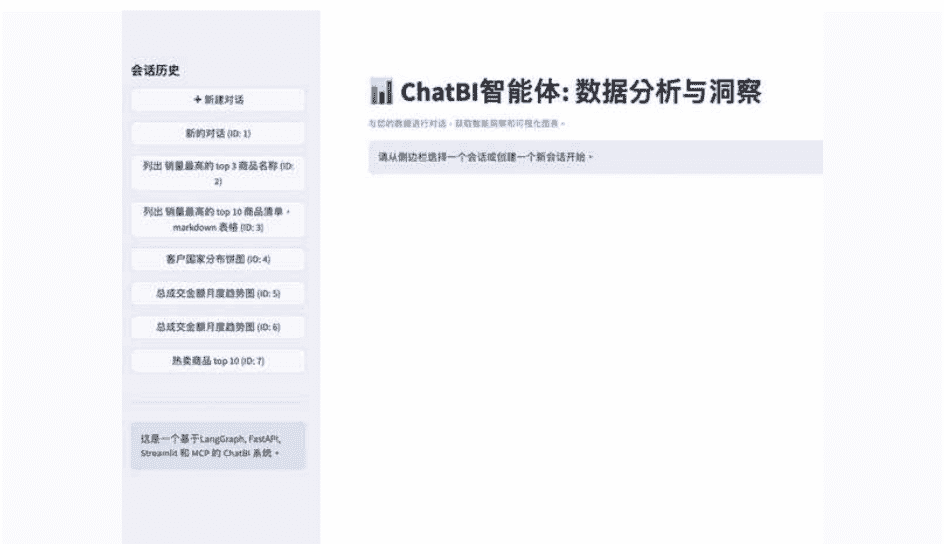

图8-2 ChatBI智能体界面

第1轮对话，输入“热卖商品top 10”，ChatBI智能体的输出如图8-3所示。

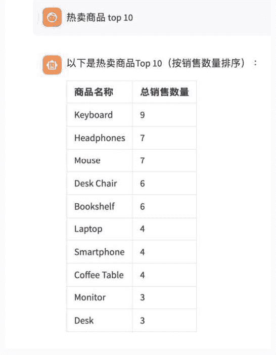

图8-3 第1轮对话，ChatBI智能体的输出

第2轮对话，输入“月度总销量趋势图（折线图）和总销售额趋势图（折线图）”，ChatBI智能体的输出如图8-4所示。

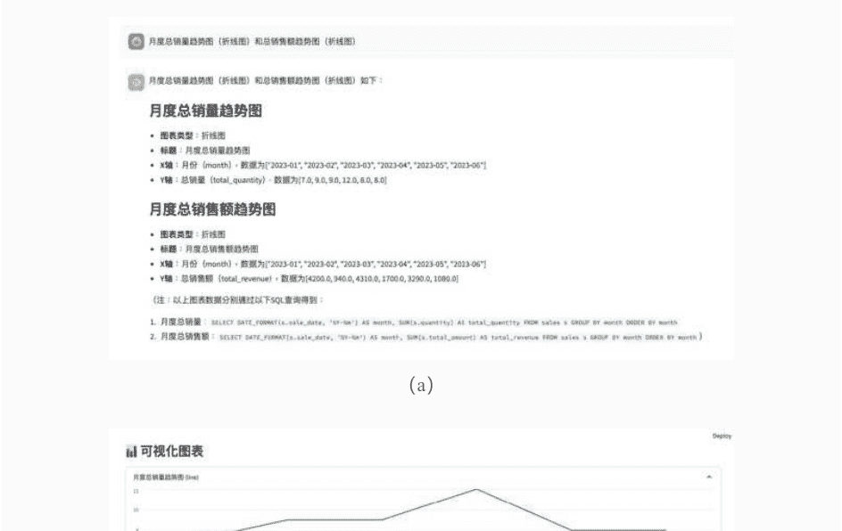

(a)


(b)

图8-4 第2轮对话，ChatBI智能体的输出

第3轮对话，输入“客户国家分布饼图”，ChatBI智能体的输出如图8-5所示。

该案例展示了ChatBI智能体如何帮助非技术用户通过自然语言对话进行复杂的数据分析，从数据中提取有价值的洞察，并获取具体的行动建议。整个过程无须编写SQL查询或使用专业的BI工具，大大提高了数据分析的可访问性和效率。

# ChatBI: 智能数据分析与洞察

专业数据分析师进行分析，探索数据洞察与可视化表达。

# 当前对话 (ID: 50)

客户国家分布饼图

客户国家分布饼图已生成，具体信息如下：

- 标题：客户国家分布饼图
- 图表类型：饼图
- 数据：包含 USA、UK、Canada、Spain、Australia、Mexico、China、South Korea 等国家的客户数量分布，其中 USA 和 UK 的客户数量最多，其他国家较少。

# 可视化图表


图8-5 第3轮对话，ChatBI智能体的输出

## 8.8 未来展望

当前，ChatBI智能体已通过自然语言交互将复杂的数据分析能力赋予了更广泛的用户群体，但这仅仅是数据民主化变革的开端。未来的ChatBI智能体将不再仅仅是一个被动响应查询的工具，它将逐步演化为一个主动、多维且深度融入组织决策流程的智能数据伙伴。这一演进将在交互范式、分析深度、知识融合、协作模式、安全治理及计算效率等多个维度带来深刻的变革。

### 8.8.1 从文本到多模态的沉浸式对话

人机交互的边界往往决定了技术普及的深度。ChatBI的未来发展将始于交互方式的革新。当前以文本为核心的对话模式将逐步被更加丰富、更符合人类直觉的多模态交互所取代。可以想象，未来的数据分析师或业务专家能够通过语音直接与系统对话，无论是在通勤途中还是在会议现场，获取数据洞察都将如与人与人交流般流畅自然。

交互的维度将进一步扩展至视觉领域。系统将具备强大的图像理解能力，能够解析用户随手上传的报表截图、图表示意甚至是手绘草图，精准捕捉其中所蕴含的数据信息与分析意图。这不仅实现了“以图释义”，更完成了从静态的视觉信息到动态可交互分析对象的飞跃。相应地，系统反馈也将不再局限于静态图表，而是演变为可交互的动态可视化叙事，甚至通过与增强现实技术集成，将关键业务指标实时“叠加”到真实的物理世界中。例如，当零售经理巡视门店时，货架上方悬浮的虚拟标签能够实时展示每件商品的销售趋势与库存水平。这种沉浸式交互将彻底打破数字世界与物理世界的隔阂，使数据分析无缝融入业务发生的每一个瞬间。

### 8.8.2 从“是什么”到“为什么”与“怎么办”

如果说交互方式的革新降低了数据分析的门槛，那么分析能力的深化则决定了ChatBI系统所能创造的价值。未来的系统将从描述性分析（“发生了什么”）向更高层次的智能迈进，首当其冲的便是因果推断（Causal Inference）。系统将不再满足于揭示变量之间的相关性，而是致力于探寻其背后的因果链条，帮助决策者真正理解“为什么会发生”，从而识别问题的根本驱动力。

在此基础上，预测与规划能力将实现质的提升。通过融合更先进的时间序列模型与机器学习算法，系统不仅能提供更精准的销售预测或库存预警，还能开展复杂的多变量情景分析与概率预测，为战略规划提供量化的决策依据。更进一步，系统能够在识别问题（例如，通过高级异常检测发现销售额异常下滑）并诊断原因之后，主动提出基于数据驱动的行动建议（“应该做什么”），真正承担起决策顾问的角色。这种从洞察到行动的闭环，标志着ChatBI正在从一个分析工具向真正的决策支持系统转变。

### 8.8.3 知识增强与领域自适应

无论通用模型本身多么强大，若缺乏特定领域的背景知识，其分析结论往往难以深入实际。因此，为ChatBI智能体注入深厚的领域知识，将是其走向成熟的关键。未来的系统将通过集成特定行业的专业知识库——例如，财务领域的会计准则、医疗领域的临床指标体系、零售行业的通用基准——使其分析与解释更具专业性与权威性。

更重要的是，系统将具备持续自适应的学习能力。它会像一位经验丰富的分析师那样，在与用户的持续交互中不断学习特定组织的业务术语、分析偏好乃至决策风格，从而提供高度个性化的服务。同时，通过无缝融合多样化的内外部数据源——从企业的ERP、CRM系统，到互联网上的市场趋势、竞品动态乃至宏观经济数据——系统将能够构建一个异常全面的分析上下文，提供真正具备全局视野的洞察。

### 8.8.4 融入组织的血脉

数据分析的最终目的在于驱动集体决策与行动，而非停留在个人层面的探索。因此，未来的ChatBI智能体必须深度融入组织的协作流程与治理框架之中。它将支持多用户协同参与分析会话，允许团队成员像协作编辑共享文档中一样，围绕同一个数据视图进行实时讨论、添加注释并进行共同探索。系统还将具备“分析记忆”能力，能够记录并理解过往的分析脉络与结论，使得新的探索可以基于已有成果持续推进，从而不断积累组织的知识资产。

随着系统在企业运营中的核心地位日益提升，安全与治理将成为其生命线。基于用户角色、数据敏感度和具体使用场景的细粒度动态访问控制将成为标准配置。同时，差分隐私、联邦学习等隐私保护计算技术的应用，将在充分挖掘数据价值的基础上，严格保护个人隐私与数据安全。系统的每一项分析过程都将具备高度的可解释性与可追溯性，其生成的SQL、分析步骤、数据来源都清晰可查，不仅增强了用户信任，也满足了日益严格的合规性审计要求。

综上所述，ChatBI系统的未来演进，呈现出一条从工具到伙伴、从查询到洞察、从孤立分析到协同决策的清晰路径。它预示着数据不再是少数专家的专属领域，而是成为组织中每个成员都能自如运用并借此进行高效协作与明智决策的通用能力。

## 小结

本章详细介绍了基于MCP的数据洞察分析ChatBI智能体，这是一种将自然语言处理与数据分析能力深度融合的创新型商业智能系统。通过本章的学习，我们了解了ChatBI智能体的核心架构、关键技术实现及其实际应用场景。

ChatBI智能体的核心价值在于降低了数据分析的技术门槛，使非技术用户能够通过自然语言对话的方式与数据直接进行交互，便捷地获取洞察并生成可视化结果。系统采用模块化架构设计，包括MCP Server、LangGraph对话管理、API服务层和前端界面等组件，各组件通过标准化接口进行通信，实现了高度的可维护性和可扩展性。

在技术实现方面，本章重点阐述了系统的四大核心功能：自然语言至SQL的转换、多轮对话分析、智能可视化推荐和数据洞察生成。这些功能共同构成了ChatBI智能体的智能分析能力，使系统不仅能够回答“数据是什么”的基础问题，还能深入解答“数据意味着什么”的问题。

MCP作为系统的核心协议层，为LLM提供了与外部工具及资源进行交互的标准化接口。本章实现了两个MCP Server：用于数据查询的数据库MCP Server和用于可视化生成的可视化MCP Server。这种基于MCP的架构设计显著提升了系统的模块化程度和可扩展性，便于集成更多的数据源和分析工具。

LangGraph对话管理模块基于ReAct模式实现，使AI能够进行推理并执行相应的工具调用。通过持续维护对话上下文和状态管理，系统能够理解用户的连续提问和追问，从而为用户提供连贯且深入的数据分析体验。

另外，本章通过一个实际案例展示了 ChatBI 智能体如何辅助业务用户分析销售数据，以发现趋势和洞察，并做出数据驱动的决策。该案例生动体现了系统的实际价值和应用潜力。

在未来的使用中，ChatBI智能体可以进一步增强其数据洞察能力，集成更多先进分析技术如机器学习和预测分析，支持更复杂的数据源和分析场景，并提供更个性化的用户体验。

# 第9章
基于MCP Python SDK和browser-use创建深度研究报告生成智能体

本章将引领读者踏上一段激动人心的技术探索之旅，重点阐述如何将MCP的强大连接能力与browser-use所具备的深度网页交互技术相融合，共同构建一个能够自动化生成深度研究报告的智能系统。

在信息以前所未有的速度膨胀的今天，如何从海量数据中高效地提炼洞见、形成结构化的研究报告，已成为众多知识工作者、市场分析师及科研人员所面临的核心挑战。本章将介绍如何逐步构建一个能够自主执行网络搜索、内容提取、数据分析乃至报告撰写的智能体，从而将研究人员从烦琐的信息处理工作中解放出来，使其专注于更高层次的思考与创造性工作。本章主要包括以下内容。

- 研究报告生成范式的革新。
- 系统架构设计。
- 核心组件实现。
- MCP工具实现。
- 前端页面设计与实现。
- 应用案例与最佳实践。

通过学习本章，我们不仅能掌握构建高级AI智能体的技术细节，还将深入理解如何将前沿的AI能力系统化、工程化，以解决真实世界中复杂的知识生产问题。这些内容将为从事科研、市场分析、行业研究等领域的读者提供实用的自动化工具与扎实的工程实践经验。

## 9.1 研究报告生成的新范式

在当今这个由数据驱动的时代，高质量的研究报告已成为连接信息与决策、理论与实践的重要桥梁。无论是制定商业战略、推动学术进展，还是进行市场分析，深刻而及时的研究报告都发挥着不可替代的作用。然而，其传统的生成过程却日益成为一个沉重且低效的瓶颈。研究人员往往如同数字时代的“淘金者”，不得不在的信息海洋中投入大量时间与精力，进行烦琐的搜集、筛选、整合与分析工作。这一过程不仅劳动密集，更充满了挑战。

传统研究范式所面临的困境显而易见，主要体现在以下4个方面。

- 信息获取的广度与深度难以兼顾。关键数据可能散落在学术数据库、新闻网站、行业论坛及各类官方报告等多个角落。手动搜集不仅效率低下，还容易因视野局限而遗漏关键信息，导致研究结论出现偏差。
- 信息过载导致认知负担显著增加。面对奔涌而来的海量信息，研究者极易陷入“分析瘫痪”的困境。如何从噪声中有效识别出高价值信号，并将其有机组织起来，是对研究者认知能力的巨大考验。
- 分析的深度往往受到人力与时间的限制。在资源有限的情况下，研究者难以对收集到的所有材料进行全面、多维度的交叉分析，这限制了深层洞见的产生，容易导致研究成果可能停留在表面。
- 报告的质量与时效性难以得到稳定保障。报告的最终质量依赖于研究者个人的专业素养与写作技巧，导致产出水平参差不齐。同时，漫长的研究周期也常常使得报告在发布之时，其所依据的信息已经过时，应用价值大打折扣。

AI技术，特别是LLM的兴起，为我们提供了一个打破上述困境、重塑研究工作流的历史性机遇。这标志着一个全新范式的到来——一种“人机协同”的知识发现范式。在这一新范式中，AI不再仅仅是一个辅助工具，而是深度融入研究过程的“认知伙伴”。

这种颠覆性的转变主要体现以下几个方面。

- 从手动搜集到智能获取：AI能够利用其强大的并发处理能力，实现7×24小时不间断地监测并从全球网络和专业数据库中自动抓取信息，将研究范围拓展至前所未有的广度。

## 9.2 系统架构设计

基于MCP和browser-use技术，我们将设计一个高效、可扩展的深度研究报告生成智能体系统架构。该架构需要支持从信息收集到报告生成的完整流程，同时保持灵活性和可扩展性。

### 9.2.1 系统分层架构

深度研究报告生成智能体采用分层架构设计，如图9-1所示。

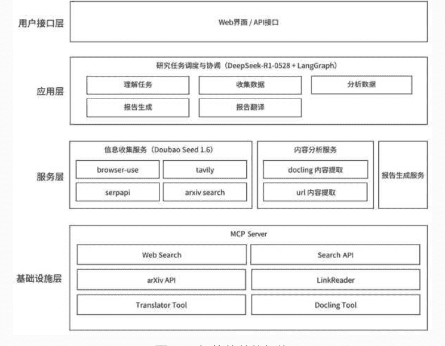

用户接口层包括Web界面/API接口，用于实现用户交互，接收研究任务请求并展示最终的研究成果。

应用层包括研究任务调度与协调模块，负责统一调度各个服务组件，并管理完整的研究流程。

服务层由以下3个核心服务构成。

- 信息收集服务（Doubao Seed 1.6）：负责从各种来源收集信息。
- 内容分析服务：将收集到的信息进行分析和处理。
- 报告生成服务：生成最终研究报告。

基础设施层以MCP Server为核心，该组件为系统提供各类基础工具和服务，支持AI与外部系统进行交互。在深度研究报告生成智能体中，MCP Server主要提供以下功能。

- Web Search：基于browser-use技术操作浏览器，实现网页浏览与内容抓取。
- Search API：基于搜索API实现信息检索与内容提取。
- arXiv API：基于arXiv API进行学术论文检索与内容分析。
- LinkReader：用于获取链接指向的内容。
- Translator Tool：翻译工具。
- Docling Tool：用于从文档中提取内容。

这种分层架构具备良好的模块化和可扩展性，能够灵活适应多样化的研究需求。

MCP Server作为系统的核心组件，负责提供各类工具和服务，支持AI与外部系统交互。在深度研究报告生成智能体中，设计了以下MCP工具。

- Web搜索工具：使用browser-use进行网络搜索，收集相关信息。
- URL浏览工具：访问指定URL并提取页面内容。
- 学术搜索工具：检索学术论文与研究报告。
- 内容提取工具：从PDF等文档格式中提取文本内容。

### 9.2.2 系统数据流设计

数据流是深度研究报告生成智能体中的关键设计要素，它描述了信息在系统各组件之间的传递过程，从用户输入至最终报告生成。主要数据流路径包括以下3种。

(1) 用户请求流。

- 用户通过Streamlit UI输入研究主题、深度与输出格式。
- 将研究请求发送至FastAPI服务器。
- FastAPI服务器解析请求并启动研究流程。

(2) 信息收集流。

- FastAPI服务器连接至MCP Client。
- MCP Client调用MCP Server所提供的工具。
- 使用这些工具收集相关信息。
- 将收集到的信息返回至FastAPI服务器。

(3) 报告生成流。

- FastAPI服务器基于收集到的信息生成研究报告。
- 报告以流式传输方式返回至Streamlit界面。
- 用户可以查看和下载报告。

从用户请求到最终报告生成的数据流转过程，如图9-2所示。


图9-2 智能体数据流转图

## 9.3 核心组件实现

9.2节详细绘制了深度研究报告生成智能体的系统架构图，明确了其分层结构与数据流转机制。本节将逐一解构并实现该智能体的各个核心组件。

如果说整个报告生成智能体是一位博学的数字研究员，那么MCP Server就是这位研究员赖以感知和交互于数字世界的“感官”与“肢体”。它负责将互联网上的海量数据、专业学术数据库及各类文档资源，转化为可被上层智能体理解与调用的标准化工具集。因此，我们首先聚焦于MCP Server，详细阐释其设计理念与代码实现，展示如何为AI构建探索数据世界的强大感知能力。

### 9.3.1 研究检索MCP Server组件

在深度研究报告生成智能体中，MCP Server以research_server.py为载体，作为智能体基础设施层的核心，提供各类工具与服务，使AI能够与外部系统交互并获取信息。其核心使命，是将数字世界中复杂的信息检索与交互行为，封装成一系列原子化、标准化、可被LLM理解与调用的“工具”。通过这一方式，LLM能够自主执行网页搜索、文献查阅、链接内容读取等任务。

本节将深入剖析research_server.py的设计思路与实现细节，从服务器的初始化配置，到每一个核心工具的构建逻辑，逐步阐述如何将强大的第三方库（如browser-use、arxiv等）与MCP机制有机结合，构建出一个功能完备、逻辑清晰且易于扩展的信息获取中枢。

#### 1. 初始化与配置

research_server的初始化与配置主要包括3项关键任务：创建服务器实例、加载环境变量配置、初始化与LLM的连接。具体代码如下。

```python
# 导入必要的库与模块
...
# 创建一个FastMCP Server实例
# "Web Browser Provider"是这个服务器的描述性名称，便于在客户端识别
# port=8000指定了服务器监听的端口
mcp = FastMCP("Web Browser Provider", port=8000)

# 使用load_dotenv()从项目根目录下的.env文件加载环境变量
# 这是现代应用开发的最佳实践，它将敏感信息（如API密钥）与代码本身分离，提高了安全性与配置的灵活性
load_dotenv()

# 初始化与LLM的连接
# 这里选用ChatOpenAI，它是与OpenAI兼容API进行交互的客户端
llm = ChatOpenAI(
    # model参数指定了要使用的大模型，其值从环境变量中读取，模型需要支持多模态和函数调用能力
    # 这种设计使得可以不修改代码，仅通过改变环境变量就能轻松切换不同的模型
    model=os.environ['Doubao_Seed_16'],
    # api_key和base_url同样从环境变量中获取，分别代表认证密钥和API服务的接入点
    api_key=os.environ['OPENAI_API_KEY'],
    base_url=os.environ['OPENAI_BASE_URL'],
)
```

在构建FastMCP实例时，选择FastMCP作为服务器框架，因为它是MCP Python SDK提供的高性能实现。该框架简化了MCP的复杂度，支持通过简单的装饰器语法（如@mcp.tool）定义工具，显著提高了开发效率。

在加载环境配置时，使用dotenv体现了代码的工程化考量。在团队协作或多环境部署（如开发、测试、生产）时，不同环境的配置（如API Key、模型终端）可能存在差异。将这些配置统一写入.env文件，既保持了代码库的整洁，也实现了环境间的有效隔离。

在初始化与LLM的连接过程中，ChatOpenAI实例充当了research_server与LLM进行智能交互的桥梁。特别需要注意的是，此处选用了支持函数调用（Function Calling）或工具调用（Tool Calling）能力的LLM。这一点至关重要，因为browser-use库中的Agent正是依赖LLM的此类能力来理解任务、拆解步骤并调用合适的浏览器操作。若缺乏该能力，自动化浏览器代理将无法正常运行。

#### 2. 定义数据模型

在构建任何数据驱动的系统时，明确数据结构是保证系统稳定性和可维护性的关键。我们使用Pydantic来定义数据模型，它不仅能提供运行时的数据验证，还能为Python提供类似于静态语言的类型提示与检查功能，从而增强代码的健壮性和可读性。

以下代码定义了两个Pydantic模型。

- SearchResult，用于表示网络搜索结果，包含标题、URL、内容和来源等字段。
- Article，用于表示学术论文数据结构，包含标题、摘要、发表日期和PDF链接等字段。

具体代码如下。

```python
# 使用Pydantic的BaseModel定义网络搜索结果的数据结构
class SearchResult(BaseModel):
    title: str # 搜索结果的标题
    url: str # 结果对应的URL
    content: str # 从该URL提取的核心内容摘要
    source: str # 信息来源，例如"web search"

    # 重写__str__方法，定义当该对象被转换为字符串时的格式
    # 这使得搜索结果的打印输出更为友好和结构化，便于调试和日志记录
    def __str__(self):
        # 格式化输出，只显示内容的前500个字符作为预览
        return f"Title: {self.title}\nURL: {self.url}\nSource: {self.source}\n\nContent:\n{self.content[:500]}...\n"

# 定义学术论文的数据结构
class Article(BaseModel):
    title: str # 论文标题
    summary: str # 论文摘要
    published_date: str # 发表日期
    pdf_link: Optional[str] # PDF链接，可能不存在，因此使用Optional

    # 定义一个类方法，用于从arxiv库的返回结果方便地创建Article实例
    # 这是一个典型的工厂模式应用，将对象创建的逻辑封装起来
    @classmethod
    def from_arxiv_result(cls, result: arxiv.Result) -> 'Article':
        # 在arxiv返回的链接列表中，筛选出PDF链接
        pdf_links = [str(i) for i in result.links if '/pdf/' in str(i)]
        # 如果找到了PDF链接，取第一个；否则设为None
        pdf_link = pdf_links[0] if len(pdf_links) else None
        # 使用提取的信息创建并返回Article实例
        return cls(
            title=result.title,
            summary=result.summary,
            published_date=result.published.strftime('%Y-%m-%d'), # 格式化日期
            pdf_link=pdf_link
        )

    # 同样，重写__str__方法，以便清晰地展示论文信息
    def __str__(self):
        return f"Title: {self.title}\nDate: {self.published_date}\nPDF Url: {self.pdf_link}\n\n" + '\n'.join(self.summary.splitlines()[:3]) + '\n[...]'
```

上述代码中，SearchResult和Article不仅是数据容器，更是服务与服务之间、模块与模块之间的数据契约（Data Contract）。通过定义这些模型，我们确保了无论数据在系统内部如何流转，其结构始终保持一致且可预期。

Article.from_arxiv_result方法是一个典型的封装示例。它隐藏了处理原始arxiv.Result对象的复杂性，为调用方提供了简单、直接的接口。这种抽象提高了代码的可维护性——即使未来arxiv库的API发生变化，也只需要修改该方法的内部逻辑，而无须修改所有使用Article的代码。

重写__str__方法看似是一个细微的改动，但在开发与调试阶段却能极大地提升效率。当需要打印对象状态时，一个格式化良好、信息丰富的字符串远比一个仅包含对象内存地址的默认输出更具实用价值。

#### 3. Web搜索工具

网页搜索工具（web_search）作为系统的主要信息入口，它凭借browser-use的智能体能力，能够将简单的自然语言查询（如“人工智能的最新进展”）转化为一系列复杂的浏览器操作，并最终返回结构化的搜索结果。以下代码基于browser-use实现了信息检索功能。

```python
@mcp.tool(
    name="web_search",
    description="Search the web for information on a specific topic using browser automation."
)
async def web_search(query: str, num_results: int = 5) -> str:
    """
    根据给定的主题，使用自动化浏览器在网络上进行搜索

    Args:
        query: 要搜索的查询字符串
        num_results: 期望返回的结果数量，默认为5

    Returns:
        一个包含搜索结果的格式化字符串
    """
    print(f"调用`web_search`工具，正在搜索: '{query}'...")

    # 创建一个browser-use的Agent实例
    # Agent是一个自主代理，它接收一个高层次的任务指令和LLM实例
    agent = Agent(
        task=f"Search for information about '{query}'. Find {num_results} high-quality sources. For each source, extract the title, URL, and relevant content. Return the results as a JSON array with 'title', 'url', 'content', and 'source' fields.",
        llm=llm,
    )

    print(agent) # 打印Agent的配置信息，便于调试

    # 运行Agent，它将自动执行任务。max_steps用于限制其操作步骤，防止进入无限循环
    result = await agent.run(max_steps=10)

    print(f"对于 '{query}' 的搜索结果: \n\n{result}\n\n")

    try:
        # Agent返回的结果通常是LLM生成的JSON字符串，需要进行解析
        search_results = []
        # 确保结果是字符串且看起来像一个JSON数组
        parsed_results = json.loads(result) if isinstance(result, str) and result.strip().startswith("[") else []

        # 遍历解析后的结果，并使用我们定义的SearchResult模型进行实例化
        # 这会进行数据验证，确保返回的数据符合我们的预设
        for item in parsed_results[:num_results]:
            search_results.append(
                SearchResult(
                    title=item.get("title", "Untitled"),
                    url=item.get("url", ""),
                    content=item.get("content", ""),
                    source=item.get("source", "web search")
                )
            )

        # 将SearchResult对象列表格式化为单一的字符串返回
        return "\n\n---\n\n".join(str(result) for result in search_results)
    except Exception as e:
        # 如果解析失败，返回错误信息和原始结果，便于排查问题
        return f"Error parsing search results: {str(e)}\n\nRaw result: {result}"
```

在任务的程序化描述中，传递给Agent的task参数是本工具的核心所在。我们并未直接指示Agent“点击哪里”或“输入什么”，而是通过自然语言给出了一个目标导向的、包含结果格式要求的清晰指令。Agent内部会利用LLM的推理能力，将该指令分解为具体的浏览器动作（如“打开搜索引擎”“输入查询”“遍历结果链接”“提取内容”等），这正是browser-use库的强大之处。

在进行结果的结构化处理时，工具的最后部分展示了一个健壮的数据处理流程。它并不直接信任上游（LLM Agent）返回的数据，而是通过try-except块、json.loads和Pydantic模型的实例化来强制进行数据解析与验证。这一流程将非结构化的文本输出转化为程序可信赖的结构化数据，为后续的处理流程奠定了坚实的基础。

#### 4. URL浏览工具

如果说web_search是在大海中捞针，那么browse_url则是对已定位的具体目标进行精细化勘探。该工具同样利用browser-use来访问并提取单个网页的详细内容，具体实现代码如下。

```python
@mcp.tool(
    name="browse_url",
    description="Browse a specific URL and extract its content using browser automation."
)
async def browse_url(url: str) -> str:
    """
```

访问一个特定的URL并提取其主要内容

Args:
    url: 需要浏览的网页地址

Returns:
    一个包含提取内容的字符串

```python
print(f"调用`browse_url`工具，正在浏览URL: {url}")

# 同样创建一个Agent，但这次的任务是针对单个URL进行内容提取
agent = Agent(
    task=f"Visit the URL '{url}'. Extract all relevant content including title, main text, and any important data. Format the content in a readable way.",
    llm=llm,
)

print(agent)

# 运行Agent，它将导航到指定URL并执行提取任务
result = await agent.run(max_steps=10)

print(f"从URL '{url}' 提取的内容: \n\n{result}\n\n")

# 直接返回Agent提取并格式化后的内容
return result
```

该工具的逻辑与web_search类似，但任务目标更为聚焦。它展示了browser-use Agent的灵活性，可以通过调整task描述来执行不同粒度的网页交互任务。在整个研究流程中，web_search和browse_url通常会组合使用：首先通过web_search获取一批相关的URL，然后利用browse_url逐一深入提取每个URL后的详细信息。

#### 5．学术搜索工具

学术研究是深度报告的重要信息来源。该工具专注于在预印本arXiv网站上进行搜索，体现了系统在信息获取方面的专业化能力。

```python
# 这是一个辅助函数，不直接作为MCP工具，封装了与arxiv库交互的逻辑
def get_articles_content(query: str, max_results: int) -> list[Article]:
    client = arxiv.Client() # 创建arxiv客户端
    # 构建搜索查询，按相关性排序
    search = arxiv.Search(query=query, max_results=max_results,
                          sort_by=arxiv.SortCriterion.Relevance)
    # 执行搜索，并使用map和我们定义的工厂方法将结果转换为Article对象列表
    articles = map(lambda x: Article.from_arxiv_result(x), client.results(search))
    # 筛选出那些包含有效PDF链接的文章
    articles_with_link = filter(lambda x: x.pdf_link is not None, articles)
    return list(articles_with_link)

@mcp.tool(
    name="search_arxiv",
    description="Get `max_results` articles for a given search query on arXiv."
)
async def get_articles(query: str, max_results: int) -> str:
    """
    在arXiv网站上根据给定查询搜索学术论文

    Args:
        query: 搜索的关键词
        max_results: 返回的最大结果数量

    Returns:
        一个包含论文信息列表的格式化字符串
    """
    print(f"调用`search_arxiv`工具，正在搜索: '{query}'...")
    # 调用辅助函数来执行实际的搜索和数据转换
    articles = get_articles_content(query, max_results)
    print(f"找到了 {len(articles)} 篇相关文章")
    # 使用分隔符将所有Article对象的字符串表示连接起来，形成最终输出
    return '\n\n------\n\n'.join(map(str, articles)).strip()
```

上述代码的实现逻辑如下。

关注点分离：通过将与arxiv库的交互逻辑封装在get_articles_content辅助函数中，主工具函数get_articles的职责变得非常清晰，即接收参数、调用辅助函数、记录日志和格式化输出。这种分离显著提升了代码的可测试性和可维护性。

函数式编程风格：代码中使用了map和filter，体现出优雅的函数式编程风格，能够以声明式的方式处理集合数据，使代码更加简洁且可读性更强。

领域特定工具：这个工具的存在表明，一个优秀的智能体应具备针对不同信息源的专用工具。虽然通用网页搜索功能强大，但对于arXiv网站上的结构化数据，使用其专用API会远比模拟浏览器操作更加高效和可靠。

#### 6. 文章内容提取与预览工具

在获取论文的PDF链接后，下一步便是读取其内容。文章内容提取与预览工具基于docling库（其背后可能集成OCR等技术）来处理PDF文件，分别用于提取全文和快速生成预览，具体实现代码如下。

```python
# 辅助函数：从PDF URL提取文本内容
def get_article_content_str(article_url: str) -> str:
    converter = DocumentConverter() # 初始化文档转换器
    result = converter.convert(article_url) # 从URL转换文档
    research = result.document.export_to_markdown() # 导出为Markdown格式
    return research

# 辅助函数：获取文本的开头部分（按Token数量计）
def first_lines(text: str, chunk_size: int = 1000) -> str:
    # 根据gpt-4的分词方式初始化编码器
    encoder = tiktoken.encoding_for_model('gpt-4')
    # 创建文本分割器，它会确保分割后的文本块不超过指定的Token数
    text_splitter = RecursiveCharacterTextSplitter(
        chunk_size=chunk_size,
        chunk_overlap=0,
        length_function=lambda x: len(encoder.encode(x)), # 关键：长度函数基于Token数量
        is_separator_regex=False,
    )
    # 分割文本并返回第一个块
    return text_splitter.split_text(text)[0]

@mcp.tool(
    name="extract_article_content",
    description="Extracts the full text content from a research article PDF using its pdf link `article_url`."
)
async def get_article_content(article_url: str) -> str:
    """从给定的PDF链接中提取完整的文章文本内容"""
    article_content = get_article_content_str(article_url)
    print(f"已从 {article_url} 提取全文")
    return article_content.strip()

@mcp.tool(
    name="get_article_preview",
    description="Retrieves the first portion of a research article based on its pdf link `article_url` with a specified token limit."
)
async def get_article_first_lines(article_url: str, chunk_size: int = 1000) -> str:
    """根据PDF链接获取文章的前`chunk_size`个Token作为预览"""
    article_content = get_article_content_str(article_url)
    first_lines_content = first_lines(article_content.strip(), chunk_size)
    print(f"已为 {article_url} 生成 {chunk_size} 个Token的预览")
    return first_lines_content.strip()
```

PDF是一种典型的非结构化数据源。上述代码通过引入DocumentConverter工具，解决了从复杂文档格式中提取纯文本这一棘手问题，是连接原始资料和LLM理解能力的关键桥梁。

get_article_preview()中的first_lines()函数体现了对LLM工作原理的深刻理解。由于LLM处理文本时存在上下文窗口大小的限制，而该限制是基于Token数量而非字符数来计算的。因此，使用tiktoken按Token数量来精确地截取文本，能够确保发送给LLM的预览内容不会超出其处理范围，这是一种非常专业化且精细化的处理方式。

#### 7. 搜索API工具

为了提供多样化且轻量级的选择，本项目实现了两个基于API和标准库的工具。以下代码展示了如何基于搜索API实现信息检索工具。

```python
# 此处search_by_tavily和read_link是外部定义的辅助函数
# 假设它们分别调用Tavily Search API和使用urllib读取链接内容

@mcp.tool(
    name="search_by_api",
    description="Search for information on a specific topic using a direct Search API."
)
async def search_by_api_tool(q: str) -> str:
    """通过调用专门的搜索API来执行搜索"""
    # 这种方式比驱动整个浏览器要快得多，适用于需要快速获取搜索摘要的场景
    return search_by_tavily(q)
```

该工具提供了一种替代browser-use的轻量级API搜索方式。

#### 8. 链接阅读工具

urllib是Python内置的一个用于处理URL和进行网络请求的库。以下代码基于urllib实现了URL链接内容的获取功能。该工具提供了一种轻量级的URL内容提取方法，比browser-use更加高效。

```python
@mcp.tool(
    name="LinkReader",
    description="Read the content of a URL link directly. Use to extract content from a URL link."
)
async def link_reader(url: str) -> str:
    """直接读取一个URL链接的HTML内容"""
    # 这是一个非常基础的工具，适用于那些结构简单、没有复杂JS渲染的静态页面
    # 相比browser_use，它的速度极快，但能力有限
    return read_link(url)
```

系统同时提供browser-use驱动的重型工具和API/urllib驱动的轻型工具，这是一种明智的设计选择。这种架构允许调用方（在这里是ReAct代理）根据任务的复杂度及对效率的要求，灵活选择适当的工具。例如，若仅需验证链接的有效性或抓取简单页面的标题，使用LinkReader即可满足需求，无须启动整个浏览器实例。

#### 9. 服务器启动

实现一个入口点来启动MCP Server，使其开始监听并响应客户端请求。具体实现代码如下所示。

```python
# 这段代码确保只有当此脚本被直接运行时，服务器才会启动
# 如果此文件作为模块被其他文件导入，则不会执行
if __name__ == "__main__":
    # 使用asyncio.run来启动异步事件循环并运行服务器的异步启动方法
    # mcp.run_sse_async() 会以SSE连接启动服务器
    # SSE是一种适合服务器向客户端单向推送消息的协议，非常适合流式响应
    asyncio.run(mcp.run_sse_async())
```

`if __name__ == "__main__":` 是Python脚本的标准入口点。选择`run_sse_async()` 意味着服务器能够支持流式响应，这对于提升用户体验至关重要，因为用户可以即时看到生成的内容，而无须等待整个研究过程完全结束。

综上所述，research_server.py不仅仅是一组函数的集合，更是一个经过深思熟虑设计的分层化、健壮的系统组件。它通过将复杂的信息获取任务抽象为标准化的MCP工具，成功为上层的AI代理提供了与现实世界交互的强大能力，为构建深度研究报告生成智能体奠定了坚实的技术基础。

MCP Server的完整源代码位于本书配套代码仓库的research_server.py文件中。

### 9.3.2 研究流程编排组件

如果说MCP Server为AI提供了探索世界的“手”和“眼”，那么本节所构建的研究流程编排组件（graph.py）则为AI植入了引导其行动的“大脑皮层”——负责逻辑、规划与执行控制。拥有强大的工具只是第一步，如何智慧且有条不紊地运用这些工具，以完成从模糊的用户请求到结构严谨的深度报告这一复杂任务，则是一门关于“流程编排”的艺术。

单纯的工具调用是反应式的，而真正的智能研究则是一个深思熟虑、循序渐进的过程。它需要理解任务、制订计划、收集数据、分析数据、形成结论，甚至进行多语言适配。为了在程序中优雅地建模这种人类专家的工作流程，我们引入了强大的工作流框架——LangGraph。

LangGraph 允许将复杂流程定义为一个有向图（Graph），其中每一个“节点（Node）”代表研究过程中的一个具体步骤（如“分析数据”），而节点之间的“边（Edge）”则定义了这些步骤的执行顺序和逻辑流转。这种基于图的范式不仅使复杂的流程变得可视化、易于管理，更提供了无与伦比的灵活性与可扩展性。

本节将深入graph.py的内部，剖析这个为研究报告生成智能体赋予逻辑与灵魂的工作流是如何设计与实现的。graph.py文件实现了一个基于LangGraph的工作流，用于管理研究报告生成的完整过程。该工作流将复杂的研究任务分解为一系列有序步骤，涵盖从理解任务到生成最终报告的全流程。下文将详细分析该工作流的设计与实现。

#### 1. 初始化与配置

在构建工作流图谱之前，需要完成基础环境的搭建：加载必要的模块、配置环境变量，并初始化作为各节点思考核心的LLM。具体实现代码如下。

```python
# graph.py

# 导入所有必要的库和模块
import os
from datetime import datetime
from typing import Dict, List, Any, TypedDict

# 用于加载.env文件中的环境变量
from dotenv import load_dotenv
# LangChain核心消息类型
from langchain_core.messages import BaseMessage, HumanMessage, AIMessage
# OpenAI兼容模型的客户端
from langchain_openai import ChatOpenAI
# LangGraph的核心组件
from langgraph.graph import StateGraph, END

# 采用业界最佳实践，从.env文件加载敏感配置
load_dotenv()

# 初始化LLM，它将作为图谱中每个节点的“思考者”
model = ChatOpenAI(
    # 从环境变量中读取模型名称，便于灵活切换，无须修改代码
    model=os.environ['DeepSeek_R1_0528'],
    # 从环境变量中读取API密钥与服务地址
    api_key=os.environ['OPENAI_API_KEY'],
    base_url=os.environ['OPENAI_BASE_URL'],
)

# 获取当前日期，为所有后续的AI交互提供准确的时间上下文
current_date = datetime.now().strftime('%Y-%m-%d')
```

上述代码的实现逻辑如下。

`load_dotenv()`将模型名称、API Key等易变且敏感的配置信息从业务逻辑代码中解耦出来，统一存放在.env文件中。这种做法极大地增强了系统的安全性、可移植性和可维护性。例如，我们可以轻松地将模型从DeepSeek_R1_0528切换至其他模型，而无须修改任何Python代码。

ChatOpenAI实例是整个工作流的核心驱动力。在LangGraph的每个节点中，我们都将调用这个model实例，并通过精心设计的提示词来驱动其完成该节点的特定任务。

`current_date`的设定看似简单，实则对提升AI生成内容的质量至关重要。通过让AI知晓“当前”日期，可以使它在研究中引用更具时效性的信息，避免给出过时的结论。

#### 2. 状态定义

LangGraph是一个有状态的图结构，这意味着需要定义一个共享的数据结构，用于在图的各个节点之间流动和传递信息，记录下工作流至目前为止的全部上下文。这个数据结构就是状态（State）。我们的状态设计是整个工作流能够连贯执行的关键，它支持工作流在各个节点之间传递信息，保持上下文连贯性。具体实现代码如下。

```python
# 使用TypedDict定义一个结构清晰、类型安全的状态类
class AgentState(TypedDict):
    # messages字段用于记录整个工作流中AI与系统的完整对话历史，
    # 形成一个连贯的“思考链”
    messages: List[BaseMessage]

    # research_data字段是一个列表，用于累积存储从现实世界收集到的所有原始研究资料
    research_data: List[Dict[str, Any]]

    # report字段用于存储最终生成的报告文本
    report: str
```

在这段代码中，AgentState不仅仅是一个数据容器，更是研究工作流的“记忆体”和“工作台”。

- messages字段像一条线索，串联起所有节点的思考过程。后续节点可以读取前序节点的输出（作为AI Message存在于messages列表中），从而确保思考的连续性。例如，“分析数据”节点正是基于“收集数据”节点在messages中留下的数据收集策略来展开工作的。
- research_data用于存放所有通过MCP工具从外部获取的信息，实现了数据收集与数据分析的解耦。
- report字段是工作流最终的产出物，在流程的末端被填充。

通过TypedDict为状态对象提供静态类型提示，代码编辑器和静态分析工具能够在开发过程中捕捉到潜在的错误，提高代码的健壮性。

#### 3. 工作流节点实现

#### 4. 工作流图构建

工作流图定义了一个线性的研究过程，从理解任务开始，经过数据收集、分析、报告生成，最后到翻译，形成一个完整的研究报告生成流程。具体实现代码如下。

```python
def make_graph():
    """
    工厂函数：构建并编译整个研究工作流图
    """
    # 实例化一个状态图，并告知它我们的状态结构是AgentState
    workflow = StateGraph(AgentState)

    # --- 注册节点 ---
    # 将定义的每个功能函数，注册为图中的一个节点
    workflow.add_node("understand_task", understand_task)
    workflow.add_node("collect_data", collect_data)
    workflow.add_node("analyze_data", analyze_data)
    workflow.add_node("generate_report", generate_report)
    workflow.add_node("translate_report", translate_report)

    # --- 定义流程 ---
    # 使用add_edge定义节点间的固定流转顺序
    workflow.add_edge("understand_task", "collect_data")
    workflow.add_edge("collect_data", "analyze_data")
    workflow.add_edge("analyze_data", "generate_report")
    workflow.add_edge("generate_report", "translate_report")
    # 将最后一个节点连接到特殊的END节点，表示工作流结束
    workflow.add_edge("translate_report", END)

    # --- 指定入口 ---
    # 声明 "understand_task" 为整个工作流的起始点
    workflow.set_entry_point("understand_task")

    # 编译图，使其成为一个可执行的对象
    return workflow.compile()
```

上述代码清晰地定义了整个研究过程的宏观逻辑。

- 注册（add_node）：将分散的函数注册为图中有名有姓的节点。
- 连接（add_edge）：定义了本工作流是一个线性的、逐步推进的确定性流程。LangGraph同样支持更复杂的条件边界（Conditional Edges），可以根据状态中的特定值来决定下一步执行哪个节点，从而实现分支、循环等复杂逻辑。
- 指定入口（set_entry_point）：明确流程的起始节点。
- 编译（compile）：将声明式的图定义转化为一个可执行且高效的运行时对象。

通过graph.py的设计与实现，成功将一个复杂、开放式的研究任务，分解并固化为一个由LLM驱动的、结构化的、可重复执行的自动化流程。该流程如同一条精密的“认知流水线”。

- 输入：用户的自然语言请求。
- 流水线工序：
  - 理解任务→输出研究计划；
  - 收集数据→输出原始资料；
  - 分析数据→输出核心洞见；
  - 生成报告→输出Markdown报告初稿；
  - 翻译报告→输出多语言版本报告。
- 输出：一份专业、全面、多语言的深度研究报告。

该LangGraph工作流实现了一个结构化、可扩展的研究报告生成流程，通过将复杂任务分解为一系列有序步骤，使系统能够持续生成高质量的研究报告。

流程管理组件的完整源代码位于本书配套代码仓库的graph.py文件中。

### 9.3.3 MCP Client组件

如果说MCP Server是系统的“感官”，LangGraph工作流是预设的“逻辑蓝图”，那么本节将要构建的MCP Client组件（client_server.py）则是这一切的“总指挥官”与“首席执行官”。它对外通过API接收用户的研究请求，对内则通过ReAct代理动态地、自主地调用MCP Server提供的各种工具，最终完成复杂的研究任务并将成果汇报给用户。

该组件是整个系统架构的黏合剂，它将底层的工具能力与上层的业务逻辑无缝衔接起来。本节选用业界领先的异步Web框架FastAPI来构建此服务，它不仅以卓越的性能著称，还具备自动化的API文档生成、强大的依赖注入系统及与Pydantic的原生集成能力，是构建现代化、高健壮性AI服务的理想选择。

client_server.py 负责处理用户请求，调用研究流程编排组件，并返回研究结果。我们使用FastAPI实现该组件，它提供了一个高性能的API框架。下面将结合代码片段详细解析其实现逻辑。

#### 1. 初始化与配置

与所有精良的软件工程实践一样，我们从一个清晰、有序的初始化阶段开始。此阶段负责加载所有必要的模块、建立与外部（如LLM）服务的连接，并准备好执行任务所需的核心组件。具体实现代码如下。

```python
# 导入必要的库
import os
from datetime import datetime
from typing import Dict, List, Optional

import uvicorn
from dotenv import load_dotenv
from fastapi import FastAPI, HTTPException
from langchain_mcp_adapters.client import MultiServerMCPClient
from langchain_openai import ChatOpenAI
from langgraph.prebuilt import create_react_agent
from pydantic import BaseModel

from graph import make_graph

# 加载环境变量
load_dotenv()

# 初始化FastAPI应用，这是对外提供服务的窗口
app = FastAPI(title="Deep Research Report API")

# 初始化LLM，这是ReAct代理的“大脑”
model = ChatOpenAI(
    model=os.environ['DeepSeek_R1_0528'],
    api_key=os.environ['OPENAI_API_KEY'],
    base_url=os.environ['OPENAI_BASE_URL'],
)

current_date = datetime.now().strftime('%Y-%m-%d')

# 初始化LangGraph
research_graph = make_graph()
```

在上述代码中，核心逻辑如下。

- 导入所有必要的库和模块，包括FastAPI框架、LangChain组件及自定义模块。
- 使用load_dotenv()加载环境变量，从.env文件中读取配置，增强了安全性和灵活性。
- 创建FastAPI应用实例，设置标题为“Deep Research Report API”。
- 初始化LLM，使用环境变量中的配置：从环境变量DeepSeek_R1_0528获取模型名称，从环境变量OPENAI_API_KEY获取API密钥，从环境变量OPENAI_BASE_URL获取基础路径URL。
- 获取当前日期，格式化为YYYY-MM-DD，用于在报告中提供时间上下文。
- 调用从graph.py导入的函数make_graph()初始化LangGraph工作流，用于创建研究流程图。

#### 2. 数据模型定义

一个健壮的API服务始于一个清晰的数据契约。我们使用Pydantic来定义接收请求和返回响应的数据结构，FastAPI将自动利用这些模型进行数据验证、序列化并生成交互式API文档。具体实现代码如下。

```python
# 定义接收研究请求的数据模型
class ResearchRequest(BaseModel):
    topic: str # 必填项：用户指定的研究主题
    depth: Optional[str] = "medium" # 可选项：研究深度，可选值为 "shallow", "medium", "deep"
    format: Optional[str] = "markdown" # 可选项：报告输出格式，可选值为 "markdown", "text"

# 定义API成功响应的数据结构（注意：在流式响应中，此模型主要用于文档展示）
class ResearchResponse(BaseModel):
    report: str # 最终的报告内容
    sources: List[Dict[str, str]] # 报告中引用的信息来源列表
```

通过Pydantic的声明式语法，定义每个字段的类型、可选择性及默认值。当请求到达时，FastAPI会自动根据ResearchRequest模型进行校验，任何不符合格式要求的请求都将被拒绝，并返回清晰的错误信息，从而显著增强了API的健壮性。

#### 3. 研究API端点实现

这是服务的核心业务逻辑所在。我们设计了一个POST /research端点，用于接收用户的研究请求，并以“流”的方式将报告内容实时返回给客户端。这种设计对

#### 4. MCP Client连接与工具获取

在 `stream_report_content` 生成器内部，第一步是连接到之前构建的 `research_server.py`，并获取其提供的所有工具。具体实现代码如下。

```python
# 此部分代码位于stream_report_content异步生成器内部
try:
    # 实例化一个多服务器MCP Client
    mcp_client = MultiServerMCPClient({
        # 将研究工具服务器命名为 "research"
        "research": {
            # 从环境变量读取服务器地址，若未设置则默认为本地地址
            "url": os.environ.get("BROWSER_SERVER_URL", "http://localhost:8000/sse"),
            # 指定传输协议为 "sse"，与服务器端保持一致
            "transport": "sse",
        }
    })

    # 异步地从MCP Server获取所有可用的工具列表
    tools = await mcp_client.get_tools()
    print("已成功获取MCP工具:", tools) # 调试信息
except Exception as e:
    # ... 错误处理 ...
```

选用 `MultiServerMCPClient` 作为客户端，体现了架构的可扩展性。当前虽然仅连接一个 `research` 服务器，但未来可以轻松地在配置中加入其他服务器（如 `data_analysis`），而无须修改业务代码。

`await mcp_client.get_tools()` 是MCP的核心优势体现。客户端无须硬编码任何工具的定义，而是动态地从服务器发现可用的工具。这意味着，如果在 `research_server.py` 中新增或修改某个工具，客户端服务重启后即可自动获得新能力，实现了前后端的完美解耦。

#### 5. ReAct代理创建与研究提示准备

拥有了工具之后，需要一个“智能体”来决定何时以及如何使用这些工具。这正是ReAct代理的核心作用。具体实现代码如下。

```python
# 此部分代码位于stream_report_content内部，紧随工具获取之后

# 使用langgraph.prebuilt中的工厂函数，快速创建一个ReAct代理
# 它将我们初始化的LLM模型与从MCP获取的工具列表绑定在一起
agent = create_react_agent(model, tools)

# --- 精心设计的提示工程：这是引导代理行为的“总纲”---
depth_instructions = {
    "shallow": "对该主题进行简要概述，重点关注核心要点。",
    "medium": "对该主题进行全面的分析，涵盖关键方面和部分细节。",
    "deep": "对该主题进行深入的剖析，详细探讨所有相关方面。"
}

# 构建一个详尽的、多步骤的、目标导向的研究提示
research_prompt_text = f"""
当前日期: {current_date}
------------------------
我需要你深入研究以下主题: {request.topic}

请遵循如下研究深度要求: {depth_instructions.get(request.depth, depth_instructions["medium"])}

请严格按照以下步骤执行任务:
1. 根据用户查询，从`web_search`（通用搜索），`search_arxiv`（学术搜索），`search_by_api`（特定API搜索）中选择最合适的工具，搜索相关信息;
2. 对于发现的关键链接，使用`LinkReader`或`browse_url`工具来获取更详细的信息;
3. 在收集到所有必要信息后，将它们综合成一份内容全面的研究报告;
4. （可选扩展）如果需要，未来可以使用`Translator`工具翻译报告。

你的最终报告必须以 {request.format} 格式呈现，并包含以下要素:
- 清晰的标题和摘要;
- 结构严谨的章节，覆盖主题的各个方面;
- 恰当的引用和参考文献（从你收集到的信息中提取）;
- 具有可操作性的洞见和建议。

你现在必须开始使用可用工具收集信息。当你认为信息足够充分时，再利用这些信息生成最终报告。
"""

print(f"生成的研究提示: {research_prompt_text}")
```

上述代码使用 `create_react_agent` 创建了一个遵循“思考->行动->观察->思考...”循环的智能体。当接收到 `research_prompt_text` 后，它会首先“思考”（调用LLM）决定第一步应该调用哪个工具（如 `web_search`），然后“行动”（执行工具调用），接着“观察”（获取工具返回的结果），再将结果纳入上下文继续“思考”，如此循环，直至它认为任务完成。

`research_prompt_text` 是整个系统智能行为的核心。它并非一个简单的问题，而是一份详尽的“任务委托书”，主要包括以下信息。

- 上下文：当前日期。
- 核心目标：研究的主题和深度要求。
- 行动指南：明确的步骤和工具使用建议。
- 产出标准：对最终报告的结构和内容要求。
- 启动指令：明确指示代理必须先收集信息，再生成报告。

#### 6. 执行与产出：信息收集、报告生成与流式输出

现在所有准备工作已就绪，我们启动代理并处理其输出，最终将报告以流式方式返回。具体实现代码如下。

```python
# 此部分是stream_report_content的核心执行循环

# 1. 信息收集
# 异步调用代理，并设置递归限制以防无限循环
agent_response = await agent.ainvoke(
    {"messages": [("user", research_prompt_text)]},
    {"recursion_limit": 10}
)
# 从代理的最终响应中提取所有工具调用结果，作为报告的原始素材
gathered_information_text = "\n".join(
    [msg.content for msg in agent_response.get('messages', []) if msg.type == 'tool']
)
if not gathered_information_text:
    gathered_information_text = "代理未能收集到任何信息。"
print(f"收集到的信息摘要: {gathered_information_text[:500]}...")

# 2. 报告生成提示准备
# 再次运用提示工程，指示LLM基于收集到的信息进行最终的报告撰写
report_generation_prompt_text = f"""
基于以下完整的研究资料:
--- 研究资料开始 ---
{gathered_information_text}
--- 研究资料结束 ---

并结合最初的研究请求:
主题: {request.topic}, 深度: {request.depth}

请严格按照 {request.format} 格式，生成一份结构完整、内容详实、洞见深刻的最终研究报告。报告应包含标题、摘要、正文、参考文献等。你的输出应该【仅仅】是报告本身的内容，不要包含任何额外的对话或评论。
"""

# 3. 流式报告生成与输出
full_report_content = ""
# 使用LLM的流式调用方法 `astream`
async for chunk in model.astream(report_generation_prompt_text):
    content_piece = chunk.content
    if content_piece:
        full_report_content += content_piece
        yield content_piece # 将每个内容块实时yield出去，实现流式传输

# 4. 提取引用源并发送结束元数据
# 从整个交互过程和报告中提取所有URL作为引用源
sources_list = []
urls_found = re.findall(r'https?://[^\s,"\']+', gathered_information_text + full_report_content)
for url_item in set(urls_found): # 使用set去重
    sources_list.append({"url": url_item, "title": "Unknown"}) # 未来可优化为提取标题

# 定义一个特殊的结束标记，并附上JSON格式的元数据
final_metadata = {"report_complete": True, "sources": sources_list}
yield f"\nEND_OF_STREAM\n{json.dumps(final_metadata)}"
```

上述代码的实现逻辑如下。

两阶段提示法是一个非常经典且高效的Agent设计模式。其中，第一阶段（信息收集），代理被赋予一个开放式的探索任务；第二阶段（报告生成），任务范围被收窄，LLM需基于已有材料完成高度聚焦的写作任务。这种分离策略有效确保了最终报告的质量和一致性。

`astream` 的应用是实现流式响应的核心。`async for` 循环会等待模型逐个生成小的数据块（chunk），并立即通过 `yield` 将其发送给客户端。

报告内容流式传输完毕后，系统会发送一个清晰的结束信令 `END_OF_STREAM`，并紧随其后发送一个包含最终状态和所有引用来源的JSON对象。这种“内容流 + 元数据”的模式极大地便利了前端应用的处理。前端可以通过监听该信令来确认报告已完整接收，并可利用 `sources` 数据来渲染一个参考文献列表。

#### 7. 服务器启动

通过uvicorn启动这个高性能的ASGI服务器。

```python
if __name__ == "__main__":
    uvicorn.run(app, host="0.0.0.0", port=8080)
```

使用uvicorn启动服务器，主机设置为“0.0.0.0”，允许从任何IP地址访问；端口设置为8080。

`client_server.py` 作为深度研究报告生成智能体的核心组件，实现了以下功能。

- 开放的API接口：通过FastAPI提供了一个标准、健壮、自文档化的RESTful API。
- 动态的工具集成：借助MCP Client，实现了与工具提供方 `research_server` 的松耦合和动态发现。
- 智慧的代理协调：利用ReAct代理，将LLM的推理能力与外部工具的行动能力相结合，实现了对复杂研究任务的自主规划与执行。
- 极致的用户体验：通过流式响应，将漫长的等待转变为即时的内容生成反馈。
- 丰富的产出信息：除报告内容外，还提供了结构化的引用源数据，增强了报告的价值和可信度。

该组件展示了如何将多种先进技术（FastAPI、LangChain、MCP、流式响应等）集成到一个高效、灵活的系统中，为用户提供强大的研究报告生成能力。

MCP Client的完整实现源代码位于本书配套代码仓库的 `client_server.py` 文件中。

## 9.4 MCP工具实现

本节将深入探讨深度研究报告生成智能体的核心功能实现，包括网络搜索与内容提取、学术资源获取、内容分析与综合，以及报告生成与格式化。

### 9.4.1 browser-use框架原理

在着手构建深度研究报告生成智能体之前，必须首先打下坚实的技术基础。这一基础的核心是名为 `browser-use` 的强大开源Python框架，它赋予了AI驾驭浏览器的能力。理解其设计哲学、核心机制及其与MCP的融合方式，是开启后续所有高级功能实现的钥匙。

试想，如果 AI 代理能够像人类一样熟练操作网页浏览器，将释放出何等巨大的潜力。这正是 `browser-use` 框架的设计初衷：它旨在成为连接AI与广阔网络世界的桥梁，通过简洁而强大的接口，使AI能够执行从简单的页面导航到复杂的表单交互、内容提取等一系列浏览器操作。`browser-use` 提供了一套全面的功能集，包括但不限于：精准的浏览器控制（导航、点击、输入）、高效的标签页管理、基于视觉和DOM的元素查找能力，以及对Session和本地存储的管理，使其能够应对需要登录和保持会话的复杂场景。

理论的探讨最终需要通过实践来检验。现在，我们通过一个具体而完整的代码实例，将前面讨论的概念——LLM的智慧与 `browser-use` 框架的执行力——结合起来，构建一个能够自主在GitHub上搜索特定项目信息的AI代理。该代码完整地展示了从环境配置、模型初始化到任务执行的全过程。

```python
# 导入所有必需的库和模块
import asyncio # 异步I/O库，是运行browser-use和现代网络应用的基石
import os # 用于与操作系统交互，这里主要用来读取环境变量

from dotenv import load_dotenv # 从 .env文件加载环境变量的实用工具
from langchain_openai import ChatOpenAI

# 核心组件：browser-use的Agent和LangChain的模型接口
from browser_use import Agent

# 步骤1: 环境配置的初始化
# load_dotenv() 会自动查找当前目录下的 .env文件，并将其中的键值对加载到系统的环境变量中
# 这是一个至关重要的最佳实践，它能将敏感信息（如API密钥）与代码本身分离
load_dotenv()

# 步骤2: 配置并初始化LLM
# 这是代理的“大脑”，所有的决策与理解都源于此
# 我们使用ChatOpenAI类，它提供了一个与OpenAI API兼容的接口
llm = ChatOpenAI(
    # model: 指定要使用的具体模型。通过os.environ读取环境变量'Doubao_Seed_16',
    # 意味着模型名称是可配置的，而非硬编码在代码中，这极大地提高了灵活性
    model=os.environ['Doubao_Seed_16'],

    # api_key: 指定访问模型服务的认证密钥，同样从环境变量'OPENAI_API_KEY'中安全地获取
    api_key=os.environ['OPENAI_API_KEY'],

    # base_url: 指定API服务的根地址。这使得代码不仅能调用官方OpenAI服务,
    # 还能无缝切换到任何兼容的第三方或私有化部署的模型服务（如本例中可能指向的豆包大模型服务）
    base_url=os.environ['OPENAI_BASE_URL'],
)

# 步骤3: 定义核心的异步任务执行函数
async def main():
    """
    这是我们程序的主入口，一个异步函数，负责设置并运行browser-use代理。
    """
    # 步骤3.1: 实例化Agent
    # 创建一个Agent实例，这是整个自动化任务的执行者
    agent = Agent(
        # task: 用清晰、具体的自然语言向代理下达指令
        # 任务是：“在github.com上搜索模型上下文协议（MCP）”
        # LLM会理解这个指令，并将其分解为具体的浏览器操作步骤
        task=f"Search Model Context Protocol (MCP) on github.com ",

        # llm: 将我们刚刚初始化好的LLM实例传递给Agent
        # 这个llm实例将作为代理的决策核心
        llm=llm,
    )

    # 步骤3.2: 启动代理并执行任务
    # await agent.run() 是触发任务执行的命令。由于涉及网络I/O和浏览器交互,
    # 这是一个异步操作，因此必须使用await来等待其完成
    # max_steps=10: 重要的安全和成本控制参数。它限制了代理在完成任务时
    # 最多可以执行10个步骤（如“打开页面”“输入文字”“点击按钮”等）
    # 这可以有效防止代理因任务理解错误或网页结构复杂而陷入无限循环，从而消耗大量资源
    await agent.run(max_steps=10)

# 步骤4: 程序的标准入口点
if __name__ == '__main__':
    # asyncio.run(main()) 是Python 3.7+中启动并运行一个异步程序的标准方式
    # 它会创建一个事件循环，运行我们定义的main() 函数，并在其结束后关闭循环
    asyncio.run(main())
```

这段代码的执行流程可分为以下环节。程序首先执行准备操作，通过`load_dotenv()`从`.env`文件加载模型名称、API密钥和服务地址等配置信息，随后实例化`ChatOpenAI`类，创建包含特定模型（Doubao_Seed_16）和API密钥的`llm`实例。这种配置与代码分离的模式，是专业软件工程的基础实践。

在`main()`函数中，`Agent`实例被创建，其核心构成包括以自然语言描述的任务（`task`）和上述`llm`实例，任务定义了代理的最终目标。

调用`agent.run()`方法后，控制权移交至`Agent`。其内部的计划代理会与`llm`交互，将“在GitHub上搜索MCP”这一宏观任务分解为可执行的步骤，例如打开浏览器并导航至`https://github.com`、定位页面搜索框、输入"Model Context Protocol (MCP)"、模拟回车或点击搜索按钮、分析结果页面以寻找相关链接等。

浏览器导航代理借助底层Playwright库，在真实或无头浏览器中精准执行上述步骤。参数`max_steps=10`用于限制执行步骤数量，确保过程可控且经济，避免无限制操作。

由于本示例中`agent.run()`之后未设置结果打印语句，程序在完成搜索任务或达到10步上限后会自行结束。在完整应用中，`agent.run()`通常会返回包含搜索结果的字符串或结构化数据，供后续代码处理和展示。

### 9.4.2 网络搜索与内容提取工具

网络搜索和内容提取是生成研究报告的基础。我们需要根据研究主题搜索相关信息，并从网页中提取有用的内容。

#### 1. 网络搜索实现

在深度研究报告生成智能体的系统设计中，最基础的功能便是能够在互联网上自主搜集信息。我们不能仅仅满足于调用传统的搜索引擎API，而是需要的是一个能够理解网页内容、提取关键信息、并以结构化形式返回结果的“智能探针”。为此，本节将利用`browser-use`框架，将其强大的网页交互能力封装成一个标准、健壮且易于调用的MCP工具——`web_search`。

该工具的设计理念是：将复杂的浏览器自动化流程，抽象为单一、意图明确的函数调用。上层应用（如报告生成器）只需下达简单指令（例如“在网络上搜索关于‘量子纠缠’的相关资料”），而无须关心浏览器是如何启动、关键词是如何输入、结果是如何被解析的。所有的复杂性都被优雅地隐藏在`web_search`工具的实现细节之中。

以下代码展示了智能网络搜索工具的构建过程。

```python
# 该工具被定义在MCP Server环境中，并使用了预先初始化的llm实例
# 以及一个用于规范化输出的SearchResult数据类（此处未显示其定义）
import json

@mcp.tool(
    name="web_search", # 1. 定义工具的唯一名称，这是它在MCP生态中的“身份证”
    description="Search the web for information on a specific topic using browser automation." # 2. 提供详尽的描述，让AI能理解此工具的用途和能力
)
async def web_search(query: str, num_results: int = 5) -> str:
    """
    通过控制浏览器在网络上搜索特定主题的信息。

    Args:
        query (str): 需要搜索的主题或关键词。
        num_results (int, optional): 期望返回的高质量信息源数量，默认为5。

    Returns:
        str: 一个格式化后的字符串，包含多个搜索结果的标题、URL和内容摘要。
    """
    # 打印日志，便于在服务器端追踪工具的调用情况，是良好的开发习惯
    print(f"Using `web_search` tool Searching for '{query}'...")

    # 步骤1: 任务的动态构建与代理的实例化
    # 这是整个工具的“智慧”核心，我们在这里进行了精妙的“提示工程”(Prompt Engineering)
    agent = Agent(
        task=f"Search for information about '{query}'. Find {num_results} high-quality sources. "
             f"For each source, extract the title, URL, and relevant content. "
             f"Return the results as a JSON array with 'title', 'url', 'content', and 'source' fields.",
        llm=llm, # 将预先初始化的LLM实例传递给代理
    )

    # 步骤2: 运行代理并获取原始结果
    # agent.run() 会启动一个完整的、由AI驱动的浏览器自动化会话
    result = await agent.run(max_steps=10)

    # 打印原始返回结果，这对于调试和理解LLM的行为至关重要
    print(f"Search results for '{query}': \n\n{result}\n\n")

    # 步骤3: 结果的健壮解析与结构化处理
    try:
        # 尝试将代理返回的、可能是JSON字符串的结果进行解析
        # 我们添加了一个防御性检查，确保只处理看起来像JSON数组的字符串
        parsed_results = json.loads(result) if isinstance(result, str) and result.strip().startswith("[") else []

        search_results = []
        # 遍历解析后的列表，并将其转换为强类型的SearchResult对象
        for item in parsed_results[:num_results]: # 再次使用num_results确保返回数量符合预期
            search_results.append(
                SearchResult( # 假设SearchResult是一个预定义的dataclass或Pydantic模型
                    title=item.get("title", "Untitled"), # 使用.get()提供默认值，增强代码的健壮性
                    url=item.get("url", ""),
                    content=item.get("content", ""),
                    source=item.get("source", "web search")
                )
            )

        # 步骤4: 结果的最终格式化
        # 将结构化的SearchResult对象列表，格式化为一个对人类和AI都友好的、清晰的字符串
        return "\n\n---\n\n".join(str(r) for r in search_results)

    except Exception as e:
        # 如果解析或处理过程中出现任何意外，捕获异常并返回包含详细信息的错误报告
        # 这使得上层应用能够了解到问题所在，而不是简单地失败
        return f"Error parsing search results: {str(e)}\n\nRaw result: {result}"
```

上述代码的实现逻辑如下。

- 工具声明（`@mcp.tool`）。`@mcp.tool`装饰器用于注册工具，`name`参数为其唯一标识，`description`参数则提供给AI模型以决定是否调用该工具。清晰准确的描述可显著提升AI正确使用工具的概率。
- 动态任务构建。`Agent`实例化时的`task`参数并非直接使用用户`query`，而是构建包含搜索内容（`{query}`）、数量（`{num_results}`）及返回格式（提取标题、URL、内容，并以特定字段JSON数组返回）的详细指令。这一提示工程技巧将数据提取和格式化任务委托给LLM，大幅简化了后续处理逻辑。
- 健壮性设计。代码通过多重机制保障稳定性：先以`isinstance`和`startswith`校验结果，避免对无效字符串调用`json.loads`导致崩溃；解析过程被`try...except`块包裹，确保即使LLM返回非JSON格式时系统也不会崩溃，而是返回含原始结果的错误信息；数据提取时使用`.get()`方法并设默认值，以处理可能不完整的JSON对象。
- 数据处理流程。工具实现了从非结构化到结构化再到可读形式的完整转化：从自然语言`query`，到`agent.run()`返回的半结构化文本`result`，经`json.loads`和`SearchResult`类转化为内存中强类型对象列表`search_results`，最终格式化为可读性高的字符串，使用分隔符划分结果，兼顾人类阅读与AI解析需求。

经此设计，`web_search`工具成为了一个集成了AI能力、可自主执行且健壮的信息处理组件，为构建更复杂的应用提供了坚实基础。

#### 2. 内容提取实现

除了搜索功能，系统还需要能够从特定URL提取内容。以下是URL浏览工具的实现代码。

```python
@mcp.tool(
    name="browse_url",
    description="Browse a specific URL and extract its content using browser automation."
)
async def browse_url(url: str) -> str:
    """
    Browse a specific URL and extract its content.

    Args:
        url: The URL to browse

    Returns:
        A string containing the extracted content
    """
    print(f"Using 'browse_url' tool Browsing URL: {url}")

    agent = Agent(
        task=f"Visit the URL '{url}'. Extract all relevant content including title, main text, and any important data. Format the content in a readable way.",
        llm=llm,
    )

    # Run the agent
    result = await agent.run(max_steps=10)

    print(f"Content extracted from URL '{url}': \n\n{result}\n\n")

    return result
```

该工具使用`browser-use`访问指定的URL，并提取其内容。`Agent`会分析网页结构，提取标题、正文和其他重要数据，并将它们格式化为可读的文本。

#### 3. 简单链接阅读器实现

除了使用`browser-use`，系统还实现了一个简单的链接阅读器，用于快速提取网页内容。具体实现代码如下。

```python
def read_link(url: str) -> str:
    """使用urllib读取URL内容并提取纯文本"""
    from html.parser import HTMLParser
    from urllib.error import URLError
    from urllib.request import urlopen

    class HTMLTextExtractor(HTMLParser):
        def __init__(self):
            super().__init__()
            self.text = []
            self.ignore_tags = {'script', 'style', 'head', 'meta'}
            self.current_ignore_tag = None

        def handle_starttag(self, tag, attrs):
            if tag in self.ignore_tags:
                self.current_ignore_tag = tag

        def handle_endtag(self, tag):
            if tag == self.current_ignore_tag:
                self.current_ignore_tag = None
            # 添加换行使内容更可读
            if tag in ('p', 'br', 'div', 'section', 'article'):
                self.text.append('\n')

        def handle_data(self, data):
            if not self.current_ignore_tag:
                stripped = data.strip()
                if stripped:
                    self.text.append(stripped)

    try:
        print(f"Reading URL content: {url}")
        with urlopen(url) as response:
            content = response.read().decode('utf-8')

            # 解析HTML并提取纯文本
            parser = HTMLTextExtractor()
            parser.feed(content)
            plain_text = ' '.join(parser.text)

            return plain_text[:10000] # 限制返回内容长度
    except URLError as e:
        return f"Error reading URL: {str(e)}"
    except Exception as e:
        return f"Unexpected error: {str(e)}"
```

该函数基于Python标准库`urllib`与`HTMLParser`实现，能够读取URL内容并提取纯文本，过程中会忽略脚本、样式、头部等无关内容，仅保留正文。其实现流程如下。

- 导入依赖库：引入`HTMLParser`（用于解析HTML内容）、`URLError`（用于处理URL相关错误）、`urlopen`（用于打开URL并读取数据）。
- 定义HTML文本提取器类：该类继承自`HTMLParser`，初始化时会设置需忽略的标签及当前忽略状态；同时重写`handle_starttag`、`handle_endtag`方法以处理标签的开始与结束，并重写`handle_data`方法以处理文本内容。
- 读取URL内容：通过`urlopen`打开目标URL并读取内容，再使用`decode`方法将内容解码为UTF-8格式。
- 解析并提取纯文本：创建HTML文本提取器实例，调用`feed`方法解析HTML内容，从中提取纯文本。
- 返回纯文本：将提取的纯文本长度限制为10000字符后返回。
- 异常处理：若URL读取失败，或过程中出现其他异常，均返回对应的错误消息。

该函数可快速提取网页内容，适用于简单的文本提取场景。

#### 4. 搜索API集成

为了提供更多的搜索选项，系统还集成了第三方搜索API，如Tavily和SerpAPI。具体实现代码如下。

```python
def search_by_tavily(q) -> str:
    import requests

    url = "https://api.tavily.com/search"

    payload = {
        "query": q,
        "topic": "general",
        "search_depth": "basic",
        "chunks_per_source": 3,
        "max_results": 2,
        "time_range": None,
        "days": 7,
        "include_answer": True,
        "include_raw_content": True,
        "include_images": False,
        "include_image_descriptions": False,
        "include_domains": [],
        "exclude_domains": [],
        "country": None
    }
    headers = {
        "Authorization": f"Bearer {tavily_api_key}",
        "Content-Type": "application/json"
    }

    response = requests.request("POST", url, json=payload, headers=headers)

    print(response.text)

    return response.text

def search_by_serpapi(q) -> str:
    params = {
        "q": q, # 搜索关键词
        "api_key": serpapi_key, # 获取API密钥
        "engine": "google", # 搜索引擎类型
        "google_domain": "google.com",
        "gl": "us",
        "hl": "en"
    }

    # https://serpapi.com/search-api
    results = serpapi.search(params)

    print(results)

    return json.dumps(results.data)
```

这些API相关函数提供了更丰富的搜索功能，可根据不同需求选择对应的搜索方式，其代码说明如下。

- 核心函数功能：`search_by_tavily`函数基于Tavily API实现搜索，`search_by_serpapi`函数基于SerpAPI实现搜索；两个函数均接收查询字符串参数`q`，最终返回搜索结果的JSON字符串。
- API密钥配置：两个函数均通过API密钥完成身份验证，使用前需在代码中将`tavily_api_key`和`serpapi_key`替换为个人的有效API密钥。
- 搜索参数调整：可根据实际需求灵活调整搜索参数，例如`search_depth`（搜索深度）、`max_results`（最大结果数）、`time_range`（时间范围）等。
- 依赖库使用：函数通过`requests`库发送HTTP请求，并借助`json`库处理JSON格式数据，以此实现与API的交互及搜索结果的解析。

### 9.4.3 学术资源获取工具

除了一般的网络搜索，研究报告通常需要引用学术资源，如研究论文和学术文章。我们实现了学术资源获取功能，使深度研究报告生成智能体能够搜索和提取学术内容。

#### 1. arXiv网站搜索实现

深度研究报告的价值很大程度上取决于其引用来源的权威性。尽管我们已经构建出强大的通用网络搜索工具，但在前沿科技领域，核心知识多存在于专业学术文献库中。因此，智能体必须具备直接从这些专业库中精准获取信息的能力。

我们首先为智能体开发一款专门查询arXiv网站的MCP工具。arXiv网站是全球科研人员共享最新研究成果的重要开放获取平台，内容覆盖物理学、数学、计算机科学等多个领域。

算机科学等多个前沿领域。高效地查询arXiv网站，能让智能体第一时间获取一手研究资料，这是生成高质量研究报告的必要条件。

我们的目标是创建名为search_arxiv的MCP工具：它接收研究课题后，调用arxiv官方库进行查询，随后对返回的论文信息（包含标题、摘要、发表日期及PDF链接）进行处理，最终以清晰、结构化的形式呈现给上层应用。

为实现该功能，采用分层设计思路：首先定义数据模型以规范化论文信息，接着编写核心同步查询逻辑，最后将其封装为异步MCP工具对外提供服务。该工具通过arxiv库搜索相关论文，最终返回论文的标题、摘要、发布日期及PDF链接等关键信息。具体实现代码如下。

```python
# 导入必要的库
from typing import Optional # 用于类型注解，表示一个值可以是None
from pydantic import BaseModel # Pydantic库，用于数据验证和设置管理
import arxiv # 官方的arxiv库

# 步骤1：定义清晰、强类型的数据模型
class Article(BaseModel):
    title: str
    summary: str
    published_date: str
    pdf_link: Optional[str] # PDF链接可能不存在，因此使用Optional

    @classmethod
    def from_arxiv_result(cls, result: arxiv.Result) -> 'Article':
        """
        一个类方法，扮演着“适配器”(Adapter)的角色
        它的职责是将原始的、来自arxiv库的Result对象，转换成我们自己定义的Article对象
        这种转换使得我们的代码与外部库的特定实现解耦
        """
        # 从返回的链接列表中，精准地筛选出PDF链接
        pdf_links = [str(i) for i in result.links if '/pdf/' in str(i)]
        # 安全地获取第一个PDF链接，如果不存在则为None
        pdf_link = pdf_links[0] if len(pdf_links) else None

        # 实例化并返回Article对象，注意日期的格式化
        return cls(
            title=result.title,
            summary=result.summary,
            published_date=result.published.strftime('%Y-%m-%d'),
            pdf_link=pdf_link
        )

    def __str__(self):
        """
        定义对象的字符串表示形式
        当我们对Article对象调用str()或在print函数中使用它时，将返回这种预设的、
        对人类和AI都友好的格式。这里只显示摘要的前几行，避免信息过载
        """
        summary_preview = '\n'.join(self.summary.splitlines()[:3]) + '\n[...]'
        return f"Title: {self.title}\nDate: {self.published_date}\nPDF Url: {self.pdf_link}\n\n{summary_preview}"
```

```python
# 步骤2: 编写核心的、可独立测试的查询逻辑
def get_articles_content(query: str, max_results: int) -> list[Article]:
    client = arxiv.Client() # 初始化arxiv客户端
    # 构建一个搜索查询，按相关性排序
    search = arxiv.Search(query=query, max_results=max_results,
                          sort_by=arxiv.SortCriterion.Relevance)

    # 使用map函数，高效地将所有搜索结果通过我们的适配器方法进行转换
    articles = map(lambda x: Article.from_arxiv_result(x), client.results(search))

    # 过滤掉那些没有提供PDF链接的文章，确保返回结果的可用性
    articles_with_link = filter(lambda x: x.pdf_link is not None, articles)

    return list(articles_with_link) # 返回最终的文章对象列表
```

```python
# 步骤3: 将核心逻辑封装为异步的MCP工具
@mcp.tool(
    name="search_arxiv",
    description="Get `max_results` articles for a given search query on arXiv."
)
async def get_articles(query: str, max_results: int) -> str:
    """为给定的搜索查询在arXiv上获取指定数量的文章"""
    print(f"Using `search_arxiv` tool Searching for '{query}'...")

    # 调用之前定义的同步核心函数来执行实际的搜索任务
    # 注意：在真实的、高并发的MCP Server中，为了避免阻塞事件循环，
    # 应当使用event_loop.run_in_executor()来运行这种同步的、可能耗时的I/O操作
    # 为简化示例，此处直接调用
    articles = get_articles_content(query, max_results)

    print(f"Found {len(articles)} articles.")

    # 使用map和str，将Article对象列表优雅地转换成一个单一的、格式化的字符串，并用分隔符连接
    return '\n\n------\n\n'.join(map(str, articles)).strip()
```

上述代码的实现逻辑如下。

- 数据驱动的设计（Article Model）：不同于直接处理arxiv库返回的原始对象，我们优先定义Article Pydantic模型，其核心作用是建立“规范数据契约”——无论上游arXiv API的返回格式如何变化，流经系统核心的数据始终保持结构化且符合预期格式。其中from_arxiv_result类方法承担“适配器”职责，完成原始数据的清洗与格式转换，这种设计使代码与外部库的实现细节解耦，是保障长期可维护性的关键。

- 关注点分离（Separation of Concerns）：代码被明确划分为三层结构，Article类负责数据建模，get_articles_content专注核心业务逻辑，get_articles作为MCP服务接口。其中，get_articles_content是典型的“纯函数”——不依赖外部状态，对于相同的输入始终产生一致的输出，这一特性使其无须启动完整MCP服务即可独立进行单元测试，大幅降低了逻辑验证的复杂度，同时也提升了代码的可复用性。

- 接口封装（@mcp.tool）：get_articles函数通过@mcp.tool装饰器成为符合MCP生态的异步工具接口，它对外隐藏了底层实现细节（如依赖arxiv库、数据转换逻辑等），调用者只需关注“search_arxiv可获取arXiv论文”这一功能，而无须关心其具体实现方式。这种封装不仅符合模块化设计原则，也为后续替换底层依赖（如更换其他学术库）提供了灵活性。

通过上述设计，智能体不再局限于通用网络搜索，而是具备了直接从arXiv数据库获取一手学术资料的能力。在处理需要深度学术支撑的任务时，它能够以结构化方式输出论文关键信息，为生成专业、权威的研究报告奠定了核心基础。

#### 2. 论文内容提取实现

除了搜索论文，系统还需要能够提取论文的全文内容，以下代码使用DocumentConverter库实现了该功能。

```python
# 初始化文档转换器，通过URL转换文档，最终导出为Markdown格式
def get_article_content_str(article_url: str):
    converter = DocumentConverter()
    result = converter.convert(article_url)
    research = result.document.export_to_markdown()
    return research

def first_lines(text: str, chunk_size: int = 1000) -> str:
    # 使用gpt-4的编码规则计算文本Token长度
    encoder = tiktoken.encoding_for_model('gpt-4')
    # 初始化文本分割器，按指定Token数（chunk_size）分割，无重叠，基于Token长度计算
    text_splitter = RecursiveCharacterTextSplitter(
        chunk_size=chunk_size,
        chunk_overlap=0,
        length_function=lambda x: len(encoder.encode(x)),
        is_separator_regex=False,
    )
    # 返回分割后的第一个文本片段
    return text_splitter.split_text(text)[0]

@mcp.tool(
    name="extract_article_content",
    description="Extracts the full text content from a research article PDF using OCR technology based on its pdf link `article_url`"
)
async def get_article_content(article_url: str) -> str:
    """Get article content extracted from OCR given its pdf url link `article_url`."""
    # 先获取完整文章内容，再调用分割函数截取指定Token数的预览片段
    articlecontent = get_article_content_str(article_url)

    print(articlecontent)

    return articlecontent.strip()


@mcp.tool(
    name="get_article_preview",
    description="Retrieves the first portion of a research article based on its pdf link `article_url` with a specified token limit (`chunk_size`), useful for quick previews"
)
async def get_article_first_lines(article_url: str, chunk_size: int = 1000) -> str:
    """Get `chunk_size` tokens for an article based on its pdf url link `article_url`."""
    articlecontent = get_article_content_str(article_url)

    first_lines_content = first_lines(articlecontent.strip(), chunk_size)

    return first_lines_content.strip()
```

这些工具使用DocumentConverter库从PDF中提取文本内容，并提供了两个功能：提取全文和提取预览（前 N 个Token）。

## 9.5 前端页面设计与实现

用户界面是深度研究报告生成智能体的重要组成部分，直接影响用户体验和系统的可用性。本节将探讨如何设计和实现一个直观、功能丰富的用户界面。

选择Streamlit作为用户界面框架，是因为其简单易用，能够快速构建交互式数据应用。Streamlit提供了丰富的组件和布局选项，使我们能够创建一个功能完善的研究报告生成界面。

深度研究报告生成智能体的界面布局，包括以下4个部分。

- 标题和说明：显示应用名称和简短说明。
- 侧边栏：包含导航和设置选项。
- 主内容区：显示研究表单和研究报告。
- 标签页：用于分离报告内容和引用来源。

本节实现了一个使用Streamlit框架构建的研究报告生成器用户界面。下文详细介绍Streamlit用户界面代码的实现逻辑。

### 9.5.1 页面配置与标题设置

页面配置与标题设置的实现代码如下所示。

```python
# 设置页面：配置Streamlit页面的标题、图标及布局，定义页面基础显示样式
st.set_page_config(
    page_title="Deep Research Report Generator",
    page_icon="🔬",
    layout="wide"
)

# 展示应用标题：通过“主标题 + 副标题”的组合，清晰传递应用功能
st.title("🔬 Deep Research Report Generator")
st.subheader("Generate comprehensive research reports on any topic")
```

上述代码首先通过st.set_page_config()配置页面属性，设置页面标题为“Deep Research Report Generator”、图标为“🔬”、布局为宽屏模式；随后用st.title()展示应用主标题，st.subheader()说明应用可生成任意主题的综合研究报告，明确核心用途。

### 9.5.2 会话状态管理

Streamlit应用需要管理会话状态，以便在页面刷新和重新加载时保持用户数据。以下代码使用st.session_state来存储报告数据。

```python
# 初始化会话状态
if "reports" not in st.session_state:
    st.session_state.reports = {}

if "current_report_id" not in st.session_state:
    st.session_state.current_report_id = None

if "next_report_id" not in st.session_state:
    st.session_state.next_report_id = 1
```

这些状态变量存储了所有报告、当前选中的报告ID和下一个报告ID。当用户创建新报告或选择现有报告时，我们更新这些状态变量：

```python
# 新报告按钮
if st.button("New Report", key="new_report_btn"):
    new_id = st.session_state.next_report_id
    timestamp = datetime.datetime.now().strftime("%Y-%m-%d %H:%M")
    st.session_state.reports[new_id] = {
        "title": f"Report {new_id} ({timestamp})",
        "content": "",
        "sources": [],
        "timestamp": timestamp
    }
    st.session_state.current_report_id = new_id
    st.session_state.next_report_id += 1
    st.rerun()
```

上述代码首先初始化Streamlit会话状态，若“reports”“current_report_id”“next_report_id”不存在，则分别初始化为空字典、None和1，用于存储所有报告、当前选中报告ID及下一个报告ID；随后通过“New Report”按钮，点击时生成新报告ID与时间戳，在“reports”中添加包含标题、空内容、空来源列表及时间戳的新报告数据，更新当前报告ID与下一个ID，并重新运行页面。

### 9.5.3 侧边栏导航与设置

侧边栏导航与设置的实现代码如下所示。

```python
# 侧边栏导航和设置
with st.sidebar:
    st.header("Navigation")

    # 新报告按钮
    if st.button("New Report", key="new_report_btn"):
        new_id = st.session_state.next_report_id
        timestamp = datetime.datetime.now().strftime("%Y-%m-%d %H:%M")
        st.session_state.reports[new_id] = {
            "title": f"Report {new_id} ({timestamp})",
            "content": "",
            "sources": [],
            "timestamp": timestamp
        }
        st.session_state.current_report_id = new_id
        st.session_state.next_report_id += 1
        st.rerun()
```

代码通过with st.sidebar创建侧边栏区域，在侧边栏内添加“Navigation”标题；同时实现“New Report”按钮功能，点击时获取会话状态中的下一个报告ID，生成当前时间戳，在“reports”中添加包含标题、空内容、空来源列表及时间戳的新报告数据，更新当前报告ID并将下一个报告ID加1，最后调用st.rerun()重新加载页面以显示新报告。

### 9.5.4 报告列表与选择

报告列表展示和选中报告内容渲染的实现代码，如下所示。

```python
# 显示报告列表标题，明确当前区域为用户的报告集合
st.write("### Your Reports")
# 构建报告选项字典：以报告ID（转为字符串）为键、报告标题为值，用于单选框展示
report_options = {
    str(report_id): report_data["title"]
    for report_id, report_data in st.session_state.reports.items()
}

# 若存在已创建的报告，执行报告选择逻辑
if report_options:
    # 初始化选中的报告ID：优先使用会话中已有的当前报告ID，无则取第一个报告ID
    selected_report = str(st.session_state.current_report_id or list(report_options.keys())[0])
    # 创建报告单选框：隐藏标签，按报告标题展示选项，默认选中初始的报告ID
    selected_report = st.radio(
        "Select a report:",
        options=list(report_options.keys()),
        format_func=lambda x: report_options[x],
        label_visibility="collapsed",
        index=list(report_options.keys()).index(selected_report) if selected_report in report_options else 0
    )

# 若选中的报告ID与当前会话中的报告ID不一致，更新会话状态并重新加载页面
if int(selected_report) != st.session_state.current_report_id:
    st.session_state.current_report_id = int(selected_report)
    st.rerun()
```

代码先显示“Your Reports”标题，再构建以报告ID为键、报告标题为值的选项字典；若存在已创建的报告，先初始化选中的报告ID（优先用当前会话中的ID，

### 9.5.5 研究设置

研究设置的实现代码如下所示。

```python
# 设置
st.header("Settings")
research_depth = st.select_slider(
    "Research Depth",
    options=["shallow", "medium", "deep"],
    value="medium",
    help="Controls how detailed the research will be"
)

output_format = st.radio(
    "Output Format",
    options=["markdown", "text"],
    index=0,
    help="Format of the generated report"
)
```

代码首先添加“Settings”标题，接着创建研究深度选择滑块，提供“shallow”“medium”“deep”这3个选项，默认值为“medium”，并通过帮助文本说明其用于控制研究的详细程度；最后创建输出格式单选按钮，提供“markdown”“text”两个选项，默认选中“markdown”，同时用帮助文本说明其对应生成报告的格式。

### 9.5.6 主内容区域-欢迎信息

主内容区域-欢迎信息的实现代码如下所示。

```python
# 主内容区域
if not st.session_state.reports:
    # 还没有报告，显示欢迎信息
    st.info("Welcome! Click 'New Report' in the sidebar to get started.")
```

代码首先检查是否存在报告，如果没有报告，显示欢迎信息和开始指引。

### 9.5.7 主内容区域-报告表单

主内容区域-报告表单的实现代码，如下所示。

```python
...
else:
    # 显示当前报告
    current_report = st.session_state.reports[st.session_state.current_report_id]

    # 输入表单
    with st.form("research_form"):
        topic = st.text_input("Research Topic", placeholder="Enter a topic to research...")
        col1, col2 = st.columns([3, 1])
        with col1:
            submit_button = st.form_submit_button("Generate Report")
        with col2:
            clear_button = st.form_submit_button("Clear")
```

代码首先获取会话状态中当前选中的报告对象，接着创建名为“research_form”的研究表单；表单内包含带有“Enter a topic to research...”占位符的研究主题文本输入框，同时创建3：1比例的两列布局，在第一列添加“Generate Report”提交按钮，在第二列添加“Clear”清除按钮。

### 9.5.8 表单提交处理

表单提交处理的实现代码如下所示。

```python
# 处理表单提交
if submit_button and topic:
    # 处理研究请求...
    pass

if clear_button:
    current_report["content"] = ""
    current_report["sources"] = []
    st.session_state.reports[st.session_state.current_report_id] = current_report
```

代码中，若“Generate Report”按钮被点击且研究主题不为空，则处理研究请求；若“Clear”按钮被点击，则清空当前报告的内容和来源，并更新会话状态中的报告数据。

### 9.5.9 报告流式输出与展示

为了提供更好的用户体验，我们实现了流式报告显示功能，使用户能够实时看到报告的生成过程。具体实现代码如下所示。

```python
if submit_button and topic:
    report_placeholder = st.empty() # 用于流式显示报告的占位符
    current_report_content = ""
    current_report_sources = []

    with st.spinner("Researching and generating report... This may take a few minutes."):
        response_stream = query_research_api(topic, research_depth, output_format)

    if response_stream:
        try:
            # 逐行迭代流
            buffer = ""
            for line_bytes in response_stream.iter_lines():
                line = line_bytes.decode('utf-8')
                # 尝试解析为JSON
                try:
                    # 检查行是否为JSON对象
                    if line.strip().startswith('{') and line.strip().endswith('}'):
                        sources_data = json.loads(line)
                        if isinstance(sources_data, dict) and 'sources' in sources_data:
                            current_report_sources = sources_data.get("sources", [])
                            # 一旦收到源，假设报告文本流已完成
                            break
                        else:
                            # 不是源JSON，附加到报告内容
                            current_report_content += line + "\n"
                    else:
                        current_report_content += line + "\n"
                except json.JSONDecodeError:
                    # 不是JSON行，所以它是报告内容的一部分
                    current_report_content += line + "\n"

            report_placeholder.markdown(current_report_content) # 更新占位符

            # 确保最终内容显示
            report_placeholder.markdown(current_report_content)

            # 更新会话状态中的当前报告
            current_report["content"] = current_report_content
            current_report["sources"] = current_report_sources
            current_report["title"] = f"Report on: {topic}"
            current_report["timestamp"] = datetime.datetime.now().strftime("%Y-%m-%d %H:%M")
            st.session_state.reports[st.session_state.current_report_id] = current_report
            st.rerun() # 重新运行以正确更新显示
        except Exception as e:
            st.error(f"Error processing streamed response: {e}")
            current_report_content = f"Error: {e}"
            report_placeholder.markdown(current_report_content)
```

代码在“Generate Report”按钮被点击且研究主题不为空时，实现报告的流式显示功能，核心逻辑如下。

- 创建用于流式显示的占位符及存储报告内容、来源的变量，同时显示“研究并生成报告中”的加载提示。
- 调用query_research_api异步生成器获取响应流，逐行解析流数据：若行是包含“sources”的JSON则提取来源并终止解析，否则（或解析失败时）将内容追加到报告中，且实时通过占位符更新显示。
- 解析完成后确保最终内容显示，更新会话状态中当前报告的内容、来源、标题（改为“关于[主题]的报告”）和时间戳，调用st.rerun()重新加载页面以更新显示。
- 过程中若捕获异常，显示错误信息并将错误内容通过占位符呈现。

报告内容流式输出完成后，使用Markdown格式渲染，并支持原始文本文件下载。具体代码如下所示。

```python
# 显示报告
if current_report["content"]:
    st.header(current_report["title"])
    st.write(f"*Generated on: {current_report['timestamp']}*")

    # 显示报告和源的标签页
    tab1, tab2 = st.tabs(["Report", "Sources"])

    with tab1:
        st.markdown(current_report["content"])

        # 下载按钮
        report_filename = f"report_{st.session_state.current_report_id}_{datetime.datetime.now().strftime('%Y%m%d_%H%M')}.md"
        st.download_button(
            label="Download Report",
            data=current_report["content"],
            file_name=report_filename,
            mime="text/markdown"
        )

    with tab2:
        if current_report["sources"]:
            for i, source in enumerate(current_report["sources"], 1):
                st.write(f"{i}. [{source.get('url', 'Unknown source')}]({source.get('url', '#')})")
        else:
            st.info("No sources found for this report.")
else:
    st.info("Enter a research topic and click 'Generate Report' to create a new report.")
```

代码首先判断当前报告是否有内容：若有，先显示报告标题与生成时间，并创建“Report”和“Sources”两个标签页。“Report”标签页使用Markdown格式展示报告内容，并添加下载按钮（文件名为包含报告ID和当前时间戳的.md文件，MIME类型为text/markdown）；“Sources”标签页在有来源时按编号显示可点击的来源链接，无来源时则显示提示信息；若当前报告无内容，则提示用户输入研究主题并点击“Generate Report”生成新报告。

### 9.5.10 页脚

页脚的实现代码如下所示。

```python
# 页脚
st.caption("Deep Research Report Generator powered by browser-use, LangGraph, and MCP")
```

这部分代码的主要逻辑是添加页脚说明，标明应用使用的技术，包括browser-use、LangGraph和MCP。

整体界面实现代码创建了一个直观的界面，用户可以轻松创建新报告、选择现有报告、设置研究深度和输出格式，以及查看和下载生成的报告。

用户前端界面的完整源代码位于本书配套代码仓库的streamlit_app.py文件中。

## 9.6 应用案例与最佳实践

本节将探讨深度研究报告生成智能体的实际应用案例，并总结使用该系统的最佳实践。这些案例和实践将帮助读者更好地理解如何在实际场景中应用该系统。

### 9.6.1 市场研究报告

某市场研究公司需要为客户生成新兴技术市场研究报告，报告需涵盖市场规模、主要参与者、技术趋势及未来预测等核心信息。

具体实现方式为：配置专注于市场研究领域的深度研究报告生成智能体，接入行业报告、公司财报、市场分析等特定数据源，定制包含市场研究专属章节的报告模板，同时集成数据可视化工具以生成市场趋势图表。

示例查询为：生成一份关于“人工智能在医疗保健行业的应用”的深度市场研究报告，包含市场规模、主要参与者、技术趋势、应用案例及未来5年预测。

实际效果显示，系统可自动收集相关市场数据、分析行业趋势、识别主要参与者，并最终生成包含数据支撑图表与预测的结构化市场研究报告。此举大幅减轻市场分析师的工作量，同时提升了报告生成的效率与一致性。

浏览器操作过程示例截图（系统在执行查询任务时，自动将中文查询重写为了英文查询），如图9-3所示。


图9-3 浏览器操作过程示例截图

最终生成报告效果如图9-4所示。

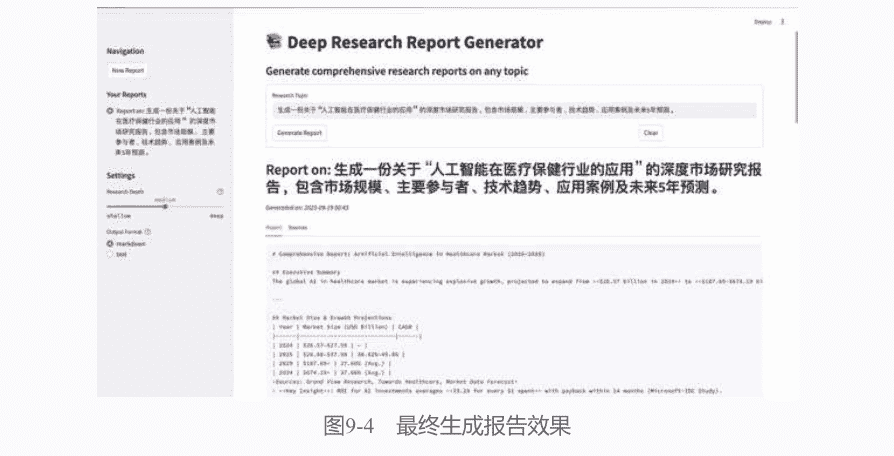

图9-4 最终生成报告效果

完整报告内容可以在本书配套代码仓库本章对应文件夹的output文件夹内的“人工智能在医疗保健行业的应用：市场研究报告.md”文件中查看。

### 9.6.2 学术文献综述

研究人员需生成特定研究领域的文献综述，内容需涵盖关键论文、研究方法、主要发现及研究趋势。

具体实现方式为：配置专注于学术研究领域的深度研究报告生成智能体，集成arXiv、PubMed、Google Scholar等学术数据库API，实现支持APA、MLA等样式的引用格式化功能，同时添加研究方法分析与批判性评价功能。

示例查询为：生成一份关于“量子计算在密码学中的应用”的学术文献综述，包括最近5年的关键论文、研究方法、主要发现和未来研究方向。使用APA引用格式。

实际效果显示，系统可自动搜索并分析相关学术论文，提取关键信息、识别研究趋势，最终生成包含规范引用与参考文献的结构化文献综述。这有助于研究人员快速掌握所在领域的研究现状，大幅节省文献检索与整理的时间。

最终生成的研究报告效果如图9-5所示。

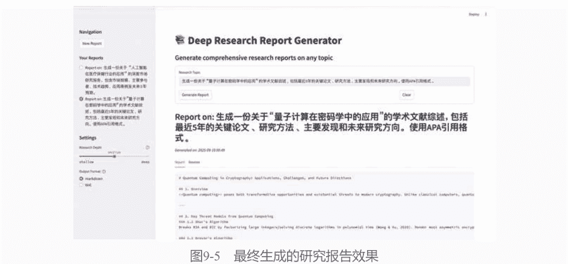

完整报告内容可以在本书配套代码仓库本章对应文件夹的output文件夹内的“Quantum Computing Applications in Cryptography: A Contemporary Review (2019-2024).md”文件中查看。

### 9.6.3 竞争对手分析

企业需要对竞争对手展开全面分析，内容涵盖产品对比、市场策略、优势劣势及潜在威胁。

具体实现方式为：配置专注于竞争对手分析的深度研究报告生成智能体，接入公司网站、新闻、财报、社交媒体等公司数据源，实现SWOT分析与竞争矩阵生成功能，同时集成情感分析以评估市场对竞争对手的看法。

示例查询为：生成一份关于“电动汽车市场特斯拉、比亚迪和大众”的竞争对手分析报告，包括产品对比、市场份额、技术优势、商业模式和未来战略。

实际效果显示，系统可自动收集并分析竞争对手信息，对比产品特性与市场策略、识别优势劣势，最终生成包含SWOT分析与竞争矩阵的结构化分析报告。这有助于企业清晰掌握竞争环境，进而制定更有效的市场策略。

浏览器操作过程示例截图如图9-6所示。


(a)

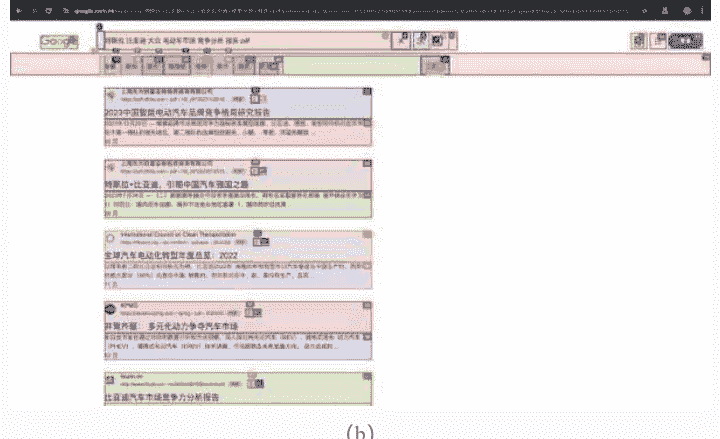

(b)


(c)

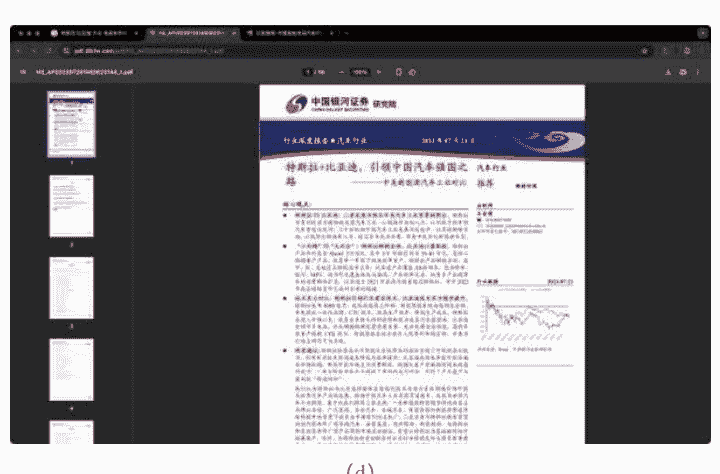

(d)

图9-6 浏览器操作过程示例截图

最终生成的报告效果如图9-7所示。

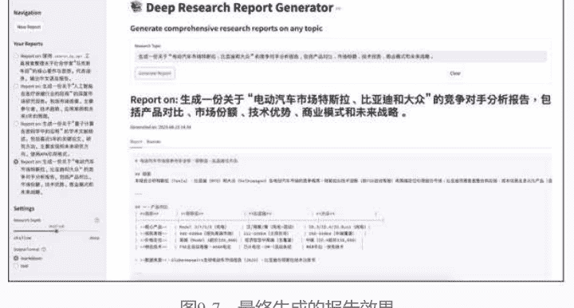

图9-7 最终生成的报告效果

完整报告内容可以在本书配套代码仓库本章对应文件夹的output文件夹内的“电动汽车市场特斯拉、比亚迪和大众竞争对手分析报告.md”文件中查看。

## 小结

本章围绕基于MCP与browser-use技术开发深度研究报告生成智能体的完整流程展开探讨。我们首先深入剖析了MCP的核心架构与browser-use工具的功能特性，在此基础上设计了分层系统架构，实现了从网络搜索、内容提取到报告生成的全流程功能，并通过Streamlit搭建了直观的用户界面。在技术实现层面，重点介绍了MCP Server开发、浏览器自动化控制及LangGraph工作流管理等关键技术，同时构建了完善的容器化部署方案与运维监控体系。

从技术发展视角看，深度研究报告生成智能体展现了AI智能体的巨大潜力。未来该领域将向多模态理解、领域专业化、自主研究代理等方向持续演进，同时也需高度关注信息真实性、减少偏见及保护隐私等伦理责任。随着技术不断迭代，这类系统将为用户提供更智能、高效的研究支持，充分释放AI在知识获取与分析领域的价值。

通过本章学习，读者不仅能掌握开发深度研究报告生成智能体的技术知识，还明晰了这一领域的广阔前景与发展潜力。伴随着AI技术的持续进步，基于MCP与browser-use的应用将愈发智能，为用户提供更高质量、更具个性化的研究支持。

深度研究报告生成智能体是AI智能体的典型代表，它展示了如何将先进AI技术与实际应用需求深度融合，打造真正具备应用价值的解决方案。通过持续探索与创新，我们可进一步推动该领域发展，释放AI技术的更多潜能，为用户提供更智能、高效的研究工具。

配套资源验证码251686