# MCP实战全书：让模型连上真实世界

## 内容提要
本书针对想深耕智能代理开发的从业者，采用三段式推进。从概念认知到工程准备，再到项目实操，帮助迅速掌握模型上下文协议在真实场景里的关键用法。

第1～2章聚焦原理与结构，梳理协议的来历、在代理构建中的角色、整体框架、分层思路以及核心职能，为后续动手建立认知地基。

第3～4章转向工程搭建，介绍 TypeScript 与 Python 环境的配置、相关工具链的部署及 SDK 的调用方法，让开发平台快速就位。

第5～9章为全书重点，围绕五套完整案例递进展开：从最小可用代理起步，再到电商场景代理、学术研究类代理、数据洞察 ChatBI 类代理，最后到深度研究报告自动生成代理。每套案例均配有结构说明与实现思路，展示协议在不同业务形态中的落地样貌。

内容适合人工智能研究者、软件工程师、产品负责人阅读，也可作为计算机相关专业学子与技术爱好者的进阶参考。

## 推荐序
行业正处关键拐点。大模型从实验室走向产业，正在重塑各行各业的生产方式。由此浮现的核心命题是：如何让能力不断增强的智能代理，以安全可靠的方式接入数字与物理世界，实现感知、理解与自主执行。

本书给出的答案是《精通MCP：AI智能体开发实战》。

书中剖析的模型上下文协议，是回应上述命题的关键基座。它不仅是实现手段，更是一项面向开放协作的开放标准。在我看来，MCP 对智能代理的意义，如同 TCP/IP 对互联网，旨在终结应用接入外部系统时的孤岛与碎片化定制。

协议出现之前，为不同大模型接入外部数据或能力，往往需要针对模型与数据源分别编写适配代码。开发成本高、稳定性差，点对点集成拖慢了复杂系统的构建。MCP 通过统一优雅的交互方式，让各类大模型以标准姿势访问海量数据源以及功能工具，将过去的集成难题转化为对标准能力的声明与调用。

作者陈光剑兼具扎实的理论功底与丰富的一线实战经验，长期走在技术前沿。由他执笔的内容既保证技术准确，也融入大量来自一线的踩坑与工程经验，这是实战类技术著作最宝贵的价值。

全书学习路径贴合开发者认知规律：先以架构与核心逻辑建立完整框架，再手把手带环境搭建扫清障碍，最后通过五个生产级项目带领读者整合工具、解决真实业务问题。每一步都指向可落地、可复用的技能。

对研究者、工程师、技术负责人、产品经理以及热爱人工智能的爱好者而言，本书既是掌握即将成为行业标准的协议的指南，也是理解以上下文为中心的代理设计范式的窗口，这正是人工智能融合时代构建竞争力的关键。

希望读者在阅读中不仅学会使用协议，更能体会其设计哲学，释放创造力，共同构建更智能、高效、可持续的未来。

木羽 阿里云技术内容负责人

2025年秋于杭州

## 推荐语
作者在技术前线深耕多年，主导过多个大规模系统的设计与交付，对新技术走向有敏锐嗅觉。丰富的实战积淀让本书具备扎实根基。协议架构、创新点以及多行业落地场景都被做系统拆解。想补全 AI 技术地图的专业人员、希望用协议驱动业务突破的决策者、以及对新技术有好奇心的爱好者，都能在这里找到启发。
——常磊 字节跳动资深AI应用工程师

现在智能代理爆发，关键在于让大模型真正跑起来并和现实世界无缝衔接。MCP 正是完成这段最后连接的核心枢纽，用标准化的资源、工具与提示管理为代理搭桥。本书从机制讲到项目，把读者从构思拉向可执行的落地环节。
——陈明熙 资深应用研发工程师

大模型渗透加剧，业界急需能落地的实战人才，很多人卡在理论与实践脱节、技术方向不明。本书给出清晰指引。作者结合十多年架构经验与对 AI 的深度理解，以 MCP 为主线拆解代理架构、数据安全、系统兼容等基础知识，并用五组真实案例演示需求拆解到上线部署的完整链路，同时点出易错点与优化思路。
——邓子明 Coupang Technical Expert, Kafka Committer

书里融合大模型应用、智能数据分析与企业级架构实践，带领读者从零构建智能代理，重塑工作流。阐述如何结合工程思维与 AI 原生理念改造流程、激发创造力，并提供丰富开箱即用案例，帮助掌握基于协议开发代理的知识与技能。
——董家云 新华三资深解决方案架构师

以一线大厂落地项目为骨架，以协议级架构视角为核心，系统解析协议如何成为代理连接内外能力的通用接口。既有标准化交互范式的深度思考，又提供 TypeScript 与 Python 全栈实战，并融入电商、科研、BI 场景的调试优化经验，为大模型安全高效调用数据与工具提供思路。
——杜蒙 字节跳动后端技术专家

全书系统阐释协议在智能代理开发中的核心作用，涵盖起源、架构设计、环境搭建及多场景实战。作者依托互联网实战经验提供从理论到实践的全方位指导，既可作理论参考也可作项目指南，堪称该领域专业教材。
——樊继本 国电南瑞资深解决方案工程师

凭借十余年互联网架构研发经验，作者将协议创新理念与真实业务需求深度融合，梳理理论基础、架构设计与核心职能。结合 TypeScript 与 Python 两大技术栈从零搭建高效开发环境，并通过五个完整项目帮助掌握应用落地方法。
——郭宇 阿里云高级技术专家

本书直面智能代理开发的核心挑战：如何高效连接大模型与真实业务系统。作者深入解析关键协议，并通过商城代理、数据洞察 ChatBI 代理、深度研究报告生成代理等高质量项目系统展示从原理到架构落地的完整路径。涵盖双技术栈，代码清晰，案例典型，为电商商品管理、订单处理等场景提供可行方案。
——赖文豫 某头部互联网大厂消费者业务数据智能技术负责人

人工智能重塑各行各业，如何确保代理安全高效融入实际业务成为焦点。本书出版恰逢其时，以协议为核心从理论到实战逐步深入，阐释底层设计逻辑并借助丰富案例指导开发。兼顾理论深度与工程实践，适合初学者入门，也能帮助资深开发者突破瓶颈。
——李健 小红书资深研发工程师

若把人工智能比作核心引擎，智能代理就是引擎的操作系统。本书不仅指导造轮子，更指导如何把轮子打造成驱动业务增长的超级引擎。这不仅是技术教程，更是一套把能力转化为业务价值的方法论。
——李梦旭 字节跳动资深研发工程师

本书深入浅出介绍协议是什么、怎么用，系统解析技术原理及实战应用，带领读者在人工智能浪潮中从入门到独立做项目的一站式指南。
——梁莹莹 阿里巴巴前技术专家、字节跳动前技术专家

作者是经验丰富的 IT 专业人士，也是协议早期探索者与布道者。作为最早一批自购 AI 服务器并调优大模型的实践者，他毫无保留分享实践经验与教训，书中不仅讲解技术细节，还融入性能优化、资源管理与工程实践的独到见解。
——刘鼎亮 锐捷网络技术专家

以全局视角剖析人工智能应用的设计理念与实践路径，融入丰富工业级案例，内容全面且通俗。无论是应用开发者、架构师还是初学者，都是不可错过的实用宝典。
——刘文中 字节跳动前资深架构师、阿里巴巴前技术专家

本书不仅是开发手册，更从架构层面剖析协议如何实现应用解耦，推动模块化开发，提升协作效率与系统稳定性。对技术选型与未来规划具有高参考价值。
——刘钊 字节跳动后端技术专家

打破人工智能与现实世界的壁垒，确保代理安全高效连接外部数据与工具是每位开发者的核心挑战。本书提供理想方案，系统阐述协议以优雅标准解决集成孤岛问题，并通过五个场景实战带领读者用 Python 与 TypeScript 亲手构建下一代智能代理。
——罗光 某头部互联网大厂高级技术专家

书中系统解析分层设计、核心职能与安全机制，通过五大实战项目带领读者运用 TypeScript 与 Python 构建可控、可扩展、可协作的代理系统。是把大模型从知识库升级为行动派的实战手册。
——罗张挥弦 字节跳动资深研发工程师

契合人工智能融合国家战略，深入探讨智能代理在多个领域的实践。作者凭借深厚的大厂研发与架构经验，将前沿技术与具体业务场景有机融合，通过标准化设计促进人工智能与生产生活的有效对接，为读者开拓创新视野。
——马巍巍 中国电信资深工程师

这是一本把协议讲透、把代理开发讲活的实战指南。作者凭借一线大厂深厚积累，为读者铺就从理论到实战的清晰路径，无论初学者还是资深开发者都能获得启发。
——牟家彬 字节跳动资深架构师、前阿里巴巴高级技术专家

本书最大亮点是可复现性。读者不仅掌握理论，还能动手运行与调整五个完整项目，体验 TypeScript 的类型安全优势与 Python 在数据处理上的强大能力，充分展现协议的跨语言互操作魅力。
——彭茜雯 字节跳动后端技术专家

当大模型陷入只会输出文本不会落地的困境时，协议重新定义了智能代理的能力边界。本书以实战派笔触清晰阐述协议如何从解决集成碎片化成长为行业标准，并通过五个跨场景项目展现人工智能如何利用协议读取数据库、调用工具、管理上下文，实现从思考到行动的突破。
——孙磊 字节跳动资深AI应用工程师

在人工智能融合战略推动下，落地已从技术问题升级为生态问题。本书敏锐捕捉到协议这一关键基础设施，不仅指导如何开发代理，更阐释其作为人工智能世界通用接口的生态价值，通过统一标准终结碎片化，促进工具与数据自由流动。
——王龙 字节跳动资深AI应用工程师

本书如同为智能代理开发者绘制的技术地图。作者不仅标注架构中的关键地标，更还原真实开发动线：从技术栈决策到环境搭建依赖问题，再到实战项目中需求分析、架构设计到测试部署的完整闭环。
——王帅 某头部互联网大厂高级技术专家

与作者在阿里技术部门共事多年，深知他是技术领域少有的实践派与远见者。本书见证他对技术的纯粹热爱，通过通俗类比与示例结合简单易用工具链，提供人工智能工程敏捷实施指南，为希望快速构建业务价值的开发者提供实用参考。
——王志红 华为技术有限公司数据技术专家

作者凭借深厚大厂系统架构研发与设计经验，将前沿技术与实际业务需求深度融合。理论上高屋建瓴阐释协议作为开放标准推动原生应用范式革新，实践上细致入微提供 SDK 使用、五大项目代码实现及部署细节指导。
——肖玉哲 字节跳动AI应用技术专家

本书兼具技术深度与实用性，以协议为核心系统剖析代理开发关键技术，涵盖分层架构、标准化工具调用、多语言支持及主流框架集成。通过五个精心设计的实战项目将抽象理论转化为可落地方案。
——杨通 某头部互联网大厂消费者业务营销增长技术负责人

本书兼顾广度与深度，为不同背景读者铺设顺畅学习路径。初学者可按三部曲结构从基础逐步过渡到应用，经验丰富的开发者亦可深入架构核心与高级应用，例如利用 LangGraph 构建复杂代理工作流。
——张海东 字节跳动客户端技术专家

本书是系统讲解基于协议的智能代理开发实战指南，学习路径分为奠定架构理论基础、掌握 TypeScript 与 Python 双栈环境搭建、通过商城代理、数据分析 ChatBI 代理等典型项目融会贯通三个阶段，适合初学者循序渐进，也为中高级开发者带来架构设计、安全模型与性能调优的启发。
——张隽睿 字节跳动资深AI应用工程师

在智能代理开发领域，如何让大模型安全高效对接外部数据源与工具已成普遍痛点。本书提供系统化解决方案，作者凭借十多年实践经验深入阐述标准化连接理念，从架构设计、环境搭建到由浅入深的五个实战项目，每个环节配有详尽代码示例与测试部署流程。
——张圣海 字节跳动资深AI应用工程师

内容广泛覆盖协议起源、架构、环境搭建到多场景实战，帮助读者构建系统化知识体系。对核心概念阐释清晰，配合典型实战案例，确保理论学习或项目开发都能获得全面有效指导。
——张小侠 字节跳动后端技术专家

> ——章华龙 字节跳动 AI 应用技术专家

把工作重心放在智能体工程化落地上的软件工程师，这本书差不多就是一份可以直接开工的实战手册。它并没有停留在对模型上下文协议的概念性介绍，而是直面工程层面的关键难题：借助 TypeScript 或 Python 按规范搭建 MCP 服务端，贯穿始终地管控资源与工具的生命周期，以及构建安全可控的权限体系。全书串联起五个递进的实战案例，其中商城智能体与论文研究智能体从零到完整的构建过程参考价值极高，提供了可复用的代码模板与架构思路，对破解智能体与外部系统标准化接入的痛点很有帮助。

> ——朱金清 抖音电商增长与数据技术负责人

大模型浪潮之下，开发者既对创新应用充满期待，又被落地的繁琐所拖累：流程冗长、跨场景迁移吃力、技术栈驳杂导致入门门槛偏高。本书正是为回应这些痛点而作，给出系统性的解决方案。第一部分阐释模型上下文协议的基础与架构，突出其在简化流程与提升适配能力上的作用；第二部分聚焦开发环境与技术选型，从环境搭建到工具链、SDK 使用讲得很透，为实践打底；第三部分为多场景案例融合，对智能体开发具有很强借鉴意义。不论是刚接触大模型的初学者，还是希望在 MCP 方向寻求突破的从业者，都能从中获得启发，更稳健地推进大模型工程。

# 前言

我们正处在由人工智能驱动的深刻变革期。2025 年 8 月，国务院印发《关于深入实施“人工智能+”行动的意见》，明确迈向以智能经济、智能社会为目标的新阶段。“人工智能+”强调人工智能与千行百业深度融合，重塑生产生活方式，其要义在于形成人机协同、跨界融合、共创共享的新生态。

在此背景下，以大语言模型为代表的技术快速爆发，不仅改写人机交互方式，也重塑了软件开发范式。随着能力边界不断外扩，一个关键命题浮现：如何搭建稳固可信的桥梁，让愈发强大的智能体能够安全高效地感知数字与物理世界，获取实时精准的背景信息，并自主完成具备现实意义的任务与操作。

这正是模型上下文协议产生的语境，也是其承担的历史使命。

模型上下文协议是一项为解决人工智能与外部系统集成难题而设计的开放标准。若说“人工智能+”描绘了赋能百业的蓝图，MCP 就是实现蓝图的工程基石。它类似于人工智能世界的统一接口，为大模型提供标准连接，使其能够无缝安全地接入海量数据源与功能工具。

MCP 出现前，人工智能应用触达现实往往需要手工定制。开发者为每个数据源、每个 API 单独编写适配器，点对点集成成本高、效率低、难维护，系统容易形成集成孤岛。MCP 用一个统一优雅的协议取代分散混乱，为智能体提供通用可靠安全的资源与工具访问机制。

长期从事智能体系统架构研究与开发，我认为 MCP 不仅是协议，更是通往人工智能时代的钥匙。它把过去令人头疼的集成问题，变为对标准能力的声明与调用；内置精巧完备的安全与权限体系，确保智能体在探索和改变世界时始终在人类可监督、可控制的范围内，这与“人工智能+”强调的安全可控高度一致。

更关键的是，MCP 的开放性和可扩展性，为构建超越单一模型能力的复杂智能体系统和自主工作流提供了坚实底座。本书将带你进入 MCP 的世界，从核心理念到架构设计，从开发实践到高级应用，系统探索如何用 MCP 构建下一代人工智能原生应用，共同迎接“人工智能+”时代。

基于此，本书的目标是为读者提供一份全面且可操作的指南，帮助系统掌握 MCP 并落地到真实项目。

**全书分三大部分：基础与架构、开发环境与技术栈、基于 MCP 的智能体开发实战，覆盖从核心概念到工程落地的完整链路。**

第一部分 第1～2章：MCP 基础与架构。先介绍模型上下文协议的基本概念、架构设计和核心组件，帮助建立整体认知框架；再详解客户端—服务器架构，以及资源、工具、提示词等核心概念，为后续实践奠定理论基础。

第二部分 第3～4章：开发环境与技术栈。聚焦 MCP 的开发环境搭建与技术选型，详细介绍 TypeScript、Python 的 MCP SDK 安装与配置，解析工具链和生态，帮助快速搭建高效开发环境。

第三部分 第5～9章：基于 MCP 的智能体开发实战。通过 5 个完整项目展示如何用 TypeScript 或 Python 在不同场景开发 MCP 应用。从快速创建简单智能体，到复杂的商城智能体、论文研究智能体、数据洞察分析 ChatBI 智能体和深度研究报告生成智能体，每个项目都包含架构设计与代码实现，提供可直接参考的开发指南。

第三部分实战项目的具体安排如下。

第5章 基于 MCP TypeScript SDK 快速创建一个简单智能体、第6章 基于 MCP TypeScript SDK 创建商城智能体，这两个项目选用 TypeScript，主要因其强大的类型系统能帮助初学者更清晰地理解 MCP 的核心概念和数据结构。静态类型检查能在编码阶段提前发现问题，节省调试成本。TypeScript 与 Node.js 的结合让服务器部署直观简洁，很适合作为 MCP 开发的入门实战。

第7章 基于 MCP Python SDK 和 arxiv 创建论文研究智能体。学术研究需要处理大量结构化与非结构化数据，包括文献检索、内容分析和知识抽取，Python 在科学计算和文本处理上的优势使其成为首选。本章借助 Python 的 arxiv、docling 等专业库，演示如何构建能理解和分析学术论文的智能体，这类功能在其他语言里实现难度更大。

第8章 基于 MCP Python SDK 创建数据洞察分析 ChatBI 智能体。数据分析与可视化是 Python 的强项，Pandas、Matplotlib、Seaborn 等库提供强大支持。本章展示如何用 Python 构建能把自然语言查询转为 SQL、生成数据可视化并输出洞察的 ChatBI 智能体。Python 与 LangGraph 的结合让复杂对话管理变得简单，是此类系统的核心优势。

第9章 基于 MCP Python SDK 和 browser-use 创建深度研究报告生成智能体。研究报告生成需要网络搜索、内容抽取和报告合成，这要求强大的网页交互和文本处理能力。Python 的 browser-use、Playwright 等库提供先进的页面交互与内容提取能力，配合 Python 的文本处理能力，报告生成高效流畅。此外，Streamlit 让交互式原型界面搭建异常简单。

虽然第三部分的 5 个实战项目使用了 TypeScript 和 Python，但要强调的是，MCP 的设计理念之一就是跨语言互操作。实践中可以用 TypeScript 写客户端、Python 写服务器，或反过来，MCP 确保不同语言实现的客户端和服务器可以无障碍通信，为开发者提供极大灵活性。

配套源码可在 GitHub 代码仓库 https://github.com/AIGeniusInstitute/mastering_mcp 查看，也可在异步社区下载。

MCP 生态正在加速发展，越来越多的企业和开发者拥抱这一标准。从 Block、Apollo 这类通用科技企业，到 Zed、Replit、Codeium、Sourcegraph 等开发工具公司，MCP 正成为连接人工智能与真实应用的关键桥梁和智能体开发的业界标准。随着生态成熟，智能体将实现对不同工具和数据集的上下文统一管理，用可持续架构替代过去分散的集成方式。

作为技术作者和实践者，我坚信 MCP 将成为智能体开发的核心技术。本书旨在帮助构建完整的技术认知体系，提供可落地的实践方法。无论你是人工智能研究人员、软件开发工程师、产品经理，还是在校学生或人工智能爱好者，都能获得实用的开发技巧和项目经验。

在人工智能日新月异的时代，持续学习和实践是保持竞争力的关键。本书不仅是一本教程，更是一份邀请，邀请你加入 MCP 的探索与创新。让我们一起揭开人工智能与现实世界交互的新篇章，构建更智能、更高效的人机协同新范式。

感谢为 MCP 生态做出贡献的开发者和组织，正是你们的探索让技术从理论走向现实。感谢人民邮电出版社编辑团队和技术审阅人员的专业支持。感谢热爱技术的读者，是你们的热情激励我不断前行。期待与你们共同见证人工智能的下一个飞跃。

陈光剑

2025 年 9 月于杭州

# 第一部分
MCP 基础与架构

在人工智能快速演进的当下，大模型已成为技术革新的核心引擎。但功能强大的模型如何有效触达现实、获取必要背景并融入真实应用，是开发者面临的重大挑战。模型上下文协议正是为了破解这一难题而诞生。

本部分将深入剖析 MCP 的基础理论与架构设计，帮助开发者快速建立理解和应用 MCP 的知识体系。

# 第1章
## MCP起源与演进

本章作为开篇，帮你建立对 MCP 的整体认知，快速掌握核心理念与基础用法。主要内容包括：MCP 的起源与发展历程，说明智能体开发为何需要标准协议；梳理 MCP 在智能体中的角色与定位，解析其作为连接大模型与现实世界的桥梁作用；简要介绍 MCP 如何帮助解决背景信息管理等实际开发难题。

学完本章，你将全面理解 MCP 的来龙去脉、意义和基础应用，为后续深入架构和智能体开发打下坚实基础。

### 1.1 MCP的起源

随着 ChatGPT、Claude 等大模型在应用开发中普及，其强大的推理与内容生成能力备受关注。但模型与外部系统交互时缺乏统一标准接口，给开发者带来新挑战。各模型采用不同的交互机制，比如 OpenAI 的 Function Calling、Claude 的 Tool Use，它们在调用外部 API 时的数据格式、参数传递和错误处理方式各不相同。集成不同模型时，开发者需要为每个模型单独设计适配方案，代码冗余、难维护，系统架构因此碎片化。

举个简单例子，想让模型调用 API 获取天气信息，对接 ChatGPT 需要按特定格式写 JSON 函数调用，接入 Claude 则要重新设计自然语言指令拼接参数的逻辑。当应用需要同时支持多个大模型时，这种非标准化交互会让代码逻辑错综复杂，维护成本飙升，开发效率大幅下降。

在此背景下，MCP 应运而生。2023 年底，Anthropic 首次提出 MCP 的概念，旨在为大模型提供标准化的上下文获取协议。2024 年初，MCP 首个规范版本发布，定义了基于 JSON-RPC 2.0 的通信格式和核心功能。随后，OpenAI、Google、Microsoft 等头部人工智能企业纷纷支持，MCP 成为行业广泛采用的标准协议。2025 年，MCP 已成为行业标准，并建立起完善的 SDK 生态，形成完整技术闭环。

#### 1.1.1 应用演进的三次跃迁

软件与人工智能的结合经历了三个阶段：传统应用、AI 增强应用和智能体。

##### 1. 从传统应用到 AI 增强应用

传统应用建立在确定性逻辑和严格规则上。所有功能由开发者预先设计并固定，界面以表单、按钮、下拉菜单等结构化元素为主导。数据处理遵循明确规则和流程，像一条预设生产线，每个环节功能固定。这种确定性使系统行为高度可预测，输入相同就输出一致，模式成熟可靠。

但传统应用的局限也在显现：缺乏应对复杂环境的灵活性，对自然语言、图像、视频等非结构化数据处理能力有限，难以应对需要背景理解或边界模糊的任务。在变化快的数字世界里，这些局限成为提升体验的主要障碍。

随着机器学习和深度学习成熟，我们进入 AI 增强应用时代。这类应用把传统软件架构与人工智能能力融合，创造更智能、更具适应性的体验。AI 增强应用实现了重大突破：推荐系统个性化内容，智能搜索引擎理解查询意图而非仅关键词匹配，智能客服能理解自然语言。虽然界面仍以传统交互为主，但处理逻辑已质变。系统行为呈现部分可预测性，人工智能带来的不确定性增添“人性化”特质，能按场景和需求提供差异化响应。

AI 增强应用是数字产品演进的过渡阶段，在保持稳定可靠的同时逐步融入人工智能的适应性和创新性。这个阶段人工智能已开始显现价值，但尚未完全重塑应用核心架构和交互模式。混合模式为开发者和用户提供了逐步适应的空间，也为智能体的大规模普及奠定基础。

可以预见，AI 增强应用将持续演进，人工智能角色从辅助功能走向核心驱动力，最终引领我们进入真正的智能体时代，重塑人机协同边界。

##### 2. 智能体的定义与特性

在人工智能浪潮下，应用软件正经历深刻范式革命。在传统应用和 AI 增强应用之后，智能体正从概念走向现实，颠覆我们对软件设计、交互乃至本质的理解。

智能体从设计之初就把人工智能作为核心架构基础。与传统应用和 AI 增强应用的本质区别在于，智能体围绕人工智能特别是大模型能力构建整体架构、数据流传输和用户体验，人工智能不再是可选模块，而是应用的基础和核心。

这种以人工智能为中心的理念催生了一系列鲜明特性。

- 人机交互界面彻底改变。按钮、菜单和表单被自然流畅的对话取代。用户无需学习复杂操作逻辑，直接用文本或语音表达意图，实现零成本类人交互。
- 具备卓越的背景感知与记忆能力。每次交互都建立在之前沟通基础之上，应用能提供更连贯、高度相关的智能响应。
- 具备强大的自适应学习能力。通过持续分析每次交互，它不断学习用户偏好、习惯和需求，并动态调整行为模式和输出策略。应用会随使用时间推移从通用工具演变为高度个性化的智能体。
- 普遍支持多模态输入与输出。用户可用文本、语音、图像甚至视频传递信息，应用也能智能选择最恰当方式反馈。多通道交互打破单一信息维度限制，让沟通更高效、有表现力。
- 具备强大的工具使用和环境交互能力。通过调用外部 API、检索实时信息、操作本地文件或与其他服务联动，它能将核心智能延伸到广阔数字世界，完成远超自身范围的复杂任务。

正是这种高度灵活、可扩展且具备自我进化能力的架构，赋予智能体无与伦比的潜力，使其能从容应对复杂多变的现实场景，引领我们迈入万物皆有灵的智能应用新纪元。

#### 1.1.2 智能体面临的挑战

尽管潜力巨大，智能体发展仍面临技术实现、商业组织及伦理社会等多维度挑战。

##### 1. 技术层面的深水区

技术实现层面，智能体面临多重难题。首先是背景管理的难题。真正智能的应用必须拥有连贯记忆。但在大模型有限的“注意力窗口”内，如何高效存储、检索并传递跨越长期对话历史和用户个人偏好的海量信息本身就是艰巨任务。当对话出现信息冲突或语义歧义时，系统如何精准判断真实意图并合理响应？在保证对话深度的同时避免性能急剧下降？这些构成了背景管理的难题。

其次，模型本身存在局限。大模型时而出现的幻觉问题，即生成看似合理却与事实不符的内容，会严重影响系统可靠性。同时，它们在严密逻辑推理、处理实时性知识及深入垂直专业领域方面的能力仍需提升。因此开发者必须围绕模型设计精密的验证与补充机制，通过外部知识库、事实核查工具等手段确保输出准确可靠。

此外，系统集成的复杂性不容小觑。在现实企业环境中，智能体必须与庞杂遗留系统、异构数据源及多样第三方服务无缝对接。如何打通新旧系统间的数据壁垒，构建稳定高效集成方案成为关键。

在性能与资源消耗方面，模型推理需要高昂计算成本和巨大内存占用，使其在规模化部署、特别是向资源受限边缘设备迁移时面临巨大压力。如何优化模型、提升运算效率并构建能应对高并发的弹性架构，成为决定其应用前景的关键。

最后，由于模型输出的非确定性，很难像测试传统软件那样定义唯一“正确”行为。如何系统性评估应用表现？如何覆盖无限用户交互场景？面对持续演进的模型，如何保证测试有效性和一致性？这些问题迫使我们探索全新的测试范式与质量保障体系。

##### 2. 商业与组织层面的变革阵痛

在技术挑战之外，智能体要成功推向市场并融入企业运营，同样需克服商业与组织层面的多重障碍。

最突出的是人才资源的巨大缺口。构建和运营智能体需要跨学科团队，成员不仅要掌握传统软件开发技术，还要深入理解机器学习、提示工程、数据科学等领域知识。对大多数企业而言，这意味着必须加大内部培训投入或积极寻求外部合作，以弥补关键人才缺口。

成本与回报的模糊地带是一道先行关卡。训练和推理消耗算力、数据采集清洗存储占用资源、顶尖人才的薪酬压力叠加持续迭代的运维开销，每一步都在吞噬预算。要让前沿投入成立，企业必须在立项早期就搭建可验证的商业模型，用可持续的价值预期去说服决策层，否则容易把创新变成无底洞。

组织惯性的阻力更难被量化。智能代理的构建与运行天然倚赖跨部门协同、快速迭代的研发节奏以及以数据为依据的判断，这与传统企业层级分明、流程固化的运行模式存在结构性张力，内部排斥不可避免。相比技术攻关，自上而下的文化重塑对管理能力的要求更高。

即便产品打磨到位，使用习惯的迁移仍是最后一公里。如何把用户从图形化界面牵引到以自然语言对话为主的交互范式？怎样借由细致的设计和持续的引导来校准预期、建立信任？不同人群对新技术的接受节奏差异明显，如何弥合？答案直接决定落地的成败。

##### 3. 伦理与社会层面的深远考量

当智能更深地嵌入日常，伦理与社会议题随之凸显，成为不可跨越的红线。

个人信息的守护始终敏感。个性化服务建立在海量学习之上，企业在创造价值的同时，必须恪守法规，以最高标准保护隐私，防止泄露与滥用，这是基本社会责任。

算法是否可被理解，是信任的前提。多数大模型仍像黑箱，决策过程不透明既放大公众疑虑，也增加监管难度。让推理路径可追溯、可解释，是赢得认可的关键动作。

偏见放大的风险需警惕。若训练素材本身带有种族、性别、地域等偏见，代理很可能无意识复制甚至强化，招聘、信贷、司法等高风险场景的公平性将受损。

滥用风险在攀升。强大的内容生成能力一旦落入恶意之手，可能被用于造假信息、网络诈骗、声誉侵害。技术防线与监管机制的建设是一场持久的攻防。

自动化对就业结构的冲击也带来社会焦虑。认知类工作被逐步替代，部分岗位消失难以避免。如何通过教育转型、完善保障、培育新岗位来平滑结构变化，是全社会需共同回应的议题。

这些难题需要研发者、企业与社会协同破解。挑战虽多，智能代理在提效、催生新模式、解决复杂问题、推动进步方面仍具备巨大空间。

### 1.2 MCP的诞生

函数调用为大模型搭起通向现实的操作通道。开发者可向模型提供函数定义，包含名称、参数结构与功能说明。用户提出相关请求时，模型能自行判断是否需要调用并生成符合格式的结构化输出，从而完成查库、控设备、调接口等任务。以天气查询为例，定义 get_weather(location, date) 后，用户问“明天北京天气如何”，模型即可自动补全参数并完成对接。

ReAct 则提供了更系统的思考—行动闭环。复杂任务被拆解为思考、行动、观察、调整四个环节：先分析问题制定方案，再执行操作，随后观察结果，最后据此修正计划。这种结构化方式对多步推理和信息收集尤为有效，能明显提升推理深度与准确度。

即便两者取得成效，随着场景复杂度上升，局限也日益暴露：规范缺位导致跨平台开发困难，各家各自为政；能力表达受限难以刻画复杂资源关系；语境维护不足影响长期对话连贯性；安全边界模糊抬高风险；开发体验割裂拖慢效率。这些共同制约规模化。

当前生态中制约行业进程的突出问题包括：

- (1) 缺乏统一规范造成生态碎片化。每家模型厂商都采用独特的 API 格式与交互方式，开发者需为不同模型写适配代码，成本与维护负担陡增。若要同时支持 OpenAI、Anthropic 与本地模型，往往需要三套集成逻辑，重复劳动严重削弱效率。
- (2) 语境管理的复杂性成为构建高质量代理的主要障碍。语境是模型理解与响应的关键，但传统做法把管理完全推给应用层，缺少统一的传递、更新与优化机制。对话复杂或需持久化时，开发者被迫自行设计繁琐的语境系统，既难实现又易引入不一致。
- (3) 工具调用与资源访问的标准化不足限制扩展。函数调用虽能访问外部函数，但缺乏描述复杂资源关系与访问模式的通用方式。各厂商定义与调用方式不一，需额外适配层，且现有方案表达能力有限，难以支撑更复杂的交互。
- (4) 安全控制粒度不足日益凸显。随着代理接触更敏感的数据与系统，精细的权限控制与安全隔离变得关键。现有方案多缺乏完善的安全机制，难以做到精确权限管控，数据泄露与系统滥用风险随之升高。
- (5) 开发体验的割裂严重影响生产效率。缺少统一框架与工具链，开发者需要在不同平台间频繁切换，使用不同文档与工具，流程分散、效率低下。学习成本上升，代码的可维护性与可扩展性也受损。

MCP 正是为解决上述问题而设计。它通过统一通信规范消除平台碎片化；提供完善的语境管理机制简化复杂对话；以标准化资源与工具定义实现能力灵活扩展；以精细权限控制提升安全性；以统一开发框架改善体验。更深层次看，传统应用以数据为中心，而 AI 代理转向以上下文为中心的架构模式。

在技术生态中，MCP 处于核心枢纽。一端对接丰富的应用场景，包括聊天界面如 Claude Desktop、LibreChat，IDE 与代码编辑器如 Claude Code、Goose，以及 5ire、Superinterface 等；另一端整合多类数据源与工具，包括 PostgreSQL、SQLite、GDrive 等数据文件系统，开发工具如 Git、Sentry，以及生产力工具如 Slack、Google Maps 等。借助标准化适配，不同类型 AI 应用可高效调用各类工具资源，工具也能向应用层输出能力，进而形成模块化、可扩展的技术交互体系，为功能拓展与生态协同奠定标准基础。MCP 在 AI 智能体中的生态位如图 1-1 所示。

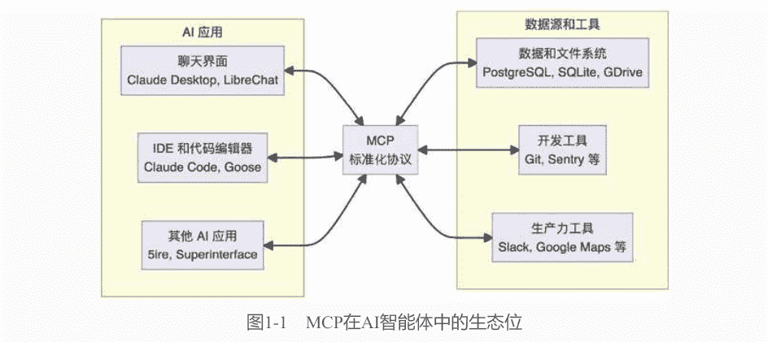

相较于 LangChain、LlamaIndex 等流行框架，MCP 体现了截然不同的设计思路。这些框架多是面向特定编程语言的库，而 MCP 定位为语言无关的协议规范；框架提供高级抽象与组件，MCP 聚焦底层通信标准；框架常与特定模型深度绑定，MCP 则兼容任何遵循协议的实现。值得注意的是，MCP 并非竞争关系，而是为这些框架提供更统一、更强大的底层支撑，LangChain 等完全可以基于 MCP 构建更丰富的生态。

作为 OpenAI 等推出的重要功能，Function Calling 与 MCP 存在本质区别。Function Calling 多为厂商专有，缺乏跨平台标准；其实现集中于单一函数调用场景，而 MCP 提供更全面的语境管理框架；Function Calling 通常需在每次请求中重新定义函数，MCP 则支持动态发现与注册机制，显著提升灵活性与运行效率。

MCP 的设计深刻反映了智能代理发展的新趋势。它将模型、语境、工具视为三大核心实体，通过标准化协议定义彼此交互。MCP 采用客户端-服务器架构，支持多种传输协议，并提供完整生命周期管理、安全授权与错误处理。这种设计不仅化解了当前开发面临的技术痛点，也为未来更复杂智能应用奠定基础。

MCP 与其他 AI 集成方案的主要区别，如表 1-1 所示。

表1-1 MCP与其他AI集成方案的主要区别

| 特性 | MCP | 传统API调用 | LangChain等框架 | Function Calling |
| :--- | :--- | :--- | :--- | :--- |
| 标准化程度 | 高 | 低 | 中 | 低 |
| 语言无关性 | 高 | 高 | 低 | 中 |
| 上下文管理 | 内置 | 需自行实现 | 提供组件 | 有限 |
| 工具调用 | 标准化 | 需自行实现 | 提供组件 | 内置但有限 |
| 动态发现 | 支持 | 不支持 | 有限支持 | 不支持 |
| 生态系统 | 开放 | 分散 | 特定框架 | 特定提供商 |

MCP 的核心优势在于提供开放标准化的协议，使不同模型与应用实现无缝互操作，大幅降低集成复杂度，让开发者更容易构建复杂的代理。

### 1.3 MCP在AI智能体中的角色

MCP 作为标准化协议，在智能代理的开发与部署中扮演关键角色。它解决了 AI 与现实世界交互的核心难题，为代理提供坚实基础。

#### 1.3.1 作为AI与现实世界的桥梁

在智能代理中，大模型需要与各类外部系统与数据源交互，获取语境并执行操作。MCP 正是连接 AI 与现实的桥梁，通过统一接口与通信格式，使交互标准化且高效。

MCP 为大模型打开了通往数据世界的大门，打破了模型只能处理预设文本的局限。借助 MCP，模型可动态访问文件系统、关系型数据库、NoSQL 数据库、Web API 等各类数据源。这种动态访问让模型不再局限于训练时的知识，而是能获取最新最相关的信息。例如用户查询某公司最新财报时，模型无需依赖可能过时的训练数据，可通过 MCP 直接查询财务数据库或公开 API，获得实时准确信息以提供更有价值的分析。

更令人振奋的是，MCP 赋予大模型使用专业工具的能力。在协议支持下，模型可调用代码执行器、图像处理服务、数值计算库甚至物联网设备控制接口。工具使用能力极大拓展了应用场景，让模型不仅能思考，还能行动。以财务顾问 AI 为例，它不仅理解投资需求，还能通过 MCP 调用金融分析工具执行复杂投资组合优化，甚至直连交易系统，提供从分析到执行的闭环服务，这在传统架构下难以实现。

随技术演进，交互形式日益多元。MCP 前瞻性地支持多模态内容处理，可无缝处理文本、图像、音频、视频。智能代理因此能理解并生成更丰富的表达，为用户创造更自然沉浸的体验。在教育场景中，AI 导师可借助 MCP 理解学生上传的手写笔记图片，识别数学公式或化学结构，动态生成图表或模拟动画，并配合口语化讲解，实现全方位学习。

MCP 的桥梁作用不仅在技术层面，更在于对生态的深远影响。通过标准化接口定义，促进工具、模型与应用间的互操作，降低集成成本，加速创新扩散。开发者可专注于专业工具或领域模型，无需担忧系统集成。模块化、可组合的特性，为代理带来前所未有的灵活与扩展性。

随着 MCP 广泛应用，我们正进入 AI 能力大幅扩展的新阶段。模型不再是孤立的文本处理器，而是具备感知、思考与行动的综合智能体。它们可检索最新知识、操作专业工具、维护长期记忆、处理多种媒体，融合后的能力正在重新定义智能代理的边界。从个人助手到企业决策支持，从创意创作到科学研究，MCP 正在赋能一代更强大、更实用的智能体，推动 AI 从实验室走向产业实践。

#### 1.3.2 解决上下文管理问题

构建智能代理的过程中，语境是模型理解意图、保持连贯、提供个性化服务的基础。但深入该领域会发现多重复杂挑战，既源于技术限制，也源于场景多样与体验要求。

语境管理涵盖窗口限制、相关性判断、实时更新机制、多源信息整合及隐私安全等层面。

(1) 语境窗口限制是根本性技术约束。大模型虽强，但处理能力受窗口大小严格限制。即便最先进模型也只能容纳有限 token，长时间交互或复杂任务时无法完整记忆全部历史。以客服场景为例，用户数小时深入咨询后，系统必须精准判断保留哪些关键信息、舍弃哪些次要内容，如同要求人在有限工作记忆中维持整日会议般挑战。限制迫使开发者设计精巧的信息流动机制，确保核心内容始终在模型视野内。

(2) 相关性判断更棘手：在海量信息中识别真正重要内容。系统需具备理解哪些信息对当前对话有实际价值的能力，不仅涉及语义相关，还需理解任务目标、用户意图甚至情感。例如财务咨询中，用户可能提及年龄、职业、经验、风险偏好等，系统需在不同阶段判断关键信息并保留在活跃语境。判断失误会导致关键信息丢失或噪音淹没，均严重影响表现。高质量相关性判断通常需结合语义相似度、主题建模、意图识别，甚至让模型参与重要性评估。

(3) 语境实时更新机制至关重要。在动态环境中，信息时效性直接影响决策质量。如智能家居控制，用户说“把温度调高一点”时，系统需实时掌握当前设定、实际温度、用户偏好模式等，这些信息可能秒级变化。构建能实时捕获环境变化并更新语境的机制，是开发响应灵敏智能体的关键，通常需要完善的事件监听与更新框架，及时刷新信息视图。

(4) 多源信息整合代表更高复杂度。现代智能体需处理来自不同系统、模态、时间点的异构数据并融合为统一语境。在企业场景中，系统可能同时访问 CRM 客户数据、知识库产品信息、邮件历史、日历安排等。如何在语义层面整合、处理冲突与重叠、建立一致连贯的语境模型，是需要知识图谱、信息抽取与语义理解协同解决的复杂问题。

(5) 隐私与安全增加深层复杂性。语境常包含个人数据、偏好、行为模式等敏感信息。在追求智能与个性化的同时，必须严格保护隐私与安全。需要精细权限控制、遵循数据最小化原则，并采用加密传输、匿名化等手段。例如健康咨询 AI 可能访问医疗记录，但必须遵循严格访问控制与处理规范，确保敏感信息不被不当泄露滥用。在全球数据保护法规趋严背景下，合规的语境管理已成为设计不可回避的关键。

这些挑战相互关联，共同构成复杂生态。MCP 通过以下机制应对语境管理问题。

(1) 资源抽象。MCP 将语境信息抽象为“资源”，每个资源拥有唯一 URI 与类型。该抽象使大模型能以统一方式访问不同类型语境。

资源可为文件、数据库记录、API 响应等。MCP 定义标准操作如列出资源、读取内容，使模型方便访问。

(2) 动态发现。MCP 支持资源与工具的动态发现，使模型能按实际需求获取相关语境。动态发现让管理更灵活高效。

例如模型可先列出可用资源，再根据对话需求选择性读取相关内容，避免一次性加载全部信息，提高效率。

(3) 语境优化。MCP 允许服务器对语境执行压缩、过滤、排序等优化操作，使其更适配模型需求，减少窗口占用，提升运行效率与响应效果。

例如服务器可按对话主题提供最相关信息，或将长文档提炼为要点。

(4) 分布式语境。MCP 支持分布式语境管理，信息可部署于多个服务器，增强扩展性以处理更大规模复杂语境。

例如一台服务器提供文件访问，另一台提供数据库访问，第三台提供 API 访问。模型按需从不同服务器获取信息。

随着 MCP 等标准化协议发展，语境管理正从零散方案走向系统化框架，为构建更智能、更自然、更安全的智能代理奠定基础。

## 小结

本章从当前智能代理开发的挑战出发，剖析了大模型与现实世界交互时，因缺乏统一标准导致的生态碎片化、开发效率低下等严峻问题。无论是 OpenAI 的 Function Calling，还是 Anthropic 的 Tool Use，这些方案虽在特定场景增强模型能力，却也为开发者筑起技术壁垒，使跨平台、可扩展的复杂代理构建举步维艰。

在此背景下，MCP 应运而生。通过将外部数据源与功能抽象为标准化的资源与工具，MCP 为大模型提供一套统一的交互语言以感知和操作世界。无论是读取本地文件、查询数据库，还是调用远端 Web API，都可通过标准化协议实现无缝对接。

这一章聚焦 MCP 如何解决智能体中长期对话记忆这一最棘手的痛点。传统做法依赖应用层手工编排上下文，流程复杂且易出错。MCP 通过内置的资源抽象、运行时自动发现和分布式记忆，将上下文治理沉淀为协议层能力。开发成本因此明显下降，长对话得以保持连贯和深度，也为更智能、更个性化的互动奠定基础。

## 第2章 MCP架构拆解

本章系统梳理 MCP 的设计思路与关键构成，覆盖三个维度。

- 架构全貌层面，说明整体理念，以及 Host、Client、Server 三大主体各自的定位与协作方式。
- 分层落地层面，介绍四层模型的划分、各层职责配合，以及传输层与协议层的实现路径。
- 核心能力层面，阐释资源、工具、提示模板三大能力如何支撑智能体的功能扩展与上下文增强。

掌握本章内容后，读者能够清晰把握 MCP 的架构脉络、技术细节与真实运行方式，为后续环境搭建与实战打下理论与实践基础。

### 2.1 MCP总体架构

MCP 采用客户端-服务器范式，由 MCP Host、MCP Client、MCP Server 三大角色构成，如图2-1所示。

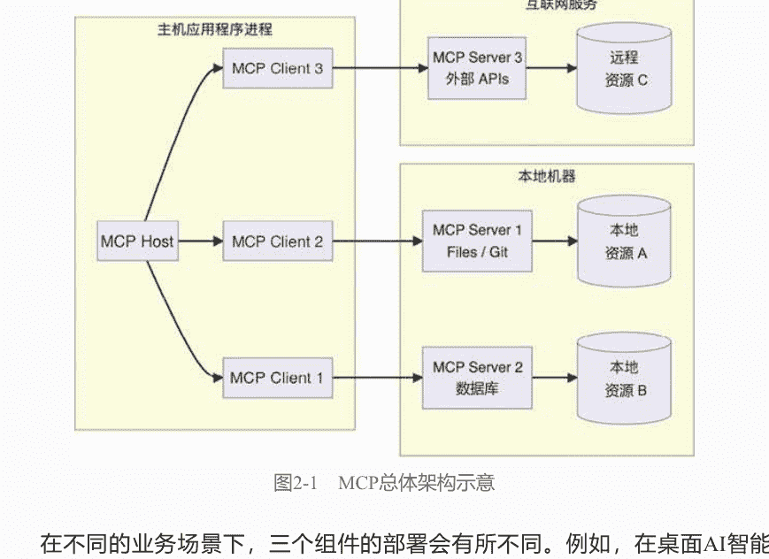

图2-1 MCP总体架构示意

不同业务形态下，三者的承载主体会变化。比如桌面智能体、IDE 集成、Web 应用、移动应用等典型场景中，Host、Client、Server 的具体载体各不相同。厘清边界有助于后续做合理的系统规划。表2-1 展示了四种常见场景下的角色映射。

表2-1 在不同应用场景下MCP组件的角色

| 应用场景 | MCP Host角色 | MCP Client角色 | MCP Server角色 |
| :--- | :--- | :--- | :--- |
| 桌面AI智能体 | Claude Desktop应用 | 内嵌MCP Client | 文件系统、API集成服务器 |
| IDE集成 | VS Code等IDE | IDE插件中的MCP Client | 代码分析、版本控制服务器 |
| Web应用 | 浏览器中的AI应用 | JavaScript MCP Client | 后端MCP Server |
| 移动应用 | 移动AI智能体应用 | 移动应用中的MCP Client | 云端MCP Server |

#### 2.1.1 MCP Host

MCP Host 本质上是具备大模型能力的运行环境，其工作重心放在建立、维护并优化人与智能体的连接上。

首先，它负责拉起并管控 MCP Client，保证与目标服务端保持稳定可用的链路，涵盖服务发现、鉴权授权、会话建立等步骤。

其次，它提供面向用户的交互载体。并非仅简单的输入输出区，而是一个经过设计的交互空间，需要清晰展示可用能力、引导高效使用并给予即时反馈，优质设计能显著降低认知成本。

再次，它承担格式转化的角色。把文本、语音、图像等多模态输入规范化为 MCP 请求，同时把模型返回的结构化数据转译为用户易懂的呈现。

作为 Client 与 Server 之间的协调方，Host 需要管理复杂的数据流动，包括请求排队、并发控制、响应聚合等。高负载下，流量调度的精细程度直接影响响应与稳定性。

最后，Host 是安全与权限的守门人。它要执行严格的访问控制，确保功能与敏感数据仅在授权范围内可用，同时保护用户隐私，防止信息被不当采集或滥用，这对信任建立至关重要。

在生态实践中，Host 形态多样。专业对话应用如 Claude Desktop 把强对话能力封装在精心设计的界面中；AI 增强的开发环境如 Visual Studio Code 与 JetBrains 系列 IDE 将补全、文档生成等能力嵌入开发流；各类生产力工具从文档到图像编辑，AI 已成标配；开发者也能基于 MCP 框架构建定制化专业应用，满足特定领域需求。

#### 2.1.2 MCP Client

在整体架构里，MCP Client 既是 Host 应用与 Server 之间的连接桥，也是驱动信息交换的引擎。由 Host 应用创建并管理，深度内嵌于 Host 环境，是调用外部模型、数据与工具能力的神经中枢。主要职责包括：

- 建立并维持与目标服务端的连接，任务结束后关闭链路，保证通信稳定。
- 作为交互发起方，把来自 Host 的需求封装为协议合规请求发送至服务端，并解析处理返回结果。
- 动态发现服务端暴露的资源，按需读取内容，持续为 Host 补充上下文信息。
- 调用服务端提供的工具，实现外部系统与 Host 工作流的无缝衔接。
- 获取服务端预置的提示词模板，降低与大模型的交互成本。
- 监测并处理通信与协议交互中的异常，保障系统健壮。

Client 处于承上启下的位置，是应用流畅可靠运行的基石。设计完善的客户端能把复杂的网络与协议细节封装，提供简洁稳定且功能完备的接口，让开发者更聚焦业务与体验。构建高质量客户端需遵循成熟实践。

##### 1. 构建MCP Client的最佳实践

与大模型交互或远程工具调用时，网络延迟难以避免。同步阻塞会让 Host 卡顿，体验受损。因此优先采用异步接口，让 Client 在等待 I/O 时归还主线程，保持应用响应。

针对抖动或服务端短暂不可用，应实现智能重试，如指数退避，以提升连接成功率；同时为所有网络操作设定合理超时，避免无限等待。

Client 必须做好资源治理，通信结束后及时释放网络连接、文件句柄等系统资源。错误处理不仅是捕获异常，更要实现优雅的错误上抛，向上层提供清晰可读的信息，而非底层细节，便于定位与反馈。

工程层面，利用现代语言的类型安全可在编译期拦截大量运行时问题，提升可靠性。审慎的日志记录是调试监控的关键，但务必避免写入用户敏感数据或凭证。

最后，易于测试的架构是高质量软件标志。通过依赖注入等手段解耦网络通信等外部依赖，可独立高效地对各单元进行测试，确保行为正确。

##### 2. MCP Client 错误处理思路

即便遵循最佳实践，分布式系统中的故障仍是常态。Client 需建立完善的错误识别与处理体系，应对外层异常。

连接层问题最常见，如网络中断、域名解析失败、连接超时、握手失败等。Client 须识别此类错误，按预设重试策略尝试恢复，失败时向上层报告明确的网络故障。

协议层错误出现在双方“对话”不符合 MCP 规范时，可能因消息格式错误、调用不支持的方法或版本不兼容导致。Client 应解析并转化为开发者友好的调试信息。

服务端功能性障碍属于另一类：连接与协议正常，但服务端因下游依赖故障或内部逻辑异常而出错，并返回明确错误响应。Client 的职责是正确解析错误码与信息并透传给 Host。

资源与工具访问受限，通常源于访问不存在或被权限策略禁止的资源，或调用工具时参数无效。这属于业务逻辑或权限校验失败，而非系统级故障。Client 需准确区分，以便 Host 据此调整行为，如提示“文件未找到”或“输入参数有误”。

MCP Client 是连接模型能力与具体场景的纽带，其设计优劣直接决定上层智能体的响应速度、稳定性和可靠性。

#### 2.1.3 MCP Server

MCP Server 是连接大模型与现实世界的关键枢纽，不仅是数据中转，更是赋予智能体“动手”能力的核心。通过统一接口，Server 使模型能够安全可控地获取实时数据、访问外部 API、执行自动化操作或调用复杂业务工具，从而大幅拓展智能体的边界。

Server 主要提供三大核心供给。

- 资源治理：为模型提供结构化数据访问，如知识库检索、数据库查询、文件存储等。
- 工具集成：向模型暴露可用外部工具，如自动化脚本、计算引擎、第三方 API，支持模型执行具体任务。
- 提示词模板：为特定场景预置高效 Prompt，提升指令理解与任务完成能力。

此外，Server 还承担请求路由、权限控制、会话管理、日志审计等基础职责，确保系统安全与可扩展。

##### 1. MCP Server 的分类

按功能，Server 通常分为四类。

- 资源型 Server：专注为模型提供结构化、半结构化或实时动态数据，如企业知识库、财务报表接口、新闻聚合、IoT 数据中台等。负责数据抽象、权限隔离与高效检索，是信息获取中枢。
- 工具型 Server：聚焦能力扩展，把自然语言指令映射为可执行操作，如自动化运维脚本、文件批处理、搜索引擎接口、邮件日程管理等，使模型能直接操作外部系统。
- 提示词型 Server：深耕垂直领域，内置大量高质量 Prompt 模板，面向客服、代码开发、法律咨询、市场分析等场景，提升任务执行效率与上下文理解，适合对指令精度要求高的行业。
- 混合型 Server：融合多种能力，常用于企业级 AI 解决方案或开发者平台。例如集成知识库、自动化工具、业务数据与 Prompt 管理的综合型 Server，为复杂业务流程提供一站式 AI 基础设施。

设计精良的 Server 决定了智能体的智能上限、性能表现、安全边界与扩展空间，构建过程堪称整个智能系统的基石。

##### 2. MCP Server 设计原则

优秀的 Server 设计始于规范契合与面向未来的可扩展性。

首先，完全契合 MCP 规范是与各类 Client 及 Host 无缝协作的前提，需精确实现交互细节并提供清晰标准化的 API 文档，形成可信赖的稳定契约。

其次，架构应具备高度可扩展性。通过模块化、插件化设计，开发者可像搭积木一样扩展新能力，无需颠覆核心代码。支持 TypeScript、Python、Java/Kotlin 等主流语言的 SDK，进一步降低集成壁垒。

再次，现代智能体面临高并发挑战，Server 需具备出色的 I/O 处理能力、高效并发模型与智能缓存策略。采用云原生架构，通过容器化与微服务化部署，结合 Kubernetes 编排，可实现弹性伸缩与高可用。部署模式需灵活，无论作为独立微服务还是嵌入企业数据中台，都应无缝集成，并支持流式 HTTP、标准输入输出等传输协议，适配命令行工具、本地集成、进程通信、Shell 脚本、Web 应用等多种场景。

安全是最高优先级。全方位构建安全体系：通过 OAuth、API Key、JWT 等机制进行身份认证与鉴权；对所有客户端输入严格校验，防止注入或 XSS；多租户环境下实施资源隔离；对与真实环境交互的工具限制最小必要权限，必要时在沙箱运行；敏感数据加密存储与传输，并配合审计日志满足合规。

工程实践将设计落地。采用“契约先行”模式，先明确资源、工具、提示的输入输出格式，实现前后端并行。部署时配置与代码分离，利用环境变量或配置中心管理密钥等敏感信息。构建规范的错误码与异常体系，使客户端可清晰识别问题并自动恢复。覆盖核心路径的自动化测试保障变更安全。完善的文档与示例则降低集成成本，促进生态繁荣。

总体而言，开发 MCP Server 是规范理解、架构智慧、安全意识与工程纪律的综合挑战，需要持续跟踪演进，以工匠心雕琢细节。

### 2.2 MCP分层及实现

MCP 采用四层架构模型，自底向上依次为：传输层、协议层、能力层、应用层。

- 传输层负责客户端与服务器之间的实际通信，抽象底层网络细节，提供统一的收发消息接口。
- 协议层负责消息帧处理、请求响应关联及高级通信模式实现，严格遵循 JSON-RPC 2.0 规范，为通信提供结构化框架。
- 能力层定义 MCP 核心功能，具体实现资源管理、工具集成与提示词模板三大能力。
- 应用层负责将 MCP 能力集成到实际应用，承载业务逻辑与用户交互。

分层设计明确各组件职责边界，为生态扩展提供坚实基础。理解 MCP 架构的关键在于把握传输层与协议层的具体实现，后续章节将详细介绍能力层与应用层，展示如何组合基础组件构建功能强大的智能体。

#### 2.2.1 传输层实现

本节介绍 MCP 传输层的实现，主要包括传输类型、消息类型与错误代码、请求-响应模式。

##### 1. 传输层类型

为适应不同部署场景，MCP 支持三种传输实现。

- 标准输入/输出 stdio 传输。
- HTTP/SSE 传输。
- 自定义传输。

stdio 传输通过进程的标准输入 stdin 与标准输出 stdout 通信：客户端经 stdout 发送消息，经 stdin 接收消息；服务器经 stdin 接收消息，经 stdout 发送消息。

以下代码使用TypeScript实现了一个基于MCP的客户端-服务器通信系统，以展示客户端如何启动子进程服务器并建立通信。

```typescript
// 客户端代码
// 创建MCP Client实例，指定客户端名称和版本
const client = new Client({
  name: "example-client",
  version: "1.0.0"
}, {
  // 声明客户端支持的能力（功能特性）
  capabilities: {}
});

// 创建基于stdio传输的客户端传输层，该传输层会启动服务器进程并通过标准输入/输出与其通信
const transport = new StdioClientTransport({
  command: "./server",
  args: ["--option", "value"]
});
// 客户端通过传输层连接到服务器，之后客户端和服务器即可开始交换消息
await client.connect(transport);

// 服务器代码
// 创建MCP Server实例，指定服务器名称和版本
const server = new Server({
  name: "example-server",
  version: "1.0.0"
}, {
  // 声明服务器支持的能力（功能特性）
  capabilities: {}
});

// 创建基于stdio传输的服务器传输层，该传输层会监听标准输入/输出以接收客户端消息
const transport = new StdioServerTransport();

// 服务器通过传输层监听客户端连接，之后服务器就可以接收来自客户端的消息并返回响应
await server.connect(transport);
```

在 MCP 可用的传输方案里，stdio 是实现成本最低的那一类。它几乎不需要任何网络层面的配置，部署简便、时延极低，很适合在同一台机器上的不同进程之间直接协作。但它的局限也很明显：只能局限于本地进程间对话，不支持一个服务端同时接入多个客户端，且宿主进程一旦结束，整个通信链路也会随之中断。综合来看，它最典型的用法是：

- 用来搭建命令行工具，并让其与后台服务进行交互。

## 2.2.1 传输层

MCP 自带了一套 HTTP 与 Server-Sent Events 结合的传输方式。SSE 是 HTML5 规范下提供的服务端向客户端单向实时推送的技术，借助它与 HTTP POST 请求的配合，可以在跨网络的环境中工作，尤其适配 Web 应用场景。

该方案通过 HTTP POST 实现全双工交互：一方面借助 SSE 的特性完成服务端向客户端的流式推送，另一方面也能接受客户端发起的请求。

客户端与服务端之间的交互顺序见图 2-2 所示。

（1）建立 SSE 通道：客户端先向服务端发送一条 HTTP POST /mcp 的请求以创建 SSE 通道，服务端处理成功后回 200 OK，通道建立完成。

（2）请求与响应往返。
- 客户端通过 HTTP POST /mcp 把 JSON-RPC 请求递交给服务端。
- 服务端处理完后，以 SSE 事件的形式把 JSON-RPC 响应回传给客户端。
- 客户端可以连续发送多条 HTTP POST /mcp 的 JSON-RPC 请求，服务端则依次以 SSE 事件返回对应结果。

（3）结束连接：客户端发送一条带关闭信息的 HTTP POST /mcp 请求，服务端收到后执行收尾操作并关闭 SSE 通道，一次完整的通信就此结束。

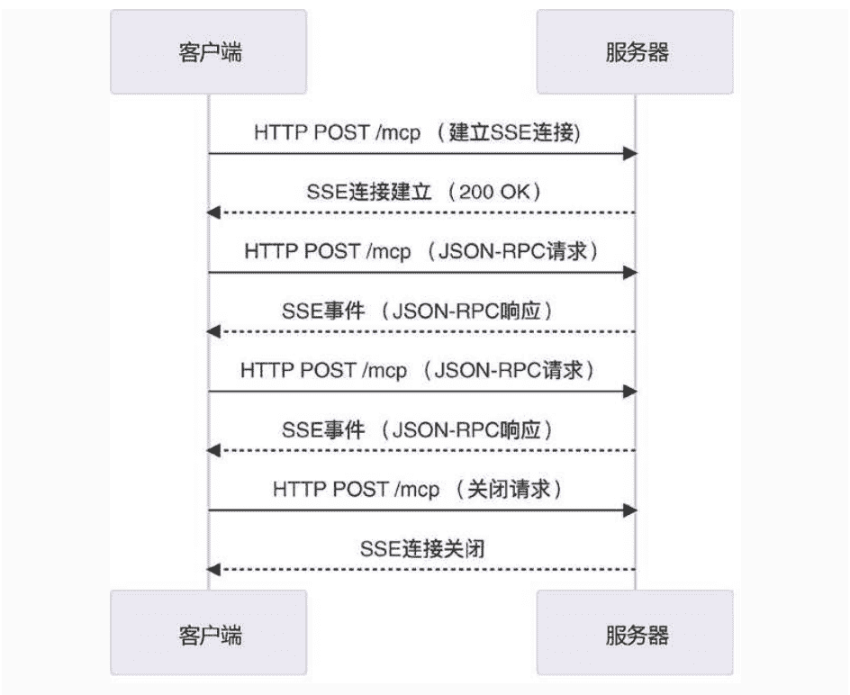

图2-2 客户端与服务器的通信示意

下面这段 TypeScript 示例展示了如何借助 HTTP/SSE 完成客户端与服务端的双向通信。

```typescript
// 服务器端代码
// 使用Express框架搭建HTTP服务器（MCP Server）
import express from "express";
const app = express();
const server = new Server({
  name: "example-server",
  version: "1.0.0"
}, {
  capabilities: {}
});

let transport: SSEServerTransport | null = null;

// 处理SSE连接请求，创建SSE传输层并连接MCP Server
app.get("/sse", (req, res) => {
  transport = new SSEServerTransport("/messages", res);
  server.connect(transport);
});

// 处理客户端发送的消息（通过POST请求）
app.post("/messages", (req, res) => {
  if (transport) {
    transport.handlePostMessage(req, res);
  }
});

// 启动服务器，监听3000端口
app.listen(3000);

// 客户端代码
// 创建MCP Client并连接到服务器
const client = new Client({
  name: "example-client",
  version: "1.0.0"
}, {
  capabilities: {}
});

const transport = new SSEClientTransport(
  new URL("http://localhost:3000/sse")
);
await client.connect(transport);
```

stdio 与 HTTP/SSE 的主要差异可归纳为下表。

表2-2 stdio传输与HTTP/SSE传输的对比

| 特性 | stdio传输 | HTTP/SSE传输 |

| :--- | :--- | :--- |

| 通信范围 | 本地进程 | 本地或远程 |

| 复杂度 | 低 | 中 |

| 延迟 | 极低 | 低至中 |

| 安全性考虑 | 最小 | 需要TLS、认证等 |

| 适用场景 | 命令行工具、本地插件 | Web应用、远程服务 |

| 实现难度 | 低 | 中 |

| 防火墙兼容性 | 不兼容 | 良好 |

| 多客户端支持 | 不支持 | 支持 |

传输层的选型直接影响基于 MCP 的智能体在性能、安全和可靠性方面的表现，开发者需要结合实际需求做出取舍。实践中建议综合以下维度判断：

- 部署位置：本地型应用更倾向于选用 stdio；面向 Web 或远程服务的场景则更适合 HTTP/SSE。
- 安全要求：跨网络通信必须引入 TLS 加密以及合适的认证手段。
- 延迟敏感度：对响应速度要求苛刻的场景，stdio 的低时延优势更明显。
- 扩展能力：若需要同时服务多个客户端，应优先选择 HTTP/SSE。
- 异常处理：网络环境下的传输应具备重试、断线重连等机制。

为了满足特殊通信需求，MCP 允许开发者遵循 Transport 接口规范自行实现传输层。下面的 TypeScript 代码定义了一个基于 JSON-RPC 的 Transport 接口，涵盖消息收发、连接管理以及错误处理的抽象方法和回调。

```typescript
interface Transport {
    // 启动传输层，初始化连接并开始监听消息
    start(): Promise<void>;

    // 发送JSON-RPC格式的消息（请求/响应/通知）
    send(message: JSONRPCMessage): Promise<void>;

    // 关闭连接
    close(): Promise<void>;

    // 回调函数
    onclose?: () => void;
    onerror?: (error: Error) => void;
    onmessage?: (message: JSONRPCMessage) => void;
}
```

自行实现定制化传输层的主要动机有 4 点：

- 需要使用非标准的网络协议；
- 需要借助特定的通信渠道；
- 需要对接已有系统；
- 对传输协议的性能有较高要求，需要专门优化。

##### 2. 消息类型与错误代码

在 MCP 内部，JSON-RPC 2.0 被用来承载 4 类核心消息。

（1）请求 Request：期望得到对方回应的消息，其结构示例如下代码所示。

```json
{
    "jsonrpc": "2.0",
    "id": 1,
    "method": "resources/list",
    "params": {}
}
```

（2）结果 Result：请求成功时的响应，其结构示例如下代码所示。

```json
{
    "jsonrpc": "2.0",
    "id": 1,
    "result": {
        "resources": [
            {
                "uri": "file:///example.txt",
                "name": "Example File"
            }
        ]
    }
}
```

（3）错误 Error：表示请求失败的响应，其结构示例如下代码所示。

```json
{
    "jsonrpc": "2.0",
    "id": 1,
    "error": {
        "code": -32601,
        "message": "Method not found"
    }
}
```

（4）通知 Notification：无需回应的单向消息，其结构示例如下代码所示。

```json
{
    "jsonrpc": "2.0",
    "method": "notifications/resources/updated",
    "params": {
        "uri": "file:///example.txt"
    }
}
```

除常用消息外，MCP 还定义了一组标准错误码，代码如下所示。

```typescript
enum ErrorCode {
    // 标准JSON-RPC 2.0错误代码
    ParseError = -32700,    // 解析错误
    InvalidRequest = -32600, // 无效请求
    MethodNotFound = -32601, // 方法未找到
    InvalidParams = -32602,  // 无效参数
    InternalError = -32603   // 内部错误
}
```

SDK 或应用可以自行扩展错误码，但自定义错误码的值必须大于 -32000。

##### 3. 请求-响应模式

MCP 遵循 JSON-RPC 2.0 标准，客户端与服务端之间的交互遵循请求-响应模式，示意图见图 2-3。

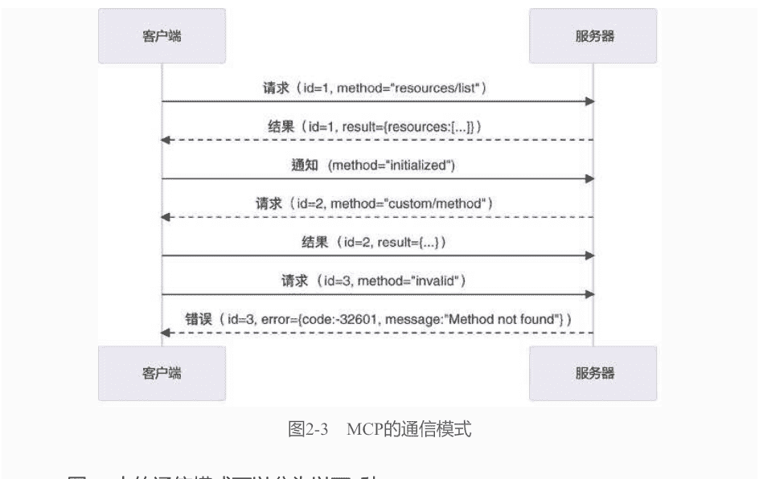

图 2-3 包含 4 种典型交互形态。

（1）客户端发起请求，服务端返回结果。
客户端发出包含 id 与 method 的请求，服务端处理后返回包含相同 id 与 result 的响应。
- 请求中的 id：唯一标识，值为 1，用于匹配响应。
- 请求中的 method：目标方法名，如 resources/list，表示请求资源列表。
- 响应中的 id：与请求一致，值为 1。
- 响应中的 result：方法执行结果，通常是一个资源列表对象。
实际 JSON 示例：

```json
// 请求
{
  "jsonrpc": "2.0",
  "id": 1,
  "method": "resources/list",
  "params": {}
}

// 响应
{
  "jsonrpc": "2.0",
  "id": 1,
  "result": {
    "resources": [
      {"id": "file:///path/to/document.txt", "type": "text/plain"},
      {"id": "db://mydb/users", "type": "application/x-database"}
    ]
  }
}
```

（2）客户端发送通知，服务端仅接收不回复。
客户端发出仅含 method 的通知，如 initialized，表示已完成初始化。通知中没有 id，这正是它与请求的区别，服务端会记录但不返回任何内容。
实际 JSON 示例：

```json
// 通知
{
  "jsonrpc": "2.0",
  "method": "initialized",
  "params": {
    "clientInfo": {
      "name": "MCP Example Client",
      "version": "1.0.0"
    }
  }
}
```

（3）服务端发起请求，客户端返回结果。
MCP 支持双向调用，服务端也可以向客户端发送带 id 与 method 的请求，客户端处理后回传带 id 与 result 的响应。
- 请求 id：唯一标识，值为 2。
- 请求 method：如 custom/method。
- 响应 id：与请求相同，值为 2。
- 响应 result：执行结果。
实际 JSON 示例：

```json
// 服务器请求
{
  "jsonrpc": "2.0",
  "id": 2,
  "method": "custom/method",
  "params": {
    "action": "refresh",
    "target": "cache"
  }
}

// 客户端响应
{
  "jsonrpc": "2.0",
  "id": 2,
  "result": {
    "status": "success",
    "refreshed": true,
    "timestamp": 1621234567890
  }
}
```

（4）客户端发送无效请求，服务端返回错误。
当客户端请求的方法名不存在时，服务端会返回包含 id、error、code 与 message 的错误响应。
- 请求 id：值为 3。
- 请求 method：无效名称如 invalid。
- 响应 id：与请求相同，值为 3。
- 响应 error：包含错误码 -32601 与描述 Method not found。
实际 JSON 示例：

```json
// 请求
{
  "jsonrpc": "2.0",
  "id": 3,
  "method": "invalid",
  "params": {}
}

// 错误响应
{
    "jsonrpc": "2.0",
    "id": 3,
    "error": {
        "code": -32601,
        "message": "Method not found",
        "data": {
            "availableMethods": ["resources/list", "resources/get", "tools/list", "tools/call"]
        }
    }
}
```

在 MCP 中，上述请求-响应模式主要支撑三类交互：

（1）资源发现与获取。

```
Client->Server: resources/list
Server->Client: 返回可用资源列表

Client->Server: resources/get (id=file:///path/to/doc.txt)
Server->Client: 返回文档内容
```

（2）工具调用与执行。

```
Client->Server: tools/list
Server->Client: 返回可用工具列表

Client->Server: tools/call (name=analyze_text, args={...})
Server->Client: 返回工具执行结果
```

（3）LLM 请求。

```
Server->Client: sampling/complete (prompt="分析以下数据...")
Client->LLM: 传递提示词
LLM->Client: 生成内容
Client->Server: 返回生成的内容
```

通过标准化的 JSON-RPC 通信，MCP 实现了灵活可靠的客户端-服务端协作，为 AI 智能体接入各类数据源与工具提供了坚实基础。

#### 2.2.2 协议层实现

协议层介于传输层与应用层之间，负责把来自应用层的请求转成标准 JSON-RPC 消息经传输层发出；同时接收传输层传回的响应并解析为结构化对象再交回应用层。依托统一的 JSON-RPC 格式、类型安全的请求处理与完善的错误处理能力，协议层帮助开发者构建可靠高效的智能体。

正确理解并实现协议层，能够让开发者打造与多种数据源和工具无缝集成的 AI 智能体，同时保持代码可维护与安全。

协议层实现的核心包含 3 个关键类。

- Protocol 类：负责消息的传递与处理。
- Client 类：实现客户端逻辑，发起请求并处理响应。
- Server 类：实现服务端逻辑，接收请求并返回响应。

##### 1. Protocol类

Protocol 类是协议层的基座，采用泛型设计，可适配不同类型的请求、通知与结果。Protocol 接口定义如下：

```typescript
class Protocol<Request, Notification, Result> {
  // 注册一个处理特定类型请求的处理器
  setRequestHandler<T>(schema: T, handler: (request: T, extra: RequestHandlerExtra) => Promise<Result>): void

  // 注册一个处理特定类型通知的处理器
  setNotificationHandler<T>(schema: T, handler: (notification: T) => Promise<void>): void

  // 发送请求并等待响应
  request<T>(request: Request, schema: T, options?: RequestOptions): Promise<T>

  // 发送单向通知，不期望响应
  notification(notification: Notification): Promise<void>
}
```

MCP 技术拆解：从协议到客户端服务器

协议层在类型安全上做了明确约束，借助泛型与模式校验来保证数据结构的一致性，同时以请求标识串联请求与响应的配对关系。同一层还内置了统一的错误处理规范，提升整体运行的稳定性。通信上协议层具备双向能力，服务器能够主动向客户端发起请求，示意图见图2-4。

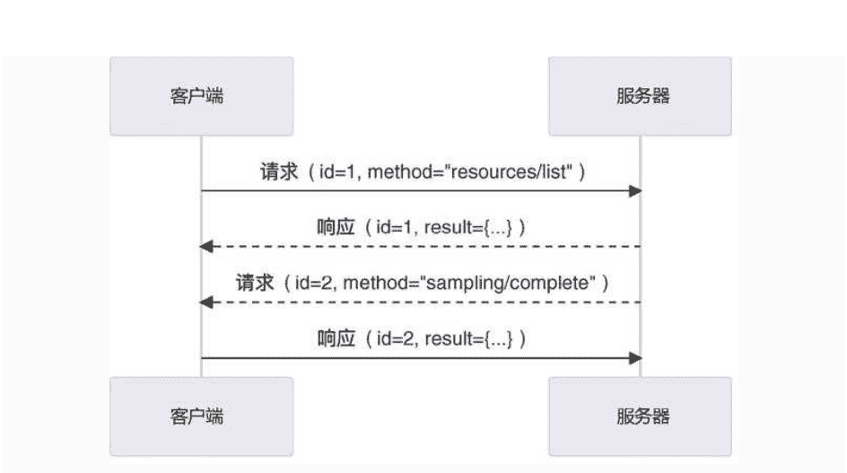

##### 2. Client类

Client 类是 MCP 客户端的落地实现，职责是向服务端发出请求并处理返回结果。它把底层通信的复杂细节封装起来，对外暴露简洁易用的调用入口。核心工作可归纳为六点：

- 完成与服务端的连接建立及协议版本与能力的协商；
- 发现并调用服务端提供的工具；
- 获取与管理服务端提供的资源；
- 调用服务端提供的提示词模板；
- 管理文件系统根目录；
- 提供 LLM 采样支持。

Client 通常会实现如下基础接口：

```typescript
class Client {
    // 初始化连接，进行协议版本和能力协商
    initialize(): Promise<InitializeResult>

    // 发送请求并等待响应
    request<T>(method: string, params: any, resultSchema: T): Promise<T>

    // 发送通知，不期望响应
    notification(method: string, params: any): Promise<void>

    // 关闭连接
}
```

close(): Promise<void>

}

在真实项目中，Client 一般还会提供更上层的便捷 API。例如工具调用场景下会封装专门的方法来降低使用门槛。

```
// 列出服务器提供的所有工具
listTools(): Promise<Tool[]>

// 调用特定工具
callTool(name: string, params: object): Promise<CallToolResult>
```

API 风格上同时支持同步与异步两种形态，同步适合简单的线性流程，异步更适合并发复杂的场景。

以 MCP Java SDK 为例，同步实现为 McpSyncClient ，异步实现为 McpAsyncClient ，两者分别位于对应的包路径下，并附带创建与使用的示例代码。

```
// 创建同步客户端
McpSyncClient client = McpClient.sync(transport)
    .requestTimeout(Duration.ofSeconds(10))
    .capabilities(ClientCapabilities.builder()
        .roots(true)    // 启用根目录功能
        .sampling()     // 启用采样功能
        .build())
    .build();

// 初始化连接
client.initialize();

// 列出可用工具
ListToolsResult tools = client.listTools();

// 调用工具
CallToolResult result = client.callTool(
    new CallToolRequest("calculator",
        Map.of("operation", "add", "a", 2, "b", 3))
);
```

能力协商是 Client 的关键特性。连接初始化时客户端会声明自身支持的功能集合，服务端则回传自己可提供的功能清单，双方据此确认可用能力。例如客户端声明支持采样，服务端即可发起 LLM 采样的请求。

传输层面提供多种选择，stdio 适用于本地进程间通信，HTTP/SSE 适用于远程通信，开发者可按场景选用。

错误处理统一化，服务端返回的错误会被转译为标准错误对象，包含错误码、错误信息及可选的错误数据，开发者可通过捕获进行异常处理。

总体来看，Client 是 MCP 的核心组件之一，通过高层 API 与底层通信封装，让开发者更轻松地调用服务端能力，构建 AI 智能体并简化开发路径。

##### 3. Server类

Server 类是 MCP 服务端的实现，负责接收客户端请求并返回结果，是 AI 智能体的核心载体，提供工具、资源、提示词模板等能力。核心职责共七项：

- 接收并处理客户端的连接请求；
- 完成协议版本与能力协商；
- 提供工具供客户端调用；
- 管理资源供客户端访问；
- 提供提示词模板供客户端使用；
- 支持结构化日志记录与通知；
- 管理并发的客户端连接。

Server 通常会实现如下接口：

```
class Server {
    // 注册请求处理器
    setRequestHandler<T>(method: string, schema: T, handler: (params: T) => Promise<any>): void

    // 注册通知处理器
    setNotificationHandler<T>(method: string, schema: T, handler: (params: T) => Promise<void>): void

    // 连接传输层
    connect(transport: Transport): Promise<void>

    // 关闭服务器
    close(): Promise<void>
}
```

在实际使用中，Server 也会提供更高级的 API 来简化功能实现，例如工具注册会提供对应的便捷方法：

```
// 添加工具
addTool(tool: Tool, handler: (params: any) => Promise<any>): void

// 添加资源
addResource(resource: Resource, handler: (params: any) => Promise<any>): void

// 添加提示词模板
addPrompt(prompt: Prompt, handler: (params: any) => Promise<any>): void
```

与 Client 一样，Server 同样提供同步与异步双模式。Java SDK 中对应 McpSyncServer 与 McpAsyncServer，分别位于相应包路径下，并给出创建与配置的示例代码：

```
// 创建同步服务器
McpSyncServer server = McpServer.sync(transportProvider)
    .serverInfo("my-server", "1.0.0")
    .capabilities(ServerCapabilities.builder()
        .resources(false, true)    // 启用资源功能
        .tools(true)               // 启用工具功能
        .prompts(true)             // 启用提示词模板功能
        .logging()                 // 启用日志功能
        .build())
    .build();

// 注册工具
server.addTool(new McpServerFeatures.SyncToolSpecification(
    new Tool("calculator", "基础计算器", schema),
    (exchange, arguments) -> {
        // 工具实现
        String operation = (String) arguments.get("operation");
        double a = ((Number) arguments.get("a")).doubleValue();
        double b = ((Number) arguments.get("b")).doubleValue();

        double result = 0;
        switch (operation) {
            case "add":
                result = a + b;
                break;
            case "subtract":
                result = a - b;
                break;
            // 其他操作...
        }

        return new CallToolResult(String.valueOf(result), false);
    }
));
```

能力声明是 Server 的重要特性。初始化连接时服务器会向客户端明确告知自身提供的功能范围，例如工具、资源、提示词模板等，客户端据此决定可调用的接口。

传输提供者方面支持标准 stdio 与 HTTP/SSE，面向 Spring 生态还提供 WebFluxSseServerTransportProvider 与 WebMvcSseServerTransportProvider。

工具实现允许开发者定义工具规范，包含名称、描述、参数模式，以及处理调用的函数。函数接收 ServerExchange 用于与客户端交互，以及工具参数映射。

```
var toolSpecification = new McpServerFeatures.SyncToolSpecification(
    new Tool("calculator", "基础计算器", schema),
    (exchange, arguments) -> {
        // 工具实现
        return new CallToolResult(result, false);
    }
);
```

资源规范与提示词模板规范同理，支持开发者自行定义并实现各类资源与模板。

Server 还可在客户端具备采样能力时向其发起 LLM 采样请求并获取结果，使服务端无需自建或调用外部 LLM API 即可复用客户端能力。

```
// 检查客户端是否支持采样
if (exchange.getClientCapabilities().sampling() != null) {
    // 创建采样请求
    McpSchema.CreateMessageRequest request = McpSchema.CreateMessageRequest.builder()
        .messages(List.of(new McpSchema.SamplingMessage(McpSchema.Role.USER,
            new McpSchema.TextContent("计算: " + arguments.get("expression")))))
        .systemPrompt("你是一个有用的计算器智能体。只提供数值答案。")
        .maxTokens(100)
        .build();

    // 请求客户端执行采样
    McpSchema.CreateMessageResult result = exchange.createMessage(request);

    // 处理结果
    String answer = result.content().text();
    return new CallToolResult(answer, false);
}
```

日志记录支持结构化输出，服务端可按不同严重级别向客户端推送日志，客户端可设定最低日志级别进行过滤。

综合来看，Server 是 MCP 的核心组件，通过高级 API 与底层通信封装，大幅降低 AI 智能体服务端的开发成本。

### 2.3 MCP核心能力

2.1.3 节已提到，MCP Server 具备三大核心能力：资源管理、工具集成、提示词模板。它们构成 AI 智能体与现实世界高效交互的基础，各自对应不同交互模式，共同形成完整的功能体系。以下聚焦这些能力的工作原理与应用场景。

#### 2.3.1 资源管理

资源是 MCP 的核心概念，指服务端可供给 LLM 的任意类型数据或内容。资源管理功能让 LLM 能访问外部数据源，提升回答的准确性与相关性。资源类型遵循 MIME 规范，如表2-3 所示。

表2-3 MCP的资源类型

| 资源类型 | MIME类型 | 描述 |

| :--- | :--- | :--- |

| 纯文本 | text/plain | 普通文本内容 |

| HTML | text/html | HTML格式内容 |

| JSON | application/json | JSON格式数据 |

| XML | application/xml | XML格式数据 |

| PDF | application/pdf | PDF文档 |

| 图像 | image/* | 各种图像格式 |

| 二进制 | application/octet-stream | 通用二进制数据 |

资源标识采用统一资源标识符 URI，遵循 RFC 3986，但通常简化为：

```
[protocol]://[host]/[path]
```

其中协议前缀 [protocol] 用来指明资源类型，如 file、postgres，并支持自定义方案；主机 [host] 标识资源所在服务器，本地资源可为空；路径 [path] 精确到资源位置，如 /home/user/data。协议前缀与路径由 MCP Server 定义，不同前缀适配不同场景，典型示例见：

```
file:///documents/report.md 本地文件
postgres://database/customers/schema 数据库记录
api://weather/forecast?city=london API资源
kb://company/products/123 知识库条目
```

资源 API 覆盖发现、访问、订阅、更新的完整生命周期，涉及 resources/list、resources/read、notifications/resources/update 等接口，形成灵活的客户端与服务端通信框架。

资源 API 交互流程如图2-5所示。

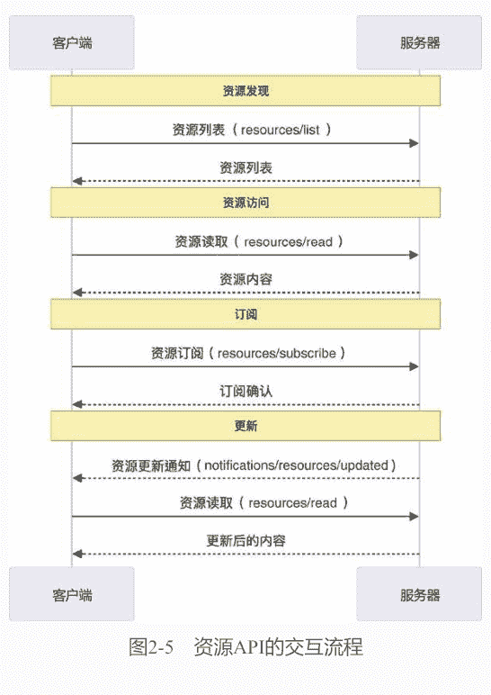

##### 1. 资源列表（resources/list）

## MCP 资源与工具交互全景

想先搞清服务端当前挂了哪些资源，调用方通常会先调一次 resources/list 来拉取目录清单。该接口提供分批获取能力，若条目很多可带上游标继续取后续页。

```json
// 请求示例
{
  "jsonrpc": "2.0",
  "id": 1,
  "method": "resources/list",
  "params": {
    "cursor": "optional-cursor-value"
  }
}

// 响应示例
{
    "jsonrpc": "2.0",
    "id": 1,
    "result": {
        "resources": [
            {
                "uri": "file:///project/src/main.rs",
                "name": "main.rs",
                "title": "Rust Software Application Main File",
                "description": "Primary application entry point",
                "mimeType": "text/x-rust"
            }
        ],
        "nextCursor": "next-page-cursor"
    }
}
```

返回条目里必备的是定位字段 uri 与基础名字 name，其余按需补充：用于展示的标题 title、简要说明 description、MIME 类型 mimeType，以及字节级大小 size。

##### 2. 资源读取（resources/read）

拿到具体内容时，请求方向 resources/read 递交目标 URI，服务端会以列表形式返回对应数据。

```json
// 请求示例
{
    "jsonrpc": "2.0",
    "id": 2,
    "method": "resources/read",
    "params": {
        "uri": "file:///project/src/main.rs"
    }
}
```

```json
// 响应示例
{
    "jsonrpc": "2.0",
    "id": 2,
    "result": {
        "contents": [
            {
                "uri": "file:///project/src/main.rs",
                "name": "main.rs",
                "title": "Rust Software Application Main File",
                "mimeType": "text/x-rust",
                "text": "fn main() {\n    println!(\"Hello world!\");\n}"
            }
        ]
    }
}
```

内容形态分为文字和二进制。文字走 text 字段，二进制则先做 Base64 编码后放在 blob 字段。一次读取也可能返回多项，比如打开目录时连同内部文件一起给出。

##### 3. 资源更新通知（notifications/resource/updated）

MCP 提供了两种实时感知变更的手段。

（1）列表变更通知：当可用资源集合发生变化且服务端声明了 listChanged 能力时，会主动推送变更提醒。

```json
{
  "jsonrpc": "2.0",
  "method": "notifications/resources/list_changed"
}
```

（2）资源订阅（resources/subscribe）机制：调用方可以为单个资源建立变更订阅。

```json
// 订阅请求
{
  "jsonrpc": "2.0",
  "id": 4,
  "method": "resources/subscribe",
  "params": {
    "uri": "file:///project/src/main.rs"
  }
}
```

```json
// 更新通知
{
  "jsonrpc": "2.0",
  "method": "notifications/resources/updated",
  "params": {
    "uri": "file:///project/src/main.rs",
    "title": "Rust Software Application Main File"
  }
}
```

被订阅资源有更新后，请求方会先收到提示，再调用 resources/read 获取最新版本。若不再关注，可用 resources/unsubscribe 取消订阅。

异常返回遵循标准 JSON-RPC 约定，常见错误为资源未找到 -32002 与内部错误 -32603。

```json
// 资源未找到错误示例
{
    "jsonrpc": "2.0",
    "id": 5,
    "error": {
        "code": -32002,
        "message": "Resource not found",
        "data": {
            "uri": "file:///nonexistent.txt"
        }
    }
}
```

```json
// 内部错误示例
{
    "jsonrpc": "2.0",
    "id": 5,
    "error": {
        "code": -32603,
        "message": "Internal errors",
        "data": {
            "uri": "file:///nonexistent.txt"
        }
    }
}
```

在落地 MCP Server 的资源接口时，安全要放在首位。服务端通常把本地文件、数据库乃至外部 API 的数据暴露给模型，任何设计或实现上的疏忽都可能带来严重风险，所以需要多层防御。

首层是 URI 的严谨校验。所有进来的 URI 都应视作外部不可信任输入，既要检查格式是否合法，也要确认指向落在事先授权的白名单范围内，用以阻断路径遍历等攻击，例如阻止通过 ../../etc/passwd 这类构造访问本不该暴露的敏感文件。URI 校验是守护资源的第一道屏障。

确认 URI 合法且在授权范围内后，第二层是精细化的访问控制。不同资源的敏感度不同，涉及隐私、配置或商业机密的内容必须受限。权限判断不仅看是否有访问权，还要结合操作类型如读取、写入或执行，并在真正执行前瞬间完成，以保证授权的即时有效性，体现最小权限思想，让每个调用方只能触及完成任务所必需的最小范围。

第三层关乎数据的完整与保真。处理二进制资源如图像、音频或可执行文件时，传输前必须做正确的编码，例如转为 Base64。MCP 多用文本型传输协议如 JSON-RPC，直接透传原始字节易导致解析错误或损坏。经过恰当编码后，客户端收到的内容才能与源资源一致，保证端到端完整性。综合严谨的 URI 校验、最小权限的访问控制与二进制的审慎编码，才能做出既强劲又可靠的 MCP Server。

#### 2.3.2 工具集成

MCP 支持服务端向大模型开放可被调用的能力，模型借此查询数据库、调用 API、执行计算、获取实时信息或完成自动化任务。每个能力以唯一标识区分，并附带描述使用方式的元数据。

在 MCP 中，工具可以依据功能和特性分为6类，如表2-4所示。

表2-4 MCP工具的类型

| 工具类型 | 描述 | 示例 |

| :--- | :--- | :--- |

| 计算工具 | 执行计算和数据处理 | 计算器、单位转换、统计分析 |

| 数据检索工具 | 从外部源获取数据 | 天气查询、股票价格、新闻搜索 |

| 内容生成工具 | 创建或修改内容 | 图像生成、代码格式化、文档转换 |

| 通信工具 | 与外部系统或人员通信 | 电子邮件发送、消息通知、API调用 |

| 自动化工具 | 执行系统操作或工作流 | 文件操作、任务调度、工作流触发 |

| 分析工具 | 分析和解释数据 | 情感分析、文本摘要、数据可视化 |

每个工具都有一个唯一的名称，以及定义其参数和返回值的JSON Schema。MCP工具定义通常包含以下内容：

```json
{
    "name": "string", // 唯一标识符，用于在系统中区分不同工具
    "description": "string", // 详细描述，帮助用户和AI理解工具的用途和功能，建议提供充分信息
    "inputSchema": { // 工具参数的JSON Schema规范定义，用于验证输入参数的格式和类型
        "type": "object",
        "properties": { ... } // 工具特定的参数定义，包括参数名称、类型、是否必须、默认值等
    },
    "annotations": {
        // 工具行为的额外提示信息，帮助客户端和模型更好地理解和使用工具
        "title": "string", // 工具的简短标题，适合在UI界面上显示，比description更简洁
        "readOnlyHint": "boolean", // 如果为true，表示工具仅读取数据而不修改任何状态或环境
        "destructiveHint": "boolean", // 如果为true，表示工具可能执行不可逆的破坏性操作，客户端需额外确认
        "idempotentHint": "boolean", // 如果为true，表示使用相同参数多次调用该工具不会产生额外副作用
        "openWorldHint": "boolean" // 如果为true，表示工具会与外部系统或网络交互，可能受网络状态影响
    }
}
```

MCP定义了以下3个工具API。

- 工具列表（tools/list），用于获取可用工具列表。

- 工具调用（tools/call），用于调用特定工具。

- 工具列表更新通知（notifications/tools/list_changed），当可用工具列表发生变化时，声明了listChanged功能的服务器将发送该通知。

MCP工具API的交互流程如图2-6所示。

下面分别来介绍这些工具API的核心功能和代码示例。

##### 1. 工具列表（tools/list）

tools/list 是请求方发现服务端工具能力的入口。发起该调用即可拿到当前工具集合，也能分批读取，通过可传游标分段拉取大量结果。

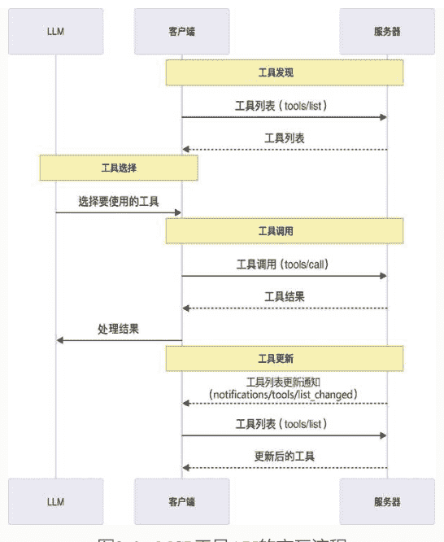

图2-6 MCP工具API的交互流程

请求示例：

```json
{
  "jsonrpc": "2.0",
  "id": 1,
  "method": "tools/list",
  "params": {
    "cursor": "optional-cursor-value"
  }
}
```

响应示例：

```json
{
  "jsonrpc": "2.0",
  "id": 1,
  "result": {
    "tools": [
      {
        "name": "get_weather",
        "title": "Weather Information Provider",
        "description": "Get current weather information for a location",
        "inputSchema": {
          "type": "object",
          "properties": {
            "location": {
              "type": "string",
              "description": "City name or zip code"
            }
          },
          "required": ["location"]
        }
      }
    ],
    "nextCursor": "next-page-cursor"
  }
}
```

安全提示：工具注释应被视为不可信任信息，除非来源可信才可使用。

##### 2. 工具调用 (tools/call)

调用指定工具时，调用方通过 tools/call 传入工具名与符合输入模式的参数。请求示例：

```json
{
    "jsonrpc": "2.0",
    "id": 2,
    "method": "tools/call",
    "params": {
        "name": "get_weather",
        "arguments": {
            "location": "New York"
        }
    }
}
```

响应示例：

```json
{
    "jsonrpc": "2.0",
    "id": 2,
    "result": {
        "content": [
            {
                "type": "text",
                "text": "Current weather in New York: \n Temperature: 72°F \n Conditions: Partly cloudy"
            }
        ],
        "isError": false
    }
}
```

调用结果可包含结构化与非结构化信息。结构化结果放在 structuredContent 字段作为 JSON 对象，为兼容旧版本，建议同时返回等价的非结构化描述，例如文本块中的序列化 JSON。非结构化内容置于 content 字段，可能的类型包括：

- 文本内容：{"type": "text", "text": "工具结果文本"}。

- 图像内容：{"type": "image", "data": "base64编码数据", "mimeType": "image/png"}。

- 音频内容：{"type": "audio", "data": "base64编码音频数据", "mimeType": "audio/wav"}。

- 资源链接：{"type": "resource_link", "uri": "file:///project/src/main.rs", ...}。

- 嵌入资源：{"type": "resource", "resource": {"uri": "...", "text": "..."}}。

若工具声明了 outputSchema，服务端必须返回符合该模式的结构化结果，调用方据此校验。

错误处理分两类。

（1）协议错误：标准 JSON-RPC 错误，用于未知工具、无效参数等问题。示例如下：

```json
{
  "jsonrpc": "2.0",
  "id": 3,
  "error": {
    "code": -32602,
    "message": "Unknown tool: invalid_tool_name"
  }
}
```

（2）工具执行错误：在工具结果中通过 isError: true 报告，用于 API 失败、无效输入数据等。示例如下：

```json
{
  "jsonrpc": "2.0",
  "id": 4,
  "result": {
    "content": [
      {
        "type": "text",
        "text": "Failed to fetch weather data: API rate limit exceeded"
      }
    ],
    "isError": true
  }
}
```

##### 3. 工具列表更新通知（notifications/tools/list_changed）

当可用工具集合发生变化时，声明了 listChanged 能力的服务端应主动推送通知：

```json
{
    "jsonrpc": "2.0",
    "method": "notifications/tools/list_changed"
}
```

收到后调用方可重新请求 tools/list 以同步最新清单。

MCP工具设计的双刃剑：能力越强，安全越关键

在MCP的世界里，工具能力是让大模型真正破圈、去和外部系统联动完成实务操作的核心支点。这份灵活性带来了巨大的生产力，也同步放大了安全风险。MCP在工具层面贯彻的是“模型主导决策建议，人类保留最终裁决”的原则。换句话说，LLM能够依据上下文和用户的指令自行发现、推理并推荐调用哪一个工具，但是否执行、如何执行的一票否决权始终在人手里。这种思路在保留智能体应变力的同时，为安全划出了不可逾越的红线。

工具的实现并不被限定在某种交互形态上。MCP协议本身保持中立，应用方可以按需定制最合适的接入方式。不管是终端命令行、桌面图形界面还是纯粹的 API 调用，MCP 都能提供一致的工具访问通道，同时不丢弃必要的安全管控。

保障安全的关键内核是人在回路。人机协同不只是代码里的一个检查点，更是一种安全观。落到实践，应用层最好做到三件事。

- 透明可知：界面上明确列出当前对模型开放了哪些工具，让用户随时清楚 AI 能够触达的功能边界。
- 调用可视：当模型申请执行某个工具时，系统插入清晰的视觉提示，让用户能直观感知正在发生的动作。
- 关键确认：对于可能产生实质影响的操作，弹出确认询问，由用户审阅后再决定批准或驳回 AI 的建议。

把人在回路的设计理念，和严格的输入校验、细粒度权限控制、资源使用限制、完善的异常处理结合起来，开发者就能做出既强劲又可信的 MCP 工具实现。系统的安全性因此提升，用户对智能体的信任感也会随之增强。用户不再是被动接受结论的旁观者，而是参与决策的主体。

MCP 工具设计标志着 AI 智能体与现实世界交互范式的一次升级，强大功能与新安全挑战并存。随着生态演进，标准化权限模型、更强隔离的沙箱执行环境、更精细的提示过滤等增强手段会不断涌现。开发者需要持续跟进 MCP 规范的更新，尽早采纳新的安全实践。工具的安全并非单点问题，它依赖规范制定者、工具提供方、应用开发者和终端用户共同协作。唯有全链路共建，才能让 MCP 在释放模型潜能的同时守住安全底线。

#### 2.3.3 提示词模板

MCP 为服务器提供了一套统一机制，向客户端暴露可复用的提示词模板。提示词的本质是服务器准备好的结构化消息与指令，用来规范与大模型的对话。客户端可以检索有哪些模板可用、获取模板内容，并填入参数进行个性化定制。提示词是 MCP 的第三大核心能力，它让服务器能够定义参数化的消息序列，帮助开发者在不同场景下保持 LLM 交互的一致性和工作流的稳定性。

生成最终提示词时，MCP 大多借助模板引擎。市场上常见的做法有四类。

- Handlebars/Mustache：轻量、逻辑少的模板语言，适合简单替换。
- Jinja2：Python 生态的主流模板引擎，表达力强。
- EJS：可在 JavaScript 中嵌入模板，常用于 Node 侧渲染。
- 专用提示词模板引擎：为提示词场景定制的引擎。

客户端通过发送 prompts/list 请求来拉取可用的提示词模板，接口支持 cursor 参数做分页。请求示例如下：

```json
{
  "jsonrpc": "2.0",
  "id": 1,
  "method": "prompts/list",
  "params": {
    "cursor": "optional-cursor-value"
  }
}
```

返回的模板数据结构示例如下：

```json
{
  "jsonrpc": "2.0",
  "id": 1,
  "result": {
    "prompts": [
      {
        "name": "code_review",
        "title": "Request Code Review",
        "description": "Asks the LLM to analyze code quality and suggest improvements",
        "arguments": [
          {
            "name": "code",
            "description": "The code to review",
            "required": true
          }
        ]
      }
    ],
    "nextCursor": "next-page-cursor"
  }
}
```

MCP 在提示词层面定义了两项核心接口。

- 提示词列表 prompts/list：获取服务器端提供的模板清单。
- 提示词获取 prompts/get：拉取指定模板的具体消息体。

整体的交互流程可参考图2-7。

## 小结

本章从宏观面到实现细节，为 MCP 勾勒出完整的技术图景。

首先是总体架构。MCP 采用经典的客户端-服务器模型，由 MCP Host、MCP Client、MCP Server 三大角色构成。Host 是用户与 AI 交互的入口与调度中心，Client 负责连接枢纽、通信管理和协议转换，Server 则把协议能力落地为具体应用能力。通过资源、工具、提示词的暴露，LLM 获得了感知和影响现实世界的能力，职责分离让开发更模块化、可维护、可扩展。

其次是分层设计。自下而上依次为传输层、协议层、能力层、应用层。传输层支持标准输入输出 stdio、HTTP/SSE 等，适配本地进程通信到跨网远程部署，解决了如何连通的问题。协议层严格遵循 JSON-RPC 2.0，统一请求、响应、通知、错误的格式与交互模式，解决了通信内容与规则的问题。分层让底层稳定可靠，为上层能力提供坚实基础。

最后是三大核心能力。资源管理像模型的“眼睛”，提供实时动态的外部知识访问；工具集成像模型的“双手”，支撑 API 调用、脚本执行等对外的实际影响；提示词模板像模型的“沟通范式”，通过可复用模板保证特定场景下交互的高效一致。总体而言，MCP 不只是一个协议，更是一套构建下一代 AI 智能体的工程思想。

## 第二部分 MCP开发环境与技术栈

LLM 技术正从概念走向工程化，MCP 作为大模型与应用的桥梁，提供了标准化的连接方式。本部分聚焦开发环境的搭建与技术选型，帮助读者建立稳定高效的 AI 智能体开发基座。

内容将先介绍 MCP 开发环境的整体搭建，包括基础配置、包管理、SDK 安装与工具选型；再展开工具链与生态，涵盖 MCP Inspector，以及 TypeScript、Python 两条主流语言的工程实践。

## 第3章 MCP开发环境搭建

本章围绕从零构建专业化的 MCP AI 智能体开发环境展开，主要包含：

- MCP 开发环境概览，涉及集成开发环境、版本控制、运行时与包管理。
- MCP TypeScript 开发环境的搭建，包含技术选型、包管理器安装、环境配置。
- MCP Python 开发环境的搭建，包含技术选型、包管理器安装、环境配置。

学完本章，读者能够掌握完整的高效 MCP 项目开发环境的搭建流程与最佳实践，为后续实战打下坚实基础。

### 3.1 MCP开发环境概述

MCP 开发环境是由 IDE、库与框架构成的综合集合，覆盖设计、编码、测试到部署的全流程。

构建环境的核心在于把关键组件整合成顺畅的工作流。它们协同工作，贯穿代码编写、版本追溯、依赖管理到最终运行。

#### 3.1.1 IDE

IDE 已远不止代码编辑器，而是集高亮、智能补全、调试、版本控制、重构于一体的综合平台。MCP 开发中常见的选择可分为两类。

一类是新锐的 AI 辅助编程环境，如 Cursor、Trae 等。这类工具深度融合 AI，能够理解意图并在编码、调试、优化上提供智能支持，让开发者专注业务创造。另一类是经典 IDE。VS Code 以轻量、扩展丰富、社区活跃著称，适配 TypeScript 与 Python 都十分顺手。JetBrains 家族的 IntelliJ IDEA、WebStorm、PyCharm 则为追求语言级极致体验的开发者提供了更专业的支持。

没有绝对优劣，关键是契合个人习惯与项目需求。

#### 3.1.2 版本控制工具

代码在不断演进，如何管理历史、支持实验分支、保障团队协作，是持续命题。Git 作为业界主流的分布式版本控制系统，是管理 MCP 项目历史、创建实验分支、协同开发的基础。无论命令行操作还是 GitHub Desktop、GitKraken 等图形客户端，核心都依赖 Git。

#### 3.1.3 运行时与包管理

MCP 的生态离不开对应的运行时与包管理器。Node.js 负责运行 JavaScript/TypeScript，Python 解释器负责 Python 代码。根据 SDK 要求，通常建议 Node.js v16.0.0+、Python 3.8+，以获得更好的特性与性能。

包管理器负责把 SDK 及第三方库整合进项目，如 TypeScript 生态的 npm、yarn，Python 生态的 pip、conda，以及新兴的高性能工具 uv。它们处理依赖关系，保证构建一致与可复现。

一个完备的 MCP 开发环境由高效 IDE、可靠的 Git、稳定运行时与高效包管理器共同构成。这些基础决定了开发体验的流畅度。接下来将细化 TypeScript 与 Python 两条主流语言的搭建步骤。

### 3.2 MCP TypeScript开发环境

本节从技术栈选型、包管理器安装与开发环境搭建三个维度展开。

#### 3.2.1 技术栈选型

基于 TypeScript 构建 MCP AI 智能体时，常用组合包括以下六项。

- Node.js：提供非阻塞 I/O 与丰富生态的服务器运行环境。
- TypeScript：静态类型检查，提升代码质量与开发效率。
- Express.js：轻量 Web 框架，便于搭建 HTTP 服务与 API 端点。
- MCP SDK：官方 @modelcontextprotocol/sdk 简化 MCP 实现。
- Zod：数据校验与类型定义，保障 API 输入输出类型安全。
- SSE Server-Sent Events：实现服务器到客户端的实时推送。

选择 TypeScript 不只是选择语言，更是拥抱一个由成熟框架与库构成的现代化后端生态。

#### 3.2.2 包管理工具安装

TypeScript 生态主流包管理器有 npm、yarn、pnpm。

1. npm

npm 是 Node.js 默认包管理器，也是全球最大的软件注册表，收录超过 150 万个包，覆盖各类开发场景。package.json 规范化依赖管理，便于团队协作与版本维护。

安装 Node.js 时 npm 会自动附带。验证安装可执行 npm -v。

常用命令如下：

```
# 初始化项目
npm init

# 安装依赖
npm install @modelcontextprotocol/sdk

# 安装开发依赖
npm install typescript --save-dev

# 更新依赖
npm update

# 运行脚本
npm run start
```

MCP Server 与 Client 的相关配置如下：

```json
// package.json
{
  "dependencies": {
    "@modelcontextprotocol/sdk": "^1.0.0",
    "zod": "^3.21.4"
  },
  "devDependencies": {
    "typescript": "^5.0.0",
    "ts-node": "^10.9.1"
  },
  "scripts": {
    "start:server": "ts-node src/server/index.ts",
    "start:client": "ts-node src/client/index.ts",
    "build": "tsc"
  }
}
```

2. yarn

yarn 由 Facebook 推出，强调速度、安全与一致性。安装方式如下：

```
# 使用npm安装
npm install -g yarn

# 或使用Homebrew (macOS)安装
brew install yarn
```

常用命令如下：

```
# 初始化项目
yarn init

# 安装所有依赖
yarn

# 添加依赖
yarn add @modelcontextprotocol/sdk

# 添加开发环境依赖
yarn add typescript --dev

# 更新依赖
yarn upgrade

# 运行脚本
yarn start
```

3. pnpm

pnpm 通过硬链接共享依赖，兼顾速度与磁盘占用。安装方式如下：

```
# 使用npm安装
npm install -g pnpm

# 或使用Homebrew (macOS)安装
brew install pnpm
```

常用命令如下：

```
# 初始化项目
pnpm init

# 安装依赖
pnpm add @modelcontextprotocol/sdk

# 安装开发依赖
pnpm add -D typescript

# 更新依赖
pnpm update

# 运行脚本
pnpm start
```

#### 3.2.3 开发环境搭建

搭建 MCP 开发环境步骤清晰，但需要基础工具与依赖支持。本章以 TypeScript 为主语言演示流程。

开始前请确保满足：

- 已安装 Node.js，推荐 v16 或更高。
- 已安装 npm 或 yarn。
- 具备基础命令行操作能力。
- 已安装文本编辑器或 IDE，如 VS Code、WebStorm。

1. 安装 Node.js 和 TypeScript

从官网下载最新 LTS 版本，安装完成后验证：

```
node --version
npm --version
```

继续安装 TypeScript 及开发工具：

```
# 安装TypeScript
npm install -g typescript

# 安装ts-node（用于直接运行TypeScript文件）
npm install -g ts-node

# 验证安装
tsc --version
ts-node --version
```

2. 配置环境

新建 Node.js 项目并初始化：

```
# 新建项目目录
mkdir mcp-nodejs-demo
cd mcp-nodejs-demo

# 初始化npm项目
npm init -y

# 安装MCP SDK和其他依赖
npm install @modelcontextprotocol/sdk zod express
npm install typescript ts-node @types/node @types/express --save-dev

# 初始化TypeScript配置
npx tsc --init
```

随后编辑 tsconfig.json，确保包含必要的配置：

```json
{
  "compilerOptions": {
    "target": "es2022",
    "module": "NodeNext",
    "moduleResolution": "NodeNext",
    "esModuleInterop": true,
    "strict": true,
    "outDir": "./dist",
    "skipLibCheck": true,
    "forceConsistentCasingInFileNames": true
  },
  "include": ["src/**/*"],
  "exclude": ["node_modules"]
}
```

项目基础骨架已经搭建完成：

```
mkdir -p src/server src/client src/utils
```

到这里，首个 MCP 试验环境已收敛收尾，整体目录呈现为：

```
mcp-nodejs-demo/
├── node_modules/
├── src/
│   ├── server/    # MCP Server代码
│   ├── client/    # MCP Client代码
│   └── utils/     # 工具函数和共享代码
├── package.json
├── tsconfig.json
└── package-lock.json
```

### 3.3 Python 生态下的 MCP 开发环境

Python 因海量外部库和活跃的社区而广受欢迎，同时也带来了依赖治理的复杂度。经过调优的运行环境能够保持依赖干净、可控版本，避免打架，让发布与协作更顺畅，也是构建 MCP 驱动智能代理的基础。

本节围绕技术选型、包管理方案、环境配置实操三条线展开。

#### 3.3.1 技术选型

选用 Python 来开发 MCP，等于接入一条成熟且持续演进的技术链路。链路上各组件相互配合，可覆盖从简易工具服务到复杂代理应用的不同需求。

在 Python 侧搭建 MCP 代理，常用组合为异步网关运行器、Web 框架与数据校验层。

1. ASGI 运行器：Uvicorn

与 Node.js 的非阻塞 I/O 思路相近，现代 Python Web 开发以 ASGI 为核心。ASGI 原生支持异步，能高效处理 WebSocket、SSE 等长连接，非常适合搭建高性能高并发的 MCP 服务端。工程实践里普遍采用高性能 ASGI 运行器，Uvicorn 以速度和稳定性突出，已成为事实标准。

2. Web 框架：FastMCP

ASGI 之上需要 Web 框架来负责路由、请求解析与业务编排。FastAPI 基于标准 Python 类型提示，开发效率高，自带自动化校验及基于 OpenAPI 与 JSON Schema 的交互式文档，其类型安全思路与 MCP 工具构建高度契合。因此 MCP Python SDK 推出 FastMCP，这是一个基于 FastAPI 的高阶封装。它延续 FastAPI 的优点并强化了对 MCP 的适配，通过 @mcp.tool()、@mcp.resource() 等装饰器，可把普通 Python 函数快速转为符合规范的工具与资源。

##### 3. 数据模型与验证：Pydantic

FastAPI 与 FastMCP 的强劲表现很大程度来自 Pydantic。Pydantic 利用类型注解提供数据校验、序列化与文档生成。在 MCP 场景里，模型调用工具时，Pydantic 保证入参满足预定义类型与约束；工具返回结构化数据时，Pydantic 保证输出格式正确一致。运行时的严格校验是构建可靠可信工具系统的关键。

##### 4. 编排框架集成：LangChain/LangGraph

当需求从单一工具提供上升为多步推理、记忆与自主规划时，LangChain 与 LangGraph 的价值凸显。LangChain 提供构建端到端大模型应用的标准组件，LangGraph 则以图结构定义 Agent 的循环与状态，便于搭建复杂可控的多代理系统。MCP Python SDK 与两者集成良好，可将 MCP 服务端提供的工具无缝接入 LangChain 或 LangGraph 工作流，实现协同增效。

ASGI 运行器、FastMCP、Pydantic 以及 LangChain/LangGraph 等编排框架共同构成从底层网络通信到顶层代理编排的完整技术栈，是 Python 生态下构建先进 MCP 代理的坚实基础。

#### 3.3.2 包管理工具

常见的 Python 包管理方案有 pip、conda、uv 三种。

##### 1. pip

pip 充当 Python 官方的包管理工具，用来安装与维护包。新版 Python 通常已内置 pip，可通过 `pip --version` 核查版本号。pip 简洁易用，能访问 PyPI 安装第三方包，并借助 `requirements.txt` 统一管理依赖。

pip 常用操作示例如下：

```
# 安装包
pip install modelcontextprotocol

# 安装特定版本
pip install modelcontextprotocol==1.0.0

# 从requirements.txt安装
pip install -r requirements.txt

# 更新包
pip install --upgrade modelcontextprotocol

# 列出已安装的包
pip list
```

##### 2. conda

conda 属于开源的软件包与环境一体化管理平台，最初面向 Python，现支持多语言，在数据科学领域常用。可通过 Anaconda 或 Miniconda 获取。其优势在于同时管理包与隔离环境、跨平台支持，并可处理非 Python 依赖，适合数据科学与机器学习项目。

conda 典型用法列于下方：

```
# 创建环境
conda create -n mcp-env python=3.10

# 激活环境
conda activate mcp-env

# 安装包
conda install -c conda-forge modelcontextprotocol

# 导出环境
conda env export > environment.yml

# 从环境文件创建环境
conda env create -f environment.yml
```

##### 3. uv

uv 是 Astral 工作室出品的创新 Python 包管理器，特点是安装极快，实测比 pip 快 10~100 倍，依赖解析也很可靠。同时兼容 pip 并内置虚拟环境管理，无需额外工具。

uv 的获取方式如下：

```
# 使用pip安装
pip install uv

# 或使用Homebrew (macOS)安装
brew install uv
```

uv 常用操作见下：

```
# 创建虚拟环境
uv venv

# 安装包
uv pip install mcp

# 从requirements.txt安装
uv pip install -r requirements.txt

# 同步环境（安装缺失的包，移除多余的包）
uv pip sync requirements.txt
```

#### 3.3.3 开发环境搭建

下面说明 MCP Python 环境的安装流程并校验可用性。

##### 1. 借助 uv 完成环境初始化

先创建项目目录并用 uv 初始化，假设项目名为 mcp-python-project：

```
# 创建并进入项目目录
mkdir mcp-python-project
cd mcp-python-project

# 使用uv初始化项目环境
uv init
```

执行 `uv init` 后，uv 会在当前目录自动生成 `.venv` 虚拟环境并创建 `pyproject.toml`，后者是现代 Python 项目的标准配置，用来声明元数据与依赖。

初始化完成后，将 MCP Python SDK 加入项目。SDK 在 PyPI 的包名为 `mcp`，为获得完整开发体验含命令行工具，推荐安装带 cli 附加项的版本：

```
uv add "mcp[cli]"
```

`uv add` 会智能解析依赖，从 PyPI 下载 `mcp` 及其必需依赖并安装至 `.venv`，同时自动更新 `pyproject.toml`，将 `mcp[cli]` 写入依赖。这种声明式管理保证协作者或部署环境可复现一致环境。

##### 2. 借助 pip 完成环境初始化

若偏好 pip 与 venv，同样可快速搭建。首先手动创建并激活虚拟环境：

```
# 创建并进入项目目录
mkdir mcp-python-project
cd mcp-python-project

# 创建虚拟环境
python -m venv .venv

# 激活虚拟环境 (Windows)
# .\.venv\Scripts\activate
# 激活虚拟环境 (macOS/Linux)
source .venv/bin/activate
```

激活后命令行前缀出现 `.venv`，表明后续 Python 操作均受限于该环境。随后用 pip 安装 SDK：

```
pip install "mcp[cli]"
```

该命令完成与 `uv add` 类似的工作，将 `mcp` 及 cli 附加依赖安装到当前激活的虚拟环境中。

##### 3. 校验是否就绪

无论采用何种方式，最后均需校验工具链可用。执行：

```
# 如果使用uv
uv run mcp --help

# 如果使用pip (并已激活虚拟环境)
mcp --help
```

`uv run` 可在不手动激活环境的情况下运行虚拟环境内命令。若安装成功，将打印 `mcp` 命令行帮助，列出 `install`、`dev`、`inspect` 等子命令，表明 MCP Python 开发环境已就绪，可开始构建首个基于 MCP 的智能代理。

## 小结

工欲善其事，必先利其器。本章既阐述构建 MCP 智能代理开发环境的基本思路，也详细演示了 TypeScript 与 Python 环境的搭建方法。

首先从宏观视角厘清开发环境的四大基石：高性能 IDE、保障演进与协作的 Git 版本控制、提供运行时的环境、以及高效管理依赖的包管理工具。

随后针对 MCP 生态两大主流语言分别给出实操指南。

TypeScript 方面，演示了 npm、yarn、pnpm 等包管理器的安装，Node.js 与 TypeScript 的部署、项目初始化、tsconfig.json 配置，并引入 Express.js 框架与 Zod 库等核心依赖。

Python 方面，重点说明技术栈选型，pip、conda、uv 等包管理工具的安装使用，以及基于 uv 与 pip 的环境搭建与安装验证。

掌握上述实践后，读者即可构建、管理和优化 MCP 开发环境，为后续探索与创建基于 MCP 的智能代理奠定基础。

# 第4章 MCP 工具链与 SDK 全景图

本章聚焦 MCP 生态中的主流工具链、辅助开发工具及其在工程实践中的使用方式，主要涵盖：

- TypeScript 工具链全貌，包含核心 SDK、常用工具包、开发框架及自定义 MCP Server 的构建思路。
- Python 工具链全貌，系统介绍 FastAPI、Uvicorn、Streamlit、browser-use、playwright、arxiv、docling、pydantic 等常用组件，并详解 LangChain 与 LangGraph 如何与 MCP 无缝集成以提升开发效率。

学习完本章，读者将全面了解 MCP 生态主要工具及最佳实践，掌握多语言多框架下的 MCP 开发核心技巧，能够高效选型并搭建适配项目需求的工具链，从而更高效地构建、调试与部署智能代理。

## 4.1 MCP 技术生态概览

MCP 协议以语言无关为设计原则，允许开发者选用不同编程语言构建智能代理，并依据技术背景、项目需求与团队专长选型。目前官方已提供多种语言 SDK，包括但不限于：

- TypeScript：Web 开发主流语言，SDK 提供类型安全与完整 MCP 实现，适合构建 Web 应用与 Node.js 服务。
- Python：数据科学、机器学习与后端领域广泛使用，SDK 为开发者提供熟悉环境。
- Java：企业级应用主力，SDK 满足高性能与强类型需求。
- Kotlin：Java 的现代替代，兼顾性能与更简洁语法。
- Go：高性能并发特性，适合高吞吐服务器。
- Rust：内存安全与极致性能，适合对性能要求苛刻场景。
- C#：.NET 生态核心语言，便于 Windows 平台集成。

各语言 SDK 均针对语言特性与使用场景优化 API。TypeScript SDK 充分利用 Promise 与异步等待模式，Python SDK 则采用异步 I/O 与上下文管理器等惯用法。

本书聚焦 TypeScript 与 Python，基于五点考量：

1. 生态成熟度与普及度。两者在智能代理领域拥有成熟生态与广泛开发者基础。TypeScript 兼具 JavaScript 生态优势与静态类型检查；Python 以简洁语法与丰富科学计算库成为人工智能与数据科学首选。
2. 官方支持优先级。官方团队优先维护 TypeScript 与 Python SDK，前者为首发，后者紧随其后，均保持活跃更新，可体现最新功能与最佳实践。
3. 互补场景覆盖。TypeScript 擅长交互式 Web 应用与前端界面，适合开发复杂用户界面的 MCP Client；Python 在数据处理、科学计算与模型集成方面突出，适合构建复杂数据分析的 MCP Server。两者结合可覆盖绝大多数常见场景。
4. 学习曲线与可访问性。两者学习门槛相对平缓，Python 简洁适合新手，TypeScript 对有 JavaScript 基础者友好。
5. 企业与开源双重认可。TypeScript 被微软、Google 等广泛采用，Python 在学术与工业界基础深厚，确保项目在多环境下获得良好支持。

## 4.2 TypeScript 工具链全貌

作为 MCP 生态核心开发语言，TypeScript 从基础 SDK 到扩展框架提供完整工具链支持，便于高效构建功能丰富性能优越的智能代理。

### 4.2.1 核心框架选型

TypeScript SDK 是 MCP 生态最核心开发工具之一，为 Server 或 Client 提供基础设施，并内置丰富原生功能与扩展机制，大幅降低开发门槛。

SDK 具备良好类型提示与文档支持，适合中大型项目。按场景可选择两种安装方式。

1. 快速安装：适用于已有 TypeScript 环境的项目

若项目已配置 Node.js、TypeScript 编译器及基础配置，可通过以下 npm 命令一键安装 TypeScript SDK：

```
npm install @modelcontextprotocol/sdk
```

SDK 安装完毕后，可以直接引用包内提供的 `@modelcontextprotocol/server` 等模块，用很少的代码就能拉起 MCP 服务端或客户端。最精简的服务端启动片段如下：

```
import { createServer } from '@modelcontextprotocol/server';

const server = createServer({
  // 服务器配置项
});

server.start();
```

2. 全新项目完整配置流程

从零开始的项目，建议按顺序完成 TypeScript 环境准备与 SDK 接入。

(1) 创建新项目并初始化：

```
mkdir my-mcp-app
cd my-mcp-app
npm init -y
```

(2) 安装TypeScript基础依赖（开发依赖）：

```
npm install typescript ts-node @types/node --save-dev
npx tsc --init # 初始化TypeScript配置文件
```

(3) 安装MCP SDK及数据验证依赖（运行依赖）：

```
npm install @modelcontextprotocol/sdk zod
```

(4) 配置`tsconfig.json`（编译器选项）：

```json
{
  "compilerOptions": {
    "target": "es2022",
    "module": "NodeNext",
    "moduleResolution": "NodeNext",
    "esModuleInterop": true,
    "strict": true,
    "outDir": "./dist",
    "skipLibCheck": true,
    "forceConsistentCasingInFileNames": true
  },
  "include": ["src/**/*"],
  "exclude": ["node_modules"]
}
```

(5) 配置`package.json`（项目信息与脚本）：

```json
{
  "name": "my-mcp-app",
  "version": "1.0.0",
  "main": "index.js",
  "scripts": {
    "test": "echo \"Error: no test specified\" && exit 1",
    "start_mcp_server": "ts-node ./src/server/simple-server.ts",
    "start_mcp_client": "ts-node ./src/client/simple-client.ts",
    "kill_mcp_server": "lsof -t -i :3000 | xargs kill -9"
  },
  "keywords": [],
  "author": "",
  "license": "ISC",
  "description": "",
  "devDependencies": {
    "@types/express": "^5.0.2",
    "@types/node": "^22.15.30",
    "ts-node": "^10.9.2",
    "typescript": "^5.8.3"
  },
  "dependencies": {
    "@modelcontextprotocol/sdk": "^1.12.1",
    "zod": "^3.25.23"
  }
}
```

### 4.2.2 常用工具包

在核心 SDK 之外，TypeScript 生态沉淀了一批高可用工具，显著拓宽了开发边界。下面介绍几款高频工具。

**MCP Inspector** 定位于 MCP 服务端的调试与验真，用于确认服务端行为是否符合预期。安装方式：

```bash
npm install -g @modelcontextprotocol/inspector
```

典型启动写法：

```bash
npx @modelcontextprotocol/inspector <command>
```

其中 `<command>` 需要替换为具体的子命令。例如选用 `node` 即可对 Node.js 服务进行分析和调试：

```bash
npx @modelcontextprotocol/inspector node --host=127.0.0.1 --port=8000
```

该工具适配本地开发、自动化测试、协议兼容性校验等多种场景。

**server-filesystem** 是官方实现的文件系统资源服务，允许模型在受控范围内读取本地文件，常用于为 AI 模型提供数据文件访问能力。

获取方式：

```bash
npm install @modelcontextprotocol/server-filesystem
```

下面给出一个只读文件系统服务的示例代码：

```typescript
import { createServer } from '@modelcontextprotocol/server-filesystem';

const server = createServer({
  rootDir: '/path/to/files',
  readOnly: true
});
server.start();
```

运行后会启动一个只读的 MCP 文件服务，仅开放 `/path/to/files` 目录及其子目录，有效避免越权访问与数据泄漏风险。

随着生态持续演进，后续还将出现更多实用工具，例如数据库访问、缓存管理、API 集成等，具体选型建议关注 GitHub 上的 MCP 仓库动态。

### 4.2.3 开发框架集成

把 MCP 服务端接入 Express，可让已有 Express 应用获得 MCP 能力，集成示例：

```typescript
import express from 'express';
import { createServer, HttpTransport } from '@modelcontextprotocol/server';

const app = express();
const mcpServer = createServer();

// 创建HTTP传输层，将MCP Server挂载到Express应用的/mcp路径
const transport = new HttpTransport({
  path: '/mcp',
  server: mcpServer
});

// 将MCP Server挂载到Express应用
app.use(transport.middleware());

app.listen(3000, () => {
  console.log('Server running on port 3000');
});
```

完成上述配置后，Express 应用即可通过 `/mcp` 路径接收 MCP 请求。

在 Next.js 中接入 MCP 服务端，可以为 API 路由增加 MCP 支持。下面是在 Next.js 里实现 MCP 服务端的示例：

```typescript
// pages/api/mcp.ts
import { createServer, HttpTransport } from '@modelcontextprotocol/server';
import type { NextApiRequest, NextApiResponse } from 'next';

const mcpServer = createServer();
const transport = new HttpTransport({
  path: '/api/mcp',
  server: mcpServer
});

export default async function handler(req: NextApiRequest, res: NextApiResponse) {
  await transport.handleRequest(req, res);
}
```

该示例在 Next.js API 路由中处理 MCP 请求，使应用能够通过 `/api/mcp` 路径与 MCP 客户端通信。

## 4.3 Python工具链生态

Python 社区为 MCP 贡献了丰富的框架与工具，覆盖服务端开发、交互式应用、浏览器自动化、文档处理、数据校验、与 LLM 集成等方向。借助这些组件，开发者能以更低门槛搭建可扩展的高效 MCP 智能体。

本节梳理 Python 生态的核心组件与常用工具，并配以示例注释，帮助读者快速掌握 Python 下的 MCP 开发。

**FastAPI** 是一个现代高性能 Python Web 框架，专为构建 API 与异步 Web 服务设计。凭借 ASGI 支持、自动文档生成和较低学习成本，成为搭建 MCP 服务端的主选。安装命令：

```bash
pip install fastapi uvicorn
```

**Uvicorn** 是一款高性能 ASGI 服务器，常与 FastAPI 搭配部署异步 Web 服务，支持热重载与并发运行，适合生产环境。安装命令：

```bash
pip install uvicorn
```

**Streamlit** 用于快速构建数据驱动的 Web 应用。结合 MCP 客户端可轻松实现交互式智能体，适合原型验证与可视化展示。安装命令：

```bash
pip install streamlit
```

**browser-use** 是一个轻量级浏览器自动化库，支持用 Python 代码控制页面浏览与数据抓取。在 MCP 生态中可作为“工具”注册，赋予智能体网页交互能力。安装命令：

```bash
pip install browser-use
```

**playwright** 由微软推出的强力浏览器自动化库，支持 Chromium、Firefox、WebKit 等多浏览器操作。在 MCP 场景下常用于网页截图、数据采集等工具集成。安装命令：

```bash
pip install playwright
playwright install
```

**arxiv** 是访问 arXiv.org 学术论文数据的 Python 包。集成后 MCP 可让智能体自动检索论文，扩展智能文献助手功能。安装命令：

```bash
pip install arxiv
```

**docling** 是一个文档解析与处理库。在 MCP 生态中可作为文档处理工具使用，支持多种格式文本抽取。安装命令：

```bash
pip install docling
```

**pydantic** 是 Python 生态中常用的数据校验、序列化与结构定义库，常用于参数校验与结果建模。在 MCP 中可用来定义工具参数与响应模式，提升数据可靠性与开发效率。安装命令：

```bash
pip install pydantic
```

**LangChain** 是构建 LLM 应用的主流框架，支持对话、链式推理、工具集成等高级能力。通过 `langchain-mcp-adapters` 适配器，可把 MCP 工具接入 LangChain 流程，释放智能体潜力。安装命令：

```bash
pip install langchain langchain-openai langchain-mcp-adapters
```

**LangGraph** 是 LangChain 的扩展，支持定义复杂智能工作流与有向状态图。结合 MCP 工具，可实现多轮对话、任务拆解、工具调度等复杂流程。安装命令：

```bash
pip install langgraph langchain-mcp-adapters
```

通过上述核心组件的系统介绍，开发者可在 MCP 体系下灵活构建多样智能体。从底层服务搭建到高级 LLM 工作流编排，Python 工具链为智能应用创新提供了广阔空间。

## 小结

本章旨在为读者绘制清晰的“工具图谱”，系统呈现 TypeScript 与 Python 两类语言下开发基于 MCP 智能体时如何挑选合适工具构建高效稳健方案。

首先阐述了 MCP 作为开放协议的语言无关设计理念，并说明选用 TypeScript 与 Python 作为本书开发语言的主要考量。随后分别介绍了两类语言的工具链生态。

随着 MCP 生态持续发展，未来将涌现更多工具与框架，为开发者提供更丰富技术选择。下一章将深入探讨 MCP 具体项目的开发实践，帮助开发者更好地理解与应用 MCP。

# 第三部分

基于MCP的AI智能体开发实战

本部分通过 5 个实战项目，演示如何利用 MCP 构建功能强大的智能体。

- 基于 MCP TypeScript SDK 快速创建一个简单的智能体。
- 基于 MCP TypeScript SDK 创建商城智能体。
- 基于 MCP Python SDK 和 arxiv 创建论文研究智能体。
- 基于 MCP Python SDK 创建数据洞察分析 ChatBI 智能体。
- 基于 MCP Python SDK 和 browser-use 创建深度研究报告生成智能体。

这 5 个项目遵循由简到繁的原则，旨在帮助读者掌握 MCP Server 开发核心技能，并能熟练构建自己的智能体。

# 第5章

基于MCP TypeScript SDK快速创建一个简单的AI智能体

本章带读者使用 TypeScript SDK 从零开始开发 MCP Server 与 Client 程序，完整体验智能体开发全流程，主要包括：

- 搭建 MCP 开发环境，涵盖操作系统、依赖包、SDK 与工具链的完整准备。
- 创建首个 MCP Server 的详细步骤，包括项目结构设计、核心代码实现与服务启动。
- MCP Server 的调试方法，介绍常用调试工具、日志分析与故障排查技巧。
- 构建简单的智能体，实现基础的 MCP Client 与 Server 交互，帮助读者理解 MCP 核心工作流程。

学完本章，读者将完成从零到一开发一个简单但功能完整的 MCP Server，掌握 MCP 基础服务开发的实用技能，为后续复杂应用开发奠定基础。

## 5.1 创建一个 MCP Server

一个功能完整的 MCP Server 需要具备以下能力。

- 资源管理：管理应用配置等静态资源，以及基于用户 ID 生成的用户资料等动态资源。
- 工具集成：执行基础数学运算的计算工具、通过字节跳动的 API 调用 LLM 的 API 集成工具。
- 提示词模板：用于生成面向特定用户问候消息的问候模板。
- 会话管理：支持会话创建与维护、初始化、请求处理与终止。
- 通信管理：基于 HTTP/SSE 的通信机制，并支持流式响应。

### 5.1.1 实现过程

下面分步骤介绍基于 Express 的 HTTP 服务器代码实现过程。

##### 1. 导入依赖与初始化应用

在编写具体逻辑前，先引入项目所需的依赖库并搭建应用的基础框架。

```typescript
// 导入Express框架，用于构建HTTP服务器
import express from "express";
// 从Node.js内置的crypto模块导入randomUUID，用于生成唯一的会话ID
import { randomUUID } from "node:crypto";
// 从MCP TypeScript SDK中导入构建服务器所需的核心类和类型定义
import { McpServer, ResourceTemplate } from "@modelcontextprotocol/sdk/server/mcp.js";
import { StreamableHTTPServerTransport } from "@modelcontextprotocol/sdk/server/streamableHttp.js";
import { isInitializeRequest } from "@modelcontextprotocol/sdk/types.js";
// 导入Zod
import { z } from "zod";

// 导入预定义的应用常量，如外部API的URL和端点ID
import { ARK_API_URL, ENDPOINT_ID } from "../const/const";

// 创建一个Express应用实例，作为Web服务的起点
const app = express();
// 添加Express的JSON中间件，使其能够自动解析请求体中的JSON数据
app.use(express.json());

// 定义一个对象，用于存储和管理所有活跃的会话
// 键（key）是会话ID（字符串），值（value）是会话对应的传输层实例
const transports: { [sessionId: string]: StreamableHTTPServerTransport } = {};
```

这段代码是项目的入口与基础，主要实现了三项功能。

（1）依赖导入。`express` 负责 HTTP 服务；`@modelcontextprotocol/sdk` 提供了 MCP Server 与传输协议的实现；`zod` 则充当“类型守卫”，确保后续工具接收到的参数符合预期格式，对构建健壮的智能体至关重要。

（2）应用初始化。`const app = express()` 这一行就拉起了一个 Express 应用，它更像一个等待装配的中心调度台。`app.use(express.json())` 是必备的基础配置，作用是当收到的 HTTP 请求在头信息里声明 `Content-Type` 为 `application/json` 时，Express 会自动把原始的请求体字符串转成 JavaScript 对象供后续逻辑直接使用。

（3）会话追踪。`transports` 就是支撑会话管理的核心容器。MCP 本质上是面向连接的协议，每有一个客户端接入就会独立产生一个会话。借助 `transports`，系统可以用唯一的 `sessionId` 来定位每一个会话，并为其绑定对应的 `StreamableHTTPServerTransport` 实例，后者负责该会话下所有底层的收发细节。

##### 2. 搭建 MCP Server 并注册资源
HTTP 框架搭好之后，下一步是构建 MCP 层的核心——`McpServer` 实例并挂载可提供的资源。

下面演示如何实例化 `McpServer` 并同时注册静态资源与动态资源，形成一个能管理配置信息并按需生成用户资料的服务骨架。静态资源 `config` 用来对外暴露应用配置；动态资源 `user-profile` 则借助 `ResourceTemplate` 定义带参数的 URI 模板，可根据用户 ID 实时生成对应的资料。相关代码如下。

```typescript
/**
 * 创建并配置一个McpServer实例
 * @returns {McpServer} 配置完成的MCP Server实例。
 */
function createServer(): McpServer {
  // 实例化McpServer，并为其提供元数据，如名称和版本号
  const server = new McpServer({
    name: "MyFirstMcpServer",
    version: "1.0.0"
  });

  // 注册一个名为"config"的静态资源
  // 当客户端请求"config://app"这个URI时，此回调函数将被执行。
  server.resource(
    "config",    // 资源的逻辑名称
    "config://app", // 资源的唯一标识符
    async (uri) => ({
        // 返回的资源内容必须是一个数组
        contents: [{
            // 内容的URI应与请求的URI保持一致
            uri: uri.href,
            // 资源的文本内容
            text: "这是应用程序的配置信息。\n版本: 1.0.0\n环境: development"
        }]
    })
  );

  // 注册一个名为"user-profile"的动态资源
  // 它使用ResourceTemplate来定义一个带有参数的URI模式。
  server.resource(
    "user-profile", // 资源的逻辑名称
    // 定义一个URI模板，"{userId}"是一个占位符，匹配用户ID
    new ResourceTemplate("users://{userId}/profile", { list: undefined }),
    // 当客户端请求匹配此模板的URI时（例如 "users://123/profile"），此回调将被执行
    // 第二个参数是一个对象，包含了从URI中解析出的参数，这里是 { userId: "123" }
    async (uri, { userId }) => ({
        contents: [{
            uri: uri.href,
            // 根据解析出的userId动态生成返回的文本内容
            text: `用户ID: ${userId}\n姓名: 用户${userId}\n注册时间: ${new Date().toISOString()}`
        }]
    })
  );

  // 返回配置好的服务器实例
  return server;
}
```

这段实现完成了 MCP Server 的搭建，主要包含以下三点。

（1）实例化 MCP Server。用 `new McpServer(...)` 创建 MCP 的逻辑核心。该对象与底层的 Express 传输层解耦，专注于 MCP 自身的消息处理与逻辑编排，包括资源、工具和提示词的管理。

（2）注册静态资源。第一次调用 `server.resource()` 展示了静态资源的定义方式。`config://app` 是一个固定不变的 URI，请求时返回的内容恒定，适合用来提供应用配置、固定说明等。

（3）注册动态资源。第二次调用 `server.resource()` 展示了动态资源的定义方式。

##### 3. 接入计算工具
下面为 MCP Server 挂载了一个名为 `calculate` 的计算工具。借助 Zod 做参数校验，实现加减乘除等基础运算，并对除零场景做了专门的错误拦截，最后以统一的文本格式返回结果。

```
// 注册名为calculate的计算工具
server.tool(
  "calculate",
  {
    // 使用Zod库定义输入参数的验证规则
    operation: z.enum(["add", "subtract", "multiply", "divide"]),
    a: z.number(),
    b: z.number()
  },
  // 工具的核心处理逻辑，接收验证后的参数并执行计算
  async ({ operation, a, b }) => {
    let result: number;
    switch (operation) {
      case "add":
        result = a + b;
        break;
      case "subtract":
        result = a - b;
        break;
      case "multiply":
        result = a * b;
        break;
      case "divide":
        // 处理除数为零的特殊情况
        if (b === 0) {
          return {
            content: [{ type: "text", text: "错误: 除数不能为零" }],
            isError: true
          };
        }
        result = a / b;
        break;
    }
    // 返回计算结果，以标准化文本格式呈现
    return {
      content: [{ type: "text", text: `计算结果: ${a} ${operation} ${b} = ${result}` }]
    };
  }
);
```

##### 4. 对接大模型 API 工具
在 MCP Server 中新增一个名为 `ask-model` 的工具，用来接入 LLM API。该工具提供标准化的调用入口，接收用户问题后向远程大模型发起请求并处理流式返回，最终拼装成完整的生成结果。整体具备参数校验、请求组装、流式消费和容错恢复的能力，体现了典型的大模型接入范式。

具体实现拆解如下。

(1) 工具挂载。以下代码通过 MCP Server 的 `tool` 方法注册 `ask-model` 工具，声明输入参数类型并绑定异步处理函数，为后续调用 LLM API 做好准备。

```
// 注册一个名为ask-model的工具
server.tool(
  "ask-model",
  {
    // 使用Zod库z.string()定义一个名为question的字符串参数
    question: z.string()
  },
  // 定义一个异步函数，用于接收解构的参数对象 { question }
  async ({ question }) => {
    // 实现逻辑
  }
);
```

(2) 请求构造。以下代码组装并发出对大模型 API 的 HTTP 请求，设置了包含鉴权的请求头，以及指定模型、开启流式输出并构建对话消息的请求体，借助标准 `fetch` 与远程服务交互。

```
try {
  // 调用大模型API
  const response = await fetch(ARK_API_URL, {// 使用预定义的ARK_API_URL常量作为API端点
    method: "POST",// 使用POST请求
    headers: {
        "Content-Type": "application/json",
        // 添加Bearer令牌认证，优先使用环境变量ARK_API_KEY，若环境变量不可用则使用默认值
        "Authorization": `Bearer ${process.env.ARK_API_KEY || "your_api_key_here"}`
    },
    body: JSON.stringify({
        model: ENDPOINT_ID,// 指定模型ID
        stream: true, // 启用流式输出
        messages: [// 构建消息数组，包含系统提示和用户问题
            { role: "system", content: "你是AI智能体." },
            { role: "user", content: question }
        ]
    })
  });
```

(3) 响应校验。以下代码对返回的 API 响应做基础检查，确认 HTTP 状态码正常且响应体存在，若不满足则抛出明确错误，保证后续流程建立在可靠响应之上。

```
  if (!response.ok) {
      throw new Error(`API请求失败: ${response.status} ${response.statusText}`);
  }

  // 确保响应体response.body不为null
  if (!response.body) {
      throw new Error("响应体为空");
  }
```

(4) 流式消费。流式输出依赖 Web 标准 Streams API，服务端可以边生成边推送，而不是等全部生成完再一次性返回。这对大模型交互至关重要，能显著降低首字延迟、提升实时感并节省资源。

以下代码处理 LLM 的流式数据，通过 `ReadableStream` 逐块读取、解码并解析 SSE 格式内容，抽取文本片段并累加，最终合成完整回复。

```
  // 处理流式响应
  const reader = response.body.getReader();// 获取可读流的读取器
  const decoder = new TextDecoder();// 将二进制数据解码为文本
  let fullText = "";// 创建fullText变量存储完整响应

  // 循环读取并处理流式数据
  while (true) {
      const { done, value } = await reader.read();// 读取数据块
      if (done) break;// 检查是否读取完成

      const chunk = decoder.decode(value, { stream: true });// 解码数据块为文本
      const lines = chunk.split('\n').filter(line => line.trim() !== "");// 按行分割文本并过滤空行

      // 逐行处理数据
      for (const line of lines) {
          if (line.startsWith('data: ')) {// 检查是否为数据行
              const data = line.substring(6);// 提取数据部分
              if (data === '[DONE]') continue;// 检查是否为结束标记

              // 解析JSON
              try {
                  const json = JSON.parse(data);// 尝试将数据解析为JSON对象
                  if (json.choices && json.choices[0].delta) {// 检查是否包含选择和增量内容
                      const reasoning_content = json.choices[0].delta.reasoning_content;
                      if (reasoning_content) {
                          fullText += reasoning_content;// 提取推理内容
                          // 这里可以添加日志来调试
                          console.log(`收到内容: "${reasoning_content}"`);
                      }
                      const content = json.choices[0].delta.content;
                      if (content) {
                          fullText += content;// 提取普通内容
                          // 这里可以添加日志来调试
                          console.log(`收到内容: "${content}"`);
                      }
                  }
              } catch (e) {
                  console.error('解析流式响应出错:', e, '原始数据:', data);
              }
          }
      }
  }
```

(5) 结果返回。流式处理结束后，将累加得到的 `fullText` 以标准文本格式返回，保证调用方能够统一解析。

```
  console.log(`最终文本: "${fullText}"`);
  // 返回完整响应
  return {
      content: [{ type: "text", text: fullText }]
  };
```

(6) 错误兜底。以下代码覆盖整个执行链路可能出现的异常，采用统一的错误返回策略，确保出错时也能给出有意义的反馈而非直接崩溃。

```
} catch (error) {
    // 捕获错误并返回标准化错误信息
    console.error("调用大模型API出错:", error);// 记录错误信息
    return {
        content: [{ type: "text", text: `调用大模型API出错: ${error instanceof Error ? error.message : String(error)}` }], // 返回包含错误消息的内容对象
        isError: true // 设置isError标志为true，表明发生了错误
    };
}
```

总体来看，“ask-model”凭借大模型接入与流式处理的组合，适配性很强。

- 聊天机器人场景：接收用户提问，调用大模型生成回答并实时呈现生成过程，提升交互反馈速度。
- 内容生成场景：按提示创作文章、故事等，并展示生成进度，支持过程中干预和调整。
- 辅助写作场景：提供写作建议或文本补全，实时展示建议形成过程，便于选择与修改。
- 代码生成与解释场景：输出代码示例、解析复杂代码并提供编程帮助。

此外，“ask-model” 还可作为基础组件，与其他工具或服务组合，构建更复杂的智能应用。

##### 5. 注册提示词模板
以下代码注册了一个名为 `greet-user` 的提示词模板。该模板接受用户名称以及可选的时间段参数，能够动态生成符合 LLM 输入规范的问候提示，为个性化互动提供标准化的提示词生成能力。

```
// 注册提示词模板greet-user，用于生成个性化问候消息
server.prompt(
    "greet-user",
    {
        // 定义参数验证规则
        // 使用Zod定义必选参数"name"，类型为字符串
        name: z.string(),
        // 可选参数"time"，限定为三个枚举值之一
        time: z.enum(["morning", "afternoon", "evening"]).optional()
    },
    // 模板处理函数，接收参数并返回结构化消息
    ({ name, time }) => ({
        messages: [{
            // 定义消息角色为用户
            role: "user",
            // 动态生成提示文本，若未提供time则使用默认值
            content: { type: "text", text: `请用${time ? time : "适当的时间"}问候${name}。` }
        }]
    })
);
return server;
}
```

### 5.1.2 POST请求与会话管理

下方代码针对 /mcp 路径的POST交互进行了封装。逻辑上先从请求头中读取会话标识，决定是复用已有会话还是新建会话，再借助传输层实例完成数据收发，确保会话状态得到持续维护，同时保证请求能够得到正确的返回。

```
// 处理POST请求的路由，这是MCP的主要入口
app.post('/mcp', async (req, res) => {
  // 检查现有会话ID
  const sessionId = req.headers['mcp-session-id'] as string | undefined;
  // 声明传输层实例变量，用于处理数据传输
  let transport: StreamableHTTPServerTransport;

  // 若存在有效的会话ID且对应传输层实例已存在
  if (sessionId && transports[sessionId]) {
    // 重用已有的传输层实例
    transport = transports[sessionId];
  // 若不存在会话ID且请求为初始化请求
  } else if (!sessionId && isInitializeRequest(req.body)) {
    // 创建新的流式HTTP传输层实例
    transport = new StreamableHTTPServerTransport({
      sessionIdGenerator: () => randomUUID(),
      onsessioninitialized: (sessionId) => {
        // 将新会话的传输层实例存入transports对象
        transports[sessionId] = transport;
      }
    });

    // 设置传输层关闭时的回调
    transport.onclose = () => {
      // 若存在会话ID，从transports中删除对应的传输层实例
      if (transport.sessionId) {
        delete transports[transport.sessionId];
      }
    };

    // 创建MCP Server实例
    const server = createServer();
    // 将传输层连接到MCP Server
    await server.connect(transport);
  } else {
    // 返回400错误响应，提示会话ID无效
    res.status(400).json({
      jsonrpc: '2.0',
      error: {
        code: -32000,
        message: 'Bad Request: No valid session ID provided',
      },
      id: null,
    });
    // 终止当前请求处理
    return;
  }

  // 将有效请求委托给传输层处理，完成数据的接收与响应
  await transport.handleRequest(req, res, req.body);
});
```

##### 1. GET/DELETE请求统一处理

对 /mcp 路径的GET与DELETE操作，代码采用了统一的会话校验入口，先确认会话是否有效，再把具体处理交给传输层，最终让服务在设定端口上监听并上线。

```
// 定义通用的会话请求处理函数，用于处理GET和DELETE请求
const handleSessionRequest = async (req: express.Request, res: express.Response) => {
  // 从请求头中获取会话ID
  const sessionId = req.headers['mcp-session-id'] as string | undefined;
  // 若会话ID不存在或对应的传输层实例不存在，返回400错误
  if (!sessionId || !transports[sessionId]) {
    res.status(400).send('Invalid or missing session ID');
    return;
  }
  // 获取该会话对应的传输层实例
  const transport = transports[sessionId];
  // 委托传输层处理当前请求
  await transport.handleRequest(req, res);
};

// 注册GET请求路由，使用通用处理函数（支持SSE通知）
app.get('/mcp', handleSessionRequest);

// 处理DELETE请求，使用通用处理函数（支持SSE通知）（用于会话终止）
app.delete('/mcp', handleSessionRequest);

// 定义服务器监听端口
const PORT = 3000;
// 启动服务器并监听指定端口，输出启动日志
app.listen(PORT, () => {
  console.log(`MCP HTTP Server is running on port ${PORT}`);
});
```

##### 2. 一键启动服务

准备一个启动脚本 start_server.sh：

```bash
#!/bin/bash
export ARK_API_KEY="your_api_key_here" # 替换为实际API密钥
```

## 5.2 用Inspector洞察服务端

MCP Inspector 可以帮助我们检验 MCP Server 暴露的工具、提示词模板以及资源管理等能力。在协议驱动、多模块协同的分布式 MCP 架构里，传统的断点调试已经难以满足需求。我们需要的是一个能够透视协议交互、模拟请求、验证行为的指挥中心，这正是 MCP Inspector 的定位。

本部分将演示如何借助 MCP Inspector，对 5.1 节搭建的服务器在资源、提示词模板、工具这三大核心能力上的表现进行精准调试。

### 5.2.1 资源读取验证

调试资源的关键在于确认：输入指定 URI 后，服务端能否安全、准确地返回预期内容。

打开 Inspector 主界面，交互区即可直接填写待请求的资源 URI。主界面顶部可见传输类型 Transport Type 的选择项，如图5-1所示。

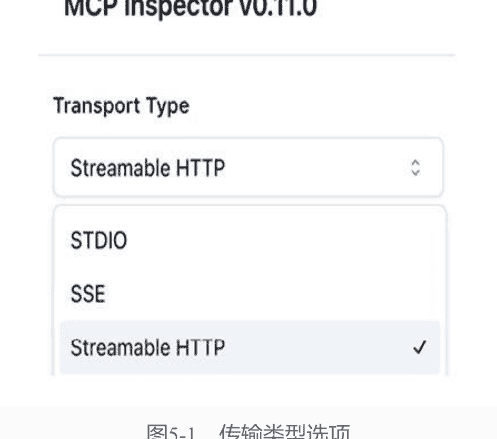

图5-1 传输类型选项

把传输类型切到 Streamable HTTP，依次进入 Resources → List Resources，便能看到已注册的 config 资源，如图5-2所示。

点开图5-2中的 config，右侧窗口展示的输出与 5.1.1 节在创建示例服务器时注册静态资源的那段代码完全一致。

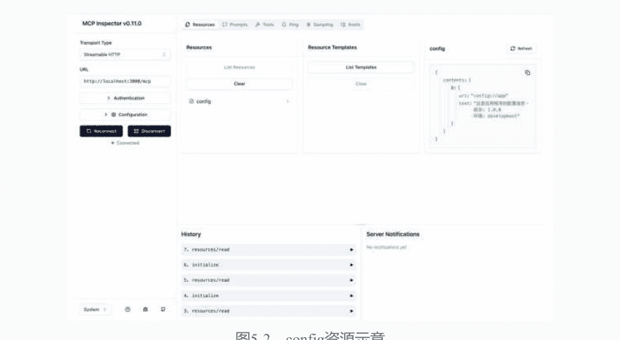

图5-2 config资源示意

### 5.2.2 提示词模板校验

提示词模板本质上是 AI 行为的蓝图，哪怕一个细小的语法或逻辑问题，也会让模型输出偏离预期。调试的核心思路是所见即所得：在发送给 LLM 之前，先确认模板填充参数后能否渲染出理想文本。

如图5-3所示，先进入 Prompts → List Prompts，选中 greet-user，将 name 与 time 分别填为 MCP 与 morning，点击 Get Prompt 即可看到渲染结果。

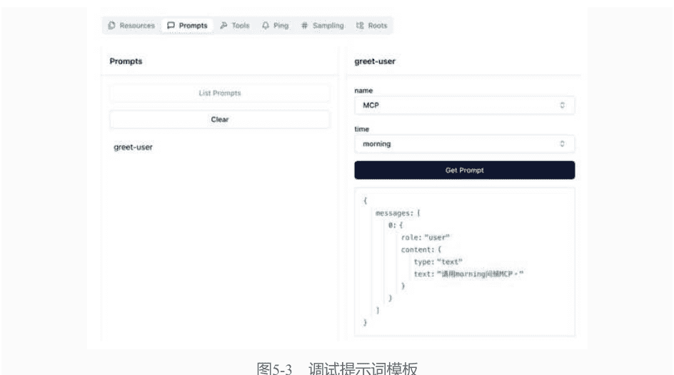

图5-3 调试提示词模板

### 5.2.3 工具调用测试

工具是 MCP Server 的价值核心，它让模型具备执行真实操作的手段。工具调试是整个环节中交互最频繁的部分，需要确认在特定输入下，工具能否按预期执行并返回结构化、可预测的结果。Inspector 会以表单方式把服务器上所有已注册工具直观呈现。

以 calculate 工具为例，在图 5-4 中依次打开 Tools → List Tools → calculate，选中该工具后把 operation 设为 add，操作数 a、b 均填 1，点击 Run Tool 即可查看返回。

Inspector 会展示本次执行的完整结果，方便开发者核验逻辑正确性，并针对不同输入、边界值以及异常情况进行测试。

在 MCP Server 的调试实践中，常见的技巧包括：用非法参数触发错误、检验边界条件处理、组合参数测试动态资源响应、观察流式工具的数据传输。配合增量开发、先单测后集成、手动与自动化测试结合、通过日志分析内部执行细节，并在重要修改前做好版本控制以便回滚，这些做法能显著提升效率和质量。

遵循“调用→观察→验证”的闭环，Inspector 把繁琐的服务端调试变为直观、可复现的交互流程，确保每一项交付服务都稳定可靠。作为开发利器，它大幅降低了 MCP Server 的验证成本，帮助开发者快速迭代，同时保障最终应用的质量。

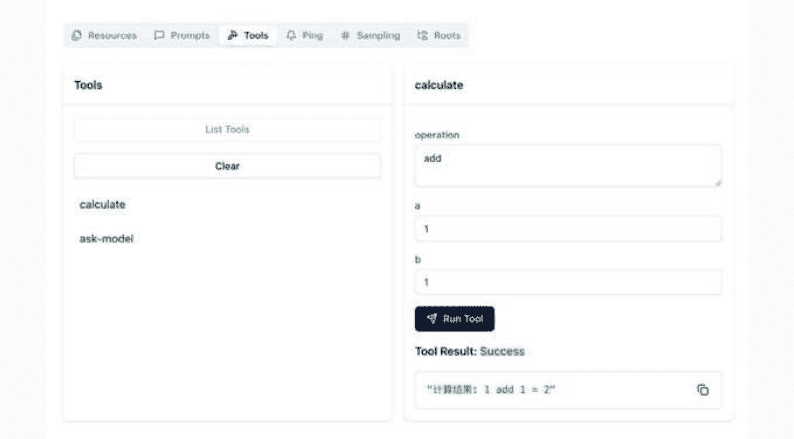

图5-4 调试工具

到这里，一个功能完备的 MCP Server 已经构建完成并成功运行。

## 5.3 搭建命令行客户端

MCP Client 是用户或上层应用连接 MCP Server 的入口。通过客户端，可以把服务器提供的原子能力，比如数据查询、工具调用，编排成通顺、有意义的工作流。接下来将实现一个简易命令行客户端，与 5.1 节的服务器完成交互。

### 5.3.1 客户端核心能力

该客户端主要具备以下能力：

- 基于 HTTP 与 MCP Server 建立安全连接。
- 动态获取并展示当前服务器提供的全部资源、工具和提示词模板清单。
- 主动读取资源、调用工具、渲染提示词模板。
- 在通信过程中优雅处理异常，并在任务结束时关闭连接。

### 5.3.2 代码落地示例

在项目 src/client 目录下新建 http_client.ts 并写入对应代码。该文件能够帮助我们直观理解客户端的工作原理。

```typescript
// src/client/http_client.ts

import { Client } from "@modelcontextprotocol/sdk/client/index.js";
import { StreamableHTTPClientTransport } from "@modelcontextprotocol/sdk/client/streamableHttp.js";

async function main() {
  console.log("启动MCP HTTP客户端...");

  // 1. 初始化传输层：指定服务器的地址和协议
  // 使用StreamableHTTPClientTransport来与基于HTTP的MCP Server通信
  // URL指向了我们在服务器中挂载MCP服务的确切路径
  const transport = new StreamableHTTPClientTransport(
    new URL("http://localhost:3000/mcp")
  );

  // 2. 创建客户端实例：赋予客户端身份标识
  // 这有助于在复杂的系统中进行日志记录和调试
  const client = new Client({
    name: "MyFirstMcpHttpClient",
    version: "1.0.0"
  });

  try {
    // 3. 建立连接：这是所有交互的起点
    await client.connect(transport);
    console.log("成功连接到MCP HTTP服务器");

    // --- 发现并交互：系统地调用服务器能力 ---

    // 4. 发现资源：询问服务器“你有哪些数据可以提供？”
    console.log("\n --- 正在列出所有可用资源 ---");
    const resources = await client.listResources();
    console.log(JSON.stringify(resources, null, 2));

    // 5. 读取资源：获取具体数据
    console.log("\n --- 正在读取静态配置资源 ---");
    const config = await client.readResource({ uri: "config://app" });
    console.log(JSON.stringify(config, null, 2));

    console.log("\n --- 正在读取动态用户资源 ---");
    const userProfile = await client.readResource({ uri: "users://123/profile" });
    console.log(JSON.stringify(userProfile, null, 2));

    // 6. 发现工具：询问服务器“你能做哪些事情？”
    console.log("\n --- 正在列出所有可用工具 ---");
    const tools = await client.listTools();
    console.log(JSON.stringify(tools, null, 2));

    // 7. 调用工具：请求服务器执行具体操作
    console.log("\n --- 正在调用计算工具 ---");
    const calculationResult = await client.callTool({
        name: "calculate",
        arguments: { operation: "add", a: 5, b: 3 }
    });
    console.log(JSON.stringify(calculationResult, null, 2));

    console.log("\n --- 正在调用大模型API工具 ---");
    const modelResult = await client.callTool({
        name: "ask-model",
        arguments: { question: "常见的十字花科植物有哪些？" }
    });
    console.log(JSON.stringify(modelResult, null, 2));

    // 8. 发现提示词：询问服务器“你有哪些预设的对话模板？”
    console.log("\n --- 正在列出所有可用提示词模板 ---");
    const prompts = await client.listPrompts();
    console.log(JSON.stringify(prompts, null, 2));

    // 9. 渲染提示词：获取一个填充好参数的完整提示
    console.log("\n --- 正在获取一个具体的问候提示 ---");
    const greetPrompt = await client.getPrompt({
        name: "greet-user",
        arguments: { name: "张三", time: "morning" }
    });
    console.log(JSON.stringify(greetPrompt, null, 2));
  } catch (error) {
    // 10. 错误处理：捕获并报告交互过程中的任何问题
    console.error("操作失败:", error);
  } finally {
    // 11. 关闭连接：无论成功与否，都应释放资源
    await transport.close();
    console.log("连接已关闭");
  }
}

main().catch(error => {
  console.error("未处理的顶层错误:", error);
  process.exit(1);
});
```

上文的代码把 MCP Client 的完整运行脉络展露无遗，整体可以拆解成四个相互衔接的关键阶段。

（1）初始化与连接。先从 MCP SDK 引入 Client 以及 StreamableHTTPClientTransport。Transport 本质上是对底层物理链路的封装，这次演示里它走 HTTP 协议负责和服务端沟通；Client 则是上层逻辑体，依赖 Transport 去执行一切符合 MCP 规范的交互。真正拉起通道的是 `client.connect(transport)`，它完成握手并保证后续通信保持稳定。

（2）服务发现。通过 `listResources()`、`listTools()` 与 `listPrompts()` 这类列表接口，客户端无需写死服务端能力，而是在运行时动态探知对方提供的资源、工具和提示模板。去中心化的发现机制让客户端与服务端可以各自迭代，耦合度降低，也是可扩展系统的基本做法。

（3）服务消费。进入实际使用阶段。

- `readResource({ uri: "..." })` 用唯一标识的 URI 精准拉取数据。
- `callTool({ name: "...", arguments: {...} })` 类似一次远程过程调用，指定工具名和参数后由服务端执行并返回结果。
- `getPrompt({ name: "...", arguments: {...} })` 则调用服务端预置的模板，只要补齐变量就能得到规范化的提示词，大幅降低和大模型交互前的准备成本。

（4）资源清理与异常兜底。成熟的实现必须考虑意外。借助 `try...catch...finally`，即使出现网络抖动或服务端报错也能被捕获并提示，而 `finally` 里调用 `transport.close()` 保证连接优雅释放，不留资源泄漏。

下面就把这套客户端真正跑起来，观察它与 MCP Server 之间的实时交互。

### 5.3.3 客户端启动演示

先准备一个启动脚本 `start_client.sh`：

```bash
#!/bin/bash
ts-node src/client/http_client.ts
```

给脚本加上执行权限：

```bash
chmod +x start_client.sh
```

在服务端已运行的前提下执行客户端：

```bash
./start_client.sh
```

终端会呈现类似如下的输出：

```
Starting MCP HTTP Client...
Connected to MCP HTTP Server

--- 列出所有资源 ---
{
  "resources": [
    {
      "uri": "config://app",
      "name": "config"
    }
  ]
}

--- 读取配置资源 ---
{
  "contents": [
    {
      "uri": "config://app",
      "text": "这是应用程序的配置信息。\n版本: 1.0.0\n环境: development"
    }
  ]
}

--- 读取用户资源 ---
{
  "contents": [
    {
      "uri": "users://123/profile",
      "text": "用户ID: 123\n姓名: 用户123\n注册时间: 2025-05-17T09:33:24.417Z"
    }
  ]
}

--- 列出所有工具 ---
{
  "tools": [
    {
      "name": "calculate",
      "inputSchema": {
        "type": "object",
        "properties": {
          "operation": {
            "type": "string",
            "enum": [
              "add",
              "subtract",
              "multiply",
              "divide"
            ]
          },
          "a": {
            "type": "number"
          },
          "b": {
            "type": "number"
          }
        },
        "required": [
          "operation",
          "a",
          "b"
        ],
        "additionalProperties": false,
        "$schema": "http://json-schema.org/draft-07/schema#"
      }
    },
    {
      "name": "ask-model",
      "inputSchema": {
        "type": "object",
        "properties": {
          "question": {
            "type": "string"
          }
        },
        "required": [
          "question"
        ],
        "additionalProperties": false,
        "$schema": "http://json-schema.org/draft-07/schema#"
      }
    }
  ]
}

--- 调用计算工具 ---
{
  "content": [
    {
      "type": "text",
      "text": "计算结果: 5 add 3 = 8"
    }
  ]
}

--- 调用大模型API工具 ---
{
  "content": [
    {
      "type": "text",
      "text": "嗯, 用户问的是常见的十字花科植物有哪些。首先, 我需要回忆一下十字花科的特征, 例如十字形花冠、四强雄蕊、角果这些..."
    }
  ]
}

--- 列出所有提示 ---
{
  "prompts": [
    {
      "name": "greet-user",
      "arguments": [
        {
          "name": "name",
          "required": true
        },
        {
          "name": "time",
          "required": false
        }
      ]
    }
  ]
}

--- 获取问候提示 ---
{
  "messages": [
    {
      "role": "user",
      "content": {
        "type": "text",
        "text": "请用morning问候张三。"
      }
    }
  ]
}
```

## 章节回顾

本章以 MCP TypeScript SDK 为底座，搭建起一套可用的 AI 智能体。

起初我们先设计并落地 MCP Server。注册静态资源与动态资源，使其具备提供上下文信息的能力；接入本地计算工具以及对接外部大模型 API 的 `ask-model` 工具，让模型拥有感知与行动的能力，并细致讲解了流式返回的处理，这对提升交互体验至关重要；同时定义了提示词模板，实现了行为指导的规范化与复用。整体运行在 Express 之上，通过会话与路由的精细实现，保证了 HTTP 通信的稳定与高效。

随后借助 MCP Inspector 的可视化界面，对资源、工具、提示模板完成“调用-观察-验证”的闭环检验。该过程既证明了服务端的正确性，也塑造了主动验证而非被动排错的开发习惯，对构建可靠的分布式 AI 智能体很有价值。

最后我们用命令行方式实现了一个 MCP Client。它完整呈现了客户端生命周期：先初始化传输层并建立连接，再动态查询服务端能力，随后有序消费服务——读取资源、调用工具、渲染提示词，并在完善的异常处理下优雅关闭。通过运行日志可以看到 MCP 驱动的端到端数据流动，把理论与实操紧密衔接。

学完本章，你不仅能掌握 TypeScript SDK 开发 Server 与 Client 的核心方法，更可以动手打造属于自己的 AI 智能体。

## 第6章 用 MCP TypeScript SDK 搭建商城智能体

本章将通过一个真实的电商场景项目，帮助你把 MCP 的用法落地到业务中。全篇围绕以下几块展开。

- 商城智能体总览
- MCP Server 的实现
- MCP Client 的开发
- 系统联调与测试

完成学习后，你将能够在电商场景下应用 MCP，独立开发出支持商品查询、下单、订单管理的智能对话助手，为后续更复杂的智能体奠定基础。

### 6.1 商城智能体总览

电商是 AI 智能体落地的高频领域，购物助手可以明显改善用户体验，让找商品、比价格、完成下单变得更高效。本章要做的就是一个基于 MCP 的商城智能体，它能帮助用户检索商品、管理库存、处理订单，并给出个性化购物建议。

在动手前，先明确需求目标、梳理架构并选定技术栈。

#### 6.1.1 需求梳理与功能规划

商城智能体要解决的就是用户购物时的典型痛点：找不到合适的商品、不知道是否现货、下单流程繁琐等。围绕这些问题，我们确定了以下核心能力。

- 商品查询与推荐：支持用自然语言描述需求，系统解析意图后返回匹配列表。例如用户说“想要性价比高的智能手表”，就能得到符合条件的候选商品。
- 库存管理：实时反馈库存状态，避免用户下单后才发现缺货。用户询问时应立刻告知当前余量。
- 订单处理：通过对话完成下单，涵盖商品选择、数量确认、用户信息收集等环节。
- 个性化推荐：结合历史行为和当前对话，推送更贴合的商品。
- 多轮对话：保持上下文，支持一次对话中从检索到下单的完整流程。

规划时需权衡实用性、可行性和扩展性，确保每个功能真正解决问题、符合 MCP 与 LLM 的能力边界，同时预留未来扩展空间。基础版完成后，还可以逐步加入：

- 价格对比
- 评价汇总与关键信息抽取
- 促销与优惠券提醒
- 退换货与售后咨询

#### 6.1.2 架构设计

按功能分层，整体结构分为用户场景应用层、业务服务层与数据层，如图6-1所示。

- 用户场景应用层：用户通过 MCP Client 与系统交互。客户端负责界面展示、采集用户输入，并把请求转发给 MCP Server。

业务逻辑层集中了商品模块、库存模块、订单模块等关键业务处理，负责承接具体的业务请求并完成对应的执行。该层会与存储层协同，完成数据的增删改查。其中 MCP 服务端充当整个系统的枢纽，接收来自 MCP 客户端的请求并调度到合适的业务模块去执行，并完整实现了 MCP 协议，提供了资源访问、工具调用及提示词模板等能力。

存储层负责数据的持久化与读取。为了演示方便，本项目采用内存结构来模拟数据库读写，真实的生产环境则会接入正式的数据库系统。

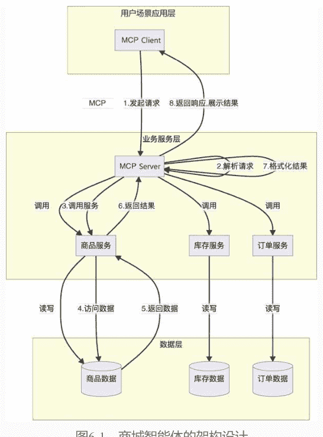

这种分层方式让系统在扩展功能时保持代码结构清晰、可维护，后续可针对各层进行优化而不破坏整体架构。下面是用户场景层、业务逻辑层与存储层之间的交互顺序。

- 终端用户通过 MCP 客户端发起操作请求。
- 请求借助 MCP 协议送达 MCP 服务端。
- 服务端解析请求内容并分发给对应业务模块。
- 业务模块在处理时视情况访问存储层读取或写入数据。
- 处理结果交回服务端。
- 服务端整理后经 MCP 协议返回给客户端。
- 客户端将结果呈现给用户。

### 6.2 MCP Server实现

当需求拆解、架构方案确定、开发环境搭建完成后，下面详述 MCP 服务端的落地实现。本项目首批实现的工具主要涵盖商品列表展示、库存信息查询、订单列表获取。

#### 6.2.1 商品列表工具开发

商品是智能商城的数据核心，用户需要浏览、搜索、查看详情等能力，在 MCP 设计中由商品列表工具统一提供。

在 src/types/index.ts 中补充类型定义，用来描述商品、库存、订单的字段结构。

```typescript
// 商品数据结构
export interface Product {
  id: number;
  name: string;
  price: number;
  description: string;
}

// 库存数据结构
export interface Inventory {
  productId: number;
  quantity: number;
  product?: Product; // 关联的商品信息，用于返回给客户端
}

// 订单数据结构
export interface Order {
  id: number;
  customerName: string;
  items: { productId: number, quantity: number }[];
  totalAmount: number;
  orderDate: string;
}
```

新建 src/services/inventory-service.ts 并写入实现，构建一个基于内存的数据服务层。该服务模拟商品、库存、订单的存储，并提供获取商品清单、查询库存详情、列出订单以及创建订单等方法，为电商核心数据操作打下基础。

```typescript
// 导入商品、库存和订单的数据结构定义
import { Product, Inventory, Order } from '../types/index.js';

// 模拟商品数据存储，初始化部分商品信息
let products: Product[] = [
  { id: 1, name: "华为智能手表", price: 1299, description: "健康监测，运动追踪，支持多种应用" },
  { id: 2, name: "蓝牙耳机Pro", price: 899, description: "主动降噪，30小时续航，IPX7防水" },
  { id: 3, name: "便携式移动电源", price: 299, description: "20000mAh大容量，支持快充，轻薄设计" },
  // 更多商品...
];

// 模拟库存数据存储，记录各商品的库存数量
let inventory: Inventory[] = [
  { productId: 1, quantity: 100 },
  { productId: 2, quantity: 50 },
  { productId: 3, quantity: 200 },
  // 更多库存...
];

// 模拟订单数据存储，初始为空数组
let orders: Order[] = [];

// 获取所有商品列表的函数，返回商品数组
export async function getProducts(): Promise<Product[]> {
  return products;
}

// 获取库存信息的函数，关联商品详情后返回
export async function getInventory(): Promise<Inventory[]> {
  // 遍历库存项，为每个库存项匹配对应的商品信息
  return inventory.map(item => {
    const product = products.find(p => p.id === item.productId);
    // 返回包含商品详情的库存信息
    return {
      ...item,
      product
    };
  });
}

// 获取订单列表的函数，按订单日期倒序排列
export async function getOrders(): Promise<Order[]> {
  // 复制订单数组并按订单日期从新到旧排序
  return [...orders].sort((a, b) =>
    new Date(b.orderDate).getTime() - new Date(a.orderDate).getTime()
  );
}

// 创建购买订单的函数，接收客户名称和购买项，返回创建的订单
export async function createPurchase(customerName: string, items: { productId: number, quantity: number }[]): Promise<Order> {
  ...
}
```

特别要注意，createPurchase 函数除了生成订单，还内置了库存校验与更新逻辑。这种设计保证了下单过程的原子性，防止因库存不足而错误生成订单。

为了让业务服务对外可调用，需要创建 src/mcp-server-tools.ts 并添加代码。核心是启动一个 MCP 服务端实例，并把商品查询、库存查询、订单查询注册为 MCP 工具，使得这些能力可以通过服务端接口被调用并返回标准化响应。每个工具都包含标识、描述、参数校验模式和执行函数。

```typescript
import { McpServer } from "@modelcontextprotocol/sdk/server/mcp.js";
import { z } from "zod";
import { getProducts, getInventory, getOrders, createPurchase } from "./services/inventory-service.js";

// 创建MCP Server实例，设置名称、版本和描述
export const server = new McpServer({
  name: "mcp-sse-demo",
  version: "1.0.0",
  description: "提供商品查询、库存管理和订单处理的MCP工具"
});

// 获取商品列表工具
server.tool(
  "getProducts",
  "获取所有产品信息",
  {},
  // 工具处理函数，异步调用获取商品列表的服务函数
  async () => {
    console.log("获取产品列表");
    const products = await getProducts(); // 调用服务函数获取商品列表
    return { // 返回标准化格式的响应，包含商品列表的JSON字符串
      content: [
        {
          type: "text",
          text: JSON.stringify(products)
        }
      ]
    };
  }
);

// 获取库存信息工具
server.tool(
  "getInventory",
  "获取所有产品的库存信息",
  {},
  // 工具处理函数，异步调用获取库存信息的服务函数
  async () => {
    console.log("获取库存信息");
    const inventory = await getInventory(); // 调用服务函数获取库存信息
    // 返回标准化格式的响应，包含库存信息的JSON字符串
    return {
      content: [
        {
          type: "text",
          text: JSON.stringify(inventory)
        }
      ]
    };
  }
);

// 获取订单列表工具
server.tool(
  "getOrders",
  "获取所有订单信息",
  {},
  // 工具处理函数，异步调用获取订单列表的服务函数
  async () => {
    console.log("获取订单列表");
    const orders = await getOrders(); // 调用服务函数获取订单列表
    // 返回标准化格式的响应，包含订单列表的JSON字符串
    return {
      content: [
        {
          type: "text",
          text: JSON.stringify(orders)
        }
      ]
    };
  }
);
```

上述实现采用 content 数组返回，这是 MCP 的标准形态，支持多种内容类型如文本、图像。

#### 6.2.2 订单管理工具集成

本小节增加下单功能，让用户可通过 MCP 客户端完成购买。在 src/mcp-server-tools.ts 文件中追加代码。

```typescript
// 购买商品工具
server.tool(
  "purchase",
  "购买商品",
  {
    items: z.array(
      z.object({
        productId: z.number().describe("商品ID"),
        quantity: z.number().describe("购买数量")
      })
    ).describe("要购买的商品列表"),
    customerName: z.string().describe("客户姓名")
  },
  async ({ items, customerName }) => {
    console.log("处理购买请求", { items, customerName });
    try {
      const order = await createPurchase(customerName, items);
      return {
        content: [
          {
            type: "text",
            text: JSON.stringify(order)
          }
        ]
      };
    } catch (error: any) {
      return {
        content: [
          {
            type: "text",
            text: JSON.stringify({ error: error.message })
          }
        ]
      };
    }
  }
);
```

该工具实现购买流程，接收待购商品列表和客户姓名两个参数。参数校验使用 Zod 库，确保格式符合预期。执行函数调用 createPurchase 服务创建订单并将结果返回。

值得注意的是错误处理逻辑。若下单过程中出现异常如库存不足，系统会捕获并返回包含错误信息的响应，避免异常冒泡到上层。这种做法让客户端得到可理解的错误提示，而非笼统的服务器错误。

加入订单管理工具后，商城智能体具备完整的购物闭环：查询商品、核查库存、下单。所有能力通过 MCP 暴露，LLM 可理解调用，为用户带来流畅自然的购物体验。

实际项目中还可进一步扩展，如订单取消、状态查询等，按相同模式注册为 MCP 工具即可。

6.2.1 节及本节实现的 MCP Server Tools 完整源代码，可在本书配套 GitHub 代码仓库的 mcp-shopping-assistant-server/src/mcp-server-tools.ts 中查阅。

#### 6.2.3 实现基于Express的MCP Server

本节演示如何基于 Express 搭建 MCP 服务端，利用 SSE 技术实现实时通信。整体工作流可归纳为：

1. 初始化：创建 Express 应用及 MCP 服务端实例。
2. 连接建立：客户端通过 /sse 端点建立 SSE 连接。
3. 消息处理。
   - 客户端通过 /messages 端点发送消息。
   - 服务端根据会话 ID 定位对应的 SSE 连接。
   - 消息转发给 MCP 服务端处理。
   - MCP 服务端调用相应工具或执行其他操作。
   - 结果通过 SSE 连接实时返回客户端。
4. 连接管理：跟踪所有活跃连接，处理连接关闭。
5. 优雅关闭：服务器关闭时通知所有客户端并清理资源。

下面分步讲解核心逻辑。

##### 1. 导入依赖和初始化

具体代码如下。

```typescript
import express, { Request, Response, NextFunction } from "express";
import cors from "cors";
import { SSEServerTransport } from "@modelcontextprotocol/sdk/server/sse.js";
import { server as mcpServer } from "./mcp-server-tools.js"; // 重命名以避免命名冲突

const app = express();
app.use(cors({
  origin: process.env.ALLOWED_ORIGINS?.split(',') || '*',
```

##### 2. 连接管理

创建一个 Map 结构保存所有活跃的 SSE 连接，以会话 ID 为键，SSEServerTransport 实例为值。此设计方便服务器追踪连接，并在需要时如服务端关闭时优雅释放。

```
// 存储活跃连接
const connections = new Map();
```

##### 3. 健康检查端点

健康检查端点可输出服务器健康信息，包含运行状态、版本号、运行时间、当前时间戳、活跃连接数等。

```
app.get('/health', (req, res) => {
  res.status(200).json({
    status: 'ok',
    version: '1.0.0',
    uptime: process.uptime(),
    timestamp: new Date().toISOString(),
    connections: connections.size
  });
});
```

这对生产环境的监控与排错十分有帮助。

##### 4. SSE连接建立

SSE 连接建立是 MCP 服务端实现的核心，逻辑如下。

- 客户端请求 /sse 端点时，服务器新建一个 SSEServerTransport 实例。
- 从传输对象获取唯一的会话 ID。
- 将新连接存入 connections Map。
- 设置连接关闭监听，在客户端断开时清理资源。
- 将传输对象与 MCP 服务端关联，使服务端能通过该通道与客户端通信。

具体代码如下。

```
// SSE连接建立端点
app.get("/sse", async (req, res) => {
  // 实例化SSE传输对象
  const transport = new SSEServerTransport("/messages", res);
  // 获取sessionId
  const sessionId = transport.sessionId;
  console.log(`[${new Date().toISOString()}]新的SSE连接建立: ${sessionId}`);

  // 注册连接
  connections.set(sessionId, transport);

  // 连接中断处理
  req.on('close', () => {
    console.log(`[${new Date().toISOString()}] SSE连接关闭: ${sessionId}`);
    connections.delete(sessionId);
  });

  // 将传输对象与MCP Server连接
  await mcpServer.connect(transport);
  console.log(`[${new Date().toISOString()}] MCP Server连接成功: ${sessionId}`);
});
```

基于 SSE 的传输方式让服务端可以主动向客户端推送增量数据，对 AI Agent 的流式对话体验非常友好。

##### 5. 消息处理端点
这块接口主要负责接收客户端发来的业务消息，内部处理步骤如下。

- 从查询参数中解析出会话 ID。
- 在 connections 映射表中定位对应的 SSE 传输实例。
- 命中实例时调用其 handlePostMessage 方法完成消息分发。
- 若未找到对应连接或执行过程中出现异常，则返回标准化的错误结果。

```
// 接收客户端消息的端点
app.post("/messages", async (req: Request, res: Response) => {
  try {
    console.log(`[${new Date().toISOString()}]收到客户端消息:`, req.query);
    const sessionId = req.query.sessionId as string;

    // 查找对应的SSE连接并处理消息
    if (connections.size > 0) {
      // 获取第一个可用的传输对象（在生产环境中应该使用更精确的匹配机制）
      const transport: SSEServerTransport = connections.get(sessionId) as SSEServerTransport;
      // 使用transport处理消息
      if (transport) {
        await transport.handlePostMessage(req, res);
      } else {
        throw new Error('没有活跃的SSE连接');
      }
    } else {
      throw new Error('没有活跃的SSE连接');
    }
  } catch (error: any) {
    console.error(`[${new Date().toISOString()}]处理客户端消息失败:`, error);
    res.status(500).json({ error: '处理消息失败', message: error.message });
  }
});
```

这里最关键的是 transport.handlePostMessage ，它由 MCP SDK 封装，任务是把客户端上来的消息投递给 MCP Server，后者再依据消息内容决定调用哪个工具或执行哪项操作。

##### 6. 连接关闭管理
为了让客户端在服务端下线时能第一时间感知，避免硬断开带来的体验损失，设计了优雅退出流程。其要点如下。

- 遍历内存中保存的所有活跃连接。
- 向每个连接推送服务端即将关闭的事件。
- 终结对应的响应流。
- 清空连接映射表。

具体代码如下。

```
// 优雅关闭所有连接
async function closeAllConnections() {
  console.log(`[${new Date().toISOString()}]关闭所有连接 (${connections.size}个)`);
  for (const [id, transport] of connections.entries()) {
    try {
      // 发送关闭事件
      transport.res.write('event: server_shutdown\ndata: {"reason": "Server is shutting down"}\n\n');
      transport.res.end();
      console.log(`[${new Date().toISOString()}]已关闭连接: ${id}`);
    } catch (error) {
      console.error(`[${new Date().toISOString()}]关闭连接失败: ${id}`, error);
    }
  }
  connections.clear();
}
```

##### 7. 异常捕获与信号监听
具体代码如下。

```
// 错误处理
app.use((err: Error, req: Request, res: Response, next: NextFunction) => {
  console.error(`[${new Date().toISOString()}]未处理的异常:`, err);
  res.status(500).json({ error: '服务器内部错误' });
});

// 优雅关闭所有连接和服务器
process.on('SIGTERM', async () => {
  console.log(`[${new Date().toISOString()}]接收到SIGTERM信号，准备关闭`);
  await closeAllConnections();
  server.close(() => {
    console.log(`[${new Date().toISOString()}]服务器已关闭`);
    process.exit(0);
  });
});

// 优雅关闭连接和进程
process.on('SIGINT', async () => {
  console.log(`[${new Date().toISOString()}]接收到SIGINT信号，准备关闭`);
  await closeAllConnections();
  process.exit(0);
});
```

这段实现覆盖了错误与信号两类收尾工作。

- 全局错误中间件拦截未捕获的异常，并统一返回错误格式。
- SIGTERM 处理器常用于 Kubernetes 等编排平台触发，负责有序关闭连接与服务。
- SIGINT 处理器对应终端 Ctrl+C 场景，同样执行优雅下线。

三者共同保证进程在各种退出路径下都能清理资源，不残留悬挂连接。

##### 8. 启动 HTTP 服务
启动 HTTP 服务器的具体代码如下：

```
// 启动服务器
const port = process.env.PORT || 8083;
const server = app.listen(port, () => {
  console.log(`[${new Date().toISOString()}]智能商城MCP SSE服务器已启动，地址: http://localhost:${port}`);
  console.log(`- SSE连接端点: http://localhost:${port}/sse`);
  console.log(`- 消息处理端点: http://localhost:${port}/messages`);
  console.log(`- 健康检查端点: http://localhost:${port}/health`);
});
```

核心动作包括。

- 读取环境变量中的端口，未配置时回退到 8083。
- 启动 Express 应用。
- 在控制台输出服务地址与可用端点信息。

本节示例的 MCP Server 完整源码可在本书配套 GitHub 仓库的 mcp-shopping-assistant-server/src/app.ts 查阅。

至此，商城智能体的 MCP Server 部分已完成。后续 6.3 节和 6.4 节将分别演示两种客户端形态：轻量的 CLI 程序与功能更完整的 Web 应用。

### 6.3 CLI 形态的 MCP 客户端
从最直接的交互方式开始，先做一个命令行客户端。对开发者来说，CLI 是验证服务端能力、快速调试的利器，同时也是一种专注高效的交互模式。

#### 6.3.1 核心流程
这个 CLI 需要把用户的自然语言意图转成对 MCP Server 的调用，并把返回结果解析后用易读的方式呈现。

实现关键是构建一个稳定可靠的交互循环，它贯穿启动、对话到退出，拆解为下面几个阶段。

（1）初始化与连接。当程序启动后，先加载依赖并输出欢迎提示，随后尝试连上 6.2 节部署的 MCP Server。连接成功后会主动发送握手请求，拉取服务端当前暴露的全部工具清单。这种自发现机制让客户端无需写死工具列表即可动态适配。

（2）交互循环阶段。进入后程序会阻塞等待用户输入。用户输入自然语言问题后，客户端会连同历史上下文一起交给 LLM 处理。

（3）流式响应处理。采用 Streaming 方式接收 LLM 输出，无需等完整结果即可边生成边展示思考过程，大幅降低等待焦虑。

（4）工具调用。若 LLM 判定需要外部能力，会在回复中携带结构化工具调用请求。客户端识别后按工具名与参数调用对应的 MCP Server 工具，并把执行结果回传给 LLM 以便继续生成最终答案。

这种“对话→推理→调工具→整合→回复”的闭环，让语言模型的能力与真实工具结合，智能体从聊天对象变为可解决问题的工作伙伴。

（5）结束退出。用户输入 exit 或出现不可恢复错误时，循环终止，客户端释放资源后优雅退出。

整体流程兼顾体验与健壮性，可作为更复杂智能体的雏形，也可用于快速测试 MCP Server。

#### 6.3.2 实现步骤

##### 1. 导入依赖和初始化
导入运行所需库、工具函数、MCP 客户端 SDK 及配置常量，具体代码如下。

```
import chalk from 'chalk';
import ora from 'ora';
import readlineSync from 'readline-sync';
import { config } from './config.js';
import { formatToolResult } from './utils.js';
import { Client as McpClient } from "@modelcontextprotocol/sdk/client/index.js";
import { SSEClientTransport } from "@modelcontextprotocol/sdk/client/sse.js";
import { ENDPOINT_ID } from "./const.js";
import { ARK_API_URL } from "./const.js";
```

其中 chalk 负责终端彩色输出，ora 提供加载动画，readlineSync 用于同步读取输入，config 管理本地配置，utils 为通用工具集，McpClient 代表 MCP 客户端 SDK，SSEClientTransport 为流式传输载体，ENDPOINT_ID 与 ARK_API_URL 分别定义 API 端点与模型标识。

##### 2. 主函数结构
main() 作为程序入口，采用 async/await 管理异步流程。末尾的 .catch() 捕获所有未处理异常，避免崩溃并给出友好提示后退出。

```
async function main() {
  // 显示欢迎信息
  // 连接MCP Server
  // 获取工具列表
  // 交互式命令行循环
  // 处理用户输入
  // 调用LLM
  // 处理AI响应和工具调用
}

main().catch(error => {
  console.error(chalk.red('程序运行出错:'), error);
  process.exit(1);
});
```

##### 3. 连接 MCP Server
下面片段展示了如何连接 MCP Server，并通过加载动画提升感知体验。

```
// 1.创建一个加载动画，提示用户正在连接MCP Server
const spinner = ora('正在连接到MCP Server...').start();
try {
  // 2.创建MCP Client
  const mcpClient = new McpClient({
    name: 'mcp-sse-demo',
    version: '1.0.0',
  });

  // 3.定义并配置传输层
  const transport = new SSEClientTransport(
    new URL(config.mcp.serverUrl)
  );

  // 4.发起连接
  await mcpClient.connect(transport);
  ...
```

选用 SSE 作为传输层，正是因为它支持服务端主动推送，特别适合 Agent 场景下的流式交互。

##### 4. 获取和转换工具列表
以下代码完成工具清单的拉取与格式适配。

- 调用 mcpClient.listTools() 从服务端获取可用工具。
- 用 reduce 把列表转为以工具名为键的 toolset 对象，便于快速检索。
- 用 map 把工具信息转成 arkTools，满足 LLM API 的参数规范。
- 转换完成后通过动画反馈，并在终端打印工具清单。

```
// 获取可用工具
const { tools } = await mcpClient.listTools();
const toolset = tools.reduce((acc: Record<string, any>, tool: any) => {
  acc[tool.name] = {
    name: tool.name,
    description: tool.description,
    parameters: tool.inputSchema?.properties || {}
  };
  return acc;
}, {});
spinner.succeed('已连接到MCP Server并获取工具列表');
console.log(chalk.green('工具列表:'), toolset);

const arkTools = tools.map((tool: any) => {
  return {
    type: "function",
    function: {
      name: tool.name,
      description: tool.description,
      parameters: tool.inputSchema,
    }
  };
});
```

由于 MCP 与 LLM API 对工具描述的约定不同，这一步转换是打通二者的必要桥梁。

##### 5. 交互式命令行循环
下面的代码用循环实现持续交互。

- 每次循环通过 readlineSync.question 提示并读取用户问题。
- 输入不区分大小写的 exit 时退出循环，否则进入后续处理流程。

```
// 交互式命令行循环
while (true) {
  const question = readlineSync.question(chalk.green('请输入您的问题 (输入 "exit" 结束): '), {
    hideEchoBack: false, // 显示输入内容
```

##### 6. 发起 LLM 请求

这段代码负责把请求打到 LLM 接口并做最基础的响应校验。

启动时先用加载动画告诉用户请求正在路上，随后通过 fetch 发起一次 POST 调用。请求头里带上内容类型与鉴权信息，请求体则明确指定模型 ID、是否开启流式、对话消息也就是系统提示与用户提问、可用工具清单以及最大生成 Token 数。响应回来后立刻检查状态码，一旦异常就主动抛出，让上层的异常处理机制接手。

```javascript
// 显示加载动画，提示用户AI正在思考中
const aiSpinner = ora('AI正在思考中...\n').start();

try {
  // 调用大模型API
  const response = await fetch(ARK_API_URL, {
    method: "POST",
    headers: {
      "Content-Type": "application/json",
      "Authorization": `Bearer ${process.env.ARK_API_KEY || "your_api_key_here"}`
    },
    body: JSON.stringify({
      model: ENDPOINT_ID,
      stream: true, // 启用流式输出
      messages: [
        { role: "system", content: "你是AI智能体." },
        { role: "user", content: question }
      ],
      tools: arkTools,
      max_tokens: 8192,
    })
  });

  if (!response.ok) {
    throw new Error(`API请求失败: ${response.status} ${response.statusText}`);
  }

  aiSpinner.succeed('AI回复已就绪');
```

其中 `stream: true` 就是开启流式输出的开关，让模型不用等到整段生成完毕才返回，而是边生成边推送，这正是实现实时呈现的关键。

##### 7. 解码流式返回

与大模型交互的乐趣在于答案逐步展开的过程，而非只有最终结果。模型不会一次性吐出完整文本，而是把生成片段即 delta 通过持续的数据流推送过来。下面这段解码逻辑就是用来捕获、解析并即时展示这些片段的。

实现上先用 `response.body.getReader()` 拿到可读流，再借助 `TextDecoder` 把字节转成字符串。进入循环不断读取数据块，按换行切分并过滤掉空行。对于符合 SSE 规范、以 `data:` 开头的一行，去掉前缀后解析成 JSON，从中取出 delta 里的 `reasoning_content`、`content` 与 `tool_calls`。

```javascript
// 处理流式响应
const reader = response.body.getReader(); // 1. 获取响应体的数据流读取器
const decoder = new TextDecoder(); // 2. 初始化文本解码器，将字节流转换为字符串
let fullText = ""; // 3. 用于累积完整的响应文本

// 4. 启动一个异步循环，持续消费数据流
while (true) {
  // 从流中读取下一个数据块
  const { done, value } = await reader.read();

  // 如果done为true，表示数据流已结束，跳出循环
  if (done) break;

  // 5. 将接收到的字节块（value）解码为字符串片段（chunk）
  const chunk = decoder.decode(value, { stream: true });
  // 按换行符分割，因为SSE协议是基于行的
  const lines = chunk.split('\n').filter(line => line.trim() !== "");

  // 6. 遍历每一行数据
  for (const line of lines) {
    // 7. 检查该行是否为SSE协议的有效数据载荷（以"data: "开头）
    if (line.startsWith('data: ')) {
      // 提取 "data: " 后面的JSON字符串
      const data = line.substring(6);
      // OpenAI等服务的流结束时会发送一个特殊标记
      if (data === '[DONE]') continue;

      try {
        // 8. 解析JSON字符串，获取结构化数据
        const json = JSON.parse(data);
        // 9. 深入到嵌套结构中，提取核心的增量内容(delta)
        if (json.choices && json.choices[0].delta) {
          const { reasoning_content, content, tool_calls } = json.choices[0].delta;

          // 处理模型的"思考过程"或中间步骤文本
          if (reasoning_content) {
            fullText += reasoning_content;
            process.stdout.write(reasoning_content); // 实时输出到终端
          }
          // 处理模型的最终回复内容
          if (content) {
            fullText += content;
            process.stdout.write(content); // 实时输出到终端
          }

          // 如果delta中包含工具调用请求，则在此处进行处理...
          if (tool_calls) {
            // (此处的逻辑将在后续章节中详细展开)
          }
        }
      } catch (e) {
        // 健壮性设计：捕获并报告解析错误，防止程序崩溃
        console.error('解析流式响应出错:', e, '原始数据:', data);
      }
    }
  }
}
```

最核心的是对 `content` 的处理：解析到的增量一方面拼接到 `fullText` 以累积完整答案，另一方面通过 `process.stdout.write` 直接写到终端，实现动态呈现。同时加入了解析异常的捕获，JSON 出错时只输出提示，不会中断整体流程。

##### 8. 执行工具调用

这是 LLM 与 MCP 工具衔接的关键环节，负责把模型抛出的工具请求落到真实执行上。

当流式数据中出现 `tool_calls` 时，代码会遍历每个请求，提取工具名称与参数。名称不存在则直接跳过，参数为空时默认用空对象兜底。随后在终端打印调用信息，调用 `mcpClient.callTool` 执行，并用加载动画反馈执行状态。执行成功后调用 `formatToolResult` 格式化结果并输出，失败时则用加载动画提示错误。

```javascript
// 处理工具调用
const tool_calls = json.choices[0].delta.tool_calls

if (tool_calls) {
  for (const tool_call of tool_calls) {
    // 获取工具调用信息
    const toolName = tool_call.function.name;
    if (!toolName) {
      continue;
    }

    // 如果arguments是一个空字符串，将其转换为null
    const toolInput = tool_call.function.arguments || {};

    // 处理工具调用
    console.log(chalk.yellow('\n工具调用:'));
    console.log(chalk.gray(`工具: ${JSON.stringify(tool_call, null, 2)}`));
    console.log(chalk.blue(`调用工具: ${toolName}`));
    console.log(chalk.gray(`参数: ${JSON.stringify(toolInput, null, 2)}`));

    // 调用MCP工具
    const toolSpinner = ora(`正在执行 ${toolName}...`).start();
    try {
      const toolResult = await mcpClient.callTool({
        name: toolName,
        arguments: toolInput
      });
      toolSpinner.succeed(`${toolName} 执行完成`);

      // 格式化并显示结果
      const formattedResult = formatToolResult(toolResult);
      console.log(chalk.blue(`工具结果: ${formattedResult}`));

      // 发送工具结果给AI...
    } catch (error: any) {
      toolSpinner.fail(`${toolName} 执行失败: ${error.message}`);
    }
  }
}
```

有了这层桥接，模型就能调用 MCP Server 提供的工具，突破自身能力边界处理更复杂的任务。

##### 9. 回写结果给模型

能调用工具拿到外部数据只是半场。真正智能的系统要把这些数据理解并融入对话，形成连贯有价值的回复，这就是对话闭环。

下面这部分代码完成“提问→查工具→解读结果”的完整闭环，把工具执行结果喂回给 LLM 以便基于新信息产出最终答案。工具跑完后先用 `formatToolResult` 格式化，再发起第二轮、甚至第 N 轮的 fetch 请求。请求体里构建了两个核心上下文：用户的原始问题 `{ role: 'user', content: question }` 用来锚定任务目标；格式化后的工具结果 `{ role: 'user', content: formattedResult }` 以用户角色补充事实依据，引导模型据此推理。流式参数 `stream: true` 保持开启，维持实时交互体验。

若返回状态正常，则直接复用第 7 节的流式处理逻辑。

设计上体现两层思路：一是靠上下文传递保持对话连贯，让工具结果自然融入交互，避免模型偏离原问题；二是复用流式解析代码，减少重复并保证体验一致。工具结果回传并生成最终回复的闭环形成，系统也就从单纯的工具执行者升级为能结合外部能力完成复杂任务的完整交互体。

```javascript
// 1. 将工具执行结果作为新的信息，发送给AI
const followUpResponse = await fetch(ARK_API_URL, {
  method: "POST",
  headers: {
    "Content-Type": "application/json",
    // 确保请求的合法性与安全性
    "Authorization": `Bearer ${process.env.ARK_API_KEY || "your_api_key_here"}`
  },
  body: JSON.stringify({
    model: ENDPOINT_ID, // 指定使用的模型
    stream: true,   // 再次请求流式输出，以获得最佳体验

    // 2. 精心构建上下文，这是对话连贯性的核心
    messages: [
      // 包含用户的原始问题
      { role: 'user', content: question },
      // 包含工具返回的结果，同样以'user'角色提供
      { role: 'user', content: formattedResult }
    ],
    max_tokens: 8192, // 设定生成内容的最大长度
  })
});

// 3. 打印最终的综合性回复
if (followUpResponse.ok) {
  // 这部分代码与之前处理流式响应的逻辑完全相同，它负责捕获、解码并实时显示LLM基于工具结果生成的最终答案
  const reader = followUpResponse.body.getReader();
  const decoder = new TextDecoder();
  let fullText = "";
  // 循环读取并处理流式数据
  while (true) {
    const { done, value } = await reader.read();
    if (done) break;
    const chunk = decoder.decode(value, { stream: true });
    const lines = chunk.split('\n').filter(line => line.trim() !== "");
    for (const line of lines) {
      if (line.startsWith('data: ')) {
        const data = line.substring(6);
        if (data === '[DONE]') continue;
        try {
          const json = JSON.parse(data);
          if (json.choices && json.choices[0].delta) {
            // 注意：此时返回的通常是'content'，即最终面向用户的回复
            const content = json.choices[0].delta.content;
            if (content) {
              fullText += content;
              process.stdout.write(content); // 实时将最终答案打印到终端
            }
          }
        } catch (e) {
          console.error('解析最终流式响应出错:', e, '原始数据:', data);
        }
      }
    }
  }
}
```

##### 10. 异常兜底与退出

程序稳定性靠多层异常捕获来保障。LLM 调用阶段用 try-catch 捕获请求异常并以加载动画提示失败；MCP Server 连接阶段用外层 try-catch 捕获连接异常并输出提示。

正常结束时输出感谢信息并以状态码 0 退出，异常退出则以状态码 1 退出，用不同的退出码区分运行状态。

```javascript
... } catch (error: any) {
  aiSpinner.fail(`调用AI失败: ${error.message}`);
}

console.log('\n' + chalk.cyan('----------------------------------------') + '\n');
}
console.log(chalk.cyan('感谢使用，再见！'));
process.exit(0);
```

```javascript
} catch (error: any) {
  spinner.fail(`连接MCP Server失败: ${error.message}`);
  process.exit(1);
}
```

多层错误处理让各种异常情况下都能给出可读反馈，而不是直接崩溃。

### 6.4 Web 版 MCP 客户端开发

本节介绍如何用 Web 应用作为智能体的 MCP Client。它不仅是用户与系统的入口，也是释放 MCP Server 与 LLM 潜力的关键载体。

#### 6.4.1 交互核心流程

Web 应用要能准确读懂用户意图并转化为对 MCP Server 的请求，同时接收并解析服务器返回的流式数据，以直观透明的方式呈现。

实现的核心是一套基于流式通信的交互流程，覆盖应用初始化、用户发起交互到任务完成的全生命周期，可拆分为 5 个关键阶段。

# MCP 流式对话机制与前端实践全览

**启动就绪**
首次进入网页时，客户端先完成自检并把对话区置于可操作状态。此时会向 MCP 服务端请求当前可用能力目录，该目录为后续引导提供依据。界面骨架同步装载，出现干净的对话面板。

**输入触发**
访客在输入区填入问题或指令并确认后，本地执行流程被唤起。

**请求封装**
提交后，先把原始内容追加到历史记录给予即时确认，再按 MCP 约定打包发送到服务端。为缓解等待焦虑，页面会立刻展示状态文案如“助手思考中…”，提示任务已受理。

**流式回送**
本环节是技术核心。双方不采用传统问答阻塞方式，而是借助 SSE 建立单向推送通道。服务端边计算边推送中间结果。客户端按事件类型拆解：若为模型生成的文字，则逐字逐词写入页面，访客可实时看到产出轨迹。若涉及能力调用，则把所用能力名、入参及返回结果透明化呈现，帮助访客理解问题拆解与外部能力协作过程。

**收尾归档**
收到任务结束标志后，对整段交流做最终排版。随后把本次完整交互——提问、生成过程、能力调用细节、最终结论——整体写入历史，供后续关联使用。

相较传统请求响应，SSE 流式架构优势明显：产出过程可见增强可感知性与信任感；长耗时或大量文本可逐步呈现，降低等待不适；能力调用全程可视，决策链可追溯，访客不再面对黑盒。这种理念是构建高体验智能体的关键。

#### 6.4.2 前端搭建

下面介绍如何搭建 MCP 实时对话界面。借助 SSE、流式处理、打字动画与能力调用可视化，前端带来流畅体验，配合完善的容错保障健壮性与易用性。

##### 1. 首页骨架
界面设计的要点是把复杂后端逻辑以易懂优雅形式呈现。iShop 商城助手客户端用 HTML 与 样式表搭建交互基础，目标是提供清晰流畅的对话体验并把后台过程直观化。整体骨架由入口文件定义，划分了核心组件与层级。

首先在 public 目录创建入口文件：

```html
<!DOCTYPE html>
<!-- 指定文档语言为简体中文，有助于浏览器和搜索引擎正确解析 -->
<html lang="zh-CN">
<head>
    <meta charset="UTF-8">
    <meta name="viewport" content="width=device-width, initial-scale=1.0">
    <title>iShop - 商城智能体</title>
    <!-- 引入我们精心设计的样式表 -->
    <link rel="stylesheet" href="styles.css">
</head>
<body>
    <!-- 页面顶部，展示应用的品牌和核心定位 -->
    <header>
        <h1>iShop Agent商城智能体</h1>
        <p>一个由MCP驱动、深度集成LLM的AI商城助理</p>
    </header>

    <main>
        <!-- 主要交互区，采用分栏布局 -->
        <div class="chat-container">
            <!-- 聊天消息展示区 -->
            <div class="chat-messages" id="chat-messages">
                <!-- 初始欢迎消息，引导用户开始交互 -->
                <div class="message bot">
                    <div class="message-content">
                        欢迎使用iShop商城智能体！您可以向我咨询商品信息、查询库存、管理订单，甚至直接通过对话完成购买。请问有什么可以帮您？
                    </div>
                </div>
            </div>

            <!-- 用户输入区 -->
            <div class="chat-input">
                <textarea id="user-input" placeholder="请在此输入您的问题或指令..."></textarea>
                <button id="send-button">发送</button>
            </div>
        </div>

        <!-- 右侧的工具面板，用于展示MCP Server提供的能力 -->
        <div class="tools-panel">
            <h2>可用工具</h2>
            <!-- 动态加载的工具列表 -->
            <div class="tools-list" id="tools-list">
                <!-- 初始状态显示加载中，提升用户体验 -->
                <div class="loading">正在加载工具列表...</div>
            </div>
        </div>
    </main>

    <!-- 页面底部，包含版权和技术信息 -->
    <footer>
        <p>Demonstration of an AI Shopping Assistant integrated with LLMs via MCP. :copyright:2025</p>
    </footer>
    <!-- 引入第三方库marked.js，用于将Markdown格式的AI回复渲染为富文本 -->
    <script src="content_150557_0.jpg"></script>
    <!-- 引入我们的核心客户端逻辑脚本 -->
    <script src="content_150557_1.jpg"></script>
</body>
</html>
```

段落中，页面划分为顶栏 <header>、主交互区 <main> 与底栏 <footer>。<main> 采用左右分栏，左侧为聊天容器 .chat-container，内含消息展示区 .chat-messages 与输入区 .chat-input，右侧为工具面板 .tools-panel，用于动态展示 MCP 能力列表。

注意文档末尾引入了两份脚本。其一是 Markdown 解析库 marked.min.js，另一份是 content_150557_1.jpg，负责输入处理、SSE 通讯及页面动态更新。

##### 2. 节点获取与状态维护
下面片段负责抓取关键节点并维护对话状态，为交互与数据持久提供基础。

```javascript
// DOM元素获取
const chatMessages = document.getElementById('chat-messages');
const userInput = document.getElementById('user-input');
const sendButton = document.getElementById('send-button');
const toolsList = document.getElementById('tools-list');

// 消息历史记录数组，用于存储对话上下文
let messageHistory = [];
```

首批获取四个核心节点：消息容器、输入框、发送控件、工具列表容器，构成交互载体。

messageHistory 数组充当状态仓库，保存完整对话记录，每条记录含 role 与 content，格式与主流 LLM 接口兼容，便于回传上下文。状态管理采用数组形式，未引入 Redux 或 MobX 等重型方案，适合中小型项目。

##### 3. 消息渲染与格式化
消息渲染决定访客如何阅读对话。以下函数实现关键渲染逻辑。

- addMessage 用来创建消息节点并插入聊天容器，同时同步历史，支持后续增量更新。
- addSystemMessage 与 addThinkingIndicator 分别处理系统提示与助手加载状态，增强反馈。
- formatMessage 借助 marked.js 把 Markdown 转为 HTML，支持加粗、列表等富文本，提升可读性与结构化呈现。

```javascript
// 添加消息到聊天窗口的函数
function addMessage(content, isUser = false) {
  // 创建消息元素并添加到DOM
  // 更新消息历史
  // 返回消息内容元素，用于流式更新
}

// 添加系统消息到聊天窗口
function addSystemMessage(text) {
  // 创建系统消息元素并添加到DOM
}

// 添加"AI思考中"的提示动画
function addThinkingIndicator() {
  // 创建思考提示元素并添加到DOM
}

// 格式化消息内容，主要用于将Markdown文本转换为HTML
function formatMessage(text) {
  return marked.parse(text);
}
```

##### 4. 能力调用可视化
商城助手的重要能力是调用外部能力，如查询商品、处理订单等。下面代码实现调用过程与结果的可视化。

- addToolCallMessage 生成结构化卡片，包含能力名、参数与执行结果，默认折叠保持界面整洁，可点击展开。
- formatJSON 与 formatParsedResult 把复杂 JSON 转为带高亮缩进的 HTML，递归处理嵌套数据，让结果更易读。

```javascript
// 添加工具调用信息到聊天窗口
function addToolCallMessage(toolCall) {
  // 创建工具调用消息容器
  // 添加可折叠的标题
  // 添加参数和结果信息
  // 实现折叠/展开功能
}

// 格式化JSON对象为HTML字符串，带语法高亮效果
function formatJSON(obj) {
  // 将对象转为格式化的JSON字符串
  // 添加HTML标签实现语法高亮
}

// 将从工具结果中解析出的数据格式化为更友好的HTML结构
function formatParsedResult(data) {
  // 根据数据类型（数组/对象）创建不同的HTML结构
  // 递归处理嵌套数据
}
```

通过精细的格式化与交互，系统能把技术数据以清晰直观方式呈现。

##### 5. 能力目录加载
让访客了解当前可用能力，前端需从服务端拉取目录并动态渲染。下面代码实现拉取与展示。

```javascript
// 异步函数：从后端API加载所有可用的工具信息
async function loadTools() {
  try {
    // 发送请求获取工具列表
    // 解析响应并创建工具列表UI
    // 处理嵌套参数结构
  } catch (error) {
    // 处理错误情况
  }
}
```

loadTools 在页面打开时自动运行，通过 API 获取能力列表并解析后生成 UI，展示名称、描述及参数信息，含嵌套结构如数组中对象。目录展示提升功能透明度，也为开发者调试提供参考。

##### 6. SSE 通讯与流式处理
前端对后端实时通讯基于 SSE，服务端可向客户端推送更新。下面代码实现连接、发送与流式响应的处理。

```javascript
// 异步函数：发送消息到服务器并处理SSE流式响应
async function sendMessage(message) {
    // 显示用户消息和思考提示
    // 发送POST请求到后端
    // 处理SSE流
    // 内部函数：处理不同类型的SSE事件
}
```

sendMessage 是前端核心交互，负责把访客消息发送到后端并处理 SSE 流。通过监听推送事件，前端实时刷新内容，长回复支持分段显示，无需等待完整结果即可获得即时反馈，实现顺滑实时交互。

这种事件驱动的流式方式让前端能动态响应后端状态变化，优化对话感知。

##### 7. 打字动画
为让对话更自然，下面代码实现打字动画，使助手回复呈现逐字输入效果，并支持取消。

```javascript
// 打字机效果的Promise队列
let typingQueue = Promise.resolve();

// 实现字符逐个显示的打字机效果函数
function typeCharacterByCharacter(element, textChunk, speed = 10) {
    // 将新的打字任务添加到Promise队列
    // 检查取消标志
    // 逐个字符追加到元素
}
```

打字动画基于 Promise 队列，确保多个文本块按序显示，每个新任务排队等待前序完成，避免并发混乱。收到 stream_end 事件时可立刻终止动画并直接展示完整内容，特别适合长回复场景。

逐字符动态显示增强生成过程的实时感，让交互更流畅自然。

##### 8. 事件监听与交互
前端需响应各类操作，如点击发送或按下回车。下面代码实现监听。

```javascript
// 处理发送按钮点击和Enter键按下的函数
function handleSend() {
    const message = userInput.value.trim();
    if (message) {
        sendMessage(message);
    }
}

// 绑定事件监听器
sendButton.addEventListener('click', handleSend);

userInput.addEventListener('keydown', (e) => {
    if (e.key === 'Enter' && !e.shiftKey) {
        e.preventDefault();
        handleSend();
    }
});
```

代码为发送控件绑定点击事件，并为输入框添加键盘监听：点击控件或回车触发 handleSend 发送消息；按 Shift+Enter 保留换行，符合主流聊天习惯，降低使用门槛。

##### 9. 启动与自动加载
页面打开后需执行初始化，确保功能就绪并自动加载能力目录。

```javascript
// 页面加载完成后，自动加载可用工具列表
loadTools();
```

页面就绪后，系统自动运行 loadTools，获取并展示当前可用能力，访客打开页面即可了解功能。实际项目中初始化可进一步扩展，如加载个性化配置、检查登录状态等，为运行提供基础环境。

#### 6.4.3 MCP Client Web 程序开发
构建商城助手时，客户端是访客与系统交互的主要界面。下面深入分析基于 MCP 的 Web 客户端实现，探讨架构、核心功能及技术挑战，通过源码解析展示如何打造流畅响应迅速的对话界面。

商城助手的 Web 客户端采用现代化架构，主要包含：

- Express 服务端：提供静态文件服务与 API 路由支持。
- MCP Client：与 MCP Server 通信，获取能力列表并调用相关能力。
- LLM 集成：通过 Maas API 实现与大模型的交互。
- SSE 通讯：建立从服务端到客户端的实时数据流传输机制。
- 前端界面：提供访客交互功能与消息内容展示。

整体方案把前端展示层和后端处理逻辑拆开了，前端只管交互，后端用 Express 暴露接口，两者配合就能跑出一个可用性完整的 Web 系统。

```typescript
// web-client.ts
import express from "express";
import path from "path";
import { fileURLToPath } from "url";
import { Client as McpClient } from "@modelcontextprotocol/sdk/client/index.js";
import { SSEClientTransport } from "@modelcontextprotocol/sdk/client/sse.js";
import { config } from "./config.js";
import { ARK_API_URL, ENDPOINT_ID } from "./const.js";
import { formatToolResult } from "./utils.js";
```

从依赖清单就能看出这个项目用的是什么技术栈。Web 服务器部分靠 Express，MCP SDK 负责和 MCP Server 之间的数据交互，再加上一些配置和工具类库，这几块一起构成了底层的技术骨架。

#### 1. 启动初始化与中间件配置

前端应用起来之前，需要先把 Express 服务搭起来、把中间件配好，并准备好 MCP Client。这些准备工作是后面所有功能能正常运转的前提。

```typescript
// 获取当前文件的目录路径
const __filename = fileURLToPath(import.meta.url);
const __dirname = path.dirname(__filename);

const MAX_TOKENS = 16000;
let mcpClient: McpClient | null = null;
```
let arkTools: any[] = [];

const app = express();

// 使用中间件

app.use(express.json());

app.use(express.static(path.join(__dirname, "./public")));
这段代码其实完成了几件关键的启动工作。

- 拿到当前文件的目录地址，在 ES 模块环境下特别重要，因为 ES 模块本身没有内置的 __dirname。
- 定义 MAX_TOKENS 上限，用来限制大模型生成内容的长度。
- 先声明 mcpClient 和 arkTools 两个空变量，后续会把真实对象赋进去。
- 实例化 Express 应用。
- 注册中间件，解析 JSON 请求体并托管静态资源。

这些步骤看起来基础，但为整个系统提供了运行所必须的基础设施。尤其静态文件托管的配置，让浏览器能正常加载前端的 HTML、CSS 和 JavaScript。

##### 2. MCP 客户端的创建与连接
MCP Client 就是应用和 MCP Server 之间的桥梁，主要负责拉取工具列表并执行工具调用。它的初始化是启动流程里的关键节点。

```javascript
// 初始化MCP Client
async function initMcpClient() {
  if (mcpClient) return;

  try {
    console.log("正在连接到MCP Server...");
    mcpClient = new McpClient({
      name: "mcp-client",
      version: "1.0.0",
    });

    const transport = new SSEClientTransport(new URL(config.mcp.serverUrl));

    await mcpClient.connect(transport);
    const { tools } = await mcpClient.listTools();

    console.log("连接到MCP Server成功");
    console.log("获取到的工具列表:");
    console.log(tools);

    // 转换工具格式为Maas API所需的Tool数组形式
    arkTools = tools.map((tool: any) => {
      return {
        type: "function",
        function: {
          name: tool.name,
          description: tool.description,
          parameters: tool.inputSchema,
        }
      };
    });
    console.log("MCP Client和工具已初始化完成");
  } catch (error) {
    console.error("初始化MCP Client失败:", error);
    throw error;
  }
}
```
这个函数把 MCP Client 从零到可用的全流程走完了。

- 新建一个 MCP Client 实例，带上名称和版本信息。
- 构造 SSE 传输对象，指定 MCP Server 的地址。
- 建立到 MCP Server 的连接。
- 拉取当前可用的工具清单。
- 把工具清单转成 LLM API 能识别的格式。

其中最核心的是格式转换。MCP 工具和 LLM API 的数据结构不一样，必须做一次映射，才能让工具无缝接入到大模型的调用链路里。

另外，这个初始化采用了单例思路，保证 Client 只会被创建一次，避免重复握手，提升整体效率。

##### 3. 路由规划与接口设计
Express 在这里提供了多组接口，让浏览器端可以和后端通信。主要涵盖工具列表查询、工具直接调用以及聊天请求的处理。

```javascript
// 主页
app.get("/", (req, res) => {
  console.log("访问主页:", __dirname);
  res.sendFile(path.join(__dirname, "../public/index.xhtml"));
});

// 创建路由器
const apiRouter = express.Router();

// 中间件：确保MCP Client已初始化
apiRouter.use((req, res, next) => {
  if (!mcpClient) {
    initMcpClient().catch(console.error);
  }
  next();
});

// API：获取当前可用的工具列表
apiRouter.get("/tools", async (req, res) => {
  try {
    res.json({ tools: arkTools });
  } catch (error: any) {
    res.status(500).json({ error: error.message });
  }
});

// API：直接调用工具
apiRouter.post("/call-tool", async (req, res) => {
  try {
    const { name, args } = req.body;

    if (!name) {
      console.warn("请求中工具名称为空");
      return res.status(400).json({ error: "工具名称不能为空" });
    }
    if (!mcpClient) {
      console.error("MCP Client未初始化");
      throw new Error("MCP Client未初始化");
    }

    const result = await mcpClient.callTool({
      name,
      arguments: args || {},
    });
    res.json({ result });
  } catch (error: any) {
    console.error("工具调用请求处理失败:", error);
    res.status(500).json({ error: error.message });
  }
});

// 注册API路由
app.use("/api", apiRouter);
```
代码里注册了下面这些路由和接口。

- 首页路由 “/”，返回前端页面入口。
- 一个前置中间件，保证在处理任何 API 之前 MCP Client 已经准备好。
- 获取工具列表接口 “/api/tools”，返回当前可用的工具。
- 直接调用工具接口 “/api/call-tool”，支持前端直接触发 MCP 工具。

这些接口为前端提供了数据和能力的支撑，用户可以查看系统支持哪些工具并直接使用。清单接口尤其能让功能边界更透明，提升体验的清晰度。

每个接口内部都做了完善的异常捕捉，即使出错也能返回可解释的错误信息，让应用更稳健，用户也更不容易懵。

##### 4. 聊天接口与 SSE 流式返回
聊天接口是整个应用的核心，接收用户提问、调用大模型，并通过 SSE 实时把生成结果推给前端。实现上涉及较多异步步骤。

```javascript
// API: 聊天请求
apiRouter.post("/chat_sse", async (req, res) => {
  const localToolResultsForClient: any[] = []; // Store tool results to send to client via stream

  try {
    console.log("收到聊天请求");
    const { message, history = [] } = req.body;
    console.log(`用户消息: ${message}`);
    console.log(`历史消息数量: ${history.length}`);

    if (!message) {
      console.warn("请求中消息为空");
      if (!res.headersSent) {
        res.status(400).json({ error: "消息不能为空" });
      }
      return;
    }

    // Set headers for streaming
    res.setHeader('Content-Type', 'application/x-ndjson');
    res.setHeader('Cache-Control', 'no-cache');
    res.setHeader('Connection', 'keep-alive');
    res.flushHeaders(); // Send headers immediately

    const sendStreamData = (data: any) => {
      if (!res.writableEnded) {
        res.write(JSON.stringify(data) + '\n');
      }
    };

    sendStreamData({ type: 'stream_start' });

    const messages: any[] = [...history, { role: "user", content: message }];
    console.log(`准备发送到AI的消息总数: ${messages.length}`);
    sendStreamData({ type: 'thinking_update', content: 'AI正在分析您的问题...' });
    ...
```
这里完成了聊天接口的前置准备。

- 从请求体里取出用户消息和历史会话。
- 检查消息是否为空。
- 设置用于 SSE 的 HTTP 头。
- 定义一个发送流数据的 helper 函数。
- 先推送流开始事件和思考状态更新事件。

SSE 属于服务器主动推送的机制，能让服务端随时把更新发给客户端。对 AI 对话来说，这正是实现逐字流式输出的关键。

SSE 流的关键在于头信息的配置：Content-Type 设为 application/x-ndjson 表示响应体是换行分隔的 JSON，Cache-Control: no-cache 和 Connection: keep-alive 则保证连接不被缓存也不被关闭。

sendStreamData 的作用是把对象序列化成 JSON 字符串写入响应流，整个处理过程中会被反复调用来发送不同类型的事件。

##### 5. 第一次大模型调用
完成流初始化后，下一步就是向 LLM 发起请求，拿到首轮回复并解析。

```javascript
// 1.调用大模型API（第一次调用）
const response = await fetch(ARK_API_URL, {
  method: "POST",
  headers: {
    "Content-Type": "application/json",
    "Authorization": `Bearer ${process.env.ARK_API_KEY || "your_api_key_here"}`
  },
  body: JSON.stringify({
    model: ENDPOINT_ID,
    stream: true,
    messages: messages,
    tools: arkTools,
    max_tokens: MAX_TOKENS,
  })
});
if (!response.ok) {
  throw new Error(`API请求失败: ${response.status} ${response.statusText}`);
}

const reader = response.body!.getReader();
const decoder = new TextDecoder();

// 处理第一次AI调用的流式响应
while (true) {
  const { done, value } = await reader.read();
  // 如果done为true，跳出循环
  if (done) break;

  const chunk = decoder.decode(value, { stream: true });
  const lines = chunk.split('\n').filter(line => line.trim() !== '');

  for (const line of lines) {
    if (line.startsWith('data: ')) {
      const data = line.substring(6);
      if (data === '[DONE]') continue;

      try {
        const json = JSON.parse(data);
        if (json.choices && json.choices[0].delta) {
          const delta = json.choices[0].delta;

          // 推理内容
          if (delta.reasoning_content) {
            sendStreamData({ type: 'text_delta', content: delta.reasoning_content });
            process.stdout.write(delta.reasoning_content);
          }

          // 输出正文
          if (delta.content) {
            sendStreamData({ type: 'text_delta', content: delta.content });
            process.stdout.write(delta.content);
          }
        }
      } catch (e) {
        // 忽略解析错误
      }
    }
  }
}
```
这部分实现了 LLM 的首次调用和响应处理。

- 向 LLM API 发起 POST 请求，携带会话历史、可用工具列表等参数。
- 检查响应状态码，确保请求成功。
- 取出响应体的读取器和文本解码器。
- 循环读取流直到结束。
- 逐行解析数据，取出其中的 delta。
- 处理推理内容和正文输出，并实时推送给客户端。

LLM 的返回本身就是一段流，包含多个事件。每个事件的 delta 字段代表一小段增量文本。持续读取这些增量并即时推送，就实现了流式打字效果。

这里用到了 ReadableStream API 和 TextDecoder 来做流处理，这都是现代 Web 平台提供的高效能力。

##### 6. 工具调用的处理
大模型在生成过程中可能会主动要求调用工具来补全信息。聊天接口需要识别这类请求，转向对应的 MCP 工具执行，并把执行结果再喂回给大模型继续生成。

```javascript
// 检查是否有工具调用
if (delta.tool_calls) {
  for (const tc of delta.tool_calls) {
    if (tc.function && tc.function.name) {
      const toolId = tc.id;
      const toolName = tc.function.name;
      const toolInputString = tc.function.arguments;
      // 检查工具是否已注册
      const registeredTool = arkTools.find(t => t.function.name === toolName);
      if (!registeredTool) {
        console.warn(`工具 ${toolName} 未注册`);
        continue;
      }

      // 发送工具调用Stream数据
      sendStreamData({
        type: 'tool_call_request',
        data: {
          id: toolId,
          name: toolName,
          arguments_str: toolInputString
        }
      });

      sendStreamData({ type: 'thinking_update', content: `AI准备使用工具${toolName}...` });

      let toolInput = {};
      try {
        if (toolInputString && toolInputString.trim() !== "") {
          toolInput = JSON.parse(toolInputString);
        }
      } catch (parseError) {
        console.error(`解析工具参数失败for ${toolName}:`, parseError, `参数: ${toolInputString}`);
        const errorResult = {
```

##### 7. 二次调用产出最终答案

工具全部跑完后，聊天接口会再发起一次大模型请求，用来生成面向用户的最终回复。整体走法与首轮调用大体相同，区别在于本次的消息上下文里已经补上了工具返回的数据。

```javascript
// 2.调用大模型API (第二次调用)
sendStreamData({ type: 'final_response_start', content: '工具使用完成，AI正在生成最终回复...'
});
// 所有工具调用处理完毕，将结果发送至AI进行最终回复
const followUpResponse = await fetch(ARK_API_URL, {
  method: "POST",
  headers: {
    "Content-Type": "application/json", "Authorization": `Bearer ${process.env.ARK_API_KEY || "your_api_key_here"}`
  },
  body: JSON.stringify({
    model: ENDPOINT_ID,
    stream: true,
    messages: messages,
    tools: arkTools,
    max_tokens: MAX_TOKENS,
  })
});

if (!followUpResponse.ok) {
  console.warn(`API后续请求失败: ${followUpResponse.status} ${followUpResponse.statusText}`);
  return;
}

const followUpReader = followUpResponse.body!.getReader();
const followUpDecoder = new TextDecoder();

while (true) {
  // 处理后续AI调用的流式响应
  const { done, value } = await followUpReader.read();
  // 如果done为true，跳出循环
  if (done) break;

  const chunk = followUpDecoder.decode(value, { stream: true });
  const lines = chunk.split('\n').filter(line => line.trim() !== '');

  for (const line of lines) {
    if (line.startsWith('data: ')) {
      const data = line.substring(6);
      if (data === '[DONE]') continue;
      try {
        const json = JSON.parse(data);
        if (json.choices && json.choices[0].delta) {
          const delta = json.choices[0].delta;
          if (delta.reasoning_content) {
            sendStreamData({ type: 'text_delta', content: delta.reasoning_content });
            process.stdout.write(delta.reasoning_content);
          }
          if (delta.content) {
            sendStreamData({ type: 'text_delta', content: delta.content });
            process.stdout.write(delta.content);
          }
        }
      } catch (e) {
        console.error('解析流式响应出错 (后续调用):', e, '原始数据:', data);
      }
    }
  }
}

// 发送最终响应
sendStreamData({ type: 'stream_end' });

// 确保响应已发送
if (!res.writableEnded) {
  res.end();
}
```

下面这段实现负责完成第二次模型调用及结果处理。

- 提前向前端推送最终回复流的开始信号。
- 携带更新后对话记录向 LLM 服务发送 POST 请求，记录中已包含工具返回信息。
- 核验返回状态码，确认调用是否成功。
- 拿到响应流的读取器并实例化文本解码器。
- 持续从流中读取数据直到结束。
- 按行拆解数据流，取出其中的 delta 增量对象。
- 将推理片段和正文内容处理后实时发给客户端。
- 推送流结束信号给前端。
- 正式结束本次响应。

这一步不可省略。模型只有在看到工具的实际输出后，才能把用户的原始意图和外部数据融合，形成准确且有价值的回答。

另外，代码复用了第一次调用的流式处理模式，保证最终答案也能做到逐字呈现。这种统一的处理方式减少了前端的分流逻辑，也让维护变得更简单。

##### 8. 异常兜底与服务启动

聊天接口的尾部逻辑聚焦在错误捕获和服务器启动上，这两块确保程序在各种异常下依然稳定，并且能够正常上线运行。

```javascript
...
} catch (error: any) {
  console.error("聊天请求处理失败:", error);
  const errorData = { type: 'error', message: error.message };
  if (!res.headersSent) {
    // If headers not sent, we can still send a proper JSON error
    res.status(500).json({ error: error.message });
  } else if (!res.writableEnded) {
    // If headers sent, try to write error to stream and end
    res.write(JSON.stringify(errorData) + '\n');
    res.write(JSON.stringify({ type: 'stream_end' }) + '\n');
    res.end();
  }
}
});

// 启动服务器
const PORT = process.env.PORT || 3000;

app.listen(PORT, () => {
  console.log(`Web客户端服务器已启动，地址: http://localhost:${PORT}`);

  // 预初始化MCP Client
  initMcpClient().catch(console.error);
});
```

以下代码实现了异常处理与启动流程。

- 捕获聊天处理全过程可能抛出的异常。
- 根据响应头是否已发送，选择合适的错误返回策略。
- 设定监听端口，默认使用 3000。
- 启动 Express 服务。
- 预先初始化 MCP 客户端。

健壮的错误处理是系统可靠的关键。实现区分了“头部未发出”和“头部已发出但响应未结束”两种场景，保证任何异常都能以清晰友好的信息返回给客户端，而不是直接崩溃或空白。

服务启动后会立即执行 initMcpClient，对 MCP Client 做预热。这样第一个用户请求到来时连接已经就绪，能明显降低首次等待时长。

##### 9. 核心技术要点复盘

最先要解决的是流式输出。模型并非一次性吐出完整答案，而是以 token 为单位逐步生成。若沿用传统请求-响应，用户会长时间等待体验感差。为营造实时对话的氛围，我们采用流式方案，最终落地 SSE。Express 后端在接收到 LLM 数据流的同时，逐段通过 SSE 推送到前端。前端借助 ReadableStream 与 TextDecoder 解析流，逐字渲染 AI 回复，使用户能看到“思考-输出”的过程，大幅提升即时与沉浸感。

其次是工具调用的接入与透明化。当需求超出模型自有知识，如查询实时库存或下单，就必须调用外部工具。服务端需准确解析模型返回的工具调用指令，包括名称和参数，通过 MCP Client 执行对应 MCP 工具，再把结果格式化后喂回模型生成最终答案。前端将这一链路可视化，提示“AI 正在调用 XX 工具”并展示返回结果，提升信任感，也便于调试。

再者是错误处理与状态管理。在前端、后端、LLM、MCP Server 多服务协同的场景下，任一环节都可能出错。我们设计了全链路异常捕获，无论网络超时、模型过载还是工具失败，前端都能拿到清晰提示，避免白屏或崩溃。同时对话上下文必须被保留。每轮交互都依赖历史，我们在后端用消息数组维护上下文，保证多轮连贯。当前是内存实现，生产环境通常会换成 Redux、Zustand 等状态库或持久化存储。

为实现前后端解耦，我们约定了一套清晰的 API 契约。

- GET /api/tools：供前端在加载时拉取 MCP Server 当前可用的工具列表，用于展示或调试。
- POST /api/chat_sse：核心交互接口。前端 POST 用户输入，后端驱动 LLM 并以 SSE 形式流式返回思考过程、工具调用事件和最终回复。
- POST /api/call-tool：为开发调试提供直接调用 MCP 工具的入口，绕过 LLM 单测工具可用性。

前端的体验深度依赖后端与 MCP 的集成，主要体现在：

- MCP Client 初始化：服务启动时按配置实例化客户端，负责维护与一个或多个 MCP Server 的长连接，以及握手、收发、生命周期管理。
- 工具能力的动态发现与适配：通过 MCP Client 拉取工具定义，按 MCP 规范返回，但 LLM 如 OpenAI 有自己的格式要求，后端需做动态转换，让模型能“读懂”并正确发起调用。
- 工具调用代理与结果格式化：模型决定调用时，后端经 MCP Client 向目标服务器发起请求，执行完成后借助 formatToolResult 等函数把结构化数据包成模型可理解的格式，继续推理。

总体来看，商城智能体的 Web 客户端不仅是界面，更是协调中枢。借助 SSE 流式通信、透明的工具调用和完善的错误处理，它为用户带来流畅自然可靠的对话体验。背后是 Express 后端与 MCP 的无缝协作，将 LLM 智能与真实世界能力连接，展现了基于 MCP 构建下一代 AI 智能体的潜力。

### 6.5 集成联调与实机验证

MCP Server 与 Client 已搭建完成，本节进入开发流程中最关键的集成、运行与测试阶段。下面将说明服务的启动准备、客户端配置连接，并通过模拟真实交互对整体协同能力做全面检验。

#### 6.5.1 CLI 客户端联调实测

先用结构更简单的 CLI 客户端做集成验证，剥离界面渲染干扰，专注后端核心通信，即 MCP Server 与 Express 作为 MCP Client 之间的交互。启动 MCP Server 的命令如下：

```bash
#!/bin/bash
tsx src/app.ts
```

启动成功的日志如下：

```
[2025-05-18T09:40:09.203Z]智能商城MCP SSE服务器已启动，地址: http://localhost:8083
- SSE连接端点: http://localhost:8083/sse
- 消息处理端点: http://localhost:8083/messages
- 健康检查端点: http://localhost:8083/health
```

随后在客户端侧使用命令连接 MCP Server：

```bash
#!/bin/bash
export ARK_API_KEY="xxx" # 替换为实际API密钥
tsx watch src/cli-client.ts
```

连接成功后的日志如下：

```
==================================================
欢迎使用智能商城MCP Client
==================================================
✓ 已连接到MCP Server并获取工具列表
工具列表: {
  getProducts: { name: 'getProducts', description: '获取所有产品信息', parameters: {} },
  getInventory: { name: 'getInventory', description: '获取所有产品的库存信息', parameters: {} },
  getOrders: { name: 'getOrders', description: '获取所有订单信息', parameters: {} },
  purchase: {
    name: 'purchase',
    description: '购买商品',
    parameters: { items: [Object], customerName: [Object] }
  }
}
```

接着在客户端输入问题获取全部产品信息：

输入您的问题 (输入 "exit" 结束): 所有产品

执行后的日志显示：

üAI回复已就绪

用户意图是获取全部商品列表，当前工具集中的 getProducts 能满足该需求，因此被模型选中调用。

工具调用：

工具：{

"function": {

"arguments": "",

"name": "getProducts"

},

"id": "call_b3mibyogonrcq1cn18syw3n3",

"index": 0,

"type": "function"

}

调用工具: getProducts

参数: {}

ügetProducts执行完成

工具结果: [

{

"id": 1,

"name": "华为智能手表",

"price": 1299,

"description": "健康监测，运动追踪，支持多种应用"

},

...

]

现在手里有一份待整理的商品清单，第一步是把每条记录的编号、商品名、售价和描述逐一过一遍。用户的诉求大概率是想看到归类、价格对比或推荐，因此在给结论前，先把整体结构摸清楚最为关键。

初步清点共有14个SKU。结合命名特征可以划分为智能穿戴、音频设备、充电配件、电脑本本、智能家居和监控等大类。例如：

- 智能穿戴：华为智能手表 (id1)

按此思路完成归类后，各品类的核心信息如下展示：

##### 一、智能穿戴
- **华为智能手表** (ID:1)
  价格：1299元
  特点：健康监测、运动追踪、支持多种应用

... 

价格分布方面，单价最高的是 MacBook Pro M3，售价 19999 元；单价最低的两款为智能音箱 Echo Dot 与智能门锁 Pro，均在 199 元。需要留意的是华为 MateBook X Pro 在清单中显示为 1599 元，这一数值明显偏离常规笔记本价位，可能是录入时的笔误，暂按来源数据保留但需提示核查。

**汇总**：整体品类覆盖智能穿戴、音频、移动电源、电脑、家居音视频、网络设备、安防门锁等使用场景，价格跨度从 199 元到 19999 元不等，功能关键词集中在智能化、便携性、高清显示与长续航。

MCP Server 的运行日志如下：

```
[2025-05-18T09:41:30.131Z]收到客户端消息：{ sessionId: 'f8d84a5c-4144-41f8-85f9-2fe0693e731d' }
获取产品列表
[2025-05-18T09:59:18.160Z] SSE连接关闭: f8d84a5c-4144-41f8-85f9-2fe0693e731d
[2025-05-18T09:59:21.169Z]新的SSE连接建立: 7a6a6c76-236d-4bfa-8f63-9bea8666bb97
[2025-05-18T09:59:21.169Z] MCP Server连接成功: 7a6a6c76-236d-4bfa-8f63-9bea8666bb97
[2025-05-18T09:59:30.915Z] SSE连接关闭: 7a6a6c76-236d-4bfa-8f63-9bea8666bb97
```

#### 6.5.2 Web应用程序运行测试

在浏览器端启动 MCP Server 可采用如下指令进行：

```
#!/bin/bash
export ARK_API_KEY="xxx" # 替换为你的实际API密钥
tsx src/web-client.ts
```

启动成功日志如下：

```
正在启动Web客户端... /Users/bytedance/ai/mcp-in-action-chaptor3/mcp-shopping-assistant-client/src
Web客户端服务器已启动，地址: http://localhost:3000
正在连接到MCP Server...
连接到MCP Server成功
获取到的工具列表:
[
  {
    name: 'getProducts',
    description: '获取所有产品信息',
    inputSchema: {
      type: 'object',
      properties: {},
      additionalProperties: false,
      '$schema': 'http://json-schema.org/draft-07/schema#'
    }
  },
  {
    name: 'getInventory',
    description: '获取所有产品的库存信息',
    inputSchema: {
      type: 'object',
      properties: {},
      additionalProperties: false,
      '$schema': 'http://json-schema.org/draft-07/schema#'
    }
  },
  {
    name: 'getOrders',
    description: '获取所有订单信息',
    inputSchema: {
      type: 'object',
      properties: {},
      additionalProperties: false,
      '$schema': 'http://json-schema.org/draft-07/schema#'
    }
  },
  {
    name: 'purchase',
    description: '购买商品',
    inputSchema: {
      type: 'object',
      properties: [Object],
      required: [Array],
      additionalProperties: false,
      '$schema': 'http://json-schema.org/draft-07/schema#'
    }
  }
]
```

至此，MCP Client 与相关工具已完成初始化。打开 http://localhost:3000/ 后可以看到 iShop Agent 商城智能体的聊天界面，如图6-2所示。

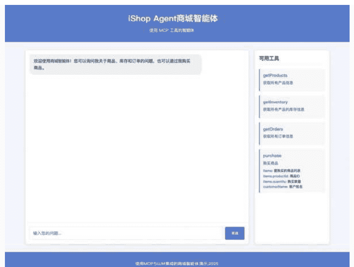

图6-2 iShop Agent商城智能体的Chat Bot界面

在输入框中发送“库存最少的3个产品信息，表格形式给出”，智能商城助手会返回结构化结果，如图6-3所示。

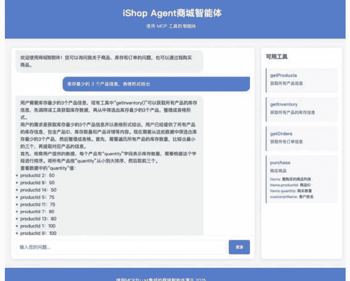

图6-3 iShop Agent商城智能体对话1

继续输入“所有智能手表产品”，商城智能体也会给出对应的列表，如图6-4所示。

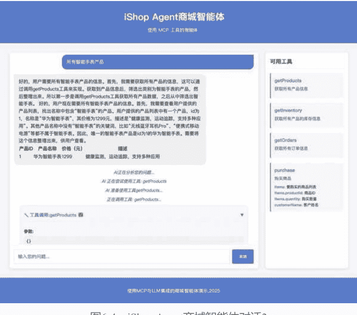

图6-4 iShop Agent商城智能体对话2

## 小结

本章以一套完整的商城智能体为例，演示了从需求拆解到可交付应用落地的全流程。我们首先完成了能力核心——MCP Server 的搭建，把商品查询、库存检查、购买等业务逻辑抽象为标准化的 MCP 工具，并通过 getProducts、getInventory、purchase 等函数以模型可调用的方式暴露。随后借助 Express 与 SSE 构建了后端服务，既提供工具运行环境，又通过流式推送实现类似打字机的动态回复效果。

在客户端侧采用双方案并行。CLI 版本用于快速验证后端能力，直观呈现“对话-推理-工具调用-结果整合”的工作闭环；Web 版本则通过 Express 中间层封装复杂的 MCP 通信与状态管理，让前端专注体验。工具列表动态加载、思考过程与调用细节实时渲染，体现了 MCP、LLM 与现代 Web 技术的融合。

集成测试阶段把 MCP Server、CLI 与 Web 应用串联起来。无论是在命令行还是浏览器中发出“查询库存最少的商品”等指令，请求都能在客户端、服务层、MCP Server 与大模型间顺畅流转，最终得到清晰准确的答案。该过程验证了架构合理性，也印证了 MCP 作为 AI 智能体“通用接口”的价值：把大模型的通用智能与垂直业务能力解耦，实现标准化接入。

通过本章实践，读者掌握了基于 TypeScript 搭建 MCP AI 智能体的技术路径，并理解了如何构建可解决实际问题的 Agent，为后续打造更复杂系统奠定基础。

# 第7章 用 MCP Python SDK 与 arXiv 搭建论文研究助手

本章以基于 MCP Python SDK 与 arXiv 的论文研究智能体项目为例，说明 AI 智能体在科研场景的应用。内容包含项目背景、技术选型、Server 与 Client 实现、Streamlit 界面以及系统集成与测试。

通过学习，读者可掌握用 MCP 构建复杂智能体的完整方法，并体会协议设计、工具链与 LangChain 等框架的结合思路，为在其他垂直领域构建智能信息系统打基础。

## 7.1 项目概述与背景

当前学术研究增速惊人。以开放获取平台 arXiv 为例，其存储论文已超两百万篇，且每月仍以上万篇的速度增长。海量文献带来两大痛点：关键研究容易被遗漏，以及筛选、甄别与精读消耗大量时间。研究人员本应把精力放在创新思考与实验上，却被重复的信息处理占据。

为此，本章提出一个实战方案：基于 MCP 的论文研究智能体，利用 LLM 的能力打造一个可自然对话、深度协作的科研伙伴。

### 7.1.1 项目目标

围绕 MCP 构建能够帮助研究者高效处理 arXiv 学术论文的助手，主要目标有四点：

- 高效检索文献：通过自然语言交互精准定位相关论文，压缩搜索耗时。
- 快速提取内容：自动从 PDF 中抽取摘要、方法、结果等要点，降低通读成本。
- 深度内容理解：借助 LLM 解析复杂概念与研究方法。
- 交互式研究辅助：提供对话式界面，支持多轮追问与探索，实现人机协同。

### 7.1.2 选择技术栈

为兼顾独立开发、迭代与可扩展性，系统采用模块化微服务架构。技术选型如下：

- MCP：以标准化方式连接 LLM 与外部数据源及工具。
- LangChain：构建 LLM 应用的框架，其 ReAct 代理模式支持自主思考、规划与任务执行。
- FastAPI：高性能 Python Web 框架，用于封装 MCP Server 为远程可调用接口。
- Streamlit：快速搭建交互式 Web 应用的 Python 库。
- arXiv API：检索与获取 arXiv 论文。
- Docling：从 PDF 文档中抽取与分析文本内容的工具。
- Docker：容器化部署，保证环境一致性与一键启动。

### 7.1.3 设计系统架构

本项目的系统架构如图7-1所示。

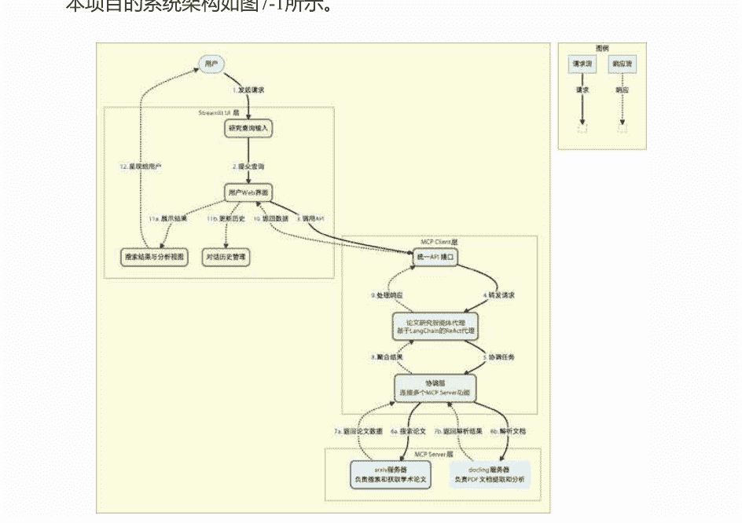

图7-1 论文研究智能体的系统架构

整体可划分为三层：

(1) MCP Server 层，作为能力底座，将原始数据源与功能封装为符合 MCP 规范的服务。主要包含两个微服务：
- arxiv 服务器：负责与 arXiv 交互，提供按关键词搜索、按 ID 获取详情等标准化工具。
- docling 服务器：负责文档深度处理，将 PDF 解析为纯文本或结构化信息，并以 MCP 工具形式暴露。

(2) 客户端服务器层，相当于系统的“大脑”和中枢。内嵌 LangChain ReAct 代理，通过 MCP Client 同时连接多个后端 Server。接收复杂指令后，代理可自主解析并调用 arxiv 搜索与 docling 分析工具协同完成任务，最终通过统一 API 向前端提供结果。

(3) Streamlit UI 层，作为用户门户，通过调用客户端服务器 API 与后端通信。提供友好的聊天界面，展示论文信息与分析结果，支持多轮对话，并管理会话状态与历史记录。

该分层解耦设计体现了 MCP 核心思想：把提供上下文的能力与使用上下文的智能分离。

## 7.2 MCP Server实现

本节介绍 arxiv 服务器与 docling 服务器的实现方式及其部署配置。

### 7.2.1 arxiv服务器

arxiv 服务器是一个独立的 MCP Server，职责是将 arXiv 的检索能力封装为标准化的 MCP 工具供上层调用。

将 arXiv 交互逻辑单独成微服务具有明确意义。arXiv 拥有独特的 API 规范与数据格式，通过专属 MCP Server 可把平台相关的复杂性隔离，上层代理无需关心查询构造或 XML 解析，只需调用语义清晰的工具如 search_arxiv(query="...", max_results=...)。这种解耦便于未来接入 PubMed、IEEE Xplore 等数据源，只需新增对应 Server 即可。

#### 1. 服务器设计与实现

arxiv 服务器接收自然语言查询，调用官方 arxiv Python 库与 arXiv API 通信，并对检索结果做结构化处理，以 LLM 易于理解的格式返回。构建过程如下...

```python
# 导入必要的库
import arxiv
from mcp.server.fastmcp import FastMCP #MCP Python SDK中用于快速构建服务器的核心类
from typing import Optional, List # 导入类型提示，增强代码的可读性和健壮性
from pydantic import BaseModel # 用于数据建模和验证的强大工具
import asyncio # Python内置的异步I/O框架，用于运行服务器

# 1. 初始化一个FastMCP Server实例，服务器名为"Research Article Provider"，端口号是8000
mcp = FastMCP(
    "Research Article Provider", port=8000
)

# 2. 数据建模（定义论文信息的结构化模型）
# 定义一个继承自pydantic.BaseModel的数据模型类Article，以自动获得数据校验、序列化等能力
class Article(BaseModel):
    title: str # 论文标题
    summary: str # 论文摘要
    published_date: str # 发表日期
    pdf_link: Optional[str] # PDF链接，可能不存在，因此使用Optional

    # 定义一个类方法，用于将arxiv库的Result对象转换为自定义的Article对象
    # 这是一个典型的适配器模式应用，将外部数据结构转换为内部标准结构
    @classmethod
    def from_arxiv_result(cls, result: arxiv.Result) -> 'Article':
        # 从result.links列表中筛选出包含 '/pdf/' 的链接，即为PDF下载链接
        pdf_links = [str(i) for i in result.links if '/pdf/' in str(i)]
        # 如果找到了PDF链接，则取第一个；否则设为None
        if len(pdf_links):
            pdf_link = pdf_links[0]
        else:
            pdf_link = None
        # 使用提取到的信息创建并返回一个新的Article实例
        return cls(
            title=result.title,
            summary=result.summary,
            # 将datetime对象格式化为 'YYYY-MM-DD' 格式的字符串
            published_date=result.published.strftime('%Y-%m-%d'),
            pdf_link=pdf_link
        )

    # 重写__str__方法，定义Article对象在被转换为字符串时的表现形式
    def __str__(self):
        # 格式化输出，包含标题、日期、PDF链接，以及摘要的前三行，并以[...]表示省略，避免上下文过长
        return f'Title: {self.title}\nDate: {self.published_date}\nPDF Url: {self.pdf_link}\n\n' + '\n'.join(
            self.summary.splitlines()[:3]) + '\n[...]'

# 3. 核心业务逻辑实现（论文搜索与数据处理）
def get_articles_content(query: str, max_results: int) -> List[Article]:
    # 创建一个arxiv客户端实例
    client = arxiv.Client()
    # 构建一个搜索查询对象，包含查询关键词、最大结果数以及按相关性排序的规则
    search = arxiv.Search(query=query, max_results=max_results, sort_by=arxiv.SortCriterion.Relevance)
    # 执行搜索，client.results(search) 返回一个迭代器，包含所有搜索结果
    # 使用map函数，将每个结果通过Article.from_arxiv_result方法进行转换
    articles = map(lambda x: Article.from_arxiv_result(x), client.results(search))
    # 过滤掉没有PDF链接的文章，确保下游处理的有效性
    articles_with_link = filter(lambda x: x.pdf_link is not None, articles)
    # 将最终结果转换为列表并返回
    return list(articles_with_link)

# 4. 注册为MCP工具（对外暴露能力）
# 使用 @mcp.tool装饰器，将一个普通的Python函数注册为MCP Server对外暴露的工具
# 这是将内部逻辑封装为标准化能力的关键步骤
@mcp.tool(
    name="search_arxiv",
```

##### 2. Article模型拆解

在以数据为中心的架构中，数据模型远不止是保存信息的容器，它更是系统对现实对象的一种抽象认知和统一表述方式。本例中的 Article 模型就是这样一个枢纽，它不只是普通的 Python 类，而是整个 arXiv 服务乃至上层业务理解与操作论文信息的核心载体。

```python
# 导入Pydantic的BaseModel，作为数据模型的基础
from pydantic import BaseModel
# 导入类型提示工具，以增强代码的清晰度和健壮性
from typing import Optional
# 导入arxiv库中定义的Result类型，用于类型注解
import arxiv

class Article(BaseModel):
    """
    Article模型代表了一篇学术论文的结构化信息
    它继承自Pydantic的BaseModel，从而自动获得了强大的数据验证、序列化和文档生成能力
    """
    # 论文的核心属性定义
    title: str  # 论文标题，字符串类型
    summary: str  # 论文摘要，字符串类型
    published_date: str  # 发表日期，存储为格式化后的字符串
    pdf_link: Optional[str]  # PDF下载链接，可能不存在，因此类型为Optional[str]

    @classmethod
    def from_arxiv_result(cls, result: arxiv.Result) -> 'Article':
        """
        这是一个类方法，扮演了工厂（Factory）和适配器（Adapter）的角色
        它负责将来自外部arxiv库的Result对象，转换为系统内部的Article标准模型
        """
        # 1. 适配和提取：从arxiv.Result对象的链接列表中，筛选PDF链接
        pdf_links = [str(link) for link in result.links if '/pdf/' in str(link)]

        # 2. 健壮性处理：判断是否存在PDF链接，并进行相应的赋值
        pdf_link = pdf_links[0] if pdf_links else None

        # 3. 创建实例：调用类的构造函数（cls(...)），传入处理和格式化后的数据，
        # 创建一个符合内部规范的Article实例
        return cls(
            title=result.title,
            summary=result.summary,
            # 将Python的datetime对象转换为统一的 'YYYY-MM-DD' 字符串格式
            published_date=result.published.strftime('%Y-%m-%d'),
            pdf_link=pdf_link
        )

    def __str__(self) -> str:
        """
        重写对象的字符串表示方法，这不仅仅是为了调试方便，更是为LLM设计的一个“可读”接口
        它定义了当Article对象被注入到提示词（Prompt）中时，应呈现的格式
        """
        # 精心设计的格式化字符串，突出关键信息，并截断过长的摘要以节省上下文空间
        return (
            f'Title: {self.title}\n'
            f'Date: {self.published_date}\n'
            f'PDF Url: {self.pdf_link}\n\n'
            f'{"\n".join(self.summary.splitlines()[:3])}\n[...]'
        )
```

表面简洁的 Article 实际上藏着很清晰的设计思路，可以从三个角度来看。

- **数据契约：为什么用 Pydantic 来定义属性**：选用 Pydantic 的 BaseModel 而非原生类或 dataclass，关键在于强制的类型校验。实例化时 Pydantic 会自动检查传入值的类型是否合规，比如 title 一定要是字符串。在入口就做严格校验，能显著提升系统的健壮性，避免类型不匹配在下游引发运行期错误。于是 Article 就成了一份可信的数据契约，依赖它的模块可以放心拿到格式一致的论文信息。

- **适配器角色：工厂方法的翻译功能**：`from_arxiv_result` 同时体现了工厂方法和适配器模式，它扮演翻译官的角色。外部 arXiv 库返回的 Result 对象结构复杂、原始，它把这些数据清洗并映射成系统内部统一的 Article 形态。这一层封装掉了所有细节，比如从多条链接里挑出 PDF 链接、把 datetime 转成可读字符串等。其他代码无需关心 arXiv API 的实现细节，从而实现了很好的解耦。

- **面向 AI 的文本出口**：`__str__` 的设计是模型里最具智能体味道的部分。传统项目里它多用于日志调试，这里则被赋予生成 LLM 上下文的任务。输出格式经过刻意设计，用换行把标题、日期、链接和摘要分开，并只保留摘要前三行以 `[...]` 收尾。这样做有两层好处：一是结构化的文本更利于大模型解析和定位字段；二是截断摘要能控制注入提示词的上下文量，在批量处理论文时降低计算开销并避免超出窗口限制。

总体来看，Article 的设计完整演示了从原始数据到结构化知识，再到可被 AI 直接消费的 AI-Consumable Information 的演进路径。它既保证了数据一致性和可维护性，也是系统与 AI 高效协作的关键环节。

##### 3. 检索功能实战

在 arXiv 服务的诸多能力里，论文检索是核心引擎，直接决定智能体能否快速、准确地把用户需求落到文献上。它的本质工作是把用户用自然语言描述的模糊意图，转成对 arXiv 数据库的精准查询，并以结构化、模型友好的形式返回结果。下面聚焦实现思路，说明代码如何一步步封装成可被 AI 代理调用的 MCP 工具。

核心实现拆成两个函数：`get_articles_content()` 专门负责与 arXiv API 的纯数据交互，`get_articles()` 则在上层把结果包装成符合 MCP 规范、支持异步调用并带日志输出的工具。这种关注点分离让代码更清晰，也便于后续维护和测试。

```python
# 导入arXiv官方Python客户端库，它是与arXiv网站交互的桥梁
import arxiv
# 导入MCP Server框架，特别是`mcp.tool`装饰器，用于将普通函数注册为MCP工具
from mcp.server.fastmcp import FastMCP
# 导入自定义的Article数据类，用于结构化地表示论文信息
from .data import Article

# 实例化FastMCP Server，并为其命名为"Arxiv"
# 这个实例将作为注册所有相关工具和资源的容器
mcp = FastMCP("Arxiv")

def get_articles_content(query: str, max_results: int) -> list[Article]:
    """
    一个同步函数，封装了调用arXiv API进行论文搜索和结果解析的核心逻辑
    它不直接暴露为MCP工具，而是作为内部的核心业务逻辑被调用

    Args:
        query (str): 用户输入的搜索关键词或查询语句
        max_results (int): 希望获取的论文最大数量

    Returns:
        list[Article]: 一个包含多个Article对象的列表，每个对象代表一篇符合条件的论文
    """
    # 步骤1: 初始化arxiv客户端。这是与arXiv API进行所有交互的入口
    client = arxiv.Client()

    # 步骤2: 构建一个搜索查询对象。在这个对象内定义搜索的核心参数
    # - query: 使用用户提供的查询字符串
    # - max_results: 限制返回结果的数量
    # - sort_by: 设置排序标准为"Relevance"（相关性），确保最匹配的结果排在前面
    search = arxiv.Search(
        query=query,
        max_results=max_results,
        sort_by=arxiv.SortCriterion.Relevance
    )

    # 步骤3: 执行搜索并处理结果
    # client.results(search)会返回一个迭代器，其中包含了原始的搜索结果
    # 使用map函数，将迭代器中的每一个原始结果（result）都通过Article.from_arxiv_result方法
    # 转换成自定义的、结构更加清晰的Article数据对象
    articles = map(lambda x: Article.from_arxiv_result(x), client.results(search))

    # 步骤4: 过滤掉没有提供PDF下载链接的论文
    # 考虑到后续可能需要对论文进行深度分析，确保每篇论文都有可访问的PDF源是至关重要的
    # filter函数会筛选出那些Article对象的pdf_link属性不为None的论文
    articles_with_link = filter(lambda x: x.pdf_link is not None, articles)

    # 步骤5: 将最终的迭代器结果转换为列表并返回
    return list(articles_with_link)

@mcp.tool(
    name="search_arxiv",
    description="Get `max_results` articles for a given search query on Arxiv."
)
async def get_articles(query: str, max_results: int) -> str:
    """
    这是一个注册为MCP工具的异步函数。它作为现实世界（如AI代理）调用论文搜索功能的正式入口
    负责处理外部请求，调用内部逻辑，并以对模型友好的格式返回结果

    Args:
        query (str): 来自MCP Client的搜索查询
        max_results (int): 希望返回的最大结果数

    Returns:
        str: 一个格式化后的字符串，其中包含所有找到的论文信息，供LLM直接消费
    """
    # 在服务器端打印日志，便于开发者调试，了解工具是否被正确调用
    print(f"Searching for '{query}'...")

    # 调用核心逻辑函数，执行实际的搜索任务
    articles = get_articles_content(query, max_results)

    # 打印另一条日志，告知开发者找到了多少篇文章，便于追踪流程
    print(f"Found {len(articles)} articles.")

    # 将Article对象列表格式化为单一的、易于LLM解析的字符串
    # 首先，使用map函数将每个Article对象通过其自身的__str__方法转换为字符串
    # 然后，使用join方法将这些字符串用一个清晰的分隔符连接起来
    # .strip()用于移除最终字符串两端可能存在的空白符，确保格式的整洁
    return '\n\n-------\n\n'.join(map(str, articles)).strip()

##### 5. 启动MCP服务（运行服务器）
# 这是Python脚本的标准入口点
if __name__ == "__main__":
    # run_sse_async() 是一个异步函数，会启动一个支持SSE协议的Web服务器
    # asyncio.run() 负责运行这个异步服务器，直到程序被终止
    asyncio.run(mcp.run_sse_async())
```

整体实现可以拆成四个层面来理解。

- **数据建模层**：借助 Pydantic 的 BaseModel 来定义 Article。Article 不只是普通的数据容器，还自带强校验，能保证从 arXiv API 拉回的数据被准确解析并结构化。它同时为系统里“论文”这一概念提供了统一的数据契约。其中 from_arxiv_result 作为类方法，__str__ 方法则分别承担了把外部结果转入内部模型、再把内部模型转成 LLM 易读文本的转换任务，设计得很利落。

- **业务逻辑层**：get_articles_content 完全聚焦业务本身，负责调用 arxiv 库完成检索、排序、筛选和数据转换。把这部分逻辑与 MCP 协议层解耦，是标准的工程分层做法。

- **工具注册层**：@mcp.tool 装饰器把原本普通的 get_articles 函数提升为符合 MCP 规范、可被远程调用的标准工具。FastMCP 在底层默默完成元数据生成、参数解析校验、返回值打包成 MCP 消息等繁琐工作，开发者只需实现功能本身。

- **服务启动层**：通过 asyncio.run(mcp.run_sse_async()) 启动一个异步的 SSE Web 服务。此时 arXiv 服务器已就绪，会在 8000 端口监听来自 MCP 客户端的连接与工具调用。

到这里，一个结构清晰、功能完整的 arXiv 服务器就搭好了。它像一位可靠的图书管理员，随时为论文研究智能体提供精准快速的文献检索。接下来 7.2.2 节会用同类思路搭建另一个关键能力服务器——docling 服务器。

get_articles_content 是整个链路的核心，职责就是和 arxiv 库做纯粹的数据交互。先初始化客户端，再构造一个 Search 对象，这个对象相当于给 arXiv 服务器下的一张订单，明确写着查询词、返回条数、排序方式。拿到原始结果后并不直接吐出，而是先 map 再 filter 做清洗转换。map 把复杂的 arxiv.Result 逐条映射为结构更清晰的 Article 实例，这是数据标准化的关键一步；随后的 filter 会剔除没有 PDF 链接的条目，因为对智能体而言拿不到原文的论文后续就无法分析。

get_articles 则扮演适配器和门面的角色。它用 @mcp.tool 把自己注册进 MCP Server 的工具列表，让任何兼容的客户端都能发现并调用。函数声明为 async，可以无缝融入现代异步 I/O，避免等待 arXiv API 时阻塞整个服务。内部先打日志，记录工具被调用的时间和方式，这在工程调试里非常关键。随后调用 get_articles_content 拿到数据，再通过 map 与 join 把 Article 列表编排成一段长文本。

这种以字符串为最终输出的格式，是专门为 LLM 设计的。借助 \n\n-------\n\n 这样的明显分隔符，模型能很轻松地把长文本切分，识别出每一篇独立条目，并在后续推理中准确引用。至此，一个复杂的外部 API 调用被封装成简洁、健壮、对 AI 友好的 MCP 工具。

### 7.2.2 docling 服务器：让 AI 真正读懂 PDF

docling 服务器是一个专门负责从 PDF 中抽取和分析文本的 MCP Server。它基于 docling 库把 PDF 转为结构化文本，并提供全文获取和预览生成两类能力。如果说 arXiv 服务器给智能体的是通往知识宝库的索引卡，那么 docling 服务器就是让它直接阅读典籍本身、也就是 PDF 论文的深度阅读能力。拿到 PDF 链接只是信息获取的第一步，真正的难点在于跨越“为人类视觉优化、版式复杂的 PDF”到“为机器理解优化、结构清晰的纯文本”这道鸿沟。docling 服务器就是为解决这个核心问题而设计的文档解析与内容抽取微服务。

把文档处理单独拎出来，也是对模块化与关注点分离的坚持。PDF 解析与 OCR 计算量大且强依赖特定库如 docling，独立部署后主客户端可以保持轻量，专注推理与规划，不必处理二进制文件和复杂格式细节。这样系统更稳健、可维护，也能单独升级或替换解析引擎而不影响其他模块。

#### 1. 服务器设计与实现

docling 服务器的核心任务是接收一个 PDF 的 URL，用 docling 将其文本与图表高效转为结构化 Markdown，并对外暴露两个关键工具：一个用来获取论文全文，另一个用来生成固定长度的预览，帮助在不消耗太多上下文的情况下快速把握主旨。

```python
# 导入必要的库
from mcp.server.fastmcp import FastMCP  # MCP Server快速构建框架
from docling.document_converter import DocumentConverter  # 核心的PDF解析库
from langchain_text_splitters import RecursiveCharacterTextSplitter  # 来自LangChain的智能文本分割工具
import tiktoken  # OpenAI开发的、用于精确计算token数量的库
import asyncio  # 异步I/O框架

# 初始化MCP Server实例
# 服务器名为 "Research Article Extraction Provider"，以清晰表明其职责
# 监听8001端口，与arxiv服务器（8000端口）区分开
mcp = FastMCP(
    "Research Article Extraction Provider", port=8001
)

def get_article_content_str(article_url: str) -> str:
    """
    该函数是文档处理的核心，负责将远程PDF URL转换为Markdown文本
    它封装了与docling库的直接交互
    """
    # 1. 创建DocumentConverter实例，这是执行转换的入口点
    converter = DocumentConverter()
    # 2. 调用convert方法，传入PDF的URL。docling会在后台下载、解析、
    # 甚至在必要时OCR该文档，并返回一个结构化的结果对象
    result = converter.convert(article_url)
    # 3. 将解析后的结构化文档导出为Markdown格式
    research = result.document.export_to_markdown()
    return research
```

```python
def first_lines(text: str, chunk_size: int = 1536) -> str:
    """
    此函数用于从长文本中精确地提取出前导部分（预览）
    它并非简单地按字符数截断，而是使用token数量作为标准，这与LLM的计费和上下文限制完全对齐
    """
    # 1. 获取针对 'gpt-4' 模型的编码器，以确保token计算的准确性
    encoder = tiktoken.encoding_for_model('gpt-4')
    # 2. 创建一个LangChain提供的递归字符文本分割器
    text_splitter = RecursiveCharacterTextSplitter(
        # 核心参数：定义每个文本块的目标大小为chunk_size个token
        chunk_size=chunk_size,
        # 块之间不重叠
        chunk_overlap=0,
        # 指定长度计算函数：使用tiktoken编码器来计算文本的token数，而非简单的len(text)
        length_function=lambda x: len(encoder.encode(x)),
        # 不使用正则表达式作为分隔符，依赖其内置的智能分割逻辑
        is_separator_regex=False,
    )
    # 3. 执行分割并返回第一个文本块，即为我们所需的预览
    return text_splitter.split_text(text)[0]
```

```python
# 注册第一个MCP工具：提取全文
@mcp.tool(
    name="extract_article_content",
    description="Extracts the full text content from a research article PDF using OCR technology based on its pdf link `article_url`"
)
async def get_article_content(article_url: str) -> str:
    """Get article content extracted from OCR given its pdf url link `article_url`."""
    # 调用核心逻辑函数获取全文
    articlecontent = get_article_content_str(article_url)
    # 返回前去除首尾可能存在的空白字符
    return articlecontent.strip()
```

```python
# 注册第二个MCP工具：获取预览
@mcp.tool(
    name="get_article_preview",
    description="Retrieves the first portion of a research article based on its pdf link `article_url` with a specified token limit (`chunk_size`), useful for quick previews"
)
async def get_article_first_lines(article_url: str, chunk_size: int = 1536) -> str:
    """Get `chunk_size` tokens for an article based on its pdf url link `article_url`."""
    # 获取全文内容
    articlecontent = get_article_content_str(article_url)
    # 基于全文生成指定token数量的预览
    first_lines_content = first_lines(articlecontent.strip(), chunk_size)
    # 返回处理后的预览内容
    return first_lines_content.strip()
```

##### 服务器启动入口

```python
if __name__ == "__main__":
    asyncio.run(mcp.run_sse_async())
```

上面这段代码实现了一个基于 FastMCP 的 docling 服务器。其强项在于对文档的深度处理，主要由 get_article_content_str() 和 first_lines() 两个函数协同完成。

（1）get_article_content_str()：智能化全文抽取。

该函数是 docling 服务器与 docling 库之间的桥梁，实际执行过程比代码表面看起来要复杂得多。

DocumentConverter 的工作方式与服务的两大能力

创建 DocumentConverter 实例：先生成一个转换器对象，用它作为后续所有操作的入口句柄。

调用 .convert()：这是完成转换的关键动作。docling 库拿到 article_url 后，会自行发起网络请求、下载 PDF，随后用文档布局分析模型把文本块、标题、正文、列表、图片、表格等元素分出来。碰到扫描件或图文混排页面时，会自动触发 OCR 引擎进行文字识别。

导出为 Markdown：最终输出并不是一串无结构的纯文本，而是结构化的 Markdown。标题用 #，列表用 -，层级本身就带有语义，这让 LLM 更容易把握原文的框架和重点，对后续的摘要、问答帮助很大。

（2）first_lines()：面向 LLM 的精准切片

该方法解决的是智能体常见的痛点：在上下文窗口受限时，如何既省空间又不丢关键信息。按字符简单截断很容易切在句中，破坏语义。first_lines() 用了两套做法。

以 Token 为尺：没有使用 Python 原生的 len()，而是引入 tiktoken。因为模型计费和窗口限制都是按 Token 算，这样能算出文本在模型里的真实成本，实现成本的精细控制。

智能边界分割：采用 LangChain 的 RecursiveCharacterTextSplitter。它的递归逻辑会优先尝试按段落、句子、词的自然边界来切，而不是硬性在 chunk_size 处截断，从而保证预览片段的连贯性和完整性。

get_article_content_str() 与 first_lines() 配合，加上 @mcp.tool 装饰器封装成标准化服务，让 docling 服务同时具备“精读全文”和“泛读预览”两种能力，为上层 ReAct 代理提供策略空间：先批量预览多篇，再对相关性最高的论文做全文分析。

#### 2. MCP工具注册

docling 服务向外暴露了两个 MCP 工具，一个负责全文提取，一个负责生成预览。注册信息如下：

```python
@mcp.tool(
    name="extract_article_content",
    description="Extracts the full text content from a research article PDF using OCR technology based on its pdf link `article_url`"
)
async def get_article_content(article_url: str) -> str:
    """Get article content extracted from OCR given its pdf url link `article_url`."""
    articlecontent = get_article_content_str(article_url)
    return articlecontent.strip()

@mcp.tool(
    name="get_article_preview",
    description="Retrieves the first portion of a research article based on its pdf link `article_url` with a specified token limit (`chunk_size`), useful for quick previews"
)
async def get_article_first_lines(article_url: str, chunk_size: int = 1536) -> str:
    """Get `chunk_size` tokens for an article based on its pdf url link `article_url`."""
    articlecontent = get_article_content_str(article_url)
    first_lines_content = first_lines(articlecontent.strip(), chunk_size)
    return first_lines_content.strip()
```

上述代码完成两项文档处理能力的注册。

（1）extract_article_content 工具。
- 名称：extract_article_content()。
- 描述：借助 OCR 从研究论文 PDF 中抽取全文。
- 参数：article_url，PDF 链接。
- 行为：调用 get_article_content_str() 获取原文并返回去头尾空白的结果。

（2）get_article_preview 工具。
- 名称：get_article_preview()。
- 描述：取论文前段内容供快速浏览。
- 参数：article_url，PDF 链接；chunk_size，预览长度，默认 1536 个 token。
- 行为：先用 get_article_content_str() 取全文，再用 first_lines() 切出指定长度的片段，最后去除首尾空白返回。

这种双模式设计适配不同场景：全文提取用于深度分析，预览生成用于快速判断，避免一次性加载过大文本。

### 7.2.3 MCP Server部署与配置

arXiv 服务与 docling 服务作为 MCP 微服务已经写好，但代码能跑只是完成了一半。另一半是把它们可靠、可重复、可扩展地部署成服务。本节用容器化这一 DevOps 实践来完成这一步。

在复杂架构里，常遇到开发与生产不一致、“在我机器上能跑”、配置繁琐、依赖冲突等问题。Docker 通过把应用及其所有依赖打包进轻量可迁移的容器，保证在不同环境下行为一致。

#### 1. Docker容器化

为两个服务分别写 Dockerfile。它相当于构建蓝图，自动化地描述如何制作自包含镜像。

arxiv 服务 Dockerfile 的要点解析：

```dockerfile
# 1. 基础镜像选择（FROM）
# 我们选择一个官方的、轻量级的Python 3.10 slim镜像作为起点
# "slim"版本不包含许多非必需的系统工具，可以显著减小最终镜像的体积
FROM python:3.10-slim

# 2. 设置工作目录（WORKDIR）
# 在容器内部创建一个 /app目录，并将其设置为后续所有命令的执行路径
# 这是一个良好实践，可以避免将应用文件散落在容器的根文件系统中
WORKDIR /app

# 3. 依赖管理（COPY & RUN）
# 首先只复制requirements.txt文件，以充分利用Docker的层缓存机制
# 只要这个文件不改变，下一步的pip install就不需要重新执行，从而加快后续构建速度
COPY requirements.txt .
# --no-cache-dir选项指示pip不存储缓存，有助于减小镜像的体积
RUN pip install --no-cache-dir -r requirements.txt

# 4. 复制代码（COPY）
# 在所有依赖都安装完毕后，再将我们的服务器主程序代码复制到容器中
COPY arxiv_server.py .

# 5. 暴露端口（EXPOSE）
# 声明该容器内的服务将监听8000端口
# 这主要是一个文档性指令，用于告知使用者（或其他容器）这个容器的预期用途，实际的端口映射在运行时指定
EXPOSE 8000

# 6. 定义启动命令（CMD）
# 指定当容器启动时，默认要执行的命令
# 这里我们直接使用python启动我们的arxiv_server.py脚本
CMD ["python", "arxiv_server.py"]
```

docling 服务的 Dockerfile 结构几乎一致，只是在端口和启动脚本上不同：暴露 8001 并运行 docling_server.py，一致的构建方式体现了架构的统一性。

docling 服务的 Dockerfile 如下：

```dockerfile
FROM python:3.10-slim

WORKDIR /app

COPY requirements.txt .
RUN pip install --no-cache-dir -r requirements.txt
COPY docling_server.py .
EXPOSE 8001
CMD ["python", "docling_server.py"]
```

两份 Dockerfile 的共同步骤为：
（1）以 Python 3.10 为基础镜像。
（2）工作目录设为 /app。
（3）复制 requirements.txt 并安装依赖。
（4）把对应服务代码复制进镜像。
（5）暴露端口，arxiv 用 8000，docling 用 8001。
（6）设定启动命令。

#### 2. Docker Compose配置

单容器可用，但研究智能体是多组件协作系统，需要统一编排。Docker Compose 用一份 YAML 描述服务栈、网络和依赖关系，方便一键启停。

以下是 docker-compose.yml 的内容：

```yaml
# docker-compose.yml
services:
  # 定义第一个服务：arxiv服务器
  arxiv-server:
    build:
      # build指令告诉Compose如何构建这个服务的镜像
      context: . # context: . 表示构建上下文是当前目录
      dockerfile: docker/Dockerfile.arxiv # 指定使用哪个Dockerfile
    ports:
      # "宿主机端口:容器端口"，将宿主机的8000端口映射到容器的8000端口
      # 这使得我们可以通过访问本机的8000端口来与arxiv服务器通信
      - "8000:8000"

  # 定义第二个服务：docling服务器
  docling-server:
    build:
      context: .
```

#### 3．启动脚本

为了本地开发测试，额外准备了几条启动脚本，可单独拉起某个组件：

```
run_arxiv_server.sh:

#!/bin/bash
python arxiv_server.py

run_docling_server.sh:

#!/bin/bash
python docling_server.py

run_client.sh:

#!/bin/bash
python client_server.py

run_app.sh:

#!/bin/bash
streamlit run streamlit_app.py
```

这样在调试时不必每次都启动全部系统。

#### 4．环境变量配置

生产环境需要配置 API Key、模型参数等。为避免硬编码，使用 .env 文件配合 dotenv 加载。

示例 .env：

```
# API配置
API_KEY=your_api_key_here
BASE_URL=https://api.example.com

# 模型配置
MODEL=gpt-4
```

代码中加载方式：

```
from dotenv import load_dotenv
import os

# 加载环境变量
load_dotenv()

# 使用环境变量
api_key = os.environ['API_KEY']
base_url = os.environ['BASE_URL']
model = os.environ['MODEL']
```

通过环境变量配置，系统在不改动代码的情况下提升灵活性和安全性。

## 7.3 MCP Client实现

如果把 MCP Server 视作连接 arXiv、Docling 等外部世界的感官和执行臂，那么 MCP Client 就是整个系统的“大脑”和中枢神经。它接收用户指令、解析意图、调度各 Server 协同，并把结果呈现出来。

本项目的 Client 基于 FastAPI 构建，受益于其高性能、原生异步支持和与 Pydantic 的融合，便于打造响应快、类型安全、可维护的 API。内部集成 LangChain ReAct 代理，让智能体具备思考、推理和行动能力。

### 7.3.1 MCP Client设计与实现：构建论文研究智能体的大脑

Client 的核心不是自己提供工具，而是作为智能调度中心。通过 MultiServerMCPClient 连接多个下沉 MCP Server，动态发现并聚合它们提供的全部工具，再与 LLM 结合，在 ReAct 模式下理解并执行复杂的研究任务。

下面将结合代码详细说明这个“大脑”的构建过程与运行机制。

```
# 导入必要的库
import os # 用于访问环境变量，确保敏感信息（如API密钥）的安全
from typing import Dict, Any # 导入类型提示，增强代码的可读性和健壮性

import uvicorn # 导入ASGI服务器，用于运行FastAPI应用
from dotenv import load_dotenv # 用于从.env文件加载环境变量，方便本地开发
from fastapi import FastAPI # 核心Web框架，用于构建API
from langchain_mcp_adapters.client import MultiServerMCPClient # MCP Client，用于连接和管理多个MCP Server
from langchain_openai import ChatOpenAI # OpenAI模型适配器，用于与LLM交互
from langgraph.prebuilt import create_react_agent # 从LangGraph库导入预构建的ReAct代理创建函数
from pydantic import BaseModel # 用于数据验证和设置定义的基类

# 定义API请求的数据结构
# 使用Pydantic的BaseModel可以确保接收到的POST请求体包含一个名为prompt的字符串字段
class ResearchRequest(BaseModel):
    prompt: str

# --- 初始化与配置 ---

# 加载当前目录下的.env文件中的环境变量
# 这样做可以将配置与代码分离，便于管理
load_dotenv()

# 初始化LLM
# 从环境变量中读取模型名称、API密钥和基础URL，并创建一个ChatOpenAI实例
# 这是ReAct代理进行思考和推理的核心驱动力
model = ChatOpenAI(
    model=os.environ['MODEL'],
    api_key=os.environ['API_KEY'],
    base_url=os.environ['BASE_URL'],
)

# 创建FastAPI应用实例
# title参数会在API文档（如Swagger UI）中显示
app = FastAPI(title="Research Assistant API")

# --- 核心处理逻辑 ---

async def process_prompt(prompt: str) -> Dict[str, Any]:
    """
    处理用户输入的核心函数
    该函数负责连接MCP Server、创建代理并执行任务
    """
    # 1. 实例化多服务器MCP Client
    # MultiServerMCPClient可以同时连接和管理多个MCP Server
    # 这里配置了两个服务器：arxiv和docling
    # url指向各自服务器的SSE端点，transport指定了传输协议
    # 注意：代码中同时包含了本地开发（localhost）和Docker部署（服务名）的URL，可以根据环境切换
    mcp_client = MultiServerMCPClient({
        "arxiv": {
            # "url": "http://arxiv-server:8000/sse", # Docker环境下的服务名访问
            "url": "http://localhost:8000/sse", # 本地开发环境下的访问
            "transport": "sse",
        },
        "docling": {
            # "url": "http://docling-server:8001/sse", # Docker环境下的服务名访问
            "url": "http://localhost:8001/sse", # 本地开发环境下的访问
            "transport": "sse",
        }
    })

    # 2. 动态获取工具
    # 客户端连接到服务器后，通过get_tools()方法异步获取所有可用工具的定义
    # 这是MCP的强大之处，客户端无须硬编码工具列表
    tools = await mcp_client.get_tools()

    # 3. 创建ReAct代理
    # 使用create_react_agent，将LLM（model）和动态获取的工具（tools）绑定在一起
    # 这个代理现在就具备了使用这些工具与现实世界交互的能力
    agent = create_react_agent(model, tools)

    # 4. 调用代理并执行任务
    # ainvoke是异步调用代理的方法，用于将用户输入的prompt包装后传给代理
    # 代理会根据prompt进行思考，决定是否以及如何调用工具，并与模型多次交互，直到任务完成
    response = await agent.ainvoke({"messages": prompt}, debug=False)

    # 5. 格式化响应
    # 从代理的执行结果中提取出有意义的消息内容，并将其格式化为前端期望的JSON结构
    messages = [{i.type: i.content} for i in response['messages'] if i.content != ""]
    return {"messages": messages}

# --- API端点定义 ---

@app.post("/research")
async def research(request: ResearchRequest):
    """
    定义一个POST类型的API端点，路径为/research
    它接收一个符合ResearchRequest结构的JSON请求体
    当收到请求时，它会调用process_prompt函数来处理并返回结果
    """
    return await process_prompt(request.prompt)

# --- 服务器启动入口 ---

if __name__ == '__main__':
    # 这段代码确保只有在直接运行此脚本时，才会启动服务器
    # 如果此文件被其他模块导入，则不会执行
    # uvicorn.run()启动ASGI服务器，监听在0.0.0.0:8080，意味着可以从本地网络中的任何机器访问
    uvicorn.run(app, host="0.0.0.0", port=8080)
```

这套代码把客户端服务器的完整工作流拆成五段递进的动作，每一步都承担不同的职责。

- （1）配置加载与模型准备：启动时先用 dotenv 把配置抽离到环境变量里，这是把配置和代码解耦的常规做法。随后依据这些配置实例化 ChatOpenAI，为后续的智能决策提供推理能力。

- （2）服务容器搭建：用 `app = FastAPI(...)` 生成一个 FastAPI 实例，作为对外 API 的承载体。

- （3）核心任务处理，即 process_prompt 函数，是智能体真正“动起来”的地方。
    - 连接与自动发现：先实例化 MultiServerMCPClient，完成对 arxiv 与 docling 这两个 MCP Server 的连接。紧接着 `await mcp_client.get_tools()` 会在运行期动态拉取下游服务暴露的所有工具能力，代码里无需手工枚举。正是这种松耦合，让新增工具时只要上线新的 MCP Server，客户端就能自动收敛，无需改动源码。
    - 智能体组装：`create_react_agent(model, tools)` 把大模型的推理能力和外部工具集合起来，得到一个既会思考也会执行的代理。
    - 执行与结果整理：代理通过 `ainvoke` 接收指令，内部循环进行思考→行动→观察→再思考，直到任务收敛。最后对代理返回的消息流做解析与格式化，只把对前端有价值的部分送出。

- （4）接口暴露：`@app.post("/research")` 把 research 函数挂到 HTTP POST 路由上。请求体使用 Pydantic 的 ResearchRequest 做自动校验，保证入口健壮。任何合法的 /research 请求都会进入 process_prompt。

- （5）服务运行：`if __name__ == '__main__':` 作为脚本入口，调用 Uvicorn 以 ASGI 方式启动 FastAPI，从而支撑高并发的异步请求。

整体来看，这样的分层让客户端服务器成为兼具灵活性与扩展性的智能枢纽，为复杂 AI 智能体打下基础。工具供给方 MCP Server 与工具消费编排方 MCP Client 被清晰隔离，体现了微服务的设计思想。

### 7.3.2 MultiServerMCPClient：连接多个MCP Server

一个真正实用的智能体往往要同时调用多种异构资源，比如论文研究类场景就可能要查学术库、跑分析工具、再抓取时效资讯。为每个外部服务单独写连接逻辑会让代码迅速膨胀。MultiServerMCPClient 就是为这类“一对多”场景准备的。

它是 MCP Python SDK 提供的聚合客户端，也可理解为工具集线器。通过一个统一入口，应用能同时与多个 MCP Server 建立会话并交互。底层的连接维护、协议握手、消息收发都被封装起来，上层 ReAct 代理只需要面对统一的工具调用接口。

回到 process_prompt 的使用细节，可以更直观地看到它如何把来自不同服务器的独立能力合并成一个可被 LLM 统一调度的工具箱。作为客户端服务器的核心部件，MultiServerMCPClient 负责管理多路 MCP Server 的连接，并对外提供一致的工具访问入口。下面的内容会具体说明它的使用方式。

```
async def process_prompt(prompt: str) -> Dict[str, Any]:
    """
    处理用户输入的核心函数，展示了MultiServerMCPClient的完整工作流程
    """
    # 步骤1: 实例化MultiServerMCPClient，并配置目标服务器
    # 我们提供一个字典作为配置，其中的每一个键（如 "arxiv", "docling"）
    # 都代表一个逻辑上的服务器别名，便于管理
    # 字典的值是该服务器的连接细节，包括:
    # - "url": 服务器的端点地址。在本地开发时使用localhost
    #         在容器化的生产环境中，这里应该换成Docker的服务名，
    #         例如 "http://arxiv-server:8000/sse"
    # - "transport": 指定通信协议，这里我们使用 "sse"，
    #               这是一种非常适合流式数据传输的轻量级协议
    mcp_client = MultiServerMCPClient({
        "arxiv": {
            "url": "http://localhost:8000/sse", # arxiv服务器的地址
            "transport": "sse",
        },
        "docling": {
            "url": "http://localhost:8001/sse", # 文档分析服务器的地址
            "transport": "sse",
        }
    })

    # 步骤2: 异步获取并聚合所有服务器的工具
    # 这是MCP动态发现机制的核心体现
    # 调用get_tools()后，客户端会并发地连接到所有已配置的服务器，请求各自的工具清单
    # SDK会自动将这些来自不同源的工具整合到一个列表中，并将其适配为LangChain框架兼容的格式
    tools = await mcp_client.get_tools()

    # 步骤3: 创建ReAct代理，赋予其使用工具的能力
    # 将我们的LLM (model) 和刚刚聚合的工具列表 (tools)
    # 作为参数，创建一个ReAct代理实例
    # 从这一刻起，这个代理就同时拥有了访问arXiv网站和分析文档的能力
```

### 7.3.3 ReAct代理实现：赋予系统思考与行动的能力

如果把客户端服务器看作论文研究智能体的“大脑”，ReAct 代理就是负责推理、决策和执行的中央处理器。它让系统不再是按固定脚本被动响应，而是能主动拆解任务、调度工具、在反馈中调整策略，最终完成多步目标。这是从单纯问答到自主任务处理的转变。

传统 LLM 应用多停留在“输入-输出”的一次性生成，而 ReAct 给模型提供了一个可迭代的闭环，更接近人类解决问题的路径。

- （1）接收任务：代理先拿到用户的高层自然语言指令，例如“帮我找 Mixture of Experts 的最新研究并总结优缺点”。
- （2）思考拆解：不会立刻作答，而是先分析任务步骤，例如“先用 arxiv 工具按关键词检索最新论文”。
- （3）执行行动：据此选择工具并调用，比如向 arxiv 发起搜索请求并带上参数。
- （4）观察反馈：拿到工具返回的标题与链接列表。
- （5）再思考：把观察结果作为新输入继续推理，例如“已找到论文，下一步需要阅读摘要，可用 Docling 的 summarize_document”。
- （6）迭代与输出：上述思考-行动-观察循环持续进行，直到信息足够支撑答案，最后整合各步结果生成连贯的最终回复。

这种迭代机制让代理能够处理需要多轮推理、信息融合和工具协同的复杂任务，是构建可信论文研究智能体的关键能力。

本项目采用 LangChain 生态下的 LangGraph 来实现 ReAct 代理。LangGraph 专注于构建有状态、循环的 LLM 应用，把代理的执行流程抽象成一张可视化的图，使得思考与行动的控制变得清晰。`create_react_agent()` 就是 LangGraph 提供的开箱即用的 ReAct 构造器，下面会结合代码说明它的组装与启动方式。

```python
# 导入LangGraph中预构建的ReAct代理创建函数
from langgraph.prebuilt import create_react_agent
# 导入OpenAI模型适配器
from langchain_openai import ChatOpenAI

# --- 准备构建代理所需的核心组件 ---

# 1. LLM (The "Brain")
# 这是代理进行所有思考和推理的基础。
# 我们从环境变量中加载配置，创建一个强大的LLM实例。
model = ChatOpenAI(
    model=os.environ['MODEL'],
    api_key=os.environ['API_KEY'],
    base_url=os.environ['BASE_URL'],
)

# 2. 工具集 (The "Hands")
# 这是代理与现实世界交互的手段
# 通过MultiServerMCPClient动态地获取所有可用的工具
tools = await mcp_client.get_tools()

# --- 创建并使用代理 ---

# 3. 创建ReAct代理实例
# 调用create_react_agent函数，将“大脑”（model）和“双手”（tools）组装在一起
# 这一步操作就完成了一个功能完备的ReAct代理的创建
agent = create_react_agent(model, tools)

# 4. 激活代理，执行任务
# 调用代理的ainvoke（异步调用）方法，将用户的原始请求作为输入
# 代理内部的“思考-行动-观察”循环将即刻启动
response = await agent.ainvoke({"messages": prompt}, debug=False)

# 步骤5: 对最终结果进行解析和格式化
# 代理的执行过程会产生一系列消息（思考过程、工具调用、最终答案等）
# 我们在这里对消息进行筛选和清理，过滤掉空内容，
# 并将其构造成一个清晰的、适合API返回的JSON格式
messages = [{i.type: i.content} for i in response['messages'] if i.content != ""]
return {"messages": messages}
```

从这段实现里就能把 MultiServerMCPClient 的完整运行脉络梳理清楚。

（1）初始化与配置：流程从 MultiServerMCPClient 的创建开始。配置采用 Python 字典来描述，写法简洁、阅读成本低。这种声明方式一次性把系统依赖的外部服务说清楚，后续要接入新的 MCP Server，只需在字典里追加条目，核心业务代码不需要改动。

（2）运行时工具发现：`mcp_client.get_tools()` 实现了解耦。它把工具发现从编译期静态模式切换到运行期动态模式。客户端不需要提前知道 Arxiv 端具体暴露了哪些能力，也不必了解 Docling 端的实现细节，只需发起一次“列出所有可用工具”的请求，由客户端与服务器之间的协议自动完成后续交互。因此下游服务器的增删改或版本升级，对上游客户端而言是透明的。

（3）代理无缝接入：发现的 tools 列表会直接喂给 `create_react_agent()`。SDK 负责把来自 MCP Server 的工具元数据转成 LangChain Agent 能识别的格式。于是 ReAct 代理可以不区分来源地调用不同服务器上的工具，只关心工具名称、说明和参数，不关心它实际部署在哪个节点。

（4）查询的智能编排：用户问题进入 `agent.ainvoke()` 后，代理会结合大模型的推理能力与工具说明，自主规划执行步骤。比如用户说“帮我找大模型 Agent 的最新论文并提炼核心思想”，代理先调用 Arxiv 端的 search_papers 拿到论文，再把内容交给 Docling 端的 summarize_document 生成摘要。整条链路由代理自动完成，无需人工干预。

（5）统一的返回：不管内部是一次模型调用还是多次工具编排，最终结果都会被统一格式化后输出。这让前端收到的结构始终一致，前端开发成本大幅下降。

整体来看，MultiServerMCPClient 不只是桥梁，更是搭建模块化、可扩展 AI 智能体的核心底座。它让客户端专注编排调度，把具体功能下沉到各个独立的 MCP Server，体现出内部职责集中、模块间松耦合的设计思路。

在这段简洁代码背后，`create_react_agent()` 依赖两个关键参数。

- model：即 LLM 实例。它既负责生成最终答案，也是 ReAct 流程的“指挥官”，在每一步做推理、决定下一步调用哪个工具，或判断任务是否已收敛。
- tools：代理可用的操作清单。每个工具都像一项超能力，让代理突破大模型本身的边界，完成检索、计算、文件操作等任务。

创建出的代理对象提供的 `ainvoke()` 就是启动智能流程的入口。把用户请求传入后，代理会自行展开探索与执行，直至返回结果。

要把原型升级为可用的生产级论文研究智能体，还需要在下面 5 个层面精细打磨。

（1）模型选型的考量：推理天花板由底层的 LLM 决定。选用 GPT-4.5、Claude 4 或 Gemini 2.5 Pro 这类强模型，能明显提升复杂任务拆解和工具选择的准确率。适度调节 temperature 等参数，可以在创造性与确定性之间找到平衡。

（2）工具说明的写法：说明是代理理解工具的唯一通道。要写得清晰、准确、详尽，涵盖用途、适用场景、参数含义以及输入输出示例，相当于为每个工具写一份高质量的使用手册，确保调用不出偏差。

（3）异常兜底能力：真实环境充满不确定性，网络抖动、API 异常、工具执行失败时有发生。需要为代理建立完整的异常恢复逻辑，出现问题时优雅重试或给出友好提示，避免直接崩溃。

（4）性能打磨：交互类产品对响应速度敏感。全异步编程是提升并发、降低延迟的基础；对计算昂贵且结果相对稳定的工具调用引入缓存，能避免重复计算，提升体验。

（5）日志全量记录：完整日志是调优行为的“黑匣子”。记录每次思考、每次工具调用及其返回结果后，就能快速定位问题、洞察行为模式、挖掘改进点，实现持续迭代，让研究体越用越稳。

持续在这些维度优化，基础的 ReAct 代理才能成长为真正创造价值、值得信赖的研究伙伴。

### 7.3.4 API接口设计

客户端提供了一个简洁且功能完整的 API 供前端调用。基于 FastAPI 构建，具备异步处理能力，并能自动生成交互式文档。

#### 1. 请求模型

接口使用 Pydantic 定义请求模型，保证输入的有效性和一致性。

```python
from pydantic import BaseModel

class ResearchRequest(BaseModel):
    prompt: str
```

该模型仅用一个字符串类型的 prompt 字段来承载用户的研究问题。Pydantic 会自动校验请求，若不合规则返回清晰的错误信息。

#### 2. API端点

用于处理研究查询的端点代码如下。

```python
@app.post("/research")
async def research(request: ResearchRequest):
    """处理研究查询，使用arxiv和文档分析工具"""
    return await process_prompt(request.prompt)
```

该端点的特点如下：

- 使用 POST 方法，适合传递复杂数据；
- 路径为“/research”，语义明确；
- 接收 FastAPI 自动解析校验的 ResearchRequest 对象；
- 配备简短说明文档，功能一目了然；
- 调用 process_prompt 处理查询并返回；
- 采用 async/await，支持高并发。

#### 3. 响应格式

接口以 JSON 形式返回处理结果。

```json
{
    "messages": [
        {"ai": "这是智能体的回复内容..."}
    ]
}
```

每条消息以字典形式呈现，键为消息类型如“ai”，值为内容。结构简单，前端解析展示都很方便。

#### 4. 错误处理

接口覆盖了全链路异常场景，提升健壮性。

- 请求验证错误：数据不符合模型时，FastAPI 自动返回详细错误；
- 处理错误：执行阶段异常时返回对应的错误响应；
- 服务器错误：发生内部错误时返回标准 500 状态码及提示。

完善的错误机制让系统面对各种异常都能稳定应对。

#### 5. API文档

FastAPI 会自动生成交互式文档，可通过“/docs”访问：

http://localhost:8080/docs

文档包含：

- API 概览：标题与功能描述；
- 端点列表：各端点的 HTTP 方法与路径；
- 请求模型：各端点所需的数据结构；
- 响应模型：各端点返回的数据结构；
- 示例：请求与响应的具体样例；
- 交互式测试：支持在线直接调用。

自动文档大幅简化了使用与测试，提升了开发效率。

## 7.4 Streamlit UI实现

Streamlit UI 是系统与用户的交互前端，提供简单直观的操作体验。本项目基于 Streamlit 构建，支持多轮对话、历史管理和实时响应。

### 7.4.1 UI设计与实现

Streamlit UI 的核心是提供聊天窗口，让用户用自然语言与研究智能体交互。具体实现代码如下：

```python
import datetime

import requests
import streamlit as st

# 查询论文研究智能体API的函数
def query_research_assistant(prompt):
    try:
        return requests.post(
            # f"http://client-server:8080/research",
            "http://localhost:8080/research",
            headers={'accept': 'application/json'},
            json={'prompt': prompt}
        ).json()

    except requests.exceptions.RequestException as e:
        st.error(f"Error connecting to API: {e}")
        return None


def main():
    # 页面设置
    st.set_page_config(page_title="Research Assistant", layout="wide")
    st.title("Research Assistant")

    # 初始化聊天历史的数据结构
    if "chats" not in st.session_state:
        st.session_state.chats = {
            1: {"title": "New Chat", "messages": []}
        }

    # 跟踪当前活动聊天ID
    if "active_chat_id" not in st.session_state:
        st.session_state.active_chat_id = 1

    # 跟踪下一个要分配的聊天ID
    if "next_chat_id" not in st.session_state:
        st.session_state.next_chat_id = 2

    # 侧边栏导航
    with st.sidebar:
        # "新聊天"按钮
        if st.button("New Chat", key="new_chat_btn"):
            # 创建新聊天
            new_id = st.session_state.next_chat_id
            timestamp = datetime.datetime.now().strftime("%H:%M")
            st.session_state.chats[new_id] = {
                "title": f"Chat {new_id} ({timestamp})",
                "messages": []
            }
            st.session_state.active_chat_id = new_id
            st.session_state.next_chat_id += 1
            st.rerun()

        # 显示"清除当前聊天"按钮
        if st.button("Clear Current Chat"):
            st.session_state.chats[st.session_state.active_chat_id]["messages"] = []
            st.rerun()

        # 显示可用聊天列表
        st.write("### Your Chats")

        # 为单选按钮创建聊天选项列表
        chat_options = {str(chat_id): chat_data["title"] for chat_id, chat_data in st.session_state.chats.items()}

        # 将active_chat_id转换为字符串，用于单选按钮
        selected_chat = str(st.session_state.active_chat_id)

        # 使用单选按钮选择聊天
        selected_chat = st.radio(
            "Select a chat:",
            options=list(chat_options.keys()),
            format_func=lambda x: chat_options[x],
            label_visibility="collapsed",
            index=list(chat_options.keys()).index(selected_chat)
        )

        # 当选择更改时更新活动聊天ID
        if int(selected_chat) != st.session_state.active_chat_id:
            st.session_state.active_chat_id = int(selected_chat)
            st.rerun()

    # 获取当前聊天数据
    current_chat = st.session_state.chats[st.session_state.active_chat_id]
    current_messages = current_chat["messages"]

    # 显示当前聊天中的所有消息
    for message in current_messages:
        with st.chat_message(message["role"]):
            st.markdown(message["content"])
```

### 7.4.1 Streamlit UI实现

上述代码实现了一个基于 Streamlit 的论文研究智能体界面，主要包括以下部分。

(1) 页面设置：配置页面标题与整体布局。
(2) 会话状态初始化：初始化聊天历史结构、当前会话 ID 以及下一个可分配的会话 ID。
(3) 侧边栏导航。
- “新聊天”按钮，用于开启新的会话；
- “清除当前聊天”按钮，用于清空当前会话的历史；
- 聊天列表，展示所有会话并支持切换。
(4) 聊天界面。
- 展示当前会话的全部消息；
- 提供输入框供用户输入研究问题；
- 处理输入，将请求发送到后端 API 并展示返回。
(5) API交互：通过 query_research_assistant 函数与后端通信，发出查询并获取结果。

### 7.4.2 会话状态管理

在 Streamlit 构建的前端里，会话状态是维系对话记忆和界面状态的基石。只要用户会话未结束，所有数据都会被保留，页面刷新也不会让上下文中断。

#### 1. 会话状态初始化
会话状态的预置决定了后续交互是否流畅、数据能否稳定留存。

```python
# 初始化聊天历史的数据结构
if "chats" not in st.session_state:
    st.session_state.chats = {
        1: {"title": "New Chat", "messages": []}
    }

# 跟踪当前活动聊天ID
if "active_chat_id" not in st.session_state:
    st.session_state.active_chat_id = 1

# 跟踪下一个要分配的聊天ID
if "next_chat_id" not in st.session_state:
    st.session_state.next_chat_id = 2
```

代码中一并准备了三项关键的会话状态。

- `chats` 用字典收纳全部会话，键为会话 ID，值里保存标题与消息列表。
- `active_chat_id` 记录当前正在操作的会话编号。
- `next_chat_id` 负责为新开的会话递增分配编号。

正是这套设计，让用户可以同时维护多个独立对话，每个对话都有自己的历史轨迹。

#### 2. 聊天管理
聊天管理覆盖了新建、清空与切换会话的日常操作：

```python
# 新聊天按钮
if st.button("New Chat", key="new_chat_btn"):
    # 创建新聊天
    new_id = st.session_state.next_chat_id
    timestamp = datetime.datetime.now().strftime("%H:%M")
    st.session_state.chats[new_id] = {
        "title": f"Chat {new_id} ({timestamp})",
        "messages": []
    }
    st.session_state.active_chat_id = new_id
    st.session_state.next_chat_id += 1
    st.rerun()

# 显示清除当前聊天按钮
if st.button("Clear Current Chat"):
    st.session_state.chats[st.session_state.active_chat_id]["messages"] = []
    st.rerun()

# 为单选按钮创建聊天选项列表
chat_options = {str(chat_id): chat_data["title"] for chat_id, chat_data in
                st.session_state.chats.items()}

# 将active_chat_id转换为字符串，用于单选按钮
selected_chat = str(st.session_state.active_chat_id)

# 使用单选按钮选择聊天
selected_chat = st.radio(
    "Select a chat:",
    options=list(chat_options.keys()),
    format_func=lambda x: chat_options[x],
    label_visibility="collapsed",
    index=list(chat_options.keys()).index(selected_chat)
)

# 当选择更改时更新活动聊天ID
if int(selected_chat) != st.session_state.active_chat_id:
    st.session_state.active_chat_id = int(selected_chat)
    st.rerun()
```

相关实现主要承担三项任务。

(1) 创建新聊天。
- 产生一个新的会话 ID。
- 用标题和空消息列表初始化会话数据结构。
- 更新当前活动 ID 与下一个可用 ID。
- 触发应用重载以刷新界面。

(2) 清除当前聊天。
- 将当前活动会话的消息列表清空。
- 触发重载让界面同步。

(3) 切换聊天。
- 用单选控件罗列所有可用会话。
- 选择变更时更新活动会话 ID。
- 触发重载刷新视图。

如此一来，不同研究主题可以被分到不同的会话中，互不干扰。

### 7.4.3 聊天界面构建
聊天界面是用户与论文研究智能体互动的主入口，负责呈现历史并接收新查询：

```python
# 获取当前聊天数据
current_chat = st.session_state.chats[st.session_state.active_chat_id]
current_messages = current_chat["messages"]

# 显示当前聊天中的所有消息
for message in current_messages:
    with st.chat_message(message["role"]):
        st.markdown(message["content"])

# 聊天输入
if prompt := st.chat_input("Ask a research question..."):
    # 将用户消息添加到聊天历史
    current_messages.append({"role": "user", "content": prompt})

    # 显示用户消息
    with st.chat_message("user"):
        st.markdown(prompt)

    # 处理响应
    with st.chat_message("assistant"):
        with st.spinner("Researching..."):
            if len(current_messages) == 1:
                response = query_research_assistant(prompt)
            else:
                message_history = '\n'.join([
                    f"{msg['role'].capitalize()}:\n{msg['content']}"
                    for msg in current_messages
                ])
                response = query_research_assistant(message_history)

            if response:
                # 处理响应
                full_response = ""

                for msg in response.get("messages", []):
                    for msg_type, content in msg.items():
                        if msg_type == "ai":
                            full_response += "\n\n" if full_response else ""
                            full_response += content

                st.markdown(full_response)

                # 添加到聊天历史
                current_messages.append({"role": "assistant", "content": full_response})
```

代码共实现了三大部分。

(1) 显示消息历史。
- 读取当前活动会话的消息列表。
- 用 `st.chat_message` 组件按角色渲染气泡，区分用户与智能体样式。
- 通过 `st.markdown` 输出内容，支持 Markdown 渲染。

(2) 用户输入处理。
- 以 `st.chat_input` 提供输入框。
- 提交后把查询写入历史。
- 立刻用 `st.chat_message` 展示用户发言。

(3) 响应处理。
- 展示加载动画提示处理中。
- 根据历史长度决定发送单条查询或完整对话。
- 调用 `query_research_assistant` 将请求发给后端 API。
- 解析返回结果，提取智能体回复。
- 用 `st.markdown` 展示回复并写入历史。

整体体验连贯直观，支持多轮连续对话。

### 7.4.4 后端 API 通信
Streamlit 前端通过 HTTP 请求与后端研究助手 API 交互，收发查询与结果：

```python
def query_research_assistant(prompt):
    try:
        return requests.post(
            # f"http://client-server:8080/research",
            "http://localhost:8080/research",
            headers={'accept': 'application/json'},
            json={'prompt': prompt}
        ).json()

    except requests.exceptions.RequestException as e:
        st.error(f"Error connecting to API: {e}")
        return None
```

该函数封装了与研究助手 API 的完整交互。

(1) 发送请求。
- 使用 `requests.post` 发起 POST 请求。
- URL 可指向 Docker 内的服务名或本地 localhost。
- 设置请求头声明接受 JSON。
- 请求体携带用户查询内容。

(2) 处理响应。
- 调用 `.json()` 解析返回的 JSON。
- 将解析后的数据原样返回。

(3) 错误处理。
- 捕获网络、超时等异常。
- 用 `st.error` 提示错误信息。
- 返回 `None` 表示调用失败。

封装简洁，上层调用无需关心底层细节。

### 7.4.5 容器化部署
为保证环境一致、部署便捷，我们为 Streamlit UI 编写了 Dockerfile：

```dockerfile
FROM python:3.10-slim

WORKDIR /app

COPY requirements.txt .
RUN pip install --no-cache-dir -r requirements.txt

COPY streamlit_app.py .

EXPOSE 8501

CMD ["streamlit", "run", "streamlit_app.py"]
```

该文件定义了镜像构建流程。

- 选用 Python 3.10 作为基础镜像。
- 工作目录设为 `/app`。
- 拷贝 `requirements.txt` 并安装依赖。
- 拷贝应用代码到镜像。
- 暴露 8501 端口供 Streamlit 服务。
- 启动命令直接运行 Streamlit 应用。

借助上述配置，可用 Docker Compose 一键拉起整个系统：

```bash
docker-compose up --build
```

该指令会按依赖顺序构建并启动所有服务，UI 地址为 `http://localhost:8501`。

## 7.5 系统集成
完成各模块开发后，需要把它们拼合成完整系统并做端到端验证。本节说明集成思路、测试方法和常见问题应对。

系统集成即把独立开发的组件组合为可用的整体。本项目采用自下而上策略，先验证基础服务，再逐步叠加上层。

### 7.5.1 组件依赖关系
集成前先厘清各组件间的依赖。

- Streamlit UI 依赖 Web 客户端。
- Web 客户端 依赖 arxiv 服务器与 docling 服务器。
- arxiv 服务器 为独立 MCP Server，无外部依赖。
- docling 服务器 为独立 MCP Server，无外部依赖。

据此制定集成顺序。

- 先分别测试 arxiv 服务器与 docling 服务器的独立可用性。
- 再集成客户端，验证其与两个 MCP Server 的协同。
- 最后接入 Streamlit UI，完成完整用户体验验证。

### 7.5.2 Docker Compose集成
Docker Compose 用于统一编排多容器应用，协调各组件的启动与网络。

`docker-compose.yml` 文件内容如下：

```yaml
services:
  arxiv-server:
    build:
      context: .
      dockerfile: docker/Dockerfile.arxiv
    ports:
```

### 7.5.3 本地开发集成
开发阶段常需在本地调试，为此准备了多条启动脚本。

run_arxiv_server.sh:

```bash
#!/bin/bash
python arxiv_server.py
```

run_docling_server.sh:

```bash
#!/bin/bash
python docling_server.py
```

run_client.sh:

```bash
#!/bin/bash
python client_server.py
```

run_app.sh:

```bash
#!/bin/bash
streamlit run streamlit_app.py
```

这些脚本可在不同终端并行启动各组件，便于调试。

停止服务统一使用 kill_all.sh：

```bash
#!/bin/bash
lsof -i tcp:8501 | grep LISTEN | awk '{print $2}' | xargs kill -9
lsof -i tcp:8080 | grep LISTEN | awk '{print $2}' | xargs kill -9
lsof -i tcp:8001 | grep LISTEN | awk '{print $2}' | xargs kill -9
lsof -i tcp:8000 | grep LISTEN | awk '{print $2}' | xargs kill -9
```

脚本会定位占用指定端口的进程并终止，确保端口释放。

## 7.6 运行测试
下面演示如何实际运行论文研究智能体。首先分别启动各进程：

```bash
run_app.sh
run_arxiv_server.sh
run_client.sh
run_docling_server.sh
```

打开浏览器访问 http://localhost:8501/ 即可进入系统主界面，如图7-2：


图7-2 系统界面

在图7-2底部输入框中输入“搜索关于AI Agent最新论文”，系统会返回检索结果，如图7-3：

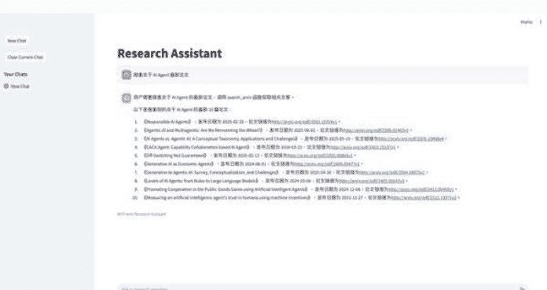

图7-3 系统输出

## 小结
本章基于 MCP Python SDK 与 arXiv，从零搭建了一个功能完整的论文研究智能体。它不仅是一个可用应用，更是对 MCP 核心理念的实践演绎。通过把复杂研究任务拆解为可组合的标准服务，实现了从混乱到有序的开发范式。

设计上以 MCP 为通信枢纽构建微服务体系，整体分为三层：MCP Server 层包含 arxiv 服务器与 docling 服务器；客户端服务器层负责协议中转；Streamlit UI 层提供交互界面。关注点分离让系统更具可扩展性与可维护性。arxiv 服务器与 docling 服务器作为独立 MCP 服务，分别封装了对 arXiv 数据源的访问与 Docling 文档处理能力，并通过标准化 Tools 接口对外暴露核心功能。

在客户端这一侧，MultiServerMCPClient 承担了工具汇聚的工作。它把来自多个 MCP 服务端的各类能力集中起来，向上层代理呈现一个统一的调用清单。正是这一层体现了 MCP 的设计初衷：调用方不需要追问每个工具来自哪里、底层怎么实现，只要遵循同一套通信规范，就能完成工具的查找与使用。

随后上层接入了 LangChain 与 LangGraph 提供的 ReAct 代理，担任整体决策。面对用户用口语提出的任务，代理会不断在推理、执行、反馈之间循环，动态编排底层的 MCP 工具，实现论文检索、内容抽取、信息整合等工作。该过程清晰展示了如何把若干原子能力拼接成面向目标的复合工作流。

交互面选用 Streamlit 快速搭建，支持多轮问答且状态保持完善。精细的会话状态管理让用户能在同一对话里并行推进多个研究主题，体验连贯流畅。前端通过明确的 API 与后端分离，体现了分层解耦带来的可维护性。

最后借助 Docker 与 Docker Compose 对各组件进行编排，并建立单元、集成到端到端的全链路质量验证。这样既保证了系统运行的稳定可靠，也提供了生产部署所需的工程实践。

完成本部分后，读者不仅能学会搭建论文研究类智能体的具体做法，也能把握以 MCP 为核心的智能体开发思路。通过标准化协议把大模型与真实世界解耦融合，这一范式具备很强的扩展空间与应用潜力。

# 第8章 用 MCP 构建对话式 ChatBI 智能体

本章从零出发，指导读者设计、实现并完善一个基于 MCP 的数据洞察分析型 ChatBI 助手。系统以自然语言对话为入口，让用户像聊天一样完成企业数据查询、分析与洞察，实现 AI 与 BI 的深度融合。内容涵盖：

- 总体介绍
- 架构设计
- MCP 服务端搭建
- LangGraph 对话编排
- API 服务实现
- 前端界面实现
- 测试验证
- 未来方向

本章还将深入讲解口语转 SQL、多轮上下文分析、智能可视化推荐、自动化洞察生成等 ChatBI 的核心技术。

以 MCP 为底座的 ChatBI 代表商业智能的重要演进。它把 LLM 的口语理解力与传统 BI 的分析能力结合，形成更直观高效的分析方式。随着技术成熟，这类系统将在企业分析与决策支持中发挥关键作用，推动数据平权与数据驱动决策的普及。学完本章，读者既能掌握基于 MCP 开发 ChatBI 的完整流程，也能理解 AI 驱动的数据洞察在业务中的落地路径，为企业数智化转型提供支撑。

## 8.1 系统概述

在数据驱动的商业环境中，企业常被海量数据和操作门槛困扰。传统分析依赖专业技能，业务人员难以直接获取洞察。ChatBI 助手结合口语处理与数据分析能力，让用户通过对话与数据交互，无缝完成查询、分析与可视化。

### 8.1.1 定义与价值

ChatBI 是一种把对话式 AI 与传统 BI 结合的新型系统，支持用日常语言进行分析与可视化。相较传统工具，其优势在于：

- 入门更简单：无需掌握 SQL 或建模，用自然表达即可得到洞察。
- 效率更高：对话式交互可快速迭代思路，减少繁琐步骤。
- 更利于数据平权：各层级员工都能便捷访问与理解数据，促进数据驱动文化。
- 主动洞察推荐：基于上下文与历史交互推荐相关分析，引导发现更有价值的信息。

实践中，销售团队可直接问“上季度北美增速最快的产品有哪些”，无需等报表；产品经理可随时追问“新功能用户反馈的趋势如何”，及时调整策略；管理层也能通过简单对话获取各业务线的核心指标，作出科学决策。

### 8.1.2 功能特性

优秀的 ChatBI 应把复杂分析融入自然流畅的对话。基于 MCP 架构的方案通过六大特性形成从理解到洞察的闭环：

##### 1. 强大的口语化数据查询
传统分析要求熟练使用 SQL，形成技术壁垒。ChatBI 打破限制，用户只需像与分析师交流一样描述需求。系统会解析时间范围、分析维度、度量指标和分析类型，例如“显示上月各地区销售额排名”，并自动转为精确的 SQL 执行。系统还能理解筛选、排序、分组、聚合等复杂操作，并通过模糊匹配与近义词识别提升容错率。

##### 2. 上下文感知的多轮对话
智能对话应是连贯探索。系统引入多轮分析机制，保持对话记忆，自动继承前文关键要素。当用户在查看销售数据后追问“哪个产品的增长最快”，系统无需重复时间、指标等背景，直接将关注点转向产品维度和增长率，给出精准回答。对话过程支持澄清与修正，使分析更灵活人性化。

##### 3. 数据可视化
表格难以揭示规律，可视化是洞察放大器。ChatBI 不仅响应指令生成图表，还会根据数据特征与分析意图主动推荐合适的类型，如柱状图、折线图、饼图、散点图、热力图等，并自动优化坐标范围、刻度、配色与标签布局。例如询问“产品类别销售趋势”，系统会识别趋势意图并生成时间序列折线图，同时支持多图整合为仪表盘，提供宏观视图。

##### 4. 从数据中提炼有价值的洞察
内置分析引擎可自动扫描数据，识别模式、趋势、相关性与异常，并给出解读与建议。例如提示“电子产品在亚太区销售额环比增长15%，显著高于其他地区，可能与近期营销活动相关”。这帮助分析师摆脱重复处理，聚焦业务决策。

##### 5. 数据库元信息理解
系统需深刻理解所管数据。启动时自动解析数据库结构，包括表、字段、类型、主外键与约束，并通过语义映射将技术字段名如 cust_addr 关联到业务术语“客户地址”。用户可询问“有哪些与客户相关的数据”，系统会列出相关表与字段及其业务含义，形成清晰的数据资源地图。

##### 6. 企业级严谨性的扩展功能
为满足生产要求，系统提供会话管理与历史回溯，自动生成摘要标题，支持回顾、复现与续接；安全与权限控制保证用户只能访问授权范围内的数据，并防范 SQL 注入等风险；交互式结果探索允许在已有图表基础上进行排序、下钻、筛选与维度切换，并支持导出多种格式用于报告与分享。

综合来看，这些能力让 ChatBI 成为强大、易用且安全的分析体，可广泛应用于销售、营销、客户服务、人力资源等场景，降低对专业分析团队的依赖，提升决策效率与普及度。

## 8.2 系统架构设计

基于 MCP 的 ChatBI 采用微服务架构，将功能拆分为独立组件，通过标准接口通信，提升可维护性与可扩展性。

### 8.2.1 整体系统架构

ChatBI 融合 LLM、数据库与可视化工具，构建灵活可扩展的智能分析平台。ChatBI 智能体的系统架构如图8-1所示。

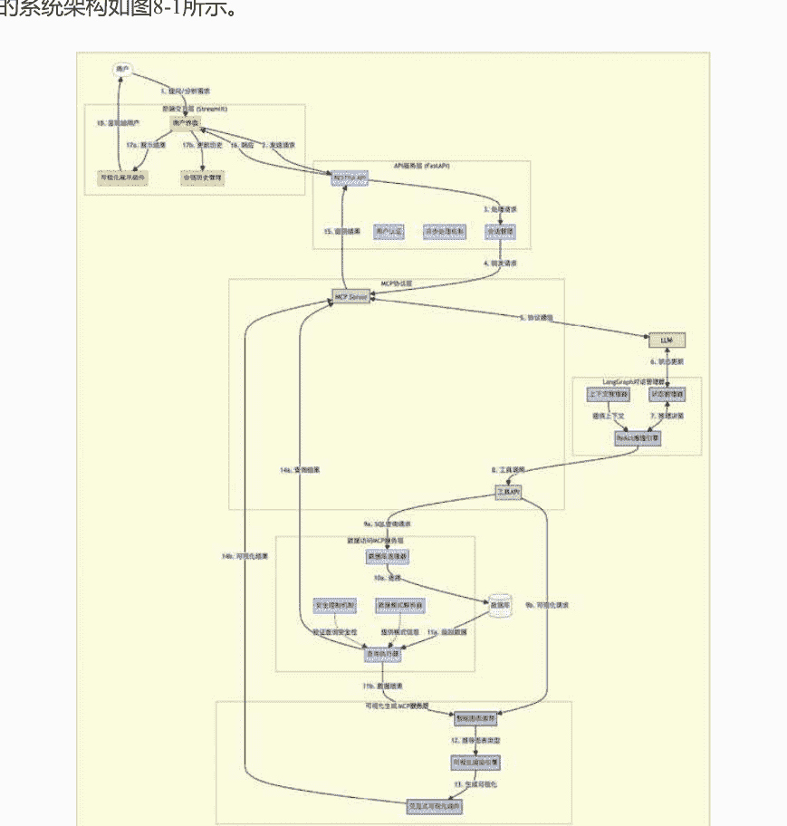

对 ChatBI 而言，架构体现设计哲学。系统采用分层模块化设计，高内聚低耦合，各层各司其职：

（1）MCP 规范层是系统核心。若把 LLM 视为大脑，MCP 就是连接大脑与现实的神经中枢。它定义了 LLM 如何发现、理解并调用外部工具。在 ChatBI 中，MCP 搭建桥梁，让 LLM 能精确调用数据库查询、可视化生成等模块。通过 MCP Server 把“执行 SQL”“生成条形图”等操作封装为标准化 API，实现推理与执行的解耦，增强灵活性。

（2）LangGraph 对话管理层。真正的智能体需具备思考与上下文关联能力。LangGraph 用于构建有状态、可循环的复杂应用。ChatBI 基于 LangGraph 实现 ReAct 模式，接收请求后先进行思考，例如“需先按地区分组求和再排序”，随后调用工具，LangGraph 负责流程编排与状态维护，支持连续追问与连贯分析。

（3）数据访问 MCP 服务层。直接对接数据源如 MySQL，负责连接与查询执行，并具备模式解析能力，动态理解表结构与关联关系，为自然语言转 SQL 提供基础。同时集成查询优化与安全控制，重写低效或风险 SQL，防止注入，确保高效安全。

（4）可视化生成 MCP 服务层。把数据转化为直观图形。核心是智能图表推荐系统，根据数据类型与分析意图推荐合适可视化，随后渲染引擎生成柱状图、折线图、饼图、散点图等，并支持交互式缩放、筛选、下钻等探索操作。

（5）API 服务层。基于 FastAPI 构建高性能服务，提供 RESTful 统一接口，自动生成文档与校验。承担会话管理与用户认证，确保数据隔离；原生异步能力支持高并发，保持交互流畅。

（6）前端交互层。采用 Streamlit 快速构建对话式界面，用户在对话框中自然提问，界面展示 AI 回复、分析结果与图表，并提供会话历史管理，支持回溯与延续，使分析过程自然连贯。

分层设计赋予系统高模块化与可扩展性，MCP 作为核心协议简化 AI 能力集成与工具扩展。

### 8.2.2 组件交互流程

各组件协作流程如下：

- (1) 用户通过 Streamlit 前端提交自然语言查询。
- (2) 前端将查询发送至 FastAPI 服务。
- (3) FastAPI 创建或恢复会话上下文，转发至 LangGraph 对话管理器。
- (4) LangGraph 调用 LLM 进行意图理解与推理。
- (5) LLM 通过 MCP 调用相关工具如数据库查询、可视化生成。
- (6) MCP Server 执行工具并返回结果给 LLM。
- (7) LLM 基于结果生成最终响应。
- (8) 响应经 API 返回前端并展示。

### 8.2.3 微服务部署架构

ChatBI 采用 Docker 容器化部署，各组件独立运行：

- (1) api 服务。运行 FastAPI 应用，提供 RESTful API，暴露 8000 端口供前端访问。
- (2) Streamlit 服务。运行 Streamlit 前端，依赖 api 服务，暴露 8501 端口供用户访问。
- (3) database-mcp 服务。运行数据库 MCP Server，暴露 8002 端口供 api 服务访问。
- (4) visualization-mcp 服务。运行可视化 MCP Server，暴露 8003 端口供 api 服务访问。

微服务架构支持独立开发、测试与部署，通过标准接口无缝集成。

## 8.3 MCP Server 实现

在 ChatBI 中，MCP Server 是 LLM 与外部工具的关键桥梁。下面介绍两个核心服务端的实现：数据库 MCP Server 与可视化 MCP Server。

### 8.3.1 数据库 MCP Server

数据库 MCP Server 提供标准化的数据查询与分析能力，使 LLM 能够访问操作数据库。

（1）初始化与配置。创建名为“Database Query Provider”的 MCP Server，并从环境变量加载数据库连接信息，具体代码如下：

```python
import os
import mysql.connector
import pandas as pd
import json
from mcp.server.fastmcp import FastMCP
import asyncio
from dotenv import load_dotenv

# 加载环境变量
load_dotenv()

# 初始化MCP Server
mcp = FastMCP("Database Query Provider", port=8002)

# 数据库连接设置
DB_HOST = os.getenv("DB_HOST", "localhost")
DB_USER = os.getenv("DB_USER", "root")
DB_PASSWORD = os.getenv("DB_PASSWORD", "password")
DB_NAME = os.getenv("DB_NAME", "chatbi")
DB_PORT = os.getenv("DB_PORT", "3306")
```

（2）数据库连接函数。提供连接与查询执行的基础能力，支持 SELECT 查询及其他 SQL 操作，具体代码如下：

```python
def get_db_connection():
    """创建到MySQL数据库的连接"""
    try:
        connection = mysql.connector.connect(
            host=DB_HOST,
            user=DB_USER,
            password=DB_PASSWORD,
            database=DB_NAME,
            port=DB_PORT
        )
        return connection
    except mysql.connector.Error as err:
        print(f"连接MySQL时出错: {err}")
        return None

def execute_query(query: str):
    """执行SQL查询并返回结果"""
    connection = get_db_connection()
    if not connection:
        return {"error": "无法连接到数据库"}

    try:
        cursor = connection.cursor(dictionary=True)
        cursor.execute(query)

        # 检查查询是否为SELECT查询
        if cursor.description:
            results = cursor.fetchall()
            return results
        else:
            connection.commit()
            return {"affected_rows": cursor.rowcount}
    except mysql.connector.Error as err:
        return {"error": str(err)}
    finally:
        if connection.is_connected():
            cursor.close()
            connection.close()
```

（3）工具定义。数据库 MCP Server 内部集成了 6 个可调用能力，分别是查看表结构、枚举全部表、执行 SQL 查询、执行 SQL 并返回 JSON、抽取表样例、获取数据库统计信息，组合起来让大模型可以完成从结构探测到数据查询的各类数据库操作。下面依次展示这六项能力的代码实现。

查看表结构工具的代码实现如下：
```python
@mcp.tool(
    name="get_table_schema",
    description="获取数据库中特定表的结构"
)
async def get_table_schema(table_name: str) -> str:
    """获取数据库中特定表的结构"""
    connection = get_db_connection()
    if not connection:
        return "无法连接到数据库"

    try:
        cursor = connection.cursor()
        cursor.execute(f"DESCRIBE {table_name}")
        columns = cursor.fetchall()

        schema_info = f"表'{table_name}'的结构:\n"
        for col in columns:
            schema_info += f"- {col[0]}: {col[1]}"
            if col[2] == "NO":  # NOT NULL
                schema_info += " (NOT NULL)"
            if col[3] == "PRI":  # Primary Key
                schema_info += " (PRIMARY KEY)"
            if col[4]:  # Default value
                schema_info += f" (DEFAULT: {col[4]})"
            schema_info += "\n"

        return schema_info
    except mysql.connector.Error as err:
        return f"获取表'{table_name}'的结构时出错: {err}"
    finally:
        if connection.is_connected():
            cursor.close()
            connection.close()
```

枚举全部表工具的代码实现如下：
```python
@mcp.tool(
    name="list_tables",
    description="列出数据库中的所有表"
)
async def list_tables() -> str:
    """列出数据库中的所有表"""
    connection = get_db_connection()
    if not connection:
        return "无法连接到数据库"

    try:
        cursor = connection.cursor()
        cursor.execute("SHOW TABLES")
        tables = cursor.fetchall()

        table_list = "数据库中的表:\n"
        for table in tables:
            table_list += f"- {table[0]}\n"

        return table_list
    except mysql.connector.Error as err:
        return f"列出表时出错: {err}"
    finally:
        if connection.is_connected():
            cursor.close()
            connection.close()
```

执行 SQL 查询工具的示例代码如下：
```python
@mcp.tool(
    name="execute_sql_query",
    description="在数据库上执行SQL查询并返回结果"
)
async def execute_sql_query(query: str) -> str:
    """执行SQL查询并返回结果"""
    results = execute_query(query)

    if isinstance(results, dict) and "error" in results:
        return f"执行查询时出错: {results['error']}"

    if isinstance(results, dict) and "affected_rows" in results:
        return f"查询执行成功。受影响的行数: {results['affected_rows']}"

    # 将结果转换为格式化字符串
    if not results:
        return "查询执行成功。未返回结果。"

    # 转换为DataFrame以获得更好的格式
    df = pd.DataFrame(results)
    return df.to_string()
```

执行 SQL 查询并返回 JSON 工具的代码实现如下：
```python
@mcp.tool(
    name="execute_sql_query_json",
    description="执行SQL查询并以JSON格式返回结果"
)
async def execute_sql_query_json(query: str) -> str:
    """执行SQL查询并以JSON格式返回结果"""
    results = execute_query(query)

    if isinstance(results, dict) and "error" in results:
        return json.dumps({"error": results["error"]})

    if isinstance(results, dict) and "affected_rows" in results:
        return json.dumps({"affected_rows": results["affected_rows"]})

    # 以JSON格式返回结果
    return json.dumps(results, default=str)
```

抽取表样例工具的代码实现如下：
```python
@mcp.tool(
    name="get_table_sample",
    description="获取特定表的行样本"
)
async def get_table_sample(table_name: str, limit: int = 5) -> str:
    """获取特定表的行样本"""
    query = f"SELECT * FROM {table_name} LIMIT {limit}"
    results = execute_query(query)

    if isinstance(results, dict) and "error" in results:
        return f"从表'{table_name}'获取样本时出错: {results['error']}"

    # 将结果转换为格式化字符串
    if not results:
        return f"表'{table_name}'中未找到数据"

    # 转换为DataFrame以获得更好的格式
    df = pd.DataFrame(results)
    return df.to_string()
```

获取数据库统计信息工具的代码实现如下：
```python
@mcp.tool(
    name="get_database_stats",
    description="获取数据库表的统计信息"
)
async def get_database_stats() -> str:
    """获取数据库表的统计信息"""
    connection = get_db_connection()
    if not connection:
        return "无法连接到数据库"

    try:
        cursor = connection.cursor()
        cursor.execute("SHOW TABLES")
        tables = cursor.fetchall()

        stats = "数据库统计信息:\n"
        for table in tables:
            table_name = table[0]
            cursor.execute(f"SELECT COUNT(*) FROM {table_name}")
            count = cursor.fetchone()[0]
            stats += f"- {table_name}: {count} rows\n"

        return stats
    except mysql.connector.Error as err:
        return f"Error retrieving database statistics: {err}"
    finally:
        if connection.is_connected():
            cursor.close()
            connection.close()
```

### 8.3.2 可视化 MCP Server 构建细节

可视化 MCP Server 的核心职责是提供图表生产能力，让大模型可以直接驱动生成各类可视化呈现。整体实现分为三部分展开说明。

（1）初始化与配置环节，相关代码如下：
```python
import json
import pandas as pd
import matplotlib.pyplot as plt
import io
import base64
from mcp.server.fastmcp import FastMCP
import asyncio
import mysql.connector
import os
from dotenv import load_dotenv
import plotly.express as px
import plotly.graph_objects as go
import numpy as np

# 加载环境变量
load_dotenv()

# 初始化MCP Server
mcp = FastMCP("Visualization Provider", port=8003)

# 数据库连接设置
DB_HOST = os.getenv("DB_HOST", "localhost")
DB_USER = os.getenv("DB_USER", "root")
DB_PASSWORD = os.getenv("DB_PASSWORD", "password")
DB_NAME = os.getenv("DB_NAME", "chatbi")
DB_PORT = os.getenv("DB_PORT", "3306")
```

（2）数据库连接方法，代码片段如下：
```python
def get_db_connection():
    """创建到MySQL数据库的连接"""
    try:
        connection = mysql.connector.connect(
            host=DB_HOST,
            user=DB_USER,
            password=DB_PASSWORD,
            database=DB_NAME,
            port=DB_PORT
        )
        return connection
    except mysql.connector.Error as err:
        print(f"连接MySQL时出错: {err}")
        return None

def execute_query(query: str):
    """执行SQL查询并返回结果作为pandas DataFrame"""
    connection = get_db_connection()
    if not connection:
        return None

    try:
        return pd.read_sql(query, connection)
    except mysql.connector.Error as err:
        print(f"执行查询时出错: {err}")
        return None
    finally:
        if connection.is_connected():
            connection.close()
```

（3）可视化工具集。可视化 MCP Server 统一开放了 6 种绘图接口，分别是柱状图生成、折线图生成、饼图生成、散点图生成、热力图生成、仪表盘生成，基本覆盖分析场景常用的图表类型。下面逐项给出实现。

柱状图生成工具的代码实现如下：

```python
@mcp.tool(
    name="create_bar_chart",
    description="从SQL查询结果创建条形图可视化"
)
async def create_bar_chart(
    query: str,
    x_column: str,
    y_column: str,
    title: str = "Bar Chart",
    color_column: str = None
) -> str:
    """
    从SQL查询结果创建条形图可视化

    Args:
        query: 要执行的SQL查询
        x_column: x轴的列名
        y_column: y轴的列名
        title: 图表标题
        color_column: 可选的颜色分组列名

    Returns:
        包含图表配置的JSON字符串
    """
    df = execute_query(query)
    if df is None or df.empty:
        return json.dumps({"error": "查询未返回数据"})

    # 检查列是否存在
    if x_column not in df.columns or y_column not in df.columns:
        return json.dumps({"error": f"查询结果中未找到列{x_column}或{y_column}"})

    if color_column and color_column not in df.columns:
        return json.dumps({"error": f"查询结果中未找到颜色列{color_column}"})

    # 创建图表数据
    if color_column:
        chart_data = []
        for color_val in df[color_column].unique():
            filtered_df = df[df[color_column] == color_val]
            chart_data.append({
                "x": filtered_df[x_column].tolist(),
                "y": filtered_df[y_column].tolist(),
                "type": "bar",
                "name": str(color_val)
            })
    else:
        chart_data = [{
            "x": df[x_column].tolist(),
            "y": df[y_column].tolist(),
            "type": "bar"
        }]

    # 创建图表配置
    chart_config = {
        "title": title,
        "chart_type": "bar",
        "chart_data": {
            "data": chart_data,
            "layout": {
                "title": title,
                "xaxis": {"title": x_column},
                "yaxis": {"title": y_column}
            }
        }
    }

    return json.dumps(chart_config)
```

折线图生成工具的代码示例展示如下：

```python
@mcp.tool(
    name="create_line_chart",
    description="从SQL查询结果创建折线图可视化"
)
async def create_line_chart(
    query: str,
    x_column: str,
    y_column: str,
    title: str = "Line Chart",
    color_column: str = None
) -> str:
    """
    从SQL查询结果创建折线图可视化

    Args:
        query: 要执行的SQL查询
        x_column: x轴的列名
        y_column: y轴的列名
        title: 图表标题
        color_column: 可选的颜色分组列名

    Returns:
        包含图表配置的JSON字符串
    """
    df = execute_query(query)
    if df is None or df.empty:
        return json.dumps({"error": "查询未返回数据"})

    # 检查列是否存在
    if x_column not in df.columns or y_column not in df.columns:
        return json.dumps({"error": f"查询结果中未找到列{x_column}或{y_column}"})

    if color_column and color_column not in df.columns:
        return json.dumps({"error": f"查询结果中未找到颜色列{color_column}"})

    # 创建图表数据
    if color_column:
        chart_data = []
        for color_val in df[color_column].unique():
            filtered_df = df[df[color_column] == color_val]
            chart_data.append({
                "x": filtered_df[x_column].tolist(),
                "y": filtered_df[y_column].tolist(),
                "type": "line",
                "name": str(color_val)
            })
    else:
        chart_data = [{
            "x": df[x_column].tolist(),
            "y": df[y_column].tolist(),
            "type": "line"
        }]

    # 创建图表配置
    chart_config = {
        "title": title,
        "chart_type": "line",
        "chart_data": {
            "data": chart_data,
            "layout": {
                "title": title,
                "xaxis": {"title": x_column},
                "yaxis": {"title": y_column}
            }
        }
    }

    return json.dumps(chart_config)
```

饼图生成工具的代码实现请见下方：

```python
@mcp.tool(
    name="create_pie_chart",
    description="从SQL查询结果创建饼图可视化"
)
async def create_pie_chart(
    query: str,
    labels_column: str,
    values_column: str,
    title: str = "Pie Chart"
) -> str:
    """
    从SQL查询结果创建饼图可视化

    Args:
        query: 要执行的SQL查询
        labels_column: 饼图标签的列名
        values_column: 饼图值的列名
        title: 图表标题

    Returns:
        包含图表配置的JSON字符串
    """
    df = execute_query(query)
    if df is None or df.empty:
        return json.dumps({"error": "查询未返回数据"})

    # 检查列是否存在
    if labels_column not in df.columns or values_column not in df.columns:
        return json.dumps({"error": f"查询结果中未找到列{labels_column}或{values_column}"})

    # 创建图表数据
    chart_data = [{
        "labels": df[labels_column].tolist(),
        "values": df[values_column].tolist(),
        "type": "pie"
    }]

    # 创建图表配置
    chart_config = {
        "title": title,
        "chart_type": "pie",
        "chart_data": {
            "data": chart_data,
            "layout": {
                "title": title
            }
        }
    }

    return json.dumps(chart_config)
```

散点图生成工具的完整代码如下：

```python
@mcp.tool(
    name="create_scatter_plot",
    description="从SQL查询结果创建散点图可视化"
)
async def create_scatter_plot(
    query: str,
    x_column: str,
    y_column: str,
    title: str = "Scatter Plot",
    color_column: str = None,
    size_column: str = None
) -> str:
    """
    从SQL查询结果创建散点图可视化

    Args:
        query: 要执行的SQL查询
        x_column: x轴的列名
        y_column: y轴的列名
        title: 图表标题
        color_column: 可选的颜色分组列名
        size_column: 可选的点大小列名

    Returns:
        包含图表配置的JSON字符串
    """
    df = execute_query(query)
    if df is None or df.empty:
        return json.dumps({"error": "查询未返回数据"})

    # 检查列是否存在
    if x_column not in df.columns or y_column not in df.columns:
        return json.dumps({"error": f"查询结果中未找到列{x_column}或{y_column}"})

    if color_column and color_column not in df.columns:
        return json.dumps({"error": f"查询结果中未找到颜色列{color_column}"})

    if size_column and size_column not in df.columns:
        return json.dumps({"error": f"查询结果中未找到大小列{size_column}"})

    # 创建图表数据
    if color_column:
        chart_data = []
        for color_val in df[color_column].unique():
            filtered_df = df[df[color_column] == color_val]
            scatter_data = {
                "x": filtered_df[x_column].tolist(),
                "y": filtered_df[y_column].tolist(),
                "mode": "markers",
                "type": "scatter",
                "name": str(color_val)
            }
            
            if size_column:
                scatter_data["marker"] = {"size": filtered_df[size_column].tolist()}
            
            chart_data.append(scatter_data)
    else:
        scatter_data = {
            "x": df[x_column].tolist(),
            "y": df[y_column].tolist(),
            "mode": "markers",
            "type": "scatter"
        }
        
        if size_column:
            scatter_data["marker"] = {"size": df[size_column].tolist()}
        
        chart_data = [scatter_data]

    # 创建图表配置
    chart_config = {
        "title": title,
        "chart_type": "scatter",
        "chart_data": {
            "data": chart_data,
            "layout": {
                "title": title,
                "xaxis": {"title": x_column},
                "yaxis": {"title": y_column}
            }
        }
    }

    return json.dumps(chart_config)
```

热力图生成工具的代码内容如下所示：

```python
@mcp.tool(
    name="create_heatmap",
    description="从SQL查询结果创建热力图可视化"
)
async def create_heatmap(
    query: str,
    x_column: str,
    y_column: str,
    z_column: str,
    title: str = "Heatmap"
) -> str:
    """
    从SQL查询结果创建热力图可视化

    Args:
        query: 要执行的SQL查询
        x_column: x轴的列名
        y_column: y轴的列名
        z_column: z轴的列名（值）
        title: 图表标题

    Returns:
        包含图表配置的JSON字符串
    """
    df = execute_query(query)
    if df is None or df.empty:
        return json.dumps({"error": "查询未返回数据"})

    # 检查列是否存在
    if x_column not in df.columns or y_column not in df.columns or z_column not in df.columns:
        return json.dumps({"error": f"查询结果中未找到列{x_column}、{y_column}或{z_column}"})

    # 透视数据用于热力图
    try:
        pivot_df = df.pivot(index=y_column, columns=x_column, values=z_column)

        # 创建图表数据
        chart_data = [{
            "z": pivot_df.values.tolist(),
            "x": pivot_df.columns.tolist(),
            "y": pivot_df.index.tolist(),
            "type": "heatmap"
        }]

        # 创建图表配置
        chart_config = {
            "title": title,
            "chart_type": "heatmap",
            "chart_data": {
                "data": chart_data,
                "layout": {
                    "title": title,
                    "xaxis": {"title": x_column},
                    "yaxis": {"title": y_column}
                }
            }
        }

        return json.dumps(chart_config)
    except Exception as e:
        return json.dumps({"error": f"创建热力图时出错: {str(e)}"})
```

仪表盘生成工具的代码实现片段如下：

```python
@mcp.tool(
    name="create_dashboard",
    description="从SQL查询创建包含多个可视化的仪表盘"
)
async def create_dashboard(
    dashboard_title: str,
    chart_configs: str  # 包含图表配置的JSON字符串
) -> str:
    """
    从SQL查询创建包含多个可视化的仪表盘

    Args:
        dashboard_title: 仪表盘标题
        chart_configs: 包含图表配置的JSON字符串
            格式: [
                {
                    "chart_type": "bar|line|pie|scatter|heatmap",
                    "query": "SQL查询",
                    "x_column": "x列名",
                    "y_column": "y列名",
                    "title": "图表标题",
                    ...其他图表特定参数
                },
```

## （4）开启服务

```python
if __name__ == "__main__":
    asyncio.run(mcp.run_sse_async())
```

该可视化 MCP Server 的图表能力相当丰富，条形图、折线图、饼图等多种类型均可生成，并且能够基于 SQL 查询的结果自动产出对应的图表配置。借助这套工具，LLM 可以按用户意图定制数据可视化方案，ChatBI 智能体的分析能力因此得到明显提升。

## 8.4 LangGraph 对话调度实操

在 ChatBI 智能体内部，LangGraph 承担着对话流程的编排与状态维护，同时负责 LLM 与 MCP 工具之间的协同。

LangGraph 采用了 ReAct 思路，让模型在推理过程中能够自主发起工具调用。下面是对话管理部分的具体落地方式。

(1) 定义对话状态的数据结构，代码如下：

```python
# 定义对话状态的数据结构
class MessagesState(TypedDict):
    messages: List[BaseMessage]
    tools: List[BaseTool]
```

这段代码声明了一个 MessagesState 类型，核心包含两部分：messages 用来保存历史对话记录，tools 用来保存当前可用的工具清单。

(2) 构建 LangGraph 对话图并确定执行流程，代码如下：

```python
def make_graph(tools: List[BaseTool]):
    """
    创建ChatBI代理的LangGraph

    Args:
        tools: 代理可用的工具列表

    Returns:
        ChatBI代理的StateGraph
    """
    # 初始化模型
    model = ChatOpenAI(
        model=os.environ.get("MODEL", "gpt-4-turbo"),
        api_key=os.environ.get("API_KEY"),
        base_url=os.environ.get("BASE_URL", "https://api.openai.com/v1"),
        temperature=0
    )

    # 定义节点

    # 代理节点 - 决定下一步操作
    def agent(state: MessagesState) -> Dict[str, Any]:
        """决定下一步操作的代理节点"""
        messages = state["messages"]
        tools = state["tools"]

        # 系统消息，包含指令
        system_message = """你是ChatBI，一个高级商业智能体，帮助用户分析数据并创建可视化。

你可以：
1. 使用SQL查询MySQL数据库
2. 基于数据创建可视化
3. 提供洞察和分析

当用户询问有关数据的问题时，请按照以下步骤操作：
1. 理解他们需要什么数据
2. 制定适当的SQL查询
3. 使用数据库工具执行查询
4. 分析结果
5. 在适当时创建可视化
6. 用清晰、商业友好的语言解释洞察

始终向用户展示你的SQL查询并解释你的推理过程。
创建可视化时，为数据和分析选择最合适的图表类型。
"""
        ...

    # 工具节点 - 执行工具
    tool_node = ToolNode(tools)

    # 定义图
    workflow = StateGraph(MessagesState)

    # 添加节点
    workflow.add_node("agent", agent)
    workflow.add_node("tool", tool_node)

    # 定义边
    workflow.add_edge("agent", "tool")
    workflow.add_edge("tool", "agent")

    # 设置入口点
    workflow.set_entry_point("agent")

    return workflow.compile()
```

该方法会搭建一个包含两大节点的对话图。

- agent 节点：解析用户意图，判断是直接作答还是需要调用工具。
- tool 节点：具体执行工具调用，完成数据查询与图表生成等任务。

整体走查顺序如下。

- 起点为 agent 节点，模型在此处解读用户输入。
- 若模型决定调用工具，流程转入 tool 节点。
- tool 节点执行完毕后，结果回传至 agent 节点。
- agent 节点结合工具返回内容组织最终回复。
- 若模型选择直接作答，则流程即刻终止。

(3) 搭建对话处理服务并将 LangGraph 与 MCP 工具联通，代码如下：

```python
import json
import logging
import os
from typing import List, Dict, Tuple, Any

from dotenv import load_dotenv
from langchain_mcp_adapters.client import MultiServerMCPClient
from langchain_openai import ChatOpenAI
from langgraph.prebuilt import create_react_agent
from sqlalchemy.orm import Session

# 加载环境变量
load_dotenv()

logger = logging.getLogger(__name__)

async def process_chat_message(
    message_history: List[Dict[str, str]],
    db: Session
) -> Tuple[str, List[Dict[str, Any]]]:
    """
    使用LangGraph代理处理聊天消息

    Args:
        message_history: 包含'role'和'content'的消息字典列表
        db: 数据库会话

    Returns:
        包含响应文本和可视化列表的元组
    """
    # 初始化模型
    model = ChatOpenAI(
        model=os.environ.get("MODEL", "gpt-4-turbo"),
        api_key=os.environ.get("API_KEY"),
        base_url=os.environ.get("BASE_URL", "https://api.openai.com/v1"),
    )

    # 连接到MCP Server
    mcp_client = MultiServerMCPClient({
        "database": {
            "url": "http://localhost:8002/sse", # 数据库MCP Server
            "transport": "sse",
        },
        "visualization": {
            "url": "http://localhost:8003/sse", # 可视化MCP Server
            "transport": "sse",
        }
    })

    # 从MCP Server获取工具
    tools = await mcp_client.get_tools()

    logger.info(f"可用工具: {tools}")

    # 创建ReAct代理
    agent_executor = create_react_agent(model, tools)

    response_text = ""
    visualizations = []

    try:
        agent_input = {"messages": message_history}

        visualization_tool_names = [
            "create_bar_chart",
            "create_line_chart",
            "create_pie_chart",
            "create_scatter_plot",
            "create_heatmap",
            "create_dashboard"
        ]

        # 流式处理代理事件
        async for event in agent_executor.astream_events(agent_input, version="v1"):
            ...

    except Exception as e:
        print(f"使用LangGraph代理处理消息时出错: {e}")
        response_text = "抱歉，处理您的请求时遇到错误。"
        visualizations = [] # 错误时清空可视化

    return response_text, visualizations
```

该函数是基于 LangGraph 代理处理聊天消息的核心实现。它先连接 MCP Server 获取可用工具，创建 ReAct 代理来响应用户提问，并从工具调用的返回中抽取可视化相关的数据。

(4) 解析可视化工具的输出结果，代码如下：

```python
# 定义可视化工具名称列表
visualization_tool_names = [
    "create_bar_chart",
    "create_line_chart",
    "create_pie_chart",
    "create_scatter_plot",
    "create_heatmap",
    "create_dashboard"
]

# 处理工具调用结束事件
if kind == "on_tool_end":
    tool_name = event["name"]
    tool_output = event["data"].get("output")
    print(f"工具结束: {tool_name}，输出 {tool_output}")
    if tool_name in visualization_tool_names and tool_output:
        try:
            # 处理工具输出
            tool_output_str = tool_output.content if hasattr(tool_output, 'content') else str(tool_output)

            # 解析JSON字符串
            viz_data = json.loads(tool_output_str)

            # 验证并添加可视化数据
            if isinstance(viz_data, dict) and (viz_data.get("chart_type") or viz_data.get("dashboard_title")):
                visualizations.append(viz_data)
            elif isinstance(viz_data, dict) and viz_data.get("error"):
                print(f"可视化工具 {tool_name} 返回错误: {viz_data.get('error')}")
            elif isinstance(viz_data, list):
                visualizations.extend(
                    chart for chart in viz_data if isinstance(chart, dict) and chart.get("chart_type")
                )
        except json.JSONDecodeError:
            print(f"警告: 无法解析来自工具 {tool_name} 的可视化数据: {tool_output}")
        except Exception as e:
            print(f"处理工具 {tool_name} 的输出时出错: {e}")
```

这部分逻辑专门处理可视化工具的返回，将工具产出的 JSON 结构解析成可用的图表配置并写入可视化列表。同时加入了异常捕获机制，确保单个图表生成失败也不会导致整条处理链中断。

## 8.5 API 服务层构建

在ChatBI智能体整体架构里，API服务层是不可或缺的枢纽，承担前端请求的接收、后端服务的调度以及会话和消息的维护。下面就它的落地思路做拆解。

(1) 搭建FastAPI应用并接入必要中间件，代码如下：

```python
# src/api/main.py
import os
from fastapi import FastAPI, Depends, HTTPException, status
from fastapi.middleware.cors import CORSMiddleware
from dotenv import load_dotenv

from .routers import chat
from .database import get_db, engine
from . import models

# 加载环境变量
load_dotenv()

# 创建数据库表
models.Base.metadata.create_all(bind=engine)

app = FastAPI(title="ChatBI API")

# 配置CORS
app.add_middleware(
    CORSMiddleware,
    allow_origins=["*"],
    allow_credentials=True,
    allow_methods=["*"],
    allow_headers=["*"],
)

# 包含路由
app.include_router(chat.router, prefix="/api/chat", tags=["chat"])

@app.get("/")
def read_root():
    return {"message": "欢迎使用ChatBI API"}

@app.get("/health")
def health_check():
    return {"status": "healthy"}

if __name__ == "__main__":
    import uvicorn
    uvicorn.run(app, host="0.0.0.0", port=8000)
```

这段实现实例化了FastAPI，接入了CORS跨域中间件来放行跨域请求，同时挂载了与聊天相关的路由。

(2) 声明系统运行时所需的数据模型，代码如下：

```python
# src/api/models.py
from sqlalchemy import Column, Integer, String, Text, ForeignKey, DateTime, JSON
from sqlalchemy.sql import func
from sqlalchemy.orm import relationship
from .database import Base

class User(Base):
    __tablename__ = "users"

    id = Column(Integer, primary_key=True, index=True)
    username = Column(String(50), unique=True, index=True, nullable=False)
    email = Column(String(100), unique=True, index=True, nullable=False)
    password_hash = Column(String(255), nullable=False)
    created_at = Column(DateTime(timezone=True), server_default=func.now())

    conversations = relationship("Conversation", back_populates="user")

class Conversation(Base):
    __tablename__ = "conversations"

    id = Column(Integer, primary_key=True, index=True)
    user_id = Column(Integer, ForeignKey("users.id", ondelete="CASCADE"))
    title = Column(String(255), nullable=False)
    created_at = Column(DateTime(timezone=True), server_default=func.now())
    updated_at = Column(DateTime(timezone=True), server_default=func.now(),
                        onupdate=func.now())

    user = relationship("User", back_populates="conversations")
    messages = relationship("Message", back_populates="conversation", cascade="all, delete-orphan")
    visualizations = relationship("Visualization", back_populates="conversation", cascade="all, delete-orphan")

class Message(Base):
    __tablename__ = "messages"

    id = Column(Integer, primary_key=True, index=True)
    conversation_id = Column(Integer, ForeignKey("conversations.id", ondelete="CASCADE"))
    role = Column(String(20), nullable=False)
    content = Column(Text, nullable=False)
    created_at = Column(DateTime(timezone=True), server_default=func.now())

    conversation = relationship("Conversation", back_populates="messages")

class Visualization(Base):
    __tablename__ = "visualizations"

    id = Column(Integer, primary_key=True, index=True)
```

## 8.6 前端界面构建

前端是用户与ChatBI智能体交互的入口，需要同时呈现清晰的对话体验和直观的可视化结果。本节采用Streamlit来快速搭建界面。

（1）启动Streamlit应用并配置页面标题与版式，代码如下：

```python
# src/streamlit/app.py
import streamlit as st
import requests
import json
import datetime
import plotly.graph_objects as go
import pandas as pd
from plotly.subplots import make_subplots
import os
from dotenv import load_dotenv

# 加载环境变量
load_dotenv()

# API URL
API_URL = os.getenv("API_URL", "http://localhost:8000")

st.set_page_config(layout="wide", page_title="ChatBI")

st.title("ChatBI: 数据分析与洞察")
st.caption("与您的数据进行对话，获取智能洞察和可视化图表。")
```

（2）封装对接API的通信模块，兼容GET与POST请求，代码如下：

```python
def query_chatbi_api(endpoint, method="GET", data=None):
    """查询ChatBI API"""
    url = f"{API_URL}{endpoint}"
    try:
        if method == "GET":
            response = requests.get(url)
        elif method == "POST":
            response = requests.post(url, json=data)
        response.raise_for_status()
        return response.json()
    except requests.exceptions.RequestException as e:
        st.error(f"连接API时出错: {e}")
        return None
```

（3）编写可视化渲染函数，代码如下：

```python
def render_visualization(viz_data):
    """根据类型和数据渲染可视化"""
```

该函数依据返回的数据动态生成Plotly图表，覆盖条形图、折线图、饼图、散点图和热力图等多种形式。

（4）实现主程序逻辑，代码如下：

```python
def main():
    # 初始化会话状态

    # 创建侧边栏
    with st.sidebar:
        st.header("会话")

        # 新会话按钮
        if st.button("新会话"):
            # 创建新会话
            new_conversation = query_chatbi_api(
                "/api/chat/conversations",
                method="POST",
                data={"title": "新会话"}
            )
            if new_conversation:
                st.session_state.conversations.append(new_conversation)
                st.session_state.active_conversation_id = new_conversation["id"]
                st.session_state.messages = []
                st.session_state.visualizations = []
                st.rerun()

        # 列出会话
        for conv in st.session_state.conversations:
            if st.button(f"{conv['title']}", key=f"conv_{conv['id']}"):
                st.session_state.active_conversation_id = conv["id"]
                # 获取会话详情
                conversation = query_chatbi_api(f"/api/chat/conversations/{conv['id']}")
                if conversation:
                    st.session_state.messages = conversation["messages"]
                    # 获取可视化
                    visualizations = query_chatbi_api(f"/api/chat/conversations/{conv['id']}/visualizations")
                    st.session_state.visualizations = visualizations if visualizations else []
                st.rerun()

    # 主内容区域
    if st.session_state.active_conversation_id is None:
        st.info("从侧边栏选择一个会话或创建一个新会话")
    else:
        # 显示聊天消息
        for message in st.session_state.messages:
            with st.chat_message(message["role"]):
                st.markdown(message["content"])

        # 显示可视化
        if st.session_state.visualizations:
            st.header("可视化")
            cols = st.columns(2)
            for i, viz in enumerate(st.session_state.visualizations):
                with cols[i % 2]:
                    st.subheader(viz["title"])
                    fig = render_visualization(viz)
                    if fig:
                        st.plotly_chart(fig, use_container_width=True)

        # 聊天输入
        if prompt := st.chat_input("询问关于您数据的问题..."):
            # 将用户消息添加到聊天
            with st.chat_message("user"):
                st.markdown(prompt)

            # 将用户消息添加到状态
            st.session_state.messages.append({"role": "user", "content": prompt})

            # 发送消息到API
            with st.spinner("思考中..."):
                response = query_chatbi_api(
                    f"/api/chat/conversations/{st.session_state.active_conversation_id}/messages",
                    method="POST",
                    data={"content": prompt}
                )

                if response:
                    # 将智能体消息添加到聊天
                    with st.chat_message("assistant"):
                        st.markdown(response["content"])

                    # 将智能体消息添加到状态
                    st.session_state.messages.append({"role": "assistant", "content": response["content"]})

                    # 刷新可视化
                    visualizations = query_chatbi_api(f"/api/chat/conversations/{st.session_state.active_conversation_id}/visualizations")
                    st.session_state.visualizations = visualizations if visualizations else []

                    # 重新运行以更新UI
                    st.rerun()

if __name__ == "__main__":
    main()
```

主函数统筹了Streamlit应用的核心流程：初始化会话状态；左侧边栏呈现会话列表并提供新建会话入口；主区域展示对话记录与图表结果；接收用户输入后调用API并呈现最终回复。

借助上述模块，Streamlit应用形成了一个易用的交互界面，让用户可以顺畅地与ChatBI智能体对话，并查看历史记录和可视化分析结果。

## 8.7 案例实测

本节通过一个完整的销售数据分析场景，演示ChatBI智能体如何为业务人员提供销售洞察，支持趋势识别和数据驱动的决策。

一家电子产品零售企业希望复盘2023年的销售情况，探究不同品类和区域的表现差异，并挖掘增长点和潜在风险。负责分析的销售经理小王对SQL编程不熟悉，也没有使用可视化工具的经验。

企业的数据存放在MySQL中，涉及以下3个表。

- sales表：销售记录表，字段包括销售日期、产品ID、客户ID、数量、单价、总金额、地区等。
- products表：产品信息表，字段包括产品名称、类别、供应商、成本价、售价等。

# ChatBI 实战：从建库到对话洞察

customers 表用于保存客户基础档案，字段包括姓名、邮箱、所在城市、所属国家以及加入时间等。

（1）创建数据库，执行脚本如下：
```sql
-- scripts/init_db.sql
CREATE DATABASE IF NOT EXISTS chatbi;
USE chatbi;
```

（2）创建表并初始化数据，代码如下：
```sql
-- Create tables
CREATE TABLE IF NOT EXISTS users (
    id INT AUTO_INCREMENT PRIMARY KEY,
    username VARCHAR(50) NOT NULL UNIQUE,
    email VARCHAR(100) NOT NULL UNIQUE,
    password_hash VARCHAR(255) NOT NULL,
    created_at TIMESTAMP DEFAULT CURRENT_TIMESTAMP
);

CREATE TABLE IF NOT EXISTS conversations (
    id INT AUTO_INCREMENT PRIMARY KEY,
    user_id INT,
    title VARCHAR(255) NOT NULL,
    created_at TIMESTAMP DEFAULT CURRENT_TIMESTAMP,
    updated_at TIMESTAMP DEFAULT CURRENT_TIMESTAMP ON UPDATE CURRENT_TIMESTAMP,
    FOREIGN KEY (user_id) REFERENCES users(id) ON DELETE CASCADE
);
```

);
CREATE TABLE IF NOT EXISTS messages (

    id INT AUTO_INCREMENT PRIMARY KEY,

    conversation_id INT,

    role VARCHAR(20) NOT NULL,

    content TEXT NOT NULL,

    created_at TIMESTAMP DEFAULT CURRENT_TIMESTAMP,

    FOREIGN KEY (conversation_id) REFERENCES conversations(id) ON DELETE CASCADE

);

CREATE TABLE IF NOT EXISTS visualizations (

    id INT AUTO_INCREMENT PRIMARY KEY,

    conversation_id INT,

    title VARCHAR(255) NOT NULL,

    chart_type VARCHAR(50) NOT NULL,

    chart_data JSON NOT NULL,

    created_at TIMESTAMP DEFAULT CURRENT_TIMESTAMP,

    FOREIGN KEY (conversation_id) REFERENCES conversations(id) ON DELETE CASCADE

);

-- Sample data

INSERT INTO users (username, email, password_hash) VALUES

('admin', 'admin@example.com',

'$2b$12$1234567890123456789012uQYxg7vLu/GJo/mTq1kJt1UrPmG5GXW'),

('demo', 'demo@example.com',

'$2b$12$1234567890123456789012uQYxg7vLu/GJo/mTq1kJt1UrPmG5GXW');

-- Sample tables for BI queries

CREATE TABLE IF NOT EXISTS sales (

    id INT AUTO_INCREMENT PRIMARY KEY,

    product_id INT NOT NULL,

    customer_id INT NOT NULL,

    sale_date DATE NOT NULL,

    quantity INT NOT NULL,

    unit_price DECIMAL(10, 2) NOT NULL,

    total_amount DECIMAL(10, 2) NOT NULL,

    region VARCHAR(50) NOT NULL

);

CREATE TABLE IF NOT EXISTS products (

    id INT AUTO_INCREMENT PRIMARY KEY,

    name VARCHAR(100) NOT NULL,

    category VARCHAR(50) NOT NULL,

    supplier VARCHAR(100) NOT NULL,

    cost_price DECIMAL(10, 2) NOT NULL,

    selling_price DECIMAL(10, 2) NOT NULL

);

CREATE TABLE IF NOT EXISTS customers (

    id INT AUTO_INCREMENT PRIMARY KEY,

    name VARCHAR(100) NOT NULL,

    email VARCHAR(100) NOT NULL,

    city VARCHAR(50) NOT NULL,

    country VARCHAR(50) NOT NULL,

    join_date DATE NOT NULL

);

-- Insert sample data for products

INSERT INTO products (name, category, supplier, cost_price, selling_price) VALUES

('Laptop', 'Electronics', 'TechCorp', 800.00, 1200.00),

('Smartphone', 'Electronics', 'MobileTech', 400.00, 700.00),

...

('Desk', 'Furniture', 'WoodWorks', 200.00, 400.00),

('Bookshelf', 'Furniture', 'FurniCo', 90.00, 180.00);

-- Insert sample data for customers

INSERT INTO customers (name, email, city, country, join_date) VALUES

('John Smith', 'john@example.com', 'New York', 'USA', '2020-01-15'),

...

('Isabella Kim', 'isabella@example.com', 'Seoul', 'South Korea', '2020-10-25');

-- Insert sample data for sales

INSERT INTO sales (product_id, customer_id, sale_date, quantity, unit_price, total_amount,

region) VALUES

(1, 1, '2023-01-10', 2, 1200.00, 2400.00, 'North America'),

(2, 2, '2023-01-15', 1, 700.00, 700.00, 'Europe'),

...

(10, 2, '2023-06-15', 2, 180.00, 360.00, 'Europe');

（3）执行如下脚本启动应用，代码如下：
```
run_api.sh
run_database_server.sh
run_streamlit.sh
run_visualization_server.sh
```

在浏览器中输入http://localhost:8501/，可以看到ChatBI智能体界面，如图8-2所示。

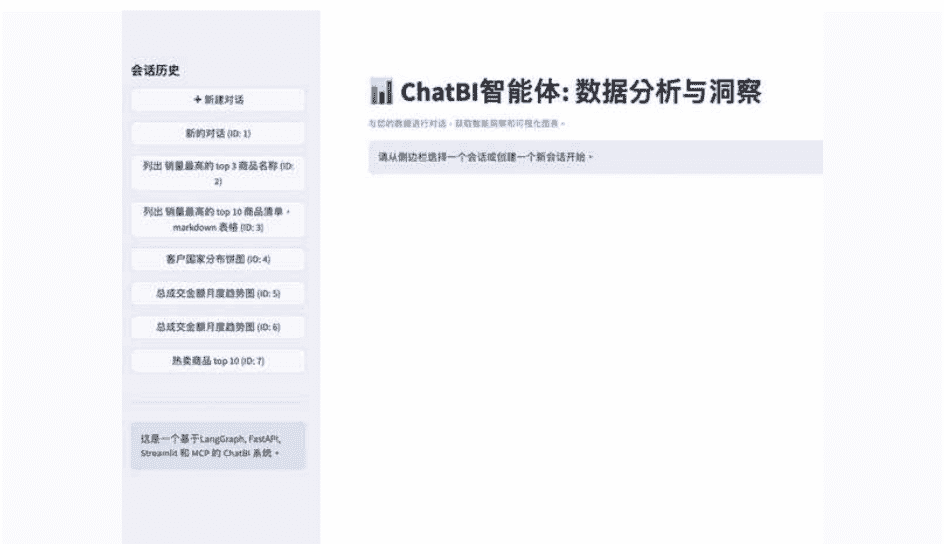

图8-2 ChatBI智能体界面

第1轮对话，输入“热卖商品top 10”，ChatBI智能体的输出如图8-3所示。

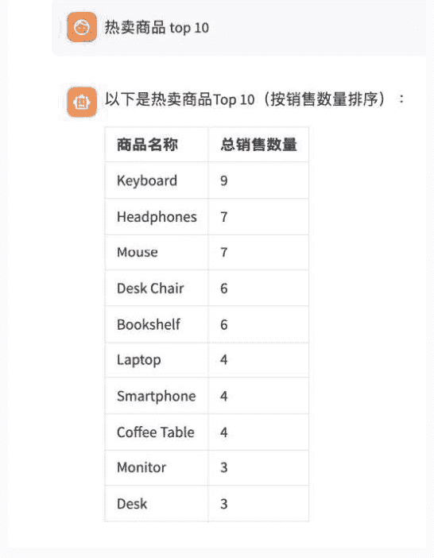

图8-3 第1轮对话，ChatBI智能体的输出

第2轮对话，输入“月度总销量趋势图（折线图）和总销售额趋势图（折线图）”，ChatBI智能体的输出如图8-4所示。

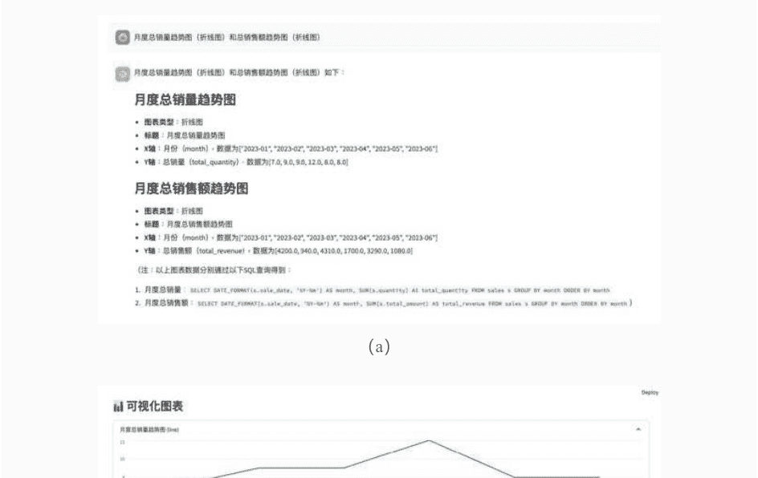

(a)


(b)

图8-4 第2轮对话，ChatBI智能体的输出

第3轮对话，输入“客户国家分布饼图”，ChatBI智能体的输出如图8-5所示。

该案例说明ChatBI如何让没有技术背景的用户用日常用语完成复杂的数据探索，自动归纳关键结论并给出可操作的建议。整个过程不用写SQL，也无需借助专业BI工具，分析门槛被大幅拉低，效率明显提升。

# ChatBI：自然语言驱动的分析与洞察

面向专业分析人员，支持洞察挖掘与可视化表达。

# 当前对话 (ID: 50)

客户国家分布饼图

客户国家分布饼图已生成，具体信息如下：

- 标题：客户国家分布饼图

- 图表类型：饼图

- 数据：包含 USA、UK、Canada、Spain、Australia、Mexico、China、South Korea 等国家的客户数量分布，其中 USA 和 UK 的客户数量最多，其他国家较少。

# 可视化图表


图8-5 第3轮对话，ChatBI智能体的输出

## 8.8 未来展望

当前，ChatBI已通过自然语言交互把复杂分析能力开放给更广人群，但这只是数据普及变革的起点。下一步它将从被动应答的查询工具演进为具备主动性、多维度协作并深度嵌入决策流程的智能数据伙伴。演进将体现在交互方式、分析深度、知识融合、协作模式、安全治理及计算效率等层面。

### 8.8.1 从文本到多模态的沉浸式对话

人机交互的边界决定技术普及的程度。ChatBI的发展将由当前以文本为主的交流逐步转向更丰富、更符合直觉的多模态方式。可预见，未来分析师或业务人员可在通勤或会议现场通过语音提问，随时获得数据反馈，交流体验接近人与人对话。

交互维度也将扩展到视觉。系统具备图像理解能力，可解析用户上传的报表截图、图表示意甚至手绘草图，精准捕捉其中蕴含的数据信息与分析意图。这实现了从静态视觉材料到动态可交互分析对象的跃迁。反馈也不再局限于静态图表，而是呈现为可交互的动态叙事，甚至结合增强现实将关键业务指标实时叠加到真实物理世界。例如，零售经理巡店时，货架上方悬浮的虚拟标签可实时展示每件商品的销售走势与库存水平。沉浸式交互打破数字世界与物理世界的隔阂，使数据分析无缝融入业务发生的每个瞬间。

### 8.8.2 从“是什么”到“为什么”与“怎么办”

交互方式的革新降低了门槛，分析能力的深化决定价值高度。未来系统将从描述性分析向更高层次迈进，首要的是因果推断。系统不再满足于揭示变量相关性，而是探寻背后的因果链条，帮助决策者真正理解现象的根本驱动。

在此基础上，预测与规划能力将实现质的提升。通过融合更先进的时间序列模型与机器学习方法，系统不仅能提供更精准的销售预测或库存预警，还能开展复杂的多变量情景分析与概率预测，为战略规划提供量化依据。更进一步，系统在识别问题并诊断原因后，能主动提出基于数据的行动建议，真正承担决策顾问角色。从洞察到行动的闭环，标志着ChatBI正从分析工具向决策支持系统转变。

### 8.8.3 知识增强与领域自适应

通用模型再强，若缺乏领域背景，结论难以落地。因此，为ChatBI注入深厚领域知识是走向成熟的关键。未来系统将集成特定行业的专业知识库，例如财务会计准则、医疗临床指标体系、零售行业通用基准，使分析与解释更具专业性与权威性。

更重要的是，系统具备持续自适应的学习能力。它会在与用户的持续交互中不断学习特定组织的业务术语、分析偏好乃至决策风格，从而提供高度个性化服务。同时，通过无缝融合多样化的内外部数据源，从企业ERP、CRM系统到互联网市场趋势、竞品动态乃至宏观经济数据，系统可构建异常全面的分析上下文，提供真正具备全局视野的洞察。

### 8.8.4 融入组织的血脉

数据分析的最终目的是驱动集体决策与行动，而非停留在个人探索。因此，未来的ChatBI必须深度融入组织的协作流程与治理框架。它将支持多用户协同参与分析会话，允许团队成员像协作编辑共享文档一样，围绕同一数据视图进行实时讨论、添加注释并共同探索。系统还具备“分析记忆”能力，可记录并理解过往的分析脉络与结论，使新的探索可基于已有成果持续推进，从而不断积累组织知识资产。

随着系统在企业运营中的核心地位提升，安全与治理成为生命线。基于用户角色、数据敏感度和使用场景的细粒度动态访问控制将成为标准配置。同时，差分隐私、联邦学习等隐私保护计算技术将在充分挖掘数据价值的基础上严格保护个人隐私与数据安全。系统的每一项分析过程都具备高度可解释性与可追溯性，其生成的SQL、分析步骤、数据来源都清晰可查，不仅增强用户信任，也满足日益严格的合规审计要求。

综上，ChatBI的未来演进呈现出从工具到伙伴、从查询到洞察、从孤立分析到协同决策的清晰路径。它预示数据不再是少数专家的专属领域，而是成为组织中每个成员都能自如运用并借此进行高效协作与明智决策的通用能力。

## 小结

本章详细介绍了基于MCP的数据洞察分析ChatBI，这是一种将自然语言处理与数据分析能力深度融合的创新型商业智能系统。通过本章学习，我们了解了ChatBI的核心架构、关键技术实现及其实际应用场景。

ChatBI的核心价值在于降低数据分析的技术门槛，使非技术用户能够通过自然语言对话与数据直接交互，便捷获取洞察并生成可视化结果。系统采用模块化架构设计，包括MCP Server、LangGraph对话管理、API服务层和前端界面等组件，各组件通过标准化接口通信，实现了高度可维护性和可扩展性。

在技术实现方面，本章重点阐述了系统的四大核心功能：自然语言至SQL的转换、多轮对话分析、智能可视化推荐和数据洞察生成。这些功能共同构成ChatBI的智能分析能力，使系统不仅能回答“数据是什么”的基础问题，还能深入解答“数据意味着什么”的问题。

MCP作为系统的核心协议层，为LLM提供了与外部工具及资源交互的标准化接口。本章实现了两个MCP Server：用于数据查询的数据库MCP Server和用于可视化生成的可视化MCP Server。这种基于MCP的架构设计显著提升了系统的模块化程度和可扩展性，便于集成更多数据源和分析工具。

LangGraph对话管理模块基于ReAct模式实现，使AI能够进行推理并执行相应的工具调用。通过持续维护对话上下文和状态管理，系统能够理解用户的连续提问和追问，从而为用户提供连贯且深入的数据分析体验。

另外，本章通过一个实际案例展示了ChatBI如何辅助业务用户分析销售数据，以发现趋势和洞察，并做出数据驱动的决策。该案例生动体现了系统的实际价值和应用潜力。

在未来的使用中，ChatBI可以进一步增强其数据洞察能力，集成更多先进分析技术如机器学习和预测分析，支持更复杂的数据源和分析场景，并提供更个性化的用户体验。

# 第9章

基于MCP Python SDK和browser-use创建深度研究报告生成智能体

本章将引领读者踏上一段激动人心的技术探索之旅，重点阐述如何将MCP的强大连接能力与browser-use所具备的深度网页交互技术相融合，共同构建一个能够自动化生成深度研究报告的智能系统。

在信息以前所未有的速度膨胀的今天，如何从海量数据中高效地提炼洞见、形成结构化的研究报告，已成为众多知识工作者、市场分析师及科研人员所面临的核心挑战。本章将介绍如何逐步构建一个能够自主执行网络搜索、内容提取、数据分析乃至报告撰写的智能体，从而将研究人员从烦琐的信息处理工作中解放出来，使其专注于更高层次的思考与创造性工作。本章主要包括以下内容。

- 研究报告生成范式的革新。

- 系统架构设计。

- 核心组件实现。

- MCP工具实现。

- 前端页面设计与实现。

- 应用案例与最佳实践。

通过学习本章，我们不仅能掌握构建高级AI智能体的技术细节，还将深入理解如何将前沿的AI能力系统化、工程化，以解决真实世界中复杂的知识生产问题。这些内容将为从事科研、市场分析、行业研究等领域的读者提供实用的自动化工具与扎实的工程实践经验。

## 9.1 研究报告生成的新范式

研究报告卡在哪里？人机协同如何破局

数据驱动已成常态，研究报告承担起把原始信息转化为可执行判断的桥梁角色。无论商业决策、学术推进还是市场研判，都需要既深刻又及时的产出。但现实中生成流程常成为瓶颈，研究人员像在巨量资讯里淘金，把大量工时耗在搜集、筛除、整合与拆解上，效率低且不确定性高。

传统研究范式的主要阻力可归为四点。

- 覆盖面与精准度难以兼得。关键线索分散在论文库、新闻站点、行业社群和官方文件中，手工检索费时易漏视野，导致结论偏差。
- 素材泛滥推高认知负荷。持续涌入的海量资料容易造成判断停滞，难以从噪声中挑出高价值信号并做系统归纳，对分析能力是严峻考验。
- 深度研判受人力与周期限制。资源有限时，很难对所有材料做多维交叉验证，洞见难以下探，往往只能停留在表面。
- 成品质感与交付时效不稳定。终稿质量高度依赖个人专业与写作手感，波动大；长周期又使报告上线时依据的信息已显陈旧，实用性下降。

以大模型为代表的生成式智能提供了破局路径。它催生出人机协同的知识发现模式，智能体不再是外围插件，而是嵌入流程的认知伙伴。

最核心的变化是：
- 从人工检索转向自动化获取。智能体凭借强并发能力，可实现全天候巡查全球网络与专业库，自动抓取相关素材，将探索边界推向新高度。

## 9.2 系统架构设计

依托 MCP 与 browser-use，我们规划一套可高效扩展的深度研究报告生成智能体架构，覆盖从素材采集到报告成型的完整链路，同时保持灵活与可扩展。

### 9.2.1 系统分层架构

深度研究报告生成智能体采用分层架构，如图9-1所示。

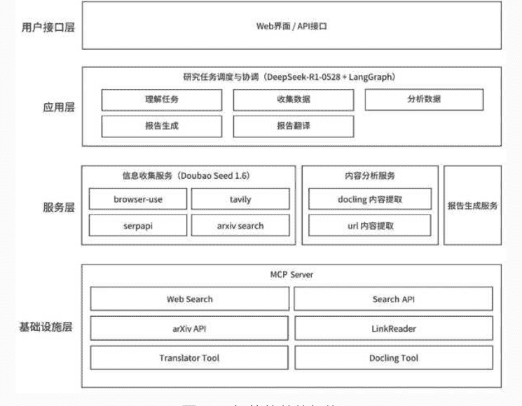

交互层由 Web 页面与 API 接口构成，主要承接用户指令并呈现最终成果。

应用层包含研究任务编排与协同模块，统一调度各服务组件并管理完整研究流程。

服务层聚合三大功能单元。

- 信息收集服务（Doubao Seed 1.6）：承担多源资料汇聚任务。
- 内容分析服务：对采集的素材做解析与加工。
- 报告生成服务：据此输出成文报告。

底层基础设施围绕 MCP Server 搭建，为系统提供基础工具与支撑 AI 与外部系统交互。在本方案中，MCP Server 提供的能力包括。

- Web Search：借助 browser-use 驱动浏览器，完成页面访问与内容抽取。
- Search API：依托外部检索接口完成信息查找与片段抽取。
- arXiv API：对接学术库检索论文并解析内容。
- LinkReader：负责读取链接背后资源。
- Translator Tool：翻译能力。
- Docling Tool：从文档文件里抽取文字。

该分层设计具备良好的模块化与可扩展性，可灵活适配多样化研究需求。

MCP Server 作为架构枢纽，负责提供各类工具与服务，支撑 AI 与外部系统交互。针对本智能体，设计了以下 MCP 工具。

- Web 搜索工具：使用 browser-use 在网络上搜集相关信息。
- URL 浏览工具：访问指定地址并抽取页面内容。
- 学术搜索工具：检索学术论文与研究报告。
- 内容提取工具：从 PDF 等文档格式中抽取文本。

### 9.2.2 系统数据流设计

数据流是深度研究报告生成智能体的关键设计要素，描述信息在各组件间的传递过程，从用户输入到最终报告生成。主要路径包括以下3种。

(1) 用户请求流。

- 用户在 Streamlit 界面填入研究主题、深度与输出格式。
- 将研究请求发送至 FastAPI 服务端。
- FastAPI 端解析请求并触发研究流程。

(2) 信息收集流。

- FastAPI 端连接至 MCP 客户端。
- MCP 客户端向 MCP 服务端请求工具执行。
- 使用这些工具收集相关信息。
- 将收集到的信息返给 FastAPI 端。

(3) 报告生成流。

- FastAPI 端基于收集到的信息生成研究报告。
- 报告以流式形式推送回 Streamlit 前端。
- 用户可以查看和下载报告。

从用户请求到最终报告生成的数据流转过程，如图9-2所示。


图9-2 智能体数据流转图

## 9.3 核心组件实现

9.2 节已明确深度研究报告生成智能体的分层结构与数据流转机制。本节将逐一拆解并实现各核心组件。

若把整个报告生成智能体视作一位数字研究员，那么 MCP Server 就是其感知与交互数字世界的感知手臂。它负责把互联网海量数据、专业学术库及各类文档资源，转化为上层智能体可理解与调用的标准工具集。因此我们首先聚焦 MCP Server，详细阐释其设计理念与代码实现，展示如何为 AI 构建探索数据世界的强大感知能力。

### 9.3.1 研究检索MCP Server组件

在深度研究报告生成智能体中，MCP Server 以 research_server.py 为载体，作为基础设施层的核心，提供各类工具与服务，使 AI 能够与外部系统交互并获取信息。其核心使命，是把数字世界中复杂的信息检索与交互行为，封装成一系列原子化、标准化、可被 LLM 理解与调用的“工具”。通过此方式，LLM 能够自主执行网页搜索、文献查阅、链接内容读取等任务。

本节将深入剖析 research_server.py 的设计思路与实现细节，从服务器初始化配置，到各核心工具的构建逻辑，逐步阐述如何将 browser-use、arxiv 等第三方库与 MCP 机制有机结合，构建功能完备、逻辑清晰且易于扩展的信息获取中枢。

#### 1. 初始化与配置

research_server 的初始化与配置主要包括3项关键任务：创建服务器实例、加载环境变量配置、初始化与 LLM 的连接。具体代码如下。

```python
# 导入必要的库与模块
...
# 创建一个FastMCP Server实例
# "Web Browser Provider"是这个服务器的描述性名称，便于在客户端识别
# port=8000指定了服务器监听的端口
mcp = FastMCP("Web Browser Provider", port=8000)

# 使用load_dotenv()从项目根目录下的.env文件加载环境变量
# 这是现代应用开发的最佳实践，它将敏感信息（如API密钥）与代码本身分离，提高了安全性与配置的灵活性
load_dotenv()

# 初始化与LLM的连接
# 这里选用ChatOpenAI，它是与OpenAI兼容API进行交互的客户端
llm = ChatOpenAI(
    # model参数指定了要使用的大模型，其值从环境变量中读取，模型需要支持多模态和函数调用能力
    # 这种设计使得可以不修改代码，仅通过改变环境变量就能轻松切换不同的模型
    model=os.environ['Doubao_Seed_16'],
    # api_key和base_url同样从环境变量中获取，分别代表认证密钥和API服务的接入点
    api_key=os.environ['OPENAI_API_KEY'],
    base_url=os.environ['OPENAI_BASE_URL'],
)
```

构建 FastMCP 实例时选用 FastMCP 作为服务器框架，因其是 MCP Python SDK 提供的高性能实现。该框架简化了 MCP 的复杂度，支持通过简洁装饰器语法如 @mcp.tool 定义工具，显著提升开发效率。

加载环境配置时使用 dotenv，体现了工程化考量。在团队协作或多环境部署时，不同环境的配置如 API Key、模型终端可能存在差异。将这些配置统一写入 .env 文件，既保持代码库整洁，也实现环境隔离。

在初始化与 LLM 连接过程中，ChatOpenAI 实例充当 research_server 与 LLM 智能交互的桥梁。特别注意，此处选用了支持函数调用或工具调用能力的 LLM。这一点至关重要，因为 browser-use 库中的 Agent 正依赖 LLM 的此类能力来理解任务、拆解步骤并调用合适的浏览器操作。若缺乏该能力，自动化浏览器代理将无法正常运行。

#### 2. 定义数据模型

在构建数据驱动系统时，明确数据结构是保障稳定性和可维护性的关键。我们使用 Pydantic 定义数据模型，它不仅能提供运行时数据验证，还能为 Python 提供类似静态语言的类型提示与检查，增强代码健壮性与可读性。

以下代码定义了两个 Pydantic 模型。

- SearchResult，用于表示网络搜索结果，包含标题、URL、内容和来源等字段。
- Article，用于表示学术论文数据结构，包含标题、摘要、发表日期和 PDF 链接等字段。

具体代码如下。

```python
# 使用Pydantic的BaseModel定义网络搜索结果的数据结构
class SearchResult(BaseModel):
    title: str # 搜索结果的标题
    url: str # 结果对应的URL
    content: str # 从该URL提取的核心内容摘要
    source: str # 信息来源，例如"web search"

    # 重写__str__方法，定义当该对象被转换为字符串时的格式
    # 这使得搜索结果的打印输出更为友好和结构化，便于调试和日志记录
    def __str__(self):
        # 格式化输出，只显示内容的前500个字符作为预览
        return f"Title: {self.title}\nURL: {self.url}\nSource: {self.source}\n\nContent:\n{self.content[:500]}...\n"

# 定义学术论文的数据结构
class Article(BaseModel):
    title: str # 论文标题
    summary: str # 论文摘要
    published_date: str # 发表日期
    pdf_link: Optional[str] # PDF链接，可能不存在，因此使用Optional

    # 定义一个类方法，用于从arxiv库的返回结果方便地创建Article实例
    # 这是一个典型的工厂模式应用，将对象创建的逻辑封装起来
    @classmethod
    def from_arxiv_result(cls, result: arxiv.Result) -> 'Article':
        # 在arxiv返回的链接列表中，筛选出PDF链接
        pdf_links = [str(i) for i in result.links if '/pdf/' in str(i)]
        # 如果找到了PDF链接，取第一个；否则设为None
        pdf_link = pdf_links[0] if len(pdf_links) else None
        # 使用提取的信息创建并返回Article实例
        return cls(
            title=result.title,
            summary=result.summary,
            published_date=result.published.strftime('%Y-%m-%d'), # 格式化日期
            pdf_link=pdf_link
        )

    # 同样，重写__str__方法，以便清晰地展示论文信息
    def __str__(self):
        return f"Title: {self.title}\nDate: {self.published_date}\nPDF Url: {self.pdf_link}\n\n" + '\n'.join(self.summary.splitlines()[:3]) + '\n[...]'
```

上述代码中，SearchResult 和 Article 不仅是数据容器，更是服务与服务之间、模块与模块之间的数据契约。通过定义这些模型，确保数据在系统内部流转时结构始终一致且可预期。

Article.from_arxiv_result 方法是典型的封装示例。它隐藏了处理原始 arxiv.Result 对象的复杂性，为调用方提供简单直接的接口。这种抽象提升了可维护性——即使未来 arxiv 库的 API 发生变化，也只需修改该方法内部逻辑，无须改动所有使用 Article 的代码。

重写 __str__ 方法看似细节微小，但在开发与调试阶段却能极大提升效率。当需要打印对象状态时，一个格式化良好、信息丰富的字符串远比仅显示对象内存地址的默认输出更有实用价值。

#### 3. Web搜索工具

网页搜索工具 web_search 作为系统的主要信息入口，它凭借 browser-use 的智能体能力，能够把简单的自然语言查询如“人工智能的最新进展”转化为一系列复杂的浏览器操作，并最终返回结构化的搜索结果。以下代码基于 browser-use 实现了信息检索功能。

```python
@mcp.tool(
    name="web_search",
    description="Search the web for information on a specific topic using browser automation."
)
async def web_search(query: str, num_results: int = 5) -> str:
    """
    根据给定的主题，使用自动化浏览器在网络上进行搜索

    Args:
        query: 要搜索的查询字符串
        num_results: 期望返回的结果数量，默认为5

    Returns:
        一个包含搜索结果的格式化字符串
    """
    print(f"调用`web_search`工具，正在搜索: '{query}'...")

    # 创建一个browser-use的Agent实例
    # Agent是一个自主代理，它接收一个高层次的任务指令和LLM实例
    agent = Agent(
        task=f"Search for information about '{query}'. Find {num_results} high-quality sources. For each source, extract the title, URL, and relevant content. Return the results as a JSON array with 'title', 'url', 'content', and 'source' fields.",
        llm=llm,
    )

    print(agent) # 打印Agent的配置信息，便于调试

    # 运行Agent，它将自动执行任务。max_steps用于限制其操作步骤，防止进入无限循环
    result = await agent.run(max_steps=10)

    print(f"对于 '{query}' 的搜索结果: \n\n{result}\n\n")

    try:
        # Agent返回的结果通常是LLM生成的JSON字符串，需要进行解析
        search_results = []
        # 确保结果是字符串且看起来像一个JSON数组
        parsed_results = json.loads(result) if isinstance(result, str) and result.strip().startswith("[") else []

        # 遍历解析后的结果，并使用我们定义的SearchResult模型进行实例化
        # 这会进行数据验证，确保返回的数据符合我们的预设
        for item in parsed_results[:num_results]:
            search_results.append(
                SearchResult(
                    title=item.get("title", "Untitled"),
                    url=item.get("url", ""),
                    content=item.get("content", ""),
                    source=item.get("source", "web search")
                )
            )

        # 将SearchResult对象列表格式化为单一的字符串返回
        return "\n\n---\n\n".join(str(result) for result in search_results)
    except Exception as e:
        # 如果解析失败，返回错误信息和原始结果，便于排查问题
        return f"Error parsing search results: {str(e)}\n\nRaw result: {result}"
```

给 Agent 下达任务的方式决定了工具的下限。核心并不在于硬编码“点哪个按钮、填什么框”，而是把目标用自然语言描述清楚，并明确期望的输出格式。任务参数 task 就是这根指挥线。Agent 收到指令后，会借助 LLM 的推理能力自行拆解成一系列浏览器操作，比如打开搜索引擎、输入关键词、翻阅结果页、抓取要点等，这种把意图翻译成动作的能力正是 browser-use 发挥价值的地方。

拿到原始结果后绝不能直接使用。工具的收尾部分做了一套防御性的结构化处理，不盲目信任上游 Agent 返回的内容，而是用 try-except 包裹，再配合 json.loads 与 Pydantic 实例化进行强制校验。如此一来，模型吐出的非结构化文本才会被变成程序可用的可靠数据结构，为后续流程提供干净的基础。

#### 4. 单页深度浏览工具

如果说 web_search 是在信息海洋里先撒网，那么 browse_url 就是对已经锁定目标的精细勘探。同样依托 browser-use，它负责打开指定页面并抽取出完整信息，具体代码如下。

```python
@mcp.tool(
    name="browse_url",
    description="Browse a specific URL and extract its content using browser automation."
)
async def browse_url(url: str) -> str:
    """
```

访问一个特定的URL并提取其主要内容

Args:

    url: 需要浏览的网页地址

Returns:

    一个包含提取内容的字符串

```python
print(f"调用`browse_url`工具，正在浏览URL: {url}")

# 同样创建一个Agent，但这次的任务是针对单个URL进行内容提取
agent = Agent(
    task=f"Visit the URL '{url}'. Extract all relevant content including title, main text, and any important data. Format the content in a readable way.",
    llm=llm,
)

print(agent)

# 运行Agent，它将导航到指定URL并执行提取任务
result = await agent.run(max_steps=10)

print(f"从URL '{url}' 提取的内容: \n\n{result}\n\n")

# 直接返回Agent提取并格式化后的内容
return result
```

整体思路与 web_search 一致，但聚焦程度更高。它很好地体现了 browser-use Agent 的可塑性，只需改写 task 描述就能完成不同粒度的页面交互。在真实的研究链路里，两者通常配合使用：先用 web_search 批量收集候选 URL，再用 browse_url 逐个深入，拿到细节。

#### 5. arXiv 学术检索工具

深度报告离不开学术来源。这个工具专门面向预印本平台 arXiv，体现了信息获取上的专业化。

```python
# 这是一个辅助函数，不直接作为MCP工具，封装了与arxiv库交互的逻辑
def get_articles_content(query: str, max_results: int) -> list[Article]:
    client = arxiv.Client() # 创建arxiv客户端
    # 构建搜索查询，按相关性排序
    search = arxiv.Search(query=query, max_results=max_results,
                          sort_by=arxiv.SortCriterion.Relevance)
    # 执行搜索，并使用map和我们定义的工厂方法将结果转换为Article对象列表
    articles = map(lambda x: Article.from_arxiv_result(x), client.results(search))
    # 筛选出那些包含有效PDF链接的文章
    articles_with_link = filter(lambda x: x.pdf_link is not None, articles)
    return list(articles_with_link)

@mcp.tool(
    name="search_arxiv",
    description="Get `max_results` articles for a given search query on arXiv."
)
async def get_articles(query: str, max_results: int) -> str:
    """
    在arXiv网站上根据给定查询搜索学术论文

    Args:
        query: 搜索的关键词
        max_results: 返回的最大结果数量

    Returns:
        一个包含论文信息列表的格式化字符串
    """
    print(f"调用`search_arxiv`工具，正在搜索: '{query}'...")
    # 调用辅助函数来执行实际的搜索和数据转换
    articles = get_articles_content(query, max_results)
    print(f"找到了 {len(articles)} 篇相关文章")
    # 使用分隔符将所有Article对象的字符串表示连接起来，形成最终输出
    return '\n\n------\n\n'.join(map(str, articles)).strip()
```

实现上的关键点如下。

职责分离：把与 arxiv 库的交互封装到 get_articles_content 辅助函数里，主函数 get_articles 只负责收参、调用、写日志和格式化输出。职责清晰后，可测试性和可维护性明显提升。

函数式写法：代码里大量使用 map 与 filter，以声明式风格处理集合，代码更简洁易读。

领域专用：说明一个合格的智能体需要为不同信源准备专用工具。通用网页搜索很强，但面对 arXiv 这种结构化数据，直接调用官方 API 远比模拟浏览器高效可靠。

#### 6. PDF 内容提取与预览工具

拿到论文的 PDF 链接后，下一步就是读内容。该工具基于 docling 库构建，能处理 PDF 并分别完成全文抽取和快速预览，具体实现如下。

```python
# 辅助函数：从PDF URL提取文本内容
def get_article_content_str(article_url: str) -> str:
    converter = DocumentConverter() # 初始化文档转换器
    result = converter.convert(article_url) # 从URL转换文档
    research = result.document.export_to_markdown() # 导出为Markdown格式
    return research

# 辅助函数：获取文本的开头部分（按Token数量计）
def first_lines(text: str, chunk_size: int = 1000) -> str:
    # 根据gpt-4的分词方式初始化编码器
    encoder = tiktoken.encoding_for_model('gpt-4')
    # 创建文本分割器，它会确保分割后的文本块不超过指定的Token数
    text_splitter = RecursiveCharacterTextSplitter(
        chunk_size=chunk_size,
        chunk_overlap=0,
        length_function=lambda x: len(encoder.encode(x)), # 关键：长度函数基于Token数量
        is_separator_regex=False,
    )
    # 分割文本并返回第一个块
    return text_splitter.split_text(text)[0]

@mcp.tool(
    name="extract_article_content",
    description="Extracts the full text content from a research article PDF using its pdf link `article_url`."
)
async def get_article_content(article_url: str) -> str:
    """从给定的PDF链接中提取完整的文章文本内容"""
    article_content = get_article_content_str(article_url)
    print(f"已从 {article_url} 提取全文")
    return article_content.strip()

@mcp.tool(
    name="get_article_preview",
    description="Retrieves the first portion of a research article based on its pdf link `article_url` with a specified token limit."
)
async def get_article_first_lines(article_url: str, chunk_size: int = 1000) -> str:
    """根据PDF链接获取文章的前`chunk_size`个Token作为预览"""
    article_content = get_article_content_str(article_url)
    first_lines_content = first_lines(article_content.strip(), chunk_size)
    print(f"已为 {article_url} 生成 {chunk_size} 个Token的预览")
    return first_lines_content.strip()
```

PDF 属于典型的非结构化载体。引入 DocumentConverter 后，从复杂文档里取出纯文本变得可行，它是原始资料与 LLM 理解之间的桥梁。

get_article_preview 里的 first_lines 设计很讲究。LLM 受上下文窗口限制，且限制按 Token 计而非字符数。用 tiktoken 精确按 Token 切片截取预览，能保证送入模型的内容不超限，这种细节处理体现了对模型机制的专业把握。

#### 7. 轻量搜索 API 工具

为了兼顾灵活性和资源消耗，项目还提供了基于 API 和标准库的轻量方案。下面展示如何用搜索 API 搭建信息检索工具。

```python
# 此处search_by_tavily和read_link是外部定义的辅助函数
# 假设它们分别调用Tavily Search API和使用urllib读取链接内容

@mcp.tool(
    name="search_by_api",
    description="Search for information on a specific topic using a direct Search API."
)
async def search_by_api_tool(q: str) -> str:
    """通过调用专门的搜索API来执行搜索"""
    # 这种方式比驱动整个浏览器要快得多，适用于需要快速获取搜索摘要的场景
    return search_by_tavily(q)
```

该工具是 browser-use 的轻量替代路线，适合对速度和开销敏感的场景。

#### 8. 链接快速读取工具

urllib 是 Python 自带的 URL 处理与网络请求库。基于它实现的工具可以抓取链接内容，提供一种比 browser-use 更省资源的读取方式。

```python
@mcp.tool(
    name="LinkReader",
    description="Read the content of a URL link directly. Use to extract content from a URL link."
)
async def link_reader(url: str) -> str:
    """直接读取一个URL链接的HTML内容"""
    # 这是一个非常基础的工具，适用于那些结构简单、没有复杂JS渲染的静态页面
    # 相比browser_use，它的速度极快，但能力有限
    return read_link(url)
```

体系内同时存在 browser-use 的重型方案与 API/urllib 的轻型方案，是一个审慎的架构设计。ReAct 代理可以根据任务难度和效率要求自由选择：仅需校验链接是否有效或提取简单标题时，用 LinkReader 即可，无需启动完整的浏览器实例。

#### 9. 服务器启动

启动入口，让 MCP Server 开始监听请求

做一个入口来唤起 MCP Server，让它进入监听状态并响应客户端的调用。相关的实现片段如下。

```python
# 这段代码确保只有当此脚本被直接运行时，服务器才会启动
# 如果此文件作为模块被其他文件导入，则不会执行
if __name__ == "__main__":
    # 使用asyncio.run来启动异步事件循环并运行服务器的异步启动方法
    # mcp.run_sse_async() 会以SSE连接启动服务器
    # SSE是一种适合服务器向客户端单向推送消息的协议，非常适合流式响应
    asyncio.run(mcp.run_sse_async())
```

`if __name__ == "__main__":` 是 Python 脚本约定俗成的启动入口。选用 `run_sse_async()` 的目的在于让服务具备流式回应的能力，这对体验很关键，用户不必等整段研究跑完，就能逐步看到生成内容。

总体来看，`research_server.py` 绝非简单函数堆砌，而是一个有层次、有韧性的系统单元。它把复杂的信息获取抽象成标准化的 MCP 工具，为上层智能体提供了触达现实世界的强能力，也为搭建深度研究报告生成智能体打下了扎实的技术底座。

MCP Server 的完整源码收录在本书配套代码仓库的 `research_server.py` 文件中。

### 9.3.2 给 AI 装上大脑：工作流编排

如果说 MCP Server 是 AI 探索世界的“手眼”，那么本节要构建的 `graph.py` 就是植入的“决策中枢”，负责规划、逻辑与执行调控。有了强力工具只是起点，如何让 AI 有条理地使用这些工具，把模糊的自然语言请求变成结构严谨的深度报告，才是流程编排的精髓。

单纯的工具调用偏向被动响应，真正的研究是一个循序渐进的思考过程，需要理解任务、制定计划、采集数据、分析归纳、得出结论，甚至做多语言适配。为此引入 LangGraph。

LangGraph 把复杂流程建模为有向图，节点代表研究中的某个具体步骤，比如“分析数据”，边则描述步骤之间的执行顺序与流转关系。这种图式表达让流程可视、可管，同时具备很高的灵活性和扩展空间。

下面拆解 `graph.py` 的设计思路。该文件基于 LangGraph 实现了一条研究报告生成的完整管线，把庞杂的研究任务拆成若干有序环节，覆盖从任务理解到最终报告输出。下文会逐部分展开。

#### 1. 初始化与配置

在绘制图谱前先完成环境准备：导入模块、读取配置、实例化 LLM。具体代码如下。

```python
# graph.py

# 导入所有必要的库和模块
import os
from datetime import datetime
from typing import Dict, List, Any, TypedDict

# 用于加载.env文件中的环境变量
from dotenv import load_dotenv
# LangChain核心消息类型
from langchain_core.messages import BaseMessage, HumanMessage, AIMessage
# OpenAI兼容模型的客户端
from langchain_openai import ChatOpenAI
# LangGraph的核心组件
from langgraph.graph import StateGraph, END

# 采用业界最佳实践，从.env文件加载敏感配置
load_dotenv()

# 初始化LLM，它将作为图谱中每个节点的“思考者”
model = ChatOpenAI(
    # 从环境变量中读取模型名称，便于灵活切换，无须修改代码
    model=os.environ['DeepSeek_R1_0528'],
    # 从环境变量中读取API密钥与服务地址
    api_key=os.environ['OPENAI_API_KEY'],
    base_url=os.environ['OPENAI_BASE_URL'],
)

# 获取当前日期，为所有后续的AI交互提供准确的时间上下文
current_date = datetime.now().strftime('%Y-%m-%d')
```

实现要点如下。

`load_dotenv()` 把模型名称、API Key 等易变敏感信息从代码中剥离，统一放到 `.env` 里。这样安全性、可移植性和可维护性都得到提升，比如想把模型从 DeepSeek_R1_0528 换成别的版本，只需改配置，不用动 Python 代码。

`ChatOpenAI` 实例是整条管线的驱动核心。每个 LangGraph 节点都会调用这个模型，配合精心设计的提示词完成节点任务。

`current_date` 的设定看似细节，实则对输出质量影响很大。让模型知道“今天”是哪一天，有助于引用更具时效性的信息，避免过时结论。

#### 2. 状态定义

LangGraph 本质是有状态的图，需要一个共享结构在节点间传递上下文，记录流程走到哪一步。这个结构就是 State。状态设计决定了管线能否顺畅衔接，支持信息在各节点间流动并保持上下文连贯。代码如下。

```python
# 使用TypedDict定义一个结构清晰、类型安全的状态类
class AgentState(TypedDict):
    # messages字段用于记录整个工作流中AI与系统的完整对话历史，
    # 形成一个连贯的“思考链”
    messages: List[BaseMessage]

    # research_data字段是一个列表，用于累积存储从现实世界收集到的所有原始研究资料
    research_data: List[Dict[str, Any]]

    # report字段用于存储最终生成的报告文本
    report: str
```

此处 `AgentState` 既是数据载体，也是工作台和记忆体。

- `messages` 把各节点的思考串起来，后续节点可以读取前面节点留下的输出，保持推理连续。比如“分析数据”节点会基于“收集数据”节点在 `messages` 中留下的策略展开。
- `research_data` 用来存放通过 MCP 工具从外部拉取的原始信息，把数据采集和分析解耦开。
- `report` 字段是最终产出，流程末端才被填满。

使用 `TypedDict` 为状态提供静态类型提示，能在开发期就被编辑器和静态检查工具捕获潜在错误，提升代码健壮性。

#### 3. 工作流节点实现

#### 4. 工作流图构建

本图的运行逻辑是线性的：从任务理解开始，经过数据收集、数据分析、报告生成，最后到翻译，形成闭环。代码如下。

```python
def make_graph():
    """
    工厂函数：构建并编译整个研究工作流图
    """
    # 实例化一个状态图，并告知它我们的状态结构是AgentState
    workflow = StateGraph(AgentState)

    # --- 注册节点 ---
    # 将定义的每个功能函数，注册为图中的一个节点
    workflow.add_node("understand_task", understand_task)
    workflow.add_node("collect_data", collect_data)
    workflow.add_node("analyze_data", analyze_data)
    workflow.add_node("generate_report", generate_report)
    workflow.add_node("translate_report", translate_report)

    # --- 定义流程 ---
    # 使用add_edge定义节点间的固定流转顺序
    workflow.add_edge("understand_task", "collect_data")
    workflow.add_edge("collect_data", "analyze_data")
    workflow.add_edge("analyze_data", "generate_report")
    workflow.add_edge("generate_report", "translate_report")
    # 将最后一个节点连接到特殊的END节点，表示工作流结束
    workflow.add_edge("translate_report", END)

    # --- 指定入口 ---
    # 声明 "understand_task" 为整个工作流的起始点
    workflow.set_entry_point("understand_task")

    # 编译图，使其成为一个可执行的对象
    return workflow.compile()
```

代码清晰地表达了宏观流程。

- `add_node`：把分散的函数注册成具名节点。
- `add_edge`：本例采用线性递进的确定性流转。LangGraph 也支持条件边，可根据状态值选择分支或循环。
- `set_entry_point`：明确起点。
- `compile`：把声明式图定义编译成可高效运行的对象。

借助 `graph.py` 的设计，开放式的复杂研究被固化为一条由 LLM 驱动、可重复执行的结构化认知流水线。

- 输入：用户的自然语言请求。
- 工序：
  - 理解任务 → 输出研究计划；
  - 收集数据 → 输出原始资料；
  - 分析数据 → 输出核心洞见；
  - 生成报告 → 输出 Markdown 初稿；
  - 翻译报告 → 输出多语言版本。
- 输出：一份专业、全面、可多语言呈现的深度研究报告。

该 LangGraph 管线实现了结构化、可扩展的研究报告生成机制，通过任务拆解让系统稳定产出高质量报告。

流程管理组件的完整源码位于本书配套代码仓库的 `graph.py` 文件中。

### 9.3.3 MCP Client：总指挥与执行官

MCP Server 负责感知，LangGraph 提供逻辑蓝图，而本节的 MCP Client 组件 `client_server.py` 则是串联全局的总指挥。它面向外部通过 API 接收研究请求，内部借助 ReAct 代理动态自主调用 MCP Server 提供的工具，完成研究并把结果反馈给用户。

该组件是架构的粘合剂，把底层工具能力与上层业务逻辑连接起来。为此选用 FastAPI 构建服务，其异步性能强、自动生成 API 文档、依赖注入成熟且与 Pydantic 原生兼容，非常适合打造现代化的 AI 服务。

`client_server.py` 负责接收请求、调用研究编排组件并返回结果，采用 FastAPI 实现高性能 API。结合代码片段说明其实现方式。

#### 1. 初始化与配置

遵循良好工程实践，先做清晰的初始化：加载模块、建立 LLM 连接、准备核心组件。代码如下。

```python
# 导入必要的库
import os
from datetime import datetime
from typing import Dict, List, Optional

import uvicorn
from dotenv import load_dotenv
from fastapi import FastAPI, HTTPException
from langchain_mcp_adapters.client import MultiServerMCPClient
from langchain_openai import ChatOpenAI
from langgraph.prebuilt import create_react_agent
from pydantic import BaseModel

from graph import make_graph

# 加载环境变量
load_dotenv()

# 初始化FastAPI应用，这是对外提供服务的窗口
app = FastAPI(title="Deep Research Report API")

# 初始化LLM，这是ReAct代理的“大脑”
model = ChatOpenAI(
    model=os.environ['DeepSeek_R1_0528'],
    api_key=os.environ['OPENAI_API_KEY'],
    base_url=os.environ['OPENAI_BASE_URL'],
)

current_date = datetime.now().strftime('%Y-%m-%d')

# 初始化LangGraph
research_graph = make_graph()
```

核心动作包括：

- 导入 FastAPI、LangChain 及自定义模块等依赖。
- 用 `load_dotenv()` 读取 `.env` 中的配置，提升安全性与灵活性。
- 创建 FastAPI 应用，标题设为“Deep Research Report API”。
- 初始化 LLM，模型名、API Key、基础 URL 均来自环境变量 `DeepSeek_R1_0528`、`OPENAI_API_KEY`、`OPENAI_BASE_URL`。
- 获取当前日期并格式化为 YYYY-MM-DD，供报告时间上下文使用。
- 导入 `graph.py` 中的 `make_graph()` 来初始化 LangGraph 工作流。

#### 2. 数据模型定义

稳健的 API 以清晰的数据契约起步。借助 Pydantic 定义请求与响应的结构，FastAPI 会自动完成校验、序列化并生成交互式文档。代码如下。

```python
# 定义接收研究请求的数据模型
class ResearchRequest(BaseModel):
    topic: str # 必填项：用户指定的研究主题
    depth: Optional[str] = "medium" # 可选项：研究深度，可选值为 "shallow", "medium", "deep"
    format: Optional[str] = "markdown" # 可选项：报告输出格式，可选值为 "markdown", "text"

# 定义API成功响应的数据结构（注意：在流式响应中，此模型主要用于文档展示）
class ResearchResponse(BaseModel):
    report: str # 最终的报告内容
    sources: List[Dict[str, str]] # 报告中引用的信息来源列表
```

通过声明式语法定义字段类型、可选性和默认值。请求到达时，FastAPI 会按 `ResearchRequest` 模型校验，不合规请求会被拦截并返回明确错误，大幅增强健壮性。

#### 3. 研究 API 端点实现

这是业务核心。设计 `POST /research` 端点接收用户请求，并以流式方式把报告内容实时推送给客户端，提升等待体验。

#### 4. MCP Client 连接与工具获取

在 `stream_report_content` 生成器内部，第一步是连上之前构建的 `research_server.py` 并拿到其提供的全部工具。具体实现代码如下。

```python
# 此部分代码位于stream_report_content异步生成器内部
try:
    # 实例化一个多服务器MCP Client
    mcp_client = MultiServerMCPClient({
        # 将研究工具服务器命名为 "research"
        "research": {
            # 从环境变量读取服务器地址，若未设置则默认为本地地址
            "url": os.environ.get("BROWSER_SERVER_URL", "http://localhost:8000/sse"),
            # 指定传输协议为 "sse"，与服务器端保持一致
            "transport": "sse",
        }
    })

    # 异步地从MCP Server获取所有可用的工具列表
    tools = await mcp_client.get_tools()
    print("已成功获取MCP工具:", tools) # 调试信息
except Exception as e:
    # ... 错误处理 ...
```

客户端这里我用的是 MultiServerMCPClient，目的就是让整体以后好扩展。现在只挂了 research 这一个服务，后面如果要上 data_analysis 之类的新服务，直接在配置里补上即可，业务代码一行不用动。

调用 await mcp_client.get_tools() 就是 MCP 的精髓所在。客户端不需要提前写死工具定义，运行时直接向服务端要一份当下可用的工具清单。这样只要 research_server.py 里的工具增删改了，重启客户端服务就能立刻生效，两边彻底解耦。

#### 5. ReAct智能体组装与任务提示设计

工具准备好后，还需要一个会做决策的代理来决定什么时候用、怎么用，这正是 ReAct 的定位。具体实现如下。

```python
# 此部分代码位于stream_report_content内部，紧随工具获取之后

# 使用langgraph.prebuilt中的工厂函数，快速创建一个ReAct代理
# 它将我们初始化的LLM模型与从MCP获取的工具列表绑定在一起
agent = create_react_agent(model, tools)

# --- 精心设计的提示工程：这是引导代理行为的“总纲”---
depth_instructions = {
    "shallow": "对该主题进行简要概述，重点关注核心要点。",
    "medium": "对该主题进行全面的分析，涵盖关键方面和部分细节。",
    "deep": "对该主题进行深入的剖析，详细探讨所有相关方面。"
}

# 构建一个详尽的、多步骤的、目标导向的研究提示
research_prompt_text = f"""
当前日期: {current_date}
------------------------
我需要你深入研究以下主题: {request.topic}

请遵循如下研究深度要求: {depth_instructions.get(request.depth, depth_instructions["medium"])}

请严格按照以下步骤执行任务:
1. 根据用户查询，从`web_search`（通用搜索），`search_arxiv`（学术搜索），`search_by_api`（特定API搜索）中选择最合适的工具，搜索相关信息;
2. 对于发现的关键链接，使用`LinkReader`或`browse_url`工具来获取更详细的信息;
3. 在收集到所有必要信息后，将它们综合成一份内容全面的研究报告;
4. （可选扩展）如果需要，未来可以使用`Translator`工具翻译报告。

你的最终报告必须以 {request.format} 格式呈现，并包含以下要素:
- 清晰的标题和摘要;
- 结构严谨的章节，覆盖主题的各个方面;
- 恰当的引用和参考文献（从你收集到的信息中提取）;
- 具有可操作性的洞见和建议。

你现在必须开始使用可用工具收集信息。当你认为信息足够充分时，再利用这些信息生成最终报告。
"""

print(f"生成的研究提示: {research_prompt_text}")
```

这段代码用 create_react_agent 搭了一个推理-执行-反馈-再推理的循环体。收到 research_prompt_text 后，先让模型想下一步该调哪个工具，比如 web_search，然后去执行，拿到结果再喂回上下文继续想，如此反复直到自己认为任务收尾。

research_prompt_text 其实就是给整个系统下指令的说明书，不是简单问句，分成几块：

- 时间背景：当天的日期
- 研究诉求：要研究的主题、要挖多深
- 操作建议：建议怎么一步步走、工具怎么配合
- 交付要求：最终报告的结构、内容规范
- 执行顺序：强制先把信息收齐，再进入写作

#### 6. 运行流程与流式产出

准备工作完成后启动代理并处理输出，最终以流式方式把报告推给前端。实现代码如下。

```python
# 此部分是stream_report_content的核心执行循环

# 1. 信息收集
# 异步调用代理，并设置递归限制以防无限循环
agent_response = await agent.ainvoke(
    {"messages": [("user", research_prompt_text)]},
    {"recursion_limit": 10}
)
# 从代理的最终响应中提取所有工具调用结果，作为报告的原始素材
gathered_information_text = "\n".join(
    [msg.content for msg in agent_response.get('messages', []) if msg.type == 'tool']
)
if not gathered_information_text:
    gathered_information_text = "代理未能收集到任何信息。"
print(f"收集到的信息摘要: {gathered_information_text[:500]}...")

# 2. 报告生成提示准备
# 再次运用提示工程，指示LLM基于收集到的信息进行最终的报告撰写
report_generation_prompt_text = f"""
基于以下完整的研究资料:
--- 研究资料开始 ---
{gathered_information_text}
--- 研究资料结束 ---

并结合最初的研究请求:
主题: {request.topic}, 深度: {request.depth}

请严格按照 {request.format} 格式，生成一份结构完整、内容详实、洞见深刻的最终研究报告。报告应包含标题、摘要、正文、参考文献等。你的输出应该【仅仅】是报告本身的内容，不要包含任何额外的对话或评论。
"""

# 3. 流式报告生成与输出
full_report_content = ""
# 使用LLM的流式调用方法 `astream`
async for chunk in model.astream(report_generation_prompt_text):
    content_piece = chunk.content
    if content_piece:
        full_report_content += content_piece
        yield content_piece # 将每个内容块实时yield出去，实现流式传输

# 4. 提取引用源并发送结束元数据
# 从整个交互过程和报告中提取所有URL作为引用源
sources_list = []
urls_found = re.findall(r'https?://[^\s,"\']+', gathered_information_text + full_report_content)
for url_item in set(urls_found): # 使用set去重
    sources_list.append({"url": url_item, "title": "Unknown"}) # 未来可优化为提取标题

# 定义一个特殊的结束标记，并附上JSON格式的元数据
final_metadata = {"report_complete": True, "sources": sources_list}
yield f"\nEND_OF_STREAM\n{json.dumps(final_metadata)}"
```

整体思路是这样的。

把提示分成两步走是业内常用做法。第一步给代理一个开放探索的任务，让它先把资料搜齐；第二步把范围收紧，要求基于已收集的材料写成精炼报告。拆开做，最终质量更稳、一致性更好。

流式输出靠的是 astream。async for 会逐块取模型生成的内容，yield 马上推送给客户端，实现边生成边看到的效果。

报告流推完后，系统先发一个明确的结束标记 END_OF_STREAM，随后发一个 JSON，里面包含最终状态和全部引用来源 sources。内容流加元数据的组合对前端很友好：收到结束标记就知道收齐了，sources 可以用来渲染参考文献列表。

#### 7. 启动服务与整体能力

用 uvicorn 把这个高性能 ASGI 服务跑起来。

```python
if __name__ == "__main__":
    uvicorn.run(app, host="0.0.0.0", port=8080)
```

主机设为 0.0.0.0，端口用 8080，外部都能访问。

client_server.py 是深度研究报告生成智能体的核心，提供以下能力：

- FastAPI 打的 REST 接口，标准、健壮、自带文档
- 通过 MCP Client 接 research_server，工具自动发现，松耦合
- ReAct 代理把 LLM 推理和外部工具行动绑定，自主规划并执行复杂研究
- 流式返回把长时间等待变成实时反馈
- 除了正文，还输出结构化引用源，提升可信度和价值

把 FastAPI、LangChain、MCP、流式响应等拼在一起，形成一个灵活高效的工作流。完整代码在本书配套仓库的 client_server.py 文件里。

## 9.4 MCP工具落地实践

下面深入拆解深度研究报告生成智能体的核心功能实现，涉及网络搜索与内容抽取、学术资源获取、内容分析与综合，以及报告生成与格式化。

### 9.4.1 browser-use 底层原理

要做深度报告智能体，得先把浏览器自动化这层底座打牢。browser-use 就是这个底座，一个开源 Python 库，让 AI 能像人一样操作浏览器。搞懂它的设计思路、运行机制以及和 MCP 怎么配合，后续功能才能展开。

AI 能熟练驾驭浏览器，释放的价值很大。browser-use 的目标就是做 AI 和网络之间的桥梁，接口很简洁，能完成从页面导航到表单交互、内容抽取等操作。它提供精准的浏览器控制、标签页管理、视觉与 DOM 定位元素，以及 Session 和本地存储管理，能应对需要登录并保持会话的复杂场景。

下面用一个完整示例把模型能力与 browser-use 的执行力结合起来，构建一个能在 GitHub 上自主搜索项目信息的代理，覆盖环境配置、模型初始化到任务执行。

```python
# 导入所有必需的库和模块
import asyncio # 异步I/O库，是运行browser-use和现代网络应用的基石
import os # 用于与操作系统交互，这里主要用来读取环境变量

from dotenv import load_dotenv # 从 .env文件加载环境变量的实用工具
from langchain_openai import ChatOpenAI

# 核心组件：browser-use的Agent和LangChain的模型接口
from browser_use import Agent

# 步骤1: 环境配置的初始化
# load_dotenv() 会自动查找当前目录下的 .env文件，并将其中的键值对加载到系统的环境变量中
# 这是一个至关重要的最佳实践，它能将敏感信息（如API密钥）与代码本身分离
load_dotenv()

# 步骤2: 配置并初始化LLM
# 这是代理的“大脑”，所有的决策与理解都源于此
# 我们使用ChatOpenAI类，它提供了一个与OpenAI API兼容的接口
llm = ChatOpenAI(
    # model: 指定要使用的具体模型。通过os.environ读取环境变量'Doubao_Seed_16',
    # 意味着模型名称是可配置的，而非硬编码在代码中，这极大地提高了灵活性
    model=os.environ['Doubao_Seed_16'],

    # api_key: 指定访问模型服务的认证密钥，同样从环境变量'OPENAI_API_KEY'中安全地获取
    api_key=os.environ['OPENAI_API_KEY'],

    # base_url: 指定API服务的根地址。这使得代码不仅能调用官方OpenAI服务,
    # 还能无缝切换到任何兼容的第三方或私有化部署的模型服务（如本例中可能指向的豆包大模型服务）
    base_url=os.environ['OPENAI_BASE_URL'],
)

# 步骤3: 定义核心的异步任务执行函数
async def main():
    """
    这是我们程序的主入口，一个异步函数，负责设置并运行browser-use代理。
    """
    # 步骤3.1: 实例化Agent
    # 创建一个Agent实例，这是整个自动化任务的执行者
    agent = Agent(
        # task: 用清晰、具体的自然语言向代理下达指令
        # 任务是：“在github.com上搜索模型上下文协议（MCP）”
        # LLM会理解这个指令，并将其分解为具体的浏览器操作步骤
        task=f"Search Model Context Protocol (MCP) on github.com ",

        # llm: 将我们刚刚初始化好的LLM实例传递给Agent
        # 这个llm实例将作为代理的决策核心
        llm=llm,
    )

    # 步骤3.2: 启动代理并执行任务
    # await agent.run() 是触发任务执行的命令。由于涉及网络I/O和浏览器交互,
    # 这是一个异步操作，因此必须使用await来等待其完成
    # max_steps=10: 重要的安全和成本控制参数。它限制了代理在完成任务时
    # 最多可以执行10个步骤（如“打开页面”“输入文字”“点击按钮”等）
    # 这可以有效防止代理因任务理解错误或网页结构复杂而陷入无限循环，从而消耗大量资源
    await agent.run(max_steps=10)

# 步骤4: 程序的标准入口点
if __name__ == '__main__':
    # asyncio.run(main()) 是Python 3.7+中启动并运行一个异步程序的标准方式
    # 它会创建一个事件循环，运行我们定义的main() 函数，并在其结束后关闭循环
    asyncio.run(main())
```

执行流程可拆成几个环节。程序先做准备，借助环境变量加载工具把 .env 里的模型名、API Key、服务地址等读出来，随后实例化 ChatOpenAI，模型用 Doubao_Seed_16 并带上密钥。配置和代码分离是工程惯例。

在 main 里创建 Agent，输入是自然语言描述的任务 task 和前面的模型对象，task 定义了最终目标。

调用运行方法后，控制权交给 Agent。内部规划器会和模型一起把“在 GitHub 上搜索 MCP”这一宏观目标拆成可执行步骤，比如打开浏览器并进入 https://github.com、定位搜索框、输入 Model Context Protocol (MCP)、模拟回车或点击搜索、解析结果页寻找相关链接等。

浏览器导航层靠底层 Playwright 在真实或无头浏览器里精准完成这些动作。步数上限设为 10，用来保证过程可控且经济，避免无限操作。

示例里运行后没有打印，任务完成或到上限就结束；在完整应用里，运行方法通常会返回字符串或结构化数据，供后续处理和展示。

### 9.4.2 网络搜索与内容提取工具

深度报告的底座：先搜得准，再取得清

做一份真正有用的研究报告，前提永远是两件事：围绕主题把网上的相关信息找出来，再把网页里的有效内容抽取出来。这一环做不好，后面再强的推理也空转。围绕这个基础能力，系统在搜索和提取两条线上做了四层实现。

#### 1. 把浏览器自动化封装成可调用的智能搜索
在整套报告生成智能体的设计里，最底层的就是自主上网找资料。光调传统搜索引擎 API 不够用，需要的是一支能读懂页面、挑出关键点、再以结构化方式回传结果的“智能探针”。这里用 `browser-use` 框架把强大的网页交互能力打包成一个标准、稳健、易用的 MCP 工具 `web_search`。

设计思路很简单：把繁琐的浏览器启动、关键词输入、结果解析全部藏起来，上层只需要下指令，比如“帮我找量子纠缠的最新资料”。应用本身不用管浏览器怎么开、怎么翻页、怎么解析，复杂性全被 `web_search` 消化了。

```python
# 该工具被定义在MCP Server环境中，并使用了预先初始化的llm实例
# 以及一个用于规范化输出的SearchResult数据类（此处未显示其定义）
import json

@mcp.tool(
    name="web_search", # 1. 定义工具的唯一名称，这是它在MCP生态中的“身份证”
    description="Search the web for information on a specific topic using browser automation." # 2. 提供详尽的描述，让AI能理解此工具的用途和能力
)
async def web_search(query: str, num_results: int = 5) -> str:
    """
    通过控制浏览器在网络上搜索特定主题的信息。

    Args:
        query (str): 需要搜索的主题或关键词。
        num_results (int, optional): 期望返回的高质量信息源数量，默认为5。

    Returns:
        str: 一个格式化后的字符串，包含多个搜索结果的标题、URL和内容摘要。
    """
    # 打印日志，便于在服务器端追踪工具的调用情况，是良好的开发习惯
    print(f"Using `web_search` tool Searching for '{query}'...")

    # 步骤1: 任务的动态构建与代理的实例化
    # 这是整个工具的“智慧”核心，我们在这里进行了精妙的“提示工程”(Prompt Engineering)
    agent = Agent(
        task=f"Search for information about '{query}'. Find {num_results} high-quality sources. "
             f"For each source, extract the title, URL, and relevant content. "
             f"Return the results as a JSON array with 'title', 'url', 'content', and 'source' fields.",
        llm=llm, # 将预先初始化的LLM实例传递给代理
    )

    # 步骤2: 运行代理并获取原始结果
    # agent.run() 会启动一个完整的、由AI驱动的浏览器自动化会话
    result = await agent.run(max_steps=10)

    # 打印原始返回结果，这对于调试和理解LLM的行为至关重要
    print(f"Search results for '{query}': \n\n{result}\n\n")

    # 步骤3: 结果的健壮解析与结构化处理
    try:
        # 尝试将代理返回的、可能是JSON字符串的结果进行解析
        # 我们添加了一个防御性检查，确保只处理看起来像JSON数组的字符串
        parsed_results = json.loads(result) if isinstance(result, str) and result.strip().startswith("[") else []

        search_results = []
        # 遍历解析后的列表，并将其转换为强类型的SearchResult对象
        for item in parsed_results[:num_results]: # 再次使用num_results确保返回数量符合预期
            search_results.append(
                SearchResult( # 假设SearchResult是一个预定义的dataclass或Pydantic模型
                    title=item.get("title", "Untitled"), # 使用.get()提供默认值，增强代码的健壮性
                    url=item.get("url", ""),
                    content=item.get("content", ""),
                    source=item.get("source", "web search")
                )
            )

        # 步骤4: 结果的最终格式化
        # 将结构化的SearchResult对象列表，格式化为一个对人类和AI都友好的、清晰的字符串
        return "\n\n---\n\n".join(str(r) for r in search_results)

    except Exception as e:
        # 如果解析或处理过程中出现任何意外，捕获异常并返回包含详细信息的错误报告
        # 这使得上层应用能够了解到问题所在，而不是简单地失败
        return f"Error parsing search results: {str(e)}\n\nRaw result: {result}"
```

实现要点可以拆成四个部分。

工具注册。借助 `@mcp.tool` 装饰器声明工具，`name` 做唯一标识，`description` 供模型判断是否需要调用。描述写得越清晰，模型用对的概率越高。

任务动态组装。`Agent` 实例化时的 `task` 并不是直接套用用户的 `query`，而是拼出一份带搜索主题 `{query}`、结果数量 `{num_results}` 以及返回规范的详细指令，要求提取标题、URL、正文并以指定字段的 JSON 数组返回。这是典型的提示工程做法，把抽取和格式化交给大模型，后续处理更省心。

健壮性保障。先用 `isinstance` 和 `startswith` 做一次结果合法性校验，避免对非法字符串直接 `json.loads` 导致崩溃；解析过程包在 `try...except` 里，即使模型偶尔吐出非 JSON，也能优雅降级并返回带原始结果的错误信息；提取字段时用 `.get()` 并给默认值，防止 JSON 不完整。

数据流向。整条链路是从自然语言查询，到 `agent.run()` 的半结构化文本，再经 `json.loads` 和 `SearchResult` 类转为内存中的强类型对象列表，最后格式化成人类和 AI 都好读的字符串，用分隔符把多条结果区分开。

#### 2. 指定 URL 的内容提取
搜到链接之后，还要能打开特定页面把内容抓出来。对应的浏览工具代码如下。

```python
@mcp.tool(
    name="browse_url",
    description="Browse a specific URL and extract its content using browser automation."
)
async def browse_url(url: str) -> str:
    """
    Browse a specific URL and extract its content.

    Args:
        url: The URL to browse

    Returns:
        A string containing the extracted content
    """
    print(f"Using 'browse_url' tool Browsing URL: {url}")

    agent = Agent(
        task=f"Visit the URL '{url}'. Extract all relevant content including title, main text, and any important data. Format the content in a readable way.",
        llm=llm,
    )

    # Run the agent
    result = await agent.run(max_steps=10)

    print(f"Content extracted from URL '{url}': \n\n{result}\n\n")

    return result
```

该工具通过 `browser-use` 访问指定 URL，由 Agent 分析页面结构，抽取标题、正文及其他重点数据，并整理成可读文本返回。

#### 3. 轻量快速的链接阅读器
除了基于浏览器的方案，系统还配了一个更轻的阅读器，用于快速拿走网页纯文本。具体代码如下。

```python
def read_link(url: str) -> str:
    """使用urllib读取URL内容并提取纯文本"""
    from html.parser import HTMLParser
    from urllib.error import URLError
    from urllib.request import urlopen

    class HTMLTextExtractor(HTMLParser):
        def __init__(self):
            super().__init__()
            self.text = []
            self.ignore_tags = {'script', 'style', 'head', 'meta'}
            self.current_ignore_tag = None

        def handle_starttag(self, tag, attrs):
            if tag in self.ignore_tags:
                self.current_ignore_tag = tag

        def handle_endtag(self, tag):
            if tag == self.current_ignore_tag:
                self.current_ignore_tag = None
            # 添加换行使内容更可读
            if tag in ('p', 'br', 'div', 'section', 'article'):
                self.text.append('\n')

        def handle_data(self, data):
            if not self.current_ignore_tag:
                stripped = data.strip()
                if stripped:
                    self.text.append(stripped)

    try:
        print(f"Reading URL content: {url}")
        with urlopen(url) as response:
            content = response.read().decode('utf-8')

            # 解析HTML并提取纯文本
            parser = HTMLTextExtractor()
            parser.feed(content)
            plain_text = ' '.join(parser.text)

            return plain_text[:10000] # 限制返回内容长度
    except URLError as e:
        return f"Error reading URL: {str(e)}"
    except Exception as e:
        return f"Unexpected error: {str(e)}"
```

这个函数纯用 Python 标准库实现，依赖 `urllib` 发起请求和 `HTMLParser` 做解析，能过滤掉脚本、样式、头部等噪音，只留下正文。流程如下：

引入 `HTMLParser`、`URLError`、`urlopen` 等依赖；定义一个继承自 `HTMLParser` 的文本提取器，初始化时设定忽略标签及当前忽略状态，重写 `handle_starttag`、`handle_endtag` 与 `handle_data` 来控制解析行为；用 `urlopen` 读取目标地址并以 UTF-8 解码；实例化提取器并 `feed` 解析，拿到纯文本；将结果截到 10000 字符后返回；若请求失败或出现异常，则返回对应的错误信息。

适合对速度要求高、只需大意提取的场景。

#### 4. 接入第三方搜索 API 扩充选择
为了给搜索提供更多选项，系统还对接了 Tavily 和 SerpAPI 这类第三方服务。具体代码如下。

```python
def search_by_tavily(q) -> str:
    import requests

    url = "https://api.tavily.com/search"

    payload = {
        "query": q,
        "topic": "general",
        "search_depth": "basic",
        "chunks_per_source": 3,
        "max_results": 2,
        "time_range": None,
        "days": 7,
        "include_answer": True,
        "include_raw_content": True,
        "include_images": False,
        "include_image_descriptions": False,
        "include_domains": [],
        "exclude_domains": [],
        "country": None
    }
    headers = {
        "Authorization": f"Bearer {tavily_api_key}",
        "Content-Type": "application/json"
    }

    response = requests.request("POST", url, json=payload, headers=headers)

    print(response.text)

    return response.text

def search_by_serpapi(q) -> str:
    params = {
        "q": q, # 搜索关键词
        "api_key": serpapi_key, # 获取API密钥
        "engine": "google", # 搜索引擎类型
        "google_domain": "google.com",
        "gl": "us",
        "hl": "en"
    }

    # https://serpapi.com/search-api
    results = serpapi.search(params)

    print(results)

    return json.dumps(results.data)
```

相关函数提供了更灵活的搜索能力，可按需切换。`search_by_tavily` 基于 Tavily API，`search_by_serpapi` 基于 SerpAPI，两者都接收查询串参数 `q`，最终输出搜索结果的 JSON 字符串。

鉴权要点：两段检索逻辑均以 API Key 完成校验，正式上线前请把源码中的 `tavily_api_key` 与 `serpapi_key` 换成各自账号的有效凭证。

参数调节：`search_depth`、`max_results`、`time_range` 等检索选项都支持按需修改，用以适配不同场景的召回策略。

技术依赖：发出 HTTP 请求依赖 `requests`，对返回内容做解析则借助 `json`，两者配合实现调用与结果处理。

### 9.4.3 学术资源获取工具

仅靠通用网页检索难以支撑研究型报告对来源权威性的要求，必须直连学术库获取论文级的一手资料。下面为智能体补充的学术获取能力。

#### 1. arXiv 平台检索实现

报告的可信度很大程度上取决于引用来源，前沿领域的核心知识多沉淀在专业文献库中。智能体需要能直接查询这些库并抽取结构化信息。

我们为其打造了专门面向 arXiv 的 MCP 工具。arXiv 是开放获取的科研预印本平台，覆盖物理、数学、计算机等多个前沿方向，快速检索可让智能体即时拿到一手资料。

目标是提供名为 search_arxiv 的工具：接收研究主题后调用 arXiv 客户端检索，随后整理返回的论文元数据，输出标题、摘要、发布日期与 PDF 链接等字段，供上层使用。

实现采用分层思路：先建立数据模型统一论文字段，再编写同步查询核心，最后封装为异步 MCP 服务对外暴露。该服务经 arXiv 客户端获取相关条目并返回关键信息。具体代码如下。

```python
# 导入必要的库
from typing import Optional # 用于类型注解，表示一个值可以是None
from pydantic import BaseModel # Pydantic库，用于数据验证和设置管理
import arxiv # 官方的arxiv库

# 步骤1：定义清晰、强类型的数据模型
class Article(BaseModel):
    title: str
    summary: str
    published_date: str
    pdf_link: Optional[str] # PDF链接可能不存在，因此使用Optional

    @classmethod
    def from_arxiv_result(cls, result: arxiv.Result) -> 'Article':
        """
        一个类方法，扮演着“适配器”(Adapter)的角色
        它的职责是将原始的、来自arxiv库的Result对象，转换成我们自己定义的Article对象
        这种转换使得我们的代码与外部库的特定实现解耦
        """
        # 从返回的链接列表中，精准地筛选出PDF链接
        pdf_links = [str(i) for i in result.links if '/pdf/' in str(i)]
        # 安全地获取第一个PDF链接，如果不存在则为None
        pdf_link = pdf_links[0] if len(pdf_links) else None

        # 实例化并返回Article对象，注意日期的格式化
        return cls(
            title=result.title,
            summary=result.summary,
            published_date=result.published.strftime('%Y-%m-%d'),
            pdf_link=pdf_link
        )

    def __str__(self):
        """
        定义对象的字符串表示形式
        当我们对Article对象调用str()或在print函数中使用它时，将返回这种预设的、
        对人类和AI都友好的格式。这里只显示摘要的前几行，避免信息过载
        """
        summary_preview = '\n'.join(self.summary.splitlines()[:3]) + '\n[...]'
        return f"Title: {self.title}\nDate: {self.published_date}\nPDF Url: {self.pdf_link}\n\n{summary_preview}"
```

```python
# 步骤2: 编写核心的、可独立测试的查询逻辑
def get_articles_content(query: str, max_results: int) -> list[Article]:
    client = arxiv.Client() # 初始化arxiv客户端
    # 构建一个搜索查询，按相关性排序
    search = arxiv.Search(query=query, max_results=max_results,
                          sort_by=arxiv.SortCriterion.Relevance)

    # 使用map函数，高效地将所有搜索结果通过我们的适配器方法进行转换
    articles = map(lambda x: Article.from_arxiv_result(x), client.results(search))

    # 过滤掉那些没有提供PDF链接的文章，确保返回结果的可用性
    articles_with_link = filter(lambda x: x.pdf_link is not None, articles)

    return list(articles_with_link) # 返回最终的文章对象列表
```

```python
# 步骤3: 将核心逻辑封装为异步的MCP工具
@mcp.tool(
    name="search_arxiv",
    description="Get `max_results` articles for a given search query on arXiv."
)
async def get_articles(query: str, max_results: int) -> str:
    """为给定的搜索查询在arXiv上获取指定数量的文章"""
    print(f"Using `search_arxiv` tool Searching for '{query}'...")

    # 调用之前定义的同步核心函数来执行实际的搜索任务
    # 注意：在真实的、高并发的MCP Server中，为了避免阻塞事件循环，
    # 应当使用event_loop.run_in_executor()来运行这种同步的、可能耗时的I/O操作
    # 为简化示例，此处直接调用
    articles = get_articles_content(query, max_results)

    print(f"Found {len(articles)} articles.")

    # 使用map和str，将Article对象列表优雅地转换成一个单一的、格式化的字符串，并用分隔符连接
    return '\n\n------\n\n'.join(map(str, articles)).strip()
```

实现要点如下。

数据契约：不直接操作客户端原生对象，而是先定义 Article Pydantic 模型作为统一的数据契约。无论上游返回格式如何漂移，经过系统的数据始终保持规范可预期。`from_arxiv_result` 方法充当适配器，负责清洗与转换，实现与外部实现解耦，有助于长期维护。

职责分离：代码划分为三层，Article 负责建模，`get_articles_content` 负责业务逻辑，`get_articles` 作为 MCP 接口对外暴露。`get_articles_content` 为纯函数，无外部依赖，相同输入一定得到相同输出，可脱离完整服务单独做单元测试，降低验证成本并提升复用。

接口封装：`get_articles` 由 `@mcp.tool` 装饰成符合 MCP 生态的异步工具，对外隐藏底层依赖与转换细节。调用方只需关心“可通过 search_arxiv 获取 arXiv 论文”这一能力，内部实现可透明替换，符合模块化与可扩展原则。

借助上述设计，智能体突破了通用搜索的限制，能直接从 arXiv 库拉取一手文献，并在需要深度学术支撑的任务中以结构化形式输出关键信息，为生成权威报告提供基础。

#### 2. 论文内容提取实现

检索到条目后，还需读取全文。以下代码利用 DocumentConverter 库完成 PDF 文本抽取。

```python
# 初始化文档转换器，通过URL转换文档，最终导出为Markdown格式
def get_article_content_str(article_url: str):
    converter = DocumentConverter()
    result = converter.convert(article_url)
    research = result.document.export_to_markdown()
    return research

def first_lines(text: str, chunk_size: int = 1000) -> str:
    # 使用gpt-4的编码规则计算文本Token长度
    encoder = tiktoken.encoding_for_model('gpt-4')
    # 初始化文本分割器，按指定Token数（chunk_size）分割，无重叠，基于Token长度计算
    text_splitter = RecursiveCharacterTextSplitter(
        chunk_size=chunk_size,
        chunk_overlap=0,
        length_function=lambda x: len(encoder.encode(x)),
        is_separator_regex=False,
    )
    # 返回分割后的第一个文本片段
    return text_splitter.split_text(text)[0]

@mcp.tool(
    name="extract_article_content",
    description="Extracts the full text content from a research article PDF using OCR technology based on its pdf link `article_url`"
)
async def get_article_content(article_url: str) -> str:
    """Get article content extracted from OCR given its pdf url link `article_url`."""
    # 先获取完整文章内容，再调用分割函数截取指定Token数的预览片段
    articlecontent = get_article_content_str(article_url)

    print(articlecontent)

    return articlecontent.strip()


@mcp.tool(
    name="get_article_preview",
    description="Retrieves the first portion of a research article based on its pdf link `article_url` with a specified token limit (`chunk_size`), useful for quick previews"
)
async def get_article_first_lines(article_url: str, chunk_size: int = 1000) -> str:
    """Get `chunk_size` tokens for an article based on its pdf url link `article_url`."""
    articlecontent = get_article_content_str(article_url)

    first_lines_content = first_lines(articlecontent.strip(), chunk_size)

    return first_lines_content.strip()
```

该工具基于 DocumentConverter 提供两种能力：完整文本抽取与预览抽取，即仅取前 N 个 token 的摘要段。

## 9.5 前端界面设计与实现

界面直接影响使用体验与可用性。下面说明如何构建直观且功能完整的交互层。

选用 Streamlit 作为前端框架，因其开发效率高、组件丰富，适合快速搭建数据类交互应用。

整体布局划分为四块：

- 标题与说明：展示产品名称及简短介绍。
- 侧边栏：承载导航与参数设置。
- 主区域：呈现研究表单与生成的报告。
- 标签页：区分正文与参考文献。

随后详细拆解界面代码的实现思路。

### 9.5.1 页面配置与标题设置

初始化与标题展示的代码如下。

```python
# 设置页面：配置Streamlit页面的标题、图标及布局，定义页面基础显示样式
st.set_page_config(
    page_title="Deep Research Report Generator",
    page_icon="🔬",
    layout="wide"
)

# 展示应用标题：通过“主标题 + 副标题”的组合，清晰传递应用功能
st.title("🔬 Deep Research Report Generator")
st.subheader("Generate comprehensive research reports on any topic")
```

代码先调用页面配置接口设定标题为“Deep Research Report Generator”、图标为“🔬”、布局为宽屏；随后通过标题组件展示应用主标题，再以副标题说明该应用可为任意主题生成综合研究报告，明确核心用途。

### 9.5.2 会话状态管理

Streamlit 需在刷新后保留用户数据，因此使用 `st.session_state` 保存报告相关状态。

```python
# 初始化会话状态
if "reports" not in st.session_state:
    st.session_state.reports = {}

if "current_report_id" not in st.session_state:
    st.session_state.current_report_id = None

if "next_report_id" not in st.session_state:
    st.session_state.next_report_id = 1
```

这些变量保存了全部报告列表、当前选中报告的 ID 以及下一个报告的 ID。用户新建或切换报告时，状态会同步更新：

```python
# 新报告按钮
if st.button("New Report", key="new_report_btn"):
    new_id = st.session_state.next_report_id
    timestamp = datetime.datetime.now().strftime("%Y-%m-%d %H:%M")
    st.session_state.reports[new_id] = {
        "title": f"Report {new_id} ({timestamp})",
        "content": "",
        "sources": [],
        "timestamp": timestamp
    }
    st.session_state.current_report_id = new_id
    st.session_state.next_report_id += 1
    st.rerun()
```

这段逻辑一开始会检查并准备会话状态里的三个关键变量：reports、current_report_id、next_report_id，如果还没创建就分别赋为空字典、None 和 1，分别用来保存全部报告、当前正在查看的报告标识以及下一个可用的编号。之后通过 New Report 按钮触发新建流程，系统会用递增的 ID 配合当前时间戳生成一条全新记录，写入 reports，标题为空、内容为空、来源列表为空并带上时间戳，同时把当前选中 ID 切过去、下一个 ID 自增，最后执行页面重载让新报告立即呈现。

### 9.5.3 侧边栏导航与设置

侧边栏导航与设置的实现代码如下所示。

```python
# 侧边栏导航和设置
with st.sidebar:
    st.header("Navigation")

    # 新报告按钮
    if st.button("New Report", key="new_report_btn"):
        new_id = st.session_state.next_report_id
        timestamp = datetime.datetime.now().strftime("%Y-%m-%d %H:%M")
        st.session_state.reports[new_id] = {
            "title": f"Report {new_id} ({timestamp})",
            "content": "",
            "sources": [],
            "timestamp": timestamp
        }
        st.session_state.current_report_id = new_id
        st.session_state.next_report_id += 1
        st.rerun()
```

使用 with st.sidebar 打开侧边栏区域，并在内部放置 Navigation 标题。New Report 按钮的交互也放在这里：点击时读取会话中 next_report_id，生成此刻时间戳，往 reports 字典里插入一条标题为空、内容为空、来源为空且带时间戳的新记录，同时把 current_report_id 指向这条新记录、next_report_id 加一，随后调用 st.rerun() 刷新界面以展示新建的报告。

### 9.5.4 报告列表与选择

报告列表展示和选中报告内容渲染的实现代码，如下所示。

```python
# 显示报告列表标题，明确当前区域为用户的报告集合
st.write("### Your Reports")
# 构建报告选项字典：以报告ID（转为字符串）为键、报告标题为值，用于单选框展示
report_options = {
    str(report_id): report_data["title"]
    for report_id, report_data in st.session_state.reports.items()
}

# 若存在已创建的报告，执行报告选择逻辑
if report_options:
    # 初始化选中的报告ID：优先使用会话中已有的当前报告ID，无则取第一个报告ID
    selected_report = str(st.session_state.current_report_id or list(report_options.keys())[0])
    # 创建报告单选框：隐藏标签，按报告标题展示选项，默认选中初始的报告ID
    selected_report = st.radio(
        "Select a report:",
        options=list(report_options.keys()),
        format_func=lambda x: report_options[x],
        label_visibility="collapsed",
        index=list(report_options.keys()).index(selected_report) if selected_report in report_options else 0
    )

# 若选中的报告ID与当前会话中的报告ID不一致，更新会话状态并重新加载页面
if int(selected_report) != st.session_state.current_report_id:
    st.session_state.current_report_id = int(selected_report)
    st.rerun()
```

先在侧边栏展示 Your Reports 标题，然后把已有的报告整理成一个映射，键是报告 ID，值是报告标题。若报告列表不为空，则优先采用会话中已保存的 current_report_id 来确定当前选中项，

### 9.5.5 研究设置

研究设置的实现代码如下所示。

```python
# 设置
st.header("Settings")
research_depth = st.select_slider(
    "Research Depth",
    options=["shallow", "medium", "deep"],
    value="medium",
    help="Controls how detailed the research will be"
)

output_format = st.radio(
    "Output Format",
    options=["markdown", "text"],
    index=0,
    help="Format of the generated report"
)
```

先放上 Settings 标题。随后展示一个研究深度的选择控件，提供 shallow、medium、deep 三档，默认选中 medium，并附带帮助说明用于调节研究的详细程度。接着是一个输出格式的单选控件，可选 markdown 与 text，默认是 markdown，同样配有帮助文字解释该选项决定最终报告的输出样式。

### 9.5.6 主内容区域-欢迎信息

主内容区域-欢迎信息的实现代码如下所示。

```python
# 主内容区域
if not st.session_state.reports:
    # 还没有报告，显示欢迎信息
    st.info("Welcome! Click 'New Report' in the sidebar to get started.")
```

先判断是否已经存在报告，如果 reports 为空，就在主区呈现欢迎文案和开始指引，提示用户如何创建第一份报告。

### 9.5.7 主内容区域-报告表单

主内容区域-报告表单的实现代码，如下所示。

```python
...
else:
    # 显示当前报告
    current_report = st.session_state.reports[st.session_state.current_report_id]

    # 输入表单
    with st.form("research_form"):
        topic = st.text_input("Research Topic", placeholder="Enter a topic to research...")
        col1, col2 = st.columns([3, 1])
        with col1:
            submit_button = st.form_submit_button("Generate Report")
        with col2:
            clear_button = st.form_submit_button("Clear")
```

先从会话状态取出当前被选中的报告对象，然后搭建名为 research_form 的表单。表单内包含一个文本输入框，提示文字为 Enter a topic to research... 用于填写研究主题。布局上采用 3:1 的双列，左侧放置 Generate Report 提交按钮，右侧放置 Clear 清空按钮。

### 9.5.8 表单提交处理

表单提交处理的实现代码如下所示。

```python
# 处理表单提交
if submit_button and topic:
    # 处理研究请求...
    pass

if clear_button:
    current_report["content"] = ""
    current_report["sources"] = []
    st.session_state.reports[st.session_state.current_report_id] = current_report
```

当 Generate Report 被点击且主题输入不为空时，程序进入研究请求处理分支；若用户按下 Clear，则把当前报告的内容字段和来源字段清空，并把变更写回会话状态中对应的报告数据。

### 9.5.9 报告流式输出与展示

为了提供更好的用户体验，我们实现了流式报告显示功能，使用户能够实时看到报告的生成过程。具体实现代码如下所示。

```python
if submit_button and topic:
    report_placeholder = st.empty() # 用于流式显示报告的占位符
    current_report_content = ""
    current_report_sources = []

    with st.spinner("Researching and generating report... This may take a few minutes."):
        response_stream = query_research_api(topic, research_depth, output_format)

    if response_stream:
        try:
            # 逐行迭代流
            buffer = ""
            for line_bytes in response_stream.iter_lines():
                line = line_bytes.decode('utf-8')
                # 尝试解析为JSON
                try:
                    # 检查行是否为JSON对象
                    if line.strip().startswith('{') and line.strip().endswith('}'):
                        sources_data = json.loads(line)
                        if isinstance(sources_data, dict) and 'sources' in sources_data:
                            current_report_sources = sources_data.get("sources", [])
                            # 一旦收到源，假设报告文本流已完成
                            break
                        else:
                            # 不是源JSON，附加到报告内容
                            current_report_content += line + "\n"
                    else:
                        current_report_content += line + "\n"
                except json.JSONDecodeError:
                    # 不是JSON行，所以它是报告内容的一部分
                    current_report_content += line + "\n"

            report_placeholder.markdown(current_report_content) # 更新占位符

            # 确保最终内容显示
            report_placeholder.markdown(current_report_content)

            # 更新会话状态中的当前报告
            current_report["content"] = current_report_content
            current_report["sources"] = current_report_sources
            current_report["title"] = f"Report on: {topic}"
            current_report["timestamp"] = datetime.datetime.now().strftime("%Y-%m-%d %H:%M")
            st.session_state.reports[st.session_state.current_report_id] = current_report
            st.rerun() # 重新运行以正确更新显示
        except Exception as e:
            st.error(f"Error processing streamed response: {e}")
            current_report_content = f"Error: {e}"
            report_placeholder.markdown(current_report_content)
```

在 Generate Report 被点击且主题不为空时，启动流式展示，核心流程如下。

- 先准备一个占位容器用于实时刷新，同时初始化空字符串保存累积内容和来源，并在界面显示“研究并生成报告中”的提示。
- 通过 query_research_api 异步生成器拉取流式响应，逐行解析：若某行是包含 sources 的 JSON，则提取来源并结束解析；否则或解析失败则把文本追加到累积内容，并即时写入占位容器更新显示。
- 解析完成后确保最终内容可见，随后把累积的内容、来源、标题改写为“关于[主题]的报告”以及更新时间戳写回当前报告，并调用 st.rerun() 刷新页面。
- 整个过程若捕获异常，则在界面展示错误信息并把错误写入占位容器呈现。

报告内容流式输出完成后，使用 Markdown 格式渲染，并支持原始文本文件下载。具体代码如下所示。

```python
# 显示报告
if current_report["content"]:
    st.header(current_report["title"])
    st.write(f"*Generated on: {current_report['timestamp']}*")

    # 显示报告和源的标签页
    tab1, tab2 = st.tabs(["Report", "Sources"])

    with tab1:
        st.markdown(current_report["content"])

        # 下载按钮
        report_filename = f"report_{st.session_state.current_report_id}_{datetime.datetime.now().strftime('%Y%m%d_%H%M')}.md"
        st.download_button(
            label="Download Report",
            data=current_report["content"],
            file_name=report_filename,
            mime="text/markdown"
        )

    with tab2:
        if current_report["sources"]:
            for i, source in enumerate(current_report["sources"], 1):
                st.write(f"{i}. [{source.get('url', 'Unknown source')}]({source.get('url', '#')})")
        else:
            st.info("No sources found for this report.")
else:
    st.info("Enter a research topic and click 'Generate Report' to create a new report.")
```

先判断当前报告是否已有内容。若有，先展示报告标题与生成时间，并切分为 Report 与 Sources 两个标签页。Report 页以 Markdown 渲染正文，并提供下载按钮，文件名包含报告 ID 和当前时间戳并以 .md 结尾，MIME 类型为 text/markdown。Sources 页如果有来源就按编号列出可点击链接，否则给出无来源提示。若报告仍为空，则提示用户输入研究主题并点击 Generate Report 生成新报告。

### 9.5.10 页脚

页脚的实现代码如下所示。

```python
# 页脚
st.caption("Deep Research Report Generator powered by browser-use, LangGraph, and MCP")
```

这部分主要用于添加页脚说明，标明应用所依赖的技术栈，包括 browser-use、LangGraph 和 MCP。

界面层的实现让整个操作变得非常顺手，用户可以在同一个页面里发起新报告、调取历史报告、调节研究深度、指定输出格式，以及预览和下载已经生成的成果。前端的完整实现代码都放在了本书配套代码仓库里的 streamlit_app.py。

## 9.6 应用案例与最佳实践

这一部分聚焦深度研究报告生成智能体在真实场景里的落地方式，并归纳出可复用的使用经验，便于读者快速判断如何把系统用到自己的工作流中。

### 9.6.1 市场研究报告

一家市场研究机构需要为客户产出新兴技术领域的市场报告，核心要覆盖市场规模、头部参与者、技术演进方向以及未来预测。

落地做法是：把智能体限定在市场研究域，接入行业报告、上市公司财报、第三方市场分析等专属数据源，给报告模板增加市场研究专用的章节，并接入数据可视化组件自动绘制趋势图。

示例指令是：请出一份关于人工智能在医疗保健行业应用的深度市场研究报告，包含市场规模、主要玩家、技术趋势、典型案例以及未来五年的预测。

运行下来，系统会自动抓取相关市场信息、梳理行业动向、锁定关键参与方，最终输出一份带图表支撑和预测结论的结构化报告。分析师的手工负担明显下降，报告的效率与一致性也得到提升。

浏览器端的执行过程截图显示，中文提问在任务开始时被自动改写为英文处理。


图9-3 浏览器操作过程示例截图

最终的报告呈现效果见下图。

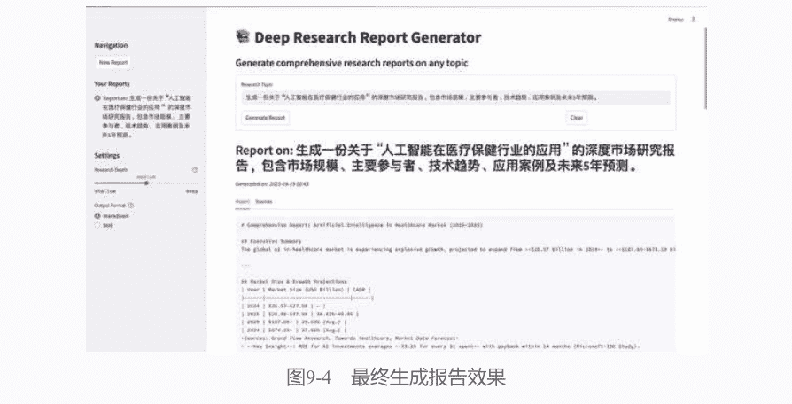

图9-4 最终生成报告效果

完整内容可在本书配套代码仓库本章对应目录的 output 文件夹中打开 “人工智能在医疗保健行业的应用：市场研究报告.md” 查看。

### 9.6.2 学术文献综述

研究人员常需要对某个细分领域做系统性的文献梳理，要求涵盖代表性论文、研究方法、核心发现与演进趋势。

落地做法是：把智能体配置为学术研究向，接入 arXiv、PubMed、Google Scholar 等学术库的 API，支持 APA、MLA 等引用格式的自动排版，并加入研究方法拆解与批判性评述能力。

示例指令是：生成一份关于量子计算在密码学中应用的学术综述，聚焦近五年的关键论文、方法论、主要结论和未来方向，引用采用 APA 格式。

实际表现来看，系统能自动检索并解析相关论文，提炼要点、识别研究脉络，最终生成带规范引用和参考文献的结构化综述。研究者可以更快把握领域现状，文献搜集与整理的时间被大幅压缩。

最终生成的报告效果如图9-5所示。

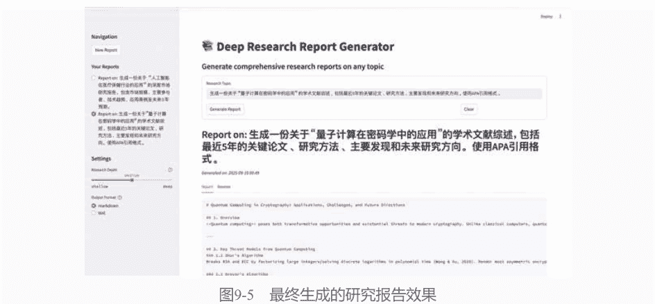

完整报告可在本书配套代码仓库本章对应目录的 output 文件夹中打开 “Quantum Computing Applications in Cryptography: A Contemporary Review (2019-2024).md” 查看。

### 9.6.3 竞争对手分析

企业在制定策略前，需要对竞争对手做全景式剖析，包括产品对比、市场打法、优劣势和潜在风险。

落地做法是：把智能体调成竞争分析专精，接入官网、新闻稿、财报、社交媒体等企业相关数据源，内置 SWOT 分析与竞争矩阵的自动生成能力，同时加入情感分析来判断市场对竞争方的评价倾向。

示例指令是：生成一份针对电动汽车市场特斯拉、比亚迪和大众的竞争对手分析报告，涵盖产品对比、市场份额、技术优势、商业模式和未来战略。

运行结果显示，系统能够自动收集并比对各家信息，归纳产品特性与市场策略差异，指出优劣点，最终输出包含 SWOT 与竞争矩阵的结构化分析。企业由此更清晰地认识竞争态势，从而制定更有针对性的策略。

浏览器操作过程示例截图如图9-6所示。


(a)

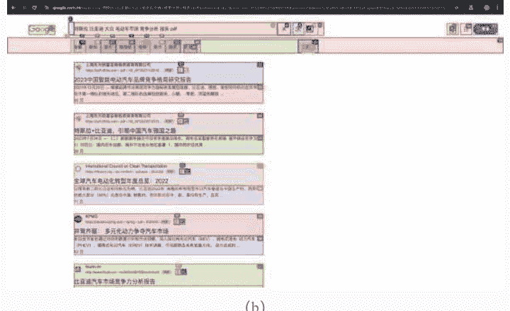

(b)


(c)

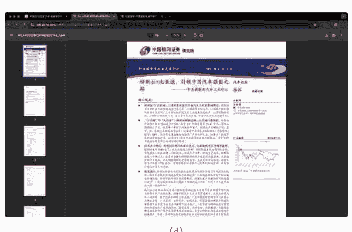

(d)

图9-6 浏览器操作过程示例截图

最终生成的报告效果如图9-7所示。

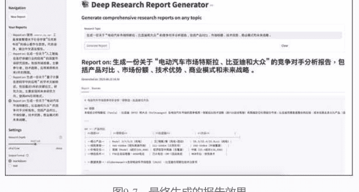

图9-7 最终生成的报告效果

完整内容可在本书配套代码仓库本章对应目录的 output 文件夹中打开 “电动汽车市场特斯拉、比亚迪和大众竞争对手分析报告.md” 查看。

## 小结

本章围绕基于 MCP 与 browser-use 构建深度研究报告生成智能体的全链路展开。我们先拆解了 MCP 的核心架构与 browser-use 工具的能力边界，在此基础上设计分层架构，实现从网络检索、内容抽取到报告生成的闭环，并用 Streamlit 搭出易用的交互界面。技术层面重点覆盖了 MCP Server 的开发、浏览器自动化控制以及 LangGraph 工作流编排，同时配套了容器化部署与运维监控方案。

从发展视角看，这类智能体充分体现了 AI 代理的潜力。未来会向多模态理解、垂直领域深化、自主研究代理等方向演进，但也必须正视信息真实性、偏见控制与隐私保护等伦理问题。随着迭代推进，这类系统将为用户提供更智能、更高效的研究支持，释放 AI 在知识获取与分析方面的价值。

学完本章，读者既能掌握构建同类智能体的技术方法，也能认清该方向的广阔前景与演进潜力。随着 AI 持续进步，基于 MCP 与 browser-use 的应用会愈发智能，提供更高质量、更个性化的研究服务。

深度研究报告生成智能体是 AI 代理的典型形态，它展示了前沿技术与真实需求结合后产生的应用价值。通过持续探索与创新，该领域会不断释放 AI 潜能，为用户打造更智能、更高效的研究工具。

配套资源验证码251686