# 纳米晶复合NiZn功率铁氧体：低温烧结与高频性能突破的关键路径

## 摘要

伴随微电子器件向微型化、低功耗演进，作为现代信息技术核心基石的磁电子元件，亟需兼具高磁导率、高频宽频及低损耗的特性。尖晶石结构（AB₂O₄）的NiZn铁氧体，凭借其多元复合金属氧化物烧结体的身份，长期占据高频磁电子应用的核心地位。然而，频率损耗问题始终是制约其性能提升的瓶颈。面对电子信息产业对小型化、集成化、模块化的极致追求，材料端不仅要在磁导率与频带宽度上突围，更迫切要求制备工艺实现低温烧结。因此，研发集高磁导率、高饱和磁化强度、高截止频率及低温烧结于一身的NiZn铁氧体，对推动微电子制造跨越式发展具有战略意义。

本文将纳米技术引入制备全链路，从源头原料合成切入，系统揭示了纳米晶NiZn铁氧体的成形机理、烧结动力学及结构性能关联；深度解析了纳米晶复合体系的高频磁响应与损耗本质，为微电子器件的小型化、集成化、一体化及高频低损功率器件制造奠定了坚实理论与工艺基础。全文共七章，逻辑递进：

**第一章** 梳理铁氧体磁性材料前沿进展，聚焦纳米技术在磁性材料中的赋能价值，剖析现有制备工艺短板，创新性提出**凝胶自燃法**制备铁氧体纳米晶与前驱体的新路径。

**第二章** 深度解构凝胶自燃法合成纳米晶NiZn铁氧体的全过程，量化制备参数对晶相生成的影响，完成结构与磁性表征，提炼出该合成路线的物理化学机制。

**第三、四章** 确立“纳米晶再复合”策略——即纳米晶直造粒、成型、烧结制备多晶块体。考察溶胶掺杂制备掺杂纳米晶后经烧结致密化的工艺流程；系统表征不同掺杂体系、浓度及烧结温度下的显微组织；引入**球体模型**阐释烧结致密化机理；重点解析烧结制度、掺杂元素对微观结构的调控规律，建立微观结构与高频损耗、磁性能的定量关联。

**第五章** 探索纳米-微米复合烧结工艺，揭示低温烧结后的高频损耗谱与磁谱特性，为利用可控纳米晶尺寸设计制备特种功能复合材料、复合结构材料提供了方法论支撑。

**第六章** 开辟**高能球磨法**制备纳米晶NiZn铁氧体的新技术路线，详述机械化学合成过程与成核长大机制，评估合成效能，验证其作为制备纳米晶铁氧体的有效替代方案。

**第七章** 总结全文创新点，展望未来研究方向。

综上，本工作凭借纳米晶复合技术攻克了NiZn铁氧体低温烧结难题，破解了制备环节多项关键技术壁垒，获授权国家发明专利，形成自主知识产权成果。经权威专家鉴定，材料综合性能居国内领先、达国际同类先进水平。所创立的新工艺、新方法，不仅适用于铁氧体量产，更可横向推广至精细陶瓷等相关领域。

**关键词**：NiZn铁氧体；纳米晶；凝胶自燃法；高频磁特性；纳米-微米复合

---

# Abstract

Driven by the miniaturization and low-power trends in microelectronics, magneto-electronic devices—widely deployed in modern information technology—demand magnetic materials featuring high permeability, high operating frequency, broad bandwidth, and low loss. NiZn ferrite with a spinel structure (AB₂O₄), a poly-metallic oxide sintered body, remains indispensable in high-frequency magneto-electronics. Frequency-dependent loss has persistently been the central research focus. As the electronics industry pushes for greater miniaturization, integration, and modularization, requirements extend beyond high permeability and wide frequency response to encompass manufacturing processes and device integration, particularly **low-temperature co-firing technology**. Developing NiZn ferrite with high permeability, high saturation magnetization, high cut-off frequency, and low sintering temperature is therefore pivotal for advancing microelectronics manufacturing.

This thesis introduces nanotechnology into the NiZn ferrite fabrication chain. Starting from raw material synthesis, it systematically investigates the formation mechanism of nanocrystalline NiZn ferrite, the sintering mechanism, microstructure, and magnetic properties of nanocrystalline-built ferrites, as well as their high-frequency magnetic spectra and loss characteristics. These findings provide fundamental data for manufacturing miniaturized, integrated, high-frequency, low-loss microelectronic devices. The thesis comprises seven chapters:

**Chapter 1** reviews the state-of-the-art in ferrite magnetic materials, focusing on nanotechnology applications, analyzes current fabrication processes, and proposes a novel **gel auto-combustion process** for preparing ferrite nanocrystallites and precursors to overcome limitations of traditional methods.

**Chapter 2** systematically details the nanocrystalline NiZn ferrite synthesis via gel auto-combustion, the influence of process parameters, structural and magnetic characterizations, and the underlying physical mechanism.

**Chapters 3 & 4** propose a **nanocrystalline re-composite method**: direct granulation, forming, and sintering of nanocrystalline ferrite into polycrystalline bulk. It investigates doping during the sol stage to create doped nanocrystallites, followed by consolidation. Microstructures of doped/nanocrystalline-synthesized NiZn ferrites under varied sintering temperatures are analyzed; a **sphere model** explains the sintering mechanism. The focus lies on the effects of sintering temperature, dopant type, and concentration on microstructure, and the microstructure-property-loss relationship at high frequencies.

**Chapter 5** explores the **nano-micro composite sintering** process, characterizing high-frequency loss and magnetic spectra of low-temperature sintered composites. This lays the groundwork for designing novel functional and structural composites via controlled nanocrystallite sizing.

**Chapter 6** presents a novel **high-energy ball milling** route for nanocrystalline NiZn ferrite. The mechanochemical synthesis process, formation mechanism, and synthesis efficiency are evaluated, validating ball milling as a viable alternative preparation method.

**Chapter 7** summarizes the work and discusses future perspectives.

Overall, this work successfully achieves low-temperature sintering of NiZn ferrite via nanocrystalline composite technology, resolving key manufacturing bottlenecks. It yields nationally patented, independent IP innovations, with comprehensive performance rated domestically leading and internationally advanced. The novel methods and processes developed are applicable not only to ferrite production but also extendable to related fine ceramics fabrication.

**Keywords**: NiZn ferrite, nano-crystalline, gel-auto-combustion method, high frequency properties, nano-micro crystalline synthesis

---

# 第一章 铁氧体材料：从古老磁石到纳米前沿的演进与突围

## 1.1 综述

磁性材料，是一门跨越时空的“古老而年轻”学科。其历史厚重，可溯源至我国先民4世纪对磁性的认知与指南针的发明；其现代工业史却短促有力，始于20世纪初人类合成首块软磁铁氧体，不足百年光景。近来，软磁材料领域新发现频出，在信息技术与微电子产业中持续拓展新应用版图。磁性元器件承担着信息转换、传递、处理、能量存储与节能等核心功能，广泛渗透于能源、电信、自动控制、通讯、家电、生物医疗、轻工、选矿、地物探测、军工等国民经济支柱领域，已成为信息技术体系中不可或缺的“隐形基石”。当下，几乎所有电子终端皆离不开磁性材料，器件性能与材料本质紧密耦合。在电子产品极速迭代的浪潮中，新技术、新工艺、新应用层出不穷，驱动磁性材料实现跨越式发展。其演进轨迹清晰可见：晶态 → 非晶态 → 纳米微晶态 → 纳米微粒与有序阵列 → 纳米结构材料。纳米磁性材料在信息技术中的战略地位日益凸显，同时纳米技术对传统磁性材料生产工艺的改造升级，依然蕴含巨大潜能。

纳米技术诞生于20世纪80末90初，根植于现代物理与前沿工程的交叉融合，是基础研究与应用探索紧密耦合的新型科技体系。被公认为21世纪最具潜力的科研高地，早已成为全球科技竞争的核心赛道。

纳米技术聚焦**纳米尺度（0.1~100 nm）**，研究物质（原子、分子）的特性与相互作用，并利用这些特性实现功能制造的多学科渗透型高新技术。它将人类认知与改造物质世界的手段延伸至原子分子层面，终极目标是利用纳米尺度独有效应，制造特定功能产品，实现生产方式范式跃迁，重塑人类思维与生活方式。

得益于**小尺寸效应、表面效应、量子尺寸效应、宏观量子隧道效应**等独特物理机制，纳米微粒在磁、光、电、敏感等维度展现出块体材料无法比拟的异常特性。这使其在磁性材料、电子材料、光学材料、高致密烧结、催化、传感、陶瓷增韧等领域展现出广阔应用前景[1-2]。

# 磁性材料：国家实力的新标尺与中国产业的突围路径

在工业文明的坐标系里，衡量国力的标尺正在发生质变。曾几何时，钢铁产量是工业底色的代名词；而今，在信息时代的浪潮中，磁性材料的产量与人均消耗量，已成为丈量一个国家工业水准、甚至国民生活质量的关键指标。

回溯1990年，中国人均磁性材料消耗仅0.18美元，甚至不及印度的七成。短短十年，尽管国内消费占比从85%回落至60%，但人均消耗却跃升至0.74美元，实现四倍飞跃，反超印度三倍。然而，放眼美、日、欧发达阵营，我们仍只及其人均水平的六分之一。追赶的脚步虽急，但路途依然漫长。

全球市场的蛋糕在做大。1999年，世界磁性材料应用市场规模达300亿美元，其中软磁材料占比超四成（124.5亿美元），磁记录材料与硬磁材料分列二、三位。若按年增10%测算，2005年市场将突破530亿美元大关。

产业版图正在经历深度重构，世界磁性材料制造重心加速向中国及第三世界倾斜。日本TDK、日立金属、住友特殊金属，韩国梨树、三和，欧美飞利浦、VAC、EPCOS、Arnold、Magnequench等巨头，纷纷在华落子。日本统计数据揭示了这一趋势的烈度：软磁铁氧体产量从1997年的4.4万吨骤降至1.1万吨；铸造磁体、铁氧体永磁、稀土磁体产量均大幅缩水。美国磁体企业数量更是腰斩再腰斩，铁氧体永磁厂商从11家锐减至5家，稀土永磁仅剩3家。

跨入21世纪，中国磁性材料产业借势腾飞。全球产能转移带来技术溢出，年均增速超20%。2003年，行业销售收入突破150亿大关，达165亿元人民币，出口创汇4亿美元。细分领域看，软磁材料产量近10万吨、产值66.57亿；永磁铁氧体19万吨、52.66亿；稀土永磁9440吨、41.73亿；铸造磁体3000吨、4.7亿。数字虽亮眼，但深层隐忧不容忽视。

## 1.1.1 规模与效益的“剪刀差”

当前，我国磁性材料工业已具规模，中低端产品占据国际市场份额，但高端领域话语权缺失。行业整体面临“四低一小”困境：管理水平低、制造工艺落后、产品质量差、档次低、规模经济不足。2003年，国内龙头企业年销售额仅2.2亿美元，多数在3-4亿美元徘徊；反观厦门TDK一家独大达24亿美元，日本TDK总部更以85亿美元（约697亿人民币）的营收，相当于中国全行业总产值的5倍。差距，不仅在量级，更在质态。

## 1.1.2 困守低端的“薄利陷阱”

国内产品高度集中于低附加值区间，价格战红海厮杀，利润微薄，难以支撑国际竞争。永磁铁氧体多为Y30以下扬声器磁体，电机磁瓦虽达Y30H-1级但批量稳定性不足；软磁铁氧体新品扎堆消费电子，工业级磁芯稀缺。量产功率铁氧体仅对标日系PC30级，高导率材料μ值徘徊6000左右，仅少数企业能小批量攻克PC40及μ>10000产品。钕铁硼常规牌号集中N35，N40以上及高矫顽力牌号（N38H、N32SH）产能稀缺，而国际前沿已推进至N50、48H。国际市场上，30%的高端产品贡献70%销售额，而国产产品价格普遍低于国际均价50%以上，被锁定在价值链底端。

## 1.1.3 装备短板与创新破局

专用设备销售额虽达1.43亿元，可供成套产线，但面对激烈竞争与成本倒逼，必须向高自动化、低能耗、高效率转型，以消除人为波动、保障一致性。同时，自主知识产权与专利布局刻不容缓。破局之道在于：加速规模经济建设，推动强强联合，聚焦自主创新与高附加值产品，以“优质优价”姿态参与全球博弈。

## 1.2 纳米技术：重塑磁性材料性能边界

纳米技术在磁性材料领域的渗透，主要聚焦于纳米合成合金制备，涵盖软硬磁复相合金、非晶/纳米晶合金带及薄膜、金属-非金属复合软磁材料三大主线。

### 1.2.1 软硬磁复相合金：交换弹簧效应的利用

通过纳米尺度调控，将α-Fe、Fe₃B等软磁相与Nd₂Fe₁₄B等硬磁相复合析出，构建“交换弹簧磁体”。其核心机制在于软硬磁相间的交换耦合：软磁相在逆磁场下磁化反转，但撤场后在硬磁相“拉扯”下弹性恢复，从而同时实现高剩磁（Br）与高磁能积。以Fe₇₀Co₃₀为软磁相的取向纳米复合体，理论磁能积有望突破1 MJ/m³。当前研究聚焦微观组织表征、微磁学建模及Cr、Cu、Nb等元素掺杂优化，薄膜/多层膜制备亦取得进展，Fe-FePt体系磁能积已超400 kJ/m³。

在Nd₂Fe₁₄B之后，Sm₂Fe₁₇Nₓ（Js=1.54 T, Hₐ=20.8 MA/m）因高磁性受关注，但受限于600°C以上分解，主攻粘结磁体粉末方向。还原法（RD）制粉已实现批量化，制得磁能积100-160 kJ/m³的注射成型粉。急冷法中，通过Zr稳定TbCu₇相或构筑α-Fe/TbCu₇纳米复合结构，均获优异磁性能。

### 1.2.2 非晶与纳米晶合金薄带/薄膜：软磁性能的极致追求

非晶态消除磁晶各向异性，配合零磁致伸缩成分等温退火，催生出Co基液态淬火薄带、高饱和低损耗薄带、Co-Fe-B及C(Zr、Hf、Nb、Ti、Ta)薄膜等材料。纳米晶材料则由非晶态热处理析出10-20 nm晶粒（如FeSiBNbCu薄带），后续开发出Fe-Hf-C薄膜等。纳米晶粒间的交换相互作用平均化了各向异性，大幅抑制磁致伸缩，铸就卓越软磁特性。

近年，精密电镀高饱和磁通密度CoNiFe薄膜崭露头角。利用磁共析细化晶粒降低矫顽力，实现B=1.9-2.1 T, Hc=1.2 Oe, λs=1.8×10⁻⁶的优异指标，正向复合磁头、超微型磁头等下一代磁头材料迈进。

### 1.2.3 金属-非金属复合软磁材料：高频低损的破局者

为抑制金属磁芯涡流损耗，引入SiO₂、Al₂O₃等绝缘基体析出Co、Fe纳米磁性相，兼具软磁性与高电阻率（数十倍于传统金属）。软磁机理与纳米晶类似，但高频特性远超铁氧体。早期聚焦Co(-Fe)-Al-O、Fe-(B,Si,Al,Hf,Zr,M)-(O,N)膜系；近期Fe-Mg-Ag-O薄膜在200 MHz下磁导率近3000，极具潜力。粒子间隧道效应引发的磁阻现象，更开辟了磁传感新维度。制备以溅射法为主，亦可采用共沉积法。未来可望应用于超高频线圈、超高密度磁记录磁头。

此外，Fe₃O₄及Co、Fe、Ni磁性纳米粒子在生物医药（药物载体、靶向给药）展现广阔前景，但铁氧体纳米应用仍处起步。

磁性材料品类繁多、功能各异。在功率转换系统中，磁性元件承担**功率处理**与**信号处理**双重使命：
1.  **功率电感器**：微观结构中承担能量存储与传递，配合PWM技术，在充放电间隔实现电-磁-电循环转换，通过已知能量关系精准调控。
2.  **高频功率变压器**：执行电压/电流变换、电隔离、电位转移、浮动驱动、电流传感等功能，核心特征均与匝比(Np/Ns)强相关。

微电子技术驱动电子设备轻薄化，电子变压器被迫向小型、轻量、高效、表面贴装（SMT）演进。开关电源自70年代将频率从50 Hz推至20 kHz，体积缩减3-5倍、重量减轻3倍；电子式霓虹灯变压器体积减半、重量降4倍，且响应绿色节能。随着高频低损软磁铁氧体问世，开关频率进军10 MHz，变压器体积重量将进一步压缩。**高频化，是电子变压器小型化、轻量化的必由之路。**

## 1.3 铁氧体制备工艺：从传统陶瓷向精准化学跨越

高频应用领域主流磁性材料非铁氧体莫属。为满足“轻、薄、短、小”及与集成电路匹配的严苛要求，传统陶瓷工艺已难支撑高性能需求，工艺变革势在必行。新工艺核心目标直指两点：一是保障粉料理化性能，摒弃耗时耗能的球磨环节；二是掌控成型烧结微观结构，实现低温烧结，与高温烧结的传统路径彻底决裂。

纳米粉体制备路径大致划分为液相法、固相法、气相法三大流派（详见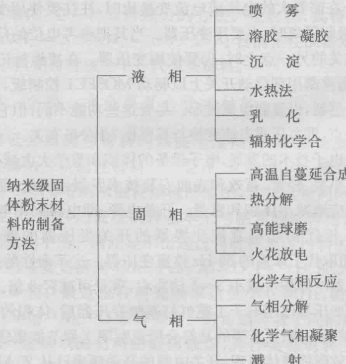图示）。

理想粉料需满足六大“黄金标准”[20]：精准化学计量比、极高纯度、成分均匀分布（杜绝杂质偏聚）、相组成稳定（烧结无不利相变）、粒度细且分布窄（无团聚、具备特定比表面积）、良好流动性与堆积特性。传统工艺难以兼得：过细易团聚，高温煅烧致晶粒粗大分布不均，倒逼化学制粉工艺革新。

### 化学共沉淀法：湿法制粉的主力军

最早由法Pechiney公司用于BaTiO₃[21]，后推广至ZnO[22]及各类氧化物[23-26]。核心流程：多元阳离子盐溶液中加入沉淀剂（OH⁻、CO₃²⁻、C₂O₄²⁻、SO₄²⁻等），控温水解析出氢氧化物/碳酸盐/草酸盐沉淀，经洗涤、热分解/脱水、煅烧得氧化物粉末。

全程各环节（反应、晶长、洗涤、分散、干燥、煅烧）均影响颗粒生长。关键在于**分离成核与生长过程**，使晶核同步长大、抑制二次成核。反应物浓度与pH值是主控参数。优势显著：分子/原子级混合保证均匀纯度，经充分洗涤去除杂质离子。痛点在于：多元金属沉淀pH窗口差异导致过程不均，控制不当易破坏原子级均匀性，引入碳酸盐/草酸盐杂相[27]。

### 溶胶-凝胶法：分子级混合的极致

源于胶体溶胶-凝胶工艺[28-29]。流程：溶液/溶胶态均匀混合 → 缩聚成凝胶 → 干燥/研磨/煅烧 → 纳米氧化物粉末。核心优势：**组分均匀、颗粒分散**。

按凝胶形成机制分三类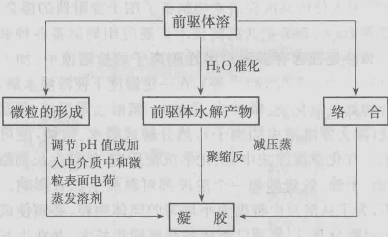：
1.  **传统胶体法**：控制沉淀防胶体团聚。曾用于核燃料球形粉末，但干燥煅烧仍难免团聚[30]。
2.  **无机聚合物型/金属醇盐法**：80年代主流。利用金属醇盐 M(OR)z 水解聚合生成无机高聚体（颗粒2-5 nm）。有机醇介质表张低、少氢键，团聚力弱。水解缩聚反应受水量、pH、温度多因子影响复杂[31-40]：低pH凝胶化后煅烧，高pH直接水解成核。分子级混合赋予极佳化学均匀性，广泛用于纳米氧化物制备[41-45]。
    *痛点*：醇盐贵、操作繁、<4价金属醇盐溶解性差，制备铁氧体受限。
3.  **络合物型**：引入螯合剂规避醇盐短板。
    *   **Pechini法**[46]：金属离子与α-羟基羧酸/乙醇酸螯合，再与多官能醇酯化聚酯成凝胶。优势：适配复杂成分、分子级均匀、化学计量可控、低温煅烧[47-50]。
    *   **柠檬酸盐凝胶法**（Marcilly等，1970[51]）：硝酸盐溶液+柠檬酸络合→可溶性络合物→蒸发成凝胶→热解得粉体。与Pechini法同享均匀/计量优势，且**原料廉价（无机盐）、工艺简便、易去硝酸根、高纯度**，克服醇盐法弊端，备受青睐[52-54]。
    *   **聚丙烯酸(PAA)法**：替代柠檬酸。分子量2000时活性位达28个（柠檬酸仅4），高官能度利于构建交联网络，金属离子均匀分布于网络中[55]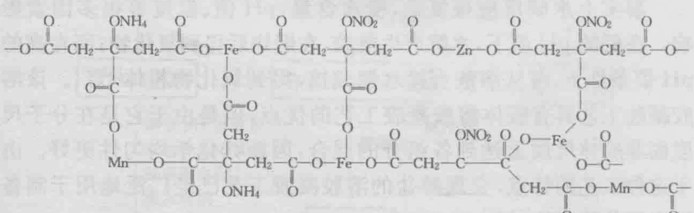。

工艺革新的每一步，都在为磁性材料的高性能化、集成化、低成本化铺路。这不仅是粉体制备的进化，更是中国磁性材料产业向价值链高端攀登的基石。

# 纳米铁氧体粉体制备技术全景扫描与“凝胶自燃法”破局之路

## 主流纳米粉体合成路线深度解析

在纳米氧化物粉体的制备版图中，**硝酸盐-柠檬酸溶胶-凝胶法**凭借其通用性脱颖而出。它摒弃了部分醇盐难溶的短板，改用全系金属硝酸盐与柠檬酸按配比混合，借助氨水或乙二胺将pH精准锁定在6～7区间，经脱水、低温烧结即可直接收获纳米晶氧化物，工艺流程显著缩短[56-60]。

**溶剂热法**则是另一条硬核赛道。其核心在于利用高温高压下溶剂（水、苯等）的特殊物化性质驱动反应。以**水热法**为例，它巧妙利用氢氧化物在超临界水中（573K、100 MPa）溶解度高于对应氧化物的特性，实现溶解-重结晶转化。这并非新技艺，Morey早在1953年便已验证其合成矿物的可行性[61]。近年它备受青睐，关键在于**“省去高温煅烧，直击低温成氧”**，从源头规避了溶胶-凝胶法易产生硬团聚的顽疾[62-66]。不过，水热体系涉及相平衡、溶解度-温度关系、反应热力学等复杂耦合，常需引入助熔盐、酸碱添加剂助推。得益于水热条件下水溶液粘度骤降两个数量级，扩散加速、反应提速[67-68]。关于成核机理，**“负离子配位生长基元模型”**最具说服力：溶解种群自组装成几何构型确定的“生长基元”，多基元动态共存竞争，最稳定者主导晶型走向。尽管技术日趋成熟、装备升级，但高昂的生产成本与常温高压强制水解法工艺控制的棘手性，仍是横亘在规模化应用前的门槛[69-71]。

**非水液相反应**拓展了溶剂边界——惰性溶剂或反应型溶剂均可入局，成功实践于氮化铝[72]、过渡金属二硫属化物[73]及金属二硼化物[73-77]制备。但液相法绕不开**“团聚魔咒”**：配液期、脱水干燥期、煅烧期全程高风险。溶剂末端蒸发时表面张力拉扯颗粒贴合，残水氢键桥接、盐类杂质“盐桥”胶结，往往形成不可逆的硬团聚。虽历经大量机理攻关与对策研究，尚未根治[74-77]。

**气相反应法**聚焦气态前驱体转化，按加热手段细分为激光[78-79]、等离子体[80-81]、火焰传输[82-83]等流派，本质皆为气相物理/化学转化后冷凝长大成粒。惰性气保护下快速淬火收集的**化学气相沉积（CVD）**虽路径直接，却难逃产物形态失控、易团聚的宿命。1994年Chang团队创立**化学气相凝聚法（CVC）**，以高纯惰性气载高温低压（1100～1400℃，100～1000 Pa）裂解金属有机前驱体，液氮衬底捕集纳米簇团，实现高产出、窄分布，显著提升了气相法工艺稳健度[84-86]。

**自蔓延高温合成（SHS）**是近三十年异军突起的“借力打力”大招[87-88]：点燃引燃剂（1500～3000℃）后，反应自热自持，无需外部能量维持。以NiZn铁氧体为例，前处理（干燥-破碎-分级-混配-挤压）后燃烧合成，后处理（破碎-研磨-分级）成品。其杀手锏在于：**极简工艺、极低能耗、极高纯度、极快冷却捕获亚稳相**。已成功量产Mn-Zn、NiZn、Mg-Mn、Ba、Sr系高性能铁氧体，被公认为极具工业化前景的绿色制造路线。

**高能球磨法（机械化学/机械合金化）**则走“以力驱化”非常规路径[89]。球磨介质剧烈撞击、剪切、搅拌，将粉体打入远离平衡态的纳米领域，解锁常规路线难达的特殊组织结构，拓展性能边界。微观上，循环剪切变形驱动晶格缺陷激增、大角度晶界重组，晶粒细化至纳米级；单组元系为纯结构演变，多组元系伴随扩散与固相反应生成合金/氧化物相[90-95]。虽存磨介污染、气氛污染、团聚、细粉渗漏等痛点，但攻克高熔点金属/合金/金属间化合物/过饱和固溶体/非晶准晶纳米材料制备的独门绝技，奠定了其不可替代的战略地位。

此外，**乳胶法**（脱水凝胶油包水体系）[96-101]、**冷冻干燥法**（冰升华锁定离子均匀性）[102-107]、**喷雾干燥法**（工业级雾化干燥成粒) [108-111] 等辅助技术，各有千秋，共同丰富了纳米粉体制备工具箱。

---

## 痛点倒逼创新：为何我们选择“凝胶自燃法”？

纵览上述路线，虽均可制备纳米铁氧体，但**短板毕露**：
*   化学共沉淀：繁琐水洗、干燥、高温后处理三座大山；
*   金属醇盐溶胶-凝胶：部分铁氧体缺配套醇盐，成本高企；
*   柠檬酸铁路线：原料溶解难题卡脖子；
*   溶剂热法：高温高压装备投入大、运维贵；
*   气相法：直接成铁氧体纳米粒子难度大；
*   SHS法：后处理破碎研磨分级仍不可省；
*   高能球磨：粒度分布不均、工艺污染风险高。

**破局思路：** 将硝酸盐-柠檬酸溶胶-凝胶法的“成胶能力”与自蔓延燃烧的“自热合成”嫁接——**凝胶自燃法**。先制备均一前驱体凝胶，再直接引燃或低温煅烧，一步直达纳米NiZn铁氧体。实践证实：原料易得（金属硝酸盐全溶）、温度低、粒度均、不团聚、可控性强，兼具高效、实用、经济三重优势，完美契合高性能铁氧体对优质粉体的苛刻指标。

---

# 1.4 课题缘起：高导、高频、低损耗、低温烧结的四重奏

烧结NiZn铁氧体，作为多元复合金属氧化物陶瓷（黑色陶瓷），是高频磁电子领域的基石。然而，**频率损耗**始终是其核心痛点——如何在特定工频下压低损耗、拓展高频频宽，是永恒课题。当下，电子信息产业向**小型化、集成化、模块化**狂奔，除磁导率、饱和磁感、截止频率、频宽“四高”指标外，**低温烧结**成了工艺端刚需。若能开发出磁导率更高、频率特性更优、饱和磁感显著跃升的NiZn铁氧体，将直接赋能功率电感大功率化、低成本化。

本论文锚定“高导、高频、低损耗NiZn铁氧体电子信息应用”，以**纳米晶制备技术为矛、复合多晶烧结工艺为盾**，创造性提出“纳米晶原料烧结复合多晶铁氧体”新范式，系统攻关制备-微观-烧结-磁性全链条关联规律，核心工作聚焦四大维度：

1.  **纳米源头攻关**：深研凝胶自燃法合成机理，解码纳米NiZn铁氧体结构-磁性内核。
2.  **烧结微观解构**：揭示纳米复合烧结温度-微观结构耦合律，阐明烧结机理，攻克频谱特性与损耗控制。
3.  **纳米-微米复合工艺突围**：探索Bi掺杂低温烧结复合路径，解析不同掺杂策略对抗低温烧结性能损耗。
4.  **球磨合成互补验证**：考察Fe₃O₄+NiO+ZnO体系高能球磨合成纳米NiZn铁氧体结构磁性，形成技术互证。

---

# 第二章 凝胶自燃法制备纳米NiZn铁氧体：结构与磁性深度解析

## 2.1 引言：从“黑色陶瓷”传统工艺到分子级设计的范式跃迁

铁氧体制备沿袭陶瓷工艺，素称“黑色陶瓷”。原料活性决定上限，传统深度球磨虽提活性，却引入杂质、降性能。经典四步法（制粉-预烧-成型-烧结）含双重球磨，外源污染主战场。要得优质粉料，**必须跳出传统工艺桎梏，实施分子级前驱体设计**。

前述化学制粉百花齐放，却各有短板：或需高温煅烧二次粉碎，或溶剂剥离伴随氢键/盐桥不可逆团聚，或依赖高压昂贵装备，或工艺控制极其繁复。经系统筛选比对，**硝酸盐-柠檬酸溶胶-凝胶+自燃法（凝胶自燃法）**脱颖而出：金属硝酸盐普适溶解，凝胶自燃低温直接成晶，产出粒度均一、无团聚、尺寸可控的纳米优质粉体，完美适配高性能铁氧体严苛入料标准。

本章聚焦凝胶自燃法制备NiZn铁氧体纳米晶全工艺链：溶胶-凝胶转化参数窗口、合成气氛调控、反应过程机制解析，至纳米晶结构磁性全表征。

## 2.2 样品制备与实验体系构建

### 2.2.1 原料基因库
主料选用化学纯（CP）级水合硝酸盐与柠檬酸，纯度均≥98%，详见表2.1。

| 试剂名称 | 分子式 | 分子量 (g/mol) | 纯度 (%) |
| :--- | :--- | :--- | :--- |
| 硝酸铁 | Fe(NO₃)₃·9H₂O | 404.00 | 98 |
| 硝酸镍 | Ni(NO₃)₂·6H₂O | 290.80 | 98 |
| 硝酸锌 | Zn(NO₃)₂·6H₂O | 297.49 | 99 |
| 柠檬酸 | C₆H₈O₇·H₂O | 210.14 | 99.5 |
| 硝酸铜 | Cu(NO₃)₂·3H₂O | 241.60 | 99.5 |

### 2.2.2 核心装备矩阵
覆盖热处理、结构表征、磁性测试、形貌观测、成型全链条：
*   **热场控制**：501超级恒温器、CL-80高温氧化炉
*   **精密配料**：YP型电子天平(0.1g/1200g)、FA1004分析天平(0.1mg/100g，微量掺杂专用)
*   **搅拌混合**：JB50电子调速电动搅拌机(60~1200 r/min)
*   **磁性表征**：EG&G 155振动样品磁强计(VSM)、PPMS-9物性测量系统
*   **微观结构**：Hitachi S-570 SEM、H-800 TEM、D/max-2000 XRD (Cu-Kα)
*   **成型设备**：FY-10粉末压片机

### 2.2.3 原料准入与配料严选
异批次原料（产地/厂家变更）必经化学成分、含水量、粒度“三项全检”，是配方落地的前提。配料环节，常规料用YP天平(0.1g)，微量掺杂元素切换FA1004天平(0.1mg)，精度直达毫克级，保障配方零偏差。

### 2.2.4 纳米NiZn铁氧体粉体制备全流程复盘（对标图2.1工艺路线）

**阶段一：前驱体溶胶构建**
1.  去离子水700 mL入烧杯，称取柠檬酸溶解（无色溶液，pH 1~2）。
2.  分别称取硝酸铁(浅紫)、硝酸镍(绿)、硝酸锌(白)。
3.  柠檬酸溶液加热至45℃，依次溶解三硝酸盐，得棕黄色透明混合溶。
4.  **关键配比**：柠檬酸投料量 = Σ(金属离子物质的量) + Σ(硝酸根离子物质的量)。此为全螯合成胶临界最小量，不足则难成胶。

**阶段二：螯合成胶与凝胶化**
1.  恒温水浴(40℃)预热10 min，固定搅拌。
2.  滴加乙二胺调pH至6左右，溶液色变：黄棕→墨绿（标志螯合完成）。
3.  三颈烧瓶转入恒温器，50℃恒温搅拌30 min，pH微调至6~7。
4.  电炉蒸发浓缩至胶状即停火，自然冷却得蓝黑色玻璃态凝胶。

**阶段三：自燃/低温煅烧成晶**
1.  凝胶入高温炉，升温至500℃，保温15 min挥发杂质。
2.  凝胶瞬间红褐化，直接得纳米晶NiZn铁氧体粉末。
3.  粉末压制成型，烧结固相反应，终得致密NiZn纳米铁氧体陶瓷。

### 2.2.5 多维表征手段矩阵
*   **热分析**：NETZSCH STA 409 PG/PC，20~750℃，10 K/min，氮气/空气(20 mL/min)双气氛TG-DSC同步在线。
*   **形貌观测**：Hitachi S-570 SEM / H-800 TEM。
*   **晶相结构**：D/max-2000 XRD (Cu-Kα)，不同气氛产物对比。
*   **磁性指标**：EG&G 155 VSM，最大外场10 kOe，测饱和磁化强度、矫顽力等核心参数。

---

## 2.3 溶胶特性调控机理与动力学参数解析

### 2.3.1 溶胶pH值：凝胶性质的“总开关”

**光谱证据链（图2.2、表2.2）：** 乙二胺滴加过程中，溶胶可见光吸收峰随pH演变轨迹清晰可见：
*   **pH < 6.1 区**：吸收峰持续**蓝移**（短波向位移），强度渐弱。波长虽从559.8 nm增至569.1 nm，但未超越未加乙二胺基线(606.2 nm) —— 弱配位主导。
*   **pH 6.1 → 6.7 临界跃迁**：吸收峰**暴发式红移（紫移）**，波长猛跳至**757.7 nm** —— **强配位突现**，典型“紫移效应”标志。
*   **pH > 6.7 趋向**：配位强度回落，重归弱配位态。

**表2.2 关键光谱数据速览**

| 体系状态 | 未加乙二胺 | pH 3 | pH 4 | pH 5 | pH 6.1 | **pH 6.7** |
| :--- | :---: | :---: | :---: | :---: | :---: | :---: |
| **吸收峰 λ (nm)** | 606.2 | 559.8 | 561.3 | 564.5 | 569.1 | **757.7** |

**乙二胺双重功能机理揭秘：**
1.  **硝酸根“囚笼”效应**：与硝酸生成二硝酸化乙二胺，锁死硝酸根，阻断碱土金属以结晶硝酸盐形态析出，护卫凝胶均一性。
2.  **强双齿螯合“缝合针”**：与多金属离子形成高稳定螯合物，驱动交联反应，将分散的金属柠檬酸盐“缝合”成三维网络骨架。**紫移效应的物理本质，正是乙二胺介导的强配位交联网络构建瞬间。**

---

### pH值调控如何重塑凝胶微观拓扑与自燃特性

Yue课题组[113]曾实施一项系统性考察，聚焦溶胶酸碱度对终端凝胶形貌的定向调控效应。图 2.3 记录了他们借助氨水将pH梯度跨度设定于2至7、经135℃烘干后获取的干胶体扫描电镜微观影像。影像直观呈现：强酸域（pH 2、3）下胶体骨架致密紧实，孔隙结构几乎不可见；酸度递减至pH 4、5时，微观图景呈现离子簇团聚态势；当环境过渡至弱酸至中性区间（pH 6、7）时，胶体内部演化出立体网络花纹，伴随大量显著的大尺度孔洞生成。值得注意的是，这些孔洞并非结构缺陷，而在后续自燃进程中化身为气体传输通道，极大地推动了燃烧进程。更深层的机理在于，胶体自燃并不依赖外部氧气供给，其内部蕴含的硝酸根（NO₃⁻）担任氧化剂，羧基基团作为还原剂，二者在体系内自发完成氧化还原循环。

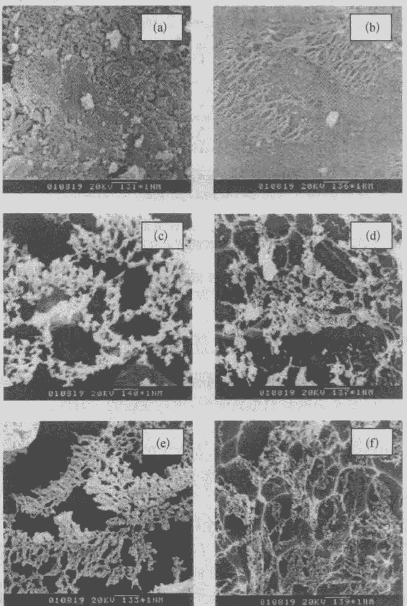

图 2.3 pH 值 2~7(对应照片 (a)~(f)) 干凝胶的 SEM 图像 (Zhenxing Yue 等[112], 2004)

### 2.3.2 惰性氮气保护下的热分解历程解析

样品在动态氮气流保护下的热重（TG）与差热重（DTG）轨迹分别载于图 2.4 与图 2.5。数据揭示：222℃以前，热重线呈现双阶段缓慢下降特征。其中，87.5℃至约195℃区间累计质量减损约9.82 wt%，归因于物理吸附水的脱附；随即195～201℃区间发生断崖式失重，幅度高达61 wt%，标志着络合型胶体主体分解反应的剧烈爆发。

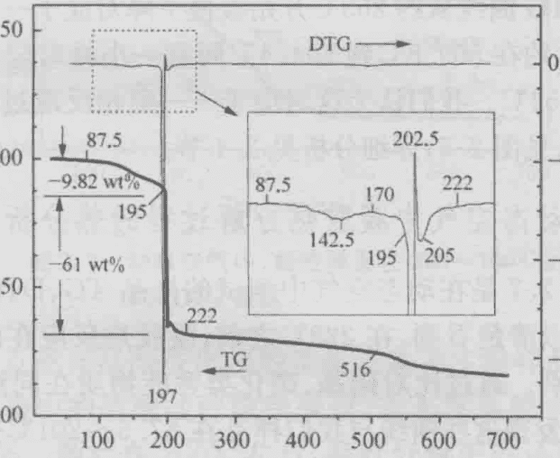

图 2.4 动态氮气中凝胶样品的 TG、DTG 曲线

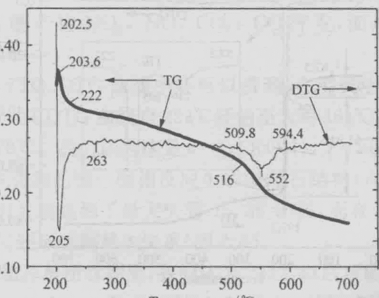

图 2.5 动态氮气中凝胶样品在 200~700°C 的 TG、DTG 曲线

差热重谱上，87.5～170℃呈现宽平的吸热峰，170℃后骤变陡峭，在195℃起始、197℃达峰、202.5℃终止，形成极其尖锐的放热峰，精准对应反应物急速分解瞬间。

202℃之后，热重线出现一个微小的“反常”增重峰（峰值约203.6℃），这一现象在氧化性气氛中消失，推测为反应中间产物发生的氧化行为。此后曲线延续双阶段缓慢下降趋势直至700℃。差热重曲线自263℃起缓降，对应222～516℃的缓慢失重平台；509.8℃至594.4℃间（峰温552℃）出现一小峰，判定为尖晶石相构建的固相反应特征（详见2.4节深度剖析）。

### 2.3.3 氧化性大气环境中的热分解特征对比

图 2.6、2.7 记录了动态空气中的测试结果。222℃前，两种气氛下的热响应高度重合。对比文献[118]中硝基/硝化类含能材料的热分析谱图，发现其在87.5～201℃区间的热重/差热重特征与本实验样品惊人相似。

结合胶体点燃实测现象及化学组成推断：硝酸盐-柠檬酸胶体首经脱水（失重9.82 wt%），随即在200℃左右触发核心氧化还原反应——柠檬酸根（还原剂）与硝酸根（氧化剂）剧烈反应[114]。大量N—O、N—N键断裂，含碳基团深度参与，伴随NO₂、NO、CO₂、CO等气态产物逸出，引发约61 wt%的断崖式质量减损。

图 2.7 进一步揭示：空气中222℃后样品持续缓慢失重，差热重曲线自222℃起升至约481℃形成一峰（峰温378℃），归因于α/γ-FeO(OH)脱水及多金属氧化物固-固反应生成尖晶石（AB₂O₄）。关键差异在于：空气中样品于481℃即达最大失重15.38 wt%，而氮气保护下700℃仍未达峰（见图 2.5）。

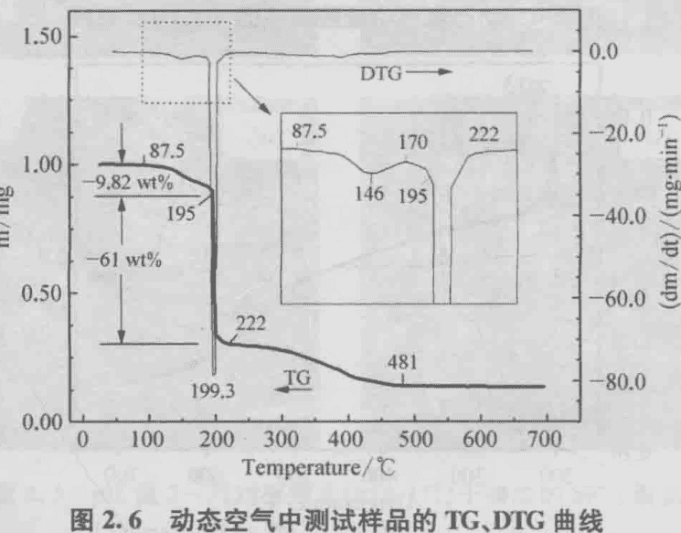

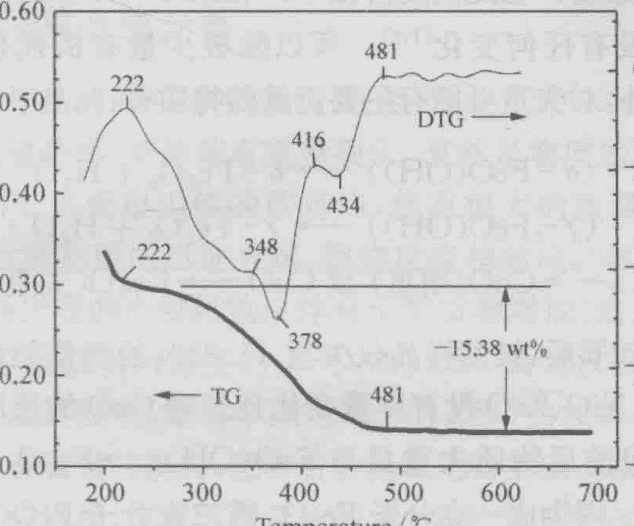

图 2.7 动态空气中，凝胶样品在 200～700℃ 的 TG、DTG 曲线

基于原料组成，222℃后残留相主要为FeO、Fe₂O₃、α/γ-FeO(OH)、NiO、ZnO及微量有机残渣。NiO、ZnO、α-Fe₂O₃热力学稳定，不贡献失重[115]。除微量有机物外，主导失重的候选反应为：

- 2·(α-FeO(OH)) → α-Fe₂O₃ + H₂O (2.1)
- 2·(γ-FeO(OH)) → γ-Fe₂O₃ + H₂O (2.2)
- Cu₂O ↔ CuO 互变（伴随增重/失重） (2.3)

实测222℃后仅失重15.38%。忽略NiO/ZnO惰性及CuO微量波动，失重核心锁定在FeO(OH)→Fe₂O₃脱羟基过程。粗略估算：生成1 mol Fe₂O₃需消耗2 mol FeO(OH)，理论失重比计算见式(2.4)。

```
1 - [Fe₂O₃ 分子量] / [2 · (FeO(OH)) 分子量 + 其他可挥发物质总分子量]
= 1 - 160 / (178 + X) = 15.38 wt%
(2.4)
```

式(2.4)显示，仅当设定“其他挥发组分”摩尔质量X=11时，理论值才吻合实测值。这意味着该类组分仅占反应体系总摩尔质量的4%！故判定：222℃左右硝化含能物质剧烈分解基本终结，后续失重主因即为FeO(OH)脱羟基生成水。残留相中大量FeO(OH)在有氧条件下脱水加速，无氧则显滞后。完整反应链总结为：干胶体 → 100℃脱吸附水/游离柠檬酸 → 200℃有机络合物聚合自燃 → 200~500℃ FeO(OH)脱水与纳米金属氧化物固相反应合成尖晶石型NiZn铁氧体。

### 2.3.4 综合热分析（DSC）多维解读

图 2.8 热流曲线提供能量视角佐证：氮气/空气中144.3℃均现吸热峰伴随失重，确证脱水分解；197℃处极尖锐放热峰伴随大幅失重，精准匹配硝基含能物质快速分解燃烧特征。氮气中217.8℃微小放热峰伴微量增重，暗示内部氧化副反应，空气中同温区无此信号。后续升温段，双气氛均现缓慢放热宽峰伴失重，指示尖晶石（AB₂O₄）固-固反应推进，氮气中反应迟缓、峰形单一；空气中反应剧烈，398～450℃形成双肩强放热峰伴快速失重，反映固相反应激烈、金属离子变价及尖晶石结构快速成型，Cu₂O→CuO氧化或叠加增强峰形。

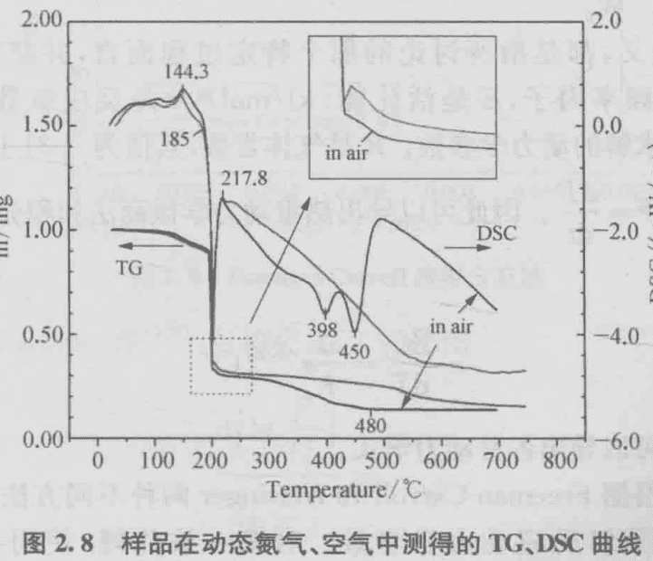

### 2.3.5 反应动力学参数的提取与物理意义界定

热分析动力学本质上是将阿累尼乌斯方程引入热分析物理量（质量、热量等）随温变化速率的解析，适用于化学反应及结晶、扩散等物理过程[116]。基础模型设定为固相物质A分解生成固相B和气相C（式2.5），反应速率遵循式(2.6)：-dC/dt = k·f(C)，k=A·exp(-E/RT)，简化机制函数f(C)=Cⁿ。其中C为剩余分数（C=W/W₀），A、E、n为待解频率因子、活化能、反应级数，R=8.31 J/(mol·K)，升温速率φ=dT/dt。推导得微分动力学基本方程(2.7)。

采用Freeman-Carroll法[117]与Kissinger法[118]双算法解析空气中首放热峰动力学参数。

**Freeman-Carroll法：** 作Δ(1/T)/Δlg w 与 Δlg(dw/dt)/Δlg w 关系图（图 2.9），拟合直线斜率-3008.6，截距3.53，反解得E=57.6 kJ/mol，n=3.53。

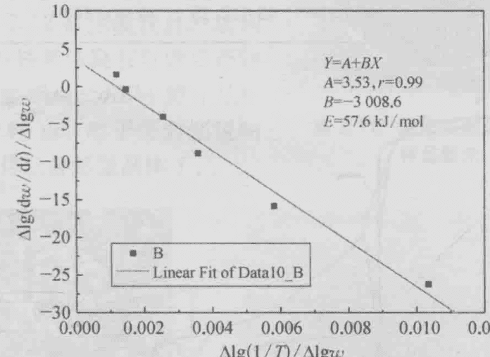

图 2.9 Freeman-Carroll 法拟合直线

**Kissinger法：** 基式(2.9)作lg(β/Tp²) 对 1/Tp 图，利用表2.3四组升温速率下的峰温数据，计算斜率得表观活化能E=43.2 kJ/mol，两法结果吻合良好（图 2.10）。

表 2.3 凝胶在不同升温速率时 DSC 曲线峰温

| β(K/min) | Tp | 1/Tp | Tp² | β/Tp² | log(β/Tp²) |

|---|---|---|---|---|---|

| 2.5 | 191.9 | 0.005211 | 36825.61 | 6.79E-05 | -4.16821 |

| 5 | 200 | 0.005 | 40000 | 0.000125 | -3.90309 |

| 10 | 201.78 | 0.004956 | 40715.17 | 0.000246 | -3.60976 |

| 20 | 206.5 | 0.004843 | 42642.25 | 0.000469 | -3.32881 |

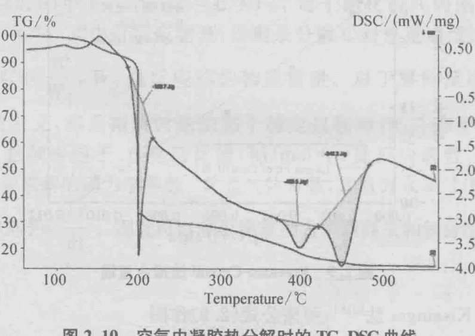

需明确：动力学参数非材料本征常数，分析需有明确目的，须关联反应机理、结构因子、工艺窗口及材料评价。本节仅从形式上表征速率温度依赖性，仅供同系列组分相近材料间横向类比参考。

## 2.4 纳米NiZn铁氧体：结构演化、磁性关联与自燃合成机理深度解码

### 从蓬松骨架到纳米晶粒的形貌演变

如2.3节分析，空气中500℃左右自燃冷却后，产物呈蓬松、超轻、红褐色蜂窝骨架（图 2.11），质地脆弱，触碰即塌。图 2.12 透射电镜图像显示晶粒径约50 nm，电子衍射斑点确证微晶化完成。

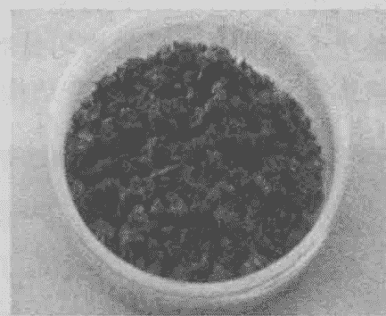

图 2.11 凝胶自燃后蓬松的样品粉末

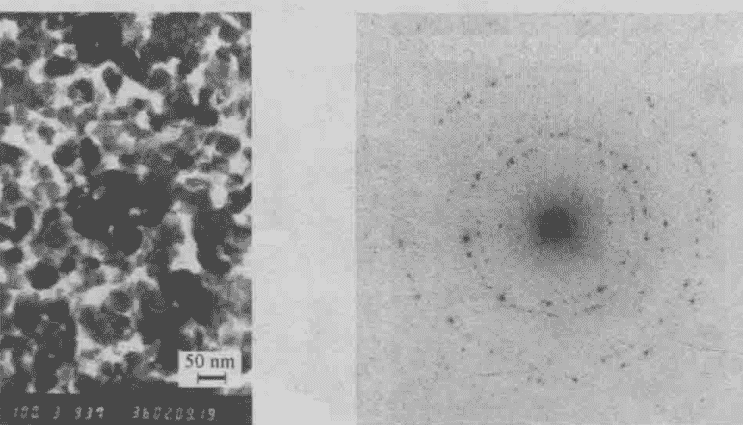

图 2.12 纳米晶 NiZn 铁氧体 TEM 照片及电子衍射图

图 2.13 多倍率扫描电镜（500×至10,000×）揭示形貌层级：低倍下为蜂窝状薄片堆叠；5,000×见薄片表面布满裂纹断口；8,000~10,000×下，断口由弧状薄片构成，薄片又由纳米颗粒烧结而成。推演生成机制：自燃初期胶体沸腾起泡体积膨胀，有机表面张力驱动类似肥皂泡般膨胀，金属离子沿络合网络迁移至气泡表层；气泡瞬间破裂触发自燃，外部氧气加速燃烧，三维有机网络锁定金属离子均匀分布；瞬时高温与有机聚缩形成局部致密表皮。海量纳米颗粒界面与表面原子配位不饱和（悬键、不饱和键）构建高密度短程快速扩散通道，驱动金属氧化物固-固扩散，直至有机物耗尽，在远低于传统工艺的温度下成就NiZn铁氧体纳米晶（图 2.14 模拟演示）。该历程持续数分钟至数十分钟，取决于原料量。高倍像显示颗粒团/碎片由数十至数百纳米亚单元组装。

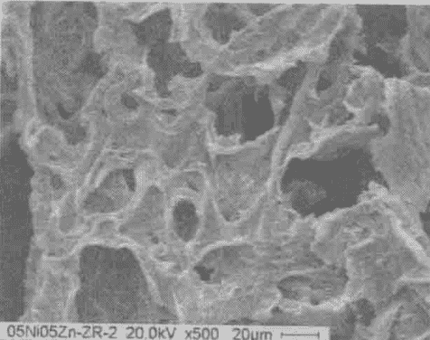

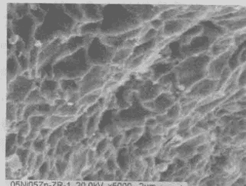

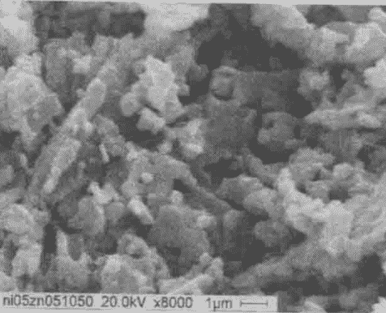

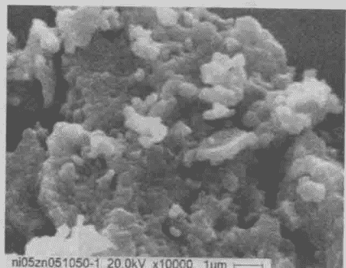

图 2.13 自燃后 NiZn 铁氧体粉末 SEM 照片 (分别放大 500, 5 000, 8 000, 10 000 倍)

### 图 2.14 硝酸盐柠檬酸凝胶自燃 NiZn 铁氧体结晶过程模拟

### 低温快速成晶的三大核心驱动力

综上，硝酸盐-柠檬酸胶体能在500℃左右合成纳米铁氧体，机理归因三点：

1.  **纳米效应赋能极致扩散：** 纳米固体自扩散系数超晶格扩散14~20数量级，超双晶晶界2~4数量级。海量界面与表面原子配位不饱和产生高密度悬键/不饱和键，极大提升化学活性，铺设原子扩散“高速公路”。
2.  **自燃爆燃构建极端合成环境：** 组分纳米化、均匀分布、高活性，Ni/Zn纳米晶在反应中兼具催化功能，固相反应温度较传统工艺骤降数百度，纳米晶在极短时窗内极速成型。
3.  **氧分压为不可或缺的外场条件：** 自燃合成需环境提供特定氧分压支撑。

### XRD证据链：氧分压决定相纯度与结晶质量

图 2.15 对比不同气氛下600℃保温30 min产物X射线衍射谱图。（a）空气烧结样品呈标准尖晶石相，特征峰[220]、[311]、[222]、[400]、[422]、[511]、[440]齐全，Scherrer法估算晒粒约80 nm；（b）氮气烧结样品[311]峰强度仅为空气样品26%，尖晶石相含量不超74%，且伴生ZnO相（[100]、[002]、[101]、[102]，PDF#65-3411）与碳相（[111]、[200]，PDF#43-1104）；（c）为(a)-(b)差谱，直观量化气氛导致的相组成差异。

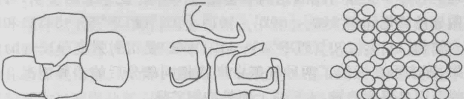

### 图 2.15 不同气氛下情况下样品的 XRD 衍射图

深度解析揭示：氮气缺氧环境下，胶体分解后残留α/γ-FeO(OH)脱水生成高活性氧化铁，部分与金属氧化物固相反应成尖晶石，另一部分因缺氧转化为同属尖晶石结构的Fe₃O₄。残留相除少量ZnO、NiO外，Fe₃O₄特征峰（[311]、[222]、[400]、[422]、[511]）与空气样品尖晶石峰位高度重合；NiO特征峰（[111]、[200]）亦与空气样品[222]、[400]重叠，导致X射线衍射难以直接解析杂相，需结合差谱及化学计量综合判断。

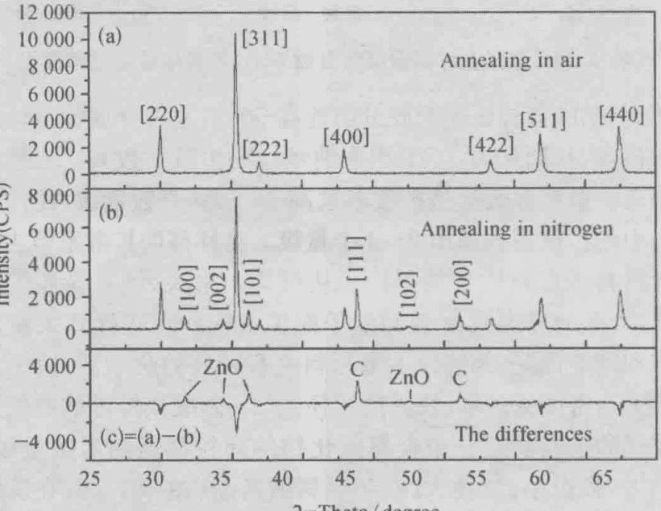

## 2.5 核心结论：氮气氛下的“杂相陷阱”与工艺破局点

汇总前序分析可见，若在纯氮气保护下热处理，极难获得纯度达标的尖晶石型 NiZn 铁氧体。最终产物实为“混合相集合体”：除目标主相外，尚夹带四氧化三铁、微量镍锌氧化物及碳化物残留。这些碳质杂质并非外来污染，实为有机前驱体在缺氧环境中热解挥发不彻底遗留的“灰烬”。结论明确：凝胶自燃法欲合成单一相的 NiZn 铁氧体纳米晶，必须维持门槛级的氧分压，否则反应流程无法推进至纯相终点。

磁性测试数据（见图 2.16）揭示一反常现象：氮气烧结样品饱和磁化强度达 72 emu/g，显著高于空气烧结样品的 53 emu/g；矫顽力同步增大（98.5 Oe 对 52.5 Oe）。空气烧结数据与文献吻合良好，氮气样品的高磁化表现却殊为罕见。

结合前文相组成分析，氮气样品本质是多相混合物。参考邹涛等学者研究，纯 Fe₃O₄ 纳米粉（10–80 nm）饱和磁化强度上限约 75 emu/g，微米级化学纯 Fe₃O₄ 亦仅 90 emu/g。若按样品中 74% 尖晶石相占比粗略推演，氮气样品尖晶石相的“贡献值”需达 97 emu/g 方能拼凑出实测 72 emu/g——此值已超越体块 Fe₃O₄ 理论极限（92 emu/g），更远超纳米 Fe₃O₄ 实测上限。常规物理模型难以自圆其说。

更合理的推测是：氮气退火过程中，生成了部分饱和磁化强度极高的 Fe-N 类化合物。这些“高磁相”与残留 Fe₃O₄、NCZF 铁氧体混合，共同拉高了整体粉末的磁化表现。

### 热反应历程与粉体“画像”

热反应可划分为两大阶段：222 ℃ 前，凝胶剧烈分解，酷似含能硝化物反应，185–218 ℃ 区间急速失重，活化能 43.2–57.6 kJ/mol，放热 163.6 J/g；222 ℃ 后，残留 FeO(OH) 缓慢脱羟基，流动空气中的氧气加速了这一转化及金属离子的扩散重排。222–481 ℃ 区间，固相反应推动尖晶石结构 (AB₂O₄) 成核生长。动态空气中，481 ℃ 左右即可收获纯相纳米晶；动态氮气中，固相反应受阻迟滞，实验温窗内难成单相。

最终产物呈发泡状褐色骨架，质地极轻极脆，由无数 ~50 nm 纳米晶自组装成弧状薄片与颗粒团。轻微研磨即得粒度均一的纳米粉，可直入造粒、压环、烧结流程，免去预烧环节，工艺链条大幅缩短，应用前景广阔。

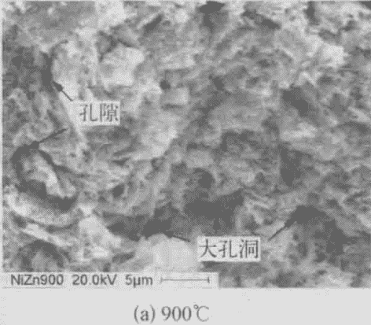
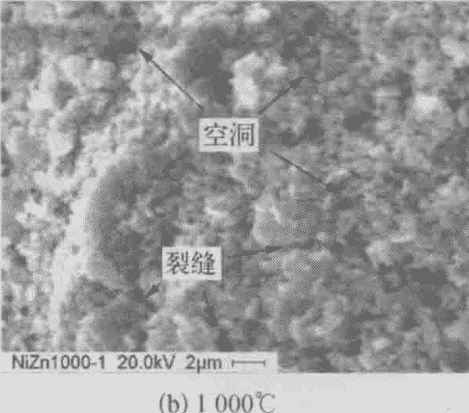
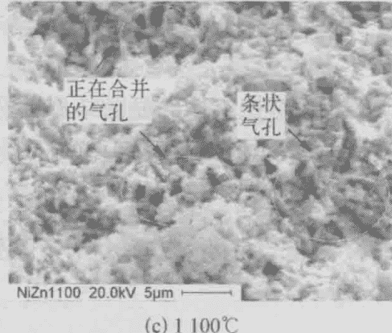
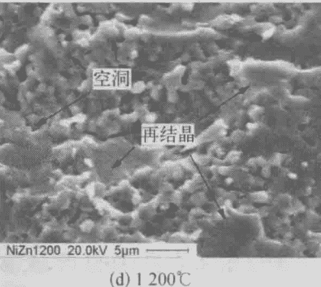
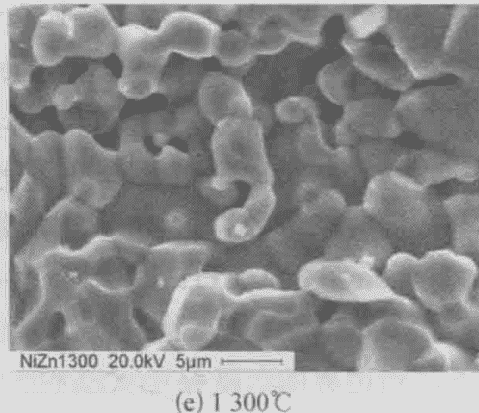

---

# 第三章 纳米复合 NiZn 铁氧体：显微演变与烧结机理探究

## 3.1 破题：为何聚焦烧结？

第二章确立了 ~50 nm 纳米粉的“种子地位”：磁性虽未达器件级门槛，但作为先进工艺原料，它完美契合高性能铁氧体对粉体的苛刻指标，堪称“理想原料”。

多晶器件的诞生，终局在于烧结。这道工序是调控显微组织、锁定理化性能的最后一道关卡，也是最关键的一环。烧结现象极其复杂，虽研究逾半个世纪（Kuczynski 1949 年奠基），从纯固相到液相、热压，建立了大量动力学模型（初期颈部生长、中期管状气孔排除、后期球形闭孔消亡），但受限于粉体非理想球形、尺寸分布、多机制耦合传质、异常晶粒长大及微量杂质干扰，距离“定量化、科学化”的精准掌控仍有鸿沟。

本章逻辑链条为：实验事实（不同温度/掺杂下的显微演变）→ 温度与掺杂的双重奏鸣曲 → 结合经典陶瓷烧结理论，解构纳米复合 NiZn 铁氧体的烧结机理 → 梳理关键影响因子。

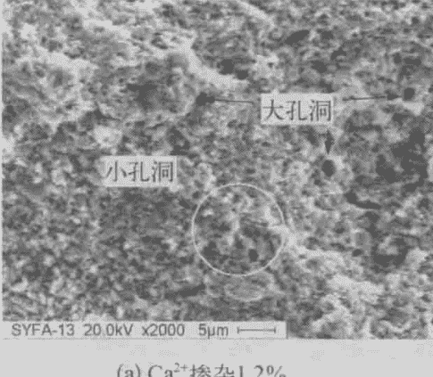

## 3.2 实验路线图：配方、工艺与表征三板斧

**配方基准**：Ni₀.₆Zn₀.₄Fe₂O₄。原料为高纯硝酸铁/镍/锌（98%–99%）及柠檬酸一水合物（99.5%）。
**溶胶-凝胶-自燃**：去离子水溶柠檬酸（pH 1–2），40 ℃ 溶解三硝酸盐得棕黄透明溶，恒温搅拌 30 min，加掺杂液，乙二胺调 pH 至 6–7，水浴浓缩至微胶态，自然冷却成凝胶。500 ℃ 烧结 2 h，得棕色纳米粉。
**成型烧结**：PVC 胶水造粒，FY-10 压片机 20 MPa 成环/片。KSY-80-18D 炉烧结，HP34410A 毫伏表精控温，升温 100–150 ℃/h，1000–1300 ℃ 分级保温 2 h，随炉冷。
**表征**：HITACHI S-570 SEM 观测断面，聚焦晶粒尺度、形貌、孔隙分布，解码温度/杂质效应。

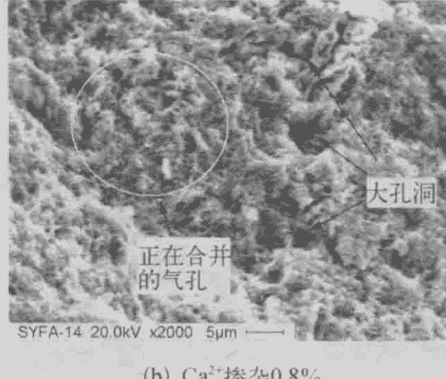

## 3.3 显微演变实录：温度与掺杂的双重奏

烧结是多晶铁氧体的“定型术”，温度为核心变量，升温驱动离子/空位扩散加速，重塑显微图景。

### 3.3.1 基体演进：从松散堆积到致密均质

**900 ℃**：粘合剂逸出留孔，颗粒原貌未改，烧结未启动。
**1000 ℃**：颗粒长大至 ~500 nm，收缩启动，贯通孔隙网络浮现。
**1100 ℃**：收缩加剧，小孔缩小、大孔膨胀，双峰孔隙结构显现。
**1200 ℃**：晶粒显著粗化合并，大尺度孔隙与不规则二次再结晶大晶粒共存。
**1300 ℃**：孔隙转为孤立闭孔，微观结构回归均匀致密，演变轨迹高度拟合球体烧结经典模型。

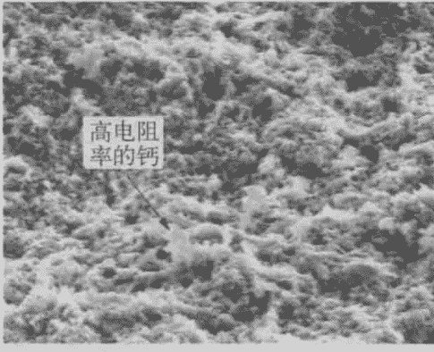
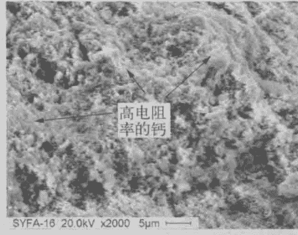
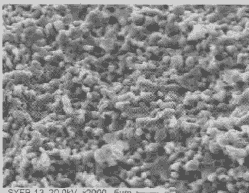
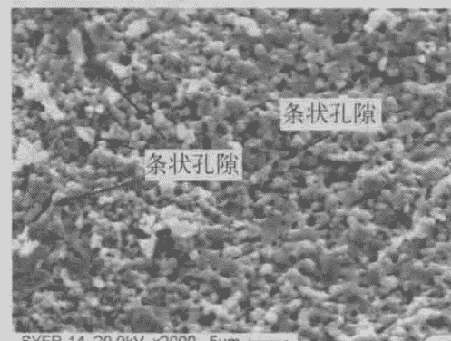

### 3.3.2 钙元素的“钉扎术”与“填隙策略”

#### (a) 1000 ℃ 低温窗口：晶界隔阂与高阻迷雾

不同 Ca 含量下晶粒差异微弱。1.2% Ca 现孤立气孔；0.8% Ca 存大孔及连通孔；低掺样品 SEM 成像现“反白”高阻层，源于大半径 Ca²⁺ (1.06 Å) 拒于晶界、难入晶格，形成高电阻边界。整体晶粒细于无掺对照。

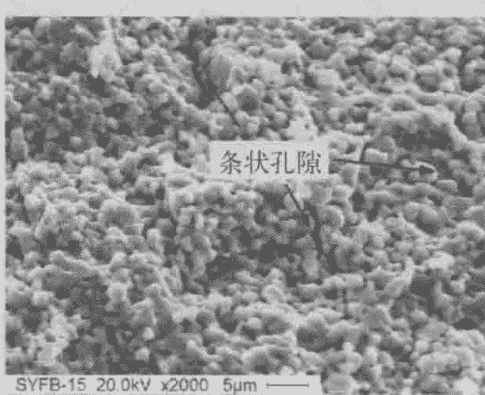
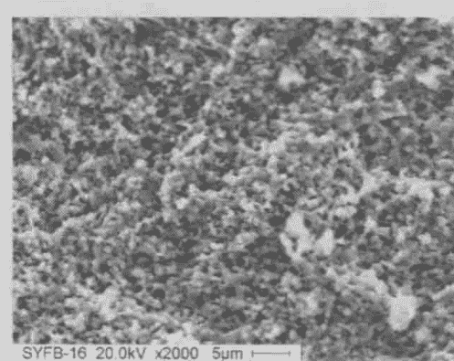
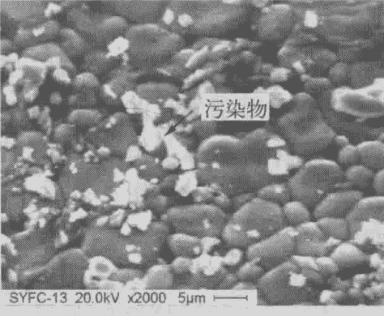
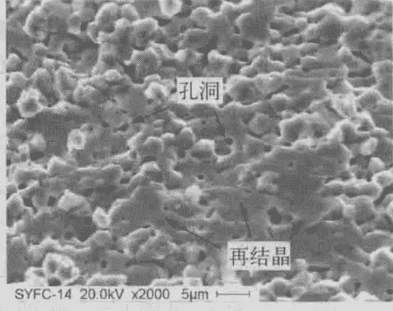

#### (b) 1100 ℃ 中温窗口：晶粒觉醒与气孔的“连通大逃亡”

晶粒普遍粗化至 3–5 μm，且随 Ca 量正相关。0.8%、1.2% Ca 明显诱发二次再结晶大晶粒，但分布均匀。Ca 掺杂显性促进收缩：条状贯通孔隙现身，随晶界迁移吞并小孔、膨胀大孔；大半径 Ca²⁺ 卡在晶界减缓边界迁移速率，赋予气孔足够时间连通、排出。1.2% Ca 样品条状孔已消失，致密化领跑。

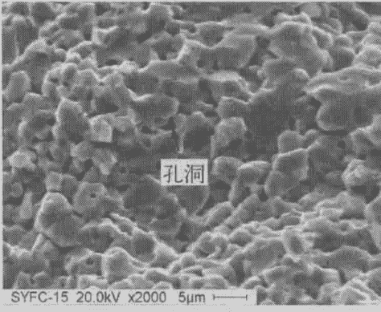
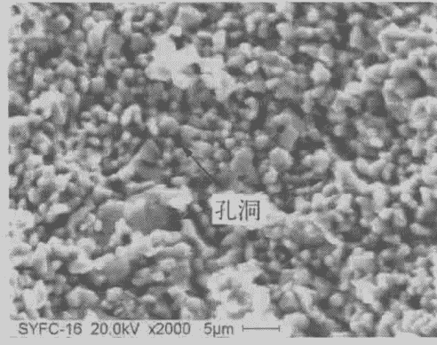
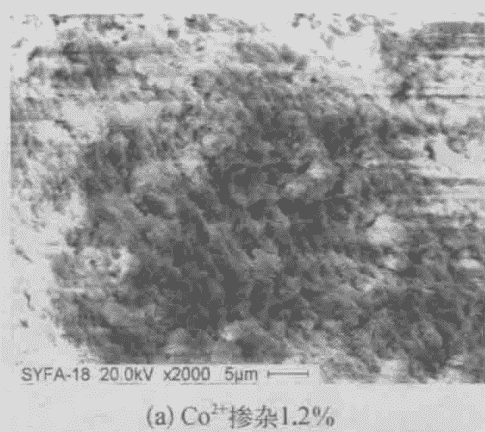
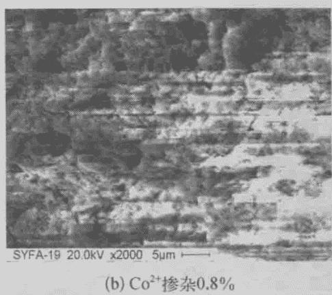

#### (c) 1200 ℃ 高温决战：剂量决定成败

掺杂效应达巅峰。0.1% Ca 晶粒 ~1.5 μm；1.2% Ca 狂飙至 ~15 μm；0.8% Ca 始现非规则二次再结晶。0.4% Ca 以下，微观均匀、少孔、晶粒 ~5 μm，优于无掺对照。条状孔在 ≥0.4% Ca 下彻底销声匿迹。

**机理拆解**：Ca²⁺ 高熔点、难固溶，低温烧结栖居晶界空隙——**填隙减孔**；高活性驱动扩散——**促晶粒长大**；大半径拒入晶格、钉扎晶界——**抑制疯长、保均匀**；实测亦证实其**助收缩、促排孔**。适量 Ca 是密度与均匀性的“平衡师”。

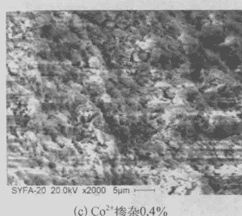
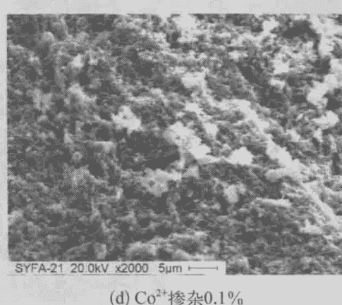

### 3.3.3 钴元素的“刹车片”与“隐身衣”

#### (a) 1000 ℃ 窗口：低温抑晶与成像“失焦”之谜

对比无掺样品，Co 显著抑制晶粒长大。低掺尚可辨颗粒，高掺下 SEM 图像模糊不清，水平扫描线条纹遍布——电子束因样品极高电阻率（导电性极差）无法有效泄放电荷，成像失焦。Co²⁺ 进入晶格取代 Fe³⁺/Ni²⁺，引入电荷补偿缺陷，大幅拉高电阻率，同时钉扎晶界、细化晶粒。

#### (b) 1100 ℃ 窗口

#### (c) 1200 ℃ 窗口

### 钴离子掺杂下1200℃热处理微观形貌演变

将试样升温至1200℃烧结后，颗粒粗化现象清晰可见（见图3.7）。图3.7(a)显示，部分环形空隙已转化为孤立孔洞，直观体现了密实化进程的推进。整体颗粒尺度仍处于微米级，均值约5μm；掺入浓度越低，颗粒越精细，低浓度试样仅约1μm。当二价钴添加量达0.4%时，颗粒发育最为理想，尺度分布均一且外形规整。而掺量为0.8%与1.2%时，颗粒相互连接，微观组织中散布大量大尺度空洞。对比同温度下的钙掺杂及纯相试样，钴掺体系颗粒显著细化，且微观特征仍指向高阻值特性。受限于导电性不足，高钴掺杂试样在电镜成像时依然困难（见图3.7(a)、(b)）。

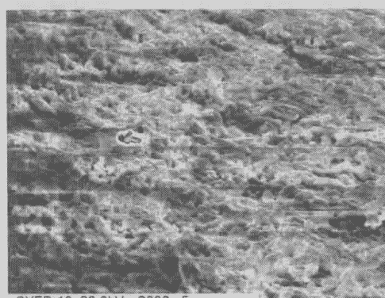

(a) Co²⁺掺杂1.2%

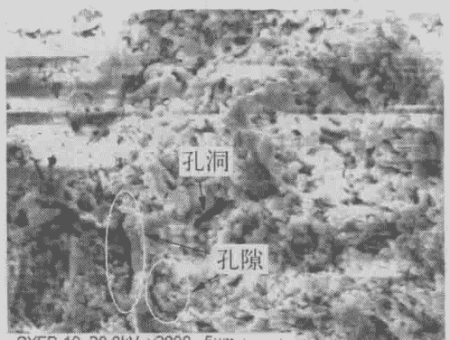

(b) Co²⁺掺杂0.8%

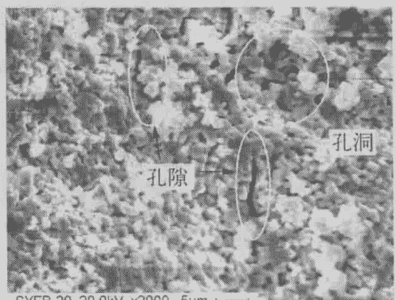

(c) Co²⁺掺杂0.4%

图 3.6 不同掺 Co²⁺ 量样品在 1 100℃烧结的显微结构

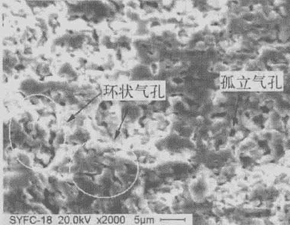

(a) Co²⁺掺杂1.2%

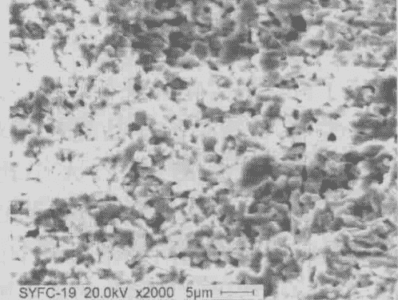

(b) Co²⁺掺杂0.8%

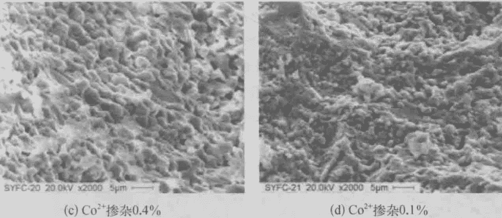

(c) Co²⁺掺杂0.4%

图 3.7 不同掺 Co²⁺ 量样品在 1 200℃烧结的显微结构

实验证实，同温条件下，掺入二价钴的试样颗粒尺度远小于未掺对照组。根源或在于钴离子的强各向异性对颗粒生长的抑制，且该抑制效应随添加量增加而增强。电镜图像模糊、呈现片状亮区，实为扫描电子在高阻值试样表面堆积所致，侧面印证了钴掺杂显著提升了材料阻值。从铁磁理论剖析：二价钴电离势介于二价镍与二价铁之间，高温下其亲氧能力强于二价镍，低温下又可向二价铁转移氧，由此抑制了二价铁与三价镍的生成，推高电阻率。

```
Ni³⁺ + Co²⁺ ——> Ni²⁺ + Co³⁺       (3.2)
Co³⁺ + Fe²⁺ ——> Fe³⁺ + Co²⁺       (3.3)
```

### 3.3.4 铜离子掺杂纳米晶复合镍锌铁氧体多温度微观特征

#### (a) 1000℃热处理：收缩启动与助熔效应

1000℃下，各掺铜试样均已启动收缩（图3.8）。不同浓度下均出现不同程度的大空隙；0.1%与0.4%掺量处可见片层状溶质析出，伴随收缩产生大气孔，典型形貌见图3.8(c)。我们判定这是铜离子助熔作用加速材料进入致密化阶段的表现。

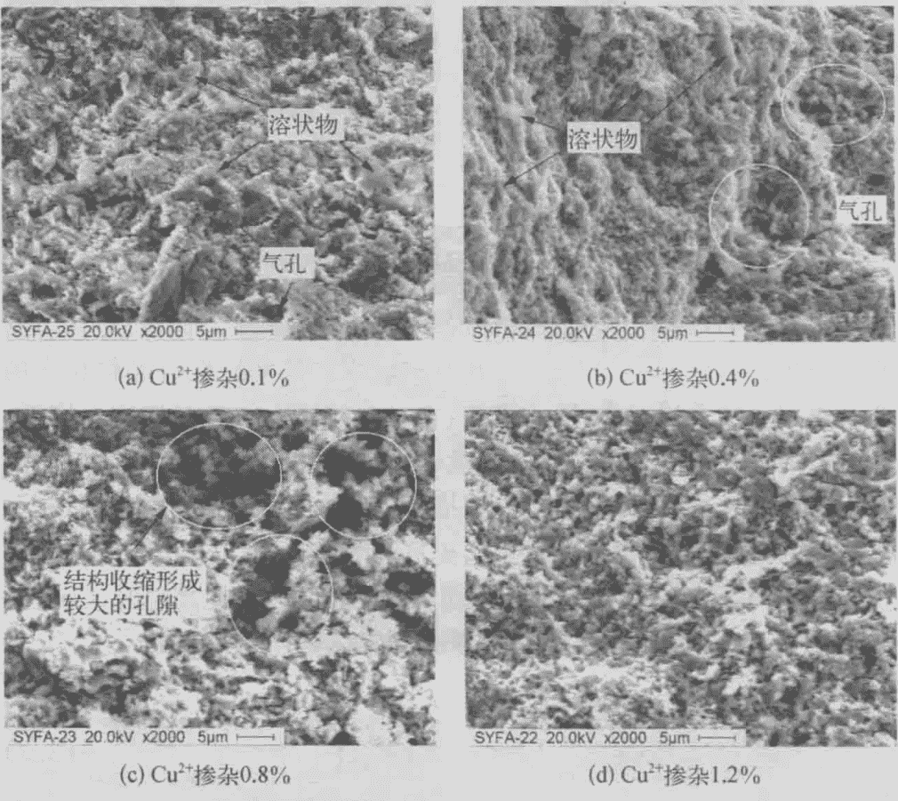

图3.8(d)揭示：1.2%掺铜试样在接近致密后期，大气孔被密集微孔取代，颗粒已长至约1μm（图3.8(d)）。

#### (b) 1100℃热处理：颗粒生长与均匀性的博弈

1100℃下（图3.9），得益于纳米晶结构与铜助熔的协同，颗粒提前结晶生长，且尺度随铜含量正相关。微观组织表明，密实化与颗粒生长同步进行，异常生长的萌发与掺量、温度强相关。目前阶段异常生长尚不显著，仅1.2%试样略有萌芽。图3.9(d)呈现大量环形孔隙及均匀分布，标志试样仍处收缩期。同时证明：铜掺杂体系在适宜温度窗口下，能兼顾大颗粒与高均匀性，为制备高密度、高磁导率镍锌铁氧体提供工艺支撑。

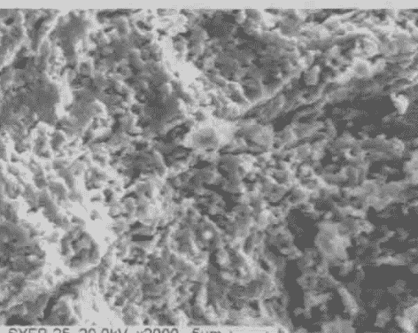

(a) Cu²⁺掺杂0.1%

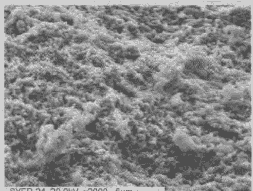

(b) Cu²⁺掺杂0.4%

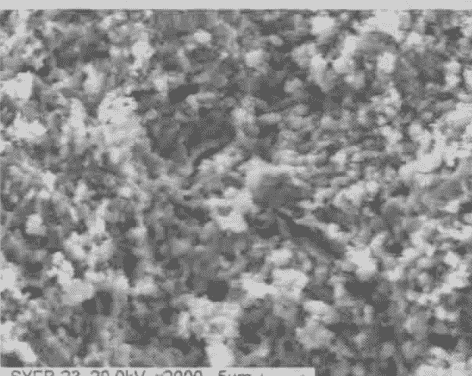

(c) Cu²⁺掺杂0.8%


(d) Cu²⁺掺杂1.2%

图 3.9 不同掺 Cu²⁺ 量样品在 1 100℃烧结的显微结构

#### (c) 1200℃热处理：异常生长爆发与气孔内包

1200℃微观组织见图3.10。0.1%试样颗粒尚细、结构均匀；升至0.4%时，颗粒骤增并呈现典型异常生长形貌（图3.10(b)）。随掺量继续攀升，微观结构调整，颗粒持续粗化、密实化深入；因生长过快，空隙被包裹于颗粒内部（图3.10(d)）。


图 3.10 不同掺 Cu²⁺ 量样品在 1 200℃烧结的显微结构

横向对比可见，铜掺杂对微观组织的重塑效应与钙、钴截然不同。铜掺试样在更低温度即实现颗粒生长与密实化；同温下，铜离子越多、颗粒越大。1100℃、1.2%掺铜时已现孤岛孔隙，密实化显著领先钙掺体系，且微观均匀性可通过掺量与温度双参数调控。根本动因在于：铜离子熔点低，烧结早期即溶解渗透晶界形成液相，驱动固相烧结向液相烧结转型。电镜像佐证：引入铜离子可大幅降低目标颗粒尺度所需的热处理温度。代价是生长失控易诱发异常生长，破坏均匀性。

另一维度看：自燃凝胶法制备的纳米晶镍锌铁氧体，纯相密实化滞后于预期，900℃颗粒仍极细。推测造粒结合剂导致坯体成型密度不足，结合剂挥发后，高活性纳米颗粒未处紧密接触状态，难以释放烧结驱动力，仅能缓慢生长。1000~1100℃或为本体系再结晶温区，收缩启动、颗粒加速生长。一旦生长起步，凭借化学法纳米粉体的高纯、高活性优势，界面迁移受阻极小（仅空隙与掺杂物钉扎），颗粒可快速粗化至常规陶瓷烧结中后期水平（1200~1300℃），空隙演变为孤立闭合气孔并收缩，密度跃升。这揭示了纳米晶铁氧体高温烧结可获高密度、大颗粒、优磁性的内因。但烧结中如何消除坯体气孔、管控气孔排除，仍是制备高性能材料的关键卡点。

实验还明确：化学法掺杂的纳米晶铁氧体，烧结时均能降低再结晶温度。特别是那些离子半径过大无法进入晶格的纳米粒子，滞留晶界形成点缺陷，加速扩散，发挥钉扎或助熔作用。具体微观机制取决于掺杂纳米粒子的种类、含量与特性。

## 3.4 纳米晶制备镍锌铁氧体烧结机理深度解析

### 3.4.1 烧结理论基石

#### 3.4.1.1 颗粒键合机制

多晶烧结的核心在于颗粒键合与质量传输。附着源于固体界面力，当两界面进入力场作用范围即发生连接。附着力大小取决于界面自由能与接触界面，故粉体间附着显著，纳米颗粒更甚。以两湿润球形颗粒为例（图3.11），界面张力驱动液膜变形拉紧颗粒，连接区形成曲率半径ρ的颈区，系统界面能降低。干固体虽刚性大难剧烈变形，但原理相通：附着力致微塑性变形→接触界面扩大→附着力增强→变形加剧，循环往复形成键合。附着作用主导初始阶段，驱动颗粒平移旋转重排，最大化接触数，增加接触界面，改变表面曲率（凸变凹），平滑表面、降低特定表面积[125]。


图 3.11 被水膜包裹的两固体球的粘附

#### 3.4.1.2 质量传输路径与动力学

烧结中期，颗粒全与近邻接触，整体迁移停止，收缩依赖晶格/界面扩散将物质迁至颈区。孔隙网络由颈部柱状通道构成，通道收窄分解为闭合孔隙标志此阶段结束[126]。传质动力统一为界面张力，途径分四类：

1.  **流动机制**：界面张力驱动变形流动。含粘性流动（空位定向迁移，迁移量与张力成正比）与塑性流动（位错滑移/晶面滑移，需应力超屈服强度）。
2.  **扩散机制**：浓度差驱动质点/空位迁移。初期颈区过剩空位浓度ΔC = γδ³/ρkT · C₀（δ为质点直径，C₀为空位浓度）。空位从颈区向外扩散，质点逆向补足，颈区作空位源，他处作阱。扩散路径分表面、界面、体积及缺陷扩散，驱动力均为界面张力。
3.  **气相机制**：曲率差导致蒸气压差，凸处蒸发、凹处（颈区）凝结，增大接触界面、致密化，即蒸发-凝结机制。
4.  **液相机制**：溶解-析出机制。液相润湿溶解固相，小颗粒溶解度高优先溶解，经液相扩散至大颗粒饱和析出，界面推移填充空隙致密化。

烧结机制复杂多元，但界面张力为统一驱动力。特定物质与工况下，常有一两种机制主导，条件变则主导机制易。晶态固体烧结实践证明扩散机制居主导。

#### 3.4.1.3 颗粒结晶生长动力学

再结晶与颗粒生长贯穿烧结全程，尤其主导后期微观组织。影响颗粒尺度的三过程：再结晶、正常生长、二次结晶。

**(1) 再结晶**
变形基质中新无变形颗粒成核长大。驱动力为塑性变形储存能。NaCl实例（图3.12）：400℃、4kg/mm²变形后470℃退火，颗粒棱角先成核再长大。0~t₀为前驱期（非稳定核胚长为稳定核所需），随温升前驱期缩短。长大速度u = u₀exp(-Eu/RT)，未碰撞前u恒定，尺寸d = u(t-t₀)。终尺度取决于核密度，实为成核与长大相对速率之比，均强温度相关，故总结晶速率随温敏变。初次结晶在金属中更关键。


图 3.12 在 400℃、4 kg/mm² 应力作用的 NaCl 晶体，置 400℃ 再结晶的情况

**(2) 正常颗粒生长**
无论再结晶与否，细晶聚集体高温下平均尺度必增大，伴随小颗粒被吞噬消失。驱动力为界面过剩界面自由能。烧结中后期为多尺度颗粒聚集体。三界相交，若张力等值则平衡夹角120°（图3.13）。二维截面上，边数>6颗粒界凹向外（倾向长大），<6凸向外（倾向缩小），六边形界面直线。界面向曲率中心迁移，致<6边缩小、>6边长大，平均尺度增大。界面曲率半径与直径D成正比，故迁移速度u ∝ 1/D。杂质、溶质、空隙钉扎界面可终止生长，掺杂越多、生长越早停、最终颗粒越细。


**(3) 二次结晶**
界面迁移受阻时，若存在大边数、高界面能的大颗粒，可越过钉扎点吞噬周基质异常长大，即二次结晶。初期速度取决于边数，直径远超基质后速度趋恒定。故亦有前驱期（加速期），而后入恒速生长期。初始粉体越细、终尺度越大、二次结晶越易发生；初始粗则相对大颗粒机会少、成核难。再结晶、正常生长、二次结晶深度影响烧结进程与终性能。

如前分析，自燃凝胶法可直接制备纳米晶镍锌铁氧体，固相反应在自燃或低温热处理中完成。纳米晶合成多晶铁氧体烧结机理仍类似常规，适用扩散机制。虽纳米粉体尺度远小传统粉末，但成型仍需结合剂造粒。结合剂过多易成型难烧结，过少难成型。无论如何，烧结仍分三阶段：初期仅颗粒重排、空隙变形，总界面不减、孔隙未填；中后期始排孔致密。

图3.14演示纳米晶成型坯体烧结演化[127]。（a）烧结前堆积：颗粒或接触或分离，空隙多。（a）→(b) 温升时延：键合重排、颗粒靠拢、大空隙消失、总孔隙体积减、仍以点状接触为主、总界面未缩。（b）→(c) 传质显现：点接触扩为面接触、界面面积增、固-气界面积减、孔隙仍贯通。（c）→(d) 传质深入：界面进一步扩大、孔隙缩小变形、终成孤立闭合孔；界面迁移驱动颗粒长大、孔隙迁移至界面消失、烧结体密度大幅提升。


### 3.4.1 晶粒长大的“隐形推手”：从抛物线到立方律

晶粒长大的本质，是系统为了降低总自由能而自发进行的“优胜劣汰”。只要温度足够高、原子具备迁移能力，平均晶粒尺寸就会随时间膨胀。这背后的驱动力源于晶界曲率差异：凹面处原子近邻更多、能态更稳、能量更低；凸面处原子则相对高能、不稳定。于是，原子倾向于从凸面“搬家”到凹面，释放自由能。从宏观看，晶界向曲率中心迁移，大晶粒吞噬小晶粒，最终实现“强者愈强”。

若以表面张力为驱动力建模，晶界迁移速度与曲率中心成正比、与晶粒直径成反比，数学推导如下：

$$

\frac{dD}{dt} = \frac{k}{D} \quad (3.5)

$$

对上式积分可得：

$$

D^2 - D_0^2 = Kt \quad (3.6)

$$

式中 $D$ 为晶粒直径，$t$ 为烧结时长，$K$ 为速率常数，$D_0$ 为初始平均晶粒直径（$t=0$ 时）。当起始晶粒极细微（$D_0 \to 0$）时，平均晶粒直径与烧结时间的平方根成正比。也就是说，**无液相参与时，铁氧体坯体遵循 $D^2 \propto t$ 的抛物线生长定律**。

一旦烧结出现液相，规则就变了。液相让固相物质溶解、扩散、再析出：细小晶粒与凸起部位优先溶解，在液相中形成溶解度梯度（溶解度随曲率/粒度变化），驱动溶质从细晶粒向粗晶粒扩散流动，最终细晶缩小、粗晶长大。**液相的出现，将生长动力学从抛物线（$n=2$）推向了立方律（$n=3$）**，即 $D^3 \propto t$。Roess 早已理论推算印证，实测纳米晶液相烧结更是快上加快——得益于纳米材料的高活性、高纯度，晶界迁移阻力极小，一触即发。我们掺铜样品的显微照片（图 3.10）就是铁证：铜熔点低，先熔成液相，同温同档下晶粒显著粗大。

掺杂杂质若迁移滞后于纯晶界迁移，依据 Cahn 理论会导致晶界“被拖累”：

$$

D^3 - D_0^3 = At \quad (3.7)

$$

这与掺钙现象高度吻合。Zener 进一步给出了极限晶粒尺寸 $D_{cr}$ 与第二相颗粒尺寸 $d_i$、体积分数 $V_f$ 的钉扎关系：

$$

D_{cr} = \frac{d_i}{V_f} \quad (3.8)

$$

**气孔也是“第二相”**。烧结初期气孔多（$V_f$ 大），晶粒被钉住（$D$ 小）；随烧结推进，气孔合并长大（$d_i \uparrow$）或被挤出（$V_f \downarrow$），晶粒随之放行生长。第二相无论是粗化还是溶入主相（$V_f \downarrow$），结局都是晶粒长大。一旦局部钉扎失效（如晶界与第二相分离，$V_f \to 0$），该区晶粒狂飙，形成“双重结构”（异常晶粒生长），磁损随之飙升——掺钙、掺铜样品中均观测到此弊端。

更通用的后期烧结生长方程可写为：

$$

D^m - D_0^m = Kt \quad (3.9)

$$

式中 $D、D_0$ 分别为 $t$ 时刻与初始晶粒尺寸，$K$ 含晶界张力、扩散系数等信息，指数 $m$（2~4）由扩散机制决定。不同机制对应的 $m$ 值“速查表”见下：

## 表 3.1 不同机制下的动力学指数 $m$

| 机制 | 物质迁移途径 | m |
| :--- | :--- | :--- |
| **气孔控制** | 表面扩散 | 4 |
| | 晶格扩散 | 3 |
| | 气相传质 | 2 或 3 |
| **晶界控制** | 纯系统 | 2 |
| | 第二相钉扎 | 3 或 4 (体积扩散取 3, 晶界扩散取 4) |
| | 通过连续第二相扩散 | 3 (即液相烧结) |
| | 杂质阻滞 | 3 |

当 $D \gg D_0$ 时，式(3.9)简化为：

$$

D = Kt^{1/m} \quad (3.10)

$$

引入平均晶粒面积 $A = \pi(D/2)^2$，可得：

$$

A = C_0 t^{1/m} \quad (3.11)

$$

$C_0$ 为常数。双对数坐标下（$\ln A$ vs $\ln t$），呈线性关系：

$$

\log A = (1/m) \log t + C \quad (3.12)

$$

$m$ 即为**晶粒生长动力学指数**。实验与模拟均提示：$m$ 非恒定，随时间推移呈下降趋势。

---

### 3.4.2 掌控烧结的关键杠杆：温度、时间、颗粒与气氛

影响烧结的变量繁多，但最直接、最硬核的三大核心参数是：**烧结温度、保温时间、原料颗粒尺寸**。

#### 3.4.2.1 温度与时间：烧结的“油门”与“刹车”
**温度是第一主导因子**。升温 → 蒸汽压↑、扩散系数↑、粘度↓ → 蒸发-冷凝、离子/空位扩散、颗粒重排、粘性流动全面加速。对粘性流动、溶解-沉淀机制尤为明显。
**延长时间**能推进烧结进程，对粘性流动烧结效果立竿见影，对体积/表面扩散烧结边际收益递减。**警惕后期“过烧”**：盲目延时易诱发二次再结晶，反而破坏致密度。

#### 3.4.2.2 颗粒尺寸：比表面积的“核动力”
颗粒细化 → 总表面能↑ → 烧结驱动力↑。对扩散机制、蒸发-冷凝机制增效显著。实战中，除上述“硬指标”，还可通过调控晶体结构、晶界特性、堆积状态、烧结气氛、微量掺杂等“软手段”改变物料活性与烧结窗口。

#### 3.4.2.3 物料活性：降低活化能的“催化剂”
烧结本质是表面张力驱动的物质迁移。高温氧化物难烧，因晶格能大、结构稳、迁移活化能高。
破局两条路：**物理法**——细化颗粒提活性；**化学法**——降低活化能，即“活性烧结”。

#### 3.4.2.4 添加物：微量撬动的“四两拨千斤”
微量添加，往往能重塑烧结动力学与机制，主要通过四大通道：

1.  **形成固溶体**：晶格畸变激活扩散，降温增速。缺位型（同半径异价）与间隙型（小半径阳离子）效果最猛。
2.  **阻止晶型转变**：抑制伴随大体积应变的相变，防开裂、促致密。
3.  **抑制异常晶粒长大**：后期正常长大助致密，二次再结晶/间断长大却致反致密化、显微结构恶化。添加物要“精准打击”异常长大，而非一刀切抑制所有生长——**并非凡抑晶粒者，必利烧结**。
4.  **生成液相**：适量液相促重排、促传质。或添加物自熔、或共熔。添加量有“最佳窗口”，过犹不及。

#### 3.4.2.5 气氛：闭气孔里的“隐形博弈”
后期孤立闭气孔缩小、内压升高，抵消表面张力，烧结陷入停滞。想继续致密，靠气孔表面空位扩散，更靠**闭孔气体在固体中的溶解与扩散**。不同气氛 → 闭孔气体成分/性质不同 → 扩散溶解能力天差地别。**气体原子半径越大，扩散系数越小，排气越难**。故必须精准控气氛。

#### 3.4.2.6 压力：从成型到热压的“双重加速”
外压分两路：成型压力大 → 坯体堆积紧、接触面广 → 烧结提速；热压（烧结施压）则直接叠加驱动力。
**纳米材料自带“外挂”**：颗粒极细、分布均、界面原子占比高（性能主导区）、比表面积巨大 → 界面提供高密度短程快速扩散通道、表面悬键/不饱和键多 → **化学活性极高**。工艺得当下，纳米铁氧体低温即可烧出均匀高密结构，远超常规材料上限。

---

### 3.5 纳米铁氧体烧结：核心优势与关键挑战

对纳米晶合成块材烧结，可视为**均匀球形颗粒堆积的理想模型烧结**。纳米材料大比表面、多界面原子 → 扩散系数大、短程快速扩散路径密布 → **低温即可获均匀高密结构**，密度上限高于常规料。

但**纳米复合铁氧体对掺杂极敏感**：二次再结晶温度大幅下移，大量残留气孔是致密度不足的主因。破局关键聚焦四点：**减气孔、控气孔率、严控掺杂种类与量、锁定最佳烧结温度/气氛/时间**——这是纳米晶复合铁氧体成型成败的命门。

---

# 第四章 掺杂纳米晶 NiZn 功率铁氧体：频谱特性深度解析

## 4.1 破局传统工艺：凝胶自燃法的“降维打击”

基础配方锚定本征性能（$M_s, K_1, \lambda_s$），进而圈定磁导率、矫顽力、损耗、温稳定性的理论上限。要触达上限，除配方外，需**匹配工艺产出恰当显微结构与离子价态**；微量添加物则能进一步重塑显微结构、晶界化学、价态分布。

现行掺杂多走**传统固相反应路线**：氧化物/碳酸盐原料 → 配料 → 球磨1 → 预烧 → 球磨2 → 造粒 → 成型 → 烧结。掺杂通常插在球磨2。但这条路痛点密集：
1.  **周期长**；
2.  **高温长烧**导致元素挥发（如 Zn 挥发 → $Fe^{2+}$ 生成 → 电阻率暴跌）；
3.  **长时球磨**引入杂质、损失化学计量；
4.  **原料纯度/活性波动**致配方漂移、工艺引杂、产品一致性差、特性失控。

虽有湿化学法（共沉淀）改善原料，但后段仍沿用预烧/球磨/造粒老路，**无法彻底切除旧工艺对终端性能的负面遗传**。

**我们引入凝胶自燃法制备前驱体**：
硝酸盐金属离子 + 柠檬酸络合 → 分子级均匀混合 → 中性偏酸下柠檬酸成网、离子嵌入 → 蒸发成凝胶 → 200℃左右有机物自燃/引燃 → 金属离子原位转化为**50±10 nm、球形、不团聚、分散极佳**的纳米氧化物粉末。这粉体**可直压成型、直烧成瓷**，完美契合高性能磁性器件对原料的苛刻要求。

基于此，我们确立**掺杂铁氧体新制备范式**：
硝酸盐-柠檬酸溶胶 → 掺杂凝胶 → 脱水自燃/引燃 → **一步原位合成掺杂纳米铁氧体粉体** → 造粒/成型/烧结 → 终端产品。

本章将系统阐述：新工艺制备逻辑 → 掺杂铁氧体磁导率/损耗频谱特性 → 饱和磁化强度-烧结温度关系 → 已达国际先进水平的高频/低损/宽频 NiZn 功率铁氧体实测指标。

---

## 4.2 实验路线图：从凝胶自燃到高频表征

### 4.2.1 制备全流程 SOP

1.  **原料配溶**：按配比称取硝酸铁/镍/锌及掺杂金属硝酸盐，配等摩尔柠檬酸，分别制成水溶液备用。
2.  **凝胶合成**：反应器恒温 40~90℃，依次加入上述硝酸盐溶液与柠檬酸，搅拌 30~120 min，同步滴加碱液调 pH 至 5~7，得墨绿色湿凝胶溶液。
3.  **纳米粉体制取**：湿凝胶蒸发除水至液面成膜停热 → 得凝胶 → 引燃或置烧结炉 300~600℃ 煅烧 10~30 min → 红褐色蓬松粉体（典型晒粒 20~60 nm），即掺杂铁氧体纳米粉。
4.  **多晶样环制备**：纳米粉研磨、加 PVA 手工造粒、过 80 目筛 → 空气中 20 MPa 压制 Φ15×Φ10×(2~4)mm 环样 → 气氛炉 100~150℃/h 升温，分别在 1000/1100/1200/1300℃ 保温 2h，随炉冷却。
5.  **结构表征**：D/max-2000 XRD (Cu-Kα) 全程跟踪相结构演变。
6.  **磁性表征**：
    *   VSM 测 $M_s$、$H_c$（最大场 10 kOe）；
    *   HP4194A 阻抗分析仪测 10 kHz~100 MHz 电感 & Q 值（环样绕 20 匝铜线，测试电压 100 mV）。
7.  **对标实验矩阵**：以标准配方 Ni₀.₄Zn₀.₆Fe₂O₄ 为基线，系统变掺杂种类/量/原料状况，详见表 4.1、4.2。

## 表 4.1 不同掺杂物的实际掺入量与溶胶 pH 值

| 掺杂元素 | 样品编号 | 掺杂比例 | 理论掺杂重量/g | 实际掺杂重量/g | pH 值 |
| :--- | :--- | :--- | :--- | :--- | :--- |
| 掺钙 | 13 | 1.2 wt% | 1.4141 | 1.4141 | 6.2 |
| 掺钙 | 14 | 0.8 wt% | 0.9432 | 0.9459 | 6.0 |
| 掺钙 | 15 | 0.4 wt% | 0.4714 | 0.4705 | 6.7 |
| 掺钙 | 16 | 0.1 wt% | 0.1178 | 0.1158 | 6.0 |
| 掺钴 | 18 | 1.2 wt% | 1.1852 | 1.1899 | 6.0 |
| 掺钴 | 19 | 0.8 wt% | 0.7901 | 0.7999 | 6.4 |
| 掺钴 | 20 | 0.4 wt% | 0.3951 | 0.3966 | 6.4 |
| 掺钴 | 21 | 0.1 wt% | 0.0988 | 0.0981 | 6.4 |
| 掺铜 | 22 | 1.2 wt% | 0.917 | 0.917 | 6.2 |
| 掺铜 | 23 | 0.8 wt% | 0.6114 | 0.6124 | 6.2 |
| 掺铜 | 24 | 0.4 wt% | 0.3057 | 0.3064 | 6.2 |
| 掺铜 | 25 | 0.1 wt% | 0.0764 | 0.0752 | 6.2 |

## 表 4.2 掺杂原料规格

| 原料 | 分子式 | 分子量/(g/mol) | 纯度/% |
| :--- | :--- | :--- | :--- |
| 硝酸钙 | Ca(NO₃)₂·4H₂O | 236.15 | 99 |
| 硝酸钴 | Co(NO₃)₂·6H₂O | 291.03 | 99 |
| 硝酸铜 | Cu(NO₃)₂·3H₂O | 241.6 | 99.5 |

---

### 4.2.2 高频弱场磁特性：核心表征参量速览

# 4.2 复数磁导率：物理内核与表征手段

### 4.2.1 从静态到动态：磁导率为何变为复数

在静止或缓变工况下，各向异性磁介质的导磁特性用张量描述；若材料具备各向同性与均匀性，导磁率退化为实数标量。一旦置于交变电磁环境中，磁滞回线、涡流场、磁后效、畴壁谐振及自然谐振等机制叠加，磁感应强度 $B$ 将滞后于磁场强度 $H$，两者出现相位差。这迫使导磁率告别纯实数形式，转而采用复数表达。

引入复数导磁率 $\mu = \mu' - j\mu''$，实质揭示了磁性介质在交变场下的双重面相：**实部 $\mu'$ 表征磁能储存能力，虚部 $\mu''$ 对应磁能耗散水平**。这种耗散并非简单的涡流或磁滞损耗，其微观本源在于磁化过程中元磁矩运动遭遇的阻尼阻力，即弛豫机制。

强磁性材料在弱交变场中的起始导磁率 $\mu_i$ (或磁化率 $\chi_i$) 随频次演变的曲线，称为磁谱[144-147]。交变场中，$\mu'$ 随频次漂移称作频散，$\mu''$ 的变化则称作吸收[148]。复数导磁率是交变场磁性表征的基石，由此可导出品质因数 $Q$ 等核心参数。

相位滞后角 $\delta$ 由 $\tan \delta = \mu''/\mu'$ 定义，即损耗角，其正切倒数即为品质因数 $Q = 1/\tan \delta$。工程上常用比损耗系数 $\tan \delta / \mu' = 1/(\mu' Q) = \mu''/(\mu')^2$ 或 $\mu Q$ 积评价材料优劣。理想指标追求：$\mu'$ 高、$\mu''$ 低、$Q$ 值大、$\tan \delta$ 小、$\mu Q$ 积高。

虚部的存在导致 $\widetilde{B}$ 滞后 $\widetilde{H}$，使铁磁介质在交变磁化循环中持续吸收外部能量。单位体积铁磁体在均匀交变场中的平均功率耗散（磁损耗功率密度）为：

\[ P_{\text{耗}} = \frac{1}{T} \int_0^T \vec{H} \cdot \mathrm{d}\vec{B} = \frac{1}{2} \omega H_m B_m \sin \delta \quad (4.2) \]

代入复数导磁率定义可得工程常用形式：

\[ P_{\text{耗}} = \pi \cdot f \cdot \mu_0 \mu'' H_m^2 \quad (4.3) \]

其中 $f$ 为激励频次。

**低频弱场域（$f < 1\text{MHz}, B < 0.01\text{T}$）损耗拆解**
此区间总损耗由磁滞、涡流、剩余三部分构成。剩余损耗指扣除前两者后的余量，归因于磁后效或频散。低频下它近似为常数，高频下则呈复杂频次函数；高电阻率铁氧体中常占主导。列格公式[149]给出了数学表达：

\[ \frac{\tan \delta}{\mu'} = \left( \frac{\tan \delta}{\mu'} \right)_{\text{磁滞}} + \left( \frac{\tan \delta}{\mu'} \right)_{\text{涡流}} + \left( \frac{\tan \delta}{\mu'} \right)_{\text{剩余}} = \frac{1}{2\pi} (aB_m + ef + c) \quad (4.4) \]

等价形式：

\[ \frac{R_m}{\mu f L} = \frac{2\pi}{\mu Q} = ef + aB_{\max} + C \quad (4.5) \]

$R_m$ 为等效磁损电阻，$L$ 为电感量，$Q=2\pi f L/R_m$，$e,a,C$ 分别为涡流、磁滞、剩余损耗系数。

依据铁磁理论[150]，磁滞系数 $a$ 与涡流系数 $e$（薄板模型）可写作：

\[ a = \frac{8\eta}{3\mu_0 \mu'^{7/3}} \approx \frac{8\eta}{3\mu_0 \mu_i^3} \quad (4.6), \quad
p_h = \frac{4}{3} \mu_0 \eta H_m^3 f \quad (4.7) \]

\[ e = \frac{4\pi^2}{3} d^2 \mu_0 \sigma \quad (4.8), \quad
P_c = \frac{2}{3} \pi^2 d^2 f^2 B_m^2 \sigma \quad (4.9) \]

$d$ 为半厚，$\sigma$ 为电导率。

**高频域（$f > 1\text{MHz}$）核心机制：畴壁与自然谐振**
此区段复数导磁率受畴壁谐振与自然谐振主导。阻尼因子 $\beta = 8\mu_0^2 M_s^2 / 9\rho$ ($M_s$ 饱和磁化强度，$\rho$ 电阻率) 决定谱线形态：$\beta$ 大呈弛豫型，$\beta$ 小呈谐振型。零偏置场下，磁矩在有效磁晶各向异性场中发生自然谐振。

畴壁谐振角频率分两类[150]：

弛豫型：$\omega_r = \frac{9\pi \sigma_{\text{壁}} \rho}{8\mu_0^2 a'^2 M_s^2}$ (4.10)

谐振型：$\omega_r = \left( \frac{2\pi \gamma^2 A s^2}{\mu_0 a a'^2} \right)^{1/2}$ (4.11)

$A$ 交换积分，$a'$ 立方点阵常数，$\sigma_{\text{壁}}$ 单位面积畴壁能。

**斯诺克极限：高频高导磁的理论天花板**
斯诺克[151] 1947年发现铁氧体高频特性遵循：

\[ (\mu' - 1) f_r = \frac{4}{3} \gamma M_s \quad (4.12) \]

起始导磁率与截止频次乘积仅由内禀属性（旋磁比 $\gamma$、$M_s$）决定，揭示了材料设计的物理极限。另一等价形式[152]引入阻尼与晶粒尺寸 $D$：

\[ (\mu' - 1) f = \frac{3M_s^2}{\beta D} \quad (4.13) \]

**起始导磁率 $\mu_i$ 的微观决定因素[154]**
可逆转动磁化机制下：$\mu_i \propto M_s^2/|K_1|$ 或 $M_s^2/(\lambda_s \sigma)$ (4.14)
$K_1$ 磁晶各向异性常数，$\lambda_s$ 磁致伸缩，$\sigma$ 内应力。

可逆畴壁位移机制下，若掺杂物/气孔主导钉扎：
$\mu_i \propto \frac{M_s^2}{\left[ A_1 |K_1 + \frac{3}{2}\lambda_s \sigma| \right]^{1/2}} \cdot \frac{d^2}{L}$ (4.15)
$d$ 掺杂平均间距，$L$ 磁畴宽度，$A_1$ 与交换积分 $A$、自旋 $s$、原子距 $a$ 相关。

若内应力主导钉扎：
$\mu_i \propto \frac{M_s^2}{\frac{3}{2}\lambda_s \sigma} \cdot \frac{l}{\delta}$ (4.16)
$l$ 应力波动波长，$\delta$ 畴壁厚度。

**结论**：提升 $\mu_i$ 需同时降低 $K_1$、$\lambda_s$、$\sigma$，并增大 $M_s$。

#### 4.2.2 复数导磁率如何测得？

磁芯线圈可等效为串联 $R-L$ 网络（图 4.1a）或并联网络（图 4.1b）。端口复阻抗 $Z = \dot{U}/\dot{i}$ (4.17)。


- a: 磁芯线圈的串联等效电路
- b: 磁芯线圈的并联等效电路

图 4.1 磁芯线圈测量的等效电路

并联模型中 $Z = R_x + j\omega L_x$。忽略铜损，电压 $\dot{U}$ 平衡感应电动势 $U = N A_e \mathrm{d}B/\mathrm{d}t$ (4.18)；线圈内磁场 $H = (N/l_e) I$ (4.19)。代入推导得阻抗实虚部分离：

\[ Z = \omega \frac{\mu_0 N^2 h}{2\pi} \ln \frac{D}{d} \mu'' + j \omega \frac{\mu_0 N^2 h}{2\pi} \ln \frac{D}{d} \mu' \quad (4.20) \]

$h$ 高度，$D,d$ 外/内半径，$N$ 匝数，$A_e, l_e$ 有效截面与磁路长。

对比实部虚部得等效参数：

\[ R_x = \omega \frac{\mu_0 N^2 h}{2\pi} \ln \frac{D}{d} \mu'' , \quad L_x = \frac{\mu_0 N^2 h}{2\pi} \ln \frac{D}{d} \mu' \quad (4.21) \]

反解两分量：

\[ \mu' = \frac{L_x \cdot 10^7}{2 N^2 h \ln(D/d)} ~(\mathrm{H/m}) \quad (4.22) \]
\[ \mu'' = \frac{R_x \cdot 10^7}{2 \omega N^2 h \ln(D/d)} ~(\mathrm{H/m}) \quad (4.23) \]

利用 $Q$ 值亦可求 $\mu''$：$\tan\delta = 1/Q = \mu''/\mu' \Rightarrow \mu'' = \mu'/Q$。仅需测得 $L_x$ 与 $Q$ 即可。

测量手段大类分为**电桥法**与**共振法**，选型取决于频带。

**电桥法原理**（图 4.2）。$R_x, L_x, R_d$ 为试样等效电阻、电感、线圈直阻。


图 4.2 (a) 被测试样品,(b) 麦克斯韦-维恩电桥原理图

桥臂平衡条件：

\[ L_x = R_2 R_4 C_4 \quad (4.24), \quad R_x = \frac{R_2 R_3}{R_4} - R_d \quad (4.25) \]

代入 (4.22)(4.23) 即得 $\mu', \mu''$。

**共振法原理**（图 4.3）。空载谐振 $\omega_0 = (LC)^{-1/2}, Q_0 = \omega_0 L/R$ (4.26)。接入负载 $Z_x = R_x + j\omega L_x$ 后：

\[ \omega_1 = [(L+L_x)C]^{-1/2}, \quad Q_1 = \frac{\omega_1(L+L_x)}{R+R_x} \quad (4.27) \]

$L,C$ 已知，测 $\omega_0, \omega_1, Q_0, Q_1$ 解出 $R_x, L_x$。

图 4.3 共振法测量原理图


图 4.4 HP4294 阻抗分析仪，用于测量磁芯样品的电感和 Q 值


## 4.3 掺杂纳米晶 NiZn 铁氧体：频谱特性实证

### 4.3.1 钴掺杂体系：导磁率与带宽的博弈

图 4.5 记录了不同钴含量、烧结制度下试样实部导磁率 $\mu'$ 随频次演变。因磁谱高度依赖体系、配方、工艺，图中同步给出未掺杂基体对比。


图 4.5 不同量钴掺杂、不同烧结温度时的样品的磁导率与频率关系

**1100℃ 以下**：钴离子加入对 $\mu'$ 影响微弱，数值维持 20 以下低位。微观上颗粒微长，低掺杂样品出现大型环状气孔，颗粒收缩、气孔聚并明显；高掺杂样品晶粒仍细小（参考图 3.6(a)），再结晶不显著。

**升温阶段**：$\mu'$ 逐步抬升，峰值仅略超 150。钴掺杂显著遏制了导磁率上升。原因有二：一是钴离子拥有巨大磁晶各向异性常数，而 $\mu'$ 与各向异性成反比；二是钴抑制晶粒长大（参考图 3.5-3.7），进一步限制上限（$\mu'$ 正比晶粒尺寸）。

**优势在于频带平直度**：低温烧结样品可达 50 MHz，高温样品达 10 MHz 范围内 $\mu'$ 基本不随频次波动。通过相对损耗剧增频点反推共振峰位置，可确证钴掺杂有效推高了截止频次。

图 4.6 揭示相对损耗随频次变化。最佳烧结窗口落在 **1100~1200°C**。
- 1100°C、0.4 wt% Co：2~20 MHz 区间相对损耗 $< 2\times10^{-4}$；
- 1200°C、同掺量：500 kHz~10 MHz 满足同指标。

这表明固定掺量下，最佳低损频带随烧结温升向低频平移——晶粒长大导致畴壁位移谐振频次下移所致。


图 4.6 不同量钴掺杂、不同烧结温度时的样品相对损耗与频率关系

高掺量（0.8%, 1.2%）虽能钉扎畴壁，却不利于降低损耗。1000°C 或 1300°C 条件下，任意钴含量均无法压低损耗。这揭示了**掺杂含量与烧结制度需“最佳适配”**，即钴含量需与匹配的晶粒尺寸协同。结合前章显微照片，1100~1200°C 恰为钴掺杂材料致密化起始期。图 4.7 进一步佐证：0.4 wt% Co、1000°C 烧结 $Q$ 值峰值约 160，1200°C 样品亦维持高 $Q$，与其他掺量样品形成鲜明反差。


图 4.7 不同量钴掺杂、不同烧结温度时的样品 Q 值与频率关系

### 4.3.2 钙掺杂体系：特定温窗下的导磁率跃升

图 4.8、图 4.9 给出不同钙掺量、烧结温度下试样 $\mu'$ 与相对损耗的频谱响应。
- **1000°C**：$\mu'$ 与损耗表现均欠佳；$\mu'$ 对钙量不敏感，但损耗随掺量增加而下降。
- **1100°C**：$\mu'$ 对掺量高度敏感。最佳掺钙量 0.4 wt%，$\mu'$ 峰值达 130，较未掺钙基体提升近一倍。

## 掺杂纳米晶NiZn铁氧体：频谱表现与磁性能深度解析

### 钙掺杂体系：晶粒与损耗的博弈

实验数据显示，钙掺杂样品在 1~8 MHz 频段内相对损耗均控制在 2×10⁻⁴ 以下，截止频率徘徊在 10 MHz 附近，且宽频带内损耗水平维持低位（参考  图 4.9）。这一特征与前文 1100°C 烧结微观结构高度吻合：掺杂 0.4% 时，结构致密化初现端倪，条状气孔浮现，晶粒长至约 4 μm（图 3.3c）。升温至 1200°C，各掺杂梯度样品磁导率均攀升（0.4% 掺杂下晶粒达 6 μm），气孔减少推动损耗进一步下降。

不过，微观结构演变揭示了性能的“双刃剑”效应：晶粒粗化虽提升磁导率，但低损耗频带随掺杂量增加而收窄；1300°C 高温下，磁导率随钙含量增加反而下滑，相对损耗自 1 MHz 起随频率飙升。推测源于晶界氧化钙钉扎作用失效，诱发“双重结构”——晶粒与气孔尺寸分布极度不均，严重破坏了微观均匀性。


Q 值曲线（ 图 4.10）进一步印证：钙掺杂材料 Q 值整体偏低（~90），显著逊于钴掺杂体系。低温烧结利于高 Q 值，高温烧结则无论掺杂量多寡，Q 值均大幅跌落，且随温升下降趋势陡峭。


### 铜掺杂体系：低温助熔与二次再结晶的代价

铜掺杂展现出显著的低温助熔特性（ 图 4.11）。得益于铜的低熔点液相烧结效应，1000°C 时 1.2% 掺杂样品晶粒已达 1 μm（图 3.8d），磁导率显著增强，损耗随掺杂量递减。1100°C 下，磁导率随掺杂量升高，但损耗呈现“先降后升”特征：1.2% 掺杂样品在 8 MHz 处损耗明显拔高，其余掺杂量变化平缓（ 图 4.12）。


1200°C 烧结仅低掺杂样品损耗触及 2×10⁻⁴ 基准线，其余均偏高，且所有样品在 6 MHz 附近损耗急剧上升，损耗曲线整体收缩。微观观察（图 3.10）确认：二次再结晶发生。1300°C 时二次再结晶加剧，磁导率对掺杂量不敏感（锁定在 180~250），损耗曲线收缩更剧烈，4 MHz 即急剧上升。这再次证明：二次再结晶导致杂质、气孔分布极不均匀，拉低复数磁导率共振频率，且铜掺杂样品整体磁导率表现平平。

Q 值表现（ 图 4.13）同样不及预期：低温烧结 Q 值仅 ~90，随温度升高及铜含量增加迅速滑落。机理在于 Cu²⁺ 占据八面体位（B 位），晶场作用下产生能级分裂，导致晶格畸变（正八面体沿 Z 轴伸长/压缩），显著增大应力各向异性，抑制磁导率提升（公式 4.14~4.16）。加之微观结构大气孔众多（图 3.8~3.10），损耗居高不下。


**核心规律总结**：晶粒粗大 → 磁导率高，但损耗大、共振频率低；结构致密 → 损耗小；晶粒细小 → 损耗小，但磁导率低。

---

## 磁性能机理与烧结动力学透视

### 结构敏感度视角下的参数分类

磁参数分“结构不敏感量”（Ms、λs、Tc、K，仅取决于原子/相结构）与“结构敏感量”（Hc、μ、B，强依赖晶粒尺寸与分布）。因此，饱和磁化强度随烧结温度波动，本质反映密度变化或杂质改变离子占位。

### 烧结致密化与异常晶粒生长的关键节点

依据烧结理论：中期气孔互通，密度达理论 60% 时晶粒始长大，细气孔存留，密度增速放缓；密度达 95% 时气孔闭合；后期易现不连续晶粒生长，气孔被吞没入晶内，阻碍进一步收缩。NiZn 铁氧体还面临锌挥发干扰，致使烧结密度与工艺深度绑定。

### 无掺杂基准：密度与异常生长的拉锯战

 图 4.14 揭示：1000°C 以下 Ms 近线性上升，对应晶粒生长与致密化同步；1000°C 以上 Ms 下跌，暗示不连续晶粒生长、聚合再结晶、气孔内陷形成多相结构；后续结构调整、收缩完成，Ms 回升。掺杂体系将沿袭此规律，因掺杂离子入晶/驻界而更复杂。


### 钴掺杂：助熔与异常生长的平衡点

 图 4.15 显示，各掺杂梯度 Ms 均随温升先扬。低温下钴助熟增密不长晶；超 1200°C 过量钴诱发异常晶粒生长、气孔内陷、多相结构生成，密度降、Ms 跌。微量钴掺杂下，密度随温稳升，1300°C 时 Ms 峰值。


### 钙掺杂：峰值前移的代价

 图 4.16 表明，钙掺杂样品 Ms 峰值提前至 1100°C，低掺杂量 Ms 更优。低温助熟促晶粒生长，超 1100°C 二次再结晒启动，密度降、Ms 跌。


### 铜掺杂：低温高密的“V 型”轨迹

 图 4.17 最具特色：1100°C 时各掺杂量 Ms 已远超钴/钙体系。随温升 Ms 走“V 型”曲线（先降后升）。1.2% 掺杂降幅最大——强助熟加速晶粒生长，气孔排不出反降密度；但终局上铜掺杂利于致密化，最终推高 Ms。暗示铜掺杂有望在更低温度达成高 Ms。


---

## 综合实验结论与工艺突破

### 1. 硝酸盐-柠檬酸溶胶凝胶自燃法：工业化利器
新工艺优势三重奏：
- **源头可控**：金属硝酸盐易得，溶胶期掺杂分子级均匀，省两道球磨，周期短、耗能低。
- **配方精准**：免球磨保证化学计量准确，控制易、重复性好、移植性强，微量掺杂高性能材料制备尤宜。
- **烧结高活**：纳米粉体（20~60 nm）压制成烧，烧结温度大降、时间大减；可通过温度/时间/气氛调控微观结构，定制电磁性能。

### 2. 掺杂诱导的低温再结晶与性能分化
- **钴**：抑制晶粒生长、提高截止频率。微量（0.1/0.4 wt%）降损耗，大量（0.8/1.2 wt%）虽推高损耗低谷频率但不利降损耗。
- **钙**：1100°C 以上显著增磁导率，0.4 wt% 最优，磁导率近乎同组分钴掺杂 2 倍，截止频率 ~10 MHz，损耗低（图 4.9）。1100°C/0.4 wt% 样品 300 kHz~8 MHz 损耗极低。高温致损耗升、截止频率降，1300°C 下 1 MHz 即损耗飙升。
- **铜**：低温液相促晶粒生长、收缩、增密。低温下增磁导率、降损耗；高温下磁导率对掺杂不敏感且整体不高，损耗随铜增而增（图 4.12），Q 值显著低于钴/钙体系。

### 3. 饱和磁化强度的普适演变规律
线性升（晶粒长大+增密）→ 1000°C 以上跌（异常生长+气孔内陷+多相）→ 回升（结构调整+收缩完成）。掺杂体系同理，因离子入晶更复杂：
- 多钴样品 1200°C 以上 Ms 跌；
- 低钙样品 Ms 高、峰值提前至 1100°C，超温即跌；
- 铜掺杂 1100°C Ms 已高超钴/钙，走 V 型曲线，或可更低温获同等高 Ms。

### 4. 铋掺杂拓展低温共烧窗口
适配配比可将 NiCuZn 铁氧体烧结温度压至 940°C 以下，对银导线共烧、线芯合一器件制备具里程碑意义。严控配方（主配比/掺杂种类量）、成型密度、烧结工艺，新工艺可稳产高性能材料。

### 5. 损耗机理与高频优化路径
低频弱场（<1 MHz）：磁滞+涡流+剩余损耗，高阻铁氧体剩余损耗主导（列格公式）。
高频（>1 MHz）：畴壁共振与自然共振主导。
- 共振型频率 ∝ A/a²（杂质/空隙分布、交换积分）。
- 弛豫型频率 ∝ (σ壁·ρ)/(a²Ms²)（额外涉及各向异性、电阻率、Ms）。
确定气孔/杂质体积下，提高弥散度（减小 a'）可升共振频率。立方晶系受 Snook 定律限制，定 μ' 下提高截止频率唯靠 Ms，**唯一出路：控烧结工艺、提密度、优微观均匀性**。

实测 H4、F6-4 相对损耗-频率曲线验证徐泽玮机制：f·Bm=25000 kHz·T 下，1.1 MHz 以下磁滞损耗主导（随 f 升降），1.1~3 MHz 剩余损耗主导（随 f 升增），3 MHz 以上涡流损耗主导（ρ 极低，损耗高处）。**结论：除控掺杂外，微观结构均匀性是降高频损耗关键。**

### 6. 纳米晶复合技术实现高性能量产
以 NiZn 掺铜为主基，纳米晶复合技术成功开发 F 系列、H 系列高 μ、高 f、低损耗材料。

  

---

## 王牌材料性能速览

### **H 系列：宽频低损耐高温**
| 指标 | 规格 |
| :--- | :--- |
| **饱和磁感应强度 (Bs)** | ≥ 4100 Gs (0.41 T) |
| **初磁导率 (μi)** | ≥ 232 |
| **工作频带** | 0.05 ~ 10 MHz |
| **矫顽力 (Hc)** | ≤ 1.02 Oe |
| **居里温度 (Tc)** | ≥ 205 ℃ |
| **电阻率 (ρ)** | ≥ 2.45 × 10⁷ Ω·cm |
| **相对损耗 (tan δ/μ)** | ≤ 95 × 10⁻⁶ (50 kHz ~ 4.0 MHz) |
| **材料密度** | 4.98 g/cm³ |

### **F 系列：高磁导高 Q 值标杆**
| 指标 | 规格 |
| :--- | :--- |
| **饱和磁感应强度 (Bs)** | ≥ 4500 Gs (0.45 T) |
| **初磁导率 (μi)** | ≥ 282 |
| **工作频带** | 0.05 ~ 10 MHz |
| **矫顽力 (Hc)** | ≤ 1.02 Oe |
| **居里温度 (Tc)** | ≥ 197 ℃ |
| **电阻率 (ρ)** | ≥ 4.47 × 10⁷ Ω·cm |
| **相对损耗 (tan δ/μ)** | ≤ 70 × 10⁻⁶ (40 kHz ~ 3.0 MHz) |
| **材料密度** | 5.01 g/cm³ |

**亮点数据**：F 系列 Q 值逼近 120，μi 接近 300，**μQ 积达 35000**；40 kHz~3 MHz 损耗 < 70×10⁻⁶。H 系列 50 kHz~4 MHz 损耗 < 95×10⁻⁶。两大系列精准覆盖宽频低损与高磁导高品质因数两大核心应用赛道。

# 第4章 纳米技术赋能：NiZn铁氧体掺杂制备新工艺探索

## 4.5 核心总结

本章深入剖析了铁氧体掺杂制备的创新工艺路线，重点考察了掺杂后NiZn铁氧体的频率响应与损耗特征。就本实验涉及的掺杂样品而言，其磁导率与损耗表现均不理想。除配方设计本身的因素外，晶粒尺寸偏小、烧结密度不足是制约性能的根本短板。鉴于研发目标锁定高频、低损、低温烧结材料，实验未继续追求高温烧结。显然，盲目提升烧结温度虽能推高磁导率，但会伴随损耗的大幅飙升。

实验引入溶胶-凝胶纳米技术，创新采用凝胶自燃法制备高性能纳米晶前驱体；利用纳米颗粒高活性、低熔点等特性，通过精准调控配比、掺杂体系、成型密度及烧结制度，尤其聚焦显微结构调控，最终成功制备出高饱和磁感、高磁导、低损耗、宽频带、高致密度的NiZn功率铁氧体软磁材料。该技术实现了低温烧结，为小型化、集成化、一体化磁电子功率器件奠定了材料基础，攻克了NiZn功率铁氧体制备的多项关键技术，形成自主知识产权成果，综合性能国内领先、国际先进。


图 4.21 纳米晶复合 NiZn 铁氧体材料磁芯样品

---

# 第5章 纳米-微米晶复合制备 NiZn 铁氧体深度解析

## 5.1 理论基石：从尺寸效应到复合构筑

“自下而上”策略可从原子/分子层面构筑纳米粒子，“自上而下”技术则能将宏观实体细化至纳米尺度。纳米颗粒因尺寸特异性呈现全新物质状态，这种“体积效应”主要通过量子效应与小尺寸效应显现。量子尺寸效应源于尺寸量子化导致光电性质改变；小尺寸效应则发生在颗粒尺寸逼近光波长、德布罗意波长、磁交换长度、畴壁宽度等特征物理量时，周期边界条件被打破，声光电磁热性质重塑，核心表现为固态物质的表面效应。

表面原子配位不饱和，存在“悬键”，处于高能态，引入额外表面能。块体材料中表面原子占比微乎其微，效应难现；纳米尺度下表面原子比例激增，表面效应凸显：表面能升高、提供海量活性反应中心、表面自旋结构异于体相（形成非共线自旋）、诱发磁性/热力学性质变化及各向异性。宏观表现为熔点/德拜温度降低、相变临界点偏移、烧结能力增强、催化活性飙升。

纳米复合材料构筑形式多样（0-0、0-1、0-2、0-3、1-3、2-3型等），核心均含纳米相。前文已探讨纳米晶粉体作为前驱体的二次加工（烧结致密化），虽终成品非纳米尺度，却充分利用了小尺寸效应，制备出优质多晶NiZn铁氧体。本章将聚焦另一条路径：**纳米晶与微米晶复合烧结**，探究其对宏观磁性能的调控机制。

## 5.2 实验方案实施细节

- **原料配制**：按配比称取铁/镍/锌硝酸盐、掺杂金属硝酸盐及等摩尔柠檬酸，分别配制水溶液。
- **凝胶合成**：反应器恒温40-90℃，依次加入上述溶液，搅拌30-120分钟，同步滴加碱液调节pH至5-7，得湿凝胶。
- **前驱体制备**：配比B（Ni0.33Zn0.59Cu0.11Fe1.97O4）与配比A（Ni0.4Zn0.6Fe2O4）湿凝胶蒸发至成膜，明火引燃/自燃制得20-50nm纳米晶粉体备用。
- **掺杂变量设计**：
  - 配比B凝胶分两路：一路加入不同量硝酸铈同步燃烧得**样品C**（溶胶原子级掺杂）；另路先燃烧得纳米粉，再研钵混合同量氧化铈得**样品D**（纳米/微米混合掺杂）。
- **微米晶制备**：配比A、B纳米粉分别在1100℃/1200℃烧结2h，得~2μm/~5μm微米级颗粒（掺Cu样品1000℃烧结亦得~2μm颗粒）。
- **复合混合设计**（按表5.1比例混合纳米/微米粉）：
  - 1#-4#：配比A体系，变纳米粉比例(30%/50%)与微米粉烧结温度(1100/1200℃)；
  - 5#-6#：配比B体系(含Cu)，1200℃微米粉混合纳米粉(30%/50%)；
  - 7#-8#：1000℃烧结B粉外掺Bi2O3(0.31/0.62 wt%)。
- **成型烧结**：混合粉研磨加PVA造粒(80目)，20MPa压制环样(φ15×φ10×2-4mm)，升温100-150℃/h，980℃空气烧结2h；样品C/D在940℃烧结4h。HP4194A阻抗分析仪测试10kHz-100MHz电感与Q值(20匝，100mV)。

 图 5.1 1#—4# 配比样品的磁谱
 图 5.2 5#—6# 配比样品的磁谱
 图 5.3 7#—8# 配比样品的磁谱
 图 5.4 1#—4# 配比样品的 Q 值
 图 5.5 5#—6# 配比样品的 Q 值
 图 5.6 7#—8# 配比样品的 Q 值
 图 5.7 相同复合比,不同颗粒大小和配比的样品磁导率与频率的关系

## 5.3 复合烧结磁性能深度复盘

实验证实，不同比例、成分的纳米/微米颗粒复合经二次热处理，磁性能演变显著。

**磁导率视角**：随微米颗粒尺寸增大、掺入量增加，磁导率微增(3#,4#>1#,2#)但不显著，疑因再烧结温度仅980℃偏低。含Cu样品5#,6#磁导率显著超越1#-4#，得益于Cu液相烧结促晶粒生长(已在第三章验证)。Bi掺杂样品7#,8#磁导率跃升至~250(未掺杂需1300℃+)，**精准选型助熔剂可在降温300℃+前提下保持磁性能**——这是低温烧结的关键突破。

**损耗演变规律**：虚部峰值(代表损耗)随大颗粒比例升高，从70MHz有规律下移至40MHz，截止频率下降。**显微结构不均匀性直接推高损耗，且该不均匀性可人为可控构造**！颗粒尺寸跨度(数十nm-数十μm)、复合比例、物种均可调，为新性质材料设计开辟新维度，后续需更多实验验证。

**Q值表现**：Cu液相烧结提密度，5#,6# Q值最高(~65)；1#-4#次之(~55)；Bi虽强力助烧但过量掺杂(7#,8#)反降Q值至~50。

**对比图谱洞察(图5.7)**：纳米/微米复合样品磁导率随频率呈“升-降”剧烈波动，与前章纳米晶聚集体烧结的平滑曲线截然不同。**单纯引入大颗粒未显著提升磁导率，助熔剂才是核心驱动力。**

**机理深度思考**：
传统铁氧体性能取决于晶粒间交换耦合(近程)与静磁耦合(长程)。交换耦合削弱磁晶各向异性，产生剩磁增强效应，随晶粒细化(比表面积增)影响放大。Herzer混乱各向异性模型指出：晶粒尺寸D < 交换长度Lex时，等效各向异性<K> ∝ D⁶，矫顽力Hc ∝ D⁶，磁导率μ ∝ D⁻⁶。

```
< K > = K_1(D/L_{ex})^{3/2}  (5.1)
L_{ex} = (A/ < K >)^{1/2}  (5.2)
```
```
< K > = K_1^4 \times D^6 / A^3  (5.3)
```
式(5.4) H_c \propto K_u / M_s

复合实验中烧结反应弱于预期，推测纳米粒尺寸偏大(50nm)或烧结温度偏低(980℃)。第三章机理显示，同尺度颗粒1000℃下结构无显著演变；本实验980℃下坯体未收缩，颗粒接触松散不均，损耗增大必然。Cu量不足未形成充分液相。结论指向：**纳米粒需更细(<20nm)、成型密度更高、或烧结温度更高**，以充分释放纳米表面活性催化烧结，利用多尺度交换耦合设计特异功能材料，大有可为。

## 5.4 Bi掺杂时空差异对磁特性的分化影响

**掺杂维度对比**：
- **溶胶期掺杂(样品C)**：硝酸铋溶液态混合，达成分子/离子级原子均匀分布。
- **纳米晶期掺杂(样品D)**：微米级氧化铋与纳米粉机械混合，属两种尺度物理复合。

这是两种本质不同的混合层级，对应传统工艺“预烧-球磨掺杂-成型-烧结”流程。

**样品D(传统法)磁导率表现(图5.8)**：掺杂量<0.6%时μ极低(~6)，规律性差波动大；0.8%起才显著变化。
 图 5.8 掺杂样品 D 的磁导率与频率关系

**样品D相对损耗谱(图5.9)**：呈三组簇群特征。0.2/0.4/0.6%为一组(0.4%损耗峰值)；0.8/1%为一组；2/3%为一组(2MHz处数值趋稳)。但**低频段(<100kHz)损耗波动剧烈**，揭示微观结构在低频域的敏感响应。
 图 5.9 掺杂样品 D 的相对损耗与频率关系

---
**核心启示**：溶胶原子级掺杂实现均匀固溶/液相分布，远优于后期机械混合的微米级掺杂；纳米-微米复合虽引入结构可控性，但若缺乏有效液相烧结驱动(温度/助熔剂/纳米粒活性不足)，易因界面松散不均引入高损耗。**低温高性能的关键，在于“原子级均匀掺杂 + 高活性纳米前驱体 + 精准液相烧结窗口”的三位一体协同。**

### 湿凝胶掺杂工艺的显著优势

样品 C 采用湿凝胶阶段掺杂铋，该工艺能实现掺杂粒子在分子乃至离子层面的深度均匀混合。因此，经凝胶自燃法制得的纳米晶粉体，其掺杂分布天然均匀。图 5.10 数据揭示了样品 C 磁导率变化的清晰规律：掺杂量 6% 以内磁导率平稳，随后随量增加显著上升，于 1% 时峰值达 200，继而微降。反观对照样品 D，同等掺杂条件下磁导率不足 100，差异直指混合分散环节存在缺陷。经验表明，掺杂皆有最佳作用点；鉴于 Bi 非主相且无磁性，图 5.8 显示的数据波动，必因混合不均所致。


**图 5.10 掺杂样品 C 磁导率随频率变化曲线**

（注：数值取自 2 MHz 测试点）

样品 C 相对损耗随掺杂量递增而有序下降；而纳米晶阶段掺杂的对比组，结果波动较大。两组样品除掺杂方式外工艺完全一致，性能差异直接证明了溶胶阶段复合工艺的优越性——掺杂量易控、操作简便、免去混合球磨，且能保障量产一致性。


**图 5.11 掺杂样品 C 相对损耗随频率变化曲线**

（注：数值为 2 MHz 处 tan δ/μ' 测试值）

## 5.5 章节小结

实验对比证实：湿凝胶掺杂铋工艺流程简短、品类与用量易把控、分散均匀，切实可行。这为高性能铁氧体磁性材料制备铺就了一条经济、便捷、可靠的工艺新路。该法操作易上手、重复性强、节能降本，亦可推广至其他精细陶瓷制备领域。

本章复合烧结研究显示，初始坯体微米晶增多虽能提升磁导率，但损耗同步增加。欲使纳米晶铁氧体在复合烧结中发挥催化作用，还需提升成型密度、细化晶粒、精选纳米晶品类与用量。不过，可控纳米晶制备技术为新材料设计提供了新思路：通过不同纳米晶/微米晶的二次复合加工，可定向制备特定显微结构材料，如异晶系复合构建复合结构、纳米晶作种子催化氧化物烧结形成特殊织构等，该思路在结构陶瓷与功能材料领域应用前景广阔。

# 第六章 高能球磨法制备纳米晶 NiZn 铁氧体的结构与磁性

## 6.1 引言

高能球磨凭借高速振动/转动产生的强烈撞击、研磨与搅拌，可诱导粉末发生塑性变形与固相变形，引发晶格缺陷大量产生、大角度晶界重组，从而大幅细化晶粒，兼具工艺简捷、产量大等优势。1988 年京都大学 Shingu 等以此制备 Al-Fe 纳米晶，开启了纳米材料工业化产出新径。现机械化学合成主要依托振动式或行星式球磨机，已成功制得纳米纯金属/合金、互不溶体系纳米结构、纳米金属间化合物、纳米金属-陶瓷复合粉、聚合物-无机纳米复合材料等，备受物理与材料学界瞩目。但针对无机金属氧化物直接机械化学合成纳米材料的报道尚属稀缺。

NiZn 铁氧体作为高频软磁主力材料，制备与性能研究持续受关注。虽化学共沉淀、溶胶-凝胶法已能制备优质纳米晶，但探索新工艺、新原料复合的脚步未停。1998 年中科院上海硅酸盐所姜继森团队即用高能球磨法，以 α-Fe₂O₃ 为主料合成纳米晶 NiZn 铁氧体。本文首次尝试以 Fe₃O₄ 为原料，经高能机械球磨成功复合 NiZn 铁氧体纳米晶软磁材料。产物单相结构良好，100 小时球磨下典型晒粒尺度 10～50 nm。结合纯 Fe₃O₄ 球磨对照，初估合成效率约 27%～44%。结果显示，球磨直得纳米晶 NiZn 铁氧体呈低饱和磁化强度 (σm) 与高矫顽力 (Hc) 特性（Hc = 45×10³(4π)⁻¹ A·m⁻¹，σm = 377 A·m²kg⁻¹），实用化需配合适当热处理。该成果为高能球磨制备复合纳米晶 NiZn 软磁铁氧体提供了关键实验佐证。

## 6.2 实验原理与方法

### 1. 实验原理

高能球磨与传统低能球磨的本质区别在于磨球运动速率。高速运动赋能粉体产生塑性与固相变形，而传统工艺仅起混合均匀作用。

**纳米结构成因机理**：公认高能球磨是颗粒循环剪切变形过程。晶格缺陷在大晒粒内大量涌现，驱动大角度晶界重组，将晒粒尺寸压缩至纳米级。单组元体系中，纳米晶形成纯属机械驱动的结构演变：晒粒随时间细化，应变随时间累积。反复变形使局部应变带缺陷密度达临界值触发晒粒破碎，循环往复直至纳米结构成型。

**机械合金化机制**：即反应球磨或机械化学法，利用球磨中金属/合金与他质间化学反应制备目标材料。高能球磨下颗粒承受周期性强应力，表面积先变化，伴随温升与表面能变化。原子键断裂后在新生表面激活，表面能增大与机械激活协同诱发：
1.  结构重组：表面自发重排形成非晶或重结晶；
2.  表性改变：电性、吸附性、溶解性、分散/团聚特性重塑；
3.  局域反应：应力集中区发生物质转化、气体释放、外来离子入晶导致成分变迁。

研究表明，球磨机型、强度、介质、球径、球料比、时长、温度等参数差异导致产物不同，相变是核心因素。碰撞致变形与复合粉成型同步引发温升，伴随空位、位错、晒界及浓度梯度生成，推动溶质快速输运再分散，为新相形成创造条件。

### 2. 实验方法

原料为分析纯 Fe₃O₄ (98.5%)、NiO (99%)、ZnO (98.5%)，按 0.5NiO + 0.5ZnO + 2/3Fe₃O₄ → Ni₀.₅Zn₀.₅Fe₂O₄ 配比精准称量，装入玛瑙罐 (6.35×7.95 cm)。磨球为两径不锈钢球 (7 mm 与 4 mm)，质量比 2:1 (200 g : 100 g)，球料比 8:1。采用 QM-C1 行星式球磨机，室温、180 r/min、连磨 100 h。后经 300 目筛分、PVA 造粒、18 MPa 压制成环 (外径 25 mm、内径 14.6 mm、厚 5 mm)。

对照实验设两组：① 纯 Fe₃O₄ 同条件球磨 100 h；② 部分铁氧体球磨粉分别在 1000°C、1200°C 空气中烧结 2 h (升温 150°C/h，随炉冷)。另备溶胶-凝胶法制备 Ni₀.₅Zn₀.₅Fe₂O₄ 纳米粉，分别 500°C、800°C 退火 30 min。

表征手段：日立 Dmax/RC XRD (Cu Kα, 3°/min, 2θ=10~100°)；JSM-6700F SEM 与 H-800 TEM 观测微观形貌与晒粒分布；Model 155 VSM (室温, 10 kOe) 测磁滞回线，考察饱和磁化强度与矫顽力。实验重复性良好。

## 6.3 高能球磨制备纳米晶 NiZn 铁氧体的结构与磁性

图 6.1 给出 XRD 结果，附带溶胶-凝胶法制备 800°C 热处理的标准单相 NiZn 铁氧体谱图 (图 6.1c) 对标。图 6.1a 为 Fe₃O₄ 球磨 100 h 谱图，除基相峰外大量析出 α-Fe₂O₃ 峰；图 6.1b 为三元混合粉同条件球磨谱图，α-Fe₂O₃ 峰消失。同工况下的差异暗示：Fe₃O₄ 球磨易氧化生成 α-Fe₂O₃，若 NiO、ZnO 共存，α-Fe₂O₃ 与二者发生机械化学反应生成 Ni₀.₅Zn₀.₅Fe₂O₄。反应路径或为两步：
3Fe₃O₄ + ½O₂ → 3α-Fe₂O₃ + Fe₃O₄ (6.1)


**图 6.1 实验样品 XRD 结构分析结果**

(a) Fe₃O₄ 粉末球磨 100 h；(b) Fe₃O₄+NiO+ZnO 混合球磨 100 h；(c) 溶胶-凝胶法制备 Ni₀.₅Zn₀.₅Fe₂O₄ 粉末 800°C 热处理 30 min 结果

继而：
α-Fe₂O₃ + 0.5NiO + 0.5ZnO → Ni₀.₅Zn₀.₅Fe₂O₄ (6.2)

或单步直达：
2Fe₃O₄ + 0.5NiO + 0.5ZnO → Ni₀.₅Zn₀.₅Fe₂O₄ (6.3)

依据 βcosθ/λ = 2εsinθ/λ + 1/L (6.4) (λ、θ、β、ε、L 分别为 X 射线波长、衍射角、半高宽、晶格应力、晒粒尺寸)，粗估本实验晒粒尺寸约 10~50 nm，确证纳米晶结构成型。衍射强度方面，100 h 球磨后纯 Fe₃O₄ 与混合粉强度均远低于常规样品，仅约 1/10。主因长时球磨极度细化颗粒，晒体越小，倒格点反射区越弥散，衍射线展宽致强度下降。

图 6.2 展示 Fe₃O₄ 原料与球磨 100 h 后的磁测对比。原料 σm = 85 A·m²kg⁻¹，球磨后骤降至 25 A·m²kg⁻¹ (降 2/3)；Hc 从 209×10³(4π)⁻¹ A·m⁻¹ 飙升至 520×10³(4π)⁻¹ A·m⁻¹ (增 2 倍强)。


**图 6.2 Fe₃O₄ 原料粉末与球磨 100 h 后 VSM 磁测结果**

依超顺磁理论，晒粒尺寸 < 临界值 dₛ 时 Hc=0；dₛ < d < d₀ (单畴临界尺寸) 为单畴颗粒 (SD)。实测球磨后 Fe₃O₄ Hc ≠ 0，排除超顺磁态。

材料 Hc 受粒径、形状、堆积密度、晶格缺陷等影响，主导因素为晒粒尺寸。实验显高能球磨致 σm 大降、Hc 大增，缘于粒径骤缩引发尺寸效应：整体磁性弱化，σm 下降，Hc 升高。图 6.3 SEM 图证球磨后 Fe₃O₄ 粒径 10~50 nm，结合前文分析应为单畴颗粒。


**图 6.3 Fe₃O₄ 粉末球磨 100 h 后 SEM 形貌**

图 6.4 揭示三元混合球磨 100 h 未热处理样品 σm = 45 A·m²kg⁻¹，Hc = 377×10³(4π)⁻¹ A·m⁻¹。经 1000°C、1200°C 热处理后，σm 分别升至 65、72 A·m²kg⁻¹，Hc 同降至约 30×10³(4π)⁻¹ A·m⁻¹，磁滞回线呈现“硬磁向软磁”转变。本实验球磨后 σm 数值较 Jiang 等用 Fe₂O₃ 球磨结果高近 2 倍，证 Fe₃O₄ 作为起始原料更优。数据还表明：球磨至颗粒达一定细度并团聚后，延长时长难再细化粒径。Fe₃O₄ 属磁性物质，若磨至超顺磁临界直径应无剩磁；但实测球磨样品粒径 10~50 nm，存剩磁 8.79 A·m²kg⁻¹、Hc 377×10³(4π)⁻¹ A·m⁻¹。若三元系球磨已完全转化为 NiZn 铁氧体，其 σm 应与同粒径单相粉体一致，实测两组回线却不重合。Raming 等报告 Fe₃O₄ 10~50 nm 观测到超顺磁，但本实验球磨后 Fe₃O₄ 及其混合物均未现超顺磁现象。


**图 6.4 复合 Fe₃O₄+NiO+ZnO 混合球磨 100 h 样品及热处理后 VSM 磁测结果**

测得 σm 为样品单位体积内全磁矩之和，数值差异由颗粒磁特性 (超顺磁 SPP、单畴 SDP、多畴 MDP) 决定。通常 MDP Hc 远小于 SDP。若为单畴，强场下磁矩同向转动，同粒径同测试条件下 σm 应相同。实验发现：除部分 Fe₃O₄ 氧化外若无他反应，对比球磨后 Fe₃O₄ σm (25×10³(4π)⁻¹ A·m⁻¹) 与混合球磨合成材料 σm (45×10³(4π)⁻¹ A·m⁻¹)，后者增强。因 σm 仅关联磁性颗粒尺寸与性质，故合成材料 σm 变化只能用其中存在 NiZn 铁氧体相来解释。

### 为什么选 Fe₃O₄？揭秘 NiZn 铁氧体合成的“隐形助推器”

用 Fe₃O₄ 替代 Fe₂O₃ 作为起始原料，制得的 NiZn 铁氧体饱和磁化强度（σm）显著更高。这背后的物理机制，用“两步合成”视角来拆解最清晰。

Fe₂O₃ 本身是弱磁性的，靠球磨诱导合成 NiZn 铁氧体，磁化强度的提升全靠反应生成了强磁相。但常规机械球磨有个“硬伤”：粉末尺寸通常卡在 10–50 nm，想磨到 10 nm 以下触发超顺磁性极难，因为久磨易结块、效率骤降。这直接导致以 Fe₂O₃ 为原料时，最终产物里 NiZn 铁氧体占比低、合成不彻底，σm 自然上不去。

换 Fe₃O₄ 就不一样了。球磨初期，部分 Fe₃O₄ 先氧化成 Fe₂O₃，这个**原位生成的中间相 Fe₂O₃ 粒度极小、活性极高**，后续与 NiO、ZnO 反应更彻底、速度更快，最终生成的 NiZn 铁氧体比例大幅跃升，整体 σm 自然水涨船高。

**数据实锤合成效率差异：**
*   **矫顽力视角**：纯 Fe₃O₄ 磨 100 h 理论 Hc ≈ 520×10³(4π)⁻¹ A·m⁻¹，实测混磨后降至 377×10³(4π)⁻¹ A·m⁻¹，**推算转化率约 27.5%**。
*   **磁化强度视角**：纯 Fe₃O₄ 磨 100 h 后 σm = 25 A·m²·kg⁻¹，混磨后升至 45 A·m²·kg⁻¹，**推算转化率高达 44%**。
*   **对比参照**：Jiang 等人类似工艺 100 h 仅得 σm ≈ 20 A·m²·kg⁻¹，按此估算转化率仅 **~20%**，远低于本实验。

Hc 下降、σm 上升，双指标共振印证了 NiZn 铁氧体相生成量的实质性贡献。顺带一提，长时间球磨虽让 Fe₃O₄ 氧化增多、σm 下降，但 Hc 并未随粒度细化而降——这暗示了微观磁畴演化的复杂性。


**图 6.5 热处理前后微观结构演变：从“模糊团聚”到“μm 级均匀晶粒”**

| 状态 | 观测手段 | 关键特征 |
| :--- | :--- | :--- |
| **球磨后 / 热处理前** | TEM | 粉末未成团、不结块，内部结构尚难分辨 |
| **1000°C / 2h 烧结** | SEM | 晶粒显著长大至 ~300 nm，尺寸分布均匀，整体仍偏细 |
| **1200°C / 2h 烧结** | SEM | 晶粒跨越至 ~1 μm 量级，均匀度保持良好，局部现再结晶 |


**图 6.6 XRD 佐证：高温烧结下单相结构稳固，无杂相析出**

**磁性关联直观呈现**：随着烧结温度升高、晶粒尺寸由纳米向亚微米/微米跨越，**σm 稳步上升，Hc 同步下降**——经典的“晶粒长大、磁畴壁易位、软磁性能优化”链条在此完美闭环。

---

### 6.4 核心结论速览

✅ **工艺可行性**：高能球磨成功制备名义配比 Fe₃O₄+NiO+ZnO 的纳米晶 NiZn 铁氧体，单相结构纯正，100 h 典型晒粒度 10–50 nm。  
✅ **效率碾压**：合成效率 **27%–44%**，远超 Fe₂O₃ 路线的 ~20%，优势源于“两步合成+中间纳米高活性”机制。  
✅ **方法论价值**：除机械合金化外，**高能球磨合成复合纳米晶 NiZn 铁氧体** 是一条经实验验证的、高效可行的新技术路线。

---

### 参考文献

[1] 张立德, 牟季美. 纳米材料和纳米结构. 科学出版社, 2001.  
[2] 朱静等. 纳米材料和器件. 清华大学出版社, 2003.  
[3] Y. Luo. Proc. 16th Int. Workshop on REM. Sendai, Japan, 2000: 31-38.  
[4] J. M. D. Coey. J. Alloys Compd. 2001, 326: 2-6.  
[5] 磁材商情网. “十一五”磁性材料行业发展规划纲要 [EB/OL]. 2005-03-04.  
[6] S. Khmelevskyi, P. Mohn. Phys. Rev. B 2004, 69, 140404.  
[7] J. Ding 等. J. Appl. Phys. 1994, 75(2): 1032-1035.  
[8] 李芳 等. 金属功能材料 2004, 11(3): 1-4.  
[9] R. Hasegawa. J. Optoelectron. Adv. Mater. 2004, 6(2): 503-510.  
[10] J. O. Choi 等. IEEE Trans. Magn. 1994, 30(6): 4851-4853.  
[11] J. Y. Song 等.  
[12] A. Eftekhari. J. Phys. D: Appl. Phys. 2003, 36: 1183-1187.  
[13] S. Mitani 等. J. Magn. Magn. Mater. 1999, 198-199: 179-184.  
[14] N. Kobayashi 等. J. Magn. Magn. Mater. 1998, 188: 30-34.  
[15] A. Ibrahim, M. Dahlan. J. Pharm. Pharmacol. 1983, 35(1): 59-61.  
[16] S. Myas, V. Silihorkar. J. Microencapsul. 1989, 6(40): 493-499.  
[17] A. S. Lübbe 等. Cancer Res. 1996, 56: 4694-4701.  
[18] G. Colbern 等. J. Liposome Res. 2000, 10(1): 81-92.  
[19] 高瑞平 等. 先进陶瓷物理与化学原理及技术. 科学出版社, 2001: 252.  
[20] J. M. Bind 等. J. Metals 1987, 54: 60.  
[21] S. M. Haile 等. J. Am. Ceram. Soc. 1989, 72: 2004.  
[22] E. Winkler, R. D. Zysler. Phys. Rev. B 2004, 70, 174406.  
[23] W. C. Hsu 等. Mater. Sci. Eng. B 2004, 111: 142-149.  
[24] I. Z. Rahman 等. J. Meta. Nano. Mat. 2003, 17: 9.  
[25] T. T. Ahmed 等. J. Magn. Magn. Mater. 2004, 272-276: 2250-2252.  
[26] 王世敏, 许祖勋, 傅晶. 纳米材料制备技术. 化学工业出版社, 2002: 64.  
[27] S. Rajendran. J. Mater. Sci. 1992, 27: 433.  
[28] R. M. Dell. Proc. 7th Int. Symp. React. Solids, 1972: 553-566.  
[29] D. C. Bradley. Chem. Rev. 1989, 89: 1317.  
[30] 李懋强. 硅酸盐学报 1994, 22(1): 85-91.  
[31] D. C. Bradley 等. Metal Alkoxides. Academic Press, 1978.  
[32] C. J. Brinker, G. W. Scherer. Sol-Gel Science. Academic Press, 1990.  
[33] Ph. Colomban. Ceram. Int. 1989, 15: 23.  
[34] S. Sakka, T. Yoko. Ceram. Int. 1991, 17: 217.  
[35] D. L. Seal, J. L. Woodhead. Proc. Br. Ceram. Soc. 1989, 38: 24.  
[36] P. A. Haas. Chem. Eng. Prog. 1989, 85: 44.  
[37] S. Sakka, T. Yoko. U.S. Patent 4,999,323, 1991.  
[38] C. J. Brinker, G. W. Scherer. Sol-Gel Science. Academic Press, 1990.  
[39] J. H. Jean. J. Mater. Sci. 1990, 25: 859.  
[40] G. Kords, M. R. Teep. Appl. Phys. Lett. 1990, 57: 1461.  
[41] J. Ma 等. Chem. Mater. 1991, 3: 1006.  
[42] Y. Yamanobe 等. Jpn. J. Appl. Phys. 1991, 30: 102.  
[43] 王世敏 等. 无机材料学报 1996, 11(2): 264.  
[44] S. Wang 等. Ferroelectrics 1994, 154: 289.  
[45] M. P. Pechini. U.S. Patent, 1967.  
[46] N. G. Eror, H. U. Anderson. Mat. Res. Soc. Symp. Proc. 1986, 73: 571.  
[47] L. M. Falter 等. Proc. Br. Ceram. Soc. 1989, 41: 261.  
[48] M. Kakihana 等. J. Appl. Phys. 1991, 69: 867.  
[49] P. A. Lessing. Bull. Am. Ceram. Soc. 1989, 68: 1002.  
[50] C. Marcilly 等. J. Am. Ceram. Soc. 1970, 53(1): 56.  
[51] N. G. Eror, H. U. Anderson. Mat. Res. Soc. Symp. Proc. 1986, 73: 571.  
[52] D. H. A. Blank 等. J. Phys. D: Appl. Phys. 1988: 226.  
[53] L. M. Falter 等. Proc. Br. Ceram. Soc. 1989, 41: 261.  
[54] 余忠 等. 功能材料 2000, 31(增刊): 34-35.  
[55] W. C. Kim 等. J. Appl. Phys. 2000, 87: 6241.  
[56] M. Sedlar 等. Ceram. Int. 2000, 26: 507-512.  
[57] A. Takayam 等. Solid State Ionics 2004, 172: 257-260.

# 纳米铁氧体制备与表征核心文献速览

> 涵盖水热、溶胶-凝胶、高能球磨、自蔓燃烧及烧结理论等经典与前沿文献，助你快速锁定研究基石。

---

### 一、 相变、磁性与掺杂调控基石

*   **Goossens 等 (2004)** 深入剖析了 Y₀.₃₃Sr₀.₆₇CoO₂.₇₉ 的结构与磁序特性（*Phys. Rev. B, 69, 134411*）。
*   **Wang 等 (2004)** 探讨了相关陶瓷体系的合成与性能表征（*Ceram. Int., 30, 1615*）。
*   **Morey (1953)** 奠定了高温陶瓷相平衡的早期理论基础（*J. Am. Ceram. Soc., 36, 270*）。
*   **Hennings 等 (1991)** 与 **Fukai 等 (1990)** 分别从微观机制与工艺参数角度解析铁氧体烧结行为（*J. Eur. Ceram. Soc., 8, 107; Ceram. Int., 16, 285*）。
*   **Barb 等 (1986)**、**Kutty 等 (1988)** 及 **Denkewicz 等 (1990)** 早期系统研究了铁氧体的制备工艺与磁学响应（*J. Mater. Sci., 21, 1118; Mater. Chem. Phys., 19, 533; J. Mater. Res., 5, 2698*）。

### 二、 湿法化学合成：水热与溶胶-凝胶经典

*   **Dawson (1988)** 综述了水热法制备先进陶瓷粉体的通用原理（*Am. Ceram. Soc. Bull., 67(10), 1673*）。
*   **Rozman & Drofenik (1995)** 确立了锰锌铁氧体水热合成的标杆工艺（*J. Am. Ceram. Soc., 78(9), 2449*）。
*   **Matijevic (1985, 1988)** 两篇奠基性著作系统阐述了胶体化学在纳米陶瓷制备中的核心地位（*Annu. Rev. Mater. Sci., 15, 483; Ultrastructure Processing..., 429*）。
*   **Shaw & Bordeaux (1955)**、**Kayima & Qutubuddin (1989)**、**Maya (1986)** 及 **Chianelli & Dines (1978)** 从水解机理到前驱体转化，构建了湿法合成的早期知识图谱（*J. Am. Chem. Soc., 77, 4729; J. Mater. Sci. Lett., 8, 171; Adv. Ceram. Mater., 1, 150; Inorg. Chem., 17, 2758*）。
*   **Gallagher 等 (1988)** 聚焦超微结构加工中的溶胶-凝胶技术细节（*Ultrastructure Processing..., 901*）。

### 三、 国内学者早期探索与工艺创新

*   **丁子上、翁文剑 (1993)** 与 **孙继红 等 (1999)** 分别在硅酸盐体系与 Sol-Gel 纳米剪裁化学方面做出重要贡献（*硅酸盐学报, 21(5), 443; 化学进展, 11(1), 80*）。
*   **段波、赵兴中 等 (1994)**、**严红革、陈振华 (1997)** 及 **姜继森、高濂 (1998)** 聚焦材料工程应用、反应球磨原理及 NiZn 铁氧体机械化学合成（*材料工程, (6), 5; 功能材料, 28(1), 25; 无机材料科学学报, 13(3), 15*）。
*   **李懋强 (1994)**、**崔国文 (1990)**、**杨尚林 等 (1999)** 从烧结理论、缺陷扩散到材料物理导论，提供了坚实的理论支撑（*硅酸盐学报, 22, 85; 缺陷扩散与烧结; 材料物理导论*）。

### 四、 高能球磨/机械化学制备纳米铁氧体/合金专题

> **刘永生、张金仓、郁黎明团队系列高产出成果（2004-2005）：**

*   **Fe-Co 纳米合金**：高频磁性与结构调控（*Curr. Appl. Phys., 4, 455; J. Alloys Compd., 377, 202*）。
*   **Fe-Ni 纳米合金**：高能球磨法制备及频率磁学性能（*J. Magn. Magn. Mater., 285, 138*）。
*   **NiZn 铁氧体**：结构表征与磁性能关联研究（*功能材料, 35(6), 689; J. Magn. Magn. Mater., 288C, 54*）。

### 五、 烧结动力学、致密化机理与 SHS 技术

*   **Kuczynski (1949)**、**Tremper 等 (1974)**、**Burke 等 (1980)**、**Beere (1975)** 构建了烧结动力学与晶界迁移的经典理论框架（*Trans. ASME, 185, 169; J. Am. Ceram. Soc., 57, 421; Sintering Processes, 417; Acta Metall., 23, 131*）。
*   **Cahn (1962)**、**Zener (1948)**、**Brook (1976)** 从相界面、晶粒生长到综合烧结论著，是不可逾越的理论高峰（*Acta Met., 10, 789; Trans. AIME; Treatise on Mater. Sci. Tech., 9, 331*）。
*   **Bowen & Derby (1997)**、**Avakyan 等 (1995)** 聚焦自蔓延高温合成 (SHS) 制备磁性陶瓷的独特优势（*Br. Ceram. Trans., 96(1), 25; 3rd Int. Symp. SHS, Wuhan*）。

### 六、 复合材料、薄膜与掺杂改性前沿

*   **Bauer 等 (1991)**、**O’Neill 等 (1989)**、**Blackburn 等 (1991)**、**Kriechbaum & Kleinschmit (1989)** 探索纳米复合粉体制备与低温烧结技术（*J. Am. Ceram. Soc., 74, 2759; 72, 1130; Br. Ceram. Proc., 47, 87; Adv. Mater., 1989, 330*）。
*   **Calcote 等 (1990)**、**Chang 等 (1993, 1994)**、**Kear 等 (1993)** 涉及燃烧合成动力学与纳米结构材料制备（*Proc. Combust. Inst., 1739; Nanostruct. Mater., 4, 507/345; 3, 25*）。
*   **Cima 等 (1988)**、**Pillai 等 (1993)**、**Sang & Ogilvie (1991)**、**Sherif (1990)**、**Messing & Minehan (1991)**、**Medelius & Rowcliffe (1989)**、**Wang & Lloyd (1991)** 覆盖专利技术、胶体加工、薄膜沉积等应用导向研究（*Mat. Res. Soc. Symp. Proc., 9, 241; Colloids Surf. A, 80, 69; US Pat. 4999323; EP 0362962; Ceram. Soc. Jpn. Int. Ed., 99, 1000; Mater. Sci. Eng., A109, 289; J. Am. Ceram. Soc., 74, 2934*）。

### 七、 纳米氮化镓/氧化物异质结构与表征方法

*   **Xie 等 (1996)** 两篇 *Science* 与 *Appl. Phys. Lett.* 佳作，揭示 GaN 多相共存的微观结构（*Science, 272, 1926; Appl. Phys. Lett., 69, 334*）。
*   **McGrath & Laine (1992)**、**Lukasiewicz (1989)**、**Thomson (1974)**、**Awano 等 (1988)**、**Marsh 等 (1987)** 提供了溶胶-凝胶衍生氧化物、玻璃-陶瓷及专利工艺的重要参考（*J. Am. Ceram. Soc., 75(5), 1123; 72, 617; Bull. Am. Ceram. Soc., 53, 421; J. Ceram. Soc. Jpn. Int. Ed., 96, 417; US Pat. 4649037*）。

### 八、 经验教材与专利标准

*   **尾崎义治、贺集诚一郎 (1991)** 著《超微颗粒导论》，中文版为入门必读（*武汉工业大学出版社*）。
*   **刘振海 (2000)** 《分析化学手册》第八分册，提供权威测试标准（*化学工业出版社, 358/268*）。
*   **蔡正干 (1993)** 《热分析》教材，热分析表征指南（*高等教育出版社, 55*）。
*   **Freeman & Carroll (1958)**、**Kissinger (1957)** 热分析动力学经典方程来源（*J. Phys. Chem., 62, 394; Anal. Chem., 29, 1702*）。
*   **邹涛 等 (2002)** 强磁性 Fe₃O₄ 纳米粒子制备表征实例（*精细化工, 19(12), 707*）。

### 九、 溶胶-凝胶自蔓燃烧法与复合纳米粉体

*   **Yue 等 (2004)** 系统考察 pH 值对溶胶-凝胶燃烧法制备纳米铁氧体的影响（*J. Magn. Magn. Mater., 270, 216*）。
*   **Wu 等 (2004)** 创制 NiZn 铁氧体/SiO₂ 纳米复合粉体新工艺（*J. Magn. Magn. Mater., 269, 150*）。
*   **Han & Luo (1994)** 早期探索铁氧体磁性调控（*J. Magn. Magn. Mater., 136, 176*）。

### 十、 SiO₂ 基质复合与掺杂烧结调控最新进展

*   **Albuquerque 等 (1999)**、**Ponce-Castañeda 等 (2002)**、**He 等 (2003)** 聚焦 NiZn 铁氧体/二氧化硅颗粒/干胶复合体的结构磁性与动力学（*Mater. Res., 2(3), 235; J. Sol-Gel Sci. Technol., 25, 37; Mater. Lett., 57, 3031*）。
*   **Hsu 等 (1995)**、**ALI 等 (2000)**、**Jean & Lee (1999)** 分别揭示 V₂O₅、CaO、Bi₂O₃ 等添加剂对 NiCuZn/铁氧体低温烧结与磁电性能的显著改善作用（*IEEE Trans. Magn., 31(6), 3994; Jpn. J. Appl. Phys., 39, 3378; 38, 3508*）。

---

> **💡 使用提示：** 该清单按研究主题重组，保留所有原始文献完整出处信息。建议结合具体研究方向（如水热法、球磨法、掺杂烧结、复合材料）重点阅读对应板块文献。

## 参考文献目录

[139] Jean J-H, Lee C-H. 掺V₂O₅低温烧结NiCu-Zn铁氧体的制备工艺与特性研究. 日本应用物理学会刊. 2001, 40: 2231-2236.

[140] Besenicar S, Drofenik M, Kosmac T等. 掺ZrO₂的NiZn铁氧体磁性与力学性能. IEEE磁学汇刊. 1988, 24(2): 1838-1840.

[141] Caltun OF, Spinu L, Stancu A. 掺CuO高频NiZn铁氧体的磁学性质. IEEE磁学汇刊. 2001, 37(4): 2353-2355.

[142] Nam JH, Jung HH, Shin JY等. Cu取代对NiZn铁氧体电磁性能的影响. IEEE磁学汇刊. 1995, 31(6): 3985-3987.

[143] Rezlescu N, Sachelarie L, Rezlescu E等. PbO对NiZn铁氧体微观结构与性能的影响. 国际陶瓷期刊. 2003, 29: 107-111.

[144] Von Hippel AB. 介质与波[M]. 1954.

[145] Rado GT. 电子学进展II. 1950: 251.

[146] Rado GT. 现代物理评论. 1953, 25: 81.

[147] Miles PA, Westphal WB, Von Hippel A. 现代物理评论. 1957, 29: 279.

[148] 李荫远, 李国栋. 铁氧体物理学. 北京: 科学出版社, 1978: 313.

[149] Legg VE. 贝尔系统技术期刊. 1936, 15: 39.

[150] 廖绍彬. 铁磁学(下册). 北京: 科学出版社, 1998: 70-73.

[151] Snock JL. 自然. 1947, 160: 90.

[152] 都有为. 铁氧体. 南京: 江苏科学出版社, 1996: 300.

[153] 高瑞平, 李晓光, 施剑林等. 先进陶瓷物理与化学原理及技术. 北京: 科学出版社, 2001.

[154] 徐泽玮. 电源应用技术. 2001, 1-2: 1-6.

[155] 材料牌号[EB/OL]. http://www.yeng-tat.com/.

[156] 纳米晶复合NiZn功率铁氧体材料与器件. 上海纳米技术发展基金项目, 科学技术成果鉴定书鉴定意见(上海市科委, 沪科鉴(2003)第0370号), 2003年12月25日.

[157] Rao CNR, Kulkarni GU, Thomas PJ等. 金属纳米颗粒及其组装. 化学会评论. 2000, 29: 27-35.

[158] 李新勇, 李树本. 纳米半导体研究进展. 化学进展. 1996, 8(3): 231-239.

[159] Health JR, Shiang JJC. 半导体量子点中的共价性. 化学会评论. 1998, 27: 65-71.

[160] Malik MA, O'Brien P, Revaprasadu N. CuSe与CuInSe₂纳米颗粒制备新途径. 高级材料. 1999, 11(7): 1441-1444.

[161] Iwanaga H, Fujii M, Takeuchi S. 四足ZnO颗粒的腿间夹角. 晶体生长期刊. 1998, 183: 190-195.

[162] 生瑜, 朱德钦, 陈建定. 聚合物基无机纳米复合材料制备法I. 原位生成法. 高分子通报. 2001, 4: 9.

[163] 徐国财, 张立德. 纳米复合材料. 北京: 化学工业出版社·材料科学与工程出版中心, 2002: 5.

[164] Schrefl T, Schmidth HF, Fider J等. 晶界处反向畴的核形成. 应用物理学期刊. 1993, 73: 6510.

[165] 高汝伟, 周寿增, 李华等. 物理学报. 1994, 43: 146.

[166] Gao R, Zhou S, Zhang D等. Nd-Fe-B烧结磁体矫顽力及其对取向磁场强度的依赖性. 应用物理学期刊. 1995, 78: 1156.

[167] Herzer G. 纳米晶铁磁体的晶粒结构与磁性. IEEE磁学汇刊, MAG-25, 1989: 3327. Herzer G. 纳米晶铁磁体中矫顽力与磁导率的晶粒尺寸依赖性. IEEE磁学汇刊, MAG-26, 1990: 1397.

[168] Eckert J, Halzer JC, Krill CE等. 纳米晶Fe-Cu粉末的机械合金化与晶粒尺寸变化. 应用物理学期刊. 1993, 73(6): 2794.

[169] Börner I, Eckert J. 球磨铁粉的纳米结构形成与稳态晶粒尺寸. 材料科学与工程. 1997, A226-228: 541-545.

[170] Zhang Z, Sandström等. 铸造与机械球磨制备Fe-Mn-Si金属间化合物粉末的表征. 粉末技术. 2003, 137-3(15): 139-147.

[171] 刘永生, 张金仓, 于立明等. 纳米晶Fe-Co合金在10kHz-100MHz范围内的频率与磁性能. 当代应用物理. 2004, 4: 455-460.

[172] Liu Y, Zhang J, Yu L等. 高能球磨制备纳米晶Fe-Co合金的磁学性能. 合金与化合物期刊. 2004, 377: 202-206.

[173] Liu Y, Zhang J, Yu L等. 高能球磨法制备纳米晶Fe-Ni合金的磁性与频率性能. 磁性材料期刊. 2005, 388(1-2): 144.

[174] Miani F, Fecht HJ. 纳米相Fe-C与Fe-Cu粉末机械合成中机械化学能量传递的评估. 国际难熔金属与硬质材料期刊. 1999, 17(1-3): 133-139.

[175] 陈春霞, 钱思明, 宫峰飞等. 高能球磨制备氧化铁/聚氯乙烯纳米复合材料. 材料研究学报. 2000, 14(3): 335.

[176] 陈春霞, 姜继森, 宫峰飞等. 高能球磨法制备铁/聚四氟乙烯纳米复合材料. 中国粉体技术. 2000, 6(6): 11.

[177] Bid S, Pradhan SK. 利用Rietveld法表征球磨纳米NiZn-铁氧体晶体结构. 材料化学与物理. 2004, 84(2-3): 291-301.

[178] Bowen CR, Derby B. 英国陶瓷汇刊. 1997, 96(1): 25-26.

[179] Yue Z, Zhou J, Li L等. 溶胶-凝胶自燃法制备NiCuZn铁氧体中MnO₂对电磁性能的影响. 磁性材料期刊. 2001, 233: 224-229.

[180] Kim JS, Ahn JR. 湿法制备(Ni,Zn)-铁氧体用于CO₂分解的表征. 材料科学期刊. 2001, 436: 813-4816.

[181] Kim WC, Kim SJ, Lee SW等. 溶胶-凝胶法制备超细NiZnCu铁氧体生长及磁性能. 磁性材料期刊. 2001, 226-230: 1418-1420.

[182] Verma A, Goel TC, Mendiratta RG等. 柠檬酸前驱体法制备镍锌铁氧体的磁学性能. 磁性材料期刊. 2000, 208: 13-19.

[183] Jiang JS, Gao L, Yang XL, Guo JK等. 高能球磨合成纳米晶NiZn铁氧体. 材料科学通讯. 1999, 18: 1781-1783.

[184] 张修庆, 朱心昆, 颜丙勇等. 反应球磨技术制备纳米材料. 材料科学与工程. 2001, 19(2): 95.

[185] 黄钧声, 任山. 纳米铜粉研制进展. 材料科学与工程. 2001, 19(2): 76.

[186] 曹茂盛. 超微颗粒制备科学与技术. 哈尔滨: 哈尔滨工业大学出版社, 1995: 18.

[187] Verma A, Goel TC, Mendiratta RG. 柠檬酸前驱体法制备高电阻率镍锌铁氧体. 磁性材料期刊. 1999, 192(2): 271.

[188] O'Handley RC. 现代磁性材料原理与应用. Wiley, New York; 2000, 300(中文版).

[189] Herzer G. 纳米晶铁磁体的晶粒结构与磁性. IEEE磁学汇刊, MAG-25, 1989: 3327.

[190] Herzer G. 纳米晶铁磁体中矫顽力与磁导率的晶粒尺寸依赖性. IEEE磁学汇刊, MAG-26, 1990: 1397.

[191] Raming TP, Winnubst AJA, van Kats CM等. 胶体与界面科学期刊. 2002, 249: 346.

[192] Kletetschka G, Wasilewski PJ. 地球与行星内部物理学. 2001, 4049: 1.

[193] Jiles DC. 磁滞模型: 从原子到宏观尺度的非线性磁性. 磁性材料期刊. 2002, 242-245: 116-124.

## 鸣谢

此论文得以完成，离不开张金仓教授的悉心栽培。张老师为人正直谦逊、治学严谨务实、追求卓越不懈，且对工作极其负责且富有创新精神，其言行举止时刻感染激励着我，促使我持续精进，令我终身受益。我的每一分成长都凝聚着导师的心血汗水，在此向张老师致以最衷心的谢意！

衷心感谢曹世勋教授对科研工作的热情扶持与指导，正是他的鼓励与持续支持，才使实验工作得以顺利推进。特别感激他在论文撰写期间给予的宝贵建议、帮助与深入探讨！

感谢敬超副教授、外语学院戴晓虎副教授、曹桂新博士、刘永生博士等同事同窗在论文工作中的鼎力相助与有益交流。

感谢父母与家人的理解包容与支持，让我能全身心投入学业与科研，顺利完成学业。特别感恩我的妻子高沪霞，在我最艰难时刻，是她赋予我永不言败、锐意进取的勇气与力量！得她相伴，乃我此生最大幸事！

本论文工作蒙上海市科学技术委员会纳米科技专项“纳米晶复合NiZn功率铁氧体材料与器件（0152nm027）”重大攻关项目及“Fe基纳米晶复合软磁材料及粘结磁芯关键技术研究（0352nm036）”项目资助，特此鸣谢！

Document generated by Anna's Archive around 2023-2024 as part of the DuXiu collection (https://annas-blog.org/duxiu-exclusive.html).

Images have been losslessly embedded. Information about the original file can be found in PDF attachments. Some stats (more in the PDF attachments):

```
{
"filename": "MTM2MzczNDYyemlw",
"filename_decoded": "13637346.zip",
"filesize": 18115410,
"md5": "8411c6373df4917c0fec6f49fa7f84ef",
"header_md5": "1af2d1bf8688b20e31be611f5bcfed3bb",
"sha1": "493089f8eba9e3be8f3b96c6a17307078383d33e",
"sha256": "dda7d963a77acc9d2bcfc8daa8c3620ec5d7cd9b14e4e359f6b549393b5ef238e",
"crc32": 3166812429,
"zip_password": "",
"uncompressed_size": 21904053,
"pdg_dir_name": "\u00ed\u2562\u2500\u2554\u251c\u256b\u255b\u00ba\u2555\u2524\u2551\u2567NiZn\u2563\u00aa\u252c\u2569\u2560\u00b7\u2564\u2321\u2560\u03c3\u2561\u2500\u2553\u255e\u2592\u2555\u00ed\u00f3\u255c\u00df\u2563\u2563\u2559\u003b\u2568\u2558\u2558\u2500\u2584\u2592\u03c6\u2552\u2248\u00ed\u2556_13637346",
"pdg_main_pages_found": 142,
"pdg_main_pages_max": 142,
"total_pages": 160,
"total_pixels": 613916288,
"pdf_generation_missing_pages": false
}
```