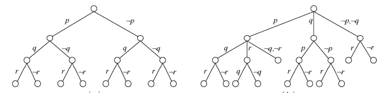
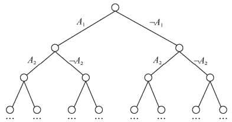
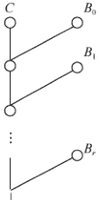
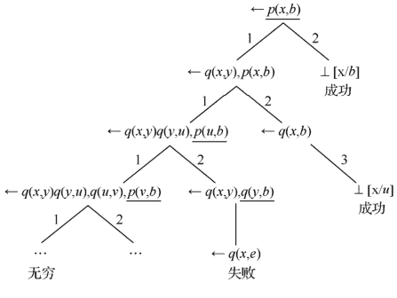

# 缺省逻辑与回答集编程：核心理论与计算特征

## 引言

上世纪50年代，约翰·麦卡锡等人奠基的人工智能（AI）学科，融汇了多领域知识，旨在构建能模拟人类自然语言理解、学习推理及问题求解能力的智能系统。1977年，爱德华·费根鲍姆正式提出“知识工程”概念，标志着AI领域聚焦知识处理的新纪元开启。知识工程融合科学、技术与方法论，致力于专业知识的获取、形式化及计算机实现，为知识型AI系统研发提供通用方法论。其核心攻关点在于常识推理——即不完全、不确定信息的表示与更新，这一过程呈现显著的非单调性（结论可撤销），由此引出非单调逻辑形式化与信念修改两大基础命题。

麦卡锡于1970年首度将非单调逻辑形式化，使其可被计算机处理。此后，逻辑、统计、归纳及实用主义等多元形式化路径并进，真值维护系统（TMS）、封闭世界假设（含PROLOG）、演绎数据库等信念修改机制亦应运而生。80年代初，非单调逻辑系统蓬勃发展：雷德基于一阶逻辑的缺省逻辑、麦卡锡基于二阶逻辑的限制、麦克德莫特与道尔基于不动点方程的模态系统、摩尔的自认知逻辑等相继问世。其中，缺省逻辑因结构最简、应用最广，成为研究焦点。

经典逻辑中可判定算法的探索与子句表示技术，催生了逻辑程序设计。科瓦尔斯基与科尔默70年代中叶的奠基性工作确立了以PROLOG为代表的逻辑编程范式。随后，格尔方德与利夫希茨基于回答集（稳定模型）语义，创立回答集编程（ASP），为缺省及例外信息的推理提供了强有力的逻辑模型。在某种意义上，回答集编程可视作缺省逻辑的特例化延伸。

本书系统阐述缺省逻辑及其重要变种、回答集编程的理论体系，涵盖扩张与回答集特征、算法复杂度、可计算子类等核心内容，凝聚作者近25年研究心血，旨在为读者构建完整、系统的知识框架。

缺省逻辑的广泛适用性，源于“扩张”这一核心计算特征。雷德虽定义了扩张概念并阐述正规缺省的证明推理与信念更新特性，但也指出其表达能力不足。1991年，我们提出扩张计算特征，推导出表达能力更强且保留优良性质的自相容缺省理论。相关脉络中，桑德沃尔1985年基于四值语义的函数途径、施温德与里希1991年引入的有基概念、巴德尔与霍兰德1992年迭代算子的精确刻画，本质上均与该计算特征同构。

这一计算特征不仅作为核心工具支撑缺省推理算法、复杂度分析及特殊理论类探索，更为回答集编程研究提供了统一分析框架。

**全书架构速览：**
*   **第1章：** 奠基集合、函数、命题/一阶/高阶逻辑语法语义，以递归函数定义可计算性，引入复杂度层级。
*   **第2章：** 从过程语义导出逻辑程序与消解推理，阐释稳定模型、最小模型不动点、有穷失败规则及可靠/完备性。
*   **第3章：** 核心篇。详述缺省理论扩张计算特征、推理算法复杂度、特殊理论类证明方法、Kripke语义。
*   **第4章：** 解析回答集编程概念性质，基于程序分裂思想识别易判定子类。
*   **第5章：** 借环公式与程序完备性建立ASP与经典逻辑联结，引入SAT求解器，推广至嵌套查询等一般逻辑程序。
*   **第6章：** 探讨基于解释变换的归纳学习及知识遗忘理论。
*   **第7章：** 概览缺省逻辑重要变种与非单调推理关系特性。

本书自1996年起服务于硕博教学，历经迭代打磨。感谢历届研究生协作，特别致谢王以松教授撰写一阶环公式、归纳学习及知识遗忘章节，董明楷、杨波、谢刚博士倾力录入审读。致谢莫绍揆、陈火旺教授搭建学术交流平台；Georg Gottlob教授早期关注与合作推动；周巢生、何积丰、刘志明教授促成国际合作；林方真、Norman Foo、David Makinson、Thomas Eiter、犹嘉槐等教授长期支持。献给相濡以沫半世纪的妻子周希玲——是她的默默支撑，让我在逆境中坚守科研初心。

张明义
2022年10月于贵阳

---

# 第1章 基石：集合论与逻辑基础

本章梳理集合基础符号与运算，严格定义关系、函数等逻辑基元；系统给出命题逻辑、一阶逻辑核心术语、语义及主要结论；最后引入计算复杂度基本概念。详细证明请参考数理逻辑[1,2]及计算复杂度[3]专著。

## 1.1 集合、关系与函数

### 1.1.1 集合及其代数运算

集合是无序对象的聚合。对象隶属于集合称作元素。记法上，$a \in S$ 表示 $a$ 属于 $S$，$a \notin S$ 表示不属于；批量写作 $a_1, \cdots, a_n \in S$ 等价于逐一声明。

集合由全体元素（外延）或共同性质（内涵）确定。例如 $\{1,3,5, \cdots, 99\}$ 与 $\{n \mid n \text{ 是小于 100 的奇正整数}\}$ 表示同一集合。元素间无关联性要求，$\{2, a, \text{张三}, \text{纽约}\}$ 合法。

常用数集符号：$\mathbf{N}$（自然数）、$\mathbf{Z}$（整数）、$\mathbf{Z}^+$（正整数）、$\mathbf{Q}$（有理数）、$\mathbf{R}$（实数）。

无元素集为空集 $\varnothing$；单元素集为单子。

相等：$S=T \iff \forall x, (x \in S \leftrightarrow x \in T)$。
子集：$S \subseteq T \iff \forall x, (x \in S \to x \in T)$；真子集 $S \subset T$ 要求 $S \subseteq T$ 且 $S \neq T$。
**注：** $\varnothing \subseteq S$ 且 $S \subseteq S$ 恒成立，但 $S \not\subset S$。

布尔运算：
*   并集 $S \cup T = \{x \mid x \in S \lor x \in T\}$
*   交集 $S \cap T = \{x \mid x \in S \land x \in T\}$
*   差集 $S \setminus T = \{x \mid x \in S \land x \notin T\}$

推广到 $n (n\ge 2)$ 个集合族 $\{S_i\}$ 及指标集 $I$ 上的任意并交：
$\cup_{i=1}^n S_i = \{x \mid \exists i, x \in S_i\}$，$\cap_{i=1}^n S_i = \{x \mid \forall i, x \in S_i\}$；
$\cup_{i \in I} S_i = \{x \mid \exists i \in I, x \in S_i\}$，$\cap_{i \in I} S_i = \{x \mid \forall i \in I, x \in S_i\}$。

交集为空称不相交。给定全集 $U$，$T$ 在 $U$ 中的补记作 $\bar{T} = U \setminus T$。

有序 $n$ 元组 $\langle a_1, \cdots, a_n \rangle$ 强调次序，相等要求分量逐个对应。亦称序列，长度为 $n$，分量为 $a_i$。简记作 $\langle a_i \rangle_{i=n+1}$（原文记法保留）。

笛卡儿积：$A_1 \times \cdots \times A_n = \{ \langle a_1, \cdots, a_n \rangle \mid a_i \in A_i \}$。
$S$ 的 $n$ 次幂 $S^n = S \times \cdots \times S$ ($n$ 次)；$S^1 = S$。
幂集 $P(S) = 2^S = \{X \mid X \subseteq S\}$；特别地 $P(\varnothing) = \{\varnothing\}$。

### 1.1.2 关系

$n$ 元关系 $R \subseteq A_1 \times \cdots \times A_n$。$A_i$ 为定义域 $\text{dom}(R)$，$n$ 为阶。$\langle a_1, \cdots, a_n \rangle \in R$ 记作 $R(a_1, \cdots, a_n)$。值域 $\text{ran}(R) = \{\langle a_1, \cdots, a_n \rangle \in R\}$。

集合 $S$ 上的 $n$ 元关系即 $S^n$ 的子集。限制到子集 $S_1 \subseteq S$ 上记作 $R|_{S_1^n} = R \cap S_1^n$。

二元关系 ($n=2$) 常用中缀 $xRy$；一元关系 ($n=1$) 本质是子集 $R \subseteq S$，$R(x)$ 表示 $x$ 具有该性质。

相等关系是任意集合 $S$ 上特殊的二元关系：$\{ \langle x, x \rangle \mid x \in S \} \subseteq S^2$。

### 1.1.3 函数

**函数：关系的特例与核心构件**

函数（亦称映射）本质上是一种受限的关系。设有集合 $A_1, \dots, A_n$ 与 $B$，一个从前者指向后者的 $n$ 元函数 $f$，实质是定义在 $A_1 \times \cdots \times A_n \times B$ 上的 $n+1$ 元关系，且具备唯一性约束：任给定 $a_i \in A_i\ (1 \le i \le n)$，必存在唯一的 $b \in B$ 使得有序组 $<a_1, \dots, a_n, b>$ 属于 $f$。常规记法为 $f: A_1 \times \cdots \times A_n \to B$，并写作 $f(a_1, \dots, a_n) = b$。该笛卡尔积 $A_1 \times \cdots \times A_n$ 称为定义域，记作 $\text{dom}(f)$；值域 $\text{ran}(f)$ 则是所有被映射到的 $b$ 的集合。特别地，当 $n=1$ 时，称之为从 $A_1$ 到 $B$ 的函数。

若定义域与陪域均为同一集合 $A$，即 $f: A \to A$，则称 $f$ 为 $A$ 上的**算子**（或运算）。

**限制与扩张**

给定函数 $f: A_1 \times \cdots \times A_n \to B$ 及子集 $A'_i \subseteq A_i$，$f$ 在 $A'_1 \times \cdots \times A'_n$ 上的**限制**，记为 $f|_{A'_1 \times \cdots \times A'_n}$，其定义域缩小至该子集，映射规则不变。此限制即为从原积集到 $B$ 的**部分函数**（偏函数）。反之，若函数 $g$ 与此限制相等，则称 $f$ 为 $g$ 的**扩张**。

**单射、满射与双射**

- **满射（映上）**：值域覆盖整个陪域，即 $\text{ran}(f) = B$。
- **内射（单射）**：不同元素像各异，$f(x)=f(y) \implies x=y$。
- **双射（1-1映射）**：兼具单射与满射性质。

**复合与逆**

设 $g: A \to B$，$f: B \to C$，两函数的**复合** $f \circ g$ 定义为 $(f \circ g)(a) = f(g(a))$，要求 $\text{ran}(g) \subseteq \text{dom}(f)$。对任意集合 $S$，**恒等函数** $1_S: S \to S$ 满足 $1_S(a)=a$，其图像即 $S \times S$ 的对角线 $\{<a,a> \mid a \in S\}$。

双射的一个核心等价表述：$f: A \to B$ 为双射 $\iff$ 存在 $g: B \to A$ 使 $f \circ g = 1_B$ 且 $g \circ f = 1_A$。此时满足条件的 $g$ 唯一，称为 $f$ 的**逆函数**，记作 $f^{-1}$。若 $f$ 仅为单射，也可定义其从 $\text{ran}(f)$ 到 $A$ 的逆，满足 $f \circ g = 1_A$ 与 $g \circ f = 1_{\text{ran}(f)}$。

**特征函数：集合与关系的编码**

在论域 $U$ 中，任一子集 $S \subseteq U$ 可用**特征函数** $\chi_S: U \to \{0,1\}$ 表征：$x \in S \implies \chi_S(x)=1$，否则为 $0$。显然 $\text{dom}(\chi_S)=U$，$\text{ran}(\chi_S)=S$。同理，$n$ 元关系 $R \subseteq A_1 \times \cdots \times A_n$ 亦可用 $\chi_R: A_1 \times \cdots \times A_n \to \{0,1\}$ 表示。约定：非空集合 $S$ 上的零元函数即 $S$ 的一个元素。

**偏序结构上的函数性质**

设 $\langle A, \le_A \rangle$ 与 $\langle B, \le_B \rangle$ 为偏序集。函数 $f: A \to B$ 若保序（$a' \le_A a'' \implies f(a') \le_B f(a'')$），称其为**单调**；若逆序（$a' \le_A a'' \implies f(a'') \le_B f(a')$），称其为**反单调**。

**不动点理论基础**

在偏序集 $(S, \le)$ 上考察自映射 $f: S \to S$。若 $f(a)=a$，则 $a$ 为**不动点**。若某不动点 $a$ 小于等于所有不动点，称其为**最小不动点**，记 $\text{lfp}(f)$；最大不动点记 $\text{gfp}(f)$。

**格与完备格**

偏序集 $(S, \le)$ 若任意二元素组 $\{a,b\}$ 皆有最大下界 $\text{glb}\{a,b\}$ 与最小上界 $\text{lub}\{a,b\}$，则称其为**格**。引入运算符号：
$$a \vee b = \text{glb}\{a,b\}, \quad a \wedge b = \text{lub}\{a,b\}$$
格亦可记作 $(S, \vee, \wedge)$。若 $S$ 的**任意**子集 $X$ 均有 $\text{glb}X$ 与 $\text{lub}X$，则称 $(S, \le)$ 为**完备格**。

**有向集与连续函数**

在完备格 $(S, \le)$ 中，子集 $X$ 若其每个有限子集 $Y$ 在 $X$ 内有上界，则称 $X$ 为**有向集**。函数 $f: S \to S$ 为**连续**，当且仅当对每一有向集 $X$，有 $f(\text{lub}X) = \text{lub}f(X)$（连续性蕴含单调性）。

**Knaster-Tarski 不动点定理（单调版）**

在完备格 $(S, \le)$ 上，若 $f$ 单调，则 $f$ 必存在最小与最大不动点，且可显式构造：
$$\text{lfp}(f) = \text{glb} \{x \mid f(x) \le x\}, \quad \text{gfp}(f) = \text{lub} \{x \mid x \le f(x)\}$$

---

### 1.1.4 基数、序数和（数学与超限）归纳法

# 集合大小的度量与逻辑语言基石

## 基数：给无穷“排个座次”

判断一个集合大小，最直观的办法是数元素。若恰好包含 $n$ 个元素（$n$ 为自然数），它就是**有穷集**；反之则为**无穷集**。我们用**基数**量化“大小”：有穷集的基数就是元素个数 $n$，这等价于该集合与 $\{0, 1, \dots, n-1\}$ 存在一一对应。

但无穷集怎么比大小？引入**等势**概念：集合 $A, B$ 若存在双射（1-1 函数），记作 $A \sim B$，称它们等势。基数 $|S|$ 由等势关系唯一确立——$|S| = |T| \iff S \sim T$。空集基数为 $0$，自然数集 $\mathbb{N}$ 的基数记作 $|\mathbb{N}|$。

比较基数大小：$|S| \le |T|$ 意味着 $T$ 有子集 $T'$ 与 $S$ 等势；$|S| < |T|$ 则是 $|S| \le |T|$ 且不等势，等价于 $S$ 能“装进”$T$ 的某个子集，但 $T$ 却塞不进 $S$ 的任何子集。

### 可数与不可数：无穷也有“层次”

- **可数无穷**：与 $\mathbb{N}$ 等势（$|S| = |\mathbb{N}|$）。
- **可数集**：有穷或可数无穷（$|S| \le |\mathbb{N}|$）。

可数集有四大“保真”性质：
1. 子集仍可数；
2. 可数个可数集的并集可数；
3. 有穷个可数集的笛卡尔积可数；
4. 以可数集元素为分量的有限序列全体可数。

**并非所有无穷集都可数**。考虑二进制串全体 $\{0,1\}^*$ 到 $\{0,1\}$ 的一切函数构成的集合 $F$。用**康托尔对角线法**可证 $F$ 不可数：假设 $F$ 可数，将其列为 $f_0, f_1, \dots$；按字典序排列定义域 $\{0,1\}^*$ 为 $a_0, a_1, \dots$；构造新函数 $f(a_i) = 1 - f_i(a_i)$。这个 $f$ 肯定不在列表中——矛盾。这类不可数集的基数记作 $\mathfrak{c}$（连续统基数），实数集基数也是 $\mathfrak{c}$。一般地，任意集合 $S$ 都有 $|S| < |P(S)|$（幂集严格更大）。

---

## 1.1.5 归纳定义：从种子长出森林

用**递归/归纳**方式定义集合，只需三步：
1. **基础集** $M$（种子）；
2. **构造算子** $f_1, \dots, f_k$（生长规则）；
3. **最小闭包**或**有限步生成**（砍掉无关枝叶）。

等价表述：$S$ 是最小的集合 $T$，满足 $M \subseteq T$ 且对任意 $x_i \in T$，$f_i(x_1,\dots) \in T$；或 $S$ 由有限次应用基础与构造规则生成的元素组成。

**递归证明原理**：要证 $S$ 中所有元素有性质 $P$，只需：
- **基础步**：$M$ 中元素满足 $P$；
- **归纳步**：若 $x_1,\dots,x_n$ 满足 $P$，则 $f_i(x_1,\dots)$ 也满足 $P$。

### 自然数与数学归纳法

取 $M = \{0\}$，构造算子为后继函数 $n \mapsto n'$，$N$ 即为最小闭包。等价地：
- $0 = \varnothing$；
- $n' = n \cup \{n\}$；
- 仅有限步生成的属于 $N$。

**数学归纳法**：性质 $R$ 若满足 $R(0)$ 且 $R(n) \Rightarrow R(n')$，则 $\forall n \in N, R(n)$。

### 超穷归纳：把排序推广到不可数集

自然数能给可数集排队；不可数集需**序数**。序数定义为：
1. 传递性：$x \in y \in S \Rightarrow x \in S$；
2. 全序：$x,y \in S$ 必有 $x \in y$ 或 $x=y$ 或 $y \in x$；
3. 无无限降链。

每个自然数都是序数：$0=\varnothing, 1=\{0\}, 2=\{0,1\}, \dots$。序数间用 $\in$ 定序：$\alpha < \beta \iff \alpha \in \beta$。后继序数 $\alpha+1 = \alpha \cup \{\alpha\}$；非零且非后继者称**极限序数**。

最小无穷序数 $\omega = \{0,1,2,\dots\}$。由此可得 $\omega+1, \omega+2, \dots, \omega 2, \omega 3, \dots$。

**超穷序列**：以某序数 $\mu$ 为长度的下标族 $\langle a_\alpha \rangle_{\alpha < \mu}$。笛卡尔积、归纳法同理推广。

**超穷归纳原理**：若对任意序数 $\alpha$，$\forall \beta < \alpha, R(\beta) \Rightarrow R(\alpha)$，则 $\forall \alpha, R(\alpha)$。注意这自动包含了基础 $R(0)$（因无 $\beta < 0$，前件空真）。

---

# 1.2 命题逻辑：推理的代数化

数理逻辑用数学工具研究推理，**命题逻辑**与**一阶逻辑**是基石。命题逻辑处理“能判真假的陈述句”，用**形式语言**精确刻画推导关系。

## 1.2.1 命题语言：符号、公式与语法树

语言由**符号表** $\sigma$ 与**命题公式**构成。$\sigma$ 包含：
- **命题符号**：$p,q,r,\dots$（原子命题，不再分解）；
- **联结词**：$\neg$（非）、$\land$（与）、$\lor$（或）、$\rightarrow$（蕴含）、$\leftrightarrow$（等值）；
- **标点**：`( )`。

**公式归纳定义**（即合式公式 wff）：
1. 原子是公式；
2. $A$ 是公式 $\Rightarrow (\neg A)$ 是公式；
3. $A,B$ 是公式 $\Rightarrow (A \land B), (A \lor B), (A \rightarrow B), (A \leftrightarrow B)$ 是公式。

仅有限步应用上述规则得到的才是公式。用大写 $A,B,C$ 泛指公式。BNF 范式如下：

```
A::=p | (\neg A) | (A\land A) | (A\lor A) | (A\to A) | (A\leftrightarrow A)
```

记 $L_\sigma$ 为 $\sigma$ 上所有公式集，$\text{Atom}_\sigma$ 为原子集。

**子公式与辖域**：公式中出现的公式叫子公式；$\neg$ 的辖域是其后紧跟的子公式；二元联结词 $*$ 的左右辖域分别是 $*$ 左右两侧的子公式。每个联结词出现的辖域唯一。

**省略括号优先级**：$\neg > \land > \lor > \rightarrow > \leftrightarrow$；同级右结合；最外层括号常省。

---

## 1.2.2 语义：真值赋值与逻辑蕴涵

**解释**即**真值赋值** $v : \text{Atom} \to \{0,1\}$（1=真，0=假）。递归定义公式在 $v$ 下的真值 $A'$：
- 原子：$p' = v(p)$；
- $\neg A$：$A'=0 \Rightarrow 1$，否则 $0$；
- $A \land B$：均为 $1$ 才为 $1$；
- $A \lor B$：至少一 $1$ 即为 $1$；
- $A \rightarrow B$：$A'=0$ 或 $B'=1$ 为 $1$（即假蕴含真、真蕴含真）；
- $A \leftrightarrow B$：真值相同为 $1$。

公式集 $\Gamma$ 在 $v$ 下为真（$\Gamma'=1$）指 $\forall A \in \Gamma, A'=1$。称 $v$ **满足** $\Gamma$ 或是 $\Gamma$ 的**模型**。

- **重言式/永真式**：一切赋值下为真；
- **矛盾式**：一切赋值下为假。

**逻辑推论**：$\Gamma \models A$ 当且仅当任意使 $\Gamma$ 为真的赋值也使 $A$ 为真。反例存在即 $\Gamma \not\models A$。单元前提写 $B \models A$。

**逻辑等值**：$A \models B$ 且 $B \models A$。此时两式在所有赋值下同真假，可互换。

### 核心概念：命题逻辑的语义基石

通常我们把一个赋值 $v$ 看作是真值为 1 的命题原子全体，记为 $S=\{A \in \text{Atom} \mid A^v=1\}$。基于此，给定任意命题原子集合 $S$ 所确定的赋值 $v$ 以及公式 $A$（或公式集 $\Gamma$），若 $A^v=1$（或 $\Gamma^v=1$），我们就说 $S$ **满足** $A$（或 $\Gamma$），也称 $S$ 是其**模型**；反之若 $A^v=0$，则称 $A$ 在 $S$ 中**不可满足**。不难验证，对于任意公式集 $\Gamma$ 与赋值 $v$，$\Gamma^v=1$ 等价于 $S \models \Gamma$（其中 $S$ 定义如上）。

### 1.2.3 形式推导机制：自然演绎体系

在命题逻辑里，我们习惯用大写拉丁字母 $S$ 或希腊字母 $\Gamma, \Delta, \Sigma \dots$ 代表任意公式集（可有限、无限甚至为空）。“公式 $A$ 由公式集 $\Gamma$ 可推导”，记作 $\Gamma \vdash A$，实质是一个**引入并释放前提的有限过程**：从既定假设出发，经有限步应用推导规则，最终得到 $\Gamma \vdash A$。为书写方便，约定 $\Gamma \cup \{A\}$ 简记为 $\Gamma, A$，$\Gamma \cup \Delta$ 简记为 $\Gamma, \Delta$。下设 $\Gamma, \Delta, \Sigma$ 为公式集，$G, F, H$ 为公式，核心推导规则如下：

*   **自反律**  $F \vdash F$
*   **合取引入 ($\land$I)**  若 $\Gamma \vdash F$ 且 $\Delta \vdash G$，则 $\Gamma, \Delta \vdash F \land G$。
*   **合取消去 ($\land$E)**  若 $\Gamma \vdash F \land G$，则 $\Gamma \vdash F$ 且 $\Gamma \vdash G$。
*   **析取引入 ($\lor$I)**  若 $\Gamma \vdash F$，则 $\Gamma \vdash F \lor G$ 且 $\Gamma \vdash G \lor F$。
*   **析取消去 ($\lor$E)**  若 $\Gamma \vdash F \lor G$，且 $\Delta_1, F \vdash H$，$\Delta_2, G \vdash H$，则 $\Gamma, \Delta_1, \Delta_2 \vdash H$。
*   **蕴涵引入 ($\to$I)**  若 $\Gamma, F \vdash G$，则 $\Gamma \vdash F \to G$。
*   **蕴涵消去 ($\to$E)**  若 $\Gamma \vdash F$ 且 $\Gamma \vdash F \to G$，则 $\Gamma \vdash G$。
*   **否定引入 ($\lnot$I)**  若 $\Gamma, F \vdash G$ 且 $\Gamma, F \vdash \lnot G$，则 $\Gamma \vdash \lnot F$。
*   **否定消去 ($\lnot$E)**  若 $\Gamma, \lnot F \vdash G$ 且 $\Gamma, \lnot F \vdash \lnot G$，则 $\Gamma \vdash F$。
*   **弱化/单调律 ($W$)**  若 $\Gamma \vdash \Sigma$，则 $\Gamma, \Delta \vdash \Sigma$。

以上规则涵盖了引入（I）、消去（E）、自反与弱化四类。**形式可推导** $\Gamma \vdash A$ 的定义即：$\Gamma \vdash A$ 能由上述规则有限次推演出。

> **实战演示：推导 $p, q \to r \vdash (p \lor q) \to r$**
> 1. $p \vdash p$ (Ref)
> 2. $q \to r \vdash q \to r$ (Ref)
> 3. $p \lor q \vdash p \lor q$ (Ref)
> 4. $p \vdash p$ (Ref)
> 5. $p, \lnot p \vdash r$ 由 (4) 用 ($\lnot$I)
> 6. $q \vdash q$ (Ref)
> 7. $q, q \to r \vdash r$ 由 (6)(2) 用 ($\to$E)
> 8. $p \lor q, \lnot p, q \to r \vdash r$ 由 (3)(5)(7) 用 ($\lor$E)
> 9. $\lnot p, q \to r \vdash (p \lor q) \to r$ 由 (8) 用 ($\to$I)

**语法等值**：记 $A \dashv\vdash B$ 表示 $\vdash A \to B$ 且 $\vdash B \to A$。若 $A \dashv\vdash B$，称 $A, B$ 为**语法等值公式**。

### 1.2.4 核心元定理：连接语法与语义

命题逻辑存在两条并行的推导路径：
*   **语义推导 ($\models$)**：基于赋值/真值表，关注“前提为真必导致结论为真”，是**语义**概念。
*   **形式推导 ($\vdash$)**：基于有限规则操作符号结构，是**语法**概念。

**可靠性**与**完备性**两大定理构建了二者的桥梁，确立了等价性：

*   **定理 1.2.1 可靠性**：$\Gamma \vdash A \implies \Gamma \models A$。形式推导不产生谬误。
*   **定理 1.2.2 完备性**：$\Gamma \models A \implies \Gamma \vdash A$。所有语义蕴涵均可形式捕获。
*   **定理 1.2.3 紧性**：$\Gamma \vdash A \iff \exists \Gamma' \subseteq_f \Gamma, \Gamma' \vdash A$。等价表述：$\Gamma$ 可满足 $\iff$ $\Gamma$ 所有有限子集均可满足。
*   **定理 1.2.4 替换定理**：若 $B \dashv\vdash C$，则在公式 $A$ 中将部分 $B$ 替换为 $C$ 得到 $A'$，有 $A \dashv\vdash A'$。

#### 范式化简：统一公式形态

*   **文字**：原子 $p$（正文字）或 $\lnot p$（负文字）。
*   **子句**：有限文字的析取。**Horn 子句**：至多含一个正文字；**确定子句**：恰好一个正文字；**目标子句**：无正文字。**Horn 公式**：有限 Horn 子句的合取。
*   **短语**：有限文字的合取。
*   **析取范式 (DNF)**：短语的析取。**合取范式 (CNF)**：子句的合取。

利用等值替换，借助下表等价关系，可将任意公式转化为逻辑等价的 DNF/CNF（消去 $\to, \leftrightarrow$，将 $\lnot$ 下推至原子层面，再用分配律展开）：

| 原式 | 等价式 |
| :--- | :--- |
| $A \to B$ | $\lnot A \lor B$ |
| $A \leftrightarrow B$ | $(\lnot A \lor B) \land (A \lor \lnot B)$ / $(A \land B) \lor (\lnot A \land \lnot B)$ |
| $\lnot \lnot A$ | $A$ |
| $\lnot (A_1 \land \dots \land A_n)$ | $\lnot A_1 \lor \dots \lor \lnot A_n$ |
| $\lnot (A_1 \lor \dots \lor A_n)$ | $\lnot A_1 \land \dots \land \lnot A_n$ |
| $A \land (B_1 \lor \dots \lor B_n)$ | $(A \land B_1) \lor \dots \lor (A \land B_n)$ |
| $A \lor (B_1 \land \dots \land B_n)$ | $(A \lor B_1) \land \dots \land (A \lor B_n)$ |
| 幂等/吸收/交换律 | $A \lor A \dashv\vdash A$, $A \land (A \lor B) \dashv\vdash A$, $A \lor B \dashv\vdash B \lor A$ 等 |

**定理 1.2.5 范式定理**：任意公式均逻辑等价于某个 DNF（或 CNF）。

---

## 1.3 突破边界：一阶逻辑与二阶逻辑

命题逻辑虽能处理“非、合、蕴、当”等联结词，但面对“存在”、“全称”、“唯一性”等量化表达时**力不从心**。引入**一阶逻辑（谓词逻辑）**，方能覆盖更丰富的自然/人工语言推理。

### 1.3.1 一阶语言的符号体系与构造规则

一阶语言由**符号表 $\sigma$** 定义，包含三大类非逻辑符号与固定逻辑符号：

| 符号类别 | 记号示例 | 说明 |
| :--- | :--- | :--- |
| **个体常元** | $a, b, c \dots$ | 具体对象 |
| **个体变元** | $u, v, w, x, y, z \dots$ | 占位符 |
| **函数符号** | $f, g, h \dots$ | $n$ 元函数 ($n\ge 0$)，0元视为常元 |
| **谓词符号** | $F, G, H \dots$ | $n$ 元谓词 ($n\ge 0$)，0元视为命题符号 |
| **特殊谓词** | $=$ | 等号 |
| **逻辑联结词** | $\lnot, \land, \lor, \to, \leftrightarrow$ | 同命题逻辑 |
| **量词** | $\forall$ (全称), $\exists$ (存在) | $\forall x$ 读“对所有 $x$”，$\exists x$ 读“存在 $x$” |
| **标点** | $(, )$ | 括号 |

#### 1. 项 —— 表示“个体/对象”
项由有限次规则生成：
1.  常元、变元是项。
2.  若 $f$ 为 $n (n\ge 1)$ 元函数，$t_1,\dots,t_n$ 为项，则 $f(t_1,\dots,t_n)$ 为项。

#### 2. 公式 —— 表示“陈述/命题”
合式公式由有限次规则生成（BNF 范式）：
$$
A ::= F(t_1,\dots,t_n) \mid (t_1=t_2) \mid (\lnot A) \mid (A \land B) \mid (A \lor B) \mid (A \to B) \mid (A \leftrightarrow B) \mid \forall x A \mid \exists x A
$$
其中 $F$ 为 $n$ 元谓词，$t_i$ 为项，$x$ 为变元。记 $L_\sigma$ 为 $\sigma$ 上所有公式集，$\text{Atom}$ 为一阶原子集，$G\text{Atom}$ 为基原子（不含变元的原子）集。

**量词书写约定**：连续同变元量词 $Q_1 x \dots Q_n x A$ 可简记为 $Q_n x A$（形式与语义均等价）；若 $x$ 不在 $A$ 中出现，整串量词可直接消去。

**优先级与省括号约定**（同命题逻辑）：
1.  最外层括号省略。
2.  $\lnot, \forall, \exists$ 优先级最高。
3.  $\land > \lor > \to > \leftrightarrow$。
4.  同联结词重复，右结合优先。
5.  量词及其配对括号常可省略。

#### 3. 辖域、自由/约束变元与闭公式

*   **辖域**：$\forall x A$ 中 $\forall x$ 的辖域 = $A$ 去除所有 $\forall x B$ 形式子公式后的剩余部分（$\exists x$ 同理）。每个量词出现有唯一辖域。
*   **约束/自由**：变元 $x$ 在 $A$ 中的出现，若落在某 $\forall x$ 或 $\exists x$ 辖域内则**约束**，否则**自由**。
*   **闭项/基项**：不含变元的项。
*   **闭公式/语句**：无自由变元的公式。闭原子即基原子。
*   **理论**：一阶语句的集合。

> **例**：$\forall x(A(x) \to \exists x B(x))$ 中，外层 $\forall x$ 辖域为 $A(x)$，内层 $\exists x$ 辖域为 $B(x)$。整式及 $\exists x B(x)$ 均为语句；但子式 $A(x) \to \exists x B(x)$ 中 $A(x), B(x)$ 非语句。

#### 4. 自由代换条件

给定公式 $A$ 及其中变元 $x$，称项 $t$ **对 $x$ 自由**（可安全代入），当且仅当：$t$ 中任一变元 $y$，在 $A$ 中 $\forall y$ 与 $\exists y$ 的辖域内均**无** $x$ 的自由出现。

> **辨析**：在 $(\forall x(A(x)\land B(x))) \to (\lnot A(x) \lor B(y))$ 中，前 $A(x)$ 中 $x$ 约束，后 $A(x)$ 中 $x$ 自由。项 $f(y)$ 对此处 $x$ 自由；$f(x)$ 则不自由（会造成变元捕获）。

### 核心概念：替换机制与变元约束

在形式化表达中，若 $A$ 为公式，$x$ 为变元，$t$ 为项，记号 $A[t/x]$ 表示将 $A$ 中 $x$ 的所有自由出现位置统一替换为 $t$ 后生成的新公式（严谨地说，$A[t/x]$ 本身是元语言符号，其求值结果才是公式）。陈述推导规则时，该记号隐含一个关键副本条件：项 $t$ 必须对公式 $A$ 中自由出现的 $x$ **自由代换**（即 $t$ 中的变元不落入 $A$ 中量词的辖域从而被“捕获”）。例如，面对公式 $A(x)\land\forall y(B(x)\to C(y))$，项 $f(y,y)$ 便无法合法替换 $A(x)$ 中的 $x$，因为 $y$ 会被外层全称量词捕获。

---

### 1.3.2 一阶逻辑语义体系：从语法到真值的桥梁

一阶语言的意义由**解释**赋予。语法层面的“项”旨在指称论域中的个体，因此语义构建的核心在于建立语言符号与具体数学结构的映射关系。

**解释的双重模式：**
*   **结构绑定模式**：若语言预设了特定结构，则需建立个体常元、函数符号、谓词符号与该结构论域中个体、函数、关系的一一对应。
*   **自由解释模式**：若无预设结构，只需指定一个非空论域 $D$，将上述符号任意解释为 $D$ 中的个体、函数、关系。

无论哪种模式，**自由变元**都必须通过**指派**获得论域中的具体取值。综上，一个完整的**解释** $M$ 由论域 $D$ 与解释函数构成；**赋值** $v$ 则由解释 $M$ 与指派 $l$ 组合而成，共享 $M$ 的论域。

#### 形式化定义：解释与指派
设 $I, F, P$ 分别为个体常元、函数符号、谓词符号集合（均带元数）。解释 $M = \langle D, \cdot^M \rangle$ 包含：
1.  非空论域 $D$。
2.  每个 $a \in I$ 映射为 $a^M \in D$。
3.  每个 $n$ 元 $f \in F$ 映射为 $f^M: D^n \to D$。
4.  每个 $n$ 元 $p \in P$ 映射为 $p^M \subseteq D^n$。特别地，等号 $=^M$ 固定为恒等关系 $\{ \langle d,d \rangle \mid d \in D \}$。

指派 $l: V \to D$ 将变元赋值。记 $l[x \Rightarrow d]$ 为修改后的指派：$x$ 映至 $d$，其余变元保持原值。为简化符号，统一用赋值 $v$（即 $\langle M, l \rangle$）代替 $M, l$ 书写，如 $a^v, f^v, p^v, l[x\Rightarrow d]$ 写作 $v[x\Rightarrow d]$。

#### 项的值与公式的真值（递归定义）
**项的值**：
*   常元/变元：$a^v, x^v \in D$。
*   复合项：$(f(t_1,\dots,t_n))^v = f^v(t_1^v,\dots,t_n^v)$。

**公式真值** ($A^v = 1$ 为真，$0$ 为假)：
1.  **原子公式**：$F(t_1,\dots,t_n)^v = 1 \iff \langle t_1^v,\dots,t_n^v \rangle \in F^v$。
2.  **等式**：$(t_1=t_2)^v = 1 \iff t_1^v = t_2^v$。
3.  **否定**：$(\lnot A)^v = 1 \iff A^v = 0$。
4.  **合取**：$(A\land B)^v = 1 \iff A^v=1 \land B^v=1$。
5.  **析取**：$(A\lor B)^v = 1 \iff A^v=1 \lor B^v=1$。
6.  **蕴涵**：$(A\to B)^v = 1 \iff A^v=0 \lor B^v=1$。
7.  **等价**：$(A\leftrightarrow B)^v = 1 \iff A^v = B^v$。
8.  **全称量词**：$(\forall x A(x))^v = 1 \iff \forall d\in D, A(x)^{v[x\Rightarrow d]} = 1$。
9.  **存在量词**：$(\exists x A(x))^v = 1 \iff \exists d\in D, A(x)^{v[x\Rightarrow d]} = 1$。

**公式集满足关系**：$\Gamma^v=1 \iff \forall A\in\Gamma, A^v=1$。
*   **可满足性**：$\Gamma$ 在 $D$ 中可满足 $\iff \exists$ 以 $D$ 为论域的赋值 $v$ 使 $\Gamma^v=1$；$\Gamma$ 可满足 $\iff \exists$ 某非空 $D$ 及赋值 $v$ 使 $\Gamma^v=1$。
*   **永真/永假**：一切赋值下为真/为假。

**模型论视角**：常将赋值 $v$ 等同于其下为真的基原子集合 $S = \{A \mid A\in \mathbf{GAtom}, A^v=1\}$。若 $\Gamma^v=1$，称 $S$ 满足 $\Gamma$（即 $S$ 是 $\Gamma$ 的模型）；若 $\Gamma^v=0$，称 $\Gamma$ 是 $S$-不可满足的。

---

### 1.3.3 一阶逻辑形式推导系统：规则与约束

推导关系 $\Gamma \vdash A$ 沿用命题逻辑全部规则，并新增处理量词与等号的规则。核心难点仍在于**自由代换条件**：所有形如 $A[t/x]$ 或 $A[y/x]$ 的规则应用，均要求 $t$ 或 $y$ 对 $A$ 中自由 $x$ 自由。

#### 量词规则
*   **(∀E) 全称消去**：$\Gamma \vdash \forall x A \implies \Gamma \vdash A[t/x]$。
*   **(∀I) 全称引入**：$\Gamma \vdash A[y/x] \implies \Gamma \vdash \forall x A(x)$。($y$ 鲜活，不在 $\Gamma$ 与结论中自由出现)
*   **(∃E) 存在消去**：$\Gamma, A[y/x] \vdash B$ 且 $y$ 不在 $\Gamma, B$ 中自由 $\implies \Gamma, \exists x A(x) \vdash B$。
*   **(∃I) 存在引入**：$\Gamma \vdash A[t/x] \implies \Gamma \vdash \exists x A(x)$。

#### 等号规则
*   **(=E) 替换律**：$\Gamma \vdash A[t_1/x], \Gamma \vdash t_1=t_2 \implies \Gamma \vdash A[t_2/x]$。
*   **(=I) 自反性**：$\Gamma \vdash t=t$。

语义推导 $\vDash$、逻辑等值 $\Vdash$ 及推论、重言式、可满足性等概念，定义方式与命题逻辑同构。

---

### 1.3.4 一阶逻辑的核心元性质：紧致、范式与赫布兰宇宙

命题逻辑的可靠性、完备性、替换定理在一阶逻辑中依然成立。以下为一阶特有的深刻性质。

#### 定理 1.3.1（紧致性定理）
$\Gamma \vdash A \iff \exists$ 有限 $\Gamma' \subseteq \Gamma$ 使 $\Gamma' \vdash A$。
等价形式：$\Gamma$ 可满足 $\iff$ $\Gamma$ 任意有限子集可满足。
> **核心洞见**：不可满足性是“局部”即可检测的有限性质。

#### 定义 1.3.1（前束范式 Prenex Normal Form, PNF）
形如 $Q_1 x_1 \cdots Q_n x_n A$ 的公式，其中 $Q_i \in \{\forall, \exists\}$，母式 $A$ 无量词。无 $\exists$ 前束范式即全称前束范式。

#### 定理 1.3.2（约束变元改名）
将 $A$ 中 $Qx B(x)$ 的部分/全部出现替换为 $Qy B(y)$（$y$ 新鲜），得 $A'$，则 $A \Vdash A'$。
> 这是消除变元冲突、为量词移动铺路的基础操作。

#### 前束范式的构造算法（等值变换）
利用替换定理、命题逻辑等值律、改名规则及以下量词分发律，逐步将 $\to, \leftrightarrow$ 消除，使 $\lnot$ 仅作用于原子公式，改名使变元唯一归属，最后将量词“提”到前缀：
*   (I) $\lnot\forall x A \Vdash \exists x \lnot A$
*   (II) $\lnot\exists x A \Vdash \forall x \lnot A$
*   (III) $A \land Qx B \Vdash Qx(A \land B)$ ($x$ 不在 $A$ 中自由)
*   (IV) $A \lor Qx B \Vdash Qx(A \lor B)$ ($x$ 不在 $A$ 中自由)
*   (V) $\forall x A \land \forall x B \Vdash \forall x(A \land B)$
*   (VI) $\exists x A \lor \exists x B \Vdash \exists x(A \lor B)$
*   (VII) $Q_1 x A \land Q_2 y B \Vdash Q_1 x Q_2 y (A \land B)$ ($x\notin FV(B), y\notin FV(A)$)

#### 定理 1.3.3（Löwenheim-Skolem 定理 / 前束范式存在性）
任意一阶公式逻辑等价于某个前束范式。

#### 斯科伦化：消除存在量词，得无 $\exists$ 前束范式
对前束范式 $A$，自左向右处理每个 $\exists x$：
*   **无前置全称量词**：用新常元 $c$ 替换母式中 $x$，删 $\exists x$。
*   **前置全称量词 $\forall x_1\cdots\forall x_n$**：用新 $n$ 元函数符 $f$（斯科伦函数），以 $f(x_1,\dots,x_n)$ 替换 $x$，删 $\exists x$。

最终得**无 $\exists$ 前束范式**（全称前束范式）。进一步将母式化为合取范式 (CNF)，得**斯科伦范式**：
$\forall \vec{x}_1 B_1 \land \cdots \land \forall \vec{x}_m B_m$，其中 $B_i$ 为合取项。

> **关键提示**：斯科伦化**保可满足性，不保真值**（即不逻辑等价）。$A$ 与其斯科伦范式不可满足性同步，但真值可能不同。

#### 定理 1.3.4（斯科伦定理）
$A$ 可满足 $\iff$ $A$ 的无 $\exists$ 前束范式（斯科伦范式）可满足。
> 这将一阶公式可满足性问题归约为全称公式（无 $\exists$ 前束）的可满足性问题。

---

### 赫布兰理论：将可满足性锚定在“语法生成的宇宙”中

既然只需考察全称公式，能否固定一个特殊论域？**赫布兰域** 应运而生。

#### 定义：赫布兰域 $H_A$ 与 赫布兰基 $B_A$
设 $A$ 为无 $\exists$ 前束范式。
*   **赫布兰域 $H_A$**：由 $A$ 中出现的个体常元、自由变元、函数符号递归生成的全体项构成（若无常元，引入一个新常元）。闭公式时，即所有**基项**集合。
*   **赫布兰基 $B_A$**：由 $A$ 的谓词符号作用于 $H_A$ 中基项生成的全体**基原子**集合。

#### 赫布兰赋值 $v$（标准解释）
在 $H_A$ 上固定“语法同构”解释：
1.  常元/自由变元自指：$a^v=a, u^v=u$。
2.  函数符号解释为项构造器：$f^v(t_1,\dots,t_n) = f(t_1,\dots,t_n)$。
3.  谓词/等号解释任意（但等号通常固定为语法恒等）。

**赫布兰模型**：使公式集 $S$ 在赫布兰赋值下为真的基原子子集。常将赋值等同于其赫布兰模型。

**例式**：全称语句 $\forall \vec{x} A(\vec{x})$ 中，用 $H_A$ 中项 $\vec{t}$ 替换 $\vec{x}$ 得 $A(\vec{t})$。无变元时称**基例式**。
**全称语句**：形如 $\forall \vec{x} A$（$A$ 无量词，$\vec{x}$ 含 $A$ 所有变元）。

#### 引理 1.3.1（赫布兰赋值的充分性）
全称语句 $A$ 在任意赋值 $v$（论域 $D$）下可满足 $\implies$ 存在赫布兰赋值 $v_1$ 使 $A$ 可满足。
*证明构造*：定义 $v_1$ 使谓词在项取值元组上的真值与 $v$ 中对应项取值在 $D$ 上的真值一致。由结构归纳法即得 $A^{v_1}=1$。

#### 定理 1.3.5（全称语句的赫布兰刻画）
*   全称语句 $A$ **不可满足** $\iff$ $A$ 在**所有**赫布兰赋值下取假。
*   全称语句集 $T$ **协调(可满足)** $\iff$ $T$ **存在**赫布兰模型。

#### 定理 1.3.6（赫布兰定理—— 自动定理证明的基石）
无 $\exists$ 前束范式 $\forall \vec{x} A(\vec{x})$ **不可满足**
$\iff$ 存在其母式 $A(\vec{x})$ 的一个**有限基例式集** $\{A(\vec{t}_1),\dots,A(\vec{t}_k)\}$ **不可满足**（即命题逻辑下矛盾）。

*证明速览（“当”方向)*：
若 $\forall x A(x)$ 可满足，由可靠性，任意有限基例式合取 $A(t_1)\land\cdots\land A(t_n)$ 必可满足。逆否命题即得：若有限基例式集不可满足，则原公式不可满足。

> **里程碑意义**：一阶逻辑的不可满足性判定，归结为**命题逻辑层面的有限基例式集可满足性检测**。这是决策过程、消解原理、自动推理系统的理论基石。

### 紧致性定理的另一种视角证明

**“仅当”部分的论证**：假设全称公式 $\forall xA(x)$ 不可满足，但其任意有限个基例式均可满足。根据定理 1.3.1，所有基例式构成的集合 $\{A(t) \mid t \in H\}$（$H$ 为 Herbrand 域）整体可满足。因此存在赋值 $v_1$，使得对于任意 $t \in H$，均有 $A(t) \vDash 1$。依引理 1.3.1 由 $v_1$ 构造赋值 $v$。因 $A(t)$ 不含量词，故 $A(t) \vDash 1$ 成立。任取 $t \in H$ 及未在 $A(x)$ 中出现的变元 $u$，可推得 $A(u)^{v[u/t]} = 1$。注意到 $t$ 为 $H$ 中任意个体，由此得出 $\forall x A(x) \vDash 1$，这与 $\forall x A(x)$ 不可满足的前提矛盾。综上，必存在 $A(x)$ 的某个有限基例式集不可满足。

---

#### 定义 1.3.2 文字、子句与 Horn 子句

我们把原子公式称为**正文字**，其否定式称为**负文字**；两者统称**文字**，习用大写字母 $L$（可带附标）表示。不含变元的文字称作**基文字**。

对于任一原子 $A$，$A$ 与 $\neg A$ 互为**互补文字**。全体文字集记为 $\text{Lit}$，全体基文字集记为 $\text{GLit}$。

**子句** 形如 $\forall x_1 \cdots \forall x_n (L_1 \vee \cdots \vee L_m)$，其中 $L_i \in \text{Lit}$，$x_j$ 为合取项中出现的所有变元。通常省略最外层全称量词，命题子句视为子句的特例。

*   **Horn 子句**：最多仅含一个正文字的子句。
*   **Horn 公式**：有限个 Horn 子句的合取。
*   **确定子句**：恰好含一个正文字的 Horn 子句。
*   **目标子句**：不含正文字的 Horn 子句（即全为负文字）。
*   **基子句**：不含变元的子句。

---

#### 定义 1.3.3 子句集 与 定理 1.3.6*

公式 $A$ 的**子句集**定义为：将 $A$ 化为无 $\exists$ 前束范式（Skolem 范式），取其母式中所有合取项，并省略其中的全称量词后得到的子句集合。

据此，定理 1.3.6 可重述为：

**定理 1.3.6*** 公式 $A$ 不可满足 $\iff$ $A$ 的子句集存在一个不可满足的有限基例式集。

---

#### 实例：通过子句集证明永真式

以证明如下公式为永真式为例：
$$ \forall x \exists y (P(x) \to Q(x, y)) \wedge \forall x \forall y \exists z (Q(x, y) \to R(x, z)) \to \forall x \exists z (P(x) \to R(x, z)) $$

等价于证明其否定式不可满足。将否定式化为逻辑等价的前束范式，经 Skolem 化消去存在量词，最终得到无 $\exists$ 前束范式：
$$ \forall x_1\forall x_3\forall x_6\big((\neg P(x_1)\lor Q(x_1,f(x_1)))\land(\neg Q(x_1,x_3)\lor R(x_1,g(x_1,x_3)))\land P(c)\land\neg R(c,x_6)\big) $$

省略全称量词后得到子句集：
$$ \{\neg P(x_1)\lor Q(x_1,f(x_1)),\ \neg Q(x_1,x_3)\lor R(x_1,g(x_1,x_3)),\ P(c),\ \neg R(c,x_6)\} $$

提取一组基例式（代入 $c, f(c), g(c,f(c))$ 等）：
$$ \{\neg P(c)\lor Q(c,f(c)),\ \neg Q(c,f(c))\lor R(c,g(c,f(c))),\ P(c),\ \neg R(c,g(c,f(c)))\} $$

该基例式集显而易见不可满足（由 $P(c)$ 推导出矛盾），故原公式为永真式。

> **技巧提示**：Skolem 化时应尽量减少函数自变量个数。若公式为合取式 $F=F_1 \wedge \cdots \wedge F_n$，可分别求各 $F_i$ 的 Skolem 范式合取项集合 $C_i$，则 $F$ 不可满足 $\iff$ $\bigcup C_i$ 不可满足。

---

#### 群论定理的子句化建模

欲证群定理 $F=A_1 \wedge \cdots \wedge A_4 \rightarrow B$ 永真（$e$ 为单位元，$i(x)$ 为逆元），其中公理为：

*   $A_1$：封闭性 $\forall x \forall y \exists z\ p(x,y,z)$
*   $A_2$：结合性（两个方向）
*   $A_3$：幂零性 $\forall x p(x,e,x) \wedge \forall x p(e,x,x)$
*   $A_4$：可逆性 $\forall x p(x,i(x),e) \wedge \forall x p(i(x),x,e)$
*   $B$：交换律推论 $\forall x p(x,x,e) \rightarrow (\forall u \forall v \forall w\ p(u,v,w) \rightarrow p(v,u,w))$

分别转化得子句集：
*   $C_1 = \{ p(x,y,f(x,y)) \}$
*   $C_2 = \{ \neg p(x,y,u) \vee \neg p(y,z,v) \vee \neg p(u,z,w) \vee p(x,v,w),\ \neg p(x,y,u) \vee \neg p(y,z,v) \vee \neg p(x,v,w) \vee p(u,z,w) \}$
*   $C_3 = \{ p(x,e,x),\ p(e,x,x) \}$
*   $C_4 = \{ p(x,i(x),e),\ p(i(x),x,e) \}$

否定结论 $\neg B$ 化为子句集 $T = \{ p(x,x,e),\ p(a,b,c),\ \neg p(b,a,c) \}$。

因此，证 $F$ 永真等价于证子句集 $C = \bigcup_{i=1}^4 C_i \cup T$ 不可满足。

---

### 1.3.5 二阶逻辑：跨越个体量化的界限

一阶逻辑无法直接表达“任一包含 0 且对后继封闭的自然数集即为全体自然数”（数学归纳原理）或“所有有界非空实数集存在最小上界”，因为这需要量化**集合**（谓词/关系）。二阶逻辑由此引入。

#### 语法扩充

二阶语言在一阶符号表基础上新增：
*   **谓词变元**：$P, Q, R, \cdots$，带确定元数 $n \ge 0$（如 $P^{(2)}$ 表二元谓词变元）。
*   **函数变元**：$X, Y, Z, \cdots$，带确定元数 $n \ge 0$。

**项的构造**规则同一阶，唯允许函数变元出现：若 $f$ 为函数符号或变元，$t_i$ 为项，则 $f(t_1,\dots,t_n)$ 为项。

**公式的构造**除沿用一阶规则（原子、连接词、个体量词）外，新增：
*   谓词变元 $P^n$ 项 $t_i$ 构成原子 $P(t_1,\dots,t_n)$；
*   二阶量词：$\forall P^n A, \exists P^n A, \forall X^n A, \exists X^n A$。

变元自由/约束定义类推。无自由变元（含个体、谓词、函数）的公式称**二阶语句**。

> **注**：谓词符号与自由谓词变元、个体常元与自由个体变元、函数符号与自由函数变元，在角色上本质等价。

#### 语义：指派与赋值的推广

解释 $M$ 保留一阶四条件，但指派 $l$ 定义在全体变元集 $V$ 上，须分类赋值：
1.  个体变元 $x \mapsto l(x) \in D$；
2.  $n$ 元谓词变元 $P \mapsto l(P) \subseteq D^n$（$n$ 元关系）；
3.  $n$ 元函数变元 $X \mapsto l(X): D^n \to D$（$n$ 元函数）。

记 $I[P \mapsto R]$ 为修改 $P$ 指派为关系 $R$ 后的新指派（其余不变）；$I[X \mapsto F]$ 同理。

赋值 $v = (M, l)$。项与原子赋值递归定义同一阶，仅允许 $f$ 为函数变元。公式赋值新增三条核心语义：
*   **(10)** $(P(t_1,\dots,t_n))^v = 1 \iff \langle t_1^v,\dots,t_n^v \rangle \in P^v$；
*   **(11)** $(\forall P A)^v = 1 \iff$ 对 $D$ 上**每一** $n$ 元关系 $R$，$(A[P/R])^v = 1$；
*   **(12)** $(\forall X A)^v = 1 \iff$ 对 $D$ 上**每一** $n$ 元函数 $F$，$(A[X/F])^v = 1$。

其中 $A[P/R], A[X/F]$ 表示将自由出现处替换。

#### 经典数学原理的二阶形式化

*   **数学归纳原理**：
    ```
∀P(P(0)∧∀x(P(x)->P(S(x))) -> ∀yP(y))
```
    （$P$ 为谓词变元，$x,y$ 为个体变元，$S$ 为后继函数）

*   **实数最小上界原理**：
    ```
∀P[∃x∀y(P(y)->y<=x)∧∃yP(y)->∃x∀z(∀y(P(y)->y<=z)<->x<=z)]
```

#### 高阶逻辑展望

高阶逻辑允许对二阶函数/谓词变元量化，进而对 $n$ 阶变元量化（$n>2$），即引入集合的集合、集合的集合的集合等变元及量词。

---

## 1.4 可计算性与计算复杂性基础

### 1.4.1 可计算性：从判定问题到算法极限

经典可计算性研究的核心是**判定问题**——答案仅为“Yes”或“No”的问题。判定依赖**算法**：一组针对特定任务、无歧义、有限长、分步执行的指令序列（如 Java、C 代码）。

**基本分类**：
设问题类 $D$ 的变元取值于无穷域。
*   **可判定（算法可计算）**：存在算法，对 $D$ 中**每一**例式均能在有限步内终止并给出正确 Yes/No 回答。
*   **半可判定（半算法可计算）**：存在算法，对 $D$ 的**某个子类**（可为空）所有例式能在有限步终止给出 Yes/No；但对子类外例式可能永不终止（无法给出 No）。

**逻辑视角下的可计算性**：
*   **命题逻辑**：永真性/可满足性判定是可计算的（真值表法保证有限终止）。
*   **一阶逻辑**：
    *   若有算法对**任一**公式的永真性/可满足性均能有限步给出 Yes/No $\to$ **可判定**。
    *   若算法仅对**确实永真/可满足**的公式有限步回答 Yes，对其余可能永不终止 $\to$ **半可判定**（半可计算）。

（注：丘奇-图灵论题确立了“直观算法”与“图灵机可计算”等价，一阶逻辑判定问题属于半可判定而非可判定——即哥德尔完备性定理保证可枚举真理，但不可判定性定理表明无算法能普遍判定非真理。）

### 解码计算边界：从判定问题补集到 Church 论题的数学图景

判定问题的“补集”运算，本质上是将“是”与“否”的判定标准对调。给定一类判定问题 $D$，其补集 $\overline{D}$ 的定义是：对于任意算法及 $D$ 中的任一实例 $d$，$D$ 中存在唯一对应实例 $\bar{d}$，使得算法对 $d$ 答“Yes”当且仅当对 $\bar{d}$ 答“No”。比如，判定命题公式是否为永真式（重言式）的补问题，就是判定该公式是否**不可满足**；SAT 问题的补集，是判定合取范式是否**永假**；哈密顿回路问题的补集，则是确认图中**不存在**哈密顿回路。一个直观的结论是：若 $D$ 与 $\overline{D}$ 均为半可判定，则 $D$ 必为可判定。

无论一阶还是高阶逻辑，语义解释的基石都是**赋值**。赋值本质上是一类特定的布尔函数——变元与取值均属于 $\{0,1\}$。严格说，若函数 $f(x_1,\dots,x_n)$ ($n\ge 0$) 的定义域为 $\{0,1\}^n$，值域包含于 $\{0,1\}$，则称其为布尔函数。零元布尔函数即常数 $0$ 或 $1$。布尔函数在计算复杂性理论中地位核心。

正如命题公式可等价转化为合取/析取范式，任意布尔函数亦可转化为等价的布尔公式。基础运算由真值表（表 1-1）给出：合取 $\land$、析取 $\lor$、否定 $\neg$。给定变元符号表 $X$，布尔公式通过四条构造规则有限生成：变元本身；否定式 $(\neg\varphi)$；析取式 $(\varphi\lor\psi)$；合取式 $(\varphi\land\psi)$。沿用命题逻辑的括号约定，可简化书写。

术语上，**布尔文字**指变元或其否定；有限文字合取称**布尔短语**，析取称**布尔子句**；子句的析取为**析取范式 (DNF)**，合取为**合取范式 (CNF)**。若视布尔变元为 0 元谓词，布尔公式实为特定二阶公式。

赋值 $v: X\to\{0,1\}$ 可自然推广至任意布尔公式；部分赋值则仅定义在子集 $Y\subseteq X$ 上。运算性质与命题逻辑一致：$\land,\lor$ 满足交换、结合、分配、幂等律；$\neg$ 满足双重否定与德摩根律。数学归纳法保证：**任意 $n$ 元布尔函数均可表示为等价的布尔公式，进而转化为等价的 DNF 或 CNF**。

核心判定问题定义如下：
*   **SAT**：布尔公式是否存在赋值使其取值为 1（可满足性）。
*   **TAUT（永真性/重言式）**：布尔公式对**所有**赋值是否均取 1。
*   **$n$-SAT**：每个子句恰含 $n$ 个文字的 CNF 可满足性。

基于真值表的穷举算法，命题/布尔公式的 SAT 与 TAUT 均可在有限步内给出确定答案，故**可判定**；但一阶公式的这两个问题仅**半可判定**（定理 1.4.1）。

半可判定的含义：若一阶公式 $A$ 永真（或可满足），算法有限步终止答“Yes”；否则可能永不停机。这可通过 Skolem 量词消去与 Herbrand 定理直观理解：证明 $A$ 永真等价于证 $\neg A$ 不可满足。将 $\neg A$ 化为无否定前缀范式，问题归结为寻找其母式的有限组基实例并证其不可满足。随着项层级加深，基实例指数增长，一旦发现矛盾集即终止；但若矛盾不存在，搜索将无限进行——这就是“半可判定”的来源。

有趣的是，**有限确定子句集**（形如 $A_0\lor\neg A_1\lor\cdots\lor\neg A_n$）的可满足性**可判定**，因其 Herbrand 基本身即模型；但若允许无头子句（即 **Horn 子句集** $\neg A_1\lor\cdots\lor\neg A_n$），可满足性问题便退化为**半可判定**。

非数值判定问题可经编码（如 Gödel 编码）转为数论判定问题：逻辑公式一一对应以自然数为域、$\{0,1\}$ 为值的数论谓词，进而用特征函数刻画。于是“可判定”转化为“存在算法有限步计算出特征函数值”。

为摆脱具体机器模型细节，我们聚焦**抽象算法族**：可数算法集合，每算法对应一自然数指标，并伴随一 $n$ 元数论函数（或偏函数）。同一函数可由多算法计算，故拥有多指标。**算法可计算函数类**即所有此类伴随函数的集合。

然而“算法”直观概念仍模糊，需精确数学模型——**递归函数**。其构建立足于初等运算（加法、乘法、最大公约数等）通过组合、递归、极小化生成复杂算法的思想。

首先拓宽函数概念至**偏函数**：$f\subseteq A_1\times\cdots\times A_n\times B$，每组输入至多对应一个输出。定义域 $\text{dom}(f)$ 与值域 $\text{ran}(f)$ 按序对投影得出。全函数只是 $\text{dom}(f)=A_1\times\cdots\times A_n$ 的特例。

```
dom(f)={<a1,...,an> ∈ A1×...×An | 存在唯一的 b∈B 满足 <a1,...,an,b>∈f}
ran(f)={b∈B | 存在 ai∈Ai, i: 1≤i≤n, 使得 f(a1,...,an)=b}
```

聚焦数论函数 $f:\mathbf{N}^n\to\mathbf{N}$ ($n\ge 1$)。引入三类**初始函数**为基石：
1.  **常值函数** $C_m(x_1,\dots,x_n)=m$；
2.  **投影函数** $P_i(x_1,\dots,x_n)=x_i$；
3.  **后继函数** $S(x)=x+1$。

**递归函数**为有限次仅使用以下规则得到的函数：
1.  初始函数是递归函数；
2.  **合成**：若 $g_1,\dots,g_m$ 为 $n$ 元递归函数，$h$ 为 $m$ 元递归函数，则 $h\circ(g_1,\dots,g_m)$ 为 $n$ 元递归函数；
3.  **原始递归**：若 $g$ 为 $m$ 元，$h$ 为 $m+2$ 元递归函数，定义 $f$ 为：
    $f(\vec{x},0)=g(\vec{x})$，
    $f(\vec{x},n+1)=h(\vec{x},n,f(\vec{x},n))$；
4.  **极小化 ($\mu$ 算子)**：若 $g$ 为 $n+1$ 元递归函数且满足“根存在条件”（$\forall \vec{x}\,\exists z\, g(\vec{x},z)=0$），则 $f(\vec{x})=\mu z[g(\vec{x},z)=0]$ 为 $n$ 元递归函数。

若 $g$ 不满足根存在条件（如 $g(x,z)=|x-3z|$），$\mu$ 算子可能无定义，故引入**偏递归函数**：规则 (4) 去掉存在条件限制。若完全移除规则 (4)，仅保留 (1)-(3) 并改称“原始递归函数”，则得到**原始递归函数**类。

**定理 1.4.2**：递归函数类是可数的。

关系 $R\subseteq\mathbf{N}^n$ 的**特征函数** $\chi_R$：属于 $R$ 取 1，否则取 0。**递归关系**即特征函数为递归函数的关系；一元递归关系称**递归集**。显然 $\mathbf{N}$、有限集、余有限集均为递归集。

**递归可枚举集 (r.e. 集)**：空集，或某一元递归函数的值域（此时该函数称枚举函数）。
**定理 1.4.3**：每个递归集均为 r.e. 集。
**定理 1.4.4**：集合 $A$ 是递归集 $\iff$ $A$ 与补集 $\bar{A}$ 均为 r.e. 集。

**Church 论题**作为连接直观与形式的桥梁假设：
> **算法可计算函数类 = 递归函数类。**

即：算法过程等价于有限次应用递归函数定义规则。该论题推广至偏函数：**算法可计算偏函数类 = 偏递归函数类**。
因此，偏函数 $f$ 算法可计算 $\iff$ 存在算法对 $\forall x\in\text{dom}(f)$ 有限步给出 $f(x)$。

依据 Church 论题，算法可计算函数（即部分递归函数）与递归函数这两个概念在本质上是等价的，可根据语境互换使用。以非空递归可枚举集 $A$ 为例，必定存在递归函数 $f$，使得 $A$ 可表示为 $A=\{a \mid \exists n \in \mathbf{N}, a=f(n)\}$。

基于 Church 论题，利用算法计算 $f$ 的值即可将 $A$ 的所有元素逐一列举（允许重复），形成序列 $f(0), f(1), \dots, f(n), \dots$。这种枚举方式称为“能行枚举”，它直观地体现了“递归可枚举”的内涵。

通常，给定集合 $S \subseteq \mathbf{N}$，其对应的判定问题为：任取 $n \in \mathbf{N}$，询问“$n \in S$”是否成立。若 $S$ 是递归集，总能给出肯定或否定的明确答案；若 $S$ 仅是递归可枚举集，则它是某个递归函数 $f$ 的值域。当 $n \in S$ 时，必存在 $k \in \mathbf{N}$ 使 $f(k)=n$，从而得到“是”；但当 $n \notin S$ 时，仅凭枚举 $f$ 的值无法确定是否存在这样的 $k$，因而得不到确切回答。这一界限可由以下定理刻画：

**定理 1.4.5** 集合是递归集，当且仅当其判定问题可判定；集合是递归可枚举集，当且仅当其判定问题半可判定。

针对算法族 $\Omega$ 与正整数 $n$，定义 $n+1$ 元函数 $D$：若 $F_i^n(x_1, \dots, x_n)$ 有定义（$F_i$ 为 $\Omega$ 中第 $i$ 个算法计算的 $n$ 元函数），则 $D(i, x_1, \dots, x_n)=1$，否则为 $0$。称 $D$ 为 $\Omega$ 的 $n$ 元定义域函数。特别地，一元函数 $d(x)$ 定义为：若 $F_x(x)$ 有定义则 $d(x)=1$，否则 $d(x)=0$，称之为 $\Omega$ 的对角线定义域函数。

假设算法族 $\Omega$ 包含所有伴随部分递归函数的算法，且每个部分递归函数都有对应算法。基于 Church 论题可证：

**定理 1.4.6** 算法族 $\Omega$ 的对角线定义域函数 $d(x)$ 不是递归函数。

该定理揭示了非递归函数（即不可计算函数）的存在，进而推导出：存在非递归的递归可枚举集。这意味着，拥有生成集合元素的算法，并不等于拥有判定任意元素是否属于该集合的算法。

**定理 1.4.6 的经典例证——停机问题**：对于任意自然数 $x$ 及以 $x$ 为指标的一元部分递归函数 $\varphi_x$，是否存在算法判定 $\varphi_x(x)$ 有定义？用谓词表示为 $K=\{x \mid \varphi_x(x) \text{ 有定义}\}$。

集合 $K$ 是递归可枚举但非递归的。因为 $K$ 的特征函数 $\chi_K$ 即对角线定义域函数，故非递归。构造一元函数 $g$：若 $\varphi_x(x)$ 有定义则 $g(x)=x$，否则无定义。显然 $g$ 是部分递归函数，且 $x \in \text{ran}(g) \iff \varphi_x(x)$ 有定义 $\iff x \in K$，故 $K$ 为一元部分递归函数值域，属于递归可枚举集。

又由定理 1.4.6，$K$ 的补集 $\{x \mid \varphi_x(x) \text{ 无定义}\}$ 非递归可枚举。同理，集合 $T=\{x \mid \varphi_x \text{ 对任意自然数 } x \text{ 均有定义}\}$ 也非递归可枚举。假设 $T$ 递归可枚举，则存在一元递归函数 $f$ 使 $T=\text{ran}(f)$。定义 $h(x)=U^2(f(x),x)+1=\varphi_{\iota(x)}(x)+1$（$U^{n+1}$ 为通用函数）。因 $f$ 递归，$h$ 亦递归。设 $w$ 为 $h$ 的指标，由 $T=\text{ran}(f)$ 知对任意 $x$，$\varphi_{\iota(x)}(x)$ 有定义，故 $h$ 处处定义，推得 $w \in \text{ran}(f)$。设 $w=f(u)$，则 $h(u)=\varphi_{\iota(u)}(u)+1=\varphi_w(u)+1=h(u)+1$，矛盾。因此 $T$ 非递归可枚举。

### 1.4.2 计算复杂度分析

命题公式与一阶语句的永真性（及可满足性）问题，理论上分别属于可判定与半可判定范畴，但实际计算中，步数或指令数呈爆炸式增长，难以实施，故需引入计算复杂性研究。例如，$n$ 个原子的命题公式需检查 $2^n$ 种赋值；一阶语句依 Herbrand 定理需测试基例式可满足性，基例式数量可能指数级增长，导致判定极其困难。

复杂性度量通常采用时间（指令条数、计算步数）与空间（存储量）。若时间或空间上界可用多项式衡量，则属 P（多项式）复杂性；否则属 NP（非确定性多项式）复杂性。具体而言，估算算法处理规模 $n$ 实例所需基本运算次数上界 $f(n)$（最坏情况）即为时间复杂性；估算所需空间上界 $f(n)$ 即为空间复杂性。

渐近分析仅关注最高阶项，用 $O$ 记号描述：实值函数 $f(n), g(n)$ 定义于正整数，若存在常数 $c>0$ 使充分大的 $n$ 满足 $f(n) \le c g(n)$，记 $f(n)=O(g(n))$，意指 $f$ 渐近不大于 $g$；$f(n)=o(g(n))$ 则指 $f$ 渐近严格小于 $g$。若算法解决规模 $n$ 判定问题的时间（空间）为 $f(n)=O(g(n))$，则称 $f(n)$ 为该问题的时间（空间）复杂性。复杂性分两类：
- **难于计算（NP 复杂性）**：耗时或耗空间呈“指数式爆炸”；
- **可行计算**：耗时或耗空间以多项式为上界。

多项式时间算法满足 $f(n)=O(n^k)$（$k$ 为正整数）；非多项式算法（如指数算法 $f(n)=2^n$）则不然。记 $\text{TIME}(n^k)$ 为时间复杂度 $O(n^k)$ 的问题类，P 类即所有可用多项式时间算法解决的判定问题集合：$P = \cup_{k>0} \text{TIME}(n^k)$。2SAT、有向图达性、互质判定等均属 P 类。

**定理 1.4.7** 命题确定子句可满足性问题属于 P 类。

*证明梗概*：设 $S$ 含 $m$ 个确定子句，涉及 $n$ 个原子。构造赋值 $T$（初始全假）。循环处理 $T$ 不满足的子句 $\neg p_1 \lor \dots \lor \neg p_k \lor q$：因 $T$ 满足所有 $p_i$ 但不满足 $q$，令 $T := T \cup \{q\}$。$T$ 单调增大，至多 $m$ 步终止。最终 $T$ 满足所有含正文字子句。若另一赋值 $T'$ 也满足这些子句，则 $T \subseteq T'$。反设 $T' \subset T$，考虑算法首次得到 $T'$ 的时刻，此时无子句被 $T'$ 违背，算法应终止，不可能生成 $T$，矛盾。故 $S$ 可满足当且仅当 $T$ 满足 $S$。又 $S$ 中纯否定子句 $\neg p_1 \lor \dots \lor \neg p_k$ 不被 $T$ 满足 $\iff \{p_1,\dots,p_k\} \subseteq T$。因此判定 $S$ 可满足性等价于检查 $S$ 是否含此类子句使其正文字全在 $T$ 中，算法时间复杂度 $O(mn)$。

然而，许多判定问题（如任意命题公式或布尔表达式的可满足性）虽有算法解决，至今未知是否存在多项式时间算法，故无法判定其是否属 P 类。这类问题被认为难以计算，且难度为内在属性。求解常采用“猜测-验证”非确定算法：先猜测实例结构（证据），再用多项式算法验证；猜对输出“Yes”，否则“No”。穷尽所有猜测即为非确定性多项式时间算法。

相对而言，P 类无需猜测，直接由确定性多项式算法判定；NP 类则为所有可用非确定性多项式时间算法解决的判定问题集合。记 $\text{NPTIME}(n^k)$ 为时间复杂度 $O(n^k)$ 的非确定性问题类，则 $\mathbf{NP} = \cup_{k>0} \text{NPTIME}(n^k)$。例如 $n$ 个原子的命题公式可满足性问题，非确定性算法猜测赋值并验证，需检查 $2^n$ 种可能，属 NP 类。

为分类复杂度、界定多项式可解问题范围，归约与完全性概念至关重要。研究发现 NP 类中部分问题复杂度具代表性：若任一此类问题存在多项式算法，则 $\mathbf{P=NP}$。遗憾的是 $\mathbf{P=NP}$ 至今未决。基于 $\mathbf{P} \neq \mathbf{NP}$ 假设，判定问题是否属于 $\mathbf{NP}$ 但不属 $\mathbf{P}$ 的研究催生了 NP 完全性理论，核心工具为多项式归约。

多项式归约是判定问题 $D_1$ 到 $D_2$ 的函数 $f$，满足：(1) $f$ 为多项式函数，可在多项式时间将 $D_1$ 任一实例 $I_1$ 映射为 $D_2$ 唯一实例 $I_2=f(I_1)$；(2) 算法判定 $I_1$ 为“Yes”当且仅当判定 $I_2$ 为“Yes”。记 $D_1 \propto D_2$。关系 $\propto$ 自反且传递。$D_1, D_2$ 复杂度多项式等价 $\iff D_1 \propto D_2 \land D_2 \propto D_1$。若 $D_1 \propto D_2$，则 $D_2$ 至少与 $D_1$ 同等复杂；若 $D_2 \not\propto D_1$，则 $D_2$ 更复杂。显然 $D_1 \propto D_2 \land D_2 \in \mathbf{P} \implies D_1 \in \mathbf{P}$。

若对所有 $\mathbf{NP}$ 问题 $D'$ 均有 $D' \propto D$，则称 $D \in \mathbf{NP}$ 为 **NP-完全**。NP-完全问题集合称 NPC，其计算难度多项式等价（可互归约），是 NP 类中最难问题。首个 NPC 问题是 SAT，经多项式归约已证 3SAT、汉密尔顿圈、旅行售货员问题等均属 NPC。

与时间复杂性同等重要的是空间复杂性。记 $\text{NPSPACE}(f(n))$ 为非确定性 $O(f(n))$ 空间算法可解问题集，定义：
$\mathbf{PSPACE} = \cup_{k>0} \text{PSPACE}(n^k)$（确定性多项式空间可判定问题集）；
$\mathbf{NPSPACE} = \cup_{k>0} \text{NPSPACE}(n^k)$（非确定性多项式空间可判定问题集）。
已证 $\mathbf{NPSPACE}=\mathbf{PSPACE}$。SAT 虽属 NPC，却可用线性空间算法解决，因空间可重复利用而时间不可。

时间与空间复杂性类关系如下（$\text{EXPTIME}$ 为指数时间 $2^{n^k}$ 类）：
$\mathbf{P} \subseteq \mathbf{NP} \subseteq \mathbf{PSPACE} = \mathbf{NPSPACE} \subseteq \mathbf{EXPTIME}$。

对复杂性类 $C$，其补类 $\text{co-}C = \{\bar{d} \mid d \in C\}$。若 $C$ 为 $\mathbf{P}$ 或 $\mathbf{PSPACE}$，则 $C=\text{co-}C$，即对补封闭。重要开放问题：非确定时间类是否对补封闭？可证 co-NP 中任意问题均可归约为布尔公式永真性问题。基于 $\mathbf{P} \neq \mathbf{NP}$ 假设，存在 $\mathbf{NP}$ 中既非 $\mathbf{P}$ 亦非 NPC 的判定问题。

假设 $\mathbf{P} \neq \mathbf{NP}$，通常算法耗时/耗空间越多，可解问题类越大，高复杂度类应包含低复杂度类。此直观在特定条件下成立，复杂性类的多项式分层正是该直观的形式化表达。

# 第 2 章 消解原理与逻辑编程

命题逻辑中的重言式判定（即验证命题是否恒真）虽已有决策算法（如真值表法），但能否在多项式时间内完成（即 P 是否等于 NP）至今仍是悬案。即便将命题转化为逻辑等价的合取范式（CNF），计算难度依然居高不下。原因有二：一是转换过程本身可能耗费指数时间并导致公式长度指数级膨胀；二是普遍认为判定合取范式的可满足性（SAT）属于 NP 类问题。对于一阶逻辑，仅当公式不可满足时，借助赫布兰定理，可通过寻找其子句集（可能无限）中不可满足的有限实例来判定。然而，这通常极其困难。举例而言，欲确认子句集

```
S={P(x_1,g(x_1)), P(x_2,h(x_1,x_2)), P(x_3,k(x_1,x_2,x_3)), ¬P(x_4,x_5,e(x_5),x_6,f(x_5+x_6),x_1)}
```

的不可满足性，依赫布兰定理需逐步生成其有限基实例集 $S_0, S_1, S_2, \dots$ 并逐一检测，过程如下：

```
H_0={a}
S_0={P(a,g(a)), P(a,h(a,a)), P(a,k(a,a,a)), ¬P(a,a,e(a),a,f(a,a),a)}
H_1={a,g(a),h(a,a),k(a,a,a),e(a),f(a,a)}
```

$S_0$ 可满足。$S_1$ 拥有 $6^3+6^4=1512$ 个元素，仍可满足。$H_2$ 元素量级达 $6^3$。$S_3$ 元素量级达 $(6^3)^4$……直推至 $S_5$ 才呈不可满足，此时元素数量级高达 $10^{256}$。显而易见，此类算法非计算机所能承受。

因此，寻找判定子句集（特别是 Horn 子句集）不可满足性的高效算法显得至关重要。其中，基于消解原理的消解法最为常用。该方法在特定条件下，通过消解控制策略可规避指数爆炸；且非 Horn 子句集可经适当变换，转化为在不可满足意义下等价的 Horn 子句集，虽变换本身通常耗时指数级。故而，Horn 逻辑研究构成了可行计算的核心版图。此外，为赋予逻辑过程解释，引入了如 Prolog（Programming in Logic）般的程序设计语言，使逻辑编程作为一种描述性（表达“问题是什么”）语言诞生，其控制机制（即“如何求解”）由系统内部实现，而 Prolog 的控制核心即基于消解原理。

逻辑编程是表达陈述性知识的范式，为计算机求解问题提供了基于逻辑的陈述式编程语言。Prolog 是专为逻辑编程设计的语言（即基于数据间逻辑关系运作的编译型语言），理论上易于理解。Prolog 的扩展允许基于“失败即为假”的思想处理否定字面量，此语义称作 LP 语义[4]；而允许默认否定（not）的逻辑程序常被称为答集编程，即基于稳定模型[5]或答集语义[6]的逻辑程序。

## 2.1 子句集与消解原理

依定理 1.3.6，一阶公式的不可满足性问题可归约为其子句集的有限基实例不可满足性问题。更广泛地，此结论易推广至任意（可能无限）子句集。如前所述，子句即略去全称量词 $\forall x_1 \dots \forall x_n$ 后，形如 $L_1 \vee \dots \vee L_m (m\ge 1, n\ge 1)$ 的公式。其中 $L_i$ 为字面量，$x_1 \dots x_n$ 为 $L_i (1\le i \le m)$ 中出现的所有变元。特例而言，有限个命题字面量的析取构成命题子句。仅含单一字面量的子句称作单元子句；不含任何字面量的子句为空子句，记作 $\bot$。

**引理 2.1.1** 子句集 $S$ 可满足，当且仅当 $S$ 拥有赫布兰模型。

*证明* 不妨设 $S$ 中各子句出现的变元两两互异，即对形如 $L_1 \vee \dots \vee L_m (1\le m)$ 的子句，若 $x_1 \dots x_n (1\le n)$ 为 $L_i$ 中全部变元，则这些变元未出现在 $L_j (1\le i,j\le m, i\ne j)$ 中。实际上，通过变元改名即可轻松达成。由此，仿照引理 1.3.1 的证明路径即可证得引理 2.1.1。

**定理 2.1.1** 子句集 $S$ 不可满足，当且仅当 $S$ 的有限个基实例不可满足。

*证明* 由紧致性定理与引理 2.1.1 即得。

*注记*：上述断言不适用于非子句公式集。例如 $S=\{p(a), \neg\exists x p(x)\}$ 可满足：取论域 $D=\{c,d\}$ 与赋值 $v$，令 $v^a=c, p^v=\{c,d\}$，则 $S$ 为真。然而 $S$ 无赫布兰模型，因其仅有的赫布兰赋值 $\emptyset$ 与 $\{p(a)\}$ 均非 $S$ 的模型。

基于定理 2.1.1，应用赫布兰定理证明一阶子句集不可满足，需生成基实例集，往往导致复杂度极高。罗宾逊的消解原理使得无需生成基实例，直接利用子句集测试不可满足性成为可能。为此，先探讨命题逻辑消解原理，再推广至一阶逻辑。

### 2.1.1 命题子句的消解原理

为便利起见，在命题（及一阶）语言符号表中引入特殊零元联结词符号 $\bot$ 作为公式，称作矛盾式；作为特殊子句，它即空子句。$\bot$ 语义为在任意赋值下恒取值 0，对应推理规则如下：

*   $(\bot I)$ 若 $\Gamma \vdash A, \Gamma \vdash \neg A$，则 $\Gamma \vdash \bot$。
*   $(\bot E)$ 若 $\Gamma \vdash \bot$，则 $\Gamma \vdash A$。

故对任意公式 $A, \vdash \neg A$（等价地 $\vdash \bot A$）。另引入符号 $T$ 作 $\bot \to \bot$ 缩写，语义为任意赋值下恒取值 1。从而对任意公式集 $S, S \vdash T$（等价地 $S \vdash T$）。

显而易见，1.2 节与 1.3 节定义的命题及一阶逻辑推导系统，在增补 $\bot, T$ 及其引入/消去规则后，所得扩展系统中可推导公式仍可推导。关键在于，$\bot$ 的规则原为旧系统定理，且 $\bot$ 与 $A \land \neg A$ 在新系统中逻辑等价。故新系统可推导公式在旧系统中亦可推导，只需视 $\bot$ 为 $A \land \negA$ 缩写。此意义上，新旧系统等价。

命题消解过程通过消除子句集中两个子句出现的互补字面量对得到消解式，并将其加入子句集，反复进行直至得出空子句 $\bot$。这表明原子句集不可满足，从而实现反演推理：欲证公式 $A$ 为公式集 $S$ 的逻辑推论，只需证 $S \cup \{\neg A\}$ 不可满足即可。

命题原子集与命题公式间的逻辑蕴涵关系 $\models$ 可特化为集合属于关系 $\in$。为此，将否定式 $\neg A$ 与等值式 $A \leftrightarrow B$ 分别视为 $A \to \bot$ 与 $(A \to B) \land (B \to A)$ 的缩写。依逻辑蕴涵定义易证下述定理。

### 定理 2.1.2 设 $S$ 为任意命题原子集，$F$ 为任一命题公式。

1.  若 $F$ 为原子 $A$，则 $S \models A$ 当且仅当 $A \in S$；
2.  若 $F$ 为 $\bot$，则 $S \not\models \bot$；
3.  若 $F$ 为合取式 $A \land B$，则 $S \models A \land B$ 当且仅当 $S \models A$ 且 $S \models B$；
4.  若 $F$ 为析取式 $A \lor B$，则 $S \models A \lor B$ 当且仅当 $S \models A$ 或 $S \models B$；
5.  若 $F$ 为蕴含式 $A \to B$，则 $S \models A \to B$ 当且仅当 $S \not\models A$ 或 $S \models B$；
6.  若 $F$ 为等值式 $A \leftrightarrow B$，则 $S \models A \leftrightarrow B$ 当且仅当 $S \models A \to B$ 且 $S \models B \to A$。

---

## 复杂性类的多项式层级结构

多项式时间分层（PH）可借助带外部谕示机的非确定性多项式时间算法来刻画。该谕示机能依据判定问题的真假在单步内执行不同计算。此类算法包含“猜测”与“验证”两阶段，验证阶段除消耗多项式时间外，还可包含对一类判定问题的多项式次猜测（即向谕示机发起多项式时间询问，每次询问计为单位时间），询问结束后继续非确定性计算。

记 $A$ 为借助谕示机可判定的问题类，$\text{NP}^A$ 表示由多项式时间机器借助 $A$ 类谕示机所能判定的所有问题构成的类。对任意判定问题类 $D$，定义 $\text{NP}^D = \cup_{A \in D} \text{NP}^A$。于是，PH 的多项式层级由 $\Delta_i^p, \Sigma_i^p, \Pi_i^p (i \ge 0)$ 构成，递归定义如下：

*   基础层：$\Delta_0^p = \Sigma_0^p = \Pi_0^p = \text{P}$
*   递推步：$\Delta_{i+1}^p = \text{P}^{\Sigma_i^p}$，$\Sigma_{i+1}^p = \text{NP}^{\Sigma_i^p}$，$\Pi_{i+1}^p = \text{co-}\Sigma_{i+1}^p$

PH 类定义为 $\cup_{i \ge 0} \Sigma_i^p$。即 $\Sigma_1^p = \text{NP}$，$\Sigma_2^p = \text{NP}^{\text{NP}}$。

PH 第一层由 $\Delta_1^p$、$\Sigma_1^p = \text{NP}$ 与 $\Pi_1^p = \text{co-NP}$ 三个互异类组成。$\Delta_1^p$ 恰含所有可表示为 NP 问题与 co-NP 问题合取的问题。已知 $\text{NP} \subseteq \Delta_2^p$ 且 $\text{co-NP} \subseteq \Delta_2^p$，通常认为 $\Delta_1^p$ 紧邻 NP 与 co-NP。

第二层由 $\Delta_2^p = \text{P}^{\text{NP}}$、$\Sigma_2^p = \text{NP}^{\text{NP}}$、$\Pi_2^p = \text{co-NP}^{\text{NP}}$ 构成。各层三类互不相同，以此类推。又因 $\text{P} \subseteq \text{P}^{\text{NP}}, \text{NP}, \text{co-NP}$，每层每类均包含前序所有层级的所有类，故对任意 $i > 0$ 有包含链：
$$\Sigma_i^p \cup \Pi_i^p \subseteq \Delta_{i+1}^p \subseteq \Sigma_{i+1}^p \cap \Pi_{i+1}^p \subseteq \text{PSPACE}$$

重点考察五类特殊复杂度类：

1.  $\Sigma_1^p$ (简记 $\Sigma^p$) = NP。
2.  $\Pi_1^p$ (简记 $\Pi^p$) = co-NP。
3.  $\Delta_2^p$：由可表示为 NP 与 co-NP 问题合取的所有问题组成，直观上为 PH 中 NP 的次层。
4.  $\Sigma_2^p$：即 $\text{NP}^{\text{NP}}$，直观上为 NP 的次层。问题属于 $\Sigma_2^p$，若其正例可经由：对 NP 问题的一次猜测阶段、一次验证阶段判定；验证阶段除多项式时间外，可包含对 NP 问题的多项式次猜测（谕示询问），耗时 $O(2^{2^n})$。
5.  $\Pi_2^p$：由所有 $\Sigma_2^p$ 问题的补集组成，直观上为 co-NP 的次层。

已证基本事实：若存在 $i \ge 1$ 使 $\Sigma_i^p = \Pi_i^p$，则对一切 $j > i$，$\Sigma_j^p = \Pi_j^p$。故若 $\text{P} = \text{NP}$，甚至仅 $\text{NP} = \text{co-NP}$，PH 将坍缩至第一层。

考虑复杂度类 $\mathbb{C}$，判定问题 $B$ 与多项式归约 $f$。若对所有 $A \in \mathbb{C}$ 均有 $A \propto B$，称 $B$ 为 $\mathbb{C}$-难；若 $B \in \mathbb{C}$ 则称 $B$ 为 $\mathbb{C}$-完全。

$\Delta_2^p$-完全问题为 SAT-UNSAT 问题：给定两个命题公式 $F, G$，判定 $F$ 可满足且 $G$ 不可满足。假设 $\text{P} \ne \text{NP}$，类似 NPC 定义，对任意 $i \ge 2$ 易定义 $\Sigma_i^p$-完全类。

对任一自然数 $i \ge 1$，可推广 SAT 问题得 $\Sigma_i^p$ 中的完全问题。

给定布尔公式 $\varphi$，其变元集 $X$ 被划分为 $k$ 个互不相交子集 $\{X_1, \dots, X_k\}$。设 $v_i (1\le i\le k)$ 为 $X_i$ 的赋值，$v = \cup_{1\le i\le k} v_i$ 为 $X \to \{0,1\}$ 的整体赋值，满足：任意 $x \in X$，若 $x \in X_j$ 则 $x^v = x^{v_j}$。

**$\Sigma_i^p$ 可满足问题（SAT$_i$）**：给定 $i$ 个互不相交布尔变元集 $\{X_1, \dots, X_i\}$ 及由 $X = \cup X_i$ 形成的布尔公式 $F$，判定是否存在 $\exists v_1 \forall v_2 \dots Q_i v_i [F^v = 1]$。其中 $v_j: X_j \to \{0,1\}$，$v = \cup v_j$；$i$ 为奇数时 $Q_i=\exists$，偶数时 $Q_i=\forall$。

直观上，SAT$_i$ 判定是否存在整体赋值 $v$ 使 $F$ 为真：存在 $X_1$ 赋值 $v_1$，使得对一切 $X_2$ 赋值 $v_2$，存在 $X_3$ 赋值 $v_3$……直至 $i$ 为奇数时存在 $X_i$ 赋值，或 $i$ 为偶数时对一切 $X_i$ 赋值，使 $F$ 在 $v$ 下为真。

若将赋值 $v_j$ 等同于 $F$ 中被指派为 1 的变元集，则判定 $\exists v_1 \forall v_2 \dots Q_i v_i F^v=1$ 等价于判定二阶公式 $\exists X_1 \forall X_2 \dots Q_i X_i F$ 是否可满足，其中 $X_j$ 视为谓词变元集，$Q_j \in \{\exists, \forall\}$，$Q_i X_i$ 为 $Q_i X_{i_1} \dots Q_i X_{i_k}$ 简写。

若 SAT$_i$ 可归约至其他 $\Sigma_i^p$ 问题，则该问题为 $\Sigma_i^p$-完全。

3-CNF 式形如 $D_1 \land \dots \land D_m$，每 $D_k$ 为三个不同字面量的析取；3-DNF 式形如 $C_1 \lor \dots \lor C_m$，每 $C_k$ 为三个不同字面量的合取。

分别以 3-CNF-SAT$_i$、3-DNF-SAT$_i$ 表示判定 3-CNF/3-DNF 公式 $F$ 是否满足式 (1-8) 的问题；以 3-CNF-TAU$_i$、3-DNF-TAU$_i$ 表示判定 $F$ 是否满足以下条件的问题：
$$\forall v_1 \exists v_2 \dots Q_k v_k F^v = 1 \quad \text{(1-9)}$$
其中 $v = \cup_{1\le i\le k} v_i$，$v_i: X_i \to \{0,1\}$；$k$ 奇数时 $Q_k=\forall$，偶数时 $Q_k=\exists$。

显然 SAT$_i \in \Sigma_i^p$。可证：任一 $\Sigma_i^p$ 问题均可多项式归约至 SAT$_i$。故得：

**定理 1.4.8** 设 $i>0$ 为自然数，则 SAT$_i$ 为 $\Sigma_i^p$-完全。

**推论 1.4.1** 对每一奇数 $i \ge 1$，3-CNF-SAT$_i$ 为 $\Sigma_i^p$-完全，3-DNF-TAU$_i$ 为 $\Pi_i^p$-完全。对每一偶数 $i \ge 2$，3-DNF-SAT$_i$ 为 $\Sigma_i^p$-完全，3-CNF-TAU$_i$ 为 $\Pi_i^p$-完全。

# 消解原理演进：从命题逻辑到一阶合一算法

上述定理揭示的递归机制，实则为任意命题原子集 $S$ 与公式 $F$ 之间蕴涵关系 $S \models F$ 提供了等价的刻画途径。

## 核心定义与命题消解规则

**定义 2.1.1** 依此定义，若 $C_1 = p \lor C_1'$、$C_2 = \neg p \lor C_2'$（$C_i, C_i'\ (i=1,2)$ 为子句，$p$ 为命题原子），则称 $C_1' \lor C_2'$ 为 $C_1$ 与 $C_2$ 的**消解式**，记作 $R(C_1, C_2)$。特别规定 $R(p, \neg p) = \bot$。

命题逻辑消解演算系统仅依托单一核心规则运作。

### 定理 2.1.3 （命题消解规则）
设 $C_1, C_2$ 为命题子句，$R(C_1, C_2)$ 为其消解式，则 $C_1 \land C_2 \models R(C_1, C_2)$ 成立。

**证明：** 采用反证法。假设蕴涵不成立，则存在赋值 $v$ 使 $C_1 \land C_2$ 为真而 $R(C_1, C_2)$ 为假。此时 $C_1'$ 与 $C_2'$ 均在 $v$ 下取假。因 $C_1$ 为真，$p$ 必在 $v$ 下取真；因 $C_2$ 为真，$\neg p$ 必在 $v$ 下取真，即 $p$ 取假。矛盾。故原命题得证。

**定义 2.1.2** 给定子句 $C$ 与子句集 $S$。若子句序列 $C_1, C_2, \cdots, C_n$ 满足：每项 $C_i\ (1 \le i \le n)$ 或属于 $S$，或为某 $j,k < i$ 时 $C_j, C_k$ 的消解式 $R(C_j, C_k)$，且 $C_n = C$，则称该序列为从 $S$ 导出 $C$ 的**消解证明**，记作 $S \vdash_{res} C$。若 $C_n = \bot$，则称该证明为**消解反驳**。

定理 2.1.3 确立了消解规则的**可靠性**：$S \vdash_{res} C$ 蕴涵 $S \models C$。但**完备性不成立**：$S \models C$ 不保证 $S \vdash_{res} C$。譬如 $p \land q \models p \lor q$，却无法从 $\{p, q\}$ 经消解得到 $p \lor q$（缺乏可消解的互补文字）。即便限定于 Horn 子句，消解亦不完备：$\neg p \models \neg p \lor \neg q$，但 $\{\neg p\}$ 无法消解出 $\neg p \lor \neg q$。

不过，**消解反驳法在判定子句集不可满足性上兼具可靠与完备**。基于此，我们将把命题消解推导规则推广至一阶子句集，并确立其可靠完备性；命题情况因而作为一阶情形的特例自然得证。

## 2.1.2 一阶子句集的消解原理

证明一阶子句集不可满足，不必枚举所有基例式，而是可通过语法手段组织它们，等价于构建**语义树**。

我们约定：子句 $C = L_1 \lor \cdots \lor L_n$ 视作文字集 $\{L_1, \cdots, L_n\}$；子句集视作此类集族；空子句 $\bot$ 对应空集 $\emptyset$，从而允许集合运算。

**定义 2.1.3** 设 $S$ 为一阶子句集，$B_S$ 为其 **Herbrand 基**（若 $S$ 为命题子句集，则 $B_S$ 为 $S$ 中出现的所有原子集合）。$S$ 的一棵（向下展开）**语义树** $T$，其边均用 $B_S$ 中有限个原子或其否定标记，且满足：
1.  每结点 $N$ 仅有有限条直接下展边 $E_1, \cdots, E_n$。令 $Q_i\ (1 \le i \le n)$ 为边 $E_i$ 标记文字的合取，则 $Q_1 \lor \cdots \lor Q_n$ 为永真式。
2.  任一结点 $N$ 及经 $N$ 的简单路径上，$I(N)$ 为路径边标记文字的并集，不含互补文字对。

**定义 2.1.4** 子句集 $S$ 的语义树 $T$ 为**完全**的，当且仅当每一叶结点 $N$ 的 $I(N)$ 对每个 $A \in B_S$ 恰含 $A$ 或 $\neg A$ 之一。

**例 2.1.1** 令 $S = \{p, q, r\}$，则图 2-1 所示两树均为完全语义树。



图 2-1 S 的语义树

设 $W$ 为协调基文字集，$C$ 为基子句。若 $W \not\models C$（即 $W$ 失败于 $C$），等价于 $W \cap \mathbf{GLit}_C = \emptyset$，其中 $\mathbf{GLit}_C$ 为 $C$ 中所有文字集合。

**定义 2.1.5** 语义树 $T$ 中结点 $N$，若 $I(N)$ 失败于 $S$ 中某子句 $C$ 的基例式 $C'$，但 $N$ 的所有祖先均不失败于任何子句的基例式，则 $N$ 为**失败结点**。若 $T$ 每分支止于失败结点，称 $T$ 为**封闭语义树**。封闭树中，若结点 $N$ 的所有直接子孙均为失败结点，则 $N$ 为**推导结点**。

> **注意**：依定义 2.1.3(2)，上述 $I(N)$ 均为协调集。

**例 2.1.2** 令 $S = \{p, q \lor r, \neg p \lor \neg q, \neg p \lor \neg r\}$，$B_S = \{p, q, r\}$。图 2-1(a) 为完全树，(b) 为封闭树。

至此，定理 2.1.1 的等价形式可表述为：

**定理 2.1.4** 子句集 $S$ 不可满足，当且仅当 $S$ 的每一棵完全语义树均包含一棵有限封闭语义树。

**证明：**
*   **必要性**：$S$ 不可满足，$T$ 为完全树。任一分支 $V$ 对应赋值 $I_V$。因 $S$ 不可满足，$I_V$ 必失败于某子句基例式 $C'$。$C'$ 有限，故分支上存在有限距离的失败结点 $N_V$。所有分支均有失败结点，故存在有限封闭子树 $T'$（否则有无限分支无失败结点，矛盾）。
*   **充分性**：每完全树有有限封闭树，即每分支有失败结点，意味着每个 Herbrand 赋值均失败于 $S$，即 $S$ 在所有 Herbrand 赋值下为假，故不可满足。

---

## 一阶消解中的置换与合一

针对一阶子句，消解需处理变元，引入**置换**与**合一**概念。

**置换**推广为有限集 $\{t_1/x_1, \cdots, t_n/x_n\}$，$x_i$ 为变元，$t_i$ 为异于 $x_i$ 的项且互异。空置换 $\varepsilon$ 称**恒等置换**。置换 $\theta = \{t_1/x_1, \cdots, t_n/x_n\}$ 作用于项 $t$，得 $t\theta$（$t$ 的**例式**）；作用于公式 $A$ 同理，得 $A\theta$。通常要求 $t_i$ 对 $A$ 中 $x_i$ 自由出现是自由的。显然 $t\varepsilon = t, F\varepsilon = F$。若 $t_i$ 均为基项，称**基置换**；所得例式称**基例式**。

**置换合成** $\theta \circ \delta$ 定义如下（$\theta = \{t_1/x_1, \cdots, t_m/x_m\}, \delta = \{t'_1/y_1, \cdots, t'_n/y_n\}$）：
1.  构造 $\varphi = \{t_1\delta/x_1, \cdots, t_m\delta/x_m, t'_1/y_1, \cdots, t'_n/y_n\}$；
2.  若 $y_i \in \{x_1, \cdots, x_m\}$，删 $t'_i/y_i$；若 $t_i\delta = x_i$，再删 $t_i\delta/x_i$。

*例：$\theta = \{f(y)/x, z/y\}, \delta = \{a/x, b/y, y/z\}$ → $\varphi = \{f(b)/x, y/y, a/x, b/y, y/z\}$ → 删 $a/x, b/y, y/y$ → $\theta \circ \delta = \{f(b)/x, y/z\}$。*

合成满足结合律与单位元：$\theta \circ \varepsilon = \varepsilon \circ \theta = \theta$。

对一阶公式集 $\{A_1, \cdots, A_n\}$，若存在 $\theta$ 使 $A_1\theta = \cdots = A_n\theta$，称其**可合一**，$\theta$ 为**合一置换**。若合一置换 $\theta$ 满足：对任意合一置换 $\delta$，存在 $\varphi$ 使 $\delta = \theta \circ \varphi$，则称 $\theta$ 为**最一般合一置换 (mgu)**。

*例：$A_1 = P(u), A_2 = P(f(v))$。$\theta = \{f(a)/u, a/v\}$ 合一但非 mgu；$\delta = \{f(v)/u\}$ 为 mgu。mgu 可能不唯一（如 $P(u), P(v)$ 有 $\{u/v\}$ 与 $\{v/u\}$），也可能不存在（如 $P(a), P(b)$，$a,b$ 为常元）。*

我们将项、原子或有限文字析取/合取统称**式子**。有限式子集 $S$ 求不一致集：找最左侧符号不同位置，抽取各式子自此处起的子式。基于此，求有限项/原子集 $S$ 的 mgu 算法：

*   **步骤 1**：$k=0, \theta_0 = \varepsilon$。
*   **步骤 2**：若 $S\theta_k$ 为单子，终止，$\theta_k$ 为一 mgu；否则求 $S\theta_k$ 的不一致集 $D_k$。
*   **步骤 3**：若 $D_k$ 中有变元 $v$ 与项 $t$ 使 $v$ 不在 $t$ 中，置 $\theta_{k+1} = \theta_k \cdot t/v$，$k+1$ 转步骤 2；否则停止，报告 $S$ 不可合一。

步骤 3 的检查称**发生检查**。其必要性可见 $S = \{p(x,x), p(y, f(y))\}$：
$\theta_0 = \varepsilon \Rightarrow D_0 = \{x, y\} \Rightarrow \theta_1 = \{x/y\} \Rightarrow S\theta_1 = \{p(y,y), p(y,f(y))\} \Rightarrow D_1 = \{y, f(y)\}$。
因 $y$ 出现于 $f(y)$，故 $S$ 不可合一。

**定理 2.1.5** 设 $S$ 为有限项/原子集。若可合一，算法终止给出一 mgu；若不可合一，终止报告。

**证明：** $S$ 有限蕴涵变元有限，步骤 3 每次消一变元，算法必终止。不可合一时不可能在步骤 2 止，必在步骤 3 报告。可合一时，设 $\theta$ 为任一合一。归纳证明：对任意 $n \ge 0$，算法第 $n$ 次迭代置换 $\sigma_n$，存在 $\gamma_n$ 使 $\theta = \sigma_n \circ \gamma_n$。
*   基始 $n=0$：取 $\gamma_0 = \varepsilon$ 成立。
*   归纳：假设 $n$ 时成立。若 $S\sigma_n$ 为单子则终止；否则算法得 $D_n$ 进步骤 3。因 $\theta = \sigma_n \circ \gamma_n$ 使 $S$ 合一，$\gamma_n$ 使 $S$ 合一，故 $D_n$ 必含变元 $x$。取 $D_n$ 中任一其他项 $t$，因 $x\gamma_n = t\gamma_n$，$x$ 不在 $t$ 中。设步骤 3 选 $\{t/x\}$，则 $\sigma_{n+1} = \sigma_n \circ \{t/x\}$。
    定义 $\gamma_{n+1} = \gamma_n \setminus \{x\gamma_n/x\}$。若 $t/x \in \gamma_n$，则 $\gamma_n = \{t/x\} \circ \gamma_{n+1}$；否则 $\gamma_{n+1} = \gamma_n$ 且 $\gamma_n = \{t/x\} \cdot \gamma_{n+1}$。均得 $\theta = \sigma_{n+1} \circ \gamma_{n+1}$。
*   算法终止于步骤 2 第 $n$ 次，$\theta = \sigma_n \circ \gamma_n$，$\sigma_n$ 使 $S$ 合一，故 $\sigma_n$ 为 mgu。

---

上述算法效率可能不高。考察如下例子：
$$
\begin{aligned}
S &= \{p(x_1, \cdots, x_n), p(f(x_0, x_0), \cdots, f(x_{n-1}, x_{n-1}))\} \\
\theta_1 &= \{f(x_0, x_0)/x_1\} \\
S \theta_1 &= \{p(f(x_0, x_0), x_2, \cdots, x_n), p(f(x_0, x_0), f(f(x_0, x_0), f(x_0, x_0)), f(x_2, x_2), \cdots, f(x_{n-1}, x_{n-1}))\} \\
\theta_2 &= \{f(x_0, x_0)/x_1, f(f(x_0, x_0), f(x_0, x_0))/x_2\} \\
\end{aligned}
$$

# 一阶消解原理深度解析：从合一复杂度到反驳完备性

观察上述推导过程可知，在 $S \theta_n$ 的第二个原子内部，其第 $k$ 个变元（$1 \leqslant k \leqslant n$）包含了 $2^k-1$ 个函数符 $f$；特别地，第 $n$ 个变元更是出现了 $2^n-1$ 个 $f$。这直观地说明了：在最坏情况下，计算最一般合一（mgu）所需的时间随输入长度呈指数级增长。

对于任一文字 $L$，我们定义其补文字 $\overline{L}$ 如下：若 $L$ 为原子 $A$，则 $\overline{L}=\neg A$；若 $L$ 为 $\neg A$，则 $\overline{L}=A$（其中 $A$ 为一阶原子）。

### 定义 2.1.6（因子与单元因子）

若一子句 $C$ 中有两个或以上同谓词符号的文字存在最一般合一 $\theta$，则称实例 $C\theta$ 为 $C$ 的一个**因子**。若该因子仅含单一文字，即为单元子句，则特称其为 $C$ 的**单元因子**。

### 定义 2.1.7（二元消解式）

设 $C_1, C_2$ 为两个无公共变元的一阶子句，且 $C_1=L_1 \lor C'_1, C_2=\overline{L_2} \lor C'_2$。若 $L_1$ 与 $L_2$ 可合一，其 mgu 为 $\theta$，则称 $(C'_1 \lor C'_2)\theta$ 为 $C_1, C_2$ 的一个**二元消解式**，$L_1$ 与 $\overline{L_2}$ 为被消解的文字。习惯上常用 $(C_1 \theta \backslash L_1 \theta) \cup (C_2 \theta \backslash L_2 \theta)$ 来表示该结果。特别地，一对互补文字消解后得到空子句 $\bot$。

> **注**：若 $C_1, C_2$ 变元冲突，可先通过变元改名消除冲突再应用上述规则。例如 $P(x)$ 与 $\neg P(f(x))$ 不可同时满足，改名为 $P(x)$ 与 $\neg P(f(y))$ 后，mgu 为 $\theta=\{f(y)/x\}$，从而得出消解式 $\bot$。

### 定义 2.1.8（消解式的完整定义）

子句 $C_1$ 与 $C_2$ 的消解式，记作 $R(C_1, C_2)$，涵盖以下四种情形之一：
1.  $C_1$ 与 $C_2$ 的二元消解式；
2.  $C_1$ 与 $C_2$ 的某个因子的二元消解式；
3.  $C_2$ 与 $C_1$ 的某个因子的二元消解式；
4.  $C_1$ 的某个因子与 $C_2$ 的某个因子的二元消解式。

### 引理 2.1.2（提升引理）

**陈述**：设 $C_1, C_2$ 为子句，$\theta_i$ 为置换，$C'_i=C_i\theta_i (i=1,2)$。若 $C'$ 是 $C'_1, C'_2$ 的消解式，则必存在 $C_1, C_2$ 的消解式 $C$ 及置换 $\varphi$，使得 $C'=C\varphi$（即 $C'$ 是 $C$ 的实例）。

**证明**：
不妨设 $C_1, C_2$ 无公共变元（可通过改名实现），令 $\theta=\theta_1\circ\theta_2=\theta_1\cup\theta_2$。设生成 $C'$ 时被消解的文字为 $L'_1=L_1\theta$ 与 $L'_2=L_2\theta$，其 mgu 为 $\gamma$，则 $C'=(C'_1\backslash L'_1)\cup(C'_2\backslash L'_2)$。

设 $C_1$ 中被 $\theta$ 映射为 $L'_1$ 的文字集为 $\{L^1_1,\cdots,L^r_1\}$（即 $L^1_1\theta=\cdots=L^r_1\theta=L'_1$），$C_2$ 同理为 $\{L^1_2,\cdots,L^k_2\}$。
- 若 $r>1$，因 $\{L^1_1,\cdots,L^r_1\}$ 可合一，由定理 2.1.5 知其有 mgu $\lambda_1$，令 $L_1\lambda_1=L^1_1\lambda_1$；若 $r=1$，令 $\lambda_1=\epsilon, L_1=L^1_1$。$C_2$ 同理得 $\lambda_2, L_2$。
- 令 $\lambda=\lambda_1\cup\lambda_2$。易见 $L'_1, L'_2$ 分别是 $L_1, L_2$ 的实例。因 $L'_1, \neg L'_2$ 可合一，推得 $L_1, \neg L_2$ 可合一，设其 mgu 为 $\sigma$。

构造 $C = R(C_1,C_2) = ((C_1\lambda)\sigma \backslash \{L^1_1,\cdots,L^r_1\}\lambda\sigma) \cup ((C_2\lambda)\sigma \backslash \{L^1_2,\cdots,L^k_2\}\lambda\sigma)$。
一方面，因 $C_1, C_2$ 变元互斥，$\lambda\circ\sigma$ 是相关文字集的 mgu，故 $C$ 确为 $C_1, C_2$ 的消解式。
另一方面，展开 $C' = (C_1(\theta\circ\gamma)\backslash \cdots) \cup (C_2(\theta\circ\gamma)\backslash \cdots)$。因 $(\theta\circ\gamma)$ 合一了相关文字集，必存在 $\varphi$ 使 $\theta\circ\gamma = (\lambda\circ\sigma)\circ\varphi$。从而 $C\varphi = C'$，即 $C'$ 是 $C$ 的实例。证毕。

### 例 2.1.3（提升引理演示）

设 $C_1=p(x)\lor p(y)\lor\neg q(z)$，$C_2=\neg p(f(u))\lor\neg p(f(b))\lor r(v)$。
取 $\theta=\{f(b)/x,f(b)/y,a/z,b/u,c/v\}$。
则 $C'_1 = p(f(b))\lor\neg q(a)$，$C'_2 = \neg p(f(b))\lor r(c)$。
消解得 $C' = \neg q(a)\lor r(c)$。

验证提升过程：
1.  $C_1$ 中 $p(x), p(y)$ 映射为 $p(f(b))$；$C_2$ 中 $\neg p(f(u)), \neg p(f(b))$ 映射为 $\neg p(f(b))$。取 $\sigma=\{f(u)/y\}$ 作为 $p(y)$ 与 $\neg p(f(b))$ 的 mgu。
2.  计算因子合一子：$\lambda_1=\{x/y\}$, $\lambda_2=\{b/u\}$，合并 $\lambda=\{x/y, b/u\}$。
3.  原层面消解式 $R(C_1,C_2) = q(z)\lor r(v)$。其中 $\lambda\circ\sigma=\{u/y, b/u, f(u)/x\}$。
4.  实例层面 $C'=\neg q(a)\lor r(c)$。取 $\varphi=\{a/z, c/v\}$，验证 $\theta\circ\gamma = (\lambda\circ\sigma)\circ\varphi$，且 $C'=C\varphi$ 成立。

### 定理 2.1.6（一阶消解规则的可靠性）

**陈述**：设 $C_1, C_2$ 为一阶子句，$R(C_1,C_2)$ 为其消解式，则 $C_1\wedge C_2 \models R(C_1,C_2)$。

**证明**：由定理 1.3.2，变元改名保逻辑等价，故假设 $C_1, C_2$ 无公共变元。按定义 2.1.8 分四类讨论：

*   **情形 1（二元消解）**：$R(C_1,C_2)=(C_1\theta\backslash L_1\theta)\cup(C_2\theta\backslash L_2\theta)$，$\theta$ 为 $L_1, \overline{L_2}$ 的 mgu。由 (VE) 规则 $C_1\wedge C_2 \models (C_1\wedge C_2)\theta$。又由定理 2.1.3 知 $(C_1\wedge C_2)\theta$ 等价于该消解式，故蕴涵成立。
*   **情形 2（含 $C_2$ 因子）**：$R(C_1,C_2)=(C_1\theta\backslash L_1\theta)\cup(C'_2\theta\backslash L_2\theta)$，其中 $C'_2=C_2\theta'$ 为 $C_2$ 的因子。则 $C'_2\theta = C_2(\theta\circ\theta')$。同理 $C_1\wedge C_2 \models (C_1\wedge C_2)\theta$。因 $C_2\theta \models C'_2\theta$，结合定理 2.1.3 可得结论。
*   **情形 3（含 $C_1$ 因子）**：对称情形 2 证明。
*   **情形 4（均为因子）**：由情形 2、3 组合即得。

### 定义 2.1.9（消解证明与反驳）

给定子句集 $S$ 与子句 $C$。若存在子句序列 $\langle C_1, \cdots, C_n \rangle$ 满足：每个 $C_i$ 或属于 $S$，或为前序子句 $C_j, C_k (j,k<i)$ 经 mgu $\theta_i$ 消解得 $R(C_j, C_k)$，且 $C_n=C$，则称该序列为从 $S$ 到 $C$ 的**消解证明**，$C$ 为 $S$ **消解导出**。若 $C_n=\bot$，则称该证明为**消解反驳**。

一般性不失前提下，我们假设序列中来自 $S$ 的子句不与前序推导子句共享变元（可通过改名保证）。

### 定理 2.1.7（一阶消解的反驳完备性）

**陈述**：设 $S$ 为一阶公式 $A$ 的子句集。$A$ 不可满足 $\iff$ 存在从 $S$ 到空子句 $\bot$ 的消解反驳。

**证明（“当”/可靠性方向）**：
假设存在反驳 $R_1,\cdots,R_n (R_n=\bot)$。对反驳长度 $n$ 归纳证明 $S$ 不可满足。
- **基础步 ($n=1$)**：必有 $S$ 中子句 $L_1, L_2$ 及 mgu $\theta$ 使 $L_1\theta=\overline{L_2}\theta$，得 $\bot$。由定理 2.1.6，$C_1\wedge C_2\models\bot$，故 $S$ 不可满足。
- **归纳步**：假设长度 $n$ 反驳对应的子句集不可满足。考虑长度 $n+1$ 反驳 $R_1,\cdots,R_{n+1}=\bot$，设 $R_1$ 由 $S$ 中 $C_1, C_2$ 消解得。定理 2.1.6 给出 $C_1\wedge C_2\models R_1$，故 $S\models R_1$。后缀 $R_2,\cdots,R_{n+1}$ 是 $S\cup\{R_1\}$ 到 $\bot$ 的长度 $n$ 反驳，归纳假设得 $S\cup\{R_1\}$ 不可满足。结合 $S\models S\cup\{R_1\}$，推得 $S$ 不可满足。

**证明（“仅当”/完备性方向）**：
假设 $S$ 不可满足。设 $\{A_1,\cdots,A_n\}$ 为 $S$ 中出现的所有一阶原子集合。构造如下完全语义树 $T$。



图 2-2 $\{A_1,\cdots,A_n\}$ 的完全语义树

### 归结反驳的完备性证明与冗余控制策略

依定理 2.1.4，子句集 $T$ 存在一棵有限封闭语义树 $T'$。分两种情形论证：

**情形一：树仅含根节点。**  
根节点无法令任何区别于 $\bot$ 的子句失败，因此 $\bot$ 必属于 $S$，定理即得证。

**情形二：树包含多个节点。**  
此时 $T'$ 必存在至少一个推导节点。假若没有，每个节点至少还有一个子孙，便能构造出一条穿过 $T'$ 的无限路径，这与“有限封闭”矛盾。  
选取 $T'$ 中的一个推导节点 $N$，其直接下挂的两个失败节点记为 $N_1、N_2$。设它们的解释集合分别为：
$$I(N)=\{m_1,\dots,m_n\}$$
$$I(N_1)=I(N)\cup\{m_{n+1}\},\quad I(N_2)=I(N)\cup\{\neg m_{n+1}\}$$
因为 $N_1、N_2$ 为失败节点而 $N$ 不是，必能从 $S$ 中找到子句 $C_1、C_2$ 的基实例 $C'_1、C'_2$，使它们分别在 $I(N_1)、I(N_2)$ 上失败。这迫使 $C'_1$ 必含 $\neg m_{n+1}$、$C'_2$ 必含 $m_{n+1}$。对这对互补文字执行归结，得到 $C' = (C'_1\setminus\{\neg m_{n+1}\})\cup(C'_2\setminus\{m_{n+1}\})$。由于去掉归结文字后的两部分均在 $I(N)$ 失败，$C'$ 也在 $I(N)$ 失败。引理 2.1.2 保证存在 $C_1、C_2$ 的归结式 $C$，使得 $C'$ 是 $C$ 的基实例。

构造新树 $T''$：从 $T'$ 中剪去 $C'$ 首次失败节点之下的所有分支。$T''$ 仍是 $S\cup\{C\}$ 的封闭语义树，且节点数严格减少。反复应用上述过程，规模持续缩减，直到只剩根节点——这仅当 $\bot$ 被推导出时才可能。因此，存在从 $S$ 到 $\bot$ 的归结反驳。

---

#### 例 2.1.4  归结演示
```
\(\exists x(P(x) \wedge \forall y(D(y) \to L(x,y))), \quad \forall x(p(x) \to \forall y(q(y) \to \neg L(x,y)))\)
\(\models \forall x(D(x) \to \neg Q(x))\)
```
首先将前提与结论的否定转为斯科莱姆范式子句集：
1. $P(a)$
2. $\neg D(y)\lor L(a,y)$
3. $\neg P(x)\lor\neg Q(y)\lor\neg L(x,y)$
4. $D(b)$
5. $Q(b)$

归结序列：
6. $L(a,b)$  ← (4) 与 (2) 归结
7. $\neg Q(y)\lor\neg L(a,y)$  ← (3) 与 (1) 归结
8. $\neg L(a,b)$  ← (5) 与 (7) 归结
9. $\bot$  ← (6) 与 (8) 归结

虽比逐个生成基实例高效，但无限制归结易产生海量无关与冗余子句。

---

#### 例 2.1.5  冗余爆炸与删减策略
$S=\{P\lor Q,\ \neg P\lor Q,\ P\lor\neg Q,\ \neg P\lor\neg Q\}$ 不可满足。按常规归结迭代生成序列 $\langle S_0,S_1,\dots\rangle$，其中：
```
\(S_0=S\)

\(S_{n+1}=\{C_1 \text{ 和 } C_2 \text{ 的消解式}|C_1 \in (S_0 \cup \cdots \cup S_n) \text{ 且 } C_2 \in S\}, \quad n \geqslant 0\)
```

可见 $S_1、S_2$ 中充斥着重言式与冗余子句，导致计算复杂度飙升。

**引入基于“覆盖”概念的删减策略**  
**定义 2.1.10** 若存在置换 $\theta$ 使 $C\theta \subseteq D$，称 $C$ **覆盖** $D$（$D$ 被 $C$ 覆盖）。  
*注：$D$ 若是 $C$ 的实例，必被 $C$ 覆盖。*

**策略流程（层次饱和法）**  
1. 将初始子句家族 $S^0\cup\cdots\cup S^{n-1}$ 按序列入列表（每项视为文字集）。  
2. 依次取表中子句 $C_1$，与其后所有 $C_2$ 尝试归结。  
3. 若归结结果**非重言式**且**不被表中任意子句覆盖**，追加至表尾；否则丢弃。

**例 2.15 续**  
$S^0=S,\ S^1=\{Q,P,\neg P,\neg Q\},\ S^2=\{\bot\}$。冗余大幅消除。

**定理 2.1.8** 删减策略完备：$S$ 不可满足 $\iff$ 策略生成的 $S'$ 不可满足。

---

#### 覆盖关系判定算法
判重言式易，判覆盖难。给定子句 $C,D$，设 $D$ 中变元为 $x_1\dots x_n$，引入新常元 $a_1\dots a_n$，构造 $\theta=\{a_i/x_i\}$。令 $D\theta = L_1\theta\lor\cdots\lor L_m\theta$，则 $\neg D\theta = \bigwedge_{i=1}^m \neg L_i\theta$。

**算法步骤**  
1. $W \leftarrow \{\neg L_1\theta,\dots,\neg L_m\theta\}$  
2. $k\leftarrow 0,\ U^0\leftarrow\{C\}$  
3. 若 $U^k\ni\bot$ → **终止：$C$ 覆盖 $D$**  
   否则 $U^{k+1}\leftarrow\{C_1,C_2\text{ 的归结式}\mid C_1\in U^k, C_2\in W\}$  
4. 若 $U^{k+1}=\varnothing$ → **终止：$C$ 不覆盖 $D$**  
   否则 $k\leftarrow k+1$ 跳转步骤 3。

*注：$U^{k+1}$ 中子句比生成它的 $U^k$ 子句少一个文字，序列必在有限步内遇到 $\bot$ 或空集。*

**定理 2.1.9** 算法正确：$C$ 覆盖 $D$ $\iff$ 算法在步骤 3 终止。  
*证明：*  
“仅当” 若 $C$ 覆盖 $D$，存在置换使 $C\sigma \subseteq D$，进而 $C(\sigma \circ \theta) \subseteq D\theta$。$C(\sigma \circ \theta)$ 中文字可用 $W$ 中单元基子句归结掉。因 $C(\sigma \circ \theta)$ 是 $C$ 的实例，$C$ 中文字可通过用 $W$ 中单元归结而除去，算法最终找到含 $\bot$ 的 $U^k$。  
“当” 若算法步骤 3 终止，得到如下反驳结构：

令 $\sigma_0$ 为 $C$ 与 $B_0$ 归结的 mgu，$\sigma_i$ 为 $R_i$ 与 $B_i$ 归结的 mgu ($1 \leqslant i \leqslant r$)，则 $C(\sigma_0 \circ \cdots \circ \sigma_r) = \{\neg B_0, \dots, \neg B_r\} \subseteq D\theta$。合成 $\lambda = \sigma_0 \circ \cdots \circ \sigma_r$，得 $C\lambda \subseteq D\theta$。用 $x_i$ 替换合成中各成员里的 $a_i$ 得置换 $\sigma$，则 $C\sigma \subseteq D$。故 $C$ 覆盖 $D$。

**例 2.1.6**  
$C=\neg P(x)\lor Q(f(x),a),\ D=\neg P(h(y),a)\lor Q(f(h(y)),a)\lor\neg R(z)$  
取 $\theta=\{b/y,c/z\}$，验得 $C$ 覆盖 $D$。  
```
D\theta = \neg P(h(b), a) \lor Q(f(h(b)), a) \lor \neg R(c)
W = \{ P(h(b), a), \neg Q(f(h(b)), a), R(c) \}
U^0 = \{ \neg P(x) \lor Q(f(x), a) \}
U^1 = \{ Q(f(h(b)), a), \neg P(h(b), a), Q(f(c), a) \}
U^2 = \{ \bot \}
```

---

### 2.2 稳定模型语义

命题公式的**基于归约的极小模型**——稳定模型，是命题逻辑程序的核心语义。逻辑程序把问题的回答集表征为形式化公式的稳定模型。

#### 2.2.1 归约操作
**定义 2.2.1** 命题公式 $F$ 关于原子集 $S$ 的**归约**，记作 $F^S$，是将 $F$ 中**所有 $S$ 不满足的极大子公式**替换为 $\bot$ 后得到的公式。

等价的递归定义（$S$ 为任意原子集）：
- $\bot^S = \bot$
$$A^S = \begin{cases} A, S \vDash A \\ \bot, \text{否则} \end{cases} \quad (A \text{ 是命题原子})$$ $$(F * G)^S = \begin{cases} F^S * G^S, S \vDash F^S * G^S \\ \bot, \text{否则} \end{cases} \quad (* \in \{\land, \lor, \rightarrow\})$$

因 $\neg F \equiv F\to\bot$，定义中无需单独列出否定情形。易验得：
$$(\neg F)^S = \begin{cases} \bot, S \vDash F \\ \top, \text{否则} \end{cases}$$

**归约的基本性质**  
**引理 2.2.1** $\forall F,S:\ S\models F \iff S\models F^S$。  
*证：$F^S$ 由替换 $S$ 不满足的极大子式为 $\bot$ 得到，依替换定理 $F\equiv F^S$。*

**引理 2.2.2** $\forall F,G,S$：
1. $(F\lor G)^S \Vdash F^S \lor G^S$
2. $(F\land G)^S \Vdash F^S \land G^S$
3. $(F\to G)^S \Vdash F^S \to G^S$

*证（以 3 为例）：*  
$S\models (F\to G)^S \iff S\models F\to G \iff (S\models G \lor S\not\models F) \iff (S\models G^S \lor S\not\models F^S) \iff S\models F^S\to G^S$。

**定理 2.2.1（替换保持归约蕴含）**  
设 $G'$ 由 $F'$ 中若干 $F$ 替换为 $G$ 得到。若 $F^S \Vdash G^S$，则 $(F')^S \Vdash (G')^S$。  
*证：对 $F'$ 结构归纳。基础情况平凡；归纳步骤结合引理 2.2.2 即得。*

---

#### 2.2.2 稳定模型核心定义
**定义 2.2.2** 若 $S$ 是 $F^S$ 在 $\subseteq$ 下的**极小模型**，则称 $S$ 为 $F$ 的**稳定模型**。

> 稳定模型必是模型，反之不成立。

**判定流程**  
1. 标记 $F$ 中每个**不被 $S$ 满足的极大子公式**；  
2. 将标记处替换为 $\bot$ 并化简；  
3. 检查化简式是否被 $S$ 满足；  
4. 检查化简式对 $S$ 的**任意真子集**是否均不满足。

$\bot$ 消去等价律：  
```
$A \lor \bot \models A; A \lor \neg \bot \models \neg \bot$  
$A \land \bot \models \bot; A \land \neg \bot \models A$  
$A \to \bot \models \neg A; A \to \neg \bot \models \neg \bot$  
$\bot \to A \models \neg \bot; \neg \bot \to A \models A$  
$A \leftrightarrow A \models \neg \bot$
```

---

#### 例 2.2.1  $\neg p$ 无稳定模型
- $S\ni p$：$(\neg p)^S=\top$，极小模型 $\emptyset\neq S$；  
- $S\not\ni p$：$(\neg p)^S=\bot$，无模型。  
故 $\neg p$ 无稳定模型。同理 $\neg p\to p$ 有模型但无稳定模型。

#### 例 2.2.2  $p\to q$ 的稳定模型是 $\{q\}$
步骤演示（下划线为标记处）：
1. $\neg \underline{p} \to q$
2. $\neg\bot\to q \equiv q$
3. $q$ 被 $\{q\}$ 满足 ✓
4. $q$ 不被 $\varnothing$ 满足 ✓

#### 例 2.2.3  逻辑等价 $\not\Rightarrow$ 稳定模型相同
$p\to q$ 与 $\neg q\to p$ 逻辑等价，但前者稳定模型 $\{q\}$，后者 $\{p\}$。这揭示了稳定模型语义对**语法结构**的敏感性。

### 定义 2.2.3
假设给定一个命题公式 $F$ 以及一个命题原子 $p$。若 $p$ 在 $F$ 中的某次出现，所处的蕴含式前件层数为偶数，则称该出现为**正出现**；反之，若层数为奇数，则称为**负出现**。特别地，如果 $p$ 的某次出现完全不位于任何蕴含式的前件中，则称之为**严格正出现**。只要 $F$ 中存在 $p$ 的严格正出现，我们就称 $p$ 为 $F$ 的**头原子**。

### 例 2.2.4
以公式 $((p \to q) \land r) \to p$ 为例。其中原子 $p$ 出现了两次，均为正出现：第二次出现位于最外层前件之后，属于严格正出现；第一次出现嵌套在前件内部，故非严格正。原子 $q$ 与 $r$ 的出现均为负出现。因此，该公式的头原子仅有 $p$，而 $q$、$r$ 不是。

### 引理 2.2.3
设 $F$ 为命题公式，$S'$ 为 $F$ 所有头原子构成的集合，$S$ 为任意命题原子集。若 $S \models F$，则有 $S \cap S' \models F^S$。

**证明** 对 $F$ 的结构施行归纳。

* **基础情形**：由 $S \models F$ 可知 $F \neq \bot$。若 $F$ 为原子 $p$，则 $S \models p$ 蕴涵 $p \in S$，且此时 $F^S = p$。因为 $p$ 是 $F$ 的头原子，所以 $p \in S \cap S'$，从而 $S \cap S' \models F^S$ 成立。

* **归纳步骤**：
    1.  **合取 $F = G \land H$**：设 $S'(G), S'(H)$ 分别为 $G, H$ 的头原子集，则 $S' = S'(G) \cup S'(H)$。由 $S \models F$ 推得 $S \models G$ 且 $S \models H$。依归纳假设，$S \cap S'(G) \models G^S$ 且 $S \cap S'(H) \models H^S$，合并得 $(S \cap S'(G)) \cup (S \cap S'(H)) \models G^S \land H^S$。又因引理 2.2.2 给出 $F^S \models G^S \land H^S$，故 $S \cap S' \models F^S$。
    2.  **析取 $F = G \lor H$**：推理过程与合取情形类似。
    3.  **蕴含 $F = G \to H$**：同前，设 $S'(G), S'(H)$ 为头原子集。引理 2.2.2 保证 $F^S \models G^S \to H^S$。由 $S \models F$ 知 $S \models H$ 或 $S \not\models G$。
        * 若 $S \models H$，归纳假设给出 $S \cap S'(H) \models H^S$，进而 $S \cap S' \models G^S \to H^S$，即 $S \cap S' \models F^S$。
        * 若 $S \not\models G$，则 $G^S = \bot$，直接导致 $S \cap S' \models G^S \to H^S$，结论亦成立。

### 定理 2.2.2
任意命题公式 $F$ 的稳定模型，必定是 $F$ 的头原子集的子集。

**证明** 设 $S$ 为 $F$ 的稳定模型，$S'$ 为 $F$ 的头原子全集。引理 2.2.3 给出 $S \cap S' \models F^S$。因 $S$ 是满足 $F^S$ 的极小模型，必有 $S \subseteq S \cap S'$，故 $S \subseteq S'$。

由于 $\neg F$ 等价于 $F \to \bot$，易见形如 $\neg F$ 的公式中，任何原子出现都不可能是严格正的，因此其头原子集为空。

### 例 2.2.1（续）
公式 $\neg p$ 与 $\neg p \to p$ 虽均可满足，但因无头原子，故不存在稳定模型。

### 例 2.2.3（续）
可验证合取式 $(\neg p \to q) \land (\neg q \to p)$ 拥有两个稳定模型 $\{p\}$ 与 $\{q\}$，说明公式可能有多个稳定模型。

### 例 2.2.4（续）
公式 $((p \to q) \land r) \to p$ 的所有候选稳定模型为 $\{p\}$ 与 $\emptyset$，经检验仅 $\emptyset$ 符合条件，为唯一稳定模型。

### 定理 2.2.3
设 $F, G$ 为命题公式，$S$ 为命题原子集。$S$ 是 $F \land \neg G$ 的稳定模型，当且仅当 $S$ 是满足 $\neg G$ 的 $F$ 的稳定模型。

**证明**
* **情形一**：若 $S \models F \land \neg G$，则 $S \not\models G$。引理 2.2.2 蕴涵 $(F \land \neg G)^S \models F^S \land \neg \neg F^S$（注：此处原文为 $\neg \neg F^S$，结合上下文应指 $\neg G^S$ 或保持原式逻辑推导，此处遵循原文结构表述）。由此可得等价链条：
    1. $S$ 是满足 $F^S$ 的极小原子集；
    2. $\Leftrightarrow$ $S$ 是满足 $(F \land \neg G)^S$ 的极小原子集；
    3. $\Leftrightarrow$ $S$ 是满足 $\neg G$ 的 $F$ 的稳定模型。
* **情形二**：若 $S \not\models F \land \neg G$，则 $S$ 自然不可能成为满足 $\neg G$ 的 $F$ 的模型。

将归约与稳定模型概念推广至任意命题公式集：公式集 $K$ 关于原子集 $S$ 的归约，记作 $K^S$，定义为 $\{F^S \mid F \in K\}$；若 $S$ 是使 $K^S$ 中所有公式均成立的极小原子集，则称 $S$ 为 $K$ 的稳定模型。

---

## 2.2.3 命题公式的强等价

例 2.2.3 揭示：经典逻辑等价的公式，稳定模型可能不同；但在直觉主义逻辑下等价的公式，稳定模型必同。直觉主义逻辑通过将经典逻辑的规则 $(\neg E)$ 替换为“矛盾推出一切”规则（若 $\Gamma \vdash A, \Gamma \vdash \neg A$，则 $\Gamma \vdash B$）而得到，该体系不承认反证法与排中律。

此外，经典逻辑具有单调性：合取式的模型必是各合取项的模型。然而稳定模型不具备此性质：合取式的稳定模型未必是每个合取项的稳定模型，故稳定模型语义是**非单调**的。

### 例 2.2.5
公式 $(\neg p \to q) \land p$ 的唯一稳定模型为 $\{p\}$，但它并非第一个合取项 $\neg p \to q$ 的稳定模型。

### 定义 2.2.4
给定公式 $F, G$。设 $F'$ 为包含 $F$ 出现的任一公式，$G'$ 为将 $F'$ 中该处 $F$ 替换为 $G$ 所得公式。若 $F'$ 与 $G'$ 具有相同的稳定模型，则称 $F$ 与 $G$ **强等价**。

强等价在逻辑程序优化中至关重要：它允许忽略程序片段进行局部化简。例如，$p \land (p \to q)$ 与 $p \land q$ 在直觉主义语义下等价，故在包含规则 $p \to q$ 与 $p$ 的程序中，用 $q$ 替换 $p \to q$ 不改变稳定模型。

### 例 2.2.6
$p \to q$ 与 $p \to r$ 稳定模型均为 $\emptyset$，但它们**不**强等价。取 $F' = (p \to q) \land p$，$G' = (p \to r) \land p$，前者稳定模型为 $\{p,q\}$，后者为 $\{p,r\}$，二者不同。

### 定理 2.2.4
命题公式 $F, G$ 强等价 $\Leftrightarrow$ 对任意命题原子集 $S$，有 $F^S \vdash G^S$。

**证明**
* **必要性**：设 $F, G$ 强等价。依定义 2.2.4，取 $F' = F$，则 $G' = G$。两者稳定模型相同，即对任意 $S$，$F^S \vdash G^S$。
* **充分性**：假设对任意 $S$，$F^S \vdash G^S$。任取包含 $F$ 出现的公式 $F'$，对应替换得 $G'$。
    * *情形 1*：$F' = F$，则 $G' = G$。由假设 $(F')^S \vdash (G')^S$，故稳定模型相同，$F, G$ 强等价。
    * *情形 2*：$F$ 是 $F'$ 的真子公式。对任意 $S$，由 $F^S \vdash G^S$ 及定理 2.2.1（子公式替换性质），推得 $(F')^S \vdash (G')^S$，故 $F', G'$ 稳定模型相同，$F, G$ 强等价。

---

## 2.2.4 Horn 公式的稳定模型

**命题确定公式**定义为有限个确定子句的合取，即形如 $E \to p$ 的蕴含式合取，其中 $E$ 为有限原子合取（可为空），$p$ 为原子。目标子句合取仍为目标子句。若确定公式 $F$ 有模型，且所有模型的交集仍是模型，则该交集称为 $F$ 的**最小模型**；空合取 $\top$ 的最小模型为 $\emptyset$。

协调的命题 Horn 公式集必有最小模型。设 $K$ 为协调 Horn 集，分解为确定公式集 $K^*$ 与目标子句集 $G$。定义 $K^{**} = K^* \setminus \{F \to A \in K \mid A \text{ 出现于 } G \text{ 的某目标子句中}\}$。可证 $K$ 与 $K^{**}$ 同模型（逻辑等价），而 $K^{**}$ 为确定公式集，故其最小模型即为 $K$ 的最小模型。

### 定理 2.2.5
命题确定公式的最小模型，即为其唯一的稳定模型。

为证此结论，先立引理：

### 引理 2.2.4
对任一命题确定公式 $F$ 及原子集 $S \subseteq S'$，若 $S' \models F$，则 $S \models F \Leftrightarrow S \models F^{S'}$。

**证明**
先看单一蕴含式 $F = A_1, \dots, A_n \to A$。
* 若 $A_1, \dots, A_n \in S'$，由 $S' \models F$ 得 $A \in S'$，此时 $F^{S'} = F$，等价式显然成立。
* 若存在 $i$ 使 $A_i \notin S'$，因 $S \subseteq S'$，故 $A_i \notin S$，故 $S \models F$ 自然成立。另一方面 $F^{S'} \vdash (\bot \to A_i^{S'}) \vdash \top$，故 $S \models F^{S'}$ 亦成立。

推广至合取 $F = F_1 \land \dots \land F_m$（各 $F_i$ 为蕴含式）。$S \models F \Leftrightarrow \forall i, S \models F_i$。由假设 $S \models F$ 及归约性质 $F^{S'} \vdash F_1^{S'} \land \dots \land F_m^{S'}$，结合单蕴含式情况，即得 $S \models F \Leftrightarrow S \models F^{S'}$。

---

**定理 2.2.5 证明**
设 $M$ 为确定公式 $F$ 的最小模型。引理 2.2.1 给出 $M = F^M$；且对 $M$ 任何真子集 $Q$，$Q \neq F^M$。故 $M$ 是 $F$ 的稳定模型。

任取 $F$ 的稳定模型 $S'$。因 $M$ 为最小模型，$M \subseteq S'$。又 $S' \models F$ 且 $M = F$（注：原文“M = F”应指语义等价或最小模型性质，此处按原文逻辑衔接），引理 2.2.4 推得 $M \models F^{S'}$。因 $S'$ 是满足 $F^{S'}$ 的极小集，故 $S' \subseteq M$。综上 $S' = M$，唯一性得证。

> **注**：上述证明表明：原子集 $M$ 是确定公式 $F$ 的最小模型 $\Leftrightarrow$ $M$ 是 $F$ 的唯一稳定模型。

### 例 2.2.7
公式 $p \land (p \to q) \land (q \land r \to s)$ 的唯一稳定模型即其最小模型 $\{p, q\}$。

空合取 $\top$ 以 $\emptyset$ 为唯一稳定模型。

类似地，推广至一阶：协调一阶 Horn 集有 Herbrand 模型，其所有 Herbrand 模型的交为最小 Herbrand 模型。定义该最小模型为稳定模型，则协调一阶确定公式的最小 Herbrand 模型即其唯一稳定模型。

---

## 2.3 逻辑程序

子句消解可解释为**目标归约**：将问题分解为子目标，每个子目标对应过程调用，单元子句提供基础解。过程调用本质上是利用合一，匹配子句中的负文字（子目标）与另一子句的正文字。由此，将子句视为规则，推导即执行，构成经典逻辑程序。

### 语言与规则
逻辑程序由符号表 $\sigma$ 与规则集构成。$\sigma$ 包含：
* 个体常元 $a,b,c,\dots$、变元 $u,v,w,x,y,z,\dots$、函数符 $f,g,h,\dots$、关系符 $F,G,H,\dots$ 及特殊符号 $=$。
* 逻辑联结词：$\neg, \land, \lor, ;, \leftarrow$ 及零元 $\bot$。
* 量词符号 $\forall, \exists$。

> **约定**：符号 “,” 与 “;” 分别对应 $\land$ 与 $\lor$；“$\leftarrow$” 为 “$\to$” 的逆向写法，即 $F \leftarrow G \equiv G \to F$。

全体原子（基原子）集记作 $\text{Atom}$（$\text{GAtom}$），全体文字（基文字）集记作 $\text{Lit}$（$\text{GLit}$）。

**程序规则** 形式为（省略全称量词）：
$$A_1; \cdots; A_k \leftarrow B_1, \cdots, B_m \quad (k,m \ge 0) \tag{2-1}$$
头部 $\text{Head} = \{A_1, \dots, A_k\}$，体部 $\text{Body} = \{B_1, \dots, B_m\}$，记作 $\text{Head} \leftarrow \text{Body}$。

该规则等价于一阶公式：
$$\forall x_1 \cdots \forall x_n (B_1 \land \cdots \land B_m \to A_1 \lor \cdots \lor A_k) \tag{2-2}$$
即逻辑等价于子句：
$$\forall x_1 \cdots \forall x_n (A_1 \lor \cdots \lor A_k \lor \neg B_1 \lor \cdots \lor \neg B_m)$$
其中 $x_1, \dots, x_n$ 为规则中出现的所有变元。

**逻辑程序** 即规则集合；有限程序由有限规则组成。
对程序 $\Pi$，定义 $\text{Head}(\Pi) = \cup_{r \in \Pi} \text{Head}(r)$，$\text{Body}(\Pi) = \cup_{r \in \Pi} \text{Body}(r)$。若规则头部为单元素 $\{A\}$，常简记为 $A$。

---

### 2.3.1 确定逻辑程序

形如 $A \leftarrow B_1, \cdots, B_m$ 的规则称**确定程序规则**，逻辑解译为 $\forall \vec{x} (A \lor \neg B_1 \lor \cdots \lor \neg B_m)$。$A$ 为头，$ \{B_1, \dots, B_m\}$ 为体。体为空时（$A \leftarrow$）称**单元规则**。程序约束的体称为**确定目标**，即有限原子集，元素为子目标。

给定程序 $\Pi$，规则 $r \in \Pi$ 中所有变元用 $\Pi$ 的 Herbrand 基项 $B_\Pi$ 置换后得 $r$ 的**基例式**：$\text{ground}_\Pi(r) = \{r\theta \mid \theta: \text{var}(r) \to B_\Pi\}$。程序 $\Pi$ 的基例式集为 $\text{ground}_\Pi(\Pi) = \cup_{r \in \Pi} \text{ground}_\Pi(r)$。基约束与约束基例式定义类似。

基例式中出现的基原子视为语法对象，将其作为扩展命题语言的原子，即 Herbrand 基。此时命题公式集可视为一阶语句集的特例，其 Herbrand 赋值与经典赋值一致。

### 核心概念：基例化与命题逻辑程序的桥梁

在逻辑编程的理论构建中，处理变元是绕不开的关卡。我们采用**基例化**策略：将含变元的规则、程序及约束，展开为其所有**基例式**的集合。这一步操作至关重要，因为它保证了展开后的程序集合与原程序拥有完全一致的结论集（或回答集），并从本质上将问题转化为**命题逻辑程序**的范畴。

在此框架下，区分概念很清晰：若一条规则或约束不含变元（仅可能包含一阶基原子），即为**命题逻辑程序规则（约束）**：此类规则组成的集合，即**命题逻辑程序**。值得一提的是，经典命题逻辑的语法、语义、定理及证明体系，几乎可以“无缝迁移”至扩展的命题语言中，唯一的变动只是将“命题公式”替换为“扩展的命题公式”。为行文便利，后文提及命题公式及相关规则时，其中的命题原子均可泛指一阶基原子。

---

### 定理 2.3.1 逻辑推论的递归拆解：从模型到集合运算

逻辑推论关系 $\models$ 在此处可具象化为集合的属于关系 $\in$。我们将否定式 $\neg A$ 视为 $A \to \bot$ 的简写，等值式 $A \leftrightarrow B$ 视为 $(A \to B) \land (B \to A)$ 的简写。基于此，任意扩展命题原子集 $S$ 与扩展命题公式 $F$ 之间的推论关系，可通过如下递归条件精准刻画：

1.  **原子公式**：$S \models A \iff A \in S$；
2.  **假值**：$S \not\models \bot$（永不成立）；
3.  **合取**：$S \models A \land B \iff S \models A \text{ 且 } S \models B$；
4.  **析取**：$S \models A \lor B \iff S \models A \text{ 或 } S \models B$；
5.  **蕴含**：$S \models A \to B \iff S \not\models A \text{ 或 } S \models B$；
6.  **等值**：$S \models A \leftrightarrow B \iff S \models A \to B \text{ 且 } S \models B \to A$。

**结论**：$S \models F$ 这一复杂关系，实则可由上述六条规则递归定义，极大简化了语义判定。

---

### 定义 2.3.1 / 2.3.2 模型、封闭与最小模型：确定程序的语义基石

**命题确定程序**本质是命题确定程序规则的集合。基于定理 2.3.1，我们给出模型的等价判定标准：  
原子集 $S$ 是程序 $\Pi$ 的模型 $\iff$ 对每条规则 $A \leftarrow B_1, ..., B_m \in \Pi$，若 $\{B_1, ..., B_m\} \subseteq S$，则必有 $A \in S$。

由此引出两个核心定义：
*   **封闭性/模型**：$\Pi$ 封闭于 $S$（记 $S \models \Pi$），当且仅当上述条件成立。
*   **约束满足**：$S$ 满足约束 $\leftarrow B_1, ..., B_m$，当且仅当 $\{B_1, ..., B_m\} \cap S \neq \emptyset$（即不全真）。

**关键性质**：
1.  全原子集 $Atom$ 是任意 $\Pi$ 的模型。
2.  所有模型的交集仍是模型，且构成 **最小模型**。
3.  **定义 2.3.3**：记 $C_n(\Pi)$ 为 $\Pi$ 的最小模型，称作**结论集**；成员称**结论**。
4.  **生成规则集**：$GR(S,\Pi) = \{A \leftarrow Body \in \Pi \mid Body \subseteq S\}$。

---

### 定义 2.3.4 支撑模型 vs 结论集：一步到位的“自证”要求

**支撑模型**要求更严格：$S$ 中每个原子 $A$，必须在 $\Pi$ 中找到一条规则 $Head \leftarrow Body$，使得 $Head=A$ 且 $Body \subseteq S$。即：**每个真原子都要有“证据链”直接支撑**。

*   显然：$\Pi$ 支撑 $C_n(\Pi)$，且 $C_n(\Pi) \subseteq Head(\Pi)$。
*   **反例警示**：程序 $\{p \leftarrow p\}$，原子集 $\{p\}$ 既封闭又支撑，但**结论集为空集** $\varnothing$。这揭示了“支撑”不等于“最小/结论集”，循环依赖无法自证。

---

### 定理 2.3.2 稳定模型 = 结论集：确定程序的特殊统一性

对于命题确定程序，**稳定模型**与**结论集**完全重合（$S$ 是稳定模型 $\iff S = C_n(\Pi)$）。

*   **证明要点**：稳定模型即最小模型（定理 2.2.5），而最小模型即结论集（定义 2.3.3）。二者等价链条打通。
*   **意义**：在确定程序领域，无需区分稳定模型语义与最小模型语义，二者指向同一语义实体。

---

### Herbrand 模型与最小模型：推广到一阶变元程序

对于含变元的确定程序 $\Pi$：
*   $B_\Pi$ (Herbrand 基) 是 Herbrand 模型。
*   所有 Herbrand 模型的交集 $M_\Pi$ 也是模型，且是**最小 Herbrand 模型**。
*   核心等价：$M_\Pi = \{A \in B_\Pi \mid A \text{ 是 } \Pi \text{ 的逻辑推论}\}$。

**无变元退化时**：Herbrand 模型即普通模型，逻辑推论等价于：$\Pi \cup \{\neg A\}$ 不可满足 $\iff$ 无 Herbrand 模型 $\iff$ $\neg A$ 在所有模型为假 $\iff$ $A$ 在所有模型为真 $\iff A \in M_\Pi$。

**定义推广（定义 2.3.3 广义版）**：$C_n(\Pi) = M_\Pi$。此后若无特殊说明，“确定程序”默认指命题确定程序，含变元程序视为其基例式全体的缩写。

---

### 定理 2.3.3 / 2.3.4 结论算子 $C_n$ 的结构性质

结论映射 $C_n$ 具备两大核心数学性质：
1.  **单调性**：$\Pi_1 \sqsubseteq \Pi_2 \implies C_n(\Pi_1) \sqsubseteq C_n(\Pi_2)$。规则越多，结论越多。
2.  **紧性/有限性**：$A \in C_n(\Pi) \implies \exists \text{ 有限子集 } \Pi' \subseteq \Pi, A \in C_n(\Pi')$。任何结论仅依赖有限规则。

---

### $T_\Pi$ 算子：自底向上计算的引擎与不动点语义

为有效计算结论集，引入**直接后果算子** $T_\Pi$：
*   **定义**：$T_\Pi(S) = \{A \in B_\Pi \mid \exists \text{ 子句 } A \leftarrow B_1,...,B_m \text{ 的基例式}, \{B_1,...,B_m\} \subseteq S\}$。
*   命题程序简化版：$T_\Pi(S) = \{A \mid A \leftarrow B_1,...,B_m \in \Pi, Body \subseteq S\}$。

**理论保障**：$(2^{B_\Pi}, \cup, \cap)$ 是完备格，$T_\Pi$ 连续 $\implies$ 存在最小不动点 $\text{lfp}(T_\Pi) = T_\Pi \uparrow \omega$。

### 定理 2.3.5 四大语义等价：模型论 = 不动点论 = 迭代论

$$C_n(\Pi) = M_\Pi = \text{lfp}(T_\Pi) = T_\Pi \uparrow \omega$$

**证明链**：
$M_\Pi = \text{glb}\{S \mid S \models \Pi\} = \text{glb}\{S \mid T_\Pi(S) \subseteq S\} = \text{lfp}(T_\Pi) = T_\Pi \uparrow \omega$。

**计算流程（自底向上）**：
*   $T_\Pi \uparrow 0 = \emptyset$
*   $T_\Pi \uparrow (n+1) = T_\Pi(T_\Pi \uparrow n)$
*   $T_\Pi \uparrow \omega = \bigcup_{n \in \omega} T_\Pi \uparrow n$

**例 2.3.1 直观演示**：
程序 $\Pi = \{p(f(x)) \leftarrow p(x), q(a) \leftarrow p(x)\}$。
*   从全基 $M_1$ 出发，$T_\Pi$ 不断剥离 $p$ 项，保留 $q(a)$，但 $p$ 项无限递归无法落地。
*   从空集 $M_3$ 出发，无事实规则触发，直接不动点 $\emptyset$。
*   **结论**：$M_\Pi = \emptyset$。无基础事实，递归规则无法产生实例。

---

### 定义 2.3.5 / 2.3.6 Horn 程序与 SLD 消解：过程语义的登场

**Horn 程序** = 确定规则 $\cup$ 确定约束。为给出**过程语义**，引入 **SLD 消解**（有选择的线性消解）。

**核心机制**：
*   **目标**：确定约束 $G = \leftarrow A_1, ..., A_m, ..., A_k$。
*   **规则**：确定子句 $C = A \leftarrow B_1, ..., B_n$。
*   **选取原子**：$A_m$ 与头 $A$ 合一，mgu 为 $\theta$。
*   **消解式**：$\leftarrow (A_1, ..., A_{m-1}, B_1, ..., B_n, A_{m+1}, ..., A_k)\theta$。

**消解序列**：从 $G$ 出发，交替使用程序子句与消解式，形成序列 $<C_0, C_1, ..., C_n>$。
*   **成功 (SLD 反驳)**：推导至 $\bot$ (空子句)。
*   **有穷失败**：选取原子无规则可合一，死胡同。
*   **无穷分支**：无限推导不终止。

**定义 2.3.6 成功集**：$S = \{A \in B_\Pi \mid \Pi \cup \{\leftarrow A\} \text{ 有 SLD 反驳}\}$。即“可被证明为真的原子集合”。

---

### 定理 2.3.6 / 2.3.7 完备性与语义统一：声明式 = 过程式

**定理 2.3.6 (SLD 完备性)**：$\Pi \cup \{G\}$ 不可满足 $\iff$ 存在从 $\Pi \cup \{G\}$ 到 $\bot$ 的 SLD 反驳。  
**定理 2.3.7 (核心桥梁)**：**成功集 = 最小 Herbrand 模型** ($S = M_\Pi$)。

**证明策略 (数学归纳法 on $T_\Pi \uparrow n$)**：
1.  **$S \subseteq M_\Pi$**：$A \in S \implies \Pi \cup \{\leftarrow A\}$ 不可满足 $\implies A$ 是逻辑推论 $\implies A \in M_\Pi$。
2.  **$M_\Pi \subseteq S$**：对 $A \in T_\Pi \uparrow n$ 归纳。
    *   基础 ($n=1$)：$A$ 为单元子句实例，直接反驳。
    *   归纳步：$A \in T_\Pi \uparrow n \implies \exists B \leftarrow B_1,...,B_k, A=B\theta, Body\theta \subseteq T_\Pi \uparrow n-1$。由归纳假设，各 $B_i\theta$ 均有反驳，组合后得 $\Pi \cup \{\leftarrow A\}$ 有反驳 $\implies A \in S$。

**结论**：**声明式语义 (最小模型) 与 过程语义 (SLD 成功集) 完全一致**。这就是逻辑编程“ Kowalski 方程” Algorithm = Logic + Control 的理论基石之一。

---

### 例 2.3.2 / 2.3.3 SLD 消解树的三种命运

**例 2.3.2 成功反驳演示**：
程序含否定字面量（当作正原子处理）及事实。目标 $\leftarrow \neg D(x), C(x)$。
通过合一 $\{a/x\}$，利用事实 $D(a)$ 简化目标为 $\leftarrow \neg C(a)$，再经规则 $C(x)\leftarrow A(x)$ 与事实 $A(a)$ 推导出 $C(a)$，最终消解为 $\bot$。展示了合一、消解、回溯的完整流程。

**例 2.3.3 SLD 消解树全景图**：
程序 $P_1$：递归传递闭包 $p(x,z)\leftarrow q(x,y),p(y,z)$，自反 $p(x,x)$，事实 $q(a,b)$。目标 $\leftarrow p(x,b)$。
消解树呈现三类分支共存：
1.  **无穷分支**：利用自反规则 $p(x,x)$ 循环合一，永不终止。
2.  **成功分支**：利用事实 $q(a,b)$ 与自反规则，合一 $x=a$，推导至 $\bot$。
3.  **有穷失败分支**：尝试用递归规则展开，但因缺乏匹配 $q$ 的事实支撑，陷入死胡同。

**启示**：SLD 树完整刻画了逻辑程序执行的所有可能：成功、失败、不终止。选择策略（Control）决定走向哪条分支。

# SLD消解与基本程序：从确定逻辑到否定即失败的语义桥梁



在SLD消解的实际操作中，选择哪个原子进行展开至关重要。以此为例，若总选取约束末尾的原子消解，流程可终止；反之若固定选首个原子，可能陷入无限树的构建中。一般而言，给定确定程序 $P$，总存在一个选择函数 $R$，它能从任一确定约束 $G$ 中挑出一个待消解原子。理论证明了**选择规则的独立性**：无论 $R$ 如何选取，只要 $P \cup G$ 不可满足，必能找到一条基于该规则的成功消解路径。

## SLD演算：用证明论刻画成功与失败

命题确定程序的SLD消解过程，可形式化为一套**SLD演算系统**。此处约定：空集 $\varnothing$ 等价于真值 $T$；$v=s$ 与 $v=f$ 分别代表“成功”与“失败”；$G$ 为目标集。于是，$v=s\,G$ 与 $v=f\,G$ 成为演算的推导对象。

**公理**：$v=s\,\varnothing$。

**推理规则** 分成功、失败两类：

*   **(S) 成功规则**：若对某个 $B \in \text{Bodies}(A)$ 有 $v=s\,(G \cup B)$，则可推得 $v=s\,(G \cup \{A\})$。
*   **(F) 失败规则**：若对**所有** $B \in \text{Bodies}(A)$ 均有 $v=f\,(G \cup B)$，则可推得 $v=f\,(G \cup \{A\})$。

此处 $\text{Bodies}(A) = \{\text{Body}(r) \mid r \in \Pi, \text{Head}(r)=A\}$。规则(F)的前提数量等于 $\text{Bodies}(A)$ 的基数（可为0或无穷）。特别地，若 $\text{Bodies}(A)$ 为空（即 $A$ 仅出现在规则体中，从未作为头部出现），则前提为空，结论直接成立。

仿照经典逻辑“可推导”定义，SLD演算给出了成功/失败的可推导性。注意：因规则可无限应用，此处的“推导”定义为**不含无限分支的树**（树本身可无限大）。所谓无限分支，即节点为推导对象，且每节点要么是叶子兼公理，要么能应用规则生成后继。

**定义**：设 $\Pi$ 为命题确定程序，$G$ 为目标。
*   若 $v=s\,G$ 在 $\Pi$ 的SLD演算中可推导，称 $G$ 关于 $\Pi$ **成功**；
*   若 $v=f\,G$ 可推导，称 $G$ 关于 $\Pi$ **失败**。

### 实例演示：成功与失败的分水岭

**例 2.3.4** 程序 $\Pi = \{q,\; p \leftarrow q,\; r \leftarrow s,\; r \leftarrow p,\; q\}$，目标 $G=\{r\}$。

演算过程：
1.  $v=s\,\varnothing$ (公理)
2.  $v=s\,\{q\}$ (因 $\text{Bodies}(q)=\varnothing, G=\varnothing$)
3.  $v=s\,\{p, q\}$ (因 $\text{Bodies}(p)=\{\{q\}\}, G=\{q\}$)
4.  $v=s\,\{r\}$ (因 $\text{Bodies}(r)=\{\{s\},\{p,q\}\}$, 取 $B=\{p,q\}, G=\varnothing$)

结论：$\{r\}$ 成功，$r$ 是 $\Pi$ 的逻辑推论。

**修改程序**：将首条规则改为 $q \leftarrow s$，得 $\Pi^*$。此时：
*   $\models_F \{s\}$ (F规则零前提应用，$\text{Bodies}(s)=\varnothing$)
*   $\models_F \{q\}$ (因 $\text{Bodies}(q)=\{\{s\}\}$)
*   $\models_F \{p, q\}$ (因 $\text{Bodies}(p)=\{\{q\}\}$)
*   $\models_F \{r\}$ (因 $\text{Bodies}(r)=\{\{s\},\{p,q\}\}$, 所有分支均失败)

结论：$\{r\}$ 失败，$r$ 非 $\Pi^*$ 的逻辑推论。

> **关键注记**：对程序 $A \leftarrow A$，目标 $\{A\}$ **既不成功也不失败**。这揭示了SLD演算无法处理的“未知”区域。

### 核心元定理：可靠、完备与“不完全”的失败

**定理 2.3.8** 对任意命题确定程序 $\Pi$ 及原子 $A$：
1.  **一致性**：无目标同时成功且失败；
2.  **成功的完备性**：$\{A\}$ 成功 $\iff$ $A$ 是 $\Pi$ 的结论（即 $A \in C_n(\Pi)$）；
3.  **失败的可靠性**：$\{A\}$ 失败 $\implies$ $A$ 非 $\Pi$ 的结论。

**证明要旨**：
*   (1) 归纳于 $\models_S G$ 结构。基始：公理推导出 $G=\varnothing$，但 (F) 规则要求 $G \neq \varnothing$，故 $\models_F \varnothing$ 不可能。归纳步：若 $G$ 由 (S) 得到，假设 $\models_F G$ 成立，则必由 (F) 导出，要求所有分支 $\models_F G' \cup B$ 成立，与归纳假设矛盾。
*   (2) 归纳证明：$G$ 成功 $\iff G \subseteq T_\Pi \uparrow \omega$。基始 $G=\varnothing$ 显然成立。归纳步利用 $T_\Pi$ 算子定义：$A \in T_\Pi \uparrow \omega \iff \forall B \in \text{Bodies}(A), B \subseteq T_\Pi \uparrow \omega$，即可建立等价。
*   (3) 由 (1)(2) 直接得出：若 $\{A\}$ 失败，则不可能成功，故 $A \notin C_n(\Pi)$。

**语义启示**：SLD演算的**成功规则是可靠且完备**的（捕获所有逻辑推论）；**失败规则虽可靠，却不完备**——如 $A \leftarrow A$ 中 $A$ 非结论，却也不失败。这正是引入“部分赋值”与“否定即失败”机制的动因。

---

### 2.3.2 部分赋值：引入经典否定，迈向基本程序

现实建模常需在规则体中表达“非……”，如定义集合不相等：
$$ \text{Different}(x,y) \leftarrow \text{member}(z,x), \neg\text{member}(z,y) $$
允许经典否定 $\neg$ 现身规则体，即得**扩展确定子句** $A \leftarrow L_1,\dots,L_n$（$A$ 为原子，$L_i$ 为文字）及**扩展确定程序**。扩展约束形式为 $\leftarrow L_1,\dots,L_n$。

**逻辑解释**：设变元为 $x_1,\dots,x_k$，规则与约束分别对应：
$$ (\forall \vec{x})(\overline{L_1} \lor \cdots \lor \overline{L_n} \lor A), \quad (\forall \vec{x})(\overline{L_1} \lor \cdots \lor \overline{L_n}) $$
其中 $\overline{A}=\neg A,\; \overline{\neg A}=A$。

若进一步允许否定出现在**规则头部**，便得到**基本程序规则**：
$$ L_0 \leftarrow L_1,\dots,L_n \quad (n \ge 0) \tag{2-6} $$
记作 $\text{Head} \leftarrow \text{Body}$。对应**基本约束** $\leftarrow L_1,\dots,L_n$。

为赋予其语义，需拓展一阶模型概念。对公式集 $\Gamma$ 与赋值 $v$：
*   若 $\Gamma^v=1$，则 $S=\{L \in \mathbf{GLit} \mid L^v=1\}$ 为 $\Gamma$ 的模型；
*   若对所有 $v$ 均 $\Gamma^v=0$，则全文字集 $\mathbf{GLit}$ 为模型。
特别地，对 **Herbrand赋值** $v$，模型形式为：
$$ S = \{A \in B_\Gamma \mid A^v=1\} \cup \{\neg A \mid A \in B_\Gamma, A^v=0\} $$
若对所有 Herbrand 赋值 $\Gamma^v=0$，则 $B_\Gamma \cup \{\neg A \mid A \in B_\Gamma\}$ 为 Herbrand 模型。

基本规则与约束的逻辑解释同前，仅 $L_0$ 可为文字。基本程序 $\Pi$ 的逻辑解释 $\Pi_P$ 为其全体子句解释之集。**本书默认讨论命题基本程序**，即视含变元规则为其基例化全体的简写。

#### 核心概念：协调、封闭、支承与结论集

**定义 2.3.7**
*   **协调**：文字集 $S$ 不含互补文字对（$A$ 与 $\neg A$ 不共存）。
*   **逻辑封闭**：$S$ 协调，或 $S = \text{Lit}$（全文字集）。
*   **关于 $\Pi$ 封闭（即 $\Pi$ 的模型）**：对每条规则 $L_0 \leftarrow L_1,\dots,L_n \in \Pi$，若 $\text{Body} \subseteq S$ 则 $\text{Head} \in S$。
*   **结论集 $C_n(\Pi)$**：关于 $\Pi$ 封闭且逻辑封闭的**最小**文字集（存在性由 Zorn 引理保证）。
*   **支承**：$S$ 中每个 $L$ 均有规则 $\text{Head} \leftarrow \text{Body} \in \Pi$ 使 $\text{Head}=L$ 且 $\text{Body} \subseteq S$。
*   **约束封闭**：$S$ 不协调，或虽协调但约束体 $\{L_1,\dots,L_n\} \not\subseteq S$。

基本性质：$\text{Lit}$ 总是 $\Pi$ 的模型；$\varnothing$ 总被 $\Pi$ 支承。所有模型构成的族 $W$ 非空，按反向包含序 $\supseteq$ 极大元即为 $C_n(\Pi)$，故其存在且唯一。

*   $\Pi$ **协调** $\iff C_n(\Pi)$ 协调；否则**不协调**。
*   **头协调**（所有规则头部集合协调）$\implies$ 程序协调。

---

### 从基本程序到确定程序：DEF 映射的桥梁作用

为复用确定程序的成果，我们构造映射 **DEF** 将基本程序“编译”为确定程序。

**构造**：
对每个原子 $A \in \text{Atom}$，引入新符号 $A^+ \notin \text{Atom}$，集合记为 $\text{Atom}^+$。定义 $\text{DEF}: \text{Lit} \to \text{Atom} \cup \text{Atom}^+$：
$$ \text{DEF}(A) = A, \quad \text{DEF}(\neg A) = A^+ $$
自然拓展至文字集、规则、约束及程序。

$$

\begin{aligned}

\text{DEF}(S)&=\{\text{DEF}(L)\mid L\in S\}\\

\text{DEF}(L_0\leftarrow L_1, \cdots, L_n)&=\text{DEF}(L_0)\leftarrow\text{DEF}(L_1), \cdots, \text{DEF}(L_n)\\

\text{DEF}(\leftarrow L_1, \cdots, L_n)&=\leftarrow\text{DEF}(L_1), \cdots, \text{DEF}(L_n)\\

\text{DEF}(\Pi)&=\{\text{DEF}(r)\mid r\in\Pi\}

\end{aligned}

$$

**性质**：
1.  $\text{DEF}$ 是 $\text{Atom}$ 上基本程序集到 $\text{Atom} \cup \text{Atom}^+$ 上确定程序集的**一一映射**。
2.  转换仅需将每个负文字 $\neg A$ 替换为 $A^+$。
3.  **矛盾规则集 $\text{Contr}$**：含 $A \leftarrow B, B^+$ 与 $A^+ \leftarrow B, B^+$（$A,B$ 为任意不同原子）。任意协调文字集 $S$，$\text{DEF}(S)$ 与 $\text{DEF}(\text{Lit})$ 均关于 $\text{Contr}$ 逻辑封闭。语义上：**任何协调文字集均满足 $\text{Contr}$**。
4.  $S$ 协调 $\iff \text{DEF}(S)$ 不含形如 $\{A, A^+\}$ 的原子对。

### 定理 2.3.9：结论集的精确对应

设 $\Pi$ 为基本程序，则：

1.  **协调情形**：
    $$ C_n(\Pi) = \{A \mid A \in \text{Atom} \cap \text{DEF}(C_n(\Pi))\} \cup \{\neg A \mid A^+ \in \text{Atom}^+ \cap \text{DEF}(C_n(\Pi))\} $$
2.  **不协调情形**：$C_n(\Pi) = \text{Lit}$。
3.  **核心等式**：$\text{DEF}(C_n(\Pi)) = C_n(\text{DEF}(\Pi) \cup \text{Contr})$。
    *   **特别地**，若 $\Pi$ 协调，则 $\text{DEF}(C_n(\Pi)) = C_n(\text{DEF}(\Pi))$。

> **深意**：此定理确立了基本程序语义与确定程序语义的**严格等价**。通过 DEF 映射与矛盾规则 Contr 的引入，我们将包含经典否定的复杂推理，完美归约到了已被充分理解的 SLD 消解框架之上。这为后续“稳定模型”、“良基语义”等非单调推理理论奠定了坚实的语法-语义基石。

## 基础逻辑程序的性质刻画与后果算子

### 一致性分析与 $C_n$ 算子的精确描述

我们首先考察基础程序 $\Pi$ 的两种互斥状态。当 $\Pi$ 内部冲突（不一致）时，其后果集 $C_n(\Pi)$ 直接等于全体字面量集合 $\text{Lit}$。依据定义 2.3.7，此时 $\text{Lit}$ 恰是关于 $\Pi$ 闭合且逻辑闭合的最小字面量集合。

若 $\Pi$ 保持一致，情形则更为丰富。定义 2.3.7 保证 $C_n(\Pi)$ 亦一致，并作为关于 $\Pi$ 闭合与逻辑闭合的最小字面量集合存在。很容易检验，集合 $S = \{L \mid L \leftarrow \text{Body} \in \Pi \text{ 且 } \text{Body} \subseteq C_n(\Pi)\}$ 正是关于 $\Pi$ 闭合的最小字面量集合，故 $S = C_n(\Pi)$。通过 DEF 变换，我们能给出更直观的表达：

$$C_n(\Pi) = \{A \mid A \in \text{Atom} \cap \text{DEF}(C_n(\Pi))\} \cup \{\neg A \mid A^+ \in \text{Atom}^+ \cap \text{DEF}(C_n(\Pi))\}$$

针对冲突的基础程序，$\text{DEF}(C_n(\Pi))$ 覆盖 $\text{Atom} \cup \text{Atom}^+$。综合来看，对任意基础程序均有：

$$\text{DEF}(C_n(\Pi)) = \{A \mid A \in C_n(\Pi) \land A \in \text{Atom}\} \cup \{A^+ \mid \neg A \in C_n(\Pi) \land A \in \text{Atom}\}$$

$$C_n(\Pi) = \{A \mid A \in \text{Atom} \cap \text{DEF}(C_n(\Pi))\} \cup \{\neg A \mid A^+ \in \text{Atom}^+ \cap \text{DEF}(C_n(\Pi))\}$$

因 $C_n(\Pi)$ 关于 $\Pi$ 逻辑闭合，$\text{DEF}(C_n(\Pi))$ 必然满足关于 $\text{DEF}(\Pi)$ 的逻辑闭合性。当 $\Pi$ 一致时，$C_n(\Pi)$ 无冲突，故 $\text{DEF}(C_n(\Pi))$ 不含 $A$ 与 $A^+$ 这类原子对，进而关于 Contr 逻辑闭合；若 $\Pi$ 冲突，$C_n(\Pi)=\text{Lit}$ 导致 $\text{DEF}(C_n(\Pi))=\text{Atom}\cup\text{Atom}^+$，同样关于 Contr 逻辑闭合。总而言之，$\text{DEF}(C_n(\Pi))$ 总是关于 $\text{DEF}(\Pi) \cup \text{Contr}$ 逻辑闭合的。利用 $C_n(\Pi)$ 的最小性，可推得 $\text{DEF}(C_n(\Pi))$ 关于 $\text{DEF}(\Pi) \cup \text{Contr}$ 逻辑闭合的最小性，从而确立关键等式：

$$\text{DEF}(C_n(\Pi)) = C_n(\text{DEF}(\Pi) \cup \text{Contr})$$

特别地，若 $\Pi$ 一致，映射 $C_n$ 的最小性直接给出 $\text{DEF}(C_n(\Pi)) = C_n(\text{DEF}(\Pi))$。

这表明，确定性程序的主要特性（如单调性、紧致性等）在基础逻辑程序中依然适用，部分特性仅需约束在一致的基础程序上稍作修正。同理，一致基础程序也具备对应定理 2.3.8 的证明机制：一致基础程序 $\Pi$ 的成功集等于其结论集。

### 例 2.3.5 具体演示

以如下基础程序为例：
$$\Pi = \{p, \neg q, r \leftarrow p, q, \neg r \leftarrow p, \neg q, s \leftarrow r, s \leftarrow p, s, \neg s \leftarrow p, \neg q, \neg r\}$$

该程序仅有一个回答集 $\{p, \neg q, \neg r, \neg s\}$，这正是关于 $\Pi$ 闭合且逻辑闭合的唯一最小字面量集合。施行 DEF 变换后可得：
$$\text{DEF}(\Pi) = \{p, q^+, r \leftarrow p, q, r^+ \leftarrow p, q^+, s \leftarrow r, s \leftarrow p, s, s^+ \leftarrow p, q^+, r^+\}$$

确定性程序 $\text{DEF}(\Pi)$ 的唯一回答集为 $\{p, q^+, r^+, s^+\}$，满足 Contr 约束。显而易见，该集合是确定性程序 $C_n(\text{DEF}(\Pi) \cup \text{Contr})$ 的回答集，且 $\text{DEF}^{-1}(\{p, q^+, r^+, s^+\}) = \{p, \neg q, \neg r, \neg s\}$。

一致基础程序 $\Pi$ 拥有最小 Herbrand 模型 $M_\Pi$，基于此可改写 $C_n(\Pi)$：
$$C_n(\Pi) = \{A \mid A \in \text{Head}(\Pi) \cap M_\Pi\} \cup \{\neg A \mid \neg A \in \text{Head}(\Pi) \land A \in M_\Pi\}$$

### $T_\Pi$ 算子与自底向上求解

为构造性地计算 $C_n(\Pi)$，引入算子 $T_\Pi: 2^{\text{Lit}} \to 2^{\text{Lit}}$：对任意字面量集合 $S$，若 $S$ 一致，则 $T_\Pi(S) = \{L_0 \mid L_0 \leftarrow L_1, \cdots, L_n \in \Pi, \{L_1, \cdots, L_n\} \subseteq S\}$；否则 $T_\Pi(S) = \text{Lit}$。

借助 DEF 映射或参考确定性程序的证明思路，易得 $C_n(\Pi) = \text{lfp}(T_\Pi)$，从而获得自底向上求解方法。鉴于 $(2^{\text{Lit}}, \cup, \cap, \neg)$ 构成完备格且 $T_\Pi$ 具有连续性，最小不动点 $\text{lfp}(T_\Pi)$ 存在，且等于 $T_\Pi \uparrow \omega$。

**定理 2.3.10** 对任意一致基础程序 $\Pi$，$C_n(\Pi) = T_\Pi \uparrow \omega$。

*证明梗概：* 首先采用数学归纳法证明 $T_\Pi \uparrow \omega \subseteq C_n(\Pi)$。基础情形 $n=0$ 时，$T_\Pi \uparrow 0 = \emptyset$，包含关系自然成立。归纳假设：设 $T_\Pi \uparrow n \subseteq C_n(\Pi)$ 成立。若 $L \in T_\Pi \uparrow (n+1)$，则存在规则 $L \leftarrow L_1, \cdots, L_n \in \Pi$ 使得体部分 $\{L_1, \cdots, L_n\} \subseteq T_\Pi \uparrow n \subseteq C_n(\Pi)$，利用 $C_n$ 对 $\Pi$ 的闭合性可得 $L \in C_n(\Pi)$。此外，由于 $\Pi$ 一致且 $T_\Pi \uparrow \omega$ 对 $\Pi$ 闭合，根据 $C_n(\Pi)$ 的最小性即可确立等式。

**推论 2.3.1** 对任一扩展程序 $\Pi$，$C_n(\Pi) = T_{\Pi} \uparrow \omega$。

---

## 2.3.3 获取否定信息：从 SLD 走向 SLDNF

SLD 消解先天缺陷在于无法演绎否定知识。对于确定性程序 $\Pi$ 及其 Herbrand 基 $B_{\Pi}$ 中的任意原子 $A$，因为 $\Pi \cup \{A\}$ 以 $B_{\Pi}$ 为模型（即可满足），$\neg A$ 绝非 $\Pi$ 的逻辑后果，SLD 机制对此无能为力。

**例 2.3.6** 假设程序 $\Pi$ 包含事实 `student(Joe)`、`student(Bill)`、`student(Jin)`、`teacher(Mary)`。要确认 Mary 不是学生，必须证明 $\neg student(Mary)$ 非 $\Pi$ 的逻辑后果，SLD 反驳无法达成此目标。

即便扩展至允许体部含否定字面量的确定性程序，困境依然存在：$\Pi \cup \{A\}$ 仍有模型 $B_{\Pi}$。此类程序仅提供了谓词的“若”部（即以该谓词为头的所有子句），Herbrand 基由此成为模型，但缺乏“仅若”部，故无法推导否定。解决途径是补齐“仅若”部并引入等式理论，把程序“完备化”为一阶公式集合。完备程序将程序直接视作一阶理论，作为该理论逻辑后果的负字面量（仅限于此）视为真，正字面量同理处理。这正是“程序未提供的信息视为失败，进而推导其否定”的**否定即失败**核心思想，即把规则箭头“$\leftarrow$”理解为“$\leftrightarrow$”。将确定性逻辑程序 $\Pi$ 与理论 $\text{Comp}(\Pi)$（称为 $\Pi$ 的完备）联系起来，因为 $\text{Comp}(\Pi)$ 的 Herbrand 模型是 $\Pi$ 的模型，从而可以用否定即失败规则推导否定信息。

### 程序完备化的构造步骤

**定义 2.3.8** 有限扩展确定性程序 $\Pi$ 中谓词 $p$ 的完备定义，指 $\Pi$ 中所有以 $p$ 为头部的子句全集。

给定子句 $p(t_1, \cdots, t_n) \leftarrow L_1, \cdots, L_m$ ($n,m \ge 0$)。若无“=”，先引入“=”及“$\neq$”（作 $\neg =$ 缩写）。

1.  **步骤一、变量规范化**：引入新变量 $x_1, \cdots, x_n$，将子句转化为  
    $p(x_1, \cdots, x_n) \leftarrow (x_1 = t_1) \wedge \cdots \wedge (x_n = t_n) \wedge L_1 \wedge \cdots \wedge L_m$ 　　(2-7)
2.  **步骤二、存在量词合并**：设原子句变量为 $y_1, \cdots, y_k$，进一步转换为  
    $p(x_1, \cdots, x_n) \leftarrow \exists y_1 \cdots \exists y_k [(x_1 = t_1) \wedge \cdots \wedge (x_n = t_n) \wedge L_1 \wedge \cdots \wedge L_m]$ 　　(2-8)
3.  **步骤三、合取析取合并**：对 $p$ 的 $k \ge 1$ 条子句施行上述变换，获得 $k$ 个形如 $p(\vec{x}) \leftarrow E_i$ 的公式。$p$ 的**完全定义**表述为：  
    $\forall x_1 \cdots \forall x_n [p(x_1, \cdots, x_n) \leftrightarrow E_1 \vee \cdots \vee E_k]$ 　　(2-9)
4.  **步骤四、闭世界假设补全**：程序中出现却从未作为头部的谓词 $q$，补充 $\forall \vec{x} \neg q(\vec{x})$ 作为其完全定义。
5.  **步骤五、等式公理系统**：补齐 “=” 的公理（(1)–(8)），实质上限制 “=” 的解释，为否定即失败的检验提供基础。

**例 2.3.7** 假设 $p$ 的子句集为：
$p(y) \leftarrow q(y), \neg r(a, x)$，
$p(f(z)) \leftarrow \neg q(z)$，
$p(b) \leftarrow$
则 $p$ 的完全定义表述为：
$\forall x[p(x) \leftrightarrow \exists y((x=y) \wedge q(y) \wedge \neg r(a,y)) \vee \exists z(x=f(z) \wedge \neg q(z)) \vee (x=b))]$

**定义 2.3.9** 有限扩展确定性程序 $\Pi$ 的**完备**（记作 $\text{Comp}(\Pi)$）由全部谓词的完全定义与等式公理构成。

对于命题程序（把命题原子视为零元谓词），$\text{Comp}(\Pi)$ 的构造简化如下：
1.  合并同头子句，体部转为析取（空体用 $\top$ 替代）；
2.  将 “$\leftarrow$” 替换为 “$\leftrightarrow$”；
3.  对从未作头部的原子 $A$，增加 $\neg A$。

**定理 2.3.11** 扩展确定性程序 $\Pi$ 是 $\text{Comp}(\Pi)$ 的逻辑后果。

**例 2.3.8** 考虑程序 $\Pi$：$a \leftarrow p,\ a \leftarrow b,\ p \leftarrow a,\ p \leftarrow b,\ b \leftarrow b$。
```
Comp(Π)={a↔(¬p∨b), p↔(a∨b), b↔b}
Th(Comp(Π))=Th({a↔(¬p∨b), p↔(a∨b)})
```
对 $\Pi \cup \{p\}$ 得到
```
Comp(Π ∪ {p})={a↔(¬p∨b), p↔(a∨b∨T)}
Th(Comp(Π ∪ {p}))=Th({p, a∨b, a↔b})
```

### SLDNF 与可靠性保证

引入**否定即失败规则 (NF)** 下的 SLD 消解（即 **SLDNF**），以及有限失败 SLDNF 树的概念，可以确立 NF 的可靠性。至于完备性，则需要附加额外约束条件。

**定理 2.3.12** 给定有限扩展确定性程序 $\Pi$ 与扩展目标 $G$，若 $\Pi \cup \{G\}$ 存在一棵有限失败的 SLDNF 树，则 $G$ 即为 $\text{Comp}(\Pi)$ 的逻辑后果。

# 第三章 缺省逻辑

## 3.1 缺省理论的扩张

本节将系统阐述 Reiter 基本缺省理论的语法框架与语义核心——扩张概念，并探讨其基础特性。

### 3.1.1 缺省建模：捕捉“通常如此”的知识

#### 1. 处理例外与缺省推理
现实世界的知识常带有“绝大多数情况下成立”的特征。例如“大多数鸟会飞”，若用经典一阶逻辑硬编码为 $\forall x(\text{Bird}(x) \land \neg\text{Penguin}(x) \land \neg\text{Ostrich}(x) \land \cdots \to \text{Fly}(x))$，要推断“燕子会飞”，必须先证实它不是企鹅、鸵鸟等无数例外，这在信息不全时几乎不可能。

缺省逻辑提供了更自然的建模方式：其核心思想是**“在无反证时，假定结论成立”**。形式上记为 $\text{Bird}(x): M\text{Fly}(x)/\text{Fly}(x)$，读作：“若 $x$ 是鸟，且假设 $x$ 会飞与现有知识协调（$M$ 代表‘相信’或‘一致’），则推断 $x$ 会飞”。这种推断出的结论具有可撤销性，新信息（如“Tweety 是企鹅”）加入后即可修正。

经验规则同样适用。德国足球规则“场地无积雪则比赛举行”，用缺省表示为：

```
football:M¬snow/takes-Place
```

含义：若无证据证明有积雪，合理假设 $\neg\text{snow}$ 并推断比赛举行。一旦暴雪来袭，$\neg\text{snow}$ 假设被证伪，缺省失效，原结论撤回。

对比经典逻辑表示：

```
football ∧ ¬snow→takes-Place
```

后者要求**必须确知**无积雪才能触发规则，导致冬季赛程无法提前安排，违背常识。二者本质区别在于：经典规则要求**已知**前提成立；缺省规则仅要求**假设**前提与现状不冲突，从而支持基于假设的推理。

#### 2. 典型性推理与非冒险推理的形式化
缺省擅长刻画“概念的典型属性”。例如“孩子通常有在世双亲”：

```
child(x):M has-Parents(x)/has-Parents(x)
```

法律上的“无罪推定”体现非冒险推理：

```
accused(x):M innocent(x)/innocent(x)
```

生物学分类中的例外处理（软体动物通常有壳，但头足类无壳）：

```
mollusk(x):M shell-bearer(x)/shell-bearer(x)
```
```
cephalopod(x)→mollusk(x) ∧ ¬shell-bearer(x)
```

#### 3. 数据库闭世界假设（CWA）的缺省刻画
数据库领域常采用 CWA：无法证明的基事实视为假。对 $n$ 元关系 $R$，对应缺省模式为：
$:M \neg R(x_1, \cdots, x_n)/\neg R(x_1, \cdots, x_n)$
即：对任意个体元组，若无法证明 $R$ 成立，且假设其为假不引发矛盾，则推断 $\neg R$ 成立。

#### 4. 框架问题的缺省方案
框架推理假设“动作不改变无关属性”。缺省模式 $R(x,s):M R(x,f(x,s))/R(x,f(x,s))$ 形式化了 STRIPS 假设：关系 $R$ 随状态 $s$ 通过转换函数 $f$ 演变，若无其他动作导致 $R$ 变化，则 $R$ 保持不变。

---

### 3.1.2 核心概念严谨定义

#### 语言基础与特殊符号 $M$
给定一阶语言 $\boldsymbol{L}_{\sigma}$（简记为 $\boldsymbol{L}$），其符号表 $\sigma$ 包含可数变元、函数符号（含常量）、谓词符号、标点、逻辑联结词（$\neg, \land, \lor, \to, \leftrightarrow$）与量词（$\exists, \forall$）。为便利起见，引入零元联结词 $\perp$（恒假）及 $\top$（$\perp \to \perp$，恒真），并规定推理规则：$\Gamma \vdash A, \Gamma \vdash \neg A \Rightarrow \Gamma \vdash \perp$；$\Gamma \vdash \perp \Rightarrow \Gamma \vdash A$。任意公式集 $S$ 的演绎闭包记为 $\text{Th}(S)$。

关键扩展：引入不在 $\mathbf{L}_\sigma$ 中的特殊符号 $M$，仅出现在缺省的“检验”部分之前，直观含义为“相信”或“与假设协调”，其精确语义由扩张定义给出。

#### 1. 缺省及其分类
**定义**：缺省 $d$ 形如 $A(x):MB_1(x),\cdots,MB_n(x)/C(x)\quad (n \ge 0)$。
- **前提**：$A(x)$（记作 $\text{Pre}(d)$）
- **检验/协调条件**：$B_1(x),\cdots,B_n(x)$（集合记作 $\text{Ccs}(d)$）
- **结论**：$C(x)$（记作 $\text{Con}(d)$）

**语义直觉**：已知前提 $A$，且能协调地假设所有 $B_i$（即 $\neg B_i$ 均不在当前理论中），则可导出 $C$。

**分类体系**：
- **闭缺省**：所有成分均为闭公式（无自由变元）；否则为**开缺省/缺省模式**。开缺省代表其所有基实例的集合。
- **缺省理论 $\Delta$**：有序对 $(D, W)$，$D$ 为缺省集，$W$ 为闭公式集（事实/公理）。若 $D$ 全为闭缺省，称 $\Delta$ 为**封闭缺省理论**（后文默认讨论此类）。
- **子理论**：$\Delta'=(D',W')$ 其中 $D'\subseteq D, W'\subseteq W$。
- **集合投影**：$\text{Pre}(D), \text{Ccs}(D), \text{Con}(D)$ 分别收集 $D$ 中所有缺省的前提、检验、结论。
- **无前提缺省**：形式为 $MB_1,\cdots,MB_n/C$，约定 $\text{Pre}(d)=\top$。若 $D$ 全为此类，称 $\Delta$ 为**无前提缺省理论**。
- **无检验缺省**：$n=0$，形如 $A:/C$，退化为经典推理规则；若前提也为空（$/C$），等价于事实，通常归入 $W$。
- **命题缺省理论**：成分均为命题公式。

> **约定**：后续讨论中，缺省理论均为封闭形式，缺省均含检验条件（$n\ge 1$），记作 $A:MB_1,\cdots,MB_n/C$。

#### 2. 扩张：缺省理论的语义核心
扩张捕捉“基于缺省理论可能形成的合理观点集合”，即从事实 $W$ 出发，尽可能应用“可用”的缺省进行扩充。

**缺省的可用性**：对演绎闭合集 $E$，缺省 $A:MB_1,\cdots,MB_n/C$ **可用** $\iff A \in E$ 且 $\neg B_1,\cdots,\neg B_n \notin E$。这精确化了符号 $M$ 的含义。

**扩张的直观性质**：公式集 $E$ 是 $\Delta=(D,W)$ 的扩张，需满足：
1.  **事实包含**：$W \subseteq E$；
2.  **演绎封闭**：$E = \text{Th}(E)$；
3.  **缺省极大应用**：对 $D$ 中任意缺省，若其前提在 $E$ 中、检验的否定不在 $E$ 中，则其结论必在 $E$ 中。

> **警示**：仅取满足上述三条的**极小**集合不足以定义扩张。
> **反例 3.1.1**：$\Delta=(\{\text{Bird}(x):M\text{Fly}(x)/\text{Fly}(x)\}, \{\text{Bird}(\text{swallow})\})$。
> 集合 $E=\text{Th}(\{\text{Bird}(\text{swallow}), \neg\text{Fly}(\text{swallow})\})$ 满足上述三条且极小，但显非扩张——它主动阻断了本可应用的缺省（因包含 $\neg\text{Fly}$），违背“尽可能应用可用缺省”的原则。

**修正思路**：扩张成员必须**基于**该缺省理论生成，即由 $W$ 与所有可用缺省的结论经经典逻辑推导得出。Reiter 引入**不动点算子**给出精确定义。

**定义 3.1.1（扩张的递归构造与不动点刻画）**
设 $\Delta=(D,W)$ 为缺省理论，$E \subseteq \mathbf{L}$ 为任意公式集。定义序列 $\{E_i\}_{i\ge 0}$ 与生成缺省集 $\text{GD}$：
- **基础层**：$E_0 = W$；
- **迭代步**：$E_{i+1} = \text{Th}(E_i) \cup \{ C \mid A:MB_1,\cdots,MB_n/C \in D,\ A \in E_i,\ \neg B_1,\cdots,\neg B_n \notin E \}$；
- **极限并**：$\theta(E, \Delta) = \bigcup_{i\ge 0} E_i$；
- **生成缺省记录**：
  - $\text{GD}(E_0, \Delta) = \emptyset$；
  - $\text{GD}(E_{i+1}, \Delta) = \{ d \in D \mid \text{Pre}(d) \in E_i,\ \neg\text{Ccs}(d) \cap E = \emptyset \}$；
  - $\text{GD}(\theta(E,\Delta), \Delta) = \{ d \in D \mid \text{Pre}(d) \in \theta(E,\Delta),\ \neg\text{Ccs}(d) \cap E = \emptyset \}$。

**扩张的正式定义**：$E$ 是 $\Delta$ 的扩张，当且仅当 $E = \theta(E, \Delta)$。

此定义保证了扩张是**基于理论自身生成**的不动点：从事实出发，反复应用当前理论 $E$ 允许的缺省（检验条件在最终 $E$ 中不冲突），演绎闭包后取并，直至稳定。这精准排除了反例中“自行假设否定结论以阻断缺省”的病态情况。

### 定义 3.1.1 生成缺省集

我们称集合 $\text{GD}(\theta(E,\Delta),\Delta)$ 为 $\theta(E,\Delta)$ 的**生成缺省集**。

**约定**：若缺省集 $D$ 允许包含无一致性检验的缺省，针对此类缺省，上述定义中关于 $\neg B_1, \cdots, \neg B_n \notin E$ 的条件，仅在 $E$ 协调时才成立。据此，生成缺省集的具体构造可写为：

$$
\text{GD}(\theta(E,D),\Delta)=\{A:/C\in D\mid A\in\theta(E,D)\}\cup\{A:MB_1,\cdots,MB_n/C\in D\mid A\in\theta(E,D),\neg B_1,\cdots,\neg B_n \notin E, n\ge1\} \tag{3-2}
$$

不难发现，算子 $\theta$ 依据公式集 $E$ 与缺省理论 $\Delta$ 所产出的公式集 $\theta(E,\Delta)$ 是唯一确定的。该集合中的每个成员，均源于事实（公理）集 $W$ 以及 $D$ 中那些“适用”（即可被触发）的缺省。集合 $\text{GD}(\theta(E,\Delta),\Delta)$ 精确收集了生成 $\theta(E,\Delta)$ 所用到的全部缺省。

### 推论 3.1.1 单调性

给定缺省理论 $\Delta=(D,W)$，设 $E, F$ 为任意公式集且满足 $E\subseteq F$，则有 $\theta(F,\Delta)\subseteq\theta(E,\Delta)$。

**论证** 采用数学归纳法，仅需证得对任意 $i\ge0$，均有 $F_i\subseteq E_i$。

*基础步骤*：$i=0$ 时，$F_0=W=E_0$，显然 $F_0\subseteq E_0$ 成立。

*归纳步骤*：假设 $F_i\subseteq E_i$ 成立，则 $\text{Th}(F_i)=\text{Th}(E_i)$。对任一缺省 $A:MB_1,\cdots,MB_n/C\in D$，若 $A\in F_i$ 且 $\neg B_1, \cdots, \neg B_n \notin F$，结合归纳假设及 $E\subseteq F$，可得 $A\in E_i$ 且 $\neg B_1, \cdots, \neg B_n \notin E$。据此可推出 $F_{i+1}\subseteq E_{i+1}$。

根据定义 3.1.1 即得结论 $\theta(F,\Delta)\subseteq\theta(E,\Delta)$。

### 推论 3.1.2 生成缺省集的并结构

设 $\Delta=(D,W)$ 为缺省理论，$E$ 为任一公式集，则有：

- $\text{GD}(\theta(E,\Delta),\Delta)=\cup_{0\leqslant i}\text{GD}(E_i,\Delta)$；
- $\text{Con}(\text{GD}(\theta(E,\Delta),\Delta))=\cup_{0\leqslant i}\text{Con}(\text{GD}(E_i,\Delta))$。

**论证** 由定义 3.1.1 归纳易证：对任意 $i\geqslant 0$，$\text{GD}(E_i,\Delta)\subseteq \text{GD}(\theta(E,\Delta),\Delta)$，故 $\cup_{0\leqslant i}\text{GD}(E_i,\Delta)\subseteq \text{GD}(\theta(E,\Delta),\Delta)$。

反之，取任意 $A:MB_1,\cdots,MB_n/C \in \text{GD}(\theta(E,\Delta),\Delta)$。因 $A \in \theta(E,\Delta)$ 且 $\theta(E,\Delta)=\cup_{0\leqslant i}E_i$，必存在某 $i\geqslant 0$ 使得 $A \in E_i$。随即 $\neg B_1,\cdots,\neg B_n \notin E$，从而该缺省属于 $\text{GD}(E_{i+1},\Delta)$，这蕴含 $\text{GD}(\theta(E,\Delta),\Delta)\subseteq \cup_{0\leqslant i}\text{GD}(E_i,\Delta)$。两式合并即得等式，结论成立。

### 引理 3.1.1 $\theta$ 算子的刻画

$\theta(E,\Delta)=\text{Th}(W \cup \text{Con}(\text{GD}(\theta(E,\Delta),\Delta)))$。

**论证** 归纳法易证：对一切 $i\geqslant 0$，$E_i \subseteq \text{Th}(W \cup \text{Con}(\text{GD}(\theta(E,\Delta),\Delta)))$。故 $\theta(E,\Delta) \subseteq \text{Th}(W \cup \text{Con}(\text{GD}(\theta(E,\Delta),\Delta)))$。

为证反向包含，注意到：对任意 $C \in \text{Th}(W \cup \text{Con}(\text{GD}(\theta(E,\Delta),\Delta)))$，由一阶逻辑紧致性，存在 $C_1,\cdots,C_k \in \text{Con}(\text{GD}(\theta(E,\Delta),\Delta))$ 使得 $W \cup \{C_1,\cdots,C_k\} \vdash C$。依推论 3.1.2，存在 $i\geqslant 0$ 使得 $\{C_1,\cdots,C_k\} \subseteq E_i$。因此 $C \in E_{i+1} \subseteq \theta(E,\Delta)$。引理得证。

### 推论 3.1.3 $\theta$ 算子的封闭性

$\text{Th}(\theta(E,\Delta))=\theta(E,\Delta)$。

**证** 由引理 3.1.1，$\theta(E,\Delta)=\text{Th}(W \cup \text{Con}(\text{GD}(\theta(E,\Delta),\Delta)))$。于是：

\[
\text{Th}(\theta(E,\Delta))=\text{Th}(\text{Th}(W \cup \text{Con}(\text{GD}(\theta(E,\Delta),\Delta))))=\text{Th}(W \cup \text{Con}(\text{GD}(\theta(E,\Delta),\Delta)))=\theta(E,\Delta)
\]

基于此，我们可以给出扩张的不动点定义。

### 定义 3.1.2 扩张的不动点定义

设 $\Delta=(D,W)$ 为缺省理论。对每一公式集 $S$，算子 $\Gamma$ 指派满足下列条件的**最小**公式集 $\Gamma(S)$：

1.  $W \subseteq \Gamma(S)$；
2.  $\text{Th}(\Gamma(S))=\Gamma(S)$（演绎封闭）；
3.  对任一 $A:MB_1,\cdots,MB_n/C \in D$，若 $A \in \Gamma(S)$ 且 $S \nvdash \neg B_i\ (1 \leqslant i \leqslant n)$，则 $C \in \Gamma(S)$。

公式集 $E$ 称为 $\Delta$ 的**扩张**，当且仅当 $E=\Gamma(E)$，即 $E$ 是算子 $\Gamma$ 的不动点。

**特别约定**：若允许 $D$ 中出现无前提检验的缺省，则条件 3 中 $S \nvdash \neg B_i$ 自然满足，条件 3 可特化为：对任一缺省 $A:C \in D$，若 $A \in \Gamma(S)$，则 $C \in \Gamma(S)$。

### 例 3.1.1（续）

显然，$\Gamma(E)=\text{Th}(\{Bird(swallow)\}) \neq E$，故 $E$ 非 $\Delta$ 的扩张。若令 $F=\text{Th}(\{Bird(swallow),\ Fly(swallow)\})$，易见 $\Gamma(F)=F$，从而 $F$ 是 $\Delta$ 的扩张。

下述定理确证了定义 3.1.2 中算子 $\Gamma$ 在 $\{E\mid E \subseteq L\}$ 上是合式定义的。

### 定理 3.1.1 $\Gamma$ 与 $\theta$ 的等价性

对任意缺省理论 $\Delta=(D,W)$ 与任一公式集 $E$，均有 $\Gamma(E)=\theta(E,\Delta)$。

**证** 首先，由 $\theta(E,\Delta)=\cup_{0 \le i}E_i$ 易见 $\theta(E,\Delta)$ 满足定义 3.1.2 的全部三个条件。

其次，归纳法证：若 $E'$ 为满足定义 3.1.2 三条件的任一公式集（即 $W\subseteq E'$、$\text{Th}(E')=E'$、且对任一 $A:MB_1,\cdots,MB_n/C\in D$，若 $A\in E'$ 与 $\neg B_1,\cdots,\neg B_n\notin E$ 则 $C\in E'$），则对任意 $i\ge0$ 均有 $E_i\subseteq E'$。故 $\theta(E,\Delta)\subseteq E'$，说明 $\theta(E,\Delta)$ 正是满足条件的最小集合，即 $\Gamma(E)=\theta(E,\Delta)$。

**注**：定义 3.1.2 条件 3 直观反映了：若前件 $A$ 可信，且各一致性前提 $B_1,\cdots,B_n$ 协调地可信，则结论 $C$ 可信。

当 $E$ 为 $\Delta=(D,W)$ 的扩张时，$\text{GD}(\theta(E,\Delta),\Delta)$ 即为 $E$ 的生成缺省集，故有如下定义。

### 定义 3.1.3 扩张的生成缺省集

给定缺省理论 $\Delta=(D,W)$ 及其一个扩张 $E$，称集合

\[
\{A: MB_1,\cdots,MB_n / C \in D \mid A \in E, \neg B_1,\cdots,\neg B_n \notin E\}
\]

为 $E$ 的**生成缺省集**，记作 $\text{GD}(E,\Delta)$。

**特别约定**：若允许 $D$ 中出现无前提检验的缺省，则 $\neg B_1,\cdots,\neg B_n \notin E$ 自然满足，此时若 $A\in E$，则 $A: C \in \text{GD}(E,\Delta)$。

通过上述讨论，我们得到扩张的一个充要条件——**扩张的准归纳特征**，它为扩张提供了更直观的刻画。

### 定理 3.1.2（扩张的准归纳特征）

设 $\Delta=(D,W)$ 为缺省理论且 $E\subseteq\mathbf{L}$，则 $E$ 是 $\Delta$ 的扩张，当且仅当 $E=\cup_{0 \le i}E_i$，其中 $E_0=W$，对于 $i\ge0$：

\[
E_i=\text{Th}(E_i) \cup \{C \mid A:MB_1,\cdots,MB_n/C\in D, A\in E_i, \neg B_1,\cdots,\neg B_n \notin E\}
\]

该定理可由定义 3.1.2 与定理 3.1.1 直接证明。

### 例 3.1.2

设 $\Delta=(D,W)$，其中 $D=\{MA:A;\ MB/B;\ MC/C\}$， $W=\{B\to\neg A\land\neg C\}$。 $\Delta$ 拥有两个扩张：$E_1=\text{Th}(W\cup\{A,C\})$ 与 $E_2=\text{Th}(W\cup\{B\})$。

### 例 3.1.3

$\Delta=(D,W)$，其中 $D=\{:MC/\neg D,\ :MD/\neg E,\ :ME/\neg F\}$， $W=\emptyset$。 可验证 $E=\text{Th}(\{\neg D,\neg F\})$ 是 $\Delta$ 的唯一扩张。

### 例 3.1.4

$\Delta=(D,W)$，其中 $D=\{:MA/\neg A\}$， $W=\emptyset$， $A$ 非矛盾式。考察任意演绎封闭公式集 $E$：若 $\neg A\in E$，则 $\Gamma(E)=\text{Th}(\emptyset)\neq E$；若 $\neg A\notin E$，则 $\Gamma(E)=\text{Th}(\{\neg A\})\neq E$。因此，$\Delta$ **无扩张**。

### 推论 3.1.4 不协调扩张的条件

缺省理论 $\Delta=(D,W)$ 存在不协调扩张，当且仅当 $W$ 本身不协调。

**证** “仅当”：若 $\Delta$ 有不协调扩张 $\boldsymbol{L}$，由定理 3.1.2，$\boldsymbol{L}=\cup_{0 \le i} \boldsymbol{L}_i$，其中 $\boldsymbol{L}_0=W$，且对 $i \ge 0$ 满足迭代公式。依“缺省均含检验条件”约定，可得 $\boldsymbol{L}=\text{Th}(W)$，故 $W$ 不协调。

“当”：若 $W$ 不协调，令 $E_0=W$，则 $E_i=\text{Th}(W)=\boldsymbol{L}\ (i \ge 0)$。由定理 3.1.2 知 $E=\cup_{0 \le i} E_i=\boldsymbol{L}$ 即为 $\Delta$ 的不协调扩张。

由上证“仅当”部分直接推出：

### 推论 3.1.5 不协调扩张的唯一性

若缺省理论存在不协调扩张，则该不协调扩张是该理论**唯一**的扩张。

### 定义 3.1.4 缺省理论的分类

称具有协调扩张的缺省理论为**协调缺省理论**；称具有不协调扩张的缺省理论为**不协调缺省理论**。

**注意**：不协调缺省理论拥有唯一扩张 $\boldsymbol{L}$，其生成缺省集为空集 $\varnothing$。

## 定理 3.1.3（扩张极小性）

若 $E, F$ 均为缺省理论 $\Delta=(D,W)$ 的扩张，且 $E \subseteq F$，则 $E=F$。

**证** 因 $E \subseteq F$，推论 3.1.1 给出 $\theta(F, \Delta) \subseteq \theta(E, \Delta)$。结合定理 3.1.1 得 $\Gamma(F) \subseteq \Gamma(E)$。又 $E,F$ 均为扩张，即 $\Gamma(F)=F,\ \Gamma(E)=E$。故 $F \subseteq E$，从而 $E=F$。

### 定理 3.1.4 扩张的生成刻画

设 $E$ 为缺省理论 $\Delta=(D,W)$ 的扩张，则 $E=\text{Th}(W \cup \text{Con}(\text{GD}(E, \Delta)))$。

**证** 因 $E$ 为扩张，定理 3.1.2 给出 $E=\theta(E, \Delta)$。引理 3.1.1 即得结论。

### 定理 3.1.5 扩张的扩展性

设 $E$ 为缺省理论 $\Delta=(D,W)$ 的扩张，则对任意公式集 $G \subseteq E$，$E$ 也是 $\Delta'=(D, W \cup G)$ 的扩张。

**证** 依定理 3.1.2，$E=\cup_{0 \le i} E_i$。构造序列：

\[
F_0=W \cup G,\quad \text{对 } i \ge 0
\]
\[
F_{i+1}=\text{Th}(F_i) \cup \{C\mid A:MB_1, \cdots, MB_n/C \in D, A \in F_i, \neg B_1, \cdots, \neg B_n \notin E\}
\]

首先，归纳法易证对任意 $i \ge 0$ 有 $E_i \subseteq F_i$，从而 $E \subseteq \cup_{0 \le i} F_i$。

其次，归纳证对任意 $i \ge 0$ 有 $F_i \subseteq E$，故 $\cup_{0 \le i} F_i \subseteq E$，合得 $E=\cup_{0 \le i} F_i$。

依定理 3.1.2，$E$ 即为 $\Delta'$ 的扩张。

**基础**：因 $G \subseteq E$，故 $F_0 \subseteq E$。

# 缺省逻辑扩张的计算特征：从无穷逼近到有穷判定

在缺省逻辑的理论体系中，扩张的定义虽严谨，却面临一个现实难题：它要求验证无穷多个公式，这在实际计算中无法直接落地。本文将带你拆解如何引入算子 $\Lambda$ 与相容性概念，构建一套**仅依赖理论本身、可在有限步骤内完成**的扩张计算特征。

---

## 一、 谨慎单调性：扩张的“稳定基因”

先回顾一个核心性质。通过数学归纳法不难证明：对于任意 $A \in F_{i+1}$，若 $A$ 已在 $F_i$ 的推论闭包中，或存在一条生成路径（前提在 $F_i$ 且否定检验不在最终扩张 $E$ 中），则 $A$ 必属于 $E$。这意味着 **$F_{i+1} \subseteq E$** 恒成立。

这揭示了缺省逻辑的 **“谨慎单调性”**：
> 若将一个扩张 $E$ 的任意子集加入原事实集 $W$，原扩张 $E$ 保持不变。

但注意：**向 $W$ 添加全新事实，通常会改变扩张格局。**

**例 3.1.3（续）**：设 $W = \{\neg C\}$，理论 $(D, W)$ 拥有唯一扩张 $E' = \text{Th}(\{\neg C, \neg E\})$。这直观展示了事实变动对扩张的决定性影响。

---

## 二、 为什么需要“计算特征”？

缺省逻辑的核心推理任务有三：
1.  **审慎推理**：公式是否在**所有**扩张中？
2.  **冒险推理**：公式是否在**至少一个**扩张中？
3.  **扩张存在性**：理论是否有扩张？

由于一阶逻辑推论问题是半可判定的，上述问题在一般情况下**不可判定**。即便退化到命题级（此时可判定），扩张作为无穷公式集，直接按定义或准归纳特征操作依然极其困难。

**破局思路**：寻找一种**有穷特征**——仅用理论 $(D, W)$ 中出现的有限公式，刻画扩张特征，并以此设计有限步算法。这正是算子 $\Lambda$ 登场的背景。

---

## 三、 核心工具：算子 $\Lambda$—— 前提可导出性的“收敛器”

**定义 3.2.1（算子 $\Lambda$）**
给定缺省理论 $\Delta = (D, W)$ 与子集 $D' \subseteq D$，定义算子 $\Lambda: 2^D \to 2^D$：
$$ \Lambda(D', \Delta) = \bigcup_{i \ge 0} D'_i(\Delta) $$
其中迭代序列为：
*   **基础层 ($i=0$)**：$D'_0 = \{ \frac{A: MB_1,\dots,MB_n}{C} \in D' \mid W \vdash A \}$  
    （仅凭事实 $W$ 就能触发前提的缺省）
*   **递推层 ($i+1$)**：$D'_{i+1} = \{ \frac{A: MB_1,\dots,MB_n}{C} \in D' \mid W \cup \text{Con}(D'_i) \vdash A \}$  
    （结合前一轮结论的后件，能触发前提的缺省）

**直观理解**：$\Lambda$ 模拟了“能用就用、越用越多”的前提激活过程。显然，**$\Lambda(D', \Delta) \subseteq D'$** 恒成立。

---

## 四、 处理“不协调扩张”：$\Lambda$ 的首秀

当缺省含空前提（如 $\frac{:B}{A}$）时，可能产生不协调扩张。推论 3.1.4* 给出了精准判据：

> **推论 3.1.4***
> 令 $D' = \{ \frac{A:}{C} \mid \frac{:B}{A} \in D \}$（提取空检验缺省的前提部分）。
> $\Delta$ 有不协调扩张 **$\iff$** $W \cup \text{Con}(\Lambda(D', \Delta))$ 不协调。
> 此时，不协调扩张即 $\text{Th}(W \cup \text{Con}(\Lambda(D', \Delta)))$，其生成缺省集为 $\Lambda(D', \Delta)$。

**证明速览**：
*   **必要性**：不协调扩张 $L$ 的生成缺省集 $D^*$ 满足 $D^* = \Lambda(D', \Delta)$，故 $L = \text{Th}(W \cup \text{Con}(\Lambda(D', \Delta)))$ 不协调。
*   **充分性**：若右侧不协调，构造序列 $E_i$ 可证 $W \cup \text{Con}(\Lambda(D', \Delta)) \subseteq E$，最终导出 $L \subseteq \text{Th}(\theta(L, \Delta))$，由定理 3.1.2 确认 $L$ 为扩张。

---

## 五、 $\Lambda$ 的两大代数性质

**推论 3.2.1**
1.  **单调性**：$D' \subseteq D'' \implies \Lambda(D', \Delta) \subseteq \Lambda(D'', \Delta)$。
2.  **幂等性（封闭性）**：$\Lambda(\Lambda(D', \Delta), \Delta) = \Lambda(D', \Delta)$。

*证明要点*：单调性由定义直接归纳；幂等性利用 $\Lambda(D') \subseteq D'$ 与单调性，双向包含即得。

---

## 六、 扩张生成缺省集的“入场券”：$\Lambda$ 不动点

**引理 3.2.1**
若 $E$ 是 $\Delta$ 的扩张，则其生成缺省集 $GD(E, \Delta)$ 必满足：
$$ \Lambda(GD(E, \Delta), \Delta) = GD(E, \Delta) $$
即 **$GD(E, \Delta)$ 是 $\Lambda$ 的不动点。**

*证明思路*：不协调情形平凡。协调时，利用定义 3.1.1 中 $GD(E, \Delta) = \bigcup_i GD(E_i, \Delta)$ 与 $\Lambda$ 的迭代定义，归纳证明 $GD(E_i, \Delta) \subseteq \Lambda(GD(E, \Delta))_{i-1}$，从而得到反向包含。

**实用启示**：判定某缺省子集 $D'$ 是否为某扩张的生成集，**首要条件是验证 $\Lambda(D', \Delta) = D'$**。这可以从空集出发，借助下一节的增量规则逐个检验。

---

## 七、 增量构建：如何一步步“长”出不动点？

**推论 3.2.2（单步扩展判据）**
设 $\Lambda(D', \Delta) = D'$。对任意 $d = \frac{A: \dots}{C} \in D \setminus D'$，
$$ \Lambda(D' \cup \{d\}, \Delta) = D' \cup \{d\} \quad \iff \quad W \cup \text{Con}(D') \vdash A $$

*解读*：在已是不动点的 $D'$ 基础上加入新缺省 $d$ 保持不动点，**当且仅当** $d$ 的前提 $A$ 能被当前 $W$ 与 $D'$ 的后件集推导出。

> ⚠️ **关键陷阱（附注反例）**：
> 前提 $A$ 被 $\text{Con}(\Lambda(D'))$ 蕴涵 **不够**！必须要求 $W \cup \text{Con}(D') \vdash A$。
> 反例：$W=\emptyset, D=\{ \frac{:A}{B}, \frac{C:E}{F}, \frac{B:G}{C} \}$。
> 取 $D'=\{ \frac{:A}{B}, \frac{C:E}{F} \}$，虽 $\text{Con}(\Lambda(D')) \models B$，但 $\Lambda(D' \cup \{d\}) \neq D \cup \{d\}$。因为前提 $B$ 的导出依赖于 $d$ 自身，构成循环依赖，违反了增量构建的因果顺序。

---

## 八、 相容性体系：从“能用”到“敢用”

前提可导出只是必要条件，缺省能否真正应用，还需**检验通过**（即 $\neg B_i \notin E$）。这引出相容性的层层递进：

**定义 3.2.2（相容性谱系）**
设 $D' \subseteq D$，$Ccs(D')$ 为 $D'$ 中所有检验公式集。
1.  **相容**：$\forall B \in Ccs(D'), W \cup \text{Con}(D') \not\vdash \neg B$。  
    （结论集不反驳自身任何检验）
2.  **极大相容**：相容且不可再扩大。
3.  **强相容（SC）**：相容 且 $\Lambda(D', \Delta) = D'$。  
    （前提全可导出、检验全通过、结构自洽）
4.  **极大强相容（MSC）**：强相容且不可再扩大。

**推论 3.2.3**：相容性具有**下遗传性**——子集必相容，空集普遍相容。

**定义 3.2.3**：
*   $SC(\Delta) = \{ D' \subseteq D \mid D' \text{ 强相容} \}$
*   $MSC(\Delta) = SC(\Delta)$ 的极大元集合。

---

## 九、 MSC 非空：存在性有保障

**推论 3.2.4**：$MSC(\Delta) \neq \emptyset$。

*证明*：$\emptyset \in SC(\Delta)$，故非空。利用推论 3.2.1 的单调/幂等性，证明链的并集保持强相容，由 Zorn 引理得极大元存在。

---

## 十、 终极桥梁：扩张 $\leftrightarrow$ MSC

**引理 3.2.2（核心定理）**
设 $E$ 是 $\Delta$ 的扩张，则 **$GD(E, \Delta) \in MSC(\Delta)$**。

*证明*：
1.  $GD(E, \Delta)$ 相容（否则 $E$ 矛盾）。
2.  引理 3.2.1 给 $\Lambda(GD) = GD$，故强相容。
3.  **极大性**：假设存在 $d \in D \setminus GD$ 使 $GD \cup \{d\}$ 强相容。
    *   若 $d$ 前提 $A \notin E$，由定理 3.1.4 与推论 3.2.2 导出 $\Lambda(GD \cup \{d\}) = GD$，矛盾（$d$ 未被吸收）。
    *   若 $d$ 某检验 $\neg B_i \in E$，则 $GD \cup \{d\}$ 不相容，矛盾。
    故 $GD$ 必为极大强相容。

---

## 十一、 总结：计算特征的全貌

至此，我们完成了关键跨越：
| 维度 | 传统定义 (Def 3.1.1 / Thm 3.1.2) | 计算特征 (本节核心成果) |
| :--- | :--- | :--- |
| **判定对象** | 无穷公式集 $E$ | 有限缺省子集 $D' \subseteq D$ |
| **核心条件** | $E = \text{Th}(\theta(E, \Delta))$ (不动点) | $D' \in MSC(\Delta)$ (极大强相容) |
| **计算复杂度** | 需测试无穷多公式 | **有限步逻辑推导测试** ($\vdash$) |
| **适用范围** | 一般一阶/命题 | **有穷缺省理论** (完全可判定) |

**结论**：对于有穷缺省理论，扩张的存在性、所有扩张的枚举、审慎/冒险推理，**均可归约为对 $MSC(\Delta)$ 的有限搜索与有限次 $\vdash$ 测试**。这正是“计算特征”乃至“有穷特征”名称的由来。

---

**下一步预告**：有了 MSC 这一“靶子”，我们将详细展开基于回溯搜索的具体算法流程，看如何在实践中高效命中所有扩张。

### 定理 3.2.1 扩张的计算判据

给定缺省理论 $\Delta=(D, W)$。该理论存在扩张，等价于：能在 $D$ 中找到一个相容的缺省子集 $D^*$，使其同时满足以下两点：
(1) $\mathcal{A}(D^*, \Delta) = D^*$；
(2) 对于任意 $d = A:MB_1, \cdots, MB_n/C \in D \setminus D^*$，至少有 $W \cup Con(D^*) \not\vdash A$ 成立，或者存在某个下标 $i\ (1 \leqslant i \leqslant n)$ 使得 $W \cup Con(D^*) \vdash \neg B_i$。

**论证**

若 $W$ 自相矛盾，根据推论 3.1.4 结论显然成立（此时 $D^*$ 取为空集）。因此，仅需讨论 $W$ 一致的情形。

**必要性**  
假设 $\Delta$ 拥有扩张 $E$。引理 3.2.2 指出 $GD(E, \Delta) \in MSC(\Delta)$，故 $GD(E, \Delta)$ 相容且符合条件 (1)。  
取任意 $d = A:MB_1, \cdots, MB_n/C \in D \setminus GD(E, \Delta)$。倘若 $W \cup Con(GD(E, \Delta)) \vdash A$ 且对所有 $i$ 均有 $W \cup Con(GD(E, \Delta)) \not\vdash \neg B_i$，则可推得 $A \in E$ 以及 $\neg B_1, \cdots, \neg B_n \notin E$。这将导致 $d \in GD(E, \Delta)$，与前设矛盾。因此，$GD(E, \Delta)$ 必满足条件 (2)。  
令 $D^* = GD(E, \Delta)$，必要性得证。

**充分性**  
构造 $E = Th(W \cup Con(D^*))$。依定理 3.1.2，只需验证 $E = \theta(E, \Delta)$。

首先，通过归纳法不难证明：对任意 $i \geqslant 0$，均有 $E_i \subseteq E$，从而 $\theta(E, \Delta) \subseteq E$。

其次，证 $D^* \subseteq GD(\theta(E, \Delta), \Delta)$，进而推出 $E \subseteq \theta(E, \Delta)$，定理即得证。  
根据定义 3.2.1 与定理 3.1.2，可归纳地证得 $(D^*)_i(\Delta) \subseteq GD(E_{2i+2}, \Delta)$，进而 $D^* = \mathcal{A}(D^*, \Delta) \subseteq GD(\theta(E, \Delta), \Delta)$。

*基础步骤*：对任意 $d \in (D^*)_0(\Delta)$，由 $\mathcal{A}(D^*, \Delta) = D^*$ 及 $D^*$ 的相容性，知 $W \vdash A$ 且 $W \cup Con(D^*) \not\vdash \neg B_i$。故 $d \in GD(\theta(E_2, \Delta), \Delta)$。

*归纳步骤*：假设 $(D^*)_i(\Delta) \subseteq GD(E_{2i+2}, \Delta)$。取任意 $d \in (D^*)_{i+1}(\Delta)$，则 $W \cup Con((D^*)_i) \vdash A$ 且 $W \cup Con(D^*) \not\vdash \neg B_j$。据此可得 $W \cup Con(GD(E_{2i+2}, \Delta)) \vdash A$，从而 $C \in E_{2i+3}$，即 $d \in GD(E_{2i+4}, \Delta)$。

---

### 例 3.1.2（续）

因为 $D_1=\{:MA/A, :MC/C\}$ 与 $D_2=\{:ME/\neg F\}$ 均为 $\Delta$ 的极大强相容缺省子集，且二者均满足定理 3.2.1 的条件 (2)，故 $\Delta$ 分别存在以 $D_1$、$D_2$ 为生成缺省集的扩张。

### 例 3.1.3（续）

$D'=\{:MC/\neg D, :ME/\neg F\}$ 是 $\Delta$ 惟一的极大强相容缺省子集，且符合定理 3.2.1 条件 (2)，因此存在唯一以其为生成缺省集的扩张。

### 例 3.1.4（续）

$D'=\varnothing$ 是 $\Delta$ 惟一的极大强相容缺省子集，但它不满足定理 3.2.1 的条件 (2)，故该缺省理论不存在扩张。

---

结合经典逻辑的紧性定理与定理 3.2.1，缺省逻辑亦具有如下紧性性质。

### 定理 3.2.2 紧性定理

设 $E$ 为缺省理论 $\Delta=(D, W)$ 的一扩张，$A^* \in E$。则存在 $\Delta$ 的子理论 $\Delta'=(D', W')$，使得 $D'$ 与 $W'$ 均为有限集合，$D' \subseteq D, W' \subseteq W$，且 $\Delta'$ 存在扩张 $E'$ 使得 $A^* \in E'$。

**论证**

由 $A^* \in E$ 及 $E = \cup_{i \geqslant 0} E_i$（其中 $E_0 = W$，$E_{i+1} = Th(E_i) \cup \{C \mid A:MB_1, \cdots, MB_n/C \in D, A \in E_i, \neg B_1, \cdots, \neg B_n \notin E\}$），我们用归纳法证明：若 $A^* \in E_i$，则存在有限 $D', W'$ 满足上述条件。

*基础情况*：若 $A^* \in E_0$，取 $D'=\varnothing, W'=\{A^*\}$，则 $\Delta'=(\varnothing, \{A^*\})$ 的扩张 $E' = Th(\{A^*\})$ 含 $A^*$。

*归纳步骤*：设 $A^* \in E_{i+1}$。根据 $E_{i+1}$ 的构造，分两种情况讨论。

**情况一**：$A^* \in Th(E_i)$。  
经典逻辑紧性给出有限 $A_1, \cdots, A_m \in E_i$ 使 $A^* \in Th(A_1, \cdots, A_m)$。归纳假设提供有限 $D_1, \cdots, D_m \subseteq D$ 与 $W_1, \cdots, W_m \subseteq W$，使 $A_i$ 属于 $\Delta_i=(D_i, W_i)$ 的扩张 $E_i$。令 $D' = \cup D_i, W' = \cup W_i$，二者均有限。易验证 $E' = \cup E_i$ 是 $\Delta'=(D', W')$ 的扩张，且 $A^* \in E'$。

**情况二**：$A^* = C$ 且存在 $d = A:MB_1, \cdots, MB_n/C \in D$ 使得 $A \in E_i, \neg B_1, \cdots, \neg B_n \notin E$。  
因 $A \in E_i$，归纳假设给出有限 $D^*, W^*$ 使 $\Delta^*=(D^*, W^*)$ 有扩张 $E^* \ni A$。  
由 $E^*$ 为扩张知：$E^* = Th(W^* \cup GD(E^*, \Delta^*))$，且 $GD(E^*, \Delta^*) = \mathcal{A}(GD(E^*, \Delta^*), \Delta^*)$ 相容。  
构造 $D' = GD(E^*, \Delta^*) \cup \{d\}, \Delta'=(D', W^*)$。下面证 $E' = E^* \cup \{A^*\}$ 是 $\Delta'$ 的扩张。

因 $A \in E^*$，得 $\mathcal{A}(D') = GD(E^*, \Delta^*) \cup \{d\} = D'$。  
又 $E^* \subseteq E_i \subseteq E$ 且 $\neg B_j \notin E$，故 $\neg B_j \notin E'$，从而 $\mathcal{A}(D')$ 相容。依定理 3.2.1，$E'$ 正是 $\Delta'$ 的扩张，显然 $A^* \in E'$。

综上，定理成立。

---

以下结论有助于深入分析特定缺省理论的结构。

### 推论 3.2.5

若缺省理论 $\Delta=(D, W)$ 拥有两个不同扩张 $E$ 与 $F$，则必存在缺省 $d = A:MB_1, \cdots, MB_n/C \in D$，使得：
$A \in E \cap F$，
$C \in E$，
$\neg B_1, \cdots, \neg B_n \notin E$，
且存在某 $i (1 \leqslant i \leqslant n)$ 使 $\neg B_i \in F$。

**论证**

因 $E \neq F$，且 $Th(W) \subseteq E \cap F$。由扩张极小性知 $GD(E, \Delta) \neq \emptyset, GD(F, \Delta) \neq \emptyset$。又 $E \neq F$ 蕴含 $GD(E, \Delta) \neq GD(F, \Delta)$，进而 $\mathcal{A}(GD(E, \Delta), \Delta) \neq \mathcal{A}(GD(F, \Delta), \Delta)$。

故存在 $d \in \mathcal{A}(GD(E, \Delta), \Delta) \setminus \mathcal{A}(GD(F, \Delta), \Delta)$。按定义 3.2.1，取最小 $k \geqslant 0$ 使两者的 $k$ 阶生成集相同、$k+1$ 阶不同，且 $d \in (GD(E, \Delta))_{k+1} \setminus (GD(F, \Delta))_{k+1}$。

易见 $W \cup Con((GD(E, \Delta))_k) \vdash A$，同理 $W \cup Con((GD(F, \Delta))_k) \vdash A$，故 $A \in E \cap F$。

由 $d \in GD(E, \Delta)$ 得 $C \in E, \neg B_j \notin E$。因 $d \notin GD(F, \Delta)$，必有某 $i$ 使 $\neg B_i \in F$。

---

## 3.3 特殊缺省理论

依据扩张的判别准则，缺省理论无扩张的根源在于：其所有极大强相容缺省子集均包含相应的自不相容缺省。本节重点探讨几类特殊理论，它们的扩张必然存在且具备特殊性质。

### 定义 3.3.1 相容缺省理论

称缺省理论 $\Delta=(D,W)$ 为**相容的**，当且仅当 $D$ 中的每个缺省，作为单元子集来看时，均关于 $\Delta$ 相容。

### 定理 3.3.1

给定 $\Delta=(D,W)$，若 $\Lambda(D,\Delta)$ 相容，则 $\Delta$ 有唯一扩张。特别地，**相容的缺省理论必有唯一扩张**。

**论证**

若 $W$ 不一致，结论平凡。若 $W$ 一致且 $\Lambda(D,\Delta)$ 相容，不难验证其满足定理 3.2.1 的两个条件，从而 $E=Th(W \cup Con(\Lambda(D,\Delta)))$ 为扩张。此时 $MSC(D,\Delta)=\{\Lambda(D,\Delta)\}$，故扩张唯一。  
对相容理论，显然 $\Lambda(D,\Delta)$ 相容，因此扩张唯一。

### 推论 3.3.1

设 $\Delta=(D,W)$，若 $W \cup \{B_1 \wedge \cdots \wedge B_n \wedge C : MB_1, \cdots, MB_n / C \in D\}$ 协调，则 $\Delta$ 有唯一扩张。

### 例 3.3.1

设 $W=\varnothing, D=\{: Mp/q, : M \neg p/q, : M(\neg q \vee r \vee \neg s)/s\}$。易见 $\Delta$ 相容。  
若 $W=\{r\}$，则 $\Delta$ 不相容。这说明背景理论 $W$ 的增大可能破坏相容性。

### 例 3.3.2

理论 $\Delta_1=(\{: Mp/p, p: M \neg p/\neg p\}, \varnothing)$ 有唯一扩张 $Th(\{p\})$，但 $\Lambda(D,\Delta_1)=D$ 不相容。  
理论 $\Delta_2=(\{s: Mp/p, r: M \neg (p \wedge q)/q\}, \{s\})$ 不相容，却有唯一扩张 $Th(\{s,p\})$。  
这两例均表明定理 3.3.1 的逆命题不成立。

---

### 定义 3.3.2 关于 $D'$ 的自不相容/自相容

设 $\Delta=(D,W)$，$D' \subseteq D$ 相容。对 $d=A:MB_1, \cdots, MB_n/C \in D$，若：
1. 对所有 $i$，$W \cup Con(D') \not\vdash \neg B_i$；
2. $D' \cup \{d\}$ 不相容。
则称 $d$ **关于 $D'$ 自不相容**。

反之，若 $d$ 关于 $D'$ 不自不相容（即 $D' \cup \{d\}$ 相容，或存在 $i$ 使 $W \cup Con(D') \vdash \neg B_i$），则称 $d$ **关于 $D'$ 自相容**。

直观上，$D'$ 的相容性使其可能成为某扩张生成集的子集，而 $d$ 的自不相容性则阻断了这一可能。

### 定义 3.3.3 自相容缺省 / 自相容理论

设 $d \in D$。若 $d$ 关于**任意**相容 $D' \subseteq D$ 均自相容，则称 $d$ **关于 $\Delta$ 自相容**。  
若 $D$ 中每个缺省均关于 $\Delta$ 自相容，则称 $\Delta$ 为**自相容缺省理论**。

### 定义 3.3.4 弱自相容缺省 / 弱自相容理论

设 $d \in D$。若对任意**强相容** $D' \subseteq D$，只要 $W \cup Con(D') \vdash A$ 就有 $d$ 关于 $D'$ 自相容，则称 $d$ **关于 $\Delta$ 弱自相容**。  
若 $D$ 中所有缺省均弱自相容，则称 $\Delta$ 为**弱自相容缺省理论**。

显然，自相容理论必弱自相容。特别地，不协调理论是弱自相容的（其唯一极大相容缺省集为 $\varnothing$)。

### 定义 3.3.5 正规缺省 / 正规理论

形如 $d=A:MB/B$ 的缺省称为**正规缺省**。若 $D$ 中全为正规缺省，则称 $\Delta=(D,W)$ 为**正规缺省理论**。

由定义 3.3.2、3.3.3 直接导出：

### 推论 3.3.2

相容缺省理论是自相容的。

### 推论 3.3.3

正规缺省理论是自相容的。

# 默认逻辑深度解析：从正规默认到半单调性的完整图景

本节将系统梳理默认理论中几个关键子类——**正规**、**自相容**、**弱自相容**及**半正规**默认理论的性质边界，重点揭示它们在扩张存在性、单调性变体及推理计算上的核心差异。

---

## 正规默认理论：自相容性的严格证明

> **定理 3.3.1** 任何正规默认理论 $\Delta$ 均具备自相容性。

**证明策略（反证法）：** 假设正规理论 $\Delta=(D,W)$ 非自相容。依定义，存在正规默认 $d=\frac{A:MB}{B}\in D$ 及相容子集 $D'\subseteq D$，使得 $W\cup\text{Con}(D')\vdash\neg B$，但 $D'\cup\{d\}$ 不相容。此时必存在 $B^*\in\text{Ccs}(D'\cup\{d\})$ 导致 $W\cup\text{Con}(D'\cup\{d\})\vdash\neg B^*$。

由此推得 $W\cup\text{Con}(D')\vdash\neg B\to\neg B^*$。正规默认的特殊结构迫使 $B^*\neq B$ 且 $B^*\in\text{Ccs}(D')$，进而 $W\cup\text{Con}(D')\vdash\neg B^*$。这直接否定了 $D'$ 的相容性——**矛盾**。得证。

---

## 理论谱系的层级嵌套

通过定义可清晰刻画四类理论的包含关系：

$$ \text{正规} \subset \text{自相容} \subset \text{弱自相容} \subset \text{相容} $$

**例 3.3.3 直观区分：**
*   $\Delta=(\{\frac{:MA}{A},\frac{:M\neg A}{\neg A}\},\emptyset)$：默认互斥，属于**自相容**但非**相容**。
*   $\Delta'=(\{\frac{:MA}{B},\frac{C:MF}{\neg A}\},\emptyset)$：两者皆非，却满足**弱自相容**。

---

## 弱自相容理论：扩张存在的基石

> **定理 3.3.2** 弱自相容默认理论**保证至少存在一个扩张**。更强地，其每个**极大强相容默认子集**均为某个扩张的生成集。

**证明梗概：** 设 $\Delta=(D,W)$ 弱自相容。推论 3.2.3 保证极大强相容子集非空。取任意 $D'\in\text{MSC}(\Delta)$，对 $d=\frac{A:MB_1,\dots,MB_n}{C}\in D\setminus D'$ 分情况：
1.  **前件不可证**：$W\cup\text{Con}(D')\nvdash A$，直接满足生成条件（定理 3.2.1）。
2.  **前件可证**：$W\cup\text{Con}(D')\vdash A$。设 $D''=D'\cup\{d\}$。若对所有 $i$ 均有 $W\cup\text{Con}(D')\nvdash\neg B_i$，则弱自相容性推出 $D''$ 强相容，违背 $D'$ 极大性。故必存在某 $i$ 使得 $W\cup\text{Con}(D')\vdash\neg B_i$，同样满足条件。

综上，$D'$ 生成扩张 $E=\text{Th}(W\cup\text{Con}(D'))$。

**直接推论：**
> **定理 3.3.3** 正规默认理论总有扩张（正规 $\Rightarrow$ 弱自相容）。
> **引理 3.3.1** （弱）自相容性对子理论**遗传**：若 $\Delta$ 具备，则任意 $(D',W)$ 亦具备。

---

## 半单调性：非单调逻辑中的“局部性”曙光

经典逻辑单调，默认逻辑通常不单调。但弱自相容理论拥有**半单调性**——一种折中的局部性保证。

> **定义 3.3.6** $\Delta=(D,W)$ 具**半单调性**：若 $D'\subseteq D''\subseteq D$，且 $\Delta'=(D',W)$ 有扩张 $E'$，则 $\Delta''=(D'',W)$ 必存在扩张 $E''$，使得 $E'\subseteq E''$ 且 $\text{GD}(E',\Delta')\subseteq\text{GD}(E'',\Delta'')$。

> **弱半单调性**：仅要求 $E'$ 能嵌入**全理论** $\Delta$ 的某个扩张。半单调性 $\Rightarrow$ 弱半单调性，逆不成立。

**例 3.3.4**：$\Delta=(\{\frac{:MA}{A},\frac{:MA}{\neg A},\frac{:MB}{\neg A}\},\emptyset)$ 有扩张 $\text{Th}(\{\neg A\})$ 和 $\text{Th}(\{A,\neg B\})$。它满足弱半单调性，但**不满足**半单调性。

> **定理 3.3.4（半单调性定理）** 弱自相容默认理论**具有半单调性**。

**证明核心：** 设 $\Delta$ 弱自相容，$D'\subseteq D''$。引理 3.3.1 给出 $\Delta',\Delta''$ 皆弱自相容。定理 3.3.2 赋予其扩张 $E',E''$ 及生成集。
$$ GD(E', \Delta') \in MSC(\Delta') $$
$$ GD(E'', \Delta'') \in MSC(\Delta'') $$
因 $D'\subseteq D''$，极大强相容子集的包含关系自然导出 $E'\subseteq E''$ 及生成集包含。

---

## 扩张个数的单调性：分支只增不减

> **定理 3.3.5** 设 $\Delta$ 弱自相容，$D'\subseteq D$。若子理论 $\Delta'=(D',W)$ 有不同扩张 $E'_1\neq E'_2$，则全理论 $\Delta$ 必存在不同扩张 $E_1,E_2$ 使得 $E'_1\subseteq E_1,\; E'_2\subseteq E_2$。

**论证要点：** 半单调性给出超集扩张 $E_1,E_2$。若 $E_1=E_2$，则生成集相同。但推论 3.2.5 可找到某默认 $d$ 在 $E'_1$ 生效、在 $E'_2$ 被阻却（检验失败），导致 $d$ 不可能同时属于同一生成集——**矛盾**。
$$ E'_1 \subseteq E_1, \quad E'_2 \subseteq E_2 $$
$$ \text{GD}(E'_1, \Delta') \subseteq \text{GD}(E_1, \Delta) $$
$$ \text{GD}(E'_2, \Delta') \subseteq \text{GD}(E_2, \Delta) $$

---

## 扩张识别的“充要判据”

> **定理 3.3.6** 设 $\Delta$ 弱自相容，$E'$ 为子理论 $\Delta'=(D',W)$ 的扩张。则 $E'$ 是 $\Delta$ 的扩张 **当且仅当**：对 $\Delta$ 的任意极大相容子集 $D''$，若 $\text{GD}(E',\Delta')\subseteq D''$，则 $E'$ 也是 $\Delta''$ 的扩张。

此定理为判断子理论扩张能否“升级”为全局扩张提供了精确的算法性检验标准。

---

## 两大工程红利：信念不减与证明局部性

半单调性直接催生两大实用性质：

*   **性质 1（信念单调增）**：向自相容理论添加默认，只要结果仍自相容，**原有扩张绝不缩小**（导出信念只增不减）。
*   **性质 2（局部证明机制）**：自相容理论存在**局部证明程序**，部分默认可被忽略。这类似一阶逻辑紧致性带来的局部性，但一般默认理论因非单调性而丧失此能力——这正是弱自相容/自相容理论的珍贵价值所在。

---

## 半单调性的完美刻画：等价定理

> **定理 3.3.7** $\Delta$ 是弱自相容的 **当且仅当** $\Delta$ 具有半单调性。

**充分性（反证法）：** 假设有半单调性但非弱自相容。则存在强相容 $D'$ 和默认 $d$，满足：前件可证、所有检验无冲突、加入后不相容。此时 $(D',W)$ 有唯一扩张，但 $(D'\cup\{d\},W)$ 无扩张，违背半单调性要求超集必须有扩张。

**例 3.3.4（续）**：$\Delta=(\{\frac{:MA}{A},\frac{:MA}{\neg B},\frac{:MB}{\neg A}\},\emptyset)$ 非弱自相容，故**不具备**半单调性。

---

## 正规默认的“终极武器”：扩张正交性

正规默认语法最简，性质最“漂亮”。独享**正交性**：

> **定理 3.3.8（扩张正交性）** 若正规理论 $\Delta$ 有不同扩张 $E,F$，则 $E\cup F$ **必不协调**（含矛盾）。

**证明：** 推论 3.2.5 给出正规默认 $d=\frac{A:MB}{B}$，使得 $A\in E\cap F,\; B\in E,\; \neg B\notin E$ 且 $B\in F$（注：此处原文意指 $F$ 包含与 $B$ 冲突的信息，如 $\neg B$）。故合并必不协调。

**注意**：弱自相容/自相容理论**无此性质**。反例：$W=\emptyset,\; D=\{\frac{:\neg A}{B},\frac{:\neg B}{A}\}$ 有扩张 $\text{Th}(\{B\})$ 和 $\text{Th}(\{A\})$，合并却协调。

---

## 正规默认的“阿喀琉斯之踵”与半正规默认的登场

正规默认表达力有限，常导出违直觉结果：

1.  **“通常”不传递**：“通常橄榄球员是成年人” + “通常成年人被雇用” $\nRightarrow$ “通常橄榄球员被雇用”。正规默认会硬推出此非预期结论。```
high-school-dropout(x):M adult(x)/adult(x)
adult(x):M employed(x)/employed(x)
```
2.  **“所有”干扰“通常”**：“所有21岁是成年人” + “通常成年人已婚” + “约翰21岁” $\Rightarrow$ “约翰已婚”。刚性推导再现。```
∀x(21-year-old(x)->adult(x))
adult(x):M married(x)/married(x)
21-year-old(John)
```
3.  **冲突结论无法裁决**：$A(x):MC(x)/C(x)$ 与 $B(x):M\neg C(x)/\neg C(x)$ 同前件下，推 $C(a)$ 还是 $\neg C(a)$？正规默认失效。

为破局，**半正规默认**登场：

> **定义 3.3.7** 形如 $\frac{A:M(B\land C)}{C}$ 的默认称**半正规默认**。全为半正规者称**半正规默认理论**。

检验条件强化为“前件 $B$ 与结论 $C$ 的合取”，巧妙平衡表达力与性质。

> **推论 3.3.4** 半正规理论 $\Delta=(D,W)$ 若 $W\cup\text{Ccs}(D)$ 协调，则 $D$ 相容，进而**唯一扩张**。

**例 3.3.5**：$\Delta=(\{\frac{:M(A\land\neg B)}{B},\frac{:M(B\land C)}{C}\},\emptyset)$ 非自相容，$W\cup\text{Ccs}(D)=\{A\land\neg B,B\land C\}$ 不协调。
**例 3.3.6**：$\Delta=(\{\frac{:M(A\land B)}{A},\frac{:M(C\land D)}{C}\},\{\neg A\lor\neg B\lor\neg C\lor\neg D\})$ 相容且唯一扩张，但 $W\cup\text{Ccs}(D)$ 不协调（条件为充分非必要）。

**最强结论**：**半正规默认具备与一般默认同等的表达能力。** 未牺牲建模力却获得更优计算性质。

---

# 3.4 扩张计算与推理复杂度：算法视角

理论铺垫完毕，转向工程落地：如何算扩张？推理有多难？

## 基础设定

*   **有穷默认理论（定义 3.4.1）** ：$D,W$ 均有限。基于定理 3.2.1（有限特征），可用有限步推理求出所有有限生成默认集。
*   **扩张成员问题（定义 3.4.2）** ：判定公式 $A$ 是否在由 $D'$ 生成的扩张中。
*   **审慎推理 SR（定义 3.4.3）** ：$A$ 在**所有**扩张中？记 $\Delta\vdash_{sr}A$。
*   **冒险推理 CR（定义 3.4.3）** ：$A$ 在**某一**扩张中？记 $\Delta\vdash_{cr}A$。

为简化，假设默认均为**单检验**形式 $\frac{A:MB}{C}$。

## 核心算法框架：三大程序

下面引入三个主要程序求解扩张、SR、CR 问题。

### 程序 1
```
FUNCTION LAMBDA(D,W,D')
BEGIN
result := \emptyset
REPEAT
new := \emptyset
FOR EACH d: A:MB/C \in D' \ result DO
IF W \cup Con(result) \vdash A THEN new := new \cup {d}
result := result \cup new
UNTIL new = \emptyset
RETURN (result)
END
```

*(后续将详细展开程序 2、3 及复杂性分类分析)*

## 3.5 缺省证明机制与自顶向下推演策略

### 核心模块：三大基础程序解析

首先来看**程序 1**，其中 `LAMBDA` 过程专门用于计算 $A(D', \Delta)$，依据定义 3.2.1 其正确性显而易见。值得注意的是，该程序最多仅调用 $|D'|^2$ 次逻辑推理测试（$\vdash$），额外的时间开销控制在 $O(n^2)$ 以内（$n$ 代表输入规模）。

#### 定义 3.4.4：合法候选生成缺省集（JCGD）
给定缺省理论 $\Delta=(D,W)$，若 $D$ 的某相容子集 $D'$ 满足：$A(D', \Delta) = D'$，且对任意缺省 $A:MB/C \in D'$，均有 $W \cup Con(D') \not\vdash A$ 或 $W \cup Con(D') \vdash \neg B$，则称 $D'$ 为扩张生成缺省集的“合法候选人”，记作 **JCGD**。

```
BOOLEAN FUNCTION JCGD(D,W,D')
BEGIN
FOR EACH d=A:MB/C \in D' DO
IF W \cup Con(D') \vdash B THEN RETURN (false)
IF LAMBDA(D,W,D') \neq D' THEN RETURN (false)
FOR EACH A:MB/C \in D \ D' DO
IF W \cup Con(D') \not\vdash A AND W \cup Con(D') \vdash B THEN RETURN(false)
RETURN (true)
END
```

**程序 2** 实现了 `JCGD` 判定功能，用于核查 $D'$ 是否为 $\Delta$ 某扩张的生成缺省集。其正确性直接源于定义 3.4.4 与定理 3.2.1。该程序包含的逻辑推理测试上限为 $|D'|^2+2|D'|+|D||D'|$ 次，额外计算代价不超过输入规模的平方。

```
BOOLEAN FUNCTION MEMBER(A,D,W,D')
BEGIN
F:=W\cup Con(D')
IF F \vdash A THEN RETURN (true)
ELSE RETURN (false)
END
```

**程序 3** 中的 `MEMBER` 用于判定公式 $A$ 是否属于由 $D'$ 生成的 $\Delta$ 的扩张。除一次必要的逻辑推理测试外，其运行时间仅为输入规模的线性函数。

```
FUNCTION ALL-EXTENSIONS(D,W)
BEGIN
result:=∅
REPEAT
new:=∅
FOR EACH D'⊆D DO
IF JCGD(D,W,D') THEN new:=new∪{D'}
result:=result∪new
```
```
UNTIL  new=∅
RETURN  (result)
END
```

将上述三个程序作为基础模块组装，即可求解 $\Delta=(D,W)$ 的全体扩张，或判定 $\Delta$ 是否存在扩张（实质上是寻找 $\Delta$ 的生成缺省集）。

```
BOOLEAN FUNCTION SR(A,D,W)
BEGIN
FOR EACH D'⊆D DO
    IF JCGD(D,W,D') AND NOT MEMBER(A,D,W,D')
    THEN RETURN (false)
RETURN (true)
END
```
```
BOOLEAN FUNCTION CR(A,D,W)
BEGIN
FOR EACH D'⊆D DO
    IF JCGD(D,W,D') AND MEMBER(A,D,W,D')
    THEN RETURN (true)
RETURN (false)
END
```

### 弱自相容理论的高效求解策略

对于弱自相容的缺省理论，扩张计算算法大幅简化。因不存在弱自不相容缺省，任一缺省只要其前提可导出且通过协调性检验，即可确认为某扩张生成缺省集的成员。具体操作：给定缺省集 $D$ 任意良序 $<$，按序逐一检验每个成员，便能构造出一个扩张。

下面简述生成有穷弱自相容缺省理论 $(D,W)$ 所有扩张的算法 `FUNCTION-ALL-EXTENSIONS-WAC`。假设 $D$ 在良序 $<$ 下有枚举序列 $\{d'_m \mid m \le |D|\}$。

```
FUNCTION ALL-EXTENSIONS-WAC
BEGIN
result:=∅
FOR EACH WELL-ORDERING < OF D DO
    E^<:=Th(W)
    GD^< :=∅
```
```
REPEAT
new:=∅
IF THERE IS THE LEAST k SUCH THAT d_k=A:MB/C \in { d_m | m≤|D| } \ GD^<
WHERE A∈E^< AND ¬B∉E^<
THEN
    new:=new ∪ { d_k }
    E^<:=Th (E^< ∪ { C } )
    GD^<:=GD^< ∪ { d_k }
result:=result ∪ { E^< }
UNTIL new=∅
RETURN (result)
END
```

为证明算法正确性，需引入以下引理。

#### 引理 3.4.1
设 $A=(D,W)$ 为弱自相容缺省理论，算法循环每步生成的 $GD^<$ 均为强相容，且最终得到的 $GD^<$ 极大强相容。

**证明**：
以循环步数 $p$ 为归纳变量，证明每步生成的 $GD^<$ 强相容。
* **基始** ($p=0$)：$\emptyset$ 显然强相容。
* **归纳**：设第 $q$ 步生成 $GD^<_q$ 强相容，第 $q+1$ 步生成 $GD^<_{q+1} = GD^<_q \cup \{ d_k \}$，其中 $k$ 为满足特定条件的最小序数 $\chi$。

```
d_k=A:MB/C \in { d_m | m≤|D| } \ GD^<_q
A ∈ E^<_q = Th(W \cup Con (GD^<_q))
¬B ∉ E^<_q
```

由推论 3.2.2 得 $A(GD^<_{q+1}, A) = GD^<_{q+1}$。又因 $\neg B \notin E^<_q$，结合 $A$ 的弱自相容性，若 $GD^<_{q+1}$ 相容则归纳成立。

此外，算法终止时的 $GD^<$ 极大强相容。因其强相容，存在极大强相容 $D'$ 使 $GD^< \subseteq D'$。由 $D' = A(D', A) = \cup_{0\le i} D'_i(A)$ 及算法结构，归纳可证 $D'_i(A) \subseteq D^<$，故 $D' = GD^<$，极大性得证。

#### 定理 3.4.1：算法可靠性与完备性
算法 `FUNCTION-ALL-EXTENSIONS-WAC` 可靠且完备：输出均为弱自相容理论 $A=(D,W)$ 某扩张的生成缺省集；反之，$A$ 每个扩张的生成缺省集均可被算法捕获。

**证明**：
$W$ 不协调时定理显然，仅考虑 $W$ 协调情形。
* **可靠性**：对 $D$ 任一良序 $<$，引理 3.4.1 保证算法输出 $GD^<$ 关于 $\Delta$ 极大强相容。依定理 3.3.2，$E^< = Th(W \cup Con(GD^<))$ 即为以 $GD^<$ 为生成缺省集的扩张。
* **完备性**：取 $\Delta$ 任一扩张 $E$，令 $D' = GD(E, \Delta)$。因 $D' = \cup_{0 \le i} D'_i(\Delta)$，可定义 $D$ 的良序 $<$ 及枚举 $\{d'_m\}$，使 $i<j$ 时 $D'_i$ 中元素先于 $D'_j$ 枚举。由弱自相容性与 $D'$ 极大强相容性，算法最终生成的 $GD$ 恰为 $D'$（逐层生成 $D'_0, D'_1, \dots$）。

易见，算法计算单个扩张最多耗费 $|D|(|D|-1)/2$ 次逻辑推理测试，所有良序共 $|D|!$ 个。

### 复杂度理论：$\Sigma^p_2$ 完全性结果

为探讨扩张存在性与推理复杂度，引入 $\Sigma^p_2$ 完全问题。
设量词化命题公式 $Q = \exists p_1 \cdots \exists p_n \forall q_1 \cdots \forall q_m \Phi$，其中 $p_i, q_j$ 互异命题变元，$\Phi$ 由其构成。判定 $Q$ 是否为真（即是否存在 $p$ 的赋值 $v$，使对 $q$ 所有延拓 $v^*$ 下 $v^*(\Phi)$ 为真）是 $\Sigma^p_2$ 完全问题。

通过简单变换，可建立缺省逻辑核心问题的复杂度结论。

#### 定理 3.4.2
命题缺省逻辑中，判定有穷理论 $\Delta = (D, W)$ 是否有扩张，属于 $\Sigma^p_2$ 完全。

**证明**：
由扩张计算程序可知，该问题属于 $\Sigma^p_2$。因需 $O(n^2)$ 次调用 NP 信息源以确定 $A(D', \Delta)$ 与协调性条件。

为证完全性，对任意 $Q = \exists p_1 \cdots \exists p_n \forall q_1 \cdots \forall q_m \Phi$ 构造 $\Delta_Q = (D, W)$ 如下：

```
W = ∅
D = {:Mp₁/p₁, :M¬p₁/¬p₁, ⋯, :Mpₙ/pₙ, :M¬pₙ/¬pₙ, :M¬Φ/⊥}
```

其中 $\bot$ 为永假式。$Q \to \Delta_Q$ 变换可在 $Q$ 长度的多项式（实为线性）时间内完成。
注：$W$ 协调，$D$ 中每个缺省协调条件非空。下证 $\Delta_Q$ 有协调扩张 $\iff Q$ 永真。

* **必要性**：取 $\Delta_Q$ 任一扩张 $E$，其生成缺省集 $GD(E, \Delta_Q)$ 仅包含 `:M p_i / p_i` 与 `:M \neg p_i / \neg p_i` 中各一个 ($1 \le i \le n$)。因 `:M \neg \Phi / \bot \notin GD`，故 $\neg \Phi$ 与 $E$ 不协调，即 $E \vdash \neg \Phi$。令 $T = \{p_i \mid p_i \in E\} \cup \{\neg p_i \mid \neg p_i \notin E\}$，则 $T \vdash \neg \Phi$。$\Delta_Q$ 恰有 $2^n$ 个扩张，对应 $p_1,\dots,p_n$ 的 $2^n$ 赋值。每赋值对 $q$ 任意延拓均使 $\Phi$ 可满足。故 $\Delta_Q$ 有扩张 $\Rightarrow Q$ 永真。
* **充分性**：设 $v$ 使 $Q$ 为真，构造 $E_v = Th(\{p_i \mid v(p_i)=1\} \cup \{\neg p_i \mid v(p_i)=0\})$。因 $\Phi$ 为真，$v$ 所有延拓均满足 $\Phi$，故 $E_v$ 与 $\neg \Phi$ 不协调。$\Delta_Q$ 弱自相容，依定理 3.3.2 知 $E_v$ 为扩张。令 $D' = \{: M p_i / p_i \mid v(p_i)=1\} \cup \{: M \neg p_i / \neg p_i \mid v(p_i)=0\}$，可验证：(1) $\Delta(D', \Delta_Q) = D'$；(2) $D'$ 相容；(3) $D'$ 为满足 (1)(2) 的 $D$ 极大子集。

因 $\Delta_Q$ 扩张均协调，得推论。

#### 推论 3.4.1
判定有穷命题缺省理论是否有协调扩张，属于 $\Sigma^p_2$ 完全。

同理可得审慎推理 (SR) 与冒险推理 (CR) 的复杂度。

#### 定理 3.4.3
给定有穷命题理论 $\Delta=(D,W)$ 与公式 $A$：
* 判定 $\Delta$ 是否有扩张含 $A$ (CR) 为 $\Sigma^p_2$ 完全；
* 判定 $A$ 是否在 $\Delta$ 所有扩张中 (SR) 为 $\Pi^p_2$ 完全。

**证明**：
CR 算法显示其属于 $\Sigma^p_2$。证完全性：由 $Q = \exists p \forall q \Phi$ 构造正规理论 $\Delta_Q = (\{: M p_i / p_i, : M \neg p_i / \neg p_i, \dots, : M \neg \Phi / \neg \Phi\}, \emptyset)$。类似定理 3.4.2 可证 $\Phi$ 真 $\iff \exists E \in Ext(\Delta_Q), \Phi \in E$。

SR 的补问题（判定 $\exists E, A \notin E$）为 $\Sigma^p_2$ 完全，证明同 CR，仅外部信息源调用目标从 $A \in E$ 变为 $A \notin E$。故 SR 为 $\Pi^p_2$ 完全。

---

## 缺省证明体系与自顶向下推演策略

现有计算扩张与推理的算法均假设逻辑测试 $\vdash$ 作为外部信息源。众所周知，一阶理论定理集半可判定（递归可枚举），但可满足公式集非半可判定，这意味着任意缺省理论的信念集（扩张）非半可判定。因此，除非单调性外，缺省逻辑还具备**非半可判定性**这一显著特征。

#### 定理 3.5.1
缺省理论的扩张成员问题**非半可判定**。

**证明**：
仅证任意一阶正规缺省理论扩张非半可判定。
给定正规理论 $\Delta$，设 $B(\Delta) = \cup \{E \mid E \text{ 为 } \Delta \text{ 扩张}\}$。取 $L$ 闭公式递归枚举 $W_0, W_1, \dots$。构造 $\Delta_i = (\{: M W_i / W_i\}, \emptyset)$。
* $W_i$ 不可满足时：$\Delta_i$ 唯一扩张 $E_i = Th(\emptyset)$；
* $W_i$ 可满足时：$E_i = Th(W_i)$。
故 $\cup_{i\ge 0} E_i = \cup_{i\ge 0} B(\Delta_i)$ 为 $L$ 的闭可满足公式集。

若某正规 $\Delta$ 的 $B(\Delta)$ 可递归枚举，则存在递归函数 $f(\Delta, i)$ 使 $ran(f) = B(\Delta)$。进而存在递归函数 $g(i)$ 使 $ran(g) = \cup_i B(\Delta_i)$，即闭可满足公式集递归可枚举，矛盾。

---

为获取特定形式缺省理论的高效算法，引入**缺省证明**概念。注意：它不提供常规意义的证明过程（因涉及可满足性判定），但可视为必要条件框架，用于探讨可靠性与完备性——条件满足则公式可信；公式可信则条件必满足。

基于扩张半单调性，讨论范围限于**弱自相容理论**（含正规理论）。设 $D$ 有穷，$\wedge Pre(D)$ 为 $D$ 所有缺省前提的合取。

#### 定义 3.5.1：缺省证明
设 $\Delta = (D, W)$ 为协调弱自相容理论，$A$ 为公式，$D$ 子集有穷序列 $<D_0, \dots, D_k>$ 称为 $A$ 关于 $\Delta$ 的**缺省证明**，当且仅当满足：

1.  $W \cup Con(D_0) \models A$；
2.  对 $1 \le i \le k$，$W \cup Con(D_i) \models \wedge Pre(D_{i-1})$；
3.  $D_k = \emptyset$；
4.  对每个 $B \in Ccs(\cup_{0\le i\le k} D_i)$，$W \cup \cup_{0\le i\le k} Con(D_i) \cup \{B\}$ 协调。

> **注**：若 $\Delta$ 为正规理论，条件 (4) 简化为：
> **(4)'** $W \cup \cup_{0\le i\le k} Con(D_i)$ 协调。

# 缺省逻辑深度解析：证明机制、扩张算法与语义模型

## 实例演示

考虑一个缺省理论 $\Delta = (D, W)$。背景知识 $W = \{C\to G,\ A\land B\to E,\ E\lor G,\ G\to F\}$，缺省规则集 $D$ 包含四条规则 $d_1 \sim d_4$，定义如下：

$$
\begin{aligned}
d_1 &= E\lor F : M(A\land F) / A\land F \\
d_2 &= A : MB / B \\
d_3 &= A\land E : MC / C \\
d_4 &= M\neg E / \neg E
\end{aligned}
$$

经验证，序列 $\\{d_3\\},\ \\{d_2,d_1\\},\ \\{d_1\\},\ \\{\\}$ 构成了命题 $G$ 关于 $\Delta$ 的一条有效缺省证明。同理，$\\{d_4\\},\ \\{\\}$ 也是 $\neg E$ 的合法证明。然而，序列 $\\{d_3,d_4\\},\ \\{d_1,d_2\\}, \\{\\}$ **无法** 作为 $\neg E$ 的证明——尽管它符合定义 3.5.1 的前三个条件，但违反了第 (4) 条约束。

---

### 定理 3.5.2：可靠性保证

**前提**：$\Delta = (D, W)$ 为协调且弱自相容的缺省理论，$A$ 为任意公式。  
**断言**：若 $A$ 拥有关于 $\Delta$ 的缺省证明 $D_0, \dots, D_k$，则 $\Delta$ 必存在扩张 $E$ 使得 $A \in E$。

**推导步骤**  
1. 构造并集 $D' = \cup_{0 \le i \le k} D_i$，生成新理论 $\Delta' = (D', W)$。  
2. 依定义 3.5.1 条件 (2)，可得 $(D')(\Delta) = D_{k+1}$，进而 $\Delta'(D', \Delta') = D'$。  
3. 条件 (4) 确保 $D'$ 关于 $\Delta'$ 相容。  
4. 引用定理 3.3.1，$\Delta'$ 拥有唯一扩张 $E' = Th(W \cup Con(D'))$。  
5. 因 $\Delta$ 具弱自相容性，利用半单调性知：存在 $\Delta$ 的扩张 $E$ 使 $E' \subseteq E$，从而 $A \in E$。

---

### 定理 3.5.3：完备性保证

**前提**：$E$ 为协调弱自相容理论 $\Delta = (D, W)$ 的一扩张，且 $A \in E$。  
**断言**：$A$ 必存在关于 $\Delta$ 的缺省证明。

**推导步骤**  
1. 设 $D' = GD(E, \Delta)$。由 $A \in E$ 推出 $W \cup Con(D') \vdash A$。  
2. 因 $D' = \cup_{0 \le i} (D')(\Delta)$，借助一阶逻辑紧致性，存在 $j \ge 0$ 使 $W \cup \cup_{0 \le i \le j} Con(D_i)(\Delta) \vdash A$。  
3. 令 $D_i = (D')_{f_i}(\Delta)$，$k = j+1$，$D_k = \varnothing$。  
4. 依生成缺省集性质，序列 $D_0, \dots, D_k$ 满足定义 3.5.1 中条件 (1)–(4)。

---

### 补充说明：证明序列的互斥构造

我们可以强制要求证明序列 $D_0, \dots, D_k$ 两两不相交。关键在于利用等价变换：
$$\Delta(D^*) = \cup_{0 \le i} (D')_i(\Delta) = \cup_{0 \le i} (D^*)_i(\Delta)$$
构造规则调整为：
- $D_0^*(\Delta) = \\{A : MB_1, \dots, MB_n/C \in D' \mid W \vdash A \\\}$
- $D_{i+1}^*(\Delta) = \\{A : MB_1, \dots, MB_n/C \in D' \land \cup_{0 \le j \le i} (D^*)_j(\Delta) \mid W \cup Con(D^*_{j'}(\Delta)) \vdash A \\\}$
两种 $\Delta$ 算子定义实质等价。

---

### 定理 3.5.4：等价判定

对任意公式 $A$，协调弱自相容理论 $\Delta = (D, W)$ 存在扩张 $E$ 含 $A$，**等价于** $A$ 拥有关于 $\Delta$ 的缺省证明。

---

同理可证，“向前链接构造”（FC）算法在计算此类理论扩张时，同样具备可靠与完备性。其中 $<$ 为 $D$ 上的良序。

为简化讨论，不失一般性，假设 $D$ 中每条规则均为**单检验默认**，形式为 $A : MB / C$。

---

### 定义 3.5.2：向前链接构造 (FC)

给定有穷理论 $\Delta = (D, W)$，按良序 $<$ 将 $D$ 列举为 $\\{d_n \mid 0 \le n \\}$。  
初始化 $E_0^< = Th(W)$。  
对任意 $n \ge 0$，寻找满足如下条件的**最小**索引 $m$：
- 规则 $d_m = A : MB / C$
- 前件 $A \in E_n^<$
- 一致性检查：$\neg B, C \notin E_n^<$

**分支执行**：
- **若找到 $m$**：$E_{n+1}^< = Th(E_n^< \cup \\{C\\})$；
- **否则**：$E_{n+1}^< = E_n^<$。

最终扩张定义为 $E^< = \cup \\{E_n^< \mid 0 \le n \\}$。

针对弱自相容理论的 FC 算法伪代码如下：

```
FUNCTION one-extension (D,W,<)
BEGIN
E0^< := Th(W) ; GD0^< := ∅;
REPEAT
new := ∅;
IF THERE EXISTS THE LEAST m SUCH THAT d_m^< ∈ {d_n^< | n ≤ |D| } \ GD_n^<
WHERE Pre (d_m^<) ∈ E_n^< AND ¬B, C ∉ E_n^< FOR ANY B ∈ Cons (d_m^<) AND C ∈ Con (d_m^<)
THEN
BEGIN
new := new ∪ {d_m^<}
E^< = Th (E^< ∪ Con (d_m^<) )
GD^< = GD^< ∪ {d_m^<}
END
UNTIL new = ∅;
RETURN (E^<)
END
```

---

### 定理 3.5.5：算法正确性（可靠与完备）

给定弱自相容理论 $\Delta = (D, W)$，公式集 $E$ 是 $\Delta$ 的扩张，**当且仅当** $E$ 可由上述算法生成。

这揭示了：理论的**每一个**扩张，都对应 $D$ 上某个良序经算法产出；反之，算法产出的每个结果均为扩张。

---

## 3.6 缺省逻辑的语义理论

缺省逻辑的模型论语义，本质上是对**具完全可达关系的 Kripke 模型**的扩展。它把缺省视为针对“不完全规范世界”的一阶知识，从经典一阶理论的模型族中筛选两个受限子族，以刻画缺省理论的模型论特征。  
Kripke 模型要求论域非空以保理论协调，类似地，我们引入以下语义概念以确立扩张的语义特征。

设 $\Phi$ 为一阶语言 $L$ 的所有赋值构成的类。  
给定闭公式集 $F$，记 $MOD(F) = \\{\psi \in \Phi \mid \psi \vDash F\\}$。  
约定：$F = \varnothing \Rightarrow MOD(F) = \Phi$；$MOD(\perp) = \varnothing$；$MOD(\top) = \Phi$。  
$P(S)$ 表示幂集。

---

### 定义 3.6.1：语义框架

称有序对 $(\Psi, \tilde{\Psi})$ 为**语义框架**，其中 $\Phi \neq \varnothing,\ \Psi \subseteq \Phi,\ \tilde{\Psi} \in P(\Phi)$。  
若对任意 $\Omega \in \tilde{\Psi}$，均有 $\Psi \cap \Omega \neq \varnothing$，则称该框架为**分布式相容**。  
两框架 $(\Psi, \tilde{\Psi}) \neq (\Omega, \tilde{\Omega})$ 当且仅当 $\Psi \neq \Omega$ 或 $\tilde{\Psi} \neq \tilde{\Omega}$。

---

### 定义 3.6.2：单规则关系 $\le_d$

设缺省 $d = A : MB_1, \dots, MB_n / C$。定义框架间关系 $\le_d$：  
$(\Psi_1, \tilde{\Psi}_1) \le_d (\Psi_2, \tilde{\Psi}_2)$ 当满足：
1. $\forall \psi \in \Psi_1,\ \psi \vDash A$；
2. $\Psi_2 = \\{\psi \in \Psi_1 \mid \psi \vDash C\\}$；
3. $\tilde{\Psi}_2 = \tilde{\Psi}_1 \cup \cup_{1 \le i \le n} \\{MOD(\\{B_i\\})\\}$。

此时必有 $\Psi_2 \subseteq \Psi_1,\ \tilde{\Psi}_1 \subseteq \tilde{\Psi}_2$。  
**特例**：若 $A$ 或 $C$ 为永假式，则 $\le_d$ 对任意框架对均不成立。

---

### 定义 3.6.3：推广至规则序列

设 $(\Psi_1, \tilde{\Psi}_1)、(\Psi_2, \tilde{\Psi}_2)$ 为任意框架，$<d>_{i \ge \alpha}$ 为缺省序列（$\alpha$ 为序数）。  
归纳定义 $\le_{<d>, i \ge \alpha}$：  
存在框架序列 $(\Omega_i, \tilde{\Omega}_i)_{i < \alpha}$ 使得：
1. $(\Omega_0, \tilde{\Omega}_0) = (\Psi_1, \tilde{\Psi}_1)$；
2. 后继序数 $i$：$(\Omega_i, \tilde{\Omega}_i) \le_{d_{i+1}} (\Omega_{i-1}, \tilde{\Omega}_{i-1})$；
3. 极限序数 $i$：$\Omega_i = \cap_{j < i} \Omega_j,\ \tilde{\Omega}_i = \cup_{j < i} \tilde{\Omega}_j$；
4. $(\Psi_2, \tilde{\Psi}_2) = (\Omega_\alpha, \tilde{\Omega}_\alpha)$。

- 空序列 $\Diamond$：$\le_{\Diamond}$ 当且仅当两框架完全相等。
- 单元素序列 $<d>$：等同于 $\le_d$。

---

### 定义 3.6.4：规则集关系 $\le_D$

设 $D$ 为缺省集。$(\Psi_1, \tilde{\Psi}_1) \le_D (\Psi_2, \tilde{\Psi}_2)$ 当且仅当：
- 二者相等，或
- 存在 $D$ 中规则构成的非空序列 $<d_i>_{i \ge \alpha}$ 使得 $(\Psi_1, \tilde{\Psi}_1) \le_{<d_i>_{i \ge \alpha}} (\Psi_2, \tilde{\Psi}_2)$。

记 $(\Psi, \tilde{\Psi}) <_D (\Omega, \tilde{\Omega})$ 当 $\le_D$ 成立且二者不等。

---

### 引理 3.6.1：单调性

设 $D_1 \subseteq D_2 \subseteq D$。若 $(\Psi, \tilde{\Psi}) \le_{D_1} (\Omega, \tilde{\Omega})$，则 $(\Psi, \tilde{\Psi}) \le_{D_2} (\Omega, \tilde{\Omega})$。

---

### 引理 3.6.2：序结构性质

- 单规则 $\le_d$ 具**反对称**与**传递**性。特别地，若 $(\Psi_1, \tilde{\Psi}_1) \le_d (\Psi_2, \tilde{\Psi}_2) \le_d (\Psi_3, \tilde{\Psi}_3)$，则 $(\Psi_2, \tilde{\Psi}_2) = (\Psi_3, \tilde{\Psi}_3)$。
- 规则集 $\le_D$ 具**自反、反对称、传递**三性，即为**偏序**。

---

### 定义 3.6.5：极大性概念

- **$\le_D$-极大**：框架 $(\Psi, \tilde{\Psi})$ 为 $\le_D$-极大，当不存在 $(\Omega, \tilde{\Omega})$ 使 $(\Psi, \tilde{\Psi}) <_D (\Omega, \tilde{\Omega})$。
- **极大分布相容**：$(\Psi, \tilde{\Psi})$ 分布相容，且不存在分布相容框架 $(\Omega, \tilde{\Omega})$ 使 $(\Psi, \tilde{\Psi}) <_D (\Omega, \tilde{\Omega})$。

---

### 定义 3.6.6：缺省集协调性

$D$ 协调 $\iff$ $Pre(D) \cup Con(D)$ 协调。

---

### 定义 3.6.7：语义框架作为模型

框架 $(\Psi, \tilde{\Psi})$ 是协调集 $D$ 的模型，记 $(\Psi, \tilde{\Psi}) \vDash D$，当且仅当：
- $\Psi = MOD(Pre(D) \cup Con(D))$；
- $\tilde{\Psi} = \\{MOD(B) \mid B \in Ccs(D)\\}$（$Ccs(D) \neq \varnothing$）；
- 若 $Ccs(D) = \varnothing$，则 $\tilde{\Psi} = \\{\Phi\\}$。

序列 $<d_i>_{i<\alpha}$ 的模型即为其成员组成集合的模型。  
**显然，不协调集无模型。**

---

### 推论 3.6.1

若 $(\Phi, \\{\Phi\\}) \leqslant_{<d_i>_{i<\alpha}} (\Psi, \tilde{\Psi})$，则 $(\Psi, \tilde{\Psi})$ 为序列 $<d_i>_{i<\alpha}$ 的模型。

---

### 统一约定

针对理论 $\Delta = (D, W)$，设 $W$ 协调，$T^* = \\{C \mid C \in W\\}$。

---

### 引理 3.6.3：生成集特征化

对任意 $D$ 及 $D' \subseteq D$，$\Lambda(D', \Delta) = D'$ **当且仅当** $D' \cup T^*$ 存在模型 $(\Psi, \tilde{\Psi})$，使得 $(\Phi, \\{\Phi\\}) \leqslant_{<d_i>_{i<\alpha}} (\Psi, \tilde{\Psi})$，其中 $<d_i>_{i<\alpha}$ 为 $D' \cup T^*$ 中所有规则的某一排列。

**证明**  
不失一般性，设 $D' \neq \varnothing$（空集情形由定义 3.6.4 与 3.6.7 直接得证）。

仅证“必要性”：取 $D' \cup T^*$ 的良序 $d_1, \dots, d_k$，构造框架序列 $(\Psi_i, \tilde{\Psi}_i)$ 与缺省序列 $<\delta_i>_{i<\alpha}$ 如下：

# 深度解析：默认逻辑中的语义框架、扩张判定与回答集编程的渊源

在默认逻辑的理论体系中，如何通过语义框架精准刻画扩张的存在性，是核心议题之一。本文将梳理从强一致性到极大扩张的完备推导链条，并引出回答集编程（ASP）的理论起源。

---

## 引理 3.6.3 补记：构造极限模型的递归路径

我们通过跨序数的递归构造，定义了一系列模型对 $(\Psi_i, \tilde{\Psi}_i)$，以逼近最终的目标模型：

1.  **基础步**：初始状态设定为 $(\Psi_0, \tilde{\Psi}_0) = (\Phi, \{\Phi\})$。
2.  **后继步**：在序数 $i$ 处，若能从剩余默认规则集 $(D' \cup T^*) \setminus \{\delta_j \mid j \le i-1\}$ 中挑选出规则 $d_k = A: MB_1, \dots, MB_n / C$，使得前一阶段所有可能世界 $\gamma \in \Psi_{i-1}$ 均不支持前件 $A$（即 $\gamma \not\vdash A$），则进行如下更新：
    *   世界集收缩：$\Psi_i = \{\gamma \in \Psi_{i-1} \mid \gamma \vdash C\}$；
    *   模型集扩张：$\tilde{\Psi}_i = \tilde{\Psi}_{i-1} \cup \bigcup_{j \le n} \text{MOD}(\{B_j\})$。
    *   此处 $\delta_{i-1}$ 定义为符合上述条件的最小下标规则 $d_m$。
3.  **极限步**：面对极限序数 $i$，取交并运算：$(\Psi_i, \tilde{\Psi}_i) = (\bigcap_{j<i} \Psi_j, \bigcup_{j<i} \tilde{\Psi}_j)$。
4.  **终止态**：最终模型 $(\Psi_\alpha, \tilde{\Psi}_\alpha) = (\bigcap_{j<\alpha} \Psi_j, \bigcup_{j<\alpha} \tilde{\Psi}_j)$。

**关键推论**：因 $D'$ 有模型且 $\Lambda(D', \Delta) = D'$，序列 $<\delta_i>_{i<\alpha}$ 精确覆盖了 $D' \cup T^*$ 中所有默认规则（顺序可能不同），且每步 $\Psi_i \neq \varnothing$。最终得到 $(\Psi, \tilde{\Psi})$ 为 $D' \cup T^*$ 的模型，且满足 $(\Phi, \{\Phi\}) \le_{<\delta_i>_{i<\alpha}} (\Psi, \tilde{\Psi})$。

* **“若”部分证明**：由构造序列覆盖所有默认规则及模型关系，直接验证 $(\Psi, \tilde{\Psi})$ 是模型且满足生成算子不动点条件。
* **“仅若”部分证明**：假设模型关系成立，引用引理 3.6.3 推得 $\Lambda(D', \Delta) = D'$，结合分布一致性即得 $D'$ 为强一致。

---

## 引理 3.6.4：强一致集合的语义“身份证”

**命题**：默认理论 $\Delta=(D, W)$ 中，子集 $D' \subseteq D$ 是**强一致集** $\iff$ 存在 $D' \cup T^*$ 的模型 $(\Psi, \tilde{\Psi})$，使得：
1.  **分布一致**：框架结构无内部冲突；
2.  **生成链接**：$(\text{MOD}(W), \{\Phi\}) \le_{<\delta_i>_{i<\alpha}} (\Psi, \tilde{\Psi})$，其中序列由 $D' \cup T^*$ 全体默认规则构成。

> **核心逻辑**：$\Lambda(D', \Delta)=D'$ 蕴含 $W \cup \text{Con}(D') \vdash \text{Pre}(D')$，这正是生成链接条件的语义映射；分布一致性则对应集合层面的相容性。

---

## 引理 3.6.5：极大强一致集 $\leftrightarrow$ 极大分布一致框架

**命题**：$D'$ 为**极大强一致集** $\iff$ 存在 $D' \cup T^*$ 的模型 $(\Psi, \tilde{\Psi})$，使得：
1.  **极大分布一致**：框架在 $\le_D$ 意义下不可再扩大；
2.  **生成链接**：同引理 3.6.4。

**证明策略**：
*   **必要性**：$D'$ 的极大性直接投射为框架的极大性。
*   **充分性**：反设框架非极大，则存在默认规则 $d \in D$ 可扩张框架。这意味着前件 $A$ 在 $\Psi$ 中普遍成立（即 $\text{Con}(W \cup \text{Con}(D')) \vdash A$），且扩张后保持一致。由此推导出 $D' \cup \{d\}$ 相容，与 $D'$ 极大性矛盾。

---

## 引理 3.6.6：框架视角的等价重述

> **核心等价**：框架 $(\Psi, \tilde{\Psi})$ 是 $\le_D$-极大分布一致且满足生成链接 $\iff$ 存在 $D$ 的极大强一致子集 $D'$，使得生成链接在 $D'$ 的规则序列上成立。

**证明速览（仅若方向）**：
取极大生成序列 $<\delta_i>_{i<\alpha}$ 对应集合 $D'$。极大性保证无规则 $d \in D \setminus D'$ 能延伸序列并保持一致。利用引理 3.6.5 确立 $D'$ 强一致。若 $D'$ 非极大，存在 $d$ 使 $D' \cup \{d\}$ 相容，则前件 $A$ 被 $\Psi$ 支撑，且按 $d$ 扩张后框架仍分布一致，违背 $(\Psi, \tilde{\Psi})$ 的 $\le_D$ 极大性。故 $d$ 必在序列中，$D'$ 极大。

---

## 定义 3.6.8：语义框架的“稳定性”判据

针对默认规则 $d = A: MB_1, \dots, MB_n / C$，框架 $(\Psi, \tilde{\Psi})$ 关于 $d$ **稳定** $\iff$ 以下至少一项成立：
*   前件模型类不全包含于世界集：$\text{Mod}(A) \nsubseteq \Psi$；
*   存在某一辩护条件 $B_i$ 的模型类未在框架模型集中：$\text{MOD}(B_i) \notin \tilde{\Psi}$。

*直观理解*：稳定性意味着该默认规则**无法被触发**，或**触发后辩护条件无法在框架中得到满足**——这正是规则被排除在生成集 $D'$ 之外的语义标志。

---

## 定理 3.6.1：扩张存在的“充要条件三件套”

默认理论 $\Delta=(D,W)$ 存在扩张 $\iff$ 存在 $D' \subseteq D$ 及语义框架 $(\Psi, \tilde{\Psi})$，满足：
1.  **分布一致**；
2.  **生成链接**：$(\text{MOD}(W), \{\Phi\}) \le_{<\delta_i>_{i<\alpha}} (\Psi, \tilde{\Psi})$（序列由 $D'$ 规则组成）；
3.  **外部稳定**：$\forall d \in D \setminus D'$，框架关于 $d$ 稳定。

**证明精华**：
*   **必要性**：由扩张特征定理 3.2.1 得 $D'$，引理 3.6.4 给出模型满足 (1)(2)。若 (3) 失败，即 $\text{Mod}(A)\subseteq\Psi$ 且所有 $\text{MOD}(B_i)$ 命中 $\tilde{\Psi}$，则 $D'\cup\{d\}$ 相容，违背 $D'$ 定义。
*   **充分性**：引理 3.6.6 给出强一致 $D'$。稳定性条件 (3) 直接排除了 $D \setminus D'$ 中规则被加入的可能（前件不成立或辩护失败），完美契合扩张特征定理 3.2.1。

---

## 定理 3.6.2：语义框架的可靠性

给定扩张 $E$，构造生成默认集 $D' = \{d \in D \mid \text{前件入 } E, \text{辩护条件非否定入 } E\}$，及其模型 $(\Psi, \tilde{\Psi})$。则该框架自动满足定理 3.6.1 的三大条件。这确立了：每个扩张都能找到对应的“标准语义镜像”。

---

## 定理 3.6.3：语义框架的完备性

若存在 $D'$ 与框架 $(\Psi, \tilde{\Psi})$ 满足定理 3.6.1 的三条件，则 $\Delta$ 拥有扩张 $E = \text{Th}(\text{Con}(D'))$。

```
\(D'=\{A:MB_1,\cdots,MB_n/C\in D|\Lambda\in E,-B_1,\cdots,-B_n\notin E\}\)
\(\Psi=\text{MOD}(\text{Con}(D')\cup\{C|C\in W\})\)
\(\tilde{\Psi}=\{\text{MOD}(B)|B\in\text{Ccs}(D')\}\cup\{\Phi\}\)
```

> **关键推论**：定理 3.6.3 中的 $D'$ 恰好等于扩张 $E$ 的生成默认集 $\text{GD}(E,\Delta)$。至此，**扩张存在性、生成默认集、极大分布一致语义框架**三者形成完美闭环。

---

# 第 4 章

# 回答集程序：从默认逻辑到逻辑编程的范式跨越

一阶逻辑的可满足性问题即便在可判定片段中，复杂度依然高企。这倒逼出了**逻辑程序设计**这一受限而高效的子领域。同理，默认逻辑的推理复杂度远超一阶逻辑可满足性，即便在可判定情况下亦是如此。

**破局之道**：引入类似逻辑程序的特殊子类——**回答集程序（Answer Set Programming, ASP）**。

其核心思想极具洞见：**拓广经典逻辑程序的稳定模型语义**。ASP 不再追求全称的一阶推理完备，而是锁定“稳定模型”这一非单调语义核心，将默认推理的表达力与逻辑编程的计算效能深度融合，开启了知识表示与推理的新纪元。

# ASP 核心解析：从非单调逻辑到高效求解的范式转型

回答集编程（ASP）植根于标准 PROLOG 的陈述逻辑编程、析取数据库以及非单调逻辑理论。它吸收了 PROLOG 中“否定即有限失败”的扩展思想、演绎数据库的分层偏好语义，以及闭世界假设（CWA）处理否定信息的早期模式。但 ASP 与经典逻辑编程分道扬镳：它不以建模“否定即失败”、Clark 完备化或 SLDNF 消解为核心使命，而是致力于构建一套适配非单调推理形式化应用的全新、更强有力的语义体系——即回答集（稳定模型）语义。这一突破不仅催生了新范式，更为深度解读 Reiter 缺省逻辑、McDermott 与 Doyle 的自认知逻辑、McCarthy 的限制等经典非单调逻辑提供了崭新视角。

ASP 以极简方式表达缺省规则及其例外，为基于此类信息的推理筑起了坚实逻辑基石。形式层面上，Horn 规则是一阶公式特例，正规回答集规则则是缺省规则特例。然而，作为面向复杂组合搜索问题的陈述式语言，ASP 虽语法酷似经典逻辑编程，却摒弃了基于消解原理的特殊计算机制。其核心思想源自命题逻辑可满足性（SAT）高速求解器：引入回答集概念，将搜索问题转化为求解公式回答集的任务，用后果关系刻画答案集合，再借助 SMODELS、DLV、CLASP 等回答集求解器在可接受时限内求出解。ASP 与海量求解器的深度融合，极大拓展了知识表示与推理的研究疆域与应用版图。值得一提的是，经典 PROLOG 的目标导向 SLDNF 消解及其变体、演绎数据库的不动点计算，在其各自程序范围内对回答集依然保持可靠与真实。

本章将系统阐释 ASP 的基础语法与语义，探讨缺省理论扩张特征在 ASP 中的映射，并剖析基于分裂技术的回答集计算路径。

## 4.1 ASP 语言核心构件与语义基石

ASP 语言在经典逻辑编程基础上，引入特殊连接词 `not`（缺省否定）与 `;`（认知析取）而构建。在文字 `L` 前加 `not` 形成的 `not L` 称作扩展文字。ASP 规则 `r` 遵循如下范式：

```
\( L_0;\cdots;L_k \leftarrow L_{k+1},\cdots,L_m,\text{not } L_{m+1},\cdots,\text{not } L_n \quad (k,m,n \geqslant 0) \quad \text{(4-1)} \)
```

规则头 `Head(r)` 为集合 `\{L_0;\cdots;L_k\}`；正体 `Pos(r)` 为 `\{L_{k+1};\cdots;L_m\}`；负体 `Neg(r)` 为 `\{L_{m+1};\cdots;L_n\}`。规则体 `Body(r)` 定义为 `Pos(r) \cup \text{not } Neg(r)`。规则常记作 `Head(r) \leftarrow Pos(r), \text{not } Neg(r)`，简写为 `Head \leftarrow Pos, \text{not } Neg`。

现身规则头的文字称头文字。若 `k>0`，头部为析取头，规则称有析取头规则。若 `k=0`（无认知析取），则为基本回答集规则：

```
\( L_0 \leftarrow L_1,\cdots,L_m,\text{not } L_{m+1},\cdots,\text{not } L_n \quad (m,n \geqslant 0) \quad \text{(4-2)} \)
```

特别地，若所有文字 `L_0,\cdots,L_n` 均为原子，则为正规回答集规则（简称正规规则）：

```
\( A_0 \leftarrow A_1,\cdots,A_m,\text{not } A_{m+1},\cdots,\text{not } A_n \quad (m,n \geqslant 0) \quad \text{(4-3)} \)
```

若 `m=n=0`，规则为事实：

```
\( L_0;\cdots;L_k \quad (k \geqslant 0) \quad \text{(4-4)} \)
```

特例：`k=0` 时写作 `L`，称基本事实；`L` 为原子时称正规事实。

注意：`n=m`（无缺省否定）时，规则为经典基本规则的扩展；`k=0, n=m` 时退化为经典基本规则；若无经典否定 `¬`，则退化为经典确定规则。

形如下式的表达式为约束：

```
\(\leftarrow L_1, \cdots, L_m, \text{not } L_{m+1}, \cdots, \text{not } L_n \quad (m,n \geqslant 0) \quad (4-5)\)
```

若 `m=n`，退化为经典约束。对约束 `r`，规定 `Head(r)=\emptyset`，`Pos(r)=\{L_1,\cdots,L_m\}`，`Neg(r)=\{L_{m+1},\cdots,L_n\}`，故可记为 `\leftarrow Pos(r), \text{not } Neg(r)`。

回答集程序 `Π` 即规则集合：

```
Head(\Pi)=\cup_{r \in \Pi}Head(r)
Pos(\Pi)=\cup_{r \in \Pi}Pos(r)
Neg(\Pi)=\cup_{r \in \Pi}Neg(r)
Body(\Pi)=Pos(\Pi) \cup \text{not } Neg(\Pi)
```

若程序含至少一条析取规则，称析取回答集程序；同理可定义基本、正规回答集程序及其头、体。

对任意规则 `r`，去除负体后得其相伴规则：

```
L_0; \cdots ; L_k \leftarrow L_{k+1}, \cdots, L_m \quad (k, m \geqslant 0)
```

记为 `r^{Cmp}`。程序 `Π` 的相伴程序 `Π^{Cmp}=\{r^{Cmp} \mid r\in\Pi\}`。约束的相伴约束定义同理：`\leftarrow L_1,\cdots,L_m`。

无变元规则称基规则，由基规则组成的程序称基程序。程序 `Π` 的 Herbrand 基类经典定义，记作 `Π_B`（若 `Π` 无变元，增添一常元符号）。含变元规则 `r` 用 `Π_B` 中常元替换所有变元得其基实例，记 `r` 所有基实例集为 `ground_Π(r)`。`Π` 的基实例为 `ground_Π(Π)=\cup_{r\in\Pi}ground_Π(r)`。通常视含变元规则/程序为对应 Herbrand 基实例的缩写。`GLit_Π` 与 `GAtom_Π` 分别表示程序 `Π` 中出现的所有基文字与基原子集，不惑时省略下标。约束同理。

后文若无特指，回答集程序指基程序，文字指基文字。

若程序由有限条规则（可含变元）组成，称其为有限回答集程序（含变元规则视为其所有基实例的缩写）。

ASP 语义由部分赋值确定，指派一族特殊部分赋值为模型。任意基文字 `L`，令 `L̄` 为其补（`L=A` 则 `L̄=¬A`；`L=¬A` 则 `L̄=A`，`A` 为基原子）。用 `0` 表假、`1` 表真、引入 `u` 表未知。部分赋值 `v` 为协调基文字集 `S`，满足：

1.  对任意 `L\in GLit`：`L\in S \Rightarrow L^v=1`；`L̄\in S \Rightarrow L^v=0`；否则 `L^v=u`。
2.  对基扩展文字 `not L`：`L\notin S \Rightarrow (not L)^v=1`；否则 `0`。
3.  对基文字集 `E`（视为合取）：全 `1` 则 `E^v=1`；存在 `0` 则 `E^v=0`；否则 `u`。
4.  对认知析取 `D`：存在 `1` 则 `D^v=1`；全 `0` 则 `D^v=0`；否则 `u`。
5.  对基扩展文字集 `U`（视为合取）：全 `1` 则 `U^v=1`；存在 `0` 则 `U^v=0`。

通常等同部分赋值 `v` 与其决定的协调文字集 `S`。

令 `e` 为文字集、认知析取或扩展文字集，`S` 为协调基文字集，`v` 为其决定的部分赋值。若 `e` 中每元素 `f` 满足 `f^v=1`，称 `S` 满足 `e`，记 `e^v=1`。对基规则 `r`，若 `S` 同时满足 `Pos(r)` 与 `not Neg(r)` 蕴含满足 `Head(r)`，则 `S` 满足 `r`，记 `r^v=1`。`S` 满足程序 `Π` 当且仅当满足 `Π` 中每条基规则。满足 `Π` 的协调文字集 `S` 称 `Π` 的模型，记 `Π^v=1`。模型 `S` 为极小模型，当且仅当不存在模型 `V` 使 `S\subset V`。

协调集 `S` 满足约束 `c\leftarrow \lnot L_{k+1},\cdots,\lnot L_m, \text{not } L_{m+1},\cdots,\text{not } L_n`，当且仅当 `S\cap\{\bar{L}_{k+1},\cdots,\bar{L}_m\}=\emptyset` 或 `S\cap\{L_{m+1},\cdots,L_n\}\neq\emptyset`，记 `c^v=1`。

### 定义 4.1.1
设 `Π` 为不含缺省否定的回答集程序（可含认知析取）。若部分赋值 `S` 是 `Π` 的一个极小模型，则称 `S` 为 `Π` 的回答集（或稳定模型）。

> 注：基本程序不含缺省否定与认知析取，有唯一极小模型。若基本程序模型为 `GLit`，因无部分赋值满足，故无回答集。例：`\{A, \lnot A\}` 唯一模型 `GLit`，但无回答集。

同基本程序，不含缺省否定的程序 `Π` 的回答集可自底向上计算。定义算子 `T_Π: 2^{GLit} \to 2^{GLit}`：对任意 `S\subseteq GLit`，若 `S` 协调，则 `T_Π(S)=SM(Head \{r\in\Pi\mid Pos(r)\subseteq S\})`；否则 `T_Π(S)=\{GLit\}`。

- `T_Π\uparrow 0=\{\emptyset\}`;
- `n\ge 1` 时，若 `T_Π\uparrow n\neq\{GLit\}`，则 `T_Π\uparrow(n+1)=\{V\mid S\in T_Π\uparrow n, V\in T_Π(S)\}`；否则 `T_Π\uparrow(n+1)=\{GLit\}`。

其中 `SM(F)` 为认知析取 `F` 所有极小模型（按集合包含序）的集合。

显见，任意 `V\in T_Π\uparrow(n+1)` 存在 `V'\in T_Π\uparrow n`。故 `T_Π\uparrow\omega` 中每元素均为 `T_Π` 的最小不动点。例：`\Pi=\{A; B, C; E\leftarrow A, D; F\leftarrow B\}`，则
`T_Π\uparrow 0=\{\emptyset\}`
`T_Π\uparrow 1=\{\{A\},\{B\}\}`
`T_Π\uparrow 2=\{\{A,C\},\{A,E\},\{B,D\},\{B,F\}\}=T_Π\uparrow\omega`

类似定理 2.3.10，不含缺省否定的程序 `Π`，若 `S` 为其回答集，则 `S\in T_Π\uparrow\omega`。

既无缺省否定又无认知析取的程序即基本程序，故若有回答集，则该回答集为程序最小 Herbrand 模型（见 2.3.2 节扩展 Herbrand 模型）。

为将定义 4.1.1 推广至任意程序，须引入归约概念。直观上，归约用适当部分赋值消除程序中的缺省否定，得不含缺省否定的程序，进而以此程序的回答集定义原程序的回答集。

### 定义 4.1.2
给定程序 `Π` 与部分赋值 `S`，`Π` 对 `S` 的归约为集合：
`\{ Head(r) \leftarrow Pos(r) \mid r\in\Pi, Neg(r)\cap S=\emptyset \} \quad (4-6)`
记作 `Π^S`。获取步骤：
1. 若 `\{L_{m+1},\dots,L_n\}\cap S\neq\emptyset`，删去该规则；
2. 若 `\{L_{m+1},\dots,L_n\}\cap S=\emptyset`，删去规则中扩展文字 `not L_{m+1},\dots,not L_n`。

### 定义 4.1.3
部分赋值 `S` 是程序 `Π` 的回答集，当且仅当 `S` 是 `Π^S` 的回答集。

### 定义 4.1.4
设 `Π` 为回答集程序，`S` 为部分赋值。令
`GR(S, \Pi) = \{ r \in \Pi \mid Head(r) \cap S \neq \emptyset, Pos(r) \subseteq S, Neg(r) \cap S = \emptyset \} \quad (4-7)`
若 `S` 为 `Π` 的回答集，称 `GR(S, \Pi)` 为 `S` 的生成规则集。

上述定义给出了 ASP 的陈述语义。直观上，程序的回答集是由基于规则的适当推理机制构建的所有可能信念集；此信念集须满足程序每条规则与合理性原则：**程序未强迫相信的信息，不应被相信。**

### 例 4.1.1
程序 `\{p(a)\leftarrow not p(a)\}` 与 `\{p(a)\leftarrow, \lnot p(a)\leftarrow\}` 均无回答集；程序 `\{p(0), p(x+2)\leftarrow not p(x), q(x+1)\leftarrow p(x), not q(x), q(x)\leftarrow p(x), not q(x+1)\}`（`x` 为自然数）有无穷多回答集，每个由原子 `p(0), p(3), p(4), p(7), p(8),\dots` 及对每个满足 `p` 的 `n` 从 `q(n)`、`q(n+1)` 中选一组成。

> 注：尽管回答集由归约程序的回答集决定，但二者本质不同。基本程序回答集中无原子 `A` 表示 `A` 为假；基本回答集程序回答集中无 `A` 与 `\lnot A` 则意指对 `A` 一无所知。基本程序若有回答集则唯一，基本回答集程序可有多个。故基本程序在“`A` 不在回答集中”语义下是完全的；但基本回答集程序有多回答集时，因“`A` 不在回答集中”有多种解释（如不在一个或所有回答集），在同样语义下不完全。

### 例 4.1.2
程序 `\{B\leftarrow\lnot A\}` 唯一回答集 `\emptyset`，程序 `\{B\leftarrow not A\}` 唯一回答集 `\{B\}`，揭示经典否定 `¬` 与缺省否定 `not` 的分野。基本程序语义下，“`A` 不在 `\{B\leftarrow\lnot A\}` 回答集中” 意为 “`A` 为假”；ASP 语义下，“`A` 不在 `\{B\leftarrow not A\}` 回答集中” 意为 “对 `A` 无任何认知”。

以 `;` 替代经典析取 `∨`，旨在强调差异：经典逻辑 `A∨B` 为真意指 `A` 为真或 `B` 为真；规则 `A;B` 按认知析取解释，要求程序回答集必须 “满足 `A`” 或 “满足 `B`”。

### 例 4.1.3
程序 `\{p(a)\leftarrow q(a), p(a)\leftarrow\lnot q(a)\}` 唯一回答集 `\emptyset`，因无理由相信 `q(a)` 或 `\lnot q(a)`。程序 `\{p(a)\leftarrow q(a), p(a)\leftarrow\lnot q(a), q(a);\lnot q(a)\}` 有两回答集 `\{p(a),q(a)\}` 与 `\{p(a),\lnot q(a)\}`，印证 `;` 的认知解释。`q(a);\lnot q(a)` 非重言式，而 `q(a)∨\lnot q(a)` 是重言式。

### 推论 4.1.1
任一回答集程序不可能有两个回答集使其中一个为另一真子集。

### 推论 4.1.2
设 `S` 为程序 `Π` 回答集，则 `S \subseteq Head(Π^S) \subseteq Head(Π)`。

由定义 4.1.4 易证。推论 4.1.1 彰显回答集极小性，推论 4.1.2 指出回答集（若存在）仅能由程序头文字生成。

### 例 4.1.4
程序 `Π` 由下述规则组成：

```
p(a)←not q(a)
p(b)←not q(b)
q(a)
```

其候选回答集为 `\{p(a), p(b), q(a)\}` 所有子集。逐一测试各子集 `S` 是否为 `Π^S` 的极小模型，最终得 `S=\{q(a), p(b)\}`，`Π^S` 由规则 `p(b)\leftarrow` 与 `q(a)` 组成，唯一回答集即 `S`。故 `S` 为 `Π` 唯一回答集。

### 定义 4.1.5 当一个回答集程序 $\Pi$ 存在至少一个回答集时，我们称其为**协调的**；反之，若不存在任何回答集，则称为**不协调的**。关于约束 $c$ 的满足条件：当且仅当 $\Pi$ 存在一个回答集 $S$，使得 $S$ 中包含某个文字 $l$ 且其补文字 $\bar{l}$ 属于 $c$ 的正部，或者 $S$ 与 $c$ 的负部有交集。对于协调程序 $\Pi$，凡是出现在其所有回答集中的基文字 $L$，均被称为 $\Pi$ 的一个**结论**；所有结论构成的集合记作 $Cn(\Pi)$，称作 $\Pi$ 的**结论集**。

回答集程序的模型概念可通过下述定义等价刻画。

### 定义 4.1.6 给定回答集程序 $\Pi$ 及一个协调的基文字集 $S \subseteq GLit_\Pi$。若对 $\Pi$ 中每条规则 $r$，只要正部 $Pos(r) \subseteq S$ 且负部 $Neg(r) \cap S = \emptyset$，头部 $Head(r)$ 就至少有一个文字落在 $S$ 内，则称 $S$ **封闭于** $\Pi$（即 $S$ 是 $\Pi$ 的**模型**）。若对 $S$ 中任一文字 $L$，都能在 $\Pi$ 中找到一条规则 $r$，使得 $Pos(r) \subseteq S$，$Neg(r) \cap S = \emptyset$，且 $Head(r) \cap S = \{L\}$，则称 $S$ 是**基于** $\Pi$ 的（即 $S$ 是 $\Pi$ **支承的**）。

### 定理 4.1.1 若基文字集 $S$ 是回答集程序 $\Pi$ 的回答集，则 $S$ 必封闭于 $\Pi$ 且为 $\Pi$ 所支承。特别地，$S$ 还是封闭于 $GR(S,\Pi)$ 并由其支承的。

**证明** 由定义 4.1.1 和 4.1.2 知，$S$ 是 $\Pi$ 的回答集等价于 $S$ 是约简程序 $\Pi^S$ 的极小模型。

*封闭性*：任取 $r \in \Pi$，若 $Pos(r) \subseteq S$ 且 $Neg(r) \cap S = \emptyset$，则规则 $Head(r) \leftarrow Pos(r)$ 属于 $\Pi^S$。因 $S$ 是 $\Pi^S$ 的极小模型且 $Pos(r) \subseteq S$，必有 $L \in Head(r) \cap S$，故 $S$ 封闭于 $\Pi$。

*支承性*：对任意 $L \in S$，若 $\Pi^S$ 中无形如 $Head \leftarrow Pos$ 的规则使 $L \in Head$，则 $S$ 作为极小模型将不包含 $L$，矛盾。故存在 $r \in \Pi$ 使 $Head(r) \leftarrow Pos(r) \in \Pi^S$，$Neg(r) \cap S = \emptyset$ 且 $L \in Head(r)$，即 $S$ 是 $\Pi$ 支承的。

结合 $GR(S,\Pi)$ 的定义及上述两性质，即得 $S$ 封闭于 $GR(S,\Pi)$ 且由其支承。证毕。

### 例 4.1.5 基原子集 $\{A\}$ 对程序 $\Pi = \{A \leftarrow A, \text{not } B\}$ 既封闭又受支承，但 $\Pi$ 的回答集为 $\emptyset$。这说明定理 4.1.1 的逆命题不成立。

### 定义 4.1.7 （回答集程序的审慎推理）设 $\Pi$ 为协调回答集程序，$L$ 为基文字。若 $L$ 属于 $\Pi$ 的**所有**回答集，则称 $L$ 是 $\Pi$ 的**逻辑推论**，记作 $\Pi \models_c L$（下标 $c$ 标识该推导关系的非单调性）。令 $Cn(\Pi) = \{L \in GLit \mid \Pi \models_c L\}$。

**询问** 形式为 “?q”，其中 $q$ 为基文字合取（亦称目标），常写作文字集。含变元询问视为其基实例集合。为简化讨论，假设 $q$ 为单一基文字。

### 定义 4.1.8 给定程序 $\Pi$ 与询问 $q$：
* 若 $\Pi \models_c q$，回答“是”；
* 若 $\Pi \models_c \neg q$，回答“否”；
* 否则回答“未知”。

### 例 4.1.4（续） 易见 $\Pi \models_c q(a)$，$\Pi \models_c q(b)$，$\Pi \models_c \neg q(b)$。故对 “?q(a)” 答“是”，对 “?q(b)” 答“未知”。若增补规则 $\neg q(x) \leftarrow \neg q(x)$，新程序唯一回答集为 $\{q(a), \neg q(b), p(b)\}$；此时问 “?q(b)” 答“否”。

尽管正规程序的回答集概念扩展了确定程序的稳定模型概念，但即便某正规程序 $\Pi$ 的回答集与其稳定模型完全重合，二者在语义层面的**含义**仍有差异。差异源于回答集语义下的推论关系 $\models_n$：对正规程序 $\Pi$，$\Pi \models_n p(a)$ 当且仅当 $p(a)$ 不属于 $\Pi$ 的**任何**回答集。换言之，只有找不到相信 $p(a)$ 为真的理由，才能断定 $p(a)$ 为假。为使正规程序在稳定模型语义下符合默认回答集的预期，需用显式的**闭世界假设（CWA）** 对其扩充：
$$CWA(\Pi) = \Pi \cup \{\neg p(x_1,\dots,x_n) \leftarrow \text{not } p(x_1,\dots,x_n) \mid p \text{ 为 } \Pi \text{ 中出现的 } n \text{ 元谓词}\} \ (n \ge 0).$$
若谓词 $p$ 的信息已完备（称作**闭**的），即上述 CWA 规则已在 $\Pi$ 中，则无需重复添加。信息不完备的谓词称为**开**的。

### 例 4.1.6

某计算机学院课程表涉及系别 `cs`（计算机科学）、课程 `java, c, ai, logic`、教师 `sam, bob, tom`。变元 $P, C$ 分别代表教授、课程。关系 `course(C,cs)`、`member(P,cs)` 分别表示“C 是计算机科学系课程”、“P 是计算机科学系成员”。构建知识库 $K$：
- 事实：`member(sam,cs)`、`member(bob,cs)`、`member(tom,cs)`；
- 事实：`course(java,cs)`、`course(c,cs)`、`course(ai,cs)`、`course(logic,cs)`。

相应的 CWA 为：
- `¬member(P,cs) ← not member(P,cs)`；
- `¬course(C,cs) ← not course(C,cs)`。

这些假设由信息完备性保证。程序对 “?member(mary,cs)” 正确回答“否”，对 “?teaches(mary,cs)” 回答“未知”。

初步课程表可用事实表示，如 `teaches(sam,java)`、`teaches(bob,ai)`。因课程表不完整，`teaches` 为**开**谓词，不宜施加 CWA。

### 例 4.1.6（续）

扩充知识库 $K$，编码：“通常计算机科学课程仅由本系教师讲授；`logic` 例外，可由数学系教师讲授。” 这是典型的**带例外的缺省**（终止缺省应用而不撤销结论），ASP 中可写为：

```
teaches(P,C)←¬member(P,cs),course(C,cs), not ab(d1(P,C)),not teaches(P,C);
ab(d1(P,logic))←not member(P,math)
```

其中 `d1(P,C)` 为缺省规则名，`ab(d1(P,C))` 表示该缺省对对子 `<P,C>` 不可应用。第二条规则终止 `d1(P,C)` 对任何可能是数学系教师的 $P$ 的应用。

若扩展库含 `member(mary,math)`，则问 “?teaches(mary,c)” 答“no”，问 “?teaches(mary,logic)” 仍答“不知道”。

注意我们掌握各系成员完整信息，故第二条规则可简化为：

```
ab(d1(P,logic))←member(P,math)
```

不难证明替换后程序与原程序回答集相同。

补全 `teaches` 定义，加入“通常一门课由一人讲授”：

```
teaches(P1,C)←teaches(P2,C), P1!=P2, not ab(P1,C), not teaches(P1,C)
```

现若已知 `logic` 由 `bob` 讲授，即可推断 `logic` 不由 `mary` 讲授。因此，知识库 $K$ 对简单更新（如更新人员表、课程目录）支持良好。

考虑系在大学中的隶属关系，可通过以下规则扩展 $K$ 实现：

```
part(cs,cos)
part(cos,u)
part(E1,E2)←part(E1,E), part(E,E2)
~part(E1,E2)←not part(E1,E2)
member(P,E1)←part(E2,E1), member(P,E2)
```

其中 `cos` 表科学学院，`u` 表大学。前两个事实属组织记录，第三条规则表达 `part` 传递性，第四条是对 `part` 的 CWA。若 $K$ 含大学完整组织记录，则该 CWA 可验证；此时成员的 CWA 亦可加入，如 `~member(P,Y) ← not member(P,Y)`。

$K$ 的回答集可直接用 DLV 系统计算（需微调）。

测试 `sam` 是否为大学成员，发起询问 “?member(sam,u)”。

求解器还提供工具列出满足关系的所有项并生成表（如列出 cs 系所有成员）。引入新关系 `offered(C,D)`，定义为：

```
offered(C,D)←course(C,D), teaches(P,C)
~offered(C,D)←course(C,D), not offered(C,D)
```

假设 `tom` 或 `bob` 之一讲授 `logic`，表示为：

```
teaches(tom,logic);teaches(bob,logic)
```

于是程序有两个回答集，每个均含 `offered(logic,cs)`。

上述程序可经映射 `DEF` 和 `ORF` 转换为**无经典否定、无认知析取的正规程序**，且回答集一一对应。注意该正规程序无 4.3 节定义的正环，故上述规则等价于：

```
teaches(tom,logic)←not teaches(bob,logic)
teaches(bob,logic)←not teaches(tom,logic)
```

最终程序与原程序回答集完全一致，可用 `Smodels` 和 `DLV` 两大求解器推理。

下面介绍一类特殊回答集程序及其性质，有助于深入研究。

### 定义 4.1.9

**选择公式** 是体为空的有限基回答集程序，其每条规则形如 $\bigwedge_{a \in A} (A; \neg A)$，记作 $Z^c$，$Z$ 为给定有限基原子集。

### 定义 4.1.2（注：原文编号重复，此处保持原样）

设 $Z$ 为有限基原子集，基原子集 $X$ 是 $Z^c$ 的稳定模型，当且仅当 $X \subseteq Z$。

**证明** 任取 $Z$ 的子集 $X$，$Z^c$ 关于 $X$ 的归约为 $\bigwedge_{a \in X} (A \lor \neg) \land \bigwedge_{a \in Z \setminus X} (\bot \lor \neg \bot)$，等价于 $\bigwedge_{a \in X} A$。该公式为 $X$ 所满足，但 $X$ 的任何真子集均不满足，故 $X$ 是稳定模型。反之，由定理 2.2.2，若 $X$ 是稳定模型，则 $X \subseteq Z$。

显然，若 $Z$ 含 $n$ 个基原子，则 $Z^c$ 有 $2^n$ 个稳定模型。例如 $\{A,B\}^c$ 有 4 个稳定模型，即 $\{A,B\}$ 的所有子集。

例 4.1.6 表明，将复杂回答集程序转换为形式更简单但回答集完全相同的程序，在理论与应用上均具重要意义。由此引入同一语言下回答集程序等价的概念。

### 定义 4.1.10

设 $\Pi_1, \Pi_2$ 为任意两个协调回答集程序。
* **等价**：当且仅当二者回答集完全相同。
* **强等价**：当且仅当对**任意**回答集程序 $\Pi$，$\Pi_1 \cup \Pi$ 与 $\Pi_2 \cup \Pi$ 等价。

显然，$\Pi_1, \Pi_2$ 等价，当且仅当对任意基文字集 $X, Y$，$X$ 封闭于 $\Pi_1^Y \iff X$ 封闭于 $\Pi_2^Y$。

### 例 4.1.7

程序 $\Pi_1 = \{p(a) : p(b)\}$ 与 $\Pi_2 = \{p(a) \leftarrow \text{not } p(b),\ p(b) \leftarrow \text{not } p(a)\}$ 均有回答集 $\{p(a)\}$ 和 $\{p(b)\}$，故**等价**。但它们**不强等价**：取 $\Pi_3 = \{p(a) \leftarrow \text{not } p(b)\}$，则 $\Pi_1 \cup \Pi_3$ 唯一回答集 $\{p(a)\}$，而 $\Pi_2 \cup \Pi_3 = \Pi_2$ 仍有两个回答集，二者不等价。

再设 $\Pi_4 = \Pi_1 \cup \Pi_3 = \{p(a):p(b),\ p(a) \leftarrow \text{not } p(b)\}$，则 $\Pi_3$ 与 $\Pi_4$ **强等价**。因对任一程序 $\Pi$ 及协调文字集 $S$：
1. $S$ 是 $\Pi_3 \cup \Pi$ 的回答集 $\iff$ $S$ 是 $(\Pi_3 \cup \Pi)^S$ 的回答集；
2. $S$ 是 $\{p(a) \leftarrow \} \cup \Pi^S$ 的回答集（因 $p(b) \notin S$，故 $(\Pi_3 \cup \Pi)^S = \{p(a) \leftarrow \} \cup \Pi^S$）；
3. $S$ 是 $\{p(a):p(b),\ p(a) \leftarrow \} \cup \Pi^S$ 的回答集（因 $p(b) \notin S$）；
4. $S$ 是 $\Pi_4^S$ 的回答集（因 $(\Pi_4 \cup \Pi)^S = \{p(a);p(b),\ p(a) \leftarrow \} \cup \Pi^S$）；
5. $S$ 是 $\Pi_4$ 的回答集。

故 $\Pi_3, \Pi_4$ 强等价。

仿照 2.3.2 节将基本规则/约束转为确定程序的方法，可将回答集程序转为**无经典否定的等价程序**。对语言 $L$ 中每个 $n$ 元谓词 $p\ (0 \le n)$，引入新谓词 $p^+ \notin L$，设 $\mathbf{GAtom}^+ = \{p^+(\mathbf{t}) \mid p(\mathbf{t}) \in \mathbf{GAtom}\}$，其中 $\mathbf{GAtom}$ 为 $L$ 所有基原子集，$p$ 为 $L$ 的 $n$ 元谓词，$\mathbf{t}$ 为基项。

**映射 DEF 定义**：对任一 $L \in \mathbf{GLit}$（$L$ 的全体基文字集）：
* 若 $L = A$（$A \in \mathbf{GAtom}$），则 $\text{DEF}(L) = L$；
* 若 $L = \neg A$，则 $\text{DEF}(L) = A^+$。

注意 $\mathbf{GLit} = \mathbf{GAtom} \cup \{\neg A \mid A \in \mathbf{GAtom}\}$，故 $\mathbf{GAtom}^+ = \{A^+ \mid \neg A \in \mathbf{GLit}, A \in \mathbf{GAtom}\}$。显然 DEF 是 $\mathbf{GLit}$ 到 $\mathbf{GAtom} \cup \mathbf{GAtom}^+$ 的 1-1 映射。

**扩展 DEF** 至文字集、规则、约束及程序：
* $\text{DEF}(S) = \{\text{DEF}(L) \mid L \in S\},\quad S \subseteq \mathbf{GLit}$；
* $\text{DEF}(Head \leftarrow Pos, \text{not } Neg) = \text{DEF}(Head) \leftarrow \text{DEF}(Pos), \text{not } \text{DEF}(Neg)$；
* $\text{DEF}(\Pi) = \{r^+ \mid r \in \Pi\}$，$\Pi$ 为回答集程序，$r$ 为规则；
* $\text{DEF}(\leftarrow Pos, \text{not } Neg) = \leftarrow \text{DEF}(Pos), \text{not } \text{DEF}(Neg)$。

可见 DEF 是基本程序集到正规程序集（定义在扩展基原子集 $\mathbf{GAtom} \cup \mathbf{GAtom}^+$ 上）的 1-1 映射。

因 $\text{DEF}(\Pi)$ 的回答集可能同时含原子对 $A, A^+$，仿照基本程序引入特殊原子 $\text{Contr}$，标识矛盾规则 $A \leftarrow B, B^+$ 和 $A^+ \leftarrow \neg B, B^+$ 的集合（$A, B$ 为任意不同基原子）。若 $\text{DEF}(\Pi) \cup \text{Contr}$ 有回答集 $S \subseteq \mathbf{GAtom} \cup \mathbf{GAtom}^+$，则 $\text{DEF}(S)$ 是 $\text{DEF}(\Pi)$ 的无原子对 $A, A^+$ 的回答集，故文字集 $\text{DEF}^{-1}(S)$ 是协调的（$\text{DEF}^{-1}$ 为 DEF 逆映射）。

### 核心概念与基础构造

给定任一基文字集 $S \subseteq \mathbf{GLit}$，若 $\text{DEF}(S)$ 不含形如 $A$ 与 $A^+$ 的互补基原子对，则称 $\text{DEF}(S)$ 满足合式性。

引入扩展程序 $\Pi^+ = \text{DEF}(\Pi) \cup \text{Contr}$。对子集 $S \subseteq \mathbf{GAtom} \cup \mathbf{GAtom}^+$，倘若它既合式，又是 $\text{DEF}(\Pi)$ 的回答集，即定义为 $\Pi^+$ 的回答集。

#### 定理 4.1.3

协调基文字集 $S$ 成为程序 $\Pi$ 的回答集，当且仅当 $\text{DEF}(S)$ 是 $\Pi^+$ 的回答集。

**证明（必要性）**  
设 $S$ 为 $\Pi$ 的回答集，意味着 $S$ 是归约 $\Pi^S$ 的极小模型。因 $S$ 协调，$\text{DEF}(S)$ 必合式，且 $\text{Contr}$ 关于 $\text{DEF}(S)$ 逻辑封闭。按 $\text{DEF}$ 定义可知，$\text{DEF}(S)$ 是 $(\Pi^+)^{\text{DEF}(S)}$ 的模型。利用 $S$ 的极小性可推出 $\text{DEF}(S)$ 乃该归约的极小模型，故为 $\Pi^+$ 的回答集。

**证明（充分性）**  
任取 $\text{DEF}(S)$，有等式 $(\Pi^+)^{\text{DEF}(S)} = \text{DEF}(\Pi)^{\text{DEF}(S)} \cup \text{Contr}$。假设 $\text{DEF}(S)$ 是 $\Pi^+$ 的回答集，即为该归约的极小模型。因为 $\text{DEF}(S)$ 合式，所以 $S$ 协调。依 $\text{DEF}^{-1}$ 定义易证 $S$ 是 $\Pi^S$ 的模型；结合 $\text{DEF}(S)$ 的极小性，可得 $S$ 是 $\Pi^S$ 的极小模型，故 $S$ 为 $\Pi$ 的回答集。

#### 例 4.1.4（续）

向 $\Pi$ 添加规则 $q(x) \leftarrow \text{not } q(x),\ x \in \{a,b\}$ 得到 $\Pi_1$。其扩展版本 $\Pi_1^+$ 为：  
$\{p(a) \leftarrow \text{not } q(a),\ p(b) \leftarrow \text{not } q(b),\ q(a),\ q^+(a) \leftarrow \text{not } q(a),\ q^+(b) \leftarrow \text{not } q(b)\} \cup \text{Contr}$。

这是扩展语言中的正规程序。易见 $\text{DEF}(\Pi_1)$ 唯一回答集为 $\{q(a), p(b), q^+(b)\}$。此集合合式，符合 $\text{Contr}$。故 $\Pi_1$ 的唯一回答集为 $\{q(a), \neg q(b), p(b)\}$。

#### 例 4.1.8

程序 $\Pi = \{A \leftarrow \text{not } B,\ \neg A \leftarrow \text{not } B\}$ 无回答集。虽然 $\text{DEF}(\Pi) = \{A \leftarrow \text{not } B,\ A^+ \leftarrow \text{not } B\}$ 拥有唯一回答集 $\{A, A^+\}$，但该集合不合式，导致 $\Pi^+$ 无回答集。

同样，不含经典否定的析取程序可化归为一族正规程序，建立回答集间的一一对应。基于定理 4.1.3，我们只需关注如何将无经典否定的析取程序归约为正规程序族并保留回答集。具体而言，针对规则  
$r = A_0; \cdots; A_k \leftarrow A_{k+1}, \cdots, A_m, \text{not } A_{m+1}, \cdots, \text{not } A_n\ (0 \le k \le m \le n)$  
及其构成的程序 $\Pi$，引入定义：  

```
ORFI = \(\{A_i \leftarrow A_{k+1}, \cdots, A_m, not A_{m+1}, \cdots, not A_n | 0 \le i \le k\}\)
```

此处 $A_i$ 为原子，ORF 代表 or-free。$\text{ORF}(\Pi)$ 是不含认知析取的正规程序族，每个成员 $\Pi^*$ 构造如下：  
- 对每一 $r \in \Pi$，从对应 $\text{ORF}_i$ 中有且仅有地取一规则入 $\Pi^*$；  
- $\Pi^*$ 仅由这些被选规则组成。  

显然每个 $\Pi^*$ 都是正规程序。可证明此归约保持如下等价性：

#### 定理 4.1.4

基原子集 $S$ 是析取程序 $\Pi$ 的回答集，当且仅当存在 $\text{ORF}(\Pi)$ 中的正规程序 $\Pi^*$ 使得 $S$ 为其回答集。

#### 例 4.1.9

析取程序 $\Pi = \{A;B,\ A \leftarrow \text{not } B\}$ 的回答集为 $\{A\}$。归约得到正规程序族：  

```
ORF(Π)={{A, A ← not B}, {B, A ← not B}}
```

其中程序 $\{A,\ A \leftarrow \text{not } B\}$ 的唯一回答集即为 $\{A\}$，与 $\Pi$ 的回答集一致。

不失一般性，后续聚焦正规回答集程序。根据定理 4.1.2 和 4.1.3，正规程序的关键性质经处理可推广至一般程序。即便如此，在程序中同时纳入经典否定 $\neg$ 与缺省否定 $\text{not}$ 依然必要。

通常，协调的经典理论将一阶语句分为三类：可证、可反驳（即否定可证）、不可判定（两者皆非，体现不完全信息）。传统逻辑程序演绎语义则对所有前提施加闭世界假设（CWA）：无法推导的基原子假定为假。这使询问只能得“是/否”，难以直接处理不完全信息。从过程角度看，它未提供失败询问的赋值方法，仅隐含给出否定信息，不利于应用。受一阶逻辑永真性不可判定限制，不存在有限终止算法判定 $A$ 是否为 $\Pi$ 的逻辑推论，故 CWA 通常仅适用于有限失败集（即“否定即有限失败”）。对于不在该集合中的 $A$，其 SLD 消解至少有一个无限分支；除非有判定无限分支的算法，否则永远无法证明 $A$ 非 $\Pi$ 的逻辑推论。因此，必须精确化“$A$ 不能被证明”的含义，这推动了回答集程序的研究，核心在于处理缺省否定（即否定即失败）。

#### 例 4.1.10 校车过铁路规则

考虑规则：“仅当无火车驶近时校车可通过铁路”。令 $C$ 代表“通过铁路”，$t$ 代表“火车即将到来”，形式化为 $C \leftarrow \text{not } t$。  

这种形式化（基于缺省表示或“否定即证明失败”）含义为：“无火车驶近证据即允许通过”。这不合理，因为火车信息可能无法获取（如视线受阻）。期望用经典否定规则 $C \leftarrow \neg t$：“仅当有证据表明无火车驶近时才允许通过”。因此程序常需同时包含两种否定。例如形式化如下场景：某行动在缺乏正反两方面证明时被判定合理。设想招工评审委员会在详审前，想通过核实申请人是否符合岗位形式要求来筛选候选人。若材料不全，委员会无法判定适配性，会发信索要更多信息。可用规则表示为：  

```
require-more-information ← eligible, not eligible
```

这要求基本规则区分两类失败：询问不成功的失败，与询问否定成功的失败（更强的失败）。

---

## 4.2 正规回答集程序

正规回答集程序由如下形式规则 $r$ 构成：  
$A \leftarrow B_1, \cdots, B_m, \text{not } C_1, \cdots, \text{not } C_n$，  
其中 $A, B_i, C_j$ 均为基原子。若 $m=0$ 称无正体规则；若 $n=0$ 称经典确定规则。正规程序 $\Pi$ 的回答集基于确定程序的稳定模型，采用不动点方式定义：基原子集 $S$ 是 $\Pi$ 的回答集，当且仅当 $S$ 是 $\Pi^S$ 的回答集。

正如确定程序对应经典逻辑的特殊子类，正规程序也有其缺省逻辑解释（称为对应的缺省理论），且正规程序的回答集与该缺省理论的扩张一一对应，故正规程序是缺省逻辑的特殊子类。因为基本回答集程序可在保持回答集不变的前提下转化为正规程序，回答集程序亦属缺省理论子类，这也论证了称 $\text{not}$ 为缺省否定的合理性。

#### 定义 4.2.1

定义映射 $\varphi$ 从正规程序规则集到缺省集。对任一规则  
$r = A \leftarrow B_0, \cdots, B_m, \text{not } C_0, \cdots, \text{not } C_n$，  
设 $\varphi(r) = B_0 \wedge \cdots \wedge B_m : M \neg C_0, \cdots, M \neg C_n / A$，记作 $d_r$。当 $m=0$ 时 $d_r$ 为无前提缺省；当 $n=0$ 时为经典推理规则（即前件成立可推出 $A$）。  

对正规程序 $\Pi$，令 $\varphi(\Pi) = \{ d_r \mid r \in \Pi \}$，记为 $D_\Pi$，称 $(D_\Pi, \emptyset)$ 为 $\Pi$ 的缺省表示。由此  

```
\varphi^{-1}(d_r) = r\\
\varphi^{-1}(D_\Pi) = \Pi，即 \varphi^{-1}(B_1 \wedge \cdots \wedge B_m : M \neg C_1, \cdots, M \neg C_n / A) = A \leftarrow B_1, \cdots, B_m, \text{not } C_1, \cdots, \text{not } C_n\\
\varphi^{-1}(D_\Pi) = \{ \varphi^{-1}(d_r) | d_r \in D_\Pi \} = \{ r | r \in \Pi \}
```

形如 $d = B_1 \wedge \cdots \wedge B_m : M \neg C_1 \wedge \cdots \wedge M \neg C_n / A$ 的缺省称为基础缺省，其中 $A, B_i, C_j$ 为基原子。

根据定义 4.1.2，给定协调基文字集 $S$，缺省理论 $\Delta = (D, \emptyset)$ 关于 $S$ 的归约为 $\Delta^S = (D^S, \emptyset)$，其中  

```
D^S = \{ B_1 \wedge \cdots \wedge B_m / A \in D \mid B_1 \wedge \cdots \wedge B_m : M \neg C_1, \cdots, M \neg C_n / A \in D, \, \{ C_1, \cdots, C_n \} \cap S = \emptyset \}
```

显然 $D^S$ 是无检验条件的缺省集，即 $\text{Ccs}(D^S)=\emptyset$。

给定正规程序 $\Pi$ 及对应缺省理论 $\Delta=(D_\Pi,\emptyset)$，对任一基原子集 $S$，定义  
$\text{GD}(S,\Delta)=\{B_1\wedge\cdots\wedge B_m:M \neg C_1,\cdots,M \neg C_n/A\in D_\Pi \mid \{B_1,\cdots,B_m\}\subseteq S,\ \{C_1,\cdots,C_n\}\cap S=\emptyset\}$。  

若 $S$ 是 $\Delta$ 的扩张，则 $\text{GD}(S,\Delta)$ 称为 $S$ 的生成缺省集。进而有  
$\Pi=\phi^{-1}(D_\Pi)$  
$\text{GR}(S,\Pi)=\phi^{-1}(\text{GD}(S,\Delta))=\{r\in\Pi \mid \text{Pos}(r)\subseteq S,\ \text{Neg}(r)\cap S=\emptyset\}$。  
若 $S$ 是 $\Pi$ 的回答集，则 $\text{GR}(S,\Pi)$ 称为 $S$ 的生成规则集。

约定：对缺省理论 $\Delta=(\mathcal{D},\mathcal{W})$，有 $\mathcal{A}(\varnothing,\varnothing)=\emptyset$ 且空缺省集 $\emptyset$ 相容。以下结论易于验证：  

**事实 I**：$D^*\subseteq D_\Pi$ 相容（关于 $\Delta$）当且仅当 $\text{Con}(D^*)\cap\{C \mid \neg C\in \text{Ccs}(D^*)\}=\emptyset$。  

**事实 II**：对任一 $d=B_1\wedge\cdots\wedge B_m:M \neg C_1,\cdots,M \neg C_n/A\in D_\Pi$（$m\ge 0$），$\text{Con}(D^*)\vdash \text{Pre}(d)$ 等价于 $\text{Pre}(d)\subseteq \text{Con}(D^*)$。  
注：$m=0$ 时 $\text{Pre}(d)=\top$，蕴涵自然成立。  

**事实 III**：任意 $D^*\subseteq D_\Pi$ 且 $\text{Ccs}(D^*)=\emptyset$ 时，$D^*$ 相容。

根据定理 3.3.1，缺省理论 $\Delta^*=(D^*,\emptyset)$ 拥有唯一扩张 $E=\text{Th}(\text{Con}(\mathcal{A}(D^*,\Delta)))$，其中  
$\mathcal{A}(D^*,\Delta)=\cup_{0\le i}D_i^*(\Delta)$，  
$D_0^*(\Delta):=\{:A\in D^*\}$，  
$D_{i+1}^*(\Delta)=\{B_1\wedge\cdots\wedge B_m:A\in D^* \mid \mathcal{W}\cup\text{Con}(D_i^*(\Delta))\vdash B_1\wedge\cdots\wedge B_m\}$。  

根据定理 2.3.5，确定程序 $\phi^{-1}(D^*)=\{A\leftarrow B_1,\cdots,B_m \mid B_1\wedge\cdots\wedge B_m:A\in D^*\}$ 有唯一稳定模型 $T_{\phi^{-1}(D^*)}^*\uparrow\omega$。由此得到：  

#### 引理 4.2.1

设 $\Pi$ 为确定程序，$(D_\Pi,\emptyset)$ 为其缺省表示。若文字集 $S$ 是 $\Pi$ 的稳定模型，则 $(D_\Pi,\emptyset)$ 有唯一扩张 $E=\text{Th}(S)$。反之，若 $E$ 是 $(D_\Pi,\emptyset)$ 的唯一扩张，则 $\Pi$ 有唯一稳定模型 $S=E\cap\text{GAtom}$。  

**证明**  
设 $S$ 为 $\Pi$ 的稳定模型，由定理 2.3.2 与 2.3.5 知 $S=M_\Pi=T_\Pi\uparrow\omega$。$\Pi$ 的缺省表示显然为 $\phi(\Pi)=(D_\Pi,\emptyset)=\{B_1\wedge\cdots\wedge B_m:A \mid A\leftarrow B_1,\cdots,B_m\in \Pi\}$。由事实 III 知，$(D_\Pi,\emptyset)$ 唯一扩张 $E=\text{Th}(S)$。  

设 $E$ 为 $\Pi$ 缺省表示的唯一扩张，由定理 3.3.1 得 $E=\text{Th}(\text{Con}(\mathcal{A}(D_\Pi,\Delta)))$。易通过归纳证明 $\text{Con}(\mathcal{A}(D_\Pi,\Delta))=T_\Pi\uparrow\omega$。因此 $\Pi$ 的唯一稳定模型为 $S=E\cap\text{GAtom}$。  

#### 引理 4.2.2

设 $\Delta=(D,\emptyset)$ 为缺省理论，$D$ 为基缺省集。基原子集 $S$ 是 $\Delta$ 的扩张，当且仅当 $S$ 是 $\Delta^S=(D^S,\emptyset)$ 的扩张。

根据定理 3.2.1，判定 $S$ 是否为 $(D,\emptyset)$ 的扩张，等价于同时满足三个条件：生成规则集 $\text{GR}(S,\Delta)$ 具备相容性；算子 $\mathcal{A}$ 作用于生成缺省集 $\text{GD}(S,\Delta)$ 保持不动；以及对于任意落在 $D\setminus\text{GD}(S,\Delta)$ 中的缺省 $d$，其前件不包含于 $S$ 或其后件与 $S$ 存在冲突。结合事实 I、事实 II 与算子 A 的定义，上述条件可转化为：$\Lambda((\text{GD}(S, \Delta))^S, \Delta) = (\text{GD}(S, \Delta))^S$，且对任意 $d \in D^S \setminus \text{GD}(S, \Delta)$，$\text{Pre}(d) \not\subseteq S$ 或 $\text{Ccs}(d) \cap S \neq \emptyset$。再次援引定理 3.2.1，即可推出 $S$ 为 $(D^S, \emptyset)$ 的扩张。

### 定理 4.2.1
设 $\Pi$ 为正规程序，$(D_{\Pi}, \emptyset)$ 为其对应的缺省表示。基原子集 $S$ 是 $\Pi$ 的回答集，当且仅当其理论闭包 $\text{Th}(S)$ 构成 $(D_{\Pi}, \emptyset)$ 的一个扩张。

*推理链条如下：*
*   $S$ 是 $\Pi$ 的回答集 $\iff$ $S$ 是归约程序 $\Pi^S$ 的回答集（基于定义 4.1.4）；
*   $\iff$ $\text{Th}(S)$ 是 $(D^S, \emptyset)$ 的扩张（引理 4.2.1 支撑）；
*   $\iff$ $\text{Th}(S)$ 是 $(D_{\Pi}, \emptyset)$ 的扩张（引理 4.2.2 保证）。

该定理确立了正规回答集程序与其缺省解释之间的等价联系。在此基础上，缺省逻辑的现有成果（经必要修正后）均可迁移至回答集编程领域。需留意转换细节：对于正规程序 $\Pi$ 及其相伴程序 $\Pi^{\text{Cmp}}$（即确定程序），若 $S$ 是 $\Pi^{\text{Cmp}}$ 的回答集，则 $S = \text{Con}(\Lambda(\varphi^{-1}(D_{\Pi}, \Delta)))$，其中 $\varphi$ 详见定义 4.2.1；反之，若缺省理论 $\Delta = (D, \emptyset)$ 满足 $\text{Con}(\Lambda(D, \Delta)) = S$（$D$ 为基缺省集），则 $S$ 为 $(D_{\Pi})^{\text{Cmp}}$ 的稳定模型。由此引出正规程序的核心概念体系：

### 定义 4.2.2：程序相容性的层级划分
设 $\Pi$ 为正规程序，$\Pi^* \subseteq \Pi$。

1.  **相容/不相容**：若头原子集 $\text{Head}(\Pi^*)$ 与否定体原子集 $\{C \mid C \in \text{Neg}(\Pi^*)\}$ 不相交，称 $\Pi^*$ 相容；否则称不相容。
2.  **强相容**：$\Pi^*$ 相容，且其相伴程序 $(\Pi^*)^{\text{Cmp}}$ 的稳定模型恰好等于 $\text{Head}(\Pi^*)$。
3.  **极大强相容**：$\Pi^*$ 强相容，且不存在 $\Pi$ 的强相容子集 $\Pi^{**}$ 使得 $\Pi^* \subset \Pi^{**}$。

### 定理 4.2.2：回答集的子程序特征刻画
正规程序 $\Pi$ 拥有回答集 $S$，当且仅当能找到其子集 $\Pi^*$ 满足：
1.  $\Pi^*$ 相容，且 $S$ 是 $\Pi^*$ 的相伴程序 $(\Pi^*)^{\text{Cmp}}$ 的回答集；
2.  对任一规则 $r \in \Pi \setminus \Pi^*$，有 $\text{Pos}(r) \not\subseteq S$ 或 $\Pi^* \cup \{r\}$ 不相容。

根据定义 4.2.1 给出的正规程序与缺省理论互译方法，直接定义正规程序集上的 $\Lambda$ 算子：$\Lambda(\Pi) = \cup_{0 \le n} \Pi_n$，构造如下：
*   $\Pi_0 = \{A \leftarrow \mid A \leftarrow \in \Pi\}$；
*   对 $n > 0$，$\Pi_n = \{A \leftarrow B_1, \cdots, B_m, \text{not } C_1, \cdots, \text{not } C_k \in \Pi \mid \{B_1, \cdots, B_m\} \subseteq \text{Head}(\Pi_{n-1})\}$。

约定：空正规程序 $\emptyset$ 满足 $\Lambda(\emptyset) = \emptyset$，$\text{Head}(\emptyset) = \emptyset$，且视为相容。

### 推论 4.2.1：$\Lambda$ 算子的关键性质
设 $\Pi$ 为正规程序，若 $\Lambda(\Pi)$ 相容，则：
1.  $\text{Head}(\Lambda(\Pi))$ 封闭于 $\Lambda(\Pi)$ 且受其支承；
2.  $\text{Head}(\Lambda(\Pi))$ 是 $\Lambda(\Pi)^{\text{Cmp}}$ 的稳定模型；
3.  $\Pi$ 强相容 $\iff$ $\Pi = \Lambda(\Pi)$。

回答集特征亦可由下述强化定理表述。

### 定理 4.2.2*
正规程序 $\Pi$ 有回答集 $S$ 当且仅当存在子集 $\Pi^*$，使得：
1.  $\Pi^*$ 强相容且 $S = \text{Head}(\Pi^*)$；
2.  对任一 $r \in \Pi \setminus \Pi^*$，$\text{Pos}(r) \not\subseteq S$ 或 $\Pi^* \cup \{r\}$ 不相容。

同缺省逻辑类似，不难验证定理 4.2.2 与 4.2.2* 中的 $\Pi^*$ 实为生成规则集 $\text{GR}(S, \Pi)$。

由定理 3.3.1 与定理 4.2.1 可得唯一性判据：

### 推论 4.2.2
令 $\Pi$ 为正规程序，若 $\Lambda(\Pi)$ 相容，则 $\Pi$ 拥有唯一回答集 $S = \text{Head}(\Lambda(\Pi))$。特别地，若 $\Pi$ 本身相容，则结论同样成立。

### 定义 4.2.3：弱自相容性的递归定义
设 $\Pi$ 为正规程序，

1.  令 $\Pi^* \subseteq \Pi$ 强相容且 $S = \text{Head}(\Pi^*)$。若对任一 $r \in \Pi \setminus \Pi^*$，有 $\text{Pos}(r) \not\subseteq S$ 或 $\Pi^* \cup \{r\}$ 不相容，则称 $r$ **关于 $\Pi^*$ 弱自相容**；
2.  若规则 $r$ 关于 $\Pi$ 的每一强相容子集 $\Pi^*$ 均弱自相容，则称 $r$ **关于 $\Pi$ 弱自相容**；
3.  若 $\Pi$ 中每条规则均关于 $\Pi$ 弱自相容，则称 $\Pi$ **弱自相容**。

显然：自相容程序必弱自相容；空集 $\varnothing$ 是任意程序的强相容子集；不协调程序非弱自相容，其唯一极大相容子集为 $\varnothing$。

### 定理 4.2.2**
正规程序 $\Pi$ 有回答集 $S$，当且仅当存在强相容子集 $\Pi^*$，使得 $S$ 为 $\Pi^*$ 的回答集，且对任意 $r \in \Pi \setminus \Pi^*$，$r$ 关于 $\Pi^*$ 弱自相容。

### 推论 4.2.3
若基原子集 $S$ 为 $\Pi$ 的回答集，则 $\text{GR}(S, \Pi)$ 强相容，且 $\Pi$ 中任一规则 $r$ 均关于 $\text{GR}(S, \Pi)$ 弱自相容。

### 定理 4.2.3
弱自相容的正规程序 $\Pi$ 必存在回答集；对 $\Pi$ 的任一极大强相容子集 $\Pi^*$，其头原子集 $\text{Head}(\Pi^*)$ 均为 $\Pi$ 的一个回答集。

### 定义 4.2.4：半单调性
正规程序 $\Pi$ 称为**半单调**的，当且仅当对任意 $\Pi^*, \Pi^{**}$ 满足 $\Pi^* \subseteq \Pi^{**} \subseteq \Pi$，$\Pi^*$ 的每一回答集 $S^*$ 都能找到 $\Pi^{**}$ 的回答集 $S^{**}$ 使得 $S^* \subseteq S^{**}$。

### 定理 4.2.4
正规程序 $\Pi$ 弱自相容 $\iff$ $\Pi$ 半单调。

### 例 4.2.1 与 4.2.2
*   **例 4.2.1** 程序 $\Pi=\{B\leftarrow,\ A\leftarrow B, \text{not } C\}$（$A,B,C$ 为基原子）弱自相容，唯一回答集为 $\{B, A\}$。加入规则 $C\leftarrow A, \text{not } E$ 得 $\Pi'$，虽有两个极大强相容子集，但 $\Pi'$ 非弱自相容，故无回答集。
*   **例 4.2.2** 程序 $\Pi=\{A\leftarrow\text{not }B,\ B\leftarrow\text{not }A\}$ 虽不相容，却弱自相容，拥有两个回答集 $\{A\}$ 与 $\{B\}$。

不失一般性，考察由可数规则构成的弱自相容正规程序的求解算法。

### 定义 4.2.5：向前链接算法
设 $\Pi$ 为弱自相容正规程序，$<$ 为自然数标准序，$\Pi^<=\{r_1, r_2, \cdots\}$。定义序列 $\{S_i\}$：
1.  $S_0=\emptyset$；
2.  对 $i\geqslant 0$，若存在满足条件的最小索引 $k$：$\text{Pos}(r_k)\subseteq S_i$ 且 $S_i\cap\text{Neg}(r_k)=\emptyset$，则 $S_{i+1}=S_i\cup\text{Head}(r_k)$；否则 $S_{i+1}=S_i$。

取 $S=\cup_{i\geqslant 0} S_i$。

### 定理 4.2.5：算法的可靠性与完备性
设 $S$ 为基原子集，$\Pi$ 为弱自相容正规程序。$S$ 是 $\Pi$ 的回答集 $\iff$ $S$ 由上述向前链接算法生成。

---
### 语义视角的统一性探讨
一方面，定义 4.1.1 与 4.1.2 引入部分赋值与归约机制，将稳定模型语义推广至回答集程序，确立了回答集概念（定义 4.1.3）；另一方面，依定理 4.2.1，正规回答集程序可视为缺省逻辑的特例，其回答集亦可借助缺省逻辑语义框架的可靠完备性定理（定理 3.6.2、3.6.3）刻画。核心问题在于：这两种视角下的回答集概念是否一致？

具体而言，给定正规程序 $\Pi$ 及对应缺省理论 $\Delta=\langle D_{\Pi},\emptyset \rangle$，其中
$D_{\Pi}=\{B_1\wedge\cdots\wedge B_m:M\neg C_1,\cdots,M\neg C_n/A \mid A\leftarrow B_1,\cdots,B_m,\text{not }C_1,\cdots,\text{not }C_n\in\Pi\}$，
需验证下述两结论是否等价：

*   **结论 I**：基原子集 $S$ 是 $\Pi$ 的回答集 $\iff$ $S$ 是 $\Pi^S$ 的稳定模型（定义 4.1.3）；
*   **结论 II**：基原子集 $S$ 是 $\Pi$ 的回答集 $\iff$ 存在 $D'\subseteq D_{\Pi}$ 与语义框架 $\langle \Phi,\tilde{\Psi} \rangle$ 满足：
    1.  $(\Phi,\{\Phi_i\})\leqslant_{(d_i)}(\Phi,\tilde{\Psi})$ 且序列 $(d_i)$ 由 $D'$ 所有元素构成；
    2.  $(\Phi,\tilde{\Psi})$ 分布相容；
    3.  对任一 $d\in D_{\Pi}\backslash D'$，$(\Phi,\tilde{\Psi})$ 关于 $d$ 稳定。
    其中 $D'=\{B_1\wedge\cdots\wedge B_m:M\neg C_1,\cdots,M\neg C_n/A \mid B_1,\cdots,B_m\subseteq S,\ \{C_1,\cdots,C_n\}\cap S=\emptyset,\ A\leftarrow B_1,\cdots,B_m,\text{not }C_1,\cdots,\text{not }C_n\in\Pi\}$，
    $\tilde{\Psi}=\{\text{MOD}(B)\mid B\in\text{Ccs}(D')\}\cup\{\Phi\}$。
    依定理 3.6.2、3.6.3，因 $\text{MOD}(\emptyset)=\Phi$，故 $\Psi=\Phi$。

若两结论等价，则定义 4.1.3 在此意义上恰当。此论证易推广至 4.1 节定义的任意回答集程序，从而得到以下定理。

### 定理 4.2.6：双语义等价性
给定任一正规程序 $\Pi$ 及对应缺省理论 $\Delta=(D_\Pi, \varnothing)$，其中 $D_\Pi = \{B_1 \wedge \cdots \wedge B_m : M \neg C_1, \cdots, M \neg C_n / A \mid A \leftarrow B_1, \cdots, B_m, \text{not } C_1, \cdots, \text{not } C_n \in \Pi\}$。$S$ 是 $\Pi^S$ 的稳定模型，当且仅当存在 $D' \subseteq D_\Pi$ 与语义框架 $(\Phi, \tilde{\Psi})$ 满足：
1.  $(\Phi, \{\Phi_i\}) \leqslant_{(d)} (\Phi, \tilde{\Psi})$ 且 $(d_i)$ 恰由 $D'$ 所有元素构成；
2.  $(\Phi, \tilde{\Psi})$ 分布相容；
3.  对任意 $d \in D_\Pi \setminus D'$，$(\Phi, \tilde{\Psi})$ 关于 $d$ 稳定。
其中
$D'=\{B_1\wedge \cdots \wedge B_m:M\neg C_1,\cdots,M\neg C_n/A \mid B_1,\cdots,B_m\in S,\ \{C_1,\cdots,C_n\}\cap S=\varnothing,\ A\leftarrow B_1,\cdots,B_m,\text{not } C_1,\cdots,\text{not } C_n\in \Pi\} \subseteq D_\Pi$，
$\tilde{\Psi}=\{MOD(B)\mid B\in \text{Ccs}(D')\} \cup \{\Phi\}$。

**证明概要**：$D'\subseteq D_\Pi$ 与框架 $(\Phi, \tilde{\Psi})$ 满足结论 II 条件 (1)–(3)
$\iff$ (1) $\text{Pre}(d_0)=\varnothing$，$i>0$ 时 $\mathbf{GAtom}(\text{Pre}(d_i)) \subseteq \bigcup_{j<i} \text{Cond}(d_j)$（依定义 3.6.3）；
(2) $(\Phi, \tilde{\Psi})$ 分布相容（显然）；
(3) 对 $D_\Pi \setminus D'$ 中任一缺省，$\text{MOD}(B_1 \wedge \cdots \wedge B_m) \nsubseteq \Psi'$ 或存在 $i$ 使 $\text{MOD}(C_i) \notin \tilde{\Psi}$（依定义 3.6.8）
$\iff$ $S$ 是 $(D')^S = \{A \leftarrow B_1, \cdots, B_m \mid B_1 \wedge \cdots \wedge B_m : M \neg C_1, \cdots, M \neg C_n / A \in D'\}$ 的稳定模型，即 $\text{Cn}((D')^S) = T_{(D')^S} \uparrow \omega$（依 $D'$ 定义、定义 4.1.2 及定理 2.3.5）；
(4) 对 $D_\Pi \setminus D'$ 中任一缺省，$\{B_1, \cdots, B_m\} \nsubseteq S$ 或 $\{C_1, \cdots, C_n\} \cap S \neq \varnothing$
$\iff$ $\Pi^S = (D^*)^S$（依定义 4.1.2），且 $S$ 是 $\Pi^S$ 的稳定模型。证毕。

# 4.3 正规程序的推理机制

依据前述定理，若将正规程序 $\Pi$ 视作缺省理论 $\Delta=(D_\Pi, \varnothing)$，并规定：集合 $S$ 为 $\Pi$ 的回答集，当且仅当 $\text{Th}(S)$ 构成 $\Delta$ 的一个扩张。在此设定下，定理 4.1.1 即可直接由定理 4.2.6 推导得出。

## 核心转换与复杂度分析

借助 DEF 映射，回答集程序可转化为不含经典否定的正规程序。依照定理 4.1.3，该映射在如下意义上保持回答集等价：文字集 $S$ 是程序 $\Pi$ 的回答集，当且仅当 $\text{DEF}(S)$ 是转换程序 $\Pi^T$ 的回答集。尽管完成了这一转换，正规程序的成员问题（即判定程序是否存在回答集）依然面临缺省否定与约束冲突带来的难题。回答集必须是程序头原子集的子集，且这些头原子仅能出现在生成规则的正体中，严禁现身于任何生成规则的负体中；一旦违背，极易导致程序无解。

### 例 4.2.1（续）

假设 $\Pi'$ 存在回答集 $S$，则规则 “$B \leftarrow$” 与 “$A \leftarrow B, \text{not } C$” 必为关于 $S$ 的生成规则，且满足 $\{B, A\} \subseteq S$。又因规则 “$C \leftarrow A, \text{not } E$” 满足 $\{A\} \subseteq \{B, A\}$ 且 $\{E\} \cap \{B, A\} = \emptyset$，它理应也是生成规则之一，从而迫使其头原子 $C \in S$。这与生成规则 “$A \leftarrow B, \text{not } C$” 要求 $C \notin S$ 产生直接冲突。

回答集程序的成员问题本质上是不可判定的；即便限定在有限 Herbrand 域上，协调性检验虽可判定，但计算复杂度依然居高不下。具体而言：含认知折取与缺省否定的程序为 $\Sigma_2^p$-完全；仅含缺省否定者为 NP-完全；两者皆无则归属 P 类。因此，探寻保障程序协调性的充分条件显得尤为关键。

头原子同时现身于规则正、负体（即便是同一规则）中，是导致回答集不存在、不唯一及高复杂度的核心成因。引入易于检验的充分条件以保证协调性或唯一性，势在必行。下文将引入正规程序的相依图，并剖析几类特殊正规程序——它们满足特定易检验条件，从而确保回答集必然存在。

**约定说明：** 除非特别声明，本节“正规程序 $\Pi$”均指其基实例化 $\text{ground}_\Pi$。即 $\Pi$ 中每条规则均为基规则，含变元规则仅作为基实例集的简写。同理，“文字”与“原子”均指基文字与基原子。

## 4.3.1 特殊正规程序族

正规程序 $\Pi$ 的**原子相依图**定义为带正负标记的有向图 $G_\Pi=(V,E)$：顶点集 $V$ 覆盖 $\Pi$ 中所有原子；若存在规则 $r \in \Pi$ 使 $\text{Head}(r)=A$ 且 $B \in \text{Pos}(r)$（或 $B \in \text{Neg}(r)$），则从 $A$ 向 $B$ 连一条正边（或负边）$\langle A,B\rangle$。

- **偶依赖/奇依赖**：若 $G_\Pi$ 中存在一条由偶数条（奇数条）负边构成的路径连接 $A$ 到 $B$，称 $B$ **偶依赖**（**奇依赖**）于 $A$，记作 $A \trianglelefteq^+ B$（$A \trianglelefteq^- B$）。统称“依赖”记为 $A \trianglelefteq B$。
- **正依赖/负依赖**：若存在一条非空路径全由正边（负边）组成，称 $B$ **正依赖**（**负依赖**）于 $A$，记作 $A \leqslant_0 B$（$A \leqslant B$）。
- **正环/负环**：若 $A \leqslant_0 A$（$A \leqslant A$），即存在序列 $B_1, \dots, B_n (n \geqslant 0)$ 使 $A \leqslant_0 B_1 \leqslant_0 \dots \leqslant_0 B_n \leqslant_0 A$（负边同理），称该序列为**正环**（**负环**）。$n=0$ 时称为**伪正环**（**伪负环**）。

显而易见，$\leqslant^+$, $\leqslant$, $\leqslant_0$ 均具传递性，唯 $\leqslant$ 不具传递性。

定义反向关系 $\geqslant^+$ 为 $B \geqslant^+ A \iff A \leqslant^+ B$。若 $G_\Pi$ 中不存在无限递减链 $A_0 \geqslant^+ A_1 \geqslant^+ A_2 \cdots$，则称 $\leqslant^+$ 为**良基**的。$\geqslant^-$, $\geqslant$, $\geqslant_0$ 及对应依赖关系的良基性定义同理。若 $\leqslant_0$ 良基，则称 $\Pi$ 为**正序协调**的。

给定正规程序 $\Pi$，若映射 $\lambda$ 为每个原子指派一个序数，则称 $\lambda$ 为 $\Pi$ 的**层次映射**。

### 定义 4.3.1（局部分层与分层）

正规程序 $\Pi$ 为**局部分层**的，当且仅当存在层次映射 $\lambda$，使得对任意规则 $r \in \Pi$：
1.  $\forall A \in \text{Pos}(r), \lambda(A) \leqslant \lambda(\text{Head}(r))$；
2.  $\forall A \in \text{Neg}(r), \lambda(A) < \lambda(\text{Head}(r))$。

称 $\lambda$ 为 $\Pi$ 的相应层次映射。进一步，若 $\Pi$ 中任一谓词 $p$ 满足 $\lambda(p(t_1)) = \lambda(p(t_2))$（$t_1, t_2$ 为任意基项），则称 $\Pi$ 为**分层**的。

> **注**：单子 $\text{Head}(r)$ 视同单原子处理。

从相依图视角看，$\Pi$ 局部分层 $\iff$ 图中至少含一条负边的依赖关系 $\leqslant$ 是良基的。

**示例**：程序 $\Pi_1 = \{p(0) \leftarrow \text{not } q(x),\ q(s(x)) \leftarrow \text{not } q(x)\}$（$s$ 为后继函数，$x$ 为自然数）。设 $\lambda(p(0)) = \omega$，$\forall n>0, \lambda(q(s^n(0))) = n$，易证 $\lambda$ 使其局部分层。

显然，**分层 $\Rightarrow$ 局部分层**，逆不成立（$\Pi_1$ 即反例）。又**任意确定程序均为局部分层**（令所有原子 $\lambda(A)=0$ 即可）。

### 例 4.1.1（续）

程序 $\{p(a) \leftarrow \text{not } p(a)\}$ 与 $\{p(0), p(x+2) \leftarrow \text{not } p(x), q(x+1) \leftarrow p(x), \text{not } q(x), q(x) \leftarrow p(x), \text{not } q(x+1)\}$（$x$ 为自然数）均**非**局部分层。若从后者移除规则 $q(x) \leftarrow p(x), \text{not } q(x+1)$，设 $\lambda(p(x))=\lambda(q(x))=x$，剩余子程序即为局部分层。

### 例 4.1.2（续）

设 $\lambda(p(a))=\lambda(p(b))=0,\ \lambda(q(a))=\lambda(q(b))=1$，则程序 $\{p(a) \leftarrow \text{not } q(a), p(b) \leftarrow \text{not } q(b), q(a)\}$ 为局部分层。

---

### 层次化构造与唯一性定理

给定集合族 $\{S_\alpha \mid \alpha < \mu\}$（$\mu$ 为序数），定义 $S_{<\alpha} = \bigcup_{\beta < \alpha} S_\beta$。设 $\lambda: B_\Pi \to \{\alpha \mid \alpha < \mu\}$，对任意 $\alpha < \mu$ 定义：
$B_\alpha = \{A \in B_{|\Pi|} \mid \lambda(A)=\alpha\}$,
$\Pi^I_\alpha = \{r \in \Pi \mid \lambda(\text{Head}(r))=\alpha\}$。

**定理 4.3.1** 局部分层的正规程序**至多拥有一个**回答集。

#### 证明

设 $\Pi$ 局部分层，$\lambda$ 为对应层次映射。不失一般性，设 $\text{ran}(\lambda)=\{\alpha \mid \alpha < \mu\}$。若 $\Pi$ 有回答集，取任意回答集 $S$。由定义 4.1.3 与定理 2.3.5，$S$ 是 $\Pi^S$ 的回答集 $\iff$ $S$ 是 $\Pi^S$ 的最小 Herbrand 模型。

对任一 $\alpha < \mu$，构造子程序 $\Pi^S_{<\alpha} = \{r \in \Pi \mid \lambda(\text{Head}(r))<\alpha\}$（$\alpha=0$ 时为空），记其最小 Herbrand 模型为 $H^S_\alpha$。利用局部分层性质，可验证 $S = \bigcup_{\alpha < \mu} H^S_\alpha$。

为证唯一性，先证引理：

> **(P1)** 对满足 $\lambda(A)<\alpha$ 的基原子 $A$，$A \in H^S_\alpha \iff A \in S$。

**证**：
- **必要性**：$\Pi^S_{<\alpha} \subseteq \Pi^S \subseteq S$，故 $H^S_\alpha \subseteq S$。
- **充分性**：反设存在 $\lambda(A)<\alpha$ 且 $A \notin H^S_\alpha$。构造 $M = H^S_\alpha \cup \{B \mid \lambda(B) \geqslant \alpha\}$，则 $A \notin M$。因 $\text{Head}(\Pi^S \setminus \Pi^S_{<\alpha})$ 中原子层次均 $\geqslant \alpha$，$M$ 是 $\Pi^S \setminus \Pi^S_{<\alpha}$ 的模型。局部分层性保证 $\Pi^S_{<\alpha}$ 中规则正体原子层次 $< \alpha$，若 $\text{Pos}(r) \subseteq M$ 则 $\text{Pos}(r) \subseteq H^S_\alpha$，进而 $M$ 为 $\Pi^S$ 模型。因 $S$ 为最小模型，得 $S \subseteq M$，矛盾。证毕。

接下来以超穷归纳法证：若 $\Pi$ 有回答集 $S, U$，则 $S=U$。

假设对某 $\alpha < \mu$，一切 $\beta < \alpha$ 均有 $\Pi^S_\beta = \Pi^U_\beta$。特别地，$\alpha=0$ 时，局部分层性给出 $\Pi^S_0 = \Pi^U_0 = \{r \in \Pi \mid \lambda(A)=0, \text{Pos}(r)=\emptyset\} \neq \emptyset$。故 $\Pi^S_{<\alpha} = \Pi^U_{<\alpha}$ 且 $H^S_\alpha = H^U_\alpha$。由 (P1) 推得 $S \cap (B_\Pi)_{<\alpha} = U \cap (B_\Pi)_{<\alpha}$。

对任一 $r \in \Pi_\beta$ ($\beta=\alpha$)，若 $C \in \text{Neg}(r)$，则 $\lambda(C) < \beta$。上式给出 $C \in S \iff C \in U$。故 $\Pi^S_\alpha = \Pi^U_\alpha$。超穷归纳原理确立 $\Pi^S = \Pi^U$，最小模型唯一性推出 $S=U$。

综上，局部分层正规程序若有回答集，则该回答集唯一。

> **注意**：拥有唯一回答集的程序**未必**局部分层。例：$\{A \leftarrow,\ B \leftarrow,\ B \leftarrow \text{not } B\}$ 唯一回答集为 $\{A, B\}$，但非局部分层。

---

## 协调性条件：确保解的存在

为保证回答集存在，引入**协调性**概念。

设 $\Pi$ 为正规程序，对任意原子 $A$，定义 $\Pi^+_A, \Pi^-_A$ 为满足下述条件的**最小**原子集：
- $A \in \Pi^+_A$；
- 对每一规则 $r \in \Pi$：
  - 若 $\text{Head}(r) \in \Pi^+_A$，则 $\text{Pos}(r) \subseteq \Pi^+_A$ 且 $\text{Neg}(r) \subseteq \Pi^-_A$；
  - 若 $\text{Head}(r) \in \Pi^-_A$，则 $\text{Pos}(r) \subseteq \Pi^-_A$ 且 $\text{Neg}(r) \subseteq \Pi^+_A$。

直观上，$\Pi^+_A$ 收集 $A$ 所**正依赖**的所有原子，$\Pi^-_A$ 收集 $A$ 所**负依赖**的所有原子。由此，正规程序本质上是一类具有正负之分的程序结构。

# 序协调与无环程序：答案集编程核心性质深度解析

在答案集编程（ASP）的理论版图中，“序协调”与“无环”程序占据着核心地位。它们不仅界定了程序存在答案集的边界，更为高效计算奠定了基础。本文将系统梳理序协调程序的层级定义、关键判据、经典案例分析，以及无环程序与完备语义的内在联系。

---

### 核心概念：从相依链到序协调层级

依据前文定义，对于任意原子 $A$：
*   若 $A$ 不在程序头部 $\text{Head}(\Pi)$ 中，则其正相依集 $\Pi_A^+=\{A\}$，负相依集 $\Pi_A^-=\emptyset$。
*   若 $A \in \text{Head}(\Pi)$，在相依图 $G_\Pi$ 中，它要么是孤立点，要么构成正/负相依链（如 $A \leqslant A_1 \leqslant \cdots$ 或 $A \leqslant_0 A_1 \leqslant_0 \cdots$）。这些链可能有限、无限，甚至形成自环（如程序 $\{A \leftarrow A, \text{not } A\}$ 中同时存在 $A \leqslant^+ A$ 与 $A \leqslant^- A$）。

基于此，我们引入三级序协调体系（**定义 4.3.2**）：

1.  **序协调**：存在层次映射 $\lambda$，使得对任意原子 $A$，若 $B \in \Pi_A^+ \cap \Pi_A^-$，则 $\lambda(B) < \lambda(A)$。直观上，**正负相依交集中的原子层级必须严格低于当前原子**。
2.  **严格序协调**：在序协调基础上，要求 $\Pi_A^+ \cap \Pi_A^- = \emptyset$（正负相依彻底分离）。
3.  **正序协调**：要求相依图中 $\leqslant_0$ 关系是**良基的**（无无限下降链）。

**图视角判据**：正规程序 $\Pi$ 序协调 $\iff$ $G_\Pi$ 中 $\leqslant^+$ 和 $\leqslant^-$ 均为良基关系。

---

### 类包含关系与直观理解

显然，**局部分层程序 $\subset$ 序协调程序 $\subset$ 无负环程序**。

为何局部分层蕴含序协调？设 $\lambda$ 为局部分层对应的层次映射：
*   $B \in \Pi_A^+ \implies \lambda(B) \leqslant \lambda(A)$（正相依不升级）；
*   $B \in \Pi_A^- \implies \lambda(B) < \lambda(A)$（负相依严格降级）。
因此，交集元素必满足严格降级，天然满足序协调定义。

---

### 经典案例剖析（**例 4.3.1**）

#### **程序 $\Pi_1$：序协调但非局部分层**
```
$\Pi_1 = \{p(x) \leftarrow \text{not } q(x), q(x) \leftarrow \text{not } p(x), r(x) \leftarrow p(x), r(x) \leftarrow q(x)\}$
```
```
$\Pi_1^+_{p(x)} = \{p(x)\}, \Pi_1^-_{p(x)} = \{q(x)\}$
$\Pi_1^+_{q(x)} = \{q(x)\}, \Pi_1^-_{q(x)} = \{p(x)\}$
$\Pi_1^+_{r(x)} = \{r(x), p(x), q(x)\}, \Pi_1^-_{r(x)} = \emptyset$
```

*   **序协调性**：定义 $\lambda(p(x))=\lambda(q(x))=\lambda(r(x))=0$（$x \in \{a,b\}$），条件成立。
*   **非局部分层**：假设存在分层映射。规则 $p(x) \leftarrow \text{not } q(x)$ 要求 $\lambda(p) < \lambda(q)$，而 $q(x) \leftarrow \text{not } p(x)$ 要求 $\lambda(q) < \lambda(p)$，矛盾。
*   **答案集**：$\{p(x), r(x)\}$ 与 $\{q(x), r(x)\}$（$x \in \{a,b\}$）。

#### **程序 $\Pi_2 = \{A \leftarrow \text{not } B,\ B \leftarrow C,\ B \leftarrow \text{not } A,\ C \leftarrow A\}$：非序协调，无答案集**
计算相依集：
*   $\Pi_{2_A}^+=\{A\},\ \Pi_{2_A}^-=\{A,B,C\} \implies A \in \Pi_A^+ \cap \Pi_A^-$，违反序协调定义。
*   结果：无答案集。

#### **程序 $\Pi_3 = \{p(x) \leftarrow p(s(x)),\ p(x) \leftarrow \text{not } p(s(x))\}$ ($x$ 为自然数)：** 
*   无负环，但因 $p(x) \leftarrow p(s(x))$ 导致无限正相依链，**非序协调、非正序协调**；因第二条规则，**非局部分层**。
*   却拥有唯一答案集 $\{p(0)\}$。

#### **程序 $\Pi_4 = \{A \leftarrow B, \text{not } B\}$：**
*   序协调，唯一答案集 $\emptyset$。

---

### 有限程序的判别利器：**推论 4.3.1**

> **有限正规程序 $\Pi$ 序协调 $\iff$ 对任一基原子 $A$，$A \notin \Pi_A^-$。**

**证明精华**：
*   **必要性**：反证法。若 $A \in \Pi_A^-$，由有限性推导出原子无限下降链或重复，与序协调（良基性）矛盾。
*   **充分性**：构造层次映射 $\lambda$。利用有限性，相依图无封闭 $\leqslant$ 链（即无负环）。对孤立点设 0，对极大非封闭链 $A_1 \leqslant \cdots \leqslant A_m$ 设 $\lambda(A_1)=n, \lambda(A_k)=n-k$。此映射天然满足序协调条件。

**扩展示例**：
考虑 $\Pi = \{ p(x) \leftarrow \text{not } q(x),\ q(s(x)) \leftarrow \text{not } q(x) \}$ ($0 \le x < n$)。
*   计算 $\Pi^+/\Pi^-$ 集合（详见原文列表），相依链呈阶梯状下降。
*   定义 $\lambda(p(x))=x+1,\ \lambda(q(x))=x$，程序序协调。
*   **关键点**：若 $x$ 为任意自然数（无限域），链无限下降，**程序不再序协调**。

---

### 核心定理：存在性保证

#### **定理 4.3.2：序协调正规程序必有答案集。**

**证明构思**：
取 $\Pi$ 任一**极大强相容子集** $\Pi^*$，令 $S = \text{Head}(\Pi^*)$。
若存在规则 $r \in \Pi \setminus \Pi^*$ 使 $\text{Pos}(r) \subseteq S$ 且 $\Pi^* \cup \{r\}$ 相容，设 $A=\text{Head}(r) \notin S$。
相容性推出 $\text{Neg}(r) \subseteq \Pi_A^-$，$\text{Pos}(r) \subseteq \Pi_A^+$。极大性迫使 $A \in \text{Neg}(r)$，故 $A \in \Pi_A^+ \cap \Pi_A^-$。序协调性要求存在层次映射使 $\lambda(A) < \lambda(A)$，**矛盾**。
故 $\Pi^*$ 满足定理 4.2.2* 条件，$S$ 即为答案集。

#### **定理 4.3.1*：局部分层正规程序有唯一答案集。**
（直接由定理 4.3.2 与局部分层唯一性强化而来）

---

### 无环程序与完备语义：通往高效计算的桥梁

#### **定义 4.3.3：无环程序**
存在层次映射 $\lambda$，使对每条规则 $r$ 及头体原子 $A$，均有 $\lambda(A) < \lambda(\text{Head}(r))$。
**图特征**：相依图 $G_\Pi$ 中**不存在任何非空封闭路径**（无论由正边、负边或混合组成）。

**理论价值**：将经典扩展程序的“完备”概念推广至有限正规程序。此时，**带变元无环程序的唯一答案集 = 其完备的唯一 Herbrand 模型**。这意味着：
1.  可用高效**命题求解器**计算答案集；
2.  语义性质清晰；
3.  询问回答可基于 **PROLOG 编译器的 SLDNF 消解**实现。

---

### 完备的构造全流程（**定义 4.3.4**）

对有限正规程序 $\Pi$（允许变元），$\text{Comp}(\Pi)$ 生成步骤：

#### **步骤 1：规则转蕴含**
对规则 $r: A(\vec{t}) \leftarrow B_1, \dots, B_m, \text{not } C_1, \dots, \text{not } C_n$。
设 $A$ 中变元为 $y_1,\dots,y_s$，引入新变元 $x_1,\dots,x_k$。
构造公式 $\alpha(r)$：
$$ \exists \vec{y} \big( \vec{x}=\vec{t} \land \bigwedge B_i \land \bigwedge \neg C_j \to A(\vec{x}) \big) $$
令 $\alpha(\Pi) = \{\alpha(r) \mid r \in \Pi\}$。

#### **步骤 2：谓词完备化（Clark 完备核心）**
对每个谓词 $A$（含等词 `=`），收集 $\alpha(\Pi)$ 中后件为 $A(\vec{x})$ 的所有前件 $E_1, \dots, E_j$：
*   $j \ge 1$：替换为 $\forall \vec{x} \big( A(\vec{x}) \leftrightarrow E_1 \lor \dots \lor E_j \big)$；
*   $j = 0$：替换为 $\forall \vec{x} \neg A(\vec{x})$（封闭世界假设）。

#### **步骤 3：等词公理化（UNA + 结构性）**
补充等式理论公理（全称量化）：
1.  **函数符单射性**：$f(\vec{x})=f(\vec{y}) \to \bigwedge x_i=y_i$；
2.  **不同函数符不等**：$f(\vec{x}) \neq g(\vec{y})$ ($f \neq g$)；
3.  **变元非循环**：$x \neq t$ ($x$ 出现于 $t$ 且 $t \neq x$)。

**模型判定**：任意 $S \subseteq \mathbf{GAtom}_{\Pi}$，若满足 $\text{Comp}(\Pi)$，则称 $S$ 为完备模型。

---

### 总结

本文脉络清晰地勾勒了：
1.  **序协调谱系**（序协调 $\to$ 严格/正序协调）及其**图论刻画**；
2.  **有限程序的完全判别法**（推论 4.3.1）；
3.  **答案集存在性的理论基石**（定理 4.3.2）；
4.  **无环程序作为可计算核心**，通过**完备语义**连接声明式语义与过程化求解（SAT/SLDNF）。

这一理论体系不仅解释了“为什么有解”，更指引了“怎么高效求解”，是 ASP 理论与实践的关键枢纽。

# 完成语义与回答集：从克拉克完成到紧致程序的完美对齐

在逻辑规划与回答集编程（ASP）的理论版图中，“完成”语义始终占据着核心地位。它不仅是理解程序含义的基石，更连接了声明式语义与过程化求解。本文将系统梳理有穷正规程序的完成构造、回答集与完成模型的对应关系，并深入探讨无环与紧致程序两大重要子类中这种对应达到“完美一致”的理论保障。

---

## 核心概念：等词公理与完成的构造步骤

克拉克完成的理论基础建立在等式逻辑之上。此处采用的等词“=”公理体系与前文 2.3.3 节所述等价，其直观含义可概括为三条铁律：
1.  **同构同值**：带有不同变元的同一函数项相等，当且仅当对应变元逐一相等；
2.  **异构异值**：不同函数符构成的项，哪怕参数相同，也不相等；
3.  **类别分离**：变元永不与包含该变元的复合函数项相等。

基于此，所有含变元规则的基例式彼此互异，为完成的唯一性奠定基础。

对于无变元的有穷正规程序 $\Pi$，其完成 $\text{Comp}(\Pi)$ 通过两步走策略生成：

**第一步：规则转蕴含**  
遍历程序中每条规则 $r$。设头部为 $A$，正体为 $\{B_1,\dots,B_m\}$，负体为 $\{C_1,\dots,C_n\}$。构造蕴含式 $\alpha(r)$：  
$$B_1 \land \cdots \land B_m \land \neg C_1 \land \cdots \land \neg C_n \rightarrow A$$  
收集所有规则得到初始集合 $\alpha(\Pi)$。

**第二步：合并同头部，完成双向定义**  
针对每个基原子 $A$，收集 $\alpha(\Pi)$ 中所有以 $A$ 为后件的蕴含式 $E_1 \rightarrow A, \dots, E_j \rightarrow A$：
- 若 $j \ge 1$，替换为等价公式：$A \leftrightarrow (E_1 \lor \cdots \lor E_j)$；
- 若 $j = 0$（即 $A$ 无定义规则），直接断言 $\neg A$。

这一过程实现了“若且仅若”的语义闭合：原子为真，当且仅当至少有一条规则体为真。

---

## 直观演示：例 4.3.2 与非地面程序的完成

**地面程序 $\Pi_1$ 与 $\Pi_2$**  
- $\Pi_1 = \{A \leftarrow B, C, \text{not } D,\; A \leftarrow B, \text{not } C, \text{not } D\}$  
  完成后得到 $A \leftrightarrow ((B \land C \land \neg D) \lor (B \land \neg C \land \neg D))$ 及 $\neg B, \neg C, \neg D$。唯一模型为空集 $\varnothing$。
- $\Pi_2 = \{A \leftarrow A, \text{not } A\}$  
  完成为 $A \leftrightarrow (A \land \neg A)$，同样只有空模型。

**非地面程序 $\Pi_3$**  
$\Pi_3 = \{p(x) \leftarrow \text{not } q(x), \text{not } r(x);\; p(a);\; q(b)\}$  
引入等词公理并化简后，一阶完成公式集为：
- $\forall x (p(x) \leftarrow (\neg q(x) \land \neg r(x)) \lor x=a)$
- $\forall x (q(x) \leftarrow x=b)$
- $\forall x (\neg r(x))$

$\Pi_3$ 的唯一回答集 $\{p(a), q(b)\}$，精准匹配其完成的唯一赫布兰模型。

---

## 理论基石：定理 4.3.3 — 回答集 = 完成的赫布兰模型（有支承前提下）

> **定理 4.3.3**  
> 对任意有穷正规程序 $\Pi$，原子集 $S \subseteq B_\Pi$ **封闭于 $\Pi$ 且为 $\Pi$ 支承** $\iff$ **$S$ 是 $\text{Comp}(\Pi)$ 的赫布兰模型**。

**证明要点解析**  
*仅当部分*：假设 $S$ 封闭且支承。取完成中任一公式 $\forall \vec{x} (A(\vec{x}) \leftrightarrow \bigvee_i E_i)$。若赋值 $v$ 满足某 $E_i$，对应的基例式规则体在 $S$ 中为真（正体 $\subseteq S$，负体 $\cap S = \varnothing$）。因 $S$ 封闭，头部原子必在 $S$ 中，故 $S$ 满足 $A \leftarrow \bigvee_i E_i$。反之，若 $S$ 满足头部 $A$，支承性保证存在规则体在 $S$ 中成立，从而满足右侧析取项。对于无头原子 $A$，支承性直接推出 $\neg A$ 成立。

*当部分*：对称性论证，略。

---

## 直接推论与反例：回答集只是完成模型的子集

**推论 4.3.2**  
任一有穷正规程序的回答集，必是其完成的赫布兰模型。  
*理由：回答集天然满足封闭性与支承性。*

**但逆命题不成立！** 完成模型可能包含“虚假”模型，非回答集。

- **例 4.3.3**：$\Pi = \{A,\; B\leftarrow \text{not } C,\; C\leftarrow \text{not } B\}$  
  两个回答集 $\{A,B\}, \{A,C\}$ 均是完成模型。此处恰好一一对应。

- **例 4.3.4（关键反例）**：$\Pi = \{A\leftarrow B, \text{not } C,\; B\leftarrow A, \text{not } C\}$  
  - 唯一回答集：$\emptyset$  
  - 完成：$\{A \leftrightarrow B \land \neg C,\; B \leftrightarrow A \land \neg C\}$  
  - 完成模型：$\emptyset$ **与** $\{A, B\}$  
  正环 $A \leftrightarrow B$ 在无外部支撑时，完成语义允许其“自证循环”，而回答集语义拒绝这种无根据的自我支撑。

- **例 4.3.5（非地面反例）**：  
  $\Pi = \{p(x)\leftarrow \text{not } q(x),\; p(x)\leftarrow \text{not } r(x),\; p(a),\; q(b)\}$  
  完成化简后得到公式集，其唯一赫布兰模型 $\{p(a), p(b), q(b)\}$ 恰为唯一回答集。此例显示非地面情况下对应关系依然可能精确。

---

## 完美对齐的第一类程序：无环程序（定理 4.3.4）

> **定理 4.3.4**  
> 若 $\Pi$ 是**无环**有穷正规程序，则 $\Pi$ 拥有**唯一回答集**，且该集合是 $\text{Comp}(\Pi)$ 的**唯一赫布兰模型**。

**证明构思**  
构造序列 $\Pi_0 \subseteq \Pi_1 \subseteq \cdots$：  
$\Pi_0$ 为事实规则集；$\Pi_r$ 由体中正原子均在 $\text{Head}(\Pi_{r-1})$ 中的规则组成。  
令 $\mathcal{A}(\Pi) = \bigcup_r \Pi_r$。若 $\mathcal{A}(\Pi)$ 不相容（即存在规则头在 $S$ 中但负体与头部集合冲突），依赖图中将出现环路，矛盾无环性。故 $\mathcal{A}(\Pi)$ 强相容，由推论 4.2.2 唯一回答集为 $\text{Head}(\mathcal{A}(\Pi))$。再结合定理 4.3.3 及模型唯一性归纳，即得结论。

**理论与工程双重价值**  
此定理堪称桥梁：它允许将 Prolog 中基于 SLDNF 消解的可靠性、完全性、终止性等大量成熟结论，**直接迁移**至无环正规程序的回答集语义。对于赫布兰基有限的场景，自底向上计算完成模型即可高效获取回答集，避免了复杂的搜索过程。

---

## 完美对齐的第二类程序：紧致程序（定义 4.3.5 与定理 4.3.5）

无环是强条件，现实中许多有用程序含有“良性循环”（如递归定义）。**紧致性**捕捉了这类良性结构。

> **定义 4.3.5（紧致程序）**  
> 正规程序 $\Pi$ 紧致 $\iff$ 存在层次映射 $\lambda: \text{GAtom} \to \text{Ordinals}$，使得对每条规则 $r$ 及每个 $A \in \text{Pos}(r)$，有 $\lambda(\text{Head}(r)) > \lambda(A)$。  
> *依赖图视角：正依赖关系 $\le_0$ 是良基的（无无限降链）。*

**层级关系**：
- 紧致 $\Rightarrow$ 无正环（无正循环）
- 无正环 $\nRightarrow$ 紧致（可能存在无限递归降链）

**例 4.3.6 图解**：
| 程序 | 紧致？ | 无环？ | 说明 |
| :--- | :---: | :---: | :--- |
| $\{A \leftarrow B,\; A \leftarrow B, \text{not } A\}$ | ✅ | ❌ | 有负环，但正依赖 $A \leftarrow B$ 可分层 |
| $\{A \leftarrow A\}$ | ❌ | ❌ | 正自环 |
| $\{q(x) \leftarrow q(s(x)), \text{not } p(0)\}$ | ❌ | ✅ (无正环) | 无限递归 $q(x) \to q(s(x)) \to \cdots$ 无法分层 |
| 限制 $x \le n$ 后 | ✅ | ✅ | 有限域下可设 $\lambda(q(x))=n-x$ 分层 |

---

> **定理 4.3.5（紧致程序的完全特征化）**  
> 对**紧致有穷正规程序** $\Pi$：  
> **$S$ 是 $\Pi$ 的回答集 $\iff$ $S$ 是 $\text{Comp}(\Pi)$ 的模型。**

**证明精华**  
*仅当*：设 $S$ 为完成模型。由定理 4.3.3，$S$ 封闭且支承。构造 $\text{GR}(S,\Pi) = \{r \in \Pi \mid \text{Pos}(r)\subseteq S, \text{Neg}(r)\cap S=\varnothing\}$ 与 $\Pi^* = \{r \in \Pi \mid \text{Head}(r)\in S\}$。支承性+封闭性 $\Rightarrow \text{GR}(S,\Pi) = \Pi^*$。紧致性保证 $\text{GR}(S,\Pi)$ 继承层次映射，故强相容，由推论 4.2.2 唯一回答集即为 $S$。  
*当*：推论 4.3.2 直接得出。

---

## 理论延伸：局部紧致性

上述证明未要求全程序紧致，仅需在相关原子集 $X = \text{Head}(\Pi) \cup \text{Pos}(\Pi)$ 上紧致即可。推广定义：

> **正规程序 $\Pi$ 在原子集 $X$ 上紧致**  
> $\iff$ 存在层次映射 $\lambda$，使得对每条规则 $r$，若 $\text{Head}(r) \cup \text{Pos}(r) \subseteq X$，则 $\forall A \in \text{Pos}(r),\ \lambda(\text{Head}(r)) > \lambda(A)$。

定理 4.3.5 的结论在该弱化条件下依然成立。这为分析大规模程序中局部模块的语义性质提供了更灵活的工具。

---

## 总结与展望

| 程序类别 | 回答集存在性 | 回答集与完成模型关系 | 关键技术路径 |
| :--- | :--- | :--- | :--- |
| **一般有穷正规程序** | 可能多个/无 | 回答集 $\subsetneq$ 完成模型 | 需 GL 归约、搜索求解 |
| **无环程序** | **唯一** | **完全一致** (定理 4.3.4) | 自底向上 / SLDNF 迁移 |
| **紧致程序** | 可能多个 | **完全一致** (定理 4.3.5) | 层次映射 / 完成模型枚举 |

克拉克完成从语法构造出发，回答集从不动点语义出发，二者在**无环**与**紧致**两大宽广疆域内实现了惊人的会聚。这不仅是理论的优雅，更为 ASP 求解器利用 SAT/SMT 技术（基于完成公式）及 Prolog 传统优化提供了坚实的数学担保。理解这两大定理边界，是掌握声明式问题求解核心复杂度的关键钥匙。

# ASP核心理论：紧凑化与分裂技术深度解析

## 【定理 4.3.5】
假设 $\Pi$ 是一段在基原子子集 $S \subseteq \text{GAtom}$ 上表现紧凑的有穷正规程序。那么，$S$ 正是 $\Pi$ 的回答集，当且仅当 $S$ 满足 $\Pi$ 的克拉克完形 $\text{Comp}(\Pi)$，即成为其模型。

---

### 任意正规程序的“紧凑化”构造
任何正规程序均可通过引入无限层级的基原子，按特定方式转化为紧凑形式。

具体操作如下：针对每个基原子 $A \in \text{GAtom}$ 及每个正自然数 $n > 0$，引入全新基原子 $A^n$。对于任意自然数 $n > 0$ 及基原子集 $S$，定义映射 $S' = \{A^n \mid A \in S\}$。

直观理解，$A^n$ 象征着原子 $A$ 能借助程序规则在“$n$ 步推演内”被确立。将所有 $A^n (n>0)$ 加入 $\text{GAtom}$，得到扩展基原子集 $\text{GAtom}^\omega$。

## 【定义 4.3.6】 正规程序 $\Pi$ 的紧凑程序由下列规则簇构成：
1.  **步进规则**：对 $\Pi$ 中每条规则 $\text{Head} \leftarrow \text{Pos}, \text{not } \text{Neg}$ 及每个 $n > 0$，生成规则 $\text{Head}^{n+1} \leftarrow \text{Pos}^n, \text{not } \text{Neg}$。
2.  **投影规则**：对每个 $A \in \text{GAtom}$ 及 $n > 0$，生成规则 $A \leftarrow A^n$。

> **示例**：程序 $\{p \leftarrow p, \text{not } q\}$ 的紧凑版本（$n > 0$）包含：
> $p^{n+1} \leftarrow p^n, \text{not } q;\quad p \leftarrow p^n;\quad q \leftarrow q^n$。

针对该紧凑程序，定义层次映射 $\lambda$：$\lambda(A^n)=n (n>0)$, $\lambda(A)=\infty$。显而易见，此程序满足紧凑性。由此可得核心结论：

## 【定理 4.3.6】
$\text{GAtom}$ 的子集 $S$ 是正规程序 $\Pi$ 的回答集，当且仅当存在 $\Pi$ 的紧凑程序的回答集 $S^*$，使得 $S = S^* \cap \text{GAtom}$。

## 【推论 4.3.3】
若 $\Pi'$ 为 $\Pi$ 的紧凑程序，则 $\Pi$ 的良构后果算子满足 $C_n(\Pi) = C_n(\Pi') \cap \text{GAtom}_\Pi$。

---

### 审慎单调性、Cut 性质与累积性

## 【定义 4.3.7】
称正规程序 $\Pi$ 具备**审慎单调性**，指：任意原子 $A, B$，若 $\Pi \models_n A$ 且 $\Pi \models_n B$，则扩充程序 $\Pi \cup \{A\}$ 依然蕴含 $B$（即 $\Pi \cup \{A\} \models_n B$）。
称 $\Pi$ 具备 **Cut 性质**，指：若原子 $A$ 属于 $\Pi$ 的某回答集 $S$，则 $S$ 仍是 $\Pi \cup \{A\}$ 的回答集。

## 【定理 4.3.7】
设正规程序 $\Pi$ 是序协调的，$A$ 为原子。若 $A$ 出现在 $\Pi$ 的**所有**回答集中，则 $\Pi$ 与 $\Pi \cup \{A\}$ 拥有完全相同的回答集集合。

**证明梗概**：
双向验证均基于 Gelfond-Lifschitz 归约（定理 4.2.2* 的条件）。
1.  **$\Pi$ 的回答集 $\Rightarrow$ $\Pi \cup \{A\}$ 的回答集**：设 $S$ 为 $\Pi$ 的回答集，因 $A \in S$，归约程序 $\text{GR}(S, \Pi \cup \{A\})$ 仅比 $\text{GR}(S, \Pi)$ 多出事实 $A$，条件 (1)(2) 自然保持。
2.  **$\Pi \cup \{A\}$ 的回答集 $\Rightarrow$ $\Pi$ 的回答集**：设 $S$ 为扩充程序的回答集。若假设 $A \notin \text{Head}(\text{GR}(S, \Pi))$，则 $S \setminus \{A\}$ 会成为 $\Pi$ 的回答集，这与 $A$ 在所有回答集中出现矛盾。故 $A$ 必在头部，进而两归约程序等价（除去事实 $A$），$S$ 也是 $\Pi$ 的回答集。

> **核心洞见**：正规程序天然具备审慎单调性与 Cut 性质，二者合力推导出**累积性**——即用程序的一个逻辑结论作为事实扩充程序，不会改变原回答集族。定理 4.3.7 正是这一累积性在序协调程序上的直接体现。

---

## 4.3.2 回答集程序的分裂理论

若两程序 $\Pi_1, \Pi_2$ 非强等价，总能找到一个不比 $\Pi_2 $ 更复杂的程序 $\Pi'$ 作证（通常取 $\Pi' = \Pi \cup \{H\}$，$H$ 为选择公式或原子）。

## 【定义 4.3.8】 分裂集与底部/顶部
给定正规程序 $\Pi$ 与原子集 $U$。若 $\Pi$ 中每条规则 $\text{Head} \leftarrow \text{Pos}, \text{not } \text{Neg}$ 满足：$\text{Head} \in U \implies \text{Pos} \cup \text{Neg} \subseteq U$，则称 $U$ **分裂** $\Pi$，$U$ 为**分裂集**。
- **底部** $b_U(\Pi)$：头原子属于 $U$ 的规则集合。
- **顶部** $\Pi \setminus b_U(\Pi)$：其余规则。显然顶部头原子 $\subseteq \text{GAtom}_\Pi \setminus U$。

平凡分裂集：$\varnothing$ 与 $\text{GAtom}_\Pi$。

> **示例**：程序 $\{A \leftarrow B, \text{not } C;\; B \leftarrow C, \text{not } A;\; C \leftarrow \}$。
> 唯一非平凡分裂集 $U=\{C\}$。底部 $b_U(\Pi)=\{C \leftarrow\}$，顶部为前两条规则。
> **计算直觉**：先算底部得 $\{C\}$；知 $C$ 必真，顶部中 $A \leftarrow B, \text{not } C$ 失效（删去），$B \leftarrow C, \text{not } A$ 简化为 $B \leftarrow \text{not } A$。顶部回答集 $\{B\}$。合并得 $\Pi$ 回答集 $\{B, C\}$。

## 【定义 4.3.9】 程序消元操作 $e_U(\Pi, V)$
$\Pi$ 为正规程序，$U$ 为原子集，$V \subseteq U$。$e_U(\Pi, V)$ 通过两步获得：
1.  **删规则**：若规则 $\text{Head} \leftarrow \text{Pos}, \text{not } \text{Neg}$ 满足 $\text{Pos} \cap (U \setminus V) \neq \varnothing$ 或 $\text{Neg} \cap U \neq \varnothing$，则删除。
2.  **简化留存规则**：将剩余规则改写为 $\text{Head} \leftarrow (\text{Pos} \setminus U), \text{not } (\text{Neg} \setminus U)$。

## 【定义 4.3.10】 分裂解
$U$ 分裂 $\Pi$。原子集对 $\langle S_1, S_2 \rangle$ 称为 $\Pi$ 关于 $U$ 的**解**，若：
1.  $S_1$ 是底部 $b_U(\Pi)$ 的回答集；
2.  $S_2$ 是简化后的顶部 $e_U(\Pi \setminus b_U(\Pi), S_1)$ 的回答集。

由推论 4.1.2 知：$S_1 \subseteq U \cap \text{GAtom}_\Pi$, $S_2 \subseteq \text{GAtom}_\Pi \setminus U$，故 $S_1 \cap S_2 = \varnothing$。

## 【定理 4.3.8】 分裂集定理
$U$ 分裂 $\Pi$。原子集 $S$ 是 $\Pi$ 的回答集 $\iff$ 存在解 $\langle S_1, S_2 \rangle$ 使 $S = S_1 \cup S_2$。

**等价表述**：$S$ 为回答集 $\iff$
1. $S \cap U$ 是 $b_U(\Pi)^{S \cap U}$ 的回答集；
2. $S \setminus U$ 是 $e_U(\Pi \setminus b_U(\Pi), S \cap U)^{S \setminus U}$ 的回答集。

**证明思路**：两个归约程序无公共原子，可合并为式 (4-9)；而原程序归约 $\Pi^S$ 等价于式 (4-10)。验证两式在 $S$ 下等价即得证。

> **例 4.3.7**：$\Pi=\{A \leftarrow A, \text{not } C;\; B \leftarrow C, \text{not } A;\; C \leftarrow A, \text{not } D\}$。
> 取 $U=\{A, D\}$，底部 $b_U(\Pi)=\{A\}$（规则退化为事实），唯一回答集 $S_1=\{A\}$。
> 顶部消元 $e_U(\Pi \setminus b_U(\Pi), \{A\}) = \{B \leftarrow \text{not } C;\; C \leftarrow \}$，唯一回答集 $S_2=\{C\}$。
> 故 $\Pi$ 唯一回答集 $\{A, C\}$。

## 【推论 4.3.4】
$U$ 分裂 $\Pi$ 且解非空。$S$ 是 $\Pi$ 的回答集 $\iff$ 存在解 $\langle S_1, S_2 \rangle$ 使 $S = S_1 \cup S_2$。

> **例 4.3.8**：$\Pi=\{C \leftarrow A;\; C \leftarrow B;\; A \leftarrow \text{not } B;\; B \leftarrow \text{not } A\}$, $U=\{A, B\}$。
> 底部由后两规则组成，两回答集 $\{A\}, \{B\}$。
> 若 $S_1=\{A\}$，顶部消元得 $\{C \leftarrow\}$，回答集 $\{C\}$；同理 $S_1=\{B\}$ 也得 $\{C\}$。
> 最终回答集：$\{A, C\}, \{B, C\}$。

## 【推论 4.3.5】 良构后果与分裂
$U$ 分裂 $\Pi$。对任一原子 $A$，$A \in C_n(\Pi)$ $\iff$ 对 $\Pi$ 关于 $U$ 的**任一**解 $\langle S_1, S_2 \rangle$，均有 $A \in S_1 \cup S_2$。

---

### 推广至分裂序列：捕捉局部分层与序协调

将分裂概念推广为**分裂序列** $<U_\alpha>_{\alpha < \mu}$（$\mu$ 为序数），要求：
- **单调**：$\alpha < \beta \implies U_\alpha \subset U_\beta$；
- **连续**：极限序数 $\alpha$ 处 $U_\alpha = \cup_{\eta < \alpha} U_\eta$；
- **覆盖**：$\cup_{\alpha < \mu} U_\alpha = \text{GAtom}_\Pi$。

## 【定义 4.3.11】 分裂序列的解
令 $U=<U_\alpha>_{\alpha < \mu}$ 为 $\Pi$ 的分裂序列，$U = \cup_{\alpha < \mu} U_\alpha$。原子集序列 $<S_\alpha>_{\alpha < \mu}$ 称作关于 $U$ 的**解**，若：
1.  $S_0$ 是 $b_{U_0}(\Pi)$ 的回答集；
2.  后继序数 $\alpha+1 < \mu$：$S_{\alpha+1}$ 是 $e_{U_\alpha}(b_{U_{\alpha+1}}(\Pi) \setminus b_{U_\alpha}(\Pi), \cup_{\eta \le \alpha} S_\eta)$ 的回答集；
3.  极限序数 $\alpha$：$S_\alpha = \varnothing$。

> 注：两元素序列 $<U_0, \text{GAtom}_\Pi>$ 的解，退化为分裂集 $U_0$ 的解。

## 【推论 4.3.6】 解的成员两两不相交
**证明**：$S_0 \subset \text{GAtom}_\Pi \cap U_0$；后继层 $S_{\alpha+1} \subset \text{GAtom}_\Pi \cap (U_{\alpha+1} \setminus U_\alpha)$。定义域不交，故集合不交。

## 【定理 4.3.9】 分裂序列定理
$U=<U_\alpha>_{\alpha < \mu}$ 为 $\Pi$ 的分裂序列。$S$ 为 $\Pi$ 的回答集 $\iff$ 存在解 $<S_\alpha>_{\alpha < \mu}$ 使 $S = \cup_{\alpha < \mu} S_\alpha$。

**证明**：依定理 4.3.8 与定义 4.3.11，施**超穷归纳**即得。

> **例 4.3.9 “偶数程序”**：
> $\Pi = \{p(0)\} \cup \{p(s(n)) \leftarrow \text{not } p(n) \mid n \in \mathbb{N}\}$。
> 分裂序列：$U_0=\{p(0)\}, U_1=\{p(0),p(1)\}, \dots$ 呈无穷链。
> 归纳可证唯一解：$n$ 为偶数时 $S_n = \{p(s^k(0)) \mid k \le n\}$；$n$ 为奇数时 $S_n = \varnothing$。

推论 4.3.4、4.3.5 同理推广至分裂序列。

---

### 组件视角：语法层面的模块化

应用定理 4.3.9，程序回答集的构成可追溯至各层“组件”的解。引入记号：
$rm(\Pi, S) = \{ \text{Head}(r) \leftarrow \text{Pos}(r)\setminus S,\; \text{not}(\text{Neg}(r)\setminus S) \mid r \in \Pi \}$。
表示从 $\Pi$ 每条规则的正/负体中移除属于 $S$ 的原子后的规则集。

## 【定义 4.3.12】 $U$-组件
设 $<U_\alpha>_{\alpha<\mu}$ 为 $\Pi$ 的分裂序列。称以下程序为 $\Pi$ 的 **$U$-组件**：
- 基础组件：$b_{U_0}(\Pi)$；
- 后继层组件：$rm(b_{U_{\alpha+1}}(\Pi) \setminus b_{U_\alpha}(\Pi), U_\alpha) \quad (\alpha+1<\mu)$。

这些组件捕捉了程序在各分裂层级上纯粹的语法依赖结构，为分析局部分层性、序协调性提供了精确的代数工具。

# 深度解析：正规程序的分裂序列、良基语义与 SLDNF 演算

在逻辑规划与非单调推理的研究中，正规程序是核心研究对象。本文将系统梳理如何利用分裂序列刻画程序类别、良基语义的构造与性质，以及 SLDNF 演算的可靠性结论。

---

## 分裂序列与 U-组件的基本性质

不难看出，对于任意原子集合 $S$，表达式 $ e_{U_0}(b_{U_{\alpha+1}}(\Pi)\setminus b_{U_\alpha}(\Pi), S) $ 必然包含于 $ rm(b_{U_{\alpha+1}}(\Pi)\setminus b_{U_\alpha}(\Pi), U_\alpha) $ 之中。这直接推导出：式（4-11）中的每一个程序片段，本质上都是 $\Pi$ 的某个 $U$-组件的子集。

借助 $U$-组件这一工具，我们可以为几类特殊的正规程序给出简洁的结构化刻画。

### 定理 4.3.10（局部分层程序的等价刻画）
正规程序 $\Pi$ 局部分层，**当且仅当** 存在 $\Pi$ 的一个分裂序列 $U$，使得 $\Pi$ 的所有 $U$-组件均为确定程序。

**证明思路：**

*   **充分性（“当”部分）**：假设 $ U=<U_\alpha >(\alpha<\mu) $ 是满足条件的分裂序列。我们构造层次映射 $\lambda$：对任意基原子 $ A \in \mathbf{GAtom}_\Pi $，令 $\lambda(A)$ 为使 $A \in U_\alpha$ 成立的最小序数 $\alpha$。经验证，此映射满足局部分层的定义。
*   **必要性（“仅当”部分）**：若 $\Pi$ 局部分层，取其层次映射 $\lambda$，并设 $\mu$ 为所有原子层次的上确界。定义 $ U_\alpha=\{A \in \mathbf{GAtom}_\Pi \mid \lambda(A)<\alpha\} $。易证 $ U=<U_\alpha >_{\alpha<\mu} $ 构成分裂序列，且每个 $U$-组件均为确定程序。

### 定理 4.3.11（序协调程序的等价刻画）
正规程序 $\Pi$ 序协调，**当且仅当** 存在 $\Pi$ 的一个分裂序列 $U$，使得所有 $U$-组件均具备正负之分性质。

**证明思路：**

*   **充分性**：给定满足条件的分裂序列 $ U=<U_\alpha >_{\alpha<\mu} $，定义层次映射 $\lambda(A)=\min\{\alpha \mid A \in U_\alpha\}$，即可推导出 $\Pi$ 的序协调性。
*   **必要性**：利用 $\Pi$ 的层次映射 $\lambda$ 将基原子排序为 $ <A_\alpha >_{\alpha<\mu} $（保证层次单调递增）。据此构造分裂序列 $ U_\alpha=\cup_{\alpha<\mu}(\Pi_\alpha^+ \cup \Pi_\alpha^-) $，可证明该序列下的所有 $U$-组件均满足正负之分。

---

## 良基语义：从单调算子到三值划分

回顾确定程序：其结论集是单调算子 $T_\Pi$ 的最小不动点，可通过从空集迭代 $T_\Pi$ 从下逼近得到。对于正规程序，虽可定义类似构造，但对应的单调函数更为复杂，且其最小不动点可能只是回答集的真子集，无法直接通过逼近捕获全部回答集。尽管如此，该函数及其不动点在理论与计算层面仍具核心价值，由此引出**良基语义**。

### 核心算子 $\gamma_\Pi$ 与不动点层级

对正规程序 $\Pi$，定义函数 $\gamma_\Pi: 2^{\mathbf{GAtom}_\Pi} \to 2^{\mathbf{GAtom}_\Pi}$ 为：
$$ \gamma_\Pi(X) = C_n(\Pi^X) \quad (\forall X \subseteq \mathbf{GAtom}_\Pi) $$

*   **反单调性**：若 $X \subseteq Y$，则 $\gamma_\Pi(Y) \subseteq \gamma_\Pi(X)$。
*   **平方算子 $\gamma_\Pi^2$ 是单调的**。设其最小不动点为 $X_0$，最大不动点为 $X_1$，则有 $\gamma_\Pi(X_0) = X_1$，$\gamma_\Pi(X_1) = X_0$，且任意 $\gamma_\Pi$ 的不动点 $X$ 均夹在两者之间：$X_0 \subseteq X \subseteq X_1$。

**回答集与不动点的联系**：$S$ 是 $\Pi$ 的回答集 $\iff S = C_n(\Pi^S) \iff S$ 是 $\gamma_\Pi$ 的不动点。

### 三值划分：良基、无基与“其他”

基于 $\gamma_\Pi^2$ 的两个边界不动点，$\mathbf{GAtom}_\Pi$ 被划分为三类：
1.  **良基原子**：属于最小不动点 $X_0$。
2.  **无基原子**：不属于最大不动点 $X_1$（即属于补集）。
3.  **未定原子**：介于两者之间（属于 $X_1 \setminus X_0$）。

### 定理 4.3.12（回答集的边界约束）
正规程序 $\Pi$ 的**任意回答集必包含所有良基原子，且不含任何无基原子**。

**证明**：利用反单调函数 $T$ 及其平方 $T^2$ 的一般性质：最小不动点 $X_0$、最大不动点 $X_1$ 满足 $T(X_0)=X_1, T(X_1)=X_0$，且 $T$ 的任意不动点 $X$ 均满足 $X_0 \subseteq X \subseteq X_1$。代入 $\gamma_\Pi$ 即得证。

> **推论**：若 $\gamma_\Pi^2$ 拥有**唯一**不动点，则该点也是 $\gamma_\Pi$ 的唯一不动点。

### 有限程序的计算特性
对有限正规程序，通过有限次迭代 $\gamma_\Pi^n(\varnothing)$ 即可得到极限：当 $\gamma_\Pi^n(\varnothing) = \gamma_\Pi^{n+2}(\varnothing)$ 时停止。此时，视 $n$ 奇偶性，这两个集合分别就是 $\gamma_\Pi^2$ 的最小与最大不动点。

### 定理 4.3.13（全定程序的唯一回答集）
若正规程序 $\Pi$ 中出现的每个原子**要么良基、要么无基**（不存在“未定”原子），则**全体良基原子集合构成 $\Pi$ 的唯一回答集**。

**证明**：条件意味着 $\gamma_\Pi^2$ 的最小、最大不动点重合，即 $\gamma_\Pi^2$ 有唯一不动点 $S$。由上述推论，$S$ 也是 $\gamma_\Pi$ 的唯一不动点，故为唯一回答集。且 $S$ 恰为所有良基原子之集合。

### 例 4.3.10 直观演示

**程序 $\Pi = \{A \leftarrow \neg B,\; B \leftarrow \neg A,\; C \leftarrow A,\; C \leftarrow B\}$**
*   回答集：$\{A, C\}$, $\{B, C\}$；结论集：$\{C\}$。
*   迭代：$\gamma^0=\varnothing, \gamma^1=\{A,B,C\}, \gamma^2=\varnothing$（循环）。
*   结果：$\gamma^2$ 最小不动点 $\varnothing$，最大不动点 $\{A,B,C\}$。**良基集=无基集=$\varnothing$**。结论 $C$ 非良基；$A,B,C$ 均属“未定”区。

**程序 $\Pi^* = \{A,\; B \leftarrow A, \neg C,\; B \leftarrow C, \neg A\}$**
*   迭代：$\gamma^0=\varnothing, \gamma^1=\{A,B\}, \gamma^2=\{A,B\}$（稳定）。
*   结果：$A,B$ 良基；$C$ 无基。**唯一回答集 $\{A,B\}$**。

### 定理 4.3.14（局部分层 $\Rightarrow$ 良基语义全定）
局部分层正规程序 $\Pi$ 的 $\gamma_\Pi^2$ 拥有唯一不动点。

**证明梗概**（反证法）：
设最小不动点 $S \neq$ 最大不动点 $V$。取 $A \in V \setminus S$ 且层次 $\lambda(A)$ 最小。利用 $A \in V = \gamma_\Pi^2(V)$ 的迭代推导链 $\{r_1, \dots, r_n\}$（头为 $A$，正体逐层支撑，负体不交 $\gamma_\Pi(V)$），结合反单调性 ($S \subset V \Rightarrow \gamma_\Pi(V) \subseteq \gamma_\Pi(S)$) 推得 $Pos(r_n) \subseteq \gamma_\Pi(S)$。若 $Neg(r_n) \cap \gamma_\Pi(S) = \emptyset$ 则 $A \in S$，矛盾。故存在 $C \in Neg(r_n) \cap \gamma_\Pi(S) \setminus \gamma_\Pi(V)$。同理为 $C$ 找到推导链，必存在 $D \in V \setminus S$ 且 $\lambda(D) < \lambda(C) < \lambda(A)$，违背 $A$ 的最小层次选择。故 $S=V$。

**推论（结合定理 4.3.13, 4.3.1）**：**局部分层正规程序恰好有一个唯一回答集。**

---

## 4.3.3 正规程序的 SLDNF 演算

SLDNF 演算是确定程序 SLD 演算的自然推广。其推导目标仍为 $\vdash G$（成功）与 $\dashv G$（失败），但目标 $G$ 扩展为**规则元素**（原子或 $\neg$ 原子）的有限集，并新增针对缺省否定 “not” 的成功/失败规则。

### 公理与四条推理规则

*   **公理**：$\vdash \emptyset.$
*   **(SP) 成功正向**：若存在 $B \in Bodies(A)$ 使 $\vdash G \cup B$，则 $\vdash G \cup \{A\}$。
*   **(FP) 失败正向**：若对**所有** $B \in Bodies(A)$ 均有 $\dashv G \cup B$，则 $\dashv G \cup \{A\}$。
*   **(SN) 成功负向**：若 $\dashv G \boxminus A$（即 $A$ 在上下文 $G$ 中失败），则 $\vdash G \cup \{\text{not } A\}$。
*   **(FN) 失败负向**：若 $\vdash \{A\}$（即 $A$ 绝对成功），则 $\dashv G \cup \{\text{not } A\}$。

> **注**：$Bodies(A) = \{Body(r) \mid r \in \Pi, Head(r)=A\}$。规则 (FP) 前提基数等于 $|Bodies(A)|$（可为 0 或无限）。若 $A$ 从不作头出现（$Bodies(A)=\varnothing$），则 (FP) 无前提直接推出失败。

**成功/失败定义**：有限规则元素集 $G$ 在 $\Pi$ 的 SLDNF 演算中可推导出 $\vdash G$ 称**成功**；可推导出 $\dashv G$ 称**失败**。

### 定理 4.3.15（SLDNF 的一致性与语义对应）

1.  **不相容性**：对任意正规程序 $\Pi$，**不存在目标 $G$ 同时成功且失败**。
2.  **语义对应**：
    *   原子 $A$ 成功 $\Rightarrow$ $A$ 是**良基相关**的（属于 $\gamma_\Pi^2$ 的最小不动点）。
    *   原子 $A$ 失败 $\Rightarrow$ $A$ 是**无基相关**的（不属于 $\gamma_\Pi^2$ 的最大不动点）。

**证明框架**：

*   **第一部分（不相容性）**：对 $\vdash G$ 的推导结构施行归纳。
    *   **基础**：$G=\emptyset$ 由公理得出。但 (FP) 和 (FN) 结论均不可能为 $\emptyset$，故 $\dashv \emptyset$ 不成立。
    *   **归纳步骤**：设 $\vdash G$ 由 (SP) 或 (SN) 最后一步得出。
        *   若由 (SP) 得 $\vdash G' \cup \{A\}$，则 $\exists B \in Bodies(A), \vdash G' \cup B$。归纳假设 $\dashv G' \cup B$ 不成立。若 $\dashv G' \cup \{A\}$ 成立，只能由 (FP) 或 (FN) 得出。(FP) 要求 $\dashv G' \cup B$ 矛盾；(FN) 要求 $\vdash \{A\}$ 矛盾。
        *   若由 (SN) 得出，同理可证不相容。
*   **第二部分（语义对应）**：设 $\gamma_\Pi^2$ 最小/最大不动点为 $S, T$。对 $\vdash V$ 与 $\dashv V$ 的推导结构归纳证明：
    *   $\vdash V \Rightarrow V \subseteq S$（成功目标全在良基区内）；
    *   $\dashv V \Rightarrow V \cap T = \emptyset$（失败目标全落在无基区外）。
    *   **基础**：$V=\emptyset$ 显然成立。
    *   **归纳步骤**：分规则 (SP)、(SN) 等情况，利用 $\gamma_\Pi$ 定义与单调性逐层推演（此处略去繁琐细节，核心在于算子迭代与推导树的同构对应）。

---

**小结**：本节建立了三条主线的深层关联：
1.  **结构视角**：分裂序列/$U$-组件 $\leftrightarrow$ 局部分层/序协调。
2.  **不动点视角**：$\gamma_\Pi$/$\gamma_\Pi^2$ $\leftrightarrow$ 良基/无基/未定三值划分 $\leftrightarrow$ 回答集边界。
3.  **过程视角**：SLDNF 演算的成功/失败 $\leftrightarrow$ 良基/无基语义 $\leftrightarrow$ 保证无矛盾推导。

这些结果为理解答案集编程（ASP）的理论基石提供了严谨的数学支撑。

### 归纳论证与良基/无基划分

**归纳步骤**：假设 $\models V$ 成立。依据规则 (SP) 的机制，这要求对每个 $B \in \text{Bodies}(A)$，只要 $\models G \cup B$ 确立，即可推出 $\models G \cup \{A\}$，此时 $G \cup \{A\} = V$。基于归纳假设，有 $G \cup B \subseteq S$。既然 $S$ 是 $\gamma_\Pi^2$ 的极小不动点，满足 $\gamma_\Pi(S) = Cn(\Pi^S)$，必然导出 $A \in S$（特例：若 $\text{Bodies}(A) = \emptyset$，则规则 $A \leftarrow \in \Pi$ 直接给出 $A \in S$）。因此 $V \subseteq S$。

反之，设 $\models V$。按规则 (FP)，对所有 $B \in \text{Bodies}(A)$，$\models G \cup B$ 蕴含 $\models G \cup \{A\}$，其中 $V = G \cup \{A\}$。归纳假设给出 $(G \cup B) \cap T = \emptyset$，故一切 $B$ 均满足 $B \cap T = \emptyset$。鉴于 $T$ 为 $\gamma_\Pi^2$ 的极大不动点，$\gamma_\Pi(T) = Cn(\Pi^T)$，从而 $A \notin T$。

综合上述已证命题——“$\models V \Rightarrow V \subseteq S$；$\models V \Rightarrow V \cap T = \emptyset$”——可得：任意原子 $A$，若在 $\Pi$ 上成功，则为 $\Pi$ 的良基相关原子；若在 $\Pi$ 上失败，则为 $\Pi$ 的无基相关原子。

定理 4.3.15 后半部确立了 SLDNF 演算的**可靠性**。联合定理 4.3.13 可知：若 $A$ 于 $\Pi$ 失败，则 $A$ 既不现身于 $\Pi$ 的任何回答集，也非 $\Pi$ 的结论。此外，该定理还揭示：若 $A$ 既非良基亦非无基，则 $A$ 既不成功也不失败。

**示例**：程序 $\Pi = \{C \leftarrow A, C \leftarrow B, A \leftarrow \text{not } D, B \leftarrow \text{not } A\}$ 的 SLDNF 推导过程如下：
```
(FP)                 (FP)
    \(\models \emptyset\)       \(\models \{D\}\)
    \(\models \emptyset\)
(FN)    \(\models \text{not } D\)

(SP)                 (SP)
    \(\models \{A, \text{not } D\}\)   \(\models \emptyset\)
    \(\models \{C\}\)         \(\models \{A\}\)
(FN)                 (FN)
    \(\models \{A, \text{not } C\}\)   \(\models \{C, \text{not } A\}\)

(FP)
    \(\models \{B\}\)
```
该演算表明 $\{B\}$ 于 $\Pi$ 失败。

### 例 4.3.10（续）
程序 $\Pi = \{A \leftarrow \text{not } B, B \leftarrow \text{not } A, C \leftarrow A, C \leftarrow B\}$ 中，目标 $\{A\}$、$\{B\}$、$\{C\}$ 均处于“既不成功也不失败”状态。

---

## 定理 4.3.16：无环程序的完备性

**定理 4.3.16** 设 $\Pi$ 为无环正规程序。对任意原子 $A$：
1. 若 $A$ 是 $\Pi$ 的结论，则 $\{A\}$ 于 $\Pi$ 成功；
2. 若 $A$ 非 $\Pi$ 的结论，则 $A$ 于 $\Pi$ 失败。

**论证** 无环正规程序显然属于局部分层类，依定理 4.3.1*，$\Pi$ 拥有唯一回答集 $S$。回答集 $S$ 与 $\gamma_\Pi$ 的不动点一一对应，唯一性保证 $\gamma_\Pi$ 仅有一个不动点，进而 $\gamma_\Pi^2$ 也仅有一个不动点。因此，$\Pi$ 中出现的任一原子，关于 $\Pi$ 要么是良基的，要么是无基的。记 $U$ 为全体良基原子集，$V$ 为全体无基原子集，则 $\mathbf{GAtom}_\Pi = U \cup V$。定理 4.3.13 给出 $S = U$。结合定理 4.3.15 可推导，$U$ 恰为于 $\Pi$ 成功的原子全体，$V$ 恰为于 $\Pi$ 失败的原子全体，证毕。

---

## 含变元程序的 SLDNF 演算：合一与置换机制

针对带变元的正规程序，SLDNF 演算必须引入置换处理变量。无变元程序（命题程序）中，规则头为基文字 $L$ 即“可应用”于 $L$。含变元程序则不同：若存在规则头 $H$ 与含变元文字 $L$ 具有公共例式（即存在置换 $\theta, \delta$ 使 $H\theta = L\delta$），则称该规则“可应用”于 $L$。本质上，这是通过**合一**规则头与 $L$ 实现的。

### 定义 4.3.13：可逆置换与导出对象
称置换 $\theta$ 为**可逆**，当且仅当 $\phi^{-1}\theta^{-1}=\theta^{-1}\circ\phi=\varepsilon$（$\varepsilon$ 为空置换）。对每条规则 $r$ 及有限变元集 $V$，可逆置换 $\text{vrt}(r, V)$ 使得 $r\text{-vrt}(r, V)$ 不含 $V$ 中变元（$\text{vrt}$ 为变元重命名程序）。由此，导出对象记作 $\vdash G : \theta$ 与 $\dashv G$，其中 $G$ 为原子（可含变元），$\theta$ 为置换。若 $\vdash G : \theta$ 可导出，称 $G$ 关于有计算回答置换 (c.a.s) $\theta$ 的 $\Pi$ 成功；若 $\dashv G$ 可导出，称 $G$ 关于有计算回答置换 (c.a.s) $\theta$ 的 $\Pi$ 失败。$\text{var}(G)$ 表示 $G$ 中出现的所有变元。

记 $\text{mgu}(L_1, L_2)$ 为含变元文字 $L_1, L_2$ 的最一般合一；$\text{var}(G)$ 为目标 $G$ 的变元集。对任意置换 $\theta$ 与变元集 $V$，$\theta|V$ 表示 $\theta$ 在 $V$ 上的限制：
\[
x(\theta|V) = \begin{cases} x\theta, & x \in V \\ x, & x \notin V \end{cases}
\]

### 公理与推演规则
**公理**：$\vdash \emptyset : \varepsilon$。

**推演规则**：

**(SP)** 成功正规规则
$ (G \cup \text{Body})\theta : \sigma \cdot \delta, $ 对 $\Pi$ 的一条可用于 $A$ 的规则
----------------------------------------------------------------
$ \vdash G \cup \{A\} : \sigma \circ \delta \mid \text{var}(G \cup \{A\}) $
其中：$\theta = \text{vrt}(\text{Head} \leftarrow \text{Body}, \text{var}(G \cup \{A\}))$，$\sigma = \text{mgu}(A, \text{Head}\theta)$

**(FP)** 失败正规规则
$ (G \cup \text{Body})\theta \sigma $   对 $\Pi$ 中所有可应用于 $A$ 的规则 $\text{Head} \leftarrow \text{Body}$
----------------------------------------------------------------
$ \vdash G \cup \{A\} $
其中：$\theta = \text{vrt}(\text{Head} \leftarrow \text{Body}, \text{var}(G \cup \{A\}))$，$\sigma = \text{mgu}(A, \text{Head}\theta)$

**(SN)** 成功否定规则
$ \vdash G : \delta, \vdash A, $ 若 $A$ 是基原子
------------------------------------
$ \vdash G \cup \{ \text{not } A \} : \delta $

**(FN)** 失败否定规则
$ \vdash \{A\} : \varepsilon, $ 若 $A$ 是基原子
--------------------------------
$ \vdash G \cup \{ \text{not } A \} $

**注记**：
1.  变元重命名 $\theta$ 的选取原则：重命名后规则 $\text{Head}\theta \leftarrow \text{Body}\theta$ 不含目标 $G \cup \{A\}$ 的变元。
2.  置换 $\sigma$ 使 $A$ 与 $\text{Head}\theta$ 合一，此合一必然可行（二者有共同例式且无公共变元）。
3.  规则 (SP) 前提可视作 $(G \cup \text{Body}\theta)\sigma \dashv \delta$ 基例式集的缩写；结论同理。自底向上应用等同于用规则例式的体替换其头。
4.  规则 (SP) 结论中置换 $\sigma \dashv \delta$ 必须限制在 $G \cup \{A\}$ 的变元上，否则超出导出表达式类。
5.  规则 (SN)、(FN) 中 $A$ 必为基原子，否则 $\{\text{not } A\}$ 形式目标既不成功也不失败。

### 例 4.3.11
程序 $\Pi=\{p(a,b), q(b), r(y)\leftarrow p(x,y), \text{not } q(x)\}$，$a,b$ 为个体常量。
```
(FP)
      |- $\emptyset : \epsilon$
(SN)  |- $\emptyset : \epsilon$   |- q(a)
      -----------------------------
(SP)  |- not q(a) : $\epsilon$
      -----------------------------
(SP)  |- {p(x1,x), not q(x1)} : {x/b, x1/a}
      -----------------------------
      |- r(x) : {x/b}
```
首次应用 (SP)：**Head**=$p(a,b)$，**Body**=$\emptyset$，$G=\{\text{not } q(x)\}$，$A=p(x_1,x)$，$\theta=\epsilon$，$\sigma=\text{mgu}(p(x_1,x), p(a,b))=\{x/b, x_1/a\}$，$\delta=\epsilon$，结论置换为 $\{x/b, x_1/a\}$。
二次应用 (SP)：**Head**=$r(y)$，**Body**=$\{p(x,y), \text{not } q(x)\}$，$G=\emptyset$，$A=r(x)$，$\theta=\{x_1/x, x/x_1\}$，$\sigma=\text{mgu}(r(x), r(y))=\{y/x\}$，$\delta=\{x/b, x_1/a\}$，结论置换限制为 $\{x/b\}$。

依据定理 4.3.15 与定义 4.3.13，后续定理与推论即可得出。

---

### 定理 4.3.17（带变元程序的可靠性扩展）
对任意含变元正规程序 $\Pi$、目标 $G$ 及置换 $\theta$：
*   若 $G$ 关于有计算回答置换 $\theta$ 的 $\Pi$ 成功，则 $G\theta$ 的每一基例式关于 $\text{ground}_\Pi(\Pi)$ 成功；
*   若 $G$ 关于 $\Pi$ 失败，则 $G\theta$ 的每一基例式关于 $\text{ground}_\Pi(\Pi)$ 失败。

### 推论 4.3.7
若 $G$ 关于有计算回答置换 $\theta$ 的 $\Pi$ 成功，则 $G$ 关于 $\Pi$ 不失败。

### 推论 4.3.8
对任意含变元正规程序 $\Pi$、可能含变元的原子 $A$ 及置换 $\theta$：
*   若 $\{A\}$ 关于有计算回答置换 $\theta$ 的 $\Pi$ 成功，则 $A\theta$ 的每个基例式是 $\Pi$ 的良基结论；
*   若 $\{A\}$ 关于 $\Pi$ 失败，则 $A$ 的每个基例式是无基的失败。
推论 4.3.8 确证了 SLDNF 演算对含变元正规程序的可靠性。

### 例 4.3.11（续）
$\{r(x)\}$ 关于有计算回答置换 $\{x/b\}$ 成功，故 $\{r(b)\}$ 于 $\Pi$ 的基程序 $\text{ground}_\Pi(\Pi) = \{p(a,b), q(b), r(a) \leftarrow p(a,a), \text{not } q(a), r(a) \leftarrow p(b,a), \text{not } q(b), r(b) \leftarrow p(a,b), \text{not } q(a), r(b) \leftarrow p(b,b), \text{not } q(b)\}$ 成功。对应演算如下：
```
(SN)      |- Ø               (FP) |- q(a)
          -------------------
(SP)      |- not q(a)
          -------------------
(SP)      |- p(a,b), not q(a)
          -------------------
          |- r(b)
```

---

# 第 5 章 环公式与嵌套回答集程序

第 4 章阐述了回答集程序的若干计算特性，特别是基于缺省理论的有穷计算特性。鉴于命题可满足性（SAT）求解的显著进展，本章将介绍基于**嵌套回答集程序**、**完备性**及**环公式**思想的计算特征[20,21]，亦涵盖带变元正规回答集程序的一阶环公式思路[22]。

## 5.1 环公式

# 回答集编程与命题逻辑的关联：完备化、环公式与紧凑性

回答集编程（ASP）与经典命题逻辑的联系历来是研究核心，这不仅有助于揭示 ASP 的内在机理，也为借助成熟 SAT 求解器计算回答集提供了理论支撑。针对无环及紧凑的有限正规程序，通过完备化将其转化为命题理论，能保证回答集与完备模型一一对应。然而，该结论（参考例 4.3.3）在一般情况下并不成立。为解决此问题，引入程序的环公式与完备化结合，使二者的模型与程序回答集建立精确对应，从而将求解回答集转化为求解命题公式集的模型。

## 正相依图与正环

**定义 5.1.1** 给定正规程序 $ \Pi $，其正相依图记为 $ G_{\Pi}^+ $，是一个有向图。顶点集为 $ \text{GAtom}_{\Pi} $；若存在规则 $ r \in \Pi $ 使得 $ \text{Head}(r) = \{A\} $ 且 $ B \in \text{Pos}(r) $，则从 $ A $ 向 $ B $ 连一条弧 $ \langle A,B \rangle $。直观上，这表示 $A$ 正依赖于 $B$。若图中任意两顶点间均存在有向路径相连，称该图强连通。顶点集 $ S $ 是强连通分量，当且仅当 $ S $ 内任意两点互达，且 $ S $ 非此类集合的真子集。

**定义 5.1.2** 对有限正规程序 $ \Pi $，设 $ Z \subseteq \text{GAtom}_{\Pi} $ 非空。若对任意 $ A, B \in Z $，在 $ G_{\Pi}^+ $ 中存在从 $ A $ 到 $ B $ 且路径上所有顶点均属于 $ Z $ 的路径，则称 $ Z $ 为 $ \Pi $ 的一个**正环**。环中的原子称为环原子。正环 $ Z=\{A_1, \cdots, A_k\} (k \geqslant 1) $ 的长度为 $ k $。特别地，单元素集 $ Z=\{A\} $ 称为**伪正环**，长度为 1。

无环正规程序必无正环，逆命题不成立。例如程序 $ \{A \leftarrow \text{not } A\} $ 无正环，却非无环程序。依定理 4.2.2*，正规程序 $ \Pi $ 拥有唯一回答集 $ \varnothing $ 当且仅当每条规则 $ r \in \Pi $ 均满足 $ \text{Pos}(r) \neq \varnothing $。因此，通常仅需关注至少包含一条正体非空规则的程序。

## 紧凑性与无正环的等价性

### 定理 5.1.1
设 $ \Pi $ 为正规程序。若 $ \Pi $ 紧凑，则 $ \Pi $ 无正环；若 $ \Pi $ 有穷，则 $ \Pi $ 紧凑当且仅当无正环。

**证明**
假设 $ \Pi $ 含正环 $ Z=\{A_1, \cdots, A_k\} (k \geqslant 1) $。则可找到规则 $ A_i \leftarrow \text{Pos}(r), \text{not Neg}(r) \in \Pi (1 \leqslant i \leqslant k) $，使得 $ A_{i+1} \in \text{Pos}(r) (1 \leqslant i \leqslant k-1) $ 及 $ A_1 \in \text{Pos}_k $。由 $ \Pi $ 紧凑性，存在层次映射 $ \lambda $ 导致 $ \lambda(A_1) > \lambda(A_2) > \cdots > \lambda(A_k) > \lambda(A_1) $，产生矛盾。

反之，仅当程序有限时，无正环蕴含紧凑。设 $ |\Pi| = m $，定义序列：

```
对 \( n \geqslant 0, S_0 = \varnothing \)
\( S_{n+1} = \{ \text{Head}(r) | r \in \Pi, \forall A' \in \text{Pos}(r) (A' \in \text{Head}(\Pi) \rightarrow A' \in \cup_{i \leqslant n} S_i) \} \)
\( S = \cup_{0 \leqslant n \leqslant m} S_n \)
```

显然，

```
对 \( n \geqslant 0, S_1 = \{ A | A \leftarrow \text{Pos, not Neg} \in \Pi, \text{Pos} \cap \text{Head}(\Pi) = \varnothing \} \)
\( S_n \subseteq S_{n+1} \text{ 且 } S \subseteq \text{Head}(\Pi) \)
```

因 $ \Pi $ 无正环，故任意 $ n \geqslant 0 $ 时 $ S_n$ 懒加载不含正环。若存在 $ A_1 \in \text{Head}(\Pi) \setminus S $，按 $ S $ 定义，对规则 $ A_1 \leftarrow \text{Pos}_1, \text{not Neg}_1 \in \Pi $ 可取得 $ A_2 \in \text{Pos}_1 \cap (\text{Head}(\Pi) \setminus S) $。同理可得 $ A_3 \in \text{Pos}_2 \cap (\text{Head}(\Pi) \setminus S) $，以此类推构成序列 $ \langle A_1, A_2, A_3, \cdots \rangle $。因 $ \Pi $ 有穷，必存在 $ i, j \leqslant m $ 使 $ A_i = A_j $ 且 $ (A_i, \cdots, A_j) $ 成正环，矛盾。故 $ \text{Head}(\Pi) \setminus S = \varnothing $，即 $ S = \text{Head}(\Pi) $。

构造层次映射 $ \lambda $：若 $ A \in S_{n+1} \setminus S_n $ 则 $ \lambda(A) = n+1 $；若 $ A \in \text{Pos}(\Pi) \setminus \text{Head}(\Pi) $ 则 $ \lambda(A) = 0 $。易验证 $ \lambda $ 合式。对任意 $ r \in \Pi $，取最小 $ n \geqslant 0 $ 使 $ \text{Head}(r) \in S_{n+1} $ 且 $ \text{Pos}(r) \cap \text{Head}(\Pi) \subseteq \cup_{i \leqslant n} S_i $，依 $ \lambda $ 定义得 $ \lambda(\text{Head}(r)) > \max \{ \lambda(A') \mid A' \in \text{Pos}(r) \} $。因此 $ \Pi $ 紧凑。

**注**：无限正规程序无正环不代表紧凑。如 $ \{ A_{n+1} \leftarrow A_n \mid n \geqslant 0 \} $ 无正环但不紧凑。即便将 $ \lambda $ 定义为到序数的映射，反例 $ \{ A_{\omega+n+1} \leftarrow A_{\omega+n} \mid n \geqslant 0 \} $ 依然存在。

## 破环构造紧凑子程序

### 例 5.1.1
程序 $ \Pi = \{ A \leftarrow B, B \leftarrow A, A \leftarrow \text{not } C, C \leftarrow D, D \leftarrow C, C \leftarrow \text{not } A, E \leftarrow E \} $ 含正环 $ Z_1 = \{E\}, Z_2 = \{A, B\}, Z_3 = \{C, D\} $。移除 $ E \leftarrow E $ 得 $ \Pi' $，其依赖图仍有正环 $ \{A,B\}, \{C,D\} $。再删 $ A \leftarrow B $ 与 $ C \leftarrow D $ 得 $ \Pi'' = \{B \leftarrow A, A \leftarrow \text{not } C, D \leftarrow C, C \leftarrow \text{not } A\} $ 无正环。这三个程序回答集相同，均为 $ \{A,B\} $ 与 $ \{C,D\} $。

此例启示：从 $ \Pi $ 删除部分规则（“破环”）可得保持回答集不变的紧凑子程序。故可基于紧凑性刻画回答集的等价特征。

### 引理 5.1.1
对正规程序 $ \Pi $，存在 $ \Pi' \subseteq \Pi $ 使 $ \Pi' = \mathcal{A}(\Pi') $、$ \text{Head}(\Pi') = \text{Head}(\mathcal{A}(\Pi)) $ 且 $ \Pi' $ 紧凑。

**证明**
若 $ \mathcal{A}(\Pi) = \varnothing $，令 $ \Pi' = \varnothing $ 即成立。设 $ \mathcal{A}(\Pi) = \cup_{0 \leqslant n} \Pi_n \neq \varnothing $，其中 $ n > 0 $ 时：
$ \Pi_0 = \{ \text{Head}(r) \leftarrow \text{not Neg}(r) \mid r \in \Pi, \text{Pos}(r) = \varnothing \} $
$ \Pi_n = \{ r \in \Pi \mid \text{Pos}(r) \subseteq \text{Head}(\Pi_{n-1}) \} $

构造 $ \Pi' = \cup_{0 \leqslant n} \Pi'_n $，令 $ \Pi'_0 = \Pi_0 $，对 $ n > 0 $ 设：
$ \Pi'_n = \Pi_n \setminus \{ r \in \Pi_n \setminus \Pi'_{n-1} \mid \text{Head}(r) \in \text{Head}(\Pi_{n-1}) \} $

显然 $ \Pi'_n \subseteq \Pi_n $，$ \Pi' \subseteq \mathcal{A}(\Pi) $。下面用归纳法证 $ \Pi'_n \subseteq \Pi'_{n+1} $ 且 $ \text{Head}(\Pi'_n) = \text{Head}(\Pi_n) $。

基始：$ \Pi'_0 = \Pi_0 $ 故头原子相等。因 $ \Pi_0 \subseteq \Pi_1 $，从 $ \Pi_1 $ 删去的规则不在 $ \Pi'_0 $，故 $ \Pi'_0 \subseteq \Pi'_1 $。对 $ r \in \Pi_1 \setminus \Pi'_0 $，若 $ \text{Head}(r) \in \text{Head}(\Pi_0) $，则 $ \text{Head}(r) \in \text{Head}(\Pi'_0) $，删除 $ r $ 不减少头原子，即 $ \text{Head}(\Pi'_1) = \text{Head}(\Pi_1) $。

归纳：假设对 $ n $ 成立。因 $ \Pi'_n \subseteq \Pi_n \subseteq \Pi_{n+1} $，删去规则不在 $ \Pi'_n $，故 $ \Pi'_n \subseteq \Pi'_{n+1} $。对 $ r \in \Pi_{n+1} \setminus \Pi'_n $，若 $ \text{Head}(r) \in \text{Head}(\Pi_n) $，由归纳假设 $ \text{Head}(\Pi'_n) = \text{Head}(\Pi_n) $ 得 $ \text{Head}(r) \in \text{Head}(\Pi'_n) $，故删除不减少头原子，即 $ \text{Head}(\Pi'_{n+1}) = \text{Head}(\Pi_{n+1}) $。

由此得 $ \text{Head}(\Pi') = \text{Head}(\mathcal{A}(\Pi)) $。进而：
$ \Pi'_n = \{ r \in \Pi_n \mid \text{Head}(r) \notin \text{Head}(\Pi_{n-1}), \text{Pos}(r) \subseteq \text{Head}(\Pi'_{n-1}) \} = \mathcal{A}(\Pi') $

定义 $ \lambda $：$ A \in \text{Head}(\Pi'_0) \Rightarrow \lambda(A)=0 $；$ A \in \text{Head}(\Pi'_n \setminus \Pi'_{n-1}) \Rightarrow \lambda(A)=n $，则 $ \Pi' $ 紧凑。

### 推论 5.1.1
设 $ S $ 为正规程序 $ \Pi $ 的回答集。则存在 $ \Pi' \subseteq \text{GR}(S, \Pi) $ 使 $ \Pi' = \mathcal{A}(\Pi') $、$ S = \text{Head}(\Pi') $ 且 $ \Pi' $ 紧凑。

**证明**
依定理 4.2.2*，$ \text{GR}(S, \Pi) = \mathcal{A}(\text{GR}(S, \Pi)) $ 且相容。引理 5.1.1 给出子集 $ \Pi' $ 满足 $ \Pi' = \mathcal{A}(\Pi') $、$ \text{Head}(\Pi') = \text{Head}(\mathcal{A}(\text{GR}(S, \Pi))) = \text{Head}(\text{GR}(S, \Pi)) = S $ 且紧凑。

## 回答集的紧凑特征定理

### 定理 5.1.2（回答集特征）
设 $ \Pi $ 为正规程序，$ S $ 为 $ \Pi $ 支撑且封闭的原子集。$ S $ 是 $ \Pi $ 的回答集，当且仅当存在 $ \Pi' \subseteq \Pi $ 使 $ \Pi' = \mathcal{A}(\Pi') $、$ S=\text{Head}(\Pi') $ 且 $ \Pi' $ 紧凑。

**证明**
必要性：由推论 5.1.1 直接得出。

充分性：假设存在这样的 $ \Pi' $。对任一 $ r \in \Pi' $，有 $ \text{Head}(r) \in S $。因 $ S $ 支撑于 $ \Pi $，得 $ \text{Pos}(r) \subseteq S $ 且 $ \text{Neg}(r) \cap S = \emptyset $，故 $ \Pi' $ 相容。由 $ \Pi' = \mathcal{A}(\Pi') $ 知 $ \Pi' $ 强相容。

依定义 4.1.4 与 4.2.2，$ \text{GR}(S, \Pi) $ 相容。$ S $ 支撑于 $ \Pi $ 蕴含 $ S \subseteq \text{Head}(\text{GR}(S, \Pi)) $；$ S $ 封闭于 $ \Pi $ 蕴含 $ \text{Head}(\text{GR}(S, \Pi)) \subseteq S $。故 $ S = \text{Head}(\text{GR}(S, \Pi)) $。

如前证，$ r \in \Pi' $ 推出 $ \text{Pos}(r) \subseteq S $、$ \text{Neg}(r) \cap S = \emptyset $，即 $ r \in \text{GR}(S, \Pi) $。因此 $ \Pi' \subseteq \text{GR}(S, \Pi) $。

鉴于 $\mathcal{A}(\text{GR}(S, \Pi)) \subseteq \text{GR}(S, \Pi)$ 成立，可进一步推导出反向包含关系 $\text{GR}(S, \Pi) \subseteq \mathcal{A}(\text{GR}(S, \Pi))$，二者合力确立等式 $\text{GR}(S, \Pi) = \mathcal{A}(\text{GR}(S, \Pi))$，从而确证 $\text{GR}(S, \Pi)$ 具备强相容性。

基于 $\Pi' = \mathcal{A}(\Pi') \subseteq \text{GR}(S, \Pi)$ 以及推论 3.2.1、引理 3.2.2，可直接推出 $\mathcal{A}(\Pi') \subseteq \mathcal{A}(\text{GR}(S, \Pi))$。于是 $S = \text{Head}(\Pi') = \text{Head}(\mathcal{A}(\text{GR}(S, \Pi)))$。对于任意 $r \in \text{GR}(S, \Pi)$，由于 $\text{Pos}(r) \subseteq S$ 同时 $\text{Neg}(r) \cap S = \emptyset$，按照算子 $\mathcal{A}$ 的定义，必有 $r \in \mathcal{A}(\text{GR}(S, \Pi))$。故而，$\text{GR}(S, \Pi) \subseteq \mathcal{A}(\text{GR}(S, \Pi))$ 得证。

对任意 $r \in \Pi' \setminus \text{GR}(S, \Pi)$，不难验证 $\text{Pos}(r) \subseteq S$ 或 $\text{Neg}(r) \cap S \neq \emptyset$，这意味着 $r$ 对 $\text{GR}(S, \Pi)$ 属于弱自不相容。据定理 4.2.2*，$S$ 即为 $\Pi$ 的回答集。

给定正规程序 $\Pi$，若其中存在伪正环——即包含形如 $A \leftarrow A, B_1, \cdots, B_m, \text{not } C_1, \cdots, \text{not } C_n$ 的规则（$m, n \geqslant 0$）——则将移除此类规则后所得程序记作 $\Pi'$，称作 $\Pi$ 的无伪正环化程序。由此可得如下结论：

### 推论 5.1.2 正规程序 $\Pi$ 与其无伪环化程序 $\Pi'$ 回答集完全一致，或均不存在回答集。

设有穷正规程序 $\Pi$ 及其一个正环 $Z$。可将 $\Pi$ 中头原子落在 $Z$ 内的规则划分为两类：一类由在 $Z$ 内产生弧的规则构成，另一类则由体部不含 $Z$ 中任何元素的规则构成，定义如下：

$R^+(\Pi, Z)=\{r\in\Pi \mid \text{Head}(r)\in Z,\ \exists A\in\text{Pos}(r)\cap Z\}$

$R^-(\Pi, Z)=\{r\in\Pi \mid \text{Head}(r)\in Z,\ \text{Pos}(r)\cap Z=\emptyset\}$

无歧义时，简记为 $R^+(Z)$ 与 $R^-(Z)$。

### 例 5.1.1 （续） 针对程序 $\Pi$ 的正环 $Z_1=\{E\}, Z_2=\{A,B\}, Z_3=\{C,D\}$，有：

$R^+(Z_1)=\{E\leftarrow E\},\ R^-(Z_1)=\varnothing$

$R^+(Z_2)=\{A\leftarrow B,\ B\leftarrow A\},\ R^-(Z_2)=\{A\leftarrow \text{not } C\}$

$R^+(Z_3)=\{C\leftarrow D,\ D\leftarrow C\},\ R^-(Z_3)=\{C\leftarrow \text{not } A\}$

$\Pi'$ 中正环 $Z_2$ 与 $Z_3$ 的两类规则分别与 $\Pi$ 对应正环的一致。$\Pi$ 与 $\Pi'$ 共享两个回答集 $\{A, B\}$ 及 $\{C, D\}$，其生成规则集依次为：

$\text{GR}(\{A, B\}, \Pi)=\{A\leftarrow B,\ B\leftarrow A,\ A\leftarrow \text{not } C\}$

$\text{GR}(\{C, D\}, \Pi)=\{C\leftarrow D,\ D\leftarrow C,\ C\leftarrow \text{not } A\}$

显而易见，规则 $A\leftarrow B$ 与 $C\leftarrow D$ 在上述两个生成规则集中均属冗余；去除它们后所得程序紧凑，且分别与 $\Pi$ 及 $\Pi'$ 具有相同回答集。

设正规程序 $\Pi$ 与非空原子集 $X$，记 $S=\text{Head}(\mathcal{A}(\Pi))$。若 $X \subseteq S$ 则称 $X$ 基于 $\Pi$；若 $X \cap S = \varnothing$ 则称 $X$ 非基于 $\Pi$。由定理 5.1.2 可知，倘若 $\Pi$ 的某模型 $X$ 包含非基于 $\Pi$ 的子集，则 $X$ 非 $\Pi$ 的回答集。因 $X$ 由 $\text{GR}(X, \Pi)$ 支撑，其每个非基于 $\Pi$ 的子集必含一正环。对 $\Pi$ 与 $\Pi'$ 任一正环 $Z$，不难见 $R^+(\Pi, Z)$ 唯一回答集为 $\varnothing$。故若 $Z$ 中原子不由 $R(\Pi, Z)$ 中规则导出，则不可能现于程序任何回答集中。鉴于此，引入环公式概念。

### 定义 5.1.3 设 $\Pi$ 为有穷正规程序，$Z=\{A_1, \cdots, A_n\}$ 为其正环。令 $R'(\Pi, Z)$ 由 $\Pi$ 中如下形式规则构成：

$A_1 \leftarrow E_{1,1}, \cdots, A_1 \leftarrow E_{1, k_1}$

$\cdots$

$A_n \leftarrow E_{n,1}, \cdots, A_n \leftarrow E_{n, k_n}$

则与 $Z$ 相伴（关于 $\Pi$）的环公式，记为 $LF(Z, \Pi)$（上下文明确时亦记 $LF(Z)$），定义为：

$\forall_{A \in Z} A \rightarrow (E'_{1,1} \lor \cdots \lor E'_{1,k_1} \lor \cdots \lor E'_{n,1} \lor \cdots \lor E'_{n,k_n})$ (5-1)

此处 $E'_{i,j}$ 为将 $E_{i,j}$ 中的“，”与“not”分别代以“$\land$”与“$\neg$”所得公式（$1 \leqslant i \leqslant n, j \in \{1, \cdots, k_i\}$）。对 $i: 1 \leqslant i \leqslant n$，称公式 $E'_{i,1} \lor \cdots \lor E'_{i,k_i}$（记作 $\text{Es}(A_i, Z, \Pi)$）为原子 $A_i$ 关于环 $Z=\{A_1, \cdots, A_n\}$ 的外部支撑。

记 $LF(\Pi)$ 为 $\Pi$ 所有正环相伴环公式的集合。

注：约定 $\land \varnothing$（空合取）为 $\top$，$\lor \varnothing$（空析取）为 $\bot$。

### 例 5.1.1 (续) 注意 $R'(Z_1)=\varnothing$，

$LF(Z_1, \Pi) = \top$

$LF(Z_2) = \{C \leftarrow (\neg A \land \neg B)\}$

$LF(Z_3)=\{A\rightarrow(\neg C\land\neg D)\}$
$\text{Comp}(\Pi)=\{A\leftrightarrow C\lor B,\ B\leftrightarrow A,\ C\leftrightarrow A\lor D,\ D\leftrightarrow C,\ E\leftrightarrow E\}$ 共有六个模型：$\{A,B\},\ \{C,D\},\ \{A,B,E\},\ \{C,D,E\},\ \{A,B,C,D\}$ 和 $\{A,B,C,D,E\}$。

若将这两个环公式加入 $\text{Comp}(\Pi)$，所得公式集的模型即为剔除上述后四个模型后剩下的两个，恰好是 $\Pi$ 的回答集。对 $\Pi$ 的无环化程序 $\Pi'$，可作类似分析。

上述性质对所有有穷正规程序均成立。因此，可借助正规程序的环公式与其完备来刻画回答集。

### 定理 5.1.3 设 $\Pi$ 为有穷正规程序，$\text{Comp}(\Pi)$ 与 $LF(\Pi)$ 分别为其完备及环公式集。原子集 $S$ 为 $\Pi$ 的回答集，当且仅当 $S$ 是 $\text{Comp}(\Pi) \cup LF(\Pi)$ 的模型。

**证明** 必要性：设 $S$ 为 $\Pi$ 的回答集，据推论 4.3.2，$S$ 是 $\text{Comp}(\Pi)$ 的模型。对 $\Pi$ 任一正环 $Z$，若 $S$ 满足 $\forall_{a\in Z} A$，则存在 $A^*\in Z$ 使 $A^*\in S$。因 $S = \text{Head}(\text{GR}(S, \Pi))$，故 $S$ 由 $\text{GR}(S, \Pi)$ 支撑。依定理 5.1.2，存在 $\Pi' \subseteq \Pi$ 使 $\Pi' = \mathcal{A}(\Pi')$，$S = \text{Head}(\Pi')$ 且 $\Pi'$ 紧凑。于是 $S$ 由 $\Pi'$ 支撑。由 $A^*\in S$，存在 $r\in \Pi'$ 使 $\text{Head}(r) = A^*$ 且 $S$ 满足 $r$。$\Pi'$ 的紧凑性即蕴含 $r\in R^-(\Pi, Z)$。故 $S$ 满足 $LF(Z)$。因 $Z$ 为任一正环，故 $S$ 为 $LF$ 的模型。

充分性：令 $\Pi^0 = \{r \in \Pi \mid \text{Head}(r)\in S,\ \text{Pos}(r) \subseteq S,\ \text{Neg}(r) \cap S = \emptyset\}$，显然 $\Pi^0 \subseteq \text{GR}(S, \Pi)$。任取 $r \in R(S, \Pi)$，有 $\text{Pos}(r) \subseteq S$ 且 $\text{Neg}(r) \cap S = \emptyset$。因 $S$ 是 $\text{Comp}(\Pi)$ 模型，依定理 4.3.3，$S$ 在 $\Pi$ 上封闭，故 $\text{Head}(r) \in S$，进而 $r \in \Pi^0$。因此 $\text{GR}(S, \Pi) = \Pi^0$，即 $\Pi^0 = \text{GR}(S, \Pi)$ 且 $\text{Head}(\Pi^0) = S$。

### 情形 1：若 $\Pi^0$ 无正环，则 $\Pi^0$ 紧凑。依 $\Pi^0$ 定义，$\Pi$ 在 $S$ 上紧凑。因 $S$ 为 $\text{Comp}(\Pi)$ 模型，据定理 4.3.5*，$S$ 即为 $\Pi$ 的回答集。

### 情形 2：若 $\Pi$ 有正环，按如下方式构造 $\Pi^m$ ($m \geqslant 1$)：

- (1) 若 $\Pi^m$ 无正环，则 $\Pi^m = \Pi^{m-1}$；
- (2) 若 $\Pi^m$ 有正环，令 $Z^m = \{A_i \mid 1 \leqslant i \leqslant n\}$ 为 $\Pi^m$ 的一极大正环（按集合包含）

$R^+(Z^m, \Pi^m) = \{r_i \in \Pi^m \mid \text{Head}(r_1) = A_1, \cdots, \text{Head}(r_k) = A_n,\ 1 \leqslant i \leqslant k \leqslant n\}$

则 $Z^m$ 也是 $\Pi$ 的环。

因 $\text{Head}(r_1) \in S$ 且 $S$ 为 $LF(Z^m, \Pi)$ 模型，必存在 $j: 1 \leqslant j \leqslant n$ 与 $r \in R^-(Z^m, \Pi)$，使 $\text{Head}(r) = A_j$ 且 $S$ 为 $\text{Pos}(r) \land \neg\text{Neg}(r)$ 的模型（此处 $\text{Pos}(r)$ 与 $\neg\text{Neg}(r)$ 为将 $\text{Pos}(r)$ 与 $\neg\text{Neg}(r)$ 中“，”与“not”分别代以“$\land$”与“$\neg$”所得公式）。依 $R^-(Z^m, \Pi^m)$ 定义，$\text{Pos}(r) \cap Z^m = \emptyset$，故 $r \notin R^+(Z^m, \Pi^m)$，称此 $r$ 为从 $\Pi^m$ 构造 $\Pi^{m+1}$ 所用规则。令

$\Pi^{m+1}$ 为从 $\Pi^m$ 中删去所有满足 $\text{Head}(r)=A_j$ 的规则 $r \in \{r_1, \cdots, r_n\}$ 后所得程序。

因有穷程序 $\Pi$ 仅含有穷多正环，对每一 $m \geqslant 1$ 有 $\Pi^m \subseteq \Pi^{m-1}$，必存在某 $n \geqslant 0$ 使 $\Pi^{n+1} = \Pi^n$，构造过程遂终止。令 $\Pi^n = \cap_{0 \leqslant m \leqslant n} \Pi^m$，$S^n = \text{Head}(\Pi^n)$。显然 $\Pi^n$ 无正环。

首先归纳证明：对任意 $m: 0 \leqslant m \leqslant n$，若 $\Pi^m$ 有正环，则从 $\Pi^m$ 构造 $\Pi^{m+1}$ 所用规则 $r$ 保留于 $\Pi^{m+1}$ 中（即未被删去）。

**基始** 显然 $r \in \Pi^0$。

**归纳** 对某 $j < m$，设 $r \in \Pi^j$ 为从 $\Pi^j$ 构造 $\Pi^{j+1}$ 所用规则，证 $r \in \Pi^{j+1}$。假设不然，则存在 $\Pi^j$ 极大正环 $Z$ 使 $r \in R^+(Z, \Pi^j)$。令 $\text{Head}(r) = A_k$，$Z'$ 为构造 $\Pi^{m+1}$ 时 $\Pi^m$ 的极大正环，则 $A_k \in Z \cap Z'$。因 $\Pi^{m+1} \subseteq \Pi^m$，故 $Z \cup Z'$ 亦为 $\Pi^j$ 的环，由 $Z$ 极大性得 $Z' \subseteq Z$。因 $r$ 在构造 $\Pi^{j+1}$ 时被删，故 $R^+(Z, \Pi^j)$ 中以 $A_k$ 为头的规则均被删。于是 $R^+(Z, \Pi^m)$ 无以 $A_k$ 为头的规则，与构造 $\Pi^{m+1}$ 时选取 $r$ 矛盾。

其次证：对每一 $A \in S$，$\Pi^n$ 均含头为 $A$ 的规则，从而 $S$ 由 $\Pi^n$ 支撑。为此，对 $m (0 \leqslant m \leqslant n)$ 归纳证：任意 $A \in S$，$\Pi^m$ 均有头为 $A$ 的规则。

**基始** 任取 $A \in S$，因 $S$ 为 $\text{Comp}(\Pi)$ 模型，依定理 4.3.3，$S$ 由 $\Pi$ 支撑，故存在 $r \in \Pi$ 使 $\text{Head}(r) = \{A\}$ 且 $\text{Pos}(r) \subseteq S$，$\text{Neg}(r) \cap S = \varnothing$。依 $\Pi^0$ 定义，$r \in \Pi^0$。

### 归纳论证：规则头覆盖与支承集封闭性

**归纳步骤（$m < n$）**  
假设对于任意 $A \in S$，程序 $\Pi^m$ 均包含头为 $A$ 的规则。我们分两种情况讨论 $\Pi^{m+1}$：

*   **无正环情形**：若 $\Pi^m$ 不含正环，则 $\Pi^{m+1} = \Pi^m$，结论显然成立。
*   **含正环情形**：$\Pi^{m+1}$ 通过从 $\Pi^m$ 移除头为特定原子 $A_k$ 的部分规则生成。对于任意不同于 $A_k$ 的 $A \in S$，归纳假设保证 $\Pi^m$ 中存在头为 $A$ 的规则，且构造过程确保该规则保留在 $\Pi^{m+1}$ 中。对于 $A_k$ 本身，前文已证用于构造的规则 $r$ 未被删除，故 $r \in \Pi^{m+1}$。

综上，对所有 $0 \leqslant m \leqslant n$，均有 $S \subseteq \text{Head}(\Pi^m)$。

**支承集 $S$ 对 $\Pi^m$ 的封闭性证明**  
再次使用数学归纳法：

*   **基础情况 ($m=0$)**：$\Pi^0 = \text{GR}(S, \Pi)$ 且 $\text{Head}(\Pi^0) = S$，故 $S$ 封闭于 $\Pi^0$。
*   **归纳步骤 ($m < n$)**：假设 $S$ 封闭于 $\Pi^m$。因从 $\Pi^m$ 删除的每条规则 $r$，其头 $\text{Head}(r)$ 在 $\Pi^{m+1}$ 中仍有对应规则（即构造时保留的那条），故 $\text{Head}(\Pi^{m+1}) = \text{Head}(\Pi^m)$。结合 $\Pi^{m+1} \subseteq \Pi^m$ 与归纳假设，即得 $S$ 封闭于 $\Pi^{m+1}$。

**最终结论**  
$S$ 封闭于 $\Pi^n$ 且为 $\Pi^n$ 所支承。依定理 4.3.3，$S$ 是 $\text{Comp}(\Pi^n)$ 的模型。$\Pi^n$ 有限且无正环，故紧凑。由定理 4.3.5 推出 $S$ 是 $\Pi^n$ 的回答集。

进而易见：对任意 $r \in R(S, \Pi^n)$，正体 $\text{Pos}(r) \subseteq S$ 且负体 $\text{Neg}(r) \cap S = \varnothing$。因 $S$ 是 $\text{Comp}(\Pi^n)$ 模型且封闭于 $\Pi^n$，得 $\text{Head}(r)\in S$，从而 $\text{GR}(S,\Pi^n)\equiv\Pi^n$。即 $\Pi^n=\text{GR}(S,\Pi^n)$ 且 $\text{Head}(\Pi^n)=S$。由 $S$ 为 $\Pi^n$ 的回答集及定理 4.2.2*，推导出 $\Pi^n=\Lambda(\Pi^n)$。

最后，利用 $S$ 为 $\text{Comp}(\Pi^n)$ 模型（定理 4.3.3 蕴含 $S$ 支承于 $\Pi$ 且封闭于 $\Pi$），结合 $\Pi^n\subseteq\Pi$、$\Pi^n$ 紧凑、$\Pi^n=\Lambda(\Pi^n)$ 及 $S=\text{Head}(\Pi^n)$，应用定理 5.1.2，确立 $S$ 为原程序 $\Pi$ 的回答集。

---

### 例 4.3.2（续述）

程序 $\Pi_1$ 无正环，其回答集与完备模型均为 $\emptyset$。程序 $\Pi_2$ 含正环 $\{A\}$，但 $R^-(\Pi_2,\{A\})=\emptyset$，导致 $LF=\emptyset$，故回答集与 $\text{Comp}(\Pi_2)$ 模型同为 $\emptyset$。

---

### 环公式计算与 SAT 求解策略

利用 SAT 求解器计算有限正规程序 $\Pi$ 的回答集，核心瓶颈在于环公式生成。程序可能含指数级环公式。以求解图的 Hamilton 圈程序为例（含约束规则 r1-r6），谓词含义涵盖 Hamilton 圈、弧、替代路径、可达性、初始节点及顶点。在完全图中，规则 $r_4$ 经完全例式化后，将为每个顶点集（$n$ 阶完全图有 $2^n$ 个子集）生成一个环。

关键洞见：若原子集 $M$ 是 $\text{Comp}(\Pi)$ 的模型但非 $\Pi$ 的回答集，定理 5.1.3 指出必存在 $\Pi$ 的某个环，其环公式不被 $M$ 满足。下述结果表明，此类环公式可在多项式时间内定位。

设 $M = M \setminus C_n(\Pi^M)$，其中 $M$ 为 $\text{Comp}(\Pi)$ 模型，$\Pi^M$ 为关于 $M$ 的归约，$C_n(\Pi^M)$ 为确定性程序 $\Pi^M$ 的结论集。定义 $\Pi$ 的**原子正相依图** $G_\Pi^+$：顶点为 $\Pi$ 中所有原子；若存在规则 $r \in \Pi$ 使 $\text{Head}(r) = \{A\}$ 且 $B \in \text{Pos}(r)$，则添加有向边 $\langle A, B \rangle$。

#### 引理 5.1.2 $C_n(\Pi^M) \subseteq M$。

**证明** 由定理 2.3.10，$C_n(\Pi^M) = \cup_{n \ge 0} T_{\Pi^M} \uparrow n$。对 $n \ge 0$ 归纳证明 $T_{\Pi^M} \uparrow n \subseteq M$。

*   **基始 ($n=0$)**：平凡成立。
*   **归纳**：假设 $T_{\Pi^M} \uparrow n \subseteq M$。取任意 $A \in T_{\Pi^M} \uparrow (n+1)$，存在规则 $A \leftarrow \text{Pos} \in \Pi^M$ 使 $\text{Pos} \subseteq T_{\Pi^M} \uparrow n$。归纳假设给出 $\text{Pos} \subseteq M$。因 $\Pi^M$ 是关于 $M$ 的归约，$\Pi$ 中存在对应规则 $A \leftarrow \text{Pos}, \text{not Neg}$ 且 $\text{Neg} \cap M = \emptyset$。故 $M$ 满足正负体。$M$ 为 $\text{Comp}(\Pi)$ 模型，推得 $A \in M$。因此 $T_{\Pi^M} \uparrow (n+1) \subseteq M$。

#### 引理 5.1.3 对任一 $A \in M^-$，$\Pi^M$ 中存在规则 $A \leftarrow \text{Pos}$ 且 $\text{Pos} \cap M^- \neq \varnothing$。进而，$\Pi^M$ 中任意此类规则的正体必含 $M$ 中的原子。

**证明** $A \in M^- \subseteq M$。$M$ 为 $\text{Comp}(\Pi)$ 模型，故 $\Pi$ 中有规则 $A \leftarrow \text{Pos}, \text{not Neg}$ 使 $\text{Pos} \subseteq M, \text{Neg} \cap M = \emptyset$。即 $A \leftarrow \text{Pos} \in \Pi^M$。若 $\text{Pos} \subseteq C_n(\Pi^M)$，则 $A \in C_n(\Pi^M)$，与 $A \in M^-$ 矛盾。故 $\text{Pos}$ 必含 $M^-$ 中原子。

#### 定理 5.1.4 至少存在一个 $\Pi$ 的正环 $L \subseteq M^-$。且对任意 $A \in M^-$，存在正环 $Z \subseteq M^-$ 及 $B \in Z$，使得 $G^+_{\Pi}$ 中有从 $A$ 到 $B$ 的有向路径。

**证明** 取 $A \in M^-$，引理 5.1.3 与 $G^+_{\Pi}$ 构造给出 $B \in M^-$ 使 $\langle A, B \rangle$ 为弧。因 $A$ 任意且顶点数有限，$G^+_{\Pi}$ 中必存在正环及从 $A$ 可达的强连通分支。

#### 定义 5.1.4 （关于 $M$ 的极大/终结正环）
$Z$ 为 $\Pi$ 的正环。若 $Z \subseteq M^-$ 且在 $M^-$ 内无真超集正环，称 $Z$ 为**关于 $M$ 极大**的。即 $Z$ 是 $M^-$ 导出子图的强连通分支。
若不存在另一极大正环 $Z'$ 及从 $Z$ 到 $Z'$ 的全在 $M^-$ 内路径，则称 $Z$ 为 $\Pi$ 关于 $M$ 的**终结正环**。

#### 定理 5.1.5 若 $M$ 是 $\text{Comp}(\Pi)$ 模型但非 $\Pi$ 回答集，则存在 $\Pi$ 关于 $M$ 的终结正环。故 $M$ 不满足该终结正环的环公式。

**证明** 引理 5.1.2 保证 $M^-$ 内有正环。有限性给出极大正环存在。假设无终结正环，有限图中必存在两极大正环间有 $M^-$ 内路径，这意味着它们的并集也是极大正环，矛盾。故终结正环存在。

设 $Z^*$ 为终结正环，其环公式形如 $(\neg G_1 \wedge \cdots \wedge \neg G_n) \to (\neg A_1 \wedge \cdots \wedge \neg A_k)$，$A_i \in Z^*$，$G_j$ 为 $R(Z^*, \Pi)$ 中规则体。因 $Z^* \subseteq M$，证 $M$ 不满足公式，只需证对任意 $A \in Z^*$ 及 $A \leftarrow G \in R(Z^*, \Pi)$，有 $M \models \neg G'$（$G'$ 将逗号、not 替换为 $\wedge, \neg$）。

假设 $M \models G'$，则 $A \leftarrow G^+ \in \Pi^M$（$G^+$ 为正体）。

*   **情形 1**：$G^+ \cap M^- = \emptyset$。则 $G^+ \subseteq C_n(\Pi^M)$，得 $A \in C_n(\Pi^M)$，与 $A \in M^-$ 矛盾。
*   **情形 2**：$G^+$ 含 $B \in M^-$。定理 5.1.4 给出极大正环 $Z' \ni B$ 且 $B$ 可达 $Z'$ 任意点，故 $A$ 亦可达 $Z'$。因 $A \leftarrow G \notin R^+(Z^*, \Pi)$ 且 $B \notin Z^*$，$B \neq A$。这与 $Z^*$ 为终结且极大矛盾。

**算法启示**：判定 $\text{Comp}(\Pi)$ 模型 $M$ 非回答集，只需在 $G_{\Pi}^+$ 的 $M^-$ 导出子图中寻找强连通分支（终结正环）。强连通分支可在 $O(n+e)$ 时间求得（$n$ 顶点数，$e$ 边数），故终结正环可在 $O(m+k)$ 时间找到（$m=|M^-|, k$ 为导出子图边数）。通常 $m$ 远小于总原子数。一旦识别出环，生成环公式耗时与计算程序完备模型相当。

---

## 5.2 嵌套回答集程序

### 5.2.1 语法与语义

将回答集程序推广至最一般形式——**嵌套回答集程序**。其语言基于经典一阶文字，引入一元联结词 `not` 及二元联结词 `,`（合取）和 `;`（认知析取）。

*   **文字**：$p(x_1, \dots, x_n)$ 或 $\neg p(x_1, \dots, x_n)$ 形式的表达式。
*   **初等公式**：文字、零元联结词 $\top$（真）与 $\bot$（假）。
*   **公式（嵌套公式）**：由初等公式经 `not`、` , `、` ; ` 递归构造：
    1.  文字是公式；
    2.  $\top, \bot$ 是公式；
    3.  $A, B$ 为公式 $\Rightarrow (A,B)$ 为公式；
    4.  $A, B$ 为公式 $\Rightarrow (A;B)$ 为公式；
    5.  $A$ 为公式 $\Rightarrow (\text{not } A)$ 为公式。

允许省略括号约定。为区别经典逻辑公式，称此类为**嵌套公式**（不致歧义时简称公式）。

**嵌套规则**：形如 $F \leftarrow G$ 的表达式，$F, G$ 为嵌套公式，分别称头、体，记作 $\text{Head} \leftarrow \text{Body}$。
**嵌套程序**：嵌套规则集合。子集称子嵌套程序。单子程序与规则等同。
同理定义**基嵌套公式/规则/程序**（含变元）。本节未特指时，均指基实例。

**有穷嵌套程序**：规则数有限。

**认知蕴涵记法**：对任意公式 $F, G, H$，表达式 "$F \rightarrow G; H$" 定义为 "公式 $(F, G); \text{not}(F, H)$"。

**出现极性区分**：
若公式 $F$ 在公式/规则中某出现前的符号为 $\neg$，称该出现为**奇异**；否则为**正则**。
*关键差异*：用公式 $G$ 替换 $F$ 的**正则**出现，结果仍是公式；替换**奇异**出现，结果可能非公式。
*例*：$\text{not } A, \text{not } \neg A$ 中，第一个 $A$ 正则，第二个奇异。用 $(B, C)$ 替首个得 $\text{not}(B, C), \text{not } \neg A$（合法）；替次得 $\text{not } \neg (B, C)$（非公式）。此区分至关重要。

# 嵌套逻辑程序的语义基础与等价变换

在形式化嵌套逻辑程序时，我们首先约定几种特殊规则的简写形式：形如 \(F \leftarrow \top\) 的规则简记为 \(F \leftarrow\)，称为（嵌套）事实，直接等同于公式 \(F\)；而形如 \(\bot \leftarrow G\) 的规则称为约束，记作 \(\leftarrow G\)。

为便于后续讨论，引入符号表示符号集合：\(\text{GLit}_F\)、\(\text{GLit}_r\)、\(\text{GLit}_\Pi\) 分别代表公式 \(F\)、规则 \(r\)、程序 \(\Pi\) 中出现的所有文字集合；\(\text{GAtom}_F\)、\(\text{GAtom}_r\)、\(\text{GAtom}_\Pi\) 则对应其中出现的所有基原子集。若嵌套公式、规则或程序中不含缺省否定 `not`，则分别称为基本公式、基本嵌套规则、基本嵌套程序。这些基本构造分别对应经典逻辑中的公式（将连接词 “,” 与 “;” 视作 “\(\land\)” 与 “\(\lor\)”）、基本程序规则，以及由带合取头的基本规则组成的程序。

### 定义 5.2.1：归约操作

为赋予嵌套程序语义，需推广归约概念以定义回答集。首先递归定义协调文字集 \(S\) 与嵌套公式的非单调可满足关系 \(\vDash_n\)（下标 \(n\) 区别于经典可满足关系）：

*   **文字**：若 \(L \in S\)，则 \(S \vDash_n L\)。
*   **真/假**：\(S \vDash_n \top\)；\(S \not\vDash_n \bot\)。
*   **合取**：若 \(S \vDash_n F\) 且 \(S \vDash_n G\)，则 \(S \vDash_n (F,G)\)。
*   **析取**：若 \(S \vDash_n F\) 或 \(S \vDash_n G\)，则 \(S \vDash_n (F;G)\)。
*   **缺省否定**：若 \(S \not\vDash_n F\)，则 \(S \vDash_n \text{not } F\)。

若存在协调文字集 \(S\) 使 \(S \vDash_n F\)，称 \(F\) 可满足，\(S\) 为 \(F\) 的模型。\(F\) 的所有极小模型集记为 \(SM(F)\)。推论关系定义为：\(F \vDash_n G\) 当且仅当任意满足 \(F\) 的协调文字集 \(S\) 均满足 \(G\)。显然，对经典公式 \(F\)，\(S \vDash_n F \iff S \vDash F\)（经典逻辑结论）。

规则 \(r = \text{Head} \leftarrow \text{Body}\) 关于 \(S\) 的满足定义为：\(S \vDash_n \text{Body} \implies S \vDash_n \text{Head}\)。程序 \(\Pi\) 关于 \(S \subseteq \text{GLit}_\Pi\) 的满足要求 \(S\) 满足 \(\Pi\) 中每条规则。

**定义 5.2.1（公式归约）**
令 \(S\) 为协调文字集，\(F\) 为公式。\(F\) 关于 \(S\) 的归约 \(F^S\) 递归定义如下：
*   初等公式：\(F^S = F\)；
*   合取：\((F,G)^S = F^S, G^S\)；
*   析取：\((F;G)^S = F^S; G^S\)；
*   否定：若 \(S \vDash_n F\) 则 \((\text{not } F)^S = \bot\)；否则 \((\text{not } F)^S = \top\)。

规则 \(r = \text{Head} \leftarrow \text{Body}\) 的归约为 \(\text{Head}^S \leftarrow \text{Body}^S\)，记作 \(r^S\)。程序 \(\Pi\) 的归约为集合 \(\{r^S \mid r \in \Pi\}\)，记作 \(\Pi^S\)。

**推论 5.2.1**
对任意公式 \(F\) 和协调文字集 \(S\)，\(S \vDash_n F \iff S \vDash F^S\)（右侧为经典满足）。

**等价定义**
公式 \(F, G\) 等价（\(F \Leftrightarrow G\)）当且仅当 \(F \vDash_n G\) 且 \(G \vDash_n F\)。等价地，对任意协调文字集 \(X, Y\)，\(X \vDash_n F^Y \iff X \vDash_n G^Y\)。

### 定义 5.2.2：回答集

嵌套回答集程序 \(\Pi\) 的协调文字集 \(S\) 若是满足 \(\Pi^S\) 的**极小**协调文字集，则称 \(S\) 为 \(\Pi\) 的回答集。存在回答集的程序（或单规则）称为协调的。

### 例 5.2.1：回答集非极小性演示

1.  **程序 \(\Pi_1 = \{A; \text{not } A \leftarrow \top\}\)**  
    *   \(A \in S\) 时：\(\Pi_1^S = \{A \leftarrow \top\}\)，极小模型 \(\{A\}\)。
    *   \(A \notin S\) 时：\(\Pi_1^S = \{\top \leftarrow \top\}\)（等价于 \(\bot \leftarrow \bot\) 等），极小模型 \(\emptyset\)。
    *   结果：\(\Pi_1\) 有两个回答集 \(\{A\}, \emptyset\)。

2.  **程序 \(\Pi_2 = \{A \leftarrow \text{not not } A\}\)**  
    *   \(A \in S\)：\(\Pi_2^S = \{A \leftarrow \top\}\)，模型 \(\{A\}\)。
    *   \(A \notin S\)：\(\Pi_2^S = \{A \leftarrow \bot\}\)，模型 \(\emptyset\)。
    *   结果：回答集为 \(\emptyset, \{A\}\)。

对比 \(\{A \leftarrow A\}\)（唯一回答集 \(\emptyset\)）与 \(\{A \leftarrow \text{not } A\}\)（无回答集）。这表明嵌套程序的回答集**不满足极小性**——一个回答集可以是另一个的真子集。

### 例 5.2.2：强否定与双重否定的交互

1.  **\(\Pi_3 = \{\neg A \leftarrow \text{not not } A\}\)**  
    *   \(A \in S\)：归约为 \(\{\neg A \leftarrow \top\}\)，最小模型 \(\emptyset\)。含 \(A\) 的 \(S\) 均非回答集。
    *   \(A \notin S\)：归约为 \(\{\neg A \leftarrow \bot\}\)，\(\emptyset\) 为最小模型，故为回答集。
    *   唯一回答集：\(\emptyset\)。

2.  **\(\Pi_4 = \{A \leftarrow \text{not not } B\}\)**  
    *   \(B \in S\)：归约为 \(\{A \leftarrow \top\}\)，极小模型 \(\{A\} \not\subseteq S\)（因 \(B \in S\) 但 \(A \notin S\)），不满足极小性要求。
    *   \(B \notin S\)：归约为 \(\{A \leftarrow \bot\}\)，极小模型 \(\emptyset\)。
    *   唯一回答集：\(\emptyset\)。

### 定义 5.2.3：程序等价

嵌套程序 \(\Pi_1, \Pi_2\) 等价，指对任意协调文字集 \(X, Y\)：\(X\) 封闭于 \(\Pi_1^Y \iff X\) 封闭于 \(\Pi_2^Y\)。  
推论：等价公式归约后的回答集相同 \(\Rightarrow\) 等价程序回答集相同 \(\Rightarrow\) 等价程序在并入任意程序 \(\Pi\) 后保持等价。

### 引理 5.2.1：等价替换性（公式层面）

设 \(F, G, H\) 为公式，\(H'\) 由 \(H\) 中 \(F\) 的**正则出现**替换为 \(G\) 得到。若 \(F \Leftrightarrow G\)，则 \(H \Leftrightarrow H'\)。  
*证明*：对公式结构归纳。基步 \(H=F\) 显然。归纳步分合取、析取、否定三种构造，利用归约定义与归纳假设逐步推导，核心在于 \((\text{not } F)^Y\) 仅依赖 \(Y \vDash_n F\) 的真值，而等价性保证了该真值不变。

### 引理 5.2.2：等价替换性（程序层面）

嵌套程序 \(\Pi\) 中，用等价公式 \(G\) 替换 \(F\) 的正则出现得到 \(\Pi'\)，则 \(\Pi \Leftrightarrow \Pi'\)。  
*证明*：利用引理 5.2.1 及规则满足的定义，对任意 \(X, Y\) 证明 \(X\) 封闭于 \(\Pi^Y \iff X\) 封闭于 \((\Pi')^Y\)。

### 引理 5.2.3：基础等价律

任意公式 \(F, G, H\) 满足：
1.  **交换律**：\(F,G \Leftrightarrow G,F\)；\(F;G \Leftrightarrow G;F\)。
2.  **结合律**：\((F,G),H \Leftrightarrow F,(G,H)\)；\((F;G);H \Leftrightarrow F;(G;H)\)。
3.  **分配律**：\(F,(G;H) \Leftrightarrow (F,G);(F,H)\)；\(F;(G,H) \Leftrightarrow (F;G);(F,H)\) —— *注意第二式应为 \((F;G);(F;H)\)，原文可能有误*。
4.  **德摩根律**：\(\text{not }(F,G) \Leftrightarrow \text{not } F; \text{not } G\)；\(\text{not }(F;G) \Leftrightarrow \text{not } F, \text{not } G\)。
5.  **三重否定消解**：\(\text{not not not } F \Leftrightarrow \text{not } F\)。
6.  **真元吸收**：\(F,\top \Leftrightarrow F\)；\(F;\top \Leftrightarrow \top\)。
7.  **假元吸收**：\(F,\bot \Leftrightarrow \bot\)；\(F;\bot \Leftrightarrow F\)。
8.  **原子互补**：若 \(A\) 为原子，\(A,\neg A \Leftrightarrow \bot\)；\(\text{not } A; \text{not }\neg A \Leftrightarrow \top\)。
9.  **常量否定**：\(\text{not }\top \Leftrightarrow \bot\)；\(\text{not }\bot \Leftrightarrow \top\)。

*证明提要*：(4) 利用归约定义：\(\text{not }(F,G)^Y = \top \iff Y \not\vDash_n F^Y, G^Y \iff (\text{not } F)^Y = \top \lor (\text{not } G)^Y = \top\)。(5) 通过归约链式推导：\(\text{not not not } F\) 归约为 \(\top\) 当且仅当 \(Y \not\vDash_n \text{not not } F \iff \dots \iff Y \not\vDash_n F \iff \text{not } F\) 归约为 \(\top\)。

### 定义 5.2.4：简单合取式与析取式

*   **简单合取式**：\(L_1, \dots, L_k, \text{not } L_{k+1}, \dots, \text{not } L_m, \text{not not } L_{m+1}, \dots, \text{not not } L_n\) （\(0 \le k \le m \le n\)）。
*   **简单析取式**：\(L_1; \dots; L_k; \text{not } L_{k+1}; \dots; \text{not } L_m; \text{not not } L_{m+1}; \dots; \text{not not } L_n\)。

约定：空合取为 \(\top\)，空析取为 \(\bot\)。

由引理 5.2.2、推论 5.2.2 及引理 5.2.3 导出：

**推论 5.2.2**：\(\text{not}\) 将简单合取式与简单析取式互换。

**引理 5.2.4：范式存在性**  
任一公式等价于：
1.  **析取范式 (DNF)**：\(F_1; \dots; F_n\) (\(n \ge 1\))，每 \(F_i\) 为简单合取式。
2.  **合取范式 (CNF)**：\(F_1, \dots, F_n\) (\(n \ge 1\))，每 \(F_i\) 为简单析取式。
*证明*：对公式结构归纳，利用分配律与德摩根律逐层推入。

### 引理 5.2.5：规则结构等价变换

设 \(F, G, H\) 为公式：
1.  **头部分解**：\(F, G \leftarrow H \Leftrightarrow \{F \leftarrow H,\; G \leftarrow H\}\)。
2.  **身体析取分解**：\(F \leftarrow G; H \Leftrightarrow \{F \leftarrow G,\; F \leftarrow H\}\)。
3.  **否定上移（身体变头）**：\(F \leftarrow G, \text{not } H \Leftrightarrow F; \text{not } H \leftarrow G\)。
4.  **否定下移（头变身体）**：\(F; \text{not } G \leftarrow H \Leftrightarrow F \leftarrow H, \text{not } G\)。

*证明*：均通过考察归约 \((\text{not } H)^Y\) 取值为 \(\top/\bot\) 时的满足条件等价性直接验证。

### 定理 5.2.1：嵌套规则的标准正规形式

综合上述引理，任一嵌套程序规则可等价转换为以下两种标准形式之一的集合：

**形式一（头部析取，身体合取）：**
\[
L_1; \dots; L_i \leftarrow L_{i+1}, \dots, L_k, \text{not } L_{k+1}, \dots, \text{not } L_m, \text{not not } L_{m+1}, \dots, \text{not not } L_n
\quad (0 \le i \le k \le m \le n)
\]

**形式二（头部合取含否定，身体合取含否定）：**
\[
L_1; \dots; L_i; \text{not } L_{i+1}; \dots; \text{not } L_k \leftarrow L_{k+1}, \dots, L_m, \text{not } L_{m+1}, \dots, \text{not } L_n
\quad (0 \le i \le k \le m \le n)
\]

其中 \(L_j\) 均为文字。

**约定记法**：将合取 \(L_1 \land \dots \land L_k\) 视为集合 \(\{L_1, \dots, L_k\}\)。记 \(\text{not } F = \{\text{not } L_1, \dots, \text{not } L_m\}\)，\(\text{not not } F = \{\text{not not } L_1, \dots, \text{not not } L_m\}\)。于是任一嵌套规则统一表示为：
\[
C \leftarrow B,\; \text{not } F_1,\; \text{not not } F_2
\]
其中 \(B, F_1, F_2\) 为文字集合，且不全为空。

### 5.2.2 嵌套回答集程序的计算特征分析

针对任意嵌套程序 $\Pi$，我们引入以下核心符号定义：
$\text{Head}(\Pi)$ 代表所有规则头部析取式 $C$ 的集合；$\text{Pos}(\Pi)$ 收集所有规则正体合取式 $B$；$\text{Neg}(\Pi)$ 则汇总负体信息，对应单一否定形式为 $F$ 的集合，双重否定形式则为有序对 $\langle F_1, F_2 \rangle$ 的集合。此处 $C$ 为有限文字析取，$B$ 为有限文字合取，$F_1, F_2$ 为有限文字集。嵌套规则 $C \leftarrow B, \text{not } F$ 可统一改写为 $C \leftarrow B, \text{not } F_1, \text{not not } F_2$ 形式。

对于任意公式 $F$，$\text{GLit}_F$ 标记 $F$ 中出现的所有基文字集合，语境清晰时常省略下标。基于此，嵌套程序回答集的定义（定义 5.2.2）可等价转述为：协调文字集 $S$ 是 $\Pi$ 的回答集，当且仅当 $S$ 是满足归约程序 $\Pi^S$ 的极小集合。其中归约程序定义为 $\Pi^S = \{C \leftarrow B \in \Pi \mid C \leftarrow B, \text{not } F \in \Pi, S \not\models_n F\}$。

显而易见，若 $S$ 为 $\Pi$ 的回答集，则 $S$ 必属于 $\text{Head}(\Pi^S)$ 的所有极小模型构成的集合 $\text{SM}(\text{Head}(\Pi^S))$ 中。

沿用正规程序的思路，我们为嵌套程序定义了 $\Lambda$ 算子与兼容性概念，分别刻画规则 $C \leftarrow B, \text{not } F$ 中正体 $B$ 与负体 $F$ 需遵循的应用条件。

**定义 5.2.5** 设 $\Pi$ 为嵌套程序，定义算子 $\Lambda$ 将程序映射为程序对集合，构造过程如下：

*   **基础步 ($n=0$)：** 检查正体为空规则的头部极小模型集 $\text{SM}(\text{Head}(\{C \leftarrow B, \text{not } F \in \Pi \mid B = \emptyset\}))$。若为空，则令 $S_0=\emptyset, \Pi(S_0)=\emptyset$；否则，任取一模型 $S_0$ 作为初始集，$\Pi(S_0)$ 为所有正体为空的规则集。
*   **归纳步 ($n>0$)：** 给定 $S_{n-1}$，考察正体包含于 $S_{n-1}$ 的规则头部极小模型。若不存在包含 $S_{n-1}$ 的协调文字集 $T$ 作为极小模型，或极小模型集为空，则迭代终止：$S_n=S_{n-1}, \Pi(S_n)=\Pi(S_{n-1})$；否则，选取满足 $S_{n-1}\subseteq S_n$ 的极小模型 $S_n$，并令 $\Pi(S_n)$ 为正体包含于 $S_{n-1}$ 的规则集。
*   **极限构造：** 令 $S=\cup_{n\geqslant 0}S_n$，则 $\Pi(S)=\cup_{n\geqslant 0}\Pi(S_n)$。算子输出为 $\Lambda(\Pi)=\{(\Pi(S),S)\mid \text{对所有可能的构造序列}\}$。

通常记 $(\Pi',S)\in\Lambda(\Pi)$ 为 $\Pi'=\Pi(S)$。特别地，若 $\Pi$ 所有规则头部均为单一文字（无认知析取），则 $\Lambda(\Pi)$ 为单元素集 $\{(\Pi(S),S)\}$ 且 $S=\text{Head}(\Pi(S))$。约定空程序 $\varnothing$ 满足 $\mathcal{A}(\varnothing)=\{(\varnothing,\varnothing)\}$，$\text{SM}(\text{Head}(\varnothing))=\{\varnothing\}$。

**例 5.2.3** 给出两个具体程序演示：
1.  $\Pi_1=\{p:q, q:r\}$（此处冒号代表规则箭头）。初始极小模型有 $\{p,r\}$ 和 $\{q\}$，两者均导出完整程序 $\Pi_1$，故 $\Lambda(\Pi_1)=\{(\Pi_1,\{p,r\}),(\Pi_1,\{q\})\}$。
2.  $\Pi_2$ 包含默认否定与强否定。从 $\{p,r\}$ 出发得到子程序 $\{p:q, r\leftarrow p,\text{not }q\}$；从 $\{q,t\}$ 出发得到 $\{p:q, t\leftarrow q,\text{not }s\}$。算子输出包含这两对。

算子 $\mathcal{A}$ 具有单调性：若 $\Pi'\subseteq\Pi$，则 $\mathcal{A}(\Pi')$ 中每个元素 $(\Pi'(S'),S')$ 均可在 $\mathcal{A}(\Pi)$ 中找到超集对应项 $(\Pi(S),S)$ 使得 $S'\subseteq S$ 且 $\Pi'(S')\subseteq\Pi(S)$。

**定理 5.2.2** 对任意 $(\Pi(S),S)\in\mathcal{A}(\Pi)$ 及 $L\in S$，必存在规则 $C\leftarrow B,\text{not }F\in\Pi(S)$ 使得 $S\cap\mathbf{GLit}_C=\{L\}$。

*证明梗概：* 因 $S$ 是 $\text{Head}(\Pi(S))$ 的极小模型，必有规则头部与 $S$ 交集非空。若交集严格大于 $\{L\}$，则移除 $L$ 后 $S\setminus\{L\}$ 仍满足所有规则头部析取，违背极小性。证毕。

此证明隐含了一种求解子句集极小模型的启发式算法：迭代选择当前剩余子句中出现频率最高的文字 $L$ 加入模型，删除含 $L$ 的子句，重复直至子句集为空或无法继续。

**引理 5.2.6** 设 $(\Pi,S)\in\mathcal{A}(\Pi)$，新增规则 $r:C\leftarrow B,\text{not }F$。若 $\text{Head}(\Pi\cup\{r\})$ 存在极小模型 $T$ 使得 $S\subseteq T$，则 $(\Pi\cup\{r\},T)\in\mathcal{A}(\Pi\cup\{r\})$。进而，$(\Pi\cup\{r\},T)\in\mathcal{A}(\Pi\cup\{r\})$ 当且仅当 $B\subseteq S$。

*证明分两部分：*
1.  **充分性（“当”）：** 分 $B=F=\emptyset$ 与 $B\cup F\neq\emptyset$ 两种情形，通过数学归纳法验证构造序列 $T_n$ 满足 $T_n=S_n$ 或 $S_n\cup\{L\}$，最终得到 $T$。
2.  **必要性（“仅当”）：** 若 $r$ 参与最终程序 $\Pi'(T)$ 的构造，必存在最小步骤 $n$ 使得 $r$ 进入 $\Pi'(T_n)$。若 $n=0$ 则 $B=\emptyset$；否则 $B\subseteq T_{n-1}=S_{n-1}\subseteq S$。

**定义 5.2.6（生成规则集）** 对嵌套程序 $\Pi$ 与协调文字集 $S$，定义 $GR(S,\Pi)=\{C\leftarrow B,\text{not }F\in\Pi\mid S\models_n(B,\text{not }F)\}$。若 $S$ 为 $\Pi$ 的回答集，则称 $GR(S,\Pi)$ 为 $S$ 关于 $\Pi$ 的生成规则集。

**例 5.2.3 续：**
*   对 $\Pi_1$，两个回答集 $\{p,r\},\{q\}$ 的生成规则集均为完整程序 $\Pi_1$。
*   对 $\Pi_2$，回答集 $\{p,r\}$ 的生成规则集为 $\{p:q, r\leftarrow p,\text{not }q\}$，即正体在 $\{p,r\}$ 中成立的规则子集。

### 深度解析：嵌套逻辑程序中的回答集特征与生成规则机制

在上一节的探讨中，我们通过具体案例展示了生成规则集的计算过程。例如对于程序 $\Pi_2$，候选集 $\{q,t\}$ 生成的规则集包含 $p, q \leftarrow t, \text{not } s$ 等规则，但因其头部集合 $\{p, r, s, \neg s\}$ 出现冲突（不协调），故该规则集无效，$\{q,t\}$ 也就不是回答集。

#### 扩展经典程序与算子 $\Lambda$ 的构造

当程序中不含默认否定 $\text{not}$ 时，嵌套程序退化为**扩展经典程序**。此类规则形如 $C \leftarrow B$，其中头部 $C$ 是文字的析取，体部 $B$ 是文字的合取。针对这类程序，算子 $\Lambda$ 通过迭代方式构建生成规则集与对应的文字集 $S$：

1.  **基础步 ($n=0$)**：考察体部为空的规则。若其头部公式无极小模型，则 $S_0=\emptyset$；否则选取一个极小模型 $S_0$，对应规则集为 $\Pi(S_0)$。
2.  **归纳步 ($n>0$)**：在现有 $S_{n-1}$ 基础上，寻找体部被 $S_{n-1}$ 覆盖的规则头部的极小模型 $S_n$。若不存在协调的扩展，则迭代终止；否则扩展规则集 $\Pi(S_n)$。
3.  **极限构造**：最终 $S = \bigcup S_n$，$\Pi(S) = \bigcup \Pi(S_n)$。$\Lambda(\Pi)$ 收集所有可能的迭代路径结果 $(\Pi(S), S)$。

特别地，若程序进一步退化为基本程序，$\Lambda(\Pi)$ 仅含单一元素 $(\Pi(S), S)$，其中 $S$ 即为算子 $T_{\Pi}$ 的无限迭代结果 $T_{\Pi}\uparrow\omega$。

#### 核心结论：生成规则集的精确刻画

**推论 5.2.3** 指出：若 $(\Pi(S), S) \in \Lambda(\Pi)$，则 $\Pi(S)$ 必然等于 $\{C \leftarrow B \in \Pi \mid B \subseteq S\}$，且是回答集 $S$ 的生成规则集。证明核心在于利用归纳法确立双向包含关系：规则体部有限性保证了其在某一有限步被捕获。

**定理 5.2.3** 给出了扩展经典程序回答集的**充要条件**：协调文字集 $S$ 是回答集 $\iff (\Pi(S), S) \in \Lambda(\Pi)$ 且 $\Pi(S) = \{C \leftarrow B \in \Pi \mid B \subseteq S\}$。证明的“仅当”部分需构造迭代序列逼近 $S$，利用 $S$ 是极小模型的性质确立等式。

> **注记**：空集是基本程序 $\Pi$ 的回答集，当且仅当 $\Lambda(\Pi) = \{(\emptyset, \emptyset)\}$，即程序中无体部为空的规则。

---

### 兼容性、封闭性与支承性：回答集的结构性质

#### 定义 5.2.7：$S$-相容与强 $S$-相容
*   **$S$-相容**：程序 $\Pi$ 要么为空，要么每条规则的嵌套体部 $F$ 在 $S$ 下为真（$S \vDash_n F$）。
*   **强 $S$-相容**：$\Pi$ 是 $S$-相容的，且 $\Pi$ 自身即为 $S$ 的生成规则集（即 $(\Pi, S) \in \mathcal{A}(\Pi)$）。
*   空程序对任意 $S$ 强相容。

**例 5.2.4** 直观展示了区别：程序 $\Pi$ 整体不满足 $\text{Head}(\Pi)$-相容，但其子程序 $(\Pi, \{p,q\})$ 是强 $\{p,q\}$-相容的。

#### 定义 5.2.8：封闭性与支承性
*   **封闭于 $\Pi$**：若规则体部 $(B, \text{not } F)$ 在 $S$ 下成立，则头部 $C$ 必与 $S$ 有交集。
*   **$\Pi$ 支承**：$S$ 中每一文字 $L$ 皆有规则支撑，且该规则体部在 $S$ 下成立、头部与 $S$ 仅交于 $L$。

**关键等价性**：$S$ 对 $\Pi$ 的满足/封闭/支承性质，在归约程序 $\Pi^S$ 下完全保持。

#### 推论 5.2.4 与 引理 5.2.7：回答集的内在约束
若 $(\Pi(S), S) \in \mathcal{A}(\Pi)$，则 $S$ 必封闭于 $\Pi$ 且被 $\Pi$ 支承。
进一步，**引理 5.2.7** 确立了回答集 $S$ 的两大核心性质：
1.  其生成规则集 $\text{GR}(S, \Pi)$ 是**强 $S$-相容**的；
2.  $S$ **封闭于 $\Pi$ 且被 $\Pi$ 支承**。

证明路径：利用归约程序 $\Pi^S$ 与算子 $\mathcal{A}$ 的性质，结合定义 5.2.6 与推论 5.2.4 推导得出。

---

### 定理 5.2.4：回答集的完整特征定理

这是判定嵌套程序回答集的**终极准则**：

> 程序 $\Pi$ 存在回答集 $\iff$ 存在子程序 $\Pi' \subseteq \Pi$ 及协调文字集 $S$，满足：
> 1.  **生成匹配**：$(\Pi', S) \in \mathcal{A}(\Pi')$（即 $\Pi' = \Pi'(S)$）；
> 2.  **相容性**：$\Pi'$ 是 $S$-相容的；
> 3.  **外部规则失效**：$\Pi \setminus \Pi'$ 中任一规则的体部 $(B, F)$ 在 $S$ 下均不成立。

**证明逻辑**：
*   **必要性**：取 $\Pi' = \text{GR}(S, \Pi)$，由前序引理直接得证。
*   **充分性**：由条件 (1)(2) 推导 $\Pi' = \{r \in \Pi' \mid S \vDash_n \text{body}(r)\}$，进而 $(\Pi')^S = \Pi^S(S)$。条件 (3) 保证外部规则在归约中被剔除或体部不满足，故 $(\Pi')^S \in \mathcal{A}(\Pi^S)$，依定理 5.2.3，$S$ 是 $\Pi^S$ 回答集，即 $\Pi$ 的回答集。

---

### 例 5.2.1 续：特征定理的应用演示

利用等价变换 $\Pi_1 \equiv \Pi_2 = \{A \leftarrow \top, \text{not not } A\}$：
*   **空集 $\emptyset$**：取 $\Pi'=\emptyset$，强相容且 $\emptyset \not\vDash_n \text{not } A$，满足定理三条件，是回答集。
*   **集合 $\{A\}$**：$\mathcal{A}(\Pi_2) = \{(\Pi_2, \{A\})\}$，$\Pi_2$ 是 $\{A\}$-相容，满足条件，也是回答集。

---

### 从理论到算法：审慎与冒险推理

基于回答集特征定理，可设计计算回答集及推理问题的算法：
*   **核心函数**：
    *   `SM`：计算程序头部的极小模型。
    *   `LAMBDA`：计算算子 $\mathcal{A}(\Pi)$。
    *   `GA`：计算生成规则集 $\text{GR}(S, \Pi)$。
*   **推理任务**：
    *   **冒险推理 (CR)**：判定文字是否属于**某一**回答集。
    *   **审慎推理 (SR)**：判定文字是否属于**所有**回答集。

```
FUNCTION SM(\Pi)
IF SM (\{C | C \leftarrow \in \Pi\}) = \emptyset then RETURN (\emptyset, \emptyset)
result := (\{C | C \leftarrow \in \Pi\}
S := S_0 for some S_0 \in SM(Head(result))
REPEAT
    new := \emptyset
    T = \{C | C \leftarrow B, F \in \Pi, S \models B\}
    IF SM(Head(T)) = \emptyset or there is no V \in SM(Head(T)) such that S \subseteq V
    then RETURN (result, S)
    new := new \cup (T \backslash result)
    result := result \cup T
    S := V for some V \in SM(Head(result))
UNTIL new = \emptyset
RETURN (result, S)
END
```

```
FUNCTION LAMBDA (\Pi)
BEGIN
IF SM(\{C | C \leftarrow F \in \Pi\}) = \emptyset then RETURN (\emptyset, \emptyset)
result := \{C \leftarrow F | C \leftarrow F \in \Pi\}
S := S_0 for some S_0 \in SM(Head(result))
REPEAT
    new := \emptyset
    T := \{C | C \leftarrow B, F \in \Pi \mid S \models B\}
    IF SM(Head(T)) = \emptyset or there is no V \in SM(Head(T)) such that S \subseteq V
    then RETURN (result, S)
    new := new \cup (T \setminus result)
    result := result \cup T
    S := V for some V \in SM(Head(result))
UNTIL new = \emptyset
RETURN (result, S)
END
```

```
BOOLEAN FUNCTION GR(\Pi, \Pi', S)
BEGIN
IF (\Pi', S) \notin \text{LAMBDA}(\Pi') then RETURN (false)
FOR each C \leftarrow B, F \in \Pi' DO
    IF S \not\models_n (B, F) then RETURN (false)
FOR each C \leftarrow B, F \in \Pi \setminus \Pi' DO
    IF S \not\models_n (B, F) then RETURN (false)
RETURN (true)
END
```

```
BOOLEAN FUNCTION CR(L, \Pi)
BEGIN
FOR each \Pi' \subseteq \Pi DO
    IF GR(\Pi, \Pi', S) and L \in S then RETURN (true)
RETURN (false)
```

```
BOOLEAN FUNCTION SR(L, \Pi)
BEGIN
FOR each \Pi' \subseteq \Pi DO
    IF GR(\Pi, \Pi', S) and L \notin S then RETURN (false)
RETURN (true)
END
```

### 5.2.3 嵌套程序的紧凑性

推论 5.2.4 指出，若 $S$ 是程序 $\Pi$ 的回答集，则 $S$ 必对 $\Pi$ 封闭且受 $\Pi$ 支承。但这两个条件并不充分。以程序 $\Pi = \{A \leftarrow A\}$ 为例，其唯一回答集为 $\emptyset$；然而集合 $\{A\}$ 虽同时满足支承性与封闭性，却并非回答集。为剔除此类情形，可引入基于层次映射的紧凑性，作为一项语法层面的约束。

层次映射 $\lambda$ 定义为从文字集到自然数集（可推广至序数类）的一个偏函数。

### 定义 5.2.9

针对嵌套程序 $\Pi$ 与文字集 $S$，称 $\Pi$ 在 $S$ 上紧凑，当且仅当存在层次映射 $\lambda$，使得对 $\Pi$ 中任意规则 $C \leftarrow B, F$ 均成立：

- 若 $L \in \mathbf{GLit}_C \cap S$，则 $\lambda(L) > \max \{ \lambda(K) \mid K \in B \cap S \}$；

- 若 $\Pi$ 在 $\mathbf{GLit}_\Pi$ 上紧凑，且对每条规则 $C \leftarrow B, F \in \Pi$ 及任意 $L \in \mathbf{GLit}_C$，均有 $\lambda(L) > \max \{ \lambda(K) \mid K \in B \}$，

此时称 $\Pi$ 为紧凑程序。

惯例上，对任一文字集 $B$，记 $\max(\lambda(B)) = \max \{ \lambda(K) \mid K \in B \}$。

### 引理 5.2.8

设 $\Pi$ 为嵌套程序，$S$ 为协调文字集。若 $(\Pi(S), S) \in \mathcal{A}(\Pi)$，则存在子程序 $\Pi' \subseteq \Pi(S)$，使得 $(\Pi', S) \in \mathcal{A}(\Pi')$ 且 $\Pi'$ 在 $S$ 上紧凑。

**证明**  不失一般性，假设 $SM(\{ C \mid C \leftarrow B, F \in \Pi,\ B = \emptyset \}) \neq \emptyset$。否则 $\mathcal{A}(\Pi) = \{ \emptyset \}$，直接令 $\Pi' = \emptyset$ 即可。构造递增序列 $S = \cup_{n \ge 0} S_n$ 与 $\Pi(S) = \cup_{n \ge 0} \Pi(S_n)$，定义如下：

$S_0 \in SM(\{ C \mid C \leftarrow B, F \in \Pi,\ B = \emptyset \})$

$S_n \in SM(\{ C \leftarrow B, F \in \Pi \mid B \subseteq S_{n-1} \})$

$\Pi(S_n) = \{ C \leftarrow B \in \Pi \mid B \subseteq S_{n-1} \}$

按以下方式构造 $\Pi'$：

$n = 0$ 时，$\Pi'_0 = \{ C \leftarrow B, F \in \Pi(S_0) \mid B = \emptyset \}$

$n > 0$ 时，$\Pi'_n = \{ C \leftarrow B, F \in \Pi(S_n) \mid \mathbf{GLit}_C \cap S_{n-1} = \emptyset \}$

$\Pi' = \cup_{n \ge 0} \Pi'_n$

显然 $\Pi'_n \subseteq \Pi(S_n)$，故 $\Pi' \subseteq \Pi(S)$。

下面用归纳法证明：对一切 $n \ge 0$，有 $S_n \in SM(\{ C \mid C \leftarrow B, F \in \Pi'_n \})$，从而 $(\Pi', S) \in \mathcal{A}(\Pi')$。

**基础步**：因 $\Pi'_0 = \Pi(S_0)$，即得 $S_0 \in SM(\{ C \mid C \leftarrow B, F \in \Pi'_0 \})$。

**归纳步**：假设 $S_n \in SM(\{C \mid C \leftarrow B, F \in \Pi'_n\})$。若 $\Pi'_{n+1} = \Pi(S_{n+1})$ 则结论自动成立。仅需处理 $\Pi'_{n+1} \neq \Pi(S_{n+1})$ 的情况。

取任意 $C \leftarrow B, F \in \Pi(S_{n+1}) \setminus \Pi'_{n+1}$，由构造知存在 $L^* \in \mathbf{GLit}_C \cap S_n$，即 $L^* \in S_n$。结合 $S_{n+1}$ 的极小性，可推得 $S_{n+1} \in SM(\{C \mid C \leftarrow B, F \in \Pi'_{n+1}\})$。

现在定义层次映射 $\lambda$：

- 对任意 $L \in S$，若 $L \in \mathbf{GLit}_{\text{Head}(\Pi')}$，设 $\lambda(L) = 0$；
- 对任一 $n \geqslant 1$，若 $L \in \mathbf{GLit}_{\text{Head}(\Pi \setminus \Pi'_{n-1})}$，设 $\lambda(L) = n$。

易于验证，$\Pi'$ 在 $S$ 上满足紧凑性条件。

**注**：$(\Pi, S) \in \mathcal{A}(\Pi)$ 通常不具备紧凑性。例如程序 $\Pi = \{p; q \leftarrow q,\ q \leftarrow p,\ p \leftarrow \text{not } r\}$，虽 $\mathcal{A}(\Pi) = \{\Pi\}$，但 $\Pi$ 非紧凑。实际上，对 $\Pi$ 的回答集而言，规则 $p; q \leftarrow q$ 属于冗余。上述结果表明，通过移除冗余规则，嵌套程序可转化为紧凑形式，且保持算子 $\mathcal{A}$ 的运算结果不变。

基于此可导出回答集特征的紧凑性变体。

### 定理 5.2.4*

设 $\Pi$ 为嵌套程序，$S$ 为协调文字集。$S$ 是 $\Pi$ 的回答集，当且仅当存在 $\Pi' \subseteq \Pi$，满足：

- (1) $(\Pi', S) \in \mathcal{A}(\Pi')$；
- (2) $\Pi'$ 为 $S$-相容且在 $S$ 上紧凑；
- (3) 对任意规则 $C \leftarrow B, F \in \Pi \setminus \Pi'$，有 $B \cap \mathbf{GLit}_C \subseteq S$ 或 $S \not\models_n B, F$。

**证明** 

**（充分性）** 令 $\Pi' = \{C \leftarrow B, F \in \Pi \mid S \vDash_n (B, F)\}$。由 $(\Pi', S) \in \mathcal{A}(\Pi')$ 及 $\Pi'$ 的 $S$-相容性，依推论 5.2.3 得 $\Pi' \subseteq \Pi$。对任意 $r = C \leftarrow B, F \in \Pi \setminus \Pi'$，因 $S \vDash_n B, F$，按引理 5.2.6 有 $(\Pi \cup \{r\}, T) \in \mathcal{A}(\Pi \cup \{r\})$，其中 $T \in SM(S \cup \{C\})$。因 $S \vDash_n (B, F)$，结合条件（3）得 $S = C$。故 $T = S$ 且 $(\Pi' \cup \{r\}, S) \in \mathcal{A}(\Pi' \cup \{r\})$。因此 $(\Pi'', S) \in \mathcal{A}(\Pi'')$。显然 $\Pi''$ 为强 $S$-相容，且对任意 $r = C \leftarrow B, F \in \Pi \setminus \Pi''$，$S \not\models_n (B, F)$。依定理 5.2.4，$S$ 为 $\Pi$ 的一回答集。

**（必要性）** 按定理 5.2.4，存在 $\Pi'' \subseteq \Pi$，使 $\Pi''$ 为强 $S$-相容，且对每一 $C \leftarrow B, F \in \Pi \setminus \Pi''$，$S \not\models_n (B, F)$。依引理 5.2.8，存在 $\Pi' \subseteq \Pi''$，使 $(\Pi', S) \in \mathcal{A}(\Pi')$ 且 $\Pi'$ 在 $S$ 上紧凑。因 $\Pi' \subseteq \Pi''$ 且 $\Pi''$ 为 $S$-相容，故 $\Pi'$ 亦为 $S$-相容。从而对任一 $r = C \leftarrow B, F \in \Pi \setminus \Pi''$：若 $r \in \Pi'' \setminus \Pi'$，由引理 5.2.8 的证明知 $B \cap \mathbf{GLit}_C \subseteq S$；若 $r \in \Pi \setminus \Pi''$，则 $S \not\models_n (B, F)$。

### 引理 5.2.9

设 $\Pi$ 为嵌套程序，$S$ 为 $\Pi$ 支承且封闭于 $\Pi$ 的协调文字集。若存在 $\Pi' \subseteq \text{GR}(S, \Pi)$，使得 $S \in SM(\text{Head}(\Pi'))$ 且 $\Pi'$ 在 $S$ 上紧凑，则 $\Pi'$ 与 $\text{GR}(S, \Pi)$ 均为强 $S$-相容。

**证明** 若 $S=\emptyset$，引理显然成立。设 $S \neq \emptyset$。因 $\text{GR}(S, \Pi) = \{ C \leftarrow B, F \in \Pi \mid S \models_n (B, F) \}$，且 $S$ 受 $\Pi$ 支承且封闭于 $\Pi$，故 $S$ 亦受 $\text{GR}(S, \Pi)$ 支承且封闭于 $\text{GR}(S, \Pi)$。

由 $S \in SM(\text{Head}(\Pi'))$ 及 $\Pi' \subseteq \text{GR}(S, \Pi)$，得 $S \in SM(\text{Head}(\text{GR}(S, \Pi)))$，且 $S$ 受 $\Pi'$ 支承、封闭于 $\Pi'$。依 $\Pi'$ 在 $S$ 上的紧凑性，存在层次映射 $\lambda$，使对 $\Pi'$ 中每一规则 $C \leftarrow B, F$ 及每一 $L \in S \cap GAtom_C$，有 $\lambda(L) > \max \{ \lambda(B) \}$。

因 $S$ 受 $\Pi'$ 支承且 $\Pi'$ 紧凑，对满足 $\lambda(L)=0$ 的 $L \in S$，存在 $C \leftarrow B, F \in \Pi'$，使 $\mathbf{GAtom}_C \cap S = \{ L \}$ 且 $B = \emptyset$。

因此 $\{ C \leftarrow B, F \in \Pi' \mid B = \emptyset \} \neq \emptyset$。对该集合中任意 $r$，因 $S \models_n (B, F)$ 且 $S$ 封闭于 $\Pi'$，得 $S \models_n \text{Head}(r)$。由 $S \in SM(\text{Head}(\Pi'))$，存在 $X_0 \in SM(\text{Head}(\{ C \leftarrow B, F \in \Pi' \mid B = \emptyset \}))$ 使 $X_0 \subseteq S$。

不失一般性，设 $\lambda(S) = \{ m \mid m \geqslant 0 \}$。定义 $X = \cup_{n \ge 0} X_n$ 与 $\Pi'(X) = \cup_{n \ge 0} \Pi'(X_n)$ 如下：

$X_0 \in SM(\text{Head}(\{ C \leftarrow B, F \in \Pi' \mid B = \emptyset \}))$ 且 $X_0 \subseteq S$

$\Pi'(X_0) = \{ C \leftarrow B, F \in \Pi' \mid B = \emptyset \}$

对 $n > 0$，$X_n \in SM(\text{Head}(\{ C \leftarrow B, F \in \Pi' \mid B \subseteq X_{n-1} \}))$ 且 $X_{n-1} \subseteq X_n \subseteq S$

$\Pi'(X_n) = \{ C \leftarrow B, F \in \Pi' \mid B \subseteq X_{n-1} \}$

易验证：对任意 $n \geqslant 1$，$X_{n-1} \subseteq X_n \subseteq S$。故 $X \subseteq S$ 且 $(\Pi'(X), X) \in \Lambda(\Pi')$。

首先归纳证明：对任意 $n \geqslant 0$，若 $C \leftarrow B, F \in \Pi'$ 满足 $\max \{ \lambda(B) \} \leqslant n$，则 $C \leftarrow B, F \in \Pi'(X_{n+2})$。这蕴含 $\Pi' = \Pi'(X)$，从而 $(\Pi', X) \in \Lambda(\Pi')$。

**基础步**：易知 $\{ C \leftarrow B, F \in \Pi' \mid B = \emptyset \} \subseteq \Pi'(X_1)$。对任意满足 $\max \{ \lambda(B) \} = 0$ 的规则 $C \leftarrow B, F \in \Pi'$，因 $\Pi' \subseteq \text{GR}(S, \Pi)$，故 $B \neq \emptyset$ 且 $B \subseteq S$。由 $S$ 关于 $\Pi'$ 的支承性及 $\Pi'$ 的紧凑性，对任一满足 $\lambda(L)=0$ 的 $L \in B$，存在 $C_L' \leftarrow B_L', F_L' \in \Pi'$，使 $B_L' = \emptyset$ 且 $\mathbf{GAtom}_C \cap S = \{ L \}$。因 $\{ C \leftarrow B, F \in \Pi' \mid B = \emptyset \} \subseteq \Pi'(X_1)$，故 $C_L' \leftarrow B_L', F_L' \in \Pi'(X_1)$。

基于 $X_0 \subseteq X$、$L \in X$ 以及 $X_1$ 属于 $\{ C \leftarrow B, F \in \Pi' \mid B \subseteq X_0 \}$ 头部的稳定模型集 $SM$，可推得 $L \in X_1$。进而，$B \subseteq S_1$ 且规则 $C \leftarrow B, F$ 落在 $\Pi'(X_2)$ 内。

**归纳论证**  
假设 $\Pi'$ 中规则 $C \leftarrow B, F$ 满足 $\max \{ \lambda(B) \} = n > 0$。因 $\Pi' \subseteq GR(S, \Pi)$，必有 $B \neq \emptyset$ 且 $B \subseteq S$。借助 $S$ 对 $\Pi'$ 的支承性与 $\Pi'$ 的紧凑性，对每个符合 $\lambda(L)=n$ 的 $L \in B$，均可寻得规则 $C_L' \leftarrow B_L', F_L' \in \Pi'$，使得 $GAtom_C \cap S = \{ L \}$ 并有 $\max \{ \lambda(B_L') \} \leqslant n-1$。

依归纳假设，$C_L' \leftarrow B_L', F_L' \in \Pi'(X_{n+1})$。鉴于 $X_{n+1} \subseteq X$、$L \in X$ 且 $X_{n+1} \in SM(\text{Head}(\{ C \leftarrow B, F \in \Pi' \mid B \subseteq X_n \}))$，故 $L \in X_{n+1}$。由此 $B \subseteq X_{n+1}$ 以及 $C \leftarrow B, F \in \Pi'(X_{n+2})$。

接下来论证 $S \subseteq X$。由 $S$ 为 $\Pi'$ 支承知，任取 $L \in S$，存在规则 $C \leftarrow B, F \in \Pi'$ 使得 $GAtom_C \cap S = \{ L \}$ 且 $S \models_n (B, F)$。令 $\lambda(L) = n < k$，则 $\max \{ \lambda(B) \} \leqslant k-1$。参照前述归纳过程可知 $C \leftarrow B, F \in \Pi'(X_{k+1})$。因 $X_{k+1} \subseteq X$ 与 $L \in S$，可获 $M \in SM(\text{Head}(\Pi'(X_{k+1})))$ 使得 $L \in M$。这指明 $L \in X$，从而 $S \subseteq X$。

显而易见，$X \subseteq S$，故 $X=S$。不难判明，$\Pi'$ 具备 $S$-相容性，进而推得 $\Pi'$ 为强 $S$-相容。

最后验证 $GR(S, \Pi)$ 的强 $S$-相容性。只需确证 $(GR(S, \Pi), S) \in \mathcal{A}(GR(S, \Pi))$。

实情是，对任意 $r=C \leftarrow B, F \in GR(S, \Pi)$，因 $S \vDash_n B$，所以 $(\Pi' \cup \{r\}, S) \in \mathcal{A}(\Pi' \cup \{r\})$。

据此，引理 5.2.6 推出 $(GR(S, \Pi), S) \in \mathcal{A}(GR(S, \Pi))$。

依引理 5.2.9，可获得回答集特征的另一种等价刻画。

### 定理 5.2.4

设 $\Pi$ 为嵌套程序，$S$ 为 $\Pi$ 支承且封闭于 $\Pi$ 的协调文字集。$S$ 是 $\Pi$ 的回答集，当且仅当存在 $\Pi' \subseteq GR(S, \Pi)$，使得 $S \in SM(\text{Head}(\Pi))$ 且 $\Pi'$ 在 $S$ 上紧凑。

**论证**  
必要性（“仅当”）：遵循定义 5.2.6 与定理 5.2.4 即时得证。  
充分性（“当”）：结合定理 5.2.4 与引理 5.2.9 可推导获得。

## 5.2.4 嵌套公式的完备性与环公式

为引入嵌套公式完备性的概念，我们将讨论范围限定为不含经典否定 $\neg$ 的公式、规则、程序及约束，分别命名为正（嵌套）公式、正（嵌套）规则、正（嵌套）程序与正约束。

设 $F$ 为正公式，记 $F^{CL}$ 为将 $F$ 中的“，”、“;”、“not”分别替换为“$\wedge$”、“$\vee$”、“$\neg$”后得到的经典公式。具体转换规则如下：

- 若 $F$ 为原子，则 $F^{CL}=F$；
- 若 $F=G,H$，则 $(G,H)^{CL}=G^{CL} \wedge H^{CL}$；
- 若 $F=(G;H)$，则 $(G;H)^{CL}=G^{CL} \vee H^{CL}$；
- 若 $F=$ not $G$，则 $(\text{not } G)^{CL}=\neg(G^{CL})$。

针对任一正规则 $r=C \leftarrow B, F$ 与正程序 $\Pi$，定义 $r^{CL}=B^{CL} \wedge F^{CL} \to C^{CL}$，$\Pi^{CL}=\{r^{CL} \mid r \in \Pi\}$。

特例：$(C \leftarrow)^{CL}=C^{CL}$。对于正约束 $\leftarrow B, F$，有 $(\leftarrow B, F)^{CL}=B^{CL} \wedge F^{CL} \to \bot$，等价于 $\neg(B^{CL} \wedge F^{CL})$。

后续论述均聚焦于不含正约束的正嵌套程序。容易核实，所有结论对包含正约束的情形亦适用。

### 定义 5.2.10

给定有穷正嵌套程序 $\Pi$，其完备定义为下式所示集合：

\[
\Pi^{CL} \cup \{p \to \bigvee_{p \in G \in Atom_c} (B^{CL} \wedge F^{CL} \wedge (\wedge_{q \in G \in Atom_c \backslash \{p\}} \neg q)) \mid C \leftarrow B, F \in \Pi\}
\tag{5-2}
\]

记作 $\text{Comp}(\Pi)$。其中，若 $B$ 或 $F$ 为空，则对应的 $B^{CL}$ 或 $F^{CL}$ 视为 $\top$；若 $B^{CL} \wedge F^{CL} \wedge (\wedge_{p' \in C \backslash \{a\}} \neg p')$ 为空，则其析取视为 $\bot$。

### 例 5.2.4（续）

$\text{Comp}(\Pi) = \{p, \neg s \to q, p \wedge t \wedge \neg q \to r, s \wedge r \to t, p \to \top, q \to \neg s, r \to p \wedge t \wedge \neg q, t \to s \wedge r, \neg s\}$。易见，$\text{Comp}(\Pi)$ 逻辑等价于 $\{p, q \leftrightarrow \neg s, r \to p \wedge t \wedge \neg q, t \to s \wedge r, \neg s\}$。$\Pi$ 的回答集与 $\text{Comp}(\Pi)$ 的模型均为 $\{p,q\}$。

### 例 5.2.5

程序 $\Pi=\{ (p:r) \leftarrow q, q \leftarrow p, p \leftarrow \text{not } r, r \leftarrow r \}$ 仅有唯一回答集 $\{p, q\}$。然而 $\text{Comp}(\Pi) = \{ q \to p \vee r, p \to q, \neg r \to p, r \to r, q \to p, (p \to (q \wedge \neg r)) \vee (r \to (q \wedge \neg p)) \}$ 却拥有模型 $\{p, q\}$ 与 $\{r\}$。

### 定理 5.2.5

对任一有穷正程序 $\Pi$，原子集 $S$ 封闭于 $\Pi$ 且为 $\Pi$ 支承，当且仅当 $S$ 是 $\text{Comp}(\Pi)$ 的模型。

**论证**  
**充分性（“当”）**  
取任一 $C \leftarrow B, F \in \Pi$，若 $S \models_n B, F$，则 $S \models B^{CL} \wedge F^{CL}$。因 $S$ 为 $\Pi^{CL}$ 的模型，故 $S \models C$。因此 $S$ 封闭于 $\Pi$。对任一 $p \in S$，有 $S \models \{p \vee \bigvee_{p \in GAtom_c} (B^{CL} \wedge F^{CL} \wedge (\wedge_{p' \in GAtom_c \backslash \{p\}} \neg p')) \mid C \leftarrow B, F \in \Pi\}$。故存在 $C' \leftarrow B', F' \in \Pi$，使得 $p \in GAtom_c$，$S \models B'^{CL} \wedge F'^{CL}$，且对 $p' \in GAtom_c \backslash \{p\}$ 有 $S \models \neg p'$，从而 $GAtom_c \cap S = \{ p \}$。所以 $S$ 为 $\Pi$ 支承。

**必要性（“仅当”）**  
取任一 $r = C \leftarrow B, F \in \Pi$，若 $S \models B^{CL} \wedge F^{CL}$，则 $S \models_n B, F$。因 $S$ 封闭于 $\Pi$，故 $S \models C$。因此 $S$ 为 $\Pi^{CL}$ 的模型。对任一 $p \in S$，由 $S$ 为 $\Pi$ 支承，存在 $C \leftarrow B, F \in \Pi$ 使得 $GAtom_c \cap S = \{ p \}$ 且 $S \models_n B, F$。于是 $S \models B^{CL} \wedge F^{CL} \wedge (\wedge_{p' \in GAtom_c \backslash \{p\}} \neg p')$。若 $p \in GAtom_c \backslash S$，则 $S \models \neg p$，即 $S$ 为 $p \to \bot$ 的模型，故对任一 $p \in GAtom$，$S \models \{p \vee \bigvee_{p \in GAtom_c} (B^{CL} \wedge F^{CL} \wedge (\wedge_{p' \in GAtom_c \backslash \{p\}} \neg p')) \mid C \leftarrow B, F \in \Pi\}$。这表明 $S$ 为 $\text{Comp}(\Pi)$ 的模型。

### 引理 5.2.10

对任意有穷正嵌套程序 $\Pi$ 与任意原子集 $S$，若 $S$ 为 $\Pi$ 的回答集，则 $S$ 为 $\text{Comp}(\Pi)$ 的模型。

**论证**  
由推论 5.2.4 与定理 5.2.5 直接得出。

给定正嵌套程序 $\Pi$ 与非空原子集 $X$，设原子集 $S$ 满足 $(\Pi(S), S) \in \Lambda(\Pi)$。若 $X \subseteq S$，称 $X$ 关于 $S$ 是基于 $\Pi$ 的；若 $X \cap S = \emptyset$，称 $X$ 关于 $S$ 是无基于 $\Pi$ 的。依定理 5.2.4*，对程序 $\Pi$ 及其模型 $X$，若 $X$ 包含无基于 $\Pi$ 的子集（即对任一 $(GR(X, \Pi), S) \in \Lambda(GR(X, \Pi))$ 有 $S \neq X$），则 $X$ 非 $\Pi$ 的回答集。因 $X$ 为 $GR(X, \Pi)$ 支承，其每一无基于 $\Pi$ 的子集必含有一个“环”。

### 定义 5.2.11

正嵌套程序 $\Pi$ 的正相依图 $G_\Pi$ 定义为如下有向图：顶点集为 $GAtom_\Pi$；对任一规则 $C \leftarrow B, F \in \Pi$，任一 $p \in GAtom_c$ 与任一 $p' \in GAtom_b$ 间存在一条从 $p$ 指向 $p'$ 的弧，$G_\Pi$ 中无重弧。称非空原子集 $Z$ 为 $G_\Pi$ 中的一个正环，当且仅当对任意 $p, p' \in Z$，在 $G_\Pi$ 中存在从 $p$ 到 $p'$ 的路径且路径上所有顶点均属于 $Z$。对有穷程序 $\Pi$，$G_\Pi$ 中的正环 $Z = \{p_1, \ldots, p_k\}$ ($k \geqslant 1$) 称 $k$ 为 $Z$ 的长度。特别地，若 $Z$ 为单子集，即 $Z=\{p\}$，称 $Z$ 为伪环，长度为 1。

正嵌套程序的正环与紧凑性有着密切关联。

### 引理 5.2.11

设 $\Pi$ 为正程序，$S \in SM(\text{Head}(\Pi))$。若 $\Pi$ 在 $S$ 上紧凑，则 $G_\Pi$ 中不存在正环 $Z \subseteq S$。若 $\Pi$ 有穷，则 $\Pi$ 在 $S$ 上紧凑，当且仅当 $G_\Pi$ 中无正环 $Z \subseteq S$。

**论证**  
假设 $G_\Pi$ 中存在正环 $Z=\{p_1, \ldots, p_k, \ldots\} \subseteq S$ ($k \geqslant 1$)。因 $S \in SM(\text{Head}(\Pi))$，故对任一 $p \in S$，存在某规则 $C \leftarrow B, F \in \Pi$ 使得 $p \in GAtom_C \cap S$。设 $C_k \leftarrow B_k, F_k \in \Pi$ ($1 \leqslant k$)、$C' \leftarrow B', F' \in \Pi$，满足 $p_1 \in GAtom_{C_1 \cap B'}$、$p_k \in GAtom_{C_k \cap B_{k-1}}$ ($2 \leqslant k$)。由 $\Pi$ 的紧凑性，存在层次映射 $\lambda$，使得 $\lambda(p_1) > \lambda(p_2) > \ldots > \lambda(p_k) > \ldots > \lambda(p_1)$，导出矛盾。

对于定理第二部分，只需证“当”方向。设 $|\Pi|=m$，构造序列：

$S_0 = \emptyset$

对 $n \geqslant 0$，$S_{n+1} = \{ p \in \mathbf{GAtom}_C \cap S \mid C \leftarrow B, F \in \Pi, \forall p' \in B (p' \in (\mathbf{GAtom}_{\text{Head}(\Pi)} \cap S) \to p' \in \cup_{i \leqslant n} S_i) \}$

$S' = \cup_{0 \leqslant n \leqslant m} S_n$

# 紧凑性、环公式与回答集的完整刻画

在处理有限正嵌套程序时，**“紧凑”** 是一个核心性质。它不仅简化了推理结构，更直接决定了回答集的判定方式。本文将梳理从紧凑性判据到环公式引入，再到最终回答集完备刻画的完整逻辑链条。

---

## 引理 5.2.12：紧凑性的图论视角

> **结论**：有限正程序 $\Pi$ 在原子集 $S$ 上紧凑，当且仅当由 $S$ 诱导的正依赖图 $G_\Pi$ 中**不存在**完全包含于 $S$ 的正环。

**直观理解与证明思路**  
我们可以通过构造层次序列 $\{S_n\}$ 来“剥洋葱”般分解 $S$：
1.  **基础层 $S_1$**：收集所有体为空（即无前提依赖）的规则头原子。显然 $S_1 \neq \emptyset$。
2.  **递推构造**：$S_{n+1}$ 在 $S_n$ 基础上，加入那些“所有正前提都已落在 $S_n$ 中”的规则头原子。
3.  **单调性**：序列单调递增（$S_n \subseteq S_{n+1}$）且均不超出 $S$。

**反证法核心**：假设存在 $p_1 \in S \setminus S'$（$S'$ 为序列极限）。因为图中无 $S$ 内部正环，我们沿着依赖关系反向追踪：$p_1$ 依赖 $p_2 \in S\setminus S'$，$p_2$ 依赖 $p_3$……由于 $S$ 有限（$|S| \le |\Pi| = m$），鸽巢原理保证序列必重复，形成一个正环——与假设矛盾。故 $S' = S$，全体原子均被分层。

**层次映射 $\lambda$ 的合式性**  
为 $S_n \setminus S_{n-1}$ 中的原子打标签 $n$，$S$ 外原子标 $0$。每个原子获得唯一层级，$\lambda$ 定义良好。

**规则满足紧凑条件**  
对任意规则 $r$，存在最小 $n$ 使得：
- 头原子（落在 $S$ 内者）全在 $S_{n+1}$；
- 头原子不出现在正体中（无自环）；
- 正体原子（落在 $S$ 内者）全在 $\cup_{i\le n} S_i$。

这直接推出：头原子层级 **严格大于** 所有正体原子层级。因此 $\Pi$ 在 $S$ 上紧凑。∎

---

## 定理 5.2.6：紧致程序下，回答集 = 完备模型

> **陈述**：若有限正嵌套程序 $\Pi$ 在 $S$ 上紧凑，则 $S$ 是 $\Pi$ 的回答集 $\iff$ $S$ 是 $\text{Comp}(\Pi)$ 的模型。

**证明策略**：利用紧凑性保证的“良基性”，将归约程序 $GR(S,\Pi)$ 的性质提升到原程序。

1.  **仅当方向**：直接由定理 5.2.5 给出（回答集必是完备模型）。
2.  **当方向**：
    - 紧凑性下传：$\Pi$ 紧凑 $\Rightarrow$ $GR(S,\Pi)$ 紧凑。
    - $S$ 是完备模型 $\Rightarrow$ $S$ 封闭于 $\Pi$ 且被 $\Pi$ 支承（定理 5.2.5） $\Rightarrow$ $S$ 同样封闭于并被 $GR(S,\Pi)$ 支承。
    - 目标：证 $S \in SM(Head(\Pi))$（即 $S$ 是头原子集上的极小模型）。
    - **反证**：假设存在真子集 $S^* \subset S$ 也是极小模型。取 $p \in S \setminus S^*$。
    - 因 $S$ 满足完备公式，存在规则 $C\leftarrow B,F$ 使 $p$ 在头部，$S$ 满足体且“排除”同头其他原子。
    - 因 $S$ 被 $\Pi$ 支承，存在规则 $C'\leftarrow B',F'$ 使头部与 $S$ 交集恰为 $\{p\}$ 且体被满足。此时 $\{p\}$ 成为该规则头的极小模型。
    - 这与 $S^*$ 在该头原子集上的极小模型性质冲突。故 $S$ 必为极小模型，即回答集。∎

---

## 定义 5.2.12：环公式——打破循环依赖的逻辑约束

当程序**不紧凑**（存在正环）时，完备公式不再足够。我们需要为每个环 $Z$ 定制一个“环公式” $LF(Z,\Pi)$：

$$
\bigvee_{p\in Z} p \;\rightarrow\; \bigvee_{\substack{C\leftarrow B,F\in\Pi \\ GAtom_C\cap Z\neq\emptyset,\; B\cap Z=\emptyset}} \Bigl( B^{CL} \wedge F^{CL} \wedge \bigwedge_{p'\in GAtom_C\setminus Z} \neg p' \Bigr)
$$

**通俗解读**：
- **前件**：环 $Z$ 中**至少有一个**原子为真。
- **后件**：必须存在一条“外部支持”——某条规则头触及 $Z$，但**正体完全不依赖 $Z$ 内部**（$B\cap Z=\emptyset$），且该规则体为真、同头其他原子为假。
- **物理意义**：禁止“无中生有”的循环支撑。环内原子为真，必须有来自环外的“引信”。

令 $LF$ 为所有环公式的集合。

---

## 定理 5.2.7：回答集的完备逻辑刻画（终极判据）

> **核心定理**：$S$ 是 $\Pi$ 的回答集 $\iff$ $S$ 同时满足 $\text{Comp}(\Pi)$ 与 $LF$。

这是 Lin & Zhao 定理在嵌套程序上的推广。证明分“仅当”（必要性）与“当”（充分性）两部，后者通过**程序逐层“消环”构造**完成。

### 1. 必要性：回答集 $\Rightarrow$ 模型
- 定理 5.2.5 给出 $S \models \text{Comp}(\Pi)$。
- 需证 $S \models LF$。取任意环 $Z$ 及其公式 $LF(Z)$。
- 若 $Z\cap S=\emptyset$，前件假，公式自满足。
- 若存在 $p^*\in Z\cap S$：因 $S$ 被 $\Pi$ 支承，在归约程序 $GR(S,\Pi)$ 中找到规则 $C'\leftarrow B',F'$ 使头部与 $S$ 交集仅 $\{p^*\}$。
- 该规则体 $B',F'$ 被 $S$ 满足，且头部其他原子（必在 $Z$ 外）在 $S$ 中为假。
- 这正是 $LF(Z)$ 后件的一个合取项。故 $S \models LF$。∎

### 2. 充分性：模型 $\Rightarrow$ 回答集（构造性证明）

**初始设定**：$S \models \text{Comp}(\Pi) \cup LF$。定义核心子程序：
$$\Pi^0 = \{ r\in\Pi \mid Head(r)\cap S \text{ 是单元集}, \; S\models_n Body(r) \}$$
易见：$S$ 封闭于 $\Pi^0$、被 $\Pi^0$ 支承、$S \in SM(Head(\Pi^0))$、且 $\Pi^0 \subseteq GR(S,\Pi)$。

现在分两种情况处理 $\Pi^0$ 中的正环：

#### 情形 A：$\Pi^0$ 无 $S$ 内部正环
- 引理 5.2.10 $\Rightarrow$ $\Pi^0$ 在 $S$ 上紧凑。
- 定理 5.2.6 $\Rightarrow$ $S$ 是 $\Pi^0$ 的回答集 $\Rightarrow$ $S$ 是 $\Pi$ 的回答集。**得证。**

#### 情形 B：$\Pi^0$ 存在 $S$ 内部正环 —— **迭代消环构造**
我们构造递减序列 $\Pi^0 \supseteq \Pi^1 \supseteq \cdots \supseteq \Pi^n$，逐步删去“制造环”的规则，直到无环为止。

**第 $m$ 步构造 $\Pi^{m+1}$（$m\ge 0$）**：
1. 若 $\Pi^m$ 已无 $S$ 内正环，停止（$\Pi^{m+1}=\Pi^m$）。
2. 否则，取 $\Pi^m$ 中**极大**正环 $Z^m = \{p_1,\dots,p_n\} \subseteq S$。
3. 识别“环内规则” $R^+(Z^m,\Pi^m)$：头触及 $Z^m$ 且正体与 $Z^m$ 相交的规则。设它们对应单元头为 $\{p_1\},\dots,\{p_k\}$（$k\le n$）。
4. **关键引理**：因 $S \models LF(Z^m,\Pi)$，必存在规则 $r \in R^-(Z^m,\Pi)$（即**正体不碰 $Z^m$** 的“外部支持规则”），其头单元为某 $\{p_j\}$，且体被 $S$ 满足。此规则 $r$ **不在** 被删集合 $\{r_1,\dots,r_k\}$ 中。
5. **删除操作**：$\Pi^{m+1}$ 由 $\Pi^m$ 删除所有满足 $Head(r_i)\cap S=\{p_i\}$ 的规则 $r_i\in R^+(Z^m,\Pi^m)$ 得到。

**终止性**：$\Pi$ 有限 $\Rightarrow$ 含 $S$ 的正环有限 $\Rightarrow$ 过程必在有限步 $n$ 后稳定（$\Pi^{n+1}=\Pi^n$）。最终 $\Pi^n$ 无 $S$ 内正环。

---

### 三大归纳不变量（贯穿构造始终）

为保证最终 $\Pi^n$ 仍“代表” $S$，我们维护三个性质：

| 不变量 | 含义 | 维护关键 |
| :--- | :--- | :--- |
| **I1. 外部支持规则幸存** | 每步引入的 $r \in R^-(Z^m,\Pi)$ 永不被后续步骤删除。 | 若被删，说明某更大环 $Z$ 吞并了 $Z^m$，导致 $r$ 变成 $R^+(Z)$ 成员，但极大性矛盾。 |
| **I2. $S$ 持续被支承** | 对每 $p\in S$，$\Pi^m$ 中总有规则头交 $S$ 为 $\{p\}$ 且体满足。 | 删除仅针对特定 $p_j$，但 I1 保证了替代规则 $r$（头为 $\{p_j\}$）留存。 |
| **I3. $S$ 持续封闭** | $\Pi^m$ 所有规则头原子（落在 $S$）均在 $S$ 中。 | 删规则不增头原子；I2 保证头原子集不变（$Head(\Pi^{m+1})=Head(\Pi^m)$）。 |

**归纳验证**：
- **基础 ($m=0$)**：$\Pi^0$ 定义直接给出三性质。
- **归纳步 ($m\to m+1$)**：利用上述机制逐一核对，均成立。

---

### 收尾：$\Pi^n$ 紧凑 $\Rightarrow$ $S$ 为其回答集 $\Rightarrow$ $S$ 为 $\Pi$ 回答集

1. $\Pi^n$ 无 $S$ 内正环 $\xrightarrow{\text{引理 5.2.10}}$ $\Pi^n$ 在 $S$ 上紧凑。
2. $S$ 封闭于 $\Pi^n$ 且被支承 $\xrightarrow{\text{定理 5.2.5}}$ $S \models \text{Comp}(\Pi^n)$。
3. 紧凑 + 完备模型 $\xrightarrow{\text{定理 5.2.6}}$ $S$ 是 $\Pi^n$ 的回答集。
4. $\Pi^n \subseteq \Pi^0 \subseteq GR(S,\Pi)$ 且头原子集同为 $S$ $\Rightarrow$ $S$ 也是 $\Pi$ 的回答集。∎

---

## 总结：从“语法结构”到“语义刻画”的完整跃迁

1.  **紧凑性** = 依赖图无正环 = 存在良基层次 = 回答集即完备模型（定理 5.2.6）。
2.  **非紧凑时**，引入 **环公式 $LF$** 显式禁止无外部支持的循环。
3.  **定理 5.2.7** 确立：**回答集 = $\text{Comp}(\Pi) \cup LF$ 的模型**。
4.  证明通过**“消环手术”**（构造 $\Pi^m$ 序列），将非紧凑程序归约为紧凑核心 $\Pi^n$，最终回归定理 5.2.6。

这一框架不仅给出了判定算法的理论基石（SAT 求解器可直接求 $\text{Comp}\cup LF$），更深刻揭示了**“支承”**与**“极小性”**在逻辑程序语义中的张力与平衡。

## 环公式视角下的答案集判定推演

基于 $\Pi^0$ 及 $\Pi^m (m \geqslant 1)$ 设定，可推导：对任意规则 $r \in GR(S, \Pi^n)$，正体 $Pos(r) \subseteq S$ 且负体 $Neg(r) \cap S = \varnothing$。鉴于 $S$ 满足 $Comp(\Pi^n)$，引用定理 5.2.5 得 $S$ 在 $\Pi^n$ 上封闭，进而 $S \in SM(Head(r))$ 同时 $r \in \Pi^n$。这意味 $GR(S, \Pi^n)$ 与 $\Pi^n$ 重合。故 $\Pi^n = GR(S, \Pi^n)$ 且 $S \in SM(Head(\Pi^n))$。因 $S$ 为 $\Pi^n$ 答案集，结合定理 5.2.3（必要性一侧），可得 $GR(S, \Pi^n)$ 及其配对属于 $\mathcal{A}$。由此 $(\Pi^n, S) \in \mathcal{A}(\Pi^n)$。

同理，$S$ 作为 $Comp(\Pi^n)$ 模型，经定理 5.2.5 验证，确为 $\Pi$ 所支持并封闭。汇总：$\Pi^n \subseteq \Pi$ 且紧凑，$(\Pi^n, S) \in \mathcal{A}(\Pi^n)$ 兼 $S \in SM(Head(\Pi^n))$。依凭定理 5.2.4，断定 $S$ 即 $\Pi$ 答案集。

### 例 5.2.6 规则集 $\Pi$ 定义如下

```
p:q
q←not s
r←p,t, not q
t←r,s
```

易见，$\{q\}$ 为 $\Pi$ 惟一答案集。$\Pi$ 的 Clark 完成 $Comp(\Pi)$ 为下式集合：

```
p∨q
¬s→q
p∧t∧¬q→r
r∧s→t
p→¬q
q→¬p
r→p∧t∧¬q
t→r∧s
s→⊥
```

$\Pi$ 惟一正向回路为 $\{t,r\}$，对应 LF 为 $t \lor r \to \bot$。显而易见，$Comp(\Pi) \cup LF$ 惟一模型为 $\{q\}$，即 $\Pi$ 惟一答案集。

## 5.3 带变量正规逻辑程序的第一阶环公式

求解实践中，逻辑程序通为两段：一段描述问题（常含变量），一段给出实例事实。如 4.3 节有向图 Hamilton 圈程序，前者描述问题，后者用顶点、弧事实刻画具体图。

### 例 5.3.1 有向图 $G$ 编码范例

- `vertex(1..4)`：表示编号 1 至 4 的四个顶点；
- `arc(1,2), arc(2,3), arc(3,4), arc(4,1), arc(3,2), arc(4,3)`：描述顶点间弧关系。

未现身于规则头的谓词称为外部关系，其余为内部关系。上述 Hamilton 程序中，`vertex` 与 `arc` 均属外部关系。

本节讨论的正环及公式，建立在实例化后的程序之上。以例 5.3.1 为例，需用实例常量将描述规则里的变量实例化。于是，图 $G$ 产出三个正环：

```
{reached(1), reached(2)}
{reached(3), reached(4)}
{reached(1), reached(2), reached(3), reached(4)}
```

显而易见，不同图实例对应的正环各不相同。

实例化极易致使程序规模指数级膨胀，成为答案集计算的瓶颈。留意 2.3.2 节有限扩展程序的 Clark 完成直接作用于含变量程序，若参照基本正规程序的环公式思路，为含变量程序引入一阶完成理论与一阶环公式来刻画答案集，便可借助一阶自动定理证明器寻找模型，以此绕过实例化瓶颈。然而，由有限含变量规则构成的正规程序，虽其完成为有限一阶公式集，却可能存在无限多逻辑上不等价的环公式，导致一阶正环公式集无限。核心问题在：判定此类程序是否仅拥有有限个逻辑不等价的一阶正环公式。幸运的是，该问题存在算法可解。这些思考推动了一阶环、环公式及一阶答案集理论的建立。

除非特别说明，本节“正规程序”指代：有限条、含变量但无真函数符号（非零元函数符号）、可含否定符号的正规规则集合。借引入此类程序一阶完成与一阶环/环公式概念，推导出由这些概念刻画的程序一阶答案集（即可能含变量的一阶语句集）核心结论。同类思路可推广至嵌套程序。

设 $E$ 为答案集程序规则（或程序）或一阶公式（或公式集），$\text{var}(E)$ 与 $\text{Const}(E)$ 分别指 $E$ 中出现的变量与常量符号集。为便利，用小写粗体标记向量，如 $\boldsymbol{x}$ 代表 $\langle x_1, \cdots, x_n \rangle$；等长有限向量 $s,t$ 相等记作 $s=t$，即各分量对应相等：$s_1=t_1, \cdots, s_n=t_n$。

令 $\phi$ 为一阶语句，$D$ 为有限常量集。$\phi$ 在 $D$ 上的实例化，记作 $\phi|_D$，按下述递归方式生成：

- 若 $\phi$ 无量词，则 $\phi|_D$ 为把 $d=d$ 换成 $\top$、$d_1=d_2$ 换成 $\bot$ 的结果（$d,d_1,d_2 \in D$ 且 $d_1\neq d_2$，即唯名假设）；
- $\exists x\, \phi|_D = (\bigvee_{d\in D} \phi[d/x])|_D$，其中 $\phi[d/x]$ 为用 $d$ 代换 $\phi$ 中 $x$ 的所有自由出现；
- $(\varphi_1 \vee \varphi_2)|_D = \varphi_1|_D \vee \varphi_2|_D$；
- $(\neg \varphi)|_D = \neg (\varphi|_D)$。

其他联结词（$\wedge, \forall$）视作缩写：$\varphi_1 \wedge \varphi_2 \equiv \neg (\neg \varphi_1 \vee \neg \varphi_2)$，$\forall x\, \phi \equiv \neg \exists x\, \neg \phi$。

一阶闭理论 $T$ 在 $D$ 上的实例化为 $T$ 中各语句在 $D$ 上实例化形成的集合，记 $T|_D$。

给定变量集 $V$ 与常量集 $D$，$V\to D$ 的映射称为 $V$ 在 $D$ 上的变量赋值。设 $r$ 为规则，$\theta$ 为变量赋值，$r\theta$ 为用 $\theta$ 中的值替换 $r$ 对应变量所得结果。

用 $\text{EQ}$ 表示等词一阶闭理论（含自反、对称、传递公理）。若 $\Pi$ 为正规逻辑程序，$\Pi|_D$ 表示程序 $\{r\theta \mid r\in\Pi,\ \theta \text{ 为 } \text{var}(r)\to D \text{ 的赋值}\}$。

例如，设 $D=\{a,b\}$，$\forall x(p(x) \leftarrow x=a)$ 在 $D$ 上实例化后逻辑等价于 $p(a) \wedge \neg p(b)$。

对正规程序 $\Pi=\{p(a) \leftarrow q(x,y)\}$，$\Pi|_D$ 为：

$$\{ p(a) \leftarrow q(a,a),\ p(a) \leftarrow q(a,b),\ p(a) \leftarrow q(b,a),\ p(a) \leftarrow q(b,b) \}$$

### 定义 5.3.1（标准化处理）

设 $\Pi$ 为正规程序，$r=p(t) \leftarrow \text{Body}\in\Pi$，$t=\langle t_1, \cdots, t_n \rangle$ 为项序列。$r$ 的标准化处理为规则 $p(\boldsymbol{x}) \leftarrow t=\boldsymbol{x} \cup \text{Body}$，其中 $\boldsymbol{x}=\langle x_1, \cdots, x_n \rangle$，$x_i$ 互异且不现身于 $r$ 中。$\Pi$ 的标准化处理即对所有规则标准化后的结果。规则 $r$ 中出现但不在 $\text{Head}(r)$ 中的变量称为局部变量。

本文讨论的程序均为有限，通过重命名，可使每条标准化后规则的头部变量至多为 $x_1, \cdots, x_n$ 且均不在 $\Pi$ 原始符号表中。后文默认程序已标准化。

借助标准化，程序的一阶完成定义如下。

### 定义 5.3.2（一阶完成）

设 $\Pi$ 为正规程序，$p$ 为 $\Pi$ 中出现的谓词。$p$ 关于 $\Pi$ 的完成，记 $\text{COMP}(p, \Pi)$，为下式：

$$\forall \boldsymbol{x} \left( p(\boldsymbol{x}) \leftrightarrow \bigvee_{1 \le i \le k} \exists \boldsymbol{y}_i\, \overline{\text{Body}_i} \right)$$

其中：

- $p(\boldsymbol{x}) \leftarrow \text{Body}_1, \cdots, p(\boldsymbol{x}) \leftarrow \text{Body}_k$ 为 $\Pi$ 标准化后头部含谓词 $p$ 的全部规则；
- $\overline{\text{Body}_i}$ 为 $\text{Body}_i$ 中所有元素的合取，且将 “not” 换为 “$\neg$”；
- $\boldsymbol{y}_i$ 为规则 $p(\boldsymbol{x}) \leftarrow \text{Body}_i$ 中所有局部变量 $y_1, \cdots, y_m$ 组成的向量 $\langle y_1, \cdots, y_m \rangle$。

特别地，若 $p$ 不在 $\text{Head}(\Pi)$ 中出现，则 $\text{Comp}(p,\Pi)$ 为 $\forall x\, \neg p(x)$。

程序 $\Pi$ 的完成，记 $\text{Comp}(\Pi)$，为 $\Pi$ 中所有谓词完成公式的集合：

$$\text{Comp}(\Pi)=\{\text{Comp}(p,\Pi) \mid p \text{ 是 } \Pi \text{ 中出现的谓词}\}$$

注意：此处 $\text{Comp}(\Pi)$ 不含等词公理。

### 定义 5.3.3（一阶正依赖图）

设 $\Pi$ 为正规程序，$\Pi$ 的一阶正依赖图，记 $G^+_\Pi$，为一有向无限图。顶点集 $V^+_\Pi$ 为一阶原子集 $\{p(t_1, \cdots, t_n) \mid p\in\text{Pred}(\Pi),\ t_i \text{ 为个体变量或 } \Pi \text{ 中出现的个体常量}\}$。对任意顶点 $A,B$，有向边 $\langle A,B\rangle\in G^+_\Pi$ 当且仅当存在 $r\in\Pi$ 与置换 $\theta$，使得 $\{A\}=\text{Head}(r)\theta$ 且 $B\in\text{Pos}(r)\theta$，且图中无重复边。

### 定义 5.3.4（一阶正环）

设 $\Pi$ 为正规程序，$G^+_\Pi$ 为其正依赖图。称有限非空顶点集 $L\subseteq V^+_\Pi$ 为 $\Pi$ 的一阶正环，当且仅当对任意 $A,B\in L$，在 $G^+_\Pi$ 中有且仅有一条从 $A$ 到 $B$ 的通路，且该通路所有顶点均属于 $L$。环中的原子亦称环原子。

### 例 5.3.2

令 $\Pi=\{p(x) \leftarrow p(x)\}$，则 $\text{Comp}(\Pi)=\{\forall x(p(x) \leftrightarrow p(x))\}=\{\top\}$。$G^+_\Pi$ 顶点集为 $\{p(\xi) \mid \xi \text{ 为变量符号}\}$，边集为 $\{\langle p(\xi),p(\xi)\rangle \mid \xi \text{ 为变量}\}$。

### 定义 5.3.5（外部支持公式）

设 $\Pi$ 为正规程序，$L$ 为 $\Pi$ 的一阶正环，$p(t)\in L$。原子 $p(t)$ 关于 $L$ 和 $\Pi$ 的外部支持，记 $ES(p(t),L,\Pi)$，定义为：

$$\bigvee_{1 \leqslant i \leqslant n} \exists y_i \left( \overline{\text{Body}_i}\, \theta \wedge \bigwedge_{q(u) \in \text{Pos}(\theta) \land q(v) \in L} (u \neq v) \right) \tag{5-4}$$

其中：

- $p(x) \leftarrow \text{Body}_1, \cdots, p(x) \leftarrow \text{Body}_n$ 为 $\Pi$ 标准化后头部含 $p$ 的全部规则；
- $\overline{\text{Body}_i}$ 为 $\text{Body}_i$ 合取式，"not" 换 "$\neg$"；
- $y_i$ 为规则 $p(x) \leftarrow \text{Body}_i$ 的局部变量，经重命名满足 $y_i \cap \text{var}(L) = \emptyset$；
- $\theta$ 为置换 $\{t_1/x_1, \cdots, t_k/x_k\}$，$x=(x_1, \cdots, x_k), t=(t_1, \cdots, t_k)$；
- $u\neq v$ 即 $\neg(u=v)$。

### 定义 5.3.6（一阶正环公式）

设 $\Pi$ 为正规程序，$L$ 为 $\Pi$ 的一阶正环。$L$ 关于 $\Pi$ 的一阶正环公式，记 $LF(L,\Pi)$，为：

$$\forall x \left( \left( \bigvee_{p \in L} p \right) \rightarrow \left( \bigvee_{p \in L} ES(p, L, \Pi) \right) \right) \tag{5-5}$$

其中 $x$ 为 $L$ 中出现的所有变量组成的向量。

### 例 5.3.2（续）

考察 $\Pi$ 的一阶正环 $L=\{p(z)\}$。假设规则 $p(x) \leftarrow p(x)$ 标准化为 $p(y) \leftarrow x=y \wedge p(x)$。则 $p(z)$ 关于 $L$ 的外部支持公式为：

$$ES(p(z), L, \Pi) = \exists x\, (x=z \wedge x \neq z \wedge p(x))$$

故其环公式 $LF(L, \Pi) = \forall z\, \neg p(z)$。

### 例 5.3.3

考察程序 $\Pi=\{p(x) \leftarrow p(y)\}$。易见，对任意整数 $k\geqslant 1$，$L_k=\{p(x_1), \cdots, p(x_k)\}$ 均为该程序的一阶正环。对每个 $p(x_i)$，$ES(p(x_i), L_k, \Pi)$ 逻辑等价于：

$$\exists y\, \left( p(y) \wedge \bigwedge_{1 \le j \le k} x_i \neq y \right)$$

$LF(L_k, \Pi)$ 逻辑等价于：

$$\forall x_1 \cdots \forall x_k\, \left( (p(x_1) \vee \cdots \vee p(x_k)) \to \exists y\, (p(y) \wedge (y \neq x_1) \wedge \cdots \wedge (y \neq x_k)) \right)$$

### 定理 5.3.1

设 $\Pi$ 为正规程序，$F$ 为关于 $\Pi$ 外部关系的基事实集，$D$ 为 $\Pi\cup F$ 中出现的所有常量集，$LF(\Pi|_D)$ 为 $\Pi|_D$ 的所有一阶正环公式集。基事实集 $M$ 是 $(\Pi|_D)\cup F$ 的答案集，当且仅当 $M$ 是 $\text{Comp}(\Pi\cup F)\cup LF(\Pi|_D)$ 的命题模型（即把基原子视作命题原子）。

该定理证明繁琐但思路直观：构造等价程序 $\Pi_{\text{eq}}$ 以证：

- $LF(\Pi_{\text{eq}})|_D = LF(\Pi)|_D$，且 $\Pi_{\text{eq}}\cup F$ 与 $\Pi\cup F$ 的答案集一一对应；
- $(\text{Comp}(\Pi_{\text{eq}}\cup F)\cup LF(\Pi_{\text{eq}}))|_D$ 的模型与 $\Pi_{\text{eq}}\cup F$ 的答案集一一对应。

我们引入一个全新的二元谓词 `eq`，它原本不在程序 $\Pi$ 中出现。构造 $\Pi_{\text{eq}}$ 的方法是：将 $\Pi$ 里所有的等式 $s=t$ 统一替换为 `eq(s,t)`。鉴于不等式 $s \neq t$ 实质上是 $\text{not}(s=t)$ 的简写，相应地，它会被替换为 $\text{not eq}(s, t)$。

**关键观察**：谓词 `eq` 从未出现在 $\Pi_{\text{eq}}$ 任何规则的头部。基于此，$\Pi_{\text{eq}}|_D \cup EQ|_D$ 与 $\Pi|_D \cup EQ|_D$ 拥有完全一致的回答集。由此引出核心结论：

### 引理 5.3.1

设 $\Pi$ 为一正规逻辑程序，$D$ 为包含 $\text{Const}(\Pi)$ 的有限常元集合。集合 $M \subseteq \text{GAtom}_{(\Pi|_D)}$ 是 $\Pi|_D$ 的回答集，当且仅当 $M \cup EQ|_D$ 是 $\Pi_{\text{eq}}|_D \cup EQ|_D$ 的回答集。其中，$\text{Const}(\Pi)$ 代表 $\Pi$ 中出现的所有常元集合，$EQ|_D = \{\text{eq}(d,d) \mid d \in D\}$。

**论证** 既然 $\text{Head}(\Pi)$ 中不含 `eq` 谓词，那么 $\Pi_{\text{eq}}|_D \cup EQ|_D$ 与 $\Pi|_D \cup EQ|_D` 在回答集语义下是等价的。

上述分析揭示：$\Pi|_D$ 与 $\Pi_{\text{eq}} \cup EQ|_D$ 虽然等价，但后者在保留 $\Pi$ 所有一阶环语义的前提下，提供了一种更有效的基于 $D$ 的基例化途径。打个比方，$\{p(x), p(y)\}$ 是程序 $\Pi=\{p(x) \leftarrow p(y),\ x \neq x\}$ 的一个一阶正环。然而对任意 $D$，$\Pi|_D$ 却退化为空集，失去了环结构。反观 $\Pi_{\text{eq}}|_D$，它完美保持了与 $\Pi$ 完全一致的一阶正环。下面的命题将确认这一性质对有限正规程序普遍成立。

### 引理 5.3.2

设 $\Pi$ 为正规逻辑程序，$D$ 为包含 $\text{Const}(\Pi)$ 的有限常元集。若 $GL$ 是 $\Pi_{\text{eq}}|_D$ 的一个环，则 $\Pi$ 必存在一阶正环 $L$，使得 $GL=L\theta$（$\theta$ 为 $\text{var}(L)$ 到 $D$ 的变元指派）。反之，若 $L$ 是 $\Pi$ 的一阶正环且 $\theta$ 为 $\text{var}(L)$ 到 $D$ 的指派，则 $L\theta$ 必为 $\Pi_{\text{eq}}|_D$ 的一阶正环。

**论证** 
第一步，建立弧的对应关系。取 $\Pi_{\text{eq}}|_D$ 中两个不含 `eq` 的原子 $A, B$，设 $d_1, \cdots, d_n$ 为它们中出现但不属于 $\text{Const}(\Pi)$ 的常元。将 $A, B$ 中的 $x_i$ 替换为 $d_i$ 得到 $A', B'$。可证：$\langle A,B\rangle$ 是 $\Pi_{\text{eq}}|_D$ 相依图中的弧，当且仅当 $\langle A', B'\rangle$ 是 $\Pi$ 相依图中的弧。

推演链条如下：$\langle A,B\rangle$ 为弧 $\Leftrightarrow$ 存在规则 $A \leftarrow B, \text{Body} \in \Pi_{\text{eq}}|_D$ $\Leftrightarrow$ 存在 $\alpha \leftarrow \beta, \text{Body} \in \Pi$ 及指派 $\theta$ 使 $A=\alpha\theta, B=\beta\theta$ $\Leftrightarrow$ 存在该规则及置换 $\theta'$（将 $\theta$ 中 $d_i$ 换回 $x_i$）使 $A'=\alpha\theta', B'=\beta\theta'$ $\Leftrightarrow$ $\langle A', B'\rangle$ 为 $\Pi$ 相依图中的弧。

第二步，利用弧的对应推导环的对应。因 $GL=\{A_1, \cdots, A_n\}$ 为 $\Pi_{\text{eq}}|_D$ 的一阶正环，其相依图存在回路 $\langle A_1, \cdots, A_n, A_{n+1}\rangle (A_{n+1}=A_1)$。注意每个 $A_i$ 均不含 `eq`，且 $\langle A_i, A_{i+1}\rangle$ 均为弧。由第一步知，对应的 $\langle A'_i, A'_{i+1}\rangle$ 均为 $\Pi$ 相依图中的弧。故 $L=\{A'_1, \cdots, A'_n\}$ 构成 $\Pi$ 的环，且 $GL=L\theta$（$\theta$ 为各段置换的复合）。

逆方向同理：若 $L=\{A'_1, \cdots, A'_n\}$ 为 $\Pi$ 的环，$\theta$ 为指派，则 $L\theta$ 必为 $\Pi_{\text{eq}}|_D$ 的环。只需留意 $\text{Const}(\Pi) \subseteq D$，保证每个 $A'_i\theta$ 皆为 $\Pi$ 相依图顶点即可。

接下来的论断将连接基例化层面的“外部支承/环公式/完备性”定义（定义 5.1.3）与一阶层面的对应定义（定义 5.3.5, 5.3.6），揭示它们之间的等价性。

### 引理 5.3.3

设 $\Pi$ 为正规逻辑程序，$L$ 为 $\Pi_{\text{eq}}$ 的一阶正环，$D$ 为满足 $\text{Const}(\Pi) \subseteq D$ 的有限常元集。则对任意 $A=p(t) \in L$ 及任意从 $\text{var}(L)$ 到 $D$ 的变元指派 $\theta$，有

$$ES(A\theta, L\theta, \Pi_{\text{eq}}|_D) \models ES(A, L, \Pi_{\text{eq}})\theta|_D$$

**论证** 不失一般性，假设 $\Pi$ 仅含一条头谓词为 $p$ 的规则 $r:p(\mathbf{x}) \leftarrow \text{Body}$，其中 $\mathbf{x}$ 不含 $L$ 中变元，且 $L$ 中变元不在 $\Pi$ 中出现。显然成立：

$$ES(A\theta, L\theta, \Pi_{\text{eq}}|_D) \models \bigvee_{\delta: \mathbf{x}=\theta d,\ \text{Body}_{\phi_0}(\theta L\theta=\varnothing)} \overline{\text{Body}_{eq}}\, \delta$$

其中 $\delta$ 为 $r$ 中变元集合到 $D$ 的指派。同时，通过一系列等价变换：

$$
\begin{aligned}
&\text{ES}(A,L,\Pi_{eq}) \theta | D \\
&= \exists y \left( \overline{Body_{eq}} \theta' \wedge \left( \bigwedge_{q(u) \in Body_{eq}, q(v) \in L} (u \neq v) \right) \right) \theta | D \\
&= \exists y \left( \overline{Body_{eq}} \theta' \theta \wedge \left( \bigwedge_{q(u) \in Body_{eq}, q(v) \in L} (u \theta \neq v \theta) \right) \right) | D \\
&= \dots \quad (\text{中间推导步骤保持原样}) \\
&= \text{ES}(A\theta, L, \Pi_{eq} | D)
\end{aligned}
$$

其中：
- $y$ 为出现在 Body 而不在 $\mathbf{x}$ 中的变元；
- $\theta'$ 为使 $t=x\theta'$ 的置换；
- $\delta'$ 为 $y$ 中变元到 $D$ 的指派。

### 引理 5.3.4

设 $\Pi$ 为正规逻辑程序，$D$ 为包含 $\text{Const}(\Pi)$ 的有限常元集，则 $\text{LF}(\Pi_{eq})|D$ 与 $\text{LF}(\Pi_{eq}|D)$ 逻辑等价。其中 $\text{LF}(Z)$ 表示正规程序 $Z$ 所有环公式的集合。

**论证** 
对 $\Pi_{eq}$ 任意环 $L$，$\text{LF}(L, \Pi_{eq})|D$ 等价于如下理论：$\left(( \bigvee_{p \in L} p ) \to ( \bigwedge_{p \in L} \text{ES}(A, L, \Pi_{eq}) )\right) \sigma | D$（$\sigma$ 为 $\text{var}(L)$ 到 $D$ 的指派）。

易见此式等价于 $\left(( \bigvee_{p \in L \sigma} p ) \to ( \bigwedge_{p \in L} \text{ES}(A, L, \Pi_{eq}) \sigma | D )\right)$。
引用引理 5.3.3，它进而等价于 $\left(( \bigvee_{p \in L \sigma} p ) \to ( \bigwedge_{p \in L} \text{ES}(A \sigma, L \sigma, \Pi_{eq} | D) )\right)$。
最终形式正是 $\text{LF}(L \sigma, \Pi_{eq}|D)$。结合引理 5.3.2 的环对应关系，即得 $\text{LF}(\Pi_{eq})|D$ 与 $\text{LF}(\Pi_{eq}|D)$ 逻辑等价。

### 引理 5.3.5

设 $\Pi$ 为正规逻辑程序，$D$ 为包含 $\text{Const}(\Pi)$ 的有限常元集。则对 $\Pi$ 中任意谓词符号 $p$，$\text{Comp}(p, \Pi_{eq})|D$ 与 $\{ \text{Comp}(p(x)\sigma, \Pi_{eq}|D) \mid \sigma \text{ 为变元 } x \text{ 到 } D \text{ 的指派} \}$ 逻辑等价。

**论证** 
不失一般性，设 $\Pi$ 仅含一条头谓词为 $p$ 的规则 $r: p(x) \leftarrow \text{Body}$。则完备化给出 $\text{Comp}(p,\Pi_{eq}) \models \forall x(p(x) \leftrightarrow \exists y \text{Body}_{eq})$。
对 $D$ 进行基例化，即对所有 $x \to D$ 的指派 $\sigma$ 取合取：$p(x)\sigma \leftrightarrow (\exists y \text{Body}_{eq}\sigma | D)$。
这等价于 $p(x)\sigma \leftrightarrow (\bigvee_{\tau} \text{Body}_{eq}\sigma\tau)$（$\tau$ 为 $y \to D$ 的指派），而这正是 $\text{Comp}(p(x)\sigma, \Pi_{eq}|D)$ 的定义。

---

下面我们正式证明定理 5.3.1。

令 $IU(D)=\{\text{eq}(d,d)\mid d \in D\} \cup \{\neg \text{eq}(d,d') \mid d, d' \in D, d \neq d'\}$。推导链条如下：

1.  $M$ 是 $(\Pi|D) \cup F$ 的回答集
    $\Leftrightarrow$ $M$ 是 $(\Pi \cup F)|D$ 的回答集；
2.  $\Leftrightarrow$ $M \cup EQ|D$ 是 $(\Pi_{eq} \cup F)|D \cup EQ|D$ 的回答集（**引理 5.3.1**）；
3.  $\Leftrightarrow$ $M \cup EQ|D$ 是 $\text{Comp}((\Pi_{eq} \cup F)|D \cup EQ|D) \cup \text{LF}((\Pi_{eq} \cup F)|D \cup EQ|D)$ 的命题模型（**定理 5.1.3**）；
4.  $\Leftrightarrow$ $M \cup EQ|D$ 是 $\text{Comp}_1((\Pi \cup F)_{eq}|D) \cup \text{LF}(\Pi_{eq}|D \cup F \cup EQ|D) \cup IU(D)$ 的命题模型。此处 $IU(D)$ 等价于 $\text{Comp}(\text{eq}, \Pi_{eq}|D \cup F \cup EQ|D)$，$\text{Comp}_1$ 表示去除 `eq` 谓词后的完备化公式集；
5.  $\Leftrightarrow$ $M \cup EQ|D$ 是 $\text{Comp}_1((\Pi \cup F)_{eq}|D) \cup \text{LF}(\Pi_{eq}|D) \cup IU(D)$ 的命题模型；
6.  $\Leftrightarrow$ $M \cup EQ|D$ 是 $\text{Comp}_1((\Pi \cup F)_{eq}|D) \cup \text{LF}(\Pi_{eq}|D) \cup IU(D)$ 的命题模型（**引理 5.3.4** 与 **引理 5.3.5**），其中 $\text{Comp}_1((\Pi \cup F)_{eq})$ 为 $\Pi \cup F$ 非 `eq` 谓词的完备化集；
7.  $\Leftrightarrow$ $M \cup EQ|D$ 是 $\text{Comp}_1((\Pi \cup F)_{eq}) \cup \{ \forall xy(\text{eq}(x,y) \leftrightarrow x=y) \} \cup \text{LF}(\Pi_{eq})|D$ 的命题模型（因为 $\{ \forall xy(\text{eq}(x,y) \leftrightarrow x=y) \} | D$ 逻辑等价于 $IU(D)$）；
8.  $\Leftrightarrow$ $M \cup EQ|D$ 是 $(\text{Comp}(\Pi \cup F) \cup \{ \forall xy(\text{eq}(x,y) \leftrightarrow x=y) \} \cup \text{LF}(\Pi))|D$ 的命题模型（在 $\forall xy(\text{eq}(x,y) \leftrightarrow x=y)$ 条件下，$\text{Comp}(p, \Pi)$ 与 $\text{Comp}(p, \Pi_{eq})$ 等价，$\text{LF}(L, \Pi)$ 与 $\text{LF}(L, \Pi_{eq})$ 亦等价，$p$ 为谓词，$L$ 为 $\Pi$ 的一阶正环）；
9.  $\Leftrightarrow$ $M \cup EQ|D$ 是 $\text{Comp}(\Pi \cup F)|D \cup \text{LF}(\Pi)|D \cup \{ \forall xy(\text{eq}(x,y) \leftrightarrow x=y) \} |D$ 的命题模型；
10. $\Leftrightarrow$ $M \cup EQ|D$ 是 $(\text{Comp}(\Pi \cup F) \cup \text{LF}(\Pi))|D \cup IU(D)$ 的命题模型；
11. $\Leftrightarrow$ $M$ 是 $(\text{Comp}(\Pi \cup F) \cup \text{LF}(\Pi))|D$ 的命题模型（因 $M, \Pi, F$ 均不含谓词 `eq`）。

**注记**：若正规程序 $\Pi$ 含有一阶正环 $L$ 且其中原子包含变元，则该程序可能蕴含无限多个环。由于将 $L$ 中变元替换为新变元所得新环及其环公式在逻辑上等价，因此有必要探讨这些环与环公式间的等价关系。

### 定义 5.3.7

设 $L_1, L_2$ 为两原子集。若存在置换 $\theta$ 使 $L_1\theta=L_2$，则称 $L_1$ **包孕** $L_2$。若二者相互包孕，则称它们 **等价**。

*例*：$\{p(x)\}$ 与 $\{p(y)\}$ 等价；$\{p(x_1), p(x_2)\}$ 包孕 $\{p(x)\}$，反之不成立。

### 推论 5.3.1

设 $\Pi$ 为正规程序，$L_1, L_2$ 为 $\Pi$ 的等价一阶正环，则 $\text{LF}(L_1, \Pi) \models \text{LF}(L_2, \Pi)$。

### 引理 5.3.6

设 $\Pi$ 为正规程序，$L_1$ 为 $\Pi$ 的一阶正环，$L_2$ 为满足 $\text{Const}(L_2) \subseteq \text{Const}(\Pi)$ 的原子集。若 $L_1$ 包孕 $L_2$，则 $L_2$ 亦为 $\Pi$ 的一阶正环，且 $\text{LF}(L_1, \Pi) \models \text{LF}(L_2, \Pi)$。

**论证** 
设 $\theta$ 为 $\text{var}(L_1)$ 上的置换使 $L_1\theta=L_2$。因 $L_1$ 为 $\Pi$ 的一阶正环，存在 $L_1=\{A_1, \cdots, A_n\}$ 使其为 $G_\Pi$ 的正环。显然 $\{A_1\theta, \cdots, A_n\theta\}$ 亦为 $G_\Pi$ 的正环，故 $L_1\theta$（即 $L_2$）是 $\Pi$ 的一阶正环。

设 $\text{LF}(L_1, \Pi)=\forall x\Phi(x)$，$x$ 为 $L_1$ 变元向量，$\Phi(x) = \left[ \left( \bigvee_{p \in L_1} p \right) \to \left( \bigvee_{A \in L_1} S(A, L_1, \Pi) \right) \right]$。
因 $L_2=L_1\theta$，$\text{LF}(L_2, \Pi)$ 即为下式：

\(\left( \bigvee_{p \in L_1\theta} p \right) \to \left( \bigvee_{A \in L_1} \text{ES}(A\theta, L_1\theta, \Pi) \right)\)

针对 \(L_1\) 中任意原子 \(p(t)\)，不难验证 \(\text{ES}(p(t), L_1, \Pi) \theta \equiv \text{ES}(p(t), L_1\theta, \Pi) \theta\) 这一等价关系，其具体展开形式为：

\(\bigvee_{1 \le i \le k} \left( \exists y_i \left[ \text{Body}_i, \delta_1 \wedge \bigwedge_{\substack{q(u) \in \text{Body}, \delta_i \\ q(v) \in L_1}} (u \neq v) \right] \theta \right)\)

\(\equiv \bigvee_{1 \le i \le k} \exists y_i \left[ \text{Body}_i, \delta_2 \wedge \bigwedge_{\substack{q(u) \in \text{Body}, \delta_2 \\ q(v) \in L_1 \theta}} (u \neq v) \right]\)

其中：
- \(\delta_2 = \delta_1 \theta\)；
- \(p(x) \leftarrow Body_1, \cdots, p(x) \leftarrow Body_k\) 为正规化程序 \(\Pi\) 中定义 \(p\) 的全部规则；
- 对所有 \(1 \le i \le k\)，\(y_i\) 为规则 \(p(x) \leftarrow Body_i\) 的局部变元，通过变元改名可假设 \(y_i\) 中的变元均不出现在 \(L_2\) 中；因此 \(\text{LF}(L_2, \Pi)=\forall x\Phi(x)\theta \equiv \text{LF}(L_1, \Pi)\theta\)。

设 \(\Pi\) 为正规程序，\(\Delta\) 为 \(\Pi\) 的一阶正环集合的子集。若对 \(\Pi\) 的任意环 \(L\)，均存在 \(S \in \Delta\) 使得 \(S\) 包孕 \(L\)，则称 \(\Delta\)（关于 \(\Pi\)）是**完备的**。

例如，以示例 5.3.2 的程序 \(\Pi\) 为例，一阶正环集 \(\{\{p(x)\}\}\) 关于 \(\Pi\) 即是完备的。

### 定理 5.3.2

设 \(\Pi\) 为正规程序，构造 \(D=\{c_1,c_2\} \cup \text{Const}(\Pi)\)，其中 \(c_1, c_2\) 为两个不在 \(\Pi\) 中出现的不同常元。则下列五个命题相互等价：

- (1) \(\Pi\) 存在有穷完备的一阶正环集合；
- (2) 存在自然数 \(N\)，使得对任意 \(\Pi\) 的环 \(L\)，均有 \(|\text{var}(L)|\leqslant N\)；
- (3) 对 \(\Pi\) 的任意环 \(L\) 及 \(A_1, A_2 \in L\)，恒有 \(\text{var}(A_1)=\text{var}(A_2)\)；
- (4) 对 \(\Pi_{eq}|D\) 上的任意环 \(L\)，不存在原子 \(A,B \in L\) 使得 \(c_1 \in \text{Const}(A) \setminus \text{Const}(B)\) 或 \(c_2 \in \text{Const}(B) \setminus \text{Const}(A)\)；
- (5) 对 \(\Pi_{eq}|D\) 的任意极大（按包含关系）环 \(L\)，不存在原子 \(A,B \in L\) 使得 \(c_1 \in \text{Const}(A) \setminus \text{Const}(B)\) 或 \(c_2 \in \text{Const}(B) \setminus \text{Const}(A)\)。

此处 \(\Pi_{eq}\) 系将 \(\Pi\) 中的等式 \(t_1=t_2\) 重命名为 \(\text{eq}(t_1,t_2)\) 所得程序，\(\text{eq}\) 为新二元谓词。因此 \(\Pi_{eq}\) 消除了等号，使得 \(\Pi_{eq}|D\) 保留了所有因处理等号而被删除的规则。

### 证明

**(2) ⇒ (1)**：取 \(\Delta\) 为 \(\Pi\) 所有一阶正环的集合，且每个环的变元均落在 \(\{x_1, \cdots, x_N\}\) 内。显然 \(\Delta\) 有限。对 \(\Pi\) 的任意环 \(L\)，构造置换 \(\theta\) 将 \(\text{var}(L') \setminus \{x_1, \cdots, x_N\}\) 中的变元替换为 \(\{x_1, \cdots, x_N\} \backslash \text{var}(L')\) 中的变元，得 \(L'=L\theta\)。因 \(|\text{var}(L)|\leqslant N\)，该置换必存在且 \(L' \in \Delta\)。故 \(\Delta\) 为 \(\Pi\) 的有穷完备一阶正环集合。

**(3) ⇒ (2)**：\(\Pi\) 有限，故谓词符号有限。设 \(N=\max\{n \mid \exists \text{ 出现于 } \Pi \text{ 的 } n \text{ 元谓词 } p\}\)。对任意环 \(L\) 及 \(A_1, A_2 \in L\)，由 (3) 知 \(\text{var}(A_1)=\text{var}(A_2)\)，故 \(|\text{var}(L)|\leqslant N\)。

**(4) ⇒ (3)**：反设存在环 \(L\) 及 \(A_1, A_2 \in L\) 使 \(\text{var}(A_1)\neq\text{var}(A_2)\)。不失一般性，设 \(x \in \text{var}(A_1) \backslash \text{var}(A_2)\)。构造置换
\[ \theta = \{x / c_1\} \cup \{x' / c_2 \mid x' \in \text{var}(L) \backslash \{x\} \} \]
则 \(L'=L\theta\) 为 \(\Pi_{eq}|D\) 的一阶正环，且 \(c_1 \in \text{Const}(A_1) \backslash \text{Const}(A_2)\)，与 (4) 矛盾。

**(1) ⇒ (4)**：设 \(\Delta = \{L_1, \cdots, L_n\}\) 为 \(\Pi\) 的有穷完备一阶正环集合，\(N=\max\{|\text{var}(L_1)|, \cdots, |\text{var}(L_n)|\}\)。则任意 \(\Pi\) 的一阶正环 \(L\) 均被某 \(L^* \in \Delta\) 包孕，且 \(|\text{var}(L)|\leqslant |\text{var}(L^*)|\leqslant N\)。

假设存在 \(\Pi_{eq}|D\) 的一阶正环 \(L=\{A_1, \cdots, A_m\}\) 使 \(c_1 \in \text{Const}(A_1) \backslash \text{Const}(A_2)\)。将 \(L\) 中的 \(c_1\) 替换为新变元 \(y_i\) 得 \(L_i (1 \leqslant i \leqslant N+1)\)，均为 \(\Pi_{eq}|D\) 的一阶正环且含 \(A_2\)。由引理 5.3.2 证明知 \(L_1 \cup \cdots \cup L_{N+1}\) 亦为一阶正环，且变元数超 \(N\)。重复此法可构造任意长度环，与 \(\Delta\) 有限完备矛盾。

同理，若 \(c_2 \in \text{Const}(A_2) \setminus \text{Const}(A_1)\) 亦导出矛盾。故 (1) ⇒ (4) 成立。

**(4) ⇔ (5)** 显然。因 \(\Pi_{eq}|D\) 有限，任一一阶正环皆被某极大一阶正环包含。

定理 5.3.2 指出：判定正规程序是否有有穷环完备集是可判定的。只需检查基程序 \(\Pi_{eq}|D\)（仅有有穷多个环）是否存在某环包含两原子，使一含 \(c_1\) 另一不含，或一含 \(c_2\) 另一不含即可。

### 示例 5.3.4

给定程序 \(\Pi = \{p(x) \leftarrow q(x), q(y) \leftarrow p(y), p(x) \leftarrow r(x), q(y) \leftarrow \text{not } s(y)\}\)，其所有一阶正环公式集由形如 \(\{p(\xi), q(\xi)\}\) 的原子对构成（\(\xi\) 为变元）。

计算 \(p(x)\) 的外部支承：先引入新变元 \(z\) 对所有关于 \(p\) 的规则进行标准化：
p(z) \leftarrow z=x, q(x)
p(z) \leftarrow z=x, r(x)

因 \(x\) 为局部变元且出现在环中，以 \(x_1\) 代替之：
p(z) \leftarrow z=x_1, q(x_1)
p(z) \leftarrow z=x_1, r(x_1)

由此得到 \(p(x)\) 的外部支承公式为
\(\exists x_1(x=x_1 \land q(x_1) \land x \neq x_1) \lor \exists x_1(x=x_1 \land r(x))\)
逻辑上等价于 \(r(x)\)。

同理，\(q(x)\) 的外部支承等价于 \(\neg s(x)\)。一阶正环 \(\{p(x), q(x)\}\) 的环公式等价于 \(\forall x(p(x) \lor q(x) \rightarrow r(x) \lor \neg s(x))\)。
不难发现 \(\Pi\) 所有一阶正环公式均等价于上述语句。

# 第 6 章 答集编程：归纳学习与遗忘理论探析

第五部分详述了基于（嵌套）回答集程序的完备性及环公式的计算特性，涵盖了带变元正规程序的一阶环公式构造。本章将转向探讨析取回答集程序中基于状态转移的归纳学习范式[23]，以及嵌套回答集程序的知识遗忘理论[24]。

## 6.1 面向状态转移的逻辑程序归纳学习框架

归纳学习旨在从背景知识与海量观测样本（含正反例）中提炼通用法则，是知识发现的核心路径。其核心任务是在假设空间内定位满足约束的假设 \(H\)，需保证：
- 背景知识 \(B\) 与 \(H\) 相容，即 \(B \cup H\) 一致；
- 所有正例 \(e^+\) 均可由 \(B \cup H\) 推导，即 \(B \cup H \vdash e^+\)；
- 任何负例 \(e^-\) 均不可由 \(B \cup H\) 推导。

本节介绍支承语义下析取逻辑程序的归纳学习框架，背景知识为逻辑程序，观察对象为状态转移对 \((S,T)\)。该框架已用于学习描述基因调控的布尔网络模型。

**注**：称规则 \(r_1\) 包孕 \(r_2\)（记作 \(r_1 \leq r_2\)），当且仅当存在置换 \(\theta\) 使 \(r_1\theta \subseteq r_2\)，即 \(\text{Head}(r_1\theta)=\text{Head}(r_2)\) 且 \(\text{Body}(r_1\theta)\subseteq \text{Body}(r_2)\)。若 \(r_1 \leq r_2\) 但 \(r_2 \nleq r_1\)，则称 \(r_1\) 真包孕 \(r_2\)（记 \(r_1 < r_2\))。

为便于讨论，下文限于命题情形。有限命题原子集记为 \(A\)，此时包孕关系无需考虑置换（或视为恒等置换）。同时假设：规则头无经典否定，规则体无缺省否定 `not` 及互补文字。文字 \(l\) 的补 \(\overline{l}\) 定义为 \(\overline{p} = \neg p, \overline{\neg p} = p\)；规则头用 “\(\vee\)”，体用 “\(\wedge\)”。

为简化记号，设规则 \(r\)，记 \(\text{Head}(r)\) 为 \(\text{Hd}(r)\)，\(\text{Body}(r)\) 为 \(\text{Bd}(r)\)，\(\text{Bd}^+(r)=A \cap \text{Bd}(r)\)，\(\text{Bd}^-(r)=\{p\in A \mid \neg p \in \text{Bd}(r)\}\)，程序同理。

### 6.1.1 支承类语义

状态 \(S\) 即命题解释（原子集）：\(S\) 中原子取真，其余取假。设 \(P\) 为逻辑程序，\(I\) 为解释，记 \(\text{App}(P,I)=\{r\in P \mid I\vdash \text{Bd}(r)\}\)。

**定义 6.1.1（直接极小后继算子）** 设 \(P\) 为析取逻辑程序。算子 \(T_P^d : 2^A \to 2^{2^A}\) 定义为：对任意 \(I \subseteq A\)，
\[ T_P^d(I) = \{S \mid S \text{ 是 } \text{Hd}(\text{App}(P,I)) \text{ 的极小命中集}\} \]
\(T_P^d(I)\) 中的元素称为 \(I\) 在 \(P\) 下的后继状态。\(P\) 的状态转移为二元组 \(\langle I,J \rangle\)，指 \(J\) 为 \(I\) 的后继。

特别地，若 \(\text{App}(P,I)=\emptyset\)，则 \(\text{Hd}(\text{App}(P,I))=\emptyset\)，其唯一极小命中集为 \(\emptyset\)。故对任意 \(I\)，\(T_P^d(I) \neq \emptyset\) 恒成立。

**注**：若 \(P\) 为正规程序，\(T_P^d(I) = \{\{q\in \text{Hd}(r) \mid r\in \text{App}(P,I)\}\}\)，此时 \(T_P^d\) 退化为单元素集，与经典 \(T_P\) 算子一致，可视为其推广。下文不引起混淆时将二者等同。

下述命题表明支承模型可用直接后果算子刻画。

**定理 6.1.1** 设 \(P\) 为逻辑程序，\(I \subseteq A\)。则 \(I\) 为 \(P\) 的支承模型 \(\iff I \in T_P^d(I)\)。

**证**：必要性：\(I \in T_P^d(I) \Rightarrow I\) 是 \(\text{Hd}(\text{App}(P,I))\) 的极小模型 \(\Rightarrow\) 极小命中集 \(\Rightarrow P\) 的支承模型。  
充分性：\(I\) 为支承模型 \(\Rightarrow I\models P\) 且 \(\forall p\in I, \exists r\in \text{App}(P,I)\) 使 \(\text{Hd}(r)\cap I=\{p\}\) \(\Rightarrow I\) 是 \(\text{Hd}(\text{App}(P,I))\) 的极小命中集 \(\Rightarrow\) 极小模型 \(\Rightarrow I \in T_P^d(I)\)。

以下给出析取程序支承类语义的定义。

**定义 6.1.2（支承类）** 非空解释集 \(S\) 为 \(P\) 的支承类，当且仅当它是满足下式的极小集合（按包含序）：
\[ S = \{s \in T_P^d(I) \mid I \in S\} \tag{6-1} \]
若对任意 \(s\in S\) 有 \(|T_P^d(s)|=1\)，则称 \(S\) 为简单支承类；若 \(|S|=1\)，则简单支承类为点支承类，其元素称为 \(P\) 的严格支承模型。

**注**：支承类无真子集仍为支承类；正规程序的支承模型必为严格支承模型。析取程序支承类概念推广了正规程序的。

**示例 6.1.1** 考察 \(P = \{p \vee q \leftarrow r,\; r \leftarrow p \wedge \neg q\}\)。验证可得：支承模型为 \(\emptyset\) 与 \(\{p,r\}\)；稳定模型仅 \(\emptyset\)；唯一支承类为 \(\{\emptyset\}\)（即简单且点支承类），故 \(\emptyset\) 为唯一严格支承模型。

稳定模型虽均为支承模型，但未必是严格支承模型。如 \(P = \{p \vee q \leftarrow \neg q\}, I = \{p\}\)。\(P\) 关于 \(I\) 的 GL-规约 \(P' = \{p \vee q\}\)，\(I\) 为 \(P'\) 最小模型，故为稳定模型。但 \(\text{Hd}(\text{App}(P,I)) = \{p \vee q\}\)，\(T_P^d(\{p\}) = \{\{p\}, \{q\}\}\)，故 \(\{p\}\) 非严格支承模型。

### 6.1.2 析取基消解与组合消解

本节介绍两种程序变换：析取基消解（推广正规程序基消解）与组合消解。

**定义 6.1.3（析取基消解）** 设 \(r, r'\) 为两条规则。若满足：
1. \(l \in \text{Bd}(r)\) 且 \(\overline{l} \in \text{Bd}(r')\)；
2. \(\text{Bd}(r') \setminus \{\overline{l}\} \subseteq \text{Bd}(r) \setminus \{l\}\)；
3. \(\text{Hd}(r') \subseteq \text{Hd}(r)\)。
则称 \(r\) 可关于 \(r'\) 在文字 \(l\) 上进行析取消解。其结果 \(\text{gr}(r, r')\) 定义为规则 \(\text{Hd}(r) \leftarrow \text{Bd}(r) \setminus \{l\}\)。

### 6.1.3 归纳学习任务与算法详解

本节的研究背景设定为：背景理论是一个逻辑程序，而训练样本（观察）被定义为状态转移，即元组 `<I, J>`，其中 `I, J ⊆ A`。给定观察集 `E`，我们引入以下记法：`E^i = {I | <I, J> ∈ E}` 表示所有输入状态集，`E^o = {J | <I, J> ∈ E}` 表示所有输出状态集，`E(I) = {J | <I, J> ∈ E}` 表示针对特定输入 `I` 的所有可能后继状态。若 `E^i = 2^A`（即覆盖了所有可能的输入状态），则称观察 `E` 是**完全的**。

**定义 6.1.5（基于状态转移的归纳学习任务，ILT）**
给定背景理论 `B` 与实例集 `E`，目标是寻找一个假设（即逻辑程序）`H`，使得对于每一个实例 `<I, J> ∈ E`，均有 `J ∈ T_{B ∪ H}^d(I)` 成立。

我们将该任务记为 `ILT(B, E)`。满足条件的假设 `H` 即为 `ILT(B, E)` 的一个**解**。为使学习目标 `H` 可行，输入实例必须受到特定约束。例如，设 `E = {<∅, ∅>, <∅, {p}>}` 且 `B = ∅`。不存在逻辑程序 `P` 能使 `{∅, {p}} ⊆ T_P^d(∅)` 成立。原因在于 `∅` 与 `{p}` 在集合包含关系下是可比较的，二者不可能同时作为极小模型出现。

此外，`E` 中的实例必须遵循背景理论 `B`：即对 `B` 中任意规则 `r`，若 `I ⊨ Bd(r)`，则必须有 `Hd(r) ∩ J ≠ ∅`。例如，设 `B = {p ∨ q ← ¬r}` 且 `E = {<∅, ∅>}`。可验证 `ILT(B, E)` 无解。因为 `p ∨ q ∈ Hd(App(B ∪ H, ∅))`，这意味着对每个 `<I, J> ∈ E`，都存在 `Hd(r) ∩ J = ∅`，违背了要求。为此，引入**连贯性**与**一致性**两个核心概念：

*   **连贯性**：若状态转移集 `E` 中任意两个同输入不同上下文的转移 `<I, J>` 与 `<I, J'>`，其输出 `J` 与 `J'` 在集合包含关系下不可比（即均为极小集），则称 `E` 连贯。
*   **一致性**：若对 `E` 中每个 `<I, J>` 及程序 `P` 中每条规则 `r`，`I ⊨ Bd(r)` 蕴涵 `J ⊨ Hd(r)`，则称 `E` 关于 `P` 一致。

---

#### 例 6.1.3 解析

**场景一**：`B1 = ∅`，`E1 = {<∅, {p}>, <∅, {q}>}`，`A = {p, q}`。
`E1` 显然连贯且关于 `B1` 一致。易得 `H1 = {p ∨ q ←}` 是 `ILT(B1, E1)` 的一个解。另一解 `H'1 = {p ∨ q ← ¬p ∧ ¬q}` 规则特殊性更强，不如 `H1` 一般。

**场景二**：`B2 = {p ← ¬q}`，`E2 = {<{p}, {p}>, <{q}, {q}>}`，`A = {p, q}`。
可验证 `H2 = {p ← p ∧ ¬q, q ← ¬q ∧ ¬p}` 与 `H'2 = {q ← q ∧ ¬p}` 均为 `ILT(B2, E2)` 的解。

---

### 核心算法：LFDT 与 AddRule

算法 **LFDT (E, B)** 用于求解归纳学习任务。首先引入记号：对原子 `q ∈ A` 与状态 `I ⊆ A`，用 `r_q^I` 表示规则 `q ← I ∪ ¬I`，意指 `q` 属于输入 `I` 的某个后继状态。`LFDT` 首先针对 `E` 中同一输入 `I` 对应的多个输出 `J1, ..., Jm`，构造初始规则集：

$$H_i \leftarrow I \cup \neg \overline{I} \quad (i \geqslant 1) \tag{6-2}$$

其中 `Hi` 为 `J1, ..., Jm` 的**极小句中集**；随后调用 `AddRule` 函数，通过**删除被包含规则**、**析取基消解**及**组合消解**三大机制精简程序。`LFDT (E, B)` 流程如图 6-1 所示。

```
输入：状态变换集 E，背景理论 B，且 E 关于 B 连贯
输出：逻辑程序 P
1 P ← ∅; P_old ← ∅;
2 foreach (<I, J>) ∈ E do
3   Q ← { r_i | q ∈ J };
4   E ← E \ { <I, J> };
5   foreach (<I', J'> ∈ E with I' = I) do
6     E ← E \ { <I', J'> };
7     foreach p ∈ J' and r ∈ Q do
8       Q ← Q ∪ {Hd(r) ∪ {p} ← Bd(r)}
9     end
10    foreach r ∈ Q do
11    if ∃r' ∈ Q s.t. r' ≠ r and Hd(r') ⊆ Hd(r) then Q ← Q \ {r};
12    end
13  end
14 foreach r ∈ Q do AddRule(r, B, P_old);
15 end
```

图 6-1 LFDT (E, B)算法流程图

[PAGE 212]

下面通过具体案例演示 `LFDT` 与 `AddRule` 的协同工作机制。

#### 例 6.1.4 完整演示

设背景理论 `B = ∅`，观察集 `E` 为下列状态转移：

$$

\left\{ \begin{aligned} 

&<\emptyset,\{r\}>,<\emptyset,\{q\}>,<\{q\},\emptyset >,<\{q\},\{p,r\}>,<\{q\},\{p,q\}> \\ 

&<\{r\},\{r\}>,<\{r\},\{q\}>,<\{p,q\},\{p\}>,<\{q,r\},\{p,r\}> \\ 

&<\{q,r\},\{p,q\}>,<\{p,r\},\{p\}>,<\{p,r\},\{q\}>,<\{p,q,r\},\{p\}> 

\end{aligned} \right.

$$

经验证，`ILT(B, E)` 生成的逻辑程序为：

$$P=\{q \vee r \leftarrow \neg p, \ p \vee q \leftarrow p \wedge r, \ p \leftarrow q\}$$

且对每个 `<I, J> ∈ E`，均满足 `T_P^d(I) = {J | <I, J> ∈ E}`。

> **注意**：`AddRule` 算法对规则的处理顺序敏感，不同执行序列可能产出不同结果。`AddRule (r, P, B, P_old)` 详细逻辑见图 6-2。

```
输入：规则 r，三个逻辑程序 P,B 及 P_old
1 \( P_{old} \leftarrow P_{old} \cup \{r\} \);
2 if \(\exists r' \in P \cup B\) s.t \(r \leqslant r'\) then return;
3 foreach \(r' \in P\) do
4   if \(r < r'\) then \(P \leftarrow P \setminus \{r'\}\);
5 end
6 \(P \leftarrow P \cup \{r\}\);
7 foreach \(r' \in P_{old}\) do
8   if \(\exists r_1, \cdots, r_k \in P_{old}\)，使得 \(r_i \neq r' (1 \leqslant i \leqslant k)\) and r, r', r_1, \cdots, r_k 可组合消解 then
9     AddRule(Cr(r, r_1, \cdots, r_k), P, B, P_{old});
10 end
11 end
12 foreach \(r' \in P\) do
13   if r 关于 r' 可折叠消解 then
14     AddRule(gr(r, r'), P, B, P_{old});
15   else if \(r'\) 关于 r 可折叠消解 then
16     AddRule(gr(r', r), P, B, P_{old});
17 end
18 end
19 return;
```

图 6-2 AddRule (r, P, B, P_old)算法伪代码

---

### 算法理论保证：完备性与可靠性

形式化定义如下：设 `P` 为逻辑程序，`E` 为关于背景理论 `B` 一致的状态转移集。

*   **完备性**：若对任意 `I ∈ E^i`（即出现在 `E` 中的输入），有 `{J | <I, J> ∈ E} ⊆ T_{B ∪ P}^d(I)`，则称 `P` 对 `E` 关于 `B` 是**完备的**——即学到的程序能覆盖所有观察到的正例。
*   **可靠性**：若对任意 `I ∈ E^i`，有 `T_{B ∪ P}^d(I) ⊆ {J | <I, J> ∈ E}`，则称 `P` 对 `E` 关于 `B` 是**可靠的**——即程序预测的所有后继状态均在观察集合内，不产生幻觉。

[PAGE 213]

# LFDT算法正确性深度解析与回答集程序遗忘理论基石

### 核心概念：完备性与可靠性的双重保障

通俗来讲，完备性意味着逻辑程序 $P$ 结合背景知识 $B$，在直接后继算子的作用下，能够“囊括”观察集 $E$ 中的每一个状态转换；而可靠性则反过来确保，$P$ 和 $B$ 推导出的所有状态转换，没有任何一个落在 $E$ 的观察范围之外。判定一个学习算法对 $E$ 关于 $B$ 是否完备（或可靠），只需检验其输出程序 $P$ 是否满足相应性质。下面我们将依托这两大核心指标，严谨论证 LFDT 算法的正确性。

[PAGE 214]

### 定理 6.1.5

**结论**：算法 LFDT 同时具备完备性与可靠性。具体而言，若观察集 $E$ 连贯且关于背景理论 $B$ 一致，则 LFDT 输出的程序 $P$ 对 $E$ 关于 $B$ 均完备且可靠。

**论证过程**：

首先，我们聚焦算法第 11 行，证明其使得 $T_Q^d(I) = \{J \mid \langle I, J \rangle \in E \}$ 成立。执行完 `foreach` 循环（第 6~12 行）后，$Q$ 中的每条规则均呈现如下结构：
$$ b_1 \lor \dots \lor b_k \leftarrow \wedge(I \cup \neg I) \tag{6-3} $$
其中 $b_i \in J_i (1 \le i \le k)$，即对每个 $i$，均有 $|Hd(r) \cap J_i| \ge 1$。这表明每个 $J_i$ 都是 $Hd(App(Q, I))$ 的模型。

接着，我们通过数学归纳法验证以下等式：
$$ \vee_{1 \le i \le k} (\wedge J_i) \equiv \wedge_{r \in Q_k} Hd(r) $$
此处 $Q_k$ 代表 `foreach` 循环执行 $k$ 次后的程序状态。

*   **基始步 ($k=1$)**：等式显而易见成立。
*   **归纳步**：假设 $k=s (s \ge 1)$ 时成立，推导 $k=s+1$ 的情况：
    $$
    \begin{aligned}
    \vee_{1 \le i \le s+1} (\wedge J_i)
    &\equiv (\vee_{1 \le i \le s} (\wedge J_i)) \vee (\wedge J_{s+1}) \\
    &\equiv (\wedge_{r \in Q_s} Hd(r)) \vee (\wedge J_{s+1}) \\
    &\equiv \wedge_{r \in Q_s} \left( \wedge_{p \in J_{s+1}} Hd(r) \vee p \right) \\
    &\equiv \wedge_{r \in Q_{s+1}} (Hd(r))
    \end{aligned}
    $$
推导结果揭示：$Hd(App(Q, I))$ 与 $\vee_{J \in E(I)} J$ 拥有完全相同的模型集及极小模型集，且每个极小模型必属于 $E(I)$。因此 $T_Q^d(I) = E(I)$ 得证。鉴于 $B$ 关于 $E$ 一致，可得 $T_{B \cup Q}^d(I) = T_Q^d(I)$，进而 $Hd(App(Q, I))$ 的模型同时也是 $Hd(App(B, I))$ 及 $Hd(App(B \cup Q, I))$ 的模型。

其次，析取基消解、包孕规约与组合消解等变换（第 13 行），均保持了模型与极小模型的等价性（依据定理 6.1.2 及 6.1.4）。故 `foreach` 循环结束后，$Hd(App(P, I))$ 的极小模型与 $Hd(App(Q, I))$ 的极小模型一致。

综上，对任意 $I \in E$，均有 $T_P^d(I) = E(I)$，算法的完备性与可靠性由此确立。

### 定理 6.1.6

**结论**：归纳学习任务 $ILT(B,E)$ 存在解，其充要条件是：$E$ 连贯 且 $E$ 关于 $B$ 一致。

该定理精准刻画了归纳学习任务可解的边界条件。

**论证过程**：

*   **充分性（“当”）**：若 $E$ 连贯且关于 $B$ 一致，依据定理 6.1.5，算法 $LFDT(B,E)$ 的输出即构成 $ILT(B,E)$ 的一个解。
*   **必要性（“仅当”)**：反证法。假设任务有解 $H$，但 $E$ 不连贯或关于 $B$ 不一致。
    1.  **$E$ 不连贯**：$E$ 中存在 $\langle I, J \rangle$ 与 $\langle I, J' \rangle$ 使得 $J \subset J'$。因 $H$ 为解，故 $\{J, J'\} \subseteq T_{B\cup H}^d(I)$。但 $T_{B\cup H}^d(I)$ 由 $Hd(App(B\cup H, I))$ 的极小模型构成，不可能包含包含关系的两个模型，矛盾。
    2.  **$E$ 关于 $B$ 不一致（但连贯）**：$E$ 中存在 $\langle I, J \rangle$，使得 $B$ 中某规则 $r$ 的体为 $I$ 所满足，而头部不为 $J$ 所满足。该规则 $r \in App(B, I)$。因 $H$ 为解，$J \in T_{B\cup H}^d(I)$，即 $J$ 是 $Hd(App(B\cup H, I))$ 的极小模型，必满足 $Hd(r)$，矛盾。

---

## 6.2 回答集程序知识遗忘：理论与实践

知识体系永远处于动态演化之中。从知识演化视角审视，在知识库中剔除或屏蔽无关、错误的信息（或等价地，提取有用的相关片段），是知识库管理能力的核心指标。自 1994 年林方真与 Reiter 提出一阶逻辑遗忘概念以来，该理论在经典逻辑、非经典逻辑、模态逻辑及非单调逻辑等体系中均获深入拓展。本章将聚焦回答集程序（基于稳定模型语义的命题逻辑）中的知识遗忘，梳理其核心思想与主要结论。

承接 6.1 节设定，设命题逻辑语言的有限命题符号集为 $A$，用 $SM(\phi)$ 表示公式 $\phi$ 的全体稳定模型集。

### 6.2.1 命题逻辑的 HT 语义框架

回答集语义下命题语言的强等价关系，可借助 HT-解释精准刻画。一个 HT-解释定义为二元组 $\langle H, T \rangle$，满足 $H \subseteq T \subseteq A$。
> **符号约定**：大合取（$\wedge$）、小合取（$\vee$）[大析取（$\backslash$）、小析取（$\vee$)] 作用于公式时表示逻辑联结词，作用于公式集合时表示集合元素的合取（或析取）。

[PAGE 215]

### 定义 6.2.1 HT-解释与公式的可满足性关系（HT-模型）

归纳定义如下：
*   $\langle H, T \rangle \not\models \bot$；
*   若 $p \in H$，则 $\langle H, T \rangle \models p$；
*   若 $\langle H, T \rangle \models \phi_1$ 且 $\models \phi_2$，则 $\models \phi_1 \land \phi_2$；
*   若 $\langle H, T \rangle \models \phi_1$ 或 $\models \phi_2$，则 $\models \phi_1 \lor \phi_2$；
*   若 $T \models \phi_1 \to \phi_2$，且 $\langle H, T \rangle \models \phi_1$ 蕴含 $\langle H, T \rangle \models \phi_2$，则 $\langle H, T \rangle \models \phi_1 \to \phi_2$。

记 $Mod_{ht}(\phi)$ 为 $\phi$ 的所有 HT-模型集。若任意 HT-解释 $\langle H, T \rangle$ 满足 $\phi$ 必满足 $\psi$，称 $\psi$ 是 $\phi$ 的 HT-逻辑推论，记 $\phi \models_{ht} \psi$；若 $\phi \models_{ht} \psi$ 且 $\psi \models_{ht} \phi$，称二者 HT-等价，记 $\phi \equiv_{ht} \psi$。例如，$\langle \{p\}, \{p\} \rangle$ 不是 $p \to q$ 的 HT-模型，但却是 $p \to p$ 的模型。若 HT-解释 $\langle T, T \rangle$ 满足 $\phi$，且对任意 $H \subset T$，$\langle H, T \rangle$ 不满足 $\phi$，则称 $\langle T, T \rangle$ 为 $\phi$ 的均衡，此时 $T$ 即为 $\phi$ 的回答集（稳定模型）。

类比经典命题逻辑中解释 $I$ 对应特征公式 $\lambda_I = \wedge(I \cup \neg I)$ (6-4)（$\neg I = \{\neg p \mid p \in I\}$），$\lambda_I$ 的唯一模型为 $I$。同理，每个 HT-解释 $\langle H, T \rangle$ 对应特征公式：
$$ \lambda_{H,T} = \wedge(H \cup \neg T) \to \vee((T - H) \cup \neg(T - H)) \tag{6-5} $$
$\lambda_{H,T}$ 的唯一反 HT-模型即为 $\langle H, T \rangle$，即 HT-解释 $\langle X, Y \rangle$ 不满足 $\lambda_{H,T}$ 且 $Y$ 满足 $\lambda_{H,T}$，当且仅当 $X=H$ 且 $Y=T$。

### 引理 6.2.1

设 $\langle X, Y \rangle$ 与 $\langle H, T \rangle$ 为 HT-解释，则 $\langle X, Y \rangle$ 不满足 $\lambda_{H,T}$ 且 $Y$ 满足 $\lambda_{H,T}$，当且仅当 $X=H$ 且 $Y=T$。

**证明**：通过逻辑等价变换，利用 $H \subseteq T, X \subseteq Y$ 的约束条件，可逐步推导得出结论。

### 引理 6.2.2

设 $\langle X, Y \rangle$ 为 HT-解释，$\phi$ 为公式，则 $\langle X, Y \rangle \models_{ht} \phi$ 当且仅当 $X \models \phi^Y$。

[PAGE 216]

**证明**：对 $\phi$ 的结构施行归纳。基始情况 ($\phi=\bot$ 或原子 $p$) 直接验证；归纳步骤中，合取、析取等联结词均利用其在 HT 语义下的定义及归纳假设，配合经典逻辑中归约性质 $(\psi_1 \land \psi_2)^Y = \psi_1^Y \land \psi_2^Y$ 等完成证明。

该引理揭示：HT-等价与前文所述的强等价完全一致。

### 定理 6.2.1

公式 $\phi$ 与 $\psi$ 强等价，当且仅当它们拥有相同的 HT-模型集。

**证明**：强等价 $\Leftrightarrow$ 对任意原子集 $T, \phi^T \equiv \psi^T$ (定理 2.2.3) $\Leftrightarrow$ 对任意 $T$ 及 $H \subseteq T, H \models \phi^T \Leftrightarrow H \models \psi^T$ $\Leftrightarrow$ 对任意 HT-解释 $\langle H, T \rangle, \langle H, T \rangle \models_{ht} \phi \Leftrightarrow \models_{ht} \psi$ (引理 6.2.2) $\Leftrightarrow$ 同模型集。

### 定理 6.2.2

任意公式均 HT-等价于如下“一般规则”形式的合取：
$$ \wedge(B \cup \neg C) \to \vee(E \cup \neg D) \tag{6-6} $$
其中 $B, C, D, E \subseteq \mathbf{A}$。

**证明**：令 $S = \{\langle H, T \rangle \mid \langle H, T \rangle \models_{ht} \phi \}$。构造 $\lambda_S = \{\lambda_{H,T} \mid \langle H, T \rangle \in S \}$。由引理 6.2.1 知，任意 HT-解释 $\langle X, Y \rangle$ 满足 $\phi$ $\Leftrightarrow \langle X, Y \rangle \in S$ $\Leftrightarrow \exists \langle H, T \rangle \in S$ 使 $\langle X, Y \rangle \models_{ht} \lambda_{H,T}$ $\Leftrightarrow \langle X, Y \rangle \models_{ht} \lambda_S$。故 $\phi \equiv_{ht} \lambda_S$，即强等价于该形式合取。

在逻辑规划中，式 (6-6) 通常写作规则形式：
$$ e_1 \vee \dots \vee e_s \vee \text{not } d_1 \vee \dots \vee \text{not } d_t \leftarrow b_1, \dots, b_m, \text{not } c_1, \dots, \text{not } c_n $$
由该形态规则构成的程序称作**一般逻辑程序**。若 $D=\emptyset$ 为析取规则；$C=D=\emptyset$ 为正规则；$D=\emptyset$ 且 $|E| \leqslant 1$ 为正规规则；$C=D=\emptyset$ 且 $|E| \leqslant 1$ 为 Horn 规则。相应程序类亦同名。

### 定理 6.2.3

若 $\phi$ 为正逻辑程序，则 $\langle X, Y \rangle \models_{ht} \phi$ 当且仅当 $X \models \phi$ 且 $Y \models \phi$。

**证明**：不失一般性设 $\phi = \wedge B \to \vee C$。利用 HT-语义定义及经典满足关系即可等价变换得证。

该定理表明：正逻辑程序间的强等价，退化为经典命题逻辑下的等价。

### 推论 6.2.1

正逻辑程序 $\Pi_1$ 与 $\Pi_2$ 强等价，当且仅当它们在经典命题逻辑中等价，即 $\Pi_1 \models_{ht} \Pi_2 \Leftrightarrow \Pi_1 \equiv \Pi_2$。

**证明**：“当”方向由经典等价推 HT-等价；“仅当”方向利用定理 6.2.3 中 $\langle X, X \rangle$ 的性质，将 HT-等价约简为经典等价。

### 定理 6.2.4 HT-模型集的程序表征性质

设 $\Gamma$ 为 HT-解释集，则存在逻辑程序 $\phi$ 使得：
1.  $Mod_{ht}(\phi) = \Gamma$ $\Leftrightarrow$ $\langle X, Y \rangle \in \Gamma \Rightarrow \langle Y, Y \rangle \in \Gamma$；
2.  $Mod_{ht}(\phi) = \Gamma$ 且 $\phi$ 为**析取逻辑程序** $\Leftrightarrow$ $\langle X, Y \rangle \in \Gamma, Y \subseteq Z, \langle Z, Z \rangle \in \Gamma \Rightarrow \langle X, Z \rangle \in \Gamma$；
3.  $Mod_{ht}(\phi) = \Gamma$ 且 $\phi$ 为**正逻辑程序** $\Leftrightarrow$ $\langle X, Y \rangle \in \Gamma \Leftrightarrow \langle X, X \rangle \in \Gamma$ 且 $\langle Y, Y \rangle \in \Gamma$；
4.  $Mod_{ht}(\phi) = \Gamma$ 且 $\phi$ 为**正规逻辑程序** $\Leftrightarrow$ $\phi$ 为析取程序，且 $\langle X, Y \rangle, \langle Z, Y \rangle \in \Gamma \Rightarrow \langle X \cap Z, Y \rangle \in \Gamma$。

> **注记**：析取逻辑程序可经“展开”与“转移”技术转译为等价的正规逻辑程序（保留回答集），但展开操作通常导致指数级空间膨胀。

### （5）正逻辑程序的 HT 模型特征

**定理陈述**：对于任意 HT-解释集合 $\Gamma$，存在 Horn 程序 $\phi$ 使得 $Mod_{ht}(\phi)=\Gamma$，当且仅当 $\phi$ 是正逻辑程序，且 $\Gamma$ 满足交封闭性：任意 $<X,Y>, <H,T>\in\Gamma$ 推出 $<X\cap H, Y\cap T>\in\Gamma$。

---

#### 核心证明拆解

**(1) 基础性质：模型的“上闭”特性**
*   **必要性**：若 $<X,Y>$ 是模型，则 $<Y,Y>$ 必为模型。这是 HT 语义下正程序的固有属性。
*   **充分性**：构造公式 $\phi = \bigwedge \{\lambda_{H,T} \mid <H,T> \text{ 为非模型 ht-解释}\}$。利用引理 6.2.1，可精确排除所有非模型，使得模型集恰好为 $\Gamma$。

**(2) 析取逻辑程序的模型结构**
*   **必要性**：析取程序规则形如 $\bigwedge(B\cup\neg C) \to \bigvee E$。若 $<X,Y>$ 与 $<Z,Z>$ 均为模型且 $Y\subseteq Z$，通过归约运算性质可证 $<X,Z>$ 亦为模型。
*   **充分性**：针对非模型分类构造规则集 $\psi$：
    1.  针对 $<X,Y>\notin\Gamma$ 但 $<Y,Y>\in\Gamma$：构造 $\xi_{X,Y}=\bigwedge(X\cup\neg(A-Y)) \to \bigvee(Y-X)$；
    2.  针对 $<Y,Y>\notin\Gamma$：构造 $\lambda_{Y,Y}=\bigwedge(Y\cup\neg(A-Y)) \to \bot$。
    通过反证法验证：任何非模型均被某条规则“击中”而不满足，模型则全满足。

**(3) 约束程序的模型传递性**
*   **必要性**：规则为 $\bigwedge H \to \bigvee T$。模型满足关系在 $<X,Y>$、$<X,X>$、$<Y,Y>$ 间可传递，利用经典蕴涵单调性与 HT 语义定义即可推导。
*   **充分性**：令 $\psi = \{\bigwedge X \to \bigvee(A-X) \mid <X,X>\notin\Gamma\}$。证明核心在于：$<X,Y>$ 若非模型，则 $<X,X>$ 或 $<Y,Y>$ 至少有一个非模型，从而触发对应规则导致矛盾。

**(4) 一般规则形式下的交封闭性（略）**
*   规则形如 $\bigwedge(H\cup\neg(A-T)) \to \mu$。证明 $<X,Y>$ 与 $<Z,Y>$ 同为模型蕴含 $<X\cap Z, Y>$ 为模型。充分性构造较繁琐，详见文献 [25]。

**(5) Horn 程序的完全特征化**
*   **必要性**：规则为 $\bigwedge H \to \mu$。利用经典逻辑 Horn 理论的交封闭性，直接推导 HT 模型集在两维度（$X$ 与 $Y$）均满足交封闭。
*   **充分性**：
    1.  从 $\Gamma$ 提取 $Y$ 分量集合 $Z=\{X \mid <X,Y>\in\Gamma\}$，由前提可证 $Z$ 为交封闭集。
    2.  经典结果保证存在 Horn 程序 $\psi$ 捕获 $Z$（即 $Mod(\psi)=Z$）。
    3.  引理 6.2.3 确立 $Mod_{ht}(\psi)$ 即满足所需的双维度交封闭性质。

---

## 6.2.2 回答集程序中的“遗忘”机制

### 核心动机
遗忘旨在消除指定原子符号 $V$ 的相关知识，保留与 $V$ 无关的信息。形式上，$\psi$ 是 $\phi$ 遗忘 $V$ 的结果，记为 $IR_{ht}(\phi, V)$，当且仅当存在与 $\phi$ 强等价且不含 $V$ 中原子的公式。

### 经典回顾：命题逻辑遗忘算子
句法定义基于变量替换与析取：
$$F(\phi, \emptyset)=\phi,\quad F(\phi, \{p\})=\phi[p/\bot]\lor\phi[p/\top],\quad F(\phi, V\cup\{p\})=F(F(\phi,\{p\}), V)$$
语义对应：$\psi$ 的每个模型 $I$ 均可由 $\phi$ 的某模型 $M$ 通过在 $V$ 上调整得到（$M-I=I-V$）。

### HT 语境下的遗忘语义

**关键概念：$V$-相似（互模拟）**
*   解释层面：$X \leftrightarrow_V Y \iff Y = V \triangle X \triangle V$（仅在 $V$ 上取值不同）。
*   HT-解释层面：$<H,T> \leftrightarrow_V <X,Y> \iff H\leftrightarrow_V X \land T\leftrightarrow_V Y$。这是等价关系。

**定义 6.2.2（知识遗忘）**
$\psi$ 是 $\phi$ 遗忘 $V$ 的结果 $\iff$ 对 $\psi$ 任意 HT-模型 $<H,T>$，存在 $\phi$ 的 HT-模型 $<X,Y>$ 使 $<H,T> \leftrightarrow_V <X,Y>$。
> **直观理解**：遗忘后的模型空间，是原模型空间在 $V$ 维度上做“投影/模糊化”得到的。

**示例**：$\phi=(p\to q)\land(q\to p)\land(\neg p\to\bot)\land(\neg q\to\bot)$， $A=\{p,q\}$。
$Mod_{ht}(\phi)=\{<\emptyset,\{p,q\}>, <\{p,q\},\{p,q\}>\}$。
取 $\psi=\neg q$，其模型含 $<\emptyset,\{p,q\}>, <\emptyset,\{q\}>, <\{q\},\{q\}>, <\{p,q\},\{p,q\}>\dots$
每个 $\psi$ 模型在 $\{p\}$ 维度上均能对应到 $\phi$ 的某模型，故 $\psi$ 为 $\phi$ 遗忘 $\{p\}$ 的结果。

**定理 6.2.5（存在性）**
任意公式的遗忘结果均存在。
*构造证明*：令 $\Gamma=\{<H,T>\mid \exists <X,Y>\in Mod_{ht}(\phi), <H,T>\leftrightarrow_V <X,Y>\}$。验证 $\Gamma$ 满足定理 6.2.4(1) 条件（含全赋模型），从而存在 $\psi$ 使 $Mod_{ht}(\psi)=\Gamma$。

因强等价下遗忘结果唯一，记为 $F_{ht}(\phi, V)$。

---

### 核心性质速览

**推论 6.2.2 基础运算律**
1.  **结合性**：$F_{ht}(F_{ht}(\phi, V_1), V_2) \equiv_{ht} F_{ht}(\phi, V_1\cup V_2)$
2.  **强等价不变性**：$\psi\equiv_{ht}\phi \Rightarrow F_{ht}(\psi, V)\equiv_{ht}F_{ht}(\phi, V)$
3.  **无关性保证**：$IR_{ht}(F_{ht}(\phi, V), V)$ 成立
4.  **一致性保持**：$\phi$ 有模型 $\iff F_{ht}(\phi, V)$ 有模型
5.  **强等价自洽**：$\phi \equiv_{ht} F_{ht}(\phi, V)$ （*注：原文此处可能为笔误，通常遗忘会弱化理论，此处或指特定语境下的等价保持，请结合上下文理解*）

**命题 6.2.1 连接词分解律**
设 $\psi, \phi$ 为公式，$V$ 为原子集：
1.  **强等价下不变**：同推论 (2)。
2.  **析取分配**：$F_{ht}(\phi\lor\psi, V) \equiv_{ht} F_{ht}(\phi, V) \lor F_{ht}(\psi, V)$
3.  **合取近似分配**：$F_{ht}(\phi\land\psi, V) \equiv_{ht} F_{ht}(\phi, V) \land F_{ht}(\psi, V)$
4.  **无关公式可提取**：若 $IR_{ht}(\psi, V)$，则 $F_{ht}(\phi\land\psi, V) \equiv_{ht} F_{ht}(\phi, V) \land \psi$

> **证明速览 (2)**：
> $<X,Y>\models F_{ht}(\phi\lor\psi, V)$
> $\iff \exists <H,T>\models \phi\lor\psi, <H,T>\leftrightarrow_V <X,Y>$
> $\iff \exists <H,T> (<H,T>\models\phi \lor <H,T>\models\psi) \land <H,T>\leftrightarrow_V <X,Y>$
> $\iff <X,Y>\models F_{ht}(\phi,V) \lor <X,Y>\models F_{ht}(\psi,V)$
> $\iff <X,Y>\models F_{ht}(\phi,V) \lor F_{ht}(\psi,V)$。

### 6.2.3 遗忘算子的公理化刻画

在信念修正与更新研究中，公理化方法极为常见。本节沿用这一思路，从遗忘算子应具备的基本性质出发，构建遗忘理论的公设框架。

设 $C, D$ 为语言 $L$ 的子类，$V \subseteq A$。针对回答集程序的（不完全）遗忘算子 $f: C \times 2^A \to D$，我们提出以下核心公设（注：此处算子 $f$ 为偏函数，不保证处处有定义；且相关文献中尚存在其他公设）：

*   **存在性 (E):** 结果 $f(\phi, V)$ 必须落在目标类 $D$ 内，即 $f(\phi, V) \in D$。
*   **无关性 (IR):** 遗忘结果不应包含被遗忘集合 $V$ 中的任何命题符号。
*   **弱化 (W):** 原理论 $\phi$ 应逻辑蕴含遗忘结果，即 $\phi \models_{ht} f(\phi, V)$。
*   **正保留 (PP):** 若 $\phi \models_{ht} \zeta$ 且 $\zeta$ 与 $V$ 无关（$IR_{ht}(\zeta, V)$），则 $f(\phi, V) \models_{ht} \zeta$。
*   **负保留 (NP):** 若 $\phi \not\models_{ht} \zeta$ 且 $\zeta$ 与 $V$ 无关，则 $f(\phi, V) \not\models_{ht} \zeta$。
*   **强等价 (SE):** 若 $\phi \equiv_{ht} \zeta$，则遗忘后结果强等价：$f(\phi, V) \equiv_{ht} f(\zeta, V)$。
*   **结论保留 (CP):** 遗忘后程序的回答集恰为原程序回答集删去 $V$ 中原子后的集合，即 $SM(f(\phi, V)) = \{M \setminus V \mid M \in SM(\phi)\}$。

其中 $\phi, \zeta$ 分别属于 $C, D$ 类（如 Horn、正规、析取程序等），逻辑蕴含关系依具体语言语义定义。

---

#### 定理 6.2.6 (表示定理)
设 $\psi, \phi$ 为公式，$V \subseteq A$。以下三命题等价：

1.  $\psi \models_{ht} F_{ht}(\phi, V)$。
2.  $\psi \models_{ht} \{\xi \mid \phi \models_{ht} \zeta \land IR_{ht}(\zeta, V)\}$。
3.  算子 $F_{ht}$ 满足公设 (W)、(PP)、(NP) 与 (IR)，即存在满足这四条公设的算子 $f$ 使得 $\psi \models_{ht} f(\phi, V)$。

**证明梗概：** 由命题 6.2.2 可知 (1) 与 (2) 等价；推论 6.2.2 与命题 6.2.1 保证 (2) 蕴含 (1)。核心在于证 (3) $\Rightarrow$ (2)，即满足前述四公设的任意算子 $f$ 其结果强等价于该公式集。
*   (PP) 给出 $f(\phi, V) \models_{ht} \{\xi \mid \phi \models_{ht} \zeta \land IR_{ht}(\zeta, V)\}$。
*   由 (W) 与 (IR) 得 $\phi \models_{ht} f(\phi, V)$ 且 $IR_{ht}(f(\phi, V), V)$。若反向蕴含不成立，则存在 $\xi$ 满足 $IR_{ht}(\xi, V)$ 且 $f(\phi, V) \models_{ht} \xi$，但公式集 $\not\models_{ht} \xi$。结合 (W) 推出 $\phi \models_{ht} \xi$，与公式集定义矛盾。证毕。

---

#### 例 6.2.2：$F_{ht}$ 不满足结论保留 (CP)

考察程序 $\Pi = \{\neg p \to q,\ \neg q \to p,\ p \to r,\ q \to r\}$。
验证可得 $F_{ht}(\Pi, \{p\}) \equiv_{ht} \{\neg p \to r,\ p \to r\}$。
$\Pi$ 拥有两个回答集 $\{p,r\}$ 与 $\{q,r\}$；但 $F_{ht}(\Pi, \{q\})$ 唯一回答集为 $\{r\}$。显然，$SM$ 结果不符合 $\{M \setminus V\}$ 的要求，故 (CP) 失效。

---

#### 例 6.2.3：七大公设无法同时满足

假设全集 $A=\{p,q\}$，令 $\phi = (p \lor \neg p \lor q \lor \neg q) \land (p \to q \lor \neg q) \land (q \to p \lor \neg p)$。
$\phi$ 有两回答集：$\{p,q\}$ 与 $\varnothing$。
假设存在算子 $f$ 满足 (CP)，则 $f(\phi, \{p\})$ 应有回答集 $\{q\}$ 与 $\varnothing$。这要求 $\langle \varnothing, \{q\} \rangle \not\models_{ht} f(\phi, \{p\})$（否则 $\{q\}$ 不成其为回答集）。
然而 $\langle \varnothing, \{q\} \rangle \models_{ht} \phi$。若 $f$ 满足 (W)，则 $\phi \models_{ht} f(\phi, \{p\})$，迫使 $\langle \varnothing, \{q\} \rangle \models_{ht} f(\phi, \{p\})$。矛盾产生，故无算子能兼顾全部七公设。

---

#### 定义 6.2.3：SM-遗忘
公式 $\psi$ 称为 $\phi$ 关于 $V \subseteq A$ 的 **SM-遗忘结果**，当且仅当：
1.  $Mod_{ht}(\psi)$ 是 $Mod_{ht}(F_{ht}(\phi, V))$ 的极大子集；
2.  $SM(\psi) = \{M \setminus V \mid M \in SM(\phi)\}$。

**示例回顾 (例 6.2.3 续)：**
$Mod_{ht}(\phi) = A^{ht} \setminus \{\langle \varnothing, \{p,q\}\rangle, \langle \{q\}, \{p,q\}\rangle, \langle \{p\}, \{p,q\}\rangle\}$。
$Mod_{ht}(F_{ht}(\phi, \{p\})) = A^{ht}$（因 $\langle \varnothing, \{q\}\rangle, \langle \{q\}, \{q\}\rangle \in Mod_{ht}(\phi)$）。
为使 $SM(\psi)=\{q, \varnothing\}$，需取 $Mod_{ht}(\psi)$ 为满足条件的极大 $\{q\}$-子集，即 $\{\langle \varnothing, \varnothing\rangle, \langle \{q\}, \{q\}\rangle\}$，对应公式 $\psi \equiv_{ht} (q \lor \neg q)$。($A^{ht}$ 为 $A$ 上全体 HT-解释集)。

---

#### 定理 6.2.7：SM-遗忘的存在性与唯一性
对任意公式 $\phi$ 与 $V \subseteq A$，SM-遗忘结果 $\psi$ 存在；且若 $\psi'$ 也是结果，则 $\psi \equiv_{int} \psi'$（这里强等价蕴含下的等价）。

**证明构造：**
定义三个 HT-解释集合：
*   $G = \{\langle X, Y\rangle \mid X \subseteq Y,\ Y \in \{M\setminus V \mid M \in SM(\phi)\}\}$；
*   $H = \{\langle Y, Y\rangle \mid Y \in SM(F_{ht}(\phi, V)) \setminus \{M\setminus V \mid M \in SM(\phi)\}\}$；
*   $N = Mod_{ht}(F_{ht}(\phi, V)) \setminus (G \cup H)$。

**关键引理：** 对任意 $X \subset Y$，若 $\langle X, Y\rangle \in N$，则 $\langle Y, Y\rangle \in N$。
*推理链：* $\langle X, Y\rangle \in N \Rightarrow \langle X, Y\rangle \models_{ht} F_{ht}(\phi, V)$ 且 $\langle X, Y\rangle \notin G \cup H$。因 $X \subset Y$，自动 $\notin G$。又因 $X \subset Y$ 且满足 $F_{ht}$，得 $\langle Y, Y\rangle \models_{ht} F_{ht}(\phi, V)$ 且 $Y$ 非 $F_{ht}$ 的回答集，故 $\langle Y, Y\rangle \notin H$；亦非 $G$ 元素（因 $Y$ 非原回答集投影）。故 $\langle Y, Y\rangle \in N$。

令 $\psi$ 满足 $Mod_{ht}(\psi)=N$。易见 $SM(\psi)=\{M\setminus V \mid M \in SM(\phi)\}$，符合定义。

**唯一性证明：** 假设存在 $\psi'$ 满足条件且 $Mod_{ht}(\psi')=S \supsetneq N$。取 $\langle X, Y\rangle \in S \setminus N = G \cup H$ 分情况讨论：
*   若 $\in G$：则 $X=Y \in \{M\setminus V\}$。但 $X=Y$ 意味 $Y \notin SM(\psi')$（因 $\langle Y, Y\rangle$ 非严格子模型），与 $SM(\psi')$ 定义矛盾。
*   若 $\in H$：则 $X=Y$，且 $Y \in SM(F_{ht}(\phi, V))$ 但 $Y \notin \{M\setminus V\}$。因 $Y$ 是 $F_{ht}$ 的回答集，对任意 $Y'\subset Y$ 有 $\langle Y', Y\rangle \not\models_{ht} F_{ht}(\phi, V)$，故 $\langle Y', Y\rangle \notin S$。这导致 $Y \in SM(\psi')$。但 $Y \notin \{M\setminus V\}$，再次矛盾。

综上，$\psi$ 唯一（模强等价）。证毕。

---

#### 推论 6.2.3 (SM-遗忘的表示定理)
算子 $F_{sm}$ 满足公设 (E)、(IR)、(SE)、(CP) 与 (PP)。

**例 6.2.2 续析：** 对 $\Pi=\{\neg p \to q, \neg q \to p, p \to r, q \to r\}$，验证得 $F_{sm}(\Pi, \{q\}) \equiv_{ht} \{p \lor \neg p;\ r\}$。该程序超出析取逻辑程序表达能力，说明正规程序的 SM-遗忘结果不一定能在析取/正规类内封闭。

---

#### 命题 6.2.3：Horn 程序的特殊性
若 $\Pi$ 为 Horn 逻辑程序且 $V \subseteq A$，则 $F_{sm}(\Pi, V) \equiv_{ht} F_{ht}(\Pi, V)$。

**证明：** 沿用定理 6.2.7 构造的 $G, H, N$。
1.  **证 $H = \varnothing$：** 假设 $\langle Y, Y\rangle \in H$。则 $Y$ 是 $F_{ht}(\Pi, V)$ 的最小模型，但 $Y \neq M\setminus V$ ($M$ 为 $\Pi$ 最小模型)。存在 $\langle Z, Z\rangle \models_{ht} \Pi$ 使 $Z \to_r Y$（此处 $\to_r$ 表达某种模型关系），$V \cap Y = \varnothing$。推得 $Z\setminus V = Y$ 且存在 $M \subset Z$，故 $M\setminus V \subset Y$。但 $M\setminus V$ 是 $F_{ht}(\Pi, V)$ 模型，与 $Y$ 为最小模型矛盾。
2.  **证 $G \cap N = \varnothing$：** 假设 $\langle X, Y\rangle \in G \cap N$。则 $X \subset Y$ 且 $Y \in \{M\setminus V\}$。这意味着 $Y$ 是 $F_{ht}(\Pi, V)$ 的极小模型（回答集），但 $\langle X, Y\rangle \models_{ht} F_{ht}(\Pi, V)$ 且 $X \subset Y$，直接违背极小模型定义。矛盾。

因此对于 Horn 程序，$F_{sm}$ 与 $F_{ht}$ 重合。证毕。

# 第 7 章 缺省逻辑的多元演进

若想深入了解回答集规划中的遗忘理论、最新进展以及其他遗忘公设与不可能性结论，推荐查阅最新的综述文献[26]。

---

Reiter 缺省逻辑虽直观自然，却并非完美无缺，主要短板集中在四点：

1.  **扩张并非必然存在**；
2.  **缺省应用的判定机制存在缺陷**：它要求前提条件“分别独立”满足，而非“整体联合”一致（即缺乏预设机制），易导出反直觉结论；
3.  **缺乏累积性**：非单调推导出的中间结论无法作为引理复用；
4.  **不支持分情况推理**。

以下通过五个经典案例逐一拆解上述痛点。

## 案例 7.0.1：信任与怀疑的两难

现实中，人们通常不信惯于开玩笑者，除非双方素不相识，规则化表达为：

```
Joker(x): M(¬Belives(y,x) ^ Knows(y,x)) / ¬Belives(y,x)      (7-1)
```

同时，大众倾向于采纳专家建议，除非对其言论存疑，规则化为：

```
Professional(x): M(Belives(y,x) ^ Obeys(y,x)) / Obeys(y,x)      (7-2)
```

设定场景：你收到一位爱开玩笑的专业工匠 Lee 的离谱建议，形式化为：

```
Joker(Lee)^Professional(Lee)
```

问题是：你会信 Lee 吗？

关键背景：你无从判断 Lee 是在说笑还是认真（亦无证据证明他在开玩笑）。直觉上，你应在“采纳建议”与“不予信任”间二选一。但在 Reiter 框架下，该理论仅产出唯一扩张，包含 `¬Belives(you, Lee)` 而排除 `Obeys(you, Lee)`。若尝试用第二条规则采纳建议，前提要求“相信 Lee”，可第一条规则又强制你“不信他”，陷入死循环。Łukasiewicz 通过修正扩张定义破局：除原扩张外，新增一个仅应用第二条规则的扩张，包含 `obeys(you, Lee)`。而在 Reiter 机制里，第一条规则的一致性检验直接封杀了“不信工匠”这一路径，导致该缺省规则失效。

## 案例 7.0.2：断臂悖论

给定缺省理论 $\Delta=(D,W)$：

```
D=\{:M(Usable(x)\land\neg Broken(x))/Usable(x)\}
W=\{Broken(Left-arm)\lor Broken(Right-arm)\}
```

该理论仅有一个扩张，却同时包含 `Usable(Left-arm)` 与 `Usable(Right-arm)`。但前提明确指出至少有一臂骨折，两臂均可用显悖谬。根源在于 Reiter 扩张定义未强制要求被采用缺省的前提条件彼此协调、且与信念库整体一致（即缺乏“联合一致性/预设”约束）。

## 案例 7.0.3：累积性失效的数学呈现

观察缺省理论 $\Delta=(\{:Mp/p, p\vee q:M\neg p/\neg p\}, \emptyset)$，其唯一扩张为 $Th(\{p\})$，显含 $p\vee q$。若将 $p\vee q$ 加入前提集 $W$ 得 $\Delta'$：

```
\Delta'=(\{:Mp/p, p\vee q:M\neg p/\neg p\}, p\vee q)
```

$\Delta'$ 竟产出两个扩张：$Th(\{p\})$ 与 $Th(\{\neg p,q\})$。这揭示：虽 $p\vee q$ 是 $\Delta$ 的“定理”，却不能充当“引理”，因其加入会催生新扩张并推导出 $\neg p, q$ 等新“定理”。形式上，累积性要求推理关系 $|\neg$ 满足：

```
若 W|\neg y，则 W|\neg x 当且仅当 W\cup\{y\}|\neg x
```

Reiter 扩张明显违背此性质。

## 案例 7.0.4：作为引理的“宠物”引发的信念坍塌

设 $\Delta=(D,W)$ 其中：

```
D=\{Pet:M Dog/Dog\}
```

$\Delta$ 唯一扩张为 $Th(W\cup\{Bird\})$ 且含 `Pet`。缺省 `Pet: M Dog/Dog` 未被触发，因 `Bird` 已推导出（依赖 `Sings: M Bird/Bird`），进而推得 `Pet`（依 `Dog∨Bird→Pet`）。若强行应用 `Dog` 规则，需信 `Dog`，由 `Dog→Bird` 推出 `¬Bird`，与信 `Dog` 的前提 `Bird` 冲突。

但若将 `Pet` 显性加入 $W$ 得 $\Delta'$，唯一扩张反含 `Dog` 而不含 `Bird`。原因在于：`Pet` 变为独立事实后，`Dog` 规则生效，推出 `¬Bird`，导致 `Bird` 规则失效。这再次证明：已推导结论 `Pet` 无法安全作为引理复用，否则原“定理” `Bird` 反成不可得。

## 案例 7.0.5：分情况推理的缺位

考虑 $\Delta=\{Emu: M runs/runs, Ostrich: M runs/runs\}, W=\{Emu\vee Ostrich\}$。

唯一扩张仅 $Th(\{Emu\vee Ostrich\})$，直觉上应直接得出 `runs`。Reiter 机制无法处理“无论是鸸鹋还是鸵鸟，都会跑”这类分支推理。

---

针对上述顽疾，学界从不同维度提出变体，赋予 Reiter 理论所欠缺的特性。本章重点剖析四大主流变种：**Łukasiewicz 缺省逻辑**[27]、**断言缺省逻辑 (ADL)**、**累积缺省逻辑**[28] 与 **准缺省逻辑**[29]，并基于“可计算扩张特征”视角，给出其扩张的“有限特征”及对应推理算法。为便区分，下文将 Reiter 原版系统统称 **DL**、**DL 理论**、**DL 扩张**。

---

## 7.1 Łukasiewicz 修正扩张：保障存在性的双算子机制

Łukasiewicz 通过重塑“缺省可应用”判据，确保任意理论均有扩张[27]。核心思想：**排除那些自检验与结论冲突、或结论与已用缺省检验冲突的规则**。他引入双算子替代 Reiter 单算子：一者追踪已用缺省的**结论**，一者追踪其**检验条件**，二者互不干涉，均为二元算子。该体系记为 **L-DL**，扩张称 **L 扩张**。本节讨论范围限于可数一阶语句集与缺省集。

### 定义 7.1.1：相对可用性判断

设语句对 $(S,T)$ 与 $(S',T')$。缺省 $d=A:MB_1,\dots,MB_n/C$ 关于 $(S,T)$ 可用于 $(S',T')$，记 $d\nabla_{(S,T)}(S',T')$，当且仅当：
若 $A\in S'$，且不存在 $B\in T\cup\{B_1,\dots,B_n\}$ 使 $S\cup\{C\}\vdash\neg B$，则 $C\in S$ 且 $\{B_1,\dots,B_n\}\subset T$。

### 定义 7.1.2：不动点构造

给定 $\Delta=(D,W)$。语句集 $T,S$ 若为算子 $\exists_1, \exists_2$ 的最小不动点，即满足：
1.  $W\subseteq\exists_1(S,T)$；
2.  $\exists_1(S,T)$ 逻辑闭合；
3.  $\forall d\in D, d\nabla_{(S,T)}(\exists_1(S,T), \exists_2(S,T))$。

### 定义 7.1.3：L 扩张正式定义

$S$ 为 $\Delta$ 的 **修正扩张 (L 扩张)**，当且仅当 $\exists T$（称作 $S$ 的**检验集**），使 $(S,T)=(\exists_1(S,T), \exists_2(S,T))$。即 $(S,T)$ 为算子 $\nabla$ 的不动点。
> **注**：$\exists_1$ 对应信念集，$\exists_2$ 对应信念的检验集。称 $S$ 为以 $T$ 为检验集的扩张。

同 Reiter 体系，下文给出 L 扩张的准归纳刻画。

### 定理 7.1.1：序列逼近特征

语句集 $S,T$，$\Delta=(D,W)$。定义两单调递增语句序列 $<S_i>, <T_i>$：
1.  $S_0=W, T_0=\emptyset$；
2.  $S_{i+1}=Th(S) \cup \{ C \mid A:MB_1,\dots,MB_n/C \in D, A\in S_i, \not\exists F\in\{B_1,\dots,B_n\}, s.t. S\cup\{C\}\vdash\neg F \}$；
3.  $T_{i+1}=T_i \cup \{ B \mid A:MB_1,\dots,MB_n/C \in D, A\in S_i, B\in\{B_1,\dots,B_n\}, \not\exists F\in\{B_1,\dots,B_n\}, s.t. S\cup\{C\}\vdash\neg F \}$。

则 $S$ 为 $\Delta$ 以 $T$ 为检验集的 L 扩张 $\iff S=\cup_i S_i, T=\cup_i T_i$。

证明依赖两引理：

**引理 7.1.1**：$\Xi_1(S,T)=\cup_i S_i, \Xi_2(S,T)=\cup_i T_i$。（同引理 3.1.1 证法）

**引理 7.1.2**：同上等式成立。（归纳法易证 $\forall i, S_i\subseteq\Xi_1, T_i\subseteq\Xi_2$）

### 定义 7.1.4：生成缺省集

$S$ 为 $\Delta$ 以 $T$ 为检验集的 L 扩张。其**生成缺省集** $GDL(S,\Delta) = \{ A:MB_1,\dots,MB_n/C \in D \mid A\in S, \{B_1,\dots,B_n\}\subseteq T \}$。

### 推论 7.1.1

$S=Th(Con(GDL(S,\Delta))), T=Ccs(GDL(S,\Delta))$。

$\Delta$ 的算子 $\Lambda$、（极大）相容集、（极大）强相容集概念沿用定义 3.2.1、3.2.2。经适当修正，相关性质对 L 扩张依然成立。关键结论三则：

**引理 7.1.3**：$S$ 为 $\Delta$ 以 $T$ 为检验集的 L 扩张 $\Rightarrow \Lambda(GDL(S,\Delta),\Delta)=GDL(S,\Delta)$ 且该集强相容。

**引理 7.1.4**：$GDL(S,\Delta)$ 是 $\Delta$ 的一个**极大强相容缺省集**。

**引理 7.1.5**：若 $D'\subseteq D$ 是 $\Delta$ 的极大强相容缺省集，则 $D'$ 必为某 L 扩张的生成缺省集，即 $Th(Con(D'))$ 为以 $Ccs(D')$ 为检验集的 L 扩张。

仿照定理 3.2.1 易得核心特征定理：

### 定理 7.1.2：L 扩张的有限特征

$\Delta=(D,W)$ 存在 L 扩张 $\iff$ 存在 $D$ 的子集 $D'$ 为**极大强相容**。

### 推论 7.1.2

$\Delta$ 存在不协调 L 扩张 $\iff W$ 自身不协调。

同理，引入定理 3.1.3 与 3.3.4 机制，得极小性与半单调性：

### 定理 7.1.3：极小性

若 $S,S'$ 分别为 $\Delta$ 以 $T,T'$ 为检验集的 L 扩张，且 $S\subseteq S', T\subseteq T'$，则 $S=S', T=T'$。
> 证：由生成缺省集极大性及 $GDL(S)\subseteq GDL(S')$ 即得。

### 定理 7.1.4：半单调性

$\Delta=(D,W), \Delta'=(D',W'), D\subseteq D'$。则 $\Delta$ 任一 L 扩张 $S$（检验集 $T$），存在 $\Delta'$ 的 L 扩张 $S'$（检验集 $T'$），使 $S\subseteq S', T\subseteq T'$。
> 证：由定理 7.1.2 推得。

**关键分水岭**：DL 理论可能无扩张，**但 L 理论必有扩张**。

### 定理 7.1.5：存在性保证

一切缺省理论至少拥有一个 L 扩张。
> 证：结合定理 3.2.5 与 7.1.2 即证。

### 定理 7.1.6：包含关系

$\Delta$ 任一 Reiter 扩张均为其 L 扩张。
> 证：Reiter 扩张 $E$ 对应生成集 $GD(E,\Delta)$，由定理 3.2.1 知其为极大强相容集，故 $E$ 为 L 扩张。

> **注意**：逆命题不成立。例 $\Delta=(\{:M\neg A/A\}, \emptyset)$ 唯一 L 扩张为 $Th(\emptyset)$，却无 Reiter 扩张。

---

### 算法化支撑：从语义到证明论

同 DL 体系，可给出计算所有 L 扩张及推理任务的算法，进而获得命题缺省理论的证明论。

#### 定义 7.1.5：相对可应用性 (S-Appl)

语句集 $S$，缺省集 $D$。缺省 $d:A:MB_1,\dots,MB_n/C$ 关于 $D$ 在 $S$ 下可应用，记 $S\text{-Appl}(d,D)$，当且仅当：
1.  $S\vdash A$；
2.  $\not\exists F\in Ccs(D)\cup\{B_1,\dots,B_n\}$, 使 $S\cup\{C\}\vdash\neg F$。

#### 定义 7.1.6：可应用序列

缺省序列 $<d_i>$ 为 $S$-可应用，若为空序列，或满足：
1.  $S\text{-Appl}(d_0, \emptyset)$；
2.  $\forall i>0, (S\cup Con(D_i))\text{-Appl}(d_i, D_i)$，其中 $D_i=\{d_0,\dots,d_{i-1}\}$。

#### 定义 7.1.7：可应用缺省集

缺省集 $D$ 为 $S$-可应用，当且仅当存在其元素的某排列序列为 $S$-可应用序列。

#### 定义 7.1.8：极大可应用子集

$D'\subseteq D$ 关于 $D$ 为 $S$-极大可应用，当且仅当：
1.  $D'$ 为 $S$-可应用；
2.  $\forall D''\subseteq D$, 若 $D''$ 为 $S$-可应用且 $D'\subseteq D''$，则 $D''=D'$。

#### 引理 7.1.6：极大可应用 $\equiv$ 极大强相容

对 $\Delta=(D,W), D'\subseteq D$，$D'$ 关于 $D$ 为 $W$-极大可应用 $\iff$ $D'$ 为 $\Delta$ 的极大强相容集。

> **证（仅当）**：若 $D'=\emptyset$，则 $\Lambda(D',\Delta)=D'$，显然强相容。若 $D'\neq\emptyset$，取 $W$-极大可应用序列 $<d_i>$。由定义 7.1.5~7.1.8 归纳可证：$\forall i>0, \{d_0,\dots,d_{i-1}\}\subseteq (D')_{i-1}$，故 $\{d_i\}=A(D',\Delta)$。即 $\Lambda(D',\Delta)=D'$，满足极大强相容判据。

---

```
Joker(x): M(¬Belives(y,x) ^ Knows(y,x)) / ¬Belives(y,x)      (7-1)
``` ... ```
D=\{Pet:M Dog/Dog\}
``` 等占位符均保持原样，对应原文公式与规则表达。

### 定理 7.1.6 证明（续）

假设 $D'$ 存在内部冲突，那么必定存在某个索引 $k \ge 0$ 以及某个检验 $B \in Ccs(\{d_k\})$，导致 $W \cup Con(D') \vdash \neg B$ 成立。根据一阶逻辑的紧致性原理，我们可以找到某个 $j \ge 0$，使得有限子集 $\{d_0, \dots, d_j\}$ 包含于 $D'$，并且 $W \cup Con(\{d_0, \dots, d_j\}) \vdash \neg B$ 依然推导得出。

取 $p = \max(j, k)$。此时不难发现 $W \cup Con(\{d_0, \dots, d_p\}) \vdash \neg B$ 仍然成立，但 $d_p$ 却无法在 $W \cup Con(\{d_0 \dots d_{p-1}\})$ 的基础上被应用，这构成了矛盾。

同理，利用序列 $<d_i>_{0\leq i}$ 的极大可应用性质，可推知 $D'$ 构成了 $\Delta$ 的一个极大强相容集合。

**充分性证明**：我们按如下方式构造序列 $<d_i>_{0\leq i}$。

*   **情形一**：$D' = \emptyset$。此时序列为空，显然它关于 $D$ 满足 $W$-极大可应用性。
*   **情形二**：$D' \neq \emptyset$。鉴于 $D'$ 具有极大强相容性，根据定义 3.2.1 可知 $D' = A(D', \Delta) = \cup_{n\ge 0} (D)_i$。将 $(D)$ 列举为 $\{d'^{i_0}, \dots, d'^{i_m}, \dots\}$，然后采用对角线技术定义序列：$d_0 = d'^{00}, d_1 = d'^{11}, d_2 = d'^{22}, \dots$。基于 $D'$ 的极大强相容性，可以验证该序列即为关于 $D$ 的 $W$-极大可应用序列。

### 定义 7.1.9（缺省证明）

设缺省理论为 $\Delta = (D, W)$，$A$ 为任意句子。若 $D$ 中的有限缺省序列 $<d_0, \dots, d_n>$ 同时满足以下两点，则称其为 $A$ 关于 $\Delta$ 的一条**缺省证明**：
1.  该序列 $W$-可应用；
2.  $W \cup Con(\{d_0, \dots, d_n\}) \vdash A$。

### 定理 7.1.7

设 $\Delta = (D, W)$ 为缺省理论。若 $D$ 的子集 $D'$ 关于 $D$ 具备 $W$-极大可应用性，那么 $Th(W \cup Con(D'))$ 便是 $\Delta$ 的一个 L 扩张（其检验集为 $Ccs(D')$）。反之，若 $S$ 是 $\Delta$ 以 $T$ 为检验集的 L 扩张，则必存在 $D$ 的子集 $D'$，使得：
1.  $S = Th(W \cup Con(D'))$；
2.  $T = Ccs(D')$；
3.  $D'$ 关于 $\Delta$ 具有 $W$-极大可应用性。

**证明** 该结论直接由定理 7.1.2 与定理 7.1.6 推导而得。

### 定理 7.1.8

句子 $A$ 属于缺省理论 $\Delta = (D, W)$ 的某个 L 扩张，当且仅当 $A$ 存在关于 $\Delta$ 的缺省证明。

**证明（必要性）**：依据定义 7.1.9，假设 $<d_0, \dots, d_n>$ 是 $A$ 关于 $\Delta$ 的缺省证明，则该序列关于 $D$ 是 $W$-极大可应用的。结合定理 7.1.7 与 7.1.4 即可推断 $A$ 属于缺省理论……

## 7.2 断言缺省理论

在第 7.1 节中，修正扩张的定义引入了两个算子，其中一个负责记录所有已应用缺省的检验轨迹，这同时也构成了修正扩张信念基础的来源。这一机制启发我们构建一种全新的逻辑体系：引入**断言**这一更为丰富的结构以取代一阶公式。断言内嵌了导出信念所使用的全部缺省检验与结论。以例 7.0.4 为例，我们必须区分对 “Pet” 信念的两类来源：一是因 “Bird” 协调而推导出的 Pet（因此被接受）；二是独立直接接受的 Pet。此外，由于协调性条件成为断言的固有组成部分，处理多重不协调检验变得更为自然。我们将此类缺省理论称为**断言缺省理论**（ADT），相应的逻辑称为**断言缺省逻辑**（ADL）。

### 定义 7.2.1

设 $P, r_0, \cdots, r_n$ 均为一阶公式，则称有序对 $<P:\{r_0, \cdots, r_n\}>$ 为一**断言**，其中 $\{r_0, \cdots, r_n\}$ 称作该断言的**支承**。亦可简记为 $<P:J>$（$J=\{r_0, \cdots, r_n\}$）。直观而言，断言由一阶公式 $P$ 及相信该公式的理由集组成。其含义是：$P$ 可被接受，因为 $r_0 \wedge \cdots \wedge r_n$ 与 $P$ 及其他被接受公式的检验条件相协调。

### 定义 7.2.2

设 $W$ 为断言集，定义：
*   $W$ 的**断言公式**集：$\text{Form}(W) = \{P \mid <P:\{r_0, \cdots, r_n\}> \in W\}$；
*   $W$ 的**支承**集：$\text{Supp}(W) = \{r \mid <P:\{r_0, \cdots, r_n\}> \in W, r \in \{r_0, \cdots, r_n\}\}$。

### 定义 7.2.3

一**断言缺省理论**（ADT）是一个序对 $(D, W)$，其中 $D$ 是 Reiter 意义下的缺省集，$W$ 是断言集。下面将一阶缺省逻辑中的相容性概念推广到断言层面。

### 定义 7.2.4

设 $S$ 为一断言集，其**支承定理集** $\text{Ths}(S)$ 为满足以下条件的最小集合：
1.  $S \subseteq \text{Ths}(S)$；
2.  若 $<P_1:J_1>, \cdots, <P_k:J_k> \in \text{Ths}(S)$ 且 $P_1, \cdots, P_k \vdash q$，则 $<q:J_1 \cup \cdots \cup J_k> \in \text{Ths}(S)$；
3.  $<T: \varnothing> \in \text{Ths}(W)$。
此处 $\vdash$ 表示经典一阶可导出性。显然 $\text{Ths}$ 具备单调性与累积性，且对任意断言集 $S$，均有 $\text{Ths}(\text{Ths}(S)) = \text{Ths}(S)$。

### 7.2.1 累积缺省逻辑

我们参照 L 扩张的定义方式，给出断言缺省理论的**累积缺省逻辑**（CDL）扩张。两者的关键区别在于：CDL 不再对每个被使用的缺省分别进行（分布式）协调性检验，而是对所有被使用缺省的**整体**（联合）实施协调性检验。因此，CDL 扩张满足预设性（即联合协调性），并保证了扩张的存在性、半单调性与累积性。为简化讨论，本章统一假设缺省仅含单一检验，即形如 $A:MB/C$。事实上，基于预设性要求，缺省 $A:MB_1, \dots, MB_n/C$ 的可应用性等价于集合 $\{A:MB_i/C \mid 1 \le i \le n\}$ 的可应用性。

### 定义 7.2.5

断言缺省理论 $(D, W)$ 的**扩张**（CDL 扩张）定义为算子 $\Gamma$ 的一个不动点。给定断言集 $S$ 时，算子 $\Gamma$ 确定一个最小的断言集 $S'$，使得：
1.  $W \subseteq S'$；
2.  $S'$ 演绎封闭，即 $\text{Th}_S(S') = S'$；
3.  若 $A:MB/C \in D$，$<A:\{r_0, \dots, r_k\}> \in S'$，且 $\{B, C\} \cup \text{Form}(S) \cup \text{Supp}(S)$ 相容，则 $<A:\{r_0, \dots, r_k, B, C\}> \in S'$。

### 例 7.0.2（续）

假设 $\text{Broken}(\text{Left-arm}) \lor \text{Broken}(\text{Right-arm})$ 为无理由可信（即具有空支承的信念），由此得到断言缺省理论 $\mathcal{A} = (D, W)$，其中，
```
D={:MUsable(x)\wedge\neg Broken(x)/Usable(x)}
W={<Broken(Left-arm)\lor Broken(Right-arm):\varnothing>}
```
该理论存在两个 CDL 扩张：一个包含 $<\text{Usable}(\text{Left-arm}): \{\text{Usable}(\text{Left-arm}) \wedge \neg \text{Broken}(\text{Left-arm})\}>$；另一个包含 $<\text{Usable}(\text{Right-arm}): \{\text{Usable}(\text{Right-arm}) \wedge \neg \text{Broken}(\text{Right-arm})\}>$。

### 定义 7.2.6

称断言缺省理论 $(D, W)$ 为**良基**的，当且仅当 $\text{Form}(W) \cup \text{Supp}(W)$ 相容。以下引理显而易见。

### 引理 7.2.1

设 $\mathcal{A} = (D, W)$ 为良基 ADT，$E$ 为 $\mathcal{A}$ 的 CDL 扩张，则 $\text{Form}(W) \cup \text{Supp}(W)$ 相容。

### 引理 7.2.2

设 $\mathcal{A} = (D, W)$ 为良基 ADT，$E$ 为包含 $<P:J>$ 的 CDL 扩张，则 $\mathcal{A}' = (D, W \cup \{<P:J>\})$ 同样是良基的。

参照定理 3.1.2 的方法，可得到 CDL 扩张的准归纳刻画。

### 定理 7.2.1

$E$ 是断言缺省理论 $\mathcal{A} = (D, W)$ 的 CDL 扩张，当且仅当 $E = \cup_{0 \le i} E_i$，其中序列按如下方式定义：
*   $E_0 = W$；
*   对 $i \geqslant 0$，$E_{i+1} = \text{Th}_S(E_i) \cup \{<C: \{r_0, \cdots, r_k, B, C\}> \mid A: MB/C \in D, <A: \{r_0, \cdots, r_k\}> \in E_i$，且 $\{B, C\} \cup \text{Form}(E) \cup \text{Supp}(E)$ 相容 $\}$。

**证明（梗概）**：定义算子 $\Theta(S, \Delta) = \cup_{0 \leqslant i} S_i$，其中：
*   $S_0 = W$；
*   $i \geqslant 0$，$S_{i+1} = \text{Th}_S(S_i) \cup \{<C: \{r_0, \cdots, r_k, B, C\}> \mid A: MB/C \in D, <A: \{r_0, \cdots, r_k\}> \in S_i$，且 $\{B, C\} \cup \text{Form}(S) \cup \text{Supp}(S)$ 相容 $\}$；
*   $\text{GD}(\Theta(S, \Delta), \Delta) = \{A: MB/C \in D \mid A \in \text{Form}(\Theta(S, \Delta)), \{B, C\} \cup \text{Form}(S) \cup \text{Supp}(S) \text{ 相容} \}$。

不难验证 $\Theta$ 是反单调的：若 $S' \subseteq S$，则 $\Theta(S, \Delta) \subseteq \Theta(S', \Delta)$，且满足：
1.  $\text{GD}(\Theta(S, \Delta), \Delta) \subseteq \text{GD}(\Theta(S', \Delta), \Delta)$；
2.  $\Theta(S, \Delta) = \text{Th}_S(W \cup \{<C: \{r_0, \cdots, r_k, B, C\}> \mid A: MB/C \in \text{GD}(\Theta(S, \Delta), \Delta), <A: \{r_0, \cdots, r_k\}> \in \Theta(S, \Delta) \})$。

显然，$E = \cup_{0 \leqslant i} E_i$ 等价于 $\Theta(E, \Delta) = E$。因此只需证明对任意断言集 $S$，$\Gamma(S) = \Theta(S, \Delta)$。归纳法可证：对一切 $i \geqslant 0$，$S_i \subseteq \Gamma(S)$，故 $\Theta(S, \Delta) \subseteq \Gamma(S)$；由 $\Gamma(S)$ 的极小性，$\Gamma(S) \subseteq \Theta(S, \Delta)$。因此 $\Gamma(S) = \Theta(S, \Delta)$，定理得证。

### 定义 7.2.7

设 $E$ 为断言缺省理论 $\Delta = (D, W)$ 的 CDL 扩张，称集合 $\{A: MB/C \in D \mid A \in \text{Form}(E), \{B, C\} \cup \text{Form}(E) \cup \text{Supp}(E) \text{ 相容} \}$ 为 $E$ 的**生成缺省集**，记作 $\text{GD}_b(E, \Delta)$（无歧义时省略下标 $b$ 记为 $\text{GD}(E, \Delta)$）。由定理 7.2.1 可直接推出以下推论。

### 推论 7.2.1

设 $E$ 为 $\Delta = (D, W)$ 的 CDL 扩张，$E_i \ (i \geqslant 0)$ 如定理 7.2.1 所定，则：
1.  $E_0 = W$；
2.  对 $i \geqslant 0$，$E_{i+1} = \text{Th}_S(E_i) \cup \{<C: \{r_0, \cdots, r_k, B, C\}> \mid A: MB/C \in \text{GD}_b(E, \Delta), <A: \{r_0, \cdots, r_k\}> \in E_i \}$；
3.  $E = \text{Th}_S(W \cup \{<C: \{r_0, \cdots, r_k, B, C\}> \mid A: MB/C \in \text{GD}_b(E, \Delta), <A: \{r_0, \cdots, r_k\}> \in E \})$。

### 推论 7.2.2

若 $E$ 为 $\Delta = (D, W)$ 的 CDL 扩张，则：
$\text{Form}(E) = \text{Th}_S(W \cup \text{Con}(\text{GD}_b(E, \Delta)))$
$\text{Supp}(E) = \text{Supp}(W) \cup \text{Ccs}(\text{GD}_b(E, \Delta)) \cup \text{Con}(\text{GD}_b(E, \Delta))$

为得到 CDL 扩张的有限刻画，仿照定义 3.2.1 与定义 3.2.2，我们引入 ADT 的 $\Lambda$ 算子及联合相容缺省集的概念。

### 定义 7.2.8

设 $\Delta = (D, W)$ 为 ADT，对任意 $D' \subseteq D$ 定义 $\Lambda(D', \Delta) = \cup_{0 \leqslant i} D'_i(\Delta)$，其中：
*   $D'_0(\Delta) = \{A: MB/C \mid \text{Form}(W) \vdash A\}$；
*   对 $i \geqslant 0$，$D'_{i+1}(\Delta) = \{A: MB/C \mid \text{Form}(W) \cup \text{Con}(D'(\Delta)) \vdash A\}$。

显然 $\Lambda$ 具有单调性：若 $D' \sqsubseteq D'' \sqsubseteq D$，则 $\Lambda(D', \Delta) \sqsubseteq \Lambda(D'', \Delta)$。
注：无歧义时可简记 $\Lambda(D')$ 代替 $\Lambda(D', \Delta)$。

### 引理 7.2.3

设 $\Delta = (D, W)$ 为 ADT，对任意 $D' \sqsubseteq D$ 与 $d = A: MB/C \in D$，有：
1.  $\Lambda(D') \sqsubseteq D'$；
2.  $\Lambda(\Lambda(D')) = \Lambda(D')$；
3.  若 $\Lambda(D') = D'$，则 $\Lambda(D' \cup \{d\}) = D' \cup \{d\}$ 当且仅当 $\text{Form}(W) \cup \text{Con}(D') \vdash A$。

**证明** (1) 显然成立。

# CDL扩张的极大联合相容特征与推理局部性深度解析

在前文基础上，我们继续深入探讨累积缺省逻辑（CDL）的核心数学性质。本节将重点揭示：CDL扩张如何由“极大联合相容生成缺省集”唯一确定，以及这种对应关系如何支撑起推理的**单调性**、**累积性**与**局部性**三大核心特质。

---

### 定义 7.2.9  联合相容与极大联合相容

给定断言缺省理论 $\Delta = (D, W)$，对于任意子缺省集 $D' \sqsubseteq D$，若以下四类要素的并集逻辑上相容（即不导出矛盾），则称 $D'$ 为**关于 $\Delta$ 的联合相容**集：
1.  背景理论公式集 $\text{Form}(W)$；
2.  背景理论支撑集 $\text{Supp}(W)$；
3.  $D'$ 的先行件后件并集 $\text{Ccs}(D') \cup \text{Con}(D')$。

进一步，若联合相容集 $D'$ 不存在真超集 $D''$ 使其仍保持联合相容，则称 $D'$ 为**极大联合相容**集。这实际上刻画了在不破坏一致性前提下，能被“同时激活”的最大缺省规模。

---

### 引理 7.2.4  CDL扩张生成集的三大核心性质

设 $\Delta = (D, W)$ 为 ADT，$E$ 为其 CDL 扩张，记生成缺省集为 $\text{GD}(E, \Delta)$。则：

1.  **联合相容性**：$\text{GD}(E, \Delta)$ 必是联合相容的。
    *   *依据*：直接由引理 7.2.1 与推论 4.2.1 推导得出。
2.  **算子不动点性**：$\Lambda(\text{GD}(E, \Delta)) = \text{GD}(E, \Delta)$。
    *   *证明思路*：单调性给出 $\Lambda(\text{GD}) \sqsubseteq \text{GD}$。反向包含需利用扩张构造序列 $E_i$ 与归纳法：任一生成缺省 $A: MB/C$ 必出现于某层 $E_i$，配合推论 7.2.1 与引理 7.2.3，归纳证明其落入 $\Lambda(\text{GD})$。
3.  **极大性**：不存在联合相容集 $D' \sqsubseteq D$ 使得 $\Lambda(D')=D'$ 且严格包含 $\text{GD}(E, \Delta)$。
    *   *反证法*：假设存在这样的 $D'$。利用 $D'$ 的联合相容性与推论 7.2.2 可知其元素满足协调条件。归纳法可证 $D'(\Delta) \sqsubseteq \text{GD}(E, \Delta)$，进而 $\Lambda(D') \sqsubseteq \text{GD}(E, \Delta)$。结合不动点假设 $\Lambda(D')=D'$，导出 $D'=\text{GD}(E, \Delta)$，与真包含假设矛盾。

> **核心洞见**：CDL 扩张的生成缺省集，精准落在了“联合相容、$\Lambda$ 不动点、极大”这三个条件的交集上。

---

### 引理 7.2.5  从极大联合相容不动点反向构造扩张（构造性证明）

设 $\Delta = (D, W)$ 为 ADT。若 $D' \sqsubseteq D$ 满足：联合相容、$\Lambda(D')=D'$、且关于前两性质极大（即属于 MJC 集合），则 $\Delta$ 必存在 CDL 扩张 $E$ 使得 $\text{GD}(E, \Delta) = D'$。

**构造路径**：
定义序列 $F_i$ ($i \ge 0$)：
*   $F_0 = W$；
*   $F_{i+1} = \text{Th}_S(F_i) \cup \{ \langle C : \{r_0,\dots,r_k, B, C\} \rangle \mid A: MB/C \in D'(\Delta), \langle A : \{r_0,\dots,r_k\} \rangle \in F_i \}$。

由联合相容性与不动点性保证 $F_i$ 合式定义，取并集 $E = \cup F_i$。归纳法可验证 $E$ 满足四大关键性质：
1.  **自生成方程**：$E = \text{Th}_S(W \cup \{\langle C: \dots \rangle \mid A: MB/C \in D', \langle A: \dots \rangle \in E \})$；
2.  **公式层刻画**：$\text{Form}(E) = \text{Th}_S(W \cup \text{Con}(D'))$；
3.  **支撑层刻画**：$\text{Supp}(E) = \text{Supp}(W) \cup \text{Ccs}(D') \cup \text{Con}(D')$；
4.  **全局协调**：$\text{Form}(E) \cup \text{Supp}(E)$ 协调。

最终通过双向归纳（$F_i \subseteq E_i$ 与 $E_i \subseteq E$），证明 $\Theta(E, \Delta) = E$，确认 $E$ 正是 $\Delta$ 的 CDL 扩张。

---

### 定理 7.2.2  CDL扩张存在性的有穷特征（判据定理）

设 $\mathcal{A}=(D,W)$ 为良基 ADT。**$\mathcal{A}$ 拥有 CDL 扩张 $\iff$ 存在 $D'\subseteq D$ 满足：**
1.  $D'$ 联合相容；
2.  $\Lambda(D') = D'$（不动点）；
3.  $D'$ 关于 (1)(2) 极大（即 $D' \in \text{MJC}(\mathcal{A})$）。

*推论*：**引理 7.2.6** 指出：良基 ADT 的 MJC 集合非空（$\text{MJC}(\mathcal{A}) \neq \emptyset$），从而保证了扩张的存在性（定理 7.2.4 亦可由此得出：从空缺省理论起步，单调扩展至完整理论）。

---

### 定理 7.2.3  CDL推理的单调性

对断言缺省理论 $\mathcal{A}'=(D',W)$ 与 $\mathcal{A}=(D,W)$（$D'\subseteq D$），若 $E'$ 是 $\mathcal{A}'$ 的 CDL 扩张，则必存在 $\mathcal{A}$ 的 CDL 扩张 $E$ 使得 $E' \subseteq E$。

*证明要点*：良基情况下，$\text{GD}(E',\mathcal{A}') \subseteq D$。由 MJC 非空性，选取极大联合相容不动点 $D^* \supseteq \text{GD}(E',\mathcal{A}')$，依定理 7.2.2 得到对应扩张 $E \supseteq E'$。

---

## 7.2.2 CDL推理的局部性与累积性：从全局到局部的计算还原

### 引理 7.2.7  唯一扩张的充分条件

若 $\mathcal{A}=(D,W)$ 为 ADT 且 $\text{Form}(W)\cup\text{Supp}(W)\cup\text{Ccs}(D)\cup\text{Con}(D)$ 整体协调，则 $\mathcal{A}$ 拥有**唯一** CDL 扩张 $E$，且 $\text{GD}(E,\mathcal{A}) = \Lambda(\text{GD}(E,\mathcal{A}))$。
*原因*：此时 $\Lambda(\text{GD}(E,\mathcal{A}))$ 是唯一满足定理 7.2.2 三条件的子集。

### 引理 7.2.8  有穷理论下的支撑集饱和

设 $\mathcal{A}$ 为有穷 ADT，$E$ 为其扩张，$\langle A:R \rangle \in E$，则 $\langle A, \text{Supp}(E) \rangle \in E$。
*机制*：有穷性保证 $\text{Form}(E)$ 与 $\text{Supp}(E)$ 均有穷。$\langle A:R \rangle \in E$ 蕴含 $R \subseteq \text{Supp}(E)$，结合引理 7.2.8 即得结论。

---

### 定义 7.2.10  相对公式集的投影操作

*   缺省投影：$D[R] = \{ A: MB/C \in D \mid \{B,C\} \subseteq R \}$
*   断言投影：$V[R] = \{ \langle A:J \rangle \in V \mid J \subseteq R \}$

---

### 引理 7.2.9  扩张的局部投影等价性

设 $\Delta=(D,W)$ 良基，$E$ 为其 CDL 扩张，$\text{GD}(E,\Delta)=D'$，$R$ 为协调公式集。构造子理论 $\Delta_{E,R} = (D[R], W[R])$。则 $\Delta_{E,R}$ 拥有**唯一**扩张 $F = \cup F_i$，满足：
$$F = E[R] \quad \text{且} \quad F \supseteq E[R]$$
*证明*：$D'[R]$ 关于 $\Delta_{E,R}$ 联合相容，引用引理 7.2.7 得唯一扩张。归纳法配合推论 7.2.1/7.2.2 逐层确立 $E_i[R] = F_i$。

---

### 引理 7.2.10  CDL推理的局部判定准则（核心定理）

设 $\Delta=(D,W)$ 为**有穷** ADT，$D'$ 为某扩张 $E$ 的生成缺省集，$\langle A:R \rangle$ 为断言且 $R$ 协调。令 $\Delta_R = (D[R], W[R])$。则：
$$\langle A:R \rangle \in E \quad \Longleftrightarrow \quad \begin{cases} 
\text{(1) } \text{Form}(W[R]) \cup \text{Con}(\Lambda(D'[R], \Delta_R)) \vdash A \\
\text{(2) } \text{Supp}(W[R]) \cup \text{Ccs}(\Lambda(D'[R], \Delta_R)) \cup \text{Con}(\Lambda(D'[R], \Delta_R)) = R 
\end{cases}$$

*证明逻辑*：
1.  **必要性**：$\langle A:R \rangle \in E \Rightarrow \langle A:R \rangle \in E[R] = F$（引理 7.2.9）。由推论 7.2.2 解析 $F$ 的 Form 与 Supp 结构，得条件 (1) 与 $R \subseteq \text{Supp}(F)$。定义 7.2.10 给出反向包含，确立等式 (2)。
2.  **充分性**：条件 (2) 给出 $\text{Supp}(F)=R$；条件 (1) 给出 $A \in \text{Form}(F)$。定理 1.3.1 保证有限支撑 $J$ 使 $\langle A:J \rangle \in F$。引理 7.2.8（支撑饱和）升级得 $\langle A:R \rangle \in F = E[R] \subseteq E$。

---

### 终极洞见：局部性原理

**引理 7.2.10 宣告了 CDL 推理的“局部性质”**：
> 判定断言 $\langle A:R \rangle$ 是否属于大理论 $\Delta=(D,W)$ 的某扩张，**完全等价于** 判定其是否属于**投影小理论** $\Delta_R=(D[R], W[R])$ 的（唯一）扩张。

这意味着：面对海量缺省规则，推理引擎只需聚焦于与目标断言支撑集 $R$ 相关的“局部切片” $D[R], W[R]$ 即可完成判定，无需构建全局扩张。这为 CDL 的高效实现提供了坚实的理论基石。

## 定理 7.2.5 判断断言归属的充要条件

设 $\Delta=(D,W)$ 为有穷良基的断言缺省理论（ADT），$<A:R>$ 为任一断言。

**(1) 不协调即排除**  
若 $R \cup \text{Form}(W) \cup \text{Supp}(W)$ 出现冲突，则 $<A:R>$ 肯定不属于 $\Delta$ 的任何 CDL 扩张。

**(2) 协调则唯一对应**  
若上述集合协调一致，则：
- 约简理论 $\Delta_R=(D[R],W[R])$ 拥有唯一的 CDL 扩张 $F$；
- 该扩张的生成缺省集满足 $\text{GD}(F,\Delta_R)=\mathcal{A}(D[R],\Delta_R)$；
- $<A:R>$ 属于 $\Delta$ 的某个 CDL 扩张 **当且仅当** $<A:R> \in F$。

**证明梳理**

**第 (1) 部分**：反证法。假设 $<A:R>$ 落入某扩张 $E$，依性质必有 $R \subseteq \text{Supp}(E)$。推论 4.2.1 随即推出 $R \cup \text{Form}(W) \cup \text{Supp}(W)$ 协调，与前提矛盾。

**第 (2) 部分**：核心在于证③。  
**引理 7.2.1** 直接给出 $\Delta_R$ 唯一扩张 $F$ 及生成缺省集等式。

*③ 充分性（“当”)*：  
假设 $<A:R> \in F$。构造 $\Delta'_R=(D[R],W)$，因 $\text{Form}(W) \cup \text{Supp}(W) \cup \text{Ccs}(D[R]) \cup \text{Con}(D[R])$ 协调，**引理 7.2.7** 保证 $\Delta'_R$ 有唯一扩张 $F'$，且 $\text{GD}(F',\Delta'_R)=\mathcal{A}(D[R],\Delta'_R)$。  
归纳可得：$\forall i\ge 0,\ D[R]_i(\Delta_R) \subseteq D[R]_i(\Delta'_R)$ 且 $F_i \subseteq F'_i$。故 $\mathcal{A}(D[R],\Delta_R) \subseteq \mathcal{A}(D[R],\Delta'_R)$ 与 $F \subseteq F'$。  
又 $D[R] \subseteq D$，依 CDL 扩张**半单调性**，存在 $\Delta$ 的扩张 $E$ 使 $F' \subseteq E$，从而 $<A:R> \in E$。

*③ 必要性（“仅当”)*：  
设 $E$ 为含 $<A:R>$ 的 $\Delta$ 扩张，令 $D'=\text{GD}(E,\Delta)$。**引理 7.2.7** 给出 $\Delta'_R=(D[R],W[R])$ 唯一扩张 $F'$，满足 $\text{GD}(F',\Delta'_R)=\mathcal{A}(D'[R],\Delta'_R)=\mathcal{A}(D'[R],\Delta_R)$。  
**引理 7.2.9** 推出：  
$\text{Form}(W[R]) \cup \text{Con}(\mathcal{A}(D'[R],\Delta_R)) \vdash A$  
$\text{Supp}(W[R]) \cup \text{Ccs}(\mathcal{A}(D'[R],\Delta_R)) \cup \text{Con}(\mathcal{A}(D'[R],\Delta_R)) = R$  
**推论 7.2.2** 致 $A \in \text{Form}(F')$。因 $\mathcal{A}(D'[R],\Delta_R) \subseteq D[R]$，半单调性使 $\Delta_R$ 存在含 $F$ 的扩张；结合唯一性得 $A \in \text{Form}(F)$ 且 $R \subseteq \text{Supp}(F)$。定义给 $R=\text{Supp}(F)$，**引理 7.2.8** 终确认 $<A:\text{Supp}(F)> \in F$。

> **推论**：该定理为 CDL 冒险推理算法提供了理论支撑。

---

## 定理 7.2.6 CDL 的累积性

设 $\Delta=(D,W)$ 为 ADT。若存在 CDL 扩张 $F$ 包含 $<A:R>$，则：  
$E$ 是含 $<A:R>$ 的 $\Delta$ 的 CDL 扩张 **$\Leftrightarrow$** $E$ 是 $\Delta'=(D, W \cup \{<A:R>\})$ 的 CDL 扩张。

**证明要点**  
*非良基情形*：唯一扩张为 $\text{Th}_S(W)$ 与 $\text{Th}_S(W \cup <A:R>)$，因 $<A:R> \in \text{Th}_S(W)$，两者扩张完全一致。  
*良基且 $<A:R> \notin W$* 时分两向证：

*必要性（“仅当”)*：  
令 $D'=\text{GD}(E,\Delta)$。因 $<A:R> \in E$，$D'$ 对 $\Delta'$ 联合相容。归纳得 $\forall i,\ D'_i(\Delta) \subseteq D'_i(\Delta')$，故 $D' = \Lambda(D',\Delta')$。  
任取 $D^* \supseteq D'$ 且 $\Lambda(D^*,\Delta')=D^*$ 且对 $\Delta'$ 联合相容，则 $D^*$ 对 $\Delta$ 亦联合相容。利用定理 1.3.1 与归纳比较生成序列，证 $D^* \subseteq D'$，即 $D^*=D'$。依定理 7.2.2，$D'$ 是 $\Delta'$ 扩张的生成缺省集，$E$ 即为该扩张。

*充分性（“当”)*：  
设 $E$ 为 $\Delta'$ 扩张。**定理 7.2.5** 给 $\Delta_R=(D[R],W[R])$ 唯一扩张 $F$ 含 $<A:R>$。构造 $\Delta'_R=(D'[R],W'[R])$ ($W'=W \cup \{<A:R>\}$)，同理证 $F$ 为 $\Delta'_R$ 扩张，$D^*=\text{GD}(F,\Delta_R)$ 为其生成缺省集。协调性保证 $F$ 是 $\Delta'_R$ **唯一**扩张。  
再证 $E$ 为 $\Delta$ 扩张：只需验证任意 $D' \subseteq D$ 满足 (1) 对 $\Delta'$ 联合相容 $\Rightarrow$ 对 $\Delta$ 联合相容（显然）；(2) $\Lambda(D',\Delta')=D' \Rightarrow \Lambda(D',\Delta)=D'$。后者借助 $D^* \subseteq D'$ 及生成序列嵌套关系得证。最终 $D'$ 为 $\Delta$ 扩张 $E$ 的生成缺省集，$F \subseteq E$ 推出 $<A:R> \in E$，故 $E'=E$。

---

### 例 7.0.4 与 7.0.5 续析：累积性对比

- **L 扩张**不具备累积性。  
- **CDL** 下均满足：  
  *例 7.0.3* 增加 $<p\lor q:\{p\}>$ 后，缺省 $p\lor q:M\lnot p/\lnot p$ 因 $\{\{p\}\} \cup \{\lnot p\}$ 不协调而失效，无新扩张产生。  
  *例 7.0.4* 增加 $<\text{Pet}:\{\text{Bird}\}>$ 后，缺省 $\text{Pet}:M\text{Dog}/\text{Dog}$ 因 $\{\text{Bird}\} \cup \{\text{Dog}\} \cup \{\text{Dog}\to\text{Bird}\}$ 不协调而阻断，累积性成立。

---

## 7.2.3 CDL 扩张计算算法

Reiter 默认逻辑利用有穷特征计算扩张，CDL 同理。但 CDL 处理的是**断言（公式+支承对）**，支承组合可能引发指数爆炸，推理空间复杂度上升。定理 7.2.5 揭示的**局部性质**可大幅简化计算。另因推理对象分“纯公式”与“断言”，需区分两类审慎/冒险推理。

### 核心推理问题定义

**定义 7.2.11（显式支承管理）**  
设 $\Delta=(D,W)$ 为任意 ADT，$P=<A:\{r_0,\dots,r_k\}>$。
- **审慎推理 (SR)**：判定 $P$ 是否在**所有** CDL 扩张中。是则称 $P$ 为 S-结论，记 $\Delta \models_s P$。
- **冒险推理 (CR)**：判定 $P$ 是否在**某个** CDL 扩张中。是则称 $P$ 为 C-结论，记 $\Delta \models_c P$。

**定义 7.2.12（忽略具体支承，仅关公式）**  
设 $\Delta=(D,W)$ 为良基 ADT，$A$ 为一阶闭公式。
- **SR***：$\forall$ 扩张 $E,\ \exists R$ 使 $<A:R> \in E$？记 $\Delta \models_{s^*} A$。
- **CR***：$\exists$ 扩张 $E,\ \exists R$ 使 $<A:R> \in E$？记 $A \leftarrow_c A$（原文符号）。

---

### 基础测试程序（针对命题 ADT）

设 $\Delta=(D,W)$ 为命题 ADT，$D' \subseteq D$，$<A:R>$ 为命题断言。

#### 程序 1：求生成缺省闭包
```
FUNCTION LAMBDA(D, W, D')
result:=∅;
REPEAT
  new:=∅;
  FOR EACH d=A:M B/C ∈ D'\result DO
    IF W ∪ Con(result) ∪ A THEN
      new:= new ∪ {d};
      result:=result ∪ new;
  UNTIL new:=∅;
  RETURN (result)
```  
输入 $\Delta, D'$，输出 $\mathcal{A}(D',\Delta)$（即 $\text{LAMBDA}(D,W,D')$）。

#### 程序 2：判定生成缺省集
```
BOOLEAN FUNCTION GDSET (D, W, D')
IF Form(W) ∪ Supp(W) ∪ Ccs(D') ∪ Con(D) ⊢ false THEN RETURN (false)
FOR EACH d=A:M B/C ∈ D\D' DO
  IF Form(W) ∪ Supp(W) ∪ Ccs(D') ∪ Con(D) ∪ {B,C} ⊢ false AND Form(W) ∪ Con(D') ⊢ A
  THEN RETURN (false)
IF LAMBDA (D, W, D') ≠ D' THEN RETURN (false)
RETURN (true)
```  
算法 **GDSET** 判定 $D'$ 是否为良基 $\Delta$ 的某 CDL 扩张的生成缺省集，返回布尔值。

#### 程序 3：断言成员检测
```
BOOLEAN FUNCTION MEMBER (A, R, D, W, D')
W1:=W[R] ; D1:=D[R] ; D2:=LAMBDA (D, W, D') ;
S:=Supp (W) ∪ Ccs (D2) ∪ Con (D2) ;
IF S ⊢ R THEN RETURN (false) ;
F:=Form(W[R]) ∪ Con(D2);
IF F=A THEN RETURN (true) ELSE RETURN (false)
```  
算法 **MEMBER** 判定 $<A:R>$ 是否属于由 $D'$ 生成的 CDL 扩张，返回布尔值。

> **正确性**：直接源于定义与定理 7.2.5。每程序除调用多项式时间经典推演 ($\vdash$) 外，自身运行时间为输入规模的多项式。

---

### 组合算法解决全局问题

以上三程序作为模块，支撑命题 ADT 的全扩张枚举与四大推理任务。

#### ALL-CDL-EXTENSION (D,W)
```
ALL-CDL-EXTENSION (D,W)
result:=∅;
REPEAT
  new:=∅;
  FOR EACH D' ∈ 2^D-result DO
    IF GDSET(D,W,D') THEN new:=new ∪ {D'};
  result:=result ∪ new;
UNTIL new = ∅
RETURN (result)
```  
枚举 $\Delta=(D,W)$ 所有 CDL 扩张的生成缺省集。

#### 审慎/冒险推理求解器
```
BOOLEAN FUNCTION SR (A,R,D,W)
FOR EACH D' ⊆ D DO
  IF GDSET(D,W,D') AND NOT MEMBER (A,R,D,W,D')
  THEN RETURN (false)
RETURN (true)
```  
程序 1 处理 **SR** 问题：判定 $<A:R>$ 是否现于 $\Delta$ 所有扩张。  
后续三程序分别对应 **SR***、**CR**、**CR*** 问题。

#### 程序 1：
```
BOOLEAN FUNCTION SR (A,R,D,W)
FOR EACH D' ⊆ D DO
  IF GDSET(D,W,D') AND NOT MEMBER (A,R,D,W,D')
  THEN RETURN (false)
RETURN (true)
```  （注：原文此处标记为 Program 1，对应 SR 判定流程）

```
BOOLEAN FUNCTION SR* (A,D,W)
FOR EACH D' ⊆ D DO
  IF GDSET(D,W,D') AND NOT Form(W) ∪ Con(D') ⊢ A
  THEN RETURN (false)
RETURN (true)
```

#### 程序 2:

```
BOOLEAN FUNCTION CR(A,R,D,W)
IF R ∪ Form(W) ∪ Supp(W) ⊢ false THEN RETURN (false);
IF MEMBER (A,R,D[R],W[R]) THEN RETURN (true)
ELSE RETURN (false)
```

#### 程序 3:

```
BOOLEAN FUNCTION CR* (A,R,D,W)
FOR EACH D'⊆D DO
  IF GDSET (D,W,D') AND Form(W) ∪ Con (D') ⊢ A
    THEN RETURN (true)
RETURN (false)
```

**提示**：上述算法并非最优解，虽处于同一复杂度层级。以 SR、SR*、CR* 为例，无需遍历 D 的所有子集 D'，可预先构造生成缺省集：从可用缺省出发，逐步纳入新的相容缺省（前提是其前件能从 Form(W) 及已纳入缺省的结论推导出）。这实质是对 A 算子计算的改进，依据引理 7.2.3(3)。

### 7.2.4 CDL推理问题的复杂度分析

定理 1.4.1 确立了命题永真性（可满足性）的可判定性，故基于前述算法，CDL 核心推理问题亦可判定。3.4 节已给出命题缺省逻辑扩张及推理的复杂度，对于命题 CDL，除扩张存在性问题复杂度平凡为 O(1) 外，下述定理表明其主要推理问题与命题缺省逻辑复杂度完全一致。

#### 定理 7.2.7 在命题CDL中，推理问题SR与SR*均为Π₂^p-完全，而CR*则为Σ₂^p-完全。

**证明** 先证 SR ∈ Π₂^p，等价于证其补问题 coSR ∈ Σ₂^p。给定良基 ADT Δ=(D,W) 与断言 <P:R>，判定是否存在 CDL 扩张 E 使 <P:R>⊢E 不成立。策略：非确定性猜测子集 D'⊆D，验证 GDSET(D,W,D') 返回“true”而另一特定检查返回“false”。引理 7.2.4、7.2.5 及算法正确性保证：此类 D' 存在 ⟺ 存在扩张 E 使 <P:R>≠E。故 coSR 可由带 NP 预言机的非确定性多项式时间算法解决，属于 Σ₂^p，从而 SR ∈ Π₂^p。SR* 同理可证。对于 CR*：考虑其非确定版本——猜测合适 D'，使得 ∃D' ⟺ ∃扩张 E 使 Φ∈E。验证步骤除多项式次命题推演外均在多项式时间内，故 CR* ∈ Σ₂^p。

**困难性证明** 首先针对 SR。已知 Σ₂^p-完全问题：判定 Q 是否为真，Q 形式为 \( \exists p_1 \cdots \exists p_n \forall q_1 \cdots \forall q_m \Phi \)，p_i 与 q_j 互异，Φ 由这些变元构成。Q 为真 ⟱ ∃ p-赋值，使其对任意 q-拓广均令 Φ 为真。构造 ADT \( \Delta_Q=\{D,W\} \) ```
W=∅
``` ```
D=\{T:p_i/p_i, T:\neg p_i/\neg p_i | 1 \leqslant i \leqslant n\}
```。基于联合相容性，\( \Delta_Q \) 每个扩张 E 的生成规则集 \( GD(E, \Delta_Q) \) 严格从每对 \( T:p_i/p_i \) 与 \( T:\neg p_i/\neg p_i \) 中取其一；极大性强制每对至少取一个。因此 \( \Delta_Q \) 恰有 \( 2^n \) 个扩张，一一对应 p 的 \( 2^n \) 种赋值。推论 7.2.1 给出赋值 v 对应的扩张 \( E_v \) ```
E_v=\text{Ths}(\{\langle p_i, \{p_i\}\rangle | p_i^v=1, 1 \leqslant i \leqslant n\} \cup \{\langle \neg p_i, \{\neg p_i\}\rangle | p_i^v=0, 1 \leqslant i \leqslant n\})
```。定义理论 \( T_v \) ```
T_v=\{\{p_i | p_i^v=1, 1 \leqslant i \leqslant n\} \cup \{\neg p_i | p_i^v=0, 1 \leqslant i \leqslant n\}
```。易见 Q 为真 ⟱ ∃v 使 \( T_v \vdash \Phi \)。推论 7.2.2 给出 \( \Phi \in \text{Form}(E_v) \iff T_v \vdash \Phi \)。故 Q 为真 ⟱ \( \Delta_Q \vdash_c \Phi \)。归约多项式时间可行，所以 CR* 是 Σ₂^p-困难的。

SR 与 SR* 只需证其补问题 Σ₂^p-困难。构造 ADT \( \Delta'_Q=\{D', W'\} \) ```
W=∅
``` ```
D' = D \cup \{T: \neg \Phi' / \Phi'\}
```。显然 \( \Delta'_Q \) 存在扩张 E 使 \( \text{Form}(E) \nvdash \Phi \) ⟺ Q 为真，即 co-SR* 为 Σ₂^p-困难。针对 co-SR：若 \( T: \neg \Phi' / \neg \Phi \in D' \)，则对 \( \Delta'_Q \) 任意扩张 E，\( \text{Form}(E) \vdash \neg \Phi \) ⟺ \( \langle \neg \Phi, \{\neg \Phi\}\rangle \in E \)。因此 Q 为真 ⟱ \( \langle \neg \Phi, \{\neg \Phi\}\rangle \) 不在 \( \Delta'_Q \) 任何扩张中。

这些结果可这样理解：SR、SR*、CR* 的难度源于两个正交的 NP 因素：(1) 从 Δ 的海量 CDL 扩张（最坏指数级）中挑一个（等价于选极大强联合相容子集 D'）；(2) 验证 D' 是否满足极大强联合相容，若通过，再判公式/断言是否在该扩张中。CR 则相对简单：断言 <A:R> 中支承 R 显式给定，省去了来源 (1) 的选择开销。定理 7.2.5 指出，候选极大强联合相容子集至多仅有一个。

#### 定理 7.2.8 命题 CDL 中的推理问题 CR 属于 Δ^p-完全。

**证明** 依引理 7.2.10 与定理 7.2.5，断言 <A:R> 不属于良基 Δ=(D,W) 任何扩张，当且仅当满足以下任一条件：(1) R ∪ Form(W) ∪ Supp(W) 不一致；或 (2) 该并集一致，且存在 D' 使 \( A(\Delta[D[R], A_R) \subseteq D' \subseteq D[R] \)，并满足 ① Form(W[R]) ∪ Con(D') ≠ A，或 ② Supp(W[R]) ∪ Ccs(D') ∪ Con(D') ⊂ R。测试 ① 在 co-NP。要证 CR ∈ Δ^p，只需证 ② ∈ NP。② 成立 ⟺ 存在结构 S=<σ, D', T, η>：σ 满足 R ∪ Form(W) ∪ Supp(W)；D' ⊆ D[R]（视为 \( A(\Delta[D[R], A_R) \) 的超集）；T 为变元赋值族，对每个 \( d \in D[R] \setminus D' \) 含赋值 \( v_d \) 满足 Form(W[R]) ∪ Con(D') 但不满足 Pre(d)（证 d 被排除）；η 为 Form(W[R]) ∪ Con(D') ∪ {A} 上赋值，若 Supp(W[R]) ∪ Ccs(D') ∪ Con(D') = R 则 η 满足前者但不满足 A（此时 ① 成立）。**仅当**：取 \( D' = A(\Delta[D[R], A_R) \) 即得。**当**：按定义 7.2.8 归纳易证 \( \forall i, D[R]_{(A_R)} \subseteq D' \)，故相等。结构 S 规模多项式，所有条件多项式可验，故非确定性多项式时间可判定 ②，CR ∈ Δ^p。**困难性**：归约 Δ^p-完全问题 SAT-UNSAT。实例 I=<F,G>，F、G 无共同变元，问 F 可满足且 G 不可满足。多项式时间构造良基 ADT \( \Delta_t=(D,W) \)，W=∅，D={T:MF/F, ¬G:T/¬G}。易验证：\( \Delta_t \) 有含断言 \( \langle F \wedge \neg G: \{F, \neg G\}\rangle \) 的扩张 ⟺ F 可满足 ∧ G 不可满足。综上，CR 为 Δ^p-完全。

## 7.3 其他累积性缺省逻辑变体

本节探讨其他满足累积性的缺省逻辑变体。首先是两个与 CDL 等价的体系：约束缺省逻辑与 J-缺省逻辑。它们沿用 Reiter 式缺省理论（同 L-DL），不引入断言，仅将扩张重定义为公式对 <E,C>，C 为支撑 E 中信念的相关公式集。此外，CDL 的半单调性虽保留了非正规缺省的表达力，却以“过滤掉不想要的扩张”这种不自然方式实现。Contr-DL 与 J-DL 虽累积，但不全半单调。另两个变种：基于 CDL 断言框架的满足预设缺省逻辑（CADL），及基于 Reiter 框架的拟缺省逻辑（QDL）。我们将通过建立 CDL-CADL、DL-QDL 的对应关系，推导出各自的可计算扩张刻画与算法。

### 7.3.1 约束缺省逻辑与 J-缺省逻辑

先看约束缺省逻辑。仿 L-DL，用双算子刻画信念集 E 及支撑公式集 C，扩张形式化为序对 (E,C)。可应用性条件变了：缺省在 Contr-DL 下可用，需前提在 E 中，且其验证条件与 C 协调。

### 定义 7.3.1

设 \(\Delta=(D, W)\) 为缺省理论。对任意公式集 \(T\)，定义 \(\Gamma(T)\) 为满足以下条件的最小公式对 \(<S', T'>\)：(1) \(W \cup S' \cup T'\) 协调；(2) \(S' = \text{Th}(S')\), \(T' = \text{Th}(T')\)；(3) 对任意 \(A: MB/C \in D\)，若 \(A \in S'\) 且 \(T \cup \{B, C\}\) 协调，则 \(C \in S'\) 且 \(B, C \in T'\)。若 \(\Gamma(T) = (E, C)\)，则信念对 \(<E, C>\) 称为 \(\Delta\) 的约束扩张。显然，约束扩张满足预设：所有被应用缺省的验证条件整体协调。仿 DL 的准归纳刻画，可得如下约束扩张的准归纳特征。

### 定理 7.3.1

设 \(\Delta=(D, W)\) 为缺省理论，S、T 为语句集。定义序列 \(<S_i>\), \(<T_i>\) (i≥0)：(1) \(S_0 = W\), \(T_0 = W\)；(2) \(S_{i+1} = \text{Th}(S_i) \cup \{C \mid A: MB/C \in D, A \in S_i \land T \cup \{B, C\} \text{协调}\}\)；(3) \(T_{i+1} = \text{Th}(T_i) \cup \{B, C \mid A: MB/C \in D, A \in S_i \land T \cup \{B, C\} \text{协调}\}\)。则 \(<S, T>\) 为 \(\Delta\) 的约束扩张 ⟺ \(S = \cup_{i\ge0} S_i\) 且 \(T = \cup_{i\ge0} T_i\)。显然两序列单调递增。

下面的定理建立了 CDL 扩张与 Contr-DL 扩张的一一对应，确立两者等价性。设 \(\Delta=(D, W)\) 为缺省理论，其对应 ADT 为 \(\Delta^{\text{ADT}} = (D, W^{\text{ADT}})\)，其中 \(W^{\text{ADT}} = \{<A: \varnothing> \mid A \in W\}\)。

### 定义 7.3.2

设 \(\Delta=(D, W)\) 为缺省理论，\(\Delta^{\text{ADT}}\) 为对应 ADT。(1) 若 E 为 \(\Delta^{\text{ADT}}\) 的 CDL 扩张，则 \(<\text{Form}(E), \text{Supp}(E)>\) 为 \(\Delta\) 的 Contr-DL 扩张；(2) 若 \(<S, T>\) 为 \(\Delta\) 的 Contr-DL 扩张，则存在 \(\Delta^{\text{ADT}}\) 的 CDL 扩张 E 使 \(\text{Form}(E) = S\), \(\text{Th}(\text{Supp}(E)) = T\)。

**证明** 由定理 7.2.1，\(E = \cup_{i\ge0} E_i\)，其中 \(E_0 = W^{\text{ADT}}\)；\(E_{i+1} = \text{Th}_S(E_i) \cup \{<C: \{r_1, \cdots, r_n, B, C\}> \mid A: MB/C \in D, <A: \{r_1, \cdots, r_n\}> \in E_i\) 且 \(\{B, C\} \cup \text{Form}(E) \cup \text{Supp}(E)\) 协调\}。

# 深度解析：从 Contr-DL 到 CACDL 的扩张构造与有限特征

在缺省推理的理论版图中，如何精准刻画扩张的构造过程、确立有限特征判据，以及克服半单调性带来的表达局限，始终是核心议题。本文将系统梳理 Contr-DL 扩张的归纳构造与特征定理，进而引入满足预设的缺省逻辑（CACDL），揭示其如何在保持累积性的同时，打破半单调性的枷锁，实现对缺省优先级的有效表达。

---

## 核心构造：Contr-DL 扩张的归纳定义与等价性证明

我们首先回顾 Contr-DL 扩张的基石性构造。通过归纳法不难验证，扩张的公式集与支撑集均可表示为有限阶段的并集：
$$ \text{Form}(E) = \bigcup_{i \ge 0} \text{Form}(E_i), \quad \text{Supp}(E) = \bigcup_{i \ge 0} \text{Supp}(E_i) $$

令 $S = \text{Form}(E)$，$T = \text{Th}(W \cup \text{Supp}(E))$。我们定义两个互纠缠的序列 $\{S_i\}$ 与 $\{T_i\}$ 来模拟推理的演进：

*   **公式序列 $S_i$**：初始 $S_0 = W$；后继 $S_{i+1} = \text{Th}(S_i) \cup \{ C \mid A: MB/C \in D,\ A \in S_i,\ \{B, C\} \cup T \text{ 协调} \}$。
*   **理论序列 $T_i$**：初始 $T_0 = W$；后继 $T_{i+1} = \text{Th}(T_i) \cup \{ B, C \mid A: MB/C \in D,\ A \in S_i,\ \{B, C\} \cup T \text{ 协调} \}$。

归纳法可证：对所有 $i \ge 0$，恒有 $S_i = \text{Form}(E_i)$ 且 $T_{i+1} = \text{Th}(T_i) \cup \text{Supp}(E_{i+1})$。

**关键洞见**：由于 $S \subseteq T$，协调性条件 $\{B, C\} \cup \text{Form}(E) \cup \text{Supp}(E)$ 协调，等价于 $\{B, C\} \cup T$ 协调。这使得我们可以在固定点 $T$ 上统一进行一致性检测。

进而可证 $S = \bigcup_{i \le p} S_i$（$p$ 为某有限阶数），且 $\bigcup_i T_i \subseteq T$。另一方面，由 $W = T_0$ 及 $\text{Supp}(E_{i+1}) \subseteq T_{i+1}$ 可导出 $W \cup \text{Supp}(E) \subseteq \bigcup_i T_i$，从而 $T = \text{Th}(\bigcup_i T_i) = \bigcup_i T_i$。这确凿地证明了序列对 $\langle S, T \rangle$ 构成了 $\Delta$ 的一个 Contr-DL 扩张。

---

## 另一视角：基于断言的 CDL 扩张构造

定理 7.3.1 给出了等价的断言视角构造。令 $S = \bigcup_i S_i, T = \bigcup_i T_i$（$S_0=T_0=W$），并定义断言序列：
$$ E_0 = W^{\text{ADT}} $$
$$ E_{i+1} = \text{Th}_S(E_i) \cup \{ \langle C: \{r_1, \dots, r_n, B, C\} \rangle \mid A: MB/C \in D,\ \langle A: \{r_1, \dots, r_n\} \rangle \in E_i,\ \{B, C\} \cup T \text{ 协调} \} $$
令 $E = \bigcup_i E_i$。

归纳法易证：$S_i = \text{Form}(E_i)$，$T_0 = W$，$T_i = \text{Th}(T_i) \cup \text{Supp}(E_i)$。最终得到：
$$ S = \text{Form}(E), \quad T = \text{Th}(\text{Supp}(E)) $$
协调性判据简化为 $\{B, C\} \cup T$ 协调 $\iff$ $\{B, C\} \cup \text{Form}(E) \cup \text{Supp}(E)$ 协调。依定理 7.3.1，$E$ 即为 $\Delta^{\text{ADT}}$ 的 CDL 扩张。

---

## 判据定理：Contr-DL 扩张的有限特征

基于定理 7.3.2 与 CDL 的有限特征（定理 7.2.2），我们得到了 Contr-DL 扩张的决定性判据——**定理 7.3.3**：

> **定理 7.3.3（特征判据）**
> 缺省理论 $\mathcal{A} = (D, W)$ 存在 Contr-DL 扩张，当且仅当存在子集 $D' \subseteq D$ 满足：
> 1.  **联合相容性**：$W \cup \text{Ccs}(D') \cup \text{Con}(D')$ 协调；
> 2.  **不动点性**：$\mathcal{A}(D', \Delta) = D'$；
> 3.  **极大性**：不存在真超集 $D'' \supset D'$ 同时满足 (1)(2)。

若 $D'$ 满足上述条件，则 $\langle S, T \rangle$ 为扩张，其中 $S = \text{Th}(W \cup \text{Con}(D'))$，$T = \text{Th}(W \cup \text{Ccs}(D') \cup \text{Con}(D'))$。反之，若 $\langle S, T \rangle$ 为扩张，其对应的生成缺省集即为 $D' = \{ A: MB/C \in D \mid A \in S,\ \{B, C\} \subseteq T \}$。

---

## 动机转折：为何需要 CACDL？——半单调性的困境

### 7.3.2 满足预设的缺省逻辑：破局之道

CDL 虽具累积性与半单调性，但后者在知识表示层面是把“双刃剑”。半单调性源于 CDL 隐式将缺省视为**半正规**形式（即 $A: MB/C \equiv A: M(B \land C)/C$）。这虽利于计算，却扼杀了**非正规缺省**的表达力，典型受害者便是**缺省优先级**的建模。

#### 例 7.3.1：优先级表达的失效

考虑理论 $\mathcal{A} = (D, W)$：
```
D={(1) student:M—married/—married
(2) adult:M married/married
(3) living-in-college:M student/student
(4) heard:M adult/adult}
```
```
W={living-in-college, heard}
```

它有两个 DL 扩张：
```
E_1 = \text{Th}(\{ \text{living-in-college, heard, student, adult, married} \})
E_2 = \text{Th}(\{ \text{living-in-college, heard, student, adult,} \neg \text{married} \})
```

若欲确立“缺省(1) 优于 缺省(2)”，在 DL 中可将 (2) 替为半正规形式 (2')：
```
(2') adult:M(married\(\land\)—student)/married
```

新理论 $\mathcal{A}' = (D', W)$（$D'=\{(1), (2'), (3), (4)\}$）获得唯一期望扩张 E2，因 (3) 阻挡了 (2')。

**然而，若视为 ADT 引入 CDL**，$D'$ 却产生**两个** CDL 扩张：
*   $F_1$：含 $\langle\text{adult}: \{\text{adult}\}\rangle$ 及 $\langle\text{married}: \{\text{adult}, \text{married} \land \neg\text{student}\}\rangle$
*   $F_2$：含 $\langle\text{student}: \{\text{student}\}\rangle$, $\langle\text{adult}: \{\text{adult}\}\rangle$ 及 $\langle\text{married}: \{\text{student}, \neg\text{married}\}\rangle$

**根因剖析**：CDL 的半单调性导致“新规则引入无法排除旧扩张”。(3) 阻挡 (2') 的同时，(2') 也阻挡了 (3)——**相互阻挡**使得优先级机制失灵。

**结论**：为保累积性又去半单调性，我们必须引入 **CACDL（满足预设的缺省逻辑）**。

---

## CACDL 核心定义：不动点与准归纳特征

### 定义 7.3.2：算子 $\Gamma$ 的不动点

给定 ADT $\Delta=(D, W)$，CACDL 扩张定义为算子 $\Gamma$ 的不动点。$\Gamma$ 接受断言集 $S$，产出最小断言集 $S'$ 满足：
1.  $W \subseteq S'$；
2.  演绎封闭：$\text{Th}_S(S') = S'$；
3.  **关键应用条件**：若 $A: MB/C \in D$，$\langle A: \{r_0, \dots, r_k\} \rangle \in S'$，且 **仅前提 $\{B\}$ 与 $S$ 的全局图景协调**（即 $\{B\} \cup \text{Form}(S) \cup \text{Supp}(S)$ 协调），则引入结论断言 $\langle C: \{r_0, \dots, r_k, B\} \rangle \in S'$。

> **核心区别**：CDL 检验 $\{B, C\} \cup T$ 协调（隐式半正规），CACDL 仅检验 $\{B\} \cup \text{Form}(S) \cup \text{Supp}(S)$ 协调。**结论 $C$ 不再参与一致性审查**，从而打破了半正规假设。

### 定义 7.3.4：准归纳构造

等价地，CACDL 扩张 $E$ 可由序列 $\{E_i\}$ 构造：
*   $E_0 = W$；
*   $E_{i+1} = \text{Th}_S(E_i) \cup \{ \langle C: \{r_0, \dots, r_k, B\} \rangle \mid A: MB/C \in D,\ \langle A: \{r_0, \dots, r_k\} \rangle \in E_i,\ \{B\} \cup \text{Form}(E) \cup \text{Supp}(E) \text{ 协调} \}$。

$E$ 为扩张 $\iff E = \bigcup_{i \ge 0} E_i$。

此定义极具 DL 风格：**仅记录被使用缺省的前提一致性，而非结论**。这正是其非半单调、可表达优先级的理论根基。

### 推论 7.3.1：退化等价性

若 $\Delta$ 为**半正规 ADT**（所有缺省均为半正规），则 CACDL 扩张与 CDL 扩张**完全重合**。这确立了 CACDL 作为 CDL 的真正泛化。

---

## 生成缺省集与结构性定理

### 定义 7.3.3：生成缺省集 $GD_{CA}(E, \Delta)$

对于 CACDL 扩张 $E$，其生成缺省集定义为：
$$ GD_{CA}(E, \Delta) = \{ A: MB/C \in D \mid A \in \text{Form}(E),\ \{B\} \cup \text{Form}(E) \cup \text{Supp}(E) \text{ 协调} \} $$
这精准捕捉了“实际被触发并通过一致性检验”的缺省规则。

### 定理 7.3.5：扩张的语法刻画

设 $E$ 为 CACDL 扩张，则：
$$ \text{Form}(E) = \text{Th}\big( \text{Form}(E) \cup \text{Con}(GD_{CA}(E, \Delta)) \big) $$
$$ \text{Supp}(E) = \text{Supp}(W) \cup \text{Ccs}(GD_{CA}(E, \Delta)) $$
*证明直接由定义 7.3.3 与定理 7.3.4 导出。* 这揭示了扩张的公式集由背景知识加生成缺省结论封闭得出，支撑集由背景支撑加生成缺省前提构成。

---

## 桥接定理：CACDL 与 CDL 扩张的生成集对应

为获取 CACDL 的有限特征，我们不重复造轮子，而是建立通往 CDL 的桥梁——**定理 7.3.6**：

> **定理 7.3.6（生成缺省集充要条件）**
> 设 $\Delta=(D, W)$ 为良基 ADT。$D' \subseteq D$ 是某 CACDL 扩张的生成缺省集，**当且仅当**：
> 1.  $D'$ 是某 **CDL 扩张** 的生成缺省集；
> 2.  对任意 $A: MB/C \in D \setminus D'$，要么 $\text{Form}(W) \cup \text{Con}(D') \not\vdash A$（前提不可证），要么 $\{B\} \cup \text{Form}(W) \cup \text{Supp}(W) \cup \text{Con}(D')$ **不协调**（前提与 CDL 扩张图景冲突）。

#### 证明策略速览（“仅当”方向）

1.  设 $E$ 为 $D'$ 生成的 CACDL 扩张（$D' = GD_{CA}(E, \Delta)$）。易知 $D'$ 联合相容。
2.  由定理 7.3.4，$E = \bigcup_i E_i$。归纳可证 $E_i$ 结构简化为仅依赖 $D'$ 的演绎闭包构造。
3.  构造辅助序列 $F_i$（记录结论 $C$）：$F_0=W$，$F_{i+1}$ 引入 $\langle C: \{..., B, C\} \rangle$。归纳证 $\text{Form}(F_i)=\text{Form}(E_i)$，$\text{Supp}(F_i)=\text{Supp}(E_i) \cup \{C \mid \text{规则用于 } E_i\}$。
4.  令 $F = \bigcup_i F_i$，则 $\text{Form}(F)=\text{Form}(E)$，$\text{Supp}(F)=\text{Supp}(E) \cup \text{Ccs}(D')$。
5.  再构造序列 $F'_i$：在 $F_i$ 基础上施加 **CDL 风格协调性检验** $\{B, C\} \cup \text{Form}(F) \cup \text{Supp}(F)$。
6.  核心引理：归纳证 $\forall i, F_i = F'_i$。基础 $F_0=F'_0$ 显然；归纳步骤利用条件 (2) 保证：若规则在 $E$ 中被跳过（因 $\{B\}$ 与 $E$ 不协调），则在 $F$ 中必因 $\{B, C\}$ 与 $F$ 不协调而被跳过（或前提不可证），二者步调一致。
7.  故 $F = \bigcup_i F'_i$，即 $F$ 为 CDL 扩张，且 $D'$ 为其生成缺省集。QED.

---

## 总结与展望

本文脉络清晰地展示了：
1.  **Contr-DL/CDL** 通过双序列/断言序列的归纳构造确立了扩张存在性，并给出了基于生成缺省集极大性的**有限特征判据（定理 7.3.3）**。
2.  **CDL 的半单调性缺陷**通过例 7.3.1 具象化为“无法表达缺省优先级”。
3.  **CACDL** 通过修改一致性检验条件（仅检前提 $B$，不检结论 $C$），在**保持累积性**的前提下**消除半单调性**，成功建模非正规缺省与优先级。
4.  **定理 7.3.6** 精妙地将 CACDL 生成缺省集的识别问题归约为 CDL 生成缺省集识别加前提可达性/协调性约束，为算法实现铺平道路。

这一理论谱系不仅深化了对缺省逻辑语义层级的理解，更为非单调推理系统的工程化落地提供了坚实的数学基石。

### CADL 扩张等价构造与有穷特征刻画

**核心等价性论证**  
鉴于 $D' \subseteq D$ 满足联合相容，且 $\text{Form}(F) \cup \text{Supp}(F) = \text{Form}(E) \cup \text{Supp}(E)$ 保持协调，直接可得 $F_{i+1} \subseteq F'_{i+1}$。

反向包含亦成立：取任意 $A:MB/C \in D$，若 $<A:\{r_1, \cdots, r_n\}> \in F'_i$ 且 $\{B,C\} \cup \text{Form}(F) \cup \text{Supp}(F)$ 协调，归纳假设給出 $<A:\{r_1, \cdots, r_n\}> \in F_i \subseteq F$，故 $A \in \text{Form}(E)$。依定义 7.3.3 推知 $A:MB/C \in D'$，进而 $<C:\{r_1, \cdots, r_n, B,C\}> \in F_{i+1}$。这意味着 $F'_{i+1} \subseteq F_{i+1}$。双向包含确立 $F'_{i+1} = F_{i+1}$。

综上，$D'$ 正是 $\Delta$ 的 CDL 扩张 $F$ 对应的生成缺省集。

**排他性验证**  
假设存在 $A:MB/C \in D \setminus D'$ 使得 $\text{Form}(W) \cup \text{Con}(D') \vdash A$，且 $\{B\} \cup \text{Form}(W) \cup \text{Supp}(W) \cup \text{Con}(D')$ 协调。定理 7.3.5 推出 $A \in \text{Form}(E)$，从而 $A:MB/C \in D'$，矛盾。

**必要性构造**  
设 $E$ 为 $\Delta$ 的 CDL 扩张，记 $D' = GD(E, \Delta)$。定理 7.2.1 给出 $E = \cup_{i\ge 0} E_i$，其中 $E_0=W$，迭代式为：
$$E_{i+1} = Th_S(E_i) \cup \{<C:\{r_1, \cdots, r_n, B,C\}> \mid A:MB/C \in D', <A:\{r_1, \cdots, r_n\}> \in E_i\}$$

同构序列 $F = \cup_{i\ge 0} F_i$：$F_0=W$，
$$F_{i+1} = Th_S(F_i) \cup \{<C:\{r_1, \cdots, r_n, B\}> \mid A:MB/C \in D', <A:\{r_1, \cdots, r_n\}> \in F_i\}$$

归纳易证：$\text{Form}(F) = \text{Form}(E)$ 且 $\text{Supp}(F) = \text{Supp}(E) \cup \text{Ccs}(D')$。

再引入 $F' = \cup_{i\ge 0} F'_i$（$F'_0=W$），迭代时增加协调性约束：
$$F'_{i+1} = Th_S(F'_i) \cup \{<C:\{r_1, \cdots, r_n, B\}> \mid A:MB/C \in D', <A:\{r_1, \cdots, r_n\}> \in F'_i \land \{B\} \cup \text{Form}(F) \cup \text{Supp}(F) \text{ 协调}\}$$

依定理条件 (2) 可证 $\forall i\ge 0, F_i = F'_i$。因此 $F$ 为 $\Delta$ 的 CADL 扩张，且 $D' = GD_{CA}(F, \Delta)$。

---

### 引理 7.3.1（非良基 ADT 的扩张特征）
设 $\Delta=(D,W)$ 为 ADT。

1.  $\Delta$ 非良基 $\iff$ $\Delta$ 仅有一个 CDL 扩张 $E$，且 $\text{Form}(E) \cup \text{Supp}(E)$ 不协调。
2.  $\Delta$ 非良基 $\iff$ $\Delta$ 仅有一个 CADL 扩张 $E$，且 $\text{Form}(E) \cup \text{Supp}(E)$ 不协调。

**论证**  
(1) 若 $\Delta$ 非良基，$Th_S(W)$ 显然是唯一 CDL 扩张，且 $\text{Form}(E) \cup \text{Supp}(E) \cup Th_S(W)$ 不协调。反之，若存在唯一 CDL 扩张使得 $\text{Form}(E) \cup \text{Supp}(E)$ 协调，引理 7.2.1 蕴含 $\Delta$ 非良基（注：原文逻辑或指“良基”，此处按上下文理解）。

(2) CADL 情形下，类似引理 7.2.1 的命题同理成立，故 (2) 仿照 (1) 即得。

基于此引理，后续聚焦良基 ADT。结合定理 7.3.6 与 7.2.2，即导出 CADL 有穷特征。

---

### 定理 7.3.7（CADL 扩张的有穷特征）
良基 ADT $\Delta=(D,W)$ 存在 CADL 扩张，当且仅当能找到 $D$ 的子集 $D'$，满足：
1.  $D'$ 联合相容；
2.  $\Lambda(D', \Delta) = D'$；
3.  对任意 $A:MB/C \in D \setminus D'$，$\text{Form}(W) \cup \text{Con}(D') \nvdash A$，或 $\{B\} \cup \text{Form}(W) \cup \text{Supp}(W) \cup \text{Ccs}(D')$ 不协调。

---

### 推论 7.3.2
良基 ADT $\Delta=(D,W)$ 中，若 $D$ 联合相容，则 $\Delta$ 拥有唯一 CADL 扩张 $E$，且 $GD_{CA}(D,\Delta) = \Lambda(D,\Delta)$。

例 7.3.2 将揭示 CADL 的非单调性及扩张可能不存在。

**例 7.3.2**  
取 $\Delta=(D,W)$，其中 $D=\{:MB/C\}, W=\emptyset$。$\Delta$ 有唯一 CADL 扩张 $E=Th_s(\{<C:\{B\}>\})$。若向 $D$ 加入 $C:MB/A$ 得 $D'$，则 $\Delta'=(D',W)$ 无 CADL 扩张。

---

### CADL 扩张的局部性特征

仿照定义 7.2.10，引入局部化算子。

**定义 7.3.4**  
公式集 $R$，缺省集 $D$，断言集 $V$。定义：
$$D_{CA}[R]=\{A:MB/C \in D \mid B \in R\}$$
$$V_{CA}[R]=\{<P:S> \in V \mid S \subseteq R\}$$

采用类似定理 7.2.17 的技术路线，可得局部性定理。

**定理 7.3.8**  
有限 ADT $\Delta=(D,W)$，$D' \subseteq D$ 满足定理 7.3.7 条件，$<A:R>$ 为支撑 $R$ 协调的断言。令 $\Delta_R=(D_{CA}[R], W_{CA}[R])$，则 $<A:R>$ 属于 $\Delta$ 由 $D'$ 生成的 CADL 扩张 $E$，等价于：
1.  $\text{Form}(W_{CA}[R]) \cup \text{Con}(D_{CA}[R]) \vdash A$；
2.  $\text{Supp}(W_{CA}[R]) \cup \text{Ccs}(D_{CA}[R]) = R$。

**定理 7.3.9**  
有限良基 ADT $\Delta=(D,W)$，断言 $<A:R>$。
1.  若 $R \cup \text{Form}(W) \cup \text{Supp}(W)$ 不协调，则 $<A:R>$ 不属于任何 CADL 扩张。
2.  若上述并集协调，则 $\Delta_R=(D_{CA}[R], W_{CA}[R])$ 拥有唯一 CADL 扩张 $E$，满足 $GD_{CA}(E, \Delta_R) = \Lambda(D_{CA}[R], \Delta_R)$，且 $<A:R>$ 是 $\Delta$ 某 CADL 扩张元素 $\iff$ $<A:R> \in E$。

基于局部性，可类比 CDL 推导 CADL 扩张构造算法与核心推理算法。此处仅列两个基础算法（与 CDL 版本有别），其余高度相似。

### 算法 1:
```
BOOLEAN FUNCTION CA-GDSET (D,W,D')
IF Form(W) ∪ Supp(W) ∪ Ccs(D') ∪ Con(D') ⊢ false THEN
RETURN (false);
FOR EACH A:MB/C ∈ D-D' DO
IF Form(W) ∪ Supp(W) ∪ Con(D') ⊬ false AND
Form(W) ∪ Con(D) ⊢ A
THEN RETURN (false),
IF Λ(D,W,D') ≠ D' THEN RETURN (false)
RETURN (true)
```

### 算法 2:
```
BOOLEAN FUNCTION MEMBER (A,R,D,W,D')
W1 := W_{CA}[R] ; D1 := D'_{CA}[R] ; D2 := Λ(D1,W1,D2) ;
S := Supp(W) ∪ Ccs(D2) ;
IF S ⊬ R THEN RETURN (false)
F := Form(W) ∪ Con(D2) ;
IF F ⊢ A THEN RETURN (true)
ELSE RETURN (false)
```

---

### 定理 7.3.10（CADL 累积性）
CADL 满足累积性：设 $\Delta=(D,W)$ 为 ADT，若存在 CADL 扩张 $F$ 包含 $<A:R>$，则 $E$ 为包含 $<A:R>$ 的 $\Delta$ 的 CADL 扩张 $\iff$ $E$ 为 $\Delta'=(D, W \cup \{<A:R>\})$ 的 CADL 扩张。证明同定理 7.2.6 类似。

---

## 7.3.3 拟缺省逻辑 (QDL)

Reiter 缺省逻辑用公式表达信念，而 CDL 与 CADL 引入断言，使推导过程能显式记录理由。为兼顾预设满足与累积性（导出信念可作引理复用），二者采用检验条件的**整体联合协调性**判断。

若希望保留分布式协调性检验，同时具备理由记录与累积性，可整合断言缺省理论与分布式协调性，得出更贴近 DL 的变种：**拟缺省逻辑** [29, 30]。本节证明留作练习。

### 定义 7.3.5（合式定义）
断言集 $S$ 称合式定义，若不存在公式 $A$ 使得 $A \in \text{Supp}(S)$ 且 $\neg A \in \text{Supp}(S)$ 同时成立。

### 定义 7.3.6（QDL 扩张）
$\Delta=(D,W)$ 为 ADT，算子 $\Gamma$ 映射断言集 $S$ 到最小断言集 $S'$，满足：
1.  $W \subseteq S'$；
2.  $S'$ 演绎封闭：$Th_\Gamma(S')=S'$；
3.  若 $A:MB/C \in D$，$<A:\{r_0, \cdots, r_k\}> \in S'$ 且 $\{B\} \cup \text{Form}(S)$ 协调，则 $<C:\{r_0, \cdots, r_k, B\}> \in S'$。

断言集 $E$ 为 $\Delta$ 的 QDL 扩张 $\iff$ $E=\Gamma(E)$ 且 $E$ 合式定义。同 DL 类似，易建立拟归纳与有穷特征。

### 定理 7.3.11（QDL 拟归纳特征）
$\Delta=(D,W)$ 为 ADT，$E$ 为断言集。定义序列 $E_0=W$，$i\ge 0$：
$$E_{i+1} = Th_\Gamma(E_i) \cup \{<C:\{r_0, \cdots, r_k, B\}> \mid A:MB/C \in D, <A:\{r_0, \cdots, r_k\}> \in E_i \land \{B\} \cup \text{Form}(E) \text{ 协调}\}$$
$E$ 为 QDL 扩张 $\iff$ $E = \cup_{i\ge 0} E_i$ 且 $E$ 合式定义。

类似可定义生成缺省集 $GD_Q(E, \Delta)$，不致歧义时简记 $GD(E, \Delta)$。

### 定义 7.3.7（Q-相容性层级）
$\Delta=(D,W)$ 为 ADT，$D' \subseteq D$。
- **Q-相容**：对每一 $A:MB/C \in D'$，$\text{Form}(W) \cup \text{Con}(D') \cup \{B\}$ 协调。
- **强 Q-相容**：Q-相容且 $\Lambda(D', \Delta)=D'$。
- **极大强 Q-相容**：强 Q-相容，且不存在真超集 $D'' \supset D'$ 为强相容。

### 定理 7.3.12（QDL 有穷特征）
$\Delta=(D,W)$ 有 QDL 扩张 $\iff$ 存在 $D' \subseteq D$ 满足：
1.  $D'$ Q-相容；
2.  对任意 $A:MB/C \in D \setminus D'$，$\text{Form}(W) \cup \text{Con}(D') \nvdash A$ 或 $\text{Form}(W) \cup \text{Con}(D') \cup \{B\}$ 不协调；
3.  不存在公式 $A$ 使得 $A \in \text{Supp}(W) \cup \text{Ccs}(D')$ 且 $\neg A \in Th(\text{Form}(W) \cup \text{Con}(D'))$。

等价地，可用“$D'$ 极大强 Q-相容”替代 (1)(2)。

### 定理 7.3.13
QDL 满足累积性。

---

### 定理 7.3.14（QDL 与 DL 的对应）
$\Delta=(D,W)$ 为 ADT 且 $W$ 仅含 $<A:\emptyset>$ 形断言。$E$ 为 $\Delta$ 的 QDL 扩张 $\iff$ $\text{Form}(E)$ 为 $(D, \text{Form}(W))$ 的 DL 扩张。即 $\text{Form}$ 将 QDL 扩张全体满射到 DL 扩张全体。

> **注**：合式定义性仅为累积性的充分条件。

**例 7.3.3**  
考察 $\Delta=(\{:MB/B\}, <A:\{\neg B\}>)。唯一极大强 Q-相容子集为 $\{:MB/B\}$，但 $E=\text{Th}_S(\{<A:\{\neg B\}>, <B:\{B,\neg B\}>\})$ 非合式定义，甚至违背预设。放弃合式定义性取 $E$ 为扩张，则累积性易验证。

由此引入 **QDL*** 变种：

### 定义 7.3.8（QDL* 扩张）
$\Delta=(D,W)$ 为 ADT，算子 $\Gamma$ 产生最小 $S'$ 满足：
1.  $W \subseteq S'$；
2.  $\text{Th}_S(S')=S'$；
3.  若 $A:MB/C \in D$，$<A:\{r_0,\cdots,r_k\}> \in S'$ 且 $\{B\} \cup \text{Form}(S)$ 协调，则 $<C:\{r_0,\cdots,r_k,B\}> \in S'$。

$E$ 为 QDL* 扩张 $\iff$ $E=\Gamma(E)$。

显然 QDL 扩张 $\subseteq$ QDL* 扩张，逆不成立。

QDL* 保留类似定理 7.3.10 与 7.3.12 的结论。为刻画累积性条件，引入局部化符号（仿定义 7.3.4）：
$\Delta=(D,W)$，$V$ 断言集，$R$ 公式集。记：
$$D[R]=\{A:MB/C \in D \mid B \in R\}$$
$$V[R]=\{<P:S> \in V \mid S \subseteq R\}$$
$$\Delta[R]=\{D[R], W[R]\}$$

### 定义 7.3.9（合式形成）
$\Delta$ 的 QDL* 扩张 $E$ 包含 $<A:J>$。若对 $\Delta'=(D, W \cup \{<A:J>\})$ 任一 QDL* 扩张 $F$ 及任一 $B \in \text{Ccs}(D[J])$，$\text{Form}(F) \cup \{B\}$ 均协调，称 $E$ 关于 $<A:J>$ **合式形成**。若对所有 $<A:J> \in E$ 均合式形成，称 $E$ 合式形成。若 $\Delta$ 所有 QDL* 扩张皆合式形成，称 $\Delta$ 合式形成。

### 引理 7.3.2
QDL 扩张 $E$ 是 QDL* 扩张，且 $E$ 合式形成。

### 引理 7.3.3
$E$ 为 $\Delta$ 的 QDL* 扩张且 $<A:J> \in E$。则 $\Delta'=(D'[J], W[J])$ 有唯一 QDL* 扩张 $F=E[J]$，使得 $\text{GD}(F,\Delta')=D'[J]$ 且 $<A:J> \in F$（$D'=\text{GD}(E,\Delta)$）。

### 引理 7.3.4
$E$ 为 $\Delta$ 包含 $<A:J>$ 的 QDL* 扩张，$F$ 为 $\Delta'=(D, W \cup \{<A:J>\})$ 的 QDL* 扩张。则 $F$ 为 $\Delta$ 的 QDL* 扩张 $\iff$ 对任意 $B \in \text{Ccs}(D[J])$，$\text{Form}(F) \cup \{B\}$ 协调。

### 定理 7.3.15
$\Delta=(D,W)$ 满足累积性 $\iff$ $\Delta$ 合式形成。

此定理由引理 7.3.3 与 7.3.4 直接推得。

### 例 7.3.3（续） 
依引理 7.3.3，理论 $\Delta$ 确有一唯一 QDL 扩张 $E=\text{Th}_s(\{<A: \{\neg B>\}, <B: \{B, \neg B>\}\})$。

易见，$E$ 符合 $<A: \{\neg B\}>$ 的良构形成条件，缘于 $\Delta[\{\neg B\}] = (\emptyset, \{<A:\{\neg B>\}\})$。同理，因 $\Delta[\{B, \neg B\}] = \Delta$ 成立，$E$ 亦满足 $<B: \{B, \neg B\}>$ 的良构要求。定理 7.3.15 由此确证 $\Delta$ 具备累积特性。

## 7.4 非单调推理关系：渊源与形式化

作为非单调逻辑的典型范式，缺省逻辑致力于攻克不完全信息条件下的推理难题。无论人类认知抑或计算系统，所掌握的现实场景信息往往残缺不全，企图穷尽描述现实几乎不可行。究其原因有二：一是现实情境过于错综复杂，难以用简明形式完整刻画；二是潜在相关信息海量，无法在推理前预置。缺省推理恰好回应了这一需求，其核心策略在于设定可触发的缺省规则，并尽最大努力将这些规则协调地融入理论体系。这种思路自然导向不动点方程的形式化表达。同源的变体也不少，例如引入模态算子审视协调性的模态非单调逻辑。另一条技术路线建立在偏好模型选择理论之上，即 McCarthy 的限制法，它通过形式化手段处理未明说的假设，约束那些未被显式陈述的对象及关系。

非单调推理的另一重要渊源，来自诊断类问题的形式化求解。以医学诊断为例，医生依据症状推断病因，这属于非演绎性推理。将“解释”视为推理的形式框架，在逻辑层面对应集合覆盖模型。该模型包含原因集、症状集及二者映射关系（原因推导症状）。其推理范式为**逆推**：演绎遵循“前件 $A$ 与蕴涵 $A \to B$ 推出后件 $B$”；逆推则颠倒前后，变为“观察到 $B$ 且 $A \to B$ 成立，从而假设 $A$”。通俗而言，若观测到命题 $B$ 为真，且背景理论支持假设 $A \to B$ 可解释 $A$，则我们倾向于接受 $A$。此类推理关系同样鲜明地标记着**非单调性**特征。

本节将系统阐述非单调逻辑的元理论性质。研究路径沿袭 Gerhard Gentzen（格哈德·根岑）的治学思路：将推理关系视作语言中语句的算子来考察。具体而言，记 $S \vdash A$ 表示语句 $A$ 从语句集 $S$ 一阶可证，一阶逻辑具备三大基石性质：

- **(1) 包含律**：$S, A \vdash A$；
- **(2) 单调律**：若 $S \vdash A$，则 $S, B \vdash A$；
- **(3) 分离律**：若 $S \vdash B$ 且 $S, B \vdash A$，则 $S \vdash A$。

注：$S, A$ 为 $S \cup \{A\}$ 简写，$S$ 为有限集。

非单调逻辑的元理论研究采用同构方法，由 Dov Gabbay（多夫·加贝）首倡，后经 David Makinson（大卫·马金森）[31]、Kraus（克劳斯）、Lehmann（莱曼）、Magidor（马吉多尔）、Satoh（佐藤）等学者拓展，构建起若干知名结构框架。

### 7.4.1 核心结构性质

非单调逻辑的标志性特征在于**单调性失效**。引入符号 $S \vdash_{n} A$ 表征非单调推理：若 $S$ 中所有语句为真，则正常情形下 $A$ 为真。在非单调逻辑（NL）语境下，常见 $S \vdash_{n} A$ 成立，但加入新前提 $B$ 后，$S, B \not\vdash_{n} A$。

为使 NL 最大程度贴近经典一阶逻辑，保留部分元理论原则至关重要：
1.  **超经典性**：纳入一阶逻辑，即 $S \vdash A \Rightarrow S \vdash_{n} A$；
2.  **分离律**：作为缺省传递性原则予以保留；
3.  **谨慎单调性**：替代强单调性，即若 $S \vdash_{n} B$ 且 $S \vdash_{n} A$，则 $S, B \vdash_{n} A$。

综上，NL 至少应满足以下核心性质集：

- **(1) 超经典性**：$S \vdash A \Rightarrow S \vdash_{n} A$；
- **(2) 包含律**：$S, A \vdash_{n} A$；
- **(3) 谨慎单调性**：$S \vdash_{n} B \land S \vdash_{n} A \Rightarrow S, B \vdash_{n} A$；
- **(4) 分离律**：$S \vdash_{n} B \land S, B \vdash_{n} A \Rightarrow S \vdash_{n} A$。

性质 (3) 与 (4) 常合称为**累积性**，等价表述为：若 $S \vdash_{n} B$，则 $S, B \vdash_{n} A \Leftrightarrow S \vdash_{n} A$。

### 7.4.2 逻辑联结词的交互规则

上述性质属结构层面，不涉语句内部形式。命题与一阶算子如何与非单调导出关系交互？通用规则（类经典逻辑）如下：

- **合取 (AND)**：$S \vdash_{n} A$ 且 $S \vdash_{n} B \Rightarrow S \vdash_{n} A \land B$；
- **析取 (OR)**：$S, B \vdash_{n} A$ 且 $S, C \vdash_{n} A \Rightarrow S, B \lor C \vdash_{n} A$；
- **合理性**：$S \vdash_{n} A$ 且 $S \not\vdash_{n} \neg B \Rightarrow S, B \vdash_{n} A$。

> 注：AND 规则可由分离律与超经典性推导得出。

此分析框架可自然推广至量词规则体系。

# 文献索引

- [1] 陆钟万. 面向计算机科学的数理逻辑 [M]. 2 版. 北京: 科学出版社, 2002.
- [2] 王浩. 数理逻辑通俗讲话[M]. 北京: 科学出版社, 1981.
- [3] PAPADIMITRIOU C H. Computational complexity [M]. New Jersey: Addison Wesley, 1994.
- [4] LLOYD J W. Foundations of logic programming [M]. 2nd ed. Berlin: Springer-Verlag, 1987.
- [5] GELFOND M, LIFSCHITZ V. The stable model semantics for logic programming[C]// International Logic Programming Conference and Symposium, Seattle, Washington: MIT Press. 1988: 1070-1080.
- [6] GELFOND M, LIFSCHITZ V. Classical negation in logic programs and disjunctive databases[J]. New Generation Computing, 1991, 9(3): 365-385.
- [7] FERRARIS P. Answer sets for propositional theories[C]// International Conference on Logic Programming and Nonmonotonic Reasoning. Diamante, Italy: Springer-Verlag, 2005: 119-131.
- [8] BARAL C. Knowledge representation, reasoning and declarative problem solving[M]. New York: Cambridge University Press, 2003.
- [9] REITER R. A logic for default reasoning[J]. Artificial Intelligence, 1980, 13 (1-2): 81-132.
- [10] ZHANG M Y. On extension of general default theories[J]. Science in China Series A Mathematics 1993, 36 (10): 1273-1280.
- [11] ZHANG M Y. Some results on default logic[J]. Journal of Computer Science and Technology, 1994, 9 (3): 267-274.
- [12] ZHANG M Y. A New Research into default logic[J]. Information and Computation, 1996, 129 (2): 73-85.
- [13] MCDERMOTT D V, DOYLE J. Non-monotonic logic I[J]. Artificial Intelligence, 1980, 13(1-2): 41-72.
- [14] MCCARTHY J. Circumscription - a form of non-monotonic reasoning[J]. Computation and Intelligence, 1995, 10: 555-566.
- [15] SIMONS P, NIEMELÄ I, SOININEN T. Extending and implementing the stable model semantics[J]. Artificial Intelligence, 2002, 138(1-2): 181-234.
- [16] LEONE N, PFEIFER G, FABER W, et al. The DLV system for knowledge representation and reasoning[J]. ACM Transactions on Computational Logic, 2006, 7(3): 499-562.
- [17] GEBSER M, KAUFMANN B, SCHAUB T. Conflict-driven answer set solving: from theory to practice[J]. Artificial Intelligence, 2012, 187-188: 52-89.
- [18] WANG Y S, ZHANG M Y, YOU J H. Logic programs, compatibility and forward chaining construction[J]. Journal of Computer Science and Technology, 2009, 24(6): 1125-1137.
- [19] YANG B, ZHANG Y, ZHANG M Y, et al. Splitting computation of answer set program and its application on e-service[J]. International Journal of Computational Intelligence Systems, 2011, 4(5): 977-990.
- [20] LIN F Z, ZHAO Y T. ASSAT: computing answer sets of a logic program by SAT solvers[J]. Artificial Intelligence, 2004, 157 (1-2): 115-137.
- [21] ZHANG M Y, ZHANG Y, LIN F Z. A characterization of answer sets for logic programs[J]. Science in China (Series F: Information Sciences), 2007, 50 (1): 46-62.
- [22] CHEN Y, LIN F Z, WANG Y S, et al. First-order loop formulas for normal logic programs[C]// Tenth International Conference on Principles of Knowledge Representation and Reasoning. Lake District of the United Kingdom: AAAI Press. 2006: 298-307.
- [23] HUANG Y, WANG Y S, YOU J H, et al. Learning disjunctive logic programs from nondeterministic interpretation transitions[J]. New Generation Computing, 2021, 39(1): 273-301.
- [24] WANG Y S, ZHANG Y, ZHOU Y, et al. Knowledge forgetting in answer set programming[J]. Journal of Artificial Intelligence Research, 2014, 50: 31-70.
- [25] EITER T, FINK M, TOMPITS H, et al. On eliminating disjunctions in stable logic programming[C]// Ninth International Conference on Principles of Knowledge Representation and Reasoning. Whistler, British Columbia, Canada; AAAI Press, 2004: 447-458.
- [26] GONAALVES R, KNORR M, LEITE J. Forgetting in answer set programming – a Survey[J]. Theory and Practice of Logic Programming, 2021: 1-43.
- [27] LUKASZEWICZ W. Considerations on default logic: an alternative approach[J]. Computational Intelligence, 1988, 4: 1-16.
- [28] GOTTLOB G, ZHANG M Y. Cumulative default logic: finite characterization, algorithms, and complexity[J]. Artificial Intelligence, 1994, 69 (1-2): 329-345.
- [29] 张明文, 张颖. 缺省逻辑的累积性变种的扩张特征[J]. 计算机学报, 1998(2): 119-126.
- [30] ZHANG M Y, ZHANG Y. Characterizations and algorithms of extensions for CADL and QDL[J]. Journal of Computer Science and Technology, 1999(2): 140-145.
- [31] MAKINSON D. Bridges from Classical to nonmonotonic logic[M]. London: King's College, 2005.

# 缺省逻辑与回答集程序