# 从阅读到授课：普通人做爆款课程的现场手册

## 内容提要

信息洪流之下，付费学习蔚然成风，却也让不少人陷入学得多用得少的循环。读完一堆书、收集一堆方法，最后难以形成可交付、可收费的成果。把阅读成果转化为课程，是普通人上手快、门槛低的知识杠杆，既能积累复利，也能倒逼深度内化，是缓解知识囤积焦虑、兼顾成长与收益的关键路径。

全书分为认知篇、做课篇、运营篇、应用篇四个部分，从认知到落地搭建完整闭环。认知篇阐明做课的意义与智能化时代的变现机会；做课篇拆解图书转授课五步流程，覆盖选题、素材收集、结构设计、课件制作、商业化；运营篇说明如何以内容产品、学员服务、学习成长、用户增长四大体系构建可持续的知识产品生态；应用篇针对制作与运营中的高频痛点给出对策，减少弯路。书中融合理论、案例与模板，并贯穿智能工具的全流程赋能，可作实操参考。

本书面向想进入知识变现的普通群体，适合把阅读变副业的职场人、希望把专业经验产品化的从业者、打造课程的自媒体创业者、盘活知识资产的培训师，以及追求个人IP的知识创业者阅读参考，帮助更快掌握课程设计与变现能力。

著  路  彬

责任编辑  贾淑艳

责任印制  彭志环

人民邮电出版社出版发行  北京市丰台区成寿寺路11号

邮编 100164  电子邮件 315@ptpress.com.cn

网址 https://www.ptpress.com.cn

北京瑞禾彩色印刷有限公司印刷

开本：880×1230 1/32

印张：11

字数：258千字

2026年2月第1版

2026年2月北京第1次印刷

定  价：59.80元

读者服务热线：(010) 81055656  印装质量热线：(010) 81055316

反盗版热线：(010) 81055315

## 序言
### 把书变成课，人人都能建立知识杠杆

本书交付的是一套可落地的课程设计与知识变现方案。

### 一、本书的来由
2009年大学毕业时，我与不少同龄人一样对知识充满敬畏。那几年痴迷购书、报课、参加培训，书架堆满、收藏夹里存着十几门课程链接。我以为持续输入就能跃迁，后来才发现自己长期困在只学不用的怪圈：读过上百本著作却讲不出一堂完整课程，积累不少技巧却难以转化为价值。

转折出现在2018年主理樊登读书，后更名帆书App，每周要办读书沙龙与翻转课堂，被迫把书中内容变为可讲可用的输出。首次上台手心冒汗，却在看到听众因分享产生顿悟时明白：输出才是知识的归宿。

从单向摄入转向主动表达，像打开另一扇门。此后我总结出，凡不以输出为目的的输入都算无效积累。

于是开始每周拆解一本书，提炼核心要点，设计互动，制作讲稿。五年间拆解百余本著作完成图书转授课，累计直播超600场，推出5门线上课，视频号粉丝累计50万。

过程中逐渐清晰，真正的进步不是知识堆砌，而是获得知识产品化能力。把每本书视作课程原型、每个知识点视作产品模块，知识就变得鲜活且有价，不再是静止文字，而是能解决问题、创造收益的知识杠杆。

身边充斥大量只输入不输出的读书者，像2018年前的我，读书、购课、报班从未停歇，却沉迷学习过程，从未兑现学习结果。

如何帮更多人更快成长？我决定把多年图书转授课经验系统化，让更多人学会把好书变成课程，这就是本书诞生的原因。

### 二、图书转授课：普通人可用的知识杠杆方法
图书转授课之所以适合大众，是因为它直击知识变现的三大痛点。

其一，降低制作难度。无需高深理论，原书的成熟体系本身就是课程原型。从《非暴力沟通》到《终身成长》，经典著作都沉淀了经市场检验的解法，图书转授课本质是把这些解法翻译成学员听得懂、做得到的课程。

其二，搭建复利结构。传统知识服务依赖一次性交付，而课程是可复制数字资产。我做的图书转授课线上课录制一次后持续售卖，后续边际成本接近于零，可谓一次投入、长期回报。

其三，倒逼深度理解。要把一本书讲成课，必须吃透概念、拆解框架、补充案例。类似先精简再丰富，倒逼你掌握内核。我曾以此拆解《刻意练习》，不仅吃透方法论，还结合实践提炼出学以致用五步法，知识留存明显提升。

在此基础上提炼出可复制的图书转授课五阶段流程。有人会问，图书转授课不就是把书做成课吗？

既是，也不是。

它是一套完整的知识产品打造方案，既能把读过的佳作变成课程，也能把感兴趣的话题、个人的经验技能课程化；结合当下流行的生成式智能工具，还能大幅提升品质与效率。

五阶段包括选题确定、素材收集、框架设计、课件制作、课程变现。后文将逐一展开，我已用此法将100多本书转化为课程，并原创5门系列课，线上带动超1万名学员做课授课，方法经过验证。

### 三、产品化自己，才能撬动杠杆
我很认同《纳瓦尔宝典》里关于财富杠杆的说法，人与人差距本质在于是否拥有杠杆。常见杠杆有三种。

- 劳动力杠杆：雇用他人替你工作。
- 资本杠杆：用积累的资金投资。
- 零边际成本的复制型产品：写作、作曲、申请专利、做课等。

掌握其中任意一种都能放大财富与影响力。对普通人而言，前两种门槛高、风险大，第三种复制边际成本为零的产品杠杆更具普适性。

学会做课，课程就是知识产品杠杆。不仅能提升个人价值，还能通过知识传播获得持续收益，实现成长与财富的双赢。

### 四、写给想撬动杠杆的人
本书不面向知识大咖，而是写给想进入知识付费的普通人。如果你是：

- 想把阅读变副业的上班族；
- 想把经验做成产品的行业专家；
- 想搭建课程体系的自媒体创业者；
- 想盘活知识资产的培训师或讲师；
- 想打造个人IP的知识创业者；

书中的方法、工具与案例能帮你少走弯路。全书四篇。

第一篇认知篇：讲清做课的价值、生成式智能时代知识付费的挑战与机会，以及普通人如何起步变现。

第二篇做课篇：以一门90分钟课程设计为例，详解图书转授课五阶段流程，并介绍生成式工具提升效率；单节课设计与可持续变现仍有距离。

第三篇运营篇：分享如何由单课延展为体系化课程运营，涵盖产品内容体系、学员服务体系、学员成长体系和学员增长体系；内容来自服务上万名学员的实战，既有踩坑优化方案，也有可复用SOP模板。

第四篇应用篇：汇集20余个做课、变现、运营的高频问题并给出解答，阅读后能获得额外启发。

我曾用这套方法把一本家庭教育书图书转授课，变现超10万元；也帮助多位学员从零起步，以视频课加训练营模式半年搭建课程体系。

读完后可先从单节课设计与授课开始，逐步成长为体系化课程的搭建与运营者，书中方法均可落地。

### 五、致谢与期待
特别感谢帆书与樊登老师。若无7年深耕，我不会从普通读者成长为课程设计者，从学习专业户成长为知识变现者。若无每周输出的压力，我可能仍在知识海洋中漂浮。

感谢每一位坐台下的学员，你们的提问与反馈推动方法论不断迭代。

写作也是自我复盘。想起第一次授课的紧张、首破千单的激动、收到感谢的感动，这些经历让我确信：知识变现不是少数人特权，而是每个愿意用起知识的人都能掌握的能力。

本书至你手中。若你因知识囤积焦虑、变现无门而困惑，不妨跟随步骤，从一本小书开始，把知识变成课程、课程变成杠杆。知识的价值在于流动，而非收藏；成长在于能让多少人因你的分享而改变。

愿你翻到下一页时，不仅翻开一本书，更翻开属于自己的成长新篇。

请跟随文字探索图书转授课的奥秘。

学会图书转授课，把自己产品化，打造人生杠杆！

路彬
2025年5月23日

## 第一篇 认知篇：重新定义知识变现
——做课的价值与生成式智能时代的机遇

### | 第一章 | 做课的价值

#### 知识付费赛道的市场空间
在当下信息泛滥的时代，知识付费已成显著趋势。艾媒咨询相关数据显示，2022年中国知识付费市场规模约1126.5亿元，预计2025年将达2808.8亿元，年复合增速约35%。

更关键的是，个人讲师课程占比逐年上升，说明普通人变现渠道已全面打开。

#### 数据背后的三大推力
1. 碎片化学习需求
移动互联网让5分钟学一个知识点成为常态，2025年人均每日知识付费使用时长达45分钟。
2. 职业焦虑升级
35岁以上职场人中72%通过购课提升竞争力，生成式工具应用、个人品牌打造等课程搜索量暴增。
3. 技术基础设施完善
微信小店、小鹅通等工具降低上架门槛，个人讲师得以进入知识变现赛道。

对个人而言，知识付费是开启副业与第二曲线的入口；对企业而言是新的利润增长点。无论哪方，都可通过知识付费放大价值。

#### 工作之外的第二职业：兼职与副业
兼职与副业看似相似，本质不同。

##### 兼职：用时间换钱的单程票
以代驾、外卖为例，核心是用体力或时间换即时报酬，存在三重瓶颈。

1. 收入天花板明显
一线城市代驾日均工作4小时，月均约5000元，且受天气、节假日影响大。
2. 可替代性强
平台算法偏向年轻从业者，35岁以上接单量下降30%，陷入靠青春换收入、年龄到被淘汰的困境。
3. 零成长积累
5年代驾或外卖经验无法沉淀为个人资产，转行需从零开始，职业生命周期短。

兼职本质是时间的敌人，随年龄增长越难做，且难以形成长期积累。

##### 副业：用知识撬动复利的资产型增长
知识类副业如做课，是把个人经验转化为可复制数字资产，优势明显。

1. 零边际成本的收入模式
- 一次生产，长期售卖：我做的图书转授课线上课耗时2个月录制，后续1年累计售出近万份，边际成本趋近于零。
- 规模效应：每多卖一份成本几乎不变，且优质课程会带来老学员转介绍。
2. 倒逼知识体系化的成长
- 费曼学习法实践：做课需把零散信息整合为思维导图与大纲，专业能力同步提升，教是最好的学。
- 用户反馈反哺：学员提问推动内容迭代，提升满意度与竞争力。
3. 构建个人品牌的核心载体
- 从素人到专家：我的一位学员做生成式讲书入门课积累超千名学员后受邀分享，完成素人到讲书人再到讲师的跃迁。
- 溢价能力提升：借助个人品牌，课程单价可从99元提升至499元，并带动1999元训练营等高价产品复购。

副业是在主业外经营属于自己的小事业，越做越值钱，真正成为时间的朋友。兼职像及时雨，能解燃眉之急却难持久；副业像一棵树，初期需浇灌，扎根后枝繁叶茂。

## 知识创业的单人企业模式
自媒体与生成式智能时代，知识创业门槛大幅下降，催生大量单人企业。

我据此提炼五个一模型。

- 单人。
- 一部手机或一台电脑。
- 一个自媒体平台。
- 一个知识产品。
- 一个社群。

具备以上要素即可构成完整单人企业。

单人是发起人与负责人，亦可理解为以个人IP为核心的团队，如樊登读书、与辉同行可视作单人企业。

一部手机或一台电脑是生产工具，善用生成式工具可提升效率。

一个自媒体平台是展示窗口，如抖音、视频号、小红书，用于发内容、引粉丝、做转化。

一个知识产品是变现核心，可为课程、图书等。

一个社群是连接用户、建立信任、服务客户的桥梁。

五者中哪个最关键？我的判断是一套知识产品最重要，因为它决定能否持续吸引用户与变现。没有自有产品的人，往往学了很多课、做很多号，却无法稳定变现，正因缺乏核心产品。

想做小而美的持续变现体，最重要的是打造高质量知识产品。读书博主、知识主播都应着手搭建自己的知识产品。拥有核心产品才能在平台上持续留住粉丝，并通过内容与社群建立信任实现变现。无产品只能做别人的渠道，有产品才能掌握主动权，经营自己的渠道。第二篇将详解如何打造课程产品，第三篇讲解如何基于课程构建可持续运营体系。

## 做课的本质：把自己产品化
做课的本质是什么？在得到App上，脱不花老师说：做课是把经验产品化封装，成为你的职场交付物、个人品牌的载体，也是职场发展的桥梁。我非常认同。

做课不是堆砌知识，而是把知识转化为可交付、可传播、可变现的产品。做课就是把自己产品化。

《纳瓦尔宝典》指出，财富获取的核心差异是杠杆。打造知识产品即把知识、技能、经验做产品化、课程化包装，形成复制边际成本为零的知识产品，实现个人价值最大化。

其中有两个关键词：自己与产品化。

先找到那个独一无二的价值点，找到你正在做且有价值的生产性事务，这就是自己；再将其产品化呈现或课程化呈现，带动更多人去做这件有价值的事，就实现了把自己产品化。

教别人做自媒体的老师，是把自己的自媒体技能产品化；教写作的老师，是把写作技能产品化；教做课的老师，是把做课技能产品化。

## 普通人做课的三大好处
做课并非知识大咖专利，任何拥有有价值经验、技能或见解的人都能设计课程，并通过课程把自己产品化，放大价值。

无论职场新人、自由职业者还是企业高管，做课都能带来三大好处。

### 1. 加速个人成长：从被动学习到主动输出
前文已提到，我也曾是学习专业户，后才意识到输出比输入重要。这与学习吸收率金字塔原理一致。

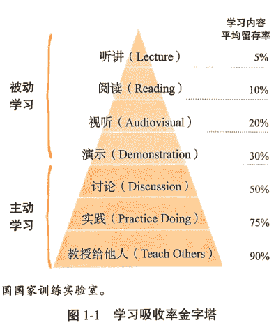

资料来源：美国国家训练实验室。

图1-1 学习吸收率金字塔

其中：
- 听讲方式学习，平均留存率5%；
- 阅读方式学习，平均留存率10%；
- 视听方式学习，平均留存率20%；
- 演示方式学习，平均留存率30%。
以上四种属被动学习、以输入为主。

而：
- 讨论方式学习，平均留存率50%；
- 实践方式学习，平均留存率75%；
- 教授他人方式学习，平均留存率90%。
以上三种为主动学习，需输出。

做课能加速成长的核心在于身份与方式转换：从单纯输入变为先输入后输出，从阅读者变为讲授者。当你以教授他人为目标阅读时，留存率大幅提升。长此以往，成长速度加快。

### 2. 实现知识变现：零边际成本的知识创收

做点额外收入的想法现在很常见，一方面想让业余时间更有价值，另一方面想为自己加一条现金流。赛道很多，我更倾向知识型副业。

好处有两点。一是做知识类副业会倒逼持续输入，成长是顺带的副产品；二是知识产品复用性极强。一次打磨后，后续几乎不增加生产成本就能反复售卖。比如录一门在线课程，前期投入有限，一旦内容被市场接受，后续每单都不需要重新制造，这就是边际成本趋近于零的长尾效应。

我自己做过几门课，《学以致用五步法》《亲子沟通力》《短视频剪辑课》《成为知识主播》。其中有门课上线已超过三年，依然在持续成交，这种可持续性让人很有安全感。

学会把一本书拆解成课，掌握做课的方法，经营知识副业，你也能拥有这样一款可长期复用的资产。

### 3. 把阅读推广变成个人影响力

拆书成课和阅读推广有什么关联？掌握拆书能力后，在线下办读书沙龙、在线上做讲书直播，本质上就是在推动全民阅读。

你是企业管理者，也能把书的内容整理成内训课分享给团队，帮助同事共同成长，这同样很有意义。

我认为阅读推广自带光环。职业生涯前十年我比较低调，后来转向阅读相关的工作，还上过报纸和电视。读书类的自媒体账号本身就容易吸引关注。

很多好书默默躺在书店和图书馆。如果你手里有想分享的好书，把书变成课就能让它走出去，让更多人接触到里面的知识。

所以学拆书成课，对自己、对他人、对社会都是正向的，完全可以当成一条副业来经营。

看到这里，你对做课的动力是不是更清晰了？

动手设计课程前，先把动机想清楚。是为了个人提升、知识变现，还是打造个人IP？目标明确了，后续设计才会有方向感。

## 本章总结

### 知识杠杆人人可握

本章想传递的核心是：知识付费不是大咖的专利，每个人都能用知识当杠杆。

就做课的价值来看，当前知识付费体量大、增速快，个人讲师类课程占比在提升，背后是碎片化学习需求上升、职业焦虑加剧、技术基建完善。

打工是用时间换钱，天花板明显；做课这类副业是用知识撬动复利，近乎零边际成本是核心优势。

在“一KO”五个一结构里，知识产品处于核心位置。做课的本质是把自己产品化，普通人也能借此加速成长、实现变现、推动全民阅读。先厘清做课的初心和动力，再往下走。

下一章会聊AI时代知识付费的“危”与“机”，看技术如何重塑行业。

## AI 时代，知识付费的挑战与机遇

### 讲师如何与智能助手协作

在整理书稿时，2025年初DeepSeek出现，我很快意识到用智能助手辅助课程设计，能明显提升效率和质量。

做课时常卡住的三件事，你有没有遇到过？

- 素材收集太慢
- 大纲写到深夜
- 课件反复修改

借助合适的工具，课程设计的效率会提升很多。

#### 1. 节省人力与时间
传统流程里，讲师往往要花六成以上的时间在资料搜集上，在报告、案例库之间拼凑信息。像DeepSeek这样的助手可以基于自然语言处理，自动输出包含核心观点、数据图、案例合集的素材包。大纲和课件的生成也能节省大量时间。比如一个原本要三天完成的框架，用工具辅助可能五分钟就能出初稿。

#### 2. 打开思路与灵感
过去靠自己冥想也不一定有好点子。现在用工具“抽卡”，能快速看到新视角，找到更满意的设计方案，做课的思路被打开了。

#### 3. 即时反馈与修正
对大纲和课件，工具可以给出即时的优化建议，避免闭门造车。

看到这里会不会觉得以后做课全靠工具就行了？其实不对。

最合理的方式是人机配合，各自做擅长的事，也就是“H-AI-H工作法”，即人定方向、工具执行、人再优化。其中H指课程设计者本人。

我建议分三步走。

#### 1. 需求定义：人要握住方向盘
做课程像开车，先要知道往哪走。讲师要厘清三件事。

- **垂直领域深度**：比如家庭教育，要先锁定亲子沟通、学习习惯培养还是儿童心理健康等细分方向，不能面面俱到。
- **用户画像精度**：通过问卷星等工具了解学员孩子的年龄段、主要痛点、期望目标。比如青春期亲子沟通课，学员可能是为孩子叛逆困扰的初中家长，也可能是因亲子冷战焦虑的高中家长，需求收敛后课程才更精准。
- **价值主张清晰度**：不要说“帮你搞好家庭教育”这种空话，要具体到“30天让孩子主动规划学习时间”“两周提升亲子沟通频率30%”，让用户一眼看到收益。

#### 2. 智能执行：让工具高效干活的要点
讲师做课时，工具可以承担这些工作。

- **选题调研**：用DeepSeek联网模式查看近期热度，比如“分析某领域近三个月的新趋势，给出三个适合新手讲师的方向”，后续我会讲如何高效找选题。
- **大纲设计**：输入需求后能快速生成有理论、有方法、有案例的大纲，后续我会分享我设计的做课智能体，填入需求即可出稿，比苦想高效。
- **课件制作**：工具能快速生成PPT，对新手很友好，能大幅提升效率和质量。但完全依赖工具，课程会缺乏灵魂，达不到商用标准。

传统与智能辅助的效率对比如下。

| 环节 | 传统做法耗时 | 智能辅助后耗时 |
| :--- | :--- | :--- |
| 选题调研 | 3 天（资料整合） | 2 小时（工具生成） |
| 大纲设计 | 3 天（逻辑梳理） | 5 分钟（智能生成） |
| 课件制作 | 3 天（设计+调整） | 30 分钟（模板套用） |

#### 3. 人类收尾：给成果画龙点睛
工具快但不够准，需要讲师收尾。

- **认知校准**：工具讲家庭教育时可能混淆虎妈式教育和放养式教育的适用场景，讲师要用专业知识核查，避免误导。
- **情感注入**：工具只能罗列亲子沟通理论，讲师加上自己应对孩子中考焦虑的真实经历，家长才会觉得“这老师懂我”，更有代入感。
- **效果预演**：润色后试讲，收集反馈再调整，像彩排一样，让正式授课更有底气。有平台测算过，优化后的课程完课率远高于纯工具课。

### AI浪潮下讲师的处境与机会

我推崇的“H-AI-H工作法”，是讲师和智能工具的最佳协作方式。

随着ChatGPT、DeepSeek等工具普及，AI像龙卷风卷走了旧规则。对讲师而言，这既是冲击也是重生的机会，关键看是被吹散还是借风飞翔。

#### 1. 智能带来的压力
- **知识权威性被质疑**：工具能迅速生成大量准确信息，学员课堂上会拿来对质，“老师你讲的和DeepSeek不一样”，很尴尬。
- **传统基础教学需求下降**：工具提供定制化个性化方案，基础教学需求会逐渐减少。
- **职业替代压力加大**：工具能完成部分基础教学，供给基础培训的讲师会面临危机。

#### 2. 智能带来的机会
- **提升课程设计能力**：更要注重创新和批判性思维，课程转向深挖问题、启发思考。
- **角色转向学习教练**：从知识提供者变为能力教练，学员要的不仅是知识，更是解决问题的能力。
- **聚焦高价值内容**：专注工具难以替代的复杂问题解决、创新思维培养等高价值内容，增加深度与广度。

在“H-AI-H”框架下，讲师角色更多元，既要会用工具提效，又要把控内容深度，最终提升教学质量。

AI时代，讲师既有“危”也有“机”，建议从知识传授者转型为学习陪伴者即情绪价值加能力教练者即能力价值，进而打造个人IP。

## 四定模型，助你用好 AI 工具

讲师怎么用好工具？我推荐“四定模型”。

### 1. 定角色：定义 AI 和自己的角色
合作基础先明确“工具扮演什么”“我扮演什么”。

- 给工具定角色：具体到领域和经验，如“有10年500强企业培训经验的课程设计师”，而不是笼统标签。
- 给自己定角色：如“我是某领域的资深讲师”或“新手讲师”，引导工具调整内容深度。
这样输出更贴合场景，减少幻觉。

### 2. 定目标：期望达成什么目标和效果
模糊目标如“做一门沟通课”会让工具无所适从，正确做法按“通过××课程帮助××用户解决××问题”公式设定清晰目标，这叫主题金线。

模糊与清晰对比：
- 模糊提示：做一门时间管理的课程。
- 清晰提示：设计一门时间管理课程，帮助职场新人解决拖延问题，须符合SMART原则。
目标越清晰，输出越符合要求。

### 3. 定任务：具体的需求或任务描述
让工具知道你要什么，如“给我提供一份[××]……”“给我非暴力沟通的定义、步骤和注意事项……”。需求越具体，结果越想要。

### 4. 定要求：你对结果的约束条件
用规则规范结果，例如：
- 字数：每知识点300字加100字案例。
- 结构：总分总或问题方案式，分小标题。
- 风格：幽默脱口秀或严谨学术，如“用幽默写作风格……”。
- 格式：如“用Markdown格式输出”，方便做思维导图。

四定环环相扣，让工具从模糊助手变成能干搭档。掌握它，课程设计、案例开发事半功倍。本书后面会详解工具在做课各环节的作用，这里先了解框架。

## · 本章总结

AI时代，知识付费正在剧变。AI像一把双刃剑，一边带来知识权威受质疑、基础教学需求减少、职业替代压力等挑战，一边倒逼讲师提升设计能力、转型为学习教练、聚焦高价值内容。

“H-AI-H”模式和“四定模型”指明了方向，既能借助工具提效，又能发挥人性优势为课程注入灵魂。

无论资深还是新手，都需要拥抱变化，在AI浪潮里找到定位。

那么普通人如何在知识变现浪潮起步？下一章揭晓适合普通人的路径。

## 第三章 普通人做知识变现如何起步

普通人想开启知识变现、读书变现，先要弄清核心问题：怎么把自己的知识变成别人愿意付费的产品？就像种地，先选对作物再谈丰收。本章从线上课常见形态说起，再聊如何一步步把知识变成可售卖产品。

### 课程的常见形式

前文提到“把自己产品化”，这里的产品就是网上的各类课程。看似眼花缭乱，其实主要是三种形式。

根据内容类型、交付方式和运营成本，线上课程可分为：

1. **录播形式：一次制作，多次成交**
   录播是最常见的，就是把想讲的内容提前录好，视频、音频或图文包上传平台售卖。写作课、Excel课多为此类型。
   最大好处是一劳永逸，花一个月录一套10节育儿课，上传后只要有人下单就能持续收钱，不用重复讲。适合时间有限想长期变现的人。缺点是前期投入大，内容不够好就卖不动。

2. **直播形式：“公域引流 + 私域变现”组合拳**
   直播能实时互动。分公域直播如抖音、快手、视频号，用于引流；私域直播如微信社群、小鹅通，用于变现。
   比如一位烘焙博主每周在抖音开三次免费直播教做蛋糕，故意留干货钩子“想知道怎么让蛋糕不开裂，社群里详解”。观众感兴趣就加好友进群，人多了再开收费私域直播，转化率高。

3. **社群形式：靠运营黏住用户的长线局**
   通过微信群、QQ群带着一群人学习，如读书会、训练营。核心不是卖内容，而是靠运营服务留人。
   好的读书会每天发书摘引发讨论，每周语音分享，每月线下见面。用户既学知识又交朋友，愿意长期跟随。训练营更重，有作业点评、直播答疑，适合需要系统学习和监督的技能，如翻书成课磨课会、写作训练营。

这三种是线上课，线下课分讲授型和互动型，后续课程设计方法同样适用。

### 新人知识变现三阶段策略

新人先做哪种课？很多学员靠“三步走”起步。

建议顺序：直播→社群→录播。

很多人觉得上来做直播难度大，其实恰恰相反。若一上来做录播，容易闭门造车，觉得上线前没人看见，进度就拖。

**第一步：先做直播课——检验内容，锻炼口才，一箭双雕**
很多人怕直播：没对镜经验，讲错怎么办，讲出去了谁买课？新人做直播重点不是赚钱，是试错和练兵。

做法很简单，选熟悉领域，如擅长收纳，就围绕“家庭收纳技巧”每天30~60分钟在抖音、视频号直播。一开始免费分享，比如第一天讲衣柜整理，第二天讲厨房收纳，结束时提醒观众关注、加粉丝团。

好处有三：能检验内容价值，直播没互动就说明不吸引；能锻炼表达，坚持一周说话更流畅；能积累第一批粉丝，这些人是潜在学员。

担心内容泄露？不用担心。看直播的大多是凑热闹，真想系统学习的人愿意付费。直播是碎片知识点，正式课程有完整体系、资料、答疑，完全不同。直播练出的讲课能力才最值钱。

线下授课也一样是“直播”。我从2018年经营帆书起，做了500多场线下读书活动和600多场线上直播，成长最快就靠这个输出过程。

**第二步：再做社群课——从公域引流到私域，建立信任，挖掘需求**
做了一段时间直播，手里会有潜在学员，这时可尝试社群课。社群课分轻量和重量，新人建议先从轻量的开始，如读书会、免费干货群。

以职场穿搭技巧为例做直播，短时间内能汇聚200位对穿搭有兴趣的人加你。把这批人沉淀到一个“职场穿搭交流群”，每天丢一篇有干货的穿搭文章，每周定一个小讨论话题，比如“周一怎么穿既专业又显精神”。同时在群里做一次轻调研，问大家最卡在哪，先是不会配色，还是不会根据场景选衣服。调研回来的数据，能帮你快速锁定真实痛点，为后面的课程做准备。

免费的社群运营只是第一步。下一步可以试水低门槛付费，比如9.9元的“3天穿搭实操营”。每天布置一个具体任务，比如用一件白衬衫打出三种不同风格，学员拍照打卡，你做简短点评。学员有参与感和获得感，你也能拿到一笔小收入。更关键的是，这类轻付费能筛出真正愿意为内容买单的人，他们就是后续高价课的核心种子用户。

**第三步：做录播课，从积累转向变现**

直播熟练了，社群里也沉淀了几百位铁粉，这时再做录播课才成立。前面已经通过直播和社群摸清了用户想要什么，课程设计自然更贴需求，也更容易卖。

我在帮助上万名想做课的学员时发现，这个路径复用性很强。已经很成熟的讲师，可以根据自己的目标灵活组合直播、社群、录播，不必严格按三步走。

### 什么算一门爆款好课

好课像一个人，要有灵魂、有骨架、有血肉、有颜值、有价值，缺一个都不完整。

#### 1. 五大要素全拆解
- **选题即灵魂。** 方向错了，投入再多也白费。
- **框架即骨架。** 结构清晰、逻辑顺畅，学习才顺手。
- **内容即血肉。** 要扎实、用得上，能做到深度学习和即时应用。
- **课件即颜值。** 最后呈现的面貌，好看能加分，别让好内容被埋没。
- **交付即价值。** 课程要同时给创作者带来收入，给学习者带来成长。

#### 2. 好课的五步打法
结合以上要素，做一门课一般走五步。
- **确定选题：** 从用户需求和痛点出发定方向。
- **收集素材：** 围绕选题把需要的资料备齐。
- **搭建框架：** 画好大纲，每个模块明确学习目标。
- **制作课件：** 完成课件、试讲、优化，录播课则要录制成片。
- **课程变现：** 多平台发布，用波浪式节奏推进销售。

后面的内容会把这五步展开讲清楚。

### 本章小结
起步路径很清晰：先用直播练手引流，再用社群建立信任、找需求，最后用录播实现收入。做课时记住选题、框架、内容、课件、交付五要素，按确定选题→收集内容→设计框架→制作课件→实现变现的顺序推进。

知识变现并不难，难的是迈出第一步。很多人担心讲得不够好没人买，但只要内容真正帮到人，就会有付费意愿。即便起步只卖出十份，也是验证方向正确的重要信号。

每个人手里都有可变现的知识，只是自己没意识到。别低估自己的经验，你觉得平常的技巧，对别人可能是刚需。把知识分享出去，下一个变现的人也许就是你。

理解了变现逻辑后，下一步进入“做课篇”，手把手教你把一本书变成一门课程，具体讲翻书成课五步法。

## 第二篇 做课篇：翻书成课五步法全解析
——从选题到变现的标准化流程

### | 引言 | 从种子到课程的成长之路
读完一本书热血沸腾，或在某个领域多年深耕，你其实已经有了做课的种子。关键是如何让它发芽结果。本篇就用一套可复制的翻书成课五步法，把模糊的想法变成可交付的产品。

### 做课本质是“翻译”
很多人以为做课要天赋，其实更像翻译。把书里的知识、脑中的经验，翻译成学员能听懂、能用的内容。樊登把书翻译成百人听的讲书，你也可以把自己的知识库存翻译成课程。

这套翻译密码就是选题确定、内容收集、框架设计、课件制作、课程变现。五步拆解复杂流程，让操作变得具体。

### 五步对应五种焦虑
做课的担心大多集中在五个地方，每一步都有解法。

1. **选题焦虑：我有东西，但不知道学员要什么**
   为何“AI工具在职场中的应用”能快速爆红？因为它踩中了真需求、大市场、强痛点的逻辑。第一步教你用卖课测试、平台数据、AI工具来精准定位痛点，而不是靠猜。

2. **素材焦虑：资料太多无从下手**
   很多人陷入资料囤积。高手像厨师按需取材。第二步教你用全局理解法从是什么、为什么、怎么做三个维度筛选，再用颗粒适度原则避免信息过载。

3. **结构焦虑：内容散，讲着讲着就跑偏**
   流水账课程学员抓不住重点。第三步教你用认知圈结构、要素型结构等逻辑，把零散知识点串成项链，层次分明。

4. **呈现焦虑：课件丑、重点不明**
   课件是第一印象。第四步的要点是文字精简、图表直观、动画克制，让课件成为无声助教。

5. **推广焦虑：做好了没人知道**
   酒香也怕巷深。第五步用浪潮式发售推动购买，从造势期好奇钩子，到预售期种子用户激活，再到发售期限时福利，让变现更自然。

### AI是加速器，不是替代者
AI在五步中都是放大器。
- 选题时，DeepSeek可帮你分析趋势、批量生成选题。
- 收集时，AI能快速提炼书中观点、生成思维导图。
- 设计框架时，专属AI智能体1分钟生成大纲。
- 做课件时，WPS灵犀可自动匹配模板并生成配图。
- 变现时，AI能写朋友圈文案、做促销海报、分析购买意愿。
记住，你是主人，AI是工具，底层逻辑清晰才能用好工具。

### 出发前的三件事
正式开始前建议准备：
- 一个做课笔记本，记录想开发的方向，哪怕是“如何提升亲子沟通力”这样模糊的想法。
- 一本练习书，比如《非暴力沟通》《掌控习惯》等。
- 常用AI账号，豆包、DeepSeek等，熟悉基础功能。

不要一上来就做体系课，先练好90-120分钟的直播课，或30分钟左右的录播课。单节会了，体系自然会。

本篇以直播课为例讲完整流程，掌握后第三篇再讲体系课设计。

接下来从课程选题确定开始，聊聊如何找到那个让学员眼睛一亮的灵魂。

## | 第四章 | 选题确定：精准定位，直击核心需求
“选题是课程的灵魂。”这是共识。

我见过有讲师花半年打磨职场沟通课，案例丰富却销量平平，复盘发现市场上同类饱和，且没切到真实痛点。反过来，新人讲师在2025年初抓住“AI工具职场实战应用”这一新需求，半个月上线就爆了。

选题不准，努力白费；选题精准，事半功倍。

### 学员买课的动机
有人为提升技能，比如学办公软件求晋升；有人为兴趣爱好，比如美术音乐；有人为解决实际问题，比如亲子沟通。

这里可以用KSA模型理解课程价值。
- **K知识：** 学员要理解和记忆，需动脑。
- **S技能：** 学员要动手实操，需学以致用。
- **A态度：** 学员要改变价值观，需动心。

好的职场课要兼顾三者：传授行业知识，培养实操技能，塑造职业素养。

成人学习有两大特点：目的性强、时间碎片化。所以课程要短平快、强实用，能让学员学完马上用。

比如有人PPT总做不好，买了一门场景化的PPT课，按自己节奏学习，水平提升后被领导认可。家长沟通不畅，买了亲子沟通课，学会读懂孩子心理后关系改善。

总结就是：学员买课是为了通过动脑获知识、动手获技能、动心改态度，最终解决问题。

### 有生命力的选题长什么样
学员不是来听你自嗨的，是来解决具体问题的。樊登说低风险创业的核心是优雅解决社会问题，做课同理。

我归纳为三个关键词：真、大、痛。

## 翻书成课：AI时代打造爆款课程实战手册

### 1. 真需求：从“我以为”到“学员要”
选题要对准真实痛点，不是讲师的主观臆想。

验证很简单：能不能卖。做出来推不动，基本就是伪需求。

课程设计阶段可在知乎、小红书看话题讨论量，看知识付费平台同类销量。2024年家庭教育课里，亲子沟通技巧销量同比涨68%，就说明需求真实。

真需求之外还有真本事。你得对选题有真实经验和深刻理解，不能靠网上拼凑或纯AI堆内容，否则运营过程会出问题。

### 2. 大市场：小池塘养不出大鱼
市场规模决定天花板。判断看三点：
- 人群基数：0-6岁家长群体远大于三孩家庭家长。
- 付费意愿：职场技能>兴趣类。
- 复购可能：课程+训练营模式复购率可达30%，单次课基本没有。

人群大、愿付费、可复购，才算大市场。土壤贫瘠，树长不高。

### 3. 足够痛：从可有可无到必须解决
痛点越强，付费越快。2020年初居家办公潮，我推出“玩转社群运营”课，当月卖出500多份。

判断信号是是否触及核心利益：晋升、升学、收入等。影响核心利益的问题，学员愿意掏钱。

有人问，为何有些不“痛”的课也能卖？那是IP卖课。粉丝基础够大，内容不痛也能卖。但新人没有IP，必须靠选题的痛点驱动。

## 三步漏斗锁定爆款选题

### 1. 第一步：定赛道——找准方向
赛道像土壤，肥沃才好长。擅长茶艺的讲师，茶文化赛道反馈平平，转到办公室养生茶疗赛道结合职场健康就火了。技能必须放在能承载价值的场景里。

选赛道三原则：
（1）兴趣、技能、问题的交集。如樊登读书赛道，兴趣是读书，技能是讲书，能解决听众问题。对别人不一定适用，要结合自身。
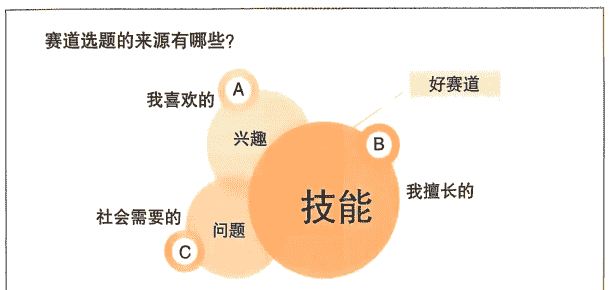
（2）具备可持续性。避免短期热点，优先选能支持“课程+训练营”的赛道。课程零边际成本复用，训练营提升粘性促复购，形成良性循环。
（3）有差异化空间。新人避免正面硬刚红海赛道，选细分领域或独特视角。比如职场女性领导力，比泛职场更有穿透力。

### 2. 第二步：定课题——找到主题金线
课题是赛道里的具体切入口。家庭教育赛道里可以做亲子沟通技巧，也可以做青春期心理辅导，甚至细化到孩子未来规划。

如何让选题既叫好又能成交？先定住一条贯穿始终的主线

想做一门口碑与转化兼备的课程，关键在于抓住一个可复制的原创视角，我称之为主题金线。

#### （1）什么是“主题金线”

主题金线是一条贯穿整门课程的骨架，由学员、情境、痛点、解法四要素串联。

梳理时要自问三件事：这门课服务谁？学员在何种情境下会卡住？能交付哪些可落地的解决办法？

厘清后就能获得清晰定位：这门课要为哪类人、在怎样的场景里解决什么问题、提供何种方案。

以家庭教育赛道为例，可面向青春期孩子家长做亲子沟通训练，也可做青春期心理支持专题。

亲子沟通训练的金线可表述为：为养育青春期孩子的家长，在亲子沟通情境中，提升沟通效能，提供有效倾听、非暴力沟通等做法。

定课题本质就是定金线。好课一定围绕特定人群、在特定情境下解决问题展开。

> 学员 情境 诉求 解法
>
> 主题金线
>
> 一句话锁定金线：
>
> 助力 _(学员)_ 在 __ 情境中，满足 __ 诉求，提供 __ 解法。

青春期心理支持课程的金线则是：助力正处青春期的孩子，在学业、生活、成长情境中，满足健康成长的诉求，提供自我认知、情绪调节、自我疗愈等解法。

可以看出，即便赛道相同，受众不同金线就不同；解决的问题不同金线也不同。

#### （2）前期锁定金线有什么用
开课初期把金线定牢，能少走弯路，主要价值有三。

① 方向不漂移。金线确定后，受众、情境、痛点基本固定，全课都围绕同一类学员在特定情境下解决既定问题制作，不会跑偏。

② 内容更精炼。讲师容易发散过度，金线能框住讲解边界，确保所有内容紧扣主线，避免收不住。

③ 案例不跑题。概念、工具、流程都需要案例支撑。情境一旦明确，素材就必须匹配情境，比如家庭教育课就不适合硬塞职场案例。

#### （3）一门课能有几条主题金线
答案只能有一条。

90分钟线上直播，一条就够了。

那七节的系列课呢？也只能有一条总金线。每节课有自己的子金线，看起来像是两条，实则子线是总线的分支，二者像大括号与小括号的关系。总金线统领整套课，小金线支撑单节，多节合力托起整体主题。

### 如何挖到爆款选题
明白金线价值后，有三条可操作的路径。

(1) 书籍成课。在既定赛道里挑选一本或几本热销图书，把精华内容提炼重组为课程，成功率较高。

樊登在讲“樊登讲书”时提到，他第一次带公共关系课，便把新华书店相关书籍买回做笔记、画思维导图、做课件，讲了几年后成为该领域专家。可视为书籍成课的实践。

书籍是做课的优质素材库，用得好能大幅提升选题与备课效率。下一节会讲如何给一本书提炼金线。

（2）主题成课。紧跟赛道内的热点话题，公式可概括为：热门话题 + 课程赛道 = 爆款选题。

比如你是家庭教育讲师，校园霸凌事件必然关注。套用公式：校园霸凌事件 + 家庭教育赛道 = 爆款选题，如“家长注意：教会孩子规避校园霸凌”，这类主题易获家长青睐。

（3）技能成课。把自己掌握且有价值的核心能力提炼出来做成课程，也是好选题。

《纳瓦尔宝典》提到“把自己产品化”，关键词是“自己”和“产品化”。把正在做、且有生产力的有价值事情产品化、课程化，帮助更多人，即实现自我产品化。

成熟讲师通常组合拳并用：参考热书、追热点、提炼自身技能。新手建议先从书籍成课练习，提升做课能力；再尝试主题成课，找准方向；最后走向技能成课，打造可长期运营的小而美的一人企业。

### 3. 第三步：定产品——找对交付形式
#### (1) 产品形式的定义
产品形式指课程内容以何种形态交付给学员。常见形态有录播课、直播课、社群课。

#### (2) 如何挑选产品形式
选型要看交付目标与学员学习需求。

① 录播课：适合偏知识和基础技能。优点是可反复观看，时间自主。缺点是互动弱，学习中遇到问题无法即时解答，需靠客服或社群补位。

② 直播课：适合知识、技能、态度类内容。优点是互动强，可实时答疑。缺点是对讲师临场要求高，学员需固定时间在线。直播边际成本较高，建议每场兼顾两项目标：学员成长与讲师转化。

③ 社群课：如读书会、训练营，适合需要实践反馈的知识技能态度类内容。优点是能营造学习氛围，学员互助。缺点是运营成本高，讲师投入大。因此社群课要么定价更高，要么设计后端转化产品。

有经验的讲师会组合使用三种形态打造产品体系。新手可先做直播练表达，再做社群练运营，最后做录播实现规模化变现与深度服务。

## AI 助力选题确定
AI 正在加速传统选题流程，通过工具能更快找到适配自己的课程方向，提升设计效率与质量。

以 DeepSeek 为例，可实现以下目标。

### 1. 书籍成课：基于指定书籍挖掘有卖点的选题
核心价值：依托书籍做课程设计，精准抽取主题金线。

提示词示例：“我是一名［家庭教育］讲师，想把［卢森堡博士］著的［《非暴力沟通》］做成90分钟线上直播课，学员是［0～6岁孩子的家长］，目标是［帮助家长提升家庭教育质量，改善亲子沟通力］，请给出5个贴合学员需求的课程选题。”

备注：使用时建议打开“深度思考 R1”和“联网搜索”。

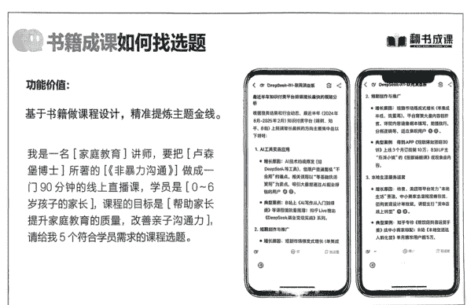

### 2. 主题成课：趋势捕捉与痛点挖掘
核心价值：找热选题，避免做过时内容。

提示词1：趋势捕捉型。
“你是 [家庭教育领域的讲师和专业课程设计师], 请分析 [家庭教育] 领域近3个月新趋势，给出3个适合新手讲师的选题方向，并用通俗语言说明市场潜力。”

提示词2：痛点挖掘型。
“你是 [家庭教育领域的讲师和专业课程设计师], 针对 [0~6岁家庭教育] 场景的典型困境，设计3个课程选题。”

备注：使用时建议打开“深度思考 R1”和“联网搜索”。

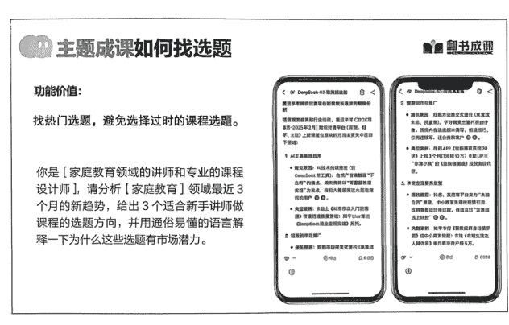

### 3. 技能成课：量身定制课程选题
核心价值：把个人经验优势告诉 AI，让它精准推荐。

提示词：“我是一名[××]领域讲师，想找今年热门选题。我的经验有[××]，优势是[××]，目标是[××]，劣势是[××]。请结合社会需求和未来3~5年趋势，给出5个匹配的选题。”

备注：使用时建议打开“深度思考 R1”和“联网搜索”。

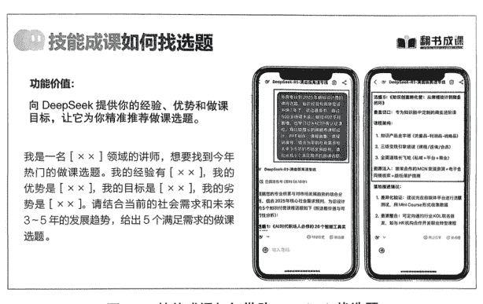

三种 AI 辅助选题方式都值得多试，特别是第三种“技能成课”。把经验、优势、劣势、目标全部提供给 AI，回来的建议往往让人惊喜。线下培训时学员常惊呼：“原来我能做这门课？我怎么没想到！”赶紧试试吧。

## · 本章总结 ·
### 选题是科学与艺术的结合
好选题既要理性——看数据、查趋势、算竞争，也要感性——懂焦虑、知渴望、解困惑。课程为学员提供解决方案，讲师是解决问题时的向导，向导需要共情与权威。

本章从购买动机切入，用 KSA 模型说明课程须兼顾知识、技能、态度；提出“真、大、痛”的筛选标准，结合三步漏斗锁定爆款，重点阐述主题金线价值；并介绍了 AI 赋能选题的新方式。

定好选题只是起点，如何把选题转化为系统化知识体系是关键。下一章将探讨内容收集。

表 4-1 课程选题设计与自检表

| 1. 课程基本信息 |
| :--- |
| 课程名称 |
| 学员群体 |
| 应用场景 |
| 学员需求 |
| 解决方案 |
| 课程目标 |
(续表)
| 2. KSA 模型检查 (知识 / 技能 / 态度) |
| :--- |
| 知识维度 (K) | □是否提供可理解记忆的知识点? □是否有系统化的知识框架? |
| 技能维度 (S) | □是否包含可实践的技能训练? □是否提供工具 / 模板 / 案例? |
| 态度维度 (A) | □是否引导学员行为转变? □是否设计情感共鸣点? |
| 3. 选题标准评估 (真 / 大 / 痛) |
| :--- |
| 真需求验证 | □是否通过数据验证需求 (如平台搜索量)? □是否匹配讲师真实经验? |
| 大市场评估 | □目标人群基数是否足够大? □是否有复购可能性 (如训练营)? |
| 痛点迫切性 | □是否影响学员核心利益 (晋升 / 收入 / 健康)? □学员是否愿意立即付费解决? |
| 4. 产品形式选择 |
| :--- |
| 交付形式 | □录播课 (知识 / 简单技能) □直播课 (互动 / 深度教学) □社群课 (训练营 / 实践反馈) |
| 5. 整体评估 |
| :--- |

## 第五章
## 内容收集：给课程注入血肉
如果说选题是灵魂，内容就是血肉。内容收集的质量直接决定课程受欢迎程度，无论线上课、读书会还是训练营，核心始终是内容的深度与实用性，内容为王。

很多人做课易陷入两极：要么埋头找资料囤积信息却无从下手，要么急着列提纲导致内容空洞。

选题确定后，先列大纲还是先收集信息？没有绝对对错，要看知识储备。

建议：若对选题已有丰富存量知识，可先列初稿提纲，再围绕提纲补信息并优化；若属于增量知识、了解有限，则先广撒网收集，再整理提纲。

本章先谈内容收集，为课程搭建血肉。

## 内容收集的原则
收集信息时须守住基本原则，我总结为以终为始、全局理解、颗粒适度。

### 原则一：以终为始
想象自驾北京到西藏，会先研究路线还是先加油？显而易见。

做课也一样，明确目标是第一步。目标就是主题金线：课程要帮什么用户在什么场景解决什么问题，提供什么方案。

金线确定后围绕它收集，就能以终为始。

金线的三大价值仍是：主题不偏离、内容不多余、素材不跑题。

例如2023年我设计“亲子沟通力”课时，为达成目标，我读了十多本相关图书，听了20多期樊登讲书，搜集他人读后感和书评，还整理大量相关视频素材做丰富。围绕金线收集能大幅提升效率，避免迷路。

### 原则二：全局理解
盲人摸象的故事说明，单一视角难以把握全貌。收集知识须从三个维度：What是什么、Why为什么、How怎么做。

What：概念、定义、基本原理，帮助学员理解。
Why：原因、意义、价值，给予动力。
How：应用方法、步骤、技巧，达成学以致用。

以“无条件的爱”为例：
What：建立在理解、尊重、接纳之上，不设条件支持孩子成长，温柔而坚定。
Why：能建立良好亲子关系，增强自尊自信，塑造积极人格，增进心理健康。
How：接纳尊重孩子，认真倾听理解感受，给予支持鼓励和陪伴，耐心包容，提供稳定安全环境。

三维收集能让理解更全面，课程更扎实。

### 原则三：颗粒适度
新手常吐槽：“我做了200页育儿笔记，做课时90%用不上。”问题是颗粒过小，细节淹没主线。

信息有颗粒度之分。颗粒越小越细，越大越粗。

过大则宏观空洞，学员觉得不接地气；过小则繁琐拖沓，费时费力且让人厌烦。

做到适度关键是明确课程目标和学员背景。入门课颗粒可小些，进阶课则要适中。

同一个主题，入门课颗粒偏小利于接受，进阶课颗粒过小会冗余。颗粒度不是越小越好，而是合适最好，能在有限时间内传递最有价值信息。

## 内容收集的种类
收集需多元，包括文字资料、图片资料、视频资料、竞品课程资料。

### 文字类资料
文字资料是课程骨架，含定义、原则、流程、案例、专家观点、名言警句等，为课程提供理论基础和案例支撑。

以“时间管理”为例，可收集基本定义，如“通过规划控制时间使用以提升效率的方法”；原则如“重要紧急四象限”；流程如“目标设定、任务分解、计划制订、执行调整”；案例如成功人士的时间管理实践；专家观点等。

收集渠道有书籍、论文、专业杂志、内容平台，也可借助搜索引擎和AI生成，使用时需辨别筛选，保证准确权威且实用。

第五章 内容收集：高效整合，构建课程血肉基石

文字型笔记最容易碎片化，把零散摘录汇入一张关联图，脉络便会立刻清晰，后续做课时调用与复用也更快。之后我会展开说明如何借助智能助手快速产出课程地图。

### 图片类资料
视觉材料具直观张力，能显著提升课程画面感。
书封可以先让学员形成整体印象；权威人物的肖像有助于增强可信度；制作 PPT 时的配图则能把抽象概念讲透，学习体验更顺畅。
图类素材的集中搜集多发生在制作期，但在资料收集阶段就有意识留意优质图源，对后期呈现是加分项。

### 视频类资料
影像表达更立体，价值也很突出。
名家对书籍或知识点的解读，提供多角度理解路径；案例短片把抽象内容落地，助力掌握实操；影视片段则能提升趣味，点燃学习兴趣。
积累多元视频类型，让课程形式更丰富，质量也会跟着提升。

### 竞品课程参考
拆解同类课程是设计好课的关键环节。研究市场上已有的精品，了解大纲如何排布、内容如何铺陈，哪些做法值得借鉴，哪些问题需要规避。吃透他人的成功经验可少走弯路，找准短板就能做出差异化打法，课程更有辨识度。

## 素材整理的流程

### 环节一：搭建项目文件夹，统一管理
收集之初先建一个项目仓。
它相当于一门课的专属空间，所有与主题相关的材料都归进去。主目录下再按类型建子目录，比如图文、影像、参考等，分类存放。
我做“成为知识主播”时，先在电脑里建了一个同名主目录，里面按个人习惯细分多个子目录，把各类文件集中归档。
好处是信息不丢失、不混杂，检索更快，整个收集过程更有条理。

### 环节二：绘制头脑图，把文字可视化
头脑图是梳理文字的利器，能把零碎资料整合成清晰的知识骨架。
可用 Xmind 等软件，先把对课程的初步想法写成大纲，形成基本框架。资料进来后，把内容粘贴到对应分支下，持续丰富完善。
操作思路：中心位置写下课程主题，按结构建一级分支，再在每个分支下细化二级分支，把相关信息归位。
图能直观呈现结构与逻辑关系，为整体规划和优化提供依据。

### 环节三：持续迭代，精益求精
收集是动态的。随着信息增多，要持续对目录和头脑图做补充、更新、整合与优化，保持课程跟得上时代和学员需求。
比如做“AI 成课”这门课时，随着技术和市场变化，我会及时把新工具、新方法补进目录和地图，并据此调整大纲，同时剔除重复或过时内容，让内容更精炼实用。
持续迭代能保持对课程的敏感度，确保时效与竞争力，也让结构越做越扎实。

## 素材获取的策略

### 精读策略：从书籍提炼做课线索
书籍是“书成课”的核心渠道。樊登早期做公共关系课，就是靠读书来搭框架。
以做课为目标的阅读，我常用四步法：

1. 阶段一：检视阅读，锁定主题主线
主题主线可理解为：为谁、在什么情境、解决什么问题、提供什么方案。
不必急着翻正文，先做快速扫描，把握全书结构和主旨，锁定核心主线。

首项关注书名。
书名浓缩中心的表达，是定位的感性说法，能透露写作方向和要解决的问题。
比如《你就是孩子最好的玩具》，书名就点明这是家庭教育类内容，且作者认为父母应是孩子的最佳玩伴。

次项关注副标题。
副标题是对书名的具体化，有时会给出方法或工具。
同书的封面文案写“奠定父母与孩子一生亲密关系的情感引导书”，就明确了核心工具是情感引导。

目录是全书骨架，能看出作者的思路和重点分布。
该书目录大致可分为四块：管教难题与情感引导的作用、情感引导的重要性、按年龄段的使用方法、无条件之爱的总结，整体接近What-Why-How的结构。

序言体现作者的初衷与价值观，常藏着课程收尾的升华点。
作者在序言里讲述了自己的育儿实践与情感引导的效果，总结为让孩子从出生起就理解并学会管理情绪，学会被接纳。
扫描之后，主题主线就清晰了：帮助家长在家庭教育场景中满足科学养育需求，提供情感引导方案。带着这条线阅读，效率会高很多。

2. 阶段二：沉浸式精读，把握全貌
沉浸式精读就是一字一句走一遍，适合判断是否值得深挖的书。
看似笨拙，实则最有效。名家访谈里也常提到，重要书籍仍会用精读。
通过这一步，能对全书形成整体印象，为后续设计打基础。

3. 阶段三：分析阅读，确定核心章节
带着做课思维去读，在脑中开始构建课程。
可以自问三点：哪些内容是支撑主题主线的核心知识？课程章节如何划分、逻辑如何？用什么案例、数据、关联知识点来支撑？
正如柯维所说，事物在脑中先创造一次，再付诸实践。分析阅读就是课程构思的起点。

4. 阶段四：主题式阅读，拓宽内容
围绕主题拓展阅读或检索资料，让课程“源于书籍，高于书籍”。
例如把《你就是孩子最好的玩具》做成课时，书中讲到亲子沟通，我会再读《正面管教》《可复制的沟通力》《P.E.T父母效能训练》等作补充。
这与樊登的“化学讲书”类似，不是搬运，而是融合理解和经验进行扩展。
四步反复练习，书籍成课的能力就会形成。

### 借助内容平台：拓宽信息来源
数字化时代，信息渠道非常多元。百度、必应、搜狗等搜索引擎是基础，学会用关键词组合精准检索并及时记录。
知乎、帆书、豆瓣、得到、抖音等平台也能提供丰富的观点和案例。
智能助手如 DeepSeek、豆包、ChatGPT 则能实现高效精准的知识服务，下面重点讲它的用法。

## 智能助手赋能素材收集
使用智能助手收集素材时，我会用“四定模型”来约束输出质量：
定角色，明确助手和自己的定位；定目标，即主题主线；定任务，说清楚具体需求；定要求，限定结果的边界。
这样既能高效获取素材，也能保证针对性和实用性。

文字类内容大致分 What、Why、How 三层，下面分别举例。

（1）What：定义原则，理解记忆
提示词示例：
本人是讲师，正在面向［职场人士］设计一门课程，课程中需要［微习惯］的定义，请给出一个［简短、易理解的概念］，并且［标注出概念中最重要的三个关键词］。
说明：角色、主题主线、输出要求都写清楚了。标注核心词是为了课堂互动，可做填空题，提升留存。
收集的资料要和教学手段配合，效果才会更好。
图 5-2 展示了借助 AI 获取 “What” 信息的示例。
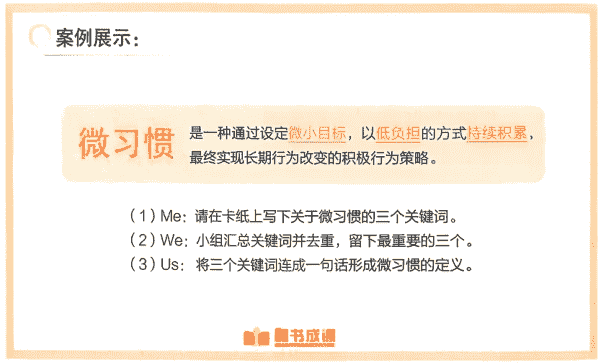

（2）Why：引发思考，促进行动
提示词示例：
我是一名 [人工智能工具培训师], 面向 [讲师] 设计一门课程, 课程中 [需要解释讲师不会使用 AI 工具可能带来的潜在危机], 请给出 [3 个讲师务必学会 AI 工具的理由], 并且 [对每一个理由给出简短的诠释]。
授课效果：
图 5-3 展示了借助 AI 获取 “Why” 信息的示例。

### 案例展示:
# 为什么讲师一定要学会使用 AI 工具?
- 1. 竞争力崩塌预警
  传统备课 3 天, AI 辅助 30 分钟
- 2. 知识权威断层危机
  73% 学生优先检索 AI 答疑
- 3. 行业淘汰预警
  AI 教学能力年增 67%
> 淘汰你的不是 AI, 而是会用 AI 的讲师!

（3）How：方法步骤，学以致用
提示词示例：
我是一名 [家庭教育讲师], 正在设计一门亲子教育课程, 课程中 [需要向家长讲解清楚育儿中有效倾听的步骤], 请给出 [家长容易理解和实操的有效倾听的步骤], 并且 [把每一步的注意事项解释清楚]。
授课效果：
图 5-4 展示了借助 AI 获取 “How” 信息的示例。
### 案例展示：家庭教育中的有效倾听
- 第一步：准备倾听——创造适宜环境
- 第二步：专注倾听——给予充分关注
- 第三步：理解倾听——解读深层含义
- 第四步：回应倾听——给予积极反馈
- 第五步：持续倾听——保持耐心和坚持

（4）案例收集：精准案例，深度分析
案例可用于分析、角色扮演等教学。案例分现成和 AI 撰写两种。
提示词示例：
我是一名 [ 职场技能讲师 ]，正在设计一门 [ 职场中的刻意练习 ] 的主题课程，课程中需要学员做案例分析，请给我提供 [3~5 个职场中因为做刻意练习而取得成就的案例，可以来自现实，也可以是耳熟能详的影视剧片段]，让学员通过案例分析，[ 理解刻意练习在职场中的重要性 ]。
授课效果：
图 5-5 展示了借助 AI 收集案例的示例。
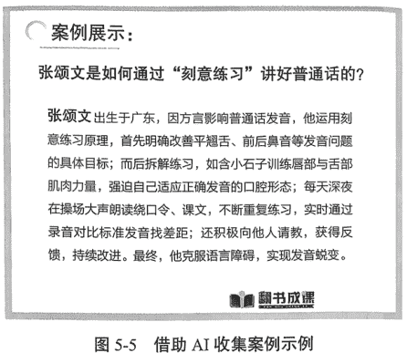

（5）案例撰写：基于场景，撰写案例
提示词示例：
我是一名［家庭教育讲师］，正在设计一门［非暴力沟通］的课程，课程中需要学员做案例分析，请给我设计［育儿中的一个场景，展示暴力沟通和非暴力沟通的两种沟通方式，各 200 字以内］，让学员针对这个场景做案例分析，从而［理解非暴力沟通在实际运用中的技巧］。
授课效果：
图 5-6 展示了借助 AI 撰写案例的示例。
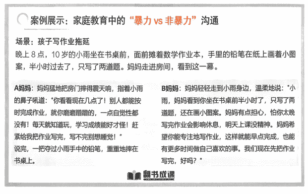

（6）图片设计：场景搭配，图文并茂
可用豆包电脑客户端生成插图。
提示词示例：
图片风格为「电影写真」，一位妈妈蹲下来在认真地看着孩子，孩子看起来很委屈，但是妈妈一点也不着急，很耐心地看着孩子和倾听，比例 [2:3]。
操作界面：
图 5-7 展示了借助 AI 设计图片的示例。
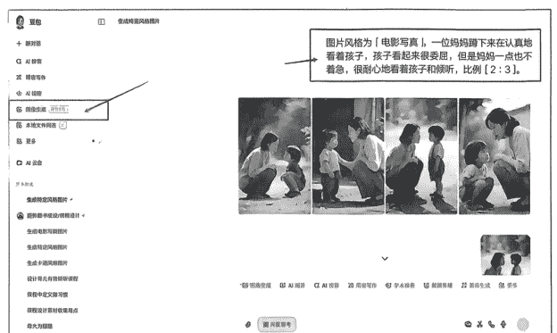
在操作界面可手动选风格和比例，提交后即可得到适合 PPT 的插图。

（7）视频收集：耐心筛选，优质清晰
视频素材需要细心甄别，优先选择画质清晰、内容权威的来源，保证课程观感和专业度。

## 第五章 内容收集：高效整合，构建课程血肉基石

挑选教学片段时，优先考虑豆包是比较务实的办法。与市面上大多数智能助手相比，豆包的最大便利是能直接给出素材在抖音上的原始链接，而豆包本身属于抖音体系，拿到链接后即可立即在线试看、快速判断可用性，整个链路比较顺畅。

### 提示词举例：

我是一名 [家庭教育讲师]，正在设计一门 [提升亲子沟通力] 的课程，课程开场部分需要一个 [影视片段或公益视频，视频能够表现出父母的言行对孩子有很大影响，让学员看完之后有很强的共鸣]，请给我 [3~5 个符合要求的视频名称和出处]。

### 操作界面：

图 5-8 呈现了借助智能工具搜集视频的情形。

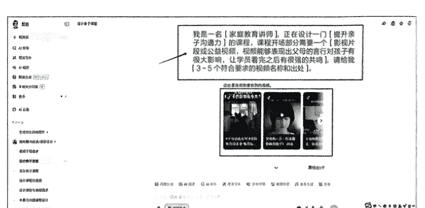

图 5-8 借助 AI 收集视频示例

示例里，豆包会列出若干条候选片段，拿到结果后需要人工从中挑出真正契合教学需求的条目，再到抖音客户端完成保存。操作时建议注意两点。

①筛选视频。甄别片段需要耐心，有些看起来不错，却因多次转剪导致画质下降、背景音混乱而无法使用。可以先用片段名称在抖音内溯源，重新检索后按点赞量、发布时间等维度排序，慢慢挑到满意版本，再借助其他工具保存到本地设备。

②使用视频。尽量选用横向素材，16:9 最佳，若原片竖向可用剪映裁切。画面要清晰，背景音乐不宜复杂，转场尽量干净。教学中使用视频可记口诀“先抛问题后互动”，让学员带着疑问观看，结束后及时展开讨论，效果会更好。

看完视频后安排讨论分享，能获得更理想的反馈。

### （8）高阶技能：用 AI 工具生成思维导图。

借助智能工具快速生成课程思维导图，也是教师提升备课效率的重要能力。相当于站在前人肩膀上，能把初稿结构和素材一次性收拢。

### 提示词举例：

我是一名［家庭教育讲师］，正在设计［提升亲子沟通力］的课程，请你［把亲子沟通的重要知识和工具整理成一张思维导图，至少有 3 级结构，还要有相关案例支撑知识点］。

这张思维导图的作用是［辅助我做课程设计，课程是面向 0～10 岁的孩子的家长，所以你给出的思维导图不仅要有亲子沟通力的理论基石和可实操的技巧，能够真正帮助家长理解原理和学以致用，还要有一些案例做辅助，案例最好是近 1～2 年内耳熟能详的相关案例］。请［以 Markdown 的格式］呈现。

图 5-9 演示了借助 AI 生成思维导图的情形。

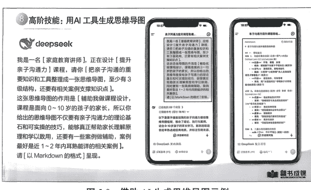

图 5-9 借助 AI 生成思维导图示例

### 操作步骤：如何使用 AI 三步生成思维导图？

（1）打开 DeepSeek 输入提示词。
要先厘清导图的用途、受众、应用场景，并指定输出为 Markdown 文本。

（2）下载 .md 思维导图文件。
在 DeepSeek 网页端生成后，点击右上角的“下载”按钮，将 .md 后缀的文件保存到本地。

（3）打开 Xmind 软件，导入 .md 文件。
Xmind 2023 及以上版本支持直接读取 .md 文件，也可到官网下载对应版本，或使用其他兼容的思维导图工具。

图 5-10 是 Xmind 导入 .md 文件之后的效果。

掌握此法后，讲师搭建课程时能大幅缩短资料收集时间，基本可以把初稿大纲和素材一次性集齐。当然初稿并不完善，需要在 Xmind 界面中对结构和内容进行校核、删改，并把其他渠道的信息补充进去，最终形成可支撑整套课程的导图。

使用 AI 生成思维导图的核心要点可归纳为：

①目标：导图是为了服务课程设计，而不是追求视觉好看。

②要求：需求和用途要说清楚，围绕“主题金线”提问，生成的结构才会更贴合做课。

提升亲子沟通力思维导图

| 层级 | 内容 |
| :--- | :--- |
| **一、理论基石** |  |
| 1. 亲子沟通的核心意义 | 读懂孩子内心：沟通打开情感通道、建立信任的基础；例：家长先了解孩子害怕的原因再回应，而非直接指责 传递价值观与规则：日常对话中潜移默化影响认知；例：通过生活事件讨论帮助孩子辨对错 培养独立思考：鼓励表达并自主解决问题；例：孩子打碎碗后坦白，家长肯定诚实 |
| 2. 常见沟通误区 | 标签化表达：如“你总是这么懒”易让孩子自我否定；例：妈妈抱怨“不爱说话”，孩子更沉默 单向灌输：打断孩子的倾诉，如对学校压力不予回应 盲目攀比：提到“别人家孩子”易引发自卑；例：家长说“不如同学” |
| 3. 有效沟通原则 | 平等尊重：避免命令句，用“你觉得可以怎么…”替代“你应该…” 非暴力沟通：先表达感受再说事；例：“我担心你的安全”比“你怎么晚回！”更有效 共情接纳：承认情绪合理性；例：“没入选一定很难过，你的坚持很可贵” |
| **二、实操技巧** |  |
| 1. 倾听与反馈 | 积极倾听：身体前倾、保持眼神、用“嗯”“然后呢”给予鼓励 澄清复述：用自己的话复述确认理解；例：“同学让你失望了，对吗？” |
| 2. 游戏化沟通 | 角色扮演：用游戏演练社交场景；例：玩偶演绎如何道歉 拟人化表达：把任务趣味化；例：“小蚂蚁先停一下记路线”引导整理 |
| 3. 日常场景应用 | 情绪管理：借助绘画或绘本识别情绪；例：用《情绪小怪兽》聊愤怒 家庭会议：定期让孩子参与家庭事务决策；例：共同制定周末计划 |
| **三、工具与资源** |  |
| 1. 教育类 App | “凯叔讲故事”：以故事传递价值；例：用《西游记》谈坚持 “小小优趣”：英语启蒙动画辅助语言思维 |
| 2. 亲子游戏工具包 | “身体协调类”：俯卧撑、跳房子；例：亲子比拼反应速度 “合作挑战类”：叠叠高、纸杯过河；例：协作完成任务培养默契 |
| 3. 家长自修资源 | “非暴力沟通书籍”：如《如何说孩子才会听 怎么听孩子才肯说》 “在线课程”：家庭教育平台提供沟通技巧课，如“学而思轻课” |

图 5-10 协作生成思维导图示例

③格式：以 Markdown 输出，用 Xmind 2023 及以上版本导入后即可编辑完善。

至此，本书已介绍了八种借助 AI 高效收集教学素材的方法和实操案例，建议反复练习，形成手感，以后再也不用为素材不足发愁。

### · 本章总结 ·

好的选题是课程的灵魂，内容收集则是课程的根基。素材质量直接影响课程吸引力。收集时应遵循三条主线：以终为始，紧扣课程“主题金线”，保证主题不偏、内容不冗、素材不跑题；全局把握，从 What、Why、How 三个层面拆解知识，让课程既有深度又有迁移价值；颗粒适度，根据目标和学员情况平衡深度与广度，避免空泛或堆砌。

收集的资料类型多样，文字、图片、视频以及竞品课程都各有价值。管理上可通过专题文件夹和思维导图保持有序，阅读上可采用检视、基础、分析、主题阅读等策略深度挖掘。AI 的介入则让收集从概念定义到案例撰写、图片视频设计、思维导图生成都变得高效精准。

内容收集是一个持续迭代的过程，需要不断丰富和调整。将以上原则、方法和工具内化于心，反复在实践中打磨，就能为课程打下扎实的“血肉”，用优质内容打动学员。

下一章将学习课程大纲的设计。

## 第六章 框架设计：逻辑为王，搭建系统知识骨架

上一章开头曾问，确定选题后是先列大纲还是先收集信息。我的建议是，若对选题已有较强存量知识，可先草拟提纲再围绕提纲补足信息；若是增量知识、了解有限，则先广泛收集再整理提纲更稳妥。读完上一章的内容收集后，相信大家对选题的认知已显著扩展，本章就聚焦如何高效搭建课程大纲。

### 课程框架的重要性

是否遇到过这样的情况：资料堆满，却像一盘散落的拼图无从下手；别人的课条理清晰，自己却只能对着资料发呆。这时缺少的往往不是内容，而是一个能串联知识的“骨架”——课程大纲。

做课如同盖房，先画图纸再施工。清晰的大纲既能帮助讲师理清思路，也能让学员一目了然，明白学什么、为什么学。没有大纲的课程容易让学员迷失，有了大纲就像有了地图，学习路径和系统感都更强。

一位亲子教育老师准备了上百页资料，涵盖习惯养成到沟通技巧，却被学员反馈“像逛了个知识超市，什么都有记不住重点”。根源在于缺乏清晰大纲，知识点松散、主次不明。

请记住：好课是设计出来的。课程交付的目标是帮助学员深度学习、真正做到学以致用。精心设计的大纲既是讲师的指南针，也是学员的导航仪。

### 课程类别与时间划分

常见课程分为线下互动课、线上直播课和线上录播课，三者在交付和互动形式上不同，结构逻辑大体相通。

- 线下互动课强调即学即练和即时反馈。
- 线上直播课注重实时参与和互动。
- 线上录播课侧重自主学习和异步互动。

核心都是通过好大纲保证学员在各阶段积极参与，提升学习留存。学习吸收金字塔显示，有输出的主动学习留存率更高。

以 90 分钟左右的线上直播课为例，可分为三段：

- 开场约占 10%，8-10 分钟。用以抓注意力、激兴趣、说明目标和收益，为主体做好铺垫。
- 主体约占 70%，约 60 分钟。深入讲解核心知识，结合案例和互动，确保深度理解和应用。
- 收尾约占 20%，15-20 分钟。总结要点、答疑升华，并可安排转化环节。

形象比喻：开场像外貌，要“一见倾心”；主体像躯干，要承载核心内容；收尾像双脚，要稳固所学并推动行动。

### 翻书成课 3333 课程设计法

下面详细介绍“翻书成课 3333 课程设计法”。四个“3”的含义会在方法结尾揭示，先拆解开场-主体-收尾各阶段的设计思路和技巧。

### 课程设计之开场阶段：用 10% 的时间抓住学员的心

开场最关键的任务是破冰。

想象线下场景：走进陌生教室面对新老师和同学会紧张，若老师直接讲课很难进入状态。若先做轻松互动、分享育儿经历，再抛一个日常亲子问题，就容易被迅速吸引。

破冰就是帮助学员从旁观者变为参与者，打破陌生感、营造轻松氛围，为后续学习奠基。

## 第六章 框架设计：逻辑为王，搭建系统知识骨架

开场可分为三项破冰，简称为“开场三破冰”，包括讲师破冰、学员破冰、主题破冰，三者递进，先熟悉讲师，再建立安全感，最后进入主题。

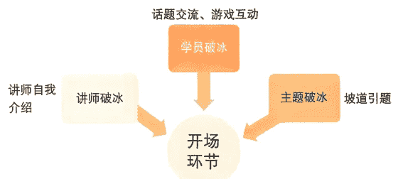

图 6-1 开场三破冰

### 1. 讲师破冰：建立讲师信任的开端

讲师破冰是通过自我介绍和履历分享拉近距离、建立初步信任。

自我介绍常用工具是身份标签。

问题：自我介绍时标签越多越好吗？

不少讲师陷入标签堆砌误区，一页 PPT 塞满标签，这往往是信心不足的表现。实际上标签并非越多越好，而是越能建立信任越好。成熟的做法是控制在 1-3 个关键标签。

关键标签需考虑三点：

- ① 课程的学员是谁？
- ② 学员的需求是什么？
- ③ 哪些标签能回应需求？

因此标签要“与你相关，对学员有用”。

例如在《你就是孩子最好的玩具》好书精讲课上，我用了三个标签：

- “翻书成课”主理人，职业身份。
- 两个孩子的爸爸，家庭身份。
- 帆书家庭教育领航人，领域荣誉。

这三个标签回应了“为什么听我讲”的核心疑问。

若缺乏荣誉，可：①放低姿态以分享者身份呈现；②重视内容价值，学员更在意收获；③必要时考取相关证书。

除标签外，可适度补充成绩或一个能体现经验的小故事，增强信任并帮助自己放松。

这就是第一项破冰——讲师自我介绍，解决“学员为什么听你讲”的问题。

### 2. 学员破冰：打开学员互动的阀门

学员破冰通过互动话题或小游戏让学员参与，打开心门并提升参与度。

线上与线下做法略有差异。

线上直播课的学员破冰多用话题热场。可在开课前 5-10 分钟或自我介绍后抛出互动话题。

话题热场的意义在于快速抓住注意力、建立参与感，为后续内容做情感铺垫。

例如家庭教育课可问：“你认为孩子身上有哪些优点？”

设计互动话题遵循三原则：

- 高关联：与课程主题紧密相关，引发共鸣。
- 易参与：问题简单易答，降低参与门槛。
- 积极：营造正向氛围，避免消极提问。

例如“刻意练习”课的开场问题是“你最强的技能是什么”。该问题关联度高、参与门槛低且积极正向，并在后续讲解中被反复引用，形成巧妙呼应。

线下课更需要学员破冰，陌生感更强。通过破冰建立安全感和舒适氛围更有利于后续学习。

线下破冰分为文破冰和武破冰。

（1）文破冰即“动口不动手”的互动，如自我介绍、分享趣事，通过语言拉近距离。
推荐三种文破冰的方式。

课程开场与主体交付：让学员从陌生到上头的实战打法

① 话题互动
线上课常用的热场手法，也可以搬到线下。核心是挑关联度高、门槛低、情绪正向的问题，让大家轮流说两句。氛围既松弛又不尴尬。比如《读懂一本书》的线下场，就可以用“你读过最受用的书是哪本？给了你什么改变？”这类贴近主题的提问，分享中自然放松，很快进入状态。

② 姓名帐篷
拿一张 A4 纸折成小帐篷，中间写自己的名字，四角写与主题相关的信息。姓名必填，其余四项由设计者自定义。
比如《陪孩子终身成长》里，帐篷中间是学员名字，四角分别是孩子两件优点和两项期待。人少时可逐个举着帐篷自我介绍，人多就拆小组进行。
小道具作用不小：手里有东西介绍，讲师和学员紧张感都会降；视觉化呈现方便记住名字；先写完再轮流发言，更能全神贯注听别人的信息。介绍与话题互动合在一起，适用场景极广。实在想不到好破冰，就先上姓名帐篷。

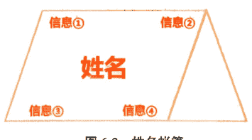
③ 故事接龙
选一个与课程内容挂钩的情境，由主持人抛开头一句，每位学员接一段，层层递进，最后由讲师收束。既练思维又增默契，还能把气氛带起来。

（2）武破冰，即“动口又动手”，靠简单的肢体练习或小游戏，比如拍手、协作任务，来促成互动。在人数偏多时效果更明显，能快速消解陌生感，让大家在轻松中建立初步连接。

分享一个我学习后优化过的武破冰案例——拳头对话。
以亲子沟通课为例，流程如下：
第一步，引出议题。先问大家：亲子教育里是不是沟通最难？怎么说都不管用怎么办？那我们先玩个游戏。
第二步，讲规则。把学员分成 A、B 两组，A 握紧拳头，B 在 1-2 分钟内想办法打开，对方拳头。注意禁止用力或暴力。
第三步，实操。学员开始尝试，讲师巡场给提醒和简短反馈。
第四步，复盘点评。先访谈拳头被打开的 A：B 用了什么方式？再访谈没打开的 A：B 做了什么，你为什么不愿意松手？随后引导思考：这种打开方式能长久用吗？威胁、恐吓、交换都不可持续，就像家庭里常见的错误沟通。那些始终没打开的拳头，不就像孩子紧闭的心门吗？既然有误区，那更好的亲子沟通方式是什么？如何提升“××亲子沟通力”？自然衔接到课程主体。
互动很强，又紧贴主题，过渡也很顺。拳头对话还能迁移到其他沟通类、管理类课程。

前文讲了文破冰和武破冰，有四点要记住：
① 破冰别为破冰。高级的破冰必须贴课程，最好能无缝切入主体，像拳头对话那样。
② 温度要合适。太冷没效果，太烫会让人退缩。始终保证参与者安全、舒适、被尊重。
③ 破冰素材怎么来。多听好课拆解迁移，也可以用 AI 按需求生成。
④ 学员破冰不是必选项。礼堂式授课不方便操作，可以省略，或只做邻座微互动的文字破冰，再进入主题破冰。

### 3. 主题破冰：引入课程主体的坡道
开场到主体之间有落差，需要搭个坡道，让学员顺滑上行，所以主题破冰也叫坡道引题。好的坡道像电影预告片，有看点有悬念。

以下是五种常用引题法：

#### （1）提问法：层层递进戳痛点
用一串提问抓住注意、引发思考、点燃兴趣。
举例《高效演讲》的坡道：
“有没有经历过准备很久，上台就大脑空白？讲得口干舌燥，台下却在刷手机？讲完后听众根本记不住你说了什么？这不是你不够努力，是没摸到演讲的底层逻辑。今天这节课，我带你解决这些问题……”

#### （2）故事法：用故事引发共鸣
用典故、真实事件或寓言制造代入感。
举例《刻意练习》可以用卖油翁。为什么他能“惟手熟尔”，背后逻辑是什么？由此切入刻意练习的原理和方法。

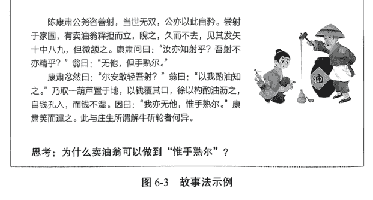
#### （3）数据法：用震撼数据抓住注意力
用有冲击力的数据制造好奇。
举例《终身成长》的坡道引题：

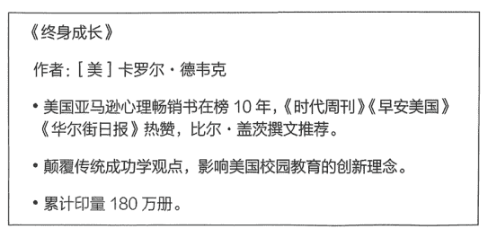
图 6-4 数据法示例
两组震撼数据：美国亚马逊心理学类畅销榜常驻 10 年，累计印量 180 万册。

#### （4）视频法：用视觉冲击强化印象
播放与主题相关的短视频，通过画面和情节带入思考。
举例《读懂一本书》的坡道：放《三国演义》刘关张结义片段，问“常读书和不常读书的人有什么区别？”视频里关羽出口成章，张飞只会说“俺也一样”。互动后问：怎么提升阅读力、沉淀知识？今天学习樊登老师《读懂一本书》。
使用视频注意两点：非商业教学可合理使用并标明来源；商业用途须获授权。

#### （5）名言法：用经典名言提升高度
用名言点题。
举例《妈妈知道怎么办》：
胡适说，评价一个国家的文明，看三件事：怎么对待孩子、怎么对待女人、怎么度过闲暇。今天场上有孩子、有女人，而且是在业余时间学习，这个民族一定有未来。接下来学习帮助“女人”养育“孩子”的书——《妈妈知道怎么办》。

以上五种坡道可活学活用，“主题成课”同样适用。

开场三破冰讲完：讲师破冰、学员破冰、主题破冰。认知心理学首因效应告诉我们，第一印象决定后续注意。开场没做好，后面再补也难回头。好的开场，成功占一半。

## 课程设计之主体阶段：用 70% 的时间交付核心内容
如果说开场是外貌，主体就是胸腹，承载核心内容，占课程约七成任务，负责交付知识点并促成学以致用。好主体要有清晰结构、讲透知识和充足素材。

接下来拆主体三层：板块结构、知识讲授、素材支撑。

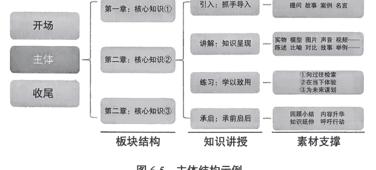
图 6-5 主体结构示例

### 1. 板块结构：给章节穿上“逻辑外衣”
一场 90 分钟左右的直播，主体通常分三块。
为什么是三块？块太少，要么撑不满时长，要么一塊塞太多知识点导致混乱；块太多则结构松散、切换频繁、易超时。所以板块设计是提纲。

主体不一定非要三块，能达成授课目标的就是好设计，有时会有两块或四块。

板块间需遵循内在逻辑，层层递进，独立又关联，形成整体。
常见结构有认知圈、要素型、流程型。

（1）认知圈结构：从“是什么”到“怎么做”——适合方法论
源自黄金圈 Why-How-What。课程可把“为什么、是什么、怎么做”设为三个板块。
- 第一块讲为什么，探原因与价值，引起重视；
- 第二块讲是什么，厘清定义与内涵，深化理解；
- 第三块讲怎么做，给方法与案例，促成应用。
顺序可调，我实操中“为什么-是什么-怎么做”最顺，先激发好奇，再深挖，再给操作。
比如“直播间如何讲透知识点”：第一章知识主播的价值，为什么；第二章直播间要讲什么，是什么；第三章怎么讲好，怎么做。

（2）要素型结构：将复杂问题拆成零件——适合多维度知识
把内容拆成若干关键要素，各自成章。板块间并列或递进，类似金字塔，不重不漏。
比如《关键对话》分三部分：
- 管好我的心。情绪管理是基础，讲情绪 ABC 原理：事件 A 相同，信念 B 不同，结果 C 不同；教学“情绪暂停法”，默数 10 秒再回应。
- 管好我的脑。做双核对话人，兼顾“谈话内容”和“谈话氛围”，比如谈判时注意议题与情绪。
- 管好我的嘴。综合陈述法：分享事实→表达感受→征询意见→共同探讨，结合职场案例演练。

## 第六章 框架设计：逻辑为王，搭建系统知识骨架
要素型结构适合严谨体系，帮助学员形成全面认知。

（3）流程型结构：让信息按“时间线”展开——适合故事与操作类
按流程顺序展开，每部分讲一个关键步骤，形成完整脉络。适合时间发展的或操作明确的内容。
比如曾国藩课程分早年、中年、晚年；“翻书成课五步法”从选题、收集、框架、课件到变现，也是流程型。
不管哪种结构，过渡都要自然。

## 2. 知识讲授：讲透核心知识的黄金公式
板块确定后，如何讲透每个核心点？很多讲师习惯灌输，学员听着走神。讲课目的不是讲完，而是让学员深度学习、会用。

一个能讲透的黄金公式分四步：
- 第一步引入：引发兴趣、触发思考、引出知识
- 第二步讲解：知识呈现、深度讲解、互动教学
- 第三步练习：即学即练、学以致用、能力转化
- 第四步收尾：学员反馈、要点回顾、知识延伸
四步环环相扣。楼剑老师《成为明星讲师2》称“引-讲-练-评”，帆书认证翻转师训练营称“启-呈-转-合”。叫法不同，作用一致：启/引、呈/讲、转/练、合/评。

引入：引发兴趣，引起思考，引出知识
作用是用问题、故事、冲突制造“为什么”“怎么办”的好奇。
方法有提问、故事、案例。
举例讲“思维模式：成长型 vs 固定型”前，先问：“一念天堂，一念地狱，这里的一念是什么？为什么念头不同差异这么大？”随后说“揭开谜底”，自然进入知识点。
这里的引入与开场的坡道引题类似，坡道是主体的引，板块引入是知识点的引。

讲解：知识呈现，深度讲解，互动教学
作用是帮助学员深度理解核心点。
方法有讲授、类比、专家视频等。
举例“思维模式”的讲解环节，即通过清晰阐述、对比案例等方式呈现成长型与固定型思维的特征、成因与影响。

# 让内容讲得透、用得上

## 讲授与视频的组合运用

在讲思维模式这类抽象主题时，视频是不错的呈现载体。选用一段对比成长心态与定型心态的短片，用视听帮助学员建立初步印象。操作上记住两点：播放前先抛问题，播放后马上展开对话。这样既能点燃好奇，也能通过分享把画面里的信息沉淀下来。比如播放前问，大家在日常里分别会怎样体现出这两种心态？看完后引导大家交流体会，把抽象概念落到具体行为。视听加讨论的组合，能把理论和生活连起来，提升理解深度。

讲授法则适合用一张对照表或图把两种心态的特征并排呈现，差异变得直观。配合类比会更易记，例如把成长心态比作逗号，定型心态比作句号。逗号代表可继续延伸、持续探索，句号代表戛然而止、难以前行。这样的意象能让学员更真切地感受到持续成长的意义，并在实际情境中主动迁移。填空、连线、判断这类小任务也可以穿插在讲解中，让学习过程更活跃。

知识的展开建议采取层层递进的方式，由浅入深逐步抵达本质。讲解时可把本该由教师单向传授的部分改造成互动题目，让学员在参与中思考，对思维模式的认识和运用会更稳固。

需要补充的是，互动并非练习环节的专属。只要不打乱节奏、能更好达成教学目标，课程的任何环节都可以巧妙植入参与元素。

## 练习：即学即用促成转化

该环节的价值在于让学员把刚学到的内容立刻放到真实情境中操作，实现理解到行动的衔接。

练习方式有很多，如案例研讨、游戏、角色扮演等，选择时要兼顾场域适配和学员接受度。核心始终是马上用、真用。围绕这一目标，可把学以致用的做法归为三类。

其一，反思过往。引导学员回溯个人经历，从经验中提炼要点并分享。举例：在时间管理课上，让学员回顾近期的时间分配，分析哪些做法有效、哪些需要改进，通过彼此分享提升实操能力。

其二，当下体验。根据核心知识点设计情境，让学员进入情境进行操作。例如在非暴力沟通课上，设置孩子作业拖延的场景，让学员分饰家长和孩子对话，通过真实演练掌握沟通技巧。案例分析、角色扮演、游戏都属于此类，设计时要考虑线上线下的适配，比如角色扮演不适合纯线上，而案例分析适用范围更广。

其三，为未来规划。让学员用本节知识点为自己制定行动方案。举例：在时间管理课上，结合四象限工具规划接下来一周的工作，明确优先级并制定执行计划，后续通过实践检验效果。

这三种路径可根据目标、学员需求和时长灵活组合，关键是帮助学员深度学习并真正用上。

## 收尾：承前启后完成闭环

收尾的作用是回顾本部分要点并开启下一步延伸。教学上多以总结式讲授为主，可加入填空、连线、判断等互动进行复习测试。

举例：在《读懂一本书》课程的樊登阅读法部分，收尾时用测试方式让大家回想选书的 Tips 要诀分别是什么（见图6-6）。
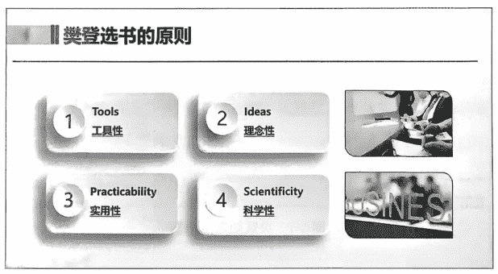

图6-6 测试教学法示例

延伸说明，一个主题除了核心知识，还常伴随关联知识。关联知识的价值在于帮助核心知识更全面、建立知识间的联结、丰富内容体现专业度。

例如在关键对话课程中，第一部分管好我的心，核心是情绪 ABC 原理，前三步引入、讲解、练习都围绕它展开；收尾时除了回顾，还加入钝感力、同理心等关联内容，让课程更丰满（见图6-7）。
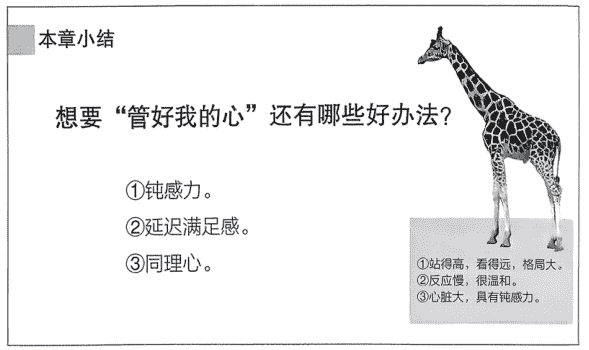

关联知识既可放在收尾，也可按需放在讲解环节。

至此，引讲练评的黄金流程已清晰，可把该流程重复使用，形成三个独立板块。

## 素材匹配，让内容更生动

素材是知识呈现的支撑，要紧扣要点兼顾相关性与趣味性。按引讲练收的需求匹配素材，能增强吸引力并加深记忆。以《我会独立思考》好书精讲课为例。

引入环节需要提问、讲故事、举案例、说名言，多用文字类素材配图增强吸引力。第三章如何建立批判性思维的引入用了案例加提问的方式，匹配了案例素材和图片（见图6-8）。
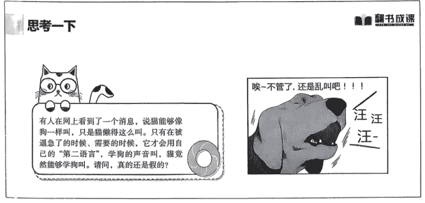

图6-8 引入环节素材示例

讲解环节需要直观简洁的素材，常配图片、视频及概念定义流程类文字。建立批判性思维中讲解批判性思维五步法时使用了流程性文字素材（见图6-9）。
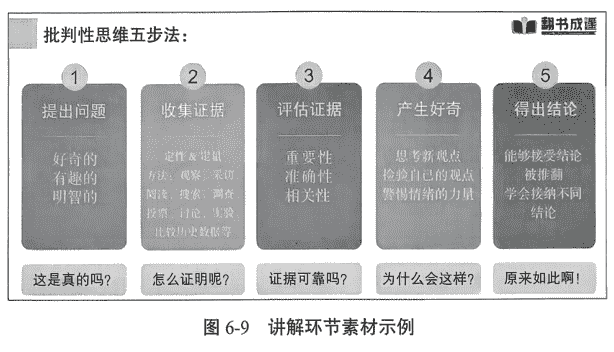

练习环节需要互动，常配文字、图片、视频素材。该章练习设计用批判性思维分析不打不成器，匹配了俗语文字和相关图片（见图6-10）。

收尾环节做总结回顾或升华，常配总结性文字和图片素材。该章收尾以填空题形式升华，匹配了文字和图片素材（见图6-11）。
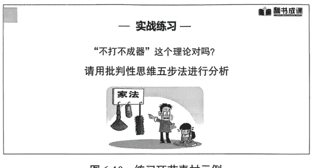

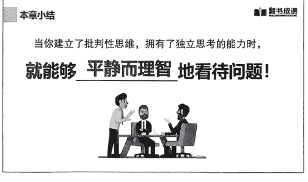

素材选择要服从主题主线，不能脱离用户和场景。

重点把握三点：理清板块结构，给章节以逻辑外衣；讲透核心知识，用引讲练收让呈现更顺畅；善用素材，让课件图文并茂更有吸引力。

## 收尾阶段：用 20% 时间打造峰值体验

收尾约占 20% 时长，却决定整体印象。包含理性总结、感性升华和营销预告三件事。

理性总结是对内容回顾提炼，可用填空、判断等随堂测验巩固。例如关键对话课程收尾用填空总结要点，让学员回想定义、情绪 ABC 原理等，既复习也检验（见图6-12）。
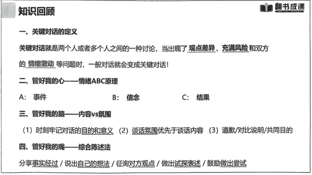

图6-12 理性总结示例
注：图中下划线处为学员填空题，教师提问学员作答。

感性升华聚焦心理成长，通过名言、感人图视频或故事给予触动。例如家庭教育课后展示温馨亲子视频或分享感人故事，激发践行决心。在你就是孩子最好的玩具课程收尾，用父母是孩子的原件，孩子是父母的复印件这一视频，帮助家长理解情感引导的重要性（见图6-13）。
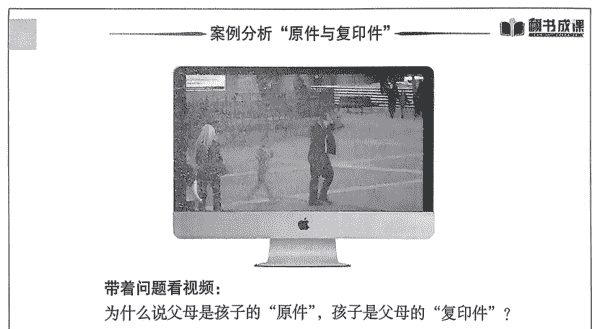

图6-13 感性升华示例1

在刻意练习课程收尾加入个人感言，给学员动力（见图6-14）。
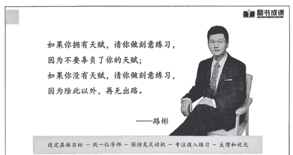

图6-14 感性升华示例2

感性升华是动心的环节，让学员不仅动脑动手，更愿意践行改变，也让课程余韵悠长。

营销预告在最后致谢的基础上，如有相关课程可进行推荐。合理的预告为后续引流和持续服务提供可能。例如陪孩子终身成长好书精讲课收尾时预告 7 天共读营（见图6-15）。
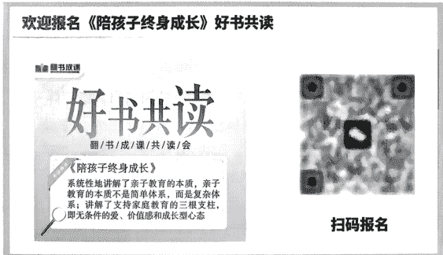

图6-15 营销预告示例

收尾还可加入学员反馈环节，用问卷收集意见为优化提供依据。

收尾注意事项：不拖沓，适时结束；与开场或主题呼应；注重情感连接，用真诚致谢增强归属感。

此套做法可归纳为 3333 课程设计法：课程分开场、主体、收尾三阶段；开场做讲师破冰、学员破冰、主题破冰；主体设三个板块各用引讲练评；收尾做理性总结、感性升华、营销预告。

## 学会填表就能做课

按 3333 法掌握各环节要点即可构建优质课程。课程设计表涵盖讲师姓名、课程名称、主题金线中的用户场景需求、课程目标动脑动手动心。

开场用三破冰抓住注意力：讲师破冰用关键标签加履历；学员破冰用话题热场或游戏互动；主题破冰用提问、故事、数据、视频、名言等坡道引题。

主体先确定结构，认知圈结构、要素型结构、流程型结构任选其一。每章按引入、讲解、练习、收尾填写，明确核心和关联知识，引入用问题或互动，讲解用讲授或视频，练习选反思过往、当下体验或未来规划，收尾做回顾与延伸。

收尾包含理性总结、感性升华、营销预告。

第六章 框架设计：逻辑为王，搭建系统知识骨架
按表逐项填写，先定基础信息：讲师姓名、课程名称、主题金线、课程目标。

开场三破冰的具体做法：讲师破冰选职业身份、经验成果、荣誉关联等标签；学员破冰用文破冰话题或武破冰游戏；主题破冰用提问、故事、数据、视频、名言引出主体。

主体三层结构：认知圈按为什么、是什么、怎么做；要素型拆分并列递进要素；流程型按步骤展开。

每板块黄金公式：引入引发好奇，讲解呈现核心，练习围绕知识点互动，收尾承前启后。可重复三章，收尾给学员峰值体验。

让收尾更有力量，让提纲更快成形

结尾要兼顾理性复盘与情感点燃两个维度。理性复盘可以用互动题帮助学员梳理要点，比如在《关键对话》课堂上提问：情绪 ABC 原理里，A 指____，B 指____，C 指____。情感点燃则借助影像、故事或金句，例如亲子课播放“父母像原件，孩子像复印件”的片段，点燃家长以身作则的行动意愿。

对后续课程或活动的推荐要自然，以解决困扰为出发点而非生硬广告。例如可以说“想把亲子沟通做得更系统，可扫码加入七天训练营”，让学员感受到价值延续。

### 表格填写要点

逻辑需要闭环，开场抛出的问题收尾要给出回应。每个环节都要配备合适的支撑材料，故事、案例、图片、视频缺一不可，避免干讲。时长必须严格把控，90分钟线上课一般开场占10%约8-10分钟、主体占70%约60分钟、收尾占20%约15-20分钟，超时会降低体验。

新手可先按模板执行，熟练后再做灵活调整。表格只是梳理思路的工具，核心是让学员动脑学知识、动手练技能、动心想改变，最终实现深度学习并能马上运用。

## 借助 AI 快速产出提纲

学完“翻书成课 3333 课程设计法”后，能否用智能工具快速生成符合该法的提纲？可以。

下面介绍两种常用做法。

### 方法一：豆包智能体

为提升备课效率，我在豆包平台搭建了“路彬翻书成课/课程设计”智能体，按指令输入需求约1分钟即可生成符合3333法的提纲。

操作步骤：

① 在手机安装豆包 App，或在电脑安装客户端；
② 进入“路彬翻书成课/课程设计”智能体页面；
③ 按提示输入做课需求。

建议这样表述：我要做［某个主题］课程，以［线下课、线上直播或录播］形式交付，讲师介绍［姓名、荣誉、经验、成功案例等］，时长［多少］分钟，听众是［某个人群］，课程帮助听众［解决什么问题］，在［腾讯会议或其他］平台授课，请据此设计提纲（见图 6-16）。

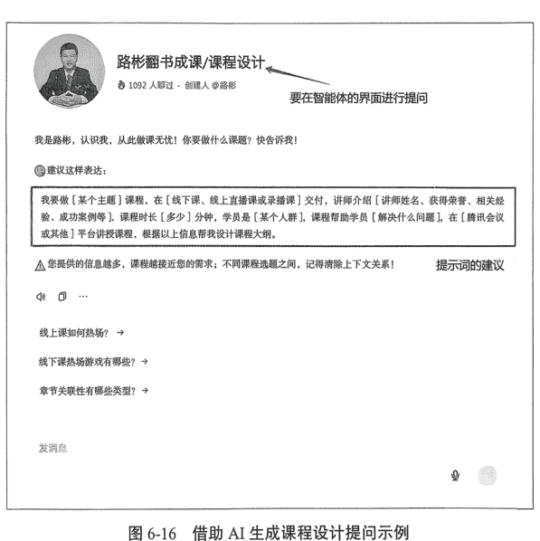

图 6-16 借助 AI 生成课程设计提问示例

提示：一定要在智能体页面提问，而非豆包主界面；你输入的提示词即主题金线，金线越清晰，生成结果越贴合。

④ 生成提纲。若不满意可优化提示词重生成，或针对局部调整，如“替换第二章练习部分的案例”。若提纲不完整，可回复“继续”，让智能体补全。

借助此法，新手讲师也能迅速掌握设计精髓。

举例：设计亲子沟通力线上直播课。

提示词：“我要做一门［如何提升亲子沟通力］课程，以［线上直播课］交付，讲师叫［李老师，亲子沟通领域研究10余年，已帮助数万家长提升沟通力］，时长［90］分钟，听众是［小学阶段孩子家长］，课程帮助听众［提升沟通力、改善亲子关系］，在［腾讯会议］讲授，请设计提纲。”

结果如图 6-17 所示。

看到效果是否很惊艳？初次体验我也心跳加速。

有人会问：AI 生成这么高效，为何还要学设计？关键在于，AI 能快速产出，但洞察听众需求与教学目标仍是讲师核心能力。只有懂原理、懂需求，才能用好 AI，让课程真正落地。讲师要先懂设计，再用 AI 做杠杆。更重要的是，在 AI 输出中挑选适合自己讲授的内容和方法，而非全盘照搬。还记得 H-AI-H 模型吗？不懂设计的讲师，即便有 AI 也难以把握课程灵魂。

### 方法二：DeepSeek 精准提示词

操作路径：

① 手机端或电脑端均可；
② 输入提示词，建议开启“深度思考”和“联网搜索”。

我是一名［家庭教育讲师］，要设计一门［如何提升亲子沟通力］课程，在［腾讯会议］直播交付，讲师叫［李老师，亲子沟通领域10多年经验，已帮助数万家长］，听众是［青春期孩子家长］，课程帮助［提升沟通力、改善亲子关系］，结构包括开场（讲师破冰、听众破冰、主题破冰）、主体（3个板块，每个板块含1个核心知识点及若干关联点，按引入—讲解—练习—收尾展开）、收尾（理性总结、感性升华、营销预告）3个环节，请据此设计提纲。

③ 生成提纲。

同类提示词也可用于通义千问、文心一言等工具，均能高效产出提纲。

### 本章小结

课程框架是知识骨架，决定教与学效率。线上线下都可按“开场10%—主体70%—收尾20%”三段设计，关键在于形成逻辑闭环，实现深入理解并能实际运用。

#### 开场：破冰引流
- 讲师破冰：用1~3个与听众相关的关键标签建立信任，避免堆砌。
- 听众破冰：线上可用高关联话题互动，线下可用文破冰如互动话题、姓名帐篷，或武破冰小游戏拉近距离。
- 主题破冰：通过提问、故事、数据、视频、名言5种方式自然切入，激发探究欲。

#### 主体：内容交付
- 板块结构：按内容选择逻辑——认知圈结构（为什么-是什么-怎么做）、要素型结构（拆分关键要素）、流程型结构（按步骤/时间线）。
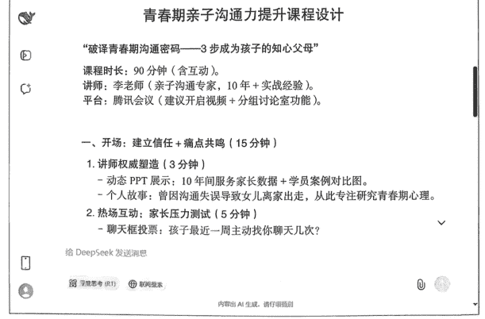

图6-18 借助 DeepSeek 生成课程大纲示例

注：以上仅展示部分内容，具体见附录2。
- 知识讲授：采用“引-讲-练-评”四步，融入案例分析、角色扮演、场景模拟，推动理论落地。
- 素材支撑：匹配故事、案例、视频，增强直观性和趣味性。

#### 收尾：强化记忆
- 理性总结：提炼要点，用填空、连线、判断等巩固知识。
- 感性升华：用故事、视频、名言触动听众，强化行动力。
- 营销预告：自然推荐后续资源，兼顾情感连接与课程延伸。

### AI 辅助完善提纲

配合课程设计表梳理思路，可用豆包智能体、DeepSeek 等输入主题金线快速生成提纲，提升效率。核心始终是听众中心，让课程实现思考、实操、改变，帮助听众深入理解并能实际运用。

本章以90分钟单节课为例讲解提纲设计，多节课时每节可参照此结构，从第二节起无需重复讲师破冰、游戏破冰，直接坡道引题。体系课章节设计可参考第三篇相关内容。

下一章进入课件制作环节，学习如何设计课程 PPT。

## 第七章

### 课件制作：视觉加持，提升课程吸引力

此前已完成选题定位、素材收集、框架搭建。若把选题比作灵魂，内容比作血肉，框架比作骨架，那么做课件就是为课程穿上得体外衣，提升颜值。

课件既是内容载体，也是讲师与听众沟通的桥梁。好的课件能放大价值、降低理解成本，成为无声助教。但很多人易走极端：要么重美观轻实用，要么因技术门槛草草了事。

本章聚焦课件制作四大核心：PPT 设计要求、PPT 结构要求、智能加持制作、试讲与录制，助你低成本打造专业吸睛课件。

### 课程 PPT 的设计要求

#### 整体设计：简洁为美，重点突出
优质 PPT 要简洁明了，每页只承载一个主要观点，避免信息堆砌。用减法突出核心。版式要美观，合理用字体、字号、行距，搭配图片表格增强视觉。字体字号统一，标题正文格式一致，保持专业整洁。配色合理突出层次，避免花哨，注意对比度，确保文字清晰。

#### 文字要求：精炼准确，排版美观
文字是信息主通道，质量直接影响理解。
- 文字要精炼，避免长句，多用短句关键词。
- 内容必须准确无误，杜绝错别字和表述不清。
- 排版整齐，注意对齐、字体、行距段距，颜色与背景对比适中。

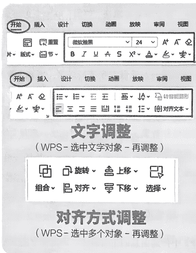

图 7-1 文字排版要求

#### 图表要求：化繁为简，直观易懂
图表是数据呈现利器，能帮助快速理解关系。
- 按主题选型，柱状、折线、饼图、散点图等各有适用场景。
- 数据须核实，来源可靠，避免误导。
- 设计简洁，信息完整前提下减少干扰元素。
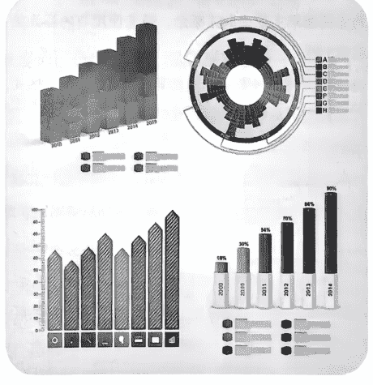

图 7-2 图表示例
- 补充清晰注解，解释关键数据和含义。

#### 图片要求：符合主题，图文并茂
图片点睛，相关性强能加深理解。
- 图片清晰高质，避免模糊失真。
- 主题匹配，支持演示主题或概念，避免无关干扰。
- 适当修饰，处理成透明 PNG 或圆角矩形更美观。
- 格式规范，保持风格一致，避免文字重叠拥挤。

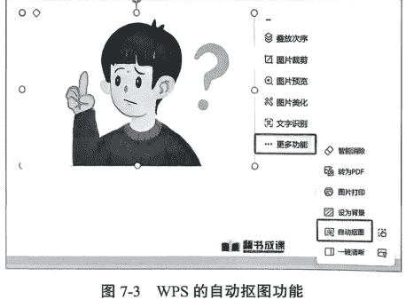

## 第七章 课件制作：视觉赋能，打磨课程的吸睛颜值

## 动画要求：适度使用，服务课程
动画可增加趣味和互动，但过度使用会分散注意力。
- 适度使用，选合适的效果并控制频率，服务内容呈现。
- 设计简洁流畅，避免复杂特效。

## 视频要求
视频是重要素材，关联性强能深化理解。
- 清晰度高，流畅播放。
- 长度适中，一般不超过5分钟。
- 内容匹配，支持主题阐述。
- 使用有技巧，可设计三页：导入页留问题、播放页全屏自动播放、互动页巩固。

### 案例分析：“原件与复印件”

**带着问题看视频：**

为什么说父母是孩子的“原件”，孩子是父母的“复印件”？

图 7-6 视频导入页

图 7-7 视频播放页

### 案例分析：问题讨论
看完视频后，请从原件和复印件角度思考：

父母为什么要学习用情感引导的方式与孩子沟通？

图 7-8 视频互动页

## 课程 PPT 的结构要求
结构合理能让内容层层递进，便于记忆。翻书成课3333法中的开场-主体-收尾及各环节，就是 PPT 结构。

通常分为三大部分。

### 1. 开场部分
课程门面，吸引注意力、激发兴趣。
- 封面页：课程名、讲师、日期，简洁大方突出主题。
- 讲师页：背景、成就、专长，建立信任。
- 破冰页：文破冰或武破冰，打破陌生感，营造氛围。
- 引题页：案例、数据、名言、故事、视频等激发好奇，引出主体。
- 目录页：清晰列出内容结构，建立学习预期。

### 2. 主体部分
课程核心，详细阐述知识点。
- 过渡页：各板块前介绍内容与目标，帮助跟上思路。
- 内容页：围绕核心知识点展开，采用“引入—讲解—练习—收尾”结构。先提问题或观点，再讲解分析，随后案例论证，最后总结引出下一页。合理运用文字、图片、表格、视频。

例如讲“如何培养孩子阅读兴趣”，先引入重要性，再讲方法，再做亲子共读案例分析，最后总结益处。内容页是一个教学单元，由多页构成，需精心设计确保逻辑严密。

### 3. 收尾部分
回顾要点，强调重点，引导下一步行动。
- 收尾过渡页：总结主要内容，强调重点难点。
- 总结页面：全面梳理核心内容与方法，可用思维导图或互动填空。
- 升华页面：用故事、视频、名言触动情感，强化行动力。
- 营销页面：简要介绍后续内容或产品，引导延伸学习。
- 封底页：简洁致谢，必要时留讲师联系方式，呼应主题，以“感谢聆听”结束。

课程 PPT 结构及其示例如图 7-9 和图 7-10 所示。

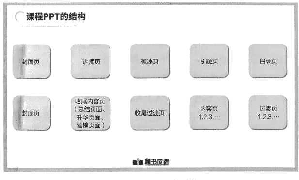

图 7-9 课程 PPT 的结构

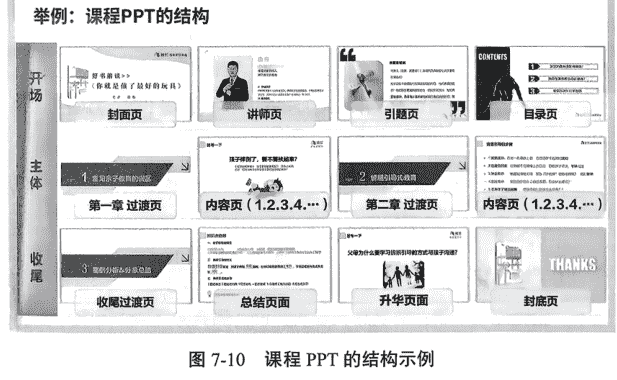

图 7-10 课程 PPT 的结构示例

## AI 驱动的课件制作新思路

随着生成式 AI 快速普及，越来越多的智能工具进入课件生产环节，帮助讲师迅速搭建 PPT 框架、优化排版、提升整体效率。

现在市面上能直接上手的有 AiPPT、Kimi、WPS 灵犀、讯飞智文等，部分 App 也接入了 AiPPT 的能力，这里不做全部罗列。

这些产品都能在较短时间内把主题或文档转化为可编辑的演示文稿，并提供模板与排版建议，大幅减少从零开始制作的时间成本。

### 四大工具横向评测

#### 1. AiPPT
**(1) 核心特点。**
- **产出速度快**：可基于主题指令生成，也支持 Word、Xmind 等文档上传，迅速梳理出 PPT 骨架。
- **模板匹配强**：根据内容自动推荐风格，样式选择丰富，支持后续二次微调。
- **在线可编辑**：内容与视觉都能在线调整，但免费用量受限，月度约 4 次，导出下载需开通会员。

**(2) 适合人群或场景。**
- **商务汇报**：对视觉品质要求高的商业方案、年度复盘等。
- **付费型用户**：预算充足、追求专业呈现的团队或个人。

#### 2. Kimi
**(1) 核心特点。**
- **完全免费**：开源无限制，多文档一键转 PPT，对学生和初创团队很友好。
- **覆盖面广**：大纲生成范围宽泛，比如政策拆解、市场展望，但容易偏离核心，需人工收敛。
- **模板丰富**：免费模板量大，风格简洁时尚，便于快速搭框架。

**(2) 适合人群或场景。**
- **应急汇报**：临时会议、突发课件可快速填充内容。
- **新手讲师**：对设计要求不高、只求基础框架的入门用户。

#### 3. WPS 灵犀
**(1) 核心特点。**
- **生态打通**：深度嵌入 WPS 办公套件，Word、PDF 一键转 PPT，老用户上手无缝。
- **操作极简**：最快 29 秒出稿，但产出多停留在框架层，数据和深度分析仍需补充。
- **模板以基础为主**：非会员可选范围有限，会员可调用更多存量模板，适配性较广。

**(2) 适合人群或场景。**
- **WPS 生态使用者**：已习惯 WPS 的职场人士，尤其是行政、文秘等需要快速格式转换的岗位。
- **轻量需求**：内部简报等对设计复杂度要求不高的场景。

#### 4. 讯飞智文
**(1) 核心特点。**
- **内容更有深度**：联网检索实时数据，生成的分析类 PPT 逻辑更严谨，例如票房、政策解读，信息密度高。
- **配图与备注自动化**：自动匹配配图并生成演讲者备注，提升演示专业感。

**(2) 适合人群或场景。**
- **专业型汇报**：学术答辩、行业分析等对数据支撑和深度要求高的场景。
- **长文本转 PPT**：论文、报告等长文档快速转化。

### 如何挑选与使用

四款产品各有侧重，按需求选择即可。

- 长文本处理且看重模板多样性，Kimi 更占优势。
- 重视办公软件兼容与排版规范，WPS 灵犀更合适。
- 追求免费易用满足基础需求，讯飞智文能应付日常。
- 企业用户、预算充足、对质感要求高，AiPPT 更具竞争力。

需要提醒的是，AI 仍无法完全替代人工设计，生成后必须做大量精修，比如补充真实案例、调整图排、优化动效、加入视频素材等。

AI 的定位是快速搭骨架，人来负责打磨细节，这正是“H-AI-H”的人机协作思路，人为主、AI 为辅。

### 以 WPS 灵犀演示一次完整生成流程

以上一章生成的“如何提升亲子沟通力”大纲为例，用 WPS 灵犀产出一版课程 PPT。

**1. 第一步：进入 WPS 灵犀**
WPS 灵犀主界面如图 7-11 所示。
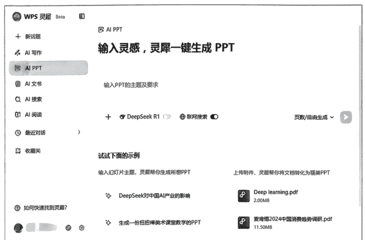

图 7-11 WPS 灵犀界面

**2. 第二步：输入大纲，推荐开启联网搜索，关闭 DeepSeek R1**
不选 DeepSeek R1 的原因是，大纲本身已按翻书成课方法完成，若二次处理易导致结构混乱，直接使用可保证与原大纲高一致，提升效率。开启联网搜索则让工具能补充最新信息、案例与数据，提升时效与说服力，见图 7-12。
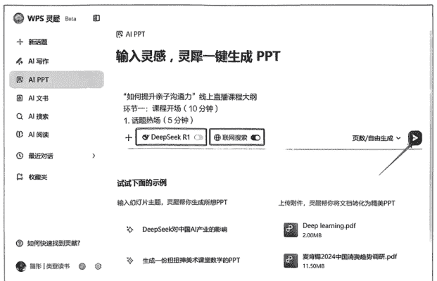

图 7-12 借助 WPS 灵犀生成 PPT 示例

**3. 第三步：生成并选模板**
生成后可以看到工具还原的大纲与提交内容基本一致，这对后续编辑很有帮助，见图 7-13。
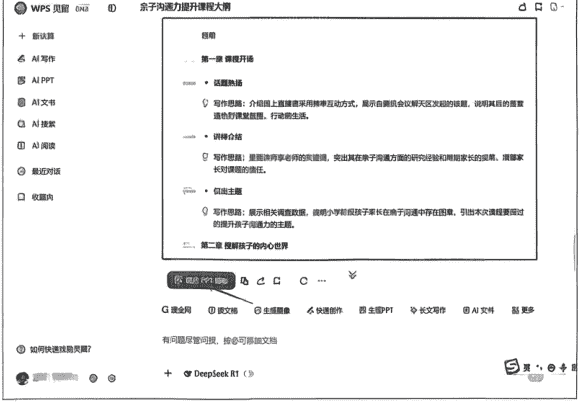

图 7-13 WPS 灵犀生成 PPT 模板示例

对比多款工具后选定风格，模板数量有限，建议优先简约风便于后期改动，确认后点“生成 PPT”，见图 7-14。
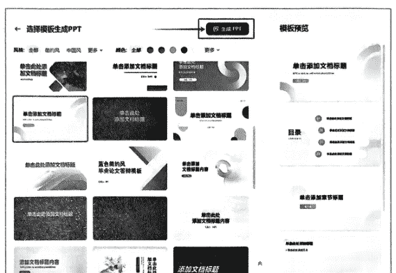

图 7-14 生成 PPT 示例

**4. 第四步：在线编辑与导出**
图 7-15 为在线编辑界面，可调整页序、删除冗余页后下载。
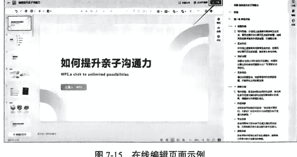

图 7-15 在线编辑页面示例

**5. 第五步：离线精修**
导出后回到 WPS 进一步优化，见图 7-16。优化维度包括：

- **主题模板**：会员可在“设计-更多主题”调用更丰富样式。
- **图文补充**：加入相关图片视频丰富内容。
- **文案校对**：确保文字准确、排版整洁。
- **动画控制**：适度添加动效提升生动度。
- **互动设计**：设置提问环节提升参与感。
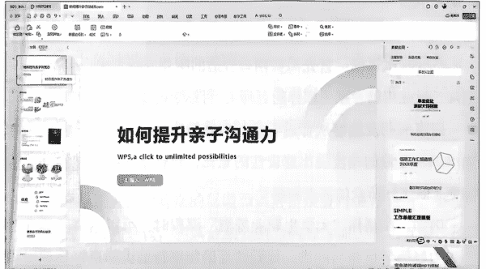

图 7-16 WPS 优化 PPT 页面示例

经过精细调整，PPT 既专业又有吸引力，兼顾效率与质量。

## 课程试讲与课程录制

### 课程试讲：用反馈驱动优化

试讲相当于正式演出的彩排，能暴露 PPT 设计、讲解节奏、时间控制等问题，比如文字堆砌导致卡顿，或知识点逻辑不清让学员难懂。

做好试讲通常分四步。

**1. 招募听众**
可邀请同事、朋友、行业导师或目标学员。同事朋友提供普通视角，专家给出专业建议，目标学员则反映真实需求。例如制作“大学生职业规划”时，邀请在校生参与试讲，反馈更贴合实际。

**2. 建立反馈通道**
线上问卷、微信群、QQ 群、邮箱均可。“内容是否清晰？”“哪个部分印象深刻？”“视觉排版建议？”等问题能有针对性地收集意见，群聊则便于即时交流。

**3. 完整记录**
试讲时录音录像，保留语言表达、肢体动作等细节。回看可发现语速过快、重点不突出、动作不自然等问题，便于有针对性改进。

**4. 综合分析**
把听众意见归类为内容、表达、视觉等维度，制定优化方案。结合自身感受总结优劣，明确改进方向。如听众反馈理论多案例少，则补充实践案例；肢体僵硬则通过练习提升表现力。

反复试讲迭代，课程会更具吸引力和实用性。

### 课程录制：选择方式与呈现效果

**1. 录播课类型**
**(1) 音频课。** MP3 交付，制作简单，安静环境下用手机或录音设备即可。适合喜马拉雅、荔枝微课等注重内容本身的主题，如家庭教育、心灵成长。
**(2) 讲师不出镜视频课。** 只录屏讲解 PPT，不露脸。适合内容导向型课程，常用 EV 录屏、Faststone Capture。
**(3) 讲师出镜视频课。** 能增强亲和力，适合演讲技巧、亲子教育等。分实景录课和虚拟录课，推荐 OBS Studio 保障画音同步。

**2. 常用软件与操作**
**(1) 讲师不出镜：EV 录屏。**
① 优势：操作简便、资源占用低、成片清晰。
② 步骤：安装后设置录制范围和音频来源，常规选全屏录制、仅麦克风；打开 PPT 进入放映模式，按 Ctrl+F1 开始、Ctrl+F2 结束，先做十秒测试再正式录制。

**(2) 讲师出镜：OBS Studio。**
① 优势：功能强，支持多画面源与复杂布局，适合专业录制直播。
② 步骤：安装后新建场景选横竖屏，添加画面源如摄像头、PPT、贴片图，设置麦克风等音频源，调整布局大小后开始录制。

**3. 录制注意事项**
保持环境安静，注意语速语调；多节课保持背景一致；关闭 QQ、微信等干扰软件；外置摄像头麦克风提升质感；提词器辅助但不依赖；可在关键点设置暂停提问增加互动；不必追求一次完美，先完成再迭代。

**4. 后期制作**
包括视频剪辑、音频降噪调音、字幕添加、背景音乐、调色特效等。快剪辑适合快速剪辑，剪映在字幕与特效上更强。

## 本章总结

课件是内容载体，也是讲师与学员的沟通桥梁。本章围绕四大要点展开。

第一，PPT 设计要求。坚持“简洁为美、重点突出”，从整体、文字、图表、图片、动画、视频六方面打造专业课件，每页一个核心观点，降低理解成本。

第二，PPT 结构要求。遵循“开场-主体-收尾”逻辑，开场激发兴趣，主体以过渡页串联并做单元化设计，收尾强化记忆并预告后续。

第三，AI 赋能制作。借助 WPS 灵犀、AiPPT、Kimi 等工具快速搭框架，但需人工补充案例、优化细节，实现 H-AI-H 协作。

第四，试讲与录制。试讲模拟真实场景收集反馈优化内容表达，录制根据需求选择音频或视频形式，注重环境、设备与互动。

课件制作本质是内容为本、服务授课，通过科学逻辑、高效工具与持续迭代，让课程兼具专业性与吸引力。

下一章将进入课程变现。

# 让好课被看见的包装与发行方法

在内容过载的当下，质量过硬不等于自然成交。就像一本好书若无编辑与推广也难以触达读者，一门优质课程若缺乏系统化的呈现与发行设计，很难把价值转化为实际收益。

第三方机构在2023 年知识付费行业报告中提到，每年上线的新课以数万计，最终能突破信息噪音的只是少数。即便内容扎实，不懂如何装帧、上架与释放节奏，也容易被淹没。

下面围绕课程商业化展开，提供一套可落地的思路：如何让课程的文案与视觉兼具吸引力，如何挑选合适的渠道完成上线，如何用分波发售来制造销售节奏，以及怎样借助智能工具提升效率。无论是首次尝试还是想优化流程，都能找到对应的做法。

# 包装升级：先让课程好懂又好认

翻开书店，封面粗糙书名晦涩的书与封面精致直指痛点的书，显然后者更容易被拿起。课程也一样。

呈现是课程进入市场的第一感知，也是学员形成的首因印象。好的呈现既是价值的提炼，也是形式的雕琢。整体可拆为文案打磨与视觉呈现，两者互相支撑。

# 文案打磨：把核心价值说透

文案打磨的本质，是把课程里最打动人的部分用清晰的话语递给潜在听众。它不是自卖自夸，而是围绕受众需求做定位，像一份自我介绍让人一眼明白能得到什么。

用户不会为说明书付费，会为能解决问题的方案买单。因此要做到“对人说话、解决具体问题”。具体从以下维度入手。

# 1. 打造抓眼的首屏主标

首屏标题是学员第一次接触的触点，需要简洁、直指痛点且具备吸引力。营销研究显示，阅读标题的人数是阅读正文人数的5倍，标题抓不住人，就丢掉了大部分机会。

优质标题通常具备：

对象感，让人觉得是为自己定制。如“高效学习法”不如“给总学完就忘的你：21天高效学习系统”。

结果感，明确传达能带来的改变。如“从0到1打造你的个人品牌”比“个人品牌建设方法论”更具体。

场景感，把价值置于具体情境。如“睡前10分钟：给忙碌妈妈的亲子沟通课”。

# 2. 副标说明：把钩子变成推力

若主标负责吸引，副标则负责说服。它要补充课程的具体内容与差异化价值，对主标做展开。

好的副标要点：具体说明内容、突出独特优势、用有力表达、保持简洁最好控制在20字内。

例如主标《21天打造你的知识内化系统》，副标《从“读书记不住”到“学以致用”的完整解决方案》，对主标进行了清晰延伸。

# 3. 讲师形象塑造：让学员知道是谁在教

学员关注“学什么”，也关注“谁来讲”。讲师形象是课程的重要信任资产。

专业形象，突出背景、经验与案例。如“某大学心理学博士”“10年情绪管理咨询经验”。

价值形象，讲清楚能解决什么问题。如“帮助1000+职场人士摆脱焦虑困扰”比“我很厉害”更有说服力。

个性形象，展现教学风格与个人魅力。如“用脱口秀的方式讲心理学”。

# 4. 单元标题优化：激发继续学习的欲望

单元标题要让人知道学完这一段能获得什么，从而产生动力。

技巧：使用行动导向词如“掌握”“打造”“解决”；突出核心价值；营造学习连贯感；适当使用数字与对比。

对比可见差异：

普通版：第一章记忆原理、第二章学习方法、第三章实践应用。

优化版：第一章破解记忆密码——大脑最爱这样学；第二章三大高效学习法，效率提升300%；第三章从知识到收入——打造你的知识变现系统。

# 5. 卖点提炼：从痛点到收益的闭环

学员最在意“能得到什么”“能解决什么”。课程卖点即学员的购买点。

建议用“痛点+方案+获益”结构：

痛点：学了很多时间管理方法，却总是坚持不下去？
方案：独创“番茄工作法+习惯追踪”双系统，建立可持续的时间管理模式。
获益：30天后工作效率提升50%，每天多出2小时自由时间。

梳理后可在海报与话术中直接体现。

# 6. 口碑收集：用真实证言加分

真实学员反馈是最强的社会证明。人们更倾向相信同类评价而非商家自述。

收集技巧：形式多样化，文字、视频、成果展示均可；内容具体化，突出改变而非空泛夸赞；保持真实，保留学员原话；使用前征得同意。

一个好习惯：收到反馈后立即截图存档，统一放在专用文件夹，长期积累就是宝贵素材库。

# 视觉呈现：用设计提升辨识度

视觉是价值的外在表达。宣传海报、主图、详情页等物料能在瞬间传递卖点。

## 1. 先看平台规范：尺寸对了才不白做

不同平台对尺寸、格式、大小有各自要求，设计前先确认。

| 物料类型 | 尺寸/规格 | 备注 |
| :--- | :--- | :--- |
| 宣传海报 | 750 像素 × 1344 像素 | 3~5 张不同版本 |
| 商品首图、封面 | 750 像素 × 750 像素 | 3~5 张 |
| 详情页 | 750 像素 × ？ | 长度根据内容调整，也可多张拼接 |
| 易拉宝 | 80 厘米 × 180 厘米 | 线下活动使用 |

## 2. 无基础也能上手：在线工具搞定视觉

创客贴、图怪兽、千库网等工具适合零基础。以创客贴为例：注册登录→搜索主题模板→编辑替换标题、卖点、讲师照→统一色调字体→导出。

注意保持整套视觉统一，主色调、字体、排版一致，跨场景才有辨识度。

## 3. 预算充足请外援：专业团队定制视觉

淘宝、猪八戒等平台可找专业团队定制全套方案，海报、详情页、易拉宝一次解决，节省时间并提升质感。

## 4. 核心物料怎么做

### （1）课程海报：8秒内抓住人
《2022国民专注力洞察报告》显示当代人连续专注仅8秒，海报必须快速传递核心价值。

要素：首屏主标醒目易读；核心卖点不超过3个；讲师形象专业亲切；色彩符合调性；行动指令清晰如扫码、立即报名。

### （2）详情页：把说服拆成步骤
详情页是转化主战场，优秀页面可提升转化率30%以上。

黄金结构：首屏主副标题+核心卖点，解决“为什么学”；讲师介绍建立信任，解决“为什么跟你学”；学员评价提供证明；课程大纲展示内容框架；学习收获给出可量化改变；常见问题消除顾虑；报名指引给出明确动作。

# AI 助力：让文案打磨提速

## 1. 用 AI 快速提炼卖点
AI能快速分析课程材料，输出标题、副标和核心卖点。

示例提示词：
“你是一位课程营销专家。我做了一门[课程名称]线上课，课程帮助[目标人群]解决[核心问题]，提升[能力/结果]。现在要做宣传，请分析上传的课程PDF，帮我提炼出主标题、副标题和3个最吸引人的卖点，要求有对象感和价值感，以文本格式呈现。”

以《刻意练习》好书精讲课为例，AI可生成主标题《刻意练习：从新手到大师的精准突破法》，副标题《告别无效努力，用科学方法快速成为领域高手》，并给出职场人专属、案例加导师、心理表征系统等卖点，精准度往往超出预期。

## 2. AI 能否直接出图和详情
测试过创客贴的智能设计功能，输入主标题、副标题、卖点后可以批量生成招生海报，速度快但创意和细节上仍需人工把关，达不到高要求场景。未来会更好，但目前对标准化物料，建议用好模板或专业团队配合。

# 课程上线：选对渠道是第一步

包装完成后要上线。渠道选择直接影响触达效率。

### 渠道分类：私域和公域怎么选

#### 1. 私域渠道：沉淀自己的流量池
如小鹅通、海豚知道、创客匠人，需要自己引流。优势是可建立店铺和学员体系，便于长期服务、复购和二次转化。适合已有粉丝基础的讲师。

#### 2. 公域渠道：借平台流量获客
如微信小店、抖音、小红书、快手，自带流量和推荐机制，适合冷启动拿增量。微信小店可结合短视频直播引流，再沉淀到私域，形成公域引流+私域转化的闭环。

### 选渠道看这五点
受众是否在该平台活跃；内容形式是否匹配；平台规则如抽成、限制、结算；自身运营精力；长期品牌和用户资产规划。

决策参考：重长期品牌优先私域；求短期曝光选公域；交付复杂选功能完善的专业平台。也可以组合，如微信小店+小鹅通，既直播售课又能交付。

# 微信小店实操：从开店到上架

### 1. 开店：先把小店开起来
手机微信进入视频号→创作者中心→带货中心→微信小店申请开店，按要求提交身份和营业执照，审核通过即可。

### 2. 选类目：合规才能过审
按课程类别申请类目，不确定可参考同行或咨询客服。需缴纳5000元保证金，并提供增值电信业务经营许可证或ICP备案。备案可在阿里云、腾讯云购买域名后提交，通常3~7个工作日。

### 3. 填商品信息：标题图详情都要规范
商品标题须包含领域和形式，如××老师成人英语线上视频课；商品图片至少3张，主图不重复；详情页介绍内容、讲师、适合人群、学习收获，加入好评和大纲；设置合理价格和库存，预售可填时间。

### 4. 提交审核：常见拒审原因
审核内容、图片、标题合规性。失败会提示原因，修改后重交。

常见问题与对策：类目不对→咨询客服确认；图片含联系方式→去除二维码电话；标题夸大→客观表述；缺少资质→补齐。

通过后可在视频号橱窗、直播、短视频挂载，也可通过社群、朋友圈推广。微信小店适合销售，但无法直接交付课程，交付需配合小鹅通等内容型平台。

# 分波发售：用节奏带出销量

上线后进入发售。分波发售由营销专家杰夫·沃克提出，核心是通过节奏化信息释放推动购买决策，实测可提升转化3~5倍。

传统发售：上架→广告轰炸→促销结束。
分波发售：分析名单→造势预热→产品预售→正式发售→跟进追单。

通过五个步骤层层推进，激发购买欲望。

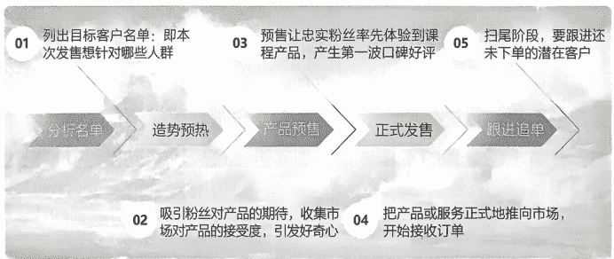

下面我们展开介绍这五个步骤。

### 分析名单：精准锁定目标客户

#### 1. 梳理存量用户：从现有资源中挖掘潜力学员

从已有用户池开始做筛选，优先锁定最匹配的人群，比如曾经购买过的学员、长期保持互动的微信好友、社群里参与度高的成员。举例，某位做职场沟通的讲师复盘时发现，先前买过PPT制作和表格课的老学员，对职场能力升级的付费意愿很稳定，这批人就成了新课程的首波触达对象。

#### 2. 拓展新名单：多渠道获取增量
- 短视频阵地：在抖音、小红书等平台持续输出与课程强相关的干货，引导观众通过私信或评论留下联系方式。
- 直播间吸粉：在直播中拆解课程知识点，设置“私信领资料”等钩子，把高意向人群沉淀到私域。
- 异业联动：与目标重合的机构或个人交换资源。例如职场课讲师可以与招聘平台、企业培训方合作，拿到有职业提升需求的名单。

#### 3. 需求洞察：先小范围验证
对收集到的名单做画像，了解痛点、诉求和付费能力，也可通过小规模访谈来核实真实需求。

当手里握有数百到上千条高意向信息时，浪潮式发售才有底气。比如在推出“翻书成课”线上课前，我梳理出过往成交及服务过的两千多位可能感兴趣的学员，这批存量构成了课程早期的基本盘。

### 造势预热：点燃期待，营造抢购氛围
预热的核心是分层释放信息，激发好奇与期待，让学员产生非买不可的冲动，而不是硬卖。

预热需要三要素：
- 神秘感：暗示重磅产品即将上线，但不全部揭晓。
- 参与感：邀请少量用户提前体验并分享感受。
- 专属感：让早期关注者感受到特权，尤其是价格优势。

实操方法如下。

#### 1. 朋友圈持续种草：3~7天节奏
- 痛点唤醒：抛出学员常见困惑，如“为什么别人汇报总被认可？你可能缺这三个沟通技巧”。
- 价值剧透：透露课程干货或独家方法，如“明天分享让PPT逻辑更清晰的金字塔结构，学会后方案通过率可提升50%”。
- 优惠预告：公布开售时间和福利，如“本周六晚8点，高阶职场沟通课正式开售，前50名立减100元，记得设闹钟”。

#### 2. 短视频引流：10~20条干货分发
把课程相关内容制作成短视频分发到抖音、视频号、小红书。内容可以是知识点拆解、学员案例、讲师故事，结尾引导关注或私信领取资料。家庭教育讲师可产出“科学养育”“亲子沟通”等内容，结尾预告课程，吸引私信索取福利。

#### 3. 直播互动造势
做预热直播，介绍核心价值、讲师背景和发售计划，并配合问答和抽奖提升参与感。例如推广“AI成课”线上课时，我在直播演示借助DeepSeek快速生成大纲，并承诺加好友者报名后额外赠送翻书成课智能体，当晚场观超3000人，近200人进私域。

### 产品预售：锁定核心粉，积累首波口碑
预售的目标不是冲销售额，而是验证市场和沉淀口碑，对前期的造势做检验。通过专属优惠提前锁定订单，同时收集第一批好评。

#### 1. 预售政策：用优惠撬动提前购
- 价格优惠：预售价比正式价低20%~50%，例如正式价299元，预售价199元。
- 赠品福利：赠送资料包、工具模板等，如“预售报名赠价值299元的课程配套PPT模板”，优先选边际成本低甚至零成本资源。
- 限时限量：设置7~10天预售窗口，强调“仅限前300名”“期满恢复原价”，制造紧迫。

#### 2. 建预售群：私域深度转化
把预热期有意向的学员拉入专属微信群，在群内做课程介绍、答疑互动、营造学习氛围，并在私域完成首发，通过红包、限量赠品等形式促单。

#### 3. 收集反馈：迭代内容与流程
及时回收预售学员意见，优化课程和发售环节。经授权后把好评截图或视频用于后续宣传。

#### 4. 挖掘分销达人：储备推广力量
从购课学员中筛选具备私域资源、自媒体账号和分享意愿的KOC，邀请为课程合伙人/推广达人，提供销售手册和推荐方法培训。平台侧可在微信小店“优选联盟”添加推广达人，小鹅通添加推广员，其他平台依此类推。

### 正式发售：全渠道放量，掀起购课高潮
预售结束后进入正式发售，用多渠道覆盖最大化触达。

#### 1. 发售渠道：线上线下联动
- 线上：视频号直播、抖音直播、短视频挂车、公众号推文、社群群发。
- 线下：条件允许可办线下沙龙、讲座现场推广并收集联系方式。

#### 2. 发售机制：用稀缺与从众驱动决策
- 限量发售：设定报名上限，如“本期仅招200人，报满即止”。
- 倒计时提醒：朋友圈社群发布“距离涨价仅剩24小时”“仅剩30席”等信息，刺激即时下单。
- 晒单有礼：鼓励学员晒订单截图，赠送小礼品或优惠券，借助从众效应扩散。

#### 3. 打磨话术：痛点—方案—获益结构
围绕学员痛点展开，先洞察需求，再呈现卖点，最后描绘收益。例如：“你是否开会发言就紧张大脑空白？我的公众演讲实战课专治此症，教你3个快速减压技巧和5套万能模板。学完后你能自信表达，让领导同事刮目相看。”

持续打磨话术并沉淀为销售手册，有助于培养更多课程合伙人。

### 跟进追单：收尾不掉单，提升最终转化
追单常被忽视，却是提单量的关键。数据显示约30%的订单集中在发售最后两天，收尾必须重视。

#### 1. 跟进已成交客户：提升满意度，促二次转化
及时交付资料并邀请入学员专属群，定期分享进阶内容和福利，让体验超值。同时引导推荐，设置阶梯分佣，如“推荐1人返××元，推荐3人分佣比例提升”。

#### 2. 跟进未成交客户：了解顾虑，精准解决
对未下单潜在客户一对一回访，针对性解除疑虑。如价格敏感则给老学员专属折扣，内容疑问则提供试学片段详细解答。

#### 3. 跟进话术：以助人为中心
避免硬推，以解决问题的姿态沟通。例如：“××同学，注意到你之前对职场Excel课很感兴趣，现在有顾虑吗？课程里有你提到的报表处理技巧，多数学员反馈效率提升30%。目前剩最后3个优惠名额，若确有需求不妨抓住机会，或许能直接解决工作难题。”

## 智能工具赋能：如何规划浪潮式发售方案
### 提示词模板
你是一位课程营销专家，擅长浪潮式发售（名单分析→造势预热→产品预售→正式发售→跟进追单）。我做了一门[课程主题]线上课，帮助[用户群体]解决[痛点问题]。我现有资源是[资源信息]，营销周期[21天]，请按时间轴给我一份浪潮式发售方案。

### 提示词举例
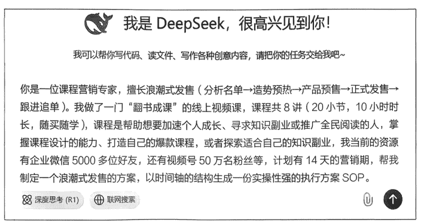

### DeepSeek 回复示例
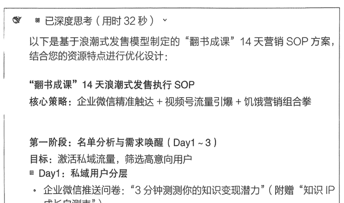

优化调整后的完整方案见附录3。讲师可同时用多个智能工具提问，挑选适合自己的方案作为行动参考。

## 课程交付：兑现承诺的关键
发售不是终点，交付才是价值落地。交付既是兑现承诺，也是打造口碑与二次转化的基础。很多学员正因交付体验好而复购。

### 录播课交付：标准化+有温度
#### 1. 链接发送：不止链接，更有陪伴提示
将视频、PPT、资料包上传至小鹅通、海豚知道等专业平台。学员购课后通过短信或微信引导添加讲师/客服，发送学习链接并附一段温暖的学习提示。

#### 2. 进度跟进：做成长陪伴者
通过后台数据观察学习进度，对3天未登录者发送关怀提示“最近没登录是否遇到问题？”，让学员感受到被关注。

#### 3. 及时答疑：提升满意度
建立学员交流群，讲师在群内解答问题并发起讨论，快速响应提升体验。

### 直播课交付：重节奏与参与感
#### 1. 时间约定与反复提醒
销售时明确直播时间，建议工作日晚8-9点半。购课后短信、微信、平台三重提醒，开播前10分钟发放倒计时红包吸人进入。

#### 2. 平台与技术保障
按课程类型选平台：视频号对接微信生态，小鹅通功能丰富支持连麦，腾讯会议可共享屏幕演示。提前测试网络、摄像头、麦克风并准备备用设备。

## 翻书成课：AI时代打造爆款课程的实战手册
### 3. 直播设计与课后回放
直播中每10分钟设置一次弹幕提问等互动节点，保持注意力。结束后及时上传回放，建议设7天有效期防拖延，也可用智能工具整理要点方便复习。

### 社群课交付：以运营打造沉浸式学习
交付本质是社群运营，分策划招募、执行落地、复盘转化三阶段。

- 策划招募：明确主题如“7天共读《高效能人士的七个习惯》”、每日流程与激励机制。
- 执行落地：开营立规、拆解框架；学习中通过打卡、讨论、直播答疑保持活跃；结业总结成果颁发证书。
- 复盘转化：收集反馈优化流程，整理学员成果作宣传素材，向积极学员推送后续课程优惠。

核心是通过高频互动让学员在群体中获得动力，并沉淀为种子用户。

## 第八章 课程变现：浪潮式发售，引爆变现热潮
课程交付是新起点。好的交付能把购买者变为传播者乃至追随者。无论录播的专属服务、直播的实时互动，还是社群的沉浸体验，核心都是以学员为中心。

# · 本章总结 ·
课程变现本质是价值传递：包装让价值被看见，上架让价值被触达，浪潮式发售让价值被认可，智能工具让流程更高效。

当课程真正帮到学员，成就感远超商业回报。本章方法需不断实践优化。第一次发售或有审核、预售不佳等情况很正常，每一次尝试都是成长。

现在掌握了变现核心方法，接下来就行动：把课程包装更吸引人，选择合适平台上架，用浪潮式发售制造热潮，借助智能工具提升效率。相信不久，你的课程会被更多学员喜爱，实现好课程广为人知的目标。

# 第三篇
# 运营篇：从单课到生态的体系化运营
——构建可持续的知识产品生态

# | 引 言 |
# 从“做课”到“运营”，单人企业的进阶之路
前篇我们讲了“翻书成课五步法”——选题、收集、框架、制作、变现，从0到1打造课程。掌握方法意味着迈出知识创业第一步。

课程诞生后，如何持续变现？如何让知识产品生根发芽而非昙花一现？这正是本篇要回答的问题。

做课是播种，运营是培育。许多创作者陷入“只要内容好自然有人买”的误区。现实是，课程可持续性90%依赖运营体系。没有体系支撑的课程就像没发动机的汽车。

本篇将拆解知识产品运营四大体系：产品内容体系、学员服务体系、学员成长体系、学员增长体系，助你搭建可持续变现的体系。

# 为什么说“体系比课程更重要”
一位学员用五步法做了一门99元线上课，首月卖300多份，看似不错，第二月销量断崖。他困惑：“内容没问题，为何没人续买？”

深入发现他“只做课不运营”。学员购课后仅得视频和资料，后续服务稀少。学完即结束，自然不会推荐，也不会成为长期用户。

在知识付费成熟的今天，用户看重系统化学习体验。课程是硬件，运营体系是操作系统，决定了用户能否在你的知识生态中持续获益。

# 单人企业的兴起：小而美的商业新范式
身边越来越多单人企业：设计师独立接单靠自媒体展示，家长把育儿经验做成课程，职场人把技能做成训练营。

商业逻辑在变化：传统企业求规模，单人企业求精准定位与深度服务。正如《小而美》所倡导，回归本质，用极简姿态构建可持续生态，不必做大而要做精。

知识创业者特别适合此模式。你不需要大团队，只需“五个一”：单人、一套生产工具、一平台账号、一个知识产品、一个学员社群。

其中最核心的是“知识产品+运营体系”。产品是联结载体，体系是变现保障。

# 从“卖课”到“运营”：知识创业者的必经之路
回想让你印象深刻的课程，是否都有专属学习群、定期直播答疑、作业点评、线下活动？这些都是运营体系。

持续变现者都有成熟运营体系：用社群让学员有归属，用成长体系让老学员持续进步，用增长策略让新学员不断涌入。

# 搭建运营体系的“两步走”策略
# 第一步：打造知识产品——从“翻书成课”开始
- 新手：从书籍成课起步，夯实能力。如《非暴力沟通》做沟通课。
- 探索：尝试主题成课，结合热点与细分领域找方向。如“青春期家庭沟通课”。
- 进阶：萃取核心技能做王牌课。如PPT设计、短视频剪辑。

从书籍起步夯实，再以主题探索方向，最终以技能形成壁垒。

# 第二步：构建运营体系——让课程“活”起来
有了产品，就要构建四大运营体系：产品内容体系、学员服务体系、学员成长体系、学员增长体系。产品内容是基础，0到1后真正的挑战在于如何让它持续创造价值。这就需要四大核心运营体系支撑。

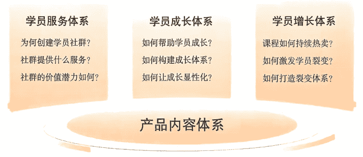

图 0 知识产品四大运营支柱

(1) **内容生产体系**。核心问题是哪些主题与内容形态能够滚动迭代。优质内容不是一次性消耗品，而是随市场与受众变化持续进化的活资产。从主题确认到内容蓝图，我会分享一套主课加陪练营的组合打法。

(2) **用户服务体系**。付费后用户需要的不只是视频，更是被关注、被推动的学习体验。如何用分层服务营造归属感与获得感？基础服务、主动关怀、惊喜增值三层梯度是关键。

(3) **成长反馈体系**。用户最关心学完能得到什么。成长体系要把进步显性化。通过成长型陪练、成果展示等机制，把模糊的学习过程转为可量化可感知的成长轨迹。后文会拆解陪练营的设计逻辑。

(4) **用户获取体系**。获客难是知识创业的共性困境，而老用户恰是最优质的流量池。从内容种草、学员证言到老带新裂变，这套体系聚焦如何低成本撬动高增量，后续会分享可复制的做法。

四支柱相互支撑，构成知识类产品的运营骨架。接下来会逐一拆解每个支柱的搭建步骤与常见坑位，让你既见全貌，也能落地。

# | 第九章 |

# 知识中枢：让内容体系持续生长

前文聊过一人公司形态，以及运营的四大板块：内容生产、用户服务、成长反馈、用户获取。本章聚焦内容生产的三大拼图。

- **议题选择**：什么主题能支撑长期运转
- **架构设计**：如何搭建连贯可延展的系列课
- **进阶规划**：如何实现从入门到精通的全覆盖

把这三件事想清楚，直接决定产品是昙花一现还是细水长流。

## 议题选择：让内容长效运营的起点

确定主题是规划内容的首步，也是能否持续运营的分水岭。先反向看哪些方向最好避开。

### 先筛掉坑位，再坚持真实 大众 痛感

1. **伪需求方向**。一些主题看似新颖，其实是创作者一时兴起。快速验证可以先用创客贴做一张宣传海报，在朋友圈、社群投放测试付费意愿。若推送100人，付费不足5人，市场接受度就很低，很可能属于假需求。比如“宠物语言翻译课”，有趣但实测转化极差，最终被证伪。

2. **受众过窄方向**。受众面太小很难支撑长期运营与变现。知识型产品需要一定体量的用户群，过窄的题做不到。“古代竹简修复技术”很专业，受众极少，商业价值有限。

3. **痛感不足方向**。这类题有一定需求，但用户没有非学不可的紧迫感，付费意愿低。如“日常办公表格美化技巧”，内容可用可不用，很难做成长期经营的产品，适合练手不适合放长线。

反过来，优质主题要符合真实、规模、痛点。

1. **真实**：建立在真实需求上，且讲师在该领域有真本事。例如十年临床经验的心理咨询师做“职场压力疏导课”，需求真实、能力匹配。

2. **规模**：市场足够大，潜在用户众多。如“短视频运营课”“知识主播养成课”，随行业爆发需求持续旺盛。

3. **痛点**：痛点清晰，用户愿为解决问题付费。如“考研英语高分冲刺课”，学生对分数提升有强刚需，付费意愿高。

### 哪些议题经得起时间考验

按运营周期看，内容分短期与长期。直播引流、单场读书会、蹭热点课都属于一次交付的短期型。

长期运营的课程可反复交付，举三个例子。

案例一：帆书应用的樊登讲书。每周六更新一本书的音视频，持续输出形成稳定用户与变现。

案例二：类似正面管教的专业课程。通过基础、进阶、高阶的阶梯设计引导用户持续升级，实现长期经营。

案例三：我自己的“翻书成课”线上课。用“录播+训练营”给用户实战陪跑，带来复购与持续变现。

三种打法逻辑不同：第一类靠讲师持续产出能力，第二类靠系统化设计和团队运营，第三类靠指导反馈和社群运营。对一人公司而言，第三种“录播+训练营”更为适配。

### 主课加陪练营模式主题的三项要求

想用此模式实现可持续变现，定题时要过三关。

1. **必须是技能型内容**。纯知识传递难以支撑陪练营，复购也难。在人工智能时代，讲师要从知识传授型转向技能教练型，围绕可练技能来设计。如“人工智能加自媒体运营”适合做训练营，“人工智能发展史”更适合单录播。

2. **难度要适中偏难**。太简单用户自学即可，无需陪跑；太难易产生挫败。建议定在10分制7-8分，自学有挑战，带教下提升明显。如“新媒体运营实战技巧”，自学效率低，训练营里能快速提效。

3. **成长可视化、成果可作品化**。学习过程要看得见，如打卡、发朋友圈、发布短视频展示；学习结果要能产出作品，如做成一门课、写出一篇文章。作品即社交货币，易传播裂变。如“短视频制作训练营”，用户作品直接发社媒，形成展示与获客。

定好题后，先用录播做首次转化，再搭训练营做老用户复购，形成持续变现闭环。

### 三个维度快速找到好议题

我总结了三种找题方法，熟练后能稳定产出适合“录播+训练营”的主题。

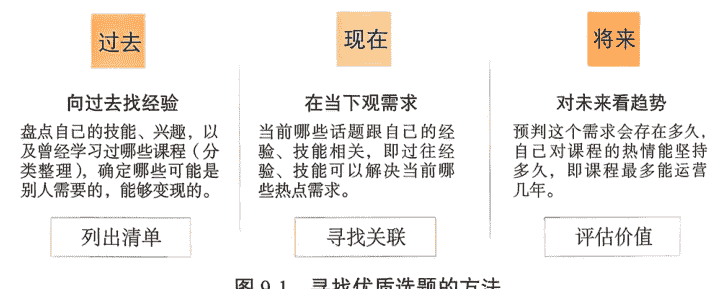

图 9-1 寻找优质选题的方法

1. **向过去找经验**：盘点自身技能、兴趣及学过的课程，进行分类整理，找出别人可能需要且能变现的内容。比如你擅长PPT制作，且学过相关进阶课程，就可围绕PPT制作开发内容。可列出技能清单如数据分析、手绘、演讲等，评估市场需求和变现潜力。

2. **在当下观需求**：关注当下热点，寻找与自身经验和技能相关的领域，思考如何用技能解决当前热点需求。例如当前人工智能热门，有编程基础可做“AI编程入门”内容。也可以通过社媒、行业报告、新闻资讯了解如远程办公效率提升、亲子教育焦虑缓解等当下痛点。

3. **对未来看趋势**：预判需求持续时间及自己对内容热情能坚持多久，评估运营时长和价值。比如随健康意识提升，健康管理类内容未来空间大，且自己有持续学习计划，就可布局。可研究大健康、在线教育等发展趋势报告，预判3-5年市场需求。

借助人工智能工具也能高效发掘议题。提示词建议如下。

> “我是一名［××］领域的讲师，需要探索可持续运营和变现的内容主题，主题要求能用视频课交付内容，同时可开设训练营提供陪跑赋能；我的经验有［××］，我的优势是［××］，我的目标是［××］，我的劣势有［××］。请结合当前社会需求和未来3-5年发展趋势，给出5个满足需求的内容主题。”

使用时选中深度思考和联网搜索功能，可得到更符合需求的建议。例如一位有多年营销经验的讲师，使用该提示词可能会得到“数字化营销实战内容”“私域流量运营训练营”等方向。

### 用户分层与主题关系

不同客群对内容的需求和付费意愿不同，了解用户定位有助于确定更合适的主题。用户主要分为B端企业用户、C端普通个人学习者和小B端有经营、发展、变现需求的个人学习者或创业者。

- **B端用户**获客难度较大，通常需要专业销售团队和较长销售周期，但一旦成交，单客价值高。如企业内训，需针对企业特定需求设计内容。
- **C端用户**付费意愿相对较低且需求满足后易脱离社群，适合价格较低、满足基础需求的内容。比如个人技能内容和兴趣爱好内容，如“书法入门”“绘画基础”等。
- **小B端用户**学习意愿强、复购能力强，同时有变现需求，是“录播+训练营”模式比较理想的目标人群。像写作变现营、讲书变现课的学员多属于小B端，他们希望通过学习提升能力并实现变现。在确定主题时，若能结合变现需求，如“直播+变现”“写作+变现”“AI+变现”，找到小B端用户，成交概率会更大。例如“自媒体变现实战内容”针对小B端用户，满足其通过自媒体实现变现的需求。

若主题无法与变现结合，服务C端也可行，按技能类、难度适中、成长可视化、成果作品化的原则设计内容，同样能取得不错效果。比如“瑜伽健身内容”针对C端用户，通过合理难度和展示用户健身成果，吸引用户持续学习。

## 架构设计：系列课的稳固骨架

议题确定后，要着手设计系列课的结构。合理的结构不仅提升学习体验，还有助于实现商业目标。我们要设计一套便于将来开展训练营的系列课，即适配“录播+训练营”的内容体系。一般来说，适合做训练营的内容采用三段结构较为合适。

### 三段结构详解

#### 1. 开篇

开篇通常为一课时，时长15-20分钟，不宜过长。内容包括讲师介绍、初心发心、理论基石和主题引入。

讲师介绍可让用户了解授课者背景和专业能力，增加信任感。可详细介绍职业经历、专业成就、成功案例等，如“拥有10年行业经验，曾服务50多家企业，帮助1000多名用户实现技能提升”。

初心发心能让用户感受到内容价值和意义。比如“我开发这门内容的初衷是希望帮助更多人掌握实用技能，实现职业发展和个人成长”。

理论基石是支撑后续内容的底层逻辑，比如家庭教育内容，可在开篇介绍脑科学、心理学相关知识。通过展示理论基石，让用户认识到内容的科学性和专业性。

主题引入要清晰告知后续主要内容，激发学习兴趣。可采用问题引入、案例引入等方式，如“你是否在亲子沟通中遇到困难？这门内容将为你提供有效解决方案”。

开篇的关键在于彰显内容价值，降低退课率。可通过埋钩子方式，在开篇提及后续内容能为用户带来的价值，让用户对后续内容充满期待。

> ① 系列课是指由多节课构成的系列内容，也叫系列课。

#### 2. 主体

主体部分通常由5-7课时构成，有两种常见设计模式。

- **按步骤拆解技能**：如果内容是技能型且技能可分解为若干步骤，主体可按步骤拆解。以“翻书成课”线上课为例，开篇后接着五课时，分别是选题确定、内容收集、框架设计、课件制作、内容变现，将做课这件事按步骤讲解。每个步骤详细说明操作方法与注意事项，让用户循序渐进掌握技能。
- **按场景应用技能**：对于难以用步骤分解的技能，或涉及多个场景的内容，可按场景应用技能来设计。比如针对家庭教育内容，可按亲子沟通场景、夫妻关系场景、隔代养育场景等不同场景拆分内容。在每个场景中分析问题产生原因，提供具体解决方案和案例分析，让用户在不同场景灵活运用所学知识。

每小节可按“回顾上节、详解本节、本节复习、预留作业”的结构设计。先回顾上一节内容，帮助用户巩固记忆；然后详细讲解本节知识点；接着对本节内容总结复习；最后布置作业，让用户将所学应用到实践中。

#### 3. 收尾

收尾部分通常也是一课时，主要内容包括内容总结、呼吁行动、预埋营销点和提供“加餐”内容。

- **内容总结**：帮助用户梳理整套内容的重点知识，可采用思维导图、表格等形式，让用户一目了然地回顾核心内容。
- **呼吁行动**：引导用户将所学知识运用到实际生活中，比如“希望大家课后积极实践，将所学技能运用到工作和生活中，实现自己的目标”。
- **预埋营销点**：在内容中埋下后续训练营或其他相关内容的营销点，比如在讲亲子教育内容时，可跟用户说学完内容后，若想进一步提升，可报名参加实操营。预埋营销点不仅可在最后一节进行，主体部分如有适当时机也可插入营销钩子。
- **提供“加餐”内容**：针对用户在学习过程中提出的问题，或为满足深入学习需求而设置的额外内容，可放在内容收尾部分，也可在主体部分适当位置加入。

### 三段结构带来的好处

#### 1. 逻辑清晰，循序渐进

这种结构为用户提供明确学习路径，符合认知规律，用户无需额外适应，能快速进入学习状态。比如“翻书成课”线上课，按开篇介绍价值、主体讲解做课步骤、收尾进行总结和营销的结构，让用户清晰了解内容整体框架和学习顺序。

## 升级路径：合理规划内容的进阶体系

除了议题和结构，规划内容的进阶体系也是内容生产体系的重要组成部分。合理的进阶体系可满足用户不同阶段学习需求，提升学习体验和忠诚度。

### 内容进阶体系的构成

常见分基础课、进阶课和高阶课三个阶段。

#### 1. 基础课

基础课目标是帮助用户建立基本认知框架，掌握基础概念、工具操作和标准流程，解决入门问题。比如“翻书成课”线上课的基础课，会讲解做课的基本思路、方法、工具和流程，让零基础用户快速上手。基础课教学内容要通俗易懂，注重基础知识讲解和基本技能训练。

#### 2. 进阶课

进阶课旨在深化学员专项技能，帮助用户解决复杂问题，提升核心能力。以“翻书成课”线上课为例，进阶课会更深入讲解内容运营知识，让用户能够独立解决内容运营过程中遇到的问题，取得更好成果。进阶课教学内容具有一定深度和难度，注重案例分析和实践操作。

#### 3. 高阶课

高阶课通常为用户提供深度服务，如私教课或弟子班。目标是进一步提升用户体验，帮助用户建立更高认知，掌握核心能力，甚至培养合作伙伴。例如“翻书成课”的高阶课是私教，可为用户提供一对一指导，根据具体情况制定个性化学习方案。高阶课教学内容要具有前瞻性和创新性，注重用户个性化需求和职业发展。

### 进阶体系的价值

#### 1. 构建系统化知识框架，强化学习连贯性

分层内容进阶体系为用户提供明确学习路径，符合用户认知和成长规律，能够让用户逐步深入学习，构建完整知识体系。

#### 2. 满足用户差异化需求，实现分层教学覆盖

不同用户基础和学习需求不同，分层内容体系可满足差异化需求，避免千篇一律的教学弊端，让不同背景用户都能找到适合自己的学习路径，提升内容适配性和满意度。

#### 3. 打造可持续学习生态，提升讲师品牌价值

课程矩阵：把一次性成交变成持续陪伴

一套成体系的课程组合，本质上是主讲人与学习者保持长期互动的抓手。它能放大参与感与留存意愿，把单次付费沉淀为可复用的长期价值。产品线越完整，专业可信度越易被感知，个人品牌的影响力也同步上升。按学习阶段递进供给内容，就能与用户保持陪伴节奏，不断回应学习诉求，提升忠诚度与口碑，推动品牌势能持续增长。

### 课程架构的搭建路径
搭建课程架构可以从定位、受众画像、知识单元、交付形式四个维度来规划。

#### 1. 入门阶段
- **设计目标**：形塑基础认知，掌握核心概念、原理与操作手法。
- **目标人群**：零基础的初学者或基础薄弱者。
- **内容单元**：包含基础理论与基础实操两部分。
- **交付形态**：以异步点播为主，配合伴学群与答疑支持。点播支持随时回看，社群便于心得交流，答疑环节帮助快速解决问题。

#### 2. 进深阶段
- **设计目标**：加深认知广度，提升真实场景问题解决能力。
- **目标人群**：具备一定基础且带有实践需求的用户。
- **内容单元**：涵盖进阶理论与实战应用。
- **交付形态**：点播与直播结合，并加入项目实操辅导。点播负责理论输入，直播用于案例拆解与互动，项目辅导帮助把知识落地。

#### 3. 顶阶阶段
- **设计目标**：形成更高阶认知，掌握方法论，培养潜在合伙人。
- **目标人群**：追求高阶目标的用户及有合作意向的对象。
- **内容单元**：包含高阶理论与分销裂变体系。
- **交付形态**：一对一辅导与定制化学习方案。依托用户具体需求和目标，提供个性化指导，助力突破瓶颈。

需要明确的是，并非所有产品都必须做成三阶体系，具体要结合运营策略灵活规划。在设计课程时，应追求极致品质，做到“十倍好”，让用户有惊喜感，从而提高满意度与转介绍率。比如持续打磨内容、升级教学服务、丰富课程增值部分等，都能让价值感更突出。

## · 本章总结 ·

### 产品内容体系的长效运营逻辑

产品内容体系是知识运营的核心载体，关键在于选题策略、结构设计与进阶规划三个方面。

- **选题层面**，要避开伪需求、小众需求和痛点不足的题材，遵循“真、大、痛”原则。选择具备持续迭代空间、可做进阶设计、能陪跑赋能的题材，推荐采用“视频课+训练营”的组合形态，聚焦小B类用户，结合自身经验、市场当下需求与未来趋势，善用人工智能工具挖掘优质选题。
- **结构设计层面**，建议采用开场-主体-收尾的三段式。开场突出课程价值，主体按步骤或场景拆解技能，收尾做要点复盘、行动号召、营销预埋与“加餐”补充。结构清晰、体验顺滑，既利于教学又兼顾商业目标。
- **进阶体系规划层面**，通过基础、进阶、高阶的分层设计，满足不同阶段学习需求，构建系统化知识框架，强化主讲人品牌价值。

知识产品的竞争本质是内容运营体系的竞争。只有把产品内容体系做扎实，知识产品才能在激烈市场中脱颖而出，实现可持续运营与变现。下面附上一张评估表，读者可据此检视自身选题设计。

### 表 9-1 “课程 + 训练营”模式的选题设计

| **1. 课程基本信息** |

| :--- |

| **选题名称** |

| **目标用户类型** | □B类用户 □小B类用户（变现需求者/创业者） □C类用户 |

| **技能类别** |

| **2. 选题评估（符合请勾选√）** |

| :--- |

| □符合“真”原则（基于真实需求，有专业能力） |

| □符合“大”原则（市场需求大，用户基数充足） |

| □符合“痛”原则（用户痛点明显，付费意愿强） |

| □属于技能类课程（非纯知识传递） |

| □技能难度适当（0~10分，建议7~8分） |

| **3. 课程设计自检** |

| :--- |

| **成长可视化设计** |

| **成果作品化设计** |

| **4. 进阶体系规划** |

| :--- |

| **设计基础课（入门知识）** |

| **设计进阶课（深度技能）** |

| **设计高阶课（私教课程）** |

| **5. 市场需求验证** |

| :--- |

| **初步验证方式** |

| **6. 整体评估** |

| :--- |

| |

下一章将聚焦用户服务体系，讲解购课后的服务如何提升学习体验。

## 第十章

### 用户服务体系：从基础保障到口碑裂变的递进设计

上一章围绕产品内容体系展开，从“真、大、痛”的选题标准到套系课结构与进阶规划，核心是解决如何做出好课程的问题。

不过在知识产品运营闭环里，做出好课程只是起点，做好服务才是决定留存、复购和口碑的关键。用户服务体系的构建，本质是通过分层服务设计，让用户在学习过程中持续感知价值，最终实现品质口碑与经济收益双提升。

用户完成购买的那一刻，主讲人的工作才真正开始。

你是否见过这样的情况：用户付款后找不到入口、群里提问无人回应、课程结束后就彻底失联？这些服务断点，根源在于服务设计缺乏系统性。

实际上，用户服务可以归纳为三层：基础服务、进取服务、惊喜服务（见图 10-1）。

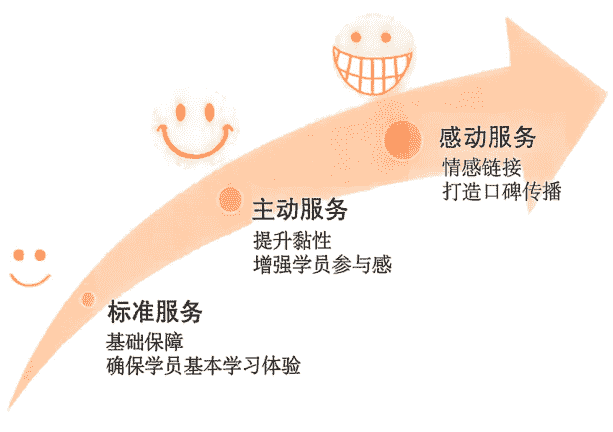

三层并非简单叠加，而是从基础保障到情感联结的递进，每一层对应不同运营目标——基础服务解决“能否开始学”，进取服务解决“愿不愿意学”，惊喜服务解决“是否愿意推荐”。

## 基础服务：夯实学习体验的地基

### 搭建联系：让用户从陌生到可触达

用户购课后的首要任务是建立稳定沟通渠道。若连联系方式都没有，后续服务无从谈起。以下三个动作体现了对用户需求的细致洞察。

#### 1. 多路径邀请添加微信
不同用户使用习惯差异大，需多渠道覆盖（见图 10-2）。
- **短信**即时性强，能在付款后第一时间触达。
- **课程内弹窗**登录时强制提醒，避免错过。
- **主动搜索手机号**则针对未及时添加的用户，体现主动服务。

以“翻书成课”线上课为例，付款成功后短信内含课程链接，点击即可跳转添加页，利用付款后关注高峰；首次登录时弹窗强制提示“扫码进用户群”，借初始好奇引导入群；对24小时未添加的用户，主讲人通过后台获取手机号主动添加。数据显示，前两种方式可覆盖 99% 的用户，剩余 1% 通过主动添加也能实现联结，这一系列举措确保了与用户建立联结的全面性。

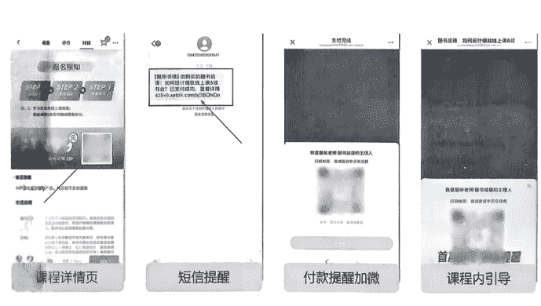

#### 2. 设计添加“钩子”
单纯的“加我微信”难以产生行动，必须给出明确价值。在添加话术中点明“邀请进用户交流群”“领取做课工具包”等权益，让用户明白收益。例如，告知添加后可进入同学交流群并获取实用工具包，添加意愿会明显提升。这种引导把联系方式获取转化为用户主动索取资源的行为。

#### 3. 工具赋能
工作号相比个人微信更适合精细化运营。
- **活码自动通过好友申请**提高添加效率，避免等待焦虑。
- **标签分组**可按用户状态分类，便于精准推送。
- **自动欢迎语**能在添加后第一时间传递引导信息，提升体验。

例如，活码可自动分配用户至不同社群，配合标签精准推送，避免过度打扰，让信息在合适时间触达，提升有效性与满意度。

## 课程交付：让学习路径从模糊到清晰

用户对课程的第一印象始于交付环节，需解决三个问题。

### 1. 开通通知：一次性讲清学习路径
通过短信、微信、站内信三重触达发送开通通知。内容需包含课程入口、平台操作指南如小鹅通 App 下载、课程有效期如“3 年无限次回看”等关键信息。多渠道覆盖不同使用习惯，确保信息准确传达，让用户清晰知道如何开始学习。

### 2. 资料发放：结构化呈现配套资源
将 PPT 模板、工具包、推荐书单等上传至网盘或课程平台资料区，并在欢迎语中说明领取步骤。结构化整理便于查找与使用。例如欢迎语中写明“登录课程后点击底部‘资料’即可下载”，并按主题、功能、难度对资料分类，进一步提升易用性。

### 3. 引导裂变：从首单植入分享意识
交付时同步告知裂变规则，利用用户刚购课的高关注期。如“推荐 3 位好友购买可免费解锁进阶课”“生成专属海报分享，每单获××%佣金”。明确奖励机制可激发分享意愿。实操经验显示，交付环节引导裂变的学员分享率比未引导的高出约 30%，说明分享需要被适时带动。

## 学习跟进：让进度从被动到主动

完课率低往往源于缺乏持续督促，需做好三件事。

### 1. 数据驱动的进度提醒
每周查看后台学习数据，对进度缓慢的用户发送提醒。根据学习时长、观看进度等指标精准识别需跟进对象。例如，对连续一周未登录的用户发送个性化提醒：“发现您近期未学习，课程内容对目标达成很重要，建议尽快登录，有问题随时联系”。基于数据的提醒更具针对性。

### 2. 社群高频触达
每周一发布“本周学习重点”，帮助用户规划方向；周五公布“本周学习打卡榜”，用排行榜激发竞争欲。榜单可按时长、完成率、作业提交等维度设置，对优秀者授予“本周学习之星”称号并赠小礼品。竞争氛围能提升参与度与效率。

## 3. 高效答疑
将高频问题整理成《常见问题答疑手册》置顶群公告，覆盖约 80% 重复问题，如“如何下载资料包”“训练营报名链接在哪”。个性化问题采用“先引导自查，再针对性解答”模式，如“这个问题在手册第三章有说明，先查看一下，不懂再问”。这种方式提高效率并培养自主学习能力，同时保持解答的耐心与细节，提升满意度。

以上属于基础服务，是必须 100% 履行的规定动作。

## 进取服务：激活社群价值，让用户从旁观到参与

若基础服务是规定动作，进取服务则是加分项。核心是通过社群运营把“独自学习”变成“群体成长”，提升黏性。

## 社群基础设置：打造有序的学习栖息地

### 1. 群名称
统一命名，降低认知成本。格式为“课程名称+群编号+功能说明”，如“翻书成课⑤群|建议设置免打扰”。末尾提示定位，避免消息轰炸导致退群。互动性强的课程可去掉“建议免打扰”，并加入“实时交流”等字样，让用户明确群性质。

### 2. 群公告
社群的说明书，需包含社群定位、群规则、常用链接三部分。例如定位“本群为翻书成课付费用户交流群，聚焦课程交流与答疑，也可分享做课成果”，规则“禁止发广告，违规两次移除”，链接包括课程入口、资料下载、客服联系方式。用简洁排版突出重点，保持信息及时更新。

### 3. 欢迎语
新用户的第一印象。工作号自动欢迎语需兼具温度与引导。例如：“欢迎××同学加入翻书成课！这里是你的做课加油站，课程链接：××。建议先看群公告了解规则，可按××格式做自我介绍，让大家认识你！”欢迎语可根据用户层次调整，新手更详细，老手更精炼。

## 明确社群定位：让用户明白为何留下

社群最怕定位模糊，需回答三个问题。

### 1. 社群能解决什么问题
聚焦学习支持、资源共享、人脉链接三大价值。例如“翻书成课”社群定位为“解决选题确定、框架设计、课件制作等问题，提供行业资源对接，搭建课程设计者交流平台”。定位要紧贴课程内容与用户目标，确保价值针对且实用。

### 2. 社群的风格是什么
风格应与课程调性一致。实战型课程风格可更接地气，如“轻松赚钱，拒绝焦虑”；高端私教课则偏专业严谨。“翻书成课”社群风格为“轻松、友善、有启发”，鼓励轻松交流，避免生硬说教。风格体现在语言、活动、互动方式上。

### 3. 社群的规则是什么
清晰规则降低管理成本，如“进群先看公告”“发广告直接移除”。规则需提前告知并一视同仁。例如“翻书成课”曾多次移除发广告用户，反而赢得认可。规则制定要合理公平，强化宣传与执行，维护良好秩序。

## 构建互动机制：让社群从安静到活跃

社群活跃的关键是设计低门槛参与形式。

### 1. 日常互动：每天一分钟激活社群
- **晨间快讯**：每日早上 8 点分享一条行业资讯和一个知识卡片，如“今日做课小技巧：课程开篇要讲清能解决什么问题”，培养查看习惯。
- **每周一问**：每周抛出开放性问题，如“你在做课过程中最大卡点是什么？”，引导评论区接龙，主讲人挑选 3-5 个典型问题详细解答。
- **问题收集箱**：群公告放置收集链接，用户随时提交问题，主讲人每周五汇总成“本周高频问题解答”发布，既解决共性问题又让用户感受到被重视。

### 2. 深度互动：用榜样力量带动成长
- **优秀用户分享会**：每月邀请 1-2 位有做课和变现成果的用户进行 60 分钟访谈式分享。分享前收集用户问题提升针对性，分享后引导用户添加分享者微信形成资源链接。“翻书成课”的一位用户在分享会后新增 300 多名好友，后续转化 10 多个私教客户。做好前期沟通、主题确定与氛围营造，是分享会成功的关键。

让归属感落地：线下相聚看见成长

具备条件的团队不妨发起线下沙龙，促成成员面对面复盘学习心得，甚至在现场拆解各自的实战案例，肢体在场的交流会让归属感变得更扎实。筹备时先敲定主题与流程，挑准时间地点并提前做宣传与报名引导；进行中把体验放第一，营造易于开口的氛围，服务跟上保证环节流畅；收尾后尽快回收反馈，总结长短，为后续迭代提供参考。

把进步摊开看，才能迅速建立信心。鼓励成员在社群里晒学习与践行的成果，这种高光时刻既能激励分享者，也能给围观者注入力量。可以单独开辟展示专区，比如学习成果墙、践行之星等形式集中呈现优秀产出并给予表彰，对主动分享的人给予适度回馈，形成正向循环。如我欣赏的老师彭小六，他的《读书会创始人》课程每周都会引导学员晒读书会案例，常态化曝光效果很好。

社群不必追求全天热闹，高频互动耗精力也不一定更有效。更务实的做法是发挥关键作用即可，大部分时间安静也完全可以接受。我的原则是提供必要的支持但绝不过度打扰，宁可安静也不要杂乱。

## 感动服务：创造超出预期的惊喜时刻

感动服务的核心在于超出成员预期。惊喜感可以通过交付品质、情感联结和持续增补三个维度来设计，为成员带来超出付费范围的体验。

## 课程品质：最大的感动是十倍好的交付

一切服务的前提是课程本身足够好。这里的十倍好并非内容量翻十倍，而是指价值感的跃升。通过细节打磨、案例充实、内容迭代来提升感知价值。做到十倍好，有三条路径。

### 1. 细节打磨：让知识可落地
每个核心知识点都配一套工具包，确保可直接使用。工具包要围绕知识点设计，强调实用与可操作。例如讲解课程框架设计时，同步提供可填写的框架模板，学员按模板即可搭建框架，降低难度提升效率。同时附上详细使用说明，让理解与运用更顺手。

### 2. 案例丰富：用身边事讲大道理
每个知识点都辅以真实案例，让学员感同身受。案例选择要贴近工作生活场景，具有代表性和启发性。例如讲课程选题确定时，引入学员身边常见的选题案例，拆解成功与失败原因，帮助掌握原则与方法。真实情境能把抽象概念具体化，提升兴趣促进理解。

### 3. 更新迭代：让课程会成长
定期依据反馈更新内容，如每季度新增一到两节热点专题课。学员在学习中提出的问题和建议是迭代的重要依据，及时收集分析并优化。热点专题的引入能让课程紧跟行业趋势，保持时效与竞争力，提供更有价值的学习内容。

## 情感链接：用看见和鼓励建立信任

讲师与学员的关系本质是师徒，核心在于情感共鸣。可通过个性化反馈、阶段性鼓励和适度示弱来建立联结，增强信任与归属。

### 1. 个性化反馈：让学员知道你被看见
对作业和提问尽量给出具体评价，而非笼统的“不错”“加油”。例如学员交作业后可以说：“你对课程选题确定的分析很深入，能结合实际案例阐述原则，理解到位。不过在可行性方面可再推敲，资源和能力是否匹配。”这种细节化反馈能让学员感受到用心，知道努力被认可，从而增强动力。这在《可复制的领导力》中被称为二级反馈，表扬的同时说明原因。

### 2. 阶段性鼓励：让成长有仪式感
在完成关键节点时，如学完基础课、提交首份作业、首次尝试变现，发送专属鼓励信息。例如：“恭喜你完成基础课学习！从笔记能看出你理解很深，接下来的训练营会是实战好机会，期待成果。”有针对性的肯定结合下一步目标，能增强成就感与仪式感。

### 3. 弱势暴露：用真实拉近距离
讲师不必永远正确，适度分享失败经历反而更亲近。例如在社群说：“我第一次做课也踩过选题过宽的坑，后来靠学员调研才找到精准定位，遇到问题很正常，一起解决。”真实分享减少距离感，让学员明白失败是学习常态，减少焦虑。

## 时常加餐：用额外价值打造口碑裂变

加餐是感动服务的核武器，代表超出付费范围的额外付出。通过需求驱动、结合热点、轻量化设计，能提升满意度并引发自发传播。找主题可从以下三方面入手。

### 1. 需求驱动，从学员痛点中找加餐主题
通过社群提问、训练营、一对一咨询收集高频问题，有针对性设计加餐。例如我在运营“翻书成课”线上课时，发现很多学员卡在课程包装和详情页文案，于是推出“如何做好课程包装”的加餐课。需求驱动的主题能精准解决实际问题。在收集需求时，采用观察、私聊等多种方式，确保全面。

### 2. 结合热点，借势提升课程时效性
关注行业热点并与课程主题结合。比如618电商大促期间设计“大促期间如何××”的内容；AI风口出现时推出“如何用AI工具高效××”的实操课。结合热点的加餐能让课程紧跟时代，提升时效与吸引力。选择热点时注意相关性，避免为追热点而脱节。

### 3. 轻量高效，用小而美降低成本
加餐不必追求大而全，15到30分钟的视频、直播切片、PDF干货包更易执行。例如推出“加餐小课堂”，每次聚焦一个小技巧，让学员在碎片时间学到干货。轻量化降低制作与学习成本，提升可操作性与参与度。设计时注重精华提炼，保证信息密度。

## 终极目标：品效合一，让服务成为增长引擎

标准服务、主动服务、感动服务本质都是为了品效合一。品是学员对课程和服务的满意度，是口碑基础；效是通过服务带来的经济效益，包括复购、转介绍、衍生产品销售。

## 品：让学员成为自来水
当学员在标准服务中获得顺畅体验，在主动服务中感受到社群价值，在感动服务中收获惊喜时，自然产生推荐欲。这种自发推荐的转化率远高于广告投放。品质口碑的建立需要在每个环节精益求精，持续回应需求，通过口口相传形成品牌效应。

## 效：让服务环节成为利润增长点
服务每个触点都可在合适时机设计转化路径，关键是不让学员感到突兀。

### 1. 标准服务中的转化
在课程开通通知中预埋训练营报名链接，如告知“学完基础课可9折解锁实战训练营”；在学习提醒中推荐进阶课，如“本周学习进度达标，可领取××高阶课程优惠券”。转化信息要与学习进度和需求匹配，让学员觉得是为学习服务。

### 2. 主动服务中的转化
在优秀学员分享会结尾设置训练营限时优惠；在社群互动中通过老带新奖励机制，如“每推荐1人，双方各得××元课程券”，引导裂变。转化要结合社群氛围与参与度，在学员认可信任的基础上进行，方式要有吸引力且公平透明。

### 3. 感动服务中的转化
在加餐课结尾推出相关产品，如陪跑训练营、××私教服务。感动服务建立在高度认可基础上，通过加餐提供额外价值，提升对高价产品的接受度。转化时注重沟通，了解需求并提供个性化方案。

把握服务中的成交机会，能将互动转化为收益。精心设计的转化路径既提升满意度，也实现经济增长，让服务成为业务发展的引擎，同时始终把体验和需求放在首位。

## · 本章总结 ·

## 服务不是额外负担，而是利润增长点
很多人认为学员服务是课后附加动作，实际上服务是产品的一部分，甚至是差异化关键。像海底捞把服务做成品牌核心竞争力，好的学员服务也能让课程在红海中脱颖而出。

回顾三个层级：标准服务是规定动作必须100%做到位；主动服务是加分项需要持续优化；感动服务是闪光点可遇也可求，只要洞察需求就能制造惊喜。

核心是树立以学员为中心的运营思维：不是先算能赚多少钱，而是先想能创造多少价值。当学员在课程中真正成长时，品效合一自然发生。

本章配套学员服务体系设计表供参考。

表 10-1 学员服务体系设计表

| 服务层级 | 关键动作与设计要点 | 具体方案 |
| :--- | :--- | :--- |
| **标准服务** | 1. 建立联结 -多渠道引导加微（短信、弹窗、主动添加） -设计加微“钩子”（示例：“进群领工具包”） -企业微信工具赋能（活码、标签、欢迎语） |  |
| | 2. 课程交付 -开通通知（短信、微信、站内信） -资料发放（网盘、资料区分类） -引导裂变（示例：“推荐 3 人得进阶课”） |  |
| | 3. 学习跟进 -数据驱动的进度提醒（未学习学员定向推送） -社群高频触达（周计划、打卡榜） -高效答疑（FAQ 手册和个性化解答） |  |
| | 目标：确保 100% 学员可顺畅完成课程学习 |  |
| **主动服务** | 1. 社群基础设置 -群名称（示例：“课程名 + 编号 + 免打扰提示”） -群公告（定位、规则、常用链接） -欢迎语（引导动作和课程入口） |  |
| | 2. 明确社群定位 -社群解决的问题（如学习支持、资源共享、人脉链接） -社群的风格（社群风格与课程调性一致） -社群的规则（清晰的规则能减少管理成本） |  |

## 第十章 学员服务体系：从基础保障到口碑裂变的三阶服务

(续表)

| 服务层级 | 关键动作与设计要点 | 具体方案 |
| :--- | :--- | :--- |
| **主动服务** | 3. 社群互动机制设计 - 日常互动 (晨间快讯 / 每周一问) - 深度互动 (学员分享会 / 线下活动) - 成果展示 (学习墙 / 践行之星) 目标: 提升学员参与度与社群活跃度 |  |
| **感动服务** | 1. 课程品质 - 细节打磨 (示例: “框架设计模板”) - 案例丰富 (真实学员故事) - 更新迭代 (季度更新热点专题)  2. 情感链接 - 个性化反馈 (二级反馈法) - 阶段性鼓励 (示例: “学完基础课发专属贺信”) - 弱势暴露 (分享失败经历)  3. “加餐” 策略 - 需求驱动 (社群痛点调研) - 结合热点 (示例: “618 大促专题”) - 轻量高效 (15 分钟短视频和 PDF) 目标: 创造惊喜时刻驱动自发传播 |  |

下一章，我们将聚焦学员成长体系，探讨如何设计赋能学员成长的训练营体系。

## 第十一章 学员成长体系：让老学员持续成长

上一章梳理了服务体系的核心逻辑，通过标准服务、主动服务与感动服务保障体验、增强参与并建立情感，最终实现品效合一。若服务是课程运营的基础设施，成长体系则是驱动持续进化的引擎。服务是起点，真正目标是让学员蜕变，成为课程代言人。

为什么有的课程能持续获客并口碑自传，有的却昙花一现？关键在于老学员是否在持续成长。若学完毫无改变，价值无法验证；当学员能力提升并主动分享，就会形成成长-分享-引流的良性循环。

本章围绕学员成长拆解关键动作、陪跑训练营构建逻辑与私教加速路径，为课程设计者与运营者提供实操方法。

## 常规运营：用三个关键动作激活学员成长

课程交付后，学员常卡在知识到行动的鸿沟。常规运营要通过节奏化动作帮助其跨越，让成长从可能变为确定。行为改变需要外部刺激与内在动机结合，系统化设计正是融合二者。

### 提升完课率：成长的前提保障
完课率是衡量有效性的基础。纯视频课完课率通常低于20%，加入运营后可提升至40%以上。

1. 每周常规提醒：用固定节奏唤醒动力
遗忘和拖延是常态。每周一早晨在社群发布本周重点和链接，形成规律触达，既不打扰也能持续激活学习意识。固定频率有助于形成触发-行动的习惯，降低决策成本。

2. 寻找学习搭子：让同伴成为成长助推器
“一个人走得快，一群人走得远。”发起学习搭子招募，按地域或兴趣组队。例如家庭教育课让同城家长组队，定期交流实践。同伴间的督促与分享能显著提升积极性，社会认同会放大行动意愿。

3. 设定完课奖励：用激励撬动行动
物质与精神双重奖励效果好。例如“30天完课礼包”，购课后30天内完成学习可获专属资料包或加餐课资格。即时反馈让行动有价值。我做过的亲子沟通力课程因此将完课率从25%提升至68%。奖励可加入稀缺性，如限量勋章、导师签名书，提升吸引力。

### 关注学习状况：用加餐服务破解成长瓶颈
学习难点往往是突破口。通过社群互动、作业反馈洞察需求，及时提供加餐，既能解决问题又能提升满意度。成人学习具有目的性，解决实际问题的内容更易激发动机。

1. 需求洞察：多维度捕捉学员需求
社群聊天、作业打卡、一对一咨询都是雷达。例如在《陪孩子终身成长》磨课中，发现讲师对家庭教育线上课授课技巧存在困惑，于是开发“如何讲好一堂家庭教育课”的加餐课。定期匿名问卷和“问题收集箱”也能系统化收集反馈。

2. 内容设计：经验萃取与科技赋能结合
加餐不必大而全，聚焦具体问题即可。可用“问题-方案-案例”结构保证实用性。结合AI工具整理资料、生成大纲，能大幅提升开发效率。

3. 价值延伸：从服务到复购的自然过渡
加餐也是复购入口。可作为训练营或高阶服务的体验课，在加餐中发放训练营专属优惠券，引导有深度需求的学员进阶。精细化运营加餐能提升粘性与忠诚度，进而带动口碑与销量。学员反馈每次收到加餐通知都觉得“老师还记得我”，学习动力随之提升。

### 鼓励输出：让成长可视化、成果作品化
“输出是最好的学习”，鼓励学员以多种形式输出收获，既强化自身成长，也为课程积累裂变素材。费曼技巧强调，传授能加深理解，输出正是体现。

1. 文字类输出：深度思考的载体
鼓励学员在朋友圈、公众号等平台分享学习心得。整理文字是内化与升华的过程，也是成长见证。可定期发起“成长周记”活动，设定主题如“本周最触动我的知识点”，并对优秀作品置顶展示或赠送小礼品，形成正向激励。

2. 视觉化产出：让知识被看见
把学习成果做成知识卡、思维导图等可视化物料，既能帮自己加深理解，也更容易在社群和社交平台引发关注。DeepSeek 搭配创客贴就能批量生成卡片，把制作门槛降下来；再办一次“最美知识卡”评选，用竞赛感激发创作热情。实践中带图片的社媒动态，传播量普遍比纯文字高出四成以上。

3. 影像化呈现：用视频放大成果
鼓励学员录制讲解短片、参与直播分享。视频比图文更有感染力与说服力。可以固定“学员直播间”，每周邀一到两位同学复盘产出，由讲师现场点评赋能，形成展示-点评-互动的闭环。这样既练表达，也能明显提升社群活跃度和归属感。

## 陪跑赋能：把录播叠加训练营做成成长引擎
常规运营像细水长流的陪伴，陪跑型训练营更像是结构化驱动的发动机。它靠任务拆解、实战带教和成果展示，帮助学习者在较短周期内实现能力跃迁。设计思路与 OKR 高度契合，先定方向再拆动作，让学习始终保持聚焦与有效。

### 训练营底层逻辑：从囤积知识到真正行动
录播课擅长传递信息，却难以确保落地。训练营的价值在于把知识变成可执行的任务链条，借助社群督促和即时反馈推动边学边做。以“翻书成课”磨课会为例，用三周带学员走完阅读-做课-授课全流程，不仅能读完一本书、产出一套完整课程，还能实现知识变现。这种做中学路径，与戴尔经验之塔理论一致，主动实践远胜被动听讲。

### 训练营三步走：准备、执行、沉淀
以“翻书成课”磨课会为例，可复制的实操流程与精细化运营细节如下。

## 翻书成课：AI 时代做爆款课的实战打法

### 1. 营前准备：选准题、搭框架
**选题方向：**遵循“易读、实用、变现强”的标准，优先家庭教育、个人成长、职场技能等刚需赛道。磨课会曾选用《P.E.T. 父母效能训练》《掌控习惯》《DeepSeek 极速上手》等书，反响都很好。选书时可借助帆书、豆瓣、微信读书、得到等平台评估价值，结合学员成长需求，确保主题适合组织磨课。

**工具链搭建：**用小鹅通生成报名链接，用鹅打卡布置打卡任务，用飞书统一管理文档如学员信息表、助教手册。标准化工具链能让运营效率提升三成以上。也可根据场景组合，企业微信更适合社群沟通，飞书文档更适合多人协同。

**助教选拔：**从参加过至少三次磨课会的老学员中挑选，他们既能分担运营压力，也能通过传帮带增强归属感。培训时要明确分工，如作业点评、社群活跃、问题收集，并通过模拟带教和考核保证团队专业度。

### 2. 营中推进：以任务驱动实战
磨课会营中通常为三周，每周聚焦一个核心动作，层层推进。

**第一周 阅读打底**
指定每日阅读章节，要求通过打卡小程序提交心得。例如《陪孩子终身成长》磨课会，要求每日阅读三十到四十页，周末交全书思维导图，完成率可达八十五%。为提升坚持度，可设“阅读挑战赛”，连续五天按时打卡可获积分，积分可兑换增值课。

**第二周 做课转化**
学员产出思维导图、课大纲和 PPT，通过腾讯会议展示并接受反馈。讲师重点看主题主线是否清晰、内容颗粒度是否适合交付。采用“轮流展示加讲师反馈”形式，学员在展示交流中找问题、学方法。曾有学员因大纲过于臃肿，经反馈后重构，结构立刻清晰很多。

**第三周 变现检验**
学员制定发售策略、制作销售海报并完成试讲。磨课会鼓励课尾推荐“翻书成课”线上课，实现裂变。讲师会提供“发售工具包”，包含海报模板、销售话术模板等降低操作难度。通过飞书文档收集海报、话术等资料，及时给出优化建议，如调整设计、优化标题文案等。

### 3. 营后沉淀：复盘、示范、留存
**复盘提炼：**通过飞书文档收集复盘报告，提炼成长案例与优化建议。例如有学员提出“增加小组PK机制”，后来被纳入下一期设计。复盘是迭代课程的重要依据，可用标准化模板引导思考，包含收获与成长、问题与挑战、建议与期待等板块。

**打板示范：**讲师在每期结束后做一堂打板示范课，通过腾讯会议或小鹅通直播展示完整交付流程。示范覆盖选题打磨、内容呈现、互动设计、销售转化等维度，让学员直观感知优秀课的标准，明确提升方向。

**收尾衔接：**以视频号互关接龙、发放电子荣誉证书等形式闭营，并预告下一期，实现老学员沉淀与新学员预热的无缝衔接。闭营仪式可加入成长视频剪辑、优秀学员表彰、导师寄语，增强仪式感与情感连接。

### 训练营数据：用结果说话
- 完课率：训练营模式完课率六成到八十五%，是纯录播课不足两成的三到四倍，证明结构化支持对行动落地至关重要。
- 复购率：完课率每提升一成，复购率提升七%，推荐率提升十二%，学习成效越好，忠诚度越高。
- 变现率：参与磨课会的学员中约两成实现课变现，平均收入三百到一千元。

以上数据来自“翻书成课”磨课会变现阶段统计，既是成长证明，也是商业价值体现。可参考该模式，为自己的课开发陪跑赋能训练营，家庭教育、职场技能等品类都很适配。训练营不仅提升实战能力，也能带动复购，值得构思配套方案。

## 一对一私教：为进阶学员定制成长路径
当普适内容无法满足时，私教就成为解决个性化问题、加速成果交付的终极选项。对目标清晰、追求高效的学习者，一对一深度指导能补齐常规服务覆盖不到的短板。按马斯洛需求层次，当基础学习需求被满足后，学习者会追求自我实现，私教正是满足这一高阶需求的路径。

### 私教核心价值：准、快、久
以“翻书成课”私教为例，价值体现在三方面。
- **精准解决痛点：**针对选题迷茫、内容深度不足、发售困难等问题定制方案。前期通过一到两小时的需求诊断访谈，全面了解背景、目标和卡点。
- **高效达成目标：**四十五到六十天集中服务，完成“选题-大纲-课件-发售-复盘”全流程。高强度跟进避免拖延，数据显示私教学员成果交付效率比普通学员高五成以上。
- **长效职业链接：**优秀学员可升级为讲师合作伙伴，参与课开发或社群带教，实现从学员到合作者的身份跃迁，形成长期价值共生。

### 私教搭建三步法
1. **打牢服务基础：**精准定位高付费意愿、强目标驱动的学习者，可通过消费记录、课程参与深度、主动咨询内容筛选。设计可量化成果目标，如“四十五到六十天内完成一门原创课开发并实现首次发售”，并制定透明化服务时间表，让学习者心中有数。
2. **推广转化：**价格可参考服务成本、竞品定价和学习者支付能力，采用阶梯定价，如基础版四十五天服务三千九百八十元，升级版含资源对接六千九百八十元。可在加餐服务、训练营结营时自然推荐，搭配专属资料、行业人脉等赠品，提升转化。
3. **保障交付质量：**建立信息互通机制，通过企业微信一对一沟通、定期腾讯会议复盘，确保二十四小时内响应疑问，每周做一次深度复盘并调整策略。建立私教档案，记录进展、问题解决和成果数据，定期评估并给出改进建议。

私教卖的不是课，而是导师用经验、资源和方法论帮学习者避开本可避免的坑。当课里出现一批快速成长的标杆学员，他们的故事本身就是最好的招生素材。

## 学员成长体系终极目标：让课程自己造血
老学员成长是新学员增长的前提，因为它能形成三个正向循环，构成可持续生态。
### 价值验证：用真实案例建信任
老学员的成长案例是课价值的最佳证明。收集学习前后对比数据、创作成果、用户证言视频，搭建“课价值案例库”，降低潜在学员决策风险。例如一位上海学员半年内从小白成长为熟练做课讲师，其案例带动超百人报名。
### 口碑裂变：点燃自传播
满意的老学员会主动推荐新学员，形成学员-传播者-新学员的裂变链。尼尔森研究指出亲友推荐信任度是广告的三倍以上。可设计“推荐有礼”机制，并提供含海报、文案、案例故事的传播素材包，降低传播门槛。
### 课程进化：用需求驱动迭代
学员反馈的真实需求能指引课持续进化。建立“需求收集-分析-迭代”闭环，通过社群调研、结课问卷、私教反馈定期收集意见，让课始终保持竞争力。

## 本章小结：成长型学员才是核心资产
课运营的本质不是收割流量，而是培养盟友。当学员因课改变生活、成就事业，他们会成为最坚定的传播者。常规运营激活基础成长、训练营推动能力跃迁、私教服务满足高阶需求，本质是为不同阶段学员提供“刚刚好”的助力。

记住三个公式：
- 常规运营 = 完课率 × 痛点响应 × 成果展示
- 训练营 = 任务拆解 × 专业反馈 × 传播裂变
- 私教服务 = 精准需求 × 高阶流程 × 长期价值

正如贝索斯所说，要把战略建立在不变之事上。知识付费领域唯一不变的是学员对成长的渴望。当重心从拉新转向促成长，学员每一次成长都是课生命力的跃升。构建好课的学习者成长体系，让课成为生命树，老学员每一次开花结果都会吸引新种子落地。

在下一章，我们将进入“学员增长体系”，探讨如何借助老学员成长带来的口碑与数据，实现学员数量的指数级增长。

## 第十二章
### 学员增长体系：从线性到指数
上一章我们探讨了如何通过提升完课率、打造陪跑训练营和私教服务助力学员跃迁。如果说成长是让学员在课中收获价值，增长则是把课触达更多学员的核心命题，是知识 IP 规模化的关键。

很多知识 IP 会陷入：私域耗尽就停滞、直播转化乏力、转介绍不持续。根源是对增长认知的局限，缺乏系统化增长思维和运营体系。增长是一种思维方式，本质是通过科学运营，让课价值像滚雪球一样持续放大。将用户增长融入产品设计和运营流程的每一个环节，才能形成内在增长动力。

本章围绕学员增长体系展开，回答三个核心问题：如何构建可持续增长底层逻辑、如何借助私域销讲实现批量成交、如何设计科学的学员主动裂变运营体系。

## 增长基石：可持续方法论
### 线性 vs 幂次：两种增长的差别
- **线性增长：**依赖个人或团队持续投入，如消耗私域存量、频繁直播、投放广告。天花板明显，私域用完、转化见顶就停滞。很多知识博主私域开发完毕后销量难以突破即是典型。
- **幂次增长：**通过用户裂变实现指数扩张，典型是 MGM 会员带会员模式。“翻书成课”线上课曾通过转介绍机制单月新增学员一千两百多名，其中七成来自老学员推荐。用户间的传播形成强大势能，突破线性局限。

**关键启示：**线性增长是基本盘，决定增长底线，保证业务稳定；幂次增长是增长盘，决定增长上限，实现突破。兼顾两者，才能形成强大合力。

## 增长前提：做十倍好的课，制造啊哈瞬间
所有增长起点都是课价值。雷德·霍夫曼说过，若产品没让用户惊呼“啊哈”，就别谈增长。啊哈时刻指学员瞬间感知到课核心价值的瞬间，能极大激发学习热情和分享欲。

打造十倍好课需四个维度：
### 1. 选题要真大痛
选题需同时满足真实需求、大市场、有痛点。真需求是用户实际痛点且讲师有独特解法；大市场意味着受众基数庞大；有痛点代表用户愿为之付费。例如“翻书成课”聚焦“普通人如何通过读书变现”，精准切中知识创作者焦虑。选题可通过问卷、访谈调研用户需求并分析市场趋势。
### 2. 内容颗粒要细
颗粒度越细，学员越容易找到解决办法并获得惊喜感，进而愿意分享。写作课拆到文章结构、词语选择、段落过渡等细节，学员才易上手。内容过于笼统会让人困惑，价值感和分享意愿都会下降。
### 3. 配好落地工具
课中提供实操工具是知识转化的关键。可是一张记录整理笔记的表格，一份涵盖案例的资料包，或一份手把手操作手册。工具越好用，学员越能落地，口碑传播动力越强。如电商运营课提供店铺规划表、竞品分析模板、营销方案等，能快速提升效率。
### 4. 保持社群友好

学员增长曲线：从线性到指数跃迁

活跃且友好的学习圈子，是提升归属感与自学动力的关键抓手。在这样的环境里，成员能够自由分享学习体悟、交换实操经验、彼此打气，形成强凝聚力。氛围顺畅会让课程吸收更快，也更乐意把内容推荐给身边的人。圈子氛围一定程度上决定了留存表现，所以运营时要把社群搭建与日常维护做实。比如定期发起线上讨论与分享活动，安排管理员即时答疑，鼓励成员互助，营造积极向上的文化。这套做法在学员服务体系里已有展开。

基础盘：用短视频、直播、图文搭建立体转化网络

线性增长是地基，指数增长是放大器，两者互相配合缺一不可。若只押注口碑裂变，销量会随波动而起伏，缺乏稳定；若只靠自推，天花板很快显现，难以及时规模化。

因此先夯实基础盘，通过短视频、直播、图文达成稳定成交，为扩张提供支撑。

### 1. 短视频：种草和转化的双引擎

- 种草类短片：核心作用是输出课程相关干货，建立讲师可信度。提供有价值信息吸引关注，让用户对讲师及课程产生好感。过往一条演示一分钟用AI做思维导图的知识分享，单条播放达到十万。制作时需兼顾实用与趣味，选题贴近受众需求，拍摄简洁易懂便于传播。
- 转化类短片：遵循痛点、解法、收益、行动的结构。先锁定用户困扰引发共鸣，再呈现课程解决方案让人看到希望，随后说明可获得的具体价值激发购买欲，最后自然引导点击课程链接。例如《用一本书启动副业》这条内容，先讲“想变现却没有方向”的困境，再展示学员用课程开发的“职场读书课”案例，最后引导下单，转化效果比常规视频高两倍。制作时要把痛点挖掘深入、方案具备操作性、收益表述具体、引导自然有力。可借助智能写作工具辅助脚本撰写。

### 2. 直播：主题式直播的品效合一路径

直播是实现品效合一的有力载体。可围绕明确主题进行分享，结合知识讲解、演示及课程推荐，并实现实时互动，提升成交。

策划时先锁定与课程强相关的主题，确保能触达目标人群。内容结构上要合理分配讲解、案例、互动、推荐的时间占比。过程中注重互动，及时回应问题，营造轻松氛围。例如一场时间管理直播，可先讲核心理论，再用真实案例演示应用，随后开放互动让学员说出自身问题，最后推荐对应课程并引导购买。

### 3. 图文：知识卡片的轻量引流作用

借助DeepSeek搭配创客贴等工具批量生产知识卡片，投放到小红书、公众号等平台，能有效引流转化。卡片简洁直观、传播成本低，可快速传递核心信息吸睛。过往制作的《掌控习惯》书籍卡片合集在小红书获得五万次浏览，反响不错。制作时要做内容提炼，突出重点与亮点，设计美观契合平台审美。不同平台用户习惯差异大，需调整内容与形式以提高引流效率。

增长盘：激发学员裂变的五维驱动模型

转介绍的本质是让学员自愿成为课程代言人。我总结的五维驱动模型在实操中把裂变率提升至原先三倍。

1. 价值驱动：课程够好，学员才愿推荐。这是裂变的前提。要持续打磨课程质量与教学方式，提升价值与口碑，持续收集反馈并迭代，让课程保持强吸引力。
2. 素材驱动：提供推广达人手册，内含朋友圈文案、海报模板、FAQ等，降低推广门槛。手册需贴合使用场景。文案要简短吸睛激发好奇；海报要精美突出，能在朋友圈中脱颖而出；FAQ要全面准确，解决推广中的疑难。
3. 能力驱动：培训学员如何与潜在客户沟通、如何在社群中推广。不少学员认可课程但缺乏方法，可通过线上课、直播培训、案例复盘等方式传授沟通技巧、社群运营、内容制作能力，并组织实战演练，现场点评加速掌握。
4. 荣誉驱动：搭建推荐官等级体系，由青铜起步直至钻石，对应专属权益，激发荣誉感。权益可包括专属头像框、荣誉证书、优先参与活动等。青铜可得头像框与基础佣金，钻石除高额佣金外还能获得与讲师面对面交流、参与课程共创等特权。
5. 利益驱动：采用阶梯佣金，如首三单两成，四单及以上四成。合理佣金能激励推广。实测显示阶梯佣金后平均推荐量从不足两单升至四到五单。设计时需平衡成本与收益，保证吸引力且不伤盈利，并做到及时足额发放。

五维度联动形成强裂变动力，可结合自身情况借鉴应用。

私域销讲：设计高转化的私域直播课

### 私域销讲的本质：用内容营销实现价值转化

私域销讲不是硬推销，而是通过一堂有价值的课或说明会，在解决问题过程中自然完成转化，实现内容营销与价值营销的融合。

核心是品效合一。
- 品：品牌、品质、口碑，来自好内容。用优质内容建立信任感。
- 效：效益、效果、利润，来自好产品。通过精准定位与销售策略实现转化，让用户获得实效。

私域销讲能在短时间内触达大量潜在用户，实现批量转化，是知识IP增长的重要手段。

### 私域销讲三阶段：从招募到成交的全流程拆解

#### 1. 销讲前：精准招募，预热造势

建群策略
- 群名：突出主题与时间，如“周六19:30|翻书成课·读书变现公开课”，识别度高且有提醒作用。
- 群公告：简明列出活动内容、参与规则、授课链接，避免频繁修改。
- 入群欢迎语：自动提示新成员并引导确认参与，提升到场率。

招募渠道
- 私域存量：通过朋友圈、群发触达意向客户，文案聚焦痛点解决方案。
- 社群合作：与读书会、职场社群等置换流量，提供专属福利换取推广。
- 学员裂变：鼓励老学员邀好友进群，用群二维码溯源确认分佣归属。

课前预热
- 话题预热：抛出相关话题如“你最近读的书是什么”，提升参与感。
- 价值剧透：分享PPT片段、学员案例截图，制造期待。
- 稀缺营造：强调“仅限200人”，制造紧张感提升报名率。

#### 2. 销讲中：内容交付与产品推介的黄金比例

开场建立信任
- 氛围营造：用轻松话题拉近距离，降低防备。
- 权威塑造：介绍讲师背景与成就，建立专业信任。
- 价值锚定：明确学员能学到什么、解决什么问题、获得什么收益。

主体节奏建议八成交付价值内容，两成产品推荐。
- 内容设计：聚焦一到三个核心知识点，每个搭配案例与实操步骤。
- 销售节点：通常设置三个销售节点，结合赠品逐步引导下单。把握时机在学员理解认同后推荐，结合提问环节即时引导。

收尾答疑促单
- 答疑原则：先解决共性问题，再处理个性化需求，降低顾虑。
- 成果展示：展示学员前后对比案例与反馈截图，增强可信度。
- 紧迫强化：倒计时提醒“优惠只剩30分钟”“仅剩15席”，利用从众与损失心理促决策。

#### 3. 销讲后：趁热打铁，持续转化

及时发送课程链接与资料包，避免决策冷却。发起“已报名学员接龙”，以统计之名形成造势，刺激未下单者。对未付费用户分层跟进：已互动未成交私信发送精华笔记并提醒早鸟价截止；未互动用户发送回放链接引导补看。销讲后48小时可解散群聊，解散前发放彩蛋福利留下好印象。

私域销讲的价值：不止于成交，更在于品牌渗透

即使未成交，学员也带走实用知识，为未来转化埋种；销讲是讲师IP曝光的重要场景，能塑造个人品牌；一场优质销讲转化率可达20%至40%，远高于日常推广。掌握私域销讲能力，能显著提升学员增长量。

体系：构建持续增长的运营闭环

案例拆解：“翻书成课”直播变现营裂变逻辑
招募阶段收取300元押金，承诺推荐六人即全额返还并奖励佣金，筛选高意愿学员并激发推广。培训阶段七天覆盖直播构建力、表达力、销售力、运营力，边学边实战。第三期累计招募897人，最高单学员推荐72人，五个团队推荐量达277人。学员在提升能力的同时获得收益，实现双赢。此模式可将变现产品替换为自有主课借鉴。

通用模型：课程合伙人体系
从课程中筛选活跃度高、认可度高的学员，经专业培训培养为超级推广者。体系利用学员私域流量与影响力，实现低成本高效增长，同时为学员提供价值实现与收益机会。

招募阶段目标画像为内部活跃、学习效果好、有变现意向或已有私域基础的学员。他们对课程理解深、认可度高，具备推广意愿与能力，是合伙人的核心来源。

第十二章 学员增长体系：从线性到幂次的增长引擎

外部合作端可引入教育垂类的影响者、内容创作者与社群运营者。这类主体自带信任沉淀与传播动能，能在短周期内把课程声量放大，是核心伙伴网络之外的重要增量。

# (2) 吸引策略

- 入门层权益：渠道专属返利高于普通学员，且可优先内测新品。更高比例的返利能直接提升推广积极性，内测名额则制造稀缺感与身份认同，增强品牌黏性。
- 进阶层权益：当推荐量达标，赠送线下工作坊席位或讲师一对一人辅导。进阶回馈补充了学习与成长资源，有助于提升能力与影响力，也形成持续冲量的动力。

#### 2. 赋能阶段：打造可讲会成交的推广队伍
(1) 产品拆解：下发《课程价值手册》，拆解核心卖点、目标人群与对标差异，确保伙伴能准确传递价值。手册相当于作战地图，帮助伙伴快速抓住优势，有针对性地向潜在用户介绍。
(2) 实战训练营：聚焦可落地的能力。
- 沟通方法：以“痛点+案例+收益”结构引导决策。掌握后可在对话中快速击中用户痛点，用真实案例佐证价值，激发购买意愿。
- 内容生产：快速产出朋友圈文案与短视频脚本。具备该能力后可批量制造有吸引力的线上素材，提升曝光与转化。
- 社群扩散：在微信群、小红书等场景发起裂变活动。学会社群玩法后，可在不同平台策划有效互动，吸纳潜在用户参与。
- 工具支持：上线“高频问答库”，收录百条以上常见咨询及标准回复，如“价格偏高”“时间不足”等，可直接复制使用。工具包降低沟通成本，提升专业度与响应效率。
- 文化塑造：定期举办“伙伴故事会”，邀请头部推广者分享成长路径，强化“共建知识生态”的使命感。文化沉淀增强归属感，让伙伴视自己为品牌共建者，主动发力。

#### 3. 协同阶段：用机制让推广持续发热
（1）数据透明：借助小鹅通等后台实时展示推荐人数、佣金到账、奖励进度，伙伴随时可查。透明机制增强掌控感与信任感，也提升管理效率。
（2）多元激励体系。
- 现金激励：阶梯分成 1~3 单 20%、4~9 单 30%、10 单以上 40%，叠加月度前三名奖金 1000 元、500 元、200 元。阶梯加奖金的组合持续刺激业绩攀升。
- 荣誉激励：发放电子或实体证书，并在官网、公众号公示优秀伙伴名单。荣誉满足成就感，让付出被看见。
- 成长通道：累计推荐达 50 人可申请“城市合伙人”，深度参与课程共创、线下活动策划等核心工作。成长激励拓展发展天花板，实现个人价值兑现。
- 持续赋能：每月召开推广复盘会，拆解爆款案例、优化策略；定期更新海报、短视频、话术模板库，降低执行门槛。持续输入帮助伙伴快速迭代，也保持品牌竞争力。

### 体系化运营的价值内核：从流量思维转向资产思维
（1）低成本增长闭环：搭建“学员→伙伴→新学员”的裂变链路，把存量学员变为传播节点，借助私域实现低成本获客。流量思维烧钱且不稳，资产思维把学员与伙伴视为长期资产，激发自发传播，实现高效增长，形成强势增长势能。
（2）深度绑定的价值共同体：打破一次性甲方乙方关系，通过深度培训、理念融合、资源链接，把伙伴培养成品牌共建者。他们不再只是推手，而是参与者与贡献者，与品牌目标一致，形成合力。
（3）运营know-how沉淀：基于伙伴推广数据分析素材转化率、最佳发布时间等，持续优化策略。数据沉淀是长期竞争力，能快速识别优势短板，提升运营效率，支撑可持续发展。

### · 本章回顾 ·

### 增长的本质，是让价值自发流动
回到核心命题：为何说增长是一种思维？因为真正的增长不靠硬推，而是靠极致价值、利他裂变机制、可持续运营体系，让学员自愿成为价值传播节点，让增长成为价值的自然延伸。

学员增长是马拉松，靠课程品质打基础，靠销讲做爆发，靠体系保稳定。终极目标是形成正向循环：课程真正改变生活，推广让学员获得物质与精神双重回报，增长便水到渠成。

左手情怀右手商业，让知识价值借助增长触达更远。知识IP要追求商业成功，更要承担传播与助人使命。

记住，最强的增长策略永远藏在学员口碑里。口碑是对价值的最高认可，只有持续优化课程与服务，才能赢得信任，实现长期增长。

## 第四篇
## 应用篇：高频问题实操解答
——选题到落地的避坑指南

### | 认知篇 |
关键词：做课的长期价值
问题梗概：普通人做课在长期能带来哪些价值？
问题描述：做课是知识变现路径之一，在个人品牌、稳定收入、影响力扩散层面具体价值何在？
路彬回复：做课的长期价值本质是个人品牌的复利效应。符合单人公司模型，构建“自媒体＋知识产品＋学员社群”闭环。
价值体现在三个层面。
- 品牌沉淀：课程成为IP的实体化载体，学员会把课程质量直接关联到讲师专业度。
- 稳定现金流：优质课可长期售卖，边际成本极低。
- 影响力放大：学员可转化为客户、合作者、共创者。
所以，做课就是把自己产品化，用知识产品撬动杠杆。

关键词：AI时代的竞争
问题梗概：知识付费从业者如何避免被人工智能替代？
问题描述：AI带来危与机，内容生产与课程设计中哪些能力是AI难以替代的？如何差异化？
路彬回复：AI替代的是标准化搬运，替代不了温度与深度拆解。破局关键是“人定方向-AI执行-人再优化”模式。以课程设计为例，AI能出框架，但以下能力必须由人主导。
痛点穿透力：AI能分析数据，却捕捉不到真实场景的隐性痛点。曾通过家长群观察发现孩子拖延背后是亲子冲突而非时间管理，这一洞察让转化提升40%。
情感化设计力：AI能生成PPT，做不了让人共情的教学瞬间。如非暴力沟通课中亲子冲突角色扮演，体验式教学无法复制。
复杂问题整合力：AI擅长单点，面对职场转型＋个人品牌＋技能提升的复合需求，需要人类设计跨模块方案。差异化路径是占领AI盲区：高情感联结课、强实操验证课、AI课程优化师。用人类经验为AI内容注入灵魂。
另外，用“视频课＋训练营”组合提升竞争力。AI提供信息，人提供陪伴与能力教练，讲师应从知识传授者转为情绪陪伴者与技能教练者。

关键词：新手选题定位
问题梗概：新手如何判断适合做哪类课程？
问题描述：书中提兴趣＋技能＋问题，但如何落地评估市场需求？
路彬回复：先看新手处境。
零行业经验者，建议先别急着定位，先把读过的书做成课练手，再把感兴趣主题做成课，在迭代中找赛道。
有行业经验者，可用“三轴自检法”。
- 兴趣排序：列3个以上兴趣，用“若免费做一年是否仍有热情”筛选出真兴趣。
- 技能盘点：用STAR法则梳理过往经验，场景、任务、行动、结果，提炼可量化成果。
- 问题验证：用小红书关键词＋微信指数看需求热度，朋友圈发1元调研问卷测真实付费意愿。
组合拳能更精准找到高潜力赛道。

关键词：低成本调研
问题梗概：如何用低成本验证选题真需求？同质化严重时除了降价如何差异化？
问题描述：选题需真需求大市场够痛，实际如何差异化？同类泛滥时是否只能降价？
路彬回复：降价是短期自杀。低成本调研可三步走。
- 痛点挖掘：在小红书、知乎搜“XX领域最头疼的问题”，统计高频词，必要时借助AI梳理。
- 竞品拆解：整理前10门同类课大纲与学员评价，找出未被满足点。
- 最小验证：朋友圈发免费试听章节收集反馈，快速验证有效性。
差异化建议。
- 人群细分：别人做大众沟通，你做婆媳沟通。
- 形态创新：别人做录播，你做直播＋训练营，用服务溢价。
- 成果量化：设定可量化目标，让学员看见成长。
请记住：在课程设计阶段就要考虑交付和运营，这样设计出来的课程才更加有利于后期运营。

关键词：版权问题
问题梗概：把书做成课程是否侵权？如何规避？
问题描述：“书籍成课”若原原本本讲会侵权吗？如何避免？
路彬回复：新手常见顾虑。可能侵权场景有三。
（1）直接复制图书内容：照搬文字、图表、案例且未授权，可能侵犯复制权或网络传播权。
（2）未标注来源：口头讲解实质高度相似仍可能被认定侵权。
（3）商业使用：付费课程未经许可使用风险更高，著作权法保护权利人财产权，商业用途需授权。
规避建议。
（1）取得授权：联系作者或出版社签许可协议，明确改编、网络传播等权利。公有领域图书除外，但署名权仍需注意。
（2）合理使用：课堂教学少量引用并注明来源；作为评论说明引用并保持比例适当；转化性使用，深度解读、批判分析、加入原创案例，形成新表达。
（3）阶段过渡：书籍成课是练手阶段，可公益分享不涉及侵权；尽快进入主题成课与技能成课做原创，引用需注明来源。

关键词：课件视觉平衡
问题梗概：课件视觉与知识传递如何平衡？
问题描述：PPT应极简还是信息密集？非设计者如何低成本提升专业度？
路彬回复：课件是知识的可视化翻译，遵循黄金比例：70%信息密度＋30%视觉吸引。过度美化会丢失信息，堆砌文字会分散注意力。原则是内容优先，视觉辅助。
- 信息优先于美感：技能类课保证步骤清晰，左侧截图右侧标注，实用大于好看；品牌类课可用极简＋留白＋品牌色强化记忆。
- 工具推荐：国产智能文档工具输入大纲自动生成模板，内置职场简约、教育清新等主题，一键换字体配色，非设计者也能快速出专业稿。
设计时可善用动画，信息分批呈现，避免信息过载。

关键词：课程定价逻辑
问题梗概：如何制定分层定价策略？
问题描述：分层定价下，引流课、主课、进阶课定价逻辑是什么？
路彬回复：定价遵循价值感知递进，实现低成本获客-价值沉淀-高客单转化闭环。例：职业规划导师体系。
- 引流课9.9元：“3步找职业方向”，解决认知痛点。
- 主课199元：“职业跃迁全攻略”，提供系统方案。
- 进阶课1999元：“高管转型训练营”，含一对一咨询与资源对接。
具体策略。
引流课：目标获客与建立信任，定价低于试错成本，9.9~199元，如19.9元“3天学会朋友圈变现”配每日干货＋社群答疑。
主课：目标价值交付，参考行业均价80%~120%，如行业均价399元可定299元并赠案例手册。
进阶课：目标深度服务，强调稀缺性，1999~4999元。
建议做A/B测试，同款课程在不同平台设99元与199元含赠品，对比转化找最优价。

关键词：信息筛选
问题梗概：如何避免信息囤积症？素材高效筛选技巧？
问题描述：全局理解法与颗粒适度原则如何操作？20万字书籍如何快速提炼并匹配框架？
路彬回复：关键是带着目标找内容，先明确课程主题金线：为谁、在何场景、解决什么问题。
推荐“三维切割法”。
- 目标切割：锁定核心问题。如读《非暴力沟通》做亲子课，只聚焦回应哭闹、化解冲突、培养沟通习惯。
- 层次切割：用概念-案例-工具三层过滤。如观察-感受-需要-请求是概念，搭配对话案例，再设计话术模板工具。
- 颗粒切割：按课时定颗粒度。90分钟课控制3个核心点，每个点配1~2案例＋1工具。对20万字书，可让大模型提取“关于XX概念的核心观点、案例、工具”，批量生成结构化大纲再人工筛选。
效率与精准度双提升。

关键词：时间分配
问题梗概：“3333课程设计法”时间分配是否固定？如何灵活调整？
问题描述：90分钟课建议开场10%主体70%收尾20%，线下3小时互动课结构是否需要变化？理论与练习如何平衡？
路彬回复：在培训领域通用“90/20/8原则”。

**抓住注意力的三条时间标尺**

一节课的主体讲解最好别超过90分钟，人很难长时间保持专注。一个小模块的讲解时长控制在20分钟左右为宜，越长越容易走神。教学手法建议每8分钟做一次切换，别让过程太单调。以上只是参考坐标，并不是死板的公式。3333课程设计法的核心是底层思路，时间切分要跟着课的类型灵活调整。

三小时左右的线下研讨可参考这样配比：开场占总时长5%，主体占80%，收尾占15%。主体内部每20到30分钟安排一次交流，案例拆解、角色扮演、小组游戏都可以。技能型内容交流占比可以拉到50%左右，比如讲解20分钟后紧跟20分钟实操，如此往复。偏知识型的课程交流控制在20%以内更稳妥。交流一定要有明确目的，用来加深理解和促进应用。巩固理解可用提问和小测验，迁移应用可用案例分析和情景模拟，杜绝为热闹而热闹。

**浪潮式发售如何排节奏**

问题梗概：做课程变现时，浪潮式发售的具体节奏怎么把握，各环节间隔多久比较合理。

问题描述：书里提到分析名单、造势预热、产品预售、正式发售、跟进追单五步，每步的时间跨度和动作是什么，例如预热要提前多久，预售持续多久合适。

路彬回复：节奏要随用户熟悉度调整。下面给出14天周期的参考排期。

1. 名单梳理 第1~2天
动作：整理企业微信好友、老学员等私域名单，用问卷星摸清潜在需求。
目标：筛选出200至500名高意向人群，建立专属发售社群。

2. 造势预热 第3~7天 共5天
动作：朋友圈或社群每天推送痛点海报加干货剧透，比如“学了十种时间管理法还是低效，明晚拆解底层逻辑”，配合直播倒计时预告。
目标：激活约三成用户，社群人数做到500至800人，可多建几个群。

3. 产品预售 第8~10天 共3天
动作：开放早鸟价，比正式价低30%至50%，仅限社群内购买，前50名赠送单独选题辅导等专属权益。
目标：完成预期销量的三成，并收集学员好评作为发售素材。

4. 正式发售 第11~13天 共3天
动作：正式直播带货，展示预售学员成果，推出拼团优惠如双人团再减50元，用倒计时提醒优惠截止。
目标：达成五成销量目标，营造热销氛围。

5. 跟进追单 第14天
动作：私信未购用户，发放课程精华摘要，提供补购福利如加一元换购资料包。
目标：消化剩余约两成潜在人群，转化率提升到15%至20%。

关键原则：预热至少提前5天，让用户有认知时间；预售期不宜拖长，避免热情流失；发售期要密集触达，例如群内每天三次提醒、朋友圈发海报。浪潮式发售的本质是有计划有节奏的成交方案，可以按月或季度反复发起，让知识产品持续产生收益。

**新人直播紧张怎么办**

疑问：新手怎么缓解直播课的紧张感，有没有快速提升表达的训练方法。

直播紧张很正常，只要不影响效果都可以接受。提升表达可以从三方面入手。

1. 准备要充分
直播前把内容吃透，可用思维导图或PPT串讲，难度大时可先写逐字稿，反复熟悉能降低焦虑。

2. 保持赠予心态
直播间里讲的内容有人需要也有人不需要，把知识当礼物送给需要的人即可，避免对所有人都有所求，否则得失心会加重。

3. 学会留人技巧
掌握留人话术、交流话术、加粉丝团话术，能提升有效互动，对新人也是一种鼓励。准备充分、心态平稳、技巧熟练，配合反复练习即可度过新手期。

**试讲环节如何收集反馈**

疑问：试讲时怎么有效收集学员意见，是否需要标准化问卷。

试讲的核心是通过听课人意见改进课程品质，设计问卷很有必要。建议量化题加开放题。

量化题建议5至7条，采用5分制：
内容契合度：课程内容与期待的匹配程度；
案例实用度：案例是否帮助理解知识点；
逻辑流畅度：章节衔接是否自然；
参与意愿：是否愿意主动答问。

开放题建议1至3条：
哪项知识点收获最大，为什么；
哪部分没听懂产生困惑；
一条改进建议。

用问卷星制作不超过10题的问卷，试讲结束后即可启动调研。

**翻书成课五步法里最难的一步**

疑问：五步法里最难的是哪一步，多数人会卡在哪个环节。

最难的是框架设计。它需要对知识体系做系统梳理，结合学员认知规律设计出逻辑连贯层次清晰的结构，对逻辑思维、教学经验和全局把控要求很高。

新手建议用结构化方法加工具辅助加刻意练习。

1. 遵循3333课程搭建思路
三阶段布局：开场、主体、收尾，形成闭环。
开场：讲师破冰、学员破冰、主题破冰，建立信任并引出核心。
主体：可用认知圈结构为什么是什么怎么做，或要素型结构拆解关键步骤，每个板块按引讲练评展开。
收尾：理性总结如思维导图回顾，感性升华如播放蜕变视频，营销预告如推荐训练营。
时间配比：开场一成、主体七成、收尾两成，避免头重脚轻。

2. 用智能助手降门槛
可用豆包智能体或DeepSeek输入主题和用户需求，一键生成结构大纲。但需甄别是否符合教学要求，自己能否讲下来。

3. 刻意练习积累经验
先模仿再创新，拆解优质课程的章节逻辑和交流设计，模仿后形成自己的版本。小步验证，先做30分钟微课试讲收集反馈，再扩展为系列课。

框架是内容与教学方式的融合，本质是知识到教学的转化。靠结构化、智能工具、刻意练习，新手也能逐步掌握。框架非一次性完成，需反复打磨和用户反馈持续优化，逻辑清晰后内容收集、课件制作、变现都会更顺。

# 运营篇

**激励闭环怎么设计**

疑问：针对学员成长体系，激励机制如何兼顾趣味与实用。

激励核心是用游戏化思维驱动行为，用实在价值回馈学员。
任务要可量化，避免模糊表述，如将多练习改为每月完成一次指定练习。奖励要可感知，实物如图书周边比电子证书更能激发动力。增加社交属性，设置学员排行榜和成就展示墙，利用从众心理促进参与。趣味与实用不冲突，规则明确后按部就班收集反馈兑现奖励，即可形成持续正向循环。

**课程迭代频率怎么把控**

疑问：课程更新频率如何把握，成本投入与学员期待如何平衡。

迭代遵循八二法则，保留八成经典内容，更新两成时效内容。遵循数据驱动加价值优先，避免为更新而更新。

月度高频：依据社群提问、作业反馈中的高频小问题，用加餐形式推送更新。
季度中频：通过调研了解学员希望增加的模块，新增一至两个章节，如翻书成课新增生成式助手实践章节，老学员免费学习。
年度低频：依据行业趋势变化或竞品出现颠覆性模式，全面重构框架升级为2.0、3.0版本。
迭代要紧贴需求和行业发展，以解决问题为目标，让学员感受到十倍好体验。

**训练营如何提升复购**

疑问：视频课加训练营模式如何设计复购逻辑。

训练营设计好能提升复购。关键是学员为何参加，为何会再次参加。

学员参加是因为视频课提供知识技能讲解，自学成长慢，而陪跑训练营基于视频课设计一套学以致用和反馈体系，像翻书成课磨课会，所以为提升能力而来。

再次参加是因为可按周期举办，每月一期，流程相同主题不同，像西游记每集流程一样妖怪不同。翻书成课磨课会每月一期图书不同可多次报名。若主题无法变化，可强调参加三到五次陪跑训练营能最大化提升实践能力，话术亦可促进复购。

**私域销讲如何避免反感**

疑问：私域销讲如何避免过度推销引起反感。

最高境界是让用户主动询问购买方式，转化要融入内容讲解。
内容要足够好，才能留住用户。场景化植入，在讲解痛点时自然过渡到解决方案，不生硬推销。通过讲故事举例子打造讲师人设，提升认可度。做到品效合一，品质口碑在前经济效益在后，不要为成交过度承诺透支信任，否则易导致大量退单。

**运营初期怎么找精准人群**

疑问：课程运营初期如何快速找到精准受众。

新讲师需存量、增量、裂变三路并进。
存量：从身边人破局，用朋友圈精准发文、社群深度挖掘，信任关系降低推广成本。
增量：用内容和平台算法触达，拍短视频发相关平台，小红书种草、知乎豆瓣深度回答挖掘公域兴趣用户。
裂变：设计推荐返现加阶梯奖励，组织私域销讲让老学员拉新。初期聚焦存量转化快和裂变成本低，跑通模式后再投放付费广告。

**课程合伙人激励机制**

疑问：如何激励学员持续推广，是否需要退出机制。

激励需兼顾短期利益和长期荣誉，避免只靠佣金。

阶梯激励：
初级1至5单：两成佣金、专属海报；
中级6至20单：三成佣金、每月直播培训资格；
高级21单及以上：四成佣金、课程共创权限。

荣誉激活：设立月度销冠榜，前三名获实体证书和实物奖励；定期举办合伙人故事会分享经验强化身份认同。
长期权益：累计推广百单升级年度影响力人物，参与课程运营甚至享受分红。
退出机制：不必主动设置，可用沉默期规则，连续三个月无推广无互动自动降级为普通学员，保留历史佣金查询权限。激励体系需与内容用户定位强关联，运行中及时优化调整。

**退课投诉怎么处理**

疑问：如何处理中途退课或投诉。

建立快速响应加情绪安抚加了解原因加价值补偿机制。
标准话术：非常理解您的感受，给您不好体验是我们的责任，能否具体说明不满意之处，我们会全力解决。
补偿分层：
质量问题退课：无条件退款并赠同类课程优惠券如下次七折。
个人原因退课：提供课程延期三个月并赠学习笔记大礼包。
投诉建议被采纳：给予终身免费复购资格并邀请进入产品体验官社群。
原则：退课处理在24小时内完成，投诉建档月度分析高频问题反哺优化。保持平和心态先认同感受再了解原因最后给出方案。

**后记 做课，就像登山**

亲爱的读者，当你读完这本书，或许正站在知识变现山脚，望着做课这座山峰心生向往又因未知踌躇。

做课就像登山，第一步是走出去而非空想；第一步也要放下完美主义，从零到一实践，完成好过完美。

三句话送给你。

一、学而时习之
复习对抗遗忘，练习实现从知道到做到，习惯塑造做课思维、输出思维、用户思维。当看到热点能想到成课，看到案例能想到落地，就拥有了做课习惯。

二、君子不器
不要设限。翻书成课五步法不是固定公式，是从书籍主题技能不同维度开发课程的启发。既能从经典书籍提炼原型，也能结合大模型助手捕捉热点设计生成式助手加职场技能创新选题。路径可切换，边界由实践拓展。

三、水滴石穿
登山是耐力赛，登顶源于每一步坚持。每天优化一个课件细节，每周收集五条学员反馈，每月迭代一次大纲，看似微小终将质变。

做课能力的养成并非匀速推进，更接近于指数放大的形态。初期往往推进迟缓、体感平淡，只有长期坚持并跨过阈值后，局面才会迅速打开，出现全新的景象。

课程的价值不在于短期流量收割，而在于搭建起 内容驱动服务、服务催生成长、成长回馈增长 的自循环生态。用半年的时间打磨一门作品，用社群沉淀约千名核心粉丝，这份沉淀会在市场波动时成为坚实的缓冲。

### 致攀登者：向上便有路

写到收束时，“学而时习之”提醒我们靠复盘练习形成习惯，“君子不器”提示要保持开放思维，“水滴石穿”则赋予我们持续笃行的力量。

真正走上做课之路后，会发现每次与学员的碰撞、每次课程的迭代、每次口碑的积累，都是攀登途中的风景与馈赠。

请记住：山再高，只要向上就能登顶；路再远，只要坚持就能抵达。

穷则先修己，达则兼济。当能力尚薄时，先以书籍成课为主，提升知识内化效率，夯实基本功；当能力成熟后，再去探索主题成课、技能成课，用知识与技能去帮助更多人。

愿你以攀登者的姿态稳步前行——站在自建的知识高地回望，来时的路已繁花满径。

## 附录 1

## “如何提升亲子沟通力”线上直播课程大纲

### 环节一: 课程开场 10分钟

1. 话题热场 5分钟

线上开场采用弹幕互动。在腾讯会议聊天区抛出议题：“与小学阶段孩子沟通时，你遇到的最大难题是什么？”引导家长在弹幕中分享经历，迅速营造热度，打破陌生感。

2. 讲师介绍 3分钟

李老师出镜致欢迎词：“各位家长朋友，大家好，欢迎来到本次亲子沟通力课程。我是李老师，从事亲子沟通研究十余年，已帮助数万家庭改善关系。接下来90分钟，希望能帮助大家解决实际困惑。”

3. 引出主题 2分钟

通过一组调研数据切入：“调查显示80%小学家长在与孩子沟通时存在不同程度困难，而良好沟通对孩子成长和家庭氛围至关重要。如何提升沟通力，是今天的核心议题。”

### 环节二：课程主体 65分钟

主体分为三部分，采用问题解决式推进，逐步化解家长的关键痛点。

#### 第一章：理解孩子的内心世界 20分钟

引入启 5分钟

分享案例：孩子近期情绪低落、成绩下滑，家长仅指责学习不努力，实则孩子在校受欺凌。提问：“为何家长错过了真实原因？”由此引出理解内心的重要性。

讲解呈 5分钟

讲解小学阶段心理特征：自我意识萌芽、情绪波动明显。用“正在搭建的城堡”作比喻，每段经历都是一块砖。同时介绍洞察方法：观察行为细节、捕捉话语中的情绪信号。

练习转 5分钟

弹幕提问：“若孩子突然拒学，结合前述知识，可能有哪些内在原因？”鼓励即时回复，老师现场点评助内化。

收尾合 5分钟

小结：理解是沟通的前提，走进内心才能找到真实需求。下一章将学习表达技巧。

#### 第二章：运用有效语言技巧 25分钟

引入启 5分钟

播放亲子对话片段，家长反复批评作业，孩子情绪激化。提问：“家长的表达方式哪里失准？”引导思考语言技巧价值。

讲解呈 10分钟

核心要点：积极倾听、正面表达、语气温和。以“今天在学校不开心”为例，理想回应是“宝贝，能说说发生了什么吗？我很在意你”。并对比错误与正确表达，加深印象。

练习转 5分钟

角色扮演分组练习。通过腾讯会议分组，两人一组，场景为孩子带回60分试卷。A组使用错误表达，B组使用正确表达，5分钟后代表分享体感。

互动脚本：
家长A错误：“才考这点分？看看别人家孩子！”
孩子A沮丧：“我也很努力，你只会说我！”
家长B正确：“这次没考好你心里肯定很难受，遇到什么困难？我们一起想办法。”
孩子B缓和：“有几题没听懂，下次会更注意。”

收尾合 5分钟

总结：有效语言能让沟通更顺畅。下一章探讨非语言信号的作用。

#### 第三章：重视非语言沟通 20分钟

引入启 5分钟

展示两张对比图：一张家长微笑前倾倾听，另一张双臂交叉皱眉。提问：“孩子会感受到怎样的情绪差异？”引出非语言对沟通效果的影响。

讲解呈 5分钟

讲解要素：面部表情、肢体姿态、眼神交流。温和眼神传递关爱，抱胸姿态易被解读为排斥。用具体事例说明信号含义。

练习转 5分钟

匿名投票：“哪种非语言行为最能让孩子感到被支持？A.微笑点头 B.轻拍肩膀 C.专注眼神 D.保持适当距离”。投票后解析原理。

收尾合 5分钟

总结：非语言与语言相辅相成。日常需将理解内心、语言技巧、非语言信号结合起来，全方位提升亲子沟通力。

### 环节三: 课程收尾 15分钟

#### 1. 课程总结 7分钟

回顾三章重点：读懂内心、善用语言、关注非语言。强调三者缺一不可，需综合运用。随堂测验：在聊天区发布3-5道选择题，如“理解孩子内心最有效的做法是？A.指责行为 B.观察日常 C.忽视情绪”，现场公布答案解析。

#### 2. 课程升华 5分钟

分享名言：“孩子是映照父母行为的镜子。——斯宾诺莎”，结合内容阐释家长示范作用。播放温馨亲子互动视频，呈现良好沟通带来的积极结果，形成高峰体验，鼓励实践。

#### 3. 感谢参与 3分钟

李老师出镜：“非常感谢大家投入90分钟参与学习，愿今天的方法能帮助你们提升沟通力，营造更和谐的家庭氛围。后续问题欢迎交流，再次感谢！”

### 自检

- 主题金线是否成立：全程围绕小学家长提升亲子沟通力展开，知识、案例、互动均服务于学以致用，符合主题金线。
- 互动适配度：弹幕、角色扮演、匿名投票、聊天区测验均适配腾讯会议直播环境，能有效促进参与与吸收。
- 高峰体验：升华环节通过名言解读与温馨视频结合情绪共鸣，形成高峰体验，满足设计要求。

## 附录 2

## 破译青春期沟通密码——3步成为孩子的知心父母

课程时长90分钟含互动。讲师：李老师，亲子沟通专家，10年以上实战经验。平台：腾讯会议，建议开启视频与分组讨论室。

### 一、开场：建立信任与共鸣 15分钟

1. 权威建立 3分钟
动态PPT呈现10年服务数据与学员对比案例。个人故事分享：曾因沟通失误导致女儿短暂离家，从此深耕青春期心理研究。

2. 热场测试：家长压力自测 5分钟
聊天框投票：“孩子本周主动找你聊天的次数？”弹幕接龙：用一词形容当前亲子关系，如冷战、易爆。

3. 引入三大死局 7分钟
播放孩子内心独白音频：“你们根本不懂我”。数据冲击：68%的青春期冲突源于无效沟通。

### 二、主体：方法论与即学即用 60分钟

板块一：解码青春期大脑 20分钟
引入前额叶发育图与情绪脑对比。核心知识：杏仁核敏感导致易炸、镜像神经元决定肢体语言影响。关联激素变化曲线与手机依赖的神经学解释。
练习：分组讨论近期孩子发火事件的神经学诱因；全员改写日常催促语为“脑科学话术”。

板块二：沟通降噪三板斧 25分钟
引入家长误区情景剧视频，弹幕吐槽。核心方法：情绪隔离术即身体距离调节与5秒呼吸暂停；信息解码器即区分事实与情绪；能量补给站即非语言交流的三个黄金时刻。
即时训练：连麦演练“考试失利摔门”场景；聊天区接龙把指责句改写为“我观察到……”句式。

板块三：冲突转化双轨模型 15分钟
模型：红轨沟通即情绪对抗，蓝轨沟通即需求对接。需求冰山工具对照表面行为与深层渴望。
案例实操：分组分析“沉迷游戏拒沟通”的隐藏需求；屏幕共享填写冲突转化记录表模板。

### 三、收尾：情感唤醒与持续成长 15分钟

1. 课程总结 5分钟
知识地图动画呈现三大板块逻辑。家长自查清单：10个关系改善信号。

2. 情感升华 7分钟
播放学员蜕变案例视频：从冷战到共同制定家规。全体闭麦活动：预设“和解暗号”私信给孩子。

3. 营销预告 3分钟
彩蛋预告下期“解码青春期暗语：20个求救信号识别”。限时福利赠送“21天沟通行动手册”扫码领取。

### 线上教学特别设计
交互加强：每15分钟插入弹幕问答与表情反馈。视觉化辅助：动态脑图与漫画解析。留存设计：课结束自动弹出“沟通急救包”。后续黏性：组建专属家长互助社群。
整体以认知重建、方法落地、情感链接三段式推进，贴合线上注意力曲线，强化即时反馈与同伴学习。

## 附录 3

## “翻书成课”浪潮式发售执行方案 SOP

### 一、名单梳理 第1~2天

用户分层
企业微信好友按职业、兴趣标签、购买力分层。高意向为常发学习内容并参与付费的用户，中意向为偶尔关注者，普通为少涉学习者。视频号粉丝按互动频率与观看历史分层，高频互动且反复观看课程相关视频者为高意向，以此类推。

筛选高意向人群
从企业微信筛选职业匹配、兴趣高度相关、有付费记录的用户，预计1000名高意向、2000名中意向、2000名普通。从视频号筛选高频互动且评论咨询课程者，预计10万高意向、20万中意向、20万普通粉丝。

档案建立
为高意向用户建档，含姓名、职业、兴趣、联系方式、关注痛点、互动记录，便于精准触达。

### 二、造势预热 第3~7天

视频号运营
每日10点发布干货短视频。第3天讲翻书成课核心逻辑，第4天讲3步提炼知识点，第5天案例解析，第6天知识副业新路径，第7天全民阅读推广。
第7日晚8点直播，邀请行业导师与成功学员分享，设置问答并发放优惠券与电子书福利。

企业微信运营
朋友圈每日9点、15点各发一条。第3-6天推送课程亮点、学员好评、互动话题；第7天预告直播福利。
对高意向用户进行一对一私聊推送个性化推荐。

其他渠道
邀请3位行业专家在个人公众号、微博发布推荐文章；在知识付费、阅读、个人成长社群投放预热信息。

### 三、产品预售 第8~10天

预售机制
早鸟价999元变699元，第8天购另赠价值399元工具包。团购2人650元/人，3人以上600元/人。预售用户获1次30分钟单独课程设计咨询。

精准推送
企业微信向高、中意向用户发送活动通知并朋友圈投放海报；视频号发布预售短视频并在回放中植入信息；短信提醒高意向好友并附链接与优惠码。

客服支持
专人负责解答预售、课程、购买流程问题，保证转化顺畅。

### 四、正式发售 第11~13天

全面推广
视频号每日发售内容视频，含大纲解析、导师介绍、学员访谈。第11天直播详细介绍并设限时价799元。
企业微信朋友圈投放海报并全员推送发售通知。公众号发文，各大平台发帖引流。

用户见证

持续对外展示学习者的落地成果，比如学习者完成课程后上线项目带来的成交表现、真实使用评价等，用可感知的用户体感去影响潜在受众。也可以组织已取得成绩的学习者，通过视频号、企业微信朋友圈等渠道输出学习心得与成果展示。

### （三）限时优惠
着重放大优惠的时间边界，比如“仅余3天，明日恢复原价”，制造紧迫感，促使用户尽快下单。

## 五、跟进追单（第 14 天）

### （一）已购买用户跟进
（1）发送感谢信息，欢迎用户加入课程学习，提供课程的学习入口和学习指南，告知用户后续的服务安排，如学习群的加入方式、导师答疑时间等。
（2）建立学习群，邀请用户加入，在群内定期分享学习资料、组织学习交流活动，解答用户在学习过程中遇到的问题，提高用户的学习体验和满意度。

### （二）未购买用户追单
（1）企业微信：与高意向和中意向未购买用户进行一对一私聊，了解他们未购买的原因，针对不同原因进行针对性的解答和推荐。例如，如果用户觉得价格贵，可以强调课程的价值和后续的增值服务；如果用户还在犹豫，可以提供额外的优惠（如赠送 1 次导师答疑机会）。
（2）视频号：发布追单视频，强调课程的最后优惠机会，如“‘翻书成课’营销期最后 1 天，错过再等 1 年，立即购买享受最后优惠”。
（3）短信通知：向未购买用户发送短信，提醒他们营销期即将结束，错过将恢复原价，包含购买链接和限时优惠码。

### （三）数据复盘
对整个营销期的用户数据、购买数据进行分析，总结成功经验和不足之处，为后续的课程营销提供参考。

浪潮式发售计划表如表附 3-1 所示。

### 表附 3-1 浪潮式发售计划表

| 课程名称 | | 目标人群 | | 营销周期 | 天（建议 7~30 天） |

| :--- | :--- | :--- | :--- | :--- | :--- |

| **阶段** | **任务模块** | **所需资源** | **执行时间** | **负责人** | **完成状况** |

| 分析名单 | 梳理存量用户（如过往学员、社群成员） | 企业微信、Excel | | | |

| | 获取新用户名单（短视频、直播引流、异业合作） | 短视频平台账号、合作资源 | | | |

| | 分析用户需求（访谈或问卷验证） | 问卷工具、用户反馈表 | | | |

| 造势预热 | 朋友圈预热（痛点唤醒、价值剧透、优惠预告） | 朋友圈文案模板、图片素材 | | | |

| | 短视频引流（制作干货视频并预告课程） | 视频拍摄设备、剪辑工具 | | | |

| | 直播互动（介绍课程价值并收集意向用户） | 直播平台账号、互动脚本 | | | |

| 产品预售 | 制定预售政策（限时优惠、赠品） | 定价策略、赠品清单 | | | |

| | 建立预售群（深度转化意向用户） | 社群管理工具、转化话术 | | | |

| | 收集用户反馈并优化 | 反馈收集表、数据分析工具 | | | |

| 正式发售 | 多渠道推广（直播、短视频、社群、公众号） | 推广渠道清单、销售话术 | | | |

| | 设置发售机制（限量、倒计时、晒单奖励） | 倒计时工具、奖励方案 | | | |

| | 打磨销售话术（痛点-方案-获益结构） | 话术模板、案例库 | | | |

| 跟进追单 | 跟进已成交客户（提供超值服务） | 客户管理工具、服务流程 | | | |

| | 跟进未成交客户（针对性解决顾虑） | 回访话术、优惠方案 | | | |

# 附录 4 线上训练营设计表及填写说明

线上训练营设计表如表附 4-1 所示。

### 表附 4-1 线上训练营设计表

| 活动主题 | | 活动周期 | |

| :--- | :--- | :--- | :--- |

| **招募人数** | | **核心目标** | |

| **营前阶段** | 筹备工作 | 训练营的筹备工作有哪些？如报名链接、人员准备、相关文档和工具的准备（列在右侧） | |

| | 时间规划 | 训练营期间有哪些重要的时间节点？做出规划，便于通知学员 | |

| | 学员招募 | 训练营的学员从哪里来？招募的方式和节奏是如何规划的？何时预热？何时发售 | |

| **开营阶段** | 开营平台 | 在哪个平台开营？需要做哪些准备工作 | |

| | 营前准备 | 开营前需要准备哪些工作？如开营 PPT、通知学员参与开营仪式等 | |

| | 开营流程 | 开营时长多久？有哪些流程 | |

| **营中阶段** | 任务拆解 | 训练营中学员需要完成什么任务？拆成几步完成？每一步有哪些要求 | |

| | 过程管理 | 提前规划每日提醒的内容，设计奖励方案激励学员完成实战任务 | |

| | 线上会议 | 训练营期间，何时组织线上会？线上会交付什么内容 | |

| **营后阶段** | 学员复盘 | 是否需要学员复盘，需提前准备复盘链接，引导学员通过复盘展示实战成果 | |

| | 转化方案 | 本期训练营是否需要成交其他产品/服务？用什么方案实现转化，将规划写在右边 | |

| | 闭营收尾 | 设计让学员惊喜的闭营方案，如有仪式感的线上会或者群内接龙视频号（吸粉） | |

## “线上训练营设计表”填表说明

各位课程设计者/运营者，这张表是我结合学员成长体系中“陪跑赋能训练营”的实战逻辑设计的，可帮你系统地规划“视频课+训练营”的成长加速器。以下是填写指南，按模块对应书中方法论，直接“抄作业”即可。

### 一、基础信息区（表头）

（1）活动主题：建议结合自己的线上课程品类（如家庭教育/职场技能）+成果导向来规划训练营的主题，如“14 天亲子沟通力训练营”“21 天短视频带货训练营”等。

（2）活动周期：建议 2~3 周为宜。

- 短期营（7~14 天）：聚焦单一技能突破（如 PPT 制作）。

- 中期营（21~28 天）：适合需要改变行为习惯的领域（如早起/写作）。

（3）招募人数。

- 小规模营（20~50 人）：适合私域启动，便于精细化运营（如助教一对一点评）。

- 大规模营（100 人以上）：须配置 3~5 名助教，用标准化工具（如鹅打卡）管理。

（4）核心目标按“OKR 框架”设定，示例如下。

- O（目标）：帮助学员完成从知识输入到实战输出的能力跃迁。

- KR1（关键成果）：营期内 80% 学员提交完整作业。

- KR2（关键成果）：结营后 30% 学员实现指定成果。

### 二、营前阶段（筹备期：开营前 1~2 周）

1. 筹备工作（工具、人员、文档）

（1）报名链接：用小鹅通、微信小店或互动吧发布报名链接，突出“营期成果+限时优惠”（如“前 50 名报名送××资料包”）。

（2）人员准备。

- 助教招募：从老学员中选拔（需至少参与过 3 次同类训练营），设置带教考核。

- 讲师分工：主讲师负责核心授课，助教负责社群答疑和作业点评。

（3）文档工具。

- 飞书 / 腾讯文档：制作学员信息表、助教手册、每日提醒话术库。

- 打卡工具：鹅打卡或鲸打卡，设置“每日任务 + 积分体系”（如连续打卡 7 天解锁“加餐课”）。

2. 时间规划（关键节点倒计时）

- 开营前 7 天：发布招募海报，社群预热。

- 开营前 3 天：截止报名，分班分组（按地域、兴趣等方式分学习搭子）。

- 开营前 1 天：私信学员确认参与，发送“开营须知”（含平台链接和课程表）。

3. 学员招募（流量来源、节奏把控）

（1）来源。

- 存量用户：课程学员群定向邀约（标注“老学员专属福利”）。

- 增量用户：朋友圈裂变（激励已报名学员转介绍朋友参加）。

（2）节奏。

- 预热期（第 1~3 天）：发布学员成长案例，营长直播答疑。

- 发售期（第 4~6 天）：限时折扣、早鸟赠品（如前 20 名送一对一选题指导），对应书中“推荐有礼”机制，可设计“邀请 3 人成团享 9 折”活动。

### 三、开营阶段（第 1 天）

1. 开营平台

选择学员高频使用的平台。

- 企业微信/QQ 群：适合强互动（设计群直播活动、答题卡）。

- 小鹅通直播：适合课程回放、资料沉淀。需提前测试平台稳定性，准备备用方案（如腾讯会议应急）。

2. 营前准备

- 开营 PPT：包含“营期地图”（每周任务拆解）、“成长承诺书”（学员签字打卡）。

- 破冰活动：提前收集学员昵称、学习目标，制作“成长档案墙”（石墨文档在线协作）。

3. 开营流程（90 分钟标准模板）

开营流程如表附 4-2 所示。

### 表附 4-2 开营流程

| 环节 | 时长 | 内容要点 |

| :--- | :--- | :--- |

| 营长开场 | 10 分钟 | 欢迎词、介绍营期价值（如“2 周后你将获得××技能”） |

| 规则说明 | 15 分钟 | 打卡机制（每日 22:00 前提交作业）、奖励体系（积分兑换实物勋章） |

| 学员破冰 | 20 分钟 | 弹幕互动“我来训练营的 3 个目标”，随机连麦 3 人分享 |

| 讲师剧透 | 30 分钟 | 拆解每周核心任务（附往期学员优秀作业案例） |

| 闭营预告 | 5 分钟 | 强调“结营时将颁发电子证书，优秀学员可参与讲师合作” |

| 答疑环节 | 10 分钟 | 收集学员疑问，承诺 24 小时内反馈 |

### 四、营中阶段（执行期：核心成长期）

1. 任务拆解（按周递进，参考磨课会模型）

任务拆解如表附 4-3 所示。

### 表附 4-3 任务拆解

| 周次 | 核心任务 | 输出物要求 |

| :--- | :--- | :--- |

| 第 1 周 | 知识输入、认知构建 | 每日阅读 30 页、思维导图、金句卡片（用 DeepSeek 生成摘要） |

| 第 2 周 | 实战输出、迭代优化 | 课程大纲、方案设计、小组互评（腾讯会议轮流展示） |

| 第 3 周 | 成果发售、数据复盘 | 销售海报、真实交付（如直播授课）、成交数据记录 |

2. 过程管理（每日提醒 + 奖励设计）

（1）每日提醒。

- 9:00：群公告“今日任务卡”+打卡链接（如“今日需完成××，打卡后可领取××工具包”）。

- 20:00：进度播报“已有 35 人完成今日任务，剩余名额可解锁神秘福利”。

（2）奖励方案。

- 基础奖励：全勤打卡送“营期精华笔记”。

- 进阶奖励：累计 3 次优秀作业可兑换私教课 15 分钟。

- 终极奖励：结营排名前 10 名获得“讲师联名推荐信”。

3. 线上会议（每周 1 次，聚焦实战反馈）

（1）时间：每周六晚 19:30—21:00。

（2）内容。

- 前 30 分钟：讲师精讲本周核心难点（如“如何让课程大纲逻辑更清晰”）。

- 中间 60 分钟：学员轮流展示作业，讲师现场点评（用“问题－方案－案例”框架）。

- 最后 30 分钟：发布下周任务、答疑。参考书中“三角模型”，即学员展示→讲师赋能→社群互动，强化参与感。

### 五、营后阶段（沉淀期：口碑裂变 + 价值延伸）

1. 学员复盘

- 工具有飞书文档、腾讯问卷。设计模板包含：

  - 最有价值的 3 个知识点；

  - 实战中遇到的最大挑战及解决方案；

  - 对下一期训练营的建议。

- 激励：提交复盘报告可解锁“老学员专属优惠券”（适用于后续课程）。

2. 转化方案（自然衔接高阶服务）

- 训练营→私教：结营时针对 TOP30% 学员推送“一对一课程开发方案”，附赠一对一需求诊断机会。

- 训练营→新课：推荐关联课程（如磨课会学员可优惠购买“讲师 IP 打造课”），搭配“拼团立减”活动。对应书中“从服务到复购”逻辑，用“加餐”/训练营作为高阶产品体验入口。

3. 闭营收尾（仪式感拉满，激活传播）

（1）线上闭营会（60 分钟）。

- 播放学员成长混剪视频（收集学员学习前后对比照 + 作业成果）。

- 颁发电子证书（可自定义模板，含讲师电子签名）。

- 优秀学员分享（提前彩排，突出“从 0 到 1”的蜕变故事）。

（2）社群接龙。

- 视频号互关：“关注××学员，查看他的结营成果”。

- 金句打卡：每人用 1 句话总结营期收获，生成海报在朋友圈传播。参考书中“标杆学员”效应，让老学员成为课程活广告。

### 六、填表口诀（快速上手）

（1）主题要带钩子：突出“时间 + 成果”（如“14 天搞定××”）。

（2）工具用熟三个宝：小鹅通（报名）、飞书（协作）、企业微信（社群）。

（3）任务拆解要颗粒：每个阶段只聚焦 1 项核心技能。

（4）转化藏在服务里：每次互动都是“种草”机会（如点评时提“这个问题私教能深度解决”）。

这张表的底层逻辑，就是把书中“任务拆解×专业反馈×传播裂变”的公式落地为可执行的动作。

试试用这张表规划你的第一个训练营吧，可以边做边优化，让训练营成为学员的“成长发动机”！

## 附录 5 课程选题确定 21 类提示词

以下是为知识博主和读书博主整理的 21 类 DeepSeek 课程选题确定提示词框架，涵盖趋势捕捉、痛点挖掘到课程变现全流程，可直接套用，助力找到优质选题。

### 一、趋势捕捉型

核心价值：锁定平台热点趋势，设计前瞻性课程。

提示词模板：

“分析______领域最近三个月的新趋势，给出 3 个适合新手讲师的课程方向。”

“挖掘______主题在知乎 / 小红书的热议话题，提炼成系列微课主题。”

提示词示例：

- 分析“心理学”领域在抖音的爆款内容趋势，推荐 3 个轻量化课程方向。

- 找出“个人成长”类电子书在微信读书的近期热门关注焦点。

### 二、痛点挖掘型

核心价值：精准定位用户知识焦虑点，设计解决方案。

提示词模板：

“列出______领域学习者最常见的 5 个认知误区及对应课程主题。”

“针对______场景中的典型困境，设计 3 个阶梯式课程模块。”

提示词示例：

- 职场妈妈时间管理常见的 5 个认知盲点及对应课程。

- 解决新手读者“读不完经典名著”的三步法课程设计。

### 三、跨界融合型

核心价值：通过学科交叉创造差异化内容。

提示词模板：

“将______经典理论与______现实场景结合，生成 3 个课程选题。”

“用______领域方法论重构______传统知识体系，给出课程框架。”

提示词示例：

- 用脑科学原理重构经典阅读法的课程设计。

- 孙子兵法与自媒体运营的跨界融合课程。

### 四、体系拆解型

核心价值：将复杂知识结构化，降低学习门槛。

提示词模板：

“将______理论拆解为 21 天每日学习计划，列出知识节点。”

“用思维导图形式呈现______经典书籍的底层逻辑框架。”

提示词示例：

- 《原则》核心思想的九宫格拆解课程结构。

- 西方哲学史脉络的阶梯式学习路径设计。

### 五、量身定制型

核心价值：挖掘自身的优势和机会，寻找做课选题。

提示词模板：

“我想要找到 2025 年______领域的课程选题，我的经验有______，我的优势是______，我的目标是______，结合当前的社会需求和未来 3~5 年的市场发展趋势，请给我 3 个满足需求的做课选题。”

提示词示例：

- 我要寻找 2025 年知识付费领域的线上课程选题。2024 年我已经做了一门课程，叫作“翻书成课”，是教授学员做课程选题、课程设计和课程变现的课程，目前有 5000 多名学员，结合“翻书成课”老学员的成长需求和当前的社会热点及未来 3~5 年的市场发展趋势，给出 3 个适合在今年做的课程选题。要求课程有实操性、学习效果明显。

### 六、认知升级型

核心价值：引导用户突破思维局限，实现跃迁。

提示词模板：

“设计______主题的三层认知突破课程结构。”

“用认知失调理论重构______领域的学习路径。”

提示词示例：

- 从“读书”到“读人”的三阶认知升级课。

- 批判性思维的五个思维枷锁突破训练。

### 七、案例萃取型

核心价值：用真实案例增强知识说服力。

提示词模板：

“收集______领域 20 个典型失败案例并设计诊断课。”

“将______书籍观点转化为可操作的案例教学法。”

提示词示例：

- 10 个读书博主涨粉失败的深度拆解课。

- 《穷查理宝典》思维模型的应用案例库。

### 八、工具迁移型

核心价值：将抽象知识转化为实用工具。

提示词模板：

“将______方法论转化为 10 个即学即用工具卡。”

“开发______主题的决策流程图 / 自查清单。”

提示词示例：

- 知识卡片写作法的 12 个模板工具包。

- 经典书籍精读的 5 套批注符号系统。

### 九、评测对比型

核心价值：通过对比分析强化课程专业性。

提示词模板：

“制作______领域三大流派的优劣势对比表。”

“设计______主题的自我诊断评分体系。”

提示词示例：

- 5 种阅读方法论适用场景评测指南。

- 知识博主内容力 10 维度诊断模型。

### 十、误区破解型

核心价值：破除常见迷思，建立正确认知。

提示词模板：

“揭露______领域最危险的 3 个美丽陷阱。”

“破除关于______主题的五大流行谬误。”

提示词示例：

- 高效阅读法背后的 7 个认知陷阱。

- 知识付费常见的 3 个伪痛点识别。

### 十一、垂直细分型

核心价值：精准切割小众需求，避开红海竞争。

提示词模板：

“针对______人群在______场景下的特殊需求设计课程。”

“将______大主题拆分为 3 个垂直细分领域的课程。”

提示词示例：

- 给新手妈妈的 0~3 岁绘本共读专项课。

- 哲学通识课的“地铁通勤版”碎片化设计。

### 十二、IP 塑造型

核心价值：强化讲师个人品牌印记。

提示词模板：

“结合我的______经历设计有辨识度的课程 IP。”

“将______专业背景转化为课程差异化标签。”

提示词示例：

- 从 ICU 护士到读书博主的生命教育课设计。

- 法律人思维拆解畅销书的独家解读课。

### 十三、互动设计型

核心价值：提升课程参与感与完课率。

提示词模板：

“在______课程中嵌入 3 种游戏化学习机制。”

“设计______主题的沉浸式讨论课流程。”

提示词示例：

- 经典名著阅读的 7 天闯关打卡设计。

- 认知心理学主题的剧本杀式辩论课。

### 十四、效果量化型

核心价值：用可视化数据增强课程说服力。

提示词模板：

“开发能力提升的阶段性测评工具。”

“设计学习成果的可视化呈现方案。”

提示词示例：

- 21 天阅读力进化的 5 维度测评量表。

- 思维导图创作能力的成长雷达图。

### 十五、变现组合型

核心价值：设计多层次知识付费产品矩阵。

把书变成可售课程：内容产品化拆解思路

想要让一本好书变成有交付价值的市场产品，需要一套可反复使用的拆解方法。下面这些常见框架，能帮你把知识快速整理成商品形态。

组合式打法
把主课程拆分为免费引流模块和付费深度模块进行打包。
围绕同一主题搭建主课与周边衍生品的变现路径。

示例：
- 以读书会做前端入口，叠加金句资料包和一对一辅导，形成三层收益结构。
- 写作训练营搭配定制素材库一起售卖。

### 十六、认知折叠型
核心价值：把高阶认知打包成简易模型，降低掌握门槛。
提示词模板：
“把繁复理论提炼为 3 项可执行的思考模型。”
“用类比方式讲解______专业概念的课程设计。”

提示词示例：
- 用早餐制作流程类比黑格尔正反合的教学课。
- 经典文学拆解的 5 色标签归类法。

### 十七、故事教学型
核心价值：借助叙事提升记忆与传播效率。
提示词模板：
“从______书籍中挑选 10 个经典片段来做案例课。”
“把______方法论改写成 12 个教学故事。”

提示词示例：
- 用《西游记》人物解读团队管理的微课系列。
- 心理学效应在经典电影片段中的可视化讲解。

### 十八、教具开发型
核心价值：通过工具降低知识的应用难度。
提示词模板：
“为______课程设计 3 种实体化学习辅助用品。”
“开发______主题的电子版自查进度表。”

提示词示例：
- 经典书籍阅读的“三维度书签”套装设计。
- 知识卡片制作的色块编码速查转盘。

### 十九、热点借势型
核心价值：借助社会热点提升课程时效感。
提示词模板：
“结合近期______热点事件来设计关联课程。”
“把______爆款内容改造成系统化知识产品。”

提示词示例：
- 《奥本海默》热映期推出的科学家传记阅读课。
- 诺贝尔文学奖公布后的作家风格解析特训。

### 二十、迭代优化型
核心价值：建立课程持续进化的机制。
提示词模板：
“收集______课程前 3 期学员反馈，优化知识模块。”
“为______主题课程制定 AB 测试迭代方案。”

提示词示例：
- 基于 100 份作业复盘的阅读课 3.0 升级计划。
- 读书方法课不同教学顺序的效果对比测试。

### 二十一、场景教学型
核心价值：增强知识在具体情境中的落地性。
提示词模板：
“设计______主题在______场景下的 3 种实战训练方案。”
“把______方法论转化为可操作的清单式课程。”

提示词示例：
- 地铁通勤场景下的碎片化阅读训练课。
- 机场候机厅模拟的 7 项谈判技巧练习。

**翻书成课：AI 时代打造爆款课程的实战手册**

> 我是读书博主尚君，见证了《翻书成课》从线上课到图书的转变。它不仅讲清了如何把书中内容转为教学体系，还展示了如何借助人工智能快速搭建知识产品。对想做知识商业化的创作者很有帮助。
> ——尚君 读书博主

> “翻书成课”提供了一套完整可复制的知识变现路径，覆盖范围很广，既能支撑企业内部培训的标准化交付，也能帮助个人探索副业专业化。掌握这套体系，对个人成长和职业发展都有促进作用。
> ——杨洋 外企高管，商业/职业规划顾问

> 读《翻书成课》前，我没想过能把多年的创业实战经验变成可落地的知识产品。书中从认知到落地的步骤清晰，帮我理清优势、锁定定位，完成身份转型，堪称知识变现的参考。
> ——李甜 十二年创业者

> 学完这本书，我学会了把图书转化为干货课程，从不敢分享到能独立开课，收获感很强。现在提炼和分析能力明显提升，分享和变现路径更通畅，也认识了不少同频伙伴。推荐给被知识变现困扰的读者。
> ——杨兴吾 读书俱乐部负责人

> 路彬老师的《翻书成课》是把自己产品化的实战方案。作为长期做阅读领域的博主，我用书中的五步法，在人工智能加持下从零做出专属课程。这套读书变现体系操作性强，易学易复制。
> ——文嘉 文嘉读书主理人

分类建议：个人成长
人民邮电出版社网址：www.ptpress.com.cn