# 翻书成课：AI时代打造爆款课程的实战手册

五步翻书成课，AI赋能全程
普通人也能打造爆款知识产品

路彬◎著

中国工信出版集团
人民邮电出版社
POSTS & TELECOM PRESS

## 图书在版编目（CIP）数据

翻书成课：AI时代打造爆款课程的实战手册/路彬著.——北京：人民邮电出版社，2026.
ISBN 978-7-115-68715-9
Ⅰ. G423-62
中国国家版本馆CIP数据核字2025CB2333号

## 内容提要

在信息爆炸与知识付费蓬勃发展的当下，许多人陷入“学习专业户”的困境——读了大量书籍、学了诸多技巧，却难以将知识转化为可落地、能变现的价值。而翻书成课作为普通人易掌握的知识杠杆，既能降低创作门槛，又能构建复利模式、倒逼深度学习，成为破解知识囤积焦虑、实现个人成长与财富积累双赢的迫切选择。

本书共四篇，分别为认知篇、做课篇、运营篇和应用篇，围绕“翻书成课”这一主题，构建了从认知到应用的完整体系。认知篇介绍了做课的价值及AI时代的机遇；做课篇详解了翻书成课五步法即选题确定、内容收集、框架设计、课件制作和课程变现；运营篇介绍了如何通过打造产品内容体系、学员服务体系、学员成长体系、学员增长体系，构建可持续的知识产品生态；应用篇就课程制作和运营过程中出现的高频问题给出了解决方案，帮助读者少走弯路。书中既有理论支撑，又有大量案例与模板，并融入AI工具赋能全流程，是一部不可多得的实战指南。

本书专为想入局知识付费的普通人打造，适合希望将读书转化为副业的上班族、想把经验做成知识产品的行业专家、打造课程的自媒体创业者、盘活知识资产的培训师，以及渴望打造个人IP的知识创业者阅读和参考，助力读者少走弯路，快速掌握做课与变现技能。

著  路  彬
责任编辑  贾淑艳
责任印制  彭志环

人民邮电出版社出版发行  北京市丰台区成寿寺路11号
邮编 100164  电子邮件 315@ptpress.com.cn
网址 https://www.ptpress.com.cn
北京瑞禾彩色印刷有限公司印刷

开本：880×1230 1/32
印张：11
字数：258千字
2026年2月第1版
2026年2月北京第1次印刷

定  价：59.80元

读者服务热线：(010) 81055656  印装质量热线：(010) 81055316
反盗版热线：(010) 81055315

## 序言

### 翻书成课，人人都能打造知识杠杆

每一本书都有一个使命，这本书的使命就是让你拥有一套高效的课程设计和知识变现的方案。

### 一、为什么会有这本书

2009 年大学毕业时，我和许多人一样，对知识充满敬畏。那些年我疯狂买书、报课、参加培训，家里的书架堆得满满当当，手机收藏夹里塞着十几门课程的链接。我以为只要不断输入，就能实现成长跃迁。后来才发现，我只是在“学习专业户”的怪圈里打转——读了 100 多本书，却讲不出一门完整的课；学了无数技巧，却始终无法将知识转化为价值。

直到 2018 年经营樊登读书（现“帆书 App”）后，每周组织读书沙龙和翻转课堂的活动，倒逼我必须把书中的知识转化为能讲出来、用得上的内容。第一次站在讲台上时，我紧张得手心冒汗，但当看到学员因我的分享而恍然大悟时，我突然意识到：输出才是知识的终极归宿。

从被动输入到主动输出的转变，像一把钥匙打开了新世界的大门。后来，我得出一个结论，“一切不以输出为目的的输入，都是无用功”。

我开始每周拆解一本书，提炼核心知识点，设计互动环节，制作 PPT。短短 5 年间，我把 100 多本书翻书成课，完成了 600 多场直播，开发了 5 门线上课程，同时积累了 50 万个视频号粉丝。

在这个过程中，我发现真正的成长不是知识的堆积，而是掌握将知识产品化的能力。当我开始把每本书当作“课程原型”，把每个知识点当作“产品模块”时，知识突然变得生动且有价值了——它不再是躺在书架上的死文字，而是能解决问题、创造收益的“知识杠杆”。

其实，我们每个人身边都有很多“学习专业户”，就像 2018 年之前的我，读很多书、买很多课、报很多班，但一直在享受学习的过程，从未享受学习的成果。

我开始思考，怎么才能帮助更多的人实现快速的成长呢？

我找到了一套方案，就是把我这些年“翻书成课”的经验分享出来，让更多的人掌握将一本好书做成课程的能力，这就是本书的成因。

### 二、翻书成课：普通人的知识杠杆方法论

为什么说翻书成课是普通人最容易掌握的打造知识杠杆的方式？因为它解决了知识变现的三大核心难题。

第一，降低创作门槛。不需要复杂的理论，书中的成熟知识体系就是最好的课程原型。从《非暴力沟通》到《终身成长》，每本经典图书都蕴含着经过市场验证的解决方案，翻书成课就是把这些解决方案“翻译”成学员能听得懂、用得上的课程。

第二，构建复利模式。传统知识服务依赖单次交付，而课程是可复制的数字资产。我开发的“翻书成课”线上课，一次录制后持续销售，边际成本趋近于零，这是一种“一次生产，终身受益”的变现模式。

第三，倒逼深度学习。当你要把一本书讲成课时，必须深度理解核心概念，拆解知识框架，设计教学案例。这个过程就像“把书读薄再读厚”，倒逼你真正掌握知识内核。我曾用这种方法拆解《刻意练习》，不仅讲透了书中的方法论，还结合自己的实践开发了“学以致用五步法”，让知识留存率得到了提升。

在这个过程中，我提炼出了一套可复制的做课方法——翻书成课五步法。提到“翻书成课”，很多人认为是不是就是把书籍做成课程呢？

是，也不是。

翻书成课，就是一套完整的打造知识产品的解决方案，不仅可以把读过的好书做成课程，也可以把自己感兴趣的话题做成课程，还能够提炼自己的经验技能做成课程；而且结合当下热门的 AI（人工智能）工具，可以大幅提升做课的品质和效率。

翻书成课五步法包括选题确定、内容收集、框架设计、课件制作、课程变现五步。对于这五个步骤，本书后文会详细讲解，我用这套方法已经将 100 多本书做成课程，也原创了 5 门系列课程，而且在线上带动 1 万多名学员做课授课，这套方法是被验证过的，非常好用。

### 三、把自己产品化，就能打造知识杠杆

我特别喜欢《纳瓦尔宝典》，书中提到，在获取财富方面，人和人最本质的区别是“有没有杠杆”。常见的杠杆有三种类型。

- 劳动力杠杆：你雇用别人为你打工，你就拥有了劳动力杠杆。
- 资本杠杆：你用自己积累的财富，去做投资，你就拥有了资本杠杆。
- 复制零边际成本的产品：你能够写书、写歌、申请专利、做课，你就能拥有“复制边际成本为零”的产品杠杆。

掌握这三种杠杆中的任何一种，你都能撬动更大的财富和影响力。可是我们想一下，作为普通人，这三种杠杆哪种更适合我们呢？劳动力杠杆和资本杠杆，要么门槛过高，要么风险过大；显然，第三种杠杆——复制边际成本为零的产品，更适合普通人。

学会做课，你的课程就是最好的杠杆，我把它叫作“知识产品杠杆”。学会做课，不仅能提升个人价值，还能通过知识传播获得持续收益，实现自我成长与财富积累的双赢。

### 四、写给每一个想撬动知识杠杆的人

这本书不是写给知识大咖的，而是专为想入局知识付费的普通人而写的。如果你是：

- 想把读书变成知识副业的上班族；
- 想把经验变成知识产品的行业专家；
- 想要打造自己课程的自媒体创业者；
- 想盘活知识资产的培训师或讲师;
- 想打造个人 IP 的知识创业者;
- ……

那么书中的方法、工具和案例，能帮你少走很多弯路。本书分为四篇。

第一篇认知篇：将告诉你做课的价值、AI 时代知识付费的“危”与“机”，以及普通人做知识变现如何起步。

第二篇做课篇：我将以一门 90 分钟的课程设计为例，详细讲解翻书成课五步法的详细步骤，也会介绍如何用 AI 工具提升做课效率；当然，只会设计单节课与打造可持续变现的知识杠杆还有距离。

第三篇运营篇：我会分享如何从单课延伸到体系化课程的设计和运营，包括产品内容体系、学员服务体系、学员成长体系和学员增长体系；这些内容源于我服务过上万名学员的实战经验，既有“踩坑”后的优化方案，也有可复用的 SOP（标准作业程序）模板。

第四篇应用篇：我收集了 20 多个有关做课、变现和运营的问题，并做了详细的答疑。当你看到这些问题及其解决方案时，也会获得很大启发。

我曾用这套方法，把一本家庭教育图书翻书成课，变现 10 万元以上；也曾帮助多位学员从零开始，用“视频课 + 训练营”模式，在半年内打造出自己的课程体系。

你在看完本书后，可以先从单节课开始设计和讲授，逐步成长到可以打造和运营体系化的课程，你会发现这本书里的方法都是可以落地的。

### 五、致谢与期待

最后，我要特别感谢帆书和樊登老师。如果没有在帆书 7 年的深耕，我不会从一个普通读者成长为课程设计者，不会从学习专业户成长为知识变现者。如果没有每周倒逼输出的压力，我可能至今仍在知识的海洋里迷茫漂浮。

感谢每一位曾坐在台下听我讲课的学员，你们的提问和反馈，让这套方法论不断迭代升级。

写作这本书的过程，也是一次自我复盘。我想起第一次讲课时的紧张，第一次看到课程销量破千时的激动，第一次收到学员感谢时的感动。这些经历让我确信：知识变现不是少数人的特权，而是每个愿意把知识用起来的人都能掌握的技能。

现在，这本书来到你的手中。如果你曾因知识囤积而焦虑，因变现无门而困惑，不妨跟着书中的步骤，从一本小书开始，尝试把知识变成课程，把课程变成杠杆。记住，知识的价值不在于收藏，而在于流动；你的成长不在于读了多少书，而在于能让多少人因你的分享而改变。

愿你翻开下一页时，不仅是翻开一本书，更是翻开属于自己的成长新篇章。

接下来，请跟随我的文字，探索翻书成课的奥秘。
学会翻书成课，把自己产品化，打造人生杠杆！

路彬
2025 年 5 月 23 日

## 目录

### 第一篇 认知篇：重新定义知识变现
——做课的价值与 AI 时代的机遇

**第一章 做课的价值 // 002**
- 知识付费赛道的市场价值 // 002
- 工作以外的第二职业：兼职和副业 // 003
- 知识创业的“一人企业”模式 // 005
- 做课的本质：把自己产品化 // 007
- 普通人做课的三大好处 // 008
- 本章总结 // 012

**第二章 AI 时代，知识付费的“危”与“机” // 013**
- 讲师与 AI 的协作关系 // 013
- AI 时代，讲师有哪些“危”与“机” // 017
- 四定模型，助你用好 AI 工具 // 018
- 本章总结 // 020

**第三章 普通人做知识变现如何起步 // 021**
- 课程的常见形式 // 021
- 新人知识变现三步走 // 023
- 爆款好课有哪五个要素 // 026
- 本章总结 // 027

### 第二篇 做课篇：翻书成课五步法全解析
——从选题到变现的标准化流程

**引言 从知识到课程的做课之旅 // 030**
- 做课不是“创造”，而是“翻译” // 030
- 五个步骤，解决五个“做课焦虑” // 031
- AI 工具：做课路上的“超级助手” // 032
- 准备好开启做课之旅 // 033

**第四章 选题确定：精准定位，直击学员核心需求 // 034**
- 学员为什么购买课程 // 034
- 什么样的选题有生命力 // 037
- AI 赋能选题确定 // 047
- 本章总结 // 050

**第五章 内容收集：高效整合，构建课程血肉基石 // 053**
- 内容收集的原则 // 054
- 内容收集的种类 // 057
- 内容收集的步骤 // 060
- 内容收集的方法 // 062
- 本章总结 // 080

**第六章 框架设计：逻辑为王，搭建系统知识骨架 // 082**
- 课程框架的重要性 // 082
- 课程类别与时间划分 // 083
- 翻书成课 3333 课程设计法 // 085
- 学会填表就会做课 // 117
- AI 赋能课程大纲设计 // 123
- 本章总结 // 127

**第七章 课件制作：视觉赋能，打磨课程的吸睛颜值 // 130**
- 课程 PPT 的设计要求 // 130
- 课程 PPT 的结构要求 // 138
- AI 赋能课件制作 // 142
- 课程试讲与课程录制 // 150
- 本章总结 // 160

**第八章 课程变现：浪潮式发售，引爆课程变现热潮 // 162**
- 课程包装：给课程一件“吸引人的外衣” // 163
- 课程上架：选择最适合你的平台 // 173
- 浪潮式发售：五步打造课程销售热潮 // 177
- 课程交付：兑现承诺的艺术 // 186
- 本章总结 // 189

### 第三篇 运营篇：从单课到生态的体系化运营
—— 构建可持续的知识产品生态

**引言 从“做课”到“运营”，一人企业的进阶之路 // 192**
- 为什么说“体系比课程更重要” // 193
- 搭建运营体系的“两步走”策略 // 194

**第九章 产品内容体系：构建知识产品的核心引擎 // 198**
- 选题策略：可持续运营的关键起点 // 198
- 结构设计：套系课运营的坚实框架 // 205
- 进阶体系：合理规划课程的进阶体系 // 209
- 本章总结 // 213

**第十章 学员服务体系：从基础保障到口碑裂变的三阶服务 // 215**
- 标准服务：筑牢学习体验的“地基” // 216
- 主动服务：激活社群价值，让学员从旁观到参与 // 221
- 感动服务：创造超出预期的“惊喜时刻” // 227
- 终极目标：品效合一，让服务成为增长引擎 // 231
- 本章总结 // 233

**第十一章 学员成长体系：让老学员持续成长 // 236**
- 常规运营：用三个关键动作激活学员成长 // 237
- 陪跑赋能：构建“视频课 + 训练营”的成长加速器 // 241
- 私教服务：为高阶需求提供定制化成长方案 // 245
- 学员成长体系的终极目标：让课程自我造血 // 247
- 本章总结 // 249

**第十二章 学员增长体系：从线性到幂次的增长引擎 // 250**
- 基石：可持续增长的核心方法论 // 251
- 私域销讲：设计高转化的私域直播课 // 259
- 体系：构建持续增长的运营闭环 // 266
- 本章总结 // 271

### 第四篇 应用篇：高频问题解决方案
——从选题到运营的避坑指南

- 认知篇 // 274
- 做课篇 // 280
- 运营篇 // 290
- 后记 做课，就像登山 // 297
- 附录1 “如何提升亲子沟通力”线上直播课程大纲 // 301
- 附录2 破译青春期沟通密码——3步成为孩子的知心父母 // 307
- 附录3 “翻书成课”浪潮式发售执行方案 SOP // 311
- 附录4 线上训练营设计表及填写说明 // 319
- 附录5 课程选题确定21类提示词 // 329

## 第一篇 认知篇：重新定义知识变现
——做课的价值与 AI 时代的机遇

### | 第一章 | 做课的价值

#### 知识付费赛道的市场价值

在当今这个信息爆炸的时代，知识付费已经成为一种不可忽视的趋势。根据艾媒咨询（iiMedia Research）的相关报告，2022 年中国知识付费市场规模为 1126.5 亿元，并预测 2025 年市场规模将达到 2808.8 亿元，年复合增长率约为 35%。

更值得关注的是，个人讲师的课程占比也在逐年提高，这意味着普通人知识变现的通道已全面打开。

#### 数据背后的三大驱动力

1. 碎片化学习需求

移动互联网使“5 分钟学一个知识点”成为主流，2025 年人均每日知识付费使用时长达 45 分钟。

2. 职业焦虑升级

35 岁以上的职场人中有 72% 通过购买课程提升竞争力，“AI 工具应用”“个人品牌打造”等课程搜索量激增。

3. 技术基建完善

微信小店、小鹅通平台等工具降低了课程上架门槛，促进了个人讲师走上知识变现之路。

对个人而言，知识付费提供了一个开启副业和第二曲线的绝佳机会；对企业而言，知识付费是一个新的利润增长点。无论个人还是企业，都可以通过知识付费实现价值的最大化。

#### 工作以外的第二职业：兼职和副业

兼职和副业有什么不同呢？从字面意思上理解，两者大致相同，但如果深究一下，就能发现本质区别。

##### 兼职：用时间换金钱的“单程票”

以代驾、外卖为例，这类兼职的核心是用体力或时间换取即时报酬，存在三大不可突破的瓶颈。

1. 收入天花板明显

一线城市代驾司机日均工作4小时，月均收入约5000元，并且受天气、节假日影响较大。

2. 可替代性强

平台算法优先派单给年轻从业者，35岁以上从业者接单量下降30%，面临“用青春换收入，年龄到了被淘汰”的困境。

3. 零成长积累

5年代驾、外卖经验无法转化为个人资产，若转行须从头开始，职业生命周期短。

仔细想一想，你会发现兼职往往是“时间的敌人”，随着年龄的增长，可能会越来越不好做，有种“长江后浪推前浪”、总有新人胜旧人的趋势，而且难以形成长期有效的积累。

##### 副业：用知识撬动复利的“资产型增长”

知识类副业，如做课，本质是将个人经验转化为可复制的数字资产，具备传统兼职无法比拟的三大优势。

1. 零边际成本的收入模式

- 一次生产，终身销售：我开发了“翻书成课”线上课，耗时2个月完成课程录制，后续1年累计销售近1万份，实现了几乎零边际成本的收入。
- 规模效应显著：课程每多卖一份，边际成本趋近于零，远超传统兼职的平均毛利率；而且课程足够好的话，老学员也会转介绍新学员。

2. 倒逼知识体系化的成长机会

- 费曼学习法实践：为开发一门课程，讲师需要不断收集零散的信息，将其整合成思维导图、课程大纲，这个过程中其自身专业能力也获得了巨大的提升（教是最好的学）。
- 用户反馈反哺：学员提问促使讲师不断优化内容，使课程逐步得到完善，这不仅提升了学员满意度，而且使课程更具竞争力。

## 3. 构建个人品牌的核心载体

- 从素人到专家：我的一位学员开发了“AI 讲书入门课”积累 1000 名以上学员后，经常被邀请分享，实现“素人→讲书人→讲书讲师”的转型。
- 溢价能力提升：在个人品牌的加持下，课程单价可从 99 元提升至 499 元，并且学员更愿意购买后续高价产品（如 1999 元的训练营），复购转化率也能够得到提升。

和兼职相比，副业是在主业之外，经营自己的一个小事业，这个小事业在经营过程中，更需要个人技能和知识的提升，能够随着时间的推移不断增值，真正成为“时间的朋友”。

所以，副业如同一棵树，初期需要耐心浇灌，待根深蒂固，便能枝繁叶茂，结出累累硕果，而兼职更像一场及时雨，虽能解燃眉之急，却难以持久发展。

## 知识创业的“一人企业”模式

在自媒体时代，或者说在 AI 时代，知识创业的门槛已经大幅降低，形成了越来越多的“一人企业”。

“一人企业”是近两年比较火爆的一个词，我最早是读了保罗·贾维斯所写的《一人企业》这本书得知的；后来，我根据自己的经验和理解，提炼出成立“一人企业”的“五个一模式”。

- 一个人。
- 一部手机或一台计算机。
- 一个自媒体平台。
- 一个知识产品。
- 一个社群。

拥有以上“五个一”，就可以构建一个完整的“一人企业”了。简单解释一下。

“一个人”，是“一人企业”的发起人和负责人，实际上也可以不只是一个⼈，也可以理解为基于“⼀个人的IP”所成⽴起来的运营团队。从这个意义上讲，樊登读书是“⼀⼈企业”，与辉同行也是“⼀⼈企业”。

“⼀部⼿机或⼀台计算机”，就是⽣产⼯具。当然，⽤好AI⼯具，就能提升⽣产效率。

“⼀个⾃媒体平台”，就是“⼀⼈企业”的展⽰窗⼝，如抖音、微信视频号、⼩红书，⽤于发布内容、吸引粉丝、成交商品。

“⼀个知识产品”，可以是课程、图书等，是⽤来变现的核⼼产品。

“⼀个社群”，则是连接⽤户、建⽴信任、服务客户的桥梁。

问⼀个问题：你觉得这“五个⼀”，哪⼀个最重要？

当然，每⼀个都很重要，但是从优先级上看，哪⼀个更重要呢？

你可以停下来思考⼀下，再往下看。

我的答案：“⼀个知识产品”最重要，因为知识产品是核⼼所在，知识产品的质量⾼低直接决定了能否吸引⽤户和持续变现。

不如反过来想⼀下：为什么那些没有⾃⼰的知识产品的⼈，学了很多课程，报了很多班，做了很多自媒体账号，却不能持续稳定变现呢？是不是因为他们没有自己的知识产品呢？！

所以，想构建一个小而美的可持续变现的“一人企业”，最重要的任务就是打造一个高质量的知识产品。

我建议读书博主、知识主播，都着手打造属于自己的知识产品。只有拥有核心知识产品，才能在自媒体平台上持续吸引并留住粉丝，进而通过好的内容和社群建立信任，实现持续变现。

当你没有自己的知识产品，你只能做别人的产品渠道；如果你有了自己的知识产品，就能掌握经营的主动权，建立自己的产品渠道。这本书的第二篇将详细讲解如何打造自己的课程产品，第三篇将进一步讲解如何基于课程产品构建起可持续的运营体系。

看到这里，你是否有豁然开朗的感觉呢？

## 做课的本质：把自己产品化

做课的本质是什么？

在得到 App 上，我听到脱不花老师这么讲：“什么是做课，是把你的经验进行产品化封装，成为一个你的职场交付物，你的个人品牌的载体，也是你职场发展的桥梁。”我对这句话特别认同！

做课不是简单的知识堆砌，而是将知识转化为可交付、可传播、可变现的产品。

做课就是“把自己产品化”。

《纳瓦尔宝典》提到，在财富获取方面，人和人最本质的区别是有没有杠杆。

所以，打造自己的知识产品，就是把自己的知识、技能、经验，做产品化包装、课程化包装，形成复制边际成本为零的知识产品，从而实现个人价值的最大化。

许多人并不理解如何“把自己产品化”，但是我认为这句话是近三年对我启发和影响最大的一句话。

这里面有两个关键词：“自己”和“产品化”。

如果让我进一步做阐释，我认为：首先找到“自己”，那个独一无二的价值点，找到自己过去或当前正在做的一件有价值且有生产力的事情，这个就是“自己”；然后将其“产品化呈现”或者“课程化呈现”，带动更多人去做这件有价值且有生产力的事情。那么，你就实现了“把自己产品化”。

大家想一下：教别人做自媒体的老师，不就是把“自己”做自媒体的技能“产品化”了吗？教别人写作的老师，不就是把“自己”写作的技能“产品化”了吗？教别人做课的老师，不就是把自己“做课”的技能“产品化”了吗？

看到这里，你是不是已经在思考：我“自己”身上可以“产品化”的技能是什么呢？

## 普通人做课的三大好处

很多人以为做课是知识大咖的特权，但实际上，任何人都可以设计课程。只要你拥有有价值的经验、技能或见解，就可以通过课程设计“把自己产品化”，将自己的价值放大。

无论职场新人、自由职业者，还是企业高管，都可以通过课程设计获得三大好处。

### 1. 加速个人成长：变被动学习为主动学习

在前文的分享中，大家可以发现，我也曾是“学习专业户”，后来才意识到输出比输入更重要。其实这也符合“学习吸收率金字塔”原理。

学习吸收率金字塔（见图 1-1）是美国国家训练实验室的研究成果，它用数字形式形象显示了，采用不同的学习方式，学习者在两周以后还能记住多少内容（学习内容平均留存率）。

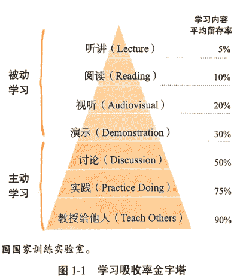

资料来源：美国国家训练实验室。

图 1-1 学习吸收率金字塔

其中：

- 采用听讲的方式学习，学习内容平均留存率为 5%；
- 采用阅读的方式学习，学习内容平均留存率为 10%；
- 采用视听的方式学习，学习内容平均留存率为 20%；
- 采用演示的方式学习，学习内容平均留存率为 30%。

以上四种学习方式叫作被动学习，也叫作以输入为主的学习方式。下面的三种则截然不同：

- 采用讨论的方式学习，学习内容平均留存率为 50%；
- 采用实践的方式学习，学习内容平均留存率为 75%；
- 采用教授给他人的方式学习，学习内容平均留存率为 90%。

以上三种学习方式是主动学习，因为都需要学习者主动去做输出的动作。

为什么“做课”能够加速个人成长呢？

核心原因就是学习方式和身份转换，从单纯输入变成了先输入后输出，从阅读者变成了讲授者。当你决定把一本书里的内容做成课程讲出去时，你在阅读这本书时就有了“教授给他人”这个输出目标，所以你的学习内容平均留存率就会大幅提升。

长此以往，就会加速个人的成长。

### 2. 实现知识变现：零边际成本的知识创收

很多人都在寻求开展副业的机会，一来可以充实自己的业余时间，二来可以让自己增加新的收入来源。副业的种类有很多种，我认为从事知识副业是非常好的赛道。

一方面，从事知识副业可以加速个人成长，这一点前文已经介绍过；另一方面，知识产品往往是一种零边际成本的产品（即只需要生产一次，但可以销售无数次），假如你录制了一门线上课程，你的录制成本是有限的，一旦这门课程被市场接纳，销量很不错，那么你就可以持续从这门课程中获益并且没有额外增加生产成本，这就是零边际成本的魅力。

我自己录制过多门课程，包括“学以致用五步法”“亲子沟通力”“短视频剪辑课”“成为知识主播”等，其中一些课程即使已经过去 3 年了，也有人购买，是不是很不错？

所以，学会翻书成课，掌握做课的技能，尝试去做知识副业，很快你也可以拥有一个零边际成本的知识产品。

### 3. 推广全民阅读：建立知识 IP

翻书成课和推广全民阅读有什么关系呢？如果你能够掌握翻书成课的能力，并且通过线下读书沙龙或线上讲书直播讲授一本书，这不就是在推广全民阅读吗？

当然，如果你是企业的管理者，也可以把书籍的内容做成课程，分享给自己的团队成员，帮助团队伙伴共同成长，这也是一件非常有意义的事情。

我甚至认为，做阅读推广是一件自带光环的事情。

我在工作的前 10 年，几乎属于默默无闻型，但后来从事和阅读推广相关的工作，还因此上过报纸和电视；而且我发现，读书类的自媒体账号本身就带有一定的吸引力。

大家知道，有很多好书是默默地躺在书店、图书馆里的。如果你看到一些好书，又特别想分享出去，那么翻书成课就能帮到你，同时也让那么多的好书、那么多的知识，有机会被更多人学习到。

所以，学习翻书成课，是一件利人利己甚至利国利民的好事，大家可以尝试着把翻书成课作为自己的副业去经营起来。

看到这里，你找到做课的动力了吗？

在开始设计课程前，你需要明确自己的动力和初心。是为了个人成长、知识变现，还是打造个人 IP？只有明确了目标，才能设计出真正有价值的课程。

## 本章总结

### 每个人都可以做一门自己的课程

我写下本章，最想传递的核心观点是：知识付费不是大咖的专属，而是每个人都能握住的“知识杠杆”。

本章围绕做课的价值展开，知识付费市场规模大、增速快，其中个人讲师课程占比提升，其驱动力有碎片化学习需求、职业焦虑升级和技术基建完善。

兼职是用时间换金钱，有收入天花板等瓶颈；副业如做课，是用知识撬动复利，有零边际成本等优势。

“一人企业”的“五个一模式”中，知识产品是核心。做课的本质是“把自己产品化”，普通人做课可加速个人成长、实现知识变现、推广全民阅读。希望大家明确做课的动力与初心。

下一章将探讨“AI 时代，知识付费的‘危’与‘机’”，讲述技术变革给知识付费领域带来的影响。

## AI 时代，知识付费的“危”与“机”

### 讲师与 AI 的协作关系

就在我准备这本书的书稿时，2025 年年初 DeepSeek（深度求索）横空出世，我立刻就意识到，用 AI 工具辅助课程设计，能大幅提升做课的效率和质量。

为什么这么说呢？

大家回想一下，很多讲师在做课时，通常面临三大难题，看看你有没有这样的困扰。

- 获取素材效率低。
- 熬夜写课程大纲。
- 反复修改课程 PPT。

用好 AI 工具，再来做课程设计能大幅提升做课效率，具体如下。

#### 1. 节省时间和资源

在传统模式下，讲师往往需要耗费 60% 以上的时间在资料收集上，他们“穿梭”于行业报告、案例库之间进行碎片化信息的整合。而 AI 工具如 DeepSeek 能够通过自然语言处理技术，自动生成包含核心观点、数据图表、案例集的素材包。AI 工具甚至在生成课程大纲和课件 PPT 方面，都能节省很多时间。比如，一个原本需要 3 天才能完成的内容框架设计，使用 AI 工具可能只需要 5 分钟。

#### 2. 拓展思路和灵感

以往我们在设计课程时总是冥思苦想，也不见得能够做出好的设计，现在用好 AI 工具就可以让我们发现新的视角，通过不断“抽卡”找到让自己满意的设计方案，这拓展了做课的思路和灵感。

#### 3. 及时反馈与调整

对于课程大纲、课件 PPT，AI 工具可以提供及时的优化建议，避免了做课程设计时的“闭门造车”。

看到这里，你可能会想：既然 AI 工具这么厉害，以后做课程是不是完全靠 AI 工具就行啦？

这种想法不太对。

最好的办法是“人机合作”，各干各擅长的事，也就是“H-AI-H 模式”，说白了就是“人定方向，AI 干活，人再优化”。这里的“H”代表“人”，就是课程设计者，“AI”就是 AI 工具。

因此，我的建议是分三个步骤实现人机合作。

#### 1. 需求定义：人要把准课程的“方向盘”

做课程就像开车，首先得知道前进的方向。讲师得搞清楚三个关键问题。

- **垂直领域深度**：比如讲“家庭教育”，得先确定是聚焦亲子沟通、学习习惯培养，还是儿童心理健康等细分方向，不能什么都讲，这样反而哪个都讲不透。
- **用户画像精度**：通过问卷星等工具，问问学员孩子的年龄段（如学龄前、小学、青春期）、主要教育痛点（如写作业拖沓、玩手机成瘾、亲子冲突）、期待目标（如培养自主学习能力、改善沟通模式）。比如，设计“青春期亲子沟通”课程，学员可能有的是初中家长烦恼于孩子叛逆，有的是高中家长因亲子冷战而焦虑，收集这些需求后才能让课程对症下药。
- **价值主张清晰度**：不能说“我这门课能帮你搞好家庭教育”这种虚的，得像“30 天让孩子主动规划学习时间”“两周改善亲子沟通频率 30%”这样，让家长一眼看到能得到什么具体好处。

#### 2. AI 执行：让工具乖乖干活的秘诀

让我们来看看，讲师在做课时可以借助 AI 做哪些具体的工作。

- **选题调研**：用 DeepSeek 联网模式，看看什么选题最近比较受欢迎，如“分析某领域最近三个月的新趋势，给出三个适合新手讲师的课程方向”，我会在后续内容中讲解如何借助 AI 高效找到做课选题。
- **大纲设计**：输入做课需求，就能高效生成高质量的课程大纲，你敢想象吗？在后续内容中，我会向大家提供我设计的做课智能体，填入自己的做课需求，就可以直接生成一个有理论、有方法、有案例的课程大纲，比自己冥思苦想高效多了。
- **课件制作**：AI 工具可以高效生成课程 PPT，这对新手来讲是非常友好的，能大幅提升做课的效率和质量。但是如果完全依靠 AI 工具，做出来的课程可能没有“灵魂”，无法达到可以商用的质量。

传统模式与 AI 辅助模式的效率对比如表 2-1 所示。

| 环节 | 传统模式耗时 | AI 辅助模式耗时 |
| :--- | :--- | :--- |
| 选题调研 | 3 天（资料整合） | 2 小时（工具生成） |
| 大纲设计 | 3 天（逻辑梳理） | 5 分钟（智能生成） |
| 课件制作 | 3 天（设计+调整） | 30 分钟（模板套用） |

#### 3. 人类优化：给 AI 成果“画龙点睛”

AI 工具做出来的东西虽然快，但得靠讲师来“画龙点睛”。

- **认知校准**：比如 AI“讲”家庭教育时，可能不小心混淆“虎妈式教育”和“放养式教育”的适用场景，讲师得用自己的专业知识检查，别让错误理念误导家长。
- **情感注入**：AI“讲”亲子沟通技巧只是摆理论，讲师加入自己应对孩子中考焦虑的真实故事，家长一下就觉得“这老师懂我们的难”，听着也更有代入感。
- **效果预演**：讲师对内容进行“润色”后，可以对课程进行试讲，通过学员的反应、反馈调整内容，就像提前彩排，能让讲师正式上课时更有底。有平台测试过，对于优化后的课程，坚持学完的人比纯 AI 课会多很多。

### AI 时代，讲师有哪些“危”与“机”

所以，我提倡的“H-AI-H 模式”，是一种讲师和 AI 的最佳合作方式！

随着 ChatGPT、DeepSeek 等 AI 工具的普及，AI 就像一阵龙卷风，卷走了知识付费行业的旧规则。对讲师来说，这阵风吹来的不全是危机，更藏着破茧重生的机遇——关键看你是被风吹散，还是借风飞翔。

#### 1. AI 带来的挑战

- **知识权威性受质疑**：当 AI 能够迅速生成大量准确信息时，人们可能会对讲师的知识权威性产生疑问。曾经有一位讲师分享，学员在课堂上使用 AI 查询资料，甚至直接在课堂上问：“老师，您讲的和 DeepSeek 说的怎么不一样呢？”一度让讲师很尴尬！
- **传统基础教学需求减少**：随着 AI 提供的定制化和个性化学习方案越来越完善，传统基础教学需求可能会逐渐减少。
- **职业替代压力加剧**：AI 能代替完成一部分基础教学任务，因此一些提供基础内容培训的讲师将面临严重的职业危机。

#### 2. AI 带来的机遇

- **提升课程设计能力**：讲师需要更注重创新能力与批判性思维的培养，课程设计应转向深入挖掘问题、启发思考的层面。
- **角色转型为学习教练**：讲师需要从知识提供者转型为能力教练者，因为学员的需求不只是获得知识，更是获取解决问题的能力。当讲师能够转型为能力教练者时，会发挥出更大的价值。
- **聚焦高价值内容**：讲师应专注于 AI 难以替代的复杂问题解决、创新思维培养等高价值内容，增加课程的深度和广度，满足学员更高层次的需求。

在“H-AI-H”模式下，讲师的角色将更加多元化，既要掌握 AI 工具的高效运用，又要保持对课程内容的深度把控，最终实现教学质量的全面提升。通过不断迭代优化，课程设计将更加贴合学员的实际需求，真正实现教学相长。

AI 时代，对于讲师，既有“危”，也有“机”，建议讲师从知识传授者转型为学习陪伴者（情绪价值）+ 能力教练者（能力价值），进而打造个人 IP！

## 四定模型，助你用好 AI 工具

讲师怎么用好 AI 工具呢？给大家推荐“四定模型”，掌握了它，能让 AI 工具成为得力助手，精准产出优质内容。

### 1. 定角色：定义 AI 和自己的角色

明确“AI 工具是谁”和“自己是谁”是合作基础。

- 给 AI 工具定角色：可以具体到领域和经验，如“有 10 年 500 强企业培训经验的课程设计师”，而非笼统标签。
- 给自己定角色：如“我是某领域的资深讲师”或者“我是某领域的新手讲师”，可以引导 AI 工具调整内容深度。

不论是给 AI 工具定角色还是给自己定角色，都是让 AI 工具基于某个行业或场景进行回复，使其回复的内容更精准，减少无意义的“幻觉”。

### 2. 定目标：期望达成什么目标和效果

模糊的做课目标，如“做一门沟通课”会让 AI 工具无所适从，正确做法是按“通过 × × 课程帮助 × × 用户解决 × × 问题”公式设定清晰目标。（这叫作主题金线，我在下一章中会重点讲解，这里大家先知道就可以。）

模糊目标和清晰目标的对比如下。

- 模糊目标的提示词：做一门时间管理的课程。
- 清晰目标的提示词：设计一门有关时间管理的课程，帮助职场新人解决时间拖延问题，须符合 SMART 原则。

课程的目标越清晰，AI 工具给出的内容越符合要求。

### 3. 定任务：具体的需求或任务描述

让 AI 知道你要的是什么，如“给我提供一份 [ × × ] ……”“给我提供关于非暴力沟通的定义、步骤和注意事项……”。

提出这样具体的需求和明确的任务描述，会得到更想要的结果。

### 4. 定要求：你对结果的约束条件

用明确的规则来规范结果，示例如下。

- 字数：如“每知识点 300 字 +100 字案例”。
- 结构：总 - 分 - 总或问题 - 方案式，分小标题。
- 风格：幽默脱口秀或严谨学术，如“用幽默的写作风格……”。
- 格式：如“用 Markdown 格式输出”，更容易将结果做成思维导图。

以上“四定模型”环环相扣，让 AI 工具从“模糊助手”变成“能干搭档”。掌握这套“四定模型”，能让我们在课程设计、案例开发等场景事半功倍。本书后文会详细介绍 AI 工具在做课各个步骤中怎么发挥作用，这里大家先了解“四定模型”就行。

## · 本章总结

AI 时代，知识付费领域正经历着翻天覆地的变化。AI 工具就像一把双刃剑，一方面给讲师带来了挑战，如知识权威性受质疑、传统基础教学需求减少、职业替代压力加剧；另一方面也带来了机遇，促使讲师提升课程设计能力、角色转型为学习教练、聚焦高价值内容。

而“H-AI-H”模式和“四定模型”为讲师指明了方向，让讲师既能借助 AI 工具提高效率，又能发挥自身优势，为课程注入灵魂。

面对这场变革，无论是资深讲师还是新手讲师，都需要积极拥抱变化，在 AI 的浪潮中找准自己的定位。

那么，普通人如何在知识变现的浪潮中起步呢？下一章将揭晓答案，一起探索适合普通人的知识变现之路。

## 第三章 普通人做知识变现如何起步

普通人想要开启知识变现、读书变现，首先得弄清楚一个核心问题：如何把自己的知识变成大家愿意买单的产品？这就好比农民种地，得先知道该种什么作物、怎么种才能丰收。本章就从课程（以线上课为例）的常见形式说起，然后聊聊怎样一步步把知识变成可销售的产品。

### 课程的常见形式

前文我们提过“把自己产品化”，这里的“产品”就是我们在网上见到的各类课程。这些课程让人眼花缭乱，其实总结下来，主要有三种形式，每种都有自己的特点和适用场景，我们来一一拆解。

根据内容类型、交付方式和运营成本的不同，线上课程可以分为以下几种形式。

1. **录播课：生产一次，成交多次**

   录播课应该是大家最熟悉的课程形式了。简单来说，就是把你想讲的内容提前录制好，如用手机、计算机摄像头，或者专业的录屏软件，把知识点做成视频、音频或图文包，然后放到网上销售。像我们平时在网上购买的写作课、Excel 课，很多都是录播课。

   这种课程最大的好处就是一劳永逸。举个例子，你花一个月时间精心录制了一套 10 节的育儿课，上传到平台后，只要总有人下单，你就能一直收钱。不用每次都重复讲课，特别适合时间有限但想长期变现的人。不过，做录播课需要一次性投入较多精力，尤其是前期要把内容打磨得足够好，不然用户听了觉得没用，就不会推荐给别人，课程也就卖不动了。

2. **直播课：“公域引流 + 私域变现” 的组合拳**

   直播课这两年特别火爆，因为它能让讲师实时和观众互动，感觉就像面对面上课一样。直播课分为两种：一种是公域直播，如在抖音、快手、视频号这些大平台上直播，主要目的是吸引新用户，也就是“引流”；另一种是私域直播，如在自己的微信社群、小鹅通等第三方平台直播，面向的是已经加了好友或进了群的用户，更注重课程交付，即“变现”。

   举个例子，一位博主想卖烘焙课，她每周在抖音开 3 次免费直播，教大家做简单的蛋糕等甜品。直播时，她会故意留一些“干货钩子”，如“想知道怎么让蛋糕不开裂吗？这个技巧我会在社群里详细讲解”。这样一来，很多观众觉得她讲得好，就会加她为好友，进她的烘焙交流群。等群里人数够了，她就开收费的私域直播课，专门教复杂的烘焙技巧，转化率特别高。

3. **社群课：靠运营黏住用户的“长线局”**

   社群课可能不像前两种那么直观，简单来说就是通过微信群、QQ 群等工具，带着一群人一起学习。常见的有读书会、训练营，如 21 天读书打卡群、14 天写作训练营。这种课程的核心不是单纯卖内容，而是靠运营服务来留住用户。

   拿读书会来说，运营得好的话，用户会特别愿意留下来。比如，每天早上在群里发一段书摘，引发大家讨论；每周安排一次语音分享会，让用户轮流讲自己的读书心得；月底组织一场线下见面会（如果条件允许）。这样一来，用户不仅能学到知识，还能认识一群志同道合的朋友，自然愿意一直跟着你学。训练营就更“重”一些，可能每天都有作业、点评、直播答疑，适合讲授需要系统学习和监督的技能类课程，如翻书成课磨课会、写作训练营等。

这三种形式的课程（录播课、直播课和社群课）都是线上课，那么，线下课呢？线下课通常分讲授型课程和互动型课程，本书后续分享的课程设计方式，在线下课的设计上也是适用的。

### 新人知识变现三步走

现在问题来了：作为一个刚开始做知识变现的新人，该先做哪种课程呢？别急，我给大家总结了“三步走”策略，这个策略十分有效，很多学员都是靠这个策略成功起步的。

大家可以先自己思考一下，再看我的答案。

我的建议是：对于做课，新人讲师需要分三步走，依次是直播课、社群课、录播课。

很多人一看可能有点蒙，上来就做直播课，会不会难度太大了？其实可能恰恰相反。反过来想，如果上来就做录播课，可能会陷入“闭门造车”的状态，而且会觉得反正在课程上线之前没人看到我在做什么、怎么做，所以就不紧不慢地做，实际上会耽误很多宝贵的时间。

所以，我建议按照三步来进行。

**第一步：先做直播课——检验内容，锻炼口才，一箭双雕**

很多人一听“直播”就害怕：我从未面对过镜头，万一讲错了怎么办？内容讲出去了，别人不买课怎么办？其实，新人做直播课，重点不是赚钱，而是“试错”和“练兵”。

具体怎么做呢？很简单，先选一个自己熟悉的领域，如你擅长整理收纳，就围绕“家庭收纳技巧”这个主题，每天花 30~60 分钟在抖音、视频号等平台直播。注意，一开始要免费讲，就当是给大家分享干货。比如，第一天讲“如何整理衣柜”，第二天讲“厨房收纳小妙招”，每次直播结束前，提醒观众“如果想了解更系统的收纳方法，可以加关注、粉丝团等”。

这样做有三个好处。第一，能检验你的内容是否真的有价值。如果直播时没人互动，或者观众听完就走，说明你讲的东西可能不够吸引人，得调整。第二，能锻炼你的表达能力。刚开始直播可能会紧张、结巴，但坚持一周后，你会明显感觉自己说话更流畅，思路更清晰。第三，能积累第一批粉丝。这些愿意关注你的人，都是对你的内容感兴趣的“潜在学员”。

有人可能会担心，我的内容都在直播间讲了，以后谁还买我的课呀？关于“内容泄露”的问题，完全不用担心。首先，看直播的人往往是看热闹的，真正想系统学习的人会愿意花钱买课；其次，直播上讲的都是碎片化的知识点，而正式课程会有完整的体系、配套的资料和答疑服务，两者根本没法比；最后，你通过直播练出来的讲课能力，才是最值钱的，这是花钱都买不来的经验。

除了线上直播课，如果有机会在线下授课，也能够得到很好的锻炼，因为线下授课本身就是“直播”。我自己成长最快的时期就是从 2018 年开始经营帆书，连续做了 500 多场线下读书活动和 600 多场线上直播。所以，这个输出内容的过程对每个知识创业者来说都是非常重要和必要的。

**第二步：再做社群课——从公域引流到私域，建立信任，挖掘需求**

做了一段时间直播课后，你手里应该积累了不少潜在学员，这时就可以尝试做社群课了。社群课分为“轻量”和“重量”两种，新人建议先从“轻量”的开始，如读书会、免费干货群。

举个例子，假设你直播讲的是“职场穿搭技巧”，吸引了 200 个对穿搭感兴趣的人加你为好友。你可以把他们拉进一个“职场穿搭交流群”，每天在群里分享一篇穿搭文章，每周安排一次小话题讨论，如“周一穿什么显得专业又有活力？”。同时，你可以在群里发起一项小调研，问问大家“最想解决的穿搭问题是什么？”“是不会搭配颜色，还是不知道如何根据场合选衣服？”，这些调研结果能帮你精准找到用户的痛点，为后续做课程打下基础。

除了免费社群课，你还可以尝试做低价的“轻付费”社群课，如 9.9 元的“3 天穿搭挑战营”。每天在群里发布一项穿搭任务，如“用一件白衬衫搭配出 3 种不同风格”，学员完成任务后拍照打卡，你做一些简单的点评。这样既让学员觉得有收获，又能让你赚到一点收益。更重要的是，通过这种低门槛的方式，能筛选出真正愿意为知识付费的用户，这些人就是你以后销售高价课程的种子用户。

**第三步：最后做录播课——厚积薄发，用优质内容实现创收**

等你直播练得差不多了，社群里也积累了几百个忠实粉丝，这时就可以开始做录播课了。这时候做录播课，和一开始就闭门造车完全不一样，因为你已经通过直播和社群了解了用户的需求，知道他们最想要解决什么问题，也就明白了课程该怎么设计才能卖得好。

我在线上服务了上万名学习做课的学员，按照这个模式让大家准备课程内容，大部分学员都认为这是一种非常有效的方式。

当然，如果你已经是非常有经验的讲师，那么可以不必遵循以上三步，而是围绕自己的运营目标，有计划地安排直播课、社群课、录播课的组合即可。

### 爆款好课有哪五个要素

介绍了这么多，那么到底什么样的课程才算好课程呢？其实，一门爆款好课就像一个活生生的人，需要有灵魂、有骨架、有血肉、有颜值、有价值，这五个要素缺一不可。我们一个个来拆解。

#### 1. 爆款好课的五要素

- **选题，即灵魂。** “选题不对，努力白费”，选题是课程的灵魂所在。
- **框架，即骨架。** 课程要结构清晰，逻辑连贯，让学员学起来轻松有效。
- **内容，即血肉。** 课程的内容要充实，能够让学员“深度学习，学以致用”。
- **课件，即颜值。** 课件是课程最终的呈现，好看的皮囊能加分。别让好内容输在外表。
- **交付，即价值。** 课程通过交付创造价值，一方面为课程创作者带来收入，另一方面为课程学习者带来成长。

#### 2. 如何设计一门好课

根据“爆款好课的五要素”，设计一门课程需要经过五个步骤。

- **选题确定：** 根据用户的需求和痛点，确定做课的方向。
- **内容收集：** 围绕课程选题收集做课所需的内容素材。
- **框架设计：** 构建课程的大纲结构，确保每个模块都有清晰的学习目标。
- **课件制作：** 制作课程课件，完成试讲和优化，如果是录播课，则需要录制授课视频。
- **课程变现：** 通过多平台发布课程，开启课程的浪潮式发售。

在后面的篇章中，我将对以上五个步骤展开详细的讲解。

### 本章总结

到这里，相信大家对知识变现的起步已经有了清晰的思路：先通过直播课练手、引流，再用社群课建立信任、挖掘需求，最后用录播课实现变现；做课程时，牢记“选题、框架、内容、课件、交付”五要素，按照“选题确定→内容收集→框架设计→课件制作→课程变现”五个步骤来操作。

其实，知识变现并不像想象中那么难，关键是要迈出第一步。很多人总是担心“我讲得不够好”“没人买我的课”，但实际上，只要你分享的内容能帮到别人，就一定有人愿意买单。哪怕一开始只卖出去 10 份课程，也是一个好的开始，至少证明你的方向是对的。

最后想告诉大家：每个人都有自己的知识和经验，这些都是可以变现的“宝藏”。不要低估自己的价值，也许你觉得稀松平常的技能，在别人眼里就是急需的干货。勇敢地把你的知识分享出来，说不定下一个靠知识变现的人就是你！

理解了知识变现的本质后，接下来我们将进入“做课篇”，该篇内容将手把手教你如何将一本书转化为一门课程，详细讲解翻书成课五步法。

## 第二篇 做课篇：翻书成课五步法全解析

——从选题到变现的标准化流程

### | 引言 | 从知识到课程的做课之旅

当你读完一本书感觉心潮澎湃，或是在某个领域积累了多年经验，你其实已经拥有了“做课”的种子。但如何让种子发芽结果呢？

这就是本篇要解决的问题——用一套人人可复制的“翻书成课五步法”，让知识从模糊的想法变成实实在在的课程产品。

### 做课不是“创造”，而是“翻译”

很多人误以为做课需要天赋异禀，实则不然。做课更像“翻译”：把书中的知识、脑中的经验，“翻译”成学员能听懂、用得上的内容。就像樊登老师把一本本书“翻译”成千万人收听的讲书内容，你也可以把自己的库存知识“翻译”成课程。

这套“翻译密码”就是“翻书成课五步法”——选题确定、内容收集、框架设计、课件制作、课程变现。这五步就像拼图一样，把复杂的做课过程拆解成具体可操作的环节。

### 五个步骤，解决五个“做课焦虑”

也许你会担心：“我没做过课程，能学会吗？”别急，每个步骤都对应一个“做课焦虑”，也都有破解之道。

1. **选题确定的焦虑：我有知识，但不知道学员要什么**

   你是否想过，为什么“AI 工具在职场中的应用”课程能快速爆红？因为它踩中了“真需求、大市场、足够痛”的课程选题确定逻辑。五步法第一步，就是教你用“卖课测试”“平台数据”“AI 工具”精准定位学员痛点，让确定课程选题不再靠运气。

2. **内容收集的焦虑：资料太多，不知道怎么用**

   很多人在做课时经常陷入“资料囤积症”，但真正的高手会像厨师一样按需取材。五步法第二步，就是教你用“全局理解法”从“是什么、为什么、怎么做”三个维度筛选素材，用“颗粒适度原则”避免信息过载，让收集效率飞速提升。

3. **框架设计的焦虑：内容零散，讲课时总是跑题**

   你有没有听过流水账式课程？讲了半天，学员不知道重点在哪里。五步法第三步，就是教你用“认知圈结构”“要素型结构”等逻辑框架，帮你把零散内容串成“珍珠项链”，让课程既有逻辑又有层次。

4. **课件制作的焦虑：课件丑、没重点，学员不爱看**

   课件是课程的“第一眼印象”。五步法第四步，就是颠覆你对课件的认知——课件不是越花哨越好，而是要遵循“文字精简、图表直观、动画适度”的原则，让课件成为你的“无声助教”。

5. **课程变现的焦虑：课程做好了，怎么让更多人知道**

   “酒香也怕巷子深”是现实。五步法第五步，就是教你用“浪潮式发售”模型，像海浪一样层层推动学员购买——从造势期的“好奇心钩子”，到预售期的“种子用户激活”，再到发售期的“限时福利”，让变现不再是生硬推销。

### AI 工具：做课路上的“超级助手”

在五步法中，AI 工具不是替代者，而是加速器。

- **选题确定时**，DeepSeek 能帮你分析行业趋势，生成若干个爆款选题。
- **内容收集时**，AI 工具能快速总结书中核心观点，生成思维导图。
- **框架设计时**，我将送你一个 AI 智能体，1 分钟就能生成完整大纲。
- **课件制作时**，WPS 灵犀能根据内容自动匹配模板，甚至生成配图。
- **课程变现时**，AI 工具能帮你写朋友圈文案，设计促销海报，甚至分析用户购买意愿。

请记住：AI 是“工具”，而你是“主人”。只有理解做课的底层逻辑，才能让工具为你所用。

### 准备好开启做课之旅

在正式进入五步法学习前，建议你做三件事。

- **准备一个做课笔记本：** 记录下你想开发的课程方向，哪怕只是一个模糊的想法，如“如何提升亲子沟通力”。
- **选一本“翻书成课”练习书：** 可以是你最近读过的书，或是你想分享的书，如《非暴力沟通》《掌控习惯》等。
- **准备 AI 工具：** 注册豆包、DeepSeek 等账号，熟悉基本功能（后面会用到）。

在做课时不要一下子进入“体系课”的开发（由多节课组成的课程），而是要先掌握如何设计一堂 90 ~ 120 分钟的直播课，或者 30 分钟左右的录播课。会做单节课，就会做体系课。

所以，本篇我将以最常见的直播课为例，为大家讲解课程设计的完整流程；等你彻底掌握了这套课程设计方法后，第三篇会讲解如何设计多节课组成的体系课。

接下来，我们开启“翻书成课五步法”，从课程选题确定开始，聊聊如何找到那个让学员眼前一亮的课程灵魂。

## | 第四章 | 选题确定：精准定位，直击学员核心需求

“选题，是课程的灵魂。”这句话在知识付费领域几乎成了共识。

我曾见过一位讲师耗费半年时间，打磨了一门职场沟通课，内容翔实、案例生动，但最终销量惨淡。复盘时发现，市场上同质化课程早已饱和，而他的选题既没有差异化，也没有切中学员真正的痛点。

反观另一位新人讲师，在 2025 年年初抓住“AI 工具在职场中的实战应用”这一新兴需求，仅用半个月开发的课程迅速成为爆款课程。

这两个案例告诉我们：选题不对，努力白费；选题精准，事半功倍。

### 学员为什么购买课程

学员购买知识付费课程，往往有各种各样的动机。有的是为了提升自己的技能，以便在职场上获得更好的发展。比如，很多职场人士会购买办公软件的教学课程，希望通过学习掌握更高效的办公技能，提高工作效率，从而获得晋升的机会。有的是出于兴趣爱好，想要在闲暇时间学习一些自己感兴趣的知识，像美术、音乐课程就吸引了众多对艺术有追求的人。有的是为了解决生活中遇到的实际问题，如亲子沟通课程，对那些在教育孩子过程中遇到困扰的家长来说，它就像一场及时雨。

这里要提到 KSA 模型，它对我们理解课程设计的核心价值有重要的意义。

K、S、A 分别代表知识（Knowledge）、技能（Skill）和态度（Attitude）。

- **K：** 学员希望通过学习课程获得知识，这类内容需要学员动脑以实现理解和记忆。
- **S：** 学员通过学习课程获取技能，这类内容需要学员动手以实现学以致用。
- **A：** 学员通过学习课程改变态度、价值观，这类内容需要学员动心以实现行为转变。

上面的这三段文字中，包含了学员需求、学习方式和学习成果，而且给了讲师非常重要的提示，即“教学目标”。

精准确定选题须兼顾 KSA，满足学员多维度需求，方能打造真正有价值的课程。

一门好的课程，应该在这三个方面都有所体现。以职场技能课程为例，它不仅要传授相关的专业知识，如行业的最新动态、理论知识等，还要培养学员的实际操作技能，让他们能够将所学知识运用到实际工作中。同时，课程还应该引导学员树立正确的的工作态度，培养他们的职业素养和责任心。

通过 KSA 模型，我们可以看到课程设计的核心价值在于全面提升学员的综合能力，让他们在知识、技能和态度上都能得到成长。

除了了解学员的购买动机和课程设计的核心价值，我们还需要关注成人学习的心理特征。成人学习和学生学习有很大的不同。

成人学习往往具有很强的目的性或目标感，他们希望通过学习能够快速解决实际问题（小朋友的学习靠兴趣驱动，而成年人的学习往往靠目的驱动）。另外，成人的学习时间比较零散，很难像学生一样集中精力进行长时间的学习。因此，在进行课程选题确定和设计时，我们要充分考虑这些特点。比如，设计一些短小精悍、针对性强的课程，方便成人在零散的时间里进行学习。同时，课程内容要注重实用性，能够让学员在学习后马上将所学知识运用到实际生活中。

举个例子，有一位职场人士，他在工作中经常需要制作 PPT，但他的 PPT 制作水平一直不高。于是，他购买了一门 PPT 制作课程。这门课程的选题设计就非常符合他的需求，课程不仅详细讲解了 PPT 制作的基础知识和技巧，还结合了实际场景进行练习，让他快速掌握了 PPT 制作的方法。而且，课程采用了线上视频教学的方式，他可以根据自己的时间安排进行学习，非常方便。通过学习这门课程，他的 PPT 制作水平得到了很大的提升，在工作中也得到了领导的认可。

再如，有一位家长，他在教育孩子的过程中遇到了很多问题，如和孩子沟通不畅、孩子不爱学习等。他购买了一门亲子沟通课程，这门课程的选题定位正是帮助家长解决在教育孩子过程中遇到的实际问题。这门课程不仅传授了亲子沟通的技巧和方法，还分析了孩子的心理特点，让家长能够更好地理解孩子的行为。通过学习这门课程，他和孩子之间的关系得到了很大的改善，孩子也变得更加听话和爱学习了。

总之，学员购买课程的目的就是通过动脑获得知识、通过动手掌握技能，以及通过动心改变态度，最终目标是解决问题。

所以，只有我们深入了解知识付费产品的学员购买动机，结合 KSA 模型来设计课程，同时关注成人学习的心理特征，我们才能选出一个好的课程选题，设计出受学员欢迎的课程。

### 什么样的选题有生命力

学员学习课程不是为了听讲师自说自话，而是为了解决自己的具体问题——可能是学会一项技能，可能是缓解育儿焦虑，也可能是找到职业突破的方法。

樊登老师在《低风险创业》中有一句话：“低风险创业的底层逻辑有很多，其中最为核心的当数‘优雅地解决一个社会问题’。”做课亦是如此，好的课程选题就是要解决学员的问题。那么，能够解决学员问题且有生命力的选题有哪些特征呢？

我总结了三个关键词：“真”“大”“痛”。

### 三个标准筛选有生命力的课程选题

确定选题的本质，就是找到那些真需求、大市场、足够痛的社会问题，并且根据这些社会问题提供课程方案。

## 翻书成课：AI 时代打造爆款课程的实战手册

### 1. 真需求：从“我以为”到“学员要”

“真”即真需求，选题必须直击学员的实际痛点和需求点。

我们可以回想一下，是否见过一些伪需求的课程呢？讲师讲得津津有味，但学员并不乐意为此买单。真需求不是主观臆断的，而是客观存在的学员需求和痛点。

验证方法很简单——卖！

如果一门课程做出来后，即使很努力去推荐和宣传，也很少有人关注，基本上说明这门课程并不能够满足学员的真需求。

这该怎么办呢？在课程设计阶段，可以去知乎、小红书等平台搜索相关话题的讨论量，查看知识付费平台同类课程的销售数据。例如，在 2024 年家庭教育类课程中，与亲子沟通技巧相关的选题销量同比增长 68%，那么亲子沟通类的选题，就是一个有真需求的课程选题。

这里的“真”，除了真需求，我还想强调另一个“真”，叫作真本事。

讲师本人要对当前的课程选题有真实的经验和深刻的理解，才能做出满足学员需求、解决学员痛点的课程，而非基于一个选题，在互联网上或通过 AI 工具攒内容，这样攒出来的课程，虽然做得很快，但会为后续的课程运营埋下隐患。

### 2. 大市场：小池塘很难养出大鱼

“大”指受众广泛，选题应覆盖大量的潜在学员，即潜在的市场规模要大。

市场规模决定了课程销量的天花板。判断市场大小有三个维度。

- 人群基数：0~6 岁家长群体 > 三孩家庭的家长群体。
- 付费意愿：职场技能课程付费意愿要高于兴趣类课程。
- 复购可能：“课程 + 训练营”模式复购率可达 30%，而单次课程往往没有复购率。

所以，人群基数大、付费意愿强且有复购可能的课程，就代表大市场。做课程选题，找到一个较大的市场，是非常有必要的。

请记住：贫瘠的土壤很难长出参天大树。

### 3. 足够痛：从“可有可无”到“必须解决”

“痛”则代表了迫切性，学员亟待解决其问题。

比如，2020 年年初，刚开始居家办公时，我当时推出“玩转社群运营”线上课程，帮助知识创业者转型线上社群运营模式，课程一推出在当月就销售出 500 多份。

可见，学员痛点越痛，付费意愿越强，决策速度越快。

判断学员痛点的关键信号是什么？

问题所产生的痛点是否影响学员的核心利益。比如，职位晋升、孩子升学、个人收益等，如果这个问题影响了学员的核心利益，那么学员就愿意为解决这个问题付出成本，进而购买课程、加入训练营或付费咨询。

有人会有疑问：“为什么有些讲师做的课程，看起来也不是‘足够痛’，课程却能卖得很好呢？”

这是一个非常好的问题，答案在于这些讲师是靠选题卖课，还是靠 IP 卖课。

当一位讲师已经成为 IP，有粉丝基础和影响力时，即使他做的课程选题并不是“足够痛”，也会有大量的粉丝购课学习，这样的案例有很多，你也能想到不少吧。

但是，作为新晋讲师，我们千万不能效仿，因为我们还没有粉丝基础和足够的影响力。

## 三步漏斗模型锁定爆款选题

### 1. 第一步：定赛道——找准做课方向

赛道，就是你选择的课程所在的行业或领域，如育儿赛道、职场赛道、心理健康赛道等。

赛道就像种地的土壤，土壤越肥沃，越容易长出累累硕果。

比如，一位擅长茶艺的讲师，最初选择茶文化赛道，结果购课学员寥寥无几；后来转型到办公室养生茶疗赛道，将茶艺与职场健康相结合，课程立即火爆。有没有发现，即使你是某个技能领域的专家，也要为该技能找到能够承载其价值的场景，只有这样才能让课程焕发生机，这就是定赛道的意义。

选择赛道的三大原则如下所述。

（1）兴趣、技能、问题的交集。以“樊登讲书”举例，读书是樊登老师的兴趣，讲书是樊登老师的技能，讲书的音视频可以帮助听书的学员解决生活、工作中的各类问题，那么讲书赛道对樊登老师来讲，就是一个好赛道。

请注意，我上面写的是“讲书赛道对樊登老师来讲，就是一个好赛道”，对其他人来讲并不一定适合。每个人应根据自身兴趣、技能和能够解决的问题来选择赛道，这样才能发挥最大的价值，如图 4-1 所示。

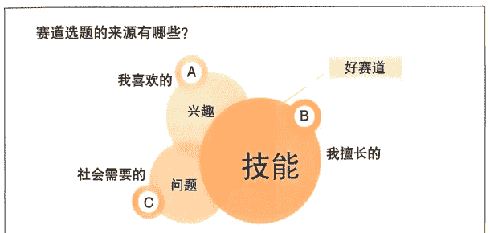

（2）可持续的赛道。尽量避免选择短期热点，因为热度消退后课程很有可能迅速滞销，无法形成可持续的运营，所以要避免盲目跟风，确保赛道具有长期发展潜力。

我特别建议大家选择能够支持“课程+训练营”模式的赛道，课程可以实现零边际成本的交付和变现，而训练营既能够助力学员成长，又可以实现学员复购。选择这样的赛道，不仅能确保课程生命力的延续，还能通过训练营模式持续提升学员黏性，形成良性循环。（在第三篇中，有一章会重点讲解如何设计“课程+训练营”的知识产品模型。）

比如，针对“翻书成课”这门线上课，我开发出了“线上课+训练营”的模式，线上课可以实现零边际成本的销售，而磨课会是训练营，每个月选定一本书，带领学员将这本书做成课程，从而提升学员“翻书成课”的能力，同时也实现了学员的复购。

选择这样的赛道，课程生命力更强，收益也更可观。

（3）竞争差异化的赛道。新人做课要避免和热门课程的直接竞争，应选择细分领域或独特视角，打造差异化竞争优势。

比如，同样是职场赛道，专注于“职场女性领导力”会比泛泛的职场课程更具吸引力。

只有深入挖掘特定群体的需求，提供精准解决方案，才能在众多课程中脱颖而出，赢得学员的青睐。

### 2. 第二步：定课题——找到主题金线

课题是赛道的具体切入点，在同一个赛道中，可以有许多不同的课题方向。比如，在家庭教育赛道，可以针对青春期孩子的家长设计亲子沟通技巧课程，也可以推出青春期心理辅导专题，甚至可以细化到如何帮助孩子规划未来等具体课题。

如何找到叫好又叫座的课题呢？分享一个我原创的概念：主题金线。

#### （1）什么是“主题金线”。

所谓主题金线，就是贯穿一门课程的核心线索，这条金线包括用户、场景、需求和方案。

确定主题金线时，需要明确：课程的目标用户是谁？他们在什么场景下遇到什么问题？课程要为用户提供哪些解决方案？

通过回答这些问题，你可以找到一条清晰的主题金线，即这个课题能够帮助什么用户在什么场景下解决什么问题，提供哪些解决方案，如图 4-2 所示。

比如，上面提到在家庭教育赛道，可以针对青春期孩子的家长设计亲子沟通技巧课程，也可以推出青春期心理辅导专题。

其中，亲子沟通技巧课程的主题金线，是帮助青春期孩子的家长（用户）在亲子沟通场景中，满足提升亲子沟通力的需求，提供有效倾听、非暴力沟通等的方案。

定课题，就是定课程的主题金线。

好的课程选题要能够帮助用户在相关场景中解决问题。

> 用户 场景 需求 方案
>
> 主题金线
>
> 一句话确定主题金线：
>
> 帮助 _(用户)_ 在 __ 场景中，满足 __ 需求，提供 __ 方案。

青春期心理辅导课程的主题金线，是帮助青春期的孩子（用户）在学习、生活、成长场景中，满足健康成长的需求，提供自我认知、情绪管理、自我疗愈等方案。

大家有没有发现，即使在同一个赛道，课程的受众不同，主题金线也不同；解决的问题不同，主题金线也不同。

#### （2）确定主题金线，对做课有哪些好处。

在做课初期定好主题金线，能够少走很多弯路，其核心价值有三点。

① 主题不偏离。主题金线确定后，用户、场景、需求就基本上确定了，整门课程都要为同一类学员在特定场景下解决既定的问题，在这个前提下做课，就不会出现偏离主题的问题了。

② 内容不多余。有些讲师在做课和讲课时，容易过度展开，讲多了就收不住或拉不回来，在特定的主题金线下做课和讲课，能够确保所讲的内容都围绕主题金线，不会过度展开。

③ 素材不跑题。课程中的概念、工具、流程都是需要素材来说明和支撑的，所以，在主题金线的“场景”确定后，素材就要符合这个场景。比如，在家庭教育课程中就不要使用职场案例，这就是素材不跑题。

#### （3）关于主题金线的重要思考：一门课程只能有一条主题金线吗？

答案是的！

一门 90 分钟的线上直播课，只能有一条主题金线，这大家都能理解。

那么，如果是 7 节的系列课程，也只能有一条主题金线吗？

答案是的。一套系列课也只能有一条主题金线，而每一小节可以有小节的主题金线，对于一小节来说看起来好像有两条主题金线了，但实际上还是一条，这两条主题金线有点类似“大括号”和“小括号”的关系，即系列课的主题金线是支撑整套课程的主题，而小节的主题金线是系列课主题金线的分支，用来支撑这一小节的主题，多个小节组合起来共同支撑这套课程的主题。

### 那么，如何找到爆款课题？

在了解了主题金线的价值后，我们可以通过哪些途径和渠道找到爆款的课题呢？推荐三种有效的途径。

(1) 书籍成课。在既定赛道中，选择一本或多本热门图书，将书中的核心内容提炼出来，做成一门课，是一种成功率较高的做选题的途径。

樊登老师在“樊登讲书”中提到过，第一次当大学老师时，他因为讲公共关系的课程，就到新华书店把关于公共关系的书买回来看了一遍，然后做笔记、画思维导图、做课件，讲了几年后就成了公共关系课程的专家。请问，樊登老师当年是不是在践行“书籍成课”理念呢？

书籍对课程来讲，是非常好的素材库，用好了能够提升做选题和做课的效率和成功率。

在下一章中，我会详细讲述如何确定一本书的主题金线。

（2）主题成课。关注既定赛道中的热门话题，可以用公式表达：热门话题 + 课程赛道 = 爆款选题。

举个例子，假如你是家庭教育赛道的讲师，你一定会关注到校园霸凌的相关事件，那么你就套用公式，即“校园霸凌事件 + 家庭教育赛道 = 爆款选题”，如“家长请注意：告诉孩子如何避免校园霸凌”，这类课程就容易受到家长的青睐。

（3）技能成课。提炼和总结自己身上拥有的某一项有价值的核心技能，将其做成课程，也是非常好的找选题的途径。

还记得《纳瓦尔宝典》中的“把自己产品化”吗？这里面有两个关键词：“自己”和“产品化”。找到自己过去或当前正在做的一件有价值且有生产力的事情，将其“产品化呈现”或者“课程化呈现”，带动更多人去做这件有价值且有生产力的事情，那么，你就实现了“把自己产品化”。

成熟的讲师在实际定课题的过程中，通常使用组合拳，兼顾书籍成课、主题成课和技能成课，即在做课时既参考热门领域的热门书籍，也关注社会热点，同时提炼自身的核心技能。

而新手讲师，我建议先从书籍成课开始练习，不断提升自己的做课能力；然后尝试主题成课，探索适合自己的做课方向；最终走向技能成课，把自己产品化，打造可持续运营的小而美的“一人企业”。

### 3. 第三步：定产品——找对交付形式

#### (1) 产品形式的定义。

产品形式是指你将课程内容以什么样的形式交付给学员。常见的产品形式有录播课、直播课、社群课。

#### (2) 如何选择产品形式。

在前文中，我们提到过课程的三种形式，录播课、直播课和社群课。选择课程产品的形式时，需要考虑交付目标和学员的学习需求。

不同的产品形式有不同的特点和适用场景。

① 录播课：适合教授知识类内容和简单的技能。录播课的优点是可以反复观看，学员可以根据自己的时间安排学习。但录播课的缺点是互动性稍差，学员在学习过程中遇到问题时无法及时得到解答，需要借助客服或社群答疑。

② 直播课：适合教授知识类、技能类和态度类内容。直播课的优点是互动性强，学员可以在学习过程中与讲师实时互动，及时解决遇到的问题。但直播课的缺点是对讲师的应变能力要求较高，并且学员需要在固定时间参与学习。

直播课是边际成本较高的交付形式，所以，建议每场直播要至少包含两个核心目标：学员成长的目标和讲师变现的目标。

③ 社群课：如读书会、训练营，适合教授知识类、技能类和态度类内容，并且需要学员在学习过程中进行实践和反馈。

社群课的优点是能够营造学习氛围，学员之间可以相互交流和鼓励。社群课的缺点是运营成本较高，讲师需要投入更多的时间和精力进行管理和指导。所以，社群课要么定价稍高一些，要么设置后端的转化产品。

有经验的讲师往往使用组合拳，录播课、直播课和社群课组合使用，打造自己的产品体系。而新手讲师，在前文我曾经建议过，先做直播课，锻炼表达能力；再做社群课（如读书会），提升运营能力；最后做录播课，实现课程变现和学员的深度服务。

## AI 赋能选题确定

AI 工具正在提速传统的做选题方式，通过 AI 工具的赋能，我们可以快速找到适合自己的课程选题，从而提高课程设计的效率和质量。

以 DeepSeek 为例，它能够帮助讲师实现以下目标。

### 1. 书籍成课：根据指定书籍，找到有卖点的课程选题

核心价值：基于书籍做课程设计，精准提炼主题金线。

提示词举例：“我是一名［家庭教育］讲师，要把［卢森堡博士］所著的［《非暴力沟通》］做成一门 90 分钟的线上直播课，学员是［0～6 岁孩子的家长］，课程的目标是［帮助家长提升家庭教育的质量，改善亲子沟通力］，请给我 5 个符合学员需求的课程选题。”

备注：这类提示词在使用时，须选中“深度思考 R1”和“联网搜索”。

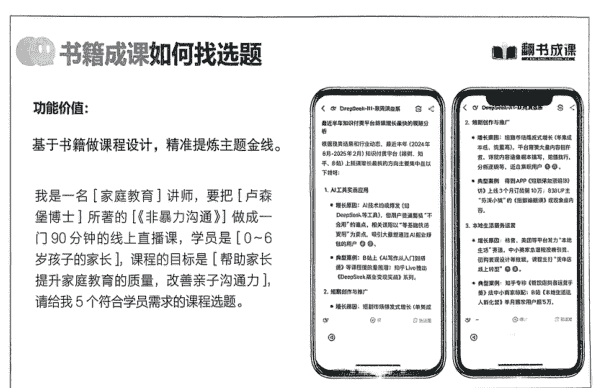

### 2. 主题成课：趋势捕捉型选题，痛点挖掘型选题

核心价值：找热门选题，避免选择过时的课程选题。

提示词 1：趋势捕捉型选题。

“你是 [家庭教育领域的讲师和专业的课程设计师], 请分析 [家庭教育] 领域最近 3 个月的新趋势, 给出 3 个适合新手讲师做课程的选题方向, 并用通俗易懂的语言解释一下为什么这些选题有市场潜力。”

提示词 2：痛点挖掘型选题。

“你是 [家庭教育领域的讲师和专业的课程设计师], 针对 [0~6岁的家庭教育] 场景中的典型困境，设计 3 个课程选题。”

备注：这类提示词在使用时，须选中“深度思考 R1”和“联网搜索”。

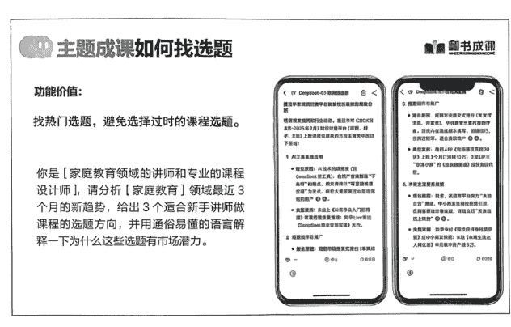

### 3. 技能成课：量身定做课程选题，让 AI 精准推荐

核心价值：向 DeepSeek 提供你的经验、优势和做课目标，让它为你精准推荐做课选题。

提示词：“我是一名[××]领域的讲师，想要找到今年热门的做课选题。我的经验有[××]，我的优势是[××]，我的目标是[××]，我的劣势是[××]。请结合当前的社会需求和未来 3~5 年的发展趋势，给出 5 个满足需求的做课选题。”

备注：这类提示词在使用时，须选中“深度思考 R1”和“联网搜索”。

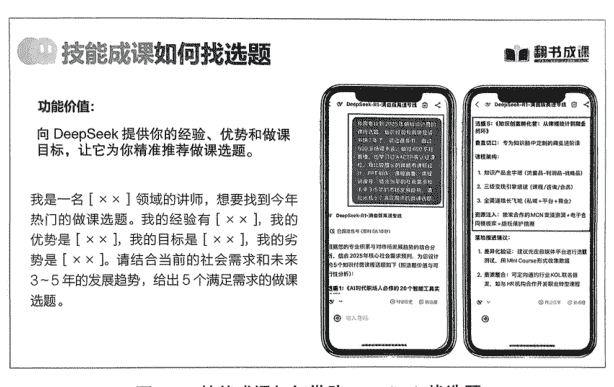

以上三种使用 AI 获取课程选题的方式，建议大家多做尝试，特别是第三种“技能成课”，当你把自己的经验、优势、劣势和目标统统告诉 AI 时，AI 给你的选题建议会让你感到惊喜。针对这一点，我在线下做培训时，曾经多次看到学员为之震惊，好多学员惊呼：“原来我可以做这门课程啊？我怎么就没想到？！”快动手试一下吧。

## · 本章总结 ·

### 选题是科学与艺术的结合

好的选题，既需要数据分析的理性——看市场、查趋势、算竞争，也需要人性洞察的感性——懂焦虑、知渴望、解困惑。课程向学员提供解决问题的方案，而讲师是学员在解决问题时的向导；就像《你的顾客需要一个好故事》里介绍的，向导需要具备两种能力——共情和权威。

本章从剖析学员购买课程的动机入手，借助 KSA 模型阐述课程设计应兼顾知识、技能与态度维度，满足学员多维度需求；进而提出 “真” “大” “痛” 的选题筛选标准，通过三步漏斗模型锁定爆款选题，特别强调了 “主题金线” 的价值；还介绍了 AI 赋能选题确定的新方式，并展现了 AI 在提升选题确定效率和质量方面的优势。

在本章的最后，我为读者朋友们准备了课程选题设计与自检表 (见表 4-1)，以便厘清思路、复盘过程。

定好课程选题仅是起点，如何将选题转化为系统化的知识体系才是关键。下一章将深入探讨 “内容收集” ——从海量信息中提炼精华，为课程做好坚实的内容储备。

表 4-1 课程选题设计与自检表

| 1. 课程基本信息 |
| :--- |
| 课程名称 |
| 学员群体 |
| 应用场景 |
| 学员需求 |
| 解决方案 |
| 课程目标 |

(续表)

| 2. KSA 模型检查 (知识 / 技能 / 态度) |
| :--- |
| 知识维度 (K) | □是否提供可理解记忆的知识点? □是否有系统化的知识框架? |
| 技能维度 (S) | □是否包含可实践的技能训练? □是否提供工具 / 模板 / 案例? |
| 态度维度 (A) | □是否引导学员行为转变? □是否设计情感共鸣点? |
| 3. 选题标准评估 (真 / 大 / 痛) |
| :--- |
| 真需求验证 | □是否通过数据验证需求 (如平台搜索量)? □是否匹配讲师真实经验? |
| 大市场评估 | □目标人群基数是否足够大? □是否有复购可能性 (如训练营)? |
| 痛点迫切性 | □是否影响学员核心利益 (晋升 / 收入 / 健康)? □学员是否愿意立即付费解决? |
| 4. 产品形式选择 |
| :--- |
| 交付形式 | □录播课 (知识 / 简单技能) □直播课 (互动 / 深度教学) □社群课 (训练营 / 实践反馈) |
| 5. 整体评估 |
| :--- |

# 第五章

## 内容收集：高效整合，构建课程血肉基石

如果说选题是课程的灵魂，那么内容就是课程的血肉。

内容收集的质量直接决定了课程的受欢迎程度，无论线上课、读书会还是训练营，课程设计的核心始终是内容的深度与实用性，即内容为王。

许多人在做课时常陷入两大误区：要么沉迷于找资料，最终囤积大量信息却无从下手；要么急于列提纲，导致课程内容空洞无物。

那么，在我们确定好课程选题后，到底是先列课程大纲，还是先收集信息呢？

其实，这两种顺序并无对错之分，而是要依据知识储备的实际情况来灵活调整。

我的建议是，如果你对当前的选题，已经积累了丰富的存量知识，可以先初步列出提纲，再围绕提纲去收集信息，进而对课程提纲进行优化和完善。相反，如果该选题对你来说属于增量知识，你对它所知甚少，那么先广泛收集信息，再依据收集到的内容整理提纲，无疑是更为合适的选择。

本章我们先来了解内容收集，为课程构建“血肉”。

## 内容收集的原则

在进行内容收集时，我们需要遵循一些基本原则，以确保收集到的信息既全面又有价值。我总结了三个核心原则，分别是以终为始、全局理解和颗粒适度。

### 原则一：以终为始

想象一下，假如你计划从北京自驾去西藏，是先研究路线，还是先加油？答案显而易见。

做课亦是如此——明确目标，是内容收集的第一步。

做课的目标是什么呢？就是上一章我们提到的主题金线：课程要帮助什么用户在什么场景下解决什么问题，提供哪些方案。

在主题金线确定后，围绕主题金线收集信息，就能够做到以终为始。

还记得主题金线的三个价值吗？

- ① 主题不偏离。
- ② 内容不多余。
- ③ 素材不跑题。

例如，2023年我在设计“亲子沟通力”这门课程时，为了达成课程设计的目标，我阅读了亲子沟通领域的十多本相关图书，听了大概20多期“樊登讲书”，在线上搜索其他人的读书心得和书评，还收集了许多亲子沟通相关的视频素材，以多样化的形式丰富课程内容。

通过围绕主题金线进行信息收集，能够大大提高效率，避免在收集过程中迷失方向，确保收集到的信息都能为课程设计所用。

### 原则二：全局理解

“盲人摸象”的故事我们都听过，四个盲人分别摸到大象的不同部位，便对大象的模样各执一词，却都无法准确描述大象的全貌。

这就如同我们在收集知识信息时，如果只关注某一个方面，就难以形成全面、准确的认知。为了实现全局理解，我们需要从三个维度去收集信息：What（是什么）、Why（为什么）和 How（怎么做）。

- What（是什么）：是指知识的概念、定义和基本原理，可以帮助学员理解概念。
- Why（为什么）：是指知识背后的原因、意义和价值，可以帮助学员获得动力。
- How（怎么做）：是指知识的应用方法、步骤和技巧，可以帮助学员学以致用。

我们以“无条件的爱”为例来进行说明。

- What（是什么）：明确“无条件的爱”是什么，它是建立在理解、尊重和接纳的基础之上的，父母尊重孩子的个性和独特性，支持他们的成长和发展，不对他们设置过多的条件或要求，它是温柔而坚定的。
- Why（为什么）：为什么“无条件的爱”在家庭教育中至关重要？因为它能够建立良好的亲子关系，增强孩子的自尊和自信，塑造积极的人格特质，增进心理健康，树立正面的亲子关系模式。
- How（怎么做）：在家庭教育中家长如何为孩子提供“无条件的爱”？这包括接纳和尊重孩子，认真倾听和理解孩子的想法与感受，给予孩子充分的支持和鼓励，给予孩子足够的关心、关注和陪伴，在教育过程中表现出耐心和包容，以及为孩子提供稳定和安全的家庭环境等。

通过从这三个方面进行信息的收集和梳理，我们不仅能够让自己对知识的理解更加全面深入，所设计出的课程内容也会更加丰富、实用，让学员真正实现深度学习、学以致用。

### 原则三：颗粒适度

一位新手讲师曾向我吐槽：“我整理了 200 页育儿笔记，但做课时发现 90% 用不上。”问题出在颗粒度过小——过度追求细节，反而淹没了主线。

信息如同我们日常使用的物品，有着不同的颗粒度。

信息的颗粒度是指信息单位的细微程度或粒度大小。颗粒度越小，信息所包含的内容就越精细、具体；颗粒度越大，信息则越粗糙、抽象。

就像记录事件一样，以年为单位记录事件，属于较大的颗粒度，只能呈现大致的时间脉络；而以小时甚至分钟为单位记录事件，则属于较小的颗粒度，能够详细描述具体的活动。

在内容收集过程中，我们要把握好信息的颗粒度，使其既不过大也不过小，达到适度的标准。如果颗粒度过大，课程内容就会显得过于宏观、抽象，学员难以理解和掌握具体的知识与技能，会觉得课程“不接地气”，无法满足他们的实际需求；反之，如果颗粒度过小，收集信息的过程就会变得烦琐复杂，耗费大量的时间和精力，最终呈现的课程也会冗长拖沓，让学员感到疲惫和厌烦。

那么，如何做到颗粒适度呢？关键在于明确课程设计的目标，并充分考虑学员的背景和需求。根据不同的课程目标和学员群体，确定合适的信息颗粒度，确保课程内容既能满足学员的学习需求，又不会给讲师带来过大的备课负担。

举个例子，同一个主题的课程，入门课往往比进阶课的颗粒度要小一些。因为入门课的学员群体基础较弱，所以颗粒度小一些有利于学员接受和理解相关知识；反过来，如果进阶课的颗粒度太小，在学员已经有一定知识储备的基础上，那么课程就会显得过于冗余和拖沓，不仅浪费了学员学习的时间，而且增加了讲师备课的负担。

所以，颗粒度不是越小越好，也不是越大越好，而是适当就好。

颗粒适度的原则，能够帮助我们平衡信息的深度和广度，让课程内容既不过于烦琐，也不过于空泛，能够让学员在有限的时间内获得最有价值的信息，提高课程的实用性和吸引力。

## 内容收集的种类

在内容收集的过程中，我们需要收集多种类型的信息，以丰富课程的内容和形式，包括文字类资料、图片类资料、视频类资料、竞品课程资料。

### 文字类资料

文字类资料是课程内容的重要组成部分，包括定义、原则、流程、相关案例、专家观点、名言警句等多个方面，这些资料能够为课程提供坚实的理论基础和丰富的案例支撑，帮助学员更好地理解和掌握课程知识。

以“时间管理”课程为例，我们可以收集一些关于时间管理的基本定义，如“时间管理是一种通过规划和控制时间的使用，以提高效率和生产力的方法”。我们还可以收集一些时间管理的原则，如“重要紧急四象限法则”，以及一些时间管理的流程，如“目标设定、任务分解、计划制订、执行与调整”等。同时，我们还可以收集一些时间管理的案例，如某位成功人士如何通过时间管理实现事业和生活的平衡，以及一些专家对时间管理的见解和观点。

收集文字类资料的方法有很多，我们可以通过阅读书籍、学术论文、专业杂志，以及浏览内容平台获取，也可以利用搜索引擎、AI 工具进行搜索和生成，要注意对资料的辨别和筛选，确保所收集的资料准确、权威且具有实用价值。

在收集文字类资料时，我们可以借助思维导图这一强大的工具，将各种零散的信息进行系统整理，使其条理清晰，便于我们在课程设计过程中快速查找和运用。在后续内容中，我将详细讲解如何借助 AI 工具高效生成课程的思维导图。

### 图片类资料

图片类资料具有直观、生动的特点，能够为课程增添视觉吸引力。

比如，书籍封面可以让学员对课程所涉及的书籍有一个初步的印象；名人图像能够增强课程的权威性和可信度；而 PPT 制作过程中的配图，则可以帮助学员更好地理解课程内容，提高学习效果。

虽然图片类资料在课程制作过程中收集更为合适，但在内容收集阶段，我们也可以有意识地关注相关图片资源，为后续的课程制作做好准备。

### 视频类资料

视频类资料以其丰富的表现形式和生动的内容，为课程带来独特的价值。

比如，名人对书籍或知识点的解读视频，可以让学员从不同的角度深入理解课程内容；案例视频能够将抽象的知识具体化，帮助学员更好地掌握实际应用技巧；影视桥段则可以提高课程的趣味性和吸引力，激发学员的学习兴趣。

通过收集多样化的视频类资料，我们可以丰富课程的呈现形式，提升课程的质量和效果。

### 竞品课程资料

在课程设计中，收集竞品课程资料也是一项重要的工作。通过研究市场上已有的与我们课程类似的精品课程，我们可以了解其大纲设置和内容规划，从中发现优点和不足之处。借鉴竞品课程的成功经验，能够避免我们在课程设计过程中走弯路；同时，分析其存在的问题，也有助于我们找到差异化竞争的方向，打造出更具特色和竞争力的课程。

## 内容收集的步骤

在内容收集的过程中，我们需要掌握一些有效的步骤和方法，以提高收集效率和质量。

### 第一步：建立专题文件夹，有序管理内容

在内容收集的过程中，建立专题文件夹是一个良好的开端。

专题文件夹就像是一个独立的课程项目空间，我们可以将与做课主题相关的所有内容都放置其中。为了便于管理和查找，还可以在专题文件夹内建立子文件夹，对不同类型的资料进行分类存放，如图片类资料、视频类资料等。

例如，我在设计“成为知识主播”的课程时，在计算机上建立一个名为“‘成为知识主播’课程”的文件夹，在这个文件夹中，还可以根据自己的习惯和需要创建各种子文件夹，分门别类地放置各类文件。

建立专题文件夹的好处在于，它能够帮助我们对收集到的信息进行有效的管理和分类，避免信息的混乱和丢失。同时，它也能够让我们在收集过程中更加有条理，提高收集效率。

### 第二步：绘制思维导图，可视化呈现文字类信息

绘制思维导图是内容收集的重要步骤，思维导图能够帮助我们将收集到的信息进行梳理和整合，形成一个清晰的内容体系。

我们可以使用 Xmind 软件（其他思维导图软件也可以），将自己对课程的初步构想转化为大纲形式，构建起课程的基本框架。在收集到有用信息后，将其复制粘贴到思维导图的各个分支菜单中，不断丰富和完善课程内容。

操作步骤：

- 首先，我们在思维导图的中心位置写下课程的主题；
- 然后，根据课程的结构和内容，创建不同的分支；
- 最后，在每个分支下，我们可以进一步细分出子分支，将收集到的相关信息分别放置在对应的分支中。

通过思维导图，我们可以清晰地看到课程的结构和各部分内容之间的逻辑关系，有助于我们对课程进行整体规划和优化。

### 第三步：不断丰富和调整，精益求精

内容收集是一个动态的过程，随着收集到的信息越来越多，我们需要不断地对文件夹和思维导图进行丰富和调整。这包括对信息的补充、更新、整合和优化，以确保我们的课程设计能够紧跟时代的发展和学员的需求。

例如，我在设计“AI 成课”的课程时，随着 AI 技术的不断发展和市场环境的变化，需要及时更新课程中的相关内容。如果出现了一种和课程相关的新工具或新方法，我们需要将其收集到的信息补充到文件夹和思维导图中，并对课程大纲进行相应的调整。同时，我们还需要对收集到的信息进行整合和优化，剔除重复或过时的信息，确保课程内容精练、实用。

不断丰富和调整的好处在于，它能够让我们始终保持对课程内容的敏感度，督促我们更新意识，让我们的课程始终具有时效性和竞争力。同时，它也能够让我们在课程设计过程中不断完善和优化课程结构，提升课程质量。

## 内容收集的方法

在内容收集时，常用的方法包括高效阅读、借助内容平台及借助 AI 工具获取内容。接下来我会重点对高效阅读和借助 AI 工具这两种方法做详细的讲解。

### 高效阅读

高效阅读是从书籍中收集信息的重要方法，是“书籍成课”非常重要的信息渠道，就像前面我们讲到的樊登老师在刚开始讲授公共关系课程时，就是通过阅读相关书籍设计课程。

如何高效阅读才能帮助我们收集做课所需的信息呢？我分享一套非常有效的方法，这套方法包含四个步骤。不过要先说明一下，读书的方法有很多，一定要根据阅读的目标选择适当的方法，比如，接下来大家看到的是基于“做课”这个目标进行高效阅读的方法。

1. 第一步：通过检视阅读，找到主题金线

前文已经讲过主题金线，这里的主题金线是书籍的主题金线，也可以简单地理解为“书籍成课”后的课程主题金线。

主题金线就是：帮助什么用户在什么场景下解决什么问题，提供哪些方案。

所以，阅读的第一步并不是着急地翻阅图书内容，而是先快速地进行“四看”，把握全书的结构和主旨，找到主题金线（见图5-1）。

**一看：看书名。**

书名体现了图书的中心思想，往往是一本书定位的感性表达，它既能展示图书的定位，又能表达作者的期许或愿景。通过看书名，我们可以把握这本书的写作方向和要解决的问题。

比如，《你就是孩子最好的玩具》，看到这本书的书名，我们就知道这是一本家庭教育方面的书，而且作者用比喻的方式，表达了在作者的观念中家长才应该是孩子最好的玩具。

**二看：看副标题。**

副标题是图书内容的提炼，往往提供了更具体的信息，是对书名的补充，能够帮助我们更加详细地了解这本书能够提供的价值，甚至其中包含的工具；有些书没有副标题，但会利用封面文案对图书内容做一些概括性的描述。

比如，《你就是孩子最好的玩具》封面中写到“奠定父母与孩子一生亲密关系的情感引导书”，这里就展示出了这本书要给读者（家长）提供的核心工具——情感引导。

**三看：看目录。**

目录是书的内容脉络，是骨架，它详细列出了每一章节的主要内容和结构。通过看目录，我们可以了解作者在写作时是如何进行“排兵布阵”的，明确图书的内容结构和重点核心知识有哪些。

比如，《你就是孩子最好的玩具》这本书从目录来看，可以大致分为四大部分，分别是第一章“管教孩子的常见难题：情感引导能帮你做什么？”；第二章“情感引导的重要性：奠定父母与孩子一生的亲密关系”；第三章至第五章，分别按照孩子的年龄讲述了情感引导的使用方法；第六章“无条件的爱：育儿是世间唯一无法辞掉的工作”。

如果深入分析，我们会发现这四部分有点接近“What-Why-How”的结构，最后再做总结升华。

**四看：看序言。**

序言能体现作者写作的发心和初衷，是作者的“真心话”。作者会在序言中介绍为什么写这本书，希望这本书帮助什么人，所以序言里藏着作者的发心、使命和价值观，这部分内容可以在课程设计时用来做收尾部分的主题升华。

比如，在《你就是孩子最好的玩具》的序言中，作者讲述了自己的工作经历和背景积累，并且详细描述了个人育儿实践中使用情感引导的效果，并在最后分析了情感引导的价值和意义，可以概括为“让你的孩子从出生之日起就懂得自身情感的重要意义，并能够识别和利用不同的情绪……随着年龄的增长，情感引导会让孩子觉得自己的感情被父母所接受，并且学会进一步认识和管理自己的情绪变化，防止过分的冲动”。这部分内容放在课程中做升华是不是特别发人深思呢？

通过以上的“四看”，我们可以找到一本书的主题金线（用户、场景、需求、方案），如《你就是孩子最好的玩具》的主题金线是：帮助家长（用户）在家庭教育场景中，满足科学养育的需求，提供情感引导的方案。

有了这条主题金线，我们再读书时，就有了一个非常清晰的脉络，并且是带着“做课思维”去读书，效率更高。

2. 第二步：通过基础阅读，了解全书内容

基础阅读指一字一句的指读法，这种方式适合阅读能力不太高的人。

有人可能会问：这种方式会不会显得“太笨了”？

我的观点是：最简单的往往是最有效的。

通过上一步我们在找到主题金线的同时，也能够判断出这本书是不是需要深入阅读，如果值得深入阅读，那么基础阅读就是非常合适的阅读方法。

当然，“指读法”并不是一定要用手指指着，一字一句地阅读，而是强调一种沉浸式阅读的体验。我看过很多名家关于读书方法的访谈，他们大部分人即使已经有足够的知识储备了，在一些值得阅读的书上，依然采用一字一句的基础阅读。名家都如此，我们又有什么不好意思的呢？

基础阅读，是每一位想读书、爱读书的人的“必经之路”，而且随着阅读量的增加，我们的阅读能力也会提升，读书的效率会越来越高。

通过基础阅读，我们可以全面了解图书的内容，在脑海中形成对全书更加深入的印象和理解，为后续的课程设计打下坚实的基础。

3. 第三步：通过分析阅读，确定核心章节

分析阅读要求我们带着思考去阅读，深入理解书的核心内容，并将其与自己的想法相融合，在这个过程中确定课程的若干个核心章节。

这里比较重要的是“做课思维”。也就是说，当我们用基础阅读读完一本书之后，大脑中已经对这本书有了比较全面的了解，那么，这时就可以启动“做课思维”。

问自己三个重要的问题：

- ① 哪些内容是核心知识？

核心知识是指能够支撑“主题金线”的知识。

- ② 如何划分课程的章节？

第一章、第二章、第三章分别讲什么，三章之间的逻辑关系是什么。

- ③ 用什么素材支撑课程章节？

为了讲透这些核心知识，大概需要用好哪些案例、数据和关联知识点。

当使用分析阅读时，就是在头脑中启动“做课”了。就像《高效能人士的七个习惯》中史蒂芬·柯维所讲的：“所有事物都经过两次的创造——先是在脑海里酝酿，其次才是实质的创造。”做课也是如此，使用分析阅读法阅读时，就是在头脑中开始构思和设计课程了。

4. 第四步：通过主题阅读，丰富课程内容

所谓主题阅读，也叫作主题式阅读，即围绕特定的主题阅读相关书籍或借助平台、工具查询资料，收集更多的素材，使课程内容更加丰富，从而做到“源于书籍，高于书籍”。

比如，当我把《你就是孩子最好的玩具》翻书成课时，书中讲到亲子沟通的方法，那么我就找到《正面管教》《可复制的沟通力》《P.E.T 父母效能训练》等图书进行拓展阅读，这样做出来的课程，框架源于《你就是孩子最好的玩具》，但内容更加丰富和有深度。

这个其实很好理解。再举个例子，很多人喜欢听樊登老师讲书，不是因为樊登老师把一本书的内容原原本本地“读”给你听，而是因为樊登老师能够结合自己的理解、经验及相关书籍的内容，对正在讲解的这本书进行扩展和剖析。所以，区别于“物理搬运”，有人称樊登老师讲书的精髓为“化学讲书”。

既然樊登老师能够“化学讲书”，那么我们能不能“化学做课”呢？

答案是肯定的。所谓“化学做课”，是指“源于书籍，高于书籍”的做课方法。

前文所讲的以“做课”为目标的高效阅读的方法，共分为四步。

- 通过检视阅读，找到主题金线。
- 通过基础阅读，了解全书内容。
- 通过分析阅读，确定核心章节。
- 通过主题阅读，丰富课程内容。

对以上这四步反复使用、刻意练习，那么当你要把一本书做成课程时，就能够做到“源于书籍，高于书籍”了。

### 借助内容工具：拓展信息来源的渠道

在数字化时代，我们可以借助多种内容工具来收集信息，搜索引擎如百度、360 搜索、微软必应、搜狗搜索等，是我们获取知识的常用工具。

我们要学会巧妙运用关键词及关键词组合进行搜索，并及时记录有用的信息。

此外，知乎、帆书、豆瓣、得到 App、抖音等第三方网站或 App，也为我们提供了丰富的知识资源和不同的观点及视角。

更值得一提的是，AI 工具如 DeepSeek、豆包、ChatGPT 等，能够为我们提供高效、精准的知识服务。下面将重点讲解如何使用 AI 工具高效收集做课素材。

## AI 赋能内容收集

在使用 AI 工具时，我们先回忆一下前文所讲的“四定模型”。

（1）定角色，就是定义 AI/ 自身的角色目标，让 AI 在特定的场景和框架内输出信息，提供针对性建议。

（2）定目标，即确定你期望达成什么目标，明确告知 AI 你期望

## 第五章 内容收集：高效整合，构建课程血肉基石

达成的目标，这里的目标就是我们一直在强调的主题金线。

（3）定任务，就是明确具体、清晰的需求和任务。也就是你想要什么，就直白地说需求。

（4）定要求，就是确定你对结果的约束条件。

通过这个“四定模型”，我们不仅能高效收集素材，还能确保内容的针对性和实用性，进一步提升课程质量。

在前文我们提到收集内容时，通常要收集文字类资料、图片类资料、视频类资料和竞品课程资料，其中文字类内容包含“What”“Why”“How”三个层面的信息。接下来我就详细地讲解一下如何借助 AI 工具高效地获取各种资料。

（1）What：定义原则，理解记忆。

提示词举例：

我是一名讲师，正在面向［职场人士］设计一门课程，课程中需要［微习惯］的定义，请给出一个［简短、易理解的概念］，并且［标注出概念中最重要的三个关键词］。

简要说明：

在这段提示词里，写明了提问者的角色“讲师”，主题金线清晰，即面向职场人士设计一门关于微习惯的课程，并且有较为明确的要求，即给出微习惯的概念和三个关键词。

为什么这里要标注出三个关键词呢？因为我们在授课过程中要设计学员互动，可以将这三个关键词作为填空题让学员回答，既能够增加课堂的互动性，又能够提升学员学习的留存率，可谓一举多得。

所以，这里要重点强调一下：用 AI 工具收集的资料，一定要和教学手段相互配合。

授课效果：

图 5-2 展示了借助 AI 获取 “What” 信息的示例。

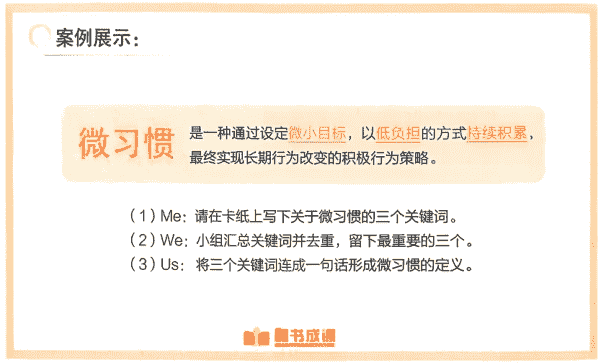

图 5-2 借助 AI 获取 “What” 信息示例

(2) Why: 引发思考, 促进行动。

提示词举例:

我是一名 [人工智能工具培训师], 面向 [讲师] 设计一门课程, 课程中 [需要解释讲师不会使用 AI 工具可能带来的潜在危机], 请给出 [3 个讲师务必学会 AI 工具的理由], 并且 [对每一个理由给出简短的诠释]。

授课效果:

图 5-3 展示了借助 AI 获取 “Why” 信息的示例。

### 案例展示:

# 为什么讲师一定要学会使用 AI 工具?

- 1. 竞争力崩塌预警
  传统备课 3 天, AI 辅助 30 分钟
- 2. 知识权威断层危机
  73% 学生优先检索 AI 答疑
- 3. 行业淘汰预警
  AI 教学能力年增 67%

> 淘汰你的不是 AI, 而是会用 AI 的讲师!

图 5-3 借助 AI 获取 “Why” 信息示例

图 5-3 中右侧的讲师形象, 也是 AI 设计的, 后文会介绍具体方法。

### (3) How: 方法步骤, 学以致用。

### 提示词举例:

我是一名 [家庭教育讲师], 正在设计一门亲子教育课程, 课程中 [需要向家长讲解清楚育儿中有效倾听的步骤], 请给出 [家长容易理解和实操的有效倾听的步骤], 并且 [把每一步的注意事项解释清楚]。

### 授课效果:

图 5-4 展示了借助 AI 获取 “How” 信息的示例。

### 案例展示：家庭教育中的有效倾听

- 第一步：准备倾听——创造适宜环境
- 第二步：专注倾听——给予充分关注
- 第三步：理解倾听——解读深层含义
- 第四步：回应倾听——给予积极反馈
- 第五步：持续倾听——保持耐心和坚持

图 5-4 借助 AI 获取 “How” 信息示例

(4) 案例收集：精准案例，深度分析。

案例类的素材在课程中也是非常重要的，通常可以和案例分析、角色扮演等教学方法结合使用。其实案例分两种，一种是原本就存在的案例，我们用案例收集的方式获取；另一种是不存在的案例，我们可以借由 AI 工具撰写。

提示词举例：

我是一名 [ 职场技能讲师 ]，正在设计一门 [ 职场中的刻意练习 ] 的主题课程，课程中需要学员做案例分析，请给我提供 [3~5 个职场中因为做刻意练习而取得成就的案例，可以来自现实，也可以是耳熟能详的影视剧片段]，让学员通过案例分析，[ 理解刻意练习在职场中的重要性 ]。

通过这一段提示词，AI 工具给出了张颂文等案例，那么我们就可以从中选择符合课程目标且自己较为熟悉的案例来使用。

授课效果：
图 5-5 展示了借助 AI 收集案例的示例。

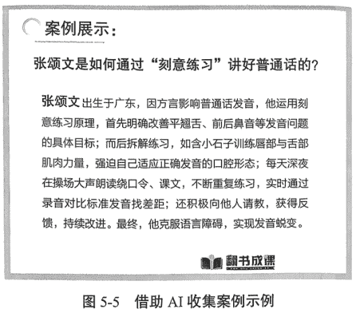

图 5-5 借助 AI 收集案例示例

(5) 案例撰写：基于场景，撰写案例。

提示词举例：
我是一名［家庭教育讲师］，正在设计一门［非暴力沟通］的课程，课程中需要学员做案例分析，请给我设计［育儿中的一个场景，展示暴力沟通和非暴力沟通的两种沟通方式，各 200 字以内］，让学员针对这个场景做案例分析，从而［理解非暴力沟通在实际运用中的技巧］。
通过这段提示词，AI 给了我们一个孩子写作业拖延的场景，并且给出了这个场景下两位妈妈的不同表现，一位用暴力沟通，一位用非暴力沟通，那么在课程设计和教学过程中，就可以让学员通过对比的案例看到非暴力沟通的使用方法和优势了。

### 授课效果：

图 5-6 展示了借助 AI 撰写案例的示例。

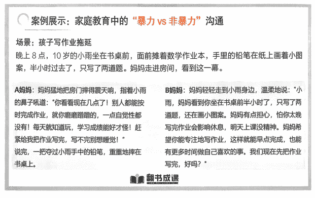

图 5-6 借助 AI 撰写案例示例

### (6) 图片设计：场景搭配，图文并茂。

我们可以在计算机中使用豆包的电脑客户端来生成图片。

### 提示词举例：

图片风格为「电影写真」，一位妈妈蹲下来在认真地看着孩子，孩子看起来很委屈，但是妈妈一点也不着急，很耐心地看着孩子和倾听，比例 [2:3]。

### 操作界面：

图 5-7 展示了借助 AI 设计图片的示例。

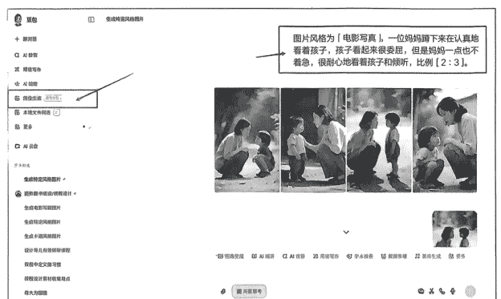

在这段提示词中，我们可以在操作界面中手动选择风格和比例，提交提示词后就可以获得自己想要的 PPT 插图。

### (7) 视频收集：耐心筛选，优质清晰。

对于筛选视频素材，同样建议使用豆包，因为相较其他的 AI 工具，豆包的优势是可以直接给出该视频在抖音的链接（豆包是抖音旗下的 AI 工具），那么我们就可以直接播放视频进行筛选判断了，非常方便。

### 提示词举例：

我是一名 [家庭教育讲师]，正在设计一门 [提升亲子沟通力] 的课程，课程开场部分需要一个 [影视片段或公益视频，视频能够表现出父母的言行对孩子有很大影响，让学员看完之后有很强的共鸣]，请给我 [3~5 个符合要求的视频名称和出处]。

### 操作界面：

图 5-8 展示了借助 AI 收集视频的示例。

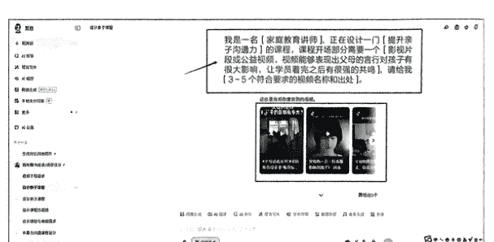

图 5-8 借助 AI 收集视频示例

我们可以看到豆包会给出若干个候选视频，接下来我们需要做的就是从若干个视频中选出符合自己需求的，然后在抖音平台下载视频就可以了。有两个事项需要着重提醒一下。

①筛选视频。筛选视频是一项需要耐心的工作，有些视频看起来很不错，但是因为被多次剪辑，其清晰度、背景音乐等存在问题而无法使用；这时我们可以根据视频的名称，到抖音 App 上进行溯源，即重新搜索，按照点赞量、发布时间等要素重新排序，直到筛选到自己满意的视频，然后用其他工具将视频下载到手机或计算机中。

②使用视频。建议使用横屏视频（比例 16:9，如果视频本身是竖屏，那么可以使用剪映进行尺寸裁剪），清晰度要高，不要有复杂的背景音乐和转场画面。在使用视频教学法时，注意两句口诀“视频前留问题，视频后做互动”，这样就可以让学员带着问题看视频。

在学员看完视频后安排讨论分享，可以获得更好的效果。

### （8）高阶技能：用 AI 工具生成思维导图。

使用 AI 工具生成课程的思维导图，也是一项非常重要的技能。这就像是站在巨人的肩膀上，可以大大提升做课的效率。

### 提示词举例：

我是一名［家庭教育讲师］，正在设计［提升亲子沟通力］的课程，请你［把亲子沟通的重要知识和工具整理成一张思维导图，至少有 3 级结构，还要有相关案例支撑知识点］。

这张思维导图的作用是［辅助我做课程设计，课程是面向 0～10 岁的孩子的家长，所以你给出的思维导图不仅要有亲子沟通力的理论基石和可实操的技巧，能够真正帮助家长理解原理和学以致用，还要有一些案例做辅助，案例最好是近 1～2 年内耳熟能详的相关案例］。请［以 Markdown 的格式］呈现。

图 5-9 展示了借助 AI 生成思维导图的示例。

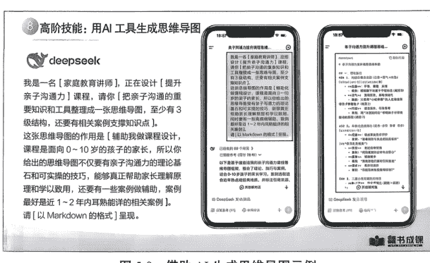

图 5-9 借助 AI 生成思维导图示例

### 操作步骤：如何使用 AI 三步生成思维导图？

（1）打开 DeepSeek 输入提示词。

要明确思维导图的用途（用户、场景、需求）及 Markdown 格式输出。

（2）下载 .md 思维导图文件。

在 DeepSeek 网页端下载 .md 文件到计算机中（DeepSeek 生成的 Markdown 文件右上角有“下载”按钮，可以直接将 .md 后缀名的文件下载到计算机上）。

（3）打开 Xmind 软件，导入 .md 文件。

Xmind2023 版本以上支持导入 .md 文件（建议在 Xmind 官网下载，其他能够导入 .md 文件的思维导图软件也是可以的）。

图 5-10 是 Xmind 导入 .md 文件之后的效果。

有了这项技能，讲师在做课程设计时可以大幅提升内容收集的效率，我们甚至可以将其理解为一次性地把课程初步的大纲和素材都收集到位了。

当然，这并不完善；所以，需要在 Xmind 的界面对思维导图的结构、内容等进行甄别和编辑，也可以把其他渠道收集的内容填充、汇总到这张思维导图中，最终形成足以支撑一套课程设计的思维导图。

我们来提炼一下使用 AI 生成思维导图的核心要点。

①目标：做思维导图的目标是辅助课程设计，而非做一张好看的思维导图。

②要求：明确需求和用途，即主题金线，那么生成的思维导图会更符合做课需求。

### 提升亲子沟通力思维导图

| 层级 | 内容 |
| :--- | :--- |
| **一、理论基石** | |
| 1. 亲子沟通的核心意义 | 了解孩子内心世界：通过沟通打开孩子的情感窗口，建立信任关系（案例：孩子因害怕不打招呼时，家长耐心询问原因而非责备） 传递价值观与规则：在日常对话中潜移默化地影响孩子的行为认知（案例：通过讨论生活事件引导孩子理解对错） 培养独立思考能力：鼓励孩子表达观点并自主解决问题（案例：孩子打碎碗后主动承认，家长肯定诚实而非责骂） |
| 2. 常见沟通误区 | 标签化语言：如“你总是这么懒”可能让孩子自暴自弃（案例：妈妈常抱怨孩子“不爱说话”，孩子愈发沉默） 单向灌输：忽视倾听，如打断孩子分享学校压力 盲目比较：提及“别人家的孩子”引发自卑（案例：家长抱怨孩子“不如同学”） |
| 3. 有效沟通原则 | 平等与尊重：避免命令式语言，如“你应该”改为“你觉得可以怎么做？” 非暴力沟通：表达感受而非指责（案例：“我担心你的安全”替代“你怎么晚回家！”） 共情与接纳：承认孩子情绪（案例：“没考上校队一定很难过，但你的坚持很棒”） |
| **二、实操技巧** | |
| 1. 倾听与反馈 | 积极倾听：身体前倾、眼神接触、用“嗯”“然后呢”鼓励表达 澄清与复述：复述孩子的话确认理解（案例：“同学真的让你失望了，对吗？”） |
| 2. 游戏化沟通 | 角色扮演：通过游戏模拟社交场景（案例：用玩偶演绎如何道歉） 拟人化语言：将任务趣味化（案例：“小蚂蚁停歇来记路”引导孩子整理） |
| 3. 日常场景应用 | 情绪管理：绘画或绘本帮助孩子识别情绪（案例：用《情绪小怪兽》绘本讨论愤怒） 家庭会议：定期讨论家庭事务，让孩子参与决策（案例：共同规划周末计划） |
| **三、工具与资源** | |
| 1. 教育类 App | “凯叔讲故事”：通过故事传递价值观（案例：用《西游记》培养坚持品质） “小小优趣”：英语启蒙动画辅助语言思维 |
| 2. 亲子游戏工具包 | “身体协调类”：俯卧撑、跳房子（案例：家长与孩子比赛反应速度） “合作挑战类”：叠叠高、过小河（案例：用纸杯协作“过河”培养默契） |
| 3. 家长自修资源 | “非暴力沟通书籍”：如《如何说孩子才会听 怎么听孩子才肯说》 “在线课程”：家庭教育平台（如“学而思轻课”）提供沟通技巧课程 |

图 5-10 协作生成思维导图示例

③格式：以 Markdown 的格式输出，使用 Xmind2023 版本以上导入即可编辑。

至此，本书就为大家讲解了八种使用 AI 高效收集做课素材的方法和案例，建议大家多多练习这些技能，熟能生巧，从此再也不用担心自己的素材收集不到位了。

### · 本章总结 ·

好的选题是课程的灵魂，而内容收集则是构建课程的基石。内容质量直接决定了课程的受欢迎程度。在内容收集的过程中，我们须遵循三大核心原则：以终为始，围绕课程“主题金线”精准发力，确保主题不偏离，内容不多余，素材不跑题；全局理解，从 What、Why、How 三个维度全面剖析知识，让课程内容丰富深入，让学员做到学以致用；颗粒适度，依据课程目标与学员需求平衡信息的深度和广度，避免过于空泛或烦琐。

内容收集的种类丰富多样，文字类、图片类、视频类资料及竞品课程资料各有价值，须合理运用以丰富课程的呈现形式。而在收集路径上，建立专题文件夹、绘制思维导图能让信息管理更有序，高效阅读（检视阅读、基础阅读、分析阅读、主题阅读）能帮助我们从中书籍中深度挖掘知识，AI 工具的巧妙使用更是能大大提升素材收集的效率与针对性，从定义概念到撰写案例、设计图片视频，乃至生成思维导图，AI 赋能让内容收集变得轻松高效。

内容收集是一个动态的过程，需要我们不断丰富和调整。

希望大家能将这些原则、方法与工具牢记于心，在实践中反复运用、刻意练习，为课程构建坚实的“血肉”，让每一门课程都能以优质的内容打动学员，实现知识的传播。

在下一章，我们一起学习课程大纲的设计。

## 第六章 框架设计：逻辑为王，搭建系统知识骨架

在上一章的开篇，我问了一个问题：在我们确定好课程选题后，到底是先列课程大纲，还是先收集信息呢？

我的建议是，如果你对当前的选题已经积累了丰富的存量知识，可以先初步列出提纲，再围绕提纲去收集信息，进而对课程提纲进行优化和完善。相反，如果该选题对你来说属于增量知识，你对它所知甚少，那么先广泛收集信息，再依据收集到的内容整理提纲，无疑是更为合适的选择。

在阅读完上一章的内容收集后，你对当前选题在存量知识的基础上又增加了很多增量知识，那么，本章我们来聊一聊如何高效设计课程大纲。

### 课程框架的重要性

你有没有过这样的经历？辛辛苦苦收集了很多课程资料，却像面对一堆散落的拼图，不知该如何下手；看着别人的课程结构清晰、逻辑顺畅，自己却只能对着资料发呆，心里干着急。这时，你缺的可能不是内容，而是一个能把零散知识串联起来的“骨架”——课程大纲。

就像盖房子要画图纸一样，做课也要“画”出课程大纲，就是为课程搭建起“知识骨架”。有了这个“知识骨架”，不仅能帮你厘清做课思路，更能让学员在学习时一目了然，知道自己每一步在学什么、为什么学。

想想看，在一套没有精心设计大纲的课程中，学员很容易在学习时迷失方向；而有了大纲，就像有了一张地图，学员不仅能明确学习路径，还能感受到课程的系统性，从而增强学习信心。

我见过一位从事亲子教育的老师，讲课时准备了上百页的资料，从孩子的行为习惯到沟通技巧，几乎涵盖了所有内容；但学员反馈却不积极，有学员说：“老师讲得很用心，但听完后感觉像逛了个知识超市，什么都有，却记不住重点。”问题出在哪里？就在于课程没有清晰的大纲，知识点像一盘散沙，没有主次和逻辑。

请记住：好课一定是设计出来的，每一门课要追求的交付目标是，让学员深度学习、学以致用！

一个精心设计的课程大纲，既是讲师的指南针，也是学员的导航仪，让教与学都事半功倍。

### 课程类别与时间划分

我们常见的课程类别大致可以分为线下互动课、线上直播课和线上录播课，虽然这三类课程在交付形式、互动方式上有差异，但在课程结构方面大致相同。

- 线下互动课，强调即学即练和指导反馈。
- 线上直播课，注重实时参与和积极互动。
- 线上录播课，侧重灵活自学和异步互动。

无论哪种形式，核心都在于通过精心设计的课程大纲，确保学员在各个阶段都能积极互动、有效参与，从而提升学习留存率（学习吸收率金字塔：有输出的主动学习，留存率更高）。

以一节 90 分钟左右的线上直播课为例（如腾讯会议交付），分为三个阶段：开场、主体和收尾。

- 开场阶段：通常用时 10% 左右，即 8~10 分钟内，讲师需要迅速吸引学员的注意力、激发学员的学习兴趣、介绍课程目标和学员获益，为接下来主体内容的呈现做好铺垫，让学员感受到课程的吸引力，从而更愿意投入学习。
- 主体阶段：约占 70%，即 60 分钟。在这 60 分钟内，讲师须深入讲解核心知识点，结合案例和互动，确保学员能够对核心知识点深度学习和学以致用。通过精心设计的练习和讨论，巩固学习成果，提升实际应用能力。
- 收尾阶段：约占 20%，即 15~20 分钟。在这 15~20 分钟内，讲师须总结重点，答疑解惑，升华主题；另外，如有营销的事项，也可以在结尾处设计成交阶段。

通过这三个阶段的合理分配，确保学员在有限时间内高效地学习和吸收知识，达成深度学习、学以致用的目标。

做一个形象的比喻：

开场就像一个人的外貌，颜值越高越吸引人，所以，开场要让人“一见倾心”。

主体就像坚实强壮的躯干，承载着核心内容，所以，主体要能让学员深度学习。

收尾则如同稳健的双脚，能总结归纳，稳固所学，还要呼吁学员学以致用。

### 翻书成课 3333 课程设计法

接下来，我将详细介绍“翻书成课 3333 课程设计法”。这里有四个“3”，我会在课程设计法的最后揭晓为什么叫“3333 课程设计法”，以及四个“3”分别对应的含义。

接下来，我将详细拆解“开场-主体-收尾”每个阶段的设计思路和授课技巧。

### 课程设计之开场阶段：用 10% 的时间抓住学员的心

开场阶段最重要的事项是“破冰”。为什么要破冰？

以线下课为例，想象一下，当你走进一间教室，面对陌生的老师和同学，是不是感到紧张和陌生？这时，老师如果直接开始讲课，你可能需要好一会儿才能进入状态。但如果老师先做个轻松的互动，介绍自己的育儿经验，再抛出一个你每天都会遇到的亲子问题，你是不是一下子就被吸引了？

所以，开场破冰就是帮助学员快速从旁观者转变为参与者，打破初见的隔阂，拉近彼此的距离，营造轻松愉悦的学习氛围，让学员迅速融入课程，为后续的深度学习奠定基础。

## 第六章 框架设计：逻辑为王，搭建系统知识骨架

  开场阶段有三项破冰，简称“开场三破冰”，包括讲师破冰（讲师自我介绍）、学员破冰（话题交流、游戏互动）、主题破冰（坡道引题），如图 6-1 所示。这三项破冰环环相扣，先让学员熟悉讲师，再给学员建立安全感，打开心门，最后将学员引入课程主题中，让学员从“防备”走向“开放”，从“旁观”走向“参与”。

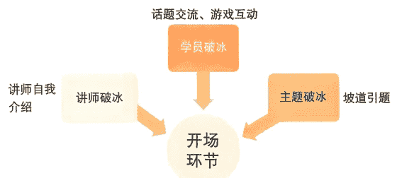

图 6-1 开场三破冰

### 1. 讲师破冰：建立讲师信任的开端

  讲师破冰，就是通过讲师的自我介绍和分享个人履历，拉近与学员的距离，消除陌生感，建立初步信任，为后续课程内容的顺利展开奠定基础。

  讲师在做自我介绍时，会用到一个重要的工具——身份标签。

  问一个问题：你觉得讲师在自我介绍时，身份标签越多越好，还是越少越好呢？

  有些讲师在介绍自己时，容易陷入标签堆砌的误区，一整页 PPT 中除了个人形象照，密密麻麻的全是各种标签，这是很常见的错误的呈现方式。其实，这也是讲师缺乏自信的表现，总觉得标签多一些，就能够更好地建立学员对自己的信任，实际上并非如此。

  其实，身份标签并不是越多越好，也不是越少越好，而是越能够建立信任越好。所以，聪明的讲师通常只放 1~3 个关键标签。

  什么是关键标签呢？关键标签要考虑三个核心要素：

- ① 课程的学员是哪些人？
- ② 学员的需求都是什么？
- ③ 有哪些标签满足需求？

  所以，讲师的关键标签要“与你有关，对你有用”。只有这样，学员在听到讲师做自我介绍时，特别是听到某个“对自己有用”的标签时，才能引发兴趣和建立信任，从而认同讲师的权威。

  举个例子，我在讲《你就是孩子最好的玩具》这本书的好书精讲课时，因为这是一堂家庭教育主题的课，所以我选择了这三个标签。

- ① “翻书成课”主理人（这是我的职业身份）。
- ② 两个孩子的爸爸（这是我的家庭身份）。
- ③ 帆书家庭教育领航人（这是我的相关荣誉）。

  这三个标签，让学员知道了我的职业身份，同时了解到我有家庭教育方面的经验，而且获得过家庭教育领域的荣誉，从而解决了“学员为什么听你讲”的核心问题。

  有人可能会问，我没有相关的荣誉和证书怎么办呢？我有三个建议。

- ① 放低姿态，以分享的角度而非授课的角度呈现课程，可以减轻心理压力。
- ② 注重课程品质，学员不一定在乎你是谁，但一定在乎你能提供什么价值。
- ③ 如果你实在介意自己缺少权威，那就干脆认真考取一个相关证书。

  除了身份标签，讲师在进行自我介绍时，可以适当地补充自己在本领域的成绩，甚至讲一个足以证明自己经验和能力的小故事，这可以进一步加强学员对你的信任，同时让自己快速放松下来。

  讲师既能表现出自信和轻松的形象，又能给学员带来启发和价值，是非常重要的。

  这是开场阶段的第一项破冰——讲师自我介绍，在这里要解决的问题是“学员为什么听你讲”。

### 2. 学员破冰：打开学员互动的阀门

  学员破冰是开场阶段中特别重要的一件事情，通过设计一个互动话题或者一个互动游戏，让学员参与进来，从而让学员打开心门，建立安全感，提高学员的参与度。

  线上课和线下课在学员破冰方面略有不同。

  先说线上直播课的学员破冰——话题热场。

  对于线上课的话题热场，讲师可以在开课前 5~10 分钟，发起互动话题，也可以在讲师自我介绍后抛出一个互动话题，这两个时间节点都是可以做话题热场的。

  为什么要做话题热场呢？

  因为话题热场不仅能迅速吸引学员注意力，让学员快速进入课程主题，还能让学员在分享中感受到参与感，从而打破陌生感，为后续课程内容的深入参与奠定良好的情感基础。

  比如，在一堂家庭教育主题课开场前，可以这样互动：“你认为孩子身上的三个优点是什么？”

  如何设计互动话题呢？有三个核心原则。

- **高关联**。确保话题与课程主题紧密相关，激发学员兴趣和共鸣。比如，职场类课程就用职场话题做课前互动，家庭教育课程就用家庭教育话题做课前互动。总之，一定要和课程主题紧密相关。
- **易参与**。互动话题要简单易懂，让学员轻松参与，避免复杂问题导致冷场。也就是说，让学员稍微动脑就可以找到答案的问题，更容易降低学员参与的门槛，从而提升互动参与度。请记住：提问的目的不是难住学员，而是让学员参与互动。
- **积极**。互动话题要能激发学员的积极性和表达欲，让他们愿意主动分享，形成良好的互动氛围。尽量不要使用消极的互动话题，如“你有哪些不好的习惯”“你家孩子身上的缺点有哪些”“你最近特别伤心的一件事情是什么”，这些问题虽然可能符合“高关联”和“易参与”，但是会对课堂的氛围产生负面影响，所以通常不使用消极的互动话题。

  举个例子，我在“刻意练习”线上课设计的开场互动话题是“你认为自己身上最强的一项技能是什么”。

  这个话题就符合高关联、易参与和积极，能够引发学员的思考和分享，而且这个话题会贯穿整堂课。在讲到“刻意练习”的原则和方法的知识时，我就让学员用自己的技能做一个刻意练习的案例分析，是不是很巧妙？

  再来说说线下课的学员破冰。

  线下课更需要学员破冰，为什么呢？与线上课相比，学员参加线下课更容易感到拘谨，通过学员破冰活动打破僵局，建立安全感和舒适的学习氛围，是非常有利于学员积极参与后续学习的。

  线下课的学员破冰分为两类：文破冰和武破冰。

  （1）文破冰，即“君子动口不动手”的互动方式，如自我介绍、分享趣事等，是通过语言交流拉近彼此距离，缓解紧张气氛的一种破冰方式。

  推荐三种文破冰的方式。

  ① 话题互动：类似线上课的“话题热场”，设计高关联、易参与、积极的话题，让学员逐一分享，这是一种轻松又友善的互动方式。比如，针对《读懂一本书》的线下课，可以设计“你读过的受益最大的一本好书是什么？收获有哪些？”等此类轻松且贴近主题的话题，让学员在分享中自然放松，迅速融入课堂氛围中。

  ② 姓名帐篷：让学员将 A4 纸折成一个小帐篷的样子，在帐篷一面的中间写上自己的姓名，左上角、右上角、左下角、右下角分别写上和课程主题相关的信息（除了姓名是必写项，对于分享的其他“信息”，课程设计者可以自定义数量和话题），如图 6-2 所示。

  比如，在“陪孩子终身成长”线下课中，我要求学员在姓名帐篷的中间写上自己的姓名，四角分别写上孩子的两个优点和对孩子的两个期望。在人数较少的情况下，学员可以逐一手持“帐篷”做自我介绍；如果人数较多就分组进行，在小组内做自我介绍。

  别小看这个道具，它的作用很大。第一，手持道具做自我介绍可以很大程度上缓解讲师的紧张情绪；第二，视觉化的工具，可以帮助学员更轻松地记住彼此的名字；第三，学员写完自己的姓名帐篷后再开始轮流自我介绍，可以全身心关注到他人的信息，加深印象。姓名帐篷这种方式集合了学员介绍和话题互动，而且适用场景特别丰富。我的经验是，如果找不到更好的破冰活动，就用姓名帐篷。

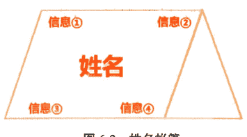

  ③ 故事接龙：设计一个与课程内容相关的场景，由主持人开头，每位学员轮流续编一小段故事，下一位学员须在此基础上继续讲述，直到最后一位学员，最终由讲师为故事收尾。故事接龙既能锻炼思维，又能增进默契，还能活跃气氛。

  （2）武破冰，即“君子动口又动手”，通过简单的肢体活动或小游戏，如拍手游戏、团队协作任务等，实现学员间的互动和沟通。这种方式通常在人数较多时更为有效，因为它能够快速打破学员之间的陌生感，让学员在轻松愉快的氛围中建立初步的联系。

  给大家分享一个我学习到又做了优化后的武破冰的案例——拳头对话。

  以亲子沟通的课程为例，拳头对话分为以下几步。

  第一步：引出问题。讲师通过提问破冰：大家有没有发现亲子教育中最大的问题是沟通问题？怎么沟通效果都不好，怎么办呢？我带着大家玩一个游戏。

  第二步：讲解规则。先将到场的学员平均分为 A、B 两个角色，由 A 角色握紧自己的拳头，然后给 B 角色 1~2 分钟的时间，想方设法打开 A 角色的拳头（提醒不要使用暴力）。

  第三步：学员练习。学员开始进行练习，讲师可以巡场，并做一些简单的提醒和反馈。

  第四步：点评反馈。游戏结束后，现场采访被打开拳头的 A 角色，B 角色用了哪种方式打开了 A 角色的拳头；再采访未被打开拳头的 A 角色，B 角色用了哪些方式，A 角色为什么不愿意打开拳头。

  采访完毕后，开始引导学员思考：打开拳头的方式是可持续的吗？（威胁、恐吓、交换等方式不可持续，就像家庭教育中常见的错误的沟通方式。）如果这种方式不可持续，那么就一次也不要使用；反过来，那些迟迟未打开的拳头，像不像我们跟孩子沟通时，孩子紧紧关闭的心门呢？

  既然我们在亲子沟通中有很多不当的方式和误区，那么有没有更好的沟通方式呢？怎样更好地进行亲子沟通呢？接下来学习今天的课程“××亲子沟通力”……

  大家看这个过程，是不是互动性特别好，又和主题相关，而且最后很顺畅地过渡到主体部分？

  你可以想一下，“拳头对话”除了用在亲子沟通的课程，还可以用在哪些课程中呢？

  前文讲解了文破冰和武破冰，有四个事项很重要。

  ① 不要为了破冰而破冰，高级的破冰与课程内容紧密相关，最好是能够自然过渡到课程主体部分（如“拳头对话”）。
  ② 破冰活动要“温度适宜”，太“冷”达不到破冰效果，太“烫”会让学员退却。要始终确保活动的参与者感到安全、舒适和被尊重。
  ③ 如何收集到更多的破冰活动？多参加一些好课程，学习不同的破冰活动，并将其迁移到自己的课程设计中，也可以借助 AI 工具生成符合要求的破冰活动。
  ④ 学员破冰不是必须做的，如礼堂式的授课就不方便做学员破冰，这时可以省略学员破冰，或者设计邻座之间可以互动交流的文破冰，接着进入主题破冰。

### 3. 主题破冰：引入课程主体的坡道

  主题破冰，是课程的开场阶段向主体阶段的过渡。

  课程开场和课程主体之间，就像有一个高度差，为了让学员更舒适地从低处（开场）去到高处（主体），需要构建一个坡道，引导学员经过这个坡道到达课程的主体阶段，所以主题破冰也叫“坡道引题”，这个说法很形象。

  好的坡道引题，就像一部精彩电影的预告片，既有看点，又有悬念，让人充满期待。

  以下是五种经典的引题方法，总有一款适合你。

#### （1）提问法：层层递进戳痛点。

  简要介绍：为了引起学员注意、引发学员思考、激发学员兴趣而设计的一系列提问，是一种简单且有效的引题方法。

  举例说明：《高效演讲》的坡道引题。

  “你有没有过这样的经历？

  准备了很久的演讲，一上台就大脑空白。
  明明讲得很卖力，为什么台下很多听众在玩手机？
  甚至讲完后，听众连你讲了什么都不记得。
  这不是你不够努力，而是没掌握演讲的底层逻辑。今天这节课，就能帮你解决这些问题……”

#### （2）故事法：用故事引发共鸣。

  简要介绍：故事法是通过讲解典故、真实发生的事件或者寓言等素材内容，产生代入感并引发学员思考的一种引题方法。

  举例说明：在讲授《刻意练习》时，使用大家耳熟能详的卖油翁的故事，能够引起大家思考“为什么卖油翁可以做到惟手熟尔，背后的逻辑是什么呢”，从而引出课程的主体部分，顺势讲解刻意练习的原理和方法，如图 6-3 所示。

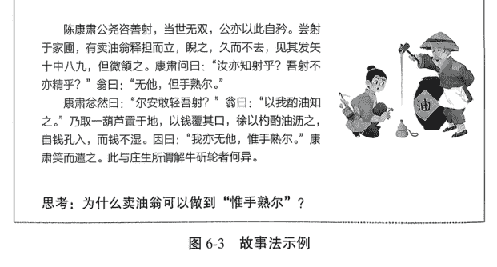

#### （3）数据法：用震撼数据抓住注意力。

  简要介绍：通过罗列有震撼力的数据，抓住学员的注意力，使其对课程主体内容产生好奇和兴趣的一种引题方法。

  举例说明：《终身成长》的坡道引题（见图 6-4）。

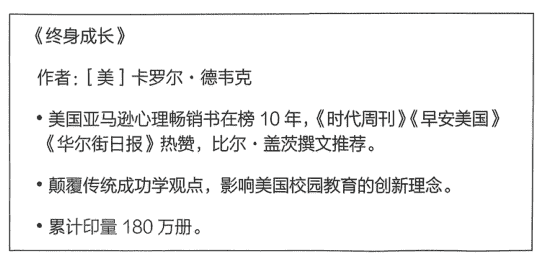

图 6-4 数据法示例

  两个有震撼力的数据：美国亚马逊心理畅销书在榜 10 年，累计印量 180 万册。

#### （4）视频法：用视觉冲击强化印象。

  简要介绍：通过播放与主题相关的视频，让学员通过视频情节、声音和画面感，产生代入感并引发思考的一种引题方法。

  举例说明：《读懂一本书》的坡道引题。

  在讲《读懂一本书》的坡道引题时，播放了《三国演义》中刘关张结义的视频；让学员带着问题观看视频：“经常读书的人和不经常读书的人有什么区别？”

  视频中关羽开口文采过人，而张飞就四个字“俺也一样”。

  视频结束后，跟大家互动：“大家有没有发现，经常读书的关羽张口就是大段的文言文，而不怎么读书的张飞张口就四个字……”
  学员回应：“俺也一样。”

  “那么，怎么才能提升我们的阅读力，增加知识储备呢？今天我们
  来共同学习这本书，樊登老师所写的《读懂一本书》……”

  是不是很顺畅？

  大家在使用视频时，有两个原则要谨记：非商业教学可尝试合理使用，但须严格限制范围并标注来源；商业用途须获得授权。

#### （5）名言法：用经典名言提升高度。

  简要介绍：通过展示与主题相关的名言警句，引出课程主题的一种引题方法。

  举例说明：《妈妈知道怎么办》的坡道引题。

  胡适曾写道：“你要看一个国家的文明，只需考察三件事：
  第一，看他们怎样待小孩子；
  第二，看他们怎样待女人；
  第三，看他们怎样利用闲暇的时间。

  今天这个学习的场合，有孩子、有女人，而且是在大家的业余时间，那么我们这个民族一定有未来。接下来，我们共同学习一本帮助“女人”去养育“孩子”的书——《妈妈知道怎么办》。

  前文分享了五种常见的坡道引题的方法，大家可以活学活用。
  我是以“书籍成课”为案例做的讲解，大家在“主题成课”时，也可以迁移这五种引题的方法。

  讲到这里，开场部分的三破冰已经讲解完毕，包括讲师破冰（讲师自我介绍）、学员破冰（文破冰、武破冰）和主题破冰（坡道引题）。

  为什么开场如此重要？认知心理学中的首因效应告诉我们，第一印象会影响后续的认知判断。换句话说，开场没设计好，即使后面再努力也难以挽回学员的注意力。

  好的开场，是成功的一半！

## 课程设计之主体阶段：用 70% 的时间交付核心内容

  现在，让我们进入课程设计的主体阶段，探讨如何深化学员对知识的理解吸收和学以致用。

  如果说开场即外貌，那么主体就像人体的胸部和腹部，承载着最重要的内容，占据了课程约 70% 的时间，它的主要功能是交付核心知识点，让学员真正学到有价值的东西，并且实现学以致用。

  一个好的课程主体，要有清晰的板块结构、深入浅出的知识讲授和丰富的素材支撑。

  接下来，就层层递进地讲透主体部分的三层结构——板块结构、知识讲授和素材支撑，如图 6-5 所示。

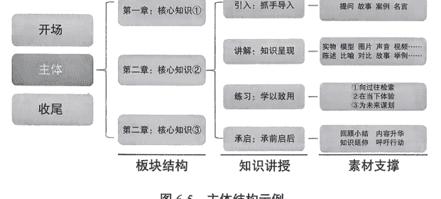

图 6-5 主体结构示例

### 1. 板块结构：给章节穿上“逻辑外衣”

  一堂 90 分钟左右的线上直播课，主体通常由三个板块组成。

#### 课程主体为什么包括三个板块？

  如果板块太少，可能出现两种极端情况：要么不足以支撑课程的时长，要么一个板块里包含了太多知识点，导致各知识点的排布不合理。反过来，如果板块太多，会使课程结构过于分散，进入脱离状态过于频繁，甚至授课超时。

  所以，合理设计板块是一件非常重要的事情，就像写作要先有提纲。

  课程主体部分一定是三个板块吗？那倒未必，能够实现授课目标、能够帮助学员完成学习目标的板块设计，就是好的板块设计；我在设计课程时，偶尔也会有两个板块或者四个板块的情况。

#### 课程主体的各板块有什么逻辑关系？

  板块就是课程的框架，各板块之间须遵循内在逻辑，确保知识点层层递进，既相互独立又紧密关联，形成有机整体，共同实现讲师的授课目标和学员的学习目标。

  常见的板块结构有认知圈结构、要素型结构、流程型结构等。

  （1）认知圈结构：从“是什么”到“怎么做”——适合方法论类课程。

  认知圈结构取自黄金圈法则，黄金圈法则最早是由管理学家西蒙·斯涅克在其著作《从“为什么”开始》中提出的，他将思考和认识问题划分为三个层次，由内向外依次是：Why（为什么）、How（怎么做）、What（做什么）。这三个层次分别对应着事物的出发点和价值观、实现目标的策略和方法、具体做的事情。

  我们在做课程设计时，可以参照这个模型，把一个核心知识的三个方面“为什么”“是什么”“怎么做”设置为三个独立板块，每个板块讲透一个方面。

  比如，可以设计成三个板块。

- 第一板块聚焦“为什么”，探讨某个现象背后的原因和重要性，引起学员重视。
- 第二板块详解“是什么”，深入阐述核心知识的定义和内涵，让学员深度理解。
- 第三板块剖析“怎么做”，提供具体的应用方法和实践案例，帮助学员学以致用。

  这样，学员不仅能理解知识本身，还能掌握其应用逻辑，实现学以致用。

  有没有发现，三者的出场并非按照“黄金圈法则”（为什么－怎么做－做什么）的顺序？是的，根据不同的教学需求，讲师可以自行设计出场顺序。我自己用下来，发现“为什么－是什么－怎么做”的顺序，在课程设计中尤其有效，因为它首先能够激发学员的好奇心和兴趣，然后逐步深入核心知识，最后提供实际操作指导。

  举个例子，我在设计“直播间如何讲透知识点”课程时，将其分成三章。

- 第一章讲“做知识主播的价值”（为什么）。
- 第二章讲“直播间需要讲解的知识”（是什么）。
- 第三章讲“直播间如何讲好知识点”（怎么做）。

  认知圈结构逻辑清晰，便于学员系统学习，能够让学员从“产生好奇”到“深度学习”，再到“学以致用”，符合人类认知的自然规律。

  （2）要素型结构：将复杂问题拆分成“零件”——适合多维度知识。

  要素型结构，顾名思义，就是把主体中要讲授的内容拆分成若干个关键要素，每个要素作为一个独立的章节进行详细的讲解。

  在要素型结构中，各个板块之间通常是并列关系或者递进关系，类似于金字塔原理，不重不漏，每个板块之间既相互独立又层层递进，确保了知识的完整性与逻辑性。

  举个例子，我在设计“关键对话”的课程时，将其分成三个部分。

- 第一部分：管好我的心。

  情绪管理是沟通的基础：讲解“情绪 ABC 原理”，说明“事件 A 相同，信念 B 不同，结果 C 不同”，并教学员用“情绪暂停法”（默数 10 秒再回应）控制即时情绪。

- 第二部分：管好我的脑。

  做双核对话人：解释“谈话内容”与“谈话氛围”的双重关注，如谈判时，不仅要关注讨论的议题，更要注意对方的情绪变化。

- 第三部分：管好我的嘴。

  综合陈述法：分步骤讲解“分享事实→表达感受→征询意见→共同探讨”，用职场沟通案例演示。

## 第六章 框架设计：逻辑为王，搭建系统知识骨架

  通过以上案例，你会发现，要素型结构适合逻辑严谨的知识体系，让学员对内容有全面认知。

  (3)流程型结构：让信息按“时间线”展开——适合故事类、流程类内容。

  流程型结构，是指在课程设计中，将内容按照一定的流程顺序进行排列，每个部分讲解一个关键步骤，形成一个完整的发展脉络。

  这种结构特别适合按照时间顺序发展的事项或者操作步骤明确的知识的讲授。在应用流程型结构时，讲师可以将关键的步骤、流程进行详细拆解，确保每一步骤都有明确的指导和案例支持。

  举个例子，在介绍曾国藩的相关课程中，可以分成早年曾国藩、中年曾国藩、晚年曾国藩三个部分，这就是非常典型的流程型结构的应用。

  再举个例子，本书正在介绍的“翻书成课五步法”，从选题确定、内容收集、框架设计、课件制作到课程变现，也是一种流程型结构。

  流程型结构能让学员跟随“故事线”“流程表”，轻松理解知识，尤其适合历史人物类课程和有操作流程的课程。

  以上介绍了主体的板块之间三种常见的结构，无论采用哪种结构，板块间的过渡都要自然顺畅，这样学员在学习过程中才不会觉得突兀。

  那么，是不是只有以上三种类型的板块结构呢？当然不是，还有更多类型，大家在做课程设计时，方案只要能够“自圆其说”且“过渡顺畅”，能够实现课程目标，就是具备可行性的方案。

## 翻书成课：AI 时代打造爆款课程的实战手册

## 2. 知识讲授：讲透核心知识的黄金公式

  当课程主体部分的若干部分已经确定（即确定了每个部分要讲授的核心知识和部分之间的逻辑关系），接下来我们就要思考如何把每一个部分的核心知识点讲透。

  什么叫讲透？很多讲师讲知识点时，习惯直接“灌输”，结果学员听着听着就走神了，根本达不到学习的效果。

  所以，这个问题要用用户思维来回答，讲课的目的不是讲完课程，而是让学员深度学习、学以致用。

  那么，怎么讲课才能够让学员深度学习、学以致用呢？怎样让学员在学习过程中，从被动接受变成主动参与呢？

  给大家分享一个能够讲透核心知识的黄金公式，这个公式分为四个步骤。

  - 第一步引入：引发兴趣，引起思考，引出知识——激发兴趣。
  - 第二步讲解：知识呈现，深度讲解，互动教学——增强理解。
  - 第三步练习：即学即练，学以致用，能力转化——知行合一。
  - 第四步收尾：学员反馈，要点回顾，知识延伸——承前启后。

  通过以上这四步，学员不仅能掌握知识，还能在实际中灵活运用，真正实现学以致用。各步骤之间环环相扣，层层递进，确保学习效果最大化。这个黄金公式不仅适用于课程设计，也广泛应用于各类知识传授场景，助力学员从理论到实践的全面提升。

  我最早习得这套方法是在楼剑老师所写的《成为明星讲师2》。楼剑老师在书中把这四个步骤总结为“引－讲－练－评”这四个字，言简意赅，却蕴含了教学的精髓；我当时正沉浸式探索和学习各类授课方法，当看到“引-讲-练-评”这套授课逻辑时，有一种醍醐灌顶的感觉，仿佛一下子找到了开启高效教学之门的钥匙；随后，我还组织了这本书的线上共读活动，有幸请到了楼剑老师在社群中做了精彩的分享。

  另外，在“帆书·认证翻转师训练营”中，也有类似的教学方法，叫作“启-呈-转-合”。“启-呈-转-合”同样强调以学员为中心，通过“启”（意为“启发”）高效导入激发兴趣，通过“呈”（意为“呈现”）深度讲解增强理解，通过“转”（意为“转化”）互动练习巩固能力，最终通过“合”（意为“收尾”）总结回顾、知识延伸，四步形成完整学习闭环，助力学员实现理论与实践的完美结合。

  你发现了吗？

  - 引入，即“引”和“启”。
  - 讲解，即“讲”和“呈”。
  - 练习，即“练”和“转”。
  - 收尾，即“评”和“合”。

  它们虽然叫法不一，但作用是大致相同的。接下来，我将详细讲解“引-讲-练-评”黄金公式在实践中的使用方法和案例说明。

## 引入：引发兴趣，引起思考，引出知识

  **作用：**通过引入一个问题、一个故事、一个冲突等方式，让学员心里产生“为什么会这样？”“怎么解决？”的疑问，从而引发学员的兴趣，引起学员的思考，引出本部分的核心知识点。

  **教学方法：**提问教学法、故事教学法、案例教学法等。

  **举例：**在讲解“思维模式（成长型思维 vs 固定型思维）”这个核心知识点前，先问学员一个问题：“我们常说，‘一念天堂，一念地狱’，这里的‘念’是什么呢？为什么不同的‘念’会带来如此大的差异？”然后说：“接下来，我们来揭开这个谜底！”从而很顺畅地过渡到“思维模式”知识点的讲解。

  **延伸：**大家有没有发现，这里的“引入”很像开场阶段的坡道引题？

  是的，你可以这样理解，坡道引题是主体阶段的“引”，而具体板块中的“引入”是对核心知识点的“引”，有点类似于大括号中的小括号之间的逻辑关系。所以，在“坡道引题”中学到的引题方法，在这里的“引入”环节中都适用。

## 讲解：知识呈现，深度讲解，互动教学

  **作用：**通过讲解知识和信息，帮助学员对核心知识点实现深度学习的目的。

  **教学方法：**视频教学法（专家讲解视频）、讲授教学法（陈述、类比等）等。

  **举例：**“思维模式”的讲解。

  ①**视频教学法：**在讲解“思维模式”时，播放一段关于成长型思维和固定型思维的视频，使用视频教学法来讲授知识，是一种不错的方法。在使用视频教学法时，记得两句重要的口诀，即“视频前留问题，视频后做互动”，这样不仅能激发学员的思考，还能通过互动加深学员对知识的理解。比如，视频前问：“你们认为成长型思维和固定型思维在日常生活中的表现有何不同？”视频后再引导讨论分享，巩固视频所讲的内容。这种方法能有效提升学员的学习效果，实现理论与实践的完美结合。

  ②讲授教学法：列出一张图片或表格，将成长型思维和固定型思维的特点进行对比，通过清晰的对比讲解，帮助学员直观理解两者的差异。另外，还可以加入类比，“成长型思维像逗号，固定型思维像句号”，使学员更形象地理解两种思维模式的区别。其中，逗号代表持续进步和探索，句号则意味着停滞不前。通过这样的类比，学员能更深刻地体会到成长型思维的重要性，从而在实际生活中积极应用。这些都是讲授教学法常用的一些技巧。

  延伸：核心知识的讲解，就像剥洋葱，要一层层地揭开，逐步深入，最终揭示本质。也可以在讲授过程中加入一些互动设计，如把本来要讲师讲解的内容，设计成填空题、连线题、判断题等形式，让学员在参与中学习，从而加深对思维模式的理解和应用。

  这里补充一下，千万不要认为只有在第三步练习环节才能设计学员互动，事实上，在课程的任意环节，只要不破坏课程的节奏，同时能够更好地实现教学目标，都可以巧妙地融入互动元素。

## 练习：即学即练，学以致用，能力转化

  作用：即学即练的环节，能让学员将所学知识立即应用于实际情境中，实现理论与实践的紧密结合。

  教学方法和举例：练习环节的教学方法有很多，如视频教学法、案例分析法、游戏互动法、角色扮演法等，但是要考虑授课场景的适配性和学员的接受度。练习的目的是让学员即学即用、学以致用。我将能够帮助学员学以致用的教学方法分为三种，下面分别给大家讲解并举例。

  ①向过往检索：引导学员回顾自身经历，思考或提炼自己的经验做分享。

  举例：在“时间管理”课程中，让学员回顾过去一周的时间安排，分析哪些做法有效，哪些需要改进，通过分享彼此的经验，相互学习提升时间管理的实用方法，这就叫作“向过往检索”的学以致用的方法。

  ②在当下体验：根据核心知识点设计案例场景，让学员进入场景中做练习和体验。

  举例：在“非暴力沟通”课程中，设计一个“21:00 孩子还磨磨蹭蹭没写完作业”的场景，让学员扮演家长和孩子进行对话练习，通过实际体验掌握非暴力沟通技巧，提升沟通效果。这种方法不仅能加深理解，还能将所学知识有效转化为实际应用能力。

  案例分析、角色扮演、游戏互动，都属于“在当下体验”的范畴，只不过在设计课程时要考虑授课场景的适配性，即这种互动方式是否适合在这个授课场景中应用。比如，角色扮演和游戏互动就不适合线上课，而案例分析的应用则更为广泛。

  ③为未来谋划：让学员用本节所学的核心知识，为自己设计一个行动计划。

  举例：在“时间管理”课程中，让学员结合所学知识“时间管理四象限”，规划未来一周的工作安排，明确优先级，制订具体执行计划，通过实践检验时间管理方法的有效性，进一步提升自我管理能力，这就叫“为未来谋划”。

  学以致用的三种方法，即“向过往检索、在当下体验、为未来谋划”，在设计课程时可以根据授课目标、学员需求和课程时长，灵活地排列组合，只要谨记一个目标“帮助学员深度学习、学以致用”就可以了。

## 收尾：学员反馈，要点回顾，知识延伸

  作用：这是承前启后的环节，“承前”是对本部分内容进行总结回顾，“启后”可以做知识延伸，也可以引出下部分内容。

  教学方法：在“收尾”阶段，多以讲授法为主，总结本部分的重点内容，可以加入互动设计，如填空题、连线题、判断题等，在互动中做复习也是一种不错的测试教学法。

  举例：在《读懂一本书》课程的“樊登阅读法”部分中，在收尾时就用到了测试教学法，让大家通过填空题的方式回忆樊登选书的“Tips原则”分别是什么（见图6-6）。

  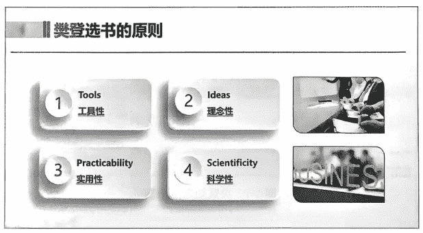

  图6-6 测试教学法示例

  延伸：在一个部分中，往往不只有核心知识点，还会使用关联知识点。关联知识点的价值有三个。

  - 辅助核心知识点的讲解，让学员能更全面地理解核心知识点。
  - 帮助学员建立知识之间的关联性，拓展所学知识。
  - 板块内容更丰富，体现出讲师的专业性和课程的深度。

  例如，在“关键对话”课程中，第一部分是“管好我的心”，核心知识点是“情绪 ABC 原理”，这一部分的前三步“引入－讲解－练习”都是围绕“情绪 ABC 原理”展开的；在收尾的部分，除了做前面内容的回顾，还加入了“钝感力”“同理心”这些关联知识点，让课程内容显得更加丰富（见图 6-7）。

  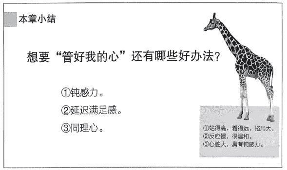

  关联知识点不仅可以设计在“收尾”环节，也可以根据实际需要设计在“讲解”等环节。

  讲到这里，我们已经学会了如何使用黄金公式“引入－讲解－练习－收尾”（简称“引－讲－练－评”或“启－呈－转－合”），将这个步骤再重复两遍，主体部分就有三个独立部分了。

## 3. 素材支撑:让课程内容生动活泼

  素材是讲解知识时必不可少的支撑元素。在选择素材时,应紧扣知识点,确保其相关性和趣味性的兼顾。引入素材不仅能增强课程的吸引力,还能加深学员对知识点的印象,使学习过程更加高效和愉悦。

  要依据“引入-讲解-练习-收尾”环节需求,筛选和匹配素材。接下来,我以《我会独立思考》好书精讲课为例进行说明。

## (1) 引入环节。

  引入环节需要提问题、讲故事、举案例、说名言。素材要能激发好奇心,讲师通常需匹配故事、案例、名言等文字类的素材,再配上相应的图片,以增强吸引力。

  在《我会独立思考》好书精讲课的第三章“如何建立批判性思维”中,“引入环节”用到了“案例+提问”的教学方法,所以匹配了案例素材和相关图片(见图6-8)。

  

  图6-8 引入环节素材示例

## (2) 讲解环节。

  讲解环节需要直观、简洁的素材来阐释核心知识，通常匹配图片类素材、视频类素材，以及一些概念、定义、流程的文字类素材。

  在“如何建立批判性思维”中，讲解环节为了讲透“批判性思维五步法”，匹配了流程性的文字类素材（见图 6-9）。

  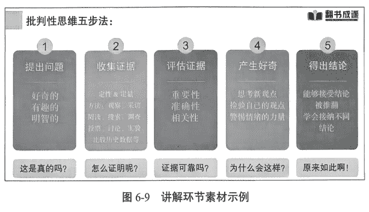

## (3) 练习环节。

  在这个环节需要设计互动来帮助学员学以致用，所以通常匹配文字类、图片类、视频类素材。

  在“如何建立批判性思维”中，“练习环节”设计了“用批判性思维分析‘不打不成器’”的学员练习，匹配了“不打不成器”这句俗语的文字类素材和相关图片（见图 6-10）。

## (4) 收尾环节。

  这一环节对本章内容进行总结回顾，可以做知识延伸，或者升华本章内容，通常匹配总结本章内容或是关联知识点的文字类和图片类素材。

  在“如何建立批判性思维”中，“收尾环节”设计了一个“升华”，以填空题的形式出现，匹配了相关的文字类素材和图片类素材（见图 6-11）。

  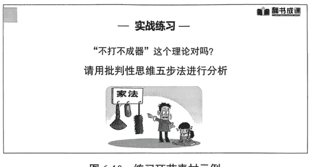

  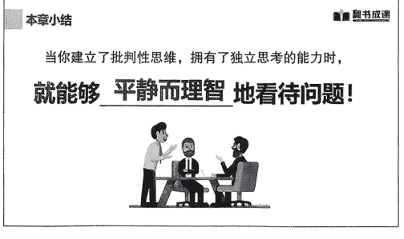

  到这里，我们把主体部分的板块结构、知识讲授和素材支撑全部介绍完了。这里还是要提醒一下，素材的选择要符合主题金线，不要脱离特定的用户和场景使用素材。

  需要重点掌握的内容是：

  - 理解板块结构：给章节穿上“逻辑外衣”，认知圈结构、要素型结构、流程型结构等，能自圆其说就是好结构。
  - 掌握知识讲授：讲透核心知识，“引入－讲解－练习－收尾”，让知识呈现更顺畅，真正帮助学员深度学习、学以致用。
  - 善用素材支撑：让课程内容生动活泼，按需使用文字类、图片类、视频类等素材，让课件图文并茂，增强课程吸引力！

  建议大家反复阅读本节内容，真正融会贯通后，再设计课程，就游刃有余了。

## 课程设计之收尾阶段：用 20% 的时间给学员峰值体验

  收尾是课程的最后一部分，虽然只占课程时间的 20% 左右，但它的作用不可小觑。就像一部电影，精彩的结局能让观众回味无穷；一场演出，完美的收尾能给观众留下深刻的印象。

  收尾主要有三件事：理性总结、感性升华和营销预告（感谢学员）。

## 1. 理性总结

  理性总结包括对课程内容的回顾和要点提炼，可以通过填空题、判断题等随堂测验的方式呈现，帮助学员巩固所学知识。

  例如，在“关键对话”课程收尾时，用填空的方式总结课程重点内容，让学员回顾关键对话的定义、情绪 ABC 原理等知识点。这不仅是对知识的复习，也是对学习效果的检验（见图 6-12）。

  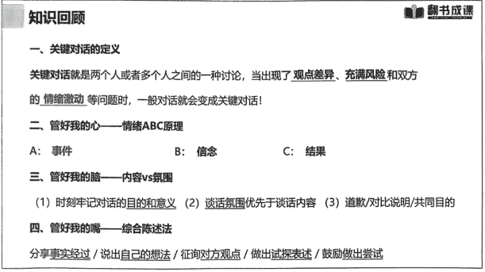

  图 6-12 理性总结示例

  注：上图中加下画线的部分是需要学员填空的题目，讲师提问，学员回答。

## 2. 感性升华

  聚焦学员心理成长与心态提升，通过名人名言，感人图片、视频或故事，给学员一些期望和触动，让他们对课程内容有更深刻的理解和感悟。

  比如，在讲完家庭教育课程后，展示一段父母与孩子温馨相处的视频，或者分享一个感人的亲子故事，让学员感受到家庭教育的重要性，激发他们在实际生活中运用所学知识的决心。

  比如，在“你就是孩子最好的玩具”课程的收尾部分，用到了“父母是孩子的‘原件’,孩子是父母的‘复印件’”这个视频,让家长知道为什么要学习情感引导的教育方式,给了家长更多践行的动力(见图6-13)。

  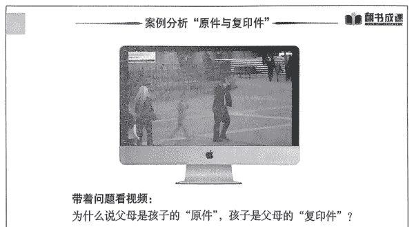

  图6-13 感性升华示例1

  在“刻意练习”课程的收尾环节,我加入了自己的一段话,也给了学员很大的动力践行刻意练习(见图6-14)。

  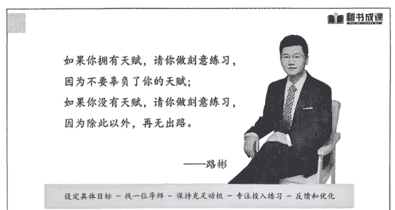

  图6-14 感性升华示例2

  你有没有发现,感性升华往往是给学员动力的,是让学员“动心”的。

  一门好的课程,除了让学员动脑、动手,还要让学员“动心”;动脑和动手,能够帮助学员学会知识和技能,但是如果想让学员真正去践行和改变,需要在课堂中设计“动心”的部分,这就是“感性升华”的价值。此外,这也能让学员对课程内容意犹未尽。

## 3. 营销预告(感谢学员)

  课程的最后,一定要感谢学员的参与,如果有相关课程或内容需要推荐,也可以在这个环节进行营销预告。

  合理的营销预告,能为后续课程或内容引流,为学员继续提供学习服务,同时实现知识变现的可持续性。

  比如,在《陪孩子终身成长》的好书精讲课的收尾环节,营销“7天共读营”的活动(见图6-15)。

  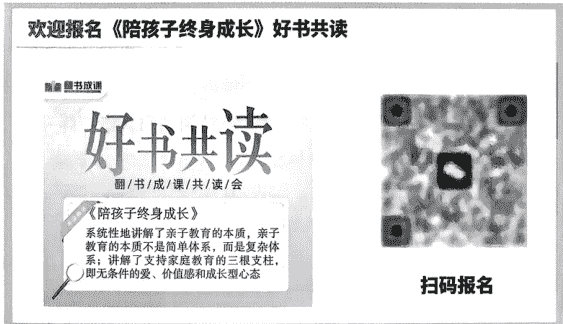

  图6-15 营销预告示例

  此外，在收尾的部分，也可以设计“学员反馈”环节，提前用问卷星设计一份问卷，用以收集学员的反馈，为课程后续优化指明方向。

  在课程的收尾部分，有几个事项要提醒大家。

  (1)不要拖沓，该结束时要结束，即使有再强的表达欲也要控制课程时长。

  (2)要与开场或主题做呼应，如“你就是孩子最好的玩具”课程的收尾可以讲“祝福大家都能成为孩子最好的玩具”。再如要做一门时间管理课，收尾要讲“祝福大家都能够成为时间管理的高手”。

  (3)要注重情感连接，用真诚的感谢和期待的话语，让学员感受到被重视和激励，增强学员对课程的归属感，打造讲师个人亲和力的标签。

  我们可以把这套方法简称为“3333课程设计法”，这里面有四个“3”，分别代表以下含义。

  - 第一个“3”：课程三阶段，开场、主体和收尾。
  - 第二个“3”：开场三破冰，讲师破冰、学员破冰和主题破冰。
  - 第三个“3”：主体三板块，每个板块用“引-讲-练-评”四步呈现。
  - 第四个“3”：收尾三要素，理性总结、感性升华和营销预告。

  按照“3333课程设计法”①的结构来理解、记忆和使用，你对这套课程设计法会更加得心应手。

  ①“3333课程设计法”的叫法，源自我在2020年参加的线上翻转师训练营，是由王宏伟老师提出的。

## 学会填表就会做课

  根据“3333课程设计法”，我们只需掌握各环节的作用与设计要点，便能轻松构建出既动脑又动心的优质课程。

  根据这套课程设计法，我们提炼出了一张课程设计表（见表6-1），讲师只要学会填写这张表格，就能够轻松掌握课程设计的要领。

  表6-1 课程设计表

| 讲师姓名 | | 课程名称 | |
| :--- | :--- | :--- | :--- |
| **主题金线** | 用户 | | |
| | 场景 | **课程目标** | □传递知识（动脑） □提升技能（动手） □转变态度（动心） |
| | 需求 | | |
| **开场** | 讲师破冰 | 讲师的自我介绍：3个关键标签+履历经验 | |
| | 学员破冰 | 文破冰：话题热场/武破冰：游戏互动 | |
| | 主题破冰 | 通过坡道引题引出课程主体内容（提问、故事、案例、图片、视频、数据等） | |
| **主体** | 课程结构 | 课程中若干个板块之间的结构关系 | □认知圈结构 □要素型结构 □流程型结构 □其他：____ |
| | 第一章 | 本章的核心知识点及关联知识点 | |
| | | 引入：启发性问题或互动，引发思考，引起兴趣，引出核心知识点 | |

## 第六章 框架设计：逻辑为王，搭建系统知识骨架

| 讲师姓名 | 课程名称 |
| :--- | :--- |
| **主体** | **第一章** | 讲解：核心知识的呈现，常用讲授法、视频法（若播放视频，建议3~5分钟） |
| | | 练习：围绕知识点的互动设计（问答、填空、连线、案例分析等），以达到学以致用的目的 |
| | | 收尾：承前启后（学员反馈、要点回顾、知识延伸、呼吁行动） |
| | **第二章** | 本章的核心知识点及关联知识点 |
| | | 引入：启发性问题或互动，引发思考，引起兴趣，引出核心知识点 |
| | | 讲解：核心知识的呈现，常用讲授法、视频法（若播放视频，建议3~5分钟） |
| | | 练习：围绕知识点的互动设计（问答、填空、连线、案例分析等），以达到学以致用的目的 |
| | | 收尾：承前启后（学员反馈、要点回顾、知识延伸、呼吁行动） |
| **主体** | **第三章** | 本章的核心知识点及关联知识点 |
| | | **引入：**启发性问题或互动，引发思考，引起兴趣，引出核心知识点 |
| | | **讲解：**核心知识的呈现，常用讲授法、视频法（若播放视频，建议3~5分钟） |
| | | **练习：**围绕知识点的互动设计（问答、填空、连线、案例分析等），以达到学以致用的目的 |
| | | **收尾：**承前启后（学员反馈、要点回顾、知识延伸、呼吁行动） |
| **收尾** | **理性总结** | 对课程内容的回顾和要点提炼，通过填空、随学测验等方式，帮助学员巩固所学知识 |
| | **感性升华** | 对课程内容进行拔高，通过名人名言、感人图片、视频或故事，给学员期望和触动 |
| | **营销预告** | 如果有相关课程或内容需要推荐，也可以在这个环节进行营销预告 |

注：本表参考了翻转师线上训练营的课程设计表，并根据经验做了调整。

接下来，我们一起逐项填写这张课程设计表。

### 表格开头：先定基础信息

1. 讲师姓名、课程名称
直接填写自己的名字和课程全称，如“张三”“新手讲师必修课：30 天打造爆款课程”。

2. 主题金线（用户 + 场景 + 需求）
这里要写清楚“课程的学员是谁”“在什么场景中应用这些知识”“解决什么具体问题”。
比如，如果你的课是教宝妈做亲子沟通，就写“用户：3~10 岁孩子的妈妈”“场景：家庭教育中的沟通场景”“需求：解决亲子沟通中的各类常见问题”。

3. 课程目标（动脑 / 动手 / 动心，可多选）
传递知识（动脑）：如让学员理解“成长型思维”的核心原理。
提升技能（动手）：如学会 3 个亲子沟通的具体技巧。
转变态度（动心）：如让学员重视“非暴力沟通”在家庭生活中的应用。
这部分只需要勾选，在主体部分设计课程时，要体现出如何实现已勾选的课程目标。

### 开场部分：用“三破冰”抓住学员的心

1. 讲师破冰（解决“学员为什么听你讲”）
关键标签：别堆砌太多！选出最能让学员信任的 1~3 个标签，按“职业身份+经验/成果+荣誉/关联”来写。
履历经验：补充若干个能证明你能力的小故事，如“曾帮助100多个家庭改善亲子关系”。

2. 学员破冰（让学员参与进来）
文破冰：“君子动口不动手”，设计高关联、易参与、积极的话题，如亲子课问“你觉得孩子最近一次让你感动的小举动是什么”；做“姓名帐篷”（写姓名+相关信息），再分组进行自我介绍。
武破冰：设计“拳头对话”等“君子动口又动手”的小游戏。

3. 主题破冰（坡道引题，引出主体内容）
坡道引题有五种方法可供选择：提问法、故事法、数据法、视频法、名言法。讲师应选择最贴合自己课程的方法，目标是让学员对主体内容产生期待。

### 主体部分：用“三层结构”讲透内容

1. 课程结构（选一种逻辑框架）
①认知圈结构（方法论课）：按“为什么→是什么→怎么做”填写。
②要素型结构（多维度知识）：拆分成并列/递进的关键要素。
③流程型结构（按时间/步骤）：按流程顺序讲透一个知识。

2. 板块设计（每个板块按“引-讲-练-评”黄金公式填写）
以“第一章”为例，先写明这一章的核心知识点和关联知识点是什么，然后设计讲透知识的四步“黄金公式”。
①引入：用一个问题、故事或冲突引发好奇心。
②讲解：用讲授教学法或视频法讲清核心知识点。
③练习：选一种学以致用的方式（向过往检索、在当下体验、为未来谋划），常用互动技巧有案例分析、角色扮演、游戏互动，要充分考虑学员的接受度和授课环境的适配度。
④收尾：总结重点，引出下一节内容，也可以在这里插入关联知识点。
第二章、第三章：重复上述步骤，每章只讲一个核心知识点，用关联知识点丰富内容。

### 收尾部分：给学员“峰值体验”

理性总结：用填空题、连线题、判断题等帮助学员复习，如“关键对话”课程问题：“情绪 ABC 原理中，A 是______，B 是______，C 是______。”
感性升华：用视频、故事或名言触动学员，如亲子课放“父母是孩子的‘原件’，孩子是父母的‘复印件’”的视频，激发学员“要为孩子做好榜样”的情绪。
营销预告：自然推荐后续课程或活动，如“想深入学习亲子沟通技巧，扫码加入我们的 7 天训练营”，别生硬地打广告，而是要强调“帮学员解决问题”。

### 表格填写注意事项

逻辑递进：开场、主体、收尾要呼应，如开场时提出的问题，收尾环节要呼应解答。
素材支撑：每个环节配套合适的素材(故事、案例、图片、视频), 别干巴巴讲课。
控制时长: 对于 90 分钟的线上课, 一般开场占 10% (8~10 分钟)、主体占 70% (60 分钟)、收尾占 20% (15~20 分钟), 别超时。

新手讲师可以先按照这个模板进行课程设计, 熟练后再灵活调整。

请记住: 表格是帮你厘清课程设计思路的工具, 核心是让学员“动脑(学知识)、动手(练技能)、动心(想改变)”, 最终实现“深度学习、学以致用”!

## AI 赋能课程大纲设计

前面学习了“翻书成课 3333 课程设计法”, 那么我们有没有可能借助 AI 工具, 快速生成完全符合这个课程设计法的课程大纲呢?

有!

接下来, 我将为大家讲解两种借助 AI 工具设计课程大纲的方式。

### 方法一: 豆包智能体

为了方便大家高效设计课程大纲, 我在豆包平台搭建了“路彬翻书成课/课程设计”智能体, 只要按照指令要求输入做课需求, 1 分钟就可以生成完全符合“翻书成课 3333 课程设计法”的课程大纲。

具体操作步骤:
①在手机上下豆包 App, 或在计算机中下载豆包客户端;
②进入“路彬翻书成课/课程设计”智能体的页面;
③按照提示输入做课要求。
建议这样表达：我要做［某个主题］课程，在［线下课、线上直播课或录播课］交付，讲师介绍［讲师姓名、获得荣誉、相关经验、成功案例等］，课程时长［多少］分钟，学员是［某个人群］，课程帮助学员［解决什么问题］，在［腾讯会议或其他］平台讲授课程，根据以上信息帮我设计课程大纲（见图 6-16）。

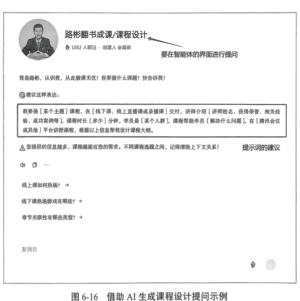

图 6-16 借助 AI 生成课程设计提问示例

提示：
一定要在智能体的页面进行提问，而不是在豆包的主界面进行提问；你输入的提示词就是课程的主题金线，主题金线越清晰，生成的课程大纲就越接近做课要求。

④生成课程大纲。如果对大纲不满意，可以调整提示词，重新生成，直到满意为止。只需几分钟，你就能获得一份结构严谨、内容丰富的课程大纲，极大地提升备课效率；也可以针对某一个部分进行调整优化，如“更换第二章‘练习’部分的案例”。

另外，如果给出的大纲不完整，可以回复“继续”，让豆包智能体给出剩下的课程大纲，直至大纲完整无误。

这样，借助豆包智能体，新手讲师也能迅速掌握课程设计精髓，轻松打造高质量课程。

举个例子：设计一门有关亲子沟通力的线上直播课。

提示词：
“我要做一门［如何提升亲子沟通力］课程，在［线上直播课］交付，讲师叫［李老师，在亲子沟通领域有 10 多年的研究经验，已经帮助数万名家长提升亲子沟通力］，课程时长［90］分钟，学员是［小学阶段孩子的家长］，课程帮助学员［提升亲子沟通力和改善亲子关系］，在［腾讯会议］平台讲授课程，根据以上信息设计课程大纲。”

结果如图 6-17 所示。

当你看到这个课程大纲时，是不是有一种想要惊呼的感觉？不瞒你说，我第一次看到这个效果时，也是头皮发麻！

这时有人可能会问：既然 AI 生成课程大纲这么高效、质量这么高，我为什么还要学习课程设计呢？

这是一个非常好的问题，我分享一下我的理解：AI 虽能高效生成大纲，但课程设计的核心在于理解学员需求与教学目标。所以，只有讲师懂得设计原理、学员需求，才能灵活借助 AI 生成课程大纲，确保课程贴合实际。

“如何提升亲子沟通力”线上直播课程大纲

环节一：课程开场（10分钟）

1. 话题热场（5分钟）
- 线上直播课开场，采用弹幕互动方式。在腾讯会议聊天区发起话题：“在和小学阶段孩子沟通时，你遇到过最让你头疼的问题是什么？”引导家长们在弹幕中分享自己的经历，快速营造热烈的课堂氛围，打破陌生感。

2. 讲师介绍（3分钟）
- 李老师出镜致欢迎词：“各位家长朋友们，大家好！欢迎来到本次‘如何提升亲子沟通力’的课程。我是李老师，拥有10多年亲子沟通方面的研究经验，这些年已经帮助了数万名家长成功提升亲子沟通力，改善了他们的和孩子之间的关系。相信在接下来的课程中，我也能帮助大家解决亲子沟通中的难题。”

图 6-17 借助豆包智能体生成课程大纲示例

> 注：以上仅展示部分回答，具体见附录 1。

反过来，一个完全不懂课程设计的讲师，即使有了 AI 的帮助，也难以真正把握课程的灵魂。

所以，讲师要先会课程设计，再借助 AI 这个杠杆，提升自己的做课效率和课程质量。只有深入理解教学本质，才能让 AI 成为得力助手；最重要的是，讲师要在 AI 给出的大纲中，选择自己能讲授且适合自己讲授的内容和方法，而不是全盘接受。还记得“H-AI-H”的模型吗？

### 方法二：DeepSeek+ 提示词

具体操作步骤：
①使用路径包括手机端（手机 App）和电脑端；
②输入提示词（记得选中“深度思考”和“联网搜索”）。

我是一名［家庭教育讲师］，要设计一门［如何提升亲子沟通力］课程，在［腾讯会议］直播交付，讲师叫［李老师，在亲子沟通领域有 10 多年的研究经验，已经帮助数万名家长提升亲子沟通力］，学员是［青春期孩子的家长］，课程帮助［家长提升亲子沟通力和改善亲子关系］，课程结构包括开场（讲师破冰、学员破冰、主题破冰）、主体（共 3 个板块，每个板块有 1 个核心知识点和若干关联知识点，以“引入－讲解－练习－收尾”的结构讲解每个板块，实现深度学习、学以致用）、收尾（理性总结、感性升华、营销预告）3 个环节，根据以上信息设计课程大纲。

③生成课程大纲。

除了 DeepSeek，我们也可以用类似的提示词在其他 AI 工具中生成课程大纲，如通义千问和文心一言，他们都能根据详细提示词高效生成课程大纲。

### · 本章总结 ·

课程框架是课程的“知识骨架”，决定教与学的效率。无论线上课程还是线下课程，均可按“开场（10%）－主体（70%）－收尾（20%）”三个阶段设计，核心在于构建逻辑闭环，实现深度学习、学以致用。

#### 开场阶段(破冰引流)

- **讲师破冰:** 用1~3个“与学员相关”的关键标签(职业/经验/荣誉)建立信任,避免标签堆砌。
- **学员破冰:** 线上用高关联话题互动,线下通过“文破冰”(互动话题/姓名帐篷)或“武破冰”(小游戏)拉近距离。
- **主题破冰:** 通过提问法、故事法、数据法、视频法、名言法5种引题法,自然切入课程主体,激发探索欲。

#### 主体阶段(内容交付)

- **板块结构:** 根据内容选逻辑框架——认知圈结构(为什么-是什么-怎么做)、要素型结构(拆分关键要素)、流程型结构(按步骤/时间线)。

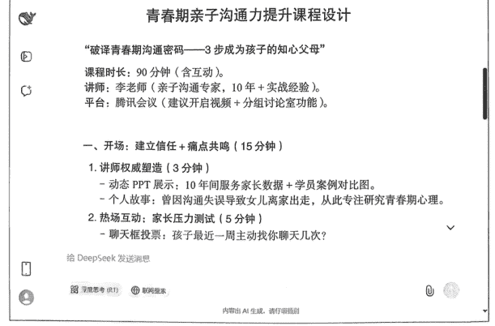

图6-18 借助 DeepSeek 生成课程大纲示例

注:以上仅展示部分回答,具体见附录2。

- **知识讲授**: 用“引-讲-练-评”四步法(引入→讲解→练习→收尾),融入互动设计(案例分析、角色扮演、场景模拟),推动理论转化为实践。
- **素材支撑**: 匹配故事、案例、视频等素材,增强知识点的直观性与趣味性。

#### 收尾阶段(强化记忆)

- **理性总结**: 提炼核心要点,通过填空题、连线题、判断题等巩固知识。
- **感性升华**: 用故事、视频、名言等触动学员,强化行动力。
- **营销预告**: 自然推荐后续学习资源,兼顾情感连接与课程延伸。

### AI赋能课程大纲

配合课程设计表梳理思路,亦可借助AI(豆包智能体、DeepSeek等)输入主题金线相关提示词快速生成大纲,提升效率。核心始终是:以学员为中心,让课程“动脑(学知识)、动手(练技能)、动心(促改变)”,帮助学员“深度学习、学以致用”。

本章内容是以一门90分钟的单节课程为例讲授课程大纲的设计,如果是多节课,则其中每节课的设计都可以参考这个结构,只不过从第二节开始,无须再做讲师破冰、游戏破冰,直接坡道引题。你也可以在第三篇的“课程内容体系”中详细学习如何设计体系课的章节。

下一章,我们将进入课件制作环节,一起学习如何设计课程PPT。

## 第七章
### 课件制作：视觉赋能，打磨课程的吸睛颜值

在前面的内容中，我们完成了课程选题的精准定位、内容素材的高效收集，以及课程框架的逻辑搭建。如果说选题是课程的“灵魂”，内容是“血肉”，框架是“骨架”，那么设计课件就是为这门课程穿上得体的“外衣”，提升课程的“颜值”。

课件不仅是课程内容的载体，更是讲师与学员之间沟通的桥梁。好的课件能放大内容的价值，降低学员的理解成本，甚至成为讲师的“无声助教”。然而，许多人在制作课件时容易陷入两个极端：要么过度追求美观而忽略实用性，要么因达不到技术门槛而草草了事。

本章将聚焦课件制作的四大核心环节——课程 PPT 的设计要求、课程 PPT 的结构要求、AI 赋能课件制作，以及课程试讲与课程录制，帮助课程设计者用最低的时间成本，打造专业且吸睛的课件。

### 课程 PPT 的设计要求

#### 整体设计：简洁为美，重点突出

- 内容简洁明了：一个优秀的 PPT，首先应该做到整体设计简洁明了。这意味着每页 PPT 应尽量只包含一个主要观点或概念，避免过多的文字和图片堆砌。过多的信息会让学员感到眼花缭乱，难以抓住重点。因此，在设计 PPT 时，我们要学会做减法，去除冗余信息，突出核心内容。
- 布局美观大方：合理排版，注重美感。使用适当的字体、字号和行间距，使文字清晰易读。同时，合理运用图片、表格等元素，增强视觉效果，使 PPT 更加吸引人。
- 字体字号统一：选择合适的字体和字号，并保证标题、正文等文字格式统一，确保文字清晰易读，使 PPT 看起来专业且整洁。
- 色彩搭配合理：使用适当的颜色突出重点和层次感，避免过于花哨的颜色和背景。注意色彩的对比度，确保文字清晰可见。例如，深色背景配浅色文字，或浅色背景配深色文字，都是不错的选择。

#### 文字要求：精炼准确，排版美观

文字是 PPT 中传递信息的主要载体，因此文字的质量至关重要，将直接影响学员对课程的理解。

- 精炼文字：避免长句，尽量使用短句和关键词来表达观点。精炼的文字不仅易于阅读，还能更好地吸引学员的注意力。
- 内容准确无误：在制作 PPT 时，要对所有文字内容进行核对，确保信息准确无误。避免错别字和表述不清的情况，以免给学员留下不专业的印象。
- 排版整齐美观：注意文字的对齐方式、字体选择、行间距和段间距等细节，使文字排版整齐美观。同时，确保文字颜色与背景色对比度适中，避免使用刺眼或难以辨识的颜色（见图 7-1）。

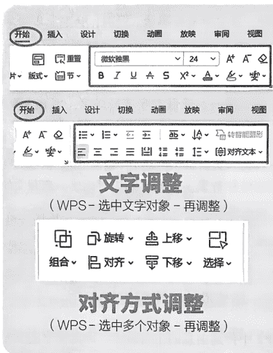

图 7-1 文字排版要求

#### 图表要求：化繁为简，直观易懂

图表是 PPT 中展示数据和信息的重要工具。直观易懂的图表能让学员快速理解复杂的数据关系。

- 图表类型选择恰当：根据课件的主题和内容，选择最能表达数据和信息的图表类型，如柱状图、折线图、饼图、散点图等。
- 数据准确无误：在制作图表前，要对数据进行核实，确保数据来源可靠，避免误导学员。
- 设计简洁明了：在保证图表信息完整的前提下，尽量简化图表设计，避免过多的元素和细节干扰学员对数据的理解（见图 7-2）。

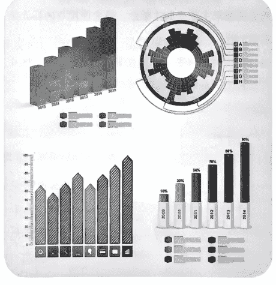

图 7-2 图表示例

- 注解清晰易懂：在图表中添加必要的注解，解释图表中的关键信息和数据，帮助学员更好地理解图表内容。

#### 图片要求：符合主题，图文并茂

图片在 PPT 中起着画龙点睛的作用，一张与内容紧密相关的图片，能让学员更直观地理解知识点，同时让整个页面看起来图文并茂。

- 图片清晰度高：确保插入的图片清晰度高，不模糊或失真，以便学员能够清楚地看到图片细节。
- 图片与内容匹配：确保插入的图片与课程内容相关联，能够有效地支持演示主题或阐述概念，避免使用与内容无关或混淆学员思维的图片。
- 适当修饰图片：将图片处理成背景透明的 PNG 格式，或者将图片设置成圆角矩形，使其看起来更加圆润美观（见图 7-3 和图 7-4）。
- 图片格式规范：图片符合 PPT 风格，保持一致性和美观性，避免图片与文字重叠或过于拥挤，确保将信息清晰地呈现给学员。

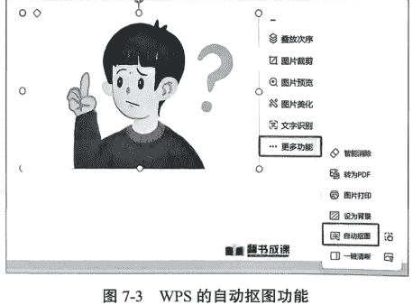

## 第七章 课件制作：视觉赋能，打磨课程的吸睛颜值

## 动画要求：适度使用，服务课程

动画效果能为 PPT 增添不少趣味性和互动性，但过度使用会适得其反。动画应简洁流畅，避免使用复杂烦琐的特效，以免分散学员注意力。

- **适度使用动画**：避免过度使用动画效果，应选择合适的动画效果，并控制其使用频率；应使动画为内容的呈现服务，而非炫耀技巧。
- **设计简洁流畅**：选择简单的动画效果，保持动画的流畅性，避免复杂的动画设计分散学员的注意力（见图 7-5）。

## 视频要求

视频是 PPT 中非常重要的一类素材内容，一个清晰、高关联的视频，能让学员更深入地理解课程知识点。

- **视频清晰度高**：确保插入的视频清晰度高，能够流畅播放，不模糊或失真。（在内容收集部分介绍过如何通过 AI 工具收集视频素材。）
- **视频长度适中**：根据需要选择合适的视频片段，尽量控制视频长度，避免过长导致学员失去注意力，通常以不超过 5 分钟为宜。
- **视频与内容匹配**：确保插入的视频与课程内容相关联，能够有效地支持演示主题或阐述概念；避免使用与内容无关或混淆学员思维的视频。
- **视频使用有技巧**：巧妙设置视频自动播放，视频前留问题引导学员思考，视频后做互动巩固学习效果。使用视频时可以设计三页：视频导入页（视频前留问题，见图 7-6）、视频播放页（设置为全屏播放、自动播放，见图 7-7）、视频互动页（视频后做互动，见图 7-8）。

### 案例分析：“原件与复印件”

**带着问题看视频：**
为什么说父母是孩子的“原件”，孩子是父母的“复印件”？

图 7-6 视频导入页

图 7-7 视频播放页

### 案例分析：问题讨论

看完视频后，请从原件和复印件的角度思考：
父母为什么要学习用情感引导的方式与孩子沟通？

图 7-8 视频互动页

## 课程 PPT 的结构要求

除了设计要求，课程 PPT 的结构安排同样重要。

一个结构合理的 PPT，能够让课程内容层层递进，帮助学员更好地理解和记忆课程内容。

还记得上一章中介绍的“翻书成课 3333 课程设计法”吗？其中的“开场-主体-收尾”以及每一个环节的内容页，组合起来就是课程 PPT 的结构要求。

通常，课程 PPT 的结构可以分为三大部分。

### 1. 开场部分

开场部分是课程的“门面”，需要吸引学员的注意力，激发他们的学习兴趣。

- **封面页**：展示课程名称、讲师姓名、日期等基本信息。封面页应设计得简洁大方，突出课程的主题。
- **讲师页**：介绍讲师的背景、成就和专长，增加学员对讲师的信任。
- **破冰页**：通过文破冰（互动话题、姓名帐篷）或武破冰（互动游戏）等方式，打破讲师与学员之间的陌生感，营造轻松愉快的课堂氛围。
- **引题页**：通过案例、数据、名言、故事、视频等方式，激发学员的学习兴趣和好奇心，引出主体内容。
- **目录页**：列出课程的主要内容和结构，让学员对课程有一个整体的了解。目录页应设计得清晰明了，帮助学员建立学习预期，便于学员跟随讲师的思路学习、思考。

### 2. 主体部分

主体部分是课程的核心，需要详细阐述课程内容，帮助学员掌握知识点。

- **过渡页**：每个板块开始前，设置一个过渡页，介绍该板块的主要内容和目标。过渡页可以帮助学员更好地理解课程结构，跟上讲师的思路。
- **内容页**：内容页是课程的核心部分，要围绕每个章节的核心知识点展开详细的讲解。每个内容页可以采用“引入－讲解－练习－收尾”的结构，即首先提出问题或观点（引入），然后进行详细的阐述和分析（讲解），接着引入相关的案例或数据进行论证（练习），最后总结要点并引出下一个内容页（收尾）。在内容页中，要合理运用文字、图片、表格、视频等元素，使内容更加生动、直观。

例如，在讲解“如何培养孩子的阅读兴趣”时，在内容页中可以先提出“阅读兴趣对孩子成长的重要性”（引入），然后讲解培养孩子阅读兴趣的具体方法（讲解），接着做一个“通过亲子共读培养孩子阅读兴趣”的案例分析（练习），最后总结培养孩子阅读兴趣的多项益处（收尾）。

所以，内容页不是一个页面，而是由多个页面共同构成的一个完整的教学单元。每个页面都应精心设计，确保信息传递清晰、逻辑严密。通过这种方式，学员不仅能掌握知识点，还能在实际中灵活运用知识点。

### 3. 收尾部分

收尾部分是课程的“总结”，需要回顾课程内容，强调重点，引导学员进行下一步行动。

- **收尾过渡页**：总结课程的主要内容，强调重点和难点，引导学员进入收尾阶段。
- **总结页面**：对课程的核心内容进行全面总结，梳理重点知识和方法，帮助学员加深记忆。可以采用思维导图、互动填空等形式，将知识点进行归纳和整理，使学员能够清晰地回顾课程的主要内容。
- **升华页面**：通过故事、视频、名言触动学员，激发学员的情感共鸣，强化行动力，增强他们对课程价值的认同。
- **营销页面**：如果课程有后续内容或相关产品，可以在收尾部分进行简要介绍和预告，引导学员进一步学习或购买。
- **封底页**：封底页是课程的结束部分，要简洁地表达对学员的感谢，在授课场景允许的情况下加入讲师的联系方式，方便学员进一步交流和学习，也可以呼应课程主题，最后以“感谢聆听”结束课程的讲授。

课程 PPT 的结构及其示例如图 7-9 和图 7-10 所示。

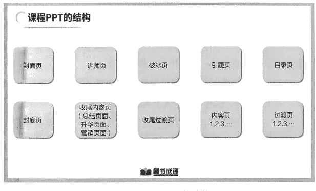

图 7-9 课程 PPT 的结构

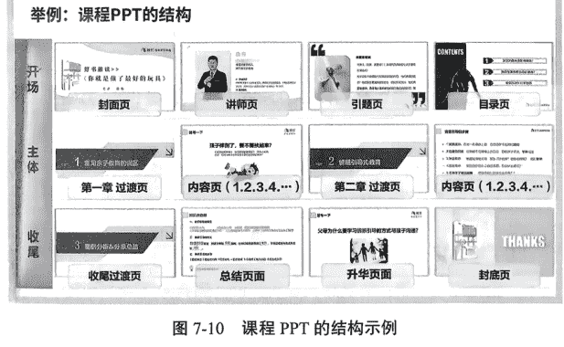

图 7-10 课程 PPT 的结构示例

## AI 赋能课件制作

随着 AI 技术的发展，越来越多的 AI 工具被应用于课件制作中，帮助讲师快速生成 PPT、优化排版、提高效率。

目前，市面上常见的 AI 课件制作工具包括 AiPPT、Kimi、WPS 灵犀、讯飞智文等，也有不少接入了 AiPPT 的 App，这里不一一赘述。

这些工具能够帮助讲师快速生成课程 PPT，并提供模板和排版建议，大大节省了课件制作的时间和精力。

### 四款 AI 工具的对比

#### 1. AiPPT

**(1) 核心特征。**

- **生成效率高**：支持主题生成、文档上传（Word、Xmind 等），快速生成 PPT 框架。
- **模板适配性强**：根据内容自动匹配模板，提供多种风格选择，支持用户二次调整。
- **编辑灵活性**：支持在线调整内容和设计，但免费次数有限（每月 4 次），下载需要注册会员。

**(2) 适用场景或人群。**

- **企业汇报场景**：需要高质量视觉设计的商业提案、年度总结等。
- **付费用户**：预算充足且追求专业性的团队或个人。

#### 2. Kimi

**(1) 核心特征。**

- **完全免费**：开源且无使用限制，支持多文档上传一键转换 PPT，适合学生和初创团队。
- **内容全面性**：生成的大纲涵盖范围广（如政策分析、市场展望），但易偏离核心主题，需要手动优化。
- **模板多样**：提供大量免费模板，风格简洁时尚，适合快速搭建框架。

**(2) 适用场景或人群。**

- **临时汇报场景**：如紧急会议或临时课件制作，可快速完成内容填充。
- **新手讲师**：适合对设计要求不高、需要快速生成基础 PPT 框架的用户。

#### 3. WPS 灵犀

**(1) 核心特征。**

- **生态集成**：深度融入 WPS 办公套件，支持从 Word、PDF 直接转换 PPT，适合 WPS 老用户。
- **极简操作**：生成速度快（最快 29 秒），但内容停留在框架层面，需用户补充数据和分析。
- **模板适配性**：模板以基础款为主，非 WPS 会员的可选择性较少，会员可直接调用现有模板，适配多种场景。

**(2) 适用场景或人群。**

- **WPS 生态用户**：适合已习惯 WPS 办公套件的职场人士，尤其是需要快速将文件从文档格式转换为 PPT 格式的行政或文秘岗位。
- **基础需求者**：对设计复杂度要求不高的用户，如制作内部会议简报。

#### 4. 讯飞智文

**(1) 核心特征。**

- **内容深度**：通过联网搜索实时抓取数据，生成的分析报告类 PPT 逻辑严谨（如票房数据、政策解读），信息密度高。
- **AI 配图与备注**：自动生成适配图片和演讲者备注，提升演示专业性。

**(2) 适用场景或人群。**

- **专业汇报**：学术答辩、行业分析等需要数据支持和深度内容的场景。
- **长文本转化**：将论文、报告等长文本快速转换为 PPT。

### AI 工具选择与使用建议

这四款工具各有优劣，我们可以根据自己的实际需求进行选择。

- 如果需要处理长文本且注重模板多样性，Kimi 是首选。
- 如果更看重与办公软件的兼容性和专业排版，WPS 灵犀值得尝试。
- 如果追求免费易用，讯飞智文则能满足基本需求。
- 如果是企业用户，且预算充足，对 PPT 要求较高，可以选择 AiPPT。

需要注意的是，目前 AI 生成还不能完全替代人工设计，生成后仍需大量的优化和调整，如补充具体案例、调整图片排版、优化动画效果、增加视频素材等。

AI 工具的作用是帮助讲师快速搭建 PPT 框架，提高效率，而真正让 PPT 出彩的，还是讲师对课程内容的理解和创意设计。

这也符合我们所倡导的“H-AI-H”的原则，以人为主，以 AI 为辅。

### AI 生成 PPT 的示范

我们以 WPS 灵犀为例示范一下，如何生成满足讲师要求的课程 PPT。

在上一章中，我们生成了“如何提升亲子沟通力”的课程大纲。接下来，我们用这个大纲，生成一个课程 PPT。

**1. 第一步：打开 WPS 灵犀**

WPS 灵犀界面如图 7-11 所示。

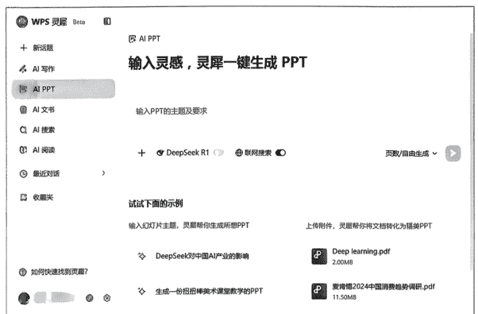

图 7-11 WPS 灵犀界面

**2. 第二步：输入课程大纲，建议选择“联网搜索”，不选“DeepSeek R1”**

为什么不选中“DeepSeek R1”呢？因为我们提交的大纲是相对完整的、符合翻书成课课程设计法的课程大纲，而选择“DeepSeek R1”之后，会对课程大纲进行二次处理，可能导致结构混乱。直接使用已生成的大纲，能确保 PPT 内容与原大纲高度一致，提升生成效率。

为什么建议选择“联网搜索”呢？因为在联网模式下，WPS 灵犀可以补充实时信息，丰富 PPT 内容，还能引入最新数据和案例，增强 PPT 的时效性和说服力（见图 7-12）。

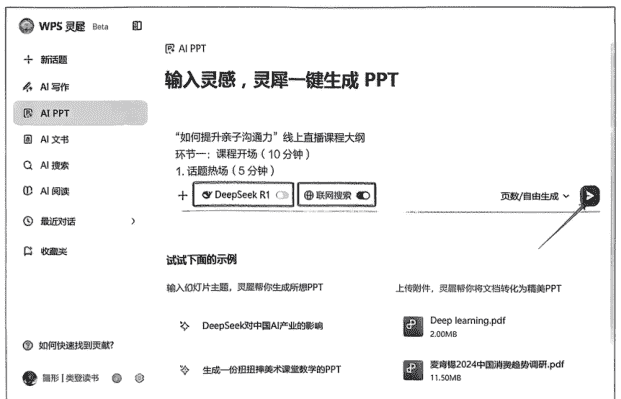

图 7-12 借助 WPS 灵犀生成 PPT 示例

**3. 第三步：点击生成 PPT，选择模板，可以根据主题进行筛选**

在这一步，你会看到 WPS 灵犀给出的课程大纲，和我们提交的课程大纲基本上保持一致，这对于后续生成 PPT 会有很大的帮助（见图 7-13）。

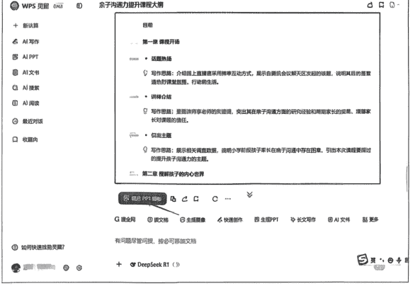

图 7-13 WPS 灵犀生成 PPT 模板示例

所以，对多个 AI 工具做比较，你会发现哪个更符合自己的要求。选择一个自己喜欢的模板（因为可供选择的模板不多，所以建议选择简约风，便于后续再做优化），然后单击“生成 PPT”按钮（见图 7-14）。

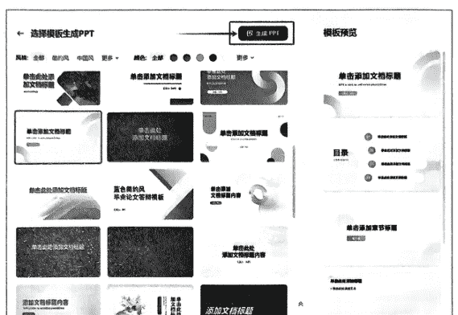

图 7-14 生成 PPT 示例

**4. 第四步：在线编辑，调整页面顺序或删除不必要的页面，并下载**

图 7-15 展示了在线编辑页面。

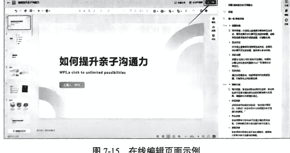

图 7-15 在线编辑页面示例

**5. 第五步：优化 PPT，导出 PPT 后，用 WPS 对课程 PPT 再做优化调整**

接下来就可以在 WPS 里对课程 PPT 进行进一步的调整和优化，直至满足授课要求（见图 7-16）。调整项目包括以下几点。

- **主题模板**：WPS 会员在“设计”一“更多主题”里可以选择更丰富的模板。
- **图片视频**：增加相关图片和视频素材，丰富课程内容。
- **文字细节**：校对文字，确保文字无误且排版美观。
- **动画效果**：适度添加动画，提升演示生动性。
- **互动环节**：设计互动问题，提升学员参与度。

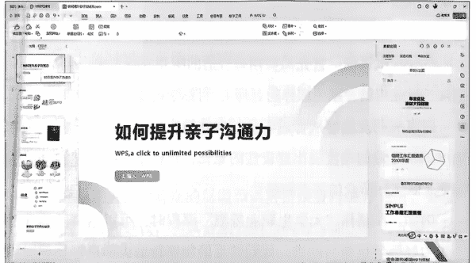

图 7-16 WPS 优化 PPT 页面示例

通过这些细致调整，确保 PPT 既专业又具吸引力。最终，一份高效、内容扎实的 PPT 便制作完成，既避免了形式主义，又提升了工作效率。

## 课程试讲与课程录制

### 课程试讲：收集反馈，优化课程

课程试讲是课件制作完成后进行的重要环节，就像演员正式演出前的彩排，通过试讲，我们可以发现 PPT 设计、内容讲解、时间把控等方面的问题。例如，可能会发现某页 PPT 的文字过多导致讲解卡顿，或者某个知识点的讲解逻辑不清晰让学员难以理解，这些问题都可以通过试讲及时调整。

如何做好课程试讲呢？其一般分为四个步骤。

**1. 招募听众**

在课程试讲前，首先需要招募合适的听众。听众可以包括同事、朋友、行业内的专家（如你的老师）、目标学员等。

同事和朋友能够从普通听众的角度提供直观的反馈，行业专家则可以从专业的角度提出建设性的意见，目标学员的反馈则能让讲师更了解实际听众的需求和感受。

例如，在制作“大学生职业规划”课程时，可以招募一些大学生作为目标学员参与试讲，他们的反馈能够帮助讲师更好地调整课程内容和讲解方式，使课程更符合大学生的实际需求。

**2. 设立反馈渠道**

为了方便听众提出意见和建议，需要设立多种反馈渠道。可以通过在线问卷（如问卷星）、微信群、QQ 群、邮箱等渠道，收集听众的意见和建议。

讲师可以在在线问卷中设计一些具体的问题，如“你认为课程内容是否清晰易懂？”“哪些部分让你印象最深刻？”“你对课程的排版和视觉效果有什么建议？”等，从而有针对性地收集反馈意见和建议。

微信群和 QQ 群则可以方便听众实时交流，提出即时的问题和建议。

**3. 记录试讲过程**

在试讲过程中，对课程进行录音或录像，以便后续回顾和分析。

录音和录像能够记录讲师的讲解过程，包括语言表达、肢体动作等细节，帮助讲师发现自己在讲解过程中存在的问题，如语速过快、重点不突出、肢体动作不自然等。

例如，通过回看录像，讲师可能会发现自己在讲解某个重点内容时语速过快，可能导致学员无法完全理解，就可以在后续的课程中调整语速，保证重点内容有更好的呈现效果。

**4. 分析试讲效果**

试讲结束后，对听众的反馈和试讲记录进行综合分析。整理听众提出的意见和建议，将其分别归纳为内容方面、表达方面、视觉方面等不同类别，针对每个类别的问题制定相应的优化方案。同时，结合自己在试讲过程中的感受，总结优点和不足，明确需要改进的方向。

例如，如果多数听众反馈课程内容过于理论化，缺乏实际案例，讲师可以在后续的课程中增加更多的实际案例，使内容更加生动、实用；如果发现自己在讲解过程中肢体动作僵硬，可以通过练习和模仿，提升自己的表达和展示能力。

通过试讲和优化，讲师能够逐步提升课程的吸引力和实用性，最终打造出一门既符合听众需求，又具有专业深度的优质课程。这一过程不仅是知识的传递，更是教学相长的宝贵经历。

### 课程录制：选择合适方式，呈现极佳效果

录制课程也是一项讲师必备的技能。那么，如何才能录制一堂精致的线上课？我将从录播课的种类、常用录课软件及操作步骤、录制课程的注意事项、录播课的后期制作等方面，详细介绍。

**1. 录播课的种类**

**(1) 音频课。**

音频课是以 MP3 格式交付的课程，制作相对简单。讲师只需准备好讲稿，选择一个安静的环境，使用手机或专业的录音设备进行录制即可。音频课的录制相对比较简单。

例如，喜马拉雅、荔枝微课等平台上有很多音频课程，适合那些注重内容本身，不需要视觉呈现的主题，如家庭教育、心灵成长、文学赏析、哲学思考等。

**(2) 讲师不出镜的视频课。**

讲师不出镜的视频课主要是讲解 PPT 内容，不出现讲师的画面 的课程。这种方式适合讲师专注于内容讲解，不需要个人形象展示的课程。

常用的录屏软件有 EV 录屏、Faststone Capture 等，操作简单，能够清晰地录制屏幕内容和讲师的声音。

稍后我将详细讲解如何通过 EV 录屏将讲师的计算机操作过程和讲解声音完整地记录下来。

**(3) 讲师出镜的视频课。**

讲师出镜的视频课能够让学员更直观地感受到讲师的个人魅力和亲和力，增强与学员的互动和连接。

这种方式适合需要讲师个人形象展示的课程，如提升演讲技巧、亲子教育面对面等。根据录制场景的不同，又可以分为实景录课和虚拟录课。

实景录课可以选择一个整洁、舒适的实际场景，如办公室、教室等，通过摄像头录制讲师的讲解过程；虚拟录课则可以利用绿幕、虚拟背景等技术，营造出不同的录制场景，增加课程的趣味性和视觉效果。

录制讲师出镜的课程，推荐使用 OBS Studio 软件，它功能强大，能确保画面和声音的高质量同步录制。

**2. 常用录课软件及操作步骤**

**(1) 讲师不出镜的视频课：EV 录屏。**

① **软件优势**：操作简单快捷，占用资源少，录制的视频清晰流畅，适合新手使用。

② **操作步骤如下**。

第一步：首先在计算机上下载并安装 EV 录屏软件（见图 7-17）。

# 翻书成课：AI 时代打造爆款课程的实战手册

图 7-17 EV 录屏界面

第二步：设置录制参数。选择全屏录制或窗口录制，设置音频选项（仅录制麦克风声音或同时录制系统声音和麦克风声音），根据实际需要做选择。

在通常情况下，录制区域选择全屏录制，录制音频选择仅录制麦克风声音，以确保讲师的声音清晰无杂音（如果 PPT 中有音视频内容播放，则选择“麦和系统声音”，不过要把计算机中能够产生声音的软件提前关闭，如微信、QQ 等，以免录入消息提示音），如图 7-18 所示。

## 第七章 课件制作：视觉赋能，打磨课程的吸睛颜值

图 7-18 设置录制参数示例

第三步：打开需要录制的课程 PPT，进入放映模式（见图 7-19）。

图 7-19 EV 录屏放映 PPT 示例

第四步：设置完成后，按下快捷键“Ctrl+F1”开始录制，讲解完毕后按下“Ctrl+F2”结束录制。

通常在首次录制时，先录制 10 秒左右的测试视频，确保声音和画面都正常后，再开始正式录制。

最后，将录制好的视频保存到指定的文件夹中，讲师可以对视频进行简单的剪辑和处理。

### （2）讲师出镜的视频课：OBS Studio 软件。

① 软件优势：功能强大，支持多种画面来源和复杂的布局设置，适合专业的录课和直播场景，能够满足讲师对画面和声音的高要求。

② 操作步骤如下。

第一步：下载并安装软件（见图 7-20）。

图 7-20 OBS Studio 界面

根据自己的计算机操作系统下载相应的安装包，完成软件安装。

第二步：运行软件，先添加场景，根据录制需求选择横屏或竖屏场景（见图 7-21）；再添加“画面来源”，如摄像头、PPT 画面、讲师介绍的贴片图等（见图 7-22）；还要设置音频来源（麦克风或其他音频设备，见图 7-23）。

图 7-21 添加场景（确定横屏或竖屏）

图 7-22 添加画面来源

图 7-22 中包含了录课背景图、摄像头和正在放映的课程 PPT，也可以添加文字等信息。

图 7-23 设置音频来源，通常包含麦克风和桌面音频（即系统声音）

第三步：在实时画面区调整画面的布局和大小，确保画面美观。

第四步：设置完成后，点击“开始录制”按钮即可开始录课，录制完成后点击“结束录制”按钮，视频会保存到指定的位置。

### 3. 录制课程的注意事项

(1) 录制过程中应保持环境安静，避免噪声干扰；注意语速和语调，保持讲解生动自然。录制结束后，及时检查视频质量，必要时进行二次编辑，确保课程内容完整、清晰。

(2) 保持背景一致：在录制多节课时，尽量保持录课背景的一致性，如使用相同的虚拟背景或实景场景，让学员在学习过程中感受到连贯性，减少因背景变化导致的注意力分散。

(3) 关闭干扰软件：在录课过程中，关闭 QQ、微信等通信软件，或将其设置为静音模式，避免消息通知和来电干扰录制过程，保证录制的音频和视频质量。

(4) 使用外置设备：外置摄像头和麦克风能够显著提升录课的画面和声音质量。

(5) 利用提词器：对需要频繁查看讲稿的讲师来说，使用提词器可以帮助他们更流畅地进行讲解。需要注意的是，提词器只是辅助工具，讲师仍需保持自然的讲解风格和节奏。

(6) 加入互动元素：即使是录播课，也可以通过提问、暂停等方式加入互动元素。例如，在讲解一个重要知识点后，提示学员“请大家暂停思考一下，你在实际生活中遇到过类似的问题吗？”，增强学员的参与感和学习效果。

(7) 完成好过完美：在录课过程中，不要过于追求完美而反复录制，导致浪费大量时间。首次录制时，只要内容准确、表达清晰，就可以先完成录制，后续再根据反馈进行优化。万事开头难，一旦开始录制并顺利完成，你将发现自己的录课能力会在实践中不断提升。

### 4. 录播课的后期制作

课程录制完成后，需要进行适当的后期制作，以提升视频的质量和观看体验。

录播课的后期制作包括以下工作内容：

- 视频剪辑：裁剪多余的片段，拼接不同的镜头。
- 音频处理：调整音量、去除噪声。
- 字幕添加：方便学员理解内容，尤其是在静音环境下观看。
- 背景音乐添加：营造合适的氛围，但要注意音量适中，不影响讲解声音。
- 调色与特效：提升画面的视觉效果，但要适度，避免过于花哨。

常用的后期制作软件有快剪辑和剪映，快剪辑适合快速进行片段剪辑，剪映则在字幕添加和复杂特效制作方面具有优势。

# 本章总结

课件不仅是内容的载体，更是讲师与学员沟通的桥梁。本章围绕四大核心展开。

第一，课程 PPT 的设计要求。遵循“简洁为美、重点突出”的原则，从整体设计、文字要求、图表要求、图片要求、动画要求、视频要求六大维度打造专业课件。每页聚焦一个核心观点，通过合理排版、统一风格、恰当配色和多媒体元素的协同，降低学员理解成本，提升视觉吸引力。

第二，课程 PPT 的结构要求。课程 PPT 需遵循“开场－主体－收尾”的逻辑框架。开场部分通过封面页、破冰页、引题页激发兴趣；主体部分以过渡页串联知识点，内容页采用“引入－讲解－练习－收尾”的单元化设计；收尾部分通过理性总结与感性升华强化记忆，并巧妙预告后续内容，形成完整闭环。

第三，AI 赋能课件制作。借助 WPS 灵犀、AiPPT、Kimi 等工具，可快速生成 PPT 框架、优化排版，但需结合人工调整补充案例、优化细节，实现“H-AI-H”（以人为主，以 AI 为辅）的协作模式。

第四，课程试讲与课程录制。试讲须模拟真实场景，通过听众的反馈优化内容与表达；录制则根据需求选择音频、视频（讲师出镜或不出镜）等形式，注重环境、设备与互动设计，确保课程呈现专业且生动。

课件制作的本质是“内容为本，服务授课”，通过科学的设计逻辑、高效的工具辅助与持续的迭代优化，讲师能为课程披上兼具专业性与吸引力的外衣，让知识传递更高效、学习体验更愉悦。

下一章，我们将学习课程变现。

## 第八章 课程变现：浪潮式发售，引爆课程变现热潮

在前几章，我们一起探讨了如何从 0 到 1 打造一门课程——从找准用户痛点的选题确定，到海量素材的收集整理；从逻辑严谨的框架设计，再到精美实用的课件制作。如果说前四步是“酿酒”，那么本章内容就是介绍如何让这坛酒的香气飘出巷子，吸引更多人品尝。

或许有人会说：“酒香不怕巷子深，只要课程质量过硬，自然会有人买单。”但在信息爆炸的时代，“酒香也怕巷子深”才是现实。就像一本好书需要好的推广才能被更多读者看见，一门好课程也需要科学的发售策略，才能真正实现价值传递与商业闭环。

艾媒咨询发布的《2023 年中国知识付费行业现况及发展前景报告》显示，市场上每年新增数万门课程，真正能脱颖而出的却是少数。这意味着，即便你拥有一门优质课程，若不懂得包装、上架和发售的技巧，很可能会淹没在信息洪流中。

本章将聚焦课程变现这一核心命题，带你了解如何通过课程包装让课程颜值与内涵并存，如何选择合适的平台完成课程上架，如何运用“浪潮式发售”这套经过实战验证的方法掀起销售热潮，并且如何借助 AI 工具让整个过程更加高效省力。

无论你是初次尝试课程变现的新手，还是希望提升发售效率的老手，都能从中找到实用的方法和落地的技巧。

# 课程包装：给课程一件“吸引人的外衣”

试想一下，当你在书店看到两本书：一本封面设计粗糙，书名晦涩难懂；另一本封面精美，书名直击你的痛点，你会选择哪一本？

课程也是如此。

课程包装，是课程走向市场的第一道门槛，也是学习者对课程形成第一印象的关键。好的课程包装就像为课程穿上了一件华丽的外衣，使课程在众多竞争对手中脱颖而出。

包装的过程，既是对课程内在价值的深度挖掘，也是对外在展示形式的精心雕琢。课程包装主要分为两个层面：内容包装和画面包装，二者相辅相成，缺一不可。

# 内容包装：提炼核心卖点，让课程价值一目了然

内容包装的本质是从课程中提炼出最具吸引力的要素，用精准的语言将其传递给潜在学员。内容提炼不是自吹自擂，而是基于用户需求塑造课程的卖点，它就像给课程写一个精彩的自我介绍，让学员一眼就能看懂课程的价值。

因为用户不会为说明书买单，但会为有价值的解决方案付费，所以，内容提炼要做到“与你有关、对你有用”，其中的“你”就是课程的潜在用户。

我们要从哪几个方面做内容包装呢？

# 1. 打磨课程主标题：用一句话抓住注意力

课程标题是学员接触课程的第一印象，必须简洁清晰、直击痛点，同时具备一定的吸引力；根据营销专家大卫・奥格威的研究，阅读标题的人数是阅读正文人数的 5 倍。这意味着，你的标题如果不能吸引人，就等于失去了 80% 的潜在学员。

优秀的标题有三大特征。

(1) 对象感：让学员感觉这门课程就是为他量身定制的。对比“高效学习法”和“给总是学完就忘的你：21 天高效学习系统”，后者明显有更强的对象感。

(2) 价值感：明确传达课程能带来的改变。例如，“从 0 到 1 打造你的个人品牌”比“个人品牌建设方法论”更有吸引力。

(3) 场景化：将课程价值置于具体场景中。例如，“睡前 10 分钟：给忙碌妈妈的亲子沟通课”。

# 2. 设计课程副标题：补充说明，强化吸引力

如果说主标题是吸引眼球的钩子，那么副标题就是进一步说服的助推器。副标题应该详细说明课程的具体价值和独特之处，是对主标题的补充。

优秀副标题的要素有以下几个：

- 具体说明课程内容。
- 突出课程独特价值。
- 使用有力度的词语。
- 保持简洁（最好控制在 20 字以内）。

以一门知识内化方法的课程为例，标题如下。

主标题：21 天打造你的知识内化系统。

副标题：从“读书记不住”到“学以致用”的完整解决方案。

副标题有力地对主标题进行了展开和详细说明。

# 3. 塑造讲师人设：让学员了解“谁在讲”

学员在选择课程时，不仅关注“讲什么”，也关心“谁在讲”。在知识付费领域，讲师本身就是课程非常重要的品牌资产，一个专业、有价值且有个性的讲师人设，能大大提升课程的说服力。

（1）专业人设：突出讲师的专业背景、行业经验和成功案例。比如，“某大学心理学博士”“10 年情绪管理咨询经验”。

（2）价值人设：明确讲师能为学员解决什么问题，带来什么改变。比如，“帮助 1000+ 职场人士摆脱焦虑困扰”，这样的表述比单纯说“我很厉害”更有吸引力。

（3）个性人设：展现讲师独特的教学风格和个人魅力，如“用脱口秀的方式讲心理学”。

# 4. 优化章节标题：激发学员的好奇心与求知欲

课程章节标题要突出每个模块的重点和亮点，让学员知道学完这一章能获得什么，从而产生学习的动力，精心设计的章节标题可以大大提升课程完课率。

章节标题设计技巧如下：

- 使用具有行动导向的语言，如“掌握”“打造”“解决”。
- 突出章节的核心价值。
- 创造连续性的学习旅程感。
- 适当使用数字和图表。

示例对比如下。

(1) 普通版。

- 第一章：记忆原理。
- 第二章：学习方法。
- 第三章：实践应用。

(2) 优化版。

- 第一章：破解记忆密码——大脑最爱这样学。
- 第二章：三大高效学习法，效率提升 300%。
- 第三章：从知识到收入——打造你的知识变现系统。

很显然，优化后的章节标题更能激发潜在学员的好奇心和求知欲，从而促进课程购买。

# 5. 梳理课程卖点：突出优势与获益

学员最关心的是“学完这门课程能给我带来什么”“这门课程能为我解决什么问题”，因此讲师需要从课程内容中梳理出核心卖点，重点围绕学员的痛点、需求和获益展开。

从这个角度上讲，课程的卖点，也是学员的买点。

对于课程卖点，讲师可以采用“痛点 + 解决方案 + 获益”的结构，示例如下：

- 痛点：“学了很多时间管理方法，却总是坚持不下去？”
- 方案：“独创‘番茄工作法+习惯追踪’双系统，帮你建立可持续的时间管理模式。”
- 获益：“30 天后，工作效率提升 50%，每天多出 2 小时自由时间。”

在整理出课程卖点后，讲师可以在海报或营销话术中体现这些卖点。

# 6. 收集学员好评：让“用户证言”成为超强背书

学员的真实好评是最有说服力的宣传素材。社会心理学中的社会证明原理告诉我们，人们更倾向于相信他人的评价而非商家的自夸。所以，在课程试讲或内测阶段，要留心收集学员的反馈和评价，挑选出具有代表性的内容，用于后续的宣传推广。

收集和运用学员好评的技巧有以下几个：

- 形式多样化：文字评价、视频见证、学习成果展示。
- 内容具体化：避免泛泛而谈的好评，突出学员听课后的具体改变。
- 真实性原则：保留学员的真实语言和个性表达。
- 征得同意：在使用前要征得学员同意或者隐去学员姓名、头像。

分享一个我的好习惯：在课程运营过程中，收到学员对课程的反馈后，我会第一时间截图保存，将这些截图集中保存在一个特定的文件夹中，日积月累，这样的好评截图也有上百张了。你不妨试一试这种方法。

# 画面包装：用视觉设计提升课程吸引力

画面包装，是课程包装的外在表现形式。在这个注重“颜值”的时代，一个吸引人的画面包装，能够迅速吸引潜在学员的目光，高效传递课程的价值和卖点。画面包装主要包括宣传海报、商品主图、商品详情页等视觉物料的设计。

## 1. 明确平台规则：让设计符合传播需求

不同的平台对视觉物料的尺寸、格式、大小和内容要求不同。在设计前，要先了解课程上架的各个平台的规则，避免因尺寸不符等问题影响传播效果。常见尺寸有以下几种：

| 物料类型 | 尺寸/规格 | 备注 |
| :--- | :--- | :--- |
| 宣传海报 | 750 像素 × 1344 像素 | 3~5 张不同版本 |
| 商品首图、封面 | 750 像素 × 750 像素 | 3~5 张 |
| 详情页 | 750 像素 × ？ | 长度根据内容调整，也可多张拼接 |
| 易拉宝 | 80 厘米 × 180 厘米 | 线下活动使用 |

## 2. 借助工具高效设计：零基础也能做出精美物料

对没有设计基础的讲师来说，创客贴、图怪兽、千库网等在线设计工具是不错的选择。这些工具提供了大量的模板，只需简单替换文字和图片，就能快速生成专业的海报和详情页。

- 操作步骤：以创客贴为例，首先注册、登录，搜索与课程主题相关的模板（如“职场技能课程海报”），选择一个喜欢的模板，点击“编辑”按钮，替换课程标题、副标题、卖点、讲师照片等内容，调整字体和颜色，最后下载保存即可使用。
- 设计技巧：同一课程的所有视觉物料要保持风格一致，如统一使用相同的主色调、字体和排版方式，让学员在不同场景下看到画面时能够快速识别。

## 3. 善用设计团队：专业的事交给专业的人

如果课程预算允许，或者对视觉设计有较高要求，可以在淘宝网、猪八戒网等平台找专业的设计团队。他们不仅能根据课程特点定制专属设计，还能提供海报、详情页、易拉宝等全套视觉方案，帮助讲师节省大量时间和精力。

## 4. 常见宣传物料的建议

### （1）课程海报：移动的广告牌。

《2022 国民专注力洞察报告》显示，在信息爆炸的时代，当代人的连续专注时长已经降至 8 秒，所以课程海报必须在极短时间内传递核心价值并引发用户兴趣。

高质量课程海报的要素包括以下几个：

- 主标题醒目，字体易读。
- 核心卖点突出（不超过 3 个）。
- 讲师形象专业亲切。
- 色彩搭配符合课程调性。
- 行动召唤明确（扫码、立即报名等）。

### （2）详情页：说服的逻辑。

详情页是课程销售的“主战场”，需要系统性地构建说服逻辑，优秀的详情页可以将转化率提升 30% 以上。详情页黄金结构，包含但不限于以下几个：

- 首屏：主标题 + 副标题 + 核心卖点（解决“为什么要学”）。
- 讲师介绍：建立权威和信任（解决“为什么跟你学”）。
- 学员评价：学员证明（解决“别人学得怎么样”）。
- 课程大纲：展示核心内容和系统框架（解决“学什么”）。
- 学习收获：具体可衡量的改变（解决“学完能怎样”）。
- 常见问题：消除购买顾虑（解决“万一……怎么办”）。
- 报名指引：明确行动步骤（解决“怎么报名”）。

# AI 赋能：如何借助 AI 高效做内容包装

## 1. 使用 AI 工具提炼课程卖点

AI 工具可以快速分析课程内容，提炼出课程的主标题、副标题和核心卖点。

提示词：

> “你是一位课程营销专家。我做了一门 [课程名称] 线上课，课程是帮助 [目标人群]，解决 [核心] 问题，提升 [能力/结果]。现在要做课程宣传，请分析上传的课程 PDF 文件，帮我提炼出课程的核心卖点，包括课程的主标题、副标题以及 3 个最吸引人的卖点（要有对象感、价值感），这些核心卖点将在课程的销售海报中进行展示，以文本格式呈现给我。”

我用这套提示词为《刻意练习》的好书精讲课生成了一份卖点（见图 8-1），非常好用。

图 8-1 借助 DeepSeek 生成课程卖点示例

以下是 AI 给出的卖点：

（1）主标题：刻意练习：从新手到大师的精准突破法。

（2）副标题：告别无效努力，用科学方法快速成为领域高手。

（3）核心卖点。

① 专为职场人设计。无须天赋，拆解刻意练习四大黄金法则，解决“学得慢、记不住”的痛点，助你 3 个月突破职业瓶颈。

② 真实案例 + 导师指导。覆盖 100 多个领域的高手案例，提供“找导师—拆目标—强反馈”全流程工具，上班族也能每天 2 个番茄钟高效精进。

③ 打造“心理表征”系统。掌握“3F 法则”，帮你将技能炼成肌肉记忆”，提升 3 倍执行效率，彻底告别“学了就忘”。

④ 海报行动号召：“天赋不够？刻意练习来凑！立即报名，解锁# 翻书成课：AI 时代打造爆款课程的实战手册

从菜鸟到专家的底层逻辑！

是不是还挺惊艳的？可以说比我自己写的卖点还精准！这里面有几个重点，大家要留意：

- 提示词中要说明课程的用户、需求或痛点；
- 上传课程的 PDF 文档，会让 AI 给出的卖点更符合需要；
- 可以同时用多个 AI 工具进行提问，优中选优。

## 2. AI 工具是否可以直接出海报和详情页

你有没有想过：能否把课程的 PDF 或者提示词“丢”给某个 AI 工具，让它出一套海报、详情页呢？

我测试了一下这个思路，结论是能够实现，但是效果有待提升。

所选平台：创客贴。

### 操作步骤：

- 打开创客贴网站，在左侧菜单栏选择“智能设计”；
- 选择“招生海报”这个场景；
- 在左侧信息栏里填入“主标题”“副标题”“课程卖点”等信息，单击“智能生成设计”按钮。

创客贴生成海报示例如图 8-2 所示。创客贴给出了若干张课程海报，但是却达不到我对海报的要求。

当然，AI 技术一直在飞速发展，或许你阅读本书时，技术已经进步到完全符合要求了。

然而，从现实角度来说，课程的宣传海报有相对标准化的要求，不完全属于创意类海报，所以，如果你对海报、详情页等要求比较高，建议选择更好的模板或者专业团队来制作。

另外，课程的海报、详情页等视觉物料都是可以更新的，讲师可以根据需要，在课程的不同阶段来设计满足营销需求的视觉物料。

## 课程上架：选择最适合你的平台

课程包装完成后，接下来要做的就是将课程上架到合适的平台。不同的平台有不同的特点和流量来源，选择合适的平台能让课程更快地触达目标学员。

### 区分私域平台与公域平台：明确平台特性与优势

#### 1. 私域平台：聚焦存量用户，打造专属流量池

私域平台是指需要讲师自己引流，用户不主动搜索就难以发现相关课程的平台，如小鹅通、海豚知道、创客匠人等。这类平台的优势是可以建立自己的店铺和学员管理体系，便于进行学员的长期服务、深度运营和二次转化。

例如，小鹅通提供了丰富的营销工具，如优惠券、拼团、分销等，适合已经拥有一定粉丝基础的讲师进行私域发售。

#### 2. 公域平台：借助平台流量，获取增量用户

公域平台是指本身具有大量流量，课程发布后有机会获得系统推荐的平台，如微信小店、抖音、小红书、快手等平台。这类平台的优势是使讲师有机会快速触达新用户，适合课程冷启动阶段获取流量。

比如，微信小店与微信生态深度融合，讲师可以通过短视频、直播等方式引流，还能将购买课程的学员沉淀到微信私域，实现“公域引流+私域转化”的闭环。

### 选择平台的五个关键因素

- 受众匹配度：你的目标学员活跃在哪个平台？
- 内容形式适配：音频、视频、图文哪种更适合你的课程？
- 平台规则：抽成比例、内容限制、结算周期等。
- 运营能力：你是否有精力维护多个平台？
- 长期规划：你是否计划建立自有品牌和用户资产？

在你了解了各类平台的特征，以及自己的运营需求后，做决策就相对容易一些了。

分享一下我的决策框架。

- 注重建立长期个人品牌：优先选择可沉淀用户的私域平台。
- 追求短期流量和曝光：选择有推荐机制的公域平台。
- 课程需要复杂交付（如社群、作业）：选择功能完善的专业平台。

最后补充一句，选平台不要只看价格，要关注自己的需求，还要向前看 6 个月到 1 年的发展前景；也可以考虑“公域+私域”的组合方案，如“微信小店+小鹅通”，既可以在公域直播售课，也可以在私域推荐成交。

## 微信小店上架实操：手把手教你完成课程发布

下文以当前热门的微信小店为例，详细介绍课程上架的步骤。

### 1. 开通微信小店：迈出上架第一步

在手机端打开微信，进入视频号，点击右上角头像，进入创作者中心，找到“带货中心”，点击“微信小店”申请开店。根据提示提交身份证、营业执照（个体工商户或企业均可）等资料，审核通过后即可开店。

### 2. 申请类目：确保课程合规上架

根据自己的课程类别申请类目，如果不确定选择哪个类目，可以参考同行业其他讲师的课程类目，或咨询平台的客服人员。

申请类目需要缴纳 5000 元保证金（不同类目保证金可能不同，以平台最新规则为准），同时提供增值电信业务经营许可证或 ICP 备案。办理 ICP 备案相对简单，在阿里云、腾讯云等平台购买域名，提交备案申请即可，完成整个过程大概需要 3~7 个工作日。

### 3. 发布商品：参照平台要求填写课程信息

- **商品标题**：须包含教学领域名称和主要教学形式，如 ×× 老师成人英语线上视频课。
- **商品图片**：需提供三张及以上与商品标题对应的商品图片，商品主图不允许重复。
- **课程详情页**：详细介绍课程内容、讲师背景、适合人群、学习收获等，建议加入学员好评和课程大纲，以增强学员信任。
- **价格与库存**：设置合理的价格和库存数量，预售课程可以设置“预售时间”和“发货时间”。

对于发布商品的要求，平台都有明确的规则，在发布前，我们可以先了解一下，以免反复修改，耽误时间。

### 4. 商品审核：耐心应对审核流程

提交商品后，平台会进行审核，审核内容包括课程内容是否合规、图片是否符合要求、标题是否存在敏感词等。

如果审核失败，系统会提示失败原因，根据提示修改后重新提交即可。

#### 常见审核失败的原因及解决方案：

| 问题 | 解决方案 |
| :--- | :--- |
| 类目选择不当 | 咨询客服人员确认正确类目 |
| 图片含联系方式 | 去除二维码、电话等 |
| 标题夸大宣传 | 使用更客观的表述 |
| 缺少必要资质 | 补全或调整课程内容 |

#### 审核通过后：

- 可在视频号橱窗中添加课程商品；
- 直播时挂载课程商品链接；
- 短视频账号达到 1000 名粉丝后可挂载商品链接；
- 通过微信社群、朋友圈等多渠道推广课程。

以上是以微信小店为例，发布课程商品的流程。其他平台的发布流程类似，只不过有些平台审核得严一些，有些相对松一些，还需要关注平台对某些类目是否开放。

课程发布后，就可以开始销售了。这时，有学员购买了课程之后，怎么把课程交付给他呢？这是一个很重要的问题，这时你会发现，微信小店这样的平台是销售型平台，可以成交课程，但是无法直接交付课程，而小鹅通、海豚知道这类平台属于内容型平台，既能够实现成交，又能够实现交付，用户即买即学。

如何完成课程的交付呢？我会在后面的章节专门介绍。

## 浪潮式发售：五步打造课程销售热潮

课程上架后，就可以启动发售环节了。

我建议每一位知识创业者都要掌握浪潮式发售这套成交方法。浪潮式发售是由营销专家杰夫·沃克创立的一套产品发售方法，其核心理念是通过有节奏的信息释放，像海浪一样一波波推动用户做出购买决策。这套方法被证明可以将转化率提升 3~5 倍，是一套经过实战验证的高效发售方法。

传统发售和浪潮式发售对比如下：

- **传统发售**：产品上架→广告轰炸→促销结束。
- **浪潮式发售**：分析名单→造势预热→产品预售→正式发售→跟进追单。

讲师可以通过这五个步骤，像浪潮一样层层推进，逐步激发学员的购买欲望，实现销量的爆发式增长，如图 8-3 所示。

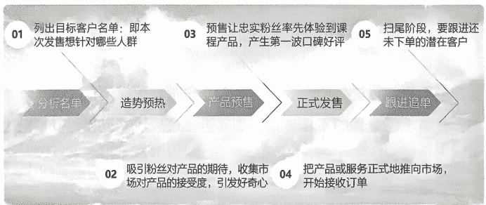

下面我们展开介绍这五个步骤。

### 分析名单：精准锁定目标客户

#### 1. 梳理存量用户：从现有资源中挖掘潜力学员

首先从自己的存量用户中筛选目标客户，如过往课程的学员、微信好友、社群成员等。例如，一位开设“职场沟通课”的讲师，通过分析发现，过往购买过“PPT 设计课”和“Excel 教程”的学员，对职场技能提升有持续需求，这些学员就是本次课程的重点目标人群。

#### 2. 获取新用户名单：通过多种渠道拓展客源

- **短视频平台**：在抖音、小红书等平台发布课程相关的干货视频，引导用户私信或留言获取联系方式。
- **直播间引流**：通过直播分享课程知识点，设置“私信领取福利”等钩子，收集潜在学员的信息。
- **异业合作**：与相关领域的机构或个人合作，共享用户名单。比如，职场课程讲师可以与招聘平台、企业培训公司合作，获取有职业提升需求的用户名单。

#### 3. 分析用户需求：小范围验证用户需求

对收集到的用户名单进行分析，了解他们的痛点、需求和购买能力；也可以通过小范围访谈目标用户等方式验证用户的需求。

当你手握几百上千个意向用户时，对这场浪潮式发售就会充满信心了。

比如，我在发售“翻书成课”线上课之前，通过分析名单整理出过往成交和服务过的有可能对课程感兴趣的 2000 多位学员，这些存量用户构成了“翻书成课”线上课的早期学员。

### 造势预热：激发学员期待，营造抢购氛围

造势预热的核心是通过多种渠道释放课程信息，勾起学员的好奇心和创造期待感，让他们对课程产生“非买不可”的欲望，而非直接销售。

造势预热需具备三个要素：

- **神秘感**：暗示即将有重要产品发布，但不完全揭示。
- **参与感**：邀请少量用户提前体验，分享收获和感受。
- **专属感**：让早期关注的用户感觉有专属特权（特别是优惠价格）。

造势预热实操方法有以下几种。

#### 1. 朋友圈预热：3~7 天持续种草

- **痛点唤醒**：发布学员常见的痛点问题，如“为什么别人汇报工作总能得到领导认可？你可能缺少这 3 个沟通技巧”。
- **价值剧透**：透露课程中的核心干货或独家方法，如“明天分享一个让 PPT 逻辑更清晰的‘金字塔结构’，学会就能让你的方案通过率提升 50%”。
- **优惠预告**：告知学员即将推出的课程和优惠活动，如“本周六晚 8 点，我的新课‘高阶职场沟通课’将正式发售，前 50 名报名立减 100 元，记得定好闹钟！”。

#### 2. 短视频造势：10~20 条干货视频引流

制作与课程相关的短视频，将其发布在抖音、视频号、小红书上。

视频内容可以是课程知识点拆解、学员案例分享、讲师个人故事等，每条视频结尾引导用户关注或私信获取课程信息。假如你是家庭教育领域的讲师，就可以制作“科学养育”“亲子沟通”“冲突解决”等内容的干货视频，并在视频结尾处预告课程，吸引潜在用户私信领取相关福利。

#### 3. 直播造势：通过直播互动提升信任

开展课程预热直播，介绍课程的核心价值、讲师背景和发售信息，同时设置问答环节和抽奖活动，增加学员的参与感。

例如，我在推广“AI 成课”线上课的造势阶段，在直播中演示如何借助 DeepSeek 高效生成课程大纲，并承诺直播间添加好友的用户，报名后额外赠送翻书成课 AI 做课智能体，当晚直播的场观有 3000 多人，有将近 200 人加入私域。

### 产品预售：锁定忠实粉丝，积累第一波口碑

产品预售是浪潮式发售中特别关键的阶段，其目的不是最大化销售额，而是建立口碑和验证市场，是对前期造势效果的检验。通过给忠实粉丝提供专属优惠，提前锁定订单，同时积累第一波口碑。

#### 1. 制定预售政策：用优惠吸引提前购买

- **价格优惠**：预售价格比正式发售价格低 20% ~ 50%，如正式价 299 元，预售价 199 元。
- **赠品福利**：赠送相关的资料包、工具模板，如“预售期间报名，赠送价值 299 元的‘课程配套 PPT 模板’”（尽量选择边际成本低甚至为零的产品或课程作为赠品）。
- **限时限量**：设置预售时间（如 7 ~ 10 天），强调“预售仅限前 300 名”“预售期结束后恢复原价”，营造紧迫感。

#### 2. 建立预售群：在私域深度转化

将造势期间对课程有意向的学员邀请进专属微信群，在群内进行课程介绍、答疑解惑和互动交流，营造良好的学习氛围。然后在私域群中完成首次发售，通过发放红包、限量赠品等方式带动更多学员转化。

#### 3. 收集用户反馈：优化课程与宣传

及时收集预售学员的反馈，对课程内容和发售流程进行优化。同时，征得学员同意后，将他们的好评截图或相关视频作为宣传素材，用于后续的发售阶段。

#### 4. 发掘分销达人：培训推荐技巧

在购课学员中发掘 KOC（意见领袖），如拥有私域资源、自媒体账号和分享意愿的学员，邀请他们成为课程的推广达人（可以取一个更好的名字，如“课程合伙人”），向他们提供必要的销售手册，培训他们推荐课程的技巧，为进入发售阶段储备更多的资源。

根据销售平台的规则设置推广人，微信小店通过“优选联盟”添加“推广达人”，小鹅通则为添加“推广员”，其他平台可以参照这个思路。

### 正式发售：全面铺开，掀起购买高潮

产品预售结束后，便进入正式发售阶段，此时需要通过多种渠道全面推广课程，最大化触达潜在学员。

#### 1. 确定发售渠道：线上线下结合，多平台发力

- **线上渠道**：包括直播间销售（如视频号直播、抖音直播）、短视频挂车、公众号推文、社群群发等。
- **线下渠道**：如果有条件，可以举办线下沙龙、讲座或培训，现场推广课程，同时收集潜在学员的联系方式。

#### 2. 建立发售机制：利用稀缺性和从众效应

- **限量发售**：设置课程的报名上限，如“本次课程仅限 200 人，报满即止”。
- **倒计时提醒**：在朋友圈、社群发布“距离课程涨价还有 24 小时”“仅剩 30 个名额”等信息，刺激潜在学员尽快下单。
- **晒单有礼**：鼓励学员在朋友圈晒出课程订单截图，赠送小礼品或优惠券，利用从众效应吸引更多人购买。

#### 3. 打磨销售话术：用“痛点 - 方案 - 获益”结构打动学员

销售话术要围绕学员的痛点展开，先洞察他们的需求，再阐述课程的卖点，最后描述学习后的获益。

例如：“你是不是经常在会议上发言时很紧张，大脑一片空白？（痛点）我的‘公众演讲实战课’专门针对这个问题，教你 3 个快速克服紧张的技巧，还有 5 套万能演讲模板。（方案）学完后，你也能在会议上自信表达，让领导和同事对你刮目相看。（获益）”

在实际销售过程中，讲师只要不断打磨、积累和完善销售话术，形成“销售手册”，就能够培养出更多优秀的课程合伙人。

### 跟进追单：扫尾阶段，不放过任何一个潜在客户

跟进追单阶段往往被忽视，却是提升销量的关键。数据显示，约 30% 的订单发生在发售的最后 2 天，因此一定要重视收尾工作。

#### 1. 跟进已成交客户：提升满意度，促进二次转化

及时为已成交客户提供课程资料和服务，邀请他们加入学员专属群，定期分享进阶内容和福利活动，让他们感受到超值体验。同时，引导他们把课程推荐给身边的朋友，设置阶梯的推荐奖励机制，如“推荐 1 人报名，获得 ×× 元分佣；推荐 3 人报名，分佣比例提升至 ××”等。

#### 2. 跟进未成交客户：了解原因，针对性地予以解决

对未成交的潜在客户进行一对一回访，了解他们的顾虑和问题，针对性地提供解决方案。例如，如果客户觉得价格太高，可以提供老学员专属折扣；如果客户对课程内容有疑问，详细解答并提供试学片段。

#### 3. 打磨跟进话术：用真诚和价值打动学员

跟进话术要避免生硬的推销，以“帮助学员解决问题”为出发点。

例如：“×× 同学，我注意到你之前对我们的‘职场 Excel 课’很感兴趣，不知道现在有没有什么顾虑呢？其实这门课里针对你提到的数据处理问题，有一套非常实用的技巧，很多学员学完后都说效率提升了至少 30%。现在报名还有最后 3 个优惠名额，如果你确实有这方面的需求，不妨抓住这次机会，说不定能帮你解决工作中的大难题。”

## AI 赋能：如何巧用 AI 设计浪潮式发售方案？

### 提示词模板：

你是一位课程营销专家，擅长浪潮式发售（分析名单→造势预热→产品预售→正式发售→跟进追单）。我做了一门 [课程主题] 线上课，课程是帮助 [用户群体]，解决 [用户的痛点问题]。我当前的资源有 [我的资源信息]，营销周期是 [21 天]，帮我制定一个浪潮式发售的方案，以时间轴的结构呈现给我。

### 提示词举例：

提示词示例如图 8-4 所示。

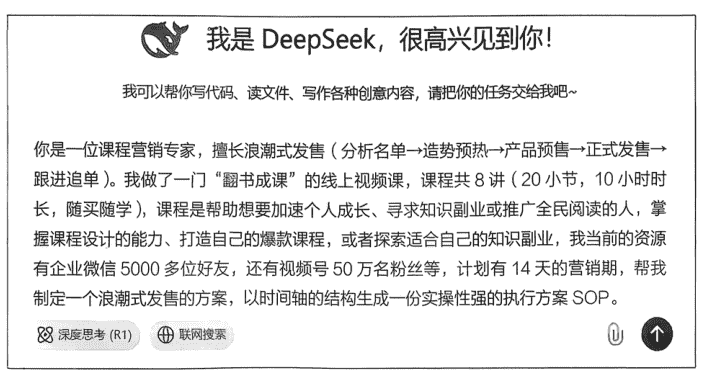

### DeepSeek 的呈现结果：（开头部分）

DeepSeek 回答示例如图 8-5 所示。

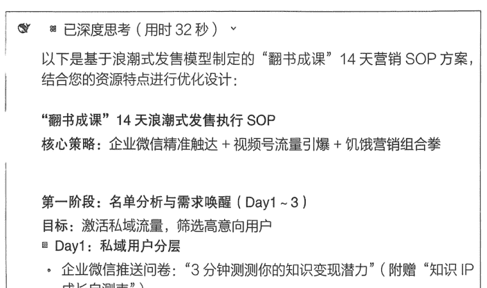

优化调整后的完整方案见附录 3。讲师可以同时用多个 AI 工具进行提问，选择适合自己的方案作为行动参考。

## 课程交付：兑现承诺的艺术

课程发售完成后，并不意味着大功告成，因为真正的价值落地始于课程交付。如果说发售是“把课程卖出去”，那么交付就是“让课程产生效果”——这不仅是对学员的承诺，更是打造口碑、实现二次转化的关键。

我的经验是，有很多学员会因为“体验好”而购买讲师的其他课程，可见交付环节的重要性。

下面我们将针对不同课程类型，拆解具体的交付策略。

### 录播课交付：简单高效，也要“有温度”

录播课以其灵活性深受学员喜爱，交付流程相对简单，但绝不是“发完链接就了事”。核心要诀在于“标准化交付+个性化服务”，让学员感受到被关注。

#### 1. 课程链接发送：不止链接，还有温馨提示

首先将课程视频、PPT、资料包等内容上传至专业平台，如小鹅通、海豚知道等。当学员购买课程后，通过短信或其他方式引导学员添加讲师或客服人员的微信，将学习链接和一段有温度的学习提示语发送给学员，学员点击即可进入学习页面。

#### 2. 学习进度跟进：做学员的“成长陪伴者”

交付不是终点，而是服务的起点。通过后台数据观察学员的学习进度，对 3 天未登录的学员发送温馨提示“发现你最近没登录课程，是遇到什么问题了吗？”，让学员感受到被关注。

#### 3. 及时答疑：提升学员的满意度

建立学员交流群，对于学员在学习中遇到的问题，讲师不仅在群内详细解答，还可以在群内发起相关讨论，这种及时的答疑服务能提升学员满意度。

### 直播课交付：用互动感提升“学习体验”

直播课的优势在于实时互动，交付重点是“节奏感+参与感”，让学员在约定时间内全情投入。

#### 1. 时间约定与反复提醒

在课程销售时明确直播时间，建议选择大多数学员方便的时段，如工作日晚 8 点—9 点半。购买后通过短信、微信、课程平台推送三重提醒，开课前 10 分钟在直播间设置“倒计时红包”，吸引学员准时进入。

#### 2. 平台选择与技术保障

根据课程类型选择直播平台，可选视频号（无缝对接微信生态，方便学员进入）、小鹅通（功能丰富，支持连麦答疑）、腾讯会议（可共享屏幕，让学员能实时看到讲师操作步骤）。

提前测试网络、摄像头、麦克风，准备备用设备，避免“开播后卡顿”等影响体验的问题。

## 翻书成课：AI 时代打造爆款课程的实战手册

### 3. 直播设计与课后回放

在直播过程中设置“高频互动节点”，如每 10 分钟一次弹幕提问，让学员保持注意力。

直播结束后，及时上传回放（建议设置 7 天有效期，避免学员学习拖延），也可以借助 AI 工具整理课程的要点知识，方便学员复习。

### 社群课交付：用运营打造“沉浸式学习”

社群课（如读书会、训练营）的交付本质是“社群运营”，需要通过系统化的流程设计，让学员在群体氛围中实现成长，分为“策划招募－执行落地－复盘转化”3 个阶段。

- **策划招募**：明确主题（如“7 天共读《高效能人士的七个习惯》”）、每日流程（如上午读章节、白天打卡、晚上交流）及激励机制（如全勤赠资料、优质分享者获奖励），吸引目标学员参与。
- **执行落地**：开营仪式明确规则、拆解框架；学习中通过每日任务发布、社群互动（如打卡、讨论、直播答疑）保持活跃度；结业时总结成果、颁发证书，增强学员成就感。
- **复盘转化**：收集反馈，优化流程，整理学员成果作为宣传素材，并向积极学员推送后续课程优惠，实现口碑传播与二次转化。

社群课的交付，核心逻辑是通过短期高频互动让学员在群体中获得动力，同时为后续课程积累种子学员。

## 第八章 课程变现：浪潮式发售，引爆课程变现热潮

课程交付不是终点，而是新的起点。好的交付能让学员从购买者变成传播者，甚至追随者。

无论是录播课的专属服务、直播课的实时互动，还是社群课的沉浸式体验，核心都是“以学员为中心”：让他们在学习过程中感受到被重视，在结束后感受到切实的成长。

在实际运营中，这三种交付形式可以相互组合起来使用，使课程的成交、服务和学员体验达到更好的状态。

# · 本章总结 ·

课程变现，本质上是一个“价值传递”的过程——通过包装让课程的价值被看见，通过上架让课程触达更多学员，通过浪潮式发售让课程的价值被认可，通过 AI 工具让整个过程更高效。

试想一下，当你精心打造的课程帮助学员解决了问题、获得了成长，那种成就感远超过商业上的收获。而本章的所有方法和技巧，都是为了让这份价值被更多人看见和认可。

当然，课程变现不是一蹴而就的，需要不断地实践和优化。也许第一次发售会遇到审核不通过、预售效果不佳等问题，但没关系，每一次尝试都是一次成长。

现在，你已经掌握了课程变现的核心方法，接下来就是行动——把课程包装得更吸引人，选择合适的平台上架，用浪潮式发售掀起销售热潮，借助 AI 工具提升效率。相信不久的将来，你会看到自己的课程被越来越多的学员喜爱和认可，真正实现“好课程，广为人知”的目标。

# 第三篇

# 运营篇：从单课到生态的体系化运营

—— 构建可持续的知识产品生态

# | 引 言 |

# 从“做课”到“运营”，
一人企业的进阶之路

在上一篇，我们深入探讨了“翻书成课五步法”——通过“选题确定、内容收集、框架设计、课件制作、课程变现”将一本书、一个主题或一项技能转化为知识产品。

掌握这套方法，意味着你已经迈出了知识创业的第一步：从0到1打造一门课程。

但课程诞生后，如何让它持续变现？如何让知识产品像一棵树一样生根发芽，而非昙花一现？这正是本篇要解决的问题。

如果说“做课”是播种，那么“运营”就是培育。许多知识创业者会陷入一个误区：只要课程足够好，自然会有源源不断的学员。但现实是，课程变现的可持续性，90%依赖于运营体系的搭建。没有体系支撑的课程，就像没有发动机的汽车，再豪华也无法行驶。

本篇将带你从运营体系的视角出发，拆解知识产品运营的四大核心体系：产品内容体系、学员服务体系、学员成长体系和学员增长体系，助你搭建一套可持续变现的运营体系。

# 为什么说“体系比课程更重要”

先给大家讲一个真实的案例。我有一位学员，通过“翻书成课五步法”做了一门线上课，课程定价99元，上线首月卖了300多份，看起来成绩不错。但第二个月开始，销量就断崖式下跌。他来找我时很困惑：“我的课程内容没问题，为什么学员越来越少？”

深入沟通后发现，他的问题出在“只做课，不运营”。学员购买课程后，除了收到课程视频和学习资料，获得的后续服务很少。学员学完后感觉“学了就完了”，自然不会推荐给别人，更不会成为长期用户。

这个案例反映了一个关键问题：知识产品的核心竞争力，早已不是单一的课程内容。在知识付费市场日益成熟的今天，用户越来越看重系统化的学习体验。就像你买一部手机，除了硬件配置，操作系统、售后服务、软件更新同样重要。知识产品也是如此，课程是“硬件”，运营体系就是“操作系统”，运营体系高效与否决定了用户能否在你的“知识生态”中持续获得价值。

# 一人企业的兴起：小而美的商业新范式

在前文中，我提到过一人企业。不知道你有没有发现，身边越来越多的人开始尝试一人企业模式：有的设计师辞职后独立接单，通过自媒体展示作品，用社群维护客户；有的家长把育儿经验做成课程，通过线上直播和学员互动；还有的职场人士把自己的专业技能做成训练营，利用业余时间变现。

这种现象的背后，是商业逻辑的悄然变化。传统企业追求“规模扩张”，但一人企业更注重“精准定位”和“深度服务”。就像《小而美：持续盈利的经营法则》一书中所倡导的，“回归经营的本质，以极简主义的姿态，构建可持续发展的企业生态”，你不一定要把企业做大，而是把企业做精，让它成为你理想生活的延伸。

对知识创业者来说，一人企业模式尤为合适。

你不需要庞大的团队，不需要高额的成本，只需要“五个一”：一个人、一套生产工具（如手机、计算机、AI工具）、一个自媒体账号（视频号、抖音、小红书等）、一个知识产品、一个学员社群。

但在这“五个一”中，最核心的是什么？是“知识产品”，更是“知识产品+运营体系”。其中，产品是联结用户的载体，体系是可持续变现的保障。

# 从“卖课”到“运营”：知识创业者的必经之路

回想一下，你买过的那些让你印象深刻的课程，是不是都有这样的特点：除了课程内容，还有专属的学习群、定期的直播答疑、学员作业点评、线下活动组织？这些看似不起眼的环节，其实都是运营体系的一部分。

我发现一个规律：那些能持续变现的知识创业者，都有一套成熟的运营体系。他们知道如何通过社群服务让学员有归属感，如何通过学员成长体系让老学员持续进步，如何通过增长策略让新学员源源不断。

# 搭建运营体系的“两步走”策略

既然运营体系这么重要，该如何搭建呢？其实很简单，记住：

# 第一步：打造知识产品——从“翻书成课”开始

读完第二篇你会发现，“翻书成课”就是打造知识产品的一个很好的切入点。你可以把一本书、一个主题、一项技能变成课程。

- **新手阶段**：从书籍成课入手，夯实做课能力。比如，把《非暴力沟通》做成沟通课，把《正面管教》做成育儿课，借由书籍成课锻炼自己的做课能力。
- **探索阶段**：开始尝试主题成课，结合热点话题或细分领域，探索做课方向。比如，“青春期家庭沟通课”结合热点新闻，设计用户感兴趣的课程。
- **进阶阶段**：着手探索技能成课，将个人核心技能萃取为“王牌课”。比如，PPT 设计、短视频剪辑、英语写作。

从书籍成课起步，夯实能力；尝试主题成课，寻求方向；最终以技能成课形成独特优势，建立竞争壁垒。

# 第二步：构建运营体系——让课程“活”起来

有了产品，接下来就是构建运营体系，让产品“活”起来。运营体系包含四个核心部分：产品内容体系、学员服务体系、学员成长体系和学员增长体系。在整个运营体系中，产品内容体系是基础。在课程完成从 0 到 1 的搭建后，真正的挑战在于如何让它持续创造价值。

这就需要构建四大核心运营体系（见图 0）。

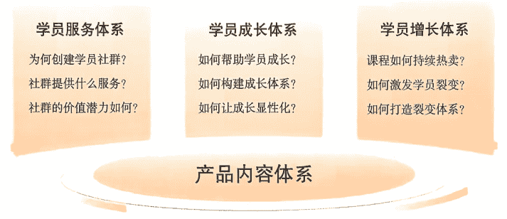

图 0 四大核心运营体系

(1) **产品内容体系**。产品内容体系解决的问题是“什么样的选题、课程内容能够实现可持续的运营”。

好的课程不是一次性消费品，而是能随着市场和学员的需求不断进化的“活内容”。从选题的确认，到课程结构的设计，我将为你分享一套“课程 + 训练营”的完美解决方案。

(2) **学员服务体系**。学员购课后，需要的不仅是课程视频本身，还有被关注、被引导的学习体验。如何通过系统化服务让学员产生归属感和价值感？构建学员服务体系的三层结构，即标准服务、主动服务和感动服务，尤为重要。

(3) **学员成长体系**。学员最关心“学完能得到什么”，而学员成长体系就是要让进步看得见。通过构建成长型训练营、成果展示机制等设计，把抽象的学习过程转化为可量化的成长路径。我将在后续章节中详细拆解“成长型训练营”的设计方案，通过这个方案让进步看得见。

(4) **学员增长体系**。获客难是知识创业者面临的普遍性问题，但老学员其实是最好的流量池。从内容种草（短视频干货、学员证言）到裂变活动设计（如老带新），这套体系聚焦如何用低成本撬动高增长，我在后续章节将讲解人人都能复制的增长策略。

这四大体系环环相扣，共同构成知识产品的运营骨架；接下来的章节里，我会把每个体系的搭建步骤、避坑指南逐一剖开，让你既能看到全貌，也能了解可落地的细节。

# | 第九章 |

# 产品内容体系：构建知识产品的核心引擎

在前文中，我们探讨了知识创业者的一人企业模式，以及构建运营体系的四大核心板块——产品内容体系、学员服务体系、学员成长体系和学员增长体系。

本章我们就来拆解“产品内容体系”的三大核心模块。

- **选题策略**：什么选题能支撑课程的长期运营？
- **结构设计**：如何设计套系课程，让内容连贯且可扩展？
- **进阶体系**：如何搭建课程进阶体系，实现从新手到专家全覆盖？

如何回答这些问题将直接决定你的知识产品是昙花一现还是细水长流。

## 选题策略：可持续运营的关键起点

在规划课程时，确定选题是第一步，也是决定课程能否持续运营的关键因素。我们先从反面思考，明确哪些选题不建议采用。

# 避开“陷阱”选题，遵循“真、大、痛”原则

(1) **伪需求选题**：有些选题看似新颖，实则是创作者头脑一热的产物，属于伪需求。判断一个选题是不是伪需求，有个简单的方法，就是在课程开发前，利用创客贴等工具制作一张课程宣传海报，然后通过朋友圈、群发等方式进行推广，看看有多少人愿意购买。如果群发100个人，购买的人不到5个，就说明这个选题市场接受度较低，很可能就是伪需求。例如，曾经有人推出“宠物语言翻译”课程，看似有趣，但实际测试中购买者寥寥，最终证明是伪需求。

(2) **小需求选题**：小需求选题由于受众群体较小，难以支撑课程的长期运营和变现。知识产品想要实现可持续发展，需要有足够数量的用户支持，而小需求选题无法满足这一要求。比如，“古代竹简修复技术”这类过于小众的选题，虽然专业但受众极少，难以实现商业价值。

(3) **不够痛的选题**：这类选题虽然可能有一定市场需求，但用户的痛点不够强烈，导致他们不愿意为之买单。例如，某些课程内容质量不错，但用户觉得可学可不学，没有非要学习的紧迫感，这种课程就属于不够痛的选题。虽然可以用来练手，但很难实现持续运营。像“日常办公表格美化技巧”这类课程，其用户痛点不够强烈，付费意愿较低。

与上述“陷阱”选题相反，优质的选题要符合“真·大·痛”原则。

(1) **“真”**意味着课程要基于真实需求，且创作者在该领域要有“真本事”。比如，一位拥有10年临床经验的心理咨询师开发的“职场压力疏导课程”，就是基于用户的真实需求和讲师的专业能力。

(2) **“大”**表示市场需求大,有足够多的潜在学员。比如,“短视频运营课程”“知识主播养成课程”,随着短视频、直播行业的兴起,市场需求巨大,潜在学员众多。

(3) **“痛”**则是指用户痛点明显,愿意为解决问题而付费。比如,“考研英语高分冲刺课程”,考研学生对英语成绩提升的需求迫切,痛点明显,付费意愿强烈。

# 什么样的选题能够可持续运营

从课程运营周期来看,课程可分为短期运营课程和长期运营课程。像直播引流课、单场读书会、蹭热点课程等,都属于短期运营课程,它们的特点是单次交付,运营周期短。

而长期运营课程则可以多次交付,实现长期运营。举三个例子。

案例一: 帆书 App 的樊登讲书,每周六晚上樊登老师会上一本新书的音频和视频,持续更新的内容吸引着用户不断使用,实现了课程的可持续运营和变现。

案例二: 类似正面管教的专业课程,通过设计基础课、进阶课、高阶课等进阶体系,引导学员不断提升,也实现了长期运营。

案例三: 还有我自己的“翻书成课”线上课,通过“视频课+训练营”的内容体系(这里的视频课是指线上的录播课),为学员提供实战陪跑,赋能学员成长,让老学员持续复购,同样达到了可持续运营的效果。

这三个案例都在一定程度上实现了可持续运营,但是背后的支撑逻辑是不一样的。

第一类,樊登讲书,依靠持续更新优质内容,考验讲师的持续输出能力。

第二类，类似正面管教的专业课，依靠系统化的课程设计，考验专业的团队运营能力。

第三类，翻书成课的线上课，依靠“视频课+训练营”的模式，考验讲师的指导反馈能力和社群运营能力。

以上三个案例对应着三种不同的运营方式，你觉得哪一种更适合你呢？

我认为，第三种“视频课+训练营”的模式是更加适合“一人企业”知识创业者的方式。

# “视频课+训练营”模式下的选题确定要点

如果想采用“视频课+训练营”的模式实现课程的可持续运营和变现，在确定选题时还需要注意以下几点。

（1）**课程类型须是技能类课程**。课程必须是技能类的，单纯传递知识的课程难以开展训练营，所以难以实现复购。在AI技术日益普及的时代，讲师要从知识传授型向技能教练型转型，围绕技能进行教学，这样才能更好地开展“视频课+训练营”的模式。例如，“AI+自媒体运营”是技能类课程，适合开展训练营，而“AI的发展历程”则更适合单纯的视频课。

（2）**技能难度适当**。技能难度要在适中的基础上稍难。这是为什么呢？太简单的技能，学员通过视频课自学就能掌握，无须参加训练营；太难的技能则容易让学员产生挫败感。一般来说，将技能难度设定在7~8分（10分制）比较合适，在这个难度下学员自学有一定挑战，但是在老师指导下会有明显的提升。比如，“新媒体运营实战技巧”课程，难度适当，学员自学需要花费较多的时间和精力，而在训练营中通过老师的指导和同学的交流，能够更快地掌握技能。

（3）**成长可视化、成果作品化**。学员的成长要能够看得见，比如，通过作业打卡、发朋友圈、发布短视频等方式展示学习成果，实现成长可视化；同时，学员学习后要能够做出作品，如学习“翻书成课”的学员能做出一门课，学习写作的学员能写出文章，这些作品可以成为学员分享、炫耀的“社交货币”，实现成果作品化，符合这个特征的课程更容易传播和裂变成交。例如，“短视频制作训练营”的学员可以将自己制作的短视频发布到社交媒体上，展示学习成果，吸引更多潜在学员。

在确定选题后，设计一套视频课，然后围绕视频课搭建陪跑型训练营，是实现课程可持续运营和变现的有效方案。视频课用于新学员转化，实现首次成交；训练营促进老学员复购，实现持续变现。

# 寻找优质选题的方法

我总结了三种寻找优质选题的方法，只要熟练掌握这三种方法，就有机会找到适合“视频课+训练营”模式的选题（见图 9-1）。

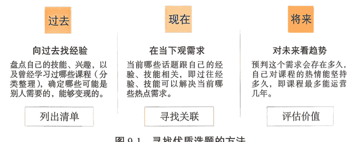

图 9-1 寻找优质选题的方法

(1) **向过去找经验**：盘点自己的技能、兴趣及曾经学习过的课程，进行分类整理，找出那些别人可能需要且能变现的内容。比如，你擅长 PPT 制作，且曾经学习过相关的高级课程，那么就可以考虑围绕 PPT 制作开发课程。可以详细列出自己的技能清单，如数据分析技能、手绘技能、演讲技能等，然后分析每项技能的市场需求和变现潜力。

(2) **在当下观需求**：关注当下的热点话题，寻找与自己经验和技能相关的领域，思考如何用自己的技能解决当前的热点需求。例如，当前 AI 热门，如果你有编程技能，就可以结合 AI 开发相关课程，如“AI 编程入门”课程等。可以通过社交媒体、行业报告、新闻资讯等渠道了解当下的热点需求，如远程办公效率提升、亲子教育焦虑缓解等。

(3) **对未来看趋势**：预判需求的持续时间及自己对课程的热情能坚持多久，评估课程的运营时长和价值。比如，随着健康意识的提升，健康管理类课程在未来可能有较大市场，并且你对这方面有持续的热情和学习计划，就可以考虑开发此类课程；可以研究行业发展趋势报告，如大健康产业发展趋势、在线教育发展趋势等，预判未来 3~5 年的市场需求。

另外，借助 AI 工具也可以高效地发掘课程选题，使用特定的提示词让 AI 帮助我们找到合适的选题。提示词建议如下。

> “我是一名［××］领域的讲师，需要探索可持续运营和变现的课程选题，选题要求能够用视频课交付内容，同时又能够开设训练营提供陪跑赋能；我的经验有［××］，我的优势是［××］，我的目标是［××］，我的劣势有［××］。请结合当前的社会需求和未来 3~5 年的发展趋势, 给出 5 个满足需求的课程选题。”

在使用这段提示词时, 要选中 “深度思考” 和 “联网搜索” 功能, 以便得到更符合需求的选题建议。例如, 一位拥有多年营销经验的讲师, 使用该提示词可能会得到 “数字化营销实战课程” “私域流量运营训练营” 等选题建议。

# 学员定位与选题关系

不同类型的学员对课程的需求和付费意愿不同, 了解学员定位有助于确定更合适的选题。学员主要分为 B 类 (企业学员)、C 类 (普通个人学习者) 和小 B 类 (有经营需求、发展需求和变现需求的个人学习者或个人创业者)。

- **B 类学员**的获客难度较大, 通常需要专业的销售团队和较长的销售周期, 但一旦成交, 较高的单客户价值就会凸显。例如, 企业内训课程的客户主要是 B 类学员, 讲师需要针对企业的特定需求设计课程。
- **C 类学员**付费意愿相对较低且需求满足后可能会脱离社群, 适合价格较低、满足基础需求的课程。比如, 个人技能课程和兴趣爱好课程, 如 “书法入门” “绘画基础” 等。
- **小 B 类学员**学习意愿强、复购能力强, 同时有变现需求, 是 “视频课 + 训练营” 模式比较理想的目标用户。像写作变现营、讲书变现课的学员, 大多属于小 B 类用户, 他们希望通过学习提升能力并实现变现。在确定选题时, 如果能结合变现需求 (如 “直播 + 变现” “写作 + 变现” “AI+ 变现”), 找到小 B 类

## 第九章 产品内容体系：构建知识产品的核心引擎

用户，课程的成交概率会更大。例如，“自媒体变现实战课程”针对小B类用户，满足他们通过自媒体实现变现的需求。

但是，如果选题无法与变现结合，服务C类用户也是可行的，按照课程类型须是技能类课程，技能难度适当，成长可视化、成果作品化的原则设计课程，同样能有机会取得不错的效果。比如，“瑜伽健身课程”针对C类用户，通过设计合理的课程难度和展示学员的健身成果，吸引学员持续学习。

## 结构设计：套系课运营的坚实框架

在确定好选题后，就要着手设计套系课①的结构了。合理的课程结构不仅能提升学员的学习体验，还有助于实现课程的商业目标。

我们现在的思路是基于某个选题设计套系课。不过，课程的内容体系要为运营体系服务，所以，我们要设计一套便于将来开展训练营的套系课，即能够实现“视频课+训练营”模式的课程内容体系。一般来说，适合做训练营的课程采用三段结构较为合适。

## 三段结构详解

### 1. 开篇

开篇通常为一节课，时长为15~20分钟，不宜过长。这部分内容主要包括讲师介绍、初心发心、理论基石和主题引入。

讲师介绍可以让学员了解授课者的背景和专业能力，增加信任感。可以详细介绍讲师的职业经历、专业成就、成功案例等,如“拥有 10 年行业经验, 曾服务过 50 多家企业, 帮助 1000 多名学员实现技能提升”。

初心发心能让学员感受到课程的价值和意义。比如, “我开发这门课程的初衷是希望帮助更多人掌握实用的技能, 实现职业发展和个人成长”。

理论基石是支撑后续课程内容的底层逻辑, 比如, 家庭教育课,可以在开篇介绍脑科学、心理学相关知识。通过展示理论基石, 让学员认识到课程的科学性和专业性。

主题引入要清晰地告知学员后续课程的主要内容, 激发学员的学习兴趣。可以采用问题引入、案例引入等方式, 如 “你是否在亲子沟通中遇到过困难? 这门课程将为你提供有效的解决方案”。

可能很多人还未意识到, 开篇的关键在于彰显课程价值, 降低学员的退课率。所以, 可以通过埋钩子的方式, 在开篇提及后续课程能为学员带来的价值, 让学员对后续内容充满期待。例如, “在后续课程中, 你将学会如何运用这些理论知识解决实际问题, 实现技能的快速提升”。

> ① 套系课是指由多节课构成的系列课程，也叫作“系列课”。

### 2. 主体

主体部分通常由 5~7 节课构成, 有两种常见的设计模式。

- **按步骤分解技能**: 如果课程是技能型课程, 并且技能可以分解为若干个步骤, 那么主体部分可以按照步骤来拆解课程内容。以 “翻书成课” 线上课为例, 在开篇之后, 接着跟上五节课, 分别是选题确定、内容收集、框架设计、课件制作、课程变现，将做课这件事按步骤进行讲解。每个步骤都详细说明操作方法和注意事项，让学员能够循序渐进地掌握技能。

- **按场景应用技能**: 对于一些难以用步骤分解的技能，或者涉及多个场景的课程，可以按场景应用技能来设计主体部分。比如，针对家庭教育课，可以按照亲子沟通场景、夫妻关系场景、隔代养育场景等不同场景来拆分课程内容。在每个场景中，分析问题产生的原因，提供具体的解决方案和案例分析，让学员能够在不同场景中灵活运用所学知识。

主体部分的每小节内容可以按照“回顾上节、详解本节、本节复习、预留作业”的结构来设计。先回顾上一节的内容，帮助学员巩固记忆；然后详细讲解本节的知识点；接着对本节内容进行总结和复习；最后布置作业，让学员将所学知识应用到实践中。例如，在“选题确定”这节课中，回顾上一节开篇的内容后，详细讲解课程选题确定的原则和方法，然后总结课程选题确定的关键要点，最后布置作业让学员尝试列出几个课程选题。

### 3. 收尾

收尾部分通常也是一节课，主要内容包括内容总结、呼吁行动、预埋营销点和提供“加餐”内容。

- **内容总结**：帮助学员梳理整套课程的重点知识，可以采用思维导图、表格等形式，让学员一目了然地回顾这些知识，顺利掌握课程的核心内容。

- **呼吁行动**：引导学员将所学知识运用到实际生活中，比如，“希望大家课后能够积极实践，将所学技能运用到工作和生活中，实现自己的目标”。

- **预埋营销点**：在课程中埋下后续训练营或其他相关课程的营销点，比如，在讲亲子教育课时，可以跟学员说学完课程后，如果想要进一步提升，可以报名参加实操营。预埋营销点不仅可以在最后一节进行，主体部分中如有适当的时机也可以插入营销的钩子。比如，在主体部分讲解某个难点时，可以提到“在后续的训练营中，我们将深入探讨这个问题，提供更多的案例和实践指导”。

- **提供“加餐”内容**：针对学员在学习过程中提出的问题，或者为了满足学员的深入学习需求而设置的额外内容，可以放在课程收尾部分，也可以在主体部分的适当位置加入。比如，“为了帮助大家更好地掌握课程内容，我们为大家准备了‘加餐’内容，包括相关的工具模板、案例库等，大家可以在课程资料中下载”。

## 三段结构的优势

按照三段结构设计出的套系课，除了便于打造“视频课+训练营”的模式，还有哪些优势呢？

### 1. 逻辑清晰，循序渐进

这种结构为学员提供了明确的学习路径，符合学员的认知规律，学员无须额外适应，能够快速进入学习状态。比如，“翻书成课”线上课，按照开篇介绍价值，主体讲解做课步骤，收尾进行总结和营销的结构，让学员清晰地了解课程的整体框架和学习顺序。学员可

## 进阶体系：合理规划课程的进阶体系

除了课程选题和课程结构，规划课程的进阶体系也是产品内容体系的重要组成部分。合理的课程进阶体系，可以满足学员不同阶段的学习需求，提升学员的学习体验和忠诚度。

### 课程进阶体系的构成

常见的课程进阶体系分为基础课、进阶课和高阶课三个阶段。

#### 1. 基础课

基础课的主要目标是帮助学员建立基本的认知框架，掌握基础概念、工具操作和标准流程，解决学员入门的问题。比如，“翻书成课”线上课的基础课，会讲解做课的基本思路、方法、工具和流程，让零基础的学员能够快速上手。基础课的教学内容要通俗易懂，注重基础知识的讲解和基本技能的训练，让学员能够轻松掌握课程内容。

#### 2. 进阶课

进阶课旨在深化学员的专项技能，帮助学员解决复杂问题，提升核心能力。以“翻书成课”线上课为例，进阶课会更深入地讲解课程运营方面的知识，让学员能够独立解决课程运营过程中遇到的问题，取得更好的成果。进阶课的教学内容要具有一定的深度和难度，注重案例分析和实践操作，让学员能够将所学知识应用到实际问题中。

#### 3. 高阶课

高阶课通常是为学员提供深度服务的课程，如私教课或弟子班。它的目标是进一步提升学员的体验，帮助学员建立更高的认知，掌握核心能力，甚至培养合作伙伴。例如，“翻书成课”的高阶课是私教，可以为学员提供一对一的指导，根据学员的具体情况制定个性化的学习方案。高阶课的教学内容要具有前瞻性和创新性，注重学员的个性化需求和职业发展，帮助学员实现更高的目标。

### 规划课程进阶体系的价值

#### 1. 构建系统化知识框架，强化学习连贯性

分层的课程进阶体系为学员提供了明确的学习路径，符合学员的认知和成长规律，能够让学员逐步深入学习，构建完整的知识体系。学员从基础课开始,逐步学习进阶课和高阶课,每个阶段的课程内容都相互衔接,形成一个完整的知识框架,帮助学员更好地理解和掌握知识。

#### 2. 满足学员差异化需求,实现分层教学覆盖

不同学员的基础和学习需求不同,分层课程体系可以满足学员的差异化需求,避免“一刀切”的教学弊端,让不同背景的学员都能找到适合自己的学习路径,提升课程的适配性和学员满意度。例如,基础课适合零基础的学员,进阶课适合有一定基础的学员,高阶课适合有高阶目标的学员,让每个学员都能在课程中找到适合自己的学习内容。

#### 3. 打造可持续学习生态,提升讲师品牌价值

丰富的课程体系可以搭建讲师与学员长期互动的桥梁,提升学员的黏性,甚至锁定学员的终身价值。同时，课程体系越丰富,越能体现讲师的专业性,提升讲师的品牌价值。通过为学员提供不同阶段的课程,讲师可以与学员建立长期的关系,不断满足学员的学习需求,提升学员的忠诚度和课程口碑,从而提升自己的品牌价值。

### 构建课程体系的方法

构建课程体系可以从核心目标、学员画像、知识模块和服务方式四个方面入手。

#### 1. 基础课

- **核心目标**: 建立基本认知,掌握基础概念、原理和操作技能。
- **学员画像**: 主要是零基础新手或基础薄弱者。
- **知识模块**: 包括基础理论模块和基础技能模块。
- **服务方式**: 提供录播视频课程，配合学习社群和答疑。例如，基础课的录播视频可以让学员随时随地学习，学习社群可以让学员交流学习心得，答疑环节可以解决学员的疑问。

#### 2. 进阶课

- **核心目标**: 深化和拓展知识，提升学员解决实际问题的能力。
- **学员画像**: 为有基础、有实践需求的学员。
- **知识模块**: 包含进阶理论模块和实践应用模块。
- **服务方式**: 视频课与直播课相结合，加入实践项目指导。视频课帮助学员学习理论知识，直播课进行案例分析和互动交流，实践项目指导帮助学员将知识应用到实际中。

#### 3. 高阶课

- **核心目标**: 建立更高认知，掌握核心能力，培养合作伙伴。
- **学员画像**: 为有高阶目标的学员和意向合伙人。
- **知识模块**: 包括高阶理论模块和分销裂变模块。
- **服务方式**: 一对一指导和定制化学习方案。根据学员的具体需求和目标，提供个性化的指导和学习方案，帮助学员实现高阶目标。

需要注意的是，不是每门课程都要设计三阶，而是要根据实际运营需求进行规划。在打造课程时，要注重课程品质，力求做到“十倍好”，给学员带来惊喜感，提升学员满意度和转介绍率。例如，通过不断优化课程内容、提升教学服务质量、增加课程附加值等方式，打造高品质的课程，让学员感受到课程的价值。

## · 本章总结 ·

### 打造可持续运营的产品内容体系

产品内容体系是知识产品运营的核心部分，它涵盖了选题策略、结构设计和进阶体系三个关键要素。

- **在选题方面**，要避开伪需求、小需求和不够痛的选题，遵循“真、大、痛”原则，选择能持续更新、有进阶设计、可赋能陪跑的选题，采用“视频课+训练营”的模式，针对小B类用户，结合自身经验、当下需求和未来趋势，巧用AI工具寻找优质选题。
- **在课程结构设计方面**，采用开篇、主体、收尾的三段结构，开篇塑造课程价值，主体按步骤或场景拆解技能，收尾进行内容总结、呼吁行动、预埋营销点和提供“加餐”内容，这种结构逻辑清晰、学习体验佳，兼顾教学与商业目标。
- **在课程进阶体系规划方面**，通过基础课、进阶课和高阶课的分层设计，满足学员不同阶段的学习需求，构建系统化知识框架，提升讲师品牌价值。

知识产品的竞争，本质是内容运营体系的竞争。只有打造出更好的产品内容体系，知识产品才能在激烈的市场竞争中脱颖而出，实现可持续运营和变现。在最后，我附上了一张表格（见表9-1），读者可以填写这张表格来评估自己的选题设计。

### 表 9-1 “课程 + 训练营”模式的选题设计

| **1. 课程基本信息** |
| :--- |
| **选题名称** |
| **目标用户类型** | □B类用户 □小B类用户（变现需求者/创业者） □C类用户 |
| **技能类别** |

| **2. 选题评估（符合请勾选√）** |
| :--- |
| □符合“真”原则（基于真实需求，有专业能力） |
| □符合“大”原则（市场需求大，用户基数充足） |
| □符合“痛”原则（用户痛点明显，付费意愿强） |
| □属于技能类课程（非纯知识传递） |
| □技能难度适当（0~10分，建议7~8分） |

| **3. 课程设计自检** |
| :--- |
| **成长可视化设计** |
| **成果作品化设计** |

| **4. 进阶体系规划** |
| :--- |
| **设计基础课（入门知识）** |
| **设计进阶课（深度技能）** |
| **设计高阶课（私教课程）** |

| **5. 市场需求验证** |
| :--- |
| **初步验证方式** |

| **6. 整体评估** |
| :--- |
| |

下一章，我们将深入探讨学员服务体系，为大家介绍如何在学员购课后提供服务，让学员获得更好的学习体验。

## 第十章
### 学员服务体系：从基础保障到口碑裂变的三阶服务

在上一章，我们围绕产品内容体系展开了详细探讨，从选题的“真、大、痛”原则到套系课的结构设计，再到课程进阶体系的规划，核心都是解决“如何做出好课程”的问题。

然而，在知识产品的运营闭环中，“做好课程”只是起点，“做好服务”才是决定用户留存、复购与口碑传播的关键。学员服务体系的搭建，本质上是通过分层级的服务设计，让学员在学习过程中获得持续的价值感，最终实现品质口碑与经济效益的双重提升。

在学员完成课程购买后，讲师的工作才刚刚开始。

回想一下，你是否见到过这样的场景：学员购买课程后找不到学习入口，群里提问无人回复，或者课程结束后便再无音讯？这些零散的服务痛点，本质上源于讲师对学员服务缺乏系统化的设计。

事实上，学员服务可以归纳为三个清晰的层级：标准服务、主动服务、感动服务（见图 10-1）。

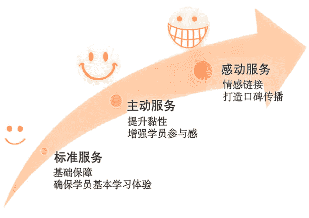

这三个层级并非简单的流程叠加，而是从基础保障到情感链接的递进关系，每一层都对应着不同的运营目标——标准服务解决“能不能学”的问题，主动服务解决“愿不愿学”的问题，感动服务解决“想不想推荐”的问题。

## 标准服务：筑牢学习体验的“地基”

### 建立联结：让学员从陌生人到可触达

学员购课后的第一要务，是建立稳定的沟通渠道。试想，如果学员连讲师或助教的联系方式都没有，后续服务便无从谈起。这里有三个核心动作，每个动作都蕴含着对学员需求的深度洞察与细致考量。

#### 1. 多渠道引导加微

不同的学员有着不同的使用习惯，为了确保覆盖到每一位学员，我们采用多种渠道引导加微（见图 10-2）。

- **短信**具有即时性强的特点，能在学员购课后第一时间传递信息。
- **课程内弹窗**在学员登录课程时强制提醒，确保其不会错过。
- **主动搜索手机号**则针对那些未能及时主动加微的学员，展现我们积极主动的服务态度。

以“翻书成课”线上课为例，学员付款成功后，会收到包含课程链接的短信，点击链接即可跳转至加微页面，这一设计充分利用了学员付款后的即时关注心理；首次登录课程时，弹窗会强制提醒“扫码进学员群”，借助学员对课程的初始好奇引导他进入社群；对于24小时未主动加微的学员，讲师会通过后台获取手机号主动添加，体现了我们不放弃任何一位学员的服务理念。数据显示，前两种方

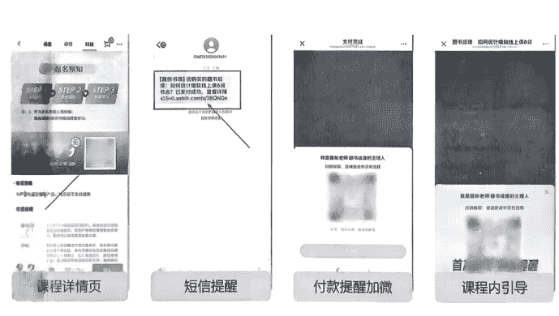

式可覆盖 99% 的学员，剩余 1% 通过主动添加也能实现联结，这一系列举措确保了与学员建立联结的全面性。

#### 2. 设计加微“钩子”

单纯的“加我微信”很难打动学员，必须提供明确的价值点，让学员清楚加微能为他带来实际利益。在加微话术中，明确“邀请您进学员交流群”“领取做课工具包”等信息，使学员一目了然。例如，当学员知道加微后可以进入一个汇聚同学的交流群，获取实用的做课工具包，学员加微的积极性就会大幅提升。这种有价值的引导，让加微行为从单纯的联系方式获取转变为学员主动获取资源的途径。

#### 3. 工具赋能

使用企业微信进行精细化管理，相比个人微信更具有显著优势。

- **企业微信的活码自动通过好友申请功能**，可提高加微效率，避免学员因等待通过而产生不耐烦情绪。
- **标签分组功能**能够根据学员的不同状态（如已购课学员、潜在学员）进行精准分类，便于后续有针对性地推送信息。
- **自动发送欢迎语功能**则能在学员加微后第一时间传达欢迎与引导信息，提升学员的体验感。

例如，通过活码可将学员自动分配到不同社群，根据标签精准推送信息，避免过度打扰，让学员在合适的时间接收到与自己相关的内容，提高信息的有效性和学员的满意度。

## 课程交付：让学习路径从“模糊”到“清晰”

学员对课程的第一印象，始于交付环节。这个环节要解决三个问题，每个问题的解决都旨在为学员提供清晰、明确的学习指引。

### 1. 开通通知：一次性说清学习路径

为了确保学员不会错过课程开通信息，我们会通过短信、微信、站内信“三管齐下”，发送课程开通通知。通知内容要详细，包括课程入口链接、学习平台操作指南（如小鹅通 App 下载方式）、课程有效期（如“3 年无限次回看”）等关键信息。多种渠道的发送方式，考虑到了学员可能使用不同的通信工具，确保信息能够准确传达。例如，对于习惯使用短信的学员，短信通知能及时提醒；对于经常使用微信的学员，微信通知则更便捷，这种全方位的通知方式，让学员无论通过何种方式都能获取到课程开通信息，清晰了解学习路径。

### 2. 资料发放：结构化呈现配套资源

将课程资料（如 PPT 模板、工具包、推荐书单）上传至百度网盘或课程平台的“资料区”，并在欢迎语中详细说明领取步骤。结构化的呈现方式，便于学员查找和使用相关资料。例如，在欢迎语中明确说明“登录课程后，点击底部‘资料’按钮，即可下载课程资料包”，让学员能够快速、准确地找到所需资料。同时，对资料进行分类整理，如将 PPT 模板按照不同的课程主题分类，工具包按照功能划分，推荐书单按照难度和类型排序，进一步提升资料的易用性，让学员能够根据自己的需求轻松获取相关资源。

### 3. 引导裂变：从第一单开始植入分享意识

在交付环节同步告知学员裂变规则，这是因为，学员在刚购买课程后，对课程的兴趣和关注度较高，此时引导裂变其更容易接受。比如，“推荐 3 位朋友购买，可免费解锁进阶课” “生成专属海报分享，每单获得 ××% 佣金”，这些明确的奖励机制能够激发学员的分享意愿。我的运营经验是在交付环节明确引导裂变的学员，其分享率比未引导的学员高 30% 左右，这充分说明学员分享是需要被 “带动”的，在合适的时机给予引导，能够有效提升裂变效果。

## 学习跟进：让进度从 “被动” 到 “主动”

很多课程学员完课率低，往往是因为缺乏持续的学习督促。这里需要做好三件事，通过系统化的跟进措施，激发学员的学习积极性。

### 1. 数据驱动的进度提醒

每周通过课程后台查看学员学习数据，对学习进度较慢的学员发送学习提醒。数据能够客观地反映学员的学习情况，通过分析学员的学习时长、课程观看进度等数据，我们可以精准地识别出需要提醒的学员。例如，对于连续一周未登录课程的学员，发送一条个性化的提醒信息，如 “您好，发现您最近一周未学习课程，课程内容对您当前的学习目标非常重要，建议您尽快登录学习，如有任何问题，可以随时联系我们”。这种基于数据的提醒方式，避免了盲目提醒，让提醒更具针对性和有效性。

### 2. 社群高频触达

在学员群中，每周一发布 “本周学习重点”，帮助学员明确本周## 第十章 学员服务体系：从基础保障到口碑裂变的三阶服务

  的学习方向，让学员能够有计划地进行学习；周五总结展示“本周学习打卡榜”，用排行榜机制激发学员的胜负欲。排行榜可以设置不同的维度，如学习时长、课程完成率、作业提交情况等，对表现优秀的学员进行表彰和奖励，如授予“本周学习之星”称号，赠送小礼品等。这种竞争氛围能够激发学员的学习动力，促使他们积极参与学习，提高学习效率。

## 3. 高效答疑

  将常见问题整理成“FAQ手册”，即“常见问题答疑手册”在群公告置顶，覆盖80%的重复性问题，如“如何下载课程资料包？”“训练营报名链接在哪里？”等。对于个性化问题，采用“先引导自查，再针对性解答”的方式，如“这个问题在手册第3章有详细说明，你可以先看一下，有不懂的地方再问我”。这种先引导学员自主查找答案的方式，不仅能够提高答疑效率，还能培养学员的自主学习能力。同时，对于学员的个性化问题，解答时要做到详细、耐心，确保学员能够理解和解决问题，提升学员的满意度。

  以上这些服务内容叫作标准服务，是“规定动作”，讲师必须100%做到位。

## 主动服务：激活社群价值，让学员从旁观到参与

  如果说标准服务是“规定动作”，那么主动服务就是“加分项”。它的核心是通过社群运营，让学员从“独自学习”变成“群体成长”，从而提升黏性。

## 社群基础设置：打造有序的“学习栖息地”

### 1. 群名称

  统一群名称，降低认知成本。采用“课程名称+群编号+功能说明”的结构，如“翻书成课⑤群|建议设置免打扰”。末尾的“建议设置免打扰”很重要，既提示学员群的定位（非实时沟通群），又避免消息轰炸导致的退群。不同类型的课程，群名称的设计也可以有所调整。例如，对于实时互动性较强的课程，群名称可以去掉“建议设置免打扰”，并增加“实时交流”等字眼，让学员清楚群的性质和功能，便于学员根据自己的需求选择是否关注群消息。

### 2. 群公告

  社群的“说明书”。群公告要包含三个核心内容：社群定位（如“本群为翻书成课付费学员交流群，聚焦课程交流与答疑，也可以分享做课成果”）、群规则（如“禁止发广告，违规2次移除”）、常用链接（如课程入口、资料下载地址、客服联系方式）。建议用简洁的排版，例如，分点说明，重点信息强调，方便学员快速了解相关信息。在撰写群公告时，语言要简洁明了，避免使用过于专业或生僻的词语，确保学员能够轻松理解。同时，当社群规则或常用链接发生变化时，要及时通知学员，保持群公告的时效性和准确性。

### 3. 欢迎语

  给新学员的“第一印象”。企业微信群的自动欢迎语要兼具温度与引导性，例如，“翻书成课”的欢迎语：“欢迎××同学加入翻书成课！这里是你的做课加油站，这是课程链接：××。建议先看群公告了解社群规则，你可以按照 ×× 格式做一个自我介绍，让大家认识你！”既表达欢迎，又引导学员完成“看公告”“学习课程”“自我介绍”等关键动作。欢迎语的设计要根据课程的特点和学员的需求进行调整。对于新手学员较多的课程，欢迎语可以更加详细地介绍课程的基本情况和学习流程，让新手学员能够更快地适应社群环境；对于有一定经验的学员，欢迎语可以更加简洁，突出社群的核心价值和互动方式，吸引学员积极参与。

## 明确社群定位：让学员知道“为什么留在这里”

  社群最忌讳的是“定位模糊”，学员进群后不知道能获得什么，最终变成“死群”。明确社群定位需要回答三个问题，通过清晰的定位，吸引目标学员并保持社群的活跃度。

### 1. 社群能解决什么问题

  聚焦学习支持、资源共享、人脉链接三大核心价值。例如，“翻书成课”的社群定位是：“帮助学员解决做课过程中的选题确定、框架设计、课件制作等问题，提供行业资源对接，搭建知识课程设计者交流平台。”在确定社群能解决的问题时，要紧密围绕课程内容和学员的学习目标，深入了解学员在学习过程中可能遇到的困难和需求，确保社群提供的价值具有针对性和实用性。例如，如果课程是关于职场技能提升的，社群可以定位为帮助学员解决职场中的实际问题。提供职场人脉链接和资源共享，助力学员的职业发展。

### 2. 社群的风格是什么

  社群风格要与课程调性一致。如果是实战型课程，风格可以更接地气，如“轻松赚钱，拒绝焦虑”；如果是高端私教课，风格则偏向专业严谨。“翻书成课”的社群风格是“轻松、友善、有启发”，鼓励学员在轻松愉快的氛围中交流，避免生硬的说教。社群风格的塑造可以通过社群的语言表达、活动形式、互动方式等方面来体现。例如，实战型课程的社群可以使用更口语化的语言，组织一些轻松有趣的互动活动，如学习打卡抽奖、趣味问答等；高端私教课的社群则可以采用更正式的语言，组织专业的研讨会、案例分析等活动，展现专业严谨的风格。

### 3. 社群的规则是什么

  清晰的规则能减少管理成本，如“进群先看群公告”“发广告链接直接移除”等。规则要提前告知，并且一视同仁。比如，“翻书成课”社群曾移除过多次发广告的学员，反而赢得其他学员的认可。在制定社群规则时，要充分考虑学员的感受和需求，规则要合理、公平、透明，避免过于苛刻或宽松。同时，要加强对社群规则的宣传和执行，确保学员了解规则并遵守规则，维护社群的良好秩序。

## 构建互动机制：让社群从“静悄悄”到“有活力”

  社群活跃度的关键，是设计“低门槛参与”的互动形式，让学员愿意“露脸”。通过多样化的互动机制，激发学员的参与热情，营造积极向上的社群氛围。

### 1. 日常互动：每天 1 分钟激活社群

- **晨间快讯**：每天早上 8 点，分享一条行业资讯和一个知识卡片（如“今日做课小技巧：课程开篇要讲清楚‘你能帮学员解决什么问题’”），用固定时间培养学员的查看习惯。晨间快讯的内容要具有时效性和实用性，行业资讯可以选取与课程相关的最新动态，知识卡片要聚焦课程的核心知识点和实用技巧。通过长期坚持发送晨间快讯，让学员养成每天查看社群的习惯，提高社群的曝光度和学员的参与度。

- **每周一问**：每周抛出一个开放性问题，如“你在做课过程中遇到的最大卡点是什么？”，引导学员在评论区接龙，讲师挑选出 3~5 个典型问题予以详细解答。开放性问题能够激发学员的思考和表达欲望，让学员有机会分享自己的经验和困惑。讲师对典型问题的详细解答，不仅能够解决学员的实际问题，还能让其他学员从中受益，提高社群的知识价值。

- **问题收集箱**：在群公告设置“问题收集箱”链接，学员随时提交问题，讲师每周五汇总成“本周高频问题解答”将其发至群里，既解决共性问题，又让学员看到自己的问题被重视。问题收集箱的设置，为学员提供了一个便捷的问题反馈渠道，让学员感受到自己的意见和需求被关注。每周五的高频问题解答，能够及时解决学员的常见问题，避免问题的积累和重复提问，提高社群的运营效率。

### 2. 深度互动：用“榜样力量”带动成长

- **优秀学员分享会**：每月邀请 1~2 位做课和变现成果突出的学员（如通过课程学会做课，月销 100 单的学员）进行 60 分钟的访谈式分享。分享前提前收集学员问题，让分享更有针对性；分享后引导学员添加分享者微信，形成资源链接。“翻书成课”的一位学员，在分享会后新增 300 多名好友，后续转化了 10 多个私教客户。优秀学员分享会的前期准备工作非常重要，要与分享学员充分沟通，确定分享主题和内容，提前收集学员问题，确保分享的针对性和实用性。在分享过程中，要营造轻松愉快的氛围，鼓励学员积极提问和互动。分享后，要引导学员与分享者建立联系，促进资源的整合和利用。

- **线下活动联动**：有条件的团队可以组织线下沙龙，让学员面对面交流学习心得，甚至现场分享自己的实战经验，线下活动能极大增强学员的归属感。组织线下活动时，要提前确定活动主题和流程，选择合适的场地和时间，做好活动的宣传和报名工作；在活动过程中，要注重学员的体验，提供良好的交流环境和服务，确保活动的顺利进行；在活动结束后，要及时收集学员的反馈意见，总结经验教训，为后续活动的开展提供参考。

- **成果展示让进步可视化**：鼓励学员在社群中分享自己的学习成果和践行成果，这种“高光时刻”的分享，能让其他学员看到学习的成果，增强信心。可以设置专门的成果展示板块，如“学习成果墙”“践行之星”等，对学员的优秀成果进行展示和表彰。同时，对分享成果的学员给予一定的奖励，激励更多学员参与分享，形成良好的社群氛围。比如，我特别喜欢的一位老师彭小六老师，他的课程“读书会创始人”旨在教授学员如何组织读书会，他每周会在社群中组织学员分享自己的读书会案例，这是一种非常好的成果展示方式。

  让社群氛围一直特别火热，其实是很难也是没有必要的。我的建议是，社群只要起到其关键作用，即使大部分时间都静悄悄也是可以的。所以，我运营社群的原则是“提供必要的支持，但又不过度打扰”，宁愿静悄悄，也莫乱糟糟。

## 感动服务：创造超出预期的“惊喜时刻”

  感动服务的核心，是“超出学员预期”。怎样能够让学员感受到“惊喜”呢？我们可以通过在课程品质、情感链接和时常“加餐”等方面的用心设计，为学员带来超出预期的体验。

## 课程品质：最大的感动是“十倍好”的交付

  所有服务的前提，是课程本身足够好。这里的“十倍好”不是指内容量增加十倍，而是指“价值感”超出预期。通过对课程细节的精心打磨、丰富案例的引入和课程内容的不断更新迭代，提升课程的价值感。如何能够做到“十倍好”呢？

### 1. 细节打磨：让知识“可落地”

  每个核心知识都配上工具包，确保学员能直接应用。工具包的设计要紧密围绕课程知识点，具有实用性和可操作性。例如，在讲解课程框架设计的知识点时，配套提供课程框架设计模板，学员可以直接根据模板进行课程框架的搭建，降低学习难度，提高学习效率。同时，提供工具包的详细使用说明，让学员能够轻松理解和使用。

### 2. 案例丰富：用“身边事”讲“大道理”

  每个知识点都辅以真实案例，让学员感同身受。案例的选择要贴近学员的实际生活和工作场景，具有代表性和启发性。例如，在讲解课程选题确定的知识点时，引入学员身边常见的选题确定案例，分析其成功与失败的原因，让学员能够更好地理解选题确定的原则和方法。通过真实案例的讲解，让抽象的知识变得更加具体和生动，提高学员的学习兴趣，促进学员更好地理解课程内容。

### 3. 更新迭代：让课程“会成长”

  定期根据学员反馈更新课程内容，如每季度新增 1~2 节热点专题课。学员的反馈是课程更新迭代的重要依据，通过收集学员在学习过程中遇到的问题提出的建议，了解学员的需求和期望，及时对课程内容进行调整和优化。热点专题课的引入，能够让课程紧跟行业发展趋势和市场需求，保持课程的时效性和竞争力，为学员提供更有价值的学习内容。

## 情感链接：用“看见”和“鼓励”建立信任

  讲师与学员的关系，本质上是“师徒关系”，而师徒关系的核心是“情感共鸣”。讲师可以通过个性化反馈、阶段性鼓励和弱势暴露等方式，建立与学员之间的情感联结，增强学员的信任和归属感。

### 1. 个性化反馈：让学员知道“你被看见”

  对于学员的作业、提问，尽量给出具体的评价，而非笼统的“不错”“加油”。例如，学员提交作业后，讲师可以就学员提交的内容进行具体的反馈，表扬他，并且说出为什么。例如，“你的作业中关于课程选题确定的分析非常深入，能够结合实际案例阐述选题确定的原则，这说明你对课程内容的理解很到位。不过，在选题的可行性方面可以进一步思考，是否有足够的资源和能力去实现这个选题。”这种细节化的反馈，能让学员感受到讲师的用心，知道自己的努力和成果被关注和认可，从而增强学习的动力和信心。这种鼓励的方式在《可复制的领导力》中被称为“二级反馈”，不只表扬，还要说明为什么。

### 2. 阶段性鼓励：让成长“有仪式感”

  在学员完成关键节点时（如学完基础课、提交第一份作业、首次尝试变现），发送专属鼓励信息。例如，“恭喜你完成基础课的学习！从你的笔记中能看出你对课程的理解很深入，接下来的训练营会是你实战的好机会，期待你做出自己的成果！”阶段性鼓励能够让学员感受到自己的成长和进步，增强学习的成就感和仪式感。鼓励信息要具有针对性，结合学员的具体表现和下一步的学习目标，给予积极的肯定和期望，激发学员继续前进的动力。

### 3. 弱势暴露：用“真实”拉近距离

  讲师不必一直“正确”，适当分享自己的失败经历，反而能增强亲和力。例如，你可以在社群中说：“其实我第一次做课时也踩过‘选题太宽泛’的坑，后来通过学员调研才找到精准定位，大家遇到问题很正常，我们一起解决。”讲师的真实分享能够让学员感受到讲师人性化的一面，减少距离感，增强信任感。同时，也能让学员明白失败是学习过程中的正常现象，不必过于焦虑和自责，从而更加从容地面对学习中的困难和挑战。

## 时常“加餐”：用“额外价值”打造口碑裂变

  “加餐”是感动服务的“核武器”，因为它代表着“超出付费范围的额外付出”。通过需求驱动、结合热点和轻量高效的方式，设计有价值的“加餐”内容，可以提升学员满意度和口碑裂变效果。如何找到符合学员需求的“加餐”主题呢？

### 1. 需求驱动，从学员痛点中找“加餐”主题

  通过社群提问、训练营、一对一咨询，收集学员遇到的高频问题，有针对性地设计“加餐”。例如，我在运营“翻书成课”线上课时，发现很多学员卡在“课程包装”环节，不知道如何写课程详情页文案，于是我推出了“如何做好课程包装？”的“加餐课”。需求驱动的“加餐”主题能够精准解决学员的实际问题，提高“加餐”的实用性和针对性。在收集学员需求时，要采用多种方式，如观察、私聊等，确保全面了解学员的痛点和需求，为“加餐”主题的选择提供充分的依据。

### 2. 结合热点，借势提升课程时效性

  可以关注行业热点，将其与自己的课程主题结合。比如，“618电商大促”期间，设计“大促期间如何××”的“加餐”内容；“AI风口”出现时，推出“如何用AI工具高效××”的实操课。结合热点的“加餐”能够让课程紧跟时代步伐，提升课程的时效性和吸引力。在选择热点时，要注意与课程主题的相关性、确保“加餐”内容与课程内容有机结合，避免为了追热点而追热点，导致“加餐”内容与课程主题脱节。

### 3. 轻量高效，用“小而美”降低成本

  “加餐”不必追求大而全，15~30 分钟的视频、直播切片、PDF 干货包，反而更易执行。例如，可以推出“加餐小课堂”，每次聚焦一个小技巧，让学员在碎片时间就能学到实用干货。轻量高效的“加餐”形式能够降低制作成本和学员的学习成本，提高“加餐”的可操作性和学员的参与度。在设计“加餐”内容时，要注重内容的精华提炼，确保每个“加餐”内容都能传递有价值的信息，让学员在短时间内有所收获。

## 终极目标：品效合一，让服务成为增长引擎

  我们介绍了标准服务、主动服务、感动服务，本质上都是为了实现一个目标——品效合一。这里的“品”，是学员对课程和服务的满意度，是口碑的基础；“效”，是通过服务带来的经济效益，包括复购、转介绍、衍生产品销售等。

## 品：让学员成为“自来水”

  当学员在标准服务中获得顺畅的学习体验，在主动服务中感受到社群的价值，在感动服务中收获超出预期的惊喜时，自然会产生推荐欲。这些“自来水”的推荐转化率，比广告投放高 3 倍以上。

  品质口碑的建立需要我们在服务的每个环节都精益求精，关注学员的需求和体验，为学员提供优质的课程和服务。通过学员的口口相传，形成良好的品牌形象和口碑效应，吸引更多的潜在学员，实现品牌的可持续发展。

## 效：让服务环节成为“利润增长点”

  服务过程中的每个触点，都可以在合适的时机设计转化路径（切忌让学员不舒服）。通过在标准服务、主动服务和感动服务中巧妙地植入转化环节，实现经济效益的提升。

### 1. 标准服务中的转化

  在课程开通通知中，预埋训练营报名链接，如告知学员“学完基础课可9折解锁实战训练营”；在学习提醒中，推荐进阶课，如“本周学习进度达标，可领取‘××高阶课程’优惠券”。标准服务中的转化要自然、合理，避免给学员带来突兀感。转化信息要与学员的学习进度和需求相匹配，让学员感受到转化是为了更好地满足他们的学习需求，而不是单纯的推销。

### 2. 主动服务中的转化

  在优秀学员分享会结尾，设置“训练营限时优惠”环节；在社群互动中，通过“老带新”奖励机制（如“每推荐1人，双方各得××元课程券”），引导学员裂变。主动服务中的转化要结合社群的互动氛围和学员的参与度，在学员对课程和社群有一定认可和信任的基础上进行。转化方式要具有吸引力，能够激发学员的参与热情和推荐意愿，同时要确保转化过程的公平性和透明度。

### 3. 感动服务中的转化

  在“加餐课”结尾，推出相关的产品，如“陪跑训练营”“××私教服务”等。感动服务中的转化要建立在学员对课程和服务高度认可的基础上，通过“加餐课”为学员提供额外的价值，让学员感受到我们的服务超出了他们的预期，从而增加对高价产品的接受度。转化过程中要注重与学员的沟通和交流，了解学员的需求和意愿，提供个性化的解决方案，提高转化的成功率。

  我们应把握住服务环节中的成交机会，将每一次互动转化为潜在收益。精心设计的转化路径，不仅能提升学员的满意度，还能实现经济效益的稳步增长，让服务真正成为推动业务发展的强大引擎。不过，要注意把握尺度，不宜过度推销，要始终将学员的体验和需求放在首位。

## · 本章总结 ·

## 服务不是额外负担，而是利润增长点

  很多讲师认为，学员服务是课后附加动作，其实不然。在知识产品的运营中，服务本身就是产品的一部分，甚至是决定产品差异化的关键。就像海底捞的服务体验成为品牌核心竞争力，好的学员服务也能让你的课程在红海市场中脱颖而出。

  回顾三个服务层级：标准服务是“规定动作”，必须100%做到位；主动服务是加分项，需要持续优化；感动服务是闪光点，可遇但也可求——只要用心洞察学员的需求，总能找到让他们惊喜的点。

  而这一切的核心，是树立“以学员为中心”的运营思维：不是想着“我能从学员身上赚多少钱”，而是“我能帮学员创造多少价值”。当学员真正在你的课程中获得成长时，品效合一自然会水到渠成。

  在本章结尾，我附上了学员服务体系设计表（见表 10-1），你可以在回顾本章知识点的同时，设计自己的服务方案。

表 10-1 学员服务体系设计表

| 服务层级 | 关键动作与设计要点 | 具体方案 |
| :--- | :--- | :--- |
| **标准服务** | 1. 建立联结 -多渠道引导加微（短信、弹窗、主动添加） -设计加微“钩子”（示例：“进群领工具包”） -企业微信工具赋能（活码、标签、欢迎语） | |
| | 2. 课程交付 -开通通知（短信、微信、站内信） -资料发放（网盘、资料区分类） -引导裂变（示例：“推荐 3 人得进阶课”） | |
| | 3. 学习跟进 -数据驱动的进度提醒（未学习学员定向推送） -社群高频触达（周计划、打卡榜） -高效答疑（FAQ 手册和个性化解答） | |
| | 目标：确保 100% 学员可顺畅完成课程学习 | |
| **主动服务** | 1. 社群基础设置 -群名称（示例：“课程名 + 编号 + 免打扰提示”） -群公告（定位、规则、常用链接） -欢迎语（引导动作和课程入口） | |
| | 2. 明确社群定位 -社群解决的问题（如学习支持、资源共享、人脉链接） -社群的风格（社群风格与课程调性一致） -社群的规则（清晰的规则能减少管理成本） | |

## 第十章 学员服务体系：从基础保障到口碑裂变的三阶服务

(续表)

| 服务层级 | 关键动作与设计要点 | 具体方案 |
| :--- | :--- | :--- |
| **主动服务** | 3. 社群互动机制设计 - 日常互动 (晨间快讯 / 每周一问) - 深度互动 (学员分享会 / 线下活动) - 成果展示 (学习墙 / 践行之星) 目标: 提升学员参与度与社群活跃度 | |
| **感动服务** | 1. 课程品质 - 细节打磨 (示例: “框架设计模板”) - 案例丰富 (真实学员故事) - 更新迭代 (季度更新热点专题)  2. 情感链接 - 个性化反馈 (二级反馈法) - 阶段性鼓励 (示例: “学完基础课发专属贺信”) - 弱势暴露 (分享失败经历)  3. “加餐” 策略 - 需求驱动 (社群痛点调研) - 结合热点 (示例: “618 大促专题”) - 轻量高效 (15 分钟短视频和 PDF) 目标: 创造惊喜时刻驱动自发传播 | |

下一章，我们将聚焦学员成长体系，探讨如何设计赋能学员成长的训练营体系。

## 第十一章 学员成长体系：让老学员持续成长

在上一章中，我们探讨了学员服务体系的核心逻辑——通过标准服务、主动服务与感动服务，为学员提供基础体验保障、增强参与感并建立情感链接，最终实现“品效合一”的运营目标。如果说服务体系是课程运营的“基础设施”，那么学员成长体系则是驱动课程持续进化的“引擎”。毕竟，服务只是起点，真正的目标是让学员在学习实现蜕变，成为课程的“代言人”。

为什么有的课程能持续吸引新学员，甚至形成口碑传播；而有的课程却昙花一现，最终被遗忘？答案藏在一个朴素的逻辑中：一门课程能够持续吸引新学员的前提，是老学员在不断成长！

试想，若老学员学完课程后毫无改变，那么课程的价值既无法验证，也难以形成口碑传播。反之，当老学员通过课程实现能力提升并主动分享成果时，会形成“学有所成-分享传播-吸引新人”的良性循环。

本章将围绕“学员成长”这一核心，拆解常规运营中的关键动作、陪跑赋能训练营的构建逻辑，以及私教服务如何加速学员蜕变。无论你是课程设计者还是运营者，都能从中找到推动学员成长的实战方法。

## 常规运营：用三个关键动作激活学员成长

在课程交付后，学员往往面临“从知识到行动”的转化鸿沟。常规运营的核心，就是通过一系列有节奏的动作，帮助学员跨越这道鸿沟。让成长从“可能性”变为“确定性”。心理学研究表明，人类行为的改变需要持续的外部刺激与内在动机的结合，而常规运营正是通过系统化的设计，将这两者有机结合。

### 提升完课率：成长的前提保障

完课率是衡量课程有效性的基础指标。数据显示，纯视频课的平均完课率通常低于20%，我的经验是，加入运营动作的课程完课率可提升至40%以上。

如何提升完课率？有三个实用策略。

1. 每周常规提醒：用固定节奏唤醒学习动力

容易遗忘是人的天性，尤其是面对线上课程时，拖延往往成为常态。在社群中以周为单位进行学习提醒，能有效帮助学员建立学习节奏。例如，每周一的早晨在社群发布本周学习重点和课程链接，并提醒全体学员。这种规律性的触达，既不会对学员造成干扰，又能持续激活学员的学习意识。从行为心理学角度看，固定频率的提醒有助于形成“触发-行动”的条件反射，降低学员的决策成本。

2. 寻找学习搭子：让同伴成为成长助推器

“一个人走得快，一群人走得远。”在社群中发起学习搭子招募活动，鼓励学员根据地域、兴趣等进行组队。例如，在家庭教育课中，可让同城市的家长组成学习搭子，定期交流育儿实践。学习搭子间的相互督促与分享，能显著提升学习积极性。社会认同理论指出，同伴的行为会对个体产生潜移默化的影响，当学员看到他人在积极学习时，自身的行动意愿也会增强。

3. 设定完课奖励：用激励撬动行动

物质与精神的双重奖励，是撬动学员行动的有效杠杆。例如，设置“30 天完课礼包”——学员在购课后 30 天内完成全部课程学习，即可获得专属资料包（如课程思维导图、工具模板）或“加餐课”资格。这种即时反馈机制，能让学员感受到行动的价值。我之前做过的亲子沟通力课程，设置了完课奖励，将完课率从 25% 提升至 68%，这个经验是非常有价值的。值得注意的是，奖励设计应遵循“稀缺性”原则，如限定数量的实体勋章、导师签名书等，能进一步提升奖励的吸引力。

### 关注学习状况：用“加餐”服务破解成长瓶颈

学员在学习中遇到的难点，往往是其成长的关键突破口。讲师通过社群互动、作业反馈等渠道洞察需求，及时提供“加餐”服务，既能解决具体问题，又能提升学员满意度。美国成人教育专家马尔科姆·诺尔斯曾指出，成人学习具有很强的目的性，解决实际问题的内容更能激发其学习动机。

我在上一章中提到过“加餐”服务，那么如何找到并设计“加餐”内容呢？

1. 需求洞察：多维度捕捉学员需求

社群聊天、作业打卡、一对一咨询，都是捕捉学员需求的“雷达”。例如，在《陪孩子终身成长》的磨课会中，我发现许多讲师对家庭教育线上课的授课技巧存在困惑，于是我开发了“如何讲好一堂家庭教育课？”的“加餐课”，帮助学员解决这个问题。此外，还可以通过定期的匿名问卷调查、设置“问题收集箱”等方式，系统性地收集学员反馈，避免遗漏潜在需求。

2. 内容设计：经验萃取与科技赋能结合

“加餐”内容不必追求大而全，聚焦具体问题即可。萃取个人经验时，可采用“问题-方案-案例”的结构化框架，确保内容的实用性。同时，结合 AI 工具（如豆包、DeepSeek）进行资料整理、大纲生成，能大幅提升内容开发效率。

3. 价值延伸：从服务到复购的自然过渡

“加餐”不仅是服务，更是复购入口。“加餐课”可作为训练营或高阶服务的“体验课”，比如，在“加餐”中设置“训练营专属优惠券”，引导有深度需求的学员进一步参与训练营。通过这种方式，不仅能巩固学员的学习成果，还能为后续课程引流，形成良性循环。实践证明，“加餐”服务的精细化运营，能有效提升学员的黏性和忠诚度，进而带动整体课程的口碑和销量。

会“加餐”的讲师，更受学员喜爱。有学员给我反馈过，每次收到“加餐课”的学习通知，就会有“老师还记得我”的感觉，学习的动力也就增加了。

### 鼓励输出：让成长可视化、成果作品化

“输出是最好的学习”，鼓励学员以多种形式输出学习收获，既能强化其自身成长，又能为课程积累裂变素材。认知科学中的“费曼技巧”强调，通过向他人传授知识，能加深自己对内容的理解，而输出正是这种传授的具体体现。

1. 文字类输出：深度思考的载体

鼓励学员在朋友圈、公众号等平台分享学习心得。文字的整理，是学员对知识内化与升华的过程，也是他们成长的有力见证。可以定期发起“成长周记”活动，设定主题（如“本周最触动我的一个知识点”），引导学员进行深度思考，并给予优秀作品公开表彰，如在社群置顶展示、赠送小礼品等。

2. 图片类输出：视觉化的知识传播

引导学员制作知识卡片、思维导图等视觉化成果。这些精美的图片，不仅加深了学员对知识的理解，更能在社群和社交网络中引发关注与传播。例如，用“DeepSeek+ 创客贴”的工具组合，可以批量制作知识卡片，降低制作门槛，也可以举办“最美知识卡片”评选活动，激发学员的创作热情。数据显示，带有视觉化内容的社交动态，传播量比纯文字内容高 40% 以上。

3. 视频类输出：立体化的成果展示

支持学员录制讲解视频，参与直播分享。视频的呈现，让学员的学习成果更具感染力和说服力。可以开设“学员直播间”，每周邀请 1~2 名学员分享学习成果，讲师进行点评指导，形成“学员展示 - 讲师赋能 - 社群互动”的三角模型。这种形式不仅能提升学员的表达能力，还能增强社群的活跃度和凝聚力。

## 陪跑赋能：构建“视频课 + 训练营”的成长加速器

如果说常规运营是“细雨润无声”的陪伴，那么陪跑赋能训练营则是“结构化驱动”的成长引擎。它通过任务拆解、实战指导与成果展示，帮助学员在短时间内实现能力跃迁。现代管理学中的 OKR（目标与关键成果法）理念与训练营模式高度契合，通过设定明确目标、拆解关键任务，确保学员学习动作的方向性和有效性。

### 训练营的底层逻辑：从“知识堆积”到“行为改变”

传统视频课（多指录播课）擅长传递信息，却难以保障行动落地。训练营的价值在于将知识转化为“可执行的任务链”，通过社群监督与即时反馈，推动学员“边学边做”。例如，“翻书成课”的磨课会，通过三周时间，带领学员完成“阅读 - 做课 - 授课”全流程，学员不仅能阅读完一本书、产出完整的课程，还能实现知识变现。这种“做中学”的模式，符合戴尔的“经验之塔”理论，强调主动实践的学习效果远优于被动听讲。

### 训练营设计三阶段：营前筹备、营中执行、营后沉淀

以“翻书成课”的磨课会为例，拆解社群训练营的实操流程，每个阶段都蕴含着精细化运营的细节。

## 翻书成课：AI 时代打造爆款课程的实战手册

### 1. 营前筹备：选对主题，搭好框架

**主题选择：**遵循“易读、实用、变现强”的原则，优先选择家庭教育、个人成长、职场技能等刚需领域。例如，磨课会曾选用《P.E.T. 父母效能训练》《掌控习惯》《DeepSeek 极速上手》等图书，均取得较高的参与度。在确定主题时，可通过帆书 App、豆瓣网、微信读书、得到 App 等工具分析图书的价值和实用性，结合学员的成长需求，确保所选图书适合组织磨课会。

**工具准备：**用小鹅通等平台生成报名链接，用鹅打卡设置打卡任务，用飞书管理文档（如学员信息表、助教手册）。标准化工具链能让运营效率提升 30% 以上。同时，可对比不同工具的优缺点，如企业微信适合社群管理、飞书文档适合多人协作，根据实际需求灵活组合使用。

**助教招募：**从老学员中选拔助教，要求参与过至少三次磨课会，确保具备带教能力。助教不仅能分担运营压力，还能通过“传帮带”增强学员归属感。在助教培训中，需明确职责分工（如点评作业、活跃社群、收集问题），进行模拟带教演练，并设置考核机制，确保助教团队的专业性。

### 2. 营中执行：任务驱动，实战为王

以磨课会为例，营中阶段分为三周，每周聚焦一项核心任务，环环相扣，推动学员成长。

**第一周：阅读周，建立认知基础**

指定每日的阅读章节，让学员通过打卡小程序提交阅读心得。例如《陪孩子终身成长》磨课会，要求学员每日阅读 30 ~ 40 页，周末提交全书思维导图，完成率达 85%。为了提升阅读效果，可设置 “阅读挑战赛”，如连续 5 天按时打卡可获得额外积分，积分可兑换增值课程等奖励。

**第二周：做课周，从输入到输出**

学员设计思维导图、课程大纲与课程 PPT，通过腾讯会议展示并接受反馈。讲师重点关注主题金线是否清晰，内容颗粒度是否适合交付。在展示环节，可采用 “轮流展示 + 讲师反馈” 的模式，让学员在展示和交流中发现问题、借鉴经验。例如，某学员设计的课程大纲过于庞杂，通过讲师反馈，重新梳理后结构更加清晰。

**第三周：变现周，检验商业价值**

学员制定发售策略，制作销售海报并完成授课；磨课会也鼓励学员在课程结尾推荐 “翻书成课” 线上课，实现裂变效果。在变现过程中，讲师可提供 “发售工具箱”，包含海报模板、销售话术模板等，降低学员的操作难度。同时，通过飞书文档收集学员的海报、话术等信息，及时提供优化建议，如调整海报设计、优化文案标题等。

### 3. 营后沉淀：复盘升华，长效链接

**学员复盘：**通过飞书文档收集学员复盘报告，提炼 “成长案例” 与 “优化建议”。例如，某学员在复盘中提出 “增加小组 PK 机制”，被纳入下一阶段磨课会设计。复盘不仅是对学习过程的总结，更是课程迭代的重要依据。可设计标准化的复盘模板，包含 “收获与成长” “问题与挑战” “建议与期待” 等板块，引导学员全面深入地思考。

**打板课程：**讲师示范优质课程交付流程，比如，我几乎在每期磨课会后，都会设计一堂打板示范课，通过腾讯会议或者小鹅通直播，展示课程，让所有磨课会的参与者都可以多一次学习的机会。打板课程可从选题打磨、内容呈现、互动设计、销售转化等多个维度进行示范，让学员直观感受优秀课程的标准，明确提升方向。

**社群收尾：**通常以视频号互关接龙、颁发电子的荣誉证书等形式闭营，同时预告下一期训练营，实现“老学员沉淀 + 新学员预热”的无缝衔接。闭营仪式是增强学员仪式感的重要环节，可加入学员成长视频剪辑、优秀学员表彰、导师寄语等内容，强化情感连接，激发学员继续参与后续课程的意愿。

### 训练营的价值数据：用结果证明成长

- **完课率：** 训练营模式完课率（60% ~ 85%）是纯视频课（小于 20%）的 3 ~ 4 倍。这一数据差异表明，结构化的学习支持对学员行动落地具有关键作用。
- **复购率：** 完课率每提升 10%，复购率增加 7%，推荐率增加 12%，说明通过训练营提升学员的学习成效，能显著增强学员对课程的认可度和忠诚度。
- **变现率：** 参与磨课会的学员中，20% 实现课程变现，平均收入 300 ~ 1000 元。

以上数据来自“翻书成课”磨课会变现阶段的统计，这些真实的数据成果，既是学员成长的有力证明，也是课程商业价值的体现。

你可以参照“翻书成课”磨课会的模式，开发自己课程的陪跑赋能训练营，让学员在学习完视频课程后，跟着训练营进一步提升实战能力，家庭教育课、职场技能课等都适合开发这样的陪跑训练营。

陪跑训练营不仅能够提升学员的实战能力，而且增加了课程的复购率。如果你觉得有价值，就开始构思与课程配套的训练营吧！

## 私教服务：为高阶需求提供定制化成长方案

当学员不满足于普适性内容时，私教服务就成为解决个性化问题、加速成果交付的终极方案。对于有明确目标、追求高效成长的学员，私教服务是加速其蜕变的关键，它通过一对一深度指导，解决常规服务难以触及的个性化问题。根据马斯洛需求层次理论，当学员的基础学习需求得到满足后，会进一步追求自我实现，私教服务正是满足这一高层次需求的有效途径。

### 私教服务的核心价值：精准、高效、长效

以“翻书成课”的私教服务为例，其价值体现在三个维度。

- **精准解决痛点**：针对“选题迷茫、内容深度不足、发售困难”等问题，提供定制化方案。通过前期的深度沟通（如1~2小时的需求诊断访谈），全面了解学员的背景、目标和困惑，制定个性化的解决方案。
- **高效达成目标**：通过45~60天集中服务，完成“选题-大纲-课件-发售-复盘”全流程。采用“45~60天完课”的高强度跟进模式，确保学员在短时间内聚焦目标，避免拖延和分心。数据显示，私教学员的成果交付效率比普通学员高 50% 以上。
- **长效职业链接**：优秀学员可成为讲师的合作伙伴，参与课程开发或社群带教，实现从学员到合作者的身份升级。这种身份转变不仅能为学员提供职业发展机会，还能增强学员对课程品牌的归属感和忠诚度，形成长期的价值共生关系。

### 构建私教服务的三大核心步骤

1. 构建精准、高效的服务基础

精准定位目标人群，聚焦高付费意愿、强目标驱动、需求明确的学员。可以通过学员消费记录、课程参与深度、主动咨询内容等维度进行筛选，例如，购买过多次课程、完课率达 100%、主动咨询高阶服务的学员，是私教服务的重点目标人群。

设计可量化的成果目标，如“45~60 天内完成一门原创课程的开发并实现首次发售”，让学员清晰了解服务价值；构建透明化服务流程，制定详细的服务时间表（如第 1 周需求诊断、第 2~3 周选题打磨等），让学员对整个过程做到心中有数。

2. 有效推广与成交

针对制定合理的私教价格，可参考服务成本（如讲师时间成本、资源投入成本）、竞品价格（如市场同类私教服务定价）和学员支付能力（如目标学员的收入水平）。可以采用阶梯定价策略，如基础版（45 天服务）定价 3980 元，升级版（含资源对接）定价 6980 元，满足不同学员的需求。

建议在学员服务过程中巧妙推荐私教服务，如在“加餐”服务、训练营中适时提及，搭配超值配套赠品（如专属课程资料、行业人脉对接机会等），这样可以有效提升私教服务的转化率。例如，在训练营结营时，向表现优秀但仍有提升空间的学员介绍私教服务，说明私教服务能为其提供的个性化支持，引发学员兴趣。

3. 确保私教服务质量与学员成长

建立完善的信息互通机制，通过专属沟通渠道（如企业微信一对一聊天、定期线上腾讯会议）确保学员与讲师的及时沟通。构建高效沟通与反馈机制，要求讲师在 24 小时内回复学员疑问，每周进行一次深度复盘会议，调整服务策略。

建立学员私教档案与评估体系，记录学员的学习进展、问题解决情况、成果达成数据等，定期进行评估总结，为学员提供针对性的改进建议。例如，某私教学员在课程发售阶段遇到流量瓶颈，通过分析发现其推广渠道单一，讲师及时建议拓展短视频平台引流，最终提升了发售效果。

看到这里，你会发现，私教服务卖的不是课程，而是讲师用自己的经验、资源和方法论，帮学员跳过那些本可以不用踩的坑。当你的课程里有一群通过私教服务快速成长的“标杆学员”，他们的故事本身就是最好的招生文案。

## 学员成长体系的终极目标：让课程自我造血

为什么说“老学员成长，是新学员增长的前提”？因为它能形成三个正向循环，构成课程可持续发展的生态系统。

### 价值验证循环：用真实案例构筑信任壁垒

老学员的成长案例，是课程价值的最佳证明，比任何广告都更有说服力。通过收集学员的学习前后对比数据（如收入增长、技能提升、问题解决等）、创作成果（如课程作品、项目落地效果）、用户证言视频等，构建“课程价值案例库”。

这些真实、具体的案例，能帮助潜在学员降低决策风险，建立对课程的信任。例如，我的一位上海的学员，在半年内通过学习“翻书成课”实现了从小白到熟练做课和讲课的转变，后来她一个人的案例带动了 100 多人报名“翻书成课”。

### 口碑裂变循环：激活学员的自发传播势能

满意的老学员会主动推荐新学员，形成“学员－传播者－新学员”的裂变链条。根据尼尔森研究数据，亲友推荐的信任度是广告的 3 倍以上。

通过设计“推荐有礼”机制（如推荐 1 人报名奖励 ×× 元课程券、推荐 3 人报名享受私教服务折扣等），增强老学员的传播意愿。同时，为传播者提供“传播素材包”（含海报、文案、案例故事等），降低传播门槛。

### 课程进化循环：以学员需求驱动持续迭代

学员成长过程中反馈的真实需求，能引导课程持续迭代。

建立“需求收集－分析－迭代”的闭环机制，通过社群调研、结课问卷、私教反馈等渠道，定期收集学员意见。这种基于真实需求的迭代，能让课程始终保持竞争力，适应市场变化。

## 本章总结

### 成长型学员，才是课程的核心资产

课程运营的本质，不是“收割流量”，而是“培养盟友”。当学员因你的课程改变生活、成就事业时，他们将成为你最坚定的传播者。回顾学员成长体系的三大模块——常规运营激活基础成长、训练营推动能力跃迁、私教服务满足高阶需求，其本质是为不同阶段的学员提供“刚刚好”的成长助力。

记住三个公式：

- 常规运营 = 完课率 × 痛点响应 × 成果展示
- 训练营 = 任务拆解 × 专业反馈 × 传播裂变
- 私教服务 = 精准需求 × 高阶流程 × 长期价值

正如亚马逊创始人贝索斯所说：“要把战略建立在不变的事物上。”在知识付费领域，唯一不变的是学员对成长的渴望。当我们将一部分重心从“拉新”转向“促成长”时，就会发现：学员的每一次成长，都是课程生命力的一次跃升。

构建好课程的学员成长体系，让课程成为一棵“生命树”，老学员的每一次开花结果，都会吸引新种子落地生根。

在下一章，我们将进入“学员增长体系”，探讨如何通过老学员成长带来的口碑效应与数据积累，实现课程学员数量的指数级增长。

## 第十二章

### 学员增长体系：从线性到幂次的增长引擎

在上一章中，我们深入探讨了如何通过提升完课率、精心打造陪跑训练营及提供专业私教服务，助力学员实现能力的跃迁式提升。

如果说“成长”的核心是让学员在课程中切实收获价值，那么“增长”则是推动课程触达更多学员的核心命题，是知识 IP 实现规模发展的关键所在。

许多知识 IP 常常会陷入这样的困境：当私域流量耗尽之时，增长便陷入停滞；直播转化能力不足，难以实现高效成交；学员转介绍难以形成持续稳定的态势。这些问题的背后，本质上是对“增长”认知存在局限，未能建立起系统化的增长思维和运营体系。

我常说“增长是一种思维方式”，其本质在于：增长并非偶然的流量爆发，而是通过科学、系统的运营，让课程价值如同滚雪球一般，实现持续不断的放大。就像《增长黑客》中所揭示的硅谷创业逻辑那样：以极低的成本实现爆发式成长的关键在于将“用户增长”深度融入产品设计、运营流程的每一个环节，形成一种内在的增长动力机制。

本章将紧密围绕学员增长体系展开深入探讨，旨在解答三个核心问题。

- 如何构建可持续增长的底层逻辑，为增长奠定坚实基础？
- 如何借助私域销讲实现批量成交，提升转化效率？
- 如何设计一套科学合理、行之有效的学员主动裂变运营体系，激发增长活力？

这些问题的答案，不仅是“翻书成课”在长期实践中积累的实战经验，更是所有知识 IP 实现从“一人企业”向“规模增长”跨越的必经之路，是突破发展瓶颈的关键所在。

## 基石：可持续增长的核心方法论

### 线性增长和幂次增长：两种增长模式的本质区别

在学员增长的领域中，存在着两种截然不同的增长模式：线性增长和幂次增长。这两种模式在增长动力、发展瓶颈和发展前景等方面都有着显著的差异。

- 线性增长：主要依赖个人或团队的持续投入，如消耗私域存量、频繁进行直播带货、投入大量资金进行广告投放等。这种模式具有清晰可见的天花板——当私域流量被耗尽、直播转化率达到顶点时，增长就会陷入停滞状态。就像许多知识博主所面临的困境：在私域流量开发完毕后，课程销量便很难再实现突破，增长陷入瓶颈，难以进一步拓展市场。
- 幂次增长：通过用户裂变实现指数级扩张，典型的案例是“用户带用户”的 MGM（Member Get Member）模式。例如，“翻书成课”线上课通过精心设计学员转介绍机制，曾经实现单月新增学员 1200 多名的亮眼成绩，其中 70% 的新学员来自老学员的推荐。这种增长模式借助用户之间的传播和推荐，形成了强大的增长势能，能够突破线性增长的局限，实现快速扩张。

### 关键启示：

- 线性增长是增长的基本盘，它决定了增长的“底线”，是维持业务稳定发展的基础力量。在业务发展的初期，线性增长能够为知识 IP 提供稳定的流量和收入来源，确保业务的正常运转。
- 幂次增长是增长的增长盘，它决定了增长的上限，是实现业务突破和快速发展的关键动力。当知识 IP 具备一定的基础后，通过激发幂次增长，能够打开增长空间，实现规模的快速扩张。

真正实现可持续增长，需要兼顾线性增长和幂次增长——用线性增长夯实基础，确保业务的稳定发展；用幂次增长打开空间，实现业务的突破和扩张。只有将两者有机结合，才能形成强大的增长合力，推动知识 IP 不断向前发展。

## 增长前提：打造“十倍好”课程，创造“啊哈时刻”

所有增长的起点，都源于课程本身的价值。硅谷创业教父雷德·霍夫曼（Reid Hoffman）曾说，如果你的产品没有让用户惊呼“啊哈”，就不要谈增长。这里的“啊哈时刻”（Aha Moment）指学员突然感知到课程核心价值的瞬间，这种瞬间的感知能够极大地激发学员的学习热情和分享意愿，是增长的重要驱动力。

如何让课程达到“十倍好”？我总结出四个维度，在前面的“课程内容体系”中已有阐述，这里再次进行详细回顾和深入解读。

### 1. 选题“真、大、痛”

选题需要同时满足三个条件：真需求、大市场和有痛点。真需求意味着用户的痛点必须明确且具体，是用户在实际生活或工作中切实面临的问题，且讲师具备独特的解决方案，能够为用户提供有价值、有针对性的解决办法；大市场表示受众基数足够庞大，具有广阔的市场空间和发展潜力；有痛点，则意味着用户愿意为解决这个问题付费。例如，“翻书成课”线上课聚焦“普通人如何通过读书变现”这一主题，精准切中了知识创作者的普遍焦虑。

在实际操作中，为了确定选题是否符合“真、大、痛”，可以通过问卷调查、访谈等方式深入调研用户需求，分析市场趋势，确保选题具有足够的市场吸引力和实用性。

### 2. 内容的颗粒度

课程内容的颗粒度越细，学员在学习过程中就越能够轻松地找到解决问题的方法，从而获得惊喜感。这种惊喜感会进一步激发学员的分享欲，让他们心甘情愿地成为课程的传播者。例如，一门关于写作的课程，如果将内容细化到如何构建文章结构、如何选择词语、如何进行段落过渡等具体细节，学员就能够更加清晰地理解和掌握写作技巧，在实际应用中取得更好的效果，进而更愿意将课程推荐给他人。反之，如果内容过于笼统和宽泛，学员可能会感到困惑和无从下手，难以感受到课程的价值，分享意愿也会相应降低。

### 3. 落地的工具支持

在课程中提供丰富的实操工具，是帮助学员将知识转化为实践的关键一步。这些工具可以是一张精心设计的表格，用于记录和整理学习笔记，帮助学员梳理知识体系；也可以是一份详尽的资料包，涵盖与课程相关的各种案例和素材，为学员提供参考和借鉴；还可以是一本实用的操作手册，手把手地指导学员如何在实际场景中运用所学知识。

用户越容易将知识落地实践，就越能够感受到课程的价值，口碑传播的动力也就越强。例如，在一门关于电商运营的课程中，提供店铺运营规划表格、竞品分析模板、营销活动策划方案等工具，能够帮助学员快速上手运营工作，提高运营效率，从而使学员增强对课程的认可度和传播意愿。

### 4. 轻松友善的社群

一个活跃、友善的学员社群，能够极大地增强学员的归属感和学习动力。在这样的社群中，学员可以自由地交流学习心得、分享经验、互相鼓励，形成良好的学习氛围。这种氛围不仅有助于学员更好地吸收课程内容，还能激发他们的学习热情，让他们更愿意将课程推荐给身边的朋友。社群氛围在某种程度上决定了学员留存率，因此，在课程运营过程中，需要注重社群的建设和管理。例如，定期组织线上讨论活动、分享会，设置社群管理员及时解答学员的问题，鼓励学员之间相互帮助和支持，营造积极向上的社群文化，这些内容我们在学员服务体系中介绍过。

## 基本盘：“短视频 + 直播 + 图文”，构建立体成交网络

线性增长是基本盘，幂次增长是放大器，二者相辅相成，缺一不可。如果只依赖学员裂变，课程销量会因口碑的波动而大起大落，增长缺乏稳定性；如果只靠自己推广，增长天花板显而易见，难以实现规模扩张。

因此，必须夯实基本盘——通过短视频、直播与图文实现稳定成交，为增长提供坚实的基础支撑。

### 1. 短视频：种草与成交的双重引擎

- **种草型短视频**：主要功能是分享课程相关知识，建立人设信任。通过提供有价值的内容，吸引用户的关注和兴趣，让用户对讲师和课程产生好感和信任。例如，我曾经拍摄的一条知识分享的种草型短视频“1分钟用AI生成思维导图”，单条视频播放量达到10万次。在制作种草型短视频时，需要注意内容的实用性和趣味性，选题要贴近用户的需求和兴趣点，拍摄手法要简洁明了，易于理解和传播。
- **成交型短视频**：遵循“痛点 + 方案 + 利益 + 转化”的结构。首先，精准捕捉用户的痛点，引起用户的共鸣；然后，展示课程提供的解决方案，让用户看到解决问题的希望；接着，阐述课程能够带来的利益，激发用户的购买欲望；最后，引导用户点击课程链接，实现转化。例如，在“如何用一本书开启副业？”视频中，先讲“想变现却没方向”的痛点，再展示学员用课程开发的“职场读书课”案例，最后引导学员点击课程链接，转化率比普通视频高2倍。在制作成交型短视频时，需注意痛点的挖掘要深入、准确，解决方案要具有针对性和可操作性，利益的阐述要具体、明确，转化引导要自然、有力。我们可以尝试借助 AI 工具撰写短视频文案。

### 2. 直播：主题式直播的“品效合一”法则

直播是实现品效合一的有力武器。我们可以在直播中进行主题式分享，结合知识讲解、演示和课程推荐，与学员实时互动，提升课程的转化率。

在策划直播时，首先要确定明确的主题，主题要与课程内容紧密相关，能够吸引目标受众的关注。然后，精心设计直播内容，合理安排知识讲解、案例分享、互动环节和课程推荐的时间比例。在直播过程中，要注重与学员的互动，及时解答学员的问题，营造良好的直播氛围。例如，在一场关于时间管理的直播中，可以先讲解时间管理的理论知识，然后通过实际案例演示如何应用这些理论，接着设置互动环节让学员分享自己的时间管理问题和经验，最后推荐相关的课程产品，引导学员购买。

### 3. 图文：知识卡片的“轻量引流”价值

使用“DeepSeek+ 创客贴”等工具，批量生成知识卡片，在小红书、公众号等平台发布，能够有效地实现引流和转化。知识卡片具有简洁明了、易于传播的特点，能够快速传递核心知识和信息，吸引用户的关注。例如，我曾经制作了《掌控习惯》一书的知识卡片合集，在小红书获得 5 万次浏览量，这样的内容深受用户欢迎。在制作知识卡片时，要注意内容的精选和提炼，突出重点和亮点，设计要美观大方，符合平台的风格和用户的审美需求。同时，要合理选择发布平台，根据不同平台的用户特点和需求，调整知识卡片的内容和形式，提高引流效果。

## 增长盘：激发学员裂变的“五维驱动模型”

学员转介绍的本质是让学员成为课程的代言人，主动向他人推荐课程。我设计的“五维驱动模型”，在实际应用中取得了显著效果，将学员裂变率提升至原来的3倍。以下是对该模型的详细解读和实施建议。

（1）价值驱动：课程足够好，学员愿意主动推荐。这是学员裂变的基础和前提。只有课程具有真正的价值，能够帮助学员解决实际问题，提升能力和素质，学员才会发自内心地愿意向他人推荐。因此，要持续关注课程质量，不断优化课程内容和教学方法，提升课程的价值和口碑。同时，要及时收集学员的反馈意见，根据学员的需求和建议进行改进和完善，让课程始终保持强大的吸引力和竞争力。

（2）素材驱动：设计并提供“推广达人手册”，包含朋友圈话术、海报模板、常见问题解答等。这些素材能够为学员提供便利，让他们在推广课程时更加得心应手。在制作“推广达人手册”时，要充分考虑学员的使用场景和需求，确保素材的实用性和可操作性。例如，朋友圈话术要简洁明了、富有吸引力，能够激发好友的兴趣和好奇心；海报模板要设计精美、主题突出，能够在朋友圈中脱颖而出；常见问题解答要全面、准确，能够帮助学员解决推广过程中遇到的各种问题。

（3）能力驱动：培训学员如何与潜在客户沟通、如何在社群中推广，提升和增强学员转介绍能力和意愿。许多学员虽然认可课程，但可能缺乏推广的技巧和能力，因此需要进行专业的培训。可以通过线上课程、直播培训、案例分享等方式，为学员提供沟通技巧、社群运营、内容制作等方面的培训，帮助他们提升推广能力。同时，要鼓励学员积极实践，在实践中积累经验，不断强化推广效果。例如，组织推广实战演练活动，让学员模拟与潜在学员的沟通场景，及时给予指导和反馈，帮助他们掌握沟通技巧。

（4）荣誉驱动：设置“推荐官”等级体系，从青铜到钻石，对应不同的专属权益，激发荣誉感。人类天生具有追求荣誉和成就的心理，通过设置等级体系和专属权益，能够让学员感受到自己的付出和贡献得到了认可和尊重，从而激发他们的推广热情。专属权益可以包括专属头像框、荣誉证书、优先参与活动的权利等。例如，青铜级推荐官可以获得专属头像框和基础佣金；钻石级推荐官除了获得高额佣金，还可以获得与讲师面对面交流的机会、参与课程开发的权利等。

（5）利益驱动：阶梯式佣金方案（如 1~3 单 20%，4 单及以上 40%）。利益是驱动学员进行推广的重要因素之一，合理的佣金方案能够激励学员积极推广课程。我的经验是，设置阶梯佣金后，学员平均推荐数量从不到 2 单提升至 4~5 单。在设计佣金方案时，要充分考虑成本和收益的平衡，确保佣金比例既具有吸引力，又不会对课程的盈利能力造成太大影响。同时，要及时、准确地发放佣金，让学员感受到自己的劳动成果得到了及时的回报。

这套“五维驱动模型”，通过价值、素材、能力、荣誉和利益五个维度对学员进行驱动和激励，形成了强大的裂变动力，能够有效提升学员的裂变率和推广效果，大家可以结合自身实际情况进行借鉴和应用。

## 私域销讲：设计高转化的私域直播课

### 私域销讲的本质：用内容营销实现价值转化

私域销讲不是简单的硬推销，而是通过提供一堂有价值的课或说明会，在解决用户问题的过程中自然实现课程的转化。它将内容营销与价值营销完美融合，通过为用户提供有价值的知识和信息，建立起用户对品牌和课程的信任和认可，从而实现销售目标。

私域销讲的核心是“品效合一”。

- **品**：指品牌、品质、口碑，主要来自好内容。通过提供优质的课程内容和有价值的知识分享，树立良好的品牌形象，提升课程的品质和口碑，让用户对品牌和课程产生认同感和信任感。
- **效**：指效益、效果、利润，主要来自好产品。通过精准的产品定位和有效的销售策略，将优质的课程产品推荐给用户，实现课程的销售和利润增长，同时让用户获得实实在在的效果和收益。

私域销讲是一种高效的一对多销售方式，它能够在短时间内触达大量潜在用户，实现学员的批量转化，为知识IP的增长提供有力支持。

### 私域销讲三阶段:从招募到成交的全流程拆解

#### 1. 销讲前: 精准招募, 预热造势

##### (1) 建群策略。

- **群名称**: 突出主题与时间, 如“周六 19:30| 翻书成课・读书变现公开课”, 这样的群名称兼具识别度与提醒作用, 能够让群成员快速了解群的用途和活动时间, 避免群名称过于模糊或冗长, 导致群成员不清楚群内的活动内容。
- **群公告**: 简明列出活动内容、参与规则、授课链接, 避免频繁修改。例如, “本群为【翻书成课】公益课专属群, 10 月 19 日 19:30 腾讯会议直播, 点击链接即可听课, 严禁发广告, 违者移除。”群公告要简洁明了, 让群成员一目了然地了解活动的基本信息和规则, 避免信息过多过杂, 让群成员感到困惑。
- **入群欢迎语**: 自动提醒新成员, 引导确认参与。例如, “@张三欢迎加入! 本次课程将讲解‘如何把读过的书变成收入来源’, 点击链接预约直播, 开播前 10 分钟会有提醒。”入群欢迎语能够让新成员感受到群内的友好氛围, 同时引导他们确认参与活动, 提高活动的参与度。

##### (2) 客户招募渠道。

- **私域存量**: 通过朋友圈、群发触达意向客户, 文案重点突出“痛点解决方案”。例如, “你是否读完书就忘? 想不想用读过的书开发一门副业? 本周六晚 7:30, 路彬老师亲授‘读书变现三步法’, 扫码进群‘占座!’”在利用私域存量进行招募时, 要精准定位意向客户, 根据客户的需求和痛点撰写有针对性的文案，提高招募效果。
- **社群合作**：与读书会、职场社群等资源方置换流量，如为合作社群提供专属福利，换取群内推广的资格。在选择社群合作对象时，要确保合作社群的受众与课程的目标受众相匹配，这样才能提高招募的精准度和效果。同时，要为合作社群提供有吸引力的专属福利，如课程优惠券、免费资料等，以换取他们的推广支持。
- **学员裂变**：鼓励老学员邀请好友进群，通过“群二维码追溯”确定分佣归属。例如，学员 A 分享群二维码，好友 B 扫码进群并成交，A 可获得 20% 佣金。学员裂变是一种低成本、高效率的招募方式，通过激励老学员邀请好友进群，能够快速扩大招募范围，提高招募效果。在实施学员裂变策略时，要确保分佣机制清晰透明，及时、准确地计算和发放佣金，以激励老学员的积极性。

##### (3) 课前预热技巧。

- **话题预热**：抛出与主题相关的话题，如“你最近读的一本书是什么？”来激发参与感。通过话题预热，能够让群成员提前进入学习状态，增加对课程主题的关注度和兴趣，同时也能促进群成员之间的交流和互动，营造良好的群内氛围。
- **价值剧透**：分享课程 PPT 片段、学员案例截图，让学员对课程充满期待。价值剧透能够让群成员提前了解课程的内容和价值，激发他们的学习欲望和参与热情，同时也能增强课程的可信度和吸引力。
- **稀缺营造**：强调“仅限 200 人参加”，制造紧张感。稀缺性是一种有效的营销手段，通过营造稀缺感，能够促使群成员尽快做出决策，提高报名率和参与度。

#### 2. 销讲中：内容交付与产品推介的黄金比例

##### (1) 开场：建立信任的三个关键动作。

- **氛围营造**：用轻松话题拉近距离，降低学员的防备心理。例如，可以先问候学员，分享一些生活中的小趣事，让学员感到亲切和放松，学员也就更容易接受接下来的内容。
- **权威塑造**：介绍讲师背景，塑造讲师的专业形象，建立信任。详细介绍讲师的教育背景、工作经验、专业成就等，让学员了解讲师的专业性和权威性，从而对课程产生信心。
- **价值锚定**：塑造销讲内容的价值，激发学员对即将分享知识的兴趣和期待。明确告诉学员，通过本次销讲，他们能够学到什么知识、解决什么问题、获得什么收益，让学员清楚地认识到课程的价值和意义。

##### (2) 主体：“80% 内容 +20% 销售”的循环节奏。

在主体部分，要实现内容交付与产品推介的巧妙结合，通常建议将 80% 的时间用于讲授有价值的内容，20% 的时间用于推荐课程产品，把握好这个时间比例，让学员在获取有价值的知识的同时，自然地了解到课程的优势和价值，从而提高销售转化率。

- **内容设计**：聚焦 1~3 个核心知识点，每个知识点搭配案例和实操步骤。核心知识点要精准、突出，具有针对性和实用性，能够解决学员的实际问题。案例要真实、生动，能够帮助学员

## 第十二章 学员增长体系：从线性到幂次的增长引擎

  更好地理解知识点；实操步骤要具体、可行，能够让学员立即动手尝试，加深对知识点的掌握和应用。

  - **销售节点**：一般在销讲过程中设置 3 个销售节点，结合赠品等福利，逐步引导学员下单购买。在设置销售节点时，要注意时机的把握，要在学员对知识点有了一定的理解和认同之后，再进行产品推荐。同时，要结合赠品等福利，增加产品的吸引力和竞争力，激发学员的购买欲望。

  此外，还要善于抓住销售契机，如学员在提问环节咨询课程购买相关问题时，及时进行销售话术的引导，推动学员做出购买决策。例如，当学员询问“如何购买课程”时，可以详细介绍课程的购买流程、价格、优惠活动等，引导学员立即下单购买。

  （3）收尾：答疑促单的“信任闭环”。

  - **答疑原则**：先解决共性问题，再处理个性化需求。例如，集中回答“课程适合零基础学员吗？”“学完能立刻变现吗？”等问题，消除购买顾虑。共性问题往往是大多数学员关心的问题，先解决这些问题能够提高答疑效率，同时也能让更多学员消除顾虑，增强购买信心。

  - **成果展示**：展示学员学习前后对比案例，以及储备的学员反馈的截图，让潜在学员相信课程足够好。展示真实的学员案例和反馈，能够让潜在学员直观地看到课程的效果和价值，增强课程的可信度和吸引力。

  强化紧迫感：倒计时提示“优惠仅剩 30 分钟”“仅剩 15 个名额”，巧用从众心理和延误损失心理。紧迫感能够促使学员尽快做出决策，避免犹豫不决导致错过购买机会。同时，利用从众心理，展示已有很多学员报名购买的信息，能够让潜在学员产生跟随购买的意愿。

### 3. 销讲后：趁热打铁，持续转化

  （1）课程交付：及时发送课程链接、资料包，确保用户第一时间收到，避免“决策冷却”造成退单。在销讲结束后，要尽快将课程链接和资料包发送给学员，让他们能够及时开始学习，保持对课程的热情和关注。同时，要提醒学员注意查收邮件和消息，确保他们能够顺利获取课程资源。

  （2）接龙造势：在群内发起“已报名学员接龙，便于统计”，这叫作“以统计之名，行造势之实”，让未下单学员看到那么多人已下单，继续激发未下单学员的决策动力。接龙活动能够直观地展示课程的受欢迎程度，利用从众心理，促使潜在学员尽快做出购买决策。在发起接龙活动时，要注意语言的引导和鼓励，让已报名学员积极参与接龙，同时也要让未报名学员感受到压力和动力。

  （3）精准跟进：建议对未付费用户分层进行沟通。

  - 已互动但未成交：私信发送“课程精华笔记”，提醒“今晚 12 点前报名仍享早鸟价”；这些学员对课程有一定的兴趣和了解，但由于某些原因尚未做出购买决策。通过发送课程精华笔记，能够让他们再次回顾课程的重点内容，加深对课程的理解和认同；同时，提醒早鸟价的截止时间，能够激发他们产生购买紧迫感。

  - 未互动用户：发送“错过直播？点击查看回放，限时 48 小时开放”引导观看回放后转化。有些学员可能因为各种原因未能参与直播互动，但他们可能仍然对课程感兴趣。通过发送回放链接，能够让他们有机会观看直播内容，了解课程的价值，从而引导他们进行转化。

  另外，销讲后 48 小时可解散群聊，解散前发放彩蛋福利，留下正向印象，为后续转化埋下伏笔。彩蛋福利可以是一份额外的资料、一个小礼品等，能够让学员感受到品牌的关怀和诚意，留下良好的印象，为未来的转化奠定基础。

### 私域销讲的价值：不止于成交，更在于品牌渗透

  - **传递价值**：即使未成交，学员也带走了实用的知识，为未来转化埋下种子。私域销讲不仅是为了实现销售成交，更重要的是通过提供有价值的知识和信息，让学员感受到品牌的价值和诚意，建立起对品牌的认知和好感。这些学员虽然暂时没有购买课程，但在未来可能会成为实际客户，或者向他人推荐课程，为品牌的发展带来机会。

  - **塑造 IP**：销讲是讲师 IP 曝光的重要场景，讲师可借此机会打造个人 IP，在学员心中留下好印象。在销讲过程中，讲师可以充分展示自己的专业知识、个人魅力和教学风格，吸引学员的关注和喜爱，从而塑造个人 IP。一个具有影响力和知名度的讲师 IP，能够为课程的销售和品牌的发展带来强大的推动力。

  - **批量成交**：一场优质销讲的转化率可达 20% ~ 40%，远高于日常推广。私域销讲通过集中时间和精力，对潜在客户进行深度影响和转化，能够实现批量成交，快速提升课程的销量和收入。这对知识 IP 来说，是一种非常高效的增长方式。

  所以，掌握私域销讲的能力，能够大大提升学员增长量，是知识 IP 实现规模增长的重要手段之一。

### 体系：构建持续增长的运营闭环

### 案例拆解：“翻书成课”“直播变现营”的裂变逻辑

  “翻书成课”曾发起的“直播变现营”，通过“押金返还 + 裂变奖励”机制，实现学员增长与能力提升的双赢。

  以下是对该案例的详细拆解。

  - **招募阶段：** 收取 300 元押金，承诺“推荐 6 人加入‘翻书成课’，全额返还押金并奖励佣金 ×× 元”，吸引老学员主动参与学习直播变现能力。押金机制能够筛选出真正有意愿和动力参与推广的学员，同时也增加了学员的参与成本和责任感。裂变奖励则能够激发学员的推广热情，促使他们积极邀请好友加入课程，实现学员的快速增长。
  - **培训阶段：** 7 天课程覆盖直播构建力、表达力、销售力、运营力等，学员边学习边实战，用“翻书成课”产品在直播间练手。在培训过程中，注重理论与实践相结合，让学员在学习知识的同时，能够及时进行实战演练，提高自己的直播变现能力。通过用“翻书成课”产品进行推广实践，学员不仅能够熟悉产品的特点和优势，还能够在实践中积累推广经验，提高推广效果。
  - **成果数据：** 第三期训练营累计招募学员 897 人，最高单学员推荐 72 人，5 个团队中团队推荐量达 277 人。这些数据充分展示了“直播变现营”裂变逻辑的有效性和强大的增长势能。

  通过“直播变现营”课程的学习，学员不仅能够提升自己的直播专业能力，还能在实践中获得实际的收益，从而实现个人能力和商业价值的双重提升。你可以借鉴这套直播变现模式，把其中的变现产品替换为你的主力课程就可以了。下面再介绍一下我提供的另外一套通用模型的裂变方案。

### 通用模型：课程合伙人体系

  课程合伙人，就是从你的课程中招募活跃度高、对课程认可度高的学员，给他们做一些专业的培训，将这些学员培养成课程的“超级推广者”。课程合伙人体系能够充分利用学员的私域流量和影响力，实现课程的低成本、高效率增长，同时也能够为学员提供一个实现自我价值和获得收益的机会，形成一种互利共赢的合作关系。

#### 1.招募阶段：找到你的“超级推广者”

  (1)目标画像

  内部学员：活跃度高、学习效果好、有变现意向或有一定私域基础的学员。这些学员对课程有深入的了解和认同，具有较强的推广意愿和能力，是课程合伙人的重要来源。

  外部资源：教育领域 KOC、自媒体博主、社群主理人等。这些外部资源具有一定的影响力和粉丝基础，能够快速扩大课程的传播范围和影响力，是课程合伙人的重要补充。

  # (2) 吸引策略

  - **基础权益：** 专属分销佣金（高于普通学员）、优先参与新课内测。专属分销佣金能够激励课程合伙人积极推广课程，获得更高的收益；优先参与新课内测能够让课程合伙人感受到自己的特殊地位和价值，增强对品牌的认同感和忠诚度。
  - **进阶权益：** 推荐达一定数量，赠送线下工作坊名额、讲师一对一指导机会。进阶权益能够为课程合伙人提供更多的学习和成长机会，帮助他们提升自己的能力和影响力，同时也能够激励他们不断挑战自我，提高推广业绩。

#### 2. 培训阶段：打造“能说会卖”的推广铁军

  (1) 课程深度解读：提供“课程价值手册”，拆解核心卖点、目标人群、竞品对比，确保推广者能清晰传达课程价值。“课程价值手册”是课程合伙人推广课程的重要工具，通过详细解读课程的核心卖点、目标人群和竞品对比，能够让课程合伙人准确把握课程的优势和特色，从而在推广过程中有针对性地向潜在客户进行介绍和推荐。

  (2) 实战技能培训：开设“推广实战营”，内容包括以下几点。

  - **沟通技巧：** 如何用“痛点 + 案例 + 利益”话术打动潜在客户。沟通技巧是课程合伙人推广课程的关键能力之一，通过学习“痛点 + 案例 + 利益”的话术结构，能够让课程合伙人在与潜在客户沟通时，快速抓住潜在客户的痛点，通过真实的案例展示课程的价值，从而激发潜在客户的购买欲望。
  - **内容制作：** 如何快速生成朋友圈文案、短视频脚本。内容制作能力是课程合伙人进行线上推广的必备技能。通过学习朋友圈文案和短视频脚本的制作方法，课程合伙人能够快速生成有吸引力的推广内容，提高推广效果。
  - **社群运营：** 如何在微信群、小红书等平台发起推广活动。社群运营能力是课程合伙人进行社群推广的关键能力。通过学习社群运营的技巧和方法，课程合伙人能够在微信群、小红书等平台发起有效的推广活动，吸引潜在客户的关注和参与。
  - **工具支持：** 开发“问题百科库”，整理100个以上常见咨询问题及应答模板，如“课程太贵了”“我没时间学”等，让推广者可直接复制使用。工具支持能够为课程合伙人提供便利，让他们在推广过程中遇到问题时能够快速找到解决方案，提高推广效率和专业性。
  - **文化浸润：** 定期举办“合伙人故事会”，邀请优秀推广者分享成长经历，强化“共建知识生态”的使命感。文化浸润能够增强课程合伙人对品牌的认同感和归属感，让他们感受到自己是品牌建设的重要参与者和贡献者，从而激发他们的推广热情和责任感。

#### 3.合作阶段：用机制激活持续推广热情

  **（1）透明化管理：** 可以借助小鹅通等工具的数据后台，实时显示推荐人数、佣金收益、奖励进度，让课程合伙人随时掌握数据。透明化管理能够让课程合伙人清楚地了解自己的推广业绩和收益情况，增强他们对推广工作的掌控感和信心，同时也能够提高管理的效率和公正性。

  （2）多元化激励。

  - **物质激励**：阶梯佣金（1~3 单 20%，4~9 单 30%，10 单及以上 40%）与额外奖金（月度前三名分别奖励 1000 元、500 元、200 元等）相结合。物质激励是激励课程合伙人的重要手段之一，设置阶梯佣金和额外奖金，能够激励课程合伙人不断提高推广业绩，获得更高的收益。
  - **荣誉激励**：颁发电子或实体证书，在官网、公众号公示优秀课程合伙人名单。荣誉激励能够满足课程合伙人的荣誉感和成就感，让他们感受到自己的付出和贡献得到了认可和尊重，从而激发他们的推广热情。
  - **成长激励**：推荐达 50 人，可申请成为“城市合伙人”，参与课程开发、线下活动策划等核心环节。成长激励能够为课程合伙人提供更广阔的发展空间，让他们在推广课程的同时，能够参与到品牌的核心建设环节，实现自我价值的提升。
  - **持续赋能**：每月举办“推广复盘会”，分享成功案例、优化推广策略；定期更新推广素材库，包括新海报、短视频、话术模板等，降低执行成本。持续赋能能够帮助课程合伙人不断提升推广能力和效果，适应市场的变化和需求，同时也能够让品牌保持竞争力和创新力，实现可持续发展。

### 体系化运营的终极价值：从“流量思维”到“资产思维”

  （1）低成本增长引擎：通过“学员－合伙人－新学员”的裂变闭环，将现有学员转化为品牌传播节点，依托其私域流量实现低成本获客。传统的流量思维依赖大量的资金投入来获取流量，成本较高且效果不稳定；而资产思维则将学员和课程合伙人视为品牌的资产。通过激发他们的传播和推广意愿，实现低成本、高效率的增长。这种裂变闭环能够形成强大的增长势能，让品牌的影响力和学员数量不断扩大。

  （2）深度绑定的价值共同体：课程合伙人体系打破传统“甲方-乙方”的单次合作模式，通过课程深度培训、文化理念融入、资源对接赋能，将课程合伙人转化为品牌共建者。在这种价值共同体中，课程合伙人不再是单纯的推广者，而是品牌建设的参与者和贡献者，他们与品牌有着共同的目标和利益，能够形成强大的合力，共同推动品牌的发展和壮大。

  （3）运营经验资产沉淀：通过分析课程合伙人推广数据（如哪种素材转化率最高、什么时间段发布效果最好），持续优化运营策略。运营经验资产是品牌在长期运营过程中积累的宝贵财富。通过对课程合伙人推广数据的分析和总结，能够发现运营过程中的优势和不足，及时调整和优化运营策略，提高运营效率和效果，为品牌的可持续发展提供有力支持。

### · 本章总结 ·

### 增长的本质，是让价值自然流动

  回到最初的命题：为什么说“增长是一种思维方式”？因为真正的增长不是强推硬销，而是通过打造极致课程价值、设计利他的裂变机制、构建可持续的运营体系，让学员成为价值的“传播节点”，让增长成为课程价值的自然延伸。

  学员增长不是一场冲刺跑，而是一场马拉松。它需要以课程品质为根基，确保课程具有强大的吸引力和竞争力；以销讲为爆发点，实现学员的批量转化和快速增长；以运营体系为持续动力，保证增长的稳定性和可持续性。学员增长体系的终极目标，正是建立这样的正向循环——当课程能真正改变学员的生活，当推广能让学员获得物质与精神的双重满足，增长就不再是难题，而是水到渠成的结果。

  左手握紧情怀，右手托住商业，让每一份知识的价值，都能通过增长传递到更远的地方。知识 IP 不仅要追求商业上的成功，更要肩负起传播知识、帮助学员成长的使命，让知识的价值得到最大限度的发挥。

  请记住：最好的增长策略，永远藏在学员的口碑里。学员的口碑是对课程价值的最高认可，也是品牌增长的最强大动力。只有始终关注学员的需求和体验，不断提升课程品质和服务水平，才能赢得学员的信任和口碑，实现真正的可持续增长。

## 第四篇

## 应用篇：高频问题解决方案

——从选题到运营的避坑指南

### | 认知篇 |

**关键词：做课的长期价值**

**问题梗概：**普通人做课的长期价值体现在哪些方面？

**问题描述：**书中认为，做课是知识变现的重要路径，但具体到个人发展层面（如品牌塑造、持续创收、影响力扩大），长期价值体现在哪些方面？

**路彬回复：**普通人做课的长期价值，本质上是通过知识输出构建个人品牌的“复利效应”。以书中的内容来看，这符合“一人企业”模型——通过课程建立“自媒体+知识产品+学员社群”的闭环。

这种价值体现在三个维度。

- **品牌资产：**课程成为个人 IP 的“实体化载体”，学员会将课程质量与讲师的专业度强关联。
- **持续的现金流：**优质课程可长期销售，无须持续投入生产成本。
- **影响力杠杆：**课程学员可能成为潜在客户、合作伙伴甚至内容共创者。

  所以，普通人做课，就是“把自己产品化”，打造自己的知识产品杠杆。

### 关键词：AI 时代的竞争

问题梗概：AI 时代知识付费从业者如何避免被替代？

问题描述：AI 时代“危”与“机”并存，但实际操作中（如内容生产、课程设计）有哪些技能或能力是 AI 无法替代的？普通人如何实现差异化竞争？

路彬回复：AI 替代的是标准化知识搬运，但无法替代知识的温度与问题的深度拆解。我在书中提到的“H-AI-H 模式”（人定方向 - AI 执行 - 人再优化）正是破局关键。以课程设计为例，AI 可生成大纲框架，但以下能力必须由人主导。

痛点穿透能力：AI 能分析数据，但无法像人类一样通过线下访谈、社群观察捕捉真实场景痛点。例如，我曾通过观察家长群聊天，发现“孩子写作业拖延”的背后是“亲子关系冲突”，而非单纯的时间管理问题，这一洞察让课程转化率提升 40%。

情感化设计能力：AI 能生成课件，但无法设计让学员感动的教学瞬间。例如，在“非暴力沟通”课程中，通过模拟亲子冲突场景的角色扮演，引导学员共情，这种体验式教学是 AI 无法复制的。

复杂问题整合能力：AI 擅长单点输出，但面对“职场转型 + 个人品牌 + 技能提升”的复合需求，就需要人类讲师设计跨模块的解决方案。普通人的差异化路径是聚焦“AI 盲区”，如开发“高情感联结”课程（如亲子沟通、心理咨询）、“强实操验证”课程（如 AI 工具 + 行业应用），或成为“AI 课程优化师”——用人类经验为 AI 生成的内容注入灵魂。

另外，打造“视频课 + 训练营”的产品模型，也可以提升个人竞争力；AI 可以提供信息和知识，但无法提供能力，所以，讲师要从知识传授者转型为学习陪伴者（情绪价值）和技能教练者（能力价值）。

### 关键词：新手选题定位

问题梗概：新手如何从零开始判断自己适合做什么类型的课程？

问题描述：书中提到“兴趣 + 技能 + 问题”的赛道选择的方法，但具体如何落地？比如，如何评估自己的技能是否具备市场需求？

路彬回复：新手如何判断自己适合做什么类型的课程，这个问题要先搞清楚“新手”的状况。

如果是没有任何行业专业能力的新手，我建议先不要考虑定位，先把自己读过的书做成课程，这个过程中把做课能力练好；然后再将自己感兴趣的主题做成课程，在一次一次的探索中，找到适合自己的赛道。

如果是已经有了某个行业经验的新手，建议落实“兴趣 + 技能 + 问题”原则，可通过“三维交叉验证法”实操。

- 兴趣排序：列出 3 个以上兴趣领域，用“如果免费做 1 年是否仍有热情”筛选出最坚定的方向（避免伪兴趣）。
- 技能盘点：用“STAR 法则”梳理过往经验。

  S（场景）：曾在什么场景中使用该技能？
  T（任务）：解决了什么具体问题？
  A（行动）：使用了哪些独特方法？
  R（结果）：带来了什么可量化成果？

- **问题验证**：用“小红书关键词搜索 + 微信指数”查看兴趣领域的需求热度，同时在朋友圈发布“1 元调研问卷”，用低价测试真实付费意愿。

这套“组合拳”能够帮助新手比较准确地找到适合自己又有潜力的赛道。

### 关键词：低成本调研

问题梗概：新人如何通过低成本调研验证选题是否为真需求？同类课程泛滥时，除低价外还有哪些差异化策略？

问题描述：书中提到“真需求、大市场、足够痛”的选题原则，但在实际操作中，如何差异化定位？比如，当同类课程泛滥时，新人是否只能通过降价竞争？

路彬回复：低价策略短期内可能吸引眼球，但长期会陷入价格战陷阱。低成本调研可采取以下步骤。

- **痛点挖掘**：在小红书、知乎等平台搜索“××领域最令人头疼的问题”，统计高频关键词（也可以借助 AI 工具）。
- **竞品分析**：整理前 10 门同类课程的目录和学员评价，找出“未被满足的需求点”。
- **最小化验证**：在朋友圈发布免费试听章节，收集反馈，验证选# 书籍成课：AI 时代打造爆款课程的实战手册

题有效性。

如果想让自己的课程形成差异化，可以尝试下面这些建议。

- 人群细分：别人做“大众沟通课”，你做“婆媳沟通课”（解决婆媳之间的沟通问题）。
- 形式创新：别人做录播课，你采用“直播+训练营”强互动模式，用服务差异化形成溢价。
- 量化成果：设计可量化的目标，让学员在学习中看得见自己的成长。

请记住：在课程设计阶段就要考虑课程的交付和运营，这样设计出来的课程才更加有利于后期运营。

## 关键词：版权问题

**问题梗概：**把一本书做成课程，会不是涉及侵权问题？

**问题描述：**书中提到“书籍成课”，如果把一本书的内容原原本本地做成课程讲出来，这样会不会侵权呢？怎样才能避免侵权？

**路彬回复：**这是一个很好的问题，很多新手讲师都会有这样的顾虑。我先介绍一下可能构成侵权的场景。

（1）直接复制图书内容：若课程内容完全照搬书中的文字、图表、案例等，且未取得著作权人许可，可能侵犯复制权或信息网络传播权。例如，将书中章节逐字转化为课程讲解，或直接引用书中超过“合理使用”范围的篇幅，均可能构成侵权。

（2）未标注来源或未获得授权：即使课程为口头讲解，若内容实质与图书高度相似，仍可能因“实质性相似”被认定为侵权。

（3）商业性使用：若课程用于盈利（如付费课程），未经许可使用图书内容，侵权风险更高。《中华人民共和国著作权法》明确保护权利人的财产权，商业用途需获得明确授权。

那么，怎样避免侵权呢？有三个建议。

（1）获得著作权人授权：直接联系图书作者或出版社，签订许可协议，明确使用范围（如改编权、信息网络传播权等）。若图书已进入公有领域（如作者去世超过50年），可直接使用，但仍需注意保护作者署名权等权利。

（2）合理使用原则：在以下情况下，可主张“合理使用”（须符合《中华人民共和国著作权法》第二十四条）。

- 教学用途：为课堂教学或科研目的，少量引用书中内容，并注明来源。
- 评论或说明：引用书中观点作为课程分析案例，且引用比例适当。
- 转化性使用：对书中内容进行深度解读、批判性分析或创作性改编（如加入原创案例、图表），形成新的表达形式。

（3）有效利用并尽快进入下一阶段。

书籍成课，是做课的一个阶段，在这个阶段中，以“书籍成课”练手，可以将课程进行公益分享，这种情况不涉及侵权；另外，要尽快进入主题成课和技能成课阶段，做自己原创的课程，如果在此类课程中引用某本书中的内容，须注明来源。

## 关键词：课件视觉平衡

**问题梗概：**如何平衡课件制作中的视觉呈现与知识传递？

**问题描述：**PPT 设计是追求“极简美学”还是“信息密度”？对于非设计专业者，有哪些低成本工具能快速提升课件专业度？

**路彬回复：**课件的本质是“知识的可视化翻译器”，优秀的课件设计需要遵循“黄金比例法则”，即 70% 的信息密度和 30% 的视觉吸引力。过度追求美观可能导致信息流失，而堆砌文字又会降低学员注意力。平衡原则为“内容优先，视觉辅助”。

- 信息密度优先于美感：对技能类课程，优先保证步骤清晰，可采用“左侧操作截图 + 右侧文字标注”结构，牺牲部分美感换取实用性；对品牌类课程（如个人 IP 课），可采用极简设计，用留白和品牌色强化记忆点。
- 非设计专业者优先选择 WPS 灵犀：非设计专业者可在 WPS 灵犀中输入课程大纲自动生成模板，其内置“职场简约”“教育清新”等主题，支持一键替换字体、配色，能够高效完成专业级排版。

另外，在设计 PPT 内容时，可以巧妙地使用动画：当信息较多时，可以将部分内容先隐藏，讲到这个知识时再用动画弹出，这样也能避免让学员一下子接受太多信息。

## 关键词：课程定价逻辑

**问题梗概：**如何制定课程变现的定价策略？

**问题描述：**书中提到“分层定价”，但具体到不同阶段（引流课、主课、进阶课）的定价逻辑是什么？

**路彬回复：**课程定价须遵循“价值感知递进”原则，通过不同层级的课程设计实现“低成本获客-价值沉淀-高客单转化”的闭环。举个例子，某职业规划导师的定价体系如下。

- 引流课（9.9元）：“3步找到职业方向”——解决“痛点认知”。
- 主课（199元）：“职业跃迁全攻略”——提供系统化解决方案。
- 进阶课（1999元）：“高管级职业转型训练营”——附加一对一咨询和资源对接。

### 具体策略：

**引流课：**目标为“流量过滤”，解决“信任建立”问题。定价须低于学员“试错成本”，通常在9.9~199元。例如，19.9元的“3天学会朋友圈变现”，用“每日15分钟干货+社群答疑”吸引潜在用户。

**主课：**目标为“价值交付”，解决“系统学习”问题。定价可以参考行业均价的80%~120%。例如，职场技能类课程均价399元，可定价299元并赠送案例手册，这样会更有竞争力。

**进阶课：**目标为“深度服务”，解决“成果落地”问题。定价逻辑是强调稀缺性，如“一对一导师指导 + 资源对接”。这类课程价格要适当高一些，通常在 1999 ~ 4999 元。

建议：通过“A/B 测试”优化价格，如同一课程在不同平台设置两档，分别为 99 元和 199 元（含赠品），观察哪个方案转化率更高，这样也可以有效地找到最佳定价方案。

## 关键词：信息筛选

**问题梗概：**收集信息时，如何避免陷入“信息囤积症”？有无高效筛选素材的技巧？

**问题描述：**书中提到“全局理解法”和“颗粒适度原则”，具体如何操作？比如，面对一本 20 万字的书，如何快速提炼核心知识点并匹配课程框架？

**路彬回复：**高效筛选素材的关键是“带着目标找内容”，而非盲目收集，所以在收集信息时要先搞清楚课程的主题金线，即帮助什么用户在什么场景下解决什么问题。

推荐“三维切割法”。

- **目标切割：**明确课程要解决的核心问题。例如，在阅读《非暴力沟通》时，目标为设计“亲子沟通课”，聚焦“如何回应孩子哭闹”“冲突场景化解”“日常沟通习惯培养”3 个问题，只提取相关章节信息，就能避免“信息囤积”。
- **层次切割：**用“概念 - 案例 - 工具”三层结构过滤信息。例如，在书中，“观察 - 感受 - 需要 - 请求”是非暴力沟通的核心概念，我们可以提取对应案例（如妈妈与孩子的对话场景），再设计“沟通话术模板”工具。
- **颗粒切割：**按“课程时长”决定素材颗粒度。90分钟课程需控制在3个核心知识点，每个知识点配1~2个案例和1个工具。所以，面对20万字的图书，可先用DeepSeek输入“提取《图书名称》中关于［概念］的核心观点、案例、工具”，如此提取3个不同的核心知识点，即可快速生成结构化课纲，再人工筛选匹配课程的框架。

这样不仅可以提升做课的效率，而且精准度也很高。

## 关键词：时间分配

**问题梗概：**课程框架设计中，“3333课程设计法”的时间分配是否固定？如何灵活调整？

**问题描述：**书中建议90分钟课程按“开场10%、主体70%、收尾20%”分配，但如果是线下互动课（如3小时），结构是否需要调整？如何平衡理论讲解与互动练习？

**路彬回复：**在培训领域有一个“90/20/8原则”。

- **90：**是指一堂课的主体部分不要超过90分钟（学员的注意力无法支撑这么久）。
- **20：**是指一个章节的讲解时间控制在20分钟左右（时间太久容易让学员走神）。
- **8：**是指每8分钟更换一次教学方法（教学过程不要太单调）。

基于此，我们要理解“3333课程设计法”是底层逻辑，非固定公式，课程时间的划分须根据课程类型动态调整。

- **线下互动课（3小时）：**建议“开场5%+主体80%+收尾15%”，主体中每20~30分钟插入1次互动（如案例分析、角色扮演、游戏互动等）。
- **理论讲解与互动平衡：**技能类课程互动占比可提升至50%（如“讲解20分钟+练习20分钟”以此循环），知识类课程中互动占比控制在20%以内。

关键是通过“互动目标”加深学员对知识的理解和应用能力，即互动是为了“巩固理解”（通过问答、测验实现）和“学以致用”（如案例分析、角色扮演），一定要避免为互动而互动。

## 关键词：浪潮式发售节奏

**问题梗概：**课程变现时，如何把控“浪潮式发售”的具体节奏？各阶段间隔多久最佳？

**问题描述：**书中提到“分析名单-造势预热-产品预售-正式发售-跟进追单”五步，每个阶段的时间跨度和关键动作是什么？比如，造势期需要提前多久开始预热？预售期持续多久比较合适？

**路彬回复：**浪潮式发售的节奏需根据用户熟悉度调整。以下为通用时间表（以14天周期为例）。

1. **分析名单（第1~2天）**
   - **动作：**整理私域用户名单（如企业微信好友、老学员），用问卷星调研潜在学员。
   - **目标：**筛选200~500名高意向用户，建立发售专属社群。

2. **造势预热（第 3~7 天，共 5 天）**
   - **动作：**每天在朋友圈或社群发布“痛点海报 + 干货剧透”（如“为什么你学了 10 种时间管理法仍十分低效？明晚揭晓底层逻辑”），直播预告倒计时。
   - **目标：**激活 30% 用户，社群人数增长至 500~800 人，可以创建多个社群。

3. **产品预售（第 8~10 天，共 3 天）**
   - **动作：**开放早鸟价（比正式价低 30%~50%），仅限社群用户购买，前 50 名送专属福利（如一对一选题指导）。
   - **目标：**完成 30% 预期销量，收集用户好评作为发售素材。

4. **正式发售（第 11~13 天，共 3 天）**
   - **动作：**正式直播发售，展示预售学员成果，推出“拼团优惠”（如 2 人团再降 50 元），倒计时提醒优惠截止。
   - **目标：**达成 50% 的销量目标，营造热销氛围。

5. **跟进追单（第 14 天）**
   - **动作：**一对一私信未购买用户，赠送“课程精华摘要”，推出“补购福利”（如加 1 元换购资料包）。
   - **目标：**消化剩余 20% 潜在用户，转化率提升至 15%~20%。

- **关键原则：**造势期至少提前 5 天预热，给用户足够认知时间；预售期不宜过长，避免学员热情消退；发售期须密集触达（如每日 3 次社群提醒、发布朋友圈海报）。

浪潮式发售的逻辑，是打造一个有计划、有节奏的成交方案，而且可以以月或季度为单位发起一轮又一轮的浪潮式发售，让知识产品不断地产生收益。

## 关键词：克服直播紧张

**问题梗概：**新人如何克服直播课的紧张感？有无快速提升表达能力的训练方法？

**问题描述：**书中提到做直播课可以是新人起步的第一步，但面对镜头总是说话不流畅，如何通过练习提升临场表现？

**路彬回复：**直播时感到紧张是一件很正常的事情，只要不影响直播效果都是可以接受的。

想要提升直播时的表达力，可以从三个方面着手。

1. **做好充足的准备**
   在直播前对于直播内容进行充分的了解，可以借助思维导图或者 PPT 讲授完内容，如果实在有难度，也可以提前写好逐字稿，熟悉逐字稿也能缓解紧张的情绪。

2. **秉持送礼物的心态**
   直播互动是一件很主观的事情，直播间所讲的内容有人需要，也肯定有人不需要，所以带着送礼物的心态进行直播，把这些知识送给有需要的人就可以。切忌对所有人都“有所求”，这反而会让自己的得失心更重。

3. **掌握直播的技巧**
   掌握一些直播间留人话术、互动话术、加粉丝团话术等技巧可以增加直播间的有效互动，对新人主播来讲也是一种鼓励。

新人做直播，紧张是难免的，做足准备、保持心态，再掌握一些直播技巧，常常练习就能度过新手期了。

## 关键词：试讲反馈收集

**问题梗概：**在课程试讲环节，如何有效收集学员反馈？是否需要设计标准化问卷？

**问题描述：**书中提到招募同事、朋友试听，有没有量化反馈的方法？比如，设计哪些维度的问题能精准发现课程缺陷（如内容深度不够、案例缺乏实用性等）？

**路彬回复：**试讲的核心是通过试听学员的反馈，改善和提升课程内容的品质，所以设计调查问卷还是很有必要的。
调查问卷建议包含可量化的问题和开放式问题。

（1）可量化的问题：设计5~7个关键问题，采用5分制评分。

- 内容相关性：课程内容与你期待的匹配度相符吗？（1~5分）
- 案例实用性：案例是否能帮助理解知识点？（1~5分）
- 逻辑清晰度：章节过渡是否自然？（1~5分）
- 互动参与度：是否愿意回答问题？（1~5分）

（2）开放式问题：设计1~3个开放式问题，让学员选择回答。

- “哪个知识点让你觉得最有收获？为什么？”
- “哪部分内容让你没有听懂，产生困惑？”
- “如果给课程提一个改进建议，你会提什么？”

按照以上逻辑，使用问卷星这个工具设计一个不超过 10 个问题的问卷，在试讲结束后，就可以开启调研了。

## 关键词：翻书成课五步法

**问题梗概：**“翻书成课五步法”里，最难的是哪一步？

**问题描述：**书中提到的“翻书成课五步法”，最难的是哪一步？有没有大多数人都会卡在某个环节的“共性问题”。

**路彬回复：**在“翻书成课五步法”中，我认为最难的是“框架设计”这一步。其难点在于，它需要讲师对知识体系进行系统性梳理，并结合学员认知规律设计出逻辑连贯、层次分明的内容结构，这对讲师的逻辑思维、教学经验和全局把控能力要求非常高。

对于新手做课，我建议按照这个思路：“结构化方法 + 工具辅助 + 刻意练习”。

### 1. 遵循“3333 课程设计法”

**三段式结构：**将课程分为开场、主体、收尾三个阶段，确保逻辑闭环。

- **开场：**通过讲师破冰、学员破冰、主题破冰三步快速建立信任并引出核心内容。
- **主体：**采用认知圈结构（为什么 – 是什么 – 怎么做）或要素型结构（拆解关键步骤），每个板块用“引 – 讲 – 练 – 评”四步法展开。
- **收尾：**理性总结（如思维导图回顾）、感性升华（如播放学员蜕变视频）、营销预告（如推荐训练营）。

**时间分配：**严格遵循“开场 10%、主体 70%、收尾 20%”的黄金比例，避免头重脚轻或内容拖沓。

### 2. 借助 AI 工具降低门槛

借助豆包智能体或 DeepSeek 生成大纲：输入课程主题、用户需求等信息，一键生成结构化大纲。

但是，对于 AI 生成的框架，讲师要斟酌一下：是否符合课程设计的要求？自己是否能够完成讲授？

### 3. 通过刻意练习积累经验

- **从模仿开始：**参考优质课程框架，分析其章节逻辑和互动设计，模仿后再创新。
- **小步验证迭代：**先设计单节课框架（如 30 分钟微课），通过试讲收集学员反馈，再逐步扩展为系列课。

总之，框架设计是课程内容与授课方式的融合。课程框架设计的难点本质是从知识到教学的转化，需要讲师兼具内容深度与用户思维。通过“结构化方法 + AI 工具 + 刻意练习”的组合，即使是新手，也能逐步掌握。

请记住：框架设计不是一次性完成的，而是通过反复打磨、用户反馈持续优化实现的。当框架逻辑清晰、符合学习规律时，内容收集、课件制作和课程变现环节都会事半功倍。

# 运营篇

## 关键词：激励闭环设计

**问题梗概：**如何针对学员成长体系设计激励机制？

**问题描述：**书中提到“成长体系”，但具体到打卡任务等机制时，如何平衡趣味性和实用性？

**路彬回复：**激励的核心是“用游戏化思维驱动行为，用实用价值奖励学员”，其设计要点如下。

- 任务可量化：避免模糊要求，如将“多练习”改为“每月完成一次××”。
- 奖励可感知：实物奖励（如图书、周边）比虚拟奖励（如电子证书）更能激发动力。
- 社交属性：设置“学员排行榜”和“成就展示墙”，利用“从众心理”促进参与。

所以，趣味性和实用性并不冲突，在你设定好规则后，让学员明确地知道规则，那么就可以按部就班地收集反馈和兑现奖励了。

这种持续的正向激励，会带动更多学员完成课程学习。

## 关键词：课程迭代频率

**问题梗概：**如何把握课程更新迭代的频率？

**问题描述：**书中提到课程内容体系需动态优化，但具体到季度更新、年度改版时，如何平衡成本投入与学员期待值？

**路彬回复：**课程迭代须遵循“80/20法则”：保留80%经典内容，更新20%时效性内容。

迭代频率须遵循“数据驱动+价值优先”原则，避免为更新而更新。

1. **月度高频迭代**
   - **依据：**社群提问、作业反馈中高频出现的小问题。
   - **动作：**通过“加餐”的方式，让学员学习到更新的内容。

2. **季度中频迭代**
   - **依据：**可以采用调研方式，了解学员希望增加的模块。
   - **动作：**新增1~2个章节，如“翻书成课”线上课根据学员需求，新增“AI工具应用”章节，老学员可以免费学习。

3. **年度低频迭代**
   - **依据：**行业趋势变化（如政策调整、技术革新）、竞品出现颠覆性模式。
   - **动作：**全面重构课程框架，升级为2.0、3.0版本等。

课程的迭代要与学员需求、行业发展密切相关，以解决问题为目标，同时让学员感受到“十倍好”的体验。

## 关键词：训练营复购

**问题梗概：**“视频课+训练营”模式中，如何设计训练营的复购逻辑？

**问题描述：**书中提到训练营能提升复购，但具体如何设计能产生复购的训练营呢？

**路彬回复：**训练营设计得好，确实能够提升课程的复购率。

这里有两个关键问题：学员为什么参加训练营？学员为什么多次参加训练营？

我来一一解答。

### 1. 学员为什么参加训练营

训练营是和视频课紧密相关的，视频课提供了有关知识、技能的讲解，但是学员通过视频课自学，成长较慢；而陪跑训练营是基于视频课设计一套能够帮助学员学以致用、提升能力的践行和反馈的体系，就像“翻书成课”磨课会；所以，学员才会报名参加训练营，为的是提升能力。

### 2. 学员为什么多次参加训练营

训练营可以按照周期举办，如每月一期，每期的结构流程是一样的，但是主题不同；就像《西游记》，每一集的流程是一样的，只是每集的妖怪不同。

举例：“翻书成课”磨课会，每月一期，每期所选图书不同，学员可以多次报名，参加不同主题的磨课会。

如果你的训练营无法做不同主题的内容，就强调“每位学员参加3~5次陪跑训练营，可以最大限度地提升实践能力”，这类话术也可以有效提升训练营的复购率。

## 关键词：私域销讲技巧

**问题梗概：**在私域销讲中，如何避免过度推销导致用户反感？

**问题描述：**书中强调内容为主，但在实际操作中，如何自然植入转化环节而不使用户反感呢？

**路彬回复：**私域销讲的最高境界是“让用户主动问怎么买”，关键是将转化环节融入内容讲解的过程中。

- **内容足够好：**虽然是私域销讲，但要准备足够好的内容，只有这样才能留住用户，才有机会实现转化。
- **场景化植入：**在讲解痛点时自然过渡到解决方案，而非生硬推销。
- **打造人设：**通过讲故事、举例子等方式打造讲师人设，让学员认可，其也会更加容易接受课程产品。

好的私域销讲要做到“品效合一”，品是品质、口碑，效是经济效益，品在前、效在后，千万不要为了成交目标而过度承诺或透支信任，不然就算完成了销售目标，也可能导致后续大量退单。

## 关键词：挖掘学员

**问题梗概：**课程产品运营初期，如何快速找到精准受众？

**问题描述：**对于一位新讲师做的新课程，如何快速找到潜在学员？是依赖原有的粉丝群体，还是通过内容测试（如短视频、免费试听课），吸引新用户？

**路彬回复：**作为新讲师，想快速找到精准学员，得从现有人脉、## 翻书成课：AI 时代打造爆款课程的实战手册

  新渠道挖掘和老带新裂变三个方面同时发力。具体方法如下。

1. 存量用户：从身边人开始破局

  核心逻辑：先激活自己的社交圈和已有资源，用信任关系降低推广成本。

  可以采用朋友圈精准发文、社群深度挖掘等方式，先挖掘存量用户，因为他们最信任你。

2. 增量用户：低成本精准获客

  核心逻辑：用内容和平台算法，把课程推给真正需要的人。

  比如，拍摄短视频，将其发布到相关平台，采用小红书种草、知乎或豆瓣深度回答等方式，可以挖掘出公域平台对课程感兴趣的人。

3. 裂变用户：让老学员主动帮你拉新

  核心逻辑：设计简单直接的奖励，促进老学员裂变。

  比如，前文讲过的“推荐返现 + 阶梯奖励”制度，也可以用来组织私域销讲，让老学员拉来新学员听课实现转化。

  对于挖掘学员，刚开始建议集中火力聚焦存量（转化快）、创造裂变（成本低），等跑通模式再投付费广告拉新。就像摆摊先让街坊邻居试吃，好吃他们自然会帮你转介绍。

### 关键词：课程合伙人激励机制

**问题梗概：** 在课程合伙人体系中，如何激励学员持续推广？是否需要设置退出机制？

**问题描述：** 书中提到阶梯佣金和荣誉体系，当课程合伙人推广动力下降时，如何激活？是否需要设计长期合作权益（如课程分成比例递增）机制？

**路彬回复：** 课程合伙人激励须兼顾短期利益和长期荣誉，避免单纯依赖佣金导致动力断层。

#### 1. 阶梯激励设计

- 初级推广员（1~5单）：20%佣金、专属推广海报。
- 中级推广员（6~20单）：30%佣金、每月直播培训资格。
- 高级推广员（21单及以上）：40%佣金、课程共创权限（如参与新课题体验）。

#### 2. 荣誉激活机制

- 设立“月度销冠榜”，前3名可获得实体证书和实物奖励。
- 定期举办“合伙人故事会”，邀请优秀代表分享经验，强化身份认同。

#### 3. 长期合作权益

  累计推广100单以上，升级为“年度影响力人物”，参与课程运营，甚至享受课程分红。

#### 4. 退出机制

  非必要不主动设置，但可通过“沉默期规则”自然筛选：连续3个月无推广且无互动，自动降级为普通学员，保留历史佣金查询权限，避免资源占用。

  课程合伙人激励机制是一个非常系统的工具，同时和课程内容、用户、定位等信息有很强的关联性。你可以通过向AI提问设置更完善的体系；另外，也要在体系运行过程中及时优化和调整。

### 关键词：退课投诉处理

**问题梗概：** 如何处理学员中途退课或投诉？

**问题描述：** 书中未提及危机处理，遇到学员中途退课或投诉应该怎么办？

**路彬回复：** 虽然书中未深入探讨，但作为知识付费从业者，须建立“快速响应+情绪安抚+了解原因+价值补偿”机制。

（1）标准话术模板：例如，“非常理解您的感受，给您带来不好的体验是我们的责任。能否具体告诉我您哪里不满意？我们会全力解决。”（先共情，再引导具体反馈）

（2）补偿方案分层。

- 因课程质量问题退课：无条件退款并赠送同类课程优惠券（如“下次报名享7折”）。
- 因个人原因退课：提供“课程延期3个月”服务并附赠“学习笔记大礼包”，可以降低退课意愿。
- 投诉建议被采纳：给予“终身免费复购资格”并邀请进入“产品体验官”社群，提升参与感。

  关键原则：退课处理时效控制在24小时内，投诉处理需建档记录，每月分析高频问题，反哺课程优化。

  任何产品都会遇到退款、投诉等问题，所以作为课程开发者，要保持积极平和的心态，先认同学员的感受，再了解清楚原因，最后根据具体情况给出解决方案。

## 后记

## 做课，就像登山

  亲爱的读者，当你读完这本书，或许正站在知识变现的山脚下，望着“做课”这座山峰心生向往，又难免因前路未知而踌躇。

  其实，做课就像登山。登山的第一步是先走出去，而非困在原地空想；做课的第一步，也要摆脱“完美主义”的枷锁，勇敢迈出从 0 到 1 的实践，完成好过完美。

  我有三句话，送给所有的登山者。

### 一、学而时习之

  子曰：“学而时习之，不亦说乎。”这里的“习”我认为有三重境界。

  第一重境界，叫作“复习”。根据艾宾浩斯遗忘曲线，人在学习完任何知识之后的 7 天左右，大概只记得其中的 25%。所以，只有用复习对抗遗忘，才能让这些知识为自己所用。

  第二重境界，叫作“练习”。我们经常听到一句话“为什么懂得那么多道理，依然过不好这一生”，其实，这也是“为什么学了那么多知识依然没有成长”的另外一种表达。最难的是从知识到能力，从知道到做到，中间需要的是“练习”，只有不断地练习，甚至刻意练习，才能让知识“长”在自己的身体里，成为能力。

  第三重境界，叫作“习惯”。习惯就是思维方式，从今天起，你可以着重训练自己的“做课思维”“输出思维”“用户思维”。当看到一个热点，你会想到怎么把这个热点话题变成一堂课；当看到一个案例，你会想到怎么把这个案例放在自己的课程里；这个知识点怎么讲授能够让学员听得懂；这时你就拥有了做课的“习惯”。

  所以，用“复习”对抗遗忘，用“练习”增长技能，用“习惯”塑造思维模式，这是我们需要走的路。

### 二、君子不器

  不要给自己设限，路是自己走出来的。

  登山有不同路径：有人偏爱险峻的野路，有人选择平缓的台阶。做课也不必困于固定模式。书中提到的“翻书成课五步法”并非一成不变的公式，而是启发你从书籍、主题、技能等不同维度开发课程。

  就像“君子不器”的智慧，做课者应具备多元思维：既能从《非暴力沟通》等经典书籍中提炼课程原型，也能结合 AI 工具捕捉热点趋势，设计“AI + 职场技能”等创新型选题。

  当你在“书籍成课”中熟练掌握框架设计后，不妨尝试“主题成课”，围绕“亲子沟通中的情绪管理”等细分场景开发系列课；在积累一定学员后，更可以探索“技能成课”，将个人经验打磨成专属课程。就像登山者在不同山峰间切换路径，做课者也应在实践中拓展边界，发现属于自己的“知识山脉”。

### 三、水滴石穿

  登山是一场耐力赛，登顶的喜悦往往源于沿途每一步的坚持，做课亦是如此。正如“水滴石穿”的哲理：每天优化一个课件细节，每周收集五条学员反馈，每月迭代一次课程大纲，看似微小的积累，终将汇聚成质变的力量。

  做课能力的提升并非线性的，而是呈现“幂次增长”的规律。在前期往往进展缓慢，但是坚持下来，一旦突破阈值（临界点），就能够看到全新的风景。

  请记住：做课的价值不在于获取短期流量，而在于构建“内容－服务－成长－增长”的生态体系。当你用半年时间打磨一门课程，用社群运营沉淀“1000个铁粉”，这些积累将成为你抵御市场波动的护城河。

### 致登山者：山再高，向上总能登顶

  写至尾声，“学而时习之”教会我们在复习、练习中养成习惯，“君子不器”提醒我们保持开放思维，“水滴石穿”则赋予我们坚持的力量。

  当你真正踏上做课之旅时，你会发现每一次与学员的互动、每一次课程的迭代、每一次口碑的积累，都是登山途中的风景与馈赠。

  此刻，请记住：山再高，向上总能登顶；路再远，坚持必达终点。

  穷则独善其身，达则兼济天下。当能力尚弱时，先埋头于书籍成课，提升自己的知识留存率，夯实做课能力；当能力增强时，再探索主题成课、技能成课，用知识和技能去帮助更多人！

  愿你带着登山者的心态，一步一个脚印地走下去——当站在自己搭建的“知识山峰”上回望时，你会发现来时的路已繁花盛开。

## 附录 1

## “如何提升亲子沟通力”线上直播课程大纲

### 环节一: 课程开场 (10分钟)

1. 话题热场 (5分钟)

  线上直播课开场, 采用弹幕互动方式。在腾讯会议聊天区发起话题: “在和小学阶段孩子沟通时, 你遇到过最让你头疼的问题是什么?” 引导家长们在弹幕中分享自己的经历, 快速营造热烈的课堂氛围, 打破陌生感。

2. 讲师介绍 (3分钟)

  李老师出镜致欢迎词: “各位家长朋友们, 大家好! 欢迎来到本次‘如何提升亲子沟通力’的课程。我是李老师, 拥有10多年亲子沟通方面的研究经验, 这些年已经帮助了数万名家长成功提升亲子沟通力, 改善了他们的和孩子之间的关系。相信在接下来的课程中, 我也能帮助大家解决亲子沟通中的难题。”

3. 引出主题 (2分钟)

  通过展示一组数据引出主题: “相关调查显示, 80%的小学阶段孩子家长认为在与孩子沟通时存在不同程度的困难，而良好的亲子沟通对孩子的成长和家庭关系至关重要。那么，如何提升亲子沟通力呢？这就是我们今天要探讨的主题。”

### 环节二：课程主体（65 分钟）

  课程主体三个部分采用问题解决型关联，逐步解决家长在亲子沟通中的关键问题。

#### 第一章：理解孩子的内心世界（20 分钟）

**引入 / 启（5 分钟）**

  分享一个故事：有位家长发现孩子最近总是闷闷不乐的，成绩也下降了，家长一味指责孩子学习不努力，却没发现是因为孩子在学校被同学欺负了。讲完故事后提问：“为什么这位家长没有发现孩子真正的问题呢？”由此引发家长思考理解孩子内心世界的重要性。

**讲解 / 呈（5 分钟）**

  讲解核心知识点：小学阶段孩子的心理特点，如自我意识逐渐增强、情绪波动较大等。通过比喻的方式，将孩子的内心世界比作一座正在建造的城堡，每一次经历都是城堡的一块砖，让家长更容易理解。同时介绍一些了解孩子内心想法的方法，如观察孩子行为、倾听孩子话语中的情绪等。

**练习 / 转（5 分钟）**

  设置弹幕提问：“如果孩子突然不愿意上学，结合刚刚讲的知识，你觉得可能有哪些内在原因？”鼓励家长积极在弹幕中回复，老师实时解答和点评，帮助家长内化知识。

**收尾/合（5分钟）**

  总结本章内容：理解孩子内心世界是良好亲子沟通的基础，只有走进孩子的内心，才能知道他们真正的需求。接下来，我们将学习如何运用语言技巧与孩子有效沟通。

#### 第二章：运用有效语言技巧（25分钟）

**引入/启（5分钟）**

  展示一段亲子对话的视频片段（可从相关教育素材网站获取），视频中家长一味批评孩子作业没做好，孩子情绪激动反驳。播放完后提问：“这段对话中家长的语言方式存在什么问题？”引导家长思考语言技巧的重要性。

**讲解/呈（10分钟）**

  讲解核心知识点，如积极倾听、正面表达、使用恰当语气等语言技巧。通过举例说明，比如，当孩子说“今天在学校不开心”，积极倾听的回应可以是“宝贝，能和妈妈说说发生什么事了吗？妈妈很关心你”。同时对比错误和正确的表达方式，加深家长印象。

**练习/转（5分钟）**

  进行角色扮演互动，在腾讯会议分组功能中，将家长两两分组，给定一个亲子沟通场景，如孩子考试没考好。一组扮演家长，一组扮演孩子，运用刚刚学到的语言技巧进行对话练习。5分钟后，每组选派一名代表分享练习心得。

**互动脚本：**

  场景：孩子拿着考了60分的试卷回家。

| 角色 | 台词/行为 |
| :--- | :--- |
| 家长 A（使用错误语言技巧） | “你怎么才考这么点分？你看看别人家孩子！” |
| 孩子 A（表现出沮丧、不耐烦） | “我已经很努力了，你就知道说我！” |
| 家长 B（使用正确语言技巧） | “宝贝，这次没考好你心里肯定不好受，能和妈妈说说考试中遇到什么困难了吗？我们一起看看怎么解决。” |
| 孩子 B（情绪缓和，愿意交流） | “有几道题我没理解清楚，下次我会注意的。” |

**收尾/合（5 分钟）**

  总结本章重点，强调有效语言技巧能让亲子沟通更加顺畅。下一章我们将探讨非语言沟通在亲子关系中的作用。

#### 第三章：重视非语言沟通（20 分钟）

**引入/启（5 分钟）**

  展示两张图片，一张是家长面带微笑、身体前倾与孩子交流，另一张是家长双臂交叉、皱眉看着孩子。提问：“从这两张图片中，你感受到孩子分别有怎样不同的心理感受？”以此引出非语言沟通对亲子交流效果的影响。

**讲解/呈（5 分钟）**

  讲解核心知识点，介绍非语言沟通的要素，如面部表情、肢体动作、眼神交流等对亲子沟通的作用。例如，温和的眼神能让孩子感受到关爱，而双手抱胸可能传递出拒绝的信号。通过具体事例说明不同非语言信号所表达的含义，帮助家长理解其重要性。

**练习/转(5分钟)**

  发起匿名投票,在腾讯会议的投票功能中设置问题:“以下哪种非语言行为最能让孩子感受到你的支持?A.微笑并点头;B.拍拍孩子的肩膀;C.专注的眼神交流;D.与孩子保持适当身体距离。”投票结束后,讲解每个选项背后的原理,让家长进一步掌握非语言沟通技巧。

**收尾/合(5分钟)**

  总结本章内容,强调非语言沟通是亲子沟通中不可忽视的部分,与语言沟通相辅相成。鼓励家长在日常生活中,将理解孩子内心、运用有效语言技巧和重视非语言沟通结合起来,全方位提升亲子沟通力。

### 环节三:课程收尾(15分钟)

#### 1.课程总结(7分钟)

  回顾内容:带领家长一起回顾三章的重点内容,即理解孩子的内心世界、运用有效语言技巧、重视非语言沟通。

  要点提炼:强调这三个方面是提升亲子沟通力的关键,缺一不可,要在日常生活中综合运用。

  随堂测验:在腾讯会议聊天区发布3~5道选择题,如“以下哪种方式有助于理解小学阶段孩子的内心世界?A.指责孩子行为;B.观察孩子日常行为;C.忽视孩子情绪变化”等,检验家长对课程知识的掌握程度,并及时公布答案和讲解。

#### 2.课程升华(5分钟)

  分享一个名人名言,如“孩子是映照父母行为的镜子。——斯宾诺莎”，结合课程内容阐述其含义，说明家长在亲子沟通中的重要示范作用。同时展示一段温馨的亲子互动视频（可从视频素材网站搜索下载），视频中家长运用各种沟通技巧与孩子和谐相处，让家长感受到良好亲子沟通带来的美好结果，产生豁然开朗的高峰体验。鼓励家长在今后的生活中积极运用所学知识，改善亲子关系。

#### 3. 感谢参与（3 分钟）

  李老师出镜感谢学员的参与：“非常感谢各位家长抽出 90 分钟的时间参与本次课程，希望大家在今后与孩子的沟通中，能够运用今天所学的方法，提升亲子沟通力，营造更加和谐美好的家庭氛围。如果大家还有其他问题，欢迎后续交流。再次感谢大家！”

### 自检

- 1. 是否符合“主题金线”的原则：课程中的知识、案例、素材等均围绕小学阶段孩子家长如何提升亲子沟通力展开，满足学员深度学习、学以致用的需求，帮助学员解决亲子沟通问题，符合“主题金线”原则。
- 2. 互动方式是否适用当前交付方式：本次课程为线上直播课，采用的弹幕互动、角色扮演分组练习、匿名投票、腾讯会议聊天区提问及测验等互动方式，均适用于腾讯会议线上直播平台，能够有效促进学员参与和吸收知识。
- 3. 课程中是否创造 1~2 次高峰体验：在课程升华环节，通过分享名人名言、展示温馨亲子互动视频，结合对课程内容的深入阐述，让学员感受到良好亲子沟通的美好与重要性，创造了高峰体验，满足要求。

## 附录 2

## 破译青春期沟通密码——3步成为孩子的知心父母

  课程时长：90分钟（含互动）。
  讲师：李老师（亲子沟通专家，10年+实战经验）。
  平台：腾讯会议（建议开启视频+分组讨论室功能）。

### 一、开场：建立信任+痛点共鸣（15分钟）

#### 1. 讲师权威塑造（3分钟）

- 动态PPT展示：10年间服务家长数据+学员案例对比图。
- 个人故事：曾因沟通失误导致女儿离家出走，从此专注研究青春期心理。

#### 2. 热场互动：家长压力测试（5分钟）

- 聊天框投票：孩子最近一周主动找你聊天几次？
- 弹幕接龙：用1个词形容现在的亲子关系（如冷战、易燃易爆）。

#### 3. 坡道引题：三大沟通死局（7 分钟）

- 场景重现：播放青春期孩子内心独白音频（如“你们根本不理解我”）
- 数据冲击：调研显示 68% 的青春期冲突源于无效沟通。

### 二、主体内容：方法论 + 即学即用（60 分钟）

#### 板块一：解码青春期大脑（20 分钟）

- 引入：前额叶发育动态图 + 情绪脑优势对比。
- 核心知识：
  - ①杏仁核敏感原理：为何孩子“一点就炸”。
  - ②镜像神经元应用：肢体语言的隐形力量。
- 关联知识：激素变化对情绪的影响曲线图、手机依赖的神经学解释。
- 练习：
  - ①分组讨论室：分析孩子近期发火事件的神经学诱因。
  - ②全员共享：用“脑科学话术”改写日常催促语。

#### 板块二：沟通降噪三板斧（25 分钟）

- 引入：家长常见沟通误区情景剧（视频 + 弹幕吐槽）。
- 核心方法：
  - ①情绪隔离术：身体距离调节法 +5 秒呼吸暂停法。
  - ②信息解码器：区分事实陈述与情绪宣泄。
  - ③能量补给站：非语言沟通的 3 个黄金时刻。
- 即时训练：
  - ①连麦演练：家长模拟处理“考试失利摔门”场景。
  - ②聊天区接龙：将指责语转换为“我观察到……”句式。

#### 板块三：冲突转化双轨模型（15分钟）

- 核心模型：
  - ①红轨沟通（情绪对抗）→蓝轨沟通（需求对接）。
  - ②需求冰山工具：表面行为→深层渴望对照表。
- 案例实操：
  - ①分组讨论：分析“沉迷游戏拒沟通”案例中的隐藏需求。
  - ②屏幕共享：填写“冲突转化记录表”模板。

### 三、收尾：情感唤醒+持续成长（15分钟）

#### 1.课程总结（5分钟）

- 知识地图动画：三大板块逻辑关系可视化。
- 家长自查清单：10个亲子关系改善信号。

#### 2.情感升华（7分钟）

- 播放学员案例视频：从冷战到共同制定家规的蜕变。
- 全体闭麦活动：给孩子发送预设的“和解暗号”。

#### 3.营销预告（3分钟）

- 彩蛋预告：下期“解码青春期暗语：20个求救信号识别”。
- 限时福利：赠送“21天沟通行动手册”（扫码领取）。

### 线上教学特别设计

- 互动增强：每 15 分钟插入弹幕问答、表情包反馈。
- 视觉化辅助：动态脑图 + 实景漫画解析复杂理论。
- 留存设计：课程结束自动弹出“沟通急救包”文档。
- 后续黏性：组建课程专属家长互助社群。

  此结构通过认知重建→方法落地→情感链接的三段式设计，符合线上学习注意力曲线，特别强化即时反馈和同伴学习，帮助家长在虚拟课堂中获得真实改变体验。

## 附录 3

## “翻书成课”浪潮式发售执行方案 SOP

### 一、分析名单（第 1~2 天）

#### （一）用户分类

（1）企业微信好友：按照职业（职场人士、创业者、自由职业者、学生等）、兴趣标签（个人成长、知识付费、课程设计、阅读推广、知识副业等）、购买能力（根据朋友圈内容、互动频率初步判断）进行分类。例如，将经常发布学习相关内容、参与知识付费活动的用户标记为高意向用户；将偶尔关注学习内容的用户标记为中意向用户；将很少涉及学习相关知识的用户标记为普通用户。

（2）视频号粉丝：依据互动频率（经常点赞、评论、分享为高频互动，偶尔互动为中频，几乎无互动为低频）、观看历史（是否观看过课程设计、个人成长、知识副业等相关视频，观看时长等）进行分类。高频互动且多次观看相关主题视频的粉丝为高意向用户，中频互动且有相关观看记录的为中意向用户，低频互动且无相关观看记录的为普通用户。

# 翻书成课：AI 时代打造爆款课程的实战手册

## （二）筛选高意向用户

（1）从企业微信好友中筛选出职业与课程目标人群匹配（如寻求个人成长、发掘知识副业、推广全民阅读的人）、兴趣标签与课程内容高度相关、有知识付费记录或表现出强烈学习意愿的用户，预计筛选出 1000 名高意向用户、2000 名中意向用户、2000 名普通用户。

（2）从视频号粉丝中筛选出高频互动且观看过课程相关主题视频、在评论区询问过课程相关问题的用户，预计筛选出 10 万名高意向粉丝、20 万名中意向粉丝、20 万名普通粉丝。

## （三）建立用户档案

为高意向用户建立详细档案，包括姓名、职业、兴趣爱好、联系方式、关注痛点（如想掌握课程设计能力、打造爆款课程、探索知识副业等）、过往互动记录等，以便后续精准营销。

## 二、造势预热（第 3~7 天）

### （一）视频号运营

（1）干货视频发布：每天上午 10 点发布 1 条干货视频，围绕课程核心知识点展开。具体内容如下。

- 第 3 天：“翻书成课的核心逻辑——从阅读到课程设计的思维转变。”
- 第 4 天：“3 个步骤，让你快速提炼书中核心知识点用于课程设计。”
- 第 5 天：“案例解析——成功学员如何通过翻书成课打造爆款课程。”
- 第 6 天：“知识副业新选择——翻书成课如何为你开辟新的收入渠道。”
- 第 7 天：“全民阅读推广利器——用翻书成课让更多人爱上阅读。”

（2）直播互动：第 7 天晚上 8 点进行一场直播，邀请 1 位行业专家（如知名课程设计导师）和 1 位成功学员分享，专家分享课程设计行业趋势和“翻书成课”的价值，学员分享自己通过课程实现知识变现的经历。直播过程中设置问答环节，解答用户疑问，同时发放优惠券（满 500 元减 100 元、满 300 元减 50 元）和课程相关的电子书作为福利，引导用户关注后续活动。

（3）评论区互动：及时回复用户的评论和私信，针对用户提出的关于课程内容、学习效果等问题进行专业解答，增强用户信任感。

### （二）企业微信运营

（1）朋友圈内容发布：每天上午 9 点和下午 3 点各发布 1 条内容。具体如下。

- 第 3~6 天：发布课程亮点，如“‘翻书成课’8 讲 20 小节，10 小时系统课程，助你掌握课程设计核心能力”“随买随学，灵活安排学习时间，适合忙碌的你”；分享学员好评截图和学习成果（如学员通过课程学习设计出自己的第一门课程）；发起互动话题，如“你在平时阅读时会思考如何将书中知识转化为自己的能力吗？评论区聊聊”。
- 第 7 天：预告晚上的直播，提醒用户准时观看，并强调直播中的福利活动。

（2）一对一私聊：针对高意向用户，每天安排时间进行一对一私聊，发送个性化的问候和课程推荐信息。例如：“××你好，看你一直关注个人成长和知识副业，我们新推出的‘翻书成课’课程专门针对你这样的需求，能帮你掌握课程设计能力，打造自己的爆款课程，很适合你，后续有相关的直播和优惠活动，我会及时告诉你哦。”

### （三）其他渠道

（1）邀请 3 位行业专家在其个人社交媒体账号（如公众号、微博）发布课程推荐文章，介绍课程的优势和价值，扩大课程影响力。

（2）在相关的知识付费社群、阅读社群、个人成长社群中发布课程预热信息，提供干货内容，吸引群成员关注。

## 三、产品预售（第 8~10 天）

### （一）预售活动设置

（1）早鸟价优惠：推出早鸟价，原价 999 元，预售期间（第 8~10 天）购买只需 699 元，第 8 天购买的用户额外赠送价值 399 元的课程设计工具包（包含模板、案例集等）。

（2）团购优惠：2 人团购每人 650 元，3 人及以上团购每人 600 元，鼓励用户邀请好友一起购买。

（3）专属福利：预售期间购买课程的用户可获得 1 次一对一的课程设计咨询服务（30 分钟），由专业导师针对用户的具体情况提供建议。

### （二）精准推送

（1）企业微信：向高意向用户和中意向用户发送预售活动通知，详细说明优惠活动和福利，强调优惠的时间限制和稀缺性。例如，“××你好，‘翻书成课’课程现在正在预售，早鸟价仅限 3 天，现在购买不仅能享受 699 元的低价，第 1 天购买还能获得价值 399 元的课程设计工具包，还有一对一咨询服务，机会难得，不要错过哦。”同时，在朋友圈发布预售活动海报和文案，突出优惠信息。

（2）视频号：发布预售活动短视频，展示早鸟价、团购优惠和专属福利，引导用户点击视频中的链接进行购买。在直播回放中插入预售活动信息，提醒未观看直播的用户。

（3）短信通知：向企业微信好友中的高意向用户发送短信，提醒他们预售活动开始，包含购买链接和优惠码。

### （三）客服支持

设置专门的客服人员，及时回复用户关于预售活动、课程内容、购买流程等方面的问题，确保用户购买过程顺利。

## 四、正式发售（第 11~13 天）

### （一）全面推广

（1）视频号：每天发布 1 条课程正式发售的视频，展示课程的完整体系、师资力量、学员成果等，增强用户购买信心。例如，制作课程大纲解析视频、导师介绍视频、学员采访视频等。同时，进行一场正式发售直播，详细介绍课程内容、购买方式和售后服务，设置限时优惠（如第 11 天当天购买可享受 799 元价格，之后恢复原价 999 元），引导用户立即购买。

（2）企业微信：朋友圈发布正式发售的海报和文案，强调课程的价值和限时优惠，例如，“‘翻书成课’正式发售！10 小时系统课程，助你掌握课程设计核心能力，打造爆款课程，探索知识副业！今天购买仅需 799 元，明天恢复原价，立即扫码抢购！”向所有用户（包括普通用户）发送正式发售通知，扩大覆盖面。

（3）其他渠道：在公众号发布课程正式发售的文章，详细介绍课程内容和优势；在各大知识付费平台、论坛、贴吧等发布课程推广帖子，吸引潜在用户。

### （二）用户见证

发布更多学员案例，如学员通过学习设计的课程上线后的销售数据、用户评价等，以真实的用户体验打动潜在用户。邀请成功学员在视频号、企业微信朋友圈等渠道分享自己的学习心得和成果。

### （三）限时优惠

强调优惠活动的时间限制，如“仅限 3 天，明天恢复原价”，营造紧迫感，促使用户尽快购买。

## 五、跟进追单（第 14 天）

### （一）已购买用户跟进

（1）发送感谢信息，欢迎用户加入课程学习，提供课程的学习入口和学习指南，告知用户后续的服务安排，如学习群的加入方式、导师答疑时间等。

（2）建立学习群，邀请用户加入，在群内定期分享学习资料、组织学习交流活动，解答用户在学习过程中遇到的问题，提高用户的学习体验和满意度。

### （二）未购买用户追单

（1）企业微信：与高意向和中意向未购买用户进行一对一私聊，了解他们未购买的原因，针对不同原因进行针对性的解答和推荐。例如，如果用户觉得价格贵，可以强调课程的价值和后续的增值服务；如果用户还在犹豫，可以提供额外的优惠（如赠送 1 次导师答疑机会）。

（2）视频号：发布追单视频，强调课程的最后优惠机会，如“‘翻书成课’营销期最后 1 天，错过再等 1 年，立即购买享受最后优惠”。

（3）短信通知：向未购买用户发送短信，提醒他们营销期即将结束，错过将恢复原价，包含购买链接和限时优惠码。

### （三）数据复盘

对整个营销期的用户数据、购买数据进行分析，总结成功经验和不足之处，为后续的课程营销提供参考。

浪潮式发售计划表如表附 3-1 所示。

### 表附 3-1 浪潮式发售计划表

| 课程名称 | | 目标人群 | | 营销周期 | 天（建议 7~30 天） |
| :--- | :--- | :--- | :--- | :--- | :--- |
| **阶段** | **任务模块** | **所需资源** | **执行时间** | **负责人** | **完成状况** |
| 分析名单 | 梳理存量用户（如过往学员、社群成员） | 企业微信、Excel | | | |
| | 获取新用户名单（短视频、直播引流、异业合作） | 短视频平台账号、合作资源 | | | |
| | 分析用户需求（访谈或问卷验证） | 问卷工具、用户反馈表 | | | |
| 造势预热 | 朋友圈预热（痛点唤醒、价值剧透、优惠预告） | 朋友圈文案模板、图片素材 | | | |
| | 短视频引流（制作干货视频并预告课程） | 视频拍摄设备、剪辑工具 | | | |
| | 直播互动（介绍课程价值并收集意向用户） | 直播平台账号、互动脚本 | | | |
| 产品预售 | 制定预售政策（限时优惠、赠品） | 定价策略、赠品清单 | | | |
| | 建立预售群（深度转化意向用户） | 社群管理工具、转化话术 | | | |
| | 收集用户反馈并优化 | 反馈收集表、数据分析工具 | | | |
| 正式发售 | 多渠道推广（直播、短视频、社群、公众号） | 推广渠道清单、销售话术 | | | |
| | 设置发售机制（限量、倒计时、晒单奖励） | 倒计时工具、奖励方案 | | | |
| | 打磨销售话术（痛点-方案-获益结构） | 话术模板、案例库 | | | |
| 跟进追单 | 跟进已成交客户（提供超值服务） | 客户管理工具、服务流程 | | | |
| | 跟进未成交客户（针对性解决顾虑） | 回访话术、优惠方案 | | | |

# 附录 4 线上训练营设计表及填写说明

线上训练营设计表如表附 4-1 所示。

### 表附 4-1 线上训练营设计表

| 活动主题 | | 活动周期 | |
| :--- | :--- | :--- | :--- |
| **招募人数** | | **核心目标** | |
| **营前阶段** | 筹备工作 | 训练营的筹备工作有哪些？如报名链接、人员准备、相关文档和工具的准备（列在右侧） | |
| | 时间规划 | 训练营期间有哪些重要的时间节点？做出规划，便于通知学员 | |
| | 学员招募 | 训练营的学员从哪里来？招募的方式和节奏是如何规划的？何时预热？何时发售 | |
| **开营阶段** | 开营平台 | 在哪个平台开营？需要做哪些准备工作 | |
| | 营前准备 | 开营前需要准备哪些工作？如开营 PPT、通知学员参与开营仪式等 | |
| | 开营流程 | 开营时长多久？有哪些流程 | |
| **营中阶段** | 任务拆解 | 训练营中学员需要完成什么任务？拆成几步完成？每一步有哪些要求 | |
| | 过程管理 | 提前规划每日提醒的内容，设计奖励方案激励学员完成实战任务 | |
| | 线上会议 | 训练营期间，何时组织线上会？线上会交付什么内容 | |
| **营后阶段** | 学员复盘 | 是否需要学员复盘，需提前准备复盘链接，引导学员通过复盘展示实战成果 | |
| | 转化方案 | 本期训练营是否需要成交其他产品/服务？用什么方案实现转化，将规划写在右边 | |
| | 闭营收尾 | 设计让学员惊喜的闭营方案，如有仪式感的线上会或者群内接龙视频号（吸粉） | |

## “线上训练营设计表”填表说明

各位课程设计者/运营者，这张表是我结合学员成长体系中“陪跑赋能训练营”的实战逻辑设计的，可帮你系统地规划“视频课+训练营”的成长加速器。以下是填写指南，按模块对应书中方法论，直接“抄作业”即可。

### 一、基础信息区（表头）

（1）活动主题：建议结合自己的线上课程品类（如家庭教育/职场技能）+成果导向来规划训练营的主题，如“14 天亲子沟通力训练营”“21 天短视频带货训练营”等。

（2）活动周期：建议 2~3 周为宜。

- 短期营（7~14 天）：聚焦单一技能突破（如 PPT 制作）。
- 中期营（21~28 天）：适合需要改变行为习惯的领域（如早起/写作）。

（3）招募人数。

- 小规模营（20~50 人）：适合私域启动，便于精细化运营（如助教一对一点评）。
- 大规模营（100 人以上）：须配置 3~5 名助教，用标准化工具（如鹅打卡）管理。

（4）核心目标按“OKR 框架”设定，示例如下。

- O（目标）：帮助学员完成从知识输入到实战输出的能力跃迁。
- KR1（关键成果）：营期内 80% 学员提交完整作业。
- KR2（关键成果）：结营后 30% 学员实现指定成果。

### 二、营前阶段（筹备期：开营前 1~2 周）

1. 筹备工作（工具、人员、文档）

（1）报名链接：用小鹅通、微信小店或互动吧发布报名链接，突出“营期成果+限时优惠”（如“前 50 名报名送××资料包”）。

（2）人员准备。

- 助教招募：从老学员中选拔（需至少参与过 3 次同类训练营），设置带教考核。
- 讲师分工：主讲师负责核心授课，助教负责社群答疑和作业点评。

（3）文档工具。

- 飞书 / 腾讯文档：制作学员信息表、助教手册、每日提醒话术库。
- 打卡工具：鹅打卡或鲸打卡，设置“每日任务 + 积分体系”（如连续打卡 7 天解锁“加餐课”）。

2. 时间规划（关键节点倒计时）

- 开营前 7 天：发布招募海报，社群预热。
- 开营前 3 天：截止报名，分班分组（按地域、兴趣等方式分学习搭子）。
- 开营前 1 天：私信学员确认参与，发送“开营须知”（含平台链接和课程表）。

3. 学员招募（流量来源、节奏把控）

（1）来源。

- 存量用户：课程学员群定向邀约（标注“老学员专属福利”）。
- 增量用户：朋友圈裂变（激励已报名学员转介绍朋友参加）。

（2）节奏。

- 预热期（第 1~3 天）：发布学员成长案例，营长直播答疑。
- 发售期（第 4~6 天）：限时折扣、早鸟赠品（如前 20 名送一对一选题指导），对应书中“推荐有礼”机制，可设计“邀请 3 人成团享 9 折”活动。

### 三、开营阶段（第 1 天）

1. 开营平台

选择学员高频使用的平台。

- 企业微信/QQ 群：适合强互动（设计群直播活动、答题卡）。
- 小鹅通直播：适合课程回放、资料沉淀。需提前测试平台稳定性，准备备用方案（如腾讯会议应急）。

2. 营前准备

- 开营 PPT：包含“营期地图”（每周任务拆解）、“成长承诺书”（学员签字打卡）。
- 破冰活动：提前收集学员昵称、学习目标，制作“成长档案墙”（石墨文档在线协作）。

3. 开营流程（90 分钟标准模板）

开营流程如表附 4-2 所示。

### 表附 4-2 开营流程

| 环节 | 时长 | 内容要点 |
| :--- | :--- | :--- |
| 营长开场 | 10 分钟 | 欢迎词、介绍营期价值（如“2 周后你将获得××技能”） |
| 规则说明 | 15 分钟 | 打卡机制（每日 22:00 前提交作业）、奖励体系（积分兑换实物勋章） |
| 学员破冰 | 20 分钟 | 弹幕互动“我来训练营的 3 个目标”，随机连麦 3 人分享 |
| 讲师剧透 | 30 分钟 | 拆解每周核心任务（附往期学员优秀作业案例） |
| 闭营预告 | 5 分钟 | 强调“结营时将颁发电子证书，优秀学员可参与讲师合作” |
| 答疑环节 | 10 分钟 | 收集学员疑问，承诺 24 小时内反馈 |

### 四、营中阶段（执行期：核心成长期）

1. 任务拆解（按周递进，参考磨课会模型）

任务拆解如表附 4-3 所示。

### 表附 4-3 任务拆解

| 周次 | 核心任务 | 输出物要求 |
| :--- | :--- | :--- |
| 第 1 周 | 知识输入、认知构建 | 每日阅读 30 页、思维导图、金句卡片（用 DeepSeek 生成摘要） |
| 第 2 周 | 实战输出、迭代优化 | 课程大纲、方案设计、小组互评（腾讯会议轮流展示） |
| 第 3 周 | 成果发售、数据复盘 | 销售海报、真实交付（如直播授课）、成交数据记录 |

2. 过程管理（每日提醒 + 奖励设计）

（1）每日提醒。

- 9:00：群公告“今日任务卡”+打卡链接（如“今日需完成××，打卡后可领取××工具包”）。
- 20:00：进度播报“已有 35 人完成今日任务，剩余名额可解锁神秘福利”。

（2）奖励方案。

- 基础奖励：全勤打卡送“营期精华笔记”。
- 进阶奖励：累计 3 次优秀作业可兑换私教课 15 分钟。
- 终极奖励：结营排名前 10 名获得“讲师联名推荐信”。

3. 线上会议（每周 1 次，聚焦实战反馈）

（1）时间：每周六晚 19:30—21:00。

（2）内容。

- 前 30 分钟：讲师精讲本周核心难点（如“如何让课程大纲逻辑更清晰”）。
- 中间 60 分钟：学员轮流展示作业，讲师现场点评（用“问题－方案－案例”框架）。
- 最后 30 分钟：发布下周任务、答疑。参考书中“三角模型”，即学员展示→讲师赋能→社群互动，强化参与感。

### 五、营后阶段（沉淀期：口碑裂变 + 价值延伸）

1. 学员复盘

- 工具有飞书文档、腾讯问卷。设计模板包含：
  - 最有价值的 3 个知识点；
  - 实战中遇到的最大挑战及解决方案；
  - 对下一期训练营的建议。
- 激励：提交复盘报告可解锁“老学员专属优惠券”（适用于后续课程）。

2. 转化方案（自然衔接高阶服务）

- 训练营→私教：结营时针对 TOP30% 学员推送“一对一课程开发方案”，附赠一对一需求诊断机会。
- 训练营→新课：推荐关联课程（如磨课会学员可优惠购买“讲师 IP 打造课”），搭配“拼团立减”活动。对应书中“从服务到复购”逻辑，用“加餐”/训练营作为高阶产品体验入口。

3. 闭营收尾（仪式感拉满，激活传播）

（1）线上闭营会（60 分钟）。

- 播放学员成长混剪视频（收集学员学习前后对比照 + 作业成果）。
- 颁发电子证书（可自定义模板，含讲师电子签名）。
- 优秀学员分享（提前彩排，突出“从 0 到 1”的蜕变故事）。

（2）社群接龙。

- 视频号互关：“关注××学员，查看他的结营成果”。
- 金句打卡：每人用 1 句话总结营期收获，生成海报在朋友圈传播。参考书中“标杆学员”效应，让老学员成为课程活广告。

### 六、填表口诀（快速上手）

（1）主题要带钩子：突出“时间 + 成果”（如“14 天搞定××”）。

（2）工具用熟三个宝：小鹅通（报名）、飞书（协作）、企业微信（社群）。

（3）任务拆解要颗粒：每个阶段只聚焦 1 项核心技能。

（4）转化藏在服务里：每次互动都是“种草”机会（如点评时提“这个问题私教能深度解决”）。

这张表的底层逻辑，就是把书中“任务拆解×专业反馈×传播裂变”的公式落地为可执行的动作。

试试用这张表规划你的第一个训练营吧，可以边做边优化，让训练营成为学员的“成长发动机”！

## 附录 5 课程选题确定 21 类提示词

以下是为知识博主和读书博主整理的 21 类 DeepSeek 课程选题确定提示词框架，涵盖趋势捕捉、痛点挖掘到课程变现全流程，可直接套用，助力找到优质选题。

### 一、趋势捕捉型

核心价值：锁定平台热点趋势，设计前瞻性课程。

提示词模板：

“分析______领域最近三个月的新趋势，给出 3 个适合新手讲师的课程方向。”

“挖掘______主题在知乎 / 小红书的热议话题，提炼成系列微课主题。”

提示词示例：

- 分析“心理学”领域在抖音的爆款内容趋势，推荐 3 个轻量化课程方向。
- 找出“个人成长”类电子书在微信读书的近期热门关注焦点。

### 二、痛点挖掘型

核心价值：精准定位用户知识焦虑点，设计解决方案。

提示词模板：

“列出______领域学习者最常见的 5 个认知误区及对应课程主题。”

“针对______场景中的典型困境，设计 3 个阶梯式课程模块。”

提示词示例：

- 职场妈妈时间管理常见的 5 个认知盲点及对应课程。
- 解决新手读者“读不完经典名著”的三步法课程设计。

### 三、跨界融合型

核心价值：通过学科交叉创造差异化内容。

提示词模板：

“将______经典理论与______现实场景结合，生成 3 个课程选题。”

“用______领域方法论重构______传统知识体系，给出课程框架。”

提示词示例：

- 用脑科学原理重构经典阅读法的课程设计。
- 孙子兵法与自媒体运营的跨界融合课程。

### 四、体系拆解型

核心价值：将复杂知识结构化，降低学习门槛。

提示词模板：

“将______理论拆解为 21 天每日学习计划，列出知识节点。”

“用思维导图形式呈现______经典书籍的底层逻辑框架。”

提示词示例：

- 《原则》核心思想的九宫格拆解课程结构。
- 西方哲学史脉络的阶梯式学习路径设计。

### 五、量身定制型

核心价值：挖掘自身的优势和机会，寻找做课选题。

提示词模板：

“我想要找到 2025 年______领域的课程选题，我的经验有______，我的优势是______，我的目标是______，结合当前的社会需求和未来 3~5 年的市场发展趋势，请给我 3 个满足需求的做课选题。”

提示词示例：

- 我要寻找 2025 年知识付费领域的线上课程选题。2024 年我已经做了一门课程，叫作“翻书成课”，是教授学员做课程选题、课程设计和课程变现的课程，目前有 5000 多名学员，结合“翻书成课”老学员的成长需求和当前的社会热点及未来 3~5 年的市场发展趋势，给出 3 个适合在今年做的课程选题。要求课程有实操性、学习效果明显。

### 六、认知升级型

核心价值：引导用户突破思维局限，实现跃迁。

提示词模板：

“设计______主题的三层认知突破课程结构。”

“用认知失调理论重构______领域的学习路径。”

提示词示例：

- 从“读书”到“读人”的三阶认知升级课。
- 批判性思维的五个思维枷锁突破训练。

### 七、案例萃取型

核心价值：用真实案例增强知识说服力。

提示词模板：

“收集______领域 20 个典型失败案例并设计诊断课。”

“将______书籍观点转化为可操作的案例教学法。”

提示词示例：

- 10 个读书博主涨粉失败的深度拆解课。
- 《穷查理宝典》思维模型的应用案例库。

### 八、工具迁移型

核心价值：将抽象知识转化为实用工具。

提示词模板：

“将______方法论转化为 10 个即学即用工具卡。”

“开发______主题的决策流程图 / 自查清单。”

提示词示例：

- 知识卡片写作法的 12 个模板工具包。
- 经典书籍精读的 5 套批注符号系统。

### 九、评测对比型

核心价值：通过对比分析强化课程专业性。

提示词模板：

“制作______领域三大流派的优劣势对比表。”

“设计______主题的自我诊断评分体系。”

提示词示例：

- 5 种阅读方法论适用场景评测指南。
- 知识博主内容力 10 维度诊断模型。

### 十、误区破解型

核心价值：破除常见迷思，建立正确认知。

提示词模板：

“揭露______领域最危险的 3 个美丽陷阱。”

“破除关于______主题的五大流行谬误。”

提示词示例：

- 高效阅读法背后的 7 个认知陷阱。
- 知识付费常见的 3 个伪痛点识别。

### 十一、垂直细分型

核心价值：精准切割小众需求，避开红海竞争。

提示词模板：

“针对______人群在______场景下的特殊需求设计课程。”

“将______大主题拆分为 3 个垂直细分领域的课程。”

提示词示例：

- 给新手妈妈的 0~3 岁绘本共读专项课。
- 哲学通识课的“地铁通勤版”碎片化设计。

### 十二、IP 塑造型

核心价值：强化讲师个人品牌印记。

提示词模板：

“结合我的______经历设计有辨识度的课程 IP。”

“将______专业背景转化为课程差异化标签。”

提示词示例：

- 从 ICU 护士到读书博主的生命教育课设计。
- 法律人思维拆解畅销书的独家解读课。

### 十三、互动设计型

核心价值：提升课程参与感与完课率。

提示词模板：

“在______课程中嵌入 3 种游戏化学习机制。”

“设计______主题的沉浸式讨论课流程。”

提示词示例：

- 经典名著阅读的 7 天闯关打卡设计。
- 认知心理学主题的剧本杀式辩论课。

### 十四、效果量化型

核心价值：用可视化数据增强课程说服力。

提示词模板：

“开发能力提升的阶段性测评工具。”

“设计学习成果的可视化呈现方案。”

提示词示例：

- 21 天阅读力进化的 5 维度测评量表。
- 思维导图创作能力的成长雷达图。

### 十五、变现组合型

核心价值：设计多层次知识付费产品矩阵。

提示词模板：

“将核心课拆解为免费 + 付费组合产品。”

“设计主题的课程 + 周边变现模式。”

提示词示例：

- 读书会 + 金句工具包 + 私教咨询的三阶变现。
- 写作训练营与定制化素材库的组合销售。

### 十六、认知折叠型

核心价值：将高阶认知封装为简易模型，加速掌握。

提示词模板：

“将复杂理论浓缩为 3 个可实操的思维模型。”

“用比喻手法解释______专业概念的课程设计。”

提示词示例：

- 黑格尔辩证法“正反合”的早餐制作类比课。
- 经典文学分析的 5 色标签分类法。

### 十七、故事教学型

核心价值：通过叙事增强知识记忆与传播性。

提示词模板：

“选取______书籍中的 10 个经典片段设计案例课。”

“将______方法论改编成 12 个教学故事。”

提示词示例：

- 用《西游记》角色解读团队管理的微课系列。
- 心理学效应在经典电影片段中的可视化解析。

### 十八、教具开发型

核心价值：通过辅助工具降低知识应用门槛。

提示词模板：

“为______课程设计 3 种实体化学习辅助工具。”

“开发______主题的电子版自查进度跟踪表。”

提示词示例：

- 经典书籍阅读的“三维度书签”套装设计。
- 知识卡片制作的色块编码速查转盘。

### 十九、热点借势型

核心价值：关联社会热点，提升课程时效性。

提示词模板：

“结合近期______热点事件设计______关联课程。”

“将______爆款内容改编为系统化知识产品。”

提示词示例：

- 《奥本海默》热映期的科学家传记阅读课。
- 诺贝尔文学奖公布时的作家风格解析特训。

### 二十、迭代优化型

核心价值：建立课程持续进化机制。

提示词模板：

“收集______课程前 3 期学员反馈，优化知识模块。”

“设计______主题课程的 AB 测试迭代方案。”

提示词示例：

- 基于 100 份作业分析的阅读课 3.0 升级方案。
- 读书方法课不同教学顺序的效果对比测试。

### 二十一、场景教学型

核心价值：增强知识在具体情境中的应用性。

提示词模板：

“设计______主题在______场景下的 3 种实战训练方案。”

“将______方法论转化为可操作的 Checklist 式课程。”

提示词示例：

- 地铁通勤场景的碎片化阅读训练课。
- 谈判技巧的 7 个机场候机厅模拟练习。

---

**翻书成课：AI 时代打造爆款课程的实战手册**

> 作为读书博主，我亲历《翻书成课》从课程到图书的蜕变。它不仅教会我如何将书中内容转化为课程，更教会我如何借助 AI 轻松打造知识产品。这是一本让读书的价值翻倍的实战手册，推荐给每一位渴望知识变现的创作者！
>
> ——尚君 读书博主

> “翻书成课”是一套体系化、全流程的知识变现解决方案，其应用场景兼具广度与深度，既适用于企业内部培训的标准化落地，也可助力个人副业的专业化探索。掌握“翻书成课”体系，将为个人成长与职业发展注入核心动力，助力我们在未来的道路上步履坚实、行稳致远。
>
> ——杨洋 外企高管，商业/职业规划咨询师

> 在接触《翻书成课》前，我从未想过可以将过往的创业实战经验转化为可落地变现的知识产品。本书从做课认知到实操步骤层层递进，帮助我厘清优势、明晰定位，成功完成身份蜕变，可谓“知识变现金典”。
>
> ——李甜 十二年创业者

> 学完《翻书成课》，我成功掌握了将图书转化为干货课程的能力，实现了从“不会分享”到“独立开课”的蜕变，成就感满满，成长轨迹清晰可见。如今，我的核心提炼与课程设计能力大幅提升，知识分享与变现路径日益清晰顺畅，更结识了一众同频的学习伙伴。特将这本书推荐给所有被知识变现难题困扰的读者朋友！
>
> ——杨兴吾 读书俱乐部主理人

> 路彬老师的《翻书成课》是“把自己产品化”的实战方案。身为深耕阅读领域的读书博主，我依托书中的“翻书成课五步法”，在 AI 的赋能下，实现了从不会做课到拥有专属课程的突破。这套读书变现系统实操性极强，人人可学、可复制。
>
> ——文嘉 文嘉读书主理人

分类建议：个人成长
人民邮电出版社网址：www.ptpress.com.cn