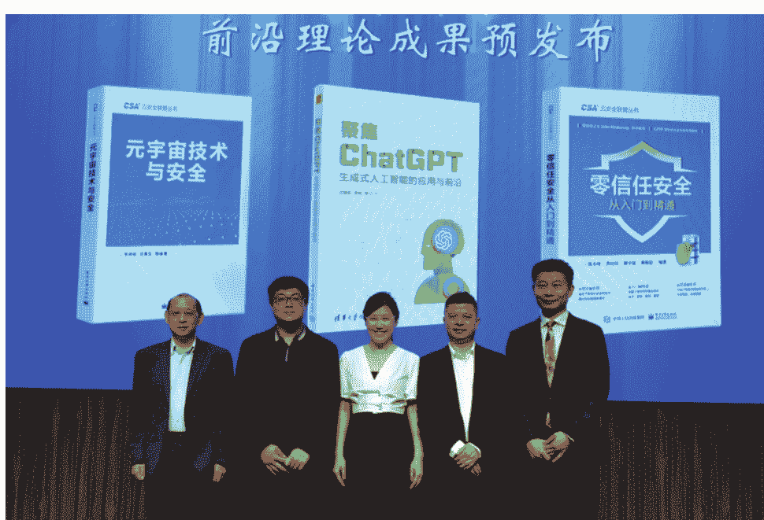
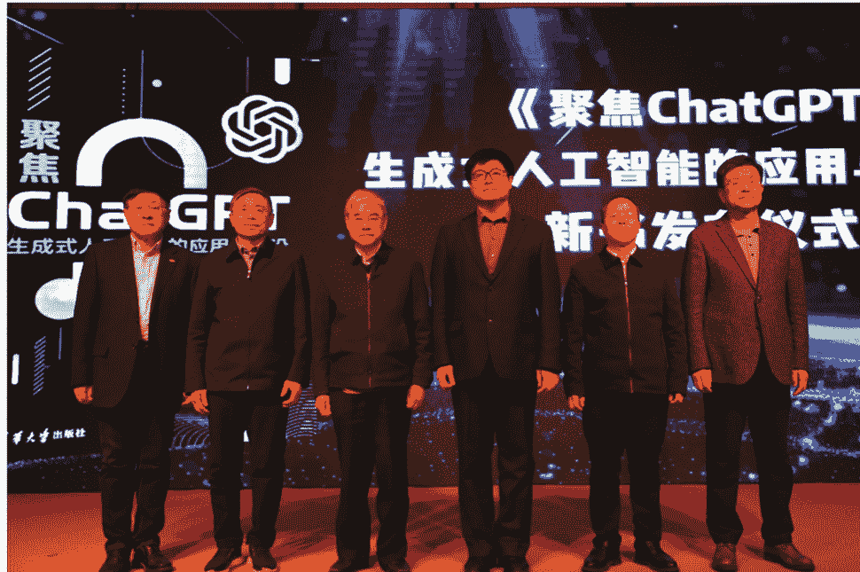
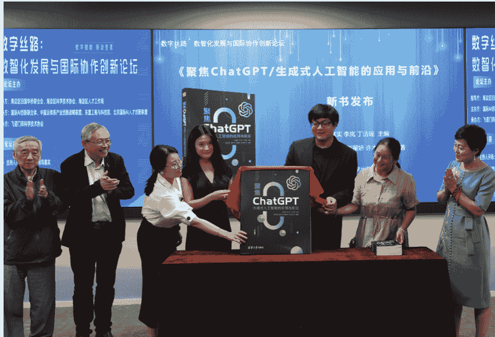
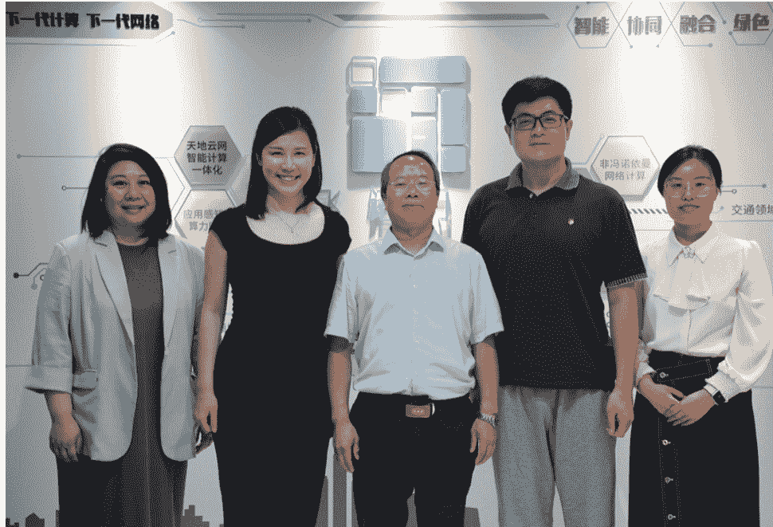
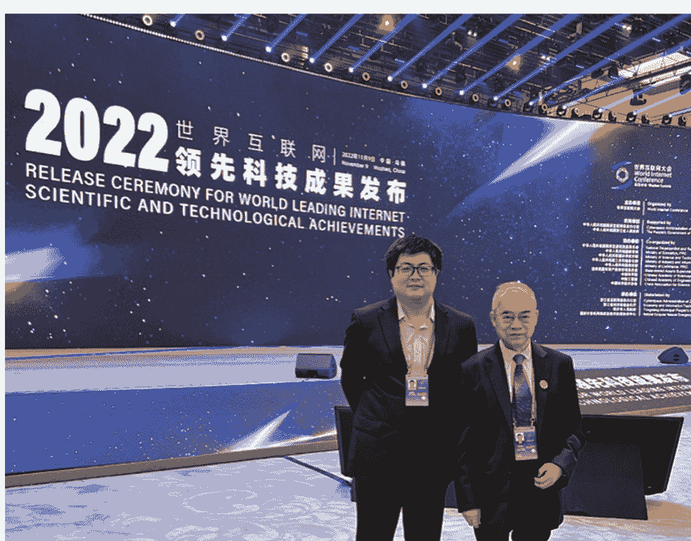
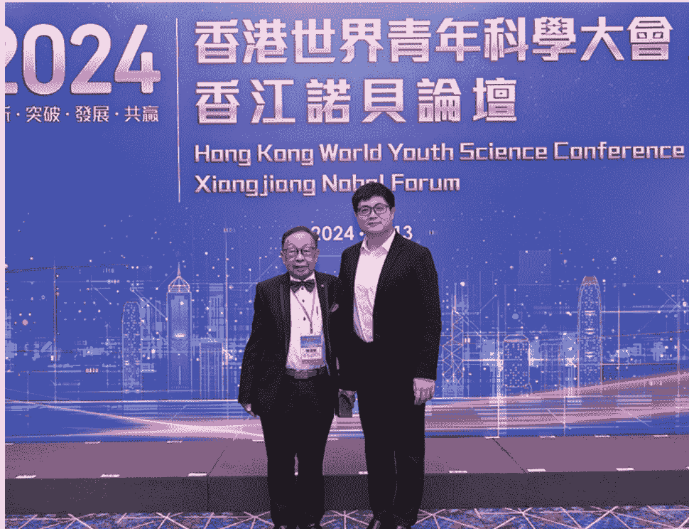
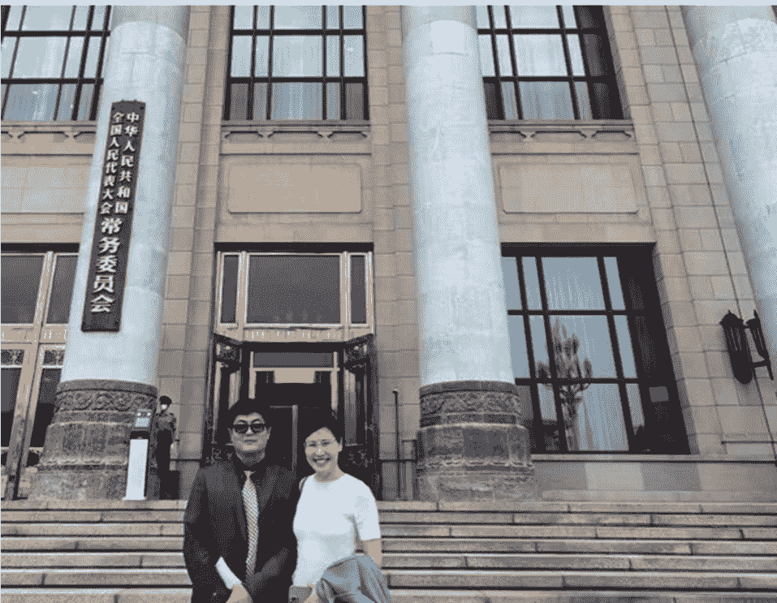
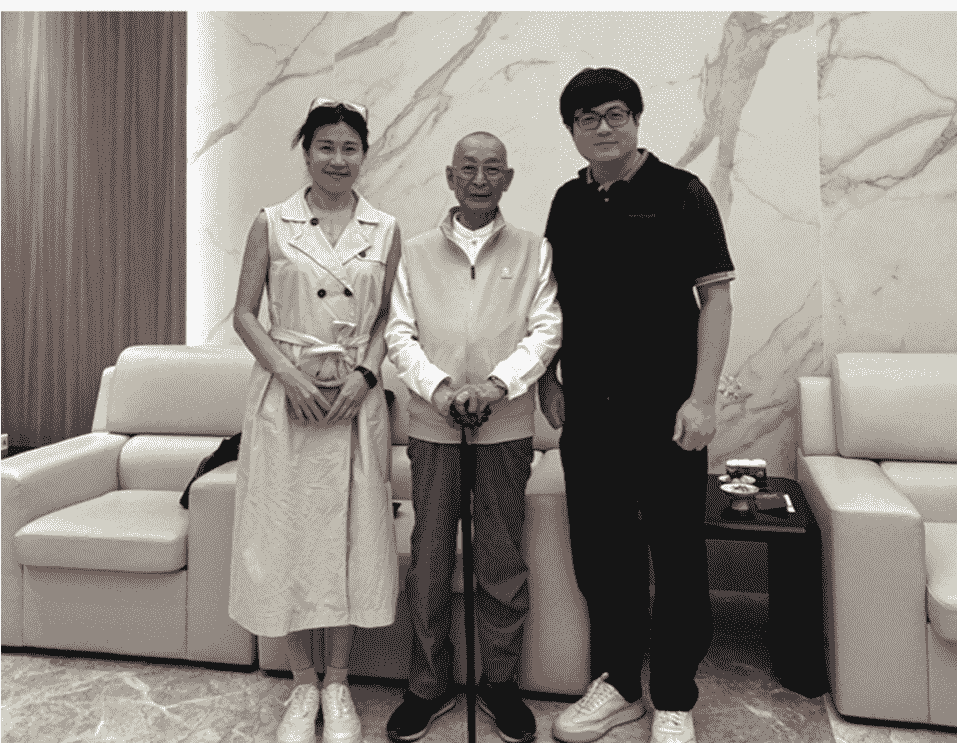
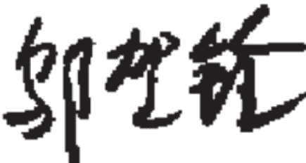
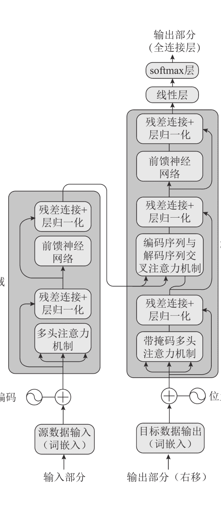

# ChatGPT透视：生成式AI的应用图景与前沿思考

# 内容导览
本书以生成式人工智能为线索，从底层机理到落地实践展开全景式梳理，呈现演进脉络、价值空间与发展走向，为读者提供一份可俯瞰全局的认知地图。先以通俗方式拆解基础原理，再以宽阔视野铺开技术实践，覆盖自然语言处理、深度学习等前沿方向，帮助建立扎实理论根基。书中遴选了ChatGPT在智能客服、内容创作、教学培训、医疗健康等多类典型场景的实践案例，说明生成技术在不同情境下如何释放能量、推动社会与经济发生深层变化。除技术之外，本书亦深入讨论生成式智能带来的伦理争议、法律边界与社会责任议题，并给出前瞻且建设性的思考路径，引导读者审慎看待技术对人类社会的长远影响，让进步与价值并行。

全书由浅入深、逐步递进，结构严谨。既可帮助入门读者搭建基础认知，也为专业从业者提供深入研讨的空间。

本书面向对智能科技感兴趣的初学者、在职专业人员、相关行业从业者、政策制定者与法律研究者。


本书作者沈寓实博士（左二）、李岚博士（中）等专家学者于2023年6月在“AI产业发展主题研讨”座谈会上宣布《聚焦ChatGPT——生成式人工智能的应用与前沿》等前沿理论成果预发布


本书作者沈寓实博士（右三）和邬贺铨院士（左三）、邓智华教授（右二）等专家领导于2023年12月在DEC 2023数字化生态大会上见证《聚焦ChatGPT——生成式人工智能的应用与前沿》前沿理论成果预发布


本书作者沈寓实博士（右三）、丁洁瑶律师（左四）、刘星妍（左三）等和尤芳达院士（左二）、徐锭明参事（左一）等专家领导于2025年6月见证《聚焦ChatGPT——生成式人工智能的应用与前沿》新书发布


本书主要作者与邓智华教授合影（左起：靳中美，李岚博士，邓智华教授，沈寓实博士，刘星妍；2024年）


邬贺铨院士（右）和沈寓实博士在2022年世界互联网大会乌镇峰会合影


陈清泉院士（左）和沈寓实博士在2024年香港世界青年科学大会香江诺贝论坛合影


沈寓实博士（左）和李岚博士在人民大会堂前合影（2023年）


李岚博士（左）、海云继梦法师（中）和沈寓实博士在“AI时代的认知与边界”论坛合影（2025年）

# 编委会
**主 编:** 沈寓实 李 岚 丁洁瑶

**参编人员:** 靳中美 郭哲滔 刘星妍 许木娣

宁 勇 卜宋博 黄东升 王 蕾

徐美玲 李梦欢 赵怡冰 李梓潼

# 主编简介
**沈寓实**，博士、MBA，教授兼自然科学研究员，格鲁吉亚国家科学院外籍院士，国家级特聘专家，中关村高端领军人才，“十四五”科技创新先锋人物，“中国改革开放海归40年100人”“福布斯中国·青年海归菁英100人·影响力人物”入选者，北京市政府“留学人员创新创业特别贡献奖”获得者，“第十三届发明创业奖人物奖特等奖”及“当代发明家”荣誉获得者。深耕网信领域二十余年，网络空间战略专家，国际知名云计算、智能科技、大数据、网络安全、视频编解码、无线通信专家，跨国企业高管与国际华人科技团体领袖，在中美政产学研各界拥有深厚联结。长期推动新一代网络计算体系自主创新与国际合作，是“非冯诺依曼网络计算体系”主要提出者与实践者之一。毕业于清华大学电子工程学士，美国加州大学圣地亚哥分校电子与计算机硕士、博士，美国华盛顿大学工商管理硕士。现任飞诺门阵（北京）科技有限公司创始人、董事长兼首席科学家，清华海峡院智能网络计算实验室主任。曾任微软全球华人协会主席、微软亚洲人力资源总会主席、微软云计算中国区总监、世纪互联集团副总裁兼云CTO，推动Microsoft Azure与国际云安全联盟CSA落地中国。

**李岚**，博士、教授，现任美国微软生成式智能商业云首席技术总监，格鲁吉亚国家科学院外籍院士，国家级特聘专家，清华大学珠三角研究院未来设计创新中心特聘专家。长期聚焦生成式智能与自然语言领域，是微软为数不多的华人高管与技术代表，深度参与微软在国际上引领的AGI产业变革，引领本轮全产业升级。清华大学本科，美国加州大学洛杉矶分校博士。加入微软总部后历任高级软件工程师、高级项目经理、资深软件架构师，现任微软总部人工智能首席研发总监、技术合伙人，兼任西雅图清华校友会顾问。曾任西雅图清华校友会会长、微软华人协会副主席。

**丁洁瑶**，执业律师，任职于国内知名红圈律所，聚焦数字经济前沿法律服务，核心关注数据流动、产品合规与资本运作，为企业提供从研发到跨境经营再到资本市场的全周期一体化法律支持。参与多项智能科技与数据合规国家级立法研究，以及多项行业标准、团体标准、行业白皮书制定，对AI与大数据的立法前沿与司法实践把握深入，受聘为中国行为法学会数据要素法治决策咨询专家委员会专班成员。

# 序言一
智能科技可追溯至六十余年前，由早期规则式应用逐步演进至深度学习、自然语言处理、计算机视觉等高级形态，近年来渗透加速。2022年底ChatGPT面世，开启生成式智能时代，其强大的语言理解能力与丰富落地场景让全球直观感受到技术潜力；2024年初Sora等文生视频模型的推出，更将内容创作能力推向新高度。

生成式智能的爆发并非偶然。摩尔定律持续带来芯片升级，算力供给显著提升；光纤通信容量不断刷新，为海量数据传输提供支撑；5G推动智能终端与物理实体连接，助力大模型下沉并催生AI Agent；深度神经网络进展使“算力换性能”成为现实。这一浪潮恰好契合智能化社会需求，消费类业务纷纷借助大模型重塑，具身智能与人形机器人打通大模型与物理世界的通道，产业数字化迎来新起点，大模型助力企业转型，赋能新质生产力。

沈寓实博士、李岚博士与丁洁瑶律师合著的《聚焦ChatGPT——生成式人工智能的应用与前沿》，系统梳理了智能发展史、生成式智能原理、关键技术、应用场景、行业现状与趋势，并对智能人才、法律治理、伦理规范等热点作出分析与建议，勾勒出智能未来充满可能的图景。全书对相关技术作系统概括，语言简洁、比喻生动，兼具学术性与科普性、前瞻性与实用性。从呈现的历程看，我国在智能发展中一度偏于旁观与跟进。面向机遇与挑战并存的新时代，中国需要在后续发展中作出无愧于时代的贡献。

愿本书激发更多思考与讨论，推动智能技术研究与应用，以创新驱动发展，以智能涌现服务经济社会高质量发展。


中国工程院院士

# 序言二
我们正处在一个充满可能的历史节点，智能科技以独特魅力深刻重塑世界。作为长期从事电动汽车与智慧能源研究的学者，我深知技术革新对社会进步的推动作用。汽车产业正经历电气化、信息化的深刻变革，车辆功能已从单纯代步转向交通、能源与信息融合的载体，甚至成为物理世界、信息世界与人文世界的交汇点。当前电动汽车与电网互动尚显无序，但随智能科技进步，无序有望走向有序。未来在信息网支撑下，电动汽车与电网将实现友好互动，这需要顶层设计与前瞻规划引领。在芯片、操作系统、算法、互联网等要素协同下，汽车正演变为“第三空间”，在无人驾驶加持下车内生活场景无限延展。所有这些愿景的实现，都离不开社会各界对新技术与新应用的广泛共识。

沈寓实博士、李岚博士与丁洁瑶律师合著的《聚焦ChatGPT——生成式人工智能的应用与前沿》，以通俗有趣方式阐释智能科技的历史、现状与未来，并探讨生成式智能的巨大潜力，对提升公众科学素养、激发创新思维具有重要意义。我当初投身电动车研发，正源于年轻时对世界的好奇、对汽车行业的热爱以及渴望在知识积累上实现建树的初心。因此，作为科技工作者，我乐于支持传播科学知识、弘扬先进文化的作品。

智能科技已成为当代科技革命与产业变革的核心驱动，正以前所未有的力量重塑生产力格局，成为新时代生产力的典型代表。其发展根植于跨学科土壤，从计算机科学到认知科学、神经科学、心理学，多领域知识的交叉融合为技术创新提供源源不断的动力。展望未来，激发年轻一代对科学的热爱与探索欲，是培养未来科技领军人才、推动智能科技持续突破的关键。越来越多的青年才俊投入这一科技盛宴，以创新思维与坚韧努力攻克技术难关，回应时代挑战。


中国工程院院士
香港工程科学院院士、副院长
英国皇家工程院院士

# 序言三
智能科技作为学科于1956年登上国际舞台，最初在欧美与日本等科技强国兴起，主要围绕理论探索与基础技术展开。如IBM阿瑟·塞缪尔提出“机器学习”概念，MIT约瑟夫·维森鲍姆开发早期自然语言聊天机器人ELIZA，早稻田大学研制首个人形机器人WABOT-1等。此后智能经历“寒冬”与“平淡”，直至21世纪初深度学习突破与大数据时代到来，图像识别与自然语言处理取得显著进展，产业化才迎来强劲动力。至2023年，大模型崛起成为新的里程碑。GPT系列等语言大模型凭借超大规模数据、强大学习能力与广泛应用潜力，推动智能科技跨越式发展。

在整体进程中，我国起步较晚，曾一度缺乏完整教材，这也是我当年撰写《人工智能及其应用》《机器人原理及其应用》《智能控制》等“智能三部曲”初衷所在，旨在系统介绍基础知识与应用、探讨机器人学原理及智能控制的“交集结构理论”，为学科传播与创新发展提供助力。近年来我国在智能科技与大模型领域进步显著，论文发表量长期居世界第一，涌现诸多创新理论与方法，为全球发展贡献中国智慧。应用层面，智能语音、图像识别、无人驾驶等技术广泛落地，部分成果达到国际先进乃至领先水平，有力提升生产效率与服务质量，推动新质生产力与产业结构升级。

我与沈寓实博士相识十余载，他曾任微软总部云计算等核心研发负责人，全面主导微软云计算在大中华区的研发、战略与生态建设，长期深耕智能科技、大数据与云计算前沿，关注颠覆性技术创新与行业生态构建；他亦是知名侨领，曾任美西最大华人高科技社团微软华人协会理事会主席。多年来见证其成长与贡献，印象深刻。十一年前他与张亚勤院士等编著的《云计算360度：微软专家纵论产业变革》被DCCI评为“中国互联网20年最值得藏阅的100本书”；2020年底，其著作《非冯诺依曼网络计算体系》作为我国首部面向智能科技时代的网络计算体系专著，入选“十四五”国家重点出版物专项规划，学术影响深远。

此次沈寓实博士带来主编的《聚焦ChatGPT——生成式人工智能的应用与前沿》，合作者李岚博士为微软总部智能科技首席研发总监兼技术合伙人，曾任西雅图清华校友会会长；丁洁瑶律师亦为行业资深专家。全书不仅系统介绍大模型发展历程、关键技术与应用案例，更对未来趋势作出深刻洞察。大模型构建与应用涉及多学科知识，需研发者与从业者保持开放创新心态，借助所学深挖技术价值，助力智能科技发展，推动传统行业数字化转型。尤其在复杂动态环境中，如运动控制领域，大模型优势明显，有望为智能制造、精密工程、自主导航等带来重大突破。可以预期，随着技术完善，大模型将推动智能科技迈向更高层次。

本书以纵横交错的叙述与生动案例呈现大模型深层原理与应用潜力，是一部值得品读的佳作，将有助于大模型在我国的推广应用。它不仅帮助学生与研究者加深理解，更能激发对智能科技的兴趣与探索精神。通过一代代科学家与工程师的持续探索与分享，我们可逐步构建具有中国特色的学科体系，培养高水平人才，为科技创新与产业发展提供支撑与保障。

回顾我国智能科技发展历程，从早期的机器翻译与专家系统，到如今对智能机器人与深度学习的深入探索，每一步都凝聚科研人员的智慧与心血。薪火相传的科研精神推动着不断突破。作为科技工作者，我们有责任为建设智能强国与中国式现代化贡献力量。展望未来，智能科技将持续赋能各行各业，造福百姓。相信在国家统一规划与共同努力下，我国智能科技必将取得新突破，为全球技术发展与国家现代化建设作出更大贡献。


中南大学信息科学与工程学院教授
第八届湖南省政协副主席
国际导航与运动控制科学院院士
纽约科学院院士
湖南省自兴人工智能研究院首席科学家

# 序言四
智能社会正以令人瞩目的速度到来！
智能科技已从科幻走向现实，成为推动各行各业变革的关键力量。其中生成式智能尤为引人注目，在技术上实现突破，在应用上展现广阔前景。无论个人还是机构，都需在心理适应、技能学习、职业规划、安全意识、道德标准等多维度全面迎接这场技术与社会的变革。

本书正是在此背景下，系统呈现生成式智能的过去、现在与未来。书中追溯智能发展历程，探讨生成式智能的理论基础与流派，包括概率模型、贝叶斯学派、最大似然估计等，从20世纪50年代初创至今勾勒出多彩图景；在理论探讨之外，还深入剖析其在自然语言处理、计算机视觉、语音识别与合成等领域的具体应用，让读者直观感受技术力量；同时对产业竞争现状与人才建设议题进行分析，为未来发展提供另一视角。

基于作者深厚的法学背景，本书尤为重视生成式智能带来的法律挑战。技术在人类权益、科技伦理、国家安全、个人隐私、法律责任等方面提出前所未有的难题。书中梳理全球监管态势，围绕数据、算法、著作权、开源等法律问题展开深入讨论并提出应对策略，为读者提供有益参考。

生成式智能的图景正在展开，我们正站在时代交汇点。本书为快速理解并探索这一技术带来的各类议题提供窗口，有幸见证并参与这场智能革命的大讨论，共同期待一个健康、有序、可信、可持续的智能社会到来。


北京大学法学院教授
北京大学人工智能研究院人工智能安全与治理中心主任

# 序言五
历史上，每一次科技飞跃都带来社会经济结构的深刻重塑。在社会经济史与创新创业研究的视野下，历次工业革命都伴随生产力指数级增长与生产关系重构。如今新一轮科技革命与产业变革加速推进，学科交叉融合不断深化，科学研究范式发生深刻变化，科技与经济社会加速渗透，基础研究转化周期明显缩短，国际科技竞争向基础前沿前移。我们以相同视角审视智能科技、大模型技术与经济分析的交汇，它们正成为推动全球经济的新引擎。智能科技、大数据等数字技术正引领第四次工业革命，以强大数据处理与模式识别能力为经济分析提供前所未有的工具和方法，不仅大幅提升研究质量，也为政策制定提供更为科学的决策支持。

目前，人工智能的设计重心正在由判断与决策转向内容生成，这一范式迁移让人类在生产效率与创新能力上的天花板被明显抬高。ChatGPT 的快速走红，让数字经济的创新真正进入智能化阶段，尤其是在“人机协同”模式下，借助人参与闭环的创新方式越发普及，在这种深度配合中，模型得以持续进化并逐步迈向更自主的状态。支撑这一进程的不仅是自学习、深度学习、视觉计算、机器人、大数据与云计算等应用层技术，也离不开数学、物理、计算机科学、仿生学、材料学等基础学科的长期积累。多重要素共同作用，正让基础科学体系与智能技术相互渗透并驱动新一轮创造。

《聚焦ChatGPT——生成式人工智能的应用与前沿》由沈寓实博士、李岚博士与丁洁瑶律师等业内资深人士合著，是一部兼具理论深度与阅读性的著作。书中既回顾了人工智能与大模型的演进脉络，也以实例梳理了国内外产业落地情况、国际市场走势，以及技术对全球经济运行的影响，从生产到分配、再到消费与再投资的全链条，呈现智能技术如何渗入并重塑经济活动。技术现象必须置于历史与宏观背景下理解，世界本身错综复杂，任何技术、产业或现象都是特定历史条件下内外部力量交织的结果。

回看我国近年的智能产业，整体框架已基本形成，发展态势稳健，开放平台、联合实验室、人才引进等举措成效突出，形成了覆盖全链协同的产业集群。在此基础上，需要进一步夯实源头科学研究，攻克关键核心技术，应对国际科技竞争，实现更高水平自主自强。未来属于善于把握方向、顺势而动并具备灵活应变能力的人。面对大模型与人工智能的高速期，我们应从历史中汲取经验，以开放审慎的姿态迎接经济新周期的到来。我相信，随着技术不断成熟，人工智能将与经济分析、创新创业实现深度融合，共同开启社会发展的新阶段。

国际欧亚科学院院士
北京创新学会副会长

# 序言六

在信息激增与技术迭代加速的时代，人工智能已成为推动社会进步与创新的核心引擎。以数据为燃料、以算法为驱动，AI正以前所未有的节奏改变世界，从制造环节到客户服务，从健康医疗到教育培训，各行各业的面貌都在被重塑。各类智能系统不仅提升了运行效率与决策质量，还开辟出全新的创新路径，进而牵动社会结构、经济形态与文化认知的整体演进，带领我们进入更智能、高效、互联的新阶段。我所在的甲骨文公司长期深耕人工智能的研发与落地，作为生成式人工智能服务的负责人，我亲历了这场变革的浪潮。

得益于机器学习与深度学习的持续进展，人工智能正从专用的窄域智能迈向更宽泛的通用智能。伴随自然语言处理、图像语音等能力的加持，应用场景变得更个性化、更智能、更具人性。生成式人工智能的兴起标志着该领域的一次关键跃迁，它通过创造性地模拟或增强人类的生成过程，释放出无限可能，在某些场景甚至超出人类预期。从文字到图像、从音频到视频，生成式模型基于海量数据学习规律，创造出全新且逼真的内容。作为创新催化剂，人工智能已渗入艺术创作、娱乐、设计、医疗辅助、数据增强等多个领域，极大丰富了内容生产的形态，也为解决现实问题提供了新视角与新工具。随着技术趋于成熟，生成式AI正成为驱动创新、激发想象、塑造未来的关键力量。

《聚焦ChatGPT——生成式人工智能的应用与前沿》系统梳理了人工智能的发展轨迹，深入解析了生成式人工智能的科学原理与技术创新，并以案例呈现了当前头部企业的布局、技术优势与战略走向。作者将媒体上高频出现却复杂的概念与热词，转化为生动有趣的概念阐释与场景化案例，以严谨清晰的逻辑帮助非专业读者建立对新技术领域的整体认知。

从ChatGPT的突破到各类人工智能应用的真实案例，沈寓实博士、李岚博士等人以鲜活的笔触带领读者探寻本质。本书非常适合作为非专业读者的入门读物，通过一个个生动例子了解正在影响生活的背后的技术脉络，洞察技术革新下社会变革的趋势。我认为这对每个人都至关重要，也相信本书能激发更多人对人工智能的兴趣。随着理解的普及与深化，跨学科合作将更加多元，交流将更开放，应用也将更负责任，共同开创更智能、更美好的未来。

甲骨文生成式人工智能服务副总裁

# 前言

科技高速发展，人工智能已深度融入日常生活。近几年，生成式人工智能成为研究焦点，其中最受关注的莫过于由OpenAI推出的大型语言模型ChatGPT，其卓越表现与广阔前景引发全球讨论。

本书正是为深入探讨ChatGPT及生成式人工智能的原理、应用与未来而撰写。汇集全球专家学者与实践者的研究成果与经验，力求为读者提供全面视角，理解该技术的现状与走向。书中挖掘ChatGPT在自然语言处理、机器学习、智能客服、智能写作等领域的应用，并探讨其在教育、医疗等行业的潜在价值；同时关注伦理、法律与社会影响，并思考如何制定相应政策与规范。

全书共分七个部分。

第一部分系统介绍人工智能，尤其是生成式人工智能的发展历程、定义、挑战与理论基础及流派。

第二部分详细探讨生成式人工智能在自然语言处理、计算机视觉、语音识别与合成等多个领域的应用，展现其强大能力与广阔前景，为研究者与从业者提供参考启示。

第三部分聚焦热点ChatGPT，对其及相关技术进行全面深入分析，为技术参考与创新提供新智慧。

第四部分聚焦人工智能巨头在生成式领域的竞争，通过时间线梳理剖析OpenAI、谷歌、微软、脸书等企业的研究动态、应用情况与技术竞争态势，从产业高度揭示发展趋势与未来走向。

第五部分为对生成式人工智能感兴趣的读者提供从入门到进阶的全面指导，无论是初学者还是希望提升的从业者都能找到合适资源与方法。

第六部分深入探讨人工智能产业人才建设的关键议题，为地方政府与企业构建优化人才体系提供参考，有助于把握现状与挑战并制定有效战略。

第七部分集中讨论生成式人工智能的法律治理，从全球视角分析监管问题，呈现全面治理框架，为数据合规、著作权保护、开源软件使用等提供实用法律指导。

阅读本书，读者可全面掌握生成式人工智能的最新动态，深刻理解ChatGPT等技术的革命性影响及其带来的新机遇。本书不仅传递知识，更旨在激发对人工智能未来的期待与思考，为相关研究与实践提供参考与灵感。

我们希望本书成为读者了解生成式人工智能的重要参考，促进学术交流与技术发展。作品独创性与开拓性突出，将为学习与职业发展提供帮助，激发对生成式人工智能的兴趣与创新潜能。

作者
2025年4月

# 第一部分 人工智能与生成式人工智能

# 第1章 人工智能简史

人工智能的源头可追溯至20世纪初，当时学界对这一概念尚未形成清晰认识。

## 1.1 计算机与人工智能：初生之时

### 1. 艾伦·图灵和图灵机
艾伦·图灵1912年6月23日生于伦敦，被视作计算机科学之父与人工智能先驱，也因其信仰与身份而勇敢抗争。求学期间展现出卓越数学天赋，20世纪30年代，年仅24岁的他在《可计算数与判定问题》中提出图灵机概念，为计算机科学揭开了奥秘。

图灵机是一个抽象计算模型，具备无限存储与按任意规则运算的能力，揭示了计算本质与理论边界。它把计算问题抽象化，能处理任何可计算问题，为计算机科学与人工智能奠定理论基础。二战期间，图灵参与英国密码学校破译德国“恩尼格玛”密码机，为盟军胜利作出重要贡献。

图灵测试是他的另一重要贡献，通过判断计算机系统是否达到人类相当的智能水平，为人工智能设定明确目标，指引后续研究方向。

### 2. 冯·诺依曼和计算机体系结构
在图灵测试提出不久后，美国学者冯·诺依曼提出一种计算机体系结构，如同建筑蓝图，为计算机发展奠定基础，也为人工智能实现提供可能。该阶段成果有限，却为后续研究埋下种子，如同新生命的初生。

### 3. 麦卡洛克-皮茨模型
20世纪40年代，美国心理学家沃伦·麦卡洛克与数学家沃尔特·皮茨对大脑信息处理方式充满好奇。他们尝试构建模型解释生物神经元工作原理，例如小鸟依据光线强弱判断昼夜并作出反应。

灵感迸发后，他们提出用一组神经元表示输入、另一组表示输出，通过连接传递信息，并用简易电路模拟神经元工作，发现模型能完成基础逻辑运算。

该模型由简化神经元构成，每个神经元接收来自他者的激励或抑制信号，超过阈值即激活并发送信号，否则保持静止。尽管简单，却能实现“与”“或”“非”等基本逻辑，可作为简易计算机执行基础任务。以小鸟判断昼夜为例，光线强度经检测神经元判断后触发唱歌行为的控制神经元。

该成果发布后引发广泛兴趣，后续研究者不断增加神经元与连接，通过训练调整连接权重，使神经网络学会更复杂任务，为深度学习奠定基础。

## 1.2 人工智能学科的创立：早期探索

### 1. 达特茅斯会议和人工智能元年
1956年8月，美国达特茅斯学院聚集了约翰·麦卡锡、马文·明斯基、克劳德·香农、艾伦·纽厄尔、赫伯特·西蒙等科学家，讨论用机器模仿人类学习与智能等议题。会议持续两月，虽未达成共识，却为该领域命名为人工智能，故1956年被视为人工智能元年。

### 2. 马文·明斯基和人工智能实验室
马文·明斯基团队在麻省理工学院创建了全球首个人工智能实验室，研究涵盖符号推理、语言理解、知识表示等，成为当时最前沿的研究机构。团队开发了SHRDLU等早期系统，能通过自然语言理解并操作虚拟世界，为后续研究提供宝贵经验。

### 3. 阿瑟·萨缪尔和下棋程序
20世纪50年代末，IBM科学家阿瑟·萨缪尔开发出可自我学习并提升棋艺的下棋程序。这是首个自我学习计算机程序，标志机器学习诞生。程序通过自我对弈学习策略，展示计算机可通过学习与适应提升性能，为机器学习与深度学习奠基。

### 4. 约翰·麦卡锡和LISP编程语言
20世纪50年代末，约翰·麦卡锡发明LISP语言，专为人工智能研究设计，具有高度灵活与表达力，适合符号计算与知识表示，成为人工智能研究主要工具之一，影响后续语言与系统设计。

### 5. 弗兰克·罗森布拉特和感知机
弗兰克·罗森布拉特1928年7月11日生于纽约州布法罗，是神经网络与感知机模型奠基人，毕业于康奈尔大学电子工程与数学，后任心理学教授。他深入研究生物神经元并将其原理引入计算机科学。

1957年他提出感知机模型，是神经网络早期形式，也是人工智能重要里程碑。其思想模拟生物神经元，通过输入、权重与激活函数实现简单线性分类。感知机是首个模拟神经元行为的计算模型，为神经网络与深度学习奠基，并提供基于数据的学习算法，通过不断调整权重从数据中寻找规律，为监督学习与无监督学习提供启示。尽管存在局限，其探索精神持续照亮后继者之路。

### 6. 约瑟夫·维森鲍姆和聊天机器人
20世纪60年代中期，约瑟夫·维森鲍姆发明ELIZA，即早期聊天机器人程序，模拟心理医生，通过简单模式匹配回应用户输入。虽不真正理解情感，却成功模拟人机对话，成为后续聊天机器人与自然语言处理技术的灵感来源。

### 7. 机器翻译：跨越语言障碍
20世纪60年代起，研究者开始探索机器翻译，目标是让计算机自动翻译不同语言文本。早期系统表现笨拙，却推动自然语言处理与计算语言学发展。如今谷歌翻译等工具已让跨语言沟通变得轻松。

## 1.3 人工智能的初应用：成长期

20世纪70年代，人工智能面临挑战。系统执行任务高度依赖人工干预与专家知识，缺乏自主性与智能性，应用成本与复杂度大幅上升。学者开始探索让计算机自主学习、积累知识的新路径。

### 1. 汤姆·米切尔和机器学习算法
20世纪70年代，汤姆·米切尔教授开发Concept Learning机器学习算法，使计算机能自主学习分类问题，例如将图像分为“狗”或“猫”。

### 2. SHAKEY：会思考的机器人
1972年，斯坦福研究所研发机器人SHAKEY，是首个能感知环境、做出决策并执行任务的机器人。外观类似微型推车，却能识别并规避障碍物，在简单环境中完成任务，展示人工智能与现实世界的互动，为机器人技术发展奠基。

### 3. MYCIN：医学诊断助手

1976年，斯坦福的研究团队推出了一款名为MYCIN的程序。它属于知识驱动的专家系统，定位在辅助医生判断传染类疾病。系统会向使用者提问，逐步收集病史和临床表现，再据此给出可能的诊断方向和用药建议。尽管MYCIN并未进入真实的临床流程，它却首次展示了人工智能在医疗场景中的可行性，为后续的智能医疗奠定了思路。

### 4. 施乐PARC掀起的技术浪潮
上世纪七十年代，美国施乐公司的帕洛阿尔托研究中心集中突破了一批改变行业的基础技术。所见即所得的文字编辑、桌面式图形界面、局域网络方案以及激光打印设备相继出现。这些成果本意是让人工智能系统更易操作、功能更强，却意外重塑了整个计算产业的设计语言，苹果、微软等后来者的产品都深受其影响。

### 5. 约翰·霍兰德与遗传算法的诞生
1975年，计算机科学家约翰·霍兰德提出遗传算法，这是一种模拟生物进化规律的优化方法。可以这样想象：一群小型机器人被放到迷宫里寻找宝藏，每一代个体都会继承父辈积累的经验，再通过随机突变尝试新路径。经过反复的繁衍与筛选，群体行为逐步趋优，最终会出现通往目标的最优路线。

这种借鉴自然进化的思路为人工智能提供了全新的求解工具。它不仅适用于迷宫寻路，还被广泛延伸到函数寻优、机器学习、自动驾驶、生产排程等复杂任务，并在这些领域展现出很强的适应性与扩展性。

### 6. 人工智能的寒冬
七十年代的人工智能发展一度陷入低迷。当时对技术的期望过高，资金大量涌入，但实际进展远低于预期，投资人信心受挫。在缺乏成熟应用场景和清晰商业模式的情况下，研究热度骤降，不少大型企业的AI部门被裁撤，部分研究机构也关停或减员。这段寒冬一直延续到八十年代，后续的技术积累才带来新一轮升温。

## 1.4 迈向实用：专家系统与神经网络的时代

### 1. 专家系统
八十年代，研究焦点转向专家系统。它试图复现人类专家的知识与推理方式，用来解决特定领域的难题。明斯基在这一阶段提出框架理论，主张人类的知识可以组织成相互关联的框架，计算机通过模拟这些框架获得一定认知能力。

尽管在医疗诊断、金融分析、工业控制等场景中取得过亮眼成绩，专家系统在商业化上遇到明显瓶颈。最重要的制约是知识获取困难，构建系统需要大量专业知识与经验数据的整理、验证，且必须依赖领域专家投入大量时间。随着知识更新，系统也需要持续维护。维护成本高、专业人员需求大，进一步限制了推广。

尽管如此，专家系统在AI史上意义重大，它也暴露出单一技术路线的局限，推动学界开始寻求机器学习、深度学习等更具通用性和可扩展性的方向。

### 2. 神经网络与反向传播算法
1986年，大卫·鲁梅尔哈特、杰弗里·辛顿等人发表《学习表示的并行分布式处理》，首次系统引入反向传播算法。该方法显著提升了神经网络的训练效率，让模型在多种任务上的表现明显改善，也为深度学习的兴起埋下伏笔。

在八十年代末，约翰·霍普菲尔德与大卫·坦克提出了霍普菲尔德网络模型。该模型在求解特定优化问题上取得进展，推动神经网络研究进入新阶段。

### 3. 资源调度问题
八十年代，规划与资源调度成为核心关注点。空中交通管制是最典型的例子。想象一个繁忙的大型机场，数小时内需安排数百架飞机的起降，既要保证准点与安全，又要避免拥堵。人工智能的规划调度技术可以快速评估突发天气、设备故障或航班变更等情况，为每架飞机制定最合适的计划。

该技术并不局限于航空。在制造业中可优化流程、提升效率；在物流中能保证货物及时送达；在能源管理中可实现合理分配与节约。多种关键领域都受益于此类能力。

### 4. 游戏领域的成就
八十年代，AI在游戏上收获多项里程碑。1983年，国际象棋程序Mephisto成为首个击败国际大师的计算机程序，证明了AI在复杂博弈中的潜力。同期还出现了冒险游戏Zork等AI驱动的游戏，为玩家带来新奇体验。

## 1.5 智慧双引擎：机器学习与神经网络崛起

### 1. 机器学习取代符号主义
九十年代，研究范式从传统的符号主义转向更实用的机器学习。其核心理念是让计算机从海量数据中自行归纳规律，而非依赖人工编写规则。随着数据量的积累，研究者意识到数据驱动才能处理更复杂的现实问题。

一个典型案例是“维纳斯计划”，该项目模拟火星车探测环境，使用大量火星地形数据训练神经网络以识别地表特征，成功展示了机器学习解决实际难题的能力。

同期涌现出支持向量机、随机森林、AdaBoost等经典算法，在分类与预测上表现强劲。概率图模型贝叶斯网络也逐步流行，它以贝叶斯定理为基础，用来表达变量间的非确定性关系。

### 2. 杨立昆和卷积神经网络
九十年代，杨立昆成为该领域的突出人物。1998年他提出卷积神经网络，将神经网络与图像处理相结合，大幅提升了计算机对图像的识别与处理能力。这一工作为计算机视觉的快速发展奠定基础，CNN随后成为图像分类、目标检测、图像生成等任务的主流架构，也展现出神经网络处理复杂问题的巨大潜力。

## 1.6 人工智能的沃土：大数据时代

### 1. 无人汽车的萌芽
进入二十一世纪，AI应用加速落地。21世纪初，达特茅斯学院举办了一场无人驾驶汽车竞赛，参赛车辆需在无人工干预下完成一系列复杂任务。这场赛事既检验了当时的技术水平，也点燃了学界与产业对自动驾驶未来的期待。

### 2. 智能应用走进生活
AI对家庭生活的改造同样显著。智能家居可自动调节温度、光线并播放个性化音乐。语音助手如Alexa、Siri等，已成为提供天气查询、音乐播放、信息检索等服务的日常伙伴，让居家体验更加便捷。

### 3. 推荐算法的出现
Netflix奖吸引了全球关注。Netflix发起竞赛，要求参赛者基于用户的历史观看记录预测评分。贝尔实验室团队凭借出色的算法赢得百万美金奖金。这次比赛推动了机器学习在个性化推荐与用户行为预测上的发展。

## 1.7 人工智能的革命：深度学习与生成式应用

### 1. “沃森”在智能上超越人类
2011年，IBM超级计算机沃森在《危险边缘》节目中击败人类冠军，展示了机器在知识检索与推理上的飞跃，成为AI发展史上的标志性事件，也预示了智能时代的加速到来。

### 2. AlexNet网络
2012年，亚历克斯·克里泽夫斯基与导师杰夫·辛顿合作推出AlexNet，在ImageNet大规模视觉识别挑战赛中以明显优势夺冠。这一成果令深度学习成为研究热点。

### 3. 自然语言处理和Word2Vec算法
同期，自然语言处理取得进展。Word2Vec将词语映射到高维向量空间，使计算机能更好地理解语义，为后续NLP研究奠定基础。

### 4. AlphaGo横空出世
2016年，DeepMind开发的围棋程序AlphaGo击败世界冠军李世石。它并非依赖预设策略，而是通过自我对弈不断学习，提升自身水平。该胜利为AI在各领域的拓展开辟了新可能。

### 5. 虚拟图像以假乱真
NVIDIA提出的生成对抗网络GAN能够生成高度逼真的虚拟图像，真假难辨。该技术被应用于游戏、影视制作与艺术创作，也带来伦理与鉴别的挑战。

## 1.8 人工智能的繁荣：无处不在
进入二十年代，AI已融入日常。智能手机、智能家居、自动驾驶、各类助手无处不在。医疗中AI可辅助更精准诊断；教育中个性化学习系统可按学生进度定制计划，AI教师可即时答疑。总体来看，从早期逻辑推理与专家系统，到神经网络与深度学习，再到自动驾驶与智能家居，AI深刻改变了生活与工作。

未来仍充满可能性与挑战。随着技术进步，AI有望在更多领域发挥更大作用。

# 第2章 生成式人工智能概述

## 2.1 生成式人工智能简介
生成式人工智能是AI的重要分支，核心在于赋予机器创造与想象能力，自动产出文字、图像、音频等内容。相较传统机器学习，它更具灵活性与多样性，在自然语言处理、计算机视觉、音频处理等方向应用广泛。

在自然语言处理上，OpenAI发布的GPT-3在问答、文本生成、机器翻译等任务中表现领先。通过在海量文本上预训练，模型习得语言规律并生成自然输出。

在计算机视觉上，GAN通过生成器与鉴别器的对抗训练产出逼真图像，二者互相推动，最终图像质量不断提升。

生成式AI还可用于音频、视频生成与艺术创作。自然语言生成技术可模拟人类表达，自动撰写新闻、邮件、客服回复，也用于智能写作与创意生成。

例如，2018年国际象棋比赛中AlphaZero借助生成式方法不仅击败人类冠军，还超越其自身最强的计算机程序，展现出在复杂环境中的强大能力。OpenAI的GPT-3可生成高质量文本，用于写作、翻译、摘要，并具备出色的理解与推理能力。谷歌Magenta项目则用生成式技术创作音乐。

医疗领域可利用NLG自动生成病历报告，也可探索智能药物设计与基因编辑等新工具。

总体而言，生成式AI具有广阔前景，未来将为人类带来更高效、更智能的生活体验。

## 2.2 生成式人工智能的发展历程与挑战
生成式人工智能是基于算法、模型与规则生成文本、图像、声音、视频、代码等内容的技术。它不仅能处理输入数据，还能学习事物的内在规律并创造新内容。以下以通俗方式回顾其历程与挑战。

### 1. 机器学习的曙光：感知器与乌龟
1957年，弗兰克·罗森布拉特发明首个感知器，这是一种早期人工神经网络。其原理启发了研究者沃尔特·格雷设计名为“乌龟”的机器，该机器可根据光线自主移动并在碰到障碍时改变方向。虽简陋，却为生成式AI奠定基础。

### 2. 计算机科学的冬天：资金短缺与怀疑
七十到八十年代，因研究进展缓慢与资金不足，行业陷入低谷，被称为计算机科学的冬天。许多人对生成式AI的可行性产生怀疑，但仍有研究者坚持探索。

### 3. 大数据与计算能力的崛起：神经网络复兴
互联网普及与算力提升带来海量数据。2006年，辛顿成功训练深度信念网络，开启神经网络新篇章。此后深度学习在视觉与语言等领域取得突破，为AGI提供关键技术支撑。

### 4. 从AlphaGo到GPT-3：预示着AGI的曙光
近年AI取得亮眼成绩，DeepMind的AlphaGo战胜围棋世界冠军。随后OpenAI推出GPT-3，这是一款强大的自然语言处理模型，可以生成准确且

### 5. AGI的挑战：安全与道德

AGI的前景令人振奋，但前进路上也布满难题。安全与伦理是最受关注的焦点之一。技术一方面可能被用来作恶，例如发起网络攻击、制造虚假信息；另一方面，发展速度过快也可能带来大规模失业和社会的动荡不安。如何在继续推动技术研发的同时守住安全和道德底线，已成为研究者必须优先解决的课题。

### 6. 强化学习与模仿学习：向人类学习
要让人工智能更接近人类，研究者尝试复现人类的学习方式。强化学习的核心是让系统在与环境的不断互动中试错、累积经验。DeepMind 的 AlphaGo Zero 就是典型案例，它依靠自我对弈反复迭代，最终超越了之前的围棋顶尖系统。这种路径为 AGI 的构建提供了重要启发。

### 7. AGI：跨界协作与开放研究
面对复杂挑战，科学家与工程师正加大跨界合作，共同探讨 AGI 的发展方向。像 OpenAI 这类机构已选择将部分研究成果向公众开放，以激发全球范围的协作与创新。开放的研究氛围有助于加速技术迭代，也更利于确保技术最终造福全人类。

回望 AGI 的发展轨迹，可以看到进步与难题并存。虽然许多问题仍待解答，但其潜力不容小觑。在持续的科研努力下，AGI 终将到来，并为人类带来更美好的生活。

# 第3章 生成式AI的理论根基与学派

## 3.1 生成式模型入门
生成式模型的理论本身很深，但可以用通俗的方式来理解。接下来用更易懂的方式介绍其核心奥秘。

生成式模型顾名思义就是能够生成数据的模型。打个比方，它像一只会学舌的鸟，你给它一段话，它能模仿语气、口音和表达方式，自己编出相似的故事。当然它不仅限于文本，还能用于图像、音频等多个模态。

## 3.2 生成式模型家族谱系
生成式模型家族成员众多，各有擅长。最知名的有贝叶斯模型、马尔可夫模型、神经网络生成式模型等，它们拥有不同的理论基础和应用场景，共同构成多元的模型世界。

### 1. 贝叶斯模型：概率推理的先驱
贝叶斯模型以18世纪英国数学家贝叶斯命名，是生成模型最早的支系之一。其核心是通过已知的观测数据来估计未知参数，像一个具备预测能力的分析者。垃圾邮件过滤、自然语言处理等领域都有其身影。

### 2. 马尔可夫模型：只记最近一次
马尔可夫模型以俄罗斯数学家马尔可夫命名，是另一重要分支。其特点是仅考虑当前状态与前一状态的依赖，忽略更远的历史信息。像一位只看眼前、汲取近期教训的思考者，在语音识别、自然语言处理中发挥了作用。

### 3. 神经网络生成式模型：受脑启发的创造者
这是近年最热门的分支，设计灵感来自人脑神经元结构，试图模拟人类智能。它像一个创造力十足的少年，代表性模型包括循环神经网络、卷积神经网络和变分自编码器。

### 4. 循环神经网络：序列数据处理专家
循环神经网络擅长处理时间序列数据，能够捕捉数据在时间维度上的特征和规律。在语音识别、文本生成、趋势预测等任务上表现突出。

### 5. 卷积神经网络：图像特征提取专家
卷积神经网络专注图像类数据，能够提取纹理、形状、颜色等视觉特征。它在图像识别、风格迁移和生成对抗网络等方向作用显著。

### 6. 变分自编码器：概率映射工具
变分自编码器是基于概率论的生成模型，能够在高维数据与低维隐变量之间建立映射关系。它在图像生成、文本生成和推荐系统等场景被广泛应用。

### 7. 生成式对抗网络：生成与判别的博弈
生成式对抗网络是近年极具创新性的模型，由生成器负责创作、判别器负责评估组成。两者相互对抗、共同提升，最终大幅提高生成质量，已在图像生成、文本生成、音乐创作等领域取得惊人成果。

## 3.3 生成式模型的瓶颈与未来展望
生成式模型已取得大量进展，但仍面临诸多挑战，比如如何提升准确性、稳定性和可解释性，以及如何防止被用于制造虚假信息和恶意攻击。科研人员正在探索新的方法和技术。随着人工智能与深度学习的持续发展，生成式模型的应用范围和性能有望进一步提升。

### 1. 伦理责任：防止技术滥用
生成式模型的强大能力也带来伦理争议。技术可以生成高度逼真的虚拟图像、文字和音频，容易被用于制造假新闻、恶搞甚至诈骗。研究者、工程师和企业都应承担社会责任，确保技术不被滥用。

### 2. 应用场景：日常智能助手
生成式模型已融入日常生活。智能语音助手借助它理解语言并回应，人脸识别系统利用它识别面部特征，自动写作软件也依赖它完成撰写。随着技术成熟，其在更多领域的应用将进一步提升生活品质。

### 3. 创造力赋能：艺术灵感来源
生成式模型不仅是工具，也是创造力的来源。许多艺术家和设计师用它创作绘画、音乐、电影等作品。它能为人类提供更多灵感，甚至改变我们对创造力的理解。

### 4. 教育价值：助力学习理解
在教育领域，生成式模型可以帮助人们更好地理解数据的内在规律和结构，提升教学效果。同时它也能作为教学工具，帮助学生掌握复杂概念与技能。

### 5. 与AI生态融合：协同发展
生成式模型是人工智能的重要分支，与监督学习、强化学习等技术共同推动AI进步。未来它将与其他技术深度融合、相互促进，为社会带来更多创新与便利。

## 3.4 概率建模与贝叶斯学派
贝叶斯学派在概率论与统计学发展史上占有重要位置，为生成式模型提供了丰富的理论支撑。

故事要从18世纪英国牧师托马斯·贝叶斯说起，他在一次灵感迸发中写下了贝叶斯公式，成为概率论的重要里程碑。贝叶斯学派将概率视为不确定性的度量，后验概率则像一名侦探，根据新证据不断修正判断，逐渐逼近真相。这种思维方式对统计学和机器学习影响深远。

历史上也有经典案例，贝叶斯公式被用来综合多源信息定位失踪潜艇并成功找到。法国数学家拉普拉斯受此启发提出了拉普拉斯平滑方法，用于处理罕见事件概率的估计，该方法至今仍被广泛使用。概率模型在金融风险评估、医疗诊断等现代科技领域发挥关键作用。

## 3.5 最大似然估计与频率学派
最大似然估计是统计学中常用的参数估计方法，核心思想是在已知数据的前提下，选择使数据出现概率最大的参数作为估计值，像侦探根据线索推断真相。

频率学派关注事件在大量重复实验中的发生频率，认为概率是固定值，可通过足够多次实验逼近，例如投掷硬币正面概率趋近于0.5。

两者都与生成式AI相关。一方面，生成式AI需要学习描述数据特征的模型，最大似然估计提供了有效的参数学习方式，使模型更好地拟合数据分布。另一方面，频率学派强调基于大量样本估计概率的思想，与生成式AI通过海量数据学习分布的思路一致。

## 3.6 各学派的比较
不同学派在AI领域各有优势与局限。

### 1. 符号主义
优势在于知识表示和逻辑推理，像一位严谨的学者，在数学定理证明、逻辑推理等形式化任务中表现优异。局限是难以处理模糊、不确定和非结构化问题，如自然语言处理和图像识别。

### 2. 连接主义
包括神经网络和深度学习，擅长从海量数据中学习，像一个善于观察的孩子，在图像、语音、文本等非结构化数据处理上优势明显。缺点是需要大量数据和计算资源。

### 3. 概率模型
强调对不确定性的建模与推理，像一位精于风险权衡的商人，在决策和不确定性处理上表现好。局限是难以处理高维复杂数据。

### 4. 进化算法
如遗传算法，模仿自然进化在复杂问题空间中寻找解，像一位富有创造力的艺术家。缺点是通常需要大量计算资源和时间。

总体来看，生成式AI的发展是多学派融合的过程。连接主义与概率模型的结合体现在变分自编码器和生成对抗网络中，既能处理复杂数据又能描述不确定性。进化算法与神经网络结合可优化结构和参数。符号主义则通过神经符号方法与深度学习融合，提升可解释性和逻辑推理能力。

## 3.7 贝叶斯学派与频率学派的比较
贝叶斯学派与频率学派各有风格。贝叶斯学派重视先验知识，开始时带有初始信念，随着新观测不断更新概率，灵活性强，适合数据稀缺和不确定性高的场景，但先验选择不当会带来偏差且计算复杂。

频率学派不依赖先验，完全基于观察数据的频率来推断，客观稳定，适合大数据场景，但在数据稀缺时表现笨拙，也较少考虑主观信念。

在生成式AI实践中，两者常需平衡。有时用贝叶斯方法结合先验构建模型以改善小样本预测，有时用频率方法利用大数据构建稳定模型。融合两者优势能实现更强大的生成能力。

## 3.8 生成式模型与判别式模型的比较
生成式模型关注数据整体分布的建模，能捕捉数据背后的深层模式，像从全景出发洞察规律。在需要挖掘数据内在结构的任务中优势明显。

判别式模型直接建模输入与输出之间的关系，聚焦分类或预测的准确性，效率高，适合需要快速给出预测结果的场景。

两者各有长短，具体选择取决于任务需求。例如需要深入理解数据分布时，生成式模型更合适；需要在有限时间内快速预测时，判别式模型更高效。实际应用中往往需根据特点灵活选择，以发挥各自优势。

生成式模型的核心思想是学习数据的生成过程。朴素贝叶斯分类器是典型代表，其依据贝叶斯公式 P(A|B)=P(B|A)P(A)/P(B) 进行推断。通过学习数据生成机制，它能够完成分类任务。

判别式思路直奔答案，不问样本如何产生，只追求从特征到标签的直线映射。最典型的实现是逻辑回归，它借助 Sigmoid 把线性组合的分数压进 0 到 1 区间，用来估计类别概率。

把情境放到战国城头，守将依据自身体验和敌军布阵判断主攻方向。判别式建模的工作方式与此相似，直接学习输入表征和输出标签的关联，完成分类任务。

# 第二部分

# 生成式人工智能的应用

# 第4章 自然语言处理

## 4.1 NLP 起步

先厘清自然语言处理的运行机理，再看生成式 AI 如何在该领域发挥作用。可以把 NLP 视作一位语言天才，职责是解读人类表达并执行对应操作，因而需要掌握语法、句法、语义等要素。生成式 AI 相当于这名翻译官的思考中枢，能够学习并模仿人类的语言与沟通方式。

这类技术多建立在神经网络之上，尤其依赖循环网络与 Transformer 家族，代表有 BERT、GPT 等。它们从海量语料中提炼语言结构与语义规律，再迁移到机器翻译、问答、摘要等场景。下面展开生成式 AI 在自然语言处理中的具体实践与实现思路。于 NLP 场景，生成式 AI 可提供的常见能力如下。

### 1. 机器翻译

机器翻译是生成式 AI 在 NLP 中最典型也最实用的方向。它学习不同语言间的对应关系，帮助跨越语言障碍。设想置身异域，周围尽是陌生表达，却依然能顺畅交流。

核心目标为把源语言文本转写为目标语言文本。为此模型需要从双语平行语料，例如英法对照文本中学习。通过这些数据，模型能够把握词汇、语法、语义层面的映射。主流方案采用编码器解码器结构，编码器把源句压缩为向量表征，解码器据此生成目标句。Transformer 家族模型，如 BERT 与 GPT，在机器翻译上取得显著进展。

### 2. 智能问答

生成式 AI 可扮演知识型导师，对各类主题提问给出兼具科学性与可读性的回答。例如面对“为什么天空是蓝色的”，模型会解释大气散射让蓝光更易扩散，并以生动的比喻辅助理解。

在问答场景里，模型需要从给定知识库或文本中检索与问题相关的内容并生成简洁准确的回应。实现过程先解析问题，提取关键词与实体并判断问题类型，如定义、因果、比较等。随后在知识源中定位相关信息并整合为答案。生成式 AI 可借助注意力与多头自注意力聚焦问题相关的文本片段，从而提升回答精度。

### 3. 文本摘要

生成式 AI 能从大量文字中抽取核心信息。例如阅读气候变化报告，可得到简洁且带幽默感的概括：“地球正面临全球变暖的挑战，及时保护家园迫在眉睫。”

摘要场景要求从长文本中抽取关键信息并生成易读的浓缩文本。做法是对原文进行分析，识别主题、观点与关键事实，再将这些信息组织成连贯简洁的表达。常用的实现是序列到序列模型，编码器把原文编码为向量表征，解码器据此生成摘要。

### 4. 自动生成文章

生成式 AI 可化身作家，按指定主题撰写各类文章。给出主题后，它能产出引人入胜的内容。比如要求写一只狗与一只猫的友情故事，它会生动描写两者如何携手闯关成为好友。

在自动写作应用中，它像讲故事的机器人，能依据主题或关键词创作吸引人的文章。工作繁忙后想阅读关于勇敢猫与机智狗联手对抗邪恶企鹅的故事，生成式 AI 即可按兴趣创作出富有趣味与创意的情节。为此模型需要学习合理组织句子、段落与章节，让人物、情节与对话更生动。这相当于模型从资深作家身上习得写作技巧，再用于自己的创作。

### 5. 生成语言游戏

生成式 AI 还可用于设计富于创意的语言游戏。例如创建“猜猜我是谁”游戏，模型生成描述名人或虚构角色特征的谜面，供玩家推理身份。这样的游戏既考验知识与推理能力，也能在轻松氛围中学习新知。

### 6. 聊天机器人

生成式 AI 可构建会对话的聊天机器人，与用户进行有趣交流。它可依据偏好与需求聊天、答疑或讲故事，像会说话的玩具陪伴用户度过闲暇。为此模型需要学会理解用户问题与需求并生成恰当回应，同时让对话更自然、幽默、有趣。

总体来看，生成式 AI 在自然语言处理中的覆盖面很广，能帮助跨越语言障碍、获取信息、享受阅读与对话的乐趣。

## 4.2 主要的训练原理

下面继续深入生成式 AI 在自然语言处理中的原理、公式与应用实例。

### 1. 循环神经网络

原理：循环神经网络是处理序列数据的神经网络结构，适用于自然语言处理。其核心是在处理序列每个元素时保留隐含状态，该状态包含此前信息。循环神经网络像会倒带的录音机，能记住过去发生的事情，以便在处理后续输入时做出更好决策。

公式：循环神经网络的基本公式如下。

```
h(t) = f(W_hh · h(t-1) + W_xh · x(t) + b_h)
y(t) = W_hy · h(t) + b_y
```

具体来看，h(t) 对应当前隐含状态，x(t) 对应当前输入，y(t) 对应当前输出，W_hh、W_xh、W_hy 分别对应隐含层到隐含层、输入层到隐含层和隐含层到输出层的权重矩阵，b_h 与 b_y 分别为隐含层和输出层的偏置项，f 为激活函数，如 tanh 或 ReLU。

例子：用循环神经网络为一个故事生成续集。此时网络像会讲故事的聪明孩子，它依据已讲片段即隐含状态，生成后续内容，使故事更连贯有趣。

### 2. 长短时记忆网络

原理：长短时记忆网络是对循环神经网络的改进，用来缓解长序列下的梯度消失与梯度爆炸问题。其关键是引入记忆细胞，能够学会长期保留重要信息，同时遗忘无关信息。长短时记忆网络像具有筛选功能的倒带录音机，可自动选择保留哪些信息以便后续决策。

公式：长短时记忆网络的基本公式如下。

```
f(t) = σ(W_f · [h(t-1), x(t)] + b_f)
i(t) = σ(W_i · [h(t-1), x(t)] + b_i)
o(t) = σ(W_o · [h(t-1), x(t)] + b_o)
c(t) = f(t) · c(t-1) + i(t) · tanh(W_c · [h(t-1), x(t)] + b_c)
h(t) = o(t) · tanh(c(t))
```

此处，f(t)、i(t) 与 o(t) 分别为遗忘门、输入门和输出门的激活值，c(t) 为记忆细胞的状态，h(t) 为隐含状态，x(t) 为当前输入，σ 为 sigmoid 激活函数，W_f、W_i、W_o 与 W_c 分别为遗忘门、输入门、输出门和记忆细胞的权重矩阵，b_f、b_i、b_o 与 b_c 分别为遗忘门、输入门、输出门和记忆细胞的偏置项。

例子：若用长短时记忆网络为一部长篇小说生成摘要，网络像记忆超强的读者，在阅读过程中筛选出最重要的情节与人物，再整合为简洁有趣的摘要。

### 3. Transformer架构

原理：Transformer 是基于自注意力机制的神经网络结构，适用于自然语言处理。与循环神经网络和长短时记忆网络不同，Transformer 可并行处理序列全部元素，在处理长序列时计算效率更高。核心思想是利用多头自注意力和位置编码，让网络捕捉序列中的长距离依赖和位置信息。Transformer 像会快速阅读的专家，能在短时间内把握文章主旨与结构，并应用于机器翻译、文本摘要等场景。

Transformer 的总体架构可分为 4 部分：输入部分、输出部分、编码器部分、解码器部分，如图4-1 所示。具体而言，输入部分包含源文本嵌入层及其位置编码器、目标文本嵌入层及其位置编码器；输出部分包含线性层、softmax 层；编码器部分由 N 个编码器层堆叠而成，每个编码器层由两个子层连接结构组成，第一个子层连接结构包括一个多头自注意力子层和规范化层以及一个残差连接，第二个子层连接结构包括一个前馈全连接子层和规范化层以及一个残差连接；解码器部分由 N 个解码器层堆叠而成，每个解码器层由 3 个子层连接结构组成，第一个子层连接结构包括一个多头自注意力子层和规范化层以及一个残差连接，第二个子层连接结构包括一个多头注意力子层和规范化层以及一个残差连接，第三个子层连接结构包括一个前馈全连接子层和规范化层以及一个残差连接。



图4-1 Transformer 的总体架构

注意力机制是 Transformer 架构的核心组成部分。我们观察事物时之所以能快速判断，是因为大脑会迅速把注意力放在最具辨识度的部分。正基于此产生了注意力机制。注意力机制是一种加权输入信息的技术，帮助神经网络更好地捕捉序列中的关键信息。其核心思想是通过计算输入元素间的相似度为每个元素分配权重，再对加权后的元素进行聚合，使网络自动关注与场景相关的信息。注意力机制像一副眼镜，让模型在复杂场景中更专注高效。

Transformer 的注意力机制的基本公式如下。

```
Attention(Q, K, V) = softmax(Q·K^T / sqrt(d_k)) · V
Q = W_Q · X
K = W_K · X
V = W_V · X
```

此处，Q、K 与 V 分别指查询矩阵、键矩阵和值矩阵，W_Q、W_K 与 W_V 分别指查询、键和值的权重矩阵，d_k 指键向量的维度，X 指输入矩阵，Attention 指注意力矩阵。

例子：可利用注意力机制为一篇杂乱的文章生成清晰大纲。此时注意力机制像有条理的编辑，从文中找出最关键信息并组织成结构清晰、逻辑严密的大纲，帮助读者把握主旨。或者用 Transformer 为一部科幻小说写影评，模型像电影评论家，能迅速抓住核心情节与主题并据此撰写有深度的影评。

总之，生成式 AI 在自然语言处理中的实现原理涵盖循环神经网络、长短时记忆网络和 Transformer 架构等技术。深入理解这些原理与公式，有助于更好把握其在各类自然语言处理场景中的应用与表现。

### 4. GPT

原理：GPT 是基于 Transformer 架构的大型预训练语言模型。其核心思想是通过大量无标签文本进行预训练，学习丰富的语言知识，再在具体场景上进行微调。这样 GPT 能在文本生成、文本摘要、机器翻译等场景上表现出色。GPT 像博学多才的作家，能在不同领域和风格的写作中游刃有余，创作出高质量作品。

公式：GPT 的基本公式与 Transformer 类似，关键在于如何利用预训练和微调优化性能。预训练阶段的损失函数为

```
L_pretrain = -E[log P(x(t) | x(1:t-1); θ)]
```

此处，x(t) 指输入序列中的第 t 个元素，x(1:t-1) 指前 t-1 个元素，θ 指模型参数。微调阶段的损失函数为

```
L_finetune = -E[log P(y(t) | x(1:t-1), y(1:t-1); θ)]
```

此处，y(t) 指目标序列中的第 t 个元素，y(1:t-1) 指前 t-1 个元素。

例子：用 GPT 为一篇科学论文生成通俗易懂的解读文章。此时 GPT 像擅长科普的作家，能依据论文内容与结构创作出生动有趣的解读，让普通读者理解复杂科学知识。

### 5. BERT

原理：BERT 即 Bidirectional Encoder Representation from Transformer，双向编码器表征法，是基于 Transformer 架构的大型预训练语言模型。与 GPT 不同，BERT 采用双向编码器，能同时学习文本的前后信息。这使其在上下文相关的场景如问答、命名实体识别中更强。BERT 像善于观察思考的侦探，能从文本中发现细微线索与关联，为场景提供有力支持。

公式：BERT 的预训练阶段包括两个任务——遮挡语言模型和下一句预测。MLM 的损失函数为

```
L_MLM = -E[log P(x(t) | x(1:t-1), x(t+1:T); θ)]
```

此处，x(t) 指被遮挡的输入序列中的第 t 个元素，x(1:t-1) 与 x(t+1:T) 指除 x(t) 之外的其他元素，θ 指模型参数。NSP 的损失函数为

```
L_NSP = -E[log P(S | x_A, x_B; θ)]
```

此处，S 指两个输入序列 x_A 与 x_B 是否相邻，θ 指模型参数。预训练阶段的总损失函数为

```
L_pretrain = L_MLM + L_NSP
```

微调阶段的损失函数与 GPT 类似，根据具体场景定义。

例子：用 BERT 为一篇历史文章回答一系列问题。此时 BERT 像博古通今的历史学家，能捕捉文章中的细节与联系，准确回答问题，为读者提供丰富的历史知识。

### 6. 生成式对抗网络

原理：生成式对抗网络是一种深度学习模型，通过同时训练两个相互竞争的神经网络即生成器和判别器来生成新数据。生成器负责生成与真实数据相似的虚假数据，判别器负责区分真实数据和虚假数据。训练过程中两者不断提升，最终生成器能生成以假乱真的样本。生成式对抗网络可用在图像生成、文本生成等领域。它像擅长伪装的魔术师，能制造出逼真的假象让人难以分辨真假。

公式：生成式对抗网络的训练过程可表示为一个最小最大博弈，其损失函数为

```
min_G max_D E[log D(x)] + E[log (1 - D(G(z)))]
```

此处，G 指生成器，D 指判别器，x 指真实数据，z 指随机噪声，E 指期望值。

例子：用生成式对抗网络为一部热门电影生成海报。生成器像富有创意的设计师，能依据电影风格与内容创作独特海报；判别器像严格的审稿人，从众多设计中挑选最符合主题与品质的版本。经过多轮竞争与协作，最终生成的海报会让观众眼前一亮。

### 7. 扩散模型

原理：扩散模型的灵感来自非平衡热力学，理论上先定义扩散步骤的马尔可夫链，缓慢地向数据中添加随机噪声，然后学习逆向扩散过程以从噪声中构造所需数据样本。训练后，可把随机采样的噪声传入模型，通过去噪过程生成数据。根本上，扩散模型通过连续添加高斯噪声破坏训练数据，再学习反向去噪过程来恢复数据。

扩散模型分为正向扩散过程和反向逆扩散过程。以单张图像为例，正向就是不断往图像上加噪声直至变成纯噪声，整个过程是一个马尔可夫链；反向则是从纯噪声生成一张图像的过程。其中，马尔可夫链是状态空间中按从一个状态到另一个状态转换的随机过程，具有无记忆性质：下一状态的概率分布只由当前状态决定，与前面事件无关。

公式：正向扩散过程即往图片上加噪声的过程，是数据结构被破坏的阶段。由于每个时刻 t 只与 t-1 时刻有关，可看作马尔可夫过程，在马尔可夫链的前向采样即扩散过程中，可将数据转换为高斯分布。即扩散过程通过 T 次累积对输入数据 x 添加高斯噪声，将这个跟马尔可夫假设相结合，于是可对扩散过程表达为如下形式

```
q(x_t | x_{t-1}) = N(x_t; √(1-β_t) x_{t-1}, β_t I)
q(x_{1:T} | x_0) = ∏_{t=1}^{T} q(x_t | x_{t-1})
```

此处，β₁、β₂、…、β_T 为高斯分布方差的超参数。在扩散过程中，随着 t 的增大，x_t 越来越接近纯噪声。当 T 足够大时，x_T 可以收敛为标准高斯噪声 N（0，1）。

扩散模型令人称道的生成能力，本质上来自于逆向的去噪过程。正向扩散可以理解为对样本持续加噪，而反向扩散则是逐步推断噪声被移除的过程。若能准确估计出相邻时刻的条件分布 p(x_{t-1} | x_t)，就能从标准高斯 N(0,1) 出发，一步步还原出真实数据的分布 x0。训练阶段，模型学习的正是这条逆向链路，以便创造新样本。形式上，从纯噪声 p(x_T)=N(x_T;0,I) 起步，模型拟合联合分布 p_θ(x_{0:T})：

```
p_θ(x_{0:T}) = p(x_T) ∏_{t=1}^{T} p_θ(x_{t-1} | x_t)
```

在图像生成上，扩散类方法表现突出，在合成质量上已多次超过GAN，并且生成多样性好，很少出现模式崩溃。原因在于其在扩散过程中保留了数据的语义结构。代价是计算开销大，训练时显存需求高，因为马尔可夫链的各个状态都要在内存中被预测，大型深度网络的多份实例会长期占据显存。训练周期也长，往往需要数天到数月，这是因为模型容易陷入图像细粒度、难以察觉的复杂细节中。讽刺的是，这份对细节的执着正是扩散模型的核心优势，所以使用它本身就带有矛盾性。

### 8. 零样本迁移
原理：零样本学习是在没有任何目标类别训练样本的前提下，完成对新类别的识别。它通常借助类别间的语义关联，比如属性描述或词向量来实现。可用于图像分类、文本分类等任务。形象地说，它像一位擅长类比的专家，能凭已有知识迁移到全新问题。

公式：核心在于把输入映射到语义空间并按距离判别。设映射函数为 f，损失可写为
L(f)=E[d(f(x),y)]
其中 x 为输入，y 为目标类别在语义空间的表征，d 为语义距离，E 为期望。目标是找到 f，使输入在语义空间中尽量靠近对应类别。

例子：对一组生物照片做分类。先从已知物种的图像与描述中学习语义关系，如体型、颜色、习性等。面对一张未见过的生物照片，模型会据此推断其可能归属。例如羽毛鲜艳、喙部尖锐，就倾向判断为鸟类。即便没有该类别样本，也能给出合理分类。

### 9. 强化探索
原理：强化学习是基于试错和延迟回报的机器学习范式。智能体通过与环境持续交互，学习做出能最大化累积回报的决策。适用于控制、优化、游戏等场景。它就像一位敢于冒险的探索者，在未知环境中不断尝试，找到最优行动策略。

公式：核心是贝尔曼方程，它刻画了状态价值与动作价值的关系。

$$V(s) = \max_{a} E[r + \gamma V(s') \mid s, a]$$

$$Q(s, a) = E[r + \gamma \max_{a'} Q(s', a') \mid s, a]$$

其中 s、s' 为状态，a、a' 为动作，r 为即时奖励，γ 为折扣因子，V 与 Q 分别为状态价值函数和动作价值函数，E 为期望。

例子：用强化学习训练机器人玩电子游戏。机器人根据画面选择操作，并从得分中获得奖励。经过大量试错，它会逐渐习得让得分最大化的策略。过程类似勇士在迷宫寻宝，只有反复挑战才能抵达终点。

### 10. 元学习框架
原理：元学习是让模型学会快速适应新任务的方法。关键是学习如何学习，从多个任务中提炼通用学习策略，以便面对新任务时迅速调整参数。可用于分类、回归、强化学习等。它像一位善自省的学者，在学习中不断修正方法，提升效率。

公式：典型的模型梯度更新可表示为
θ'=θ-α∇L(θ)
其中 θ 为模型参数，α 为学习率，∇ 为梯度，L 为损失函数。迭代多轮后可得到一个良好的初始参数 θ，使模型在新任务上迅速收敛。

例子：为智能助手设计学习模块。助手需在语音识别、图像分类、推荐系统等任务间切换。借助元学习，它能从这些任务中提取通用策略，遇到新任务时快速调整，为用户提供更好服务。这像一位聪明的学生，通过自我优化成为全面发展的优秀人才。

梳理完生成式人工智能各技术的原理、公式与案例，能更清晰地看到它们在实际问题中的效能与潜力。配合生动的比喻，复杂的概念也变得易懂，有助于激发研究兴趣，推动该领域进步。

## 4.3 文本生成
自然语言文本生成是充满故事感的方向，从早期的规则拼接演进到今天的生成式大模型，沿途充满趣事。

### 1. 马尔可夫链：从诗歌中诞生的灵感
20世纪初，俄国数学家安德烈·马尔可夫研究语言随机现象时，阅读俄语诗歌，发现元音与辅音的出现存在规律。他用相邻字母转移概率建模生成诗歌，这就是马尔可夫链。虽简陋，却是文本生成的开端，让人们意识到自动生成文本并非遥不可及。

### 2. ELIZA：对话程序的起步
60年代，MIT 的约瑟夫·维森鲍姆打造了 ELIZA，通过模仿心理治疗师的应答方式进行简单对话。尽管没有真正理解能力，却引发轰动，许多用户误以为它在倾听。这个现象凸显了文本生成的吸引力与人们的渴求。

### 3. GPT 浪潮：规模带来的跃迁
进入21世纪，BERT、GPT 等模型相继出现，文本生成迎来革新。尤其是 OpenAI 的 GPT 系列，如 GPT-3，凭借海量训练数据和强大生成力成为明星。它们能理解并生成接近人类水平的自然语言。

曾有程序员用 GPT-3 在推特上运营账号 ChatGPT，与网友互动。有人让它写诗，它瞬间产出优美且带幽默的作品，让人误以为背后是真人操作。这印证了 GPT 系列在生成上的惊人进展。

### 4. 生成式应用：场景不断扩散
随着技术成熟，文本生成的应用愈发丰富，从虚拟助手、客服机器人到新闻撰写、创意写作，都在改变生活。想象未来动物园，每个展馆配一个生成式助手，游客提问动物习性与生态，它能输出幽默生动的解说，让学习变得轻松。

回顾发展史，像一部奇幻冒险。从马尔可夫链到现代生成式模型，跨度巨大。未来仍将有更多惊喜。

早期马尔可夫链像刚学走路的孩子，虽然笨拙却在尝试。只能基于当前词预测下一个词的概率。正因发现了马尔可夫概念，才把生成问题简化为条件概率，为后续奠基。

进入统计语言模型阶段，相当于初中生水平。已能利用统计学习把握一定上下文，但理解深度有限。通过计算大规模文本中词频概率生成更自然的句子，却受限于计算力，难以处理长距离依赖。

循环神经网络与长短时记忆网络出现后，能力跃升到高中生级别，能捕捉较长上下文，生成更连贯的句子。RNN 让模型处理序列成为可能，LSTM 解决了梯度消失，记忆力显著增强。

到 Transformer 与 GPT 系列，则像博士生。拥有丰富知识与专业分析力，能挖掘复杂内在联系。Transformer 的自注意力机制高效处理长依赖，GPT 的预训练加微调使其适应多种任务，可生成极具创造力的文章，有时难以分辨人类或机器所写。

总体来看，从马尔可夫链的孩童，到统计模型的初中生，再到 LSTM 的高中生，最后到 GPT 的博士生，文本生成能力经历了巨变。每一步突破都源于持续创新。正如马拉松需要不断前行，生成式人工智能也将继续书写高峰。

## 4.4 机器翻译
设想你在异国街头，手机里的翻译应用让你无障碍交流。陌生词句一键转为母语，如同随身携带翻译宝典。它是如何工作的？

生成式人工智能在机器翻译的核心是序列到序列模型 Seq2Seq。如同魔法猫，一端接收源语言，另一端输出目标语言。由编码器和解码器构成。编码器把源句压缩成向量，保留信息；解码器据此生成目标句。

举个例子，翻译猫遇到 “I love cats.”，先把它转成猫咪密码，包含词序与语法信息，再译出中文“我爱猫。”。实际模型常用注意力机制，让解码器在生成时更好地聚焦源句关键部分，就像翻译猫逐词留意原句。

应用层面，想象翻译猫参加国际会议，帮助各国代表即时沟通，现场融洽。现实中谷歌实时翻译耳机可实现类似效果。DeepL 等工具利用深度学习，在上下文、词汇与语法处理上常被认为更精准。

在全球化背景下，机器翻译的应用将更广，无论是文化理解还是国际贸易，都扮演关键角色。翻译猫式的超级英雄会继续助力人类跨越语言鸿沟。

当然，挑战依然存在。对复杂句法或高度文化特色的表达，现有技术仍不完美；罕见词和短语因训练数据不足而难译，需借助知识图谱或词典补充。偏见问题也需关注，训练数据中的偏见可能被模型学习并带入译文，研究者正探索去偏方法。

随着发展，实时双向沟通、语言教学等场景会更普及。机器翻译还能帮助阅读外文文学、欣赏外国民俗。尽管仍有不足，技术进步正让翻译更智能、更人性化。

例如派对上，法国人说 “Voulez-vous danser avec moi?” 翻译猫瞬间转成“你愿意跟我跳舞吗？”，并回“当然可以，让我们共舞吧！” 成为全场焦点。这个轻松故事体现了机器翻译的原理与魅力，期待未来语言障碍彻底消失。

机器翻译主要分三类：

### (1) 基于规则的机器翻译
依赖人工编写的语法与词汇规则，需要语言专家深入理解双语结构。分析源句结构后按目标语言规则生成译文。在特定领域有一定成效，但规则庞大且难扩展，难以应对多样语言。

### (2) 基于统计的机器翻译
利用大规模双语语料训练模型，基于源语与目标语的概率对应生成译文。相比规则方法质量提升，但在长句处理与流畅度上仍有限。

### (3) 基于神经网络的机器翻译
当前主流方法，使用 RNN、Transformer 等对源语编码、对目标语解码，采用端到端训练，自动学习语言表示与结构，在质量与流畅度上取得明显进步。

神经网络机器翻译在多数场景下已能给出相当可用的结果，但仍有一批顽固难题没有完全解决，比如罕见词、低资源语言对以及超长文本的翻译质量。为此，学界持续在模型结构和训练策略上做加法，下面梳理几条主流的研究路径。

（1）罕见词的处理。
低频词往往让神经模型无从发挥。常见做法是把词拆成更小的单元，比如字符、音节或词根等子词形式。这样既让模型对出现次数少的表达也能进行组合推理，也有利于压缩整体词表规模。

（2）长文本翻译。
长句中跨距离的依赖容易丢失。Transformer结构正是为此提出，它依靠自注意力机制对输入序列做全局关联，能更好地把握长距离上下文，从而提升长文本的译文连贯性。

（3）低资源语言对翻译。
数据不足时模型很容易掉线。一种思路是借助多语言和多任务学习，用高资源语言的知识迁移来补足目标对。另一条路线是无监督方法，例如循环一致学习，尝试在非平行语料里学到映射关系。

（4）可解释性和对抗样本。
模型在很多评测上表现亮眼，但“为什么这样译”仍不清晰。研究者一方面剖析各模块的作用，设计更可解释的架构；另一方面关注对抗样本对译文的扰动，以提升鲁棒性。

总体看，生成式人工智能在机器翻译上取得不少进展，但性能、稳定性和可解释性仍有提升空间，未来工作将继续围绕这些维度展开，以提供更可靠的翻译服务。

## 4.5 情感分析
情感分析是自然语言处理的重点用途，其核心是从文本里挖掘出情感倾向。假设你是一家电影公司的市场研究员，需要在海量观众评论中快速判断大家是否喜欢新片，生成式人工智能就能自动标出评论的正面、负面或中性倾向。

### 1. 情感分析概览
1）起源：从石头记情感到芯片读感
古人曾用不同颜色的石头表达情绪，红代表愤怒，绿代表羡慕，蓝代表忧郁。如今数字时代已不需要这种原始方式，生成式人工智能能够直接读取文本情绪，相当于用一块“情感芯片”替代了古老的“情感石头”。

2）原理：情感识别器
任务本质是把文本划分到不同情感类别，如同装配一个自动“情感识别器”。模型通过大量已标注情感的语料学习规律，再对新文本进行情感判定。

3）公式：情感计分
关键步骤是对文本打情感分，可视作解一个“情感方程式”。每个词带有情感权重，整句分数是各词权重之和。简化表达为：情感分数=Σ（词i的情感权重）。模型在训练中会自动学习词的权重，例如“喜欢”偏正面，“讨厌”偏负面。

4）应用：情感导航
情感分析在品牌监控、产品评价、舆情分析等领域价值明显，像一个“情感GPS”帮助在海量文本中定位情绪信号。
（1）品牌监控。企业可借助分析洞察消费者对品牌的态度变化，类似用“情感望远镜”观察情绪走势。若新品反馈普遍负面，就需调整策略或设计。
（2）产品评价。开发者从用户评论中提炼反馈，优化功能与性能，好比“情感导航仪”指引开发方向。
（3）舆情分析。政府和企业可监测公共舆论，为决策和危机管理提供参考，如同“情感雷达”提前探测舆情风暴。

5）举例：情感翻译
观看外语电影却听不懂对白时，需要“情感翻译器”来捕捉角色情绪。生成式人工智能在情感分析中的作用类似。
例如评论“这部电影真是太棒了，我笑得肚子疼！”模型会因“棒”“笑”等积极词汇判定为正面；“这部电影实在太糟糕了，我都想离场了。”则因“糟糕”“离场”等消极词汇被判定为负面。

总体而言，生成式人工智能为理解和挖掘文本情绪提供了高效手段。

### 2. 生成式模型与其他方法的区别
1）生成式模型与判别式模型
生成式模型如隐马尔可夫模型、贝叶斯网络，学习数据的联合分布P（X，Y），再经贝叶斯公式推导出条件分布P（Y|X），能生成新样本并做预测。判别式模型如逻辑回归、支持向量机，直接建模P(Y|X)，侧重分类与回归。

2）生成式人工智能与经典机器学习
生成式人工智能多基于深度学习，强调内容生成能力，如文本生成、图像生成。经典机器学习如决策树、K近邻、支持向量机，主要用于分类、回归和聚类，目标偏向预测与推断。

3）生成式人工智能与规则引擎
规则引擎依赖人工编写的规则集处理输入。生成式人工智能则从海量数据中学习概率分布，无需显式规则。

4）生成式人工智能与专家系统
专家系统依托领域专家的知识经验。生成式人工智能通过数据自动学习知识，不直接依赖专家介入。

总之，生成式人工智能的差异体现在更强的生成能力和自主学习知识的特点，在自然语言处理、计算机视觉和推荐系统等领域已取得显著成果。

# 第5章 计算机视觉
生成式人工智能在计算机视觉中的渗透非常广泛。

## 5.1 计算机视觉核心任务
（1）图像分类。
如同在水果堆里区分苹果、香蕉和橙子。生成式人工智能通过大规模标注图像学习特征，辅助模型做类别判断，仿佛一位经验丰富的果农，一眼便知果园里种的是什么树。

（2）目标检测。
如同在合照里找出朋友。模型能在图像中定位感兴趣物体并给出框，类似一位敏锐的侦探，在复杂场景中快速锁定戴红帽的人。

（3）语义分割。
为图像每个像素赋予类别标签。模型学习纹理、形状和颜色等特征进行逐像素分类，像一位画家用笔触勾勒出完整的风景。

（4）3D重建。
从二维图像恢复三维模型。模型学习大量三维模型与二维投影的对应关系，如同室内设计师仅凭照片就能还原逼真家居空间。

（5）风格迁移。
把一幅图的艺术风格迁移到另一幅图上。模型学习不同艺术家的风格特征并应用到目标图像，类似善于模仿的画家用梵高笔触重绘蒙娜丽莎。

## 5.2 核心原理与常用方法
理解生成式人工智能在视觉领域的应用，可借一支“魔法画笔”作比喻。画笔能在想象中作画，生成式模型通过海量图像学习特征，并将这些特征迁移到各类视觉任务。

在目标检测中，模型学会从背景里分离目标，像捉迷藏高手在丛林中找到动物；在语义分割中，模型学会为每个像素贴标签，像糖果工人在细致分类不同口味。

实践中卷积神经网络是关键技术，通过多层次特征提取在不同尺度捕捉图像信息，类似人眼关注形状、颜色与纹理的细节。

其他典型用途还包括：
（1）图像超分辨率。
低分辨率照片放大后模糊缺细节，生成式模型像数字修复师，学习高清图像规律将低分辨率图提升为清晰版本。
（2）图像生成。
模型像创意无限的艺术家，可从零创造新图，也能生成现实或奇幻场景，纹理、色彩与光影都十分逼真，像梦境制造者。
（3）视频生成。
不仅限于静态图，还能生成动态视频，将故事细节呈现出来，犹如才华横溢的电影导演，把情节转化为令人沉浸的影片。

## 5.3 图像生成
### 1. 图像生成技术演进
上世纪80年代计算机图像生成尚处起步。霍普菲尔德提出的受限玻尔兹曼机像是刚学画的孩子，只能勾勒简单图案，为后续技术奠基。

随后研究者尝试用神经网络生成图像，如同翻开魔法书寻找生成咒语。其中变分自编码器VAE成为明星，像会造梦的机器，可基于训练数据生成多样图像。

### 2. 实际应用表现
面对一幅未完成的画作，生成式人工智能像擅长填补空白的精灵，能自动补全细节使画面完整生动。

图像到图像转换是典型案例，手边黑白照片可被自动上色，模型像调色师为照片赋予合适色彩。

在游戏与动画中，模型还能生成虚拟角色与场景，像富有想象力的故事创作者，按需产出独特素材，丰富虚拟世界。

截至2021年的重要进展包括：
- （1）GPT-3。OpenAI于2020年发布，参数约1750亿，可完成机器翻译、问答、摘要、编程等多任务，因强生成与泛化能力迅速受关注。
- （2）DALL-E。OpenAI于2021年初发布，能依据自然语言描述生成图像，融合GPT-3与VQ-VAE等技术，实现高质量文到图生成，推动艺术与设计探索。
- （3）CLIP。OpenAI同年发布，可同时理解图像与自然语言，通过大规模预训练与多模态学习，在分类、检测等任务上表现优异，验证了多模态泛化能力。
- （4）Swin Transformer。2021年提出，受自然语言Transformer启发，将图像划分为子区域并做自注意力操作，在图像识别上取得突破，带动Transformer在视觉领域的热潮。

## 5.4 图像分割
图像分割旨在把图像划分成语义一致的区域，模拟人脑自然将物体、背景分离的过程。

### 1. 原理与公式
分割可看作像素关系的侦探游戏，算法通过颜色、纹理、形状、空间位置寻找同属一物的像素。

简单阈值分割用单一阈值把图像分成若干区域，数学上可表示为R={R1,R2,…,Ri,…,Rn}，其中Ri为一个区域，R为全集。

更高级的图论分割把像素视为节点，相邻关系视为边，目标是使子图内部相似度最大、子图间相似度最小，类似把宾客按兴趣分组。

### 2. 发展历史
20世纪60年代方法以像素灰度阈值为主。90年代出现图论与能量最小化方法，在数学上更优雅地求解分割。21世纪深度学习兴起后，模型借助海量数据与算力显著提升精度，仿佛侦探获得了透视能力。

### 3. 应用
医学中可从MRI或CT中识别病变区；自动驾驶中用于理解道路、行人、车辆等场景元素，保证安全决策；机器人技术中提供视觉信息以抓取物体、避障与环境识别。

### 4. 研究进展
- 1）弱监督学习。标注分割数据成本高，弱监督方法尝试用少量或弱标签训练模型，像用更少线索破案。
- 2）无监督学习。尝试从无标注数据中学习分割，靠直觉与经验推断。
- 3）域自适应。不同数据集分布差异会导致迁移降质，域自适应致力于跨域泛化。
- 4）可解释性。为提升可信度，研究者探索模型内部机制与输出解释，让推理过程可理解可信任。

### 5）目标检测技术
目标检测需识别图像中感兴趣对象并给出边界框，与仅分类不同，它同时要求定位。

（1）目标检测的基本原理。
先通过滑动窗口或区域提议生成大量候选框，再用分类器判定类别，同时回归框位置以提高精度，最后用非极大值抑制剔除重叠框，得到最终结果。

（2）目标检测方法。

目标检测的整体思路目前可以归纳为两大方向：先提区域再分类的体系，和直接一次性预测的体系。

① 基于区域的方案。这类方案先通过选择性搜索等方式产生若干候选框，再把这些候选框送入卷积神经网络提取特征，随后将特征分别交给分类器和边界框回归器做类别判断和位置微调。R-CNN、Fast R-CNN 与 Faster R-CNN 都是这一脉络的代表作。

② 单阶段方案。这类方案直接在特征图上做密集回归和分类，一次性输出类别和坐标。优势在于推理速度快，适合实时场景，代价是精度通常会略逊于基于区域的方法。YOLO 与 SSD 属于这一路线的典型。

（3）目标检测应用。

目标检测在落地场景中价值明显，覆盖自动驾驶、视频监控、医学影像分析、机器人视觉等方向。以自动驾驶为例，系统通过检测来辨识行人、其他车辆及交通信号灯，从而提升行驶安全。在医学影像里，检测可以帮助圈出病变区域，为医生诊断提供辅助。

设想一次化装舞会，所有人均戴面具。作为东道主，你需要认出每位来宾并记录其位置。目标检测就像这时赋予你的能力，能迅速找到人并标注位置。此时舞会来宾对应“目标”，面具对应“类别”，任务就是定位并登记。

（4）目标检测发展历程。

该领域的发展充满迭代与突破。深度学习爆发前，主流做法依赖手工特征与滑动窗口，在复杂背景下鲁棒性不足。卷积神经网络在图像分类上取得突破后，研究者开始将其迁移到检测任务。

2013 年 R-CNN 的提出拉开深度学习时代的序幕。随后 Fast R-CNN、Faster R-CNN 在效率与精度上持续优化。另一方面，YOLO、SSD 等单阶段方法让实时检测成为可能。上述进展共同推动了目标检测在各场景的普及。

（5）目标检测研究进展。

研究仍在持续推进，学界普遍关注模型精度、推理速度与鲁棒性的综合提升。例如，一些研究者研究了如何设计

# 第6章 语音识别与合成

设想手机忽然变成一只伶俐的鹦鹉。你对它说话，它能听懂每一个字，还能用自然流畅的语言回你，这种体验既新奇又实用。

语音识别像一位声音侦探，从声波中挖掘信息。说话人对着设备讲话时，侦探要把语音转成文字，流程大致包括：

- （1）从声音中提取特征。侦探会从波形里抽取梅尔频率倒谱系数 MFCC 等有效表征。
- （2）建立声学模型。基于这些特征训练声学模型，如隐马尔可夫模型或深度神经网络，用以识别音素等发音单元。
- （3）语言模型。借助语言模型理解语法与语义规律，提升识别准确度。
- （4）解码。将声学模型与语言模型结合，挑选最可能的文字序列。

语音合成则像一位模仿声音的演员，任务是把文字变成语音。过程包括：

- ①文本分析。演员解析文本，提取词、音素、语法与语义信息。
- ②声学特征生成。利用声学模型如参数合成器或深度神经网络生成对应的声学特征。
- ③波形生成。将声学特征转为可播放的声音波形。

随着深度学习发展，端到端模型如 DeepSpeech 2 以及生成式对抗网络等涌现，手机听懂人话、回应问题的能力明显增强。

## 6.1 语音识别技术

语音识别是将人类声信号转为文本的技术，已成为人工智能的重要分支。

### 1. 原理

想象一位神秘厨师在烹饪“语音识别大餐”。他手握一把能把声音切成音素的魔法刀，这把刀就是算法与模型。

首先对原料加工。语音是连续波形，需提取有用特征，类似厨师剁碎蔬菜。可采用梅尔频率倒谱系数等方法。

随后把切好的音素按正确顺序排列，需要声学模型与语言模型两样工具。

声学模型像熟悉音素味道的品鉴师，可辨识每个音素，常由隐马尔可夫模型或深度神经网络构建。

语言模型像精通语言学的教授，理解词汇、语法与语义，可用 n-gram 或循环神经网络构建。

最后把音素拼接成完整句子，相当于把切好的菜串成花环，常用解码器实现。

### 2. 发展历史

语音识别可追溯至 20 世纪 50 年代，最早的“听话狗”系统仅能辨识十来个词。随着技术演进，系统从音素识别走向连续语音识别，从小词汇量走向大词汇量，每一次突破都像厨艺新人学会新技巧。

21 世纪初深度学习兴起，带来一次革命。基于隐马尔可夫模型的系统逐步被深度神经网络方法取代，准确率显著提升。

### 3. 应用

应用已遍布各行各业。

- (1) 虚拟助手。Google Assistant、Siri、小度等已融入日常生活，像贴心管家完成任务。
- (2) 客户服务。许多企业用语音识别提升客服效率，系统可自动理解来电问题并引导解决。
- (3) 医疗领域。医生可用语音快速记录病历，减少手工输入负担。
- (4) 娱乐产业。应用于游戏、智能音箱等，提升互动体验。

### 4. 总结

从“听话狗”到当代虚拟助手，语音识别走过曲折但持续进步，为生活带来便利。研究仍在提升准确率与实用性，期待这名厨师带来更多惊喜。

### 5. 未来展望

前景广阔。

- (1) 实时翻译。未来有望实现多语种实时翻译，打破语言障碍。例如境外游客用英语提问，系统可即时译为中文。
- (2) 个性化定制。系统将更好理解用户口音、语速与习惯，提供更贴合的识别与推荐。
- (3) 跨模态交互。语音识别将与计算机视觉、自然语言处理结合，实现跨模态交互。如视频会议中同时识别语音、面部表情与肢体动作。
- (4) 语音合成与生成。合成技术将更逼真自然，并出现更多生成式应用，如模仿名人音色、原创音乐生成。

## 6.2 语音合成技术

### 1. 语音合成技术的原理

语音合成是把文本转为语音的过程。基本思路是依据输入文本，通过模型学习并模拟人类发音机制生成语音信号。涉及文本分析、音素映射、音频生成等环节。未来技术将带来更大便利。

### 2. 语音合成技术的基础

主要包括：

- (1) 语言学。研究语言结构与发音规律，提供理论基础。
- (2) 信号处理。处理语音信号、提取特征并合成声音。
- (3) 机器学习。借助算法学习发音规律，提升自然度与准确度。

### 3. 语音合成技术的公式

模型常采用概率框架，如隐马尔可夫模型、深度神经网络等，学习文本到语音的映射，按概率分布生成语音。

### 4. 语音合成技术的发展历程

可追溯至 20 世纪初。1939 年贝尔实验室制作的 VODER 能模拟人类发音。随着计算机发展，合成从硬件转向软件。80 年代出现基于规则的系统如 DECtalk。随后统计建模如 HMM 进入该领域。近年来深度学习带来突破，如 WaveNet 与 Tacotron。

### 5. 语音合成技术的应用

广泛应用于：

- （1）虚拟助手。如 Siri、Google 助手通过合成语音反馈。
- （2）导航系统。提供实时语音指引，提升驾驶安全。
- （3）无障碍服务。为视障人士提供语音朗读。
- （4）电话服务。IVR 自动语音应答帮助客户咨询。
- (5) 娱乐产业。为游戏、影视角色生成独特声音，增强代入感。

有位写寓言的作者想让动物在故事里“开口”。他收集森林动物声音样本，从狮吼到鸟鸣，细致记录并用深度学习分析发音规律。随后将这些特点融入合成系统，故事中的动物得以用真实又富有创意的声音说话，极大丰富了故事趣味。

由此可见，语音合成既能服务现实，也能拓展虚构世界的想象。

# 第三部分 热点分析：聚焦ChatGPT

# 第7章 ChatGPT的技术原理与应用

## 7.1 ChatGPT简介

### 1. 什么是ChatGPT

ChatGPT 是一种基于 Transformer 架构的自然语言处理模型，与 GPT 3.5 系列并列为当前领先的生成式模型之一，广泛用于文本生成、摘要、问答等任务。它能产出连贯自然的文本。

训练分两阶段：预训练与微调。预训练在大规模无标注文本上学习语法、语义与通用知识；微调在特定任务标注数据上调整权重，提升任务表现。

典型应用包括：

- (1) 文本生成：基于上下文续写连贯内容。
- (2) 机器翻译：跨语言转换。
- (3) 摘要生成：提炼原文要点。
- (4) 问答系统：针对给定文本作答。
- (5) 情感分析：识别文本情感倾向。
- (6) 交互式聊天机器人：集成到客服、内容创作、代码编写等场景，如 OpenAI 提供的 ChatGPT API。

总体而言，ChatGPT 依托前沿 NLP 技术，可理解并生成自然文本，经预训练与微调后适应多种场景。

### 2. ChatGPT的特点

- (1) 强大的生成能力。基于 GPT，能输出连贯、自然且具创造性的文本，在生成、摘要、翻译等任务表现突出。
- (2) 上下文理解。Transformer 的自注意力机制帮助模型捕捉序列内不同位置依赖，具备较强的上下文感知与复杂句法语义理解能力。
- (3) 大规模预训练。在海量无标注文本上学习，掌握语法、语义与常识，提升泛化能力。
- (4) 微调能力。在特定任务数据上微调可针对性提升性能，适配问答、情感分析、代码生成等多种需求。
- (5) 可扩展性。通过 API 等方式易于集成到各类应用与平台，满足不同业务需求。

### 3. 为什么说ChatGPT引领了新的人工智能革命

#### 1) 更大的模型规模

ChatGPT 参数量远超前代，算力与数据增长使其能捕捉更复杂语言结构与更多知识，在多项任务上接近人类水平。

可把模型想象成一座藏书丰富的图书馆，馆藏更丰厚，管理员能快速给出针对性答案。若把模型比作城市，参数就是建筑与基础设施，规模扩大后承载知识更多。如同阅历丰富的旅行者，掌握多种语言与文化，能处理多样问题。

#### 2) 零样本学习

ChatGPT 在多任务上展现出优异的零样本能力，即使未针对特定任务微调，也能凭借预训练积累的知识快速适应。

在“语言之城”里，它能凭现有知识库解决新问题。像多面手侦探，线索有限也能推理出答案。也像“万事通”，面对新问题能迅速调用所学，无需额外指导。

#### 3) 强大的生成能力

它能生成语法正确、连贯且富有创意的文本，实现深度理解。像杰出作家，作品中情感、语境与人物关系把握精准，读者易于沉浸。

#### 4) 多模态学习

除文本外，可扩展至图像文本联合学习等多模态任务，提升灵活性。

它像跨界艺术家，既掌握文字魅力也理解图像美感，能融合不同模态带来新体验。跨领域学习能力使其可在图像、文本、音频等多种数据间游刃有余，创造多元作品。

#### 5) 可解释性和安全性

自注意力机制使模型内部关系更透明。可解释性与安全性在不断改进，通过对话控制机制减少不当内容生成。

像高性能跑车，随着内部结构优化，性能提升的同时安全性提高，用户可安心使用。

#### 6) 自动学习知识和概念

在这个被称作语言之城的空间里，ChatGPT展现出持续进化的学习力。凭借海量预训练语料的沉淀，它能够自行提炼各类知识与概念，在面对不同问题时表现出较高的智慧。ChatGPT像一位从不疲倦的研究者，对知识保持着旺盛的好奇心。在信息洪流的淬炼下，它不断吸收世间万象，为自我的智慧库源源补充养分。迁移学习的特质让它能把在某个任务上获得的经验迁移到新的任务上去，大幅提升了初次面对新问题时的学习效率与表现。

ChatGPT也可视作一位博学兼具教学力的导师，能将在一个领域积累的经验灵活运用于另一门课程的讲解。这种跨学科的授课能力，让它获得了广泛的认可。

归纳来看，ChatGPT在规模、零样本学习、内容生成能力、多模态学习、可解释性与安全性、自动学习等方面形成独特优势，成为自然语言处理领域的重要突破。

它可以被理解为矗立在海量知识基石之上的语言之城，城内处处闪烁着智慧的光点。在这座城里，ChatGPT更像一位充满创造力的艺术家，根据输入生成连贯、语法通顺且富有创意的内容。其在文本生成上的表现，使聊天机器人、文章撰写、创意写作等场景都具备了更广阔的应用可能。ChatGPT仿佛一位才华出众的写作者，能基于提供的素材创作出引人入胜的故事、诗歌与散文。

正因如此，ChatGPT被视作人工智能进程中的里程碑，打破了传统自然语言处理的边界，为未来发展开辟了新道路。与此同时，它的到来也让人看到了更多可能性，未来在科技、教育、艺术等领域的影响将愈加深远。

不过，正如一座城市绝非单靠一位建筑师建成，ChatGPT的成长离不开众多研究者、工程师与创新者的共同推动，他们的持续探索让这座语言之城得以稳立于人工智能版图之上。

ChatGPT的出现也标志着人工智能正向开放式方向迈进。开放式人工智能追求具备广阔认知、理解与创造能力的机器，使其能在多种任务与环境中自适应。

ChatGPT就像一位初入世界的探险者，随着不断学习与探索，其认知、理解与创造力得到显著提升，使其能够应对各式环境，成为真正意义上的世界级探索者。

上述特质共同构成了ChatGPT的突破之处，使其在众多应用场景中表现突出，并为该领域带来新可能。但作为一项技术，它仍面临诸多挑战与局限，需要在后续研究中持续打磨完善。

## 7.2 ChatGPT兴起的原因及意义

ChatGPT在全球引发热潮，并从根本上改变了人工智能的走向。其爆发的原因与价值可从以下方面解读。

### 1. ChatGPT兴起的原因

#### 1) 更接近人类水平的智能表现
ChatGPT在自然语言处理、图像生成等任务上的表现，已在许多场景逼近甚至超越人类水平。这意味着它能更精准地理解与生成语言，为用户提供更智能的服务。

ChatGPT像一位语言天赋异禀的天才，在多个领域与任务中都能令人惊叹。这种接近人类的智能，让人们对未来人工智能充满期待。

#### 2) 引领人工智能发展的新方向
ChatGPT的价值不仅在于性能突出，更在于为研究提供了新思路。大规模预训练与强化学习等技术的应用，为开放式人工智能的发展开辟了新路径。

ChatGPT如同一位领航者，带领研究团队探索未知的技术疆域，在突破壁垒的同时开创了前所未有的研究方向。

#### 3) 潜在的广泛应用价值
强大的性能让ChatGPT在多个场景具备实用价值。无论是自然语言处理、图像生成，还是语音识别与合成，它都展现出广泛的可落地空间，成为各行业的热门技术。

ChatGPT好比多功能瑞士军刀，能满足多样化需求，因而引发全球范围的追捧。

#### 4) 唤醒人们对未来人工智能的期待
ChatGPT展现的能力让人们对人工智能的未来更加憧憬。人们期待未来的系统能解决更复杂的难题，提供更智能的服务，为社会创造更多便利与价值。ChatGPT让这种可能性变得具体，也拓展了想象空间。

ChatGPT如同一颗明亮的星，照亮了人们对人工智能未来的期待，随着技术迭代，这颗星将愈发璀璨。

#### 5) 激发全球范围内的技术竞争
突破性的成果点燃了全球的技术竞赛。众多国家与企业加大投入，力求在新一轮技术革命中占据先机。这种竞争推动了整体领域的加速发展，为人类带来更多科技红利。

ChatGPT的成功就像马拉松的发令枪，激发参赛者全力追赶，共同提升技术水平，为社会创造价值。

#### 6) 挑战人工智能的伦理和道德问题
ChatGPT的普及也引发了伦理与道德的讨论。随着人工智能深度融入生活，如何防止侵犯隐私、避免恶意使用等问题成为关注焦点。

ChatGPT像一把双刃剑，既能带来巨大收益，也潜藏风险，如何在伦理框架内发挥作用是共同课题。

假设人工智能发展是一场马拉松，其他大型语言模型是参赛选手。GPT-3等前辈已领先多数对手，而ChatGPT则是后来加速、让人惊讶的黑马，以近乎破纪录的速度超越。

总体而言，ChatGPT作为颠覆性技术，其崛起原因多元。技术层面实现重大突破，为研究提供新方向，在应用场景中展现广阔价值，同时也引发现实的期待、技术竞争与伦理思考。

### 2. 新兴的课题

#### 1) 促进跨学科的研究与合作
ChatGPT的成功表明人工智能已进入高度跨学科阶段。为提升性能与应用范围，研究者需要在计算机科学、语言学、心理学、神经科学等领域深入协同。跨学科合作有助于知识共享与创新。

ChatGPT像一位多面手，需要多领域专家的共同协作才能发挥最大潜能，这种合作推动了交流与创新。

#### 2) 人工智能教育的普及与发展
颠覆性技术的出现让更多人认识到人工智能的重要性，全球范围内的人工智能教育正在加速普及。从基础教育到高等教育，相关课程逐步成为标配，为人才培养奠基。

ChatGPT像一位杰出的教育激发者，点燃了人们对人工智能的兴趣，推动更多人投身该领域。

#### 3) 社会责任与可持续发展
ChatGPT的出现让社会责任与可持续发展问题更加突出。如何确保技术在公平、反歧视、环保等方面发挥积极作用，成为研究者、政策制定者与企业共同关注的焦点。

ChatGPT像一位领导者，既要关注技术进步，也要关注其社会影响，推动技术向可持续方向发展。

#### 4) 强化个人与企业的创新能力
强大的功能与应用潜力激励个人与企业提升创新能力。人们需要持续学习新知识与技能，企业则需加大研发投入，优化产品服务，以保持市场竞争力。

ChatGPT像一座宝藏，激发人们挖掘智慧与创新力，推动个人与企业不断进化。

#### 5) 人工智能与人类智慧的融合
ChatGPT让人们更关注人机协作的未来。人工智能将与人类共同解决复杂问题，在此过程中需要学会互补优势，实现共赢。

ChatGPT像一位优秀的团队成员，与人类携手创造更美好的未来，需要相互理解与支持才能达到最佳协同。

#### 6) 人工智能法律和监管的完善
颠覆性技术的出现催生了对法律与监管的需求。政府与相关部门需制定法规，确保人工智能安全、可靠、公平、透明，构建健康的生态系统。

ChatGPT像高速行驶的汽车，需要在法律监管的道路上稳定运行，才能为社会带来真实利益。

#### 7) 加强国际合作与交流
ChatGPT的成功凸显了国际合作的重要性。不同国家的研究者需要共享知识与资源，共同应对挑战与机遇，推动全球研究水平提升。

ChatGPT像一场全球技术盛宴，吸引各方参与，国际合作成为技术进步的关键动力。

综上所述，ChatGPT的意义是多维度的。从技术突破到未来期待，从全球竞争到伦理关注，其影响已渗透社会各层面，值得持续关注与讨论。

## 7.3 ChatGPT的技术核心

ChatGPT的本质在于强大的学习能力、理解力与生成力，这些能力的提升依赖于庞大的模型规模、训练数据与先进的训练方法。

### 1. ChatGPT的技术核心简介

（1）强大的语言模型。ChatGPT基于Transformer架构，该架构具备高度并行性与强处理能力，能够捕捉更长距离的上下文关系，从而更好地理解与生成文本。

（2）大规模的训练数据。ChatGPT使用海量多样化的文本进行训练，使其在学习过程中积累丰富知识与语言规律，提升生成质量与真实度。

（3）庞大的模型参数。ChatGPT拥有数百亿乃至数万亿参数，使其表达能力极强。通过参数调整，它能准确理解输入并生成对应输出。

（4）先进的训练技术。ChatGPT采用自回归训练、混合精度训练等多种先进技术，使训练过程更高效稳定，在有限时间内达到更好效果。

总体来看，ChatGPT凭借强大的学习、理解与生成能力，在各类自然语言处理任务中表现突出，成为人工智能的重要突破。

### 2. ChatGPT与其他LLM的区别

（1）长文本理解能力。要求模型阅读长文并作答时，较小模型如GPT-2容易遗漏关键信息。而ChatGPT凭借更强的上下文捕捉能力，能更准确把握文章主旨。以文章标题为可持续发展的重要性为例，其中提到用太阳能与风能替代化石燃料作为减缓全球变暖的手段，ChatGPT能准确提取并作答，而小模型可能给出错误结果。

（2）复杂任务处理能力。要求生成关于气候变化对农业影响的报告时，小模型只能给出泛泛内容。ChatGPT则能深入挖掘不同地区产量变化、极端天气影响及应对措施等，形成详实报告。

（3）知识图谱的建立。以科学家阿尔伯特·爱因斯坦为例，ChatGPT能提供其研究领域、成果与荣誉等丰富信息，而小模型往往仅给出基础身份描述。

（4）创意生成能力。要求创作时间旅行科幻小说时，ChatGPT能构建复杂且引人入胜的情节，小模型则只能生成简单故事线。

（5）对话系统的改进。在问答对话中，小模型易出现错误或表述不清。ChatGPT能更好地理解用户意图并给出清晰准确的回答。

（6）个性化回应。用户提问如果葡萄会说话会说什么，ChatGPT能以幽默方式生成生动回答，而小模型可能给出枯燥且难以理解的回复。

这些对比显示ChatGPT在参数规模、数据资源与训练技术的加持下，性能优于其他大型语言模型。

在各技术核心中，长文本理解能力最具标志性。

### 3. ChatGPT的长文本理解能力

先讲一个故事。若一群猴子尝试阅读人类长篇小说，它们虽聪明却难以驾驭复杂情节。那么为何猴子会吃力，而ChatGPT却能胜任呢。

（1）强大的上下文理解能力。ChatGPT能捕捉长文本中的复杂信息，理解角色情感、动机与背景的关联，而猴子容易在情节与人物关系中迷失。

（2）长距离依赖处理。长篇小说中关键信息可能相隔很远，ChatGPT能关联开头设定的童年经历与后半段行为，而猴子难以建立这种远距离联系。

（3）对话中的主题连贯性。在讨论长篇小说时若突然提及相关历史事件，ChatGPT能保持话题连贯并做出关联回应，猴子则可能跟丢主题。

（4）丰富的知识储备和学习能力。ChatGPT基于大量书籍与文章学习，能将外部知识融入文本理解，猴子则受限于有限经验。

（5）灵活适应不同风格和领域。无论古典文学、现代小说或科技论文，ChatGPT都能把握语言特点与专业术语，猴子难以快速适应。

（6）强大的推理和判断能力。阅读侦探小说时，ChatGPT可通过线索推断凶手，猴子则容易被复杂线索困住。

（7）有效处理歧义和模糊性。面对模糊表述，ChatGPT能结合上下文消解歧义，猴子则易感到困惑。

（8）深入挖掘文本的主题和意义。ChatGPT能把握作品核心思想与作者意图，猴子往往只停留在表面。

总之，ChatGPT在长文本理解上的优势源于上下文理解、长距离依赖处理、主题连贯性、知识储备、风格适应、推理判断、歧义处理与主题挖掘等多方面的能力，这也是它在该任务上表现突出的根本原因。

ChatGPT 在长文本理解上实现跃升，关键就在于底层所用的 Transformer 架构。前面已经对该架构做了概览，下面结合 ChatGPT 的真实实践，拆解它发挥独特效能的原因。

### 4. Transformer架构解析
ChatGPT 的表现看似神奇，实则建立在 Transformer 一套成熟方法论之上。把这套方法比作一套精密的生产线，它有明确的流程和关键部件，经过系统化处理后才产出强大的语言理解与生成能力，整个过程可以拆分为以下几块。

#### (1) 自注意力：词语关联的计算核心
自注意力是 Transformer 的核心原理。在语言处理里，它负责计算不同词语之间的关联强度，从而捕捉长距离依赖关系。换句话说，模型能自动判断哪些词更重要、哪些词需要被一起考虑，而不是只看局部邻居。

#### (2) 多头注意力：多维度信息捕捉
多头注意力让模型在多个表示子空间并行工作。好比用多组镜头同时观察同一段文本，从不同角度提取信息，综合起来对语义的理解会更全面、更稳定。

#### (3) 位置编码与层级结构：顺序与语义分层
Transformer 会为每个词加上位置编码，让模型知道词语在句子中的先后顺序。同时采用层次化结构，逐步抽象出从词到句再到段落的多层语义信息，增强对复杂文本的把握能力。

#### (4) 海量数据：训练的基础
ChatGPT 的强劲离不开大规模训练数据。海量文本让模型接触到丰富的语言规律与世界知识，就像不断阅读、不断积累，最终形成扎实的语言功底。

综合来看，ChatGPT 凭借自注意力、多头注意力、位置编码、层次化结构等技术，再加上庞大的数据规模、模型参数和算力支撑，长文本理解能力达到了新高度。其他大型语言模型也在使用自注意力、多头注意力、位置编码、层次化结构等相似技术，ChatGPT 的主要差别在于模型更大、训练数据更多、计算资源更强，因此在长文本理解、生成质量和零样本学习上取得更明显突破。需要指出的是，ChatGPT 并非完美，会出错甚至输出荒谬内容，但整体优势依然突出。

## 7.4 ChatGPT与其他大模型的本质差异

### 1. 从雏形到成熟的训练之路
起初 ChatGPT 只是个雏形，团队展开了一段漫长的研究旅程，期间遇到诸多困难。第一步意识到数据量是瓶颈，开始大规模收集书籍、文章、论坛、社交媒体等文本，试图把互联网知识注入模型，这个过程像拼图一样逐步成型。

数据积攒后，算力成为下一个天花板。当时硬件难以支撑如此规模的训练，于是新算法和新硬件被投入研发，类似为模型搭建通往高层的阶梯。随后出现的分布式训练，让成千上万设备协同工作，训练效率大幅提升。

能力提升的同时也出现了“调皮”问题，模型有时会生成奇怪或荒谬的输出。为此团队引入 Fine-tuning，让模型更好理解人类价值观与偏好，减少不合理输出。这一步像对思考敏捷但不够稳重的孩子进行引导。

价值观复杂多样，如何做到场景化自适应成为新课题。研究者让模型学会根据不同背景调整风格与内容，使输出更具针对性与实用性，类似演员在不同角色间切换。

经过多次迭代与优化，ChatGPT 越来越成熟，核心能力显著增强，也为行业发展提供了参照。成长并非一帆风顺，正是这些挫折推动了它成为具有里程碑意义的成果，如今已广泛应用于多领域，提升了工作与生活的效率。

### 2. 数据积累的关键路径
数据是 ChatGPT 成长的营养，丰富、可靠的数据直接决定学习上限。整体积累大致经历以下阶段。

(1) 数据采集。早期从多种渠道抓取大量文本，ChatGPT 约用 45TB 原始文本训练，远超 BERT 的 13TB。来源覆盖不同类型、专业领域与多种语言，保证了广度。

(2) 数据预处理。对采集内容进行清洗，去除重复、纠正拼写、统一格式，确保模型吸收的是干净信息。

(3) 数据标注。为文本中的实体、关系、情感等打上标签，帮助模型更准确理解语义。

(4) 数据切分。将数据划分为训练集、验证集、测试集，用于训练、调参和评估，类似学习—复习—考试的闭环。

(5) 数据迭代。随着能力提升，定期更新与优化训练集，让模型保持时效性。

在后续深化中，研究重点进一步细化：
(1) 专业领域数据的整合。针对医学、法律、工程等垂直场景补充专业语料，提升领域表现。
(2) 多语言数据的融合。累积多语种资源，增强跨文化理解与服务能力。
(3) 数据安全与隐私保护。严格筛选与脱敏，确保不泄露个人隐私，遵循伦理底线。
(4) 社区共建与开放共享。鼓励研究者、开发者与用户共同贡献数据与技术，形成生态。
(5) 实时数据更新。引入更新机制，使知识库跟上时代变化，相比部分模型更新更及时。
(6) 用户反馈与模型优化。把使用中的反馈作为优化依据，持续改进数据质量与模型表现。

### 3. 算力突破全景
算力是模型落地的发动机，ChatGPT 在此方面实现明显进步。

- (1) 高性能计算硬件。训练使用 NVIDIA A100 GPU 与 Google TPU 等顶级设备，处理大规模数据与复杂数学运算时效率更高。
- (2) 分布式计算技术。将任务拆分到多个计算节点并行处理，大幅缩短训练时长。
- (3) 模型并行与数据并行。模型并行把参数分布到不同节点，数据并行把数据分片处理，二者协同提升效率。
- (4) 优化算法与技巧。采用自适应学习率调整、梯度裁剪、权重衰减等手段，防止过拟合并加速收敛。
- (5) 动态调整计算资源。根据任务类型灵活增减节点或压缩数据传输，在有限资源下追求更高效率。

### 4. 硬件演进推动模型升级
算力突破离不开硬件进步。

- (1) GPU 的发展。近几年 GPU 并行能力大幅提升，NVIDIA 的 Tesla V100、A100 等为大模型训练提供强力算力，显著降低训练时间。
- (2) TPU 的诞生。Google 推出的 TPU 专为深度学习设计，能效更高、矩阵运算延迟低，支撑大规模模型快速训练，并向研究者开放降低门槛。
- (3) 分布式计算与横向扩展。通过多卡多节点训练实现更大规模模型，框架如 Horovod、Ray 提升分布式效率。系统层面还优化了模型并行、数据并行与流水线并行策略。
- (4) 训练技巧与优化方法。混合精度训练在不损失精度的前提下加速，梯度累积允许在有限显存下使用更大批大小。
- (5) 硬件与软件协同优化。cuDNN、TensorRT 等库让深度学习框架在特定硬件上发挥最佳性能。
- (6) 自动化调参与模型搜索。Bayesian Optimization、Hyperband 等自动调参技术，以及 Neural Architecture Search 帮助更快找到更优超参数与结构。
- (7) 模型压缩与轻量化。知识蒸馏将大模型知识迁移到小模型，网络剪枝去除冗余参数，降低部署成本。
- (8) 计算资源共享与开放。Colab 等平台免费提供 GPU/TPU，预训练权重共享让迁移学习更易开展。

总体来看，ChatGPT 的算力优势来自硬件、分布式技术、并行策略、优化方法协同作用的结果。虽然整体性能领先，计算成本高、输出偏向训练数据偏差等挑战依然存在，仍有大量空间等待突破。

### 5. OpenAI制胜的战略选择
Google 拥有庞大的数据资源，但在自然语言处理上 OpenAI 仍能实现突破，主要原因在战略聚焦。

- (1) 研究方向。OpenAI 从一开始就专注大型预训练语言模型，如 GPT 系列，持续深耕。Google 的研究则更分散，涵盖 BERT、T5 等多种方向，分散了在大模型路线上的集中度。这使得 OpenAI 在该赛道上占据先发优势。

ChatGPT为何能率先实现突破

算力储备是基础。Google 在硬件层面具备明显优势，OpenAI 在训练 ChatGPT 时同样投入了海量算力支撑，才得以完成大规模模型训炼并实现性能跃升。

架构与训炼思路是关键。GPT 系列在研发中注入了不少创新，比如选用 Transformer 结构、采用自回归式的生成预训练等方法，这一套组合显著提升了模型的能力。

开放合作放大了积累。OpenAI 通过开源发布和与学术机构协同，持续获取技术和经验，反哺迭代速度，让自然语言处理能力不断加速。

为什么推出了 TPU 的 Google 没有最先做出 ChatGPT？核心在战略取向。OpenAI 将 GPT 类大规模生成式预训练模型作为主攻方向，在架构设计、预训练范式和优化策略上持续打磨，并凭借充足的数据和算力快速推出多个版本。

Google 的研究版图更广。除了自然语言，BERT、T5 等模型之外，还铺开了计算机视觉、强化学习等多个赛道。资源分散在不同方向，未把全部重心押注在 GPT 类模型上。

这并不意味着 Google 没有成果。BERT、T5 在诸多 NLP 任务上表现强劲，部分场景甚至超过 GPT 系列，其过程中产生的技术和方法也为行业提供了重要养分。数据算力固然重要，但结合明确的研究方向、创新的架构与训炼策略、以及开放协同，才能形成突破。ChatGPT 的爆发正是方向选择与资源投入共同作用的结果，而 Google 在多元赛道上同样保持了领先势能，整个大模型领域持续演进。

### 6. 算力利用的进阶打法
深度学习训练对算力依赖度极高，要把算力吃满，可以从以下角度入手。

分布式训炼是核心手段。把任务拆分到多张 GPU 或 TPU 上并行执行，能明显加快训练。关键在于并行化，将数据切分到不同设备同时处理。主流做法包括数据并行、模型并行和流水线并行。

### 7. 分布式训炼的实战突破
#### 1) 分布式训炼的协同逻辑
分布式训炼像一场跨地域的厨师联动，为 ChatGPT 完成一道复杂大餐。系统由多台服务器构成，每台内部有多块 GPU，就像多位厨师各司其职，有人备料有人烹煮有人调味，环节衔接紧密。

把 ChatGPT 想象成多层巧克力蛋糕，每块 GPU 像一位面点师负责一层。为了提速，需要让面点师在各自的厨房里同时制作。若想保证协作顺畅，就需要一位主厨进行调度。这一角色由高效通信库承担，负责在 GPU 间传递梯度与参数更新，确保各厨房同步推进。

为避免拥堵，需要精细的排期策略。ChatGPT 混合使用数据并行、模型并行和流水线并行，为不同 GPU 安排明确的时间表，规定何时训练何时同步，避免单点拖慢整体。整个系统像一个磨合良好的团队，让 ChatGPT 快速学习语言规律，性能达到新高度。

#### 2) 接力赛的启示
分布式训炼也可以看作一场接力。想象一个知识村，村民不断学习新知并传递，比赛正是 ChatGPT 训练的写照。

比赛规则下，每个计算单元对应一块 GPU，负责赛道的一段。数据并行是把赛道切段，各选手在自己的路段全力冲刺；模型并行是分工协作，有人跑步有人跳远，各展长处；流水线并行则是按顺序拆分大任务，每人完成一段后交给下一棒。

沟通靠信使完成，即通信库，在 GPU 间传递梯度和参数，像传递接力棒。随着迭代，选手不断优化技巧，对应神经网络在每次迭代中改进表现。指导者即优化器，监督全程并根据损失变化调整学习率，帮助模型更快收敛。经过无数次传递与优化，团队汇聚智慧形成 ChatGPT 的强大能力，凭借灵活的分布式策略和强硬件支撑脱颖而出。

#### 3) ChatGPT在分布式训炼方面的突破
用一场厨艺大赛来对照，更直观。

菜谱收集。ChatGPT 团队不仅收集大量语料，还使用 WebText 这类新型预处理方法提纯数据。Google 团队虽有海量数据，但在预处理精细度上差距明显。

烹饪设备。ChatGPT 团队可调用更先进的 GPU 与高性能主机，训练效率更高。Google 虽有硬件支持，但在该维度仍有差距。

协同烹饪。ChatGPT 应用 ZeRO、Megatron 等分布式方案，协作紧密、问题定位迅速。Google 也使用分布式，但策略与效率略逊。

烹饪技巧。ChatGPT 在模型结构、优化算法、损失函数上持续创新。Google 也具备技巧，但在正面竞争中显得保守。

实验厨房。ChatGPT 拥有庞大实验环境，可快速试错优化。Google 在实验资源投入上相对有限。

持续学习。ChatGPT 善于迁移学习与多任务学习，应对挑战更灵活。Google 虽有学习能力，但在部分场景下表现不及。

这些维度共同构成了 ChatGPT 在分布式训炼上的领先。

### 8. 梯度累积的差异化打法
以一场料理大赛为例，可以看出 ChatGPT 与其他大模型在梯度累积上的区别。

更高效的累积策略。ChatGPT 能在处理海量数据与庞大参数时更好地平衡资源，有限算力下仍保持训练效果。其他模型在资源分配上易显笨拙。

更优的稀疏处理。训练中存在大量接近零的梯度。ChatGPT 会选择性更新梯度较大的参数，提高效率。其他模型处理不够精准，效率受损。

更紧密的并行结合。ChatGPT 将梯度累积与并行计算深度融合，多设备间高效通信与累积，缩短训练时长。竞争对手在耦合度上稍弱。

更先进的优化算法。采用自适应学习率、动量法等手段，能更好适应不同阶段。其它模型创新相对保守，口感与创意受限。

实时调整能力。动态梯度裁剪可防止梯度爆炸，保证训练稳定。其他模型在突发情况下易失稳。

精确控温。依任务需求自适应调节学习率，平衡速度与质量。其它模型控温不够精准。

更大模型容量。更宽的容量带来更强的学习与理解力，在多样任务中表现更佳。竞争对手受容量限制。

这些优势让 ChatGPT 在训练稳定性和任务适应性上更胜一筹。

### 9. 模型压缩的三大抓手
模型压缩是为了降低体积、计算与内存占用，让大模型能在资源受限设备上部署。

知识蒸馏。通过训练小型学生模型模仿大型教师模型的行为，把核心知识迁移过去。流程是先训好高精度教师模型，再初始化结构更小的学生模型，用教师输出的概率分布而非硬标签进行学习，最后可融合两类信号平衡依赖。

网络剪枝。移除冗余参数与神经元，保留主干。先训练完整模型，再评估每个神经元或连接的重要性，按阈值裁剪低贡献部分，最后微调恢复性能。

权重量化。用更低精度表示权重，例如将 32 位浮点压缩为 16 位或 8 位整数。先在高精度下训练，再把权重量化成低位数表示，最后用特有硬件或软件库进行低精度推理，在可接受精度损失下大幅减少存储与计算开销。

(4) 参数共享：权重复用降体积
参数共享的核心思路是让神经网络的不同层共用同一套权重，从而压缩整体体积。好比一家人合用一辆车，而不是人手一辆，既省空间也省成本。ChatGPT中，结构相近的层会把重复的权重合并为一套共享参数，参数总数随之下滑，模型体积和算力消耗也随之下降。类比购物时背包容量有限，把同类商品摞在一起就能多装几样，模型里就是把相似权重叠合，让更紧凑的网络装进有限资源。

(5) 自适应计算：按需分配算力
自适应计算会根据输入的难易程度实时调度算力。简单问题走捷径，复杂问题多投入，就像人做事会按难度自行调节力气，既保证质量又不白费功夫。ChatGPT借助这种机制，能在不同场景下灵活分配计算量，提升效率和表现。就像逛超市只在目标货架停留，不在无关区域瞎逛，模型也会把算力集中在真正需要的地方，处理不同任务时更省劲。

(6) 动态稀疏：只激活必要的神经元
动态稀疏的策略是在推理时只唤醒必要的神经元子集，其余保持休眠，从而削减计算开销。对ChatGPT而言，神经元按需点亮即可完成任务，大幅降低资源需求。好比一场戏剧，不同场景只安排必要演员登台，舞台利用率和人力消耗都更合理。类比到购物，就是只拎走清单上的东西，不会把看得顺眼的全部塞进篮子。模型同样只启用当前所需的单元，避免无效运算浪费算力。

借助这些压缩手段，ChatGPT在轻量化上取得明显进展，能在算力受限的设备上部署运行。它们共同让模型兼顾高性能与高效率，使用起来更顺手。类比有限容量的购物袋，技术让大模型也能装进小空间，成为兼具表现力与实用性的语言系统。

### 10. 超参数优化全景
超参数调优是深度学习里的核心环节，相当于给复杂系统做精细校准，让它在各类任务上发挥最佳。ChatGPT的强大也离不开这一环。

#### 1) 智能搜索策略
寻找最优参数组合就像大厨反复试验火候和配料比例。ChatGPT在此采用更聪明的搜索方式，比如贝叶斯优化和遗传算法，能更快锁定性能最优的组合。

#### 2) 自适应学习率
学习率决定每次更新的步幅。就像开山路，弯道要收油，直道可加速。ChatGPT使用Adam、RMSProp等自适应方法，能随训练状态自动升降学习率，让训练更稳更快。

#### 3) 正则化策略
过拟合就像只会跳一套规定舞步，到别的场合就不会了。为避免此问题，ChatGPT引入Dropout和权重衰减等正则手段，降低对个别特征的依赖，增强泛化能力。

#### 4) 多任务学习
多任务学习类似全能运动员，需要在多项赛事中都拿成绩。训练时同时进行文本分类、命名实体识别、情感分析等任务，让模型在不同场景共享知识，提升整体效率。

#### 5) 模型结构优化
架构如同桥梁的设计，决定稳不稳。ChatGPT通过调整层级结构、加入残差连接等方式，提升表达力并稳定深层网络的训练。

#### 6) 预训练和微调策略
先大规模通用训练，再针对特定赛道精调。预训练阶段用海量无标注文本做自监督，学习通用语言规律；微调阶段用少量标注数据做有监督训练，快速适配下游任务。

#### 7) 模型可解释性
深度模型常被诟病黑箱。ChatGPT尝试用注意力机制展示决策依据，像导游讲解景点来历，帮助用户理解模型为何如此判断。

总体来看，ChatGPT在超参数优化上的突破集中在搜索策略、自适应学习率、正则化、多任务学习、结构优化、预训练微调以及可解释性等多个维度，带来了性能的明显跃升。

### 11. 架构效率突破
ChatGPT在高效架构上的进展体现在以下几个方面。

#### 1) Transformer模型
Transformer是ChatGPT的底座。它像在派对上根据兴趣主动捕捉对话要点，自注意力机制让它在长文本上仍保持高效。

#### 2) 残差连接
残差连接好比攀岩时的保护绳，跨越难题时保留原路径，让深层网络梯度顺畅流动，减少消失风险，使训练更稳定。

#### 3) 层次化表示学习
学习过程分层进行，底层捕捉词和短语，顶层把握句子和段落逻辑，形成层次化的语言表征，有助于理解复杂结构。

#### 4) 多头自注意力机制
多头注意力让模型从多个视角同时审视输入的不同片段，就像团队协作，各司其职，表达力更强。

#### 5) 权重共享
权重共享像一套多功能工具，多个任务或层级复用同一参数，压缩体积并提升训练效率。

#### 6) 动态权重更新
训练中根据当前表现动态调整学习率，如同教练按学员进度调整训练计划，帮助模型更快收敛。

#### 7) 更大规模的预训练
大规模预训练相当于职业球员的长期集训，用海量数据和算力积累语言经验，提升各任务表现。

#### 8) 知识蒸馏
知识蒸馏把大模型的经验浓缩传授给小模型，如同名厨把技艺写成菜谱，既保留风味又降低成本。

#### 9) 适时终止
适时终止通过监控验证集表现决定何时停训，避免过拟合。就像比赛时间有限，要在摆盘前收手，保持整体平衡。

#### 10) 自适应学习率
训练初期步子大，后期步子小。自适应学习率像教骑车，开始多指导，后期逐渐放手，让模型稳定收敛到最优。常用实现包括AdaGrad、RMSprop和Adam。

综合来看，Transformer、残差连接、层次化表征、多头注意力、权重共享、动态更新、大规模预训练和知识蒸馏等，共同塑造了ChatGPT的高效架构。

### 12. Adam优化实践
ChatGPT的优化主要依赖梯度下降法，并使用Adam自适应学习率。Adam融合了AdaGrad和RMSprop的优点，收敛更快、表现更稳。

- 初始化。训练开始时对参数做随机初始化，常见做法有Xavier和He初始化。
- 计算梯度。每次迭代根据当前参数计算损失关于参数的梯度，指明更新方向。
- 更新矩估计。维护每个参数的一阶矩即梯度指数加权均值，和二阶矩即梯度平方指数加权均值，用于自适应调整学习率。
- 偏差修正。训练初期矩估计存在偏差，需做偏差修正更可靠。
- 计算更新步长。用修正后的一阶矩除以二阶矩平方根加极小常数得到步长。
- 更新参数。将步长乘以全局学习率后应用到参数上。

这种方式让模型前期更新幅度大，后期逐渐稳定，兼顾速度与收敛质量。

### 13. 端到端微调突破点
ChatGPT在端到端微调上的优势主要体现在：

- 预训练与微调结合。先在海量无标注数据上预训练掌握通用语言能力，再在特定任务有标注数据上端到端微调，善用有限标注提升效果。
- 更精细的微调策略。采用更小学习率、更长微调周期等手段，减少过拟合风险，提升测试集泛化。
- 任务特定结构调整。按下游需求增设输出头，如分类、序列标注，使模型更贴合任务。
- 数据增强优化。通过文本变换、重组等生成多样样本，提升健壮性和泛化。
- 多任务学习。在一个模型中同时学习多个相关任务，实现知识共享，减少部署成本。

这些手段共同提高了ChatGPT在各类下游任务上的表现。

### 14. 预训练与微调结合
该策略先在大量无标注数据上预训练掌握语言知识，再在有标注数据上微调适配任务。以情感分析为例：

- 预训练阶段。用互联网、新闻、书籍等海量文本做自监督学习，如掩码语言模型，习得词汇、语法、语义等通用能力。
- 微调阶段。用带有正面负面标签的文本做有监督训练，让模型把通用知识与情感判断结合。

优势在于：利用预训练知识在小样本上取得好效果，具有迁移学习能力，降低标注成本和泛化风险。就像多面手艺人先学基本功再精进专项，ChatGPT因此能在多个领域表现出色。

与早期LLM相比，ChatGPT在预训练与微调结合上的差异主要体现在规模、性能与效率。模型规模更大，能学到更丰富的语言结构，借助分布式训练和高效算法解决计算挑战，从而在更广任务上保持更强泛化。

为什么说ChatGPT在同类模型里能持续领先？核心就在于规模、表现和成本效率的三重兼顾。

(2) 表现。横向对比下游任务，ChatGPT的完成质量明显高于其他大语言模型。背后靠的是庞大的参数体量、更优的算法设计以及一套成熟的微调体系。得益于此，即使只有少量标注样本，它也能快速进入可用状态，大幅压缩了标注投入和落地周期。

(3) 效率。训练与微调环节的资源利用率同样占优。先在大规模无标注语料上做预训练，模型吸收了跨领域的通用知识，因而对从未见过的输入也具备较好的迁移能力。再配合知识蒸馏、网络剪枝、权重量化等压缩手段，在维持高水平输出的同时，把算力和存储开销压下来。

总体来看，预训练叠加微调的组合拳让ChatGPT在体量、效果和效率上都完成了跨越，也使其成为能跨场景复用的通用型助手，为用户创造了可感知的价值。

### 15. 精细微调六大方法
在微调环节，ChatGPT的打法更讲究颗粒度，主要体现在以下六方面。

- (1) 分层学习率调整。模型不同层对任务的敏感度不同，采用按层设定的学习率，能让参数更新更灵活。好比做菜时，主料需要慢火慢炖，调味则要快准，区别对待才能把特定任务的上限拉高。
- (2) 任务相关正则化。微调时加入与任务强相关的正则项，迫使模型聚焦关键信息，减少对训练集的死记。类似篮球训练中反复练投篮，比赛时出手更稳，也更不易过拟合，泛化更强。
- (3) 自适应微调策略。强度不是固定的，会随任务难度和当前表现动态调节。就像一位敏锐的瑜伽教练，会依据学员水平实时调整动作难度，让预训练知识和任务知识取得更好平衡。
- (4) 模型容量控制。通过在微调阶段收敛模型容量来抑制过拟合。相当于园丁修剪枝条，适度减枝能让整棵树更健康，实际应用中更稳。
- (5) 多任务学习。一次微调同时兼顾多个相关任务，实现知识共享。犹如杂技演员多项技能相互促进，整体表现更全面。
- (6) 数据增强。借助扩增技术提升样本多样性。像画家用不同色彩和线条丰富画面，模型在有限数据上也能学到更广的表达。

### 16. 数据增强策略全景拆解
数据增强是提升泛化能力的关键杠杆，ChatGPT在这方面积累了多套解法。

（1）数据扩充。对原始样本做变换以生成新样本。例如把“我爱吃苹果”改写成“吃苹果我爱”。常用手法包括词汇替换、句子重组和基于预训练模型的文本生成，让语料更丰富。
（2）平衡类别分布。针对类别不均的问题，用欠采样或过采样调整比例。如情感分类中积极评论多于消极评论时，通过重采样让模型不偏科。
（3）生成合成样本。直接用预训练模型创造新文本，扩充训练池，帮助模型捕捉更细腻的语言规律。
（4）噪声注入。向样本加入可控噪声，比如随机替换、删除或插入词语，提升模型在干扰环境下的鲁棒性。
（5）多语言和多领域训练。语料覆盖多种语言和多个领域，如科学、艺术、历史等。对话系统因此能跨主题作答。多样性采样就像作家广泛阅读，视野更开阔，表达更丰富。
（6）任务融合与多任务学习。同步学习文本分类、命名实体识别、情感分析等任务，促进迁移。
（7）对抗性训练。加入微小扰动如把“苹果”换成“橙子”，训练模型在对抗样本下仍保持正确理解。
（8）半监督学习。结合少量标注数据和大量无标注数据，先学通语言规律再学任务规则。
（9）数据平滑。对输入做平滑处理，降低拼写或语法错误带来的干扰，让模型抓住本质。
（10）强化学习。以用户满意度等反馈作为奖励信号，引导对话生成更贴合预期。
（11）预训练与微调相结合。预训练阶段用海量无标注数据建通用表征，微调阶段用带标签数据适配具体需求，二者互补。

举个例子，为电影写剧本时，多样性数据采样让模型读过喜剧、悬疑、科幻等多种剧本；数据扩充带来更丰富的句式；预训练提供语言底座，微调再按导演要求定调。正是这些策略的叠加，让实际落地更可靠。

总之，数据增强的多维组合为ChatGPT提供了更充足的训练养分，支撑了在多项自然语言任务上的领先表现。

### 17. 训练工具箱九件套
把训练策略比作大厨的工具，能更直观理解其作用。

（1）数据扩充。食材不足时靠调料提味，数据不足时靠扩充增样本，增强泛化。
（2）数据重采样。像调整菜品配比，保证各类别不失衡，口感更平衡。
（3）权重采样。对样本赋不同权重，让模型更关注重点信息。
（4）多任务学习。边炒边煮边烘焙，技能同步提升，迁移能力增强。
（5）对抗性训练。与其他大厨较量，学会在干扰下保持稳定。
（6）半监督学习。凭借经验直觉，借助未标注数据挖掘规律。
（7）自监督学习。边做边尝边调，自主生成预测任务不断自我优化。
（8）模型集成。多个厨师的拿手菜融合，整体效果更强。
（9）元学习。不仅学菜谱，更学快速学会新菜谱的方法，面对新任务更快上手。

这些手段共同让平凡数据产生额外价值，推动模型脱颖而出。

### 18. 多任务学习为何更强
ChatGPT在多任务上的优势来自四个支撑点。

（1）强大的学习能力。从海量文本中提炼任务相关知识，无论是生成、问答还是翻译，都能稳定输出。
（2）更大的模型规模。参数更多，表达能力更强，能更好地刻画任务间的细微关联。
（3）更多的数据集。多领域多任务语料提供丰富信号，模型更懂不同场景的需求。
（4）有效的训练策略。预训练获取通用语言能力，微调针对具体任务优化，二者衔接紧密。

正因如此，ChatGPT在多种任务上的综合表现远超前代模型。

### 19. 跨设备训练的核心优势
跨设备协同是规模化训练的关键，ChatGPT在该环节实现了多项优化。

（1）分布式训练策略。将数据和参数分片到多设备并行计算，训练加速明显。
（2）高效的通信机制。借助高性能通信库和传输优化，降低设备间等待成本。
（3）灵活的设备支持。兼容GPU、TPU、CPU等，按需选择，降低成本。
（4）优化的设备协同策略。合理分配任务、调度资源、平衡负载，充分发挥硬件优势。
（5）自适应的任务分配。根据设备擅长领域分配子任务，提升整体效率。
（6）快速的模型同步。参数更新实时同步，避免各设备脱节。
（7）健壮的错误处理。及时识别并修复训练过程中的异常，保障稳定性。
（8）实时的性能监测。动态监控瓶颈并即时调整，保证训练高效进行。

综合这些能力，大规模训练的效率和稳定性都显著提升。

### 20. 训练背后的技术栈
ChatGPT的训练依赖先进的软件生态，TensorFlow是其中代表。

TensorFlow由Google开源，支撑大规模矩阵运算和自动微分，加速训练流程。内置的Adam、LAMB等优化器帮助在海量参数中寻找更优解。好比建造摩天大楼时，基石与钢筋混凝土决定结构稳固，强大的框架让模型从概念走向落地。

（2）PyTorch：动态图驱动的深度学习基座
PyTorch 由 Facebook AI Research 主导研发，是一款面向深度学习的开源框架。与 TensorFlow 同属主流生态，它同样具备强大的张量运算能力和自动微分机制。区别在于 PyTorch 采用动态计算图，模型结构可以在运行时即时构建、修改与调试，这让 ChatGPT 在搭建与迭代网络时拥有更高的灵活性。可以把它理解为一种高柔性的建造材料，类似新型玻璃钢，设计师能够随需拉伸、弯折模型形态。动态图特性配合稳健的张量计算与自动求导，与 TensorFlow 共同为 ChatGPT 提供了可靠的底层支撑。

（3）Hugging Face Transformers：预训练模块化加速器
Hugging Face Transformers 是聚焦自然语言处理的开源工具箱，内置了 BERT、GPT、RoBERTa 等大量成熟预训练模型。ChatGPT 在预训练与微调阶段大量调用该库，大幅降低了开发门槛，并保持与业界最佳实践的一致。把它视作一套高端预制建筑模块，像混凝土预制板与梁柱，模型早已完成大规模训练与调优，可直接拼接使用。借助这些即用模块，研发周期被显著压缩，高性能模型更快落地，同时库内规范化的实现也提升了整体工程质量。

（4）Horovod：跨设备协同的分布式训练引擎
Horovod 是 Uber 推出的分布式深度学习框架，核心功能是实现多设备间的参数同步，让 ChatGPT 的训练可以在多卡环境下高效并行。它可无缝接入 TensorFlow 与 PyTorch，并兼容 NCCL、Gloo、MPI 等多种通信后端。类比工地，Horovod 就像起重机与运输车队，在不同计算节点之间搬运模型参数，精准投放到对应位置。借此，ChatGPT 能充分利用多 GPU 资源，显著加速训练并提升吞吐，框架同时承担性能指标的追踪工作，类似现场监理对进度与安全进行实时监控。

## 7.5 ChatGPT对Transformer模型架构的优化

### 1. ChatGPT模型架构详解
要理解 ChatGPT，先回到其基座 Transformer。Transformer 由谷歌于 2017 年发表的论文 *Attention Is All You Need* 提出，成为自然语言处理的关键转折。论文名已点明核心：注意力机制被置于网络结构中心。该架构以编码器和解码器为主体，两者均由多层相同结构堆叠而成。

#### 1) 编码器的构成
每层编码器结构相似，但处理的信号与学习的参数各不相同，主要包含：
- （1）输入嵌入。将词序列映射为高维向量，用以承载语义与语境信息。
- （2）位置编码。Transformer 不使用循环结构，需显式注入位置信息，通过位置向量叠加到词嵌入上。
- （3）多头自注意力。这是核心模块，生成每个位置表征时可并行关注序列中所有其他位置，从而捕捉长距离依赖。
- （4）前馈神经网络。对自注意力输出做非线性变换，进一步提炼特征。
- （5）残差连接与层归一化。为防止深层网络的梯度消失或爆炸，每层子模块均搭配残差与归一化。

#### 2) 解码器的构成
解码器整体与编码器相似，但在每层增加用于对齐编码器输出的子模块：
- （1）编码器-解码器注意力。让解码器聚焦编码器对整段输入的理解，据此生成下一个词。
- （2）解码器自注意力。与编码器自注意力类似，但采用掩码机制，仅允许访问已生成的历史位置，保证生成顺序。

凭借这种结构，Transformer 在机器翻译、摘要等序列到序列任务上表现出色。与循环或 LSTM 相比，其优势在于并行化：循环模型需逐个处理元素，Transformer 利用自注意力一次性处理整个序列，大幅提升计算效率与训练速度，特别适合大规模语料学习深层语言模式。

### 2. 聚焦于ChatGPT特有的架构改进和优化
ChatGPT 在继承 Transformer 优势的基础上做了多项面向生成与对话的定向强化，使其在长文本生成、对话理解与交互上更高效精准。

#### 1) 模型规模的扩容
OpenAI 将层数、隐层宽度与参数总量显著放大，使模型能刻画更复杂的语言规律，整体表现随之提升。在 NLP 中，规模往往与能力正相关。更深更宽的网络配合更大参数量，可记忆与泛化更多细微规律，支撑长文本、复杂对话等任务。
- （1）层数增加。更深的结构能学习逐层递进的高阶语义。
- （2）隐层加宽。更多计算单元并行处理信息，提升表达容量。
- （3）参数增多。学习能力增强，可捕捉更精细的语言模式。

#### 2) 训练数据的精炼
OpenAI 对语料来源与质量进行严格筛选与清洗，确保多样性与低噪声。数据质量直接决定模型上限。
- （1）来源多样。涵盖书籍、网页、新闻等多渠道，保证模型见过丰富的表达方式。
- （2）预处理清洗。去除噪声、格式错误与冗余信息，提升训练效率。

#### 3) 训练策略的升级
采用更精细的学习率调度、优化器选择与正则化手段，降低过拟合风险，加速收敛。
- （1）学习率调整。兼顾快速收敛与信号捕获，避免错过关键梯度。
- （2）优化器选择。选用适配大规模训练的优化器如 Adam，提高参数更新效率。
- （3）正则化。引入 Dropout、权重衰减等，提升在未见数据上的泛化能力。

#### 4) 注意力机制的定制
针对生成与对话场景对注意力做专门调整。
- （1）掩码自注意力。生成时模型只能看到已生成的历史词，防止信息泄露，保持文本一致性。
- （2）细节优化。对注意力分数计算与多头分配进行改进，增强关键信息聚焦能力。

#### 5) 解码器的专项优化
解码侧针对流畅生成做增强。
- （1）生成策略优化。通过温度与 top-p 等参数控制多样性与创造性。
- （2）反馈回路。已生成的词会反馈影响后续决策，形成上下文连贯的生成链路。

#### 6) 专门针对对话的优化
- （1）对话上下文处理。优化记忆与注意力分配，使长对话保持一致性与连贯性。
- （2）自适应应答。模型可依据不同对话风格与内容动态调整回复策略。

#### 7) 高级语言理解能力
模型不仅掌握基础句法，还能处理双关、隐喻、情感等复杂现象，得益于大规模多样语料。
- （1）复杂语境处理。捕捉细微情绪变化与隐含意图。
- （2）多样语言风格。能在口语化交流到专业技术表达间灵活切换。

#### 8) 续写与内容生成能力
- （1）故事续写。在既有情节上保持逻辑与风格连贯地推进。
- （2）文章生成。依据主题产出结构清晰、逻辑严密的文本。

#### 9) 可定制性与适应性
- （1）可定制性。用户可调整风格、长度等生成参数。
- （2）适应性。能快速迁移到日常对话或专业咨询等不同场景。

#### 10) 持续学习与更新
通过实时反馈与数据驱动的迭代，使模型跟上语言演变与用户需求。
- （1）实时反馈学习。基于用户反馈持续优化生成质量。
- （2）数据驱动更新。分析使用数据定位短板并定向改进。

#### 11) 跨领域适应性
- （1）多领域知识库。融合各专业领域文本，可提供跨学科信息。
- （2）专业领域定制。针对特定行业进行微调，提供更精准服务。

#### 12) 人机交互的自然性
- （1）自然对话流。语言流畅贴近人类表达习惯。
- （2）情感与意图理解。在一定程度上识别用户情绪并作出恰当回应。

### 3. 训练方法与过程

#### 1) 文本数据的预处理
预处理直接影响学习效率与最终性能。
- （1）分词。把连续文本切分为词、子词等可处理单元。ChatGPT 使用高级预训练分词器，可处理主流语言、方言与专业术语。
- （2）子词编码。字节对编码等技术把罕见词拆分为已知子单元，减少词表并提升新词适应性。
- （3）数据清洗。剔除无关标点、格式错误、拼写与语法噪声，并做大小写统一、特殊字符规范化。
- （4）文本标准化。将缩写扩展、统一数字日期格式，减少地域与文化差异带来的干扰。

#### 2) 训练算法
ChatGPT 训练分为预训练与微调两个阶段，构成无监督预训练到任务适配的完整流水线。

##### (1) 预训练阶段
基于海量未标注文本学习通用语言规律。
###### ① 无监督学习
- a. 不依赖人工标签，模型通过分析文本自学规律。
- b. 采用掩码语言模型方式预测缺失或下一个词，学习词间关系、语境与语法。
###### ② 大规模文本处理
- a. 数据来源包括书籍、文章、网站等，覆盖广泛表达与领域知识。
- b. 需要算法与硬件协同优化以支撑超大规模训练。
###### ③ 跨语言与文化学习
- a. 同时学习不同语言的语法、词汇习惯与文化背景，增强多语言能力。
- b. 提升模型对多元文化文本的理解与生成能力。

##### (2) 微调阶段
将通用模型适配到具体任务。
###### ① 数据准备
- a. 使用小规模人工标注数据，如情感分析、分类、问答等。
- b. 收集、清洗、标注质量直接影响微调效果。
###### ② 模型架构微调
- 根据任务需求对网络做轻微改动，如添加专用层或模块。
###### ③ 参数优化
- a. 调整学习率、选择优化器、应用正则化以防过拟合。
- b. 通过大量实验寻找最佳配置。
###### ④ 任务特定评估
- a. 用准确率、召回率、F1 等指标衡量，并在真实场景测试。
- b. 评估结果指导后续优化与迭代。

依托预训练加微调的两段式打磨，ChatGPT既掌握了语言的底层规律，也能按需适配具体任务。无监督预训练先构建出通用的理解底座，有监督微调再完成任务层面的特化。两者结合让模型在各类复杂的自然语言场景里都能稳定发挥，也为搭建高性能、高精度的自然语言处理系统提供了一个灵活可复用的框架。

### 4. 模型优化与评估
要让像ChatGPT这样的自然语言处理系统既高效又可靠，优化和评估就是核心环节。这不仅关乎性能提升的技术手段，也涉及持续检验以保障在不同任务上保持准确与高效。

#### 1) 权重初始化
权重初始化是深度学习训练里基础却关键的一环，好的起点直接决定收敛速度和最终效果。

- （1）初始化方法的选择。通常会借助某种概率分布来生成初始值，比如高斯分布或均匀分布。一个常见做法是用均值0、标准差0.02的正态分布来初始化。这种设计的意图是打破网络的对称性，让梯度下降能正常生效。若初始化不当，容易出现梯度消失或梯度爆炸，拖慢甚至破坏训练。

#### 2) 学习率调整
学习率控制着每次迭代中权重更新的幅度，是影响学习效果的核心超参。

（1）学习率的重要性。若取值过高，训练过程会出现剧烈震荡甚至无法收敛；若取值过低，学习会变得异常缓慢，甚至卡在局部最优。找到合适的取值是提升模型表现的关键前提。

（2）学习率调整策略。实践中常见固定学习率、训练初期大后期逐渐衰减的学习率，以及能够自适应的算法。衰减式策略利于前期快速探索、后期稳定收敛。自适应方法如Adam、RMSprop可以根据训练进程动态调整步长，在实际任务中表现稳健。

#### 3）正则化技术
当模型过于复杂或数据有限时，过拟合会显著降低泛化能力，正则化正是用来遏制这一问题的手段。

（1）Dropout。训练时随机关闭一部分神经元，防止网络过度依赖特定特征。这种随机丢弃不仅提升了在未见数据上的泛化能力，也常被用作加速训练的技巧。

（2）其他正则化技术。除了Dropout，还有L1、L2正则化以及Batch Normalization等。L1、L2通过在损失函数中加入权重惩罚项来简化模型；Batch Normalization则通过规范化层输入来加快收敛并提升稳定性。

#### 4）评估与反馈
持续评估是保持模型质量不断提升的保障，既要做定期的量化测试，也要从真实使用中收集信号。

（1）定期测试。需要定期在验证集和测试集上检验表现，并针对具体任务进行专项评估。常用指标有准确率、召回率、F1分数等，它们共同反映模型在任务上的全面水平。

（2）实际应用反馈。上线后真实场景的表现是检验优化是否真正有效的最终标准。通过用户反馈、运行日志和使用数据，可以更深入地了解模型在真实环境中的行为，发现短板并指引下一步优化方向。

（3）持续迭代与优化。基于评估结果和反馈，模型要不断调整结构、改进训练策略、优化数据处理流程。这种循环式的改进不仅提升准确性和效率，也增强泛化与适应能力，使其成为强大且灵活的自然语言处理工具。

总体来看，合理的初始化、审慎的学习率调度、有效的正则化配合全方位的评估反馈，共同构成了一个持续迭代的优化闭环，保障模型在多样任务上保持高质稳定。

## 7.6 ChatGPT的应用案例
随着人工智能加速发展，ChatGPT已在多领域展现出强劲的应用力。从医学教育到法律服务，从商业洞察到个性化教学，再到软件开发，模型的泛化能力正推动各行业产生创新与转型。

### 1. 医学领域的应用
在医学场景中，ChatGPT的价值远不止信息检索，还深入到临床技能培养和实践提升。

作为即时响应的知识库，它为医学生提供深度广度兼具的学习平台。查询特定疾病或治疗方案时，既能给出标准诊疗要点，也能关联最新研究进展。例如询问心脏病治疗，不仅能呈现常规方案，还能引导关注正在进行的临床试验。针对学习进度，它还能给出定制化指导，如在心血管解剖学习时配套图解和典型病例，帮助加深记忆。

在模拟病人对话中，ChatGPT构建了一个安全高效的训练环境。学生可以练习问诊、采集病史、提出初步诊断和处理建议。以心血管疾病模拟为例，学生可围绕症状、病史、生活习惯展开追问，并在无风险条件下锻炼决策与沟通、同理心等综合能力。

在病历分析方面，模型能够辅助拆解复杂病例，提供诊断思路和治疗建议。通过多角度研讨，学生学会整合多重并发症信息，制订更全面合理的方案，从而提升临床判断力和知识应用能力。

总体而言，ChatGPT正成为医学生掌握知识、锤炼技能的重要助手，随着技术演进，其在医学教育中的作用将愈加不可或缺。

### 2. 法律领域的应用
ChatGPT在法律咨询、案例研判和合同起草中展现出独特潜力，既提升专业人士效率，也让公众更易理解法律。

法律咨询方面，专业人员可以快速获取相关法条、案例引用和先例分析，加速研究；普通公众则能以通俗语言理解法律概念，获得初步指引。例如针对房屋租赁条款的疑问，模型可提供初步解释和权利义务说明。

案例分析上，通过梳理历史案例和法学文献，模型帮助律师和法官找到相似处理方式和裁判趋势，挖掘案件关键争议点，为诉讼策略准备提供参考。深度学习海量法律文献后，还能迅速定位与特定案件相关的条文判例，节约人力时间并提升研究深度。

合同起草中，模型可据业务需求和适用法条快速生成租赁、买卖、服务等合同初稿，确保文本的合规性和完整性。对企业而言，这大幅缩短了文档准备周期。

借助即时低成本的法律问答，公众获取法律服务的门槛降低；借助智能检索和策略分析，专业工作更高效、更全面。未来它将成为法律服务流程中日益重要的支撑力量。

### 3. 商业智能和数据分析领域的应用
在商业智能和数据分析领域，ChatGPT成为洞察市场趋势、解析消费者行为的有力工具。

通过分析社交媒体讨论、行业报告等海量市场数据，模型能够识别产品需求变化、新兴机会和潜在风险，帮助企业快速调整策略。结合历史与实时数据，还可对未来走向做出多维度预测，抢占先机。

消费者行为分析方面，模型整合购买历史、搜索行为、社交互动等多源信息，揭示偏好模式和动机变化，为精准营销和个性化服务提供依据，提升满意度和忠诚度。

在数据驱动环境下，企业面临信息过载挑战。ChatGPT擅长整合与提炼关键洞察，支撑快速决策，并提高数据处理效率。总体来看，它为企业提供了理解市场、洞察用户、做出数据化决策的强大能力，并在持续进化中发挥更大作用。

### 4. 教育领域的应用
ChatGPT正重塑教学与学习方式，在个性化学习、语言教学和学情评估上潜力突出。

个性化学习方面，模型可依据学习速度、兴趣和能力推送定制化材料和指导，让不同学习者按自身节奏进步，提升效率与参与感。通过针对性练习和阅读，学习更具趣味性，也更易形成深入理解。

语言教学中，通过模拟真实对话，学生在实战中使用新语言并获得即时反馈与纠正，语法和发音问题可即时改进，比传统课堂更高效。

评估环节，模型能够分析作业与测验回答，呈现学习进度与理解程度，为教师提供细颗粒度的学情画像，辅助调整教学策略。相比单一的标准化考核，这种智能分析更贴近个体差异，有助于教师和学生共同把握不足并改进。

随着技术成熟，ChatGPT将使教育更高效、有针对性，也更富多样化体验。

### 5. 编程和软件开发领域的应用
在软件开发全流程中，ChatGPT已成为提升效率与质量的多功能助手。

代码生成上，模型能理解需求意图并快速产出高质量代码，支持多种语言，降低编写成本并提升开发体验。

调试辅助方面，它可通过结构与逻辑分析定位错误，给出原因说明和修复建议，简化排错流程，提升代码可靠性。

编程教育中，模型提供即时反馈和指导，帮助学习者理解复杂概念，并通过模拟真实场景强化实践能力。

代码审查时，它能评估风格与结构一致性，提出改进建议，确保可维护性。

项目管理层面，可协助跟踪进度、分配任务、优化资源，并基于数据进行预测分析，支撑管理决策。

在持续集成与部署环节，模型可参与自动化测试流程，确保稳定性与性能，并帮助管理版本迭代，保证软件持续优化。

从编码到交付，ChatGPT覆盖开发全周期，不仅加速交付，也提升代码与项目的整体质量，随着技术演进，其在软件工程中的角色将愈加关键。

ChatGPT的应用边界正持续向医学、法律、商业洞察、教育与编程软件开发等专业赛道延伸，其强大的语言理解与文本生成能力让它能够在细分领域给出具有创新性的解法。无论是辅助教学、模拟对话，还是数据分析与代码编写，ChatGPT正在演化为这些行业难以替代的基础工具。它的落地不仅加速了工作效率，也为学习路径和职业发展打开了新通道，体现出人工智能将长期推动各行各业变革的趋势。

# 第8章 AutoGPT概念拆解

## 8.1 AutoGPT的技术特点

AutoGPT本质上是一个假设性的研究原型，用来探讨在GPT系架构上融合自编码器思路的可能走向。现实中，OpenAI推出的GPT家族，包括GPT-4和ChatGPT，都是基于Transformer的生成式预训练模型。AutoGPT可以被视作ChatGPT的一种前瞻性延伸。

可以从以下几个角度进行推演。

- （1）自编码器融合。AutoGPT设想在输入与输出之间加入一个潜在表征层，以学习输入数据的紧凑表达。这种结构有助于任务执行时更高效地处理信息，并在特定任务上提升效果。
- （2）微调效率提升。利用潜在表征的概念，AutoGPT在微调阶段有望更好地利用有限的标注数据，降低过拟合风险，使训练过程更经济。
- （3）任务自适应。调节潜在表征层的方式，可让模型在文本生成、分类、序列标注等不同任务之间实现灵活切换，具备更强的通用适应性。
- （4）可解释性增强。通过研究潜在表征层，研究者能更清晰地理解模型如何处理和解读输入，从而提高模型的可靠性和安全性。
- （5）多模态协同能力提升。潜在层可融合图像、文本、音频等多源信号，实现跨模态的紧密协同学习，从而增强模型性能。

需要强调的是，AutoGPT目前仅是一个虚构的概念，并不存在真实的模型。但这一设想为未来自然语言处理与生成的探索提供了有价值的思路。

生成式AI赛道已进入多强角逐阶段。各大科技巨头都在加大前沿研发投入，为下一代智能应用奠定基础。目前的主要玩家包括：

1. OpenAI。OpenAI是生成式AI研究的领军力量，推出了GPT系列模型，包括GPT-4和ChatGPT。其目标是研发友善的AGI并让人类共享收益，并在预训练与微调技术、大规模数据处理和算力运用上取得突破。
2. 谷歌。Google在AI领域影响力深远。其子公司DeepMind发布了AlphaGo、AlphaZero等标志性系统，Google Brain则贡献了BERT、T5等NLP基座模型。Google的竞争优势在于海量数据、强劲算力和优秀的研发团队。
3. 脸书。Meta旗下FAIR在生成式AI领域持续投入，发布了PyTorch、fairseq、Detectron等多项开源项目，并推出了RoBERTa、BART等自然语言处理模型，致力于提升生成能力。
4. 微软。微软的研究主要由Microsoft Research主导，发布了Turing-NLG、MASS等模型，同时凭借Azure云平台提供大规模训练与部署支持。
5. 英伟达。NVIDIA作为GPU制造商为生成式AI提供算力底座，同时自身也在模型研发上有所成果，如Megatron、StyleGAN，并为研究者提供DGX系列硬件与Nsight开发工具。

### 1. 生成式人工智能领域的竞争

这些巨头在生成式AI领域的角逐是多维度的，主要体现在以下方面。

1. 模型性能。各公司都在优化生成式模型的能力，力求在不同任务上取得更优表现，这更像是一场持续的技术长跑。
2. 算力竞赛。算力是模型训练的根本动力，谁能拥有更强的计算资源，往往能在速度与规模上抢占先机。
3. 数据争夺。高质量数据是模型成长的燃料，没有充足的数据支撑，模型难以获得良好训练，各企业都在争夺大规模数据资源。
4. 技术创新。持续的研发突破是关键竞争力，谁能把握核心技术，谁就能在赛道中占据优势。
5. 开源与合作。尽管竞争激烈，行业内部的开源和协作也在同步推进。各方通过共享成果、开放数据集和技术框架，共同推动生态发展。

### 2. 生成式人工智能领域中各大巨头的优劣和战略布局

#### 1）OpenAI（如GPT-4）
优势：研发实力突出，拥有大量数据资源和高效训练算力，在生成式AI技术上保持领先。开源策略也有助于技术传播，提升行业声誉。
不足：作为初创公司，在资金和人力资源上相对受限，随着对手追赶，竞争压力不断加大。
战略布局：以生成式AI技术为核心，构建更智能高效的模型，并通过开放合作与开源政策加强外部协同，推动行业整体发展。

#### 2）谷歌（如BERT、T5等模型）
优势：作为全球最大搜索引擎，谷歌掌握海量数据，技术团队实力雄厚，并拥有自研TPU以降低训练成本。
不足：相比OpenAI的GPT-4系列，其部分技术表现略显逊色，开源策略也相对保守。
战略布局：依托数据与技术优势研发更先进模型，同时深耕多任务学习和迁移学习，提升模型的通用性和实用性。

#### 3）脸书（如BART、RoBERTa等模型）
优势：拥有庞大的用户数据，FAIR团队研究能力强，具备创新与落地能力，且在多语言模型方面具有优势。
不足：难以在所有维度超越OpenAI的领先模型，与谷歌、OpenAI相比在硬件与算力投入上相对不足。
战略布局：致力于研发更智能实用的模型，重点关注多语言和跨领域迁移学习，并与外部机构合作共进。

#### 4）微软（如Turing-NLG等模型）
优势：技术积累深厚，Azure云平台提供算力和数据处理优势，在企业级应用方面经验丰富，能为客户提供实用方案。
不足：技术实力和研究成果相比OpenAI、谷歌稍显不足，开源与合作策略也较为保守。
战略布局：聚焦企业需求，研发更实用高效的生成式模型，同时通过合作推动整个AI生态发展。

### 3. 生成式人工智能领域中的其他参与者

亚马逊、Oracle和苹果也在生成式AI领域有所布局，各自侧重点不同。

#### 1) 亚马逊
优势：拥有全球领先的云平台AWS，提供强劲算力和数据处理能力，并在电商、智能音箱等场景积累丰富应用经验，同时在自然语言处理与语音识别上有技术沉淀。
不足：整体技术实力和研究成果相比OpenAI、谷歌、脸书仍有差距，开源合作策略相对保守。
战略布局：聚焦提升自家产品智能化水平，如优化Alexa交互，并探索电商、物流等领域的AI应用，以提升体验与效率。

#### 2) Oracle
优势：在数据管理和企业级应用方面经验丰富，为生成式AI落地提供基础。
不足：在生成式AI技术研发和成果展示上相对较少，开源合作意愿有限。
战略布局：将AI更多应用于数据库管理、自动化运维等后台场景，侧重为企业客户提供智能化运营与决策支持。

#### 3) 苹果
优势：硬件设计与软件开发能力卓越，在自然语言处理、语音识别、计算机视觉等领域有积累，并重视用户体验。
不足：开源与合作策略保守，生成式AI方面的公开成果和技术实力相对较弱。
战略布局：以提升自家产品智能化为主，如优化Siri，同时探索AI在硬件设计、操作系统和应用开发中的融合，可能在未来更积极参与竞争。

### 4. 中国互联网巨头在生成式人工智能领域的发展历史、布局以及优劣势分析

腾讯、阿里巴巴和百度在中国互联网行业占据主导，其在生成式AI的发展路径折射出行业演进。

1. 腾讯。作为社交平台巨头，腾讯早在2010年即开始布局AI，成立人工智能实验室，聚焦语音识别、自然语言处理和计算机视觉。其在生成式AI的推进可视为一种差异化探索。
2. 阿里巴巴。阿里巴巴于2016年成立达摩院，聚焦人工智能、量子计算、生物计算等前沿方向，在生成式AI方面的投入呈现集结资源之势。
3. 百度。凭借搜索引擎技术与海量数据，百度自2013年起重金组建深度学习研究院，后更名为百度人工智能技术生态研究院，在生成式AI领域扮演探索者角色。

### 5. 布局篇：中国互联网巨头在生成式人工智能领域的布局可谓是“千姿百态”

1. 腾讯。布局集中于社交、游戏、教育等场景，通过优化聊天机器人、游戏NPC对话等提升用户体验，并在智能硬件、自动驾驶等领域展开合作。
2. 阿里巴巴。聚焦电商、物流、金融等业务，利用生成式AI优化商品描述、智能客服、推荐系统，并将技术延伸至新零售、智慧物流和智能家居。
3. 百度。以搜索引擎、语音识别、自动驾驶为核心，利用生成式AI提升搜索质量，推出智能语音助手度秘，并以阿波罗计划引领自动驾驶。

优劣势分析如下。

1. 腾讯。优势在于庞大的社交生态和海量用户数据，利于技术在多场景落地。劣势是AI研究起步相对晚，技术积累和专利储备不及阿里和百度。
2. 阿里巴巴。优势是强大的电商平台和交易数据，应用场景丰富。劣势是重心集中于电商，其他行业布局相对缓慢。
3. 百度。优势是搜索引擎技术和海量互联网数据，以及在自动驾驶领域的先发优势。劣势是非搜索相关领域的布局相对有限。

在中国生成式AI的竞争中，各家发挥所长相互牵制，共同推动技术进步。腾讯依托社交生态，阿里巴巴依托电商帝国，百度依托搜索优势，各自在赛道中寻求突破。但也存在短板：腾讯AI积累相对不足，阿里在电商外扩张有限，百度在非核心领域存在保守倾向。未来谁能跨界合作、共享资源，谁更可能在下一轮竞争中占据主动。

字节跳动、京东和360起步虽晚，但正迅速崛起。

字节跳动依托短视频平台的推荐算法积累了大量用户数据，并在此基础上发展机器学习和自然语言处理技术，强化社交媒体和内容推荐能力。

京东作为电商平台，在商品数据和用户行为分析上经验丰富，已将生成式AI应用于商品推荐、智能客服，并探索物流与供应链的智能化升级。

360凭借网络安全领域的深厚积累，正将AI技术用于构建智能化安全方案，应对日益复杂的网络威胁。

这三家企业各显特色，在各自主场快速推进，为行业竞争注入新动能。

### 6. 中美公司的对比

中美企业在生成式AI的发展节奏上存在差异。

1. 政策环境。美国政府自上世纪80年代起就持续投入AI研究，为企业提供有利环境。中国则在近几年将AI提升为国家战略，政策支持力度逐步加大，美国企业因此具备起步优势。
2. 企业文化。美国互联网巨头在创新与开放方面氛围浓厚，推动技术快速迭代。中国互联网巨头也在追求创新，但整体开放程度和节奏与美国仍有差距。
3. 人才储备。美国拥有顶尖的教育资源和科研机构，培养了大量AI人才。中国近年人才培养取得进步，但在国际对比中仍面临一定短缺。

4. 中美生成式AI创新赛况
美国厂商在生成式AI赛道已斩获多项标志性成果，OpenAI发布的GPT系列就是典型代表。相比之下，中国团队整体启动稍晚，但追赶动能强劲，部分企业在细分赛道已实现关键性突破。
起步节奏与积累本有差异，随着技术迭代加速和全球化协作推进，两国之间的距离正被明显拉近。中国阵营正加快研发步伐，与美国展开正面角逐，这场跨国竞争也在共同抬高全球生成式AI的整体水平。

## 8.2 AutoGPT跨场景实战
依托多任务自主执行的特性，AutoGPT在各类使用场景中都能发挥作用。自动写作、智能客服、知识问答以及各类人机交互环节，它都能给出相对出色的表现。这种广覆盖的适配度，让它成为一款功能丰富的实用工具，拓宽了用户的使用边界。
以Chef-GPT为例，它是AutoGPT家族中的一个分支，专门在互联网上检索并生成独一无二的食谱，足以体现其在内容创作上的延展性，也展示了不同领域的灵活适配能力。
AutoGPT还能自行生成任务执行提示，从而更智能地应对复杂指令，同时可与各类应用程序、软件和服务无缝衔接，形成差异化的工作流。
一个具体案例是，基于用户设定的目标，AutoGPT能够规划可行的投放思路并产出基础网站雏形。这种跨任务能力说明它并不局限于单一领域，而能在多项目中持续输出。
经过持续优化迭代，AutoGPT有望成为开源AI代理领域的引领者，为整个行业带来新的突破。它所展现的无监督学习能力，通过捕捉语言的潜在模式生成连贯文本，为生成类任务提供了坚实基础。
展望未来，AutoGPT仍将推动AI技术演进，为更多行业提供智能化解决方案。
同时，AutoGPT始终处于AI前沿，借助大语言模型突破了传统边界，在外部数据的采集与校验上表现突出，为用户提供可靠的数据支撑。
随着技术不断演进，AutoGPT已成为简化复杂操作、提升生产效率的典范。它在多个领域展现出扎实性能，为用户提供智能化方案。通过持续融合新技术，它帮助用户更从容应对多样化与复杂性，为业务和项目成功提供有力支持，也成为AI应用领域中充满活力与创新的代表。

### 1. AutoGPT核心功能拆解
作为面向任务的对话与自动化平台，AutoGPT的核心能力可归纳如下，使其在任务自动化上更具效率。

#### 1) 实时联网检索
AutoGPT内置联网检索模块，能直接对接互联网资源池。运行中它会实时调取最新资讯，按用户给出的关键词、问题或主题进行定向搜索，并据此产出相关内容。检索后系统会自动筛选、归纳、提炼结果，以清晰易读的形式呈现，显著降低人工搜集成本，提升信息获取的精准度和效率，成为研究与决策的有力辅佐。

#### 2) 长短期记忆系统
记忆模块是AutoGPT保持连贯性的关键。它同时支持长期与短期记忆。长期记忆会保留历史对话、文本资料及上下文线索，帮助模型把握用户长期偏好与背景。短期记忆则聚焦当前会话的即时信息，确保对话不跳脱、语境一致。两者配合，使交互更接近人类记忆方式，对话质量和场景适应性都得到提升。

#### 3) 基于GPT-4的内容生成
借助GPT-4的语言理解深度与语义覆盖面，AutoGPT在文本产出上具备更强的创造力与上下文感知力。它能够处理复杂指令，输出准确、流畅且富有创意的文本，满足从简短摘要到长篇撰写的多样需求。

#### 4) 文件存取与智能摘要
除了生成，AutoGPT还能管理文件。它可以保存由GPT-3.5等模型产生的文档，支持后续检索与汇总。用户可随时调阅历史产出，系统还能自动提炼文件要点，帮助快速抓住核心信息，提升工作效率和准确性。

#### 5) 插件化扩展能力
插件机制让AutoGPT具备灵活扩展的空间。用户可按场景挑选适配插件，实现功能定制，并与第三方工具服务无缝对接。这种可配置性保证了在不同任务和行业里都能保持专业性和个性化。

AutoGPT本质上是基于OpenAI GPT-4与ChatGPT API构建的无监督学习型代理，常用于内容创作与代码相关任务，Token消耗也支持按需计费。
其底层采用无监督机器学习，即使缺少明确指引也能自我优化。训练时大量文本被喂入系统，用于学习自然语言的生成规律。模型接收种子文本如问题或陈述后，依托学到的模式与结构给出回应。
它融合了GPT-4的强生成能力与ChatGPT的对话交互优势，在内容产出和对话应用两端均表现突出。
借助AutoGPT，用户能自动批量生产文章、新闻稿、产品描述等文本，降低创作成本并提速；同时它也能充当智能对话伙伴，进行自然流畅交流并给出个性化建议。
曾有案例显示，只靠AutoGPT无需手写代码就完成了整站搭建，一时间引发关注。目睹一系列自动化演示后，很多人认为它已展现出初步的通用智能特征。

### 2. AutoGPT典型应用场景
以下列举四个代表性应用场景。

#### 1) 网站自动化开发
在网站开发领域，AutoGPT为流程提速提供了便利，可为其取一个形象名称WebDevGenius，即网站开发天才。
该方案通过自动化流程简化开发全链路，覆盖登录注册页创建、样式定制、API搭建及数据库处理等环节。具体流程可描述为：
创建登录注册页面。WebDevGenius会按用户需求智能生成对应代码，包含表单设计与校验逻辑，用户只需明确功能与样式要求。
使用Bootstrap设置样式。为了提升外观与体验，系统会自动引入Bootstrap框架，并按指定要求调整布局、按钮、导航及响应式表现。
创建Flask API。针对需要后端支撑的站点，可智能生成Flask接口，处理请求与数据响应，用户指定端点、方法与参数即可。
创建本地JSON数据库。可协助搭建本地JSON数据库存储用户信息、文章内容、产品数据等，并生成表结构及CRUD操作接口。
执行时系统会按序发出指令，全程可人工干预，任务完成后自动退出。WebDevGenius几乎能覆盖前端、后端与数据库管理的全部流程，使用前建议用ChatGPT复核代码以确保安全稳定，形成高效可靠的双重保障。

#### 2) 智能客服与社媒运营
AutoGPT为ChatGPT赋予联网能力后，在智能客服领域表现尤为突出。它能深入理解客户咨询，提供全面支持，并在必要时给出增值销售建议，提升满意度并促进业务增长。
应用不限于对话，还可延伸至社交媒体管理。通过转发、点赞、销售等指标，系统可智能运营企业账号，生成高质量内容与帖子，并以拟人化方式回复客户，增强体验。
例如用户在社媒上留言提问时，AutoGPT能快速理解需求并给出针对性解答，提升品牌形象并化解疑虑。运营中它还能分析用户互动行为，提供策略建议，基于反馈生成合适内容推动产品宣传，实现平台目标。总体而言，它为企业提供了高效智能的客服与营销解决方案。

#### 3) 数据分析与决策支持
在数据分析领域，AutoGPT展现出自动化执行、提升效率与强化决策支持的潜力，覆盖数据清洗、转换、可视化乃至复杂分析报告的自动生成。
数据清洗是关键环节，AutoGPT利用自然语言处理理解并执行清洗任务，如识别处理缺失值、异常值与重复数据，自动化流程减少人为错误并提高准备效率。
数据转换方面，它能理解复杂需求并自动执行，如从非结构化数据中抽取信息转为结构化格式，或进行聚合以支持高级分析，显著提升灵活性，特别是在市场数据分析中为销售计划提供支撑。
以制鞋企业为例，AutoGPT可先识别所在领域前五名竞争对手，通过大规模检索快速描绘竞争格局；再为这五家生成详尽报告，涵盖优劣势，通过评论、新闻等信息评估产品质量、口碑与服务水平；同时自动过滤负面信息，帮助企业洞察对手挑战，为销售与市场策略制定提供参考。整体上，数据分析能力为企业提供客观依据，优化战略与决策，也降低了非技术用户的分析门槛，推动数据驱动创新。

#### 4) 自动化数据抓取
在数据抓取方面，AutoGPT具备较强潜力，可按用户设定智能抓取新闻、评论、标签、图片等多类型数据并录入指定系统。需注意的是，极端情况下可能出现死循环导致重复抓取。
典型案例包括：新闻抓取，可配置关键词、时间范围或特定源，自动检索整理新闻数据；评论抓取，定向收集产品、服务或话题的用户反馈，辅助决策；标签抓取，从互联网收集特定标签或关键词内容，用于追踪热点话题；图片抓取，按主题或关键词自动收集图片，用于图像库建设或市场趋势监测。以上只是应用冰山一角，通过参数与指令定制，可将繁重抓取工作交由系统完成，节省时间与资源，但需持续关注执行状态以保证数据准确完整。

AutoGPT代表自主AI技术的下一跃进，依托OpenAI GPT-4语言模型，可在多领域无人工干预下执行广泛任务。用户可从其按序执行任务、编写调试代码等能力中受益，突破传统边界。

# 第四部分 生成式AI巨头竞争格局
# 第9章 AI产业竞争史与关键节点
## 9.1 AI发展时间轴
人工智能产业竞争现状与时间线可追溯至20世纪40年代，下面按关键节点梳理巨头与里程碑。

### 1943年 神经网络雏形诞生
心理学家Warren McCulloch与数学家Walter Pitts提出用计算模型模拟人脑工作方式，即神经网络概念，开启了AI历史的重要起点。

### 1950年 图灵测试提出
阿兰·图灵提出检验计算机是否具备智能的图灵测试，从此与人类对话的机器人成为AI领域的核心梦想。

### 1956年 AI术语正式诞生
约翰·麦卡锡等人在达特茅斯会议上首次提出“人工智能”一词，这一时期被视为AI元年。

### 1960年代 美国政府推动研究
美国政府大力投入AI研究，催生了众多早期项目。彼时普遍认为突破近在眼前，实际进展却远比预期缓慢。

### 1980年代 专家系统与知识表示兴起
为解决实际问题，行业聚焦知识表示与专家系统，商业领域取得一定成功，但随着硬件演进逐渐淡出主流。

### 1980-1990年代 机器学习开始崛起
研究重心从“知识”转向“数据”，机器学习逐步受到重视，支持向量机、决策树等算法相继出现。

### 2006年 深度学习概念确立
1986年Geoffrey Hinton等就以反向传播探讨深度学习基础，2006年深度学习概念正式确立，神经网络研究再度升温。

### 2012年 AlexNet引爆深度学习
Alex Krizhevsky与Geoffrey Hinton的AlexNet在ImageNet竞赛中以明显优势夺冠，标志深度学习进入黄金时代。

### 2014年 谷歌收购DeepMind
谷歌收购英国AI公司DeepMind，彰显其雄心。大公司争夺AI制高点的格局由此形成，Facebook、亚马逊、微软等纷纷加大投入。

### 2016年 AlphaGo击败李世石
AlphaGo战胜李世石，AI能力震惊世界，标志着技术进入大众视野的新阶段。

AlphaGo 在围棋世界冠军李世石身上完成了一次震撼全球的突袭，让公众对人工智能的关注度冲到了前所未有的高度。这场胜利清晰地表明，在特定领域里机器的智慧已经能够压过人类。这一刻被视作人工智能发展进程中的一次重大转折。

### 2018年：GPT问世，伦理讨论被点燃
2018年6月，OpenAI 推出首个名为 GPT-1 的强力自然语言处理模型；同年11月，GPT-2 紧随其后发布。出于对滥用风险的担忧，OpenAI 当时并未公开发布完整模型。直到2019年9月才逐步放出部分代码与数据，且访问仍受限。GPT 系列的出现，直接把人工智能伦理问题推上了讨论桌。

### 2020年：GPT-3登场，巨型模型引爆想象
GPT-3 的能力水准达到全新高度，在多类任务上的表现都极为出色。围绕这款模型，各类企业开始试水将其嵌入真实业务场景，探索落地方式。

### 2023年：GPT-4发布，商业形态被重塑
多模态大模型 GPT-4 在完善度和表现力上均实现跃升，为不同应用提供了更强支撑。这些新应用场景正在瓦解传统行业的边界，并催生出全新的商业模式。

在这段漫长的演进轨迹里，巨头们在关键节点上扮演了核心角色。谷歌、微软、亚马逊等美国公司长期领跑技术前沿，中国的阿里巴巴、腾讯、百度等也在加紧布局，力争分得全球竞争的份额。角逐中，各大公司既推动技术加速前进，也在不断摸索如何把前沿技术落地到现实场景。未来充满未知，但可以预期，随着技术持续演进，人工智能将为人类带来更多福祉与惊喜。

## 9.2 围棋高手——智能机器人AlphaGo
2016 年，一个叫 AlphaGo 的围棋人工智能在人类棋坛写下浓墨重彩的一笔。这款由谷歌 DeepMind 团队打造的系统，让围棋界乃至整个人工智能领域为之震动。故事围绕一个神秘的机器与一位世界冠军的对弈展开，深入揭示了围棋世界的奥秘。

### 1. 背景：AlphaGo的诞生
研发始于2014年，当时 DeepMind 被谷歌收购，成为旗下的人工智能子公司。团队围绕“如何让计算机学会下围棋”这一命题展开攻关，创始人 Demis Hassabis 领衔一支才华横溢的小组投入其中。围棋素有人类智慧象征之称，因其策略复杂、变化无穷。团队采用深度学习与强化学习的结合，让 AlphaGo 在自我对弈中不断学习进化。

### 2. 传奇对决：AlphaGo与李世石
2016年3月9日至15日，AlphaGo 与当时世界冠军、韩国名将李世石展开五局三胜的人机大战。这场较量被视作围棋的巅峰对决，对人工智能也是一次实力检验。

赛前棋坛议论纷纷，有人认为 AlphaGo 只是高级程序无力撼动冠军，也有人预测它会让人类看到前所未有的围棋奥义。李世石本人则以谦逊中透着自信的心态迎战。

### 3. 战局激烈：AlphaGo展现实力
五局比赛中，AlphaGo 展现出强劲实力。首局凭借出人意料的战术取胜，在棋界看来这是一次改写围棋格局的战斗，机器展现了前所未有的智慧与布局。

次局，李世石调整心态寻找破绽，却被 AlphaGo 的稳定与强势压制，最终再负，震惊观众。

第三局，李世石全力抗衡仍难阻攻势，战罢 AlphaGo 以3:0锁定胜局，实现历史性突破。

即使落败，李世石并未放弃。第四局他凭借多年经验捕捉到机器的一个弱点，成功取胜，让人再次看到人类智慧的顽强。

最后一局，AlphaGo 调整策略再度击败对手。五局结束总比分4:1，AlphaGo 夺冠。这场比赛成为人工智能史上的重要坐标，折射出计算智能与人类智慧的碰撞与融合。

### 4. 深远影响：AlphaGo的胜利与启示
这场胜利在全球引发广泛关注，不仅推动棋界对棋艺的再认识，也激起了关于人工智能发展的深入讨论。AlphaGo 的成功让更多人意识到，人工智能正以惊人速度演进，未来或将重塑人类生活的方方面面。

棋界开始系统研究 AlphaGo 的战术思路，不少棋手对其表现表达钦佩，认为这是人机共同成长的时刻。该胜利也为人工智能在其他领域的拓展奠定基础，带动整个产业向前。

回望这一关键节点，AlphaGo 与李世石的对弈如同神话般上演，机器的光芒与人类的坚韧在棋盘上交织成一幅激情与智慧并存的画卷。比赛促使人们思考科技与未来的关系，也彰显了创新无穷的魅力。

在人工智能的后续发展中，这场人机大战将成为永恒经典。它不仅关乎一场竞技，更关乎人类与科技携手探索、追求卓越的过程。我们期待人工智能未来带来更多启示与惊喜。

这场较量是人工智能历史的关键坐标，展现了技术的强大潜力并点燃了公众关注。它像一个寓言，呈现出科技与人类智慧的碰撞与共融。未来我们期待更多突破与故事，共同探索智慧与创新的无限可能。

## 9.3 人工智能发展的其他关键节点

### 关键节点1：2012年，深度学习的突破
2012年，多伦多大学研究团队 Alex Krizhevsky、Ilya Sutskever、Geoffrey Hinton 在 ImageNet 图像识别竞赛中取得惊人成绩。他们的模型 AlexNet 基于卷积神经网络架构，将错误率降低近一半，震动了计算机视觉与人工智能全场。

这场竞赛堪称“眼见为实”的盛会，深度学习如同从丛林深处跃出的猛虎，一举吸引世界目光。人们惊叹其潜力，纷纷涌入该方向。

背后是一个关于信念与坚持的故事。团队在数年前便开始探索深度学习，当时领域不受关注，甚至被视作不切实际的幻想。辛顿教授与团队始终坚信其前景，付出大量心血，最终在2012年造就瞩目成果。

ImageNet 竞赛标志着深度学习的技术突破，为后续发展奠定起点。

### 关键节点2：2014年，生成对抗网络的诞生
2014年，生成对抗网络技术脱颖而出，引起学术界广泛关注。该技术由 Ian Goodfellow 等人提出，通过让两个神经网络相互对抗来生成更逼真的样本。

GAN 宛如一场绘画对决。生成器负责创作画作，判别器负责判断真伪。随着对抗进行，生成器不断提升画功，判别器也不断提高鉴赏力，最终生成器能产出近乎真实的作品。

其诞生在业界掀起“魔术师”般的竞逐。GAN 被广泛应用于图像生成、图像编辑、风格迁移等，效果令人叹为观止。此后计算机生成的图像逼真到难以辨识。

2014年的突破让创新思维引领技术发展，也让机器视觉逼近甚至超越人类极限。

### 关键节点3：2016年，AlphaGo战胜世界围棋冠军
2016年，谷歌 DeepMind 的 AlphaGo 在首尔与世界冠军李世石对弈，最终以4:1取胜，被誉为人工智能的里程碑。

其核心是深度强化学习，将深度学习与强化学习结合，使系统通过自我学习不断提升决策能力。

赛前 AlphaGo 与众多高手进行大量实战训练，反复自我调整形成强大战术。李世石代表围棋传统精英，多次夺冠，被视为传奇。在激烈交锋中，AlphaGo 展现出超乎想象的实力，完成逆转。

这场胜利不仅是技术胜利，更展示了深度强化学习在未来可能带来的惊人成果，从此 AI 在诸多领域潜力被广泛看到。

### 关键节点4：2018年，BERT模型的问世
2018年，谷歌发布自然语言处理模型 BERT，在多项任务上取得突破性进展。BERT 基于 Transformer 架构，采用双向编码器提取上下文信息，大幅提升了对自然语言的理解力。

研发过程颇具戏剧性。团队面临如何让系统更好地理解人类语言的难题，经过大量实验后发现双向编码器的优势，让模型能同时学习上下文。

BERT 问世为自然语言处理带来革命性变化，催生出诸多变体如 GPT、RoBERTa、ALBERT 等，在情感分析、文本分类、问答系统等任务中表现优异。

该模型成为 NLP 领域的重要里程碑，推动了语言处理类应用的普及。

### 关键节点5：2019年，GPT-2引发恐慌
2019年，OpenAI 正式发布 GPT-2，这一基于 Transformer 的预训练生成式语言模型在自然语言任务中表现突出，但随之而来的是激烈争论。

GPT-2 能生成看似合理的小说和文章，让人担忧其被用于制造假新闻、网络钓鱼等恶意用途。OpenAI 因此只释放较弱版本，保留更强版本以防滥用。

事件引发了关于人工智能伦理与监管的热议。一方面认为此举审慎可敬，另一方面担心限制技术发展。无论如何，GPT-2 推动了生成式语言研究，也让社会开始正视伦理风险。

### 关键节点6：2020年，GPT-3正式发布
2020年，OpenAI 发布 GPT-3，作为 GPT-2 的继任者，也是当时规模最大的自然语言处理模型之一。它在生成、理解与推理方面实现巨大进步，成为新里程碑。

GPT-3 拥有超过1750亿个参数，规模远超前代，因而能完成写作、翻译、摘要、代码生成等任务，且无需大量微调。

其成功点燃了业界热情，众多公司与研究机构开始探索落地应用。同时，模型规模的膨胀也让安全与公平问题愈发紧迫。

2020年的发布既展示了技术飞跃，也凸显了伴随而来的伦理挑战。

### 关键节点7：2021年，Transformer架构的进一步演进与普及
Transformer 的核心思想在 2017 年《Attention is All you need》发表后备受关注。2021 年，该架构在人工智能领域进一步演进并普及。

研究者开始将 Transformer 应用于计算机视觉与语音识别，出现 Vision Transformer、Speech Transformer 等变体，推动相关领域发展。

同时，为解决计算与内存压力，研究者提出更高效的变体，如 Longformer、Reformer 等，旨在提升效率降低资源需求。

这一年标志着 Transformer 从语言走向多模态，并在效率上持续优化。

### 关键节点8：2022年，大型预训练模型的道德、伦理与监管问题逐渐凸显
随着大模型在各行业应用增多，其带来的道德、伦理与监管问题在2022年成为核心议题。

数据隐私与安全问题受到关注，大量网络数据训练可能泄露敏感信息，生成内容亦涉及版权与知识产权争议。

模型偏见与歧视问题同样突出，训练数据中的人类偏见可能被放大，如何确保公平可靠迫在眉睫。

监管层面，政府与机构开始关注深伪技术滥用、网络安全等风险，制定政策法规的需求日益紧迫。

这些问题需要研究者、产业与政府共同应对。

### 关键节点9：2023年，人工智能界关注模型效能与环境可持续性的平衡
模型规模与复杂度持续攀升，计算需求激增带来能源消耗与碳排放压力。2023年，行业开始重视模型效能与环境可持续性的平衡。

研究者探索提高计算效率，包括优化结构、算法改进、硬件加速等，尝试通过模型压缩、知识蒸馏等手段减小规模。

产业界则推动绿色能源使用，部分数据中心采用太阳能、风能，优化设计与运营以提升能效。

政府层面推出相关政策，鼓励绿色能源使用并对高耗能项目进行监管。

这一年体现了对可持续发展的集体觉醒。

### 关键节点10：2024年，人工智能伦理与安全可能会成为行业关注焦点
人工智能的广泛应用深刻改变各行各业，伦理与安全问题在2024年成为公众焦点，数据隐私、算法歧视、信息安全等议题不断涌现。

企业、政府与研究机构开始采取行动，一方面通过对抗训练、公平性检验减少歧视，利用加密、差分隐私保护用户数据；另一方面强化系统安全性，防范虚假信息与攻击。

同时，高校与机构加开相关课程，培养具备伦理与安全素养的人才。

2024年将是伦理与安全议题集中发力的阶段。

### 关键节点11：2025年，人工智能或将与生物科学的交叉融合催生新兴产业

展望2025年前后，AI与生命科学的深度交汇很可能孵化出一批全新业态。随着算法与算力持续进化，AI正为生物学研究提供更强劲的计算支撑和数据解析能力，在基因解码、蛋白质结构预测、新药创造等核心环节发挥关键作用。

以基因测序为例，AI加持后测序速度实现大幅跃升，成本也明显下降。研究人员可以迅速获取海量基因信息，并借助AI进行深度挖掘，加快生命科学研究的进程。AI同时能够帮助解析基因与表型之间的关联规律，为疾病精准诊断与治疗提供重要依据。

在新药研发方面，AI可模拟药物分子与生物靶点的相互作用，从庞大化合物库中筛选出更具潜力的候选分子，显著压缩研发周期。AI还能支持个性化治疗方案的构建，提升整体疗效。

总体而言，这一阶段的加速源于AI与生物科学的紧密耦合，有望推动生命科学实现飞跃式发展，并衍生出新兴产业形态。

### 关键节点12：2026 AI教育全面普及
技术成熟度不断提升，2026年AI在教育场景的应用进入普及期。此阶段的落地主要集中在四个方向。

- (1) 个性化教学。AI能够结合学生的能力水平、兴趣偏好与学习需求定制专属方案。通过分析学习行为数据，系统可实时调整内容、难度和进度，让教学更贴合个体实际。
- (2) 智能辅导。AI可在学习过程中提供即时反馈与指导，帮助学生纠正错误、解答疑惑。系统还能依据学习状态推荐适配的学习资源，提升学习效率。
- (3) 教育管理。AI可辅助管理者进行资源配置、课程编排等工作。通过对学校、教师、学生数据的综合分析，优化资源安排，提高管理效率，并为决策提供科学依据，促进资源合理利用。
- (4) 在线教育。AI为在线教学提供强有力的技术支撑，使其更智能、更个性化。学生可在任何时间、任何地点获得优质资源，打破时空限制。

这一轮普及让教育变得更智能、更个性化，有望进一步提升教育质量与效率，也标志着AI在教育领域取得重要突破。

## 9.4 OpenAI发展脉络
OpenAI是一家专注于研发有益AI技术的机构，2015年由Elon Musk、Sam Altman等业界知名人士联合创立。其使命是让AI的发展造福全人类，同时防范技术被用于有害或不公平的用途。

成立以来，OpenAI积累了多项关键成果：
- 2015年：OpenAI正式成立。创始人强调公司将聚焦友好AI的创造与推广，确保技术普惠。
- 2016年：发布OpenAI Gym。这一开源工具包专为强化学习算法的研究与开发而设，在全球研究者中引发广泛关注。
- 2018年：推出GPT模型。该模型基于自注意力机制，可完成文本生成、翻译、摘要等任务。
- 2019年：推出GPT-2。模型在自然语言处理上取得明显进步，因担心被用于制造虚假信息，OpenAI初期仅公开弱化版本。

## 9.5 谷歌生成式AI发展脉络
作为全球科技巨头，谷歌在生成式AI领域的演进同样引人注目。

2014年：谷歌收购深度学习公司DeepMind，正式进军生成式AI赛道。同期谷歌发布基于循环神经网络的序列到序列模型，可用于机器翻译、文本摘要，展现出技术实力。DeepMind团队随后推出AlphaGo，该围棋程序基于深度学习与强化学习，击败多位世界冠军，印证了生成式技术解决复杂问题的潜力。

2015年：谷歌推出开源深度学习框架TensorFlow，为全球研究者和开发者提供强力工具，推动领域发展。

2017年：谷歌推出Transformer模型，自注意力机制的创新解决了循环神经网络与卷积神经网络在长序列处理的不足，在机器翻译与文本生成上带来性能提升，为后续模型奠基。

2018年：基于Transformer，谷歌发布预训练模型BERT，在多项自然语言任务上刷新纪录，成为里程碑式成果。

2019年：谷歌在Transformer路线上继续深耕，推出自回归预训练模型XLNet，在部分任务上优于BERT。

2020年：谷歌推出诗歌创作工具Verse by Verse，可依用户输入以多种风格生成诗意作品，被视作AI领域的一次诗意突破。

2022年：谷歌发布写作模型Dramatron，能根据简单设定自动生成剧本，被评价为生成式AI向创意领域的一次华丽转型。

2023年：谷歌推出音乐生成模型MusicLM，可按用户喜好创作动人音乐，再次证明生成式AI的无限潜力。

整体来看，谷歌凭借强大技术实力紧跟时代节奏，持续推出兼具创新性与颠覆性的产品，同时积极参与国际合作与竞争，为行业带来持续惊喜。其发展史堪称一部充满冒险与传奇的科技叙事，始终致力于将AI普及到各领域。

## 9.6 微软生成式AI布局
微软长期位居AI前沿，在生成式AI历史上留下深刻印记。

20世纪90年代：微软开始探索神经网络与深度学习，微软研究院的成立标志着其长期战略布局启动。

2009年：推出“微软语音识别”产品，采用先进识别技术，为用户提供便捷语音输入服务，标志着AI技术开始进入实际产品。

2014年：发布聊天机器人“小冰”，具备自然语言处理与生成能力，展示了微软在生成式AI方面的实力。

2016年：开源深度学习框架Microsoft Cognitive Toolkit，为开发者提供丰富工具，推动领域发展。

2017年：推出云端机器学习平台Azure Machine Learning，提供多元算法与模型，助力研究与应用。

2019年：微软研究院开发生成式预训练Transformer模型DialoGPT，可自动生成高质量文本；同年研发多任务深度神经网络MT-DNN，在多个自然语言任务上取得显著提升。

2020年：发布代码生成模型CodeBERT，可理解与生成代码，为程序员提供智能辅助；同年推出自然语言生成模型Turing-NLG，参数规模超1750亿，刷新纪录，进一步巩固其领导地位。

2021年：推出Azure OpenAI Service，与OpenAI深度合作，为开发者提供多样化生成式模型与服务，降低应用门槛。

回顾整体历程，微软始终站在行业前沿，其在关键节点的突破为产业进步作出重要贡献。正如业内人士所言：“微软在生成式AI领域的发展像一场精彩的音乐会，每个阶段都有高潮，而微软正是这场音乐会的指挥。”从语音识别到自然语言处理，从深度学习框架到自动生成代码助手，微软不断拓展研究边界，提升实际价值。

## 9.7 脸书生成式AI探索
2013年：脸书成立FAIR，正式进入AI领域，开启探索之旅。

2014年：发布DeepFace深度学习人脸识别系统，可在毫秒级识别上传照片中的人物，准确率达97%，当时被视为黑马。

2015年：推出AI助手M，虽为半自动化系统，仍展现出较强的问答与任务执行能力。

2016年：推出文本分类与表示学习工具FastText，可快速处理海量文本，为自然语言处理提供支撑。

2017年：发布开源对话机器人框架ParlAI，具备高度灵活性，可与多种AI模型集成，促进对话系统研究。

2018年：推出强化学习平台Horizon，帮助开发者构建、优化与部署生成式AI应用，进一步巩固技术实力。

2019年：发布基于BERT的自然语言处理模型RoBERTa，在多项任务上表现突出，成为当时领先模型之一。

2020年：发布聊天机器人Blender，具备强大对话与生成能力，是当时规模最大的开放域聊天机器人之一。

这段时间脸书不仅取得多项突破，还积极开源共享，推动全球研究者共同发展。其发展故事充满探索与创新，激发了人们对更智能生活的期待。

## 9.8 亚马逊生成式AI演进
2006年：亚马逊开始进军云计算，为全球客户提供服务，奠定后续在AI研究与应用的基础。

2014年：发布智能音箱Echo，内置语音助手Alexa，在自然语言处理领域取得重要突破。

2016年：推出AWS机器学习平台Amazon Machine Learning，为用户提供大量AI与机器学习工具，彰显其影响力。

2017年：与微软联合发布深度学习库Gluon，简化模型开发；同年推出机器学习服务平台Amazon SageMaker，助力快速构建、训练与部署模型；同年推出自然语言处理服务Amazon Comprehend，支持情感分析、实体识别等功能。

2020年：发布深度学习模型DeepComposer，可实现音乐生成，展现创新能力；同年发布代码审查与性能分析工具CodeGuru，利用机器学习自动检测缺陷；同年推出计算机视觉服务Lookout for Vision，助力图像异常检测。

2022年：亚马逊与其他AI巨头共同推动生成式AI研究与应用标准化，凸显其领导地位。

从语音助手到计算机视觉，亚马逊凭借云计算底座和技术积累持续推出创新产品，始终保持前瞻布局。

## 9.9 百度生成式AI发展
百度作为中国搜索引擎龙头，长期在生成式AI领域持续探索。

2000年：百度成立，核心技术之一即生成式搜索算法，通过不断优化提升结果质量。

2013年：成立深度学习研究院，正式进入生成式AI研究。

2014年：发布基于深度学习的语音识别系统Deep Speech，识别准确率远超传统技术，树立标杆。

2016年：成立百度大脑，整合深度学习、大数据与高性能计算，推进智能搜索、语音识别、自然语言处理等应用；同年推出基于生成式对抗网络的图像生成技术，可根据描述自动生成图像。

2017年：推出智能对话平台UNIT，集成自然语言理解、对话管理与生成，为企业提供智能客服等场景。

2019年：推出预训练模型ERNIE，增强知识融合能力，在多项国际NLP任务中表现优异。

2020年：推出开放域对话系统PLATO-2，基于生成式预训练模型，具备强理解与生成能力，在多项对话任务中取得佳绩。

百度在生成式AI的成长虽步伐谨慎，却充满探索精神，从搜索算法到深度学习、GAN、NLP等均实现突破，已成为国内乃至全球的重要力量。

在AI的竞技场上，传统生成式AI与新兴的多模融合大模型展开激烈角逐。其中，Stable Diffusion作为一匹黑马，正逐渐在这场竞赛中崭露头角。

## 9.10 生成式AI与多模大模型的角力

先说传统生成式人工智能的打法。它更像一位老派主厨，囤积海量食材，用反复预训练和精细微调的技艺做出一道道拿手菜。正是这套思路催生了 GPT 系列等一系列标志性成果。

现在，多模融合大模型正在加速上位，稳定扩散就是代表人物。如果把这场技术较量比作车坛对决，传统生成式AI像是奥迪阵营的悍将，多模融合大模型则是宝马阵营的冲击者。稳定扩散就好比一款突然杀出的宝马跑车，靠着跨模态能力迅速抢镜。

它的优势在于能同时消化文本、图像、音频等多种数据，在多任务场景里容错更强。再加上扩散式的训练优化机制，让学习效率和效果都有所提升，为AI打开了新空间。

### 1. 足球赛里的思维实验

把这场竞争放进足球场，传统生成式AI像一支老牌劲旅，靠严谨阵型和精湛个人技术连续取胜。GPT 等明星模型就是队里的王牌前锋，数据漂亮，名声在外。

另一边，多模融合大模型组成了一支新军。战术更灵活，技能更杂，能同时处理文字、画面和声音。比赛里它能打出更多组合，让对手很难预测。

稳定扩散好比这支新军的天才球员，速度快、应变强，能按场上变化迅速调整打法。面对老牌球队时，这支队伍展现出很强的抗衡力。

老牌球队的实力依旧扎实，但随着多模融合模型日趋成熟，未来几年的胜负走向会越来越胶着。观众也正好能看着这场科技巅峰对决。

多模融合本质上是生成式人工智能的延伸。它把不同类型的数据整合起来，让模型能理解更复杂的信息。

生成式AI如 GPT 侧重文本，而多模模型把边界拓宽到图像、音频等。这一扩展在对话系统、图文生成、音视频理解等场景里潜力巨大。可以说多模融合是生成式AI的一个子集和下一步演进方向。随着技术持续创新，它的应用面和性能都在不断拉升。

### 2. 多模融合从何而来又怎么玩

多模融合的目的是把文本、图像、音频、视频等不同模态的信息拧成一股绳，让模型处理更复杂的任务。

#### 1) 原理
核心靠深度学习支撑。卷积神经网络擅长图像视频，循环神经网络擅长序列文本音频。融合的关键是设计好结构把两者串起来。常见策略有串联、并联、分层融合等。

#### 2) 历史
研究可追溯至上世纪90年代。早期多用传统机器学习，如决策树、支持向量机，效果和泛化性有限，进展缓慢。

深度学习兴起后形势逆转。2012 年 AlexNet 掀起 CNN 热潮后，研究者开始尝试把 CNN 与其他网络结合，推进更复杂的多模任务。

#### 3) 关键节点
2014年，谷歌推出 Show and Tell，基于 CNN 与 RNN 做图像描述，为视觉与语言融合奠基。
2018年，BERT 在 NLP 掀起变革，随后出现 ViLBERT、VisualBERT 等预训练模型的多模迁移尝试。
2021年，OpenAI 发布 DALL-E，可根据文本生成图像，再次验证多模融合的想象空间。

#### 4) 有趣的事情
1) AI画家项目让模型从文字创意生成具梵高、毕加索风格的图像，展示了多模在艺术创作里的可能性。
2) 电影剧本生成器接受关键词和场景描述后自动产出初稿，虽需人工打磨，却揭示了娱乐产业的应用价值。
3) 教育助手能捕捉学生表情、语调和输入文本的情感，结合给出个性化学习建议，体现了多模在教学场景的潜力。

总的来看，多模融合作为一种强方法，正从艺术到教育等多领域扩散，随着技术深化会带来更多实用玩法。

## 9.11 多模融合技术的实例

### 1. 音乐与图像创作里的身手

音乐人小明想为恋人小红写首生日民谣，却苦于经验不足。他试用了一款基于多模融合的音乐生成工具，输入“温柔浪漫的民谣，海边晚霞下漫步”。

工具不仅生成旋律，还配出贴合的歌词，成品在派对上成为焦点。

摄影师小李也有类似体验。想生成一座古老石桥横跨阳光森林小溪的画面，他把描述丢进多模图像生成器，很快得到惊艳成图，打印后挂在工作室吸引不少客户。

这两个例子说明多模融合在内容创作里能把想法快速变现。

### 2. 新闻报道里的提速

周末一家媒体接到广场抗议活动的紧急报道任务，人手不足。编辑部启用多模新闻生成器，输入关键词、背景和现场描述。

系统理解文字的同时调用实时视频流，几分钟内输出图文视频结合的稿件。发布后获得大量关注。

这显示多模技术能缓解人力紧张，提升报道效率与丰富度。

### 3. 艺术创作里的助力和延续

一位抽象画家因视力衰退难以作画。经朋友介绍，他使用可把文字转图的工具。输入“充满活力的橙蓝线条交织，淡黄背景”，几分钟后得到风格接近自我的作品。

他先用文字记录灵感，再让工具转化为画作，视力问题不再阻碍创作。最终他举办与AI共同创作的展览，引发好评。

这体现了多模融合在艺术领域的赋能价值。

### 4. 医学诊断里的协作

放射科医生每天要读大量影像，工作量大易出错。他尝试多模辅助诊断系统，输入病史、症状，系统结合影像做分析并给出报告。

在很多案例里，系统诊断与资深医生一致甚至更准，显著减轻负担，提高准确率。

推广后更多医生感受到多模融合在医疗里的潜力，它让诊疗更快更稳。

## 9.12 多模融合的基本原理与应用

多模融合的核心是把不同模态信息合并，提升性能与准确性，关键在于发挥各模态的互补优势。

1) 数据预处理。清洗、标准化、降噪，确保输入质量，像备菜阶段决定成败。
2) 特征提取。从原始数据抽取关键信息。对图像可能是颜色纹理，对文本可能是词频主题。
3) 特征融合。把各模态特征聚合成统一表示，可直接拼接，也可用矩阵分解或深度学习等更复杂方式。
4) 模型训练与预测。基于融合特征训练 SVM、神经网络等，训练好后用于新数据推理。
5) 性能评估。测试系统在真实场景的效果，为优化提供依据。

典型场景包括：
1) 情感分析。结合文字、语音、图像判断用户真实情绪。
2) 视频内容分析。综合画面、声音、字幕做理解与推荐。
3) 人机交互。智能助手通过语音、表情、手势综合理解意图，回应更自然。

理论上多模融合源自模式识别、计算机视觉、自然语言处理、机器学习等。研究起于80年代传感器融合，历经发展成为跨学科方向。

## 9.13 多模融合的发展经历

1) 早期阶段 20世纪80—90年代。聚焦传感器数据融合，卡尔曼滤波在目标跟踪中的应用是代表。
2) 中期阶段 21世纪初。关注多媒体模态融合，随互联网发展出现文本图像音频融合尝试，CCA 等特征融合方法出现。
3) 近期阶段 21世纪10年代至今。深度学习驱动新一轮突破，CNN 与文本融合、LSTM 与视频融合等成为主流，研究框架不断丰富。

多模融合仍在演进，随着方法完善，将在更多领域释放价值。

# 第五部分 入门与深造
# 第10章 如何入门生成式人工智能

想入局生成式AI，需要理论、实践、跟踪动态、社群交流和趋势思考配合。

### 1. 理论学习

要打好基础，需掌握概率、线性代数、微积分、最优化等数学，也要熟悉机器学习、深度学习、自然语言处理、计算机视觉的核心概念。

### 1) 数学基础
概率描述不确定性，线性代数处理数据，微积分求梯度，最优化调参。四项是理解模型的基座。

### 2) 机器学习和深度学习
要学监督、无监督、半监督、强化学习等范式，以及神经网络、CNN、RNN、LSTM、GAN 等架构。

### 3) 自然语言处理和计算机视觉
NLP 涉及词嵌入、句法分析、情感分析、机器翻译等，CV 涉及分类、检测、分割、图像生成等。

### 2. 实践项目
- 1) 从简单项目开始
用 LSTM 做文本生成、用 GAN 生成手写数字等，快速建立手感。
- 2) 挑战复杂项目
尝试 Seq2Seq 做机器翻译、Transformer 做问答，深化原理理解。
- 3) 参加竞赛
Kaggle 等平台的比赛能接触前沿做法，交流也能开阔视野。

### 3. 关注前沿动态
- 1) 阅读论文
定期看 NeurIPS、ICML、ACL 等会议论文和 arXiv 预印本。
- 2) 学习在线课程
名校和研究机构的公开课能系统补强知识。

### 4. 参与社区讨论
加入 Reddit、Quora、知乎等相关社区，提问交流，巩固知识并发现盲区。

### 5. 思考未来趋势
关注多模融合、无监督、强化学习等方向，思考其对产业和社会的影响，规划职业路径。

### 6. 学习领域内的技术框架和工具
熟练 TensorFlow、PyTorch、Hugging Face Transformers 等，能大幅提升实现效率。

### 7. 跨学科学习
结合计算机、数学、统计、语言学等视角，更好理解模型本质。

### 8. 学习相关的伦理和法规
了解数据隐私、算法公平、版权等问题，在实践中合规避险。

### 9. 积累实战经验

把 GenAI 真正吃透，最有效的方法是持续动手。把相关技术嵌入实习、正式工作或个人自建的练习项目里反复打磨，能力才会扎实。项目完成后主动公开发布，邀请同行给出点评和建议，通过迭代反馈快速成长。

### 10. 塑造个人影响力
在社交媒体、个人博客、专业社区等渠道持续输出学习笔记、实战案例和思考脉络。输出过程本身有助于内化知识，同时形成可识别的专业标签，扩大人脉并提升在行业内的可见度与话语权。

### 11. 捕捉行业脉动
保持对生成式AI产业变化的敏感，关注技术演进方向与市场对新技能的需求侧。信息越及时，学习重心的调整越灵活，职业竞争力也越持久。

### 12. 保持学习节奏
生成式AI更新极快，新范式不断涌现。建立常态化学习机制，定期刷新知识储备，才能避免被淘汰并始终保持领先。

# 第11章 进阶路径与学术深造

## 11.1 研究方向与国际会议
在学术层面和会议层面强化 GenAI 能力，可按以下路径推进。

### 1. 学术研究方向
#### 1) 经典文献回顾与分析
(1) 经典论文。深入拆解 Ian Goodfellow 的 GAN、Alex Graves 的 RNN、David Ha 的 VAE 等开创性工作，既要理解其数学基础，也要梳理在真实场景中的局限与可改进空间。
(2) 技术对比。横向比较不同模型，例如 GAN 与 VAE 在样本质量与训练稳定性上的取舍，以及在特定任务上的适用差异。

#### 2) 综述文章及研究趋势
(1) 系统阅读。综述是快速把握全貌的入口。定期追踪《自然》《科学》《人工智能》等顶刊，以及 NeurIPS、ICML、ICLR 等会议论文集。留意综述中指出的未解问题与未来方向，如自监督学习、小样本学习、模型压缩等热点。
(2) 研究前沿。持续关注预印本和顶会 spotlight，获取最新突破的第一手感知。

#### 3) 方向选择与深度探究
（1）方向选择。先做系统性文献梳理，找出现有研究的空白与可创新点，对既有理论和方法做批判性审视，再结合兴趣与背景锁定方向，如图像生成、自然语言处理、音乐生成等。若数学建模是强项，可深耕生成模型理论层面。
（2）理论框架构建。基于综述结果，搭建清晰的研究假设、问题边界与预期目标，为后续实验与数据分析提供导航。
（3）跨学科尝试。将 GenAI 与心理学、艺术创作、生物信息学等结合，开拓新应用场景。

#### 4) 实验验证与创新改进
（1）复现实验。复现经典工作验证可重复性，并在不同软硬件环境下测试，检验泛化能力。
（2）实验设计。设计对比实验，考察模型在不同数据集与任务上的表现，挖掘优势与短板。
（3）性能评估。采用领域标准指标衡量效果，例如图像生成常用 Inception Score、Fréchet Inception Distance 等。
（4）模型改进。根据结果调参，如学习率、批量大小等，优化训练过程与最终表现。
（5）创新尝试。探索新架构或训练范式，如引入注意力机制、强化学习；或把元学习、胶囊网络等新技术融合进生成模型；也可设计 CNN 与 RNN 混合结构，更好处理时空数据。

#### 5) 学术贡献与发表
（1）贡献明确。厘清本工作在理论、方法或应用上的增量价值。
（2）论文撰写。按规范撰写论文，背景、方法、结果、讨论逻辑清晰，论据充分。
（3）同行评审。主动接受专家评审意见，提升研究质量与影响力。

### 2. 国际会议
GenAI 已成为 AI 领域焦点，覆盖基础理论到图像、文本、音乐合成等应用。随着大模型崛起，相关国际会议快速增多。

#### 1) 相关会议
- （1）2024 年 GenAI 与信息安全国际学术会议 GAIIS 2024。于 2024 年 2 月 23 日至 25 日在中国广州召开，聚焦 GenAI 与信息安全的新研究与核心技术。
- （2）世界人工智能大会 WAIC。通常在上海举办，时间待定，主题涵盖 AI 全领域，含 GenAI。
- （3）国际机器学习大会 ICML。每年举办，时间地点待定，ML 顶会，包含生成模型研究。
- （4）国际人工智能联合会议 IJCAI。每年举办，时间地点待定，AI 综合性国际会议，涉及生成模型。
- （5）神经信息处理系统大会 NeurIPS。每年举办，时间地点待定，聚焦深度学习、机器学习及生成模型。
- （6）国际计算机视觉大会 CVPR。每年举办，时间地点待定，计算机视觉顶会，涵盖图像生成应用。
- （7）国际人工智能会议 AAAI。每年举办，时间地点待定，AI 广泛议题，含 GenAI。
以上信息可能变动，参与前请以官网为准，部分会议或采用线上或混合形式。

#### 2) 会议趋势
（1）架构创新。基于 Transformer 的注意力架构成为主流，OpenAI 的 GPT 系列与 DALL·E 在文本与图像生成上取得突破。
（2）多模态学习。模型逐步具备理解和生成文本、图像、音频等多类型信息的能力，推动创意、教育、医疗等领域应用。
（3）数据与算力挑战。模型规模增大带来高质量数据需求与算力消耗，如何高效利用数据与优化训练推理是重点。
（4）伦理与社会责任。内容真实性、版权、隐私等问题引发关注，会议强调负责任使用与风险防范。
（5）应用拓展。GenAI 从艺术创作延伸至科学研究、个性化推荐等，应用场景持续扩散。
（6）开源与协作。开源模型与数据集加速技术传播，跨机构、跨企业合作增多，成为进步动力。

#### 3) 会议参与（作者）
- （1）选会。评估会议声誉、历史、录取率与影响力，匹配研究方向与主题。
- （2）论文准备。确保原创性、方法清晰、结果显著，准备好应对同行评审反馈。
- （3）技术准备。演示环节需准备好代码、模型、数据集，提前现场测试。
- （4）演讲与海报。幻灯片精简清晰，练习语速语调与肢体表达；海报设计醒目并备好问答。
- （5）注册与行程。提前注册缴费，准备护照签证机票邀请函等，签证有效期建议超过会议结束 6 个月，预订住宿与交通。
- （6）文化与语言适应。学习基础当地语言，了解文化礼仪。
- （7）网络建设。积极参与讨论，准备个人介绍与名片，利用社交媒体群组提前联络。
- （8）后续跟进。会后整理笔记，跟进联系人，发送感谢信并探索合作可能。

#### 4) 会议参与（观众）
- （1）了解议程。浏览官网议程、演讲者、活动安排，提前规划日程。
- （2）注册与材料。完成注册，准备名片与职业信息。
- （3）技术准备。熟悉会议 App 与在线问答工具，确保设备可连网。
- （4）文化与语言准备。掌握基础当地用语，了解当地习俗。
- （5）着装准备。学术会议多为正式着装。
- （6）网络建设。准备个人介绍与名片，主动交换信息。
- （7）积极参与。提问、分享见解，利用茶歇与社交活动建立联系。
- （8）记录与跟进。记录要点，会后整理笔记并跟进感兴趣话题与人脉。
- （9）后续行动。把所学应用到研究或工作中，并在社群分享收获。

无论作为作者还是观众，参与国际会议都能接触前沿成果、保持知识更新、启发新思路，并通过面对面交流拓展合作与跨文化沟通能力。

## 11.2 跟踪前沿的方法与途径
### 1. 学术会议和研讨会
关注 NeurIPS、ICML、IJCAI、AAAI 等重要会议，以及 Generative AI Summit、Generative AI Conference 等专题研讨会。
### 2. 学术论文和期刊
定期阅读《Nature》《Science》《IEEE Trans. on Pattern Analysis and Machine Intelligence》等顶刊，以及《Journal of Machine Learning Research》《Artificial Intelligence》等专刊，利用 arXiv 追踪预印本。
### 3. 在线课程和 MOOC
通过 Coursera、edX、Udacity 等平台学习由专家授课的 GenAI 相关课程。
### 4. 行业报告和白皮书
关注麦肯锡、Gartner、Accenture 等咨询机构的年度报告，以及政府和研究机构的白皮书。
### 5. 开源项目和代码库
在 GitHub、GitLab 等关注 OpenAI GPT 系列、Google BERT 等开源项目，参与社区讨论与贡献。
### 6. 社交媒体和专业网络
关注专家与机构的 Twitter、LinkedIn、知乎账号，加入 Reddit r/MachineLearning、Stack Overflow AI 板块等论坛与邮件列表。
### 7. 新闻和媒体
订阅 TechCrunch、《Wired》《MIT Technology Review》等科技媒体，以及 AI Daily、AI News 等聚合平台。
### 8. 企业动态
跟踪 OpenAI、Google DeepMind、FAIR 等头部企业的官方博客与新闻稿。
### 9. 专利和知识产权
查阅专利数据库，了解最新技术发明动向。
### 10. 学术搜索引擎和数据库
使用 Google Scholar、PubMed、IEEE Xplore 等进行文献检索，利用 ResearchGate、Academia.edu 跟踪同行动态。
### 11. 专业书籍和出版物
阅读最新出版的系统性专著与教材。
### 12. 持续教育和培训
参加专业培训与继续教育课程更新技能。
### 13. 实验室和研究机构
访问高校与研究机构官网了解项目成果，建立联系获取内部报告。
### 14. 学术竞赛和挑战
关注并参与 Kaggle、DrivenData 等数据科学竞赛获取最新问题与数据。

# 第六部分

# AI 产业人才建设：地方政府和企业推动数字经济发展的新动能

# 第12章 AI 产业人才建设
数字经济快速发展，AI 已成为产业升级的核心引擎，人才是其发展的关键支撑。

## 12.1 AI 产业人才的构成
AI 人才体系覆盖研究到推广，可概括为以下几类。
### 1. AI 科学家
负责机器学习、深度学习等前沿技术的基础与应用研究，引领技术方向，推动创新突破。
### 2. AI 卓越工程师
专注把技术转化为产品和服务，具备丰富工程实践能力，解决落地场景的技术难题。
### 3. AI 经营管理人才
负责战略规划、市场推广与经营管理，把技术与市场需求结合，推动商业化进程。
### 4. AI 行业应用人才
深耕医疗、金融、教育等特定行业，将 AI 技术与行业场景融合，推动普及应用。
### 5. AI 技能人才
以数据标注师为代表，负责数据清洗、标注、整理，为模型训练提供高质量素材，在产业链中不可或缺。

## 12.2 AI 产业人才建设的重要作用
### 1. 满足数字经济对人才的需求
数字经济对各类 AI 人才需求持续增长，有规划培养短期、中期、长期人才，能更有效支撑产业可持续发展。
### 2. 促进创新驱动发展
不同层次人才共同推动技术、应用与模式创新，提升数字经济创新能力与竞争力。
### 3. 提升产业竞争力

现代产业链构建中，人才正成为关键的驱动变量。聚焦人工智能领域的人才储备，能够同时提升本地主导产业的数字化水平和数字产业自身的智能化能力。AI人才对企业而言是核心资产，能带来前沿技术与理念，助力产品和服务迭代换代，提升市场竞争力。大量优质AI人才集聚，还会产生虹吸效应，吸引更多企业与资本落地，形成良性生态，进而促成传统产业与AI技术的深度融合，提升效率与品质，推动经济转型与可持续增长，最终增强产业全球竞争力。

### 4. 提升人才竞争力
大规模培育AI产业人才，等于为区域经济发展筑牢人才底座。这些高水平人才扎根后，会自发形成开放的创新生态和高效的协作网络，进而形成人才引才效应，不断强化本地的人才吸引力和竞争优势。

### 5. 增强城市吸引力
AI产业持续升温，高端人才与优质企业正加速涌入。人才与企业规模的双向扩张，为城市带来更多机遇与增量经济，城市活力提升后又反过来招揽更多资源，形成正向循环。

### 6. 促进产学研一体化
打通企业、高校与科研院所的协同通道，能让科研成果更快走向市场实现产业化。反过来，企业需求也能倒逼院校提升研究水平与创新动能，实现产学研的深度联动与协同创新。

总的来看，构建AI人才体系是地方数字经济增长的重要引擎，兼具战略意义与现实价值。只有政府、企业、教育与社会各方协同发力，才能实现AI人才的全面成长，助推数字经济繁荣与社会进步。

## 12.3 多方协同加快梯队建设速度
想要加速AI人才梯队建设，必须依靠政府、企业、教育机构等多元主体联动发力。

### 1. 政府加大支持力度
地方政府在人才布局中处于关键位置。制定精准政策、加大引才力度、完善培养体系，能加速梯队形成并提升竞争力；推动产学研融合、优化产业结构，能助力经济转型；营造宜居工作环境与创新氛围，则能增强城市磁力。

- 1）制定针对性政策
地方政府要引导企业加大AI技术投入，推动传统产业与AI深度融合，通过结构优化培育新动能，提升经济科技含量。同步依据本地产业需求，出台有针对性的人才政策，覆盖引进、培养、激励与评估全链条，以吸引并稳定高素质AI人才。

- 2）加大人才引进力度

#### 3）建立人才培养机制
鼓励高校与职业培训机构增设AI相关专业与课程，夯实本地人才供给；同时支持企业开展内训与技能提升，提升员工能力与创新水平。

#### 4）促进产学研一体化发展
地方政府要推动企业、高校、科研院所加强协作，构建产学研协同体系，加速科研成果转化与产业化，从而提升效率与品质，实现转型升级与可持续发展。

#### 5）打造良好的工作环境
建设优质公共服务、完善基础设施与宜居环境，为人才与企业创造良好的工作生活条件，增强落地吸引力。

#### 6）营造创新氛围
支持创业创新活动，鼓励企业加大研发投入，营造开放包容的创新生态，吸引更多人才与企业聚焦AI创新。

### 2. 企业单位加强人才培养
企业是人才建设的核心主体之一。可与院校科研机构联合培养具备实践经验的AI人才，加大员工技能培训与知识更新投入，鼓励国际交流合作，同时建立有效激励机制吸引更多人才投身AI领域。

### 3. 教育机构优化课程设置
教育机构承担着人才培养的基础功能。优化课程体系增强学生的综合素养，特别是计算机、数学等基础学科能力；强化师资培训与交叉学科研究能力；加大实践教学力度，培养动手与创新能力；推进国际合作交流，拓宽视野，提升培养质量与规模。

### 4. 社会组织加大科普氛围
社会各界应营造尊重知识、崇尚创新的文化氛围，鼓励更多人投身AI研究与应用。媒体要加大对AI新技术与动态的宣传，让公众更了解、更参与；科技场馆要强化展览展示，让公众近距离接触AI，激发兴趣与热情，为人才建设营造良好社会环境。

# 第13章 人工智能科学家

## 13.1 人工智能科学家的独特价值
AI科学家不仅学术根基深厚，更擅长把前沿技术转化为现实生产力。他们的每一次突破都可能引领产业走向，甚至重塑生活方式。智能家居、自动驾驶、医疗诊断、环境保护等诸多场景，都已能看到他们的研究成果深度渗透。

一般情况下，人工智能科学家应至少具备以下特质。

### 1. 学术背景卓越
通常需拥有博士及以上学位，并在AI领域做出突出研究贡献。发表多篇高水平论文，并持续追踪领域前沿动态与发展趋势。

### 2. 技术创新能力领先
需具备领先的创新能力与丰富实践经验，能够开展前瞻性、战略性、基础性研究，并实现成果转化。熟练掌握机器学习、深度学习、自然语言处理等核心技术，并能将之应用于真实问题解决。

### 3. 实践经验丰富
需有扎实的工程实践经验，能把AI技术落地到具体场景。熟悉企业研发流程与项目管理，并在团队中承担领导角色，推动项目落地与成果实现。

### 4. 团队合作能力强
需具备强烈的协作意识，可与多方成员紧密配合完成复杂项目。同时拥有良好沟通与领导能力，能够在团队中发挥核心作用，带领团队达成目标。

### 5. 持续学习意愿强
需保持强烈的学习驱动力，持续跟进AI最新进展与技术走向。具备自我驱动与自学能力，不断提升专业素养与技能。

### 6. 研究成果丰硕
研究成果应足够丰硕，如获国际学术奖项、在顶级会议发表多篇论文、拥有多项专利等，以此印证其在AI领域的研究实力与贡献。

## 13.2 地方政府引入人工智能科学家的必要性

### 1. 提升地方科研实力
高层次科学家带来前沿学术思想、科研成果与行业经验，能显著提升本地整体科研水平。他们的参与可推动AI技术本地化应用与发展，为经济社会发展注入强劲动力。

### 2. 推动产业发展
他们拥有深厚的产业经验与技术沉淀，引入后可带动本地AI产业成长，助力企业技术创新与产品升级，创造更多就业，推动经济长期可持续发展。

### 3. 培养后备科学家与优秀人才
高层次科学家兼具学术领军与人才 mentorship 作用，其到来能吸引优秀学子与青年学者汇聚，培养AI领域后备力量，为地方长远发展提供持续动能。

## 13.3 “多管齐下”采取有效措施

### 1. 提供优厚待遇
为吸引顶尖AI科学家落户，可制定人才优惠政策，提供具有竞争力的薪酬、住房、子女教育等配套福利，提升本地吸引力。

### 2. 搭建科研平台与交流平台
支持高校与企业共建优质科研平台，提供设施与资源保障科研开展。加强与国内外顶尖科研机构的合作交流，邀请知名专家访问讲学或担任顾问，吸引国际一流人才参与本地研究。借此扩大关注度，并获取全球前沿动态，为本地发展提供参考借鉴。

### 3. 加强宣传推介
通过多渠道宣传本地发展优势与潜力，提升知名度与吸引力。举办AI学术会议、研讨会等活动，吸引专家学者来访交流与合作。

### 4. 实施专项计划
制定专项引才育才方案，提供更有针对性的支持。例如设立人才引进基金保障科研生活，建立人才库与信息共享平台便捷匹配，设立AI研究基金支持前沿探索与技术创新。

# 第14章 人工智能卓越工程师

作为区域经济发展的关键推手，地方政府应深刻认识到培养AI卓越工程师的重要性，为经济腾飞注入强劲动力。规模化、高质量的AI卓越工程师将成为未来经济增长的新引擎。

## 14.1 人工智能卓越工程师的魅力
AI卓越工程师兼具扎实理论与丰富实践，能把技术转化为生产力，提升企业效率、降低成本、驱动新品研发并开拓全新赛道。其成果既推动科技进步，也改变生活方式。

加大培养力度，有助于匹配区域经济需求，推动产业升级与创新。工程师凭借专业能力可驱动本地产业创新，提升科技创新实力与竞争力，同时助力产业结构优化与人才储备增强。

## 14.2 具有代表性的人工智能卓越工程师

### 1. 人工智能架构师
AI架构师在人才梯队中举足轻重，扮演技术与业务的桥梁。他们把业务需求转化为技术方案，同时保障系统在性能、可扩展性、安全等方面达到最优，也为团队提供技术支撑与指导，帮助成员更好理解与应用AI技术。

#### 1) 人工智能架构师核心作用
简单将人工智能架构师核心作用概括为4方面。

- （1）设计AI系统整体架构，选型技术、工具与算法并进行优化，兼顾可扩展性、可用性与安全性，确保系统能适应不断变化的应用需求。
- （2）全面把握各类AI技术的优势与局限，依据应用场景做出选型与算法优化决策，确保系统高效达成业务目标。
- （3）负责项目整体进度与技术方向的管理，与团队紧密协作保障按时交付，并协调多团队配合确保整体质量。
- （4）与业务、开发、测试等多团队沟通协作，理解需求并转化为技术方案，协同开发团队确保落地效果符合预期。

#### 2) 人工智能架构师所需特质
- （1）专业知识。专业基础扎实，掌握计算机科学、数学、统计学核心知识，熟悉机器学习、深度学习、自然语言处理等理论与算法，能依据场景选型并实现设计开发。
- （2）战略思维。具备战略视野，能从全局与长远角度分析问题，制定系统整体架构与发展路线，精准把握技术趋势，支撑企业智能化转型。
- （3）技术实践。技术实践能力强，编程功底扎实，能将理论转化为应用，熟练使用多语言与开发工具，并运用各类库框架完成模型训练与评估。
- （4）业务理解。深入理解业务场景与需求，能把业务问题映射为技术任务，对业务流程、产品特点、市场趋势有充分认知，从而设计出契合需求的高质量系统。
- （5）团队协作。协作意识强，服务意识突出，能与团队成员紧密配合完成复杂项目，具备领导与管理能力，在团队中发挥核心作用推动项目进展。
- （6）持续学习。持续学习意愿强，紧跟领域前沿与技术趋势，善于自我驱动，不断提升专业素养以适应市场变化。
- （7）沟通能力。沟通表达优秀，能与产品经理、开发、设计等多角色有效协作，具备冲突化解与协调能力，促进团队顺畅合作。
- （8）项目管理。具备项目管理能力，能敏捷组织团队完成设计、实现与部署，制定计划、分配任务、跟踪进度并确保按时交付。

目前AI架构师人才缺口明显，原因在于技术迭代极快，而具备足够经验与技能的专业人才有限。企业需求持续攀升，未来该岗位竞争或将更趋激烈。

### 2. 人工智能算法工程师
随着AI技术快速发展与应用，算法工程师已成为企业、科研机构与创业公司等领域不可或缺的核心人才。

算法工程师是技术创新与产业升级的驱动者，通过研究与开发持续推动AI进步，为行业提供高效智能的解决方案，助力转型升级。他们也是数据价值的转化桥梁，通过采集清洗分析挖掘，提取关键信息，为企业决策与运营提供数据支撑，实现精准决策与优化运营。同时结合业务场景提供智能自动化方案，降低成本、提升效率与品质，增强核心竞争力与市场占有率。

在人才体系中，算法工程师是产学研协同与人才培养的关键纽带，需与高校科研机构紧密合作推动研究与育人，与市场、产品等角色协同促进AI多领域应用。

在人工智能算法工程师培养中，建议聚焦以下特质。

#### 1) 专业技能
专业技能扎实，具备计算机科学与数学功底，熟悉编程语言、数据结构、算法设计，并掌握机器学习、深度学习、自然语言处理等AI核心技术与方法。

#### 2) 实践能力
实践能力突出，能将理论落地到项目中，熟练使用Python、TensorFlow、PyTorch等主流工具与框架，独立完成算法设计与开发。

#### 3) 创新能力
创新思维活跃，持续探索新技术与新方法，提出差异化解决方案，具备自主学习与快速进化能力以适应领域变化。

#### 4) 团队合作能力
团队协作能力强，能与开发、数据科学家、产品经理等协同作战，具备良好沟通协作素养以达成团队目标。

#### 5) 行业洞察力
具备行业洞察力，了解行业知识与发展趋势，能把握市场需求与竞争态势，为产品服务提供技术支持与建议。

#### 6) 职业道德素质
- （1）坚守道德准则，尊重人类尊严与价值，确保系统设计公平公正、无偏不伤人。
- （2）强化隐私与数据安全意识，采取有效措施保护用户数据，遵守法规与伦理规范。
- （3）恪守科学精神，研究开发评估时追求真实准确公正，不夸大技术能力与应用场景。
- （4）持续关注AI对社会的影响与责任，审慎评估潜在风险与挑战，积极参与伦理讨论，推动法规与准则完善，保障安全可持续发展。

# 第15章 人工智能经营管理人才

AI经营管理人才在市场上供不应求，却常被技术光环掩盖。按行业划分，可分为传统行业AI战略经营管理人才与AI原生科技企业管理人才；按层级划分，则包括企业家与中层管理者。

## 15.1 传统行业的人工智能战略经营管理人才
传统行业AI战略经营管理人才拥有深厚的行业与管理经验，能够把AI技术与传统业务融合，制定契合企业战略的AI应用方案，提升效率与竞争力。

### 1. 具备特质
- （1）具备扎实业务知识与丰富管理经验，对AI技术有深入了解，能结合企业实际制定适配的AI战略规划。
- （2）熟悉传统行业业务模式与运营流程，能推动AI与传统业务融合，实现数字化转型升级。
- （3）创新思维敏锐，具备市场洞察力，能捕捉AI应用机会，推动企业创新发展。
- （4）沟通协调能力强，能跨部门协同推进AI在企业内的落地应用。

### 2. 培养关键点
- （1）强化AI技术培训，掌握核心技术与应用场景，熟悉传统行业AI应用模式与典型案例。
- （2）注重战略思维与创新能力培养，提升其在传统行业落地AI的能力，支持从战略高度制定应用方案。

## 15.2 原生AI企业的管理复合型人才
这类人多是从AI或相邻技术赛道过来，技术底座扎实，同时具备一定的经营历练。他们擅长拿捏市场动向与竞争格局，推动AI产品与解决方案落地，最终助力企业达成商业目标。

### 1. 核心特质
- 1）技术与应用能力过硬，对市场和客户需求拿捏精准，据此完成产品规划与推广。
- 2）熟知AI产业的商业逻辑与运作方式，能把技术优势转成市场价值。
- 3）思维具有创造性，对市场机会嗅觉灵敏，可带队实现快速增长。
- 4）沟通协调能力突出，能与各条线团队无缝协作，推进商业化进程。

### 2. 培养要点
- 1）加大AI技术学习投入，掌握核心技术与应用场景，熟悉产业典型做法与案例。
- 2）强化市场洞察与商业思维锻炼，提升把技术转化为商业成果的能力，做到从需求出发设计与推广。
- 3）搭建实战平台，在真实业务中积累经验，弄清产业商业模式与运行逻辑，实现从技术优势到商业优势的跃迁。

## 15.3 企业家层级的管理人才
该群体拥有深厚的行业沉淀与优秀的领导力，能够依据市场需求与行业发展趋势制定AI应用方案，引领企业完成数字化转型与升级。

### 1. 核心特质
- 1）业务功底扎实、管理经验丰富，对AI有深度认知，可结合公司实际制定AI战略规划。
- 2）创新意识强烈、市场嗅觉敏锐，能捕捉技术应用机会并带领组织快速发展。
- 3）领导力与团队管理能力突出，能带领队伍完成战略目标。
- 4）熟知行业走势与市场变化，能及时调适战略与经营策略应对挑战。

### 2. 培养要点
- 1）深化AI技术学习与培训，增强对企业数字化转型与升级的认知，并能制定合理前瞻的战略规划。

## 15.4 中层管理运营人才
这类人通常具备一定AI技术基础与业务认知，负责日常运营管理，承担跨部门协同，确保技术顺利落地。

### 1. 核心特质
- 1）具备技术与业务基础，能够理解并执行公司AI战略。
- 2）组织协调能力出色，能跨部门推进项目顺利进行。
- 3）具备创新思维与问题解决能力，面对难题能提出有效对策。
- 4）沟通表达能力良好，能与团队成员与上级高效互动。

### 2. 培养要点
- 1）提供系统化的技术与业务课程，提升对AI的理解与运用能力。
- 2）安排实战机会，在工作实践中积累经验并打磨组织协调能力。
- 3）通过案例拆解与经验沉淀，提升创新思维与问题解决能力。
- 4）鼓励团队交流合作，提升表达与协作水平。

## 15.5 小结
不同类别的AI经营管理人才在画像与培养重点上各有侧重。培养要因人而异，制定差异化方案，提升技术、领导力与市场洞察力等综合素质；同时要强化实战锻炼与交流学习，让人才在工作中持续积累、不断成长。

# 第16章 AI行业应用人才全景
AI推广应用过程中，行业应用专家扮演关键角色。他们兼具跨学科知识与丰富行业经验，能够把技术与真实业务场景结合，为行业输出创新解决方案与商业模式。

## 16.1 人工智能行业应用专家

### 1. 核心特质
行业技术应用专家当前需求旺盛且相对稀缺，通常拥有跨学科背景，可将AI与特定行业融合实现商业化创新。跨学科优势集中体现在：

- 1. **行业理解**。需深入把握行业业务需求与发展趋势，跨学科视野有助于获得更宽广、更深入的认知。
- 2. **技术应用**。需具备扎实的AI技术与应用能力，并能移植到特定行业。跨学科背景提供更多技术视角与创新能力。
- 3. **问题解决**。需具备问题解决与创新思维应对复杂技术与业务难题，跨学科训练提供更全面的分析视角。
- 4. **团队协作**。需与技术、业务、市场等多领域人才协作，跨学科背景增强协作与沟通能力，更好达成商业目标。

### 2. 培养难点
跨学科人才的规模化培养存在客观阻力：

- (1) 学科与师资。多数高校缺乏完善的学科体系与师资力量，培养路径不清晰，人才培养体系不健全；技术迭代快，教师需持续更新知识才能提供高质量跨学科教学。
- (2) 教材与课程。教材更新滞后，难以反映最新进展；课程设置偏单一，缺乏综合性跨学科课程，学生难以全面认知技术全貌。
- (3) 学生因素。学习能力与兴趣差异导致跨学科学习适应度不同，部分学生对跨界学习感到吃力。
- (4) 行业参与。高校与行业、企业合作不足，实践资源与企业真实场景机会利用不够，影响应用能力培养。

### 3. 地方政府应发挥作用
地方政府可通过政策制定、基础设施建设、资金支持、宣传推广与咨询服务等方式发挥引导作用，促进跨学科人才培养，并与高校、企业协同形成合力。具体可包括：

- （1）制定相关政策。设立跨学科研究项目并提供资金，鼓励多学科专家合作；出台政策推动高校与企业、产业园区深度合作，促进成果转化。
- （2）加强基础设施建设。建设先进实验室、科研中心与实习基地，改善教学科研条件。
- （3）提供资金支持。设立专项资金支持跨学科研究、师资培训与学生实习。
- （4）加强宣传推广。通过媒体与学术会议提升公众认知，促进学术交流。
- （5）组织咨询服务。搭建多方协作平台，帮助高校解决跨学科教育与研究中的难题。

### 4. 其他典型特质
除跨学科背景外，行业应用专家还应具备：

- （1）技术实力扎实。掌握算法模型开发与应用、数据分析处理、系统架构与软件开发等核心能力，能根据场景选型优化。
- （2）行业经验丰富。熟悉目标行业业务逻辑与流程，洞察发展趋势与市场需求，能将技术与场景结合提供创新方案。
- （3）沟通能力突出。能将复杂技术概念转化为各方可理解的语言，促进跨专业协作。
- （4）创新思维活跃。敏锐发现行业痛点并提出前瞻性解决方案，具备持续创新意识。
- （5）团队协作能力强。具备协作意识与领导力，能在团队中发挥核心作用，推动项目交付。
- （6）持续学习意愿强。紧跟技术与行业前沿，保持自我驱动与自主学习能力，不断提升专业素养。

## 16.2 人工智能技能人才
技能型人才并非高层次专业技术人员，却是产业发展不可或缺的基础力量。

### 1. 核心特质
以人工智能数据标注师为例，通常具备：

- (1) 数据敏感度。能发现数据规律与特征，并按需求完成有效标注。
- (2) 细致耐心。保证标注准确性与质量。
- (3) 沟通协调能力。与数据提供方与使用者有效对接，确保标注准确及时。
- (4) 项目管理能力。管控进度与质量，确保项目按时按质交付。

### 2. 培养关键点
培养需夯实基础并拓宽岗位空间：

- (1) 专业知识。掌握计算机与人工智能基础，了解机器学习、深度学习原理与算法，能根据场景选择标注方法与标准。
- (2) 数据敏感度。具备敏锐的数据洞察力，准确理解数据含义与特征，进行精细化标注，为模型训练提供高质量数据支持。
- (3) 耐心细心。工作严谨负责，严格遵循标注规范，保证质量与准确性。
- (4) 团队协作。具备协作精神与服务意识，能与团队高效配合。
- (5) 学习能力。具备持续学习与自我驱动能力，适应市场与企业需求变化。
- (6) 积极心态。乐观面对挑战，善于寻求解决方案，保持工作热情与动力。

## 16.3 地方政府应提供强有力保障

### 1. 完善人工智能人才政策体系
制定人才引进、培养、评价、激励等政策，为高层次科学家引进与各类人才培养提供支持；加强知识产权保护，营造创新创业环境；建立多渠道资金投入机制，鼓励企业、高校、社会资本参与人才培养与成果转化；提升全民数字素养，助力产业生态建设。

### 2. 加强人工智能知识产权保护
知识产权保护是产业健康发展的关键，需完善制度与法律保障，激发投资与创业热情，推动技术快速发展与应用。

### 3. 建立多渠道资金投入机制
研究与应用需大量资金投入，应鼓励多主体参与，支持研究与成果转化工作，聚焦人才引入与培养，安排专项资金并建立考核机制。

### 4. 提升地区全民数字素养水平
数字素养提升对产业发展具有正面促进作用：

- (1) 增加市场需求。数字素养提升带动对数字化产品服务的需求，为产业扩容。
- (2) 提升创新力。激发公众参与科技创新的兴趣，为领域注入创新动能。
- (3) 扩大人才培养范围。更多人具备基础计算机与数据分析技能，为产业提供人才储备。
- (4) 促进产业链协同。推动行业数字化转型与跨界融合，深化技术与场景融合。
- (5) 提高社会认知度。增强社会对人工智能的认知与接受度，营造良好发展氛围。

## 16.4 总结与展望
人工智能正处于黄金发展期，地方政府的作用不可替代。本章从代表性人才画像、典型特质与培养要点切入，阐明人才建设是推动数字经济发展的关键。建议政府通过政策引导、基础设施建设、资金支持与宣传推广等手段推动产业发展。

跨学科背景人才对人工智能行业应用具有重要影响，能融合知识解决复杂问题并推动创新。地方政府应重视培养此类人才，促进跨界交流合作。

展望未来，人工智能产业将持续高速发展，人才需求不断增加。地方政府需持续加强培养与支持，提升技能与专业素养，并推动人工智能与其他产业融合，为地方经济创造更多机遇与空间。

# 第七部分 生成式人工智能的法律治理

# 第17章 生成式AI全球监管态势
人工智能的迅猛发展为各国法律监管带来新议题。全球范围内，生成式人工智能的监管呈现多样化态势，技术先行于法律的现实下，各国正积极制定与调整政策以应对挑战与机遇。法律治理是一个演化过程，需要政府、产业、学术与社会共同努力，在促进创新与维护国家利益、社会秩序、公共利益间取得平衡。

目前全球监管仍处探索期：少数国家或地区已建立或即将建立成熟且相对严格的制度，如欧盟、中国、加拿大；少数国家已对生成式人工智能设定法律限制，如美国；少数国家尚无相关制度但监管机构计划未来立规，如英国、澳大利亚、印度；另有部分国家目前无制度且倾向不采取强制监管，如日本、新加坡。总体来看，各国正努力在推动创新与确保公共利益间寻求平衡，法律监管与技术发展同步演进，以应对伦理、隐私、竞争与社会影响等挑战。

依据中国科学技术信息研究所联合北京大学发布的《2022全球人工智能创新指数报告》，全球人工智能技术发展呈现“美中引领、阶梯分布”格局。本章以技术发展梯队为索引，首先介绍第一梯队的美国与中国监管动态；随后聚焦第二梯队的欧盟、新加坡、日本、澳大利亚等；最后选取制度具代表性的印度、巴西等进行介绍。

## 17.1 领先梯队国家现状

### 1. 美国
美国生成式人工智能技术发展迅猛，成为现阶段全球策源地，法律监管的关注点集中于技术领军者。美国政府高度重视产业发展，采取积极灵活的立法姿态，倡导以负责任创新为目标，力求通过监管与非监管措施最大化减少对开发与部署的不必要制约。

政策层面呈现“总-分”式布局，由总统确定宏观方向，各部门在其职责范围内制定细化规则。2019年2月，特朗普政府发布《保持美国在人工智能领域领导地位》行政命令，旨在促进人工智能监管与发展。2020年5月，美国推出《生成式人工智能网络安全法案》，提出制定国家人工智能战略建议。2022年10月，拜登政府发布《人工智能权利法案蓝图》，提出人工智能系统安全有效、算法歧视防护、数据隐私保护、通知与解释权、人工替代与后备机制五项核心原则，为系统开发与监管提供指导框架。

全球AI治理地图：各国松紧不一的监管逻辑

美国这边，近年法案频出，一边给技术松绑，一边对数据隐私、伦理红线提要求。联邦层面不少议员在不同领域推动AI监管，但整体进度仍很早期。2022年2月，民主党参议员抛出《算法问责法案》，要给自动化决策系统加透明和问责要求，筛掉不公与歧视性结果，被看作国会首个面向全盘AI的立法尝试。州里动作更快，2022年就有17个州通过相关法规，科罗拉多、伊利诺伊、佛蒙特等还专门建了工作组或委员会做研究并出建议。州法主要盯模型里的偏见歧视、透明度以及生物识别用途。

监管主体上，美国没有专职AI监管部门，由各线主管部门分工。劳工部出了《公正AI行动手册》，聚焦AI对劳动者的偏见；交通部则管自动驾驶相关的AI技术。总体态度对生成类AI偏宽松，也在快速回应风险，会持续评估发展态势，收紧趋势明显。目前没有一部全国通用的生成类AI法律，企业落地主要看主管部门的政策文件、指引和行业自律共识。

### 2. 中国

靠政策加持和产研投入，中国在AI治理上进展明显，已成全球第一梯队之一。

按时间看，2013到2016年是产业萌芽期，AI多出现在规划文件里。2016年国务院发《“十三五”国家战略性新兴产业发展规划》，提出培育AI生态、推动重点领域应用。2017年国务院《新一代人工智能发展规划》出台，这是首个国家战略，点明到2025年要初步建立法规、伦理和政策体系。

2021年起监管节奏加快。2021年9月，国家新一代人工智能治理专业委员会发布《新一代人工智能伦理规范》，要求伦理贯穿全生命周期。2022年，国家网信办联合多部委发布《互联网信息服务算法推荐管理规定》《互联网信息服务深度合成管理规定》，对算法推荐和深度合成提出合规要求。

2022年底大模型换代，生成类AI成为新赛道。2023年7月13日，国家网信办等七部门发布《生成式人工智能服务管理暂行办法》，这是国内首次对生成类AI研发与服务做出明确规则，拉开通用AI立法序幕。办法要求服务方依法开展预训练、优化训练，使用合法来源数据和基座模型；不得侵害知识产权；涉及个人信息要取得同意或符合法法规情形；要提高训练数据质量，保证真实准确客观多样，并对数据标注提出要求。

分工上没有单设机构，由部门协同。中央网信办网络管理技术局管算法备案评估，公安、电信、市场监管等按职责监督。目前没有一部统一的AI通用法，而是把现行法规串起来，对不同业态分别规范，初步形成监管框架。思路是安全和发展并重，创新与依法治理结合，对生成类AI采取包容审慎、分类分级监管，推动创新。

## 17.2 主要第二梯队国家或地区的现状

### 1. 欧盟

欧盟是AI法律治理的主要发源地之一，监管强度明显高于美国日本，推崇以人为本路径，在促技术发展的同时搭建系统性框架，重点护住个人自由、人格尊严和数据隐私。

立法一直领先。2016年GDPR后，2020年密集推出《塑造欧洲数字未来》《人工智能白皮书》《数字服务法案》《数字市场法案》，为产业和发展提供指引。2023年12月8日，欧洲议会、成员国和委员会就《人工智能法案》达成协议，这是全球首部全面AI法规，2024年8月1日生效。法案用风险分级，四档分别为风险最小、有限风险、高风险、风险不可接受，责任义务随风险递增，最小档基本豁免，不可接受档禁止入场。

生成类系统通常归为有限风险，需履行最低透明义务，比如标明AI生成内容、防止输出非法内容和用违法训练数据。若应用场景或内容导致高风险，比如具备系统性风险的高影响力模型，类似GPT-4.5级别，就要经过严格评估并向欧盟委员会报备。

组织上没有单一专属机构，由欧盟和成员国部门联合监管。法案要求成员国设一个或多个主管机构，欧盟层面拟设“欧洲人工智能办公室”负责统一实施、建议、监督和协调联合调查。欧洲数据保护委员会、各国市场监管、海关、消费者保护当局也在各自领域执法。整体看，欧盟在数据经济上率先出单独政策，对AI监管强势，《人工智能法案》体现了严格立场。

### 2. 英国

AI为英国带来可观经济和社会价值，官方测算2022年贡献约37亿英镑，创造超5万岗位。所以英国治理重心是激励创新而非严控。

2023年3月政府发布《支持创新的人工智能监管方式》，目标是形成社会共识、增强公众信任、助力企业创新。文件给出五条监管原则：安全稳健、透明可解释、公平、问责与管理、可竞争与补救。

对生成类AI的监管聚焦个人数据和隐私。2023年3月教育部发布《生成式人工智能在教育中的应用》，强调个人数据和特殊类别数据须按数据保护法保护，防止工具被滥用泄露。信息专员办公室提醒，使用或开发生成类AI的组织负有数据保护法定义务，要考虑合法处理依据、数据控制者身份、数据保护影响评估、透明度、安全风险、不必要处理、个人权利请求、完全自动化决策等问题。

知识产权方面，知识产权署2022年6月咨询认为暂无证据显示AI生成作品有害，仍受英国版权法保护。2023年12月20日，最高法院在AI发明专利上诉案中重申，只有“人”而非“AI”才有资格申请专利。

机构层面没有专职部门，由各部门按权责管。信息专员办公室管数据保护，竞争与市场管理局管不公平竞争和消费者损害。整体上为保产业创新与活力，英国暂不立法，而是以指引为主，对生成类AI持开放态度。

### 3. 新加坡

新加坡是东南亚AI产业枢纽，发展动能强劲。《国家人工智能战略》目标是提供可扩展影响力方案，巩固全球开发中心地位。监管走温和自愿路线，暂时不设专门监管。政府把AI视作经济增长和生活质量提升的关键引擎，鼓励创新引投资；认为全球治理规模扩大时，当下做法是顺势而为。

法律上没出专门法，主要靠指引和实践指南。2019年1月推出《人工智能治理框架模式》，给企业负责任部署提供指导，自愿遵循，无强制。同期发布实施与自评指引及案例汇编供参考。

没有专职监管机构，由部门分工。新加坡个人数据保护委员会负责AI治理和数据使用监管。2022年5月，信息通信媒体发展局与个人数据保护委员会联合推出全球首个官方AI治理测试工具包AI Verify，通过定量定性标准化评估帮助企业验证系统是否符合技术标准和性能，并按需出具客观可验证合规报告。

整体上新加坡大力扶持产业，通过框架、案例和测试工具实现柔性引导。

### 4. 日本

“社会5.0”是日本战略构想，目标是虚实融合解决社会问题，建成以人为中心超智能社会。围绕此提出“以人类为中心的人工智能社会原则”，包括人类中心、教育应用、隐私保护、安全保障、公平竞争、公平说明责任与透明、创新七项原则。治理模式采用敏捷治理，鼓励多方共建。

没有专门法律，主要靠政策性与指导性文件规范，倡导企业和个人自愿遵守。生成类AI监管侧重数据与隐私，聚焦医疗、教育、农业、交通等领域。

知识产权态度开放。2018年修订《著作权法》，在保留例外条款基础上，把“计算机信息分析”目的改为“为了提供新的知识或信息”。对文本与数据挖掘的合理使用认定保持灵活，为生成类AI研发留出空间，体现推动大数据和AI产业的决心。

没有专职机构，由部门分工。个人信息保护委员会负责个人权益保护，经济产业省参与政策和指南制定，负责提升经济活力与对外经济关系。整体上监管开放，强调以人为本、多方共建，最大化保障创新与经济活力。

### 5. 澳大利亚

澳大利亚政府与学界在推进“负责任的人工智能”，确保系统安全可信合乎道德。

没有专门法律，也不打算硬性监管。2016年工产部等分离出Data61，聚焦数字科技研发指导和AI伦理研究。历经研讨，2019年7月推出《澳大利亚人工智能伦理框架》，提出人类社会环境福祉及以人为中心价值观、公平、隐私保护与安全、可靠性和安全性、透明度和可解释性、可竞争性与问责八条基本准则，首次规范研发道德。

没有专职监管机构，由部门分工。例如知识产权局持续研究生成类AI对知识产权制度的潜在影响。以《澳大利亚人工智能伦理框架》为核心，以构建负责任AI为思想，形成软性约束。框架是实时更新的数字科技伦理体系，会随公众意见和数字经济需求不断修订。

## 17.3 主要第三、四梯队国家的现状

### 1. 印度

印度高度关注AI监管议题。电子和信息技术国务部表示虽意识到技术可能带来的道德与算法风险，但会优先考虑对数字经济的正面作用。

立法层面尚无正式法规。个人数据保护草案历经多次修改未通过，目前仅有《信息技术法案》与《信息技术规则》对数据处理者提出安全措施、隐私政策与告知义务。2023年6月，电子和信息技术国务部长拉吉夫·钱德拉塞卡表示印度将监管AI技术及其应用，议会将尽快推出《数字个人数据保护法案》，并于当月启动对《数字印度法案》的磋商。

没有专职监管机构。电信监管局建议设立独立法定机构印度人工智能与数据管理局，以实现跨行业负责任使用监管。总体看印度尚未形成正式规范，但关注度高，AI已进入立法进程。

### 2. 巴西

AI发展与应用是巴西政府重点。2018年3月发布《巴西数字化转型战略》，2021年4月发布《人工智能战略》，指导联邦政府行动，鼓励研发与创新，强调有意识、有道德、以造福未来为前提的应用。

已有议员向参议院提交监管法案草案。2022年12月，联邦参议院委员会公布研究与AI法草案，成为立法审议新起点。草案界定了AI系统含义，提出风险评估与公示要求、高风险系统标准、禁止系统范围、个人权利、治理与行为准则、民事责任、严重安全事件报告义务、版权合理使用等问题。

目前巴西尚未出台专门法律，提案仍在专家委员会讨论。尽管起步较晚，监管环境尚处萌芽，但鉴于拉美发展现状与巴西地缘地位，其治理框架有望引领区域规范塑造。

# 第18章 生成式人工智能的重点法律关注

算法黑箱和歧视性问题暴露后，AI带来的负面效应逐步显现。随着AI深入各行各业，潜在安全风险上升，数据质量、算法安全、对抗样本攻击等成为新挑战，客观上要求对安全保障做出明确规定。生成类AI作为重要应用场景，其风险识别与法律治理并非空想，而是建立在现实基础上的理性思考。如何结合运行机理与安全风险进行法律规制，已成法律界焦点。

全球AI规则进入精细化阶段，生成模型正卡在合规与权属两道坎

当前主要经济体都在加紧部署人工智能发展路线图，同时同步推进相关法律规则的构建。立法逻辑正从源头控制向系统性治理迁移，从粗放管控向精细化调整。国际层面，2023年11月1日英国主办了首届全球人工智能安全峰会，中美等28国参会并签署《布莱切利 AI 宣言》，这是首份面向人工智能的国际共识文本，核心在于确保技术的安全研发与合规应用，降低系统性风险。

生成式技术迭代迅速，未来极有可能成为跨领域的通用能力。但应用越深，法律不确定性越大。本节聚焦生成式模型监管的三大核心议题：数据合规、版权争议及开源软件风险，逐层拆解痛点并归纳实践应对思路。

## 18.1 数据治理与合规风险

### 1. 模型数据的来源与处理流程

生成式系统使用的数据可分为两类：模型训练库和服务交互中采集并产生的用户信息。训练库涵盖网络文本、语言知识库、对话样本、学术论文等。获取路径主要有三类：已进入公有领域的素材、经合同获得授权的素材、未获许可通过爬虫等手段获取的受保护素材。前两类具备使用基础，后一类属于非法获取。

数据在模型中的流转大致经历六步：原始素材采集、清洗标准化、标注、特征提取、模型训练、结果输出。

### 2. 数据使用合规要点与相关规范

#### 1) 来源合法性审查

对生成式系统而言，来源合法性的核心在于采集与使用是否正当，是否侵害数据权益人权益，知识产权权利人或个人信息主体是否已同意。判断需看数据本身是否受保护，以及获取行为是否合规。

中国对数据权益的保护在不断强化。《中华人民共和国民法典》第127条对数据、网络虚拟财产作出上位性保护；《反不正当竞争法修订草案征求意见稿》第18条明确禁止以违背诚实信用和商业道德的方式不当获取他人商业数据。淘宝诉美景案中，杭州中院认定“生意参谋”数据产品凝结大量智力投入，能带来可观商业利益，已构成一项重要财产性权益。

按来源区分：公有领域素材无权利人，不涉及保护问题；合法授权素材虽受保护但已获权利人同意，合法性成立，不过仍需核查第三方是否合法取得以及授权范围是否覆盖己方处理需求；未获授权且非公有领域的数据，因缺乏权利人许可，来源不合法。

服务过程中产生的信息属于面向用户采集的数据，具有受保护属性。现行规则以知情同意为核心，需在隐私政策或授权文本中说明收集使用的目的、方式、范围。生成式系统通常在用户协议中约定输入输出信息可被利用。

#### 2）二次利用训练的合规要求

二次利用训练指开发者把服务过程中收集和输出的信息再次用于模型训练。合规关键是重新取得个人信息主体对二次利用的同意。

2023年8月施行的《生成式人工智能服务管理暂行办法》明确，涉及个人信息的需取得个人同意或符合法定情形。《个人信息保护法》第14条对同意获取作出细化。即便此前已取得处理同意，目的和方式变更时仍需重新征求同意。

欧盟《通用数据保护条例》第14.3条要求，数据被用于收集目的之外时，需提前告知主体，且二次利用目的应与初次收集目的相容。英国信息专员办公室在《AI和数据保护指南》中指出，若数据原为他用，后决定用于训练人工智能，需通知相关人员并确保目的兼容。新加坡个人数据保护委员会《AI治理框架》第3.5条也建议告知用户其数据将被用于算法研发。

### 3. 算法合规要求

算法合规主要涉及透明度、歧视风险、不良影响三类问题。

#### 1) 透明度与可解释性

算法透明与可解释是合规底线。《国家发展改革委等部门关于推动平台经济规范健康持续发展的若干意见》要求在保护商业秘密前提下支持第三方评估，提升算法透明度与可解释性，严肃查处利用算法造假、传播有害信息、流量劫持等行为。

《互联网信息服务算法推荐管理规定》第4条要求服务提供者遵守法律、尊重伦理，遵循公正公平、公开透明、科学合理、诚实信用的原则。第16条进一步规定需以显著方式告知用户算法推荐服务情况，并以适当方式公示推荐原理、目的意图及主要运行机制。

#### 2) 歧视风险

欧盟审议中的《人工智能法案》强调应使用高质量、相关、具代表性、无误且完整的数据集，以降低风险与歧视。美国科罗拉多州立法禁止保险等特定行业利用AI与消费者数据制定歧视性费率。伊利诺伊等州要求企业披露纯AI筛选候选人的情况，供政府评估是否存在种族歧视。

#### 3) 不良社会影响

因算法输出可能包含暴力、色情、悲观等内容对身心造成负面影响，《互联网信息服务算法推荐管理规定》要求提供者定期审核、评估、验证算法机制、模型、数据及应用结果，禁止设置诱导沉迷、过度消费或违背法律伦理的算法模型。

### 4. 小结

生成式AI的数据合规体系建设仍任重道远。基于风险分级的合规范式难以对动态应用实现前置规划与持续监督；基于算法主体责任的体系在面临主体多元化、分散化、场景化的现实时，难以精准确定责任归属。

学界有呼声提出转向“治理型监管”，即以监管权开放协同、监管方式多元融合、监管措施兼容配适为特征的新范式；也有观点主张构建政府政策倡导与科学监管、社会深度监督、企业有效自治的多元共治格局。

对企业而言，合规路径主要有两条：一是健全合规管理与监测机制。既要自我管理与监控，从数据安全、算法技术安全、内容安全、用户管理、平台责任等多角度设置管控；也要与公众、政府保持互动，及时披露、备案、上报。二是引入合规科技。生成式AI交互性与实时性强，人工难以完全覆盖，借助技术手段可实现全生命周期风险管控。

## 18.2 著作权边界

当前围绕AI生成物的知识产权争议，集中在可版权性、可专利性与侵权风险上。其中版权问题因基础性强、争议大，成为焦点。学界对AI生成物能否受版权法保护出现分歧；权利归属的讨论也在持续升温。

### 1. 生成物的可版权性

#### 1) 各地立法与实践

《著作权法》第3条将作品定义为文学、艺术和科学领域内具有独创性并能以一定形式表现的智力成果。第9条、第11条规定著作权人包括作者、法人和非法人组织，法人主持的作品可视法人为作者。第18条对职务作品另有规定。

基于此，有观点认为中国版权法以自然人作者为核心，AI作品难以获得保护；也有观点认为与美国实用主义立场相近，职务作品制度为AI作品保护提供了空间。我国尚未出台专门立法，司法实践通过个案逐步明确保护边界。

2023年3月16日，美国版权局在《联邦公报》发布“含有AI生成元素作品”版权注册指南，明确作品必须由人类作者创作，文学、艺术、音乐表达或选择、编排等要素须由人类完成。对纯AI生成物，人类仅通过提示生成作品，则无版权。

2020年欧盟委员会报告《人工智能的趋势和发展：对知识产权框架的挑战》指出，AI辅助产出要成为作品需满足四项条件：属于文学、科学或艺术领域产品；是人类智力活动产品；是创作选择的成果；在最终产品中得以表达。大多数AI产出可满足前两项，关键在创作选择与表达。

#### 2）理论分歧

理论界形成“反对论”与“支持论”两派。反对论以王迁教授为代表，认为现有产出多为算法、规则、模板的应用，未体现创作者独特个性，不构成作品，无需讨论作者。支持论以吴汉东、熊琦等为代表，认为AI不仅是执行既定指令的输出，能在无预设规则下主动学习创作，只要由AI独立完成创作，就符合版权法对独创性的要求，应当受保护。

### 2. 生成物权利归属的探讨

AI生成物的归属引发多维度讨论，出现六种主要主张：一是将权利赋予AI本身，拟制其为法律主体；二是归属投资者，因其承担成本与风险；三是归属设计者，因算法开发与训练由其完成；四是归属使用者，因生成与使用密切相关，有利于市场繁荣；五是依据相关主体约定确定，通过合同自主安排；六是置于公共领域，供全民共享，促进文化科技发展。

### 3. 典型案例

#### 1) 中国司法实践

中国法院已就AI生成物可版权性形成系列判例，涉及文字、美术等领域。

北京菲林律师事务所诉北京百度网讯科技有限公司版权侵权纠纷案中，北京互联网法院审理软件生成的文章是否构成智力劳动成果及文字作品创作主体问题。涉案物为使用Alpha法律智能操作系统选定关键词生成的《北京市文化、体育和娱乐业可视化分析报告》，生成过程为选定关键词、用威科先行库“可视化”功能自动生成并经人工加工。法院认为AI生成报告本身不构成作品，经人工加工后才构成作品。

深圳市南山区人民法院受理的腾讯公司诉上海盈讯科技有限公司侵害版权及不正当竞争纠纷案，是全国首例认定AI生成文章构成作品的生效案件。法院认为涉案文章外在形式符合文字作品要求，具有一定独创性，生成由Dreamwriter软件特性决定，体现了腾讯公司的主观选择，仍属版权法保护的文字作品；文章未标注“由腾讯机器人自动撰写”，结合发布平台应由腾讯公司承担责任，可视为法人作品。未经许可在“网贷之家”发布构成侵权，需赔偿损失。

腾讯公司同期起诉“华体网”运营方上海乾衡公司，未经许可转载Dreamwriter自动撰写的4篇体育赛事文章。法院裁判思路与前案一致。

另有案件涉及基于原稿自动生成字库字体。法院认为权利人获得字稿后需提炼、开发具有独创性的书写特征并固定，过程即再创作。涉案字体通过人工智能及技术手段获得，构成美术类作品。可确认AI软件生成的字体属作品，实践中免费字体商用问题仍存争议。

AI 作图到底算谁的？一份国内判决给出了风向

近两年，基于文字指令自动合成图像的能力已经从尝鲜走向规模化应用，正是在这轮落地加速中，AI 产出能否获得著作权保护的讨论被推到台前，而中国首例文生图侵权案的判决提供了可供参考的坐标。

2023 年 2 月 24 日，原告李某借助开源模型 Stable Diffusion 生成了一张配图并发布在个人社交账号上。其后被告刘某在网上发布诗歌时把该图拿去当插图使用。李某主张未经授权，对方还剪除了署名水印，导致公众误认刘某为作者，构成对署名权和网络传播权的侵害，向北京互联网法院提起诉讼。

法院认定该图可以作为作品受到保护。作品的要件是属于文学艺术科学范畴、具有独创性、有可感知的表现形式并构成智力成果。本案图像是通过人类输入文字描述得到的，替代了传统手绘环节，反映了原告的智力投入和个性化表达。对 AI 生成图像是否可保护，需要个案判断其是否承载了创作者的个性化表达。涉案图像与在先素材存在可识别差异，原告通过提示词输入、参数设定、反复调整修正体现了审美选择和个人判断，因而被认定具备独创性的智力投入，符合作品的定义。

法官同时指出，使用模型创作的本质仍是人借助工具进行创作，但创作者应当清晰标注所使用的 AI 技术或模型。最终裁判确认 AI 生成的涉案图像属于美术作品，原告享有著作权。刘某未经许可在账号中使用该图作配图并去除水印，侵害了署名权和信息网络传播权。法院判决其发布不少于 24 小时的致歉声明，并赔偿经济损失 500 元。该案对国内 AIGC 生态具有示范意义，有望推动行业规范发展。

总体来看，中国司法实践目前倾向于对 AI 产出赋予著作权保护，前提是产出并非纯机械劳动，必须体现人类智力投入，但投入的程度与保护边界仍在讨论之中。

#### 2) 国外案例
海外围绕 AI 产出能否受著作权保护的争议主要集中在登记环节，更直接地体现出行政与司法的立场。

Thaler 与 Palmner 案体现了美国版权局对纯 AI 产出排除在保护范围之外的态度。原告 Stephen Thaler 研发了 Creativity Machine，并用其自动生成绘画《A Recent Entrance to Paradise》。美国版权局 USCO 以缺乏著作权主张所需的人类创作要素为由拒绝登记。Thaler 依据行政程序法向哥伦比亚特区法院起诉，认为拒绝违反著作权法的明示规定。其三次注册申请均强调作品由 AI 完全生成且无人类干预。作为行政诉讼，原告不得超出裁定时所依据事实重新主张。法官 Howell 指出本案核心争议是完全由 AI 生成的内容能否获得著作权，并以著作权法仅向自然人提供激励、立法渊源将作者等同于人类创作、最高法院一贯坚持人类作者要求为由，重申美国法仅保护人类作者，不保护纯机器生成内容，驳回起诉。

该思路在 Kris Kashtanova 的《Zarya of the Dawn》登记纠纷中得到进一步明确。2023 年 2 月 21 日，美国版权局表示艺术家使用 Midjourney 生成的漫画书插图不应获得著作权保护，相关图片的登记被撤销。裁决意味着缺乏人类创作要素的 AI 图像目前在美国不得登记。

### 4. 总结
AI 产出具有特殊属性，需要对现行著作权法进行理论调适与制度更新，以协调一般规则和特殊情形的冲突。这不仅有助于丰富传统著作权理论，推动法律制度自我革新，也能提升法律应对新技术环境下非典型客体引发的法律困境的能力，为产业发展提供制度支撑，规范各方行为，促进技术研发与文化创新，平衡权利主体与公众利益，推动智能产业健康发展。因此相关考量应兼顾传统和创新，深入技术实践，从个案中积累经验，探索契合中国法律传统和现实国情的解决方案。

## 18.3 开源软件
科技领域技术往往跑在规则前面，开源领域尤甚，推动发展的多是技术专家而非法律专家。诚如 Heather Meeker 所言，开源授权在既定法律和最佳实践之间存在较大差距。因此开源的使用不仅是商业选择，更需在技术和法律间寻求平衡。

尽管流程复杂，开源在生成式 AI 领域应用广泛且意义重大。使用者不仅要在技术层面理解开源项目，也要在法律层面掌握项目背后的规则，以降低法律风险、确保合规，有效推动开源助力生成式 AI 发展。

### 1. 开源和开源授权协议
#### 1) 开源的定义与开源授权协议
开源作为一种软件开发模式，已成为包括生成式 AI 在内的全球技术创新的重要驱动力。据 OSI 定义，开源需满足自由再分发、提供源代码、允许派生作品、尊重原作者著作权、无歧视等原则，其核心在于开放、共享和协作。开源鼓励开发者协同开发和共享源代码，加速创新，降低开发成本，提升软件质量和安全性。

开源授权协议是实现开源的关键法律工具，界定了使用、权利和义务。协议种类繁多，从限制严苛程度来看差异显著。

#### 2）授权协议的分类和演进
协议并非一成不变，从早期的自由软件授权到后来的开源软件授权不断演进。

##### （1）早期的自由软件授权。
自由软件运动先驱理查德·马修·斯托曼提出 free software 概念，free 指使用、研究、分享、修改的自由而非免费。为此他发起 GNU 计划并创立通用公共授权 GPL，这是首个著作权授权。该授权规定，若程序中包含 GPL 代码，则整体必须以 GPL 形式提供。

##### （2）演进中的开源软件授权。
随着开源运动发展，社区逐渐接受并鼓励商业利用，因而出现更宽松的授权，如 BSD 授权和 MIT 授权等。这些授权允许商业使用，不强制分发修改后源代码，通常要求保留原始著作权声明和免责声明。随着时间推移，开源软件在自由和商业间寻求平衡，Apache 授权和 Mozilla 公共授权等逐渐出现。Apache 授权在满足一定条件下允许商业利用；Mozilla 公共授权融合了 BSD 和 GNU 通用公共授权的特征，允许修改和再发布，但要求修改后代码归属原始发起者。

总体来看，授权的演进反映了开源社区对软件自由和开放精神理解的变化，也体现了开源运动在软件领域的蓬勃生命力。

### 2. 开源在生成式人工智能领域的主要应用
开源在生成式 AI 领域应用广泛，为使用者提供丰富的工具和资源，包括学习框架、处理工具和素材库，帮助快速构建 AIGC 模型。主要应用包括：

- 1) 开源机器学习框架
机器学习是生成式 AI 乃至整个 AI 领域的基础。开源框架如 TensorFlow、PyTorch 和 Scikit-learn 为研究者与开发者提供工具资源，使开发和部署更易。尽管 TensorFlow 起源于谷歌 AI 团队、PyTorch 起源于脸书 AI 团队等，差异明显，但均获得广泛社区支持，用户可及时获助并参与贡献。

- 2) 开源自然语言处理工具
自然语言处理关注计算机对人类语言的理解和生成。开源工具如 NLTK、SpaCy 和 Gensim 为开发者提供处理文本数据的库和算法，便于构建聊天机器人、情感分析与机器翻译等。

举 NLTK 来说，该 Python 库提供分词、词性标注、命名实体识别和情感分析等功能。SpaCy 是一款高质量的 Python 自然语言处理库，具备强大的依存解析和词向量能力，可快速实现多种自然语言处理任务。

- 3) 开源视觉库
计算机视觉关注从图像和视频中提取信息。开源视觉库如 OpenCV、Pillow 和 Dlib 为开发者提供图像处理和分析功能，可用于人脸识别、物体检测和图像分割等。

OpenCV 起源于 Intel，提供图像滤波、特征检测、目标跟踪和三维重建等算法。Pillow 基于 Python 社区，提供图像缩放、裁剪、旋转等简易处理功能。

- 4) 开源数据集和预训练模型
扩大视野，开源数据集与预训练模型同样关键。开源数据集指可在图像、文本、音视频等领域自由下载使用的数据集；开源预训练模型指在大规模数据上训练好的可开源模型。早期代表有 ImageNet、COCO、Open Images，近期流行 LAION-5B、C4、The Pile 等，为模型训练提供数据。预训练模型如 BERT、GPT-Neo、llama2 等提供可微调的基础模型，加速开发部署。

以 The Pile 为例，该由谷歌 AI 创建的大型文本和代码数据集，含万亿级字符，已成为生成式 AI 的重要文本库，被用于多种大语言模型开发。GPT-Neo 由 Eleuther AI 团队开发，为高度可配置的 GPT-3 复现模型，在多种任务上表现有效，可自由下载使用。

除上述外，开源还涉及代码生成、辅助翻译等。总体来看，开源
- （1）降低了创新门槛。高质量软件和数据自由获取，使更多主体参与研究开发。
- （2）提高了开发效率。丰富工具资源避免重复造轮子，节省时间精力。
- （3）促进了技术交流和合作。参与者可分享经验、学习成果、协作解决问题。
- （4）保障了技术可持续发展。强大社区支持有助于长期维护更新，避免技术垄断。
- （5）提高了透明度和可信赖度。源代码可审查，项目经广泛测试，有助于发现问题并提升质量。

因此，开源技术是生成式 AI 的重要基础设施，将继续发挥关键作用。

### 3. 开源在生成式人工智能领域的潜在法律风险
开源应用日益广泛，但使用开源软件存在潜在风险，使用者应关注以下问题。

#### 1）授权问题
##### （1）授权选择。
开源授权种类众多，差异较大。使用前应充分了解各授权特点和要求，尤其是权利归属、责任范围、使用条件等核心条款；根据项目需求权衡利弊，如是否传染强制开源、是否可商用、是否有竞争限制、是否可改编等，选择最契合目标的授权。也可参考行业内类似项目的选择借鉴经验。

##### （2）授权兼容。
当项目集成多个开源组件时，授权可能冲突。例如 MIT 授权允许自由使用修改分发，而 GPL 要求使用修改或分发时必须遵循 GPL 规定包括公开源代码。集成两者可能导致不兼容。为避免风险，使用前应评估组件授权类型和限制，优先选择兼容组件，并可借助 FOSSA、Black Duck 等工具自动检测兼容性。

##### （3）授权变更。
开源项目生命周期中授权可能发生变化。使用者应密切关注更新，定期检查项目授权变动，评估对本项目的影响，必要时调整使用策略或重新审查合规性。

##### （4）授权合规审查。
对已有项目应建立合规审查制度，定期审计，确保使用符合授权各项规定，保持合规持续性。

#### 2）项目评估和替代问题
##### （1）项目评估。
开源项目数量庞大，质量参差，使用者需评估稳定性、成熟度、活跃度等。具体包括代码质量、文档完整性、更新频率以评估稳定成熟度；贡献者数量、活跃度、治理结构以评估社区支持；同时评估安全隐患和漏洞，如数据泄露、系统崩溃等风险。综合指标后选择最适合项目。

##### （2）项目终止和替代。
部分开源项目可能因失去兴趣、资金断裂等原因终止，或因技术、授权原因不再适用。使用者应准备替代方案，确保在项目终止时及时切换，并在终止或替代过程中遵循相关授权规定，同时加强和社区合作，争取必要支持和资源。

#### 3）开源社区治理问题
开源项目依赖社区协同合作。不同地理和法律地位的参与者既是生命源泉也可能带来混乱。使用者应关注社区治理状况，积极参与治理，了解治理结构和决策流程，参与讨论并提供建议。遇到治理问题时可推动改进、协调分歧，加强合作有利于软件使用。

#### 4) 跨境问题
部分开源软件涉及敏感技术受出口管制约束，且我国对境外网络访问有限制。跨国开发、使用、传播开源软件时需遵循相关法律法规，否则可能面临法律制裁。使用者应关注出口管制、跨境数据传输、境外网络访问等事项，确保项目符合本国和目标国家规定。

#### 5) 知识产权冲突问题
使用开源软件可能产生知识产权冲突，如授权对专利权、商标权的规定，著作权声明，或在开源网站发布他人源代码构成商业秘密侵权等。使用者应进行知识产权尽职调查，加强员工培训，降低风险。

#### 6) 开源中的竞争问题
开源本质在于群智激发和创新，法律作用在于引导其有序繁荣。在国际竞争中，开源已成为关键赛场，主要国家均在推进相关法律建设。开源源于反垄断，其积极效应体现为避免重复造轮子、打破垄断、降低进入门槛、增加产品多样性。但网络效应和规模效应也可能形成技术路径依赖，导致部分主体借开源之名行垄断之实。知识产权采取权利规范路径，竞争法采取行为规范路径，开源本身并非竞争法规制的原罪，但对限制竞争行为需保持关注。

#### 7) 开源中的安全问题
开源优势明显，但随大模型能力提升，潜在不可控后果日益值得警惕，如基于开源模型爬取不良数据训练出的 WormGPT。被恶意利用的开源项目可能被用于传播虚假信息、网络攻击，甚至威胁社会稳定。

开源的价值不能因为风险就一笔勾销。它远不止一套技术实现方式，更是一种发展理念，也代表着行业未来的走向。我们要做的是在守住安全底线的同时，找到让开源继续前行的路径。

与其退缩，不如在源头就把防护做进去。在开源大模型的设计初期就前置技术管控，让模型不具备被拿去从事违法活动的条件。之前在数据与算法部分也提到过，办法是有的，比如用严格的数据使用规范来管控训练数据的合规性和透明度，同时对模型的输出能力设置限制和使用边界，从根上降低被滥用的可能。

### 4. 总结

这一部分聚焦生成式人工智能里开源技术的落地场景，以及伴随而来的法律考量。开源在这一赛道里作用明显，丰富的工具包和资源库让开发者能更快上手，降低了创新门槛，提升了研发效率，也让技术交流和协作变得更顺畅。

同时，用开源也不是没有代价。许可证怎么选、项目值不值得跟进或需要备选方案、社区如何治理、跨境竞争与安全风险该如何应对，都是绕不开的现实问题。想把开源用好，技术评估只是第一步，更要同步审视潜在风险并提前布防。具体来说就是选对合适的开源许可、持续关注项目的健康度与替代选项、积极参与社区共治，确保使用既高效又合规。

说到底，开源的路上争议和挑战会一直存在。相信在正义面前恶不会长久是一回事，我们更要有责任让技术的发展始终在线上、在法理中，最终推动生成式AI走上健康的发展轨道，并为通用人工智能的实现提供坚实基础。