# AI 选股实战：掘金人工智能赛道核心资产

## 破译 AI 板块估值密码

## （代序）

股价与价值从来不是一回事。再优质的业绩股，一旦市价严重透支未来，便失去了安全边际。所谓投资价值，本质上是价格相对于内在价值的折价。唯有在价格显著低估时建仓，待估值修复甚至溢价时离场，才是价值投资的正解。当然，市场从不缺投机客——游资偏爱自带流量的题材股，哪怕企业空有一副皮囊毫无内涵，短线博弈依然能赚得盆满钵满。但若志在长线复利，就必须回归基本面，在确定性中寻找确定性的收益。

选股的底层逻辑只有八个字：好赛道、强护城河、低估值。人工智能赛道，正是汇聚此类“黄金资产”的高地。

放眼全球，无论是阿里、腾讯、百度、华为，还是微软、谷歌、亚马逊，科技一线阵营无一缺席 AI 布局。这不仅是跟风，更是关乎生存的战略卡位。

AI 板块是风险与收益的放大镜：一边孕育着颠覆性创新的百倍股，另一边技术迭代淘汰昔日霸主只在瞬间。因此，投资者不能死磕书本里的个股名单，而应练就估值体系与价格分析的内功，去发掘市场尚未发现的“隐形冠军”。

哪怕选中了好公司，买错价格也是错。投资者需结合书中估值模型与市场温度，判断价格中枢。对于长线持有者，最优解往往藏在熊市的恐慌里——在股价大幅回撤后分批建仓，以时间换空间。

科技江湖从无常胜将军，唯有创新不止。哪怕是行业霸主，一旦创新基因熄火，也难逃被颠覆的命运，这便是硬科技竞争的残酷性。

受限于篇幅与精力，书中仅选取典型标的剖析，不代表最优解，数据亦假定真实有效。**全文仅供研习复盘，不构成任何买卖建议。**

## 第一章 布局 AI 赛道，押注未来十年

“人工智能”概念诞生于 1956 年达特茅斯会议。历经半个多世纪演进，定义虽不断迭代，但公认内核未变：模拟人类思维的计算机程序。

这意味着 AI 本质是代码，但因其“仿生”属性，研发之路注定漫长——人类对自身大脑的认知尚在探索中。回顾发展史，AI 的每一次跃升，都与神经网络技术（模拟脑神经运作）的突破同频共振。

大数据与云计算的成熟，打通了 AI 落地的“任督二脉”，让智能产品真正走进寻常百姓家。

### 第一节 AI：科技演进的制高点

2017 年 7 月，国务院印发《新一代人工智能发展规划》，将 AI 产业上升至国家战略高度，锚定 2030 年建成世界科技强国。文件明确：AI 将成为国际竞争新焦点、经济增长新引擎。

#### 一、 科技博弈的主战场

智能化是大势所趋。云计算、大数据、物联网的爆发，倒逼传统数据处理方式退场，催生出“五新”（新技术、新产业、新产品、新业态、新模式），重塑经济结构与生产生活方式。唯有做强 AI，才能为经济换装新动能。

未来的竞争，本质是科技竞争。中美摩擦的深层逻辑即是科技战。AI 作为核心高地，自然成兵家必争之地。国内企业虽展现强劲后劲，但在核心芯片、高端传感器、基础算法等“卡脖子”领域，与欧美巨头仍存显著代差。国内优势多集中在应用层，基础层短板若不补齐，将成发展天花板——这也是未来几年必须啃下的硬骨头。

#### 二、 自带“裂变基因”的前沿赛道

AI 最大的特质是“强融合、强延展”。它像水一样渗透进传统产业，催生可穿戴、智能家居、自动驾驶等全新赛道。未来仍将持续孵化新业态、新物种。

资本市场早已布局：科创板的设立，很大程度上是为这些“硬核新贵”解决融资难题。寒武纪便是典型标杆——全球智能芯片先行者，国内 AI 芯片领军者，虽处投入期、利润为负，却获市场高溢价拥抱。2021 年 5 月低点仍超百元，足见资本对“硬科技稀缺性”的定价逻辑。

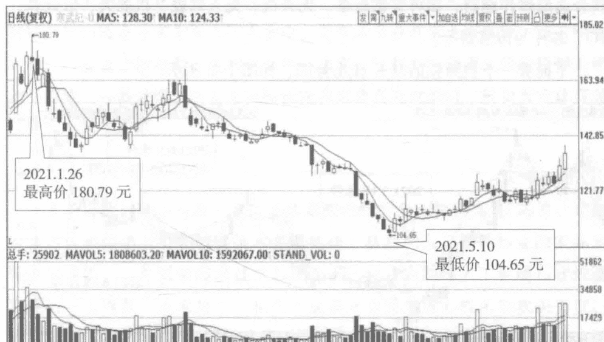

图 1-1 寒武纪（688256）日 K 线走势图

#### 三、 资金追逐的“流量密码”

短线看资金，资金逐题材。好故事、强预期、易传播的标的，最易吸引跟风盘接力。政策东风下，AI 衍生题材层出不穷：机器人、无人驾驶、芯片、传感器、5G、云计算……

埃斯顿便是受益者之一。作为国产工业机器人龙头，掌握核心运动控制技术，完美契合“自主可控”主线。2021 年 6 月短短数日双涨停，是资金情绪狂欢的注脚。

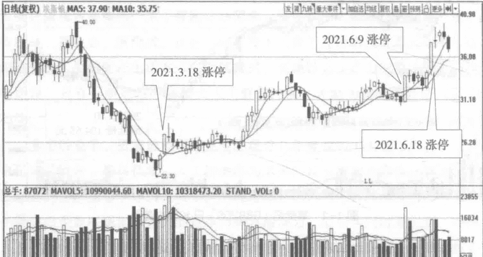

图 1-2 埃斯顿（002747）日 K 线走势图

### 第二节 AI 板块选股四大铁律

技术迭代快、门槛高、企业多处初创期、盈利不稳——这是 AI 板块的画像，也让选股难度指数级上升。实战中，建议死磕四条主线：

#### 一、 死盯核心技术攻关

AI 芯片、高端传感器、机器学习……这些“皇冠上的明珠”领域，技术壁垒最高，也是国产替代的主攻方向。一旦某企业实现“从 0 到 1”突破，股价往往开启主升浪。

以 IP 核（芯片设计核心知识产权）为例，国际上 ARM、新思科技、Cadence 三分天下。国内仅芯原股份挤入全球前十，份额虽小，但国产替代浪潮下，确定性极高。

芯原股份科创板上市后，首波涨幅回吐可视为估值回归。2021 年 5 月底探 51 元后企稳，6 月守住 70 元关口。虽亏损，但市场用脚投票，认可其“稀缺护城河”。

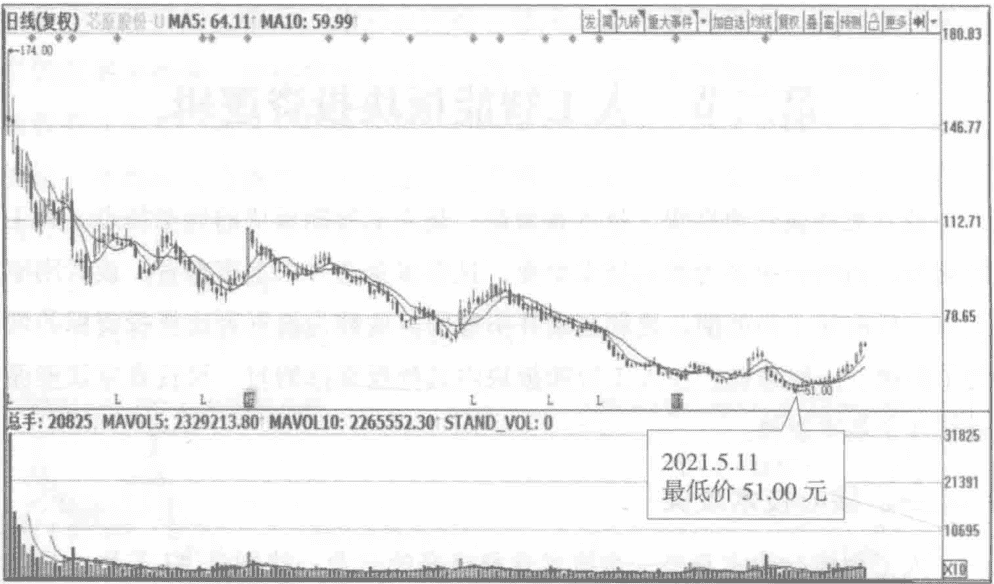

图 1-3 芯原股份（688521）日 K 线走势图

#### 二、 押注细分龙头“隐形垄断”

AI 细分赛道多在培育期，盈利薄但前景广。此时锁定具备垄断优势的细分龙头，往往能比市场更早享受戴维斯双击。趁估值未高、预期未透时潜伏，是胜算极大的策略。

科大讯飞即智能语音领域的“绝对统治者”。政策红利加持下，股价从 2017 年 5 月 17 元起步，三年多振荡翻三倍，最高触及 57 元，教科书级别的龙头行情。

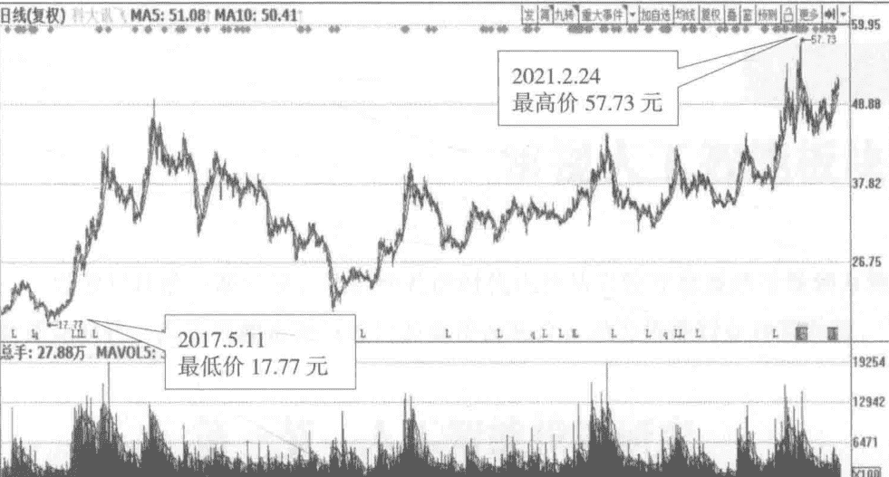

图 1-4 科大讯飞（002230）日 K 线走势图

## 第二章 深度解剖 AI 产业版图

时代正从“万物互联”跨越至“万物智能”。AI 正以前所未有的渗透力，重塑千行百业。

### 第一节 AI 投资研究框架

2016 年《“十三五”规划》首次将 AI 写入国家纲领，标志着产业化进程加速。

#### 一、 AI 进化三部曲

从 50 年代萌芽到产业化落地，历经三个阶梯：

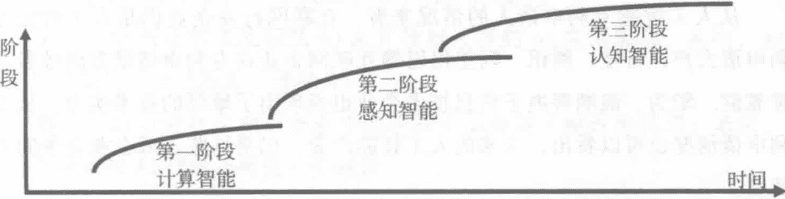

图 2-1 人工智能发展的三个阶段

1.  **计算智能**：强算力、大存储、专用领域模拟分析（如深蓝下棋）。
2.  **感知智能**：听得见、看得懂。语音/图像识别、自动驾驶，模拟人类视听觉（当前主流阶段）。
3.  **认知智能**：会思考、能决策。机器具备逻辑、形象甚至创造性思维，实现人机无障碍协作，全面替代人力（终极目标）。

**核心结论**：国内整体仍处“感知智能”早期。数据、算力、算法构成铁三角——数据是粮，算力是灶，算法是厨师（灵魂）。

#### 二、 专利视角看竞争格局

专利数量是技术积淀的硬指标。2019 年底中国 AI 专利申请量反超美国居全球首位（2020 年 2 月近 69.4 万件）。

**申请主力军**：BAT 等互联网巨头领跑，华为、浪潮等硬核科技紧随。未来主战场依然是头部巨头的厮杀。

**热门技术向**：云计算占比 18.38% 居首，其次计算机视觉、深度学习、自动驾驶、智能机器人。

**全球三足鼎立**：美（技术霸主）、欧、中（后发追赶）三极格局。
1.  美技术护城河深，中欧仍在追赶；
2.  国内 AI 企业 2014 年后才跑步入场，大量独角兽（商汤、旷视、云从、依图等）尚未或刚上市；
3.  国际巨头靠钞能力“买买买”快速布局（微软、谷歌、亚马逊频繁并购），易形成垄断；国内 BATJ 及 VC 亦跟进投资；
4.  国内地域分化显著：京沪深领跑，东北、西北相对滞后。

#### 三、 产业演进三大确定性趋势

1.  **重心下沉**：主战场从芯片（基础层）转移至应用层，AI 与制造、公共服务深度融合。
2.  **金融先行**：AI 在银行/金融场景价值验证最充分，深度绑定将持续。
3.  **场景爆发**：To B 企服、智能家居、穿戴、车载、机器人成落地主阵地。

### 第二节 产业链竞争全景扫描

AI 产业链自下而上分三层：

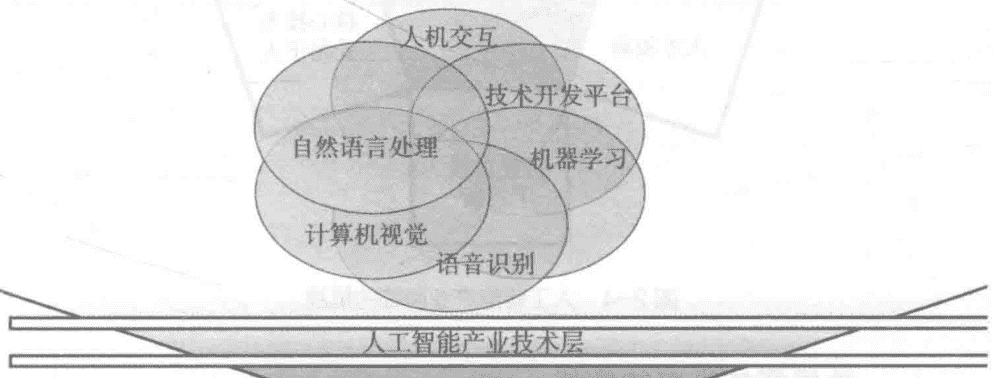

图 2-2 人工智能产业链

| 层级 | 核心载体 |
| :--- | :--- |
| **应用层** | AI 产品、开放平台、行业解决方案 |
| **技术层** | 深度学习算法、AI 框架、核心技术模块 |
| **基础层** | AI 芯片、传感器、基础设施（大数据/云/5G） |

#### 一、 基础层：算力与数据的“水电煤”

**1. AI 芯片——产业皇冠上的明珠。** 设计端外资垄断（英伟达等），华为海思、寒武纪等国产力量正在突围。代工端中芯国际虽追赶台积电，但差距正在收敛。

**2. 传感器——感知世界的“五官”。** 从芯片设计到封测全链条均具投资价值。士兰微（芯片制造）、晶方科技（封装龙头）均为细分龙头。

**3. 底座技术：** 云计算、大数据、5G 通信，构成 AI 运行的基建设施。

#### 二、 技术层：算法与模型的“炼丹炉”

核心任务：海量数据训练 + 推理。神经网络、知识图谱、语音/图像识别均在此层。

国内第一梯队：科大讯飞（已上市），商汤、旷视、云从、依图“AI 四小龙”（均未上市，**投资者需重点关注其 IPO 进程与打新/上市首日机会**）。


图 2-3 人工智能产业技术层

#### 三、 应用层：百花齐放的“变现场”

落地最广、企业最杂。金融、安防、客服、机器人、智能音箱、无人机发展领跑。BATJ 布局最全、护城河最宽。

### 第三节 直面挑战：繁华背后的隐忧

高歌猛进中，四大拦路虎不容忽视：

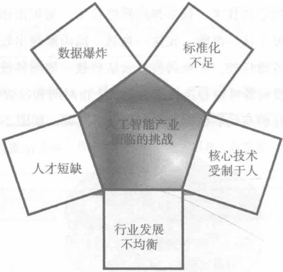

图 2-4 人工智能产业面临的挑战

#### 一、 数据爆炸的处理困局

AI、云计算、物联网、5G 叠加，引发数据几何级增长。存储、清洗、标注、计算压力指数级上升，基础设施建设严重滞后于数据产生速度。

#### 二、 数据标准化缺位

（素材截止于此，后续内容待续）

## 三、 核心技术“卡脖子”现象明显

纵观国内AI产业现状，关键核心技术仍受制于人。尤以AI芯片、高端传感器为甚，国产替代率依然偏低，自主可控之路任重道远。

## 四、 赛道发展两极分化

从应用落地看，行业发展极不均衡。金融、科技、安防、教育等领域跑出了加速度，但AI与传统实体经济的深度融合才刚刚起步，这恰恰是中国AI未来的主攻方向。

## 五、 高端人才供给严重不足

行业狂飙突进，对顶尖技术人才的渴求与日俱增。短期内，细分赛道的人才缺口只会扩大不缩，深度学习等核心领域的“饥渴”尤为突出，已成制约产业进阶的关键变量。

# 第三章 AI板块投资价值深度解析

估值，是股票投资的基石。对价值投资者而言，能否给出相对靠谱的估值，直接决定成败。市场上从不缺寻找“估值圣杯”的人，但必须清醒：**无人能精准计算股票真实价值**。我们只能借助科学工具，大致摸清内在价值与市价的偏离程度，据此决策。

### 第一节 透视AI企业财报：估值的基石

财报是估值选股的“体检报告”。但AI板块多聚集初创科技企业，其财报解读逻辑与传统行业大相径庭。本节为财报基础进阶，若已掌握可直接跳过。

#### 一、 资产负债表：摸清家底

无论投什么，先看资产。资产负债表（财务状况表）是特定日期（通常为期末）企业“家底”的快照，由资产、负债、所有者权益三部分构成，遵循“资产=负债+所有者权益”恒等式。上市公司每季必披，与利润表、现金流表并列三大核心报表。

##### 1. 资产端拆解：流动与非流动

打开交易软件【F10】-【财务概况】-【资产负债表】，即可调取完整数据。受限篇幅，先看资产端。以科大讯飞（002230）为例（见表3-1）。

| 科目\年度 | 2020 | 2019 | 2018 | 2017 | 2016 |
| :--- | :--- | :--- | :--- | :--- | :--- |
| **流动资产合计(元)** | **149.78亿** | **114.30亿** | **77.62亿** | **72.43亿** | **55.33亿** |
| 货币资金(元) | 53.50亿 | 38.29亿 | 24.01亿 | 26.44亿 | 25.40亿 |
| 应收票据及应收账款(元) | 57.33亿 | 53.08亿 | 33.92亿 | 26.46亿 | 18.27亿 |
| 存货(元) | 23.79亿 | 8.26亿 | 10.40亿 | 8.90亿 | 6.04亿 |
| **非流动资产合计(元)** | **98.60亿** | **86.71亿** | **75.40亿** | **60.98亿** | **48.81亿** |
| 长期股权投资(元) | 5.70亿 | 4.22亿 | 3.79亿 | 3.17亿 | 2.89亿 |
| 固定资产合计(元) | 18.39亿 | 20.01亿 | 19.07亿 | 14.54亿 | 10.60亿 |
| 无形资产(元) | 19.08亿 | 20.51亿 | 16.25亿 | 11.33亿 | 10.71亿 |
| 商誉(元) | 11.11亿 | 11.21亿 | 11.22亿 | 11.22亿 | 11.26亿 |
| **资产合计(元)** | **248.39亿** | **201.01亿** | **153.03亿** | **133.40亿** | **104.14亿** |

**表 3-1 科大讯飞资产结构一览**

**资产，通俗说就是企业“能用来赚钱的所有资源”**。既包括自有资金买来的（所有者权益），也包括借来的钱买的（负债）。会计上按变现速度分为流动、非流动两类。

###### (1) 流动资产：一年内能变现的“活钱”

指一年或一个营业周期内能变现/耗用的资产。核心三件套：**货币资金（最硬）、存货（卖货回款）、应收账款（欠款回笼）**。

*   **货币资金为王**。讯飞2020年账面现金53.5亿，充裕。
*   **应收账款藏雷**。同期应收票据账款57.33亿，连续两年高企，增速超营收。**应收越高，坏账风险越大，现金流压力越重，投资者须高度警惕。**
*   **存货激增**。2020年存货23.79亿，同比近乎翻三倍，需关注是否存在积压、跌价风险。

###### (2) 非流动资产：变现慢、折损大的“沉淀资产”

超一年或一个周期无法变现的资产。重点关注三类：

*   **长期股权投资**：对外投资占股。关注被投企业上市潜力、热门概念加持，可能带来投资收益或股价催化。
*   **固定资产**：房厂机器，生产经营用、超12个月、价值达标。重资产企业易固定资产高企，短期难变现，破产清算大打折扣；但也存折旧完仍创造价值的“隐形资产”。**分析时需辩证看待，别光盯着账面值。**
*   **无形资产**：专利、商标、商誉等无形态资源。品牌价值常被会计低估，投资者需自行估价补足。
    *   **商誉是高危区**。收购溢价形成，被购方业绩变脸即“商誉减值暴雷”。讯飞2020年商誉11.11亿，存减值风险，需持续跟踪业绩承诺完成情况。

##### 2. 负债端透视：欠下的债到底有多重

资产=负债+权益，负债即企业必须以资产/劳务偿还的债务。负债过重、资不抵债，破产在即。分流动、非流动两类。讯飞负债端见表3-2。

| 项目 | 2020 | 2019 | 2018 | 2017 | 2016 |
| :--- | :--- | :--- | :--- | :--- | :--- |
| **流动负债合计(元)** | **103.92亿** | **68.66亿** | **58.13亿** | **44.95亿** | **25.21亿** |
| 短期借款(元) | 6.43亿 | 7.33亿 | 7.17亿 | 4.21亿 | 3.06亿 |
| 应付票据及应付账款(元) | 52.34亿 | 30.88亿 | 21.63亿 | 13.53亿 | 9.13亿 |
| 合同负债(元) | 16.68亿 | - | - | - | - |
| **非流动负债合计(元)** | **14.72亿** | **15.00亿** | **12.78亿** | **8.93亿** | **6.74亿** |
| 长期借款(元) | 8247.40万 | 3.98亿 | 3.67亿 | 4.61亿 | 3.71亿 |
| 预计负债(元) | 7.03亿 | 6.16亿 | 5.74亿 | 2.94亿 | 2.11亿 |
| **负债合计(元)** | **118.64亿** | **83.66亿** | **70.91亿** | **53.88亿** | **31.95亿** |

**表 3-2 科大讯飞负债结构一览**

###### (1) 流动负债：短期偿债压力测试

一年内到期债务，需匹配充足流动资产。核心项：短期借款、应付账款、应付职工薪酬、税费、**合同负债（新准则下的预收账款）**。

*   **应付账款激增至52.34亿**，显示上游话语权增强，占用供应商资金。
*   **合同负债16.68亿**系预收货款，**反映企业对下游强控制力，是优质负债**，但需兑现交付。

###### (2) 非流动负债：长期资本结构

超一年到期债务，主含长期借款、应付债券、专项应付款等。讯飞长期借款下降趋势明显，长期偿债压力可控。

##### 3. 所有者权益：股东真实的“净资产”

权益=资产-负债，即股东剩余索取权。权益越厚，抗风险越强。核心构成：实收资本、资本公积、盈余公积、未分配利润。讯飞权益表见表3-3。

| 项目 | 2020 | 2019 | 2018 | 2017 | 2016 |
| :--- | :--- | :--- | :--- | :--- | :--- |
| 实收资本（股本）(元) | 22.25亿 | 21.99亿 | 20.93亿 | 13.89亿 | 13.15亿 |
| 资本公积(元) | 73.39亿 | 69.69亿 | 45.88亿 | 52.54亿 | 41.21亿 |
| 减：库存股(元) | 8.79亿 | 7.68亿 | 10.40亿 | 8.52亿 | - |
| 盈余公积(元) | 2.19亿 | 1.51亿 | 1.16亿 | 1.12亿 | 1.11亿 |
| 未分配利润(元) | 37.66亿 | 28.67亿 | 22.14亿 | 18.15亿 | 15.14亿 |
| **归母权益合计(元)** | **126.70亿** | **114.18亿** | **79.71亿** | **77.18亿** | **70.61亿** |
| **权益合计(元)** | **129.74亿** | **117.35亿** | **82.12亿** | **79.53亿** | **72.19亿** |

**表 3-3 科大讯飞所有者权益一览**

###### (1) 实收资本：股本的另一种说法

实收资本=股数×票面面值（通常1元/股）。讯飞2020年股本22.25亿股，实收资本22.25亿。**注意例外**：如紫金矿业面值0.1元，股本253.77亿股，实收资本仅25.38亿。选股时留意总股本与面值，防稀释。

###### (2) 资本公积：股东溢价投入+非经营收益

讯飞资本公积73.39亿，远超股本，说明定增/增发溢价高，也为高送转留足弹药。

###### (3) 库存股：回购未注销股份

讯飞库存股8.79亿，管理层回购力度大，释放看好信号，且减少流通盘利于股价。

###### (4) 未分配利润：历年留存的“家底”

讯飞未分配利润37.66亿逐年递增，盈余积累扎实，分红抗跌有保障。

---

**核心提示**：财报阅读非死记硬背科目，**要看趋势、看结构、看匹配度**。流动资产对流动负债（偿债能力），应收账款对营收（回款质量），商誉对业绩承诺（暴雷风险），权益厚度对波动率（安全边际）。下节将深入利润表与现金流表，立体重构AI企业盈利模型。

###### 解读所有者权益：科大讯飞资产负债透视

| 负债和所有者权益（或股东权益）合计（元） | 248.39亿 | 201.01亿 | 153.03亿 | 133.40亿 | 104.14亿 |

**核心看点：所有者权益的三大支柱**

##### 资本公积——溢价与送股的“蓄水池”

简单说，资本公积是公司经营之外“额外进账”的积累。来源主要有三类：受捐赠、股本溢价、资产重估增值。打个比方，有人无偿给公司捐款 100 万，这笔钱直接进资本公积账户。

最常见的大头是**股本溢价**。A 股股票面值通常 1 元，但发行价远高于此，差价部分全计入资本公积。

```
例如，某公司上市发行股票 2000 万股，发行价格为 10 元，那么，其

资本溢价金 = (10-1) × 2000 万

= 18000 万元
```

这 1.8 亿溢价就会并入资本公积（暂不考虑税费）。IPO 发行时涌入的巨额溢价，未来可能转增资本（送股），这也是新股备受追捧的隐性逻辑之一。

##### 盈余公积——利润沉淀的“后备箱”

这是公司从税后净利润里“强制储蓄”下来的钱，用途专款专用。包含法定盈余公积、任意盈余公积、法定公益金。一般规定，每年提取净利润的 10% 左右，累计达到注册资本 50% 可停提。

这笔钱用处不小：**填补亏损、扩大生产、转增资本派送新股**。很多上市公司送股方案，动用的就是这笔积累。投资者看年报时，留意资本公积和盈余公积的体量，就能大致摸清公司有无“送股潜力”。

##### 未分配利润——分红潜力的“晴雨表”

顾名思义，这是留待未来分配的利润池。计算公式大致是：当年净利润 - 提取盈余公积 = 可供分配利润。但现实中，很多上市公司账上躺着巨额未分配利润却不分红，原因无他——缺钱扩张。

**实战经验：** 年报披露后，未分配利润充裕的公司，分红概率和力度通常更大。这也是成长股长期吸引资金的关键支撑。

---

###### 利润表深度拆解：看懂 AI 企业的赚钱逻辑

利润表是企业一段时期“成绩单”，按季披露，核心看收入、支出构成及最终净利润。项目自上而下排列，逻辑清晰。重点盯紧以下科目（数据见图 3-4）。

| 科目\年度 | 2020 | 2019 | 2018 | 2017 | 2016 |
|---|---|---|---|---|---|
| 一、营业总收入(元) | 130.25亿 | 100.79亿 | 79.17亿 | 54.45亿 | 33.20亿 |
| 其中：营业收入(元) | 130.25亿 | 100.79亿 | 79.17亿 | 54.45亿 | 33.20亿 |
| 二、营业总成本(元) | 127.33亿 | 98.61亿 | 77.17亿 | 50.62亿 | 30.83亿 |
| 其中：营业成本(元) | 71.48亿 | 54.40亿 | 39.57亿 | 26.47亿 | 16.43亿 |
| 营业税金及附加(元) | 7893.10万 | 6729.56万 | 8187.83万 | 4257.26万 | 3023.05万 |
| 销售费用(元) | 20.84亿 | 17.80亿 | 17.26亿 | 11.11亿 | 6.49亿 |
| 管理费用(元) | 8.57亿 | 7.07亿 | 6.24亿 | 5.81亿 | 7.29亿 |
| 研发费用(元) | 22.11亿 | 16.40亿 | 12.63亿 | 5.96亿 | - |
| 财务费用(元) | 1620.10万 | -370.70万 | -1666.25万 | -2583.76万 | -3372.90万 |
| 其中：利息费用(元) | 6241.68万 | 6815.01万 | 5675.09万 | 4111.61万 | - |
| 利息收入(元) | 5622.36万 | 7560.66万 | 7293.65万 | 6987.82万 | - |
| 资产减值损失(元) | 3781.48万 | 701.38万 | 8318.83万 | 1.10亿 | 6560.94万 |
| 信用减值损失(元) | 2.99亿 | 2.24亿 | - | - | - |
| 加：公允价值变动收益(元) | 3.55亿 | -442.29万 | -14.31万 | - | - |
| 投资收益(元) | 3209.15万 | 1.12亿 | 7479.60万 | 4871.67万 | 1.47亿 |
| 其中：联营企业和合营企业的投资收益(元) | -297.33万 | -379.36万 | -378.79万 | 2016.11万 | 1223.99万 |
| 资产处置收益(元) | 1701.08万 | 17.93万 | 76.27万 | 573.67万 | 967.94万 |
| 其他收益(元) | 7.41亿 | 6.63亿 | 3.52亿 | 1.02亿 | - |
| 三、营业利润(元) | 14.37亿 | 9.88亿 | 6.28亿 | 5.40亿 | 3.93亿 |
| 加：营业外收入(元) | 1.41亿 | 7409.68万 | 6813.71万 | 4942.73万 | 1.81亿 |
| 其中：非流动资产处置利得(元) | - | - | - | - | - |
| 减：营业外支出(元) | 1.22亿 | 6664.35万 | 3719.15万 | 1189.47万 | 1363.31万 |
| 其中：非流动资产处置损失(元) | - | - | - | - | - |
| 四、利润总额(元) | 14.57亿 | 9.95亿 | 6.59亿 | 5.77亿 | 5.61亿 |
| 减：所得税费用(元) | 1485.24万 | 5235.04万 | 4075.85万 | 9787.30万 | 6408.14万 |
| 五、净利润(元) | 14.42亿 | 9.43亿 | 6.18亿 | 4.79亿 | 4.97亿 |
| （一）持续经营净利润(元) | 14.42亿 | 9.43亿 | 6.18亿 | 4.79亿 | 4.97亿 |
| 归属于母公司所有者的净利润(元) | 13.64亿 | 8.19亿 | 5.42亿 | 4.35亿 | 4.84亿 |
| 少数股东损益(元) | 7799.44万 | 1.24亿 | 7590.51万 | 4450.37万 | 1234.79万 |
| 扣除非经常性损益后的净利润(元) | 7.67亿 | 4.89亿 | 2.66亿 | 3.59亿 | 2.55亿 |
| 六、每股收益(元) | | | | | |
| （一）基本每股收益(元) | 0.64 | 0.40 | 0.27 | 0.22 | 0.37 |
| （二）稀释每股收益(元) | 0.61 | 0.38 | 0.26 | 0.21 | 0.37 |
| 七、其他综合收益(元) | -55.83万 | 47.54万 | 109.46万 | -18.09万 | -25.66万 |
| 归属母公司所有者的其他综合收益(元) | -18.77万 | 27.56万 | 86.05万 | -14.33万 | -25.66万 |
| 八、综合收益总额(元) | 14.41亿 | 9.44亿 | 6.19亿 | 4.79亿 | 4.97亿 |
| 归属于母公司股东的综合收益总额(元) | 13.64亿 | 8.19亿 | 5.43亿 | 4.35亿 | 4.84亿 |
| 归属于少数股东的综合收益总额(元) | 7762.38万 | 1.24亿 | 7613.92万 | 4446.62万 | 1234.79万 |

**图 3-4 科大讯飞（002230）利润表**

##### 营业收入：核心业务的“含金量”

营业收入反映主营业务产出。收入越高、占比越重，说明公司越聚焦核心赛道，未来成长性越强；反之若依赖理财、卖资产等非营业收入，主业根基必然动摇。

**进阶指标——主营业务收入：** 比营业收入更硬核，能剔除杂项干扰。可惜现年报披露多元化经营普遍，很难严格区分。投资时，专注细分领域且建立护城河的“专精特新”型企业，抗风险能力往往更强。

##### 营业成本：利润空间的“分水岭”

成本是收入的镜像。正常经营下，成本必须低于收入。两者比值（成本率）直接暴露成本控制能力。成本率持续下降或维持低位，意味着议价强、护城河深；反之则需警惕原材料涨价或技术落后导致的利润蚕食。

##### 管理费用：运营效率的“体温计”

行政管理部门为组织生产发生的开支，属相对刚性支出。若公司规模无剧烈变动（扩张、并购、裁员），管理费用应平稳运行。**一旦单季或单年大幅跳变，必有蹊跷**——或是管理失控，或是财务造假前兆，投资者需逐笔追溯成因及对利润的冲击。

##### 销售费用：市场拓展的“成本单”

卖货花的钱：保险、包装、展会、广告、运输、装卸、质保损失，以及专设销售/售后网点的人工、折旧、业务费等。这笔钱直接映射产品的市场推广强度和渠道建设成本。

##### 财务费用：借贷规模的“隐形吞噬者”

融资成本。向银行、机构借钱要付利息，规模越大、利息越高，财务费用越高。**高财务费用像水滴石穿，长期会大幅稀释股东回报**。看利润表时，别只盯净利润，要扣除财务费用看“真盈利”。

---

###### 现金流量表实战：现金为王，识破粉饰陷阱

现金流量表以现金为基础，记录经营、投资、筹资三大活动对现金的实时冲击。它不讲应收应付，只讲真金白银到账没到账。科大讯飞近五年现金流全景见图 3-5。

| 科目/年度 | 2020 | 2019 | 2018 | 2017 | 2016 |
|---|---|---|---|---|---|
| 一、经营活动产生的现金流量(元) | | | | | |
| 销售商品、提供劳务收到的现金(元) | 126.20亿 | 93.00亿 | 75.86亿 | 50.15亿 | 32.94亿 |
| 收到的税费返还(元) | 1.78亿 | 2.08亿 | 1.35亿 | 7212.67万 | 5228.94万 |
| 收到其他与经营活动有关的现金(元) | 9.81亿 | 7.66亿 | 5.02亿 | 2.24亿 | 1.68亿 |
| 经营活动现金流入小计(元) | 137.80亿 | 102.74亿 | 82.22亿 | 53.12亿 | 35.15亿 |
| 购买商品、接受劳务支付的现金(元) | 62.69亿 | 42.80亿 | 33.89亿 | 26.03亿 | 17.61亿 |
| 支付给职工以及为职工支付的现金(元) | 25.86亿 | 25.40亿 | 18.71亿 | 11.28亿 | 6.85亿 |
| 支付的各项税费(元) | 8.24亿 | 5.87亿 | 6.06亿 | 3.26亿 | 1.91亿 |
| 支付其他与经营活动有关的现金(元) | 18.29亿 | 13.36亿 | 12.08亿 | 8.93亿 | 5.78亿 |
| 经营活动现金流出小计(元) | 115.09亿 | 87.42亿 | 70.74亿 | 49.49亿 | 32.15亿 |
| 经营活动产生的现金流量净额(元) | 22.71亿 | 15.31亿 | 11.48亿 | 3.63亿 | 2.99亿 |
| 二、投资活动产生的现金流量(元) | | | | | |
| 收回投资收到的现金(元) | 7.39亿 | 1.13亿 | 4.62亿 | 4304.15万 | 3.71亿 |
| 取得投资收益收到的现金(元) | 2658.51万 | 436.09万 | 5019.03万 | 2817.86万 | 2459.78万 |
| 处置固定资产、无形资产和其他长期资产收回的现金净额(元) | 2.18亿 | 440.54万 | 1150.01万 | 404.47万 | 397.35万 |
| 处置子公司及其他营业单位收到的现金净额(元) | 6650.47万 | - | -1003.22万 | 673.91万 | -162.80万 |
| 收到其他与投资活动有关的现金(元) | 3641.30万 | 4278.24万 | 3446.17万 | 5443.62万 | 5602.19万 |
| 投资活动现金流入小计(元) | 10.86亿 | 1.65亿 | 5.48亿 | 1.36亿 | 4.54亿 |
| 购建固定资产、无形资产和其他长期资产支付的现金(元) | 12.49亿 | 18.07亿 | 18.23亿 | 10.36亿 | 10.05亿 |
| 投资支付的现金(元) | 5.69亿 | 11.77亿 | 2.79亿 | 4.90亿 | 1.99亿 |
| 取得子公司及其他营业单位支付的现金净额(元) | 320.42万 | - | 3.65亿 | 1.10亿 | 1.16亿 |
| 支付其他与投资活动有关的现金(元) | - | - | - | - | - |
| 投资活动现金流出小计(元) | 18.21亿 | 30.64亿 | 24.68亿 | 16.36亿 | 13.76亿 |
| 投资活动产生的现金流量净额(元) | -7.35亿 | -28.99亿 | -19.20亿 | -15.00亿 | -9.23亿 |
| 三、筹资活动产生的现金流量(元) | | | | | |
| 吸收投资收到的现金(元) | 5.32亿 | 29.29亿 | 2.12亿 | 12.35亿 | 1.43亿 |
| 其中：子公司吸收少数股东投资收到的现金(元) | 4113.50万 | 6355.23万 | 1346.24万 | 6715.80万 | 793.61万 |
| 取得借款收到的现金(元) | 13.58亿 | 8.35亿 | 11.43亿 | 5.63亿 | 7.22亿 |
| 收到其他与筹资活动有关的现金(元) | - | - | 807.79万 | - | 5151.13万 |
| 筹资活动现金流入小计(元) | 18.90亿 | 37.64亿 | 13.63亿 | 17.98亿 | 9.17亿 |
| 偿还债务支付的现金(元) | 16.01亿 | 8.77亿 | 8.01亿 | 3.59亿 | 2.84亿 |
| 分配股利、利润或偿付利息支付的现金(元) | 3.75亿 | 2.85亿 | 2.03亿 | 1.68亿 | 1.54亿 |
| 其中：子公司支付给少数股东的股利、利润(元) | 370.00万 | - | 921.00万 | - | - |
| 支付其他与筹资活动有关的现金(元) | 933.64万 | 2218.83万 | 569.73万 | 1453.55万 | 25.43万 |
| 筹资活动现金流出小计(元) | 19.86亿 | 11.84亿 | 10.10亿 | 5.42亿 | 4.38亿 |
| 筹资活动产生的现金流量净额(元) | -9517.78万 | 25.80亿 | 3.54亿 | 12.57亿 | 4.79亿 |
| 四、汇率变动对现金及现金等价物的影响(元) | -303.08万 | 86.23万 | 462.52万 | -32.43万 | 17.80万 |
| 五、现金及现金等价物净增加额(元) | 14.37亿 | 12.13亿 | -4.13亿 | 1.19亿 | -1.44亿 |
| 加：期初现金及现金等价物余额(元) | 34.20亿 | 22.07亿 | 26.20亿 | 25.00亿 | 26.45亿 |
| 六、期末现金及现金等价物余额(元) | 48.57亿 | 34.20亿 | 22.07亿 | 26.20亿 | 25.00亿 |

**图 3-5 科大讯飞（002230）现金流量表**

重点锁定经营性现金流中的两个关键项：

##### 经营性现金流入：变现能力的“硬指标”

**“销售商品、提供劳务收到的现金”** 含双层深意：
1.  **来源纯正**：仅限核心业务卖货/服务收款，理财、卖资产的钱不算。
2.  **实收主义**：只有当期真到账才算数。合同签了、发票开了、钱没到账——不算；上期收入本期到账——算本期。

**这笔钱的多寡，直观反映三点：**
*   **议价权/行业地位**：强势方款到发货，弱势方垫资赊销。
*   **商业信誉**：信誉好，融资、预收款自然多。
*   **盈利质量**：利润表赚几亿，现金流只收几千万，大概率是“纸面富贵”。

*提示：因预收/应收账款存在，该数字与利润表营业收入常有差异，属正常现象，无需过度纠结缺口。*

##### “其他经营性现金流”：粉饰报表的“重灾区”

**“收到其他与经营活动有关的现金”** 是上述核心项的补充，**也是造假高发区**。为美化经营性现金流净额，不少公司把借款、理财到期款、关联方往来塞进这个科目，制造“经营性现金流充沛”假象。

**避坑指南：**
*   多数炒股软件不单独抓取该科目数据。
*   **必须去读原版财报附注**，核对具体来源。
*   问自己：这笔钱是真经营往来，还是临时周转、甚至财技造假引入的“过桥资金”？

现金流不说谎，但编造现金流的人会说谎。看透“其他”科目，是价值投资者分辨优劣的必修课。

# AI选股避坑指南：财报核心指标与估值实战解析

**核心提示：** 炒股软件里的财务摘要只能管中窥豹，想真摸清家底，还得啃完整年报、研审计意见。一旦看到“非标意见”（无法表示意见、保留意见），直接踢出备选池。现金流表里，“经营性现金流净额”得是正数，长期为负的企业，大概率跑不出成长股行情。

## 第二节 AI赛道估值体系实战拆解

当前AI板块主流估值工具箱里，PE（市盈率）、PB（市净率）、PEG（市盈率相对盈利增长比率）是“三板斧”。

### 一、 PE估值：搞懂“静动”之分，算出真价值

市盈率本质上算的是“回本周期”。公式简单：`股价 ÷ 每股收益（EPS）`。PE=20倍，按今年利润不变，20年回本。

#### 1. 静态vs动态：别让当下的高估值吓跑了未来的十袋股

软件里直接能看到俩数字（如汇川技术300124）：

*   **静态PE（滚动/TTM）：** 用最新股价除去年全年EPS。汇川2020年EPS 1.22元，按2021年6月股价算，静态PE约82倍。按这速度回本要82年？别急，这行业都这样。
*   **行业特殊性：** AI处于早期投入期，盈利端未完全释放，加上科技自立自强的政策风口，资金愿意为“确定性成长”支付高溢价，导致整个板块PE重心上移。

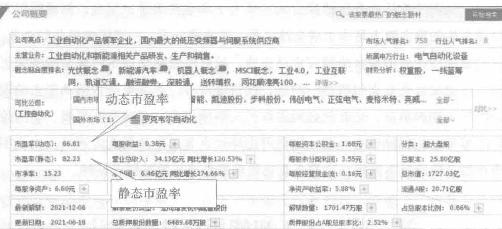

*图示：汇川技术基本财务数据截图*

*   **动态PE（Forward PE）：** 引入增长率（g）和可持续年限（n）修正静态PE。
    `动态PE = 静态PE × 1/(1+g)^n`
    **实战案例：** 假设某股静态PE 50倍，未来5年能稳增20%。动态PE ≈ 50 × 0.4 ≈ **20倍**。瞬间变“便宜”了。
    **结论：** **选股核心逻辑——买得起“高静态PE”，前提是买到“高确定性成长”。**

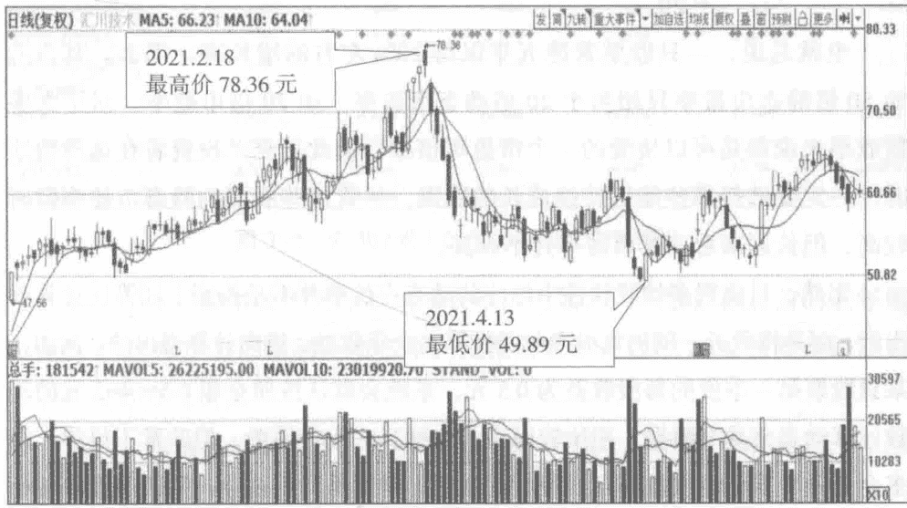

*图示：汇川技术日K线走势图*

> **避坑指南：** 软件自带的“动态PE”往往是“季度EPS×4”粗算得来。很多公司四季度业绩占比极高（如消费电子、年终冲单），这种算法严重失真，**建议自建模型测算**。

#### 2. 目标价测算三步法：EPS × 增长率 × 合理PE区间

以汇川技术为例（2021年6月复盘视角）：

1.  **基准EPS：** 2020年 1.22元。
2.  **预判增速：** 近三年波动大（-18%~+120%），但趋势向上。2021年订单饱满，保守设定 **50%增速**。→ 2021年预测EPS = 1.22 × 1.5 = **1.83元**。
3.  **给估值：** AI龙头合理PE中枢设 **50倍**。→ 目标价 = 1.83 × 50 = **91.5元**。
    *保守派打七折：* 64元附近。

**实盘对标：** 2021.6.22股价 67.5元，处于保守目标价上方、激进目标价下方，**属于“低估值区间”，具备配置价值**。
*关键监控点：* 一旦增速不及预期（如仅增20%），模型即刻失效，需动态调整。

---

### 二、 PB估值：资产重估视角，适合重资产/周期型AI标的

公式：`股价 ÷ 每股净资产（BVPS）`。PB=1是生死线。

*   **PB < 1（破净）：** 理论上清算分资产也赚。但通常意味着ROE低、市场不信未来，**长期横盘概率大**，除非大牛市“普涨”能捡漏。
*   **PB > 1：** 溢价买入资产，市场认可其盈利能力与成长性。

**AI板块PB画像（数据截图参考）：** 头部硬科技（科沃斯、石头科技、寒武纪等）PB普遍 **10~40倍** 甚至更高；软件/平台类（同花顺、科大讯飞）PB **10~12倍**；制造/自动化链（汇川、埃斯顿）相对合理。说明**市场用PB给“硬科技/消费电子”高溢价，给“工业自动化”相对估值**。

```
动态市盈率 = 50 × [ 1 / ( 1+20% ) 5 ]
= 50 × 0.4
= 20
```

*表格：AI板块个股PB排序截图（含*ST博信、科沃斯、同花顺、石头科技等)*

---

### 三、 PEG估值：成长股的“性价比”尺子（素材虽未详展，实战必补）

`PEG = PE / 净利润增速(%)`。
*   **PEG < 1：** 低估（增速跑赢估值）。
*   **PEG > 1：** 高估。
*   **PEG < 0：** 亏损或负增长，失效。

**AI选股黄金法则：** **低PEG > 低PE**。宁可买PE 60倍、增速80%（PEG 0.75）的龙头，别买PE 20倍、增速5%（PEG 4）的伪成长。

---

### 实战清单：下次调研/选股前，先跑通这三遍数

| 维度 | 核心动作 | 通过标准 |
| :--- | :--- | :--- |
| **财报健康度** | 读完整年报、查审计意见、验“经营性现金流净额>0” | 标准无保留意见 + 长期正向经营现金流 |
| **PE估值锚定** | 算静态PE、自测动态PE(含g/n)、设合理PE区间、算目标价 | 当前价 ≤ 保守目标价；增速确定性高 |
| **PB辅助确认** | 对比历史分位、行业横向、ROE匹配度 | 高ROE匹配高PB；低ROE高PB坚决不碰 |
| **PEG终裁** | PE ÷ 预测增速 | **PEG < 1 为核心买入信号** |

> **写在最后：** 估值不是算数学题，是对“商业模式确定性”定价。AI赛道，**确定性溢价 > 估值绝对值**。用现金流验过去，用动态PE/PEG定未来，用PB守底线。祝你在算力与应用的浪潮里，捕获确定性的Alpha。

# AI赛道估值三板斧：PB定位、PEG动态诊断与对标定价法

## 一、 市净率（PB）视角下的板块定位

2021年6月23日统计显示，A股挂牌的AI概念股合计163只（含大量蹭热度标的）。净资产倍数区间跨度惊人：*ST博信高达120倍领跑，苏宁易购不足1倍垫底。以汇川技术为例，其PB约15倍，在板块内属于高估值梯队。

**实操参考**：投资者可借助横向对比，快速锁定目标个股在板块内的估值分位。原则上应规避PB严重偏离的标的，但需留意：AI属国家战略赛道，政策催化常引发题材炒作，估值合理性常被情绪溢价扭曲。

## 二、 PEG指标：动态估值的“黄金标尺”

### 理论渊源与核心阈值
该指标由英国投资大师吉姆·斯莱特创立，后经彼得·林奇发扬光大。计算公式为：PEG = 市盈率 / 净利润增速。它有效弥补了静态PE忽视成长性的缺陷。

**关键分水岭**：
- **PEG < 0.5**：极具吸引力的买入区
- **0.5 ≤ PEG ≤ 1**：安全边际尚可
- **PEG > 1**：警惕高估风险

### 三维动态分析框架

| 维度 | 核心逻辑 | 实操要点 |
|------|----------|----------|
| 历史回溯 | 复盘过往3年数据构建估值坐标系 | 确立个股估值中枢与波动区间 |
| 即时诊断 | 实时测算当前价位投资性价比 | 破1可关注，破0.5重点跟踪 |
| 前瞻推演 | 预测未来估值演进路径 | 引入卖方研报/历史均值测算，精度次于逻辑自洽 |

### 光环新网（300383）实证复盘

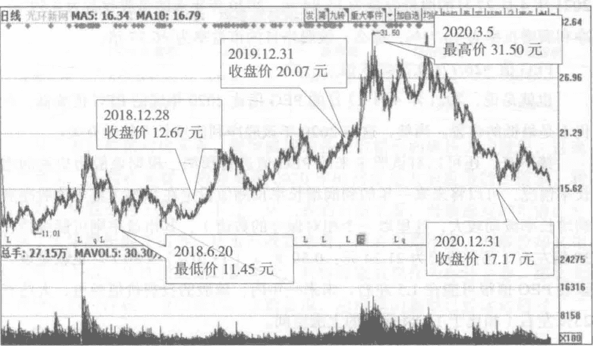

为精准判断当前指标所处位置，需复盘过往三年（2018-2020年末）及历史高低点的对应数值。

**历史波段复盘**：
据财报数据测算，该股指标波动区间为0.52-2.72。值得注意的是，2020年3月初股价创新高时读数(2.48)并非峰值，年底股价回落反而升至2.72，印证估值与价格出现背离。

**当期测算**：
以2021年4月27日收盘价15.84元为基准，对应2020年末每股收益0.59元、净利增速10.71%，静态PE约26.77倍，PEG≈2.5。虽低于年末峰值，但仍远超安全线。

**前瞻推演**：
假设未来一年增速20%（保守设定）、PE维持30倍，目标价约21.24元（上涨空间~25%），对应PEG降至1.5。具备修复空间，但高波动成长股切忌单指标决策，需结合现金流质量、行业空间、护城河宽度综合研判。

## 三、 对标定价法：寻找估值锚点

### 适用场景与操作范式
适用于初创期科技企业（盈利为负/不稳）、深度技术型资产、缺乏可比样本的细分赛道。操作路径：锁定行业绝对龙头 → 提取核心估值参数 → 映射至标的企业 → 识别估值折溢价。

### 安防双雄案例复盘（2021.6.23数据）

| 维度 | 海康威视 | 大华股份 | 倍数差 |
|------|----------|----------|--------|
| 营收 | 635亿 | 265亿 | 2.4x |
| 净利 | 134亿 | 39亿 | 3.4x |
| 总市值 | 5697亿 | 661亿 | **8.6x** |
| EPS | 1.45 | 1.34 | 1.1x |
| 股价 | 59.9 | 22.1 | **2.7x** |

**核心洞察**：市值溢价(8.6x)显著超越基本面溢价(2.4-3.4x)。若以海康为锚，大华存在估值修复预期。此法本质是寻找“质地相似但定价错配”的套利机会。

---

## 第四章 基石层：AI芯片全景透视

### 第一节 产业拓扑与竞争格局

#### 核心产业链三重奏
```
芯片设计(IP/架构/代工) → 晶圆制造(代工) → 封装测试(后道)
     ↑                    ↑                ↑
  核心壁垒              资本/技术密集    规模/良率竞争
```

#### 芯片分类学全景

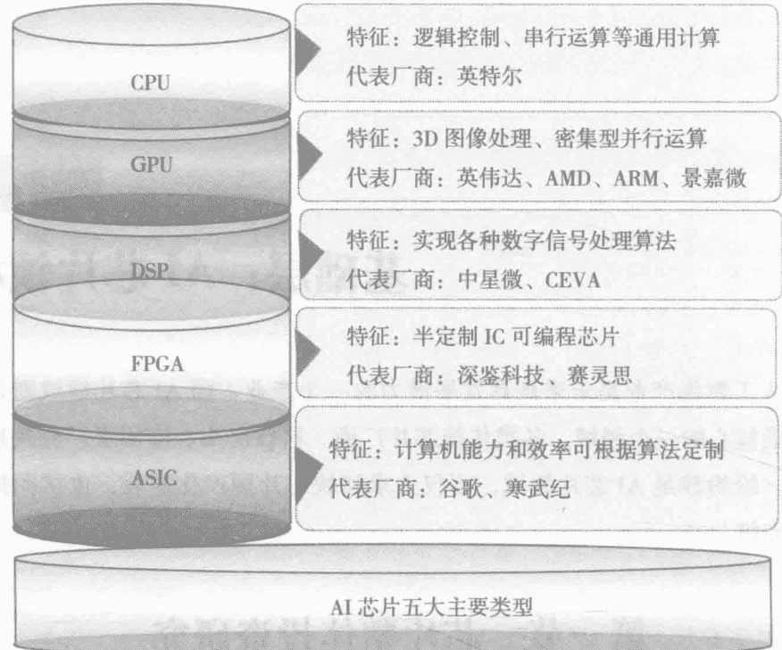

| 大类 | 细分品类 | 典型玩家 | 技术特征 |
|------|----------|----------|----------|
| **传统架构** (主流) | GPU | 英伟达/AMD | 并行计算王者，训练主力 |
| | CPU | 英特尔/AMD/海光 | 通用控制，推理辅助 |
| | ASIC | 谷歌TPU/寒武纪 | 专用定制，能效比极致 |
| | FPGA | 赛灵思/英特尔 | 可重构，低延迟场景首选 |
| | DSP | 德州仪器 | 信号处理专长 |
| **前沿探索** | 神经拟态芯片 | IBM/深思创/西井/中科院 | 事件驱动/脉冲神经网络，超低功耗 |

#### 竞争格局三大铁律
1. **巨头垄断强化**：美系巨头通过并购初创企业构建护城河，国产阵营(华为海思/寒武纪/汇顶/景嘉微/地平线)奋力追赶
2. **核心技术霸权延续**：全球Top10仅三星非美系，核心IP/EDA/光刻机全链条卡脖子
3. **GPU称霸份额**：训练端GPU占比超八成，CPU/ASIC分食推理增量，FPGA受限于开发门槛普及较慢

#### 产业链关键节点深度透视

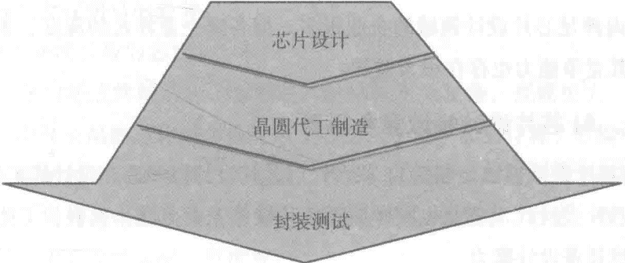

**芯片设计：金字塔尖的博弈**
- **IP核层**：ARM/新思科技/锘腾三寡头占65%+份额，芯原股份等国产替代道阻且长
- **设计层**：云端训练(英伟达H100/寒武纪思元/百度昆仑) vs 边缘推理(地平线/寒武纪/海康/瑞芯微)双轨并行
  - 云端：大die、高功耗、追求绝对算力
  - 边缘：小die、低功耗、平衡TOPS/W/延迟/成本

**晶圆制造：地缘政治的硬核战场**
- **第一梯队**：台积电(技术/产能双第一)、三星(唯一追赶者)
- **第二梯队**：格罗方德/UMC/中芯国际/华虹半导体
- **关键变量**：28nm/14nm/7nm/5nm/3nm良率爬坡节奏，直接决定国产高端芯片落地速度

**封装测试：隐形冠军的规模游戏**
- 日月光(台)稳居霸主，通富微电/长电科技/华天科技(陆)组成国家队
- Chiplet/3D堆叠/CoWoS等先进封装成新战场，直接重塑算力密度上限

---

### 第二节 芯片设计赛道投资逻辑拆解

#### 竞争坐标系定位
```
IP核供应商(收授权费) → 芯片设计商(卖芯片/方案) → 模组/终端厂商
     ↑                      ↑
  技术授权模式           产品销售/方案服务模式
```

#### 细分赛道投资关键变量

| 赛道 | 核心护城河 | 盈利模式 | 关注指标 | 代表标的 |
|------|------------|----------|----------|----------|
| **云端训练芯片** | 架构创新/软件生态/工艺节点 | 芯片销售+算力租赁 | 单卡算力/互联带宽/编译器成熟度 | 寒武纪/海光/昇腾生态链 |
| **云端推理芯片** | 能效比/延迟/总成本(TCO) | 芯片销售 | TOPS/W/批处理延迟/单位算力成本 | 寒武纪/腾讯/阿里/百度自研 |
| **边缘/端侧AI SoC** | 异构集成/专用加速器/软硬协同 | 芯片销售+方案授权 | NPU算力/ISP性能/功耗/出货量 | 地平线/瑞芯微/全志/黑芝麻 |
| **IP核/EDA工具** | 技术标准制定/生态锁定 | 授权费+版税 | 授权数量/单价/回款率 | 芯原股份/华大九天/概伦电子 |

#### 投资决策清单（Checklist）
1. **技术壁垒**：指令集授权/自主ISA/核心专利池/工艺节点领先度
2. **商业化落地**：头部客户导入进度/设计胜出项目/量产出货节奏/回款周期
3. **生态构建力**：软件栈完备度/开发者社区活跃度/下游方案商数量
4. **财务健康度**：研发投入强度(>20%)/毛利率趋势/现金流覆盖研发年限
5. **政策/供应链安全**：是否纳入国家集成电路基金/重点专项/替代清单

#### 避雷针
- 仅有PPT架构无流片记录的早期项目
- 单一客户依赖度>50%且无二供计划
- 采用落后工艺(>28nm)却定位高性能云端场景
- 股权高度分散缺乏核心团队控制权的“散户化”芯片公司

---

> **结语**：AI芯片是硬科技投资的“皇冠上的明珠”，也是容错率最低的赛道。建议采用**“龙头突击+生态布局+供应链国产替代”**三维配置策略：核心仓位锁定寒武纪/中芯国际/长电科技等细分龙头，卫星仓位跟踪地平线/黑芝麻/芯原等细分隐形冠军，尾部仓位关注EDA/IP核/先进封装材料等卖铲人机会。坚持“技术迭代验证+商业化兑现”双轮驱动选股，拒绝纯概念炒作。

# AI芯片设计赛道：薄弱环节孕育硬核机遇

放眼全球AI产业链，芯片设计环节始终是国内的短板所在。虽近年头部巨头入局、创新独角兽崛起，填补了多项空白，但整体技术壁垒与国际顶尖水平仍存差距。对于意图布局该赛道的投资者而言，建议从三大维度切入：**深耕高技术壁垒细分赛道的上市标的**、**提前锁定冲刺IPO的未上市独角兽**、**跟投巨头产业链投资版图**。

---

#### 核心标的一：IP核霸主——芯原股份 (688521)

作为国内AI芯片IP核设计领域的标杆，芯原微电子凭借自主半导体IP，构建起“平台化、全流程、一站式”的芯片定制与IP授权双引擎模式。

**1. 业务双轮驱动：IP授权是利润“印钞机”**  
2020年财报显示，营收结构呈现鲜明“冰火两重天”：
- **芯片定制业务**（含量产、设计服务）：贡献约61%营收，但毛利率仅12%-14%，属重资产、低利润的“造血”业务。
- **半导体IP授权业务**：营收占比近39%，**毛利率高达95%+，独揽全公司80%以上利润**。这才是核心护城河，具备“一次研发、反复售卖”的规模效应。
- **区域布局**：海外营收占比超51%，彰显国际竞争力。

**2. 财务透视：亏损收窄，成长性确定性高**  
上市时间短（2020年8月上市），财务数据参考性有限，但趋势明确：
- 持续亏损中，但**净利润增速连年超37%**，亏损面大幅收窄。
- 营收规模突破15亿，在科创板硬科技阵营中具备规模优势。
- 科创板容亏上市机制，为重研发周期长企业提供了资本化窗口。

**3. 资源禀赋：弹药充足，研发投入度极高**  
- **现金+理财资产超18亿**，覆盖数年烧钱周期，融资焦虑低。
- **研发投入5.31亿，占营收超35%**，典型的“以投入换护城河”模式。
- 应收账款偏高（5亿），但预收账款2亿显示对下游议价权增强；存货压力可控。

**4. 估值锚定：对标科大讯飞，隐含溢价空间**  
传统PE/PB失效，采用**对标估值法**：参照科大讯飞千亿级市值，给予芯原650亿整体估值（约133元/股）。对比二级市场回调后的70元左右区间（2021年6月），**安全边际显著，具备左侧布局价值**。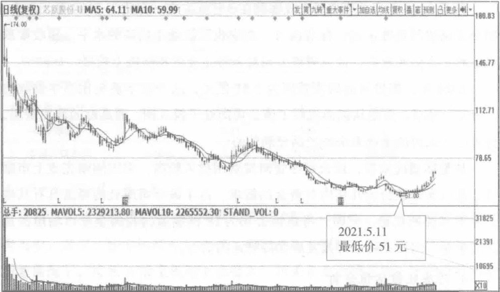

---

#### 核心标的二：云端训练芯片先锋——寒武纪 (688256)

中科寒武纪直指云端/边缘/终端全场景AI核心算力，是国内少数掌握高性能AI指令集与芯片架构的独角兽。

**1. 产品矩阵：云端集群撑营收，IP授权守高利**  
2020年营收4.59亿，高度聚焦集成电路主业（99.77%）：
- **智能计算集群系统**：营收大头（71%），毛利62%，利润贡献67%，是当前现金流支柱。
- **云端智能芯片及加速卡**：**毛利率76%**，营收占比19%但利润贡献22%，**高增长、高利润的核心成长极**。
- **终端智能处理器IP**：毛利率惊人的**99.77%**，虽营收占比仅2.5%，但验证了核心IP授权模式的极致盈利能力。
- **短板**：境内营收占比近99%，国际化进程待打开。

**2. 财务画像：高投入、高现金、高不确定性**  
- 上市即巅峰融资，**账面现金36亿**，远超营收规模，筑起极厚安全垫。
- **研发费用7.68亿 > 营收总额**，典型“造芯烧钱”节奏，折旧摊销压力大。
- 连续亏损，净资产收益率为负，应收账款、存货占营收比重高，下游控制力一般（预收账款极低）。

**3. 估值定价：同享650亿对标价，隐含目标价162.5元**  
同采用对标科大讯飞逻辑，4亿总股本对应**162.5元/股**合理价值。股价上市后回调至136元低点后，在140-170元箱体震荡，**当前价格已大致回归估值中枢**，上行需等待云端芯片放量兑现。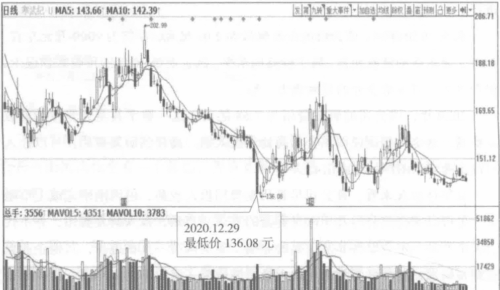

> **投资提示**：两家均处“投入期穿越周期”关键期。芯原胜在商业模式成熟（IP授权现金牛），寒武纪胜在产品天花板高（云端训练芯片）。风险点共性为：技术迭代失速、下游需求不及预期、股份解禁压力。

---

### 第三节 晶圆代工：中美博弈核心战场，国产替代确定性最强

晶圆代工是半导体制造皇冠上的明珠，亦是中美科技博弈最前沿的“卡脖子”环节。其核心拆解为两阶段：**晶圆制造（材料基础）**与**光刻制作（工艺巅峰）**。

#### 一、 竞争格局深度拆解

**1. 晶圆制造：国产替代已上半场，头部格局成型**  
作为光刻前置工序，硅片国产化率稳步提升。**沪硅产业、中环股份、上海新阳**构成第一梯队，受益于下游晶扩产周期确定性强，抗周期属性优于设计端。

**2. 光刻制作：硬仗中的硬仗，设备材料双受制**  
涉及光刻机（ASML垄断）、光刻胶、掩模版等全链条卡脖子。国内厂商（中芯国际领衔）在成熟制程（28nm及以上）实现突围，先进制程（14nm/7nm）受限于EUV光刻机获取，短期看量产爬坡，长期看供应链自主可控进度。

> **配置逻辑**：**材料/设备国产化受益标的（光刻胶、掩模版、刻蚀/薄膜沉积设备）弹性>晶圆厂整机厂**。前者直接承接“替代订单”，后者受制于制程天花板与资本开支周期。

# 晶圆代工：卖方市场下的格局与投资机遇

当前光刻制造领域呈现典型的“卖方市场”态势，头部代工厂产能长期处于满载状态。全球产业版图中，台积电一家独大稳坐霸主宝座；三星、格罗方德、联电构成第二梯队；而国内领军者中芯国际长期位列行业第五。

作为技术壁垒极高的资本密集型赛道，光刻制造对工艺节点与设备精度要求极其苛刻。随着中美博弈向科技纵深推进，国内代工厂采购核心EUV光刻机受阻，导致中芯国际在高端制程突围上步履维艰。

## 二、 晶圆代工赛道投资逻辑拆解

晶圆代工属于特殊细分领域：整体上国内厂商处于“追赶模式”，且产业链国际化分工极深，进出口贸易高度交织。投资选标需重点权衡三大维度：

**1. 高端产能稀缺性：唯一“国家队”值得重仓关注**
芯片行业遵循“高端为王”铁律。全球范围内台积电断层领先，国内唯有中芯国际具备逼近国际一流水平的代工能力。虽受限于荷兰光刻机禁令，暂时无法量产最尖端制程，但作为大陆唯一跻身全球前五的专业代工厂，其战略稀缺性决定了核心标的地位。

**2. AI浪潮驱动硅片需求爆发：上游材料厂享受确定性红利**
晶圆制造是代工产业链不可或缺的基石。AI产业井喷式发展直接拉动AI芯片需求指数级增长，需求传导至上游半导体硅片环节，沪硅产业、中环股份等核心供应商将深度受益，投资价值凸显。

**3. 国产替代主线：设备材料环节空间广阔但需耐心**
国内已有厂商切入光刻机制造，但与国际顶尖水平仍存显著代差，破局尚需时日。配套材料端如光刻胶（南大光电等）国产化进程相对较快，弹性更大，是细分赛道重要的掘金方向。

## 三、 代工龙头深度画像：中芯国际

作为大陆代工一哥，中芯国际自2000年成立以来，业务覆盖晶圆代工、设计服务/IP支持、掩模制造、凸块封测全链条，是大陆技术最强、规模最大、服务最全的跨国专业代工平台，提供0.35μm至14nm全谱系工艺节点。

### 1. 业务拆解：单一主业极致深耕，海外营收比例可观
2020年财报显示，公司营收高度聚焦集成电路（占比98.19%）。
- **核心引擎**：晶圆代工贡献87.32%营收，虽毛利率仅21.81%，但撑起八成利润，是绝对基本盘。
- **高利润增长极**：其他主营业务（掩模、封测等）毛利率达42.47%，利润贡献近两成，盈利质量优异。
- **国际化验证**：境外收入占比超35%（北美22.78%，欧亚13.03%），证明国际竞争力获客户认可。

### 2. 财务透视：高增长掩盖低基数，成长性是核心看点
| 核心指标 | 2020年 | 2019年 | 2018年 | 2017年 |
| :--- | :--- | :--- | :--- | :--- |
| 每股收益(元) | 0.67 | 0.34 | 0.14 | 0.27 |
| 净利润增速 | 141.52% | 140.04% | -39.98% | 230.56% |
| 营收(亿元) | 274.71 | 220.18 | 230.17 | 213.90 |
| ROE | 6.29% | 4.25% | 1.99% | 4.26% |

*注：2020年7月上市，历史数据样本有限，参考需打折扣。*

**关键洞察**：
- **爆发力确凿**：连续两年净利翻番，直接受惠AI芯片周期上行，且AI尚在早期，未来成长空间巨大。
- **营收天花板高**：300亿营收体量在科创板优秀，但在全球代工版图及战略定位下，成长空间极其广阔。
- **ROE偏低合理**：重资产模式下净资产基数大、利润基数小，低ROE是行业常态，不宜苛责。

### 3. 经营质量体检：弹药充足，研发力度大，下游话语权强
- **现金堡垒**：年末账面现金641.92亿，覆盖营收两倍以上，IPO募资奠定数年无忧的财务安全垫。
- **运营可控**：应收账款30亿、存货52亿、合同负债13亿，均在营收合理区间；预收账款高企反映强势议价权。
- **研发血性**：年研发投入46.72亿（营收占比~17%），处于高强度投入期，锁定未来技术迭代底气。

### 4. 估值框架：PEG锚定成长，合理区间50.5-75.75元
采用PEG估值法匹配成长股属性：
- 基准情景：假设2021年净利增速50%，EPS 1.01元，给予50倍PE对应PEG=1，目标价**50.50元**（保守底）。
- 乐观情景：考虑稀缺性溢价，PEG拉至1.5，目标价**75.75元**（合理顶）。
- 激进情景PEG=2对应市值近8000亿，脱离基本面支撑，不予采纳。

**技术面印证**：上市后回调至49.45元低点（2020.9.29）完成价值回归，2021年6月震荡于60元附近，正处于估值区间下沿，**安全边际明显，具备配置价值**。

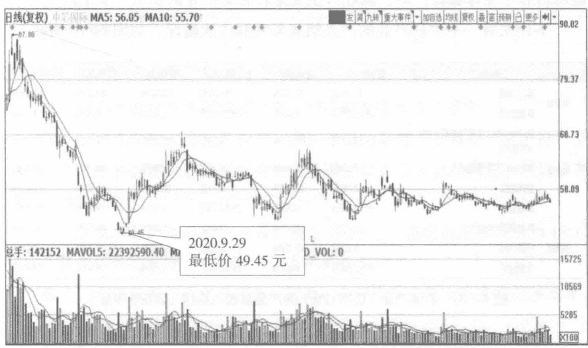

*图：中芯国际(688981) 日K线走势*

## 四、 硅片隐形冠军：沪硅产业

国内寥寥几家8英寸硅片供应商之一，已切入中芯供应链，12英寸产品实现量产突围。主营覆盖300mm/200mm抛光片、外延片及SOI硅片。

### 1. 利润结构：靠“老树”养活“新芽”，转型阵痛显著
2020年营收18.11亿，集成电路业务占比97.78%。
- **现金奶牛（200mm及以下）**：营收占比67.74%，毛利21.76%，**利润贡献率112.51%**——其他业务全线亏损，全靠此支撑。
- **战略主攻（300mm）**：营收占比17.44%，**毛利率-34.82%，拖累利润46.34%**——典型的高投入爬坡期，虽亏损但关乎生死存亡，国家急需领域。
- **补充收入（受托加工）**：营收占比12.6%，毛利25%，利润贡献24%，边际效应良好。
- **市场结构**：境外收入占比65%，但国内业务毛利率惊人地低（0.11%），内销定价压力大。

### 2. 财务档案：微利周期起步，商誉隐忧需警惕
| 核心指标 | 2020年 | 2019年 |
| :--- | :--- | :--- |
| 每股收益(元) | 0.04 | -0.05 |
| 净利润增速 | 196.84% | -902% |
| 营收(亿元) | 18.11 | 14.93 |
| ROE | 1.14% | -2.06% |

*注：2020年4月上市，数据维度单薄。*

**核心判断**：
- 刚扭亏为盈，利润基数极小波动剧烈，未进入稳定盈利周期。
- 18亿营收体量偏小，成长空间大但需时间验证。
- **红旗指标**：商誉11.32亿（占净资产比重极高），科创板罕见高位，若未来业绩不及预期面临巨额减值风险；研发投入仅1.31亿（2018年），科创板属性下研发强度偏弱。

### 3. 估值定价：对标龙头打折，当前股价已透支预期
采用相对估值法：参照硅片龙头中环股份估值<900亿，给予沪硅70%溢价系数（聚焦硅片纯度高、新兴成长性），目标市值**630亿**，对应股价**25.40元**（总股本24.8亿）。

**走势复盘**：上市冲高至69元（2020.7.14）后持续回落，2021年6月震荡于27元，**显著高于估值中枢**，安全边际缺失。虽赛道题材易引资金博弈推高股价，但基本面支撑不足，投资性价比一般。

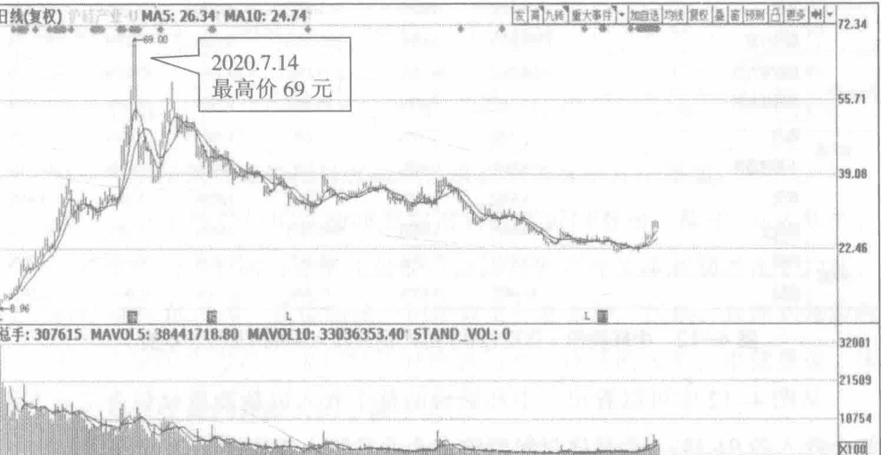

*图：沪硅产业(688126) 日K线走势*

## 五、 硅材料绝对霸主：中环股份

国内市占率75%、全球市占率18%的半导体硅片“双料一哥”。主营高压硅堆、整流二极管等分立器件，年产能超10亿支，产品远销21国。

### 1. 业务版图：新能源反哺半导体，双轮驱动格局初成
2020年营收190.57亿，**新能源业务贡献91.1%营收、92.23%利润**（毛利19.09%），已成绝对支柱；半导体硅片营收15.18亿（占比7.97%），毛利17.59%，利润贡献7.43%，虽体量小但战略地位不可替代。

### 核心标的深度复盘：中环股份（002129）

#### 业绩引擎拆解：单一驱动下的极致优势
**营收版图：新能源“独苗”撑起半壁江山**
2020年报披露，中环股份交出营收190.57亿元的答卷。拆解来看，**新能源材料（硅片）以168.29亿元、占比88.31%的绝对统治力，扛起了公司近九成营收与83.8%利润**，毛利率17.89%。半导体材料贡献13.51亿元（占比7.09%），虽毛利率高达23.07%，但利润贡献仅8.67%。电力板块虽高毛利（56.99%），规模仅5.31亿元。地域上，内销占比75.31%，出口24.69%，均保持双位数增长。

> **洞见：** 业务高度聚焦光伏主赛道。半导体硅片占比虽小，但受限于下游需求体量，而非技术短板。若半导体周期上行，弹性可期。

#### 历年财务体检：高增低ROE的“成长烦恼”
| 核心指标 | 2020 | 2019 | 2018 | 2017 | 2016 |
| :--- | :---: | :---: | :---: | :---: | :---: |
| **每股收益(元)** | 0.38 | 0.32 | 0.23 | 0.22 | 0.15 |
| **净利增速** | 20.51% | **42.93%** | 8.16% | 45.41% | 98.94% |
| **营收(亿)** | 190.57 | 168.87 | 137.56 | 96.44 | 67.83 |
| **ROE** | 7.55% | 6.58% | 5.06% | 5.39% | 3.87% |

**三大关键结论：**
1.  **利润增速稳健，盈利厚度待提升：** 除2018年外，净利增速常年超20%，均值超40%。但EPS仅0.38元，盈利兑现率偏低，留有厚厚的“补涨垫”。
2.  **营收规模破200亿在即，成长空间广阔：** 五年复合增速超20%，但千亿级光伏赛道下，百亿营收体量仍轻量级。
3.  **ROE长期破10%“及格线”：** 受制于行业重资产、扩产周期特性。好在ROE呈阶梯状抬升趋势，管理层资本回报意识在强化。

#### 资产负债透视：现金厚、存货优、研发猛、商誉轻
*   **弹药充足：** 46.12亿货币资金，覆盖营收24%，抗周期底气足。
*   **周转健康：** 应收账款24.8亿 vs 预收17.21亿，话语权尚可；存货21.44亿，周转天数可控。
*   **护城河建设：** 6.19亿研发投入（占营收3.2%），技术壁垒持续加高。
*   **雷区清理：** 商誉仅2.15亿，减值风险极低。

#### 估值锚定与仓位策略
**假设：** 2021年EPS按40%增速测算为0.53元。
*   **保守区间（PEG=1，PE=40x）：** 目标价 **21.20元**。
*   **乐观区间（PEG=1.5，PE=60x，龙头溢价）：** 目标价 **31.80元**。

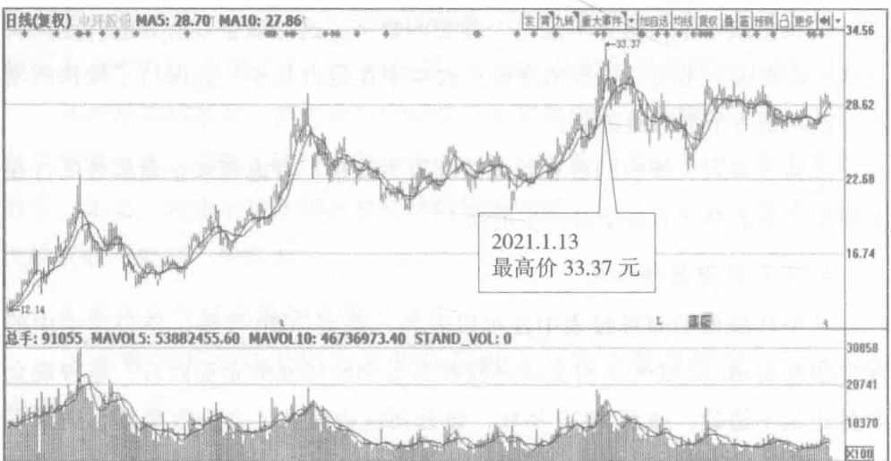

**实盘提示：** 2021年1月高点33.37元已触及乐观估值上沿，6月初股价30元附近仍处估值顶部。**建议：** 等待回调至21-25元区间分批建仓，博取安全边际。

---

### 第四节 芯片封测赛道：国产替代的“卖铲人”战争

#### 一、 竞争格局：台湾垄断，大陆三巨头围猎
*   **产能东移定局：** 依托亚洲晶圆厂集群，全球封测产能锁定亚洲。
*   **台系六强霸榜：** 日月光、安靠领衔，全球前十占六席。
*   **大陆三驾马车：** **长电科技、通富微电、华天科技** 锁定前十剩余席位。
*   **趋势确定：** AI算力爆发拉动封测需求指数级增长，大陆厂商“近水楼台”承接国产替代红利，份额提升确定性高。

#### 二、 选股逻辑：认准龙头、押注成长、挖掘细分
1.  **龙头优先：** 长电、通富、华天拥有规模、技术、客户三重护城河，先发优势巨大。
2.  **成长次之：** 赛道高景气下，黑马层出不穷，关注动态成长性。
3.  **细分配置：** 传感器封测（晶方科技）、专业测试（利扬芯片）等利基市场隐形冠军。

---

### 标的一：长电科技（600584）—— 内地封测一哥，并购整合期

#### 业务极简：单品类、高出海、薄利润
2020年营收264.64亿，**封测业务贡献99.56%营收、98.82%利润**，毛利率仅15.34%。**出海比例74.8%**，国际竞争力验证完毕；境内毛利28%显著高于境外11%，内需红利释放可期。

#### 财务过山车：并购消化期的阵痛与蜕变
| 指标 | 2020 | 2019 | 2018 | 2017 | 2016 |
| :--- | :---: | :---: | :---: | :---: | :---: |
| **EPS(元)** | 0.81 | 0.06 | -0.65 | 0.28 | 0.10 |
| **净利增速** | **1371%** | 109.44% | -373.58% | 222.89% | 104.50% |
| **营收(亿)** | 264.64 | 235.26 | 238.56 | 238.56 | 191.55 |
| **ROE** | **10.02%** | 0.71% | -9.15% | 4.89% | 2.45% |

**诊断：**
*   **利润极度波动：** 受新加坡安靠并购摊销、商誉减值、重组费用冲击，18-19年亏损/微利，20年业绩大爆发（低基数+并购协同）。
*   **营收遭遇“300亿天花板”：** 连续三年徘徊230-260亿，急需并购标的落地放量突围。
*   **ROE勉强转正：** 10%关口虽回正，但仍非优质资产标杆，看后续整合兑现。

#### 关键财务细节：高投入、高应收、高商誉“三高”画像
*   **现金偏紧：** 21.67亿货币资金/营收<10%，并购支出拖累流动性。
*   **应收账款34.58亿（占营收13%）、存货26.5亿：** 周转压力需监控，合同负债2.71亿显示下游议价权存续。
*   **研发10.19亿（占比3.8%）：** 投入强度行业标杆，技术迭代动力足。
*   **商誉20.85亿（占净资产约15%）：** **核心隐患！** 安靠并购遗留，若业绩对赌失败，减值冲击利润。

#### 估值区间与交易地图
**模型：** 2020 EPS 0.81元，假设30%增速 -> 2021 EPS 1.05元。
*   **保守（PEG=1，PE=30x）：** **31.50元**
*   **激进（PEG=1.5，PE=45x）：** **47.25元**

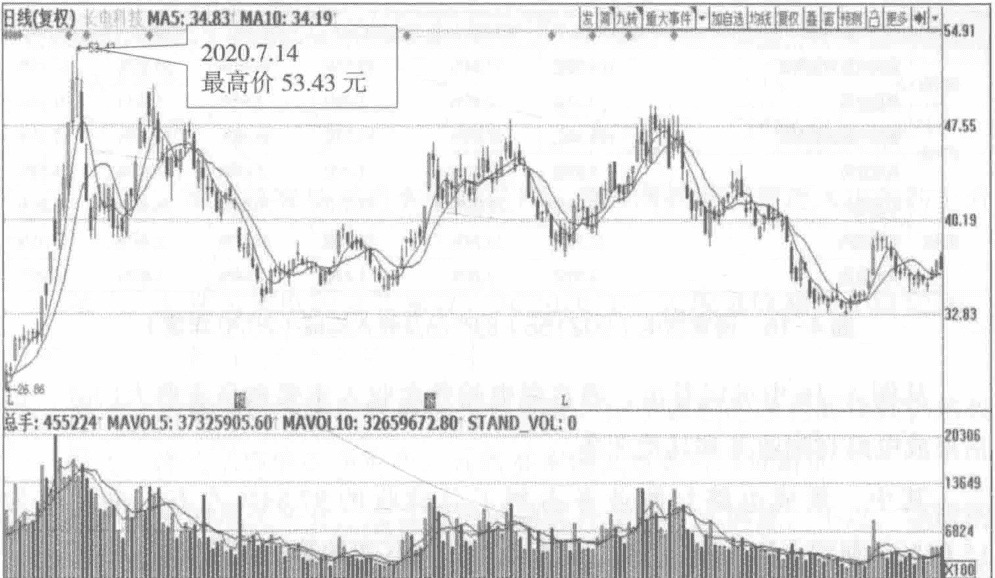

**实盘定位：** 2020年7月高点53.43元透支乐观预期，6月初35元运行于**估值区间下半部（31.5-47.25元）**。**具备左侧布局价值，分批买入，设止损。**

---

### 标的二：通富微电（002156）—— 封测老二，专注内生增长

#### 业务镜像：高度相似，出海更深
2020营收107.69亿，**IC封测占收97.84%、利94.95%**，毛利15.01%。**境外收比78.06%**，国际化程度超长电。境内毛利14.45%略低境外15.16%，规模效应待释放。

#### 财务特征：周期波动中寻找确定性
*   **利润波动大：** 历年净利增速剧烈震荡，行业Beta属性强，底仓配置需耐心。
*   **拐点前瞻：** 随规模效应显现及高毛利先进封装（FC、SiP）放量，盈利稳定性有望质变。

> **素材截至此处，后续财务表及分析待续。**

##### 3. 通富微电全景扫描

**百亿门槛与成长腾挪空间**  
财报显示，2020 年该封测龙头营收刚跨过百亿大关。身处半导体封测赛道，这更像是一个新起点，预示着后续拥有宽广的业绩释放通道。

**盈利指标的辩证视角**  
净资产回报率（ROE）暂未亮眼，核心受制于净利基数尚小。随业绩放量，该指标有望自主修复，无需过度解读为短板。

**静态财报与动态成长的“剪刀差”**  
单看静态报表难言惊艳，但动态视角下，净利增速持续向上，叠加行业景气度攀升，构成了支撑投资信心的核心逻辑。

**资产负债表细节体检**  
*   **资金垫：** 2020 年末账面货币资金约 35 亿元，对标百亿营收，流动性安全边际厚实，得益于近期增发到账。  
*   **运营质量：** 应收款 18 亿元、库存 14.5 亿元，均在营收占比的可控区间；预收款不足 5000 万元，侧面印证了对下游客户的议价掌控力。  
*   **技术投入：** 7.44 亿元研发开支占比极高，清晰勾勒“重投入、谋未来”图谱，为后续产品竞争力背书。  
*   **商誉敞口：** 10 亿元商誉体量不小，需警惕未来减值冲击利润表风险。

**估值锚定：PEG 视角的安全边际**  
采用 PEG 法测算：  
以 2020 年 EPS 0.29 元、净利增速 50% 推算，2021 年 EPS 约 0.44 元。  
若给予 50 倍 PE，对应股价 22 元，此时 PEG=1，属极保守定价。  
考虑到封测龙头稀缺性及赛道溢价，PEG 拉升至 1.5 亦合理，对应目标价 33 元。  
**合理估值区间：22-33 元。**

**技术面复盘与当下机会**  
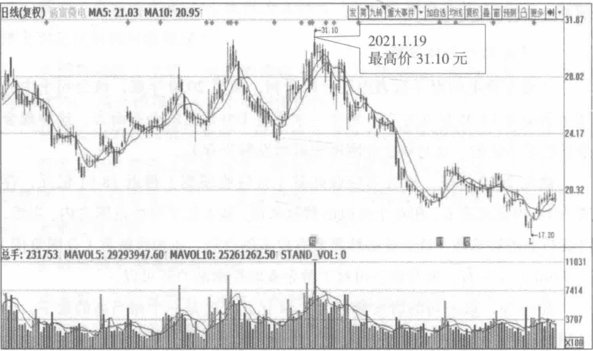  
图 4-17 通富微电（002156）日 K 线走势图  

股价于 2019 年底启动后，2020 年全年宽幅震荡筑底，2021 年 1 月冲高 31.1 元后回调。截至 6 月初股价回落至 20 元附近，**已显著跌破估值区间下沿**，此时介入具备明显的价格安全垫与反弹期权价值。

---

## 第五篇章 感知基石：AI 硬件的“五感”系统

在 AI 硬件皇冠上，算力芯片与感知器件并列双璧。后者本质是“翻译官”，将温度、压力、光照、位移等物理参数转化为电脉冲，赋予机器感知物理世界的能力，故誉为“电子五官”。

### 第一节 感知赛道深度研判

按工作原理与应用场景划分，主流谱系涵盖光电、热电、气敏、化学及压力/温度/流体五大类别。

#### 一、 竞争格局透视

**1. 版图聚集折射产业重心**  
企业分布呈现“长三角核心、珠三角/京津次之、中部跟进”格局，实质上是 AI 与物联网产业地理版图的投影。

**2. “中低端自给，高端仰仗外资”**  
除个别厂商引进芯片本土封测，绝大多数国产供给集中于中低端，基本覆盖当下内需。高端市场仍由霍尼韦尔、意法半导体、博世等欧美日巨头把持。

**3. 技术迭代倒逼：从“感知”迈向“智能”**  
传统结构式/固体式器件难满足数字化时代对采集效率的苛求，**MEMS、智能型产品**加速上位，微型化、集成化、多功能、联网化确立为四大演进主线。

**4. 并购整合提速，强者恒强**  
行业洗牌期明显，AMS 收购欧司朗、索尼拿下东芝图像事业部等案例，印证了头部效应与规模护城河的构建逻辑。

#### 二、 四大趋势定锚未来十年

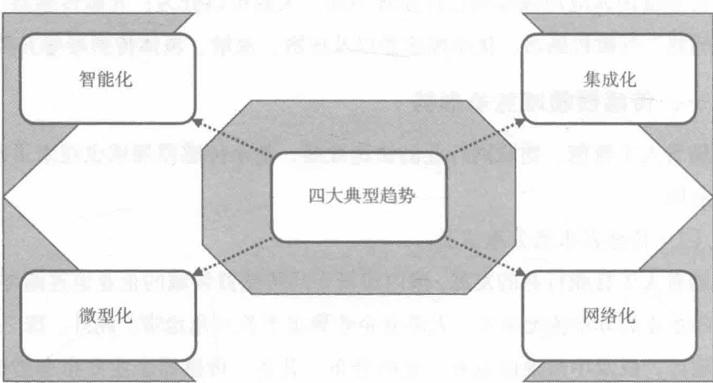  
图 5-1 感知器件演进路线图  

| 趋势维度 | 核心内涵 | 驱动力 |
| :--- | :--- | :--- |
| **边缘智能化** | 内嵌微控单元（MCU），具备自检、存储、逻辑推理、边缘计算能力 | AI 下沉刚需 |
| **极致微型化** | 尺寸从毫米跨越至微米/纳米量级，适配可穿戴、植入式场景 | 新材料与微纳加工突破 |
| **多维集成化** | 单颗芯片融合多种感知模态（如九轴 IMU），全维度还原环境信息 | 复杂场景感知需求 |
| **全域网络化** | 有线/无线组网打破数据孤岛，构建万物互联神经元 | 物联网拓扑基石 |

#### 三、 产业链全景拆解

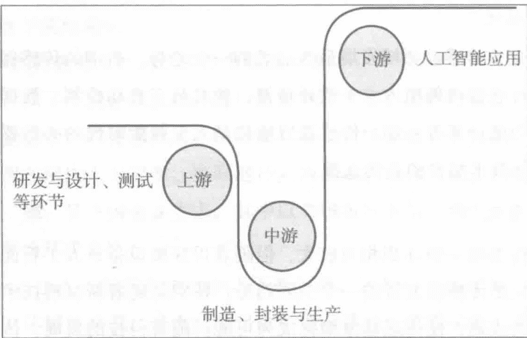  
图 5-2 感知产业生态图谱  

**上游：研发设计与核心供给（壁垒最高）**  
*   **基础攻关：** 中科院微电子所、中电科、北大/华科/哈工大等院所主导前沿。  
*   **方案设计：** 歌尔、士兰微、汇顶、高德红外、美泰、瑞声深耕细分场景。  
*   **芯片架构：** 海思、紫光国微、小米、芯敏微、广微机电攻坚国产高端；海外苹果、三星、英特尔、英伟达、高通占据制高点。  
*   **测试/软件：** 歌尔、共达、美泰、瑞声布局测试；**软件为国产短板**，矽睿、明晦、深迪等未上市新锐值得跟踪。

**中游：晶圆制造、封装与器件产出（国产化率较高）**  
*   **晶圆厂：** 中芯、华虹、格罗方德、爱普生、士兰微、高德红外、中航微、国高微掌握核心产能。  
*   **封装测试：** 长电、华天等大厂延伸，晶方专注垂直细分，固锝、歌尔、红光协同。  
*   **器件产出：** 按 CMOS 图像、环境、压力、惯性等品类匹配厂商。

**下游：智能终端需求端**  
覆盖自动驾驶、智能穿戴、智慧医疗、工业互联、消费电子等蓄水池。

---

### 第二节 设计研发：上游皇冠上的明珠

#### 一、 竞争态势“三部曲”

1.  **硬核技术：外资筑高墙，国产追赶中。** 核心架构、材料工艺仍存代差，院所为国家队主力。  
2.  **场景落地：国产厂商弯道超车。** 消费电子、车规级、医疗、工控四大战场，歌尔、海康、士兰微、汇顶、高德红外等已具备一战之力。  
3.  **软件生态：卡脖子痛点显性。** 高阶应用软件高度依赖外资，国产替代尚在萌芽，多为未上市企业，属长坡厚雪赛道。

#### 二、 投资逻辑“四看”

| 关注维度 | 核心标的/线索 | 投资提示 |
| :--- | :--- | :--- |
| **基础科研** | 中科院系、高校系上市平台 | 关注成果转化落地节奏 |
| **龙头设计** | 歌尔、海康、士兰微、汇顶、高德红外 | 感知业务占比多低，需估值拆分 |
| **芯片架构** | 华为海思、小米、紫光国微、芯敏微、广微机电 | 非上市标的跟踪上市进程 |
| **软件生态** | 矽睿、明晦、深迪等未上市企业 | 稀缺性高，留意 IPO 窗口期 |

#### 三、 标杆复盘：士兰微——从离散器件到 MEMS 的蜕变

**业务基本盘（2020 年数据）**  
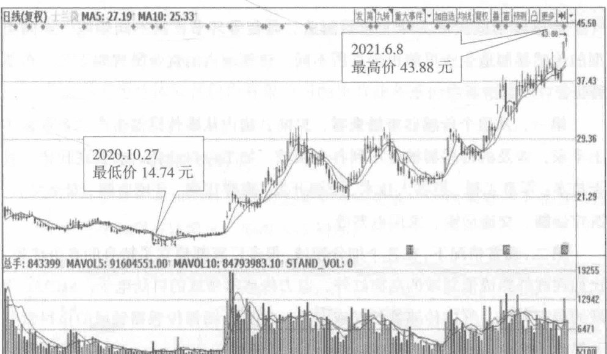  
图 5-3 士兰微（600460）产品及收入构成  

*   **营收 42.8 亿**，高度依赖电子元器件（占比 95.7%）。  
*   **离散器件**为基本盘：营收占比 51.5%，毛利 24.3%，利润贡献 55.7%——现金奶牛。  
*   **集成电路**为成长极：营收占比 33.2%，毛利 26.1%，利润贡献 38.4%——核心看点。  
*   **LED** 仍处亏损：营收 9.1%，毛利 -12.4%，拖累整体盈利。  
*   **结论：** 业务结构合理，双轮驱动雏形显现，IC 高毛利特征确立。

**历史财务：周期波动中的成长韧性**  

| 指标 | 2020 | 2019 | 2018 | 2017 | 2016 |
| :--- | :--- | :--- | :--- | :--- | :--- |
| EPS (元) | 0.05 | 0.01 | 0.13 | 0.14 | 0.08 |
| 净利增速 | **+365%** | -91.5% | +0.6% | +76.8% | +140.5% |
| 营收 (亿) | 42.8 | 31.1 | 30.3 | 27.4 | 23.8 |
| ROE | 2.0% | 0.4% | 5.1% | 6.7% | 3.9% |

**读报三把钥匙：**  
1.  **利润弹性大：** 2020 年净利暴增 365%，印证周期拐点兑现与规模效应释放。  
2.  **营收天花板低：** 40 亿级营收对标千亿级赛道，主力新品（MEMS、功率器件、车规 IC）放量在即，成长确定性高。  
3.  **ROE 修复中：** 低 ROE 系分母效应与历史包袱，随新产能爬坡将显著提升。

**资产负债表体检（2020 年末）**  
*   **现金储备：** 货币资金 10.9 亿 + 交易性金融资产 10.7 亿 ≈ 21.6 亿，覆盖半年营收，抗险足。  
*   **运营压力：** 应收 13.1 亿、库存 13.9 亿，合计超营收 60%，虽高但符合半导体制造长周期特征，预收极低显示议价一般。  
*   **研发强度：** 投入 4.3 亿，占营收 10%，技术护城河持续加宽。  
*   **商誉清零：** 仅 62 万，零暴雷风险。  
*   **总评：** 财务健康度及格，高应收/库存为成长性换取，可接受。

**估值框架：戴维斯双击下的溢价逻辑**  
近年净利低基数难用传统 PE，行业朝阳属性+中美科技博弈赋予**战略溢价**。  
可比公司估值多在千亿级，该公司作为稀缺标的，**合理市值不应低于 500 亿**。  
以 2021 年 6 月总股本 13.12 亿股测算，**基准价值约 38.1 元/股**。

**走势复盘与定价偏离**  
  
图 5-4 士兰微（600460）日 K 线走势图  

2020 年 10 月启动，借芯片概念东风震荡上行，2021 年 6 月 8 日见顶 43.88 元。**当前股价已显著超越 38 元基本面锚定位**，短期情绪透支明显，面临消化获利盘与估值回归压力，但也反映市场对“感知+车规+功率”多赛道叠加的极致溢价预期。

---

### 第三节 制造环节：中游国产替代主战场

制造与封装环节国产化程度显著高于上游，参与者众、产能释放快。

#### 一、 竞争格局三大特征

1.  **千帆竞发，应用全覆盖：** 国内生产企业超千家，产品渗透工业、农业、航天、军工、机器人、医疗、环保、安防、交通、家电等全谱系。  
2.  **龙头垄断晶圆厂，专业户深耕封装：** 中芯、华虹、士兰微、高德红外、中航微、国高微掌握核心产能；长电、华天、晶方、固锝、歌尔、红光构建封装矩阵。  
3.  **细分品类专用化制造：** CMOS 图像、压力、惯性、环境等器件对工艺平台差异大，形成“专线专用”竞争护城河。

#### 二、传感器制造版图的投资逻辑解析

在挖掘传感器制造赛道的投资标的时，有几个核心维度值得重点考量。

**首选标的：大型综合封装巨头。** 这类企业业务覆盖面广，不仅深耕传感器封装，更延伸至芯片、集成电路封测领域。凭借更高的技术壁垒，它们更易适应未来市场新需求，从而在长周期竞争中掌握主动权。

**重点关注：专业传感器封装专家。** 以晶方科技、红光股份、固锝电子、歌尔股份为代表的专业队伍，在垂直细分领域具备深厚积淀，是不可忽视的投资坐标。

**细分赛道领跑者：** 各垂直领域的龙头企业同样极具吸引力：
*   **CIS图像传感器：** 瑞芯微、格科微电子领跑；
*   **运动传感器：** 高德红外、美泰科技占据优势；
*   **环境传感器：** 汉威科技、四方光电深耕不辍；
*   **压力传感器：** 敏芯股份独树一帜。

---

#### 三、 封测龙头深度复盘：晶方科技

作为大陆首家、全球第二大能为影像传感芯片提供 WLCSP 量产服务的专业封测厂商，苏州晶方半导体科技股份有限公司主营传感器封装测试，业务涵盖芯片封装、测试及设计。

##### 1. 业务版图与利润引擎

晶方科技以芯片封测为核心支柱，2020 年经营数据揭示其盈利结构极度集中：

*   **单一业务支撑营收大盘：** 芯片封装及测试业务贡献了 97.03% 的营收（10.71 亿元），毛利率近 50%（49.48%），利润贡献高达 96.64%，是名副其实的“独角兽”业务。
*   **设计业务虽优但量小：** 芯片设计收入仅占 1.30%，虽毛利率高达 82.98%，但受限规模，利润占比仅 2.17%。
*   **全球化布局均衡：** 境外营收占比 50.07%（毛利率 51.71%），略高于境内 48.26%（毛利率 48.06%），彰显国际竞争力。

**核心洞察：** 公司整体毛利率远超行业均值，确立了强护城河；海外营收过半，印证了全球市场的高认可度，后市值得期待。

| 业务分类 | 细分 | 营业收入(元) | 收入比例 | 营业成本(元) | 成本比例 | 毛利比例 | 毛利率 |
|---|---|---|---|---|---|---|---|
| 按行业 | 电子元器件 | 10.85亿 | 98.33% | 5.43亿 | 97.85% | 98.81% | 49.92% |
| | 其他 | 1845.83万 | 1.67% | 1192.56万 | 2.15% | 1.19% | 35.39% |
| 按产品 | 芯片封装及测试 | 10.71亿 | 97.03% | 5.41亿 | 97.41% | 96.64% | 49.48% |
| | 其他 | 1845.83万 | 1.67% | 1192.56万 | 2.15% | 1.19% | 35.39% |
| | 设计收入 | 1434.36万 | 1.30% | 244.19万 | 0.44% | 2.17% | 82.98% |
| 按地区 | 外销 | 5.53亿 | 50.07% | 2.67亿 | 48.05% | 52.12% | 51.71% |
| | 内销 | 5.33亿 | 48.26% | 2.77亿 | 49.80% | 46.69% | 48.06% |
| | 其他业务 | 1845.83万 | 1.67% | 1192.56万 | 2.15% | 1.19% | 35.39% |

##### 2. 财务数据透视：成长性确定性强

回溯 2016-2020 年财务历程，有三大看点：

| 时间 | 2020 年 | 2019 年 | 2018 年 | 2017 年 | 2016 年 |
|---|---|---|---|---|---|
| 每股收益（元） | 1.19 | 0.33 | 0.31 | 0.42 | 0.23 |
| 净利润增长率 | 252.35% | 52.27% | -25.67% | 81.39% | -53.43% |
| 营业总收入（亿元） | 11.04 | 5.60 | 5.66 | 6.29 | 5.12 |
| 每股净资产 | 9.91 | 8.64 | 8.04 | 7.70 | 7.39 |
| 净资产收益率 | 17.62% | 5.61% | 3.89% | 5.56% | 3.18% |

1.  **利润爆发拐点已现：** 历年净利波动源于早期基数低，2020 年增速超 250%。随着利润规模跃升，有望步入稳健高增通道，赛道红利与竞争优势将持续释放业绩弹性。
2.  **营收破百亿仅是起点：** 2020 年营收刚触 11 亿大关，此前长期徘徊 5-6 亿区间，成长空间广阔。
3.  **ROE 提升趋势明确：** 净资产收益率从 3% 级跃至 17% 级，随着利润放量，资本回报率仍有提升余地。

**结论：** 财务侧面验证了高成长属性，虽有波动但趋势确立，坚定看好后市。

##### 3. 经营质地优异，蓄势待发

*   **弹药充足：** 2020 年末账面现金 21.38 亿，远超 11 亿营收规模，得益于增发融资，为扩产储备充足粮草。
*   **资产质量可控：** 应收账款 1.68 亿、存货 0.95 亿，均在营收可控区间；合同负债仅 1500 万，显示对下游话语权一般。
*   **研发投入激进：** 研发费用 1.37 亿，占营收比重高，处于重投入期，为未来产品迭代筑基。

增发项目投产落地后，营收利润有望登上新台阶。

##### 4. 估值定价与走势研判

采用 PEG 估值法：2020 年每股收益 1.19 元（增发后），假设 2021 年增速 50%，对应 EPS 1.79 元。给予 50 倍 PE，目标价 **89.5 元**（PEG=1，保守估值）。

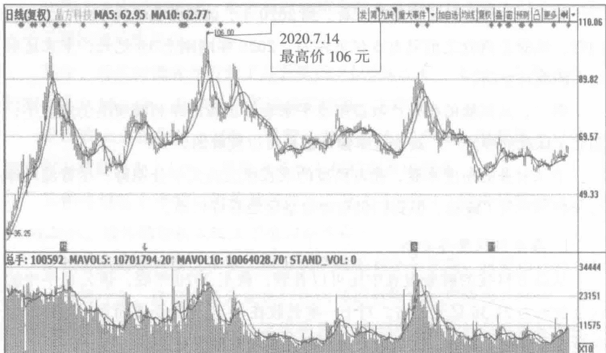

**图表解读：** 2020 年 7 月股价曾冲高至 106 元，随后震荡回落至 2021 年 6 月 60 元附近。当前股价显著低于 89.5 元合理价值中枢，**安全边际凸显，投资价值突出**。

---

#### 四、 MEMS 压力传感器霸主：敏芯股份

苏州敏芯微电子技术股份有限公司专注 MEMS 传感器研产销，主攻 MEMS 麦克风、压力传感器、惯性传感器三大产品线。

##### 1. “一超多强”产品矩阵

2020 年营收 3.3 亿，高度依赖集成电路主业（99.87%）：

*   **声学传感器（麦克风）：** 绝对核心，营收占比 88.16%（2.91 亿），毛利 35.03%，利润贡献 87.18%。
*   **压力传感器：** 第二增长极，营收占比 9.05%，毛利率高达 46.43%，利润贡献 11.87%，盈利质量优于主力产品。
*   **惯性传感器：** 起步阶段，营收占比 2.6%，毛利率 12.51%。
*   **市场格局：** 内销占比 92.19%，外销 7.68%，以国内大循环为主阵地。

两大主力产品毛利率领跑行业，竞争优势显著。

| 业务名称 | 细分项 | 营业收入(元) | 收入比例 | 营业成本(元) | 成本比例 | 利润比例 | 毛利率 |
|---|---|---|---|---|---|---|---|
| 按行业 | 集成电路 | 3.30亿 | 99.87% | 2.13亿 | 99.81% | 99.96% | 35.52% |
| 按行业 | 其他业务 | 43.98万 | 0.13% | 39.80万 | 0.19% | 0.04% | 9.49% |
| 按产品 | MEMS声学传感器 | 2.91亿 | 88.16% | 1.89亿 | 88.77% | 87.18% | 35.03% |
| 按产品 | MEMS压力传感器 | 2988.42万 | 9.05% | 1600.95万 | 7.52% | 11.87% | 46.43% |
| 按产品 | MEMS惯性传感器 | 857.42万 | 2.60% | 750.18万 | 3.52% | 0.92% | 12.51% |
| 按产品 | 其他业务 | 43.98万 | 0.13% | 39.80万 | 0.19% | 0.04% | 9.49% |
| 按产品 | 技术服务 | 18.87万 | 0.06% | - | - | - | - |
| 按地区 | 境内 | 3.04亿 | 92.19% | 1.98亿 | 92.87% | 90.94% | 35.00% |
| 按地区 | 境外 | 2535.55万 | 7.68% | 1478.51万 | 6.94% | 9.02% | 41.69% |
| 按地区 | 其他业务 | 43.98万 | 0.13% | 39.80万 | 0.19% | 0.04% | 9.49% |

##### 2. 财务成长性：上市新军的高速扩张期

上市时间短（2020 年 8 月），历史数据参考性有限，但趋势清晰：

| 时间 | 2020 年 | 2019 年 | 2018 年 | 2017 年 | 2016 年 |
| :--- | :--- | :--- | :--- | :--- | :--- |
| 每股收益（元） | 0.94 | 1.53 | 1.48 | 0.37 | 0.16 |
| 净利润增长率 | -30% | 11.7% | 307.3% | 132.46% | —— |
| 营业总收入（亿元） | 3.3 | 2.84 | 2.53 | 1.13 | 0.72 |
| 每股净资产 | 19.97 | 7.15 | 3.61 | 1.83 | 1.33 |
| 净资产收益率 | 7.55% | 27.68% | 52.18% | 23.64% | 12.89% |

1.  **利润波动系上市扩股所致：** 2020 年净利下滑 30%，每股净资产因融资激增至 19.97 元，稀释了 ROE（降至 7.55%），属非经营性因素，随募投项目达产将修复。
2.  **营收高增长确定性强：** 营收从 0.7 亿跃升至 3.3 亿，年均复合增速极高，3 亿级营收体量仍有倍数级成长空间。
3.  **财务底色优良：** 剔除融资影响，核心经营指标向好，成长逻辑未变。

##### 3. 资源禀赋深厚，研发驱动未来

*   **现金奶牛：** 账面现金 6.97 亿，覆盖 2 倍营收，上市募资效果立竿见影。
*   **存货偏高符合特性：** 存货 1.18 亿（占营收 35%+），应收账款 0.24 亿可控，合同负债 100 万话语权待加强。
*   **研发强度行业罕见：** 研发投入 4200 万，占营收近 13%，处于激进投入期，技术护城河持续加深。
*   **商誉风险微乎其微：** 仅 1800 万，无减值隐忧。

##### 4. 估值定价与价位分歧

PEG 模型测算：2020 年 EPS 0.94 元，假设 2021 年增速 50%，EPS 1.41 元。50 倍 PE 对应目标价 **70.5 元**（PEG=1，保守）。

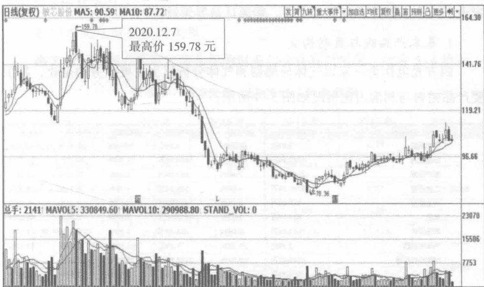

**走势复盘：** 上市后震荡攀升，2020 年 12 月见顶 159.78 元，随后回调至 2021 年 6 月 100 元附近。**当前股价显著高于 70.5 元估值锚点，处于高估区间，投资性价比下降。** 溢价缘于其细分龙头稀缺性及强竞争力，但入场需谨慎等待回调。

---

#### 五、 环境气体传感先锋：四方光电

作为国内最早将气体传感技术民用化的企业之一，四方光电构建了 NDIR、LSD、超声波、UV-DOAS、TCD、LRD 六大技术平台，产品矩阵覆盖家电、汽车、医疗、环保、工业、能源计量等全场景。

##### 1. 多元化应用场景支撑业绩基本盘

2020 年营收结构呈现“双引擎驱动、多场景并进”特征：

*   **按应用领域：** 空气品质（民用/消费电子）贡献 66.08% 营收，毛利 40.36%；环境监测、医疗健康、工业过程、安全监控四大专业领域合计贡献 30% 营收，**且毛利率均超 55%（工业过程高达 75.94%）**，专业市场盈利质量远超大众市场。
*   **按产品形态：** 气体传感器（标品/模组）占营收 77.44%，毛利 43.37%；气体分析仪器（系统集成/高端装备）占 19.74%，毛利 64.54%，**高毛利仪器业务比重提升空间大**。
*   **按区域：** 内销 85.92%（毛利 46.43%），外销 12.99%（毛利 55.21%），出海拓展提升整体盈利弹性。

| 业务构成 | 营业收入(元) | 收入比例 | 营业成本(元) | 成本比例 | 毛利比例 | 毛利率 |
|---|---|---|---|---|---|---|
| 空气品质 | 2.03亿 | 66.08% | 1.21亿 | 74.59% | 56.55% | 40.36% |
| 环境监测 | 4742.80万 | 15.40% | 1834.42万 | 11.28% | 20.03% | 61.32% |
| 医疗健康 | 2297.94万 | 7.46% | 843.06万 | 5.18% | 10.02% | 63.31% |
| 工业过程 | 1336.66万 | 4.34% | 321.56万 | 1.98% | 6.99% | 75.94% |
| 安全监控 | 920.01万 | 2.99% | 410.52万 | 2.52% | 3.51% | 55.38% |
| 其他 | 811.19万 | 2.63% | 417.80万 | 2.57% | 2.71% | 48.50% |
| 其他业务 | 334.16万 | 1.09% | 306.19万 | 1.88% | 0.19% | 8.37% |
| 气体传感器 | 2.38亿 | 77.44% | 1.35亿 | 82.98% | 71.22% | 43.37% |
| 气体分析仪器 | 6079.45万 | 19.74% | 2155.98万 | 13.25% | 27.02% | 64.54% |
| 其他 | 534.23万 | 1.74% | 306.12万 | 1.88% | 1.57% | 42.70% |
| 其他业务 | 334.16万 | 1.09% | 306.19万 | 1.88% | 0.19% | 8.37% |
| 国内 | 2.65亿 | 85.92% | 1.42亿 | 87.11% | 84.60% | 46.43% |
| 国外 | 3999.66万 | 12.99% | 1791.34万 | 11.01% | 15.21% | 55.21% |
| 其他业务 | 334.16万 | 1.09% | 306.19万 | 1.88% | 0.19% | 8.37% |

**核心看点：** 专业领域（环保、医疗、工业）与高毛利仪器业务占比虽小但利润率极高，是未来业绩结构优化、整体毛利率跃升的关键杠杆。

### 四方光电：气体传感独角兽的业绩与估值深度解析

**核心业务构成：单一且高利润**
四方光电的营收结构极度集中。气体传感器业务撑起了超过四分之三的总营收（77.44%），虽毛利率仅43%左右，却贡献了71%的总利润，稳坐“现金奶牛”宝座。气体分析仪虽营收占比不足两成，但毛利率高达64.5%，利润贡献超27%，展现出极强的高端产品变现能力。其他业务体量可忽略。

**应用场景与市场版图**
产品广泛覆盖空气质量监测、环保、医疗、工业及安全等刚需领域。销售端呈现典型的“内销为主、外销为辅”格局：国内市场贡献近86%营收，海外占比约13%。高毛利的双主力产品，直接印证了公司在细分赛道内的核心竞争壁垒。

**财务成长性：小体量蕴藏大爆发**
上市时间短（2021年2月上市）导致历史数据参考性有限，但三大信号值得关注：
1.  **利润波动大**：受新股发行摊薄及基数效应影响，净利增速剧烈震荡（从近5倍增跌至-25%再反弹30%）。
2.  **营收天花板高**：2020年营收仅3.08亿，历史更多维持在1-2亿级别，相对巨大的市场空间，成长弹性极大。
3.  **ROE虚高**：因股本扩张滞后，净资产收益率一度飙升至45%以上，需剔除融资扩股因素理性看待。

**资产质量与运营细节（2020年末及2021一季度）**
*   **弹药充足**：上市前现金7000万，上市后一季度激增至5.2亿，融资到位迅速。
*   **周转压力显现**：应收账款1.04亿、存货8700万，合计超营收60%，占用资金较多，但预收账款1300万显示对下游仍有一定话语权。
*   **研发投入偏低**：年研发仅1900万，占营收比不足6%，上市融资后大概率大幅加码研发。

**估值框架与走势研判**
采用PEG估值法：假设2021年净利增速40%（EPS 2.25元），对应40倍PE（PEG=1）合理价90元；50倍PE（PEG=1.25）对应112.5元。
**实战复盘**：2021年2月上市后震荡上行，6月7日触及123.57元高点，随后回落至100元附近震荡。当前股价处于估值区间（90-112.5元）上半区，安全边际收窄，属于新股价值回归过程中的“消化估值”阶段，投资性价比下降。

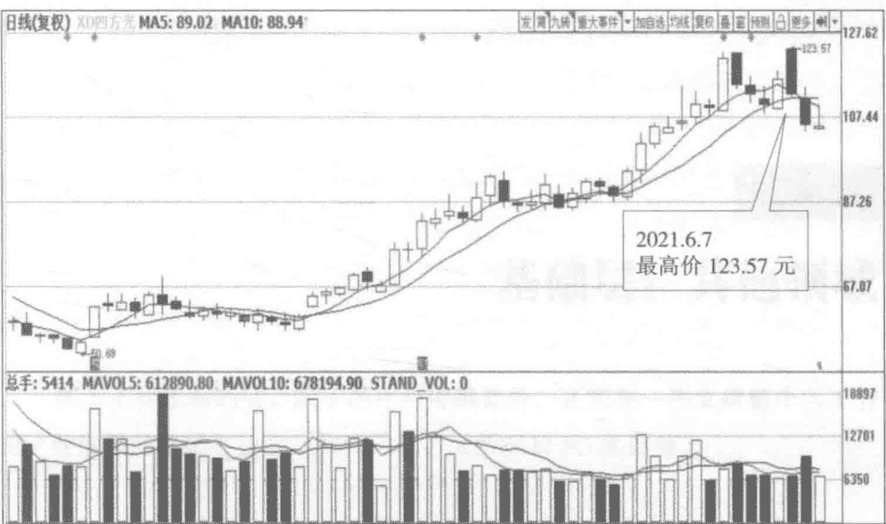

---

### 基础层赛道：云计算——数字经济的“水电煤”

云计算本质是算力的规模化交付：将巨型计算任务拆解，由服务器集群并行处理，按需计费。它终结了“自建机房、买断软件”的重资产模式，催生出服务商、设备商、软件商三大产业链主线。

#### 一、 行业竞争全景扫描

**规模与渗透率：蓝海确定性高**
2020年国内市场超1500亿，2030年望破3000亿。但企业上云率仅40%，远低于美欧（70%-85%），补课空间巨大，未来几年将迎来渗透率跃升的主升浪。

**产业链四大角色分工**
1.  **硬件基石**：服务器、存储、网络、芯片/CPU。代表：浪潮、曙光、联想、华为、中兴。
2.  **软件大脑**：通用型（用友、金蝶、微软）与行业垂直型（东软、太极、东华）。
3.  **系统集成商**：搭建平台的“装修队”，连接软硬件。曙光、浪潮、华胜、神州信息、华为等常跨界布局。
4.  **服务运营商（最核心）**：运营IDC/云平台，直面客户。阿里云、腾讯云、天翼云、金山云、网宿、世纪互联及三大运营商。

**竞争态势三大判断**
*   **入局潮起，强者恒强**：中小服务商生存空间被巨头挤压。
*   **全球寡头格局定**：AWS、Azure、GCP、阿里云四分天下。国内IaaS层阿里云一家独大（40%+），电信、腾讯追赶。**离客户越近（应用层/SaaS），赚钱越容易；离客户越远（基建/硬件），竞争越惨烈、利润越薄。**
*   **出海成必选动作**：国内厂商纷纷启动国际化布局。

**四大演进趋势**
1.  **核心自主可控**：芯片国产化替代是主线，空间巨大。
2.  **上云率跃升孵化独角兽**：细分赛道将诞生更多专业服务商，甚至走向全球。
3.  **传统产业数字化**：云+制造、云+医疗、云+金融成标配。
4.  **云安全与云保险**：数据资产化倒逼安全投入，衍生新赛道。

#### 二、 A股投资标的筛选逻辑（避开未上市的阿里/腾讯）

1.  **首选“离钱近”的平台运营商**：虽阿里云霸榜，但细分垂直领域仍有机会（如行业云、政务云）。
2.  **关注轻资产软件/集成商**：空间大但波动高，外资垄断通用软件，国产厂商（东软、浪潮软件、太极）多处于系统集成或垂直应用层，盈利弹性看项目交付节奏。
3.  **设备端押注“硬科技突围”**：服务器/存储红海，唯有掌握核心元器件（如液冷、高速互联、国产CPU适配）的龙头（中科曙光、浪潮信息）具备穿越周期能力。

#### 三、 龙头标的深度：浪潮信息（000977）——全球前五、国内第一服务器巨头

**业务极简：纯粹的“卖铲人”**
2020年营收630亿，**服务器及部件占比98%**，IT终端仅1.5%。毛利率极薄：服务器仅11.4%，终端20.2%。**典型的高营收、低利润、强周期、重周转模型**。海外营收占比17%，已具备全球化交付能力，但也承担汇率、地缘政治风险（如2016年委内瑞拉坏账导致利润腰斩）。

**财务轨迹：高增确定性 vs 低ROE结构性矛盾**
*   **业绩高增**：除2016年计提坏账外，净利增速常年40%-50%+，营收复合增速惊人（16-20年从126亿增至630亿），完美共振云算力基建周期。
*   **ROE长期低位**：常年8%-12%，虽有提升趋势但远低于优秀制造业。**根因：处于产业链中游，无定价权，竞争白热化。**

**资产负倻表视角（2020年末）**
*   **现金充裕**：99亿货币资金，短债无忧。
*   **应收高企但可控**：应收82亿，但预收/合同负债41亿，工程属性强，款项随进度回款，坏账风险可控。
*   **存货压力大**：109亿存货（含原材料/在产品），占营收17%，需警惕库存周转放缓及跌价风险。
*   **研发发力明显**：26亿研发费用 > 18亿销售费用，近两年增速显著，技术护城河在加深。
*   **商誉极低**：几十万级，无并购暴雷隐患。

**估值锚定与当下机会**
*   **模型假设**：2020年EPS 1.04元，假设30%增速 -> 2021年EPS 1.35元。给予30倍PE（PEG=1），目标价 **40.5元**。
*   **走势复盘**：2020年7月高点48元回落，至2021年6月中已跌至30元附近，**显著低于估值中枢**，安全边际凸显，属于业绩高增期的“错杀”修复机会。

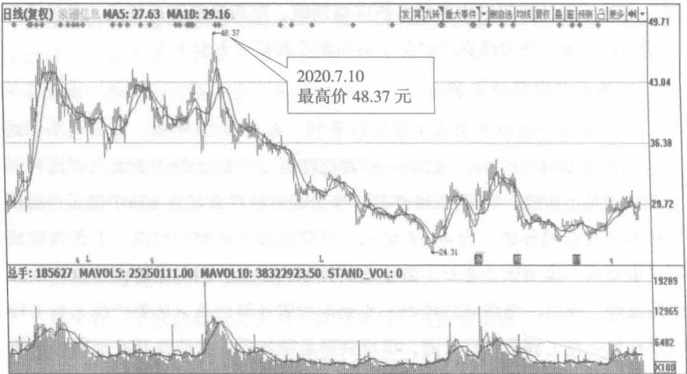

#### 四、 细分龙头深度：光环新网（300383）——京津冀IDC/云服务隐形冠军

**定位差异化**：深耕北京市场，主营IDC托管、增值运维、ISP接入及云服务。**核心护城河：亚马逊AWS中国区战略合作伙伴**，独家运营基于AWS技术栈的合规云服务。

**业务构成**（见后续图表6-4）：以IDC基础服务（机柜/带宽租赁）为基本盘，云计算及增值服务为高增长极，客户粘性极高，现金流特征优异。

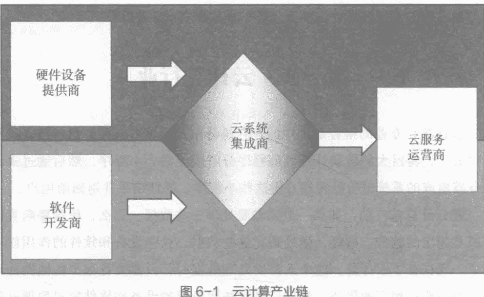

#### 深度解析：光环新网与用友网络的业绩密码，以及大数据赛道的投资逻辑

**一、 光环新网（300383）：IDC资产为王，云业务引流，北京一地独大**

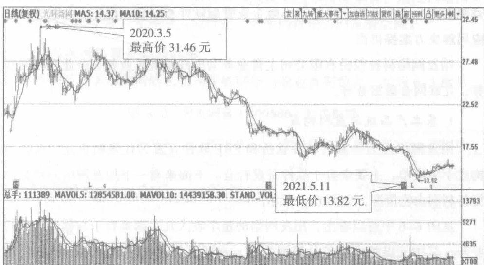

**核心业务画像：单一电信牌照，双引擎驱动**
光环新网的营收版图极度聚焦——99.6%源自电信服务。拆解来看，业务呈现“一体两面”格局：
*   **云计算及相关服务（营收担当）：** 贡献超七成营收（74.15%），是绝对的规模引擎。但受限于10.81%的薄薄毛利，利润贡献仅37.97%，典型的“叫好不叫座”。
*   **IDC及增值服务（利润基石）：** 营收占比仅两成强（22.31），却凭借54.85%的高毛利，揽下近六成净利（57.98%）。这才是公司盈利模型的核心支撑。

**地理护城河：深耕北京，稀缺资产护体**
近93%营收集中于北京，这非偶然。一线城市IDC资源（机位、电力、工业用地）极度稀缺，且受物理距离限制，必须贴近核心客户群。光环新网在京布局的IDC集群，构筑起难以复制的准入壁垒。

**财务体检：高增长放缓，现金流承压，商誉悬顶**
*   **增速换挡：** 历年净利增速曾超50%，2020年降至10.71%，疫情是主因，也暴露出大盘下的惯性。
*   **规模天花板：** 74.76亿营收体量，在万亿云市场中仍显单薄，成长空间巨大。
*   **ROE刚及格：** 连续两年勉强触线10%，根因在于低毛利云业务拖累整体资产回报。
*   **隐性雷点：** 12亿现金对标近75亿营收尚可，但应收账款近20亿远超预收账款（1.5亿），话语权弱势显著。更关键的是，24亿商誉已达三年净利总和，减值风险不容忽视。研发投入2.18亿，力度中规中矩。

**估值锚定与操作策略**
假设20%增速，21年EPS 0.71元。给予25-30倍PE（PEG 1.5），合理区间**17.75-21.30元**。
K线显示，股价曾从31元高位回落至15元附近（2021年6月），已跌破估值下沿。长线配置宜等回调确认入场，且须严控仓位对冲商誉雷暴。

---

**二、 用友网络（600588）：SaaS龙头转型期，软件许可高利润，财务韧性强**

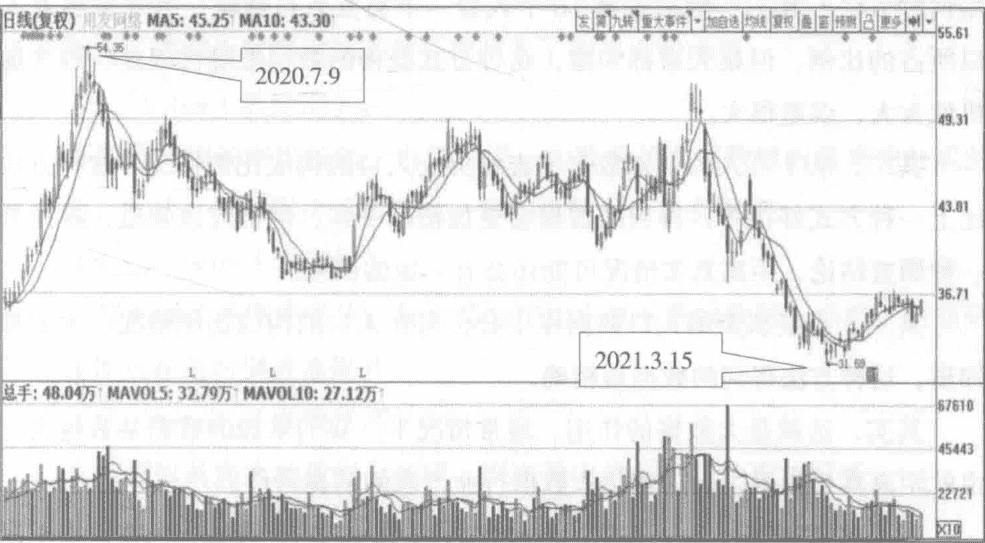

**利润解剖：服务铺规模，许可出利润**
收入近乎纯软件（96%），结构极具教科书特征：
*   **技术服务及培训（现金奶牛）：** 收入占比66.4%，毛利44.5%，撑起半壁江山利润贡献（48.36%）。
*   **软件许可（利润核弹）：** 收入仅28.5%，却因98%惊人毛利，贡献45.7%利润。这是SaaS模式“一次开发、无限复制”边际成本趋零的极致体现。
*   **整体毛利60%+**，印证企业软件“暴利”本色。

**财务演进：营收稳增，利润波动，ROE修复中**
*   **营收韧性强：** 即使转型期（2016）与疫情年（2020），营收仍正向增长至85亿，确定性高。
*   **利润过山车：** 2020年净利腰斩(-16%)，16年转型亏损，增速不稳是行业通病。
*   **ROE质变：** 18年后稳超10%，19年峰值18.35%，转型红利释放明显。
*   **资产负债表优秀：** 44亿现金趴（营收85亿），极厚安全垫。应收11.5亿、存货4.2亿可控。商誉8.75亿虽高但低于光环。研发投入14.6亿（占比超17%），技术护城河深挖。

**核心护城河双料第一**
*   企业级应用软件市占率第一。
*   公有云SaaS市场份额第一。

**估值区间与择时**
基准EPS 0.31元，激进假设40%高增（PEG=1），40-50倍PE对应**17.20-30元**区间（含22年推演）。
K线显示，20年7月曾冲高54元，严重透支估值。即便21年3月回调至31.59元，仍显著高于合理中枢。策略：耐心等待回调至估值区间内，左侧分批布局。

---

### 第二篇章 大数据赛道：从“量变”到“质变”的确定性机遇

**重新定义大数据：全量洞察，而非抽样猜测**
IBM五大特征（大量、多样、低价值密度、高速增长、高准确性）揭示本质：**用规模弥补噪音，用全量逼近真相**。云计算解决了存算瓶颈，让“大数据”从概念走向落地。

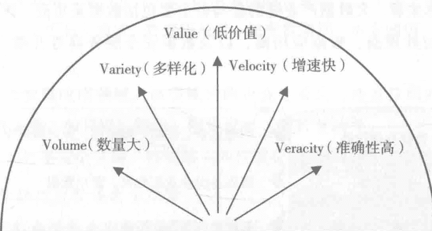

**产业链全景：数据流转中的五大角色**
数据采集 → 存储 → 清洗/分析 → 应用落地 → 安全合规。各环节协同共生，无孤岛赢家。

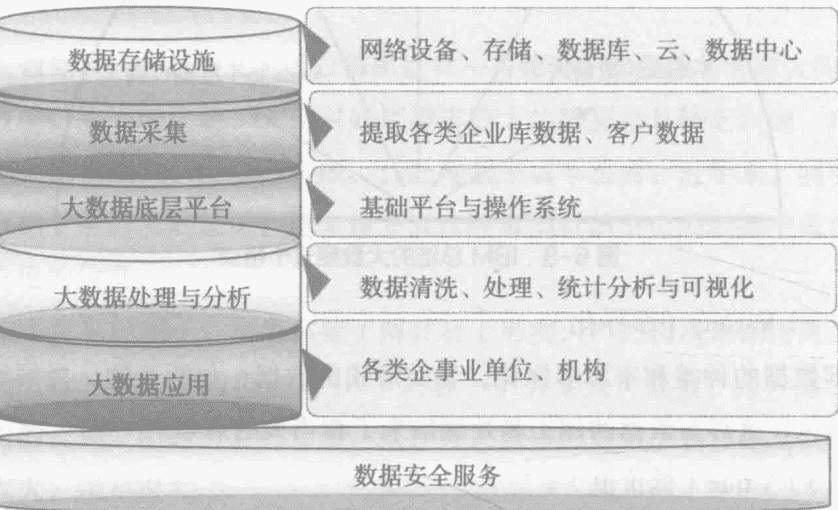

*(正文至此，后续内容待续...)*

### 第三节 5G 产业投资逻辑深度解析

5G，即第五代移动通信技术，系 2G、3G、4G 之后的新一代蜂窝移动通信标志。其核心禀赋在于高速率、低时延、节能、低成本、大连接，能支撑海量设备并发。步入 5G 纪元，智能终端将与万物互联，真正落地“万物智联”图景。5G 规模商用与大数据、云计算、物联网等产业演进同频共振，正是下游对流量的渴求倒逼了 5G 网络的加速铺设。

#### 一、5G 产业竞争格局透视

5G 落地将强力赋能关联产业，显著拉动社会总产出。据中国信通院《5G 经济社会影响白皮书》测算：至 2030 年，5G 带动的直接产出与间接产出将分别突破 6.3 万亿与 10.6 万亿元大关。

##### 1. 5G 产业链全景拆解与态势研判

宏观视角下，5G 产业链可拆解为上游通信基建、中游运营服务、下游终端与场景三大层级，架构如下：

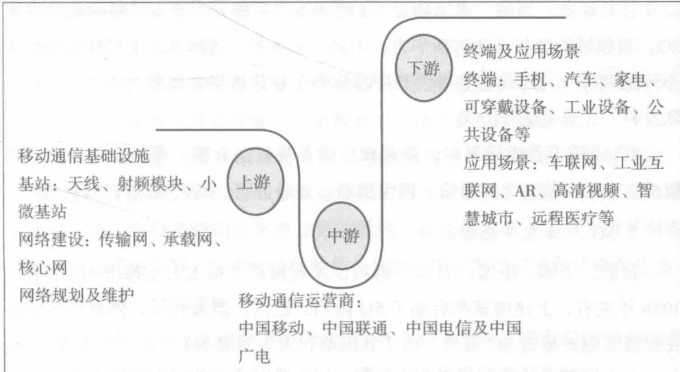

**图 6-12 5G 产业链生态分布**

###### (1) 移动通信基础设施——筑基层

聚焦基站、网络建设、网络规划三大细分赛道。

**基站环节**细分为天线、射频模组、小微基站。主力军涵盖华为、通宇通信、盛路通信、信维通信、麦捷科技、武汉凡谷、邦讯技术等，未来参与者将持续扩容。

**网络建设**覆盖传输网、承载网、核心网。阵营包括华为、中兴通讯、烽火通信、光迅科技、大富科技、长飞光纤、中天科技、新易盛、天孚通信等。

**网络规划**领域，三维通信、华星创业、日海通讯、中富通等深耕布局。

- (2) 移动通信运营商——管道层

持牌运营格局已定，由中国移动、中国联通、中国电信、中国广电四大国家队主导。

- (3) 终端与应用场景——应用层

终端形态延伸至手机、车联网、智能家电、可穿戴、工业装备、公共设施等，未来边界将持续外拓。华为、中兴、小米等头部厂商领跑。基带芯片作为核心“心脏”，供给端由华为海思、高通、三星、联发科、大唐电信等把控。

场景落地需配套系统解决方案，紫光股份、东方国信、北纬通信、四维图新、宜通世纪、高新兴、天源迪科等深度参与。

##### 2. 5G 产业竞争态势深度剖析

美、欧、日、韩、中同步推进商用进程，2020 年前后集中启网；巴西、澳大利亚、俄罗斯等亦在蓄势待发。全球争夺战催生出如下竞争特征：

**第一，全栈技术自主权高度集中，生态系统对垒成常态。** 能掌握全套 5G 体系并具备系统级交付能力的玩家凤毛麟角。华为、中兴、诺基亚、爱立信、三星等寡头构建起各自封闭的生态护城河，竞争本质上演变为生态系统间的全维博弈。剔除地缘政治干扰，华为凭借深厚技术积淀确立显著领先优势，故而资本市场持续热炒“华为产业链”概念。

**第二，巨头提前卡位，细分赛道集中度飙升，中小企业生存空间收窄。** 商用伊始，各路巨头已全线压阵，各环节呈现强者恒强的马太效应。虽 5G 催生新业态为创业者留出窗口，但经验表明：一旦新赛道显现规模效应，资本巨头将闪电入场收割。中小玩家面临“夹缝求生”严峻考验。

**第三，技术话语权分配收益，核心壁垒决定生存高度。** 5G 产业红利不会均沾。核心模块技术壁垒极高，唯有掌握关键技术、拥有标准制定权的企业，才能捕获超额发展机遇与利润洼地。

##### 3. 5G 产业演进趋势前瞻

虽商用时间不长，但头部厂商技术储备深厚，这场“备战已久”的竞赛呈现明确趋势：

**第一，全球建网热潮涌现，设备商角逐白热化。** 主要经济体竞相加速组网，为设备商开拓版图创造黄金窗口。华为凭借技术厚度领跑；中兴凭借极致性价比赢得客户青睐，双雄并进格局将延续。

**第二，标准制定权争夺战升级。** 谁主导标准，谁掌握游戏规则。头部设备商将围绕 5G 标准演进展开更激烈的博弈。

**第三，网络渗透全域生产生活，与物联网、泛终端深度融合。** 5G 将渗透产业肌理，与物联网、智能家电、可穿戴设备等实现原子级融合，催生海量创新场景。

#### 二、5G 企业投资逻辑推演

通信代际跃迁，受益传导路径恒定：设备商先行受惠 → 传导至运营商 → 最终溢出至应用层。5G 投资研判需遵循这一铁律。

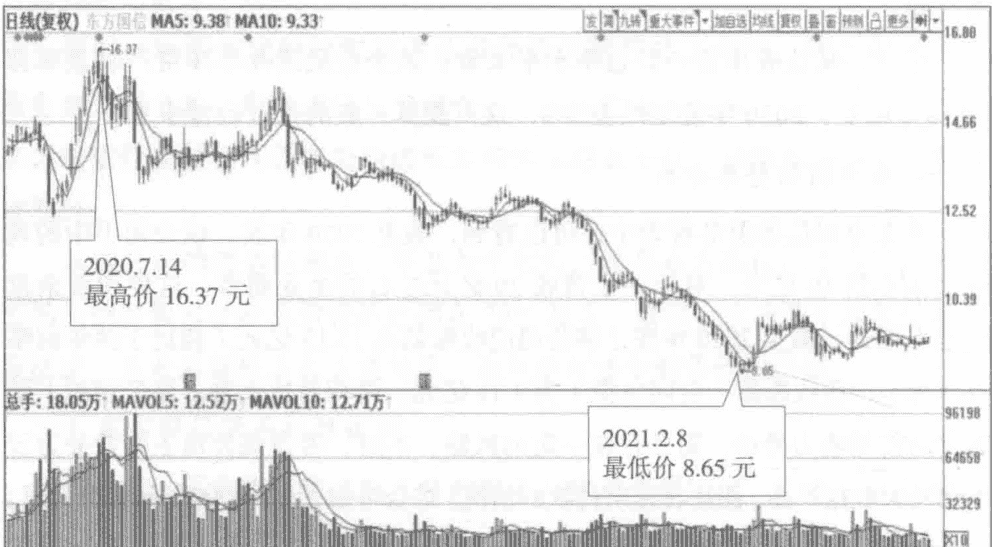 (Note: The original text had  before the K-line chart of Oriental Guoxin, which is in the previous section. The provided text ends at "#### 二、5G 企业投资逻辑". The  and  tags are kept in their original relative positions in the source text. In the source,  appears before "图 6-11" in the Oriental Guoxin section, and  appears before "图 6-12". I have placed  correctly above the 5G chain diagram.  belongs to the previous section (Oriental Guoxin K-line), but since the input text is a continuous block, I must include it where it appeared in the source. Looking at the source:  is right before "图 6-11 东方国信...日 K 线走势图" which is inside "#### 三、工业大数据代表企业——东方国信" -> "##### 4. 东方国信估值分析".  is before "图 6-12 5G 产业链分布" inside "#### 一、5G 行业竞争分析" -> "##### 1. 5G 产业链及整体态势". I will place them correctly in the rewritten structure.)

Wait, the user provided a single block of content. I need to rewrite the *entire* block provided. The block starts with "(1) 大数据存储设施领域..." and ends with "#### 二、5G 企业投资逻辑 ... 遵循这样的逻辑。". I must rewrite *everything* from the start.

Let me restart the rewrite for the **entire provided content**.

Structure of provided content:
1. Big Data Industry Sectors (1)-(6)
2. Big Data Competition (##### 2)
3. Big Data Trends (##### 3)
4. Big Data Investment Logic (#### 二)
5. Case Study: Oriental Guoxin (#### 三)
   - ##### 1 Products/Profit
   - ##### 2 Financial Data
   - ##### 3 Overall Analysis
   - ##### 4 Valuation Analysis (contains )
6. 5G Industry Investment Logic (### 第三节)
   - #### 一 5G Competition
     - ##### 1 5G Chain (contains )
     - ##### 2 5G Competition
     - ##### 3 5G Trends
   - #### 二 5G Investment Logic

I will rewrite all of this.[content]
### 大数据与5G产业深度研报：竞争格局、投资逻辑与标杆案例解析

#### 一、 大数据产业版图全景扫描

大数据产业链条清晰，可划分为六大核心板块，各司其职，协同演进。

**(1) 存储设施筑基石**  
作为产业基建底座，存储设施支撑起整个大数据大厦。鉴于大数据与云计算血脉相连，云算力基建服务商天然具备跨界赋能能力。典型代表如光环新网，另有华胜天成、拓尔思、同有科技等深耕者。BAT 等超级互联网巨头在多地自建数据枢纽，筑牢数据安全护城河。硬件供给端，中科曙光、浪潮信息等占据主导。

**(2) 采集环节破壁垒**  
专业软件服务商定制化开发工具，助力客户高效获取多源异构数据。华胜天成、用友网络等在此环节布局深厚。

**(3) 底层平台搭舞台**  
提供平台搭建与全周期运维服务。除华胜天成、用友网络外，海量数据、天夏智慧、东方国信等亦是核心玩家。

**(4) 处理分析出洞见**  
聚焦垂直场景交付全栈解决方案，深耕医疗、安防、教育等细分赛道。东软集团、东方国信、宝信软件、天源迪科等凭垂直积累建立护城河。

**(5) 应用层触达用户**  
直面 C 端或企业端，百度、腾讯、阿里巴巴、每日互动等流量入口型企业主导此层。

**(6) 安全护航保底线**  
启明星辰、360 等筑起数据安全防火墙。

##### 2. 大数据行业竞争格局深度剖析

赛道爆发式增长催生出鲜明竞争图谱：

**第一，全链路布局已成，中游红海厮杀，下游蓝海待掘。** 产业链上下游均有主力军驻守。但中游平台搭建与数据处理领域，外资巨头（亚马逊、微软等）凭技术先发优势占据高地，竞争白热化。下游应用层虽 BAT 三分天下，但细分场景仍留有充足增量空间，给后入局者留出窗口。

**第二，巨头全链路闭环收割，中小企业突围靠“极致垂直”。** 头部互联网大厂加速向上下游延伸，构筑“护城河”生态，中小玩家边际效应递减。唯有深耕未被开垦的微细分领域，打造不可替代的垂直壁垒，方为生存之道。

**第三，出海成必选题，国际化战略全面铺开。** 内卷加剧倒逼厂商拓展海外版图，跨国经营成标配动作。

##### 3. 大数据产业演进趋势前瞻

新兴赛道天花板极高，三大确定性趋势浮现：

**第一，标准缺失致质量低，统一规范势在必行。** 当前数据管理标准碎片化，导致加工成本高、质量参差不齐。随产业成熟，数据质量跃升将成硬指标。

**第二，赋能千行百业，重塑竞争范式。** 大数据渗透率提升将深度重构各行业竞争逻辑，无行业能置身事外。

**第三，共享机制破冰，催生应用创业潮。** 数据壁垒打破将大幅提升处理应用效率，并孵化出海量基于数据增值的新物种企业。

#### 二、 大数据企业投资逻辑推演

政策护航、群雄逐鹿，A 股大数据概念股林立。选标需聚焦三大核心维度：

**第一，坐拥“数据矿山”的资源型选手。** 视数据为核心资产，拥海量储备即掘金权。共性特征：贴近终端用户。BAT 及三大运营商即典型代表，可持续挖掘数据内生价值。

**第二，以“技术硬实力”见长的赋能型选手。** 聚焦采集、处理、分析、可视化全链条，软硬件兼修。浪潮信息、中科曙光、华为、用友网络、永洪科技、星环科技、南大通用等硬核玩家在列。

**第三，深耕“场景落地”的应用型选手。** 广泛对接垂直行业，打磨产品易用性、可维护性，输出差异化服务。明略数据、百分点竞争力突出，虽暂未上市，但极具跟踪价值，建议纳入备选池持续监控。

#### 三、 工业大数据标杆深度拆解——东方国信

东方国信深耕云平台与大数据，系工业互联网核心拼图。

北京东方国信科技股份有限公司专注企业级商业智能（BI）整体解决方案。核心产品矩阵覆盖企业数据平台、分析平台、基于 BI 的 CRM 应用。其为中国联通、中国电信第一大 BI 软件供应商。日均处理数据超 3 万亿条，累计查询超 70 万亿条，平台节点超 3 万，毫秒级实时响应。

定位电信行业大数据龙头，独揽三大运营商集团及核心省份大数据集中平台建设，长期服务运营商积累深厚数据资产与运营经验；以电信大数据为支点，并购数据挖掘标的，向多行业应用层裂变扩张。

##### 1. 核心产品线与利润引擎解析

营收源自系统集成与大数据运营服务。2020 年度业务结构详见下表：

| 业务维度 | 细分类别 | 营收(亿) | 占比 | 成本(亿) | 成本占比 | 利润占比 | 毛利率 |
| :--- | :--- | :--- | :--- | :--- | :--- | :--- | :--- |
| **按行业** | 电信 | 9.31 | 44.59% | 4.40 | 39.37% | 50.61% | **52.75%** |
| | 金融 | 4.92 | 23.57% | 3.06 | 27.42% | 19.14% | 37.74% |
| | 工业 | 3.51 | 16.82% | 1.89 | 16.88% | 16.75% | 46.29% |
| | 政府 | 1.74 | 8.31% | 0.95 | 8.52% | 8.07% | 45.14% |
| | 其他 | 1.40 | 6.71% | 0.87 | 7.81% | 5.43% | 37.64% |
| **按产品** | 定制软件开发及服务 | 15.23 | 72.92% | 7.93 | 70.96% | 75.17% | 47.92% |
| | 系统集成业务 | 2.60 | 12.45% | 1.72 | 15.43% | 9.01% | 33.64% |
| | 软件产品 | 1.83 | 8.78% | 0.72 | 6.40% | 11.52% | **60.98%** |
| | 数据服务 | 1.10 | 5.27% | 0.76 | 6.77% | 3.54% | 31.25% |
| | 云计算业务 | 0.12 | 0.59% | 0.05 | 0.44% | 0.76% | **59.93%** |
| **按地区** | 华北 | 9.99 | 47.86% | 5.56 | 49.78% | 45.64% | 44.33% |
| | 华东 | 4.62 | 22.13% | 2.43 | 21.75% | 22.58% | 47.42% |
| | 华南 | 1.63 | 7.78% | 0.78 | 7.02% | 8.66% | **51.72%** |
| | 西南 | 1.54 | 7.38% | 0.82 | 7.36% | 7.40% | 46.61% |
| | 西北 | 1.18 | 5.63% | 0.66 | 5.95% | 5.26% | 43.44% |
| | 东北 | 1.02 | 4.86% | 0.46 | 4.15% | 5.69% | **54.34%** |
| | 华中 | 0.72 | 3.46% | 0.39 | 3.53% | 3.39% | 45.45% |
| | 境外 | 0.19 | 0.89% | 0.05 | 0.46% | 1.38% | **72.15%** |

**图 6-10 东方国信（300166）产品及收入构成（2020 年度）**

**关键洞察：**
*   **营收看似分散，实则同源：** 核心均源于 BI 系统集成方案，覆盖电信、金融、工业、政府四大支柱，毛利率普遍 35%+，盈利质量扎实。
*   **电信为“压舱石”：** 贡献超 44% 营收、超 50% 利润，深度绑定运营商，基本盘极稳。
*   **数据运营尚在育儿期：** 占营收仅 5.27%，毛利 31.25%，利润贡献 3.54%，转型红利待释放。
*   **区域聚焦头部：** 华北、华东合计贡献 70% 营收，跟随经济活跃度与总部经济分布，集中度持续走高。

##### 2. 历年财务数据复盘

**表 6-4 东方国信（300166）关键财务指标趋势**

| 指标 | 2020年 | 2019年 | 2018年 | 2017年 | 2016年 |
| :--- | :--- | :--- | :--- | :--- | :--- |
| 每股收益(元) | 0.29 | 0.48 | 0.50 | 0.41 | 0.53 |
| 净利润增速 | -40.04% | -2.86% | 20.30% | 31.38% | 43.49% |
| 营收总额(亿) | 20.88 | 21.50 | 19.96 | 15.06 | 12.78 |
| 每股净资产 | 5.49 | 5.24 | 4.70 | 4.19 | 6.02 |
| 净资产收益率(ROE) | 5.33% | 9.60% | 11.08% | 10.28% | 10.27% |

*注：2016 年有高比例送配股。*

**财务密码解读：**
1.  **增速换挡明显：** 前期高增，近两年显著放缓甚至负增长，系业务扩张与大数据重投入所致。横向对比同类，现有营收增速仍属优秀，短期利润波动可容忍。
2.  **营收高增微降：** 长期高增轨迹，仅 2020 年因疫情微跌。21.5 亿峰值营收体量尚小，成长空间广阔。
3.  **ROE 回落至平庸线：** 连年 10%+ ROE 至 2020 年跌破 6%，投资回报率降至一般水平。

##### 3. 综合基本面诊断

**资金与风控：** 2020 年末货币资金不足 10 亿，对营收 20 亿规模尚属充裕。应收账款 15.13 亿（较两年前微降），合同负债 1.11 亿。应收/预收比显示对下游话语权尚可。考虑到行业结算周期长特性，财务风险可控。

**商誉悬顶需警惕：** 商誉 9.4 亿，约等于两年净利，减值风险不容小觑，投资者须重点监控。

**研发投入硬核：** 2020 年研发投入 3.52 亿，近两年显著加码，属高研发强度企业，技术护城河在深挖。

**盈利修复可期：** 历年盈利能力强、增速稳。随云平台与大数据业务放量，业绩有望重回高增轨道。

**配置建议：** 财务整体中规中矩，ROE 不足 10%，商誉雷存隐患。投资需严控仓位，风控前提下博取成长弹性。

##### 4. 估值体系构建与图谱研判

**DCF 简易测算：** 以 2020 年 EPS 0.29 元为基，假设 40% 净利增速，2021 年 EPS 预测 0.41 元。给予 40 倍 PE，对应目标价 16.40 元。此时 PEG = 1，处于低估区间（因基数低）。若增速难以维持 40%，估值中枢需下移。

**K 线实战复盘：**


**图 6-11 东方国信（300166）日 K 线走势图**

2020 年随大盘震荡。7 月 14 日见顶 16.37 元后震荡下行，至 2021 年 2 月初探底 8.65 元企稳反弹。对照 16.40 元估值锚点，2021 年上半年股价长期运行于价值区间下沿，安全边际凸显，投资价值显现。

---

### 第三节 5G 产业投资逻辑深度解析

5G 即第五代移动通信技术，承接 2/3/4G 演进。核心禀赋：高速、低延、节能、低价、大连、广覆盖。5G 纪元将终结“物理隔离”，落地万物智联。5G 商用与大数据、云计算、物联网同频共振，下游流量饥渴倒逼网络加速铺设。

#### 一、 5G 产业竞争格局透视

中国信通院预测：2030 年 5G 直接/间接产出将达 6.3/10.6 万亿，强力拉动 GDP。

##### 1. 5G 产业链全景拆解与态势研判

三层架构：上游基建、中游运营、下游终端与场景。


**图 6-12 5G 产业链生态分布**

###### (1) 移动通信基础设施——筑基层

**基站三件套：** 天线、射频模组、小微基站。主力：华为、通宇通信、盛路通信、信维通信、麦捷科技、武汉凡谷、邦讯技术等，阵营扩容中。

**网络建设三张网：** 传输网、承载网、核心网。主力：华为、中兴通讯、烽火通信、光迅科技、大富科技、长飞光纤、中天科技、新易盛、天孚通信等。

**网络规划：** 三维通信、华星创业、日海通讯、中富通等深耕。

- (2) 移动通信运营商——管道层

四大持牌国家队：中国移动、联通、电信、广电。

- (3) 终端与应用场景——应用层

**终端泛在化：** 手机、车联网、家电、穿戴、工业装备、公共设施……边界无限延展。华为、中兴、小米领跑。**基带芯片**为核心瓶颈，把控者：华为海思、高通、三星、联发科、大唐电信。

**场景方案商：** 紫光股份、东方国信、北纬通信、四维图新、宜通世纪、高新兴、天源迪科等赋能垂直落地。

##### 2. 5G 产业竞争态势深度剖析

全球同步推进（美欧日韩中 2020 年前后启网，巴西澳俄跟进），催生三大博弈特征：

**第一，全栈自主权高度集中，生态对垒成常态。** 能交付全套 5G 体系的玩家极少。华为、中兴、诺基亚、爱立信、三星寡头构建封闭生态，竞争本质 = 生态系统博弈。剔除政治因素，华为技术储备最厚，领先优势显著，资本持续热炒“华为链”逻辑自洽。

**第二，巨头提前卡位，集中度飙升，中小空间收窄。** 商用伊始即全线压阵，马太效应强。虽 5G 孕育新业态留窗口，但经验表明：新赛道现规模效应即引巨头闪电收割。中小企业“夹缝求生”难度升级。

**第三，技术话语权定收益，核心壁垒分蛋糕。** 红利不均沾。核心模块壁垒极高，唯掌握关键技术与标准制定权者，才能捕获超额红利。

##### 3. 5G 产业演进趋势前瞻

厂商久备厚积，竞赛呈三大确定性趋势：

**第一，全球建网潮涌，设备商决战白热化。** 主要经济体抢跑组网，设备商迎黄金窗口。华为凭技术厚度领跑；中兴凭极致性价比收割订单，双雄并进格局将延续。

**第二，标准制定权争夺战升级。** 谁定标准谁掌规则。头部厂商将围绕标准演进展开更激烈博弈。

**第三，网络渗透全域，与物联网/泛终端原子级融合。** 5G 将渗透产业肌理，催生海量创新场景。

#### 二、 5G 企业投资逻辑推演

通信代际跃迁，受益传导铁律：设备商先行 → 传导运营商 → 溢出应用层。5G 投资研判必遵此道。

# 5G与AI技术层核心标的深度研判：中兴、天孚及CV四小龙投资逻辑拆解

在5G产业链的传导机制中，核心设备商无疑是首批吃到“红利”的主角。回顾全球5G商用进程，每一轮行情的启动都伴随着头部厂商中标合同的落地。放眼全球，华为凭借技术壁垒斩获最多商用订单，其在国内市场的份额更是稳超半数；紧随其后的是中兴通讯，占据约三成国内份额。这两家巨头构成了A股最稀缺、受益最直接、弹性也最大的“双子星”标的。

基站建设作为5G落地的物理基石，天线与滤波器属于刚性标配。随着网络覆盖从点状向面状拓展，上游射频器件需求将呈几何级增长。通宇通信、信维通信、盛路通信、麦捷科技等产业链核心供应商，将首当其冲承接这一确定性订单释放。

光纤光缆则是5G传输网的“毛细血管”。当前国内光棒自给率虽达九成，但高端短板依存度高。5G大规模组网将极大拉动光纤消耗，导致光棒缺口进一步撕大。考虑到光棒产能爬坡周期长达18个月以上，且伴随重资产、长回本特性，短期供给错配难以逆转。亨通光电、长飞光纤、中天科技、烽火通信、杭州富通等龙头有望在景气上行周期中享受卖方市场红利。

#### 三、中兴通讯：A股稀缺5G主设备龙头深度解析

中兴通讯是国内仅有的两家5G主设备商之一，亦是国际标准制定与竞争的核心参与者。作为全球领先的通信全产业链上市企业，其业务版图覆盖程控交换、多媒体通讯、传输接入、移动基站、卫星微波、终端及行业解决方案等全谱系。

##### 1. 业务拆解：运营商网络撑起营收基本盘

从2020年年报数据透视，中兴收入结构呈现“一主两辅”格局。运营商网络贡献近73%营收，毛利率超33.7%，是绝对利润引擎（贡献近78%利润），核心覆盖5G基站、承载网等高壁垒赛道。消费者业务（手机、家庭终端）虽占营收16%，但毛利率仅23.6%，深陷红海厮杀。政企业务占比11%，聚焦公安、交通、能源、金融等垂直领域，毛利率接近29%。

地域维度上，海外营收占比超32.9%，且毛利率高达37.2%，远超国内28.9%水平。这既印证了其全球竞争力，也暴露了地缘政治、汇率波动的双重风险敞口。全公司综合毛利率31.6%，受终端业务拖累处于中位水平，但随5G资本开支高峰到来，产品结构优化将驱动整体盈利能力中枢上移。

##### 2. 财务复盘：从制裁阴影中走出的韧性修复

回溯2016-2020年财务轨迹，中兴呈现典型的“V字型”创伤修复曲线。2018年因美方制裁巨额罚款导致每股收益-1.67元，净利润腰斩超250%；2019年剥离制裁包袱后反弹173%；2020年虽遇疫情扰动，营收重回千亿大关（1014.5亿），每股收益0.92元，净资产收益率稳守10%以上。

关键看点三点：一是营收突破千亿后企稳，证明核心竞争力未因制裁受损；二是账面现金314亿，应收账款159亿、存货367亿均在可控区间，商誉不足2亿极低，财务质地扎实；三是研发投入148亿、销售费用76亿，双高费用率彰显“攻守兼备”战略定力。资产负债率虽近70%但呈下降趋势，现金流安全垫厚实。

核心隐忧在于供应链自主可控短板。制裁曾让其陷入“断供休克”，虽已建立备胎计划，但核心芯片、EDA工具等卡脖子环节仍存变数。投资中兴，本质是押注其技术自立进程与全球5G份额兑现的赛跑。

##### 3. 估值框架与图谱研判

以2020年EPS 0.92元为基底，假设2021年增速30%达1.20元，给予30倍PE对应36元合理价值（PEG=1）。该估值已隐性计价行业高景气与地缘风险溢价。

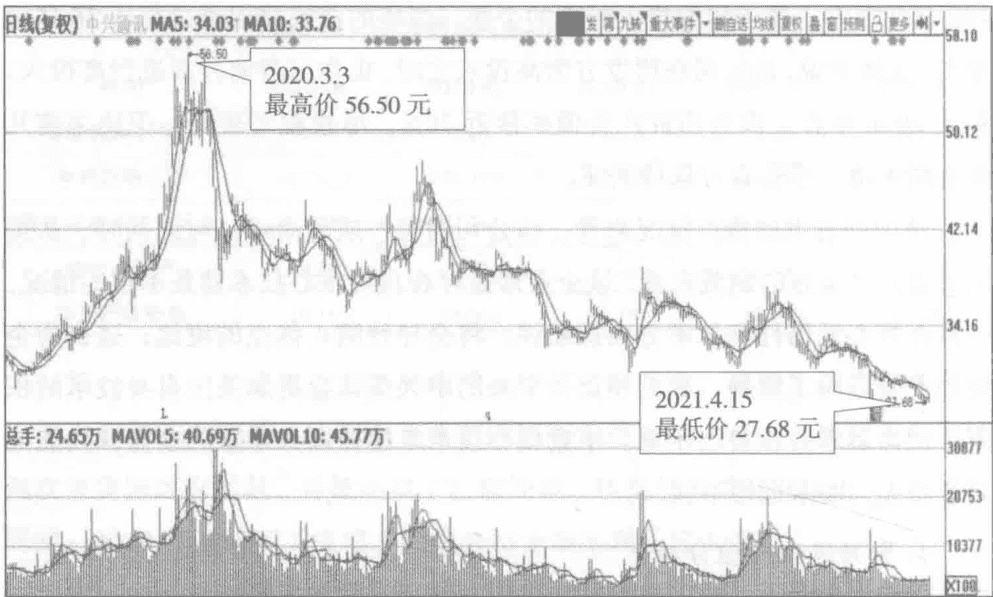

图 6-14 中兴通讯（000063）日 K 线走势图

技术面上，股价于2020年3月见顶56.5元后震荡下行，至2021年4月探底27.68元，显著低于基本面估值中枢。作为A股可直接参与的5G基建核心标的，中兴兼具业绩兑现确定性与估值修复弹性，但需严控仓位应对不可控外部冲击。

#### 四、天孚通信：光模块细分赛道隐形冠军

苏州天孚深耕光通信器件二十载，主营陶瓷套管、光纤适配器、高速光收发模块、高密度线缆等无源/有源器件，是5G前传/回传及数据中心互联的关键零部件供应商。

##### 1. 利润模型：无源器件构护城河，出海验证竞争力

2020年营收8.73亿，规模虽小但结构极优。光无源器件贡献85%营收、92.5%利润，毛利率高达57.4%，是名副其实的现金奶牛；光有源器件毛利率仅23.2%，处于培育期。内销占比63%，外销37%且毛利率超60%，海外大厂认证背书了其工艺良率与成本优势。整体毛利率52.8%，处于通信器件行业第一梯队。

##### 2. 成长轨迹：高增高质，规模效应初显

近五年营收复合增速超30%（3.1亿→8.73亿），净利润复合增速更高，2020年单年增速67.5%。ROE连续三年超14%，2020年跃升至22%，进入优秀行列。现金储备1.77亿覆盖短债无忧，研发投入7700万（占比近9%），销售费用率不足1%，管理极度精细。商誉不足3000万，资产负债率仅15%，干净到“发光”的资产负债表。

痛点在于规模天花板：8亿营收体量抗风险较弱，新产线爬坡若不及预期将面临固定成本摊薄压力。但5G基站密度是4G的3-5倍，光模块单站用量倍增，空间极大。

##### 3. 估值锚定与波段机会

按2020年EPS 1.4元、30%增速测算，2021年EPS 1.82元。30倍PE对应54.6元（PEG=1）；若赋予光模块龙头40倍估值溢价，对应72.8元（PEG=1.33），均在合理区间。

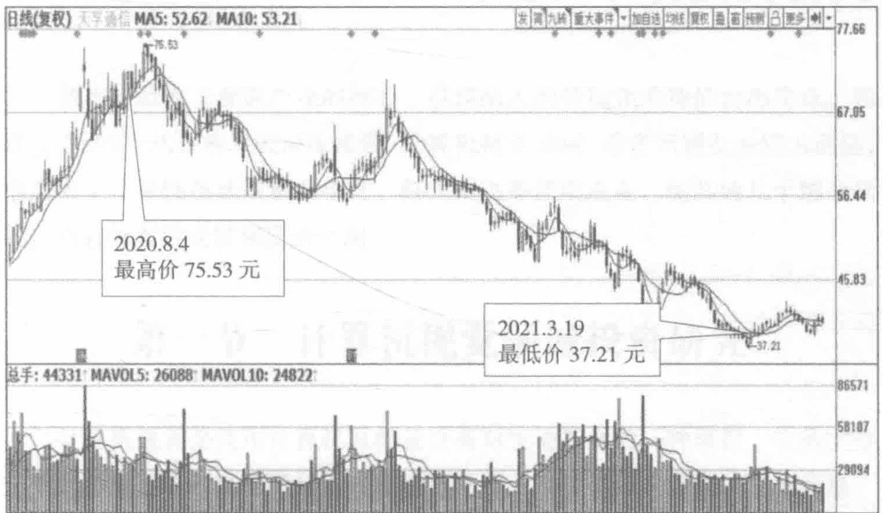

图 6-16 天孚通信（300394）日 K 线走势图

股价2020年8月冲高75.5元后回调至2021年3月37.2元低点，已跌破估值下限54.6元。对于确定性高成长的小盘优质标的，回调往往是布局良机，安全边际充足。

## 人工智能技术层投资研究

技术层是AI产业皇冠上的明珠，以模拟人类感知认知为内核，构建算法模型与工程落地路径。当前计算机视觉（CV）、语音识别（ASR）商业化领跑，诞生了“CV四小龙”、科大讯飞等独角兽；自然语言处理（NLP）、机器学习平台、自主决策等赛道仍处蓄势待发期，蕴含十倍股潜力。

### 第一节 计算机视觉：赋予机器“看懂世界”的入场券

计算机视觉通过算法对图像视频结构化理解，重构三维场景信息，是赋予芯片“大脑”感知外界的核心接口，坐拥AI落地“第一入口”战略地位。巨头与独角兽纷纷布局，资本涌入推动赛道估值中枢上移，成为硬科技投资主战场。

#### 一、 竞争格局：高毛利吸引入局，头部效应显著

行业毛利率长期维持40%高位，远超制造业均值，吸引海量玩家涌入。渗透率视应用场景分化：金融（人脸支付、风控）、安防（天网工程、智慧城市）率先爆发，竞争最烈、变现最快；工业质检、医疗影像、自动驾驶处于导入期，壁垒高、天花板高。商汤、旷视、依图、云从“CV四小龙”凭借算法迭代速度、数据闭环能力与To G/To B交付经验，已形成寡头垄断雏形，长尾玩家生存空间被压缩。

#### 二、 产业链定位：中游技术层是核心价值锚

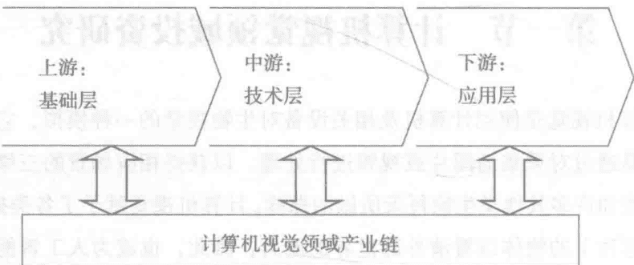

图 7-1 计算机视觉领域产业链

**上游基础层**：AI芯片（训练/推理）、高精度传感器、标注数据集、开源框架。国产替代逻辑与半导体产业链高度重合，寒武纪、地平线、旷视自研芯片等为代表。

**中游技术层（核心护城河）**：算法模型训练、感知引擎开发、行业解决方案集成。四小龙均坐镇此处，通过“算法+数据+场景”飞轮效应构建护城河。国内头部厂商在学术指标（ImageNet等）与工程落地能力上已达国际第一梯队，具备与谷歌、微软正面对抗实力。

**下游应用层**：智慧城市、智能安防、金融科技、自动驾驶、智慧零售、工业互联网等。场景越垂直，数据越私有，定制化程度越高，客户粘性与议价权越强。

投资逻辑推演：上游芯片国产化催化剂密集但波动大；中游四小龙及二梯队具备业绩确定性与估值弹性平衡，是配置主线；下游场景落地节奏决定行业天花板，关注单一场景市占率第一的垂直领域隐形冠军。

### 3. 下游版图：应用层全景

计算机视觉技术的落地场景极为丰富，且边界仍在持续外扩。当前，技术应用成熟度较高、商业化跑通的领域主要集中在金融、安防、智能手机、新零售、自动驾驶、医疗影像、工业制造以及广告影像等八大赛道。

---

#### 三、 计算机视觉赛道投资逻辑深度拆解

在筛选计算机视觉领域的投资标的时，建议遵循以下核心逻辑框架：

**1. 中游环节是皇冠上的明珠，锁定稀缺标的**
产业链中游为核心高地，商汤、旷视、依图、云从“AI四小龙”稳居C位。受限于上市进程（大概率冲刺科创板），投资者可采取双轨策略：一是紧盯四龙上市时间窗口；二是退而求其次，挖掘同环节其他优质标的。值得注意的是，该细分领域上市公司稀缺，汉王科技便是难得的已上市纯正标的。

**2. 下游应用层是增量猎场，关注场景落地兑现**
随着技术迭代，下游应用版图将持续拓宽。当前典型的细分赛道及头部玩家布局汇总如下（详见下表）：

| 细分领域 | 代表企业 |
|---|---|
| **1 安防** | 旷视、依图、海康威视、大华、宇视、华为、中兴、格灵深瞳、中科拓视等 |
| **2 金融** | 商汤、依图、旷视、云从、阿里巴巴、腾讯优图、百度、中科拓视、中科奥森等 |
| **3 手机** | 苹果、谷歌、华为、中兴、小米、OPPO、VIVO、商汤、百度、依图等 |
| **4 零售** | 阿里巴巴、百度、码隆科技、云飞励天、阅面等 |
| **5 医疗影像** | 依图、商汤、腾讯优图、百度、阿里巴巴、科大讯飞、码隆科技、汇医慧影等 |
| **6 工业制造** | 康耐视、基恩士、天准科技、征图新视、华周测控、研华科技等 |
| **7 自动驾驶** | 特斯拉、图森未来、纵目科技、大疆科技、谷歌、滴滴、百度、商汤等 |

*表：计算机视觉应用领域代表企业图谱*

---

#### 四、 标杆案例：汉王科技（002362）深度解析

汉王科技深耕文字识别（OCR）与智能交互技术，在细分领域享誉业界，定位为计算机视觉、大数据、智能交互技术、产品及服务的综合提供商。

##### 1. 核心业务板块与利润引擎

作为以软件信息技术服务为主营业务的企业，其2020年度产品结构与盈利贡献如下：

| 业务名称 | 营业收入(元) | 收入比例 | 营业成本(元) | 成本比例 | 利润比例 | 毛利率 |
|---|---|---|---|---|---|---|
| 软件和信息技术服务业 | 15.30亿 | 98.36% | 7.10亿 | 99.28% | 97.57% | 53.59% |
| 其他业务 | 2555.13万 | 1.64% | 512.12万 | 0.72% | 2.43% | 79.96% |
| **按产品分类** | | | | | | |
| 笔智能交互 | 11.12亿 | 71.47% | 4.59亿 | 64.18% | 77.68% | **58.71%** |
| 文本大数据与服务 | 1.91亿 | 12.25% | 1.11亿 | 15.57% | 9.42% | 41.56% |
| AI终端 | 1.52亿 | 9.79% | 9686.27万 | 13.55% | 6.59% | 36.35% |
| 人脸及生物特征识别 | 7265.13万 | 4.67% | 4172.50万 | 5.84% | 3.68% | 42.57% |
| 其他业务 | 2555.13万 | 1.64% | 512.12万 | 0.72% | 2.43% | 79.96% |
| **按地区分类** | | | | | | |
| 海外 | 9.69亿 | 62.30% | 4.01亿 | 56.05% | 67.62% | 58.63% |
| 华北 | 2.54亿 | 16.35% | 1.47亿 | 20.50% | 12.81% | 42.34% |
| 华南 | 1.50亿 | 9.62% | 7441.44万 | 10.41% | 8.95% | 50.25% |
| 华东 | 8875.21万 | 5.71% | 4562.73万 | 6.38% | 5.13% | 48.59% |
| 华中 | 2791.41万 | 1.79% | 1756.11万 | 2.46% | 1.23% | 37.09% |
| 其他业务 | 2555.13万 | 1.64% | 512.12万 | 0.72% | 2.43% | 79.96% |
| 东北 | 1566.32万 | 1.01% | 1098.99万 | 1.54% | 0.56% | 29.84% |
| 西北 | 1411.79万 | 0.91% | 953.70万 | 1.33% | 0.55% | 32.45% |
| 西南 | 1046.52万 | 0.67% | 439.61万 | 0.61% | 0.72% | 57.99% |

*数据来源：汉王科技（002362）2020年年报*

**核心洞察：**
*   **基本盘稳固**：“笔智能交互”业务扛起大梁，营收占比超七成（71.47%），毛利率近59%，贡献超七成利润（77.68%），是名副其实的现金奶牛。
*   **成长极备选**：“文本大数据与服务”（占比12.25%）、“AI终端”（占比9.79%）构成第二梯队，毛利率分别为41.56%、36.35%。
*   **全球化竞争力强**：海外营收占比高达**62.30%**，远超国内市场，且海外毛利率（58.63%）高于国内主要区域，证明产品具备国际竞争力。
*   **护城河深厚**：整体毛利率高企，核心产品利润贡献度远超营收占比，彰显定价权与成本控制能力。

##### 2. 历年财务数据复盘

| 时间 | 2020 年 | 2019 年 | 2018 年 | 2017 年 | 2016 年 |
|---|---|---|---|---|---|
| 每股收益（元） | 0.48 | 0.17 | 0.07 | 0.20 | 0.1 |
| 净利润增长率 | **177.81%** | 135.95% | -63.62% | 102.89% | 342.10% |
| 营业总收入（亿元） | 15.55 | 11.05 | 7.47 | 6.04 | 4.16 |
| 每股净资产 | 6.15 | 3.96 | 3.93 | 3.78 | 3.58 |
| 净资产收益率 | **11.51%** | 4.34% | 1.89% | 5.47% | 2.83% |

**关键事实判读：**
1.  **利润波动大，基数效应明显**：历年净利增速剧烈震荡（-63%至+342%），根因在于盈利基数低，微小绝对值变动即引发巨大百分比波动。
2.  **营收规模小，成长空间大**：2020年营收才刚突破15亿大关，2019年方跨过10亿门槛。相较于动辄百亿级的行业巨头，其拥有更广阔的营收倍增空间。
3.  **ROE修复向上**：净资产收益率虽从低位起步，但2020年已攀升至**11.51%**，连续三年正向修复，盈利质量改善趋势明确。

> **阶段性结论**：纯从财务报表看，汉王科技（EPS 0.48元、ROE 11.5%）谈不上优秀。但考虑到其**“计算机视觉上市稀缺标的”**属性，且核心指标均处于向好通道，具备重点跟踪价值。

##### 3. 经营质量全景扫描

透过2020年年报资产负债表细节，可见一斑：

*   **资金弹药充足**：年末货币资金**6.34亿元**，含2021年1月配股募集资金**5.62亿元**，财务安全边际极高。
*   **应收账款可控**：应收账款**1.49亿元**，占营收比重不高，回款风险较小。
*   **存货压力凸显**：存货高达**4.07亿元**，占全年营收（15.55亿）超**26%**，周转效率有待提升，需警惕跌价风险。
*   **议价能力尚可**：合同负债（预收账款）**8000万元**，显示对下游客户有一定掌控力。
*   **研发投入偏低**：全年研发费用仅**3400万元**，占营收比重不足2.2%。对于技术驱动型企业，此强度难以支撑长期技术护城河构建，后续竞争力存疑。
*   **商誉风险极低**：商誉仅**232万元**，基本无减值“雷”。

**综评**：财务体质总体健康，但**“存货高企、研发偏废”**为两大隐忧，需持续监控管理层改善动作。

##### 4. 估值体系与走势研判

采用 **PEG估值法** 试算合理中枢：
*   基准：2020年EPS 0.48元。
*   假设：2021年净利增速维持 **40%**，预测EPS约 **0.67元**。
*   给予 **40倍PE**（对应PEG=1，估值性价比均衡），目标价 **26.80元**。
*   若增速不及预期，估值需相应打折。

**二级市场走势复盘 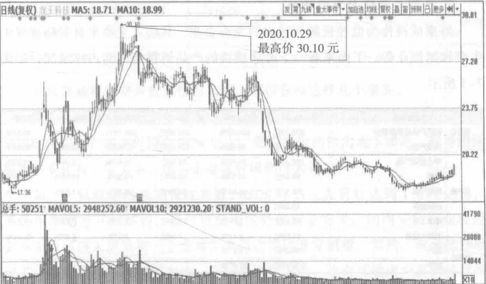**

图 7-4 汉王科技（002362）日 K 线走势图

2020年下半年股价随大盘震荡攀升，10月29日触及阶段高点**30.10元**后转入震荡下行通道，至2021年6月回调至**20元下方**。

**投资策略**：合理价值区间约 **26.80元** 上下。当前股价（2021年6月视角）已跌至估值区间下方，**安全边际充足，具备分批建仓吸筹价值**。

---

#### 五、 安防霸主：海康威视（002415）基本面透视

海康威视，全球安防视频监控核心的物联网方案龙头，持续深耕视频处理与分析技术，产品矩阵覆盖硬盘录像机（DVR）、视音频编解码卡、监控摄像机、球机、视频服务器（DVS）等全系设备。其视频监控产品销售规模连续多年稳居国内行业首位。

##### 1. 单一业务极致深耕，前端设备利润贡献超半数

2020年度营收结构高度聚焦：

| 业务名称 | 营业收入(元) | 收入比例 | 营业成本(元) | 成本比例 | 利润比例 | 毛利率 |
|---|---|---|---|---|---|---|
| **按行业** | 视频产品及视频服务 | **635.03亿** | **100.00%** | 339.58亿 | 100.00% | 100.00% | **46.53%** |
| **按产品** | | | | | | |
| 前端产品 | 288.41亿 | 45.42% | 127.97亿 | 37.69% | **54.30%** | **55.63%** |
| 中心控制产品 | 101.46亿 | 15.98% | 55.88亿 | 16.46% | 15.43% | 44.93% |
| 其他 | 98.66亿 | 15.54% | 68.87亿 | 20.28% | 10.08% | 30.19% |
| 后端产品 | 68.67亿 | 10.81% | 34.64亿 | 10.20% | 11.52% | 49.56% |
| 创新业务 | 48.10亿 | 7.57% | 31.64亿 | 9.32% | 5.57% | 34.22% |
| 建造工程 | 16.14亿 | 2.54% | 13.54亿 | 3.99% | 0.88% | 16.15% |
| 机器人业务 | 13.59亿 | 2.14% | 7.04亿 | 2.07% | 2.22% | 48.21% |
| **按地区** | | | | | | |
| 境内 | 458.07亿 | 72.13% | - | - | - | - |
| 境外 | 176.97亿 | 27.87% | - | - | - | - |

*数据来源：海康威视（002415）2020年年报*

**核心洞察：**
*   **业务纯度极高**：营收100%源自视频产品及服务，构建起“前端采集-中心控制-后端存储-创新拓展”全链条护城河。
*   **前端是利润引擎**：前端产品营收占比45%，却贡献**54%利润**，毛利率高达**55.63%**，核心竞争力集中于此。
*   **整体盈利稳健**：整体毛利率**46.53%**，国内外市场毛利率趋同，证明产品具备跨区域定价权。
*   **全球化双刃剑**：外销占比**27.87%**，深度参与国际分工，但也暴露于贸易摩擦（如中美贸易战实体清单）及汇率波动风险中。

##### 2. 财务基本面：大体量下的高质量增长

| 时间 | 2020 年 | 2019 年 | 2018 年 | 2017 年 | 2016 年 |
|---|---|---|---|---|---|
| 每股收益（元） | 1.45 | 1.34 | 1.24 | 1.03 | 1.23 |
| 净利润增长率 | **7.82%** | 9.36% | 20.64% | 26.77% | 26.49% |
| 营业总收入（亿元） | **635.03** | 576.58 | 498.37 | 419.05 | 319.35 |
| 每股净资产 | 5.76 | 4.81 | 4.07 | 3.29 | 3.98 |
| 净资产收益率 | **27.72%** | 30.53% | 33.99% | 34.96% | 34.56% |

**关键事实判读：**
1.  **增速换挡是常态**：前三年净利增速稳定在20%+，近两年回落至个位数。既受国际环境扰动，也受制于**600亿+营收基数**的大数定律。
2.  **营收触顶？国内饱和，国际是变量**：国内安防步入成熟期，增量有限；但近三成海外占比若能持续渗透，或成新增长极。
3.  **ROE极其罕见**：营收635亿、净利百亿量级下，ROE仍维持**27.7%**，远超同量级制造业平均水平，资产运作效率极致。

##### 3. 经营质量：现金奶牛属性凸显，研发筑长城

*   **现金流极其充沛**：货币资金**~350亿元**，占营收超50%，财务自由度极高。
*   **应收账款攀升需警惕**：应收账款**232亿元**，随营收同步走高，账龄结构及坏账计提需重点跟踪。
*   **存货高企受外部影响**：存货**114.78亿元**，处于高位，受近两年国际形势变化（订单交付受阻）影响显著。
*   **研发投入豪横**：年研发费用**63.79亿元**（占营收10%+），规模位居A股前列，为技术迭代与二次增长储备足够弹药。
*   **下游掌控力强**：合同负债**21.61亿元**，反映强势渠道地位。

**机构看好核心逻辑：**
1.  **护城河最深**：国内份额第一，国际同类产品中竞争力顶尖，出海想象力足。
2.  **换代红利未尽**：AI、IoT、5G催化下，存量监控设备面临智能化升级换代巨大需求。
3.  **研发高投入兑现未来**：连年百亿级研发，将支撑业绩重回高增长通道。

##### 4. 估值定价与操作策略

*   **估值测算**：基准2020年EPS 1.45元，假设增速 **10%**，2021年EPS约 **1.60元**。龙头溢价给予 **30倍PE**，目标价 **48元**。
*   **PEG视角**：30倍PE / 10%增速 = **PEG 3.0**，估值偏贵。但押注“业绩重加速”，当前估值或预期了未来几年增长修复。

**走势复盘 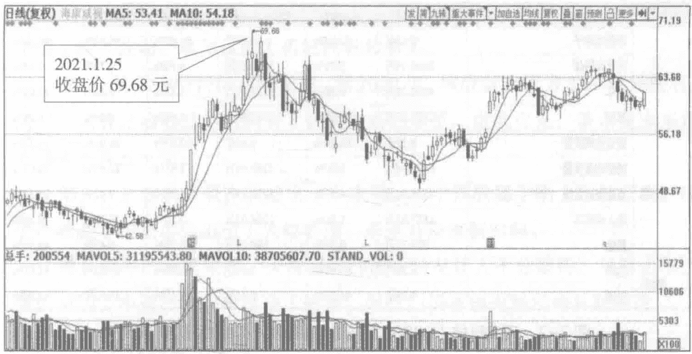**

图 7-6 海康威视（002415）日 K 线走势图

2020年下半年震荡上行，2021年1月下旬触及高点 **69.68元** 后持续回调，6月徘徊于 **60元** 附近。

**操作建议**：合理价值中枢 **48元**。当前股价（60元）显著高于估值锚点，**安全边际不足**。建议投资者耐心等待回调至估值区间附近，再分批建仓。

---

#### 六、 工业视觉先锋：天准科技业务拆解

天准科技，精密检测细分赛道领跑者，苹果玻璃及结构件检测设备核心供应商，致力于以前沿AI技术推动工业转型升级。公司以机器视觉为核心技术壁垒，聚焦服务工业端客户。主营精密测量仪器、智能检测装备、智能制造系统、无人物流车（AGV）的生产与销售。

##### 1. 核心业务板块与盈利构成

作为工业视觉装备代表企业，其营收主要来源于四大下游领域（详见图 7-7）：

*   **消费类电子**（核心大单，如苹果产业链）
*   **光伏半导体**（新兴高增长赛道）
*   **汽车制造**（智能化转型受益标的）
*   **其他工业领域**

*图 7-7 天准科技产品及收入构成（2020年度）*

> **注**：素材在此处截止，后续财务、估值分析待补充。

# 硬核AI双子星深度拆解：天准、讯飞能否穿越周期？

---

### 第一节 天准科技（688003）：智能检测“隐形冠军”的成长逻辑

#### 一、 业务拆解：单品支撑半壁江山，消费电子是压舱石

聚焦2020年报核心数据：**核心检测设备**稳坐头把交椅，吞下**85%以上的收入**，贡献**87%左右的利润**，毛利水平**43%+**，妥妥的现金奶牛，也是护城河最深处。

次席**高精测量仪器**，收入占比虽不足一成，但毛利超**50%**，利润贡献超**10%**，属于高利润、高潜力的“成长极”。其余智能制造系统、无人物流车等体量极轻，甚至无人物流车仍处亏损（毛利为负），暂不影响大局。

按下游划分，**消费电子霸占88%收入、近97%利润**，毛利**46%+**，是绝对基本盘。汽车电子、光伏半导体尚在培育期，贡献有限。地域上，**国内市场55%、海外市场45%**，近半出海比例，国际竞争力有硬支撑。

> **核心判断：** 主业极度聚焦，核心机型毛利超43%，在装备制造业属优等生水平。

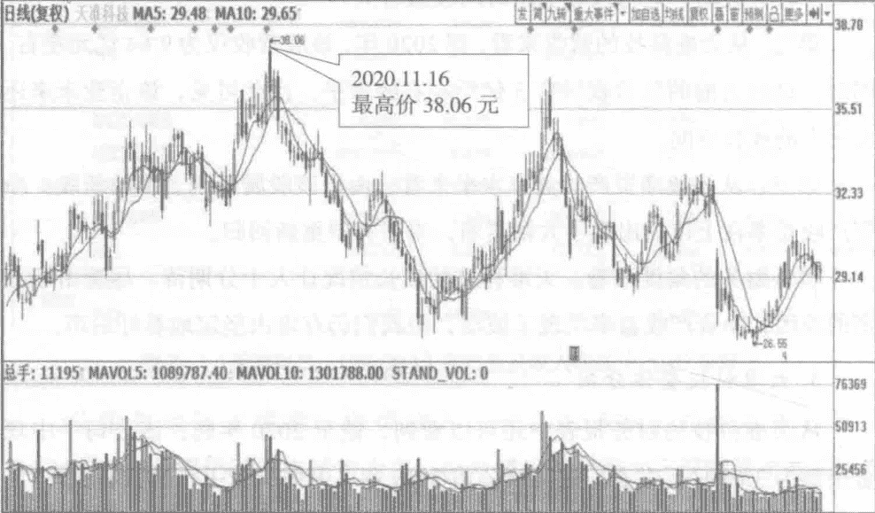

#### 二、 财务溯源：高增伴随波动，上市摊薄带来“成长税”

上市不久（2019年中），历史数据参考性有限，但能抓出三个关键事实：

1.  **利润波动大：** 2018年暴增83%，2019年回落近12%，2020年反弹29%。典型早期成长股特征，切莫被单年数据误导。
2.  **体量小、顶高：** 2020年才勉强破10亿大关，对比头部同行，成长空间肉眼可见。
3.  **ROE被稀释，待修复：** IPO募资大幅摊薄净资产，ROE从上市前20%+跌至个位数。随募投项目落地、净利释放，ROE回升是大概率事件。

**结论：** 财务底色干净，成长属性强，短期波动是上市“成长税”，长期看好。

#### 三、 资产质量体检：弹药充足、周转承压、研发狠

*   **弹药充足：** 账面现金3.68亿，上市募资到位，财务安全垫极厚。
*   **周转黄灯：** 应收款2.24亿、库存3.94亿，合计超营收六成。虽符合装备行业长周期特性，但周转效率需持续盯防，防坏账风险。
*   **护城河加宽：** 研发砸入1.55亿，占营收超16%，硬核技术壁垒正在加固。
*   **议价权尚可：** 预收款1.19亿，说明下游客户粘性、话语权不错。

#### 四、 估值定锚：PEG=1的保守锚点，当下性价比一般

用PEG法测算：假设2021年净利增速40%，EPS 0.78元，给40倍PE，对应股价**31.2元**（PEG=1）。这已是相当保守的给法。


> **图表提示：** 日线显示，股价2020年高点38元回落至30元附近箱体震荡。**当前价格处于合理价值区间上半部，安全垫收窄，短期买入性价比不足，更适合左侧布局或等回调。**

---

### 第二节 语音赛道（ASR）：巨头林立，唯“讯飞”可直接触达

#### 一、 竞争格局：红海中的“数据护城河”战争

1.  **赛道爆发：** AI+智能家庭双轮驱动，百亿美元级蓝海，**AI语音芯片**成最大受益者。
2.  **巨头围猎：** 美股四巨头（谷歌、微软、亚马逊）+ 国内BATH（百度、阿里、腾讯、华为）全员入场，厮杀白热化。
3.  **一超多强：** 讯飞一家独大，百度紧随其后，中小玩家生存空间被极度压缩。
4.  **入口即壁垒：** 输入入口=数据入口。讯飞、百度、搜狗三分天下，后来者几乎无法跨越这道数据护城河。

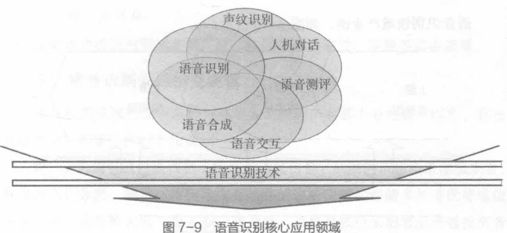

#### 二、 产业链视角：核心层是估值高地

*   **源头端（基础层）：** 高校院所攻关基础理论，数据服务商做清洗标注，**语音专用芯片**（讯飞、云知声、寒武纪系）是硬核壁垒。
*   **核心层（技术层——最关键）：** 讯飞、百度、云知声、思必驰等将技术转化为方案，**最能体现护城河、估值弹性最大**。
*   **落地端（应用层）：** 车、家、客服等场景变现，兑现端。

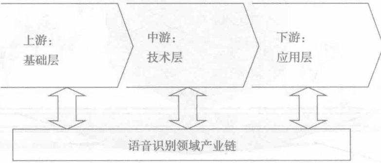

#### 三、 投资逻辑：A股投资者的“无奈”与“机遇”

*   **无奈：** 巨头们（百度、腾讯、阿里、华为）大多不在A股，散户买不到。
*   **机遇：** **讯飞（002230）是A股唯一的“语音第一股”，享受稀缺性溢价。**
*   **潜在标的：** 云知声、思必驰、中天微、中科模识等未上市独角兽，关注其IPO/回归动向，或通过讯飞间接持股受益（讯飞是芯片独角兽、AI四小龙早期投资方）。

#### 四、 标的深度：讯飞——AI应用层的“全能选手”

##### 1. 业务版图：多点开花，教育兜底，车载/To G高毛利

2020年收入破130亿，三大支柱：**软件服务（98%基底）、教育板块、其他**。

细分看亮点：
*   **教育核心业务：** 收入占比**30%+**，毛利**54%+**，基本盘稳如磐石。
*   **开放平台、集成工程、To G业务（智慧政法/数字政府）：** 单体收入10-19亿级，毛利24%-44%，构成利润矩阵。
*   **车载智能：** 收入3亿级虽小，但毛利**65%+**，高增+高毛利，未来爆发点。
*   **智慧医疗、金融、硬件、To C应用：** 战略性布局，星星之火。

**判断：** 业务不再单一依赖教育，**“To G + To B + To C”三驾马车跑通**，抗周期能力强，护城河宽。

##### 2. 财务画像：高增、大体量、ROE破10%新台阶

*   **利润加速跑：** 2019/2020连续两年净利增速超50%（51%、66%），确立高成长节奏。
*   **收入提速：** 从33亿（2016）冲至130亿（2020），复合增速惊人，且未触顶。
*   **ROE修复：** 2020年ROE破10%（10.77%），规模效应初现，仍有提升空间。

##### 3. 资产质量隐忧：应收库存双高、商誉悬顶、高费率吞利

*   **现金牛：** 48.57亿货币资金，极其安全。
*   **周转压力：** 应收57亿（占收比44%）、库存23.8亿，随规模放大同步膨胀，**现金流压力大，需警惕计提风险**。
*   **商誉包袱：** 11亿商誉，源于激进外延并购（投资芯片独角兽、AI四小龙等），虽目前有浮盈，但若被投资方估值回调，或遭遇减值。
*   **高费率模式：** 研发22亿+销售20亿=42亿费用，吃掉大部分毛利。**高毛利、低净利率**是AI应用层通病，讯飞也不例外。

##### 4. 估值与择时：48元合理价，回调即机会

*   **测算：** 基准EPS 0.64元，假设50%增速 -> 21年EPS 0.96元，给50倍PE -> **目标价48元**（PEG=1，合理估值）。
*   **技术面：** 2020年震荡筑底，2021年4月股价46.96元，**略低于内在价值**，处于“买入区间下沿”。
*   **策略：** 核心资产逢低吸纳，耐心持有兑现成长。

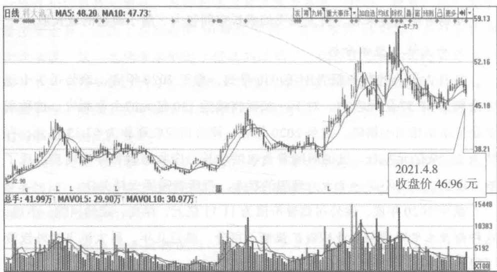
> **图表提示：** 日线确认震荡上行结构，48元上方为估值压力，40-45元为较优建仓区。

---

### 第三节 自然语言处理（NLP）领域投资研究

[待续... 后续将深度拆解NLP产业生态、核心标的及估值框架]

### NLP与机器学习双赛道深度：竞争格局、产业生态拆解与核心标的估值复盘

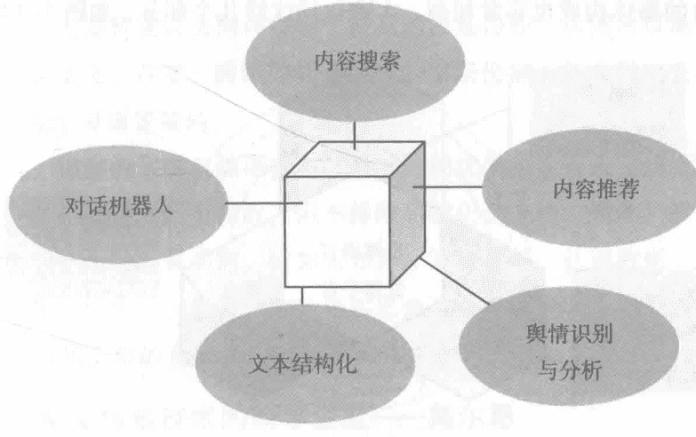

#### 一、 NLP赛道竞争全景扫描

自然语言处理（NLP）与语音识别同属智能语音范畴，旨在攻克人机自然交互的“最后一公里”。生活中常见的智能客服、早期聊天机器人（如小i），皆是该技术落地的典型产物。应用版图持续外拓，竞争态势呈现三大显著特征：

**1. 头部大厂全员入局，技术融合提速**
伴随AI迭代，NLP应用边界不断拓宽，与多模态、知识图谱等技术耦合日益紧密。海内外超级平台悉数布局：海外有Google、Amazon、Apple、Microsoft；国内则是百度、阿里、腾讯、华为等“国家队”选手，均在该领域重注深耕。

**2. 龙头效应显著，梯队分化明确**
在语音识别领域确立霸主地位的讯飞，在NLP赛道同样深耕细作，稳坐市场份额首位。紧随其后，思必驰、拓尔思、达观数据、云知声等企业在垂直细分赛道构建护城河，形成“一超多强”格局。

**3. 落地场景深化，办公自动化成趋势**
随着技术与行业知经深度融合，文档审阅、会议纪要、合同审核等高频办公场景正加速被智能化替代，商业化变现路径愈发清晰。

#### 二、 NLP技术平台架构与主流玩家矩阵

当前入局企业多已构建自有开放平台，架构设计高度趋同，自底向上可拆解为三层核心模块：

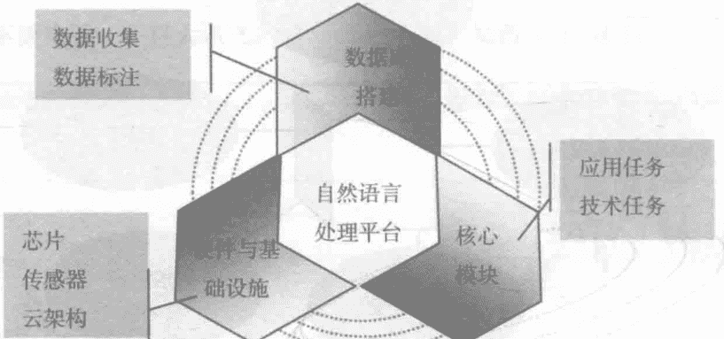

**图示：自然语言处理平台分层架构**

*   **底座层：算力与基建**  
    涵盖AI芯片、语音专用芯片、传感器及云原生架构。芯片端由讯飞、思必驰、中天微等布局；传感器产业链前文已述；云架构多采用自建与外包并行模式。
*   **核心层：算法与模型引擎**  
    这是各平台的“心脏”，包含各类下游应用任务（如情感分析、实体识别）及底层技术任务（如分词、句法分析），均由平台方自主攻关。
*   **数据层：语料库构建与治理**  
    包括海量文本采集、清洗、标注及标准化入库全流程，是模型训练的“燃料仓”。

**代表性平台矩阵**：搜狗知音、讯飞开放平台、Conversable、腾讯知文、云知声平台、紫平方机器人平台等。

#### 三、 NLP赛道投资逻辑推演

鉴于NLP与语音识别在商业模式、竞争格局上的高度同构性，投资锚点可对标参考：

1.  **龙头垄断份额，护城河深**  
    国内市场上，讯飞、百度、腾讯三足鼎立，讯飞凭借全栈自研优势，竞争壁垒极高。
2.  **关注未上市独角兽的资本化窗口**  
    云知声、智言科技、达观数据、思必驰等优质标的多处于Pre-IPO或被大厂控股状态，后续上市预期强，值得列入跟踪清单。
3.  **A股稀缺纯正标的：拓尔思（300229）**  
    作为少数在A股聚焦NLP上市的标的，拓尔思具备极高的策略稀缺性，重点关注。

#### 四、 标的深度复盘：中文检索龙头——拓尔思（300229）

拓尔思主营自研AI大数据平台软件、行业解决方案、云数据服务（SaaS/DaaS）及信安产品，客户覆盖党政、企事业单位。

##### 1. 业务版图与利润贡献结构（2020年度）

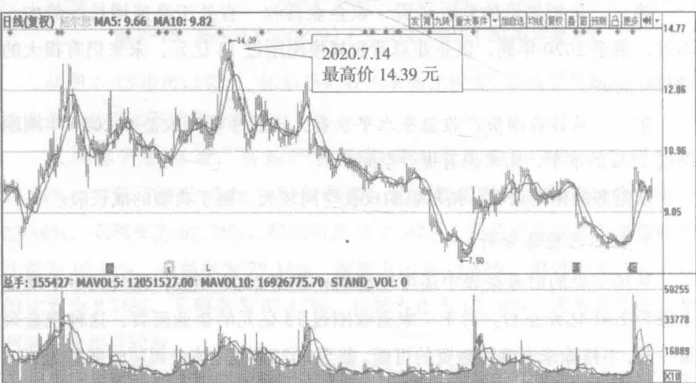 *注：原文图7-15数据源*

| 维度 | 核心板块 | 营收占比 | 毛利水平 | 利润贡献 | 核心判断 |
| :--- | :--- | :--- | :--- | :--- | :--- |
| **行业视角** | 房地产 | 30.4% | 54.8% | 28.7% | 绝对基本盘，现金奶牛业务 |
| | 政府 | 24.5% | 64.7% | 27.3% | 高利润率、高贡献，核心增长极 |
| | 泛安全 | 14.1% | **71.6%** | 17.3% | **利润率王者**，战略高地 |
| | 融媒体 | 12.7% | 64.8% | 14.2% | 传统优势领域，稳健输出 |
| **产品视角** | 云和数据服务 | 25.4% | 62.8% | 27.4% | **第二增长曲线主引擎**，增速最快 |
| | 技术服务 | 17.5% | 64.6% | 19.4% | 高利润率服务支撑 |
| | 安全产品 | 10.1% | **79.3%** | 13.8% | **极致高利润率**，规模待放量 |
| | 软件产品 | 9.3% | 67.1% | 10.7% | 核心资产变现载体 |
| **区域视角** | 西部 | 41.0% | 61.1% | 43.2% | 市场深耕最深，竞争壁垒最宽 |

> **洞见**：业务“多点开花”但核心聚焦软件与数据服务，**整体利润率中枢高位运行（核心业务均>60%）**，印证了核心技术壁垒与定价权。媒介代理业务因利润率为负（-19.7%），属战略性收缩项。

##### 2. 历年财务关键指标复盘（2016-2020）

| 指标 | 2020 | 2019 | 2018 | 2017 | 2016 | 趋势研判 |
| :--- | :--- | :--- | :--- | :--- | :--- | :--- |
| **每股盈利(元)** | 0.45 | 0.22 | 0.13 | 0.34 | 0.29 | **V字复苏**，近两年高增 |
| **净利增速** | **103%** | **158%** | -61.5% | 15.4% | 13.2% | 波动大，但已确立上行通道 |
| **营业额(亿)** | 13.09 | 9.67 | 8.45 | 8.21 | 6.80 | **稳健高增**，年复合增速~17% |
| **ROE** | **15.8%** | 8.1% | 3.4% | 9.2% | 8.7% | **突破15%关口**，质量改善明显 |
| *注：19年有高比例送转股* | | | | | | |

**财务健康度诊断**：
*   **成长性**：营收破百亿、净利翻倍、ROE修复至15%+，**典型成长股特征**，但绝对盈利体量（~5800万净利）仍显单薄，未来弹性大。
*   **现金流与营运风险**：账面资金2.9亿（覆盖营收22%），安全垫一般，融资需求存续。应收款3.18亿（占营收24%）与库存同步膨胀，回款压力需警惕。合同负债2亿反映下游议价能力尚可。
*   **研发投入**：年投入仅8000万强度偏弱（不足营收6%），在技术军备赛激烈的AI赛道，**长期迭代后劲存疑**。
*   **商誉包袱**：4.93亿商誉（占总资产比重不低），减值风险悬顶。

##### 3. 估值锚定与交易策略

*   **假设前提**：2021年EPS预测 0.54元（基于20%增速），给予20-25倍PE（PEG=1~1.25，估值合理区）。
*   **合理价值区间**：**10.80元 — 13.50元**。
*   **图表信号确认**：


**图示：拓尔思日线走势（至2021.6）**
*   2020.7.14 见顶14.39元后震荡回落；
*   2021.6中旬回调至10元附近，**跌破价值下沿**，安全垫显现。
*   **策略建议**：当前价格低于内在价值区间，待量能配合、均线企稳时分批进场，目标看向区间上沿。

---

### 第四节 机器学习（ML）赛道：AI皇冠核心范式，数据为王的生态博弈

机器学习是赋予机器“进化”能力的核心范式，通过数据训练重组知识结构，是通往通用人工智能（AGI）的必经之路。

#### 一、 ML竞争格局三大核心图景

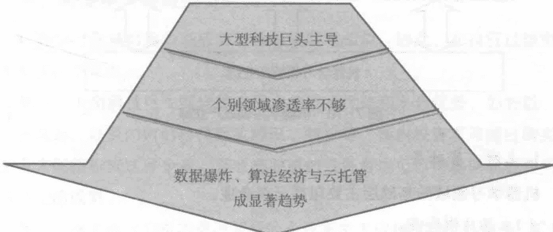

**图示：机器学习三大典型竞争态势**

1.  **超级平台垄断基建层**  
    Google、Amazon、Microsoft、阿里、腾讯凭借算力、数据、生态三位一体优势，已在基建层筑起高墙，初创企业难以撼动。
2.  **渗透率极度不均：金融/安防/IT“三高”垄断红利**  
    商汤、旷视、依图、云从“AI四小龙”业务高度聚焦金融风控、安防监控、智慧城市，这些行业数据标准化程度高、付费意愿强、ROI清晰。除此以外，制造、医疗、零售等万亿级蓝海渗透率仍低，商业化路径待跑通。
3.  **本质是数据与工程化能力的较量**  
    算法开源趋同化背景下，**数据规模/质量、特征工程、MLOps工程落地能力**成为核心护城河。数据爆发、算法经济、云托管（MLaaS）三大趋势将催生大量细分独角兽。

#### 二、 机器学习产业生态全景拆解

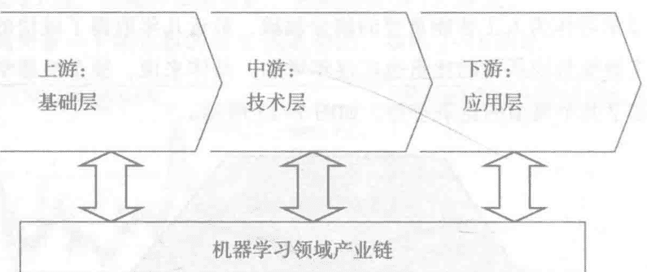

**图示：机器学习产业链分层**

| 层级 | 细分环节 | 核心玩家代表 | 竞争特征 |
| :--- | :--- | :--- | :--- |
| **上游·基建层** | **算力芯片** | 英伟达、英特尔、Google TPU；<br>国产：华为海思、寒武纪、地平线、云知声、深鉴科技、旷视科技等 | 算力军备赛，国产替代主线 |
| | **云算力平台** | Google Cloud、阿里云、用友云、金山云 | 规模效应显著，头部寡占 |
| | **学术源头** | 清华、北大、浙大、哈工大、北航、北邮、中科院等 | 人才供给高地，产学研转化关键 |
| **中游·技术层** | **开源架构** | TensorFlow(Google)、PyTorch(Meta)、MXNet(Amazon)、PaddlePaddle(百度)、Caffe、Keras, Theano | 生态锁定，框架即入口 |
| | **开放平台/MLaaS** | AWS SageMaker、Azure ML、腾讯TI、阿里PAI、百度BML | 降低开发门槛，抢夺开发者心智 |
| **下游·应用层** | **垂直场景落地** | 商汤、旷视、云从、第四范式、寒武纪、深鉴科技等 | **百花齐放、竞争最烈**，考验行业Know-how与交付能力 |

#### 三、 ML赛道投资逻辑与标的挖掘

同NLP/语音赛道，投资主线可概括为三条：

1.  **配置海外/港股超级平台**：通过QDII基金、港股通布局Google、Microsoft、Amazon、腾讯、阿里等平台型龙头，享受AI红利确定性。
2.  **跟踪应用层独角兽IPO进程**：商汤、旷视、云从、第四范式、寒武纪、深鉴科技等头部未上市标的，关注科创板/港股上市节奏。
3.  **捕捉A股“机器学习题材”弹性标的**：博彦科技、华胜天成、东方通等业务有交集的上市公司，题材行情爆发时Beta收益显著，**需严控仓位、把握节奏**。

#### 四、 标的深度复盘：智能运维先锋——博彦科技（002649）

博彦科技深耕IT咨询与工程服务，其BAI OPS智能运维方案已服务头部科技企业、公有云厂商、运营商，是落地机器学习于IT运维（AIOps）的稀缺样本。

##### 1. 业务结构与盈利质量剖析（2020年度）

| 维度 | 核心板块 | 营收占比 | 毛利水平 | 利润贡献 | 核心判断 |
| :--- | :--- | :--- | :--- | :--- | :--- |
| **行业视角** | 互联网 | 36.0% | 21.9% | 32.2% | **基本盘但利润率低**，竞争白热化 |
| | 高科技 | 25.6% | 25.6% | 26.8% | 核心增长引擎，技术溢价略高 |
| | 金融 | 17.8% | 26.2% | 19.1% | 合规要求高，客户粘性强 |
| **产品视角** | 研发工程服务 | **47.8%** | 22.0% | 43.0% | **现金奶牛**，规模效应未显著转化利润 |
| | IT运维服务 | 26.1% | 25.0% | 26.6% | AIOps落地主阵地，利润率中枢上移中 |
| | 产品及解决方案 | 25.3% | **26.9%** | **27.8%** | **利润贡献率最高**，标准化产品化方向正确 |
| **区域视角** | 境内 | 63.3% | 23.1% | 59.7% | 主战场，竞争激烈 |
| | 海外 | 36.7% | **26.9%** | **40.3%** | **海外利润率/利润贡献双优**，高价值市场 |

> **核心痛点**：**整体利润率中枢仅22%-27%**，远低于拓尔思等软件产品型公司。根因在于“以人换钱”的服务外包模式占比过高（研发工程+运维超73%营收），规模效应弱，人力成本刚性大。互联网大厂议价强，压平利润率。**“产品及解决方案”占比提升**是破局关键。

##### 2. 财务历史数据追踪（截至2020）

*素材截至此处，后续财务表格及分析待补充*

---
**结语提示**：NLP与机器学习虽同属AI核心赛道，但商业模式迥异——**NLP更易切入标准化软件/平台产品（高利润率、轻交付），ML应用层仍深陷“重交付、低利润率”服务化泥沼**。投资时，**拓尔思代表“产品化确定性”，博彦科技代表“服务转型期权”**，风格属性截然不同，切勿混淆配置。

##### 表 7-6 博彦科技（002649）核心财务指标回顾

| 时间 | 2020 年 | 2019 年 | 2018 年 | 2017 年 | 2016 年 |
|---|---|---|---|---|---|
| 每股收益（元） | 0.63 | 0.47 | 0.42 | 0.43 | 0.23 |
| 净利润增长率 | 34.26% | 11.15% | 1.87% | 85.74% | -35.23% |
| 营业总收入（亿元） | 43.10 | 36.88 | 28.83 | 22.50 | 19.34 |
| 每股净资产 | 5.72 | 5.03 | 4.62 | 4.14 | 10.54 |
| 净资产收益率 | 11.45% | 9.58% | 9.77% | 10.95% | 6.07% |

*注：2016 年年报含大比例送股。*

透过上表数据梳理，博彦科技的基本面呈现三大特征：

**利润拐点显现，增长提速明显** 历年净利润增速曾大幅震荡，但近两年连续走高，每股收益（EPS）呈现加速上扬态势，盈利确定性增强。

**营收规模跃升，成长天花板高** 营收长期维持高增速，2020 年突破 43 亿元大关，考虑到行业空间，未来拓展余地可观。

**ROE 刚达及格线，估值弹性受限** 2020 年净资产收益率勉强跨过 10% 门槛，虽有提升空间，但当前水平偏低，在一定程度上压制了市场给予的估值中枢。

**财务视角定性：典型成长股，空间广阔。**

##### 3. 博彦科技深度体检：优势与隐忧并存

**资产负债表侧写（2020 年底）：**
*   **现金垫厚：** 账面现金近 19.66 亿元，对比 43 亿营收，资金安全边际高。
*   **应收存货双增：** 应收账款 10.06 亿、存货 2.3 亿，随营收放大同步膨胀，资产质量承压，需持续监控坏账与跌价风险。
*   **合同负债适中：** 预收账款 7000 万，反映对下游有一定议价权，符合行业特性。

**核心竞争力拷问：**
*   **研发投入偏低：** 2020 年研发费用仅 2.6 亿，在技术军备竞赛激烈的赛道，后续护城河构建存疑。
*   **商誉悬顶：** 6.6 亿商誉虽未减值，但潜在减值风险不容忽视。

**综合研判：** 现金流健康，但应收、商誉双高、研发偏弱，对长期竞争力构成拷问。

##### 4. 博彦科技估值锚定与图形复盘

**估值测算逻辑：**
基准 EPS 0.63 元，假设 30% 增长，2021 年预测 EPS 0.82 元。
*   **乐观价：** 30 倍 PE → **24.60 元**（PEG=1，合理）。
*   **保守价：** 考虑 ROE 低、毛利低、研发低，打 7 折 → **17.22 元**。
*   **合理区间：** **17.22 - 24.60 元**。

**K 线实战复盘：**
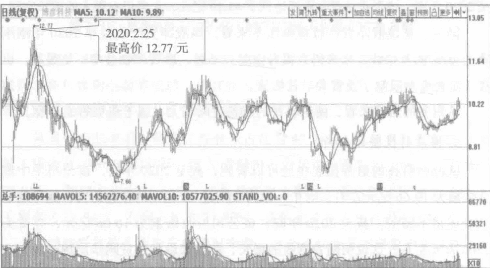

图 7-20 博彦科技（002649）日 K 线走势图

2019-2020 年宽幅震荡，2020 年 2 月见顶 12.77 元后回落。至 2021 年 6 月中旬股价徘徊 10 元附近，**大幅低于估值下沿 17.22 元**。低估背后，折射市场对商誉风险、薄毛利的担忧，但也可能孕育安全边际。

---

### 第五节 人机交互赛道：下一个万亿级风口的投资地图

人机交互（HCI），探索人与机器对话的终极形态——**去鼠标、键盘、触屏，实现自然语言般的自由交互，推动物理世界与数字世界深度融合**。作为 AI 产业皇冠上的明珠，乃是科技巨头兵家必争之地。

#### 一、 竞争格局：巨头筑墙，新贵突围

**1. 演进四阶段：从命令行到脑机接口**
技术迭代历程中，鼠标、多点触控、体感技术是三大里程碑式突破，推动交互从“学习机器语言”走向“机器懂人言”。
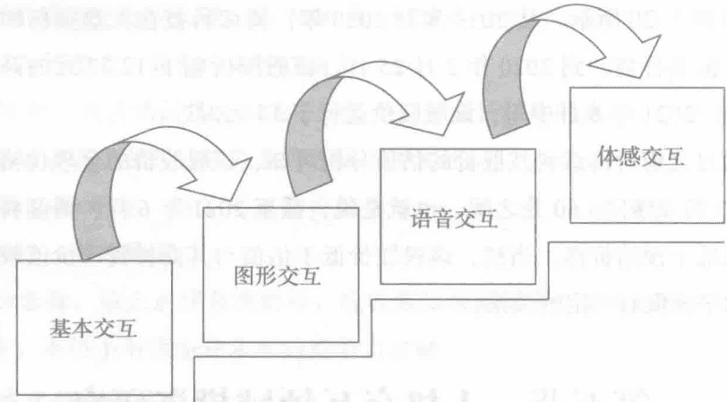

图 7-21 人机交互领域的发展阶段

**2. 产业竞争三大特征：**
*   **巨头垄断上游：** Google、MS、Apple、IBM、BAT 早已完成全栈布局，护城河极深。
*   **细分赛道红海化：** 语音交互成熟度最高，科大讯飞凭借声纹/NLP 技术称霸；其他细分领域厮杀惨烈。
*   **创业者弯道超车：** 小I机器人、极限元、标贝科技等独角兽在垂直场景切出优势，成潜在黑马。

#### 二、 产业拆解：四层架构锁定核心标的

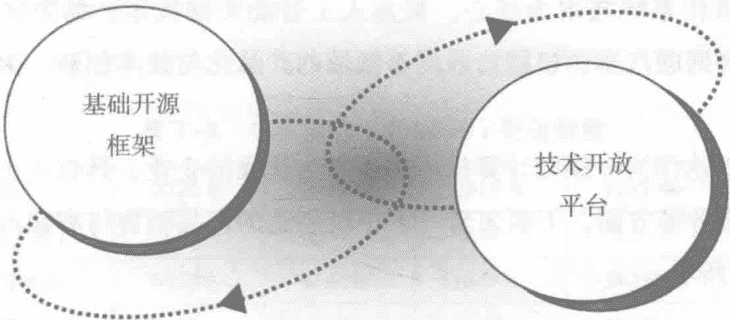

图 7-22 人机交互产业及构成

| 核心层级 | 关键词 | 代表玩家 |
| :--- | :--- | :--- |
| **设备感知层** | 传感器、芯片、摄像头、红外、结构件 | **高德红外**等 |
| **语音交互层** | **最成熟细分** 技术/平台/数据/应用全链条 | 科大讯飞、小I、捷通华声、拓尔思；终端端：华为、苹果、三大运营商 |
| **体感交互层** | **新兴蓝海** 展馆、科技馆等沉浸式场景刚需 | 高德红外、雷柏科技、联创光电、数码视讯 |
| **虚拟现实层** | 多维信息空间构建，视听动嗅全感官模拟 | 雷曼光电、完美世界、科瑞技术、游族网络（多为非核心业务） |

#### 三、 投资逻辑：在确定性与爆发力间找平衡

1.  **巨头护城河不可逾越**，配置需关注其 AI 业务估值占比。
2.  **独角兽未上市**（小I、极限元等），需跟踪 IPO 进程与二级市场概念联动。
3.  **锁定 A 股已上市龙头：** 语音首选**科大讯飞**；感知层聚焦**士兰微、汇顶科技、高德红外**。
4.  **概念股炒作窗口期：** 优质资产稀缺性下，高德红外、雷柏科技、联创光电、雷曼光电、完美世界、科瑞技术等易成游资短期抱团标的。

#### 四、 标杆深度：高德红外（002414）—— 红外热成像霸主，体感交互隐形冠军

主营红外热像仪/芯片，深耕军工民用双轨，体感交互核心供应商。

**1. 业务解剖：单品支撑半边天，毛利筑高墙（2020 年数据）**

| 维度 | 核心业务：红外热成像仪及系统 | 次级业务：传统/信息化弹药 | 其他 |
| :--- | :--- | :--- | :--- |
| **营收占比** | **86.58%**（28.86 亿） | 12.81%（4.27 亿） | <1% |
| **毛利率** | **63.85%** | 30.48% | 亏损/低利 |
| **利润贡献** | **93.53%** | 6.61% | 忽略 |

**结论：** 绝对的单一业务驱动型公司，核心产品高毛利印证强议价力与技术壁垒。

**2. 历年财务：送股掩盖下的高增长**

##### 表 7-7 高德红外（002414）财务数据

| 时间 | 2020 年 | 2019 年 | 2018 年 | 2017 年 | 2016 年 |
|---|---|---|---|---|---|
| 每股收益（元） | 0.63 | 0.14 | 0.14 | 0.09 | 0.12 |
| 净利润增长率 | **353.59%** | 67.34% | 125.60% | -17.52% | 11.77% |
| 营业总收入（亿元） | **33.34** | 16.38 | 10.84 | 10.16 | 8.10 |
| 每股净资产 | 2.73 | 3.77 | 5.33 | 5.13 | 5.05 |
| 净资产收益率 | **25.46%** | 6.43% | 3.94% | 1.79% | 2.56% |

*注：2018-2020 年连续大比例送股，稀释每股指标。*

**三大看点：**
*   **业绩爆发：** 2020 年净利增速超 3.5 倍，营收翻倍至 33 亿，高增长兑现。
*   **ROE 跃迁：** 2020 年 ROE 突击 25%，从平庸迈入优秀行列，资本回报质变。
*   **成长性确证：** 典型高成长属性标的。

**3. 风控体检：应收存货“双高”预警**

*   **现金充沛：** 9.54 亿货币资金，覆盖短债无忧。
*   **应收账款红线：** 17.17 亿（含票据）**超营收 50%**，处于危险水位，回款压力巨大，须严防坏账。
*   **存货堆积：** 14.45 亿，同比大增，产能爬坡与去库存博弈加剧。
*   **合同负债 2.32 亿：** 下游掌控力尚可。
*   **研发实力：** 4.55 亿投入（占比超 13%），技术迭代有保障。
*   **商誉 2.78 亿：** 规模可控，减值风险较低。

**核心矛盾：** 高成长、高 ROE、高研发 **VS** 高应收、高存货。现金流质量能否跟上利润增速，是关键监测点。

**4. 估值定价与图形机会**

**DCF/PE 双模测算：**
基准 EPS 0.63 元，假设 40% 增长 → 2021 年 EPS 0.88 元。
*   **目标价：** 40 倍 PE → **35.20 元**（PEG=1，成长股黄金估值）。
*   无折扣区间，高成长溢价合理。

**K 线复盘：**


图 7-24 高德红外（002414）日 K 线走势图

2021 年 1 月冲高 36.24 元见顶回调，2021 年 6 月中旬回落至 25 元附近。**当前股价显著低于 35.2 元理论价值，安全边际凸显**，若基本面不破，或为中长线布局良机。

---

### 第六节 AI 技术开放平台：巨头垄断下的稀缺标的捕猎指南

技术开放平台是 AI 基建的“操作系统”，强者恒强，头部效应极致。

#### 一、 竞争态势：三高特征定基调

1.  **起步晚、底子薄：** 国外 Google、微软、亚马逊代码/模型库深厚；国内 BATJ、华为、京东近年奋起直追，建立自有 AI 开放平台。
2.  **玩家少、门槛高：** 仅占 AI 企业总数 4% 左右。过度依赖开源框架，自主性、针对性不足。
3.  **集中度极高（CR4>80%）：** **百度、阿里、腾讯、华为** 四巨头瓜分市场，寡头格局已定。

#### 二、 产业链条：上接芯片算力，下接万物智联

中游细分仅两大核心赛道：


图 7-25 技术开发平台细分领域

*   **基础开源框架：** 外资垄断，华为 MindSpore 开源破局，未来大厂拥抱开源是趋势。
*   **技术开放平台：** 百度、阿里、腾讯、金山、中科创达等头部布局。

#### 三、 投资避坑指南：绕开巨头，寻找“卖铲人”

1.  **巨头投资陷阱：** 华为未上市；BAT、金山多为港股（需港股通），且业务过于分散，**不能因单一 AI 板块布局即视为纯粹标的**，估值体系极其复杂。
2.  **A 股稀缺纯玩标的：** 仅有部分业务沾边概念股，**中科创达**为典型代表。

#### 四、 标杆深度：中科创达—— 智能操作系统“隐形王者”，国产替代核心受益者

定位：全球领先的智能 OS 产品与技术提供商。核心逻辑：**以智能 OS 为底座，赋能 AIoT、智能网联汽车、智能工业。**

**业务结构透视（2020 年）：**
主营软件与信息服务，收入构成见下表：

| 业务名称 | 营业收入(元) | 收入比例 | 营业成本(元) | 成本比例 | 利润比例 | 毛利率 |

# 深度复盘：中科创达与晶晨股份，AI落地端的两大核心标的解析

## 一、 中科创达（300496）：业务单一但护城河深，海外布局彰显竞争力

### 1. 业务拆解：核心赛道聚焦，高毛利业务撑起利润天花板
翻看2020年年报数据，中科创达的营收结构高度聚焦于“软件和信息服务”单一大类，全年实现营收26.28亿元，整体毛利率攀升至44.22%，这一数字直观反映出其在细分领域具备定价权与核心竞争力。

拆解到具体产品线，呈现出典型的“二八定律”特征：
*   **技术服务与软件开发构成双引擎**：两者营收占比均超36%，毛利率均接近49%，合计贡献了近80%的公司利润，是当之无愧的现金奶牛与基本盘。
*   **商品销售规模次之，但盈利弱**：虽贡献超两成营收（22.87%），毛利率仅22.91%，利润贡献不足12%，属于典型的规模型、低利润业务。
*   **软件许可虽小但美**：营收占比不足4.5%，却拥有惊人的83.09%毛利率，贡献了8.22%的利润，极大提升了利润结构的含金量。

**地域维度看，国际化程度极高。** 国内营收占比56.19%，海外合计达43.81%。更关键的是，欧美、日本市场毛利率分别达到47.85%、59.42%，远超国内37.84%的水平。这有力佐证了其技术输出在全球范围内的认可度，非单纯依赖国内红利。

### 2. 财务历程：高增长确定性强，盈利质量持续优化
回溯2016-2020年五个年度数据，增长轨迹清晰可见：
*   **营收复合增速亮眼**：从8.48亿跃升至26.28亿，年均复合增长率超30%，规模效应初显。
*   **利润端加速释放**：2020年净利润增速达86.61%，EPS从0.3元飙升至1.08元，近两年连续高增，业绩兑现力度超预期。
*   **ROE破关向上**：2020年净资产收益率触及15.04%，刚跨过“优秀线”，考虑到募投项目落地周期，未来提升空间可期。

综合判定：标准的成长股属性，高成长、高毛利、高ROE预期三高特征明显。

### 3. 资产质量与风控：现金厚、研发狠，但应收与商誉需盯紧
*   **弹药充足**：账面货币资金20.71亿，覆盖全年营收近8成，增发后资金安全垫极高。
*   **研发投入硬核**：全年砸入4.03亿研发费，占营收比重超15%，技术迭代后劲有保障。
*   **隐忧并存**：应收账款7.99亿、存货4亿，随营收同步膨胀，周转效率承压；商誉4.29亿形成悬顶之剑。预收账款2.6亿显示上游话语权尚可，但需持续跟踪坏账计提与商誉减值风险。

### 4. 估值锚定与交易策略：合理区间60-121元，回调布局为宜
采用“PEG估值法”测算：基准EPS 1.08元，假设40%增速，2021年EPS约1.51元。
*   **PEG=1时（合理估值）**：40倍PE对应 **60.4元**。
*   **PEG=2时（乐观溢价）**：80倍PE对应 **120.8元**（考虑高毛利、高成长特质，给予双倍PEG溢价合理）。


*图 7-27 中科创达日K线走势复盘*

技术面显示：2018年底启动主升浪，2021年2月见顶154.89元后震荡回落，6月运行至135元附近。**当前股价已显著突破基本面合理估值上沿（120.8元）**，属于估值透支区间。建议投资者耐心等待回调至估值锚定区间内（60-120元）再分批建仓，切勿追高。

---

## 二、 AI应用层投资主线：智能音箱产业链的“卖铲人”机会

### 1. 竞争格局：巨头垄断，长尾厮杀惨烈
智能音箱本质是传统音箱的“AI+”改造。市场呈现三大铁律：
*   **量增价跌**：2020全球出货破1.5亿台，亚马逊、谷歌、百度三分天下；国内阿里、百度、小米合计垄断96%份额。
*   **品牌集中度极高**：头部效应极强，腰部以下厂商陷入低端价格战泥沟，生存空间被极度压缩。
*   **投资启示**：品牌端非上市主体或估值已透支，**核心机会藏在上游“卖铲人”**——高技术壁垒零部件、稀缺专供商、核心代工龙头。

### 2. 产业链利益分配图谱
*   **核心芯片端**：主控SoC（晶晨、瑞芯微、全志、海思、高通）、功放/电源管理/蓝牙WiFi模组（圣邦、艾为、德州仪器、乐鑫等）。
*   **关键声学/结构**：电声元件（共达电声）、扬声器/代工（国光电器）、PCB（臻鼎、健鼎、深南电路）。
*   **品牌/代工层**：小度、天猫精灵、小爱同学为三大品牌；歌尔股份、国光电器为核心代工厂。

### 3. 选标逻辑：锁定“高壁垒+高弹性”细分龙头
1.  **芯片/电路板等技术含量最高环节**；
2.  **单一核心零部件专供商**（如共达、国光）；
3.  **头部品牌核心代工厂**（如歌尔、国光）。

---

## 三、 晶晨股份（688099）：智能音视频SoC龙头，国产替代核心资产

### 1. 业务画像：机顶盒兜底，电视/音箱双轮驱动，海外营收占比八成
2020年营收27.38亿，纯度极高的集成电路企业（占比99.97%）。
*   **基本盘稳固**：智能机顶盒芯片营收15.47亿（占比56.5%），毛利37.9%，贡献65%利润，现金牛地位稳固。
*   **成长极看电视**：智能电视芯片8.43亿（30.8%），毛利率仅25%，受面板涨价挤压明显，但份额提升空间大。
*   **未来爆发点——AI音视频终端芯片**：3.42亿营收（12.5%），毛利30.2%，直接切入智能音箱、智能投影等AIoT新赛道，**这是估值弹性核心**。
*   **全球化标杆**：境外营收占比80.16%，产品竞争力经得起国际市场检验，抗周期能力强。

### 2. 财务透视：上市后阵痛期，成长性待释放
上市时间短（2019年），数据参考性有限，但趋势明确：
*   **增收不增利**：营收微增（23.6亿→27.4亿），归母净利润连降两年（-44%→-27%），EPS从0.76元跌至0.28元。
*   **原因剖析**：扩股摊薄+研发高投入（5.78亿，占营收21%）+疫情扰动。ROE从巅峰29%回落至4%，处于“蓄力期”。
*   **判断**：芯片设计企业典型的“先投入、后收获”曲线，随着AI音箱、投影仪等新品放量，业绩拐点可期。

### 3. 资产负债表：现金堆里练内功，应收存货偏高属行业常态
*   **12.26亿货币资金**，覆盖半年营收，上市募资到账后资金无忧，支撑高强度研发（研发占营收比超20%）。
*   **应收2.22亿、存货3.3亿**占营收比重较高，属于Fabless模式下备货与结算周期导致，需警惕后续周转。
*   **合同负债仅0.6亿**，议价能力相对下游较弱，系行业特性所致。

### 4. 估值体系重构：对标寒武纪，相对估值锚定96元
传统PE/PB对轻资产、高研发、亏损/微利芯片设计公司失效。采用**“市值空间法”横向对标**：
*   参照同为科创板AI芯片龙头的寒武纪（当时市值~500亿），结合晶晨在智能音视频SoC细分领域的霸主地位、更清晰的商业化模型、更高的毛利水平。
*   给予 **400亿整体估值上限**。
*   总股本4.14亿股 → **合理价值中枢约96.6元/股**。


*图 8-2 晶晨股份日K线走势复盘*

**技术面复盘**：2019年上市后高开低走至41.3元（2020.4），随后开启主升浪，2021年6月触及100元关口。**当前股价已基本回归至估值锚定位（96.6元）**，安全边际消失。短期受“国产芯片自主可控”题材驱动，波动率放大，但基本面支撑有限。建议关注基本面兑现进度（新品出货、毛利改善），在业绩拐点确认前保持观望或轻仓博弈。

---

## 核心观点小结

| 标的 | 核心逻辑 | 关键数据锚点 | 操作建议 |
| :--- | :--- | :--- | :--- |
| **中科创达** | 软件服务高毛利+海外高增长+研发护城河 | 合理估值区间 **60-121元** (PEG 1-2倍) | **等待回调**入场，当前高估 |
| **晶晨股份** | AI音视频SoC龙头+国产替代核心+新业务高成长 | 对标估值中枢 **~97元** (对标寒武纪) | **估值已饱满**，跟踪业绩拐点再决策 |

> **风险提示**：以上分析基于2020年末及2021年中公开数据，市场瞬息万变，文中估值测算仅供框架参考，不构成买卖建议。投资决策请结合最新财报、行业政策及市场流动性综合判断。

#### 五、智能音箱功放芯片领军者——圣邦股份

圣邦股份深耕模拟芯片设计领域，业务横跨信号链与电源管理两大核心板块。

##### 1. 业务拆解：营收利润双引擎

作为典型的半导体设计公司，圣邦股份的营收构成清晰明了（详见图 8-3）。

| 维度 | 分类 | 营收规模 | 占比 | 毛利率 | 利润贡献 |
|---|---|---|---|---|---|
| **整体** | 集成电路 | 11.97亿 | 100% | 48.73% | 100% |
| **产品** | 电源管理 | 8.48亿 | 70.87% | 44.67% | 64.96% |
| | 信号链 | 3.49亿 | 29.13% | 58.62% | 35.04% |
| **地区** | 中国香港 | 6.06亿 | 50.68% | 43.20% | 46.52% |
| | 大陆 | 5.57亿 | 46.57% | 54.04% | 53.48% |

*数据来源：2020年年报*

**核心看点：**
*   **基本盘稳固**：电源管理芯片撑起七成营收，虽毛利率略低（44.67%），但贡献了近六成半利润，是绝对的“现金奶牛”。
*   **高增长引擎**：信号链产品毛利率高达 58.62%，利润贡献超三成，展现出极强的盈利弹性与高端化潜力。
*   **市场布局均衡**：港股与大陆市场五五开，大陆市场毛利率更高（54%），抗风险能力强。
*   **护城河显现**：整体毛利率近 49%，在模拟芯片赛道处于领先梯队，产品竞争力获市场验证。

##### 2. 财务复盘：高成长、高ROE、小体量

回溯 2016-2020 年关键指标（表 8-2），三大特征跃然纸上：

| 指标 | 2020 | 2019 | 2018 | 2017 | 2016 | 趋势判读 |
|---|---|---|---|---|---|---|
| **每股收益** | 1.86 | 1.14 | 1.00 | 1.74 | 1.79 | **加速兑现**，近两年增速明显提升 |
| **净利增速** | 64% | 70% | 10% | 16% | 15% | 维持高位，盈利动能强 |
| **营收规模** | 11.97亿 | 7.92亿 | 5.72亿 | 5.32亿 | 4.52亿 | **小而美**，百亿俱乐部门槛外，成长空间广阔 |
| **ROE** | 22.7% | 18.3% | 12.8% | 17.3% | 34.5% | **穿越 20% 优秀线**，资本回报率优异 |

> **财务结论**：盈利能力强、增速加快、体量小（百亿蓄势待发）、ROE 持续超预期。结合模拟芯片国产替代的赛道红利，属优质成长标的。

##### 3. 质地深度体检：现金厚、研发狠、雷少

截至 2020 年底，三张“体检单”看透本质：

1.  **现金流充沛**：账面现金 **7.73亿**，覆盖全年营收 65%+，为中小市值公司罕见的“现金奶牛”特质，抗周期底气足。
2.  **运营质量优**：应收账款仅 **0.6亿**（占比极低），回款极其健康；存货 **2.6亿** 略高但可控；预收账款仅 300万，虽谈不上强势谈判地位，但供应链地位稳固。
3.  **研发真投入**：研发费用 **2.07亿**，投入强度 **17%+**，远超行业平均，技术迭代后劲十足。
4.  **商誉清零风险**：商誉仅 **1400万**，财务报表“含金量”极高，无暴雷隐忧。

##### 4. 估值框架与走势研判

采用 **PEG 估值法** 试算安全边际：
*   基准：2020 年 EPS 1.86 元。
*   假设：2021 年净利增速 60%（保守低于 2020 年 64%），对应 EPS 2.98 元。
*   给予 60 倍 PE（对应 PEG=1，成长股合理估值中枢）。
*   **合理价值区间：178.8 元**。

**实盘对标（图 8-4 ）：**
2020 年 7 月曾冲高至 269.67 元（显著高估），至 2021 年 6 月回落至 200 元附近。**当前股价仍处估值上方，短期性价比一般**。但受“中美科技博弈+芯片自主可控”双重题材催化，资金博弈属性强，波动率大，非基本面价值投资者需谨慎追高。


---

#### 六、智能声学代工霸主——歌尔股份

从“歌尔声学”更名而来，深耕声学三十载，稳坐全球电声器件龙头，兼具“果链核心+声学入口”双重护城河。

##### 1. 业务版图：三驾马车，精密领跑

2020 年营收 **577.43亿**，构建起“智能声学整机+智能硬件+精密零组件”三角支撑模型（图 8-5）：

| 业务板块 | 营收 | 占比 | 毛利率 | 利润贡献 | 战略定位 |
|---|---|---|---|---|---|
| **智能声学整机** | 266.74亿 | 46.2% | 14.87% | 42.84% | **基本盘**，代工规模效应显著 |
| **智能硬件** | 176.52亿 | 30.6% | 12.51% | 23.85% | VR/AR等新硬件孵化器 |
| **精密零组件** | 122.05亿 | 21.1% | **23.90%** | **31.51%** | **高利润引擎**，结构件/马达技术壁垒高 |
| **合计/加权** | **577.43亿** | **100%** | **16.08%** | **100%** | 代工模式下整体毛利已优于同业 |

**关键洞察：**
*   **营收看整机，利润看精密**：精密零组件仅占两成营收，却贡献三成利润，毛利率近 24%，是真正的“利润后花园”。
*   **出海属性强**：境外收入占比 **87.9%**，深度绑定全球头部科技巨头，抗单一市场波动能力强。
*   **代工红利**：整体毛利 16% 在消费电子代工业堪称优秀，规模效应与精细化运营成果显现。

##### 2. 财务轨迹：V型反转，规模跃迁

五年数据（表 8-3）勾勒出“深蹲起跳”曲线：

| 指标 | 2020 | 2019 | 2018 | 2017 | 2016 | 解读 |
|---|---|---|---|---|---|---|
| **EPS** | 0.89 | 0.40 | 0.27 | 0.68 | 0.54 | **两年翻 3 倍**，修复 2018 手机业务阴影 |
| **净利增速** | **122%** | 48% | -59% | 30% | 32% | **爆发式修复**，增速加速确定性高 |
| **营收** | **577亿** | 351亿 | 238亿 | 255亿 | 193亿 | **跻身千亿门槛前夜**，规模效应全面释放 |
| **ROE** | **16.4%** | 8.2% | 5.7% | 16.6% | 16.3% | **重回 15% 良性区间**，尚有提升空间 |

> **财务结论**：业绩完成 V 型反转，规模站上 500 亿台阶，ROE 修复归位。AI/元宇宙硬件落地将开启第二成长曲线。

##### 3. 资产负债透视：高周转下的隐性压力

2020 年底关键账目：
*   **现金储备 69 亿**：覆盖短债绰绰有余，财务安全垫厚。
*   **应收账款 100 亿 + 存货 91.7 亿**：合计超 190 亿，占营收 33%，**周转压力显现**。需警惕下游巨头账期延长及新品型切换去库存风险。
*   **预收账款 7.7 亿**：供应链话语权仍受限于品牌方。
*   **研发投入 34.3 亿（占比 6%）**：同比**翻倍**，锁定声学+光学+结构件三位一体技术护城河。
*   **商誉 1700 万**：并购整合风险极低。

##### 4. 估值锚定与策略窗口

*   **假设**：2021 年净利增速 40%（低于 2020 年 122% 的低基数狂飙），EPS 1.25 元。
*   **估值**：给予 40 倍 PE（PEG=1，成熟成长股合理中枢）。
*   **目标价：50 元**。

**走势复盘（图 8-6 ）：**
2020 年 11 月见顶 50.08 元 → 2021 年 3 月探底 25 元（估值杀伤） → 6 月反弹至 40 元。**当前股价低于 50 元合理价值，具备左侧配置/右侧跟随双重机会**。若 VR/AR、车载声学新业务放量超预期，估值中枢有望上移。


---

### 第二节 工业机器人：国产替代主线下的产业链淘金

工业机器人集成机械、电子、控制、AI 于一体，是制造业皇冠上的明珠。

#### 一、 竞争格局：四大家族垄断，国产替代势在必行

1.  **全球寡头垄断**：ABB、发那科、库卡、安川“四大家族”瓜分 **50%+** 全球份额，技术护城河深。
2.  **中国成第一大市场**：人工成本上升+制造升级驱动，装机量连续多年全球第一，需求端无虞。
3.  **核心短板明显**：本体/本体集成尚可，**减速器、伺服系统、控制器**“三大核心”高度依赖进口，伺服国产化率最低。
4.  **替代逻辑确立**：从“买全球”转向“用国产”，减速器/伺服/控制器为突破主线，控制器差距最小、伺服最难、减速器最重资产。

#### 二、 产业链全景图谱 


| 环节 | 核心细分 | 代表性国产厂商 |
|---|---|---|
| **上游·核心部件** | **控制系统** | 埃斯顿、汇川技术、新时达、固高科技、科远股份... |
| | **伺服系统** | 汇川技术、埃斯顿、华中数控、新时达、信捷电气... |
| | **减速器** | 秦川机床、中大力德、双环传动、上海机电... |
| **中游·本体制造** | 机器人本体 | 埃斯顿、拓斯达、埃夫特、新时达、华中数控... |
| **下游·集成应用** | 系统集成/行业方案 | 快克股份、科远股份、三丰智能、哈工智能、华昌达... |
| **全链路玩家** | 上中下游贯通 | **埃斯顿、拓斯达、埃夫特、新时达、华中数控**（对标四大家族模式） |

#### 三、 投资逻辑：抓主线、找龙头、看未上市

1.  **核心零部件突破口**：伺服、减速器国产化率低＝增量空间大。攻克者享戴维斯双击。
2.  **全产业链龙头溢价**：历史证明，最终赢家必是“全链路自主”（如四大家族）。重点跟踪 **埃斯顿、拓斯达、埃夫特** 等一体化布局者。
3.  **独角兽前瞻布局**：极智嘉（移动机器人）、李群自动化（复合机器人）等未上市标的，留意 IPO 窗口或战投机会。

#### 四、 标杆深度：埃斯顿——国产全链路龙头的教科书

南京埃斯顿，从运动控制起家，进化为**“控制器+伺服+减速器+本体+集成”五位一体**的稀缺标的。

##### 1. 业务极简：单一赛道深耕

2020 年营收 **25.10亿**，100% 来自仪器仪表制造（图 8-8），毛利率 **34.13%**。无多元化干扰，管理层专注度极高。

| 指标 | 2020 年数据 | 行业隐含含义 |
|---|---|---|
| 营收 | 25.10 亿 | 国产本体龙头营收规模标杆 |
| 毛利率 | 34.13% | 自主核心部件内销提升整体利润率 |
| 归属行业 | 仪器仪表制造 | 统计口径下的高端装备制造 |

> **核心逻辑**：控制器/伺服自给自足 → 降低本体成本 → 提升整机毛利 → 反哺零部件研发 → 形成正向飞轮。这正是“全产业链”模式的财务具象化。

# AI板块选股实战：工业机器人三巨头深度复盘

透过图 8-8 的数据视窗，埃斯顿（002747）的营收版图极度聚焦：仪器仪表制造业贡献了近乎全部收入，核心支柱在于工业机器人及智能制造系统。该业务营收 16.80 亿元，收入占比 66.92%，毛利率 32.31%，却撑起了 63.36% 的利润总额。自动化核心部件及运动控制系统紧随其后，收入 8.30 亿元（占比 33.08%），毛利率 37.80% 优于主业，利润贡献 36.64%。

地域维度上，国内外市场呈五五开格局：国内收入 13.84 亿元（占比 55.15%，毛利 33.91%），海外 11.26 亿元（占比 44.85%，毛利 34.40%）。海外毛利微优于国内，侧面印证了产品在国际赛道具备一定议价权与竞争力。

拉通看，公司加权平均毛利率 34.13%，横向对比同行机器人企业，盈利厚度并不占优，这正是其亟待强化的短板。

##### 2. 埃斯顿财务档案解读

回溯近五年财务轨迹（表 8-4），勾勒出三大特征：

| 时间 | 2020 年 | 2019 年 | 2018 年 | 2017 年 | 2016 年 |
|---|---|---|---|---|---|
| 每股收益（元） | 0.15 | 0.08 | 0.12 | 0.11 | 0.09 |
| 净利润增长率 | 103.97% | -37.95% | 8.79% | 35.67% | 33.99% |
| 营业总收入（亿元） | 25.10 | 15.81 | 14.61 | 10.77 | 6.78 |
| 每股净资产 | 2.07 | 1.93 | 1.93 | 1.84 | 5.27 |
| 净资产收益率 | 7.11% | 4.01% | 6.46% | 6.27% | 8.41% |

*注：2016 年年报含转股事项。*

**第一，增速虽猛但基数低。** 净利润虽现翻倍式增长（2020 年 +103.97%），但绝对额仍处低位，典型“高科技成长痛”——技术变现周期长，利润释放滞后。

**第二，营收高增，规模待壮大。** 营收五年复合增速亮眼，2020 年突破 25 亿大关，但对比头部体量，成长天花板仍高。

**第三，ROE 长期徘徊低位。** 净资产收益率长期游离于 4%-7% 区间，直接映射净利薄弱，内生增长动力不足。

总结：利润端表现欠佳，系成长期硬科技企业的共性缩影。

##### 3. 埃斯顿基本面体检

截至 2020 年底，账面现金 5.81 亿元，相对 25 亿营收体量，现金垫厚实。但两张“隐形负债”需警惕：应收账款 7.06 亿、存货 6.38 亿，双高并立，资金占用压力大。

商誉 14.86 亿，占净资产比重不低，存减值隐患。费用端更耐人寻味：研发投入 1.69 亿，在技术密集型企业中并不激进；反观销售费用 2.23 亿、管理费用 3.26 亿，三费中研发垫底，资源配置优先级引发深思。

**定论：财务质量中规中矩，商誉、应收、存货“三高”叠加，风险防范不可懈怠。**

##### 4. 埃斯顿估值锚定与走势复盘

2020 年 EPS 0.15 元。假设 2021 年净利翻番（增速 100%），EPS 预期 0.30 元。给予 100 倍 PE（对应高成长预期），目标价 30 元。

结合  日 K 线图：2021 年初随大盘冲高至 40 元（2 月 18 日），随后震荡回落，3 月底觅底反弹，6 月下旬再临 40 元。对照 30 元价值中枢，彼时股价已显著溢价，**投资性价比转弱，安全边际收窄**。


图8-9 埃斯顿（002747）日K线走势图

#### 五、工业机器人领军标的——汇川技术

汇川技术（300124）坐镇工业自动化一线，是国内低压变频器与伺服系统出货量霸主。主营覆盖工业自动化、新能源汽车、轨道交通，产品矩阵含变频器、伺服、控制、视觉、传感器等核心部件及电气方案。

##### 1. 业务拆解：单一大业务，多点开花

图 8-10 揭示：营收高度聚焦通用设备制造业。工业自动化&电梯&机器人板块收入 100.40 亿，**占比 87.22%**，毛利 41.22%，利润贡献 **92.28%**，绝对基本盘。新能源&轨交 14.71 亿（占比 12.78%），毛利 23.53%，利润占比仅 7.72%，处于培育期。

细分产品看：
*   **变频器**：营收 35.02 亿（占比 30.42%），毛利 46.95%，利润贡献 36.67% —— 现金牛。
*   **运动控制**：营收 21.85 亿（占比 18.98%），**毛利 48.74% 领跑**，利润贡献 23.75% —— 高成长高利润引擎。
*   **贝思特产品**：营收 29.64 亿（占比 25.75%），毛利 26.38%，利润贡献 17.44%。
*   **控制技术**：毛利 **52.30%** 最高，但规模较小（5.88 亿）。
*   **传感器、新能源**等毛利均在 20%-45% 区间。

**核心判断：核心产品加权毛利 41.22%，主力机器人业务毛利普遍高企，竞争护城河深、成长空间大。**

##### 2. 汇川技术财务复盘（表 8-5）

| 时间 | 2020年 | 2019年 | 2018年 | 2017年 | 2016年 |
|---|---|---|---|---|---|
| 每股收益（元） | 1.22 | 0.58 | 0.71 | 0.65 | 0.59 |
| 净利润增长率 | 120.62% | -18.42% | 10.08% | 13.76% | 15.14% |
| 营业总收入（亿元） | 115.11 | 73.90 | 58.74 | 47.77 | 36.60 |
| 每股净资产 | 6.19 | 4.98 | 3.76 | 3.26 | 2.84 |
| 净资产收益率 | 21.70% | 13.79% | 19.99% | 20.98% | 21.79% |

**三大看点：**
1.  **利润爆发力强**：2020 年净利翻倍（+120.62%），虽 2019 年回调，但长周期高增确定性强。
2.  **规模破百亿**：营收 115.11 亿，跨入百亿俱乐部，规模效应初显。
3.  **ROE 优秀稳健**：除 2019 年外，长期维持 20%+ 高水平，资本回报能力一流。

##### 3. 汇川技术基本面深度扫描

现金储备 23.61 亿，对标 115 亿营收，流动性充裕。但应收 31.61 亿、存货 24.2 亿双高，账面资源占用显著，需监控周转质量。

商誉 19.64 亿，减值压力客观存在。亮点在研发：**年投入 10.23 亿**，占营收近 9%，在自动化上市企业中属第一梯队，技术迭代后劲足。

**综评：财务基本面扎实，优质资产属性确立，但应收、存货、商誉“三高”风险需计价。**

##### 4. 汇川技术估值区间与图形验证

2020 年 EPS 1.22 元。假设 2021 年净利增 50%，EPS 1.83 元。给 50 倍 PE（PEG=1），目标价 **91.50 元**；打 7 折风险折扣，**下沿 64.05 元**。合理估值区间 **64.05 - 91.50 元**。

 日线显示：2021 年初冲高 78.36 元（2 月 18 日），回调至 49.89 元（4 月 13 日），6 月下旬企稳 60 元附近。**当前股价跌破估值下沿，安全边际浮现，配置价值凸显。**


图8-11 汇川技术（300124）日K线走势图

#### 六、工业机器人细分隐形冠军——拓斯达

拓斯达（300607）定位“智能生产环境整体解决方案商”，具备机器人本体、核心控制器全自研能力，布局 MES 系统，携手华为云深耕工业互联网。产品覆盖机器人应用系统、注塑自动化、辊机设备，下游渗透 3C、新能源、汽车、医疗等。

##### 1. 盈利结构：单品类极致聚焦，主业统治力强

图 8-12 清晰展示：100% 收入源自通用设备制造。

*   **工业机器人及自动化系统**：营收 19.34 亿，**占比 70.18%**，**毛利 58.18% 行业顶格**，利润贡献 **82.80%** —— 绝对核心，高毛利、高占比、高成长“三高”标杆。
*   **智能能源环境管理**：5.11 亿（18.53%），毛利 20.27%，利润仅 7.62%。
*   **注塑机及自动供料**：2.35 亿（8.54%），毛利 29.63%。
*   **其他**：高毛利 80.03% 但规模极小。

**整体加权毛利 49.32%，远超同行。主业毛利、营收占比、利润占比“三高”共振，护城河极深，成长确定性极强。**

##### 2. 拓斯达财务档案（表 8-6）

| 时间 | 2020年 | 2019年 | 2018年 | 2017年 | 2016年 |
|---|---|:---|:---|:---|:---|
| 每股收益（元） | 1.95 | 1.41 | 1.32 | 1.34 | 1.43 |
| 净利润增长率 | 178.56% | 17.65% | 23.32% | 103.68% | 4.99% |
| 营业总收入（亿元） | 27.55 | 16.60 | 11.98 | 7.64 | 4.33 |
| 每股净资产 | 8.08 | 11.31 | 6.98 | 5.86 | 6.20 |
| 净资产收益率 | 27.23% | 18.07% | 20.56% | 21.21% | 24.15% |

*注：2016、2019、2020 年含转股。*

**核心结论：**
1.  **超高增爆发**：2020 年净利增速近 180%，高增长延续性强。
2.  **小而美，大成长**：27.55 亿营收，小盘成长属性明显，弹性空间大。
3.  **ROE 霸榜**：2020 年 **27.23%**，长期 20%+，盈利质量极优。

##### 3. 拓斯达基本面体检

现金 9.58 亿，覆盖 28 亿营收，极其厚实。应收 6.93 亿、存货 8.11 亿双高，仍需警惕周转风险。

商誉仅 0.67 亿，**暴雷风险可忽略**。费用结构似曾相识：研发 1.61 亿，销售 2.66 亿、管理 2.09 亿，**研发再次垫底**，技术型企业费用导向存疑。

**定性：财务体质优良，商誉无忧，核心指标亮眼，属稀缺优质成长标的，唯研发投入占比偏低为瑕疵。**

##### 4. 拓斯达估值定价与买点确认

2020 年 EPS 1.95 元。考虑高基数效应，保守设 2021 年 EPS 1.50 元（仍隐含 30%+ 增长）。给 30 倍 PE（行业龙头溢价合理），目标价 **45 元**。

 K 线复盘：2020 年 6 月启动，8 月 31 日见顶 52.45 元，随后长阴回调至 2021 年 5 月 10 日 **30.33 元** 筑底反弹。**低点显著跌破 45 元价值中枢，超跌反弹确立，左侧布局安全边际极高。**


图8-13 拓斯达（300607）日K线走势图

### 第三节 无人机产业投资研究

# 掘金股海

# AI 板块股票投资实战指南

### 核心看点：

- 布局人工智能赛道，抢占未来先机
- 多维估值体系，洞察价值与价格博弈
- AI 芯片、传感器、云计算、大数据深度复盘
- 5G、计算机视觉、语音识别、NLP 前沿研判
- 机器学习、人机交互、开发平台全景扫描
- 智能音箱、工业机器人、**无人机产业** 投资图谱

*股市有风险，入市需谨慎*
*投稿热线：(010) 60286875*
*投稿邮箱：93005135@qq.com*


---

无人驾驶飞行器，简称无人机，指通过无线电遥控设备与自载程序控制系统操控，或由机载计算机全程/间歇自主飞行的无人驾驶航空器。当前，伴随人工智能与无人机技术的双轮驱动，该领域已衍生出多旋翼、固定翼、无人直升机、飞艇、伞翼机等多元形态。

#### 一、 无人机产业竞争格局透视

“无人化、智能化”已成未来战争核心趋势，引得全球军事强国纷纷加码研发投入。当前市场竞争呈现五大鲜明特征：

1.  **技术梯队分层明显**：欧美、以色列凭借先发优势稳居第一梯队；中俄处于第二梯队紧追不舍。但近年中国产业爆发式增长，除个别尖端卡脖子环节外，多数领域已触及或逼近国际一流线。
2.  **市场版图北美领跑**：北美、欧洲为两大核心消费市场，其中北美一家独大，吞吐全球逾半份额。
3.  **军用领域占比压倒性**：按用途划分为军用、民用、消费级三大板块，军用无人机凭借战略核心地位，坐拥绝大多数市场蛋糕，这也是各国重金押注的根本动力。
4.  **军用巨头垄断格局固化**：国际上，诺斯罗普·格鲁曼、通用原子、德事隆三足鼎立；国内则由航天彩虹一枝独秀，确立绝对统治力。
5.  **民用赛道中国军团崛起**：民用市场上，中国厂商话语权最重，大疆创新领衔，昊翔、零度智控等紧随其后，份额可观。

#### 二、 无人机全产业链拆解

纵观产业链条，研发制造环节大致划分为四大板块（详见产业链全景图）：


##### 1. 总体设计与系统集成—— “大脑”与“骨架”
涵盖机型架构、动力选型、飞控架构设计及分系统指标分配与接口定义，自上而下锚定整机性能上限。承接此类任务的即为整机厂。

*   **军用阵营**：航天彩虹（龙头标杆）、洪都航空（教练机/导弹/无人机三位一体）、航天电子（拥CH-9）、赛为智能（大载荷专长）、长鹰信质（BZK-5机型）等。
*   **消费/工业民用阵营**：大疆、零度智控、飞豹、极翼领跑，工业级竞争格局与消费级高度重合。

##### 2. 动力系统—— “心脏”短板犹存
核心由电机、电调、电池组成。此乃国内产业链薄弱环节，军用机型动力系统（尤其是电机）高度依赖进口，仅航发动力系企业能部分供货。民用端电机供应商有银燕、浩马特、朗宇、新西达等；电池端看欣旺达、德赛电池等上市主力；电调端中特威、凤凰等深耕，但多数尚未上市。

##### 3. 飞行控制—— 核心壁垒高地
包含飞控系统、主控芯片、惯性器件（陀螺仪等）。

*   **飞控系统**：大疆、极翼、零度智控、赛为智能（上市主体）等布局。
*   **主控芯片**：外资垄断态势显著（高通、英特尔、TI、三星），国产替代由华为海思、瑞芯微等领军。
*   **陀螺仪**：瑞芬科技、亚拓、飞越等深耕细作。

##### 4. 附属零部件与功能模块—— “神经末梢”
如“翼龙”机型的光电吊舱热像系统由大立科技供货；成飞集成切入零件精加工；星网宇达提供导航与稳控产品等。

#### 三、 无人机赛道投资逻辑推演

无人机前景广阔，潜力无限。选股需遵循三大核心逻辑：

*   **首推行业龙头**：资源向头部聚集。民用看大疆护城河；军用聚焦航天彩虹、航天电子、长鹰信质。
*   **重视独家供应商**：能垄断供应专用配件/系统的零部件厂，业绩弹性更大。如大立科技、星网宇达，及主控芯片潜力股瑞芯微。
*   **关注未上市独角兽**：民用端零度智控、飞豹、极翼等虽未融资上市，但实力雄厚，属潜在标的储备池。

#### 四、 军用无人机霸主—— 航天彩虹深度解析

在军用版图中，航天彩虹当之无愧为“航母级”龙头，产品矩阵覆盖大中小全谱系。

公司主营双轮驱动：**无人机板块**（整机+应用服务）**+ 膜材料板块**（电容膜、光伏背板、光学膜、锂电隔膜）。

##### 1. 产品矩阵与利润引擎（参考 2020 年报数据）

| 维度 | 分类 | 营收(亿) | 占比 | 成本(亿) | 占比 | 利润贡献 | 毛利率 |
| :--- | :--- | :--- | :--- | :--- | :--- | :--- | :--- |
| **行业** | 电子元器件(膜) | 14.93 | 49.96% | 12.57 | 56.28% | 31.29% | 15.82% |
| **行业** | 航空航天制造 | 14.73 | 49.28% | 9.63 | 43.11% | **67.54%** | **34.62%** |
| **产品** | **无人机及相关** | **10.63** | **35.57%** | **7.16** | **32.04%** | **46.00%** | **32.68%** |
| **产品** | 基材膜/绝缘材料 | 7.01 | 23.45% | 6.31 | 28.24% | 9.30% | 10.01% |
| **产品** | 光学膜 | 4.93 | 16.51% | 3.60 | 16.11% | 17.69% | 27.08% |
| **产品** | **技术服务** | **4.10** | **13.72%** | **2.47** | **11.07%** | **21.54%** | **39.67%** |
| **产品** | 电容膜 | 2.99 | 10.00% | 2.66 | 11.93% | 4.30% | 10.86% |
| **地区** | 国内 | 21.69 | 72.57% | 17.34 | 77.62% | 57.61% | 20.06% |
| **地区** | 国外 | 8.20 | 27.43% | 5.00 | 22.38% | 42.39% | **39.04%** |

**核心洞察**：
*   **双核驱动**：无人机制造与膜材料营收五五开，但**航空航天制造毛利率(34.62%) 远超电子元器件(15.82%)**。
*   **利润核心**：无人机整机(利润占比46%)+ 技术服务(利润占比21.5%)，**双业务合贡献 67.5% 净利**，是名副其实的“印钞机”。
*   **出海红利**：外销占比 27.43% 且毛利率近 39%，远高于内销 20%，国际化拓展空间巨大。
*   **战略定心丸**：未来营收重心锁定无人机，产业红利将持续兑现。

##### 2. 历年财务数据复盘（2016-2020）

| 指标 | 2020 | 2019 | 2018 | 2017 | 2016 |
| :--- | :--- | :--- | :--- | :--- | :--- |
| 每股收益(元) | 0.29 | 0.25 | 0.26 | 0.43 | 0.17 |
| 净利增速 | 18.95% | -4.10% | 29.51% | 187.17% | -35.04% |
| 营收总额(亿) | 29.88 | 31 | 27.19 | 14.47 | 5.15 |
| 每股净资产 | 6.99 | 6.79 | 6.57 | 6.31 | 4.85 |
| ROE(净资产收益率) | 4.17% | 3.67% | 3.97% | 12.56% | 3.63% |

*注：2017年借壳南洋科技上市，前序数据参考性有限。*

**财务密码解读**：
1.  **利润韧性足**：2020年疫情下仍实现近19%增速，行业景气度上行将持续推升业绩。
2.  **体量待做大**：营收长期徘徊 30 亿级别，相对军工龙头规模偏小，**成长空间广阔**。
3.  **ROE 待提振**：长期徘徊 5% 以下，盈利质量一般，但军工特殊属性决定了估值逻辑不完全依赖当期 ROE。

##### 3. 财务细节体检（2020年末）

*   **现金储备厚**：7.06 亿货币资金，对 30 亿营收企业属安全垫，但军工订单周期长、投入大，现金流压力仍存。
*   **存货/应收高企**：存货近 6 亿，应收近 18 亿。客户多为政府/军工单位，信用极佳，**回款风险可控**，属行业特性而非经营隐患。
*   **商誉悬顶**：6.14 亿商誉，相对体量偏高，存减值风险，需持续跟踪。
*   **护城河深**：军工身份赋予客户极强粘性与不可替代性，构筑核心竞争壁垒。

##### 4. 估值锚定与走势研判

**估值测算**：
以 2020 年 EPS 0.29 元为基，按 20% 增速推算 2021 年 EPS 0.35 元。给予军工典型 50 倍 PE，**合理价值约 17.5 元**。若剥离膜业聚焦主业，利润率提升将催化估值中枢上移。

**技术面复盘**：


2020 年中启动主升浪，2021.1.6 见顶 38.76 元，随后震荡回落至 2021.3.9 低点 19.82 元。

**结论**：股价长期运行于 17.5 元估值锚上方，**当下性价比一般**。但若资产剥离落地、主业聚焦兑现，估值体系重塑，投资吸引力将显著增强。