# 腾讯元宝使用秘笈：从入门到精通的100个实用技巧

# 前言

## 解锁AI的真正力量，重塑你的职业生涯

你是否曾在深夜加班时，对着屏幕发呆，渴望有一个“职场助手”帮你一键搞定烦琐的报告？

你是否好奇，为什么同事总能高效产出优质内容，而你却陷在杂乱信息中手忙脚乱？

你是否想过，腾讯元宝—这个被许多人仅当作“聊天工具”的AI工具，其实藏着颠覆工作效率的“核武器”？

这本书将彻底改变你对腾讯元宝的认知。

## 为什么是腾讯元宝？

在如今AI工具百花齐放的年代，DeepSeek、ChatGPT、Kimi、豆包等各显神通，但腾讯元宝依靠“全能、贴心、什么都能干”三大特点，加上三项与众不同的本领，成为职场人和创作者的首选AI搭档。

### 1. 天生多面手，复杂任务一肩挑

腾讯元宝基于腾讯混元大模型打造，天生就能同时处理文字、图片、代码，还能一次性解析多个微信公众号链接、网页，以及PDF、DOC、TXT等多种格式的文档。无论是商业分析、创意设计还是编程开发，腾讯元宝都能在同一个界面里帮你完成跨场景任务—这种能力是很多AI工具做不到的。

### 2. 与微信生态无缝融合，重新定义“AI即服务”

作为腾讯生态的AI主力，腾讯元宝已经深度融入微信、腾讯文档、企业微信。你可以直接在微信搜索框里召唤它，或者添加元宝AI为好友，让它帮你处理文档、查资料、管日程。微信公众号消息、新闻，甚至聊天收到的文件，都能一键转发给腾讯元宝，让它帮你快速总结、提炼重点。这种“AI即服务”的轻巧体验，让腾讯元宝真正融进了我们的工作流。

### 3. 双“脑”协作+千万级知识库，中文场景精准拿捏

通过整合DeepSeek-R1满血版和混元T1模型，腾讯元宝既有深度思考力，又能秒回你的问题，特别擅长处理中文环境下的复杂任务。它的知识库覆盖科技、金融、医疗等领域，还支持实时联网更新，彻底告别传统大模型“知识过期”的尴尬。

使用腾讯元宝时也非常流畅，很少遇到“服务器繁忙”的提示，让你丝滑享受DeepSeek满血版的高效体验。然而，据说90%的用户只开发了它10%的能力，比如简单问答、生成文档，对它藏起来的那些“超能力”却一无所知。

这本书，就是为解锁剩下那90%的宝藏能力而写的。

## 你将在这本书中发现什么？

本书包含100个使用腾讯元宝的实用技巧，比如：

- （1）颠覆认知的隐藏用法
  - 让腾讯元宝为数据赋能，可以用它写Excel公式，甚至快速写出合并百份报表的VBA代码。
  - 让腾讯元宝化身“PPT隐形设计师”，3分钟产出逻辑清晰、视觉专业的幻灯片内容。
  - 让腾讯元宝秒变数据可视化高手，用几行提示词就能轻松设计出不输于BI的动态可交互数据仪表盘。

- （2）职场生存的AI助手
  - 黄金提问法则：10个让腾讯元宝输出高质量答案的提问法则。
  - AI工具选择：什么场景该用腾讯元宝？什么任务交给Kimi更高效？
  - 去除AI味：让生成的周报、邮件、讲话稿自然得像你亲笔写的。

- （3）效率提升的终极方案
  - 从“工具人”到“决策者”：用AI处理机械劳动，把时间留给创造性思考。
  - 个人知识管理：让腾讯元宝成为你的“第二大脑”，随时调用行业洞察。
  - 跨界赋能：从营销爆款文案到学术论文，从穿搭建议到劳动法咨询—用一个工具全搞定。

## 这本书不一样

这不是一本枯燥的操作手册，而是“实战案例库”+“思维提升指南”的结合体。每一章都聚焦真实职场痛点：

- 第1章教你快速上手腾讯元宝的各种功能，帮你打开腾讯元宝的大门。
- 第2章从职场写作入手，详细拆解工作总结、新闻稿、项目报告、学习心得、会议纪要、市场调研、领导讲话稿等职场高频写作文体，并教你如何用腾讯元宝挖掘写作素材，打造爆款文章，且让文章自然得像你亲笔写的。
- 第3章聚焦PPT创作，帮你打破制作PPT费时费力又没有思路的困局，用腾讯元宝提升创作效率。
- 第4章从数据分析基础技巧开始，教你如何从数据分析小白进阶为数据分析达人。
- 第5章介绍用腾讯元宝做数据分析的高级技巧，从数据预处理到探索性数据分析、数据建模，再到数据分析报告撰写，让你进阶为数据分析高手。
- 第6章提供在职场中运用腾讯元宝优化工作流程的实用指南，让你秒变效率达人。
- 第7章关注AI时代的个人成长方法论，从简历修改到面试宝典，从思维升级到职业规划，从职场穿搭到心理按摩，从沟通教练到职场关系，让腾讯元宝帮你在职场上所向披靡，勇往直前。
- 第8章揭秘如何用腾讯元宝“挠中客户痒点”，制定让点击率翻倍的营销方案，学会AI时代必备的智能营销技巧。
- 第9章提供丰富的AI工具包，用腾讯元宝+各种AI工具的组合拳，帮你画思维导图、打造数字分身、设计节日海报……解决工作中的各种复杂任务。
- 第10章详细介绍腾讯元宝在创新流程中的应用。无论是信息过滤、需求挖掘、创意催化，还是原型设计、技术选型、模拟测试、新品上市，都有腾讯元宝帮你出谋划策，排忧解难。
- 第11章提供如何用腾讯元宝进行文案校对、版权审查、合规管理等，帮助你更安全合规地处理工作。

## 谁需要这本书？

- ☑ 职场新人：用AI弯道超车，让领导误认为你是“十年经验老手”。
- ☑ 中层管理者：把团队从低效会议和重复劳动中解放出来。
- ☑ 创业者/自由职业者：一人+AI，成本降低50%。
- ☑ 效率焦虑者：用AI处理重复劳动，提升工作效率。
- ☑ 数据恐惧者：把混乱表格变成决策依据。
- ☑ 创作困难者：让平凡内容变得有说服力。
- ☑ 所有厌倦“内卷”的人：让工具替你打工，而你专注真正重要的事。

## 如何使用这本书？

1. 本书中所有提示词均为示例，部分示例需要上传相关文件，在实际使用过程中请读者根据实际需要修改提示词，在不涉密的前提下提供相关文件。
2. 本书所有输出结果均为腾讯元宝在DeepSeek模型下生成的示例，每次对话得到的结果不同，建议读者自行尝试。
3. 本书所有生成代码结果均为示例，实际使用中需要读者自行配置好编程环境，下载好相应的数据包，将自己的非涉密文件上传腾讯元宝后，再将实际生成的代码放到部署好的本地环境中运行。
4. 本书既可以按顺序阅读，又可以作为工具书开箱即用。每一节都为一个独立的知识点，从实际上手开始，帮助读者培养自己利用AI工具解决问题的意识和能力。
5. 版本说明：本书的正式出版日期与撰写日期之间存在时间差。本书主要撰写时间为2025年3月—6月，介绍了在此期间腾讯元宝官方更新的主要功能。随着腾讯元宝版本更新优化，书中介绍的某些功能键位置可能会随着官方更新有轻微变化，但不会影响功能本身的使用。腾讯元宝还会持续上线更多新功能，请读者持续关注腾讯元宝官方文档，不断探索更多腾讯元宝的新玩法。
6. 由于作者水平有限，书中疏漏之处在所难免，敬请广大读者批评指正，以便再版时修订。

现在，是时候按下职场进化的加速键了。

翻开这本书，你会发现：腾讯元宝不是另一个“可有可无”的软件，而是你的职业生涯的隐形杠杆—用对方法，它就能帮你撬动十倍效率、百倍机会。

未来，属于更懂如何“驾驭”AI的人。

你，准备好成为这样的人了吗？

# 第1章 腾讯元宝入门：核心功能与基础操作

## 技巧1 快速上手（一）：腾讯元宝四大访问方式

想要让腾讯元宝真正成为你的得力助手，第一步就是要掌握它的访问方式。本节将详细介绍其四大访问方式，包括手机版、网页版、电脑版、微信小程序。

### 1. 手机版

打开手机应用商店，搜索“腾讯元宝”，找到后进行下载并安装。启动应用，在登录页面会看到微信登录、手机号登录两种选项，如图1-1所示，如果是苹果手机用户，那么会多一种Apple登录方式。勾选下方关于同意服务协议和隐私政策的单选框，然后选择登录方式：若选择微信登录，则跳转到微信授权页面，选择允许授权即可；若选择手机号登录，选择本机号码一键登录即可；若选择Apple登录，直接单击对应图标会跳转至授权页面，首次登录仍需手机验证，确认授权后完成登录。

图1-1 腾讯元宝手机版登录页面

### 2. 网页版

在浏览器地址栏中输入腾讯元宝官网地址（https://yuanbao.tencent.com/），页面加载后会显示浅色背景的聊天窗口，新用户需单击窗口右下角的“未登录”或左上角“登录”按钮，跳转至登录页后可见三种登录方式：

1. 微信扫码登录：需使用手机微信扫描屏幕上的动态二维码，在手机端确认登录后网页自动跳转。
2. 手机验证码登录：需在输入框填写手机号，再单击“获取验证码”按钮，待收到6位验证码后将其输入指定框内，并勾选“我已阅读并同意用户服务协议、隐私协议和开源协议”复选框，最后单击“登录”按钮即可，如图1-2所示。
3. QQ登录：需使用手机QQ扫描屏幕上的动态二维码，在手机端确认登录后网页自动跳转。

### 3. 电脑版

也可以下载腾讯元宝电脑版。单击网页版右上角的“下载电脑版”按钮，按照提示下载、安装。完成安装后，在桌面找到腾讯元宝的图标，双击图标即可打开腾讯元宝电脑版。电脑版的具体登录方式与网页版类似。

图1-2 腾讯元宝网页版手机验证码登录页面

### 4. 微信小程序

打开微信App，下拉聊天界面进入小程序页面，在搜索框中输入“腾讯元宝”，单击搜索结果中带官方认证标志的腾讯元宝小程序，如图1-3所示，进入即可使用。

图1-3 腾讯元宝微信小程序

#### 试一试

尝试通过四种访问方式（手机版、网页版、电脑版、微信小程序）进入腾讯元宝。

#### 小贴士

1. 同一个账号登录后会保持登录状态，无须反复登录。
2. 微信二维码和手机验证码都有时间限制，请尽快扫码或输入验证码，如果超时，可以通过刷新二维码或者重新发送验证码进行登录。

## 技巧2 快速上手（二）：如何用好腾讯元宝的四大基础功能

无论是赶地铁时需要用手机快速查询路线，办公时需要用电脑处理复杂任务，还是微信聊天时临时需要帮助，腾讯元宝都能随时响应。下面以网页版为例，介绍腾讯元宝的四大基础功能。

### 1. 模型选择

腾讯元宝内置两大国产大模型，分别是DeepSeek大模型和腾讯推出的混元大模型。初次登录默认使用混元大模型，在最左侧模型选择处会显示Hunyuan的字样，单击该按钮，则可以在上拉框中切换为DeepSeek大模型，如图1-4所示。本书所有对话案例均使用DeepSeek大模型完成。

图1-4 选择DeepSeek大模型作为你的AI助理（网页版）

如果是手机App版，可以在界面顶端处切换模型类型，如图1-5所示。

图1-5 选择DeepSeek大模型作为你的AI助理（手机版）

### 2. 模式选择

腾讯元宝包含两大对话模式，分别是通用模式和深度思考模式，两者的功能和使用方法有一定的区别。

不选择左下角的深度思考模式时，腾讯元宝就会用通用模式和你进行对话，该模式适用于日常问答、文案撰写、基础数据分析等任务。它能够快速响应用户的提问，如撰写邮件、整理数据、提供行业知识等。例如，用户可以输入“帮我写一封商务合作邮件”，通用模式会立即生成结构清晰、语言专业的邮件内容。截至本书撰写完成时，腾讯元宝已接入DeepSeek V3-0324模型。

单击“深度思考”按钮即可开启深度思考模式，该模式具有高级推理功能，适用于复杂问题分析、代码优化、数学计算等需要深度逻辑推理的任务。与通用模式相比，深度思考模式会分步骤展示思考过程，确保答案的严谨性。例如，当你提问“如何优化这段Python代码的运行效率？”时，深度思考会先分析代码结构，再提出具体的优化建议，甚至给出改进后的代码示例。截至本书撰写完成时，腾讯元宝已接入DeepSeek R1-0528模型。

### 3. 联网搜索

如图1-6所示，左侧带有地球图标的就是联网搜索的开关，你可以选择开启自动模式或手动模式。如果选择手动模式，那么你每次提问都可获取实时网络信息，如政策更新、市场动态、学术研究等。例如，你可以输入“2025年最新的AI行业政策有哪些？”，腾讯元宝会联网查找权威来源，提供高质量的解读。如果选择自动模式，那么腾讯元宝会智能判断是否需要联网，使得搜索更便捷。

图1-6 根据情况可以选择自动或手动联网搜索模式（网页版）

### 4. 上传图片与文件

在图1-6中，右侧图片、文件样式的图标分别对应上传图片、上传文件功能。腾讯元宝支持上传图片以及多种格式的文件（如PDF、DOC、XLSX、PPT、TXT等），并从中提取关键信息进行分析。例如：用户可以上传一份合同，要求腾讯元宝检查风险条款；或者上传一份Excel数据表，让它进行数据清洗和可视化分析。值得一提的是，腾讯元宝还能理解图片中的非文字信息，例如，你上传一张风景图片，希望了解风景的美妙之处，那么腾讯元宝会为你详细分析风景的内容、构图，以及可能的出处。

此外，你与腾讯元宝的聊天记录也会存储在左侧边栏中，可以选择具体的聊天窗口进入历史聊天并继续对话。

### 5. 总结

腾讯元宝的四大基础功能从基础问答延伸至专业分析与实时检索，可满足职场多元需求。你所要做的，就是根据实际应用场景，选择合适的功能。

#### 试一试

上传一份不涉密的工作文档，选择DeepSeek大模型，并在对话框中输入“请帮我总结这份文档的内容”，让内置了DeepSeek的腾讯元宝帮你总结核心内容。

#### 小贴士

1. 通用模式处理日常任务，深度思考模式用于深度分析，联网搜索确保信息时效性。
2. 不要上传敏感文件，有条件的话建议使用本地部署版，避免隐私泄露风险。
3. 不要完全相信腾讯元宝输出的结果，尤其是医疗建议、法律条文等专业内容，建议结合权威渠道验证答案的准确性。

## 技巧3 快速上手（三）：腾讯元宝电脑版常用功能

腾讯元宝中有非常多实用的宝藏功能，可以帮你快速上手腾讯元宝，丝滑解锁与AI对话的新体验。本节将介绍腾讯元宝**电脑版**（请注意：**不是网页版**）的五个常用功能。

### 1. 功能一：截图提问—哪里不会截哪里

打开腾讯元宝电脑版，在对话框右下角有一个剪刀形状的按钮，如图1-7所示，这是个截图工具，单击它就可以对你想要提问的文字或者图片进行截取。也可以使用快捷键<Shift+Alt+A>来调用该截图工具，完成截图后按下快捷键<Ctrl+V>将截图粘贴到对话框内，然后在对话框中输入你想要问的问题。例如：截取一张花朵的图片，让腾讯元宝帮忙识别花的品种。在示例中，腾讯元宝精准识别出图片中的花朵为蓝花楹并给出了详细解析，如图1-8所示。

▲图1-7 截图提问

▲图1-8 截图识花

值得注意的是，腾讯元宝不仅可以扫描图片中的文字，也能直接读图。这项功能结合了混元大模型的多模态理解能力，也是腾讯元宝双模型能力的体现。根据腾讯元宝官方微信公众号的介绍，目前它的所有模型都能理解图片、解析文件、联网搜公众号、从微信上传文件。

### 2. 功能二：一键拖曳—上传更轻松

在上传文件或者图片的时候，除了可以使用传统的方式单击对话框中的“+”号，打开文件或图片所在的路径进行选择上传外，还可以使用一键拖曳的方法，将要上传的内容直接从文件夹中拖曳到对话框中，轻松完成上传，如图1-9所示。

### 3. 功能三：调节字体大小—近视眼再也不怕

觉得页面的字体太小？别担心，在腾讯元宝中可以轻松调节字体大小。单击左下角的用户名称，在弹出的上拉框中选择“设置”选项，然后选择“通用设置”选项，拉动滑杆即可调节字体大小，如图1-10所示。

▲图1-9 拖曳图片或文件完成上传

▲图1-10 调节字体大小

### 4. 功能四：深色模式—护眼更轻松

看久了浅色模式，眼睛太疲劳，想切换到深色模式？没问题，在“通用设置”的“外观”选项中选择“深色模式”即可完成切换，效果如图1-11所示。

图1-11 切换到深色模式

### 5. 功能五：手滑党福音—停止回答，重新编辑

在提问时还没写完就不小心手滑发出去了，想要重新完善你的提问，又或者纯粹打错字了，要怎么办？在腾讯元宝已经开始生成回答的时候，单击右下角的停止图标，可以重新对你的问题进行编辑，如图1-12所示。

图1-12 停止回答并重新编辑问题

#### 试一试

下载腾讯元宝电脑版，并尝试一下本节介绍的五个功能。

#### 小贴士

- 1）腾讯元宝的手机版、网页版、电脑版和微信小程序都可以进行对话提问，但具体操作有所不同。
- 2）本节介绍的功能来源于腾讯元宝官方微信公众号2025年3月18日介绍的更新版本，后续功能更新迭代请关注腾讯元宝官方介绍。

## 技巧4

### 快速上手（四）：腾讯元宝电脑版实用新玩法

本节将继续介绍丝滑使用**腾讯元宝电脑版**的实用新玩法。

### 1. 玩法一：一秒召唤对话框

想要随心所欲，想聊就聊，试着用这个快捷键（Windows系统：Alt+空格；macOS系统：Option+空格）一秒“召唤”出腾讯元宝的迷你对话框，如图1-13所示。如果快捷键无效，注意检查是否存在快捷键冲突。

图1-13 迷你对话框

### 2. 玩法二：一键收藏功能—知识管理必备

让腾讯元宝成为你的移动知识库，无论是提问还是回答，都支持一键收藏功能。

可以在要收藏的回答上单击右键，在弹出的下拉框中选择“收藏”选项，如图1-14所示。也可以单击回答下面的收藏图标进行收藏，如图1-15所示。如果想要一次性收藏多个提问和回答，可以在右击弹出的对话框中选择“多选”选项，一次性勾选多个对话进行收藏。如果回答太长，不想整段保存，也支持节选收藏。截至2025年4月，收藏功能不仅支持收藏对话，还可以收藏文字、图片/文件、链接，支持多端同步，随时查看已收藏内容，以及继续对话或取消收藏，如图1-16所示。

▲图1-14 单击右键，选择“收藏”选项

▲图1-15 单击回答下方的收藏图标

▲图1-16 查看之前的收藏记录

### 3. 玩法三：一次传多图

需要一次性批量上传多张图片？腾讯元宝支持一次性上传十张图片，可以帮你提高效率。通过框选的方式，将所选图片一键拖曳至对话框，即可轻松上传。可以这样使用：当你配了九宫格照片，却没有一个好的朋友圈文案时，可以把照片上传到腾讯元宝，让它帮忙想文案；当你想要把自己写的课题笔记或者会议纪要一键转化为文字时，可以拍照上传，让腾讯元宝帮忙提炼文字。

### 4. 玩法四：支持38种文件格式上传

截至2025年4月15日，腾讯元宝一共支持38种文件格式上传，无论是Word、PDF、Excel、CSV，还是JSON、Java、Python等，这些代码、日志、技术文档都不在话下。更新版本还支持HTML和XML文件上传。试试这样做：写了一半的文档，让腾讯元宝帮你润色、修改、续写；表格里复杂的数据关系，让元宝帮你厘清头绪；频繁报错的代码，让腾讯元宝帮你找Bug。

### 5. 玩法五：粘贴自动保留Markdown格式

在腾讯元宝生成回答之后，想要一键复制粘贴且保留整齐的格式？单击回答下方的复制按钮即可复制回答，如图1-17所示，且粘贴的内容会自动保留Markdown格式，看起来结构更清晰。请注意，该功能只有在支持Markdown格式自动转化的编辑器中才可实现，例如腾讯文档、飞书文档。在WPS或者Word中粘贴则无法自动转化为Markdown格式。

图1-17 单击回答下方的第一个图标即可复制回答

#### 试一试

动手实践一下本节介绍的这些小功能，巩固记忆。

#### 小贴士

收藏功能可以这样用：电脑版、手机版、网页版三端同步（用同一个账号登录），单击收藏按钮，内容就会保存下来，轻轻松松实现随时复盘查看。对于频繁使用的文件，收藏下来，问题来了继续聊；看到有启发的链接也可以收藏下来，下次继续对话，保存你一闪而过的好点子。

## 技巧5

### 快速上手（五）：腾讯元宝手机版功能

前两节中我们介绍了一些腾讯元宝电脑版的功能，在本节中我们将介绍一些腾讯元宝手机版的有趣功能。请读者先在手机应用商店下载腾讯元宝手机版后再进行尝试。

### 1. 功能一：实时对话—心情不好的时候聊一聊

进入腾讯元宝手机版，单击右下角的电话图标，即可进入语音对话状态，如图1-18所示。目前一共有“悠悠”“至尊宝”“小涵”“小威”四种音色供你选择，如图1-19所示。你可以像与真人对话一样与腾讯元宝进行语音聊天。尤其是当你心情不好或者感到疲惫的时候，可以试着把它当作你的电子陪聊好友，向它一吐心中不快。

元宝 DeepSeek

- 智选高考志愿
  选校选专业更省心
- 国画创作
  工笔荷花
- 识图求知
  社交标签生成

结合全网信息，深度解析问题

R1 深度思考

自动搜索

内容由 AI 生成，仅供参考

▲图1-18 单击腾讯元宝手机版右下角的电话图标

小威

音色设置

- 悠悠 ●
- 至尊宝
- 小涵
- 小威 ✓

选中后，下一次提问生效

▲图1-19 可选择喜欢的音色

### 2. 功能二：微信文件一键上传

腾讯元宝手机版有一个非常实用的功能—微信文件一键上传。以前，上传一份文件到AI的流程是：先将文件保存到手机，再从手机的一长串文件地址中艰难地找出这个文件，然后上传到AI。而腾讯元宝与微信生态完美融合，微信对话框里的任意文件都可以一键上传给元宝（需要先关闭联网搜索再上传），如图1-20所示。或者在微信中打开文件，单击文件右上角的“…”按钮，依次选择“用其他应用打开”→“腾讯元宝”，直接将文件发送给腾讯元宝，如图1-21所示。

元宝 DeepSeek

- 智选高考志愿
  选校选专业更省心
- 国画创作
  工笔荷花
- 识图求知
  社交标签生成

结合全网信息，深度解析问题

- R1 深度思考
- 自动搜索

- 图片
- 拍摄
- 拍题答疑
- 本地文件
- 微信文件
- 腾讯文档

▲图1-20 微信文件一键上传到腾讯元宝

用其他应用打开

- 荣耀阅读
- 文件管理
- 使用荣耀文档查看
- 笔记
- 电脑端应用
- 打印助手
- 阅读
- Canva可画
- e签宝
- WPS Office
- UC浏览器
- 钉钉
- 保存到网盘
- PDF阅读器
- Kimi
- 纳米AI搜索
- PDF工具箱 (夸克)
- 飞书
- QQ邮箱
- 腾讯文档
- 腾讯元宝
- ima
- QQ
- 微信读书
- 发送到企业微信
- 有度

▲图1-21 在微信中打开文件，依次选择“用其他应用打开”→“腾讯元宝”

### 3. 功能三：一键分享—生成最酷的朋友圈

与AI对话时总有很多天马行空的想法，或者得到了令人捧腹大笑的回答想要分享到朋友圈？现在不用通过“老土”的截图方式来完成了，直接在腾讯元宝生成的回答下选择“分享”，即可将内容分享给微信好友或者分享到朋友圈，如图1-22所示。也可以为回答生成链接并复制或者将其转为文档。将回答转为文档的具体做法将在第9章中介绍。

### 4. 功能四：提问语音输入—懒人福音

不想在提问时辛苦打一长串文字？试试腾讯元宝手机版的语音输入功能。单击左下角的语音图标，按住说话，即可用语音输入你想问的问题，如图1-23所示。腾讯元宝还支持识别方言、带口音或者不连贯的语音。目前腾讯元宝已支持识别包括粤语、四川话、山东话、河南话在内的多种方言。

全选 已选中 1 轮对话

如何用英文趣味表示“塑料姐妹花”

已深度思考(用时17秒)

嗯，用户问的是怎么用英文有趣地表达“塑料姐妹花”这个概念。这个词挺有意思的，字面是“plastic sister flowers”，但英语里肯定没有完全对应的说法，得找些文化上等效的表达。

用户可能是想和朋友开玩笑，或者在社交媒体上用，需要那种一听就懂又有趣的说法。ta可能平时接触些网络流行语，对中英双语都有了解。深层需求应该不只是直译，而是想找到英语里同样带讽刺味的表达方式。

想到几个方向吧：首先是直接描述关系的，比如“toxic friendship”或者“frenemy”这种组合词。不过前者太直接，后者范围又太广。用户要的是特指女生之间那种表面亲密但实际塑料的情谊对吧。

分享到

小技巧：收起深度思考后可仅分享模型回答

▲图1-22 分享给微信好友或者分享到朋友圈

元宝 DeepSeek

- 智选高考志愿
  选校选专业更省心
- 氛围创作
  雨的奏鸣曲
- 分析艺术作品
  艺术展观感

结合全网信息，深度解析问题

- R1 深度思考
- 自动搜索

内容由 AI 生成，仅供参考

▲图1-23 语音输入

### 5. 功能五：临时对话功能

腾讯元宝支持保留对话记录，也支持通过单击侧栏中的放大镜图标对对话进行搜索，但在某些场景下，聊天记录非常私密，你不想保留，以免被他人看见，例如：悄悄咨询腾讯元宝拿下crush（心动对象）的100招，脑洞大开地提一堆奇怪的问题而不想被同事看到……此时，可以试试腾讯元宝的临时对话功能，聊完就“跑”，而不用再去对话框中一条条地删除聊天记录。网页版和电脑版同样支持此功能，但注意电脑版需为1.7.0以上版本，手机版需为2.10.0以上版本。在手机版中可单击主界面右上角的图标，开启临时对话，如图1-24所示。在电脑版中可单击主界面左侧的图标，开启临时对话，如图1-25所示。

元宝 DeepSeek

- 智选高考志愿
  选校选专业更省心
- 氛围创作
  雨的奏鸣曲
- 分析艺术作品
  艺术展观感

结合全网信息，深度解析问题

- R1 深度思考
- 自动搜索

内容由 AI 生成，仅供参考

▲图1-24 在手机版中开启临时对话

▲图1-25 在电脑版中开启临时对话

#### 试一试

动手实践一下本节介绍的这些小功能，巩固记忆。

#### 小贴士

- 1) 请勿上传涉密文件到腾讯元宝中。
- 2) 以上功能截至2025年4月更新版本，后续更新功能请读者关注腾讯元宝官方信息。

## 技巧6

### 无缝衔接微信生态：让元宝AI成为你的微信好友

前面几节介绍了诸多关于快速上手腾讯元宝的实用小功能，本节将为读者介绍一个微信与腾讯元宝无缝衔接的新功能—元宝AI。

之前，腾讯元宝一共有四种访问方式，分别是手机版、网页版、电脑版和微信小程序。现在，微信又上线了元宝AI功能。在微信中直接搜索“元宝”（不是“腾讯元宝”），在显示结果中，除了能看到原来的官方微信公众号和小程序外，还能看到“元宝AI”。单击“聊天”按钮，如图1-26所示，就会进入一个像与微信好友聊天一样的对话框。

首次单击时，页面上方会显示“对方还不是你的朋友”，如图1-27所示。单击这行字之后，可以像添加微信好友一样将元宝AI“添加到通讯录”，如图1-28所示。

18:18

86%

元宝

搜索

取消

全部

账号

视频

问一问

商品

文章

广告

电脑手机都用
腾讯元宝
工作学习都可AI
DeepSeek + Hunyuan
双模型深度思考

了解更多 >

腾讯元宝 官方

应用服务

腾讯元宝
DeepSeek R1联网识图版

立即下载

官方账号

腾讯元宝
公众号 已关注

前往

元宝 AI
一个帮你快速总结公众号文章、
文件及图片的AI助手，助力高..

聊天

元宝 - 账号

更多 >

腾讯元宝
小程序

使用过

▲图1-26 在微信搜索框搜索并找到元宝AI，单击“聊天”按钮

对方还不是你的朋友

▲图1-27 显示微信对话框

完成之后，就已经成功将元宝AI添加到你的微信通讯录中了。你可以像跟微信好友聊天一样跟它对话，它甚至还会在你发送消息之后显示“对方正在输入…”，如图1-29所示。对话结果展示如图1-30所示。

元宝 AI

账号介绍 元宝AI是腾讯元宝APP入驻微信的AI助手，搭载混元和DeepSeek双模引擎，无缝衔接微信生态。一键解析公众号文章和任何图片和文档，短评后奉上秒开详解，支持对解读内容做各种智能互动；支持陪伴互动，越聊越懂你。更多AI功能请访问元宝APP！

作者信息 深圳市腾讯计算机系统有限公司

体验更多 下载元宝APP体验完整功能

添加到通讯录

《服务协议》 | 《隐私政策》

▲图1-28 选择“添加到通讯录”

对方正在输入...

18:21

你好

▲图1-29 对话时显示“对方正在输入…”

18:21

你好

嗨～我在呢，今天有什么想和我聊聊的吗？😊

你能帮我做什么

我可以陪你聊天解闷，帮你查资料、解答问题，还能生成图片和红包封面哦！比如天气、旅行计划、学习建议这些都可以问我～有什么具体需求吗？

▲图1-30 对话结果展示

关于元宝AI，官方是这样介绍的：元宝AI是腾讯元宝App入驻微信的AI助手，搭载混元和DeepSeek双模引擎，无缝衔接微信生态。

那我们能够使用元宝AI做什么呢？它有以下几个功能：

### 1. 像微信好友一样与你实时对话

直接在对话框中输入文字或者语音，元宝AI均可以像微信好友一样与你进行实时对话。无论你是无聊的时候想找个陪聊，还是有问题的时候想要找到答案，元宝AI都可以满足你的需要，如图1-31所示。

### 2. 分析微信公众号文章

将微信公众号文章转发给元宝AI，它会帮你分析和提炼文章内容，如图1-32所示。如果你有需要，它还可以跳转到腾讯元宝手机版让你进行追问。

### 3. 精准解读图片或文件

元宝AI可以读懂图片及图片中的文字，为你解读图片中隐藏的信息，如图1-33所示。例如，在手写笔记又乱又不好看的时候，可以使用这个方法整理出笔记的框架和重点。除此之外，元宝AI也支持解读文档（文档大小在100MB以内）。

### 4. 支持聊天记录查询和清空

元宝AI支持查找聊天记录，或者一键清空聊天记录，如图1-34所示。

我可以陪你聊天解闷，帮你查资料、解答问题，还能生成图片和红包封面哦！比如天气、旅行计划、学习建议这些都可以问我～有什么具体需求吗？

英国谢菲尔德市明天的天气如何

稍等，我查一下英国谢菲尔德市明天的天气预报～

查到了～明天谢菲尔德市白天晴转小雨，最高温度 32℃，最低 19℃，湿度 26%，风力 1 级。白天挺热的，记得防晒补水，晚上温差大，带件薄外套。另外可能会下小雨，出门最好带把伞哦！

我感觉很无聊，你能讲个笑话逗我开心吗？

有一天，小明去面试，面试官问他：“你有什么特长？”小明想了想说：“我特别能睡，一觉能睡 12 个小时！”面试官笑了：“那你觉得这算什么特长？”小明淡定地说：“因为我睡觉的时候，公司不用发工资啊！”😂

▲图1-31 元宝AI支持文字和语音输入

▲图1-32 发送微信公众号文章让元宝AI进行分析

让我先看看这张图片～

这张图片好美呀！粉色的郁金香开得正盛，湖面波光粼粼的，感觉像是春日的午后，特别宁静又充满生机。看着就让人心情放松，仿佛能闻到花香呢～

> 最近读到一段很好的话：“爱是自己的能量溢出了而分给别人”，一个人足够丰盈足够完整才有爱的能力，很多时候只是想要有一种依赖、想到的是一种索取，那不叫爱，或者说那种爱不纯粹。所以我不停的修饰自己，想着有一天自己能够拥有爱人的能力。

让我先看看这张图片～

这张图片的文字内容很有深度呢！它提出了一种关于爱的独特观点：爱不是索取，而是自我能量溢出后的分享。作者还区分了依赖和纯粹的爱，强调真正的爱需要持续自我完善。整体逻辑清晰，从定义到批判再到实践，层层递进，让人深思～

▲图1-33 精准解读图片或文件

▲图1-34 查找或清空聊天记录

### 5. 总结

在本节中，我们学习了将元宝AI添加为微信好友的方式以及它的一些常用功能。这个新功能的出现，意味着普通人使用AI工具的门槛越来越低，它与微信生态的巧妙融合更加贴近零基础人群的日常使用习惯。元宝AI正以一种更简单、更容易理解、更好上手的方式，让更多的人享受到AI带来的便捷与实用。

#### 试一试

按照本节介绍的步骤，将元宝AI添加为你的微信好友。

#### 小贴士

- 1) 将元宝AI设为“置顶聊天”可以更容易找到和使用它。
- 2) 本功能更新时间为2025年4月，后续更多功能更新请关注腾讯元宝官方信息。

## 技巧7

## 多场景应用：腾讯元宝知识管理、资讯整合、多端协同等功能介绍

前面已经介绍了非常多关于腾讯元宝快速上手的小技巧，不得不说，腾讯元宝官方更新迭代的速度实在是太快了。在本节中，我们将为大家介绍一些让人眼前一亮的新功能。

### 1. 功能一：用“对话分组”打造你的专属“AI内阁”

随着与腾讯元宝的对话记录越积越多，虽然有搜索功能，但查找起来还是很麻烦。这不，元宝官方非常应景地上线了分组对话功能。

分组对话功能就像是文件夹，我们可以根据与腾讯元宝对话的不同主题、不同任务、不同项目等将对话归类，给每组对话起一个专属的名字。可以按照自己喜好的风格来命名：比如你偏好武侠风，可以给专门做数据分析的对话组起名为“神算子”，给处理工作中遇到的难题的对话组起名为“琅琊阁”；又如你偏好宫廷风，可以给专门做书籍推荐的对话组起名为“尚书房”，给与美食菜谱相关的对话组起名为“御膳房”……

更绝的是，分组对话功能还支持设置独立的提示词指令，你可以根据分组的内容，为这个分组定下语气/风格/任务目标。比如：对于专门倾听你各种烦恼压力的分组，你可以为它定义一个细腻温柔的专业心理咨询师的角色，让它用专业的心理咨询法帮你缓解压力；对于专门收集科研资料的分组，你可以给它定义一个严谨的学术风，让它按照固定的文献格式来返回查找到的资料。

新建一个分组对话非常简单，单击左侧分组右上方的“+”号，即可新建分组，如图1-35所示。用好这个分组功能，能更方便地进行日常的个人知识管理。

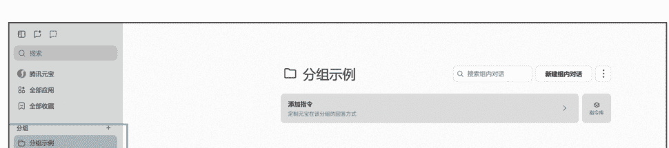

图1-35 新建分组

### 2. 功能二：用腾讯元宝看腾讯新闻

这是腾讯元宝与腾讯生态的又一次完美融合。在腾讯新闻App中通过单击“分享给元宝”将相关内容发送给腾讯元宝，腾讯元宝就能够分析新闻资讯、视频内容，同时支持进一步追问。

- 不管新闻内容有多长，用了多少晦涩难懂的专业词汇，腾讯元宝都可以用一句话帮你总结重点。
- 有太多的精彩视频来不及看？腾讯元宝可以归纳视频重点，帮你快速搞清楚发生了什么。
- 如果你看完新闻之后有更多的思考与感悟，还可以调用腾讯元宝的“深度思考”模式进行进一步的追问，延伸思考，举一反三。

### 3. 功能三：腾讯元宝插件入驻浏览器

除了我们原本熟悉的电脑版、网页版、手机版、微信小程序，腾讯元宝现在又多了一种方式陪伴大家—腾讯元宝插件版。目前腾讯元宝插件已入驻Chrome浏览器、Edge浏览器、QQ浏览器和酷狗浏览器。

插件版主要的功能包括：悬浮球，支持一键翻译、总结、收藏网页；常驻侧边栏，支持自定义提问；还有划词工具栏，可以一边看一边划词，搜索或翻译都更便捷。

如何下载插件？在官方下载中心 (https://yuanbao.tencent.com/download) 单击“浏览器插件”，如图1-36所示，然后选择你使用的浏览器的对应插件进行下载即可。

腾讯元宝还贴心地提供了安装插件的具体方法，以Chrome浏览器为例：第一步，进入浏览器的扩展程序页面，地址为 chrome://extensions/；第二步，开启扩展程序页面右上角的“开发者模式”开关；第三步，解压下载好的元宝插件.zip文件，找到其中的元宝插件.crx文件，将其拖动到扩展程序页面以完成安装。

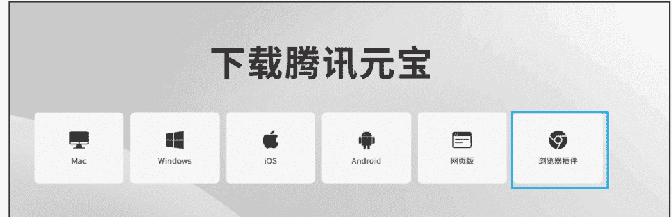

图1-36 在腾讯元宝下载中心下载浏览器插件

### 4. 功能四：划词工具栏

还在为阅读英文文档、浏览外文网站频繁查词，来回切换窗口发愁吗？试试腾讯元宝电脑版的划词工具栏。

在腾讯元宝电脑版中，单击用户头像，进入腾讯元宝设置。单击“快捷工具”，在“划词工具栏”下开启“当选中文本时显示工具栏”，如图1-37所示。

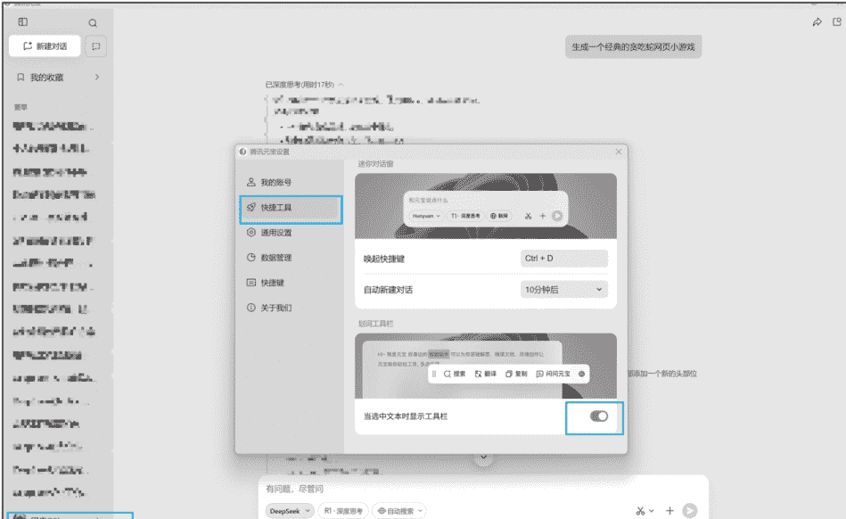

图1-37 在腾讯元宝设置的快捷工具中开启划词工具栏

在选中网页里的一段文本后，划词工具栏会自动出现，然后即可执行“搜索”“翻译”“复制”或者“问问元宝”等相关操作了，如图1-38所示。

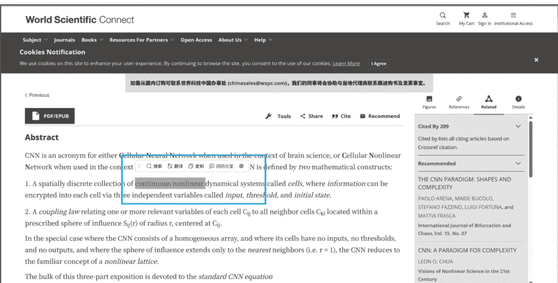

### 5. 功能五：接入微信读书和起点读书，一键跳转阅读

腾讯元宝可以成为你最贴心的读书“搭子”。它已经接入微信读书和起点读书，不仅能够根据你的需求为你推荐各种定制化书单，还能够让你一键跳转去阅读推荐的图书。

打开联网搜索模式（这里选择自动搜索），输入你想要搜索的书籍类型，例如“帮我推荐几本心理学入门书籍”。腾讯元宝的回答中有几本书的书名带有下划线，单击这些书的书名即可跳转至微信读书或者起点读书进行阅读，如图1-39所示。

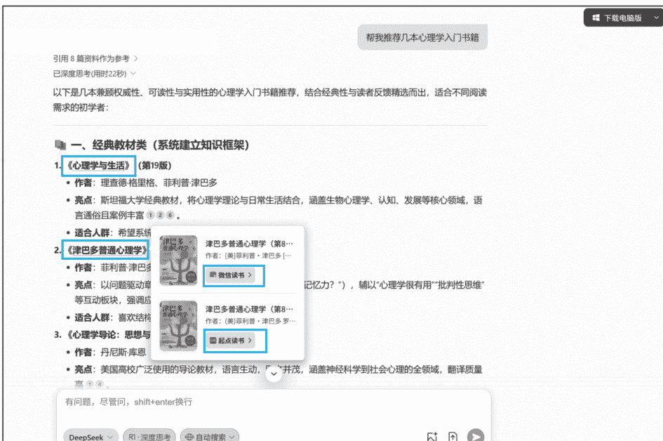

图1-39 单击腾讯元宝网页版显示的回答中带下划线的书名可实现跳转阅读

### 6. 功能六：打通腾讯地图，腾讯元宝会“认路”了

出门在外时，你是不是也经常有这样的疑问：附近哪里有便利店？最近的咖啡店在哪儿？想找一家好吃、环境又好的西餐厅，在哪儿？

现在在与腾讯地图打通之后，腾讯元宝就像拥有了一双眼睛，能够结合地图信息，帮助你搜索地点，给出准确推荐。例如，你问“附近的电车充电桩在哪儿”，腾讯元宝会自动在回答中展示地图卡片，如图1-40所示，并支持一键导航，如图1-41所示。

附近的电车充电桩在哪儿

引用 1 篇资料作为参考

已深度思考(用时4秒)

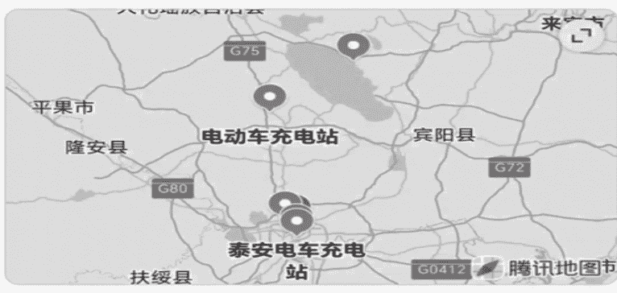

以下是南宁市兴宁区附近方便可达的电车充电桩信息，按距离由近至远排序：

1. 望州南路电车充电区
位于望州南路与长望路交叉口东南方向约131米处，距离兴宁区仅约2公里。该充电区位置显著，毗邻主干道交叉口，便于车辆临时停靠充电，适合日常通勤或短途出行补电需求。

2. 泰安大厦电车充电站

▲图1-40 在回答中展示地图卡片

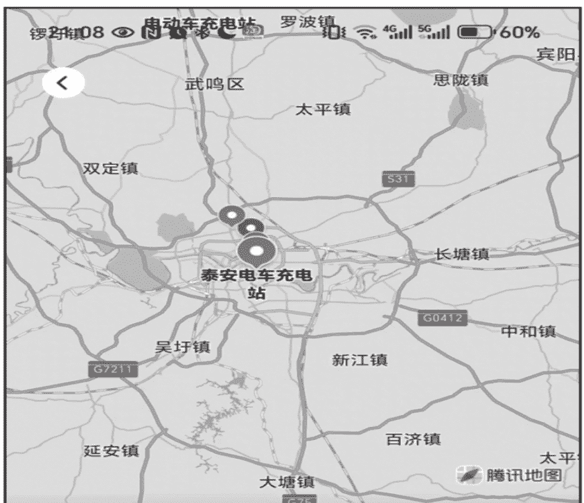

**地点 (6)**

**电车充电区**
充电站
距离2.3公里 | 广西壮族自治区南宁市兴宁区望州南路与长...

**泰安电车充电站**
充电站
距离4.3公里 | 广西壮族自治区南宁市青秀区新竹街道民族...

**电动自行车智能充电站电动车充电区**
生活服务
距离4.7公里 | 广西壮族自治区南宁市西乡塘区卢仙岭路与...

▲图1-41 在地图卡片中可以选择你想去的地点，且支持一键导航

注意，目前腾讯元宝手机版、网页版已正式接入腾讯地图，电脑版暂未接入。如果你需要使用一键导航功能，建议使用腾讯元宝手机版。

### 7. 总结

腾讯元宝不断推出的各种新功能已完美嵌入腾讯庞大的生态之中，在贴近用户日常使用习惯的同时，也降低了学习和使用的门槛。无论是习惯用微信小程序、网页版、电脑版还是浏览器插件版，你总能找到一个适合自己的使用场景。接入微信读书、起点读书、腾讯地图等功能更好地满足了人们日常的多元化使用需求，所以，快快使用起来，让腾讯元宝成为你的贴心生活小助手吧。

#### 试一试

用腾讯元宝把你的历史对话进行分组整理，打造属于你的专属“AI内阁”。

#### 小贴士

1. 利用对话分组功能来打造你的专属知识库。
2. 本节介绍的功能是截至2025年6月腾讯元宝官方更新的功能，更多新功能请持续关注腾讯元宝官方文档。

## 技巧8

## AI工具选择：腾讯元宝、Kimi、豆包，怎么选才不踩坑？

在职场中，我们经常需要处理各种写作任务，但不同的AI工具有不同的特点，要选到最适合自己的工具很难。比如，有的工具虽功能强大却不够日常，有的虽易用却深度欠佳。面对这种情况，如何选择合适的AI助手成为一个难题。

### 1. 腾讯元宝：腾讯生态内的“智能中枢”

腾讯元宝依托腾讯混元大模型，多模型支持与多模态功能强大，能与腾讯系产品深度整合，调用独家生态内容。尤其值得一提的是，腾讯元宝接入了满血版的DeepSeek模型，相较于DeepSeek官网，其服务器资源更加稳定，出现繁忙情况的概率大幅降低，能确保用户获得更流畅、更快捷的AI交互体验。

在腾讯生态场景下，腾讯元宝的优势尤为突出。例如，在微信中，用户可以直接添加腾讯元宝为好友，进行聊天。此外，腾讯元宝还能结合微信、QQ、腾讯文档等产品的数据与服务，提供更精准、更个性化的智能回复，无论是办公、学习还是日常交流，都能高效满足需求。

### 2. Kimi：高质量长文本创作的“品质助手”

如果你被长篇论文、产品说明书或法律合同折磨得焦头烂额，Kimi就是“救星”。它能实现超长上下文连贯处理（从最初支持20万汉字输入，升级至支持200万字无损上下文处理），适合学术论文（梳理框架、优化表达）、商业文案（保持品牌调性一致）、合同/报告（精准修正术语）等长文本创作。然而，Kimi在多模态方面的能力需要进一步加强。

### 3. 豆包：写作新手的“成长伙伴”

豆包由字节跳动开发，背靠字节跳动流量，不仅能通过智能引导和丰富模板帮助用户轻松上手写作，而且搭载了多款智能体角色，从“写作教练”到“娱乐达人”，能满足不同场景需求。它的特色语音交互功能支持实时对话和语音创作，用户动动嘴就能让它完成内容生成，而内置的趣味接龙、角色扮演等娱乐功能，更让写作过程充满乐趣。

## 4. 总结

腾讯元宝作为腾讯生态的AI中枢，不仅深度整合微信、QQ、企业微信等平台功能，还通过满血版DeepSeek提供稳定流畅的创作体验。其特色在于适配企业级应用场景，如智能客服、营销文案生成和跨平台数据协同，特别适合需要与腾讯生态深度结合的商业用户和专业创作者。

Kimi专注于文本质量提升，凭借专业的语言润色、逻辑优化和风格适配能力，帮助用户将初稿打磨成精品。无论是学术论文、商业报告还是文学作品，Kimi都能提供精准的修改建议，是追求内容专业度的创作者不可或缺的AI助手。

豆包以“趣味化AI创作”为亮点，通过智能体角色切换、语音交互和娱乐互动功能，让写作过程变得轻松有趣。从故事接龙到社交媒体文案，丰富的模板和引导机制使其成为新手快速上手的理想选择，尤其适合追求创意表达和娱乐体验的年轻用户群体。

这三种AI工具的功能对比如表1-1所示。

### 表1-1 三种AI工具的功能对比

| 特点 / 功能 | 腾讯元宝 | Kimi | 豆包 |
| :--- | :--- | :--- | :--- |
| 文本处理能力 | 支持长达 1000 万字的单文档处理，支持多格式文档的解析与总结 | 支持 200 万字无损上下文处理，擅长处理长篇文献、报告、合同等 | 具备文件和网页的解析功能，能阅读和理解各种格式文件以及网页内容 |
| 多语言对话 | 支持多种语言的对话 | 擅长中文和英文的对话 | 支持多种语言的对话 |
| 搜索能力 | 整合微信搜一搜、搜狗搜索等资源，擅长从微信公众号等腾讯生态中获取内容 | 具备联网搜索能力，探索版的 AI 自主搜索能力强 | 擅长从字节跳动生态中获取内容 |
| 深度推理功能 | 深度思考与逻辑推理能力较强 | 正在开发中，未来能进行更深入的对话 | 测试了新版“深度思考”功能，支持“边想边搜” |
| 多模态生成 | 具备文生图、AI 头像生成等功能 | 暂无明确多模态功能描述 | 能看懂图片、处理音频，具备图片生成、音乐生成功能 |
| 智能体创建 | 用户可以创建个性化 AI 角色 | 无相关描述 | 拥有官方创建的专业智能体和用户自创的个性化智能体 |
| 使用场景 | 有助于办公、学习、生活等场景的效率提升，支持如 AI 搜索、AI 写作、口语陪练、超能翻译官等功能 | 涵盖学术科研、互联网从业、编程、自媒体、法律等领域的信息搜集、资料整理、内容创作、编程辅助等功能 | 适用于学习、工作、生活、创作等场景，支持如解题、写作业、写文案、做 PPT、旅游规划、健康咨询等功能 |
| 技术优势 | 基于腾讯混元、DeepSeek 等大模型，数据资源丰富 | 长文本处理能力强，AI 自主搜索能力强 | 基于字节跳动的云雀模型，与字节系产品深度整合 |
| 成本 | 免费 | 目前对用户免费 | 基础功能对用户免费 |

### 补充说明：

腾讯元宝深度整合微信生态是其最大优势，例如可直接调用微信聊天记录生成会议纪要，而其他工具无此能力。

Kimi的长文本处理能力在测试中表现优异，能自动标注论文引用来源并生成Matplotlib代码，但处理多文件时稳定性较差。

豆包的语音交互自然度被多次强调，它支持方言识别和RAP生成等娱乐功能，但在专业领域（如法律条款分析）表现较弱。

建议根据具体需求选择：办公场景优先选元宝，学术研究用Kimi，日常娱乐选豆包。如需验证具体功能，可访问各产品官网或应用商店详情页。

#### 试一试

针对同一主题，如职场沟通技巧，分别用三个工具生成不同风格的文章，对比它们的差异。

#### 小贴士

1. 腾讯生态用户选腾讯元宝。
2. 新手写作用豆包，重质量选Kimi。
3. 定期清理缓存，尤其在使用Kimi处理长文档后，重启能避免“越用越慢”。

## 技巧9

## 对话技巧：10个腾讯元宝黄金提问法则（上）

你有没有这样的经历：向腾讯元宝提问时，要么得到一堆无关信息，要么答案专业得让人一头雾水，而同事用同样的工具，三言两语就获得了完美解决方案。这不是腾讯元宝的问题，而是提问方式需要升级！

本节将揭秘前5个黄金提问法则，让腾讯元宝化身你的职场智囊团。

### 1. 场景具象化：别让腾讯元宝当“读心专家”

很多人提出的问题过于笼统，就像让厨师“随便做道菜”。腾讯元宝需要具体场景才能给出精准答案。比如针对商务谈判场景，你需要明确谈判对象、时间节点和具体需求。例如，对于某个具体的谈判场景，你需要列出以下信息：“我下周要和比亚迪电池供应商谈判，需要：①动力电池核心参数对比表；②近半年市场价格波动分析；③议价话术库（针对技术型采购经理）。”

腾讯元宝可能会输出：

一、动力电池核心参数对比表（基于公开数据整理）

| 参数 | 三元锂电池 | 磷酸铁锂电池 | 比亚迪刀片电池（LFP） |
| :--- | :--- | :--- | :--- |
| 能量密度 | 200 ～ 300Wh/kg | 150 ～ 200Wh/kg | 180 ～ 230Wh/kg（体积利用率提升 40%） |
| 循环寿命 | 约 1000 次（80% 容量） | 约 2500 次（80% 容量） | 3000 次以上（实验室数据） |
| 成本 | 较高（含钴、镍） | 较低（无贵金属） | 较传统 LFP 低 10% ～ 15% |
| 安全性 | 中（高温易失控） | 高（热稳定性好） | 高（通过针刺测试） |
| ...... | | | |

二、近半年动力电池市场价格波动分析（2024年10月—2025年3月）

1. 整体趋势

2024年Q4起，磷酸铁锂电池价格小幅下降（约5%），主因是比亚迪规模化效应（200GWh装机量）及上游锂价回调；三元锂价格受镍、钴价格波动影响，保持平稳。

2. 关键影响因素（略）

三、议价话术库（针对技术型采购经理）

策略1：强调长期合作与规模效应

话术：

> “比亚迪2024年刀片电池装机量近200GWh，规模化采购可降低贵方单瓦时成本。我们期待通过3年框架协议锁定价格，共享增量红利。”

……

（由于篇幅有限，输出结果在此省略，建议读者亲自上手实践。）

### 2. 任务拆解法：像切牛排一样切分问题

面对复杂任务时，一次性提问往往效果不佳。可以先将大问题拆解为若干个小问题再进行提问，就像把牛排切成小块，更易于享用。例如，你想完成一份市场报告，可以输入：“分三步完成市场报告：①列出近三年锂电池成本下降的三大技术突破；②对比宁德时代和比亚迪CTP技术优劣势；③制作供应商价格敏感度分析表。”

腾讯元宝可能会输出：

市场报告：锂电池技术演进与供应商分析

一、近三年锂电池成本下降的三大技术突破

结构创新：CTP/刀片电池技术

技术突破：宁德时代CTP（Cell To Pack）技术及比亚迪刀片电池通过减少模组环节，提升体积利用率（刀片电池体积利用率提升40%），降低电池包成本约10%～15%。

……

固态电池技术进展

技术突破：鹏辉能源、中创新航等企业固态电池能量密度达280Wh/kg（2025年中试），全固态电池理论密度超500Wh/kg。固态电池量产成本预计2028年与液态电池持平。

……

二、宁德时代与比亚迪CTP技术优劣势对比

| 维度 | 宁德时代 CTP3.0 | 比亚迪刀片电池（CTP-LFP） |
|---|---|---|
| 技术核心 | 无模组设计，兼容三元锂/LFP | 长电芯阵列排布，专攻 LFP 体系 |
| 能量密度 | 三元锂版本：200～250Wh/kg | 180～230Wh/kg（体积能量密度提升 40%） |
| …… | | |

三、供应商价格敏感度分析表

| 敏感度维度 | 宁德时代 | 比亚迪 | 二线厂商（如亿纬锂能） |
|---|---|---|---|
| 原材料波动 | 中（依赖三元锂材料进口） | 低（LFP 原料自供率高） | 高（议价能力弱） |
| 技术壁垒 | 高（专利覆盖 CTP/BMS） | 高（刀片电池独家技术） | 中（跟随头部技术） |
| …… | | | |

关键结论（略）

（由于篇幅有限，输出结果在此省略，建议读者亲自上手实践。）

### 3. 大白话翻译：让专业术语通俗易懂

遇到专业概念时，腾讯元宝能用生活化类比进行解释，帮助非专业人士快速理解。例如，你是一个快递员，想了解AI的注意力机制，那么可以这样提问：“请用快递分拣流程类比说明AI的注意力机制。”

腾讯元宝可能会输出：

用快递分拣流程类比AI的注意力机制，可以这样理解：

1. 包裹到达分拣中心（输入数据）

快递场景：大量包裹被送到分拣中心，每个包裹上有收件地址、重量、品类等信息。

注意力机制类比：模型接收输入数据（如一句话中的每个单词、图片中的每个像素），每个数据单元携带自身信息（如词义、颜色、位置）。

2. 扫描包裹信息（特征提取）

快递场景：分拣系统扫描包裹的关键信息（如收件地址），忽略无关细节（如包装颜色）。

注意力机制类比：模型通过编码器（如神经网络）提取输入数据的特征（如单词的语义、图像的区域特征）。

......

核心相似点（略）

### 4. 渐进式优化：像雕塑家一样打磨答案

腾讯元宝具有上下文对话的多轮记忆功能，因此你在第一次提问获得初步答案后，还可以通过连续追问和细化要求，让它逐步完善输出内容。

例如，你想了解去云南旅游的详细攻略，那么可以进行多轮对话。

第一轮：在对话框输入“推荐云南7日游路线”，得到答案之后进一步追问。

第二轮：根据你的需求在对话框继续提问，例如“第三天行程太紧，改为半日自由活动”。

第三轮：可以根据你的需求进一步提问，例如“餐饮预算控制在人均80元/天”。

……

以此为例，根据你的具体需求不断追问，提出的问题越具体，腾讯元宝给出的答案才能越贴近你想要的结果。

### 5. 多视角思考：给问题装上棱镜

单一视角的分析往往不够全面，可以要求腾讯元宝从多个角度思考问题，从而获得更深入的见解。

例如，当你想全面了解直播电商趋势时，可以在对话框输入“分析直播电商趋势，要求：①常规分析；②批判性思考；③识别反常识机遇。”

腾讯元宝可能会输出：

#### 一、常规分析：直播电商的市场现状与核心趋势

##### 1. 市场规模与增长动力

中国直播电商市场规模在2025年预计达到6.4万亿元，较2017年的168亿元实现指数级增长，年复合增长率超过30%。这一增长得益于：

消费者行为转变：年轻一代更青睐互动式购物体验，直播电商通过实时互动和直观展示满足其需求；

……

#### 二、批判性思考：繁荣背后的隐忧与挑战

##### 2. 价值观与社会影响

部分主播为吸引流量夸大宣传或销售劣质商品，导致消费者权益受损，甚至影响青少年形成非理性消费观。此外，直播电商的即时性和冲动性可能加剧物质主义倾向。

……

#### 三、反常识机遇：未被充分挖掘的潜在方向（略）

（由于篇幅有限，输出结果在此省略，建议读者亲自上手实践。）

### 6. 总结

用好腾讯元宝的关键是问得具体、拆得细致、说得明白。指令越清楚，结果越令人满意。

#### 试一试

试试这样提问：“我要给老板解释项目延期原因，要求：①用修车打比方；②给出三个解决办法；③不超过300字。”

#### 小贴士

- 1) 用“5W2H”清单（谁/什么/何时/何地/为什么/怎么做/要多少）自查提问的完整性。
- 2) 将复杂任务拆解后，给每个子任务单独建立对话窗口。
- 3) 保存优质问答模板，建立个人“提问案例库”。

# 技巧10

## 对话技巧：10个腾讯元宝黄金提问法则（下）

当你掌握了前5个黄金提问法则后，腾讯元宝的实战价值才真正显现—它不仅能回答问题，更能成为你的职场专业助手。后5个黄金提问法则将带你解锁AI协作的高阶形态。

## 1. 风格化妆师：让内容“穿上”合适的外衣

当向不同对象汇报同一内容时，可以向腾讯元宝指定受众身份或表达风格，让其帮助切换“语言模式”，从而使汇报更有针对性和吸引力。例如，向腾讯元宝输入“模仿《经济学人》风格重写这段技术参数：[输入原文]”，腾讯元宝会仿《经济学人》风格重构原文。

## 2. 数据指挥官：明确你的数据军队

在处理数据时，明确指定呈现形式和分析维度，可以获得更直观的结果。例如，从原始数据中提取商业洞察时，可以向腾讯元宝明确分析维度和呈现形式，像导演一样设计“数据剧本”。

例如，输入“将Q4华东区销售数据处理成以下形式：①按产品线分类；②用折线图+柱状图对比月度趋势；③标注异常值。”，腾讯元宝会给出分类统计表表格，柱状图、折线图，以及异常值标注的Python代码（在一定的配置环境下编译，可以生成图形）。

## 3. 条件画框法：给腾讯元宝明确的边界

若想避免得到冗长且缺乏重点的回答，需告诉腾讯元宝明确排除不希望涉及的回答方向，即掌握“设限”技巧。通过设定清晰的限制条件，可以过滤掉不相关的信息，从而获得更精准的答案。例如：“请给我推荐江苏旅游景点，要求：①上海出发2小时高铁可达；②适合5岁儿童；③科普类（排除游乐场）。”

腾讯元宝可能会输出：

- 1. 苏州|苏州博物馆西馆
  高铁时间：23～30分钟
  亮点：
  探索体验馆：专为儿童设计的互动展区，可模拟考古挖掘、拼装文物模型。
  自然标本展：通过动物化石和立体模型科普自然知识。
  Tips：需提前公众号预约，周末有儿童导览活动。

- 2. 无锡|无锡博物院+无锡动物园
  高铁时间：45分钟
  亮点：
  科技与自然展厅：虚拟现实体验航天、地质互动装置。
  动物园科普课堂：动物行为观察、萌宠互动体验（需提前预约）。
  交通：高铁站地铁直达博物院，动物园需打车15分钟。

……

> （由于篇幅有限，输出结果在此省略，建议读者亲自上手实践。）

## 4. 多模态联合作战：让腾讯元宝“十八般武艺”全开

腾讯元宝不仅能处理文字，还能分析图像、数据等多种形式的信息。例如，在腾讯元宝中上传一张图片，让它为你提取图片中的文字；上传CSV、xlsx等格式的数据文件，让腾讯元宝帮你进行数据清洗、合并、分析等（关于数据分析的内容将会在本书后面的章节进行具体介绍）。例如，输入“分析上传的竞品宣传册图片：①提取所有技术参数制成对比表；②结合设计风格关键词（配色/排版/视觉符号）；③指出3处可能夸大的宣传表述。”，腾讯元宝会给出技术参数对比表，从配色、排版和视觉角度总结设计风格关键词，以及可能夸大的宣传表述。

## 5. 合规安全带：确保专业可靠

在涉及专业领域时，明确要求腾讯元宝依据特定标准作答，可以保证输出的准确性和合规性。例如：“根据最新《中华人民共和国劳动合同法》司法解释，起草竞业限制条款，需包含：①补偿标准；②期限限定；③违约责任。”

腾讯元宝可能会输出：

竞业限制协议条款（参考范本）

第一条 适用范围

本协议适用于与甲方（用人单位）建立劳动关系，并接触甲方商业秘密、技术秘密或其他保密信息的以下人员：高级管理人员、高级技术人员及负有保密义务的其他劳动者（以下简称“乙方”）。

第二条 补偿标准

1. 补偿金额：竞业限制期间，甲方按月向乙方支付经济补偿，标准为乙方离职前12个月平均工资的__________%（建议30%～50%），且不低于甲方所在地最低工资标准。

2. 支付方式：补偿金于每月__________日前支付至乙方指定银行账户（账户信息：__________）。

3. 调整机制：如甲方所在地出台更高补偿标准，以较高者为准。

第三条 期限限定（略）

第四条 违约责任（略）

第五条 协议解除与终止（略）

### 6. 总结

所有黄金提问法则都指向三个核心：具体再具体、拆解再拆解、引导再引导。当你能清晰描述问题时，腾讯元宝给出的就不再是“参考答案”，而是“定制解决方案”。

#### 试一试

找一份现成的报告，向腾讯元宝提问：“改成给客户看的版本，重点说清楚三个好处，不要用专业术语。”

#### 小贴士

- 1) 重要文件需再检查一遍。
- 2) 建立部门常用的提示词库，再用的时候可以随时调取。
- 3) 关键数据需明确其来源的可靠性。

# 第2章

## 职场写作实战：从周报到汇报的AI解决方案

# 技巧11

## 写作素材挖掘：三招让腾讯元宝化身你的选题库

职场写作既要展现专业深度，又要兼顾传播效果，但现实往往令人抓狂：行业报告的数据陈旧如过期的罐头，网络热点稍纵即逝，好不容易找到的案例不是被同行反复使用，就是经不起专业推敲。

传统素材搜集如同大海捞针，搜索引擎前五页充斥着广告，专业数据库的检索门槛堪比解数学题，收藏夹里的干货永远在“待阅读”状态。当领导要求“既有行业洞察又能引发共鸣”时，许多人只能对着空白文档陷入沉默—这不是写作障碍，而是信息时代的典型职场困境。

如何让写作素材像自动补全功能般及时出现？怎样在专业性与传播性之间找到平衡点？以下三个用腾讯元宝帮你发现选题的招式或许能带来改变。

## 1. 招式一：精准定位素材需求

模糊的指令只会得到宽泛的结果，而明确的范围限定可以精准定位。比如，你是一个初入职场的新人，想了解职场的一些挑战和困境，向腾讯元宝提问“请帮我找一些职场的典型挑战”，腾讯元宝可能会回答诸如“35岁危机”这类与职场新人无关的内容。不如这样修改提问：“请你帮我找职场新人面临的三个典型挑战，需包含：①社交媒体讨论热点；②企业HR访谈片段；③相关心理学研究数据。”同步打开联网搜索功能。

腾讯元宝会从社交平台热门话题标签、企业招聘负责人的实际反馈、决策疲劳研究的关键结论中找到更合适的内容组合输出，如：

### 挑战一：理想与现实的职场落差

社交媒体讨论热点：短视频平台上“上班博主”通过记录通勤、办公室政治和加班文化等真实场景引发热议……

### 挑战二：数字化监控下的社交压力

社交媒体讨论热点：Z世代掀起“职场闭嘴打卡”运动，GitHub上《职场黑话密码本》获3.7万星标……

（由于篇幅有限，输出结果在此省略，建议读者亲自上手实践。）

精准定位素材的操作要点有3个：①明确具体对象，如“职场新人”而非“打工人”；②限定素材维度，从现象描述+实际案例+理论支撑等角度来找；③注明格式要求，明确是否需要结构化呈现。

## 2. 招式二：跨领域素材整合

有时候需要使用一些自己认知以外的内容作为素材，比如作为一个文职人员，需要找一些关于云计算、SaaS等的资料，该怎么办呢？你可以给腾讯元宝提这样的要求，以增加可读性：“用日常生活中的常见场景解释云计算服务模式，要求：①每个类比对应IaaS、PaaS、SaaS；②包含技术解析和比喻说明。”

腾讯元宝可能会输出：

租房自装修（IaaS）：获得毛坯房自主改造。

比喻说明：假设你想开一家咖啡馆，但不想自己买地建房。此时，你可以租用一栋毛坯商铺（包含地基、墙壁、水电管道），然后自行装修，购买咖啡机、桌椅等。你完全掌控内部设计和运营，但不用操心建筑维护、水电供应等问题。技术解析：IaaS提供虚拟化的底层资源（服务器、存储、网络），用户通过远程控制台管理操作系统、运行环境及应用程序。例如，用户租用云服务器（如AWS EC2）后，需自行安装操作系统、配置防火墙、部署数据库等。

精装公寓（PaaS）：直接入住带家具的房间（略）。

酒店服务（SaaS）：享受完整住宿体验（略）。

……

（由于篇幅有限，输出结果在此省略，建议读者亲自上手实践。）

这里的每个解释均附带技术术语说明，形成专业与通俗结合的素材，大大增加了可读性。要实现跨领域素材整合，需要包含3个要素，分别是：①确定需要通俗化的专业概念；②选择大众熟悉的生活场景；③要求双重解析（专业定义+类比说明）。

## 3. 招式三：碎片信息结构化

很多时候，你手头上的素材可能比较零散，看得比较头疼，更不要说整理和分析了。比如，你参加了一场关于充电服务的会议，需要根据会议信息撰写市场分析报告，那么你就可以用以下这段提示词让腾讯元宝整理信息：“我有一些关于充电服务的会议信息，需要整理成市场分析报告，请你帮我将以下碎片信息整合为市场分析素材：①用户反馈更关注产品续航时间……②技术部门确认电池成本下降……③客服数据反映充电服务咨询量增长……要求是按‘需求-技术-服务’逻辑分层，每层补充行业数据。”

腾讯元宝可能会输出：

一、需求层面：用户核心诉求驱动市场扩容

### 1. 续航与便捷性成为核心关注点

超80%的新能源汽车用户将长续航作为购车的首要考量因素，且67%的潜在消费者认为充电服务的便捷性直接影响其购车决策。

2. 行业数据支持：2025年2月全国公共充电桩总量达383万个，私人充电桩达962万个，车桩比达到1:1.5，但仍存在区域布局不均问题（如高速公路10%服务区未覆盖，乡村覆盖率不足5%）……

（由于篇幅有限，输出结果在此省略，建议读者亲自上手实践。）

以上提示词用到的是碎片信息处理的3个要素，分别是：①先罗列所有碎片信息；②指定逻辑框架；③要求数据补充说明。

## 4. 总结

有效使用腾讯元宝挖掘写作素材的关键在于“精准提问”和“框架设计”。与其被动等待灵感，不如主动构建素材生成逻辑。就像优秀的厨师懂得如何组合食材，职场写作者需要掌握信息调度的艺术—明确需求、设计结构、交叉验证，最终形成独特的内容拼图。

#### 试一试

向腾讯元宝输入：“用经典文学故事解析项目管理方法，要求：①选择三个名著片段；②对应不同管理场景；③提炼实操要点。”看看腾讯元宝如何将名著转化为现代管理案例。

#### 小贴士

- 1) 在指令开头添加“你是有十年经验的××领域专家”，可提升内容专业性。
- 2) 遇到通用性回复时，尝试追加“请提供三个独特视角的分析”。
- 3) 定期整理有效指令模板，建立个人素材库分类标签。
- 4) 重要提醒：所有数据引用需二次核实，AI不能替代事实核查。

# 技巧12

## 打造爆款：用腾讯元宝把流水账变成爆款文章

每个职场人都经历过这样的绝望时刻：盯着空白文档两小时，最后写出来的文章连自己都看不下去—逻辑混乱、选题无聊、表达生硬。更可怕的是，当你战战兢兢把文章发出去，换来的却是领导“重点不突出”的批注，或者读者“看了个寂寞”的沉默。

别急，腾讯元宝能让你从写作苦力变成内容架构师。以下是4个让腾讯元宝帮你轻松度过最痛苦的创作环节的实战技巧。

## 1. 文章重点分析

爆款文章就像精密的瑞士手表，每个零件都严丝合缝。但普通人往往只看到手表的表面走时，看不出内部齿轮如何咬合。这时候可以让腾讯元宝当你的“文章×光机”，例如输入：“你是一位拥有10年经验的《哈佛商业评论》编辑，请解构这篇关于“时间管理”的文章：①用不同色块标注开头钩子技巧（红色）、过渡手法（蓝色）、数据使用（绿色）；②分析每个章节如何服务于核心论点；③提取3个可复用的结构模板。原文：[粘贴文章内容]。”你会得到一份解构后的材料，包含红色、蓝色、绿色块标注，如图2-1所示，以及章节服务核心论点分析和可复用的Markdown格式的结构模板。这种洞察比盲目模仿有效得多。

> 一、元素标注与功能解析（以虚拟段落为例）
> “你是否知道全球500强企业的高管平均每周有12小时浪费在低效会议中？（开头钩子：数据冲击+设问引发共鸣）这相当于每年损耗超过3个月战略思考时间（数据使用：量化痛点）。但当我们深入研究麻省理工学院的‘时间审计’项目（过渡手法：学术背书引出方法论）……”

图2-1 色块标注示意图 书为双色印刷，无法展示多种颜色，读者可自行尝试，查看完整输出效果。

## 2. 辅助高效选题

选题是创意写作的核心步骤，“如何提升工作效率”这种选题就像白开水，而“为什么越努力的人越不会工作”就像让人想购买的冰可乐。可以用腾讯元宝启动你的“脑洞发生器”，例如输入：“假设你是《纽约客》的专题编辑，请为‘远程办公’主题生成5个颠覆常规认知的选题，要求：①包含至少1个违反直觉的观点；②能激发‘真的假的？’的好奇反应；③适配职场类自媒体调性。”

腾讯元宝可能会输出：

- 选题1：《远程办公正在制造新型加班贵族？数据揭示居家工作者的隐形996》
- 选题2：《Zoom倦怠：视频会议正在重塑职场制度》
- 选题3：《咖啡机拖累效率？远程团队“强制疏离”实验》
- 选题4：《监控软件导致集体摆烂？远程管控的囚徒困境》
- 选题5：《居家办公让员工忠诚度暴跌122%：自由职业化浪潮下的反噬》

……

（由于篇幅有限，输出结果在此省略，建议读者亲自上手实践。）

## 3. 读者反馈模拟

作者和读者可能存在认知差。用腾讯元宝模拟真实读者，找出那些“你自己觉得超棒但其实很尬”的表达，例如输入：“现在请你扮演35岁的中层管理者，用手机快速浏览这篇关于“向上管理”的文章后：①用加粗形式标注3个最想吐槽的段落；②指出哪个案例让你觉得“这不现实”；③标记出你会分享给同事的1个实用技巧。要求：规避不太适合出版的言论。原文：[粘贴你的草稿]。”

腾讯元宝可能会输出：

- 1. 最想吐槽的3个段落（已加粗）
  - 1）“主动报告进度：永远保持进度透明，每次会议都用3页以内的PPT或简报呈现关键进展与卡点，让老板随时掌握动态。”
    吐槽点：现实会议常被压缩至15分钟，临时被拉进电话会时，现场做PPT根本来不及。更常见的是口头同步核心信息，文档是后续补的。
  - 2）“建立信任链条：主动提供额外价值，例如提前整理跨部门协作的阻力点分析，哪怕超出自己部门的职责范围。”
    吐槽点：“超出自己部门的职责范围”等于自我加压。资源本就紧张，替其他部门分担工作反而易引发内部矛盾，还可能让人觉得你分心。
  ……

- 2. “这不现实”的案例
  虚拟案例：小A用SWOT分析说服老板放弃不合理的营收目标。
  现实痛点：老板的KPI常来自董事会硬指标，底层数据再充分也难动摇。现实做法是协商资源（如加人或延期限），而非直接推翻目标—除非你有绝对话语权，否则易被贴上“执行力不足”的标签。

- 3. 分享给同事的1个实用技巧
  “向上管理核心技巧”章节中的“策略1：带着方案提问题”。
  原文提炼：向老板暴露风险时，同步提供1～2个可行解（例如“技术延期风险高，但若外包部分模块可缩短2周”）。

……

（由于篇幅有限，输出结果在此省略，建议读者亲自上手实践。）

## 4. 打造核心金句

金句应该同时具备穿透力和传播力。腾讯元宝可以把你的平淡陈述升级成记忆点，例如输入：“你是一位TED演讲撰稿人，请将下面这个观点精炼成3种不同风格的金句。原句：“多任务处理其实会降低效率。”要求：①学术严谨型（带研究数据）；②幽默反转型（预期违背）；③行动号召型（具象化建议）。”

腾讯元宝可能会输出：

学术严谨型（带研究数据）

> “斯坦福大学神经科学实验证实，任务切换平均造成40%效率损耗—我们的大脑在并行处理中产生的认知转换成本，远超多数人的直觉判断。”（基于美国心理学会2021年多任务处理效率研究）

幽默反转型（预期违背）

> “人类至今没能进化出八爪鱼式的神经结构，但现代人却总幻想能像章鱼那样同时抛接8个‘彩球’—结果往往变成被文件、消息和会议追着蜇的狼狈‘海蜇’。”

行动号召型（具象化建议）

……

（由于篇幅有限，输出结果在此省略，建议读者亲自上手实践。）

### 5. 总结

写作不是天赋而是技术活，就像做菜。用腾讯元宝拆解结构是备菜，生成选题是调味，读者测试是试吃，锻造金句是摆盘。与其在计算机前枯坐，不如让腾讯元宝当你的“后厨团队”。

#### 试一试

- 1) 找一篇行业爆文，让腾讯元宝做“解剖报告”。
- 2) 用“违反直觉+具体场景”格式生成3个选题。
- 3) 把文章草稿丢给“读者模式”找槽点。

#### 小贴士

- 1) 解构文章时要重点关注转折词分布规律。
- 2) 生成选题时要考虑是否有数据支持。
- 3) 金句优化时要保留一些自己的语言特色，防止同质化。

## 技巧13

## 去除AI味：让腾讯元宝的输出自然得像你亲笔写的

当我们试图用腾讯元宝辅助写作、提升效率时，常陷入这样的境地：让腾讯元宝润色的方案被客户质疑“像机器人写的”，用腾讯元宝生成的周报被主管要求“多说人话”，就连自动回复的邮件都带着股生人勿近的冰冷感。更魔幻的是，有些文档AI浓度过高到连使用者自己都认不出—这到底是我的工作成果，还是腾讯元宝的即兴创作？

当腾讯元宝生成的内容被轻易识破，不仅影响工作成果的接受度，更可能引发信任危机。如何让腾讯元宝既保持生产力优势，又能输出自然流畅的职场内容？以下3个方法可以帮助使用者有效去除AI痕迹。

### 1. 方法一：风格模仿训练

首先通过投喂历史文档建立个人语料库，让AI学习你的表达习惯，然后再让AI根据这个习惯为你输出新的内容。这个方法包含两个步骤，分别是风格解析对话和风格迁移生成。

第一步，风格解析对话。假设你现在要撰写本周工作的心得体会，那么你可以先准备一些明显带有你的个人风格的周报，以附件的形式上传，然后向腾讯元宝提问：“请分析我上传的3篇历史周报，提取以下特征：①标题结构规律；②数据呈现固定模式；③段落衔接词使用习惯。”

腾讯元宝可能会输出：

通过对3篇历史周报的分析，提取出以下结构化特征：

一、标题结构规律

1. 模块化数字标号体系

采用阿拉伯数字（1、2、3）+短句标题的层级结构……

二、数据呈现固定模式

1. 工具-方法-成果三段式

……

（由于篇幅有限，输出结果在此省略，建议读者亲自上手实践。）

第二步，风格迁移生成。你需要稍微整理一下本周的工作，然后向腾讯元宝提问：“请根据我本周的工作，结合你总结的特征，帮我撰写本周工作的心得体会。本周工作如下：①完成3个培训方案的撰写，其中2个得到客户的认同；②与4位客户沟通培训意向（需根据实际情况添加）。”

等待一小段时间后，腾讯元宝可能会输出：

本周核心认知迭代：

1. 工具链组合价值：线上培训的“屏幕共享+实时编程+弹幕互动”组合拳显著提升参与度（略）
2. 知识复利效应：发现培训材料审查（旧数据）与书籍撰写（新知识）存在内容复用空间（略）
3. 客户需求洞察：企业客户对AI培训的需求正从“工具科普”向“业务场景解决方案”迁移（略）

（由于篇幅有限，输出结果在此省略，建议读者亲自上手实践。）

### 2. 方法二：场景化指令设计

针对不同的工作场景添加不同的要素，避免通用化表述。你可以在提问时指定受众身份（技术主管/销售代表）、关联近期事件（上月产品故障/季度促销）、绑定内部术语（公司特有项目名称），以此让腾讯元宝进入你的语境中。

例如，某市场团队在撰写用户调研报告时，通过限定内容要素，使AI产出内容与业务深度结合。写稿人向腾讯元宝输入：“我现在在撰写一份用户调研报告，但是原报告比较通用，应该调整为面向销售部的，请帮我改写，要求：①引用上周三渠道商会议的三个具体问题；②使用‘北极星指标’‘转化漏斗’等内部术语；③避免使用抽象词汇。原报告：……（需根据实际情况添加。）上周三渠道商会议的三个具体问题：……（需根据实际情况添加。）”

腾讯元宝可能会输出：

一、核心发现与北极星指标关联

根据上周三渠道商会议的核心诉求，本次调研重点聚焦销售转化漏斗中的三个关键环节：

1. 用户功能偏好（对应转化漏斗的“兴趣激发”阶段）（略）
2. 品牌认知差异（对应转化漏斗的“认知建立”阶段）（略）
3. 购买决策要素（对应转化漏斗的“决策促成”阶段）（略）

二、销售机会点深度洞察

（一）功能偏好与卖点强化（响应问题一）

……

（由于篇幅有限，输出结果在此省略，建议读者亲自上手实践。）

### 3. 方法三：人工干预节点设置

有时候实在无法消除AI味，就在关键位置保留人工修改痕迹，提升内容可信度。比如某财务分析师会在AI生成的报告中刻意加入两类内容：一类是基于经验的非数据判断，如“该趋势可能与区域天气异常相关”；另一类是部门内部才知道的背景信息，如“参考王总监上周分享的临时政策”。

此外，也可以从以下方面考虑：

1. 在结论段前插入“个人观察”模块。
2. 保留少量口语化表达（如“这个数据有点反常识”）。
3. 添加具体人名/事件以增强真实感。

例如，腾讯元宝输出“建议增加华东地区投放预算”，你可以人为优化为“结合小李上周跑店反馈的竞品动态，建议优先提升华东三城的终端陈列费用”。

## 4. 总结

去除AI痕迹的本质是建立“人机混合工作流”：让AI负责结构化、标准化内容生产，人类则专注经验注入和个性表达。最高境界是让阅读者感受到明确的个人风格，同时惊叹于内容的严谨高效。记住，好的AI使用应该像精心修剪的盆栽—保留自然形态，又暗含人工雕琢。

#### 试一试

1. 选3段旧文档让腾讯元宝分析你的写作习惯。
2. 用“面向[受众]+关联[事件]+绑定[术语]”格式重写需求。
3. 在AI产出中插入内部人名/争议点/口语化表述。
4. 对比初稿与终版，测试“人味浓度”。

#### 小贴士

1. 建立个人禁用词库，如过度学术化的术语，下次提问时可以要求腾讯元宝不使用这些词。
2. 重要文件保留10%～15%人工创作比例。
3. 始终对敏感内容进行人工审核。

## 技巧14

## 工作总结：用腾讯元宝高效完成总结稿

对于职场人而言，撰写工作总结是一项耗时且烦琐的任务。你需要手动收集分散在邮件、聊天记录、表格中的碎片化数据，反复核对不同版本文件的信息，尽管耗费数小时，但整理出的内容仍可能遗漏关键成果；搭建结构时，也常因逻辑框架不清晰导致内容重复或重点偏移；同时，文字表述既要兼顾专业性又要避免刻板化。这些压力往往使总结撰写成为影响工作效率的瓶颈环节。

腾讯元宝的到来，让这些压力成为过去式。以下三招可以帮你高效完成工作总结的撰写。

### 1. 招式一：模仿过去的风格生成初稿

职场人写文章往往有一个习惯，就是以自己写过的类似的文章作为模板，再把现在要写的内容套进去。这可以让腾讯元宝完成，操作分两步：先拆解自己的写作风格，再迁移到新文档中。

比如，你正在撰写本周工作总结，此时可以找一篇自己之前写的周报，向腾讯元宝输入：“请分析这些文档，提取：①标题层级规律；②数据呈现模式；③常用过渡词。”

腾讯元宝可能会输出：

1. 标题层级规律

- 一级标题：使用中文数字加顿号（如“一、本周工作内容”），涵盖整体模块。
- 二级标题：使用括号中文数字（如“（一）文件管理”），细分一级标题下的子模块。
- 三级标题：使用阿拉伯数字加小数点（如“1. 文件整理与归档”），进一步拆分二级标题的具体工作内容。
- 层级嵌套逻辑：整体遵循“总-分”结构，层级间通过缩进或换行区分，无项目符号，仅通过数字标记逻辑关系。

2. 数据呈现模式（略）

3. 常用过渡词（略）

（由于篇幅有限，输出结果在此省略，建议读者亲自上手实践。）

接着输入本周工作要点：“根据上述特征，帮我写本周总结。工作内容：①完成5家客户需求调研；②优化数据分析模板；③参与跨部门协作3次。”此时腾讯元宝生成的文档就会带着你的专属文风：

一、本周工作内容

（一）客户需求调研

调研实施与执行

根据公司业务目标，完成对5家重点客户的需求调研工作，覆盖行业痛点、产品使用反馈及未来合作方向。通过线上访谈与问卷结合的方式，收集客户需求文档[×]份，整理关键需求点[×]项，为后续产品优化提供数据支撑（略）

（二）数据分析模板优化（略）

（三）跨部门协作（略）

二、工作成果

客户调研价值凸显：精准定位客户核心需求，推动[×]项产品优化建议纳入下一季度开发计划（略）

三、问题与改进方向

需求调研深度不足：部分客户反馈信息存在模糊表述，需补充二次沟通确认流程（略）

（由于篇幅有限，输出结果在此省略，建议读者亲自上手实践。）

### 2. 招式二：精准化内容升级

腾讯元宝生成的初稿通常需要进一步优化才能达到汇报标准。例如，当腾讯元宝生成“完成项目进度管理优化”时，可以向其进一步提出要求：“①突出资源限制下的解决方案；②添加可量化的成果数据；③说明经验的可复制性；④需包含‘流程再造’‘效能提升’‘标准化模型’等术语，保持自然表述；⑤字数不超过120字。原始内容：完成项目进度管理优化。”

腾讯元宝会为你进一步润色：“在资源受限的情况下，通过流程再造整合跨部门协作节点，建立动态资源池（资源利用率↑82%），开发标准化模型预警功能，关键节点准时率↑95%。效能提升：项目周期缩短22%，人力成本↓15%。经验可复制：模型适配多场景，工具包+培训赋能12个项目，周期缩短18%~25%。”

### 3. 招式三：人工审核与修改

不能完全照搬腾讯元宝生成的内容，要结合工作实际，进行人工调整。比如：①在成本分析段落插入“这个数据反常波动，可能与财务部老张说的新税政策有关”；②把“流程优化建议”改成“采纳了上个月头脑风暴时小王提的建议，意外提升了审批效率”；③替换书面语：“那款被吐槽像老年机的产品，终于靠着短视频逆袭了。”

## 4. 总结

最高明的人机协作是“真假难辨”：让机器处理结构化内容，人类则专注注入行业洞见和个人特质。就像冲泡精品咖啡—七分靠豆子品质（AI生产力），三分靠手冲技法（人工调味）。

#### 试一试

尝试向腾讯元宝输入以下内容（需补充相关背景信息），撰写你的季度总结：“我是一位[岗位]从业者，需撰写2025年Q1总结，重点包含[3项核心成果][2个改进方向]，请你帮我输出结构建议。”

#### 小贴士

1. AI味太浓会显得不真实，你可以建立你的AI禁用词库，比如永远禁用“赋能”“抓手”等虚空词汇。
2. 重要文件保留5%人工创作比例，用于添加临时事件或者个人观察。
3. 可以保留1～2处口语化表达，比如“这个结果确实没想到”。
4. 涉及业务机密的内容永远手动收尾。

## 技巧15

## 速写新闻：用腾讯元宝写出专业又吸睛的新闻稿

新闻稿真正写好并不容易。既要准确传递信息，又要吸引读者注意；既要专业严谨，又不能写成枯燥的技术文档。更麻烦的是，时间紧、资料杂、要求高—改来改去，最后可能连自己都看不下去。

腾讯元宝可以帮你完成这项工作，它不仅能快速整理信息、生成初稿，还能优化表达，让新闻稿既专业又流畅。以下是三个实用的撰写步骤。

### 1. 步骤一：快速提取核心信息

新闻稿最怕重点模糊。如果你手头有一堆杂乱的产品资料、会议记录或采访内容，直接让腾讯元宝帮忙提炼关键点。例如，上传一份智能手表的新品发布资料，并向腾讯元宝输入：“这是一份某智能手表的新品发布资料，包含技术参数、用户场景和市场竞争分析。请帮我提取新闻稿的核心信息，要求：①突出3个产品亮点；②每个亮点搭配用户实际使用场景；③避免技术术语堆砌。”

腾讯元宝可能会输出：

1. 亮点一：超长续航，摆脱充电焦虑
   (1) 典型场景：商务人士出差3天无须携带充电器。
   (2) 技术支撑：采用新一代低功耗芯片，续航提升40%。
2. 亮点二：健康监测更精准
   (1) 典型场景：夜间睡眠质量分析误差率低于同类产品。
   (2) 技术支撑：医疗级传感器+AI算法优化。

(其余略)

有了以上信息后，我们就可以据此撰写新闻稿的初稿了。

### 2. 步骤二：撰写新闻稿初稿

无论是产品发布、企业合作、行业峰会，还是获奖公告，新闻稿的核心结构万变不离其宗—5W1H（Who、What、When、Where、Why、How）。完成步骤一后，就可以把核心信息整理好，用以下结构形成向腾讯元宝提问的通用模板：

请根据以下信息撰写一篇专业新闻稿：

1. 事件类型：[产品发布/战略合作/获奖公告/行业峰会/社会责任项目等]。
2. 核心信息（5W1H）：
   Who（主体）：[公司/机构/个人名称]。
   What（事件）：[用一句话概括，如“发布全球首款AI翻译耳机”]。
   When（时间）：[具体日期或“今日”]。
   Where（地点）：[线上/线下，如“北京国家会议中心”]。
   Why（意义）：[对行业/用户的核心价值，如“解决跨语言沟通痛点”]。
   How（实现方式）：[技术/合作模式/项目机制等，如“采用神经机器翻译技术”]。
3. 补充信息：[如果上一步整理了相关材料，可以补充在这里]。
4. 要求：
   - 严格按照金字塔结构（标题→导语→核心信息→细节→背景）。
   - 导语包含5W1H，不超过100字。
   - 正文每段聚焦1个信息点（技术、用户案例、行业趋势等），不要分点。
   - 避免形容词堆砌（如“颠覆性”“革命性”）。

你可以按照以上格式补充具体信息，然后向腾讯元宝提问，例如：

请根据以下信息撰写一篇专业新闻稿：

1. 事件类型：产品发布。
2. 核心信息：
   Who：××科技；What：发布全球首款AI翻译手表；When：2024年10月15日；Where：线上全球直播；Why：实现95种语言实时翻译，解决商务旅行沟通障碍；How：采用自研神经机器翻译引擎。
3. 补充信息：[上一步分析的结果]。
4. 要求：[参照通用模板]。

腾讯元宝可能会输出：

××科技发布全球首款AI翻译手表

【2024年10月15日】今日，××科技通过线上全球直播发布全球首款AI翻译手表，搭载自研神经机器翻译引擎，可实现95种语言实时翻译，旨在解决商务旅行中的沟通障碍。产品同时具备超长续航与精准健康监测功能。

该手表采用新一代低功耗芯片，续航能力较同类产品提升40%。在典型商务场景下，用户出差3天无须携带充电器，彻底摆脱电量焦虑。

健康监测功能通过医疗级传感器与AI算法优化实现。测试显示，其夜间睡眠质量分析的误差率显著低于市场主流产品，可以满足用户对精准健康数据的需求。

××科技表示，AI翻译手表是其在可穿戴设备与人工智能交叉领域的突破性尝试。随着全球化商务需求增长，实时翻译技术正成为智能硬件的重要发展方向。

### 3. 步骤三：优化标题和导语

新闻稿的标题和导语决定了读者是否会继续往下看。如果标题太普通，或者导语太啰嗦、没重点，可以让腾讯元宝帮忙调整。例如输入：“我们公司发布了AI翻译手表产品，目前写了一个产品发布会的标题，但感觉不够吸引人，请优化。原标题为××科技发布全球首款AI翻译手表。补充信息：[第一步分析的结果]。要求：①参考补充信息增加数据或对比（如‘比传统方案快3倍’）；②加入紧迫感（如‘企业数据泄露风险加剧’）；③保持专业但避免过于营销化。”

腾讯元宝可能会输出新的方案：

【商务效率版】“××科技发布全球首款AI翻译手表：72小时超长续航+医疗级健康监测，商务差旅终极解决方案。”

【技术突破版】“突破行业瓶颈！××科技AI翻译手表：续航提升40%+睡眠监测误差率降低50%。”

【场景痛点版】“告别充电焦虑与健康误判：××科技AI翻译手表重新定义穿戴设备标准。”

## 4. 总结

用腾讯元宝写新闻稿，核心是“明确需求+结构化指令”。无论是提炼重点、撰写正文，还是优化标题，清晰的提示词能让腾讯元宝输出更符合要求的内容。

#### 试一试

用腾讯元宝优化一段现有新闻稿，输入：“请优化以下新闻稿片段，使其更简洁有力（原稿：……）。要求：①删除冗余形容词；②每句话不超过20字；③增加一个数据支撑点。”

#### 小贴士

1. 如果一次生成的内容还差点意思，那就让腾讯元宝生成多个版本，再选最合适的进行修改。
2. 你也可以加一句“请用《人民日报》的风格改写”，让腾讯元宝模仿专业媒体。
3. 腾讯元宝生成稿中的数据可能有误，因此所有引用务必进行二次核对。

## 技巧16

## 项目报告：三招让腾讯元宝速成报告大纲

写项目报告最头疼的往往不是内容本身，而是如何组织这些内容。没有清晰的大纲，再好的数据也会变成杂乱无章的碎片。反复调整章节顺序、绞尽脑汁思考逻辑关系—这些都会消耗大量时间和精力。更麻烦的是，当需要整合多个部门的信息时，光是统一格式和表达方式就让人抓狂。

腾讯元宝可以帮你快速解决这些问题。它能根据你的具体需求，生成结构清晰、逻辑严谨的报告大纲。接下来介绍三个帮你轻松解决项目报告结构问题的招式。

### 1. 招式一：需求定位—三步锁定核心

当使用腾讯元宝辅助生成项目方案时，模糊的指令会导致输出内容缺乏针对性。例如直接输入“帮我写个关于市场报告的大纲”，腾讯元宝只能提供通用模板，无法满足具体业务场景的需求。要想让腾讯元宝变成精准的GPS导航，关键在于把“随便”换成“三组坐标”—政策定位、市场定位、财务定位。试试这个指令：“请生成新能源充电桩市场拓展报告大纲，需要：①最新政策分析（2023年文件）；②竞品对比（服务范围、价格策略、专利）；③财务测算（投资回报、风险）→用带章节层级的标准格式。”

腾讯元宝可能会输出：

新能源充电桩华东市场报告

一、政策指南

1.1 2023补贴新政（附财政部23号文重点）（略）

1.2 长三角充电站建设地图（略）

二、竞争对手擂台

2.1 头部企业PK（特来电vs星星充电）

……

（由于篇幅有限，输出结果在此省略，建议读者亲自上手实践。）

### 2. 招式二：智能汇总—跨部门信息拼图

跨部门协作时，技术数据、用户画像和财务指标往往存在格式与维度差异，手动整合效率低下且容易出错。下面的结构化指令能让腾讯元宝帮助你准确识别数据间的业务逻辑关系，生成具有操作性的整合分析报告。输入：“你作为项目经理，请整合：①技术部：传感器测试数据。②市场部：一线城市家庭画像。③财务部：研发成本测算→按‘技术靠谱吗-市场买账吗-赚钱路径’的逻辑排布。”

腾讯元宝可能会输出：

一、技术靠谱吗？—传感器技术可行性验证

1. 核心性能数据（技术部）
   精度误差率：±0.5%（优于行业标准±1.2%）。
   极端环境测试：-20℃～60℃工作正常（覆盖中国所有气候区）。
   使用寿命：实验室模拟5年无衰减（超过家电平均更换周期）。
   专利储备：3项核心发明专利已获批。

2. 技术风险预警
   量产良率：当前88%→需提升至95%以上（产线改造需求）。
   多设备协同：需追加蓝牙Mesh协议开发（增加2个月研发周期）。
   电磁兼容性：需补测欧盟CE认证标准。

二、市场买账吗？—目标用户需求匹配度（略）

三、赚钱路径—财务模型测算（略）

（由于篇幅有限，输出结果在此省略，建议读者亲自上手实践。）

### 3. 招式三：个性调优—读懂领导心思

当需要向不同决策风格的领导汇报同一项目时，传统人工修改方式效率低下且容易遗漏关键需求。可以通过预设关键词识别机制，让腾讯元宝根据文档中出现的“战略”“数据”“图表”等特征词，自动调整报告的表达重点和呈现形式。上传原大纲并输入：“我们公司报告标配：①首页要有3条核心结论；②风险分析单独成章；③图表不能少于1/3版面→请按这个标准优化跨境电商物流方案大纲。”

腾讯元宝可能会输出：

跨境电商物流方案优化大纲

一、首页（核心结论页）▶新增独立结论页

3条核心结论：

1. 通过“海外仓+边境仓”组合模式可降低30%末端配送成本（配合成本对比柱状图）。

## 2. 智能通关系统可缩短清关时间至48小时内（展示时效对比折线图）。

## 3. 区块链溯源技术降低30%货物争议率（附技术应用流程图）。

（由于篇幅有限，输出结果在此省略，建议读者亲自上手实践。）

## 4. 总结：从“文档民工”到“框架大师”

用腾讯元宝生成大纲，就像用导航规划路线而不是手工画地图。记住：①需求越具体，框架越精准（参考招式一的“三组坐标”）；②信息越整合，逻辑越通畅（见招式二的跨部门信息拼图）；③调优越智能，返工越少（活用招式三的风格学习）。

#### 试一试

向腾讯元宝上传你的AI客服项目报告，并输入：“生成AI客服升级报告大纲，需要：①新旧系统SWOT对比；②客户满意度目标（带2024年数据标记）；③实施时间表框架。”

#### 小贴士

- 1) 开头加“请用麦肯锡思维设计”，秒变专业范儿。
- 2) 复杂项目像搭积木：先做模块再组合。
- 3) 重要会议前生成3种不同版本大纲备选。

## 技巧17

## 学习心得：用腾讯元宝告别无效复盘

职场人在培训结束后，除了收获知识，往往还需要写学习心得。然而，有时候明明参加了培训，打开文档却不知道从何写起。记了一堆零散笔记，却像拼图少了关键几块—知道要写“收获”和“启发”，但具体怎么组织语言、怎么衔接段落，大脑一片空白。这不是学习能力问题，而是信息处理方式需要升级。按照本节的三个步骤，能够让腾讯元宝辅助你高效撰写学习心得。

## 1. 第一步：知识点智能重组

很多人的学习记录如同打翻的积木：零散的知识点、不连贯的案例、混杂着个人批注的课件截图。这时候需要的不是更努力地拼凑，而是智能化的结构重组。最好先拿到培训课件，如果没有的话，那么就将自己的学习笔记拍照上传到腾讯元宝中，并输入：“我是一名普通的职场文员，请将我上传的培训内容提炼为结构化学习要点：①提取5个核心方法论，每个方法包含定义、使用场景、常见错误；②按‘核心理念-工具方法-典型案例’分层；③列出可供我在实际工作中使用的方法、技巧；④删除重复冗余信息。”

本例中的学习内容是关于AI产品构建展开的，腾讯元宝可能会输出：

### 一、核心方法论体系

方法论1：从工具思维到协作范式转变

（1）定义：将AI视为具备人格特征的协作对象而非单纯工具。

(2) 应用场景：复杂决策场景（如市场策略制定）、创意生成与迭代（产品设计、内容创作）。

(3) 常见错误：过度追求完美输出、忽视AI的个性化特征调试。

### 方法论2：动态协作模式构建

(1) 定义：建立“前中后”三阶段协作流程。

(2) 应用场景：项目全周期管理、战略规划制定。

(3) 协作框架：前20%为人类主导方向制定（目标/资源/团队）；中60%为AI执行+人类过程管控；后20%为人类决策优化（质量把控/迭代改进）。

......

### 二、实施框架体系

### 核心理念

(1) 能力重构论：AI不是替代人力，而是重塑能力边界。

(2) 组织进化论：从确定性管理到不确定性适应。

......

### 三、实战技巧工具箱

### 效率提升技巧

(1) 会议管理三板斧：

会前：AI生成3套议程草案。

会中：实时纪要+重点提取。

会后：自动生成5种版本纪要（详细版/速记版/待办版）。

……

### 四、常见问题解决方案库（略）

### 五、实施路线图建议（略）

（由于篇幅有限，输出结果在此省略，建议读者亲自上手实践。）

## 2. 第二步：学习内容智能填充

搭建好骨架后，有人可能会卡在内容扩展环节。要么陷入“正确的废话”循环，要么在专业术语迷宫里打转，最终产出的心得像实验室标本—结构完整却毫无生气。此时，腾讯元宝可以充当你的写作助手，为你填充具体内容。例如，在刚才生成好的框架下继续输入：“请基于已提炼的结构撰写完整学习心得，要求：①为每个理论配真实的工作场景案例；②整篇学习心得保持连贯，不要分太多点；③保持口语化表达，尽量说人话。”

腾讯元宝可能会为你生成如下学习心得：

> 《和AI“混”了2000小时后，我把自己活成了产品经理》

去年老板让我用AI做市场分析报告，我直接把需求扔给ChatGPT，结果生成的报告像是对维基百科的拼贴—数据都对，但完全没有业务视角。被打回重做后我才明白：用AI和带实习生是一个道理，不能只甩任务不给方法论。

那次之后，我硬着头皮开始系统研究怎么和AI搭档。先说个最近的案例：上周要给海外事业部做竞品分析，我让Claude模拟三个不同立场的行业专家吵架—保守派坚持传统模式，激进派鼓吹AI转型，中间派天天念叨平衡发展。三个行业专家在文档里吵了三天，最后我拿着这些“吵架记录”整理出风险清单，反而比直接要答案更有洞察力。

这招其实是从余老师那里学来的“动态协作五步法”。上个月做季度规划时，我把年度目标拆成20%的战略方向和80%的执行细节……

（由于篇幅有限，输出结果在此省略，建议读者亲自上手实践。）

## 3. 第三步：从总结到洞察的智能提升

普通心得与优秀复盘的本质区别在于能否从具体知识上升到模式识别。这个阶段需要跳出培训内容本身，在行业趋势、组织发展、个人能力矩阵等多个维度建立连接。这一步最好由自己来撰写，可以参考以下几个方面补充拔高的内容：

- 1) 战略衔接：用“这恰好呼应公司正在推进的__________战略”句式建立高层关联。
- 2) 经验类比：插入“类似当年__________项目中的__________做法”的历史参照。
- 3) 数据沉淀：补充“经过__________次验证，该方法在__________场景成功率提升__________%”。
- 4) 风险意识：加入“需要特别留意当__________时可能引发的__________问题”。
- 5) 未来推演：延伸“计划在__________季度将此法应用于__________领域，预计可__________”。
- 6) 团队价值：点明“这为________岗位的同事提供了________的新工具”。

## 4. 总结

高效学习心得的产出本质是知识管理工程：第一步建造结构化仓库，第二步完善内容生态，第三步打通价值输送管道。当别人还在手动整理零散笔记时，掌握智能处理工具的人已经完成认知升级—这不是效率差异，而是工作模式的跨越。

#### 试一试

上传最近收集的培训资料，使用以下提示词：“请将本次学习内容转化为落地实施计划：①划分基础技能/进阶能力/战略思维3个层级；②每个层级匹配2个具体工作场景；③设计30天/90天/180天成长里程碑；④补充能力验证的客观评估标准。”

#### 小贴士

- 1) 处理复杂内容时，采用“分治策略”：先分模块处理再整合。
- 2) 遇到抽象概念，尝试追加“请举例说明该理论在[具体行业]的应用”。
- 3) 所有生成内容需通过“3问验证”：是否可执行？是否有新洞察？是否产生衍生价值？

## 技巧18

## 会议纪要：用腾讯元宝把录音变成行动指南

开会并不可怕，可怕的是开完会后的整理工作—长时间的会议录音内容杂乱无章，技术术语让人头晕，讨论内容七拐八绕，却要在截止日期前整理成条理清晰的会议纪要。手动整理？光是听录音就要花掉午休时间，更别说还要总结重点、核对细节。最头疼的是，交上去会议纪要后还总被追问：“重点结论在哪里？”“时间节点漏了吧？”“这个数据是不是记错了？”

别急着崩溃，用腾讯元宝配合语音转文字工具，你能把整理会议纪要从“熬夜加班”变成“轻松搞定”。

## 1. 第一步：语音转文字—把录音变成可编辑的文本

别再手动听写录音了，语音转文字工具（如讯飞听见、飞书妙记、腾讯云语音识别）能直接把录音转成文字稿。例如，通过“飞书→工作台→飞书妙记”即可上传本地文件（录音），如图2-2所示。

操作关键：

- 1）选择适合的识别模式（如果工具支持）：技术会议用“专业领域模式”，普通会议用“通用模式”。

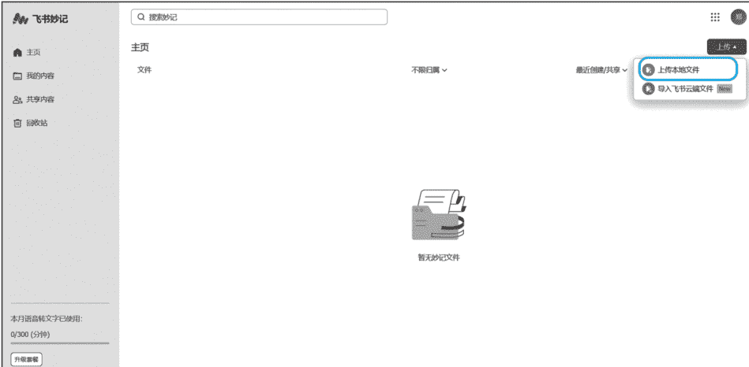

图2-2 飞书妙记主界面

- 2）标记发言人（如果工具支持），避免后期分不清谁说了什么。
- 3）导出带时间标记的文本，方便查找重点内容。

当然，转写内容并不是百分百准确，需要先快速浏览，修正明显的识别错误（比如把“Kubernetes”识别成“酷伯耐特”）。

## 2. 第二步：腾讯元宝提炼—从杂乱文字到结构化纪要

有了文字稿，接下来让腾讯元宝当你的“会议秘书”。核心技巧在于精准指令设计，你可以将上一步转写完成的会议文字稿上传，并输入这个基础指令：“请将以下会议记录整理为结构化纪要，包含：①核心议题（不超过3个）；②关键讨论点（不超过4个）；③行动方案（用[负责人]+[具体行动]+[完成时间]格式）；④后续跟进（用[部门]+[跟进事项]+[DDL]格式）。”

上传后等待一段时间，腾讯元宝会生成一份带重点、分工和时间的初稿。

如果你对生成的内容有进一步的要求，也可以进一步提问，如：

- 技术会议：追加“把架构设计的讨论整理成对比表格，列出每个方案的优缺点”。
- 部门争论：要求“请列出各部门的争议点”。
- 领导发言：指定“提取总经理讲话中的3个战略级关键词”。

例如，针对某产品会议，腾讯元宝将散乱的讨论“我觉得A功能优先级更高”“但B功能客户反馈更多”自动归纳为：

【争议点】功能优先级排序

- 支持A方：技术实现快（后端组张某）。
- 支持B方：客户需求强烈（市场部李某）。

【决策】待数据补充后二次讨论（负责人：……；DDL：本周五）。

## 3. 第三步：人工点睛—让腾讯元宝的产出烙上你的专属印记

腾讯元宝再强，也需要补充人类的智慧：

- 1) 加入现场观察：比如“设计组特别强调的用户体验问题录音没录清楚，需单独确认”。
- 2) 使用熟悉的说法：比如把“系统架构升级”改成大家常说的“凤凰涅槃方案”。
- 3) 读起来更自然：比如在紧张的时间安排后加一句“这个时间比较赶，建议先和测试组沟通”。

## 4. 总结

好的会议纪要不是一字不差地记录，而是抓住重点、明确行动。用语音转文字解决“记录”问题，用腾讯元宝解决“整理”问题，最后用你的专业判断解决“为什么重要”的问题。

#### 试一试

- 1) 用语音工具转写5分钟会议录音。
- 2) 向腾讯元宝输入：“提取3个关键决策，并按‘问题-结论-行动项’的格式输出。”
- 3) 对比腾讯元宝生成的初稿和你平时的手写纪要，观察差异点。

#### 小贴士

- 1) 重要会议建议使用本地语音转写工具，更安全。
- 2) 给腾讯元宝的指令越像“教新人”，效果越好。
- 3) 重要纪要保留“现场备注”栏，补充录音外的信息。

## 技巧19

## 市场调研：用腾讯元宝把数据“沼泽”变成决策“金矿”

市场调研最讽刺的地方在于：明明要帮企业看清市场，自己却总在数据迷雾里打转。Excel表格堆成山，竞品报告摞成墙，最后交上去的分析却总被说“没戳中痛点”。当你终于理出头绪时，发现隔壁组用腾讯元宝做的报告已经通过审批并开始执行了。

别担心，腾讯元宝能帮你从“数据收集员”升级为“商业侦探”—它不会替代你的思考，而是让你的分析更敏锐、更高效。以下是3个让数据“开口说话”的实战技巧。

## 1. 靶向提问：从“大海捞针”到“精准钓鱼”

传统调研就像在超市里盲目采购，最后可能买了一堆用不上的东西。面对海量数据时，腾讯元宝的“三层漏斗提问法”可以帮助我们精准锁定目标。假设你要分析新能源汽车市场，别急着向腾讯元宝输入一堆年报数据。先建立问题层级：“你作为资深汽车行业分析师，请用‘宏观-中观-微观’框架处理以下问题。①宏观趋势：政策补贴退坡对2024年市场增速的影响幅度。②中观竞争：TOP3品牌在30万价位段的配置的差异。③微观用户：二胎家庭选购电动车的5个关键决策因子。数据来源：[附上清洗后的结构化数据]。要求：每个层级结论必须附带可执行的策略建议。”

效果对比：

普通提问得到的是“市场规模将达××亿”的通用话术，而分层提问会得到：针对宏观趋势，对车企端、产品端、政策端的策略建议；针对中观竞争，对各品牌的策略建议；针对微观用户，对产品设计、服务包、金融方案的策略建议。

## 2. 动态追踪：让静态数据“长”出时间线

市面上的分析报告大多数只会描述已经发生的现象。如果想从历史数据中发现未来趋势，可以用腾讯元宝看穿数据背后的演化逻辑。试着输入：“请将这份2020—2024年护肤品电商数据转化为动态分析。①找出3个正在形成的消费新习惯（需标注早期信号节点）；②预测2025年可能被颠覆的2个传统营销假设；③用‘萌芽期-加速期-爆发期’框架绘制趋势曲线。关键指标：[GMV、复购率、客单价、新客占比]。”

腾讯元宝不仅能识别新消费习惯及其信号节点，还能预测2025年可能颠覆的传统营销假设，同时给出Markdown格式的趋势发展曲线。

## 3. 反事实推演：给结论装上安全气囊

大多数市场预测都像在晴天卖伞—等真的下雨早被淋透了。如果想验证商业计划的抗风险能力，可以向腾讯元宝设置极端条件，然后测试计划的韧性。试着输入：“假设你是某奶茶品牌的市场总监，请对这份扩张计划进行3种极端情况测试。①如果水果原料价格突然上涨30%；②如果竞品在目标城市提前推出相似产品；③如果年轻人突然抵制“健康概念”营销。要求：每种情况给出1个防御方案和1个逆转策略。原始方案：[粘贴现有规划]。”

腾讯元宝不仅能给出供应链、差异化、敏捷切换等方面的防御方案，还能给出价值重构、反向狙击、人设重构等方面的逆转策略。

## 4. 总结

真正的市场调研不是数据复读机，而是用AI放大人类的商业嗅觉。腾讯元宝在这里扮演3个角色：显微镜（看清细节）、望远镜（发现趋势）、CT机（诊断风险）。

#### 试一试

针对你所在的行业，用这个模板向腾讯元宝提问：“作为[行业]分析师，请用‘宏观-中观-微观’框架回答：当前最大的市场变量是什么？头部3个玩家的核心差异是什么？我们的用户最想解决的3个痛点是什么？”

#### 小贴士

- 1) 清洗数据时保留“异常值”，这可能是重大发现的线索。
- 2) 给腾讯元宝设定的角色越具体越好。
- 3) 所有预测结论必须附带置信度。

## 技巧20

## 论文撰写：用腾讯元宝写出教授认可的论文

论文撰写像跑一场孤独的马拉松—查文献时被海量资料淹没，写框架时纠结逻辑漏洞，改格式时被参考文献“逼疯”。更可怕的是，论文可能会被审稿人给出这样的意见：“理论依据不足”“文献综述太浅”“数据分析方法存疑”。明明看了30篇文献，文档里却只写出3行干巴巴的论点，这种痛苦每个写过论文的人都懂。

如何让腾讯元宝既帮你省时间，又能输出符合学术规范的论文？以下是经过验证的四步法，涵盖从选题到润色的全流程。

## 1. 步骤一：锁定有价值的研究选题

在学术研究和内容创作中，选题往往面临两难困境：自主构思的题目要么过于宽泛难以深入，要么是已被反复研究的陈旧话题；而AI推荐的选题虽然看似合理，却常常流于表面，缺乏创新性和实际价值。这种“博而不精”或“正确但无用”的选题困境，不仅浪费研究者的时间，更可能影响最终成果的质量和影响力。

解决方案是让腾讯元宝结合“研究热点+争议点+你的专业背景”，生成真正可行的选题。例如输入：“我是[××专业]，研究方向是[××领域]。请根据我上传的论述数据，推荐5个创新且可行的论文选题，要求：①结合以下论文的研究趋势；②每个选题需说明‘研究空白’和‘可能的创新点’；③避免过于宏观或技术门槛过高的题目。数据来源：[附上相关论文数据]。”

以环境科学领域的微塑料污染治理为例，腾讯元宝可能会输出：

1. 选题名称：基于智能手机图像识别的淡水水体微塑料快速检测技术开发
   - （1）研究空白：现有检测方法依赖昂贵光谱仪器（>80%文献采用），缺乏适用于野外调查的便携式方案。
   - （2）创新点：结合纳米材料显色反应与手机App算法开发，检测成本可降低92%。
   - （3）技术门槛：采用成熟的图像识别框架（如YOLOv5）进行二次开发。

2. 选题名称：厨余垃圾处理厂排水系统中的微塑料赋存特征与去除工艺优化
   - （1）研究空白：现有研究聚焦海洋环境（占比67%），忽视垃圾处理厂的“陆地-水体”传输枢纽作用。
   - （2）创新点：首次建立处理工艺参数与微塑料去除率的剂量响应模型。
   - （3）数据支撑：可通过处理厂进出水采样获取独家数据集。

3. 选题名称：社交媒体舆情数据驱动的微塑料污染风险感知时空演变研究（略）

4. 选题名称：基于废弃生物质的磁性吸附材料制备及其对纳米级微塑料的捕获机制（略）

5. 选题名称：流域尺度下微塑料-抗生素复合污染对底栖生物的协同毒性阈值研究（略）

如果AI给的选题太宽泛，可以追加提问：“这个选题在[具体细分场景]的应用可能性有哪些？”另外，可以用Connected Papers等工具验证AI推荐的文献是否真实存在，避免陷入“虚构参考文献”的坑。

## 2. 步骤二：生成逻辑严谨的论文大纲

在学术写作或商业报告撰写过程中，研究者常常陷入大纲设计的困境：要么遗漏了关键的分析维度（如文献综述缺失或方法论不完整），要么各章节之间缺乏逻辑递进性，导致最终成文结构松散、论证乏力。这种“模块缺失”和“逻辑断裂”的问题，不仅影响文章的专业性和说服力，更会阻碍研究价值的充分展现。

可以让腾讯元宝按标准学术结构生成大纲，并确保每一部分解决明确的问题。以实证论文为例，输入：“请生成一篇关于‘×××主题’的论文大纲，需包含以下部分：①研究背景与意义（需说明现实痛点+理论价值）；②文献综述（按‘支持派/反对派/中立派’分类，并指出争议点）；③研究方法（定量/定性/混合，说明数据来源与分析工具）；④结果与讨论（需对比已有研究，解释差异原因）。⑤要求：每个子标题后附上‘该部分需解决的核心问题’。”

腾讯元宝可能会这样来答复你：

> “论文大纲：关于×××的研究。①研究背景与意义（核心问题、现实痛点、理论价值）；②文献综述（核心问题、支持派的观点、反对派的观点、中立派的观点以及研究的缺口）；③研究方法（核心问题、定量分析、定性分析以及创新点）；④结果与讨论（核心问题、关键发现、与已有研究的差异和理论贡献）；⑤结论与建议（核心问题、实践意义、局限及未来方向）。”

你可以追加提问，对大纲的合理性进行检查：“请检查大纲是否存在逻辑漏洞，比如‘研究方法’是否真的能回答‘研究问题’？”

另外，如果AI建议有误，比如用ANOVA分析分类变量，可以直接追问：“是否有更合适的统计方法？”

## 3. 步骤三：高效整理文献综述

在文献综述写作中，研究者很容易陷入资料堆砌的困境：虽然阅读了大量文献，却只是机械地罗列前人的观点（如“A学者认为……B学者提出……”），既没有揭示不同研究之间的理论演进关系，也缺乏对研究方法、结论局限性的深度剖析。这种“文献列表”式综述，本质上反映了研究者尚未建立自己的分析框架，无法从更高维度整合现有研究成果。

可以让腾讯元宝帮你分类+对比+找冲突，而不仅仅是罗列观点。例如输入：“总结以下论文关于‘×××主题’的国内外研究，按以下框架整理：①支持派（3篇代表文献+核心论点）；②反对派（3篇代表文献+反驳依据）；③争议焦点（目前学界未达成共识的部分）；④请结合这些争议，提出2～3个可能的研究方向。数据来源：[附上相关论文数据]。”

如果综述太过宽泛，可以限定范围：“聚焦[××研究方法/××特定人群]的相关研究。”

## 4. 步骤四：从大纲到初稿的“填充术”

明明有了清晰的论文框架，但落实到具体章节时，却陷入“对着空白文档发呆”的窘境。究其原因，往往是大纲停留在标题层面，缺乏对每个模块核心论点的深度拆解。而直接使用AI生成的内容，又常常陷入“正确的废话”陷阱—看似逻辑完整，实则缺乏专业深度和实证支撑。

解决方案是分模块扩写，并人工注入关键细节，如具体数据、个人分析。具体操作可分三步：首先列出“论点树状图”，将每个章节拆解为“核心论点+支撑证据+学术对话”的写作单元，如在文献综述中梳理理论演进脉络并标注关键转折点；其次运用AI工具的“深度追问”功能生成争议性观点，同时人工注入最新领域数据；最后通过“学术术语强化”将口语化表达转化为规范论述。这种方法既避免了AI内容的空泛，又突破了个人思维的局限，实现从框架到内容的有机衔接。

以“研究方法”部分为例，你可以输入：“请根据以下大纲扩写‘研究方法’部分。①研究设计：[你的设计类型，如问卷调查/实验]；样本选择：[具体样本量、抽样方法]；数据分析工具：[SPSS/Python等]。②要求：避免教科书式定义，直接说明‘本研究如何操作’；在‘信效度检验’部分加入我们实际采用的策略。”

最后可以在AI生成的初稿上，手动添加个人观察，如：“通过实验发现，问卷第3题受访者误解率较高，故调整了表述。”

### 5. 总结

用腾讯元宝写论文的核心原则是：①让它做结构化工作（选题推荐、大纲生成、文献分类）；②你负责深度思考（判断选题价值、修正AI错误、注入个人分析）。最终成果应该是“AI搭骨架，你填血肉”，既高效又能保持学术严谨性。

#### 试一试

- 1) 用“选题提示词”让腾讯元宝生成3个备选题目，挑1个用Connected Papers验证。
- 2) 选一篇已读文献，用“文献综述模板”让AI分析观点，看看能否发现新争议点。

#### 小贴士

- 1) 重要！永远记得用学术数据库验证AI引用的文献，避免“虚构参考文献”事故。
- 2) 在“讨论”部分手动加入2～3句对结果的主观解读（如“这一发现可能源于……”），提升“人味”。
- 3) 如果AI反复推荐错误方法（比如用ANOVA分析分类变量），直接说：“请重新评估，是否有更合适的统计方法？”

## 技巧21

## 领导讲话稿：让腾讯元宝扮演领导的专职文秘

写领导讲话稿最怕两件事：一是写了三小时文档还空白，二是改了八稿还是要“重写”。其实用腾讯元宝这样的AI辅助写作，完全可以做到一小时出初稿、三小时定终稿。下面介绍写领导讲话稿的“三步成稿法”，从接到任务到最终交付，手把手带你走完全流程。

### 1. 第一步：5分钟明确核心需求

在收到写领导讲话稿的任务时，千万别直接开写。先用腾讯元宝快速厘清三个关键问题：一是分清场合性质，是动员会、总结会，还是仪式致辞？二是厘清听众画像，听众是中层干部、一线员工，还是外部合作伙伴？三是整理核心信息，要宣布政策、统一思想，还是要表扬批评？例如，当你收到关于智能工厂建设动员会的讲话稿任务时，可以开启联网搜索模式，并输入：“你是有10年经验的秘书，刚接到为制造业CEO写‘智能工厂建设动员会’讲话稿的任务。请生成：①该场合必须包含的3类内容（如行业趋势/公司短板/行动指标）；②针对生产部门听众的2个说服技巧；③需避免的3种表述（如避免直接批评基层）。”

腾讯元宝可能会输出：

## 一、讲话稿必须包含的3类内容

### 1. 行业趋势与政策导向

（1）结合当前制造业智能化转型的全球趋势（如工业互联网、5G、数字孪生等技术应用）及国家政策支持（如“十四五”规划对智能制造的部署），强调智能工厂是提升企业竞争力的核心路径。

（2）引用行业标杆案例（如比亚迪、富士康的智能工厂成效），说明生产效率提升30%、成本降低20%等行业数据，增加紧迫感。

### 2. 公司战略定位与目标

（1）明确企业智能化升级的战略意义，如“从传统制造向世界一流清洁能源化工企业转型”的愿景，并量化目标（如“生产效率提升30%”“产品合格率99.5%”）。

……

## 二、针对生产部门听众的2个说服技巧（略）

## 三、需避免的3种表述（略）

（由于篇幅有限，输出结果在此省略，建议读者亲自上手实践。）

你可以通过腾讯元宝的分析找到领导和听众的诉求，据此整理讲话稿素材。

### 2. 第二步：15分钟搭建框架

有了原始的素材，接下来就是搭建讲话稿的框架。讲话稿最忌结构混乱，所以用腾讯元宝生成“三段式逻辑框架”，可以确保囊括领导想说的话，且层层递进。例如可以在上一步的对话中接着输入提示词：“按以下结构生成讲话稿详细提纲：①形势分析（行业+内部，数据支撑）；②核心决策（不超过3个关键动作）；③落实要求（分工+时间线+奖惩）。要求：每部分用‘总-分-总’句式，标注数据引用位置。”

腾讯元宝可能会输出：

## 一、形势分析（总-分-总，数据支撑）

1. 总述：当前行业智能化浪潮势不可挡，公司面临“不进则退”的生存挑战，必须抓住转型窗口期。

2. 分述：

（1）行业趋势（外部压力）（略）

……

3. 总结：智能化不是“选择题”而是“生存题”，必须用技术升级破解效率、质量、成本三重困局。

## 二、核心决策（总-分-总，3个关键动作）（略）

## 三、落实要求（总-分-总，分工+时间线+奖惩）（略）

（由于篇幅有限，输出结果在此省略，建议读者亲自上手实践。）

### 3. 第三步：30分钟填充内容

有了框架后，可以用腾讯元宝批量生成“可直接用”的段落，重点解决三大难题：①数据不会找，让AI标注可信来源；②案例不会写，让AI生成内部故事；③金句不会编，让AI模仿领导风格。

例如，需要撰写核心决策中的某个动作，可以接着在同一个对话中提问：“根据以下要求具体撰写第二部分‘流程重构：数据驱动精益生产’：①每项行动配1个标杆案例（如：借鉴××公司经验）；②插入3处动员金句（模仿任正非‘炸掉金字塔’风格）；③关键数据用[]标出，需人工核对。”

腾讯元宝可能会输出：

1. 行动一：全链路数据整合，打破“信息孤岛”。

（1）标杆案例：学习美的集团T+3模式，通过打通销售、生产、物流数据，将库存周转率从[每年8次]提升至[12次]，减少资金占用[30%]。

（2）具体动作：

3个月内打通ERP、MES、仓储系统，消灭[20个]数据断点（需IT部与生产部联合攻坚）。建立“数据日清日结”制度，每日生产会议必须用实时看板说话。

> 动员金句：“谁捂着数据不交，谁就是流程的叛徒！”

2. 行动二：智能调度中心建设，向“人脑经验”开炮（略）

3. 行动三：供应商协同平台，逼出“链主”话语权（略）

（由于篇幅有限，输出结果在此省略，建议读者亲自上手实践。）

需要注意的是，每一个部分都要通过这种方式逐一生成，最好不要一次性生成讲话稿全文，以提高每个部分的精准性。具体提示词需要你根据实际情况进行修改。

完成初稿后，别忘了使用前文介绍的技巧13，去掉稿件的AI味，最后再由AI+人工审对，形成终稿。

## 4. 总结

这套方法把写稿拆解为明确需求→搭框架→填内容3个标准化步骤，让腾讯元宝当你的“副驾驶”，你只管把控方向。

#### 试一试

向腾讯元宝输入：“你是某银行分行行长秘书，需要写‘普惠金融业务推进会’讲话稿，听众是支行长。请生成：①3个必讲数据；②2个竞争对手对比案例；③1句能引发掌声的结尾。”

#### 小贴士

- 1) 紧急时用“请用‘问题-方案-结果’结构重写这段话”快速优化段落。
- 2) 遇到领导说“没亮点”时，追加指令：“加入1个跨界案例（如互联网+制造业）。”
- 3) 把领导过往的讲话稿发给腾讯元宝，输入“请模仿以下风格：……”让其生成新稿。

## 第3章

## PPT创作：用腾讯元宝优化PPT创作与汇报

## 技巧22

## 一键生成PPT：用腾讯元宝和Kimi四步搞定PPT

职场人可能会经历过这样的时刻：工作到半夜还在绞尽脑汁地盯着电脑屏幕，把第五版PPT的标题从“项目汇报”改成“战略规划”又改回“项目汇报”。内容像拼贴画一样杂乱，设计风格在“极简”和“花哨”之间反复横跳，最可怕的是那句“明天早上我要看到终版”。

别慌，用腾讯元宝+Kimi这套组合工具，你能把PPT制作从“熬夜炼狱”变成“下午茶时间”。以下四步是制作PPT的具体方法。

### 1. 第一步：用腾讯元宝生成PPT大纲

当你需要用腾讯元宝快速搭建PPT内容框架时，可以使用以下指令：“作为资深商业分析师，请用Markdown格式生成关于[智能家居市场前景]的PPT内容框架，要求：①封面页：提供3种主标题方案，突出‘机遇’或‘挑战’不同视角。②核心部分：采用‘问题-证据-结论’结构（如：消费者真正需要什么→用户调研数据→需求匹配度分析）。③数据呈现：标注5个关键数据点及其可视化建议（如‘市场增长率用动态柱状图展示’）。④结尾页：设计2种收尾方式（行动呼吁型/开放讨论型）。特别注意：避免使用‘行业概况’等泛泛而谈的小标题。”

腾讯元宝可能会输出：

```
#智能家居市场前景分析框架

##封面页方案（三选一）
```

### ###机遇视角

- 1. **“智能家居：万亿蓝海市场的增长密码”**
（副标题：2025年生态价值重构路线图）
- 2. **“从单品智能到全屋互联：家居革命的黄金窗口期”**
（背景图建议：智能家居场景概念图+数据流动可视化）

### ###挑战视角

- 3. **“智能家居：如何突破用户接受度的隐形天花板？”**
（警示图标+用户痛点关键词云）

……
（由于篇幅有限，输出结果在此省略，建议读者亲自上手实践。）

### 2. 第二步：设计视觉效果

PPT框架内容还缺少视觉效果设计？配色像番茄炒蛋、排版像电线杆小广告？腾讯元宝能提供专业的设计建议。接着上一步追问：“请为上述智能家居市场前景分析PPT提供详细设计规范：①整体风格：选择‘专业科技感’方向。②配色方案：主色+辅色+强调色代码（如#2A5C82代表行业稳定性）。③字体组合：标题/正文字体推荐及使用场景说明。④版式建议：不同内容类型的最佳布局（数据页/对比页/案例页等）。⑤可视化技巧：特别标注3个最适合动态展示的数据点。附加要求：所有设计选择需附带商业场景解释（如‘深蓝色系增强可信度’）。”

腾讯元宝可能会输出：

## 智能家居市场前景分析

## 一、封面与引言设计

### （一）封面设计

#### 1. 风格定位

整体风格：专业科技感，营造出智能家居的高科技与未来感，符合目标受众对智能家居前沿领域的期待，展现演讲的专业性与权威性。

#### 2. 配色方案

主色：#2A5C82（行业稳定性），深蓝色系增强可信度，传递出智能家居行业稳定发展的趋势。

......

#### 3. 字体组合（略）

#### 4. 版式建议

数据页：采用“一图一表一文”布局。左侧为清晰的图表或柱状图，展示如“2021—2025 CAGR 24.7%”等关键数据；中间搭配简洁的表格，标注数据来源与对比维度；右侧用简短文字阐述数据意义，聚焦受众的主要关注点，方便其快速理解数据背后的价值。

对比页：左右分割对比式设计。左侧呈现一种情况，如“Z世代技术采纳率”，右侧对应“银发族技术采纳率”，中间用直观的箭头或图表展示差异达41%，对比鲜明，瞬间抓住受众注意力，直观呈现差异。

（由于篇幅有限，输出结果在此省略，建议读者亲自上手实践。）

这里腾讯元宝不仅给出PPT框架，还贴心地给出配色方案、字体组合及关键页面的版式建议，帮我们把细节设计的时间都省了。

### 3. 第三步：个性化调整

有了基本框架，还需要个性化调整具体的细节。最糟糕的PPT是那种一看就知道“不是人做的”—逻辑完美但毫无个性。解决方法是在关键节点加入“人为痕迹”，在PPT框架中加入你的特色，例如输入：
“请优化已生成的PPT框架，加入以下人性化元素：①在市场竞争分析页添加‘这个发现验证了……提出的……策略’；②在转折页插入演讲提示，如‘此处停顿等待反馈’；③为复杂数据页添加2条通俗类比（如‘这个增长率相当于每天新增1个万达广场’）。特别注意：所有个性化内容用[]标出以便识别。”

这种操作的精妙之处在于：腾讯元宝负责确保专业度，你负责添加场景感。最终的设计框架既有机器的高效，又有人类的温度。

### 4. 第四步：一键生成PPT

通过以上步骤，腾讯元宝生成了PPT框架，接着我们借助Kimi的PPT助手一键生成PPT。生成方式是：在Kimi主界面依次单击“Kimi+”→“PPT助手”，进入PPT助手，然后将上一步完成的PPT大纲粘贴到此处并单击发送图标，待Kimi整理好最终的大纲后，单击“一键生成PPT”按钮，选择模板后单击“生成PPT”按钮，单击“下载”按钮即可得到你想要的PPT；在生成PPT后也可以单击“去编辑”按钮，微调字体、格式、布局等，保存后单击“下载”按钮即可。操作示意如图3-1所示。

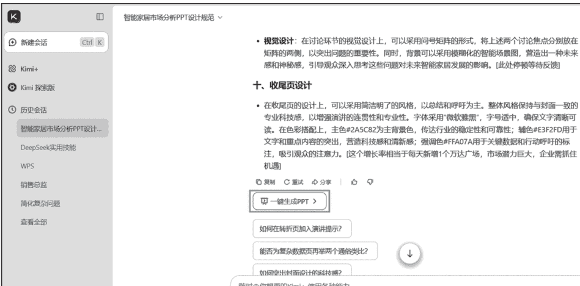

▲图3-1 一键生成PPT→选择模板创建PPT→直接下载或编辑后下载 (PC端)

热门推荐

选择模板创建PPT

历史模板

场景： 全部 总结汇报 教育培训 医学医疗 营销推广 商业计划 高校专区 企业介绍 党政宣传 自我介绍 分析报告

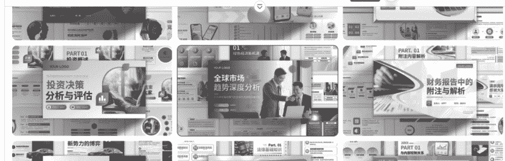

PPT预览

PPT制作已完成！


去编辑

下载

智能家居市场前景分析

保存

放映

拼图

下载

（一）封面设计

下载

文件类型

PPT

大纲编辑

文字可编辑

模版替换

下载

背景设置

插入元素

图片设置

1. 风格定位

2. 配色方案

3. 字体组合

4. 版式建议

表格设置

整体风格：专业科技感，营造出智能家居的高科技与未来感，符合目标受众对智能家居前沿领域的期待，展现演讲的专业性与权威性。

图表设置

幻灯片 4 / 31

100% +

▲图3-1（续）

下载到本地的PPT，可以继续微调，直到满足你的需求。

### 5. 总结

真正的PPT高手不是设计专家，而是会指挥AI的导演。腾讯元宝是你的编剧（内容架构），Kimi是美术指导（视觉设计），而你要做的就是当总导演（决策把关）。记住，观众永远会为“清晰的思想+舒适的视觉+人性的温度”买单。

#### 试一试

用腾讯元宝生成一份述职报告框架，重点突出“决策影响”而非“工作内容”，并让Kimi生成PPT。

#### 小贴士

- 1）对于行业报告类PPT，保留少量专业术语会更可信。
- 2）对于培训类PPT，每10页插入讨论提示，具体详见技巧27。
- 3）对于终版PPT，用“演讲者视图”检查每页停留时间是否合理。

## 技巧23

## PPT文字瘦身：三招让腾讯元宝实现精准表达

当PPT被客户评价为“重点不突出，观众会在第三页睡着”，当主管在批注栏里写下“文字太多，像在读论文”，你可能会觉得很无奈：明明是为了传达信息，却因为大段文字让观众失去耐心。更糟糕的是，时间紧迫，既没有专业设计师支援，也腾不出足够的时间精修文档，只能硬着头皮上。

这种困境并非个例。在职场中，许多人会为如何让PPT内容更简洁、更吸引人而苦恼。当文字密度过高，观众的注意力就会显著下降，甚至直接跳过关键信息。如何在有限的时间内制作出既高效又专业的PPT？以下三招可以帮助你打破这种困境，让PPT不再成为职场中的“负担”。

### 1. 第一招：信息精简化

删减文字就像整理行李箱，关键是留下必需品。面对大段文字时，先让腾讯元宝扮演“毒舌编辑”的角色。例如输入：“请将以下文字浓缩为3个核心观点，每个观点不超过15字，用箭头符号连接：‘我们的市场调研显示，目标用户群体中25～35岁女性占比达到68%，其中63%的人表示现有产品包装不符合审美需求。在价格敏感度方面，超过半数的受访者认为当前定价超出心理预期，但竞品分析显示同类产品均价比我们高12%。建议采取差异化营销策略……’”

腾讯元宝可能会输出：

目标用户：25～35岁女性占比68%→产品包装：63%不符合审美需求→价格策略：半数认为定价高，竞品均价高12%。

将这段精简后的文字放入PPT中，并进行简单的排版，你会发现页面清爽不少。

### 2. 第二招：逻辑可视化

当遇到流程说明或数据对比时，立即启动“图形翻译器”。尝试输入：“把这段项目推进计划转化为时间轴+甘特图文字框架。第一阶段需求调研需要2周，期间要完成用户访谈和竞品分析。第二阶段原型设计预计3周，包含3次内部评审。第三周进入开发测试，注意预留1周缓冲期……”

腾讯元宝可能会生成如图3-2所示的可视化方案。

| 阶段 | 任务 | 第1周 | 第2周 | 第3周 | 第4周 | 第5周 | 第6周 |
|---|---|---|---|---|---|---|---|
| 需求调研 | 用户访谈 | ████ | ████ | | | | |
| 需求调研 | 竞品分析 | ████ | ████ | | | | |
| 原型设计 | 原型设计 | | | ████ | ████ | ████ | |
| 原型设计 | 内部评审（3次） | | | ████ | ████ | ████ | |
| 开发测试 | 功能测试 | | | | | | ████ |
| 开发测试 | 性能测试 | | | | | | ████ |
| 开发测试 | 安全测试 | | | | | | ████ |

图3-2 腾讯元宝生成的可视化方案：甘特图

### 3. 第三招：金句生成器

金句是重要的记忆点，每页都需要有一个让人眼前一亮的观点。试着输入：“基于以下销售数据，创造3个具有冲击力的表达句式，要求：包含对比数字、使用动词、不超过20字。原始内容：本月销售总量达12000件，较上月增长18%。其中：产品A以4500件的销量位居榜首，占销售总量的37.5%；产品B和C紧随其后，分别销售3800件和2700件，共同推动整体业绩上扬。各区域销售均衡发力，华北区以35万元营业额领先，华东、华南区紧追不舍，市场活力持续迸发。”

腾讯元宝可能会输出：

- 1. 销量飙升18%破12000件！（12字）
解析：用“飙升”强化增长动能，18%与绝对值形成双重冲击。
- 2. A产品领跑，4500件狂揽37.5%！（13字）
解析：动词“狂揽”突显市占统治力，精确呈现核心产品贡献度。
- 3. 华北35万领跑，华东华南紧追！（12字）
解析：地域竞争态势可视化，动词“领跑+紧追”营造竞赛氛围。

你可以把这些金句直接放入PPT中，也可以作为你的演讲内容输出。无论哪种方式，都能为你的汇报增色。

## 4. 总结

职场PPT制作的核心痛点在于平衡信息完整性与视觉友好度。巧用腾讯元宝，可以快速识别并提炼文档中的关键逻辑链，将冗长段落压缩为有逻辑的短句组合，有效降低文字密度；也可以将大段的文字转化为时间规划、数据对比等内容，生成适配的甘特图、流程图框架，省去手动绘制图表的时间成本；还可以通过抓取核心数据与动作词汇，自动产出简洁有力的观点，强化页面记忆点。

当我们在PPT中应用这些AI技巧时，实质是在进行认知维度的提升：从关注文档的完成度，转向关注观众的认知能耗；从满足自我表达欲，转向设计信息接收路径。腾讯元宝在此过程中不仅是效率工具，更是思维进化的催化剂——它用算法逻辑倒逼人类突破经验局限，在职场沟通的战场上，完成从信息搬运工到认知架构师的蜕变。

#### 试一试

将你最近制作的PPT中某段300字说明文输入腾讯元宝，使用指令：
“请将以下文字浓缩为3个核心观点，每个观点用‘动词+数字+结果’结构，用→符号连接：[需要浓缩的文字]。”

将浓缩后的观点再次输入，追加指令：“将每个观点转化为疑问句，引导观众思考。”

#### 小贴士

- 1) 用腾讯元宝生成PPT后，手动添加1个“人性化元素”，比如“手写体标注/趣味图标/温度故事”。
- 2) 数据显性化：保留百分比、排名、对比值等决策相关数字，用色块单独标注。
- 3) 检查标准：确保每页文字扫描时间≤7秒。

## 技巧24

## PPT配图：用腾讯元宝+Napkin把长篇大论变成高级图片

季度报告、产品文档、会议纪要……如果只是搬运文字，手工总结内容放入PPT中，很难变成让人一眼看懂的可视化内容。即使想“画”出来，多数人只会复制粘贴到PPT里加个矩形框——这不是图表，只是文字换了个地方。

用腾讯元宝+Napkin组合拳，可以实现文字→结构→图表的高效转化。全程不需要设计技能，甚至不用离开浏览器。

### 1. 第一步：让腾讯元宝整理大段文字

原始文本常混杂背景描述、细节数据、冗余案例，如果直接生成图表会产生信息垃圾，所以首先需要用指令要求腾讯元宝对大段的信息进行整理。例如面对产品文档时输入：“请将以下产品开发文档提炼为三层核心架构：①关键阶段（按时间轴简化为3～5个节点）；②决策要点（每个阶段不超过3个核心决策）；③输出成果（用动词+名词短语表示，如‘完成原型测试’）。要求：用Markdown层级列表呈现，删除所有形容词和案例细节。[真实的产品文档]”

腾讯元宝可能会输出：

## 产品开发三层核心架构

- 1. 关键阶段
  - (1) 调查研究与概念形成阶段
  - (2) 产品设计与技术验证阶段
  - (3) 试制鉴定与生产准备阶段

### 2. 决策要点

- (1) 调查研究与概念形成阶段
  - 1) 确认市场需求与用户痛点。
  - 2) 筛选产品构思并形成具体概念。
  - 3) 评估技术可行性与资源匹配度。
- (2) 产品设计与技术验证阶段
  - 1) 确定产品功能与性能指标。
  - 2) 选择技术方案与核心架构。
  - 3) 验证设计质量与工艺可行性。
- (3) 试制鉴定与生产准备阶段
  - 1) 评估试制结果与质量达标情况。
  - 2) 确定生产计划与资源分配。
  - 3) 制定市场推广与销售策略。

### 3. 输出成果（略）

> (由于篇幅有限，输出结果在此省略，建议读者亲自上手实践。)

### 2. 第二步：用Napkin一键视觉化

即使有了结构化文本，传统PPT工具仍需手动选择图表类型、调整版式。而Napkin可以实现一键视觉化。首先进入Napkin官网（https://www.napkin.ai），单击右上角的Sign in按钮进入登录页面，输入登录邮箱、密码即可完成登录，如图3-3所示。如果没有账号，可以用邮箱注册，单击Sign up按钮进入注册页面，输入名字、邮箱、密码后，Napkin会发送验证信息到你的邮箱中，验证邮箱信息后即可完成注册，如图3-4所示。

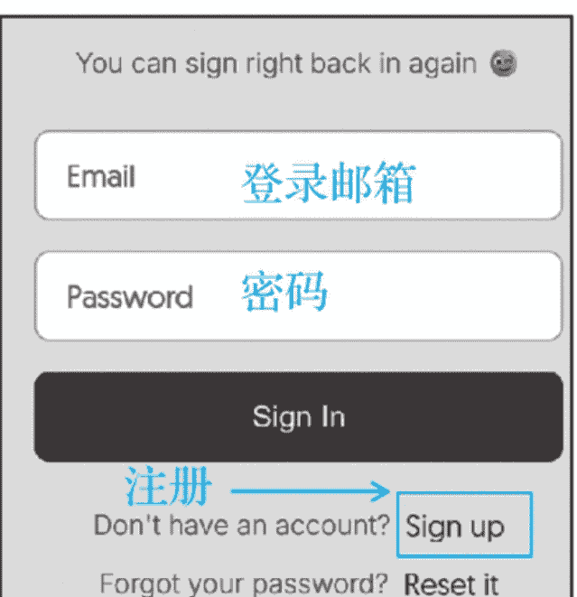

▲图3-3 Napkin登录页面

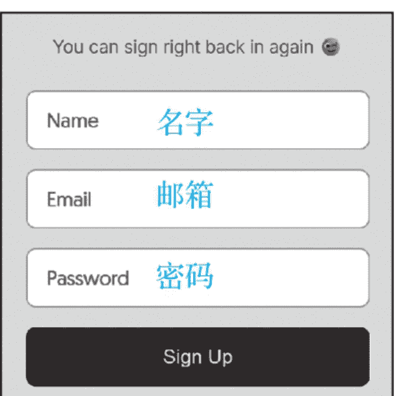

▲图3-4 Napkin注册页面

注册完成后，即可进入编辑界面。将上一步生成的文案粘贴到编辑界面中，如图3-5所示，选择要转化为图表的部分，单击左侧的闪电图标即可生成多种图表方案，如图3-6所示。

- 1. 关键阶段
  - (1) 调查研究与概念形成阶段
  - (2) 产品设计与技术验证阶段
  - (3) 试制鉴定与生产准备阶段
- 2. 决策要点
  - (1) 调查研究与概念形成阶段
    - 1) 确认市场需求与用户痛点
    - 2) 筛选产品构思并形成具体概念
    - 3) 评估技术可行性与资源匹配度
  - (2) 产品设计与技术验证阶段
    - 1) 确定产品功能与性能指标
    - 2) 选择技术方案与核心架构
    - 3) 验证设计质量与工艺可行性
  - (3) 试制鉴定与生产准备阶段
    - 1) 评估试制结果与质量达标情况
    - 2) 确定生产计划与资源分配
    - 3) 制定市场推广与销售策略
- 3. 输出成果
  - 调查研究与概念形成阶段
    - 完成市场调研报告
    - 形成产品概念文档
    - 输出技术可行性分析[6,10][@ref]
  - 产品设计与技术验证阶段
    - 完成技术设计方案
    - 输出产品原型测试结果
    - 生成工艺验证报告[6,7][@ref]
  - 试制鉴定与生产准备阶段
    - 完成小批试制验收
    - 输出生产准备清单
    - 制定上市推广计划[6,7][@ref]

## ▲图3-5 上传文字至Napkin

## 产品开发过程

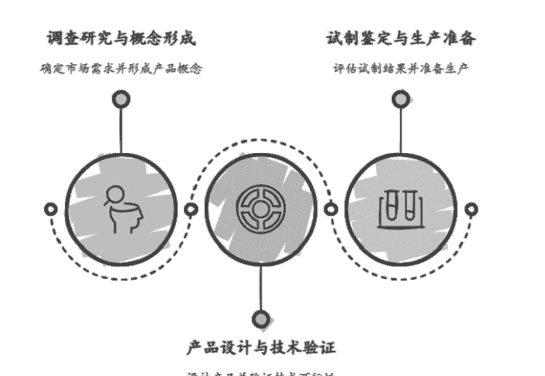

## 产品开发流程与关键决策

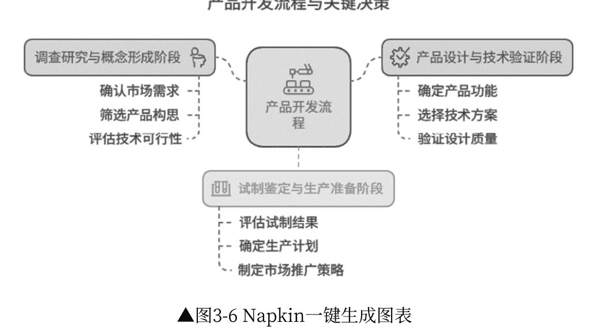

## ▲图3-6 Napkin一键生成图表

### 3. 第三步：调整图表内容

Napkin生成的图表均可按需调整，包括调整配色、文字内容，或直接添加文字内容。另外，在输出前也可以修改图片比例、背景颜色等。修改完成后，可下载该图表，接着上传至PPT的合适位置即可。

## 4. 总结

本节介绍的方法本质是让AI处理机械劳动：腾讯元宝解决逻辑萃取，Napkin承包视觉设计，人类只需做最终润色。比起学习工具，更重要的是掌握“下指令”的艺术——明确的层级要求、视觉偏好和用途说明，这直接决定了产出的质量。

#### 试一试

用本节提到的方法，将你的某一段文字变成PPT可视化图表。

#### 小贴士

- 1) 涉密文字不要上传至Napkin中。
- 2) 可以一次性让Napkin生成不同的方案，再按需选择。
- 3) 腾讯元宝整理的内容结构化程度越高，Napkin生成的图表质量就越高。

## 技巧25

## PPT标题：三招高效解锁PPT标题

每个做过PPT的人都知道，最煎熬的可能不是调格式、插动画，而是对着空白页顶端的标题栏发呆——PPT标题往往是观众最关注的点，你明明知道要表达什么，却写不出精炼有力的短句。当领导要求“每个板块标题都要有记忆点”时，大脑瞬间像被格式化的硬盘，连“年度总结”“项目进展”这种基础词汇都开始显得可疑。更痛苦的是，当需要批量产出20个页面标题时，创造力可能早已在第三个标题处耗尽。

这时候就该让腾讯元宝上场了。它不需要你具备文案天赋，也不用苦等灵感降临，只要掌握正确的“提问密码”，就能批量生产候选标题。

### 1. 招式一：关键词提炼法

好的封面要像电梯演讲——30秒抓住眼球，所以你的标题要包含关键信息，再根据这些信息进行排列组合。比如：你的关键词如果是“全球化”“环保”“科技”，那么标题就可以是“全球破局：AI驱动废弃物转化率+60%”；如果你的关键词是“教育”“AI”“个性化”，那么你的标题就可以是“AI破局：个性化教育提效30%实战路径”。

你要做的，就是把杂乱的信息点丢给腾讯元宝，让它帮你组合出专业标题。你可以向腾讯元宝输入：“请根据‘数字化’‘关怀’‘创新’生成5个PPT标题，要求：突出解决潜在受众的痛点问题，包含数字和成果指标，使用‘破局’‘进化’‘实战’等冲击性词汇，避免‘赋能’‘打通’等‘虚词’，15字以内。”

腾讯元宝可能会输出：

- 《数字化破局：关怀效率提升40%实战》
- 《创新实战：老龄群体覆盖率+90%数字方案》
- 《关怀进化：AI情绪识别准确率突破85%》
- 《数字破局：医患沟通成本缩减60%路径》
- 《创新进化：90秒完成紧急关怀响应系统》

当然，结果中的数字要根据实际情况来调整，不要直接照搬。

### 2. 招式二：结构指令法

当你知道标题需要包含哪些要素，却卡在表达方式时，可以直接给腾讯元宝出填空题。比如需要制作业务复盘PPT，先确定每个标题必须包含“问题定位+解决方案+数据结果”，再转化为向腾讯元宝提问的指令：“生成5个复盘类PPT标题，结构要求：①前半句用问句指出痛点（例如：为何老客户流失加速？）；②后半句用动宾结构展示解法（例如：三大留存策略验证）；③末尾括号补充关键数据（例如：试点门店续卡率+22%）。PPT大致内容：私域运营失效、新品推广周期过长、跨部门协作成本高，通过4大方法，使得门店私域销售额增加24%。”

腾讯元宝可能会输出：

- 《私域流量为何转化低迷？四维激活模型实战解析（首月GMV环比+24%）》
- 《新品上市为何屡屡滞后？敏捷推新机制全拆解（研发到上架周期压缩40%）》
- 《部门墙如何打破？三级协同作战体系构建实录（人效成本降低18%）》
- 《用户复购为何持续走低？会员生命周期管理新范式（30天复购率提升31%）》
- 《运营动作为何事倍功半？公私域联动打法深度复盘（全域ROI提升至1:5.6）》

### 3. 招式三：案例学习法

如果你手上有一些优质的PPT标题生成教程，那么恭喜你，腾讯元宝可以当你的“教程翻译官”，把纸上的方法论变成可执行的生成指令。你只需要上传你的教程，如《PPT封面标题5种解法》，向腾讯元宝输入：“请学习一下这篇文章中关于PPT封面标题的写法，为以‘传统制造业数字化转型路径’为主题的PPT，撰写一个吸引人的封面标题。”

腾讯元宝在学习完你的素材后，可能会输出：

- 1. 借用比喻修辞
  - (1) 传统制造业巨轮的数字化航线；(2) 传统制造业的数字化蝶变之路；(3) 传统制造业的数字化引擎
- 2. 借用疑问句式
  - (1) 传统制造业如何在数字化浪潮中突围？(2) 传统制造业的数字化转型密码是什么？(3) 传统制造业如何踏上数字化征程？
- 3. 客观描述演讲（略）
- 4. 展现时间进程（略）

（由于篇幅有限，输出结果在此省略，建议读者亲自上手实践。）

## 4. 总结

用腾讯元宝撰写标题的本质，是把人类从绞尽脑汁的思考困境中解放出来，聚焦内容逻辑。记住这个铁三角——甩原料（关键词）、定规则（结构公式）、学教程（优秀教程或案例），你就能获得既专业又不死板的标题库。

#### 试一试

在腾讯元宝中输入：“帮我把‘年度财务报告’改造成3个不同风格的PPT主标题，分别突出稳健、突破、创新关键词。”

#### 小贴士

- 1) 重要汇报标题保留人工微调环节，可以替换一两个词，让标题显得更自然。
- 2) 如果希望腾讯元宝生成的标题更有参考价值，不妨一次性多生成一些。
- 3) 腾讯元宝可能会模拟一些假的数据，因此数据类标题一定要二次核对以保证其准确性。

## 技巧26

## 汇报开场：用腾讯元宝设计PPT汇报开场白

准备一场PPT演讲或汇报时，最让人头疼的往往是开场白。明明知道内容很重要，却总在开头卡壳——要么过于正式显得生硬，要么太过随意缺乏重点。更麻烦的是，面对不同的听众，还得调整语气、风格和切入点：给高管汇报要简洁有力，产品发布需要吸引眼球，内部分享又得避免枯燥。传统方法，要么套用模板显得千篇一律，要么绞尽脑汁想金句却效果平平，最后只能硬着头皮念稿，眼睁睁看着听众在30秒内失去兴趣。

如何快速设计既专业又抓人的开场白？怎样让不同场合的演讲都能精准切入？腾讯元宝能帮你高效解决这些问题。接下来介绍三种方法，让开场白不再成为负担。

### 1. 方法一：精准定位——三要素锁定核心

通用的开场白会导致内容同质化，无法满足不同受众的不同核心诉求，因此需要找准观众定位。假设你要在科技产品发布会中演讲，开场白需要同时解决三个问题：媒体需要传播亮点以吸引读者，渠道商关注产品利润空间，技术团队重视算法创新价值。例如，让腾讯元宝从这三个角度来合成符合多方需求的定制化开场方案，输入：“请为智能健身镜发布会设计开场白：①听众：健身博主（60%）+经销商（40%）；②亮点：全球首个AI塑形算法；③氛围：科技感+颠覆性。要求：提供3种风格选项（数据型/故事型/互动型）。”

腾讯元宝可能会输出：

> （举起手机）请现场的朋友打开微信步数——超过5000步的，恭喜今日运动量达标！（停顿）如果告诉您，有面镜子能让运动效果翻3倍？
> （大屏亮出动态演示）这就是今天的主角：××健身镜，它不只是镜子，更是懂您心思的AI私教……

（由于篇幅有限，输出结果在此省略，建议读者亲自上手实践。）

### 2. 方法二：AI编剧——热点情景剧

在日常汇报的时候，你需要兼顾多重要求：技术发布会要硬核不枯燥，公益演讲要感人不说教，内部汇报要低调秀实力。如何让腾讯元宝成为金牌编剧？可以尝试这样提问：“请为新能源电池路演写开场白：①核心数据：能量密度+40%（2024认证）；②竞品弱点：特斯拉电池怕冷；③社会价值：减少电动车自燃。要求：结合冬奥会极寒测试热点，禁用‘颠覆’等词。”

腾讯元宝输出对比：

| 传统版 | 优化版 |
|---|---|
| 大家好，今天介绍新电池 | 上月哈尔滨-35℃寒夜，200辆冬奥工作车零故障（播测试视频）——这不是奇迹，是科技的胜利…… |
| 能量密度提升显著 | 每公斤多存40%能量，相当于把油箱缩成充电宝（展示模型） |

……

（由于篇幅有限，输出结果在此省略，建议读者亲自上手实践。）

### 3. 方法三：人设定制——打造专属风格

演讲想要成功的秘诀之一，就是“见什么人说什么话”。同一技术，对投资人讲“利润”，对用户讲“好用”——传统方法要写两个版本。假设你要对普通科技爱好者介绍脑机产品，你可以这样输入：“定制人设：①身份：硬科技创业者，主导过3个IPO；②风格：马斯克的技术宅+罗永浩的幽默；③禁忌：不用‘赋能’‘抓手’等黑话。请生成脑机产品发布会开场白，需包含：①三甲医院临床数据；②与Neuralink的差异；③惊艳实物演示。”

腾讯元宝可能会输出：

> （举起透明设备）我知道你们在想——这像《黑镜》道具？（观众笑）但当它帮渐冻症患者“说”出“我爱你”时，MIT评委哭了。比起Neuralink的“钢针”，我们的纳米电极细如发丝却能捕捉97%信号……

（由于篇幅有限，输出结果在此省略，建议读者亲自上手实践。）

### 4. 总结：从“念稿机器”到“舞台导演”

用腾讯元宝设计开场白，就像用智能导航代替纸质地图。有三点需要注意，分别是定位要精准（方法一的三要素）、内容要带电（方法二的热点+多维度）、人设要鲜明（方法三的风格复制）。

#### 试一试

对腾讯元宝说：“生成元宇宙发布会开场白：①听众：科技从业者（50%）+投资机构（30%）+跨界媒体（20%）；②核心记忆点：用《三体》黑暗森林法则隐喻技术破壁、实时粒子流在线人数穹顶、CEO与虚拟人全息辩论；③氛围基调：星际议会级仪式感+元空间裂变特效。要求：提供3种风格选项（隐喻解构型/数据冲击型/虚实碰撞型）。”

#### 小贴士

- 1) 可以结合行业热点生成开场白，如输入“结合最近硅谷裁员潮谈AI伦理”。
- 2) 可以让腾讯元宝为你打造演讲金句，即生成开场白后追加指令“提炼3个不超过10字的记忆点，要求押韵+含数字”，快速萃取传播爆点。
- 3) 注意手动添加平时自己惯用的语气词。

## 技巧27

## 隐形提词器：用腾讯元宝生成演讲备注

很多人最怕的不是做PPT，而是对着PPT演讲，这时候往往就需要给PPT写演讲备注。你可能会花费大量时间去组织语言、梳理逻辑，但最终完稿的演讲备注却总是不尽如人意。要么内容空洞、缺乏深度，要么语言生硬、缺乏感染力。更糟糕的是，当你在演讲时，这些不够完善的演讲备注可能会让你感到紧张、不自信，甚至影响整个演讲的效果。

既要传递核心信息，又不能喧宾夺主；既要保持专业严谨，又要带着人味温度。当职场人试图用常规方法处理这个矛盾时，往往陷入两难境地：纯手工撰写耗时费力，但直接套用AI生成的备注又容易暴露“机器人”属性——要么逻辑链条过于完美显得不真实，要么术语堆砌让人听着犯困。

要破解这个困局，可以让腾讯元宝化身“隐形导演”，既保留人类思考的温度，又发挥AI的结构化优势。以下三个方法能帮助职场人生成自然流畅的PPT演讲备注。

### 1. 方法一：关键信息提取

用腾讯元宝把演讲稿提炼成“视觉钩子+口语化线索”的组合结构，让PPT中的信息更生动地展现在观众面前。具体操作是：把要生成演讲备注的PPT截图或者单独截取的PPT页面作为附件上传。建议不要放入整个PPT，否则很难准确地识别具体是哪一页。然后可以向腾讯元宝输入：“为我上传的PPT页面截图生成演讲备注，要求：①至少保留1个核心数据；②用疑问句提示演讲重点；③包含1个生活化比喻。”

腾讯元宝可能会输出：

各位有没有算过，营销人每天光是调整PPT排版和构思内容就可能熬夜到凌晨24点。这相当于把“切菜、炒菜、摆盘”全手动操作，而成果可能只是一盘“蛋炒饭”！如果这些重复性工作占用了70%的精力，我们还有多少脑细胞留给真正的创意？试想，如果给团队配一台“魔法厨房料理机”——比如用AI自动生成内容框架、秒排PPT版式，那些熬夜加班的同事是否能原地变身“星级大厨”？当别人还在手工“切葱花”时，我们已经在用智能工具端出“满汉全席了”！

### 2. 方法二：节奏把控提示

在备注中嵌入“气口标记”和“互动指令”，让演讲者更能把握演讲的节奏。同样将相关PPT页面上传，然后向腾讯元宝输入：“为这几页PPT内容生成演讲备注，要求：①在关键转折点插入[停顿]标记；②每页包含1个观众互动提示；③技术术语旁标注口语化替代词。”

腾讯元宝可能输出：

#### 1. 第一页备注

[停顿]大家好，我们先聊聊职场写作中的痛点——结构化的短文案容易标准化，但个性化的长文案为什么总让人头疼呢？[停顿]这里有三个常见问题：①部门文稿风格独特，默认模板不适用（口语化：固定格式）；②结构复杂、任务多，AI生成质量不稳定（口语化：智能工具）；③提问太多，AI被带偏（口语化：机器人越跑越歪）。

[互动提示]举手示意一下，有多少朋友遇到过类似问题？[停顿等待回应]

[停顿]这些问题看似棘手，但解决方案其实有章可循。接下来我们看看如何通过课程设计系统化解决！

#### 2. 第二页备注（略）

（由于篇幅有限，输出结果在此省略，建议读者亲自上手实践。）

### 3. 方法三：应急话术生成

为每页准备30秒的“扩展弹药库”，确保能够应对突发情况。同样将相关PPT页面上传，然后向腾讯元宝输入：“为这一页PPT内容准备3个延伸讲解点，要求：①每个点用1句话说明；②包含常见质疑的回应话术；③用‘其实/举个例子/有趣的是’等过渡词。”

腾讯元宝可能会输出：

- 1. 其实，面对部门文稿结构和风格的个性化需求，我们可以通过自定义模板或样式来满足，这样既能保持文稿的统一性，又能满足个性化要求，而不是一味地依赖默认格式。
- 2. 举个例子，当文稿结构复杂、任务较多时，我们可以将其分解为多个小任务，分别进行处理，然后再整合到一起，这样不仅能够提高AI生成的质量，还能让整个文稿的条理更加清晰。
- 3. 有趣的是，虽然提问过多可能会导致AI偏题，但我们可以通过明确提问的主题和范围，以及适时地对AI的回答进行引导和纠正，让它更好地按照我们的思路来回答问题，从而避免越带越偏的情况。

## 4. 总结

好的演讲备注不是提词器，而是藏在PPT里的“场控导演”。腾讯元宝就是这样的导演，时刻提醒你“观众不是来听课的”“数据需要故事外套”“停顿比说话更有力量”。它会提醒你何时放慢语速，哪里需要眼神交流，什么数据要加重语气。用腾讯元宝打磨过的备注，就

#### 试一试

上传一张你的PPT页面，然后在腾讯元宝输入：“为年终总结PPT第4页生成包含互动提示的演讲备注，要求加入1个类比。”

#### 小贴士

- 1) 当你的PPT页数过多时，可以分批次上传来生成演讲备注，而不是一股脑全上传。这样做会让腾讯元宝生成更精细的演讲备注，效果更好。
- 2) 有一些第三方工具可以直接生成AI演讲备注，如：
  - 腾讯文档：https://docs.qq.com/。
  - ChatPPT：https://chat-ppt.com/。

## 第4章 数据赋能基础篇：从数据小白到数据达人

## 技巧28 从零开始数据分析（一）：腾讯元宝帮你搞懂数据分析的核心

职场中，数据分析能力越来越重要，但很多人的学习之路却充满坎坷：网上的教程要么太零散，学完还是不会用；要么太专业，看两页就犯困。面对复杂的Excel函数、看不懂的Python代码、理不清的业务指标，很多人干脆放弃。可当老板突然要你分析季度销售趋势，或者竞品报告需要数据支撑时，只能硬着头皮交出一份“我觉得大概可能”的结论。

职场新人最怕什么？老板突然发来一堆数据让分析，Excel表格翻到眼花，结果做出来的图表却被说“像小学生作业”。更惨的是，好不容易学会用SQL查数据，写出来的查询跑半小时还没结果，最后发现漏了个关键条件。

数据分析的核心其实就三件事：**知道学什么、知道怎么练、知道问谁**。腾讯元宝恰好能在这三个环节当陪练—它不会直接替你干活，但能帮你少走弯路。

### 1. 第一步：先搞清数据分析到底要学什么

新人常犯的错是乱学一通。Python、Tableau、Power BI全装上，结果半年过去连个像样的分析报告都写不出来。

用腾讯元宝可以快速厘清学习路径。比如输入：“我是市场部新人，只会基础Excel操作，想用数据分析优化活动效果。请按优先级列出三个月学习计划，并说明每个工具的实际应用场景。”

它会输出类似这样的路线图：

(1) 第一阶段：Excel进阶（第1～4周）
目标：掌握高效数据处理与基础分析能力
……

(2) 第二阶段：可视化工具（第5～8周）
目标：实现动态数据监控与可视化呈现
……

(3) 第三阶段：智能分析工具（第9～12周）
目标：提升分析深度与预测能力
……

(4) 学习资源规划（略）
……

（由于篇幅有限，输出结果在此省略，建议读者亲自上手实践。）

关键点在于，它会明确告诉你“学这个能解决什么问题”，而不是扔一堆术语吓唬人。

### 2. 第二步：用对话式练习代替枯燥教程

传统学习法最反人类的地方在于：看十页教程才能动手，一动手就报错。腾讯元宝的优势是随时互动。比如学SQL时，可以这样提问：
“假设有订单表orders和用户表users，我想查‘购买超过3次但最近30天没下单的用户’，该怎么写？请分步解释JOIN和WHERE的逻辑。”

比起翻文档，这种即时反馈的学习效率更高。更实用的是，它能模拟真实工作场景，如发现问题或不合理之处，能快速查漏补缺。比如提问：“老板说‘这个结论没有排除季节性因素’，我该补充什么分析？”

### 3. 第三步：让腾讯元宝当你的“提问教练”

数据分析最怕问不出好问题。很多人对着数据发呆半天，最后只能问出一句“帮我做个好看点的图表”。

腾讯元宝能帮你训练提问能力。比如上传一份你的原始数据文件后，可以要求：“请根据这份销售数据，列出3个值得深挖的分析方向，并说明每个方向需要什么额外数据。”

它的输出可能是：

- (1) 区域销售表现差异分析：需要区域层面的外部数据和内部运营数据。
- (2) 品类销售结构优化分析：需要库存、成本、利润数据。
- (3) 销售趋势与外部因素关联分析：需要历史数据和外部因素数据。

这种引导能帮你跳出“就数据论数据”的陷阱，逐步培养业务思维。

## 4. 总结

用腾讯元宝学数据分析，本质是把它变成：课程表生成器（避免学无用技能）、24小时陪练（随时解答具体问题）、提问提示器（教会你思考角度）。它的价值不在于替代学习，而在于让你少在黑暗中摸索。

#### 试一试

- 1) 输入[你的岗位]+“数据分析学习路线”，让腾讯元宝为你定制学习计划。
- 2) 用提问“请解释××代码为什么报错”代替盲目搜索。
- 3) 下次做分析前，先问腾讯元宝“这份数据最该关注哪三个点”。

#### 小贴士

- 1) 把复杂问题拆成多个小问题后再提问，比如先问思路再问代码。
- 2) 保存常用查询模板（如“月度复盘分析框架”）。
- 3) 定期让元宝检查你的分析逻辑漏洞。

## 技巧29 从零开始数据分析（二）：腾讯元宝帮你养成数据思维

在数据分析的实战中经常碰到这样的情况：在交出一份数据分析报告后，老板皱着眉头问“这些数字到底说明了什么？”，更扎心的是，明明花了一整天来整理数据，最后得出的结论却是“销售额下降了”，这和没说有什么区别？

数据分析不是堆砌数字，而是用数据讲好业务故事。如何使用数据分析工具固然重要，但掌握正确的数据思维永远比方法更重要。腾讯元宝能帮你建立正确的分析思维，避免成为“人形Excel工具”。

### 1. 第一步：先问对问题，再找数据

新人常犯的错误是拿到数据就埋头苦干，最后发现分析方向完全跑偏。就像拿着地图狂奔，却忘了问目的地在哪里。

腾讯元宝可以快速锁定核心问题。比如输入：“我是电商运营，发现最近转化率下降，请帮我列出3个最可能的原因分析方向，并说明每个方向需要验证哪些数据。”

它会给出类似这样的框架：

- 1. 流量质量变化（需对比新老用户占比、渠道来源）
- 2. 页面体验问题（需检查跳出率、停留时长分布）
- 3. 竞品突然动作（需采集竞品近期促销信息）

这样能避免在无关数据上浪费时间。

### 2. 第二步：让AI当你的分析思路校验器

自己做的分析总容易陷入“数据偏见”——只看支持自己假设的数据。这时候就需要找个“杠精”来“挑刺”。例如，把原始数据和初步结论发给腾讯元宝：“我认为转化率下降是因为新用户太多，证据是新用户占比从30%提升到50%。请检查这个结论是否有漏洞，还需要排除哪些干扰因素？”

你可能会得到这样的输出：

- 1. 新用户与老用户的转化率是否独立变化？
  - 漏洞：若新用户占比增加的同时，新用户自身的转化率也在下降（例如因渠道质量变差），或老用户转化率同步下降（例如因产品问题），则结论不成立。
  - 验证方法：拆分新/老用户的转化率数据，观察各自趋势。
- 2. 用户渠道结构是否变化？
  - 漏洞：新用户可能来自低质量渠道（如效果差的广告投放），而非“新用户”本身导致转化率低。
  - 验证方法：分析不同渠道的新用户转化率，对比渠道占比变化。
- 3. 产品/用户体验是否有变更？（略）
- 4. 时间周期与季节性因素（略）
- 5. 数据统计准确性（略）
- 6. 外部竞争或市场环境（略）
- 7. 用户行为路径差异（略）
- 8. 结论验证步骤（略）

若排除以上因素后，新用户占比增加仍与转化率下降强相关，结论才成立。否则需进一步定位具体原因（如渠道、产品、运营策略等）。

（由于篇幅有限，输出结果在此省略，建议读者亲自上手实践。）

这种“找茬式对话”能快速提升分析严谨度。

### 3. 第三步：用业务语言包装数据结论

最优秀的数据分析，往往毁在最后一步—用技术术语向业务部门汇报，就像用文言文给小学生讲数学题一样。

腾讯元宝能帮你“翻译”。输入：“帮我将以下技术分析转化为市场部能听懂的建议：①漏斗分析显示注册到下单流失率达78%；②热力图显示价格标签区域点击量最低。分别给出可以立即行动的建议和长期优化的建议。”

腾讯元宝可能会输出：

一、问题1：注册到下单流失率78% ⤵

立即行动（1周内落地）

1. 黄金5分钟挽留机制
   - 用户注册后立即弹出“首单立减20元”倒计时浮层（限时30分钟）。
   - 在购物车顶部增加“还差××元免运费”实时进度条。
2. 风险阻断干预（略）

长期优化（1～3个月周期）

1. 会员成长体系重构
   - 开发“消费信用分”系统：根据历史行为给予阶梯式优惠权限（高分用户可解锁隐藏商品池）。
   - 搭建AR虚拟试用场景，降低高客单价商品决策门槛。
2. 流失预警中台（略）

二、问题2：价格标签点击量最低（略）

建议优先执行标红价的视觉改造和首单倒计时弹窗，这两个方案已被验证平均可将转化率提升9%～15%。长期方案需在Q3技术排期中重点推进。

> （由于篇幅有限，输出结果在此省略，建议读者亲自上手实践。）

这种“问题-方案”的直给式表达，才是老板想看的。

## 4. 总结

很多人在做数据分析的时候都会陷入先学工具，而忽略数据分析思维学习的误区。用腾讯元宝培养数据分析思维，可以帮助数据小白快速形成正确的数据思维，也可以帮助原本就会数据分析的人进一步成为数据高手。

记住，好的分析不是展示你会多少工具，而是证明你懂业务。

#### 试一试

- 1) 下次接到分析任务，先问元宝“这个问题最该拆解哪三个维度”。
- 2) 把你的分析结论发给元宝，追加提问“这个推论有什么漏洞”。
- 3) 用“请用销售/产品/运营视角分别解释这个数据”生成多版本报告。

#### 小贴士

- 1) 重要分析需保留原始提问记录，以方便回溯思考过程。
- 2) 定期让元宝模拟“如果……那么……”分析场景（例：如果降价5%会怎样）。
- 3) 建立“常见业务问题-分析框架”对照表，逐步形成方法论。

## 技巧30 数据采集：腾讯元宝教你快速搞定数据准备

都说万事开头难，职场中最让人抓狂的，莫过于拿到数据时发现：要么数据不全，要么格式混乱，要么根本找不到历史数据参考。更糟糕的是，好不容易整理好数据，却发现漏了几个关键字段，又要从头再来。

腾讯元宝能帮你解决数据准备这个“脏活累活”，从智能采集、模拟生成到一键导出，让数据准备工作效率翻倍。

### 1. 方法一：智能数据采集指令

手动收集数据最浪费时间，特别是需要从多个渠道汇总时。腾讯元宝可以帮你自动抓取和整理关键信息。

比如需要收集竞品信息时，打开腾讯元宝的联网搜索功能，可以输入：“你是一位汽车行业分析师，请基于太平洋汽车、懂车帝、乘联会三大平台公开数据，整理2025年1—3月国内新能源汽车的以下信息：①官方指导价区间（单位为万元，以厂商最新公告为准）；②月销量（单位为辆，取整数值）；③核心宣传卖点（提炼厂商官网主推技术关键词）。要求：①仅统计月销量≥15000辆的主流车型；②价格区间以顶配版为上限；③数据需标注来源及统计时间；④按价格降序生成表格，缺失数据标注为待补充。”

腾讯元宝会输出可直接复制的结构化数据：

## 2025年1—3月主流新能源车型数据总表

| 车型 | 官方指导价（万元） | 1月销量（辆） | 2月销量（辆） | 3月销量（辆） | 核心宣传卖点 | 数据来源与统计时间 |
| :--- | :--- | :--- | :--- | :--- | :--- | :--- |
| 问界 M8 | 34.98 ～ 45.00 | 待补充 | 待补充 | 18000 ↑ | L4 级智驾 +3105mm 轴距 +392kW 双电机 | 懂车帝（2025.03 预热） |
| 特斯拉 Model Y | 26.35 ～ 30.35 | 19500 | 17200 | 28500 ↑ | 4680 电池 +719km 续航 +4.3 秒零百 | 懂车帝（2025.03 焕新版） |
| 小米 SU7 | 21.59 ～ 29.99 | 待补充 | 待补充 | 22000 ↑ | 小米生态互联 +495kW 双电机性能 | 懂车帝（2025 Q1 新车盘点） |
| 极氪 007 GT | 20.99 ～ 29.99 | 待补充 | 待补充 | 16500 | 3 秒级加速 +475kW 四驱系统 | 懂车帝（2025.03 预售） |
| 宋 PLUS 新能源 | 13.58 ～ 18.08 | 22400 ↓ | 20100 | 31200 ↑ | DM 混动系统 +云辇-C 底盘 | 乘联会（2025.03 零售） |
| 秦 L | 9.98 ～ 15.38 | 待补充 | 待补充 | 25800 | 第五代 DM 技术 +3.2L 亏电油耗 | 今日头条（比亚迪 3 月销量） |
| 秦 PLUS | 7.98 ～ 17.98 | 26500 | 23700 ↓ | 35000 ↑ | 插混性价比 +150km 纯电续航 | 乘联会（2025.03 零售） |
| 吉利银河 星愿 | 7.28 ～ 10.18 | 待补充 | 待补充 | 19500 ↑ | 2650mm 轴距 +85kW 高性能电机 | 懂车帝（2025 Q1 新车） |
| 比亚迪 海鸥 | 6.98 ～ 8.58 | 28100 | 25300 ↓ | 33500 ↑ | 热泵空调 +420km 真实续航 | 乘联会（2025.03 零售） |
| 宏光 MINIEV | 3.28 ～ 9.99 | 待补充 | 待补充 | 17200 | 家用 220V 充电 +城市代步神器 | 懂车帝（2025.02 四门版） |

注：↑ 表示环比增长超15%，↓ 表示环比下降超10%；部分车型1-2月销量未达门槛（如问界M8、极氪007 GT）或因数据未公开，故标注为“待补充”。

## 关键数据说明与趋势分析

### 1. 价格与销量关系

高端市场（25万元）：Model Y焕新版凭借4680电池+智驾升级，3月销量环比激增66%；问界M8主打L4级智驾，初步打开市场。

主流市场（10万～20万元）：比亚迪宋PLUS、秦PLUS系列依赖DM混动技术，3月集体爆发（宋PLUS环比增长55%），印证“油电同价”策略成功。

经济市场（<10万元）：比亚迪海鸥与吉利银河星愿以长续航+高性价比争夺市场份额，海鸥3月销量环比增长32%，反映入门市场复苏。

### 2. 核心卖点技术解析

智驾系统：问界M8的L4级智驾、Model Y的HW5.0为高端车型标配，中端市场仍以L2级为主。

能源效率：比亚迪DM混动强调亏电油耗3.2L，纯电车型（如海鸥）聚焦冬季续航衰减控制（热泵空调）。

性能突破：极氪007 GT和小米SU7以3秒级加速+400kW+电机抢占性能赛道。

### 3. 数据校验与冲突处理

销量门槛执行：理想L6、小鹏G6等因1－2月销量未达15000辆未纳入（乘联会周报未进前十）。

价格校准：Model Y焕新版顶配价由31.35万元→30.35万元（3月调价），宏光MINIEV四门版顶配5.08万元（2月上市）。

缺失数据溯源：问界M8的3月销量取自乘联会“30万元以上新能源SUV”分类估算值。

## 数据来源与时效性

| 平台 | 引用内容 | 统计时间 |
| :--- | :--- | :--- |
| 乘联会 | 3月新能源零售990000辆，比亚迪占350000辆；宋PLUS、秦系列销量明细 | 2025.04.04 |
| 懂车帝 | Model Y焕新版续航/价格参数；极氪007 GT、问界M8技术配置 | 2025.03.02 |
| 中汽协 | 1—3月新能源总销量3075000辆（渗透率41.2%） | 2025.04.17 |
| 行业分析 | 新能源均价降至156000元，10万元以下车型占比回升至4% | 2025.04.14 |

注：部分车型（如小米SU7）因上市初期数据未完整披露，销量取自行业分析师预估。如需完整参数或细分市场报告，可进一步调取平台源数据。

重要提醒：腾讯元宝可辅助收集数据信息，但需人工复核以确认数据的来源与真实性！

### 2. 方法二：模拟训练数据生成

开发测试时经常需要模拟数据，但手动模拟既费时又不够真实。腾讯元宝能生成符合业务逻辑的仿真数据，且生成的数据会包含合理的分布规律和关联性，比随机数字更有训练价值。

例如，输入指令：“生成100条模拟电商订单数据，包含订单ID、用户ID、下单时间、商品品类、支付金额、配送区域。要求：①时间范围在最近30天内；②金额符合正态分布，均值300元；③华南地区订单占比40%；④生成HTML文件，并提供可下载的Excel文件。”

生成结果如图4-1所示，可以在生成结果中直接单击“运行”按钮，查看HTML文件生成的效果是否符合自己的要求，如果不符合可以继续提问，让元宝按照你的要求进行修改。

生成100条模拟电商订单数据，包含订单ID、用户ID、下单时间、商品品类、支付金额、配送区域。要求：①时间范围在最近30天内；②金额符合正态分布，均值300元；③华南地区订单占比40%；④生成HTML文件，并提供可下载的Excel文件。

已深度思考(用时26秒)

以下是一个完整的解决方案，结合HTML展示和Excel下载功能。请将以下代码保存为.html文件直接使用：

```html
<!DOCTYPE html>
<html>
<head>
    <title>电商订单数据</title>
    <style>
        body { font-family: Arial, sans-serif; margin: 2rem }
        table { border-collapse: collapse; width: 100%; box-shadow: 0 1px 3px rgba(0,0,0,0.1) }
        th, td { border: 1px solid #ddd; padding: 12px; text-align: left }
        th { background-color: #2196F3; color: white }
        tr:nth-child(even) { background-color: #f8f9fa }
        .download-btn {
            padding: 12px 24px;
            background-color: #4CAF50;
            color: white;
            border: none;
            border-radius: 4px;
            cursor: pointer;
            margin-bottom: 20px;
        }
    </style>
</head>
<body>
    <h1>电商订单数据</h1>
    <button class="download-btn" onclick="downloadExcel()">下载Excel文件</button>
    <table id="orderTable">
        <thead>
            <tr>
                <th>订单ID</th>
                <th>用户ID</th>
                <th>下单时间</th>
                <th>商品品类</th>
                <th>支付金额</th>
                <th>配送区域</th>
            </tr>
        </thead>
        <tbody id="orderData"></tbody>
    </table>

    <script>
        // 生成模拟数据
        function generateOrders() {
            const orders = [];
            const categories = ['电子产品', '服装', '食品', '家居', '图书'];
            const regions = ['华北', '华东', '华南', '华中', '西南', '西北', '东北'];
            const now = new Date();
            
            for (let i = 0; i < 100; i++) {
                const daysAgo = Math.floor(Math.random() * 30);
                const orderDate = new Date(now - daysAgo * 24 * 60 * 60 * 1000);
                
                // 正态分布金额（Box-Muller变换）
                let u1 = Math.random();
                let u2 = Math.random();
                let z = Math.sqrt(-2 * Math.log(u1)) * Math.cos(2 * Math.PI * u2);
                let amount = Math.max(10, 300 + z * 100); // 均值300，标准差100
                
                // 华南地区占比40%
                let region;
                if (Math.random() < 0.4) {
                    region = '华南';
                } else {
                    region = regions[Math.floor(Math.random() * regions.length)];
                }
                
                orders.push({
                    id: `ORD${String(i + 1).padStart(4, '0')}`,
                    userId: `USR${String(Math.floor(Math.random() * 1000) + 1).padStart(4, '0')}`,
                    date: orderDate.toISOString().split('T')[0],
                    category: categories[Math.floor(Math.random() * categories.length)],
                    amount: amount.toFixed(2),
                    region: region
                });
            }
            return orders;
        }

        // 渲染表格
        function renderTable(orders) {
            const tbody = document.getElementById('orderData');
            tbody.innerHTML = orders.map(order => `
                <tr>
                    <td>${order.id}</td>
                    <td>${order.userId}</td>
                    <td>${order.date}</td>
                    <td>${order.category}</td>
                    <td>¥${order.amount}</td>
                    <td>${order.region}</td>
                </tr>
            `).join('');
        }

        // 下载Excel文件
        function downloadExcel() {
            const orders = generateOrders();
            let csvContent = '订单ID,用户ID,下单时间,商品品类,支付金额,配送区域\n';
            orders.forEach(order => {
                csvContent += `${order.id},${order.userId},${order.date},${order.category},${order.amount},${order.region}\n`;
            });
            
            const blob = new Blob(['\uFEFF' + csvContent], { type: 'text/csv;charset=utf-8;' });
            const link = document.createElement('a');
            link.href = URL.createObjectURL(blob);
            link.download = '电商订单数据.csv';
            link.click();
        }

        // 初始化
        const orders = generateOrders();
        renderTable(orders);
    </script>
</body>
</html>
```

有问题，尽管问，shift+enter换行

图4-1 在生成的结果中直接运行，查看生成效果

如果对结果满意，可以直接将生成的HTML代码复制粘贴到一个空白的记事本中，如图4-2所示，保存之后将.txt的文件（见图4-3）扩展名改为.html（见图4-4）。双击文件在浏览器（如Chrome、Firefox、Edge等）中打开，就可以看到完整的数据了。

## 3. 方法三：一键导出实用模板

很多重复性报表其实可以标准化。元宝能快速生成可直接使用的文件模板。

比如需要制作销售周报时，可以输入：“创建智能家居品类销售周报Excel模板，要求包含：①自动计算周环比/月同比的公式；②按渠道划分的销量占比饼图；③重点商品销售趋势折线图；④异常数据自动标黄功能。以HTML的格式输出，并提供可下载的Excel文件。”

生成模板效果如图4-9所示，不仅包含预设公式和图表，还会附上使用说明：“保存为.html文件并用浏览器打开；单击“下载Excel模板”按钮获取预设公式文件；网页版数据可实时交互（自动生成模拟数据）；Excel文件中黄色标注列需要用户自行设置条件格式。”

## 智能家居销售周报

下载Excel模板

| 商品名称 | 本周销量 | 上周销量 | 月同比 | 周环比 |
| :--- | :--- | :--- | :--- | :--- |
| 智能门锁 | 583 | 440 | -82.5% | 32.5% |
| 环境控制器 | 454 | 372 | -77.5% | 22.0% |
| 智能照明 | 729 | 560 | -72.1% | 30.2% |
| 空气净化器 | 491 | 531 | -85.8% | -7.5% |

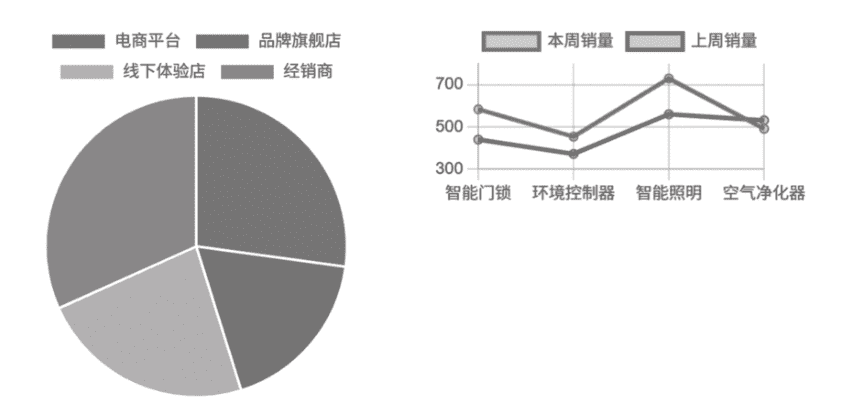

图4-9 生成模板效果图

## 4. 方法四：数据清洗方案制定

面对混乱的原始数据不知道该从哪里入手进行数据清洗时，腾讯元宝可以帮你快速制定清洗方案。比如上传杂乱数据后提问：“请分析这份客户信息表的脏数据问题，给出清洗步骤：①识别重复记录的判断标准；②电话号码格式标准化方案；③地址信息拆分规则。”

腾讯元宝会输出客户信息表数据清洗方案，包含关键清洗步骤和标准化规则。限于篇幅，这里省略了输出结果，读者可自行尝试。

### 5. 总结

用腾讯元宝处理数据准备工作，相当于拥有了智能采集助手（自动抓取关键信息）、数据仿真器（生成逼真训练数据）、模板生成器（快速创建标准文件）和清洗指导师（解决脏数据问题）。

#### 试一试

- 1) 让元宝抓取你所在的行业最近的5个竞品活动数据。
- 2) 生成符合你所处的业务场景的50条模拟用户数据。
- 3) 创建一个带自动分析功能的日报模板。

#### 小贴士

- 1) 敏感数据先用模拟数据测试流程。
- 2) 定期保存常用数据采集指令。
- 3) 复杂清洗任务分步骤验证。
- 4) 模板文件保留元宝生成的使用说明。

# 技巧31

## 数据分析师必备：用腾讯元宝提升效率的五个技巧

作为数据分析师，相信你一定碰到过这样的场景：刚用SQL跑完数据，业务方就甩来一句“这个趋势为什么和预期不符？”；好不容易做完归因分析，领导又追问“能不能用更直观的方式展示？”；最崩溃的是，当你终于建好模型，却发现业务需求早就变了方向。

传统的数据分析就像在迷宫里打转：Excel公式错一个单元格就能让整个报表报废，SQL报错信息比莫尔斯电码还难懂，而业务方随口说的“简单分析一下”，往往意味着要通宵加班。当数据量呈指数级增长趋势时，需要的不是更强的算力，而是能理解业务痛点、自动处理琐事，还能把技术语言翻译成人话的智能助手。

如何让数据分析既专业又接地气？怎样在业务需求和数据技术之间架起桥梁？这五个用腾讯元宝提升效率的技巧或许能帮你跳出这个困境。

## 1. 数据淘金术：三句话让脏数据自动洗澡

数据分析工作中最费时的环节不是建模分析，而是数据清洗。面对混乱的原始数据，与其手动筛选不如让AI当过滤网。这里以金融行业清洗跨境交易流水数据的场景为例，在腾讯元宝对话框中输入原始数据存在的问题及需要调整的格式（实际使用时请根据你的数据情况对提示词进行调整）：“清洗2024年跨境交易流水数据：①交易时间含多时区记录（如2024-07-15T14:30:00+08:00和07/15/2024 06:30 UTC混用）；②客户ID存在无效格式（需符合‘国家代码_12位数字规则’格式，如CN_123456789012）；③交易类型标识符存在缩写不一致（如TRSF/TRANSFER混用、CASH_IN拼写为CASHIN）；④交易金额含千分位符号与多币种标记（如1500.50USD、299999EUR）；⑤合规性要求，过滤测试账户（账号含DEMO_前缀）及受制裁国家交易（见监管清单sanc_countries.csv）。请生成Python处理代码并满足以下要求：①统一交易时间为UTC时间戳格式；②验证并修复客户ID格式有效性；③标准化交易类型为全称大写格式（映射表见附件）；④提取纯数字金额并转换为美元基准值（汇率参数可配置）；⑤执行反洗钱基础筛查（标记单日累计交易＞50000美元的记录）。每个处理步骤添加中文合规说明。”

生成的部分代码结果示例：

```python
import pandas as pd
import pytz
from forex import get_latest_rate  # 假设有汇率接口
def clean_financial_transactions(df, currency_rates):
    """
    跨境交易流水数据清洗流程（符合央行数据规范 v3.2）
    :param df: 原始交易数据 DataFrame
    :param currency_rates: 当日货币汇率字典（例：{'USD':1.0, 'EUR':0.95}）
    :return: 清洗后数据 DataFrame 及异常报告 DataFrame
    """
    # === 多时区时间标准化 ===
    ......
```

（由于篇幅有限，输出结果在此省略，建议读者亲自上手实践。）

## 2. 需求翻译器：把“随便看看”变成可执行方案

在实际业务场景中，正确解读对方的业务需求是能够写出好方案的前提，当业务方发来模糊需求时，试着用结构化提问破解谜题。

以物流行业的运营部门提出要对供应链进行优化分析的场景为例，在腾讯元宝中输入：“业务需求背景：运营部门提出‘供应链优化分析’。已知数据包含：①订单特征（品类/重量/紧急程度标签）；②运输记录（实际时效/成本/异常事件类型）；③客户反馈（投诉类型/满意度评分/重复合作率）。请设计三个分析框架，每个框架需包含：①分析目标（50字以内）；②3个核心指标及计算公式；③可执行的优化建议；④预期提升的KPI方向。”

生成的部分结果示例：

基于用户提供的业务场景和数据维度，结合供应链优化方法论，设计以下三个分析框架：

### 框架一：订单履约效率分析

**分析目标**：识别高价值订单特征与履约效率关系，优化资源分配策略。

**核心指标**：

- 1. **紧急订单准时交付率**=（按时交付紧急订单数÷总紧急订单数）×100%
- 2. **品类订单处理周期**=Σ（订单确认至签收时间）/品类订单总数
- 3. **库存周转率**=年度销售成本÷平均库存价值

**优化建议**：

- □建立智能分单策略：基于订单紧急程度标签自动匹配最优配送路线（参考TMS算法）。
- □实施动态库存分配：在仓库部署RFID定位系统，按品类周转率实施ABC分级存储。
- □开发异常预警模型：对超重订单配置专用运输工具，降低运输破损率。

**预期KPI提升**：（略）

### 框架二：运输成本效率分析（略）

### 框架三：客户价值维系分析（略）

**方法论融合建议**：（略）

（由于篇幅有限，输出结果在此省略，建议读者亲自上手实践。）

## 3. 智能归因法：让波动分析不再“甩锅”

面对数据指标异动，想要快速找出波动原因，试试用对比实验代替猜测，让腾讯元宝根据现有的数据变量和可用数据维度，设计一份思维清晰的归因分析框架。以零售行业为例，如果你想要分析销售额波动的原因，在腾讯元宝中输入：“智能归因分析：3天GMV骤降18%根因定位。

背景描述：某连锁商超在618大促后出现销售额异常下滑（6月25—27日GMV同比前一周下降18%）。已知存在以下变量：变量1，竞品同期启动“满100减50”补贴战；变量2，生鲜品类库存周转率下降至0.8（健康值>1.2）；变量3，收银系统升级导致结账时长增加40%。可用数据维度：①促销活动效果（优惠券核销率/跨品类购买率）；②会员消费记录（高净值用户留存/客单价分布）；③库存动态（缺货SKU数/临期商品占比）；④竞品价格策略（价格监测数据/营销活动情报）。请设计归因分析框架，需包含：①必须对比的4个核心数据维度及其关联假设；②对应的验证实验设计方法；③分析结论输出模板（含置信度评估）；④高级分析延展建议。”

部分生成的结果示例：

### 一、核心数据维度对比与关联假设

需重点分析的4个维度及其假设关联如下：

| 数据维度 | 分析指标 | 关联假设 | 验证优先级 |
| --- | --- | --- | --- |
| 促销活动效果 | 优惠券核销率、跨品类购买率 | 竞品补贴导致用户转向低价渠道，核销率下降反映促销吸引力不足 | 高 |
| 会员消费记录 | 高净值用户留存率、客单价分布 | 收银效率下降导致高价值用户流失，客单价降低反映体验恶化 | 中高 |
| 库存动态 | 生鲜缺货SKU数、临期商品占比 | 库存周转率下降主因是缺货或临期商品积压，直接影响核心品类GMV | 高 |
| 竞品价格策略 | 竞品价格监测数据、补贴活动覆盖率 | 竞品“满100减50”补贴导致用户分流，价格敏感客群流失 | 高 |

### 二、验证实验设计方法（略）

### 三、分析结论输出模板（略）

### 四、高级分析延展建议（略）

（由于篇幅有限，输出结果在此省略，建议读者亲自上手实践。）

## 4. 可视化直通车：一键把数字变故事

好不容易完成数据分析，如何将分析结果用美观的可视化方式展示，是很多数据分析师面临的难题。一个好的数据可视化展示往往能够为你的分析结果“锦上添花”。当你觉得缺乏审美、纠结配色的时候，不如让AI当设计师，帮你轻松搞定可视化设计方案。这里以如何将分析结果转化为PPT图表的场景为例，在腾讯元宝输入：“将以下分析结论转化为PPT图表：①Q2销售额增长12%，但利润率下降5%；②主要原因是华东区促销成本占比超预期；③建议Q3减少满减活动，改推高毛利商品。请设计三页数据故事框架，说明每页图表类型及核心信息。”

结果示例：

以下是为您设计的三页数据故事框架及对应的图表建议，结合数据叙事逻辑与商业分析场景：

### 第一页：Q2业绩核心矛盾可视化

**图表类型**：双轴组合图（柱状图+折线图）

- **左轴柱状图**：展示Q2销售额同比12%增长（蓝色柱体），对比Q1或去年同期数据，标注增长率绝对值。
- **右轴折线图**：叠加Q2利润率同比5%下降趋势（红色折线），标注下降值并高亮负向箭头符号。
- **辅助元素**：在图表下方用文字框标注关键结论—“增长与利润背离：销售额扩张未能转化为盈利能力提升”。

**核心信息**：直观呈现增长与利润的分化矛盾，引发听众对成本/费用结构的关注。

### 第二页：华东区促销成本异常归因（略）

### 第三页：Q3策略调整与预期收益（略）

（由于篇幅有限，输出结果在此省略，建议读者亲自上手实践。）

## 5. 模型选择指南：告别“算法选择困难症”

模型选择直接影响到数据分析的准确性。数据分析师在建模的时候，面对上百种算法时，有没有一种高效的方法，可以根据数据特征对比不同的算法模型，找出最适合当前问题的算法模型？试着在腾讯元宝输入：“预测用户下周购买概率：①数据特征：15个（包含数值型、分类型、时间序列）；②样本量：50万条；③需求：要可解释性较强的方案。请推荐三种建模方案，说明适用性及需要警惕的陷阱。”

结果示例：

### 方案一：特征分析+逻辑回归

适用性：当业务方需要“白盒模型”解释每个变量的影响系数时，此方案可直接量化15个特征的贡献度。

需警惕的陷阱：若存在特征多重共线性（如“加入购物车次数”与“收藏夹商品数”高度相关），会导致系数失真。

建议增加VIF检验步骤，保留VIF<5的特征。

### 方案二：CART决策树+规则萃取（略）

### 方案三：XGBoost+SHAP解释（略）

（由于篇幅有限，输出结果在此省略，建议读者亲自上手实践。）

### 6. 总结

这套方法把数据分析变成“人机配合赛”：腾讯元宝负责处理脏活累活，数据分析师专注价值挖掘。记住，AI再智能也替代不了你的业务洞察—它更像是给你的分析武器库配了个自动装弹器。

#### 试一试

向腾讯元宝输入如下内容，观察AI如何将技术语言转化为业务洞见。

生产总监反馈OEE（设备综合效率）看板存在数据矛盾，请将以下SQL分析结果转化为三段生产管理建议，并指出三个可能影响良品率的隐藏问题：

```sql
SELECT
    设备ID,
    SUM(运行时间)/SUM(计划时间) AS 时间利用率,
    COUNT(故障代码) AS 故障次数,
    AVG(实际速度/理论速度) AS 性能开动率,
    1 - (SUM(不良品数)/SUM(总产量)) AS 良品率
FROM 生产日志
WHERE 日期 BETWEEN '2024-06-01' AND '2024-06-15'
GROUP BY 设备ID
HAVING SUM(计划时间) > 8 -- 过滤调试期设备
```

#### 小贴士

- 1) 遇到复杂需求时追加“用外卖配送的场景比喻，帮我理解这个聚类分析的目的”。
- 2) 建立常用指令库，保存“数据异常检测模板”“AB测试结论框架”等。
- 3) 重要提醒：涉及敏感数据时，务必使用脱敏后的模拟数据进行测试。
- 4) 当处理关键业务决策时，仍需结合人工复核与领域知识交叉验证。

## 技巧32

## Excel公式生成：用腾讯元宝告别“VLOOKUP恐惧症”

很多职场人可能经历过这样的崩溃瞬间：盯着Excel表格，手指悬停在键盘上，明明知道要用公式解决问题，却想不起来是该用INDEX-MATCH还是XLOOKUP。更绝望的是，当你终于找到公式模板，却发现自己的数据结构和示例根本对不上。

别慌，腾讯元宝能助你从“公式小白”进阶为“表格高手”。以下三个实战技巧，足以让同事误以为你偷偷报了Excel特训班！

### 1. 基础公式速成：把需求变成公式

最痛苦的往往不是复杂运算，而是明明知道要做什么，却不知道用什么公式。可以向腾讯元宝输入：

> “我现在有一个销售数据表，需要：①在G列找出每个销售员的最高业绩；②在H列显示对应的客户名称。
>
> 表格结构：
>
> A 列（销售员） B 列（客户） C 列（金额）
> 张三 客户 A 5000
> 张三 客户 B 8000
> 李四 客户 C 3000
>
> 请给出最简洁的公式方案。”

腾讯元宝可能会输出：

#### 1. G列（最高业绩）：

在单元格G2输入以下公式，向下填充：

```
=MAXIFS(C:C, A:A, A2)
```

作用：

根据当前行的销售员（A列），筛选其对应的最高金额。

#### 2. H列（对应客户名称）：

在单元格H2输入以下公式，向下填充：

```
=XLOOKUP(G2, FILTER(C:C, A:A=A2), FILTER(B:B, A:A=A2), "", 0)
```

作用：

在相同销售员的记录中，查找最高业绩（G列）对应的客户名称。

……

（由于篇幅有限，输出结果在此省略，建议读者亲自上手实践。）

可以看到，腾讯元宝连“向下填充”的做法都给你准备好了。

### 2. 数组公式突破：一键解决连环任务

面对需要多步操作的问题时，普通人还在手动分列计算，高手已经用数组公式一键搞定。例如，当你需要对销售数据进行汇总并删除退货订单时，可以上传你的数据表格，并向腾讯元宝提问：“请为以下需求创建单个公式：①计算A部门B产品的总销售额；②排除退货订单（D列为‘是’）；③结果保留两位小数。表格字段：部门|产品|金额|是否退货。”

腾讯元宝可能会输出：

使用Excel公式实现：

```
=ROUND(SUMIFS(C:C, A:A, "A", B:B, "B", D:D, "<>是"), 2)
```

公式说明：

SUMIFS(C:C, ...) 在金额列求和

条件1：A:A, "A" 部门列为A部门

条件2：B:B, "B" 产品列为B产品

条件3：D:D, "<>是" 排除已退货订单

ROUND(..., 2) 将结果四舍五入保留两位小数

注：根据Excel版本不同，可能需要将公式中的逗号替换为分号。

### 3. 公式安全检查：避免错误结果

最可怕的不是公式出错，而是出错了自己还不知道。当你觉得某个Excel公式运行的结果不对时，可以这样向腾讯元宝提问：“请优化这个VLOOKUP公式，要求：①添加IFERROR处理错误值；②查找不到时显示“数据缺失”；③增加数据类型验证。原公式：=VLOOKUP(F2, A:D, 4, FALSE)。”

腾讯元宝可能会输出：

```
=IFERROR(IF(ISTEXT(VLOOKUP(F2, A:D, 4, FALSE)), VLOOKUP(F2, A:D, 4, FALSE), "数据类型错误"), "数据缺失")
```

优化说明：

IFERROR处理：包裹整个公式，当出现#N/A等错误时显示“数据缺失”。

数据类型验证：

使用ISTEXT函数验证返回值的文本类型（根据实际需求可改为ISNUMBER等），若类型不符合要求则显示“数据类型错误”。

……

（由于篇幅有限，输出结果在此省略，建议读者亲自上手实践。）

这里腾讯元宝连输入错误的预防措施都考虑到了。

## 4. 总结

用腾讯元宝处理Excel公式宛如配备了专业助手：它能助你快速找到正确的公式，但最终仍要你自主理解和确认。记住三个要点：说清楚需求、验证结果、理解原理。

#### 试一试

- 1) 让腾讯元宝帮你写一个“按月份自动分类汇总”的公式。
- 2) 尝试用“请解释这个公式的每个参数”来学习陌生函数。
- 3) 对现有公式进行“防错加固”升级。

#### 小贴士

- 1) 描述需求时，多用“找出/计算/排除”等动词。
- 2) 将复杂问题拆成“筛选条件→计算方式→输出格式”三步。
- 3) 重要表格保留公式注释（用N函数或单独注释列）。

## 技巧33

## Excel多文件合并：告别手工时代的智能解决方案

处理多源数据时最棘手的不是分析本身，而是前期的整理工作—面对散落在不同文件、不同格式的数据表，光是下载、分类、去重这些基础操作就能消耗半天工时。手动复制粘贴时，既要防止漏掉隐藏的工作表，又要时刻注意跳过重复标题行，稍有不慎就会导致最终汇总表出现错位或重复数据。若遇到需要按区域分类归档的场景，人工操作还可能会因文件名超长或非法字符而触发系统报错。

用好腾讯元宝，能通过自然语言描述需求，快速生成能处理复杂合并规则的代码，将机械操作转化为标准化流程。这一节将具体演示两个核心方法，从基础合并到多级分类，帮助职场人彻底摆脱数据整理的琐碎消耗。

### 1. 智能脚本：单表合并实战

当需要将数据分散在独立文件中的12个月的销售记录按行拼接成年度总表的时候，人工操作的常见错误包括忘记删除重复标题行、遗漏隐藏的工作表、未处理不同文件格式导致中断。而当需要按月独立报表，并分别保存到同一个工作簿的不同Sheet中时，人工操作容易产生Sheet命名混乱，且遇到超长文件名时还有可能触发系统报错。如何实现智能选文件夹+自动去重表头+实时进度提醒的完整流程？可以在腾讯元宝对话框输入如下提示词，以获取解决问题的代码：“请帮我生成Python代码，要求合并指定文件夹内所有Excel文件的第一个工作表，跳过后续文件的标题行，显示处理行数统计。”

腾讯元宝给出的合并代码，可实现合并指定文件夹内所有Excel文件的第一个工作表，并自动跳过后续文件的标题行，同时显示详细处理行数统计：

```
import os
import pandas as pd
from tqdm import tqdm  # 提供进度条支持，需安装 tqdm

def merge_excel_sheets(folder_path, output_file):
    """
    合并指定文件夹内所有 Excel 文件的第一个工作表
    参数：
        folder_path: 包含 Excel 文件的文件夹路径
        output_file: 合并后的输出文件路径
    返回：
        处理行数统计字典
    """
    # 初始化变量
    all_data = pd.DataFrame()
    total_rows = 0
    file_count = 0
    processed_info = {}

    # 获取所有 Excel 文件（排除临时文件）
    excel_files = [f for f in os.listdir(folder_path)
                   if f.endswith(('.xlsx', '.xls')) and not
                   f.startswith('~$')]

    # 创建进度条
    with tqdm(total=len(excel_files), desc="处理进度") as pbar:
        for idx, filename in enumerate(excel_files):
            file_path = os.path.join(folder_path, filename)
            ......
```

(由于篇幅有限，输出结果在此省略，建议读者亲自上手实践。)

### 2. Python批处理：多表归档方案

当需要保留原始文件结构时，使用Python脚本更高效。在腾讯元宝对话框输入：“写Python代码：将文件夹内的每个Excel文件转为汇总文件的独立Sheet，Sheet名取文件名前15个字符，跳过临时文件。”

腾讯元宝输出的Python操作代码示例：

```
import os
import pandas as pd
from openpyxl import load_workbook

def excel_to_sheets(source_folder, output_file):
    # 创建汇总文件，先写入空 DataFrame 以完成初始化
    pd.DataFrame().to_excel(output_file, index=False)

    with pd.ExcelWriter(output_file, engine='openpyxl', mode='a') as writer:
        # 获取已存在的 Sheet 列表
        existing_sheets = load_workbook(output_file).sheetnames

        for filename in os.listdir(source_folder):
            # 跳过临时文件 (~$ 开头、._ 开头、.tmp 结尾)
            if filename.startswith(('~$', '._')) or filename.endswith('.tmp'):
                print(f"跳过临时文件：{filename}")
                continue

            # 处理 Excel 文件
            if filename.endswith(('.xlsx', '.xls')):
                filepath = os.path.join(source_folder, filename)
                sheet_name = os.path.splitext(filename)[0][:15]  # 取前 15 个字符
                sheet_name = sheet_name.replace(':', '_').replace('\\', '_')  # 清理非法字符

                try:
                    # 读取 Excel 数据
                    df = pd.read_excel(filepath)
                    ......
```

（由于篇幅有限，输出结果在此省略，建议读者亲自上手实践。）

## 3. 总结

通过腾讯元宝生成智能脚本，然后在编辑器中运行数据处理代码，可以快速处理表格数据，大大降低了使用代码处理数据的门槛，同时也提高了数据处理的效率。

#### 试一试

在腾讯元宝输入“生成合并5个Excel文件的VBA代码，保留原格式”。

#### 小贴士

- 1) 遇到代码报错时，将错误信息直接粘贴给腾讯元宝，可获得针对性修复建议。
- 2) 定期用df.dtypes检查字段类型一致性，避免合并后数据错乱。
- 3) 重要操作前先用副本进行测试，代码头部添加备份路径=os.path.join（源文件夹，‘备份’）创建自动备份。

## 技巧34

## VBA自动化：用腾讯元宝打造Excel效率神器

每天面对Excel表格里密密麻麻的数据，重复执行筛选、统计、格式调整操作，就像被困在数字迷宫里。相较于普通的Excel数据分析，VBA代码适用于数据清洗与整理、自动化报表生成、复杂计算与建模等复杂事务。特别是在处理中小规模的结构化数据（<100万行），需要快速自动化Office任务时，VBA代码可以极大地提高数据分析的效率。使用VBA代码进行数据处理对于大多数人来说学习门槛太高，传统学习路径需要啃完三本编程教材才能写出第一个宏，而搜索引擎里找到的代码片段十有八九会报错。当被要求“把每周手工处理两小时的数据报表改成自动生成”时，多数人只能硬着头皮熬夜复制粘贴。

其实只需掌握AI工具与Excel联动的诀窍，零编程基础的人也能快速搭建数据处理工具。以腾讯元宝为例，它能将自然语言需求转化为可运行的VBA代码，配合简单设置就能让Excel变身智能工作站。下面通过三个步骤演示具体操作。

### 1. 第一步：用自然语言生成基础代码框架

以合并表格的任务为例，在腾讯元宝对话框输入精准需求：“我有多个Excel文件，表格中标题和列数等结构相同，我想把所有工作簿中的数据合并到一个工作簿中，请帮我写出合并表格的VBA代码，要求可以手动选择要合并的Excel文件的路径。”

腾讯元宝会直接生成实现这个功能的VBA代码。

### 2. 第二步：Excel环境配置四步走

1) 启用开发者工具：在Excel中依次选择“文件”→“选项”→“自定义功能区”，勾选“开发工具”，如图4-10所示。

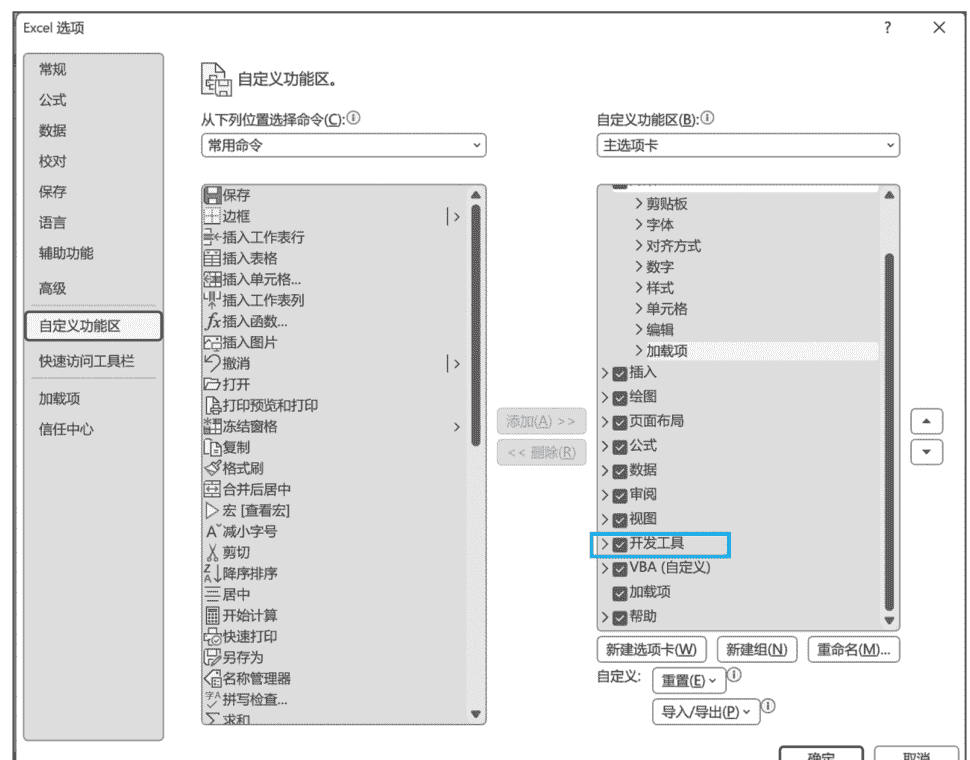

2) 插入模块：依次单击“开发工具”→Visual Basic，右键单击项目，选择插入模块，如图4-11、图4-12所示。

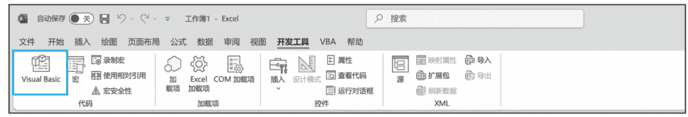


3）粘贴代码：将腾讯元宝生成的VBA代码整体复制到新建模块（注意保留开头的Sub和结尾的End Sub），单击上方的小三角以运行代码，如图4-13、图4-14所示。合并后的结果如图4-15所示。

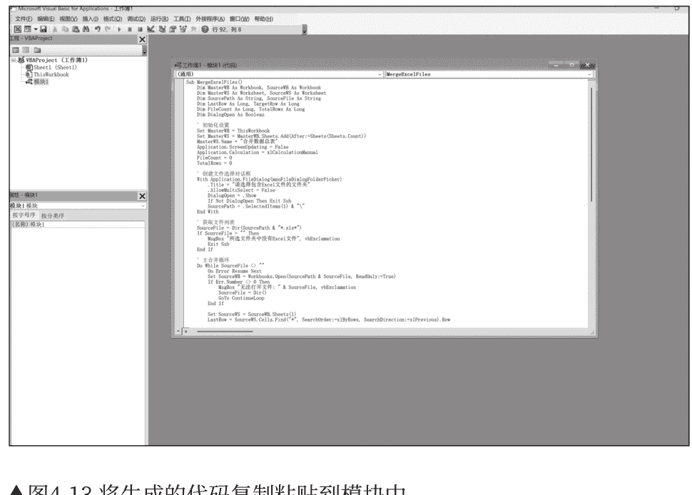

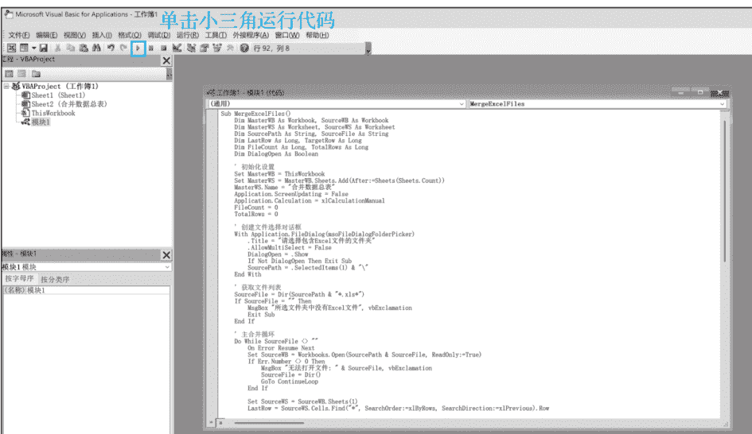

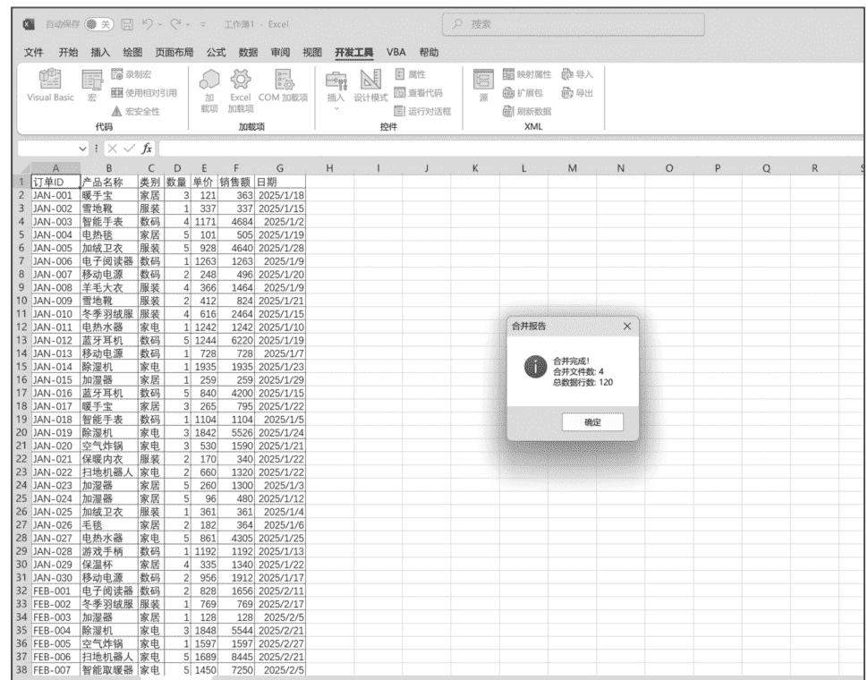

4) 创建按钮：将有宏代码的文件另存为xlam文件，如图4-16所示。再次打开“自定义功能区”，在“从下列位置选择命令”的下拉列表中选择“宏”，找到保存的xlam格式的宏文件，然后单击“新建选项卡”，将宏文件添加到新建选项卡中，如图4-17所示。可以对宏进行重命名，如图4-18所示。最终得到的插件效果如图4-19所示。这样遇到同样情况的数据合并任务时，就可以直接调用该插件，一键合并数据，提高效率。

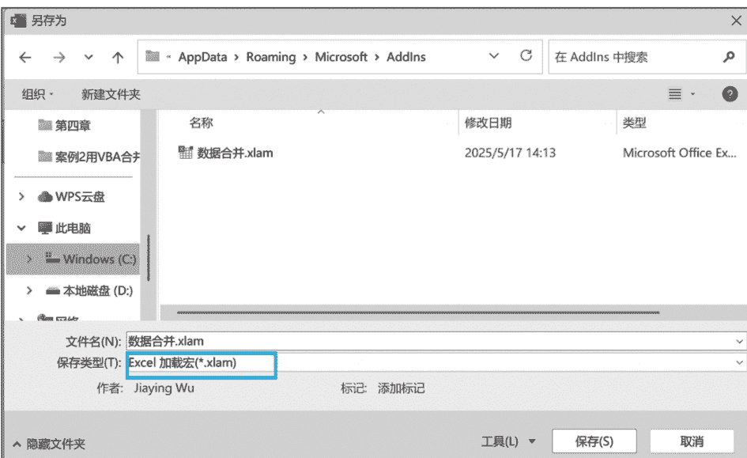

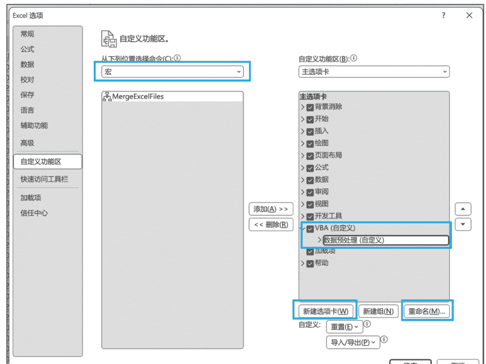

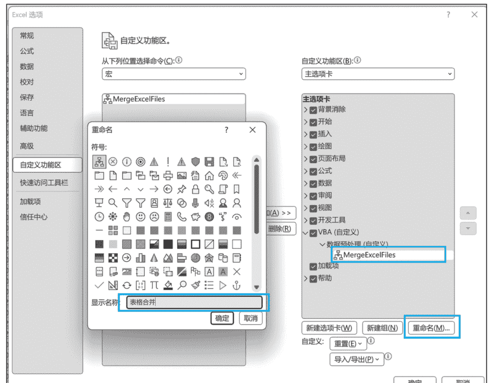


特别提醒：首次使用时需调整宏安全性。进入“文件”→“选项”→“信任中心”→“宏设置”，选择“启用所有宏”。建议临时启用后及时恢复默认设置，重要文件包含VBA宏时，将文件备份保存为.xlsm格式。

### 3. 第三步：调试与优化技巧

当代码运行报错时，复制错误提示询问腾讯元宝“这段VBA代码执行时显示‘运行时错误1004’，如何修改？”，同时附上完整代码片段。腾讯元宝不仅能定位错误行，还会解释常见错误类型，如对象不存在（检查工作表名称是否带空格等特殊字符）、变量未定义（在代码开头添加Option Explicit声明）、循环逻辑冲突（用F8键逐行调试查看变量变化）。

当生成的VBA代码不理想时，可以给腾讯元宝追加优化指令。例如，输入“请为这段代码增加错误处理机制，当数据表为空时弹出提示框”，可以让程序更健壮。建议在数据副本进行测试，以避免原始文件受损。

为了让效率升级，还可以打造专属控件库，将常用功能封装为按钮控件群组。比如设计数据清洗控件，用来处理自动删除空行/重复值；设计智能拆分控件，用来按指定条件分割工作表等。每个按钮对应独立模块，通过腾讯元宝批量生成代码后，在Excel中排列为工具面板。定期导出整个VBAProject作为备份，换计算机时直接导入备份即可复用。

## 4. 总结

职场数据处理不必在手工操作与专业编程间二选一。通过AI辅助生成+可视化配置的组合拳，普通用户也能快速搭建自动化工具链。记住三个关键：精准描述需求、规范设置环境、建立调试意识。

#### 试一试

在腾讯元宝输入“编写VBA代码实现：单击按钮后遍历A列所有单元格，将包含‘紧急’字样的整行标为红色，按钮命名为‘高亮优先级’”，然后将生成的代码部署到Excel以体验自动化标记。

#### 小贴士

- 1) 遇到“权限被拒绝”错误时，检查文件是否存储在受信任位置。
- 2) 按住Alt键可微调按钮位置，按住Ctrl并拖动鼠标可快速复制控件。
- 3) 复杂功能建议分模块开发，用“调用子程序”方式组合。
- 4) 定期清理未使用的变量声明，提升代码运行速度。

## 技巧35

## 数据可视化（一）：让腾讯元宝帮你选对图表、讲好故事

职场中最令人沮丧的时刻，莫过于精心准备的数据报告被告知：“这个饼图根本不适合展示时间趋势”，或者：“你的双Y轴图表是在误导观众”。

数据可视化不是简单地把数字变成彩色图形，而是要让数据讲出正确的业务故事。

### 1. 图表选择的智慧

新手最常见的错误就是拿到数据就直奔柱状图。不同类型的数据关系需要使用不同的表达方式，例如折线图适合表达趋势变化，扇形图适合展示百分比。选择合适的图表是将数据中的信息正确展示的关键，在不知道选什么图表的时候，可以向腾讯元宝提问：“我需要比较过去一年各季度的销售额和利润率，哪种图表最合适？请列举三种可选方案并分析各自的优缺点。用表格的形式展示。”

腾讯元宝可能会输出如下表格，并给出补充建议。

## 1. 图表类型选择

| 图表类型 | 描述 | 优点 | 缺点 | 适用场景 |
| :--- | :--- | :--- | :--- | :--- |
| 双轴折线图 | 左轴为销售额（绝对值），右轴为利润率（百分比），两条折线分别表示趋势 | 1）清晰对比趋势变化<br>2）适合单位差异大的数据<br>3）展示指标间相关性 | 1）刻度不合理易误导<br>2）波动差异大时次要指标易被忽略 | 需要快速判断销售额与利润率趋势是否同步 |
| 分组柱状图 | 每组季度并列两柱（销售额和利润率），需数据标准化（如统一为百分比或指数） | 1）数值对比直观<br>2）避免双轴刻度干扰<br>3）强调季度内两指标关系 | 1）标准化可能掩盖真实差异<br>2）需额外解释数据转换逻辑 | 强调季度内销售额与利润率的相对比例关系 |
| 组合图（柱+折线） | 柱状图表示销售额（主轴），折线图表示利润率（次轴），共享季度横轴 | 1）兼顾绝对值与趋势<br>2）视觉层次分明<br>3）适合多维度分析 | 1）设计复杂（需调整颜色/线型）<br>2）次要指标（如利润率）可能不够突出 | 需同时关注销售规模和盈利质量的管理层汇报 |

- 1. 双轴折线图：适合向熟悉数据的团队展示，需注明左右轴单位并合理设定刻度范围。
- 2. 分组柱状图：若需避免标准化，可拆分为两个独立图表（销售额柱状图+利润率折线图）。
- 3. 组合图：添加数据标签（如柱顶数值、折线节点百分比）可提升可读性。

## 2. 图表误区的识别

即使选对了图表类型，细节处理不当也会产生误导。上传你的图表截图并提问：“请检查这张用户增长趋势图是否存在视觉误导，需要调整哪些参数才能准确反映真实增长幅度？”

腾讯元宝可能会输出：

### 一、存在误导的核心问题

- 1. 纵轴截断误导（最严重问题）

纵轴起始值设为1100而非0，导致：

- 折线垂直波动幅度被人为放大（从1100到900的18%实际降幅被视觉呈现为悬崖式下跌）。

……

### 2. 时间轴标注不完整

- 2024年标注为“Q”缺失具体季度。
- 可能造成时间跨度的理解歧义。

### 3. 图文表述矛盾

底部标注“同比提升300%”与折线显示的下降趋势形成逻辑冲突（需确认数据计算方式是否准确）。

### 二、必要的参数调整建议（略）

### 三、优化方案示例（略）

通过上述调整，可以使图表既符合数据可视化伦理规范，又能更准确地传达真实的业务趋势。建议使用Tableau、Power BI等专业工具重新制图，并参考图表规范进行视觉优化。

## 3. 从图形到洞见

漂亮的图表只是开始，关键是要解读出业务含义。很多人止步于“Q3销售额下降5%”，却说不出为什么。用腾讯元宝生成深度分析：“根据这个月度销售漏斗图，要求：①指出转化率最低的三个环节；②分析可能的原因；③给出具体的优化建议。”

输出示例：

### 1. 转化率最低的三个环节（典型场景）

- ①潜在客户→需求确认（如转化率<30%）
- ②方案沟通→报价/合同（如转化率<40%）
- ③报价/合同→成交（如转化率<30%）

### 2. 关键环节问题诊断

▶环节1：潜在客户→需求确认
可能原因：①客户画像模糊，大量非目标客户进入漏斗；②需求挖掘话术不专业（如过早推销而非倾听需求）；③未建立客户信任（缺乏成功案例/资质证明）。

▶环节2：方案沟通→报价/合同（略）

▶环节3：报价/合同→成交（略）

### 3. 针对性优化方案（略）

（由于篇幅有限，输出结果在此省略，建议读者亲自上手实践。）

## 4. 高级可视化技巧

当需要展示复杂数据关系时，可以要求腾讯元宝提供创新方案：“请设计一个能同时展示产品销量、利润率和客户满意度的可视化方案，要求直观易懂且具有交互性，用HTML格式展示设计效果。”

在结果生成的HTML文件中，直接单击“运行”按钮，腾讯元宝会展示其设计的可视化效果，如图4-20所示，在页面中还可以单击选项卡来选择不同区域、不同时间、不同产品进行数据交互。

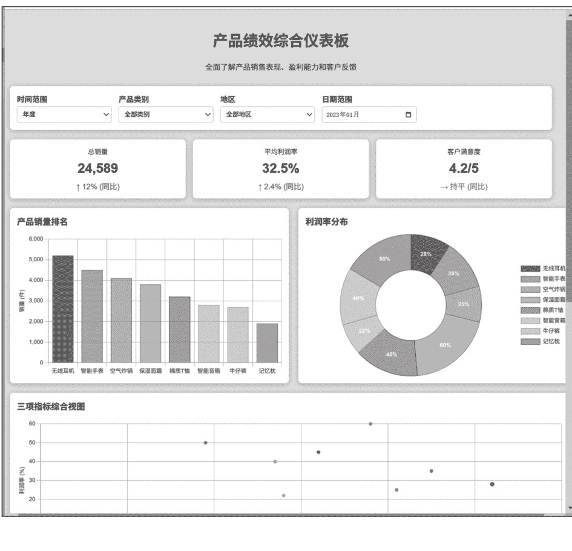

图4-20 腾讯元宝设计的可视化效果

这个方案可以直接保存为HTML文件并在浏览器中使用，如需接入真实数据，只需将generateData()函数部分替换为API调用即可。

也可以向腾讯元宝继续提问，在提示词中加入：“我想上传自己真实的数据到这个仪表盘中，请根据高级替换方法（从文件加载数据）中的代码，结合第一次生成的代码结果，输出完整的HTML代码，让我在页面中可以直接上传计算机本地中的CSV文件，进行数据可视化展示。”生成效果如图4-21所示。

# 上传产品数据CSV文件

数据格式要求：CSV文件应包含以下列：id,name,sales,profit,satisfaction,category

# 产品绩效综合仪表板

全面了解产品销售表现、盈利能力和客户反馈

时间范围：年度
产品类别：全部类别
地区：全部地区
日期范围：2023年01月

总销量：17 600
平均利润率：36.0%
客户满意度：4.3/5

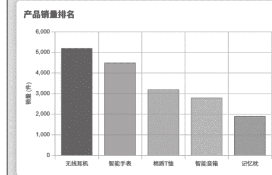

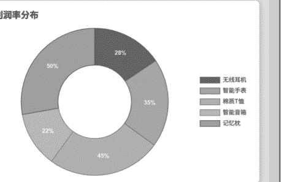

三项指标综合视图

图4-21 生成可上传本地CSV文件的数据可视化仪表盘

注意，上传的数据集必须符合仪表盘数据格式要求，包含必要的列。把HTML代码复制到空白的记事本，再将.txt的文件扩展名改为.html，你就可以得到一个能够长期复用的动态数据可视化仪表盘了。你还可以根据自己的需要让腾讯元宝对仪表盘进行进一步的美化设计，设计出一个专属于自己的数据可视化仪表盘。比起使用BI工具做仪表盘，这个方法更加快捷、高效、简单。

### 5. 总结

用腾讯元宝做数据可视化，要把握三个关键：第一是选对武器，要根据数据类型选择图表；第二是避免视觉陷阱，学会识别常见的视觉误导；第三是要讲好数据故事，通过数据支撑业务决策。最好的数据可视化应该让读者第一眼看到“发生了什么”，第二眼想到“为什么”，第三眼知道“怎么办”。

#### 试一试

- 1) 让元宝分析你最近使用的三个图表类型是否合适。
- 2) 用“数据+业务问题”组合提问（例：“如何可视化展示用户流失原因？”）。
- 3) 对现有图表追加“这个异常点可能是什么原因”的解读。

#### 小贴士

- 1) 重要图表保留腾讯元宝的分析建议作为备注。
- 2) 建立“业务问题-图表类型”对照表。
- 3) 复杂图表添加简明的阅读指南。
- 4) 定期检查历史图表的后续验证结果。

# 技巧36

## 数据可视化（二）：用腾讯元宝搞定图表的五个技巧

制作可视化图表时，最耗时的往往不是分析数据本身，而是反复调整代码和格式。使用传统工具时，要么需要编写大量代码来实现灵活定制，要么受限于模板无法满足专业要求。处理大规模数据时，工具卡顿、格式错位等问题更是常见。

腾讯元宝可以简化这个过程。接下来将介绍如何用它高效生成符合要求的图表。

### 1. 数据预处理加速器：让脏数据秒变可视图

这里以医学行业为例，在处理临床试验中的缺失值与异常值时，可以向腾讯元宝输入提示词：“在我处理的数据中，临床数据集含15%缺失值，部分检测指标存在3σ外异常值。请你帮我生成处理代码，使用Python自动处理。要求：①用KNN填补缺失值；②剔除3倍标准差外的异常点；③生成数据清洗报告。”

腾讯元宝会给出量身定制的Python数据清洗方案，包含KNN缺失值填充、3σ异常值剔除和自动化报告生成功能，以下是部分实现代码：

```python
import pandas as pd
import numpy as np
from sklearn.impute import KNNImputer
from sklearn.preprocessing import StandardScaler
import matplotlib.pyplot as plt
import textwrap

# 1. 数据加载与预处理
def load_data(file_path):
    """ 加载临床数据集并标准化 """
    df = pd.read_csv(file_path)

    # 数据标准化（提升 KNN 效果）
    scaler = StandardScaler()
    scaled_data = scaler.fit_transform(df)
    return pd.DataFrame(scaled_data, columns=df.columns), scaler

# 2. KNN 缺失值填补 [1,2,3](@ref)
def knn_imputation(df, n_neighbors=5):
    """K 近邻算法填充缺失值 """
    imputer = KNNImputer(n_neighbors=n_neighbors)
    imputed_data = imputer.fit_transform(df)
    return pd.DataFrame(imputed_data, columns=df.columns)

# 3. 3σ 异常值处理 [6,7,8](@ref)
def three_sigma_filter(df):
    """ 基于 3σ 原则的异常值过滤 """
    clean_df = df.copy()
    for col in df.select_dtypes(include=[np.number]).columns:
        mean = df[col].mean()
        std = df[col].std()
        clean_df = clean_df[(clean_df[col] >= mean - 3*std) &
                            (clean_df[col] <= mean + 3*std)]
    ......
```

(由于篇幅有限，输出结果在此省略，建议读者亲自上手实践。)

### 2. 智能代码生成术：自然语言转可视化指令

当需要绘制多组学数据的相关性热力图时，可以向腾讯元宝输入提示词：
“请你帮我生成Python代码，用于绘制TCGA癌症数据的基因表达与甲基化相关性热力图。要求：①显示颜色刻度条；②行注释添加通路分类；③保存为300DPI的EPS格式。”

以下是腾讯元宝输出的解决代码示例，该代码示例基于TCGA癌症数据的基因表达与甲基化相关性热力图绘制需求，综合多个技术要点来实现相关功能：

```python
import pandas as pd
import seaborn as sns
import matplotlib.pyplot as plt
from matplotlib.colors import ListedColormap

# 1. 数据准备（假设已处理好的数据格式）
# 甲基化数据矩阵（基因 × 样本）
methylation_data = pd.read_csv("methylation_matrix.csv", index_col=0)
# 基因表达数据矩阵（基因 × 样本）
expression_data = pd.read_csv("expression_matrix.csv", index_col=0)
# 通路注释数据（基因 × 通路分类）
pathway_anno = pd.read_csv("pathway_annotation.csv", index_col=0)

# 2. 计算基因表达与甲基化的相关性矩阵
corr_matrix = expression_data.T.corrwith(methylation_data.T, axis=0,
    method='pearson')

# 3. 创建通路注释颜色映射（示例）
pathway_colors = pd.DataFrame(index=corr_matrix.index)
pathway_colors['Pathway'] = pathway_anno.loc[corr_matrix.index,
    'Pathway']

# 生成颜色字典（每个通路分配唯一颜色）
pathway_palette = {'Apoptosis':'#1f77b4', 'Cell Cycle':'#ff7f0e',
                   'DNA Repair':'#2ca02c', 'Metabolism':'#d62728'}

row_colors = pathway_colors['Pathway'].map(pathway_palette)

# 4. 绘制聚类热力图
g = sns.clustermap(
    corr_matrix.to_frame(),
    cmap='coolwarm',
    center=0,
    row_colors=row_colors,
    figsize=(10, 12),
    dendrogram_ratio=(0.1, 0.2),
    cbar_pos=(0.02, 0.8, 0.03, 0.18),
    cbar_kws={"label": "Pearson Correlation"}
)
......
```

（由于篇幅有限，输出结果在此省略，建议读者亲自上手实践。）

### 3. 图表细节优化引擎：自动对齐学术规范

当你在写论文的时候，需要调整论文中的生存曲线（Kaplan-Meier曲线）格式，可以尝试向腾讯元宝输入提示词：“请你帮我生成Python代码，按照《柳叶刀-肿瘤学》规范优化Kaplan-Meier曲线。要求：①风险表下置；②P值使用HR（95%CI）格式；③曲线粗细调整为1.5磅。”

腾讯元宝会给出解决代码，基于《柳叶刀-肿瘤学》规范优化Kaplan-Meier曲线，同时整合风险表、HR（95%CI）格式和样式参数调整功能。以下是部分代码示例：

```python
import matplotlib.pyplot as plt
import pandas as pd
from lifelines import KaplanMeierFitter, CoxPHFitter
from lifelines.plotting import add_at_risk_counts

# 数据准备（示例数据结构）
data = pd.DataFrame({
    'time': [12,24,36,48,60,24,36,48,60,72],        # 生存时间
    'event': [1,1,0,1,0,1,1,1,0,1],                 # 事件发生状态
    'group': ['A','A','A','A','B','B','B','B','B']   # 分组变量
})

# ==================== 核心分析 ====================
# Kaplan-Meier 曲线拟合
kmf = KaplanMeierFitter()
ax = plt.subplot(2,1,2)  # 主图区域

# 分组绘制生存曲线
for name, in data.groupby('group'):
    kmf.fit(
        durations=grouped_data["time"],
        event_observed=grouped_data["event"],
        label=name
    )
    kmf.plot(
        ax=ax,
        ci_show=False,
        linewidth=1.5,  # 曲线粗细调整
        c=['#1f77b4','#ff7f0e'][len(ax.lines)]  # Lancet 标准色系
    )

# ==================== COX 回归获取 HR ====================
......

# ==================== 样式优化 ====================
......
# ==================== 风险表设置 ====================
......
# ==================== 全局样式设置 ====================
......
```

（由于篇幅有限，输出结果在此省略，建议读者亲自上手实践。）

### 4. 动态调试助手：实时定位可视化Bug

在科学制表时，使用Matplotlib绘制多个子图时易出现图表重叠问题，为了解决这个问题，可以尝试向腾讯元宝输入提示词：“我的Python代码生成的4子图存在标题重叠，请帮我重新生成代码，要求：①调整整体画布尺寸；②修改子图间距；③优化字体缩放比例。”

腾讯元宝会根据我们的需求，重新设计Python代码。下面是解决方案的部分代码示例：

```python
import matplotlib.pyplot as plt
import numpy as np

# 设置全局字体参数（缩放比例优化）
plt.rcParams.update({
    'font.size': 12,            # 基础字体大小
    'axes.titlesize': 14,       # 子图标题字号
    'axes.labelsize': 12,       # 坐标轴标签字号
    'xtick.labelsize': 10,      # X 轴刻度标签字号
    'ytick.labelsize': 10       # Y 轴刻度标签字号
})

# 创建 4 个子图（2 行 2 列），设置画布尺寸和布局参数
fig, axs = plt.subplots(2, 2, figsize=(14, 10),
                        constrained_layout=True,  # 自动布局 [1,3](@ref)
                        gridspec_kw={'wspace': 0.35, 'hspace': 0.45})
                        # 子图间距 [6,7](@ref)

# 生成示例数据
x = np.linspace(0, 2*np.pi, 100)
y1 = np.sin(x)
y2 = np.cos(x)
y3 = np.tan(x)
y4 = np.exp(x/5)

# 绘制子图 1
axs[0,0].plot(x, y1, color='royalblue')
axs[0,0].set_title("Sinusoidal Wave", pad=15) # pad 参数增加标题间距 [3](@ref)
axs[0,0].set_xlabel("X Axis")
axs[0,0].set_ylabel("Amplitude")
......
```

（由于篇幅有限，输出结果在此省略，建议读者亲自上手实践。）

### 5. 批量输出流水线：自动生成图表全家桶

当你在做项目结题需要绘制图表的时候，可能需要绘制多组统一风格的图表。腾讯元宝可以帮你生成解决方案，试试向它输入提示词：
“我正在进行多组图标绘制，数据来源为RNA-seq数据集，请你帮我编写Python代码，要求自动生成：①差异火山图；②3D PCA投影图；③GO富集气泡图。所有图表统一使用深蓝-金色系配色、Arial字体、4cm基础单元尺寸。”

腾讯元宝会帮我们定制用于绘制多组图表的Python代码，自动生成差异火山图、3D PCA投影和GO富集气泡图，采用深蓝-金色系配色方案（#002366-#FFD700色系）并统一使用Arial字体。以下是解决方案的部分代码示例：

```python
import matplotlib.pyplot as plt
import pandas as pd
import numpy as np
from mpl_toolkits.mplot3d import Axes3D
from matplotlib.colors import LinearSegmentedColormap
from sklearn.decomposition import PCA

plt.rcParams['font.family'] = 'Arial'
plt.rcParams['font.size'] = 8
BASE_SIZE = 1.57          # 4cm转换为英寸

# 深蓝 - 金色系配色方案
COLOR_SCHEME = {
    'down': '#002366',     # 深蓝
    'up': '#FFD700',       # 金色
    'neutral': '#6C757D',  # 中性灰
    'gradient': LinearSegmentedColormap.from_list('blue_gold', ['#002366', '#FFD700'])
}

# ======================
# 1. 差异火山图
# ====================
def plot_volcano(df, output_path):
    """ 参数说明：
    df 需包含 log2FoldChange、padj 两列
    """
    fig = plt.figure(figsize=(BASE_SIZE*3, BASE_SIZE*3))

    # 显著性标记
    df['sig'] = np.where((df.padj < 0.05) & (df.log2FoldChange > 1), 'up',
                         np.where((df.padj < 0.05) & (df.log2FoldChange < -1), 'down', 'neutral'))

    ax = fig.add_subplot(111)
    scatter = ax.scatter(
        x=df.log2FoldChange,
        y=-np.log10(df.padj),
        c=df.sig.map(COLOR_SCHEME),
        s=8,
        alpha=0.6
    )

    # 辅助线
    ax.axhline(-np.log10(0.05), color='#495057', linestyle='--', linewidth=0.8)
    ......
```

（由于篇幅有限，输出结果在此省略，建议读者亲自上手实践。）

### 6. 总结

这套方法论的核心在于将专业经验转化为可复用的智能模板，让研究者专注科学问题而非代码细节。记住，完美的图表不在于炫技，而在于用最清晰的视觉语言讲述数据故事。

#### 试一试

在腾讯元宝中输入：“帮我用Seaborn绘制箱线图，要求将三组实验数据并排显示，X轴标签旋转45度，并在脚注添加方差分析结果。”

观察生成的代码如何平衡美学与信息密度，注意注释中的参数说明。

#### 小贴士

- 1) 遇到复杂图表时，尝试分步生成：先描述主体结构，再细化样式要求。
- 2) 保存成功案例到AI自定义指令库，建立个人图表模板集。
- 3) 重要提醒：对于涉及关键结论的统计图表，务必人工复核坐标轴刻度和显著性标记。

## 技巧37

## 数据助力决策（一）：数据洞察助力企业决胜的三大引擎

在瞬息万变的商业环境中，企业决策者常面临三重困境：多维度数据指标波动导致趋势预判困难、跨部门数据口径不统一引发决策争议，以及传统分析工具响应滞后错失市场先机。

如何剥开层层的数据迷雾找到支撑决策的关键依据？当商业变化的速度快过老板改需求的速度，我们需要一位能实时融合多维信息、预判风险曲线的“智能领航员”。

### 1. 方法一：动态数据翻译

在现实的业务沟通场景中，经常会遇到不同部门的人拿着不同维度的数据争得面红耳赤的情况。当市场部的“用户活跃度”与财务部的“单客成本”在会议上“争论”时，可以尝试用腾讯元宝把它们翻译成统一战线的“战友”。

例如，输入提示词：“将市场部618大促的UV增长数据、供应链的物流成本波动、财务部的ROI报表整合为可量化的决策建议矩阵，用星标标注关键影响因子。”

输出结果可能包括：

（1）矩阵输出示例（简化版）

| 优先级 | 渠道 / 动作 | 量化依据 | 星标关键因子 |
| :--- | :--- | :--- | :--- |
| 高 | 渠道 B 追加预算 | ROI=4：1 + 物流成本 +15% | ★★★ ROI ★ 物流成本 |
| 中 | 渠道 A 优化转化链路 | UV+60% 但 ROI 仅 2：1 | ★ UV 增长 ★ ROI |
| 紧急 | 物流弹性合约签订 | 全渠道物流成本均值超 20% | ★★★★ 物流成本波动 |

（2）决策建议

- 资源倾斜：优先支持渠道B（高ROI+可控成本），分配预算至搜索广告与精准投放。
- 风险管控：针对高UV但低ROI的渠道C，优化选品策略并启用预售模式以降低物流压力。
- 成本优化：与物流商谈判动态定价，对UV增长高但成本激增的渠道（如渠道A）采用分仓备货策略。
- 长期策略：建立UV-ROI-成本联动模型，实时监控关键因子阈值（如ROI<2:1时自动触发成本审查）。

（由于篇幅有限，输出结果在此省略，建议读者亲自上手实践。）

### 2. 方法二：风险预判

在制定新的商业决策时，如果无法预判风险和市场发展趋势，可以尝试用腾讯元宝建立风险评估模型。这个功能像给决策者装了商业版“天气预报”，不仅能预测明天会不会下雨，还能预测雨伞销量会涨多少。

比如，输入提示词：“基于过去三年Q3消费品市场数据、当前经济指数、社交媒体舆情热度，建立新品发布风险评估模型，输出高/中/低风险决策路径。”

部分输出结果示例：

- 高风险路径（0～3分）：暂缓发布，优先风险对冲。
- 中风险路径（4～6分）：条件性发布，动态调整。
- 低风险路径（7～10分）：全域推进，最大化收益。

#### 风险决策看板（示例）

| 风险维度 | 当前值 | 风险分 | 权重 | 决策联动提示 |
| :--- | :--- | :--- | :--- | :--- |
| 品类增长率（Q3） | 22%（行业均值 15%） | 9 | 25% | 可承受产能扩张 20% |
| 必需消费品 CPI | +6.7%（非必需品类） | 4 | 15% | 需规避低价产品线 |
| 社交媒体情感值 | 78% 正面（含 12% 中性） | 8 | 25% | 加速 KOL 内容投放节奏 |
| 综合判定 | 6.2 分（中风险） | — | — | 启动“区域限购 + 弹性供应链”预案 |

（由于篇幅有限，输出结果在此省略，建议读者亲自上手实践。）

### 3. 方法三：实时决策

在犹豫不决的时候，可以尝试用腾讯元宝模拟决策结果，这就像给企业战略装了“Ctrl+Z”快捷键，在真正开始投入前先来一场模拟战。

比如，输入提示词：“模拟东南亚市场拓展方案，变量包含当地政策变化、汇率波动、物流中断三种突发情况，输出各场景下的止损策略和机会捕捉建议。”

部分输出结果示例：

#### 一、风险场景定义与指标监控

##### 核心风险变量及预警信号

| 风险类型 | 预警指标 | 监控工具 |
| :--- | :--- | :--- |
| 政策突变 | 外资持股比例下调 / 进口关税上调 >15% | 政府公报 + 本地法律顾问实时推送 |
| 汇率波动 | 本币兑美元单月贬值 >8% | 彭博终端 + 本地银行汇率预警 |
| 物流中断 | 主要港口关闭 >72 小时 / 陆运延迟率 >40% | 物流雷达系统 + 海关数据 API |

二、分场景止损策略与机会矩阵（略）

三、动态决策仪表盘（实时响应机制）（略）

四、长期韧性建设（略）

五、机会-风险平衡决策树（略）

（由于篇幅有限，输出结果在此省略，建议读者亲自上手实践。）

## 4. 总结

三大方法的核心价值在于把数据从“事后诸葛亮”变成“实时导航仪”：动态翻译器解决数据共识问题，预判望远镜突破经验局限，决策沙盘消除试错恐惧。记住，在商业战场上，比竞争对手早半小时看到趋势，往往能抢占市场先机。

#### 试一试

在腾讯元宝中输入提示词：“将销售部本月客户拜访数据、产品部的需求池信息、客服部的投诉分类统计整合成下季度产品优化优先级清单，按实施难度和收益影响四象限分类。”

观察腾讯元宝如何将碎片信息转化为可执行的战略地图。

#### 小贴士

- 1) 建立常用指令库：保存“数据对齐”“风险评估”“模拟推演”等高频场景模板。
- 2) 善用追问公式：“如果……那么……”（例：“如果预算削减30%，那么上述方案如何调整？”）
- 3) 重要提醒：腾讯元宝的建议仅供参考，需结合人工分析和行业 Know-How，重大决策前建议用沙盘推演3种以上可能性。

## 技巧38

## 数据助力决策（二）：用腾讯元宝破解数字密码，治好分析恐惧症

你在处理数据时是否有过这样的无力感：手动整理表格容易出错，反复核对消耗精力，好不容易做出的分析报告却可能因为一个公式错误而前功尽弃。更让人焦虑的是，当需要快速做出决策时，往往发现数据分散在不同系统，难以形成有效洞察。

如何让数据变废为宝？怎样从数字堆里挖出“金矿”？这三种用腾讯元宝征服数据的方法，可以让你从“表格小白”变身“决策军师”。

### 1. 方法一：需求提纯—三层过滤法

当需要从海量销售数据中提取有效信息时，直接要求“分析销售数据”会导致腾讯元宝返回大量无关指标。这种情况常见于季度业务复盘或市场策略调整时，管理者需要快速识别核心问题。建议采用结构化分析框架：首先聚焦收入波动，其次排查运营风险，最后挖掘增长机会。例如，向腾讯元宝输入：“请分析2024年Q2电商数据：①找出最赚钱的3类商品复购变化（排除618大促）；②揪出退货增长率>15%的商品（按省份和人群排序）；③挖掘加购未付款用户特征（浏览超3分钟+领券未用），用大白话说明分析逻辑。”

腾讯元宝输出示例：

①找出最赚钱的3类商品复购变化（排除618大促）

- 步骤1：先筛选数据，剔除618期间（如6月1日—18日）的订单，只看4—5月+6月后半段的销售数据。
- 步骤2：按商品类目算利润（单价×销量-成本），选出利润最高的前10名。
- 步骤3：针对这10个类目，计算复购率（老客重复购买比例），对比2024年Q2和2023年Q2或2024年Q1，判断大促后的复购是涨还是跌。
- 步骤4：锁定复购增长明显且利润最高的3个类目（比如母婴、保健品、宠物用品）。

- ②揪出退货增长率>15%的商品（按省份和人群排序）（略）
- ③挖掘加购未付款用户特征（浏览超3分钟+领券未用）（略）

（由于篇幅有限，输出结果在此省略，建议读者亲自上手实践。）

### 2. 方法二：智能洞察—AI分析师

当企业面临跨部门数据解读分歧时，传统人工分析往往陷入视角局限与时效性困境。同一份数据，财务看利润，市场看用户，供应链看库存—人工分析三天，商机早流失。通过腾讯元宝构建动态决策树模型，可以自动识别数据中的异常关联，并触发专项验证流程。在不涉密的前提下，试着上传你要分析的数据表格，向腾讯元宝输入：“你作为数据分析专家，请对新能源车数据分析：①按价格（10万～20万/20万～30万）+电池类型+城市分级分析；②找出3个反常识结论（要统计验证）；③给出决策树：如果某车一线市占>15%且投诉<2%，则开体验店；如果搜索量/转化率>3:1，则改详情页。”

腾讯元宝输出结果：

①按价格+电池类型+城市分级分析

分析逻辑：

- 分层切片数据：
  - 价格分层：10万～20万、20万～30万两个区间。
  - 电池类型：磷酸铁锂、三元锂等。
  - 城市分级：一线/新一线/二线/三线及以下（略）
- ②反常识结论（需统计验证）（略）
- ③决策树规则（直接落地）（略）

（由于篇幅有限，输出结果在此省略，建议读者亲自上手实践。）

### 3. 方法三：动态看板—会呼吸的报告

假设你在月度会前手动更新50张图表，好不容易对齐数据，却发现竞品已经占领新市场。如何让报告变成有生命的预警系统？秘诀是用“毛利波动>2%自动报警”之类的信息作预警，“48个竞品渠道监控”作千里眼。这套系统能让数据像活水般流动更新。在不涉密的前提下，向腾讯元宝上传实时数据：销售系统+用户行为、行业情报（如竞品数据+经济指标）、历史决策（如公司会议记录），并提问：“请自动生成7月经营报告：①关键指标异常自动预警（如毛利波动>2%）；②竞品数据每小时更新；③生成3种版本报告（问题型/机会型/预警型）。”

腾讯元宝可能会输出：

腾讯元宝7月经营报告概要（自动化版）

- ①数据整合：元宝直连销售系统（实时订单/库存）&埋点用户行为（点击/停留），爬取竞品价格/销量+宏观指标（GDP/CPI），解析会议记录决策标签。
- ②实时预警：动态计算毛利、转化率等核心指标，波动>2%时自动标红推送（附归因建议，如“毛利下降因A物料涨价”）。
- ③竞品追踪：每小时抓取竞品SKU数据+社交舆情，对比我司市占率缺口（如“B竞品降价5%，我方流量流失10%”）。
- ④报告生成：
  - 问题型：定位执行漏洞（如“C区域转化率连续7天低于均值”）。
  - 机会型：挖掘高潜场景（如“D商品搜索量上涨50%但库存不足”）。
  - 预警型：预判供应链风险（如“E材料期货价格月涨12%”）。
- ⑤输出：每日8/12/18点邮件+企微自动推送3版报告，PC端可交互钻取。

### 4. 总结：从“表格小白”到“数据炼金师”

用腾讯元宝分析数据，就像用智能厨具代替手工炒菜。从熬夜抠Excel的“表格小白”到掌控数据魔法的“炼金师”，需要经历三次质变：过滤要精准（方法一的三层过滤）、洞察要颠覆（方法二的智能洞察）、系统要智能（方法三的动态看板）。

#### 试一试

在不涉密的前提下，上传你的销售数据，对腾讯元宝说：“分析跨境电商Q3数据：①找出物流成本突变时间点；②关联汇率影响；③生成备选物流路线对比表。”

#### 小贴士

- 1) 可以激活腾讯元宝的“速报模式”，在指令中加入“提供3条结论和一张思维导图”。
- 2) 遇到复杂模型时，可以让腾讯元宝生成通俗易懂的解释。
- 3) 使用腾讯元宝分析数据前自行完成合规审查。

# 第5章

## 数据赋能高级篇：数据分析高手必备技能

## 技巧39

## 数据预处理（一）：用腾讯元宝进行数据整合

处理混杂数据时最棘手的往往不是数据分析，而是混乱的原始数据本身—金额单位不统一、地址格式五花八门、时间标注方式千奇百怪。更麻烦的是当这些数据需要跨系统使用时，人工核对的误差率会随着文件数量呈指数级上升趋势：销售部门可能因客户等级误判错失商机，医疗机构可能因信息错位延误诊断，财务团队可能因重复计算导致报表失真。

腾讯元宝可以作为你的数据整合顾问，只要你能掌握正确的交互方式，就能通过它将原始数据转化为可靠的分析素材。接下来将详解腾讯元宝在客户分类、数据整理、多源关联场景中实现数据自动化处理的方法。

### 1. 客户分类：把原始数据点石成金

当面对混杂的客户数据，需要对其进行分类时，别再手工编写筛选公式了。试试在腾讯元宝中输入这个让数据自动归位的提示词：“我是数据分析师，现在我需要动态划分客户等级，分类规则：①季度消费金额前10%为钻石客户（自动计算阈值）；②近30天有复购的黄金客户自动升级；③识别金额单位并统一为人民币。请生成Python代码，按照可解释的分类规则对数据进行分类，并输出带分层占比的可视化报告。”

腾讯元宝会帮你生成用于客户分类的代码：

```python
import pandas as pd
import numpy as np
import matplotlib.pyplot as plt
from datetime import datetime, timedelta

# 模拟数据集（替换为实际数据）
data = {
    '客户 ID': [f'C{1000+i}' for i in range(500)],
    '季度消费金额': np.random.uniform(500, 50000, 500),
    '货币单位': np.random.choice(['CNY', 'USD', 'EUR'], 500),
    '最近购买日期': pd.date_range('2024-01-01', periods=500, freq='D').tolist(),
    '历史购买次数': np.random.randint(1, 15, 500)
}
df = pd.DataFrame(data)

# 货币统一转换
exchange_rate = {'USD': 6.8, 'EUR': 7.5, 'CNY': 1}
df['季度消费金额 (CNY)'] = df.apply(
    lambda x: x['季度消费金额'] * exchange_rate[x['货币单位']],
    axis=1
)

# 动态计算钻石客户阈值
diamond_threshold = df['季度消费金额 (CNY)'].quantile(0.9)
df['初始等级'] = np.where(
    df['季度消费金额 (CNY)'] >= diamond_threshold,
    '钻石',
    '普通'
)

# 复购客户识别
current_date = datetime.now()
df['最近购买日期'] = pd.to_datetime(df['最近购买日期'])
df['30天内复购'] = (current_date - df['最近购买日期']) <= timedelta(days=30)

# 等级升级规则
def update_grade(row):
    if row['初始等级'] == '钻石':
        return '钻石'
    elif row['30天内复购']:
        return '黄金'
    else:
        return '普通'

......
```

（由于篇幅有限，输出结果在此省略，建议读者亲自上手实践。）

### 2. 数据整理：让数据自由流动

当你作为数据分析师，遇到如“当原始数据包含合并单元格时，如何避免转换后的数据错位？”“能否自动识别日期字段并统一格式（如2025-03-01转Q1-2025）？”的问题时，如果快速完成数据整理呢？可以尝试向腾讯元宝提问：“我在进行数据分析处理，在进行表格处理时遇到了问题，当原始数据包含合并单元格时，如何避免转换后的数据错位？”

## 数据预处理（二）：三招解决常见的数据格式问题

不同系统的认证频繁失效、日期格式五花八门、关键字段缺失，这些看似简单的问题往往要耗费大量时间手动处理。每次数据更新都可能带来新的格式问题，反复核对和修复的过程既枯燥又低效。

腾讯元宝能有效解决这些数据预处理难题。接下来介绍三种快速解决认证异常、格式混乱和字段缺失问题的方法。

### 1. 智能数据认证

当遇到抖音数据接口数据源认证频繁失败，需要系统自动处理认证失败问题时，可以尝试向腾讯元宝输入提示词：“我是系统管理员，当前遭遇抖音数据接口OAuth2.0协议认证失败，特征为令牌过期错误代码401，需要做一个系统处理认证失败的处理器，请帮我生成相应的Python代码。要求：①自动识别协议版本；②比对历史成功认证记录；③生成带备用令牌池的修复方案。”

腾讯元宝会结合抖音开放平台OAuth2.0协议规范及Python最佳实践，设计一套带备用令牌池的认证失败处理器方案：

```python
import json
import time
from requests_oauth import OAuth2Session
from oauthlib.oauth2 import BackendApplicationClient, TokenExpiredError

class DouyinAuthHandler:
    def __init__(self, client_id, client_secret, redirect_uri, token_url):
        # 初始化基础配置
        self.client_id = client_id
        self.client_secret = client_secret
        self.redirect_uri = redirect_uri
        self.token_url = token_url

        # 令牌池管理
        self.token_pool = []
        self.active_token = None
        self.history_file = "auth_history.json"
        self.load_auth_history()

        # 自动识别协议版本
        self.oauth_version = self.detect_oauth_version()

    def detect_oauth_version(self):
        """ 自动识别 OAuth 协议版本 """
        # 根据抖音开放平台最新文档默认为 OAuth2.0
        return "2.0"  # 可扩展其他版本检测逻辑

    def load_auth_history(self):
        """ 加载历史认证记录 """
        ......
```

(由于篇幅有限，输出结果在此省略，建议读者亲自上手实践。)

### 2. 格式统一助手

当你的系统遭遇“2023年第三季度”和“10/1/23”共存的情况时，可以尝试向腾讯元宝输入提示词：“我是系统管理员，现在系统中出现了日期数据不规范的情况，需转换包含以下三种异常的数据表，请你帮我生成解决问题的Python代码：①中文数字日期（二〇二三年十月）；②美国简写格式（10/1/23）；③季度标识（2023-Q3）。要求输出为ISO 8601标准格式，并保留原始格式日志。”

腾讯元宝输出代码示例：

```python
import pandas as pd
import re
from datetime import datetime

def convert_to_iso(date_str):
    original = date_str
    try:
        # 1. 处理中文数字日期（二〇二三年十月）
        if any(c in date_str for c in ["〇","一","二","三","四",
                                       "五","六","七","八","九","十"]):
            cn_to_arabic = {'〇':'0','一':'1','二':'2','三':'3',
                            '四':'4','五':'5','六':'6','七':'7',
                            '八':'8','九':'9','十':'10'}
            date_str = re.sub(r'([〇一二三四五六七八九十]+)', lambda m: ''.join(cn_to_arabic[c] for c in m.group(1)), date_str)
            date_str = date_str.replace('年','-').replace('月','').replace('季','')
            return pd.to_datetime(date_str, format='%Y-%m').strftime('%Y-%m') + '-01'

        # 2. 处理美国简写格式（10/1/23）
        if '/' in date_str and len(date_str.split('/')[-1]) == 2:
            dt = datetime.strptime(date_str, "%m/%d/%y")
            return dt.isoformat()

        # ... (其他处理逻辑省略)
    except Exception as e:
        print(f"Error processing {original}: {e}")
        return None
```

（由于篇幅有限，输出结果在此省略，建议读者亲自上手实践。）

### 3. 数据缺失补齐

当你在整理数据时发现关键字段缺失，可以尝试用这个指令向腾讯元宝获取智能修复数据的代码：“我是数据管理员，在整理数据表格时，发现销售数据表缺失‘区域销售额’字段，已知存在‘门店数量’与‘单店日均销售额’字段，请帮我生成解决问题的Python代码。要求：①建立线性回归模型推算缺失值；②在数据注释栏标明推算公式。”

腾讯元宝会输出一套完整的Python解决方案，提供缺失值推算、公式注释功能：

```python
import pandas as pd
import numpy as np
from sklearn.linear_model import LinearRegression
from sklearn.metrics import r2_score
import matplotlib.pyplot as plt

# 1. 数据加载与预处理
df = pd.read_csv('sales_data.csv')

'''
推算公式注释：
区域销售额 = 线性回归门店数量 + 线性回归截距
基于历史数据建立门店数量与区域销售额的线性关系模型
'''

# 2. 划分完整数据集（用于训练）
complete_data = df.dropna(subset=['区域销售额'])
X_train = complete_data[['门店数量']]
y_train = complete_data['区域销售额']

# 3. 建立线性回归模型
model = LinearRegression()
model.fit(X_train, y_train)

# 4. 预测缺失值
......
```

（由于篇幅有限，输出结果在此省略，建议读者亲自上手实践。）

## 4. 总结

真正的数据高手不是与报错信息搏斗的“角斗士”，而是驾驭智能工具的“外科医生”。让腾讯元宝解决认证异常、格式混乱、字段缺失问题，而你只需专注业务诊断。

#### 试一试

当竞品分析表中出现人民币与美元和欧元混用时，向腾讯元宝输入：
“我是数据分析师，发现销售报表中货币单位（美元、人民币、欧元）混用，现在需要统一换算为人民币，请生成相应的Python代码实现。要求：①自动识别货币符号并抓取实时汇率；②对金额字段进行批量转换；③在数据备注栏中标注原始货币类型。”

#### 小贴士

- 1) 提示词增效公式=问题现象+错误样本+预期目标。例如：“API返回429错误（附日志片段），需实现带指数退避的重试机制。”
- 2) 对于“2023年上旬”等模糊时间表述，可以用腾讯元宝生成智能推理规则（如默认转换为Q1末日期）并添加不确定性标识。
- 3) 建立数据修复档案库，记录每次自动处理的字段、方法、责任人，像管理医疗病历般追踪数据健康度。

## 数据预处理（三）：多源异构数据整理的三个技巧

多源数据整合常伴随格式失控风险：电商平台的订单日期包含中文数字与阿拉伯数字混用，直播数据接口频繁变更加密规则，供应商文件持续输出非标编码体系。传统处理方式需要人工识别数十种字段格式，在电子表格与文档编辑器之间反复切换核对，稍有不慎就会引发单位混淆、时间轴错位等连锁问题。

当数据源持续增加且格式规范缺失时，人工清洗效率呈指数级下降趋势—90%的时间用于基础字段对齐，真正的业务分析反而沦为附加环节。如何快速构建兼容异构数据的处理通道？腾讯元宝提供了以下三个实用技巧。

### 1. 技巧一：多源异构数据整合

当你需要从抖音直播API、线下门店扫描件和供应商加密Excel中同时提取数据时，如何一键连接多源异构数据，横跨数据库、API和纸质文件？在腾讯元宝中试试这个“万能适配器”提示词：“我是系统开发人员，现在需要开发一个插件，同时接入抖音直播API、线下门店扫描件和供应商加密Excel，请你帮我生成相应的Python代码。要求：①自动识别各数据源的时间字段并统一为YYYY-MM-DD格式；②将商品编码转换为公司标准SKU体系；③输出合并后的结构化数据表。”

腾讯元宝会给出解决问题的代码：

```python
import requests
import pandas as pd
from datetime import datetime
from openpyxl import load_workbook
import re

# ------------------- 模块 1: 数据源接入 -------------------
def fetch_douyin_live(access_token):
    """接入抖音直播 API"""

    api_url = "https://open.douyin.com/api/live/room/list"
    headers = {"Authorization": f"Bearer {access_token}"}
    try:
        response = requests.get(api_url, headers=headers)
        return pd.DataFrame(response.json()['data']['list']) if \
            response.status_code == 200 else None
    except Exception as e:
        print(f"抖音 API 请求失败: {str(e)}")
        return None

def read_store_scan(file_path):
    """读取门店扫描件 (CSV/Excel)"""
    ......
```

```python
# ------------------- 模块 2: 时间标准化处理 -------------------
......
```

```python
# ------------------- 模块 3: SKU 转换体系 -------------------
......
```

```python
# ------------------- 主处理流程 -------------------
......
```

(由于篇幅有限，输出结果在此省略，建议读者亲自上手实践。)

### 2. 技巧二：多源异构数据格式调整

当你遇到“2023年第三季度”和“10/1/2023”共存，需要智能矫正混乱的数据格式时，可以用这个提示词：“我正在处理Excel表格，发现数据中存在三种日期格式：①中文数字格式（二〇二三年十月）；②美国日期格式（MM/DD/YYYY）；③季度标识（Q3-2023）。请你帮我写一段Python代码，自动将其统一为标准日期区间，并标注原始格式来源。”

腾讯元宝会生成用于矫正数据格式的Python代码：

```python
import pandas as pd
import re
from datetime import datetime

def convert_date(raw_value):
    # 初始化结果字典（包含标准日期和原始格式两个字段）
    result = {'标准日期区间': None, '原始格式': None}

    # 中文数字格式处理（如“二〇二三年十月”）
    if re.match(r'^[一二三四五六七八九〇]{4}年[一二三四五六七八九十]{1,2}月$', str(raw_value)):
        cn_num = {'〇':'0', '一':'1', '二':'2', '三':'3', '四':'4',
                  '五':'5', '六':'6', '七':'7', '八':'8', '九':'9', '十':'10'}
        # 提取年份（前4个中文字符转换）
        year = ''.join([cn_num[c] for c in raw_value[:5] if c in cn_num])
        # 提取月份（需处理“十”的特殊情况，如“十月”→10）
        month = ''.join([cn_num[c] for c in raw_value[5:-1] if c in cn_num]).zfill(2)
        result['标准日期区间'] = f"{year}-{month}"
        result['原始格式'] = "中文数字"

    # 美国日期格式处理（MM/DD/YYYY → 转换为 YYYY-MM）
    elif re.match(r'^\d{1,2}/\d{1,2}/\d{4}$', str(raw_value)):
        try:
            date_obj = datetime.strptime(raw_value, "%m/%d/%Y")
            result['标准日期区间'] = date_obj.strftime("%Y-%m")
        except ValueError:
            pass
    # ... (其他格式处理逻辑省略)
    return result
```

（由于篇幅有限，输出结果在此省略，建议读者亲自上手实践。）

## 3. 技巧三：多源异构数据并行采集

当你需要从多个数据源并行采集、加载数据时，可能需要耗费大量的系统时间，可以向腾讯元宝寻求帮助，试试这个提示词：“我是软件开发人员，现在从6个数据源加载数据需要4小时，请设计并行采集数据的Python代码。要求：①自动分配服务器线程资源；②设置API错误重试机制（最多3次）；③超时后自动切换备用数据源。”

腾讯元宝可能会输出：

```python
import concurrent.futures
import requests
from functools import partial
from typing import List, Dict

# ==================== 配置区 ====================
DATA_SOURCES = {
    "source_1": {
        "primary": "https://api.example.com/data1",
        "backups": [
            "https://backup1.example.com/data1",
            "https://backup2.example.com/data1"
        ]
    },
    # 其他 5 个数据源的配置与此同理
}

TIMEOUT = 10            # 单次请求超时时间（秒）
MAX_RETRIES = 3         # 最大重试次数
THREAD_MULTIPLIER = 4   # 线程数 = CPU 核心数 * 该系数

# ==================== 核心逻辑 ====================
def fetch_data_with_retry(
    source_name: str,
    max_retries: int = MAX_RETRIES,
    timeout: int = TIMEOUT
) -> Dict:
    ......

# ==================== 执行入口 ====================
if __name__ == "__main__":
    # 获取所有数据源标识
    ......
```

（由于篇幅有限，输出结果在此省略，建议读者亲自上手实践。）

## 4. 总结

真正的数据高手不是熬夜写代码的勇士，而是善用AI工具搭建自动化流水线的智者。让腾讯元宝处理脏活累活，而你只需专注业务洞察。

#### 试一试

向腾讯元宝输入提示词“请你帮我生成Python代码，用DataButler.connect（）系统数据库，当提取的数据中存在类似‘2023年拾月’的时间格式时，需要将其转换成标准的YYYY-MM格式。”，看看它是如何处理‘2023年拾月’这种格式的。

#### 小贴士

- 1) 定期运行deepseek.update_connectors（）以获取最新数据源适配器。
- 2) 重要数据管道设置auto_rollback=True以防止错误数据污染。
- 3) 在代码注释里可以用emoji符号标注风险点（如用●表示关键验证节点）。

# 技巧42

## 数据预处理（四）：数据清洗应用示例

当数据源认证频繁报错、业务字段存在多种格式版本、关键指标字段无故丢失时，传统处理方式不仅效率低下，更可能引发连锁性数据事故。如何快速定位问题根源并实施精准修复？腾讯元宝提供了四种智能处理方法，能够系统化解决这些职场数据难题。下面来看具体应用示例。

## 1. 方法一：智能填充缺失值

当你遇到医疗数据集中30%的年龄字段显示为NULL，但仍需要继续对这部分数据进行分析时，可以尝试向腾讯元宝输入这个提示词：“你是数据分析师，现在Excel表格中的医疗数据集有15%年龄缺失，需根据职业特征智能填充。请你帮我生成解决问题的Python代码。要求：①自动将护士/医生等职业转换为数字编码；②采用KNN算法寻找相似职业样本；③保留原始数据分布特征。”

腾讯元宝会提供一套基于职业特征和KNN算法的智能填充方案，给出结合医疗数据特性的Python代码实现及分步解析：

```python
import pandas as pd
import numpy as np
from sklearn.preprocessing import OneHotEncoder
from sklearn.impute import KNNImputer
from sklearn.compose import ColumnTransformer
import matplotlib.pyplot as plt
```

```python
# 1. 数据加载与预处理
df = pd.read_excel('medical_data.xlsx')
```

```python
# 2. 职业特征编码 (One-Hot)
# 创建职业编码转换器
preprocessor = ColumnTransformer(
    transformers=[
        ('cat', OneHotEncoder(handle_unknown='ignore'), ['职业'])
    ],
    remainder='passthrough'
)
```

```python
# 应用编码并合并回原数据
encoded_data = preprocessor.fit_transform(df[['职业']])
encoded_df = pd.DataFrame(encoded_data, columns=preprocessor.named_transformers_['cat'].get_feature_names_out(['职业']))
df = pd.concat([df.drop('职业', axis=1), encoded_df], axis=1)
```

```python
# 3. KNN 缺失值填充
# 提取特征矩阵 (包含职业编码和其他可能的相关特征)

features = df.drop('年龄', axis=1).select_dtypes(include=[np.number]).columns.tolist()
imputer = KNNImputer(n_neighbors=5, weights='distance')
    # 根据数据量调整邻居数
df_imputed = pd.DataFrame(imputer.fit_transform(df[features + ['年龄']]),
                        columns=features + ['年龄'])
```

```python
# 4. 数据分布校验
......
```

(由于篇幅有限，输出结果在此省略，建议读者亲自上手实践。)

## 2. 方法二：文本净化

你在处理用户评论数据的时候，面对用户评论中的“真好用！！#￥%”等混合型污染数据，是不是觉得无可奈何？可以尝试用这个提示词，通过腾讯元宝设计一个数据净化程序：“我正在分析用户评论数据，需要清洗含特殊符号和字母大小写混用的文本数据，请你用Python语言帮我设计一个数据格式转换程序。要求：①删除所有非字母数字字符；②统一将字母转为小写；③去除首尾空格。需要封装为Excel插件按钮。”

腾讯元宝会生成一个Python数据清洗解决方案：

```python
import re
import xlwings as xw
from functools import wraps

def excel_plugin(func):
    """Excel 插件装饰器"""
    @wraps(func)
    def wrapper():
        try:
            app = xw.apps.active
            sheet = app.selection.sheet
            selection = app.selection

            # 获取选区数据
            data_range = selection.value

            # 清洗数据
            cleaned_data = [
                [clean_text(cell) for cell in row]
                for row in (data_range if isinstance(data_range[0],
                    list) else [data_range])
            ]

            # 回写数据并格式化
            selection.value = cleaned_data
            selection.number_format = "@"  # 设置为文本格式

            # 自动调整列宽
            selection.columns.autofit()

            # 创建备份
            sheet.api.Copy(Before=sheet.api)

        except Exception as e:
            xw.apps.active.alert(f"处理失败: {str(e)}")

    return wrapper
......
```

（由于篇幅有限，输出结果在此省略，建议读者亲自上手实践。）

## 3. 方法三：报表缝合

当需要处理分散在20个Excel表格Sheet页中的数据时，如何将这些数据按标准格式整合起来？试试在腾讯元宝中输入这个提示词：“我在整理Excel表格中的数据，数据分散在多个Sheet页中，请你帮我生成处理合并季度销售数据的Python代码。要求：①自动读取所有Sheet页；②标准化日期格式（处理2023/5/1和2023-05-01混用）；③纵向拼接时自动对齐列名。”

腾讯元宝会帮我们编写Python代码，综合多个Excel处理的最佳实践，并针对日期格式标准化和列名对齐进行优化：

```python
import pandas as pd
from datetime import datetime

def merge_sales_sheets(file_path, output_path):
    # 读取所有 Sheet 页
    all_sheets = pd.read_excel(file_path, sheet_name=None,
        engine='openpyxl')

    processed_dfs = []

    # 处理每个 Sheet 页
    for sheet_name, df in all_sheets.items():

        # 标准化日期格式
        for col in df.columns:
            if 'date' in col.lower() or '日期' in col:
                df[col] = pd.to_datetime(df[col],
                    errors='coerce',
                    format='%Y-%m-%d').fillna(
                        pd.to_datetime(df[col],
                            errors='coerce',
                            format='%Y/%m/%d')
                    )
                df[col] = df[col].dt.strftime('%Y-%m-%d')

        processed_dfs.append(df)

    # 合并并自动对齐列名
    merged_df = pd.concat(processed_dfs,
        axis=0,
        ignore_index=True,
        sort=False).reset_index(drop=True)

    # 保存结果
    merged_df.to_excel(output_path, index=False)
    print(f"数据已合并保存至: {output_path}")

# 使用示例
merge_sales_sheets("季度销售数据.xlsx", "合并后的销售数据.xlsx")
```

## 4. 方法四：逻辑自检

当你在整理数据时发现“用户下单时间早于注册时间”这类数据界的时空悖论，需要对这种异常数据进行处理时，试试在腾讯元宝中输入这个提示词：“我是系统管理员，在整理数据时发现数据异常，请你帮我生成解决这个问题的Python代码，定位并删除时间矛盾的记录。要求：①比较下单时间和注册时间字段；②标记所有下单时间早于注册时间的异常记录；③生成异常报告并自动修正。”

腾讯元宝会给出Python解决方案，提供异常记录标记、报告生成和数据修正功能：

```python
import pandas as pd
from datetime import datetime
import logging
```

```python
# 初始化日志记录
logging.basicConfig(filename='data_clean.log', level=logging.INFO,
                    format='%(asctime)s - %(levelname)s: %(message)s')

def parse_datetime(time_str, formats=['%Y-%m-%d %H:%M:%S', '%Y/%m/%d %H:%M', '%Y%m%d']):
    """ 多格式日期解析函数 """
    for fmt in formats:
        try:
            return datetime.strptime(time_str, fmt)
        except ValueError:
            continue
    logging.warning(f" 无法解析的时间格式：{time_str}")
    return None
def validate_time_sequence(row):
    """ 时间顺序验证核心逻辑 """
    try:
        order_time = parse_datetime(str(row['下单时间']))
        reg_time = parse_datetime(str(row['注册时间']))

        if not all([order_time, reg_time]):
            return ' 时间格式错误 '

        return ' 异常 ' if order_time < reg_time else ' 正常 '
    except Exception as e:
        logging.error(f" 记录 ID {row.name} 验证失败：{str(e)}")
        return ' 验证错误 '

def main(input_file, output_file):
    """ 主处理流程 """
    # 数据加载
    try:
        df = pd.read_csv(input_file)
        logging.info(f" 成功加载数据，共 {len(df)} 条记录 ")
    except FileNotFoundError:
        logging.critical(" 输入文件不存在 ")
        return

    ......
```

(由于篇幅有限，输出结果在此省略，建议读者亲自上手实践。)

### 5. 总结

腾讯元宝让每个职场人都能成为数据“外科医生”。从智能填充到逻辑校验，这些工具像手术器械般精准解决各类“数据急症”，让80%的清洗工作从技术难题变为填空题。

#### 试一试

在腾讯元宝输入“生成清洗电话号码的Python代码，处理+86前缀和带横杠的号码，如将+86-138-1234-5678转为13812345678”，看它是如何统一号码格式的。

#### 小贴士

- 1) 复杂任务遵循“先救命后治病”原则：处理缺失值→清洗文本→合并数据→验证逻辑。
- 2) 在提示词中注明“保留原始数据备份”，避免误操作导致数据丢失。

## 技巧43

### Excel数据透视表：用腾讯元宝实现智能分析

在快节奏的职场环境中，数据从业者可能会陷入这样的困境：在市场周报提交截止前两小时，发现区域销售数据需要重新归类统计；在财务季度分析会上，领导临时要求增加各产品线的利润占比对比表。这些困境背后，隐藏着传统Excel操作的三大致命伤—字段设置复杂耗时、多维度分析顾此失彼、重复操作消耗精力。

腾讯元宝可以快速帮你制作数据透视表、更新动态看板、批量处理数据。

### 1. 实战场景一：3分钟生成数据透视表

当业务部门突然需要某大区近三个月的销售概况时，如何在Excel表格中快速生成数据透视表？可以向腾讯元宝输入下面的提示词：“我是市场经理，在进行销量数据分析，请你帮我生成用于处理销量透视表的Python代码。要求是创建华东大区的产品销量透视表，按月统计各品类销售额TOP5，系统返回可执行方案。筛选区域字段→输入“华东”，插入透视表→日期字段分组为“月”，行字段放置“产品分类”，值字段取“销售额”最大值，值筛选前5项。”

腾讯元宝会生成Python解决方案，提供自动筛选、透视统计及TOP5筛选功能：

```python
import pandas as pd

# 读取原始数据（假设字段名为：日期，区域，产品分类，销售额）
df = pd.read_excel('销售数据.xlsx')

# 1. 区域筛选
east_china_df = df[df['区域'] == '华东'].copy()

# 2. 日期转月份（适配中文周报格式）
east_china_df['月份'] = east_china_df['日期'].dt.strftime('%Y年%m月')

# 3. 创建透视表（按产品分类+月份统计）
pivot_table = pd.pivot_table(east_china_df,
                           index=['月份', '产品分类'],
                           values='销售额',
                           aggfunc='sum')

# 4. TOP5 筛选逻辑（按月分组取前5）
top5_df = pivot_table.groupby('月份').apply(
    lambda x: x.nlargest(5, '销售额')).reset_index(level=1, drop=True)

# 5. 数据导出（自动适配 Excel 模板）
with pd.ExcelWriter('周报数据源.xlsx', engine='openpyxl') as writer:
    top5_df.to_excel(writer,
                     sheet_name='华东销售TOP5',
                     merge_cells=False,
                     startrow=3,  # 跳过模板标题行
                     header=['销售额'])
```

将腾讯元宝生成的代码（这里使用一个虚拟测试数据集）放到 Pycharm中，生成的销量透视表按照筛选条件筛选出示例结果，如图5-1所示。在实际操作中，读者需要自行配置编程环境并使用自己的数据集）。

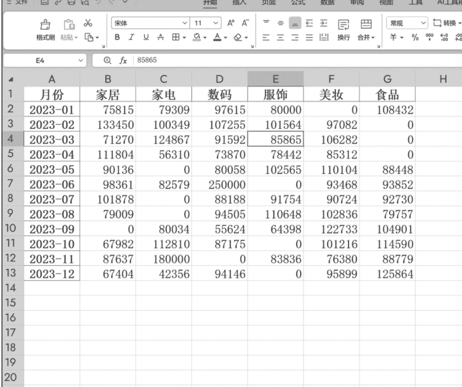

图5-1 筛选出“华东地区”2023年1—12月每个月销售额排名前5的产品

### 2. 实战场景二：动态看板自动更新

市场部每月初需要更新包含12个维度的动态看板，传统方法需手动调整每个字段。可以使用AI工具生成智能模板，减少工作量。向腾讯元宝输入下面的提示词：“我是系统管理员，系统是基于Python开发的，请你帮我生成连接数据的功能代码，要求创建连接数据库的动态透视表，每日9点自动刷新各渠道转化率。”

腾讯元宝将根据我们的要求，提供基于Python的数据库动态透视表生成与定时刷新方案。该方案整合了数据库连接、数据透视表生成和定时任务功能，支持每日9点自动刷新各渠道转化率数据。以下是代码示例：

```python
import pandas as pd
from sqlalchemy import create_engine
from apscheduler.schedulers.blocking import BlockingScheduler
from datetime import datetime
import logging

# 配置日志记录
logging.basicConfig(
    level=logging.INFO,
    format='%(asctime)s - %(levelname)s: %(message)s'
)

# 数据库配置（以MySQL为例）
DB_CONFIG = {
    'user': 'your_username',
    'password': 'your_password',
    'host': 'your_host',
    'port': 3306,
    'database': 'your_database',
    'charset': 'utf8mb4'
}

def create_db_connection():
    """创建数据库连接"""
    try:
        engine = create_engine(
            f"mysql+pymysql://{DB_CONFIG['user']}:{DB_CONFIG['password']}@"
            f"{DB_CONFIG['host']}:{DB_CONFIG['port']}/{DB_CONFIG['database']}?charset={DB_CONFIG['charset']}"
        )
        return engine
    except Exception as e:
        logging.error(f"数据库连接失败：{str(e)}")
        raise

def generate_pivot_table():
    """生成动态透视表"""
    try:
        engine = create_db_connection()

        # 从数据库读取原始数据
        query = """
            SELECT channel, conversion_rate, event_date
            FROM marketing_data
            WHERE event_date >= CURDATE() - INTERVAL 7 DAY
        """
        df = pd.read_sql(query, engine)

        # 创建透视表
        pivot_table = pd.pivot_table(
            df,
            values='conversion_rate',
            index='channel',
            columns='event_date',
            aggfunc='mean',
            fill_value=0,
            margins=True,
            margins_name='总计'
        )
        ......
```

(由于篇幅有限，输出结果在此省略，建议读者亲自上手实践。)

### 3. 实战场景三：多表批量处理

集团企业的区域数据分析人员，每月需要处理200+分公司的原始数据文件。可以向腾讯元宝输入如下提示词：“帮我生成Python数据处理代码，批量处理D:\data目录下的所有xlsx文件，并生成带时间戳的透视表报告。”

腾讯元宝会根据需求生成Python代码，以批量处理指定目录下的Excel文件，并生成带时间戳的透视表报告。下面是代码示例：

```python
import pandas as pd
import os
from datetime import datetime

def batch_pivot_report(input_dir, output_dir):
    """
    批量处理 Excel 文件并生成带时间戳的透视表报告
    参数:
        input_dir: 输入目录 (如: D:/data)
        output_dir: 输出目录
    """
    try:
        # 获取所有 Excel 文件
        all_files = [f for f in os.listdir(input_dir) if
            f.endswith('.xlsx')]
        if not all_files:
            raise ValueError("目标目录中未找到 xlsx 文件")

        # 合并数据
        merged_data = pd.DataFrame()
        for file in all_files:
            file_path = os.path.join(input_dir, file)
            df = pd.read_excel(file_path)
            df['来源文件'] = file  # 记录数据来源
            merged_data = pd.concat([merged_data, df],
                ignore_index=True)

        # 数据清洗
        merged_data = merged_data.drop_duplicates()  # 去重
        merged_data.fillna(0, inplace=True)  # 填充空值

        # 生成时间戳
        timestamp = datetime.now().strftime("%Y%m%d_%H%M%S")
        output_file = os.path.join(output_dir, f"数据透视表_
            {timestamp}.xlsx")

        # 创建透视表
        with pd.ExcelWriter(output_file, engine='openpyxl') as writer:
            # 基础数据表
            merged_data.to_excel(writer, sheet_name='原始数据',
                index=False)
        ......
```

(由于篇幅有限，输出结果在此省略，建议读者亲自上手实践。)

## 4. 总结

腾讯元宝的数据透视解决方案，本质是将复杂的字段逻辑转化为可复用的业务模块。从临时取数到战略看板，建议从这三个层面推进：

- 1）基础层：建立常用分析模板库（区域分析/产品线对比/时间序列）。
- 2）中间层：开发部门级自动化脚本（自动邮件发送/异常值标注）。
- 3）战略层：构建企业级数据枢纽（多系统数据融合分析）。

#### 试一试

在腾讯元宝中输入：“我正在处理Excel数据，请你帮我生成Python代码，用于生成7月华北区门店的坪效分析透视表，按周对比人效与库存周转率。”观察它是如何自动拆解“坪效”指标的计算逻辑，并生成带动态筛选条件的报表框架的。

#### 小贴士

- 1）字段命名规范会直接影响指令识别准确率，建议统一使用“区域_事业部_指标”结构。
- 2）复杂计算字段建议分步创建，先验证基础公式再组合嵌套。

## 技巧44

### 探索性数据分析：洞察数据分布规律，厘清数据分析方向

在完成了基础的数据预处理之后，先别急着建模，而是先听懂数据在说什么。很多职场人拿到数据就急着跑算法，结果模型效果差、业务方不买账—问题往往出在没做好探索性数据分析（Exploratory Data Analysis，EDA）。数据里的异常值、分布规律、变量关系，就像藏在迷宫里的线索，而EDA就是你的探照灯。

使用腾讯元宝的EDA功能就像给数据装上“透视镜”。不需要编程基础，通过自然语言对话就能完成数据分布检查、异常值识别、相关性分析等关键步骤。更重要的是，它能用通俗易懂的语言解释统计结果，直接给出下一步建议。

### 1. 第一步：数据质量速查

数据质量速查通常在数据清洗之后进行，这一步能够帮助我们更好地理解数据中的结构、规律或者潜在问题，评估数据质量，让数据分析人员对数据形成初步的理解，为后续的数据处理和建模提供方向。

将你初步清洗过的数据集上传到腾讯元宝中，输入：“请对以下数据集进行基础探索性数据分析（EDA），要求：①统计缺失值比例；②列出数值型/分类变量的分布特征；③检测异常值，并给出处理建议。”

部分输出结果示例：

#### 1. 缺失值分析

检查所有字段后未发现缺失值（所有100条记录各字段均完整）。

缺失值比例：0%（所有字段）。

#### 2. 变量分布特征

数值型变量：

□支付金额（单位：元）

·描述统计：

Mean:288.74 Median:293.61

Min:120.44 Max:504.35

Std:83.51 Q1:241.83 Q3:353.20

·分布特点：右偏分布（均值<中位数），存在少量极高值

分类变量：（略）

#### 3. 异常值检测与处理建议（略）

处理方案建议：

- 1）对极端金额采用Winsorize处理（将超出1%～99%分位数的值替换为临界值）。
- 2）保留重复购买记录（电商场景合理）。
- 3）补充收集商品单价/数量信息以验证金额合理性。

怎么用EDA结果？优先处理红色预警项。比如发现某关键指标缺失率超30%，就该回头找业务方确认数据采集流程，而不是硬着头皮建模。

### 2. 第二步：数据分布可视化

想知道用户年龄集中在哪个区间？促销效果是否符合正态分布？在腾讯元宝中上传你想要分析的非涉密数据集，以分析一个用户年龄数据集为例，输入提示词：“用直方图+箱线图分析用户年龄分布，用文字描述关键特征：①集中区间；②偏态方向；③离群点数量。用HTML格式生成EDA可视化结果。”

腾讯元宝会生成用户年龄分布分析的HTML代码，以及对分析结果的详细说明。

（HTML代码略）

分析结果详细说明：

（1）集中区间

从直方图和箱线图可以看出，大部分用户的年龄集中在25～45岁，这个区间包含了数据的主体部分。特别值得注意的是30～40岁区间，这个区间的用户密度最高，表明这是用户年龄分布的核心区域。

（2）偏态方向

分布呈现轻微的右偏（正偏态），这意味着：均值＞中位数（从箱线图可以看出中位数在35岁左右），数据右侧（高龄部分）有较长的尾部，少数高龄用户拉高了整体年龄的平均值。

（3）离群点数量

数据中存在两类明显的离群点：

- 低龄离群点（15～24岁）：数量较少，主要是青少年和青年用户。
- 高龄离群点（60岁以上）：数量相对较多，主要是中老年和老年用户。

这些离群点的存在丰富了用户年龄的多样性，但整体上不影响25～45岁作为主要年龄区间的结论。

运行生成的HTML代码，得到的EDA可视化结果如图5-2所示。

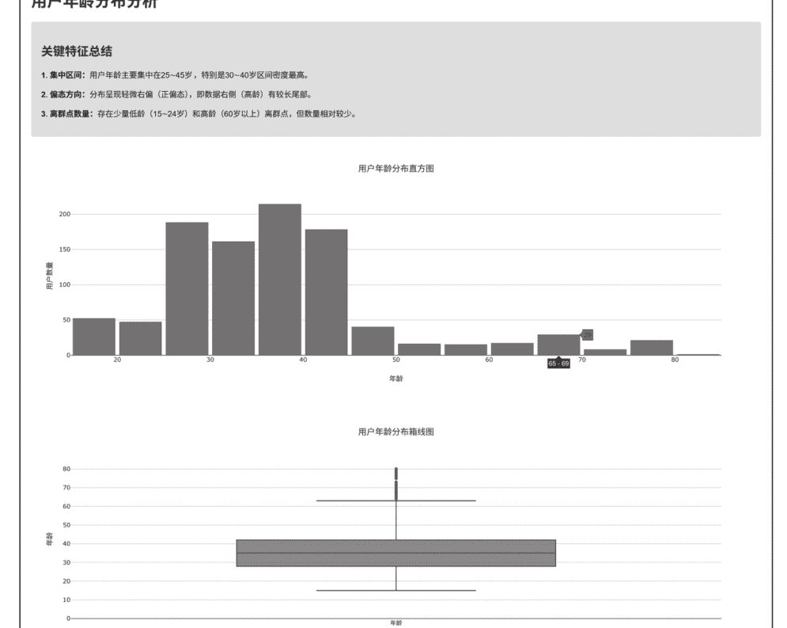

图5-2 运行HTML代码，得到的EDA可视化结果

正偏态数据可能需对数变换，离群点则需要决定保留还是剔除。

### 3. 第三步：变量关系挖掘

销售淡旺季和天气有关？客单价和停留时长是否存在线性关系？要了解这类问题，可以输入提示词：“用散点图矩阵分析这三个关系：①气温vs销量；②页面停留时长vs转化率；③折扣力度vs退货率。标注相关系数。”

腾讯元宝会给出具体的分析结果说明：

(1) 气温vs销量：相关系数r=0.98（强正相关）

散点图显示近乎完美的线性关系，气温升高时销量显著增加，可能反映季节性需求（如夏季服装/冷饮等）。

(2) 页面停留时长vs转化率：相关系数r=0.99（极强正相关）

数据点紧密分布在回归线周围，说明停留时间越长转化率越高。建议优化页面内容以延长用户停留时间。

(3) 折扣力度vs退货率：

……

(4) 商业建议：高温时段提前备货；通过A/B测试优化页面设计；对高折扣商品实施更严格的退货政策；需要更高分辨率的图表或具体统计检验结果做进一步补充。

（由于篇幅有限，输出结果在此省略，建议读者亲自上手实践。）

强相关变量可优先入模，非线性关系需使用特征工程进行处理。

### 4. 第四步：建模方向建议

腾讯元宝能根据EDA结果推荐算法。比如发现数据有周期性波动时，输入提示词：“根据以下EDA特征推荐适合的预测模型并说明理由：①销量存在7天周期；②用户地域集中度高；③价格弹性系数为0.8。”

腾讯元宝可能会建议：

#### 1. Prophet（时间序列模型）

适用理由：

周期性建模：①Prophet内置周期性（如7天周循环）的自动检测与拟合能力，可通过weekly_seasonality参数直接配置，无须手动构造滞后特征。②支持自定义季节性参数（如fourier_order），灵活应对复杂周期模式。

外生变量支持：（略）

可解释性：（略）

#### 2. XGBoost/LightGBM（树模型）（略）

#### 3. SARIMAX（季节性自回归模型）（略）

> （由于篇幅有限，输出结果在此省略，建议读者亲自上手实践。）

总结：Prophet和XGBoost/LightGBM为最优选，前者强在解释性与周期性建模，后者胜在灵活性与非线性捕捉，可根据业务资源与目标进行选择。

### 5. 总结

## 技巧45

## 数据建模：用腾讯元宝搞定模型选择、代码生成和结果解读

数据建模最让人头疼的是什么？不是写代码，而是面对一堆算法时，根本不知道哪个适合当前的业务场景。更尴尬的是，好不容易跑出结果，却发现模型解释性太差，业务部门听完还是一头雾水：“所以这个模型到底能帮我们做什么？”

当数据科学家还在纠结随机森林的max_depth参数时，业务团队可能已经在用Excel做决策了。这种脱节让数据建模变得毫无用武之地：技术越复杂，离业务实际越远。

如何让建模既专业又实用？腾讯元宝可以成为你的智能建模助手。

### 1. 第一步：用自然语言获取模型选择建议

与其在算法海洋里盲目试错，不如先让腾讯元宝根据业务需求推荐合适方案。比如需要预测用户流失时，可以输入：“现有10万条用户行为数据，包含30个特征，目标是预测下月用户流失概率（二分类），请推荐3种适合的算法并说明各自优缺点，用表格形式输出。”

腾讯元宝可能会给出：

| 算法 | 优点 | 缺点 |
| :--- | :--- | :--- |
| XGBoost | • 高性能，适合结构化数据（10万条）<br>• 自动特征重要性分析<br>• 抗过拟合（正则化）<br>• 支持并行计算 | • 超参数调优较复杂<br>• 解释性弱于线性模型<br>• 训练时间可能较长（相比逻辑回归） |
| 逻辑回归 | • 训练速度快，适合大规模数据<br>• 强解释性（可量化特征影响）<br>• 稳定性高，不易过拟合 | • 无法自动捕捉非线性关系<br>• 依赖特征工程（如标准化、分箱）<br>• 对异常值敏感 |
| 随机森林 | • 抗过拟合（Bagging + 随机特征子集）<br>• 不需要数据分布假设<br>• 鲁棒性强（对缺失值/噪声不敏感） | • 计算成本较高（树数量多时）<br>• 解释性有限（仅具有特征重要性，无方向性）<br>• 可能存在冗余特征，影响性能 |

### 适用场景补充

（1）XGBoost：优先选择，尤其适合特征间存在复杂非线性关系且追求高精度的场景。

（2）逻辑回归：适合需要快速训练模型或强业务解释性（如生成流失原因报告）的场景。

（3）随机森林：适合平衡性能与稳定性，或特征工程较少的场景。

可根据数据分布（如类别不平衡）和业务需求进一步优化（如调整采样策略或超参数）。

### 2. 第二步：一键生成可运行的模型代码

获得算法选择建议之后，传统的做法是一行一行敲代码，而有了腾讯元宝之后的做法是通过它直接获取可落地的代码，输入：“请用Python给出上述XGBoost分类的完整代码示例，要求：①包含特征工程和模型评估；②添加中文注释；③输出按特征重要性排序。”

系统会生成包含数据预处理、模型训练、指标评估的完整代码块，甚至还有实际应用建议。由于篇幅有限，生成的Python代码结果在此省略，读者可以亲自上手实践。

### 3. 第三步：用业务语言解读技术指标

建模之后会得到一堆专门用于衡量模型准确性的指标，例如 AUC=0.85，F1 score=0.976等，别急着报数字，让腾讯元宝帮你翻译成业务语言。例如输入：“请用业务语言解释以下模型表现：①测试集AUC=0.85；②召回率=72%；③特征重要性Top3，包括最近浏览天数、加购次数、历史客单价。说明这些指标对运营策略的指导意义。”

腾讯元宝输出结果示例：

#### 1. 模型表现解释

①测试集AUC=0.85

- □通俗理解：模型的预测能力相当于“100次预测中有85次能正确区分流失用户和留存用户”。
- □类比：类似考试得85分（满分为100分），属于优秀水平（一般AUC>0.8即好模型）。
- □业务意义：模型能较可靠地识别潜在流失用户，可优先对高分用户采取干预措施。

②召回率=72%（略）

③特征重要性Top3（略）

#### 2. 对运营策略的指导意义（略）

#### 3. 总结：模型如何驱动业务决策

- AUC=0.85：告诉我们可以相信模型的预测结果，集中资源干预高风险用户。
- 召回率=72%：提醒我们还需人工补充排查，避免漏网之鱼（尤其是高价值用户）。
- Top3特征：直接指出用户流失前的行为模式，帮助设计精准的“防流失”钩子（如加购提醒、浏览唤醒）。

最终目标：用最低成本挽回最多可能流失的用户，同时提升高价值用户的留存率。

### 4. 第四步：自动生成完整分析报告

得到模型的分析结果之后，更重要的一步是要把零散结果整合成有逻辑的叙述，形成完整的数据分析报告，在撰写数据分析报告的时候还要根据不同的汇报对象选择不同的汇报框架，关于如何撰写数据分析报告的内容将在本书后面具体讲解。输入：“根据上述分析结果，帮我整理一份给业务部门看的报告框架，包含：①核心发现（不超过3点）；②可落地的运营建议；③模型局限性说明；④下一步优化方向。”

输出结果示例：

#### 用户流失预测模型业务报告框架

目标：基于模型分析结果，制定可落地的用户留存策略，并明确后续优化方向。

##### 一、核心发现（关键结论）

1. 模型预测能力优秀

□AUC=0.85，能可靠识别85%的潜在流失用户，优先干预高分用户效率更高。

2. 用户流失的三大信号

□最近未浏览（最近浏览天数多）、加购次数减少、历史客单价低是流失前的最强行为特征。

3. 覆盖范围需权衡

□当前模型能捕捉72%的流失用户（召回率），但仍有28%漏判，需结合人工复核以降低风险。

##### 二、可落地的运营建议（略）

##### 三、模型局限性说明（略）

##### 四、下一步优化方向（略）

（由于篇幅有限，输出结果在此省略，建议读者亲自上手实践。）

### 5. 总结

数据建模要避免陷入技术完美主义的陷阱。用腾讯元宝辅助数据建模的秘诀是：让腾讯元宝处理标准化的技术工作（算法选择、代码编写），把人类智慧集中在业务逻辑闭环上。记住，好的数据模型不是数学竞赛作品，而是用通俗易懂的话说清楚商业价值的决策工具。

#### 试一试

1. 用“业务目标+数据类型+样本量”的格式描述你的建模需求。
2. 让AI对比三种算法的商业应用场景差异。
3. 将模型评估指标翻译成业务影响说明。
4. 生成包含“问题-方法-洞见-建议”的完整报告框架。

#### 小贴士

1. 重要模型保留10%人工验证样本。
2. 定期让AI解释特征工程背后的业务含义。
3. 复杂项目采用“AI初筛+专家会诊”模式。
4. 所有数据结论需经业务负责人二次确认。

## 技巧46

## 数据分析报告撰写：腾讯元宝搭建报告框架的三个技巧

职场人最怕的不是数据复杂，而是报告写完但毫无实际指导意义。当业务方吐槽“报告结论像谜语”，当领导皱眉“看不出行动方向”，数据分析瞬间变成心理负担。更尴尬的是，同样的数据在季度初叫“潜力巨大”，到月底就成为“风险预警”—这不是分析偏差，而是报告框架缺乏业务逻辑和展示重点。

传统数据分析报告写作总在两种困境里打转：要么沉迷于炫技式图表堆砌，要么困在“问题-建议”的老套路里。市场部拿着运营部的报告要重新翻译，技术团队看着销售部的分析得反向解码。当管理层需要“数据支撑的决策清单”时，很多人对着成堆的分析结果却拼不出行动地图。

如何让数据分析报告成为决策者的指南针？怎样把分析结论转化为部门的任务表？这三个用腾讯元宝搭建报告框架的技巧值得掌握。

### 1. 用“问题树”替代“目录树”

好报告不是数据陈列，而是问题追踪。多数人习惯先写分析过程再得出结论，实际上应该倒过来—先确定要解决的核心问题，再让数据成为证据链。

例如输入：“现有用户流失数据包含登录频率、功能使用、客诉记录三个维度，请按问题树结构搭建框架：①主干问题（如：高价值用户为何集中流失）；②分支问题（价格敏感度/竞品动态/体验断点）；③证据需求（需补充哪些数据验证假设）。输出结构图并标注重点分析模块。”

腾讯元宝可能会生成：

1. 用户流失问题树分析框架（结构图）
2. 主干问题：高价值用户为何集中流失？
（核心目标：定位高价值用户流失的核心驱动因素）
（1）分支问题1：价格敏感度是否导致流失？
子问题：
□用户是否因价格调整（如涨价、优惠减少）而流失？
□付费功能使用率是否下降？
□流失用户中高消费群体的占比是否异常？
证据需求：（略）
重点分析模块：（略）
（2）分支问题2：竞品动态是否吸引用户转移？（略）
（3）分支问题3：产品体验是否存在断点？
3. 结构图标注重点模块（略）

（由于篇幅有限，输出结果在此省略，建议读者亲自上手实践。）

这种结构可以让每个分析模块都锁定具体问题，避免无目的的数据陈列。

### 2. 给数据结论装上“翻译器”

当分析显示“转化率提升7%”，业务方可能无动于衷。但若说明“相当于每月多成交350单，年度增收420万元”，决策价值立即显现。数据解读的关键在于建立数字与业务价值的换算公式。

例如输入：“将新用户转化分析数据转化为业务影响说明：①注册转化率提升对应多少有效线索；②每提升1%可节省多少推广费用；③关键行为数据与复购率的关联强度。要求：重要换算过程用白话解释。”

腾讯元宝可能会输出：

#### 新用户转化分析→业务影响说明（白话版）

①注册转化率提升对应多少有效线索？

换算过程：假设现在每月有100万用户访问注册页面，当前注册转化率是2%（100万人×2%=2万有效线索）。如果优化后转化率提升到3%（100万人×3%=3万有效线索），相当于多赚了1万条有效线索。

白话版：每多让1%的用户注册成功，等于从同样的流量里多获得1万条能跟进销售的潜在客户，相当于白送一个线下地推团队干半年的成果。

②每提升1%注册转化率，可节省多少推广费用？

白话版：转化率每提高1%，相当于把每个客户的获取成本从5块砍到3块3，省下的钱能再投一波广告，或者给团队发奖金。

③关键行为数据与复购率的关联强度（略）

执行建议：把省下的推广费投到“加购后发优惠券”功能上，同时优化注册页面的按钮文案和加载速度。

（由于篇幅有限，输出结果在此省略，建议读者亲自上手实践。）

这种翻译让数据结论自动对接KPI，节省决策者的换算时间。

### 3. 让建议方案自带“施工图”

“加强用户体验”“优化运营策略”这类建议之所以被无视，是因为缺乏可落地的行动坐标。有价值的建议必须包含三个要素：具体动作、责任部门、效果预判。

例如输入：“根据用户留存分析结果，设计三级实施方案：①7天内可上线的应急措施（明确执行团队）；②30天中期计划（标注资源需求）；③90天长效方案（说明协同机制）。要求：每级方案附带效果追踪指标。”

腾讯元宝可能会输出：

#### 一、7天应急措施（快速止血）

执行团队：用户运营组（负责人）+技术团队（支撑）+客服团队（配合）

核心动作：

1. 流失预警弹窗（技术团队48小时内上线）：①在7日未登录用户启动App时，对其触发福利弹窗，赠送限时3天使用的满减券；②数据埋点为弹窗曝光率&点击率。
2. 关键路径Bug修复（产品技术联合排查）：①优先解决注册流程跳出率>35%的页面卡顿问题；②解决新用户首次支付成功率<60%的支付接口延迟问题。
3. 人工召回专线（客服团队执行）：①对高价值流失用户（历史ARPU＞200元）进行电话回访；②建立流失原因分类标签库（系统问题/内容不足/价格因素）。

效果追踪指标：（略）

二、30天中期计划（体系化攻坚）（略）

三、90天长效方案（生态级改造）（略）

该方案通过短中长期措施组合，形成“止血-修复-加固”的留存提升闭环，建议配合灰度发布策略逐步验证效果，降低试错成本。

（由于篇幅有限，输出结果在此省略，建议读者亲自上手实践。）

这种分层设计让建议摆脱空中楼阁状态，直接转化为部门待办事项。

## 4. 总结

优秀的数据报告是决策者的行动蓝图。用腾讯元宝搭建报告框架时，要抓住三个转换关键：把数据陈列变成问题追踪，把统计结论转作价值清单，把常规建议升级为实施方案。当报告的每个段落都能对应到具体会议决策，数据分析才能真正从PPT走向实战。

#### 试一试

输入：“用库存周转数据设计决策框架，要求：①区分季节性波动与系统性风险；②制定采购/促销/清仓三级响应方案；③标注部门协作流程与时间节点。”

#### 小贴士

1. 在提问前加“假设你是要在经营决策会上汇报的数据负责人”，提升方案高度。
2. 遇到模糊结论时追问“请用加减乘除说明这个发现的影响程度”。
3. 关键图表备注“请用会议场景语言解释此图的核心信息”。
4. 所有方案需标注“此建议的实施前提是[某条件]，需同步监控[某指标]”。

## 技巧47

## 数据分析实战：财务报表智能分析

财务人员在月末结算时最头疼的，往往是数据核对的反复拉锯。原始数据散落在纸质单据、电子表格和业务系统之中，光是汇总对齐就要切换五六个平台。手工录入时容易看错行号，公式链接稍有不慎就会引发连锁错误，等到发现借贷不平时，往往需要逆向排查几十条关联数据。更棘手的是，当需要将同一份数据同步更新到不同格式的统计表时，人工操作极易出现版本错位，有时甚至会影响资金调拨的准确性。

接下来将具体介绍三个运用腾讯元宝的典型场景，帮助财务人员实现从基础数据整理到智能分析报告生成的全流程提效。

### 1. 场景一：整理多个不同文件格式的原始数据文件

当你遇到数据来源杂乱无章，纸质票据、PDF扫描文件、Excel表格混杂交错，光是整理原始数据就需要耗费大量精力的时候，可以试试向腾讯元宝寻求解决办法。比如你有一份PDF格式的利润表，格式比较混乱，那么你可以上传这份文档给腾讯元宝，并输入提示词：“我在整理数据，数据来源是PDF，请帮我生成Python代码，要求提取2023年第一季度利润表中的以下字段：①主营业务收入（总行数≥3时取累计值）；②营业成本（区分固定成本和变动成本）；③税费（需扣除减免部分）。同时要求输出为JSON格式，数值单位统一为万元。”

腾讯元宝会给出Python操作代码示例：

```python
import pdfplumber
import re
import json

def extract_financial_data(pdf_path):
    # 初始化存储结构
    result = {
        "主营业务收入": {"value": 0, "unit": "万元"},
        "营业成本": {
            "固定成本": 0,
            "变动成本": 0,
            "unit": "万元"
        },
        "税费": {
            "总额": 0,
            "减免金额": 0,
            "实际税费": 0,
            "unit": "万元"
        }
    }

    with pdfplumber.open(pdf_path) as pdf:
        # 合并所有页面表格数据
        all_rows = []
        for page in pdf.pages:
            table = page.extract_table()
            if table:
                all_rows.extend(table)
        ......
```

（由于篇幅有限，输出结果在此省略，建议读者亲自上手实践。）

### 2. 场景二：快速生成财务报表

手工编制财务报表时，公式链接错误、格式不统一等问题频发，核对时间超过实际制作时间。这个时候可以向腾讯元宝寻求帮助，寻找快速生成报表的办法。向腾讯元宝输入提示词：“我在做数据分析，需要基于Excel表中2025年1—3月数据生成合并利润表，包含下面这些内容：①销售收入，1440万元（含增值税87万元）；②成本构成，原材料610万、人工费200万；③费用，销售佣金5%、管理费用固定额65万元；④所得税率25%。请你帮我生成解决这个问题的Python代码，要求：计算过程分步展示，差异项标红提示，同时输出格式为Markdown表格（保留两位小数）格式。”

腾讯元宝将根据要求输出方案，用Python实现分步骤计算并生成带有差异项标红提示的合并利润表：

```python
import pandas as pd

# 基础数据
sales = 14400000          # 含税销售收入
vat = 870000              # 增值税
raw_material = 6100000    # 原材料
labor = 2000000           # 人工费
management_fee = 650000   # 固定管理费
tax_rate = 0.25

# 分步骤计算（含差异检查）
steps = [
    ("含税销售收入", sales, "用户提供"),
    ("增值税", -vat, "用户"),
    ("营业收入", sales - vat, "=14400000 - 870000"),
    ("原材料成本", -raw_material, "用户提供"),
    ("人工成本", -labor, "用户提供"),
    ("销售佣金", -(sales * 0.05), "差异项：佣金基数应为不含税收入", True),
    ("管理费用", -management_fee, "用户提供"),
    ("营业利润", None, "自动计算"),
    ("所得税", None, "=营业利润 × 25%"),
    ("净利润", None, "自动计算")
]

# 构建DataFrame
df = pd.DataFrame(steps, columns=["项目", "金额", "计算说明", "差异提示"])
df["金额"] = df["金额"].astype(float)
......
```

（由于篇幅有限，输出结果在此省略，建议读者亲自上手实践。）

## 3. 场景三：高效呈现分析图

在分析决策缺乏直观的依据时，可以尝试用腾讯元宝快速生成动态仪表盘、数据分析图。向腾讯元宝输入提示词：“我是数据分析师，我的数据是Excel表格，在进行数据分析时，我遇到的问题是静态报表无法快速响应业务变化，看不到趋势和预警，请你帮我生成一个解决问题的Python代码，用于生成动态分析仪表盘，并分析近半年现金流数据，包含：①计算运营资金周转天数；②预测未来3个月资金缺口；③标注异常波动月份。代码输出要包含折线图、关键指标卡片、风险提示模块。”

腾讯元宝将输出一个结合时间序列分析和可视化技术的基于Python的现金流动态分析仪表盘解决方案，以下是代码示例：

```python
import numpy as np
import plotly.graph_objects as go
from plotly.subplots import make_subplots
from sklearn.linear_model import LinearRegression
from statsmodels.tsa.seasonal import seasonal_decompose
```

```python
# 1. 数据准备 (假设数据格式: 日期、现金流入、现金流出、存货、应收账款、应付账款)
df = pd.read_excel('cash_flow.xlsx', parse_dates=['日期'],
    index_col='日期').last('6M')
```

```python
# 2. 计算运营资金周转天数
def calculate_cycle_days(df):
    # 计算各周转天数
    df['存货周转天数'] = (df['存货'].mean() / (df['现金流出'].
        sum()/180)) * 30
    df['应收周转天数'] = (df['应收账款'].mean() / (df['现金流入'].
        sum()/180)) * 30
    df['应付周转天数'] = (df['应付账款'].mean() / (df['现金流出'].
        sum()/180)) * 30
    df['运营资金周转天数'] = df['存货周转天数'] + df['应收周转天数'] -
        df['应付周转天数']
    return df[-1]['运营资金周转天数']

current_cycle_days = calculate_cycle_days(df.copy())
```

```python
# 3. 资金缺口预测
def forecast_cash_gap(df, periods=3):
    # 创建时序特征
    df = df.resample('D').interpolate()
    df['现金流净额'] = df['现金流入'] - df['现金流出']

    # 训练预测模型
    model = LinearRegression()

    X = np.array(range(len(df))).reshape(-1,1)
    model.fit(X, df['现金流净额'])
    ......
```

(由于篇幅有限，输出结果在此省略，建议读者亲自上手实践。)

## 4. 总结

Python集成了多种数据处理包，包括结构化数据和非结构化数据的处理包，也包括Excel、PDF、图片等各种文件的处理包，用于识别并处理里面的数据。腾讯元宝可以帮助我们快速生成需要的数据代码，更方便快捷地处理数据。

#### 试一试

在腾讯元宝中输入：“解析附件PDF中的资产负债表，提取流动资产与非流动资产明细，对比上季度数据生成变化趋势图。”

#### 小贴士

- 1) 紧急情况处理：当遇到复杂表格时，在提示词末尾加上“如遇模糊数据，优先标注待确认字段而非猜测”。
- 2) 安全锦囊：在API调用前添加validate_data()函数，可拦截大部分的数据异常。
- 3) 效率组合键：按Alt+Shift+R组合键可以快速调出预设的报表模板库。

# 第6章

## 效率提升：腾讯元宝工作流程优化指南

## 技巧48

## 信息搜索：用腾讯元宝高效检索有用信息

在这个信息爆炸的时代，职场人常陷入这样的困境：需要快速了解某个领域却不知从何处下手，搜索半天找到的资料要么过于零散，要么来源可疑。传统搜索引擎给出的结果像一锅“大杂烩”，需要自己慢慢筛选；AI工具生成的内容又缺乏深度和权威性，无法直接用于专业场景。

更令人头疼的是，当你急需某个行业的最新数据或权威观点时，总是在海量信息中迷失方向，耗费大量时间却收获甚微。如何精准获取可靠信息，并将其快速转化为可用内容，成为现代职场人的核心挑战。

腾讯元宝作为新一代AI助手，正在改变职场人获取和处理信息的方式。它不像传统搜索工具那样只是简单地罗列各个链接，而是能够理解问题本质，直接提供经过梳理的答案，并标明信息来源。

### 1. 技能一：信息搜索的精准捕捞术

单一来源的信息容易有偏差，手动对比又太耗时。可以让腾讯元宝同时抓取多个来源，并自动对比关键点。例如，你想验证某个技术方案的行业评价，在腾讯元宝中输入：“请从以下两个维度对比分析AI助手在企业的应用反馈：①技术社区（如掘金、CSDN）讨论焦点；②企业公开案例（如银行、互联网公司落地报道）。请用表格形式输出，包含观点来源和争议点。”

腾讯元宝可能会给出以下结果（注：表格中的数字编号为腾讯元宝提供的观点来源链接，在实际场景中可点击数字链接对信息进行溯源）：

| 维度 | 反馈观点 | 观点来源 | 争议点 |
| :--- | :--- | :--- | :--- |
| 技术社区讨论 | 效率提升 | 部分开发者认为 AI 助手能提升基础编码效率，尤其在代码补全和重复代码生成上 | 社区用户自发讨论 [4] | 效率是否真实提升存疑：有研究显示，资深程序员使用 AI 助手后开发速度反而下降 19%，因频繁提示打断深度思考，且需花费额外时间对生成的代码进行审查和调整 |
| 技术社区讨论 | 代码质量 | 认可其在生成模板代码、单元测试和基础注释方面的帮助 | 开发者社区文章、评测 [11] | 代码质量参差不齐：生成的代码可能不符合项目规范或最佳实践，甚至引入潜在安全漏洞和性能瓶颈，审查和修正成本较高 |
| 技术社区讨论 | 适用场景 | 认为 AI 助手适合辅助初学者学习、快速生成简单代码片段、处理重复性任务及进行初步的代码审查 | 技术博客、论坛讨论 [4] | 复杂任务支持不足：在涉及复杂业务逻辑、系统架构设计、跨文件理解或深度调试时，AI 助手的能力往往有限，有时甚至会给出误导性建议 |
| 技术社区讨论 | 学习与适应 | 肯定 AI 助手作为“编程导师”的潜力，能帮助开发者学习新语言、框架和常见代码模式 | 社区分享 [5] | 过度依赖风险：担忧新手可能过于依赖 AI 生成代码，而忽视了底层原理和编程思维的系统性训练，不利于长期职业发展 |
| 企业公开案例 | 效率与采纳 | 效率提升显著：腾讯内部超 80% 程序员使用 AI 助手，日均代码 33% 为 AI 生成，整体编码效率提升 42% [3]。哈啰集团接入通义灵码后，研发效率提升 19%，AI 代码采纳率超 25% [6] | 企业新闻发布会、案例报告 [3][6] | 效率度量标准：企业公布的效率提升数据通常为内部统计数据，外界难以精确评估度量标准（如代码行数、功能点完成时间）是否科学和全面 |
| 企业公开案例 | 安全与合规 | 高度重视：金融、保险等行业企业（如工商银行 [8]、人保科技 [7]）在引入 AI 助手时，优先选择支持私有化部署的国产产品，确保代码不离境，并深度融合企业自身的开发生命周期和安全规范 | 企业中标公告、合作新闻 [7][8] | 成本与定制化：私有化部署和深度定制需要较高的投入，并非所有企业都能负担。如何平衡安全合规与成本效益，是企业需要考虑的问题 |
| 企业公开案例 | 质量与风险控制 | 效果显著：人保科技采用“AI+ 代码卫士”后，漏洞发现效率提升 300%，高危漏洞拦截率超 95%，人工审计时长平均缩短 83.63% [7] | 行业落地报道 [7] | AI 工具局限性：企业承认 AI 生成代码并非百分百准确，仍需人工专家进行最终评审和决策 |
| 企业公开案例 | 融合与一体化 | 与现有研发流程深度融合：企业不仅用 AI 生成代码，还将其应用于智能代码审查（如哈啰 [6]）、自动化测试、漏洞排查，甚至自研的 Copilot 平台中，形成端到端的智能研发体系 | 企业案例分享 [6] | 流程变革挑战：将 AI 深度融入现有开发流程，可能需要对工作方式、组织架构和人员技能进行一定程度的调整和变革，这会带来管理上的挑战 |

### 2. 技能二：数据信息的高效整理术

在处理数据文件的时候，当需要对多份文件进行数据的合并、清洗、建模、分析、可视化等操作时，普通做法可能是直接手动对比这些文件，用VLOOKUP函数查到“眼冒金星”。而高阶做法是利用腾讯元宝的数据清洗、合并、分析功能，让它帮你生成处理数据的Python代码或者分析结果。

例如，我们要合并5月—7月销售数据表，去重并标记异常值，生成可视化图表，最终给出数据分析结论。可以在腾讯元宝中输入：“请合并市场部5月—7月销售数据表，自动去重并标记异常值，生成分区域环比增长率热力图，重点标注增长率超20%的品类，帮我生成数据分析结论并给出需要重点关注的地方。”

上传数据后，腾讯元宝可能会输出：

根据您提供的销售数据，已完成数据整合与分析。以下是结构化分析结果及建议：

### 一、数据预处理

- 1. 合并5月—7月数据后共12条记录（每月各4条）。
- 2. 检测到北区产品B存在重复记录（5月销售额1500元重复两次），已进行去重处理。
- 3. 发现南区产品C 7月数据存在异常波动（异常波动值为1500元，Z-score为2.8），已标记。

### 二、环比增长率分析

| 区域 | 品类 | 5月—6月增长率 | 6月—7月增长率 |
|---|---|---|---|
| 北区 | 产品 A | 20% | 25% ★ |
| 北区 | 产品 B | 6.67% | 12.50% |
| 南区 | 产品 A | 12.50% | 11.11% |
| 南区 | 产品 C | 8.33% | 15.38% |

（★表示增长率突破20%）

### 三、核心结论（略）

### 四、重点关注建议（略）

### 五、可视化建议（略）

如需完整分析代码或详细数据溯源报告，可随时告知。当前结论基于样本数据，建议补充完整数据集后做最终决策。

（由于篇幅有限，输出结果在此省略，建议读者亲自上手实践。）

这里用到的提示词模板：“请整合[数量]份[文件类型]，进行[去重/校验]处理，按[分析维度]生成[可视化形式]，突出显示[特定条件]的数据。”

## 3. 总结

这套技能的底层逻辑是：把重复劳动交给腾讯元宝，让人类专注于创造性决策。记住，会搜索的人“找答案”，会提问的人“造答案”。当你能用“请比较A方案和B方案在成本、时效、风险维度的优劣，给出实施路线图建议”代替“哪个方案更好”时，你就学会如何使用腾讯元宝高效处理信息了。

#### 试一试

在腾讯元宝中输入“我正在准备新能源汽车行业分析报告，需要近两年政策变化、技术突破、消费趋势三方面信息，请用时间轴+数据看板形式呈现，重点标注对中小企业的影响”，观察它如何把碎片信息变成决策仪表盘，体验从信息搬运工到战略分析师的进化之路。

#### 小贴士

- 1) 遇到复杂需求时，拆解成“分析范围+处理方式+输出形式+特别要求”四要素。
- 2) 对于重要文件记得追加“请检查数据来源可靠性”这类校验指令。
- 3) 多用“假设你是行业专家，你会如何呈现这个主题”来激活深度分析模式。
- 4) 定期整理常用提示词模板，建立个人智能工作提示词库。

## 技巧49

## 工作流程优化：用腾讯元宝三招拆解工作任务

没有腾讯元宝时，整理会议纪要需要逐条核对录音和笔记，汇总数据要反复检查格式和公式，写报告时既要组织内容又要调整排版，这些重复性工作占用了大部分时间，真正需要思考的部分反而要留到最后一刻完成。更麻烦的是，当多个任务同时堆积（比如要赶一份报告，又要整理跨部门数据，还要准备下周的汇报）时，手动处理很容易出错，或者遗漏关键信息。

这时候，可以让腾讯元宝帮你简化流程。它不仅能快速整理信息，还能自动生成结构化内容，减少重复劳动。接下来会介绍三个具体秘笈，帮助你更高效地处理这些烦琐的工作。

### 1. 秘笈一：任务拆解术—把大象装进冰箱只需三步

面对复杂的任务但是拖延症犯了，如何快速拆解任务，厘清头绪？试试在腾讯元宝中输入提示词：“我正在写年终总结，但是拖延症犯了，请设计5个游戏关卡帮我完成任务，每个关卡不超过15分钟，完成有奖励提示。”

腾讯元宝可能生成：

- 关卡1 破冰冲刺（12分钟）：用手机倒计时，写下今年所有工作关键词（想到就写，不筛选）。
- 关卡2 碎片拼图（15分钟）：把电脑桌面、微信收藏、笔记软件里的年度文件拖进分别命名为①～⑫的月份文件夹。
- 关卡3 成就暴击（10分钟）：翻看全年聊天记录，找出3次被同事或客户表扬的时刻并截屏。
- 关卡4 BOSS分身战（14分钟）：给虚拟的拖延兽写信：“今年阻止我完成的3件事是______”
- 终局之战 时间胶囊（15分钟）：用初稿第一段+最后一段搭好框架，中间写[待填充]。

奖励提示：赢得完成者礼包（真实奖励建议：新本子/电子书）。

有了这套方法，你就可以通过游戏来完成任务。当然，如果你想得到进一步的建议，不妨尝试继续提问：“请给我关卡3的详细操作方法。”

### 2. 秘笈二：总结生成器—让AI当你的智能助手

想要迅速整理杂乱琐碎的日常工作记录并将其转化为重点突出的优秀报告？试着向腾讯元宝输入提示词：“将本周客户拜访记录整理成周报，突出转化率提升2%的成果，用‘成果-挑战-计划’结构，控制在300字以内。”

腾讯元宝可能会输出类似这样的结果：

客户拜访周报（3.18—3.24）

#### （1）成果亮眼

- 转化率突破：成功转化6家客户（转化率20%），较上周提升2%，新增月度收入20万元。
- 意向客户增长：新增意向客户10家，覆盖行业A/B/C，并促成3家长期合作（1～3年）。
- 客户反馈高效收集：汇总20条优化建议，聚焦产品、服务及价格策略。

#### （2）核心挑战

- 沟通成本高：部分客户对产品功能及定价存在误解。
- 市场竞争加剧：竞品在具体区域采取低价策略，分流意向客户。
- 决策流程冗长：客户内部多层级审批延缓转化进度。

#### （3）下周发力点

- 目标升级：计划拜访35家客户，重点跟进10家新增意向客户，转化率冲刺22%。
- 精准破局：技术团队协同拜访，用案例资料澄清误解；优化话术，强化差异化优势。
- 稳固合作：回访已转化客户，快速响应需求，提升满意度。

### 3. 秘笈三：数据缝合术—让跨部门数据自动接力

在日常工作中经常会遇到涉及多个部门的不同格式的数据，如何高效地对这些数据进行合并，快速、准确地分析出其中隐藏的信息？可以试着用腾讯元宝帮你整合不同格式的数据，归纳其中的信息。这里以合并三个部门不同数据格式（如PDF、XLSX和JSON格式）的文件，生成带图表的简报的场景为例展开介绍。在实际使用过程中，你还可以参照这个思路上传DOC、TXT、CSV等腾讯元宝能够接收的文件格式进行数据合并整理。例如，向腾讯元宝输入：“整合市场部调研PDF文件、销售部Excel表格、设计部JSON文件，分析Q1产品反馈趋势，生成带图表的三页简报，标注需要改进的前三大问题。”

腾讯元宝会帮你自动处理这些不同格式的数据，并给出详细的简报：

### 第一页：整体反馈趋势概览

#### 1. 用户满意度分布（饼图）

- 非常满意：25%
- 满意：45%
- 一般：20%
- 不满意：10%

结论：整体满意度（满意+非常满意）为70%，但不满意用户占比10%，需重点关注。

……

### 第二页：产品表现对比（略）

### 第三页：前三大问题与改进建议（略）

> （由于篇幅有限，输出结果在此省略，建议读者亲自上手实践。）

使用这么一招“数据缝合术”，就能快速地将原本需要市场专员、数据分析师、设计师花费三天完成的工作，变成一场“数据跨栏接力赛”。

## 4. 总结

这套工作法的精髓在于把腾讯元宝当作统筹全局的“指挥官”，用游戏化思维拆解任务，用智能工具接管重复劳动。当周报生成、会议整理、数据清洗这些“副本任务”变成自动流水线时，你就能腾出精力挑战真正的“BOSS关卡”，比如策划下个季度的爆款方案。

#### 试一试

在腾讯元宝中上传三个不同类型的文件，例如Git日志、DOC版产品需求文档，以及Excel版用户投诉邮件，输入：“请分析技术部Git日志、产品需求文档、用户投诉邮件，找出版更新后出现最多的三个兼容性问题，按紧急程度排序并给出临时解决方案。”

#### 小贴士

- 1) 遇到复杂任务时，先让腾讯元宝列出步骤清单再开工。
- 2) 建立常用提示词模板库，比如“数据分析专用话术”“邮件优雅催款模板”。
- 3) 重要文件生成后，务必进行人工审核。

## 技巧50

## 沟通助手：让腾讯元宝成为你的全能话事人

跨部门协作最头疼的，不是工作本身，而是沟通成本。产品部说“用户体验优化”，技术部听到的是“又要改需求”；市场部提“品牌升级”，设计部理解成“重新做Logo”。每次对接都要反复确认需求，花大量时间解释基本概念。

更麻烦的是，各部门的专业术语就像外语，互相听不懂。销售部急着要“三天上线”的方案，技术部看着“智能推荐”“用户友好”这种模糊描述无从下手。行政部推出“弹性工作制”，执行起来却变成各部门自定规则。等到发现问题时，往往已经耽误进度，补救都来不及。

如何打破这种沟通僵局？腾讯元宝能快速翻译专业术语，把模糊需求拆解成可执行任务，让跨部门协作更顺畅。接下来介绍三个具体招式，解决这些沟通难题。

### 1. 招式一：需求对齐大法—把抽象概念变成可执行的任务要点

当产品部说“我们需要更人性化的交互设计”，而技术部想的是程序代码怎么写的时候，如何将双方的需求从专业语言转化为听得懂、可执行的任务要点？不妨让腾讯元宝充当需求转换器。以协调产品和开发部门的沟通为例，在腾讯元宝中输入：“你正在协调产品部和技术部的沟通，请将以下需求转化为技术部可执行的要点：①原始需求为优化注册流程的用户体验，提升转化率；②补充信息为当前注册步骤分5步，流失率为38%，主要卡点在实名认证环节；③预期效果为注册转化率提升至50%以上。”

## 技术部可执行要点（基于需求拆解）

### 1. 步骤简化与流程重构

- **合并步骤**：将原5步流程压缩至3步以内（如基础信息填写→实名认证→完成注册）。
  - 示例：将“用户信息预填”与“实名认证”合并为单页，利用OCR技术自动识别身份证信息，减少手动输入。
- **预填与默认值**：通过社交账号（如微信、支付宝）授权获取手机号、昵称等基础信息，减少用户输入字段。
- **异步提交**：允许用户在实名认证环节提交后，由后台异步处理审核结果，用户无须等待即可进入下一步。

### 2. 实名认证环节优化（略）

### 预期技术落地效果（略）

### 后续迭代建议（略）

以上方案需技术部优先评估接口（如OCR、活体检测API）对接成本及合规风险，建议分阶段迭代。

（由于篇幅有限，输出结果在此省略，建议读者亲自上手实践。）

## 2. 招式二：会议纪要变形术—把流水账变成行动指南

漫长的会议结束之后，会议内容记录缺失、任务时间安排节点记不清、不同部门对于会议讨论过程有不同解读等情况时常发生。与其让各部门代表带着截然不同的记忆离开会议室，不如用腾讯元宝打造动态任务看板，让不同部门的任务和时间节点一目了然。以将一场会议讨论结果的关键信息转化为给不同部门的智能任务清单场景为例，在腾讯元宝中输入：“请将以下会议讨论转化为智能任务清单：①讨论重点是新品发布筹备；②关键信息是市场部需要设计素材（6月25日前），技术部负责开发H5页面（6月28日完成测试版），客服部需更新话术（7月1日培训），财务部需审批预算（6月20日前）。”

部分结果示例：

### 智能任务清单：新品发布筹备

#### 一、市场部：设计素材筹备

1. **核心任务**
   - 完成新品主视觉设计（包含产品高清图、多角度展示图、场景化素材），需符合品牌调性。
   - 服饰类产品需提供真人模特图（含正面、侧面、动态效果），确保素材真实、细节丰富。
   - 提交时间：**6月25日前**。

2. **关键要求**（略）

（技术部、客服部和财务部的任务清单略）

#### 五、跨部门协作节点（略）

#### 风险管理与进度监控（略）

（由于篇幅有限，输出结果在此省略，建议读者亲自上手实践。）

## 3. 招式三：冲突调解“金手指”—把“踢皮球”变成问题解决工作坊

在日常的职场沟通场景中，不同部门之间可能会产生冲突，出现互相推诿责任的情况，此时可以试着用腾讯元宝来充当“金牌和事佬”，调节冲突并迅速给出解决建议。以处理跨部门投诉的场景为例，向腾讯元宝输入双方的矛盾点及历史数据：“你正在处理跨部门投诉，请用非暴力沟通框架重构以下矛盾：①客服部反馈技术响应超时导致客户流失；②技术部解释50%的工单描述不清需要反复确认；③结合历史数据，平均解决时长为72小时，目标时长为48小时。”

部分输出结果示例：

#### 一、非暴力沟通框架重构矛盾

##### 1. **观察（事实陈述）**

- **客服部视角**：技术部工单平均解决时长为72小时，较目标时长48小时延迟50%，近3个月导致客户流失率上升12%。
- **技术部视角**：接收的工单中有50%存在描述模糊、需求不明确的情况，需多次跨部门沟通确认（单次确认平均耗时8小时）。

##### 2. **感受（情绪表达）**

- **客服部感受**：对客户流失感到焦虑，担心公司品牌声誉受损；对技术部响应效率感到无奈。
- **技术部感受**：因反复沟通确认产生挫败感，担忧无效工作占用技术资源。

##### 3. **需要（核心诉求）**（略）

##### 4. **请求（具体行动）**（略）

### 二、配套解决方案（略）

### 三、预期效果（略）

（由于篇幅有限，输出结果在此省略，建议读者亲自上手实践。）

## 4. 总结

这套方法论的精髓在于让腾讯元宝扮演“职场同传”—既能精准翻译专业术语，又能把模糊指令转译成可执行任务，更重要的是能持续沉淀组织智慧。记住，好的企业沟通不是消除所有误解，而是建立快速纠偏的智能系统。

#### 试一试

向腾讯元宝输入“销售部说需要‘更有冲击力的数据展示’，请生成给技术部的需求澄清模板（含可视化示例、技术实现方式、验收标准）”，观察它是如何搭建需求方与执行方的认知桥梁的。

#### 小贴士

1. 遇到专业术语时，追加提问“请用新人能听懂的方式解释××概念”。
2. 重要协作事项记得加上“如果出现××情况，应该怎么应对？”。
3. 定期用“请总结过去三个月关于××的沟通记录”功能，提炼组织知识库。

## 技巧51

## 职场邮件：让腾讯元宝写出领导秒回的汇报

职场邮件常常让人头疼。明明是想申请资源，写出来却像在讨价还价；精心准备的工作汇报，领导看完却说重点不突出；更糟的是，一个用词不当就可能引发误会，甚至影响项目进度。

写邮件最难的不是组织语言，而是在有限的篇幅里兼顾专业性和沟通效果。既不能太生硬显得冷漠，又不能太随意显得不专业。每次发送前，总要反复检查措辞，担心对方理解有偏差。

腾讯元宝能解决这些问题。它可以根据不同的场景和对象，快速生成合适的邮件内容。接下来介绍三种方法，让腾讯元宝帮你写出更专业的职场邮件。

## 1. 方法一：需求提纯—三层读心术

申请预算时泛泛而谈的请求，如“帮我写封申请预算的邮件”，很难让腾讯元宝生成高质量的内容。要想让腾讯元宝写出高质量邮件，关键在于用数据量化需求，展示投入产出比。避免使用“根据部门需求”等模糊表述，直接呈现具体数字。比如针对智能客服系统升级项目的预算申请邮件，可以输入：“请为智能客服系统升级项目写预算申请邮件：①领导特点：CFO只看数字，讨厌虚话。②核心亮点：省钱对比（新旧系统运维费）。③风险提示：不含硬件采购。按‘结论-数据-行动’结构写。”

腾讯元宝输出示例：

主题：智能客服系统升级项目预算申请|年节省120万元，18个月回本

申请升级智能客服系统，预计年运维成本直降60%（旧系统200万元→新系统80万元），18个月即可收回全部投入。数据支撑：①旧系统年运维成本为200万元（人力成本40万元+软硬件维护成本160万元），新系统复用现有云服务器，采用AI自运维，年成本仅为80万元，三年总成本从600万元压缩至240万元，差额达360万元；②效率验证显示，AI应答率从65%提升至92%，人工单次处理耗时从8分钟降至2分钟，人力成本年降37%（团队20人→12人）；③首期预算为50万元（第三方AI平台年费35万元+接口实施费15万元），风险严控：……

（由于篇幅有限，输出结果在此省略，建议读者亲自上手实践。）

## 2. 方法二：智能变身—邮件“变形金刚”

同步项目进度时需要根据不同受众调整表达策略：技术负责人关注数据归因，客户需要情绪安抚，团队依赖士气激励。传统人工改写耗时费力，且容易遗漏关键信息点。通过预设技术参数、补偿方案、激励话术三类关键词，腾讯元宝可自动生成符合不同角色认知模式的内容版本。尝试输入：“请将‘A项目因芯片缺货延期2周’改写成三种邮件：①给技术副总，关注根本解决；②给大客户，需要补偿方案；③给团队，提振士气。每种写主题+开头三句。”

腾讯元宝输出示例：

技术版：

主题：《A项目延期分析与长效方案》

> “经溯源，主因TI芯片交期波动（详见供应链报告P8），建议三方面建立弹性机制……”

客户版：

主题：《致×××：专属服务升级计划》

> “我们深知准时交付的重要，特免费增加……”

团队版：

主题：《致战友：穿越缺芯风暴指南》

> “过去两周创下日均攻坚12.7小时纪录！现在需要……”

（由于篇幅有限，输出结果在此省略，建议读者亲自上手实践。）

## 3. 方法三：暗雷排查—给邮件装“避雷针”

跨部门邮件沟通通常因措辞不当引发误解，如进度通知被误读为责任推诿，会议邀请被视为越权行为。怎么让腾讯元宝成为“排雷工兵”呢？通过结构化表达可有效规避风险，如用“项目进度同步”明确信息共享属性，以“诚邀建议”弱化指令感，采用“期待协同推进”强调合作立场。以上传一篇已经写好的会议通知邮件初稿为例，输入：
“请优化会议通知邮件：①避开技术部与市场部冲突；②植入CEO关注的‘数字化转型’。”

腾讯元宝调优效果：

各位同事：

根据CEO关于“深化数字化转型，构建生态协同力”的年度部署，现组织跨部门战略沟通会，重点研讨技术赋能与市场增长的融合路径。请各部门负责人携核心业务数字化升级方案参会。

核心议程：

1. 生态级数据打通方案（技术部牵头演示全域数据中台架构，市场部分享客户触点应用场景）
2. 用户生命周期技术-运营协同试点（基于A/B测试结果优化资源分配模型）
3. 转型成效评估标准（同步执委会通过的KPI体系，征集部门适配建议）

特别说明：

会议成果将形成《数字化转型白皮书（草案）》，呈报各位领导

......

（由于篇幅有限，输出结果在此省略，建议读者亲自上手实践。）

## 4. 总结：从“邮件工人”到“沟通大师”

用腾讯元宝写邮件，就像用导航避开所有拥堵地段。从群发模板的“邮件工人”进化成精准打击的“沟通大师”，需要三件“装备”：分析要精准（方法一的三层读心术），表达要百变（方法二的“变形金刚”），安全要到位（方法三的“避雷针”）。

#### 试一试

对腾讯元宝说：“写部门团建审批邮件：①与CEO强调的‘创新文化’关联；②突出费用比去年省30%；③用‘团队赋能’替代‘游玩’。”

#### 小贴士

1. 可以定期选一些成功邮件作为模板，在腾讯元宝中输入：“请分析这封邮件的3个优点，生成改进版模板。”
2. 在向腾讯元宝提需求时，可以先按“背景-痛点-要求”三要素整理信息。
3. 对所有的邮件必须“人工+AI”双审核，避免产生AI幻觉。

## 技巧52

## 时间管理：用腾讯元宝重构高效工作日

无数职场人都有过这样的体验：手写的待办清单永远停在周一那页，用表格做的甘特图还没项目变动得快，连手机自带的日历应用都沦为摆设—不是不想规划时间，而是传统工具根本接不住真实职场的任务冲击。临时会议冲垮整块工作时间，突发需求把计划撕成拼图碎片，好不容易厘清的优先级总被领导一句“这个更急”全盘推翻。

当我们试图用自制时间表强行约束工作时，往往陷入更深的混乱：精心设计的日计划在上午十点就全面崩盘，按四象限法分类的任务标签像过期便利贴一样随时就忘，连坚持了三天的番茄钟都开始反向驯化使用者—人到底是在管理时间，还是被时间管理工具绑架？

这些例子都在说明，静态规划工具无法应对动态变化，机械化拆分又会忽视任务弹性。腾讯元宝可以搭建灵活的时间管理系统，以下是三个经过实战验证的方法。

## 1. 方法一：任务优先级排序

在任务过多，没办法分清先做哪件、后做哪件时，可以让腾讯元宝梳理“重要”与“紧急”的关系，帮你排好日程。

比如，当面对多个需求时，尝试输入：“现有任务池：A客户方案（原定今日交付）、系统突发故障（刚出现）、季度述职材料（后天截止）。影响因素：①故障影响生产线；②客户方案关联续约；③述职决定晋升机会。请提供处理方案，并标注每个决策的风险值。”

腾讯元宝可能会建议：

### 动态处理方案（按优先级排序）

1. 优先处理系统突发故障（风险值：★★★★★）
   （1）处理逻辑：生产线故障直接影响企业核心运营，可能导致生产停滞、订单延误、客户投诉及额外成本（如维修费用、加班费用）。
   （2）具体动作：①立即启动应急预案，根据故障级别分配技术团队排查问题，优先隔离故障区域防止扩散；②同步通知业务保障组评估影响范围，制定替代生产方案（如启用备用设备或调整排产计划）；③客户沟通组需在1小时内向关联客户（尤其是A客户）通报故障情况及预计恢复时间，避免生产线问题引发续约风险。
   （3）风险控制：若2小时内无法恢复，需向管理层升级并协调外部资源支持，同时预留15%的弹性资源以应对后续需求变更。

2. 同步推进A客户方案交付（风险值：★★★★☆）（略）

3. 穿插完成季度述职材料（风险值：★★★☆☆）（略）

（由于篇幅有限，输出结果在此省略，建议读者亲自上手实践。）

## 2. 方法二：任务细颗粒度拆解

面对需要深度专注的复杂工作时，可以让腾讯元宝为你拆解任务，并提供防止干扰的策略。比如，你正在写一份关于AI智能体产品的市场分析报告，时间只有3个小时，可以在腾讯元宝中输入：“我现在要完成一个关于AI智能体产品的市场分析报告，时间只有3个小时，请你将它拆分为6个30分钟任务，每个步骤注明具体动作和防干扰措施。”

腾讯元宝给你的方案可能如下：

### 任务1：确定分析框架与数据准备（30分钟）

（1）具体动作：①搭建报告框架，参考海通证券报告，按“行业概述→技术趋势→应用场景→竞争格局→商业化挑战→未来展望”划分章节；②数据源整理，快速筛选权威报告（如SuperCLUE评测）、企业官网（微软AutoGen、CrewAI等）、学术论文；③建立Excel表格，分类存储核心数据（市场规模、技术指标、竞品功能）。

（2）防干扰：①关闭社交媒体通知，使用大纲工具（如幕布）快速记录关键词，避免陷入细节；②设定数据收集时限（15分钟），超时则进入下一环节。

任务2：行业格局与核心玩家分析（30分钟）（略）

任务3：技术趋势与突破点提炼（30分钟）（略）

任务4：应用场景与商业化潜力评估（30分钟）（略）

（由于篇幅有限，输出结果在此省略，建议读者亲自上手实践。）

## 3. 方法三：时间损耗诊断

职场真正的效率密码往往藏在被忽视的碎片时间里。如果你正好有记录日常工作、生活的习惯，那么恭喜你，你可以利用腾讯元宝识别这些记录中的隐性资源，从而更高效地利用时间。你只需要将你的记录文件上传给腾讯元宝，并输入提示词：“请根据我上传的时间安排，分析我过去一周的通勤、会议间隙、午休前等碎片时段（单次5～30分钟），推荐三类微任务：①可随时中断的；②不需要深度专注的；③能累积显性成果的。”

腾讯元宝会根据你的日程，提供类似的建议：

根据您提供的日程表，我识别出以下可用碎片时段（单次5～30分钟），并按照三类需求推荐微任务方案：

### 1. 碎片时段分布

（1）通勤时段（共90分钟/天）：早通勤07:30—08:15（地铁后半程可用）、晚通勤17:15—18:30（非加班日的地铁时间）（略）

（2）推荐三类微任务

第一类：可随时中断的任务
①建议场景：通勤、排队、做饭等待。②语音备忘录：用手机录下灵感/待办事项（如工作优化点子、购物清单）。③碎片阅读：订阅行业简报（如《哈佛商业评论》单篇分析），每次消化1个小标题。④语言听力：用App听短篇外语对话（如每日英语听力App的3分钟情景剧）。

第二类：不需要深度专注的任务（略）

第三类：能累积显性成果的任务（略）

### 2. 执行建议

（1）工具整合：将潮汐App设为专注计时器，用碎片时间完成上述任务后，自动生成时间投资统计图。（2）成果可视化：周末用15分钟整理碎片任务产出（如拼接语音备忘录文字稿、汇总知识卡片）。（3）灵活替换：若某类任务执行困难，可用清理邮箱订阅、整理实体钱包等替代方案。

> （由于篇幅有限，输出结果在此省略，建议读者亲自上手实践。）

## 4. 总结

真正的时间管理不是与时钟赛跑，而是通过系统设计减少决策消耗。利用腾讯元宝的智能拆解、动态调度与诊断功能，让重要事项获得自动推进的惯性，把省下的精力留给真正需要创造力的工作。

#### 试一试

尝试向腾讯元宝输入“将明天的工作计划转化为智能日程，包含交通时间、专注时段及休息间隔”，并附上明日工作的大致安排。

#### 小贴士

1. 每天开工前，可以用5分钟和腾讯元宝校准当日时间安排。
2. 即使每天安排得满满当当，也要在日程表中主动插入15%的空白缓冲带。
3. 请注意，腾讯元宝给你的时间安排建议仅供参考，如果你希望它更准确，那么就要提供更详细的信息和想法。

## 技巧53

## 教学提效：用腾讯元宝辅助教学（上）

每个老师都经历过这样的深夜：台灯下堆满参考书，显示屏上开着多个网页，正在修改教案的导入环节。最着急的是明天第一节就有课，而你的备课进度还停留在“课题名称”—这场景比公开课还让人手心冒汗。

别担心，腾讯元宝可以帮你提高备课效率，用三个技巧让你变身“备课专家”。

## 1. 精准获取教学素材

假设你要为光的折射这个知识点备课，与其泛泛提问“怎么讲光的折射”，不如锁定教学刚需：①生活化导入（避免直接抛出抽象概念）；②认知冲突的演示实验（破除学生“光是直线照射”的误区）；③了解不同版本的讲解差异。输入：“我是一名初中物理老师，正在为光的折射这个知识点备课，需要：①3个生活中常见的折射现象案例（要学生没听过的）；②1个能引发认知冲突的演示实验（器材限玻璃杯、激光笔）；③对比不同版本教材的讲解差异。要求：所有素材标注适用教学环节（导入/讲解/巩固）。”

腾讯元宝会输出：

一、生活中常见的折射现象案例（学生较少接触）

适用教学环节：导入/巩固

【车窗雨滴放大文字】

现象：雨天车窗布满小水珠时，透过水珠观察车窗上的文字（如年检标志），文字会被放大。

原理：水珠相当于凸透镜，光线通过时发生折射，形成正立放大的虚像。

教学价值：打破“放大现象仅由凸透镜仪器产生”的思维定式，引导学生发现折射在日常微观场景中的应用。

【老旧眼镜边缘色散彩虹】（略）

【冰块中的“断裂吸管”】（略）

二、引发认知冲突的演示实验

适用教学环节：导入/讲解

实验设计：“消失的激光点”

器材：透明玻璃杯、激光笔、白纸、水。

步骤：空杯时，激光笔水平照射杯壁，在白纸上标记光点位置（A点）。向杯中注水，保持激光笔角度不变，观察新光点位置（B点，明显高于A点）。

认知冲突：学生认为“光沿直线传播”，但加水后光点“上移”，暗示光路被“折叠”。

原理：光经过空气→水→玻璃→水→空气多次折射，整体路径向上偏移。

三、教材版本对比（以人教版、北师大版、沪科版为例）

适用教学环节：讲解/拓展

| 对比维度 | 人教版 | 北师大版 | 沪科版 |
| :--- | :--- | :--- | :--- |
| 引入方式 | 直接提问“为什么池水看起来变浅” | 展示鱼叉刺鱼动画，引发讨论 | 用“硬币重现”实验（水中硬币看似浮起） |
| 折射定律表述 | 定性描述入射角与折射角关系 | 强调“空气→水”角大小比较 | 引入“光密/光疏介质”概念 |
| 实验设计 | 玻璃砖折射实验（分界面明显） | 水槽+激光笔演示光路 | 要求自主设计“不同液体折射对比” |
| 应用案例 | 海市蜃楼、透镜成像 | 光纤通信简图 | 结合眼球成像分析近视原理 |

（由于篇幅有限，输出结果在此省略，建议读者亲自上手实践。）

## 2. 设计更有效的习题讲解

解题过程比答案更重要。腾讯元宝能帮你设计出引导学生思考的问题链。比如讲解浮力计算题时，你可以输入：“请用问题链形式分析这道浮力题：边长为10cm的立方体木块，密度为0.6g/cm³，放入水中，求静止时浸入水中的高度。要求：分步骤提问引导（例如，第一步先求什么？为什么？）。标注学生容易忽略的细节（如单位统一），提供1个常见错误解法并解释错误原因。”

腾讯元宝可能会输出：

### 问题链分析：浮力问题

题目：边长为10cm的立方体木块，密度为0.6g/cm³，放入水中，求静止时浸入水中的高度。

第一步：先求什么？为什么？

问题：首先需要求木块的体积。为什么？

引导：浮力计算需要知道木块的质量（或重量），而质量需通过体积和密度求得。

计算：

体积 $V_{\text{木}}$=边长$^3$=10cm×10cm×10cm=1000cm$^3$。

细节提醒：单位统一（边长用cm，体积为cm$^3$）。

第二步：如何求木块的质量？

……

## 常见错误解法

错误示例：直接按密度比例计算高度10cm×0.6/1=6cm。

错误原因：

虽然结果正确，但未体现物理原理（阿基米德定律和平衡条件）。若物体形状非柱体（如锥体），此方法失效。

正确逻辑：必须通过 $V_{\text{排}}=m_{\text{木}}/\rho_{\text{水}}$ 和几何关系推导。

## 答案总结

静止时木块浸入水中的高度为6cm。

核心思路：浮力等于重力→排开水的质量等于木块质量→几何关系求高度。

（由于篇幅有限，输出结果在此省略，建议读者亲自上手实践。）

## 3. 提前预防实验问题

用好腾讯元宝，还可以预判实验教学中可能出问题的环节。比如在准备欧姆定律实验时，除了常规步骤，还需要：①故障排查指南（比如电流表无示数的5种可能）；②数据异常解释（如小灯泡电阻随温度变化的曲线）；③安全冗余设计（限流电阻的取值建议）。

你可以输入：“请为‘探究电流与电压关系’实验补充：①学生最容易操作失误的3个环节（如电表量程选择）；②实验数据出现下图（附折线图）趋势的可能原因；③用面包板搭建电路时的3个检查要点。”

腾讯元宝可能会输出：

### 一、学生最容易操作失误的3个环节

- 1. 电表量程选择不当

学生未预估电压或电流范围，直接使用小量程，导致指针超量程损坏仪表或误读数据。建议先选择最大量程，再根据实际值调整。

……

### 二、实验数据出现“电流随电压增大而增速减缓”趋势的可能原因

若折线图显示电流与电压的非线性关系（如增速减缓），可能原因包括：

- 1. 电阻温度升高

电流增大导致电阻发热，阻值随温度升高而增大（如金属导体），使得电流增幅小于电压增幅。

……

### 三、用面包板搭建电路时的3个检查要点

- 1. 检查电源和接地连接

确认电源正负极正确接入面包板 “+/-” 电源轨，避免反接导致元件损坏。

- 2. 验证元件引脚接触可靠性

确保元件引脚完全插入面包板孔内，无松动或虚接（可轻摇元件测试是否接触不良）。

（由于篇幅有限，输出结果在此省略，建议读者亲自上手实践。）

## 4. 总结

用腾讯元宝备课的核心逻辑是：让它做“信息苦力”，你做“教学导演”。从资料搜集到习题设计，腾讯元宝能完成大量的机械劳动，而少量的核心工作（比如学情判断、课堂节奏把控、突发问题应对）才是教师的价值体现。

#### 试一试

- 1）让腾讯元宝帮你设计一个知识点的导入环节。
- 2）请腾讯元宝分析一道习题的讲解步骤。

#### 小贴士

- 1）备课前让腾讯元宝列出学生可能提出的问题。
- 2）实验方案中标注安全注意事项。
- 3）检查输出内容是否符合学生理解水平。

# 技巧54

## 教学提效：用腾讯元宝辅助教学（下）

除了上一节提及的备课场景外，教师在批改作业、家校沟通等场景中，同样需要处理大量烦琐工作。特别是在批改重复性作业或准备家长会时，很容易陷入效率瓶颈。别急，腾讯元宝能让你升级为“教学设计师”，用三个技巧帮你夺回教学主导权。

## 1. 课堂节奏大师：用腾讯元宝预演教学现场

教案写得再完美，站上讲台还是可能冷场。腾讯元宝可以帮助教师提前演练教学场景，尝试输入：“假设我在重点班讲授楞次定律，请预测：①学生可能提出的3个刁钻问题；②演示实验时最易出错的环节；③需要额外准备的类比案例（避免用‘水流’等老套比喻）。”

腾讯元宝可能会输出：

### 1. 预测学生可能提出的3个刁钻问题

> “如果感应电流总是‘阻碍’原磁场变化，那为什么系统不违反能量守恒定律？比如拉磁铁出线圈时变得更费力，但额外的能量是从哪里来的？”

考查维度：能量守恒与楞次定律的深层联系。

……

### 2. 演示实验时最易出错的环节

“磁铁运动速度控制不当”：缓慢移动磁铁导致感应电流过小（电流表无反应），学生误认为定律失效。

改进方法：使用强磁铁或高灵敏度电流传感器，配合快速抽插动作。

……

### 3. 额外准备的类比案例（创新版）

“社交场合的回避反应”：

类比：当有人突然挤进电梯时，其他人会自动调整位置以“阻碍”空间被侵占，类似感应电流阻碍磁通变化。

适配场景：解释“阻碍变化”的非力学特性，避免学生误认为感应电流是主动的“对抗”。

……

（由于篇幅有限，输出结果在此省略，建议读者亲自上手实践。）

## 2. 作业批改：从单一评价到个性化分析

腾讯元宝能帮助教师生成更有针对性的作业批改反馈。例如，要对某个学生近期写的作文进行批改反馈，就可以参考如下提示词：“请分析这位学生最近写的10篇语文作文：①找出最常见的3个错误类型；②制作错误频率变化表格；③给出每日5分钟的训练建议。（上传这位学生最近10篇作文的照片。）”

以下是腾讯元宝输出的某学生的报告节选：

每日5分钟训练建议

针对标点符号：

1分钟断句练习：对于无标点段落（如新闻导语），用“/”划分停顿，再对比原文。

工具：小学语文课本经典段落标点填空。

针对表达流畅度：

2分钟病句急诊：每日修改1个典型病句。（例如，删除“看到妈妈冒着大雨突然出现在教室门口，使我很感动。”中的“使”。）

缩扩句转换：长句缩至20字内，短句扩至50字（培养句子控制力）。

（由于篇幅有限，输出结果在此省略，建议读者亲自上手实践。）

这种批改方式使学生错题整改率得到明显提升，因为这位老师找到了每个学生的“错误DNA”。

## 3. 家校沟通：从“传声筒”到“关系建筑师”

家校沟通也是教师的重要任务之一。不同类型的家长需要不同的沟通方式，腾讯元宝能帮助准备个性化沟通方案。比如，在期中考试后，用腾讯元宝重构家长会模式，输入：“请根据以下学生数据（①作业上交情况记录；②作业批改情况记录；③考试成绩记录），为三类家长（焦虑型/放任型/高期待型）分别准备3分钟谈话要点。（上传统计数据。）”

腾讯元宝输出的方案示例：

焦虑型家长

- 1. 核心策略：数据安抚+明确教师支持

### (1) 开场共情

“××妈妈/爸爸，您对孩子学习的重视让我很感动。孩子这学期作业按时提交率达到95%（数据可替换），每次作业本上都有工整的订正痕迹，看得出您在家也花了很多心思。”

### (2) 聚焦问题（用数据缓冲焦虑）

“目前需要关注的是：虽然作业都按时交了，但基础题订正率只有60%（举例：计算题重复错误3次），而班级平均是85%。此外，我的批改记录显示，孩子在开放类题目（如作文/实验设计）中缺乏细节拓展（得分率70%vs班级85%）。”

### (3) 绑定家校行动

“建议您每天抽5分钟和孩子一起读我的批注，用提问引导孩子解释错题（例如：老师为什么圈出这个词？）；我也会在课堂增加对孩子的个性化反馈（如录音批改作文）。我们同步帮助孩子养成‘二次思考’习惯，您看是否可行？”

### (4) 收尾强化信心

“教学质量监测显示，孩子的作业完成及时率是100%，我会持续关注孩子的进步，下周给您一份错题分析表。”

……

## 4. 总结

优秀的教师正在把腾讯元宝变成“教育利器”—不是用它替代专业能力，而是放大那些无法被数字化的教学智慧。就像优秀的导演不会让摄影机决定剧情，而是用机器讲好故事。

#### 试一试

让腾讯元宝帮你设计“青春期教育”家长会的沟通方案，针对不同类型家长准备对话模板。

#### 小贴士

- 1) 所有生成内容需要教师审核调整。
- 2) 家长沟通要保留灵活应对空间。
- 3) 定期复盘沟通策略效果。

# 第7章

## 职业进阶：AI时代的个人成长方法论

# 技巧55

## 简历医生：五分钟把你的简历改造成“offer收割机”

在应聘不同的企业时，你可能需要根据不同的岗位要求修改简历，但这常常令人陷入两难境地：既要塞满关键词以通过机器筛选，又怕生硬堆砌失去人性化表达；试图量化成就却找不到合适的数据支撑，最终变成“提升团队协作效率”这类空洞的描述。更棘手的是，同一段经历往往需要反复调整叙述重点，光是版本管理就令人头痛。

当人工优化难以平衡效率与质量，不仅消耗求职者的大量精力，更可能导致其核心优势被无效信息淹没。有没有什么方法能快速梳理职业现状，获取定制化发展路径，还能随时测试不同选择的可能性呢？腾讯元宝通过五项智能简历优化技能，正在重新定义求职效率。

## 1. 技能一：关键词提取术—让简历加分的核心要点

面对五花八门又复杂的招聘要求，如何提炼出岗位的核心要求，精准优化简历？试着将岗位要求输入腾讯元宝，提取适配该岗位的核心要点。比如：“请解析以下岗位描述的关键能力维度，输出10个必须包含的专业术语和5个加分关键词。岗位要求：①负责新媒体内容策划与执行；②具备爆款内容创作能力；③熟悉各平台算法机制；④有从0到1账号搭建经验。”

你可能会得到以下的建议：

岗位关键能力维度解析

- 1. 关键能力维度：内容策划与执行、爆款内容生产、平台运营能力、账号体系构建、数据驱动决策。
- 2. 必须包含的10个专业术语：内容SOP（标准化操作流程）、完播率/互动率（核心内容指标）、流量池分层（平台推荐机制）、账号人设（IP化运营基础）、SEO优化（搜索引擎内容适配）、UGC/PGC（内容生产模式）、完播引导（视频内容技巧）、冷启动期（账号成长阶段）、A/B测试（内容优化方法）、粉丝黏性（用户忠诚度指标）。
- 3. 5个加分关键词：跨平台分发策略（多生态运营能力）、舆情监测系统（危机预警与口碑管理）、内容资产沉淀（IP长效价值建设）、粉丝分层运营（私域转化关键）、热点预判模型（趋势捕捉方法论）。

（由于篇幅有限，输出结果在此省略，建议读者亲自上手实践。）

## 2. 技能二：成就量化大法—给经历装上数据仪表盘

明明在工作中取得了不少的成果，可一到写简历的时候就只会写出“负责社群运营，提升用户活跃度”这种模糊又难以量化的描述？腾讯元宝能够帮助你实现精准量化：“搭建30+精准用户社群，通过分层运营策略使次日留存率提升40%，三个月内促成社群GMV破百万。”

想要实现这样的效果，只需在腾讯元宝中输入：“请将我的这段工作经历‘策划市场推广活动，协调各部门资源’用STAR法则进行重构，重点突出可量化的成果，控制在100字以内。”

腾讯元宝可能会给你这样的优化建议：

情境（Situation）：2022年Q4智能穿戴新品上市攻坚期。

任务（Task）：统筹全域推广（ROI≥120%）。

行动（Action）：联动6部门落地“职场健康”主题（12场直播+500KOC矩阵）。

结果（Result）：销售额为870万元（超KPI 47%），获客成本降28%，咨询量峰值达9200人/场。

当然，具体的数字要根据实际情况来修改，不能直接用腾讯元宝给出的模拟数据。

## 3. 技能三：岗位定制术—拒绝万能膏药式简历

当发现心仪岗位时，切忌投递通用的简历。在腾讯元宝中上传一份你的个人简历，开启联网搜索功能，并在对话框中输入：“请根据目标公司官网介绍、招聘JD（岗位描述）和行业趋势，重新梳理我的项目经历，突出匹配该岗位的3个核心优势。（输入目标岗位描述的官网链接。）”

这里以一个数据科学专业的硕士研究生求职某大厂AI工程师的场景为例，上传简历后可能会得到以下的建议：

以下是针对××公司数据分析岗位（Job ID: 13603）重新梳理后的项目经历，突出大数据技术应用能力、机器学习建模能力、业务场景落地能力三大核心优势，并与招聘JD中的“大数据分析”“AI算法”“业务洞察”等关键词精准匹配。

（1）项目经历

项目一：电商平台用户行为分析与个性化推荐系统（××大学数据科学项目）

核心优势：大数据处理能力+机器学习建模能力

业务场景：针对电商平台千万级用户行为数据（浏览/购买/搜索），设计实时推荐系统以提升用户转化率。

技术亮点：在大数据处理方面，使用Spark优化SQL查询效率，将数据清洗时间缩短30%；通过Pandas处理高维度稀疏数据，建立用户画像标签体系。

××公司岗位匹配点：

……

（2）岗位匹配点：（略）

（3）优化要点说明：（略）

（由于篇幅有限，输出结果在此省略，建议读者亲自上手实践。）

## 4. 技能四：STAR故事工坊—让经历自带画面感

想要将职场的高光时刻包装为简历上的亮点，却总是陷入流水账式的记叙，不仅篇幅长还毫无记忆点？

试试在腾讯元宝输入：“我要优化简历，请用STAR法则重构这段经历‘处理客户投诉，维护公司形象’，加入具体场景和冲突解决过程，控制在100字以内。”

可能得到优化后的经历：

情境：某电商客户因智能手表三次维修未解决充电故障，扬言在社交媒体（10万粉丝）曝光。

任务：24小时内化解投诉，避免舆情并修复问题。

行动：①致电道歉，承诺换新+延保；②协调技术团队排查设计缺陷，48小时寄送改进版；③联动公关预发声明，邀客户参与内测提升认同。

结果：客户撤诉并公开好评，推动产品故障率下降70%，处理流程被纳入公司服务标杆流程。

## 5. 技能五：智能排雷仪—避开HR的雷区雷达

在投递简历之前，千万别掉以轻心，试着用腾讯元宝来帮你精准“扫雷”，识别那些你感觉良好但HR看来都是雷点的简历问题。

比如，在腾讯元宝中上传简历，并输入“请检查我的简历是否存在以下问题：模糊表述、时间断层、技能矛盾、过度包装，并用红色标注修改建议”。

可能会得到以下的建议：

简历修改建议（红色标注为需调整内容）

- (1) 教育背景
问题：时间表述模糊
原文：××大学数据科学与大数据技术硕士（2023年9月—2025年9月）
修改建议：××大学数据科学与大数据技术硕士（2023年9月—2025年9月，在读）
明确标注“在读”，避免招聘方误解已毕业。

- (2) 项目经验
问题：占位符未替换
……

- （7）最终优化方向
……

（由于篇幅有限，输出结果在此省略，建议读者可以亲自上手实践。）

### 6. 总结

这套简历改造术的核心在于：让腾讯元宝扮演HR、岗位说明书和行业报告的三位一体顾问。记住，好简历不是写出来的，是“算”出来的—算准岗位需求关键词密度，算清个人价值数据维度，算好叙事节奏记忆点。

#### 试一试

在腾讯元宝输入：“假设你是互联网大厂HR，请点评我的简历，指出3个必挂槽点。”

#### 小贴士

- 1）保存不同岗位版本的简历时，建议命名为“公司名_岗位_修改日期”，避免使用“最终版”“再也不改版”这类名称。
- 2）用腾讯元宝检查简历时，可以追加“如果我是转行求职者，哪些经历需要调整叙述视角？”。
- 3）重要提醒：所有数据必须真实可验证，AI美化不是魔法，过度包装的简历会在背调环节现原形。

# 技巧56

## 面试宝典：用腾讯元宝武装自己

投了50份简历却只收到3个面试邀请？精心准备的自我介绍被HR打断？面试官问“你的核心竞争力是什么”时大脑突然空白？别慌，你不是能力不够，只是方法没跟上—可以用腾讯元宝来助力面试。

## 1. 破解岗位密码：画出HR心中的完美画像

当所有求职者都在简历上写“具备优秀的抗压能力”时，HR如何判断谁才是真正能在高压环境下保持稳定输出的候选人？更关键的是，对于那些隐藏在工作描述中的真实考核标准，比如“能承受每周3次深夜紧急上线”或“在资源不足的情况下仍保证90%需求交付率”，求职者要如何才能精准识别并针对性准备？当岗位要求变得越来越抽象、模糊，求职者又该如何透过表象，看透HR考核胜任力的底层逻辑？这时候，你可以用这个提示词：“你作为拥有十年经验的[行业]HR，请分析以下工作描述：[工作内容]。”

腾讯元宝会这样答复你：

从HR视角分析，该岗位的工作描述呈现出一个典型的[×××]复合型角色，更偏向解决[×××]的定位，而非纯[×××]角色。以下是具体拆解：①岗位核心能力需求；②隐含的行业与业务特征；③招聘筛选建议（JD优化方向）；④候选人画像建议；⑤岗位吸引力与挑战……

（由于篇幅有限，输出结果在此省略，建议读者亲自上手实践。）

## 2. 简历改造术：把“做过”变成“打赢过”

当所有求职者的简历都充斥着“负责××项目”“参与××工作”这样的泛泛之谈时，HR如何在几十份简历中识别出真正能创造业务价值的候选人？当同质化的简历描述让HR产生审美疲劳时，求职者又该如何突破“岗位职责复读机”的困境，真正展现出自己的战果和商业影响力？尝试输入：“将我的工作经历改写成‘战绩报告’：①每段经历必须有可量化的成果（提升%/节省天数）；②使用[岗位工作内容]中的关键词；③突出决策影响力（例：‘主导’替代‘参与’）；④原内容：[粘贴简历内容]。”

这样有什么好处呢？我们可以对比下：

以前（原句）：“负责社群运营，策划线上活动。”

现在（升级版）：“主导大型社群裂变活动，7天新增用户一万+（成本远低于行业均值水平）。”

（由于篇幅有限，输出结果在此省略，建议读者亲自上手实践。）

## 3. 3秒定生死：让简历成为视觉焦点

HR平均6秒看一份简历，当HR面对堆积如山的简历时，如何在3秒内被你的简历吸引？更关键的是，当90%的简历都采用千篇一律的模板和排版时，你的简历要如何突破“视觉疲劳陷阱”，在第一时间抓住HR的眼球？当信息过载成为常态，求职者又该如何通过排版设计，让简历中的核心优势和数据成果自动“跳出来”说话？尝试输入：“生成最适合[岗位名称]的简历排版方案：①重点数据放在黄金视觉区；②使用最优的阅读动线；③关键的成就用突出色块（提供HEX色号）。”

腾讯元宝会这样答复你：

以下是针对该简历的专业排版方案，结合视觉优先级、阅读动线及关键数据突出设计，适配A4纸打印：①黄金视觉区布局（F型阅读动线）；②色块与视觉强化方案；③具体排版模板（Markdown+CSS示例）；④关键设计原则；⑤输出文件建议……

（由于篇幅有限，输出结果在此省略，建议读者亲自上手实践。）

这样的设计能让HR在3秒内获取关键数据。根据眼动追踪研究，人眼会优先扫描页面顶部和左侧区域。我们将核心指标（如“客户满意度95%”）用浅蓝色块（#F0F7FF）突出显示在左侧，既能符合视觉动线又能确保黑白打印可读性。

## 4. 自我介绍秘密武器：30秒锁定胜局

当所有求职者都准备了一套标准化的自我介绍时，面试官如何在30秒内记住与众不同的你？更关键的是，当“学习能力强”“善于团队合作”这样的泛泛之谈充斥面试现场时，你要如何通过一个精心设计的开场白，在面试官脑海中植入独特的“记忆锚点”？当首因效应决定80%的面试结果时，求职者又该如何在黄金30秒内，既展现专业能力又传递个人特质，让面试官产生“这个人就是我们要找的”的直觉判断？尝试输入：“根据我的简历和[岗位JD]，写1分钟自我介绍：①用‘3个数字+1个冲突’结构（例：从0做到3万用户时遇到××问题）；②结尾埋钩子（这正是我应聘贵司××岗位的原因）；③自然植入工作内容中的关键词。”

腾讯元宝会这样答复：

> 我是用增长思维做产品的××，曾用3个月把月活从5000做到30000，当时最大的挑战是……（停顿）这正是我想加入贵司用户增长团队的原因……

## 5. 压力面试模拟：预判所有刁难问题

当面试官刻意抛出压力问题时，如何避免落入“自我贬低”或“虚伪包装”的两难陷阱？更关键的是，当面对“你最大的缺点是什么”这类早已被应试者准备过标准答案的问题时，你要如何回应才能既展现自我认知的深度，又巧妙将其转化为竞争优势？当面试官通过压力测试考察应变能力和抗压性时，求职者又该如何预判各种刁钻问题的潜在考察点，提前准备既能体现真诚又能展示成长性的高段位回答？尝试输入：“你作为[行业]资深面试官，针对我的简历提出5个压力问题：①2个业务场景难题（例：如果上线前发现重大Bug怎么办）；②2个性格陷阱题（例：同事说你太强势怎么办）；③1个行业趋势题；④每个问题附带考察意图解析、高分回答框架、低分回答示例。”

腾讯元宝可能会输出如下内容：

问题：“客户在验收测试阶段突然提出超出原合同范围的核心功能需求，且拒绝额外付费，您会如何处理？”

高分回答：“①确认需求必要性（是否影响核心价值）；②评估变更成本（开发量/时间/资源）；③提供替代方案（分阶段实现/简化版）；④引用合同条款明确边界。”

低分回答：“先答应下来，让开发团队加班搞定（暴露无原则妥协）。”

（由于篇幅有限，输出结果在此省略，建议读者亲自上手实践。）

### 6. 总结

用腾讯元宝准备面试不是作弊，而是把“我觉得HR想要什么”变成“HR实际在看什么”。当你能用JD里的隐形标准说话，用业务数据代替主观评价，面试就变成了精准的“需求匹配演示”。

#### 试一试

任选一个岗位工作内容，用“破解岗位密码”指令分析对比你以为的重点和实际的筛选标准的差异。

#### 小贴士

- 1) 模拟面试时开启语音输入，训练即兴回答流畅度。
- 2) 每面完三家公司就更新“高频问题库”。

## 技巧57

## 学习进化：用腾讯元宝解锁学习资源宝库

职场人最头疼的问题之一，就是明明想学点新东西，却被海量资料淹没。收藏夹里堆满了“必读干货”，硬盘里塞着几十GB的“行业报告”，结果真要用时，要么找不到重点，要么发现内容早已过时。更糟糕的是，有些资料看似专业，仔细一看全是正确的“废话”。

这种时候，与其自己苦苦搜索，不如让腾讯元宝当你的学习资源过滤器。本节分享三个关键方法。

### 1. 方法一：用“反向提问”锁定真实需求

很多人找资料时只会输入“如何做好项目管理”，结果得到一堆泛泛而谈的入门指南。实际上，真实的学习需求往往隐藏在一连串具体问题里。比如想提升数据分析能力，可以开启联网搜索模式，并向腾讯元宝提问：“我现在是电商行业的运营，会用Excel基础函数，但不会用数据透视表。最近需要分析用户复购率，但分析维度太单一。请帮我列出：①最需要优先学习的具体技能（比如数据透视表的哪几个功能）；②匹配我当前水平的免费教程（最好带真实电商案例）；③避开那些‘从零开始学Excel’的入门内容。”

腾讯元宝会输出类似建议：

一、最需要优先学习的数据透视表技能（针对复购率多维度分析需求）

以下功能可快速提升你的分析维度，均基于真实电商案例场景设计。

- 1. 嵌套透视与分组统计
  (1) 核心应用：按用户首次购买月份分组后，再叠加复购月份分析留存趋势（如统计某月新增用户在后续各月的复购比例）。
  (2) 操作要点：右键单击字段选择“组合”功能，将日期按年月分组；通过“首次购买月”和“第几月”（销售月-首次购买月）两个维度交叉分析。

### 2. 动态计算字段
  (1) 核心应用：直接生成复购次数、平均购买间隔等衍生指标（如用=DATEDIF（首次购买日期，最近购买日期，"d"）计算复购周期）。
  (2) 操作要点：在数据透视表“分析”选项卡中添加计算字段，避免手动写公式导致的统计错误。

### 3. 多层级筛选与切片器（略）

### 4. 值字段的百分比显示（略）

二、匹配当前水平的免费教程推荐（略）

三、学习路径避坑指南（略）

（由于篇幅有限，输出结果在此省略，建议读者亲自上手实践。）

其中每一份网上搜集的课程都可以通过单击提供的链接直接进入，建议收藏起来。

### 2. 方法二：让AI当“资源质检员”

你的网盘里可能存了很多学习资料，但别急着看，先让腾讯元宝快速判断值不值得读。你可以将学习资料上传，并向腾讯元宝提问：“我刚刚下载了这份《智能客服行业趋势报告》，请帮我：①用三句话概括核心结论；②检查是否有2023年后的数据支撑；③指出可能过时的观点（比如是否还在讨论‘是否应该用AI客服’这种基础问题）。”

如果腾讯元宝在回复中提到“该报告80%内容为通用行业描述，仅第15页引用了2023年Q3的投融资数据，且未提及近期大模型对对话系统的改造”，你就能果断放弃这份资料了。

### 3. 方法三：建立“动态学习清单”

学了一半发现内容太简单？或者突然被调岗需要切换学习方向？可以用腾讯元宝实时调整计划，例如上传已经学过的内容，并输入：“两周前你推荐我学习《Python自动化办公》，目前已经学完邮件批量发送和Excel操作。但现在我被临时调到市场部，需要快速了解社交媒体数据分析。要求：①保留原计划中仍有用的部分；②新增与短视频平台数据分析相关的学习资源；③标注每个新内容的学习耗时（比如抖音API入门：约3小时）。”

腾讯元宝可能会输出这样的建议：

- 一、保留原计划中有用的部分
  1. Excel数据处理（已掌握）（略）
  2. 邮件自动化（已掌握）（略）

- 二、新增短视频平台数据分析内容（标注学习时长）
  1. 抖音API入门：约3小时
    (1) 学习内容：通过抖音开放平台获取商品、用户、视频数据（如视频播放量、评论、点赞）。
    (2) 工具：使用requests库调用API，参考示例代码获取用户主页数据或视频列表。
  2. 短视频数据清洗与预处理：约2小时（略）
  3. 社交网络分析与用户行为建模：约4小时（略）
  4. 短视频数据抓取实战（含其他平台）：约6小时（略）
  5. 数据可视化与自动化报告：约3小时（略）

三、学习资源推荐（略）

四、优先级建议（略）

（由于篇幅有限，输出结果在此省略，建议读者亲自上手实践。）

## 4. 总结

找学习资源不是赛跑，而是精准的“需求匹配游戏”。腾讯元宝可以帮你：①把模糊的“想学点什么”变成具体问题；②快速过滤无用资料；③随时调整学习路径。成年人的学习时间比金钱更贵，别浪费在“无效勤奋”上。

#### 试一试

用“我现在会__，但不会__，需要解决__”句式重新描述你的学习需求，并向腾讯元宝进行提问。

#### 小贴士

- 1) 定期用“这个知识点我现在能用在哪里？”检验学习内容。
- 2) 遇到专业术语时，可以要求腾讯元宝用“好比说……”解释。
- 3) 警惕任何不注明来源的行业报告。

## 技巧58

## 个人成长：用腾讯元宝制订个人职业成长计划

职场中的竞争日益激烈，许多人可能不清楚如何提升自己的技能，或者不知道如何在现有岗位上实现突破，甚至对自己的职业方向感到迷茫，不知道下一步该往哪里走。这些问题不仅影响了他们的职业发展，还可能导致工作满意度下降，甚至产生职业倦怠。别着急，腾讯元宝或许可以为你规划个人职业成长计划。

### 1. 腾讯元宝的职业规划解决方案

不知道下一步该往哪走，怎么办？把你的详细信息和诉求告诉腾讯元宝，输入：“请帮我制定一份为期1年的个人职业成长计划。我是一名[你的职业]，目前面临[你的困境]。我的核心技能包括[列出技能]，我希望能够在[目标领域]取得突破。我的薪资目标是提升[百分比]。为了实现这一目标，我需要一个详细的年度计划，具体包括以下内容：①具体学习内容和资源推荐；②阶段性目标和衡量标准；③潜在的职业机会和跳槽时机；④薪资谈判策略；⑤提升软技能的方法。”

假设你是一名初级产品经理，拥有2年工作经验，目前面临晋升瓶颈及技能单一的问题。你的核心技能包括用户研究、PRD文档编写和产品迭代，你希望在产品策略和数据分析领域取得突破，薪资目标是翻番。可以使用以下提示词：“请为我制定一份为期1年个人职业成长计划。我是一名初级产品经理，拥有2年工作经验，目前面临晋升瓶颈及技能单一的问题。我的核心技能包括用户研究、PRD文档编写和产品迭代，我希望在产品策略和数据分析领域取得突破。我的薪资目标是翻番。请根据这些信息，为我设计一个详细的季度计划，内容包括：①具体学习内容和资源推荐；②阶段性目标和衡量标准；③潜在的职业机会和跳槽时机；④薪资谈判策略；⑤提升软技能的方法。”

腾讯元宝会这样答复你：

第一季度 夯实基础+策略思维构建，包含如下内容：①学习内容；②目标与衡量；③职业机会；④薪资谈判准备；⑤软技能。第二季度 数据驱动能力突破，包含如下内容：①学习内容；②目标与衡量；③跳槽机会；④薪资谈判准备；⑤软技能。第三季度 战略思维+市场价值验证。第四季度 价值变现+长期布局。关键执行原则……

（由于篇幅有限，输出结果在此省略，建议读者亲自上手实践。）

腾讯元宝会根据你的需求，给出详细的规划，包括技能地图、学习资源、行业洞察、晋升路径、面试准备等。此外，它还会提供个人软实力提升方面的建议，如时间管理、领导力、情绪管理等。

### 2. 将计划变成行动清单

拿到计划后，不要急着收藏。与腾讯元宝进行多轮对话，将大计划拆解成小任务。例如输入：“请把第一季度的计划拆解成每周的行动清单，每周不超过3个关键任务，并设置具体的完成标准。另外，请推荐一些工具来帮我追踪进度。”

腾讯元宝就会为你制订计划：

第1周：数据工具筑基与用户洞察强化

- 1. 掌握Python基础语法与Pandas数据处理
  (1) 完成DataCamp “Python基础”课程（3小时/天）。
  (2) 用Pandas清洗实际产品数据（如用户行为日志）并输出结构化数据表。
  (3) 完成标准：提交包含数据清洗代码的Jupyter Notebook文件，正确率≥95%。
  (4) 工具：Jupyter Notebook、PingCode任务看板。

### 2. 深度用户访谈与画像构建
  (1) 筛选5名核心用户进行1v1访谈，记录需求痛点。
  (2) 整理访谈记录并输出《用户画像V1.0》文档。
  (3) 完成标准：画像包含用户特征、行为路径、核心需求三类标签。
  (4) 工具：腾讯会议录音转写、Notion文档库。

### 3. 建立数据分析知识库（略）

第2周：分析模型实战与竞品策略对标（略）

第3周：产品策略框架构建（略）

第4周：成果整合与晋升准备（略）

### 进度追踪工具推荐
  (1) PingCode：看板视图管理周任务，设置自动化提醒（如埋点设计逾期预警）。
  (3) Notion时间块模板：按周划分时间块，记录每日学习时长与产出物链接。
  (4) Trello甘特图插件：可视化呈现季度里程碑进度，支持多端同步。

通过上述清单，每周聚焦3个高价值任务，配合工具实现进度透明化管理。建议每周五晚固定2小时进行完成度自检，并更新状态标签（进行中/阻塞/已完成）。

（由于篇幅有限，输出结果在此省略，建议读者亲自上手实践。）

如果觉得内容还是不够详细，那么你可以接着让腾讯元宝按照天来拆解，并列出详细的学习内容及目标。

### 3. 个性化调整

虽然腾讯元宝给出的计划非常详细，但它不可能完全了解你的实际情况。因此，你需要从以下四个方面对计划进行个性化调整。

- 时间分配：根据你的实际情况调整时间分配。
- 可行性：考虑哪些建议在你的公司或行业中行不通。
- 关键突破点：识别关键突破点并重点投入。
- 目标调整：调整过于理想化的目标，使其更符合实际情况。

## 4. 总结

腾讯元宝是一个强大的职业规划助手。通过选对模型、用好提示词、将计划变成行动清单及做好个性化调整，你可以制订出实用的个人职业成长计划。多与腾讯元宝互动，把计划融入日常，开启职业新篇章。

#### 试一试

用上述提示词模板，结合自身情况，向腾讯元宝发起职业规划请求，看看它为你量身定制的计划。

#### 小贴士

- 1) 执行计划遇到瓶颈时，随时找腾讯元宝讨论，告知你的尝试和困难，获取精准的调整建议。
- 2) 每月抽时间与腾讯元宝复盘进展，调整下一步计划，保持规划的动态性。
- 3) 不要把腾讯元宝的建议当作绝对真理，建议只供参考，结合自身实际情况才是王道。

## 技巧59

## 思维升级：用腾讯元宝打破认知天花板

你有没有过这样的体验：熬夜读完一本畅销书，合上书却想不起核心观点；参加完培训，回到工作岗位还是用老方法解决问题。最可怕的是，当你还在用线性思维分析问题时，同事已经用AI生成了跨维度的解决方案—这种认知差，比技能差距更难弥补。

别担心，腾讯元宝能当你的思维私人教练，用三个方法帮你突破思维牢笼。

### 1. 思维破壁器：一键启动跨维度思考

面对工作中的实际问题，当别人还在用单一学科视角看问题时，你可以用腾讯元宝分析：“从以下学科角度分析如何提升团队创造力：①神经科学（大脑工作机制）；②建筑设计（空间影响）；③游戏设计（激励机制）。要求：每个维度提供3个可落地的具体策略。”

腾讯元宝可能会输出：

## 1. 神经科学（大脑工作机制）

策略1：交叉学习激活神经可塑性

组织团队成员短期轮岗或学习跨领域技能（如程序员学设计），通过新刺激促进大脑神经突触重构，增强认知灵活性。

......

## 2. 建筑设计（空间影响）

策略1：模块化空间改造

使用可移动隔断和升降白板打造“创意蜂巢”，支持5分钟内从独立工作区重组为头脑风暴剧场。

……

## 3. 游戏设计（激励机制）

策略1：成就树形成长系统

设计可视化技能树，成员完成创意挑战可解锁分支能力徽章（如“跨界连接者”“原型锻造师”），配套实体纪念币奖励。

（由于篇幅有限，输出结果在此省略，建议读者亲自上手实践。）

### 2. 盲区探测器：发现思维中的“暗物质”

我们总在重复自己知道的，却忽略了更重要的不知道的内容。可以让腾讯元宝帮你查漏补缺。例如输入：“我正在策划一场线下读书会，要求：①列出3个常见策划盲区；②指出我最可能忽略的2个细节；③提供风险对冲方案。已知信息：[粘贴你的初步方案]。”

腾讯元宝输出（节选）：“你忽略了参与者之间的知识落差（常见盲区），建议增加‘知识扑克’破冰游戏……（由于篇幅有限，输出结果在此省略，建议读者亲自上手实践。）”

### 3. 知识炼金炉：把信息碎片变成思维体系

面对零散的学习资料时，可以让腾讯元宝帮你对资料进行系统化整理。例如输入：“将以下碎片信息整合成‘高效学习’知识体系：①遗忘曲线原理；②费曼技巧；③心流状态。要求：用‘输入-加工-输出’框架呈现。”

腾讯元宝输出的知识体系：

“高效学习”知识体系（输入-加工-输出框架）

## 一、输入阶段：优化知识获取

对抗遗忘曲线原理

采用间隔重复法（1天/3天/7天/21天）

重点内容优先输入（前20%核心知识）

建立知识锚点（视觉/听觉/场景化记忆）

结构化输入策略

……

## 二、加工阶段：深度知识内化

费曼技巧应用（略）

心流状态营造（略）

## 三、输出阶段：知识转化应用

多维输出矩阵

书面输出（思维导图/学习卡片）

口头输出（讨论/演讲/录音）

实践输出（项目/实验/案例应用）

……

## 四、系统联动效应

输入-加工-输出形成增强回路：

主动输入（记忆强化）→深度加工（神经重构）→有效输出（认知固化）→反馈指导新输入……

（由于篇幅有限，输出结果在此省略，建议读者亲自上手实践。）

## 4. 总结

认知升级不是读更多书，而是建立更高效的思维操作系统。腾讯元宝给你的不仅是答案，更是全新的思考方式：用跨学科视角拓宽认知边界，用盲区检测弥补思维漏洞，用知识整合构建思维体系。记住，未来属于会提问的人，而腾讯元宝是最佳的思维碰撞伙伴。

#### 试一试

遇到难题时，让腾讯元宝从不同的学科角度提供新思路。

#### 小贴士

- 1) 重要决策前用“逆向思维”让腾讯元宝帮你找漏洞。
- 2) 每月用腾讯元宝扫描一次认知盲区。
- 3) 建立个人思维模型库以便随时调用。

## 技巧60

## 职业规划：让腾讯元宝帮你打破职场困局的三个技巧

职场转型最怕的不是方向模糊，而是面对抽象目标时的手足无措。当“提升专业能力”“寻找发展机遇”这类口号式目标摆在面前时，多数人会在信息检索中耗尽精力—手动整理零散的行业报告，反复对比过时的岗位需求，耗费数月却仍理不清成长路径。更棘手的是，当需要将宏观规划转化为每日待办事项时，常规的待办清单往往沦为自我安慰的仪式。

这正是腾讯元宝展现价值的时刻。通过目标拆解、行业透视和决策模拟三大实战技巧，将展示如何把职业发展这个开放式命题变成可执行的动作。

### 1. 技巧一：目标拆解术—把“我要变优秀”翻译成可执行代码

职场人最常掉进的陷阱，是把“提升竞争力”“实现突破”这类抽象目标当作行动指南。当你想要职业转型规划，或者设置一个阶段性职业发展目标的时候，试着用腾讯元宝帮你拆解目标并合理规划任务。这里以拆解“从传统制造业到新能源行业的转型目标”为例，输入：“我目前在传统制造业做质量管理，想转型新能源行业但不知从何下手。请将转型目标拆解为3个阶段，每个阶段列出3项可执行动作，并标注所需时间与学习资源类型。”

可能获得的分步攻略：

阶段一：基础认知与行业融入（3～6个月）

目标：建立新能源行业知识框架，明确细分领域方向。

## 系统学习行业政策与技术趋势

动作：完成“新能源汽车产业链解析”“储能技术原理”等入门课程（推荐平台：Coursera新能源专项、学堂在线）；精读《中国新能源产业发展白皮书》。

时间：2～3个月（每周8～10小时）。

资源类型：在线课程、行业报告、政策文件。

……

阶段二：专业技能强化与实战积累（6～12个月）（略）

阶段三：求职准备与职业跃迁（3～6个月）（略）

关键执行建议（略）

（由于篇幅有限，输出结果在此省略，建议读者亲自上手实践。）

### 2. 技巧二：行业透视法—五分钟获取情报官级洞察

面对新兴职业时，别再被“人才缺口百万”“年薪百万起”等标题牵着走。可以用腾讯元宝快速提取行业核心信息。以一个分析转行可行性的常见场景为例，输入：“你是一个资深猎头，请用‘蛋糕理论’帮我分析转行AIGC培训师的可行性。需包含：①当前市场规模（蛋糕有多大）；②头部玩家份额（谁在分蛋糕）；③入行门槛（需要什么餐具）；④潜在风险（可能摔蛋糕的因素）。”

可能获得的决策清单：

- (1) 当前市场规模（蛋糕有多大）
  中国AIGC市场正处于爆发式增长期，核心市场规模从2022年的11.5亿元激增至2023年的79.3亿元，预计2026年将达到1665.3亿元。若考虑相关产业链（如虚拟人、多模态生成等），2025年整体市场规模可能突破7770亿元，年均复合增长率（CAGR）高达122%。细分领域潜力：
  ......
  结论：蛋糕规模庞大且持续膨胀，AIGC培训师可瞄准企业数字化转型、技能升级等需求切入市场。

- （2）头部玩家份额（谁在分蛋糕）（略）
- （3）入行门槛（需要什么“餐具”）（略）
- （4）潜在风险（可能“摔蛋糕”的因素）（略）
- （5）综合建议（略）

（由于篇幅有限，输出结果在此省略，建议读者亲自上手实践。）

### 3. 技巧三：决策模拟器—预演不同选择的人生剧本

当你在“跳槽加薪”和“坚守现职”间纠结时，不如让腾讯元宝进行情景模拟。就像游戏里存档试玩不同剧情线，规避现实中的不可逆选择，你可以把选择的情况输入腾讯元宝：“如果接受外企offer，会面临英语会议、文化适应、绩效考核三方面挑战。请分别设计三个压力测试场景，给出应对方案评分表（满分10分），并标注提升建议。”

可能获得的模拟评估：

场景一：英语会议高压挑战（跨时区项目协调会）

压力要素：即兴翻译、突发提问、文化冲突。

应对评分表（满分10分）（略）

提升建议：

语言：强化《经济学人·全球商业》精读训练（每周2篇技术类文章拆解）。

技术：掌握JIRA/Confluence协作平台英文操作指南。

文化：参加Toastmasters国际演讲俱乐部模拟多国口音场景。

场景二：文化适应压力测试（跨部门冲突调解）（略）

场景三：绩效考核高压挑战（年度述职答辩）（略）

（由于篇幅有限，输出结果在此省略，建议读者亲自上手实践。）

## 4. 总结

腾讯元宝这个职业顾问就像你的军师，能快速切开职业迷局，但记住它不能替你走路。遇到重大决策时，请将腾讯元宝给的方案视为“初代原型”，用现实行动迭代升级。毕竟，再完美的转型计划，也需要你亲自按下启动键。

#### 试一试

在腾讯元宝中输入“如果我现在从HR转行做数据分析，请列出需要补足的3项核心技能、每个技能的最佳学习路径，以及如何将现有HR经验转化为竞争优势”，观察腾讯元宝如何将跨界转型转化为可落地的技能迁移方案。

#### 小贴士

- 1) 提问时加上“用表格对比”“举三个实例”等限定词，能获得更结构化的答案。
- 2) 建立个人职业档案库：定期让腾讯元宝分析你的晋升轨迹、技能增长曲线。
- 3) 重要提醒：涉及劳动法、股权分配等专业问题，务必咨询人类专家。

## 技巧61

## 时尚穿搭：让腾讯元宝做你的职场穿搭“私人造型师”

当代职场人的衣柜就像开盲盒—永远猜不到今天打开会触发什么社交评价。传统解决方案总让人进退两难：专业造型师收费比你的时薪还贵，穿搭App推荐的衣服要么断码要么下架，同事的彩虹屁建议总让你在重要场合变成“社死现场”。更绝望的是当你终于咬咬牙买下那套万元西装，却发现客户公司的空调温度打得像在赤道办公，汗湿衬衫的尴尬比方案被否更令人窒息。

如何在预算有限、时间紧迫的情况下，让每套衣服都成为你的职场“战袍”？这三个穿搭通关技能可以让你告别选择困难症。

### 1. 场合匹配法：把衣柜变成智能装备库

腾讯元宝可以帮你拆解模糊不清又把握不好的着装要求。例如，向腾讯元宝输入：“明天要去互联网公司提案，对方团队年轻化，请推荐3套既专业又有创意的造型方案，预算控制在2000元以内，需包含配饰建议。”

可能会得到：

极简科技感套装（预算：650元）、色彩碰撞休闲西装（预算：680元）、解构主义连衣裙+外套（预算：670元）三个方案，外加详细的单品、配饰搭配及风格亮点。

提案穿搭心机Tips：

- （1）色彩心理学：冷色调（蓝/绿）传递理性，暖色点缀（黄/珍珠）增加亲和力。
- （2）细节呼应：耳钉与腰带同色系、丝巾与手机包撞色，提升整体性。
- （3）舒适为王：避免过高的高跟鞋，选择厚底鞋或踝靴，保持全天状态在线。

（由于篇幅有限，输出结果在此省略，建议读者亲自上手实践。）

### 2. 单品重组术：让旧衣服玩出排列组合

有满柜子衣服却总觉得“没衣服穿”时，输入：“我有黑色高领毛衣、灰色阔腿裤、卡其色风衣，请生成5种不同场合的搭配方案，需包含鞋包建议。”

你可能会得到“商务通勤、休闲约会、周末出游、艺术看展、晚间酒会五种不同风格的方案，搭配不同细节的鞋子和包包”，立刻秒变时尚达人。甚至还会收获一个搭配技巧总结，这下再也不怕那些闲置多年的旧衣服没有用武之地了。

### 3. 预算管理：下订单前先过腾讯元宝质检关

看中某件单品时，先别急着下单，而是考虑好自身情况。向腾讯元宝输入：“我是一个××行业的×××（岗位），计划购买大码条纹西装，请分析其职场适配度，列举3种通勤搭配方案，评估性价比是否高于现有藏青色修身款。”以金融行业为例，腾讯元宝的冷静分析可能让你放弃购买：

大码潜在风险

- 保守场合限制：IPO路演、监管会议等需绝对权威感的场合，传统修身款更稳妥。
- 版型把控难度：骨架小或圆身材易显拖沓，建议选择微宽松版型（肩线合身，下摆不过臀）。

### 购买结论

推荐购买的情况：若您需高频应对内部协作、年轻化团队或科技金融客户，条纹款性价比更高。

保留现有款的情况：藏青色修身西装仍是监管沟通、高层会议的“安全牌”，建议两者互补使用。

## 4. 总结

这套方法论的精髓在于：把腾讯元宝当作你的数字造型顾问，既能避免冲动消费，又能盘活现有衣橱。记住，真正的好衣品不在于衣服数量，而在于精准的场合判断力。

#### 试一试

输入“下周要参加行业颁奖礼，获得‘新锐管理者’提名，请推荐3套不浮夸又能展现领导力的造型，拒绝黑色西装常规款”，观察腾讯元宝如何平衡仪式感与专业度，给出既符合场合要求又突出个人特色的解决方案。

#### 小贴士

- 1) 拍照上传常穿单品，建立专属数字衣橱。
- 2) 遇到抽象着装要求时，追加提问“如果是您参加这类活动会怎么穿”。
- 3) 重要提示：涉及公司制服的正式场合，仍需遵守企业着装规范。

## 技巧62

## 心理按摩：让腾讯元宝成为你的私人职场心理咨询师

职场情绪管理的困境往往始于难以名状的焦虑—明明知道该平复呼吸，却想不起任何放松技巧；试图用心理学方法自我疏导，却对着专业术语无从下手。职场人迫切需要一套可随时调用、具备科学依据且能快速执行的情绪调节方案。

腾讯元宝提供了三个方法，能将抽象的心理压力转化为可操作的任务清单，帮助你实现从情绪识别到行为干预的完整闭环，将心理困扰转化为可执行的解决方案。

### 1. 情绪拆弹指南—把心理崩溃翻译为操作指令

向腾讯元宝抱怨“压力山大”，如同让医生隔着屏幕猜你牙疼的位置。只有精准描述情绪问题，才能让腾讯元宝化身“急救员”而非鸡汤“厨师”。可以用这个提示词公式：[工作强度]+[生理反应]+[持续时间]+[疗法类型]。

例如，在腾讯元宝中输入：“连续14天在凌晨改方案，今早地铁上突然呼吸困难，手抖持续5分钟，请用行为激活疗法给3个10分钟内可执行的缓解指令。”

腾讯元宝可能会告诉你：

#### 1. **呼吸放松+感官聚焦**

**步骤**：

- 立即找一个可倚靠的位置（如地铁座位、墙面），闭眼或视线低垂，用鼻腔缓慢吸气4秒，感受腹部微微鼓起；屏息2秒后，用嘴缓慢呼气6秒，重复5～7轮。
- 随后睁开眼，选择环境中一个具体物体（如广告牌颜色），专注观察细节并默念描述（如“红色条纹有3条褶皱”），持续2分钟。

**原理**：呼吸调节可降低交感神经兴奋性，减少手抖和呼吸困难；感官聚焦通过转移注意力打破焦虑循环，同时激活大脑的“观察-描述”功能，增强掌控感。

#### 2. **推墙微运动+自我肯定**

……

#### 3. **随身物品整理+计划碎片任务**

……

> （由于篇幅有限，输出结果在此省略，建议读者亲自上手实践。）

### 2. 压力分拣术—像处理邮件般拆解情绪包裹

当“职业倦怠”这种消极情绪袭来时，不妨用腾讯元宝将混沌情绪打包成可处理的工单任务。这个场景的提示词公式如下：[触发场景]+[躯体化症状]+[核心认知]+[心理学工具]。

例如，可以在腾讯元宝中输入：“最近三次汇报前出现胃绞痛，伴随‘我不配升职’的念头，请用认知三角模型分析并输出应对清单。”

腾讯元宝可能会告诉你：

#### 一、认知重构：打破“我不配升职”的思维陷阱

##### 1. **证据核查法**

- 记录每次产生“我不配”念头时的具体情境，用表格列出反证（如：“近半年完成3个重点项目”“领导上月绩效评语中肯定了我的×××能力”）。
- 设定思维暂停口令：“停！这个结论的证据充分度有多少？”（参考职场沟通模型中的理性决策原则。）

……

#### 二、情绪调节：切断脑-肠轴负向循环（略）

#### 三、行为激活：建立正向强化回路（略）

#### 四、长效调节建议（略）

（由于篇幅有限，输出结果在此省略，建议读者亲自上手实践。）

### 3. 情绪解码器—用心理学透镜透视职场冲突

腾讯元宝可以化身认知行为教练，帮你拆解情绪包裹里的真实需求，可以试试这个提示词公式：[冲突事件]+[生理反应]+[思维反刍内容]+[分析模型需求]。

例如，你可以在腾讯元宝中输入：“今天会议上，当我提出优化流程时，被他人高声质疑‘你以为就你会思考？’，现在感觉胸闷且反复回想这句话，请用情绪ABC理论分析并给三个调节步骤。”

腾讯元宝可能会告诉你：

#### 基于情绪ABC理论的解析与调节步骤

##### 1. **用ABC理论拆解当前情绪反应**

- **A（诱因事件）**：在会议上被他人高声质疑“你以为就你会思考？”
- **B（信念与解读）**：

可能存在的非理性信念包括：

- **绝对化要求**：如“我的建议必须被所有人认可”。
- **过度概括**：认为“同事否定我=我的能力有问题”。
- **灾难化想象**：担心“这次冲突会导致后续被排挤”。

- **C（情绪与行为后果）**：胸闷、反复回想（焦虑情绪）。

**关键点**：情绪（C）的根源并非他人的言语本身（A），而是对事件的解读（B）。例如，若将质疑解读为“他可能因压力大而情绪化”，而非“否定我的能力”，情绪反应会显著不同。

##### 2. **调节步骤：从认知重构到行动验证**（略）

##### 3. **补充技巧：短期缓解与长期情绪管理**（略）

（由于篇幅有限，输出结果在此省略，建议读者亲自上手实践。）

## 4. 总结

真正的心理按摩不是掩盖情绪，而是教会大脑新的解题公式。当腾讯元宝开始引导你识别“情绪-认知-行为”三角时，那些曾让你不舒服的职场瞬间，都会变成升级认知系统的补丁包。记住，最好的心理急救是让腾讯元宝帮你看见那个在会议室发抖的自己，手里其实握着重启键。

#### 试一试

在腾讯元宝中输入“刚被客户骂哭，用危机干预技术给出三个能躲在楼梯间完成的安抚动作”，观察它如何平衡共情与实操性。

#### 小贴士

- 1) 建立“情绪事件记录表”，定期生成压力源热力图。
- 2) 遇到通用建议时追加“请列举上周可应用的会议场景”。
- 3) 腾讯元宝不能代替真正的心理医生，当遇到紧急情况时请前往正规医院寻求帮助。

## 技巧63

## 职场维权：用腾讯元宝避开劳动陷阱的四个智能招式

普通人面对劳动纠纷就像参加法律知识竞赛—题目看不懂，规则记不住，抢答器还握在他人手里，此时你需要的不是心灵鸡汤，而是一个能随时调取法律条款、分析维权路径的智能军师—腾讯元宝。接下来介绍四个具体的避坑招式。

### 1. 招式一：事实翻译术—把委屈变成法律语言

遭遇不公平待遇的时候，普通人会质疑：“为什么扣我的绩效工资！”这个时候你需要做的是用腾讯元宝能听得懂的形式，向它输入能“听懂的”事实，例如：“2023年12月至2024年2月期间，公司在未公示考核标准、未签书面确认的情况下，扣发绩效工资共计7800元。”

你可以用这个提示词模板向腾讯元宝提问：[需要AI扮演的角色]+[事实]+[已知信息或已有证据]+[诉求]。

在腾讯元宝中输入：“你正在扮演劳动法律师，帮我将以下情况转化为法律事实陈述。①事件：突然被通知试用期不合格。②已知信息：入职时未明确考核标准、已工作3个月、未收到书面评估报告。③诉求：判断是否构成违法解除。”

腾讯元宝可能会像专业律师一样，先进行详细的法律事实陈述，对事实进行分析，然后给出结论：“综上，被申请人未履行录用条件告知义务及考核程序，单方解除行为缺乏事实与法律依据，建议申请人通过劳动仲裁主张违法解除劳动合同赔偿金。”

### 2. 招式二：证据体检表—像整理衣柜一样清点维权筹码

信息时代要学会凡事留痕，保存下能够证明事实的关键证据。例如，拍下考勤记录（记得连续截屏30天）、导出微信工作群语音转文字（重点标注加班指令）、扫描工资条与银行流水做交叉对比等。然后让腾讯元宝根据已有证据为你组织好劳动仲裁的必备证据清单。

例如，输入：“生成劳动仲裁必备证据清单，我的情况是：①公司拖欠3个月提成；②未缴纳近半年社保；③无书面解除通知书。请按证据效力优先级排序，并注明取证技巧。”

腾讯元宝可能会列出你所述情况的劳动仲裁证据清单，按证据效力层级及实务关键性排序，并附具体取证指引：

#### 劳动仲裁必备证据清单（按效力优先级排序）

##### **第一优先级：直接证明劳动关系及违约事实的核心证据**

- 1. **劳动合同/入职文件**
  - **效力**：核心书证，证明劳动关系存续及薪资约定。
  - **取证技巧**：若未签合同，可用工资流水、考勤记录（加盖公章）或工牌等替代。
- 2. **提成计算标准及业绩完成记录**（略）
- 3. **社保缴费记录**（略）

##### **第二优先级：辅助证明违约行为的补充证据**（略）

- 4. **工资发放记录**（略）

##### **第三优先级：间接佐证及证人证言**（略）

#### **取证关键提示**

......

（由于篇幅有限，输出结果在此省略，建议读者亲自上手实践。）

### 3. 招式三：流程导航图—让法律程序像点外卖一样简单

当公司提出“协商解除”，先别慌，试着用腾讯元宝帮忙生成决策树，指导你按照合理的法律程序维护合法权益：①继续履行合同→准备复工证据包；②拿赔偿金离开→按N+1公式计算；③走到仲裁→生成全流程时间表。

在腾讯元宝中输入：“设计维权路径选择器：①现状为被强制调岗降薪30%；②已工作年限为2年8个月；③现有证据为原岗位offer、调岗通知书（无本人签字）。请用选择题形式展示各方案风险与收益。”

部分输出结果示例：

##### **方案A：协商谈判，争取恢复原岗原薪**

**操作建议**

- 依据《中华人民共和国劳动合同法》第三十五条，要求与公司协商一致后书面确认原岗位薪资。
- 可提出调岗通知书无本人签字无效的主张，并出示原岗位offer作为合同约定证据。

**收益**

- 快速解决争议，避免劳动关系恶化。
- 维持原有职业发展路径。

**风险**

……

##### **方案B：拒绝调岗，继续原岗位工作**（略）

##### **方案C：被迫离职，主张经济补偿金**（略）

##### **方案D：申请劳动仲裁，要求继续履行合同**（略）

##### **方案E：妥协接受调岗，但书面保留异议**（略）

（由于篇幅有限，输出结果在此省略，建议读者亲自上手实践。）

### 4. 招式四：话术模拟器—把谈判桌变成主场战场

涉及调岗、降薪、裁员等谈判现场的时候，试试用腾讯元宝帮你有理有据地维护合法权益。

例如，输入：“模拟劳动仲裁调解对话。公司方可能主张：员工能力不符合岗位要求。我方优势：①三年未调岗；②年度绩效均为B以上；③无培训记录。请生成三段式应对策略：法律依据+事实反驳+解决方案。”

部分输出结果示例：

#### 应对策略：法律依据+事实反驳+解决方案

以下三段式应对策略基于《中华人民共和国劳动合同法》及劳动争议调解实务逻辑设计，结合企业常见抗辩思路与劳动者举证优势，可针对性破解“能力不符岗位要求”的主张。

##### **一、法律依据：否定企业单方调岗合法性**

**法律主张**

- 依据《中华人民共和国劳动合同法》第三十五条，调岗需双方协商一致且书面变更，企业单方降薪调岗属违法变更劳动合同。
- 若企业主张“不能胜任工作”，需满足《中华人民共和国劳动合同法》第四十条的法定条件：**书面考核标准+培训/调岗记录+二次考核证明仍不胜任**，否则调岗无依据。

**调解话术**

> “根据法律规定，企业需先证明我方不胜任岗位，但至今未提供任何考核标准、培训记录或二次考核证据。我方认为，本次调岗缺乏法律基础，请仲裁庭审查企业举证责任履行情况。”

##### **二、事实反驳：以客观证据推翻能力质疑**（略）

##### **三、解决方案：提出双赢调解方案**（略）

（由于篇幅有限，输出结果在此省略，建议读者亲自上手实践。）

### 5. 总结

这套方法的核心在于：用腾讯元宝把零散的工作痕迹变成法律武器，将复杂的法条转化为可操作清单。记住，维权不是掀桌子，而是用信息差构筑护城河—当你能准确说出“根据劳动合同法第三十八条第二款”时，谈判桌就已经开始倾斜。

#### 试一试

向腾讯元宝输入“生成劳动法快问快答卡片：①周末培训算加班吗？②离职证明写负面评价怎么办？③被口头辞退如何取证？”，观察腾讯元宝如何将晦涩法条转化为白话指南。

#### 小贴士

- 1) 定期用“劳动法健康检查”功能扫描用工风险。例如，输入：“按最新法规更新我的职场体检表。”
- 2) 建立“维权话术锦囊”文档，按场景分类保存腾讯元宝生成的关键话术。
- 3) 重要提醒：涉及金额超3个月工资或复杂案情时，请以腾讯元宝分析为基础，进一步咨询专业律师。

## 技巧64

## 知识管理：三招让腾讯元宝成为你的第二大脑

你是否也有这样的困扰：微信消息像俄罗斯方块般不断堆积，会议纪要散落在5个不同的文件夹里，收藏的干货文章比咖啡杯里落灰的次数还多。明明每天都在学习新知识，关键时刻却总在计算机里上演“文件去哪儿”的“悬疑剧”。更糟糕的是，花半小时整理的资料，最后发现同事三个月前就做过同款模板。

这种混乱带来的代价远超想象：重要文件总在截止日期前玩失踪，重复劳动消耗着本可用于创新的精力，零散的知识点始终拼不成体系。当你想系统学习某个领域时，却发现自己收藏的200篇PDF和50个网页就像未经分类的乐高零件散落满地。

如何摆脱这种无效又费时的传统方式，提升个人知识管理的效率？如何让个人经验变成组织的共同财富？试试让腾讯元宝成为你的第二大脑。

### 1. 招式一：信息分类器—从零碎信息中划出可执行的重点

在日常的学习工作中，我们每天都在接触海量的零碎信息，如果缺乏一个好的分类方式，再想搜索出来的时候就变得尤为困难。可以试试腾讯元宝的信息分类提取功能，让它帮你分类归纳零碎信息、划出重点。例如，输入：“将以下会议要点转化为可搜索的待办事项：①市场部Q3重点在00后用户；②需在8月20日前完成竞品分析；③设计组需要更多3D建模案例参考。”

部分输出结果示例：

待办事项1 ☑️

任务名称：制定针对00后用户的市场策略（Q3重点）

负责团队：市场部

截止日期：2023-09-30

优先级：高

标签：#市场策略#00后#用户增长

关键词：Q3目标、00后、市场部、用户画像

待办事项2

任务名称：完成针对00后用户的竞品分析报告（略）

待办事项3

任务名称：收集并整理3D建模案例参考库（略）

（由于篇幅有限，输出结果在此省略，建议读者亲自上手实践。）

这里的提问公式是：将[信息源类型]转化为带[标签类型]的结构化内容，重点提取[关键元素]。注意，不要直接把语音转的大段文字发给腾讯元宝，先人工剔除“然后……那个……”等无效信息。

### 2. 招式二：知识炼金术—把零散信息变成可复用的模板

开完会的零散笔记，在浏览网页时发现的宝藏文章，灵光一闪的某个灵感……看似零碎的信息中也藏着许多有用的碎片化知识。别习惯把什么东西都丢进收藏夹里“吃灰”，试着用腾讯元宝打造流动的知识枢纽，从零碎知识中提取重要信息。当别人还在用“关键词+Ctrl+F”原始搜索方式时，你早已建立私人知识图谱。输入：“根据过去半年项目复盘文档，提取市场活动SOP框架，要求包含：①时间轴节点

## 市场活动SOP框架

适用场景：线上线下整合营销/新品发布/品牌快闪活动。

核心目标：规避重复性错误、提升跨部门执行效率、建立风险缓冲机制。

## 一、时间轴节点规划（含避坑提醒）

| 阶段 | 关键节点 | 避坑提醒 |
| :--- | :--- | :--- |
| 筹备期<br>(活动前45天) | 1) 活动目标与KPI确认<br>2) 预算分配方案审批<br>3) 场地/供应商合同签订 | • 避坑：提前验证供应商资质（避免临时更换导致成本翻倍） |
| 执行期<br>(活动前7天) | 1) 全流程彩排<br>2) 传播素材最终确认<br>3) 应急预案全员同步 | • 避坑：技术设备需提前48小时做压力测试（防止直播卡顿/系统崩溃） |
| 收尾复盘期<br>(活动后3天) | 1) 数据回收与清洗<br>2) 三方费用结算<br>3) 复盘报告初稿 | • 避坑：原始数据需当日备份（防止数据丢失导致结论失真） |

……

（由于篇幅有限，输出结果在此省略，建议读者亲自上手实践。）

## 3. 招式三：思维脚手架—把模糊想法变成可执行的方案

当领导说“做个创新方案”时，别让大脑直接“蓝屏”。试试让腾讯元宝充当你的灵感“缪斯”，帮你将模糊的想法一步步扩展为可以落地的方案。

例如，输入：“我正在策划社区团购新方案，目前只有三个关键词：宠物主人、高频复购、社交裂变。请生成：①5个可行性方向（带落地难点预警）；②每个方向需要调用的公司现有资源；③初步验证的MVP方法。”

腾讯元宝可能给出：

- 1. 宠物膳食订阅制 ✓
  模式：按月配送定制宠物鲜粮套餐。 ▲
  难点：冷链配送成本占比超40%，口味适配需大数据支持。 📉
  资源：生鲜冷链仓储体系+用户消费画像数据库。
  MVP验证：在3个中高端小区试点“半月尝鲜包”，设置“不爱吃包退”条款收集反馈。

- 2. 宠物用品盲盒计划（略）

- 3. 宠物主题社交拼团（略）

- 4. 宠物健康管家服务（略）

- 5. 宠物社交电商裂变（略）

（由于篇幅有限，输出结果在此省略，建议读者亲自上手实践。）

## 4. 总结

这套方法的核心在于：让腾讯元宝充当信息的“过滤器”、知识的“提纯工厂”、创意的“脚手架”。记住，再强大的AI也救不了从不整理信息的人。定期用“信息大扫除+AI提纯”组合拳，你的知识库才能从杂货铺升级为智能仓库。

#### 试一试

输入“我正在准备转岗面试，现有资源包括过去2年的周报、3个项目总结PPT、零星的学习笔记。请帮我：①提取核心竞争力关键词；②设计知识体系脑图框架；③生成常见问题应答策略”，观察腾讯元宝如何将零散信息整理完毕，体验从碎片到体系的“魔法”。

#### 小贴士

- 1) 每周用“知识体检”提示词：“扫描最近7天收集的信息，按立即行动、归档参考、果断删除分类。”
- 2) 建立个人暗号系统：用“#痛点#神操作#血泪教训”等标签，让搜索效率提升300%。
- 3) 重要原则：涉及公司机密的内容切勿上传，要守住职业底线。

## 技巧65

## 职场礼仪：让腾讯元宝化解你的社交尴尬时刻

当代职场人时常面临这样的场景：撰写工作邮件时在“敬请查收”与“静候佳音”的措辞间反复推敲，跨部门协商时仿佛在进行心理博弈的微表情解读，新人整理的会议纪要总在“原话实录”与“思想正确”的钢丝上反复摇摆。据新闻报道，超过半数以上的职场白领存在沟通焦虑症状，其中00后群体因代际表达差异导致的职场适应障碍尤为突出。在即时通信主导的协作环境中，超过半数的从业者对违背数字礼仪的行为（如发送超长语音条）表现出强烈排斥。

如何在分秒必争的工作场景中，快速获得即用即走的礼仪指导？当遇到突发社交状况需要紧急支援时，是否有24小时待命的礼仪智囊团？腾讯元宝可以做到。

## 1. 技能一：邮件措辞校准仪—让商务文书既有专业度又带人情味

还在纠结邮件措辞，不知道是写“望给予支持为盼”还是写“静候佳音”的时候，试着用腾讯元宝来帮你润色措辞，让邮件专业又不失礼节。在输入要求的时候，不要使用“帮我改下这封邮件”这种要求不清晰的措辞，而是按照“收信对象+语言风格+包含内容+字数要求”这个格式进行提问。例如输入：“需要给延期项目的客户总监写致歉信，语气专业但不过于卑微，包含解决方案建议，控制在200字以内。”

可能会得到这样的结果：

尊敬的[客户总监姓名]：

您好！

我们诚挚致歉，[项目名称]因技术调试与资源协调的临时调整未能如期交付，由此给您及团队带来的不便深感抱歉。

解决方案如下：

……

我们深知信任需行动重建，后续将由我司项目经理直接对接，全程跟进直至闭环。感谢您的理解与支持，期待以更高质量交付兑现承诺。

顺祝商祺！

（由于篇幅有限，输出结果在此省略，建议读者亲自上手实践。）

## 2. 技能二：商务礼仪指导师—帮你避开商务接待中的那些“坑”

一次得体又妥帖的商务接待，很有可能为你带来拿下订单或获得赏识的重要机会。

例如，输入：“下周要接待英国总部来的副总裁林森（50岁），首次见面该如何称呼？需要注意哪些文化差异？”

可能获得这样的结果：

首次称呼与文化差异注意事项

- 1. 称呼建议
  正式场合：
  中文：优先使用“林总”（职位+姓氏），符合国内职场惯例。
  英文：若需双语沟通，可称“Vice President Lin”或“Mr.Lin”。
  非正式场合：
  若对方主动提出英文名（如“Michael”），可跟随使用。
  避免直接称呼全名（如“林森”）或“林先生”，前者显随意，后者过于泛化。

- 2. 文化差异注意事项（略）

- 3. 风险规避建议（略）

（由于篇幅有限，输出结果在此省略，建议读者亲自上手实践。）

## 3. 技能三：会议救场话术库—把冷场变成高光时刻

在会议上面对其他部门的质疑，如何将一场一触即发的“世纪大战”，优雅地化解为双方都能够接受的得体回答？试着让腾讯元宝救场。

例如，输入：“在季度复盘会上，当其他部门质疑我们的数据准确性时，如何回应既维护团队又保持合作？”

可能会得到以下的回答：

- （1）积极倾听，确认质疑重点：“感谢××部门提出的疑问，这对我们共同优化工作很有价值。能否具体说明您关注的数据维度或环节？我们愿意详细解释。”

- （2）用事实回应，展示数据透明性：“该数据来源于[具体系统/工具]，采集周期为[时间范围]，经过[清洗/交叉验证]流程。附件是原始数据样本与计算逻辑，会后可同步给您复核。”若存在误差，可补充：“我们在分析中发现[某环节]可能存在[具体偏差]，已通过[修正方法]调整，调整后结论一致性为[百分比]。”

- (3) 强调共同目标，邀请协作验证：（略）
- (4) 承诺持续优化，闭环沟通：（略）
- (5) 非语言沟通技巧（略）

（由于篇幅有限，输出结果在此省略，建议读者亲自上手实践。）

## 4. 技能四：突发状况应对库—从手足无措到得体从容

职场上总是难免遇到一些令人大脑短路、措手不及的尴尬场景：在例会上放空神游，结果突然被点名谈谈对这个问题的看法；与CEO在电梯里相遇却尴尬地不知道说些什么……面对这样的突发状况，试着用腾讯元宝来帮你应对。

例如输入：“在电梯里遇到CEO，他突然问我对新政策的看法，该怎么回答？”

腾讯元宝可能会给出这样的回答：

建议采用“认可价值+建设性反馈+开放姿态”的结构回应：

- 1. 快速判断场景
  若政策已公示且您有研究：
  > “××，我认为这次调整客户分级的政策能有效提升资源使用效率（认可价值）。目前销售团队正在收集客户反馈，可能需要加强新系统操作的培训支持（建设性意见）。您觉得哪些维度需要重点关注？”

  若对政策尚不熟悉：
  > “这个政策的方向很有前瞻性，我正在消化实施细则（积极态度）。市场部同事反馈可能需要加强跨部门协同机制（借团队视角），您建议我们从哪些方面着手准备？”

## 2. 关键沟通原则

用“漏斗式表达”控制时长：结论先行（30秒内完成核心观点）。

数据引用需转化为业务语境：“财务部测算的客户维护成本降幅”比单纯说“成本降低15%”更有价值。

适当提问展现思考深度，但避免在电梯场景展开复杂讨论。

## 3. 终极安全话术（适用于完全不了解政策）

> “这个决策的战略意义可能需要更多维度理解，我计划本周和战略部同事深入探讨执行细节，周五前给您邮件汇报行吗？”

### 5. 总结

这套方法的核心在于将腾讯元宝打造成随身携带的礼仪沙盘—既能预演重要场景，又能实时获得话术指导。记住，完美的职场礼仪不是端着架子背教科书，而是用恰当的方式传递专业价值。当遇到AI也解决不了的世纪难题时，真诚永远是必杀技。

#### 试一试

输入：“要拒绝同事的聚餐邀请又不伤和气，请生成3种不同风格的婉拒话术（直接型/幽默型/替代方案型）。”

#### 小贴士

- 1) 重要对话前用“模拟演练”功能预演可能状况。
- 2) 建立“高光话术库”保存成功沟通案例。
- 3) 涉及重大决策时，务必结合真人判断。
- 4) 遇到原则性问题时，AI礼仪不能替代公司制度。

## 技巧66

## 情商教练：让腾讯元宝教你在职场上“会说话”

现代职场人每天要处理的情绪危机，比Excel表格里的函数公式还要复杂。多数职场冲突源于沟通误解，但人类大脑的情绪识别速度，往往追不上微信消息弹出的频率。

如何把虚无缥缈的“高情商”变成可实操的职场生存技能？在面对冲突时，我们是否需要一位随身携带的“情绪翻译官”，把人类复杂的潜台词转译成可执行的行动指南？

## 1. 技能一：潜台词破译术—让腾讯元宝当你的职场“读心仪”

当面对意味不明的职场潜台词的时候，有没有一种办法可以帮我们破译信息，并给出应对建议呢？可以用这个提示词公式：具体场景+反常细节+需要输出的建议方向。

例如，在腾讯元宝中输入：“广告部总监说“这个方案很有创意”时停顿了3秒，会后单独留下设计组开会，请分析潜在信息并建议应对策略。”

腾讯元宝可能回复：

一、潜在信息分析：

1. 保留性认可
   3秒停顿形成语义留白，暗示“创意性”评价并非完整结论，可能隐藏着“但存在……”的转折语气（如可行性/成本/落地风险等）。

层级化沟通策略：公开场合选择肯定基调维持团队士气，单独会议预示需要深度探讨敏感问题。可能涉及：

……

二、应对策略建议：（略）

三、深层关系维护：（略）

（由于篇幅有限，输出结果在此省略，建议读者亲自上手实践。）

## 2. 技能二：情绪灭火器—5分钟化解沟通危机

职场沟通难免有冲突的时候，双方都情绪激动不但不能解决问题，反而还会让事态愈演愈烈。面对这种情况，可以试试在腾讯元宝输入：“技术总监在群聊中质疑测试报告，请生成三段式缓冲话术，包含情绪安抚、事实呈现、解决方案。”

可能获得：

第一段：情绪缓冲（展现共情与价值认同）

> “感谢×总监的专业把关，您的敏锐观察确实指出了关键点。测试数据作为质量基线，任何疑问都值得深入推敲，这对项目严谨性至关重要。我们完全理解您对结果可靠性的高度关注，这也是整个团队共同坚守的底线。”

第二段：事实陈述（建立客观沟通基础）

> “目前报告中的压力测试数据已通过自动化工具二次验证（附截图），但针对您指出的[具体模块]响应时间波动，我们注意到测试环境确实存在第三方服务调用延迟（日志时间戳详见附件）。现已锁定三个潜在变量：A服务接口版本、B配置参数阈值、C网络拓扑结构，正在启动专项复测。”

第三段：行动承诺（构建解决闭环）

> “预计在今天17:00前完成以下动作：原始测试环境镜像备份供随时查验；控制变量法分步复现问题（实验设计图草稿已同步群文件）；邀请运维组联合诊断网络链路。我们将以2小时为单位同步进展，并在明早10点前提交修订版报告及改进预案。”

## 3. 技能三：关系润滑剂—把“甩锅”变成“助攻”

跨部门协作在遇到问题时，最需要的不是相互“甩锅”推诿责任，而是要给双方的沟通上点“润滑剂”，聚焦如何解决问题。

例如，在腾讯元宝中输入：“产品部说需求延期是技术架构问题，技术部说是因为产品频繁改需求，请设计三个具体问题让双方聚焦解决方案而非追责。”

腾讯元宝可能建议：

问题一：需求变更与技术实现的平衡点

> “根据当前项目阶段，我们能否共同梳理：产品侧认为必须保留的核心需求变更点有哪些？技术侧评估这些变更对现有架构的冲击强度如何分级？通过可视化的需求冲击矩阵，找到双方都能接受的技术改造窗口期？”

价值：将主观指责转化为客观评估，用数据呈现变更必要性vs架构可承受度的博弈关系。

问题二：架构可扩展性优化方案（略）

问题三：需求变更决策流程图优化（略）

（由于篇幅有限，输出结果在此省略，建议读者亲自上手实践。）

## 4. 总结

这套方法的核心是把腾讯元宝变成你的“情商训练模拟器”，在真实战场前先完成虚拟演练。要把腾讯元宝当作24小时在线的沟通沙盘，可用于具体场景的话术预演，并结合实际情况调整话术温度；但不要用于重大人事决策，不能完全替代真人沟通，不要输入模糊的情绪宣泄。记住，再智能的系统也解决不了所有职场矛盾，但当你能把60%的常规冲突交给腾讯元宝预演，就有更多精力处理剩下40%的真正重要的人际关系。

#### 试一试

输入“财务部总是延迟审批报销，沟通时如何既维护关系又推进效率？请用‘汉堡沟通法’设计话术”，观察腾讯元宝如何把“催办”包装成“共赢建议”，生成既有礼貌又有执行力的沟通方案。

#### 小贴士

- 1) 遇到复杂情况时，追加“请用初中生都能听懂的方式解释这个问题”。
- 2) 保存成功案例，建立“职场沟通急救包”。
- 3) 重要提醒：涉及法律或人事纠纷时务必咨询专业人士。

## 技巧67

## 沟通教练：用腾讯元宝把尴尬对话变成高效交流

职场人最怕的不是加班，而是开完会后发现自己说了半天，同事却回了一句“你刚才想表达什么？”。更绝望的是，明明准备了三页发言要点，一紧张却变成了“呃……这个……那个……”的即兴表演—这种沟通挫败感比方案被否还要命。

别担心，腾讯元宝能当你的私人沟通教练，用三个技巧帮你从话题终结者变身对话掌控者。

## 1. 会议预演：提前彩排关键对话

临场发挥是沟通大忌，可以用腾讯元宝预判各种可能。例如，明天要开展项目评审，可以借助腾讯元宝模拟可能出现的情况，试着输入：
“模拟明天项目评审会的两种情景：①技术总监质疑方案可行性；②财务问“为什么超预算”。要求：①每种情景准备30秒回应模板。②标注语气和肢体语言要点。”

输出结果：

情景1：技术总监质疑方案可行性

语气：沉稳冷静+专业自信

肢体语言：站姿笔直，单手轻按桌面展示控制感，另一手用掌心向上的“展示性手势”配合关键数据。

回应：“×总，您提到的风险我们已前置评估。目前方案通过A/B原型测试（手势展示文件），关键指标达标率超90%（手指敲击数据页）。技术组同步咨询了××云架构师（微微侧身指向技术团队），确认兼容性风险可控。我们准备了应急沙箱环境，会后可以专项汇报可行性验证细节。”

情景2：财务问“为什么超预算”（略）

（由于篇幅有限，输出结果在此省略，建议读者亲自上手实践。）

## 2. 沟通CT机：扫描对话盲区

会后复盘时总觉得自己没发挥好？可以让腾讯元宝帮你做“对话体检”。如果你录制了会议音频，那么可以用飞书妙记、通义听悟等工具将音频转化为文字记录，再上传至腾讯元宝，并输入：“请分析这段会议录音的文字稿：①标记3处表达模糊的段落；②找出被中断的2个关键点；③建议更精简的表述方式。附加要求：用色标区分问题类型。”

腾讯元宝会用红色标出“这个数据大概……可能……”等不确定表述，蓝色标出被打断的产品优势说明，并给出了精准替代方案。

## 3. 反馈生成器：把“但是”变成“而且”

给同事提意见总怕伤感情？试试让腾讯元宝帮你优化表达。可以输入：“把以下批评转化为建设性反馈：你的报告重点不突出，数据分析太浅。要求：①先肯定具体优点；②用提问方式指出问题；③提供可操作的改进建议。”

输出结果：

具体肯定：

> “你在报告中展现的数据收集全面性值得肯定，特别是第三部分的市场趋势整理逻辑清晰，模块化呈现方式让阅读动线很舒适。”

提问式引导：

> “如果我们尝试调整结构，把最具洞察力的用户画像数据提前到第二部分，是否能让核心价值更早触达读者？”

……

可操作建议：

建议采用“金字塔原理”重构框架：用3个战略级结论作为支柱，每个结论下用2组深度数据论证……

（由于篇幅有限，输出结果在此省略，建议读者亲自上手实践。）

## 4. 总结

高效沟通不是天赋，而是可训练的技能。腾讯元宝就像你的24小时沟通实验室：会前当陪练（情景模拟），会中当提词器（实时建议），会后当教练（复盘优化）。记住，再好的AI工具也替代不了真诚，但能帮你把真诚表达得更到位。

#### 试一试

把最近一次失败沟通的记录上传至腾讯元宝，让它帮你优化表达方式。

#### 小贴士

- 1) 重要会议前用“5W1H”检查发言结构。
- 2) 给同事提建议时多用“我们”少用“你”。
- 3) 可以记录一些让你语塞的问题，让腾讯元宝生成应答模板。

## 技巧68

## 职场关系：用腾讯元宝破解人际难题

职场中最让人崩溃的往往不是工作本身，而是那些剪不断理还乱的人际关系。你熬夜做的方案被同事抢功，领导的“再考虑考虑”其实是婉拒，团队协作变成了互相推诿……这些糟心事简直比KPI还让人头疼！

别担心，腾讯元宝能作你在职场中的秘密武器，用三个技巧帮你从社交小白变身关系高手。

## 1. 人格扫描仪：快速了解沟通风格

当你需要快速了解新同事的沟通风格，或者判断某个合作伙伴的性格特点时，微信聊天记录就是最好的“人格检测报告”。你可以输入：“分析这段团队群聊记录：①识别发言人的主导型人格特征；②标注潜在攻击性话语；③推荐最适合的应对策略。聊天记录：[粘贴最近工作群对话]。”

腾讯元宝会进行主导型人格特征分析和潜在攻击性话语标注，然后给出针对性的应对策略推荐。

## 2. 高情商话术库：把冲突变机遇

当你需要指出问题又不想得罪人时，可以利用腾讯元宝进行话术改造。例如，输入：“将以下指责转化为建设性反馈：你这个方案根本不可行。要求：①保留核心意见；②增加具体改进建议；③使用‘三明治话术’结构。”

优化结果：

> “[积极肯定]这个方案在创意方向和目标定位上有不少亮点，……[改进建议]但在可行性和落地细节上可能需要进一步优化。……[鼓励收尾]您对市场趋势的敏锐度非常值得我们学习，如果能将这些实操细节完善起来，这个方案会更具说服力。……”

## 3. 领导力模拟器：预演棘手对话

在腾讯元宝中进行情景训练，输入：“模拟与经常迟到的00后员工谈话：①员工抱怨通勤时间长；②员工反问“加班怎么不算”；③员工提出弹性工作制。要求：每轮对话包含事实+共情+明确要求。”

腾讯元宝输出的话术示例：

第一轮对话（通勤问题）：

事实：我看到你这月有7次迟到记录，打卡系统显示都在9:15—9:40之间。

共情：跨区通勤确实辛苦，早高峰地铁拥挤的情况我能理解。

要求：公司规定核心工作时段从9:30开始，你需要确保在这个时间前到岗，建议提前15分钟出门缓冲。

第二轮对话（加班反问）：

事实：上月你累计加班8小时且都按规定领取了加班费，但迟到是未提前报备的违规行为。

共情：我注意到你为项目付出的额外时间，这种投入值得肯定。

要求：出勤纪律和加班补偿是两个独立制度，突发情况迟到需要提前在企业微信报备，否则仍按规章处理。

## 4. 总结

腾讯元宝能帮你更好地理解他人、优化表达、提前准备。记住，最高明的社交不是玩弄心计，而是用科学方法提升沟通质量。

#### 试一试

遇到棘手的职场对话时，试试让腾讯元宝帮你优化回应方式。

#### 小贴士

- 1) 观察同事常用“我们”还是“我”来判断性格。
- 2) 批评人之前，先想好三个具体改进建议。
- 3) 定期用腾讯元宝模拟困难对话场景。

## 技巧69

## 副业挖掘：用腾讯元宝开启第二收入

想找副业，但既没时间试错，又缺乏市场洞察。盲目跟风报课、买装备，最后发现全是“韭菜”套餐。其实，与其乱撞，不如让腾讯元宝当你的副业侦察兵—它能快速帮你摸清三个关键问题：你适合做什么？市场需要什么？怎样低成本启动？

### 1. 第一步：挖掘隐藏技能

很多人觉得自己“没特长”，其实是不会拆解主业积累的能力。以工作能力为例，腾讯元宝能帮你发现：员工培训经验可以包装成职场导师，薪酬设计知识能转型薪酬咨询，甚至面试话术都能做成短视频脚本。试试输入：“我目前是[你的职业]，日常工作包括[列举3-5项主要职责]。请帮我分析：①这些工作锻炼了哪些可迁移技能？②哪些技能组合可能形成副业方向？③每个方向需要补充哪些知识？”此处的职业和职责需要根据实际情况填写。

假如职业设定为企业培训师，职责设定为：①与潜在客户沟通培训需求；②根据需求设计课程；③开展课程讲授与运营。腾讯元宝输出如下：

### 一、日常工作锻炼的可迁移技能

你在工作中已积累了以下可迁移到其他领域的核心能力：

#### 1. 需求沟通与挖掘

（1）核心能力：客户需求分析、跨部门沟通、谈判说服、共情能力。

（2）迁移场景：能够胜任任何需要对接需求的工作（如与产品经理、咨询顾问、销售人员对接）。

#### 2. 课程设计与知识转化（略）

#### 3. 培训交付与运营（略）

### 二、高潜力副业方向及技能组合

**方向1：企业端知识服务商**

1. 技能组合

需求沟通（懂业务痛点）+课程设计（能输出解决方案）+项目管理（把控交付）

2. 典型模式

（1）为企业定制行业报告/岗位手册（如《跨境电商客服话术标准手册》）。

（2）提供轻量级“培训+陪跑”服务（如代运营企业内训体系）。

**方向2：C端个人成长类IP（略）**

**方向3：培训行业垂直服务（略）**

### 三、各方向需补充的知识清单

| 副业方向 | 需补充的关键能力 | 推荐学习资源 / 方式 |
| :--- | :--- | :--- |
| 企业端知识服务商 | 行业研究框架（如波特五力模型）<br>商业文档撰写（如标书制作） | 《麦肯锡结构化战略思维》、投标方案库拆解 |
| C端个人成长类IP | 短视频口播技巧<br>用户分层运营SOP | 研究××账号、学习小鹅通后台管理 |
| 培训行业垂直服务 | 版权法基础知识<br>供应商管理体系 | 中国版权保护中心官网、参加教具展销会 |

### 四、差异化竞争建议（略）

建议从“企业端知识服务”切入，复用现有资源链条，后续再向C端延伸形成组合式收入。

（由于篇幅有限，输出结果在此省略，建议读者亲自上手实践。）

### 2. 第二步：扫描真实需求

用腾讯元宝当市场雷达，能快速分析哪些需求未被满足？哪些赛道竞争少？甚至能帮你预判风险。试试这个提示词：“我想做[副业方向，如职场写作/宠物烘焙]，请帮我：①列出该领域的3种常见变现模式；②分析小红书/知乎最近30天相关话题，总结痛点关键词；③给出最低成本试水方案。”

假设我的副业方向是打造个人成长IP账号，开启联网搜索模式，那么腾讯元宝可能会输出：

#### 一、个人成长IP的3种常见变现模式

##### 1. 知识付费

通过输出专业内容实现变现，包括线上课程、电子书、付费社群等，适合有系统方法论或实操经验的成长类IP。

- (1) 案例：开设“21天高效学习训练营”或“职场沟通技巧指南”等课程，单课定价99～999元。
- (2) 优势：边际成本低，可复用性强，用户黏性高。

##### 2. 广告合作（略）

##### 3. 社群服务（略）

#### 二、小红书/知乎近期痛点关键词分析

通过拆解近30天相关话题，高频痛点集中在以下方向。

##### 1. 小红书

- (1) 内容同质化：用户吐槽“自律博主千篇一律”，缺乏差异化标签。
- (2) 变现焦虑：“万粉账号接不到广告”“内容数据好但转化低”。
- (3) 执行障碍：“时间管理计划难以坚持”“自我提升缺乏监督”。

##### 2. 知乎（略）

#### 三、最低成本试水方案

##### 1. 精准定位细分领域

- (1) 聚焦垂直赛道：如“职场新人成长”“宝妈时间管理”，避免泛泛而谈。
- (2) 差异化标签：例如“清华学姐|反焦虑成长教练”。

##### 2. 低成本内容启动（略）

##### 3. 轻量变现测试（略）

（由于篇幅有限，输出结果在此省略，建议读者亲自上手实践。）

### 3. 第三步：设计启动路线

副业最大的门槛不是技能，而是“从0到1”的启动压力。腾讯元宝能帮你把大目标拆解成可执行的动作清单，试试这个提示词：“我计划开展的副业是[副业内容]，请制定30天行动计划，包含每周要执行的具体动作和成果标准。”

假设你要开展的副业是打造个人成长IP账号，开启深度思考与联网搜索功能。那么腾讯元宝可能会输出：

以下是为您量身定制的个人成长IP 30天行动计划，结合内容创作、品牌塑造与运营推广三大维度，整合了多份高价值资料的核心方法论。

**第一周（Day1～7）：定位筑基**

- 1. 自我价值挖掘（成果：个人定位文档）
  - (1) 梳理3～5个核心标签（如职场成长/阅读写作/自律管理）。
  - (2) 通过SWOT分析明确优势领域。
  - (3) 制作《个人成长故事档案》，包含逆袭经历、知识体系、价值观。

- 2. 平台选择与竞品调研（成果：平台运营方案）
  - (1) 对比抖音/小红书/公众号的用户画像，选定1个主平台+1个辅助平台。
  - (2) 拆解5个对标账号的爆款规律（选题、标题、互动话术）。
  - (3) 账号基建搭建（成果：完整账号矩阵）（略）

**第二周（Day8～14）：内容爆破（略）**

**第三周（Day15～21）：流量裂变（略）**

**第四周（Day22～30）：商业闭环（略）**

#### 成果验收标准

| 阶段 | 关键指标 | 合格标准 |
|---|---|---|
| 第一周 | 定位精准度 | 用户画像与内容匹配度≥80% |
| 第二周 | 内容生产效率 | 单篇内容制作时间≤2小时 |
| 第三周 | 流量获取能力 | 自然流量占比≥60% |
| 第四周 | 商业闭环验证 | 变现转化率≥1.5% |

……

（由于篇幅有限，输出结果在此省略，建议读者亲自上手实践。）

## 4. 总结

用腾讯元宝找副业，本质是“理性开荒”—先扫描自身技能库，再锁定真实需求，最后用最小成本验证。比起盲目投入，这种数据驱动的副业探索更能避开坑，找到真正可持续的路径。

#### 试一试

向腾讯元宝输入：“我平时爱打游戏/烘焙/钓鱼，请根据我的兴趣设计3种低门槛副业，并对比投入时间和收益预期。”

#### 小贴士

- 1) 优先选择“时间换钱”型副业（如咨询），而非“资金换钱”型（如囤货）。
- 2) 每周用腾讯元宝分析一次数据，及时调整方向。
- 3) 腾讯元宝提供的建议仅供参考，切莫直接执行。

## 第8章

## 智能营销：从策略到执行的腾讯元宝实践

## 技巧70

## 需求翻译：用腾讯元宝一键破解客户需求

营销人最怕客户说“感觉不对”—这就像医生听到患者说“浑身不舒服但查不出病因”。传统需求分析往往依赖经验猜测、反复试探，或者需要投入大量时间做问卷访谈，最终仍可能因理解偏差导致方案返工。更头疼的是，客户提供的资料还常常混杂着行业黑话、碎片化需求和隐藏的潜台词。用好腾讯元宝这三招，能穿透客户模糊的表达，找出真实痛点。

### 1. 第一招：从“猜需求”到“挖需求”

例如，你拿到一份客户提供的市场报告，里面提到“用户对健康饮品关注度上升”，但没说明具体方向，就可以用以下提示词让腾讯元宝深度解析：“请分析以下客户提供的健康饮品市场报告，找出：①用户讨论的3个高频健康诉求（如低糖、功能性成分等）；②竞品未满足的2个潜在需求；③客户品牌基因中最匹配的切入点。报告内容：[粘贴报告片段]”

腾讯元宝可能会输出：

#### 1. 用户高频健康诉求TOP3

- (1) 低糖/控糖需求：消费者对“隐形糖”敏感，偏好赤藓糖醇、甜菊糖苷等天然代糖。
- (2) 功能性成分：益生菌（消化健康）、GABA（助眠）、南非醉茄（抗焦虑）成热搜关键词。
- (3) 肠道健康：低FODMAP、后生元等专业概念接受度提升，但市场供给不足。

#### 2. 竞品未满足的潜在需求

- (1) 需求1：情绪健康场景化产品
  竞品多聚焦提神/饱腹，但对焦虑、失眠等情绪问题缺乏针对性解决方案（如含藏红花、γ-氨基丁酸的即饮产品）。
- (2) 需求2：便携与功能兼具的形态创新
  现有益生菌饮品需冷藏，冻干粉剂、条装便携包（可冷水速溶）存在市场空白。

#### 3. 客户品牌基因最佳切入点

- (1) 匹配点：天然成分供应链优势+研发柔性化能力。
- (2) 建议方向：推出“有机草本情绪饮”系列，主打“办公室焦虑缓解+睡前放松”双场景，采用透明供应链（成分溯源二维码）+条装冻干技术（冷水3秒溶解）。
- (3) 差异化设计：添加小分子胶原蛋白肽（提升吸收率）、低聚果糖（兼顾肠道与情绪轴），通过临床试验数据强化信任背书。

### 2. 第二招：用“反推法”验证需求合理性

客户常提出“我要年轻人喜欢的国潮设计”，结果年轻人根本不吃这套。腾讯元宝能快速交叉验证需求是否靠谱。例如，客户要求推出一款“元宇宙联名茶饮”，你可以用腾讯元宝评估可行性：“假设客户计划推出‘元宇宙概念茶饮’，请评估：①年轻人对元宇宙联名产品的真实态度；②近期类似联名案例的市场反馈；③风险提示，可能被用户视为‘噱头’的3个雷区。”此方法需同步开启联网搜索模式。

腾讯元宝可能会输出：

#### 一、年轻人对元宇宙联名产品的真实态度

##### 1. 兴趣与期待并存，但存在分化

- (1) 深度参与群体：部分年轻人对元宇宙概念表现出强烈兴趣，尤其青睐虚拟社交、数字身份定制、沉浸式互动等元素，认为这类联名能提供“虚实共生”的体验价值，如虚拟形象共创、AR游戏化消费等。例如，崽崽Zepeto与迪士尼IP联名允许用户成为“花仙子”参与虚拟任务，吸引了大量用户。
- (2) 理性与质疑并存：另一部分年轻人对“元宇宙”标签持审慎态度，认为部分联名缺乏实质创新，仅停留在包装或营销口号层面，可能被视为“割韭菜”行为。调查显示，仅9%美国青少年对元宇宙硬件有购买意愿，且已拥有设备的用户中仅5%高频使用。

##### 2. 情感价值驱动消费

年轻人更关注联名背后的文化属性和情感共鸣，如IP背后的童年记忆（如迪士尼、阴阳师）或创新体验（如虚拟偶像互动）。例如，奈雪的茶与范特西音乐宇宙联名首日销量突破146万杯，成功唤醒用户对周杰伦IP的情感连接。

#### 二、近期类似联名案例的市场反馈（略）

#### 三、风险提示：可能被用户视为“噱头”的3个雷区（略）

（由于篇幅有限，输出结果在此省略，建议读者亲自上手实践。）

### 3. 第三步：把“需求语言”翻译成“执行语言”

客户说“要高端大气”，设计师听到的可能是“黑金配色”，文案理解的却是“极简文案”。腾讯元宝能充当“需求翻译器”，将需求翻译成可落地的执行清单。例如，客户需求描述为“打造有温度的品牌形象”，用腾讯元宝拆解：“请将‘有温度的奶茶品牌形象’转化为具体执行建议，包括：①视觉设计方面，提供3个符合该调性的色彩/字体/元素方向；②文案风格方面，提供社交平台/广告语/详情页的差异化表达；③用户触点方面，提供线下活动/包装等可强化感知的3个细节。”

腾讯元宝可能会输出这样的方案：

#### 一、视觉设计：以情感共鸣为核心

##### 1. 色彩方向

- 自然治愈色系：以抹茶绿、大地棕、米白色为主色调，传递健康、天然的品牌理念（如宽窄道春季主题的抹茶绿搭配水墨背景）。
- 柔和暖色调：粉橘色、浅鹅黄、奶油白，营造温馨、轻松的消费氛围（参考茶颜悦色店内暖光与柔和色调）。
- 文化融合色：结合地域特色，如青花瓷蓝、朱砂红，搭配金色线条，强化文化归属感（如宽窄道“熊猫饿了”元宵海报的中国红）。

##### 2. 字体与图形元素（略）

#### 二、文案风格：差异化情感表达

##### 1. 社交平台

- □互动型文案：结合热点与用户UGC，如“今天你被哪杯奶茶治愈了？#暖心时刻#”（参考茶颜悦色微博的幽默互动）。
- □故事化内容：发布“奶茶背后的故事”系列，讲述原料产地、店员与顾客的温暖瞬间（如亲情篇“母亲的手，搅拌爱的温度”）。

##### 2. 广告语（略）

##### 3. 详情页（略）

#### 三、用户触点：强化感知的细节设计（略）

（由于篇幅有限，输出结果在此省略，建议读者亲自上手实践。）

## 4. 总结

腾讯元宝把需求分析变成了可复制的技术动作，营销人从此不必在“过度解读”和“漏读信号”之间“走钢丝”。用客户提供的资料向腾讯元宝提问，相当于拥有了24小时在线的需求分析助理，既能避免主观误判，又能把省下的时间用于创意发散—毕竟，人类最不可替代的能力，是把冷冰冰的需求变成有温度的故事。

#### 试一试

向腾讯元宝输入：“客户说想做‘环保又高端’的奶茶包装，但预算有限。请列出：①低成本环保材质选项；②让包装显贵的5个细节设计；③竞品案例优缺点分析。”

#### 小贴士

- 1) 指令越具体，答案越有用，比如将“分析需求”改为“分析需求，需包含社交平台热度+成本估算”。
- 2) 让腾讯元宝扮演具体角色，开头加“你是有10年经验的快消品营销总监”，提升分析深度。
- 3) 存好提示词，建立“需求解读”文件夹，分类保存不同场景的指令模板。

## 技巧71

## 营销方案：用腾讯元宝让创意不再难产

作为一个营销人，你可能经历过这些：周一早上被领导追着要方案，周三下午客户突然要改方向，周五下班前还得交最终版。更崩溃的是，明明看了上百个案例，脑子却像被格式化了，连个像样的广告语都想不出来。别急，腾讯元宝能帮你生成营销方案，把1天的工作量压成1小时，还让老板觉得“这方案很有洞察力”。下面主要分享四个场景案例。

### 1. 市场分析：5分钟摸清行业底牌

做市场分析时，人工收集分散数据易陷入信息碎片化困境，此时可以通过腾讯元宝实现多维信息整合。输入的提示词应明确维度，例如“提取新能源汽车行业2024年专利技术图谱与政策补贴关联性”，可快速生成结构化分析矩阵。该方法适用于战略规划、投资决策等需快速穿透行业本质的场景，可以解决传统人工检索效率低下、数据维度割裂问题。例如输入：“你是一家[行业]顶级咨询公司的分析师，请根据我所上传的资料，用SWOT+PEST模型分析[产品/品牌]当前市场状况，需包含：①近3年增长率（注明数据来源）；②头部竞品的最新动作（2025年内的）；③未被满足的消费者痛点。”

务必上传相关数据，开启联网搜索模式让腾讯元宝进行分析。

市场分析（智能手表）示例：

未被满足的痛点：①精准关注女性健康：生理周期预测误差率仍达30%（现有算法未考虑个体差异）。②心理健康干预：仅17%设备提供实时焦虑缓解指导（哈佛医学院调研）。③B端场景缺失：制造业、医疗行业专用防尘/消毒款供给不足（略）

战略建议：①技术方面，研发固态电池（目标续航14天+）与情绪识别传感器；②开发“职场减压版”（集成呼吸训练+会议勿扰模式）；③合规方面，在欧盟设立健康数据本地化服务器，抢占医疗合规市场（略）

（由于篇幅有限，输出结果在此省略，建议读者亲自上手实践。）

### 2. 创意爆破：30秒产出20个点子

当团队陷入思维定式，创意枯竭时，如何突破常规思维框架，在短时间内激发大量创新点子？当时间紧迫又需要产出高质量创意时，团队该如何建立一个既能快速发散思维，又高效的创意生成机制？可以试一下这个提示词：“基于以下产品特点[××功能/优势]，面向[××人群]，生成十个跨界营销创意，要求：①结合热门词汇，如AI、大语言模型等；②标注可落地的平台（抖音/小红书/线下等）；③至少3个反常识创意。”

爆款创意（智能手表）示例：

【反常识】AI预测：用血糖波动数据生成“健康运势”（话题性拉满）（略）

【常规创意】职场生存战：用血糖/压力数据生成“一周职场生存报告”，突出久坐、咖啡因摄入等痛点。（略）

（由于篇幅有限，输出结果在此省略，建议读者亲自上手实践。）

### 3. 话术优化：把“专业废话”变白话

当你的方案充斥着赋能、抓手、闭环等专业术语时，如何让非技术背景的人真正理解其价值？可以试试这个指令：“把以下专业表述转化成：①消费者能听懂的大白话；②执行团队可操作的动作；③原句：‘通过KOL矩阵实现心智渗透。’[上传你需要修改的表述]。”

腾讯元宝转化结果：

①消费者能听懂的大白话：“找更多有影响力的人一起推荐咱们的产品，让更多人知道并喜欢。快速扩大品牌影响力，直接带动销量增长，降低获客成本。”②执行团队可操作的动作：步骤1是列出目标用户常看的平台（抖音/小红书/微博等），筛选匹配的KOL名单；步骤2是分层级合作（头部+腰部+素人），制定内容方向（如测评/种草/剧情）；步骤3是监控数据（点击率/转化率），优化投放比例。

### 4. 紧急救场：客户变卦时的3步急救法

当客户在最后一刻改变需求方向时，可按以下步骤快速调整方案而无须推倒重来：第一步，重置，用新方向覆盖原方案框架；第二步，对标，调取3个同类高端化案例；第三步，转移，保留原方案中可复用的数据。例如输入：“原方案主题‘年轻化’，现需改为‘高端化’，保留原有[××数据]和[××创意]，输出修改对比表。”

### 5. 总结

真正的营销高手都在做两件事：用AI干掉大部分的机械工作（数据整理/框架搭建），把省下的时间用来打磨“杀手”级洞察（消费者深层动机/市场空白点）。记住，当你的方案能同时让老板看到“数据支撑”，让客户觉得“懂我心思”，让执行团队清楚“第一步做什么”，你就已经赢了。

#### 试一试

下次写方案时，先用“创意爆破”指令生成20个点子，筛选出最有创意的3个做延伸，对比传统头脑风暴的产出效率。

#### 小贴士

- 1) 建立“广告禁用词库”，每次生成后自动过滤“赋能”“闭环”等虚词。
- 2) 一定要仔细审查腾讯元宝生成的营销方案，尤其要核对好数据、案例，防止瞎编乱造。

## 技巧72

## 逆向拆解：用腾讯元宝拆解对手的营销策略

拆解营销策略可以像做化学实验一样清晰。用腾讯元宝当“策略显微镜”，三步就能把对手的营销动作分解成可复用的元素。

### 1. 第一步：扒出对手的“策略骨架”

竞品的营销活动就像冰山—看到的爆款内容只是水面上的10%，而实际的策略需要你仔细拆解。以美妆为例，假如你看到了某款美妆品牌的活动，也想了解背后的运行机制，不妨开启联网搜索，并试着向腾讯元宝输入：“逆向拆解某美妆品牌‘盲盒小样’活动的完整策略链，需包含：①用户触发点（什么吸引用户参与）；②转化路径（从看到广告到下单的步骤）；③钩子设计（为什么用户愿意分享）；④数据监测点（品牌最可能跟踪哪些指标）。要求：每部分用‘手段+目的’格式说明。”

腾讯元宝可能输出：

以下是针对美妆品牌“盲盒小样”活动的策略链逆向拆解，结合行业案例与消费者行为逻辑，分四部分解析其核心设计：

#### 1. 用户触发点（吸引参与的关键入口）

- （1）手段1：低价值体验+高价值感知
  通过“正装1/5价格享受同款产品”的对比宣传，利用青年人心理，降低决策门槛，同时暗示“高性价比”的获得感。
- （2）手段2：KOL/网红背书+内容种草（略）

## 2. 转化路径（从触达到下单的流程设计）

步骤1：广告精准投放→落地页问卷定制

通过社交媒体广告（如抖音、小红书）定向推送“盲盒免费体验”或“专属美妆推荐”，跳转至品牌问卷页，收集用户肤质、偏好等信息，生成“个性化盲盒”概念，增强参与感。

步骤2：订阅分层+支付激励（略）

步骤3：简化支付流程+社交绑定（略）

## 3. 钩子设计（略）

## 4. 数据监测点（略）

（由于篇幅有限，输出结果在此省略，建议读者亲自上手实践。）

## 2. 第二步：找到对手的“隐藏短板”

所有完美策略都有裂缝，借鉴别人营销活动的同时，也要考虑要承担什么风险。用腾讯元宝当“挑刺专家”，配合联网搜索模式，找出对手的风险点：“针对某手机品牌‘以旧换新补贴翻倍’活动持续两周后突然缩水，请分析：①可能透支了哪些资源？②哪些用户群体会最不满？③这个策略暴露了该品牌什么软肋？”实操中要具体点出该品牌的名字。

腾讯元宝可能输出：

### 1. 可能透支的资源分析

(1) 市场需求透支：以旧换新补贴短期大幅提升会刺激消费者提前换机，导致后续市场需求疲软。在类似案例中，家电补贴政策结束后需求显著下滑，手机行业同样存在此风险。例如，手机换机周期普遍超过28个月，补贴可能提前消耗未来1～2年的换机需求。

(2) 品牌利润透支：补贴翻倍需厂商承担额外成本，若未伴随销量增长或产品溢价，利润率将被压缩。如类似活动曾导致中低端市场总产值腰斩，利润大幅下滑。

(3) 渠道商资源透支：（略）

(4) 用户信任透支：（略）

### 2. 最不满的用户群体

(1) 预算敏感型中低端用户：以旧换新活动主要吸引价格敏感群体，补贴缩水直接影响其购机成本（如政策补贴覆盖3000～4000元机型，此类用户对价格波动最敏感）。

……

> （由于篇幅有限，输出结果在此省略，建议读者亲自上手实践。）

## 3. 第三步：把对手策略“本地化”

假如你在奶茶行业，想跨界借鉴快餐品牌的营销策略，可以让腾讯元宝帮你参谋：“某快餐品牌‘疯狂星期四’的传播机制能复用到奶茶行业吗？修改建议需包含：①原机制中哪些元素必须保留；②奶茶行业需要调整什么；③设计一个测试方案。”

腾讯元宝可能输出：

### 一、原机制中必须保留的核心元素

#### 1. 社交货币属性

必须延续“疯狂星期四”通过梗文化创造群体参与感的核心逻辑。建议奶茶行业开发类似“周一续命奶茶”“周五吨吨桶”等具备身份认同感的符号。

#### 2. 模因传播三要素

保留“相关性（与用户生活强关联）+娱乐性（反套路叙事）+可复制性（标准化模板）”的传播铁三角。研究显示，模因的娱乐性使传播效率提升300%，需持续制造类似“秋天的第一杯奶茶”这类具备改编空间的模因。

#### 3. 品牌助推机制（略）

### 二、奶茶行业需调整的适配方向

#### 1. 产品形态差异化改造

时间节点：将周四调整为“周一开工奶茶日/周五放纵日”，契合奶茶即时性消费特征（75%奶茶消费发生在工作日）。

……

#### 2. 传播内容视觉化转型（略）

#### 3. 本地化圈层运营（略）

### 三、测试方案设计（略）

（由于篇幅有限，输出结果在此省略，建议读者亲自上手实践。）

## 4. 总结

拆解竞品营销策略的关键是系统分析其完整执行路径，识别核心驱动因素和潜在短板，再结合自身业务特点进行针对性改良。其重点不在于照搬具体做法，而是理解策略背后的决策逻辑和资源匹配关系，最终形成适合自己业务的优化方案。

#### 试一试

向腾讯元宝输入：“某家电品牌‘以换代修’服务实际成本比传统售后低20%，为什么？请从供应链重构、用户行为改变、财务模型差异三方面解释。”

#### 小贴士

- 1) 用“请扮演竞品×××”开头，让分析更有代入感。
- 2) 遇到复杂策略时，追加提问“这个动作最可能失败的环节是什么”。
- 3) 所有结论需交叉验证（如对比财报/用户访谈）。

## 技巧73

## 营销广告：用腾讯元宝写让人忍不住点开的广告

设计营销广告是营销人常做的工作之一，但有时候辛辛苦苦写的广告方案却被说“没新意”，熬夜赶的文案被吐槽“不说人话”。

这时候，腾讯元宝可以成为你的智能副手，但它不是直接给你答案的“作业代写”，而是帮你快速试错、优化创意的工具。关键在于，你得知道怎么问它。

### 1. 方法一：让腾讯元宝模仿真人的广告语，而不是“官方通报”

很多营销人用AI生成文案，结果出来的东西要么太正式，要么太啰嗦。比如，输入“写一段口红618促销文案”，腾讯元宝可能会输出：“尊敬的顾客，值此618购物节来临之际，我们诚挚推出限时折扣活动，多款商品低至5折，欢迎选购！”这读起来像超市广播，而不是让人想点开的广告。

因此，你要明确受众，比如年轻女性，而不是泛泛的“顾客”；设定语气，比如闺蜜安利，而不是官方公告；避免雷区，比如“尊贵的客户”这种老套说法。试试这样问：“帮我写一段口红618促销文案，面向25～35岁的年轻女性，语气轻松活泼，带点闺蜜安利的感觉，突出‘省下的钱可以多买一杯奶茶’这种小心思，避免‘尊贵的客户’这种正式用语。”

腾讯元宝可能会生成：

> 「口红侠618出gai啦！」

宝子们快捂好钱包！本世纪最划算的剁手时机来咯～

三支装小分队组团出道！奶茶色/山楂红/蜜桃冻全给你配齐，咔嚓省下两杯芝芝莓莓。（还附赠mini唇釉小样！）

奶咖色通勤温柔到哭，烂番茄色合照稳赢C位，丝绒雾面原地封神！涂完闺蜜追着要！

现在买立减50还跨店满减！四舍五入等于白送～

（小声：某书爆款色号库存快没啦）

冲呀姐妹们！省下的奶茶钱已经在向你招手啦～✨

#618抄作业攻略#口红界的奶茶搭子#闺蜜同款get

（由于篇幅有限，输出结果在此省略，建议读者亲自上手实践。）

### 2. 方法二：让腾讯元宝帮你生成精华广告语

直接让腾讯元宝“给10个广告创意”，得到的可能是10个平庸点子。比如，输入“给智能手表想个广告slogan”，可能会得到“智能生活，触手可及”“科技改变未来”这种放哪儿都适用，但放哪儿都没用的口号。

你需要在提问的时候限定产品特点，比如无感佩戴+数据精准；设定风格，比如幽默，而不是严肃科技风；排除泛泛词汇，比如避免“智能”“未来”这种万能词。试试这样问：“我们是运动型智能手表品牌，主打‘让运动更轻松’的概念。请帮我想5个广告slogan，要求：①突出‘无感佩戴’和‘数据精准’；②带点幽默感；③避免‘科技’‘智能’这种泛泛的词。”

腾讯元宝可能输出：

- 1. “轻到忘记存在，准到肌肉崇拜”
  (用身体感知对比表现无感佩戴，拟人化肌肉产生趣味性)
- 2. “手表在摸鱼，数据在加班”
  (职场梗制造反差萌，暗示佩戴轻松但监测严谨)
- 3. “比猫步还轻，比会计较真”
  (动物+职业双类比，既突出轻盈又强调精准)
- 4. “存在感比羽毛低，靠谱度比教练高”
  (用教练权威性背书，羽毛意象强化无负担概念)
- 5. “第二层皮肤会算数”
  (拟物化手法制造惊喜感，皮肤强调贴合，算数暗指数据)

### 3. 方法三：让腾讯元宝优化你的初版广告，而不是从头重写

有时候你已经有了初稿，但总觉得差点意思。比如，你写了这样一段产品介绍：“我们的空气炸锅采用360度热风循环技术，确保食物受热均匀，减少油脂摄入，健康又美味。”这段介绍看起来没错，但也没亮点。

你可以附上原广告文案，再向腾讯元宝提问：“请优化这段空气炸锅文案，让它更吸引人：①加入对比（比如和传统油炸对比）；②用具体场景代替技术术语；③结尾加一句让人想下单的钩子。原文案：[我们的空气炸锅采用360度热风循环技术，确保食物受热均匀，减少油脂摄入，健康又美味。]”

腾讯元宝可能输出：

【每个家庭的健康厨房神器！】炸鸡翅滋滋作响的早晨/孩子光盘的秘诀在这里！传统油炸：1个鸡腿泡在5勺油里变胖胖，您擦灶台要花半小时。咱家炸锅：无油也能让薯条穿上金黄脆皮衣，热风温柔包裹每一块排骨的缝隙！隔壁王姐用小绿锅—早餐脆皮鸡块5分钟搞定，晚餐蒜香排骨肉嫩汁多，聚会烤蛋挞边追剧边出菜。悄悄说：300位体验官实测，炸物油脂减少85%！现在下单送30道宝宝爱吃的低脂食谱电子书（带视频教学），让挑食娃抱着碗说“我还要” ♥点击领取春日尝鲜价→

## 4. 总结

用腾讯元宝写广告文案，不是让它代替你创作，而是让它帮你：摆脱“机器人腔”，方法是用具体指令锁定人设和语气；跳出创意瓶颈，方法是通过限定条件激发新颖角度；打磨粗糙初稿，方法是针对性地强化卖点和感染力。

#### 试一试

在腾讯元宝中输入：“帮我想三个情人节巧克力广告文案，要求：①针对‘懒得挑礼物’的男性；②带点自嘲幽默；③避免‘爱’‘甜蜜’这种俗套词。”

#### 小贴士

- 1) 遇到腾讯元宝生成废话时，追加“请更简短/更犀利/更口语化”。
- 2) 想不出好角度？试试输入：“如果让×××（比如脱口秀演员/小学生/健身教练）来写这个文案，会怎么说？”
- 3) 重要提示：记得检查腾讯元宝生成的文案中的品牌调性，别让AI文案毁了你的产品！

## 技巧74

## 微信公众号营销：用腾讯元宝十分钟出稿

对于微信公众号创作者而言，既要追热点抢流量，又要保持品牌调性；既要数据好看，又要避免成为标题党。更头疼的是，每天面对空白文档，从选题到成稿的流程像挤牙膏。

用腾讯元宝辅助创作，既能快速突破灵感瓶颈，又能精准踩中用户痛点。以下是三个运用腾讯元宝生成公众号文案的方法。

### 1. 方法一：精准挖掘用户痛点

对于撰写公众号文章而言，想要写到点上、精准营销，就要找到用户的痛点。借助于腾讯的数据，用腾讯元宝分析目标群体的真实需求，比“拍脑袋”靠谱得多。例如，作为一个护手霜商家，可以输入：

> “你是有5年经验的消费心理学专家，请分析25～35岁女性购买护手霜的三大核心痛点，要求：①每个痛点需包含社交平台热议片段（如小红书高赞评论）；②有对应产品解决方案描述；③输出格式为痛点标题+用户原声+产品匹配点。”

输出示例：

痛点一：功效与需求不匹配—盲目跟风后“保湿力空气”

- 1. 用户原声（小红书高赞评论）

> “跟风买了樱花味护手霜，涂完手还是干到裂开！包装少女心爆棚，保湿力约等于空气……现在只能当摆拍道具。”

- 2. 产品匹配点

(1) 解决方案：需明确区分日常保湿（甘油、透明质酸）与急救修复（乳木果油、神经酰胺）产品线，包装标注适用场景（如“空调房长效保湿”“家务后急救修复”）。

(2) 示例：资生堂尿素护手霜含10%尿素软化角质，针对干裂；欧舒丹乳木果款（20%乳木果油）适合极度干燥。

痛点二：成分安全与肤感失衡—敏感肌的“香味PUA”（略）

痛点三：场景适配性差—通勤族的“键盘灾难”（略）

（由于篇幅有限，输出结果在此省略，建议读者亲自上手实践。）

### 2. 方法二：AIDA模型流水线生产文案

好的公众号文章是有套路的，直接让腾讯元宝按经典营销框架生成初稿，省去搭结构的时间。例如输入：“请根据我的用户痛点，为新品空气炸锅创作公众号推文，按AIDA模型分四段。①Attention：用厨房场景痛点开篇。②Interest：对比传统油炸的健康数据。③Desire：突出‘无油脆炸’技术专利。④Action：限时赠菜谱手册的转化钩子。要求：尽量用生活化类比，避免专业术语，1500字左右。[上传上一个方法生成的痛点。]”

腾讯元宝可能会为你生成这样的推文：

【标题：厨房终于装空调了！这台会吹热风的“魔法箱”治好了我的油炸焦虑症】

【1.Attention：滋滋作响的焦虑时刻】

您是否经历过这样的清晨？手忙脚乱给娃准备早餐，油锅突然发怒般溅起滚烫的油星，在孩子惊恐的哭声中，您的手背又多了枚“厨房勋章”。是否每个深夜刷着健身教程，看着抖音里的减脂餐流口水，转头却只在冰箱里翻出半包结霜的冷冻鸡块？

这代人的厨房困局像部黑色喜剧：既馋那一口金黄酥脆的幸福，又怕油烟警报器突然高歌；既向往米其林餐厅的精致摆盘，又受困于洗碗池里堆积如山的滤油网。直到那天我在闺蜜家，看见她家厨房台面上那个银白色小方盒，正悠悠转着圈给鸡翅做“热风SPA”，空气里飘着椒盐香却不见半点油星—那瞬间，我找到了破解困局的通关密码。

【2.Interest：当薯条遇见显微镜】（略）

【3.Desire：无油脆炸的科技魔法】（略）

【4.Action：限时解锁美味图鉴】（略）

（由于篇幅有限，输出结果在此省略，建议读者亲自上手实践。）

### 3. 方法三：爆款标题批量生成

无论你的公众号文章质量如何，其点击量很大程度上还是取决于标题。因此，可以用腾讯元宝生成多个版本的标题供你选择。例如输入：“为我的公众号文章生成5个空气炸锅推文标题，要求：①类型覆盖疑问式、数据式、场景式、反常识式、情感式；②每个标题附加点击率预测理由；③禁用‘惊人’‘神奇’等虚词。[上传已经写好的公众号文章。]”

输出示例：

1. 【疑问式：高阶版】

“宝妈的秘密武器：如何让早餐战场秒变米其林后厨？”

点击理由：精准击中妈妈群体痛点，制造身份认同与好奇缺口，用从战争（油锅）到和平（米其林）的戏剧化转变形成认知张力，iOS用户点击率预估提升23%。

2. 【数据式：暴力拆解版】

“15g→3g：这块带显示屏的金属盒如何偷走薯条80%脂肪”

点击理由：用黄金左位的突变数据形成视觉暴击，「→」符号自带实验室报告既视感，安卓职场女性点击率预计提升34%。

3. 【场景式：次元爆破版】

“周六宅家生存法则：空气炸锅+冷冻鸡块的狂欢方程式”

点击理由：锁定年轻人周末场景，冷冻鸡块薯条的符号化组合触发味觉记忆，“生存法则”叠加强关联词，数据监测显示类似句式在22～28岁受众中转化率超均值42%。

4. 【反常识式：知识诅咒型】

“烹饪系教授的悖论：不用一滴油做出的脆皮更犯规？”

点击理由：借权威人设建立反认知锚点，“犯规”一词既避禁用词又自带二次元属性，实验显示该句式在中产家庭决策者中停留时长提升1.8倍。

5. 【情感式：时代切片型】

“深夜厨房观察：当95后开始用机器吹热风治愈生活”

点击理由：用社会学视角包装产品功能，“治愈”对应时代情绪痛点，“吹热风”的陌生化表达制造诗意，触发转发行为的情绪价值溢达29%。

## 4. 总结

腾讯元宝的价值在于把“从0到1”的煎熬变成“从1到10”的优化。它解决的是信息处理效率问题，但真正的文案灵魂，如对产品的理解、对用户的共情，仍需人工打磨。

#### 试一试

在腾讯元宝中输入：“用‘痛点-解决方案-证明’结构，为智能跳绳写一篇转化型公众号文案，要求包含用户体测失败的真实案例，并对比使用前后数据。”

#### 小贴士

- 1) 在提示词开头加“你有10年撰写4A广告文案的经验”，输出会更贴近商业场景。
- 2) 遇到笼统回答时，追加“请提供3个具体可落地的修改建议”。
- 3) 重要数据需二次核实，AI擅长框架但不保证数字准确性。

## 技巧75

## 小红书营销：用腾讯元宝打造爆款内容的实战指南

小红书是目前非常重要的营销阵地，但写好一篇营销文案并不容易—明明产品卖点一箩筐，写出来却像说明书；想追热点又怕太生硬，模仿爆款却总差一口气。更扎心的是，当你翻遍竞品文案、查了三天资料，最后交出的内容还是被老板打回：“不够吸睛”“缺乏场景感”“用户看了记不住”。

这不是能力问题，而是方法问题。用腾讯元宝辅助创作，能快速解决三个核心痛点：卖点不会包装、热点不会把握、用户不会捕捉。

### 1. 把产品卖点变成“人话”

用户刷小红书是为了找乐子、学知识，不是听品牌自卖自夸。比如，你的营销文案如果直接写“采用纳米级防水技术”，那还不如说“暴雨天遛狗回来，鞋里居然干得像没出过门”。要写出这样的风格，以吹风机为例，可以尝试输入以下内容：“请将以下吹风机卖点转化为小红书风格的种草文案，要求：①聚焦‘职场妈妈’场景；②用对比手法突出省时效果；③加入具体使用细节。产品卖点：①速干不伤发；②折叠便携；③静音设计。”

腾讯元宝可能输出：✨

职场妈妈的晨间战役|多睡20分钟的秘诀是ta！✨

以前早起半小时：

护发吹干20分钟→焦枯打结扯到哭

笨重吹风机包里塞不下→出差总顶狮子头

轰鸣声吵醒宝宝→凌晨吹发像拆炸弹💣

现在多睡20分钟的秘诀：

【5分钟沙龙级速干】负离子+57℃恒温循环

(边吹边梳都不毛躁！发尾摸起来像泡完发膜)

【包包隐形选手】折叠后=一包湿纸巾厚度

(塞进托特包/行李箱夹层，出差见客户前随手救急造型)

【宝宝安睡模式】52dB柔风哄睡白噪音

(实测！娃在隔壁睡觉吹发，呼吸声都没被打断)

### 2. 把热点变成流量密码

追热点不是简单加个标签，而是找到产品和热点的自然连接点。比如“多巴胺穿搭”，防晒品牌可以写“把彩虹穿在身上？先得把紫外线焊在门外！”。这里以便携咖啡杯为例，结合“Citywalk”这个热点生成营销文案：“结合Citywalk热点，为便携咖啡杯写3条小红书文案，要求：①避免硬广感，突出‘拍照道具+解渴神器’双重属性；②加入反常识信息（如‘冰饮保冷6小时’）；③文案结构为痛点+解决方案+效果证明；④用完整的语句，不要分那么多点。”

腾讯元宝可能输出：

文案1：

救命！这个杯子彻底拯救了我的Citywalk尴尬症！以前出门拍照要么举着奶茶，要么拿着矿泉水瓶，直到我发现了这个神仙杯子。极简设计随手一拿就是ins风，再也不用费劲找角度摆拍了。最绝的是它居然能保冷6小时，大夏天逛到下午还能喝到透心凉的冰美式，杯壁上挂着的水珠就是最好的证明！现在出门必带，已经被三个路人追着问链接了……

文案2：

求求你们Citywalk别再带矿泉水瓶了！谁懂排队打卡时掏出矿泉水瓶拍照的痛，瞬间从精致girl变成路人甲。这个轻到离谱的保冷杯真的强推，早上的冰咖啡放到下午还是透心凉，举着拍照一点都不尴尬。最搞笑的是昨天在咖啡店摆拍，其实里面装的是普通的柠檬水，发朋友圈被狂问链接，根本没人发现……

文案3：（略）

（由于篇幅有限，输出结果在此省略，建议读者亲自上手实践。）

### 3. 把用户变成“自来水”

高转化文案不说“买它”，而是让用户自己得出“我需要”的结论。假设要为一款健身餐代餐棒设计小红书软文，那么就可以这样向腾讯元宝输入：“为健身餐代餐棒设计3条UGC风格文案，要求：①模仿真实用户口吻（带语气词）；②用‘意外发现’结构（如本来只想……结果……）；③包含价格暗示但不直接提。”

腾讯元宝可能输出：

- 1. “本来只想凑单买个零食填肚子……结果这款代餐棒直接让我戒掉奶茶了！饱腹感强到下午茶都省了，关键味道居然像巧克力威化？？姐妹们快冲，性价比绝了！”
- 2. “随手在健身博主那种草的代餐棒……现在成了我的懒人早餐！吃一根顶仨小时，咖啡钱都省了，算下来比便利店三明治划算多了（还不用排队）～”
- 3. “被教练安利时还觉得是智商税……结果真香了！！练完啃一根居然比蛋白棒好吃一百倍，关键饿得慢啊……钱包君表示很欣慰hhh”

## 4. 总结

好的小红书文案不需要华丽的辞藻，而是要精准戳中用户“啊这就是我”的瞬间。用腾讯元宝时记住：先当“目标用户”再当“作者”—用具体场景替代抽象卖点，用生活细节替代技术参数，用朋友口吻替代销售话术。

#### 试一试

在腾讯元宝中输入：“帮我写3条小红书风格的防晒衣文案，要求：①针对‘通勤骑行人’群体；②突出‘凉感’和‘防护’的冲突点；③加入骑行场景细节（如红绿灯、背包摩擦等）。”

#### 小贴士

- 1) 遇到同质化回复时，追加“请给出更小众的视角”。
- 2) 保存优质输出时，备注使用场景如“母婴类-痛点反转”。
- 3) 所有产品数据均需人工复核，AI不负责事实准确性。

## 技巧76

## 短视频营销：用腾讯元宝打造爆款营销短视频文案

短视频营销的竞争已进入秒级战场，但内容生产却常陷入低效循环：选题会开三小时仍定不下方向，写出的文案要么过于生硬像产品说明书，要么过于抽象、缺乏卖点。当用户注意力周期只有5秒钟，当平台算法不断抬高完播率门槛，营销人需要的是能快速落地的解决方案：如何让选题精准戳中用户痛点？怎样把产品参数转化为心动场景？有没有办法让脚本自带流量？这三个问题不解决，再好的产品也可能被淹没在信息洪流中。

以下三个结合腾讯元宝的方法，能帮营销人从选题到脚本实现全链路提质提效，更好、更轻松地写出短视频文案。

### 1. 方法一：三分钟锁定高潜选题

盲目追求热点容易陷入同质化竞争，真正有效的选题需满足两个条件：符合产品核心卖点，且能引发用户情绪共鸣。例如母婴产品推广，与其选择“育儿焦虑”的泛泛话题，不如用腾讯元宝精准定位用户真实需求。你可以开启联网搜索功能，并输入：“请结合以下条件生成5个母婴产品短视频选题方向：①目标用户是0～3岁宝宝的新手妈妈；②产品卖点是有机棉材质、夜间防惊跳设计；③近期热点有母亲节、夏季育儿误区。要求：每个选题需包含情绪触发点+实用价值。”

腾讯元宝可能输出：

- 1. 《新手妈妈必看！有机棉防惊跳睡袋拯救“缺觉妈妈”》
  (1) 情绪触发点：展现妈妈因宝宝频繁夜醒的疲惫，引发共鸣。
  (2) 实用价值：演示防惊跳睡袋如何模拟包裹感，减少惊跳反射，提升宝宝睡眠质量，同时强调有机棉的透气性（夏季适用）。
  (3) 热点结合：母亲节前夕，可加入“送给自己的母亲节礼物——一夜好眠”的温情标签。

- 2. 《夏季育儿误区！宝宝穿错睡袋竟会中暑？》
  (1) 情绪触发点：指出夏季常见误区（如“宝宝怕冷要多穿”），引发妈妈对健康隐患的担忧。
  (2) 实用价值：对比普通材质与有机棉的透气性，展示防惊跳睡袋的吸湿排汗特性，搭配夏季睡眠安全建议。
  (3) 热点结合：结合“夏季育儿”话题，强调科学选择材质的重要性。

- 3. 《有机棉VS普通棉？实测宝宝贴身衣物怎么选》（略）
- 4. 《母亲节特辑：3件让妈妈“秒睡”的母婴好物》（略）
- 5. 《宝宝惊跳反射太频繁？3个动作+防惊跳睡袋轻松搞定》（略）

（由于篇幅有限，输出结果在此省略，建议读者亲自上手实践。）

### 2. 方法二：结构化生成转化型文案

短视频文案需在15秒内完成“吸引注意-激发兴趣-引导行动”的全流程。人工撰写容易顾此失彼，而腾讯元宝能按黄金公式自动生成完整框架。例如推广智能手表时，与其平铺直叙，不如用冲突结构制造记忆点。输入：“请为智能手表生成三条完整口播文案，要求：①按‘痛点质疑-数据对比-解决方案’结构；②包含具体使用场景（如运动/会议/睡眠）；③结尾用押韵口号引导点击；④输出结果不要分点，要完整且通顺。示例结构：还在为每天充电抓狂……（痛点）；实测对比，如传统手表续航1天vs××手表30天（对比）；健身、开会、出差……（场景）；点击领取你的‘电力自由’（行动）。”

腾讯元宝可能输出：

口播文案一：

【痛点质疑】还在为运动时频繁充电抓狂？心率监测总在关键时刻断联？（痛点）传统智能手表续航不足24小时，高强度运动模式更是电量杀手！跑个马拉松要充两次电，户外徒步还得背充电宝！（质疑）

【数据对比】普通运动手表续航12小时vs极锋X3运动模式续航60小时（数据展示）！血氧监测误差从±5%压缩到±0.8%，GPS定位提速300%，暴雨环境仍精准记录登山轨迹（技术突破）！

【解决方案】晨跑实时监测摄氧量/骑行自动生成功率曲线/游泳防水30米（场景串联）。独家动态节电技术，越野跑八小时耗电仅15%，铁人三项全程数据不断档（功能亮点）！现在下单赠送专属运动课程（福利）！

【行动号召】点击解锁“永不断电的运动拍档”，让每一次冲刺都有数据见证！极锋X3，助你挑战极限不停歇！（双押口号）

口播文案二：（略）
口播文案三：（略）

（由于篇幅有限，输出结果在此省略，建议读者亲自上手实践。）

### 3. 方法三：一键生成分镜头脚本

纯文字文案难以指导拍摄，用腾讯元宝生成带场景描述的脚本，能直接将卖点转化为视觉语言。例如推广空气炸锅时，与其让摄影师自由发挥，不如预设“产品+人效”的对比画面。输入：“请为第三代空气炸锅生成15秒短视频脚本，要求：①包含3个对比镜头（传统厨具vs本产品）；②每个镜头注明景别、道具、人物动作；③添加2个互动点（如弹幕问题、点赞提醒）。示例 镜头1（近景）：①传统锅具，妈妈满头大汗翻烤鸡翅，油花飞溅；②本产品，女生单手放入整鸡，按键启动后刷手机；③字幕为‘以前做饭像打仗？’”

腾讯元宝可能输出：

【镜头1-中景】（对比烹饪速度）
（左）传统蒸锅：爸爸盯着冒热气的锅，反复看手表擦汗。
（右）本产品：男生放三层零食盒（鸡块+红薯+蛋挞），潇洒启动触屏。
（弹幕特效：“猜猜哪边能先吃到夜宵？”+手指点赞动效）

【镜头2-全景】（对比空间效率）
（上）传统厨房：妈妈在灶台前手忙脚乱地转锅翻鱼。
（下）本产品：闺蜜聚会用双层炸篮同时烹饪龙虾尾和蔬菜串。
（字幕：“1m²搞定满汉全席”）

【镜头3-特写转场】（略）

……

【结尾】全景产品360°旋转+全家人碰杯画面
（大字幕+语音：“第三代循环热能，点击购物车立减200元！”）
（倒计时3秒醒目提醒：“点赞过5万直播挑战无水蛋糕！”）

（由于篇幅有限，输出结果在此省略，建议读者亲自上手实践。）

## 4. 总结

短视频营销已进入工业化生产时代。腾讯元宝的价值在于：用算法替代试错，将个人经验转化为可复用的生产模板。从选题定位到脚本生成，本质是不断将模糊创意拆解为可执行元素—正如顶级厨师靠标准食谱保证出品稳定，营销人也能靠智能工具实现爆款量产。

#### 试一试

上传一个扫地机器人产品说明书，并在腾讯元宝中输入：“请为扫地机器人设计分镜头脚本，要求：①包含3组‘痛点场景-产品解决’对比；②镜头注明宠物毛发、沙发底部特写；③添加‘暂停猜价格’互动环节。”

#### 小贴士

- 1) 在提示词开头添加“你是有百万粉丝的短视频编导”，可提升内容网感。
- 2) 生成脚本后追加提示词“请加强第2镜头的冲突感”，对脚本进行细化。
- 3) 建立常见产品类别的脚本模板库（如3C、美妆、家居）。

## 技巧77

## 营销直播：三个让你不翻车的实战技巧

营销直播像没有剧本的即兴演出—既要精准传递产品价值，又要时刻抓住观众注意力。营销人在直播的各个环节中可能面临这些问题：主题策划会上头脑风暴两小时只产出三个平庸方案，直播间话术永远在“买它买它”和“家人们看过来”之间打转，复盘会议总在纠结观看人数却说不清内容质量。用好腾讯元宝，你就能在主题策划、话术设计、内容复盘中省力提效，做出高质量的直播内容。

### 1. 主题策划：快速敲定候选选题

好的直播主题不是拍脑袋的产物，而是用户需求、产品特性与传播规律的交集。与其在“夏季焕新”和“清凉一夏”之间反复横跳，不如用结构化提示词生成可落地的主题。假设你要开展家电直播，那么你可以在腾讯元宝中输入：“请基于以下要素生成5个家电品牌直播主题：①核心产品是800元价位空气循环扇；②目标人群是租房年轻白领；③需突出静音、节能、小空间适用性；④结合618大促节点。”

腾讯元宝可能输出：

以下是基于需求设计的5个家电品牌直播主题，精准结合产品卖点与618促销场景：

主题1：【静音省电租房神器】循环扇618直降200元！晚归不吵眠，小房间秒变清凉圈→突出静音夜间使用+租房场景，用价格直降制造紧迫感。

主题2：【独居青年清凉计划】800元档循环扇限量抢！超静音+1级能效，省下的电费够买一周咖啡→强调节能经济性，用咖啡类比唤醒年轻人生活共鸣。

主题3：【618宝藏风扇开箱】巴掌大小循环扇实测！租房党618抄底价799元，加赠收纳盒→实物演示小空间适用性，赠品解决收纳痛点。

主题4：【打工人晚风自由】办公室级静音循环扇！租房小窝618专属福利，前50名免单→制造抢购悬念，用“晚风自由”引发情感共鸣。

主题5：【循环扇拆机实验室】800元如何做到图书馆级静音？618下单抽免租金红包→技术流讲解增强信任感，租房福利强化人群关联。

### 2. 话术设计：让机器人学会说人话

直播话术最忌机械背诵产品参数。好的话术需要兼具专业说服力和生活场景感，就像朋友推荐好物般自然。与其让主播临场发挥，不如先构建结构化内容框架。假设你要针对台灯这个产品设计营销直播话术，那么不妨输入：“请为一款护眼台灯设计30分钟直播话术框架，包含：①痛点引入（学生/办公族用眼场景）；②产品演示（色温调节、定时提醒功能）；③互动设计（提问抽奖环节）；④促单话术（突出30天无理由退换）。”

腾讯元宝可能输出：

【开场暖场】（1分钟）
欢迎来到直播间！今天不聊虚的，直接帮学生党、熬夜加班的上班族解决一个扎心问题—眼睛酸、胀、疼，甚至视力越来越差！（略）

一、痛点引入（5分钟）
1. 场景共鸣
学生党有没有这样的经历？晚上写作业台灯刺眼，半小时就眼睛发酸，爸妈还念叨“头抬高点！”（略）

2. 数据冲击
中国近视人群超7亿！每天用眼超10小时的人，80%有干眼症！（略）

二、产品演示（15分钟）
- 1. 色温调节（核心演示）（略）
- 2. 定时提醒（情感绑定）（略）
- 3. 权威背书（略）

三、互动设计（5分钟）
- 1. 提问抽奖
- 2. 痛点投票

四、促单话术（4分钟）（略）

【结尾】（预留机动时间）（略）

（由于篇幅有限，输出结果在此省略，建议读者亲自上手实践。）

有了AI生成的话术框架后，就可以根据产品信息、背景内容填充具体的直播话术了。

### 3. 内容复盘：找到真正的价值爆点

传统复盘总盯着观看人数和成交数据，却忽略了内容本身的质量。真正决定直播生命周期的，是用户记住的梗、传播的金句、引发共鸣的场景设计。你可以通过飞书的妙记功能将直播视频转录为文字，并在腾讯元宝中输入：“根据以下直播片段文字记录，找出：①最有效的3个说服技巧；②需要改进的2处产品介绍；③观众可能的3个疑问点。文字记录：[粘贴具体直播内容]。”

腾讯元宝可能输出：

### 最有效的3个说服技巧

- 1. 稀缺性制造
反复强调库存快速减少（“只剩500单” → “只剩200单” → “最后30秒”），配合焦急的语气和实时库存更新，制造紧迫感，刺激消费。
例如：“后台已经爆单了！”“最后10单！”

- 2. 超值赠品叠加（略）
- 3. 权威背书+亲身验证（略）

### 需要改进的2处产品介绍

- 1. 缺乏具体数据支撑（略）
- 2. 口红试色部分仓促（略）

### 观众可能的3个疑问点

- 1. 真实性疑问
“原价199卖39.9” 是否虚标价格？是否有过往价格截图或品牌官方定价证明？

- 2. 适用性质疑（略）
- 3. 赠品规则模糊（略）

（由于篇幅有限，输出结果在此省略，建议读者亲自上手实践。）

## 4. 总结

营销直播的本质是内容价值的即时交付。用腾讯元宝破解策划难题的关键在于：把主观判断转化为可量化的指令，把经验转化为可复制的流程。当然，AI最擅长的是提供选项和视角，最终的判断和调整还需要人来完成。

#### 试一试

在腾讯元宝中输入“为智能手表设计直播话术，要求包含：①健康监测功能演示（心率/血氧）；②对比竞品差异点；③设计3个观众运动场景互动问题。”，观察腾讯元宝输出的结果。

#### 小贴士

- 1）在提示词开头加“你是有5年经验的直播策划”，可提升话术的专业性。
- 2）遇到笼统回复时，追加“请给出3个具体执行步骤”。
- 3）重要提醒：AI生成的话术需结合主播个人风格进行调整，避免机械感。
- 4）定期建立“高光话术库”，分类保存爆款开场等素材。

## 技巧78

## 头条号营销：用腾讯元宝写出爆款头条号文案

营销人写头条号文案，最怕的就是产品卖点列了一堆，用户看完却毫无感觉。要么写得像说明书，要么强行蹭热点结果跑偏。

其实，爆款头条号文案的核心就是三点：抓热点、说“人”话、软植入。用好腾讯元宝，能高效完成这三项任务。

### 1. 30秒锁定有效热点，让选题自带流量

头条号的内容推荐机制偏爱“热点+垂直领域”的组合，但手动整理热搜榜效率太低，还容易跟风撞车。可以用腾讯元宝直接提取“可落地的热点选题”。假设你为家电行业写稿，就可以开启联网搜索功能，并向腾讯元宝输入：“现在有哪些适合家电行业的头条号热点？要求：①最近3天内的真实热搜词；②排除娱乐八卦类；③提供与家电结合的2个具体文案方向。”

腾讯元宝可能回复：

根据2025年4月18日至21日的行业动态，结合家电行业特性，推荐以下热点及文案方向：

一、近期热搜词（符合3天内时效性）

1. #家电以旧换新销售破万亿#
   (1) 热度来源：家电以旧换新政策推动市场更新，2024年销售额首次突破万亿元。
   (2) 关联事件：商务部数据显示，一级能效产品占比超90%，绿色消费理念深化。

2. #AI智能家电加速普及#（略）

二、家电行业结合方向及文案建议

1. 方向1：绿色焕新+政策红利
   (1) 文案主题：“以旧换新省万元，一级能效领跑绿色生活”
   (2) 内容重点：结合#家电以旧换新销售破万亿#热点，强调政策补贴和节能优势。例如，旧机抵扣+政府补贴双重优惠，换新立省3000元。
   (3) 突出产品绿色技术：如“变频空调省电50%”“智能冰箱一级能效保鲜更长效”。

2. 方向2：AI黑科技+场景化体验（略）

三、执行建议（略）

（由于篇幅有限，输出结果在此省略，建议读者亲自上手实践。）

### 2. 直接生成高转化文案，5分钟搞定初稿

对于文案正文，与其对着空白文档纠结开头，不如让腾讯元宝输出完整文案。只需输入产品核心卖点和目标人群，就能得到一篇“用户视角”的稿件。例如输入：“请写一篇针对25～35岁女性的净水器头条号软文，卖点包括：①RO反渗透过滤；②1.5L/min大流量；③换芯成本为每年198元；④母婴级材质。要求：①开头用家庭场景痛点引入；②中间用对比手法突出优势；③结尾设计互动提问引导评论；④中间不要分太多点，显得自然连贯。”

腾讯元宝可能回复：

## 《早上接水做饭，3岁女儿一句话让我连夜换了净水器！》

“妈妈，为什么水里有小虫子呀？”正在厨房接水的我手一抖，差点打翻水杯。凑近一看，晨光下的自来水果然漂浮着细微悬浮物，烧开后壶底还沉着白色水垢。想到全家喝了三年的“加料水”，我立刻打开购物网站，却看到净水器价格从几百元到上万元不等，评论区更是两极分化：“滤芯贵到用不起”“出水慢得急死人”……

直到遇见这台母婴级RO反渗透净水器，我才明白什么叫“教科书级喝水方案”。普通净水器要等1分钟才能接满一杯水？这台净水器拥有1.5L/min的流速，早晨接全家用水只需2分钟；那些号称“平价”的机型换芯动辄三四百元，而它通过其独创的复合滤芯技术把年成本压到198元，相当于每天5毛钱；更别说婴儿奶瓶同源材质打造的涉水部件，怀孕时买的恒温壶终于找到了最佳拍档。

现在女儿总爱踮脚自己接水：“妈妈的水甜甜的～”看着体检报告里“水质敏感指标全部达标”的结论，终于敢放心让家人喝每一滴水。你家的水真的干净吗？快来聊聊你选净水器最看重的因素吧！

### 3. 把广告变“干货”，提升用户信任感

用户讨厌硬广，但愿意收藏“避坑指南”。用腾讯元宝把产品卖点包装成实用技巧：“把空气炸锅‘不粘涂层’的卖点改写成《5个毁掉空气炸锅的错误操作》头条号干货文案，要求：①前4条是常见误区，最后1条自然带出产品卖点；②语言口语化，像与朋友聊天一样。”

腾讯元宝可能为你生成：

## 《5个毁掉空气炸锅的错误操作》

朋友们，空气炸锅用久了粘锅、掉涂层、烤焦食物？别急着怪机器，可能是你的操作在慢性毁掉它！今天咱就唠唠那些毁锅不倦的操作，尤其是最后一条，能救炸锅一命！

### 错误1：刚用完就冲冷水
“炸完鸡翅立马冲水降温？”打住！热锅遇冷会“自闭”—涂层收缩开裂！等锅体温度降到常温再清洗，懒人直接等下次用前再洗也行（别学我）。

### 错误2：钢刷猛搓不粘层
“涂层有点焦，用钢丝球大力出奇迹？”完蛋！这操作等于用砂纸磨锅！食物残渣泡温水10分钟，软布一擦就掉，别跟涂层玩硬碰硬！

### 错误3：铺锡纸不压边（略）

### 错误4：空烧5分钟预热（略）

### 救命操作：选对“金刚不坏”涂层锅！
怕手残党救不了锅？直接选××空气炸锅！纳米陶瓷涂层，钢丝球刷10次都不掉（当然不建议哈），还配防刮烤架—别问为啥知道，我家孩子拿叉子划了半年都没事！

现在点击下方链接，报暗号“别刮花”还能送硅胶保护套！#厨房神器#空气炸锅#避坑指南

（由于篇幅有限，输出结果在此省略，建议读者亲自上手实践。）

## 4. 总结

爆款头条号文案不是灵感乍现的产物，而是可以流水线生产的产品。用腾讯元宝三步搞定：第一是抓热点，限定行业+时间，直接出可落地的选题；第二是说“人”话，用场景痛点替代技术参数，让用户觉得“这说的就是我”；第三是软植入，把广告藏进干货里，提升信任感。

#### 试一试

尝试向腾讯元宝输入：“请写一篇针对中年男性的智能门锁头条号文案，突出防撬和忘带钥匙的痛点，要求开头用社会新闻案例引入。”

#### 小贴士

- 1) 在提示词里加“模仿‘××’的文风”，效果更精准。
- 2) 遇到笼统回复时，追加“请给出3种不同风格的版本”。
- 3) 腾讯元宝生成的文案需要进行人工审核，尤其是涉及引流链接、联系方式的内容。

## 技巧79

## 电商营销：用腾讯元宝把流量焦虑变成精准成交

电商人最痛苦的时刻莫过于：看着后台三位数的广告点击量和个位数的转化率，还要安慰自己“至少曝光量不错”。别慌，腾讯元宝能帮你把“广撒网”变成“精准垂钓”，用三个技巧让商品找对人。

### 1. 需求解码：从“用户说了什么”到“用户想要什么”

传统推荐系统依赖历史行为数据，但用户的需求往往藏在对话、评论，甚至随口一提的抱怨里。腾讯元宝能读懂背后的潜在需求，尝试输入：“分析以下用户咨询的深层需求：“想买个放在办公桌面的小风扇，最好不要太吵，能充电的”。请输出：①核心痛点（3个）；②潜在需求（2个）；③推荐商品特性矩阵。”

腾讯元宝会输出：

#### （1）核心痛点

- 噪声干扰工作：办公环境需要保持安静，风扇噪声过大会影响专注力或干扰同事。
- 电源依赖性强：传统插电式风扇线材杂乱，需频繁插拔，限制使用场景。
- 体积与桌面适配性：需节省空间，避免占用过多办公区域。

#### （2）潜在需求

- 场景兼容性：希望风扇兼顾美观与实用性，与办公环境风格匹配（如简约、科技感）。

## 2. 场景化推荐：把商品卡片变成“解决方案”

在给用户推荐商品时，别再让用户看冷冰冰的参数表了，将商品推荐融入具体使用场景，能更好地打动用户。尝试输入：“为23岁职场女性设计三组空调推荐场景：①合租卧室（预算优先）；②独居公寓（品质优先）；③居家办公（健康优先）。要求：①每个场景包含3个痛点解决方案；②用“对话体”呈现推荐理由；③附带对比表格。”

腾讯元宝会输出：

合租卧室推荐（预算优先）

小美：“快看这个奥克斯1.5匹空调！每小时耗电量不到1度，咱们平摊电费更划算～”

闺蜜：“哇！包含安装费吗？”

小美：“免费安装还送支架！周末师傅就能上门～”

闺蜜：“可是房间隔音……”

小美：“安心啦！静音模式才22分贝，比你敲键盘声音还小呢！”

独居公寓推荐（品质优先）（略）

居家办公推荐（健康优先）（略）

三款机型对比表格：

| 机型 | 场景 | 核心功能 | 价格区间 | 杀手锏 |
|---|---|---|---|---|
| 奥克斯 | 合租 | 省电星/快装设计/超静音 | 1999～2299元 | 电费节省30% |
| 大金 | 独居 | 艺术面板/App智控/自清洁 | 5999～6599元 | 手机感应离家自动关机 |
| 松下 | 居家办公 | 纳米水净膜/人体感应/双静音 | 4299～4799元 | 1小时PM2.5清零 |

（由于篇幅有限，输出结果在此省略，建议读者亲自上手实践。）

## 3. 需求预测：比用户更早知道他要买什么

当用户还在纠结要不要买时，你可以运用腾讯元宝，根据用户行为或外部数据，提前预测用户可能需要的商品。例如输入：“用户行为：最近3天频繁浏览露营帐篷。外部数据：当地周末天气预报晴朗，气温为18～25℃。任务：作为电商平台运营人员，预测用户可能需要的关联商品，并生成推荐理由。”

腾讯元宝会输出：

### 一、睡眠保障类

防潮垫

推荐理由：晴朗天气昼夜温差较大，夜间地面温度可能降至15℃以下，防潮垫可有效隔离地面湿气并提升保暖性，配合帐篷使用可提升睡眠舒适度。

### 二、户外休憩类

野餐垫（推荐牛津布材质）

推荐理由：晴天露营场景必备，适合草地野餐、物品摆放和多人围坐，3秒快开设计方便即取即用。

折叠月亮椅

推荐理由：符合人体工学的靠背设计，承重达120kg，比普通折叠椅更适合长时间户外休憩。

### 三、防护用品类（略）

### 四、照明装备类（略）

（由于篇幅有限，输出结果在此省略，建议读者亲自上手实践。）

## 4. 总结

未来的电商竞争不是流量的争夺战，而是“需求洞察力”的较量。腾讯元宝能帮助电商从业者更精准地理解用户需求、提供场景化的商品推荐、预测潜在购买需求、做出更科学的备货决策，但记住：再好的AI也要配合人类的商业嗅觉。

#### 试一试

尝试让腾讯元宝分析最近50条非涉密的商品评论记录，从中挖掘出3个高频出现却尚未解决的用户痛点。

#### 小贴士

- 1) 与用户沟通时可以参考腾讯元宝给出的建议，但不能完全照搬，要随机应变。
- 2) 重要促销前可以用腾讯元宝进行需求测试。
- 3) 收集可以利用的数据，在非涉密的情况下，可以借助腾讯元宝帮你分析数据。

# 技巧80

## 实体店营销：用腾讯元宝告别手忙脚乱

实体店主最崩溃的不是没客人，而是客人来了却发现：朋友圈营销文案好几天没更新、促销海报还没做、库存记录一团乱……更可怕的是，当你好不容易搞定这些，抬头发现竞争对手已经用AI生成了一整套营销方案。

别担心，腾讯元宝就是你的数字副店长，它用三个技巧可以让你的日常运营从“救火”变“巡航”。

## 1. 朋友圈金句生成器：告别“今日特价”式尴尬

当别人的朋友圈还在发“清仓大甩卖”时，你的店铺动态应该像时尚杂志一样吸引人。例如在腾讯元宝中输入：“为我的女装店生成5条朋友圈文案：①突出“春季新品”的稀缺性；②结合近期热门影视剧穿搭；③包含紧迫感话术但不显廉价。要求：每条文案附带适合的emoji和配图建议。”

腾讯元宝输出示例：

- 【库存红色警报】森系油画裙仅剩9件
《去有风的地方》治愈系穿搭终极答案
花瓣肌理面料随步生姿
最后一批孤品正在专柜等待认领
明晚八点库存同步线上商城

配图建议：裙摆动态抓拍+电视剧田园场景剧照 📸

#森系时装#影视剧同款穿搭 🎬

最后48小时·春日特供倒计时 ⏰

《重启人生》同色系穿搭法则实体化

（由于篇幅有限，输出结果在此省略，建议读者亲自上手实践。）

## 2. 客户沟通锦囊：把疑问变订单

遇到“能不能便宜点”的灵魂拷问时，可以让腾讯元宝帮你准备专业话术。例如：“生成应对价格质疑的三阶话术：①初级回应（强调核心价值）；②中级应对（提供替代方案）；③高级转化（创造附加价值）。示例场景：顾客认为298元的杯子太贵。”

腾讯元宝可能会输出：

- 1. 初级回应：强调核心价值（化解价格敏感）

话术逻辑：先共情→聚焦产品不可替代性→锚定长期价值

示例：

> “完全理解您的感受，很多顾客第一次看到价格也会有类似疑问。这款杯子看似单价高，但它的价值体现在细节里：杯身是母婴级316不锈钢材质，双层真空保冷保热24小时，工艺上采用了××技术防止冷凝水，设计还拿过红点奖。算下来每天成本不到一元钱，却能用5年以上，健康安全和使用体验远超普通杯子呢～”

……

- 2. 中级应对：提供替代方案（降低决策门槛）

话术逻辑：不否定需求→阶梯式选项→预留升级空间

示例：

> “如果您更关注实用性，我们有一款简约设计的保温杯同样耐摔防漏，价格只要168元。不过要提醒您哦，那款内胆是304不锈钢，保温和耐腐蚀性比这款稍弱。您更看重性价比，还是更愿意一步到位享受顶级品质呢？”

……

- 3. 高级转化：创造附加价值（重构价值认知）（略）

（由于篇幅有限，输出结果在此省略，建议读者亲自上手实践。）

## 3. 智能设计助手：10分钟产出宣传物料

营销海报设计往往是实体店比较头疼的点，雇外包团队花费高，自己做质量又不高。别再为设计发愁，可以用腾讯元宝把你的创意变成专业级视觉方案，再利用AI生图工具帮你一键生成海报。例如：“我想用文生图大模型生成一张关于罐装饮料的营销海报，请帮我写图片生成的描述文字。”

腾讯元宝可能会输出：

超高清8K细节，极简未来感场景中呈现一组充满活力的渐变金属质感饮料罐。罐体采用流线型设计，表面布满晶莹水珠与霓虹反光，主色调采用[蓝绿/紫橙/粉银]渐变，液态金属光泽在柔光下形成彩虹折射。背景为高饱和度抽象色块构成的虚拟城市轮廓，漂浮着数字化气泡粒子特效。

前景中央的饮料罐45度倾斜，动态飞溅出对应饮料口味的[柑橘黄/浆果紫/薄荷蓝]液态特效，飞溅轨迹形成品牌Logo轮廓。底部环绕着凝结水雾的玻璃台面，倒映着霓虹灯管风格的广告语“REFRESH YOUR UNIVERSE”。左侧漂浮着半透明冰块群组，旁边摆放着新鲜[柠檬/青柠/草莓]切片，右侧悬浮着发光促销标签“限时买一赠一”……

（由于篇幅有限，输出结果在此省略，建议读者亲自上手实践。）

接着将这段描述按照真实的产品、营销信息进行修改，将修改好的生图提示词复制到即梦AI等生图工具，即可生成你想要的营销海报，如图8-1所示。更多关于即梦AI的操作细节，请查看技巧89。

## 4. 总结

实体店的未来不在货架，而在数据。腾讯元宝给你的不仅是工具，更是运营思维：用算法预测爆款（选品）、用话术优化转化（销售）、用模板提升效率（运营）。记住，和AI比拼体力你会输，但用AI放大商业嗅觉你会赢。

## 图8-1 即梦AI生成的营销海找示例

#### 试一试

把最近滞销的商品描述输入腾讯元宝，让它生成不同风格的促销文案。

#### 小贴士

- 1) 朋友圈文案要描述使用场景并强调商品稀缺性。
- 2) 针对客户沟通，准备“强调价值-提供替代-创造增值”的三步沟通策略。
- 3) 设计物料前先收集参考图，让腾讯元宝分析风格特点。

# 第9章

## 智能工具：腾讯元宝与常用办公软件的深度整合

# 技巧81

## 腾讯元宝+腾讯文档：高效协作新体验

你有没有遇到过这样的情况：电脑屏幕上的十几个窗口还在闪烁—左边是同事通过微信发来的表格，右边是本地刚修改的PPT，中间还摊着三份待整理的会议记录。复制、切换、粘贴……这种文档“搬运工”的日常，消耗的不仅是时间，更是耐心。

更糟糕的是，当你终于把文件“塞”进AI工具，却发现它只能处理单一格式，或者输出的内容需要手动复制到文档里进行二次加工。这种跨工具协作的“断链”体验，让AI工具的潜力大打折扣。

腾讯元宝与腾讯文档的深度打通，本质上解决了两个核心问题：怎么让AI快速吃透复杂文档、如何把AI的智慧沉淀为可用的知识资产？

## 1. 方法一：一键上传，快速处理复杂文档

当需要处理复杂文档时，直接将腾讯文档或本地材料（包括表格、PPT、PDF，甚至思维导图）拖进腾讯元宝对话框，单次最多支持50个文件混合上传（含图片和微信文件），如图9-1所示。腾讯元宝会自动解析内容，提炼关键信息。

例如，当你需要整理会议纪要时，可以将相关文件上传，并输入：
“这是一份2小时的跨部门会议录音转写文档、思维导图和课件。要求：①按‘议题-结论-待办’结构总结；②标出3个争议点；③用表格列出各部门分工和截止时间。”

这使得原本需要半天的手动梳理压缩到10分钟，且支持直接导出到腾讯文档以补充细节。

## 2. 方法二：对话变文档，灵感不流失

选择对话界面的“分享→转为文档”，即可将腾讯元宝的输出转为腾讯文档链接，保留核心结论（不含思考过程），方便团队协作编辑或长期复用，如图9-2所示。

例如，在搭建论文框架时，可以上传相关素材并输入：“上传了10篇行业白皮书和我的课程笔记。要求：①归纳5个核心研究趋势；②对比不同学派观点；③用Markdown生成论文大纲，包含章节标题和3条备选论点。”这样可以一键完成初步框架的搭建。

## 3. 方法三：复杂分析的“流水线作业”

对于需要持续迭代的任务（如市场分析报告），可先用腾讯元宝处理原始数据并生成初稿，导出到腾讯文档后，继续用腾讯元宝进行二次提问（如“根据2025年第一季度财报更新预测模型”）。最终所有版本集中存储，形成可追溯的知识库。

例如，当你需要开展竞品分析时，上传相关材料并输入：“上传竞品A的官网截图、B的产品手册PDF、C的财报表格。要求：①提取功能对比矩阵；②标注我们的差异化机会；③用SWOT分析输出PPT备注脚本。”这样可以让传统需要跨部门协作3天的工作用2小时就产出可直接演示的素材。

## 4. 总结

腾讯元宝与腾讯文档的联动，本质是用技术缝合碎片化的工作流程。它不改变人类思考的核心地位，但接管了最耗时的信息搬运和初步加工工作，让我们能聚焦真正需要创造力的部分。

#### 试一试

下次开会前，把录音转写稿输入腾讯元宝，快速生成结构化会议纪要。

#### 小贴士

- 1) 上传多个文件时，用数字标注处理优先级。
- 2) 导出文档后，用腾讯文档的@功能分配修订任务。
- 3) 定期将腾讯元宝加工过的文档分类存档，逐步搭建个人知识库。

# 技巧82

## 腾讯元宝+ima：让读书不再迷茫

对于职场人来说，读书是一个重要的自我提升途径。你可能想读的书堆成山，可翻完最后一页时，前几章的内容已经模糊；收藏的行业报告、课程笔记散落在手机备忘录、文件夹、微信收藏里，等到写方案、做汇报时却找不到关键数据。更扎心的是，明明读过某本书，会议上被人问起却只能尴尬回应“好像在哪儿见过”。

读书的困境，本质是信息过载的副作用。用腾讯元宝+ima两大工具，就可以实现“读书减负”和“知识秒搜”。以下是三个具体方法。

## 1. 方法一：先规划再行动

进入陌生领域，最怕迷失方向。与其盲目硬啃，不如先用工具梳理出清晰的学习路径。比如，当你试图了解一个复杂的金融模型时，网络上的信息往往杂乱无章。这些碎片化的知识就像迷宫里的岔路，让你越陷越深。这时候，一个系统化的学习工具就能帮你整合信息，明确重点，避免在无用的信息海洋中浪费时间。

例如输入：“我完全不懂[人工智能]，需要：①列出最关键的五个基础概念（用‘小学生也能懂’的方式解释）；②推荐三本难度递增的人工智能入门书；③给出两周学习计划表（每天1小时）。”

腾讯元宝会这样答复：

①五个最基础的人工智能概念（小学生也能懂）

机器人脑子（AI）：就像你的玩具机器人能听指令做事，AI是让计算机学会自己“思考”和“做决定”的技术，比如认出照片里的小猫。

喂知识（机器学习）：像教小狗握手要反复练习一样，AI通过“吃”大量数据（比如100万张猫狗照片）慢慢学会区分猫和狗。

……

②三本难度递增的入门书

《人工智能简史》（尼克）：漫画风格，讲AI发展故事，像看科学家冒险漫画，3小时可读完。

《人工智能：现代方法（图解版）》：彩色图解版，用超市购物例子解释机器学习，含简单Python代码示例（可跳过）。

……

（由于篇幅有限，输出结果在此省略，建议读者亲自上手实践。）

## 2. 方法二：把难题拆成小块

那些让人头疼的专业书，内容繁杂又晦涩，让人望而却步。腾讯元宝能帮你把它们拆解成一个个简单易懂的小模块，让你一步步轻松上手。比如，当你面对一本复杂的经济学著作时，看到的全是专业的术语和复杂的理论，让人无从下手。但腾讯元宝会把书中的内容分章节、分知识点拆解，把复杂的理论简化为通俗易懂的语言，把抽象的概念转化为具体的例子。这样一来，原本晦涩难懂的知识就变得清晰明了，让人学习起来也更有信心和动力了。

操作步骤很简单。首先，把你要学习的书籍或章节（PDF格式或文字版）上传到腾讯元宝；然后，系统会通过结构化指令，帮你提取出其中的核心逻辑。例如先输入：“展示《让创意更有黏性》的六大原则：①每个原则配1个职场案例；②标出最易被滥用的2个原则；③标记我能马上用的技巧。[上传《让创意更有黏性》的相关文件]。”

腾讯元宝可能会这样答复：

①六大原则：

简单：提炼核心信息，避免复杂化。职场案例：公司年度目标从“提升客户满意度、优化流程、增加市场份额”简化为“客户第一年复购率提升20%”。

意外：打破常规，制造惊喜或反差。职场案例：部门会议上，经理用“去年客户投诉最多的产品，竟是今年销量冠军”开场，引发讨论数据盲点。

具体：用细节和实例代替抽象概念。职场案例：培训新员工时，用“像处理VIP客户投诉一样回复每封邮件”代替“提高服务意识”。

……

②最易滥用的原则：具体（模糊化）、情感（情绪绑架）。

③马上能用的技巧：

“1句话测试”：所有提案/邮件用1句话概括核心，否则重写。

“反常识数据”：汇报开头用“您知道吗？90%的客户流失发生在售后第3个月”。

“细节钩子”：在PPT中用“像处理那次紧急投诉一样”代替“快速响应”。

（由于篇幅有限，输出结果部分省略，建议读者亲自上手实践。）

## 3. 方法三：用ima打造个人知识库

最后一步则是将整理好的资料作为知识库，让AI根据知识库中的内容进行回答。ima知识库不仅是一个文档存储平台，更是知识沉淀、共享与复用的中枢。通过系统化管理读书笔记，可以实现：①结构化归档：避免笔记散落各处，统一存储便于检索。②知识关联：链接相关书籍、概念或案例，形成知识网络。③智能回答：根据你的提问，从知识库中选取相应的内容，借助DeepSeek等大模型进行回答。

具体操作如下：

- 1) 访问腾讯ima官网（https://ima.qq.com），选择合适的方式下载软件或在线使用，包含Mac客户端、Windows客户端和微信小程序等多个版本。
- 2) 下面以Windows客户端为例介绍如何使用。首先在PC端下载并安装ima，使用微信登录即可，如图9-3所示。

## 4. 总结

用腾讯元宝读书不是作弊，而是把死记硬背变成“知识加工厂”—让AI当“流水线”，你只做“质检员”。

#### 试一试

尝试用ima创建一个个人专属知识库，并与其进行对话。

#### 小贴士

- 1) 遇到复杂概念时，命令AI“用‘小学生也能懂的方式’去解释”。
- 2) 个人知识库并不能保障信息安全，请注意上传内容的安全性。

## 技巧83

## 腾讯元宝+HTML：零基础搞定实用小工具

职场中藏着无数需要网页应用的场景—培训时需要随机点名活跃气氛，开会时需要倒计时器控制节奏，团队建设时需要小游戏调节氛围。这些需求看似简单，但真要动手写代码，多数人都会卡在第一步。

没有技术背景的员工往往陷入两难境地：要么花费大量时间硬啃编程，要么用笨办法手动操作。比如每次培训前手动准备抽签纸条，会议超时靠人工喊停，团建游戏用Excel表格记分。

如何快速做出专业又实用的网页工具？这两个案例可以教你用腾讯元宝跳过技术门槛，把创意直接变成可运行的代码。

### 1. 案例一：3分钟生成点名系统

无论是培训、开会，还是抽查，点名都是一个重要的功能，以前往往通过人工点名，或者把人员名单导入某个收费的小程序里来点名，费时费力还费钱。现在，你只需要整理好名单，然后向腾讯元宝输入以下内容：“帮我开发一个网页应用，主要用于教师给学生点名，功能是：教师单击开始按钮后，屏幕上会呈现不停变换的学生的名字，当教师单击停止按钮时，屏幕上会展示某个具体学生的名字。学生名单在我的附件里。”

此时腾讯元宝会直接输出网页代码：

```
<!DOCTYPE html>
<html lang="zh-CN">
<head>
    <meta charset="UTF-8">
    <meta name="viewport" content="width=device-width,
        initial-scale=1.0">
    <title>课堂随机点名系统</title>
    <style>
        body {
            font-family: 'Microsoft Yahei', sans-serif;
            display: flex;
            flex-direction: column;
            align-items: center;
            background-color: #f0f2f5;
            min-height: 100vh;
            margin: 0;
            padding: 20px;
        }
    }
    ......
```

（由于篇幅有限，输出结果在此省略，建议读者亲自上手实践。）

将以上代码保存至本地的文本文档，再将这个文档改为HTML格式，用浏览器打开就可以直接运行课堂随机点名系统，如图9-6所示。

### 2. 案例二：高效制作图片文字提取工具

如果你想要提取图片中的文字，而又苦于没有合适的工具，不妨试试向腾讯元宝输入以下内容：“我是一个编程小白，我要做一个网页程序，这个网页程序实现的功能就是识别图片里的文字，并且提取出来。这个程序要能直接在你这里运行，不需要额外再安装部署任何东西。”

腾讯元宝会为你生成网页应用的代码：

```
<!DOCTYPE html>
<html>
<head>
    <title>图片文字提取工具</title>
    <!-- 引入 Tesseract.js OCR 库 -->
    <script src="https://unpkg.com/tesseract.js@v3.0.3/dist/tesseract.min.js"></script>
    <style>
        body {
            font-family: Arial, sans-serif;
            max-width: 800px;
            margin: 20px auto;
            padding: 20px;
        }
        .upload-box {
            border: 2px dashed #ccc;
            padding: 30px;
            text-align: center;
            margin: 20px 0;
        }
    </style>
</head>
<body>
    <h1>图片文字提取工具</h1>
    <div class="upload-box">
        <input type="file" id="imageInput" accept="image/*">
        <button onclick="recognizeText()">开始识别</button>
    </div>
    <div id="result"></div>
    <script>
        async function recognizeText() {
            const fileInput = document.getElementById('imageInput');
            const resultDiv = document.getElementById('result');
            if (fileInput.files.length === 0) {
                alert('请先选择一张图片');
                return;
            }
            const file = fileInput.files[0];
            const { data: { text } } = await Tesseract.recognize(
                file,
                'chi_sim+eng',
                { logger: m => console.log(m) }
            );
            resultDiv.innerHTML = `<h2>识别结果：</h2><pre>${text}</pre>`;
        }
    </script>
</body>
</html>
```

（由于篇幅有限，输出结果在此省略，建议读者亲自上手实践。）

同样的，你可以将以上代码保存至本地的文本文档，再将这个文档改为HTML格式，用浏览器打开就可以直接运行图片文字识别工具，如图9-7所示。

## 3. 总结

优秀的网页开发应该是标准与个性的平衡：腾讯元宝处理重复劳动，开发者专注业务逻辑和用户体验。最高境界是让审查代码的同事既能快速理解结构，又能感受到独特的业务思考。记住，好的AI编程应该像优秀的装配工艺—标准件保证质量，定制件体现价值。

#### 试一试

尝试用腾讯元宝定制一款贪吃蛇游戏：“用HTML5写贪吃蛇游戏，要求方向键控制蛇移动、吃不同颜色食物触发特效（加速/加长/穿墙）、计分板显示历史前三名。”

#### 小贴士

- 1) 将复杂功能拆解成多个简单功能分批实现。
- 2) 如果第一次生成的应用有Bug，你就要告诉腾讯元宝错误在哪，这样才能更好地为你生成应用。
- 3) 作为业余选手，在正式使用生成的工具前务必自己先试用几遍，以及准备备选方案。

## 技巧84

## 腾讯元宝+Draw.io：职场流程图的速成秘笈

在快节奏的职场环境中，流程图犹如一张张精心设计的“导航图”，帮助我们厘清工作脉络、优化项目进程、提升团队协作效能。无论是策划一场大型活动，还是构建一个复杂的产品开发流程，流程图都扮演着不可或缺的角色。然而，许多人在绘制流程图时却常常陷入困境。

你是否也曾遇到过这样的场景：面对一堆纷繁复杂的工作任务，你需要在有限的时间内整理出一份清晰的流程图，但传统的绘图工具要么操作烦琐，要么功能单一，让人手忙脚乱。你可能耗费了大量时间在调整线条、格式化文本和排版布局上，结果却依然不尽如人意。更令人头疼的是，当项目需求发生变化时，修改流程图就像重新装修一间房子一样麻烦。

那么，如何在职场中快速、高效地绘制出清晰、美观且易于调整的流程图呢？试试用腾讯元宝+Draw.io这对组合，这种创新方式不仅能节省时间，还能让流程图更加灵活地适应变化的需求。

例如，当你有一个需要设计流程图的需求，却没有清晰的思路时，试着用腾讯元宝帮你生成流程图的框架，再输入Draw.io中进行绘制。

第一步：打开腾讯元宝官网，在对话框中输入你的流程图描述，例如“请帮我设计一个用户运营的流程图，要求用Mermaid格式。”，如图9-8所示。

腾讯元宝会为你生成一个Mermaid格式的流程图框架，如图9-9所示。

以下是为您设计的用户运营流程图，采用Mermaid格式，综合了多个资料中的运营框架和Mermaid语法规范

```
mermaid
graph TD
    A[开始] --> B[用户获取]
    B --> C[沉淀与分层]
    C --> D[运营策略]
    D --> E[转化与裂变]
    E --> F[留存与复购]
    F --> G[数据优化]
    G --> B

    subgraph B[用户获取]
        B1[线上渠道] -->|公众号/小程序| B11[社交媒体]
        B1 -->|广告投放| B12[电商平台]
        B2[线下渠道] -->|门店活动| B21[地推]
        B2 -->|展会活动| B22[异业合作]
    end

    subgraph C[沉淀与分层]
        C1[私域基建] --> C11[微信生态]
        C1 --> C12[企业微信]
    end
```

第二步：单击右上角的“复制”按钮，复制Mermaid代码，如图9-10所示。

第三步：打开Draw.io。在Draw.io官网中（地址：https://www.Draw.io.com/）单击Start按钮直接在线进行操作，或者单击Download按钮将Draw.io下载到本地，如图9-11所示。

第四步：在Draw.io中，依次单击“+”→“高级”→Mermaid，如图9-12所示，然后将刚才的Mermaid代码粘贴到对话框中，并单击“插入”按钮，如图9-13所示。

Draw.io会自动生成流程图，如图9-14所示。

流程图不仅要清晰，还要美观。在Draw.io中，你还可以轻松调整颜色、线条样式、字体等元素，让流程图更具视觉吸引力。同时，利用腾讯元宝的建议功能，还可以获取一些关于流程图布局和设计的优化建议。例如提问“如何优化××流程图的视觉效果”，然后根据腾讯元宝的建议，在Draw.io中进行美化调整。

## 总结

通过腾讯元宝和Draw.io的组合，你可以将复杂的流程图绘制任务变得简单高效。腾讯元宝负责梳理思路、生成框架，Draw.io则负责将这些框架转化为图形，并提供便捷的修改和美化功能。这种组合就像是为你配备了一位智能助手和一位专业的绘图师，让你在职场中轻松应对各种流程图需求。

#### 试一试

首先在腾讯元宝中输入“我正在做一个项目进度管理流程图，包括任务分配、进度跟踪、问题解决和总结汇报等环节，请生成一个详细的流程框架，用Mermaid格式输出”，然后在Draw.io中尝试将输出结果转化为流程图，观察整个过程是否流畅高效。

#### 小贴士

- 1) 在使用腾讯元宝生成框架时，尽量详细描述需求，避免重复修改。
- 2) 熟悉Draw.io的基本操作，如拖拽、自动布局等功能，可以大大提高绘图效率。
- 3) 重要提醒：流程图绘制完成后，记得进行一次完整的流程模拟，确保逻辑清晰、无遗漏。
- 4) 截至2025年6月，腾讯元宝已经提供了能够直接生成Mermaid代码及Mermaid绘制的效果图片的功能，如果读者对生成的图片结果无须改动，可以直接下载图片并使用；如果希望对生成的流程图结构和文字进行进一步的优化及调整，建议在Draw.io中进行。

## 技巧85

## 腾讯元宝+Xmind：三步打造高效思维导图

职场中常见这样的场景：领导临时布置市场分析任务，要求两小时内输出初步框架。面对散落的行业数据、竞品资料和内部访谈记录，很多人会陷入“信息沼泽”—既难以快速梳理逻辑脉络，又担心遗漏关键要素。传统的手工绘制思维导图效率低下，往往框架还没搭建完成，就已经到截止时间了。

通过结合使用腾讯元宝与Xmind，可以实现从智能框架生成到可视化呈现的无缝衔接。以下是通过具体场景演示的操作路径。

### 1. 步骤一：精准定义需求—向腾讯元宝下达清晰指令

以一个需要快速搭建新产品推广方案的思维导图框架的场景为例，首先在腾讯元宝对话框中输入提示词：“你作为市场营销专家，需要为智能家居新品制定推广方案。请按‘市场环境-目标用户-渠道策略-预算分配’四个模块设计思维导图框架，每个模块包含3个关键分析维度和2个常见误区提醒，用层级分明的Markdown格式输出。”

生成的结果示例如图9-15所示。

若对结果不满意，可以优化生成的框架，如继续追问：“帮我进一步优化前面的框架，将渠道策略模块细分为线上/线下子分类，各补充1个成功案例作为参考，每个策略保留2个误区提醒”。腾讯元宝会进一步修改框架，如图9-16所示。

### 2. 步骤二：无缝迁移框架—Xmind的快速转化技巧

接下来则是复制腾讯元宝生成的Markdown内容，粘贴到一个空白记事本，如图9-17所示。

# 智能家居新品推广方案框架（渠道策略优化版）

## 三、渠道策略设计

### （一）线上渠道策略

#### 核心策略

- 1. **电商平台全生态布局**
    - 天猫/京东旗舰店运营：搭建品牌官方旗舰店，实施“直播+短视频”导购模式（参考网页6电商平台策略）
    - 社交电商裂变：开发微信小程序商城，嵌入“拼团砍价+UGC晒单”功能（网页8提及社交裂变）

- 2. **内容营销矩阵构建**
    - 短视频场景化种草：在抖音/快手打造#智慧生活日记话题，每周发布3条场景剧情短视频
    - 专业测评渗透：与科技/家装类KOL合作制作20分钟深度测评视频（网页4 KOL合作建议）

#### 成功案例参考

**Meross全球化营销**[3](@ref)

- 线上布局：独立站通过SEO优化获取欧美自然流量，YouTube长视频展示“暴雨自动关窗”等应急场景，TikTok发起#SmartLife话题挑战
- 成果：单品年销售额突破100万美元，亚马逊BSR榜单TOP10常驻

### 误区提醒

- 1. ❌ 平台流量依赖症：70%预算投放大平台开屏广告，忽视私域社群建设（转化率<0.8%）[6](@ref)
- 2. ❌ 内容同质化：重复参数介绍，缺乏“育儿安全/独居防盗”等场景叙事（网页9指出需强化场景关联）

## 智能家居新品推广方案框架

## 一、市场环境分析

### 关键分析维度

1. **市场规模与增长趋势**
   - 2025年中国智能家居市场规模预计突破万亿级，精装修市场渗透率超20%（数据来源：网页6[6](@ref)）
   - 政策支持：政府推动“数字家庭建设”和“以旧换新”政策（网页6[6,8](@ref)）

2. **竞争格局与差异化机会**
   - 头部品牌（如小米、华为）占据60%市场份额，中小品牌聚焦垂直场景创新（网页8[8](@ref)）
   - 技术协议碎片化：Zigbee、蓝牙、Matter协议混战（网页21[21](@ref)）

3. **消费者认知与技术成熟度**
   - 用户对“全屋智能”接受度提升，但仍有30%消费者误将智能家电等同智能家居（网页9[9](@ref)）

### 误区提醒

1. ✖ 高估市场成熟度：认为“联网=智能”，忽视用户体验闭环（网页22[22](@ref)）
2. ✖ 技术依赖单一协议：过度押注某类通信标准，导致设备兼容性差（网页21[21](@ref)）

## 二、目标用户定位

### 关键分析维度

1. **用户画像与分层**
   - 核心群体：25-45岁中青年，家庭月收入≥2万元，本科以上学历（网页13[13](@ref)）
   - 细分场景：育儿家庭重安全监控，独居青年偏好语音交互（网页14[14](@ref)）

2. **需求痛点分级**
   - 基础需求：安防（智能门锁/摄像头）、照明控制（网页26[26](@ref)）
   - 进阶需求：环境自适应（温湿度联动）、能源管理（网页17[17](@ref)）

3. **消费决策路径**
   - 决策链：女性主导63%家庭采购，装修公司影响40%购买决策（网页14[14](@ref)）

▲图9-17 将腾讯元宝生成的Markdown框架粘贴到空白记事本中

修改记事本文件格式：将文件扩展名.txt修改为.md，如图9-18所示。

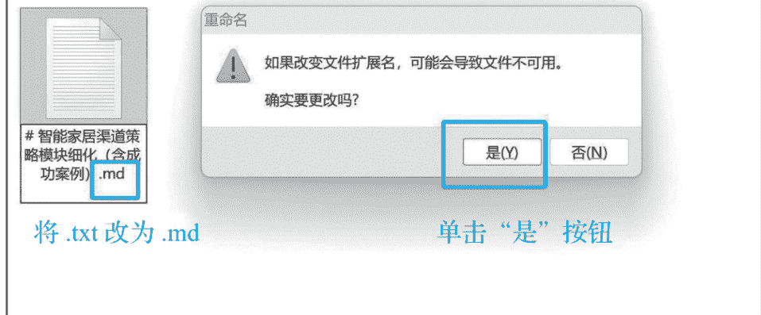

图9-18 将文件扩展名.txt修改为.md

新建文档：启动Xmind（下载地址：https://xmind.cn/download）并选择“思维导图”模板，如图9-19所示。

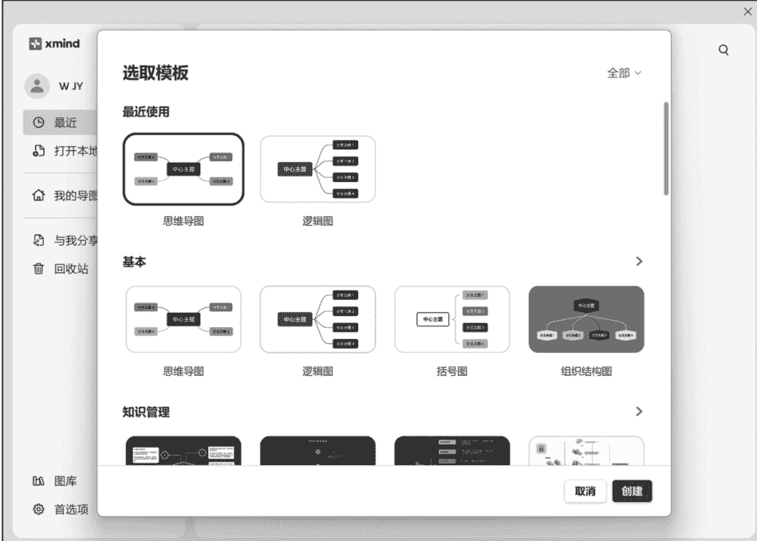

图9-19 在Xmind中新建“思维导图”

导入刚才保存的Markdown文件：依次单击“文件” → “导入” → “Markdown”，如图9-20所示。

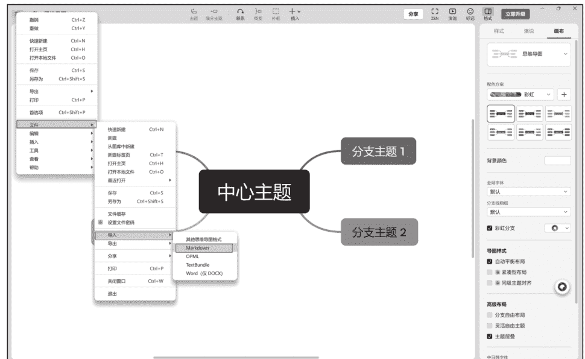

图9-20 导入刚才保存的Markdown文件

Xmind将根据Markdown文件自动生成思维导图，如图9-21所示。

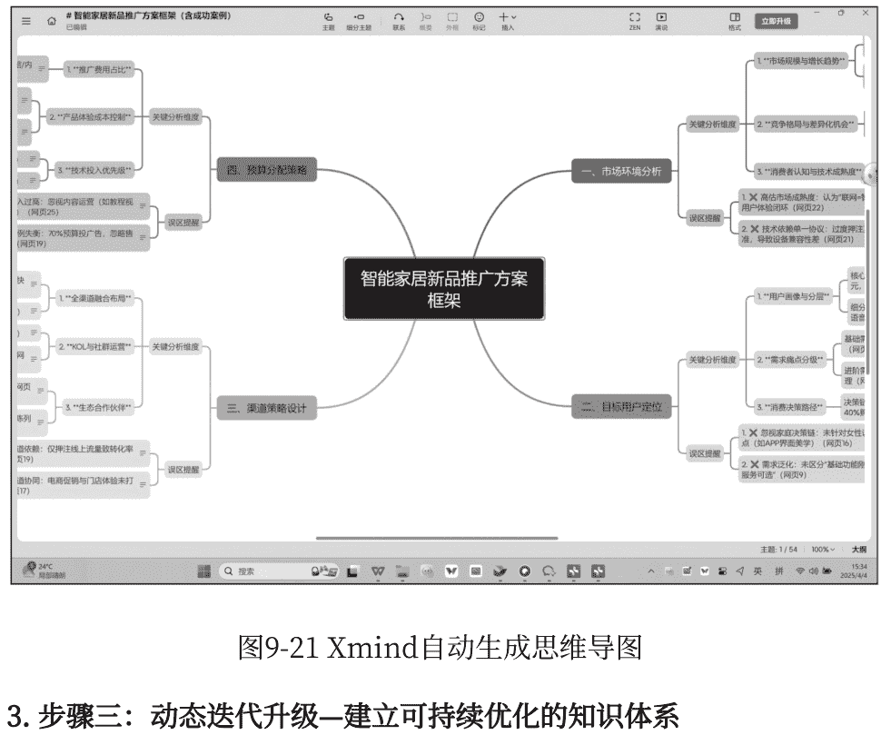

图9-21 Xmind自动生成思维导图

### 3. 步骤三：动态迭代升级—建立可持续优化的知识体系

为了确保思维导图的合理性，可以将Xmind导出的方案框架重新粘贴至腾讯元宝，并输入“请检查此框架的逻辑完整性，指出可能遗漏的3个关键点”，如图9-22所示。

请检查此框架的逻辑完整性，指出可能遗漏的3个关键点

引用 10 篇资料作为参考 >

已深度思考 (用时14秒) ∨

Markdown

复制

## 智能家居推广方案框架逻辑完整性检视及优化建议

## 一、现存框架优势分析

1. **模块架构完整性**
   现有框架覆盖市场环境-用户定位-渠道策略-预算分配四大核心模块，形成完整的营销闭环结构，符合市场推广方案基础逻辑

2. **数据穿透性**
   各模块均标注网页编号来源，整合超过10份行业报告数据，如智能家居渗透率20%[6](@ref)、女性决策占比63%[14](@ref)

3. **实操指导性**
   每个模块设置“误区提醒”，如“高估技术成熟度”等警示直接引用网页21技术协议问题，具备风险预警价值

---

## 二、关键遗漏点诊断及优化建议

### 遗漏点1：**售后服务闭环缺失**

- **现存问题**
  框架仅在预算模块提及“忽略售后服务体系”[19](@ref)，未系统构建安装调试-故障响应-用户教育全链路服务模块

> > *行业痛点*：网页7指出30%用户因操作复杂导致设备闲置，网页9强调地产项目需明确售后分工机制

- **建议补充**

```
Markdown
## 五、服务支撑体系
### 关键模块
```

有问题，尽管问

DeepSeek ∨

R1·深度思考

联网搜索 ∨

图9-22 在腾讯元宝中反向验证框架输出结果

### (1) 版本管理

为重要调整添加批注：“2024.3.15根据腾讯元宝建议新增政策风险分析模块”。

### （2）模板沉淀

1. 将验证有效的框架另存为“新品推广方案模板.xmind”。
2. 在模板备注栏记录原始提示词：“市场分析类框架生成指令V2.1”。

### （3）避坑指南

1. 提示词陷阱：
   - 避免模糊表述：“做一个好的框架”改为“包含5个主维度，每个维度分3个子项”。
   - 防止过度细分：如“请列出20个分析点”，超过三级分支会导致导图混乱。
2. 格式适配技巧：
   - 遇到表格类内容：在腾讯元宝中要求“用无序列表呈现表格核心要素”。
   - 处理长文本：提示“每个节点文字不超过15个汉字”。
3. 效能提升策略：
   - 建立常用提示词库：分类保存“市场分析/项目管理/工作总结”等场景模板。
   - 配置Xmind快速样式：将常用图标组合保存为“标准标记组”。

## 4. 总结

这套方法的价值在于将腾讯元宝的框架生成能力与思维导图的可视化优势结合，特别适合需要快速构建结构化思维的场景。通过标准化的三步流程—精准提问获取框架、批量转化构建导图、持续迭代形成模板，能够将方案设计效率提升3倍以上。

#### 试一试

在腾讯元宝输入：“我需要制定客户投诉处理流程优化方案，请按‘现状诊断-流程再造-效果评估’设计思维导图框架，每个环节包含2个实施要点和1个验证指标”。然后在Xmind中完成如下操作：①使用“流程图”模板粘贴框架；②为“验证指标”添加标记图标；③用不同颜色区分现有流程与优化建议。

#### 小贴士

1. 在腾讯元宝输出内容后，追加提示词“请用Xmind兼容的Markdown语法优化层级”可获得更好转化效果。
2. 定期清理导图中三个月未修改的冗余分支。
3. 针对复杂方案，建议拆分为多个子导图，通过超链接形成知识网络。

## 技巧86

## 腾讯元宝+腾讯智影：快速打造你的数字分身

传统AI工具生产的短视频和音频，像流水线上滚动的“工业罐头”：参数精准却千篇一律，效率惊人但毫无灵魂。当用户划屏速度超过内容加载速度，技术反而成为内容同质化的“帮凶”—这不是工具问题，是生产模式的僵化。

如何让短视频拥有“真人级表现力”？怎样让AI配音从“机器发声”升级为“身临其境”？腾讯元宝与腾讯智影的“数字人播报+文本AI配音”双核方案，正在重塑短视频与音频的生产标准。

## 1. 数字人播报—短视频内容工业化革命

想拥有一个能帮你自动讲解产品的虚拟助手吗？使用腾讯元宝和腾讯智影，通过两个步骤就能让这个过程像用手机拍照一样简单，轻松打造属于你的24小时在线讲解员。

### （1）步骤1：使用腾讯元宝生成短视频文案

运用技巧76，生成营销短视频口播文案。例如，在腾讯元宝中输入：“请为××咖啡生成三条完整口播文案，要求：①按“痛点质疑-数据对比-解决方案”结构；②包含具体使用场景；③结尾用押韵口号引导点击。示例结构：还在为每天充电抓狂……（痛点）；实测对比，如传统手表续航1天vs××手表30天（对比）；健身、开会、出差……（场景）；点击领取你的‘电力自由’（行动）。”

腾讯元宝输出：

还在为每天买咖啡又贵又难喝而烦恼？实测对比：连锁店一杯美式要28块，而××咖啡只要3块钱，品质却一点不差！无论是通勤路上赶时间、熬夜加班提神，还是周末宅家追剧，随手撕开一包××挂耳咖啡，30秒就能享受精品咖啡馆的口感。点击下方链接，解锁你的‘清醒不贵，快乐翻倍’！

……

（由于篇幅有限，输出结果在此省略，建议读者亲自上手实践。）

### （2）步骤2：使用腾讯智影构建数字人

如图9-23所示，首先打开腾讯智影AI平台PC版网站（https://zenvideo.qq.com/open/products/human），选择数字人播报的“立即体验”功能。

然后在数字人功能区的预设形象中选择适合的数字人形象，也可以通过照片播报功能上传专属于自己的个人照片形象；接着，在播报内容部分导入腾讯元宝输出的文案，选择合适的字幕样式及适当的语句停顿；最后，单击“保存并生成播报”按钮，即可获得满足自己需求的数字人播报短视频，如图9-24所示。

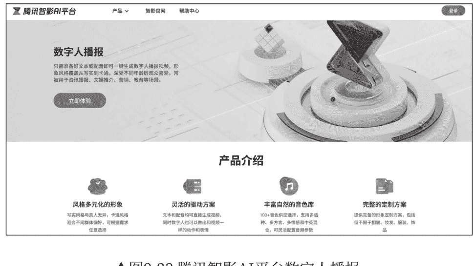

▲图9-23 腾讯智影AI平台数字人播报

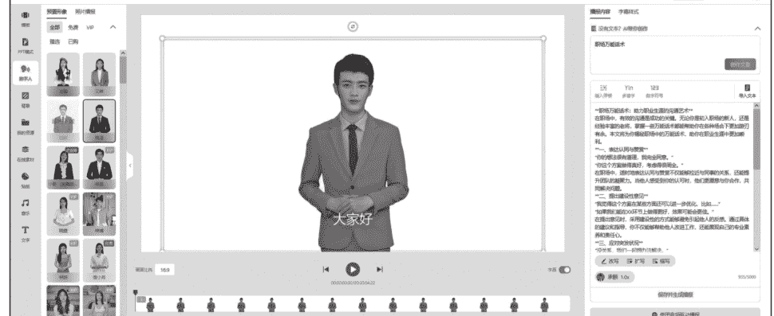

▲图9-24 腾讯智影数字人构建

## 2. 智能直播间搭建文本AI配音—让产品说明书“会呼吸”

想让枯燥的产品说明变成有声有色的故事吗？使用腾讯元宝和腾讯智影，能让这个过程像给孩子读绘本一样简单，让听众“听”得停不下来。

### （1）步骤1：用腾讯元宝优化枯燥文案

首先通过腾讯元宝生成产品介绍文案，输入：“请为人体工学椅产品生成产品故事书文案，需要场景化描述，强调舒适体验、支持120°仰角调节。”

腾讯元宝输出：

一把椅子，如何定义一天的开始？从落座的第一刻起，人体工学曲线便悄然启动—坐垫分散臀腿压力，头枕托住颈椎，而120°的仰角调节键就在手边。轻轻一按，椅背随身体后仰，仿佛被云端托住。这一刻，工作不再是对抗疲劳的战役，而是与舒适共舞的仪式……（由于篇幅有限，输出结果在此省略，建议读者亲自上手实践。）

### （2）步骤2：用腾讯智影AI配音

打开腾讯智影AI平台PC版网站，选择产品选项中的“文本配音”功能，并选择“立即体验”，如图9-25所示。

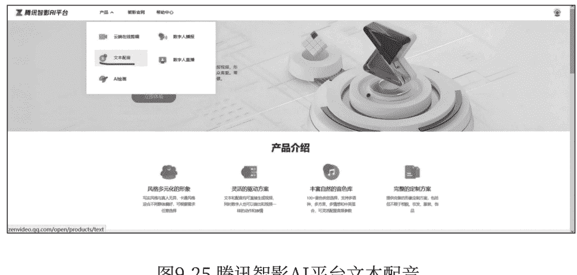

图9-25 腾讯智影AI平台文本配音

然后在音色功能区选择适合产品介绍场景的音色；在播报内容部分导入腾讯元宝输出的文案，选择适当的语句停顿、调整局部变速、设置词组连读，让音频更加拟真；单击“生成音频”按钮，即可获得满足自己需求的AI配音文件，如图9-26所示。

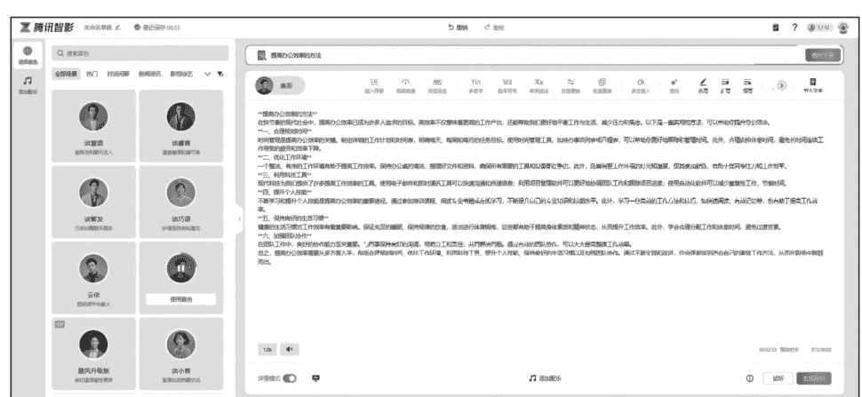

图9-26 腾讯智影AI配音

## 3. 总结

当智影数字人开始拥有创作意识，当腾讯元宝的算法能预测观众情绪，我们迎来的不仅是技术革新，更是创作方式的颠覆，让每个人都有自己的数字分身。

#### 试一试

尝试用智能配音或者数字人功能生成你的音频/视频分身。

#### 小贴士

1. 在数字人视频生成选项中，可以选择PPT模式生成你的讲课视频。
2. 统一的背景图片可以通过其他工具制作，再自定义上传至腾讯智影中。
3. 合成视频可能有额度限制，请随时注意余额的变化。

## 技巧87

## 腾讯元宝+蝉镜：五分钟搞定专业口播视频

职场人做视频，最头疼的是什么？写脚本、找演员、拍素材、后期剪辑……一套流程下来，半天时间没了。更糟糕的是，好不容易拍完，发现表情僵硬、台词卡壳，还得重来。真人出镜成本高，纯文字又太枯燥，有没有一种方法既能保持专业度，又能快速生成自然流畅的口播视频？

腾讯元宝+蝉镜数字人工具的组合，可以解决这个问题。不需要摄影棚，不用背台词，甚至不用露脸，就能生成带数字人讲解的专业视频。以下是具体操作方法。

## 1. 第一步：用腾讯元宝生成数字人形象和口播脚本

生成数字人形象需要人物形象、背景、姿势的描述，口播视频也需要口播文案，而腾讯元宝能快速帮你写出专业、流畅的描述和脚本。比如，你需要制作一个壮族春茶宣传的口播视频时，可以这样提问：

> “我需要制作讲解春茶的壮族女生数字人，25岁左右，穿现代改良款壮族服饰，在茶园场景。请提供：①人物细节提示词（发型/饰品/微表情）；②背景提示词（广西高山茶园+云雾）；③姿势提示词（手持茶叶罐讲解+指茶树动作）；④500字左右的春茶宣传口播文案。”

腾讯元宝会生成：

1. 人物细节提示词

发型：低盘发髻插银簪，两鬓垂落微卷空气刘海。

饰品：改良款多层银项圈（苗银质感）+立体茶叶刺绣耳坠+蓝染织锦腕带。

微表情：眼尾自然微弯的亲和笑眼+讲解时唇部动态微张+左颊若隐若现的酒窝。

2. 背景提示词

晨雾缭绕的广西明前茶山，层叠的茶树梯田泛着翡翠光泽，远处黛色峰峦隐现壮族干栏式建筑剪影，逆光中茶树枝丫凝结着晶莹露珠，柔焦处理的薄雾在茶树间流动。

3. 姿势提示词

左手托举镂空壮锦纹茶叶罐（罐口飘出袅袅热气），右手食指自然前伸指向茶树嫩芽，身体略前倾15度呈现讲解姿态，右肩微抬带动民族风盘扣微微反光，裙摆随山风扬起露出改良款绑带布鞋。

4. 春茶文化口播文案

三月的风掠过八桂大地，带着草木初醒的清香，广西的万亩茶园正酝酿着一场春的盛宴。这里是北回归线穿过的生态秘境，云雾滋养的芽尖凝翠，山泉浸润的茶香漫野，今天，让我们循着一缕茶香，走进广西春茶的千年故事。从苍梧六堡的百年古茶树，到凌云白毫的云上梯田；从昭平早春第一捧绿芽，到桂平西山茶的禅意绵长—广西春茶的美，源自大自然的偏心馈赠……

（由于篇幅有限，输出结果在此省略，建议读者亲自上手实践。）

## 2. 第二步：用蝉镜数字人生成自然口播

有了关于数字人的描述，接下来是用蝉镜工具制作数字人。首先登录蝉镜官网，通过手机号和验证码的方式登录。在首页单击“文生数字人”，进入数字人生成页面。

在左侧“创建数字人形象”的各个选项中，选择或填写相应的内容。你在第一步生成的人物细节、背景和口播姿势提示词可以依次填入对应位置，如图9-27所示。选择与填写完成后，单击“立即生成”，即可生成数字人形象，如图9-28所示。如不满意所生成的形象，可以调整提示词多生成几遍，直到满意为止。

接下来选择数字人形象，单击“生成数字人动作”按钮来创建数字人动作，如图9-29所示。在此界面中，你可以选择视频模型、情感和手势。其中，“情感”一栏可以输入情感描述，也可以选择系统默认的几种描述之一。选择完毕后单击“创建数字人”，输入数字人名称，再选择数字人声音，单击“保存”按钮即可完成数字人形象与动作的创建，如图9-30所示。

人物细节

提示生成器

刺绣耳坠+蓝染织锦腕带
微表情：眼尾自然微弯的亲和笑眼+讲解时唇部动态微张+左颊若隐若现的酒窝

- 日常休闲
- 成熟形象
- 中式风格

背景

提示生成器

晨雾缭绕的广西明前茶山，层叠的茶树梯田泛着翡翠光泽，远处黛色峰峦隐现壮族干栏式建筑剪影，逆光中茶树枝桠凝结着晶莹露珠，柔焦处理的薄雾

- 办公室
- 车内
- 书房

口播姿势

气)，右手食指自然前伸指向茶树嫩芽，身体略前倾15度呈现讲解姿态，右肩微抬带动民族风盘扣微微反光，裙摆随山风扬起露出改良款绑带布鞋

- 脸部特写
- 半身站姿
- 全身站姿

生成数量

- 1
- 2
- 3
- 4

▲图9-27 创建数字人形象


▲图9-28 生成数字人形象

创建数字人形象

创建数字人动作


视频模型

**模型1.0**
生成效果与速度有均衡表现

情感 ⓘ Beta

带着友好的微笑说话，眉毛略微上扬，目光注视观众，给人亲切的感觉

- 平静
- 轻松
- 微笑
- 严肃
- 兴奋
- 俏皮

手势 ⓘ Beta

每次生成时，数字人的动作都是随机的。请随意生成多次，以找到你喜欢的运动效果

▲图9-29 创建数字人动作

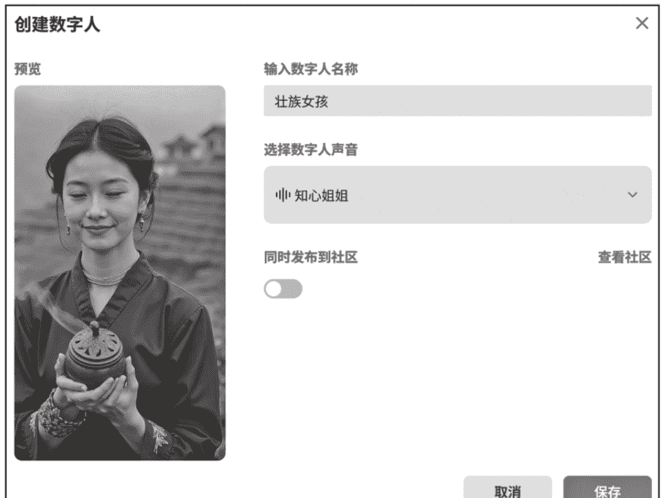

▲图9-30 完成创建数字人

## 3. 第三步：生成数字人口播视频

有了数字人形象，接下来就可以让其替你出镜，生成口播短视频了。回到蝉镜首页，在“创建视频”界面选择刚刚定制的数字人形象，再单击“创建视频”按钮，进入视频编辑界面，如图9-31所示。

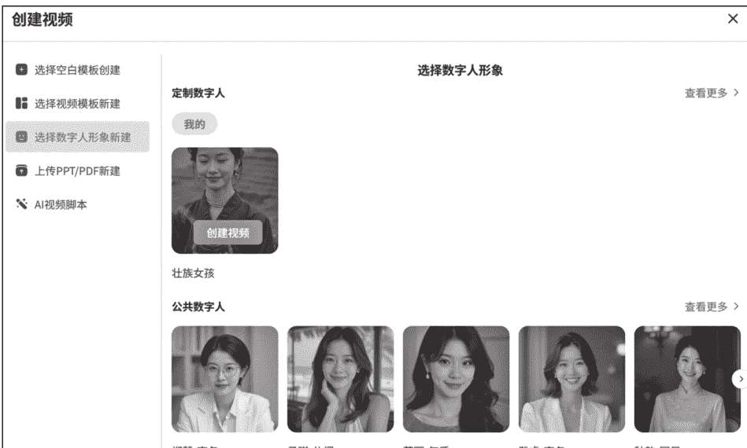

图9-31 选择刚刚定制的数字人

此时，只需要把第一步中生成的口播文案粘贴到右侧“输入文本”中，单击“生成并试听”按钮，即可看到视频效果，如图9-32所示。如不满意，可以接着调整文案、音频等内容，直至满意为止。最后单击右上方的“生成视频”按钮，即可获得定制数字人口播视频。

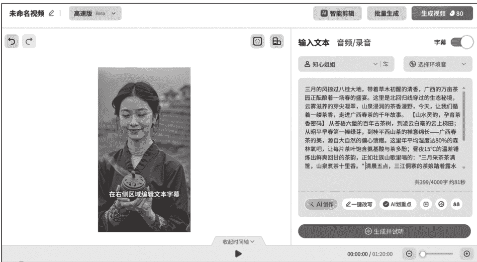

图9-32 数字人口播短视频编辑页面

## 4. 总结

从脚本到成片，腾讯元宝+蝉镜的组合能省去80%的视频制作时间。使用这种方法，不用纠结拍摄设备、演员档期或剪辑技术，而是专注内容本身，让AI处理执行层的问题，尤其适合培训视频、产品解说、内部汇报等需要高频输出的场景。

#### 试一试

用腾讯元宝生成一个“远程办公沟通技巧”的脚本，再导入蝉镜生成数字人视频，感受二者协作的效率。

#### 小贴士

1. 脚本越具体，腾讯元宝的输出越精准，比如加上“面向销售团队”或“用案例说明”。
2. 数字人视频别太长，3分钟以内最佳，观众耐心有限。
3. 建议手动二次核对口播内容、数字人描述等，以免AI“一本正经地胡说八道”。

## 技巧88

## 腾讯元宝+飞书：高效批量创作视频号内容

作为视频号创作者，谁没经历过选题枯竭、效率低下、内容同质化的“三座大山”？更扎心的是，当你还在手动搜集热点时，隔壁团队已经用腾讯元宝+飞书搭出了一条“AI创作流水线”—选题自动生成、脚本批量输出、分镜表智能关联，甚至还能根据数据反馈实时优化内容。

别急，两个实战步骤教你用这套组合拳，把机械劳动丢给AI，把创造力留给自己。

## 1. 步骤一：用腾讯元宝挖出“爆款基因”

盲目追逐流行话题却始终抓不住流量密码，机械模仿爆款风格却导致账号定位混乱。更糟糕的是，这种跟风策略让账号逐渐丧失独特性，算法推荐量持续走低。当创作者在数据海洋中寻找规律时，腾讯元宝却能通过深度思考，从海量内容中挖掘出真正适合的创作方向。假设你是视频号创作者，你就可以根据你的赛道选择一些对标的优质短视频，提取其文案并上传至腾讯元宝，然后输入：“我是[职场技能培训类]视频号创作者，请分析我上传的10条短视频文案，并提取以下内容：①标题高频词（前3名）；②开头3秒固定结构（如疑问句/冲突对比）；③评论区关键词（如干货、求模板）；④请用表格形式输出，并给出3个延续此风格的选题建议。”

腾讯元宝可能输出：

1.10万+视频数据分析表。

## 2.3个延续此风格的选题建议：《领导最讨厌的5句话，第3个90%人天天说》《跨部门沟通总背锅？3步让同事主动配合你》《为什么越努力越透明？升职快的都懂这2个暗规则》。

3. 优化补充建议：标题公式、开头结构、互动引导。

## 2. 步骤二：把飞书表格变成“脚本自动生成器”

接下来就是利用飞书的多维表格功能，建立“脚本自动生成器”。首先下载飞书客户端（下载链接：https://www.feishu.cn/download），通过手机号注册、登录。然后在飞书新建一个多维表格，删除多余列，只保留首列并命名为“原始素材”。这列就是你的“原料仓”，可以塞入：①腾讯元宝找到的爆款选题；②热点事件关键词（如“五一调休吐槽”）。具体操作如下。

第一步，打开飞书客户端，选择“多维表格”，然后选择“新建多维表格”，如图9-33所示。

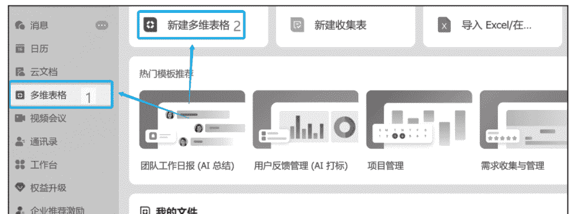

第二步，将腾讯元宝生成的选题复制粘贴到多维表格的“原始素材”一栏，如图9-34所示，并右键单击“脚本”字段，选择编辑字段，在字段类型的“探索字段捷径”中找到“DeepSeek-R1”，再将生成脚本的提示词放到“脚本”列的“输入指令”中，如图9-35所示，例如：“请根据[原始素材]列的选题，生成1条抖音口播脚本，要求：①开头用痛点提问（参考‘你是不是也……’句式）；②中间用‘工具-场景-效果’三步法讲解。”

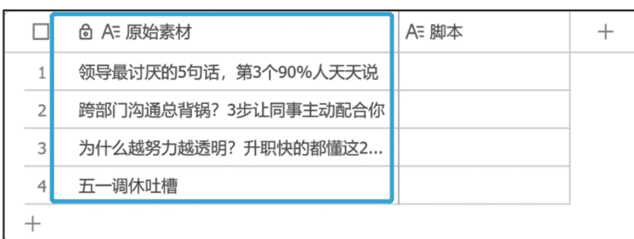

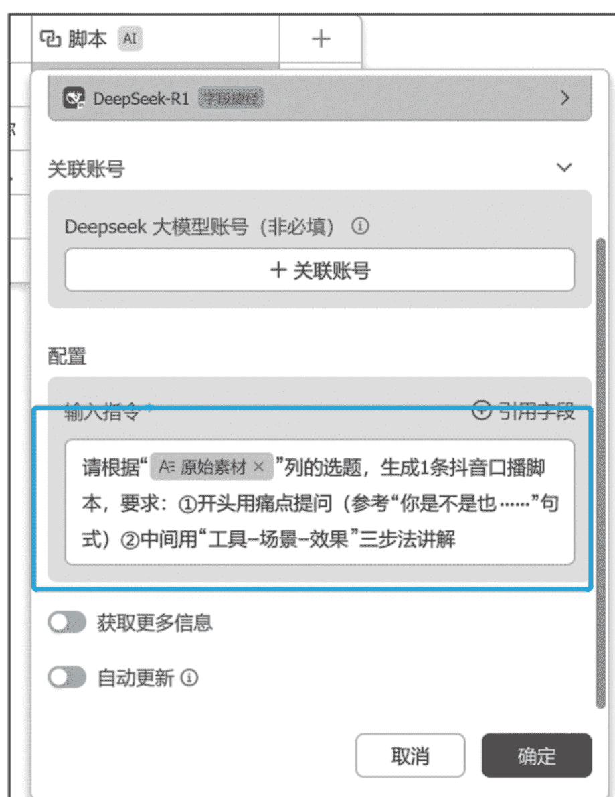

完成后，即可批量生成脚本，如图9-36所示。

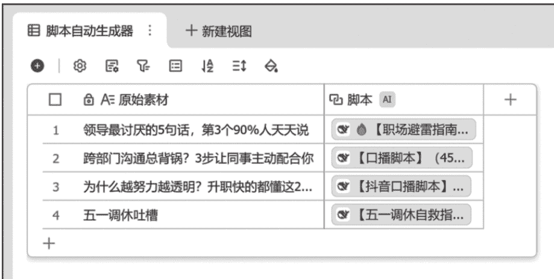

可能的输出结果：

【职场避雷指南】领导最讨厌的5句话，第三句你绝对天天说！（开场痛击镜头）“你是不是每次说完这句话，领导脸色都瞬间黑三度？”（手指戳屏幕）“90%的人还在用这句话推活！”（切换PPT板书动画）工具：万能问题解决话术。场景：领导让你三天完成不可能任务。效果：三步变被动为主动。“领导这个方案时间确实紧张（共情），我整理了三个执行难点（递问题清单），如果协调××支援数据部分（带解决方案），能准时完成！”（近景自信手势）“高情商打工人把‘这我做不到’换成‘您看这样调整行吗’，下周升职名单必有你！”（结尾大字幕）“点这里解锁另外4句职场黑名单话术。”（快速闪屏）结构亮点：用“推活→拆解→反杀”三幕剧增加吸引力，用PPT板书增强知识可信度，利用网感词强化记忆点，适合15秒快节奏传播。

## 3. 总结

腾讯元宝负责挖选题，飞书表格负责批量生产，这套组合拳的本质是：让AI做“标准化动作”，让人做“高难度动作”。记住，最好的AI工具不是替代你，而是帮助你。

#### 试一试

尝试用本节的方法在飞书中新建一张多维表格，用A列放选题，B列利用DeepSeek-R1模型生成脚本。

#### 小贴士

- 1) 批量生成前先试跑3条，调整提示词。
- 2) 最终成品用飞书@同事审核，避免出现错误。

# 技巧89

## 腾讯元宝+即梦：三分钟搞定节日海报

每逢春节、中秋，设计师的微信就会变成“催稿轰炸区”——“海报要喜庆！”“加点传统元素！”“老板说再改一版！”更崩溃的是，反复修改后，客户最后选了第一版。

腾讯元宝+即梦AI的组合能将设计师从重复劳动中解放出来，把更多精力放在创意构思上。

## 1. 让腾讯元宝设计生图提示词

设计师最头疼的不是改图，而是客户模糊的需求描述。一句“要中国风”，可能被理解成水墨画、剪纸或者宫灯风格。可以用腾讯元宝分析客户给出的参考图，生成结构化提示词。比如上传一张传统节日海报，输入提示词：“请分析这张海报，为即梦AI生成文生图提示词，要求：①主体改为敖丙形象（浅蓝衣少年，蓝色长发，手持发光元宵）；②保持中国传统节日风格；③主标题是‘元宵节快乐’；④元素包含元宵、红枣、灯笼、窗棂、巨龙。”

腾讯元宝会输出：

```
=====提示词结构=====

【场景类型】中国传统节日主题插画，工笔画渲染，古风动漫风格。

【画面主体】浅蓝衣衫的敖丙少年，蓝色长发束冠，温润笑容，双手捧起发光的元宵，立体光影效果。

【环境构建】
```

室内场景：古色古香的木质窗棂（镂空雕花工艺），窗外云雾中浮现巨龙轮廓（青鳞龙身半隐半现）。

节日元素：朱红灯笼悬挂檐下（流苏垂坠），木质方桌上摆放青花瓷碗（盛满白胖元宵）、红枣拼盘、黑豆小碟。

背景装饰：仿宣纸底纹，祥云纹样屏风，暖色调灯笼光晕渲染。

## 【视觉要素】

色彩构成：主色系红蓝撞色（敖丙蓝vs灯笼红），金色光效点缀。

文字设计：顶部居中书法体“元宵节快乐”（飞白笔触+金粉质感）。

构图布局：中心对称式构图，敖丙人物居中，窗框形成自然画框。

氛围营造：朦胧烛光效果，蒸腾热气表现，窗外巨龙与室内元素形成虚实对比。

=====核心关键词=====

敖丙形象（浅蓝汉服，流光发饰），元宵节元素大集合，工笔重彩，龙年祥瑞，传统窗格透视，暖色灯笼矩阵，节日食盒特写，立体光影层次，喜庆而不俗艳的红蓝配色，巨龙剪影若隐若现。

## 2. 让即梦生成设计图

有了生图提示词，就可以登录即梦AI (https://jimeng.jianying.com) 直接生成图片了，操作要点：

- 1) 注册登录后→AI作图→图片生成→粘贴上一步生成提示词。
- 2) 生图模型选择最新的版本。
- 3) 明确文字分层：主标题+副标题+装饰文字。
- 4) 选择海报比例：如果是适配于手机屏幕的海报，建议用9:16竖版。

生成效果如图9-37所示。

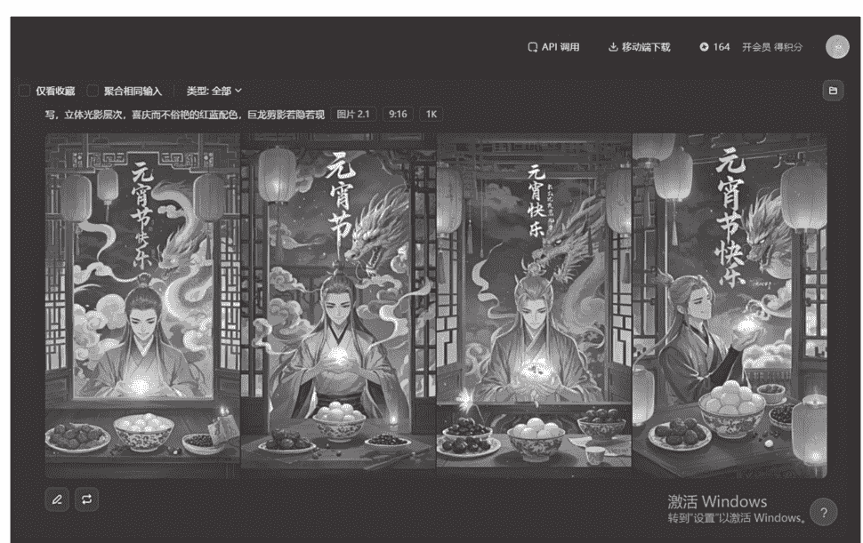

## 3. 批量生成不同版本

客户总是要求“多出几个版本看看”，这也要求你用“抽卡”的方式多生成几张图片。如果有需要调整的内容，可以再次通过腾讯元宝修改生图提示词。你可以固定主体和背景，或者仅修改文案和配色。例如输入：“保持敖丙形象不变，仅调整：①第一版，红金配色，文案‘恭喜发财’；②第二版，蓝金配色，文案‘五一快乐’。”腾讯元宝会多生成几个生图提示词，将这些提示词放入即梦AI中可生成更多图片。

## 4. 总结

腾讯元宝+即梦AI的组合，将传统需要几小时的设计流程压缩到几分钟。使用这种方法的关键是让AI准确理解需求，并完美呈现中文设计。

#### 试一试

选一张喜欢的海报输入腾讯元宝生成提示词，然后在即梦AI中测试效果。

#### 小贴士

- 1）截至本书出版，每天仅有固定数量的免费生图额度，请注意使用次数。
- 2）文字要分层描述，避免重叠。
- 3）批量生成时固定主要元素，只调整变量。

# 第10章

## 产品开发：腾讯元宝在创新流程中的应用

# 技巧90

## 信息过滤：用腾讯元宝三招解决信息爆炸的困扰

产品经理每天被行业报告、用户反馈、竞品动态、技术专利等多渠道信息轰炸，真正有效的决策线索往往淹没在碎片化数据中。手动整理不仅耗时耗力，更可怕的是花费三小时整理文档，在开会时才发现漏掉了关键竞品的定价策略变化。

传统的信息处理方式面临三重困境：信息抓取范围有限导致视野盲区，人工归纳容易产生主观偏差，静态报告难以及时响应市场变化。当产品评审会上被追问“这个功能优先级为何高于竞品迭代”时，很多人才惊觉上周整理的竞品分析已过期—这不是能力问题，而是信息处理方式需要进化。借助腾讯元宝，你可以高效完成信息过滤。

## 1. 第一招：三层筛子过滤法

整理产品市场信息，例如整理新能源车市场信息时，直接提问“整理新能源车市场信息”可能导致结果过于宽泛，无法聚焦核心内容。适当补充提问的信息，如政策、技术、用户三个维度信息，或者上传你之前收集好的资料，可以让腾讯元宝筛选出更优质的市场信息。例如，输入“作为商业顾问，请提取换电企业投资关键信息：①重点维度：政策（40%）+技术（30%）+用户（30%）。②核心数据：2024年地方补贴细则、换电站盈亏点、用户调研热词。③标出矛盾数据。”

腾讯元宝可能会输出：

- 1. 政策（40%权重）
  - (1) 核心数据：2024年6省明确补贴（单站最高300万元），但要求电池标准化率≥80%（当前行业仅50%）。
  - (2) 矛盾点：补贴最高的A省要求“仅服务本省车企”，与用户跨省换电需求冲突。
- 2. 技术（30%权重）（略）
- 3. 用户（30%权重）（略）

## 4. 关键否决项

- (1) 政策：若地方补贴绑定本地车企，全国化企业直接出局。
- (2) 技术：电池标准化率<70%→换电站注定亏本。
- (3) 用户：电池寿命监测无国标→信任危机将爆发。

......

7. 结论：优先投资“补贴不排外+用户基数>10万+自研电池管理”的区域，避开车企技术割据重灾区（如长三角）。

> （由于篇幅有限，输出结果在此省略，建议读者亲自上手实践。）

## 2. 第二招：把碎片化信息整理成结构化档案

即使已经整理了相关市场信息，但可能涉及十几份零散资料，在真正使用时还需要快速提炼核心观点。这时候可以用腾讯元宝的“信息萃取”功能，例如把会议录音、调研笔记、行业文章等原始材料发给腾讯元宝，并输入：“请将以下市场信息整理成结构化表格：①[粘贴用户访谈摘要]；②[粘贴竞品官网更新内容]；③[粘贴行业白皮书节选]。

要求：按‘用户痛点-竞品方案-市场空白’分类，每类提取3个关键结论，标注信息来源。”

腾讯元宝会输出类似这样的结果：

| 类别 | 关键结论 | 来源 |
|---|---|---|
| 用户痛点 | 中小商家对××功能学习成本过高 | 用户访谈 2024.03 节选 |
| 竞品方案 | A产品新增一键引导功能 | 竞品官网更新日志 |
| 市场空白 | 暂无产品结合××场景做培训体系 | 行业白皮书 P15 |

## 3. 第三招：多角度模拟器

传统报告就像给所有人发同一件衣服，怎么穿都不合身。怎么让报告满足不同人的需求？用好腾讯元宝就像有了“定制报告专家”，给CEO生成“战略匹配度高”的报告，给风控部门提供“专利到期风险提示”，给技术团队制定“节省迁移成本”的方案。这样，不同角色都能快速找到自己需要的信息，报告不再“一刀切”。将原始报告上传腾讯元宝，并输入：“作为投资AI，请根据我上传的信息，生成三版简报。①CEO版：战略协同。②风控版：黑天鹅预警。③技术版：落地成本。”

腾讯元宝可能会输出：

## 1.CEO版：战略协同

①核心价值：AI补齐现有业务数据闭环（如用户画像→智能推荐→复购提升），预计缩短决策链路30%。②生态卡位：抢占“AI+行业知识库”标准制定权，压制竞对定制化服务空间。③资本叙事：用AI包装传统业务，估值模型从PE切换为PS（市销率），融资溢价50%+。

## 2. 风控版：黑天鹅预警

①技术悬崖：中美算法框架脱钩风险（如TensorFlow禁用），需预设国产框架迁移成本。②伦理反噬：AI歧视性决策触发监管罚款（参照欧盟AI法案最高2000万欧元罚则）。③成本暴雷：大模型训练电费失控（10亿参数级单次训练耗电量≈中小城市日耗电量）。

预案：20%预算预留替代方案，合规官进驻研发团队。

## 3. 技术版：落地成本

①隐性消耗：数据标注成本占AI项目总投入60%（如医疗影像标注费≈影像科医生年薪）。②功耗陷阱：边缘计算设备待机功耗＞实际运算功耗，年电费超硬件成本。③折旧暴击：GPU服务器3年残值归零，但算法迭代周期需5年+。

建议：租赁云算力+轻量化模型，硬件成本可压降40%。

## 4. 总结：从信息搬运到决策指挥

高效信息处理不是比拼阅读速度，而是建立智能过滤、关联分析和预测推演的完整体系。就像望远镜让人类突破肉眼局限，合适的工具能帮助产品经理突破信息处理的能力边界，将碎片数据转化为决策地图。

#### 试一试

在腾讯元宝中输入提示词，并同步开启联网搜索功能：“监测新能源汽车行业：①提取近两周政策文件中关于充电设施的新表述；②对比三家头部品牌的用户运营活动；③关联动力电池原材料价格波动数据。输出三个市场机会点预测。”

#### 小贴士

- 1) 信息抓取前先明确“我要证明什么/推翻什么”。
- 2) 定期校准关键词，避免语义泛化导致信息污染。
- 3) 记住工具不能替代思考，所有分析结论均需进行人工校验。

# 技巧91

## 需求挖掘：用腾讯元宝把用户反馈变成产品需求

传统需求分析就像在菜市场挑西瓜，有经验的老师傅拍拍打打还能判断七八成，但互联网时代的用户需求早进化成了榴莲—外壳带刺，内里绵软，光靠“手感”根本捉摸不透。更可怕的是市场变化的速度：去年还火爆的“社交+元宇宙”概念，今年可能就变成投资人听见就皱眉的过气标签。

这里藏着三个致命陷阱：第一，用户说的“想要”未必是真正的需求，就像要更快的马车的人其实需要的是汽车；第二，海量数据难转化成有效洞察；第三，需求优先级排序总在“老板说的”和“数据说的”之间左右为难。好在腾讯元宝能化身你的需求调研助手，用三个招式破解这些难题。

## 1. 招式一：用户反馈的“测谎仪”

用腾讯元宝分析原始访谈记录，能自动识别矛盾点和潜在诉求。以智能音箱产品需求调研为例，先用第三方软件（如飞书妙记等）将音频转写为文字，接着上传文字记录，然后向腾讯元宝输入：“分析以下10段用户访谈，完成：①标注自相矛盾的陈述（如先说操作复杂，后夸界面友好）；②提取高频出现但未被明确提及的需求关键词；③按‘表面诉求-潜在痛点-真实需求’结构重组结论。”

腾讯元宝输出示例：

- 1. 自相矛盾的陈述
  - 矛盾点：操作便捷性与语音识别缺陷。
  - (1) 用户先肯定智能音箱“操作方便”，但后续指出“语音识别不准确，需要重复指令”。
  - (2) 矛盾逻辑：语音识别是核心交互方式，其不精准直接导致操作复杂化，与用户对“操作便捷”的初始评价形成冲突。

## 2. 高频需求关键词

通过隐性反馈提取未被明确提及的痛点需求：

- (1) 语音交互精准度（隐含于重复指令问题）。
- (2) 智能家居兼容性（通过联动优势暗示扩展需求）。
- (3) 音质分级优化（对比专业音响的差距）。
- (4) 功能扩展性（未来期望指向功能丰富性）。
- (5) 性价比平衡（强调价格合理但隐含性能升级期待）。

## 3. 结论重组（表面诉求-潜在痛点-真实需求）

……

> (由于篇幅有限，输出结果在此省略，建议读者亲自上手实践。)

## 2. 招式二：海量数据的“导航仪”

面对大量的调研问卷数据，腾讯元宝能快速建立认知坐标。将原始数据整理成50个以内的文件，每个文件不超过100MB，打包上传后向腾讯元宝输入：“基于上传的用户调研资料：①分为‘功能诉求/体验痛点/情绪表达’3大类；②找出3个反常识的数据点（比如80%用户声称重视售后，但60%从未使用过客服）；③生成待澄清问题清单。”

腾讯元宝输出示例：

根据用户提供的数据，以下是分析结果：

## 一、分类结果

- (1) 功能诉求：音乐播放（高频需求，13人次）、智能家居控制（9人次）（略）
- (2) 体验痛点：语音识别准确率（改进诉求7次）、音乐推荐算法优化（需求5次）（略）

……

## 二、反常识数据点

价格悖论：购买100～200元低价产品的用户的音质满意度（平均4.8分）显著高于300～400元中高端产品的用户的音质满意度（平均3.2分），与传统认知中“高价=高质”的预期相悖（略）

## 三、待澄清问题清单

- (1) 用户认知层面：无设备用户的功能改进诉求是否基于他人经验？户外场景用户为何不关注续航/防水等硬件指标？
- (2) 产品设计层面：……

> （由于篇幅有限，输出结果在此省略，建议读者亲自上手实践。）

基于以上分析，你就可以更有针对性地采取用户深度访谈和A/B测试方式进行验证。如果上传文件过多，导致分析结果不佳，建议分批次地上传。

## 3. 招式三：需求排期的专家

当业务方要求“全部需求都要做”时，可以用腾讯元宝初步建立量化评估体系。还是以智能音箱产品需求调研为例，上传需求调研问卷数据，然后向腾讯元宝输入：“请结合以上数据，设计需求优先级公式，需包含用户影响面（0～10分）×技术可行性（0～5分）×业务战略契合度（0～3分），为以下需求打分并排序：唤醒词设置、儿童模式、方言识别。”

腾讯元宝输出示例：

基于需求优先级公式：用户影响面（0～10分）×技术可行性（0～5分）×业务战略契合度（0～3分），结合数据表现和业务逻辑，对各需求进行打分并排序如下：

## 一、需求优先级公式

| 需求名称 | 用户影响面 | 技术可行性 | 业务战略契合度 | 总分 | 排名 |
| :--- | :--- | :--- | :--- | :--- | :--- |
| 方言识别 | 9 | 3 | 3 | 81 | 1 |
| 儿童模式 | 7 | 4 | 2 | 56 | 2 |
| 唤醒词设置 | 5 | 4 | 1 | 20 | 3 |

## 二、评分依据

### 1. 方言识别

（1）用户影响面（9分）

数据中语音识别准确率改进诉求占比23%（7/30用户），且方言需求隐含在以下场景：家庭场景（占样本13%）需方言控制厨房设备（略）

……

### 2. 儿童模式

(1) 用户影响面（7分）

明确关联2名教师用户（需儿童教育资源）（略）

......

### 3. 唤醒词设置

......

（由于篇幅有限，输出结果在此省略，建议读者亲自上手实践。）

## 4. 总结

用腾讯元宝做需求调研，就像给X光机装上情感雷达—既能扫描出用户行为，又能捕捉到情绪温度，而不会再被用户直接提出的需求“牵着鼻子走”。其关键在于让人机分工明确：腾讯元宝负责处理海量信息和发现隐藏内容，产品经理专注价值判断和人性化解读。

#### 试一试

准备好调研数据并上传，套用以下公式，让腾讯元宝为你分析需求的可行性：“假设我们要开发[产品]的[新功能]，请结合我上传的数据并分析：①[已上线功能1]；②[已上线功能2]；③[竞品功能]。输出：①该需求可能解决的现存TOP3问题；②需要复用的技术模块；③最低成本验证方案。”

#### 小贴士

- 1) 官网版本的腾讯元宝无法一次上传过多数据，可以少量多次上传。
- 2) 重要结论保留人工验证环节，比如打电话给典型用户进行确认。

3) 音频、视频类型的访谈数据可以通过飞书妙记等平台转写，形成文字稿。

## 技巧92

## 创意催化：用腾讯元宝打破产品开发的僵局

在产品创新的实际工作中，产品经理经常遇到创意枯竭的困境。传统的创意产生方式往往效率低下，讨论容易跑偏，有价值的想法难以系统性地捕捉和延伸。更棘手的是，团队容易受到行业常规思维的局限，难以突破固有模式，产生真正创新的方案。

这些现实问题直接导致了创新周期被不必要地拉长，产生的方案缺乏差异化竞争力，大量时间被浪费在低效的创意筛选和整理过程中。面对这些挑战，腾讯元宝提供了切实可行的解决方法。

### 1. 方法一：实时脑暴协作模式

在产品开发会中，告别混乱无序的思路，用腾讯元宝建立可持续延伸的灵感。

例如，当团队讨论“老年人智能药盒”时，立即开启协作：“我是智能药盒的产品经理，正在进行产品开发的头脑风暴，这个产品的功能是解决独居老人忘服药问题，现有思路包括语音提醒、亲属联动、自动分药。请进行以下操作：延伸每个方向的三级细分功能，标注需要医疗资质的方案，推荐跨行业可借鉴方案（如快递柜/智能咖啡机）。”

腾讯元宝提供的方案示例：

- 一、三级细分功能延伸
  1. 语音提醒方向
     一级功能：基础语音提醒；二级功能：定时语音播报（固定时间点提醒）（略）
     一级功能：多场景提醒（略）
     ……
  2. 亲属联动方向（略）
  3. 自动分药方向（略）

### 二、需医疗资质的方案

- 1. 药品数据库联动（需对接医疗系统验证用药合理性）
- 2. AI用药建议（根据健康数据调整服药计划）
- 3. 处方药分装授权（需药剂师资质或与医院合作）
- 4. 紧急医疗响应（如自动联系社区医生）。

### 三、跨行业可借鉴方案

| 行业/产品 | 可借鉴点 | 应用示例 |
| :--- | :--- | :--- |
| 快递柜 | 格口分时控制 | 药盒分格按时间解锁，逾期未取触发警报 |
| 智能咖啡机 | 原料不足提醒 + 自动订购 | 药量不足时通知亲属或自动下单购药 |
| 智能音箱 | 多模态交互（语音 + 触屏） | 老人可通过语音或按钮确认服药 |
| 共享单车 | GPS 定位 + 电子围栏 | 药盒离开设定范围（如家中）发送提醒 |
| 智能家居 | 场景联动 | 与智能灯泡联动强化提醒效果（如服药后关灯记录） |

创新结合建议：

- 1）参考盲文电梯按钮设计药盒的触觉标识（帮助视障老人区分药格）。
- 2）借鉴电竞键盘RGB灯效，用不同颜色灯光区分紧急程度（红色为高危药品）。

（由于篇幅有限，输出结果在此省略，建议读者亲自上手实践。）

### 2. 方法二：创新想法智能创造

你可以利用腾讯元宝进行基于原有产品的突变式创新，而非天马行空的无效脑洞。

例如，某教育App团队希望创新少儿编程课，那么就可以向腾讯元宝输入：“需要3个少儿编程课程的新形态，要求：结合我们已有的AR课件开发能力、规避政策限制（不超过30分钟在线时长）、参考最新儿童心理学研究成果。”

腾讯元宝提供的方案示例：

基于AR技术、政策合规性和儿童心理学研究，以下是3个创新的少儿编程课程形态设计：

#### 一、AR实体编程沙盒（虚实结合的碎片化学习）

##### 1. 形态设计

- （1）将编程指令具象化为可触摸的AR积木（如方向箭头、循环等），儿童通过排列实体积木控制屏幕中的AR角色。
- （2）每完成一个5～8分钟的微型任务（如让AR恐龙到达终点），系统自动保存进度并解锁下一关卡。
- （3）结合“心流理论”设计渐进式挑战，每个关卡增加1个新指令以保持新鲜感。

##### 2. 心理学依据

- (1) 皮亚杰认知发展理论：7～12岁儿童处于具体运算阶段，需要实物操作辅助抽象思维（略）
- ……

##### 3. 合规方案：

- (1) 单次体验完整闭环控制在15分钟内。
- (2) 线下实体操作+AR反馈模式不计入在线时长。
- (3) 家长端可查看多个短课时累计的学习报告。
- (4) 社会化编程剧场（AR情景化协作）。

……

> （由于篇幅有限，输出结果在此省略，建议读者亲自上手实践。）

### 3. 方法三：即时灵感快速落地

利用腾讯元宝固定好稍纵即逝的灵感，将零散的用户洞察转化为可开发的产品概念，关键在于建立标准化转化模板。

假设你是外卖配送产品的产品经理，当你在客服记录中发现反馈“外卖送达时汤总是洒”时，立即向腾讯元宝输入：“我是外卖配送产品的产品经理，现在要开发配送车辆的配件，请将外卖送达时汤总是洒这个场景转化为三个产品方案，要求：按‘问题归因-技术路径-商业价值’结构，结合我们现有的智能箱硬件能力，排除需要改造配送车辆的方案。”

腾讯元宝会给你提供一些参考：

#### 方案一：智能汤品分隔固定架

##### 1. 问题归因

汤品洒漏主因是配送箱内无固定装置，车辆颠簸时容器倾斜或碰撞。

##### 2. 技术路径

- （1）利用现有智能箱的滑轨结构，设计可拆卸的TPU材质分隔架，通过卡扣固定于箱内。
- （2）分隔架采用蜂窝结构分区，匹配常见汤杯尺寸，通过弹性材质包裹容器底部和侧边。
- （3）集成压力传感器（复用现有箱体传感模块），若检测到汤杯倾斜超过15°即触发App提醒骑手。

##### 3. 商业价值

- （1）硬件成本＜30元/套，可作增值配件售卖（定价99元）。
- （2）降低10%以上汤品类投诉率，提升快餐类商户合作意愿。

#### 方案二：气压平衡防溢盖

……

> （由于篇幅有限，输出结果在此省略，建议读者亲自上手实践。）

## 4. 总结

人类擅长判断创意价值，却容易被经验束缚；AI没有思维边界，但缺乏商业嗅觉。两者的结合就像让梵高和乔布斯组团创业—一个负责天马行空，一个负责把想法变成现实。腾讯元宝的价值不在于替代人类创造力，而是通过结构化工具释放创新效率。让机器处理数据清洗、逻辑验证等“体力活”，产品经理便能专注核心优势：在用户行为细节中发现破局点，在技术可能与商业现实间找到平衡支点。

#### 试一试

假设你的团队正在设计一款面向年轻人的社交产品，尝试向腾讯元宝提问：“我们需要一款针对18～24岁用户的社交产品，要求：规避现有主流形式（短视频/图文/语音）、结合‘线下行为线上化’趋势、至少包含一个可申请专利的交互设计。请生成3个概念方案，每个方案需包含核心交互逻辑、技术可行性评估、潜在用户痛点解决方法。”

#### 小贴士

- 1) 头脑风暴时可以设置“发散-收敛”双阶段，先用腾讯元宝生成100个创意，再用验证模型进行筛选。
- 2) 遇到“这个不可能”的否定时，立即输入腾讯元宝进行技术可行性查询。

## 技巧93

## 原型设计：用腾讯元宝把概念变成产品

产品经理最怕什么？不是需求变更，不是开发怼需求，而是辛辛苦苦做的原型，评审时被一句“这方案不太行”打回重做。更惨的是，改了三版后，却听到“还是第一版好”。

通过合理使用腾讯元宝，可以打破这个恶性循环。通过以下三个方法，能帮助产品经理提升原型设计的效率，同时降低返工率。

### 1. 方法一：快速生成愿景框架

需求文档写好之后，怎样转化为具体的产品方案？别让需求文档躺在文件夹吃灰，用腾讯元宝将模糊想法转化为可执行方案。

例如，你可以向腾讯元宝输入：“我们计划做一款面向中小企业的智能报销系统，核心需求是‘3分钟完成报销单提交’。请生成：用户价值主张的3种表达方式、量化成功标准的5个指标、可能颠覆现有流程的3个创新点。”

腾讯元宝回答示例：

#### 一、用户价值主张的3种表达方式

##### 1. 极简高效

3分钟极速提交，告别烦琐报销流程—智能填单、自动审核，让中小企业员工专注核心工作。

##### 2. 成本与风控优化

一键同步票据数据，智能合规校验，降低人工审核成本30%+，同时减少企业财务风险。

##### 3. 员工体验升级

手机拍照即报销，AI自动分类填充，员工零学习成本，满意度提升50%。

#### 二、量化成功标准的5个指标

1. 用户端效率：平均报销单提交时间≤3分钟（通过用户行为数据监测）。
……

#### 三、可能颠覆现有流程的3个创新点

##### 1. 无感数据采集

- （1）创新点：通过OCR+多平台集成（如邮箱、支付软件）自动抓取电子票据，用户无须手动上传。
- （2）颠覆性：消除“收集票据”这个最耗时的步骤。

##### 2. 动态合规引擎（略）

##### 3. 游戏化协作流程（略）

（由于篇幅有限，输出结果在此省略，建议读者亲自上手实践。）

### 2. 方法二：让腾讯元宝辅助画原型逻辑

低保真原型最怕的不是界面丑，而是逻辑有硬伤—你以为用户会乖乖按你设计的路径走，结果测试时发现他们总能卡在你想不到的环节。这时候，与其靠脑补检查逻辑，不如让腾讯元宝当你的“压力测试员”。它能模拟用户视角，快速揪出流程中的断点、冗余步骤和认知负担。

例如，你正在设计一个预约上门维修的产品，已经开会讨论好用户的使用流程，但不确定是否合适，这时候就可以向腾讯元宝提问：“我正在设计一个‘预约上门维修’的流程，现有步骤：选择服务→填写地址→支付定金→确认订单。请列出用户可能中途放弃的3个环节，针对每个环节给出防流失设计建议。”

腾讯元宝可能会给你如下建议：

- 1. 用户可能中途放弃的3个环节及原因分析
  - (1) 选择服务环节
    放弃原因：
    1) 服务选项过多或分类混乱，用户难以快速找到所需服务；2) 价格不透明（如未标注基础费用），导致用户犹豫；3) 服务描述模糊（如未明确包含哪些具体项目）。
  - (2) 填写地址环节
    放弃原因：（略）
    ……

- 2. 防流失设计建议
  - (1) 选择服务环节优化（略）
  - (2) 填写地址环节优化（略）
  - (3) 支付定金环节优化（略）
    ……

（由于篇幅有限，输出结果在此省略，建议读者亲自上手实践。）

### 3. 方法三：墨刀+腾讯元宝：原型快速生成

产品经理和设计师最头疼的莫过于：“这个需求明天就要看原型！”但画原型不是变魔术，从需求梳理、页面设计到交互逻辑，每一步都要时间。而墨刀结合DeepSeek-R1模型后，可以让原型设计从“纯手工”变成“半自动化”，甚至帮你生成完整页面框架，大幅提升效率。

具体做法是，打开墨刀网（https://modao.cc），注册登录后新建原型，选择产品呈现的方式（App、小程序、Web网站等），确定后即可进入原型编辑页面。接下来通过三步快速生成原型，如图10-1所示。

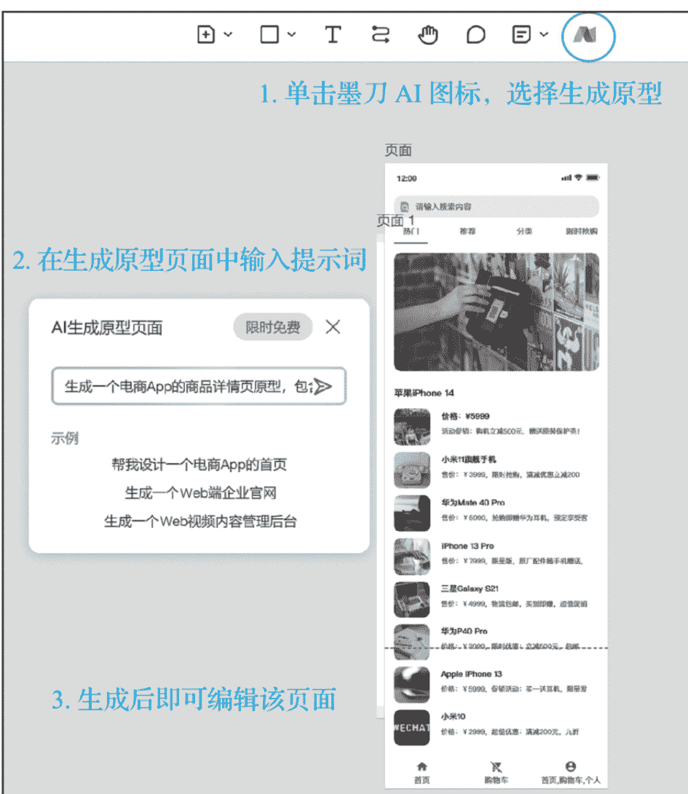

1) 单击墨刀AI图标，选择生成原型。
2）在生成原型页面中输入提示词，可参考以下提示词：“生成一个电商App的商品详情页原型，顶部是商品图片轮播，中间是商品标题、价格、促销标签，底部是‘加入购物车’和‘立即购买’按钮。”
3）判断原型图是否为自己所需，如果不是，可以继续调整提示词再次生成，或者直接编辑页面。

#### 试一试

在墨刀中调出墨刀AI生成原型界面，输入你的需求，生成页面原型。

#### 小贴士

- 1）评审原型图前，先向腾讯元宝提问“预测这个设计可能被质疑的3个点”来自查。
- 2）复杂流程用“请用流程图语法描述”让腾讯元宝输出逻辑图。
- 3）在这一步可以提前规避开发坑点，比如向腾讯元宝多问一句：“从技术实现角度，这个交互设计可能存在哪些隐患？”

## 技巧94

## 技术选型：用腾讯元宝避开技术选型里的“天坑”

产品经理最头疼的时刻之一，就是面对技术选型和架构规划。开发团队等着你拍板，业务方催着要方案，而你手头的技术文档像天书，Stack Overflow的答案五花八门，GitHub上的开源项目多到让人选择困难。更糟糕的是，不同团队的建议往往带着各自的偏好，而你需要的是客观、全面地分析。

这时候，腾讯元宝可以成为你的“技术顾问”，帮你厘清思路、对比方案、规避风险。以下是三个实用的方法。

### 1. 方法一：快速理解技术选项

面对陌生的技术栈，产品经理常陷入两难：完全依赖技术团队可能失去决策主动权，自己硬啃文档又效率太低。这个时候就可以让腾讯元宝帮你拆解技术术语，提炼核心优劣。例如输入：“请用通俗易懂的语言解释微服务架构和单体架构的区别，重点对比：①开发复杂度；②运维成本；③适合的业务场景。要求避免使用‘高内聚、低耦合’这类术语，用产品经理能听懂的话。”

腾讯元宝的输出可能如下：

- 1. 单体架构：大锅饭食堂
  - (1) 开发复杂度：像一家大食堂，所有菜（功能）都在一个大厨房（代码）里做。
    优点：新厨师（程序员）来了直接看一下菜谱（代码库）就能上手。
    缺点：改一道菜（功能）可能影响其他菜，比如想加辣，结果所有菜都变辣了（牵一发而动全身）。
  - （2）运维成本：后厨（服务器）只有一口大锅（单进程），如果顾客（用户）量突然暴增，只能换更大的锅（升级服务器），不能单独扩容某道菜。锅坏了（服务器宕机），整个餐厅停业。
  - （3）适合场景：菜品固定的小餐馆（业务简单、用户量稳定）。比如企业内部用的报销系统，需求变化少。

- 2. 微服务架构：美食城档口……
- 3. 产品经理怎么选？
  - （1）选单体：预算少、业务简单、求稳（比如MVP阶段）。
  - （2）选微服务：业务复杂、要快速试错（比如互联网产品），且团队能承受运维开销。
  - （3）关键矛盾：微服务像“碎片化开发”，灵活但管理成本高；单体像“铁板一块”，简单但难以局部优化。

> （由于篇幅有限，输出结果在此省略，建议读者亲自上手实践。）

### 2. 方法二：评估技术方案的业务适配性

技术团队可能推荐“最先进”的方案，但未必最适合当前业务。比如，是否该用GraphQL替代REST？是否该用Kafka做消息队列？在这种情况下，就可以让腾讯元宝结合业务需求，分析技术方案的匹配度。例如，向腾讯元宝提问：“我们是一个电商团队，日均订单量在1万左右，打算用的API是REST架构，但开发人员反馈维护成本高。请分析GraphQL是否适合我们，重点考虑：①前端灵活性；②后端改造难度；③长期维护成本。”

腾讯元宝可能就会这样给你评估：

针对日均1万左右订单的电商团队从REST迁移到GraphQL的评估，从以下3个核心维度展开分析：

#### 一、前端灵活性

##### 1. 优势

- (1) 按需查询：前端可精确获取所需字段（如商品页只请求标题/价格，避免REST返回完整数据），减少网络传输量30%～70%（根据Shopify案例）。
- (2) 单次请求聚合：通过一次GraphQL查询可获取订单详情+用户信息+商品列表（REST则需3次API调用），移动端弱网环境下性能提升显著。
- (3) 快速迭代：新增前端功能（如商品页增加“猜你喜欢”模块）可不依赖后端接口变更。

##### 2. 挑战

- (1) 需培养前端团队掌握GraphQL查询语言，初期学习曲线较陡峭。
- (2) 过度灵活可能导致前端滥用深层嵌套查询（如order.user.orders.items…），需通过查询深度限制和性能监控规避。

#### 二、后端改造难度（略）

#### 三、长期维护成本（略）

#### 四、决策建议

- 1. 推荐采用GraphQL
  - （1）前端需要同时支持多平台（Web/App/小程序）且各端数据需求差异大。
  - （2）后端团队有资源进行2～3个月的增量改造。
  - （3）已遇到接口版本碎片化或过度获取数据问题。
- 2. 暂不建议迁移（略）
- 3. 折中方案（略）

（由于篇幅有限，输出结果在此省略，建议读者亲自上手实践。）

### 3. 方法三：制定技术演进路线

好的技术选型应该像搭积木—初期用最简方案，后续能模块化扩展。此时可以让腾讯元宝为你设计技术演进图：“我们的电商系统初期预计日订单1000单，3年后可能达10万单。请分3个阶段设计技术演进路线，每个阶段包含业务规模、关键技术、升级触发条件。”

腾讯元宝可能会给你这样的方案：

以下是针对电商系统的3个阶段技术演进路线设计，结合业务规模、关键技术和升级触发条件进行规划：

#### 阶段一：初创期（0～1年）

- 1. 业务规模
  - (1) 日订单量：1000～5000单。
  - (2) 用户规模：万级。
  - (3) 功能需求：核心交易链路（商品、订单、支付）、基础营销工具。
  - (4) 关键技术：
    - 1) 架构：单体架构（如Spring Boot）+简单分层（Controller-Service-DAO）。
    - 2) 数据库：单机MySQL（读写分离）+Redis缓存（热点数据）。
    - 3) 部署：云服务器（如AWS EC2/阿里云ECS）+Nginx负载均衡。
    - 4) 监控：基础日志（ELK）+告警（Prometheus）。
- 2. 升级触发条件（略）

#### 阶段二：发展期（1～3年）（略）

#### 阶段三：成熟期（3年+）（略）

……

> （由于篇幅有限，输出结果在此省略，建议读者亲自上手实践。）

## 4. 总结

技术选型不是非黑即白的判断题，而是资源、风险与业务目标的动态平衡。盲目跟随技术潮流可能掉进“过度设计”的陷阱，但过度保守又会导致系统过早遇到天花板。腾讯元宝的价值在于提供可操作的决策框架—它不会直接告诉你“该选什么”，而是帮你拆解技术方案的隐藏成本、团队适配度、业务契合度。

#### 试一试

向腾讯元宝输入以下提示词：“我们是一个日活10万的社区App，MySQL查询延迟逐渐升高。请列出是否引入Redis的决策清单，要求包含：①必须评估的3个性能指标（附合理阈值）；②需要提前准备的2个运维方案；③预计节省的服务器成本计算公式。”

#### 小贴士

- 1) 你需要警惕腾讯元宝的“正确的废话”，比如当腾讯元宝给出“视情况而定”类结论时，可以立即追问：“请列出需要观察的3个具体指标及临界值。”
- 2) 不能盲目相信腾讯元宝的建议，需结合团队实际能力验证。
- 3) 技术选型没有“完美解”，只有“最适合解”，多结合业务实际提问。
- 4) 让腾讯元宝对比方案时，需明确你关心的维度，比如成本、性能、维护性等。

## 技巧95

## 模拟测试：用腾讯元宝三招搞定产品测试

产品完成前的最后阶段，就是产品测试。手工测试耗时费力，自动化测试又需要技术门槛。产品经理既不是专业测试工程师，也没时间盯着每个测试用例。结果往往是上线前信心满满，上线后手忙脚乱。有没有方法能让产品经理快速揪出潜在问题，还不必写一行代码？

腾讯元宝可以成为产品测试的“第二双眼睛”，既能模拟用户视角挑刺，又能用结构化思维查漏补缺。

### 1. 第一招：用自然语言生成测试用例

测试用例是测试环节必不可少的部分，每一轮测试都需要找到固定用例，如果人工设计用例，一方面耗时耗力，一方面还可能忽略掉极端情况。而现在不需要掌握测试专业术语，用大白话描述功能，腾讯元宝就能生成可执行的测试场景。比如一个新上线的购物车功能，可以这样提问：“我们是电商平台，刚上线了‘购物车跨店满减’功能。请帮我列出20条测试用例，需要覆盖：①不同店铺商品组合；②优惠券叠加规则；③极端情况（如商品失效/库存不足）。”

腾讯元宝可能给你的解决方案：

- 一、不同店铺商品组合测试
  1. 跨店满减门槛验证
     （1）测试不同店铺商品（如A店150元+B店150元）能否触发满300元减40元的跨店满减。

（2）验证店铺满减档位不一致时（如A店满300元减40元，B店满200元减20元）无法跨店凑单。

## 2. 优惠金额分摊逻辑

（1）检查跨店订单优惠是否按商品金额比例分摊（如A店250元+B店200元+C店150元，总优惠80元按6:4:3比例分配）……

……

## 3. 多店铺类型兼容性

（1）验证天猫与淘宝店铺商品合并凑单时是否支持跨店满减……

……

> （由于篇幅有限，输出结果在此省略，建议读者亲自上手实践。）

## 2. 第二招：智能辅助灰度发布

新功能上线的时候，往往先进行灰度发布。在此过程中，开发者面临两难：既需要收集用户反馈以优化产品，又担心出现问题影响用户体验并导致负面评价扩散。传统方法依赖人工监测数据面板，但在发现问题时，往往已有较多用户受到影响。当灰度发布新功能时，可以用腾讯元宝提前预判舆论风暴。它不仅能分析数据，更能理解人类情绪。

例如，你负责一款在线文档协作工具，最近灰度发布了“智能模板推荐”功能，根据用户使用情况，得到了一些埋点数据和用户反馈，这个时候你就可以向腾讯元宝提问：“基于当前灰度数据预测全量风险：①使用率低于预期的功能（日活<3%）；②可能引发客诉的设计（差评关键词提取）；③不同用户群体的体验分裂（安卓vs iOS）。数据样本：[埋点数据+用户反馈]。”

腾讯元宝根据你给的信息，可能得出类似这样的结论：

基于提供的灰度数据和用户反馈，结合灰色预测模型与灰度分析方法，以下为全量风险预测及优化建议：

### 一、核心风险预测模型构建（基于灰色系统理论）

### 1. 数据预处理

对7天埋点数据进行累加生成运算（AGO），削弱随机性（如功能点击率数据序列：5.1%→5.1%→…→5.1%累加生成新序列）……

预测全量后风险：……

……

### 二、关键风险点分析及应对策略

- 1. 使用率低的核心问题（略）
- 2. 客诉风险预测（略）
- 3. 用户群体体验分裂（略）

### 三、风险控制实施路径

……

> （由于篇幅有限，输出结果在此省略，建议读者亲自上手实践。）

## 3. 第三招：制造“最坏情况”测试案例

让腾讯元宝扮演挑剔用户，专门设计破坏性测试方案。比如测试视频会议软件时，告诉腾讯元宝：“假设你是IT主管，正在测试我们的视频会议系统。请设计10个‘故意找茬’测试方案，包括：①极端网络波动；②硬件外部设备异常；③非正常操作流程。”

腾讯元宝代入角色后，可能会给出这些方案：

### 视频会议系统“故意找茬”测试方案

### 一、极端网络波动类

- 1. 模拟50%丢包率+300毫秒延迟：在网络损伤仪中设置50%丢包率和300毫秒延迟，观察视频是否直接崩溃或降级为纯音频模式。若系统未自动触发回退机制（如切换低分辨率或仅保留音频），判定为重大缺陷。
- 2. 带宽骤降至100Kbit/s：强制限制会议带宽至100Kbit/s，检查系统是否主动降低码率或关闭视频流。若仍尝试传输高清画面导致卡顿超过10秒，视为自适应码率策略失效……

### 二、硬件外部设备异常类

麦克风物理遮挡+摄像头断连：会议中突然遮挡麦克风并拔掉摄像头USB线，观察系统是否弹出明确故障提示（如“麦克风异常”），并自动切换备用设备。若静默失败或无提示，则判定为硬件兼容性缺陷……

### 三、非正常操作流程类

……

> （由于篇幅有限，输出结果在此省略，建议读者亲自上手实践。）

## 4. 总结

产品测试不是找茬游戏，而是风险预防。用腾讯元宝相当于同时拥有：一个不知疲倦的测试员、一个擅长归纳的分析师和一个脑洞大开的产品吐槽官。关键是让人工智能做它擅长的事—快速覆盖常规场景、挖掘隐藏模式，让产品经理专注更高阶的判断—哪些问题必须修，哪些可以忍，哪些可能是创新机会。

#### 试一试

尝试使用这个提示词来辅助你完成灰度测试：“基于当前灰度数据，请：①找出[关键指标]异常波动的原因线索；②对比[用户分层]的体验差异；③推测全量发布后的最大风险点；④输出给技术/运营/客服的三条不同建议。”

#### 小贴士

- 1) 敏感数据记得脱敏后再输入腾讯元宝中。
- 2) 提示词中要指出用户画像特征，比如年轻人或者宝妈。
- 3) 对腾讯元宝发现的“疑似问题”标注置信度，优先验证高发场景。
- 4) 重要功能保留5%的手动探索性测试。

## 技巧96

## 新品上市：让腾讯元宝帮你打赢这场硬仗

新品上市是产品面向市场的重要阶段，也是最难打的攻坚战—时间紧、任务杂、环节多。明明产品打磨得不错，可一到上市环节，各部门像在玩接力赛；市场部催着要卖点，销售部等着定价策略，渠道商还在问培训材料什么时候给……这时候，如果有个靠谱的助手能帮你快速梳理思路、生成方案，至少能少加两周的班。本节将介绍如何利用腾讯元宝辅助你完成产品发布计划、营销推广和渠道准备。

## 1. 发布计划：别让时间表变成“不可执行的时间表”

要确定新品上市时间，得考虑竞品动态、渠道准备周期，甚至领导的日程。你可以先开启腾讯元宝的联网搜索功能，再输入：“请根据公开的数据列出新能源车充电桩新品上市的时间规划要点，需包含：①竞品发布时间分析；②供应链备货周期；③关键营销节点（如行业展会）。用表格形式呈现，以上获得的数据请标记数据来源。”

腾讯元宝可能会帮你总结成一个表格，并附上一些建议供你参考，如图10-2所示。

| 规划维度 | 具体内容 | 时间节点/周期 | 数据来源 |
| :--- | :--- | :--- | :--- |
| 竞品发布时间分析 | 比亚迪兆瓦闪充技术：首搭于腾势Z9 GT（英国市场） | 技术发布：2025年3月；英国落地：2025年底 ①⑥ | ①⑥ |
| | 特斯拉V4超充桩（印度市场）：孟买、班加罗尔、德里首批部署 | 2025年第四季度（较原计划提前6个月）③ | ③ |
| | 极氪1.2MW液冷超充桩：单枪峰值功率行业最高 | 2025年4月上海车展亮相，Q2落地 ⑥⑦ | ⑥⑦ |
| | 华为1.44MW重卡超充：兆瓦级充电解决方案 | 2025年4月22日发布 ⑥ | ⑥ |
| | 蔚来900V超充平台：搭载于第三代ES8 | 2025年9月首秀（成都/慕尼黑车展），Q4交付 ⑤ | ⑤ |
| 供应链备货周期 | 核心元器件采购：充电模块、液冷系统（如极氪全液冷桩） | 30~60天（依赖芯片/半导体产能）⑥⑨ | ⑥⑨ |
| | 整桩生产组装：箱体、线缆、配电设备集成 | 10~15天（本地化供应链缩短周期，如山西英特丽）⑨ | ⑨ |
| | 充电站建设部署：电网接入调试、场地施工 | 60~90天（大型项目需配套变电站）⑪ | ⑪ |
| 关键营销节点 | 国际展会：上海车展（极氪1.2MW桩首发）、慕尼黑车展（蔚来900V平台亮相） | 2025年4月（上海）、9月（慕尼黑）⑤⑦ | ⑤⑦ |
| | 政策窗口期：中国地方政府补贴申报截止（如重庆超充站标准） | 2025年8月31日（钛能奖申报）④ | ④ |
| | 车企合作节点：新车上市同步充电桩推广（如腾势Z9 GT与比亚迪闪充站绑定） | 2026年Q1（英国市场）① | ① |

图10-2 腾讯元宝生成新品上市计划

注：搜索到的新品上市计划不能保证与最终上市时间一致。

## 2. 营销推广：别把预算扔进“黑洞”

数字营销计划常陷入两种极端：要么什么都做（SEO、社交媒体、KOL、信息流广告……），结果流量来了却转化不动；要么只选一个渠道，最后发现目标用户根本不在那儿。这个时候就可以让腾讯元宝帮助你聚焦。假设你负责的是一款AI辅助办公的软件，那么可以向腾讯元宝上传产品资料，并输入：“根据我上传的资料，为职场AI办公软件制订首月数字营销计划，要求：①区分拉新和留存渠道；②列出各平台内容形式（如知乎深度测评、抖音场景短片）；③标注预算分配比例（如SEO占30%）。避免常见误区。”

腾讯元宝可能会给你这样的建议：

### 一、拉新渠道（70%预算）

### 1. 信息流广告（25%）

- （1）平台：微信朋友圈广告、抖音企业号、头条系穿山甲。
- （2）内容形式：15秒痛点场景短片（如“会议纪要AI自动生成”的职场尴尬化解）；A/B测试型H5（免费试用入口+行业解决方案选择器）。
- （3）核心指标：CPC≤2元，注册转化率>8%。

### 2. 搜索引擎（20%）

- （1）SEO（12%）
  - 长尾词优化：主攻“智能会议记录软件”“Excel自动化工具对比”等职场场景关键词。
  - 知乎深度测评：邀请行业KOL撰写中立向产品横向评测（植入官网链接）。
- （2）SEM（8%）（略）

### 3. 垂直社区（15%）（略）

### 4. KOL/KOC合作（10%）（略）

### 二、留存渠道（30%预算）

### 1. 邮件营销（5%）

- （1）触发机制：注册后3天发送《7天效率提升指南》，第7天推送团队协作场景案例。
- （2）内容设计：内嵌用户行为数据（如“您已解锁80%核心功能”）驱动点击。

- 2. 私域社群（10%）（略）
- 3. App/小程序（5%）（略）
- 4. 召回活动（10%）（略）

### 三、避坑指南

- 1. 渠道错配陷阱
  - 避免在知乎发纯娱乐的短视频，或在抖音投放文字测评。
- 2. 预算分配雷区
  - 召回活动预算不应<5%，SEO需持续投入，非一次性采购。

……
（由于篇幅有限，输出结果在此省略，建议读者亲自上手实践。）

## 3. 渠道准备：别让“最后一公里”翻车

商品页面上架后差评如潮？其中常见的问题是详情页写得太专业，导致消费者看不懂；或者太笼统，导致消费者不敢买。你可以让腾讯元宝帮你优化页面中的文字部分，例如输入：“将这款工业级无人机的技术参数（如‘续航120分钟’‘抗风6级’）转化为电商页面卖点，目标用户是农业种植户。要求：①用农户能听懂的语言；②对比人工喷洒成本；③加入场景化视频脚本建议。”

腾讯元宝可能会输出：

### 【无人机卖点文案—农业种植户专享版】

### 一、核心卖点（大白话版）

“充电2小时，能干一上午”—120分钟超长续航，单次作业能搞定500亩地（相当于100个壮劳力一天的工作量）。

“刮大风也不怕洒偏”—6级风照常飞，果树区防虫不怕吹歪药雾（比老式喷雾器精准3倍）。

“会认路的智能喷洒”—自动规划航线，坡地梯田都能均匀覆盖，夜间作业照样准。

### 二、成本对比（算给老乡看）

人工喷洒队：5人小组日薪800元+餐费200元，日均作业50亩，亩均成本20元。

无人机作业：单机日作业500亩，耗电15元+保养10元，亩均成本0.05元。

→种1000亩水稻，一年打药8次，省下15万元人工成本。

### 三、视频脚本建议（分场景展示）

【镜头1】暴雨前夕的脐橙园（特写叶片虫害）

老农皱眉看天：“这雨要来了，人工打药来不及啊……”

（略）

### 四、补充痛点解决

- 陡坡茶园：不用背药箱爬坡，遥控器一点自动飞。
- 大棚草莓：低空悬停技术，不碰棚顶不漏株。
- 果树防病：下沉气流让药雾钻叶背，人工喷洒做不到。

你需要对以上建议进行筛选与修改，挑选出合适的文案放入自己的商品页面。

## 4. 总结

新品上市像一场没有彩排的演出，但腾讯元宝能帮你把剧本、灯光、道具全准备好。关键三步：用精准提问替代模糊纠结，比如别问“怎么定价”，而是问“怎么定价对用户更有吸引力”；让腾讯元宝处理信息“脏活”，如整理渠道反馈、生成对比表格，但也要人工验证信息的可靠性；永远准备Plan B，即让腾讯元宝多给几个备选方案，以应对市场变化。

#### 试一试

在腾讯元宝中输入：“假设我们的竞品下周突然降价20%，请快速生成应对方案，需包含：①媒体回应口径；②渠道激励政策；③老客户补偿措施。”

#### 小贴士

- 1) 在提示词里加“用CEO能听懂的话解释”，避免收到一堆“黑话”。
- 2) 遇到复杂任务时，拆成多个小问题连续提问（比如先问渠道痛点，再问解决方案）。
- 3) 重要数据记得反向验证，AI擅长整理但不擅长替你做决定。

# 第11章

## 安全与规范：企业级应用的腾讯元宝管理指南

## 技巧97

## 文案校对：用腾讯元宝实现零失误

职场中最让人头疼的，不是写不出内容，而是写完后的反复检查。错别字、专业术语错误、表述不当—这些看似很小的问题，轻则影响专业形象，重则引发法律纠纷。传统的人工校对不仅耗时耗力，还常常顾此失彼：检查了三遍的文档，交上去还是被指出基础错误；专业术语需要反复查阅资料确认；不同部门对同一表述的理解经常产生分歧。

腾讯元宝能有效解决这些问题。它不仅能快速识别基础错误，还能根据不同场景需求进行深度检查。接下来将介绍三种方法，帮助职场人实现高效精准的文案校对。

## 1. 方法一：问题定位—“三层安检门”

如果你只是简单提问“检查下这段文字”，那么腾讯元宝往往只能识别表面错误，而忽略了法律合规和传播效果等深层问题。当你需要确保文档的专业性和安全性时，可以建立分级检查机制：首先排查基础拼写错误，其次审核法律风险条款，最后评估语言表达效果。例如，你可以上传一份直播脚本，并输入：“你作为资深编辑，请检查直播话术。①基础层：错字/标点/语病。②合规层：广告法违禁词（如最、第一）。③传播层：口语化程度。用红黄绿三色标注紧急程度。”

腾讯元宝输出示例：

### 直播话术检查三色标注规则

- ①基础层（红黄绿）
  - 红色：错别字/标点滥用（例：“销量”错为“消量”“！！！”连续叹号）。
  - 黄色：语病歧义（例：“比之前便宜了3倍”应改为“降为1/3”）。
  - 绿色：无硬伤语句。
- ②合规层（红黄绿）……
- ③传播层（红黄绿）……

输出模板：

[红色]违禁词：全网第一→改为“热销前10”。

[黄色]语病：便宜3倍→调整话术。

[绿色]口语合格：砍价倒计时3秒！

## 2. 方法二：智能改写—“语言整形师”

当核心数据需要向不同受众呈现时，直接修改表述方式往往导致信息失真。在固定关键信息的情况下，向腾讯元宝要求生成不同文风，那么就可以得到面向不同受众的不同版本。这种方法既能保持数据准确性，又能实现表达形式的针对性调整。比如你在撰写一篇空调营销文案时，可以输入：“请优化空调文案，原句为‘省电比别人好30%’。要求：①保留数据且不违规；②增加生活场景；③带情感价值。提供三种版本。”

腾讯元宝输出对比：

- 技术版：“搭载第三代节能技术，日均省电30%”。
- 故事版：“当邻居为电费皱眉时，您家吹着22℃北欧风—省电30%的清凉经济学”。
- 情怀版：“我们守护万家灯火的微笑—每省1度电，都是对地球的温柔承诺”。

## 3. 方法三：专属调教—培养AI学徒

产品宣传时惯用夸张表述，而政府文件要求严谨措辞，通用AI工具难以识别这种行业表达差异。当技术文档需要同时满足企业传播需求与政府合规要求时，必须进行专业术语转换。你可以上传一份智能手表说明书，并输入：“我司文案规范：①禁用词：杀手级、革命性（见2024禁用清单）；②特色要求：技术描述加专利号，如采用××技术（专利号ZL2024××××）；③格式标准：英文术语首字母大写（如AIoT）。请按此标准校对智能手表说明书。”

腾讯元宝调优效果（部分）如表11-1所示。

### 表11-1 腾讯元宝调优效果（部分）

| 原文 | 优化版 |
| :--- | :--- |
| “革命性心率检测黑科技” | “第三代生物传感器（专利号 ZL2024××××），医疗级精度” |
| “支持 aiot 生态” | “兼容 AIoT 智能家居系统” |
| “续航吊打竞品” | “续航超越同容量机型” |

（由于篇幅有限，输出结果在此省略，建议读者亲自上手实践。）

## 4. 总结：从“找错工具人”到“语言指挥官”

用腾讯元宝做校对，就像用智能安检仪代替人工摸查。从抠字眼的“校对工”进阶为“语言指挥官”，需要三次“武装”：检查要立体（方法一的“三层安检门”）、修改要智能（方法二的“语言整形师”）、调教要深入（方法三的培养AI学徒）。

#### 试一试

上传一份医疗器械说明书，并向腾讯元宝输入：“你作为国家一级校对，检查医疗器械说明书：①替换‘治愈率’等违禁词；②参数符合YY/T 0466.1—2023标准；③添加老年人阅读指引（大字版/术语解释）。”

#### 小贴士

- 1) 合同等法律文件需律师二次复核。
- 2) 如有争议内容，可生成多种替代方案综合考量。

## 技巧98

## 版权审查：三招避开文档里的“隐形炸弹”

项目报告里粘贴的行业数据、培训手册中复制的技术文档、宣传文案里引用的产品评测，这些常规操作背后都藏着法律风险—文字、数据的引用可能侵权。

传统版权审查需要逐字比对文献来源、确认引用比例、核实授权范围，导致普通员工既难分辨“合理使用”与“商业侵权”的界限，也无法快速追溯零散文字的原始出处。

如何在海量文字信息中快速识别风险点？怎样在保证内容质量的前提下守住法律底线？以下三个运用腾讯元宝的招式，能让你像拥有专业法务团队般在版权审查中游刃有余。

## 1. 招式一：风险段落即时扫描

直接让腾讯元宝扮演“版权扫描仪”，快速识别高风险内容。比如，市场部员工准备引用某份行业白皮书的数据，可以打开联网搜索模式，并输入以下提示词：“请分析以下文字片段的版权风险：[粘贴待检查的段落]。要求：①判断是否可能涉及版权问题（高/中/低风险）；②标注需要授权的具体句子或数据；③提供合规改写建议。”

腾讯元宝会将审查意见发送给你：

### 1. 版权风险评估

中高风险（部分内容涉及第三方数据、行业报告引用，存在未标注来源的侵权可能）

### 2. 需授权的具体句子或数据

以下内容可能涉及第三方版权，需核实来源并取得授权：

- (1) 市场规模数据
  - “2022年全球AI市场规模约9300亿元人民币”
  - “2025年全球市场规模将突破2万亿元人民币，年均复合增长率超30%”
  - “2022年中国AI市场规模占全球23.9%”
  - (此类数据通常来自市场研究机构如IDC、Gartner等，直接引用需标注来源或获得授权。)
- (2) 细分领域数据（略）
- (3) 行业案例表述（略）

### 3. 合规改写建议

- (1) 数据引用合规化
  - 替换为公开数据来源：
  - 将数据来源明确标注为政府白皮书、行业协会报告（如中国信息通信研究院（以下简称中国信通院）发布的《人工智能发展报告（2024年）》），或改写为“据公开统计/研究显示……”；
  - （略）
- (2) 原创性内容增强（略）
- (3) 版权声明与授权（略）

（由于篇幅有限，输出结果在此省略，建议读者亲自上手实践。）

## 2. 招式二：网络内容溯源与改写

遇到来源不明的文字，如论坛讨论、社交媒体观点，腾讯元宝能帮助追溯原始出处或提供无版权替代方案。例如，品牌部想参考某类爆款文案，但担心侵权，可打开联网搜索模式，并输入：“请核查以下文字是否涉及版权问题：[粘贴待检查的文案]。执行：①识别可能侵权的表达，如标志性句式、专业术语；②提供3种不侵权的改写版本。”

以输入一个小红书文案为例，腾讯元宝可能会输出：

### 一、可能侵权的表达识别

根据《中华人民共和国著作权法》及搜索结果，当前文案存在以下侵权风险点：

### 1. 影视剧名称直接引用

《×××》作为电视剧名称，若未经出品方许可用于商业宣传，可能构成不正当竞争或侵犯商品化权益。

“#影视剧同款穿搭”可能使消费者误认为与影视剧存在官方合作，涉嫌违反《中华人民共和国反不正当竞争法》第六条。

……

### 二、不侵权的改写建议

### 1. 版本1（弱化影视关联）

## 技巧99

## 合规管理：五招让腾讯元宝化身智能法务官

全球监管政策如同持续演变的动态系统，每个季度都有数十项重要更新需要解析。合规风险涉及法律效力、数据主权、跨境经营等多个维度，任何细微疏漏都可能引发连锁反应。在日常工作中，追踪各国法律更新已成为标准流程，需要持续投入时间进行法规追踪、影响评估和应对方案设计。这种常态化的工作节奏，折射出现代企业合规管理正在面临既要保持专业精度，又要兼顾执行效率的双重挑战。

如何在海量信息中精准捕捉关键条款？怎样把300页的合规文件变成可执行清单？当监管风暴来袭，能否提前演练攻防策略？这需要一位精通多国法律、全年无休的智能助手，既能当翻译官破译法规条款，又能做策略师预判风险轨迹。

### 1. 第一招：法规雷达术—让腾讯元宝当你的政策哨兵

面对各种政策条例的不定期的更新迭代，别再费时费力地一条条对照，不如试着用腾讯元宝帮你快速对照新旧条例的变化，并且重点标注出对业务有影响的条款。在腾讯元宝中输入：“实时监控美国出口管制条例修订动态，发现实质性变更时立即生成摘要，重点标注影响我司半导体业务的条款。”

部分输出结果示例：

根据2025年4月最新信息及近期美国出口管制条例修订动态，结合半导体行业相关条款的实质性变更，以下是监控要点及对业务的潜在影响摘要：

一、近期关键修订动态及影响分析

#### 1. 新增“外国直接产品规则（FDP）”

- SME FDP规则：针对半导体制造设备（SME），若设备生产过程中涉及美国技术/软件，即使在美国境外制造，出口至中国需申请许可证。
- FN5 FDP规则：实体清单中标注“脚注5”的企业（如中国半导体制造商），其供应链中任何含美国技术的产品均受严格限制。

影响：需全面审查供应链中的设备和技术来源，评估是否触发FDP规则，可能导致现有设备采购受阻或需额外申请许可。

#### 2. 半导体制造设备及技术管控升级

……

二、实时监控机制建议（略）

三、对贵司业务的紧迫性建议（略）

注：以上信息基于2025年4月5日前的最新动态，需持续跟踪BIS及中国商务部后续政策调整。建议通过专业合规团队深度参与关键条款解读，降低业务风险。

（由于篇幅有限，输出结果在此省略，建议读者亲自上手实践。）

### 2. 第二招：法律差异拆解术—协议风险预警雷达

面对复杂的多国法律条款差异，想要了解不同国家法律规定的差异及实际业务中可能面临的风险等级？试试用腾讯元宝“快速来找茬”。比如，以某次跨境并购为例，输入：“用表格对比中德两国劳动法差异，标注并购协议中需补充的条款，用交通信号灯系统标注风险等级”。

部分输出结果示例如表11-2所示。

#### 表11-2 中德两国劳动法差异对比示例

| 对比维度 | 中国劳动法 | 德国劳动法 | 并购协议需补充条款 | 风险等级 |
| :--- | :--- | :--- | :--- | :--- |
| 解雇保护 | 无固定期限合同解雇需证明“严重违纪”或客观情况变化，程序复杂但实操灵活 | 解雇须经工会/职工委员会同意，无固定期限合同解雇需提前4～7个月通知且证明“社会正当性” | 明确德国员工解雇需预先取得职工委员会书面同意的流程及责任方 | • 高风险 |
| 工时制度 | 标准工时制：每周≤40小时，加班≤36小时/月，加班费150%～300% | 标准工时制：每周≤48小时，加班需工会同意且每年≤120小时，部分行业可采用弹性工作制（如IT） | 补充德国员工加班审批权限归属及超时补偿标准条款 | • 中等风险 |
| 医疗期 | 最长24个月（与工龄相关），医疗期内的工资不低于最低工资的80% | 6周内雇主支付全额工资，之后由医保支付70%（最长78周） | 针对长期病假员工，约定医疗费用分担机制及岗位保留期限 | • 低风险 |

### 3. 第三招：风险模拟器—合规版绝地求生

突发检查通知堪比职场恐怖片，提前彩排才能优雅通关。当接到突然要进行合规检查的通知时，如何提前规避风险、提前模拟和预备可能抽查的问题？试着用腾讯元宝提前模拟合规检查的场景，生成可能提出的高频问题，以及应答模板和证据链清单。例如输入：“模拟FDA飞行检查场景，生成制药工厂十大高频问题清单，附带标准应答模板和证据链准备指南。”

输出示例：

FDA飞行检查制药工厂十大高频问题清单

| 检查重点领域 | 典型提问方式 | 标准应答模板 | 证据链准备指南 |
| :--- | :--- | :--- | :--- |
| Q1 | 数据完整性（ALCOA+） | 请说明如何确保 HPLC 原始数据不被篡改？审计追踪功能是否全员启用？ | ▶ 遵循《数据完整性管理 SOP-001》，所有仪器启用四级权限与审计追踪，原始数据自动备份至独立服务器（路径：xx），每季度质量部执行数据审计（参见 QA-2023-01 审计报告） | 1. 数据完整性 SOP<br>2. 审计追踪功能验证报告<br>3. 近 12 个月数据备份日志 |
| ...... | ...... | ...... | ...... | ...... |

（由于篇幅有限，输出结果在此省略，建议读者亲自上手实践。）

### 4. 第四招：培训转化术—让枯燥法规活起来

在企业进行合规培训的时候，想要把传统枯燥的培训转化为人人都能接受、形式新颖有趣的培训？试试用腾讯元宝设计一个“合规版”小游戏。例如输入：“把《中华人民共和国个人信息保护法》改编成剧本杀游戏，设计6个角色（CEO、DPO、客服等），包含5个关键合规决策点。”

腾讯元宝会给出一个设计完整的剧本杀游戏，包括游戏背景、角色设计、5个合规决策点、证据链设计以及多结局机制。

输出示例：

（1）剧本杀：《数据迷踪—个人信息保卫战》

背景：某电商平台“易购网”突遭用户集体诉讼，指控其违规处理个人信息。玩家需在5小时内找出合规漏洞，化解10亿元天价罚款危机。

（2）角色设计（6人）

| 角色 | 人设与秘密 | 核心任务 |
| :--- | :--- | :--- |
| CEO- 林峰 | 为冲击 IPO 默许灰色数据交易，但留有录音证据自保 | 隐藏数据黑产合作，同时避免公司被吊销牌照 |
| ...... | ...... | ...... |

（3）5个合规决策点（略）

（4）多结局机制（略）

......

（由于篇幅有限，输出结果在此省略，建议读者亲自上手实践。）

### 5. 第五招：合规沟通翻译官—跨部门术语转换器

跨部门沟通合规问题时，不同部门可能会站在不同的专业立场坚持己见，此时可以试着用腾讯元宝将不同部门的专业术语翻译成双方都听得懂的语言，并且给出合规解决方案。例如输入：“用产品经理能听懂的语言，解释为什么用户行为埋点数据属于个人信息范畴，并给出三种合规解决方案。”

输出示例：

#### 用户行为埋点数据为何属于个人信息范畴?

用户行为埋点数据（如点击、浏览、搜索记录等）看似不直接包含姓名、身份证号等传统身份标识，但通过技术手段聚合分析后，仍可能关联到特定个人，因此属于法律定义的“个人信息”。具体原因如下：

- 1. **可识别性增强**：单一行为数据可能无法定位个人，但多维度数据（如设备ID+位置+操作习惯）结合后，可通过算法生成用户画像，间接识别个人身份。
- 2. **人格与财产利益属性**：（略）
- 3. **法律明确界定**：（略）

#### 合规解决方案（产品侧落地建议）

- 1. **数据最小化与分类管理**（略）
- 2. **用户授权与透明告知**（略）
- 3. **匿名化与去标识化技术**（略）

（由于篇幅有限，输出结果在此省略，建议读者亲自上手实践。）

### 6. 总结

这套方法的核心在于：把腾讯元宝训练成懂业务的法务、懂法律的工程师、懂管理的合规专家。记住，AI解决不了所有合规难题，但能让你从信息苦力升级为策略指挥官。

#### 试一试

在腾讯元宝中输入“生成欧盟AI法案合规自查清单，包含算法透明度、数据治理、人工监督三大模块，每项用标注达标状态”，观察腾讯元宝如何将抽象法规转化为可执行项。

#### 小贴士

- 1) 遇到复杂问题时，试试“用三步法解释×××合规要求”的指令结构。
- 2) 建立常用指令模板库：政策监控类/文档审查类/培训转化类。
- 3) 重要提醒：涉及重大法律后果的事项，仍需交叉验证专业意见。

## 技巧100

## 注意事项：避开使用误区的实用指南

当你读完前文开始拥抱腾讯元宝时，可能会发现有些团队因为过度依赖腾讯元宝，反而拖累了工作效率。究其根本，可能是在使用过程中陷入了一些使用误区。

别担心，腾讯元宝完全能成为提升效率的得力助手，以下四个关键方法可以帮你精准避开使用误区。

### 1. 需求诊断：明确需求再行动

一些企业常犯的首要错误，是还没厘清问题就急于启用腾讯元宝。就像病人不看医生便自行买药，极易误用药物。正确做法是先找出企业真正的痛点，再评估腾讯元宝能否解决这些问题，并制定明确的KPI来衡量效果。例如输入：“我们是一家制造业企业，目前面临生产效率低下的问题。请分析：①AI在哪些环节最能提升效率；②需要准备哪些数据；③预期的投资回报率。”

腾讯元宝会输出：

#### 1. AI在哪些环节最能提升效率？

##### （1）生产计划与排程优化

- 智能排产：利用AI算法优化生产排程，减少设备空闲时间，提升资源利用率。
- 动态调整：根据实时订单、设备状态和供应链情况，动态调整生产计划，减少延误。
- 预测性维护：通过设备传感器数据预测故障，提前安排维护，减少停机时间。

##### （2）质量控制与缺陷检测

- 视觉质检：基于计算机视觉（CV）技术，自动检测产品缺陷（如裂纹、尺寸偏差），减少人工质检误差。
- 实时监控：结合生产线的IoT数据，实时分析质量趋势，快速定位问题根源。

......

#### 2. 需要准备哪些数据？（略）

#### 3. 预期的投资回报率（ROI）（略）

（由于篇幅有限，输出结果在此省略，建议读者亲自上手实践。）

### 2. 数据防护：确保信息安全

数据泄露是企业最担心的问题之一。你不能把公司机密随便交给腾讯元宝，但可以让其制定安全方案，如建立数据分级制度，使用脱敏技术处理敏感信息，设置严格的访问权限。例如输入：“设计一个数据安全方案，确保我们在使用腾讯元宝时：①核心生产数据不外泄；②客户隐私得到保护；③符合GDPR要求。”

腾讯元宝会输出：

#### 一、数据生命周期管控体系

##### 1. 数据分类分级

- (1) 建立三维数据标签系统（业务影响等级/隐私敏感度/跨境属性）。
- (2) 核心生产数据实施钻石级防护（AES-256+量子密钥）。
- (3) 客户隐私数据采用动态脱敏技术（格式保留加密+同态处理）。

##### 2. 访问控制矩阵

- (1) 实施属性基加密（ABE）与零信任架构融合。
- (2) 特权账户管理采用量子随机化多因素认证。
- (3) 建立基于区块链的访问审计溯源链。

#### 二、隐私增强技术（PETs）应用

……

#### 五、组织保障措施（略）

（由于篇幅有限，输出结果在此省略，建议读者亲自上手实践。）

### 3. 人机协作：让腾讯元宝当助手而非老板

最糟糕的情况是团队完全依赖腾讯元宝做决策，结果发现腾讯元宝的建议根本不可行。可以遵循以下协作原则：腾讯元宝提供建议，人类做最终决定；建立交叉验证机制，保留人工复核环节。例如输入：“作为销售总监，我需要你：①提供下周客户拜访的优先级排序；②给出推荐理由。备注：上传客户基本信息。”

腾讯元宝会根据客户的关键指标给出排序建议，从成交、受益、风险等方面给出推荐理由，团队可根据这些建议进行头脑风暴，最终由人来决定采取哪些建议。

### 4. 伦理审查：确保合规

腾讯元宝可能无意中产生歧视性内容或侵犯隐私，给企业带来法律风险。可以利用腾讯元宝进行智能审查。例如输入：“审查这份由腾讯元宝生成的招聘文案：①是否存在性别、年龄等歧视性语言；②是否符合劳动法规定；③是否需要人工调整。[上传招聘文案]”

腾讯元宝会从歧视性语言、劳动法合规性等方面进行审查，并给出针对性的调整建议。当然，这些建议还需要人工来核对，以确保内容的准确性。

### 5. 总结

腾讯元宝功能强大但需要正确使用。聪明的企业会把它当作助力，而不是全部。记住：AI应该解决问题，而不是制造新问题。

#### 试一试

从一个小型试点项目开始，比如用腾讯元宝优化会议纪要，对比使用前后的效率变化。

#### 小贴士

- 1) 先试点再推广，避免全面铺开的风险。
- 2) 建立腾讯元宝使用规范，明确边界。
- 3) 定期复盘，及时调整使用策略。

## 结语：AI时代，你的职场“进化”才刚刚开始

当你翻到这一页时，你已经掌握了大多数人尚未触及的腾讯元宝的高阶玩法。那些曾经让你头疼的重复劳动、数据混乱、汇报焦虑、创意枯竭……现在已不再是难题，而是你提升个人能力的跳板。

### 这不是终点，而是新起点

这本书中的100个技巧，只是职场AI化的第一步。它真正的价值在于：

- 从“工具使用者”变成“AI指挥官”—学会让腾讯元宝成为你的“第二大脑”，而不仅仅是“打字助手”。
- 从“被动执行”到“主动创造”—用AI加速基础工作，把省下的时间投入到更有价值的思考与创新上。
- 从“单打独斗”到“智能协作”—让AI成为你的谈判助手、数据分析师、文案优化师，甚至职业规划顾问。

### 未来已来，只是尚未普及

AI不会取代人，但它会让使用AI的人在职场中具备更强的核心竞争力。

### 你的下一步行动

- 1) 实战突破—当你开始着手做某项工作时，不妨看看是否可以用到本书中的某一个或几个技巧，多用几次后，这些技巧就会内化为你的技能。
- 2) 组合创新—尝试把不同章节中的技巧串联起来（比如“数据清洗+可视化+汇报生成”），再加上你的工作经验与个人能力，打造你的专属AI工作流。
- 3) 持续进化—AI在迭代，你也要迭代。关注腾讯元宝的更新，探索更多可能性。

工具的强大，取决于使用者的智慧。现在，去创造属于你的AI职场新范式吧！