# 腾讯元宝100招：从入门到高手的效率进阶

# 前言

## 释放AI真正威力，让职业曲线陡升

深夜加班对着报表发呆时，是不是很想要一个能秒解繁琐的职场搭档？
身边同事为何总能快速产出高质量内容，而你还在信息堆里找方向？
腾讯元宝常被当成普通聊天机器人，实际上它藏着一套能重塑工作方式的底层能力。

这套方法论会彻底改写你对它的认知。

## 为什么选腾讯元宝

AI产品众多，DeepSeek、ChatGPT、Kimi、豆包各有所长。腾讯元宝的差异化在于全能适配、人性化贴心以及多面可用的定位，再叠加三项独有优势，成为职场与创作者的首选工具。

### 1. 原生多模一体，复杂任务不分家
基于腾讯混元大模型打造，腾讯元宝能同时处理文本、图像、代码，并一次性解析多个微信公众号链接、网页及PDF、DOC、TXT等多种文档。商业拆解、创意落地、编程开发，都能在同一界面内跨场景完成，这是多数竞品难以比肩的。

### 2. 深嵌微信生态，AI即服务
作为腾讯生态核心AI，腾讯元宝已打通微信、腾讯文档、企业微信。搜索框直接唤起，加好友后即可处理文档、查证资料、管理日程。公众号消息、新闻内容、聊天收到的文件都能一键转发过去总结提炼，让AI真正融入工作流。

### 3. 双模型协同+亿级知识库，中文更精准
融合DeepSeek-R1满血版与混元T1模型，既有深度推理也有即时响应，对中文复杂任务适配度高。知识覆盖科技、金融、医疗等领域，并支持实时联网更新，避免模型知识滞后问题。

使用体验上，几乎不出现服务器繁忙的情况，能稳定享受DeepSeek满血版的速度。不过据观察，约90%的用户只用了它10%的功能，停留在简单问答和文档生成，对隐藏的超能力一无所知。

本书就是为挖掘剩下90%的宝藏而写。

## 书里能拿到什么

本书收录100个腾讯元宝实操技巧，集中在三个方向：

- （1）颠覆式隐藏玩法
让它为数据赋能，写Excel公式甚至生成合并百份报表的VBA代码；化身PPT隐形设计师，3分钟输出逻辑清晰的专业幻灯片；变身数据可视化专家，用少量指令产出可交互仪表盘。

- （2）职场生存的AI伙伴
黄金提问法则：10条让输出质量跃升的提问技巧；工具选用指南：何时用元宝、何时用Kimi更高效；去AI味：让周报、邮件、讲稿读起来像你亲手写。

- （3）效率跃迁的系统方案
从工具执行者到决策者：把机械劳动交给AI，留出创造思考；个人知识管理：打造第二大脑，随时调用行业洞察；跨界赋能：营销文案、学术论文、穿搭建议、劳动法咨询一机全包。

## 本书的差异化

这不是枯燥的操作说明书，而是案例库与思维升级指南结合。每章直击真实痛点：

- 第1章带你快速掌握腾讯元宝各类功能，打通入门门槛。
- 第2章聚焦职场写作，拆解工作总结、新闻稿、项目报告、学习心得、会议纪要、市场调研、领导讲话稿等高频文体，并示范如何用元宝找素材、塑爆款、去AI味。
- 第3章解决PPT困境，提升创作效率与思路。
- 第4章从数据分析基础入手，助你从小白进阶为达人。
- 第5章覆盖数据预处理到探索性分析、建模与报告撰写，迈向高手。
- 第6章提供工作流优化实战，让你成为效率型员工。
- 第7章聚焦AI时代个人成长：简历优化、面试准备、思维升级、职业规划、职场穿搭、心理调节、沟通教练与人际关系。
- 第8章揭秘如何用元宝找准客户痛点，策划点击率翻倍的营销方案。
- 第9章构建AI工具组合：思维导图、数字分身、节日海报等复杂任务协同解决。
- 第10章讲解创新流程中的应用：信息过滤、需求挖掘、创意催化、原型设计、技术选型、模拟测试、新品上市。
- 第11章聚焦合规安全：文案校对、版权审查、合规管理。

## 适合谁读

- ☑ 职场新人：借助AI弯道超车，让领导以为你是十年老手
- ☑ 中层管理者：解放团队于低效会议与重复劳动
- ☑ 创业者/自由职业者：一人一AI，成本直降一半
- ☑ 效率焦虑者：把重复工作交给机器
- ☑ 数据恐惧者：把混乱表格变成决策依据
- ☑ 创作瓶颈者：让内容更有说服力
- ☑ 所有厌倦内卷的人：让工具打工，你做关键决策

## 如何使用本书

1. 书中提示词为示例，部分需上传文件。实操时请按需调整，并在不涉密前提下提供材料。
2. 示例输出均来自腾讯元宝在DeepSeek模型下的结果，每次对话结果会不同，建议自行多试。
3. 代码示例仅供参考，需自行配置编程环境与数据包，上传非涉密文件后在本地部署运行。
4. 可顺序阅读，也可当工具书检索。每一节都是独立知识点，从上手开始培养AI问题解决思维。
5. 版本说明：主要撰写期为2025年3月至6月，覆盖该阶段官方更新。后续版本功能键位或有微调，不影响使用。请持续关注官方文档。
6. 作者水平有限，疏漏之处欢迎指正。

现在就按下职场进化的加速键吧。腾讯元宝不是可有可无的软件，而是职业生涯的隐形杠杆。方法对了，就能撬动十倍效率、百倍机会。

未来属于会驾驭AI的人。你准备好了吗？

# 第1章 腾讯元宝入门：核心功能与基础操作

## 技巧1 快速上手（一）：腾讯元宝四大访问方式

想让元宝真正成为助手，第一步是掌握入口。本节介绍四种访问方式。

### 1. 手机版
在应用商店搜索“腾讯元宝”下载安装。启动后有微信登录、手机号登录，苹果用户额外提供Apple登录。勾选协议后按需授权，微信登录跳转授权页确认即可，手机号支持一键登录。

### 2. 网页版
浏览器打开 https://yuanbao.tencent.com/ 。未登录状态下点击右下角“未登录”或左上角“登录”。支持三种方式：微信扫码登录、手机验证码登录、QQ扫码登录。验证码登录需输入手机号获取6位码并勾选协议。

### 3. 电脑版
网页版右上角“下载电脑版”获取安装包。安装后桌面图标双击启动。登录流程与网页版一致。

### 4. 微信小程序
打开微信，下拉进入小程序页，搜索“腾讯元宝”，选择官方认证入口即可使用。

#### 试一试
用四种方式各进入一次腾讯元宝，熟悉入口差异。

#### 小贴士
1. 同一账号多端保持登录状态，无需重复登录。
2. 二维码与验证码均有有效期，超时可刷新或重发。

## 技巧2 快速上手（二）：如何用好腾讯元宝的四大基础功能

以网页版为例，介绍核心基础功能。

### 1. 模型选择
内置DeepSeek大模型与腾讯混元大模型。首次登录默认混元，左侧模型按钮可切换为DeepSeek。本书案例均基于DeepSeek。手机App可在顶部切换。

### 2. 模式选择
通用模式与深度思考模式二选一。通用模式响应迅速，适合日常问答、文案撰写、基础数据分析等。截至撰写时接入DeepSeek V3-0324。
点击“深度思考”后进入推理模式，适合复杂分析、代码优化、数学计算等。会分步展示思考过程，截至撰写时接入DeepSeek R1-0528。

### 3. 联网搜索
左侧地球图标为联网开关，可设为自动或手动。手动模式每次提问可获取政策、市场、学术等实时信息；自动模式由系统智能判断是否联网。

### 4. 上传图片与文件
右侧图片与文件图标支持上传多格式文件，如PDF、DOC、XLSX、PPT、TXT等，可提取关键信息分析。也能理解图片非文字内容，如风景分析。

聊天记录保存在左侧边栏，可随时回顾并续聊。

### 5. 总结
四大功能覆盖问答到专业分析与实时检索，按场景选择即可。

#### 试一试
上传一份非涉密工作文档，切换到DeepSeek模型，输入“请帮我总结这份文档的核心内容”。

#### 小贴士
1. 日常用通用模式，深度分析用深度思考，时效性内容开联网搜索。
2. 勿上传敏感文件，私密需求建议本地部署。
3. 医疗、法律等专业内容需结合权威渠道核验。

## 技巧3 快速上手（三）：腾讯元宝电脑版常用功能

本节介绍电脑版五个高频功能。

### 1. 功能一：截图提问—哪里不会截哪里
对话框右下角剪刀图标为截图工具，或用快捷键 Shift+Alt+A 呼出，截取文字或图片后按 Ctrl+V 粘贴提问。也可直接识图，如识别花卉品种并解析。

### 2. 功能二：一键拖曳—上传更轻松
除点击“+”选择文件外，可直接将文件或图片从文件夹拖入对话框完成上传。

### 3. 功能三：调节字体大小—护眼必备
点击左下角用户名，进入设置—通用设置，拖动滑杆调整字体大小。

### 4. 功能四：深色模式—护眼更轻松
在通用设置—外观中切换深色模式，减少长时间视觉疲劳。

### 5. 功能五：手滑党福音—停止回答，重新编辑
生成过程中误发或想完善问题，点击右下角停止图标即可中断并重新编辑。

#### 试一试
安装电脑版并依次体验上述五项功能。

#### 小贴士
- 手机、网页、电脑、小程序均可对话，具体操作略有差异。
- 本节内容基于2025年3月18日官方更新，后续迭代请关注官网。

## 技巧4

### 快速上手（四）：腾讯元宝电脑版实用新玩法

继续介绍电脑版进阶用法。

### 1. 玩法一：一秒召唤对话框
Windows按 Alt+空格，macOS按 Option+空格，可弹出迷你对话框随时提问。若无效请检查快捷键冲突。

### 2. 玩法二：一键收藏功能—知识管理必备
可在回答上右键选择收藏，或点击回答下方的收藏图标。支持多选、节选收藏，收藏对象包括对话、文字、图片文件、链接，并支持多端同步与继续对话。

### 3. 玩法三：一次传多图
支持一次性上传十张图片，适合九宫格配文案、批量笔记转文字等场景。

### 4. 玩法四：支持38种文件格式上传
截至2025年4月15日，支持38种格式，涵盖Word、PDF、Excel、CSV、JSON、Java、Python等，更新后还支持HTML、XML。可用于润色文档、梳理数据关系、定位代码Bug。

### 5. 玩法五：粘贴自动保留Markdown格式

使用腾讯元宝生成完一段回答后，如果想快速带走并且保持原有排版，可以点一下回答区底部的复制图标，示意图见图1-17。复制后粘贴到具备 Markdown 自动识别能力的编辑器里，标题层级、列表等样式都会原样保留，阅读更顺眼。需要注意的是，只有像腾讯文档、飞书文档这类支持自动转化的工具才能生效，WPS、Word 等粘贴后不会自动变成 Markdown。

#### 试一试
把本节提到的小操作亲自跑一遍，加深印象。

#### 小贴士
收藏是跨设备同步的。用同一账号登录电脑、手机、网页端，点击收藏键，内容就被保存下来，随时回顾很方便。常用资料先收好，下次对话可以直接续聊；看到有灵感的链接也可以先存着，不怕一闪而过的好点子丢了。

## 技巧5

### 快速上手（五）：探索手机端的趣味用法
前两节主要讲了电脑端的使用，这里把重点放到手机 App 上。先在应用商店装好腾讯元宝手机版，再跟着试试。

### 1. 功能一：语音陪聊，低落时说说话
打开手机版后点右下角的电话图标，就能进入语音对话状态，如图1-18所示。目前提供“悠悠”“至尊宝”“小涵”“小威”四种音色可供挑选，如图1-19所示。你可以像跟真人聊天那样语音交流。尤其在心情低落或疲惫时，可以把它当成电子陪聊，把心里话倒出来。

元宝 DeepSeek

- 智选高考志愿

  选校选专业更省心

- 国画创作

  工笔荷花

- 识图求知

  社交标签生成

结合全网信息，深度解析问题

R1 深度思考

自动搜索

内容由 AI 生成，仅供参考

▲图1-18 单击腾讯元宝手机版右下角的电话图标

小威

音色设置

- 悠悠 ●

- 至尊宝

- 小涵

- 小威 ✓

选中后，下一次提问生效

▲图1-19 可选择喜欢的音色

### 2. 功能二：微信文件直传
手机版和微信打通后传文件更省事。以前要先存到本地，再在手机里翻找上传，现在微信对话框里的任意文件，只要先关闭联网搜索就能直接发给元宝，如图1-20所示。也可以在微信中打开文件，点击右上角“…”→“用其他应用打开”→“腾讯元宝”，直接把文件推送过去，如图1-21所示。

元宝 DeepSeek

- 智选高考志愿

  选校选专业更省心

- 国画创作

  工笔荷花

- 识图求知

  社交标签生成

结合全网信息，深度解析问题

- R1 深度思考

- 自动搜索

- 图片

- 拍摄

- 拍题答疑

- 本地文件

- 微信文件

- 腾讯文档

▲图1-20 微信文件一键上传到腾讯元宝

用其他应用打开

- 荣耀阅读

- 文件管理

- 使用荣耀文档查看

- 笔记

- 电脑端应用

- 打印助手

- 阅读

- Canva可画

- e签宝

- WPS Office

- UC浏览器

- 钉钉

- 保存到网盘

- PDF阅读器

- Kimi

- 纳米AI搜索

- PDF工具箱 (夸克)

- 飞书

- QQ邮箱

- 腾讯文档

- 腾讯元宝

- ima

- QQ

- 微信读书

- 发送到企业微信

- 有度

▲图1-21 在微信中打开文件，依次选择“用其他应用打开”→“腾讯元宝”

### 3. 功能三：一键分享，生成朋友圈素材
对话里常冒出有趣的想法或好笑的回答，想发朋友圈不必截图。直接在生成的回答下方点“分享”，就能发给微信好友或发到朋友圈，如图1-22所示。回答还能生成链接复制，或转为文档，具体转文档的方法在第9章介绍。

### 4. 功能四：语音提问，解放双手
不想打字时，用手机版的语音输入。点左下角语音图标，按住说话即可把问题说出来，如图1-23所示。系统还能识别方言、口音不清或语速不连贯的语音，目前已支持粤语、四川话、山东话、河南话等多种方言。

全选 已选中 1 轮对话

如何用英文趣味表示“塑料姐妹花”

已深度思考(用时17秒)

嗯，用户问的是怎么用英文有趣地表达“塑料姐妹花”这个概念。这个词挺有意思的，字面是“plastic sister flowers”，但英语里肯定没有完全对应的说法，得找些文化上等效的表达。

用户可能是想和朋友开玩笑，或者在社交媒体上用，需要那种一听就懂又有趣的说法。ta可能平时接触些网络流行语，对中英双语都有了解。深层需求应该不只是直译，而是想找到英语里同样带讽刺味的表达方式。

想到几个方向吧：首先是直接描述关系的，比如“toxic friendship”或者“frenemy”这种组合词。不过前者太直接，后者范围又太广。用户要的是特指女生之间那种表面亲密但实际塑料的情谊对吧。

分享到

小技巧：收起深度思考后可仅分享模型回答

▲图1-22 分享给微信好友或者分享到朋友圈

元宝 DeepSeek

- 智选高考志愿

  选校选专业更省心

- 氛围创作

  雨的奏鸣曲

- 分析艺术作品

  艺术展观感

结合全网信息，深度解析问题

- R1 深度思考

- 自动搜索

内容由 AI 生成，仅供参考

▲图1-23 语音输入

### 5. 功能五：临时对话，聊完即消失
元宝支持保留历史记录，也能用侧栏放大镜图标搜索，但有些话题比较私密不想留下痕迹，比如偷偷问怎么追 crush、乱提奇葩问题不想被同事看到。这时可以用临时对话，结束即不留记录，无需一条条手动删除。网页版和电脑版同样支持，电脑版需1.7.0以上，手机版需2.10.0以上。手机版点主界面右上角图标开启，如图1-24所示；电脑版点主界面左侧图标开启，如图1-25所示。

元宝 DeepSeek

- 智选高考志愿

  选校选专业更省心

- 氛围创作

  雨的奏鸣曲

- 分析艺术作品

  艺术展观感

结合全网信息，深度解析问题

- R1 深度思考

- 自动搜索

内容由 AI 生成，仅供参考

▲图1-24 在手机版中开启临时对话

▲图1-25 在电脑版中开启临时对话

#### 试一试
动手把本节的小功能都试一遍，印象更牢。

#### 小贴士
- 1) 不要上传涉密文件到腾讯元宝。
- 2) 以上功能截至2025年4月版本，后续更新请关注官方消息。

## 技巧6

### 微信生态无缝对接：把元宝AI加成微信好友
前面讲了不少上手技巧，本节介绍微信与元宝的联动新玩法——元宝AI。

此前访问元宝主要有手机版、网页版、电脑版和微信小程序四种。微信里搜索“元宝”，注意不是“腾讯元宝”，结果里除了官方公众号和小程序，还会出现“元宝AI”。点“聊天”按钮，如图1-26所示，就进入了像和微信好友聊天的界面。

首次进入会提示“对方还不是你的朋友”，如图1-27所示。点这行字后可像加好友一样把元宝AI加入通讯录，如图1-28所示。

18:18

86%

元宝

搜索

取消

全部

账号

视频

问一问

商品

文章

广告

电脑手机都用

腾讯元宝

工作学习都可AI

DeepSeek + Hunyuan

双模型深度思考

了解更多 >

腾讯元宝 官方

应用服务

腾讯元宝

DeepSeek R1联网识图版

立即下载

官方账号

腾讯元宝

公众号 已关注

前往

元宝 AI

一个帮你快速总结公众号文章、

文件及图片的AI助手，助力高..

聊天

元宝 - 账号

更多 >

腾讯元宝

小程序

使用过

▲图1-26 在微信搜索框搜索并找到元宝AI，单击“聊天”按钮

对方还不是你的朋友

▲图1-27 显示微信对话框

加入后，就能像聊微信好友那样对话，发消息后还会显示“对方正在输入…”，如图1-29所示，对话呈现如图1-30所示。

元宝 AI

账号介绍 元宝AI是腾讯元宝APP入驻微信的AI助手，搭载混元和DeepSeek双模引擎，无缝衔接微信生态。一键解析公众号文章和任何图片和文档，短评后奉上秒开详解，支持对解读内容做各种智能互动；支持陪伴互动，越聊越懂你。更多AI功能请访问元宝APP！

作者信息 深圳市腾讯计算机系统有限公司

体验更多 下载元宝APP体验完整功能

添加到通讯录

《服务协议》 | 《隐私政策》

▲图1-28 选择“添加到通讯录”

对方正在输入...

18:21

你好

▲图1-29 对话时显示“对方正在输入…”

18:21

你好

嗨～我在呢，今天有什么想和我聊聊的吗？😊

你能帮我做什么

我可以陪你聊天解闷，帮你查资料、解答问题，还能生成图片和红包封面哦！比如天气、旅行计划、学习建议这些都可以问我～有什么具体需求吗？

▲图1-30 对话结果展示

官方对元宝AI的说明是：腾讯元宝App入驻微信的AI助手，搭载混元和DeepSeek双模引擎，和微信生态打通。

能做什么呢，主要有：

### 1. 像微信好友一样实时交流
在对话框里打字或语音，元宝AI都会像好友一样即时回应。无聊想聊天或有问题求解都能用上，如图1-31所示。

### 2. 解析微信公众号文章
把公众号文章转发给它，它会帮你提炼要点，如图1-32所示。需要时还能跳转到手机版继续追问。

### 3. 精读图片或文件
能看懂图片和图片里的文字，解读隐藏信息，如图1-33所示。比如整理潦草的手写笔记找出框架重点。也支持解读100MB以内的文档。

### 4. 聊天记录检索与清空
可以查找历史聊天记录，也能一键清空，如图1-34所示。

我可以陪你聊天解闷，帮你查资料、解答问题，还能生成图片和红包封面哦！比如天气、旅行计划、学习建议这些都可以问我～有什么具体需求吗？

英国谢菲尔德市明天的天气如何

稍等，我查一下英国谢菲尔德市明天的天气预报～

查到了～明天谢菲尔德市白天晴转小雨，最高温度 32℃，最低 19℃，湿度 26%，风力 1 级。白天挺热的，记得防晒补水，晚上温差大，带件薄外套。另外可能会下小雨，出门最好带把伞哦！

我感觉很无聊，你能讲个笑话逗我开心吗？

有一天，小明去面试，面试官问他：“你有什么特长？”小明想了想说：“我特别能睡，一觉能睡 12 个小时！”面试官笑了：“那你觉得这算什么特长？”小明淡定地说：“因为我睡觉的时候，公司不用发工资啊！”😂

▲图1-31 元宝AI支持文字和语音输入

▲图1-32 发送微信公众号文章让元宝AI进行分析

让我先看看这张图片～

这张图片好美呀！粉色的郁金香开得正盛，湖面波光粼粼的，感觉像是春日的午后，特别宁静又充满生机。看着就让人心情放松，仿佛能闻到花香呢～

> 最近读到一段很好的话：“爱是自己的能量溢出了而分给别人”，一个人足够丰盈足够完整才有爱的能力，很多时候只是想要有一种依赖、想到的是一种索取，那不叫爱，或者说那种爱不纯粹。所以我不停的修饰自己，想着有一天自己能够拥有爱人的能力。

让我先看看这张图片～

这张图片的文字内容很有深度呢！它提出了一种关于爱的独特观点：爱不是索取，而是自我能量溢出后的分享。作者还区分了依赖和纯粹的爱，强调真正的爱需要持续自我完善。整体逻辑清晰，从定义到批判再到实践，层层递进，让人深思～

▲图1-33 精准解读图片或文件

▲图1-34 查找或清空聊天记录

### 5. 小结
本节介绍了如何把元宝AI加为微信好友及常用功能。它的出现让普通人用AI的门槛更低，和微信的结合更贴合日常习惯，用一种更简单易懂的方式让人体验到AI的便利。

#### 试一试
按步骤把元宝AI加到你的微信通讯录。

#### 小贴士
- 1) 建议把元宝AI置顶聊天，更好找。
- 2) 该功能更新于2025年4月，后续变化请看官方公告。

## 技巧7

## 多场景应用：知识管理、资讯整合与多端协同

前面介绍了不少上手技巧，元宝迭代很快。本节介绍几个让人眼前一亮的新能力。

### 1. 功能一：用“对话分组”搭建专属AI内阁
对话积累多了，靠搜索找起来费劲，于是上线了分组对话。就像文件夹，可以按主题、任务、项目把对话归类，给每组起个名字。命名随喜好：偏武侠风可给数据分析组取名“神算子”，工作难题组叫“琅琊阁”；偏宫廷风可给书单推荐组叫“尚书房”，美食菜谱组叫“御膳房”……

更强大的是可为每个分组设置独立的提示词指令，定语气、风格、任务目标。比如倾诉压力的分组可设为细腻温柔的心理咨询师角色，用专业方法缓解情绪；科研资料分组可设严谨学术风，按固定文献格式返回结果。

新建分组点左侧分组栏右上角的“+”，如图1-35所示。善用分组，个人知识管理更顺手。

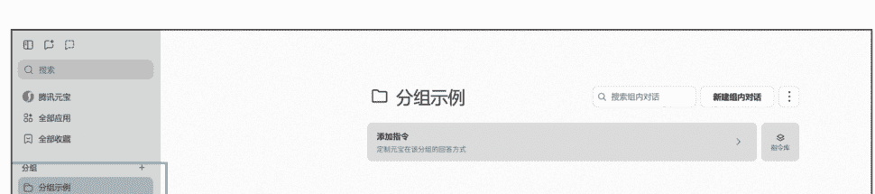

图1-35 新建分组

### 2. 功能二：在腾讯新闻里用元宝看资讯
又一次和腾讯生态融合。在腾讯新闻App里点“分享给元宝”，内容就能送到元宝分析新闻、视频，并可继续追问。

- 不管多长多专业的文章，元宝都能一句话抓重点。
- 看不完的精彩视频，元宝可归纳要点，快速了解发生了什么。
- 看完后有想法，还能调用“深度思考”模式延伸思考、举一反三。

### 3. 功能三：浏览器插件上岗
除电脑版、网页版、手机版、小程序外，元宝又多了一种形态——浏览器插件。现已支持Chrome、Edge、QQ浏览器、酷狗浏览器。

插件主要提供：悬浮球，一键翻译、总结、收藏网页；常驻侧边栏，可自定义提问；划词工具栏，选中文字即可搜、译、复制或问元宝。

下载方式：在官方下载中心 https://yuanbao.tencent.com/download 点“浏览器插件”，如图1-36所示，按自己浏览器选对应插件。以Chrome为例：打开 chrome://extensions/，开启右上角“开发者模式”，解压下载的元宝插件.zip，找到元宝插件.crx，拖入扩展程序页完成安装。

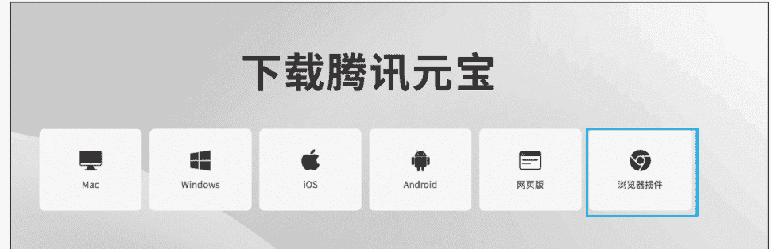

图1-36 在腾讯元宝下载中心下载浏览器插件

### 4. 功能四：划词工具栏
读英文文档或外文网站时频繁查词很烦。用电脑版的划词工具栏更省心。

在电脑版点用户头像进入设置，点“快捷工具”，在“划词工具栏”里打开“选中文本时显示工具栏”，如图1-37所示。

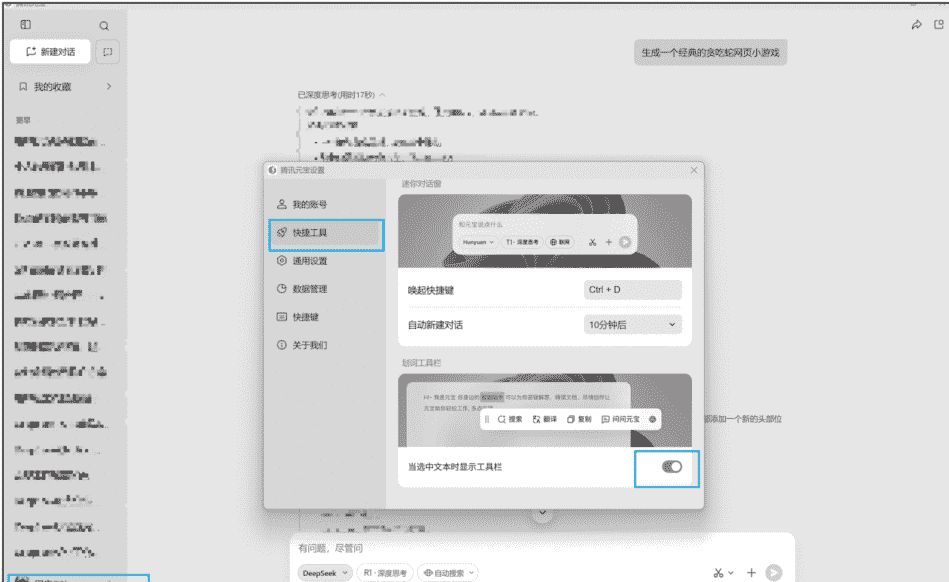

图1-37 在腾讯元宝设置的快捷工具中开启划词工具栏

选中网页文字后工具栏自动弹出，可执行搜索、翻译、复制或问问元宝，如图1-38所示。

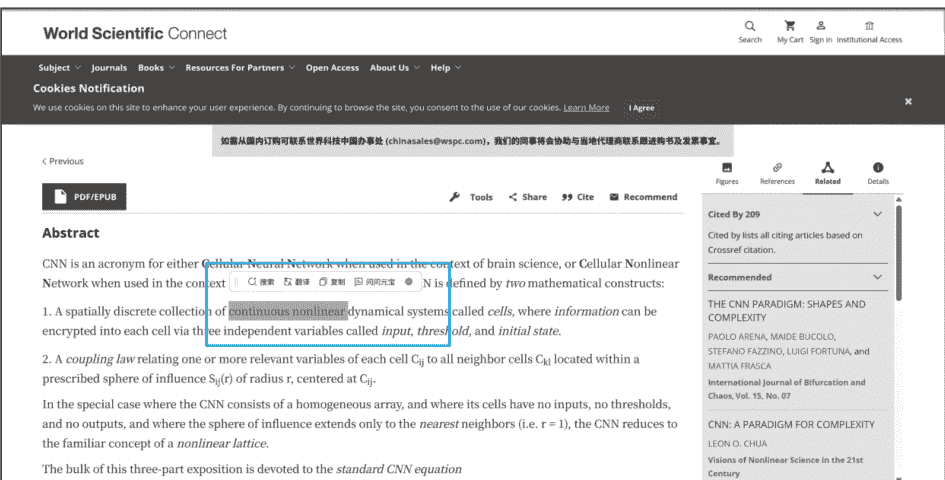

### 5. 功能五：接入微信读书和起点读书，一键直达
元宝能做你的读书搭子，已接入微信读书和起点读书，可按需求推荐定制书单，并一键跳转阅读。

打开联网搜索模式，选择自动搜索，输入如“帮我推荐几本心理学入门书籍”。回答中书名带下划线，点击即可跳转到微信读书或起点读书阅读，如图1-39所示。

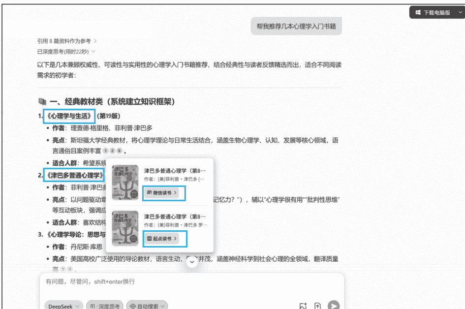

图1-39 单击腾讯元宝网页版显示的回答中带下划线的书名可实现跳转阅读

### 6. 功能六：联动腾讯地图，元宝会找路了
出门常问附近哪里有便利店、最近咖啡店在哪、好吃又好环境出片的西餐在哪。现在打通腾讯地图后，元宝能结合地图信息给出精准推荐。

例如问“附近的电车充电桩在哪儿”，回答里会自动展示地图卡片，如图1-40所示，并支持一键导航，如图1-41所示。

附近的电车充电桩在哪儿

引用 1 篇资料作为参考

已深度思考(用时4秒)

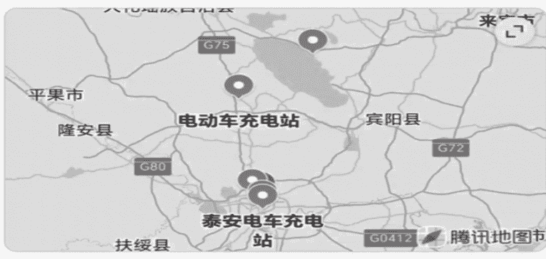

兴宁区周边充电桩近距离清单

整理了兴宁区附近容易抵达的补电站点，按由近到远排列：

1. 望州南路电车充电区
网点位于望州南路与长望路交叉口东南约131米，距离兴宁区核心地带约2公里。处在主干道交汇处，周边临时停靠方便，补电效率高，日常通勤或短途补电都很合适。

2. 泰安大厦电车充电站
▲图1-40 在回答中展示地图卡片

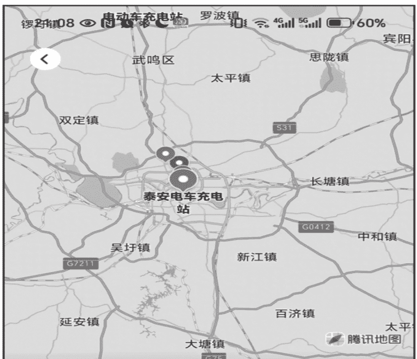

**地点 (6)**

**电车充电区**

充电站

距离2.3公里 | 广西壮族自治区南宁市兴宁区望州南路与长...

**泰安电车充电站**

充电站

距离4.3公里 | 广西壮族自治区南宁市青秀区新竹街道民族...

**电动自行车智能充电站电动车充电区**

生活服务

距离4.7公里 | 广西壮族自治区南宁市西乡塘区卢仙岭路与...

▲图1-41 在地图卡片中可以选择你想去的地点，且支持一键导航

使用提示：该应用手机版与网页版已接入腾讯地图，PC端暂未接入。想用一键导航建议优先选用手机端。

### 7. 总结
腾讯元宝近期推出的功能已深度嵌入腾讯生态，不仅贴合日常使用习惯，也降低了上手门槛。小程序、网页、客户端或浏览器插件都能找到合适的场景。接入微信读书、起点读书、腾讯地图后，服务面更广，体验价值提升，完全能当成生活助手来用。

#### 试一试
把历史对话用腾讯元宝整理归类，打造专属的AI智囊组合。

#### 小贴士
1. 对话分组功能可用来搭建个人知识库。
2. 本节介绍的能力截至2025年6月来自官方发布，后续更新请关注官方文档。

## 技巧8
## 三大AI写作助手怎么挑

职场写作需求各不相同，不同AI产品的侧重点也不同，要挑到匹配的工具并不容易。有的功能很强却不够贴近日常，有的上手很快却深度不足。如何做出更理性的判断，是实际难题。

### 1. 腾讯元宝：腾讯生态内的智能中枢
腾讯元宝依托腾讯混元大模型，支持多模型协同与多模态能力，可深度链接腾讯系产品并调用独家生态内容。值得一提的是，已接入满血版DeepSeek模型，与官网相比算力更稳定，排队概率明显下降，交互更顺畅。

在腾讯体系内优势更突出。微信里可直接添加为好友聊天，还能结合微信、QQ、腾讯文档等的数据与服务，输出更精准个性化的回复，无论办公、学习还是日常交流都能高效应对。

### 2. Kimi：长文本创作的品质伙伴
如果经常被长篇论文、产品手册或法律合同困扰，Kimi会是不错的选择。它可实现超长上下文连贯处理，从最初20万汉字输入升级至200万字无损上下文，适用于学术论文梳理、商业文案保持调性、合同报告术语精修等长文本场景。多模态能力仍有提升空间。

### 3. 豆包：写作新手的成长搭档
豆包由字节跳动推出，依托字节流量生态，既能通过智能引导和丰富模板降低写作门槛，又内置多款智能体角色，从“写作教练”到“娱乐达人”覆盖不同场景。特色语音交互支持实时对话与语音创作，张嘴即可生成内容；趣味接龙、角色扮演等娱乐功能也让创作更有乐趣。

## 4. 总结
腾讯元宝作为腾讯生态的AI核心，不仅深度打通微信、QQ、企业微信等平台，还凭借满血版DeepSeek保证稳定流畅的创作体验。特色在于适配企业级场景，如智能客服、营销文案生成、跨平台数据协同，特别适合需要深度绑定腾讯生态的商业用户与专业创作者。

Kimi聚焦文本质量提升，凭借专业的语言润色、逻辑优化与风格适配能力，将初稿打磨成精品。无论学术论文、商业报告还是文学作品，都能提供精准修改建议，是追求内容专业度的创作者不可或缺的助手。

豆包以趣味化创作著称，通过智能体切换、语音交互与娱乐互动，让写作更轻松。从故事接龙到社交媒体文案，丰富的模板与引导机制使其成为新手快速上手的理想选择，尤其适合追求创意表达与娱乐体验的年轻群体。

### 表1-1 三种AI工具的功能对比

| 特点 / 功能 | 腾讯元宝 | Kimi | 豆包 |
| :--- | :--- | :--- | :--- |
| 文本处理能力 | 支持长达 1000 万字的单文档处理，支持多格式文档的解析与总结 | 支持 200 万字无损上下文处理，擅长处理长篇文献、报告、合同等 | 具备文件和网页的解析功能，能阅读和理解各种格式文件以及网页内容 |
| 多语言对话 | 支持多种语言的对话 | 擅长中文和英文的对话 | 支持多种语言的对话 |
| 搜索能力 | 整合微信搜一搜、搜狗搜索等资源，擅长从微信公众号等腾讯生态中获取内容 | 具备联网搜索能力，探索版的 AI 自主搜索能力强 | 擅长从字节跳动生态中获取内容 |
| 深度推理功能 | 深度思考与逻辑推理能力较强 | 正在开发中，未来能进行更深入的对话 | 测试了新版“深度思考”功能，支持“边想边搜” |
| 多模态生成 | 具备文生图、AI 头像生成等功能 | 暂无明确多模态功能描述 | 能看懂图片、处理音频，具备图片生成、音乐生成功能 |
| 智能体创建 | 用户可以创建个性化 AI 角色 | 无相关描述 | 拥有官方创建的专业智能体和用户自创的个性化智能体 |
| 使用场景 | 有助于办公、学习、生活等场景的效率提升，支持如 AI 搜索、AI 写作、口语陪练、超能翻译官等功能 | 涵盖学术科研、互联网从业、编程、自媒体、法律等领域的信息搜集、资料整理、内容创作、编程辅助等功能 | 适用于学习、工作、生活、创作等场景，支持如解题、写作业、写文案、做 PPT、旅游规划、健康咨询等功能 |
| 技术优势 | 基于腾讯混元、DeepSeek 等大模型，数据资源丰富 | 长文本处理能力强，AI 自主搜索能力强 | 基于字节跳动的云雀模型，与字节系产品深度整合 |
| 成本 | 免费 | 目前对用户免费 | 基础功能对用户免费 |

### 补充说明：
微信生态深度整合是腾讯元宝的最大优势，例如可直接调用微信聊天记录生成会议纪要，其他工具不具备此能力。
Kimi在长文本处理测试中表现优异，能自动标注论文引用来源并生成Matplotlib代码，但多文件处理时稳定性偏弱。
豆包的语音交互自然度被多次提及，支持方言识别和RAP生成等娱乐功能，但在专业领域如法律条款分析表现较弱。
建议按需求选择：办公场景优先考虑元宝，学术研究用Kimi，日常娱乐选豆包。想验证具体功能，可访问各产品官网或应用商店详情页。

#### 试一试
围绕同一主题，如职场沟通技巧，分别用三款工具生成不同风格的文章，对比差异。

#### 小贴士
1. 腾讯生态用户优先选腾讯元宝。
2. 新手写作选豆包，追求质量选Kimi。
3. 定期清理缓存，尤其使用Kimi处理长文档后重启，可避免越用越慢。

## 技巧9
## 腾讯元宝提问提效10法·上篇

是否遇到过这种情况：向腾讯元宝提问时，得到要么是大量无关信息，要么是晦涩难懂的专业表述，而同事用同样工具却轻松拿到理想答案。这并非工具问题，而是提问策略需要升级。

本节揭秘前5个黄金提问法则，让腾讯元宝成为职场智囊。

### 1. 场景具象化：别让模型猜心
提问过于笼统，就像让厨师“随便做菜”。模型需要具体情境才能给出精准答案。以商务谈判为例，需明确对象、时间与需求。例如：“我下周要和比亚迪电池供应商谈判，需要：①动力电池核心参数对比表；②近半年市场价格波动分析；③针对技术型采购经理的议价话术库。”

腾讯元宝可能会输出对比表、价格波动分析及话术库等内容。

### 2. 任务拆解法：把大题切成小块
面对复杂任务，一次性提问效果不佳。可先将大问题拆解为若干小问题再提，如同把牛排切块更易入口。例如：“分三步完成市场报告：①列出近三年锂电池成本下降的三大技术突破；②对比宁德时代和比亚迪CTP技术优劣势；③制作供应商价格敏感度分析表。”

### 3. 大白话翻译：把术语变通俗
遇到专业概念时，可要求用生活化类比解释，帮助非专业人士快速理解。例如：“请用快递分拣流程类比说明AI的注意力机制。”

### 4. 渐进式优化：像雕塑一样打磨
腾讯元宝具备多轮对话记忆，首次得到初步答案后，可通过连续追问细化，让输出逐步逼近需求。

例如，了解云南旅游攻略可多轮对话，第一轮输入“推荐云南7日游路线”，随后补充“第三天行程太紧，改为半日自由活动”，再补充“餐饮预算控制在人均80元/天”。问题越具体，答案越贴合。

### 5. 多视角思考：给问题装上棱镜
单一视角分析往往不够全面，可要求从多个角度思考。例如：“分析直播电商趋势，要求：①常规分析；②批判性思考；③识别反常识机遇。”

### 6. 总结
用好腾讯元宝的关键在于问得具体、拆得细致、表达清晰。指令越明确，结果越令人满意。

#### 试一试
试试这样提问：“我要给老板解释项目延期原因，要求：①用修车打比方；②给出三个解决办法；③不超过300字。”

#### 小贴士
- 1) 用“5W2H”清单自查提问完整性。
- 2) 将复杂任务拆解后，给每个子任务单独建立对话窗口。
- 3) 保存优质问答模板，建立个人“提问案例库”。

# 技巧10
## 腾讯元宝提问提效10法·下篇

掌握前5条法则后，腾讯元宝的实战价值才真正释放—它不仅能答题，更能成为职场专业助手。后5条法则将带你进入AI协作的高阶形态。

## 1. 风格化妆师：让内容穿上合适外衣
汇报同一内容给不同对象时，可指定受众身份或表达风格，让其切换“语言模式”，汇报更具针对性。例如，输入“模仿《经济学人》风格重写这段技术参数：[输入原文]”，腾讯元宝会按指定风格重构。

## 2. 数据指挥官：明确你的数据指令
处理数据时，明确呈现形式和分析维度，可获得更直观结果。如从原始数据中挖掘商业洞察，可像导演设计“数据剧本”。
例如，输入“将Q4华东区销售数据处理成以下形式：①按产品线分类；②用折线图+柱状图对比月度趋势；③标注异常值。”，腾讯元宝会给出统计表、图表以及异常值标注代码。

## 3. 条件画框法：给模型明确边界
为避免得到冗长缺乏重点的回答，需告知模型排除方向，即掌握“设限”技巧。设定清晰限制条件可过滤无关信息，答案更精准。例如：“请给我推荐江苏旅游景点，要求：①上海出发2小时高铁可达；②适合5岁儿童；③科普类（排除游乐场）。”

## 4. 多模态联合作战：让模型十八般武艺全开
腾讯元宝不仅能处理文字，还能分析图像、数据等多种信息。可上传图片让其提取文字；上传CSV、xlsx文件让其清洗、合并、分析数据。

## 5. 合规安全带：确保专业可靠
涉及专业领域时，明确要求依据特定标准作答，可保证输出准确合规。例如：“根据最新《中华人民共和国劳动合同法》司法解释，起草竞业限制条款，需包含：①补偿标准；②期限限定；③违约责任。”

腾讯元宝可能会输出：
竞业限制协议条款（参考范本）
第一条 适用范围

本协议适用于与甲方订立劳动合同，并在岗位职责范围内涉及商业机密、技术机密以及其他需要保密的信息的全部人员，包括高级管理人员、高级技术人员和依法负有保密责任的其他劳动者，合称乙方。

第二条 补偿标准

1. 补偿金额：竞业限制生效期间，甲方须按月向乙方支付经济补偿，基数为乙方离职前十二个月平均薪酬的__________%，建议取值区间为30%至50%，且不得低于甲方所在地区现行最低工资标准。
2. 支付方式：补偿款应于每月__________日前汇入乙方指定的银行账户，账户信息为__________。
3. 调整机制：如甲方所在地后续出台更高补偿要求，以较高标准执行。

第三条 期限限定（略）
第四条 违约责任（略）
第五条 协议解除与终止（略）

### 6. 总结

所有高效提问的方法都指向同一套逻辑：把问题问得更具体、把问题拆得更细致、持续做好引导。当描述足够清晰时，腾讯元宝给出的就不再是泛化的参考，而是有针对性的定制方案。

#### 试一试

挑一份已有的研究报告，问腾讯元宝：“改写成面向客户的版本，用大白话讲清三大好处。”

#### 提示

- 1）重要文件请再次复核。
- 2）沉淀部门常用的提示词模板，使用时直接调用。
- 3）关键数据的来源可靠性必须核查。

# 第2章
## 周报到汇报的AI写作实操路径

# 技巧11
## 素材获取：让腾讯元宝当你的选题库

职场写作要求专业深度与传播效果兼顾，但实际操作常受阻：行业报告更新缓慢像过期库存，网络热点转瞬即逝，找到的案例要么被反复引用要么经不住检验。

传统搜集效率低下，搜索引擎首页充斥广告，专业数据库检索门槛高，收藏夹里的资料长期积压。面对既要洞察又要共鸣的需求，很多人只能对着空白文档发呆，这是在信息过载下的典型困境。

怎样让素材像自动补全般及时出现？如何平衡专业与可读？以下三招可借助腾讯元宝主动挖掘选题。

## 1. 招式一：精准锁定素材需求

模糊指令只会得到泛化结果，边界越清晰越容易命中目标。举例来说，你是职场新人想了解工作挑战，直接问“帮我找职场的典型挑战”，很可能得到“35岁危机”这类不相关答案。改为：“请为职场新人梳理三类典型困境，需包含①社交媒体热议话题②企业HR的一手访谈片段③相关心理学研究数据。”并开启联网搜索。

此时腾讯元宝会综合社交平台热标签、招聘负责人的一线反馈、决策疲劳研究的核心结论，输出更匹配的内容组合，例如：

### 挑战一：理想与现实的落差
社媒热度：短视频平台上“上班博主”记录通勤、办公室政治、加班文化等真实片段引发广泛讨论……

### 挑战二：数字化监控带来的社交压力
社媒热度：Z世代发起“职场闭嘴打卡”行动，GitHub上的《职场黑话密码本》获数万星标……

精准定位的关键有三点：①对象要具体，如“职场新人”而非“打工人”；②维度要限定，兼顾现象描述、真实案例、理论支撑；③格式要明确，是否需要结构化呈现。

## 2. 招式二：跨领域素材整合

当需要把自身认知之外的专业内容转为素材时，可让腾讯元宝做通俗化转译。文职人员需了解云计算、SaaS时，可提问：“用生活常见场景解释云计算服务模式，要求①每个类比分别对应IaaS、PaaS、SaaS；②同时给出技术解析与比喻说明。”

示例思路：

租房自装修对应IaaS：获得毛坯房自主改造。
比喻说明：想开咖啡馆不想自建，可租毛坯商铺自行装修并购置设备，自主掌控内部运营但无需操心建筑维护。技术解析：IaaS提供虚拟化底层资源，用户通过控制台管理操作系统、运行环境及应用，如租用AWS EC2后需自行装系统、配防火墙、部署数据库。

精装公寓对应PaaS：即住即用的带家具空间（略）。
酒店服务对应SaaS：享受完整住宿体验（略）。

每个解释兼顾术语说明与生活类比，可读性大幅提升。跨领域整合需要三要素：①确定通俗化对象；②选择大众熟悉的生活场景；③要求双重解析，即专业定义加类比说明。

## 3. 招式三：碎片信息结构化

手头素材零散难以成型时，可借助框架整理。比如参加充电服务会议后需写市场分析报告，可用提示词：“我有一些关于充电服务的会议碎片，请整合成市场分析素材：①用户反馈更关注续航……②技术部确认电池成本下降……③客服数据反映咨询量增长……要求按‘需求-技术-服务’逻辑分层，每层补充行业数据。”

输出示例：

一、需求层面：用户核心诉求驱动市场扩容
### 1. 续航与便捷性成为关注重点
超80%新能源汽车用户把长续航列为购车首要因素，67%潜在消费者认为充电服务便捷性直接影响购车决策。
行业数据：2025年2月全国公共充电桩总量383万个，私人桩962万个，车桩比约1:1.5，但区域分布不均，如高速公路10%服务区未覆盖，乡村覆盖率不足5%……

碎片处理要点：①先罗列全部碎片；②指定逻辑框架；③要求补充数据说明。

## 4. 总结

借助腾讯元宝挖掘素材的核心是精准提问与框架设计。与其被动等待灵感，不如主动搭建素材生成逻辑。像厨师组合食材一样，写作者要掌握信息调度能力：明确需求、设计结构、交叉验证，最终拼出独特内容。

#### 试一试

输入：“用经典文学片段解析项目管理方法，要求：①选三个名著片段；②对应不同管理场景；③提炼可操作要点。”观察腾讯元宝如何把名著转化为现代管理案例。

#### 提示
- 1) 指令开头加上“你是有十年经验的××领域专家”，可提升专业度。
- 2) 收到通用回复时追加“请提供三个独特视角的分析”。
- 3) 定期归档有效指令模板，建立个人素材库标签。
- 4) 重要提醒：所有数据引用需二次核实，智能助手不能替代事实核查。

# 技巧12
## 把流水账升级成爆款：用腾讯元宝重塑内容

职场人常有这种经历：盯着空白文档两小时，写出的东西连自己都不想看，逻辑混乱、选题平淡、表达生硬。发出去后换来的是领导“重点不清”的批注或读者的沉默。

腾讯元宝能把你从写作苦力变为内容架构师，以下四招可帮你攻克创作痛点。

## 1. 文章重点分析

爆款文如同精密手表，内部齿轮严丝合缝。让腾讯元宝充当“文章透视仪”，例如输入：“你是有10年经验的《哈佛商业评论》编辑，请解构这篇关于‘时间管理’的文章：①用色块标注开头钩子技巧（红）、过渡手法（蓝）、数据使用（绿）；②分析各章节如何支撑核心论点；③提取3个可复用的结构模板。原文：[粘贴内容]。”

你会得到带标注的解构材料及可复用的Markdown结构模板，洞察远胜盲目模仿。

> 一、元素标注与功能解析（示例）
> “你是否知道全球500强高管平均每周有12小时浪费在低效会议？（钩子：数据冲击+设问）这相当于每年损失超3个月战略思考时间（数据使用：量化痛点）。但当我们深入研究麻省理工‘时间审计’项目（过渡：学术背书）……”

## 2. 辅助高效选题

选题决定成败。“如何提升工作效率”像白开水，“为什么越努力的人越不会工作”更具吸引力。启动脑洞发生器：“假设你是《纽约客》专题编辑，请为‘远程办公’生成5个颠覆常规的选题，要求：①含至少1个反直觉观点；②能引发‘真的假的？’的好奇；③适配职场自媒体调性。”

可能输出：
- 《远程办公正在制造新型加班贵族？数据揭示居家工作者的隐形996》
- 《Zoom倦怠：视频会议如何重塑职场规则》
- 《咖啡机拖累效率？远程团队‘强制疏离’实验》
- 《监控软件导致集体摆烂？远程管控的囚徒困境》
- 《居家办公让员工忠诚度暴跌：自由职业化浪潮下的反噬》

## 3. 读者反馈模拟

作者与读者存在认知差。借助腾讯元宝模拟真实读者：“请扮演35岁中层管理者，用手机快速浏览这篇‘向上管理’文章后：①加粗标注3个最想吐槽的段落；②指出哪个案例显得不现实；③标记会分享给同事的1个实用技巧。要求规避不适合出版的言论。原文：[粘贴草稿]。”

会得到吐槽点、不现实案例、实用技巧的反馈，帮助修正表达。

## 4. 打造核心金句

金句需兼具穿透力与传播力。例如提问：“你是一位TED撰稿人，请把观点‘多任务处理会降低效率’精炼成3种风格金句，要求：①学术严谨型带数据；②幽默反转型；③行动号召型。”

可能输出：
学术严谨型：“斯坦福神经科学实验证实，任务切换平均造成40%效率损耗——大脑并行处理产生的认知转换成本远超直觉判断。”
幽默反转型：“人类没进化出八爪鱼式神经，却总幻想像章鱼抛接8个彩球，结果常被文件、消息、会议追着蜇的狼狈海蜇。”
行动号召型：（略）

### 5. 总结

写作是技术活。腾讯元宝拆解结构像备菜，生成选题像调味，读者测试像试吃，锻造金句像摆盘。与其枯坐电脑前，不如让其当你的后厨团队。

#### 试一试
- 找一篇行业爆文，让腾讯元宝做解剖报告。
- 用“违反直觉+具体场景”格式生成3个选题。
- 把草稿交给“读者模式”找槽点。

#### 提示
- 1) 解构时关注转折词分布规律。
- 2) 生成选题时考虑是否有数据支撑。
- 3) 金句优化时保留个人语言特色，避免同质化。

# 技巧13
## 去除AI味：让输出像你亲笔写

使用腾讯元宝辅助写作时常遇到：润色后的方案被质疑像机器人写的，周报被要求“多说人话”，邮件回复透着冰冷感。AI浓度过高时，连使用者自己都认不出成果。

以下三招可兼顾效率与自然度。

### 1. 方法一：风格模仿训练

先投喂历史文档建立个人语料库，再迁移风格。分两步：风格解析对话与风格迁移生成。

第一步，风格解析。准备三篇带个人风格的周报上传，问：“请分析我上传的3篇历史周报，提取：①标题结构规律；②数据呈现固定模式；③段落衔接词使用习惯。”

第二步，风格迁移。整理本周工作后问：“请结合本周工作并参照你总结的特征，撰写本周心得。本周工作：①完成3个培训方案撰写，2个获客户认可；②与4位客户沟通意向。”

输出会呈现你常用的模块化标题、工具-方法-成果三段式等特征。

### 2. 方法二：场景化指令设计

避免通用表述，指定受众身份、关联近期事件、绑定内部术语。例如撰写用户调研报告时输入：“我正在写用户调研报告，原版偏通用，需面向销售部改写，要求：①引用上周三渠道商会议的三个具体问题；②使用‘北极星指标’‘转化漏斗’等内部术语；③避免抽象词汇。原报告：……会议问题：……”

输出会与业务深度结合。

### 3. 方法三：人工干预节点设置

在关键位置保留人工痕迹提升可信度。如在AI报告中加入经验性判断“该趋势或与区域天气异常相关”，或内部背景“参考王总监上周分享的临时政策”。

还可：1) 在结论前插入“个人观察”模块；2) 保留少量口语化表达如“这个数据有点反常识”；3) 增加具体人名/事件增强真实感。例如把“建议增加华东投放预算”改为“结合小李上周跑店反馈的竞品动态，建议优先提升华东三城终端陈列费用”。

## 4. 总结

去AI味的本质是人机混合工作流：智能助手负责结构化生产，人类注入经验与个性。最高境界是读者感受到清晰个人风格，同时惊叹于严谨高效。好的智能助手使用像精修盆栽，保留自然形态又见人工雕琢。

#### 试一试
1. 选3段旧文档让腾讯元宝分析写作习惯。
2. 用“面向[受众]+关联[事件]+绑定[术语]”格式重写需求。
3. 在AI产出中插入内部人名/争议点/口语化表述。
4. 对比初稿终版，测试人味浓度。

#### 提示
1. 建立个人禁用词库，要求智能助手避开过度学术化术语。
2. 重要文件保留10%~15%人工创作比例。
3. 敏感内容始终人工审核。

# 技巧14
## 工作总结提效：借助腾讯元宝快速完成总结稿

工作总结耗时耗力，需从邮件、聊天记录、表格中收集碎片数据，核对多版本信息易遗漏成果；搭建结构时常因逻辑不清导致重复或跑偏；文字既要专业又要避免刻板。

腾讯元宝可化繁为简。以下三招可高效完成撰写。

### 1. 招式一：模仿过往风格生成初稿

# 把自己的表达习惯做成可复用模版

写东西时很多人会下意识拿以前写过的同类文件当底板，把新素材往里面填。借助 AI 可以把这种习惯变成系统流程，大致分两步：先把自身的语言特征抽出来，再把特征迁移到新主题上。

以周报为例，先挑一份自己过往的周报让助手拆解，提示可以这样写：“请帮我分析这份文档，总结出标题的分层习惯、数字的展示方式、常用的衔接表达。”

助手回来的画像大概是：

标题分层习惯
- 一级标题倾向中文数字加顿号，比如“一、本周聚焦事项”，用于概括大块板块。
- 二级标题倾向括号中文数字，比如“（一）客户访谈”，对一级做细分。
- 三级标题倾向阿拉伯数字加点，比如“1. 资料整理与归档”，再往下展开具体动作。
- 整体走总分思路，层级靠缩进和换行区分，不用项目符号，仅靠数字体现逻辑。

数字展示方式与衔接用语略。

拆完就迁移。把本周要点喂进去：“按上面的风格帮我写周总结。内容有：①访谈了数家意向客户需求；②升级了数据报表样式；③配合了几次跨组会议。”

生成的文本会带上个人味道：

一、本周聚焦事项

（一）客户需求访谈

执行与记录
围绕业务目标，对多家核心客户开展需求调研，覆盖使用痛点、产品反馈及后续合作方向。通过线上沟通结合问卷收集了需求文档若干份，梳理出关键点若干条，为产品迭代提供依据（略）

（二）数据报表样式升级（略）
（三）跨组协同（略）

二、本周产出

客户访谈价值显现：精准锁定核心诉求，推动多项优化建议进入下季度开发排期（略）

三、问题与优化方向

访谈深度不足：部分反馈表述模糊，需增加二次确认环节（略）

其余省略，亲手试一遍感受最清晰。

### 2. 招式二：把初稿打磨到汇报水准
助手给出的初稿通常需要二次打磨。譬如它写出“完成项目进度管理优化”，可以追加要求：“①突出资源受限下的应对思路；②加入可量化的结果；③说明经验是否可复制；④自然融入‘流程再造’‘效能提升’‘标准模型’等术语；⑤控制在120字以内。原文：完成项目进度管理优化。”

优化后会变成：“在人力紧张情况下，通过流程再造整合跨组协作节点，建立弹性资源池，使用率上升八成以上，并上线标准模型预警功能，关键里程碑准时率达九成五。效能提升：周期压缩两成二，人力开销下降一成五。经验可迁移：模型适配多场景，工具包加培训已赋能十多个项目，周期缩短一成八到二成五。”

### 3. 招式三：人工过手增加人味
不能照搬生成内容，需要结合实际手工调整。例如：①在成本段落加上“这笔波动很反常，跟财务组老张说的最新税规有关”；②把“流程优化建议”改为“采用了上月头脑风暴时小王提出的点子，审批明显加快”；③把书面语改为口语：“那款被吐槽像老年机的产品，靠短视频翻红了。”

## 4. 总结
最高效的人机配合是让成品难以分辨真假。机器负责结构化生产，人负责注入行业洞见与个人印记。就像手冲咖啡，七分靠豆子品质，也就是 AI 生产力，三分靠手法，也就是人工调味。

#### 试一试
给助手补充背景后输入：“我是一名[岗位]从业者，需要撰写2025年Q1总结，重点包含[3项核心成果][2个改进方向]，请给出结构建议。”

#### 小贴士
1. AI 痕迹过重就不真实，建议建立禁用词库，像“赋能”“抓手”这类空词直接拉黑。
2. 正式文件预留约5%人工创作，用于插入临时事件或个人观察。
3. 保留1到2处口语，比如“这个结果确实没想到”更显真人。
4. 涉及业务机密的收尾段落务必手工撰写。

## 技巧15
## 用助手快速写出专业又吸睛的新闻稿

新闻稿要兼顾准确与吸引力，专业却不枯燥。时间紧、资料杂、要求高，改到最后容易审美疲劳。AI助手能帮忙整理信息、搭初稿、润表达。

### 1. 步骤一：快速提炼核心信息
新闻稿最怕重点不清。面对产品资料、会议纪要或访谈记录，直接让助手抽关键点。例如上传智能手环新品材料后提问：“这是智能手环新品发布材料，含技术参数、使用场景和竞争分析。请提炼核心，要求：①突出3个亮点；②每个亮点配真实使用场景；③少堆技术术语。”

助手可能给出：
亮点一：超长续航，告别充电焦虑
典型场景：商务人士出差三天不带充电器。
技术支撑：新一代低功耗芯片，续航提升40%。
亮点二：健康监测更精准
典型场景：夜间睡眠质量分析误差低于同类。
技术支撑：医疗级传感器加AI算法优化。
其余略。

### 2. 步骤二：搭新闻稿初稿
产品发布、企业合作、峰会、获奖等，核心结构都离不开5W1H。整理完要点后，用通用问法：
请按以下信息写专业新闻稿：
事件类型：[产品发布/战略合作/获奖/峰会/社会责任等]。
核心信息5W1H：
Who：[公司/机构/个人]。
What：[一句话概括事件]。
When：[具体日期或今日]。
Where：[线上/线下地点]。
Why：[行业或用户价值]。
How：[技术/合作模式]。
补充信息：[上一步提炼结果]。
要求：按金字塔结构，标题→导语→核心→细节→背景；导语含5W1H，不超过100字；每段只讲一个信息点，不分点；避免形容词堆砌如“颠覆性”“革命性”。

示例提问后，助手可能输出类似：
××科技发布全球首款AI翻译手表
今日，××科技线上全球直播发布全球首款AI翻译手表，搭载自研神经机器翻译引擎，可实现95种语言实时翻译，解决商务旅行沟通障碍。产品同时具备超长续航与精准健康监测。
该表采用新一代低功耗芯片，续航较同类提升40%。商务场景下，用户出差三天无需充电，摆脱电量焦虑。
健康监测依托医疗级传感器与AI算法优化，测试显示夜间睡眠质量分析误差明显低于主流产品。
××科技称，这是可穿戴与AI交叉的突破，随着全球化商务需求增长，实时翻译将成为智能硬件重要方向。

### 3. 步骤三：优化标题和导语
标题和导语决定阅读意愿。可以让助手改写，例如：“我们发布了AI翻译手表，现有标题××科技发布全球首款AI翻译手表，感觉平淡，请优化。补充信息：见前一步。要求：①加入数据或对比；②带点紧迫感；③专业不营销化。”

可能得到：
商务效率版：“××科技发布全球首款AI翻译手表：72小时超长续航加医疗级健康监测，商务差旅终极方案。”
技术突破版：“突破瓶颈！××科技AI翻译手表：续航提升40%加睡眠监测误差降低50%。”
场景痛点版：“告别充电焦虑与健康误判：××科技AI翻译手表重新定义穿戴标准。”

## 4. 总结
写新闻稿靠“明确需求加结构化指令”。提炼、成稿、优化标题，提示越清晰输出越贴合。

#### 试一试
优化一段现有稿件，输入：“请把下面新闻片段改得更简洁有力（原稿：……）。要求：①删冗余形容词；②每句不超过20字；③加一个数据支撑。”

#### 小贴士
1. 不满意就让助手多出几个版本再挑。
2. 可加一句“请用《人民日报》风格改写”，模仿专业媒体口吻。
3. 助手生成的数据要二次核对，防错。

## 技巧16
## 项目报告：三招让助手快速生成大纲

项目报告难的不是内容，而是组织。没大纲数据就是碎片。反复调顺序、想逻辑很耗时间，整合多部门信息时统一格式更头疼。AI助手能按需生成清晰、严谨的大纲。

### 1. 招式一：需求定位—三步锁定核心
指令越模糊输出越通用。比如直接说“帮我写市场报告大纲”，只会得到模板。要当精准导航，需要“政策定位、市场定位、财务定位”三组坐标。试试：“请生成光伏储能站市场拓展报告大纲，要求：①最新政策分析（2023年文件）；②竞品对比（服务范围、价格策略、专利）；③财务测算（投资回报、风险），用标准章节层级格式。”

助手可能给出：
光伏储能站华东市场报告
一、政策指引
1.1 2023补贴新政（附财政部23号文要点）（略）
1.2 长三角站建设地图（略）
二、竞争对手擂台
2.1 头部企业PK（A公司vsB公司）……
略。

### 2. 招式二：智能汇总—跨部门信息拼图
技术、用户、财务数据维度不同，手拼易错。用结构化指令让助手找业务逻辑：“你作为项目经理，整合：①技术部传感器测试数据；②市场部一线城市家庭画像；③财务部研发成本测算，按‘技术靠谱吗-市场买账吗-赚钱路径’排序。”

可能输出：
一、技术靠谱吗？—传感器可行性验证
核心性能数据
精度误差±0.5%（优于行业±1.2%）。
极端环境-20℃~60℃正常运行。
使用寿命实验室模拟5年无衰减。
专利：3项核心发明已获批。
技术风险预警
量产良率88%需提至95%。
多设备协同需追加蓝牙Mesh开发，增加2个月周期。
电磁兼容需补测欧盟CE标准。
二、市场买账吗？—需求匹配度（略）
三、赚钱路径—财务模型测算（略）

### 3. 招式三：个性调优—读懂领导心思
不同领导风格需要不同呈现。可预设关键词让助手自动调整：“公司报告要求：①首页3条核心结论；②风险分析单独成章；③图表占版面不低于1/3，请按此优化跨境电商物流方案大纲。”

可能输出：
跨境电商物流方案优化大纲
一、首页核心结论页
“海外仓+边境仓”组合可降末端配送成本30%（配成本对比柱状图）。
智能通关系统清关时间缩至48小时内（配时效折线图）。
区块链溯源降低货物争议率30%（配流程图）。
略。

## 4. 总结：从“文档民工”到“框架大师”
用助手列大纲就像用导航画路线。记住：需求越具体框架越准，信息越整合逻辑越顺，调优越智能返工越少。

#### 试一试
上传AI客服项目报告，输入：“生成AI客服升级报告大纲，需要：①新旧系统SWOT对比；②客户满意度目标（标注2024年数据）；③实施时间表框架。”

#### 小贴士
- 开头加“请用麦肯锡思维设计”，专业感立刻提升。
- 复杂项目先模块后组合，像搭积木。
- 重要会议前生成3个不同版本备选。

## 技巧17
## 学习心得：用助手告别无效复盘

培训后写心得常卡壳：笔记零散，不知道怎么串。信息处理方式升级一下，助手就能帮你高效成文。

## 1. 第一步：知识点智能重组
学习记录像打翻的积木。先上传课件或笔记，让助手重组：“我是一名普通职场文员，请把上传的培训内容提炼成结构化要点：①提取5个核心方法论，每个含定义、使用场景、常见错误；②按‘核心理念-工具方法-典型案例’分层；③列出可落地的方法技巧；④去重冗余。”

示例输出：
一、核心方法论体系
方法论1：从工具思维到协作范式转变
定义：把AI看作有特质的协作伙伴而非单纯工具。
应用场景：复杂决策、创意生成与迭代。
常见错误：过度追求完美、忽视个性化调校。
方法论2：动态协作模式构建
定义：建立前中后三阶段协作流程。
应用场景：项目全周期管理、战略制定。
框架：前20%人类定方向；中60%AI执行加过程管控；后20%人类做决策优化。
…
二、实施框架体系
核心理念：能力重构论、组织进化论…
三、实战技巧工具箱
效率提升技巧：会议管理三板斧…
略。

## 2. 第二步：学习内容智能填充
骨架有了，内容易空洞。继续让助手填充：“基于已提炼结构写完整心得，要求：①每个理论配真实工作案例；②全文连贯，不拆太多点；③口语化，说人话。”

可能生成：
《和AI“混”了2000小时后，我把自己活成了产品经理》
去年被要求用AI做市场分析，我直接把需求丢给ChatGPT，出来的报告像维基拼贴，数据对但没业务视角。被打回后才懂：用AI像带实习生，得给方法论。
最近的案例：上周做海外竞品分析，我让Claude模拟三个立场的行业专家吵架—保守派、激进派、中间派。吵了三天后整理风险清单，洞察反而更深。
这招源自余老师的动态协作五步法。做季度规划时，我把年度目标拆成20%战略方向和80%执行细节…
略。

## 3. 第三步：从总结到洞察的智能提升
优秀复盘要从知识上升到模式识别，可在以下维度拔高：
- 战略衔接：用“这恰好呼应公司正在推进的__________战略”建立高层关联。
- 经验类比：插入“类似当年__________项目中的__________做法”做历史参照。
- 数据沉淀：补充“经过__________次验证，该方法在__________场景成功率提升__________%”。

- 4) 风险意识：补充“务必注意当__________出现时，可能触发__________方面的隐患”。
- 5) 未来推演：延伸“计划于__________季度把此法运用到__________场景，预计可__________”。
- 6) 团队价值：点出“这为________岗位的伙伴提供了________维度的新手段”。

## 4. 总结
把学习心得做得高效，本质上是一场知识管理工程。先搭建结构化资料库，再让内容持续丰盈，最终打通价值交付通道。别人还在手工拼凑零散笔记时，懂得借助智能工具的人已完成认知跃迁。这已不是效率差异，而是工作方式的跨越。

#### 试一试
把近期收集的培训材料上传，使用指令：“请将本次学习内容转化为落地实施计划：①划分基础技能/进阶能力/战略思维3个层级；②每个层级匹配2个具体工作场景；③设计30天/90天/180天成长里程碑；④补充能力验证的客观评估标准。”

#### 小贴士
- 1) 面对复杂材料，先用“分而治之”：先分模块处理再统一整合。
- 2) 概念比较抽象时，可追加“请举例说明该理论在[具体行业]里的应用”。
- 3) 生成的内容都要过“三问检验”：是否能执行？有没有新视角？能否衍生出额外价值？

## 技巧18

## 会议纪要：一键把录音变行动清单
开会本身不吓人，吓人的是会后的收尾工作。几十分钟的录音杂乱无章，专业术语让人头晕，讨论反复绕圈，却要在截止前整理成条理清晰的纪要。手工来做？光听一遍就要耗掉午休，更别说还要提炼要点、核对细节。最让人头疼的是交上去后仍被追问：“核心结论在哪？”“时间节点是不是漏了？”“数据记对了吗？”

别急着崩溃，搭配腾讯元宝和语音转文字工具，整理纪要可以从熬夜加班变成轻松搞定。

## 1. 第一步：语音转文字—将录音转为可编辑文本
别再手工听写了，语音转文字工具如讯飞听见、飞书妙记、腾讯云语音识别都能直接把录音转成文字稿。比如进入“飞书→工作台→飞书妙记”即可上传本地录音文件，如图2-2所示。

操作要点：
- 1）挑选合适的识别模式：技术类会议选“专业领域模式”，普通会议选“通用模式”。

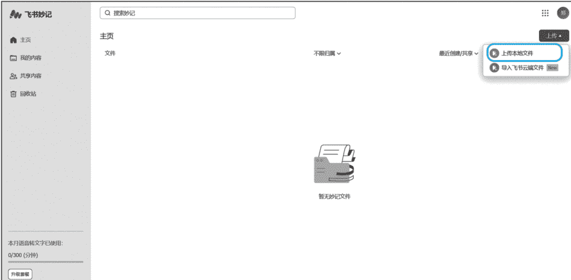

图2-2 飞书妙记主界面

- 2）若工具支持，标注发言人，避免后期分不清是谁说的。
- 3）导出带时间戳的文本，方便定位重点。

转写并非百分百准确，需要快速浏览并修正明显错误，比如把“Kubernetes”识别成“酷伯耐特”。

## 2. 第二步：腾讯元宝提炼—把杂乱文字变成结构化纪要
拿到文字稿后，让腾讯元宝充当会议秘书。关键在指令要精准，把转写好的文字上传后输入基础指令：“请将以下会议记录整理为结构化纪要，包含：①核心议题（不超过3个）；②关键讨论点（不超过4个）；③行动方案（用[负责人]+[具体行动]+[完成时间]格式）；④后续跟进（用[部门]+[跟进事项]+[DDL]格式）。”

等待片刻，腾讯元宝会生成一份带重点、分工和时限的初稿。

需要进一步细化时可追问：
- 技术会议：追加“把架构设计的讨论整理成对比表格，列出各方案优缺点”。
- 部门争论：要求“请列出各部门的争议点”。
- 领导发言：指定“提取总经理讲话中的3个战略级关键词”。

例如某产品会，腾讯元宝会把“我觉得A功能优先级更高”“但B功能客户反馈更多”等散乱讨论归纳为：
【争议点】功能优先级排序
- 支持A方：技术实现快（后端组张某）。
- 支持B方：客户需求强烈（市场部李某）。
【决策】数据补充后再二次讨论（负责人：……；DDL：本周五）。

## 3. 第三步：人工点睛—让输出带上你的专业印记
腾讯元宝再强，也需要人工补充：
- 1）加入现场观察：例如“设计组特别强调的用户体验问题录音没录清，需单独确认”。
- 2）使用团队常用表述：例如把“系统架构升级”改成大家说的“凤凰涅槃方案”。
- 3）读起来更顺：例如在紧张的时间安排后加一句“时间比较紧，建议先和测试组沟通”。

## 4. 总结
好纪要不是逐字记录，而是抓住重点、明确行动。用语音转文字解决记录问题，用腾讯元宝解决整理问题，最后靠你的专业判断解决“为什么重要”的问题。

#### 试一试
- 1）用语音工具转写5分钟会议录音。
- 2）对腾讯元宝说：“提取3个关键决策，并按‘问题-结论-行动项’格式输出。”
- 3）对比AI初稿和你以往手写纪要，看看差异在哪。

#### 小贴士
- 1）重要会议建议用本地语音转写，更安全。
- 2）给腾讯元宝的指令越像教新人，效果越好。
- 3）重要纪要保留“现场备注”栏，补充录音外信息。

## 技巧19

## 市场调研：让腾讯元宝把数据迷雾变决策依据
市场调研的讽刺在于：本该帮企业看清市场，自己却常在数据迷雾里打转。Excel堆成山，竞品报告摞成墙，最后交上去的分析却被说“没打到痛点”。等你理清思路时，隔壁组用腾讯元宝的报告已获批并执行。

别担心，腾讯元宝能帮你从“数据收集员”升级为“商业侦探”——它不替代思考，而是让分析更敏锐高效。以下是三个实战做法。

## 1. 靶向提问：从大海捞针到精准捕捞
传统调研像超市盲购，容易买一堆用不上的东西。面对海量数据，腾讯元宝的“三层漏斗提问法”可精准锁定目标。假设分析新能源汽车市场，别直接丢一堆年报，先建立问题层级：“你作为资深汽车行业分析师，请用‘宏观-中观-微观’框架处理以下问题。①宏观趋势：政策补贴退坡对2024年市场增速的影响幅度。②中观竞争：TOP3品牌在30万价位段的配置差异。③微观用户：二胎家庭选购电动车的5个关键决策因子。数据来源：[附上清洗后的结构化数据]。要求：每个层级结论必须附带可执行的策略建议。”

效果对比：普通提问得到“市场规模将达××亿”的套话，分层提问会得到针对车企端、产品端、政策端的策略；针对各品牌差异的建议；针对产品设计、服务包、金融方案的用户侧建议。

## 2. 动态追踪：让静态数据长出时间线
多数报告只描述已发生现象。若想从历史数据中找未来趋势，可让腾讯元宝看穿演化逻辑。输入：“请将这份2020—2024年护肤品电商数据转化为动态分析。①找出3个正在形成的消费新习惯（需标注早期信号节点）；②预测2025年可能被颠覆的2个传统营销假设；③用‘萌芽期-加速期-爆发期’框架绘制趋势曲线。关键指标：[GMV、复购率、客单价、新客占比]。”

腾讯元宝不仅能识别新习惯及信号节点，还能预测2025年可能颠覆的营销假设，并给出Markdown格式的趋势曲线。

## 3. 反事实推演：给结论装上安全气囊
大多数预测像晴天卖伞。若想检验商业计划的抗风险能力，可设置极端条件测试韧性。输入：“假设你是某奶茶品牌市场总监，请对这份扩张计划进行3种极端情况测试。①如果水果原料价格突然上涨30%；②如果竞品在目标城市提前推出相似产品；③如果年轻人突然抵制‘健康概念’营销。要求：每种情况给出1个防御方案和1个逆转策略。原始方案：[粘贴现有规划]。”

腾讯元宝会给出供应链、差异化、敏捷切换等防御方案，以及价值重构、反向狙击、人设重构等逆转策略。

## 4. 总结
真正的市场调研不是数据复读，而是用AI放大商业嗅觉。腾讯元宝扮演三个角色：显微镜、望远镜、CT机。

#### 试一试
针对你的行业，用模板提问：“作为[行业]分析师，请用‘宏观-中观-微观’框架回答：当前最大市场变量是什么？头部3玩家的核心差异是什么？我们的用户最想解决的3个痛点是什么？”

#### 小贴士
- 1）清洗数据时保留“异常值”，可能是重大发现的线索。
- 2）给腾讯元宝设定的角色越具体越好。
- 3）所有预测结论必须附带置信度。

## 技巧20

## 论文写作：借助腾讯元宝完成教授认可的学术稿
写论文像跑孤独马拉松：查文献被资料淹没，搭框架纠结逻辑，改格式被参考文献折磨。更怕审稿意见：“理论不足”“综述太浅”“方法存疑”。看了30篇文献却只写出3行干巴巴论点，每个写作者都懂这种痛。

如何让腾讯元宝省时间又符合学术规范？以下四步法覆盖选题到润色全流程。

## 1. 步骤一：锁定有价值的研究选题
选题常面临两难：自己想的要么太宽要么太旧，AI推荐的又流于表面。这种“博而不精”或“正确但无用”的困境会浪费时间并影响质量。

解决方案是让腾讯元宝结合“研究热点+争议点+你的专业背景”生成可行选题。例如输入：“我是[××专业]，研究方向是[××领域]。请根据我上传的论述数据，推荐5个创新且可行的论文选题，要求：①结合以下论文的研究趋势；②每个选题需说明‘研究空白’和‘可能的创新点’；③避免过于宏观或技术门槛过高的题目。数据来源：[附上相关论文数据]。”

以环境科学微塑料为例，腾讯元宝可能输出：
1. 选题：基于智能手机图像识别的淡水水体微塑料快速检测技术开发
   - 研究空白：现有检测依赖昂贵光谱仪器，缺乏野外便携方案。
   - 创新点：结合纳米材料显色与手机App算法，成本可降92%。
   - 技术门槛：基于成熟图像识别框架二次开发。
其他选题类似。

若题目太宽泛，可追加：“这个选题在[具体细分场景]的应用可能性有哪些？”同时用Connected Papers验证文献真实性，避免虚构参考文献。

## 2. 步骤二：生成逻辑严谨的论文大纲
写作时常出现大纲缺模块、章节不递进的问题。可以让腾讯元宝按标准学术结构生成大纲，并让每部分解决明确问题。例如输入：“请生成一篇关于‘×××主题’的论文大纲，需包含：①研究背景与意义（现实痛点+理论价值）；②文献综述（按‘支持派/反对派/中立派’分类并指出争议）；③研究方法（定量/定性/混合，说明数据源与分析工具）；④结果与讨论（对比已有研究，解释差异）。⑤要求：每个子标题后附上‘该部分需解决的核心问题’。”

可追加检查：“请检查大纲是否存在逻辑漏洞，比如‘研究方法’能否回答‘研究问题’？”若方法不合适，可追问：“是否有更合适的统计方法？”

## 3. 步骤三：高效整理文献综述
文献综述易陷入堆砌：A学者说…B学者提出…，缺乏演进关系与方法局限剖析。可让腾讯元宝分类对比找冲突。例如输入：“总结以下论文关于‘×××主题’的国内外研究，按框架整理：①支持派（3篇代表文献+核心论点）；②反对派（3篇代表文献+反驳依据）；③争议焦点；④结合争议提出2～3个研究方向。数据来源：[附上相关论文数据]。”

若范围过宽，可限定：“聚焦[××研究方法/××特定人群]的相关研究。”

## 4. 步骤四：从大纲到初稿的填充术
有框架却对着空白文档发呆，往往因为大纲停留在标题层面。直接用AI生成又易陷入“正确的废话”。解决方案是分模块扩写并人工注入关键细节。

操作三步：先列“论点树状图”，拆解为“核心论点+支撑证据+学术对话”；用AI深度追问生成争议观点，同时人工注入最新数据；最后“学术术语强化”，把口语转为规范表述。

例如研究方法部分输入：“请根据以下大纲扩写‘研究方法’。①研究设计：[你的设计类型]；样本选择：[样本量、抽样方法]；数据分析工具：[SPSS/Python等]。②要求：避免教科书式定义，直接说明‘本研究如何操作’；在‘信效度检验’部分加入我们实际采用的策略。”

最后在AI初稿上手动添加个人观察，如“实验发现问卷第3题误解率高，故调整表述”。

### 5. 总结
用腾讯元宝写论文的核心是：让它做结构化工作，你负责深度思考。最终成果是“AI搭骨架，你填血肉”，既高效又保持学术严谨。

#### 试一试
- 1）用选题提示词让腾讯元宝生成3个备选题目，挑1个用Connected Papers验证。
- 2）选一篇已读文献，用文献综述模板让AI分析观点，看能否发现新争议。

#### 小贴士
- 1）永远用学术数据库验证AI引用的文献，避免虚构参考文献。
- 2）在讨论部分手动加入2～3句主观解读，提升“人味”。
- 3）若AI反复推荐错误方法，直接说：“请重新评估，是否有更合适的统计方法？”

## 技巧21

## 领导讲话：让腾讯元宝当专职写作助手
写领导讲话最怕两件事：写三小时文档仍空白，改八稿仍要重写。用AI辅助完全可以做到一小时出初稿、三小时定终稿。以下“三步成稿法”带你走完全流程。

### 1. 第一步：5分钟厘清核心需求
接到任务别直接开写，先用腾讯元宝快速明确三件事：场合性质是动员会、总结会还是仪式致辞；听众是谁，是中层干部、一线员工还是外部伙伴；核心信息是要宣布政策、统一思想还是表扬批评。例如接到智能工厂建设动员会讲话稿任务，可开启联网搜索并输入：“你是有10年经验的秘书，刚接到为制造业CEO写‘智能工厂建设动员会’讲话稿的任务。请生成：①该场合必须包含的3类内容（如行业趋势/公司短板/行动指标）；②针对生产部门听众的2个说服技巧；③需避免的3种表述（如避免直接批评基层）。”

腾讯元宝会输出必须包含的内容、说服技巧和禁忌表述，帮助你找到领导和听众的诉求，再整理素材。

### 2. 第二步：15分钟搭建框架
素材有了后，用腾讯元宝生成“三段式逻辑框架”，确保结构清晰层层递进。可接着输入：“按以下结构生成讲话稿详细提纲：①形势分析（行业+内部，数据支撑）；②核心决策（不超过3个关键动作）；③落实要求（分工+时间线+奖惩）。要求：每部分用‘总-分-总’句式，标注数据引用位置。”

腾讯元宝会输出形势分析、核心决策、落实要求的提纲，确保讲话稿结构完整。

3. 收束：智能化已从可选升级为必选，只有持续的技术迭代才能一次性打开效率、品质、成本三重封印。

## 二、核心决策（总-分-总，3个关键动作）（略）

## 三、落实要求（总-分-总，分工+时间线+奖惩）（略）

（篇幅所限，具体展开请读者在实操中补充。）

### 3. 第三步：30分钟填充内容

骨架确定后，可用腾讯元宝批量产出可直接落地的段落，集中解决撰写时的三大卡点：溯源难，让模型标注可信出处；缺少内参案例，让模型模拟企业自述；领导式点睛语难产，让模型学习高层表达习惯。

比如要细化核心决策中的某项举措，可在同一对话里追加提问：“请按以下要点完成第二部分‘流程再造：数据驱动精益制造’：①每个举措配一个对标案例，如借鉴××企业做法；②穿插三句动员性表述，语感接近任正非‘炸掉金字塔’风格；③关键数据用[]括起，便于人工复核。”

模型返回的示例大致如下：

1. 首项举措：打通全流程数据，消除信息孤岛。
（1）对标案例：参考美的集团T+3做法，打通销售、制造、物流，使库存周转由[年8次]提升至[年12次]，资金占用下降[30%]。
（2）执行要点：
3个月内完成ERP、MES、仓储系统的互联，剔除[20处]数据断点，需IT与生产部门协同攻关。推行“数据日清日结”机制，晨会以实时看板为依据。

> 动员语：“数据不共享的，就是流程的绊脚石！”

2. 第二项举措：搭建智能排程中心，替代人脑经验（略）
3. 第三项举措：建设供应商协同平台，强化链主话语权（略）

（受篇幅限制，其余省略，建议分段生成。）

分段产出比一次性成稿更精准，提示词可按实际场景调整。

初稿完成后，记得用前文提到的技巧13消除AI痕迹，再经AI初筛加人工终检，形成定稿。

## 4. 总结

该方法把写作拆解为明确需求→搭建框架→填充内容三环节，腾讯元宝担任副驾，你负责掌舵定向。

#### 试一试
对腾讯元宝说：“你是某银行分行行长秘书，需准备‘普惠金融业务推进会’讲话稿，受众是支行长。请给出：①3组必讲数据；②2个竞品对比案例；③1句可引发掌声的收尾。”

#### 小贴士
- 1) 紧急润色可用“请按‘问题-方案-结果’结构重写这段”快速提升段落质感。
- 2) 领导反馈缺乏亮点时，可追加指令：“补充1个跨界案例，如互联网+制造业。”
- 3) 把领导过往讲话稿喂给模型，输入“请模仿以下语气风格生成新稿”，可保持一致性。

## 第3章

## PPT创作：用腾讯元宝优化PPT制作与汇报

## 技巧22

## 一键生成PPT：用腾讯元宝和Kimi四步完成演示文稿

职场人常遇到这样的场景：深夜对着屏幕反复修改标题，从“项目汇报”改成“战略规划”又改回来，内容拼贴感强，视觉风格在极简与繁复间摇摆，最致命的是“明天早上要终版”的deadline。

别焦虑，腾讯元宝加Kimi的组合能把PPT制作从熬夜炼狱变成茶歇时段。下面四步是具体做法。

### 1. 第一步：用腾讯元宝生成PPT大纲
需要快速搭建内容骨架时，可用指令：“作为资深商业分析师，请用Markdown输出关于[智能家居市场前景]的PPT框架，要求：①封面提供3个主标题备选，分别突出‘机遇’或‘挑战’视角；②主体采用‘问题-证据-结论’结构；③数据呈现部分标注5个关键数据及可视化建议；④结尾给出2种收尾方案。注意避免‘行业概况’这类空泛小标题。”

模型可能返回：

```
#智能家居市场前景分析框架

##封面页方案（三选一）
```

### ###机遇视角

- 1. **“智能家居：万亿蓝海市场的增长密码”**

（副标题：2025年生态价值重构路线图）

- 2. **“从单品智能到全屋互联：家居革命的黄金窗口期”**

（背景图建议：智能家居场景概念图+数据流动可视化）

### ###挑战视角

- 3. **“智能家居：如何突破用户接受度的隐形天花板？”**

（警示图标+用户痛点关键词云）

……

（篇幅所限，其余省略，建议自行实践。）

### 2. 第二步：设计视觉效果
框架有了，视觉规范不可少。配色像番茄炒蛋、版式像公告栏？可继续追问：“请为上述智能家居市场前景PPT制定详细视觉规范：①整体风格选‘专业科技感’；②配色给出主色、辅色、强调色代码；③字体组合推荐及使用场景；④版式建议：数据页/对比页/案例页的最佳布局；⑤可视化技巧：标出3个适合动态展示的数据点。要求每个设计选择附商业解释。”

模型可能返回：

## 智能家居市场前景分析

## 一、封面与引言设计

### （一）封面设计

#### 1. 风格定位

整体风格：专业科技感，营造出智能家居的高科技与未来感，符合目标受众对智能家居前沿领域的期待，展现演讲的专业性与权威性。

#### 2. 配色方案

主色：#2A5C82（行业稳定性），深蓝色系增强可信度，传递出智能家居行业稳定发展的趋势。

......

#### 3. 字体组合（略）

#### 4. 版式建议

数据页：采用“一图一表一文”布局。左侧为清晰的图表或柱状图，展示如“2021—2025 CAGR 24.7%”等关键数据；中间搭配简洁的表格，标注数据来源与对比维度；右侧用简短文字阐述数据意义，聚焦受众的主要关注点，方便其快速理解数据背后的价值。

对比页：左右分割对比式设计。左侧呈现一种情况，如“Z世代技术采纳率”，右侧对应“银发族技术采纳率”，中间用直观的箭头或图表展示差异达41%，对比鲜明，瞬间抓住受众注意力，直观呈现差异。

（篇幅所限，其余省略，建议自行实践。）

这里模型不仅给出框架，还细化到配色、字体、版式，减少手工设计时间。

### 3. 第三步：个性化调整
最糟糕的PPT是逻辑完美却毫无温度。解决方法是加入人为痕迹，例如输入：

“请在已生成的框架中加入人性化要素：①市场竞争页补充‘这一发现验证了……提出的……策略’；②转折页插入演讲提示，如‘此处停顿等待反馈’；③复杂数据页增加2条通俗类比。个性化内容请用[]标注便于识别。”

模型保证专业度，你注入场景感，最终兼具效率与温度。

### 4. 第四步：一键生成PPT
以上步骤完成后，用Kimi的PPT助手一键成稿。操作路径：Kimi主界面→“Kimi+”→“PPT助手”，将整理好的大纲粘贴发送，Kimi整理后点“一键生成PPT”，选模板→生成→下载。也可在生成后点“去编辑”微调字体、格式、布局，再下载。

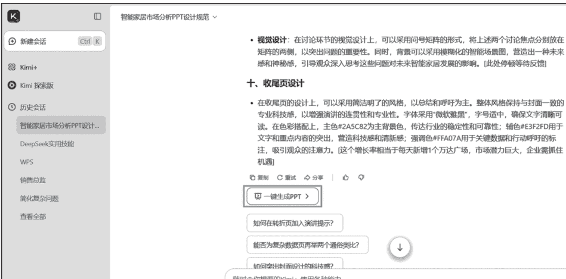

▲图3-1 一键生成PPT→选择模板创建PPT→直接下载或编辑后下载 (PC端)

热门推荐

选择模板创建PPT

历史模板

场景： 全部 总结汇报 教育培训 医学医疗 营销推广 商业计划 高校专区 企业介绍 党政宣传 自我介绍 分析报告

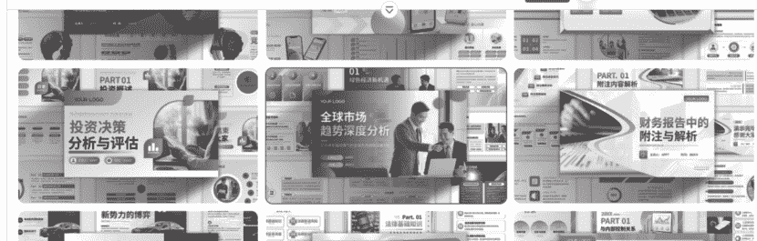

PPT预览

PPT制作已完成！


去编辑

下载

智能家居市场前景分析

保存

放映

拼图

下载

（一）封面设计

下载

文件类型

PPT

大纲编辑

文字可编辑

模版替换

下载

背景设置

插入元素

图片设置

1. 风格定位

2. 配色方案

3. 字体组合

4. 版式建议

表格设置

整体风格：专业科技感，营造出智能家居的高科技与未来感，符合目标受众对智能家居前沿领域的期待，展现演讲的专业性与权威性。

图表设置

幻灯片 4 / 31

100% +

▲图3-1（续）

下载到本地后可继续微调，直至满意。

### 5. 总结
真正的PPT高手不是设计师，而是会指挥AI的导演。腾讯元宝当编剧负责内容架构，Kimi当美术指导负责视觉呈现，你做总导演把关决策。观众买单的是清晰思路+舒适视觉+人文温度。

#### 试一试
用腾讯元宝生成一份述职报告框架，突出“决策影响”而非“工作罗列”，再用Kimi生成PPT。

#### 小贴士
- 1）行业报告类PPT保留少量专业术语更显可信。
- 2）培训类PPT每10页插入一次讨论提示，具体见技巧27。
- 3）终版PPT用“演讲者视图”核查每页停留时间是否合理。

## 技巧23

## PPT文字瘦身：三招让腾讯元宝实现精准表达

当客户说“重点不清，第三页就睡着”，主管批注“文字太多像论文”，时间又紧、设计师又缺，你会很抓狂。文字密度过高，观众注意力迅速流失。如何在有限时间内做出高效专业的PPT？三招可解困。

### 1. 第一招：信息精简化
删减文字像整理行李，留下必需品即可。让腾讯元宝扮演“毒舌编辑”，例如输入：“把下面文字浓缩为3个核心观点，每点不超过15字，用箭头连接：‘调研显示目标用户25～35岁女性占68%，其中63%认为现有包装不符审美。价格敏感度上，超半数受访者觉得定价超预期，但竞品均价比我们高12%。建议差异化营销……’”

模型可能输出：

目标用户：25～35岁女性占比68%→产品包装：63%不符合审美需求→价格策略：半数认为定价高，竞品均价高12%。

放入PPT并简单排版，页面立刻清爽。

### 2. 第二招：逻辑可视化
流程说明或数据对比时，启动“图形翻译”。尝试输入：“把这段项目推进计划转为时间轴+甘特图文案。第一阶段需求调研2周，完成用户访谈和竞品分析。第二阶段原型设计3周，含3次内部评审。第三周进入开发测试，预留1周缓冲……”

模型可生成如图3-2的可视化方案。

| 阶段 | 任务 | 第1周 | 第2周 | 第3周 | 第4周 | 第5周 | 第6周 |

|---|---|---|---|---|---|---|---|

| 需求调研 | 用户访谈 | ████ | ████ | | | | |

| 需求调研 | 竞品分析 | ████ | ████ | | | | |

| 原型设计 | 原型设计 | | | ████ | ████ | ████ | |

| 原型设计 | 内部评审（3次） | | | ████ | ████ | ████ | |

| 开发测试 | 功能测试 | | | | | | ████ |

| 开发测试 | 性能测试 | | | | | | ████ |

| 开发测试 | 安全测试 | | | | | | ████ |

图3-2 腾讯元宝生成的可视化方案：甘特图

### 3. 第三招：金句生成器
金句是记忆点，每页需一点冲击。输入：“基于以下销售数据，创作3个冲击力表达，要求含对比数字、动词、不超20字。原始内容：本月销量12000件，环比增18%。其中产品A销量4500件，占比37.5%居首；产品B、C分别3800、2700件，推动业绩。各区域均衡发力，华北区营业额35万元领先，华东、华南紧追，市场活力增强。”

模型可能输出：

- 1. 销量飙升18%破12000件！（12字）
解析：用“飙升”强化动能，18%与绝对值形成双重冲击。
- 2. A产品领跑，4500件狂揽37.5%！（13字）
解析：动词“狂揽”突显市占力，精确体现核心产品贡献。
- 3. 华北35万领跑，华东华南紧追！（12字）
解析：地域竞争可视化，动词“领跑+紧追”营造竞赛感。

可直接放入PPT或作为演讲话术，汇报增色。

## 4. 总结
职场PPT痛点是信息完整与视觉友好之间的平衡。善用腾讯元宝，可快速提炼逻辑链，把冗长段落压缩为有逻辑短句，降低文字密度；可将文字转为时间规划、数据对比等，生成甘特图、流程图框架，省去手工绘图成本；还能抓取核心数据与动作词，自动产出金句，强化记忆点。

实质是认知维度的提升：从关注完成度转向关注观众认知负荷，从满足自我表达转向设计信息接收路径。腾讯元宝不仅是效率工具，更是思维催化剂，让人从信息搬运工进化为认知架构师。

#### 试一试
把最近PPT中某段300字说明文输入腾讯元宝，指令：“请浓缩为3个核心观点，结构为‘动词+数字+结果’，用→连接：[文字]。”再追加：“把每个观点转为疑问句，引导思考。”

#### 小贴士
- 1) AI生成后手动加1个人性化元素，如手写标注/趣味图标/温度故事。
- 2) 数据显性化，保留百分比、排名、对比值，用色块标注。
- 3) 检查标准：每页文字扫描时间≤7秒。

## 技巧24

## PPT配图：用腾讯元宝+Napkin把长篇大论变成高级图片

季度报告、产品文档、会议纪要若只是搬运文字，很难一眼读懂。即使想“画”出来，很多人只会复制到PPT加个矩形框——这不是图表，只是文字换地方。

腾讯元宝+Napkin可实现文字→结构→图表的高效转化，全程无需设计技能。

### 1. 第一步：让腾讯元宝整理大段文字
原始文本常混杂背景、细节、冗余案例，直接做图会产生信息垃圾。先用指令要求整理，例如：“请把以下产品开发文档提炼为三层核心架构：①关键阶段，按时间轴简化为3～5个节点；②决策要点，每个阶段不超过3个核心决策；③输出成果，用动词+名词短语，如‘完成原型测试’。要求用Markdown层级列表呈现，删除形容词和案例细节。[真实产品文档]”

模型可能输出：

## 产品开发三层核心架构

- 1. 关键阶段

  - (1) 调查研究与概念形成阶段

  - (2) 产品设计与技术验证阶段

  - (3) 试制鉴定与生产准备阶段

### 2. 决策要点

- (1) 调查研究与概念形成阶段

  - 1) 确认市场需求与用户痛点。

  - 2) 筛选产品构思并形成具体概念。

  - 3) 评估技术可行性与资源匹配度。

- (2) 产品设计与技术验证阶段

  - 1) 确定产品功能与性能指标。

  - 2) 选择技术方案与核心架构。

  - 3) 验证设计质量与工艺可行性。

- (3) 试制鉴定与生产准备阶段

  - 1) 评估试制结果与质量达标情况。

  - 2) 确定生产计划与资源分配。

  - 3) 制定市场推广与销售策略。

### 3. 输出成果（略）

> （篇幅所限，其余省略，建议自行实践。）

### 2. 第二步：用Napkin一键视觉化
有了结构化文本，传统PPT仍需手动选图和排版。Napkin可一键视觉化。进入Napkin官网 https://www.napkin.ai ，点右上角Sign in登录，输入邮箱密码即可。无账号可点Sign up注册，填名字、邮箱、密码后验证邮箱完成注册，如图3-3、图3-4。

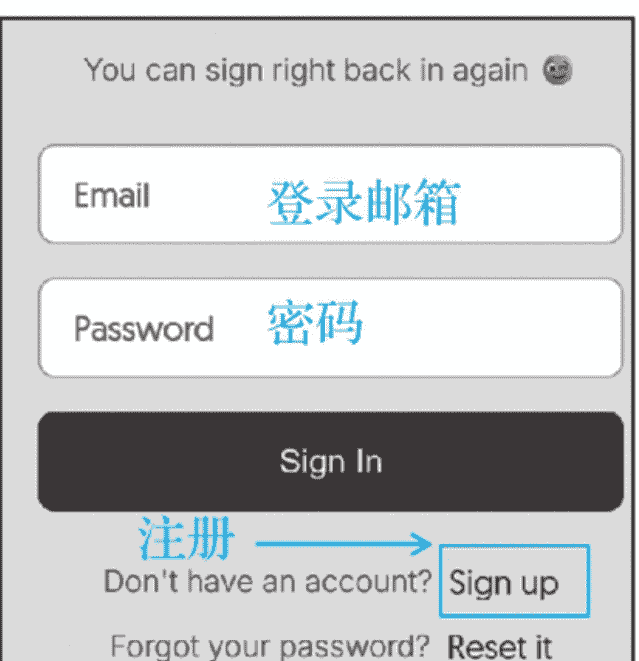

▲图3-3 Napkin登录页面

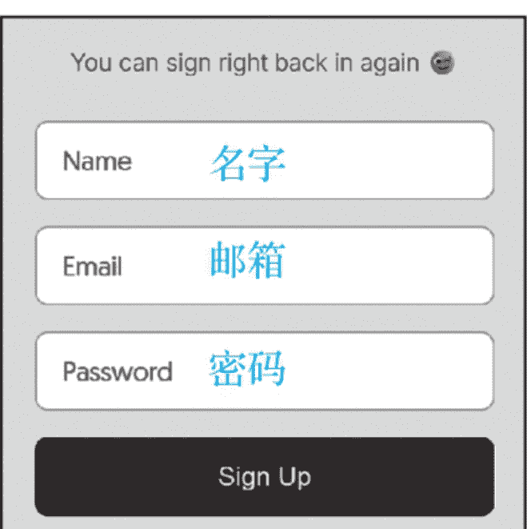

▲图3-4 Napkin注册页面

注册后进入编辑界面，将上一步文案粘贴，选择要转化的部分，点左侧闪电图标即可生成多种图表方案，如图3-6。

- 2) 技术路线与架构确认
- 3) 设计质量与工艺可行性校验
  - (3) 试制评估与量产准备阶段
    - 1) 试制结果与达标情况判断
    - 2) 产出计划与资源分配确定
    - 3) 市场推广与销售策略制定
- 3. 成果输出
  - 调研与概念形成阶段
    - 市场调研报告完成
    - 产品概念文档形成
    - 技术可行性分析输出[6,10][@ref]
  - 产品设计与技术验证阶段
    - 技术设计方案完成
    - 产品原型测试结果输出
    - 工艺验证报告生成[6,7][@ref]
  - 试制评估与量产准备阶段
    - 小批试制验收完成
    - 生产准备清单输出
    - 上市推广计划制定[6,7][@ref]

## ▲图3-5 上传文字至Napkin

## 产品开发过程
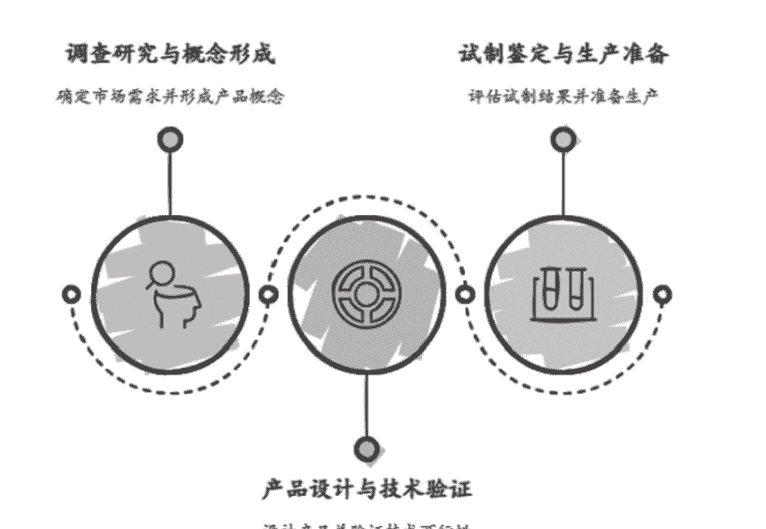

## 产品开发流程与关键决策
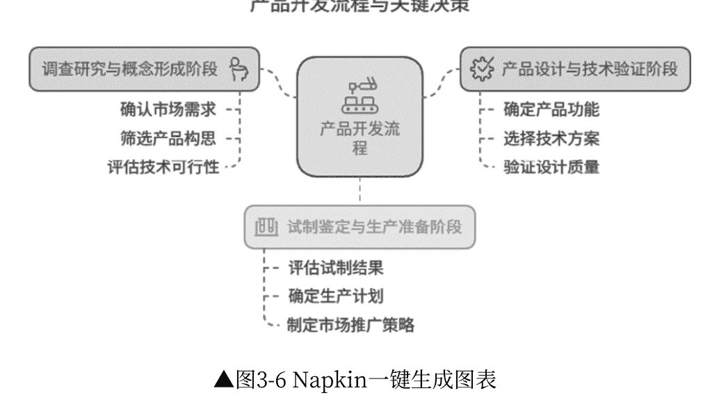

## ▲图3-6 Napkin一键生成图表

### 3. 第三步：调整图表内容
Napkin生成的图支持后续再编辑，配色、文字可以修改，也能直接在图上加注。导出前可调整画布比例和背景色。编辑完成后下载，再放到PPT对应位置即可。

## 4. 总结
本节讲的方法核心是把机械性工作交给AI：元宝负责抽取逻辑，Napkin负责视觉呈现，人类负责收尾润色。与其去研究工具参数，不如把指令能力练好，层级、偏好、用途说清楚，产出质量才会稳定。

#### 试一试
试着用本节方法，把一段文字转成可用于PPT的视觉图。

#### 小贴士
- 1) 涉及保密的内容不要传给Napkin。
- 2) 可让Napkin一次出多版，再挑选合适版本。
- 3) 元宝整理得越结构化，Napkin的成图效果越好。

## 技巧25

## PPT标题：三招摆脱标题卡壳

做PPT时最让人发愁的往往是标题栏。观众先看标题，想法有了却写不出简练有力的短句。领导要求每个板块标题要有记忆点时，大脑会宕机，连“年度总结”“项目进展”都嫌平淡。要一次性产出二三十个标题，灵感通常撑不过前几页。

这时可以让元宝帮忙。它不需要文案功底，也不靠灵感，指令对了就能批量给出备选。

### 1. 招式一：关键词提炼法
好封面像电梯演讲，30秒抓住人。标题要包含核心信息，再做组合排列。比如关键词是“全球化”“环保”“科技”，可组合成“全球突围：AI驱动废弃物转化率提升60%”。关键词是“教育”“AI”“个性化”，可变成“AI突围：个性化教育提效30%的实战路径”。

把零散信息点丢给元宝重组即可。示例指令：“请依据‘数字化’‘关怀’‘创新’生成5个PPT标题，要求突出受众痛点，带数字指标，使用‘破局’‘进化’‘实战’等有冲击的词，避免‘赋能’‘打通’等空词，15字内。”

可能得到的方向包括数字化破局结合关怀效率、创新实战结合覆盖率、关怀进化结合识别准确率等，具体数字需按实际调整。

### 2. 招式二：结构指令法
清楚标题要素却写不出来时，可让元宝填空。比如做业务复盘，先确定标题必须包含“问题定位+解决思路+数据结果”，再提问：“生成5个复盘类标题，结构：①前半句用问句点出痛点；②后半句用动宾结构表述解法；③括号内补充关键数据。背景：私域运营失效、新品推广周期长、跨部门协作成本高，经4项措施，门店私域销售额提升24%。”

输出会围绕流量转化低迷、四维激活、首月GMV环比提升等展开；新品滞后、敏捷推新、研发到上架周期压缩等展开；部门墙、协同体系、人效成本下降等展开。

### 3. 招式三：案例学习法
有优质标题教程时，元宝可当翻译官，把方法论变成可执行的指令。上传教程如《PPT封面标题5种解法》，提问：“请学习文中封面标题写法，为主题‘传统制造业数字化转型路径’的PPT写一个吸睛封面标题。”

学习后可能给出比喻修辞类、疑问句式类、客观描述类等方向，例如巨轮航线、蝶变之路、引擎等比喻，或如何突围、密码是什么等疑问。

## 4. 总结
用元宝写标题的本质是把人从反复纠结中解放，聚焦内容逻辑。记住三要素：给原料、定规则、学案例，就能得到专业又不僵硬的标题库。

#### 试一试
在元宝中输入：“把‘年度财务报告’改造成3个不同风格的主标题，分别突出稳健、突破、创新。”

#### 小贴士
- 1) 重要汇报标题保留人工微调，换一两个词更自然。
- 2) 需要参考时一次性多生成几组。
- 3) 生成的含数字标题要复核，AI可能虚构数据。

## 技巧26

## 汇报开场：用元宝设计PPT开场白

准备演讲时最卡的是开头。内容清楚、开头却生硬或空洞。面对不同听众，语气、风格、切入点都要变：给高管要精炼有力，发布会要抓眼球，内部分享要避免枯燥。套模板千篇一律，硬想金句效果有限，最后只能照稿读，30秒内听众就走神。

如何快速做出专业又抓人的开场？元宝可高效解决。三种做法如下。

### 1. 方法一：精准定位——三要素锁定核心
通用开场易同质化，需先锁定受众。假设在科技产品发布会演讲，开场需同时满足媒体要亮点、渠道商要利润空间、技术团队要算法价值。让元宝按需求合成定制方案，输入：“为智能健身镜发布会设计开场白：①听众：健身博主60%+经销商40%；②亮点：全球首个AI塑形算法；③氛围：科技感+颠覆性。提供3种风格：数据型/故事型/互动型。”

输出会围绕步数互动引入、运动效果倍增设问、大屏演示配合AI私教人设展开。

### 2. 方法二：AI编剧——热点情景剧
汇报要兼顾硬核与不枯燥。提问：“为新能源电池路演写开场白：①核心数据：能量密度提升40%（2024认证）；②竞品短板：低温表现弱；③社会价值：降低自燃风险。要求结合冬奥极寒测试热点，禁用‘颠覆’等词。”

优化版会用哈尔滨-35℃冬季测试零故障引入，将能量提升类比为油箱变充电宝等。

### 3. 方法三：人设定制——打造专属风格
演讲关键是见人说人话。同一技术，对投资人讲回报，对用户讲体验。假设向科技爱好者介绍脑机产品，输入：“定制人设：①身份：硬科技创业者，主导过多次IPO；②风格：技术宅+幽默；③禁忌：不用‘赋能’‘抓手’等黑话。生成发布会开场白，需包含三甲医院临床数据、与竞品差异、实物演示。”

输出会用透明设备设问、渐冻症患者发声案例、纳米电极与钢针对比等。

### 4. 总结：从“念稿机器”到“舞台导演”
用元宝设计开场白相当于用智能导航。注意定位精准、内容带电、人设鲜明。

#### 试一试
对元宝说：“生成元宇宙发布会开场白：①听众：科技从业者50%+投资机构30%+跨界媒体20%；②记忆点：用黑暗森林隐喻技术破壁、实时粒子流人数穹顶、CEO与虚拟人全息辩论；③基调：星际议会仪式感+元空间裂变特效。提供3种风格：隐喻解构型/数据冲击型/虚实碰撞型。”

#### 小贴士
- 1) 可结合行业热点生成，如“结合硅谷裁员潮谈AI伦理”。
- 2) 生成后追加“提炼3个≤10字的记忆点，要求押韵+含数字”，快速萃取传播点。
- 3) 手动加入个人惯用的语气词。

## 技巧27

## 隐形提词器：用元宝生成演讲备注

很多人怕的不是做PPT，而是讲PPT。写演讲备注耗时，成稿却空洞或生硬。备注不完善会让演讲者紧张，影响效果。

既要传递核心信息又不喧宾夺主，既要专业又要有温度。纯手工费时，纯AI套用像机器。可让元宝当“隐形导演”，保留思考温度并发挥结构化优势。三个方法如下。

### 1. 方法一：关键信息提取
把备注提炼成“视觉钩子+口语线索”。上传PPT页面截图，不要一次传整套。指令：“为上传的页面截图生成演讲备注，要求：①保留1个核心数据；②用疑问句提示重点；③含1个生活化比喻。”

输出会用营销人熬夜调排版的比喻，类比切菜炒菜摆盘全手动，提出重复工作占比与创意剩余的设问。

### 2. 方法二：节奏把控提示
在备注里嵌入“气口标记”和“互动指令”。指令：“为这几页生成演讲备注，要求：①关键转折插入[停顿]标记；②每页1个互动提示；③术语旁标注口语化替代。”

输出会用停顿引导聊职场写作痛点，列出风格不适用、结构复杂、提问过度导致跑题三类问题，并提示举手互动。

### 3. 方法三：应急话术生成
为每页准备30秒“扩展弹药库”。指令：“为这一页准备3个延伸讲解点，要求：①每点1句话；②含常见质疑回应；③用‘其实/举个例子/有趣的是’过渡。”

输出会说明可通过自定义模板满足个性化需求、复杂文稿拆解处理、明确提问范围并引导纠正等。

## 4. 总结
好备注不是提词器，是PPT里的场控导演。元宝会提醒你：观众不是来听课的，数据需要故事外套，停顿比说话更有力量。

#### 试一试
上传一张PPT页面，输入：“为年终总结第4页生成含互动提示的演讲备注，要求加入1个类比。”

#### 小贴士
- 1) 页数多时分批上传，备注更精细。
- 2) 第三方工具如腾讯文档、ChatPPT也可生成AI备注。

## 第4章 数据赋能基础篇：从数据小白到数据达人

## 技巧28 从零开始数据分析（一）：元宝帮你搞懂数据分析的核心
职场中数据分析越来越重要，但学习之路坎坷：教程要么太零散，要么太专业。面对Excel函数、Python代码、业务指标，很多人放弃。老板突然要季度销售趋势或竞品报告支撑，只能交“我觉得大概”的结论。

新人最怕老板发一堆数据，Excel翻到眼花，图表却被说像小学生作业。更惨的是学会用SQL查数据，查询跑半小时发现漏了关键条件。

数据分析核心就三件事：知道学什么、怎么练、问谁。元宝能当陪练，不直接代劳，但帮你少走弯路。

### 1. 第一步：先搞清数据分析到底要学什么
新人常乱学，Python、Tableau、Power BI全装，半年没产出像样的报告。

用元宝快速厘清路径。例如输入：“我是市场部新人，只会基础Excel，想用数据分析优化活动效果。请按优先级列出三个月学习计划，并说明每个工具实际应用场景。”

会输出类似路线图：第一阶段Excel进阶，目标掌握高效处理与基础分析；第二阶段可视化工具，目标动态监控与呈现；第三阶段智能分析，提升深度与预测。关键是明确“学这个能解决什么问题”。

### 2. 第二步：用对话式练习代替枯燥教程
传统学习看十页才能动手，一动手就报错。元宝支持即时互动。如学SQL可问：“假设有订单表orders和用户表users，想查‘购买超3次但最近30天未下单的用户’，怎么写？请分步解释JOIN和WHERE逻辑。”

比翻文档效率更高。也可模拟真实场景，如问：“老板说‘结论没排除季节性因素’，我该补充什么分析？”

### 3. 第三步：用元宝磨练提问功力

在实际工作中，卡住人的往往不是工具操作，而是提不出有价值的问题。面对一堆表格，很多同学最后只能退而求其次，说一句“帮忙画个漂亮的图”。

把原始销售文件丢给元宝，让它演练提问。比如让它基于这份表，挑出三个值得继续深挖的切口，并说明每条切口还缺哪些配套信息。

它可能这样回：

- (1) 区域间销售差距的拆解：需要补充各地外部环境和内部执行动作的记录。
- (2) 品类结构改善诊断：需要库存周转、成本构成、利润水平等数据。
- (3) 销量走势与外部变量的关联：需要历史同期和行业宏观指标。

这种引导能帮你跳出只盯表格的习惯，慢慢养成从业务出发提问的思维。

## 4. 小结

把元宝用在学习数据分析上，本质上是让它担任三种角色：学习路线规划，免得学偏门技能；全天候答疑陪练，随时解答操作疑惑；提问方向提示，教会你换角度思考。它的意义不在替代学习，而在减少盲目摸索的时间。

#### 试一试

- 1) 输入【你的岗位】+“数据洞察学习路径”，让元宝给出定制清单。
- 2) 用“请解释××代码为何报错”代替盲目检索。
- 3) 分析前先问“这份材料最值得关注的三点是什么”。

#### 小贴士

- 1) 把复杂需求拆成若干小问再提问，先要思路再要代码。
- 2) 归档常用提问模板，比如“月度复盘分析框架”。
- 3) 定期请元宝复盘你的推理链条，找出盲区。

## 技巧29 数据思维启蒙：用元宝建立分析框架

实战里常出现这种场景：报告交上去，领导问“这些数字到底说明什么”。更难受的是花一整天整理数据，最后结论只是“销售额下降了”，这和没结论有什么区别。

数据分析的核心不是堆数字，而是讲清业务故事。工具会用不代表会思考，容易沦为表格搬运工。元宝可以帮助你先搭思维框架，避免陷入只会操作的陷阱。

### 1. 第一步：先厘清问题，再去取数

新手常犯的错误是拿到材料就开干，最后方向跑偏。好比拿着地图狂跑，却忘了确认终点。

元宝可以快速校准方向。比如问：“我是电商运营，最近转化率下滑，请列出三类可能的原因方向，并说明每类需要核验哪些数据。”

它通常会拆解为：

- 1. 流量质量是否变化，需对比新老客占比、渠道来源分布。
- 2. 站内体验是否受损，需查看跳出率、停留时长分布。
- 3. 竞争环境是否变动，需收集竞品近期促销与新品动作。

有了方向再取数，就不会在无关字段浪费时间。

### 2. 第二步：让AI担任思路质检员

个人分析容易陷入确认偏误，只挑支持假设的证据。这时需要一个“挑刺者”。把原始数据和初步判断一起发给元宝：“我认为转化率下降是因新用户占比从30%升至50%，请帮我找这个结论的漏洞，还需排除哪些干扰。”

常见的质疑会包括：

- 1. 新老用户的转化率是否各自发生了变化？
  - 漏洞：若新用户自身转化在下滑，或老用户转化同步下滑，单纯归因于占比提升不成立。
  - 验证方式：分别拆分新老客的转化趋势。
- 2. 用户来源结构是否改变？
  - 漏洞：新用户可能来自转化效率低的渠道，而非新用户本身。
  - 验证方式：按渠道看新用户转化表现，对比渠道占比迁移。
- 3. 产品或体验是否变更？略
- 4. 时间周期与季节性影响？略
- 5. 口径与统计准确性？略
- 6. 外部竞争或市场波动？略
- 7. 用户行为路径差异？略
- 8. 结论的验证路径？略

排除以上因素后，相关性才更可信。

### 3. 第三步：用业务语言包装结论

再扎实的分析，若用技术黑话汇报也会被质疑。元宝可以做翻译。问：“把下面两项技术发现转成市场部能懂的建议，并给出短期可执行和长期优化方案：①注册到下单流失率78%；②热力图显示价格标签点击最低。”

它可能会整理成：

一、问题1：注册到下单流失率78% ⤵
立即行动，一周内可落地
1. 五分钟挽留机制
  - 用户注册后立即弹出“首单立减20元”倒计时浮层，有效30分钟。
  - 在购物车顶部增加“还差××元免运费”实时进度条。
2. 风险阻断干预，略
长期优化，一到三个月周期
1. 会员成长体系重构
  - 开发“消费信用分”系统：根据历史行为给予阶梯式优惠权限。
  - 搭建AR虚拟试用场景，降低高客单价商品决策门槛。
2. 流失预警中台，略

二、问题2：价格标签点击量最低，略
建议优先执行价格区视觉改造和首单倒计时弹窗，这类动作过往可将转化率提升9%～15%。长期方案建议排入Q3技术计划。

## 4. 小结

很多人先学工具后学思维，把顺序搞反了。用元宝培养分析思维，既能让新手快速建立正确框架，也能让有基础的人更进一步。记住，优秀的分析不是展示你会多少函数，而是证明你懂业务。

#### 试一试

- 1) 接到任务先问“这个问题该从哪三方面拆解”。
- 2) 把自己的结论发给元宝追问“这个推断有哪些漏洞”。
- 3) 用“请分别用销售、产品、运营视角解释这个数据”生成多版本表述。

#### 小贴士

- 1) 重要分析需保留原始提问记录，以方便回溯思考过程。
- 2) 定期让元宝模拟“如果……那么……”分析场景。
- 3) 建立“常见业务问题-分析框架”对照表，逐步形成方法论。

## 技巧30 数据准备提速：元宝搞定采集与模拟

万事开头难，数据准备阶段最让人崩溃。数据不全、格式混乱、历史缺失，整理到一半又发现少了关键字段。元宝可以把采集、模拟、导出这些脏活变快，从源头提升效率。

### 1. 方法一：智能采集指令

手工汇总多渠道信息极其费时。开启元宝联网搜索后，可用结构化指令批量提取并整理。

例如需要竞品情报，指令可写成：“你是一名汽车行业分析师，请基于太平洋汽车、懂车帝、乘联会公开信息，整理2025年1—3月国内新能源主流车型的：①官方指导价区间，单位万元，按厂商最新公告；②月销量，单位辆，取整；③核心宣传卖点，提炼官网主推技术关键词。要求：仅含月销量≥15000辆车型；价格以顶配为上限；标注来源及统计时间；按价格降序输出表格，缺失项填待补充。”

元宝会返回可直接复制的结构化表：

## 2025年1—3月主流新能源车型数据总表

| 车型 | 官方指导价（万元） | 1月销量（辆） | 2月销量（辆） | 3月销量（辆） | 核心宣传卖点 | 数据来源与统计时间 |
| :--- | :--- | :--- | :--- | :--- | :--- | :--- |
| 问界 M8 | 34.98 ～ 45.00 | 待补充 | 待补充 | 18000 ↑ | L4 级智驾 +3105mm 轴距 +392kW 双电机 | 懂车帝（2025.03 预热） |
| 特斯拉 Model Y | 26.35 ～ 30.35 | 19500 | 17200 | 28500 ↑ | 4680 电池 +719km 续航 +4.3 秒零百 | 懂车帝（2025.03 焕新版） |
| 小米 SU7 | 21.59 ～ 29.99 | 待补充 | 待补充 | 22000 ↑ | 小米生态互联 +495kW 双电机性能 | 懂车帝（2025 Q1 新车盘点） |
| 极氪 007 GT | 20.99 ～ 29.99 | 待补充 | 待补充 | 16500 | 3 秒级加速 +475kW 四驱系统 | 懂车帝（2025.03 预售） |
| 宋 PLUS 新能源 | 13.58 ～ 18.08 | 22400 ↓ | 20100 | 31200 ↑ | DM 混动系统 +云辇-C 底盘 | 乘联会（2025.03 零售） |
| 秦 L | 9.98 ～ 15.38 | 待补充 | 待补充 | 25800 | 第五代 DM 技术 +3.2L 亏电油耗 | 今日头条（比亚迪 3 月销量） |
| 秦 PLUS | 7.98 ～ 17.98 | 26500 | 23700 ↓ | 35000 ↑ | 插混性价比 +150km 纯电续航 | 乘联会（2025.03 零售） |
| 吉利银河 星愿 | 7.28 ～ 10.18 | 待补充 | 待补充 | 19500 ↑ | 2650mm 轴距 +85kW 高性能电机 | 懂车帝（2025 Q1 新车） |
| 比亚迪 海鸥 | 6.98 ～ 8.58 | 28100 | 25300 ↓ | 33500 ↑ | 热泵空调 +420km 真实续航 | 乘联会（2025.03 零售） |
| 宏光 MINIEV | 3.28 ～ 9.99 | 待补充 | 待补充 | 17200 | 家用 220V 充电 +城市代步神器 | 懂车帝（2025.02 四门版） |

注：↑ 表示环比增长超15%，↓ 表示环比下降超10%；部分车型1-2月销量未达门槛或未公开，故标注为“待补充”。

## 关键数据说明与趋势分析

### 1. 价格与销量关系

高端市场25万元以上：Model Y焕新版靠4680电池与智驾升级，3月销量环比增66%；问界M8以L4智驾切入高端SUV。

主流市场10万～20万元：比亚迪宋PLUS、秦PLUS凭DM混动发力，3月集体放量，印证油电同价策略。

经济市场10万元以下：海鸥与银河星愿靠长续航和高性价比争份额，海鸥环比增32%，反映入门需求回暖。

### 2. 核心卖点技术解析

智驾：问界M8的L4、Model Y的HW5.0成为高端标配，中端多为L2。

能效：比亚迪DM强调亏电油耗3.2L，纯电车型聚焦冬季续航保持。

性能：极氪007 GT与小米SU7以3秒级加速与大功率电机抢占性能赛道。

### 3. 数据校验与冲突处理

销量门槛：理想L6、小鹏G6因1-2月销量未达15000辆未纳入。

价格校准：Model Y焕新版顶配3月调价至30.35万元，宏光MINIEV四门版顶配5.08万元。

缺失溯源：问界M8 3月销量取自乘联会30万元以上新能源SUV分类估算。

## 数据来源与时效性

| 平台 | 引用内容 | 统计时间 |
| :--- | :--- | :--- |
| 乘联会 | 3月新能源零售990000辆，比亚迪占350000辆；宋PLUS、秦系列明细 | 2025.04.04 |
| 懂车帝 | Model Y焕新版参数；极氪007 GT、问界M8配置 | 2025.03.02 |
| 中汽协 | 1—3月新能源总销量3075000辆，渗透率41.2% | 2025.04.17 |
| 行业分析 | 新能源均价降至156000元，10万元以下占比回升至4% | 2025.04.14 |

注：部分车型因上市初期数据未全披露，销量为分析师预估。重要提醒：元宝可辅助收集，但需人工复核来源与真实性。

### 2. 方法二：模拟训练数据生成

开发测试常需仿真数据，手写既慢也不真实。元宝能生成带业务逻辑和分布规律的模拟集。

指令示例：“生成100条电商订单模拟数据，字段包括订单ID、用户ID、下单时间、商品品类、支付金额、配送区域。要求：时间覆盖最近30天；金额近似正态分布，均值300元；华南地区占比40%；输出HTML预览并提供可下载Excel。”

运行后可在结果区直接预览HTML效果，不满意可继续追问修改，直至符合预期。

```html
<!DOCTYPE html>
<html>
<head>
    <title>电商订单数据</title>
    <style>
        body { font-family: Arial, sans-serif; margin: 2rem }
        table { border-collapse: collapse; width: 100%; box-shadow: 0 1px 3px rgba(0,0,0,0.1) }
        th, td { border: 1px solid #ddd; padding: 12px; text-align: left }
        th { background-color: #2196F3; color: white }
        tr:nth-child(even) { background-color: #f8f9fa }
        .download-btn {
            padding: 12px 24px;
            background-color: #4CAF50;
            color: white;
            border: none;
            border-radius: 4px;
            cursor: pointer;
            margin-bottom: 20px;
        }
    </style>
</head>
<body>
    <h1>电商订单数据</h1>
    <button class="download-btn" onclick="downloadExcel()">下载Excel文件</button>
    <table id="orderTable">
        <thead>
            <tr>
                <th>订单ID</th>
                <th>用户ID</th>
                <th>下单时间</th>
                <th>商品品类</th>
                <th>支付金额</th>
                <th>配送区域</th>
            </tr>
        </thead>
        <tbody id="orderData"></tbody>
    </table>

    <script>
        // 生成模拟数据
        function generateOrders() {
            const orders = [];
            const categories = ['电子产品', '服装', '食品', '家居', '图书'];
            const regions = ['华北', '华东', '华南', '华中', '西南', '西北', '东北'];
            const now = new Date();
            
            for (let i = 0; i < 100; i++) {
                const daysAgo = Math.floor(Math.random() * 30);
                const orderDate = new Date(now - daysAgo * 24 * 60 * 60 * 1000);
                
                // 正态分布金额（Box-Muller变换）
                let u1 = Math.random();
                let u2 = Math.random();
                let z = Math.sqrt(-2 * Math.log(u1)) * Math.cos(2 * Math.PI * u2);
                let amount = Math.max(10, 300 + z * 100); // 均值300，标准差100
                
                // 华南地区占比40%
                let region;
                if (Math.random() < 0.4) {
                    region = '华南';
                } else {
                    region = regions[Math.floor(Math.random() * regions.length)];
                }
                
                orders.push({
                    id: `ORD${String(i + 1).padStart(4, '0')}`,
                    userId: `USR${String(Math.floor(Math.random() * 1000) + 1).padStart(4, '0')}`,
                    date: orderDate.toISOString().split('T')[0],
                    category: categories[Math.floor(Math.random() * categories.length)],
                    amount: amount.toFixed(2),
                    region: region
                });
            }
            return orders;
        }

        // 渲染表格
        function renderTable(orders) {
            const tbody = document.getElementById('orderData');
            tbody.innerHTML = orders.map(order => `
                <tr>
                    <td>${order.id}</td>
                    <td>${order.userId}</td>
                    <td>${order.date}</td>
                    <td>${order.category}</td>
                    <td>¥${order.amount}</td>
                    <td>${order.region}</td>
                </tr>
            `).join('');
        }

        // 下载Excel文件
        function downloadExcel() {
            const orders = generateOrders();
            let csvContent = '订单ID,用户ID,下单时间,商品品类,支付金额,配送区域\n';
            orders.forEach(order => {
                csvContent += `${order.id},${order.userId},${order.date},${order.category},${order.amount},${order.region}\n`;
            });
            
            const blob = new Blob(['\uFEFF' + csvContent], { type: 'text/csv;charset=utf-8;' });
            const link = document.createElement('a');
            link.href = URL.createObjectURL(blob);
            link.download = '电商订单数据.csv';
            link.click();
        }

        // 初始化
        const orders = generateOrders();
        renderTable(orders);
    </script>
</body>
</html>
```

遇到疑问直接提问，换行操作按 Shift+Enter。

图4-1 显示生成内容可在页面里直接查看效果。

若对呈现结果认可，可将网页源码复制到新建的空白文本，再按图4-2 保存。随后把文件扩展名从 .txt 调整为 .html，如图4-4。双击后用 Chrome、Firefox、Edge 等浏览器打开，即可看到全部内容。

## 3. 方法三：一键导出实用模板

大量重复性报表其实可以做成标准模版。元宝能够迅速产出可落地的模板文件。

比方说要做智能家居品类的销售周报，可以这样输入需求：“创建智能家居品类销售周报 Excel 模板，要求包含：① 自动计算周环比/月同比的公式；② 按渠道划分的销量占比饼图；③ 重点商品销售趋势折线图；④ 异常数据自动标黄功能。以 HTML 格式呈现，并附带可下载的表格文件。”

生成效果如图4-9 所示，模板内置预设公式与图表，并附带使用说明：“存成 .html 后用浏览器打开；点击‘下载 Excel 模板’按钮获取带预设公式的文件；网页版数据支持实时交互，会自动生成模拟数据；表格里黄色标注的列需用户自行设置条件格式。”

## 智能家居销售周报
下载Excel模板

| 商品名称 | 本周销量 | 上周销量 | 月同比 | 周环比 |
| :--- | :--- | :--- | :--- | :--- |
| 智能门锁 | 583 | 440 | -82.5% | 32.5% |
| 环境控制器 | 454 | 372 | -77.5% | 22.0% |
| 智能照明 | 729 | 560 | -72.1% | 30.2% |
| 空气净化器 | 491 | 531 | -85.8% | -7.5% |

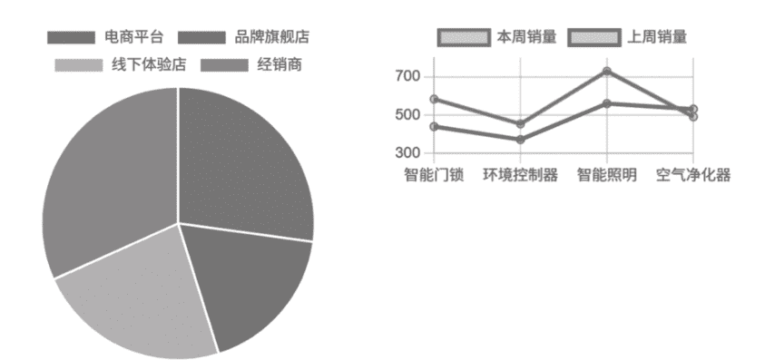
图4-9 生成模板效果图

## 4. 方法四：脏数据处理思路制定

面对凌乱的原始资料无从下手时，腾讯元宝能迅速给出清洗思路。比如上传客户信息表后提问：“请分析这份客户信息表的脏数据问题，给出清洗步骤：① 重复记录的判定标准；② 电话号码格式的标准化方案；③ 地址信息的拆分规则。”

元宝会输出包含关键步骤和标准化规则的客户信息表清洗方案。具体输出结果限于篇幅省略，读者可自行尝试。

### 5. 总结
借助腾讯元宝处理资料准备，相当于拥有了四位助手：智能采集助手自动抓取关键信息、资料仿真器生成逼真的训练数据、模板生成器快速创建标准文件、清洗指导师解决脏数据问题。

#### 试一试
- 1) 让元宝抓取你所在行业近期的 5 个竞品活动资料。
- 2) 生成符合你业务场景的 50 条模拟用户资料。
- 3) 创建一个带自动分析功能的日报模板。

#### 小贴士
- 1) 敏感资料先用模拟资料测试流程。
- 2) 定期保存常用资料采集指令。
- 3) 复杂清洗任务分步验证。
- 4) 模板文件保留元宝生成的使用说明。

# 技巧31

## 数据分析师提效五招：用腾讯元宝加速工作流

作为分析人员，你可能常遇到：刚用 SQL 把资料跑完，需求方就问“这个趋势为什么和预期不一致”；归因分析刚完成，主管又要求“用更直观的方式呈现”；模型刚搭好，业务需求已经转向。传统分析像在迷宫里探路，Excel 一个单元格错误会导致整张报表失效，SQL 报错晦涩难懂，需求方一句“简单看一下”往往意味着加班。资料量指数增长时，缺的不是算力，而是能理解业务痛点、自动处理琐事、把技术语言转成人话的智能助手。如何让分析既专业又易懂？以下五个做法或许能帮你提效。

## 1. 清洗提速术：让混乱资料快速归位
分析中最耗时的往往是净化阶段。与其手工筛选，不如让 AI 充当过滤器。以金融行业清洗跨境交易流水为例，在元宝对话框输入资料问题及期望格式，提示词可参考：“请清理 2024 年度跨境交易流水：1) 时间字段存在不同时区写法，例如 2024-07-15T14:30:00+08:00 与 07/15/2024 06:30 UTC 混用；2) 客户编号格式错误，需遵循‘国家代码_12 位数字’规范，如 CN_123456789012；3) 交易类型代码写法不统一，如 TRSF 与 TRANSFER 并存、CASH_IN 被写成 CASHIN；4) 金额字段带有千分位符号且包含多币种标记，如 1500.50USD、299999EUR；5) 合规筛选，需剔除账号以 DEMO_ 开头的测试资料及制裁国家名单 sanc_countries.csv 中的交易。请输出 Python 代码实现：1) 将所有时间统一为 UTC 时间戳；2) 检查并修正客户编号；3) 交易类型映射为全大写标准名称，映射表见附件；4) 剥离金额数字并换算成美元，汇率参数可调整；5) 做基础反洗钱检查，标记单日累计超过 50000 美元的记录。每一步请附中文合规说明。”

生成的部分代码示例如下：

```python
import pandas as pd
import pytz
from forex import get_latest_rate  # 假设有汇率接口
def clean_financial_transactions(df, currency_rates):
    """
    跨境交易流水数据清洗流程（符合央行数据规范 v3.2）
    :param df: 原始交易数据 DataFrame
    :param currency_rates: 当日货币汇率字典（例：{'USD':1.0, 'EUR':0.95}）
    :return: 清洗后数据 DataFrame 及异常报告 DataFrame
    """
    # === 多时区时间标准化 ===
    ......
```
（篇幅所限结果省略，建议读者自行实操。）

## 2. 需求转译术：把模糊描述变成可落地清单
需求方表述模糊时，结构化提问能快速拆解。以物流运营提出“供应链优化分析”为例，输入：“业务背景：运营部门提出供应链优化分析。已有资料：① 订单特征（品类/重量/紧急程度标签）；② 运输记录（实际时效/成本/异常事件类型）；③ 客户反馈（投诉类型/满意度评分/重复合作率）。请设计三个分析框架，每个框架包含：① 分析目标，50 字以内；② 3 个核心指标及计算公式；③ 可执行的优化建议；④ 预期提升的 KPI 方向。”

生成结果示例节选：

基于提供的数据维度，结合供应链优化方法论，设计以下三个框架：

### 框架一：订单履约效率分析
**分析目标**：识别高价值订单特征与履约效率关系，优化资源配置。

**核心指标**：
- 1. 紧急订单准时交付率 =（按时交付紧急订单数 ÷ 总紧急订单数）×100%
- 2. 品类订单处理周期 = Σ（订单确认至签收时间）/ 品类订单总数
- 3. 库存周转率 = 年度销售成本 ÷ 平均库存价值

**优化建议**：
- □ 建立智能分单策略：基于紧急程度标签自动匹配最优配送路线，参考 TMS 算法。
- □ 实施动态库存分配：仓库部署 RFID，按品类周转率做 ABC 分级存储。
- □ 开发异常预警模型：对超重订单配置专用运输工具，降低破损率。

**预期 KPI 提升**：（略）

### 框架二：运输成本效率分析（略）
### 框架三：客户价值维系分析（略）
**方法论融合建议**：（略）
（篇幅所限结果省略，建议自行实践。）

## 3. 归因排查术：快速定位指标波动根因
指标异常时，用对比实验代替猜测。以零售行业为例，分析 3 天 GMV 骤降 18% 的原因，输入：“智能归因分析：3 天 GMV 骤降 18% 根因定位。背景：某连锁商超在 618 大促后 6 月 25-27 日 GMV 同比前一周下降 18%。变量：1、竞品同期启动‘满 100 减 50’补贴战；2、生鲜品类库存周转率降至 0.8，健康值 >1.2；3、收银系统升级导致结账时长增加 40%。可用维度：① 促销效果（优惠券核销率/跨品类购买率）；② 会员消费记录（高净值用户留存/客单价分布）；③ 库存动态（缺货 SKU 数/临期商品占比）；④ 竞品价格策略（价格监测数据/营销活动情报）。请设计归因框架，包含：① 必须对比的 4 个核心数据维度及其关联假设；② 验证实验设计方法；③ 分析结论输出模板，含置信度评估；④ 高级分析延展建议。”

部分生成结果示例：

### 一、核心数据维度对比与关联假设
重点分析的 4 个维度及其假设如下：

| 数据维度 | 分析指标 | 关联假设 | 验证优先级 |
| --- | --- | --- | --- |

| 促销效果 | 优惠券核销率、跨品类购买率 | 竞品以补贴分流客群至低价渠道，核销效率走低说明促销对用户的拉力不足 | 高 |
| 会员消费画像 | 高净值用户留存率、客单价分布 | 收银环节效率受损致优质客户流失，客单金额回落体现体验在恶化 | 中高 |
| 库存动态 | 生鲜缺货SKU数、临期品占比 | 缺货与临期积压共同拖累周转，直接压低核心品类GMV | 高 |
| 竞品价格策略 | 竞品价格监测数据、补贴活动覆盖率 | “满100减50”类大额补贴引发客流外溢，价格敏感人群被竞争对手带走 | 高 |

### 二、验证实验设计方法（略）
### 三、分析结论输出模板（略）
### 四、高级分析延展建议（略）
篇幅受限，后续内容未详述，建议读者自行实操。

## 4. 可视化加速：让数字自己讲故事
数据跑完后，如何把结论做成易懂的视觉呈现，是分析师常遇的卡点。好的可视化能为分析加分。审美和配色拿不准时，可以让AI充当设计师。以下以分析结论转PPT图表为例，向腾讯元宝提问：“把下面三点结论做成PPT图表：①Q2销售额同比+12%，利润率同比-5%；②主因是华东区促销费用占比超预期；③建议Q3压缩满减，转向高毛利商品。请给出三页数据故事框架，每页说明图表类型和重点。”

示例输出：

为你规划的三页叙事结构及图表建议，兼顾商业逻辑与呈现节奏：

### 第一页：Q2业绩的核心矛盾
**图表类型**：双轴组合图，柱状叠折线
- 左轴柱：呈现Q2销售额同比增长12%，可与Q1或去年同期对照，柱顶标注增幅
- 右轴线：叠加Q2利润率同比下降5%的走势，用红色折线标注降幅并加负向箭头
- 辅助说明：图表下方文字点出“增收不增利：规模扩张未转化为盈利提升”
**核心信息**：直观对比营收上升与利润下滑，引导关注成本费用结构

### 第二页：华东区促销成本异常归因（略）
### 第三页：Q3策略调整及收益预期（略）
篇幅所限，其余页面留作练习，建议动手尝试。

## 5. 模型选型攻略：告别算法选择困难
建模精度很大程度上取决于模型选型。面对上百种算法，如何按数据特征快速筛选？可向腾讯元宝提问：“我要预测下周用户购买概率：①特征15个，含数值、分型、时序；②样本50万条；③要求可解释。请给出三种方案并说明适用场景及风险。”

示例输出：

### 方案一：特征梳理+逻辑回归
适用性：业务需要白盒解释并量化变量贡献时，15个特征的系数可直接体现影响方向与大小
需警惕的风险：特征间多重共线性，例如“加购次数”与“收藏商品数”高度相关，会导致系数失真
建议增加VIF检验，保留VIF小于5的特征

### 方案二：CART决策树+规则萃取（略）
### 方案三：XGBoost+SHAP解释（略）
篇幅所限，后两方案省略，动手实践更有效

### 6. 总结
这套做法让数据分析变成人机协同：腾讯元宝处理繁琐的清洗与编码，分析师聚焦洞察与决策。AI很强但无法替代业务判断，它更像为你的分析工具箱加了自动装填装置。

#### 试一试
向腾讯元宝输入以下需求，观察它如何把技术结果转译成管理语言。
生产总监反馈OEE看板数据存在矛盾，请将下面SQL分析结果转化为三条生产管理建议，并指出三个可能影响良品率的隐性问题：

```sql
SELECT
    设备ID,
    SUM(运行时间)/SUM(计划时间) AS 时间利用率,
    COUNT(故障代码) AS 故障次数,
    AVG(实际速度/理论速度) AS 性能开动率,
    1 - (SUM(不良品数)/SUM(总产量)) AS 良品率
FROM 生产日志
WHERE 日期 BETWEEN '2024-06-01' AND '2024-06-15'
GROUP BY 设备ID
HAVING SUM(计划时间) > 8 -- 过滤调试期设备
```

#### 小贴士
- 1) 复杂需求可追加“用外卖配送的场景类比，帮助理解聚类分析目的”
- 2) 建立常用指令库，收纳“数据异常检测模板”“AB测试结论框架”等
- 3) 涉及敏感数据时，务必先用脱敏模拟数据测试
- 4) 关键业务决策仍需人工复核，结合领域知识交叉验证

## 技巧32
## Excel公式生成：用腾讯元宝摆脱VLOOKUP焦虑
很多职场人有过这种尴尬：明知可用公式解决，却记不清该用INDEX-MATCH还是XLOOKUP，套用模板后又因数据结构不同而失效。腾讯元宝能帮你快速进阶。下面三个实战思路值得收藏。

### 1. 基础公式速成：把需求变成公式
痛点往往是需求清晰却不知对应函数。可向腾讯元宝输入：
> “有一个销售表，需要：①在G列求出每个销售员的最高业绩；②在H列显示对应的客户名称。结构：A列销售员，B列客户，C列金额。示例数据如下，请给出最简公式。”
腾讯元宝可能返回：

#### 1. G列最高业绩：
在G2输入公式并向下填充：
```
=MAXIFS(C:C, A:A, A2)
```
作用：按当前行销售员筛选其名下最高金额

#### 2. H列对应客户：
在H2输入公式并向下填充：
```
=XLOOKUP(G2, FILTER(C:C, A:A=A2), FILTER(B:B, A:A=A2), "", 0)
```
作用：在同销售员记录中找出与最高业绩匹配的客户名
……

篇幅所限，其余细节自行演练。可见连“向下填充”都一并说明

### 2. 数组公式突破：一键解决连环任务
面对多步操作，数组公式可一次性完成。如需汇总销售并剔除退货单，可上传表格并提问：“请生成单个公式：①统计部门A产品B的总销售额；②排除D列为‘是’的退货单；③保留两位小数。字段：部门|产品|金额|是否退货。”
可能输出：
使用Excel公式实现：
```
=ROUND(SUMIFS(C:C, A:A, "A", B:B, "B", D:D, "<>是"), 2)
```
说明：
SUMIFS对金额求和
条件1：部门列等于“A”
条件2：产品列等于“B”
条件3：退货列不等于“是”
ROUND将结果四舍五入到两位小数
提示：不同版本逗号与分号需对应调整

### 3. 公式安全检查：避免错误结果
最怕公式静默出错。可问：“请优化此VLOOKUP，要求①用IFERROR处理错误；②找不到时显示‘数据缺失’；③加入类型校验。原式：=VLOOKUP(F2, A:D, 4, FALSE)。”
可能输出：
```
=IFERROR(IF(ISTEXT(VLOOKUP(F2, A:D, 4, FALSE)), VLOOKUP(F2, A:D, 4, FALSE), "数据类型错误"), "数据缺失")
```
优化要点：
IFERROR包裹公式，出现#N/A时返回“数据缺失”
用ISTEXT校验返回值类型，不符合则提示“数据类型错误”，实际场景可换成ISNUMBER等

这里连错误预防都考虑到了

## 4. 总结
用腾讯元宝写公式相当于配了专业助手：快速定位正确写法，最终仍需你理解与校验。记住三点：描述清楚需求、验证计算结果、吃透函数原理

#### 试一试
- 1) 让元宝写一个“按月份自动分类汇总”的公式
- 2) 用“请解释每个参数含义”来学习陌生函数
- 3) 对现有公式做“防错加固”升级

#### 小贴士
- 1) 描述时多用“找出/计算/排除”等动词
- 2) 复杂问题拆成“筛选条件→计算方式→输出格式”三步
- 3) 重要表格保留注释，可用N函数或单独注释列

## 技巧33
## Excel多文件合并：告别手工整理的智能方案
多源数据的前期整理最费时。手动复制易漏隐藏表、重复表头、文件名过长报错。用腾讯元宝生成代码可把机械操作标准化。下面演示两个核心方法。

### 1. 智能脚本：单表合并实战
需把12个月销售记录按行拼接成年报，手工易忘去重表头、遗漏隐藏表、格式中断。想实现自动选文件夹、去重表头、显示处理行数，可输入：“请生成Python代码，合并指定文件夹内所有Excel文件的第一个工作表，跳过后续文件的标题行，并输出处理行数统计。”
返回代码可自动合并并统计：
```
import os
import pandas as pd
from tqdm import tqdm  # 提供进度条支持，需安装 tqdm

def merge_excel_sheets(folder_path, output_file):
    """
    合并指定文件夹内所有 Excel 文件的第一个工作表
    参数：
        folder_path: 包含 Excel 文件的文件夹路径
        output_file: 合并后的输出文件路径
    返回：
        处理行数统计字典
    """
    # 初始化变量
    all_data = pd.DataFrame()
    total_rows = 0
    file_count = 0
    processed_info = {}

    # 获取所有 Excel 文件（排除临时文件）
    excel_files = [f for f in os.listdir(folder_path)
                   if f.endswith(('.xlsx', '.xls')) and not
                   f.startswith('~$')]

    # 创建进度条
    with tqdm(total=len(excel_files), desc="处理进度") as pbar:
        for idx, filename in enumerate(excel_files):
            file_path = os.path.join(folder_path, filename)
            ......
```
篇幅所限，完整代码请自行实践

### 2. Python批处理：多表归档方案
若要保留原文件结构，可输入：“写Python代码：把文件夹内每个Excel文件转成汇总文件的独立Sheet，Sheet名取文件名前15字符，跳过临时文件。”
示例输出：
```
import os
import pandas as pd
from openpyxl import load_workbook

def excel_to_sheets(source_folder, output_file):
    # 创建汇总文件，先写入空 DataFrame 以完成初始化
    pd.DataFrame().to_excel(output_file, index=False)

    with pd.ExcelWriter(output_file, engine='openpyxl', mode='a') as writer:
        # 获取已存在的 Sheet 列表
        existing_sheets = load_workbook(output_file).sheetnames

        for filename in os.listdir(source_folder):
            # 跳过临时文件 (~$ 开头、._ 开头、.tmp 结尾)
            if filename.startswith(('~$', '._')) or filename.endswith('.tmp'):
                print(f"跳过临时文件：{filename}")
                continue

            # 处理 Excel 文件
            if filename.endswith(('.xlsx', '.xls')):
                filepath = os.path.join(source_folder, filename)
                sheet_name = os.path.splitext(filename)[0][:15]  # 取前 15 个字符
                sheet_name = sheet_name.replace(':', '_').replace('\\', '_')  # 清理非法字符

                try:
                    # 读取 Excel 数据
                    df = pd.read_excel(filepath)
                    ......
```

## 3. 总结
通过元宝生成脚本在编辑器运行，可快速批量处理表格，降低代码门槛并提升效率

#### 试一试
输入“生成合并5个Excel文件的VBA代码，保留原格式”

#### 小贴士
- 1) 代码报错时直接把错误信息粘给元宝，可获针对性修复
- 2) 定期用df.dtypes检查字段类型一致性
- 3) 重要操作先用副本测试，代码头部添加备份路径=os.path.join(源文件夹，‘备份’)实现自动备份

## 技巧34
## VBA自动化：用腾讯元宝打造Excel效率神器
重复筛选、统计、格式调整让人陷入数字迷宫。VBA适合数据清洗、自动化报表、复杂计算，尤其在中小规模结构化数据场景下效率明显。对多数人而言学习成本高，搜索到的片段也常报错。借助AI自然语言转代码，零基础也能搭建工具。

### 1. 第一步：用自然语言生成代码框架
例如合并表格，可输入：“我有多个Excel文件，列结构相同，想把所有工作簿数据合并到一个工作簿，请写VBA代码，要求可手动选择文件路径。”
元宝会直接给出可运行代码

### 2. 第二步：Excel环境配置四步走
1) 启用开发者工具：在Excel中依次选择“文件”→“选项”→“自定义功能区”，勾选“开发工具”，如图4-10所示
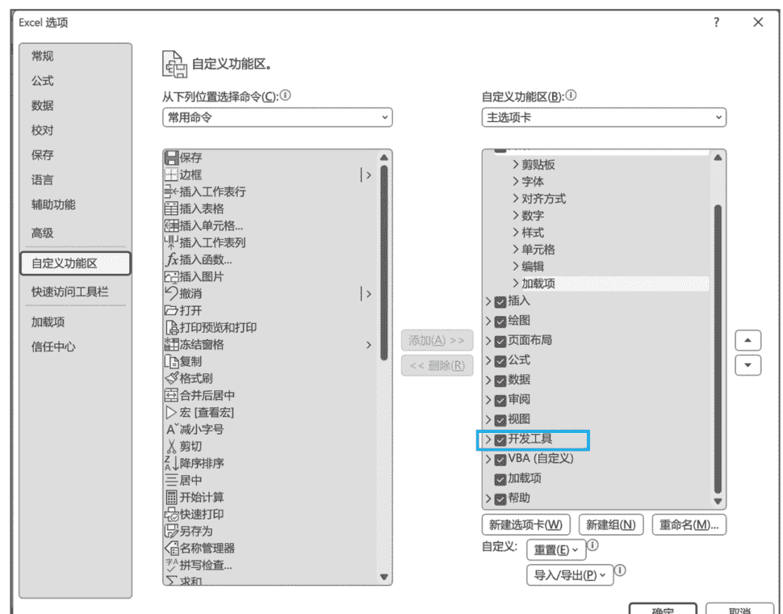
2) 插入模块：依次单击“开发工具”→Visual Basic，右键项目选择插入模块，如图4-11、图4-12所示
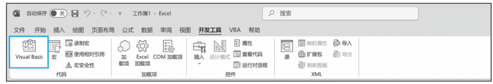

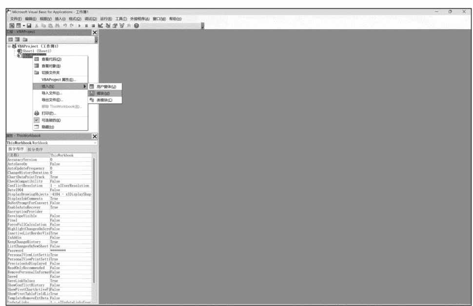

3）载入代码：将元宝生成的 VBA 段落整体复制进新模块，注意开头 Sub 和结尾 End Sub 必须保留，点击顶部的小三角运行即可，操作参考图4-13、图4-14，合并结果见图4-15。

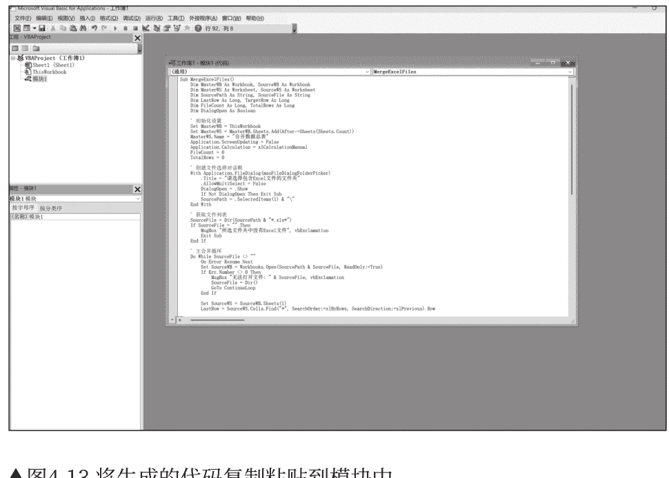

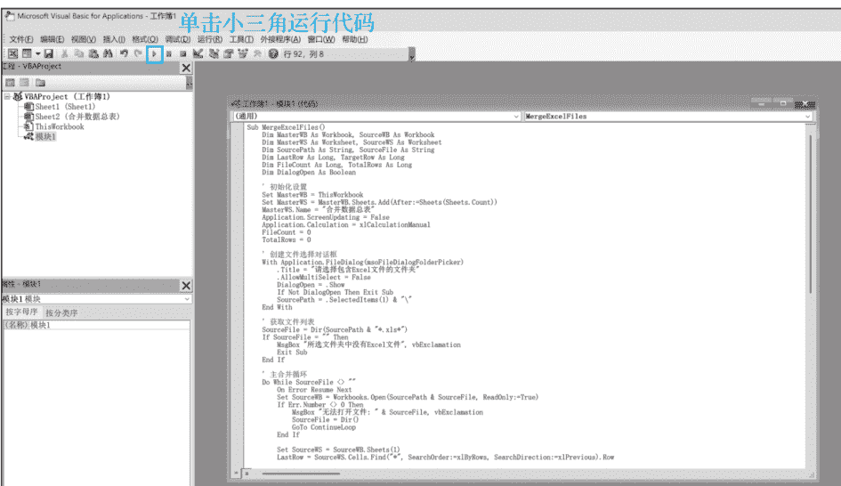

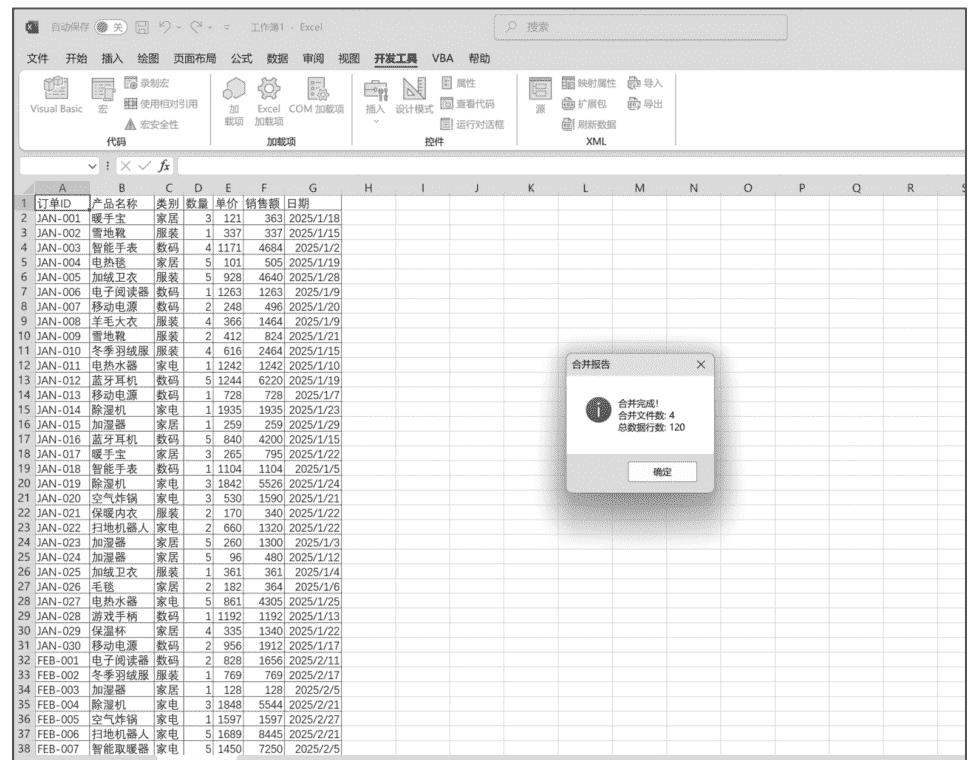

4）做成插件：把含宏的文件另存 xlam，见图4-16。再次打开“自定义功能区”，在“从下列位置选择命令”里切换到“宏”，找到刚保存的 xlam，然后点“新建选项卡”把宏拖进去，见图4-17。可为宏改名，见图4-18。最终效果见图4-19。以后碰到同类合并任务，直接点插件一键搞定。

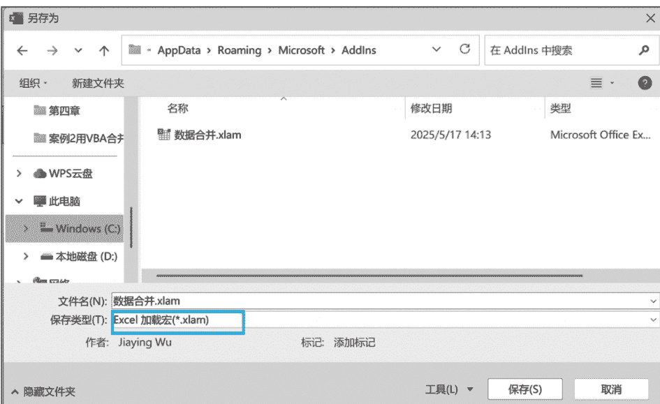

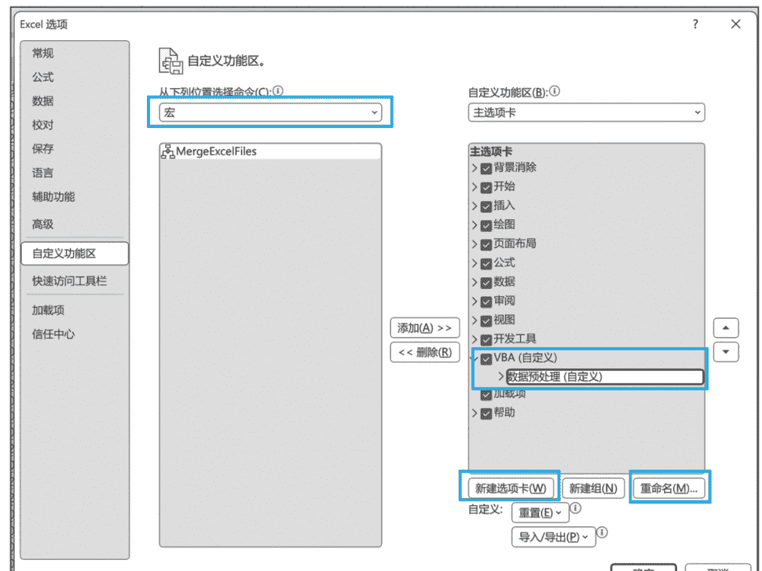

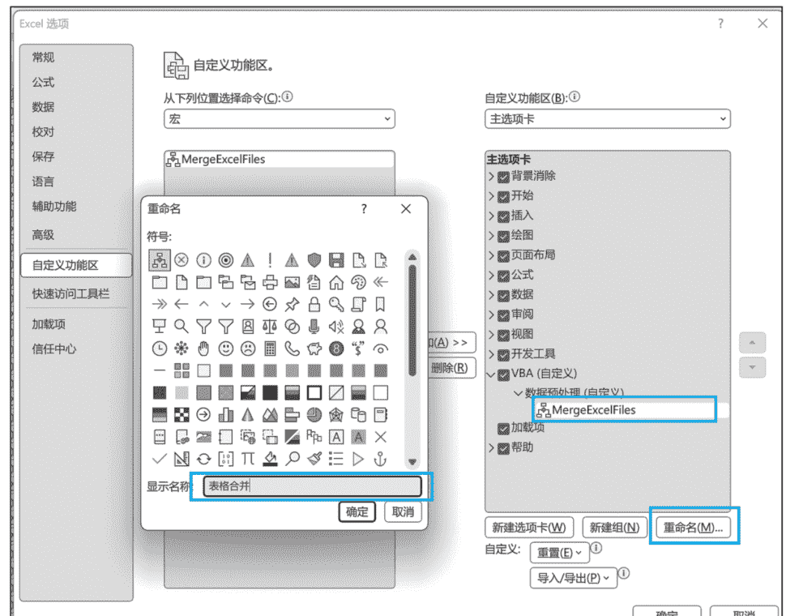


特别注意：初次启用要先改宏安全。路径“文件→选项→信任中心→宏设置”，先勾选“启用所有宏”。建议用完马上恢复默认，含 VBA 的重要文档请先备份成 .xlsm。

### 3. 第三步：排错与提效技巧

代码运行时报错，把报错信息和完整代码一起抛给元宝，比如问“这段 VBA 报运行时错误1004 怎么改”。它能指出出错行，并解释常见原因，像表名带空格导致对象找不到、没写 Option Explicit 导致变量未定义、循环冲突可用 F8 单步跟踪变量。

如果生成版不够理想，可追加指令优化，例如“给这段代码加异常处理，空表时弹出提示”，健壮性会更好。测试务必在副本上进行，避免伤到源文件。

想要更高效，可以自建控件库，把常用功能做成按钮群组。比如数据清理组自动删空行去重，智能拆分组按条件拆工作表。每个按钮对应独立模块，批量让元宝生成后在 Excel 里排成工具条。定期把整个 VBAProject 导出备份，换电脑直接导入复用。

## 4. 小结

职场里不必在手工和编程间二选一。AI 生成代码+可视化配置就能让普通人快速搭自动化链路。记住三点：描述需求要清晰，环境配置要规范，排错意识要养成。

#### 试一试
让元宝写一段 VBA：点按钮后遍历 A 列，把含“紧急”两字的整行染红，按钮叫“高亮优先级”，部署后体验自动化标记。

#### 小贴士
- 1) 出现“权限被拒绝”，检查文件是否放在受信任位置。
- 2) 按 Alt 微调按钮位置，按 Ctrl 拖动可复制控件。
- 3) 复杂功能分模块，用调用子程序拼装。
- 4) 定期清理无用变量声明，提速。

# 技巧35

## 数据可视化1：AI 帮你选图讲故事

在职场里最扎心的是，费劲做的报表被说“饼图不能看趋势”“双 Y 轴在误导”。可视化不是把数字上色，而是让数据讲出正确的商业故事。

### 1. 怎么选对图表

新手常犯的错是拿到数据就上柱状图。不同关系需要不同表达，折线看趋势，扇形看占比。选对图是信息准确的关键，不确定时可问元宝：“对比过去一年四个季度的销售额和利润率，哪种图最好？给三种方案并说利弊，用表格。”

元宝可能给出如下参考：

## 1. 图表类型参考

| 图表类型 | 说明 | 好处 | 风险 | 适合场景 |
| :--- | :--- | :--- | :--- | :--- |
| 双轴折线图 | 左轴销售额绝对值，右轴利润率百分比，两条折线表趋势 | 1）趋势对比直观<br>2）单位差异大也适用<br>3）能看关联 | 1）刻度不当易误导<br>2）次要指标易被淹没 | 快速判断销售额与利润率是否同向 |
| 分组柱状图 | 每季度两根柱分别表销售额和利润率，需先标准化 | 1）数值对比清晰<br>2）避免双轴干扰<br>3）突出季度内关系 | 1）标准化会掩盖真实差距<br>2）需解释转换逻辑 | 强调季度内两指标相对比例 |
| 组合图 | 柱表销售额主轴，折线表利润率次轴，共用季度横轴 | 1）兼顾绝对值与变化<br>2）层次分明<br>3）多维度分析 | 1）设计较复杂<br>2）次要指标不够突出 | 管理汇报需兼顾规模与盈利质量 |

- 1. 双轴折线适合给熟悉数据的团队，记得标注左右单位并合理设刻度。
- 2. 分组柱若不想标准化，可拆成两张独立图：销售额柱状+利润率折线。
- 3. 组合图加数据标签，柱顶数值、折线节点百分比，可读性更好。

### 2. 常见误导识别

选对图型还不够，细节也会误导。上传截图问：“这张用户增长趋势图有没有视觉误导，该调哪些参数才真实？”

元宝可能指出：

### 一、误导核心点

- 1. 纵轴截断最严重
起始值设1100而非0，导致波动被放大，1100到900的18%跌幅视觉上像悬崖。

### 2. 时间标注不全
2024年只标“Q”，缺季度，时间跨度易混。

### 3. 图文矛盾
底部写“同比提升300%”，折线却是下降，计算口径需核查。

### 二、参数调整建议（略）
### 三、优化示例（略）

调整后既符合可视化规范，又能更准确传达业务趋势。建议用 Tableau、Power BI 等工具重绘，参考规范优化视觉。

### 3. 从图形到洞察

好看只是开始，关键是解读。很多人只说“Q3销售额降5%”，说不清原因。用元宝深度分析：“根据月度销售漏斗，①找转化率最低三环节；②分析原因；③给优化建议。”

输出示例：

### 1. 转化率最低三环节（示例）

- ①潜在客户→需求确认（<30%）
- ②方案沟通→报价/合同（<40%）
- ③报价/合同→成交（<30%）

### 2. 环节问题诊断
▶环节1：潜在客户→需求确认
可能原因：①画像模糊，带进大量非目标客户；②挖掘话术不专业，过早推销；③信任不足，缺案例资质。

▶环节2：方案沟通→报价/合同（略）
▶环节3：报价/合同→成交（略）

### 4. 进阶可视化玩法

要同时呈现销量、利润率、满意度，可要求元宝设计交互方案：“做一个能同时展示产品销量、利润率和客户满意度的交互可视化，用 HTML 展示效果。”

在生成的 HTML 里点“运行”即可预览，如图4-20所示，页面可切换区域、时间、产品进行交互。

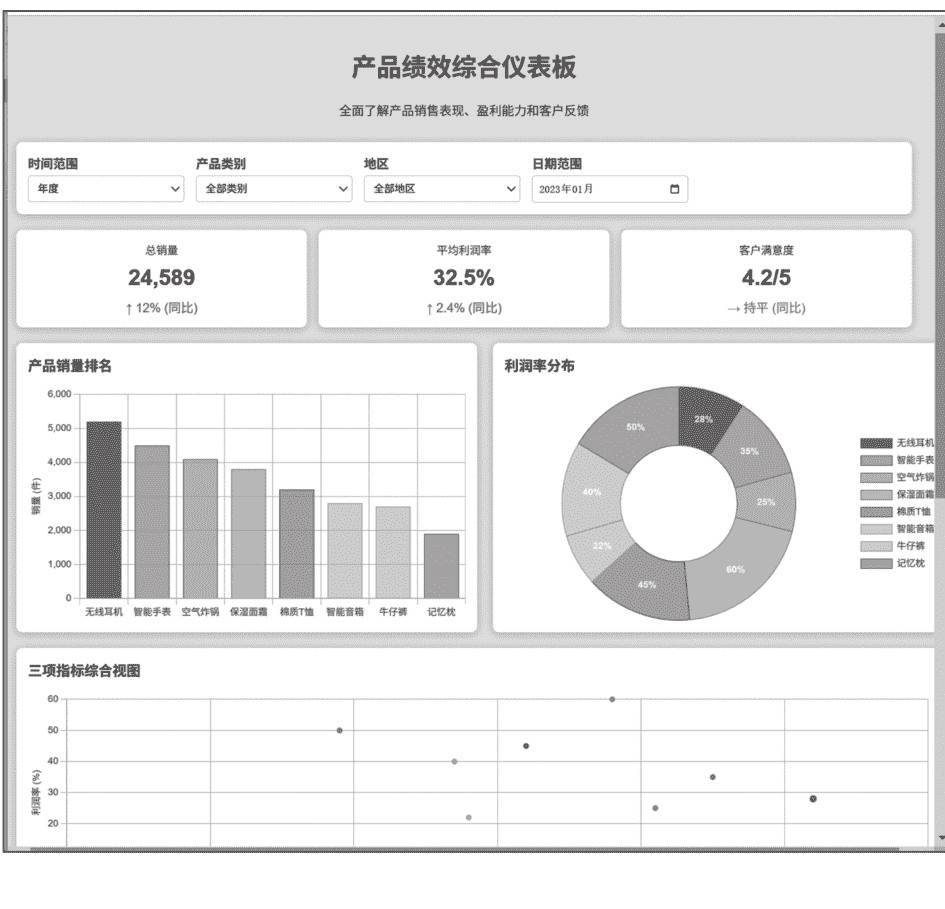

图4-20 元宝生成的可视化预览

方案可保存为 HTML 在浏览器打开，需接真实数据时把 generateData() 换成 API 调用即可。

也可继续问：“我想上传本地 CSV 到仪表盘，请按文件加载数据的代码，结合第一次结果输出完整 HTML，让我能直接上传本地 CSV 可视化。” 生成效果如图4-21所示。

# 上传产品数据CSV文件

数据格式要求：CSV文件应包含以下列：id,name,sales,profit,satisfaction,category

# 产品绩效综合仪表板

全面了解产品销售表现、盈利能力和客户反馈

时间范围：年度

产品类别：全部类别

地区：全部地区

日期范围：2023年01月

总销量：17 600

平均利润率：36.0%

客户满意度：4.3/5

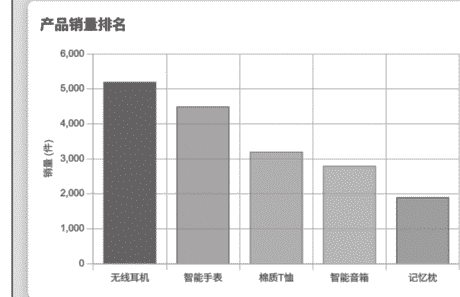

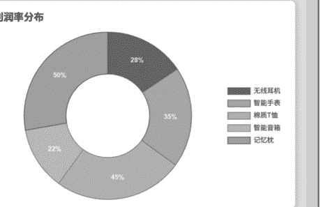

三项指标综合视图

图4-21 可上传本地 CSV 的数据仪表盘

注意上传文件必须符合格式，包含必要列。把 HTML 代码粘到记事本另存为 .html，就能得到可长期复用的动态仪表盘。也可以让元宝继续美化，做出专属风格。比起 BI 工具，这更快捷。

### 5. 小结

用元宝做可视化把握三点：选对图表适配数据类型，避免视觉陷阱讲清真实，讲好数据故事支撑决策。好图应让人第一眼知道发生了什么，第二眼思考为什么，第三眼知道怎么办。

#### 试一试
- 1) 让元宝评估你常用的三个图表是否合适。
- 2) 用“数据+业务问题”提问，如“如何可视化用户流失原因？”
- 3) 对现有图表追加“异常点可能原因”解读。

#### 小贴士
- 1) 重要图表保留元宝分析建议作备注。
- 2) 建立“业务问题-图表类型”对照表。
- 3) 复杂图表加简明阅读指南。
- 4) 定期复盘历史图表验证结果。

# 技巧36

## 数据可视化2：AI 五招搞定图表制作

做图表最费时间的不是分析，而是反复调代码和格式。传统工具要么代码量大，要么模板受限。大数据下还易卡顿错位。

元宝能简化流程，下面介绍高效生成方法。

### 1. 数据清洗加速：脏数据变可用

以医学为例，临床试验数据缺失15%，部分指标有3σ外异常。可问：“数据含15%缺失值，部分指标超3σ，请用 Python 生成清洗代码，要求：①KNN 填补缺失；②剔除3倍标准差异常；③输出清洗报告。”

元宝会给出定制方案，含 KNN 填充、3σ剔除、自动报告，部分代码如下：

```python
import pandas as pd
import numpy as np
from sklearn.impute import KNNImputer
from sklearn.preprocessing import StandardScaler
import matplotlib.pyplot as plt
import textwrap

# 1. 数据加载与预处理
def load_data(file_path):
    """ 加载临床数据集并标准化 """
    df = pd.read_csv(file_path)

    # 数据标准化（提升 KNN 效果）
    scaler = StandardScaler()
    scaled_data = scaler.fit_transform(df)
    return pd.DataFrame(scaled_data, columns=df.columns), scaler

# 2. KNN 缺失值填补 [1,2,3](@ref)
def knn_imputation(df, n_neighbors=5):
    """K 近邻算法填充缺失值 """
    imputer = KNNImputer(n_neighbors=n_neighbors)
    imputed_data = imputer.fit_transform(df)
    return pd.DataFrame(imputed_data, columns=df.columns)

# 3. 3σ 异常值处理 [6,7,8](@ref)
def three_sigma_filter(df):
    """ 基于 3σ 原则的异常值过滤 """
    clean_df = df.copy()
    for col in df.select_dtypes(include=[np.number]).columns:
        mean = df[col].mean()
        std = df[col].std()
        clean_df = clean_df[(clean_df[col] >= mean - 3*std) &
                            (clean_df[col] <= mean + 3*std)]
    ......
```

（篇幅有限，建议自行实践。）

### 2. 自然语言转代码：智能生成可视化

要画多组学相关性热力图，可问：
“生成 Python 代码画 TCGA 癌症数据的基因表达与甲基化相关性热力图，要求：①显示色标；②行注释加通路分类；③保存为300DPI EPS。”

元宝输出示例代码如下：

```python
import pandas as pd
import seaborn as sns
import matplotlib.pyplot as plt
from matplotlib.colors import ListedColormap

# 1. 数据准备（假设已处理好的数据格式）
# 甲基化数据矩阵（基因 × 样本）
methylation_data = pd.read_csv("methylation_matrix.csv", index_col=0)
# 基因表达数据矩阵（基因 × 样本）
expression_data = pd.read_csv("expression_matrix.csv", index_col=0)
# 通路注释数据（基因 × 通路分类）
pathway_anno = pd.read_csv("pathway_annotation.csv", index_col=0)

# 2. 计算基因表达与甲基化的相关性矩阵
corr_matrix = expression_data.T.corrwith(methylation_data.T, axis=0,
    method='pearson')

# 3. 创建通路注释颜色映射（示例）
pathway_colors = pd.DataFrame(index=corr_matrix.index)
pathway_colors['Pathway'] = pathway_anno.loc[corr_matrix.index,
    'Pathway']

# 生成颜色字典（每个通路分配唯一颜色）
pathway_palette = {'Apoptosis':'#1f77b4', 'Cell Cycle':'#ff7f0e',
                   'DNA Repair':'#2ca02c', 'Metabolism':'#d62728'}

row_colors = pathway_colors['Pathway'].map(pathway_palette)

# 4. 绘制聚类热力图
g = sns.clustermap(
    corr_matrix.to_frame(),
    cmap='coolwarm',
    center=0,
    row_colors=row_colors,
    figsize=(10, 12),
    dendrogram_ratio=(0.1, 0.2),
    cbar_pos=(0.02, 0.8, 0.03, 0.18),
    cbar_kws={"label": "Pearson Correlation"}
)
......
```

（篇幅有限，建议自行实践。）

### 3. 图表细节优化引擎：对齐学术规范

在撰写医学论文时，Kaplan-Meier 生存曲线的版式常常需要按期刊规范微调。可以直接让腾讯元宝撰写脚本，示范提示如下：“请你帮我生成 Python 代码，按照《柳叶刀-肿瘤学》规范优化 Kaplan-Meier 曲线。要求：①风险表放在图形下方；②P 值以 HR（95%CI）形式呈现；③曲线线宽设为 1.5 磅。”

系统会返回可执行的代码，把风险人数表、风险比写法和样式参数一次整合。部分参考片段如下：

```python
import matplotlib.pyplot as plt
import pandas as pd
from lifelines import KaplanMeierFitter, CoxPHFitter
from lifelines.plotting import add_at_risk_counts

# 数据准备（示例数据结构）
data = pd.DataFrame({
    'time': [12,24,36,48,60,24,36,48,60,72],        # 生存时间
    'event': [1,1,0,1,0,1,1,1,0,1],                 # 事件发生状态
    'group': ['A','A','A','A','B','B','B','B','B']   # 分组变量
})

# ==================== 核心分析 ====================
# Kaplan-Meier 曲线拟合
kmf = KaplanMeierFitter()
ax = plt.subplot(2,1,2)  # 主图区域

# 分组绘制生存曲线
for name, in data.groupby('group'):
    kmf.fit(
        durations=grouped_data["time"],
        event_observed=grouped_data["event"],
        label=name
    )
    kmf.plot(
        ax=ax,
        ci_show=False,
        linewidth=1.5,  # 曲线粗细调整
        c=['#1f77b4','#ff7f0e'][len(ax.lines)]  # Lancet 标准色系
    )

# ==================== COX 回归获取 HR ====================
......

# ==================== 样式优化 ====================
......
# ==================== 风险表设置 ====================
......
# ==================== 全局样式设置 ====================
......
```

为节省篇幅具体实现略去，建议读者自行尝试。

### 4. 动态调试助手：实时定位可视化Bug

科学制表时用 Matplotlib 绘制多个子图容易出现标题拥挤。通过提示词让模型重写脚本即可解决，例如：“我的 Python 代码生成的 4 子图存在标题重叠，请帮我重新生成代码，要求：①调整整体画布尺寸；②修改子图间距；③优化字体缩放比例。”

按照需求重新设计的代码片段如下：

```python
import matplotlib.pyplot as plt
import numpy as np

# 设置全局字体参数（缩放比例优化）
plt.rcParams.update({
    'font.size': 12,            # 基础字体大小
    'axes.titlesize': 14,       # 子图标题字号
    'axes.labelsize': 12,       # 坐标轴标签字号
    'xtick.labelsize': 10,      # X 轴刻度标签字号
    'ytick.labelsize': 10       # Y 轴刻度标签字号
})

# 创建 4 个子图（2 行 2 列），设置画布尺寸和布局参数
fig, axs = plt.subplots(2, 2, figsize=(14, 10),
                        constrained_layout=True,  # 自动布局 [1,3](@ref)
                        gridspec_kw={'wspace': 0.35, 'hspace': 0.45})
                        # 子图间距 [6,7](@ref)

# 生成示例数据
x = np.linspace(0, 2*np.pi, 100)
y1 = np.sin(x)
y2 = np.cos(x)
y3 = np.tan(x)
y4 = np.exp(x/5)

# 绘制子图 1
axs[0,0].plot(x, y1, color='royalblue')
axs[0,0].set_title("Sinusoidal Wave", pad=15) # pad 参数增加标题间距 [3](@ref)
axs[0,0].set_xlabel("X Axis")
axs[0,0].set_ylabel("Amplitude")
......
```

为节省篇幅具体实现略去，建议读者自行尝试。

### 5. 批量输出流水线：自动生成图表全家桶

项目结题时往往需要多组风格统一的可视化。可以用以下提示让元宝定制方案：“我正在进行多组图标绘制，数据来源为 RNA-seq 数据集，请你帮我编写 Python 代码，要求自动生成：①差异火山图；②3D PCA 投影图；③GO 富集气泡图。所有图表统一使用深蓝到金色配色、Arial 字库、4 厘米基础单元尺寸。”

生成的脚本会产出上述三类图，并采用 #002366-#FFD700 的配色与 Arial 字库统一呈现。部分代码示例：

```python
import matplotlib.pyplot as plt
import pandas as pd
import numpy as np
from mpl_toolkits.mplot3d import Axes3D
from matplotlib.colors import LinearSegmentedColormap
from sklearn.decomposition import PCA

plt.rcParams['font.family'] = 'Arial'
plt.rcParams['font.size'] = 8
BASE_SIZE = 1.57          # 4cm转换为英寸

# 深蓝 - 金色系配色方案
COLOR_SCHEME = {
    'down': '#002366',     # 深蓝
    'up': '#FFD700',       # 金色
    'neutral': '#6C757D',  # 中性灰
    'gradient': LinearSegmentedColormap.from_list('blue_gold', ['#002366', '#FFD700'])
}

# ======================
# 1. 差异火山图
# ====================
def plot_volcano(df, output_path):
    """ 参数说明：
    df 需包含 log2FoldChange、padj 两列
    """
    fig = plt.figure(figsize=(BASE_SIZE*3, BASE_SIZE*3))

    # 显著性标记
    df['sig'] = np.where((df.padj < 0.05) & (df.log2FoldChange > 1), 'up',
                         np.where((df.padj < 0.05) & (df.log2FoldChange < -1), 'down', 'neutral'))

    ax = fig.add_subplot(111)
    scatter = ax.scatter(
        x=df.log2FoldChange,
        y=-np.log10(df.padj),
        c=df.sig.map(COLOR_SCHEME),
        s=8,
        alpha=0.6
    )

    # 辅助线
    ax.axhline(-np.log10(0.05), color='#495057', linestyle='--', linewidth=0.8)
    ......
```

为节省篇幅具体实现略去，建议读者自行尝试。

### 6. 总结

这套思路的核心是将个人的绘图经验沉淀为可复用的智能模板，让研究者把精力放回科学问题本身。优秀的图表不靠堆砌技巧，而靠清晰的视觉语言讲述数据。

#### 试一试

在腾讯元宝中输入：“帮我用 Seaborn 绘制箱线图，要求将三组实验数据并排显示，X 轴标签旋转 45 度，并在脚注添加方差分析结果。”

注意观察生成代码在美感与信息承载之间的平衡，以及注释里的参数说明。

#### 小贴士

- 遇到复杂图形时先分步提需求，先描述主体结构再细化样式。
- 将验证过的好案例保存到 AI 自定义指令库，形成个人图库模板。
- 重要提醒：涉及关键结论的统计图，务必人工复核坐标轴刻度和显著性标记。

## 技巧37
## 数据助力决策（一）：数据洞察助力企业决胜的三大引擎

商业环境变化迅速，企业决策者常面临三类困境：多指标波动让趋势难以预判、跨部门口径不一致导致争议、传统分析工具响应慢错失先机。

当市场变化快过需求变更速度时，需要一个能实时融合多维信息并预警风险的智能领航者。

### 1. 方法一：动态数据翻译

业务沟通中不同部门常因维度差异争执。例如市场部的“用户活跃度”与财务部的“单客成本”在会上对立时，可让元宝将其转化为同一战线的指标。

示例提示：“将市场部 618 大促的 UV 增长数据、供应链的物流成本波动、财务部的 ROI 报表整合为可量化的决策建议矩阵，用星标标注关键影响因子。”

输出可能包含：

（1）矩阵示例（简化）

| 优先级 | 渠道 / 动作 | 量化依据 | 星标关键因子 |
| :--- | :--- | :--- | :--- |
| 高 | 渠道 B 追加预算 | ROI=4：1 + 物流成本 +15% | ★★★ ROI ★ 物流成本 |
| 中 | 渠道 A 优化转化链路 | UV+60% 但 ROI 仅 2：1 | ★ UV 增长 ★ ROI |
| 紧急 | 物流弹性合约签订 | 全渠道物流成本均值超 20% | ★★★★ 物流成本波动 |

（2）决策建议

- 资源倾斜：优先支持渠道 B，高 ROI 且成本可控，预算投向搜索广告与精准投放。
- 风险管控：针对高 UV 但低 ROI 的渠道 C，优化选品并启用预售降低物流压力。
- 成本优化：与物流商谈判动态定价，对 UV 高成本增的渠道 A 采用分仓备货。
- 长期策略：建立 UV-ROI-成本联动模型，实时监控关键因子阈值，如 ROI<2:1 时自动触发成本审查。

为节省篇幅其余内容略去，建议读者自行实践。

### 2. 方法二：风险预判

制定决策时若缺乏风险预判，可让元宝搭建评估模型，类似商业版天气预报，既能预测走向也能估算销量影响。

示例提示：“基于过去三年 Q3 消费品市场数据、当前经济指数、社交媒体舆情热度，建立新品发布风险评估模型，输出高/中/低风险决策路径。”

部分输出示例：

- 高风险路径（0～3 分）：暂缓发布，优先对冲。
- 中风险路径（4～6 分）：条件性发布，动态调整。
- 低风险路径（7～10 分）：全域推进，最大化收益。

#### 风险决策看板（示例）

| 风险维度 | 当前值 | 风险分 | 权重 | 决策联动提示 |
| :--- | :--- | :--- | :--- | :--- |
| 品类增长率（Q3） | 22%（行业均值 15%） | 9 | 25% | 可承受产能扩张 20% |
| 必需消费品 CPI | +6.7%（非必需品类） | 4 | 15% | 需规避低价产品线 |
| 社交媒体情感值 | 78% 正面（含 12% 中性） | 8 | 25% | 加速 KOL 内容投放节奏 |
| 综合判定 | 6.2 分（中风险） | — | — | 启动“区域限购 + 弹性供应链”预案 |

为节省篇幅其余内容略去，建议读者自行实践。

### 3. 方法三：实时决策

犹豫时可用元宝模拟结果，如给战略装上 Ctrl+Z，先沙盘推演再投入。

示例提示：“模拟东南亚市场拓展方案，变量包含当地政策变化、汇率波动、物流中断三种突发情况，输出各场景下的止损策略和机会捕捉建议。”

部分输出示例：

#### 一、风险场景定义与指标监控

##### 核心风险变量及预警信号

| 风险类型 | 预警指标 | 监控工具 |
| :--- | :--- | :--- |
| 政策突变 | 外资持股比例下调 / 进口关税上调 >15% | 政府公报 + 本地法律顾问实时推送 |
| 汇率波动 | 本币兑美元单月贬值 >8% | 彭博终端 + 本地银行汇率预警 |
| 物流中断 | 主要港口关闭 >72 小时 / 陆运延迟率 >40% | 物流雷达系统 + 海关数据 API |

二、分场景止损策略与机会矩阵（略）

三、动态决策仪表盘（实时响应机制）（略）

四、长期韧性建设（略）

五、机会-风险平衡决策树（略）

为节省篇幅其余内容略去，建议读者自行实践。

## 4. 总结

三大方法的价值在于把数据从“事后复盘”变为“实时导航”：翻译器达成共识，预判望远镜突破经验局限，决策沙盘消除试错恐惧。记住，抢在对手半小时前看到趋势，往往能占领先机。

#### 试一试

在元宝中输入提示词：“将销售部本月客户拜访数据、产品部的需求池信息、客服部的投诉分类统计整合成下季度产品优化优先级清单，按实施难度和收益影响四象限分类。”

观察元宝如何把碎片信息转化为可执行的战略地图。

#### 小贴士

- 1) 建立常用指令库：保存“数据对齐”“风险评估”“模拟推演”等高频场景模板。
- 2) 善用追问公式：“如果……那么……”例如：“如果预算削减 30%，那么上述方案如何调整？”
- 3) 重要提醒：元宝的建议仅供参考，需结合人工分析和行业 Know-How，重大决策前建议用沙盘推演三种以上可能性。

## 技巧38
## 数据助力决策（二）：用腾讯元宝破解数字密码，治好分析恐惧症

处理数据时常有无力感：手工整理易出错、反复核对耗时、报告因公式错误而前功尽弃。决策时数据分散各系统，更难形成洞察。

如何让数据变废为宝？这三种方法能帮你从表格新手成长为决策参谋。

### 1. 方法一：需求提纯—三层过滤法

直接让元宝“分析销售数据”会得到大量噪音。复盘或策略调整时，建议先聚焦收入波动，再排查运营风险，最后挖掘增长点。示例提示：“请分析 2024 年 Q2 电商数据：①剔除 618 大促后找出最赚钱的 3 类商品复购变化；②揪出退货增长率>15% 的商品（按省份和人群排序）；③挖掘加购未付款用户特征（浏览超 3 分钟+领券未用），用大白话说明分析逻辑。”

元宝输出示例：

①找出最赚钱的 3 类商品复购变化（排除 618 大促）

- 步骤 1：先筛选数据，剔除 618 期间（如 6 月 1 日—18 日）的订单，只看 4—5 月+6 月后半段的销售数据。
- 步骤 2：按商品类目算利润（单价×销量-成本），选出利润最高的前 10 名。
- 步骤 3：针对这 10 个类目，计算复购率（老客重复购买比例），对比 2024 年 Q2 和 2023 年 Q2 或 2024 年 Q1，判断大促后的复购是涨还是跌。
- 步骤 4：锁定复购增长明显且利润最高的 3 个类目（比如母婴、保健品、宠物用品）。

- ②揪出退货增长率>15% 的商品（按省份和人群排序）（略）
- ③挖掘加购未付款用户特征（浏览超 3 分钟+领券未用）（略）

为节省篇幅其余内容略去，建议读者自行实践。

### 2. 方法二：智能洞察—AI 分析师

企业跨部门数据解读分歧时，人工分析易受视角局限与时效制约。同一份数据，财务看利润，市场看用户，供应链看库存，分析三天商机已流失。通过元宝构建动态决策树模型，可自动识别异常关联并触发专项验证。在不涉密前提下，上传表格并输入：“你作为数据分析专家，请对新能源车数据分析：①按价格（10 万～20 万/20 万～30 万）+电池类型+城市分级分析；②找出 3 个反常识结论（要统计验证）；③给出决策树：如果某车一线市占>15% 且投诉<2%，则开体验店；如果搜索量/转化率>3:1，则改详情页。”

元宝输出结果：

①按价格+电池类型+城市分级分析

分析逻辑：

- 分层切片数据：
  - 价格分层：10 万～20 万、20 万～30 万两个区间。
  - 电池类型：磷酸铁锂、三元锂等。

城市层级划分：一线、新一线、二线、三线及以下（略）

- ② 反直觉结论（需统计校验）（略）
- ③ 可落地决策树规则（略）

（因篇幅所限，具体实操建议读者自行尝试。）

### 3. 方法三：会呼吸的动态看板

月度复盘前手动刷新上百张图，等数据对齐，竞争对手早已切入新赛道。如何把静态汇报升级为具备提前预警能力的活系统？关键在于设置阈值触发报警，例如毛利率偏离超过2个百分点即推送，同时以48家对手渠道监测作为瞭望手段，让信息像活水一样持续流动。在不触及保密的前提下，可将实时销售、用户行为埋点、行业情报与历史会议纪要导入腾讯元宝，并提出：“请自动产出7月经营分析报告：①核心指标异常自动预警，例如毛利率波动超过2%；②对手信息逐小时刷新；③分别输出问题导向、机会导向、预警导向三份报告。”

示例输出：

腾讯元宝7月经营报告概要（自动化版）

- ① 信息汇聚：直连销售系统读取实时订单与库存，叠加用户行为埋点，点击与停留时长一并纳入，爬取对手价格销量并接入宏观指标GDP/CPI，同时对会议纪要进行解析并标注决策点。
- ② 动态监测：实时计算毛利、转化率等关键数值，波动超过2%即标红推送并附归因建议，如“毛利下滑主因某物料涨价”。
- ③ 对手追踪：每小时抓取竞品SKU数据及社交舆情，与我方市占率对比，例如“某竞品降价5%，我方流量流失约10%”。
- ④ 报告生成：
  - 问题型：定位执行漏洞，例如“某区域转化率连续7天低于均值”。
  - 机会型：挖掘高潜场景，例如“某商品搜索量环比上涨50%但库存不足”。
  - 预警型：预判供应链风险，例如“某材料期货价格本月上涨12%”。
- ⑤ 分发：每日8点、12点、18点通过邮件与企业微信自动推送三版，PC端支持交互下钻。

### 4. 总结：从表格小白到数据炼金师

用腾讯元宝做分析，相当于把手工烹饪换成智能厨具。从深夜加班抠Excel的操作者，到能掌控数据魔法的炼金师，需要三次质变：第一阶段过滤要精细，第二阶段洞察要出人意料，第三阶段系统要具备自适应能力。

#### 试一试
在合规前提下上传销售数据，提示：“请对跨境电商Q3数据分析：①定位物流成本突变时点；②关联汇率影响；③生成备选物流路径对比表。”

#### 小贴士
- 1) 可激活速报模式，指令中追加“输出三点核心结论并附思维导图”。
- 2) 面对复杂模型，可要求用通俗易懂的方式解释逻辑。
- 3) 使用前先完成合规性审查。

# 第5章

## 数据赋能高级篇：数据分析高手必备技能

## 技巧39

## 数据预处理（一）：用腾讯元宝进行数据整合

面对杂乱的资料，难点往往不在分析本身，而在原始材料的混乱——金额计价单位不统一、地址写法多种多样、时间标记方式眼花缭乱。跨系统使用时人工核对的错误率会随文件数量指数上升：销售可能因客户层级误判错失商机，医疗可能因信息错位延误诊断，财务可能因重复计算导致报表失准。

把腾讯元宝当作整合顾问，掌握正确的交互方式就能把原始材料转化为可靠的分析素材。接下来介绍客户分类、资料整理与多源关联场景的自动化处理思路。

### 1. 客户分类：把原始数据点石成金
面对混杂的客户信息，无需手工编写筛选公式。可向腾讯元宝输入：“我作为数据分析人员，需要动态分层客户等级，规则：①单季消费金额排名前10%划为钻石客户，阈值自动计算；②近30天有复购的黄金客户自动升级；③识别金额单位并统一为人民币。请生成Python代码，按可解释规则分类，并输出带分层占比的可视化报告。”

系统会生成用于客户分类的代码：

```python
import pandas as pd
import numpy as np
import matplotlib.pyplot as plt
from datetime import datetime, timedelta

# 模拟数据集（替换为实际数据）
data = {
    '客户 ID': [f'C{1000+i}' for i in range(500)],
    '季度消费金额': np.random.uniform(500, 50000, 500),
    '货币单位': np.random.choice(['CNY', 'USD', 'EUR'], 500),
    '最近购买日期': pd.date_range('2024-01-01', periods=500, freq='D').tolist(),
    '历史购买次数': np.random.randint(1, 15, 500)
}
df = pd.DataFrame(data)

# 货币统一转换
exchange_rate = {'USD': 6.8, 'EUR': 7.5, 'CNY': 1}
df['季度消费金额 (CNY)'] = df.apply(
    lambda x: x['季度消费金额'] * exchange_rate[x['货币单位']],
    axis=1
)

# 动态计算钻石客户阈值
diamond_threshold = df['季度消费金额 (CNY)'].quantile(0.9)
df['初始等级'] = np.where(
    df['季度消费金额 (CNY)'] >= diamond_threshold,
    '钻石',
    '普通'
)

# 复购客户识别
current_date = datetime.now()
df['最近购买日期'] = pd.to_datetime(df['最近购买日期'])
df['30天内复购'] = (current_date - df['最近购买日期']) <= timedelta(days=30)

# 等级升级规则
def update_grade(row):
    if row['初始等级'] == '钻石':
        return '钻石'
    elif row['30天内复购']:
        return '黄金'
    else:
        return '普通'

......
```

（篇幅所限，结果省略，建议读者亲自上手实践。）

### 2. 数据整理：让数据自由流动
遇到“原始表含合并单元格，如何避免转换后数据错位”“能否自动识别日期字段并统一格式如2025-03-01转Q1-2025”等问题时，可尝试提问：“我在进行表格处理，原始资料包含合并单元格，如何避免转换后错位？”

## 数据预处理（二）：三招解决常见的数据格式问题

不同系统的认证频繁失效、日期格式混杂、关键字段缺失，这些看似小的问题往往耗费大量手工时间。每次资料更新都可能带来新的格式偏差，反复核对既枯燥又低效。

腾讯元宝能有效化解这些预处理痛点。以下介绍三种快速解决认证异常、格式混乱、字段缺失的方法。

### 1. 智能数据认证
当抖音数据接口OAuth2.0认证反复失败，令牌过期返回401时，可输入：“我是系统管理员，抖音数据接口OAuth2.0协议认证失败，特征为令牌过期错误401，需要构建自动处理认证失败的处理器，请生成Python代码。要求：①自动识别协议版本；②比对历史成功认证记录；③生成带备用令牌池的修复方案。”

腾讯元宝会结合抖音开放平台OAuth2.0规范与Python最佳实践，设计一套带备用令牌池的认证失败处理器方案：

```python
import json
import time
from requests_oauth import OAuth2Session
from oauthlib.oauth2 import BackendApplicationClient, TokenExpiredError

class DouyinAuthHandler:
    def __init__(self, client_id, client_secret, redirect_uri, token_url):
        # 初始化基础配置
        self.client_id = client_id
        self.client_secret = client_secret
        self.redirect_uri = redirect_uri
        self.token_url = token_url

        # 令牌池管理
        self.token_pool = []
        self.active_token = None
        self.history_file = "auth_history.json"
        self.load_auth_history()

        # 自动识别协议版本
        self.oauth_version = self.detect_oauth_version()

    def detect_oauth_version(self):
        """ 自动识别 OAuth 协议版本 """
        # 根据抖音开放平台最新文档默认为 OAuth2.0
        return "2.0"  # 可扩展其他版本检测逻辑

    def load_auth_history(self):
        """ 加载历史认证记录 """
        ......
```

（篇幅所限，输出结果省略，建议读者亲自实践。）

### 2. 格式统一助手
当系统同时出现“2023年第三季度”和“10/1/23”时，可提示：“我是系统管理员，系统中存在日期数据不规范，需转换包含三种异常的数据表，请生成Python代码：①中文数字日期（二〇二三年十月）；②美国简写格式（10/1/23）；③季度标识（2023-Q3）。要求输出ISO 8601标准格式，并保留原始格式日志。”

腾讯元宝输出代码示例：

```python
import pandas as pd
import re
from datetime import datetime

def convert_to_iso(date_str):
    original = date_str
    try:
        # 1. 处理中文数字日期（二〇二三年十月）
        if any(c in date_str for c in ["〇","一","二","三","四",
                                       "五","六","七","八","九","十"]):
            cn_to_arabic = {'〇':'0','一':'1','二':'2','三':'3',
                            '四':'4','五':'5','六':'6','七':'7',
                            '八':'8','九':'9','十':'10'}
            date_str = re.sub(r'([〇一二三四五六七八九十]+)', lambda m: ''.join(cn_to_arabic[c] for c in m.group(1)), date_str)
            date_str = date_str.replace('年','-').replace('月','').replace('季','')
            return pd.to_datetime(date_str, format='%Y-%m').strftime('%Y-%m') + '-01'

        # 2. 处理美国简写格式（10/1/23）
        if '/' in date_str and len(date_str.split('/')[-1]) == 2:
            dt = datetime.strptime(date_str, "%m/%d/%y")
            return dt.isoformat()

        # ... (其他处理逻辑省略)
    except Exception as e:
        print(f"Error processing {original}: {e}")
        return None
```

（篇幅所限，输出结果省略，建议读者亲自实践。）

### 3. 数据缺失补齐
整理资料时发现关键字段缺失，可用指令：“我是数据管理员，整理销售数据表时发现‘区域销售额’字段缺失，已知存在‘门店数量’与‘单店日均销售额’字段，请生成Python代码。要求：①建立线性回归模型推算缺失值；②在数据注释栏标明推算公式。”

系统会输出完整的Python解决方案，提供缺失值推算与公式注释功能：

```python
import pandas as pd
import numpy as np
from sklearn.linear_model import LinearRegression
from sklearn.metrics import r2_score
import matplotlib.pyplot as plt

# 1. 数据加载与预处理
df = pd.read_csv('sales_data.csv')

'''
推算公式注释：
区域销售额 = 线性回归门店数量 + 线性回归截距
基于历史数据建立门店数量与区域销售额的线性关系模型
'''

# 2. 划分完整数据集（用于训练）
complete_data = df.dropna(subset=['区域销售额'])
X_train = complete_data[['门店数量']]
y_train = complete_data['区域销售额']

# 3. 建立线性回归模型
model = LinearRegression()
model.fit(X_train, y_train)

# 4. 预测缺失值
......
```

（篇幅所限，输出结果省略，建议读者亲自实践。）

## 4. 总结
真正的高手不是与报错信息搏斗的角斗士，而是驾驭智能工具的外科医生。把认证异常、格式混乱、字段缺失交给腾讯元宝，你只需专注业务诊断。

#### 试一试
当竞品分析表中出现人民币、美元、欧元混用时，向腾讯元宝输入：“我是数据分析师，发现销售报表中货币单位混用，需统一换算为人民币，请生成Python代码。要求：①自动识别货币符号并抓取实时汇率；②批量转换金额字段；③在数据备注栏标注原始货币类型。”

#### 小贴士
- 1) 提示词增效公式=问题现象+错误样本+预期目标。例如：“API返回429错误（附日志片段），需实现带指数退避的重试机制。”
- 2) 对于“2023年上旬”等模糊时间表述，可让腾讯元宝生成智能推理规则并添加不确定性标识。
- 3) 建立数据修复档案库，记录每次自动处理的字段、方法、责任人，像管理医疗病历般追踪数据健康度。

## 数据预处理（三）：多源异构数据整理的三个技巧

多源整合常伴随格式失控风险：电商平台订单日期混用中文数字与阿拉伯数字，直播数据接口加密规则频繁变更，供应商文件持续输出非标编码。传统方式需人工识别数十种字段格式，在表格与文档间反复核对，很容易引发单位混淆、时间轴错位等连锁问题。

数据源越多、规范越缺，人工清洗效率呈指数下降——90%时间耗在基础字段对齐，真正的业务分析反而沦为附加环节。如何快速搭建兼容异构资料的处理通道？腾讯元宝提供以下三个实用技巧。

### 1. 技巧一：多源异构数据整合
需同时从抖音直播API、线下门店扫描件、供应商加密Excel中提取资料，如何一键打通数据库、API与纸质文件？在腾讯元宝试试“万能适配器”提示词：“我是系统开发人员，需开发插件同时接入抖音直播API、线下门店扫描件和供应商加密Excel，请生成Python代码。要求：①自动识别各数据源的时间字段并统一为YYYY-MM-DD格式；②将商品编码转换为公司标准SKU体系；③输出合并后的结构化数据表。”

腾讯元宝会给出解决问题的代码：

```python
import requests
import pandas as pd
from datetime import datetime
from openpyxl import load_workbook
import re

# ------------------- 模块 1: 数据源接入 -------------------
def fetch_douyin_live(access_token):
    """接入抖音直播 API"""

    api_url = "https://open.douyin.com/api/live/room/list"
    headers = {"Authorization": f"Bearer {access_token}"}
    try:
        response = requests.get(api_url, headers=headers)
        return pd.DataFrame(response.json()['data']['list']) if \
            response.status_code == 200 else None
    except Exception as e:
        print(f"抖音 API 请求失败: {str(e)}")
        return None

def read_store_scan(file_path):
    """读取门店扫描件 (CSV/Excel)"""
    ......
```

```python
# ------------------- 模块 2: 时间标准化处理 -------------------
......
```

```python
# ------------------- 模块 3: SKU 转换体系 -------------------
......
```

```python
# ------------------- 主处理流程 -------------------
......
```
完整脚本省略，实操即可体会。

### 2. 时间写法归一
同一文件里出现“2023年第三季度”和“10/1/2023”，手工对齐很费劲。可这样描述给元宝：“我在整理一张Excel表，发现里面混用了三种时间表达：①中文大写形式（二〇二三年十月）；②美式写法（MM/DD/YYYY）；③季度标记（Q3-2023）。请输出一段Python实现，帮我把它们都转为起止区间，并记录原始写法来源。”
对应的校正脚本：
```python
import pandas as pd
import re
from datetime import datetime

def convert_date(raw_value):
    # 初始化结果字典（包含标准日期和原始格式两个字段）
    result = {'标准日期区间': None, '原始格式': None}

    # 中文数字格式处理（如“二〇二三年十月”）
    if re.match(r'^[一二三四五六七八九〇]{4}年[一二三四五六七八九十]{1,2}月$', str(raw_value)):
        cn_num = {'〇':'0', '一':'1', '二':'2', '三':'3', '四':'4',
                  '五':'5', '六':'6', '七':'7', '八':'8', '九':'9', '十':'10'}
        # 提取年份（前4个中文字符转换）
        year = ''.join([cn_num[c] for c in raw_value[:5] if c in cn_num])
        # 提取月份（需处理“十”的特殊情况，如“十月”→10）
        month = ''.join([cn_num[c] for c in raw_value[5:-1] if c in cn_num]).zfill(2)
        result['标准日期区间'] = f"{year}-{month}"
        result['原始格式'] = "中文数字"

    # 美国日期格式处理（MM/DD/YYYY → 转换为 YYYY-MM）
    elif re.match(r'^\d{1,2}/\d{1,2}/\d{4}$', str(raw_value)):
        try:
            date_obj = datetime.strptime(raw_value, "%m/%d/%Y")
            result['标准日期区间'] = date_obj.strftime("%Y-%m")
        except ValueError:
            pass
    # ... (其他格式处理逻辑省略)
    return result
```
完整输出省略，自行复现即可。

## 3. 多源并行抓取提速
6个接口串行拉取需4小时，效率偏低。可让元宝设计方案：“作为开发人员，现从6个接口拉取要花4小时，请给出并行抓取的Python方案。要求：①让系统自行分配服务器线程；②API失败时重试最多3次；③超时后切换到备用源。”
可能的返回片段：
```python
import concurrent.futures
import requests
from functools import partial
from typing import List, Dict

# ==================== 配置区 ====================
DATA_SOURCES = {
    "source_1": {
        "primary": "https://api.example.com/data1",
        "backups": [
            "https://backup1.example.com/data1",
            "https://backup2.example.com/data1"
        ]
    },
    # 其他 5 个数据源的配置与此同理
}

TIMEOUT = 10            # 单次请求超时时间（秒）
MAX_RETRIES = 3         # 最大重试次数
THREAD_MULTIPLIER = 4   # 线程数 = CPU 核心数 * 该系数

# ==================== 核心逻辑 ====================
def fetch_data_with_retry(
    source_name: str,
    max_retries: int = MAX_RETRIES,
    timeout: int = TIMEOUT
) -> Dict:
    ......

# ==================== 执行入口 ====================
if __name__ == "__main__":
    # 获取所有数据源标识
    ......
```
篇幅所限不再展开，动手试更直观。

## 4. 小结
真正的高手不是通宵写程序的人，而是会用AI搭自动化流水线的思考者。把繁琐的脏活交给元宝，自己专注业务洞察即可。

#### 试用
把“请生成Python程序，用DataButler.connect（）连系统库，当抓取结果里出现‘2023年拾月’这类写法时，转为YYYY-MM格式。”发给元宝，看看它对‘2023年拾月’的处理逻辑。

#### 备忘
- 1) 定时调用deepseek.update_connectors()来刷新适配器。
- 2) 对关键管道建议开启auto_rollback=True，避免脏资料污染。
- 3) 注释中可借助表情符号标记风险点，例如用●标关键校验处。

# 技巧42

## 预处理四：清理案例
认证老报错、字段版本混乱、关键指标莫名丢失，用传统方式处理既慢又易引发连锁事故。元宝提供四种系统化思路，下面是具体应用。

## 1. 空值智能补全
医疗集里年龄字段约30%为空，还要做分析。可这样提问：“假设你是分析师，手里有张医疗表，年龄空缺约15%，希望按职业特征补全。请给出Python实现，要求：①把护士/医生等职业映射为数值编码；②用KNN找相似职业样本；③保持原有分布特征。”
元宝给出的职业特征加KNN补全思路及医疗场景实现：
```python
import pandas as pd
import numpy as np
from sklearn.preprocessing import OneHotEncoder
from sklearn.impute import KNNImputer
from sklearn.compose import ColumnTransformer
import matplotlib.pyplot as plt
```
```python
# 1. 数据加载与预处理
df = pd.read_excel('medical_data.xlsx')
```
```python
# 2. 职业特征编码 (One-Hot)
# 创建职业编码转换器
preprocessor = ColumnTransformer(
    transformers=[
        ('cat', OneHotEncoder(handle_unknown='ignore'), ['职业'])
    ],
    remainder='passthrough'
)
```
```python
# 应用编码并合并回原数据
encoded_data = preprocessor.fit_transform(df[['职业']])
encoded_df = pd.DataFrame(encoded_data, columns=preprocessor.named_transformers_['cat'].get_feature_names_out(['职业']))
df = pd.concat([df.drop('职业', axis=1), encoded_df], axis=1)
```
```python
# 3. KNN 缺失值填充
# 提取特征矩阵 (包含职业编码和其他可能的相关特征)

features = df.drop('年龄', axis=1).select_dtypes(include=[np.number]).columns.tolist()
imputer = KNNImputer(n_neighbors=5, weights='distance')
    # 根据数据量调整邻居数
df_imputed = pd.DataFrame(imputer.fit_transform(df[features + ['年龄']]),
                        columns=features + ['年龄'])
```
```python
# 4. 数据分布校验
......
```
篇幅所限省略完整内容，自行实践更清晰。

## 2. 评论文本清洗
用户评论里出现“真好用！！#￥%”这类符号字母混杂的污染，清理很头疼。让元宝设计净化程序：“我正在分析用户评论，需要清理含特殊符号和大小写混用的文本，请用Python设计清洗程序，要求：①去掉所有非字母数字字符；②字母统一转小写；③去除首尾空白，需封装成Excel插件按钮。”
得到的处理方案：
```python
import re
import xlwings as xw
from functools import wraps

def excel_plugin(func):
    """Excel 插件装饰器"""
    @wraps(func)
    def wrapper():
        try:
            app = xw.apps.active
            sheet = app.selection.sheet
            selection = app.selection

            # 获取选区数据
            data_range = selection.value

            # 清洗数据
            cleaned_data = [
                [clean_text(cell) for cell in row]
                for row in (data_range if isinstance(data_range[0],
                    list) else [data_range])
            ]

            # 回写数据并格式化
            selection.value = cleaned_data
            selection.number_format = "@"  # 设置为文本格式

            # 自动调整列宽
            selection.columns.autofit()

            # 创建备份
            sheet.api.Copy(Before=sheet.api)

        except Exception as e:
            xw.apps.active.alert(f"处理失败: {str(e)}")

    return wrapper
......
```
篇幅原因不展开完整结果，亲手试一下更明白。

## 3. 多表合并
资料分散在20个工作表里，想按统一格式汇总。试试这条指令：“我在整理Excel表格中的资料，资料分散在多个Sheet页中，请帮我生成处理合并季度销售资料的Python脚本。要求：①读取所有Sheet页；②标准化日期格式（处理2023/5/1和2023-05-01混用）；③纵向拼接时对齐列名。”
元宝整合常见Excel处理经验，给出的日期规范化加列名对齐脚本：
```python
import pandas as pd
from datetime import datetime

def merge_sales_sheets(file_path, output_path):
    # 读取所有 Sheet 页
    all_sheets = pd.read_excel(file_path, sheet_name=None,
        engine='openpyxl')

    processed_dfs = []

    # 处理每个 Sheet 页
    for sheet_name, df in all_sheets.items():

        # 标准化日期格式
        for col in df.columns:
            if 'date' in col.lower() or '日期' in col:
                df[col] = pd.to_datetime(df[col],
                    errors='coerce',
                    format='%Y-%m-%d').fillna(
                        pd.to_datetime(df[col],
                            errors='coerce',
                            format='%Y/%m/%d')
                    )
                df[col] = df[col].dt.strftime('%Y-%m-%d')

        processed_dfs.append(df)

    # 合并并自动对齐列名
    merged_df = pd.concat(processed_dfs,
        axis=0,
        ignore_index=True,
        sort=False).reset_index(drop=True)

    # 保存结果
    merged_df.to_excel(output_path, index=False)
    print(f"数据已合并保存至: {output_path}")

# 使用示例
merge_sales_sheets("季度销售数据.xlsx", "合并后的销售数据.xlsx")
```

## 4. 逻辑校验
整理时发现“用户下单时间早于注册时间”这类时间悖论，需要定位处理。可以这样问：“我是系统管理员，在整理资料时发现异常，请帮我生成解决问题的Python脚本，定位并删除时间矛盾的记录。要求：①比较下单时间和注册时间字段；②标记所有下单时间早于注册时间的异常记录；③生成异常报告并自动修正。”

针对电话号码清洗等需求，腾讯元宝能够输出可直接运行的 Python 方案，覆盖异常标注、报告产出与数值修正等流程：

```python
import pandas as pd
from datetime import datetime
import logging
```

```python
# 初始化日志记录
logging.basicConfig(filename='data_clean.log', level=logging.INFO,
                    format='%(asctime)s - %(levelname)s: %(message)s')

def parse_datetime(time_str, formats=['%Y-%m-%d %H:%M:%S', '%Y/%m/%d %H:%M', '%Y%m%d']):
    """ 多格式日期解析函数 """
    for fmt in formats:
        try:
            return datetime.strptime(time_str, fmt)
        except ValueError:
            continue
    logging.warning(f" 无法解析的时间格式：{time_str}")
    return None
def validate_time_sequence(row):
    """ 时间顺序验证核心逻辑 """
    try:
        order_time = parse_datetime(str(row['下单时间']))
        reg_time = parse_datetime(str(row['注册时间']))

        if not all([order_time, reg_time]):
            return ' 时间格式错误 '

        return ' 异常 ' if order_time < reg_time else ' 正常 '
    except Exception as e:
        logging.error(f" 记录 ID {row.name} 验证失败：{str(e)}")
        return ' 验证错误 '

def main(input_file, output_file):
    """ 主处理流程 """
    # 数据加载
    try:
        df = pd.read_csv(input_file)
        logging.info(f" 成功加载数据，共 {len(df)} 条记录 ")
    except FileNotFoundError:
        logging.critical(" 输入文件不存在 ")
        return

    ......
```

受篇幅限制，具体输出未展开，建议读者亲手体验。

### 5. 总结
借助腾讯元宝，普通职场人也能扮演数据“外科医生”的角色。智能补全到逻辑核验，每项功能都像手术刀般精准应对各类数据急症，让原本占比八成的清洗工作从技术攻坚变为填空式操作。

#### 试一试
在腾讯元宝里试着输入“生成清洗电话号码的 Python 脚本，处理 +86 前缀和带横杠的号码，例如把 +86-138-1234-5678 变成 13812345678”，观察其如何统一号码格式。

#### 小贴士
- 1) 复杂任务建议遵循“先止血后治疗”思路：先处理缺失值，再规范文本，接着合并表格，最后做逻辑校验。
- 2) 提示词中最好加上“保留原始数据备份”，以免误操作造成信息丢失。

## 技巧43

### 元宝驱动的 Excel 透视分析

业务节奏加快时，周报口径临近截止才调整、会议上临时要利润占比对比，是常见痛点。传统手工操作存在三大瓶颈：配置字段耗时、跨维度分析易顾此失彼、重复劳动消耗精力。

腾讯元宝能够迅速生成透视表、刷新动态看板并批量处理数据。

### 1. 实战场景一：快速生成数据透视表
业务方临时需要某区域近季度销售概览，如何在表格里迅速得到透视结果？可以这样提问：“我是市场经理，正在做销量分析，请帮我生成处理销量透视的 Python 脚本，要求创建华东大区产品销量透视表，按月汇总各品类销售额前五名，并给出可执行方案。先对区域筛选‘华东’，再建透视，日期按月分组，行放产品分类，值取销售额最大值，最后筛选前五。”

腾讯元宝能够给出可执行的实现，包含自动筛选、透视统计与 Top5 筛选：

```python
import pandas as pd

# 读取原始数据（假设字段名为：日期，区域，产品分类，销售额）
df = pd.read_excel('销售数据.xlsx')

# 1. 区域筛选
east_china_df = df[df['区域'] == '华东'].copy()

# 2. 日期转月份（适配中文周报格式）
east_china_df['月份'] = east_china_df['日期'].dt.strftime('%Y年%m月')

# 3. 创建透视表（按产品分类+月份统计）
pivot_table = pd.pivot_table(east_china_df,
                           index=['月份', '产品分类'],
                           values='销售额',
                           aggfunc='sum')

# 4. TOP5 筛选逻辑（按月分组取前5）
top5_df = pivot_table.groupby('月份').apply(
    lambda x: x.nlargest(5, '销售额')).reset_index(level=1, drop=True)

# 5. 数据导出（自动适配 Excel 模板）
with pd.ExcelWriter('周报数据源.xlsx', engine='openpyxl') as writer:
    top5_df.to_excel(writer,
                     sheet_name='华东销售TOP5',
                     merge_cells=False,
                     startrow=3,  # 跳过模板标题行
                     header=['销售额'])
```

将生成的脚本放到 Pycharm 中运行，以虚拟测试集演示，透视结果按筛选条件呈现，如图5-1所示。实际使用需自行搭建环境并替换数据。

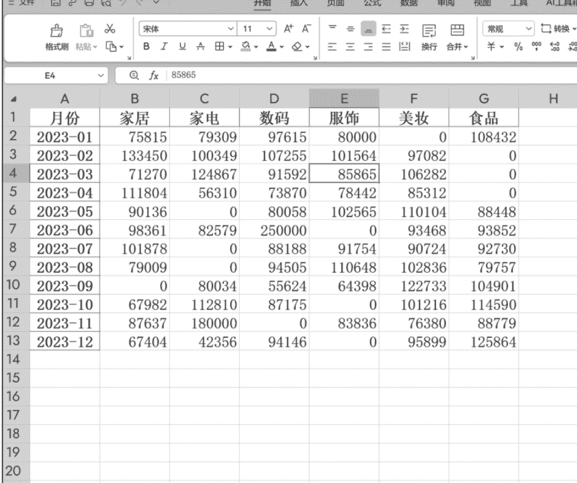

图5-1 华东地区 2023 年 1—12 月每月销售额排名前五的产品

### 2. 实战场景二：动态看板自动更新
市场部每月初需更新含 12 个维度的动态看板，手工调整成本高。可让 AI 产出智能模板降低负担。示例提示：“我是系统管理员，系统基于 Python，请帮我生成连接数据源的功能脚本，要求创建数据库驱动的动态透视，并在每天 9 点自动刷新各渠道转化率。”

腾讯元宝会给出基于 Python 的数据库透视生成与定时刷新思路，整合数据源连接、透视生成与定时任务，实现每日 9 点自动更新转化率。示例脚本：

```python
import pandas as pd
from sqlalchemy import create_engine
from apscheduler.schedulers.blocking import BlockingScheduler
from datetime import datetime
import logging

# 配置日志记录
logging.basicConfig(
    level=logging.INFO,
    format='%(asctime)s - %(levelname)s: %(message)s'
)

# 数据库配置（以MySQL为例）
DB_CONFIG = {
    'user': 'your_username',
    'password': 'your_password',
    'host': 'your_host',
    'port': 3306,
    'database': 'your_database',
    'charset': 'utf8mb4'
}

def create_db_connection():
    """创建数据库连接"""
    try:
        engine = create_engine(
            f"mysql+pymysql://{DB_CONFIG['user']}:{DB_CONFIG['password']}@"
            f"{DB_CONFIG['host']}:{DB_CONFIG['port']}/{DB_CONFIG['database']}?charset={DB_CONFIG['charset']}"
        )
        return engine
    except Exception as e:
        logging.error(f"数据库连接失败：{str(e)}")
        raise

def generate_pivot_table():
    """生成动态透视表"""
    try:
        engine = create_db_connection()

        # 从数据库读取原始数据
        query = """
            SELECT channel, conversion_rate, event_date
            FROM marketing_data
            WHERE event_date >= CURDATE() - INTERVAL 7 DAY
        """
        df = pd.read_sql(query, engine)

        # 创建透视表
        pivot_table = pd.pivot_table(
            df,
            values='conversion_rate',
            index='channel',
            columns='event_date',
            aggfunc='mean',
            fill_value=0,
            margins=True,
            margins_name='总计'
        )
        ......
```

篇幅所限，此处不展示完整输出，建议自行实践。

### 3. 实战场景三：批量处理多表
集团区域分析人员每月需处理 200+ 家分支的原始文件。可输入：“请帮我生成 Python 数据处理脚本，批量读取 D:\data 文件夹下的所有 xlsx 格式文件，并输出带时间戳的透视表报告。”

腾讯元宝会按需生成程序，批量读取指定目录的 Excel 并输出带时间戳的透视报告。下面是脚本示例：

```python
import pandas as pd
import os
from datetime import datetime

def batch_pivot_report(input_dir, output_dir):
    """
    批量处理 Excel 文件并生成带时间戳的透视表报告
    参数:
        input_dir: 输入目录 (如: D:/data)
        output_dir: 输出目录
    """
    try:
        # 获取所有 Excel 文件
        all_files = [f for f in os.listdir(input_dir) if
            f.endswith('.xlsx')]
        if not all_files:
            raise ValueError("目标目录中未找到 xlsx 文件")

        # 合并数据
        merged_data = pd.DataFrame()
        for file in all_files:
            file_path = os.path.join(input_dir, file)
            df = pd.read_excel(file_path)
            df['来源文件'] = file  # 记录数据来源
            merged_data = pd.concat([merged_data, df],
                ignore_index=True)

        # 数据清洗
        merged_data = merged_data.drop_duplicates()  # 去重
        merged_data.fillna(0, inplace=True)  # 填充空值

        # 生成时间戳
        timestamp = datetime.now().strftime("%Y%m%d_%H%M%S")
        output_file = os.path.join(output_dir, f"数据透视表_
            {timestamp}.xlsx")

        # 创建透视表
        with pd.ExcelWriter(output_file, engine='openpyxl') as writer:
            # 基础数据表
            merged_data.to_excel(writer, sheet_name='原始数据',
                index=False)
        ......
```

篇幅所限，具体输出省略，建议自行实践。

## 4. 总结
元宝在透视方面的方案核心在于把复杂的字段逻辑转为可复用的业务模块。推进可分三层：

- 1）基础层：沉淀常用分析模板库，如区域分析、产品线对比、时间序列。
- 2）中间层：开发部门级自动化脚本，如自动邮件发送、异常值标注。
- 3）战略层：构建企业级数据枢纽，实现多系统融合分析。

#### 试一试
在腾讯元宝里输入：“我正在处理 Excel 数据，请帮我生成 Python 脚本，用于制作 7 月华北区门店的坪效分析透视表，按周对比人效与库存周转率。”观察它如何拆解坪效指标的计算逻辑，并生成带动态筛选的报表框架。

#### 小贴士
- 1）字段命名规范直接影响识别准确度，建议统一采用“区域_事业部_指标”的格式。
- 2）复杂计算字段最好分步搭建，先确认基础公式正确再进行嵌套组合。

## 技巧44

### EDA 实战：读懂数据分布找准方向
基础预处理完成后，别急着建模，先倾听数据在表达什么。很多模型效果不佳、业务不认可，根源在于缺少探索性数据分析。异常值、分布形态、变量关系如同迷宫线索，EDA 就是探照灯。

借助元宝的 EDA 功能如同给数据装上透视镜，无需编程，通过自然语言即可完成分布检查、异常识别、相关性分析，并用通俗语言解释结果给出下一步建议。

### 1. 第一步：数据质量速查
数据质量速查通常在清洗后进行，这一步能帮助理解结构、规律与潜在问题，评估质量，为后续处理定方向。

将清洗后的数据集上传，输入：“请对下面数据集做基础探索性数据分析，要求：①统计缺失比例；②列出数值型和分类变量的分布特征；③找出异常值并给出处理建议。”

部分输出示例：

#### 1. 缺失值分析
检查全部字段后未发现缺失，所有 100 条记录均完整。

缺失值比例：0%（全部字段）。

#### 2. 变量分布特征
数值型变量：
□支付金额（单位：元）
·描述统计：
Mean:288.74 Median:293.61
Min:120.44 Max:504.35
Std:83.51 Q1:241.83 Q3:353.20
·分布特点：右偏，均值小于中位数，存在少量极高值
分类变量：（略）

#### 3. 异常值检测与处理建议（略）
处理建议：
- 1）对极端金额采用 Winsorize 方法处理，将超出 1%～99% 分位值替换为临界值。
- 2）保留重复购买记录，电商场景下合理。
- 3）补充收集商品单价/数量信息以验证金额合理性。

使用 EDA 结果时应优先处理预警项。若发现某关键指标缺失率超过 30%，就需回溯业务方确认采集流程，而非强行建模。

### 2. 第二步：数据分布可视化
想了解用户年龄集中区间或促销效果是否近似正态？上传非敏感数据集，以用户年龄为例，输入提示：“请用直方图和箱线图分析用户年龄分布，用文字描述关键特征：①集中区间；②偏态方向；③离群点个数。以 HTML 格式输出 EDA 可视化结果。”

元宝会生成用户年龄分布分析的 HTML 源码，并附详细说明。

（HTML 源码略）

分析结果详细说明：
（1）集中区间

用户年龄结构速览：主力区间与形态特征

把直方图与箱线图并置观察，年龄的堆积位置非常清晰。样本高度集中在25到45岁这段带宽，这一区间几乎承载了整体的主体量。进一步放大，30到40岁之间的密度达到峰值，可以认为是分布的重心所在。

整体形态呈现轻度右偏。中位数大约落在35岁附近，均值被拉高，右侧延伸出一条较长的尾部，少数高龄样本把平均值往上抬升。

极值可分为两类。低端离散多集中在15到24岁，占比很小，主要是青少年与职场新人；高端离散在60岁以上，数量相对偏多，以中老年及老年用户为主。这两类极值让年龄结构更立体，但并未动摇25到45岁为主力的基本判断。

运行后得到的网页可视化见下图。
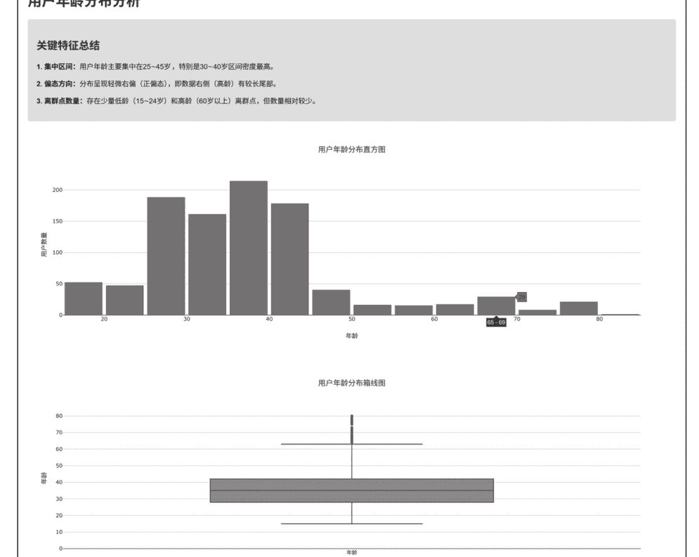
图5-2 运行HTML代码，得到的EDA可视化结果

遇到轻度右偏，常见的处理思路是先做对数化；离群点是否保留，需要结合具体业务目标来定夺。

### 3. 第三步：变量关系挖掘
想判断销售淡旺是否与天气相关、客单价与停留时长是否有线性关联，可以用散点矩阵来检验。示例提示可以这样写：“用散点矩阵检查这三组关联：①气温与销量；②页面停留时长与转化率；③折扣力度与退货率，并标出相关系数。”

系统给出的说明大致如下：
(1) 气温与销量：相关系数r=0.98，属于强正相关。点位几乎沿直线排布，气温升高时销量同步明显抬升，很可能对应季节性品类如夏装、冷饮等的需求。
(2) 页面停留时长与转化率：相关系数r=0.99，极强正相关。数据点紧贴回归线，停留时间越长转化越高，建议通过内容与交互优化来拉长停留。
(3) 折扣力度与退货率：……

(4) 商业建议：高温时段提前备货；用A/B测试优化页面以延长停留；对高折扣商品收紧退货规则；若要更细的结论，还需要更高分辨率的图或统计检验补充。
强关联的变量可以优先进入建模，非线性关系则需要特征工程来处理。

### 4. 第四步：建模方向建议
基于EDA特征请求模型推荐，例如：“根据以下特征推荐合适的预测模型并说明理由：①销量存在7天周期；②用户地域集中度高；③价格弹性系数为0.8。”

可能得到的建议是：
#### 1. Prophet时间序列模型
适用理由：
周期性建模：Prophet自带周期自动识别与拟合能力，可通过weekly_seasonality直接设定7天周循环，也能用fourier_order自定义季节复杂度，无须手工造滞后特征。
外生变量支持：……
可解释性：……
#### 2. XGBoost/LightGBM树模型（略）
#### 3. SARIMAX季节性自回归模型（略）

> 篇幅所限，其余输出省略，建议读者自行实操。

小结：Prophet与XGBoost/LightGBM是常见优选，前者擅长可解释的周期建模，后者擅长灵活捕捉非线性，可按资源与目标选择。

### 5. 总结

## 技巧45
## 用元宝做建模，把精力留给业务

建模让人困扰的往往不是写代码，而是面对众多算法时难以判断哪个契合当前业务场景。更尴尬的是，结果跑出来后业务方只会问“能做什么”。数据人还在调参，业务已用表格决策，技术与业务脱节。

腾讯元宝可作为智能建模助手。

### 1. 第一步：用自然语言获取模型选择建议
不必盲目试错，先让系统按业务需求推荐方案。例如预测用户流失，可输入：“现有10万条用户行为数据，包含30个特征，目标是预测下月用户流失概率（二分类），请推荐3种适合的算法并说明各自优缺点，用表格形式输出。”

可能得到表格如下：

| 算法 | 优点 | 缺点 |
| :--- | :--- | :--- |
| XGBoost | • 性能强，适合结构化数据<br>• 自动给出特征重要性<br>• 正则化抗过拟合<br>• 支持并行计算 | • 超参调优复杂<br>• 解释性弱于线性模型<br>• 训练耗时相对更长 |
| 逻辑回归 | • 训练快，适合大规模数据<br>• 解释性强，可量化特征影响<br>• 稳定不易过拟合 | • 不能自动捕捉非线性<br>• 依赖特征工程<br>• 对异常值敏感 |
| 随机森林 | • Bagging加随机特征，抗过拟合<br>• 无分布假设<br>• 对缺失值噪声鲁棒 | • 计算成本高<br>• 解释性有限，仅有重要性无方向<br>• 冗余特征会削弱表现 |

适用场景补充：
（1）XGBoost：特征间存在复杂非线性且追求高精度时优先。
（2）逻辑回归：需要快速上线或强业务解释，如生成流失原因报告。
（3）随机森林：在性能与稳定性间求平衡，或特征工程资源有限时使用。
可结合类别不平衡等数据特性进一步优化采样或超参。

### 2. 第二步：一键生成可运行的模型代码
选定算法后，可直接让系统输出可落地代码，输入：“请用Python给出上述XGBoost分类的完整代码示例，要求：①包含特征工程和模型评估；②添加中文注释；③输出按特征重要性排序。”

系统会生成含预处理、训练、评估的完整代码块，并附应用建议。篇幅所限，代码在此省略，建议读者自行实践。

### 3. 第三步：用业务语言解读技术指标
模型产出AUC=0.85、F1=0.976等指标，别直接报数字，可让系统翻译。输入：“请用业务语言解释以下模型表现：①测试集AUC=0.85；②召回率=72%；③特征重要性Top3，包括最近浏览天数、加购次数、历史客单价。说明对运营的指导意义。”

示例输出：
#### 1. 模型表现解释
①测试集AUC=0.85
- 通俗理解：100次预测里约85次能正确区分流失与留存。
- 类比：类似考试85分，已属优秀水平。
- 业务意义：可较可靠地识别高风险用户，优先干预。
②召回率=72%（略）
③特征重要性Top3（略）

#### 2. 对运营策略的指导意义（略）

#### 3. 总结
- AUC=0.85可信任模型预测，集中资源干预高分用户。
- 召回率72%提示仍有漏网，需人工补充排查。
- Top3特征揭示流失前行为，帮助设计防流失钩子。

最终目标是用最低成本挽回最多流失用户，提升高价值用户留存。

### 4. 第四步：自动生成完整分析报告
将零散结果整合成报告，输入：“根据上述分析结果，帮我整理一份给业务部门看的报告框架，包含：①核心发现（不超过3点）；②可落地的运营建议；③模型局限性说明；④下一步优化方向。”

示例框架：
#### 用户流失预测模型业务报告框架
目标：基于模型制定可落地的留存策略，明确后续优化。

##### 一、核心发现
1. 模型预测能力优秀。AUC=0.85，可可靠识别85%潜在流失用户。
2. 流失三大信号。最近未浏览、加购次数下降、历史客单价低。
3. 覆盖范围需权衡。召回率72%，28%需人工复核。

##### 二、可落地的运营建议（略）
##### 三、模型局限性说明（略）
##### 四、下一步优化方向（略）

篇幅所限，省略部分建议读者自行实践。

### 5. 总结
避免陷入技术完美主义。让系统处理标准化技术工作，人工聚焦业务闭环。好模型不是竞赛作品，而是能用通俗语言说明商业价值的决策工具。

#### 试一试
1. 用“业务目标+数据类型+样本量”描述建模需求。
2. 让AI对比三种算法的商业场景差异。
3. 将评估指标翻译成业务影响。
4. 生成“问题-方法-洞见-建议”报告框架。

#### 小贴士
1. 重要模型保留10%人工验证样本。
2. 定期让AI解释特征工程背后的业务含义。
3. 复杂项目采用“AI初筛+专家会诊”。
4. 所有结论需经业务负责人二次确认。

## 技巧46
## 用元宝搭数据报告框架的三个做法

职场人怕的不是数据难，而是报告写完没有指导意义。业务方说结论像谜语，领导看不到行动方向。同样的数据月初叫潜力，月底变风险，本质是框架缺乏业务逻辑。

### 1. 用“问题树”替代“目录树”
好报告是问题追踪。应先锁定核心问题，再用数据作证据链。
示例输入：“现有用户流失数据包含登录频率、功能使用、客诉记录三个维度，请按问题树结构搭建框架：①主干问题（如：高价值用户为何集中流失）；②分支问题（价格敏感度/竞品动态/体验断点）；③证据需求（需补充哪些数据验证假设）。输出结构图并标注重点分析模块。”

系统可能生成：
1. 用户流失问题树分析框架（结构图）
2. 主干问题：高价值用户为何集中流失？
（核心目标：定位流失驱动因素）
（1）分支问题1：价格敏感度是否导致流失？子问题…证据需求（略）重点模块（略）
（2）分支问题2：竞品动态是否吸引用户转移？（略）
（3）分支问题3：产品体验是否存在断点？

篇幅所限，省略，建议自行实践。此结构避免无目的数据陈列。

### 2. 给数据结论装上“翻译器”
“转化率提升7%”不如“每月多成交350单，年度增收420万元”有冲击力。
示例输入：“将新用户转化分析数据转化为业务影响说明：①注册转化率提升对应多少有效线索；②每提升1%可节省多少推广费用；③关键行为数据与复购率的关联强度。要求：重要换算用白话解释。”

示例输出：
#### 新用户转化分析→业务影响说明（白话版）
①注册转化率提升对应多少有效线索？
换算：月访问100万，转化2%得2万线索，提升到3%得3万，多1万线索。
白话：每多1%注册，等于多获得1万可跟进销售的潜在客户。
②每提升1%转化率可节省推广费用？
白话：转化率每提1%，客户获取成本从5块降到3块3，省下的钱可再投广告或发奖金。
③关键行为与复购关联（略）
执行建议：把省下的费用投向加购优惠券功能，优化注册页文案与加载速度。

### 3. 让建议方案自带“施工图”
“加强体验”“优化策略”会被忽略，必须包含动作、责任部门、效果预判。
示例输入：“根据用户留存分析结果，设计三级实施方案：①7天内可上线的应急措施（明确执行团队）；②30天中期计划（标注资源需求）；③90天长效方案（说明协同机制）。要求：每级附效果追踪指标。”

示例：
#### 一、7天应急措施（快速止血）
执行团队：用户运营组+技术+客服
核心动作：
1. 流失预警弹窗：7日未登录触发福利弹窗，赠限时满减券。埋点曝光率&点击率。
2. 关键路径Bug修复：解决注册跳出>35%的卡顿，支付成功率<60%的延迟。
3. 人工召回专线：对历史ARPU>200元流失用户电话回访，建立流失原因标签。
效果追踪指标（略）

二、30天中期计划（略） 三、90天长效方案（略）

形成止血-修复-加固闭环，建议灰度验证。

## 4. 总结
优秀报告是行动蓝图。抓住三个转换：数据陈列→问题追踪，统计结论→价值清单，常规建议→实施方案。

#### 试一试
输入：“用库存周转数据设计决策框架，要求：①区分季节性波动与系统性风险；②制定采购/促销/清仓三级响应方案；③标注部门协作流程与时间节点。”

#### 小贴士
1. 提问前加“假设你是要在经营决策会上汇报的数据负责人”，提升高度。
2. 模糊结论时追问“请用加减乘除说明影响程度”。
3. 关键图表备注“请用会议场景语言解释核心信息”。
4. 方案需标注“实施前提是[某条件]，需监控[某指标]”。

## 技巧47
## 财务报表智能分析实战

月末结算最头疼的是数据核对拉锯。原始数据散落在纸质单据、表格和业务系统，汇总需切换多个平台。手工录入易错行，公式链接出错会连锁反应，发现借贷不平要逆向排查。同步更新到不同格式统计表时，版本错位会影响资金调拨准确性。

下面介绍三个元宝应用场景，实现从整理到智能分析的全流程提效。

### 1. 场景一：整理多个不同文件格式的原始数据文件
数据来源杂乱时，可让系统帮忙。例如有一份PDF利润表格式混乱，上传文档并输入：“我在整理数据，数据来源是PDF，请帮我生成Python代码，要求提取2023年第一季度利润表中的以下字段：①主营业务收入（总行数≥3时取累计值）；②营业成本（区分固定成本和变动成本）；③税费（需扣除减免部分）。同时要求输出为JSON格式，数值单位统一为万元。”

系统会给出Python操作代码示例：
```python
import pdfplumber
import re
import json

def extract_financial_data(pdf_path):
    # 初始化存储结构
    result = {
        "主营业务收入": {"value": 0, "unit": "万元"},
        "营业成本": {
            "固定成本": 0,
            "变动成本": 0,
            "unit": "万元"
        },
        "税费": {
            "总额": 0,
            "减免金额": 0,
            "实际税费": 0,
            "unit": "万元"
        }
    }

    with pdfplumber.open(pdf_path) as pdf:
        # 合并所有页面表格数据
        all_rows = []
        for page in pdf.pages:
            table = page.extract_table()
            if table:
                all_rows.extend(table)
        ......
```
（由于篇幅有限，输出结果在此省略，建议读者亲自上手实践。）

### 2. 场景二：报表制作提速实战
手工汇总合并利润表时，公式链断裂、格式参差不齐的问题屡见不鲜，核对耗时往往超过真正制作。此时向元宝寻求捷径会很高效。示例指令可写成：“我在做数据分析，需要基于 Excel 表中 2025 年 1—3 月的数据生成合并利润表，包含以下内容：①销售收入 1440 万元，其中含增值税 87 万元；②成本构成，原材料 610 万、人工费 200 万；③费用，销售佣金按收入 5% 计、管理费用固定 65 万元；④所得税率 25%。请帮我生成解决问题的 Python 代码，要求：计算过程分步展示，差异项标红提示，同时输出格式为 Markdown 表格，保留两位小数。”

元宝会按需求给出思路，用 Python 实现分步运算并产出带差异高亮的合并利润表：
```python
import pandas as pd

# 基础数据
sales = 14400000          # 含税销售收入
vat = 870000              # 增值税
raw_material = 6100000    # 原材料
labor = 2000000           # 人工费
management_fee = 650000   # 固定管理费
tax_rate = 0.25

# 分步骤计算（含差异检查）
steps = [
    ("含税销售收入", sales, "用户提供"),
    ("增值税", -vat, "用户"),
    ("营业收入", sales - vat, "=14400000 - 870000"),
    ("原材料成本", -raw_material, "用户提供"),
    ("人工成本", -labor, "用户提供"),
    ("销售佣金", -(sales * 0.05), "差异项：佣金基数应为不含税收入", True),
    ("管理费用", -management_fee, "用户提供"),
    ("营业利润", None, "自动计算"),
    ("所得税", None, "=营业利润 × 25%"),
    ("净利润", None, "自动计算")
]

# 构建DataFrame
df = pd.DataFrame(steps, columns=["项目", "金额", "计算说明", "差异提示"])
df["金额"] = df["金额"].astype(float)
......
```

（由于篇幅有限，输出结果在此省略，建议读者亲自上手实践。）

## 3. 场景三：分析可视化加速
当决策缺乏直观支撑时，可以尝试让元宝快速生成动态仪表盘和数据图表。示例指令：“我是数据分析师，我的数据在 Excel 表格里，当前痛点是静态报表无法跟上业务变化，看不到趋势和预警。请帮我生成一段 Python 代码，用于搭建现金流动态分析仪表盘，并分析近半年数据，要求包含：①计算运营资金周转天数；②预测未来 3 个月资金缺口；③标注异常波动月份。代码输出要包含折线图、关键指标卡片、风险提示模块。”

元宝会输出一个融合时间序列分析与可视化技术的基于 Python 的现金流动态分析仪表盘方案，代码示例如下：
```python
import numpy as np
import plotly.graph_objects as go
from plotly.subplots import make_subplots
from sklearn.linear_model import LinearRegression
from statsmodels.tsa.seasonal import seasonal_decompose
```

```python
# 1. 数据准备 (假设数据格式: 日期、现金流入、现金流出、存货、应收账款、应付账款)
df = pd.read_excel('cash_flow.xlsx', parse_dates=['日期'],
    index_col='日期').last('6M')
```

```python
# 2. 计算运营资金周转天数
def calculate_cycle_days(df):
    # 计算各周转天数
    df['存货周转天数'] = (df['存货'].mean() / (df['现金流出'].
        sum()/180)) * 30
    df['应收周转天数'] = (df['应收账款'].mean() / (df['现金流入'].
        sum()/180)) * 30
    df['应付周转天数'] = (df['应付账款'].mean() / (df['现金流出'].
        sum()/180)) * 30
    df['运营资金周转天数'] = df['存货周转天数'] + df['应收周转天数'] -
        df['应付周转天数']
    return df[-1]['运营资金周转天数']

current_cycle_days = calculate_cycle_days(df.copy())
```

```python
# 3. 资金缺口预测
def forecast_cash_gap(df, periods=3):
    # 创建时序特征
    df = df.resample('D').interpolate()
    df['现金流净额'] = df['现金流入'] - df['现金流出']

    # 训练预测模型
    model = LinearRegression()

    X = np.array(range(len(df))).reshape(-1,1)
    model.fit(X, df['现金流净额'])
    ......
```

（由于篇幅有限，输出结果在此省略，建议读者亲自上手实践。）

## 4. 总结
Python 生态汇聚了大量数据处理库，既能处理结构化数据也能处理非结构化数据，还覆盖 Excel、PDF、图片等多种文件的识别与解析。元宝可以帮助我们迅速生成所需代码，让数据处理更省时省力。

#### 试一试
在元宝中输入：“解析附件 PDF 中的资产负债表，提取流动资产与非流动资产明细，对比上季度数据生成变化趋势图。”

#### 小贴士
- 1) 遇到复杂表格时，在提示词末尾加上“如遇模糊数据，优先标注待确认字段而非猜测”。
- 2) 安全锦囊：在 API 调用前加入 validate_data() 函数，可拦截大部分数据异常。
- 3) 效率组合键：按 Alt+Shift+R 可快速调出预设的报表模板库。

# 第6章

## 效率提升：腾讯元宝工作流程优化指南

## 技巧48

## 信息搜索：用腾讯元宝高效检索有用信息

信息爆炸时代，职场人常陷入两难：想快速掌握某领域却不知从何入手，搜到的资料要么太碎片要么来源可疑。传统搜索引擎只给一堆链接，需要自行甄别；AI 工具生成的内容又常缺深度和权威，难直接用于专业场景。

更头疼的是，急需行业最新数据或权威观点时，往往在海量信息里迷路，花大量时间收获甚微。如何精准获取可靠信息并快速转化为可用内容，成为核心挑战。

元宝作为新一代 AI 助手，正在改变信息获取和处理方式。它不像传统搜索那样简单罗列链接，而是能理解问题本质，直接给出梳理后的答案并标注来源。

### 1. 技能一：信息搜索的精准捕捞术

单一来源容易偏差，手动对比又耗时。可以让元宝同时抓取多个来源并自动比对要点。例如验证某个技术方案的行业评价，可在元宝中输入：“请从以下两个维度对比分析 AI 助手在企业的应用反馈：①技术社区如掘金、CSDN 的讨论焦点；②企业公开案例如银行、互联网公司落地报道。请用表格形式输出，包含观点来源和争议点。”

元宝可能会给出以下结果（注：表格中数字编号为元宝提供的观点来源链接，实际场景中可点击数字链接进行溯源）：

| 维度 | 反馈观点 | 观点来源 | 争议点 |
| :--- | :--- | :--- | :--- |
| 技术社区讨论 | 效率提升 | 部分开发者认为 AI 助手能提升基础编码效率，尤其在代码补全和重复代码生成上 | 社区用户自发讨论 [4] | 效率是否真实提升存疑：有研究显示，资深程序员使用 AI 助手后开发速度反而下降 19%，因频繁提示打断深度思考，且需花费额外时间对生成的代码进行审查和调整 |
| 技术社区讨论 | 代码质量 | 认可其在生成模板代码、单元测试和基础注释方面的帮助 | 开发者社区文章、评测 [11] | 代码质量参差不齐：生成的代码可能不符合项目规范或最佳实践，甚至引入潜在安全漏洞和性能瓶颈，审查和修正成本较高 |
| 技术社区讨论 | 适用场景 | 认为 AI 助手适合辅助初学者学习、快速生成简单代码片段、处理重复性任务及进行初步的代码审查 | 技术博客、论坛讨论 [4] | 复杂任务支持不足：在涉及复杂业务逻辑、系统架构设计、跨文件理解或深度调试时，AI 助手的能力往往有限，有时甚至会给出误导性建议 |
| 技术社区讨论 | 学习与适应 | 肯定 AI 助手作为“编程导师”的潜力，能帮助开发者学习新语言、框架和常见代码模式 | 社区分享 [5] | 过度依赖风险：担忧新手可能过于依赖 AI 生成代码，而忽视了底层原理和编程思维的系统性训练，不利于长期职业发展 |
| 企业公开案例 | 效率与采纳 | 效率提升显著：腾讯内部超 80% 程序员使用 AI 助手，日均代码 33% 为 AI 生成，整体编码效率提升 42% [3]。哈啰集团接入通义灵码后，研发效率提升 19%，AI 代码采纳率超 25% [6] | 企业新闻发布会、案例报告 [3][6] | 效率度量标准：企业公布的效率提升数据通常为内部统计数据，外界难以精确评估度量标准是否科学和全面 |
| 企业公开案例 | 安全与合规 | 高度重视：金融、保险等行业企业如工商银行 [8]、人保科技 [7]在引入 AI 助手时，优先选择支持私有化部署的国产产品，确保代码不离境，并深度融合企业自身的开发生命周期和安全规范 | 企业中标公告、合作新闻 [7][8] | 成本与定制化：私有化部署和深度定制需要较高的投入，并非所有企业都能负担。如何平衡安全合规与成本效益，是企业需要考虑的问题 |
| 企业公开案例 | 质量与风险控制 | 效果显著：人保科技采用“AI+ 代码卫士”后，漏洞发现效率提升 300%，高危漏洞拦截率超 95%，人工审计时长平均缩短 83.63% [7] | 行业落地报道 [7] | AI 工具局限性：企业承认 AI 生成代码并非百分百准确，仍需人工专家进行最终评审和决策 |
| 企业公开案例 | 融合与一体化 | 与现有研发流程深度融合：企业不仅用 AI 生成代码，还将其应用于智能代码审查如哈啰 [6]、自动化测试、漏洞排查，甚至自研的 Copilot 平台中，形成端到端的智能研发体系 | 企业案例分享 [6] | 流程变革挑战：将 AI 深度融入现有开发流程，可能需要对工作方式、组织架构和人员技能进行一定程度的调整和变革，这会带来管理上的挑战 |

### 2. 技能二：数据信息的高效整理术

处理数据文件时，需要对多份文件进行合并、清洗、建模、分析、可视化，传统做法是手动对比、用 VLOOKUP 查到眼花。高阶做法是借助元宝的数据清洗、合并、分析能力，让它生成处理数据的 Python 代码或直接给出分析结果。

例如要合并 5 月—7 月销售数据表、去重并标记异常值、生成可视化图表并给出结论，可输入：“请合并市场部 5 月—7 月销售数据表，自动去重并标记异常值，生成分区域环比增长率热力图，重点标注增长率超 20% 的品类，帮我生成数据分析结论并给出需要重点关注的地方。”

上传数据后，元宝可能会输出：

根据您提供的销售数据，已完成数据整合与分析。以下是结构化分析结果及建议：

### 一、数据预处理

- 1. 合并 5 月—7 月数据后共 12 条记录，每月各 4 条。
- 2. 检测到北区产品 B 存在重复记录，5 月销售额 1500 元重复两次，已去重处理。
- 3. 发现南区产品 C 7 月数据存在异常波动，异常波动值为 1500 元，Z-score 为 2.8，已标记。

### 二、环比增长率分析

| 区域 | 品类 | 5月—6月增长率 | 6月—7月增长率 |
|---|---|---|---|
| 北区 | 产品 A | 20% | 25% ★ |
| 北区 | 产品 B | 6.67% | 12.50% |
| 南区 | 产品 A | 12.50% | 11.11% |
| 南区 | 产品 C | 8.33% | 15.38% |
（★表示增长率突破20%）

### 三、核心结论（略）

### 四、重点关注建议（略）

### 五、可视化建议（略）

如需完整分析代码或详细数据溯源报告，可随时告知。当前结论基于样本数据，建议补充完整数据集后做最终决策。

（由于篇幅有限，输出结果在此省略，建议读者亲自上手实践。）

这里用到的提示词模板：“请整合[数量]份[文件类型]，进行[去重/校验]处理，按[分析维度]生成[可视化形式]，突出显示[特定条件]的数据。”

## 3. 总结

这套技能的底层逻辑是把重复劳动交给元宝，让人类专注创造性决策。会搜索的人找答案，会提问的人造答案。当你能用“请比较 A 方案和 B 方案在成本、时效、风险维度的优劣，给出实施路线图建议”代替“哪个方案更好”时，就学会了如何高效处理信息。

#### 试一试
在元宝中输入“我正在准备新能源汽车行业分析报告，需要近两年政策变化、技术突破、消费趋势三方面信息，请用时间轴+数据看板形式呈现，重点标注对中小企业的影响”，观察它如何把碎片信息变成决策仪表盘，体验从信息搬运工到战略分析师的进化。

#### 小贴士
- 1) 遇到复杂需求时，拆解成“分析范围+处理方式+输出形式+特别要求”四要素。
- 2) 对于重要文件记得追加“请检查数据来源可靠性”这类校验指令。
- 3) 多用“假设你是行业专家，你会如何呈现这个主题”来激活深度分析模式。
- 4) 定期整理常用提示词模板，建立个人智能工作提示词库。

## 技巧49

## 工作流程优化：用腾讯元宝三招拆解工作任务

没有元宝时，整理会议纪要需要逐条核对录音和笔记，汇总数据要反复检查格式和公式，写报告既要组织内容又要调整排版，重复性工作占用大量时间，真正需要思考的部分反而要留到最后。更麻烦的是，多任务并行时手动处理容易出错或遗漏关键信息。

这时可以让元宝帮你简化流程。它不仅能快速整理信息，还能自动生成结构化内容，减少重复劳动。接下来介绍三个具体方法，帮助你更高效处理繁琐工作。

### 1. 秘笈一：任务拆解术——把大象装进冰箱只需三步

面对复杂任务却拖延时，试试在元宝中输入：“我正在写年终总结，但是拖延症犯了，请设计 5 个游戏关卡帮我完成任务，每个关卡不超过 15 分钟，完成有奖励提示。”

元宝可能生成：
- 关卡 1 破冰冲刺（12 分钟）：用手机倒计时，写下今年所有工作关键词，想到就写，不筛选。
- 关卡 2 碎片拼图（15 分钟）：把电脑桌面、微信收藏、笔记软件里的年度文件拖进分别命名为①～⑫的月份文件夹。
- 关卡 3 成就暴击（10 分钟）：翻看全年聊天记录，找出 3 次被同事或客户表扬的时刻并截屏。
- 关卡 4 BOSS 分身战（14 分钟）：给虚拟的拖延兽写信：“今年阻止我完成的 3 件事是______”
- 终局之战 时间胶囊（15 分钟）：用初稿第一段+最后一段搭好框架，中间写[待填充]。
奖励提示：赢得完成者礼包，真实奖励建议新本子/电子书。

有了这套方法，你就可以用游戏化方式推进任务。若想进一步，可继续提问：“请给我关卡 3 的详细操作方法。”

### 2. 秘笈二：总结生成器——让 AI 当你的智能助手

想要迅速把杂乱的日常工作记录转化为重点突出的报告？试着向元宝输入提示词：“将本周客户拜访记录整理成周报，突出转化率提升 2% 的成果，用‘成果-挑战-计划’结构，控制在 300 字以内。”

元宝可能会输出类似这样的结果：

客户拜访周报（3.18—3.24）

#### （1）成果亮眼
- 转化率突破：成功转化 6 家客户，转化率 20%，较上周提升 2%，新增月度收入 20 万元。
- 意向客户增长：新增意向客户 10 家，覆盖行业 A/B/C，并促成 3 家长期合作 1～3 年。
- 客户反馈高效收集：汇总 20 条优化建议，聚焦产品、服务及价格策略。

#### （2）核心挑战
- 沟通成本高：部分客户对产品功能及定价存在误解。
- 市场竞争加剧：竞品在具体区域采取低价策略，分流意向客户。
- 决策流程冗长：客户内部多层级审批延缓转化进度。

#### （3）下周发力点
- 目标升级：计划拜访 35 家客户，重点跟进 10 家新增意向客户，转化率冲刺 22%。
- 精准破局：技术团队协同拜访，用案例资料澄清误解；优化话术，强化差异化优势。
- 稳固合作：回访已转化客户，快速响应需求，提升满意度。

### 3. 秘笈三：数据缝合术——让跨部门数据自动接力

工作中常遇到多部门不同格式的数据，如何高效合并并快速分析其中信息？可以让元宝整合不同格式数据并归纳要点。以合并三个部门不同格式文件生成带图表简报为例，可输入：“整合市场部调研 PDF 文件、销售部 Excel 表格、设计部 JSON 文件，分析 Q1 产品反馈趋势，生成带图表的三页简报，标注需要改进的前三大问题。”

元宝会帮你自动处理这些不同格式的数据，并给出详细简报：

### 第一页：整体反馈趋势概览

#### 1. 用户满意度分布（饼图）
- 非常满意：25%
- 满意：45%
- 一般：20%
- 不满意：10%

结论：综合评估后，满意及非常满意的用户合计约七成，不满意的用户约一成，后者需重点关注。

……

### 第二页：产品表现对比（略）

### 第三页：前三大问题与改进建议（略）

> （由于篇幅有限，输出结果在此省略，建议读者亲自上手实践。）

用“数据拼盘”这种思路，就能把原本要由市场专员、数据分析师、设计师耗时三天才能交付的任务，压缩成一次多角色接力的协作游戏。

## 4. 总结

这套工作方式的关键，是把腾讯元宝当成全局统筹的指挥中枢，用游戏化拆解把任务拆细，用智能工具承接重复环节。周报生成、会议整理、数据清洗这类常规副本一旦形成自动化流水线，就能腾出精力去攻坚真正的高难度关卡，比如下一季度爆款方案的策划。

#### 动手实践
在腾讯元宝中上传三份不同来源的文件，比如研发的 Git 日志、产品需求的 DOC 档、用户投诉的 Excel 表，指令为：“请关联技术部的 Git 日志、产品需求文档、用户投诉邮件，找出版本更新后重复率最高的三个兼容性问题，按紧急程度排序并给出临时应对方案。”

#### 操作要点
- 1) 复杂任务先让腾讯元宝梳理执行清单再启动。
- 2) 建立常用提示词库，例如“数据分析话术”“邮件催款模板”。
- 3) 生成的文件务必经人工复核。

## 技巧50

## 沟通助手：让腾讯元宝化身全员翻译官
跨部门协作最耗成本的往往不是业务本身，而是沟通损耗。产品侧说“优化用户体验”，技术侧听成“需求又要改”；市场提“品牌升级”，设计理解成“重做 Logo”。每次对齐都要反复解释专业概念，效率极低。

再加上术语壁垒，销售要求“三天上线”，技术面对“智能推荐”“用户友好”等模糊描述无从下手；行政推行“弹性工作”，落地时却变成各部门自行其是。问题暴露时进度早已受损。

腾讯元宝能把专业术语转译成白话，并把模糊指令拆成可执行动作。下面三个招式可直接套用。

### 1. 招式一：需求对齐法—把抽象表述变成可执行要点
当产品说“要更人性化的交互”，技术想的却是代码如何实现时，如何统一语言？可让腾讯元宝充当需求转换器。以产品与研发协同为例，输入：“你正在协调产品部与技术部，请把以下需求转成技术部可执行的要点：①原始需求是优化注册流程体验，提升转化率；②补充信息为目前注册分5步，流失率38%，卡点在实名认证；③预期效果是转化率提升到50%以上。”

## 技术部可执行要点（基于需求拆解）

### 1. 步骤简化与流程重构
- **合并步骤**：把原5步压缩到3步以内，例如基础信息填写→实名认证→完成注册。
  - 示例：把“用户信息预填”与“实名认证”合并为单页，利用OCR自动识别身份证信息，减少手工输入。
- **预填与默认值**：通过微信、支付宝授权获取手机号、昵称等基础信息，降低填写负担。
- **异步提交**：实名认证提交后由后台异步审核，用户无需等待即可进入下一步。

### 2. 实名认证环节优化（略）
### 预期技术落地效果（略）
### 后续迭代建议（略）

以上方案需技术部先评估OCR、活体检测API对接成本与合规风险，建议分阶段迭代。

（由于篇幅有限，输出结果在此省略，建议读者亲自上手实践。）

## 2. 招式二：会议纪要变形术—把流水账变成行动指南
会后常出现记录缺失、节点不清、理解偏差。与其让各部门各执一词，不如用腾讯元宝生成动态看板。以新品发布筹备为例，输入：“请把以下会议内容转成智能任务清单：①重点是新品发布筹备；②关键信息是市场部交付设计素材（6月25日前），技术部负责H5开发（6月28日完成测试版），客服部更新话术（7月1日培训），财务部审批预算（6月20日前）。”

部分结果示例：

### 智能任务清单：新品发布筹备

#### 一、市场部：设计素材筹备
1. **核心任务**
   - 完成新品主视觉设计，包含高清产品图、多角度展示、场景化素材，符合品牌调性。
   - 服饰类需提供真人模特图，含正面、侧面、动态效果，确保细节真实。
   - 提交时间：**6月25日前**。
2. **关键要求**（略）

（技术部、客服部、财务部任务清单略）

#### 五、跨部门协作节点（略）
#### 风险管理与进度监控（略）

（由于篇幅有限，输出结果在此省略，建议读者亲自上手实践。）

## 3. 招式三：冲突调解金手指—把踢皮球变成解决问题工作坊
部门推诿时，可让腾讯元宝充当和事佬。以跨部门投诉为例，输入：“你正在处理跨部门投诉，请用非暴力沟通框架重构矛盾：①客服反馈技术响应超时导致客户流失；②技术解释50%工单描述不清需反复确认；③历史数据平均解决时长72小时，目标48小时。”

部分输出示例：

#### 一、非暴力沟通框架重构矛盾
##### 1. **观察（事实）**
- **客服视角**：技术工单平均解决时长72小时，超目标48小时50%，近3个月客户流失率上升12%。
- **技术视角**：50%工单描述模糊，需多次确认，单次确认平均耗时8小时。

##### 2. **感受（情绪）**
- **客服**：焦虑流失，担心品牌受损，对响应效率无奈。
- **技术**：因反复确认产生挫败感，担心无效工作占用资源。

##### 3. **需要（诉求）**（略）
##### 4. **请求（行动）**（略）

### 二、配套解决方案（略）
### 三、预期效果（略）

（由于篇幅有限，输出结果在此省略，建议读者亲自上手实践。）

## 4. 总结
方法论的核心是让腾讯元宝扮演“职场同传”，精准转译术语，把模糊指令转为可执行任务，并沉淀组织智慧。好的沟通不是消除所有误解，而是建立快速纠偏的智能机制。

#### 动手实践
输入“销售部说需要‘更有冲击力的数据展示’，请生成给技术部的需求澄清模板，含可视化示例、技术实现方式、验收标准”，观察其搭建认知桥梁的过程。

#### 操作要点
1. 遇到专业术语，追加提问“请用新人能听懂的方式解释××概念”。
2. 重要协作事项加上“如果出现××情况，应该如何应对？”。 
3. 定期用“请总结过去三个月关于××的沟通记录”提炼知识库。

## 技巧51

## 职场邮件：让腾讯元宝写出领导秒回的汇报
写邮件难在有限篇幅里兼顾专业性与沟通效果。申请资源易写成讨价还价，汇报重点不突出，用词不当更易引发误会。

腾讯元宝可按场景生成适配文案。下面三种做法常用。

## 1. 方法一：需求提纯—三层读心术
申请预算时空泛请求难以获得高质量输出。关键是用数据量化需求，展示投入产出比。以智能客服系统升级为例，输入：“请为智能客服系统升级写预算申请邮件：①领导特点：CFO只看数字，厌恶空话。②核心亮点：新旧系统运维费对比。③风险提示：不含硬件采购。按‘结论-数据-行动’结构写。”

腾讯元宝输出示例：
主题：智能客服系统升级项目预算申请｜年省120万元，18个月回本
申请升级智能客服系统，预计年运维成本下降60%，18个月收回投入。数据支撑：①旧系统年运维成本200万元，新系统80万元，三年总成本由600万元降至240万元，差额360万元；②AI应答率由65%提升至92%，人工处理时长由8分钟降至2分钟，人力成本年降37%；③首期预算50万元，风险可控……

（由于篇幅有限，输出结果在此省略，建议读者亲自上手实践。）

## 2. 方法二：智能变身—邮件变形金刚
同步进度需按受众调整表达：技术负责人关注根因，客户需要情绪安抚，团队需要士气激励。输入：“请将‘项目A因芯片缺货延期2周’改写成三种邮件：①给技术副总，关注根本解决；②给大客户，需补偿方案；③给团队，提振士气。每种给出主题+开头三句。”

腾讯元宝输出示例：
技术版：主题《项目A延期分析与长效方案》 “经溯源，主因TI芯片交期波动，建议三方面建立弹性机制……” 
客户版：主题《致×××：专属服务升级计划》 “我们深知准时交付的重要，特免费增加……” 
团队版：主题《致战友：穿越缺芯风暴指南》 “过去两周创下日均攻坚12.7小时纪录！现在需要……”

（由于篇幅有限，输出结果在此省略，建议读者亲自上手实践。）

## 3. 方法三：暗雷排查—给邮件装避雷针
措辞不当易引发误解。结构化表达可降低风险，如用“项目进度同步”明确信息共享属性，以“诚邀建议”弱化指令感。以优化会议通知为例，输入：“请优化会议通知邮件：①避免技术部与市场部冲突；②植入CEO关注的‘数字化转型’。”

腾讯元宝调优效果：
各位同事：
根据CEO关于“深化数字化转型，构建生态协同力”的年度部署，现组织跨部门战略沟通会，重点研讨技术赋能与市场增长的融合路径。请各部门负责人携核心业务数字化升级方案参会。
核心议程：1. 生态级数据打通方案；2. 用户生命周期技术-运营协同试点；3. 转型成效评估标准……
特别说明：会议成果将形成《数字化转型白皮书（草案）》，呈报领导……

（由于篇幅有限，输出结果在此省略，建议读者亲自上手实践。）

## 4. 总结：从邮件工人到沟通大师
用腾讯元宝写邮件如同导航避堵。从群发模板进化为精准沟通，需要分析精准、表达百变、安全到位三件装备。

#### 动手实践
对腾讯元宝说：“写部门团建审批邮件：①关联CEO强调的‘创新文化’；②突出费用比上年省30%；③用‘团队赋能’替代‘游玩’。”

#### 操作要点
1. 定期选取成功邮件作为模板，输入“请分析这封邮件的3个优点，生成改进版模板”。
2. 提需求时按“背景-痛点-要求”整理信息。
3. 邮件必须“人工+AI”双审核，避免幻觉。

## 技巧52

## 时间管理：用腾讯元宝重构高效工作日
手写待办常滞留周一，甘特图追不上变更，日历沦为摆设。临时会议冲垮计划，突发需求撕碎优先级。静态工具难以应对动态职场。

腾讯元宝可搭建灵活时间系统，三个实战方法如下。

## 1. 方法一：任务优先级排序
任务过载时，可让其梳理重要与紧急关系。输入：“现有任务池：客户A方案原定今日交付、系统突发故障刚出现、季度述职材料后天截止。影响因素：①故障影响生产线；②方案关联续约；③述职决定晋升。请提供处理方案并标注风险值。”

腾讯元宝建议：
### 动态处理方案（按优先级排序）
1. 优先处理系统突发故障（风险值：★★★★★）
   （1）处理逻辑：生产线停滞会导致订单延误、客户投诉及额外成本。
   （2）具体动作：①启动应急预案，技术团队排查并隔离故障；②通知业务保障组评估影响，制定替代方案；③客户沟通组1小时内通报客户A预计恢复时间。
   （3）风险控制：若2小时内无法恢复需升级，预留15%弹性资源。
2. 同步推进客户A方案交付（风险值：★★★★☆）（略）
3. 穿插完成季度述职材料（风险值：★★★☆☆）（略）

（由于篇幅有限，输出结果在此省略，建议读者亲自上手实践。）

## 2. 方法二：任务细颗粒度拆解
面对需深度专注的复杂工作，可让其拆解并给出防干扰策略。例如撰写AI智能体产品市场分析报告仅有3小时，输入：“我现在要完成AI智能体产品的市场分析报告，时间只有3小时，请拆分为6个30分钟任务，每个步骤注明具体动作和防干扰措施。”

腾讯元宝方案：
### 任务1：确定分析框架与数据准备（30分钟）
（1）具体动作：①搭建框架，按“行业概述→技术趋势→应用场景→竞争格局→商业化挑战→未来展望”划分；②快速筛选SuperCLUE评测、企业官网、学术论文；③建Excel分类存储核心数据。
（2）防干扰：①关闭社交媒体，用大纲工具记录关键词；②数据收集限15分钟，超时进入下一步。
任务2：行业格局与核心玩家分析（30分钟）（略）
任务3：技术趋势与突破点提炼（30分钟）（略）
任务4：应用场景与商业化潜力评估（30分钟）（略）

（由于篇幅有限，输出结果在此省略，建议读者亲自上手实践。）

## 3. 方法三：时间损耗诊断
效率密码常藏于碎片时间。将日常记录上传给腾讯元宝，输入：“请根据我上传的时间安排，分析过去一周通勤、会议间隙、午休前等碎片时段（单次5～30分钟），推荐三类微任务：①可随时中断的；②不需要深度专注的；③能累积显性成果的。”

腾讯元宝建议：
### 1. 碎片时段分布
（1）通勤时段共90分钟/天：早通勤07:30—08:15、晚通勤17:15—18:30……
（2）推荐三类微任务
第一类：可随时中断
①语音备忘录录下灵感/待办；②碎片阅读行业简报；③语言听力3分钟情景剧。
第二类：不需要深度专注（略）
第三类：能累积显性成果（略）
### 2. 执行建议
（1）工具整合用潮汐App统计时间投资；（2）周末15分钟整理产出；（3）灵活替换困难任务。

> （由于篇幅有限，输出结果在此省略，建议读者亲自上手实践。）

## 4. 总结
真正的时间管理不是与时钟赛跑，而是通过系统设计减少决策消耗。利用腾讯元宝的智能拆解、动态调度和诊断功能，让重要事项自动推进。

#### 动手实践
输入“将明日工作计划转化为智能日程，包含交通时间、专注时段及休息间隔”，并附上大致安排。

#### 操作要点
1. 每天开工前用5分钟与腾讯元宝校准当日安排。
2. 在日程中主动插入15%空白缓冲带。
3. 建议仅供参考，提供越详细的信息，结果越准确。

## 技巧53

## 教学提效：用腾讯元宝辅助教学（上）
每个老师都经历过这样的深夜：台灯下堆满参考书，多个网页同时打开，正在修改教案导入环节。最揪心的是明天第一节就有课，而备课进度还停在“课题名称”——这场景比公开课还让人手心冒汗。

备课提速三招：把信息搬运交给腾讯元宝，自己做教学导演

## 1. 精准锁定教学资源
泛问“光的折射怎么讲”效率很低，需要把需求拆细。以初中物理光的折射为例，可以这样描述：
“我是初中物理教师，正在备光的折射这一知识点，需要：①3个学生较少接触的日常折射现象；②1个能制造思维冲突的演示，器材限玻璃杯和激光笔；③人教版、北师大版、沪科版在该点的讲解差异。所有资料请标明使用环节：导入/讲解/巩固。”

返回结果可直接套用：

一、学生较少注意到的生活折射实例 使用环节：导入/巩固
【雨天车窗水珠放大字样】
现象：雨天车窗布满小水珠时，透过水珠看车窗上的年检标志，文字会被放大。
原理：水珠起凸透镜作用，光线经折射形成正立放大的虚像。
教学价值：打破“放大只靠仪器”的固有想法，让学生看到折射在微观日常中的体现。
【老花镜边缘色散彩虹】【冰块里折断的吸管】略

二、制造认知冲突的演示 使用环节：导入/讲解
实验名称：“消失的激光点”
器材：透明玻璃杯、激光笔、白纸、水。
操作：空杯时激光水平打在杯壁，在白纸上做A点标记，注水后保持角度不变，光点移至明显更高的B点。
冲突点：学生默认光沿直线传播，加水后光点上移，像是光路被折叠。
原理：光在空气-水-玻璃-水-空气间多次折射，整体向上偏移。

三、教材版本差异对照 使用环节：讲解/拓展
以人教、北师大、沪科为例：
引入方式：人教直接提问“为何池水看起来变浅”；北师大用鱼叉刺鱼动画引发讨论；沪科用水中硬币“浮起”实验。
定律表述：人教定性描述入射角与折射角关系；北师大强调空气到水时角度大小比较；沪科引入光密光疏介质概念。
实验设计：人教玻璃砖折射；北师大水槽加激光笔；沪科要求学生自行设计不同液体对比。
应用案例：人教海市蜃楼、透镜成像；北师光纤通信；沪科结合眼球成像分析近视。
篇幅所限其余细节建议自行实操。

## 2. 构建启发式解题引导
答案不重要，关键是引导思路。以边长10cm、密度0.6g/cm³的立方体木块放入水中求浸入高度为例，可要求：
“请用问题链拆解此浮力题，分步提问并说明原因，标注单位易错点，给出一种常见错误解法及原因。”

得到的问题链示例：
题目：边长10cm立方体木块，密度0.6g/cm³，放入水中，求静止时浸入水深。
第一步先求什么？为什么？
引导：需先求木块体积，进而求质量，再用浮力平衡。体积=10×10×10=1000cm³。提醒单位统一。
第二步如何求质量？后续结合阿基米德原理推导出排开水体积等于木块质量除以水密度，再由几何关系得高度。
常见错误：直接用密度比例算10cm×0.6=6cm。虽然数值巧合正确，但缺少物理本质，若形状非柱体就会失效。
正确逻辑：浮力等于重力→排开水质量等于木块质量→几何求高。最终浸入高度6cm。

## 3. 预判实验教学风险
备课时让工具提前预判易错点。以欧姆定律实验为例，需补充：故障排查清单、数据异常解释、安全冗余建议。
输入示例：“为探究电流与电压关系实验补充：①学生最易操作失误的3个环节；②电流随电压增大而增速放缓的可能原因；③面包板搭建电路的3个检查要点。”

输出要点：
一、易失误环节
电表量程选错：未预估范围直接用小量程，易烧表或读错。建议先最大量程再调小。
…
二、数据非线性原因
电阻发热导致阻值随温度升高而增大，电流增幅小于电压增幅等。
三、面包板检查
电源正负极是否接对电源轨、元件引脚是否插到位无虚接、导线是否短路。

## 4. 小结
核心是让腾讯元宝做信息苦力，你做教学导演。它负责资料搜集、练习编排、风险清单，教师保留学情判断、节奏控制、应急处理等核心价值。

#### 试一试
1）让工具帮你设计一个知识点的导入。
2）让工具分析一道习题的讲解步骤。

#### 小贴士
1）备课前先让工具列出学生可能提问。
2）实验方案中明确安全提示。
3）核对输出是否符合学生理解水平。

# 技巧54

## 教学提效：借助腾讯元宝辅助课堂（下）

除备课外，批改作业、家校沟通同样耗时。借助工具可以升级为教学设计师，夺回主导权。

## 1. 课堂节奏预演：用工具模拟教学现场
教案完美也可能冷场。可让工具模拟现场：
“假设我在重点班讲楞次定律，请预测：①学生可能提的3个尖锐问题；②演示易错环节；③避免‘水流’等老套比的创新类比。”

示例输出：
一、学生可能提问
“感应电流总是阻碍原磁场变化，为何不违背能量守恒？拉磁铁出线圈更费力，多出的能量来自哪里？”
考察点：能量守恒与楞次定律的深层联系。
…
二、演示易错点
磁铁运动过慢导致感应电流过小，电流表无反应，学生误认定律失效。改良：用强磁铁或高灵敏传感器配合快速抽插。
三、创新类比
“社交场合的回避反应”：有人挤进电梯，其他人自动调整位置以阻碍空间被侵占，类比感应电流阻碍磁通变化，帮助理解阻碍的非力学本质。

## 2. 作业批改：从统一评价到个性化分析
输入提示：“分析学生最近10篇语文作文：①最常见的3类错误；②错误频率变化表；③每日5分钟训练建议。上传作文照片。”

节选建议：
每日5分钟训练
标点：1分钟断句练习，用“/”划分无标点段落停顿，再对照原文。
表达：2分钟病句急诊，每日改一个典型病句；做缩扩句训练，控制句子长度。
这种批改让错题整改率提升，因找到了学生的“错误DNA”。

## 3. 家校沟通：从传话到关系构建
输入：“根据作业提交记录、批改记录、考试成绩，为焦虑型/放任型/高期待型三类家长各准备3分钟谈话要点。”

焦虑型家长示例：
共情开场：肯定家长重视，通报作业按时提交率95%，订正痕迹工整。
聚焦问题：作业虽及时，基础题订正率仅60%，低于班均85%；开放题缺乏细节，70%vs85%。
家校协同：建议每日5分钟共读批注，用提问引导解释错题；教师课堂增加个性化反馈如录音批改。
信心收尾：作业完成及时率100%，下周提供错题分析表。

## 4. 小结
把工具变成教育利器，是放大无法数字化的教学智慧，而非替代专业能力。导演靠机器讲故事，而非让机器决定剧情。

#### 试一试
让工具设计青春期教育家长会沟通方案，为不同家长准备对话模板。

#### 小贴士
1）生成内容需教师审核调整。
2）家长沟通保留灵活应对空间。
3）定期复盘沟通策略效果。

# 第7章

## 职业进阶：AI时代的个人成长方法论

# 技巧55

## 简历改造：五分钟让简历成为Offer磁铁

求职时既要命中关键词通过筛选，又要保持人性化表达，还要量化成就避免空话。同一经历反复改写也费时。腾讯元宝的五项智能优化技能可重塑求职效率。

## 1. 技能一：关键词提取术—抓住加分核心点
把岗位描述丢给工具提取能力维度与术语。例如新媒体内容策划岗位，得到：
关键维度：内容策划执行、爆款生产、平台运营、账号构建、数据决策。
必须术语：内容SOP、完播率/互动率、流量池分层、账号人设、SEO优化、UGC/PGC、完播引导、冷启动期、A/B测试、粉丝黏性。
加分词：跨平台分发策略、舆情监测系统、内容资产沉淀、粉丝分层运营、热点预判模型。

## 2. 技能二：成就量化大法—为经历装上数据仪表盘
把“负责社群运营，提升活跃度”改为“搭建30+精准社群，分层运营使次日留存提升40%，三月内社群GMV破百万”。提示词：“用STAR重构‘策划市场推广活动，协调各部门资源’，突出量化结果，100字内。”

示例：
情境：2022Q4智能穿戴新品上市。
任务：统筹全域推广ROI≥120%。
行动：联动6部门落地“职场健康”主题，12场直播+500KOC矩阵。
结果：销售额870万超KPI47%，获客成本降28%，咨询峰值9200人/场。
注意数字需真实。

## 3. 技能三：岗位定制术—拒绝通用简历
上传简历开启联网搜索，输入：“根据目标公司官网、JD和行业趋势，重梳理项目经历，突出匹配该岗位的3大核心优势。”

示例数据科学硕士求职AI工程师，突出大数据处理、机器学习建模、业务落地能力，并与JD关键词精准匹配。

## 4. 技能四：STAR故事工坊—让经历有画面感
输入：“用STAR重构‘处理客户投诉，维护公司形象’，加入场景冲突，100字内。”

优化后：
情境：电商客户因手表三次维修未解决充电故障，扬言10万粉丝社交媒体曝光。
任务：24小时内化解舆情。
行动：致电道歉承诺换新延保，协调技术排查设计缺陷48小时寄改进版，联动公关预发声明邀客户内测。
结果：客户撤诉并好评，故障率降70%，流程被纳入服务标杆。

## 5. 技能五：智能排雷仪—避开HR雷区
上传简历要求检查模糊表述、时间断层、技能矛盾、过度包装并标红。

示例建议：
教育背景时间模糊，原文“2023.9-2025.9”，应标注“在读”避免误解。
项目经验出现占位符未替换等。

### 6. 小结
让工具扮演HR、岗位说明书、行业报告三合一顾问。好简历是算出来的：算准关键词密度、算清价值数据维度、算好叙事节奏。

#### 试一试
输入：“假设你是互联网大厂HR，请点评我的简历，指出3个必挂槽点。”

#### 小贴士
1）命名为“公司名_岗位_修改日期”，避免“最终版”。
2）追加“如果我是转行求职者，哪些经历需调整视角”。
3）数据必须真实可验证，过度包装会在背调暴露。

# 技巧56

## 面试准备：用腾讯元宝武装自己

简历投得多、面试少，自我介绍被打断，核心竞争力问题空白。方法对了就能提升。

## 1. 破解岗位密码：画出HR心中的完美画像

## 1. 读懂职位背后的隐形考核线
简历上写“抗压能力强”的人越来越多，招聘方到底用哪套标准筛出真能在高压环境下持续交付的人？更棘手的是，职位说明里常藏着没明说的潜规则，比如每周要扛几次夜间紧急发布，或在人手吃紧时仍要保证绝大多数需求按期完成，求职者如何把这些暗线找出来并提前准备？当招聘要求越来越抽象，怎么穿透文字看清雇主对胜任力的真实评判？这时可以这样提问：
“请你以从业十年的[行业]招聘负责人身份，拆解下面这段职位说明：[具体内容]。”

元宝给出的典型视角会认为该岗位更接近一种复合型定位，侧重解决[×××]类问题，而非纯[×××]职能。拆解方向通常包括职位核心诉求、隐含的业务行业特征、筛选建议、理想人选画像、吸引力与挑战等。篇幅所限具体输出不展开，亲手试一次体会更直接。

## 2. 履历升级：从做了什么到赢了什么
当个人求职材料里充斥“负责××项目”“参与××工作”这类泛化描述时，招聘方如何在大量文件里挑出真正创造业务价值的人？同质化的职责复述让审阅者产生审美疲劳，求职者要怎样跳脱“职责复读机”，用结果与商业影响力说话？可以尝试让元宝把经历改写成成果报告：
“把我的工作经历改写成战绩陈述：①每段经历都要附带可量化的结果；②使用[职位说明]里的关键词；③突出决策影响力，例如用‘牵头’替代‘参与’；④原始内容：[粘贴材料]。”

效果对比很明显：
旧写法：“负责社群运营，策划线上活动。”
新写法：“牵头大型社群裂变，七天新增用户过万，且获客成本显著低于行业均值。”

## 3. 三秒抓住眼球：让求职材料自带视觉焦点
招聘方平均只花几秒扫一份材料，面对模板堆积，如何在极短时间内被记住？当大多数材料排版雷同，如何突破视觉疲劳，让核心优势和数据自动跳出来？可以让AI生成排版建议：
“为[岗位名称]生成一份求职材料排版方案：①关键数据放在视线焦点区；②采用最优的浏览路径；③重要成果用色块突出并给出HEX色值。”

返回的专业方案通常包含视觉优先级、浏览动线与数据强化的A4适配建议、焦点布局、色块方案、模板示例、设计原则、输出文件建议等。

实践中，例如把“客户满意度约九成五”用浅蓝底块 #F0F7FF 置于左侧，既符合F形扫描习惯，又保证黑白打印可读，数秒内即可传递核心指标。

## 4. 开场白：半分钟建立记忆锚点
自我介绍同质化严重，面试官如何在半分钟内记住有差异的你？“学习能力强”“善于协作”等套话充斥现场时，如何用一个精心设计的开场在对方脑中植入记忆锚点？首因效应往往决定多数印象，如何在黄金半分钟里兼顾专业与特质，让面试官产生“就是他”的直觉？试试这个指令：
“根据我的履历和[岗位说明]，写一段一分钟自我介绍：①采用‘三组量化数据加一次逆境转折’结构；②结尾埋下钩子，说明为何应聘贵司该岗位；③自然植入职位说明中的关键词。”

典型输出类似：
> 我是用增长思维做产品的××，曾在三个月内把月活从五千提升至三万，最大的挑战是……这正是我想加入贵司用户增长团队的原因……

## 5. 压力面预演：提前演练刁钻提问
面试官故意施压时，如何避免陷入自贬或硬拗的尴尬？面对“你最大的缺点是什么”这类早已被准备的提问，怎么既体现自我认知深度，又把弱点转化为优势？当压力测试旨在考察应变与抗压，求职者如何预判尖锐问题的考察意图，准备出真诚且有成长感的高段位答案？可以输入：
“你作为[行业]资深面试官，针对我的履历提出五道针对性施压提问：①两道业务场景难题；②两道性格陷阱题；③一道行业趋势题；④每个问题附带考察意图、高分回答框架、低分回答示例。”

例如：
问题：“客户在验收阶段临时提出超出合同范围的核心功能且拒绝付费，你会如何处理？”
优秀思路：“①确认需求是否触及核心价值；②评估变更成本；③提供替代方案，分阶段或简化版；④以合同条款明确边界。”
常见误区：“先答应下来，让团队加班完成。”

### 6. 总结
借助腾讯元宝准备面试并非投机，而是把“我以为招聘方想要什么”转变为“招聘方实际在看什么”。当你能用招聘信息里的隐形标准对话，用业务数据替代主观评价，面试就变成了精准的需求匹配演示。

#### 试一试
任选一个职位说明，用“破解岗位密码”指令对比你以为的重点与真实筛选标准的差异。

#### 小贴士
- 模拟面试时开启语音输入，锻炼即兴表达流畅度。
- 每完成三场面试就更新一次高频问题库。

## 技巧57
## 学习提效：用元宝搭建资源筛选体系
职场人常被海量资料淹没：收藏夹堆满“干货”，硬盘存着大量报告，真正使用时却找不到重点或发现已过时。很多资料看似专业，细读竟是正确的废话。让元宝当过滤器更高效。

### 1. 反向提问法：先问清自己真正缺什么
泛搜“如何做好项目管理”只会得到入门指南。真实需求藏在具体问题里。例如想提升数据分析能力，可开启联网搜索并问：
“我现在是电商行业的运营，会用Excel基础函数，但不会用数据透视表。最近需要分析用户复购率，但分析维度太单一。请帮我列出：①最需要优先学习的具体技能；②匹配我当前水平的免费教程，最好带真实电商案例；③避开那些从零开始学Excel的入门内容。”

典型输出会指出针对复购率多维分析的关键功能，如嵌套透视与分组统计、动态计算字段、多层级筛选与切片器、值字段百分比显示等，并给出基于真实场景的操作要点与教程推荐。

### 2. 资源质检：先让AI判断值不值得学
别急着阅读，先让AI判断价值。上传资料后提问：
“我刚刚下载了这份《智能客服行业趋势报告》，请帮我：①用三句话概括核心结论；②检查是否有2023年后的数据支撑；③指出可能过时的观点，比如是否还在讨论是否应该用AI客服这种基础问题。”

若反馈显示“八成内容为通用描述，仅第15页引用了2023年Q3的投融资数据，且未提及大模型对对话系统的改造”，即可果断放弃。

### 3. 动态清单：根据调岗和进度实时调整
学到一半太简单或被调岗，可实时调整。例如：
“两周前你推荐我学习《Python自动化办公》，目前已学完邮件批量发送和Excel操作。但现在我被临时调到市场部，需要快速了解社交媒体数据分析。要求：①保留原计划仍有用的部分；②新增与短视频平台数据分析相关的学习资源；③标注每个新内容的学习时长。”

AI会保留Excel处理与邮件自动化等已掌握模块，并新增抖音API入门、短视频数据清洗、社交网络分析、数据抓取实战、可视化自动化报告等，并标注约两到六小时的学习时长。

## 4. 总结
找资源不是比拼阅读量，而是需求匹配。元宝能帮你把模糊的想学点什么拆成具体问题，快速剔除无效资料并随时调整路径。成年人时间比金钱贵，拒绝无效勤奋。

#### 试一试
用“我现在会__，但不会__，需要解决__”句式重述学习需求，向元宝提问。

#### 小贴士
- 定期自问“这个知识点我现在能用在哪里”检验学习价值。
- 遇到术语要求AI用“好比说”通俗解释。
- 警惕无来源标注的行业报告。

## 技巧58
## 年度成长：用元宝制定一年发展路线图
竞争加剧时，很多人不清楚如何提升能力、如何在现有岗位突破、职业方向也迷茫，影响满意度甚至产生倦怠。元宝可协助规划发展路径。

### 1. 生成职业规划的提问方式
输入：
“请帮我制定一份为期一年的个人职业发展计划。我是一名[你的职业]，目前面临[你的困境]。我的核心能力包括[列出能力]，我希望能够在[目标领域]取得突破。我的薪资目标是提升[百分比]。为了实现这一目标，我需要一个详细的年度计划，具体包括以下内容：①具体学习内容和资源推荐；②阶段性目标和衡量标准；③潜在的职业机会和跳槽时机；④薪资谈判策略；⑤提升软技能的方法。”

例如初级产品经理，两年经验，晋升瓶颈、能力单一，核心能力为用户研究/PRD/迭代，希望在产品策略与数据分析突破，薪资目标翻番。AI会给出季度规划：第一季度夯实基础加策略思维构建、第二季度数据驱动能力突破、第三季度战略思维加市场价值验证、第四季度价值变现加长期布局，并配套执行原则。

### 2. 把年度规划拆解成周执行清单
拿到框架后别收藏。继续对话拆解，例如：
“请把第一季度的计划拆解成每周的行动清单，每周不超过三个关键任务，并设置具体的完成标准。另外，请推荐一些工具来帮我追踪进度。”

第1周示例：
- 掌握Python基础与Pandas数据处理：完成DataCamp课程，用Pandas清洗实际产品数据并输出结构化表，完成标准为Jupyter Notebook正确率≥95%，工具为Jupyter Notebook、任务看板。
- 深度用户访谈与画像构建：访谈五名核心用户并输出《用户画像V1.0》。
- 建立数据分析知识库……

进度工具建议包括看板、Notion时间块、Trello甘特图等，每周固定复盘完成度。

### 3. 把通用建议调成个人版
AI计划需结合实际调整：时间分配、可行性评估、关键突破点聚焦、目标合理化。

## 4. 总结
元宝是强力的职业规划助手。选对模型、用好指令、拆解成行动清单并个性化调整，就能形成可执行的成长计划。多互动、多复盘，开启职业新篇章。

#### 试一试
结合自身情况用模板向元宝发起职业规划请求。

#### 小贴士
- 执行受阻时告知尝试与困难，获取精准调整建议。
- 每月与AI复盘进展，保持规划动态。
- AI建议仅供参考，务必结合自身实际。

## 技巧59
## 认知破局：用元宝打开思维边界
读完书想不起要点、培训后仍用老方法、别人已用跨维度方案时，认知差距比技能差距更致命。

### 1. 跨学科启发器：从多个领域拆解问题
指令：
“从以下学科角度分析如何提升团队创造力：①神经科学；②建筑设计；③游戏设计。要求：每个维度提供三个可落地的具体策略。”

AI会给出神经科学的交叉学习激活神经可塑性、建筑设计的模块化空间改造、游戏设计的成就树成长系统等具体策略。

### 2. 盲区扫描器：找出方案里的隐形坑
输入：
“我正在策划一场线下读书会，要求：①列出三个常见策划盲区；②指出我最可能忽略的两个细节；③提供风险对冲方案。已知信息：[粘贴你的初步方案]。”

输出会提示如参与者知识落差等盲区，建议增加知识扑克破冰等对冲手段。

### 3. 知识体系化：把碎片信息整合成框架
输入：
“将以下碎片信息整合成高效学习知识体系：①遗忘曲线原理；②费曼技巧；③心流状态。要求：用‘输入-加工-输出’框架呈现。”

输出框架：
高效学习知识体系（输入-加工-输出）
一、输入阶段：优化知识获取
对抗遗忘曲线原理，采用间隔重复法

认知跃迁闭环指南

先把信息压缩到最核心的约两成，快速抓住要点。
用画面、声音和具体场景给知识做定位，增强记忆。
以框架化的方式吸收，搭起清晰的知识骨架。
……

## 二、深度加工：内化阶段
费曼技巧应用（略）
心流状态营造（略）

## 三、输出阶段：知识转化应用
多维输出矩阵
书面产出（思维导图/学习卡片）
口语产出（讨论/演讲/录音）
实践产出（项目/实验/案例应用）
……

## 四、系统联动效应
输入-加工-输出形成增强回路：
主动输入强化记忆 → 深度加工重塑神经 → 有效输出固化认知 → 反馈指引新输入……
（篇幅所限，具体演示省略，建议读者亲自上手。）

## 4. 总结
认知升级不靠堆书量，而靠一套高效的思维操作系统。腾讯元宝给的不仅是答案，更是新的思考范式：用跨学科视角打开边界，用盲区探测修补漏洞，用知识整合搭建体系。未来属于会提问的人，腾讯元宝是最合适的思维碰撞伙伴。

#### 试一试
遇到难题时，请腾讯元宝从不同学科角度给出新思路。

#### 小贴士
- 1）重大决策前用逆向思维让腾讯元宝帮你找漏洞。
- 2）每月用腾讯元宝扫一次认知盲区。
- 3）建立个人思维模型库，随时调用。

## 技巧60
## 职业突围：用腾讯元宝化解职场卡点的三招

职场转型最怕的不是方向不清，而是遇到抽象目标时无从下手。“提升专业能力”“寻找发展机会”这类口号，常常让人耗在搜集零散报告、比对过时岗位上。更麻烦的是，宏观规划很难变成每日待办，清单最后成了自我安慰。

腾讯元宝能补上这块短板。通过目标拆解、行业洞察、决策推演，把开放式的职业命题变成可执行动作。

### 1. 技巧一：目标拆解术—把模糊愿望变成落地清单
职场人常把“提升竞争力”“实现突破”等当成行动指令。想做转型或阶段性规划时，可以让腾讯元宝帮忙拆解。以“从传统制造质管转向新能源”为例，可问：“我现在在传统制造业负责质量管理，想转新能源却不知从何入手，请把转型拆成三阶段，每阶段列三项可执行动作，并标注所需时间与学习资源类型。”

可能得到的分步方案：
阶段一：基础认知与行业融入（3～6个月）
目标：搭建新能源知识框架，明确细分方向。
系统学习政策与技术趋势
动作：完成“新能源汽车产业链解析”“储能技术原理”等入门课（推荐 Coursera 新能源专项、学堂在线）；精读《中国新能源产业发展白皮书》。
时间：2～3个月，每周8～10小时。
资源类型：在线课程、行业报告、政策文件。
……
阶段二：专业技能强化与实战积累（6～12个月）（略）
阶段三：求职准备与职业跃迁（3～6个月）（略）
关键执行建议（略）
（篇幅所限，具体输出省略，建议读者自行实践。）

### 2. 技巧二：行业透视法—五分钟拿到情报级洞察
面对新职业，别被“人才缺口百万”“年薪百万起”的标题带跑。可让腾讯元宝快速提炼核心信息。以评估转行 AIGC 培训师为例，问：“你是一名资深猎头，请用‘蛋糕理论’分析转行生成式 AI 培训师的可行性，需包含：①当前市场规模；②头部玩家份额；③入行门槛；④潜在风险。”

可能的决策清单：
- （1）当前市场规模
中国 AIGC 市场正处爆发期，核心规模从2022年11.5亿元增至2023年79.3亿元，预计2026年达1665.3亿元。若计入产业链，2025年整体规模可能突破7770亿元，年均复合增长率约122%。细分领域潜力……
结论：蛋糕体量庞大且持续扩张，AIGC 培训师可瞄准企业数字化转型与技能升级需求切入。
- （2）头部玩家份额（略）
- （3）入行门槛（略）
- （4）潜在风险（略）
- （5）综合建议（略）
（篇幅所限，具体输出省略，建议读者自行实践。）

### 3. 技巧三：决策模拟器—预演不同选择的人生剧本
在“跳槽加薪”与“坚守现职”间犹豫时，可让腾讯元宝做情景推演。问：“如果接受外企 offer，将面临英语会议、文化适应、绩效考核三重挑战。请为三方面各设计一个压力测试场景，给出应对评分表（满分10分）并标注提升建议。”

可能的模拟评估：
场景一：英语会议高压挑战（跨时区项目协调会）
压力要素：即兴翻译、突发提问、文化冲突。
应对评分表（满分10分）（略）
提升建议：
语言：强化《经济学人·全球商业》精读训练，每周2篇技术文章拆解。
技术：掌握 JIRA/Confluence 英文操作指南。
文化：参加 Toastmasters 国际演讲俱乐部，模拟多国口音场景。
场景二：文化适应压力测试（跨部门冲突调解）（略）
场景三：绩效考核高压挑战（年度述职答辩）（略）
（篇幅所限，具体输出省略，建议读者自行实践。）

## 4. 总结
腾讯元宝像一位职业军师，能快速剖开职业迷局，但无法替你行走。重大决策时，把它的方案当作初代原型，用真实行动迭代优化。毕竟，再完美的转型蓝图，也需要你亲自按下启动键。

#### 试一试
在腾讯元宝中输入“如果我现在从 HR 转行做数据分析，请列出需要补足的三项核心技能、最佳学习路径，以及如何将现有 HR 经验转化为竞争优势”，观察其如何把跨界转型转化为可落地的技能迁移方案。

#### 小贴士
- 1）提问时加上“用表格对比”“举三个实例”等限定，能获得更结构化的答案。
- 2）建立个人职业档案库，定期让腾讯元宝分析晋升轨迹与技能增长曲线。
- 3）重要提醒：涉及劳动法、股权分配等专业问题，务必咨询人类专家。

## 技巧61
## 职场穿搭：让腾讯元宝当你的私人造型顾问

当代职场人的衣柜像开盲盒，社交反馈难以预判。传统解法两难：专业造型师价格高昂，穿搭 App 推荐常断码下架，同事建议易在关键场合翻车。更尴尬的是，花费万元购置西装，却因办公室控温过低导致汗湿衬衫，窘迫远超方案被否。

在预算有限、时间紧迫下，如何让每套穿搭成为职场战袍？以下三项通关技巧可助你摆脱选择困难。

### 1. 场合匹配法：把衣柜升级为智能装备库
可让腾讯元宝拆解模糊的着装要求。例如输入：“明天要去互联网公司提案，对方团队年轻化，请推荐三套专业又具创意的造型，预算2000元内，需含配饰建议。”

可能获得：
极简科技感套装（预算650元）、色彩碰撞休闲西装（预算680元）、解构主义连衣裙+外套（预算670元），并附单品、配饰搭配及风格亮点。
提案穿搭心机要点：
- （1）色彩心理学：冷色调蓝/绿传递理性，暖色点缀黄/珍珠提升亲和力。
- （2）细节呼应：耳钉与腰带同色、丝巾与手机包撞色，增强整体感。
- （3）舒适优先：避免过高高跟鞋，选择厚底鞋或踝靴，保持全天状态。
（篇幅所限，具体输出省略，建议读者自行实践。）

### 2. 单品重组术：让旧衣焕发组合可能
衣柜满满却总觉“没衣服穿”时，输入：“我有黑色高领毛衣、灰色阔腿裤、卡其色风衣，请生成五种不同场合的搭配，需含鞋包建议。”

你可能得到商务通勤、休闲约会、周末出游、艺术看展、晚间酒会五种风格方案，并附搭配技巧总结，再也不怕旧衣闲置。

### 3. 预算管理：下单前先过腾讯元宝质检
看中单品先别急着下单。输入：“我是一名××行业××岗位，计划购买大码条纹西装，请分析职场适配度，列出三种通勤搭配，并评估性价比是否高于现有藏青修身款。”以金融行业为例，冷静分析可能让你放弃购买：
大码潜在风险
- 保守场合受限：IPO 路演、监管会议等需绝对权威感时，修身款更稳妥。
- 版型把控难度：骨架小或圆身材易显拖沓，建议选微宽松版型，肩线合身，下摆不过臀。
购买结论
推荐购买情况：若高频应对内部协作、年轻化团队或科技金融客户，条纹款性价比更高。
保留现有款情况：藏青修身西装仍是监管沟通、高层会议的“安全牌”，建议互补使用。

## 4. 总结
方法论精髓在于把腾讯元宝当作数字造型顾问，既防冲动消费，又盘活现有衣橱。好衣品不在于数量，而在于精准的场合判断力。

#### 试一试
输入“下周参加行业颁奖礼，获‘新锐管理者’提名，请推荐三套不浮夸又能展现领导力的造型，拒绝黑色西装常规款”，观察其如何平衡仪式感与专业度。

#### 小贴士
- 1）拍照上传常穿单品，建立专属数字衣橱。
- 2）遇到抽象着装要求时追加提问“如果是您参加会怎么穿”。
- 3）重要提示：公司制服正式场合仍需遵守企业着装规范。

## 技巧62
## 情绪疏导：让腾讯元宝成为私人职场心理教练

职场情绪管理的困境常源于难以名状的焦虑：知道该平复呼吸却想不起技巧，尝试心理学方法却被术语卡住。需要一套随时可调用、有科学依据且可快速执行的情绪调节方案。

腾讯元宝提供三项方法，可把抽象心理压力转化为可操作任务清单，实现从情绪识别到行为干预的闭环。

### 1. 情绪拆弹指南—把心理崩溃翻译成操作指令
向腾讯元宝抱怨“压力山大”，等于让医生隔空猜牙疼位置。需精准描述。提示词公式：[工作强度]+[生理反应]+[持续时间]+[疗法类型]。
例如输入：“连续14天凌晨改方案，今早地铁上突发呼吸困难，手抖持续5分钟，请用行为激活疗法给出三个10分钟内可执行的缓解指令。”

可能得到：
#### 1. 呼吸放松+感官聚焦
步骤：
- 立即找可倚靠位置，闭眼或视线低垂，鼻腔慢吸4秒，感受腹部鼓起；屏息2秒后口呼6秒，重复5～7轮。
- 随后睁眼，聚焦环境中具体物体如广告牌颜色，细致观察并默念描述“红色条纹有3条褶皱”，持续2分钟。
原理：呼吸调节降低交感神经兴奋，减少手抖与呼吸困难；感官聚焦转移注意力，打破焦虑循环，同时激活观察描述功能，增强掌控感。
#### 2. 推墙微运动+自我肯定……
#### 3. 随身物品整理+计划碎片任务……
> （篇幅所限，具体输出省略，建议读者自行实践。）

### 2. 压力分拣术—像处理邮件般拆解情绪包裹
当“职业倦怠”袭来，可用腾讯元宝把混沌情绪打包成工单任务。提示词公式：[触发场景]+[躯体化症状]+[核心认知]+[心理学工具]。
例如输入：“最近三次汇报前出现胃绞痛，伴随‘我不配升职’念头，请用认知三角模型分析并输出应对清单。”

可能得到：
#### 一、认知重构：打破“我不配升职”思维陷阱
##### 1. 证据核查法
- 记录每次“我不配”念头出现的具体情境，用表格列出反证，如“近半年完成3个重点项目”“领导上月绩效评语肯定了我的××能力”。
- 设定思维暂停口令：“停！这个结论证据充分度有多少？”参考职场沟通模型理性决策原则。
……
#### 二、情绪调节：切断脑-肠轴负向循环（略）
#### 三、行为激活：建立正向强化回路（略）
#### 四、长效调节建议（略）
（篇幅所限，具体输出省略，建议读者自行实践。）

### 3. 情绪解码器—用心理学透镜透视职场冲突
可让腾讯元宝化身认知行为教练，拆解情绪背后的真实需求。提示词公式：[冲突事件]+[生理反应]+[思维反刍内容]+[分析模型需求]。
例如输入：“今天会议上，我提出优化流程时被他人高声质疑‘你以为就你会思考？’，现在胸闷且反复回想这句话，请用情绪 ABC 理论分析并给三个调节步骤。”

可能得到：
#### 基于情绪 ABC 理论的解析与调节步骤
##### 1. 用 ABC 理论拆解当前情绪反应
- A（诱因事件）：会议上被高声质疑“你以为就你会思考？”
- B（信念与解读）：
可能非理性信念：绝对化要求“我的建议必须被所有人认可”；过度概括“同事否定我=能力有问题”；灾难化想象“这次冲突会导致被排挤”。
- C（情绪与行为后果）：胸闷、反复回想（焦虑）。
关键点：情绪根源并非言语本身，而是解读。若将质疑理解为“对方可能因压力情绪化”，而非“否定能力”，情绪反应会显著不同。
##### 2. 调节步骤：从认知重构到行动验证（略）
##### 3. 补充技巧：短期缓解与长期情绪管理（略）
（篇幅所限，具体输出省略，建议读者自行实践。）

## 4. 总结
真正的心理按摩不是掩盖情绪，而是教会大脑新的解题公式。当腾讯元宝引导你识别“情绪-认知-行为”三角时，曾让你不适的职场瞬间会变成升级认知的补丁。记住，最好的心理急救是让腾讯元宝帮你看见那个在会议室发抖的自己，手里其实握着重启键。

#### 试一试
在腾讯元宝中输入“刚被客户骂哭，用危机干预技术给出三个能躲在楼梯间完成的安抚动作”，观察其如何平衡共情与实操性。

#### 小贴士
- 1）建立“情绪事件记录表”，定期生成压力源热力图。
- 2）遇到通用建议时追加“请列举上周可应用的会议场景”。
- 3）腾讯元宝不能代替真正心理医生，紧急情况请前往正规医院求助。

## 技巧63
## 职场维权：用腾讯元宝避开劳动陷阱的四招

普通人面对劳动纠纷像参加法律知识竞赛：题目看不懂，规则记不住，抢答器在他人手里。此时需要能随时调取法条、分析维权路径的智能军师—腾讯元宝。以下四个避坑招式可供参考。

### 1. 招式一：事实翻译术—把委屈变成法律语言
遭遇不公时，别只质问“为什么扣我绩效工资”。需用腾讯元宝能理解的形式输入事实，如：“2023年12月至2024年2月期间，公司在未公示考核标准、未签书面确认的情况下，扣发绩效工资共计7800元。”
提示词模板：[AI扮演角色]+[事实]+[已知信息或证据]+[诉求]。
输入：“你正在扮演劳动法律师，帮我将以下情况转化为法律事实陈述。①事件：突然被通知试用期不合格。②已知信息：入职时未明确考核标准、已工作3个月、未收到书面评估报告。③诉求：判断是否构成违法解除。”
可能得到专业律师式分析：“综上，被申请人未履行录用条件告知及考核程序，单方解除缺乏事实与法律依据，建议申请人通过劳动仲裁主张违法解除劳动合同赔偿金。”

### 2. 招式二：证据体检表—像整理衣柜一样清点维权筹码
学会留痕：拍考勤记录连续截屏30天、导出工作群语音转文字并标注加班指令、扫描工资条与银行流水做交叉对比等。然后让腾讯元宝按仲裁要求整理证据清单。
例如输入：“生成劳动仲裁必备证据清单，我的情况是：①公司拖欠3个月提成；②未缴纳近半年社保；③无书面解除通知书。请按证据效力优先级排序，并注明取证技巧。”
可能列出：
#### 劳动仲裁必备证据清单（按效力优先级排序）
##### 第一优先级：直接证明劳动关系及违约事实的核心证据
- 1. 劳动合同/入职文件
效力：核心书证，证明劳动关系存续及薪资约定。
取证技巧：若未签合同，可用工资流水、考勤记录或工牌等替代。
- 2. 提成计算标准及业绩完成记录（略）
- 3. 社保缴费记录（略）
##### 第二优先级：辅助证明违约行为的补充证据（略）
- 4. 工资发放记录（略）
##### 第三优先级：间接佐证及证人证言（略）
#### 取证关键提示……
（篇幅所限，具体输出省略，建议读者自行实践。）

### 3. 招式三：流程导航图—让法律程序像点外卖一样简单
公司提出“协商解除”时，别慌，可让腾讯元宝生成决策树，指导按合法程序维护权益：①继续履行合同→准备复工证据包；②拿赔偿金离开→按 N+1 公式计算；③走到仲裁→生成全流程时间表。
输入：“设计维权路径选择器：①现状为被强制调岗降薪30%；②已工作年限为2年8个月；③现有证据为原岗位 offer、调岗通知书（无本人签字）。请用选择题形式展示各方案风险与收益。”
部分输出示例：
##### 方案A：协商谈判，争取恢复原岗原薪
操作建议
- 依据《中华人民共和国劳动合同法》第三十五条，要求协商一致后书面确认原岗位薪资。
- 可主张调岗通知书无本人签字无效，并出示原岗位 offer 作为合同约定证据。
收益
- 快速解决争议，避免劳动关系恶化。
- 维持原有职业发展路径。
风险……

##### **方案B：留任原岗，明确不接受调动**（略）
##### **方案C：被迫离职，主张经济补偿**（略）
##### **方案D：提起劳动仲裁，要求继续履行合同**（略）
##### **方案E：先行接受调岗，书面保留异议**（略）

篇幅所限，以上四种应对路线的具体操作不展开，建议结合自身情况自行演练。

### 4. 招式四：谈判沙盘，把话语权拉回自己手中

遇到调岗、降薪、裁员等面对面博弈时，可以让腾讯元宝充当模拟对手，提前梳理诉求。

示范提问：“模拟劳动仲裁调解场景，企业方可能称员工能力与岗位不匹配。我方情况：①同一岗位在职超三年；②近三年绩效均在B及以上；③从未接受过相关培训。请按法条支撑、事实驳斥、和解建议三步给出思路。”

参考框架：

#### 应对思路：法条支撑+事实驳斥+调解建议

以下思路参照《劳动合同法》及调解实务，针对企业常见抗辩进行拆解。

##### **一、法理支撑：否定单方变更的合法性**

**主张要点**
- 根据《劳动合同法》第三十五条，劳动合同变更需双方协商一致并以书面形式确认，企业单方面降薪调岗属于违法变更。
- 若企业以“不能胜任”为由调岗，应同时满足第四十条法定要件：书面考核标准、培训或调岗记录、二次考核仍不胜任的证明，缺一则无据。

**调解表达**
> “按照法律，企业需先证明我方不胜任，但至今未出示考核标准、培训记录或复评材料。我方认为本次调岗缺乏法律基础，请仲裁庭核查企业举证是否完备。”

##### **二、事实驳斥：用客观证据瓦解能力质疑**（略）
##### **三、调解建议：提出兼顾双方的方案**（略）

内容较长，此处省略，读者可自行实操。

### 5. 小结

要点在于借助腾讯元宝把零散的工作痕迹转化为法律依据，把繁复法条拆解为可执行的清单。维权不是硬碰硬，而是靠信息差建立缓冲——当你能准确引用“劳动合同法第三十八条第二款”时，谈判天平已悄然倾斜。

#### 立即试用
向腾讯元宝发出“制作劳动法速问速答卡：①周末培训是否计入加班？②离职证明被写负面评价怎么办？③口头被辞退如何固定证据？”的指令，观察其如何把生硬条文转译为通俗指引。

#### 使用提示
- 1）定期使用“劳动法体检”功能自查用工风险，例如提示：“依据最新法规，更新我的职场风险自查表。”
- 2）建立“维权话术库”文档，按调岗、降薪、解除等场景归档腾讯元宝生成的话术。
- 3）纠纷涉及金额超过三个月工资或案情复杂时，以腾讯元宝分析为初筛，务必另行咨询专业律师。

## 技巧64

## 知识管理：用腾讯元宝搭建个人第二大脑

许多人的痛点相同：微信消息持续堆积，会议纪要分散在多个文件夹，收藏夹里的干货比咖啡渍还厚。每天都在吸收新信息，关键时刻却在电脑里上演“文件去哪了”的侦探剧。更让人沮丧的是，花半小时整理好的资料，往往发现同事早在三个月前就做过一模一样的模板。

这种混乱代价很大：重要文件在截止日前失踪，重复劳动吞噬创新时间，零散知识点始终拼不成体系。想系统学习某个领域，却面对200份PDF和50个网页，宛如一堆未拆封的乐高。

如何摆脱低效整理，提升个人知识管理效率？如何把个人经验沉淀为组织资产？试试让腾讯元宝成为你的第二大脑。

### 1. 招式一：信息分类器，从碎片中提炼可执行重点
工作中信息量巨大，若缺乏分类检索会困难。可用腾讯元宝的信息归类提取功能，把零碎记录整理成可搜索行动项。例如输入：“把下面会议要点整理成可检索待办清单：①市场部Q3聚焦00后用户；②竞品分析需在8月20日前完成；③设计组需要更多3D建模案例参考。”

部分输出示例：
待办事项1 ☑️
任务名称：制定面向00后用户的Q3市场策略
负责团队：市场部
截止时间：2023-09-30
优先级：高
标签：#市场策略#00后#用户增长
关键词：Q3目标、00后、市场部、用户画像
待办事项2
任务名称：完成面向00后用户的竞品分析报告（略）
待办事项3
任务名称：收集并整理3D建模案例参考库（略）
篇幅限制，后续内容省略，建议亲自尝试。

提问公式可归纳为：将[信息来源]转化为带[标签体系]的结构化结果，重点抽取[关键要素]。注意，先人工过滤语音转文字中的“然后…那个…”等无效填充，再交给模型处理。

### 2. 招式二：知识提炼，把零散信息炼成可复用模板
会议笔记、网页宝藏、灵光一现的点子，都是可提炼的知识碎片。别让它们永远躺在收藏夹里吃灰，尝试用腾讯元宝搭建流动的知识枢纽，提取核心信息。别人还在靠关键词+Ctrl+F搜索时，你已拥有私人知识图谱。输入：“基于过去半年项目复盘材料，提炼市场活动SOP框架，需包含：①时间轴节点”

## 市场活动SOP框架
适用场景：线上线下整合营销/新品发布/品牌快闪。
核心目标：避免重复踩坑、提升跨部门协同效率、建立风险缓冲机制。

## 一、时间轴节点规划（含避坑提示）
| 阶段 | 关键节点 | 避坑提示 |
| :--- | :--- | :--- |
| 筹备期<br>(活动前45天) | 1) 活动目标与KPI确认<br>2) 预算分配方案审批<br>3) 场地/供应商合同签订 | • 提前核验供应商资质，避免临时更换导致成本激增 |
| 执行期<br>(活动前7天) | 1) 全流程彩排<br>2) 传播素材终审<br>3) 应急预案全员同步 | • 技术设备需提前48小时压力测试，防止直播卡顿/系统崩溃 |
| 收尾复盘期<br>(活动后3天) | 1) 数据回收与清洗<br>2) 三方费用结算<br>3) 复盘报告初稿 | • 原始数据须当日备份，避免丢失导致结论失真 |
……
篇幅有限，其余内容省略，建议自行实操。

### 3. 招式三：思维脚手架，把模糊想法变成落地方案
领导随口一句“做个创新方案”，很容易让人大脑宕机。可让腾讯元宝充当灵感支架，逐步把模糊概念扩展为可执行计划。

例如输入：“我正策划社区团购新玩法，目前只有三个关键词：宠物主人、高频复购、社交裂变。请输出：①5个可行方向并标注落地难点；②每个方向可调用的现有资源；③初步验证的MVP做法。”

腾讯元宝可能给出：
- 1. 宠物膳食订阅制 ✓
  模式：按月配送定制宠物鲜粮套餐。 ▲
  难点：冷链成本占比超40%，口味适配需大数据。 📉
  资源：生鲜冷链仓储+用户消费画像数据库。
  MVP验证：在3个中高端小区试点“半月尝鲜包”，附“不爱吃包退”收集反馈。
- 2. 宠物用品盲盒计划（略）
- 3. 宠物主题社交拼团（略）
- 4. 宠物健康管家服务（略）
- 5. 宠物社交电商裂变（略）
篇幅限制，其余省略，建议亲自体验。

### 4. 总结
核心在于：让腾讯元宝扮演信息的过滤网、知识的提纯车间、创意的搭建架。记住，再强的AI也拯救不了从不整理的人。坚持“信息大扫除+AI提纯”的组合，你的知识库才能从杂货铺升级为智能仓。

#### 立即试用
输入“我要准备转岗面试，手头有过去两年的周报、三个项目总结PPT和零散学习笔记。请帮我：①提炼核心竞争力关键词；②搭建知识体系脑图框架；③生成常见面试问题的应答策略”，感受从碎片到体系的转化。

#### 使用提示
- 1）每周用“知识体检”指令：“扫描最近7天收集的信息，按立即行动、归档参考、果断删除分类。”
- 2）建立个人标签暗号，如“#痛点#神操作#血泪教训”，搜索效率可大幅提升。
- 3）重要原则：公司机密内容禁止上传，坚守职业底线。

## 技巧65

## 职场礼仪：用腾讯元宝化解沟通尴尬

当代职场常见困境：写工作邮件时在“敬请查收”和“静候佳音”间反复纠结，跨部门沟通时像在解读微表情，新人写会议纪要时在“逐字记录”和“思想正确”间摇摆。据报道，超半数白领有沟通焦虑，00后因代际表达差异的适应障碍更突出。在即时通讯主导的协作中，超半数从业者对违背数字礼仪的行为如超长语音表示排斥。

如何在快节奏场景中快速获得可直接使用的礼仪指导？是否有24小时待命的礼仪智囊？腾讯元宝可以胜任。

## 1. 技能一：邮件措辞校准，让商务文书专业且有温度
纠结于“望给予支持为盼”还是“静候佳音”时，用腾讯元宝润色。提问时建议按“收件人+语气风格+需包含内容+字数限制”格式，例如：“给延期项目的客户总监写致歉信，语气专业而不卑微，需含解决方案，控制在200字内。”

可能得到：
尊敬的[客户总监姓名]：
您好！
我们诚挚致歉，[项目名称]因技术调试与资源协调临时调整未能如期交付，给您及团队带来的不便深表歉意。
解决方案如下：
……
我们深知信任需行动重建，后续将由我司项目经理直接对接，全程跟进直至闭环。感谢您的理解与支持，期待以更高质量交付兑现承诺。
顺祝商祺！
篇幅限制，后续省略，建议自行实践。

## 2. 技能二：商务礼仪指导，避开接待雷区
一次得体的商务接待，可能带来订单或认可。
例如输入：“下周接待英国总部副总裁林森，50岁，首次见面如何称呼？需注意哪些文化差异？”
可能获得：
首次称呼与文化差异注意
- 1. 称呼建议
  正式场合：
  中文：优先用“林总”，符合国内惯例。
  英文：可称“Vice President Lin”或“Mr.Lin”。
  非正式场合：
  若对方主动提供英文名如“Michael”，可跟随使用。
  避免直接称全名“林森”或泛称“林先生”。
- 2. 文化差异注意事项（略）
- 3. 风险规避建议（略）
篇幅限制，省略其余。

## 3. 技能三：会议救场话术，把冷场变高光
当其他部门质疑数据准确性时，如何优雅回应？输入：“季度复盘会上，其他部门质疑我们的数据，如何回应既维护团队又保持合作？”
可能得到：
- （1）积极倾听，确认重点：“感谢××部门的提问，这对优化工作很有价值。能否具体说明您关注的数据维度？我们愿意详细解释。”
- （2）用事实回应，展示透明：“该数据来自[具体系统]，采集周期[时间范围]，经[清洗/交叉验证]。附件为原始样本与计算逻辑，会后可复核。”若有误差可补充修正情况。
- （3）强调共同目标，邀请协作验证：（略）
- （4）承诺持续优化，闭环沟通：（略）
- （5）非语言沟通技巧（略）

## 4. 技能四：突发状况应对，从手足无措到从容
职场总有令人短路的尴尬：例会上走神被点名、与CEO在电梯里相遇不知如何接话。可用腾讯元宝预演。
例如输入：“电梯里遇到CEO，他突然问我对新政策的看法，该怎么答？”
腾讯元宝可能给出：
建议采用“认可价值+建设性反馈+开放姿态”结构：
- 1. 快速判断场景
  若政策已公布且你已研究：
  > “××，这次客户分级调整能有效提升资源使用效率。目前销售团队正在收集反馈，可能需强化新系统操作培训。您觉得哪些维度应重点关注？”
  若尚不熟悉：
  > “政策方向很有前瞻性，我正在消化细则。市场部反馈可能需加强跨部门协同，您建议我们从哪入手？”

## 2. 关键沟通原则
用漏斗式表达控制时长：先结论，30秒内讲清核心。
数据引用转译为业务语境：“财务测算的客户维护成本降幅”比单纯说“成本降15%”更有说服力。
适当提问体现思考深度，但电梯场景避免展开复杂讨论。

## 3. 终极安全话术（完全不了解政策时）
> “该决策的战略意义需多维度理解，我计划本周与战略部深入探讨执行细节，周五前邮件汇报可以吗？”

### 5. 总结
此方法核心是把腾讯元宝打造成随身礼仪沙盘，既能预演关键场景，又能实时给出话术。完美礼仪不是背教科书，而是以恰当方式传递专业价值。AI解决不了的难题，真诚仍是王道。

#### 立即试用
输入：“拒绝同事聚餐邀请又不伤和气，请生成3种风格的婉拒话术：直接型/幽默型/替代方案型。”

#### 使用提示
- 1）重要对话前用模拟演练功能预演可能状况。
- 2）建立“高光话术库”保存成功沟通案例。
- 3）重大决策仍需结合真人判断。
- 4）原则性问题时，AI礼仪不能替代公司制度。

## 技巧66

## 情商教练：让腾讯元宝教你职场会说话

现代职场每日处理的情绪危机，比Excel函数更复杂。多数冲突源于沟通误解，而人类情绪识别速度往往跟不上消息推送频率。

如何把“高情商”变为可实操技能？是否需要一位随身“情绪翻译官”，把潜台词转译为行动指南？

## 1. 技能一：潜台词破译，当你的职场读心仪
面对意味不明的表达，可用公式：具体场景+反常细节+期望输出方向。
例如输入：“广告部总监说‘这个方案很有创意’时停顿3秒，会后单独留下设计组开会，请分析潜在信息并建议应对策略。”
腾讯元宝可能回复：
一、潜在信息分析：
1. 保留性认可
   3秒停顿形成语义留白，可能暗示“创意不错但…”存在可行性/成本/落地风险等转折。
层级化沟通：公开场合肯定以稳士气，单独会议预示需探讨敏感问题。可能涉及……
二、应对策略建议：（略）
三、深层关系维护：（略）
篇幅限制，省略细节，建议亲自尝试。

## 2. 技能二：情绪灭火，五分钟化解沟通危机
冲突时情绪激动只会扩大事态。可输入：“技术总监在群里质疑测试报告，请生成三段式缓冲话术，含情绪安抚、事实呈现、解决方案。”
可能获得：
第一段：情绪缓冲
> “感谢×总监的专业把关，您的敏锐确实指出了关键点。测试数据是质量基线，任何疑问都值得深究，这对项目严谨性至关重要。我们完全理解您对结果可靠性的高度关注。”
第二段：事实陈述
> “目前报告中的压力测试数据已通过自动化工具二次验证，但针对您指出的[具体模块]响应波动，我们注意到测试环境存在第三方服务调用延迟。现已锁定三个变量：A接口版本、B配置阈值、C网络拓扑，正在专项复测。”
第三段：行动承诺
> “预计今日17:00前完成环境镜像备份、分步复现、联合诊断，并每两小时同步进展，明早10点前提交修订报告与改进预案。”

## 3. 技能三：关系润滑，把甩锅变成助攻
跨部门协作中，问题面前更需润滑而非指责。
例如输入：“产品部称延期因技术架构，技术部称因产品频繁改需求，请设计三个聚焦解决方案而非追责的问题。”
腾讯元宝可能建议：
问题一：需求变更与技术实现的平衡点
> “能否共同梳理：产品侧必须保留的核心变更点有哪些？技术侧对这些变更的冲击强度如何分级？通过需求冲击矩阵找到双方可接受的改造窗口？”
价值：把主观指责转为客观评估，用数据呈现必要性与承受度。
问题二：架构可扩展性优化方案（略）
问题三：需求变更决策流程图优化（略）

### 4. 总结
核心是把腾讯元宝变为“情商训练模拟器”，在真实战场前完成虚拟演练。可用于具体场景的话术预演并调整温度，但不可用于重大人事决策，也不能替代真人沟通，更不要输入情绪宣泄。把60%的常规冲突交给AI预演，就能腾出精力处理真正重要的人际关系。

#### 立即试用
输入“财务部总是延迟审批报销，沟通时如何既维护关系又推进效率？请用‘汉堡沟通法’设计话术”，观察其如何把催办包装成共赢建议。

#### 使用提示
- 1）复杂情况时追加指令：“请用初中生都能听懂的方式解释。”

-2) 归档过往的高光沟通片段，搭建可随时调用的职场表达素材库。
-3) 特别提示：触及法律或人事纠纷的场景，请务必向专业人士求助。

## 技巧67
## 会议表达：把卡顿变流畅

职场人最怕的不是加班时长，而是散会后被问“你到底想表达什么”。台下准备了要点，一开口却变成“呃…这个…那个…”，这种失控感往往比方案被否更伤人。借助腾讯元宝做沟通陪练，通过三类操作把话题终结者调成对话主导者。

## 1. 开会前模拟：先演练再开口
临场即兴容易失误，先让元宝做压力测试。比如下周要做项目评审，可让它生成两种应答：
“请模拟项目评审会的两种追问：①技术负责人质疑方案可行性；②财务追问为何超支。要求每类给出30秒回应稿，并标出语气与肢体提示。”
示例输出：
情境1：技术负责人质疑可行性
语气：沉稳有底气
肢体：背部挺直，左手轻触桌面显掌控，右手手心向上配合数据展示
回应：“X总，您指出的风险我们已提前排查。目前方案已完成A/B原型验证，手指轻点数据页，核心指标达标率超过九成。技术组已对接××云架构师，微微侧身示意团队，确认兼容风险可控。我们准备了应急沙箱，结束后可专项汇报验证细节。”
情境2：财务追问超预算原因（略，读者可自行实操）

## 2. 会后检视：揪出沟通盲区
会后总觉得发挥一般，可让元宝做一次对话体检。若有会议录音，用飞书妙记、通义听悟等转文字后上传，指令：“请分析这段文字稿：①标出3处表述模糊的段落；②指出2处被打断的关键信息；③给出更精简的改写建议。要求用色标区分问题类型。”
系统会用红色标出“大概……可能……”等犹豫表述，蓝色标出被打断的产品优势说明，并提供更精准的替代说法。

## 3. 反馈润色：把转折换成递进
担心批评伤人？让元宝重写。可以输入：“把下面这句批评转为建设性反馈：你的报告重点不突出，数据分析很浅。要求：①先肯定具体优点；②用提问方式点出问题；③给出可执行改进。”
示例：
具体肯定：
> “你在报告里的数据搜集很全面，尤其是第三部分市场趋势的梳理条理清晰，模块化呈现让阅读很顺。”
提问引导：
> “如果把最具洞察力的用户画像提前到第二部分，是否能让核心价值更早被感知？”
可操作建议：
建议用金字塔结构重组：以3个战略级结论为骨架，每个结论配2组深度数据支撑……
篇幅所限其余内容建议自行尝试。

## 4. 小结
高效表达并非天生，而是可以练习的本领。腾讯元宝相当于24小时沟通实验室：会前做陪练，会中当提示，会后做复盘。记住，再强的工具也替代不了真诚，但能让真诚表达得更到位。

#### 试一试
把近期一次沟通不顺的记录上传，让它给出优化版本。

#### 小贴士
- 1) 会前用5W1H自检发言框架。
- 2) 给同事建议时多用“我们”，少用“你”。
- 3) 收集容易卡壳的问题，让它生成应答模板。

## 技巧68
## 人际经营：用元宝化解关系困局

让很多人崩溃的不是工作量，而是剪不断理还乱的人际。方案被同事署名，领导说“再考虑”实为婉拒，协作变成推诿……这些比KPI更折磨人。腾讯元宝可作职场秘密助手，帮你从社交新手变为关系高手。

## 1. 风格识别：快速读懂交流偏好
想了解新同事的沟通习惯，工作群记录就是人格样本。可指令：“分析这段团队群聊：①识别发言者的主导人格倾向；②标注可能具有攻击性的表述；③推荐适配的应对方式。记录：[粘贴对话]。”
系统会给出人格倾向分析、攻击性表述标记及针对性建议。

## 2. 高情商表达库：把冲突转为机会
需要指出问题又不想撕破脸，可让它重写话术。输入：“把‘你这个方案根本不可行’转为建设性反馈，要求保留核心意见、增加改进建议、使用三明治结构。”
优化示例：
> “[正面肯定]方案在创意与定位上有亮点……[改进]在可行性与落地细节上还需再打磨……[鼓励]你对市场趋势的敏锐很值得学习，细节完善后说服力会更强……”

## 3. 敏感对话预演器：提前排练
在腾讯元宝里做情景训练，指令：“模拟与经常迟到的95后员工谈话：①员工抱怨通勤久；②员工反问加班为何不算；③员工提弹性工作。每轮包含事实+共情+明确要求。”
示例：
第一轮通勤问题：
事实：本月你有7次迟到，打卡在9:15-9:40。
共情：跨区通勤辛苦，早高峰拥挤我理解。
要求：核心工作时段9:30开始，请确保到岗，建议提前15分钟出发。
第二轮加班反问：
事实：上月加班8小时已计发，但迟到属未报备违规。
共情：为项目付出的额外时间值得肯定。
要求：出勤与加班是两套制度，突发迟到需提前企业微信报备。

## 4. 小结
腾讯元宝能帮助理解他人、优化表达、提前准备。最高明的社交不是心机，而是用方法提升沟通质量。

#### 试一试
遇到棘手对话时，让它帮你优化回应。

#### 小贴士
- 1) 看同事习惯用“我们”还是“我”判断倾向。
- 2) 批评前先准备三个具体改进建议。
- 3) 定期模拟困难对话场景。

## 技巧69
## 副业探索：用元宝打开第二收入通道

想做副业却缺时间试错，也缺市场洞察，盲目报课买设备多是割韭菜。不如让腾讯元宝当侦察兵，快速回答三问：适合做什么？市场要什么？如何低成本启动？

### 1. 第一步：挖掘可迁移能力
很多人觉得没特长，其实是不会拆解主业能力。以工作为例，培训经验可包装成职场导师，薪酬知识可转薪酬咨询，面试话术可做短视频脚本。指令：“我是[职业]，日常职责包括[3-5项]。请分析：①锻炼了哪些可迁移技能？②哪些组合可形成副业？③各方向需补什么知识？”
以企业培训师为例，职责为沟通需求、设计课程、授课运营。输出示例：
### 一、可迁移能力
你在工作中已积累：
#### 1. 需求沟通与挖掘
核心能力：需求分析、跨部门沟通、说服、共情。适用产品经理、咨询顾问等场景。
#### 2. 课程设计与知识转化（略）
#### 3. 培训交付与运营（略）
### 二、高潜力方向
**方向1：企业端知识服务商**
技能组合：需求沟通+课程设计+项目管理。模式：定制行业报告/岗位手册；轻量培训+陪跑。
**方向2：C端个人成长IP（略）**
**方向3：培训行业垂直服务（略）**
### 三、知识补充清单
| 方向 | 需补能力 | 学习建议 |
|---|---|---|
| 企业端知识服务 | 行业研究框架、商业文档撰写 | 结构化战略思维、标书拆解 |
| C端IP | 短视频口播、用户分层运营 | 头部账号研究、小鹅通后台 |
| 培训垂直服务 | 版权基础、供应商管理 | 版权保护中心、教具展 |

建议先从企业端切入，复用资源链，后续向C端延伸。

### 2. 第二步：扫描真实需求
让腾讯元宝当市场雷达。指令：“我想做[方向]，请：①列出3种变现模式；②分析小红书/知乎近30天话题痛点；③给出最低成本试水方案。”
以个人成长IP为例，可能输出：
#### 一、变现模式
##### 1. 知识付费
线上课程、电子书、付费社群，适合有方法论的创作者。例：21天高效学习训练营，定价99-999元。优势：边际成本低、可复用。
##### 2. 广告合作（略）
##### 3. 社群服务（略）
#### 二、近期痛点
小红书：内容同质化、变现焦虑、执行障碍。
知乎（略）
#### 三、低成本试水
精准定位细分赛道，如职场新人成长、宝妈时间管理。差异化标签如“清华学姐|反焦虑教练”。

### 3. 第三步：设计启动路线
副业门槛是0到1的执行压力。指令：“我计划做[内容]，请制定30天行动计划，含每周动作与成果标准。”
以个人成长IP为例：
**第一周：定位筑基**
- 自我价值挖掘：梳理3-5个核心标签，SWOT分析，制作成长故事档案。
- 平台与竞品调研：选1主平台+1辅平台，拆解5个对标账号。
**第二周：内容爆破（略）**
**第三周：流量裂变（略）**
**第四周：商业闭环（略）**
验收标准：定位匹配度≥80%，单篇制作≤2小时，自然流量占比≥60%，转化率≥1.5%。

## 4. 小结
用腾讯元宝找副业本质是理性开荒：先盘点技能，再锁定需求，最后最小成本验证，比盲目投入更稳妥。

#### 试一试
输入：“我爱好打游戏/烘焙/钓鱼，请设计3种低门槛副业并对比投入与收益。”

#### 小贴士
- 1) 优先时间换钱型如咨询，而非资金换钱型如囤货。
- 2) 每周用数据复盘调整方向。
- 3) 建议仅供参考，切勿照搬。

## 第8章
## 智能营销：从策略到执行的腾讯元宝实践

## 技巧70
## 需求解码：用元宝拆解客户真实诉求

营销人最怕客户说“感觉不对”，像医生听到“浑身不舒服查不出原因”。传统分析靠猜测、试探或问卷，易因理解偏差返工。客户资料常混杂黑话、碎片需求和潜台词。用好腾讯元宝三招可穿透模糊表达，找准痛点。

### 1. 第一招：从猜测到深挖
拿到报告写“用户关注健康饮品上升”却无方向，可指令：“分析这份健康饮品市场报告，找出：①用户讨论的3个高频诉求；②竞品未满足的2个潜在需求；③品牌基因最匹配的切入点。内容：[粘贴]”
可能输出：
#### 1. 用户高频诉求Top3
- 低糖/控糖：敏感隐形糖，偏爱赤藓糖醇、甜菊糖苷。
- 功能性成分：益生菌、GABA、南非醉茄成热搜。
- 肠道健康：低FODMAP、后生元接受度提升但供给不足。
#### 2. 竞品空白
- 情绪健康场景化产品：竞品聚焦提神饱腹，对焦虑失眠缺乏针对。
- 便携与功能兼具：益生菌饮需冷藏，冻干粉条装存在空白。
#### 3. 品牌切入点
匹配点：天然成分供应链+研发柔性。建议推出有机草本情绪饮，主打办公室焦虑缓解+睡前放松，采用透明供应链+条装冻干。差异化：加小分子胶原蛋白肽、低聚果糖，靠临床数据背书。

### 2. 第二招：反推验证合理性
客户说“要国潮设计”，年轻人却不买账。可快速验证：“假设推出元宇宙概念茶饮，请评估：①年轻人真实态度；②近期案例反馈；③被视为噱头的3个雷区。”需开联网搜索。
可能输出：
#### 一、真实态度
兴趣与质疑并存。深度参与者青睐虚拟社交、数字身份定制；理性者认为部分联名缺乏实质创新，易被视割韭菜。
情感价值驱动消费，更关注文化属性与情感共鸣。
#### 二、案例反馈（略）
#### 三、风险雷区（略）

### 3. 第三步：把需求语言转为执行语言
客户说“要高端大气”，设计师听成黑金配色，文案理解成极简。可作翻译器。指令：“把‘有温度的奶茶品牌形象’拆解为执行建议：①视觉提供3个色彩/字体/元素方向；②文案提供社媒/广告语/详情页差异化表达；③触点提供3个可感知细节。”
示例方案：
#### 一、视觉：情感共鸣为核心
色彩：自然治愈系抹茶绿、大地棕、米白；柔和暖调粉橘、浅鹅黄、奶油白；文化融合青花瓷蓝、朱砂红配金线。
#### 二、文案：差异化情感表达
社媒互动型：“今天你被哪杯奶茶治愈了？#暖心时刻#”

- □ 故事化呈现：启动“奶茶背后的故事”专栏，用原料产地、门店伙伴与顾客间的小温情做连接，亲情主题可写成《母亲的手，搅动着爱的温度》。

##### 2. 广告语（略）

##### 3. 详情页（略）

#### 三、用户触点：强化感知的细节设计（略）

（篇幅所限，以下部分不展开，建议自行实操体会。）

## 4. 总结
元宝把需求拆解沉淀为可复用的执行范式，营销人不用再在过度解读和信号遗漏之间走钢丝。把客户提供的资料喂给元宝提问，相当于请了一位24小时在线的需求分析伙伴，既能降低主观偏差，又能把空出来的时间用来做创意发散——最终不可替代的，仍是把冰冷的需求翻译成有温度的故事。

#### 试一试
请向元宝输入：“客户想要一套环保又显档次的奶茶包装，预算有限。请列出：①低成本环保材质清单；②提升质感的5个细节做法；③竞品包装的优劣对比。”

#### 小贴士
- 1) 指令越具体结果越可用，例如把“解读需求”改成“解读需求，需包含社媒热度与成本估算”。
- 2) 先给模型设定角色，开头加上“你是有10年经验的快消品营销总监”，输出会更深入。
- 3) 将常用提问归档，建立“需求解读”文件夹，按场景分类保存提示模板。

## 技巧71

## 用元宝提速方案撰写，告别创意卡壳
营销人基本都经历过这套节奏：周一早上被催方案，周三下午客户改方向，周五下班前交终版。更崩溃的是，案例看了上百个，脑子却像格式化，连一句像样的广告语都挤不出。别急，用元宝辅助成稿，能把一天的工作量压到一小时，还能让老板觉得方案有洞察。下面分享四个典型场景。

### 1. 行业速览：五分钟抓住关键信息
手工汇总分散资料容易碎片化，元宝可以做多维整合。提示词要明确分析维度，例如“梳理新能源汽车2024年专利图谱与政策补贴的关联”，即可快速得到结构化分析表。此法适用于战略规划、投资判断等需要快速穿透行业本质的场景，能解决传统检索慢、维度割裂的问题。例如输入：“你是一家[行业]顶级咨询公司的分析师，请基于我上传的资料，用SWOT+PEST模型评估[产品/品牌]当前处境，需包含：①近三年增长率及来源；②头部竞品2025年内的最新动作；③尚未被满足的消费者痛点。”

务必上传相关材料，并开启联网检索让元宝研判。

行业速览（智能手表）示例：
未被满足的痛点：①女性健康关注不够精细，生理周期预测误差仍约30%，算法未考虑个体差异。②心理健康干预薄弱，仅17%设备提供实时焦虑缓解指导（哈佛医学院调研）。③B端场景缺失，制造、医疗行业对防尘消毒专用机型需求不足（略）

策略建议：①技术层面推进固态电池研发，目标续航14天以上，并加入情绪识别传感器；②推出“职场减压版”，集成呼吸训练与会议勿扰模式；③合规层面，在欧盟部署健康数据本地化服务器，抢占医疗合规赛道（略）
（篇幅所限，输出结果省略，建议读者自行实践。）

### 2. 点子激增：半分钟产出二十个想法
团队思维固化、灵感枯竭时，可用元宝快速发散。提示词示例：“基于以下产品特性[××功能/优势]，面向[××人群]，输出十个跨界营销创意，要求：①结合当下热词，如AI、大模型等；②标明可落地平台（抖音/小红书/线下等）；③至少包含3个反常识创意。”

爆款创意（智能手表）示例：
【反常识】AI预测：用血糖波动数据生成“健康运势”，话题性强（略）
【常规】职场生存战：以血糖/压力数据生成“一周职场生存报告”，突出久坐、咖啡因摄入等痛点（略）
（篇幅所限，输出结果省略，建议读者自行实践。）

### 3. 表达润色：把专业废话变大白话
方案里充斥赋能、抓手、闭环等术语时，用这条指令转换：“请把以下专业表述转化为：①消费者能听懂的大白话；②执行团队可操作的步骤；③原文：‘通过KOL矩阵实现心智渗透。’[上传待修改表述]。”

元宝转换示例：
①面向消费者的通俗表达：“找一批有影响力的人一起推荐，让更多人知道并喜欢，扩大品牌影响力，带动销量，降低获客成本。”
②面向执行的动作拆解：步骤1梳理目标用户活跃平台并筛选匹配KOL名单；步骤2分层合作（头部+腰部+素人），制定内容方向（测评/种草/剧情）；步骤3监测点击率/转化率并优化投放配比。

### 4. 临门变卦应对：客户改需求的三步急救法
需求临门一脚被改动时，按以下流程调整：第一步重置，用新方向覆盖原框架；第二步对标，调取3个同类高端化案例；第三步迁移，保留原方案中可复用数据。例如输入：“原方案主题为‘年轻化’，现需改为‘高端化’，保留原有[××数据]和[××创意]，输出修改对比表。”

### 5. 总结
高手做两件事：用AI处理机械工作（数据整理/框架搭建），把空出来的时间用来打磨“杀手”级洞察（消费者深层动机/市场空白）。当方案既有数据支撑、又让客户觉得被理解、还能让执行团队清楚第一步做什么，就赢了。

#### 试一试
下次写方案时，先用“点子激增”指令生成20个想法，挑出最有潜力的3个做延伸，对比传统头脑风暴的产出效率。

#### 小贴士
- 1) 建立“广告禁用词库”，生成后自动过滤“赋能”“闭环”等空词。
- 2) 生成的方案务必人工复核，尤其是数据与案例，防止张冠李戴。

## 技巧72

## 反向拆解：用元宝显微对手打法
拆解竞品策略可以像做实验一样清晰。用元宝当“策略显微镜”，三步把对手动作拆成可复用要素。

### 1. 第一步：扒出对手的“策略骨架”
竞品活动像冰山，水面上的爆款只是10%，真正机制要拆解。以美妆为例，看到某品牌“盲盒小样”活动，可开启联网检索并输入：“反向拆解某美妆品牌‘盲盒小样’活动的完整策略链，需包含：①用户触发点；②转化路径；③钩子设计；④数据监测点。要求每部分以‘手段+目的’格式说明。”

元宝可能输出：
以下是针对美妆品牌“盲盒小样”活动的策略链反向拆解，结合行业案例与行为逻辑，分四部分解析：

#### 1. 用户触发点（关键入口）
- （1）手段：低价体验+高价感知。宣称“以正装1/5价格体验同款”，降低决策门槛并暗示高性价比。
- （2）手段：KOL/网红背书+内容种草（略）

## 2. 转化路径（从触达到下单）
步骤1：广告精准投放→落地页问卷定制。通过社媒广告推送“盲盒免费体验”或“专属美妆推荐”，跳转问卷收集肤质偏好，生成“个性化盲盒”概念，增强参与感。
步骤2：订阅分层+支付激励（略）
步骤3：简化支付+社交绑定（略）

## 3. 钩子设计（略）
## 4. 数据监测点（略）
（篇幅所限，输出结果省略，建议读者自行实践。）

## 2. 第二步：找到对手的“隐藏短板”
每套完美策略都有裂缝。用元宝当“挑刺专家”，配合联网检索找出风险点：“针对某手机品牌‘以旧换新补贴翻倍’活动两周后缩水，请分析：①透支了哪些资源？②哪些用户最不满？③暴露了什么软肋？”实操时需点名品牌。

元宝可能输出：
### 1. 可能透支的资源
(1) 市场需求透支：短期大幅补贴会刺激用户提前换机，导致后续需求疲软。如家电补贴结束后需求明显下滑，手机换机周期普遍超28个月，补贴可能消耗未来1-2年需求。
(2) 品牌利润透支：翻倍补贴抬高成本，若销量未同步增长或溢价不足，利润率会被压缩。如同类活动曾导致中低端市场产值腰斩。
(3) 渠道资源透支：（略）
(4) 用户信任透支：（略）

### 2. 最不满的用户群体
(1) 价格敏感型中低端用户：补贴缩水直接抬高购机成本，如3000-4000元价位用户对价格波动最敏感。
……
> （篇幅所限，输出结果省略，建议读者自行实践。）

## 3. 第三步：把对手策略“本地化”
若在奶茶行业想借鉴快餐打法，可让元宝参谋：“某快餐品牌‘疯狂星期四’的传播机制能迁移到奶茶吗？需包含：①原机制必须保留的元素；②奶茶行业需调整之处；③测试方案。”

元宝可能输出：
### 一、原机制中必须保留的核心元素
#### 1. 社交货币属性
延续“疯狂星期四”通过梗文化制造群体参与感的逻辑。奶茶可开发类似“周一续命奶茶”“周五吨吨桶”等具身份认同感的符号。
#### 2. 模因传播三要素
保留“相关性+娱乐性+可复制性”的铁三角。研究显示娱乐性可使传播效率提升300%，需持续制造“秋天的第一杯奶茶”这类可改编模因。
#### 3. 品牌助推机制（略）

### 二、奶茶行业需调整的适配方向
#### 1. 产品形态差异化改造
时间节点：把周四改为“周一开工奶茶日/周五放纵日”，契合奶茶即时消费特征（75%消费发生在工作日）。
……
#### 2. 传播内容视觉化转型（略）
#### 3. 本地化圈层运营（略）

### 三、测试方案设计（略）
（篇幅所限，输出结果省略，建议读者自行实践。）

## 4. 总结
拆解竞品的关键是系统分析完整执行路径，识别驱动要素与潜在短板，再结合自身业务改良。重点不在照搬做法，而在理解决策逻辑与资源匹配，最终形成适配自身方案。

#### 试一试
向元宝输入：“某家电品牌‘以换代修’服务实际成本比传统售后低20%，为何？请从供应链重构、用户行为改变、财务模型差异三方面解释。”

#### 小贴士
- 1) 以“请扮演竞品×××”开头，分析代入感更强。
- 2) 复杂策略后追加提问“该动作最可能失败的环节是什么”。
- 3) 所有结论需交叉验证，比对财报/用户访谈等来源。

## 技巧73

## 营销广告：用元宝写让人想点开的文案
广告常被吐槽没新意、说人话。元宝可作智能副手，关键在提问方式。

### 1. 方法一：让元宝模仿真人语气，而非官方通报
直接要文案易得生硬结果。如输入“写一段口红618促销文案”，可能得到超市广播式表达。应明确受众、语气、雷区。试试：“帮我写段口红618促销文案，面向25-35岁女性，语气轻松活泼，像闺蜜安利，突出‘省下的钱可多买一杯奶茶’的小心思，避免‘尊贵的客户’等正式用语。”

元宝可能生成：
> 「口红侠618出gai啦！」
宝子们快捂好钱包！本世纪最划算的剁手时机～
三支装小分队组团出道！奶茶色/山楂红/蜜桃冻全配齐，咔嚓省下两杯芝芝莓莓，还附赠mini唇釉小样！
奶咖色通勤温柔到哭，烂番茄色合照稳赢C位，丝绒雾面原地封神！涂完闺蜜追着要！
现在买立减50还跨店满减！四舍五入等于白送～
（小声：某书爆款色号库存快没啦）
冲呀姐妹们！省下的奶茶钱已在招手啦～✨
#618抄作业攻略#口红界的奶茶搭子#闺蜜同款get
（篇幅所限，输出结果省略，建议读者自行实践。）

### 2. 方法二：生成精炼广告语
直接要10个创意易平庸。需限定产品点、风格、禁用词。试试：“我们是运动型智能手表，主打‘让运动更轻松’。请想5个广告slogan，要求：①突出‘无感佩戴’和‘数据精准’；②带幽默感；③避免‘科技’‘智能’等泛词。”

元宝可能输出：
- 1. “轻到忘记存在，准到肌肉崇拜”
- 2. “手表在摸鱼，数据在加班”
- 3. “比猫步还轻，比会计较真”
- 4. “存在感比羽毛低，靠谱度比教练高”
- 5. “第二层皮肤会算数”

### 3. 方法三：优化初稿而非重写
已有初稿但缺亮点时，可附原文并指令：“请优化这段空气炸锅文案，①加入对比（vs传统油炸）；②用具体场景替代术语；③结尾加下单钩子。原文：[我们的空气炸锅采用360度热风循环技术，确保食物受热均匀，减少油脂摄入，健康又美味。]”

元宝可能输出：
【每个家庭的健康厨房神器！】炸鸡翅滋滋作响的早晨/孩子光盘的秘诀在这里！传统油炸：1个鸡腿泡在5勺油里变胖胖，擦灶台要半小时。咱家炸锅：无油也能让薯条穿上金黄脆皮衣，热风温柔包裹每一块排骨。隔壁王姐用小绿锅——早餐脆皮鸡块5分钟搞定，晚餐蒜香排骨肉嫩汁多。悄悄说：300位体验官实测，炸物油脂减少85%！现在下单送30道宝宝低脂食谱电子书，让挑食娃抱着碗说“我还要” ♥点击领取春日尝鲜价→

## 4. 总结
用元宝写广告不是替代创作，而是帮你摆脱机器人腔、跳出创意瓶颈、打磨粗糙初稿。

#### 试一试
输入：“帮我想三个情人节巧克力广告文案，要求：①针对‘懒得挑礼物’的男性；②带自嘲幽默；③避免‘爱’‘甜蜜’等俗套词。”

#### 小贴士
- 1) 生成废话时追加“请更简短/更犀利/更口语化”。
- 2) 角度卡壳时试试：“如果让×××（脱口秀演员/小学生/健身教练）来写，会怎么说？”
- 3) 务必校对品牌调性，避免AI文案毁掉产品形象。

## 技巧74

## 微信公众号营销：用元宝十分钟出稿
公众号创作者要追热点、控调性、保数据，还怕标题党。元宝可助你快速破冰、精准踩痛点。

### 1. 方法一：精准挖掘用户痛点
以护手霜商家为例，可输入：
> “你是有5年经验的消费心理学专家，请分析25-35岁女性买护手霜的三大核心痛点，要求：①每个痛点附社交平台热议片段（如小红书高赞评论）；②给出产品解决方案；③格式：痛点标题+用户原声+产品匹配点。”

输出示例：
痛点一：功效与需求不匹配——盲目跟风后“保湿力约等于空气”
- 用户原声（小红书高赞）：“跟风买了樱花味护手霜，涂完手还是干到裂开！包装少女心爆棚，保湿力约等于空气……现在只能当摆拍道具。”
- 产品匹配点：需区分日常保湿（甘油、透明质酸）与急救修复（乳木果油、神经酰胺）线，包装标注适用场景，如“空调房长效保湿”“家务后急救修复”。示例：资生堂尿素护手霜含10%尿素软化角质；欧舒丹乳木果款20%乳木果油适合极度干燥。
痛点二：成分安全与肤感失衡——敏感肌的“香味PUA”（略）
痛点三：场景适配性差——通勤族的“键盘灾难”（略）
（篇幅所限，输出结果省略，建议读者自行实践。）

### 2. 方法二：AIDA模型流水线生产文案
可指令：“请基于我的用户痛点，为新品空气炸锅创作公众号推文，按AIDA分四段。①Attention：用厨房场景痛点开篇。②Interest：对比传统油炸健康数据。③Desire：突出‘无油脆炸’技术专利。④Action：限时赠菜谱手册的转化钩子。要求生活化类比，避免术语，约1500字。[上传上一步痛点]。”

元宝可能生成：
【标题：厨房终于装空调了！这台会吹热风的“魔法箱”治好了我的油炸焦虑症】
【1.Attention：滋滋作响的焦虑时刻】

告别油烟焦虑的另一种解法

清晨的厨房里常常上演匆忙的闹剧：一边催着给孩子准备早餐，一边锅中热油忽然炸开，细碎油点弹到手背，孩子的惊叫让气氛更紧绷。深夜刷着轻食教程馋意难耐，打开冰箱却只剩半包结霜的冷冻鸡块。这代人做饭的矛盾颇具讽刺，既想要酥脆金黄的口nab满足，又担心油烟报警器大作；既向往精致的餐盘布置，又被水槽里堆积的滤油网困住。

直到一次在朋友家做客，看见台面上放着一台银白色的小盒，正用热风给鸡翅循环加热，椒盐香气在空气里散开却不见油星。那一刻，感觉困局被打开了。

【2.Interest：当薯条遇见显微镜】（略）
【3.Desire：无油脆炸的科技魔法】（略）
【4.Action：限时解锁美味图鉴】（略）
（由于篇幅有限，输出结果在此省略，建议读者自行上手体验。）

### 3. 方法三：批量制作爆款标题
一篇稿子能不能被看到，标题往往起决定作用。借助腾讯元宝可以一次性生成多组备选方案。提示思路可以这样写：为我已完成的公众号文章生成5个围绕空气炸锅的标题，要求覆盖疑问型、数据型、场景型、反常识型、情感型五种类型，每个标题配上点击率预估理由，禁止使用惊人、神奇等空洞词汇，并上传已撰写的文章内容。

示例产出：

1. 【疑问型：进阶版】
“妈妈们的隐藏神器：早餐混战怎样升级成餐厅级体验？”
点击理由：直指育儿群体痛点，制造身份认同与好奇缺口，用从油锅冲突到餐厅宁静的戏剧化转折形成认知张力，iOS用户点击率或提升23%。

2. 【数据型：强拆版】
“15g→3g：带屏的金属小盒如何让薯条甩掉80%脂肪”
点击理由：以左侧突变数据制造视觉冲击，箭头自带实验报告既视感，安卓职场女性点击率预计提高34%。

3. 【场景型：次元冲破版】
“周末宅家生存指南：空气炸锅加冷冻鸡块的狂欢公式”
点击理由：锁定年轻人群周末场景，冷冻鸡块与薯条的组合触发味觉记忆，生存指南叠加高关联词，监测显示同类句式在22～28岁群体转化率超均值42%。

4. 【反常识型：知识诅咒版】
“烹饪老师的悖论：不用一滴油做出的脆皮更上头？”
点击理由：借权威人设建立反认知锚点，犯规一词规避禁用词同时带二次元属性，实验显示该句式在中产家庭决策者停留时长提升1.8倍。

5. 【情感型：时代切片版】
“深夜厨房观察：当95后用热风机吹出情绪安抚”
点击理由：以社会学视角包装功能，治愈对应时代情绪痛点，吹热风的陌生化表达制造诗意，触发转发的情绪价值溢出29%。

## 4. 总结
腾讯元宝的价值在于把从零到一的煎熬变成从一到十的打磨。它擅长信息处理效率，但文案的灵魂比如对产品本质的理解和对用户的共情，还是需要人工来完成。

#### 试一试
在腾讯元宝中输入：用痛点-方案-证明结构，为智能跳绳写一篇转化型公众号文案，要求包含用户体测失败的真实案例，并对比使用前后数据。

#### 小贴士
- 1) 在提示词开头加上你有10年撰写4A广告文案的经验，输出会更贴近商业场景。
- 2) 遇到笼统回答时，追加请提供3个具体可落地的修改建议。
- 3) 重要数据需二次核实，AI擅长框架但不保证数字准确性。

## 技巧75

## 小红书运营：借助腾讯元宝制作爆款笔记的实操指南
小红书是当下重要的营销阵地，但写好笔记并不容易：卖点很多却写成说明书，想蹭热点又显得生硬，模仿爆款总差口气。更让人沮丧的是，翻遍竞品、查了三天资料交上去仍被打回不够吸睛、没场景感、用户记不住。这本质是方法问题。用腾讯元宝辅助创作，能快速解决卖点不会包装、热点不会把握、用户不会捕捉三大痛点。

### 1. 把产品卖点转化成人话
用户刷小红书是为了找乐子、学知识，不是听品牌自夸。若直接写采用纳米级防水技术，不如说暴雨天遛狗回来鞋里干得像没出门。以吹风机为例，可尝试输入：请将以下吹风机卖点转化为小红书风格种草文案，要求聚焦职场妈妈场景，用对比突出省时效果，加入具体使用细节。卖点：速干不伤发、折叠便携、静音设计。

腾讯元宝可能输出：✨

职场妈妈的晨间战役|多睡20分钟的秘诀是ta！✨

以前早起半小时：
护发吹干20分钟→焦枯打结扯到哭
笨重吹风机包里塞不下→出差总顶狮子头
轰鸣声吵醒宝宝→凌晨吹发像拆炸弹💣

现在多睡20分钟的秘诀：
【5分钟沙龙级速干】负离子+57℃恒温循环
(边吹边梳都不毛躁！发尾摸起来像泡完发膜)
【包包隐形选手】折叠后=一包湿纸巾厚度
(塞进托特包/行李箱夹层，出差见客户前随手救急造型)
【宝宝安睡模式】52dB柔风哄睡白噪音
(实测！娃在隔壁睡觉吹发，呼吸声都没被打断)

### 2. 把热点变成流量密码
蹭热点不是加标签，而是找到产品与热点的自然连接。如多巴胺穿搭，防晒品牌可写把彩虹穿在身上？先得把紫外线焊在门外。以便携咖啡杯为例，结合Citywalk热点生成营销文案：结合Citywalk热点，为便携咖啡杯写3条小红书文案，要求避免硬广感，突出拍照道具加解渴神器双重属性，加入反常识信息如冰饮保冷6小时，结构为痛点加解决方案加效果证明，用完整语句，不要分太多点。

腾讯元宝可能输出：

文案1：
救命！这个杯子彻底拯救了我的Citywalk尴尬症！以前出门拍照要么举着奶茶，要么拿着矿泉水瓶，直到我发现了这个神仙杯子。极简设计随手一拿就是ins风，再也不用费劲找角度摆拍了。最绝的是它居然能保冷6小时，大夏天逛到下午还能喝到透心凉的冰美式，杯壁上挂着的水珠就是最好的证明！现在出门必带，已经被三个路人追着问链接了……

文案2：
求求你们Citywalk别再带矿泉水瓶了！谁懂排队打卡时掏出矿泉水瓶拍照的痛，瞬间从精致girl变成路人甲。这个轻到离谱的保冷杯真的强推，早上的冰咖啡放到下午还是透心凉，举着拍照一点都不尴尬。最搞笑的是昨天在咖啡店摆拍，其实里面装的是普通的柠檬水，发朋友圈被狂问链接，根本没人发现……

文案3：（略）
（由于篇幅有限，输出结果在此省略，建议读者亲自上手实践。）

### 3. 把用户变成自来水
高转化文案不喊买它，而是让用户自己得出我需要。以健身餐代餐棒为例，可这样输入：为健身餐代餐棒设计3条UGC风格文案，要求模仿真实用户口吻带语气词，用意外发现结构如本来只想……结果……，包含价格暗示但不直接提。

腾讯元宝可能输出：
- 1. “本来只想凑单买个零食填肚子……结果这款代餐棒直接让我戒掉奶茶了！饱腹感强到下午茶都省了，关键味道居然像巧克力威化？？姐妹们快冲，性价比绝了！”
- 2. “随手在健身博主那种草的代餐棒……现在成了我的懒人早餐！吃一根顶仨小时，咖啡钱都省了，算下来比便利店三明治划算多了（还不用排队）～”
- 3. “被教练安利时还觉得是智商税……结果真香了！！练完啃一根居然比蛋白棒好吃一百倍，关键饿得慢啊……钱包君表示很欣慰hhh”

## 4. 总结
好小红书文案不需要华丽辞藻，而是要精准戳中啊这就是我的瞬间。用腾讯元宝时记住先当目标用户再当作者，用具体场景替代抽象卖点，用生活细节替代技术参数，用朋友口吻替代销售话术。

#### 试一试
在腾讯元宝中输入：帮我写3条小红书风格的防晒衣文案，要求针对通勤骑行人，突出凉感和防护的冲突点，加入骑行场景细节如红绿灯、背包摩擦等。

#### 小贴士
- 1) 遇到同质化回复时，追加请给出更小众的视角。
- 2) 保存优质输出时，备注使用场景如母婴类-痛点反转。
- 3) 所有产品数据均需人工复核，AI不负责事实准确性。

## 技巧76

## 短视频营销：用腾讯元宝打造爆款短视频文案
短视频竞争已进秒级战场，但生产常陷入低效循环：选题会开数小时仍无方向，文案要么像说明书要么太空泛缺乏卖点。用户注意力只有5秒，平台算法抬高完播率门槛，需要能快速落地的解法：如何让选题精准戳痛点？怎样把参数转为心动场景？脚本能否自带流量？三题不解，再好产品也会被淹没。

以下三招结合腾讯元宝，能从选题到脚本全链路提质。

### 1. 方法一：三分钟锁定高潜选题
盲目追热点易同质化，有效选题需符合产品核心卖点且能引发情绪共鸣。如母婴推广，不如用腾讯元宝精准定位真实需求。可开启联网搜索并输入：请结合以下条件生成5个母婴产品短视频选题方向：目标用户0～3岁宝宝新手妈妈，产品卖点有机棉材质、夜间防惊跳设计，近期热点有母亲节、夏季育儿误区。要求每个选题含情绪触发点加实用价值。

腾讯元宝可能输出：
- 1. 《新手妈妈必看！有机棉防惊跳睡袋拯救“缺觉妈妈”》
  (1) 情绪触发点：展现妈妈因宝宝频繁夜醒的疲惫，引发共鸣。
  (2) 实用价值：演示防惊跳睡袋如何模拟包裹感，减少惊跳反射，提升睡眠质量，同时强调有机棉透气性夏季适用。
  (3) 热点结合：母亲节前夕，可加入送给自己的母亲节礼物——一夜好眠的温情标签。
- 2. 《夏季育儿误区！宝宝穿错睡袋竟会中暑？》
  (1) 情绪触发点：指出夏季常见误区如宝宝怕冷要多穿，引发健康担忧。
  (2) 实用价值：对比普通材质与有机棉透气性，展示防惊跳睡袋吸湿排汗特性，搭配夏季睡眠安全建议。
  (3) 热点结合：结合夏季育儿话题，强调科学选材重要性。
- 3. 《有机棉VS普通棉？实测宝宝贴身衣物怎么选》（略）
- 4. 《母亲节特辑：3件让妈妈“秒睡”的母婴好物》（略）
- 5. 《宝宝惊跳反射太频繁？3个动作+防惊跳睡袋轻松搞定》（略）
（由于篇幅有限，输出结果在此省略，建议读者亲自上手实践。）

### 2. 方法二：结构化生成转化型文案
短视频需15秒内完成吸引注意-激发兴趣-引导行动。人工易顾此失彼，腾讯元宝能按黄金公式自动补全框架。如推广智能手表，可用冲突结构制造记忆点。输入：请为智能手表生成三条完整口播文案，要求按痛点质疑-数据对比-解决方案结构，包含具体使用场景如运动/会议/睡眠，结尾用押韵口号引导点击，输出结果不要分点，要完整通顺。

腾讯元宝可能输出：
口播文案一：
【痛点质疑】还在为运动时频繁充电抓狂？心率监测总在关键时刻断联？传统智能手表续航不足24小时，高强度运动模式更是电量杀手！跑个马拉松要充两次电，户外徒步还得背充电宝！
【数据对比】普通运动手表续航12小时vs极锋X3运动模式续航60小时！血氧监测误差从±5%压缩到±0.8%，GPS定位提速300%，暴雨环境仍精准记录登山轨迹！
【解决方案】晨跑实时监测摄氧量/骑行自动生成功率曲线/游泳防水30米。独家动态节电技术，越野跑八小时耗电仅15%，铁人三项全程数据不断档！现在下单赠送专属运动课程！
【行动号召】点击解锁永不断电的运动拍档，让每一次冲刺都有数据见证！极锋X3，助你挑战极限不停歇！

口播文案二：（略）
口播文案三：（略）
（由于篇幅有限，输出结果在此省略，建议读者亲自上手实践。）

### 3. 方法三：一键生成分镜头脚本
纯文字难指导拍摄，用腾讯元宝生成带场景描述的脚本能直接把卖点转为视觉语言。如推广空气炸锅，可预设产品加人效对比画面。输入：请为第三代空气炸锅生成15秒短视频脚本，要求包含3个对比镜头传统厨具vs本产品，每个镜头注明景别、道具、人物动作，添加2个互动点如弹幕问题、点赞提醒。

腾讯元宝可能输出：
【镜头1-中景】（对比烹饪速度）
（左）传统蒸锅：爸爸盯着冒热气的锅，反复看手表擦汗。
（右）本产品：男生放三层零食盒鸡块+红薯+蛋挞，潇洒启动触屏。
（弹幕特效：“猜猜哪边能先吃到夜宵？”+手指点赞动效）

【镜头2-全景】（对比空间效率）
（上）传统厨房：妈妈在灶台前手忙脚乱地转锅翻鱼。
（下）本产品：闺蜜聚会用双层炸篮同时烹饪龙虾尾和蔬菜串。
（字幕：“1m²搞定满汉全席”）

【镜头3-特写转场】（略）
……
【结尾】全景产品360°旋转+全家人碰杯画面
（大字幕+语音：“第三代循环热能，点击购物车立减200元！”）
（倒计时3秒醒目提醒：“点赞过5万直播挑战无水蛋糕！”）
（由于篇幅有限，输出结果在此省略，建议读者亲自上手实践。）

## 4. 总结
短视频营销已进入工业化生产时代。腾讯元宝的价值在于用算法替代试错，把个人经验转为可复用模板。从选题定位到脚本生成，本质是不断把模糊创意拆解为可执行元素，正如顶级厨师靠标准食谱保证出品稳定，营销人也能靠智能工具实现爆款量产。

#### 试一试
上传一个扫地机器人产品说明书，并在腾讯元宝中输入：请为扫地机器人设计分镜头脚本，要求包含3组痛点场景-产品解决对比，镜头注明宠物毛发、沙发底部特写，添加暂停猜价格互动环节。

#### 小贴士
- 1) 在提示词开头添加你是有百万粉丝的短视频编导，可提升内容网感。
- 2) 生成脚本后追加提示词请加强第2镜头的冲突感，对脚本进行细化。
- 3) 建立常见产品类别的脚本模板库如3C、美妆、家居。

## 技巧77

## 营销直播：三个避免翻车的实战技巧
营销直播像无剧本的即兴演出，既要传递产品价值又要抓住注意力。营销人常遇：主题策划会上头脑风暴两小时只产出平庸方案，直播间话术在买它买它和家人们看过来间打转，复盘总纠结观看人数说不清内容质量。用好腾讯元宝，就能在主题策划、话术设计、内容复盘中省力提效。

### 1. 主题策划：快速敲定候选选题
好直播主题是用户需求、产品特性与传播规律的交集。比起夏季焕新、清凉一夏的反复横跳，不如用结构化提示词生成可落地主题。假设要做家电直播，可在腾讯元宝中输入：请基于以下要素生成5个家电品牌直播主题：核心产品800元价位空气循环扇，目标人群租房年轻白领，需突出静音、节能、小空间适用性，结合618大促节点。

腾讯元宝可能输出：
以下是基于需求设计的5个家电品牌直播主题，精准结合产品卖点与618促销场景：
主题1：【静音省电租房神器】循环扇618直降200元！晚归不吵眠，小房间秒变清凉圈→突出静音夜间使用加租房场景，用价格直降制造紧迫感。
主题2：【独居青年清凉计划】800元档循环扇限量抢！超静音+1级能效，省下的电费够买一周咖啡→强调节能经济性，用咖啡类比唤醒年轻人生活共鸣。
主题3：【618宝藏风扇开箱】巴掌大小循环扇实测！租房党618抄底价799元，加赠收纳盒→实物演示小空间适用性，赠品解决收纳痛点。
主题4：【打工人晚风自由】办公室级静音循环扇！租房小窝618专属福利，前50名免单→制造抢购悬念，用晚风自由引发情感共鸣。
主题5：【循环扇拆机实验室】800元如何做到图书馆级静音？618下单抽免租金红包→技术流讲解增强信任感，租房福利强化人群关联。

### 2. 话术设计：让机器人学会说人话
直播话术最忌机械背诵参数。好话术需专业说服力加生活场景感，像朋友推荐好物般自然。比起临场发挥，不如先构建结构化框架。假设要为台灯设计营销直播话术，不妨输入：请为一款护眼台灯设计30分钟直播话术框架，包含痛点引入学生/办公族用眼场景，产品演示色温调节、定时提醒功能，互动设计提问抽奖环节，促单话术突出30天无理由退换。

腾讯元宝可能输出：
【开场暖场】（1分钟）
欢迎来到直播间！今天不聊虚的，直接帮学生党、熬夜加班的上班族解决一个扎心问题—眼睛酸、胀、疼，甚至视力越来越差！（略）

一、痛点引入（5分钟）
1. 场景共鸣
学生党有没有这样的经历？晚上写作业台灯刺眼，半小时就眼睛发酸，爸妈还念叨头抬高点！（略）
2. 数据冲击
中国近视人群超7亿！每天用眼超10小时的人，80%有干眼症！（略）

二、产品演示（15分钟）
- 1. 色温调节（核心演示）（略）
- 2. 定时提醒（情感绑定）（略）
- 3. 权威背书（略）

三、互动设计（5分钟）
- 1. 提问抽奖
- 2. 痛点投票

四、促单话术（4分钟）（略）

【结尾】（预留机动时间）（略）
有了AI生成的话术框架后，就可以根据产品信息、背景内容填充具体的直播话术了。

### 3. 内容复盘：找到真正的价值爆点
传统复盘总盯观看人数和成交数据，忽略内容本身质量。真正决定直播生命周期的，是用户记住的梗、传播的金句、引发共鸣的场景设计。可通过飞书妙记把直播视频转录为文字，并在腾讯元宝中输入：根据以下直播片段文字记录，找出最有效的3个说服技巧，需要改进的2处产品介绍，观众可能的3个疑问点。文字记录：[粘贴具体直播内容]。

腾讯元宝可能输出：
### 最有效的3个说服技巧
- 1. 稀缺性制造
反复强调库存快速减少只剩500单→只剩200单→最后30秒，配合焦急语气和实时库存更新，制造紧迫感，刺激消费。
例如：后台已经爆单了！最后10单！
- 2. 超值赠品叠加（略）
- 3. 权威背书+亲身验证（略）

### 需要改进的2处产品介绍
- 1. 缺乏具体数据支撑（略）
- 2. 口红试色部分仓促（略）

### 观众可能的3个疑问点
- 1. 真实性疑问

直播价签合规核查
“原价199到手39.9”这种宣传经得起检验吗？能否拿出历史成交凭证或品牌官方定价作为支撑？
- 2. 适用性质疑（略）
- 3. 赠品规则模糊（略）

篇幅所限，后续演示不再展开，建议读者自行实操。

## 4. 总结
直播带货的核心是把内容价值立刻兑现出来。借助腾讯元宝打通策划卡点，关键在于把主观判断转化为可量化的指令，把个人经验提炼成可复用的流程。AI擅长提供选项和视角，最终的取舍与微调仍需要人来完成。

#### 试一试
在元宝里输入“为智能手表设计直播话术，要求包含：①健康监测功能演示（心率/血氧）；②对比竞品差异点；③设计3个观众运动场景互动问题。”，看看系统会给出怎样的结果。

#### 小贴士
- 1）提示词开头加上“你是有5年经验的直播策划”，能提升话术的专业度。
- 2）收到泛泛回复时，可追加“请给出3个具体执行步骤”。
- 3）提醒：AI生成的话术要结合主播个人风格做调整，避免机械感。
- 4）建议长期建立“高光话术库”，分类收纳爆款开场等素材。

## 技巧78
## 头条号三步出爆款：用元宝写头条文案
营销人写头条，常见问题是卖点堆砌却无共鸣，要么像说明书，要么蹭热点跑偏。

爆款的核心就三点：抓热点、用口语、软植入。搭配元宝，这三件事可以高效完成。

### 1. 快速锁定赛道热点，让选题自带流量
头条推荐偏爱“热点+垂类”组合，手滑热搜榜效率低还易撞车。可以用元宝提取可落地的选题。假设写家电稿，可开启联网搜索并输入：“现在有哪些适合家电行业的头条热点？要求：①最近3天内的真实热搜；②排除娱乐八卦；③给出2个结合家电的文案方向。”

系统可能回复：

根据2025年4月18日至21日的行业动态，结合家电特性，推荐以下热点及方向：

一、近期热搜词（满足3天时效）
1. #家电以旧换新销售破万亿#
   (1) 热度来源：以旧换新政策拉动更新，2024年销售额首次破万亿。
   (2) 关联：商务部数据显示，一级能效产品占比超90%，绿色消费深化。
2. #AI智能家电加速普及#（略）

二、结合方向及建议
1. 方向1：绿色焕新+政策红利
   (1) 主题：“以旧换新省万元，一级能效领跑绿色生活”
   (2) 重点：结合#家电以旧换新销售破万亿#，突出补贴与节能。例如旧机抵扣+政府补贴双重优惠，换新立省3000元。
   (3) 产品点：如“变频空调省电50%”“智能冰箱一级能效保鲜更久”。
2. 方向2：AI黑科技+场景化体验（略）

三、执行建议（略）

（篇幅受限，输出省略，建议实操体验。）

### 2. 直接生成高转化初稿，5分钟搞定
与其对着空白文档发呆，不如让元宝输出完整稿。输入核心卖点和人群，就能得到用户视角稿件。例如：“请写一篇面向25～35岁女性的净水器头条软文，卖点：①RO反渗透过滤；②1.5L/min大流量；③年换芯成本198元；④母婴级材质。要求：①用家庭场景痛点开篇；②中间对比突出优势；③结尾设互动提问；④中间不要分点过多，保持自然。”

系统可能回复：

## 《早上接水做饭，3岁女儿一句话让我连夜换净水器！》
“妈妈，为什么水里有小虫子呀？”厨房接水时我手一抖。凑近看，自来水里浮着细微悬浮物，烧开后壶底沉着白垢。想起全家喝了三年“加料水”，打开购物网站却看到净水器价格从几百到上万，评论两极：“滤芯贵到用不起”“出水慢得急死人”……

直到遇到这台母婴级RO反渗透机，才明白什么叫教科书级喝水方案。普通机要等1分钟接满一杯？这台1.5L/min流速，早晨接全家用水只需2分钟；号称平价的机型换芯动辄三四百，它通过复合滤芯把年成本压到198元，约每天5毛；涉水部件用婴儿奶瓶同源材质，怀孕时买的恒温壶终于找到最佳搭档。

现在女儿爱踮脚自己接水：“妈妈的水甜甜的～”体检报告里水质敏感指标全部达标，终于敢让家人喝每一滴。你家水真的干净吗？聊聊你选净水器最看重什么吧！

### 3. 把广告化成干货，提升信任
用户排斥硬广，但愿意收藏避坑指南。用元宝把卖点包装成实用技巧：“把空气炸锅‘不粘涂层’卖点改写成《5个毁掉空气炸锅的错误操作》干货，要求：①前4条是常见误区，最后1条自然带出卖点；②语言口语化，像聊天。”

系统可能生成：

## 《5个毁掉空气炸锅的错误操作》
朋友们，空气炸锅用久了粘锅、掉涂层、烤焦？别怪机器，可能是操作在慢性毁它！今天唠唠毁锅操作，尤其是最后一条，能救炸锅一命！

### 错误1：刚用完就冲冷水
“炸完鸡翅立马冲水降温？”打住！热锅遇冷会自闭——涂层收缩开裂！等锅体回温再洗，懒人可等下次用前再洗。

### 错误2：钢刷猛搓不粘层
“涂层有点焦，用钢丝球大力出奇迹？”完蛋！等于用砂纸磨锅！残渣泡温水10分钟，软布一擦就掉，别跟涂层硬碰硬！

### 错误3：铺锡纸不压边（略）
### 错误4：空烧5分钟预热（略）

### 救命操作：选对金刚不坏涂层锅！
怕手残救不了锅？直接选××空气炸锅！纳米陶瓷涂层，钢丝球刷10次都不掉（不建议哈），还配防刮烤架——我家孩子拿叉子划半年都没事！

点下方链接，报暗号“别刮花”送硅胶保护套！#厨房神器#空气炸锅#避坑指南

（篇幅受限，省略，建议自行体验。）

## 4. 总结
爆款头条不是灵感闪现，而是可流水线生产。用元宝三步走：第一抓热点，限定行业+时间，直接出可落地选题；第二说人话，用场景痛点替代参数，让用户觉得“这说的就是我”；第三软植入，把广告藏进干货，提升信任。

#### 试一试
试着输入：“请写一篇面向中年男性的智能门锁头条文案，突出防撬和忘带钥匙痛点，要求开头用社会新闻案例引入。”

#### 小贴士
- 1）提示词里加“模仿‘××’的文风”，效果更准。
- 2）回复笼统时，追加“请给出3种不同风格版本”。
- 3）元宝生成稿需人工审核，尤其涉及引流链接、联系方式。

## 技巧79
## 电商营销：用元宝把流量焦虑变精准成交
电商人最难受的是：广告点击三位数，转化个位数，还得安慰自己曝光不错。别慌，元宝能把广撒网变成精准垂钓，用三招让商品找对人。

### 1. 需求解码：从用户说到用户要
传统推荐依赖历史行为，但需求常藏在对话、评论的随口抱怨里。元宝能读出潜在需求，试输入：“分析以下咨询的深层需求：‘想买个放办公桌的小风扇，最好不吵，能充电’。请输出：①核心痛点3个；②潜在需求2个；③推荐商品特性矩阵。”

系统会输出：

#### （1）核心痛点
- 噪声干扰工作：办公需安静，风扇声大会影响专注或干扰同事。
- 电源依赖强：传统插电风扇线材乱，需频繁插拔，限制场景。
- 体积与桌面适配：需省空间，避免占用办公区域。

#### （2）潜在需求
- 场景兼容：希望兼顾美观与实用，与办公环境风格匹配。

## 2. 场景化推荐：把商品卡变解决方案
别让用户看冰冷参数，把推荐嵌入使用场景更打动人。试输入：“为23岁职场女性设计三组空调推荐场景：①合租卧室（预算优先）；②独居公寓（品质优先）；③居家办公（健康优先）。要求：①每场景含3个痛点方案；②用对话体呈现；③附对比表。”

系统会输出：

合租卧室推荐（预算优先）
小美：“快看奥克斯1.5匹！每小时耗电不到1度，平摊电费更划算～”
闺蜜：“哇，含安装费吗？”
小美：“免费安装还送支架，周末师傅就上门～”
闺蜜：“房间隔音……”
小美：“安心啦，静音模式才22分贝，比敲键盘声还小！”

独居公寓推荐（品质优先）（略）
居家办公推荐（健康优先）（略）

三款机型对比表：
| 机型 | 场景 | 核心功能 | 价格区间 | 杀手锏 |
|---|---|---|---|---|
| 奥克斯 | 合租 | 省电星/快装/超静音 | 1999～2299元 | 电费省30% |
| 大金 | 独居 | 艺术面板/App智控/自清洁 | 5999～6599元 | 手机感应离家自动关机 |
| 松下 | 居家办公 | 纳米水净膜/人体感应/双静音 | 4299～4799元 | 1小时PM2.5清零 |

（篇幅受限，省略，建议实操。）

### 3. 需求预测：比用户更早知道他要买什么
用户还在犹豫时，可根据行为和外部数据提前预测关联需求。例如：“用户行为：近3天频繁浏览露营帐篷。外部数据：当地周末晴朗，气温18～25℃。任务：作为电商运营，预测关联商品并生成推荐理由。”

系统会输出：

### 一、睡眠保障类
防潮垫
理由：晴朗昼夜温差大，夜间地面或降至15℃以下，防潮垫可隔湿保暖，配合帐篷提升睡眠舒适度。

### 二、户外休憩类
野餐垫（推荐牛津布）
理由：晴天露营必备，适合草地野餐、摆放物品，3秒快开即取即用。
折叠月亮椅
理由：人体工学靠背，承重120kg，比普通折叠椅更适合长时间休憩。

### 三、防护用品类（略）
### 四、照明装备类（略）

（篇幅受限，省略，建议实操。）

## 4. 总结
未来电商竞争是需求洞察力的较量。元宝能帮助更精准理解需求、提供场景化推荐、预测潜在购买、做科学备货，但再好的AI也要配合人类商业嗅觉。

#### 试一试
让元宝分析最近50条非涉密商品评论，挖掘3个高频却未解决的痛点。

#### 小贴士
- 1）沟通可参考元宝建议，但不能照搬，要随机应变。
- 2）重要促销前可用元宝做需求测试。
- 3）收集可利用数据，在非涉密前提下借助元宝分析。

## 技巧80
## 实体店营销：用元宝告别手忙脚乱
实体店主最崩溃的不是没客人，而是客人来了朋友圈文案好几天没更、海报没做、库存乱。更可怕的是对手已用AI生成整套方案。

别担心，元宝就是数字副店长，用三招让日常运营从救火变巡航。

## 1. 朋友圈金句生成：告别“今日特价”尴尬
别人还在发“清仓大甩卖”，你的动态应像时尚杂志。例如输入：“为女装店生成5条朋友圈文案：①突出‘春季新品’稀缺；②结合近期热门影视剧穿搭；③含紧迫感但不廉价。要求：每条附emoji和配图建议。”

系统输出示例：
- 【库存红色警报】森系油画裙仅剩9件
《去有风的地方》治愈系穿搭终极答案
花瓣肌理面料随步生姿
最后一批孤品正在专柜等待认领
明晚八点库存同步线上商城
配图建议：裙摆动态抓拍+电视剧田园场景剧照 📸
#森系时装#影视剧同款穿搭 🎬
最后48小时·春日特供倒计时 ⏰
《重启人生》同色系穿搭法则实体化
（篇幅受限，省略，建议实操。）

## 2. 客户沟通锦囊：把疑问变订单
遇到“能不能便宜点”时，可让元宝准备话术。例如：“生成应对价格质疑的三阶话术：①初级回应（强调核心价值）；②中级应对（提供替代方案）；③高级转化（创造附加价值）。场景：顾客认为298元杯子太贵。”

系统可能输出：
- 1. 初级回应：强调核心价值（化解价格敏感）
逻辑：先共情→聚焦不可替代性→锚定长期价值
示例：
>“完全理解，很多顾客第一次看到价格也会有疑问。这款杯子价值在细节：母婴级316不锈钢，双层真空保冷保热24小时，采用××技术防冷凝，设计获红点奖。算下来每天成本不到一元，用5年以上，健康安全和使用体验远超普通杯～”
……
- 2. 中级应对：提供替代方案（降低决策门槛）
逻辑：不否定需求→阶梯选项→预留升级空间
示例：
>“如果更关注实用，我们有简约保温杯同样耐摔防漏，168元。不过内胆是304不锈钢，保温和耐腐蚀稍弱。您更看性价比，还是愿意一步到位享受顶级品质呢？”
……
- 3. 高级转化：创造附加价值（重构认知）（略）
（篇幅受限，省略，建议实操。）

## 3. 智能设计助手：10分钟产出宣传物料
海报设计头疼，可用元宝把创意变专业视觉方案，再用AI生图工具生成。例如：“我想用文生图大模型生成罐装饮料营销海报，请写图片生成描述。”

系统可能输出：
超高清8K细节，极简未来感场景中呈现一组充满活力的渐变金属质感饮料罐。罐体流线型，表面布满晶莹水珠与霓虹反光，主色调采用[蓝绿/紫橙/粉银]渐变，液态金属光泽在柔光下形成彩虹折射。背景为高饱和抽象色块构成虚拟城市轮廓，漂浮数字化气泡粒子特效。
前景中央饮料罐45度倾斜，动态飞溅对应口味的[柑橘黄/浆果紫/薄荷蓝]液态特效，轨迹形成品牌Logo轮廓。底部环绕凝结水雾玻璃台面，倒映霓虹灯管广告语“REFRESH YOUR UNIVERSE”。左侧漂浮半透明冰块群组，旁放新鲜[柠檬/青柠/草莓]切片，右侧悬浮发光促销标签“限时买一赠一”……
（篇幅受限，省略，建议实操。）

接着按真实产品信息修改提示词，复制到即梦AI等工具即可生成海报，如图8-1所示。更多即梦AI操作见技巧89。

## 4. 总结
实体店未来不在货架，而在数据。元宝不仅是工具，更是运营思维：用算法预测爆款、用话术优化转化、用模板提升效率。记住，和AI比拼体力会输，用AI放大商业嗅觉会赢。

## 图8-1 即梦AI生成的营销海报示例

#### 试一试
把最近滞销商品描述输入元宝，让它生成不同风格促销文案。

#### 小贴士
- 1）朋友圈文案要描述使用场景并强调稀缺性。
- 2）客户沟通准备“强调价值-提供替代-创造增值”三步策略。
- 3）设计物料前先收集参考图，让元宝分析风格特点。

# 第9章
## 智能工具：元宝与常用办公软件的深度整合

# 技巧81
## 元宝+腾讯文档：高效协作新体验
是否遇到屏幕上十几个窗口闪烁——左边同事微信发来的表格，右边本地刚改的PPT，中间三份待整理的会议记录。复制切换粘贴，消耗的是时间和耐心。

更糟的是，把文件塞进AI工具后只能处理单一格式，输出还需手动搬运到文档二次加工。这种断链体验让AI潜力打折。

元宝与腾讯文档深度打通，解决两个核心问题：如何让AI快速吃透复杂文档、如何把AI智慧沉淀为可用知识资产。

## 1. 方法一：一键上传，快速处理复杂文档
处理复杂材料时，可直接把腾讯文档或本地文件（表格、PPT、PDF、思维导图）拖进元宝对话框，单次最多支持50个文件混合上传（含图片和微信文件），如图9-1所示。系统会自动解析提炼关键信息。

例如整理会议纪要时，可上传相关文件并输入：
“这是一份2小时跨部门会议录音转写、思维导图和课件。要求：①按‘议题-结论-待办’结构总结；②标出3个争议点；③用表格列出各部门分工和截止时间。”
原本需半天的工作压缩到10分钟，且可直接导出到腾讯文档补充细节。

## 2. 方法二：对话变文档，灵感不流失
在对话界面选择“分享→转为文档”，即可把输出转为腾讯文档链接，保留核心结论（不含思考过程），方便团队协作编辑或长期复用，如图9-2所示。

例如搭建论文框架时，可上传素材并输入：“上传10篇行业白皮书和我的课程笔记。要求：①归纳5个核心研究趋势；②对比不同学派观点；③用Markdown生成论文大纲，包含章节标题和3条备选论点。”即可一键完成初步框架搭建。

## 3. 方法三：复杂分析的流水线作业
对需持续迭代的任务（如市场分析报告），可先用元宝处理原始数据生成初稿，导出到腾讯文档后继续二次提问（如“根据2025年第一季度财报更新预测模型”）。最终所有版本集中存储，形成可追溯知识库。

例如做竞品分析时，上传官网截图、产品手册PDF、财报表格并输入：“上传竞品A官网截图、B产品手册PDF、C财报表格。要求：①提取功能对比矩阵；②标注我们的差异化机会；③用SWOT分析输出PPT备注脚本。”传统需跨部门协作3天的工作2小时即可产出可演示素材。

## 4. 总结
元宝与腾讯文档的联动，本质是用技术缝合碎片化工作流程。它不改变人类思考的核心地位，但接管最耗时的信息搬运和初步加工，让我们聚焦真正需要创造力的部分。

#### 试一试
下次开会前，把录音转写稿输入元宝，快速生成结构化会议纪要。

#### 小贴士
- 1）上传多个文件时，用数字标注处理优先级。

- 2) 文档导出后，借助腾讯文档的 @ 功能把校对任务分派给同事。
- 3) 定期把经过腾讯元宝加工的资料归类归档，慢慢沉淀成自己的知识库。

# 技巧82

## 腾讯元宝+IMA：读书减负，知识秒找

职场里提升自己的捷径往往是阅读。可待办书单越堆越高，合上最后一页时前面章节已经模糊；行业报告、课程手记散落在手机备忘录、文件夹和微信收藏，动笔做方案、做汇报时却翻不到关键数据。更尴尬的是，明明读过一本书，开会被点名时只能回一句“好像读过”。

根源是信息过载。把腾讯元宝和IMA搭配使用，就能把阅读从负担变成可调用的资源，下面是三套可直接套用的打法。

## 1. 先搭路线再开读

进入新领域最怕迷路。与其硬啃，不如先让工具给出清晰的学习路径。比如研究金融模型，网上资料凌乱如迷宫，碎片化知识点让人越走越偏。用系统化的梳理工具整合要点，就能避开无效信息。

举例提问：“我对人工智能一无所知，请：①列出五个最核心的基础概念，用小学生能懂的话解释；②推荐三本难度递增的入门书；③列一份两周每日一小时的学习计划。”

元宝会给出类似这样的结果：

① 五个基础概念通俗版
AI 像机器人的大脑：玩具机器人能听指令办事，AI 就是让电脑学会自己思考和做决定，比如认出照片里的小猫。
机器学习像喂知识：跟教小狗握手要反复练习一样，AI 通过“吃”大量数据，比如上百万张猫狗照片，逐渐学会区分。

② 入门书单
《人工智能简史》作者尼克，漫画叙事讲发展历程，像看科学家冒险故事，约三小时能读完。
《人工智能：现代方法 图解版》，彩色图解，用超市购物的例子讲机器学习，附带可跳过的简单 Python 示例。

## 2. 把厚书拆成小模块

专业书籍术语多、理论密，很容易劝退。元宝能把整本书拆成章节知识点，把晦涩理论转成白话和具体例子。

做法很简单。先把要学的书籍或章节以 PDF 或文字形式上传到元宝，再用结构化指令提取核心逻辑。例如：“请拆解《让创意更有黏性》的六大原则：每个原则配一个职场案例，点出最容易被滥用的两条，标注可立刻上手的技巧。 [上传相关文件]”

会得到类似输出：
六大原则
简单：提炼核心，避免繁复。职场案例：把年度目标“提升满意度、优化流程、扩大份额”压缩成“客户首年复购率提升 20%”。
意外：打破常规制造反差。职场案例：会议开场说“去年投诉最多产品，今年成了销量冠军”，引出数据盲点讨论。
具体：用细节代替抽象。职场案例：指导新人时说“像回复 VIP 投诉那样回每一封邮件”，代替空泛的“提高服务意识”。
易滥用原则：具体化容易变成模糊化，情感化易演变成情绪绑架。
可立刻用的技巧：1 句话测试、反常识数据开场、PPT 细节钩子。

## 3. 用IMA 建个人知识库

整理完的资料需要沉淀。IMA 不只是文档仓库，更是知识沉淀、共享和复用的中心。系统化管理笔记可以做到：结构化归档避免散落、关联相关书籍概念形成网络、基于知识库提问时调用 DeepSeek 等大模型精准回答。

具体操作
- 1) 打开腾讯 IMA 官网 https://ima.qq.com ，按需下载或在线使用，支持 Mac 客户端、Windows 客户端和微信小程序。
- 2) 以 Windows 客户端为例：PC 端下载安装后用微信登录即可。

## 4. 小结

用元宝读书不是投机取巧，是把死记硬背改造成知识加工厂，AI 当流水线，你做质检员。

#### 试一试
用 IMA 新建一个专属知识库，然后直接对话提问。

#### 小贴士
- 1) 遇到难题时让 AI 用“小学生也能懂的方式”解释。
- 2) 知识库不保证信息安全，上传前注意内容敏感性。

# 技巧83

## 腾讯元宝+HTML：零代码做出实用网页小工具

培训要随机点名、会议要倒计时、团建要小游戏，这些场景都需要一个迷你网页。多数人不是不会编程，而是被第一步卡住：要么硬啃代码，要么手工折腾。手写抽签纸条、人工喊停、Excel 记分，都是典型的低效替代。

借助腾讯元宝，可以把创意直接变成可运行的代码。

### 1. 案例一：三分钟做出随机点名页

点名以前靠人工或付费小程序。现在整理好名单，向元宝输入：“帮我做一个网页应用，用于老师点名。点击开始后屏幕名字快速滚动，点击停止后定格显示一个学生。名单在附件里。”

元宝直接输出代码：
```
<!DOCTYPE html>
<html lang="zh-CN">
<head>
    <meta charset="UTF-8">
    <meta name="viewport" content="width=device-width,
        initial-scale=1.0">
    <title>课堂随机点名系统</title>
    <style>
        body {
            font-family: 'Microsoft Yahei', sans-serif;
            display: flex;
            flex-direction: column;
            align-items: center;
            background-color: #f0f2f5;
            min-height: 100vh;
            margin: 0;
            padding: 20px;
        }
    }
    ......
```

把代码保存为文本文档后改成 HTML 格式，用浏览器打开即可运行课堂随机点名系统。

### 2. 案例二：网页版图片文字提取

想把图片里的文字提取出来却没有合适工具，可以提示：“我是个编程小白，要一个网页程序，能识别图片里的文字并提取出来，必须能在你这里直接运行，不需额外部署。”

元宝会生成代码：
```
<!DOCTYPE html>
<html>
<head>
    <title>图片文字提取工具</title>
    <!-- 引入 Tesseract.js OCR 库 -->
    <script src="https://unpkg.com/tesseract.js@v3.0.3/dist/tesseract.min.js"></script>
    <style>
        body {
            font-family: Arial, sans-serif;
            max-width: 800px;
            margin: 20px auto;
            padding: 20px;
        }
        .upload-box {
            border: 2px dashed #ccc;
            padding: 30px;
            text-align: center;
            margin: 20px 0;
        }
    </style>
</head>
<body>
    <h1>图片文字提取工具</h1>
    <div class="upload-box">
        <input type="file" id="imageInput" accept="image/*">
        <button onclick="recognizeText()">开始识别</button>
    </div>
    <div id="result"></div>
    <script>
        async function recognizeText() {
            const fileInput = document.getElementById('imageInput');
            const resultDiv = document.getElementById('result');
            if (fileInput.files.length === 0) {
                alert('请先选择一张图片');
                return;
            }
            const file = fileInput.files[0];
            const { data: { text } } = await Tesseract.recognize(
                file,
                'chi_sim+eng',
                { logger: m => console.log(m) }
            );
            resultDiv.innerHTML = `<h2>识别结果：</h2><pre>${text}</pre>`;
        }
    </script>
</body>
</html>
```

同理保存为 HTML 文件打开浏览器，就能直接使用图片文字识别工具。

## 3. 小结

好网页是标准件与定制件的平衡。元宝负责重复劳动，你聚焦业务逻辑和体验。AI 编程像精良装配，标准件保质量，定制件显价值。

#### 试一试
让元宝定制贪吃蛇：“用 HTML5 写贪吃蛇，方向键控制，吃不同颜色食物触发加速/加长/穿墙，计分板显示历史前三。”

#### 小贴士
- 1) 复杂功能拆成多个小功能分批实现。
- 2) 生成的应用有 Bug，要告诉元宝具体错误再迭代。
- 3) 上线前自己多测几遍，准备备用方案。

# 技巧84

## 腾讯元宝+Draw.io：流程图快速成图

流程图相当于工作的导航图，厘清脉络、优化进度、提升协作。但传统绘图工具操作繁琐、修改像重新装修，需求一变就得推倒重来。

用腾讯元宝生成框架，再用 Draw.io 画图，能省时间还能灵活调整。

第一步：打开腾讯元宝，在对话框输入描述，例如“请帮我设计用户运营流程图，要求输出 Mermaid 格式。”

元宝会生成 Mermaid 框架：
```
mermaid
graph TD
    A[开始] --> B[用户获取]
    B --> C[沉淀与分层]
    C --> D[运营策略]
    D --> E[转化与裂变]
    E --> F[留存与复购]
    F --> G[数据优化]
    G --> B

    subgraph B[用户获取]
        B1[线上渠道] -->|公众号/小程序| B11[社交媒体]
        B1 -->|广告投放| B12[电商平台]
        B2[线下渠道] -->|门店活动| B21[地推]
        B2 -->|展会活动| B22[异业合作]
    end

    subgraph C[沉淀与分层]
        C1[私域基建] --> C11[微信生态]
        C1 --> C12[企业微信]
    end
```

第二步：复制右上角的代码。
第三步：打开 Draw.io 官网 https://www.Draw.io.com/ 选 Start 在线用，或下载到本地。
第四步：在 Draw.io 里点 “+ → 高级 → Mermaid”，粘贴代码后点击插入，流程图自动生成。

随后可在 Draw.io 中调整颜色、线条、字体，提升视觉效果。也可用元宝提问“如何优化××流程图的视觉效果”，按建议美化。

## 小结
元宝负责梳理思路和生成框架，Draw.io 负责可视化和便捷修改，相当于一位智能助手加一位专业绘图师。

#### 试一试
在元宝输入：“我正在做项目进度管理流程图，包含任务分配、进度跟踪、问题解决、总结汇报，请用 Mermaid 格式输出详细框架”，然后在 Draw.io 中转为图形。

#### 小贴士
- 1) 生成框架时需求描述越细，修改次数越少。
- 2) 熟悉 Draw.io 的拖拽、自动布局等操作能大幅提速。
- 3) 绘制完成建议做一次完整流程推演，确保逻辑无遗漏。
- 4) 截至 2025 年 6 月，腾讯元宝可直接生成 Mermaid 代码和渲染图，无需修改可直接下载；需要结构或文字优化再到 Draw.io 调整。

# 技巧85

## 腾讯元宝+Xmind：快速生成思维导图

领导临时要市场分析，两小时出初步框架。面对零散数据、竞品资料、访谈记录，手工画图往往时间不够。用腾讯元宝做框架、Xmind 做呈现，能实现智能生成到可视化的顺滑衔接。

### 1. 步骤一：给元宝清晰指令

例如要做新品推广方案思维导图，在元宝输入：“你是一名市场营销专家，为智能家居新品制定推广方案。按‘市场环境-目标用户-渠道策略-预算分配’四个模块设计框架，每个模块含 3 个分析维度、2 条常见误区提醒，用分层 Markdown 输出。”

若结果不够理想，可继续优化：“把渠道策略细分为线上/线下，各补一个成功案例，保留两条误区提醒。”元宝会进一步完善。

### 2. 步骤二：把框架搬进 Xmind

复制元宝生成的 Markdown 内容，粘贴到空白记事本中，然后导入 Xmind 快速转化。

# 智能家居新品推广方案框架（渠道策略优化版）

## 三、渠道策略设计

### （一）线上渠道策略

#### 核心策略

- 1. **电商平台全生态布局**

**智能家居新品破局：从渠道到内容的全链路打法**

- 旗舰店经营：依托天猫、京东官方自营店完成品牌阵地搭建，以直播讲解叠加短视频种草形成转化闭环，参考网页6电商策略
- 社交电商裂变：上线微信小程序商城，植入拼团砍价与UGC晒单机制，网页8提及的社交裂变思路

- 2. **内容矩阵搭建**
    - 场景短视频种草：在抖音/快手运营#智慧生活日记#话题，每周输出3条剧情化生活短片
    - KOL深度测评：携手科技/家装垂类KOL联合制作约20分钟的专业评测长视频，网页4给出了KOL合作建议

#### 成功案例拆解

**Meross全球化营销**[3](@ref)
- 线上布局：自建站通过SEO获取欧美自然流量，YouTube长视频呈现“暴雨自动关窗”等应急场景，TikTok发起#SmartLife话题挑战
- 成效：单品年销破100万美元，长期占据亚马逊BSR榜单Top10

### 避坑提示
- 1. ❌ 流量依赖症：预算70%砸向大平台开屏投放，私域社群建设被忽视，转化率低于0.8%[6](@ref)
- 2. ❌ 内容同质化：反复罗列参数，缺少“育儿安全/独居防盗”等场景化叙事，网页9强调要强化场景关联

## 智能家居新品推广方案框架

## 一、市场环境分析

### 关键分析维度
1. **市场体量与增速**
   - 2025年国内智能家居市场预计突破万亿关口，精装渗透率超过20%，信息来自网页6[6](@ref)
   - 政策加持：国家推进“数字家庭建设”及“以旧换新”政策，网页6[6,8](@ref)

2. **竞争格局与差异化空间**
   - 小米、华为等头部品牌占据约60%份额，中小玩家聚焦垂直场景创新，网页8[8](@ref)
   - 技术协议混乱：Zigbee、蓝牙、Matter等多协议并行混战，网页21[21](@ref)

3. **用户认知与技术熟度**
   - 全屋智能接受度在提升，但仍有30%用户把智能家电误认为智能家居，网页9[9](@ref)

### 避坑提示
1. ✖ 高估成熟度：把“联网”等同“智能”，忽视用户体验闭环，网页22[22](@ref)
2. ✖ 押注单一协议：过度依赖某类通信标准，导致设备互通性差，网页21[21](@ref)

## 二、目标用户定位

### 关键分析维度
1. **用户画像与分层**
   - 核心人群：25-45岁中青年，家庭月收入≥2万元，本科学历以上，网页13[13](@ref)
   - 场景细分：育儿家庭更关注安全监控，独居年轻人偏好语音交互，网页14[14](@ref)

2. **需求痛点分级**
   - 基础需求：安防类智能门锁/摄像头、灯光控制，网页26[26](@ref)
   - 进阶需求：环境自适应如温湿度联动、能源使用管理，网页17[17](@ref)

3. **决策路径**
   - 采购链路：女性主导63%家庭购买决策，装修公司影响占比40%，网页14[14](@ref)

▲图9-17 将腾讯元宝生成的Markdown框架粘贴到空白记事本中

修改记事本文件格式：将文件扩展名.txt修改为.md，如图9-18所示。

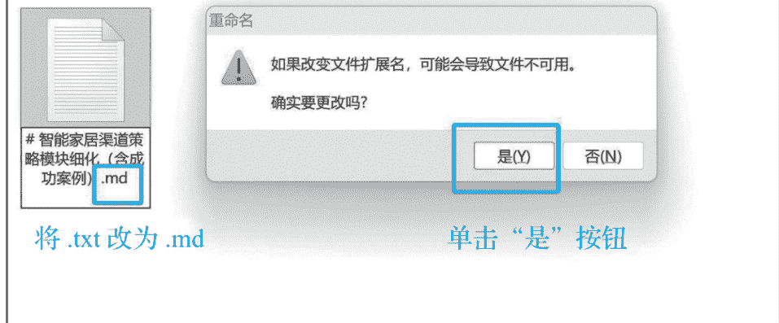

图9-18 将文件扩展名.txt修改为.md

新建文档：启动Xmind（下载地址：https://xmind.cn/download）并选择“思维导图”模板，如图9-19所示。

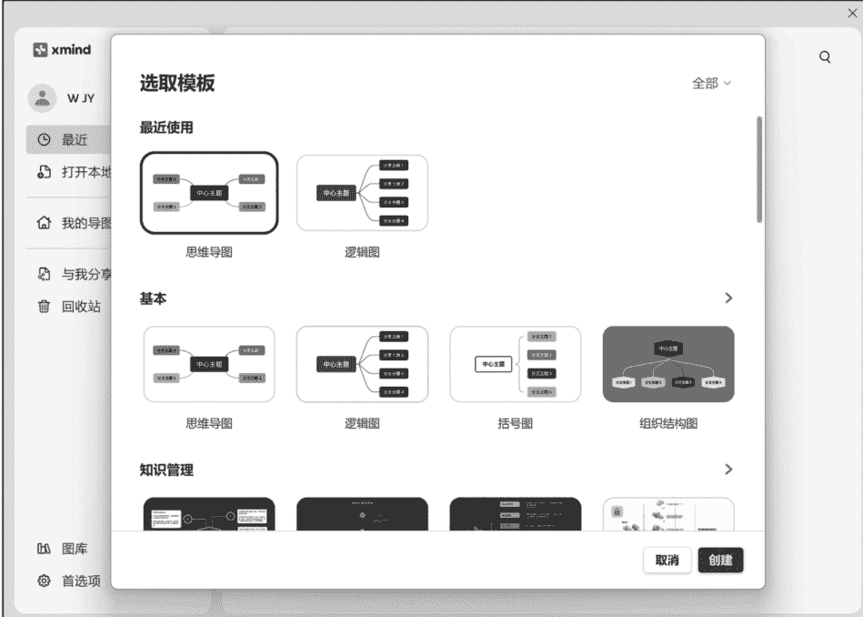

图9-19 在Xmind中新建“思维导图”

导入刚才保存的Markdown文件：依次单击“文件” → “导入” → “Markdown”，如图9-20所示。

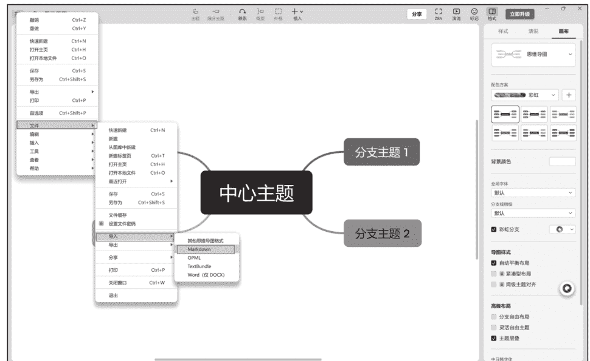

图9-20 导入刚才保存的Markdown文件

Xmind将根据Markdown文件自动生成思维导图，如图9-21所示。

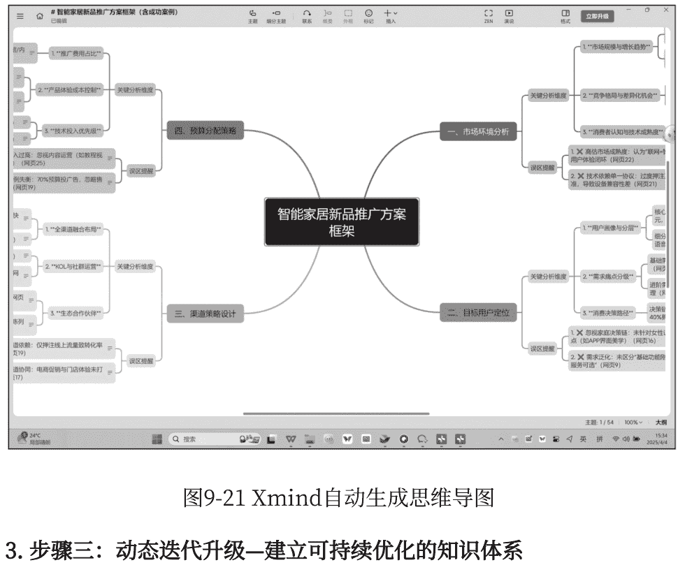

图9-21 Xmind自动生成思维导图

### 3. 步骤三：动态迭代升级—建立可持续优化的知识体系

为确保导图合理性，可把Xmind导出的方案框架再粘回腾讯元宝，输入“请检查此框架的逻辑完整性，指出可能遗漏的3个关键点”，如图9-22所示。

请检查此框架的逻辑完整性，指出可能遗漏的3个关键点

引用 10 篇资料作为参考 >

已深度思考 (用时14秒) ∨

Markdown

复制

## 智能家居推广方案框架逻辑完整性检视及优化建议

## 一、现存框架优势分析

1. **模块架构完整性**
   现有框架覆盖市场环境-用户定位-渠道策略-预算分配四大核心模块，形成完整营销闭环，符合方案基础逻辑

2. **数据穿透性**
   各模块均标注网页编号来源，整合10余份行业报告数据，如渗透率20%[6](@ref)、女性决策占比63%[14](@ref)

3. **实操指导性**
   每个模块设置“误区提醒”，如“高估技术成熟度”等警示直接引用网页21技术协议问题，具备风险预警价值

---

## 二、关键遗漏点诊断及优化建议

### 遗漏点1：**售后服务闭环缺失**
- **现存问题**
  框架仅在预算模块提及“忽略售后服务体系”[19](@ref)，未系统构建安装调试-故障响应-用户教育全链路服务模块
> > *行业痛点*：网页7指出30%用户因操作复杂导致设备闲置，网页9强调地产项目需明确售后分工机制
- **建议补充**

```
Markdown
## 五、服务支撑体系
### 关键模块
```

有问题，尽管问

DeepSeek ∨

R1·深度思考

联网搜索 ∨

图9-22 在腾讯元宝中反向验证框架输出结果

### (1) 版本管理

为重要调整添加批注：“2024.3.15根据腾讯元宝建议新增政策风险分析模块”。

### （2）模板沉淀

1. 将验证有效的框架另存为“新品推广方案模板.xmind”。
2. 在模板备注栏记录原始提示词：“市场分析类框架生成指令V2.1”。

### （3）避坑指南

1. 提示词陷阱：
   - 避免模糊表述：“做一个好的框架”改为“包含5个主维度，每个维度分3个子项”。
   - 防止过度细分：如“请列出20个分析点”，超过三级分支会导致导图混乱。
2. 格式适配技巧：
   - 遇到表格类内容：在腾讯元宝中要求“用无序列表呈现表格核心要素”。
   - 处理长文本：提示“每个节点文字不超过15个汉字”。
3. 效能提升策略：
   - 建立常用提示词库：分类保存“市场分析/项目管理/工作总结”等场景模板。
   - 配置Xmind快速样式：将常用图标组合保存为“标准标记组”。

## 4. 总结

这套方法把腾讯元宝的框架生成能力与思维导图的可视化优势结合，特别适合需要快速构建结构化思维的场景。通过标准化三步流程—精准提问获取框架、批量转化构建导图、持续迭代形成模板，能将方案设计效率提升3倍以上。

#### 试一试

在腾讯元宝输入：“我需要制定客户投诉处理流程优化方案，请按‘现状诊断-流程再造-效果评估’设计思维导图框架，每个环节包含2个实施要点和1个验证指标”。然后在Xmind中完成如下操作：①使用“流程图”模板粘贴框架；②为“验证指标”添加标记图标；③用不同颜色区分现有流程与优化建议。

#### 小贴士

1. 在腾讯元宝输出内容后，追加提示词“请用Xmind兼容的Markdown语法优化层级”可获得更好转化效果。
2. 定期清理导图中三个月未修改的冗余分支。
3. 针对复杂方案，建议拆分为多个子导图，通过超链接形成知识网络。

## 技巧86

## 腾讯元宝+腾讯智影：快速打造你的数字分身

传统AI工具生成的短视频和音频，像流水线上滚出的“工业罐头”：参数精准却千篇一律，效率很高但缺少灵魂。当用户划屏速度超过内容加载速度，技术反而成为同质化的推手—这不是工具问题，是生产模式僵化。

如何让短视频拥有真人级表现力？怎样让AI配音从机器发声升级为沉浸体验？腾讯元宝与腾讯智影的“数字人播报+文本AI配音”双核方案，正在重塑短视频与音频的生产标准。

## 1. 数字人播报—短视频内容工业化革命

想拥有一个能自动讲解产品的虚拟助手吗？使用腾讯元宝和腾讯智影，两步就能像拍照一样简单，打造24小时在线讲解员。

### （1）步骤1：使用腾讯元宝生成短视频文案

运用技巧76，生成营销短视频口播文案。例如，在腾讯元宝中输入：“请为××咖啡生成三条完整口播文案，要求：①按‘痛点质疑-数据对比-解决方案’结构；②包含具体使用场景；③结尾用押韵口号引导点击。示例结构：还在为每天充电抓狂……（痛点）；实测对比，如传统手表续航1天vs××手表30天（对比）；健身、开会、出差……（场景）；点击领取你的‘电力自由’（行动）。”

腾讯元宝输出：

还在为每天买咖啡又贵又难喝而烦恼？实测对比：连锁店一杯美式要28块，而××咖啡只要3块钱，品质却一点不差！无论是通勤路上赶时间、熬夜加班提神，还是周末宅家追剧，随手撕开一包××挂耳咖啡，30秒就能享受精品咖啡馆的口感。点击下方链接，解锁你的‘清醒不贵，快乐翻倍’！

……

### （2）步骤2：使用腾讯智影构建数字人

如图9-23所示，首先打开腾讯智影AI平台PC版网站（https://zenvideo.qq.com/open/products/human），选择数字人播报的“立即体验”功能。

然后在数字人功能区的预设形象中选择适合的数字人形象，也可以通过照片播报功能上传专属于自己的个人照片形象；接着，在播报内容部分导入腾讯元宝输出的文案，选择合适的字幕样式及适当的语句停顿；最后，单击“保存并生成播报”按钮，即可获得满足自己需求的数字人播报短视频，如图9-24所示。

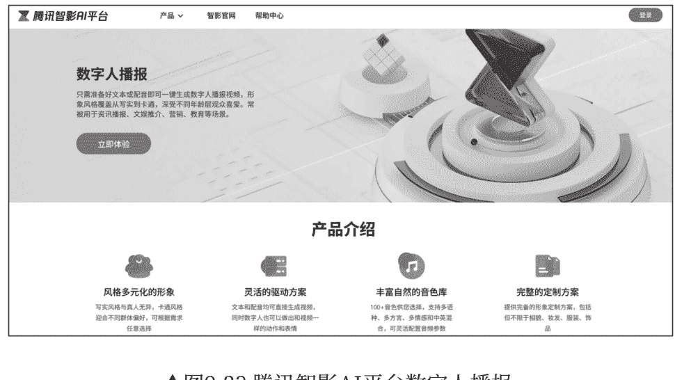

▲图9-23 腾讯智影AI平台数字人播报


▲图9-24 腾讯智影数字人构建

## 2. 智能直播间搭建文本AI配音—让产品说明书“会呼吸”

想让枯燥的产品说明变成有声有色的故事吗？使用腾讯元宝和腾讯智影，能让这个过程像给孩子读绘本一样简单，让听众“听”得停不下来。

### （1）步骤1：用腾讯元宝优化枯燥文案

首先通过腾讯元宝生成产品介绍文案，输入：“请为人体工学椅产品生成产品故事书文案，需要场景化描述，强调舒适体验、支持120°仰角调节。”

腾讯元宝输出：

一把椅子，如何定义一天的开始？从落座的第一刻起，人体工学曲线便悄然启动—坐垫分散臀腿压力，头枕托住颈椎，而120°的仰角调节键就在手边。轻轻一按，椅背随身体后仰，仿佛被云端托住。这一刻，工作不再是对抗疲劳的战役，而是与舒适共舞的仪式……

### （2）步骤2：用腾讯智影AI配音

打开腾讯智影AI平台PC版网站，选择产品选项中的“文本配音”功能，并选择“立即体验”，如图9-25所示。

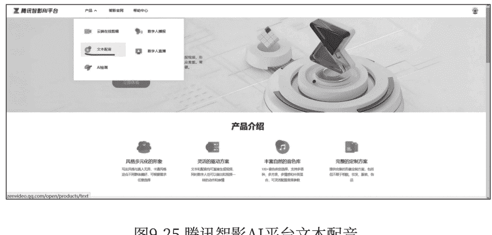

图9-25 腾讯智影AI平台文本配音

然后在音色功能区选择适合产品介绍场景的音色；在播报内容部分导入腾讯元宝输出的文案，选择适当的语句停顿、调整局部变速、设置词组连读，让音频更加拟真；单击“生成音频”按钮，即可获得满足自己需求的AI配音文件，如图9-26所示。

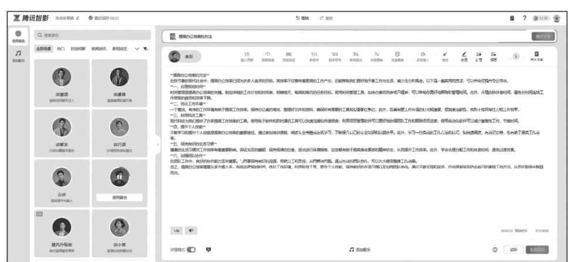

图9-26 腾讯智影AI配音

## 3. 总结

当智影数字人开始拥有创作意识，当腾讯元宝的算法能预测观众情绪，我们迎来的不仅是技术革新，更是创作方式的颠覆，让每个人都有自己的数字分身。

#### 试一试

尝试用智能配音或者数字人功能生成你的音频/视频分身。

#### 小贴士

1. 在数字人视频生成选项中，可以选择PPT模式生成你的讲课视频。
2. 统一的背景图片可以通过其他工具制作，再自定义上传至腾讯智影中。
3. 合成视频可能有额度限制，请随时注意余额的变化。

## 技巧87

## 腾讯元宝+蝉镜：五分钟搞定专业口播视频

职场人做视频，最头疼的是什么？写脚本、找演员、拍素材、后期剪辑……一套流程下来，半天时间没了。更糟糕的是，好不容易拍完，发现表情僵硬、台词卡壳，还得重来。真人出镜成本高，纯文字又太枯燥，有没有一种方法既能保持专业度，又能快速生成自然流畅的口播视频？

腾讯元宝+蝉镜数字人工具的组合，可以解决这个问题。不需要摄影棚，不用背台词，甚至不用露脸，就能生成带数字人讲解的专业视频。以下是具体操作方法。

## 1. 第一步：用腾讯元宝生成数字人形象和口播脚本

生成数字人形象需要人物形象、背景、姿势的描述，口播视频也需要口播文案，而腾讯元宝能快速帮你写出专业、流畅的描述和脚本。比如，你需要制作一个壮族春茶宣传的口播视频时，可以这样提问：

> “我需要制作讲解春茶的壮族女生数字人，25岁左右，穿现代改良款壮族服饰，在茶园场景。请提供：①人物细节提示词（发型/饰品/微表情）；②背景提示词（广西高山茶园+云雾）；③姿势提示词（手持茶叶罐讲解+指茶树动作）；④500字左右的春茶宣传口播文案。”

腾讯元宝会生成：

1. 人物细节提示词

发型：低盘发髻插银簪，两鬓垂落微卷空气刘海。

饰品：改良款多层银项圈（苗银质感）+立体茶叶刺绣耳坠+蓝染织锦腕带。

微表情：眼尾自然微弯的亲和笑眼+讲解时唇部动态微张+左颊若隐若现的酒窝。

2. 背景提示词

晨雾缭绕的广西明前茶山，层叠的茶树梯田泛着翡翠光泽，远处黛色峰峦隐现壮族干栏式建筑剪影，逆光中茶树枝丫凝结着晶莹露珠，柔焦处理的薄雾在茶树间流动。

3. 姿势提示词

左手托举镂空壮锦纹茶叶罐（罐口飘出袅袅热气），右手食指自然前伸指向茶树嫩芽，身体略前倾15度呈现讲解姿态，右肩微抬带动民族风盘扣微微反光，裙摆随山风扬起露出改良款绑带布鞋。

4. 春茶文化口播文案

三月的风掠过八桂大地，带着草木初醒的清香，广西的万亩茶园正酝酿着一场春的盛宴。这里是北回归线穿过的生态秘境，云雾滋养的芽尖凝翠，山泉浸润的茶香漫野，今天，让我们循着一缕茶香，走进广西春茶的千年故事。从苍梧六堡的百年古茶树，到凌云白毫的云上梯田；从昭平早春第一捧绿芽，到桂平西山茶的禅意绵长—广西春茶的美，源自大自然的偏心馈赠……

## 2. 第二步：用蝉镜数字人生成自然口播

有了关于数字人的描述，接下来是用蝉镜工具制作数字人。首先登录蝉镜官网，通过手机号和验证码的方式登录。在首页单击“文生数字人”，进入数字人生成页面。

在左侧“创建数字人形象”的各个选项中，选择或填写相应的内容。你在第一步生成的人物细节、背景和口播姿势提示词可以依次填入对应位置，如图9-27所示。选择与填写完成后，单击“立即生成”，即可生成数字人形象，如图9-28所示。如不满意所生成的形象，可以调整提示词多生成几遍，直到满意为止。

接下来选择数字人形象，单击“生成数字人动作”按钮来创建数字人动作，如图9-29所示。在此界面中，你可以选择视频模型、情感和手势。其中，“情感”一栏可以输入情感描述，也可以选择系统默认的几种描述之一。选择完毕后单击“创建数字人”，输入数字人名称，再选择数字人声音，单击“保存”按钮即可完成数字人形象与动作的创建，如图9-30所示。

▲图9-27 创建数字人形象


▲图9-28 生成数字人形象

创建数字人形象
创建数字人动作

视频模型
**模型1.0**
生成效果与速度有均衡表现
情感 ⓘ Beta
带着友好的微笑说话，眉毛略微上扬，目光注视观众，给人亲切的感觉
- 平静
- 轻松
- 微笑
- 严肃
- 兴奋
- 俏皮
手势 ⓘ Beta
每次生成时，数字人的动作都是随机的。请随意生成多次，以找到你喜欢的运动效果
▲图9-29 创建数字人动作
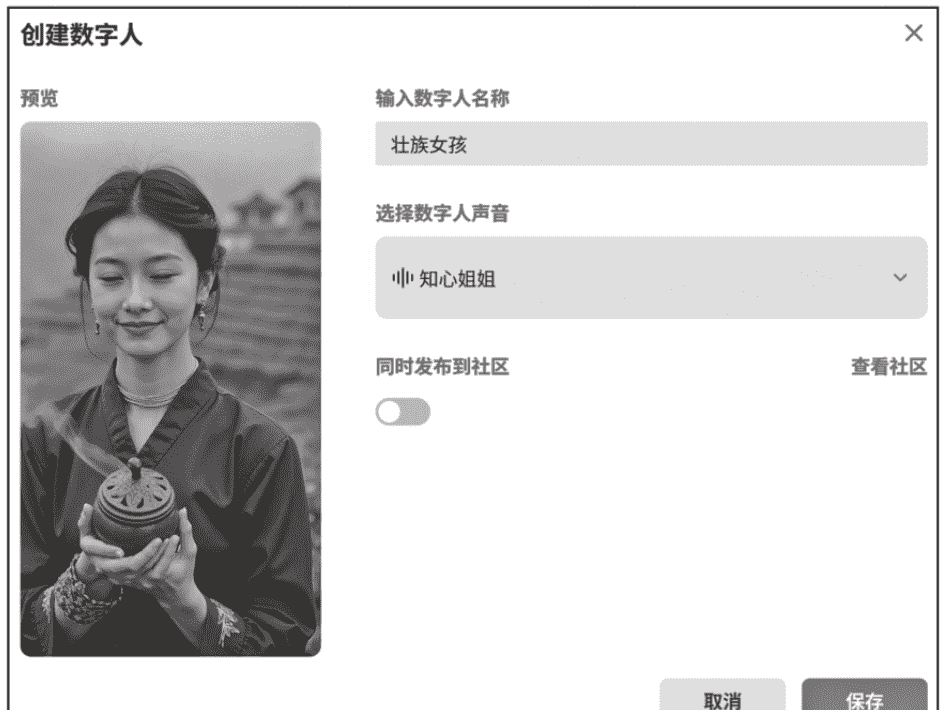

▲图9-30 完成创建数字人

## 3. 第三步：生成数字人口播视频

有了数字人形象，接下来就可以让其替你出镜，生成口播短视频了。回到蝉镜首页，在“创建视频”界面选择刚刚定制的数字人形象，再单击“创建视频”按钮，进入视频编辑界面，如图9-31所示。

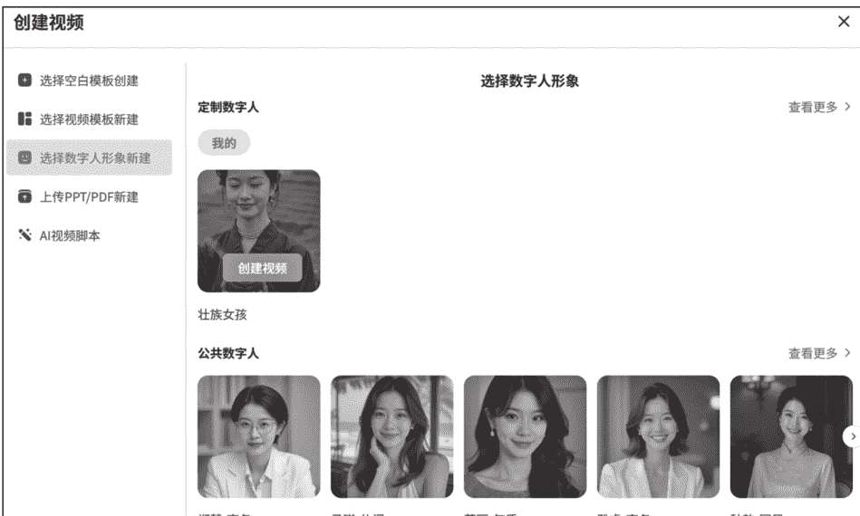
图9-31 选择刚刚定制的数字人

此时，只需要把第一步中生成的口播文案粘贴到右侧“输入文本”中，单击“生成并试听”按钮，即可看到视频效果，如图9-32所示。如不满意，可以接着调整文案、音频等内容，直至满意为止。最后单击右上方的“生成视频”按钮，即可获得定制数字人口播视频。

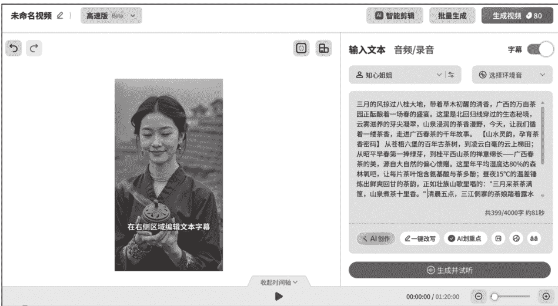
图9-32 数字人口播短视频编辑页面

## 4. 总结

## 脚本到成片：元宝+蝉镜把制作周期压到两成
把撰稿交给腾讯元宝，把成片交给蝉镜，串联起来后视频从立项到上线的时间大约能压缩八成。创作者不再被设备、档期、剪辑困住，只需要把精力放在内容判断上，把执行层的重复劳动交给模型，特别适合培训课、产品讲解、内部汇报这类需要高频复用的场景。

#### 试一试
先让腾讯元宝写一份《远程办公沟通技巧》的口播稿，再把稿件丢进蝉镜生成数字人讲解，体会前后衔接的效率。

#### 小贴士
1. 提示写得越细，元宝的稿子越准，例如补充受众「面向销售团队」或表达方式「用案例来说明」。
2. 数字人成片控制在3分钟以内，观众注意力有限。
3. 最终成片前务必人工复核文案和人设设定，避免模型一本正经地出错。

## 技巧88
## 腾讯元宝+飞书：搭一条视频号批量生产线
选题枯竭、产出缓慢、内容同质化，是多数视频号创作者的痛点。等你还在手工搜热点时，别人已用腾讯元宝+飞书搭建起选题-脚本-分镜的自动化链路，还能根据数据反馈做迭代。

下面两步把重复操作交给AI，把创意留给人。

## 1. 步骤一：用腾讯元宝挖出“爆款基因”
追热点容易抓不住流量密码，照搬爆款又会乱账号定位。腾讯元宝可以从大量素材里提炼可复用的创作规律。假设你是职场技能类账号，可挑几个对标账号的优质短视频，提取文案上传后输入：“我是[职场技能培训类]视频号创作者，请分析我上传的10条短视频文案，并提取以下内容：①标题高频词（前3名）；②开头3秒固定结构（如疑问句/冲突对比）；③评论区关键词（如干货、求模板）；④请用表格形式输出，并给出3个延续此风格的选题建议。”

腾讯元宝可能给出：
1.10万+视频数据分析表。

## 2. 延续风格的选题参考
《领导最讨厌的5句话，第3个90%人天天说》《跨部门沟通总背锅？3步让同事主动配合你》《为什么越努力越透明？升职快的都懂这2个暗规则》。

3. 优化补充建议：标题公式、开头结构、互动引导。

## 2. 步骤二：把飞书多维表格变成脚本工厂
用飞书的多维表格做脚本自动生成器。首先下载飞书客户端（下载链接：https://www.feishu.cn/download），手机号注册登录后新建一个多维表格，删掉多余列，只保留首列并命名为“原始素材”。这列就是原料仓，可放入：①元宝挖掘的爆款选题；②热点关键词如“五一调休吐槽”。操作如下。

第一步，打开飞书客户端，选择“多维表格”，然后选择“新建多维表格”，如图9-33所示。

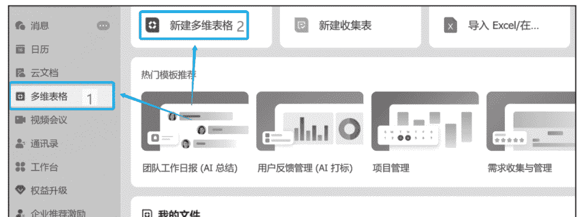

第二步，将腾讯元宝生成的选题复制粘贴到多维表格的“原始素材”一栏，如图9-34所示，并右键单击“脚本”字段，选择编辑字段，在字段类型的“探索字段捷径”中找到“DeepSeek-R1”，再将生成脚本的提示词放到“脚本”列的“输入指令”中，如图9-35所示，例如：“请根据[原始素材]列的选题，生成1条抖音口播脚本，要求：①开头用痛点提问（参考‘你是不是也……’句式）；②中间用‘工具-场景-效果’三步法讲解。”

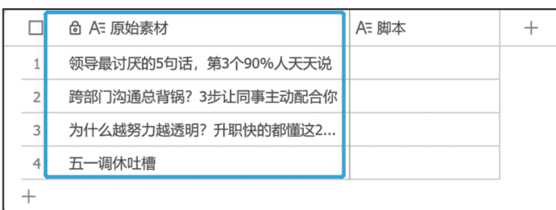

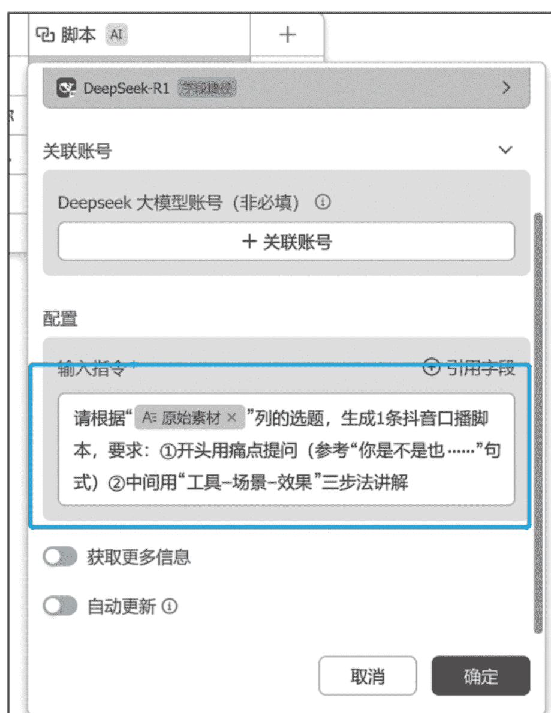

完成后，即可批量生成脚本，如图9-36所示。

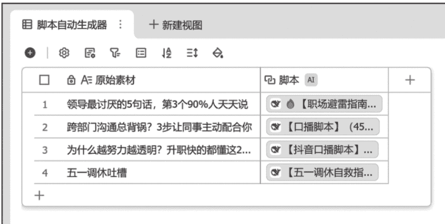

可能的输出结果：
【职场避雷指南】领导最讨厌的5句话，第三句你绝对天天说！（开场痛击镜头）“你是不是每次说完这句话，领导脸色都瞬间黑三度？”（手指戳屏幕）“90%的人还在用这句话推活！”（切换PPT板书动画）工具：万能问题解决话术。场景：领导让你三天完成不可能任务。效果：三步变被动为主动。“领导这个方案时间确实紧张（共情），我整理了三个执行难点（递问题清单），如果协调××支援数据部分（带解决方案），能准时完成！”（近景自信手势）“高情商打工人把‘这我做不到’换成‘您看这样调整行吗’，下周升职名单必有你！”（结尾大字幕）“点这里解锁另外4句职场黑名单话术。”（快速闪屏）结构亮点：用“推活→拆解→反杀”三幕剧增加吸引力，用PPT板书增强知识可信度，利用网感词强化记忆点，适合15秒快节奏传播。

## 3. 总结
元宝负责找选题，飞书负责批量生产，本质是AI做标准化，人做高难度。最好的工具是辅助而非替代。

#### 试一试
在飞书里新建一张多维表格，A列放选题，B列用DeepSeek-R1模型生成脚本。

#### 小贴士
- 1) 批量前先试跑3条，微调提示词。
- 2) 成品用飞书@同事审核，避免错漏。

# 技巧89
## 腾讯元宝+即梦：几分钟做出节日海报
春节、中秋时设计师的沟通群常被催稿信息刷屏，反复修改后客户却选回第一版。用腾讯元宝+即梦AI，可以把重复劳动交给模型，聚焦创意本身。

## 1. 让腾讯元宝设计生图提示词
客户常说“要中国风”，实际指代范围很大。可用元宝分析参考图，输出结构化提示词。比如上传一张传统节日海报，输入：“请分析这张海报，为即梦AI生成文生图提示词，要求：①主体改为敖丙形象（浅蓝衣少年，蓝色长发，手持发光元宵）；②保持中国传统节日风格；③主标题是‘元宵节快乐’；④元素包含元宵、红枣、灯笼、窗棂、巨龙。”

腾讯元宝会输出：

```
=====提示词结构=====

【场景类型】中国传统节日主题插画，工笔画渲染，古风动漫风格。

【画面主体】浅蓝衣衫的敖丙少年，蓝色长发束冠，温润笑容，双手捧起发光的元宵，立体光影效果。

【环境构建】
```

室内场景：古色古香的木质窗棂（镂空雕花工艺），窗外云雾中浮现巨龙轮廓（青鳞龙身半隐半现）。

节日元素：朱红灯笼悬挂檐下（流苏垂坠），木质方桌上摆放青花瓷碗（盛满白胖元宵）、红枣拼盘、黑豆小碟。

背景装饰：仿宣纸底纹，祥云纹样屏风，暖色调灯笼光晕渲染。

## 【视觉要素】

色彩构成：主色系红蓝撞色（敖丙蓝vs灯笼红），金色光效点缀。

文字设计：顶部居中书法体“元宵节快乐”（飞白笔触+金粉质感）。

构图布局：中心对称式构图，敖丙人物居中，窗框形成自然画框。

氛围营造：朦胧烛光效果，蒸腾热气表现，窗外巨龙与室内元素形成虚实对比。

=====核心关键词=====

敖丙形象（浅蓝汉服，流光发饰），元宵节元素大集合，工笔重彩，龙年祥瑞，传统窗格透视，暖色灯笼矩阵，节日食盒特写，立体光影层次，喜庆而不俗艳的红蓝配色，巨龙剪影若隐若现。

## 2. 让即梦生成设计图
拿到提示词后登录即梦AI（https://jimeng.jianying.com）即可出图，要点：
- 1) 注册登录后→AI作图→图片生成→粘贴上一步提示词。
- 2) 生图模型选最新版本。
- 3) 文字分层明确：主标题+副标题+装饰文字。
- 4) 海报比例适配手机建议用9:16竖版。

生成效果如图9-37所示。

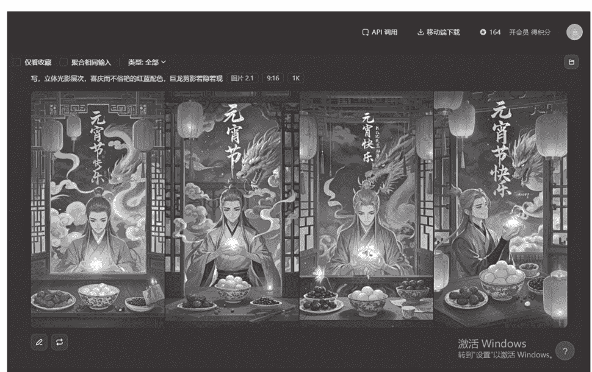

## 3. 批量生成不同版本
客户常要“多几个方案看看”，可像抽卡一样多生成几张。若需调整，再让元宝修改提示词，固定主体背景只改文案配色。例如输入：“保持敖丙形象不变，仅调整：①第一版，红金配色，文案‘恭喜发财’；②第二版，蓝金配色，文案‘五一快乐’。”元宝会生成多组提示词，导入即梦即可批量出图。

## 4. 总结
元宝+即梦把原本数小时的设计流程压缩到数分钟，关键是让AI准确理解需求并呈现中文设计细节。

#### 试一试
挑一张喜欢的海报让元宝生成提示词，再在即梦里测试效果。

#### 小贴士
- 1）出版时每日免费生图次数有限，注意额度。
- 2）文字要分层描述，避免重叠。
- 3）批量时固定核心元素，只改变量。

# 第10章
## 产品开发：腾讯元宝在创新流程中的应用
# 技巧90
## 信息过滤：用腾讯元宝三招对付信息过载
产品经理常被报告、反馈、竞品、技术专利等信息淹没，有效线索反而难找。手工整理耗时，还容易在会上发现遗漏关键定价变化。

传统处理方式存在三重问题：抓取面窄有盲区，人工归纳带偏见，静态报告跟不上市场。当被问“为何这个功能优先级高于竞品迭代”时，上周的竞品分析已过时。这需要升级处理方式。借助腾讯元宝可高效过滤。

## 1. 第一招：三层筛子过滤法
整理新能源车市场信息时，直接问“整理新能源车市场信息”会太宽泛。补充政策、技术、用户三个维度，或上传已有资料，能筛出更有价值的信息。例如输入“作为商业顾问，请提取换电企业投资关键信息：①重点维度：政策（40%）+技术（30%）+用户（30%）。②核心数据：2024年地方补贴细则、换电站盈亏点、用户调研热词。③标出矛盾数据。”

腾讯元宝可能会输出：
- 1. 政策（40%权重）
  - (1) 核心数据：2024年6省明确补贴（单站最高300万元），但要求电池标准化率≥80%（当前行业仅50%）。
  - (2) 矛盾点：补贴最高的A省要求“仅服务本省车企”，与用户跨省换电需求冲突。
- 2. 技术（30%权重）（略）
- 3. 用户（30%权重）（略）

## 4. 关键否决项
- (1) 政策：若地方补贴绑定本地车企，全国化企业直接出局。
- (2) 技术：电池标准化率<70%→换电站注定亏本。
- (3) 用户：电池寿命监测无国标→信任危机将爆发。

......
7. 结论：优先投资“补贴不排外+用户基数>10万+自研电池管理”的区域，避开车企技术割据重灾区（如长三角）。

> （由于篇幅有限，输出结果在此省略，建议读者亲自上手实践。）

## 2. 第二招：把碎片化信息整理成结构化档案
即使信息已收集，十几份资料仍难快速提炼。可用元宝的信息萃取功能，把会议录音、调研笔记、行业文章发给它，并输入：“请将以下市场信息整理成结构化表格：①[粘贴用户访谈摘要]；②[粘贴竞品官网更新内容]；③[粘贴行业白皮书节选]。

要求：按‘用户痛点-竞品方案-市场空白’分类，每类提取3个关键结论，标注信息来源。”

腾讯元宝会输出类似：
| 类别 | 关键结论 | 来源 |
|---|---|---|
| 用户痛点 | 中小商家对××功能学习成本过高 | 用户访谈 2024.03 节选 |
| 竞品方案 | A产品新增一键引导功能 | 竞品官网更新日志 |
| 市场空白 | 暂无产品结合××场景做培训体系 | 行业白皮书 P15 |

## 3. 第三招：多角度模拟器
同一份报告给不同角色看需要不同侧重点。用元宝可生成定制简报。将原始报告上传并输入：“作为投资AI，请根据我上传的信息，生成三版简报。①CEO版：战略协同。②风控版：黑天鹅预警。③技术版：落地成本。”

腾讯元宝可能会输出：
## 1.CEO版：战略协同
①核心价值：AI补齐现有业务数据闭环（如用户画像→智能推荐→复购提升），预计缩短决策链路30%。②生态卡位：抢占“AI+行业知识库”标准制定权，压制竞对定制化服务空间。③资本叙事：用AI包装传统业务，估值模型从PE切换为PS（市销率），融资溢价50%+。

## 2. 风控版：黑天鹅预警
①技术悬崖：中美算法框架脱钩风险（如TensorFlow禁用），需预设国产框架迁移成本。②伦理反噬：AI歧视性决策触发监管罚款（参照欧盟AI法案最高2000万欧元罚则）。③成本暴雷：大模型训练电费失控（10亿参数级单次训练耗电量≈中小城市日耗电量）。

预案：20%预算预留替代方案，合规官进驻研发团队。

## 3. 技术版：落地成本
①隐性消耗：数据标注成本占AI项目总投入60%（如医疗影像标注费≈影像科医生年薪）。②功耗陷阱：边缘计算设备待机功耗＞实际运算功耗，年电费超硬件成本。③折旧暴击：GPU服务器3年残值归零，但算法迭代周期需5年+。

建议：租赁云算力+轻量化模型，硬件成本可压降40%。

## 4. 总结：从信息搬运到决策指挥
高效处理不是比阅读速度，而是建立过滤、关联、预测的体系。好工具能帮助产品经理把碎片数据变成决策地图。

#### 试一试
在元宝中输入并开启联网搜索：“监测新能源汽车行业：①提取近两周政策文件中关于充电设施的新表述；②对比三家头部品牌的用户运营活动；③关联动力电池原材料价格波动数据。输出三个市场机会点预测。”

#### 小贴士
- 1) 抓取前先明确“我要证明什么/推翻什么”。
- 2) 定期校准关键词，避免语义泛化导致信息污染。
- 3) 工具不能替代思考，结论需人工校验。

# 技巧91
## 需求挖掘：用腾讯元宝把用户反馈变成产品需求
传统分析像挑西瓜靠手感，如今需求像榴莲，外壳带刺内里绵软。三大陷阱：用户说的想要不等于真需求，海量数据难提炼，优先级在老板和数据间摇摆。元宝可化身调研助手，用三招破解。

## 1. 招式一：用户反馈的“测谎仪”
分析访谈记录可自动识别矛盾与潜在诉求。以智能音箱为例，先用飞书妙记等工具转写音频，再上传文字并输入：“分析以下10段用户访谈，完成：①标注自相矛盾的陈述（如先说操作复杂，后夸界面友好）；②提取高频出现但未被明确提及的需求关键词；③按‘表面诉求-潜在痛点-真实需求’结构重组结论。”

腾讯元宝输出示例：
- 1. 自相矛盾的陈述
  - 矛盾点：操作便捷性与语音识别缺陷。
  - (1) 用户先肯定智能音箱“操作方便”，但后续指出“语音识别不准确，需要重复指令”。
  - (2) 矛盾逻辑：语音识别是核心交互方式，其不精准直接导致操作复杂化，与用户对“操作便捷”的初始评价形成冲突。

## 2. 高频需求关键词
通过隐性反馈提取未明说痛点：
- (1) 语音交互精准度（隐含于重复指令问题）。
- (2) 智能家居兼容性（通过联动优势暗示扩展需求）。
- (3) 音质分级优化（对比专业音响的差距）。
- (4) 功能扩展性（未来期望指向功能丰富性）。
- (5) 性价比平衡（强调价格合理但隐含性能升级期待）。

## 3. 结论重组（表面诉求-潜在痛点-真实需求）
……
> (由于篇幅有限，输出结果在此省略，建议读者亲自上手实践。)

## 2. 招式二：海量数据的“导航仪”
面对大量问卷数据，元宝可建立认知坐标。将资料整理成50个以内文件，每个不超过100MB，打包上传后输入：“基于上传的用户调研资料：①分为‘功能诉求/体验痛点/情绪表达’3大类；②找出3个反常识的数据点（比如80%用户声称重视售后，但60%从未使用过客服）；③生成待澄清问题清单。”

腾讯元宝输出示例：
根据用户提供的数据，以下是分析结果：
## 一、分类结果
- (1) 功能诉求：音乐播放（高频需求，13人次）、智能家居控制（9人次）（略）
- (2) 体验痛点：语音识别准确率（改进诉求7次）、音乐推荐算法优化（需求5次）（略）
……
## 二、反常识数据点
价格悖论：购买100～200元低价产品的用户的音质满意度（平均4.8分）显著高于300～400元中高端产品的用户的音质满意度（平均3.2分），与传统认知中“高价=高质”的预期相悖（略）
## 三、待澄清问题清单
- (1) 用户认知层面：无设备用户的功能改进诉求是否基于他人经验？户外场景用户为何不关注续航/防水等硬件指标？
- (2) 产品设计层面：……
> （由于篇幅有限，输出结果在此省略，建议读者亲自上手实践。）

基于以上分析，可更有针对性地做深度访谈和A/B测试。文件过多时建议分批上传。

## 3. 招式三：需求排期的专家
当业务方要求“全都要做”时，可用元宝建立量化评估。仍以智能音箱为例，上传调研问卷数据后输入：“请结合以上数据，设计需求优先级公式，需包含用户影响面（0～10分）×技术可行性（0～5分）×业务战略契合度（0～3分），为以下需求打分并排序：唤醒词设置、儿童模式、方言识别。”

腾讯元宝输出示例：
基于需求优先级公式：用户影响面（0～10分）×技术可行性（0～5分）×业务战略契合度（0～3分），结合数据表现和业务逻辑，对各需求进行打分并排序如下：

## 一、需求优先级测算表

| 需求名称 | 受众影响范围 | 技术实现难度 | 战略契合程度 | 综合得分 | 排序 |
| :--- | :--- | :--- | :--- | :--- | :--- |
| 方言识别 | 9 | 3 | 3 | 81 | 1 |
| 儿童模式 | 7 | 4 | 2 | 56 | 2 |
| 唤醒词设置 | 5 | 4 | 1 | 20 | 3 |

## 二、评分逻辑拆解

### 1. 方言识别

1) 受众影响范围 9 分
访谈样本里提出语音识别精度需提升的占比达 23%，共 30 份中有 7 份直接点名。方言相关诉求多为潜在需求，主要出现在家庭使用情境，该情境占样本约 13%，用户期望可用家乡话操控厨房电器等。

……

### 2. 儿童模式
1) 受众影响范围 7 分
与 2 位具备教师背景的用户强相关，两人都强调需要配套的儿童教育资源支撑。

……

### 3. 唤醒词设置
……

由于篇幅限制，后续细节省略，建议读者自行实操验证。

## 4. 小结
借助腾讯元宝做需求调研，有点像给行为扫描仪装上情绪雷达，既能梳理出显性行为轨迹，也能捕捉使用时的情绪温度，不会被用户直接说出来的诉求牵着走。关键在于分工清晰：腾讯元宝负责信息整合与隐性需求挖掘，产品经理负责价值判断与人性化解读。

#### 试一试
将调研资料上传后，套用以下提问模板，让腾讯元宝拆解可行性：“假设我们要为[产品]新增[新功能]，请基于我上传的数据分析：①[已上线功能1]；②[已上线功能2]；③[竞品功能]。输出：①该需求可解决的TOP3现实问题；②可复用的技术模块；③最低成本的验证方式。”

#### 小贴士
- 1) 官网版腾讯元宝不建议一次性上传大量资料，建议分批少量导入。
- 2) 关键结论保留人工复核环节，例如致电典型用户做二次确认。
- 3) 音频、视频类访谈可先用飞书妙记等工具转写成文字稿再输入。

技巧92
## 创意突围：用腾讯元宝破解开发僵局

产品创新时，负责人常会遇到灵感枯竭。传统头脑风暴效率低、容易跑偏，有价值的点子难以系统沉淀和延展。团队还容易被行业惯性思维束缚，难以跳出舒适区。结果创新周期拉长，方案同质化，筛选整理消耗大量精力。腾讯元宝能提供可落地的解决路径。

### 1. 方法一：会上实时协同头脑风暴
在产品会上告别混乱发散，用腾讯元宝把灵感做成可延续的链条。

例如讨论“老年人智能药盒”时，直接协同提问：“我是智能药盒的产品负责人，正在做头脑风暴，产品目标是解决独居老人漏服药问题，已有思路包括语音提醒、亲属联动、自动分药。请帮我：把每个方向延伸到三级细分功能，标出需要医疗资质的方案，并推荐跨行业可借鉴的方案，如快递柜/智能咖啡机。”

腾讯元宝给出的示例：

- 一、三级细分功能延伸
  1. 语音提醒方向
     一级功能：基础语音提醒；二级功能：定时语音播报
     ……
  2. 亲属联动方向
  3. 自动分药方向

### 二、需医疗资质的方案
- 1. 药品数据库联动
- 2. AI用药建议
- 3. 处方药分装授权
- 4. 紧急医疗响应

### 三、跨行业可借鉴方案

| 行业/产品 | 可借鉴点 | 应用示例 |
| :--- | :--- | :--- |
| 快递柜 | 格口分时控制 | 药盒分格按时间解锁，逾期未取触发警报 |
| 智能咖啡机 | 原料不足提醒 + 自动订购 | 药量不足时通知亲属或自动下单购药 |
| 智能音箱 | 多模态交互 | 老人可通过语音或按钮确认服药 |
| 共享单车 | GPS 定位 + 电子围栏 | 药盒离开设定范围发送提醒 |
| 智能家居 | 场景联动 | 与智能灯泡联动强化提醒效果 |

创新结合建议：
- 1) 参考盲文电梯按钮设计药盒的触觉标识
- 2) 借鉴电竞键盘RGB灯效，用不同颜色灯光区分紧急程度

篇幅所限，后续结果省略，建议读者亲自上手实践。

### 2. 方法二：基于现有产品做突变式创新
可以用腾讯元宝对现有产品做非空想式的突变创新。

例如少儿编程课团队想做新形态，可输入：“需要3个少儿编程课程的新形态，要求：结合我们已有的AR课件开发能力、规避政策限制、参考最新儿童心理学研究成果。”

腾讯元宝提供的方案示例：
基于AR技术、政策合规性和儿童心理学研究，以下是3个创新的少儿编程课程形态设计：

#### 一、AR实体编程沙盒
##### 1. 形态设计
- 将编程指令具象化为可触摸的AR积木，儿童通过排列实体积木控制屏幕中的AR角色
- 每完成一个5～8分钟的微型任务，系统自动保存进度并解锁下一关卡
- 结合心流理论设计渐进式挑战

##### 2. 心理学依据
- 皮亚杰认知发展理论：7～12岁儿童处于具体运算阶段，需要实物操作辅助抽象思维

##### 3. 合规方案
- 单次体验完整闭环控制在15分钟内
- 线下实体操作+AR反馈模式不计入在线时长
- 家长端可查看多个短课时累计的学习报告

篇幅所限，后续结果省略，建议读者亲自上手实践。

### 3. 方法三：灵感固化快速落地
用腾讯元宝把稍纵即逝的灵感固化，把零散的用户洞察转化为可开发的概念，关键是建立标准化的转化模板。

假设你是外卖配送的产品经理，客服记录里出现“外卖送达时汤总是洒”，立即输入：“我是外卖配送产品的产品经理，现在要开发配送车辆的配件，请将外卖送达时汤总是洒这个场景转化为三个产品方案，要求：按‘问题归因-技术路径-商业价值’结构，结合我们现有的智能箱硬件能力，排除需要改造配送车辆的方案。”

腾讯元宝会给出参考：
#### 方案一：智能汤品分隔固定架
##### 1. 问题归因
汤品洒漏主因是配送箱内无固定装置，车辆颠簸时容器倾斜或碰撞。
##### 2. 技术路径
- 利用现有智能箱的滑轨结构，设计可拆卸的TPU材质分隔架，通过卡扣固定于箱内
- 分隔架采用蜂窝结构分区，匹配常见汤杯尺寸
- 集成压力传感器，若检测到汤杯倾斜超过15°即触发App提醒骑手
##### 3. 商业价值
- 硬件成本＜30元/套，可作增值配件售卖
- 降低汤品类投诉率，提升快餐类商户合作意愿

篇幅所限，后续结果省略，建议读者亲自上手实践。

## 4. 小结
人擅长评估创意价值，却易受经验限制；AI没有思维边界，却缺少商业嗅觉。二者结合就像让一位天马行空的艺术家与一位务实的创业者搭档。腾讯元宝的价值不在于替代创造力，而在于用结构化工具提升创新效率。让机器处理数据清洗、逻辑校验等体力活，产品经理便能聚焦在行为细节中找突破点。

#### 试一试
假设团队正在做一款面向年轻人的社交产品，试着向腾讯元宝提问：“我们需要一款针对18～24岁用户的社交产品，要求：规避现有主流形式、结合‘线下行为线上化’趋势、至少包含一个可申请专利的交互设计。请生成3个概念方案。”

#### 小贴士
- 1) 头脑风暴可设“发散-收敛”两阶段，先让腾讯元宝生成大量创意，再用验证模型筛选
- 2) 遇到“这个不可能”的判断时，立刻让腾讯元宝查询技术可行性

技巧93
## 原型提速：用腾讯元宝把想法变现

产品经理最怕的不是需求变更，而是原型评审时被一句“这方案不行”打回重做，更糟的是改了三版后又被说“第一版最好”。合理使用腾讯元宝可以打破这个循环。

### 1. 方法一：愿景框架快速生成
需求文档写完后如何变成可执行的产品方案？用腾讯元宝把模糊想法转为可落地方案。

例如输入：“我们计划做一款面向中小企业的智能报销系统，核心需求是‘3分钟完成报销单提交’。请生成：用户价值主张的3种表达方式、量化成功标准的5个指标、可能颠覆现有流程的3个创新点。”

腾讯元宝回答示例：
#### 一、用户价值主张的3种表达方式
##### 1. 极简高效
3分钟极速提交，告别烦琐报销流程
##### 2. 成本与风控优化
一键同步票据数据，智能合规校验，降低人工审核成本
##### 3. 员工体验升级
手机拍照即报销，AI自动分类填充，员工零学习成本

#### 二、量化成功标准的5个指标
1. 用户端效率：平均报销单提交时间≤3分钟

#### 三、可能颠覆现有流程的3个创新点
##### 1. 无感数据采集
通过OCR+多平台集成自动抓取电子票据

篇幅所限，后续结果省略，建议读者亲自上手实践。

### 2. 方法二：让腾讯元宝辅助校验原型逻辑
低保真原型最怕逻辑硬伤。这时让腾讯元宝当“压力测试员”，模拟用户视角揪出断点和认知负担。

例如设计“预约上门维修”流程，可问：“我正在设计一个‘预约上门维修’的流程，现有步骤：选择服务→填写地址→支付定金→确认订单。请列出用户可能中途放弃的3个环节，针对每个环节给出防流失设计建议。”

腾讯元宝可能会给出：
- 1. 用户可能中途放弃的3个环节及原因分析
  - 选择服务环节：选项过多或分类混乱，价格不透明，服务描述模糊
- 2. 防流失设计建议

篇幅所限，后续结果省略，建议读者亲自上手实践。

### 3. 方法三：墨刀+腾讯元宝：原型快速生成
墨刀结合DeepSeek-R1后，原型设计从手工变为半自动化。

做法：打开墨刀网，注册登录后新建原型，选择呈现方式，进入编辑页后按三步生成，如图10-1所示。

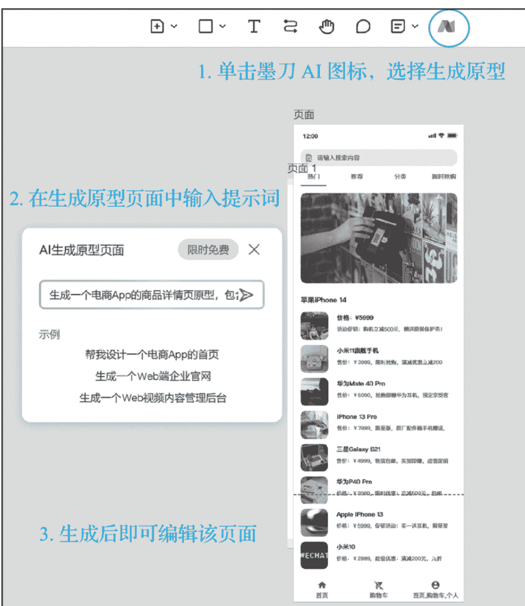
1) 单击墨刀AI图标，选择生成原型
2) 在生成原型页面中输入提示词
3) 判断原型图是否为自己所需，如果不是，可以继续调整提示词再次生成，或者直接编辑页面

#### 试一试
在墨刀中打开墨刀AI生成界面，输入你的需求，生成页面原型。

#### 小贴士
- 1）评审前先问腾讯元宝“预测这个设计可能被质疑的3个点”来自查
- 2）复杂流程可让腾讯元宝“请用流程图语法描述”输出逻辑图
- 3）可提前规避开发坑点，多问一句：“从技术实现角度，这个交互设计可能存在哪些隐患？”

技巧94
## 技术决策：用腾讯元宝规避选型陷阱

产品经理面对技术选型和架构规划时，开发等着拍板，业务催着要方案。腾讯元宝可充当“技术顾问”，厘清思路、对比方案、规避风险。

### 1. 方法一：快速理解技术选项
面对陌生技术栈，可让腾讯元宝拆解术语。例如输入：“请用通俗易懂的语言解释微服务架构和单体架构的区别，重点对比：①开发复杂度；②运维成本；③适合的业务场景。”

腾讯元宝输出可能如下：
- 1. 单体架构：大锅饭食堂
  - 开发复杂度：所有功能都在一个大厨房里做
  - 运维成本：只有一口大锅，服务器宕机整个餐厅停业
  - 适合场景：菜品固定的小餐馆
- 2. 微服务架构：美食城档口
- 3. 产品经理怎么选

篇幅所限，后续结果省略，建议读者亲自上手实践。

### 2. 方法二：评估技术方案的业务适配性
技术团队可能推荐最先进的方案，但未必最适合当前业务。可让腾讯元宝结合业务需求分析匹配度。

例如提问：“我们是一个电商团队，日均订单量在1万左右，请分析GraphQL是否适合我们，重点考虑：①前端灵活性；②后端改造难度；③长期维护成本。”

腾讯元宝可能这样评估：
针对日均1万左右订单的电商团队从REST迁移到GraphQL的评估：
#### 一、前端灵活性
优势：按需查询，减少网络传输；单次请求聚合；快速迭代
挑战：学习曲线陡峭，需限制查询深度

篇幅所限，后续结果省略，建议读者亲自上手实践。

### 3. 方法三：制定技术演进路线
好的技术选型应像搭积木。可让腾讯元宝设计演进图：“我们的电商系统初期预计日订单1000单，3年后可能达10万单。请分3个阶段设计技术演进路线。”

腾讯元宝可能会给出：
以下是针对电商系统的3个阶段技术演进路线设计：
#### 阶段一：初创期
- 业务规模：日订单1000～5000单
- 关键技术
  - 架构：单体架构
  - 数据库：单机MySQL+Redis缓存
  - 部署：云服务器+Nginx负载均衡

## 4. 总结
技术路线的选择没有唯一正确答案，实质是成本边界、风险承受力和业务诉求之间的持续权衡。盲目追逐潮流容易掉入过度设计的陷阱，过度保守则会让系统过早触顶。腾讯元宝的价值并不在于直接给出答案，而在于提供一个可落地的思考框架，帮助把方案背后的隐性花费、团队匹配度以及业务契合度显性化。

#### 试一试
请向腾讯元宝提交指令：“我们运营的社区应用日活约十万，关系型数据库响应时延近期持续走高。请输出是否引入缓存层的决策清单，要求覆盖：①必须观测的三大性能指标及合理阈值；②上线前需要准备的两项运维预案；③预估节省服务器开销的计算方法。”

#### 小贴士
- 当模型给出“视情况而定”这类模糊结论时，要追问需要观察的具体指标和临界值。
- 不要全盘照搬，必须结合团队真实能力进行检验。
- 没有完美解法，只有最合适的解法，提问时多用业务视角。
- 让模型做方案对比时，先明确评判维度，例如成本、性能、可维护性等。

## 技巧95
## 模拟测试：让元宝当你的测试副手

产品进入收尾阶段，测试最让人焦虑。人工测试费时费力，自动化又门槛较高。产品经理既非专业测试人员，也难以面面俱到，常出现上线前过度乐观、上线后手忙脚乱的情况。借助腾讯元宝可以在不写代码的前提下快速揪出隐患，它既能模拟用户视角挑毛病，也能做结构化查漏。

### 1. 第一招：用口语化指令批量产出测试点
测试用例是基本功。人工设计既慢又容易漏掉极端场景。现在用日常语言描述功能，模型就能生成可执行的场景。例如电商平台刚上线购物车跨店满减，可以这样问：“我们是电商平台，新功能是购物车跨店满减，请列出二十条测试点，需覆盖：①多商家商品组合；②优惠券叠加规则；③极端情况如商品失效或库存不足。”

模型给出的思路示例：
- 一、多商家组合校验
  1. 跨店满减门槛校验
     （1）A店一百五十元加B店一百五十元是否能触发三百减四十。
     （2）A店满三百减四十、B店满二百减二十时是否无法跨店凑单。
- 二、优惠金额分摊逻辑
  （1）检查跨店订单优惠是否按商品金额比例分摊（如A店250元+B店200元+C店150元，总优惠80元按6:4:3比例分配）……
- 三、多店铺类型兼容性
  （1）验证天猫与淘宝店铺商品合并凑单时是否支持跨店满减……
> 篇幅受限，后续建议自行实操。

### 2. 第二招：借助智能分析预判灰度风险
新功能上线前通常先灰度。团队既想收集反馈，又担心问题扩散。传统方式靠人工看面板，等发现异常用户已受影响。灰度期间可用元宝提前预判舆情，它能读数据也能读情绪。

例如在线文档协作工具刚灰度智能模板推荐，可问：“基于当前灰度数据预测全量风险：①使用率低于预期的功能，日活低于百分之三；②可能引发投诉的设计，提取差评关键词；③不同人群体验分化，安卓对比iOS。数据样本：[埋点加用户反馈]。”

模型可能给出类似结论：
基于灰度数据，结合灰色预测与灰度分析，风险预测及优化建议如下：
### 一、风险预测模型构建
### 1. 数据预处理
对七天埋点做累加生成，削弱随机性，如点击率序列百分之五点一累加生成新序列……
预测全量风险：……
### 二、关键风险点及应对
- 1. 使用率低的核心问题（略）
- 2. 投诉风险预测（略）
- 3. 用户群体体验分裂（略）
> 详细结果建议自行实践。

### 3. 第三招：让 AI 扮演挑剔用户设计极限场景
让元宝模拟挑剔用户，专门设计破坏性测试。测试视频会议系统时可说：“假设你是IT负责人，测试我们的视频会议系统，请设计十个故意找茬方案，包含：①极端网络波动；②外设异常；③非正常操作。”

模型给出的方案示例：
### 视频会议系统故意找茬清单
### 一、极端网络波动
- 1. 模拟百分之五十丢包加三百毫秒延迟，观察是否崩溃或降级为音频，未自动回退即为重大缺陷。
- 2. 带宽压至一百Kbit/s，检查是否主动降码率，若持续卡顿超十秒则自适应失效。
### 二、外设异常
麦克风被遮挡并拔掉摄像头USB，系统应弹出明确故障提示并自动切换备用设备，静默失败即为兼容缺陷。
### 三、非正常操作流程
……
> 篇幅受限，建议亲自尝试。

### 4. 总结
产品测试不是找茬游戏，而是风险前置。借助元宝等于拥有一个不疲倦的测试员、一个擅长归纳的分析师和一个脑洞大的产品吐槽官。让AI负责覆盖常规场景与挖掘隐藏模式，产品经理聚焦高阶判断：哪些问题必须修、哪些可容忍、哪些是创新机会。

#### 试一试
提示词参考：“基于当前灰度数据，请：①找出关键指标异常波动的线索；②对比用户分层的体验差异；③推测全量发布的最大风险；④分别给技术、运营、客服各三条建议。”

#### 小贴士
- 敏感数据先脱敏再输入。
- 提示词中点明用户画像特征，如年轻群体或宝妈。
- 对元宝发现的疑似问题标注置信度，优先验证高频场景。
- 重要功能保留约百分之五的人工探索性测试。

## 技巧96
## 新品上市：用元宝打赢发布战役

新品发布是产品面向市场的关键攻坚，时间紧、事项多、串联环节长。产品本身完成度很高，却在发布环节出现断层：市场要卖点、销售要定价策略、渠道要培训材料。此时一个能快速梳理思路并生成方案的助手，可节省数周加班。本节介绍如何借助元宝完成发布计划、营销推广与渠道准备。

### 1. 发布排期：避免变成纸上谈兵
确定上市时间要兼顾竞品节奏、渠道备货周期、甚至高层行程。可先开启元宝联网搜索，输入：“请基于公开信息梳理新能源车充电桩新品上市的时间规划要点，需包含：①竞品发布时间分析；②供应链备货周期；③关键营销节点如行业展会。用表格呈现并标注数据来源。”

元宝可能汇总的表格示例：
| 规划维度 | 具体内容 | 时间节点/周期 | 数据来源 |
| :--- | :--- | :--- | :--- |
| 竞品发布时间 | 比亚迪兆瓦闪充，首搭腾势Z9 GT英国版 | 技术发布2025年3月；英国落地2025年底 | ①⑥ |
| 供应链备货 | 核心元器件充电模块、液冷系统 | 30~60天，受芯片产能影响 | ⑥⑨ |
| 关键营销节点 | 上海车展、慕尼黑车展 | 2025年4月、9月 | ⑤⑦ |
注：网络信息仅作参考，需最终核实。

### 2. 营销投放：防止预算打水漂
数字营销常走向两极：要么全渠道铺开但转化低，要么单渠道投放却触达不到目标用户。此时可用元宝聚焦策略。假设是一款AI办公软件，可上传资料并问：“基于材料，制定首月数字营销计划，要求：①区分拉新与留存渠道；②列各平台内容形式，如知乎测评、抖音场景短片；③标注预算分配比例，如SEO占30%，并指出常见误区。”

元宝可能的建议：
### 一、拉新渠道 70%预算
### 1. 信息流广告25%
平台：微信朋友圈、抖音企业号、头条穿山甲。内容：15秒痛点短片、A/B测试H5。核心指标：CPC≤2元，注册转化>8%。
### 2. 搜索引擎20%
SEO12%主攻长尾词如“智能会议记录软件”，知乎深度测评植入官网。SEM8%（略）。
### 三、避坑指南
- 渠道错配：知乎不宜发纯娱乐短视频，抖音不宜投文字测评。
- 预算比例：召回预算不应低于5%，SEO需持续投入。
……

### 3. 渠道落地：守住最后一公里
页面上线后差评多，常见原因是详情页太专业或太空洞。可让元宝优化文案，例如：“把工业级无人机的技术参数如‘续航120分钟、抗风6级’转化为面向农业种植户的电商卖点，要求：①用农户语言；②对照人工喷洒成本；③给出场景化视频脚本建议。”

元宝可能的输出：
### 无人机卖点文案 农业版
### 一、核心卖点大白话
“充2小时能干一上午”——120分钟续航单次可作业500亩，相当于100个劳力一天。
“刮6级风也不洒偏”——抗风6级，药雾精准度提升3倍。
### 二、成本对比
人工5人小组日薪800+餐200，日作业50亩，亩均20元。无人机日作业500亩，电费15+保养10，亩均0.05元。1000亩水稻年打药8次可省约15万人工。
你需要自行筛选修改后上线。

### 4. 总体回顾
新品发布像一场无彩排演出，元宝可帮忙准备剧本、灯光与道具。核心做法：用精准提问替代模糊纠结，如不问“怎么定价”而问“什么定价对用户更具吸引力”；让元宝处理信息整理类脏活，但人工需验证可靠性；始终准备Plan B，让元宝多给备选方案。

#### 试一试
输入：“假设竞品下周突然降价20%，请快速生成应对方案，包含：①媒体回应口径；②渠道激励政策；③老客户补偿措施。”

#### 小贴士
- 加上“用CEO能听懂的话解释”，避免黑话堆砌。
- 复杂任务拆成小问连续提问。
- 重要数据需反向验证，AI擅长整理不擅长决策。

# 第11章
## 安全与规范：企业级腾讯元宝管理指南

## 技巧97
## 文案校对：零差错质检，元宝当编辑

职场痛点往往不在写不出，而在反复检查。错别字、术语错误、表述不当，看似细小却可能影响专业形象甚至引发法律风险。人工校对耗时且易遗漏。腾讯元宝可快速定位基础错误并按场景做深度检查。

### 1. 方法一：问题定位——三层安检门
仅问“检查下这段文字”只能抓表面错误。为确保专业与安全，可建立分级检查：先排查拼写标点，再审核法律风险，最后评估传播效果。例如上传直播脚本并输入：“你作为资深编辑检查直播话术。①基础层：错字/标点/语病；②合规层：广告法禁用词如最、第一；③传播层：口语化程度。用红黄绿三色标注紧急度。”

元宝输出示例：
### 三色标注规则
- 基础层 红色：错别字/标点滥用；黄色：语病歧义；绿色：无硬伤。
- 合规层 …… 
- 传播层 ……
输出模板：[红色]违禁词：全网第一→改为“热销前10”。

### 2. 方法二：智能改写——语言整形师
同一数据面向不同受众时，直接改写易失真。在保留关键信息前提下，让元宝生成不同文风，可兼顾准确与针对性。例如空调文案：“请优化‘省电比别人好30%’，要求：①保留数据且合规；②加入生活场景；③带情感价值。提供三版。”

元宝对比示例：
- 技术版：“搭载第三代节能技术，日均省电30%。”
- 故事版：“邻居为电费皱眉时，您家吹着22℃北欧风——省电30%的清凉经济学。”
- 情怀版：“守护万家灯火的微笑，每省1度电都是对地球的温柔。”

### 3. 方法三：专属调教——培养 AI 学徒
不同行业表达差异大，通用模型难以识别。可上传说明书并输入：“我司规范：①禁用词杀手级、革命性；②技术描述需加专利号，如采用××技术（专利号ZL2024××××）；③英文术语首字母大写如AIoT。请按此校对智能手表说明书。”

调优效果示例：
| 原文 | 优化版 |
| :--- | :--- |
| “革命性心率检测黑科技” | “第三代生物传感器（专利号ZL2024××××），医疗级精度” |
| “支持 aiot 生态” | “兼容 AIoT 智能家居系统” |
> 篇幅受限，建议自行实操。

### 4. 从校对工具到语言指挥官
用元宝校对如同用智能安检代替人工摸查。进阶为语言指挥官需三次武装：检查立体化、修改智能化、调教深入化。

#### 试一试

医械说明书智能校对指令范式
把需要核查的医疗器械说明书文件上传，然后让腾讯元宝以国家一级校对员的身份进行复核：第一，把“治愈率”之类违规表述全部替换；第二，逐条核对技术参数是否满足 YY/T 0466.1—2023 的规定；第三，为老年读者补充阅读引导，兼顾大字排版与专业术语的通俗化解释。

#### 温馨提示
- 1) 合同类及法律文本最终仍须律师二次复核。
- 2) 遇到有争议的表述，可以先让模型生成多套备选方案后再做取舍。

## 技巧98
## 版权排查：三招揪出文本暗雷
报告里直接粘贴行业数据，手册里复制技术资料，宣传稿里引用评测结论，这些常见的引用习惯背后都藏着侵权隐患，文字和数据的取用边界很容易被踩线。

传统的人工版权核查要逐段比对来源、核算引用占比、确认授权范围，普通员工很难快速区分合理使用与商业侵权，也难以追溯零散片段的原始出处。

怎样在海量文本中迅速锁定风险点，同时不伤内容质量？下面三套借助腾讯元宝的做法，能让你拥有接近专业法务团队的审查效率。

## 1. 招式一：风险段落即时扫描
让腾讯元宝扮演版权扫描仪，快速锁定高危区。比如市场同事想引用某份行业白皮书的数据，开启联网检索后可这样提问：“请帮我判断下面这段文字的版权风险：[粘贴待检段落]。需求：①判断是否存在版权风险并给出高/中/低等级；②指出需要授权的句子或数据；③给出合规改写建议。”

模型会返回审查意见：

### 1. 版权风险评估
中高风险，部分内容涉及第三方数据及行业报告引用，未标注来源存在侵权可能。

### 2. 需授权的具体句子或数据
以下片段可能涉及第三方版权，需核实来源并取得许可：
- (1) 市场规模数据
  - “2022年全球AI市场规模约9300亿元人民币”
  - “2025年全球市场规模将突破2万亿元人民币，年均复合增长率超30%”
  - “2022年中国AI市场规模占全球23.9%”
  - （此类数据多来自IDC、Gartner等研究机构，直接引用需标注来源或获授权。）
- (2) 细分领域数据（略）
- (3) 行业案例表述（略）

### 3. 合规改写建议
- (1) 数据引用合规化
  - 改用公开来源替代：
  - 将来源明确写为政府白皮书、行业协会报告，例如中国信息通信研究院发布的《人工智能发展报告（2024年）》，或改写为“据公开统计/研究显示……”；
  - （略）
- (2) 原创性内容增强（略）
- (3) 版权声明与授权（略）

篇幅所限，此处不展开完整输出，建议读者自行实操验证。

## 2. 招式二：网络内容溯源与改写
面对来源不明的文字，如论坛讨论或社媒观点，腾讯元宝可帮助追溯原出处或提供无版权替代方案。品牌部若想参考爆款文案又担心侵权，可开启联网检索并输入：“请核查下面这段文案是否存在版权问题：[粘贴待检文案]。要求：①识别可能侵权的表达，如标志性句式、专业术语；②提供3个不侵权的改写版本。”

以一条小红书文案为例，模型可能给出：

### 一、可能侵权的表达识别
依据《中华人民共和国著作权法》及检索结果，当前文案存在以下风险点：

### 1. 影视剧名称直接引用
《×××》作为电视剧名称，若在商业宣传中使用且未经出品方许可，可能构成不正当竞争或侵犯商品化权益。

“#影视剧同款穿搭”易让消费者误以为与剧方存在官方合作，可能违反《中华人民共和国反不正当竞争法》第六条。

……

### 二、不侵权的改写建议

### 1. 版本1（弱化影视关联）

## 技巧99
## 合规管理：五招把腾讯元宝培养成智能法务官
全球监管规则像动态系统般持续演进，每季度都有数十项更新需要解读。合规风险横跨法律效力、数据主权、跨境经营等维度，任何疏忽都可能引发连锁反应。日常追踪法规、评估影响、设计应对，已成为企业常态，也让合规在专业精度与执行效率之间承受双重压力。

怎样在信息洪流里抓住关键条款？如何把上百页的文件变成可执行清单？监管来临时能否提前演练攻防？这需要一位精通多国法规、永不休假的智能助手，既能当翻译官拆解条款，也能当策略师预判风险走向。

### 1. 第一招：法规雷达术—让腾讯元宝当政策哨兵
面对条例的频繁迭代，不必逐条人工比对，可让腾讯元宝自动对照新旧版本并标注对业务有影响的条文。输入：“实时追踪美国出口管制条例的修订动向，发现实质性变更即生成摘要，并重点标出对我司半导体业务的影响。”

示例输出片段：

根据2025年4月的最新信息及近期出口管制修订，结合半导体相关条款的实质性变化，监控要点及业务潜在影响摘要如下：

一、近期关键修订动态及影响分析

#### 1. 新增“外国直接产品规则（FDP）”
- SME FDP规则：针对半导体制造设备，若生产过程涉及美国技术/软件，即使在境外制造，出口中国需申请许可证。
- FN5 FDP规则：实体清单中标注“脚注5”的企业，其供应链中任何含美国技术的产品均受严格限制。

影响：须全面审查供应链设备与技术来源，评估是否触发FDP规则，可能导致采购受阻或需额外许可。

#### 2. 半导体制造设备及技术管控升级
……

二、实时监控机制建议（略）
三、对贵司业务的紧迫性建议（略）

注：以上信息基于2025年4月5日前的最新动态，需持续跟踪BIS及中国商务部后续调整。建议由专业合规团队深度解读关键条款，降低业务风险。

篇幅所限，剩余内容省略，建议自行实践。

### 2. 第二招：法律差异拆解术—协议风险预警雷达
面对多国法律差异，想快速了解风险等级，可让腾讯元宝“找茬”。例如跨境并购时输入：“用表格对比中德两国劳动法差异，标出并购协议需补充的条款，并用红黄绿灯标注风险等级”。

部分输出示例如表11-2：

#### 表11-2 中德两国劳动法差异对比示例

| 对比维度 | 中国劳动法 | 德国劳动法 | 并购协议需补充条款 | 风险等级 |
| :--- | :--- | :--- | :--- | :--- |
| 解雇保护 | 无固定期限合同解雇需证明“严重违纪”或客观情况变化，程序复杂但实操灵活 | 解雇须经工会/职工委员会同意，无固定期限合同解雇需提前4～7个月通知且证明“社会正当性” | 明确德国员工解雇需预先取得职工委员会书面同意的流程及责任方 | • 高风险 |
| 工时制度 | 标准工时制：每周≤40小时，加班≤36小时/月，加班费150%～300% | 标准工时制：每周≤48小时，加班需工会同意且每年≤120小时，部分行业可采用弹性工作制（如IT） | 补充德国员工加班审批权限归属及超时补偿标准条款 | • 中等风险 |
| 医疗期 | 最长24个月（与工龄相关），医疗期内的工资不低于最低工资的80% | 6周内雇主支付全额工资，之后由医保支付70%（最长78周） | 针对长期病假员工，约定医疗费用分担机制及岗位保留期限 | • 低风险 |

### 3. 第三招：风险模拟器—合规版绝地求生
突击检查像职场惊悚片，提前演练才能从容应对。可让腾讯元宝模拟检查场景，生成高频问题、标准应答模板与证据清单。例如输入：“模拟FDA飞行检查场景，生成制药工厂十大高频问题清单，并附标准应答模板与证据链准备指南。”

输出示例：

FDA飞行检查制药工厂十大高频问题清单

| 检查重点领域 | 典型提问方式 | 标准应答模板 | 证据链准备指南 |
| :--- | :--- | :--- | :--- |
| Q1 | 数据完整性（ALCOA+） | 请说明如何确保 HPLC 原始数据不被篡改？审计追踪功能是否全员启用？ | ▶ 遵循《数据完整性管理 SOP-001》，所有仪器启用四级权限与审计追踪，原始数据自动备份至独立服务器（路径：xx），每季度质量部执行数据审计（参见 QA-2023-01 审计报告） | 1. 数据完整性 SOP<br>2. 审计追踪功能验证报告<br>3. 近 12 个月数据备份日志 |
| ...... | ...... | ...... | ...... | ...... |

篇幅所限，完整清单省略，建议自行实践。

### 4. 第四招：培训转化术—让枯燥法规活起来
合规培训易显枯燥，可让腾讯元宝设计游戏化形式。例如输入：“把《中华人民共和国个人信息保护法》改编成剧本杀，设计6个角色（CEO、DPO、客服等），包含5个关键合规决策点。”

模型会输出完整剧本杀方案，包括背景、角色、决策点、证据链及多结局。

输出示例：

（1）剧本杀：《数据迷踪—个人信息保卫战》
背景：某电商平台“易购网”遭用户集体诉讼，指控违规处理个人信息。玩家需在5小时内找出合规漏洞，化解10亿元罚款危机。

（2）角色设计（6人）

| 角色 | 人设与秘密 | 核心任务 |
| :--- | :--- | :--- |
| CEO- 林峰 | 为冲IPO默许灰色数据交易，但留有录音自保 | 隐藏数据黑产合作，同时避免公司被吊销牌照 |
| ...... | ...... | ...... |

（3）5个合规决策点（略）
（4）多结局机制（略）

……

篇幅所限，细节省略，建议读者亲自尝试。

### 5. 第五招：合规沟通翻译官—跨部门术语转换器
跨部门沟通易因术语差异产生分歧，可让腾讯元宝把专业语言转译为双方都能理解的表述，并给出解决方案。例如输入：“用产品经理能听懂的语言，解释用户行为埋点数据为何属于个人信息范畴，并给出三种合规落地方案。”

输出示例：

#### 用户行为埋点数据为何属于个人信息范畴？
用户行为埋点数据（如点击、浏览、搜索记录）看似不含姓名、身份证号等直接标识，但经技术聚合分析后仍可关联到特定个人，故属于法律定义的“个人信息”。原因包括：

- 1. **可识别性增强**：单一行为难定位，多维度数据（如设备ID+位置+操作习惯）结合后可生成用户画像，间接识别身份。
- 2. **人格与财产利益属性**：（略）
- 3. **法律明确界定**：（略）

#### 合规解决方案（产品侧落地建议）
- 1. **数据最小化与分类管理**（略）
- 2. **用户授权与透明告知**（略）
- 3. **匿名化与去标识化技术**（略）

篇幅所限，未展开完整内容，建议自行实践。

### 6. 总结
核心在于把腾讯元宝训练成懂业务的法务、懂法律的工程师、懂管理的合规专家。AI无法解决全部合规难题，但能让你从信息搬运工升级为策略指挥官。

#### 试一试
在腾讯元宝中输入“生成欧盟AI法案合规自查清单，包含算法透明度、数据治理、人工监督三大模块，每项标注达标状态”，观察模型如何把抽象法规转化为可执行项。

#### 小贴士
- 1) 复杂问题可尝试“用三步法解释×××合规要求”的指令结构。
- 2) 建立常用指令模板库：政策监控类/文档审查类/培训转化类。
- 3) 重要提醒：涉及重大法律后果的事项，仍需交叉验证专业意见。

## 技巧100
## 注意事项：规避使用误区的实用指南
开始拥抱腾讯元宝后，部分团队因过度依赖反而效率下降，根源在于陷入使用误区。以下四个方法可帮助精准避坑。

### 1. 需求诊断：先明确问题再动手
常见错误是问题未厘清就上AI。好比未就诊就自行用药，容易误用。正确做法是先找到企业真实痛点，评估AI是否能解决，并设定KPI衡量效果。例如输入：“我们是一家制造业企业，生产效率偏低。请分析：①AI可在哪些环节提升效率；②需要准备哪些数据；③预期投资回报率。”

模型会输出：

#### 1. AI在哪些环节最能提升效率？
##### （1）生产计划与排程优化
- 智能排产：利用AI算法优化排程，减少设备空闲，提升资源利用率。
- 动态调整：基于实时订单、设备状态和供应链情况动态调整计划，减少延误。
- 预测性维护：通过传感器数据预测故障，提前安排维护，减少停机时间。

##### （2）质量控制与缺陷检测
- 视觉质检：基于计算机视觉自动检测裂纹、尺寸偏差等缺陷，降低人工误差。
- 实时监控：结合IoT数据实时分析质量趋势，快速定位根因。

……

#### 2. 需要准备哪些数据？（略）
#### 3. 预期的投资回报率（ROI）（略）

篇幅所限，完整结果省略，建议自行实践。

### 2. 数据防护：保障信息安全
不能随意把公司机密交给模型，但可让其制定安全方案，如建立数据分级、使用脱敏技术、设置严格访问权限。例如输入：“设计一个数据安全方案，确保使用腾讯元宝时：①核心生产数据不外泄；②客户隐私受保护；③符合GDPR要求。”

模型会输出：

#### 一、数据生命周期管控体系
##### 1. 数据分类分级
- (1) 建立三维数据标签系统（业务影响等级/隐私敏感度/跨境属性）。
- (2) 核心生产数据实施钻石级防护（AES-256+量子密钥）。
- (3) 客户隐私数据采用动态脱敏技术（格式保留加密+同态处理）。

##### 2. 访问控制矩阵
- (1) 实施属性基加密（ABE）与零信任架构融合。
- (2) 特权账户管理采用量子随机化多因素认证。
- (3) 建立基于区块链的访问审计溯源链。

#### 二、隐私增强技术（PETs）应用
……
#### 五、组织保障措施（略）

篇幅所限，其余内容省略，建议自行实践。

### 3. 人机协作：让腾讯元宝做助手而非决策者
最糟糕的情况是团队完全依赖模型做决策。应遵循：模型提供建议，人类做最终决定；建立交叉验证机制，保留人工复核。例如输入：“作为销售总监，我需要你：①提供下周客户拜访的优先级排序；②给出推荐理由。备注：上传客户基本信息。”

模型会基于成交、收益、风险等指标给出排序建议，团队据此头脑风暴，最终由人决策采用哪些建议。

### 4. 伦理审查：确保合规
模型可能无意生成歧视性内容或侵犯隐私，带来法律风险。可利用模型进行智能审查。例如输入：“审查这份由腾讯元宝生成的招聘文案：①是否存在性别、年龄等歧视性语言；②是否符合劳动法规定；③是否需要人工调整。[上传招聘文案]”

模型会从歧视性语言、劳动法合规性等方面给出调整建议，最终仍需人工核对准确性。

### 5. 总结
腾讯元宝功能强大但需正确使用。聪明的企业将其视作助力而非全部。记住：AI应解决问题，而不是制造新问题。

#### 试一试
从小型试点开始，比如用腾讯元宝优化会议纪要，对比使用前后的效率变化。

#### 小贴士
- 1) 先试点再推广，避免全面铺开风险。
- 2) 建立腾讯元宝使用规范，明确边界。
- 3) 定期复盘，及时调整使用策略。

## 结语：AI时代，你的职场进化才刚刚开始
翻到这一页时，你已掌握多数人尚未触及的腾讯元宝高阶用法。曾经困扰的重复劳动、数据混乱、汇报焦虑、创意枯竭，现在都可成为提升个人能力的跳板。

### 这不是终点，而是新起点
本书中的100个技巧只是职场AI化的第一步。真正价值在于：

- 从“工具使用者”变成“AI指挥官”—让腾讯元宝成为你的“第二大脑”，而非“打字助手”。
- 从“被动执行”到“主动创造”—用AI加速基础工作，把省下时间投入思考与创新。
- 从“单打独斗”到“智能协作”—让AI担任谈判助手、数据分析师、文案优化师，甚至职业规划顾问。

### 未来已来，只是尚未普及
AI不会取代人，但会让善用AI的人在职场具备更强核心竞争力。

### 你的下一步行动
- 1) 实战突破—在工作时思考能否套用本书技巧，多用几次后将内化为技能。
- 2) 组合创新—尝试串联不同章节技巧（如“数据清洗+可视化+汇报生成”），结合自身经验打造专属AI工作流。
- 3) 持续进化—AI在迭代，你也要迭代。关注腾讯元宝更新，探索更多可能。

工具的强大取决于使用者的智慧。现在，去创造属于你的AI职场新范式吧！