# NLP 原理到实战通关指南

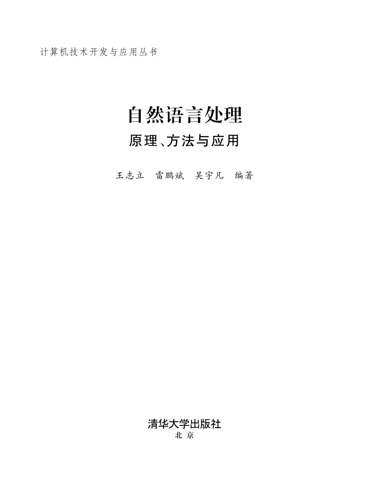

# 作者简介

**王志立**　从事自然语言处理工程工作，曾在国内外学术会议上发表多篇论文，历任腾讯等知名企业大数据与人工智能算法岗位，长期输出人工智能知识分享，并斩获多项国家级人工智能竞赛奖项。

**雷鹏斌**　现任华为 AI 算法工程师，聚焦 chatops 与知识图谱研究实践，对自然语言处理全任务有深入积累。2019 至 2021 年在国内权威竞赛的文本分类、命名实体识别、机器阅读理解、智能问答、文本生成等赛道获奖众多。参与多项科研课题，在 AAAI、《中文信息学报》等高水平刊物发表论文。

**吴宇凡**　腾讯算法应用研究员，长期深耕业务安全与金融量化算法研究实践，在国际顶刊发表多篇论文，并拥有多项专利。

# 内容简介

本书兼顾自然语言处理的核心理论与前沿模型应用。
全书共 11 章：第 1～5 章系统铺垫基础知识，第 6～11 章全部落地实战。核心内容涵盖预训练模型、文本分类、机器阅读理解、命名实体识别、文本生成、模型蒸馏与剪枝及损失函数设计等。
书中案例丰富，理论与动手并重。示例均基于 Linux 与 PyTorch 环境开发，学习 NLP 的同时可掌握 PyTorch 工程能力。全书结构完整、步骤清晰，给出可直接落地的工程方案。
适合具备一定深度学习基础的入门读者，也可作为 NLP 算法从业者及培训机构的参考资料。

# 前言

过去一年多的个人经历颇为跌宕，而编写本书的同时，自然语言处理领域亦密集爆发：蛋白质结构预测的 AlphaFold、参数高达 1750 亿的 GPT-3 横扫榜单，以及支持增量推理与分布式推理的盘古预训练模型。总体来看，自 2018 年底谷歌发布 BERT 以来，NLP 进入井喷期。但无论模型如何演进，其本质仍依托深度神经网络，仅在网络结构、参数规模与算力配置上有所差异。

信息时代已由信息匮乏走向信息过载，学习资源浩如烟海，数量不等于质量。如何将零散知识点梳理成可扩展的高效学习路径，是本书编写的核心考量。本书从一线算法工程师视角，结合作者多项国家级竞赛获奖经验，旨在帮助读者通过流程化的算法掌握适配个人的学习路线。
本书搭建一套 NLP 学习框架，以最小学习成本掌握核心任务。既可帮助读者构建专属的知识体系，也便于在其上二次拓展，加深理解。涉及内容包括算法流程、无监督学习、预训练模型、文本分类、智能问答、命名实体识别、文本生成、模型蒸馏与剪枝等。
这是作者在清华大学出版社出版的第二本著作。成书不易却意义重大，既是另一种创业尝试，也是对思维方式的锤炼，更是向所有 NLP 学习者分享干货资源。
感谢深圳大学信息中心与电子与信息工程学院提供的软硬件支持，感谢导师秦斌及实验室同学对内容与代码的贡献，感谢家人朋友的长期支持。愿此书能为庞大的 AI 知识库添砖加瓦。
限于水平与精力，书中难免疏漏，诚盼读者指正。
王志立
2022 年 10 月

说明：文中需扫码阅读的请扫此付费二维码。

# 第 1 章　导论

自然语言处理是文本挖掘的重要分支，属于人工智能与语言学交叉学科，核心是实现人与计算机的高效交互。随着技术发展，NLP 已逐步聚焦人机沟通效率问题。

NLP 大致经历四个环节：将人类语言做严谨的数学形式化建模；把数学模型转化为可计算的算法模型；依据算法编写程序实现应用；对模型进行迭代优化并拓展到更多场景。尽管如此，人机交互依然复杂，不仅受算力限制，更因自然语言本身的复杂性。语言不仅分字词句篇，还包含音形义。同一句话因语调变化意义迥异。美国学者 Daniel 归纳了语言行为的六大知识维度：语音学与音系学、形态学、句法学、语义学、语用学与话语学，这些维度共同构成了计算机处理自然语言的挑战。

## 1.1　基于深度学习的自然语言处理

深度学习是当前人工智能的热点，学界与工业界高度关注。得益于强大的特征选择与提取能力，深度学习在 NLP、计算机视觉、语音识别等领域广泛应用，NLP 可谓人工智能皇冠上的明珠。
业界长期追求的是促进自然语言与计算机的有效沟通。自然语言是高度抽象的符号系统，存在数据离散、稀疏、一词多义等问题。当前研究热点在于借助深度学习推动 NLP 各任务的进步。

Hinton 于 2006 年提出深度学习：从海量数据中自动抽取多层特征表示的技术。深度学习通过数据驱动和不同组合的非线性变换，从原始数据中抽取从低层到高层、从具体到抽象的特征。相较浅层学习，深度学习更强调结构深度，通过加深网络能够挖掘更深层次语义；同时，深度学习重视特征表示，通过逐层变换将原始特征空间映射到新表征空间，使预测更易实现。
深度学习强大的特征学习能力使其能更好地处理高维稀疏数据，在 NLP 多项任务中取得长足进展。其出现让文本表征由离散整型矩阵变为稠密高维浮点矩阵，信息量更大且字符间存在语义关联。本书核心即围绕基于深度学习的 NLP，助力读者快速掌握前沿技术并提升实战能力。

## 1.2　本书章节脉络

全书共 11 章，章节衔接紧密，均配原理与案例。建议初学者按序阅读，以构建完整的基于深度学习的 NLP 体系。以下按图 1.1 所示路线介绍知识架构。

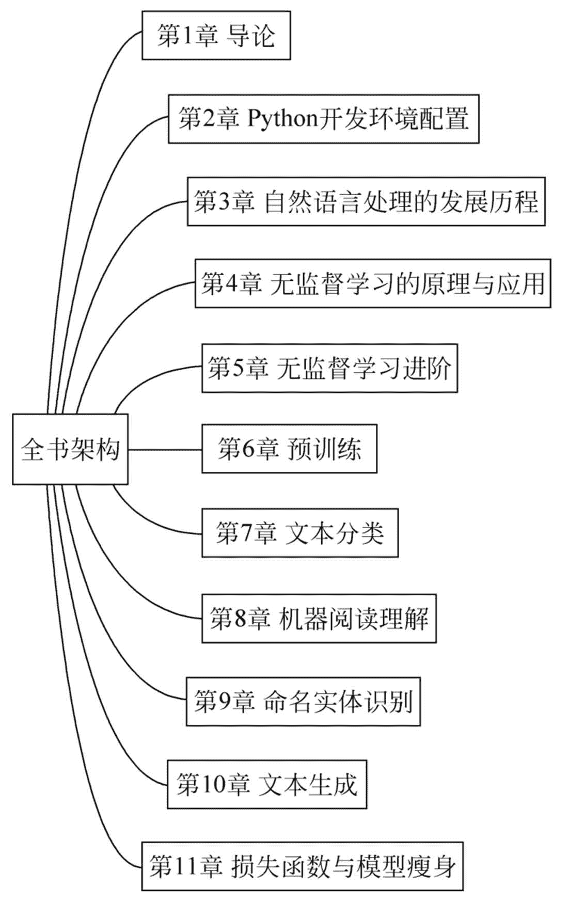

图 1.1　全书架构

第 1 章导论包含四部分：NLP 定义、基于深度学习的 NLP、全书脉络及算法流程。作为全书总起，重点介绍各章节核心技术。

第 2 章`Python`开发环境配置介绍本书使用的操作系统与编程环境，即 Linux 下的`Python`开发环境搭建。同时介绍算法开发常用工具及流行的`Docker`容器技术使用。

第 3 章自然语言处理的发展历程按时间顺序梳理经典模型与思想。从人工规则处理起步，逐步过渡到机器学习处理复杂任务，最终到深度学习驱动当前 NLP 发展。

第 4 章无监督学习的原理与应用是全书精华，详细介绍 NLP 跨时代的语言预训练模型 BERT，并配案例帮助读者把握深度学习与 NLP 融合要点。以此为基础延伸第 5～11 章，帮助读者理解 BERT 如何处理当前任务并掌握实践能力。

第 5 章无监督学习进阶在第 4 章基础上深入，重点介绍生成对抗网络与元学习。读者可体会对抗网络的博弈之美，获得全新问题解决思路，也可学习元学习下小样本甚至零样本的学习方法。

第 6 章预训练聚焦 BERT 预训练模型的构建方法，讲解如何利用海量无标注甚至脱敏数据训练出高性能预训练模型。

第 7 章文本分类是业界研究重点，对舆情分析、新闻分类、情感分析等场景至关重要。预训练模型大幅提升泛化与准确率。本章以分类任务切入，讲解如何基于预训练模型构建 NLP 分类系统。后续章节的下游任务代码均在第 7 章基础上改写，复用性强、解耦度高，学习成本低，便于快速提升实践能力并二次拓展。

第 8 章机器阅读理解是衡量机器理解自然语言语义并回答问题的技术。该任务可帮助从海量文本中快速定位信息，降低人工获取成本，在文本问答、信息抽取、对话系统等领域价值突出。随着深度学习发展，性能显著提升。本章配套代码案例，帮助读者掌握从海量文档中抽取答案片段的方法。

第 9 章命名实体识别用于识别文本中预定义类别的实体，在文本检索、推荐、知识图谱构建、智能问答等领域起关键作用。随着深度学习发展，准确率大幅提升。本章提供实践案例帮助掌握该热门技术。

第 10 章文本生成可基于既定信息生成满足目标的文本序列，典型场景包括生成式阅读理解、人机对话、智能写作等。深度学习推动该技术蓬勃发展，涌现大量可用模型，提升 NLP 效率。本章配套实践帮助读者理解并应用。

第 11 章损失函数与模型瘦身聚焦模型优化。损失函数赋予神经网络灵活性，决定输出与网络其余部分的连接方式，影响参数收敛速度。在样本不均衡、冷启动、带噪学习等特殊分布下，特定损失函数能发挥意想不到的效果。同时，深度模型参数常达亿级，给在线部署的响应要求带来挑战。本章介绍模型压缩技术，兼顾高响应与低资源消耗。

## 1.3　自然语言处理算法流程

本书算法以`Python`为基础，采用开源预训练模型，并基于 Facebook 开源的`PyTorch`框架构建模型。整体流程如图 1.2 所示。数据划分为测试集、训练集与验证集。测试集用于预测，训练集用于训练，验证集用于评估与调参。常见比例为 1:7:2。

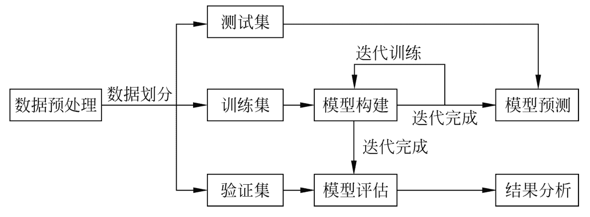

图 1.2　自然语言处理算法流程

### 1. 数据预处理

数据预处理将文本与实体标签转为计算机可处理格式，同时包含清洗与增强。清洗旨在剔除噪声如`HTML`字符、表情符号等，避免影响性能；增强旨在让模型多角度接触信息，如长文本处理。为处理过长文本，本书先设定切割长度阈值，用正则表达式清洗`HTML`标签等噪声；再按句子切分并用`Python`列表装载；最后按顺序拼接，长度超过 512 时停止并以当前句作为新数据首句，循环直至列表结束。按句切割最大程度保留信息，如图 1.3 所示。

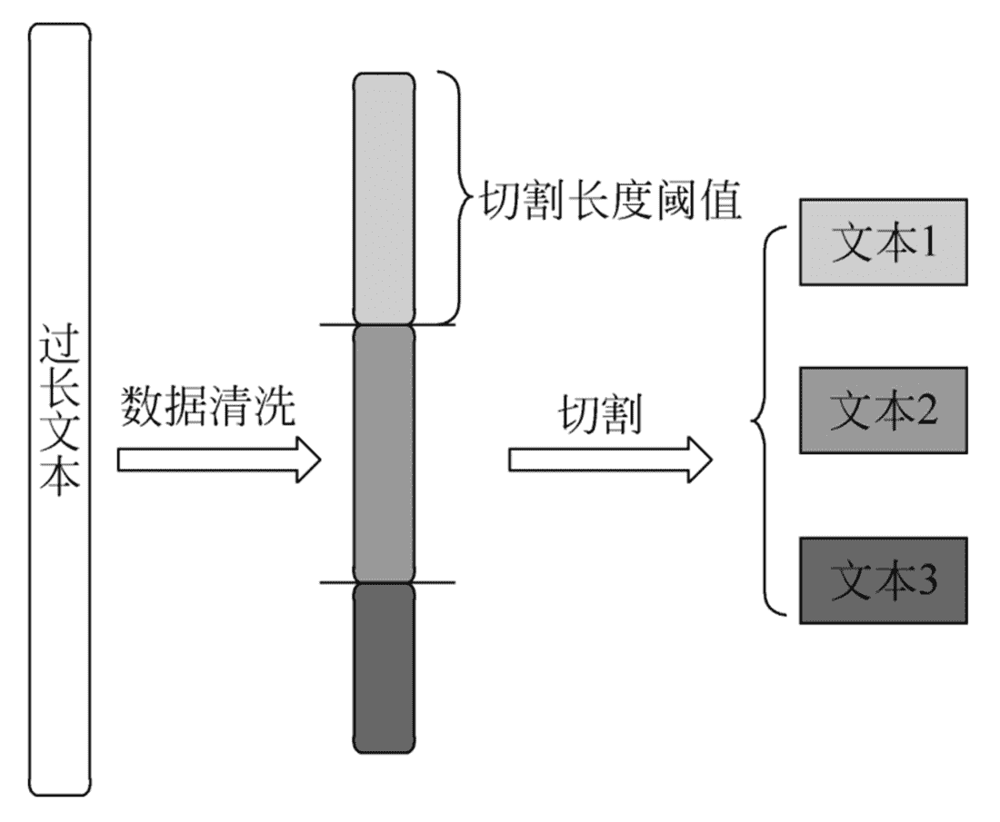

图 1.3　过长文本预处理示意图

### 2. 模型构建

模型构建采用开源预训练模型`NEZHA`，结合深度学习中相应的 NLP 模型。因各任务差异较大，本节仅做宏观概括，具体细节见后续章节。

### 3. 模型预测

模型预测涉及超参数设置与调优，需结合任务数据特性如文本长度及硬件资源如 16GB 显存`Tesla`显卡等。具体细节见后续实践案例。

### 4. 模型评估

模型评估通过指标衡量性能。指标选择需依据问题，选择正确才能发现模型问题并调参。NLP 任务指标基于任务特性设计，包括但不限于准确率、精确率、召回率、`F1`分数、`ROUGE`分数与`BLEU`分数，后续章节将详细阐述。

## 1.4　小结

本章简要介绍了 NLP 定义、学习路线与算法整体流程，帮助读者建立全局认知。
NLP 技术在各领域不可替代，随着技术成熟，将在社会各方面解决问题，为智能社会提供重要支撑。

# 第 2 章　Python 开发环境配置

工欲善其事，必先利其器。搭建开发环境是掌握本书原理与实践的基础。本章介绍大型开发软件使用，如`MobaXterm`与集成开发环境`IDE`，以及 Linux 服务器环境部署。同时介绍`Docker`容器技术使用，减少环境配置负担。

## 2.1　Linux 服务器

算法开发几乎离不开 Linux，当前服务器主流亦为 Linux，主要因其免费且易用。本书代码均基于 Linux 服务器开发。以下介绍几款提升效率的工具。

### 2.1.1　MobaXterm

`MobaXterm`是 Windows 系统下的软件，为 IT 人员在 Windows 平台远程连接 Linux 服务器提供一体化工具箱。单文件即可集成多种远程工具与 UNIX 命令，是程序员、运维人员处理远程任务的利器。
该软件提供`SSH`、`X11`、`RDP`、`VNC`、`FTP`、`MOSH`等核心网络工具，并内置`bash`、`ls`、`cat`、`sed`、`grep`、`awk`、`rsync`等命令，可直接从 Windows 桌面访问。`MobaXterm`开源免费。

### 2.1.2　使用 MobaXterm 连接远程服务器

新建 Session 连接远程服务器，如图 2.1 所示。

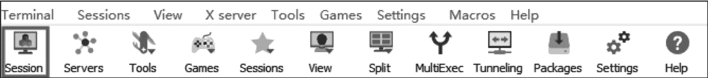

图 2.1　Session

选择`SSH`连接方式，如图 2.2 所示。

图 2.2　SSH 连接

输入 Linux 服务器 IP 与用户名，点击`OK`后输入密码即可登录，如图 2.3 所示。

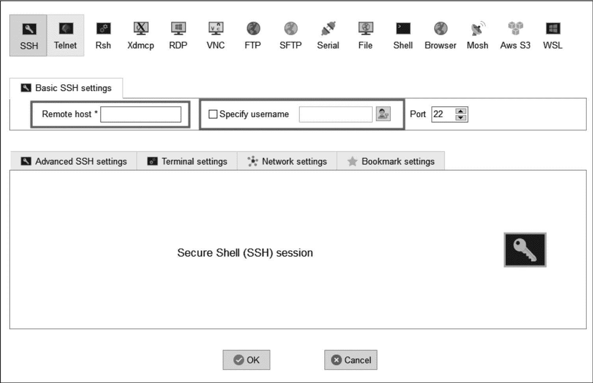

图 2.3　账户与密码

### 2.1.3　在服务器上安装 Python 开发环境

Anaconda 是一个开源`Python`发行版，集成`Conda`、`Python`及 180 多个科学包。`Anaconda 3`对应`Python 3.x`，可避免包间版本冲突，且自 2020 年起官方停止维护`Python 2.x`。下载 Linux 版 Anaconda 并上传至服务器，如图 2.4 所示。

图 2.4　`Anaconda 3.7 Linux`版本

代码如下：

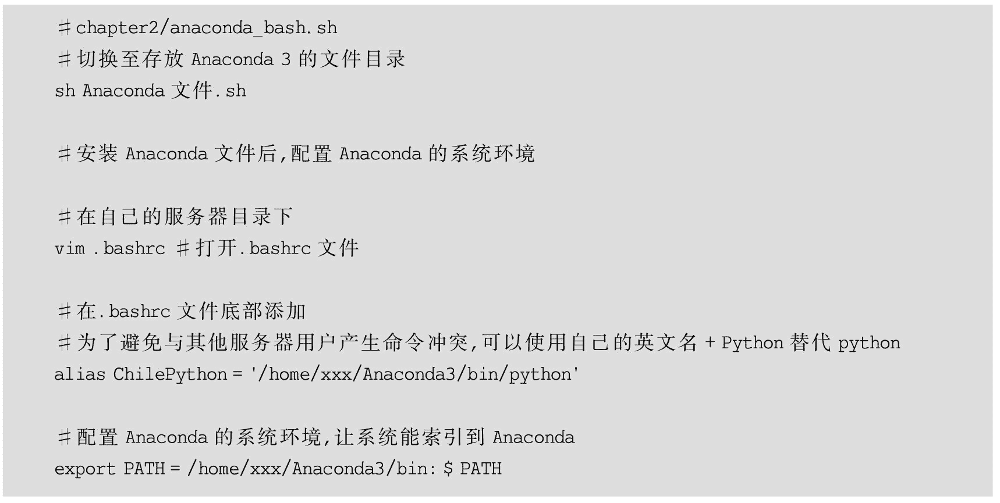

### 2.1.4　使用 Anaconda 国内源

Anaconda 默认使用国外源，下载速度较慢。可更换为清华源或中科大源。Linux 用户在`bash`命令行执行更换命令，代码如下：

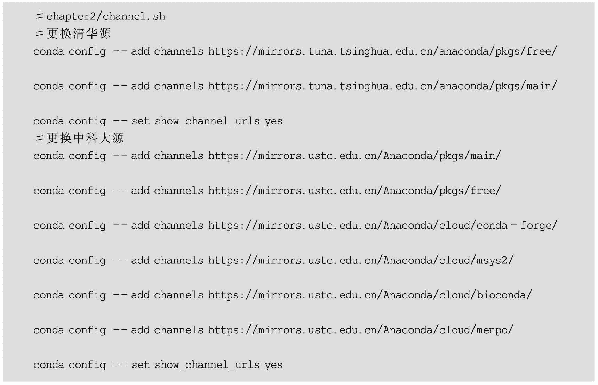

### 2.1.5　pip 设定永久阿里云源

Anaconda 不含部分 Python 包链接时需用`pip install xxx_package`安装。为提速可将`pip`源换为国内阿里云源。Linux 用户在命令行执行以下更换命令即可，代码如下：

## 2.2　Python 虚拟环境

通常开发者仅有 Linux 服务器运行代码权限，不能随意修改系统环境。为避免影响现有环境，可创建 Python 虚拟环境，在其中自由安装软件，使用完毕退出即可，不影响全局环境。

本部分介绍借助 Anaconda 命令行快速搭建隔离虚拟环境的方法。执行 `conda create -n your_env_name python=x.x`（比如 2.7、3.6）即可新建一个 Python 版本为 `x.x`、名称为 `your_env_name` 的独立环境。新环境的文件夹会存放在 Anaconda 安装根目录下的 `envs` 子目录中，相关命令如下：

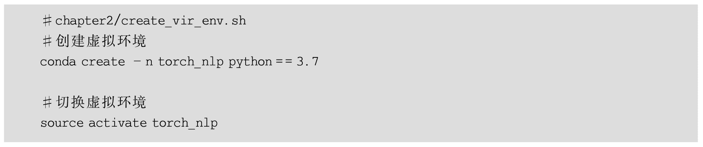

进入该环境后，通过 `conda install your_package` 就能把目标包装进 `your_env_name`。conda 会自动顺带装好该包所需的全部依赖。

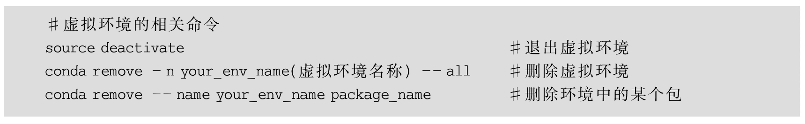

## 2.3 PyCharm 远程服务器协作

PyCharm 是一款专业的代码开发工具。用户可在官网用校园邮箱完成注册，安装时登录该账号即可免费激活专业版，界面示例如图 2.5 所示。

打开 File→Settings→Project Interpreter，点击 Add 按钮，如图 2.6 所示，随后挑选 SSH Interpreter 并填写远程主机的用户名与密码，如图 2.7 所示。

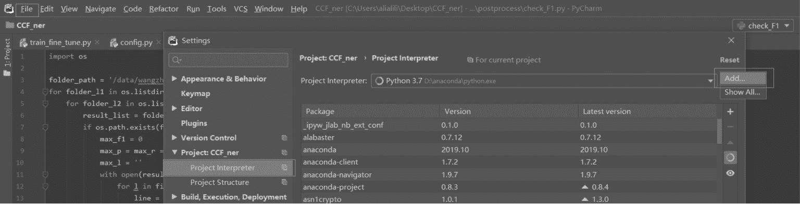

图 2.6　创建远程解释器

图 2.7　填写登录凭证

确认密码无误后点 Next，如图 2.8 所示。验证通过后，从列表中选中前面新建好的虚拟环境，点击 OK 即可完成连接，如图 2.9 所示。

若想让本地项目与服务器目录保持同步，进入 Tools→Deployment→Configuration 进行设置，如图 2.10 所示。

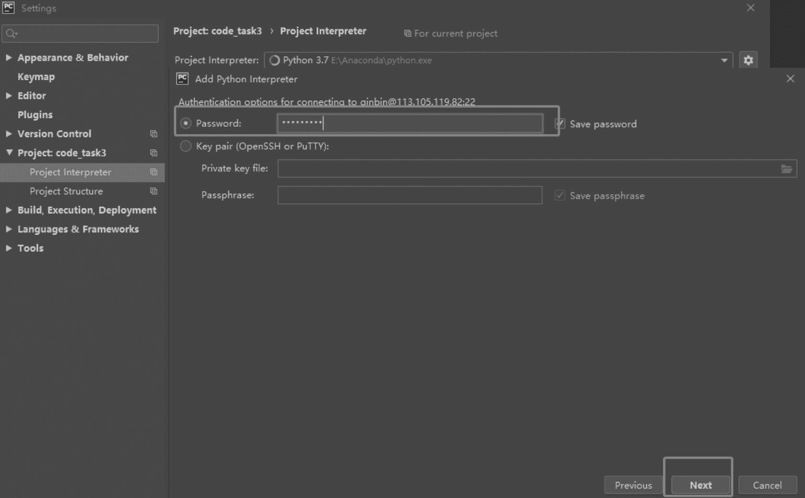

图 2.8　密码确认界面

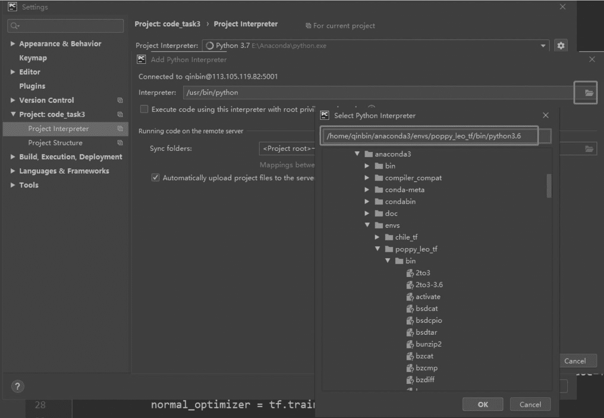

图 2.9　选择已建环境

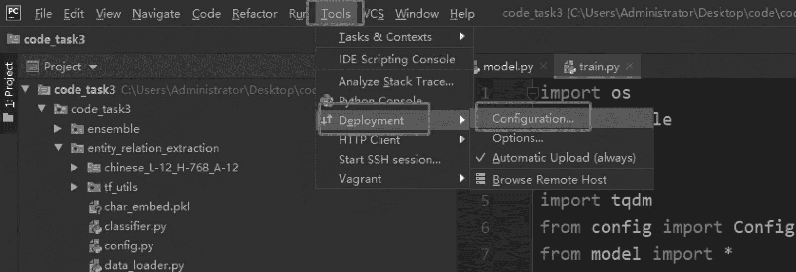

图 2.10　同步目录配置

在配置中指定之前创建的 SSH Interpreter 并设定服务器端路径，本地与远程代码即可实现双向同步，如图 2.11 所示。

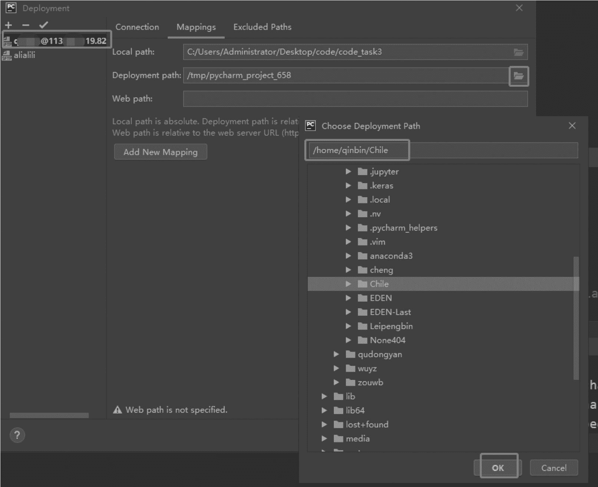

图 2.11　绑定 SSH 解释器

## 2.4 Screen 后台任务守护

在 Linux 窗口中运行耗时较长的程序时，网络波动可能导致会话断开而中断任务。screen 能在服务器上开辟一个后台会话窗口，本地掉线也不会影响任务继续。在命令行输入 `screen -ls` 即可查看当前会话，效果如图 2.12 所示。

代码如下：

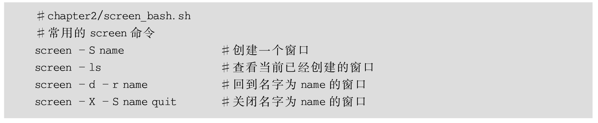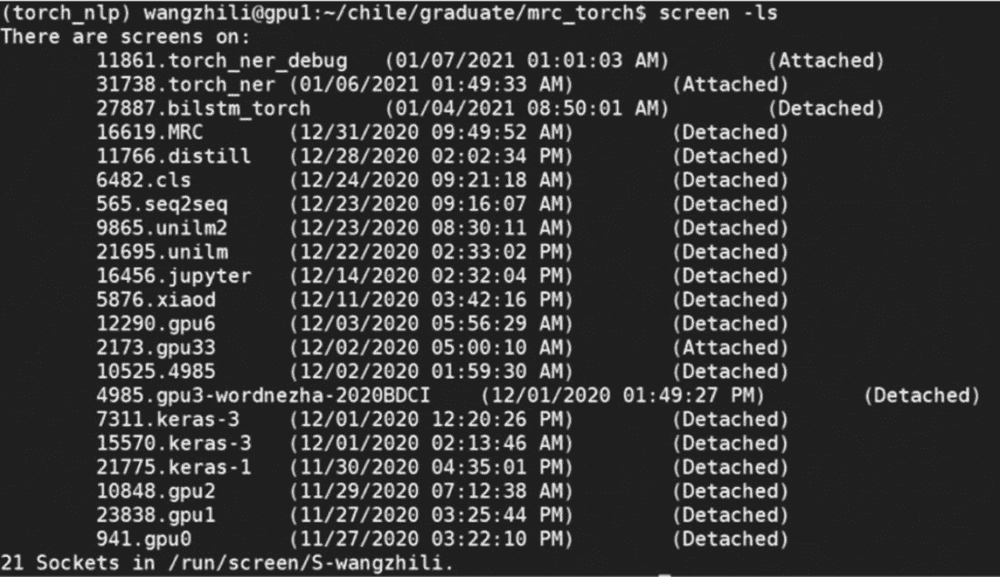

图 2.12　screen 会话列表

另外，使用深度学习框架训练时务必指定 GPU，否则程序会占用全部显卡，严重影响他人使用，示例代码如下：

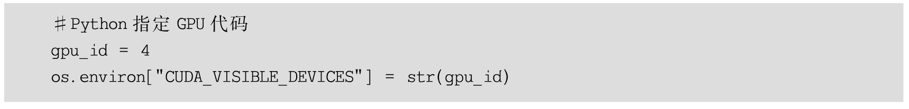

## 2.5 Docker 容器化方案

构建应用不仅是写代码。项目从开发到部署会涉及多种语言、框架和架构，接口不统一让开发复杂度大幅上升。

2013 年 Docker 发布，奠定了容器行业标准。容器是标准化的软件单元，把应用与其运行环境打包隔离，从根上解决了“在我机器上能跑”的问题。

Docker 大幅简化了开发流程，让使用者无需手动配置环境即可调用项目所需的工具与应用，从而提升效率。

Docker 的整体架构如图 2.13 所示，可以理解为在宿主机的操作系统之上再叠加一层 Docker 系统。每个容器都是独立的应用环境，彼此隔离但共享底层公共库。

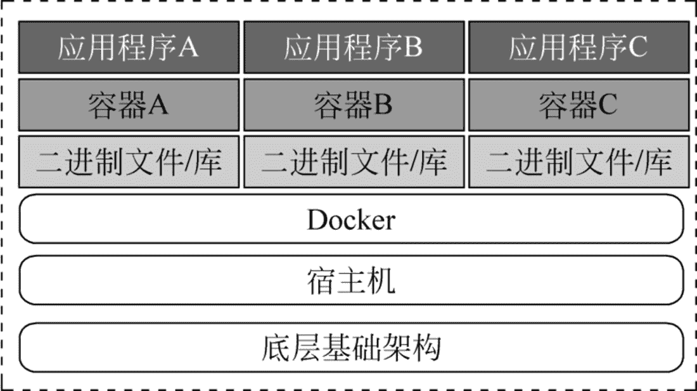

图 2.13　Docker 架构示意

学习一门技术时，环境配置往往耗时最长。Docker 可将整套运行环境打包成镜像，拉取后即可直接使用，避免重复踩坑。本书后续也会通过命令演示 Docker 的具体用法。

### 1．安装 Docker

安装 Docker 需要 sudo 权限，而服务器普通用户通常不具备，因此该步骤需联系管理员协助。下面仍给出标准安装流程，代码如下：

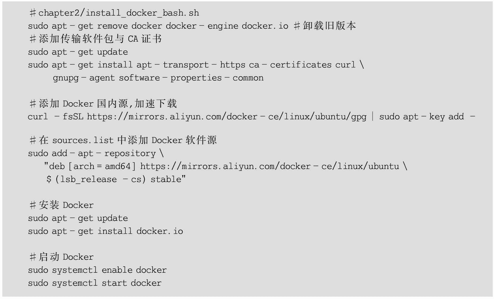

### 2．创建 Docker 用户组

同上，这一步也需要管理员操作。创建 docker 用户组的目的是让普通用户使用 Docker 时免 sudo，也避免 root 频繁输入密码，代码如下：

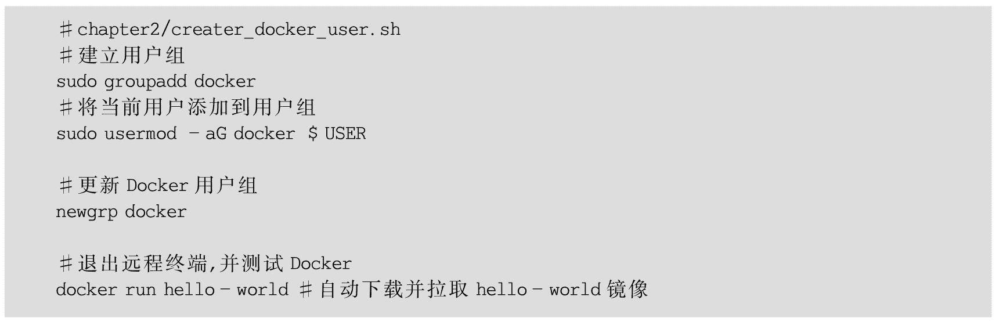

执行 `docker run hello-world` 进行验证，若输出如图 2.14 所示的信息，则表示安装成功。

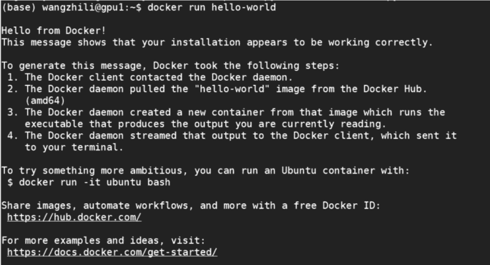

图 2.14　安装验证结果

### 3．拉取与查看镜像

假设需要 PyTorch 运行环境，可从网络上拉取已发布的 PyTorch 镜像。阿里云提供的基础镜像源中，可选择 `PyTorch:1.4-CUDA10.1-py3` 版本进行拉取，命令如下：

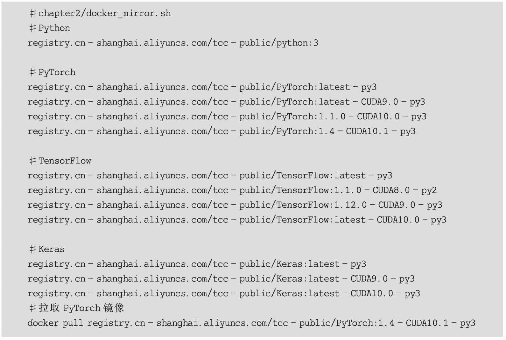

运行后的结果如图 2.15 所示。

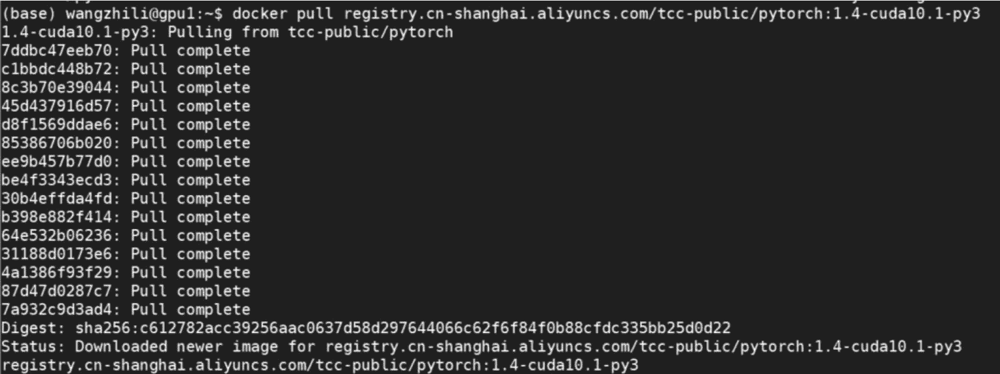

图 2.15　镜像拉取过程

此时即可看到已下载的 PyTorch 镜像，如图 2.16 所示。

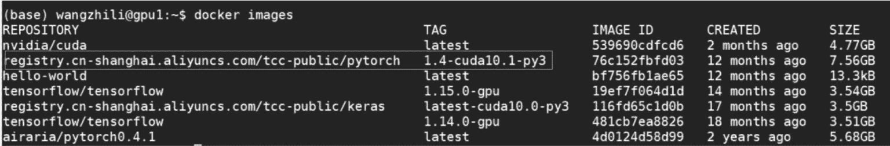

图 2.16　本地镜像列表

### 4．启动容器

借助下载好的 PyTorch 镜像即可启动容器，相当于启动一套 PyTorch 代码运行环境，命令如下：

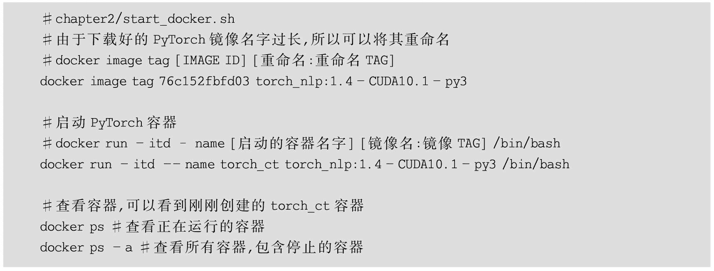

### 5．进入容器

启动后即可进入该环境，与 Anaconda 虚拟环境类似，不同的是容器内部拥有 root 权限，命令如下：

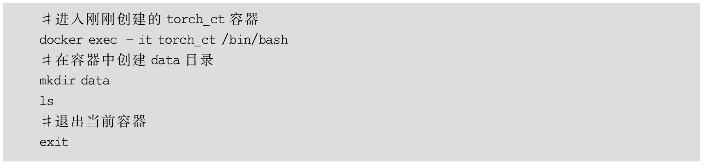

### 6．数据互传

容器默认与外部隔离，数据交互需通过 Docker 机制完成。注意所有交互操作都在宿主机上执行，需先退出当前容器，示例命令如下：

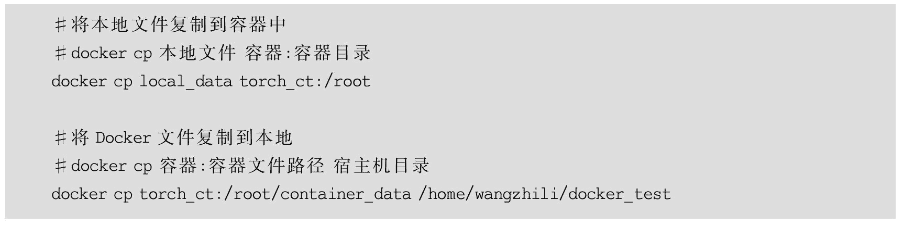

### 7．运行程序

容器内运行程序有两种常见方式：

1. 借助 2.2.4 节的数据互传命令，先把代码和数据拷贝进容器，再在容器中执行。
2. 不拷贝数据，直接使用 Docker 挂载功能，让容器读取本地目录。前提是本地代码与数据在同一文件夹，运行产生的文件会保存在宿主机目录，容器仅作为计算载体，命令如下：

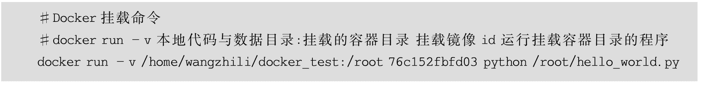

### 8．打包容器

当软件需要交付他人使用时，可将当前容器打包成镜像文件分发，以减少对方的环境配置成本，命令如下：

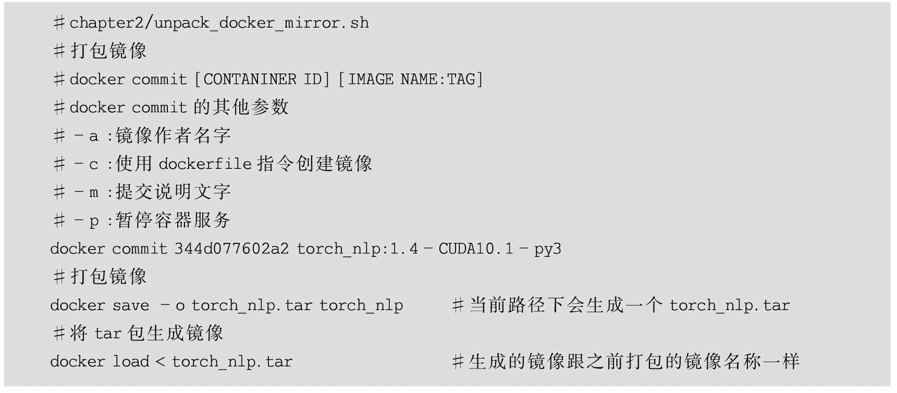

### 9．其他命令

Docker 还提供大量日常使用的命令，均可在宿主机中执行。

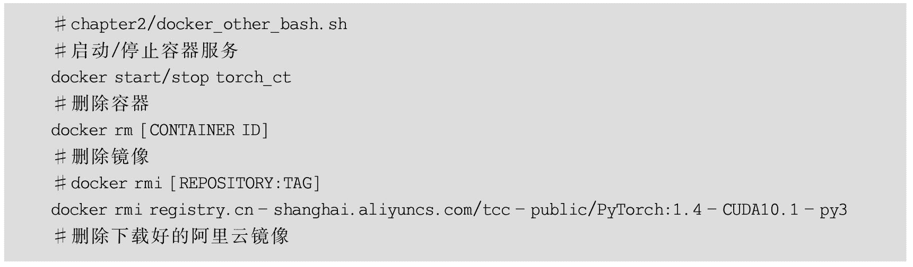

## 2.6 本章要点回顾

本章围绕深度学习代码开发环境的搭建展开，帮助读者在学习自然语言处理原理前先掌握必要的工具链。内容从使用 MobaXterm 远程连接服务器，到服务器上配置开发环境，并介绍了 Anaconda 国内镜像如清华源、中科大源的单次或永久配置方法。随后讲解了虚拟环境的创建，以及 PyCharm 的安装与远程服务器连接。最后介绍了 Docker 容器技术在简化开发流程方面的优势。

# 第 3 章 自然语言处理发展脉络

本章梳理自然语言处理的发展历程，整体趋势可概括为规则→统计→深度学习。通过时间轴回顾这一领域的关键方法，从早期人工规则处理任务，到机器学习应对更复杂需求，再到深度学习在各领域的广泛应用。

## 3.1 规则时代的 NLP

俗话说巧妇难为无米之炊。在机器学习中，数据与特征就是“米”，模型与算法则是“巧妇”。没有足够的数据和合适特征，再强的模型也难以获得理想输出。正如业界常说 Garbage in，garbage out。对机器学习任务而言，数据与特征决定上限，模型与算法则不断逼近上限，可见特征工程的重要性。1970 年以前，NLP 主要分为符号派的规则方法和随机派的概率方法。当时学界更关注推理与逻辑，基于规则的方法占比更高。例如 20 世纪 50 年代初 Kleene 研究了有限自动机与正则表达式；1956 年 Chomsky 提出上下文无关语法并应用于 NLP。随着社会发展，规则方法在词频、聚合度、自由度、编辑距离、主题转换等方面取得进展。下面介绍几种常用特征处理方法。

### 1．词频

词频常用于中文分词的统计手段，统计某个词在特定语境或语料中出现的次数，以判断其是否具备独立成词条件，即单独使用是否有意义。从语言学角度看，能成词的词在语料中通常呈现聚集性出现。

### 2．聚合度

词频并非唯一判断标准。以“电影院”为例，在 2400 万字的语料中，“电影”出现 2774 次，概率约 0.000113，“院”出现 4797 次，概率约 0.0001969。若两者无关，则“电影院”联合概率应约为两者概率乘积的一半。实际上“电影院”出现 175 次，远高于乘积预期，是预期的 600 多倍。而“的”出现概率为 0.0166，“的电影”真实概率与两者概率乘积接近，说明“电影院”更可能是有意义的搭配，“的电影”则像是偶然组合。通过这种方式识别成词称为聚合度。计算步骤如下：

1. 计算词语 S 在词库中的出现概率 P(S)。
2. 对 S 做二分切分得到若干词语对 (SL, SR)，分别计算 P(SL) 与 P(SR)。
3. 对切分结果计算聚合度并取最小值作为 S 的聚合度。对数变换用于避免概率过小导致溢出。

例如句子“天气预报说周五会下雨”，记 dop 为聚合度，单字 dop 为 0，则

dop(天) = 0

dop(天气) = P(天) × P(气)

dop(天气预) = P(天) × P(气预) + P(天气) × P(预)

dop(天气预报) = P(天) × P(气预报) + P(天气) × P(预报) + P(天气预) × P(报)

dop(天气预报说) = P(天) × P(气预报说) + P(天气) × P(预报说) + P(天气预) × P(报说) + P(天气预报) × P(说)

……

二切分后计算概率乘积之和。也可用另一种思路：取 P(电影院) 除以 P(电)×P(影院) 与 P(电影)×P(院) 得到的商的较小值，用最小值代表聚合度能更严格证明成词性。

### 3．自由度

仅看聚合度不足以判断，还需考察词在上下文中的表现。以“被子”为例，“这被子”中“被子”聚合度很高且有意义，而“这被子”整体并不构成有意义短语，但其聚合度也可能很高。为此引入自由度，思想源于信息熵。信息熵衡量不确定性，熵越高信息量越小，确定性越低。可用信息熵衡量词语左右邻字的随机程度。计算过程如下：

1. 统计词语 S 出现次数 N，则左右各有 N 个汉字。
2. 统计左右邻字的出现频次，得到每个字的概率。
3. 按信息熵公式计算左邻熵与右邻熵，其中 P[i] 为邻字概率。
4. 熵越小自由度越低，词语越稳定，取两者中较小的作为自由度。

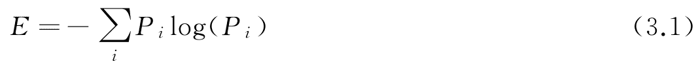

例如“吃葡萄不吐葡萄皮不吃葡萄倒吐葡萄皮”中，“葡萄”出现 4 次，左邻字为{吃，吐，吃，吐}，右邻字为{不，皮，倒，皮}。左邻熵为 -(1/2)log(1/2)-(1/2)log(1/2)≈0.693，右邻熵为 -(1/2)log(1/2)-(1/4)log(1/4)-(1/4)log(1/4)≈1.04。可看出右邻字更丰富。

### 4．编辑距离

编辑距离即 Levenshtein 距离，指把一个字符串变为另一个所需的最少编辑操作次数，距离越大相似度越低。允许操作包括替换、插入、删除。该概念由 Vladimir Levenshtein 于 1965 年提出，可用于 DNA 分析、拼写检测、抄袭识别等。编辑操作代价统一为 1。例如 kitten 变为 sitting：

kitten → sitten 将 k 替换为 s
sitten → sittin 将 e 替换为 i
sittin → sitting 插入 g

## 3.2 机器学习与自然语言处理

利用规则对数据进行预处理，能让特征更突出，使模型学习更“轻松”，如同把食材处理好后更容易烹饪。模型与算法的应用能最大化数据价值。3.1 节介绍了规则处理数据，本节介绍传统算法的发展。

### 3.2.1 词袋模型

词袋 Bag of Words 是一种简单且灵活的文本表示方法，属于机器学习中最基础的文本向量化手段。它只记录文档中是否出现已知词汇，不关心顺序，因此得名“词袋”。

以三条电影评论为例：

评论 1：This movie is very scary and long
评论 2：This movie is not scary and slow
评论 3：This movie is spooky and good

从中抽取 11 个独特词构成词汇表：This、movie、is、very、scary、and、long、not、slow、spooky、good。

对每条评论做二值标记，可得到三个向量，如表 3.1 所示。

**表 3.1 句子转换为向量的表示**

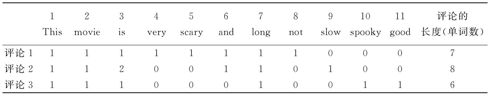

评论 1 的向量：[1 1 1 1 1 1 1 1 0 0 0 0]
评论 2 的向量：[1 1 2 0 0 1 1 0 1 0 0]
评论 3 的向量：[1 1 1 0 0 0 1 1 0 0 1 1]

这就是词袋模型的核心思想。其缺点在于向量长度固定为 11，当出现新句子时就会遇到问题：

独热编码为何难以为继
当文本里出现此前从未见过的词，词表的规模就要扩充，向量的维度随之膨胀；编码后的向量里零元素占据绝大部分，形成高稀疏矩阵；更关键的是，这种表示完全丢失了词序与句法的线索，无法区分“狗咬人”和“人咬狗”。

### 3.2.2 `n`-gram
在搜索引擎里输入几个字，下拉框会立刻给出若干补全候选，像输入“我们”后就蹦出“都要好好的”“恋爱吧”等，这背后其实是语言模型在做概率推断。如果用二元语言模型来预测下一个词，排序思路如图 3.1 所示。

图 3.1 `n`-gram 应用示例

`P`（“都要好好的”|“我们”）>`P`（“都在用力地活着是什么歌名”|“我们”）>`P`（“都要好好的电视剧免费观看”|“我们”）>……>`P`（“恋爱吧”|“我们”），这些概率的来源通常是用户搜索日志的统计。

`n`-gram 的核心思想是用连续的 `n` 个词构成一个片段，当前词的出现概率只依赖它之前的 `n-1` 个词。常见释义如下：

`Unigrams`：一元模型，片段由单个词构成，例如 the、students、opened、their。
`Bigrams`：二元模型，也可看作一阶马尔可夫链，由相邻两个词组成，例如 the students、students opened、opened their。
`Trigrams`：三元模型，由连续三个词构成，例如 the students opened、students opened their。
`4-grams`：四元模型，由连续四个词构成，例如 the students opened their。

概率的常用估计方法是最大似然估计 `MLE`。从语料里统计计数后归一化到 0~1 区间即可得到参数。

例如计算 bigram `xy` 的条件概率，先统计 `C(xy)` 的出现次数，再用以 `x` 开头的所有 bigram 总计数做归一化。

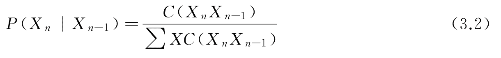

分子是 `C(xy)` 在语料中的频次，分母是当前词为 `x`、后词任选时的 bigram 总频次。简化写法为：

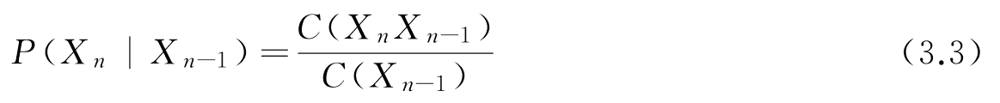

最大似然估计直观但会遇到稀疏性问题：

（1）若目标词从未出现，分子的概率会被算成 0。常用平滑手段如拉普拉斯平滑，给每个词加上一个极小值，保证词表里的词都有非零概率。
（2）若上下文的 `n-1` 个词在语料中缺失，分母无法计算。此时采用回退策略，使用更低阶的 `n`-gram 作为替代，保证条件概率可求。
（3）概率连乘会迅速趋近于 0，实践中改用对数和形式：`P[1]P[2]P[3]P[4]=exp（logP[1]+logP[2]+logP[3]+logP[4]）`。
（4）`n` 越大稀疏越严重、存储开销越高，一般 `n`-gram 不超过 5。
（5）`n>2` 时，如 trigram，常在句子头部补两个 start-token，效果可自行验证。

### 3.2.3 频率与逆文档频率
`TF-IDF` 即词频—逆文档频率，用来度量某个词在文档集合中的重要性。

词频 `TF` 衡量术语 `t` 在文档 `d` 中的出现比例：

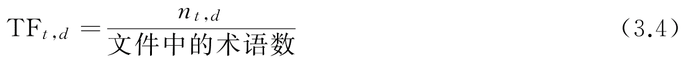

其中分子 `n` 为术语 `t` 在文档 `d` 里的次数。以词袋模型构建的词汇表为例，计算评论 2 的 `TF`：

评论 2：This movie is not scary and is slow
词汇：This、movie、is、very、scary、and、long、not、slow、spooky 和 good。评论 2 共 8 个词

`TF`（This）=1/8
`TF`（movie）=1/8
`TF`（is）=2/8=1/4
`TF`（very）=0/8=0
`TF`（scary）=1/8
`TF`（and）=1/8
`TF`（long）=0/8
`TF`（not）=1/8
`TF`（slow）=1/8
`TF`（spooky）=0/8=0
`TF`（good）=0/8=0

全部术语在各评论的词频汇总如表 3.2 所示。

**表 3.2 评论术语 TF**

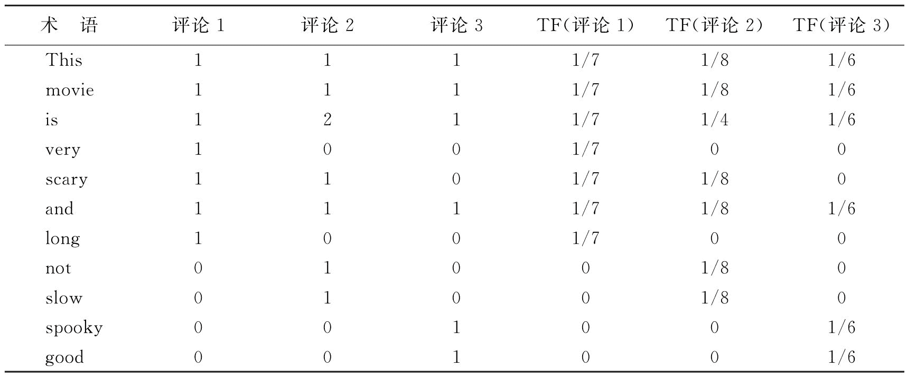

逆文档频率 `IDF` 用来刻画词的区分度，仅用 `TF` 无法体现重要性：

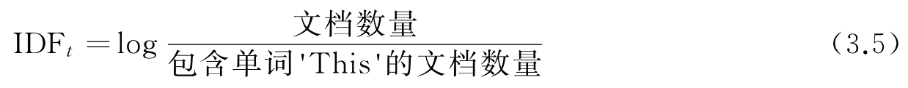

对评论 2 计算：

`IDF`（This）=log（3/3）=log（1）=0
`IDF`（movie）=log（3/3）=0
`IDF`（is）=log（3/3）=0
`IDF`（not）=log（3/1）=log（3）=0.48
`IDF`（scary）=log（3/2）=0.18
`IDF`（and）=log（3/3）=0
`IDF`（slow）=log（3/1）=0.48

整张词汇表的 `IDF` 如表 3.3。

**表 3.3 评论术语 IDF**

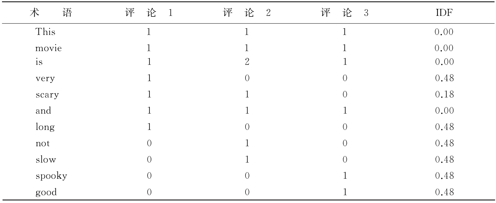

可以看出 is、This、and 等功能词的 `IDF` 接近 0，重要性很低；而 scary、long、good 等内容词数值更高。

于是 `TF-IDF` 为每个词打分：

`TF-IDF`（This，评论 2）=1/8×0=0
`TF-IDF`（movie，评论 2）=1/8×0=0
`TF-IDF`（is，评论 2）=1/4×0=0
`TF-IDF`（not，评论 2）=1/8×0.48=0.06
`TF-IDF`（scary，评论 2）=1/8×0.18=0.023
`TF-IDF`（and，评论 2）=1/8×0=0
`TF-IDF`（slow，评论 2）=1/8×0.48=0.06

所有评论的 `TF-IDF` 汇总如表 3.4。

**表 3.4 评论术语 TF-IDF**

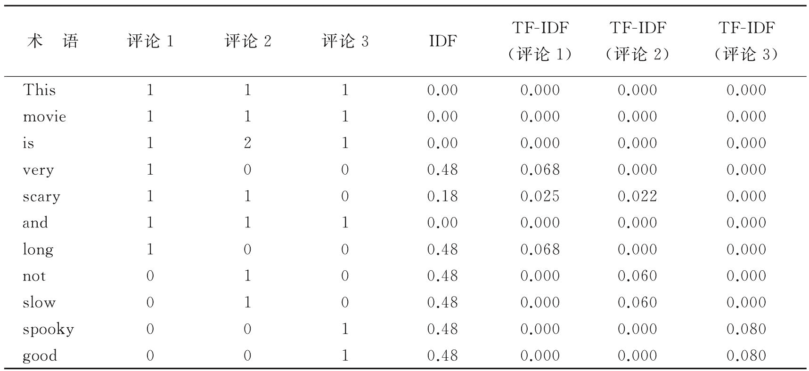

小结来说，词袋只记录词的出现次数，而 `TF-IDF` 能突出重要词、压制常见词，在机器学习任务上表现通常更好。`n`-gram 通过利用前文若干词预测后续词，至今仍是搜索引擎补全的核心手段。

## 3.3 深度学习与自然语言处理
深度学习在 NLP 领域已进入高速发展期，理论与工程仍有待完善，但大数据与算力的提升显著缩短了模型验证周期。接下来介绍奠定预训练模型基础的经典浅层模型。

词嵌入是目前最主流的词汇表表示方式，能在一定程度上保留上下文、语义、句法相似性与词间关系。广义上看，嵌入就是词在向量空间中的坐标。问题在于如何生成，以及如何让上下文信息被捕获。

`Word2Vec` 由 Tomas Mikolov 于 2013 年提出，用浅层神经网络学习词嵌入，是深度学习的重要组成部分。

考虑句子 Have a good day 与 Have a great day，含义相近。设词汇表 `V`={Have，a，good，great，day}，大小为 5。若用独热编码：

`Have=[1，0，0，0，0]'`；`a=[0，1，0，0，0]'`；`good=[0，0，1，0，0]'`；`great=[0，0，0，1，0]'`；`day=[0，0，0，0，1]'`

此时每个词占据独立维度，good 与 great 在空间中一样疏离，这显然不合理。

目标是让语义相近的词在空间中靠近，余弦相似度接近 1、夹角接近 0，如图 3.2 所示。

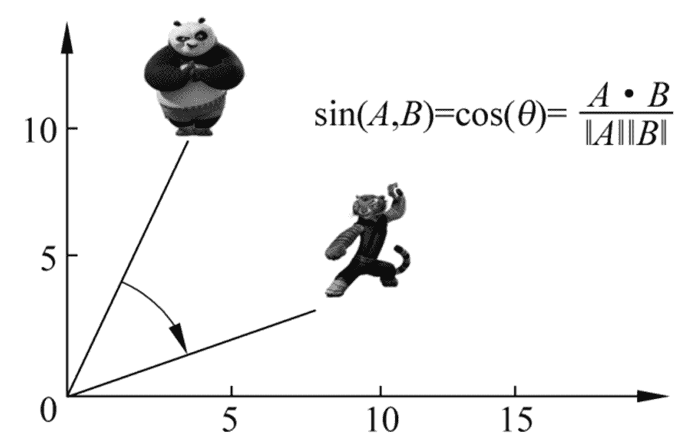

图 3.2 相似单词计算余旋度

独热表示下词与词完全独立，分布式表示则引入依赖，让上下文词获得更大权重。

`Word2Vec` 提供两种实现：跳字模型 `Skip-Gram` 与连续词袋 `CBoW`。

`CBoW` 以上下文词为输入，预测中心词。以 Have a great day 为例，若输入词为 great，模型尝试以单个上下文预测目标 day。输入采用独热编码，与目标独热编码对比计算误差，学习过程中目标词的向量被塑造。结构如图 3.3。

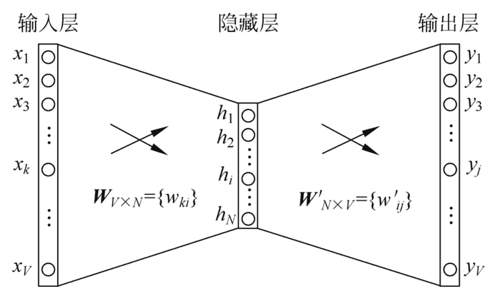

图 3.3 编码结构
输入是长度为 `V` 的独热向量，隐藏层有 `N` 个神经元，输出是 `V` 维的 `Softmax` 概率。隐藏层仅做加权求和，没有 `tanh` 或 `ReLU`，非线性只在输出 `Softmax`。若使用多个上下文词，输入取平均，如图 3.4。

图 3.4 所示的模型使用 `C` 个上下文词，隐藏层输入为这些词的平均。

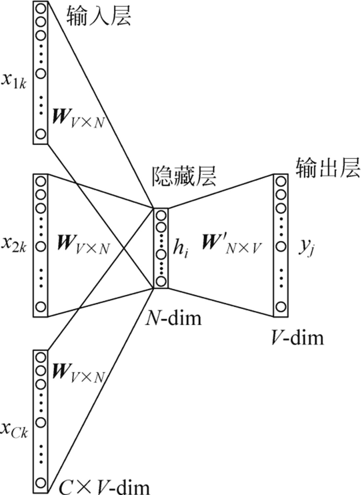

图 3.4 多个上下文词处理的示意图

另一种思路是反过来：以目标词输入，预测上下文，这就是 `Skip-Gram`。如图 3.5。

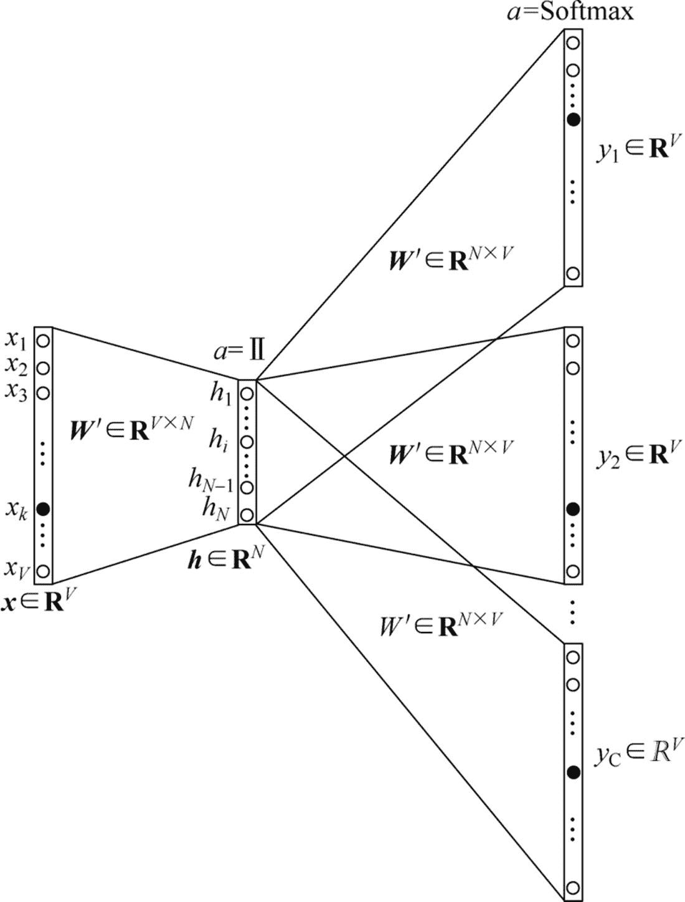

图 3.5 利用`Skip-Gram`生成表示形式结构图
`Skip-Gram` 对稀疏数据和低频词更友好，`CBoW` 训练更快、在高频词上表现更好。两者均用反向传播学习。

## 3.4 小结
本章从词频、聚合度、编辑距离等规则方法讲起，到机器学习阶段的 `n`-gram 与 `TF-IDF`，再到浅层深度模型 `Word2Vec`。随着任务复杂度提升，算力与数据规模的增长成为深度学习快速发展的催化剂。

# 第 4 章 无监督学习的原理与应用
第 3 章勾勒出 NLP 的演进脉络，凸显了无监督学习的重要性。无监督学习训练出的模型即预训练模型，先在海量数据上预训练，再针对下游任务微调，从而高效解决各类 NLP 实际问题。

## 4.1 浅层无监督预训练模型
维度的诅咒是建模联合分布时的核心难题。以 10 000 词的词表为例，独热编码需要 10 000×10 000 的矩阵，大量 0 值造成存储浪费。为缓解这一问题，人们转向低维向量表示，这正是无监督预训练的起点。

第 3 章已详述 `Word2Vec` 等浅层模型。它们显著提升了 NLP 效果，并能利用更长上下文，具体原理不再重复。

## 4.2 深层无监督预训练模型

### 4.2.1 BERT
2018 年，Jacob Devlin 等提出的 `BERT` 震动了 NLP 学术界。`BERT` 通过在所有层的双向上下文上联合建模，对未标记文本做深层双向表示预训练。微调时只需加一个输出层即可适配问答、语言推断等任务，减少了任务专属架构的设计成本。它是首个基于微调的表示模型，在多项句子级与词元级任务上取得当时最好成绩。

通俗理解可把 `BERT` 看作深度的 `Word2Vec`。对特定任务，只需在 `BERT` 后接少量网络即可。2018 年底发布后推动了 11 项 NLP 基准。`BERT` 的结构源自 `Transformers` 编码器，其整体结构如图 4.1。

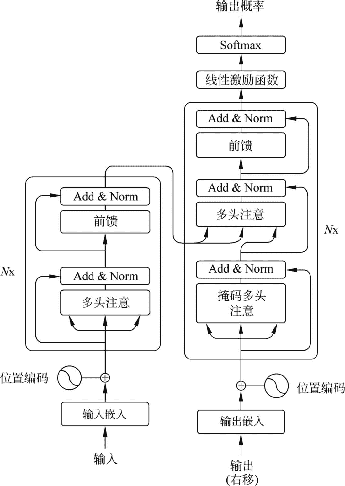

图 4.1 `Transformers`结构（左图为编码器，右图为解码器）

### 4.2.2 Self-Attention Layer 原理

### Self-Attention Layer 概述
Self-Attention 是为解决 `RNN`、`LSTM` 等序列模型难以在 GPU 上并行加速的问题而提出。

如图 4.2 所示，输入先被拆分为 `Token Embedding` + `Segment Embedding` + `Position Embedding`。当样本由两句话组成时，`[CLS]` 用于判断两句是否相关，`[SEP]` 用于分隔两句。

英文输入需先用 `BERT` 的分词工具处理，例如 playing 被切分为 play+##ing，这样能利用词根与词缀减少词表规模。

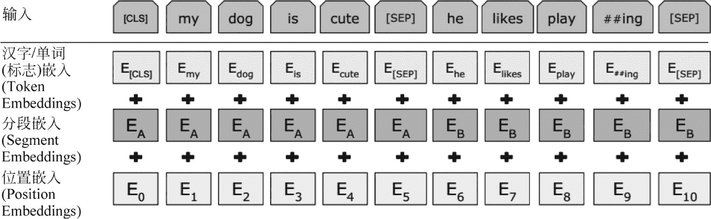

图 4.2　Self-Attention 的输入

中文输入一般不需要分词，将整段文字按字空格分隔即可。模型无法直接处理字符，必须通过 `BERT` 自带的字典 `vocab.txt` 将每个字或词映射为 id 后再送入。

`Segment Embedding` 的作用是在双段输入时提供段界信号。把两段文字一起喂进模型，必须让它知道哪里切分。业界常用 `[SEP]` 做分隔符，首位的 `[CLS]` 则承担整段表征，拿来判断两段是否有上下文关联。

`Position Embedding` 的作用在于补足顺序感。Transformer 体系没有 RNN/LSTM 那种天然的时序记忆，位置必须显式编码。实现路线大致两条：BERT 做法是先备好一组位置向量，通过训练迭代优化；原始 Transformer 做法是用正弦与余弦函数按序号生成。因为正弦对序列外推更友好，训练好的模式可以迁移到更长的长度，余弦在这点上略逊，所以实践里更偏爱正弦方案，具体形式见式 4.1 与 4.2。

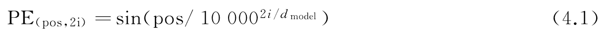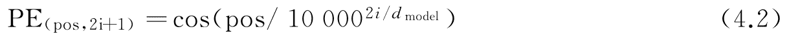

### 4.2.3 自注意力层内部计算
先把 Q 与 K 做点积并做缩放，通常除以维度平方根来压制数值；随后过 Softmax 得到概率分布；最后用该分布加权 V，输出自注意力结果，对应式 4.3 与 4.4。Q、K、V 均源自同一个输入 X，分别等于 X 乘上可学习矩阵 W_Q、W_K、W_V，训练过程中这三组参数会不断收敛，如图 4.3 所示。

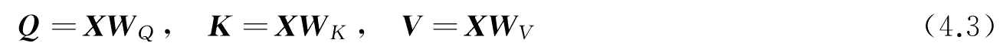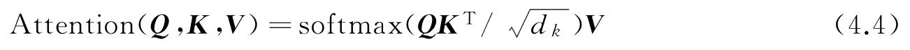

图 4.3　初始化（Q，K，V）

### 4.2.4 多头自注意力
借助线性投影制造多组 Q、K、V，把若干单头的输出拼接后再经一次全连接降维，往往比单头更稳健。可把多头理解为用不同视角审视同一文本，让注意力具备更宏观的视野。整体流程是并行算多个单头再融合压缩，如图 4.4 所示。

图 4.4　Multi-Head Self-Attention^[1]

### 4.2.5 为什么选 LayerNorm
自注意力输出后通常接 LayerNorm 而非 BatchNorm。先看张量形状，一批数据是 batch_size × max_len × embedding。BatchNorm 是对每一列归一，相当于同一位置的词向量跨样本归一；LayerNorm 是对每一行归一，相当于同一句内部的词向量归一。后者对文本更直观。

图 4.5　归一化

### 4.2.6 BERT Pre-training
BERT Pre-training 如图 4.6。Pre-training 本质是造一个通用基础模型。

图 4.6　Pre-training 与 Fine-tune 过程^[1]

日常很少自己从零训练，通常直接加载开源权重再 Fine-tune。了解原理仍有帮助。输入 X 进入自注意力前会先映射为 Token Embedding + Segment Embedding + Position Embedding。序列长度一般取 512 或 1024，不够用 [PAD] 补齐，句首用 [CLS]，双句间用 [SEP] 分隔。

（1）MaskLM 策略：随机挑选 15% 的词或字进行掩码。被选中的 token 有 80% 概率被换成 [mask]，10% 概率被换成随机词，10% 概率保持原样。目标是让模型学会预测被隐藏的单元，从而习得语言表征。

（2）NSP 策略：判断前后两句是否连贯，即 Next Sentence Prediction。

Pre-training 同时使用 MaskLM 与 NSP，语料规模约 330 亿 token。NLP 的 Pre-training 是无监督的，不需要人工标注，因为掩码预测和句子顺序判断的标签可程序化生成。训练后，词表里的每个 token 都对应 768 维向量，Fine-tune 时就能适配下游任务。

### 4.2.7 BERT Fine-tune 实操
Fine-tune 流程同图 4.6。也可以不 Fine-tune，直接把 BERT 当特征提取器用。若要 Fine-tune，论文建议的参数区间比较稳：

（1）Batch Size：16、32；  
（2）Learning Rate：5e-5、3e-5、2e-5；  
（3）Epochs：2、3、4。

## 4.3 其他 Pre-training 模型
无监督 Pre-training 大幅提升效果，但哪些改进真正起效很难说清，因为训练成本高、数据不公开。于是围绕 BERT 的缺陷出现了不少改进版。

### 4.3.1 RoBERTa
Liu Yinhan 等^[3]指出超参对结果影响很大，他们对 BERT 做了系统复现和调优，提出 RoBERTa，性能可媲美甚至超过多数 Post-BERT 模型，主要改动包括：

（1）训练时长更长、batch 更大、数据更多；  
（2）去掉 Next Sentence Prediction；  
（3）支持更长序列训练；  
（4）采用 dynamic masking。BERT 原始实现在训练开始时就固定掩码位置，属于静态掩码。为避免每次迭代都看到相同掩码，有研究把数据重复 10 次，在 40 个 epoch 内让每个序列经历 10 种不同掩码，证明 dynamic masking 更有效；  
（5）新增大规模新闻语料 CC-NEWS 作为训练集；  
（6）使用 Byte-Pair Encoding 编码，兼顾字符级和词级，能减少 [UNK] 出现。

### 4.3.2 ERNIE
受 BERT 掩码启发，Yu Sun 等^[5]提出 ERNIE，通过知识增强的掩码策略提升表征，包含实体级掩码和短语级掩码，对比见图 4.7。

图 4.7　3 种掩盖策略对比^[5]

实体级掩码可一次性遮住多词构成的实体，短语级掩码则遮住表达一个概念的短语。实验显示 ERNIE 在 Chinese NLU、语义相似、命名实体识别、情感分析、问答等任务上表现更好，并在完形填空上展现更强的知识推理，知识掩码示意图见图 4.8。

图 4.8　知识掩盖策略^[5]

### 4.3.3 BERT_WWM
BERT_WWM 在 BERT 基础上引入 Whole Word Masking，解决随机掩码可能只遮住词片段的问题。英文分词后如 Playing → Play + ##ing，原生 BERT 可能只遮其中一部分，而 Whole Word Masking 会整体遮住。Cui Yiming 等^[6]把该思想用于 Chinese，整词被掩码带来明显收益。掩码方式与 ERNIE 类似，示意图见图 4.9。

图 4.9　`BERT_WWM`掩盖策略^[6]

### 4.3.4 ALBERT
ALBERT 的骨架与 BERT 接近，核心是降参但保持性能，参数从约 108M 降到 12M，空间复杂度下降但时间复杂度未减，推理速度并未提升。

#### 1. 矩阵分解
BERT 的词嵌入参数量为 V×H。ALBERT 引入中间维度 E，把参数变为 V×E + E×H，当 E << H 时参数大幅减少，实验最优 E=128。

#### 2. 跨层参数共享
最大的降参来源是跨层共享。用同一套自注意力层循环 12 次，每层权重复用。分析显示 BERT 各层参数很相似，共享后性能损失可控。ALBERT 也放弃 NSP，改用 Sentence Order Prediction，即判断两句是否顺序正确，正例如“朱元璋建立明朝 → 朱元璋处决蓝玉”，反例则顺序颠倒。因为层数不变，推理时仍需经过 12 次计算，速度没有提升。

### 4.3.5 Electra
Electra 借鉴 GAN 思想做 Pre-training。BERT 用 15% 的 [MASK] 让模型预测被遮词。Electra 先随机替换部分 token，用一个小生成器生成伪 token，再让判别器 Electra 判断哪些 token 被替换过，任务称为 Replaced Token Detection，如图 4.10。

图 4.10　Electra 网络结构

相比 Masked Language Modeling，RTD 计算效率更高，在同样算力下下游任务表现更好。

### 4.3.6 NEZHA
Chinese Pre-training 仍有提升空间，NEZHA 在 Chinese corpus 上针对 BERT 的不足做了优化，包括 relative positional encoding、Whole Word Masking、混合精度训练和 LAMB 优化器。

#### 1. relative positional encoding
BERT 的多头注意力对位序不敏感，positional encoding 被弱化合并到词嵌入中。NEZHA 修改式 4.3、4.4 引入相对位序信息，得到式 4.5~4.8。

其中，和分别是位置 i 与位置 j 的相对位序编码，由式 4.9 与 4.10 定义，d 为隐藏维度。

#### 2. Whole Word Masking
BERT 随机掩码单个字符或 token，NEZHA 采用 Whole Word Masking，一旦一个汉字被掩，则同词其他字符一并掩盖，对比见图 4.11。

图 4.11　BERT 随机掩盖策略与 NEZHA 全词掩盖对比

#### 3. 混合精度训练
训练中同时使用 FP16 和 FP32，可提速 2~3 倍并节省显存。权重以 FP32 保存，每次迭代先转为 FP16 做前向后向，梯度再转回 FP32 更新主权重。

#### 4. LAMB 优化器
LAMB 专为大批量分布式训练设计，能自适应学习率，避免大 batch 下性能下降。使用 LAMB 后 BERT 的训练时间从 3 天缩短到 76 分钟，在 NER、LCQMC、ChnSenti、XNLI 等 Chinese 任务上达到很高的 Fine-tune 效果。因此本项目选用 NEZHA 作为基准 Pre-training 模型。

### 4.3.7 预训练模型性能对比
相比 `Word2Vec` 这类较早的词表示方法，`BERT` 及其后续改进版本在效果上已形成明显优势。只有在对时延、显存等资源要求极端苛刻、只能用轻量模型完成特定小范围任务时，才会考虑沿用小模型；绝大多数情况下，提升整体准确率的首选仍是 `BERT` 这类大模型。

另外需要指出，`BERT` 出现之后，预训练模型的研究几乎井喷式发展。只要把握住 `BERT` 的核心思想，面对新模型也能迅速理解其原理，多数工作本质上都是针对 `BERT` 存在的缺陷进行优化。

### 4.4 BERT 下游的四大任务类型
第 4.3 节已提到，`BERT` 等预训练模型的提出，让 `NLP` 任务不再需要为每个任务手工设计专属结构。模型使用者只需在预训练模型之上接上少量任务层，就能完成具体任务。原因在于，预训练模型通过大规模无监督语料学习，已经把语言知识沉淀到参数里，后续对特定任务做少量结构增补与微调即可完成迁移，这正是迁移学习的价值。`BERT` 思想简洁、实践丰富，它推动了 11 项 `NLP` 任务的 SOTA，其中可归纳为四大下游任务。下面以 `BERT` 为例展开说明。

### 4.4.1 句子对分类任务
Williams 等^[\(10\)] 提出的 Multi-Genre Natural Language Inference 属于大规模分类，给定两句话，判断第二句相对第一句是蕴含、矛盾还是中立。

Chen 等^[\(11\)] 提出的 Quora Question Pairs 是二分类，判断 Quora 上两条提问在语义上是否等价。

Wang 等^[\(12\)] 构建的 QuestionNaturalLanguageInference 源自 Stanford Question Answering 数据集^[\(24\)] 的转换版，同样是二分类。正样本为 {问题, 句子} 且该句子包含正确答案，负样本为同段中不包含答案的 {问题, 句子}。

Cer 等^[\(13\)] 提出的语义文本相似性基准，从新闻标题等来源抽取句子对，用 1~5 分标注两者语义相似程度。

Dolan 等^[\(14\)] 提出的 Microsoft Research Paraphrase Corpus 由在线新闻自动提取的句子对构成，经人工标注判断是否语义等价。

Bentivogli 等^[\(15\)] 提出的识别文本蕴含任务与 MNLI 类似，也是二分类蕴含判断，但训练数据规模更小。

Zellers 等^[\(16\)] 提出的对抗生成情境数据集包含 11.3 万个句子对，用来评估常识推理能力。输入一句后从四选一中挑出最合理的续写。在 SWAG 微调时，每个输入序列由给定句子 A 与候选续写 B 拼接而成。

如图 4.12（a）所示，句子对分类通常先用 `[SEP]` 把两句连成序列输入模型，再在预训练模型上加一个简易分类头，联合微调。实现上引入任务专属的分类权重矩阵 `W` `K` × `H`，取 `BERT` 首个输入标记 `[CLS]` 在最后一层的向量 `C` `H`，通过式（4.11）计算分类损失 `loss`，即可梯度下降训练。

其中 `K` 为标签数，`H` 为词或单词的隐藏维度，通常为 768。

图 4.12　`NLP`四大下游任务微调插图^[\(1\)]

### 4.4.2 单句分类任务
Socher 等^[\(17\)] 提出的斯坦福情感树库是单句二分类，基于电影评论句子及其情绪标注。

Warstadt 等^[\(18\)] 提出的语言可接受性语料库也是单句二分类，任务是判断英语句子是否在语言上可接受。

如图 4.12（b）所示，单句分类可直接在预训练模型上加一个分类层后联合微调，运算逻辑与式（4.11）一致。

### 4.4.3 问答任务
Rajpurkar 等^[\(19\)] 提出的斯坦福问答数据集 `SQuAD` 包含 10 万个问答对，给定问题与含答案的维基段落，预测答案在段落中的起止位置 `start`、`end`。

目前大多数 `BERT` 微调做法都是在预训练模型上加简易分类头联合训练，但并非所有任务都能仅靠此表示。如图 4.12（c）所示，阅读理解会先用 `[SEP]` 把问题与文本拼接输入，然后把 `BERT` 最后一层向量 `C` `L` × `H` 送入输出层。初始化输出权重矩阵 `W` `K` × `H`，通过式（4.12）计算答案指针概率向量 `logit`。

其中 `H` 为隐藏维度 768，`L` 为序列长度，`K`=2，表示 `logit` 为 `L` 行 2 列矩阵，第一列为起始指针概率，第二列为结束指针概率。

由此可分离出 `start_logit` 与 `end_logit`，与真实答案对 `start`、`end` 对比得到 `start_loss` 与 `end_loss`，总和即为式（4.13）所示的 `loss`，用于梯度下降。

### 4.4.4 单句标注任务
单句标注即命名实体识别 `NER`，常见数据集有 `CoNLL-2003 NER`^[\(20\)]。任务是抽取文本中具有特定意义的实体，如人名、地名、机构名、专有名词，以及时间、数量、货币等。以“明朝建立于 1368 年，开国皇帝是朱元璋。介绍完毕！”为例，可抽出

（1）机构：明朝。

（2）时间：1368 年。

图 4.13　`NER`数据格式

（3）人名：朱元璋。

`BERT` 在 `NER` 上不能仅靠加分类层微调，需引入特定结构。先了解数据格式，如图 4.13，格式为每行一个字与其标注，标注采用 `BIO` 约定，`B` 为实体起，`I` 为实体内，`O` 为非实体，句子间空一行。若文本为英文，需用 `BIOX`，`X` 表示 `BERT` 分词后非首子词，例如 Playing 被切为 Play 和 ##ing，Play 标 `O`，##ing 标 `X`。

了解格式后，如图 4.12（d）所示，将 `BERT` 最后一层向量 `C` `L` × `H` 输入输出层。初始化权重矩阵 `W` `K` × `H`，此时 `K`=1，通过式（4.12）得到每个字或词的标注概率 `logit`，计算与真实标签的差距得到 `loss` 进行训练。

实践中常把 `logit` 送入 `Bi-LSTM` 学习上下文，再接 `CRF` 层拟合真实标签。加入 `CRF` 的原因是它能学习标签间的约束，例如 `B-ORG I-ORG` 合法，而 `B-PER I-ORG` 非法；`I-PER I-ORG` 也非法，因为实体必须以 `B-` 起始且同一实体内部标签应一致。这些约束能显著降低错误序列的产生。

## 4.5 小结
本章阐述了无监督学习在 `NLP` 中的重要应用——预训练模型。预训练模型免去了为每个任务手工设计网络结构的繁琐，减少了主观因素，提升了泛化与精度。

`BERT` 问世后，`XLNET`、 `ZEN` 等大量改进模型相继出现。从介绍可看出，多数改进只是针对 `BERT` 的掩码策略、超参数等不足做优化，并非颠覆性创新。遇到新预训练模型时，往往能判断其改进点。当前数据补充比改动模型本身更关键，因此未对所有模型逐一展开。

总体看，`NLP` 进展不及计算机视觉迅速，根源在于语言复杂性远高于图像，且现有模型多为数据驱动的弱人工智能，缺乏类人联想学习能力。视觉模型落地更多，目前不少 `NLP` 研究者转向视觉，希望把视觉思想迁移到语言领域，加速 `NLP` 发展。相信随着全球研究者的努力，人工智能终将突破弱智能瓶颈，实现真正智能，并推动整个人工智能进程。

# 第 5 章 无监督学习进阶
第 4 章介绍了无监督学习原理与预训练模型的应用，预训练模型简化了任务专属结构的定制，提升了泛化与精度，算法人员只需在特定任务上做少量结构增补与微调即可适配。为此也探讨了 `NLP` 的四大下游任务。

本章继续深入无监督学习，首先介绍生成式对抗网络 `GAN`，其提出者 Ian Goodfellow 设想让两个网络互相对抗，一个负责生成接近真实的数据，另一个负责区分真假，这一想法在深度学习领域引发革命。

随后进入元学习领域，即机器学习如何学习，做法是先用大量任务做粗训练，再用目标任务数据精调，使模型快速适应新任务。

## 5.1 生成式对抗网络
2014 年，`GAN` 之父 Ian Goodfellow 在酒吧为师兄庆祝时，与工程师们讨论如何让计算机自动生成图像。当时主流思路是统计图像元素的分布，Goodfellow 提出让两个网络相互对抗的设想，回家后试验便取得意想不到的效果，一夜之间 `GAN` 引爆深度学习革命。

`GAN` 的学习是无监督的，不依赖标注数据，这使其应用价值很大。以下以图像生成为例说明原理。

假设有两个网络：生成器 `Generator` 与判别器 `Discriminator`。生成器 `G` 接收随机噪声 `z` 并生成图像 `G(z)`。判别器 `D` 判断图像真伪，输入图像 `x`，输出 `D(x)` 表示为真图概率。`GAN` 整体结构如图 5.1。

图 5.1 生成式对抗网络（`GAN`）的基本架构

训练过程中，生成器目标是生成逼近真实的图像去欺骗判别器，判别器目标是尽可能区分生成图与真图，二者构成动态博弈。理想状态下，生成器能以假乱真，判别器无法分辨，此时 `D(G(z))`=0.5。

`GAN` 目标函数见式（5.1）。`D(x)` 表示判别器认为样本为真的概率，`1-D(G(z))` 为认为样本为假的概率，对两项取对数求和。

训练时判别器希望目标函数最大化，即真样本判真、假样本判假的概率最大；生成器希望目标函数最小化，即降低判别器正确判断的概率。二者目标相反，形成对抗博弈，交替优化直至势均力敌。

训练通常采用梯度下降。最小化环节与常规梯度下降类似，最大化环节需符号反转。由于过程是博弈，传统梯度下降不能直接套用。且生成器能生成连续分布，而真实数据分布是离散的，作者在论文中给出如下训练流程：

（1）初始化生成器 `G` 与判别器 `D` 的参数。

（2）先训练 `k` 次判别器 `D`，再训练一次生成器 `G`。训练 `D` 时从训练集采样 `n` 个真实样本并从生成器采样 `n` 个合成样本，训练 `G` 仅在生成器部分采样。该过程重复，使生成器逼近真实分布，判别器尽可能区分真假。

（3）迭代多次后理想情况下判别器无法区分真实样本与生成样本，辨别概率为 0.5，训练结束。

## 5.2 元学习
元学习又称 `Learn to Learn`，核心是学会如何学习。先用大量任务数据做预训练，再用特定任务数据精调，使模型快速收敛到该任务的最优权重。

人类能凭极少量样本快速识别新类别，如孩童见过老虎与狮子照片后即可区分。二者启发了元学习与少样本学习 `Few-Shot Learning` 的结合：模型学习大量相似任务的先验知识，面对新问题时能迅速学好。

下文介绍相关模型与方法。

### 5.2.1 Metric-Based Method
若在少样本任务中直接用交叉熵损失训练神经分类器，很容易过拟合，因参数量远大于样本量。换用非参数化思路，如 `K` 近邻、`K` 均值，可在元学习框架下构建端到端少样本分类器，其核心是对样本间距离建模，使同类靠近、异类远离。下面介绍代表方法。

#### 1. 孪生网络
孪生网络得名于“连体”，核心特征是权值共享，结构如图 5.2。

该结构有两个输入 `X[1]` 与 `X[2]`，模型 `G[W]` 将两者分别映射到新空间得到特征向量，距离函数 `E[W]` 衡量两向量距离，从而评估输入相似度。

图 5.2 孪生网络的基本架构

## 5.2 少样本学习网络模型

### 5.2.1 基于度量的方法

### 孪生网络（Siamese Network）
Siam 为古代泰国英文名，中文译暹罗，因 19 世纪一对连体婴儿而得名。孪生网络最大特点是网络权值共享，基本结构如图 5.2 所示。

网络有两路输入 `X[1]` 与 `X[2]`。模型 `G[W]` 其中 `W` 为参数，用于将输入映射为特征向量。`E[W]` 为距离度量，用以衡量两组特征向量的相似性，进而判断两个输入是否相似。

孪生结构的核心在于先学习一个通用的描述子空间，再让两路共享参数的子网络分别编码输入，从而实现可直接比较。于是输入既可以是纯数值，也可以是经卷积子网处理的图像，或经循环子网处理的序列。

这类模型最常被用来做两样本是否同类的问题，目标是估计两者同源的可能性。最常用的目标函数见式（5.2）。

其中 `y` 取值 0 或 1 作为类别指示，`p` 为模型输出的概率估计。为了让网络学会区分相似与相异，通常会同时提供正对和负对并累加其损失，具体形式见式（5.3）。

另外一种可选方案是三元组损失，见式（5.4）。

式中 `d` 为距离计算方式，如 L1 或 L2；`a` 为锚样本；`m` 为间隔阈值；`p` 为同一类别的随机正例；`n` 为异类负例。最小化该式会把锚点与正例的距离压向零，同时让锚点与负例的距离大于 `d(a,p)+margin`。当负例被有效分离时，整体数值会趋近于零。

### 匹配网络（Match Network）

匹配网络的示意图如图 5.3 所示。与孪生结构相比，它在骨架不变的前提下引入了记忆与注意力机制，能够快速为从未见过的类别生成预测标签。

图 5.3　匹配网络的原理图

该方法对训练集的输入与标签做加权融合，构建出以训练集为支撑的分类器 。对于全新查询样本 ，其归属概率由  与支持集 `S` 之间的距离度量决定，具体表达见式（5.5）。

其中 `y[i]` 表示第 i 类的标签；`a` 为基于距离得到的注意力分数，细节见式（5.6）。网络通过注意力对各类别分数做线性组合。若查询  与 `x[i]` 足够接近，对应的注意力分数就会升高。

换句话说，匹配网络把判别压缩到了注意力计算上。一旦某类别获得较高的注意力权重，测试样本落入该类的可能性自然随之上升。

### 原型网络（Prototype Network）

原型网络的思路很直观：在低样本情形下，把同一类别的训练样本在嵌入空间里加权平均得到均值中心，将该中心视作类别原型，分类就变为在嵌入空间做最近邻搜索。原理图如图 5.4 所示。

图 5.4　原型网络的原理图

图中 `C1`、`C2`、`C3` 分别代表训练集中三个类别的均值中心，即原型。引入测试样本 `X` 后，先做特征映射，再在映射空间里与三个中心比较距离以判定类别。详细计算见式（5.7）和式（5.8），本质是先求均值再用作原型。

式（5.7）针对每个类别内部求平均得到其原型。

式（5.8）从整体看，总样本数记作 `N`，类别数记作 `K`。依据训练集得到的原型在测试集上计算损失，该损失等价于样本负对数似然的平均。

### 关系网络（Relation Network）

孪生与原型在衡量样本关联时都依赖特征向量的距离，而关系网络选择用一个神经网络直接学习两样本间的相似度，从而量化匹配程度。对前两者而言距离度量是线性的，而关系网络可视为可学习的非线性分类器。原理图如图 5.5 所示。

图 5.5　关系网络的原理图

以少样本分类为例，算法会随机抽取训练样本与查询样本做加权处理得到特征图，随后把两张特征图拼接，交给关系网络计算关系分数。该任务会得到 5 个分数，每个分数对应测试样本属于 5 个候选类别的概率，细节见式（5.9）。

其中 `f` 表示编码网络，`C` 表示拼接操作，`g` 表示关系网络。

整体流程是把训练集中各类别样本的特征与测试样本特征拼接后送入神经网络，由网络输出匹配强度。

### 归纳网络（Induction Network）

自然语言中同一含义常以多种表述出现，对差异极大的表达直接求和平均会引入噪声。归纳网络旨在培养模型跨表述归纳同一类别语义的能力，忽略与判别无关的细节，基本结构如图 5.6 所示。

图 5.6　归纳网络的基本架构

整体由语义编码、动态归纳、关系评估三部分构成。语义编码使用带自注意力的双向 LSTM，动态归纳使用动态路由，关系评估使用神经张量网络。

语义编码模块利用带自注意力的双向 LSTM 构建词向量矩阵，得到输入的语义表示。

动态归纳模块步骤如下。

首先对训练集中每个样本编码并归纳为类向量，见式（5.10）。

随后对样本表征做一次线性变换，为兼容不同大小的 `C` 使用全类别共享的权重 `W`，见式（5.11）。

接着对变换后的表征加权求和得到初始类别表征，见式（5.12）和式（5.13）。

再对类别表征做 Squash 压缩，并更新耦合系数，见式（5.14）和式（5.15）。

关系评估模块在获取动态归纳提供的各类别类向量后，结合语义编码得到的批查询文本向量，通过全连接层衡量相关性，见式（5.16）。

语义编码负责提取样本语义，动态归纳从训练样本中提炼类别特征，关系评估则据此推断测试样本与类别的关系，完成分类。

### 5.2.2 基于模型的方法

### 1. 记忆增强网络

LSTM 通过遗忘门保留历史信息，通过输入门吸收当前信息，这种记忆是隐式地体现在权重更新中。是否可以用外部存储显式记录信息？实践表明可行，已有工作在少样本任务中提出外部长期记忆结构。

记忆增强神经网络 Memory-Augmented Neural Networks，MANN 能在短时间内捕捉样本信息，并在少样本环境下做出相对准确的预测。引入外部记忆单元后，作者借鉴神经图灵机思路，用外部记忆网络存储与检索知识。基本结构如图 5.7 所示。

图 5.7　记忆增强神经网络的基本网络结构

训练被划分为多个阶段 Episode，每个 Episode 包含若干样本 `x` 及对应标签 `y`，形成序列。`x[t]` 表示 t 时刻输入，目标是让网络有选择地记忆先前有用信息，以便遇到同类样本时得到合理损失。

不同 Episode 的样本顺序是随机的，以避免网络记住位置。此外还加入了从外部记忆提取内容的结构，用以保存当前 Episode 的样本特征。

前向传播时，多组样本 `x` 与标签 `y` 绑定形成的序列经编码后写入外部记忆。输入新样本时，网络会在记忆中检索相关内容进行预测。每个样本的编码与矩阵中每一行一一对应，读写矩阵即等价于读写编码。

总体看，该方法把神经图灵机引入少样本学习，用外部记忆显式存取特征，并结合元学习优化读写，实现少样本分类。

### 2. 元网络

MetaNet 是元网络的缩写，指的是支持跨任务快速泛化的网络结构与训练流程。

MetaNet 的基本结构如图 5.8 所示。它由基础学习器 Base Learner 与具备记忆的元学习器 Meta Learner 组成。基础学习器向元学习器提供元信息反馈，描述当前任务状况。网络同时包含快权值 Fast Weight 与慢权值 Slow Weight 两种时间尺度。

训练时跨任务泛化能力主要依赖快权值。常规神经网络靠梯度下降更新参数，速度对少样本不友好，更可行的做法是让一个网络推断另一个网络的参数，前者产生的参数称为快权值，后者常用 SGD 等优化的参数称为慢权值。

图 5.8　元网络的基本网络结构

训练大致分三步：元信息获取、快权值生成、慢权值优化，由基础学习器与元学习器共同完成，具体如下。

（1）从训练集中抽取 `T` 个样例，用动态表征学习函数 `U`，其参数为慢权值 `Q`。对样例预测并得到表征损失和梯度即元信息，见式（5.17）和式（5.18）。

（2）依据快权值生成函数 `d`，其参数为 `G`，由上述梯度生成任务级快权值 `Q*`，见式（5.19）。

（3）用基础学习器 `b`，其参数为慢权值 `W`，对训练集全部 `N` 个样例预测，得到任务损失和梯度即元信息，见式（5.20）和式（5.21）。

（4）依据快权值生成函数 `m`，其参数为 `Z`，由上述梯度生成样例级快权值 `Q*`，见式（5.22）。

（5）之后将每个样例对应的快权值  存入外部存储器 `M`，再通过表征学习函数 `u` 计算表征  并存入外部存储器 `R`，见式（5.23）。

（6）用表征学习函数 `u` 计算训练集中 `L` 个样例对应的表征 `r[i]`，见式（5.24）。

（7）计算 `r[i]` 与外部存储器 `R` 中保存的表征  的余弦距离，经 Softmax 转为权重，对外部存储器 `M` 中的值加权求和得到当前样例的快权值，见式（5.25）和式（5.26）。

（8）用基础学习器 `b` 预测训练样例并得到损失，累加后用梯度下降更新参数 θ={ `W`，`Q`，`Z`，`G` }。

整体上，该模型以损失梯度为元信息计算快权值，能快速适配新任务，提升少样本学习效果。

### 3. 模型无关元学习网络

孪生、原型等模型通过逐个对比测试样本与训练样本利用先验知识。模型无关元学习网络 Model-Agnostic Meta-Learning，MAML 从参数初始化切入，目标是学会学习，即找到一个初始化使模型能用少量样本在多个任务上快速适应，通过多次梯度下降在新任务上迅速收敛。MAML 在不同任务间寻找平衡点，能最快获得新任务最优参数，有效缓解小样本过拟合。

元学习中数据集被重新定义为 Meta-Training Set、Meta-Validation Set 和 Meta-Testing Set，训练过程分为 Meta-Training 和 Meta-Testing。每个元任务由支持集和查询集构成，并采用 N-Way K-Shot 方式构造。

#### 1) 支持集和查询集

在训练 MAML 前，原训练测试数据需做特定处理。支持集 Support Set 与查询集 Query Set 是针对每个任务的定义。Meta-Training 与 Meta-Testing 均使用 Support Set `S` 和 Query Set `Q`，以及 Support Set `S'` 和 Query Set `Q'`，如图 5.9 所示。

图 5.9　元学习数据集

#### 2) N-Way K-Shot

N-Way K-Shot 的作用是把原始数据转为支持集 `S` 与查询集 `Q`。`N` 表示任务中使用的类别数，`K` 表示每类的样本数。

其目标是学习函数 `F(D, S, x) → y`。其中 `D` 为标签数据，分 `D[train]`、`D[valid]`、`D[test]` 三部分，各有特定标签空间。用 `D[train]` 优化参数，`D[valid]` 选超参，`D[test]` 评估模型。形式化地，给定 `D[train]`，从中随机选一个标签 ，再从该标签  对应的数据中采样出支持集 `S` 与查询集 `Q`，将其作为模型输入最小化损失构成一个元任务。当  包含 `N` 个类别且每类有 `K` 个实例时，称为 N-Way K-Shot 问题。

#### 3) MAML

MAML 的训练与采样遵循 N-Way K-Shot，并在该模型中首次提出。其创新在于对每个批数据中的 `n` 个样例各自计算梯度 ，如式（5.27）所示。

得到 `n` 个不同模型后，用查询集得到 `n` 个损失之和作为该批总损失，如式（5.28）所示：

最后通过二次梯度最小化损失找到最优平衡点，如式（5.29）所示。

MAML 的优势是学习多任务下的初始化，通过梯度下降利用支持集快速微调，只需少量实例即可取得较好效果。但训练需两次梯度计算，后续改进如 Reptile 在此基础上优化：一方面用 SGD 对每个任务的支持集求梯度并把学习率作为可学习变量；另一方面用自适应优化如 ADAM 更新方向，通过参数差值确定更新方向与自适应学习率，加速收敛到最优初始化。

### 5.2.3 基于预训练方法

以大规模预训练模型构建语义空间，再结合度量或元学习在下游完成少样本分类，已成为当下常见的做法。2018 年谷歌发布的语言表征模型 BERT 标志着自然语言处理的转折，其上线后迅速在 11 项基准任务上建立新纪录，并在发布一年内获得海量引用，带动了大量后续研究，少样本方向尤为活跃。Zhang 等提出的 PMAML 与 Han 等提出的 BERT-PAIR 就是典型代表，二者都提供了可借鉴的思路，下面展开说明。

### 1. PMAML
PMAML 的设计思路是先在 BERT 上做无监督自学习，再以 BERT 为编码器接入 4.2.2 节所述的 MAML 完成下游少样本分类。方法简洁且实验效果稳健，预训练阶段能够让模型充分吸收上下文信息。该流程可拆为两部分。

#### （1）基于掩盖词的自编码预训练策略
把训练集与测试集中全部样本输入 BERT 的 Mask LM 机制，学习与具体任务无关的上下文语义特征。这些特征蕴含语义属性，对后续少样本任务有帮助。

#### （2）基于 Episode 的元训练
将第一步得到的预训练模型用作编码器，在每轮迭代中利用 MAML 进行梯度更新。Episode 指把支持集送入模型更新参数，并以查询集 *Q* 的损失最小化作为一轮训练的结束。

近期研究指出，对 NLP 任务做微调能够激活模型潜能。PMAML 用训练集与测试集构造无监督任务，对 BERT 进行预训练微调，再结合 MAML 完成下游任务。

对 PMAML 的整体算法流程进行归纳，如表 5.1 所示。

**表 5.1　PMAML 算法流程**

### 2. BERT-PAIR
BERT-PAIR 的核心做法是把每个查询实例与全部支持实例逐一配对，将配对后的句子拼接成序列，再用基于 BERT 的分类器给出匹配分数。BERT-PAIR 架构如图 5.10 所示。

图 5.10　`BERT-PAIR` 模型结构图

*B* 代表 BERT 模型，查询实例记为 *x*，配对的支持实例记为（*x^i* 表示关系 *r* 的第 *i* 个支持实例），由 输出双元素向量，分别对应查询实例与配对支持实例共享同一关系和不共享同一关系的分数。各关系的概率如式（5.30）所示。

其中 *y* 为模型预测标签， 表示不同关系类别，*o[r]* 为向量平均运算，如式（5.31）所示，最后用交叉熵计算 loss，该方式在 FSL 及其他分类任务中通用。

BERT-PAIR 的优点在于通过查询与每个支持实例配对扩充训练样本，同时更好地学习相似语义表征。缺点是样本量提升的同时，训练时长和显存开销也随之增大。现有实现借助 PyTorch 的梯度累积与混合精度 FP16 降低精度以减少显存占用、加快运算，计算层面仍有优化空间。

## 5.3　小结
本章梳理了无监督学习的进阶内容：生成式对抗网络与元学习。生成式对抗网络近年很热，基于 GAN 的算法持续涌现，应用已渗透到计算机视觉、自然语言处理、医疗人工智能等领域。介绍 GAN 可让读者从零和博弈的角度体会深度学习的精妙，GAN 提供了一种把博弈论引入学习过程的新思路。可以预见，这类设计视角必将对未来算法产生深远影响。

元学习通常与少样本学习高度绑定，在人类快速学习能力的启发下，未来的深度模型必将向样本需求更少、效果更好更快的方向发展，这是人工智能的发展趋势，也是推动学者持续探索的动力。

# 第 6 章　预训练
第 4 章阐述了预训练模型的原理与下游使用方式。BERT 作为 NLP 历史上的里程碑式深度模型，能力毋庸置疑。实践中算法人员直接使用 BERT 预训练模型已能满足多数场景，但 BERT 难以应对脱敏文本与序列任务。

此外，当拿到大量领域无标签文本却不知如何利用时，自行预训练一个 BERT 是较好的策略。为此，本文以中国计算机学会主办的 CCF 2020 科技战疫·大数据公益挑战赛·疫情期间网民情绪识别竞赛为例，帮助读者掌握预训练 BERT 的流程。

## 6.1　赛题任务
新型冠状病毒 COVID-19 肺炎疫情牵动全国，全国上下众志成城，打响了一场没有硝烟的阻击战。

提供的材料中与新冠肺炎相关的主题关键词共 230 个，时间跨度 50 天，累计 100 万条微博数据，链接为 https://www.datafountain.cn/competitions/423/datasets，要求在此数据上训练模型并识别用户情感倾向：消极、中立、积极。

### 1．数据形式
如表 6.1 所示，比赛提供的数据为疫情期间微博用户评论，包含微博 ID、微博中文内容等信息。

**表 6.1　训练集实例**

### 2．数据规模
如表 6.2 所示，除训练测试集外，比赛方还附带了无标签数据。本章讲的继续预训练即基于这 90 万条无标签数据。

**表 6.2　数据规模**

### 3．数据类型
中文自然语言文本。

### 4．提交示例
最终结果保存为 CSV 文件，采用 UTF8 编码，格式如表 6.3 所示。包含测试数据 ID 及对应用户的情感倾向。

**表 6.3　提交示例**

## 6.2　环境搭建
为使代码环境适配后续章节，本章参考第 2 章的虚拟环境搭建与 PyCharm 远程同步服务器方法，配置本书所有代码的运行环境。同时，screen 命令用于管理后台任务，在第 2 章已介绍，此处不再赘述。

### 1．硬件环境
操作系统：Ubuntu 16～18 或 CentOS 7 均可。
硬件配置：内存 128GB、Quadro GP100 16GB、1 张 GPU 或以上即可。

### 2．软件环境
本书深度学习代码均基于 PyTorch 框架，具有较强的复用性和解耦性。目前 PyTorch 在学术、工业及竞赛圈发展迅猛，市场份额持续扩大。

相比 TensorFlow，Torch 代码简洁、张量动态、社区活跃且可与 NumPy 任意转换，对学术界意义较大。

本章配置的虚拟环境与所需 Python 安装包可供后续所有章节使用。读者需创建好虚拟环境，并在其中利用 requirements.txt 进行环境配置。

### 3．任务本质
虽然给出的数据包含大量图片和视频，但非文本数据“脏乱”程度高，即使尝试用 OCR 等方法建模也收获有限。为此本文放弃非文本数据，本赛题仍属传统 NLP 多分类问题。

为让预训练模型更好地表征微博评论文本，除改进 BERT 下游结构外，还需利用无标签微博语料对 BERT 预训练模型进行继续预训练。本章聚焦继续预训练任务。

### 4．数据分析
针对赛题 90 万条无标签集，做了详细统计。文本长度分布如图 6.1 所示，绝大多数文本长度在 256 以内，分布较为均衡。此外，数据为爬取的微博评论，存在 HTML 文字与特殊字符等噪声。

图 6.1　文本长度统计

预训练实践流程如图 6.2 所示。

图 6.2　实践流程图

## 6.3　代码框架
（1）chapter6/preprocess.py：对原始无标签数据清洗及分析，并生成如图 6.3 所示的数据格式。
（2）chapter6/PyTorch_pretained_bert/modeling.py：BERT 模型结构，基于 huggingface 社区开源维护。
（3）chapter6/PyTorch_pretained_bert/optimization.py：优化器。
（4）chapter6/PyTorch_pretained_bert/tokenization.py：掩盖语言模型。
（5）chapter6/PyTorch_pretained_bert/file_utils.py：生成 MLM 预训练数据函数。
（6）chapter6/config.py：预训练超参数配置。
（7）chapter6/run_pretraining.py：预训练代码。

图 6.3　预训练文档数据生成实例

## 6.4　数据分析实践
本节代码按图 6.2 顺序讲解。

### 6.4.1　数据预处理
赛题 99.9% 样本长度小于 256，预训练模型最大句子长度设为 256，以尽量保留句子完整性。为展示长文档情况，示例图使用长度 64 的动态回切。为方便 NEZHA 预训练 next_sentence_predict 任务数据构建，同一文档不同句子以换行符分隔，不同文档间以空行分隔。

数据清洗及文档构建代码如下：

生成预训练所需文档，代码如下：

### 6.4.2　预训练任务模型构建与数据生成
如图 6.4 所示，Google 提出的 BERT 通过掩盖语言模型 Mask Language Model, Mask LM 和下一句预测 Next Sentence Predict, NSP 两种策略得到词表征，但大量实验表明 NSP 相比 Mask LM 过于简单，对预训练效果无正向反馈。

图 6.4　BERT 预训练结构

因此后续预训练模型如 RoBERTa、NEZHA 等均舍弃该任务，只使用 Mask LM 单任务。

预训练需构建对应模型结构并生成标签。以下代码展示预训练模型构建与数据生成。构建时只需调用 BERT 结构并下接 Mask LM 任务即可。

调用 BERT 模型，代码如下：

构建预训练 Mask LM 下接结构，代码如下：

定义函数生成 Mask LM 所需数据，代码如下：

### 6.4.3　模型训练

#### 1．超参数设置
预训练超参数分为两部分：模型结构原生参数 bert_config.json 与预训练策略参数 chapter6/config.py。下面分别解释，代码如下：

由于是继续预训练 NEZHA，bert_config.json 配置保持不变。其大部分参数为 Transformer 结构参数，默认采用 Google 预训练 BERT Base 参数，自行训练 BERT 时可根据数据与显卡情况酌情减小 hidden_size 与隐藏层数。

若使用自建词典，需使配置 bert_config.json 中的 vocab_size 与新词典长度匹配。

设置好文件路径后，可根据服务器资源与任务需求调整 max_len 与 batch_size。当 max_len 设为 256 且 batch_size 设为 48 时，可占满 16000MB 显存的 GPU。若有多张显卡，可使用 huggingface 社区维护的多卡并行、分布式训练，以及 NEZHA 模型使用的混合精度训练，只需修改 config.py 参数。

#### 2．执行预训练
参数设置完成后，执行 run_pretraining.py 进行预训练。训练分为训练与验证，但多数预训练场景下无需验证 Mask LM 效果，只需关注 loss。此时将参数 do_eval 设为 False 即可。

将数据转为张量，代码如下：

训练模型，代码如下：

保存模型，代码如下：

验证模型，代码如下：

至此，模型按设定参数进行预训练，并按 config.py 中 save_epochs 保存。

下游任务时，只需用保存的模型、bert_config.json 与 vocab.txt 替换原模型文件，即可对当前数据集微调，具体可参考第 7 章。

## 6.5　小结
本章通过对 90 万条疫情期间无标签微博评论做继续训练，增强模型对该类文本上下文语义的表征。以继续预训练得到的模型承接下游分类任务微调，笔者在比赛中取得不错成绩。

预训练一个 BERT 只需三步：生成文档形式数据、构建预训练模型与预训练数据、设置参数进行预训练。

除在原模型上继续预训练外，预训练还能用于脱敏文本和序列任务，甚至在某些典型机器学习特征任务中，选手也尝试用 BERT 等模型预训练以增强特征表征。通过大量无监督数据得到的预训练模型，往往能在下游任务中取得较好成绩。

# 第 7 章　文本分类
第 6 章利用大量无监督数据对现有 NEZHA 预训练模型再次预训练，旨在得到泛化与稳健性更佳的预训练模型，以提升 NLP 下游任务准确率。

文本分类是 NLP 领域的重要课题，任务本质相对简单，即构建模型判断文本所属类别。如今预训练模型的出现大幅提升了文本分类准确率。为此，本文以文本分类任务为切入点，利用预训练模型构建分类任务，帮助读者掌握预训练模型应用。

此外，本章代码可复用于后续章节。本章搭建一个 NLP 代码框架，帮助读者以更低学习成本掌握 NLP 任务。不仅可帮助读者构建自身 NLP 知识体系，也便于后续二次拓展，加深对 NLP 的理解。

## 7.1　数据分析
本章采用清华大学开源新闻文本数据集进行文本分类。该数据集共 10 个类别：“体育”“娱乐”“家居”“房产”“教育”“时尚”“时政”“游戏”“科技”“财经”，各类别数据量均衡。

因此只需统计数据集文本长度以便后续预处理，文本长度分布如图 7.1 与图 7.2 所示。

图 7.1　原始数据集文本长度分布占比

由图 7.1 与图 7.2 可见，63% 文本长度大于 512，而预训练模型最大输入长度为 512，故需对数据切分以保证模型可正确输入。

图 7.2　原始数据集文本长度数量分布

一般新闻文本开头与结尾即可表征全文信息。据此，本文将文本前 128 字与后 382 字拼接，形成新的输入数据。

## 7.2　环境搭建
本章及后续章节下游任务代码环境与第 6 章一致。

## 7.3　代码框架
本节介绍的代码框架适用于当前文本分类任务，也适用于后续 NLP 下游任务，是本书核心框架。

绝大多数 NLP 任务的实际流程可由图 7.3 表征。流程分 5 部分：数据预处理、模型构建、模型评估、结果分析、模型预测。其中模型评估需根据具体任务衡量模型好坏。

例如本章文本分类任务可用 Macro-F1 评估模型好坏，如式（7.1）～式（7.3）所示。其中 TP 为真阳例，FP 为假阳例，FN 为假阴例，计算各类的 F1 值后求均值即得 Macro-F1。

图 7.3　实践流程

## 自然语言处理代码框架
自然语言处理代码框架如图 7.4 所示。本书所有 NLP 下游任务代码均基于该架构开发，以降低开发成本，故该框架具有较强的复用性与解耦性。

从图 7.4 可以看出，整个工程被拆成五大块：`NEZHA`、`torch_utils`、`preprocess`、`postprocess` 以及核心脚本集合。

（1）`NEZHA` 目录：`NEZHA` 在中文任务上的泛化能力突出，本书将其作为下游 NLP 任务的预训练底座，目录里保存的是调用该预训练模型所需的实现。

（2）`torch_utils` 目录：汇聚若干下游任务可复用的第三方实现。

（3）`preprocess` 目录：放置数据清洗与准备的脚本。

（4）`postprocess` 目录：模型输出有时需要额外整理，该目录用于存放对预测结果进行后处理的脚本。

（5）核心脚本：

图 7.4　自然语言处理代码框架

· `config.py`：统一管理任务路径与全部超参数。
· `model.py`：网络搭建的实现。
· `utils.py`：生成模型输入的数据迭代器，依托它可将数据按批送入网络，用于训练、验证与推理。
· `optimization.py`：构建训练所需的优化器。
· `train_fine_tune.py`：训练与验证的主流程。该文件借助 `utils.py` 的迭代器把训练集送入模型，并在每轮结束后用验证集与评测指标进行评估与保存。
· `predict.py`：加载已训练权重对测试集进行推理。

## 7.4　文本分类实践

本节会按照图 7.3 的顺序展开实操。

### 7.4.1　数据预处理

依据 7.1 节的统计，超长文本的处理方式是取每条文本的前 128 个汉字与后 382 个汉字拼接，既保留关键信息又剔除冗余。

深度学习模型无法直接处理文本，预处理脚本还需把原始文本标签映射为数字标签以便读取。

超参与路径配置文件 `config.py` 的代码如下：

中文预训练模型 `NEZHA` 的结构与 `BERT` 十分接近，本章的超参主要参考 `BERT` 论文，并结合任务数据特性与 16GB 显存的 Tesla 卡进行调优。下面先介绍 `config.py` 中的通用超参，与分类任务相关的参数将在后续流程中说明。

`sequence length` 表示模型可接受的最大文本长度，按 7.1 节的数据长度设定；`batch size` 则由序列长度与显存共同决定。

`warmup proportion` 为学习率预热比例，用来让前 0.05 训练步的学习率保持较低，避免随机初始化权重导致训练初期振荡，随后学习率平滑上升到目标值。

`decay rate` 是下游网络学习率的衰减系数，随着训练推进逐步降低学习率，有助于更好地拟合数据。

下游网络的学习率记为 `learning rate`，预训练网络的学习率记为 `embed learning rate`。采用分层学习率的原因是 `NEZHA` 已在大规模无监督语料上完成预训练，只需用较小的 5e-5 做精细微调，而下游网络权重在训练开始时随机初始化，需要相对更大的 1e-4 来调整。

数据清洗及标签构建代码如下：

### 7.4.2　模型构建

##### 1．基础分类模型

基础分类器如图 4.12（a）所示，由预训练模型的 CLS 向量接一个简易分类层构成。在数据充足且任务简单的场景下效果良好。

##### 2．预训练模型的改进

随着预训练模型层出不穷，研究者对内部结构愈发关注。`Ganesh Jawahar` 等^[1] 的实验表明，预训练模型的短语表征主要集中在低层，`BERT` 的中间层编码了丰富的语言信息层次：底层偏表面特征，中层偏语法特征，顶层偏语义特征，长距离关联信息更依赖深层。

因此各层对文本的理解各有侧重。为充分利用层次信息，本书不再仅使用最后一层作为整段表征，而是对 12 层做加权平均，得到融合多层信息的向量再接入后续结构。

具体做法是对每层表征赋予可学习权重，权重在训练中确定，初始化公式见式（7.4），随后对各层表征加权平均并经 `Dense` 层降维输出，如式（7.5）所示。其中 `Represent[i]` 表示第 i 层的表征，`α[i]` 为该层的权重。层次信息的多维度利用如图 7.5 所示。

图 7.5　预训练模型层次信息的多维度利用

##### 3．下游结构

为分类器补充更多任务相关信息，在 `config.py` 中加入了 `BiLSTM` 与 `BiGRU` 组件。

`BiGRU` 是在 `BiLSTM` 基础上简化得到，两者原理相近，而 `LSTM` 则是对 `RNN` 的改进：

`RNN` 内部共用一组权重，反向传播时梯度连乘容易导致爆炸或消失。

长短期记忆网络 `LSTM` 的提出正是为缓解该问题。它简化了 `RNN` 内部运算，增强记忆能力并及时丢弃冗余信息，从而提升学习效率。`LSTM` 结构如图 7.6 所示。

`LSTM` 包含输入门、输出门、遗忘门和内部记忆单元。

输入门控制有多少输入信息写入记忆单元，公式如式（7.6），其中 `W[i]`、`U[i]`、`b[i]` 为输入门权重。输入门结构如图 7.7 所示。

图 7.6　`LSTM`网络结构图

图 7.7　输入门

遗忘门控制来自输入与上一层隐藏状态 `h` 的信息有多少被丢弃，公式如式（7.7），其中 `W[f]`、`U[f]`、`b[f]` 为遗忘门权重。遗忘门结构如图 7.8 所示。

内部记忆单元用于保存有价值信息，公式如式（7.8）和式（7.9），其中 `W[c]`、`U[c]` 为其权重。内部记忆单元结构如图 7.9 所示。

输出门控制输入 `X` 与当前输出 `o` 中有多少来自内部记忆单元，公式如式（7.10）和式（7.11），其中 `W[o]`、`U[o]`、`b[o]` 为输出门权重。输出门结构如图 7.10 所示。

图 7.8　遗忘门

图 7.9　内部记忆单元

图 7.10　输出门

其中 `σ` 为 `Sigmoid` 激活函数，取值 0 到 1，具有门控特性；生成候选记忆 `C` 使用 `tanh`，取值 -1 到 1，符合零中心分布，在梯度接近 0 时收敛速度更快。

`BiLSTM` 在 `LSTM` 基础上对序列做前向编码 `h[forward]` 与后向编码 `h[backward]`，再拼接 `concat` 输出，从而补充序列的前后方向信息。

##### 4．多种 pooling 方式

网络经过下游结构后，通常需要通过 pooling 降维以匹配后续分类层的输入形状。

常见做法有 `max pooling` 和 `mean pooling`。前者取每个 `token` 的 768 维向量最大值，只关注最大嵌入值；后者对每个 `token` 的 768 维向量求平均。

两种方式在分类任务上均表现不错。为此初始化一个二维权重，对两种 pooling 做加权融合，形成 `dynamic pooling`。该权重在训练中学习，最终会偏向对当前任务更有帮助的一侧。

`dynamic pooling` 能从学习到的权重看出哪种 pooling 更适配，避免人工选择疏漏，并在两种 pooling 效果相当时融合更多信息，有效提升准确率。

最终网络结构如图 7.11 所示，可在 `config.py` 中通过超参 `self.use_origin_bert`、`self.model_type`、`self.is_avg_pool` 选择需要的组件，构建不同文本分类网络。

图 7.11　分类模型结构

网络代码如下：

### 7.4.3　数据迭代器

数据迭代器的核心功能是把原始文本与标签转换为批量数据，送入网络进行迭代训练或推理。

如图 7.12 所示，内部会将文本切分为 `token`，并借助预训练模型自带的字典 `vocab.txt` 把 `token` 映射为字典索引。

同时文本标签也会被转为机器可识别的数字形式。

图 7.12　数据迭代器内部运算逻辑

迭代模块的核心代码如下：

### 7.4.4　模型训练

训练过程包含三个环节：分层学习率设置、微调训练、验证与保存。

##### 1．设置分层学习率

7.4.1 节提到的 `learning rate` 与 `embed learning rate` 是分层学习率的关键，如图 7.13 所示。

图 7.13　分层学习率设置

##### 2．微调训练

设定分层学习率后，网络在不同学习率下迭代并逐渐收敛的过程即为微调。

##### 3．验证与保存

`train_fine_tune.py` 中包含 `set_test()` 函数，其作用是在每个 epoch 结束后对本轮网络进行评估并保存对应权重，循环直至训练结束。代码如下：

### 7.4.5　模型预测

预测流程与 `train_fine_tune.py` 中的 `set_test()` 类似，差异在于 `predict.py` 读取已保存权重对测试集做推理，而 `train_fine_tune.py` 的 `set_test()` 用训练中网络对验证集做评估。代码如下：

## 7.5　小结

分类是 NLP 的重要任务。本章基于预训练模型与下游网络搭建了几种业界较为新颖的文本分类网络，有效提升了分类准确性。同时以文本分类为切入点介绍了下游任务的代码框架，既帮助掌握文本分类，也为后续任务学习提供方法指引。本章代码框架是全书精华，将贯穿所有 NLP 下游任务，具有学习成本低、结构解耦、代码复用率高特点。

建议读者重点掌握本章框架，便于后续章节学习。

# 第 8 章　机器阅读理解

机器阅读理解 `MRC` 是利用 AI 让计算机理解文本语义并回答相关问题的技术。该任务常被用来衡量机器对自然语言的理解水平，可帮助人类从海量文本中快速定位关键信息，降低人工信息获取成本，在问答、信息抽取、对话系统等领域应用价值很高。随着深度学习发展，阅读理解各任务性能显著提升，获得工业界与学术界广泛关注。基于预训练的阅读理解模型甚至已超越人类水平，并在众多实际应用中崭露头角，成为 NLP 研究热点之一。随着大数据时代到来，阅读理解带来的自动化与智能化将极大解放生产力，具有广阔应用空间与深远意义。

## 8.1　机器阅读理解的定义

机器阅读理解通过给定上下文要求机器据此回答问题，从而检验其理解自然语言的能力。

按定义，研究者常将该任务形式化为关于文档、问题、答案三元组的监督学习问题。其明确定义如式（8.1）所示，给定训练集，其中 `P` 为文档集合，`Q` 为问题集合，`A` 为答案集合。目标是学习一个函数，使其对文档深入理解，实现对问题的推理与求解。

依据答案类型，常见任务主要分为完形填空、多项选择、片段抽取和自由回答。近年来又出现了基于知识的阅读理解、不可答问题的阅读理解、多文本阅读理解和对话型问题回答等新任务。

### 8.1.1　完形填空

完形填空是最早出现的阅读理解任务，灵感来源于检验学生阅读能力的完形填空题，用以测试机器对文本的理解。第 4 章提及的 `BERT` 预训练策略 `Mask LM` 就是典型完形填空任务：根据给定文本预测被移除的字或词。

由于填空型任务偏早且应用场景有限，国内研究较少，经典数据集多为英文，如 `CNN&Daily`^[1]、`CMailBT`^[2]、`LAMBADA`^[3] 和 `Who-did-What`^[4] 等。

随着中文阅读理解研究的推进，科大讯飞发布了中文完形填空数据集，如《人民日报》和《儿童童话》数据集^[5]，如图 8.1 所示。《人民日报》数据集中每个样本包含 10 个上下文相关句子，其中 `XXXXX` 代表缺失词语，任务要求模型在对应位置预测正确答案，部分数据还提供候选集，要求从中挑选最匹配的答案。

如图 8.2 所示，清华大学计算机系人工智能研究所发布的 `ChID` 数据集利用 `#idiom#` 标记符对给定文本段的成语进行随机掩盖，要求模型从候选成语中选择最合适的答案。

填空类任务可通过随机掩盖策略获得大量标注，且对文本深层推理要求较低，因此预训练模型在该任务上的表现已超过人类平均水平。但完形填空实际应用面较窄且价值有限，其研究逐渐被其他任务取代。

图 8.1　完形填空阅读理解（《人民日报》数据集）

图 8.2　完形填空阅读理解（`ChID`汉语成语完形填空数据集）

### 8.1.2　多项选择

多项选择是一项更具挑战性的任务。任务定义为给定上下文 `C`、问题 `Q` 及候选答案列表{`a[1]`，`a[2]`，…，`a[n]`}，要求模型从中挑选正确答案 `a[i]`，以最大化条件概率 `P(a[i]|C,Q,A)`。它与完形填空的区别在于答案不限于单词或实体，并会提供候选答案列表，典型数据集有 `RACE`[6] 等，如图 8.3 所示。

图 8.3　完形填空阅读理解案例（`RACE`数据）

`RACE` 数据集来源于中国学生初高中英语考试，是目前使用最广泛的大规模选择型阅读理解数据集之一。其特点如下：

（1）问题与候选项均来自专家，可很好地用于测试人类阅读理解能力。
（2）候选项可能并不出现在问题或文本中，使任务更具挑战性。
（3）问题与答案多为文本词语的改写表达，而非简单重复。
（4）包含多种推理类型，包括细节推理、全局推理、文章总结、态度分析、世界知识等。

多选类阅解题表面简单，实则暗含归纳主旨、剖析立场等高阶考点，对模型挖掘隐含语义的本领要求很高。伴随网络层级加深与 BERT 系预训练模型的普及，模型对语言的把握明显上台阶，如图 8.4 所示。目前顶尖成绩约 93.1%，距人类均值 94.5% 已经非常接近。实用价值虽不算大，却是检验理解能力的可靠标尺。

图 8.4 RACE 数据集榜单

图 8.5 片段抽取阅读理解案例（疫情问答助手数据）

### 8.1.3 片段抽取
填空和选答能在一定程度上反映机器处理自然语言的水准，但缺陷明显：真实对话里往往需要整句或整段作答，而非单个词或短语，且使用时通常没有选项可供挑选。片段抽取正是要补上这些缺口。输入一段参考文本和一个问句，要求系统在对应材料中截取一段连续文字作为回应。这是抽取式阅读理解的主流范式。形式化表达为给定 `C={t[1], t[2], …, t[n]}` 与问句 `Q`，模型要在原文里抽取连续子序列 `a={t[i], t[i+1], …, t[i+k]}`（`1≤i≤i+k≤n`）作为最优结果，使条件概率 `P(a|C, Q)` 达到峰值。如图 8.5，对一份疫情相关政策文件，模型需读懂语义并据不同问句抽出不同回应。

这类语料常被拿来检验预训练模型的表现，例如 SQuAD、NewsQA、TriviaQA 与 DuoRC。以代表性最高的 SQuAD 为例，该集由斯坦福于 2016 年推出，属于抽取式阅读理解，给定一篇文档和对应问句，要求给出回应。数据取出维基百科，规模远超当时多数集，共有 107 785 个问句与 536 篇文档。2018 年哈工大发布的 CMRC2018 中文集，整合了维基百科多篇文档和高质量标注，用以评估中文预训练模型水平。

相较填空和选答，片段抽取在答案灵活性上进步显著，更贴近真实需求，因而成为近年研究的热门方向。

### 8.1.4 自由回答
自由回答也称生成式阅读理解，靠文本生成来解决。相比填空、选答和片段抽取，它更接近实际应用，却仍受制约，因为直接从原文抽取的结果也可能不合实际。处理这类问题，机器需要融合多篇来料并进行跨段推理。四类任务中，自由回答复杂度最高，因回应形式完全开放，却也最像真实场景。它削弱了多数限制，更强调用自然语言给出恰当回应。

在自由回答设定里，给定若干背景 `C` 与问句 `Q`，正确答案 `a` 未必是来料集合的子序列，模型要针对问句预测最优回应以最大化 `P(a|C, Q)`。

2018 年百度推出大规模开放域中文机器阅读理解集 DuReader，如图 8.6，内含 20 万条由搜索引擎用户标注的问句。相较其他 MRC 语料，DuReader 的问句与原文都来自真实使用场景，即百度搜索数据和百度知道问答社区，答案由人工撰写。此外该集包含大量此前少见的是非题与观点类样本，每个问句对应多个答案，整体规模达 20 万问句、100 万原文、42 万答案，是目前规模最大的中文自由回答类语料。

图 8.6 自由回答阅读理解案例（DuReader 数据集）

近年因更贴合人类交互的真实情境，自由回答关注度持续上升，但任务对文本理解深度要求更高，而生成式解码的递归特性会拖慢推理速度，所以性能仍有可提升空间。

### 8.1.5 其他任务
常见 MRC 任务以以上四种为主。根据应用情境与问题类型，又衍生出新任务，如知识库问答、不可回答机器阅读理解、多文档机器阅读理解及会话式机器阅读理解。

1. 知识库回答
人工构造的问句往往比真实问句简单。人在阅读时，若仅凭来料无法作答，常会借助常识。外部知识是机器阅读理解与人类阅读理解之间最大的鸿沟，于是学界把外部知识引入阅读理解，形成基于知识库的机器阅读理解。

知识库问答与传统阅读理解的差异主要在输入侧，传统方式输入文本和问句，知识库问答则额外加入知识库。如图 8.7 所示的 KBMRC 语料，人和模型都无法仅凭来料得出“树木为何重要”的结论。大家普遍知道树木重要是因为光合作用吸收二氧化碳并释放氧气，而非因为它们呈绿色。MCScripts 是一个聚焦人类日常活动的数据集，常被用来为模型提供超出给定材料之外的常识。

图 8.7 知识库回答案例（KBMRC 数据集）

2. 不可回答的机器阅读理解
大多数机器阅读理解任务默认正确答案一定存在于给定来料中，这与现实不符。一篇文章承载的知识有限，基于来料，部分问句注定无解。成熟可靠的系统应能区分可答与不可答的问句。该任务由可答性检测与阅读理解两部分组成，给定来料与问句，系统先判断是否可答，若不可答则标记为无法回答并停止输出。

图 8.8 所示案例取自 SQuAD 2.0 语料。SQuAD 2.0 在 SQuAD 基础上构建，是一个代表性的不可回答阅读理解集，包含超过 5 万个无解问句。这类任务不仅要给出可答问句的正确结果，还需识别无答案问句。图 8.8 中，1937 条约关键词虽出现，但文中提到的秃鹰保护法实为 1940 年条约名称，与问句年份不符，此时系统应判定为无法回答。

图 8.8 不可回答的机器阅读理解案例（SQuAD 2.0 数据集）

3. 多文档机器阅读理解
传统任务里相关段落都是事先确定的，这与人类问答流程差异很大。人们通常先按问句检索可能相关的段落，再在其中查找答案。为弥补这一不足，研究者把 MRC 扩展到大规模，即多文档机器阅读理解。它不再为每个问句提供相关文章，而是要求系统先匹配相关文档再做阅读理解。

多文档机器阅读理解让系统能够处理大规模非结构化文本的开放域问答，并在搜索引擎、问答助手等场景落地。图 8.9 展示了必应搜索的多文档阅读理解答案检索应用，系统可依据问句给出线索与简洁准确的结果，极大推动了问答助手发展。

因文档海量且夹杂噪声，任务还涉及无答案、多答案及多线索整合等难题，挑战远超传统任务，却更贴近现实应用。同时，相关文档检索是多文档 MRC 的关键环节，多个文档提供的互补或矛盾信息需被融合，系统需生成逻辑严谨、语义清晰的结果，难度仍然很高。

图 8.9 多文档机器阅读理解应用案例（必应搜索）

4. 会话式机器阅读理解
机器阅读理解一般要求对给定段落理解后作答，问句彼此独立；而人们获取知识最自然的方式是通过相互关联的一系列问答。拿到文件后提问、作答，再基于当前问答提出相关追问，这一迭代多轮对话过程，正成为会话式机器阅读理解的研究热点。

与传统 MRC 不同，会话式 MRC 把对话历史作为来料的一部分辅助预测答案，给定材料、先前问句与答案的对话历史及当前问句，通过学习函数预测正确结果。

CoQA 语料如图 8.10，问句 4 与 5 都关联问句 3，且答案 3 可作为答案 5 的验证，后续问句常与此前问答密切相关，因此对话历史在其中发挥关键作用。

在智能客服场景，多轮对话挑战突出，对话模型常基于一问一答假设，而实际应用多需像人一样处理多轮对话。随着 CoQA、QuAC 等多轮阅读理解集的发布，会话式机器阅读理解作为自由回答的延伸正被更多研究者关注。

图 8.10 会话式机器阅读理解案例（CoQA）

## 8.2 评测方法
MRC 与传统分类或回归不同，评估指标随任务开放程度而异。如表 8.1 所示，答案客观的多选和完形填空常用正确率 ACC；片段抽取类任务常用精确匹配 EM 与 F1 分数；自由回答类答案偏主观，多采用词级匹配率和语义匹配等方法。

**表 8.1 评测指标**

### 1. 准确率
正确率常用于完形填空和多项选择评测，若 `m` 个问句中答对 `n` 个，则

### 2. 精确匹配分数
精确匹配分数 `em_score` 常用于片段抽取，可评估预测片段是否与标准序列完全一致。

### 3. F1 分数
F1 分数兼顾精确率 `P` 与召回率 `R`，`TP` 为正确正样本数，`FP` 为误报，`FN` 为漏报。相较 EM，F1 能衡量预测与真实的平均重叠程度。

### 4. ROUGE
ROUGE 是评估自动文摘及机器翻译等开放度较高答案的一组指标，通过自动生成摘要与人工参考摘要比较得出分值，常用于生成式自由回答。

`ROUGE-N` 定义如式所示，分母为 `N-gram` 总数，分子为正确答案与模型答案共有的 `N-gram` 数。

`ROUGE-L` 基于最长公共子序列 LCS，`LCS(X, Y)` 代表两段文本最长公共子序列，`P[LCS]` 与 `R[LCS]` 分别为精确率和召回率，`F[LCS]` 即 `ROUGE-L`。LCS 不要求连续匹配，反映句子级词序顺序匹配，能自动包含最长顺序通用 `N-gram`，但只计算最长子序列会忽略其他子序列影响。

`ROUGE-S` 与 ROUGE-2 定义相近，只是引入 Skip-gram，允许二元组中两词在答案中最多相隔 Skip 个词。相较 `ROUGE-L`，`ROUGE-S` 考虑所有按词序排列的词对，更能反映词序，但跳跃设定会产生大量无意义词对。

**表 8.2 ROUGE 评测指标示例**

### 5. BLEU
BLEU 最初用于双语翻译质量评估，表示机器译文与参考译文相似程度。需计算译文 1-gram 至 N-gram 的精确率，一般取 N=4，权重均匀，`BP` 为长度惩罚因子，若译文更短则小于 1。1-gram 精确率反映忠实度，其他 N-gram 反映流畅度。

因人工语料规模有限及早期方法局限，机器阅读理解系统在 2015 年前表现不佳，难以实用。转折始于 2015 年：一方面神经机器阅读理解在捕捉来料信息上优势明显，显著优于传统系统；另一方面大规模基准集推动深度神经架构在 MRC 任务上有效评估性能。

为说明发展趋势，对代表性论文进行统计，结果如图 8.11 所示。从 2015 年到 2018 年底，论文数量大幅增长，任务类型也日益多样化，机器阅读理解正迅速发展并成为研究热点。此外，完形填空和多项选择等语义理解偏低、应用面窄的任务逐渐淡出视野，目光聚焦于多文档机器阅读理解及会话式机器阅读理解等更具实际场景的任务，并取得振奋成绩。

本节将 8.1 节提及的任务从数据集构建难度、理解与推理程度、答案形式复杂度、评估难易程度及真实应用程度五个维度比较，如图 8.12 所示。各任务形式差异明显，但均需对文本内容有足够理解。

图 8.11 机器阅读理解领域代表性文章数量

图 8.12 机器阅读理解任务比较

根据图 8.12 及表 8.3，不同任务五维度分数各异。构建数据集和评估完形填空最易，但答案仅限原文单个词或命名实体，难以测试真正理解且不符合现实应用。多项选择为每个问句提供候选答案，便于评估且数据易得，但候选答案导致与实际应用差距较大。跨度抽取是适中选择，构建与评估均较易。片段抽取答案受限于原文子序列，与人与人交流差异较大。自由回答在理解性、灵活性、应用性上最优，最接近实际；但因回答形式灵活，构建数据集困难，性能评估也仍是挑战。

**表 8.3 机器阅读理解任务比较**

## 8.3 研究方法

### 8.3.1 基于规则的方法
在机器学习算法提出前，MRC 通常使用基于规则方法。通过人工制定规则，选取不同特征，构建并学习三元打分函数 `{P, Q, A}`，选取得分最高候选句作为答案。

1999 年 Hirschman 等开始相关研究。他们使用词袋模型对小学三至六年级阅读材料的每条语句进行信息抽取和模式匹配，从文章中选取与问句匹配度更高的语句作为候选并打分，再取最高分句作为答案。

大量实验发现答案是否在原文出现、出现频率等与问句关联性强。例如答案与问句词语在原文中的距离、答案与问句在窗口序列中的 N-gram 匹配度，以及答案实体与问句实体共现等依存语法信息。

基于规则方法一般通过启发式规则组合问句与答案，抽取依存关系对，同时对原文进行依存句法分析，考察问句／答案对依存句法与原文依存句法的匹配情况，以及相关句子在原文中的语篇关系。例如 Why 开头的问句，其相关句子在原文中可能存在因果关系。除浅层特征外，也有深层语义特征被引入阅读理解语义框架匹配，用于考察答案与问句及文章句子的语义框架匹配程度。

传统特征路线在机器阅读理解上迈出了第一步，却也暴露出不少硬伤。早期方案大多依赖模式匹配来抽取特征，这让模型对表达方式的差异相当吃力。窗口往往固定，导致跨句子的长距离依赖难以捕捉。再者，离散的字符串匹配本身就不擅长处理同义复述或表述多样性。后来出现的多层次窗口、N-gram 组合虽能部分缓解，但窗口或 N-gram 并不等同于理想的语义单元，容易出现语义残缺——关键词被丢掉——或语义噪声——带入无关词——，问题依旧突出。

### 8.3.2 神经网络驱动的阅读理解
深度学习兴起后，一批神经网络方案进入阅读理解。相比传统特征，语义单元被映射到连续向量空间，稀疏性和复述难题得到明显改善。当前的主流管线大致可拆成四块。

图 8.13 机器阅读理解系统的通用结构

词向量模块负责把自然语言转成机器可处理的向量。通常用词向量矩阵把输入词映射为固定长度向量，输入是上下文和问题，输出是对应的词向量表示。经典做法有独热编码和 Word2Vec，有时还会融合词性、命名实体、问题类型等语言线索。基于大规模语料预训练的结构如 BERT，在编码上下文信息上表现更强。

特征提取模块接收词向量并进一步提炼信息。常用 CNN、RNN 或 BiLSTM 对文本序列做编码，以获取更丰富的上下文与语义表征。

文本问题交互模块决定答案质量。相关性强的片段需要被聚焦，单向或双向注意机制被广泛用于查询与上下文的对齐。为充分挖掘关联，有时采用多次跳跃交互，模拟人类重读理解的过程。

答案预测模块是最后一步，基于前序积累的信息给出答案。完形填空要求在原文定位词或实体；多选题需要在候选集中挑选；片段抽取要输出子序列；自由问答则依赖生成技术产出无限制答案。

### 8.3.3 图匹配：深层语义建模
8.3.1 与 8.3.2 描述的方法在简单任务上可用，但面对需要外部知识支撑、几乎无法靠相似度匹配解决的深层推理场景时基本失效。

图匹配思路先用类似语义角色标注的方式把整篇文章转成图结构，再把问题与答案组合成查询图，最后评估两张图的结构匹配程度。

机器阅读理解常见路线有规则法、神经网络法和基于深层语义的图匹配法。三类各有侧重。规则法实现最简，在特定数据集上效果尚可，但受特征局限，对复述和远距离依赖处理弱；神经网络法能很好应对复述和长依赖，却在需要外部知识的深层推理任务上无力；图匹配法在深层语义结构中引入人工知识，提升理解与推理能力，但对外部知识依赖极强，可拓展性有限，适用面较窄。

## 8.4 经典架构盘点
2018 年底谷歌发布的预训练模型 BERT 一举刷新 11 项自然语言处理记录，机器阅读理解也在其中。BERT 之前，BiDAF 与 QANet 是阅读理解领域的重要结构，虽不及预训练模型，但蕴含大量技巧。整体框架如图 8.14 所示。

### 8.4.1 BiDAF 双向注意流
BiDAF 由 Minjoon Seo 等于 2017 年在 ICLR 发表，其提出的双向注意力已成为通用编码器或推理单元的基础。模型不把文本压缩成单一向量，而是让向量流动，减少早期加权求和的信息损失。每个时刻只计算问题 Query 与当前文本段 Context 的关系，不直接依赖上一时刻的 Attention，避免错误累积。核心包含 Query-to-Context 与 Context-to-Query 两个方向的 Attention，彼此互补。

图 8.14 机器阅读理解总体框架图

图 8.15 `BiDAF`网络结构图

BiDAF 共六层：Character Embed Layer、Word Embed Layer、Contextual Embed Layer、Attention Flow Layer、Modeling Layer、Output Layer。前三层负责多粒度特征编码，对应通用框架的编码层。第 4 层是双向注意流，承担问题文本交互。第 5 层再次编码交互信息。第 6 层负责答案范围预测。设 Context 为 [x1,x2,…,xT]，Query 为 [q1,q2,…,qJ]。

Character Embed Layer 为每个词提供字符级 CNN 编码，把字符嵌入作为一维输入做卷积，宽度上最大池化得到固定尺寸字嵌入。

Word Embed Layer 使用 GloVe 预训练词向量，将字符嵌入与词嵌入拼接，再经两层 Highway Network 融合，得到文本向量 X∈R^d×T 和问题向量 Q∈R^d×J。

Contextual Embed Layer 分别用 BiLSTM 编码 X 与 Q，学习内部联系，得到上下文编码 H∈R^{2d}×T 和问题编码 U∈R^{2d}×J，文本与问题被整合为字符、词、段多层表示。

Attention Flow Layer 是核心贡献，输入 H、U，输出问题感知的上下文表征 G。首先计算相似度矩阵 S∈R^{T×J}，S[tj] 为 h_t 与 u_j 的相似值，映射函数 α 可训练，W(s)∈R^{6d}，“°”为逐元素乘。

将 S 作为共享相似矩阵用于 C2Q 与 Q2C 两个方向。C2Q 用 Softmax 对每行归一化，得到文本对问题的影响，权重与 U 加权求和后拼成新表征。

Q2C 则对每列取最大相关性后再 Softmax 归一化，得到问题对文本的影响并重复 T 次。

拼接两个方向的结果经 MLP 函数 β 得到问题感知的上下文表示 G，实验表明拼接效果更好。

Modeling Layer 输入 G，使用单向输出维度 d 的 BiLSTM 捕捉时序依赖，输出 M∈R^{2d}×T，可看作编码降维。

Output Layer 根据任务设计。以片段抽取为例，需预测起始位置 p^1 与结束位置 p^2。

起始位置直接用 Modeling Layer 输出 M 经全连接 Softmax 取最大概率索引。

结束位置先经另一个 BiLSTM 得到 M^2∈R^{2d}×T 再预测。

采用交叉熵损失优化参数。在 SQuAD 1.0 上排名约第 42 名，而 BERT 微调可达 F1 91.221。亮点在于双向注意机制为后续 QA 编码器与推理单元奠定基础。

### 8.4.2 QANet 并行加速方案
QANet 由谷歌于 2018 年在 ICLR 提出，用 CNN 与自注意力替代传统 RNN，大幅提升训练与推理速度，并采用回译进行数据增强，在 SQuAD 等集上接近当时最优。

图 8.16 `QANet`网络结构

输入层与 BiDAF 类似，用 GloVe 得到 300 维词向量 x[w]，字符向量 x[c] 维度 200，通过最大池化生成每个词的字符表示，拼接后经两层 Highway Network 融合得到 X。

One Encoder Block 由 Multi-Convolution、Self-Attention 与 Feedforward 组成。卷积采用 DepthwiseSeparable Convolutions，Kernel Size=7，Num Filters=128，共 4 层；Self-Attention 使用 8 头 Multi-Head Attention；外层套 Residual Block 并在每层计算前做 Layer Normalization，保证信息不丢失。

Context-Query Encoder Layer 对问题与文本词向量做点乘及两两相似度，用 Softmax 归一化后为每个文本词计算问题词的加权和得到 Context-to-Query Attention，借鉴 BiDAF 思想。

Model Encoder Layer 使用与 Embedding Encoder 结构类似的 Encoder Block，共 7 个 block，Kernel Size 为 5。

输出与 BiDAF 一致，用全连接与 Softmax 预测起始结束索引并用交叉熵优化。

数据增强采用回译：每条数据 (d,q,a) 中文档 d 翻译为法语，Beam Search 保留 k 个候选，再翻回英语得到 k^2 结果，随机选取其一作为增强样本。因答案可能不在回译文本中，需在候选中召回与原答案 a 最接近的区间，依据 Highest Character 2-Gram Score 排序选择。

图 8.17 回译数据示例

实验显示未增强时已接近最优，回译后 EM 与 F1 分别提升约 1.5% 与 1.1%，且舍弃串行 RNN 后速度显著提升，便于在线实时使用。

图 8.18 `QANet`模型效果（`SQuAD` 1.0 数据集）

图 8.18 （续）

图 8.19 `QANet`与`BiDAF`模型在训练及推理速度上的比较

### 8.4.3 BERT 预训练后时代
阅读理解任务基本遵循图 8.14 的编码、交互、输出三段式，其中编码与交互设计最关键。2018 年底发布的 BERT 刷新 11 项纪录，只需在 BERT 后接简单网络即可做中文阅读理解。

图 8.20 `BERT`阅读理解下游任务

将问题与文本以 “[CLS] + 问题 + [SEP] + 文本” 形式输入 BERT 得到输出向量，对其使用常规结构得到 O∈R^{S×H}，S 为长度，H 为隐藏维度。再接大小为 2 的全连接层分别表征起始结束位置索引，用交叉熵计算损失优化。

## 8.5 多文档阅读理解实战
多文档阅读理解在工业界应用广泛，信息检索结合阅读理解实现精准问答是搜索引擎的未来，问答助手亦依赖此技术。

### 8.5.1 疫情政策问答助手
2020 年春节期间新冠疫情蔓延，党中央国务院要求在防控前提下有序复工复产，各级政府相继出台惠民惠企政策，涉及就业稳定、企业减负、资金补贴、劳动关系和谐等，内容丰富面广。

为帮助企业快速掌握政策，疫情政务问答助手通过收集处理惠民惠企政策数据，以人机对话方式快速定位用户疑问并返回相关政策，提升政策获取效率。

疫情政务问答：多文档召回与阅读理解拆解

任务以北京市发布的政务文件为核心，集合了全国各地在疫情期间发布的各类政策文本，并附带了一批与疫情相关的问答样例。要求模型能够跨多个政策文件进行检索，从中提炼出简洁且准确的答案来回应用户提问。

**表 8.4　疫情政务问答助手数据集规模**

训练集的构成如表 8.5 所示，一个样本由候选文档的唯一标识 `docid` 以及基于该文档生成的问答对组成。而测试集更贴近真实使用场景，仅提供用户提问，需要模型先在候选文档池中挑选出最合适的文档，再从中抽取出与问题匹配的答案。评测采用的指标为 `ROUGE-L`，具体说明见 8.2 节。

**表 8.5　疫情政务问答助手训练集实例**

候选池中文档总数超过 8000 份，且每份长度均超出 `BERT` 预训练模型支持的最大字长 `512`。因此算法上必须先用粗召回手段筛出与当前问题最相关的少量文档，再对这些文档做机器阅读理解以定位答案，如图 8.21 所示。多文档问答系统的典型流程是：先解析问题进行信息检索获取相关材料，随后对召回部分做阅读理解，最后依据段落得分和阅读理解得分对候选答案排序，返回分数最高的那个。这意味着检索质量和阅读理解能力共同决定了最终结果。

图 8.21　多文档机器阅读理解常用结构

### 8.5.2 信息检索

在正式进入阅读理解前先做相关性检索，可以避免大量无关文档消耗算力和时间。目前常用的方案包括 `TF-IDF`、`BM25`、`PageRank` 等传统统计方法，也有 `SVMrank` 等基于机器学习向量排序的方法。随着深度学习发展，谷歌提出的基于 `BERT` 的检索技术也开始应用。`TF-IDF` 与 `BM25` 不依赖人工标注，召回效果稳定，是搜索引擎的主流做法，因而在多文档理解的粗召回阶段通常选用无监督方法。下面介绍几种常见的文档检索思路。

### 1. 词频-逆文档频率

`TF-IDF` 是信息检索和文本挖掘的常用加权方式。`TF` 表示词在文档中出现的次数，为抵消文本长度影响，`TF[Score]` 会用词频除以文档长度进行归一化。

`IDF` 即逆文档频率，如式（8.24）。词越常见，分母越大，逆文档频率越小。式中加 1 是为了防止分母为零，即词未在任何文档出现。对数运算可以将逆文档数压缩到自然常数 `e` 的量级，避免 `IDF[score]` 对总分产生过大拉动。

据此，词与语句对某文档的 `TF-IDF` 关联度可按式（8.25）和式（8.26）计算。实际使用中存在多种加权变体，因本章聚焦阅读理解，此处不再展开。

### 2. BM25 相关性算法

`BM25` 发布于 1994 年，是相关性计算的第 25 次改进版本。其理论基础是概率信息检索，把相关性看作概率问题，分数应反映用户认为结果相关的概率。该方法常用于搜索词与商品、搜索词与问答、客服问题与答案的相关性计算。

`BM25` 的核心流程是：对查询问题 `Q` 做语素切分得到 `q[i]`，计算每个 `q[i]` 与候选文档 `d` 的相关性得分，再加权求和得到 `Q` 与 `d` 的总分。通用公式见式（8.27）。

其中 `Q` 为查询，`q[i]` 为分词后的词元，`d` 为文档，`W[i]` 为词权重，`R(q[i], d)` 为词与文档的相关性得分。可以把 `BM25` 看作 `TF-IDF` 的改进：`W[i]` 改进了 `IDF` 部分，`R(q[i], d)` 改进了 `TF` 部分。权重 `W[i]` 常用 `IDF` 表示，如式（8.28）。

式中 `N` 为索引文档总数，`n(q[i])` 为包含该词元的文档数。该定义的 `IDF` 与 `TF-IDF` 略有差异但趋势相近。包含 `q[i]` 的文档越多，其区分力越弱，权重也越低。

影响得分的另一部分是 `R(q[i], d)`，通常写作式（8.29）和式（8.30）的形式：

`k[1]`、`k[2]`、`b` 为调参因子，经验值常用 `k[1]=2`、`k[2]=1`、`b=0.75`。`f[i]` 为词在文档中的词频，`qf[i]` 为词在问题中的词频，`dl` 为文档长度，`avgdl` 为平均长度。绝大多数情况下问题中词只出现一次即 `qf[i]=1`，式（8.29）可简化为

参数 `b` 控制文档长度对得分的影响程度，`b` 越大影响越大。文档相对越长，`K` 越大，得分越低。直观理解是长文档更易包含该词，在相同词频下相关性应弱于短文档。于是 `BM25` 的相关性得分公式为式（8.32）。

由此可见，通过不同的分词、权重设定和相关性判定方式，可以衍生出多种搜索打分策略，适配不同的应用场景。

### 3. 基于 BERT 模型的信息检索

Dai Zhuyun 等人采用 `BERT` 文本分类任务来匹配问题相关文档，用全连接层二分类的预测分数对候选文档排序，如图 8.22 所示。相比传统统计方法，`BERT` 无需显式分词，能更好保留字词边界关系，性能通常更优。但实际文档常远超 `512` 字符，且需要高质量标注标签，同时推理速度和硬件消耗较高。因此在算力和时延不敏感的场景下才更具实用价值。

图 8.22　基于`BERT`模型的信息检索^[（23）]

### 4. ElasticSearch

真实场景中候选文档普遍超过 `512` 字符且数量庞大，粗召回不适合用深度学习。为此选用传统统计方法 `BM25` 作为粗召回。`ElasticSearch` 在计算问题与文档相关性时不仅考虑 `TF-IDF`，还可引入地名等额外信息增强关联，政策文档与问题中地名往往起决定性作用。`ElasticSearch` 支持亿级数据毫秒级返回，适合线上部署。

`ElasticSearch` 基于 `Lucene` 库构建，搜索底层使用 `BM25`、`TF-IDF` 等传统算法。它是一个分布式、多租户的全文搜索引擎，提供 HTTP Web 接口和无模式 JSON 文档，采用 Java 开发并以 Apache 协议开源。官方客户端覆盖 Java、`.NET`、`PHP`、`Python`、`Groovy`、`Ruby` 等语言。Python 下通过 `pip` 安装后即可用 API 调用检索功能。如表 8.6 所示，其与传统数据库差异明显，但操作习惯与 `MySQL` 相近。部署前需本地安装并构建索引，下文将演示具体步骤。

**表 8.6　ElasticSearch 与传统数据库的区别**

实验环境为 `Ubuntu`。安装步骤：进入官网下载适配系统版本的安装包，如图 8.23，这里选用 `Linux X86_64` 的 `7.10.2` 版本。

图 8.23　`ElasticSearch`官网下载界面

下载完成后进入 `bin` 目录运行 `ElasticSearch` 即可本地启动。

服务启动后在后台运行。可通过向本地默认端口 `9200` 发送请求验证，返回如图 8.24 的字段即表示正常。

启动成功后，文档的增删改查与检索都可通过 Python 交互，后续任务会详细说明。

图 8.24　`ElasticSearch`运行成功界面

### 8.5.3 多任务学习

假设 `ElasticSearch` 能从 8000 份文档中以较高召回率命中唯一正确的文档，后续抽取式阅读理解会大幅简化。但传统检索在 `TOP1` 召回上难以保证，单篇召回错误就会导致误差传播，即使阅读理解再强也无法回答。于是通常召回多篇相关文档，同时对长文档采用滑动切片，转为多个子片段输入模型。

此时一个问题对应多个文档片段，需要模型判断问题与片段是否匹配。设计如图 8.25，借助 `BERT` 下游分类任务做二分类匹配，判断问题与切片段落是否对应。

图 8.25　二分类匹配任务

图 8.26　阅读理解任务

经典阅读理解构建如图 8.26。输入问题与文档片段后，`BERT` 编码并进行自注意力交互，再通过指针定位答案起止位置，实现抽取式问答。即便经过粗召回和细召回双重筛选，仍不能保证一定命中，测试集中会出现大量无答案问题。

从直觉看，若模型能用同一段语义解决 A 问题也能解决相关 B 问题，则对该段落理解更深。多任务学习的思想即源于此。每个任务包含共性和个性部分，个性部分对主任务而言是噪声，引入多任务相当于以噪声提升泛化。单任务反向传播易陷入局部最优，而不同任务的局部最优位置不同，可帮助模型跳出局部陷阱。大量实验表明，多任务并行不仅能同时解决多项任务，也能通过任务间的双向交互提升高维语义理解，进而提高性能。

二分类匹配与阅读理解高度相关且共享输入向量，因此采用多任务框架构建细召回算法，如图 8.27 所示。

图 8.27　多任务学习

### 8.5.4 实践

粗召回可使用 `ElasticSearch` 或 `BM25` 算法，8.5.2 节已介绍 `ElasticSearch`，其内核为 `BM25` 并做了增强。细召回部分在第 7 章文本分类代码框架上改进，以实现多任务机器阅读理解。

### 1. 数据分析

赛题提供政策文档集、问题训练集与测试集。对问答两集的问题长度统计如表 8.7，分布相近，均值约 25 个字符。

**表 8.7　问题训练集和问题测试集统计**

代码如下：

另依据提问高频关键词统计问题类型分布，如表 8.8。地点、原因、方法类问题在训练集和测试集中占比更高，两集分布基本一致，如图 8.28。

**表 8.8　问题类型规则方式**

代码如下：

图 8.28　问题类型分布

政策文档长度统计见表 8.9 与图 8.29，长度分布不均且偏长，不适合直接用预训练模型微调阅读理解。

**表 8.9　政策文档数据集统计**

代码如下：

图 8.29　政策文档长度分布

据此设计实验流程，如图 8.30，依次为信息检索、文档细召回、段落划分、机器阅读理解。

### 2. 基于 ElasticSearch 的信息检索

为政策文档候选集构建 `ElasticSearch` 索引，映射字段包括 `word_phrase`、`entities`、`passage`、`ad`、`docid`。因政策文本中地名大量出现且对召回至关重要，额外构建地址词信息以提升召回效果，代码如下：

图 8.30　实验流程图

读取政策文档并写入已建索引，代码如下：

全部写入后，对用户问题分词输入 `ElasticSearch`，调用其引擎获取排序后的相关文档与分数，示例如图 8.31，代码如下：

图 8.31　`ElasticSearch`召回答案实例

### 3. 基于 BM25 算法的信息检索

若觉得 `ElasticSearch` 封装度高且配置繁琐，也可直接用 `BM25` 构建粗召回，效果可与 `ElasticSearch` 相当，代码如下：

每个文档生成如图 8.32 的列表并保留对应 `docid`。

图 8.32　列表

使用 `gensim` 提供的 `BM25` 函数建立语料索引，通过 `get_score()` 计算问题与各文档的 `BM25` 分数，代码如下：

因 `ElasticSearch` 引入了地名信息，更倾向召回地点一致的文档，而纯 `BM25` 的召回结果与之存在差异，如图 8.33 所示。

图 8.33　`BM25`及`ElasticSearch`的召回文档

图 8.33　（续）

### 4. 细召回

在实际问答中，仅靠粗召回很难兼顾召回率和速度。经验表明，要想让阅读理解模型稳定命中正确答案，粗召回至少要拉出10篇候选文档。可10篇文档里包含的段落数量庞大，直接全部送入阅读理解会拖慢线上响应。因此做法是对这10篇候选进行分段，并用细召回筛选出真正有价值的片段来保障效率。

拿到候选文档后，采用滑动窗口切分，生成彼此重叠的片段。为避免切分时把答案切断，先统计了训练集里答案长度的分布情况如图8.34，相关代码如下：

综合切分数量与答案完整性的权衡，最终把滑动窗口的字数定为128，具体实现见代码：

图 8.34　训练集答案长度分布

阅读理解模型既要能判断哪段可能包含答案，也要能准确抽取答案。面向线上应用，采用细召回策略，并借用8.2节提到的BLEU指标来度量问题与文中答案相关词汇的匹配程度。

对每个候选段落，分别计算2-gram、3-gram、4-gram的匹配准确度。BLEU的N设为4，权重W[n]取0,1,1,1。据此衡量问题与段落的相似度进行排序，挑出最相关的片段，代码如下：

### 5. 数据构造
为了同时训练段落是否含答案的判别能力和抽取式问答能力，采用多任务学习框架，对粗召回的候选段落做针对性处理。先为每个段落算出BLEU分，再结合BLEU与BM25粗分映射的概率抽取负样本，让那些相关性高却不含正确答案的段落充当二分类任务的负例，提升学习难度。同时为防止滑动切分截断答案，用最大公共子串LCS的方式召回伪答案补充训练集，增强模型对答案边界的鲁棒性，代码如下：

在机器阅读理解任务里，输入是问题加候选段落，输出则包含段落是否匹配的二分类标签和答案位置。因此utils.py需要输出匹配标签、答案起止位置等信息，组装成批次喂给模型训练和推理，代码如下：

返回的数据中，input_ids、input_mask、segment_ids是问题与段落分词后的ID，start_pos、end_pos、cls是训练用的标签，其余字段则为还原答案时需要保留的元信息。需要注意的是，同一个答案在段落里可能出现多次，因此所有出现位置都用start与end向量化标注，如图8.35所示。以“机器阅读理解是机器像人一样通读文章后对信息的理解以实现特定的任务”为例，答案“机器阅读理解”出现了两处。

图 8.35　起始答案设计方式

### 6. 模型构建
依据8.5.3节的设计，多任务模型同时学习段落是否包含答案以及答案位置。因为阅读理解损失通常更大，会拖慢二分类匹配的学习，于是把二分类损失与阅读理解损失按0.99:0.01的比例加权，达到平衡训练，代码见：

阅读理解部分额外引入BiLSTM、TENER、R-Transformer、IDCNN等结构，用来补足Transformer在方向性和位置信息上的不足。为了让两个任务更好地协作，把二分类匹配的概率融合进阅读理解的概率，当段落里根本没有答案时，即使阅读分数较高，模型也不会输出位置指针，从而避免硬答。

如图8.36所示，针对一个问题的多个候选段落，模型会产生多个候选答案。为了保证召回质量，综合考虑问题与段落的相关性分数、二分类匹配分数和阅读理解分数。

答案得分计算见式8.33，其中ω[s]和ω[e]是起止指针的权重，默认1:1；P[s]和P[e]分别是起止指针的概率。log函数对低概率更敏感，任一指针概率偏低都会显著拉低总分。

图 8.36　问题对应候选段落召回

于是对同一问题的所有召回答案统一用式8.34计算综合得分，其中ω[nsp]和ω[ans]分别是检索分和阅读分的权重，设为0.99:0.01。保留阅读分是因为纯用检索分会让结果变差，可能因为部分答案模糊且检索分相近，需要阅读分来做消歧。

代码如下：

最后，借助粗召回、细召回和机器阅读理解的协同，实验能在真实场景下给出更精准的回答。

## 8.6 小结
本章梳理了机器阅读理解的原理、评价指标和前沿方法，并结合疫情政务问答助手竞赛案例，展示了NLP算法在真实业务中的落地。

对于校园问答、学科问答等垂直领域，多文档机器阅读理解可以替代人工阅读海量文献并给出准确答案，对行业有积极价值。

# 第 9 章 命名实体识别
在NLP里，从文本中抽取能代表全文信息的词语是热点，这让命名实体识别NER在文本搜索、推荐、知识图谱构建和智能问答中扮演核心角色。深度学习能把离散的Token矩阵映射成低维信息密集的词向量，NER借此达到最佳效果。本章重点在预训练模型与NER的融合。

## 9.1 NER 技术的发展现状
NER的发展历程如图9.1。其演进路径是从规则起步，逐步依赖深度学习。深度学习催生了Word2Vec这样的基础词向量，也出现了能解决一词多义的类BERT模型，类BERT的进一步研究聚焦于模型层次信息，目的都是提升NER准确率。

图 9.1　`NER`技术发展现状

## 9.2 命名实体识别的定义
命名实体识别是识别文本中预先设定类别的实体，常见类别有地名、人名、机构名、数值等。例如“明朝建立于14世纪，开国皇帝是朱元璋。”从中抽取的实体如图9.2所示。机构ORG：明朝；时间Ti：14世纪；人物Pe：朱元璋。NER数据集通常采用BIO标注，B表示实体开头，I表示实体内部，O表示非实体。

图 9.2　`NER`数据格式

## 9.3 命名实体识别模型
NER模型大致分为规则型、无监督、特征工程驱动的有监督机器学习和深度学习四类。规则、无监督和传统机器学习在第3章已详述，各类模型的对比见图9.3。

图 9.3　`NER`模型之间的对比

本章聚焦与深度学习相关的主流NER模型，整体架构如图9.4。常用的预训练模型如Word2Vec、BERT、NEZHA负责编码Token的语义；下游结构如BiLSTM、BiGRU、R-Transformer、IDCNN用于补足序列的方向信息；CRF则基于下游传来的隐状态计算序列全局分布，帮助模型更容易收敛到最优。

图 9.4　`NER`深度学习模型

### 9.3.1 预训练模型
语义表征能力强的预训练模型对NER至关重要。随着技术发展，涌现出RoBERTa、BERT-WWM、NEZHA等强模型，其中NEZHA刷新多项NLP纪录，它在BERT不足的基础上融合中文预训练优势，如图9.5所示，得到语义表达力强的模型。

图 9.5　`NEZHA`模型的预训练策略

NEZHA首先在Transformer中使用相对位置编码，弥补BERT因矩阵化丢失的位置信息；其次把随机掩码改为全字掩码WWM，如图9.6所示，更好捕捉词和短语语义；最后采用混合精度训练和LAMB优化器，降低预训练时空成本，同时保持微调效果。

图 9.6　全字掩盖策略

### 9.3.2 下接结构
BiLSTM和BiGRU在第7章已介绍，这里聚焦R-Transformer和IDCNN。R-Transformer在Transformer上叠加改进的循环神经网络Local RNN。传统RNN难以捕捉超长依赖且不利于并行，Transformer与Local RNN结合可兼顾局部结构和全局长程依赖，且无需显式位置编码，结构如图9.7。底层为处理本地窗口的Local RNN，中间为捕捉全局依赖的多头自注意力，上层为非线性变换的前馈网络，三者通过残差加法和层归一化连接，虚线圆为序列填充。

图 9.7　`R-Transformer`模型结构

原始RNN在每个位置保留隐藏状态，Local RNN只在局部窗口内操作，输出的隐藏状态代表窗口结束位置的局部信息。可把Local RNN视作RNN的局部化，RNN负责全局，Local RNN聚焦局部，窗口大小可调，极端情况下窗口设为全局即退化为标准RNN。

IDCNN与CNN类似，通过在卷积核间插入空洞提升感受野，无需池化也能看到更远范围。代价是可能丢失局部细节，远距离信息未必相关。但在长程依赖强的语音文本任务中，这种特性反而有利，结构如图9.8。

图 9.8　`IDCNN`模型结构

### 9.3.3 条件随机场
CRF接收下游结构传来的Hidden值计算序列分数，并与BIO真实标签的分数做损失。模型通过梯度下降迭代收敛。推理时用维特比解码替代CRF，对Hidden解码得到最优BIO序列，再按规则转换即可抽取出实体。

## 9.4 命名实体识别实验
本节在第7章的NLP框架上开展实验，如图9.9所示。项目根据NER的输入输出格式调整相关代码，整体架构与第7章保持一致，提升复用性和解耦性，降低学习成本。

### 9.4.1 数据介绍
图9.9的data文件夹包含三类数据：医学领域的阿里天池中医药集medicine、2020 CCF BDCI商业文本集commerce、2019 CCF BDCI金融实体集finance。三者的实体类别数分别为13、14、1。

图 9.9　命名实体识别项目代码框架

### 9.4.2 评估指标
NER评估使用精确率、召回率和F1，见式7.1-7.3。训练时采用序列级评估，比较预测BIO标签与真实BIO标签，计算整体及各类别的精确率、召回率和F1并输出。

### 9.4.3 数据预处理
文本常含噪声，实验清洗了HTML字符和表情符号。金融实体集存在超长文本，超过预训练模型512的上限，因此按句子切分，再按最大长度组装成多条记录避免信息丢失。为保证复用，config.py已优化，可通过data_type切换数据集无需改代码，同时配置预训练模型、下游结构及超参数，代码如下：

以金融文本为例，展示清洗、长文本切分组装及转BIO格式的实现，代码如下：

### 9.4.4 模型构建
依据图9.4实现预训练、下游和CRF代码，下游结构如BiLSTM、R-Transformer、IDCNN的具体实现放在torch_utils.py中，如图9.9所示，代码如下：

### 9.4.5 数据迭代器
如同文本分类，训练推理都需要数据迭代器将BIO数据集切分为批次输入模型，代码如下：

### 9.4.6 模型训练
深度学习训练本质是梯度下降，NER输入为图9.2格式，输出为CRF计算的总损失。验证时set_test()比较预测BIO与真实BIO的精确率、召回率、F1。模型按每次评估指标命名保存，代码如下：

### 9.4.7 模型预测
使用图9.9中的predict.py和utils.py对测试集推理，先用维特比解码得到BIO标签，再按规则转成具体文字实体完成NER任务，代码如下：

## 9.5 小结
本章介绍了NER的定义、发展及在第7章框架上复用的实验。文中提到的基于预训练模型的下游结构如R-Transformer、IDCNN在一定场景下能提升NER精度。NER是NLP基础技术，掌握它有助于理解文本推荐、智能问答、文本摘要等，并提升行业效率，实现技术赋能。

# 第 10 章 文本生成
文本生成是NLP的另一核心技术，可基于给定信息生成符合目标的文本序列。应用场景涵盖生成式阅读理解、人机对话、智能写作等。深度学习的进步推动了生成模型的发展，更多可用模型涌现，提升行业效率，助力智能化社会。

## 10.1 文本生成的发展现状
文本生成的演进与其他NLP技术相似，从规则逐步走向大规模深度神经网络。相对阅读理解、NER等抽取式任务，生成任务更具难度，因为目标并非文本中已有的片段，而是根据输入生成符合要求的全新文本。

### 10.1.1 文本生成模板

文本生成并非完全靠模型自由发挥，规则约束同样关键。本节介绍的就是基于预设模板的工作方式。每种应用场景都会对应一套模板，研发人员先把通用表述固化成模板骨架，再借助 NLP 方法抽取场景专属的变量信息填入空位，就能批量产出文本。以图 10.1 为例，浅灰色部分为固定模板，黑色部分则是根据涨跌计算动态填充的内容，最终拼出股市快讯。

图 10.1　文本生成模板

当然图 10.1 只展示了最简单的情形。要让文字适配更复杂的业务，需要兼顾模板内容、整体结构、语法规范与阅读顺滑度，这就要求大量专业人员持续维护每一套模板。

### 10.1.2 变分自编码器

变分自编码器是自编码器家族中的一种。最常见的自编码器结构如图 10.2，典型实现只有三层，中间的隐藏层承载了压缩后的表征。以隐藏层为分界线，左侧称编码器 Encoder，右侧称解码器 Decoder。训练时数据先被编码再解码，目标是尽可能还原输入本身。

熟悉传统机器学习的读者会想到主成分分析 PCA，它的核心作用是降维。训练好自编码器后去掉解码器，只保留编码器与隐藏层，就能用隐藏层的神经元数量远小于输入层的特征来概括原始数据，实现压缩降维。

自编码器学到的隐含特征不仅可用作降维，也能接入简易分类器完成文本分类。同样地，通过对编码器与解码器进行改造，利用自编码器得到的隐变量也可以开展文本生成。

图 10.2　自编码器的网络结构

### 10.1.3 序列到序列技术

序列到序列 Seq2Seq 与变分自编码器都用到了编码器与解码器，但使用方式不同。变分自编码在生成时会在隐变量分布上采样，同样的输入可能得到不一样的输出；而 Seq2Seq 的生成过程是确定性的，输入与输出一一对应。正因如此，基于 Seq2Seq 的生成模型目前更主流，它天然适合处理变长文本。常见结构先用编码器把输入序列压缩成固定中间向量 h[4]，再由解码器逐字展开，如图 10.3。

图 10.3 所示的结构存在局限。编码器把整段文本压成一个固定向量，所有词对该向量的贡献被视为相等。实际上一句话的核心往往由少数几个词决定，固定向量会稀释关键信息，于是出现了带注意力机制的 Seq2Seq，如图 10.4。注意力模型里输入解码器的中间语义 C 并非恒定，而是随编码器输出动态变化。

图 10.3　常见的 Seq2Seq 结构

图 10.4　注意力模型（解码器部分）

这些中间语义 C 各不相同，每一个 C 都是解码器隐藏层输出 h 与权重 w 的加权组合，如图 10.5。解码阶段 C[1]、C[2]、C[3] 的权重分布各异，这正是注意力机制的体现。

图 10.5　中间语义转换示意图

可以说训练过程中关注点在不断转移，这种转移由图 10.5 中的权重 w 刻画。训练收敛后权重固定下来，最符合当前数据分布。例如 C[1] 更关注“中”这个字，可表示为 C[1]=0.6*h[1]+0.2*h[2]+0.1*h[3]+0.1*h[4]，各权重之和为 1。中间语义的转换公式如式 10.1，其中 n 为输入序列长度。

如何求出中间语义 C 的权重 w，则涉及注意力模型的编码器部分，如图 10.6。F 函数配合 Softmax 的作用是衡量当前 h[i] 与整体 h 的关联程度，进而得到 i 时刻各 h 的权重概率。换句话说，这像一个分类问题，与 h[i] 越相似的 h 获得的概率越高。

图 10.6　注意力模型（编码器部分）

## 10.2 基于预训练模型的文本生成模型

Seq2Seq 需要预训练模型提供的语义表征作为输入，而以 BERT 为代表的预训练模型发展迅速。Li 等提出的 UniLM 模型将 Seq2Seq 与 BERT 结合。UniLM 在不改变 BERT 微调流程的前提下完成文本生成，让同一模型同时胜任自然语言生成 NLG 与自然语言理解 NLU。

为统一 NLG 与 NLU，UniLM 用三种预训练目标协同训练：双向语言模型、单向语言模型与序列到序列语言模型，框架如图 10.7。三种目标共享同一个 Transformer 网络，通过自注意力掩盖矩阵 Self-Attention Mask 来区分。

1）双向语言模型：与 BERT 一致，预测被掩盖 token 时可看到全部上下文。
2）单向语言模型：分为左到右与右到左两种掩盖策略。左到右时只能用被掩盖 token 左侧文本进行预测，右到左则相反。
3）序列到序列语言模型：被掩盖 token 在第一段文本时只能看到第一段信息；若在第二段，则可看到第一段全部信息及第二段左侧已生成的部分。

预训练时三类数据各占三分之一。实验表明三种掩盖策略能让模型同时学习 NLU 与 NLG 能力。UniLM 的微调方式与 BERT 完全相同，可直接加载开源权重进行下游适配。

图 10.7　`UniLM`模型结构

## 10.3 文本生成任务实践

10.2 节的 UniLM 需要海量无监督语料进行预训练，受限于算力，本节采用折中方案：直接使用 UniLM 的序列到序列掩盖策略搭配已有的预训练模型，对下游任务进行微调。这样既省去预训练成本，又能复用第 7 章的代码框架，保证生成效果。

预训练模型如 BERT 本身已具备强大的语义表达能力，在 NLU 任务上表现优异。将它与合适的下游结构结合微调，就能迁移到 NLG 任务，无需再次投入大量时空资源做预训练。

在 UniLM 的三类掩盖策略中，序列到序列掩盖对生成任务帮助最大。在其他超参保持不变的情况下，只需修改输入到预训练模型的自注意力掩盖矩阵，就能复用预训练权重，改动成本低且能保证生成准确性。

文本生成可理解为模型依据输入句 A 的语义，输出符合目标的句 B。序列到序列结构通过句 A 的语义逐字迭代出句 B。为此需要先保证句 A 中每个字符 token 之间可相互看见，满足自注意力；再保证句 B 的每个 token 只能从左往右看见已生成的部分。

如图 10.8，“[CLS]你是哪国人[SEP]”可视为句 A，“中国人[SEP]”视为句 B。句 A 对应的掩盖矩阵为全 1，内部信息互通；句 B 对应下三角为 1 的矩阵，保证生成顺序。其中自注意力矩阵中的 0 表示无需关注的位置，也包括为对齐长度而加入的填充 token [PAD]。

从图 10.8 还能看出，行列错位的方式同样强化了序列到序列能力，这两句话构成了生成模型的输入与输出，整体结构如图 10.9。

图 10.8　序列到序列的自注意力掩盖矩阵

图 10.9　文本生成模型结构

构建好掩盖矩阵后，将其与模型参数一并送入预训练模型获得语义表征，再输入序列到序列下游结构进行迭代训练，最终得到文本生成模型。

### 10.3.1 数据介绍

本节使用阿里天池的中医药文本生成数据集。每条样本包含一段文本 Text 与多组问答对 Q&A。任务是给定文本段与答案 A，生成对应的问题 Q。依据模型原理，输入构造为 [CLS]Text[SEP]A[SEP]Q，输出构造为 Text[SEP]A[SEP]Q[SEP]，通过预训练模型与序列到序列结构逐字预测完成生成。

### 10.3.2 评估指标

ROUGE 是一组用于评估自动文摘和机器翻译的指标，通过对比模型预测文本与参考文本计算相似度来衡量生成质量。本节采用 ROUGE-L，其中 L 为最长公共子序列 LCS，公式如 10.2～10.4。LCS(X,Y) 表示两段文本的最长公共子序列，m、n 分别为真实与预测文本的长度，R[LCS] 与 P[LCS] 为召回率与精确率，F[LCS] 即 ROUGE-L，β 控制对召回或精确的偏好。

### 10.3.3 模型构建

依据图 10.8 与图 10.9，本节分别实现自注意力掩盖矩阵与基于预训练模型的生成模型。config.py 用于保存与生成相关的超参数，代码如下：

model.py 的 forward() 函数是构建掩盖矩阵与模型的核心，代码如下：

### 10.3.4 数据迭代器

按图 10.9 的要求，数据迭代器需生成输入文本与输出文本。utils.py 中的 convert_single_example() 函数为迭代器的核心代码，代码如下：

### 10.3.5 模型训练

文本生成学习难度较高，且自回归预测无法在 GPU 上并行，导致耗时较长。因此训练与验证阶段每迭代 n 次才评估一次模型性能，本节取 n 为 4。同时 train_fine_tune.py 支持多 GPU 并行，只需从第 41 行 n_gpu=torch.CUDA.device_count() 开始修改，代码如下：

### 10.3.6 模型预测

预测与验证同样依赖集束搜索 Beam Search 对输出概率进行自回归解码。每次生成一个 token 都需要把已生成的文本重新输入模型进行预测，存在时序依赖。

在集束搜索之前常使用贪心解码，如图 10.10。它把指数级复杂度降为线性，每步取概率最高 token，但未必得到全局最优。

集束搜索是贪心算法的改进，每步保留若干候选解并累加得分，最后返回总分最高的序列，如图 10.11 所示，可设置每步保留两个最优解。达到设定步数或遇到结束符 [SEP] 时停止。

图 10.10　贪心解码

图 10.11　集束搜索解码示意图

代码如下：

## 10.4 小结

本章系统梳理了文本生成技术现状，并展示了与第 7 章代码框架兼容的实践。然而介绍仅起抛砖引玉作用，文本生成仍有很大提升空间。

1）规则角度：先预测关键词，再据关键词补全句子。
2）数据角度：收集高质量语料或利用回译等手段做数据增强。
3）模型角度：改造 Seq2Seq 结构以促进多样化表达。
4）损失函数角度：使用最大互信息等作为目标。
5）解码算法角度：在 Beam Search 每一步加入多样性约束。

未来发展应聚焦可控性、质量、语义一致与句式通顺，需要持续深入研究。

# 第 11 章 损失函数与模型瘦身

在深度学习项目里，损失函数的配置是决定模型是否按预期工作的关键环节之一。损失函数赋予神经网络灵活性，定义了输出与网络其余部分的连接方式，左右参数收敛速度，在样本不均衡、冷启动、带噪学习等特殊分布下，合适的损失函数常能带来意想不到的效果。

深度学习成功的重要原因在于能编码大规模数据并操纵数十亿参数，但将这些庞大模型部署到手机、嵌入式设备等资源受限环境是个挑战，既受计算复杂度限制，也受存储限制。为此出现了多种压缩与加速技术，其中知识蒸馏能在性能损失很小的情况下把大模型蒸馏成小模型，已被业界广泛关注。

本章将通俗讲解损失函数的思想、意义与巧妙变种，结合实际应用与竞赛案例呈现其效果；同时介绍知识蒸馏的概念与实践，为真实场景下的模型压缩与提速提供方法。

## 11.1 损失函数

在讲损失函数前，先厘清损失函数 Loss Function、损失代价函数 Cost Function 与目标函数 Objective Function 的关系。

损失函数针对单个训练样本，衡量一次预测值与真实标签的差异。
损失代价函数通常针对整个训练集或 Mini-Batch 的总损失。
目标函数是更通用的概念，指任何需要被优化的函数，在运筹优化等领域也会使用。

简单说，损失函数是损失代价函数的一部分，损失代价函数是目标函数的一种表现形式。

理清概念后，损失函数的优化对象就很清晰：预测输出与真实标签，如图 11.1 所示。通过不断比较模型输出与期望输出，让结果逐步逼近全部数据。

图 11.1　损失函数优化对象

预测结果 `Y[pred]` 与真实标签 `Label` 的偏离越大，损失 `Loss` 的数值就会越高，从而给模型传递更强的梯度信号去修正；反之两者越接近，损失越小，参数更新也越温和。损失函数就是在训练过程中对模型偏差进行量化惩罚、指引优化方向的核心工具。损失越高，反向传播时权重调整越剧烈；损失越低，权重基本保持稳定，因为模型已经做得不错。

这个机制很像考试反馈。考砸了相当于损失爆表，你必须大幅调整学习策略；考得顺利损失就小，现有方法基本可以沿用。

## 11.2 常用损失函数一览
监督学习的本质是给定一串训练样本 `x[i]`、`y[i]`，让模型从大量数据中学习 `x`→`y` 的映射。当模型遇到训练集之外的 `x[k]` 时，仍能依据学到的映射给出预测 `y[k]`，目标是让它尽可能逼近真实标签，而损失函数 `J` 正是衡量这种逼近程度、指引优化方向的关键部分。不同任务对应不同的损失设计。

### 11.2.1 回归任务

### 1. 平均绝对误差 MAE
如果让你从零设计衡量预测与真实差异的指标，最直观的想法就是取两者之差的绝对值 |Label - y[pred]|。这正是平均绝对误差 MAE 的基本形式，如式（11.1）所示。

以真实值为 0 为例，预测范围在 -10000 到 10000 时，MAE 曲线如图 11.2。最小值在 0，随着绝对误差增大损失线性上升，梯度始终为常数。为避免后期震荡，通常需要随损失减小而动态降低学习率。

图 11.2 平均绝对误差损失函数

在最大似然框架下可以推导出 MAE。假设预测误差服从拉普拉斯分布 μ=0、b=1，则给定 `x[i]` 下模型输出真实值 `y[i]` 的概率表达式如式（11.2）所示。

如式（11.3）所示，若假设样本间独立，则整体似然是各条件概率的乘积。为便于计算常取对数似然，去除与无关的常数项后转化为最小化负对数似然。

在 PyTorch 中 MAE 也即 L1Loss，直接调用接口即可实现，代码如下：

### 2. 均方根误差 MSE
神经网络训练要求损失处处可导且光滑，因此研究者用平方对误差进行平滑处理得到均方根误差 MSE，回归中最常用的形式如式（11.4）所示，其思想是最小化各点到拟合线的平方距离之和。

真实标签为 0 时，预测在 -10000 到 10000 范围内，MSE 曲线如图 11.3。横轴预测值，纵轴损失，随着绝对误差增大损失呈二次增长。MSE 光滑可导，适合梯度下降；且误差越小梯度也越小，有助于收敛，即使学习率固定也能较快逼近最优。

图 11.3 均方根误差损失函数

平方项会放大大于 1 的误差，缩小小于 1 的误差。因此 MSE 对大偏差施加更强惩罚，对小偏差更宽容，模型会更关注大误差点。这也带来风险，若数据含离群点，MSE 会过度倾斜，牺牲正常点而降低整体性能。

类似地，假定误差服从标准高斯分布 μ=0、σ=1，给定 `x[i]` 时输出真实值 `y[i]` 的概率如式（11.5）所示。

对数最大似然及转换后的最小化形式如式（11.6）所示。在高斯假设下最小化均方差损失与最大似然估计本质一致。

如图 11.4 与 11.5 所示，拉普拉斯和高斯是两种常见连续分布。在回归假设成立时 MSE 是很不错的选择；当假设不成立，如分类任务，MSE 并非理想方案。

图 11.4 拉普拉斯分布曲线

使用梯度下降时，MSE 的梯度为，而 MAE 的梯度恒为 ±1。MSE 的梯度随误差缩放，MAE 即使在绝对误差极小时梯度依然为 1，这对训练并不友好。可以通过动态学习率缓解，但总体上 MSE 收敛更快，这也是它更流行原因。

图 11.5 高斯分布曲线

因此 MAE 对标注异常更鲁棒，但恒定梯度导致即使损失很小仍有大更新，不利于精细学习。MSE 在损失趋零时梯度也趋零，使用固定学习率也能稳定收敛，末期结果更精确。

应用上，若异常点代表重要信号需被捕捉，选 MSE；若异常只是噪声，应选 MAE。

与 MAE 类似，PyTorch 已封装 MSE，代码如下：

### 3. Huber 损失
MAE 与 MSE 各有短板。极端情况如 90% 样本目标为 150、10% 在 0～30，MAE 会趋向中位数预测 150 而忽略少数样本，MSE 则会向异常点偏移给出 0～30 的预测，两者都不理想。

MAE 训练神经网络的痛点是不变的大梯度，容易在接近最优点时错过；MSE 的梯度随损失减小而减小，能更精确收尾。

Huber 损失在此场景下很有效。它在靠近最小值时梯度递减，能落在最优附近。相比 MSE 它对离群点更稳健，结合了两者优点，但需要调参 δ。

Huber 在误差接近 0 时采用 MSE，保证可导与稳定梯度；误差较大时转为 MAE，降低离群影响，使训练更稳健，代价是多一个超参数 δ。

如式（11.7）所示，Huber 并非对异常点过度敏感。本质上它是绝对误差，只是在小误差时转为平方。切换阈值由 δ 控制。当残差在 [-δ, δ] 内时等价于 MSE，外侧则为 MAE。

如图 11.6 所示，横轴为真实与预测差值，纵轴为损失。δ 越小曲线越像 MSE，δ 越大越像 MAE。残差大于 δ 时用 MAE 处理大异常，残差小于 δ 时用 MSE 精细优化。

Huber 损失实现代码如下：

图 11.6 均方根误差损失、平均绝对误差损失及 Huber 损失对比

PyTorch 以 SmoothL1Loss 封装 Huber，代码如下：

### 4. Log-Cosh 损失
Log-Cosh 是回归常用损失，如式（11.8）所示，其形式是对误差取双曲余弦后再取对数。与 MSE 相比更平滑。

如图 11.7 所示，真标签为 0，预测在 -10 到 10 时，损失在小值区平滑，大值区趋于线性。因为对小 x，log(cosh(x))≈x²/2；对大 x≈|x|-log2。

图 11.7 Log-Cosh 损失

如图 11.8 所示，横轴为误差，纵轴为函数值。Log-Cosh 与 MSE 行为相似，对极端预测影响有限。它具备 Huber 的所有优点且无需调参，且处处二阶可微，这对牛顿法寻优的模型如 XGBoost 很重要。但 Log-Cosh 也不是完美，误差极大时一阶梯度和 Hessian 会饱和，导致 XGBoost 可能缺少分裂点。

图 11.8 Log-Cosh 损失与其他损失对比

Log-Cosh 损失的代码如下：

### 5. 分位数损失
回归通常拟合期望或中位数，而分位数损失 Quantile Loss 可通过设定不同分位点拟合训练数据的不同分位数，如图 11.9 所示。

图 11.9 分位数损失拟合情况

设定不同分位数可得到不同拟合线。函数形式如式（11.9）所示。

它是分段函数，γ 为分位数系数，用超参数调节高估与低估的权重。y 为真实值，f(x) 为预测值。当 y > f(x) 为高估，y < f(x) 为低估，不同 γ 控制两者在总损失中的占比。

特别地，γ=0.5 时退化为 MAE，可把 MAE 看成中位数损失的特例。图 11.10 展示 γ 取 0.25、0.5、0.7 时的曲线，可见 γ=0.5 时即为 MAE。

在 PyTorch 中，分位数损失的代码如下：

图 11.10 不同γ取值下分位数损失对比

### 11.2.2 分类任务
根据标签类型，机器学习分为分类与回归。自然语言处理多数下游任务可转为分类，如 BERT 的 MLM 为多分类，NSP 为二分类，情感分析、匹配、命名实体识别、阅读理解甚至文本生成都可视作分类。

### 1. 0-1 损失函数
0-1 损失是最直观的分类损失。二分类中预测类别 y[pred] 与真实 label 不一致则 L=1，相同则 L=0。表达式如式（11.10）所示。

批次损失即错误样本数，但它对所有错误同等惩罚，忽略预测概率距离；且不连续、非凸、不可导，不适合梯度优化，实际中很少使用。

### 2. 交叉熵损失函数
交叉熵是分类任务最主流的损失，用来衡量两个概率分布的差异。

香农认为信息用于消除随机不确定性。信息量与概率成反比，设事件概率 P(x)，信息量如式（11.11）表示，其中 I(x) 为信息量。

信息熵是信息量的期望，如式（11.12）所示。

以明天的天气为例：

表 11.1 明天天气的信息量

熵为 H(X)=-(0.4 log 0.4 + 0.3 log 0.3 + 0.3 log 0.3)。对于 0-1 分布问题，公式可简化为式（11.13）。

若两个概率分布 p(x) 与 q(x)，可用 KL 散度衡量差异，如式（11.14）所示。

在分类任务中希望预测分布与真实分布逼近，式（11.14）可化简为式（11.15）。

式（11.15）第一项为 p(x) 的信息熵，后者为交叉熵。KL 散度=交叉熵-信息熵。训练中真实分布确定，信息熵为常数，最小化 KL 散度等价于最小化交叉熵，其公式如式（11.16）所示。

从最大似然角度也可推导。设训练样本 X={x[1],...,x[m]}，分布为 p(x)。用参数 θ 参数化模型 q(x;θ)，似然函数如式（11.17）所示。

最大似然估计求 θ 使 L(θ) 最大，如式（11.18）所示。

取对数后优化 Log-Likelihood，最大对数似然估计如式（11.19）所示，对式（11.8）的右边进行缩放并不会改变 argmax 的解，并且式（11.8）的右边除以样本个数 m。

多分类里通常借助 Softmax 把最终输出转化为类别概率分布，二分类里则常用 Sigmoid 把输出压缩成正类概率。原因在于二分类只有正负两类，求得正类概率 q 后负类就是 1-q，这种概率表达方式与多分类有本质区别。

Sigmoid 的具体表达式见式（11.21）。

Sigmoid 接收输入 z，输出落在 0 到 1 区间，可直接解释为判为正样本的概率。二分类交叉熵是通用交叉熵的特殊情况，写法见式（11.22）。由于只有两种选择，可得 p(x[1])+p(x[2])=1，q(x[1])+q(x[2])=1。若真实分布中 x[1] 的概率为 p，则 x[2] 为 1-p；模型预测 x[1] 的概率为 q，则 x[2] 的预测概率为 1-q。

# 损失函数

## 二分类交叉熵

以二分类交叉熵为例，标签取 0 或 1 时形式如式（11.23）。按此绘制损失曲线，如图 11.11，横轴为预测输出，纵轴为交叉熵损失 L。直观上，预测越接近真实标签，L 越小；偏差越大，L 越大，趋势符合预期。

从图中还能看出，预测与真实 y 的差距越大，L 的惩罚越重，且增长是非线性的，呈现类似指数的加速。这源于 log 函数的特性。好处是模型会被迫更紧地逼近真实标签 y。

图 11.11　二分类交叉熵在标签为 0 和 1 时的损失曲线

在 torch 中交叉熵已被封装，只需调用对应 API。PyTorch 常用实现有 torch.nn.CrossEntropyLoss、torch.nn.LogSoftmax 及 torch.nn.NLLLoss，示例代码如下：

### 3. 合页损失函数

合页损失服务于最大间隔思想，而最大间隔是支持向量机 SVM 的核心。合页损失专用于二分类，标签取 ±1，预测值。目标要求如下：

当或时，模型已做出明确分类，此时损失为 0；当预测值（-1，1），时，分类器不确定，损失不为 0。显然，当时，损失达到最大值。

合页损失表达式见式（11.24）。以 y=1 为例，当 y≥1 时损失为 0，否则线性上升。

若样本被正确分类，损失为 0；若误判，则损失如式（11.25）所示。

图像见图 11.12。当真实标签为正时，模型输出负值会受较大惩罚；当输出为正且落于（0，1）时，仍有较小惩罚。也就是说合页损失不仅惩罚错误，也惩罚正确但置信不足的情况，只有高置信才得零损失。其目标是找到一条决策边界，让所有点都被高置信正确划分。

对合页损失而言，只要样本正确分类且距离边界超过间隔，损失即为 0。因此最小化目标是让样本尽量正确分类并远离边界，直觉上就是寻找一条能高置信分类所有点的边界。

图 11.12　真实标签为 1 时合页损失函数的值

按公式推导，用 torch 实现该损失的代码如下：

### 4. Modified Huber Loss

回归中介绍的 Huber Loss 融合 MSE 与 MAE 优点：|y-f(x)| 小于阈值 δ 时用均方误差，大于时用平均绝对误差，因而更稳健。Huber Loss 也可用于分类，称为 Modified Huber Loss，表达式见式（11.26）。

其中 s 为未激活的线性输出，y 为真实标签。按式（11.26）损失可分为三段：ys∈（-∞，-1）时损失线性增长；ys∈（-1，1）时损失呈二次函数；ys∈（1，∞）时损失为 0。

如图 11.13，Modified Huber Loss 兼具 Hinge Loss 与交叉熵的优点。一方面在 ys>-1 时可产生稀疏解，提升训练效率；另一方面对 ys<-1 的样本惩罚线性增加，受异常点影响更小。

## 11.3 损失函数的进阶

实际场景数据常伴随样本不均衡、标注错误等难题。在数据量与模型结构固定的前提下，通过改造损失函数，可让训练更关注特定问题。

### 11.3.1 样本不均衡

传统分类任务的训练集往往人工均衡，各类样本数量相近。均衡数据简化稳健性要求，也保证可靠性，但关注类别增多时，保持均衡会让采集成本指数上升。例如文本欺诈检测中，欺诈样本与非欺诈样本比例极度失衡；序列标注中，命名实体识别里实体远少于非实体，也属严重不均衡。

自然数据常呈现长尾分布，从自然科学到社会科学皆然，可参考二八定律。直接用长尾数据训练，模型易过拟合头部，忽略尾部。如何用不均衡长尾数据训练出均衡分类器是关键。

### 11.3.2 Focal Loss

Focal Loss 常用于缓解目标检测中的样本不均衡。训练时类别不均衡常见，常用手段有样本加权、过采样、欠采样，但它们只考虑数量差异，忽略样本难易程度。二分类最基础的交叉熵如式（11.27），其中 y 为真实标签，p 为预测为 1 的概率。

为便于表述，令

则式（11.27）可写成式（11.29）：

为让模型更关注难学且未学好的样本，可对交叉熵截断，即预测概率大于 0.5 时损失置零，如式（11.30）所示。

正样本预测>0.5 或负样本预测<0.5 时不再更新，把注意力集中在预测不准的样本上，阈值也可调。这样能部分达到目的，但迭代次数会大幅增加。原因在于只规定了大于 0.5 不更新，却没要求保持大于 0.5，下阶段可能又跌回小于 0.5，反复震荡。

硬截断的不足在于因子不可导，或导数视为 0，对梯度无贡献，模型得不到保持的反馈。解决思路是软化损失。Focal Loss 用式（11.31）实现软化。

Focal Loss 在式中加入子项，从而降低易分类样本的权重。例如样本 A 正类概率 0.9，样本 B 为 0.6，A 更易分。取 γ=1，子项的值分别为 0.1 与 0.4，难以分类的 B 权重更大。笔者还发现加权微调有小幅提升，如式（11.32）所示。

经调参，α=0.25、γ=2 在笔者模型上效果最好。注意任务中正样本为少数，经过和的调控后，形势可能逆转，还需对正样本降权。α 的选取多靠经验，若无算力调参，直接取 α=0.5 更稳妥。

Focal Loss 推广到多分类很容易，多分类交叉熵可写成式（11.33），其中 p[y] 为模型预测目标类别的概率。

在 torch 中实现 Focal Loss 如下。

定义相关参数，代码如下：

计算 Focal Loss，代码如下：

其使用示例如下：

### 11.3.3 Dice Loss

Dice Loss 专门用于解决 NLP 任务中的不均衡问题。多数情况下可引入系数 α[t] 调整各类别权重，如式（11.34）。标签为 1 时 α[t]=α，非 1 时 α[t]=1-α，其中 α∈（0，1）。例如标签 1 为多数，则标签 0 为少数，可把 α 设为 0~0.5 以提升少数类权重、降低多数类权重。

不同样本赋不同权重可控制学习程度，但权重选取困难。为直接作用于 F1，可使用 Sorensen-Dice 系数 DSC 衡量相似度，其表达式见式（11.35）。

设 A 为模型预测为正的集合，B 为真实正类集合，则 DSC 可重写为式（11.36）。其中 TP、FN、FP 分别为真正例、假反例、假正例，D 为数据集，f 为分类模型。于是 DSC 与 F1 等价。

该式为离散形式，需转化为连续版本以实现平滑化。对单个样本 x，定义其 DSC：

以二分类为例，若当前样本为负，则式（11.37）恒为 0，对训练无贡献。为让负样本也有作用，需加入平滑项 ε。

但这需要手动调平滑项，且当易识别的负样本很多时，训练仍会被它们主导。为此 DSC 借鉴 Focal 的自调节思想，使用自调节 DSC，如式（9.45）所示。

对比 DSC[s] 与 DSC，可见 1-p[1] 起到缩放作用，对简单样本 p[1] 接近 1 或 0 时，权重被压低。从导数看，一旦样本被正确分类，DSC 会减少关注，而非像交叉熵那样逼近 0 或 1，能避免简单样本主导训练。

因 DSC 为平滑化 F1，损失定义为 1-DSC，即式（11.40）所示。

定义独热编码函数，代码如下：

二分类 Dice Loss 代码如下：

多分类 Dice Loss 代码如下：

其使用示例如下：

### 11.3.4 拒识

拒识多见于文本分类场景。对话系统常收到领域外查询，意图可能不属于已定义意图之一，例如问“你今年几岁”。此时需检测并拒识或给出预设反馈。

实现拒识常见三种方式：第一种是 Softmax-Based，训练完成后按预测概率阈值过滤，概率低于 0.6 直接判为拒识；第二种在训练时增设 N+1 类并修改损失；第三种在训练中额外引入置信度。

世界上有确定答案的问题，也有不确定的问题。已知可解问题的置信度为 1，未知问题的置信度随信息量变化。基于不确定性的 OOD 检测用模型置信度衡量样本属于分布内 ID 还是分布外 OOD，如图 11.14 所示，置信度低的数据更偏离分布。

图 11.14　置信度和数据是否脱离已有分布的统计

图 11.15　引入置信度的学习

额外学习置信度可在推理时完成拒识，如图 11.15。思想是在学习中额外学习一个置信度参数。笔者在原分类上再加一个置信度分支预测置信度 c，如式（11.41）所示。

为在训练时提供提示，实验用置信度 c 调整 Softmax 预测概率。

此时模型的分类损失为

为防止网络最小化常数，计算分类损失时加入对数惩罚项，即置信度损失。

模型总损失如式（11.45）所示，训练过程中逐步学习置信度大小。

同时，代码如下：

置信度损失的代码如下：

### 11.3.5 带噪学习

工作中常遇到标注质量问题，如标注标准不统一，错误样本反馈回来时训练集亦有相似错误，如图 11.16 所示。针对此，研究者提出了多种带噪学习方法。

图 11.16　误标注数据的情况

#### 1. 标签平滑

标签平滑用更平滑的标签序列替代独热编码，减少错误标注时梯度惩罚，让类间距离增大、类内距离减小。一般样本 x 的标签用独热编码，如式（11.46）所示。

硬标签是最常见的标注形式。把 Softmax 分类器搭配交叉熵损失来训练时，优化过程会不断拉大正类与负类的得分差距。依据 Softmax 的特性，要让某个类别的预测概率逼近 1，就必须让它的归一化分数远超其余类别，这很容易让对应权重无限放大，最终带来过拟合。更糟的是，一旦训练样本本身标注错误，过拟合会雪上加霜。为此可以给标签加一点噪声做平滑处理，假设每个样本以 ε 的比例泄漏到其他类别的概率，处理后的软化标签形式见式 11.47 所示。

这里 K 代表类别总数，经过平滑后的标签属于软目标，能够防止模型死磕硬目标而产生过拟合，同时对分类效果基本没有负面影响。

代码如下：

#### 2. 动态转移矩阵

有研究者引入动态转移矩阵来刻画远程监督数据中的标注噪声，并配合课程式学习策略来训练模型。

每个样本都会动态生成一张转移矩阵，用来量化标签翻转的可能性并揭示噪声模式，示意图见图 11.17。

图 11.17　动态转置矩阵

文本分类时，在输出 Softmax 概率的同时，利用 embedding 经全连接层得到一张转移矩阵。该矩阵本质上刻画了模型把样本判为 A 却被错误标记为 C 的迁移概率，随后与预测概率相乘得到整体计算图，对应损失见式 11.48。

若数据噪声很轻，转移矩阵会趋近单位矩阵，因为类间混淆低、同类自迁移概率接近 1。此时可用 trace(T) 来衡量矩阵与单位矩阵的接近程度。trace 值越高，说明矩阵越像单位阵，噪声越小；数据越可靠 trace 越大，反之则越小。

总损失拆成三块：o 的损失、p 的损失以及 trace 项。α 控制 o 与 p 的相对权重，β 调节 trace 的作用强度。训练初期 α 设为 1，随着句子表征分支逐渐具备判别力，β 会逐步下调，α 对 trace 的约束也随之放松，让模型可以学习到更小的 trace 以容纳更多噪声。

训练早期，单位矩阵相当于对各维概率做缩放。把 trace 加入 loss 作为正则，能够让前 n 步的输出基本不受转移概率干扰，实现分段式的渐进学习。

若对数据质量已有先验，可以采用课程学习：把数据按可信度分为可靠和不可靠两组，先用可靠集训练若干轮再逐步混入不可靠集。对可靠样本允许 trace 保持偏大，对不可靠样本则压低 trace。对应代码如下：

计算整体损失，代码如下：

## 11.4 模型轻量化

如今主流的 BERT 约有 3.4 亿参数，BERT-Base 包含 12 层 Transformer，BERT-Large 更是 24 层，被戏称为“多头怪”。仅 BERT-Base 就要在 4 张 Cloud TPU 上跑 4 天，Large 需要 16 张，训练成本高得让人却步，落地到轻量设备也困难重重。在对时效性要求极高的工业场景里，这类预训练模型更是难以胜任。因此围绕 BERT 的压缩与提效研究变得格外关键。常见的做法大致有六类。

### 1. 结构剪枝
结构剪枝的核心是剔除贡献度低的权重，使参数矩阵变稀疏，或直接移除部分注意力头。也可以借助正则化手段诱导稀疏性，再做裁剪。

### 2. 低秩拆分
低秩拆分把大矩阵近似为若干小秩矩阵的乘积，降低计算和存储开销。可用于词嵌入压缩，也能作用于前馈层与自注意力层的参数，加速训练。

### 3. 知识蒸馏迁移
知识蒸馏借助一个强大的教师模型来指导轻量学生模型学习。教师用复杂结构得到优质的概率分布，将其中的“精华”迁移给结构简单的学生，实现压缩。BERT 还可以蒸馏成 LSTM 等异构网络，对教师结构的挖掘也在不断推动该方法进化。

### 4. 参数复用
ALBERT 在 BERT 基础上引入参数复用，让全连接层和自注意力层共享编码器参数，大幅减少参数规模的同时加快训练。

### 5. 比特量化
量化压缩每个参数的表达位数，直接降低内存占用，是工程上常用的轻量化手段。

### 6. 阶段压缩
压缩时机有两种：在线压缩嵌入训练过程，能保精度并获得更高压缩比；离线压缩在模型训好后再执行，速度快且无需数据。

本书重点讲解 BERT 的知识蒸馏与结构剪枝，并结合第 7 章的文本分类模型展开实践。

### 11.4.1 知识蒸馏详解
知识蒸馏采用教师-学生范式，教师负责生成知识，学生负责接收学习。整体流程划分为两个阶段。

#### 1. 教师预训练
教师模型 Net-T 通常结构复杂，也可由多个单模型集成。对其架构、参数规模、是否集成均无硬性限制，只要求对输入 X 能输出经 Softmax 归一化的类别概率 Y。

#### 2. 学生蒸馏学习
学生模型 Net-S 是参数更少、结构更简洁的单模型，同样对输入 X 输出 Softmax 概率 Y。

文献中常见设定是分类或等价于分类的任务，核心特征是网络末端都有 Softmax 输出类别概率。

机器学习的本质是获得强泛化模型，让模型在训练、测试乃至未见数据上都能准确刻画输入输出关系。现实中数据永远不完备，只能用有限样本逼近真实分布，因此训练集最优解往往偏离真实最优。蒸馏的优势在于已有泛化强的 Net-T，可直接让 Net-S 模仿其泛化行为。

实现迁移最直接的方式是把教师 Softmax 输出的概率分布当作软标签供学生学习。

图 11.18 对比了两种方式：传统训练使用独热硬标签最大化似然，蒸馏则使用教师模型各类别的概率作为软标签。

图 11.18 硬标签与软标签的区别

教师 Softmax 的输出不仅包含正类信息，各负类的相对大小也蕴含丰富提示，而硬标签会把所有负类一视同仁。软标签让每个样本提供的信息量大幅提升，从而教会学生如何区分细微差异。

构造软标签涉及蒸馏温度这一经典概念。在回顾 Softmax 公式后，

若直接用 Softmax 输出做软标签，当分布熵很小，负类概率接近零，对损失贡献微弱。为此引入蒸馏温度 T，如式 11.50 所示。

T=1 时等同常规 Softmax，T 增大时分布变平滑、熵升高，负类信息被放大。图中灰柱为真实类，黑柱为负类。

图 11.19 引入蒸馏温度软标签的变化

通用框架见图 11.20。高温蒸馏的目标由 Distill Loss 和 Student Loss 加权构成，对应式 11.51。

图 11.20 知识蒸馏通用框架

教师与学生在同一训练集上前向传播，教师以温度 T 输出软标签，学生以相同温度输出概率，二者交叉熵构成 L[Soft]，公式见

其中，为教师在温度 T 下第 i 类概率，为学生在温度 T 下第 i 类概率，计算方式见式 11.53。

L[Hard] 则是在 T=1 时学生预测与真实独热标签的交叉熵，见式 11.54。

保留硬标签是为了纠偏，教师也会犯错，同时参考标准答案能降低错误传播，类比老师偶尔失误，学生对照标准答案可避免被带偏。

近期研究还常在结构对应位置用 KL 散度对齐教师与学生的中间表示，让学生学习教师的内部推理方式，详情可参考文献。

实践中用 12 层 RoBERTa 做教师、3 层 RoBERTa 做学生进行文本分类蒸馏，参数削减约四分之三，F1 仅从 96.5% 微降至 96.0%。蒸馏适用于 NLP 各类下游任务。

构建教师网络和学生网络，代码如下：

初始化知识蒸馏配置，并进行知识蒸馏，代码如下：

### 11.4.2 剪枝实践
如图 11.21，常规网络中每层神经元全连接，计算量巨大。理想的稀疏网络仅保留少量关键连接，其余置零，推理时可跳过零操作，降低延迟。

图 11.21 模型剪枝

若能按贡献度对神经元排序并剔除尾部，可获得更小更快模型，这对移动端部署至关重要。

按 L1/L2 范数排序剪枝后精度通常会回落，优秀的排序可减小跌幅。一次剪太多往往不可恢复，因而常用迭代式剪枝：剪枝→训练→重复，直至收敛。

BERT 剪枝主要有训练中剪枝和训练后剪枝两种。后者直接在推理前裁剪，无需重训但容易过度裁剪关键结构难以恢复；前者在训练过程中逐步裁剪，留出恢复空间，是更稳妥的主流做法。

同样，在本书开源的代码中，笔者分享了剪枝的代码，其核心代码如下：

## 11.5 小结
本章梳理了分类与回归常用的损失，并从最大似然和信息论角度推导了 NLP 中高频的交叉熵。针对真实数据噪声问题，介绍了通过损失改进来降低干扰、释放数据潜力的思路。同时概览了模型轻量化两大常用手段——知识蒸馏与结构剪枝。受篇幅限制，讲解较为入门，未覆盖最新进展，但掌握基本概念后阅读前沿论文会更高效。

参考文献