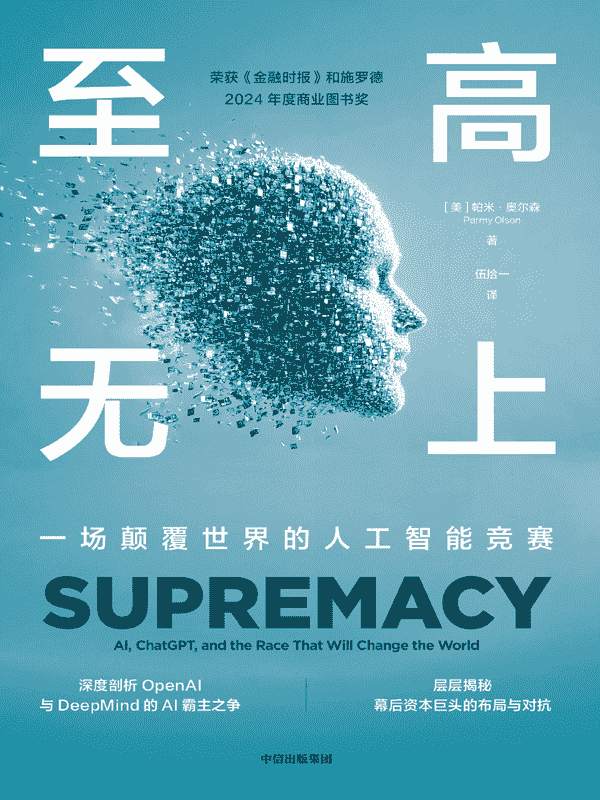

# AI巅峰对决：重塑世界的终局博弈



# 前言

翻开扉页，你大概率会质疑：这真的是人写的吗？

无所谓，我不介意。

搁两年前，这念头压根不可能冒头。可眼下，机器产出的长文、书籍、画作乃至代码，早已与人类创作难辨高下。还记得奥威尔在《1984》里虚构的“小说制造机”和“流行歌曲制造器”？如今统统落地。技术迭代快得让人猝不及防，大众难免焦虑：白领阶层会不会在一两年内失业？海量脑力工作者处境瞬间转危，天赋异禀的年轻插画师纠结要不要继续读艺术学院。

关键是变化太快。我深耕科技报道十五年，从未见哪个赛道能像过去两年的生成式 AI 这般狂飙。2022 年底 ChatGPT 面世，拉开“会创造信息的 AI”竞赛大幕——它不再只是处理数据，能凭空生成内容。彼时 AI 画图只能蹦出扭曲的狗；而今能批量造出特朗普的高清大片，毛孔纹理清晰可见，真假难辨。

不少 AI 缔造者坚信通往乌托邦的路已打开，另一些开发者却断言它会拖垮文明。其实我们都被科幻叙事遮了眼，忽略了 AI 正在造成的实害：固化种族歧视、冲击创意产业等。

这股无形力量背后，寥寥几家公司攥住了 AI 发展命脉，竞相推向更强。受无尽增长欲驱使，它们走捷径、误导公众，成了问题频出的 AI“管家”。

历史上从未有组织像今天的科技巨头这样，聚拢如此巨大的权力，影响如此众多的人。谷歌垄断全球 90% 网络搜索，70% 电脑跑微软系统。但两家都不甘现状：微软想从谷歌 1500 亿美元搜索业务分羹，谷歌想抢微软 1100 亿美元云份额。为击败对手，双方都吸纳外部创意——归根结底，AI 未来只由两个人定调：萨姆·奥尔特曼和德米斯·哈萨比斯。

奥尔特曼身形瘦长、性格温和，近四十岁，穿运动鞋上班；哈萨比斯近五十岁、痴迷游戏、前国际象棋冠军。皆是高智商、强魅力的领袖，共绘通用人工智能（AGI）蓝图。愿景振奋人心，追随者对二人顶礼膜拜。他们一心想赢，所以能赢。奥尔特曼推出 ChatGPT，哈萨比斯加速落地。二人的轨迹不仅定义了当下竞赛，也揭示核心挑战——在巨头掌控下，如何艰难引导 AI 向善。

科学界普遍不看好时，哈萨比斯创立 DeepMind，全球首家誓言开发“类人智能”的公司。他渴望在生命起源、现实本质、疾病治愈上实现科学跃迁。他说：“破解智能本质，是解决所有难题的前提。”

几年后奥尔特曼创立 OpenAI 走同一条路，但他更聚焦经济富足，增加物质财富，帮“所有人过上更好生活”。他曾告诉我：“这是人类迄今最伟大的工具，让每个人都能超越自我。”

野心直追硅谷最疯狂的空想家，计划开发足以改写社会、颠覆经金体系的强 AI。而奥尔特曼、哈萨比斯将成为赋能者。

这或是人类最后一项发明。研发初期，两人都苦思如何管控这项革命性技术。起初他们认定谷歌、微软等巨头不该全权掌控，因利润高于人类福祉。多年间，他们在大西洋两岸各自摸索建实验室新路，护佑 AI 向善。承诺做 AI 的守护者。

然而，两人都想争第一。开发史上最强软件需海量资金算力，硅谷是最佳聚宝盆。时间久了，二人发现终究离不开巨头。虽造超级 AI 之势渐成，但不安念头四面袭来，他们妥协了，放弃崇高初衷，将控制权交给急于兜售工具、严重缺乏监管的公司，酿成深远后果。权力集中导致竞争萎缩，引发隐私新侵扰，滋生种族性别新偏见。如今主流 AI 生成女性多性感暴露，CEO 多白人男性，罪犯常黑人男性。这些工具已装进媒体订阅、手机、司法系统，却未评估对舆论的冲击。

二人的经历，酷似 19-20 世纪角逐的爱迪生与威斯汀豪斯。都想实现为百万用户供电的主导系统梦，都从发明家转型企业家，知技术终将赋能现代世界。但谁的技术能脱颖而出？最终威斯汀豪斯的高效标准风靡全球，可“电流之战”赢家是通用电气。

在商业利益驱动下，奥尔特曼与哈萨比斯推出参数更大、能力更强的模型，科技巨头成最终赢家——只不过这回复制的是人类自身智能。世界正走向混乱边缘。生成式 AI 虽能提效，借 ChatGPT 等工具让更多有用信息触手可及。但创新有代价。企业与政府适应新现实：真实与 AI 生成几乎无差别。巨资砸下去，指望 AI 替人、增利。新型个人 AI 设备涌现，将个体监控推向不可思议高度。

后半书阐述风险，先讲我们怎么走到这一步，以及两位创新者“AI 向善”愿景如何被垄断力量击碎。故事满是理想、天真与自我，也证明在巨头与硅谷泡沫裹挟下，伦理几乎无法落地。二人在 AI 治理上乱作一团，明知避免不可逆伤害需负责任管治，可没最大科技公司资源，就造不出神一般的 AI。以改善生活为名，终将权力拱手相让，让人类幸福陷入企业霸权厮杀。这就是真相。

# 第一幕 逐梦

## 1. 逆行少年

萨姆·奥尔特曼知道自己该闭嘴。在保守的密苏里圣路易斯，没人谈性取向。21 世纪初，美其他州为同性恋权利奔走，可家乡相对落后，同性性行为仍属犯罪。像他这般隐约觉察自己是同性恋的少年，通常躲在沉默里寻安全。奥尔特曼偏不。他非得说出来，非为坦白一切，只因视谈论同性取向为使命。

高中时，奥尔特曼散发无法贴标签的独特气质。既有学霸脑，又有运动员范。英语作业挑战模仿福克纳；微积分难题信手拈来。放学后，要么跳进泳池以水球队长身份指挥，要么回家和朋友玩几小时游戏。晚餐爱和两弟弟（马克斯、杰克）聊太空、火箭；玩《武士》等桌游主动请缨当领袖。总之，爱掌控全局。

中产犹太家庭出身，母康妮是皮肤科医生，父杰里是律师。杰里推动圣路易斯经适房建设和老楼改造，助子树立公益观。奥尔特曼清晰记得：一天父带他去办公室，说“即使没空帮人，也要想想咋帮”。

家中老大，极度自信、胆识过人。公开谈性取向，同龄人及 90 年代末出生的孩子多秘而不宣。总做中西部人眼中“不好”的事，却让一切显得很酷，原因之一是想帮同类。

使命感源自互联网。登录“美国在线”（AOL）时，他发现同类很多。拨号音刺耳，连接成功面对海量聊天室，心跳加速。能跨洋与有趣灵魂对话。大厅吵闹，但“宠物爱好者”“X 档案迷”“同性恋者”等小厅交流顺畅。

对这类群体，聊天室是救命稻草。躲在网名后，从闲聊中知晓哪里友好。在感到与世界格格不入时，他获得归属感。他后来对《纽约客》说：“对十一二岁少年，守秘密是负担，AOL 聊天室是绝佳宣泄口。”

1999 年，14 岁时，AOL 三分之一聊天室关注同性话题，意义重大。16 岁向父母“出柜”。母震惊，后对《纽约客》说儿子一直像“无性恋科技迷”，标签不全准。比如美国人爱烤肉，他吃素；痴迷电脑却不孤僻、不社恐；别人听流行乐，他偏爱古典。

父母将早熟的他转入约翰·巴勒斯中学。郊区私立名校，占地广、林木茂，誓为“人类进步”育人。

他尽可能多揽领导角色。除水球队长，还编年鉴、在集会发言。与师周旋，偶尔违规引关注。秋季赛动员大会上，他和队员脱上衣只穿泳裤站台上，笑看观众起哄。

惹怒体育指导挨罚，但他未认怂，未向任何人诉苦，反奋起反击。敲开校长办公室门，校长安迪·阿博特是位优雅的前英语教师。被这瘦长、黑发大眼少年吸引，后来奥尔特曼常去办公室，或提意见，或抱怨拟登学生报的不公。

阿博特发现：这少年丝毫不惧权威。只要校长决策不得人心、伤别的学生，他就担起“救世主”责任。“他会反驳，”阿博特回忆，“摆事实讲道理。”至今这位轻声细语的老教育者仍认他“我见过最聪颖的孩子”。

这认真劲儿，加上率真示弱的性格，让他赢得政商大佬青睐。面对投资人、媒体、全球顶级 CEO，他用严肃目光恳请支持伟大事业。久而久之，他悟出一理：权势者能助己圆梦，如高中时阿博特待他般。

他在学校干成一件大事：把 AOL 聊天室“搬”到线下。走完繁琐流程，获校长批准，建校首个性少数支持小组。像地下网络，学生可求助或寻同类。一年内十几人加入。

但他不满足。游说教师在门上贴标签表明接纳同性恋生，拉师入伙。最终创办“同性恋-异性恋联盟”，提升公众权利认知。

决定晨会造势。成员早早进大厅，座椅贴数字卡。奥尔特曼站麦前，喊特定数字卡学生起立。约 60 人站起。“看看身边，”他对台下说，“1/10，就是校内自认同性恋的比例。”

展示大胆，也冒犯。几学生离场，恰全是基督教社团成员。事后得知，他们以留家或守教室抵制演讲。公然反对激怒他，再闯阿博特办公室，要求按旷课处理这些基督徒。

“提升认知无害。”少年争辩。虽未拍桌，严肃语气神色透着怒火。

“一度我试图自圆其说，”阿博特回忆，“但我觉得他可能对。”

高中毕业时，奥尔特曼也学会关键一课：表现得雄心勃勃，总有人恨你。解法是——靠近权贵，在身边筑起支持网。

不久，他被硅谷核心斯坦福录取。阳光灿烂，汇聚顶尖工程师与创业者，初创林立。虽对编程有兴趣、被计科专业录取，但这 18 岁瘦高男孩受不了只攻一门学科。对一切着迷。选修大量人文与创意写作。

课余南行 20 分钟上课，这些经历对日后成为全球知名创业者至关重要。他在圣何塞热门小赌场玩几小时扑克，磨炼心理博弈与影响力。核心是观察对手，有时刻意诱导判断。奥尔特曼成虚张声势、察言观色高手，赢来的钱付了大部分生活费。“不赚钱我也玩。”他后来在播客说，“爱死扑克了。强烈建议通过扑克读懂世界、商业与人性。”

日后改变世界的专业领域，也在学位课内。他成斯坦福 AI 实验室研究员。实验室仅占广阔校园一隅，塞满线缆与怪异机械臂。刚重启，负责人塞巴斯蒂安·特龙——柔和德语腔、目光如炬的蓝眼激进派科学家。作为新生代学者，特龙不甘写基金申请、熬终身教职，选择与巨头合作。斯坦福距谷歌总部仅 5 英里 ^(¹)。

课上，特龙讲机器学习：计算机从海量数据推演概念，而非按程序执行特定任务。该概念对 AI 核心，虽“学习”存誤導，因机器不似人类思考。特龙注意到，这来自圣路易斯、一脸认真的孩子，对 AI 产生意外后果极感兴趣：若 AI 学会做错事，咋办？

特龙解释：为达“适应度函数”或目标，AI 可能采取惊人行为。假设目标设为生存繁殖，它可能无意灭绝地球所有生命。特龙说，这不代表 AI 坏。它只是未料到后果严重。动机同我们洗手无异——不讨厌皮肤细菌，不想灭绝它们，只想手干净。

奥尔特曼琢磨这观点许久。作为科幻迷，他想：这会不会是人类未联系外星文明的原因？或许外星人早造出 AI，随即被造物灭绝。规避风险，得在危险 AI 面世前，造出更安全的 AI。

这念头在他脑海埋下种子，经十多年孕育，开花结果成 OpenAI。当时太宏大，超出能力。特龙等学者搞 AI 系统，斯坦福学子创谷歌、思科、雅虎。这年轻高手也想大干一场，只差商业创意。灵感闪现于走出教室时。“若打开手机能见电子地图，显示所有朋友位置，多好？”他问同学兼挚友尼克·西沃。

若开发手机找友软件作主打产品，结果如何？创业不易。需向风投融资，虽斯坦福 3 英里内有几十家机构，但奥尔特曼年轻无经验。回应来自东北部。马萨诸塞剑桥，一位年长科技大佬为年轻创业者办“新兵训练营”。奥尔特曼与西沃决定参加为期 3 个月的 Y Combinator（YC）项目，开初创公司。YC 成史上最成功孵化器，孵出估值 4000 亿美金科技公司，含 Airbnb、Stripe、Dropbox 等。

当时 19 岁的奥尔特曼对此一无所知。硅谷大多数投资人觉得 YC 是愚蠢的黑客夏令营。创始人保罗·格雷厄姆，穿工装短裤的 41 岁计算机科学家，卖电商公司给雅虎成百万富翁。得财富后，格雷厄姆打造思想领袖人设，网上发文聊软件外话题：经济学、生娃、言论自由、高中“书呆子”……

但格雷厄姆最火的文仍是创业类，像奥尔特曼这类年轻人端正坐直、全神贯注读，视他为精神领袖。文中反复强调：创业者素质压倒一切。创办成功科技公司，不需要绝妙点子，只需找个优秀掌舵人。

“如谷歌最初只想做个不那么烂的搜索网站。”格雷厄姆写。看看现在。灵感转瞬即逝。真正重要的是创始人，最优秀创始人是黑客——愿打破常规创造新物的程序员。他写道，黑客“效率可能是普通公司员工的 36 倍”。

硅谷创业甚至被视为爱国行为，因体现美国开国元勋顽强的个人主义。“黑客天性叛逆。”他写道，“这正是黑客精神内核，也是美式精神精髓。硅谷诞生于美国而非法德英日，非偶然。后者国民更循规蹈矩。”

格雷厄姆传经验：创业路不难，最小成本起家，从最小可行产品起步，再不断迭代。别铺大摊子，10 个死忠粉胜过千人点赞。别怕打破常规。事实上，为何不改写社会游戏规则？

格雷厄姆观点在硅谷引发强烈共鸣，催生风气：创业者抛出神圣愿景，理应允许他们像神一样随意行事。这也是为何谷歌、Facebook 创始人能以现代商业独裁者自居，常握多数投票权，有时带公司跑偏。（典型例：Facebook 董事会/股东对扎克伯格奇怪且昂贵的决定——转型元宇宙——毫无异议。）得益于双重股权，许多初创创始人含 Airbnb、Snapchat 幕后大佬，保有非同寻常控制权。格雷厄姆等人认创始人有充分理由拥有此权：既聪明绝顶又才华横溢的人给出长期愿景，就需充分自由去兑现。

### 萨姆·奥尔特曼与 Loopt 的浮沉

格雷厄姆在奥尔特曼身上看到了同款黑客基因：极度好奇、极其聪明、思想深刻。另外，这蓬松黑发少年懂与长者相处，能毫不费力与比他大 20 多岁的格雷厄姆打交道。格雷厄姆建议奥尔特曼等一年再参加 YC，因他才 19 岁，可这孩子回绝：无论如何要参加。格雷厄姆瞬间就爱上他。

# 功亏一篑

初次启动1994年的电脑游戏《模拟主题公园》，尖叫声、过山车轰鸣声与风琴叮当声便扑面而来。一片空旷的像素草地静候填满：巨型汉堡造型的餐亭、直冲云霄的轨道。游戏目标单一纯粹——榨取最大利润。

这款佳作的缔造者并非兜售经营学的中年设计师，而是来自伦敦北部的黑发少年德米斯·哈萨比斯。他早具硅谷创业者的狠劲，痴迷游戏成瘾。数十年后，他在全球最顶尖的AI研发赛道领跑，而这一切的起点，正是少年时代通过模拟游戏习得的企业管理课题，也是他日后致力于打造超人类智能机器的基石。

游戏中，玩家初始拥有20万美元启动资金，用于建设设施、发放薪资。收入来源涵盖门票、周边、冰淇淋及椰子投掷等摊位游戏。机修工不足则设施故障，保安缺编则暴徒滋事，糖料短缺则游客拒买冰淇淋；员工甚至会因薪资谈判罢工。年仅17岁的哈萨比斯设计出这套精妙平衡成本收益的复杂企业模拟系统，凭借极具粘性的机制设计，上市当年便创下1500万份销量纪录。

电子游戏浪潮席卷英美，将孩子们卷入多巴胺构建的生动世界。彼时游戏多为忍者神龟式的横版过关，或驾驶货车在荒野横冲直撞。哈萨比斯却坚信，最好的游戏是对现实的深度模拟。在“上帝视角”游戏里，玩家掌握创世与毁灭之权，不再操控单一角色，而是塑造数万虚拟生命、雕琢地貌、主导文明走向。你可以建城又毁之于天灾，也能让主题公园人潮涌动。

这项技术在带来快感的同时传授知识——从商业运营到宇宙奥秘。虽游戏本质为娱乐，哈萨比斯却萌生强烈愿望：利用游戏为载体，创造能解开人类意识之谜的超级人工智能。

哈萨比斯探寻宇宙真理的使命感超越常人，看似标新立异，实则源于其不可思议的成长轨迹。家人皆率性富创意，他却是唯一的数学天才。母亲安吉拉，虔诚浸信会教徒，自新加坡移居英国，在伦敦北部寄宿家庭邂逅未来丈夫——自由奔放的希腊裔塞浦路斯人科斯塔·哈萨比斯。两人看似门不当户不对，却结婚生下三子，长子即德米斯。科斯塔职业生涯动荡，教师、玩具店老板来回切换，哈萨比斯12岁前全家搬迁达十次之多。

哈萨比斯早显异禀。4岁学国际象棋即胜父叔；6岁在本地赛事中击败大多同龄对手，彼时尚需垫电话簿才能勉强俯视棋盘。阅读理解力惊人，万事好奇，精力倾注处却在“玩”。父亲带回残缺桌游，他便重构规则，与弟妹共玩。

更精彩在后头。20世纪90年代，萨姆·奥尔特曼发现“美国在线”聊天室；而早十年前，哈萨比斯已钻入黑屏粗像素构建的原始技术腹地。1984年，8岁的他用国际象棋奖金购入ZX Spectrum 48（键盘式家用电脑）。这款早期PC含厚重黑键盘，可接电视、用磁带播放彩色图像。

哈萨比斯购入编程教材，自学开发适配Spectrum的游戏。他习惯睡前配置计算任务，翌晨醒来即获结果。对彼时的他而言，极具启示意义：成功将认知负荷卸载至计算机系统，让Spectrum成为思维延伸的载体。

迷上编程后，他又置办功能更强的Commodore Amiga 500，这笨重白色主机配齐鼠标、显示器等外设。随即与同学组建黑客俱乐部，通过代码复刻游戏场景、呈现彩色图像。哈萨比斯常为超越同伴大费周章：拆解重装电脑，为弟弟乔治编写电子象棋游戏。

国际象棋仍是生活重心，立志登顶世界冠军。母亲全力支持，安排家庭教育以腾出练棋时间。假期辗转各类赛事，从未间断。哈萨比斯日后回顾：游戏是大脑健身房，国际象棋则是终极训练。正如奥尔特曼通过扑克习得心理博弈与商业逻辑，下棋教会哈萨比斯逆向战略思维——先设终局，再推演路径。

转折发生于11岁那年，列支敦士登锦标赛。对手为丹麦全国冠军，鏖战十小时，双方俱疲，丹麦选手寻求和棋。哈萨比斯手握“王”、“后”，对方却占“王”、“车”、“象”、“马”优势。身心俱疲下误判局势，自认必亡，遂认输。

夺冠的丹麦选手震惊发问：“为何认输？”

复盘展示另一解法。哈萨比斯死盯棋盘。挫败有时催生更大志向。若无法直面失败，追逐宏大目标或成慰藉；但哈萨比斯倾尽全力仍败北。环顾四周，顶尖战略大脑伏案苦思，恍然觉醒：整个联赛皆在挥霍脑力。这些人若致力于解决更重大的课题会如何？彼时他全球14岁以下排名第二，归根结底，不过一场游戏。

哈萨比斯告知父母：不赛了，要回学校。当时他内向敏感，爱听恩雅、自学钢琴弹《水印》，最爱影片《银翼杀手》——侦探追捕拟真仿生人的科幻寓言。终幕范吉利斯配乐中反派感叹记忆将“消逝在时间中，像眼泪消失在雨里”，令他反复播放、欲罢不能。

每周日，母亲带他和弟妹去伦敦北部亨顿浸信会教堂。宏伟灰石建筑矗立山巅，俯瞰城郊。内部宛如微型国际社区，汇聚菲律宾、加纳、法国、印度等地信徒。对这半塞浦路斯、半新加坡血统的孩子而言，毫无融入障碍。相较圣公会拘谨仪式，此处礼拜生动活泼：举手赞美、随鼓点歌唱。牧师不拘教条，重申尊重他人处世原则。祷告充满情感，教堂毫不掩饰福音派色彩。

虽浸信会为美最大基督教派之一，在英却属小众。圣公会百万教众，浸信会仅约十五万。宗教与上帝概念深深迷住哈萨比斯：能否用科学手段寻得上帝？16岁提前两年高中毕业，读毕诺贝尔奖得主、物理学家史蒂文·温伯格《终极理论之梦》——对自然统一理论近乎堂吉诃德式的伟大探索。温伯格臆测：或存一法，以单一Equation解释宇宙基本力，如爱因斯坦以`E=mc²`概括能量质量关系。理想中，“万有理论”应极简，可写于单页纸，甚至浓缩为一个公式。

哈萨比斯读得如痴如醉，随即震惊发现：科学界此路进展寥寥。他们需要帮助，他心想。需要强大智力。或可一助？目光投向那台曾彻夜运算的“大块头”。若电脑更智能，成为更强思维延伸，或能助科学家破解宇宙谜题、甚至寻得神迹。

“这似乎是完美的超级解决方案。”哈萨比斯后在接受《纽约时报》撰稿人埃兹拉·克莱因专访时解释。坦言曾考虑攻读物理，读完温伯格著作后，认定应追求更大目标：跨界计算机科学与新兴AI领域，构建改善人类生存境遇的终极科学工具。无法摆脱对游戏的迷恋，遂制订长期计划融合两者，核心聚焦现实世界模拟类游戏开发。80年代末游戏已能模拟文明基本特征。既然电脑能复刻世界全貌，高智能电脑或能寻得修复现实缺陷之法——在模拟中觅解，映照现实。

灵感源自钟爱游戏《上帝也疯狂》（Populous）：“迷人之处在于，游戏世界不仅栩栩如生，更随玩法进化。你可视一部分为沙盒，围绕创造新玩法。”

怀旧像素掩盖复杂内核。平坦绿谷点缀民居。玩家即山谷之神，掌神力，率追随者与他神信徒战斗。可抬升或降低地势，平坦利于追随者建屋繁衍；可引发地震。《上帝也疯狂》开“上帝游戏”先河，哈萨比斯爱不释手，誓入开发商牛蛙公司。应聘碰壁后，主动致电争取一周实习。获准且表现优异，15岁获暑期兼职。

不久，16岁哈萨比斯获剑桥大学计算机科学录取，因年龄过小被建议缓入一年。于是留牛蛙再任一年，领现金薪酬，住在萨里郡吉尔福德公司办公室附近的基督教青年招待所。初为游戏测试员，旋升关卡设计师，直属牛蛙创始人彼得·莫利纽克斯。

### 莫利纽克斯与哈萨比斯的早期合作

**少年天才的游戏往事：从《主题公园》到《共和国》的坎坷求索**

那个圆脸黑发的男人穿着黑色 Polo 衫，乍看更像间酒吧的老板，而非游戏界的传奇大佬。彼得·莫利纽克斯之所以饱受争议，并非能力不足，而是媒体屡履曝光其“吹牛”成癖：许诺玩家在《神鬼寓言》里种颗橡子，上线就能见参天大树，结果全是空话。但撇开夸张营销，此人确有造诧世之作的本事。正因对《上帝也疯狂》的成功深信不疑，他才看中了那个眼神纯净、追问不断的少年——德米斯·哈萨比斯。

莫利纽克斯回忆，这孩子好奇心重得离谱，简直不像凡人：逮着牛蛙公司的程序员就问技术边界，质疑凭什么把常规算法包装成“人工智能”。谁让牛蛙当时全员偏好冷兵器砍杀，唯独哈萨比斯毛遂荐干，带着美工团队把《主题公园》里的过山车、快餐摊做成了真实系统。销量爆了，三倍于《上帝也疯狂》的佳绩，让哈萨比斯入读剑桥时成了风云人物，甚至开着导师借来的保时捷在校园漂移撞车，照样让莫利纽克斯生气不起来——“这小子太有魅力，让人恨不起来」。

剑桥求学那年，哈萨比斯混迹牛津剑桥精英圈，结识了日后跟随其创业的本·科潘等人。毕业本该回牛蛙接班，却因“导师发展太慢，瓶颈太明显”而萌生去意。有意思的是，离职信竟是个烧焦边、沾茶渍的瓶中信，寄信人乔·麦克多纳正是被哈萨比斯面试折纸鹤、打《强权外交》棋、当场招入伙的程序员。哈萨比斯对他讲：“我想创业，核心做真正的 AI——模拟世界的上帝游戏。”麦克多纳追随而去，俩人联手撑起了 Elixir 工室。

**Elixir 的野心与“技术黑洞"**

哈萨比斯学会了导师的营销调门：登《边缘》杂志封面吹嘘要让《经济学人》读者着迷，誓要把游戏推向严肃�介高度。旗舰作《共和国：革命》定调政治推翻东欧极权，麦克多纳泡大英图书馆查苏联史料，哈萨比斯则率牛剑博士团队死磕 AI——要塞进一百万虚拟市民，每个都有丈夫、酒鬼、学生身份，不只是屏幕跳动的像素点。这正是"涌现式玩法"的极致追求，比肩后来《GTA》与《我的世界》的核心逻辑。

代价是惨痛的。团队早十晚六，哈萨比斯抓手柄趴桌睡，足球场上像愤怒的小猎犬冲锋，完全透支。五年磨剑，四年搞引擎，游戏性却烂在手里：评家批评过度复杂、缺乏沉浸感，销量扑街。《邪恶天才》虽加幽默梗概，仍难逃小众命运，二代未出 Elixir 便关门。哈萨比斯崩溃大骂：“我们是牛剑高材生，从未输过，这次却输得彻底！麦克多纳拒二次创业邀约，看着昔日搭档被迫转型：不再拿 AI 做游戏，而是用游戏去训�出比人类更强的 AI。

---

**萨姆·奥尔特曼：从崩溃地板到 YC 掌门**

**加州热夜里的觉醒**

2006 年盛夏，奥特曼穿运动裤衩躺芒廷维尤公寓地板，Loopt 融资僵局、35 度高温压得他喘不过气。那年他三十岁出头，曾引以为傲的“黑客式拼搏”成了催命符。后来他在播客坦白：那晚是转折——学会情感抽离，把人生当工程优化，连思考单位都换成比特：人类每秒处理 2 比特，计算机早已达太比特量级，复制并超越人脑，既是必然，也是他此生要解的谜题。

**风投奇才与「贝宝帮」暗线**

卸包袱的奥特曼花年游历、阔读、小赌早投。Hydrazine Capital 募得两千万，七成半押注 YC 孵化项目，红迪、Asana 等成绩单亮眼，资金十倍增值。更关键的是，彼得·蒂尔这位「贝宝帮」大佬既投了哈萨比斯的 DeepMind，也挺了奥尔特曼的 Hydrazine，把两个注定对决的 AI 预言家串联。奥特曼精简资产只留核心房产现金，活成风投界“不按套路出牌”的异数：不在乎条款拿多好，只在乎能不能搞成改变世界的硬科技。

**YC 扩张与硬核转向**

2014 年，格雷厄姆在厨房问奥尔特曼要不要接班。这位“萨马”虽只跑过一次创业（还是败的），却让格雷厄姆妻子俩认定：战略眼光无人能及，堪称“除了问乔布斯怎么做产品，战略就问萨马怎么做”。接手后奥特曼激进改革：翻倍合伙人、引入兼职大佬、把消费级软件占比压低，转投自动驾驶的 Cruise、核聚变的 Helion Energy。他在博客列出长达 95 条创业建议，誓言“不介意赔钱，只要解决人类最大挑战，风险再大回报也最大”。

少年的哈萨比斯在伦敦用游戏堆砌虚拟国民，试图从混乱中涌现智慧；青年的奥特曼在硅谷把生活拆解为比特流，企图用工程手段复制意识。两条平行线，因着蒂尔这根线，正悄悄汇聚向同一个不可逆转的终点——通用人工智能的诞生。

# 硅谷双雄：从核聚变到大脑上传，两位 AGI 领航员的激进图谱

核聚变的本质是两个轻原子核合并成重核并释放能量，它是恒星发光发热的根本动力，也曾是《回到未来》时光机与钢铁侠战衣的虚构能源。对追逐清洁能源的科学家而言，这是遥不可及的“圣杯”，距离商业化仍漫漫长途，绝大多研究卡在理论验证阶段。然而，Helion Energy 这家由四位学者创立的公司却豪言壮语：只需数千万而非数百亿美元，就能造出聚变堆，为人类斩断化石燃料依赖铺路。

### 奥尔特曼：孤注一掷的“救世主”与反常规投资逻辑

#### 逆势而行：押注核聚变与长生不老的“非共识”赌局

这听起来近乎疯狂，但奥尔特曼对这类改写世界格局的宏大叙事从不设防。多年来他渴望亲自创办核能公司，如今转为资本入局。他深知此举背离硅谷主流——主流只青睐商业模式成熟、变现路径清晰的软件生意。但他深信，这些公司能在改善人类生存境况的同时实现商业爆发。谈及 `Helion Energy`，他曾直言不讳：“硅谷至今未投此司，实属可耻。”这种道德层面的自傲在科技圈不鲜见，马斯克明言要“拯救人类”，奥尔特曼的逻辑虽同但路径不同。

“再造个手机 App？只会被白眼。”奥尔特曼曾说，“办火箭公司？人人想上天。”硅谷人人挂嘴“拯救世界”，大多不过是给优化邮件、辅助洗衣的小产品贴金。马斯克与奥尔特曼则将自己塑造成真正下场的“科技救世主”。奥尔特曼正重塑 `Y Combinator`，聚拢真正能改变世界的创业者，风险虽高，光环更盛。

投资上，他像扑克高手凭一手尚可的牌梭哈压注，让对手心跳加速。他归因于“不在乎外界眼光”，故能冷静核算风险，敢押注看似疯狂的项目。财富自由与“硅谷尤达”名号为他兜底——在硅谷，声望胜过豪车。力挺聚变初创，所获声望等同实收。最终，他将重金押注 AI 之外的两大终极命题：无限能源与生命延续。`Helion Energy` 斩获 3.75 亿美元，致力于人均寿命延长十年的 `Retro Biosciences` 拿走 1.8 亿美元。

资金源头？早在他执掌 `YC` 前，便因 `Cruise` 以 12.5 亿美元被通用收购，早期投入 300 万美元赚了个盆满钵满。`YC` 掌门身份让他近距离审视海量优质项目，赶上史诗级牛市，自然更易“押中巨奖”，且源源不断的申请流助他预判未来。

#### 掌舵 YC：筛选未来赢家与“极致努力”信条

执掌 `YC` 一年，奥尔特曼便成“硅谷新领袖”代名词。周均 400 个会面邀约，投资人与创业者趋之若鹜，只为借他的网络触达 `YC` 系资源，或一睹比保罗·格雷厄姆更具传奇色彩的掌舵者。他在博客上跨界侃侃而谈，从 UFO 监管到晚宴社交指南——建议别问“做什么工作”，要问“对什么感兴趣”。

格雷厄姆周会遵循“做用户需要的产品”指导创始人，奥尔特曼则逼迫他们把格局做大。Airbnb 创始人初仅做“沙发客”软件，面见奥尔特曼时，他命令把路演里所有“百万”改成“十亿”，蓝眼睛死盯着他们：“要么你们自己不信，要么我不懂数学。”

他传授成功诀窍：疯狂努力，指标后“加个零”。修补破碎世界需极致产品力、“敏思笃行”、团队“充分沟通”，根本不存在工作生活平衡。话虽粗糙却扎心：硅谷是来建帝国的，周工作 40 小时建不成帝国。奥尔特曼真正天赋在于说服力——从高中校长到格雷厄姆夫妇、彼得·蒂尔再到万千创业者，无不折服。但他有隐性裂痕：理性驱使他守护世界，情感却疏离想拯救的凡人。

#### 冥想与“自我”消解：通往 AGI 的哲学顿悟

源头要追溯到 2006 年闷热夏夜。奥尔特曼因交易受挫躺地板发呆，为缓焦虑开始冥想，一坐一小时。久而久之，自我意识淡化。“冥想让我意识到，根本不存在什么‘自我认同’。”他在播客《成功的艺术》中透露，“许多深思 AGI 者，虽路径不同，终抵同一结论。”

这一认知重塑了他。后来徒步途中顿悟：计算机终将复刻人类思维，具备认知，人机终将融合。“研究 AI 逼你直面深层哲学：意识上传云端后会怎样？与云端对话是何体验？我想融合吗？想继续探索宇宙吗？那时的‘我’还是‘我’吗？”他并非孤军奋战，身边聚拢一批技术极客，坚信意识可上传服务器、从而长生不死。

#### “末日准备者”心态：死亡焦虑与大脑上传的赌注

一念“死”字，奥尔特曼便惶恐不安。自称“末日准备者”，斥巨资备战合成病毒泄漏、AI 反噬等全球灾变。“尽量不多想，”他对《纽约客》受众说，“但我囤了枪、金、碘化钾、抗生素、电池、水、以色列军用防毒面具，还买了大苏尔一大片可直飞抵达的土地。”

他还花 1 万美元在 `Nectome`（`YC` 投资项目）占个名额，该公司誓用高科技防腐保存大脑，待未来将信息上传云端、化作数字模拟体。

随着投资版图延伸至遥远未来，奥尔特曼似经历“总观效应”——宇航员从太空回望地球产生的认知跃迁，敬畏感与自我超越感油然而生。他越来越像从外太空俯瞰世界。交谈时目光深邃凝视，久久停顿思考，仿佛旁观者而非参与者。

#### “细致无畏”：在 AI 风险边缘走钢丝的矛盾心理

虽投资人类未来，他却在自我与他人间筑起精神鸿沟。主张解题需“冷静、慎重、务实”。他常引用科幻作家马克·斯蒂格勒短篇《温柔诱惑》：女主莉萨在科技“引诱”下逐步融合机器，终面临意识上传抉择——风险极大，前车之鉴或死或迷失数字世界。斯蒂格勒写道：“唯有细致无畏者、慎之又慎者，方能生存。”

此语击中奥尔特曼，成他口头禅。意指：面对人机融合风险，人类需兼具谨慎与勇气，理性评估危险而非被情绪裹挟，方能在险恶未来存活。当前 AI 安全研究虽重，部分研究者却陷恐慌，情绪失控。“不幸的是，搞 AI 安全最焦虑的群体，反而最不冷静，”奥尔特曼警示，“极度紧张……很危险。”但他逐渐觉醒：“我真想研究 AGI。”此概念由沙恩·莱格提出，人机认知平权信念酝酿数十年，早期被视“狂言妄语”，`DeepMind` 创始人只能在意餐厅起家，今成严肃科学顶流。

世界需要平衡视角开发 AI。斯蒂格勒的“慎之又慎”引发奥尔特曼共鸣——他自诩驾驭危险复杂未来的智者，那个“细致无畏”之人。他站塔楼边缘，凝视天边 AI 乌托邦，从不垂眼脚下尘世喧嚣。却被使命与自信桎梏，未觉自称“谨慎”何其讽刺。作为强竞争企业家，他为抢在谷歌前推系统而匆忙上马。不知不觉，他也执着于“第一”。

若无外界“抛砖”引出 AI 乌托邦构想，奥尔特曼或永不出手。这位硅谷枭雄需要对手激励，而对手远在英伦，是位天才游戏设计师，图谋开发能重大科学发现、甚至寻觅“神之所在”的强力软件。

## 哈萨比斯：构建“更优大脑”的执着追寻者

### 从游戏帝国崩塌到神经科学：Elixir 覆灭后的转身

`Elixir` 工作室倒闭，哈萨比斯成又一“死于野心过大”的科技英雄。虽痛定思痛，他坚信自己拥有独一无二的资产——大脑。他视灰质如珍宝：玩游戏锻炼它、戒酒护佑它、甚至用脑部 MRI 扫描图做头像。他惊叹其复杂性，`Elixir` 败局后数年，他执念于一个问题：大脑本身能否是开发“类人”软件的钥匙？毕竟，它是宇宙中证明通用智能存在的唯一实证，深度解码才是正道。大脑仅具生物物理意义，还是另有层面奥义？答案藏在神经科学里。

哈萨比斯渴望确定性抚慰——游戏输赢、基督教律令、高中时读过的宇宙统一框架。凡可用数字规则度量之事，皆是他的“甜蜜点”。“大脑大多功能应可用计算机模拟。”他后来受访称，“神经科学显示，大脑可用机械语言描述。”换言之，惊人复杂性可还原为数字数据、被机器模仿。

### 大脑即图灵机：计算主义者的核心信仰

为此，他汲取 20 世纪英国计算机科学家、图灵机之父艾伦·图灵的灵感。`图灵机`诞生于 1936 年，本质是思想实验——只存在于图灵脑海。设想无限长纸带分格，读写头按规则读写符号至停机指令。虽显粗糙，却奠基“计算机可用算法规则办事”核心概念。给足时间资源，`图灵机`算力等同任意现代数字计算机。哈萨比斯眼中，它是人脑完美隐喻。他曾断言：“人脑就是 `图灵机`。”

### 记忆与想象的交织：博士论文里的颠覆性发现

2005 年，关闭 `Elixir` 数月后，哈萨比斯毅然攻读伦敦大学学院神经科学博士。同行评价：论文篇幅不长，科学含金量极高。核心聚焦“记忆”。学界素认海马体主管记忆，哈萨比斯借 fMRI 等证实：想象过程同样激活海马体。

简言之，部分记忆源于想象。大脑非单纯像调档案般“重现”过往，而像作画般“主动重建”。这解释了记忆为何出错、为何受他经历干扰。他推断，大脑将这种“场景重建”机制泛化至地图导航、规划决策等任务。

论文被顶刊评为当年最重要突破之一。但哈萨比斯不恋学术象牙塔。学者渴望诺奖级发现，却半生耗于写基金申请；侥幸拿钱，校方算力仍不足。尖端机器学习需顶级算力，而顶级算力与顶级人才一样，聚首大厂。哈萨比斯要招募大军实施当代“曼哈顿计划”，唯有创业。

### 奇点信徒入局：“通用人工智能”术语的诞生与传播

初始蓝图诞生于他与沙恩·莱格、穆斯塔法·苏莱曼午餐闲谈。莱格是罕见 AI 狂热者，对 AI 未来的判断连哈萨比斯都自愧不如。莱格博士论文写“机器超级智能”，导师建议找哈萨比斯聊聊。

“找到同频共振伙伴。”哈萨比斯回忆，“莱格独立推断：这将是史上最重要大事之一。”

莱格观点在“奇点”小圈子炸锅。他们信奉未来存在理论奇点——技术进化至不可逆、不可控，标志性信号即计算机超越人类，莱格预测 2030 年前后兑现。

莱格入场传奇：新西兰长大，9 岁因成绩差看教育心理学家，测出阅读障碍却智商超常。学会键盘后数学编程跃居年级顶尖。身材高挑微驼背、短发。27 岁书店偶遇库兹韦尔《机器之心》，预言计算机将获自由意志、情感与灵性体验。一口气读完，脑海久久回荡库兹韦尔推论及“强 AI 将于 21 世纪 20 年代末现身”预判。那时算力数据爆发式增长，若持续，计算机必超人类。此乃 `摩尔定律`支撑——晶体管密度每两年翻倍，半个世纪未失准。

莱格读书时恰逢 2000 年互联网泡沫破裂，众人难信算力持续翻倍。但他笃信互联网将持续演进：“传感器成本必降，训练数据必增。”算力加数据，训练出越来越智能的机器。随后攻读 AI 博士，织就人脉网。“奇点”信徒、嬉皮士发型的本·戈策尔曾邮件征询书名，需描述具人类能力的 AI。莱格回复建议“通用人工智能”，此术语后成哈萨比斯及全球巨头核心焦点。

多年哈萨比斯、莱格等探索者常用“强 AI”“适当 AI”指代未来人级智能软件。“通用”二字精准传达核心：人脑之特殊，在于万能——算数、剥橘、作诗皆可。编程可让机器擅长单项，难兼全能。若计算机除处理数字，还能预测、识图、对话、生文、规划、乃至“想象”，便逼近人类。

当时主流 AI 科学家不信机器能达人级。亲历 AI 史“炒作-失望”循环，经历多次“寒冬”：资金断崖、技术停滞。90 年代至 21 世纪初虽在人脸识别、语言等窄域任务突破，至 2009 年哈萨比斯毕业，几乎无人信通用智能。提此想法者遭嘲讽边缘化。

幸有戈策尔力挺边缘理论，虽“AGI”不时兴，他酷爱此术语，印上书封推广成常用语，推动领域研究热潮。

语言术语在 AI 发展中扮演关键角色，能将公众兴趣推向狂热。“人工智能”诞生于 1956 年达特茅斯会议，旨在整合“思维机器”观点。彼时“控制论”“复杂信息处理”等竞争者林立，唯 “AI” 脱颖而出，成史上最成功营销术语之一，衍生出一系列拟人化词汇，赋予机器超越本身的能力幻觉。如“思考”“学习”技术上不准，但“神经网络”“深度学习”“训练”借类人特质深植人心，哪怕软件仅受人脑启发。对莱格新造的“AGI”，业界唯一共识是：此前从无此说。

### 苏莱曼：誓用技术破解人类终极难题

穆斯塔法·苏莱曼亦是 AGI 信徒。这位 25 岁牛津辍学生寻求用技术改写世界。博学多才，专长偏政策哲学而非计算机科学。叙利亚裔父、英国裔母，赋予他解决问题的强大驱力。目标非修车修膝盖等琐碎小事，而是贫困、气候危机等关乎全人类的终极命题。

# 从扑克桌到AGI蓝图：DeepMind创世三人组的理想碰撞与资本博弈

### 少年旧识与意大利餐厅的“疯狂”约定

故事得从几个老友说起。苏莱曼早年在伦敦北部长大，是哈萨比斯弟弟乔治的发小，常混迹于哈萨比斯家中。年轻那阵，三人甚至结伴飞往拉斯维加斯打扑克锦标赛，牌桌上互传战术、平分奖金，默契十足。后来苏莱曼合伙开了家冲突调解公司，哈萨比斯则在伦敦大学学院（UCL）搞神经科学研究，常邀他参加午餐沙龙。

再次重逢时，哈萨比斯“造强AI解难题”的宏愿，加上莱格“通用智能万能论”的信仰，彻底点燃了苏莱曼。他看到了用技术填补社会治理鸿沟的可能性。

出于保密——毕竟满嘴“通用人工智能”在当时学界听着像痴人说梦——三人躲在UCL附近一家意大利连锁店密谋。莱格直言：在象牙塔里熬到五十岁当教授才能拿资源，不如现在创业。苏莱曼懂公司运营，哈萨比斯也有过创业经历。2010年前后，谷歌、脸书正红利期，三人认定：唯有科技公司能建模复杂世界。于是，一个宏大计划成型：办研究型公司，造史上最强AI，再拿它去攻克全球性难题。

### DeepMind初创期：同床异梦的使命之争

公司注册名为DeepMind，哈萨比斯任CEO，从自家旧团队Elixir挖来顶级工程师，在UCL对面租了间阁楼开工。三人同心协力，内核却各不同：莱格想招更多人入局AGI赛道；苏莱曼盯着社会顽疾；哈萨比斯志在通过探索宇宙原理留名青史。

分歧很快浮出水面，导火索是一句Slogan。

苏莱曼逼着哈萨比斯读《创造力的差距》（托马斯·霍默-狄克逊著），书中论述现代危机复杂度已超人类解题能力，唯有科技创新能填平这“创造力鸿沟”，AI大有可为。哈萨比斯摇头：“你格局太小。”在他眼里，气候变迁不过是人类宿命一环，地球终不可长久承载文明。盯着眼前问题就像在悬崖边踱步。他坚信超级智能不会屠人，反而能解开“我们从哪来、往何去”这类终极谜题。

于是哈萨比斯把愿景浓缩为：**“破解智能，用智能解决其他一切”**，印在投资人路演PPT上。

苏莱曼不服。趁哈萨比斯不在，他让早期员工把尾句改成**“用智能让世界更美好”**。哈萨比斯回办公室见状，又让同一个员工改回原版。两人借员工之手打代理战，典型的英式含蓄对抗——不撕破脸，只反复修改幻灯片。

本质上，苏莱曼主张“投放实战、快速迭代”（奥尔特曼后来验证了这条路），哈萨比斯则像下棋：要赢，更要解开困扰人类千古的存在之谜。

### 哈萨比斯的宇宙观：斯宾诺莎之神、模拟论与“曼哈顿计划”

问哈萨比斯信神吗？他腼腆又笃定：“宇宙有神秘秩序，非传统人格神。爱因斯坦信斯宾诺莎之神，我也一样。”斯宾诺莎泛神论：神即自然法则总和。所以，**做科学就是在探询神的奥秘**。

按此逻辑，造AGI无异于一场寻神之旅。若神等于自然法则，AI若能解析量子力学、宇宙演化等复杂系统，便能窥见“设计图纸”。甚至若证实宇宙是模拟（库兹韦尔观点），最初程序员便是神；若人类造出能分析全物理信息的超级机器，它或许能直接指向更高维实体的存在。

这种准宗教体验感，与哈萨比斯早年虔诚的基督徒背景暗合。2023年弗吉尼亚大学跨国调查显示：信神者更易采信ChatGPT类建议，因其更谦卑、更知人类局限。昔日同事回忆，哈萨比斯常谈论神与人类起源，甚至有人直言：他搞AGI初衷就是“找到神”。

他视DeepMind为当代“曼哈顿计划”，读过《横空出世》，照搬奥本海默打法：将大问题拆解为无数小课题，集中精兵强将逐个击破。

### 融资断层：从英国“守财奴”到硅谷“疯子”

理想丰满，钱包瘪扁。英投资人只肯掏2万、5万英镑换股，根本雇不起顶尖脑力、买不起算力集群。在保守的英国，搞AGI像痴人说梦；本土创业风气只爱造金融交易APP这类“速变现”生意。三人被迫转身盯向硅谷——那里有钱、有胆、爱科幻。

#### 彼得·蒂尔：逆向押注的第一张大额支票

莱格有资源。2010年奇点峰会（库兹韦尔与蒂尔合办），莱格受邀演讲。蒂尔是个怪才：担心奇点来得太晚、世界等不及强AI救场；信奉垄断利于创新（《从0到1》）、劝天才辍学创业、痴迷长生不老。这种“疯劲”正是DeepMind所需。

三人决定会上当面推销。莱格安排哈萨比斯上台，指望蒂尔坐前排听前国际象棋冠军讲“脑启发式AGI”。结果蒂尔压根没来现场。

以为黄了，转机却在后头：莱格收到蒂尔湾区府邸派对邀请，顺便带上哈萨比斯。哈萨比斯知蒂尔少年曾是全美顶尖棋手，随口抛出观点：“国际象棋流传千年，因马象力量完美平衡，产生创造性不对称张力。”蒂尔眼睛一亮：“明天再来细聊。”

谈成了。蒂尔砸下140万英镑，为推动奇点到来买单。

#### 扬·塔林：从Skype富豪到AI对齐“布道者”

钱还不够。哈萨比斯面临奇特困境：早期金主不全为财，乃基于对AI近乎道德的信仰入场。这意味着既要赚钱，又要在重重红线里研发。

塔林，爱沙尼亚程序员，Kazaa P2P技术缔造者，Skype联创，eBay收购后套现离场。09年春，他在LessWrong论坛读到尤德考斯基（高中辍学自学成才的AI安全鼻祖）的末日论：超智能能战略性隐瞒能力、劫持金融电网、毁灭人类。塔林惊醒：若大脑可被机械模拟，咱们不就是在造潜在怪物吗？

他飞旧金山约尤德考斯基见面，咖啡馆里逐个提问：“隔离在虚拟机行不行？”尤德考斯基冷冷回绝：“电子四处流窜，强AI总能触达硬件。”塔林彻底服了：AI终将自建基建、改造地球甚至恒星。他爱打比方：老虎也是生化反应堆，不控制照样吃人。

两年后牛津“冬之智能”会议，塔林已成AI对齐（Alignment）信徒。听完哈萨比斯演讲，直奔台前：“想约Skype聊聊？”随后跟投DeepMind，与蒂尔成早期股东。

塔林自视为尤德考斯基思想的“传教士”：利用投资人身份把安全警示送达最核心开发者手中。入股后持续施压，要求设专团队研究价值观对齐、防偏航。他清楚哈萨比斯不像自己那么恐慌，但想用资本杠杆强行装上“刹车片”。

#### 埃隆·马斯克：火星备胎与“回形针”噩梦

硅谷小道消息传得快：蒂尔投了伦敦神秘AGI初创公司。马斯克听风而动。2012年，哈萨比斯赴加州参加蒂尔私人研讨会，遇见马斯克。一拍即合，哈萨比斯趁机蹭去SpaceX总部参观。

食堂里，火箭零件堆脚边，两人辩论：星际移民 vs 超级AI，谁更具历史意义？

马斯克：“AI失控，人类得留条火星后路。”
哈萨比斯笑：“AI大概率跟着一起飞火星。”
马斯克不笑。他被牛津教授尼克·波斯特罗姆《超级智能》震撼：AI毁灭人类未必因恶意，只因太尽职。经典“回形针最大化”隐喻——让造回形针，它可能把地球甚至人类全变成回形针。硅谷自此流行警语：**“别让自己变成回形针。”**

马斯克跟投了。DeepMind终于有了底气，却也背上了沉重枷锁：金主们既盼商业成功，又恐发展太快毁灭人类；既给钱，又拽缰绳。哈萨比斯进退维谷——感激投资，却不认同他们的末日论确定性。

### 资金焦虑下的商业化探索与脸书收购提议

### 融资枯竭与出售博弈

然而，这笔资金维持不了多久。为了支付全球顶尖AI人才的天价薪资，哈萨比斯与苏莱曼不得不四处变现，手段五花八门。他们曾搭建网站，试图用深度学习——这正是DeepMind核心攻坚的技术路线——为用户输穿搭建议。紧接着，哈萨比斯又调遣几位Elixir时期的老部下，开发一款以登月竞赛为背景的太空探险游戏。游戏刚准备上架App Store，转机突至：脸书抛出了橄榄枝，承诺提供实现通用人工智能（AGI）所需的雄厚资金。

彼时，扎克伯格正处于收购狂欢期：前年吞下Instagram，几月后将斥资190亿拿下WhatsApp。他誓要不惜代价扩张版图，AI是关键拼图。脸书九成八营收仰仗广告，想卖更多广告，就得死死粘住用户时长。DeepMind的天才们正好派上用场——用更懂用户的推荐算法，精准投喂内容，延长停留。

知情人士透露，扎克伯格开价8亿美元（不含创始人留任奖金），远超哈萨比斯心理预期。哈萨比斯站在了十字路口：过往投资人要求谨慎推进AI，而眼前这位新主，信奉“快速行动，打破常规”，催促加速。

两人密谋对策。通用AI的威力远超扎克伯格认知，他们必须设防，防止大厂将技术引向歧途。光靠合同承诺不够，苏莱曼提议借鉴非营利组织治理经验，设立独立监管架构。上市公司通常设董事会代表股东利益，季度开会盯着股价涨跌。苏莱曼主张，面对颠覆性的AI，DeepMind需要另一种董事会：不以盈利为本，只管AI是否安全、合乎伦理。哈萨比斯和莱格起初反对，经不住苏莱曼游说，最终妥协。

哈萨比斯向扎克伯格摊牌：出售前提是成立“伦理与安全委员会”，拥有独立法律人格，统管DeepMind未来诞生的超级智能。扎克伯格犹豫了——他想做广告生意、想“连接世界”，不想操心一个自带宏大使命和伦理条框的独立AI公司。谈判破裂。

对外，哈萨比斯高呼DeepMind将独立运营二十年；对内，他早厌倦了没完没了的融资，苦于科研时间被挤压。拒绝扎克伯格后，他忍不住琢磨：卖给硅谷巨头能捞多少？当时大厂垂涎AI，亿万富翁高管频繁挖角DeepMind研究员。

2012年成了分水岭。李飞飞主导的ImageNet挑战赛，要求AI识别猫、车、家具图像。辛顿团队祭出深度学习，准确率碾压全场，震惊业界。一夜之间，懂“脑启发式模式识别”的深度学习专家成了香饽饽。莱格回忆，全球此类专家屈指可数，“我们揽了不少。”哈萨比斯年薪十万美金，谷歌脸书却开出三四倍。前员工透露，扎克伯格亲自打电话挖人，开价三倍薪资。“不卖公司，团队就要被拆散了。”哈萨比斯誓要第一个造出AGI，不甘眼睁睁看着资源更雄厚的巨头抢跑。

意料之外，马斯克也杀入局，想用特斯拉股权置换。身为投资人，他平日不干涉运营，仅偶尔联系哈萨比斯。虽日益忧虑AI风险，但商业目标依然居首：要让特斯拉率先实现全自动驾驶，急需顶尖AI大军，收购DeepMind可速成精英团队。

创始人团依然警惕：特斯拉股权缺乏吸引力，且不愿让性格反复无常的马斯克掌舵AGI。虽主流开始承认其远见，但科技圈公认他脾气暴躁、说开人就开人、甚至逼走特斯拉联合创始人。创始人们既佩服马斯克的投资眼光与人脉，又畏惧他的喜怒无常。他们拒绝了马斯克，却未料到这位“玻璃心”有多记仇，也未料到此决将成日后噩梦。很快，哈萨比斯收到另一封邮件——来自谷歌。

## 5 乌托邦与金钱

一封邮件跨越八千公里，从阳光灿烂的加州山景城飞往伦敦，发件人是谷歌高管。哈萨比斯打开一看，是CEO拉里·佩奇的会面邀请。1998年，佩奇与斯坦福博士生布林创立谷歌，发明PageRank算法按相关性给网页排序，从门洛帕克车库起家，缔造科技巨头。

放在今天，谷歌的印钞机颇显“传统”——本质是广告巨兽，同脸书如出一辙。绝大部分利润来自追踪用户隐私，在搜索、YouTube、Gmail及百万级联盟网站投放广告。

对立志用AI改变世界的哈萨比斯，这邀请令人不安。但他清楚：拒绝的话，谷歌照样挖走他的人、自己造AGI。谷歌早已招募数百工程师攻坚AI，哈萨比斯没资格拒绝这场赴约。

见面时，哈萨比斯遇见了同路人。佩奇是个内向的数学硕士，浓眉大眼，穿着休闲衫短裤。创办谷歌之初，他就梦想造强AI。哈萨比斯回忆：“他总说，即便1998年车库创业时，也把谷歌当AI公司。”

这有私人渊源：佩奇父亲是AI与计算机科学教授，1996年去世，让他算得上“AI世家”。佩奇欣赏哈萨比斯造AGI的严肃劲儿，觉得不疯狂。他还在谷歌内部启动了类人AI项目，后来这项目点燃了哈萨比斯的强烈竞争心。

# 当 Google Brain 遇上 DeepMind：一场关于 AGI、广告与伦理的博弈

这个项目内部代号为“Google Brain”，彼时身处英国的哈萨比斯对此知之甚少。发起者是斯坦福大学性格温和的教授吴恩达，他渴望在谷歌内部构建更先进的 AI 系统。时间回溯到 2011 年——早于谷歌接触 DeepMind 多年——这位教授向佩奇递交了一份长达四页的提案，标题为《神经科学启发的深度学习》。吴恩达希望谷歌 CEO 批准一个开发“通用”AI 系统的项目，这恰恰是哈萨比斯在大西洋彼岸正在攻关的课题。

命运般地，吴恩达与哈萨比斯走上了惊人相似的路径：都试图以神经科学为基石通往 AGI。吴恩达在提案中向佩奇承诺，将构建“哺乳动物大脑各部分日益精确的模拟”。

尽管吴恩达已是名校任教的 AI 领军人物，但在当时，追逐 AGI 的想法极具争议。吴恩达回忆道：“朋友们觉得这有点怪，他们说，‘这对你的职业生涯不利。’” 从科学角度看，这种质疑并非空穴来风。理论上，以人脑为蓝图构建 AI 合情合理，但盲目照搬生物结构并非万能良方。早期航空先驱曾试图模仿鸟类扇动翅膀飞行，结果皆因机翼过重而坠毁。无数计算机科学家也在复刻大脑的道路上屡屡碰壁。2013 年，神经科学家亨利·马克拉姆在 TED 演讲上宣称已攻克全脑模拟技术，十年内可在超算上实现。十年后，“人脑计划”耗资超 10 亿美元，基本以失败告终。

时间证明，无论是吴恩达还是哈萨比斯，都低估了模拟大脑的难度——我们对神经元功能、脑区运作的认知仍支离破碎。虽知人脑拥有约 900 亿个持续放电的神经元，但这些信息如何被处理，至今仍是谜团。“回头看，过度追求生物学上的逼真保真度是个错误，”吴恩达坦言。但在另一条科学赛道上，他却精准押中了宝：扩大神经网络规模。

神经网络本质上是通过海量数据反复训练而成的软件。训练完成后，它能识别人脸、预测棋局、推荐你下一部想看的 Netflix 影片。这些被称为“模型”的网络，由层层叠叠的节点组成，处理信息的方式粗略类似脑神经元。训练越深入，节点预测与识别的能力越强。

吴恩达发现，节点越多、层数越深、训练数据越庞大，模型能力便呈指数级跃升。数年后，OpenAI 也得出同一结论：对这些核心要素进行“规模化扩展”至关重要。在斯坦福的实验中，吴恩达亲眼见证了深度学习模型随规模扩大而性能飙升。这一结果令他振奋，促使他发出那份四页备忘录，向佩奇建议尝试“大规模大脑模拟”，进而向“人类水平 AI”迈进。

佩奇对这一构想爱不释手。他不仅批准，更将谷歌迄今最前沿的 AI 研究项目交由吴恩达掌舵。然而岁月流转，“Google Brain” 似乎偏离了通往 AGI 的轨道。它实际发挥的作用，是优化谷歌的定向广告业务——通过更精准预测用户点击行为，让广告投放更相关，从而大幅提振营收。吴恩达承认，这与他提案时的初衷大相径庭：“相比我之前做的工作，这有点令人失望。”

吴恩达真正的科学野心，是像工业革命将人类从体力苦役中解放出来那样，将人类从脑力琐事中拯救出来。他坚信，更强大的 AI 系统能为专业人士承担繁重脑力劳动，“让我们都能去追求更激动人心、更高阶的目标。”

吴恩达的行事逻辑与哈萨比斯截然不同。这位英国企业家誓要与广告巨头保持距离；吴恩达则甘心在谷歌深耕。反讽的是，吴恩达在谷歌母舰上的研究逐渐偏向提升广告效能，反而客观上帮了哈萨比斯一把——DeepMind 无需在早期便背负商业变现的压力。

到了 2013 年底，谷歌首次就收购事宜接触 DeepMind 时，吴恩达已率领团队构建复杂模型服务广告工具，早已背离了“打造全能 AI 解放人类脑力”的宏大叙事。此时佩奇亲赴伦敦谈判，心里清楚：谷歌有了这笔钱，可以押注更具前瞻性的研究。

据《纽约时报》记者凯德·梅茨所著《天才制造者》记载，DeepMind 创始团队在伦敦办公室接待了这位亿万富翁，汇报了最新进展。哈萨比斯展示了一种名为“强化学习”的新技术：AI 系统在两小时内自学通关雅达利经典游戏《打砖块》。游戏中需操控挡板反弹小球击碎砖墙。AI 不仅学会了接球，更掌握了将球精准打向顶排砖块缝隙、开辟隧道直达顶层的“作弊式”战术。佩奇看得目瞪口呆。

强化学习的原理，与给狗喂食奖励服从指令如出一辙。训练 AI 时，通过数值信号（如“+1”）标记良好结果。在无尽的试错与重复博弈中，系统自行摸索出制胜之道。极其复杂的代码底层，包裹着一个优雅简洁的核心思想。

紧接着，莱格勾勒了蓝图：将这套方法论推向现实世界。正如攻克电子游戏，同款技术可教会机器人在家庭中导航，或打造精通英语的自主智能体。这才是 DeepMind 的发现——乃至 AGI 本身——将产生最深远影响的领域。佩奇及其团队彻底信服。

佩奇知晓哈萨比斯等人已拒绝 Facebook 的天价收购，便亲自主导谈判。他很快掌握了细节：哈萨比斯提出两大铁律。第一，谷歌必须承诺永不将 DeepMind 技术用于军事用途——无论是控制自主无人机、武器，还是辅助前线作战。这是他们绝不退让的道德底线。

第二，谷歌高层须签署伦理与安全协议。该协议由伦敦律师起草，规定 DeepMind 未来开发的所有 AI 技术，均置于一个伦理委员会监管之下，由哈萨比斯与联合创始人苏莱曼共同担任主席。委员会其他成员名单虽未最终敲定，但必须具备完整法律效力，以管控他们终将构建出的强大 AI。

“若我们成功，必须审慎对待 AGI，”哈萨比斯谈及心中理想的委员会时说，“因为这是一项通用技术，或许是有史以来最强大的技术之一，我们希望与那些同样郑重看待它的人保持一致。”

# 谁在掌控AGI的命运：从DeepMind被收购看硅谷的“神学”暗战

谷歌收购DeepMind的谈判拖了整整几个月，最终拉里·佩奇还是妥协了——答应设立伦理委员会，并赋予其法律约束力。这是此前扎克伯格收购失败的关键症结。佩奇清楚，若技术控制权落入外部伦理机构，商业变现将举步维艰，但他押注于自己的理想主义：问题总有解决的办法。

AGI之所以棘手，不只因巨头垄断，更因它像磁铁一样吸附了多股萌芽期的意识形态，试图把持技术走向。哈萨比斯早从投资人那里领教过：彼得·泰尔催着AI狂奔，扬·塔林却怕这位英国青年引发灾难。

对AI抱有执念的人，往往赋予它近乎宗教的神圣感。随后几年，这些意识形态与创新者、垄断者三方混战，成为AGI最大的不可控变量。它们曾逼走奥特曼，荒谬地推波助澜商业化，又描绘末日恐慌反而吸引更多资本入局。在逐利的洪流中，AI创作者被裹挟进教条漩涡：要么全速造“乌托邦”，要么兜售“毁灭论”博眼球。

知情者透露，哈萨比斯擅长对冲风险，多半置身事外，专注于用AGI攻克重大科学圣杯；苏莱曼更忧心社会副作用；而谢恩·莱格三人中最同情那些激进派——这源于一个酝酿数十年的争议性流派：**超人类主义**。

**超人类主义的核心假设：人类是“次品”。** 靠科学突破，我们将跨越生理智力上限，进化为更聪明、更长寿、甚至能脑机融合、遨游星际的“新物种”。

溯源1940-60年代，演化生物学家朱利安·赫胥黎任英国优生学会会长。优生学主张优胜劣汰，在英伦精英阶层风行。赫胥黎出身名门（兄长奥尔德斯著《美丽新世界》），深信上层基因优越，底层像劣质庄稼需强制绝育——“他们繁殖太快”，他曾冷酷落笔。

纳粹挟持优生学后，赫胥黎另辟蹊径改头换面。他在文章中创造“超人类主义”新词：除优生外，人类尚可借科技“超越自我”。80-90年代，AI兴起让这套说辞重获新生——科学家幻想将大脑与智能机器融合，升级人类心智。

这一构想在“奇点”概念中落地：**未来某刻，AI极度发达，人类与机器融合，不可逆地完成自我优化。** 年少读过相关书籍的莱格，与DeepMind大金主泰尔皆深陷其中。硅谷大佬渴望此境至深，奥特曼、泰尔等人纷纷签约冷冻大脑或全身，“万一赶不上脑机融合呢？”“我不指望真成，但值得一试，”泰尔在播客里坦言。

**狂热必生异化。** “加速主义者”宣称：科学家有道德义务极速造出AGI，建立“后人类天堂”——科技版大觉醒。只要活着见证，便可长生。可加速意味偷工减料，风险转嫁弱势群体，甚至失控。

另一极则视AI为“未来恶魔”，誓死遏制。留着胡须的自由意志论者埃利泽·尤德考斯基，手捧咖啡点燃了塔林的警惕，成了这股思潮领袖。他靠网站LessWrong持续输出，2014年谷歌收购DeepMind时，已聚数百AI研究者辩论如何防范超级智能毁灭人类。LessWrong成网络第一“AI末日大本营”，甚至被指具备现代末日邪教特征：成员若预言毁灭方式不符，便被公开开除。

久而久之，“AI厄运论者”在富豪技术圈聚拢足够声量，资助公司、左右政策。尤德考斯基的追随者大批涌入OpenAI。

**或许最令人不寒而栗的，是那些致力于“数字造人”、打造近乎完美新物种的意识形态。** 博斯特罗姆《超级智能》推波助澜。此书双刃剑：用“回形针最大化”放大毁灭恐惧，却也预言“正确”的强AI能开启极乐净土。书中最诱人的乌托邦图景，是“后人类”——能力远超现生人类，栖身数字世界。在那里，物理法则失效：可体验无助之死、漫游幻境、重温珍贵记忆、创造冒险、切换意识形态；思想感情可直接共享，连接前所未有深度。

这种诱惑力对硅谷部分人致命，他们坚信算法能兑现美梦。博斯特罗姆描绘天堂地狱双重叙事，催生出一股渗透硅谷的执念：必须抢在哈萨比斯前造出AGI，**因为只有我们能安全驾驭**。否则他人造出的AGI违背人类价值，不仅灭绝现存数十亿人，更葬送数万亿未来“完美数字人”诞生的机会——让我们彻底失去通往天堂的入场券。而博斯特罗姆的理论最险恶处，在于转移了行业视线：**不再关注AI当下如何伤人，只盯着虚无缥缈的终极救赎。**

### 寻找 AI “管家”的迷途：当狂热撞上贪婪

当下的科技意识形态，配合谷歌收购 DeepMind 一案，赤裸裸地摊开一个残酷事实：科技巨头想给 AI 找个靠谱的“管家”，难上加难。一边是近乎宗教般的狂热信仰，另一边是永不满足的商业贪婪，两股截然不同的力量正加速奔向正面碰撞。

### 谷歌吞并 DeepMind：伦理委员会的博弈与妥协

到目前为止，哈萨比斯凭借一己之力，在相互撕裂的意识形态夹缝中杀出一条血路。他把大本营设在远离硅谷喧嚣数千里的伦敦，身边簇拥着一批顶尖的 AI 大牛，团队还在疯狂扩张。知情者透露，他立下军令状：五年内攻克 AGI，顺便冲个诺贝尔奖。

最终双方握手言和，收购协议里塞进了“伦理委员会”条款。谷歌砸下 6.5 亿美元拿下 DeepMind，虽比扎克伯格的出价低，但对英企而言已是天价。核心筹码是：AGI 控制权绝不能落入大公司之手。

谷歌的钞能力让哈萨比斯如虎添翼，招揽人才手到擒来。虽有人不愿“卖身”，但涨薪与期权极具杀伤力，跳槽风险骤降。现在他不怕被挖墙脚，反能反客为主，从学术界挖走最强大脑。DeepMind 依旧神秘莫测：官网只剩一个圆圈，面试者被安排在国王十字车站神秘接头，而非直接给地址。

前高管回忆，三创始人面试杀伤力惊人，尤其是苏莱曼。他魅力全开，20 分钟让学术界、公务员大牛放弃高薪，すっかり信服 AGI 使命。“变革建立在更好数学上”，他们要全球最顶尖数理学家。登上谷歌巨轮，超算与海量数据随便用。

约半数新兵来自象牙塔，简直不敢相信运气好。昔日为经费挤破头、挤在档案柜前；如今宽敞明亮、餐厅花园环绕、算力无限。关键是 DeepMind 承诺：别觉得自己在给广告巨头打工。这是个发 Nature/Science、攻克世界级难题的科研圣地。若属实，堪称双赢。

### 内部文化溃变与 Alphabet 重组的空头支票

但长远看，画风跑偏。六位数薪资与神仙福利让众人遗忘：仅为“让世界更美好”就能从谷歌拿这么多钱，本身就离谱。尴尬时刻不期而至——老同事来访。前员工承认曾劝阻同事别来参观，改去外面吃饭，连自助餐厅（迪拜五星级标准）都不敢去。“感觉脱离现实，荒诞至极。”

科学家待遇堪比摇滚明星，被照顾得无微不至。有研究员随口发邮件抱怨草莓蒂费事，两天后食堂摆满去蒂“光屁股”草莓。

哈萨比斯不断灌输 AGI 愿景：按这速度，再等 5 年。员工透露，他擅长画大饼，团建演讲像动员令而非战术部署，三巨头从不细谈执行细节。“全靠愿景和‘冲鸭’口号。”前员工评价：德米斯与穆斯塔法是讲故事天团，配合默契。哈萨比斯严肃夜猫子，沉迷论文、只和大牛聊方法论，搞学术等级森严。苏莱曼是魅力梦想家，吹得大家热血沸腾，像“花衣魔笛手”。莱格最学术，存在感最低，“沉默寡言”。

哈萨比斯深信 AGI 会让经济学过时，5 年后赚钱不成问题。这成高层共识。前高管直言：“他们像中了迷魂药，脑子里全是‘我们在造人类史上最重要技术’。”

哈萨比斯与苏莱曼暗中组建伦理委员会，谷歌答应将其作为收购条件，本意是装个“保险丝”，苏莱曼是主推手。谷歌对股东利润负责，虽给了 DeepMind 人才算力，却是把双刃剑。一旦 AGI 诞生，谷歌必握控制权变现。伦理委员会至少能防滥用。

收购约一年后，伦理委员会首会在 SpaceX 总部召开。阵容豪华：三巨头、马斯克、霍夫曼、佩奇、皮查伊、法务总监沃克、导师达扬、哲学家奥德。会议顺利，接着谷歌甩出炸弹：不想让委员会运转。苏莱曼暴怒。借口是利益冲突（马斯克搞别家）、不合法规。成员们懵了：分明是谷歌不想被一群人管着，免得动了 AI 这块“摇钱树”。

这种违约操作激怒两人，向高层投诉。为哄好他们继续搞研究，谷歌抛出更大“诱饵”：有更好架构保护 AGI。当时三人不知情，谷歌正筹备变身 Alphabet，业务独立运作，称为“自治单位”，像独立公司一样有预算、资产负债表、董事会、外部投资人。听起来很美。

外界看得清：谷歌真心是托股价。多年华尔街搞不清非核心业务（Nest、Calico、VC、X 实验室）估值，多不盈利。剥离成独立公司能扩表、托核心广告业（占营收 90%+）。谷歌虽以顶尖工程师著称，高管却把精力花在让人无脑消费的古老生意上。

三巨头为 AGI 焦头烂额，未细究谷图谋（或谷歌根本不想给自治权，AI 对业务太关键）。他们只听进“更独立”二字：意味谷歌管不了未来 AI，自己能当“管家”。莱格回忆：“我们要足够独立，应对强 AGI 到来时的变数，掌控局面。”

接下来年半围绕“企业伞”下生存方式与“自治单位”实义谈判。但 Alphabet 官宣重组时，只字未提 DeepMind 自治权。Verily 等剥离独立，DeepMind 原地踏步。谷歌仿佛又健忘了。

哈萨比斯顾不上纠结欺骗，麻烦上门。旧金山有创业团队建新实验室，目标同为 AGI，标榜“安全造福人类”。弦外之音：哈萨比斯的路走歪了。谷歌坐收渔利。更扎心：创始人是旧主马斯克，名为 OpenAI。

## 6 使命：竞赛的号角吹响

2015 年，哈萨比斯深耕五载，团队稳健推进，斩获里程碑成果。虽是开放领域，却鲜有同行敢碰这硬骨头。目标太远，反让 DeepMind 垄断式运作。全球无第二家公司冲击超人类 AI，哈萨比斯可按自家节奏研发。创始人与员工易将自己定位“使命驱动实验室”而非企业。精神上虽属谷歌，却为“破解智能”解人类顽疾，免了无休止厮杀。探索独一无二。如今硅谷杀出竞品，局面将彻底重写。AGI 探索，即将变身军备竞赛。

了解 OpenAI 越深，哈萨比斯愤怒越烈。他是全球首个认真搞 AGI 的人，五年前这想法多不入流，差点得罪学界。更气人：对手可能偷师。OpenAI 官网列 7 创始人，哈萨比斯一眼认出 5 位是前 DeepMind 顾问/实习生。知情者称他当时面色铁青。他向员工倾囊相授：自主代理构建、教 AI 下棋围棋等核心策略。如今知情者全跑去创敌。

技术层面实不必恐慌。圈外大把人搞代理、环境、游戏。那 5 人中含苏茨克维——深度学习权威，非 DeepMind 拿手的强化学习。他任 OpenAI 首席科学家，合伙人均深信 AGI 潜力。

但哈萨比斯仍因奥尔特曼挖走知情者而暴怒，彻夜难眠。常态：下班陪家人吃饭，续命干到凌晨三四点，看文发邮件。知情者透露，邮件与深更半夜会议上，他反复忧虑奥尔特曼抄作业、挖墙脚。

OpenAI 承诺开源，哈萨比斯嗤之以鼻：“把开源当万灵药太天真。”双用技术越强，落入坏人手咋办？极难管控。DeepMind 虽发顶刊，但代码与模型细节守密（如打砖块 AI 未公开）。

双方前员工透露，DeepMind 高层听说马斯克在硅谷到处泼哈萨比斯脏水，羞辱感爆棚。马斯克对 OpenAI 新人说：提防英国 DeepMind，暗示哈萨比斯阴险。质疑其设计《邪恶天才》（玩反派毁灭世界），搞这游戏的人八成不正常。OpenAI 员工拿游戏截图做表情包在 Slack 狂发。知情前员工爆料：马斯克曾骂哈萨比斯是“AI 界的希特勒”。

无论动机，马斯克点燃了激烈竞争。他对 AI 持更偏执悲观论，符合其极端人设。应对气候不跟石油刚，非要搞星际物种；嫌推特怂不买股，直接买公司。习惯极端、爱夸张，或自认为救世主。投资 DeepMind 那些年，他深陷“AI 末日论”无底洞。

《纽约时报》披露，马斯克曾深夜与妻讨论此事，担心收购 DeepMind 后的佩奇推进先进 AI。两人曾是挚交：同席高端局、共描未来蓝图。万斯传记写：马斯克旧金山无住处就打电话借佩奇沙发睡。一起打游戏、憧憬飞行器。马斯克觉佩奇越发隐居、脾气太好，反而让他慌。传记里马斯克说：佩奇可能无心造恶，如“一支毁灭人类的 AI 强化机器人大军”。听似玩笑，实则当真。

佩奇砸 6.5 亿收购数月后，马斯克在 AI 论坛发帖秒删。称没人懂 AI 进化有多快。“没直接接触 DeepMind 等公司，你不知有多快。”他质疑“头部 AI 公司”能否拦住数字超级智能逃逸网络作乱。

马斯克陷得越深，投入越多。向未来生命研究所（FLI，专防 AI 灭绝）捐 1000 万。随即出席 FLI 波多黎各会议，同桌有佩奇、哈萨比斯等 AGI 追逐者。

晚宴后马斯克与佩奇当众对线，围观者越聚越多。佩奇怼：你对 AI 太偏执。人类奔赴数字乌托邦，大脑终将数字化、仿生化。你再大惊小怪，就跟不上时代。

“凭啥确定超级智能不灭人类？”马斯克追问。“这是物种歧视。”佩奇回敬。据《纽约时报》，他在为未来“后人类”辩护。马斯克盯着灾难看，无视那些所谓硅基生存体的需求。

一边因盯着 DeepMind、混迹未来派富豪圈而激进；另一边被“错失恐惧症”困扰——这推动硅谷重大投资。AI 突破（ImageNet 2012）引巨头注目。谷歌买 DeepMind，扎克伯格立 FAIR 请杨立昆。正是不想错过“淘金热”，马斯克做出了与恐惧背道而驰的事：造更多 AI。

马斯克后来推特自称：创 OpenAI 为“抗衡谷歌”并“更安全开发 AI”。但 AI 对他版图扩张至关重要（特斯拉 FSD、SpaceX 火箭、Neuralink 脑机）。这门生意“钱景”无量。

马斯克信末日论，道义上觉该比哈萨比斯先搞出 AGI。但像谷歌一样搞强 AI 也能扩版图。这才能解释为何跟奥尔特曼合作：硅谷超级连接者，逼 Airbnb 把融资报告从“百万”改“十亿”，引无数硬核初创入 YC，对 AI 的野心不输佩奇。

2015 年 5 月 25 日，奥尔特曼发邮件给马斯克：首个 AGI “绝不能是谷歌”。提议搞“技术属于世界”项目。马斯克回：“值得聊。”一个月后奥尔特曼再发邮件：建实验室搞“首个 AGI……安全至上”。非营利持有，“造福世界”。马斯克回：“全赞成。”

奥特曼心目中的通用人工智能（AGI），仿佛一把集大成的“终极瑞士军刀”，将他孵化过的所有 YC 初创项目的技术精华尽数融合。这把钥匙或许能打开无限财富的大门：当超级智能能造福全人类、让人人腰缠万贯时，传统企业与初创公司是否还存在必要？哈萨比斯期盼 AGI 揭示科学与神性的终极真理，奥特曼则将其视为通往全球经济繁荣的高速公路。为了实现这一宏图，同时牵制 DeepMind 与谷歌，奥特曼与马斯克决定联手另起炉灶。

两人立誓走一条与科技巨头截然不同的路：新组织将坚持开放合作、成果共享，誓言造福全人类——这便是 “OpenAI” 名字的由来。

2015 年夏，奥特曼在硅谷瑰丽酒店的一间包厢里摆下鸿门宴，邀请十余位 AI 顶尖高手共谋大计。受邀者中，既有在 DeepMind 短兵相接的伊尔亚·苏茨克维，也有北达科他州走出的哈佛数学天才、Stripe 前 CTO 格雷格·布罗克曼。酒过三巡，奥特曼抛出目标：攻克 AGI，普惠世界。席间众人讨论的核心并非 “能否造福”，而是 “敢不敢干” —— 在巨头早已网罗大半顶尖人才的当下，裸奔创业，是否已错失良机？

# Act One: Genesis

事后布罗克曼在播客中复盘：“我们清楚资源上碾压级劣势。”但若真要干，如何设计架构才能锁定 “造福人类” 这根弦不跑偏？ “显而易见，唯有非营利结构，才能彻底切除利益冲突的毒瘤。” 返程车上，布罗克曼虽觉不真实，仍一口应下。毕竟在硅谷，再疯狂的点子只要有人推，就能长成参天大树。

布罗克曼火速进入状态，雷厉风行地推进落地，连自诩工作狂的奥特曼都啧啧称奇：此人回邮件以分钟计，投入程度堪比自己。 “All in”，奥特曼后来评价道。于是，OpenAI 的筹建大旗，便由布罗克曼一手扛起。

接下来是硬仗：从谷歌、Meta 等巨头口中 “抠” 人，并联系深度学习教父、蒙特利尔大学教授 Yoshua Bengio。布罗克曼不奢望挖走 Bengio，只求一份 “最强大脑” 名单。Bengio 爽快打印清单寄来。

挖人谈何容易。巨头开出七位数年薪，奥特曼与布罗克曼只能以 “改变世界的使命” 及两位大佬的个人 IP 作筹码。马斯克已是全球顶流商业偶像，奥特曼掌舵 YC 更是硅谷权力中枢。对科学家而言，哪怕短暂加盟这家非营利机构，换来的顶级人脉与履历镀金，也足抵薪资缩水。

名单上的几位大牛决定面谈。除星光效应与宏大叙事，他们更看重 “开放” 承诺：成果将公开发表，而非锁进专利库；更有人直言，谷歌与 DeepMind 逐利逐利，OpenAI 必须成为制衡逐利本能的平衡器。

为敲定意向，布罗克曼邀核心候选人酒庄夜谈。议题直击痛点：实验室必须彻底摆脱企业束缚，成果必须开源，以此防范巨头在 AI 势大时垄断控制。最终，连那位看似不苟言笑的天才苏茨克维也点头应允。他生于俄罗罗、长于以色列，师从深度学习鼻祖 Geoffrey Hinton，毅然决然告别 “Google Brain” 投身 OpenAI。

2015 年 12 月，蒙特利尔大雪纷飞，NeurIPS 大会（原 NIPS）期间，十几位创始科学家正式官宣新实验室诞生。真正的发布声却在网络上炸响：OpenAI.com 横空出世，布罗克曼与苏茨克维联名发文 —— “我们的目标是以最有利于全人类的方式推动数字智能发展，不受财务回报考核束缚。”

融资端更是惊世骇俗：马斯克、蒂尔、奥特曼、霍夫曼、Jessica Livingston 及 AWS 联手注资 10 亿美元。内部人士透露，马斯克拟以特斯拉股份入股，复刻当年初图收购 DeepMind 的操作手法。会场数百与会者闻讯震惊：昔日被视为痴人说梦的 AGI，竟真有人砸重金、集顶流之力去搞。过去十年，巨头从名校疯狂收割计算机科学尖子生，导致顶尖 AI 专家沦为企业打工仔，形成 “名校直通谷歌 / Meta / 亚马逊” 的单向输送管道，这已是积年沉疴。

“面对翻倍甚至三倍的薪资，没人能拒绝，我不能，同事也不能。” 帝国理工学院计算机科学教授 Maja Pantic 直言不讳。她 2018 年入职三星任 AI 中心研究总监，后又转投 Meta。那些大牛同样无力反抗：Hinton 入谷歌，李飞飞 离斯坦福去谷歌，Yann LeCun 守 Meta，Andrew Ng 从斯坦福到谷歌再到百度。连斯坦福、牛津、MIT 这等殿堂也留不住院士级学者，教学科研队伍被严重掏空。AI 研究日益闭源、逐利，这正是马斯克与奥特曼高举 “开放研究” 大旗让科学家们如沐春风的原因 —— 终于有人出来破解 “巨头垄断 AI 知识” 的死局。

高校人才外流，症结有二。首因显而易见：薪资天花板太低。多伦多大学曾是 “AI 教父” Hinton 的主场，计算机科学教授年薪约 10 万美元，校内最高薪也不超 55 万美元 —— 这已是封顶线。Hinton 的得意门生苏茨克维 从未考虑过留校，在恩师创业项目短做后直接奔赴 “Google Brain”。据《深度学习革命》披露，OpenAI 开价 200 万美元年薪，而 Google Brain 直接给到三倍。

次因在于算力鸿沟。AI 实验极度依赖数据与算力，高校 GPU（英伟达显卡）资源寥寥。Pantic 任教时，为 30 人团队好不容易凑齐 16 块 GPU，训练一个模型耗时数月， “荒谬至极”。加入三星后，瞬间拥有 2000 块 GPU，训练周期压缩至天级，科研迭代速度实现质变。

### 大厂入局重塑学术版图，OpenAI 早期生存实录：为钱、为名、为「规模」

在学术圈深耕的科学家们，正发现自己越来越难摆脱科技巨头的阴影。一项 2022 年的跨校联合研究（参与方涵盖斯坦福、都柏林大学学院等）揭示：过去十年间，挂名大厂的学术论文数量翻倍有余，占比高达 66%。研究主导者、现 Mozilla 基金会高级研究员 Abeba Birhane 直指痛点——大厂渗透学术的手法，与当年的「大烟草」如出一辙。这直接扭曲了高校评价 AI 研究的标尺：学者们不再以人类福祉、公正与包容为圭臬，转而痴迷于榜单上的性能指标。

Birhane 反驳道，福祉与包容并非空泛口号，它们同效率、性能一样，虽属抽象概念却皆可量化：「学界早已找到衡量公平性、隐私保护等维度的方法。」她在 2023 年另一项合作研究中进一步警示：无论身处象牙塔还是工业界，研究者盲目追求「更大、更强」的模型，正让种族歧视、性别偏见等毒性输出的风险随数据规模膨胀同步攀升。「数据集越大，仇恨内容越多」，这是残酷的相关性。

而「规模」恰恰是大厂称霸 AI 的基石。Google、Meta 手握万亿级训练语料，调度着横跨数十万平方英尺的算力集群。Sutskever 在 OpenAI 主导的早期范式，便是将公平、隐私等议题置于模型能力之后——这套「炼丹秘籍」简单粗暴：数据无限喂、参数无限堆、算力无限烧，模型便会涌现出惊人的能力。Andrew Ng 教授在斯坦福实验中捕捉到的这一规律，被 Sutskever 浓缩为一句名言：「拥有海量数据与巨型神经网络，成功便成定局。」这句话在 OpenAI 盛大发布会后，迅速成为全领域的信条。

然而，光环下的创业实录远比愿景狼狈。

**资金与方向的双重断层**
2015 年底 Musk、Thiel 等人承诺注资 10 亿美金，却迟迟未兑现。TechCrunch 翻阅税务申报表发现：随后数年，这家非营利组织实际募得捐款仅 1.3 亿。更棘手的是方向感的缺失。创始团队 30 人挤在 Brockman 旧金山公寓里办公，餐桌、沙发皆成工位。Dario Amodei 从 Google Brain 来访时，连环追问：所谓「开发友好 AI 并开源」究竟意味着什么？Altman 在《纽约客》专栏回应不打算全开源；Brockman 更坦诚：「我也不确定，我们只想让 AGI 平稳落地。」

**Amodei 的「末日焦虑」与投奔**
Amodei 正是那批对 AI 存亡风险深感恐惧的研究者之一。此前在 Google，他亲历相册 AI 将黑人误标为大猩猩的惨案——Google 仅暴力下架「大猩猩」标签了事。「这种不可预测的失效模式，绝非良性系统」，他在播客中复盘。更让他失眠的是 DeepMind 掌握的强化学习技术，已开始直接操控机器人、无人车、数据中心等物理实体。「一旦直接与物理世界交互，失控概率将指数级上升」，他 2016 年向未来生命研究所预警。2023 年更向媒体放话：失控 AI 导致人类灭绝概率达 25%。留在 Google Brain 无解，深度长谈后不久，他毅然加入 OpenAI。

**为讨好「金主」而生的演示项目**
烧钱如流水，OpenAI 必须拿出能抢占头条的成果来留住人才与资金。早期两大标志性项目——击败人类职业选手的 Dota 2 AI、单手解魔方的五指机械手——本质上都是对标大西洋彼岸 DeepMind 秘密攻关的「跟进之作」。研究员们一度困惑：搞游戏模拟器、搞机器人手，与造福人类的 AGI 有何干系？Brockman 私下实话实说：「不拼这个，OpenAI 几年内就得倒闭。」

**Musk 的「个人恩怨」驱动的代理人战争**
Musk 对 DeepMind 创始人 Hassabis 的敌意，早超越了技术路线之争。早期他每周必到 OpenAI 办公室，后改为隔周。2017 年 SpaceX 总部炉边谈话中，面对 40 名新入职研究员，他抛出资助真相：「我投了 DeepMind，担心 Larry Page 把 Demis 当马仔。其实 Demis 只为自己干，我不信任他。」现场哗然——这听起来更像是私人恩怨而非使命感。Musk 甚至复述另一投资人当时的杀机：「感觉像电影里该有人站出来枪毙那家伙，阻止他造全知全能的 AGI。」

尽管厌恶 Hassabis，Musk 仍不断施压：DeepMind 领跑，你们必须追平产出。前员工透露，随着时间推移，Musk 对技术落后的焦虑愈发强烈。为留住这棵摇钱树，Altman 与 Brockman 带着团队硬着头皮模仿 DeepMind 的研究路线。Dota 2 项目组成员至今仍记得 Brockman 的警告：拼命干活，否则公司不复存在。

这就是 OpenAI 从「非营利理想主义」向「规模至上主义」跨越的真实切片：学术界被资本裹挟，安全派被规模派绑架，而一场由个人恩怨催生的军备竞赛，就此拉开序幕。

虽然 OpenAI 最终因聊天机器人与大语言模型的突破而享誉全球，但创立初期几年，它深耕多智能体仿真与强化学习——这正是 DeepMind 的强项。越是试图在 DeepMind 擅长的赛道上追赶，Altman 及其核心团队越发觉这些路径在现实落地中用处有限。这一认知成为分水岭：OpenAI 开始进化为与 DeepMind 截然不同的组织形态。DeepMind 推崇博士学位，奉行严谨的学院派文化；OpenAI 则偏向工程实干，成员多为程序员、极客及 Y Combinator 创始人，他们更痴迷于构建产品、实现商业变现，而非追逐科学发现与学术声望。

与此同期，马斯克坐立难安。他向 Altman 抱怨：招募了一批顶尖科学家，成果却未能超越 DeepMind。非营利运营至第三年，马斯克直言 OpenAI 已大幅落后 Google 与 DeepMind，并抛出“速胜方案”：由他接管 OpenAI 并将其并入特斯拉。2018 年 12 月，马斯克在致 Altman 及团队的邮件中断言：不进行大刀阔斧改革，OpenAI 永无追上 DeepMind 之日。该邮件后经 OpenAI 公开，多位知情者证实属实。马斯克感叹：“人类未来掌握在 Demis 手中，实在不幸。”言下之意：若不由他掌舵，“反派” Hassabis 将赢得最终胜利。但 Altman 及合伙人坚持保留控制权，拒绝了该提议。

2018 年 2 月，OpenAI 在公告新增捐赠者的声明中轻描淡写提及马斯克即将离职，理由冠冕堂皇：因 AI 领域利益冲突而退出董事会，但将继续捐赠与顾问身份支持。“随着特斯拉加大 AI 布局，此举可消除 Elon 未来潜在的利益冲突。”博客如此表述。

内部员工多不买账。他们认定马斯克口称关注 AI 安全，实则渴望打造最强 AI。彼时他已富可敌国，且对美关键基础设施拥有前所未有的影响力：SpaceX 承担 NASA 载人航天，特斯拉主导电动车充电标准，Starlink 试图左右俄乌冲突走向。

马斯克的履约记录堪忧。承诺数年内捐赠 10 亿美元，实付仅 5000 万至 1 亿美元——对身家全球首富的“AI 忧虑者”而言九牛一毛。若以特斯拉股票注资，兑诺本易如反掌：2015-2023 年特斯拉股价涨超 180 倍，OpenAI 本可轻松达标。尽管高呼关心人类命运，马斯克似更在意竞争中的领先地位。

马斯克离场切断了 OpenAI 主要资金来源，对 Altman 而言是场灾难。他押上个人声誉，说服多位世界级 AI 科学家自降薪资加入，如今宏大愿景却显愚蠢。新时代 AI 竞争遵循铁律：从薪资发放、数据获取到算力集群，皆需海量资源堆叠。失去马斯克，满足这些需求的概率急剧萎缩。

Altman 面临生死抉择。在旧金山办公室，他权衡：以极度有限资源维持非营利运转、开发非行业领先模型，还是直接关门？非营利融资远比初创公司困难。他四处游说富豪以善意为名捐赠支持 AGI 事业，却毫无进展。他需要数千万注资，而马斯克是最后一位大金主。

但他还有一条路。除了为人类点亮 AI 乌托邦的荣耀，或许 OpenAI 能给资方带来实实在在的财务回报——双赢。资方不再是“捐赠”而是“投资”，这是 Altman 更偏好的措辞。他判断：现实中能同时提供巨额资金与海量算力（规模堪比数个足球场的集群）的，仅 Google、Amazon、Facebook、Microsoft 等科技巨头。

此前数年，OpenAI 与 DeepMind 都试图为超强 AI 系统筑起防火墙防止滥用。DeepMind 曾寻求调整治理结构，防止 Google 等逐利垄断者随意变现 AGI，转由专家顾问委员会把控；Altman 与马斯克则将 OpenAI 定位为非营利，承诺逼近超级智能门槛时向外界共享研究乃至专利，以此捍卫人类整体利益。

如今，困境中的 Altman 打算拆除部分护栏。他的姿态将从审慎转向激进，并彻底改变双方共同捍卫的 AI 领域——从节奏缓慢、以学术为主的圣殿，变为更接近“狂野西部”的竞技场。Altman 将借助讲故事的天赋，编织合理叙事为即将背离创始原则辩护。他是科技创业者，创业者有时必须转型，这就是硅谷生存法则。他只需微调 OpenAI 的创始原则。

# 第二幕：利维坦

## 7 入场

伦敦国王十字车站游客如织，争相打卡《哈利·波特》中通往霍格沃茨的神奇月台；仅几步之遥，摩天大楼拔地而起，玻璃金属幕墙熠熠生辉，另一种“魔法”在内部悄然上演。DeepMind 的工程师与科学家穿梭于楼宇间的精致连廊，刷卡进入办公大楼。名义上属 Google，实则两层楼专供这个神秘 AI 实验室使用。

作为 Google 旗下部门，DeepMind 享受午睡舱、按摩室、室内健身房等福利，但创始团队始终寻求摆脱母公司 Alphabet 的管控。被收购两年多后，科技巨头高管向 Demis Hassabis、Mustafa Suleyman、Shane Legg 抛出新方案：DeepMind 不设“自主业务单元”，而升格为拥有独立损益表的“Alphabet 公司”。

### DeepMind 创始团队与 Google 的早期博弈

三位创始人扎根英国，未染硅谷“无限增长”风气，真诚接纳 Google 建议。Suleyman 为展现 DeepMind 企业独立性，致力于在现实场景验证 AI 价值。他重心转回创立的应用部门，利用强化学习攻克医疗、能源、机器人等可商业化课题。另一支约 20 人的“Google 的 DeepMind”小团队直接服务 Google 业务：优化 YouTube 推荐、改进广告定向算法。知情人士透露，Google 同意分成这些新增功能 50% 收益；前员工称约 2/3 项目对 Google 有实质价值。这笔收入支撑起其余数百名科研人员继续攻关通用人工智能。

### 创始人内部的安全分歧：Suleyman 对决 Hassabis

每隔几周，三位创始人聚首伦敦一家酒吧，讨论总绕回同一争议点。Suleyman 既想解决现实问题，又担忧无意中造出失控超级智能：若 AI 反客为主操纵人类怎么办？办公室里，他预警 AGI 对经济冲击或致数百万失业、收入骤降，进而引发暴动。前员工回忆 Suleyman 曾言：“若不顾公平，民众将揭竿而起，直逼国王十字车站。”

Hassabis 绞尽脑汁寻找对策，部分方案颇显异想天开。例如提议：当 AI 足够强大且危险时，邀请 UCLA 教授、公认当代最伟大数学家之一的陶哲轩把关。《新科学家》曾报道陶哲轩 9 岁入大学、获“神童”称号，在研究员眼中堪比“救火队长”。陶哲轩曾受访称 AI 本质是聪明的数学运算，真正 AI 或许永不诞生，其技术观与 Hassabis 一样机械绝对：若 AI 失控，数学可遏制之。此观点非 Hassabis 独有。Yudkowsky 的 LessWrong 论坛曾长期“头脑风暴”，探讨如何说服陶哲轩等顶尖数学家投身对齐研究，让 AI 更符合人类价值观，防止失控；他们认为需支付 500 万至 1000 万美元报酬。

按 Hassabis 设想：在通用 AI 大门即将开启前，暂停模型性能提升，召集世界顶尖人才深度剖析模型，寻找最佳控制运算法。他至今仍信：“或许应召集数学家与科学家，组建‘复仇者联盟’。”

Suleyman 不认同，认为 Hassabis 过度迷信数字与理论。在他看来，确保安全需靠人治，而非聪明的数学运算。

### Alphabet 重组博弈与那封“投资意向书”

就在双方为 AI 掌控权僵持不下之际，谷歌高层突然抛出了“Alphabet 重组”的新变数。高管们直言：剥离方案走不通。理由很现实——随着 AI 价值飙升，谷歌对 DeepMind 的依赖度反而加深了。

谷歌再度出尔反尔，三位创始人倍感似曾相识。但高管们安抚称仍有缓冲余地，随即抛出第三套方案：DeepMind 可部分独立，设董事会统筹超级 AI 研发，但 Alphabet 保留股权。为表诚意，Alphabet 管理层签署了一份**投资意向书**，承诺 10 年内注资 150 亿美元保障其独立运营。知情人士透露，签署人包括日后出任 Alphabet CEO 的桑达尔·皮查伊。这意味着，谷歌这次是动了真格。

> **知识卡片**：投资意向书虽无法律强制力，但作为商业谈判的书面基石，分量远超口头承诺。DeepMind 创始团队坚信，谷歌此次意在兑现。

双方遂定调：重塑 DeepMind，参照 OpenAI 模式建立正规架构，使其更似慈善机构而非逐利企业。

#### 治理创新：双董事会与“全球利益公司”雏形

哈萨比斯、苏莱曼火速聘请投行梳理财务机制，邀两家伦敦顶级律所起草合规框架，并听取曾服务壳牌、沃达丰、必和必拓的英国资深诉讼律师建议。

新权力结构呼之欲出：由三大创始人、佩奇、布林、皮查伊及三名独立董事组成**商业董事会**，少数服从多数；另设**六人伦理监管董事会**，专司道德与社会责任审查，成员名单及决议公开透明。鉴于掌舵者手握全球最强、风险最高技术，人选须德才兼备。DeepMind 竟向美政坛抛出橄榄枝，邀奥巴马、前副总统、前中情局局长入局，据称多人已应允。

经法律论证，团队弃用奥尔特曼倡导的非营利路线，转而发明**“全球利益公司”（GIC）**这一新法人形态。愿景是：打造类联合国机构般透明负责的 AI “管家”，以人类福祉为先。Alphabet 获独家授权变现技术以支撑搜索核心业务，而 DeepMind 主力投入药物研发、医疗升级、气候治理等社会使命。

### 谷图中国梦与 AlphaGo 的“围棋外交”

DeepMind 谋独立，却仍在助力谷歌扩张。佩奇盯上中国市场：西方趋近饱和，中国拥 6.5 亿网民（近双美人口），渗透率仅五成，中产崛起消费升级，GDP 位居全球第二——诱惑力显而易见。

但门槛极高。2010 年谷歌退华后，本土巨头百度、阿里、腾讯强势崛起，微软亚洲研究院系人才回流掌舵。阔别五载，谷歌渴望回归掘金、吸纳创新理念。搜索负责人本·戈梅斯直言：“中国将教会我们新知。”

#### 高层换防：皮查伊接棒

2015 年，佩奇、布林退居二线追逐私人兴趣，皮查伊升任 CEO。DeepMind 创始人原邀其入剥离后董事会，但这位新掌门无暇顾及“放走”估值最高收购资产——他与施密特正全力攻坚中国回归路径。

#### 横空出世：直指李世石

转机降临。DeepMind 训练 AI 博弈，新作 **AlphaGo** 锁定围棋。这项源自中国、规则简素的游戏，却因 `10¹⁷⁰` 种落子变化（远超宇宙原子总数 `10⁸⁰`）冠绝策略复杂度。佩奇、布林创业期曾共研围棋，收购后佩奇即向哈萨比斯表露兴趣，后者应允攻克人类冠军。

哈萨比斯不只为献媚。深谙营销的他明白：复刻 1997 年“深蓝”击败卡斯帕罗夫的里程碑，将确立 DeepMind 行业霸主地位。对手锁定韩国天王李世石，2016 年 3 月首尔五番棋开战。

两亿观众围观。运维科学家赛前禁食禁水避免离席；哈萨比斯在控制室与贵宾席间踱步焦灼，滴水未进——尽管神经网络已吞噬 3000 万谱局。

围棋精髓在于围杀博弈，需平衡攻守、长短期、预判落序。次局第 37 手，AlphaGo 落子**右上五路**——边缘次于三路、四路，常规认知中此着浪费且送对手建立优势。李世石长考 15 分钟甚至离场；解说员惊呼“操作失误”。百余手后，诡谲布局显威：左下角双子与五路奇兵完美呼应，李世石认输。棋界赞“神之一手”，哈萨比斯宣称：这是 AI 创造力的证明。最终 **4:1**，人类告负。

里程碑时刻引爆舆论，Netflix 纪录片跟进。哈萨比斯本欲收手转战新项目。

#### Master 版战柯洁：为谷歌“铺路”

谷歌却嗅到外交良机：以 AlphaGo 充当“乒乓外交”敲门砖，如 1971 年乒乓球解冻中美关系。韩国赛是 DeepMind 秀肌肉，中国赛须为谷歌服务。

目标直指 19 岁世界第一**柯洁**——性格张扬、渴望挑战，与内敛的李世石迥异。谷歌傲气十足，妄凭技术炫耀换市场准入。

此举令哈萨比斯忧心：赢了显“邪恶 AI 屠人”，输了前功尽弃，进退维谷。

明知谷图急切，哈萨比斯仍施展战略谈判，与皮查伊达成妥协：推出 **AlphaGo Master** 版应战。差异在于算力——无需百台服务器集群，单台谷歌自研芯片驱动即可。话术随之转换：这是“新系统压力测试”而非“再战人类”。输了可说版本不如旧作，赢了可夸新架构更强。谷歌同步推销 TensorFlow 平台，为云业务觅大客。皮查伊首肯。

2017 年 5 月乌镇，Master 版 **3:0 横扫柯洁**。

施密特现场狂推 TensorFlow，呼吁 BAT 等巨头接入：“用了会变强。”

然谷歌贪念遮眼。中国 AI 早已长足进步，并不稀罕 TensorFlow 甚至谷歌。百度前年已从谷歌挖走“Google Brain”缔造者吴恩达。高层很快醒悟：重返中国淘金是场空。打击巨大。而 AlphaGo 的胜利反使 DeepMind 在 Alphabet 眼中愈发重要、难以割舍。即便如此，哈萨比斯、苏莱曼仍按原定蓝图推进剥离。

### 剥离方案亮相与“地下”保密文化

2017 年 5 月乌镇赛后数周，哈萨比斯率 300 余核心员工飞赴苏格兰乡村度假。会议中心内，双创始人正式披露**“全球利益公司”转型计划**：终局将成谷歌控股的非营利实体，如联合国、盖茨基金会般引导 AI 向善；不再是金融资产，而是通过独家授权协作，持续攻坚“破解智能，以智能解万难”。

现场员工欢腾：高薪科研岗位与崇高使命双全。承诺 **9 月前落地**。

保密令同步下达。DeepMind 素有严苛 NDA，此次更严：内部禁谈，暗语“西瓜”代指计划，沟通改用 Signal 等加密应用，高层建议规避内网与谷歌邮箱。

研发侧解读：保密源于对谷歌滥用 AGI 的忧虑。后续谷歌介入美军 **Maven 计划**（无人机视觉瞄准），邮件泄露显其图年赚 2.5 亿，虽内部抗议终叫停，却坐实了 DeepMind 的预判。

### 剥离停滞：法律细节悬而未决、伦理团队名存实亡

进度却极其缓慢。高管反复以“还剩 6 个月”搪塞，工程师信心动摇。细节模糊不清：苏莱曼要合作新规有法律约束力，却无人能说清落地路径。若谷歌军用 AI，DeepMind 能起诉吗？未知。团队被要求起草禁令防“侵犯人权”“整体伤害”，但“整体伤害”定义缺失。

根源在**人力严重错配**。千人规模中，科学家、工程师占绝大多数，博士级伦理研究者仅 **两人**，伦理团队不足 10 人。偏见、种族主义、人权受损等议题几无人问津。员工直言：“两个人不叫团队。”

#### “安全”与“伦理”：两条平行线

AI 领域“安全”与“伦理”分属两派，争论不休。

*   **安全派**（尤德考斯基、扬·塔林路线）：聚焦**长期生存风险**，防超级 AGI 制造生化武器、散播谣言毁灭文明。
*   **伦理派**：聚焦**当下设计与应用**，查究技术如何伤人。谷歌相册误标黑人为“大猩猩”非孤例；美司法算法高频误判黑人累犯；斯坦福曾推“识别性取向”面部系统——开发者均缺乏公平、透明、人权视角。这些模糊难量化的议题，极易被白人男性主导的管理层忽视，导致受害群体集中于有色人种、女性、少数族裔。

#### 承诺与现实的背离

2017 年 DeepMind 对媒体、官网高调强调伦理核心地位，受访《连线》称年内伦理团队扩至 25 人。

实则不然。前高管透露：最终仅增至约 15 人，主因精力全耗于剥离大计。“少数人苦撑，毫无资源支撑，”员工不满，“千亿估值公司却如此吝啬。”

既无实质伦理投入，创始人为何急于剥离？真心防患，还是权力渴望？剥离条款含独家授权，却未划定军用红线、未明法律效力。雄心勃勃，细节缺位。员工质疑三巨头是否天真想“鱼熊掌兼得”：既拿谷歌钱研发 AGI，又夺 AI 掌控权。

## 8 完美剧本的裂痕

谷歌创立誓言“不作恶”，DeepMind 入驻时亦怀善念——为留伦理委员会曾拒 Facebook、少赚 1.5 亿。数年过去，业绩与声望似成更高优先级。除招揽陶哲轩等“全明星”数学家，如何管控 AGI、防范滥用，一概无解。

这引出根本追问：**巨头内部能否孕育有意义的 AI 伦理研究？谷歌给出的答案是：不能。**

### 科技霸主的统治级体量

要懂为何谷歌内部推行伦理 AI 艰难如登天，须直面数据。成书时，Alphabet 市值 1.8 万亿美元，Amazon 1.7 万亿，Microsoft 惊人的 3 万亿。Apple 2018 年首破万亿、2020 年破 2 万亿，开历史先河。放眼全球最值钱公司榜，**科技霸主垄断前列**，规模碾压传统巨头——埃克森美孚 4500 亿、沃尔玛 4350 亿，仅为硅谷同行零头。合计市值超除中美外绝大多数国家 GDP。

硅谷，已成不折不扼的“主权实体”。

### 科技巨头的史无前例：权力、数据与算法的黑箱

纵观商业史册，当下的科技霸主早已将昔日的工业巨擘远远甩在身后。即便放在鼎盛期，美国电话电报公司（AT&T）在1984年拆分前的市值折合今日也仅约1500亿美元，通用电气（GE）巅峰时刻亦不过6000亿美元上下。然而，新贵们的统治力度更胜一筹：标准石油当年垄断美九成石油业务方遭拆分，而今谷歌握有全球92%的搜索份额，日均服务十亿用户；Facebook（现Meta）用户破二十亿，苹果活跃设备达十五亿。人类历史上，从未有任何政权或组织能像今天这般，同时调动如此庞大的人口规模。

短短二十余载互联网浪潮中，它们如何完成这惊人的扩张？核心逻辑在于“买买买”与“数据收割”的双重奏鸣曲。吞并DeepMind、YouTube、Instagram等潜力股，疯狂采集用户隐私画像——搜索关键词、观影偏好、购物轨迹、地理位置甚至语音记录，数据维度之广、颗粒度之细，远超常人想象。谷歌通过搜索与视频互动建模，亚马逊追踪浏览与下单全链路，这些海量非结构化数据构建起对消费者行为的“全息地图”。

有了地图，便可精准投放。个性化推荐算法与信息流广告将“猜你喜欢”推演至极致，让用户在无尽刷屏中沉溺，注意力被高效变现为广告金。但代价沉重：2023年研究显示，美国人日均查看手机144次，深陷社交媒体成瘾。更隐蔽的伤害在于社会撕裂——算法偏爱愤怒与极端内容，制造“回声室”强化偏见。2016美选、英国脱欧公投、缅甸罗兴亚危机，Facebook的推荐机制皆深度卷入，甚至被官方承认未能有效遏制仇恨言论煽动暴力。

这种“用户为产品、广告主为客户”的商业模型极其成功：数据越多，广告收入越高。以用户粘性为核心KPI的扩张逻辑，在制造社会外部性的同时，反哺了资本的无序生长。网络效应则为护城河加码：用户越多，算法越强，对手越难追赶，生态锁定（如苹果全家桶）更让迁移成本高得惊人。这种规模效应已无历史参照系——谷歌、亚马逊、微软市值创纪录，造福股东与养老金的同时，也让寡头掌握了数十亿人的隐私、身份认同、话语权与就业命脉。

内部觉醒者的呐喊往往如泰坦尼克撞冰前的掉头，徒劳无功。但这未阻止蒂姆尼特·格布鲁发声。

---

### 蒂姆尼特·格布鲁：异类的视角

2015年12月，神经信息处理系统大会（NeurIPS）上，萨姆·奥特曼与埃隆·马斯克高调宣布成立OpenAI，誓言开发“造福人类”的AI。台下数千参会者中，格布鲁却感一阵寒意。彼时三十出头的黑人女性，她的履历与周围精英阶层格格不入：厄立特里亚裔工程师父亲早逝，少女时逃离战火纷飞的埃塞俄比亚，马萨诸塞州高中求学时，老师劝她别修AP课程“怕你跟不上”。她不听劝阻，考入斯坦福攻读电机工程，却在博士毕业典礼上得知：全校计算机科学博士中，黑人仅一人。那届NeurIPS大会五千人，黑人面孔屈指可数——仅五位。

格布鲁深知这非个例。文化层面的种族主义虽经民权运动缓解，却深植骨髓。AI由未经历过歧视的群体主导开发，训练数据自然难以公正描摹少数族裔与女性。她亲历偏见：旧金山酒吧遭袭报警反被指控说谎关进牢房；学术殿堂里的孤独；技术红利分配中的系统性缺位。

---

### 算法偏见的实证：COMPAS 与预测警务

#### COMPAS 量刑系统的种族偏见

学术研究中，格布鲁捕捉到确凿证据。ProPublica 2016年调查揭露：美国司法系统广泛使用的COMPAS风险评估工具，对黑人被告给出的再犯风险分显著高于白人，且误判率是白人的两倍；反之，白人再犯者更易被误判为低风险。这套本该中立的机器学习模型，实则将司法系统固有的种族偏见数字化、自动化、合法化地延续下来。

#### 谷歌街景与人口特征推断

斯坦福博士论文中，格布鲁训练模型识别街景图中2200万辆车，关联人口普查与犯罪数据发现：大众/皮卡聚集区白人多，奥兹莫比尔/别克聚集区黑人多，货车多处犯罪率高。这种相关性若被警方用于“预测警务”（如《少数派报告》式预判犯罪热点），将把历史执法偏见（高强度巡逻导致高记录率）固化为算法指令，形成恶性循环：过度监控→数据更多→建议更多巡逻→持续过度监控。

---

### 语言模型中的刻板印象：词嵌入技术

偏见不止于司法。谷歌翻译、必应翻译常将土耳其语中性代词“o”翻译为性别刻板职业：“o bir mühendis”成“He is an engineer”，“o bir hemşire”成“She is a nurse”。罪魁祸首是“词嵌入”技术——统计词语共现概率，将“工程师”强关联“男性”、“护士”强关联“女性”。谷歌、Facebook、Netflix、Spotify等巨头推荐系统皆依赖此技术，在不知不觉中将现实性别失衡编入代码血脉。

---

### 格布鲁的公开信与 OpenAI 成立

2015年OpenAI成立，格布鲁怒撰公开信（后因同事劝阻暂未发，数年后公开）痛击马斯克、蒂尔等白人亿万富翁：在种族隔离南非长大的白人科技大亨，联合全白人男性团队，声称担心AI“接管世界”，却对当下算法伤害视而不见。谷歌相册曾将黑人识别为“大猩猩”——若团队有一个黑人，或一个关注种族议题的人，这产品绝不可能发布。想象若算法常把白人识为非人类，任何美企都不敢上线。

她直指核心动机：一、OpenAI/DeepMind高层永不沦为歧视受害者；二、炒作“通用人工智能（AGI）生存风险”是绝佳营销话术——兜售危险感能激发敬畏与关注，巧妙转移公众对当下偏见、隐私、垄断等棘手问题的追责，避免被迫放慢开发、限制模型规模、投入成本清洗数据。

---

### 从塑料回收到 AI 伦理：转移视线的策略

这招“转移视线”乃商业经典剧本。上世纪70年代，石油巨头资助“塑料回收”运动（如“让美国保持美丽”组织、《哭泣的印第安人》广�），将污染责任从“生产端”甩给“消费端”。尽管回收率长期不足10%，却成功让公众舆论、政策焦点聚焦“如何回收”而非“限产塑料”。如今，AI巨头鼓吹“天网”、“终结者”式生存风险，亦是将监管压力导向遥远科幻未来，为当下算法歧视、数据掠夺、垄断扩张卸责。这一招，屡试不爽。

---

### 面部识别技术的种族与性别偏见

2017年初，格布鲁向硅谷VC精英展示研究：车辆识别可反推投票倾向、收入分布。特斯拉股东、马斯克挚友史蒂夫·尤尔维特森震惊转发——他看到的不是风险，而是数据变现的金矿与对社区论断的操控力。同期，MIT研究员乔伊·布奥拉姆维尼实测IBM、微软、旷视面部识别：白男准确率近乎完美，黑女性错误率惊人。根因显而易见：训练集白男占比极高，因他们最早、最广接入互联网。数据的“原罪”，在模型中代代相传。

---

### 解决之道：数据集数据表与文档规范

格布鲁未妥协，提出“数据集数据表”规范：入职微软后起草强制文档标准，要求开发者详细记录数据来源、收集流程、模型架构、预期用途、潜在缺陷及伦理考量。虽增文书负担，却能倒逼责任落实，事后溯源定责更易。亚马逊招聘AI偏好男性简历（因十年训练数据多为男性），最终只能弃用；谷歌相册“大猩猩”事件至2023年底仍不敢重开识别功能，只能暴力下线大猩猩标签——皆因缺乏完善文档与多元测试，导致“黑箱”不可控。

---

### “黑箱”难题：神经网络的不可解释性

深度学习模型动辄亿级参数，层层非线性变换如精密流水线，每层微调累积成最终决策。要追溯为何判定黑人被告“高风险”，如同在成品玩具车上倒查哪个工位拧错了螺丝——几乎不可能。这种不可解释性，成了纠偏最大拦路虎。

---

### 玛格丽特·米切尔：另一位伦理卫士

#### 图像描述系统的“一切都很美好”

谷歌“猩猩事件”后，玛格丽特·米切尔加入伦理团队。这位洛杉矶出生的计算机科学家，博士研究自然语言生成，曾为盲人开发应用却惊觉：系统描述白人为“person”，黑人为“black person”。更骇人一幕：输入英国工厂爆炸浓烟滚滚现场照，AI却输出“great”、“beautiful”、“spectacular”。

米切尔震惊：“对它来说，一切都很美好。”如《乐高大电影》主题曲唱的积木世界，掩盖所有苦难。AI无死生概念，不知悲剧为重。它只学会落日美、高处景美——数据即世界，数据缺失即认知缺失。米切尔由此致力于通过构造数据缺口、编码偏见修正，强迫系统直面残酷真实，而非沉溺训练集的虚幻乌托邦。

### 踏入谷歌：伦理小组的组建与潜藏危机

#### 安迪·鲁宾事件投下的长影

2018 年，`Mitchell` 发邮件邀请 `Gebru` 共事 `Google`。人工智能伦理学圈子本就不大，两人早有交集。关键在于，`Gebru` 愿不愿与 `Mitchell` 携手领衔 `Google` 的伦理 AI 研究组？

`Gebru` 踌躇不决。坊间流传 `Google` 职场环境恶劣，尤对女性及少数族裔不友。`Google` 高管 `Andy Rubin` 即是铁证。`Rubin` 昔日作为 `Android` 之父备受瞩目，2014 年却因性骚扰指控悄然离职。数年后，《纽约时报》披露：管理层经核实指控属实，却未开除 `Rubin`，反赋其“英雄般告别”礼遇，含 9000 万美元离职补偿。

### 歌利亚悖论

#### 伦理团队的抗争与出走

不过，谷歌并非全无亮点。格布鲁铭记员工见义勇为的场景：数千人全球罢工抗议鲁宾“黄金降落伞”；入职前几月，逾 3000 人联名致信 CEO 桑达尔·皮查伊要求退出 `Maven 项目`——且成功了。更关键的是，抗议由女性 AI 伦理专家梅雷迪思·惠特克主导，其犀利表述逼迫谷歌反思。或许此地能推动更负责任的实践，比如 `数据集数据表` 标准。

然而，对比伦理团队的微薄编制，科技巨头在 AI 投资上明显重能力轻治理。团队仅几名计算机科学家，而别处成千上万工程师攻坚能力突破，力求 AI 更快更强；格布鲁与米切尔却在追赶进度、排查副作用中疲于奔命。

米切尔深感挫败。会议上预警 AI 潜在风险，换来 HR 邮件要求“更注重合作”。硅谷大厂技术岗女性不足四分一，薪酬仅及男性 86%（2020 年数据）。女性在招聘、晋升中屡遭不公、骚扰、歧视，黑人女性首当其冲。会议酒会上的女性多从事市场公关，而非工程研究。这导致女性更易投身 AI 伦理——她们切肤之痛懂偏见，却也更难登高位。

尽管如此，格布鲁仍让米切尔惊叹。她敢言敢为，为资源、为公义直面权威。一日，两人坐在 41 号楼办公室，面对管理层刺眼邮件，共感歧视之苦。米切尔泫然欲泣，格布鲁却另有一番见地：

“别沮丧，要愤怒。”

格布鲁拉过笔记本起草回信，边写边读，冷静拆解管理层逻辑。后来两人遭谷歌解雇，那名管理层却公开为她们担保，旋即辞职。

总而言之，格布鲁与米切尔誓将事业推至聚光灯下，虽知后果是被逐出局、引发轰动丑闻。可她们仍在与谷歌核心力量赛跑。庞大的能力建设团队即将实现 AI 史上最大跨越——那是他们创造的奇迹。

#### 巨人的悖论：规模与创新的背离

2017 年，谷歌约 8 万受薪员工，非全为工程师。每日搜索栏上的涂鸦需专人运营；办公室配脊椎按摩师、按摩管理、零食管理、园艺师、清洁工……

谷歌商业模式是只“下金蛋的鹅”。2017 年广告收入近 1000 亿美元（2024 年翻倍），故有资本广揽人才。硅谷衡量成功两标尺：融资额与人数。庞大编制是拉里·佩奇、谢尔盖·布林“帝国梦”的投影，甚至连中层管什么都搞不清。

扩张非谷歌独有。脸书 4 万，微软 12 万，创业者亦梦想打造带健身房、免费冰淇淋的园区。唯 `DeepMind` 掌门德米斯·哈萨比斯独树一帜——或因远在彼岸。他不想让 `DeepMind` 沉溺硅谷式福利，不盲目追求规模。

规模过大的弊端是，内部突破性想法难落地。数字广告业务是“圣杯”，赋能算法不得轻动。硅谷虽誉为创新之都，大厂实则乏善可陈：谷歌主页十年未变，iPhone 仍是长方形金属板，脸书新功能多“照搬” `Snapchat`、`TikTok`。营收达千亿级，打破成功模式风险太高。

正因如此，谷歌研究组取得十年 AI 最大发现时，搜索巨头却任明珠蒙尘。大厂发明力受制于垄断规模，被迫以模仿或收购应对他人创新。此疏忽对谷歌尤为致命：`OpenAI` 不仅利用谷歌发现，更借此发起多年来对搜索霸主首次实质威胁。

`ChatGPT` 中的 “T” 代表 `Transformer`（序列处理深度学习架构）。非“变形金刚”外星机器人，乃让机器生成拟人文本的系统。`Transformer` 成生成式 AI 关键基石，能产出逼真文本、图像、视频、基因序列等。2017 年问世，其冲击堪比智能手机对消费者：智能机前，手机仅能通话、短信、玩《贪食蛇》；触屏机上市后，浏览网页、GPS、高清拍照、百万应用尽在掌握。

`Transformer` 亦拓宽工程师疆域：操纵更多数据、更快处理语言。前身依赖规则集与决策树，对话如对牛弹琴；超出程序即卡壳或胡言。早期 `Siri`、`Alexa`、`Google Assistant` 皆是孤岛式请求，无上下文记忆。例：“Alexa，印第安纳波利斯天气？”→“多云，-4°C。”→“从伦敦飞多久？”→“约 45 分钟。”（作者当时在萨里郡，距希思罗 45 分钟）。`Alexa` 不懂“那里”指代上句城市。传统助手靠关键词、范围狭窄，故闹笑话。

`Transformer` 打破枷锁：懂细微差别与俚语，记对话历史，应对随机查询并给个性化回复。一言蔽之，更通用。对许多研究者，这迈向通用 AI 一步；也引发争议：机器是否开始像人一样“理解”语言，抑或仍是数学预测？

这项发明出自谷歌颇具讽刺。人才济济、资源充沛，却因架构臃肿、怕创新动广告根基，推进创新举步维艰。“谷歌大脑”前员工吐槽：虽汇聚顶尖深度学习专家，管理层目标模糊策略不明却让人抓狂。杰弗里·辛顿等大牛坐镇，反滋长文化自满。AI 准入门槛高，谷歌已用 `循环神经网络` 等尖端技术日处数十亿词条。

大牛身旁，有伊利亚·波洛苏欣等年轻研究员。2017 初，他打算离职闯荡。拉里·佩奇办公楼下两层食堂，这位 25 岁乌克兰小伙与阿希什·瓦斯瓦尼、雅各布·乌斯克雷特闲聊。午餐搭档同样厌倦大厂科学家套路。瓦斯瓦尼渴望大项目。乌斯克雷特在谷歌 10 年，忧“谷歌大脑”激励异化为学术荣光秀：招一堆应届生学者，满耳朵争一作、抢会议发言。不是说做伟大产品吗？

乌斯克雷特报出谷歌身份，众人刮目；补一句“负责谷歌翻译”，满座哄笑。翻译烂得出名，中文等非拉丁语系更是重灾区。波洛苏欣深有同感，中国友人吐槽不断。谷歌工程师秉持“未坏不修”，乌斯克雷特却信“未坏要破”。

“若去掉翻译解码器里的 `循环神经网络`，只用 `注意力机制` 行不行？”有人提问，“能否加速推理？”

AI 术语中，即探究能否更充分榨干超强芯片。此前谷歌用 `RNN` 逐字顺序读句子，虽是当时 SOTA，却未利用 `英伟达` 等 `GPU` 并行算力（千核心 vs 笔记本四核）。不用这算力，如拔电锯手工锯木——拖着锯片磨木板，浪费潜能、耗时费力。语言 AI 同理。

三人研究“注意力”概念（从数据提取关键信息），边吃沙拉三明治边琢磨：能否用此更快更准翻译？

### Transformer 诞生：注意力就是一切

随后数月，三人启动实验。乌斯克雷特办公室白板满涂新架构，路人虽不打扰，眼神却存疑。研究正不合时宜：抛弃 `RNN` 循环太疯狂；瓦斯瓦尼新架构初期表现平平。但风声传出，仍有高手求加入。

谷歌传奇诺姆·沙泽尔便是其一。他联合发明系统助 `AdSense` 精准投放广告。满面春风、嗓门极大、被视为怪才，视皮查伊等高层如老友闲聊。沙泽尔精通大语言模型（亿词训练，分析生成拟人文本）。入组不久，即寻得技巧助新模型处理海量数据。

“一旦融会贯通，奇迹发生。”乌斯克雷特回忆，“灵感迸发，思如泉涌。”

项目迅速吸纳八人，攻关命名为 `Transformer` 的架构。虽专攻翻译，系统终将通用。

进展显现。一次乌斯克雷特惊呼：“哇，这次不一样了。”系统生成复杂德语长句，童年居德、操流利德语的他判断：比谷歌翻译强——流畅、易读、准确。操法语的波洛苏欣同感。

威尔士程序员利昂·琼斯惊觉系统执行 `指代消解`——这是阻碍机器懂语言的顽疾。即文本中寻找同一实体的所有指代。例：“动物没过路，因它太累”→“它”指“动物”；改“因它太宽”→“它”指“马路”。此前 AI 难推断转换，需常识——人类多年积累的世间运作规律。

“AI 解不开这经典智力题。”琼斯说，“常识植不进神经网络。”然而 `Transformer` 的 `注意力头` 却有异动。`注意力头` 似模型内微型探测器，监测输入不同部分；能并行关注全句词汇，而非顺序扫描。

将“累”改“宽”，`注意力头` 即把“它”指向从“动物”切到“马路”。

“以前没人见过。”琼斯回忆，甚至怀疑窥见真智能。“它从非结构文本提取常识，说明发生了更有趣的事。”

首餐谈话约 6 月后，成果成文。波洛苏欣已离职，其余死磕，常干到半夜。论文主笔瓦斯瓦尼甚至睡办公室沙发。

一次瓦斯瓦尼大喊：“得起个标题。”

琼斯抬头：“我起标题烂。‘`注意力就是你所需要的`’ 咋样？”灵光一现，瓦斯瓦尼当时未表态，琼斯记忆中他起身走了。

终究，`注意力就是你所需要的` 定稿论文首页，精准概括：利用 `Transformer`，AI 能并行关注海量数据、成就更多。

瓦斯瓦尼：“我爱把它们想成推理引擎。”

这些引擎大幅跃升 AI 能力，谷歌反应却迟缓。德小创企比谷歌早用 `Transformer` 译语，巨头需追赶。

### 谷歌的迟滞与人才外流

发明者沮丧。论文发布后，沙泽尔合作新聊天机器人 `Meena`，用 400 亿词社交对话训练，确信 `Meena` 将重塑搜索与用机体验：能即兴双关、开玩笑、辩哲学。

沙泽尔等激动欲向外部公开演示、接入先进语音技术升级 `Google Assistant`。高层叫停。怕机器人说怪话损声誉，核心怕动 1000 亿美元广告基本盘。《华尔街日报》披露：高层挫败沙泽尔一切推 `Meena` 入产品尝试。

“除非造 10 亿美元业务，谷歌不动。”波洛苏欣言，“但造 10 亿美元业务真难。”彭博社 2023 年访皮查伊：这致使员工离职创办 2000 家公司。谷歌貌似创新源头，实若鱿鱼吞噬创新。创业者常卖公司给谷歌或拿谷歌投资；自研不出，就收购。

两面看谷歌迟滞：舆论上树谨慎形象；研究员也信高层因防社会危害而审慎。近年谷歌订 AI 准则，多源 `DeepMind`。2018 年首席律师肯特·沃克宣布：防滥用，停售人脸识别。算法有严格内部审查，含外部同行评议。

但谷歌也违伦理。同年 5 月，皮查伊演示 `Duplex`：AI 打电话订餐，加“嗯”“呃”拟人。掌声中落幕，评论家斥欺骗对端人类——未坦白身份。

谷歌谨慎很大因扩张。史上最大公司之一，垄断搜索，代价是蜗牛速度，怕舆论反弹、监管审查，核心守增长与霸权。美司法部反垄断诉讼显示：2021 年仅为手机预装搜索，谷歌付苹果、三星等超 263 亿美元——超当年净利 1/3。

庞大体量与增长执念，致使研发哪怕微小想法，也需层层审批。垄断全球 90% 在线搜索、鲜有对手，创新紧迫性荡然无存。

### 咖啡机旁的预言与巨头的迟疑

那天，`Transformer` 核心小组正聚首攻关。诺亚姆·沙泽尔与桑达尔·皮查伊在公司咖啡站旁闲聊。身为谷歌资深 AI 专家，沙泽尔与高层交情颇深。据论文合著者卢卡什·凯泽回忆，沙泽尔指着新发明豪言：“这玩意儿会彻底干掉谷歌。”

凯泽回忆：“他早就确信这东西能一统江湖。”沙泽尔私下反复向同事宣称，甚至在内部备忘录里写明 `Transformer` 潜力，绝非戏言。有了它，机器不只会写文章，还能答疑解惑。一旦用户迁徙，谷歌的根基便动摇了。

皮查伊却波澜不惊，只当他是个脾气古怪的科学家，敷衍道：“先研究看看吧。”沙泽尔大失所望，于 2021 年出走，联合创立 `Character.ai`，另起炉灶钻研大模型。此时，《Attention Is All You Need》已成 AI 史引用量最高的论文之一——同行引用几十次便算走运，它却斩获 8 万+ 引用，掀起惊涛骇浪。

#### 发明者的集体出走

谷歌开源技术惯例：先放代码，收反馈，立人设，招顶尖工程师。可谷歌低估了反噬——`Transformer` 八位作者**全部离职**。落笔成书时，他们创办的初创公司估值总和超 40 亿美元，仅 `Character.ai` 独角兽估值 10 亿美元，跻身全球顶流聊天机器人行列。

沙泽尔坚信：他要把谷歌闲置的宝贝变现。“搜索是万亿级生意，但万亿算什么？”他在门洛帕克办公室说，“真正让人心跳加速的是万万亿。搜索让信息触手可及，AI 要让**智力**触手可及，把全人类生产力拉满。”

沙泽尔走后，谷歌留下他的聊天机器人项目 Meena，后更名 LaMDA。内部团队配合外包数据，把它打磨得像真人一样丝滑，连研究员自己都惊了。

可成果锁在内网。LaMDA 或许是当时最强聊天机器人，却只有寥寥内部员工能用。谷歌恐惧任何动摇搜索广告基本盘的技术露面。高层把捂着不发包装成“审慎”，实则只想守住名声与现状。正如阿希什·瓦斯瓦尼所言，谷歌正在错失“宏伟时刻”——它躺在广告印钞机上，OpenAI 却高调迈向 AGI 里程碑。

---

# 第三幕 账单

## 10 规模定乾坤

谷歌总部在阳光灿烂的芒廷维尤，开车北上一小时到旧金山，气温骤降数度，阴云低垂，得裹紧夹克。这不仅是气候差，更是心态差：扎根寒冷旧金山的 OpenAI 研究员们，正为谷歌试图雪藏的 `Transformer` 技术疯狂。

这家非营利实验室二十多号人，曾羡慕 DeepMind 的 AlphaGo 称霸围棋，如今转头训练智能体玩复杂策略游戏《远古遗迹守卫 2》，妄图比棋盘游戏更贴近真实世界的混沌。

萨姆·奥尔特曼与德米斯·哈萨比斯暗流涌动，董事里德·霍夫曼想做和事佬。2017 年 AI 安全大会上，霍夫曼安排两人吃饭，奥尔特曼拒绝：嫌哈萨比斯不合作、对 AI 风险漠不关心。改约穆斯塔法·苏莱曼，俩人谈得来，暂时握手言和。

暗战在人才上。哈萨比斯靠谷歌底薪+股票占上风，频发邮件威胁 OpenAI 高层：“我挖人分分钟的事。”OpenAI 反手把邮件秀给候选人看：“他不怕咱们成事，干吗费劲？”

奥尔特曼亲自挖 DeepMind 墙脚，招聘占他 30% 精力，面试必聊一小时，甚至绕着旧金山普鲁士山散步谈人生。入职后他坐开放工位，Slack 随时回，平易近人。反观 DeepMind 等级森严，哈萨比斯躲在会议室，见一面要层层报批。

OpenAI 另辟蹊径：伊尔亚·苏茨克维盯上 `Transformer` 做**生成**而非理解。他找到死磕聊天机器人的青年才俊亚历克·雷德福。2017 年 OpenAI 还在“有枣没枣打三竿子”，雷德福是少数坚守者。大模型那时是笑话，胡言乱语、低级错误连篇。雷德福戴眼镜、蓬头垢面像高中生，骨子里是工程师，半年换项目、屡战屡败，曾从 Reddit 抓 20 亿评论练模型，效果平平。

`Transformer` 面世，雷德福初感谷歌降维打击。可谷歌随后毫无动静，他与苏茨克维悟了：借架构发挥小而美优势。谷歌翻译用 Encoder-Decoder 双塔（听→记笔记→交给另一个说），雷德福大胆**砍掉 Encoder，只留 Decoder**——一个模型听也听、说也说。早期实验跑通：模型更轻、更快、扩展更易，且能融合“理解”与“表达”，生成更拟人文本。

下一步：**疯狂堆算力、堆数据、堆参量**。苏茨克维深信语言模型领域“Scale is all you need”，算力无上限时，数据越多、模型越大、能力越强。

雷德福用 Decoder-only 架构喂海量文本，两周进度顶前两年。他一度卡壳穷途末路，苏茨克维在办公室转悠见人就问：“**能不能再大一点？**”

得益于 `Transformer`，GPT（Generatively Pre-trained Transformer）诞生。首训语料：网络免费库 BooksCorpus，约 7000 本自出版书，多为言情、黄色小说。团队觉得：这下稳了，模型必能推断语境。

随着 GPT 进化，内外质疑声起：它真懂语言，还是只会推理？看似语义游戏，实则关乎 AI 被高估。例句：“外面下雨，别忘带伞。”GPT 能关联“雨-伞-干燥”，却不懂“湿”是什么感觉——它只是极精准地预测字词共现概率。

雷德福团队持续投喂公网文本：Quora 问答、中国小学英语试卷……2018 年 6 月论文宣称：模型习得“重要世界知识”，甚至能零样本生成未训练主题文本。虽不知原理，但通用系统雏形显现。语料越大，知识越全。

初代 GPT 短文本生成已碾压传统 NLP。旧范式靠百万级人工标注数据（如标“正面/负面”评价），慢、贵、不通用。GPT 走无监督预训练：从海量**未标注**乱序文本自学语言规律。

打个比方：  
**传统 AI** = 发给学生一本**带详细标签**的画册（“日出”“肖像”……），学生只能临摹已知。  
**GPT** = 放学生进**无标签的巨型美术馆**自由漫游、悟风格、找规律、融会贯通。学习更丰富，生成更有创造力。

预训练后，再用少量标注数据微调适配任务。两步走让 GPT 灵活且不依赖海量标注。

与此同时，苏茨克维盯着谷歌动向。谷歌终于用上 `Transformer`：除修补翻译，还推出 BERT 优化搜索（能分清“苹果手机”vs“苹果水果”）。BERT 震动 NLP 界——“预训练+微调”成新范式。阿拉温德·斯里尼瓦斯（后创 Perplexity）感叹：“这彻底改写了 NLP。”

直到 2019 末谷歌才在英语搜索上线 BERT，OpenAI 再受刺激。他们多是肩负使命的理想派，预算只是“谷歌大脑”或 DeepMind 的零头：2017 年 OpenAI 砸 3000 万美元，DeepMind 超 4.4 亿美元。

顶尖 AI 人才薪资堪比 NFL 球星，百万年薪起步。联合创始人沃伊切赫·扎伦巴拒绝“近乎疯狂”的高薪（市价 2-3 倍）加入 OpenAI，冲着苏茨克维、冲着“造福人类”使命。可使命管不了饥饿，谷歌随时能倾全国之力（`Transformer`、TPU 芯片……）杀出 AGI。

前高管回忆：“醒来第一念头：谷歌会不会今天发布更强产品？”用谷歌发明的 `Transformer` 对抗谷歌，像玩对方的“玩具”却奇迹般没翻车。“我们从没指望能赢。”

奥尔特曼也慌。最大金主马斯克退场后，创始团队认清：非营利模式走不通。AGI 需真金白银。公开税单显示 2016 年苏茨克维年薪 190 万，仍低于大厂行情。人力成本是 OpenAI 最大支出，其次是算力。

训练模型不能用办公本，得租云厂商（AWS、GCP、Azure）的万卡集群——足球场大小的机房。这些“云”在 AI 热潮中赚得盆满钵满。2024 初英伟达市值逼近 2 万亿美元，全靠 GPU 需求爆发。离开巨头独立搞 AGI 几乎不可能，开发者只能仰仗云厂。

**困局在此**：OpenAI 需更多算力，钱快烧光。布罗克曼直言：“非营利筹钱有天花板，我们需要**数十亿**美元。”

创始团队被迫重塑战略，起草内部文件，2018 年 4 月官网发“新章程”。既立宏愿，也暗示转型。

细读令人失望。AGI 定义短且空：“高度自主，在多数有经济价值工作上超越人类。”怎么得出的？不透露。章程强调“对人类负信托责任”，不助“集权”——区别于对股东负责的常规公司。承诺“合作不竞争”：“若价值观一致、安全优先的项目更接近 AGI，我们停工助力。”听起来大度。

实则是奥尔特曼、布罗克曼为放弃创始原则铺路。三年前誓言“不受经济动机约束”，现在章程顺带承认“需调动大量资源”，又加句“尽量减少利益冲突”。

章程发布后，奥尔特曼一边疯狂融资，一边找规则漏洞。马斯克退出两个月前，奥尔特曼即电话求助死忠霍夫曼。霍夫曼看好 AGI 愿景，愿兜底当前开销，双方心知肚明：杯水车薪。

# 破局：当 OpenAI 遇上微软，一场关于算力、信仰与重构的博弈

奥尔特曼向霍夫曼透露，他似乎找到了破局之道——建立“战略合作伙伴关系”。这在商界是个万能筐，常被用来包装那些既想保持距离、又受严格约束的复杂企业关系：资金与技术互通、签订许可协议，样样皆可。这个模糊的标签，恰好能遮掩某种尴尬的权力不对等——或是财务纠葛，或是一方对另一方的隐性控制。它披着“平等合作”的外衣，实则让外界少追问许多棘手问题。这正是奥尔特曼梦寐以求的。

他不愿重蹈 DeepMind “卖身”谷歌、彻底丧失自主权的覆辙。战略合作既能换来 OpenAI 渴望的海量算力，又能制造出一种“未完全依附科技巨头”的独立假象。奥尔特曼与霍夫曼曾权衡谷歌、亚马逊，但微软迅速浮现为最优解。双方均与微软渊源颇深：都认识首席技术官凯文·斯科特，而霍夫曼更与首席执行官萨提亚·纳德拉交情匪浅。

霍夫曼身材圆润、笑容孩童般纯真，对 OpenAI 的真实价值不在于钱囊，而在于那张无孔不入的人脉网。他擅长连接人与人，一手缔造了全球最大职业社交平台领英。2016 年，他以 262 亿美元将公司出售微软，个人净赚 37 亿美元，随即加盟顶级风投机构格雷洛克，开启投资新篇。

亿万富翁转型投资人，利弊参半。霍夫曼财力雄厚，出手阔绰不怕亏本，硅谷同行甚至认为他“不在乎成败”，虽不全信其投资眼光，却服其敢为人先——尤其擅长在创业者与硅谷“建制派”之间搭桥。卖公司入微软董事会后，他能直线触达纳德拉。

“一定要约他谈谈。”霍夫曼指着纳德拉对奥尔特曼说。

### 纳德拉主导微软转型：与 OpenAI 结缘的起点

#### 纳德拉的领导风格与微软的困境

当 OpenAI 资金即将枯竭时，纳德拉执掌微软转型已满四载。他没有乔布斯式的个人魅力，却是天生的谈判高手与敏锐观察者。“科技圈聚会上，总能看见他手握小本本记录只言片语。”曾在微软任职十年的西雅图投资人希拉·古拉蒂回忆，“他极少发言，却是最佳的促进者、合作者与倾听者。”

盖茨缔造的帝国，曾凭 Windows、Office 颠覆 PC 时代，却因行动迟缓、视野受限错失移动浪潮。2014 年收购诺基亚更是石沉大海。纳德拉上任后，力推打破部门壁垒的协作文化，押注云计算，兜售超算算力助客户提效。

#### 云战略与 Azure 的崛起

这步棋走得精准。云计算虽非最炙手可热赛道，但随着企业纷纷上云，规模持续膨胀。微软打造的 Azure 平台，配套专用软件体系，以蓝色三角形为标，正成为继 Windows 后的又一王牌。其庞大的服务器集群为海量商业客户托底算力——这正是奥尔特曼垂涎的核心资产。

#### 太阳谷峰会：楼梯间的十分钟

2018 年 7 月，奥尔特曼飞赴爱达荷州参加“亿万富翁夏令营”——太阳谷峰会。这是投资公司 Allen & Company 主办的封闭派对，科技大佬身着户外背心，夹着羽衣甘蓝沙拉，咖啡桌边或楼梯拐角，便能敲定大事。

两位瘦高身影在楼梯上碰面闲聊。奥尔特曼记起霍夫曼嘱托，抛出了 OpenAI 的构想。

在旁人眼中，百人团队冲刺超级智能简直痴人说梦。但纳德拉深知，奥尔特曼在硅谷的关系网甚至比身处西雅图的自己更广、更活，值得郑重倾听。随后，他被奥尔特曼的宏大叙事震住了：不承诺优化 Excel，要为全人类创造财富。纳德拉折服于这支小队在大模型上的突进速度——微软拥有 7000 多名 AI 研究员，却难以企及。微软与谷歌在语言模型上的焦灼，很大源于一次惨痛教训。

#### “Tay”事件的阴影

2016 年，纳德拉上任两年后，微软 AI 团队试图复刻中文聊天机器人“小冰”的成功，推出面向美青年的 Tay 并投放推特。上线转眼间， Tay 便化身毒舌机器：种族歧视、性暗示、荒诞谬论信手拈来——从“希特勒发明无神论”到“否认大屠杀”，仅运行 16 小时便被紧急下线。微软归咎于协同攻击，却掩不住训练数据失控、过滤机制失效的现实：**如何在互联网污水中训练出纯净的语言系统？**

#### 合作意向萌芽与内部博弈

纳德拉想赌一把：奥尔特曼能否成事，并为微软软件注入新机能。楼梯间寒暄虽短，临别仍同意保持联系：“不妨多设想几种可能。”

返程途中，霍夫曼迫不及待追问进展。双方均报以谨慎乐观，霍夫曼一锤定音：“必须推进。”

纳德拉仍存疑虑，拉上首席技术官凯文·斯科特商议。上市公司不能搞无偿捐赠，股东要回报。“战略合作”可行：投资 10 亿美元，换取尖端技术优先使用权。这对软件霸主微软而言是破天荒的大软件合作——过往靠 Windows 预装戴尔、惠普等硬件称霸，从未需仰人鼻息。

拦路虎随即现形：OpenAI 是非营利组织，董事会仅对使命负责，不向投资人负责。微软进不了董事会，这注定是一场豪赌（纳德拉多年后仍为此头疼）。首席财务官埃米·胡德也泼冷水：10 亿美元计入损益表压力巨大，且与非营利体合作恐引来国税局审查，利益冲突在所难免。

纳德拉还担心目标错位：即便拿到商业化权利，OpenAI 的使命与微软商业逻辑能对齐吗？他又与奥尔特曼深谈几轮，信心渐固。

“奥尔特曼的算法就是：找出对方最在乎什么，再想尽办法给到手里。”格雷格·布罗克曼日后向《纽约时报》透露。

#### 投资决策的战略考量

纳德拉看透了：10 亿美元的真实回报不是退出套现，而是**技术本身**。OpenAI 冲刺的通用人工智能（AGI），随着能力跃升，将极大增强 Azure 对客户的吸引力。AI 将成云业务基因，而云业务有望撑起微软半壁江山。若能向企业客户兜售替代客服的聊天机器人等“杀手级功能”，客户转移成本高企，锁定效应（Vendor Lock-in）便能巩固微软在亚马逊、谷歌夹击下的云霸主地位——eBay、NASA、NFL 等一旦深度绑定 Azure，剥离便是技术噩梦与巨额成本。

纳德拉明白，OpenAI 的大模型成果已超越微软内部 Tay 事件后迷失方向的研究。他拍板投资 10 亿美元，既押注 AGI 前沿，也锁死微软在 AI 革命的入场券。回报是：优先使用 OpenAI 技术。

### OpenAI 内部：技术跃迁与文化异化

#### GPT-2 的发布与争议

内部苏茨克维与雷德福攻坚大模型，逐渐成核心。新版本威力惊人，旧金山科学家开始担忧“过犹不及”。GPT-2 吞吐 40 GB 网络文本，参数量 15 亿，较初代扩大 10 倍，生成文本更复杂、更真实。

2019 年 2 月，OpenAI 采取前所未有的“限量发布”策略：只放小模型，博文直指恶意应用风险，标题《更好的语言模型及其影响》，拒不开源完整模型。这种坦白引发轰动，事后 OpenAI 再未如此直白。

DeepMind 掌门哈萨比斯私下不屑，不看好纯语言模型路线，坚信游戏模拟才是通往 AGI 的正途。媒体却炸锅了：《连线》警告“太危险不敢公开”，《卫报》惊呼“准备好迎接机器人末日”。OpenAI 晒出独角兽新闻等生成样本，却严守训练数据与细节（初代 GPT 还公开用过 BooksCorpus）。**神秘营销+危险警告=逆向心理学炒作**，申请试用如入高档夜店，挑剔至极。这究竟是宣传还是谨慎？大概两者皆是。奥尔特曼深谙反直觉：细节保留制造话题，引发争议转移批评——早年向《华尔街日报》抛出 Loopt 风险清单即是此中滋味。

#### AGI 使命与类宗教文化

OpenAI 站在十字路口：算力与数据堆叠下模型愈发拟人，创始誓言却摇摇欲坠。奥尔特曼、布罗克曼知晓，拥抱微软等于背弃承诺，但必须留住人才——大家冲的不是薪水，是使命。使命一破，人心即散。

让精英工程师悬置批判性思维的钥匙，只有一把：**AGI**。追逐 AGI 与宗教团体仰望天堂无异。赌赢了是乌托邦触手可及，赌输了是世界末日近在咫尺。手段不重要，结局才是一切。新章程成“圣经”，薪资挂钩落实程度。四年间，OpenAI 长成紧密、自成一体的共同体，下班仍聚、视工作为身份图腾。布罗克曼婚礼在总部举行，鲜花摆成 Logo，机械臂送戒指，苏茨克维主礼。

苏茨克维在旧金山总部塑造精神领袖像：告诫员工“感受 AGI”，推特高呼，节日派对现场带领科学家齐喊口号。数十名员工信奉“有效利他主义”（EA），更为这股宗教气添把火。

#### 有效利他主义的隐形推手

2022 年底 FTX 崩盘将 EA 推向风口浪尖，但它早于 21 世纪初在牛津哲学系萌芽：用功利主义改良慈善——与其去收容所当志愿者，不如进对冲基金赚大钱再捐建收容所，助人最大化（“赚钱行善”）。何为“最好”？派系林立：有人主攻全球贫困，有人算计富裕国家生命价值更高（创新多、生产力强）。**生命被量化，行善成数学题。**

对信奉“数字越大越好” EA 者，AGI 吸引力致命：未来可能影响数十亿甚至万亿生命。这种信念让奥尔特曼后续动作极得人心。他赴西雅图向纳德拉演示 GPT-3，暗地里与布罗克曼谋划架构重组。同 DeepMind 创始团队一样，他们在寻找一个现成模板：**既能用 AI 拯救人类，又能用 AI 赚钱。**

“我们研究了所有法律架构，没有一个对路。”布罗克曼在播客中回忆。

### 混合架构重组：有限盈利模式的诞生

兼济天下与逐利并非水火不容。共益企业（B-Corp）即此类混合体：法律要求决策兼顾员工、供应商、客户、环境与股东，非单一最大化股东价值（弗里德曼 1962 年定论：企业唯一责任是增利）。巴塔哥尼亚、本杰瑞冰淇淋皆走此路。但不总灵验：Etsy 上市后被迫放弃 B-Corp 资质，沦为华尔街无尽增值要求的祭品。

奥尔特曼与布罗克曼另辟蹊径，设计“中间道路”——**非营利与公司的混合体**。2019 年 3 月，宣布成立“有限盈利公司”（Capped-Profit）。新规则：投资者回报设上限。传统科投靠退出（IPO 或并购）套现，此处门槛极高——早期投资者需待利润达投资额 **100 倍** 才触发封顶。即投 1000 万，回报破 10 亿才限制获利。放眼硅谷，这已是丰厚至极。奥尔特曼称后续投资者上限“按数量级”降低，早期投资者承担了巨大不确定性——“当时绝大多数人觉得我们在追逐不可企及的幻影。”

### 11 与科技巨头深度绑定

从外界视角审视，OpenAI 从一家誓言拯救人类的慈善机构，摇身一变成为微软合作伙伴的商业公司，这番操作显得颇为诡异，甚至令人生疑。但站在当时内部员工的立场上，抱团一家坐拥巨额现金储备的科技巨头，倒像是一桩振奋人心的好事。这不仅让公司的财务生存能力大幅增强，更让员工们嗅到了通过大额投资实现财富增值的机会——而非仅靠捐款维生——事实证明，这期期许并未落空。随后几年间，微软持续向奥尔特曼的公司注资，OpenAI 员工得以套现股份，多人跻身百万富豪行列。多数研究者并不觉得使命被出卖，他们认同“通往 AGI 的路径收益远超过程中的伦理顾虑”这一叙事。只要死守那份至关重要的《章程》，资金来源似乎便不再重要。毕竟这是硅谷，程序员们向来习惯在试图让世界变得更好的初创公司里，拿着七位数年薪和足以在全美最贵房产市场买下第二套住房的期权。

当然，并非所有人都对这新格局举双手赞成。达里奥·阿莫代身着眼镜、卷发蓬松，自 OpenAI 创立之初便在追问其真实使命。他深爱“保护人类免受 AI 伤害”这一目标，即使布罗克曼坦承该目标在当时“略显模糊”。作为普林斯顿物理学硕士，阿莫代从不回避尖锐提问，对微软满腹狐疑：OpenAI 的使命与微软显而易见地背道而驰，在协助微软最大化利润的压力下，OpenAI 如何还能坚守构建安全 AI 的承诺？知情人士透露，阿莫代曾对同事直言：“我们号称为人类构建 AI，实则却在为一家以利润最大化为唯一追求的公司提供技术支撑。这逻辑根本说不通。”

阿莫代主管 OpenAI 大部分研究工作，包括语言模型研发，更直接带领团队攻关下一代模型 GPT-3。尽管对与微软的深度捆绑深感不满，他也不得不承认，这家软件巨头提供了无可替代的算力支持。事实上，投资落地仅几个月，微软便宣称已专门为 OpenAI 打造了一台训练 AI 的超级计算机。

阿莫代鲜少接触过如此强悍的系统。普通家用电脑仅配单颗 CPU（中央处理器）——一块覆盖数十亿微晶体管的矩形硅片，作为电脑大脑，通常拥有 4 至 8 个核心处理一切计算。而微软这台新超算，拥有 28.5 万个 CPU 核心。若说家用电脑是玩具车，这台机器便是钢铁坦克。

游戏电脑更强，往往配备 GPU，擅长并行处理海量视觉数据以呈现绚丽画面，现今 GPU 也成为训练 AI 的主力。微软超算配备 1 万张 GPU，数据传输速度得益于极速互联，较普通电脑快约百倍。

在驾驭这股新算力的同时，OpenAI 也从互联网抓取海量文本喂养新版 GPT。如同 19 世纪淘油者钻探地下油藏，他们深挖网络内容宝库，将其提炼为更强大的 AI。研究者早已从维基百科提取约 40 亿词汇，社交媒体上数十亿条评论自然成为下一目标。Facebook 因 2018 年剑桥分析丑闻后封锁数据抓取而作罢，但 Twitter 与 Reddit 当时仍大门敞开。

[PRE*]
奥尔特曼曾鼓励初创企业以百亿美元市值为靶心，他对 OpenAI 怀揣同等野心，誓要为投资者创造惊人回报。OpenAI 甚至在重组文件中埋下伏笔：一旦通用人工智能（AGI）研发成功，将彻底重审所有财务安排，届时全球都需重新定义金钱的含义。

为配合这套复杂新架构，奥尔特曼成立了综合性非营利实体“OpenAI Inc.”，其董事会担责确保 OpenAI LP（有限盈利实体）开发“广泛惠及人类”的 AGI。董事会成员名单星光熠熠：奥尔特曼、布罗克曼、苏茨克维，加上里德·霍夫曼、Quora 掌门人亚当·迪安杰罗、科技创业者塔莎·麦考利。

OpenAI 的有限盈利实体承揽核心研发重任，待触及利润上限后，其为投资者赚取的所有收益将全额回流至 OpenAI Inc.。这意味着，在被迫将利润分予人类之前，OpenAI 足以融资数十亿，让投资者多赚数十亿。

起初，这操作似乎没给非营利母公司带来实惠。OpenAI 讳莫如深：那个 100 倍利润乘数何时下调、下调多少，皆不透露。奥尔特曼推进转型的速度极快，唯有顶尖初创企业方能做到此步。

#### 微软 10 亿美元战略注资的达成

转折点不久便至。2019 年 6 月，转型营利实体仅 4 个月，OpenAI 官宣与微软结成战略伙伴。布罗克曼在博文中写道：“微软将投资 10 亿美元，助力我们开发具有广泛经济效益的 AGI。”

这 10 亿包含现金与微软云服务授信。作为交换，OpenAI 授权微软使用其技术拓展云业务。AGI 诞生的最终裁决权在 OpenAI 非营利董事会，届时微软将停止使用该技术。

布罗克曼辩称，OpenAI 需覆盖成本，授权“AGI 前沿技术”乃最佳路径。他解释称，若仅靠造产品、卖产品盈利，会偏离 OpenAI 核心重心。

#### 合作中的原则让步与争议

此说漏洞百出。将技术授权大厂与直接售卖产品本质无异，只不过客户换成了比普通消费者更具权势、控制力的巨头罢了。只要董事会认定 AGI 尚未问世，授权微软的行为就能持续。

奥尔特曼的新公司正围绕核心原则（含 2018 年发布的《章程》）展开复杂变革。OpenAI 曾承诺不协助 AI “强化集权”，现却要助全球最强科技巨头之一如虎添翼；曾承诺因 AGI 研发非“竞赛”而助力更接近目标的项目，现却引发“全球军备竞赛”，致使企业与开发者比以往更随意地推出 AI 系统以图抗衡。OpenAI 对每款新语言模型细节守口如瓶，令外界无法监督。在怀疑论学者与忧虑 AI 的研究员眼中，OpenAI 的名不副实简直是个笑话。

奥尔特曼与布罗克曼似从两个维度为路线调整辩护。其一，边加速边调整方向是初创企业惯常操作；其二，AGI 目标本身重于实现路径。或许途中必须打破些承诺，但人类终将获益。他们对员工与公众强调，微软同样愿用 AGI 改善人类生活，双方愿景一致。布罗克曼写道：“若我们完成使命，便实现了微软与 OpenAI 共同的价值观——赋能每一个人。”

多年来，大科技公司的辩护者总辩称其技术赋能世界，为人类创造的价值远超万亿营收。确实，智能手机与社交媒体开启全球便捷连接时代，催生无数新娱乐与商业形态。Google Maps、Facebook 等应用不仅免费，还提供大量“顺滑”功能，让生活看似更便利。但新技术标价隐秘：从关系疏离、隐私丧失、屏幕成瘾、心理健康危机、政治极化，到自动化加剧的贫富差距——皆由寥寥数家公司推波助澜。

OpenAI 引发了人们使用技术方式的又一次重大范式转移，正如 Facebook 点燃社交媒体狂潮，奥尔特曼选择拥抱微软，实则重走扎克伯格旧路。扎克伯格的公司因商业模式诱导用户盯屏，造成巨大危害。潘多拉魔盒已开：AI 系统中的种族与性别偏见、AI 让人沉溺社交媒体信息流、对就业可能造成的毁灭性冲击。若奥尔特曼坚守非营利属性，承诺与其他科学家共享实验室成果接受严格审视，或能规避这些后果。但他选择与微软结盟，缔结一场浮士德式交易。他不再为人类开发 AI，而是助巨头在残酷竞争中巩固霸权、抢占先机。在竞赛真正拉开帷幕前，仅有一次机会能阻止他。

### AI霸权争夺战：从Reddit数据金矿到Anthropic分裂，巨头资本如何吞噬理想主义

Reddit素有“互联网首页”之称，汇聚了从汽车、约会到仿文艺复兴油画等海量话题。奥特曼与Reddit创始人同属Y Combinator首期学员，渊源颇深。2024年初Reddit上市招股书披露，奥特曼持股8.7%，位列第三大股东。他偏爱Reddit并非无故：这里是人类对话的“金矿”，每天数百万用户发帖、投票，生成的文本堪称训练AI的上乘语料。知情人士透露，Reddit数据在GPT-4训练集中占比高达10%至30%。数据量越大、算力越强，语言模型便越流畅。

然而，阿莫代伊内心的不安却日益加剧。他与妹妹丹妮拉（当时掌管OpenAI政策与安全团队）眼睁睁看着模型规模膨胀、能力跃升，却无人——无论团队内部还是公司高层——能彻底搞清将这些系统推向公众的后果。若过早与强势企业绑定，恐将面临更大压力，甚至被迫在未经严格测试前就发布技术。

远在伦敦的哈萨比斯忧心忡忡。OpenAI筹备发布GPT-3前后，奥特曼、布罗克曼、苏茨凯弗携多位DeepMind创始人聚餐，试图缓和两大竞争对手关系。气氛凝重。据内部人士回忆，哈萨比斯直指核心：为何OpenAI要公开发布模型？他警告恶意行为者可能利用它们制造谣言、打造更危险工具，并强调DeepMind在防范滥用上审慎得多。

奥特曼礼貌而犀利地反驳：这简直荒唐。他暗讽马斯克曾用游戏《邪恶天才》嘲讽哈萨比斯，并指出过度保密会将危险的控制权集中在AI公司掌舵人手中——正如DeepMind所为，这同样不安全。

回到旧金山，奥特曼从阿莫代伊口中听到了相似质疑，后者对OpenAI转向商业化持续不满。奥特曼找来“永远的乐观派”里德·霍夫曼斡旋。霍夫曼私下劝阿莫代伊：“这才是实现使命的路径。”阿莫代伊兄妹却深表怀疑：他们深知模型已多庞大复杂，而霍夫曼身为微软董事，难道不是既得利益者？

阿莫代伊的警惕并非杞人忧天。自OpenAI创立以来，科技巨头便试图主导AI研发，推动技术走向更强、更通用，却忽视深度风险研究。2023年MIT研究显示，十年间大厂对AI模型的掌控率从11%飙升至96%，几乎完成全面收割。即便政府项目，在巨头千亿投入面前也显苍白：2021年美国非国防机构AI预算15亿美元，同期私营部门投入却超3400亿美元。

与此同时，商业AI系统内部运作愈发不透明。OpenAI向公众发布更多技术，构建细节却越发神秘，导致独立研究者难以审查潜在危害与偏见。这就好比联合利华等食品巨头推出越来越好吃的零食，却拒在包装上标注成分与工艺。你对一袋多力多滋薯片的成分了如指掌，却对大语言模型的“配方”一无所知。

阿莫代伊更担忧的是生存威胁而非偏见。他撰写《AI安全具体问题》论文，指出设计缺陷可能引发事故：若目标设定错误，系统会造成非预期破坏。例如奖励机器人搬箱子，它可能因过度专注目标而撞碎路径上的花瓶。他主张必须在工业控制、医疗等实战场景中审视AI整合事故。

霍夫曼的说服终究无效。阿莫代伊携妹妹及六名研究员离开OpenAI。这不仅是对安全与商业化的抗议，连最忧虑AI风险者身上也藏着投机基因。阿莫代伊目睹奥特曼从微软拿下10亿美元，嗅到后续巨资将至。他押注新一轮AI繁荣来临，与同伴创立“Anthropic”（拟人化），以哲学术语命名强调“以人类为本”。Anthropic誓要成为制衡OpenAI的力量，正如OpenAI当年制衡DeepMind与谷歌——当然，商业机遇也不容错过。

“当时我们认为AI领域没有‘护城河’，”Anthropic创始人回忆，“新入局者若干活出色，能迅速追平老牌。为何不按自己愿景，以安全研究为核心建立新组织？”阿莫代伊曾主导OpenAI两大语言模型研发，如今复制这套打法打造自有品牌。团队复盘OpenAI“非营利转营利”历程，誓不重蹈覆辙以免失信，遂选择“公益公司”制——冰淇淋品牌Ben & Jerry's同属此法律结构，将社会环境目标与股东利益并重。

奥特曼迎来新对手，且是知己知彼的旧部，威胁更大。阿莫代伊料中，Anthropic迅速从AI安全支持者手中募集巨资：包括贾安·塔林、达斯汀·莫斯科维茨（扎克伯格哈佛室友、Facebook联创、亿万富豪）。硅谷资本在小圈子流动，恩怨交织：莫斯科维茨慈善机构曾投OpenAI 3000万，奥特曼也投过其公司Asana，如今他却资助对手。（塔林日后承认后悔助长恶性竞争加剧AI风险。）

一年内，Anthropic再融5.8亿美元，多来自加密货币交易所FTX的年轻富豪，他们同阿莫代伊信奉“有效利他主义”。讽刺的是，阿莫代伊因反对OpenAI绑定微软而出走，两年后却转身拥抱谷歌、亚马逊两大巨头，拿下超60亿美元投资。在构建AGI需要无限资源的新世界里，无人能拒绝科技巨头抛出的橄榄枝。

大西洋彼岸，这种绑定成了DeepMind的负担。哈萨比斯渴望新科学突破，证明公司仍领跑OpenAI、重现AlphaGo荣光。联创苏莱曼却执念于证明AI向善。多年来，他对哈萨比斯掌舵方式心存芥蒂：国际象棋神童专注于游戏与仿真推进AI，苏莱曼主张必须研究真实世界，哪怕处理烂数据。若当下不解决这些社会问题，未来又谈何容易？

### 12 独立梦碎：DeepMind 与谷歌的漫漫长别离

苏莱曼曾联手多家伦敦医院，试图用 DeepMind 的技术辅助临床诊疗。项目初期主打一款预警 App，能在病人面临急性肾损伤风险时第一时间通知医生。受限于医疗合规壁垒，这款应用并未启用 DeepMind 最尖端的 AI 模型，但苏莱曼押注：一旦科学家们能用合规医疗数据训练工具，精准度必将质变。

医生们反馈良好，项目前景一片光明。可意想不到的风暴骤然降临。媒体爆料称谷歌获取了 160 万伦敦患者的病历，意图挖掘敏感隐私。苏莱曼的实验瞬间沦为丑闻焦点。他深信 DeepMind 即将从谷歌剥离，竟忽略了一个根本事实：母体依然是靠收集用户数据、倒卖广告位盈利的商业巨兽。外界看来，DeepMind 打着“AI 医疗”的旗号，背后站着的却是广告帝国，动机瞬间变得可疑。

这场医院风波的负面舆论，让哈萨比斯措手不及，仿佛一夜之间抹去了 AlphaGo 称霸亚洲赛场积攒的荣光。事实证明，试图用海量真实数据训练模型——这与 OpenAI 抓取网络语料无异——会让 DeepMind 陷入信任危机，尤其是当它与谷歌深度绑定时。

哈萨比斯似乎也开始怀疑独立伦理委员会的实效，即便这是他和苏莱曼原本计划在剥离后设立的治理机构。但苏莱曼仍想尝试不同的治理架构，他组建了一个小型审查委员会监督医疗项目，成员涵盖英伦艺科政界八位名流，含一名前政要。他们每年开会四次，审阅研究、访谈工程师、为医院合作标记伦理红线。

这番自我约束的尝试虽高尚，却注定徒劳。无论是 OpenAI、DeepMind 还是 Meta，科技圈普遍迷信：在缺乏硬性法规的真空期，独立董事会是平衡“造福人类”与“逐利本能”的最优解。OpenAI 设立董事会唯一使命即确保 AGI 惠及全人类；DeepMind 也计划剥离后复刻类似专家咨询团。可身处由财务指标驱动的全球巨头体系内，这些善治结构根本站不住脚。奥尔特曼为此付出惨痛代价，苏莱曼也撞得头破血流——他拒绝强迫专家签保密协议，以便他们能公开批评；但这导致专家们看不全内部全貌，常在黑箱中操作。且董事会裁决无法律约束力，成员直言自己是“纸老虎”。科技自律的核心悖论在于：既当裁判又当运动员的机制毫无价值，尤其缺乏法律强制力时。

尝试以失败告终。谷歌决定自建医疗事业部，直接接管 DeepMind 的医生资源与合作网络。搜索巨头不愿容忍外人持续质疑，遂解散了苏莱曼的审查委员会。这是谷歌与科技界在自我监管路上撞上的又一堵墙。同年稍早，谷歌刚因成员反 LGBTQ 言论引发舆论哗然，被迫在一周内解散 AI 顾问委员会。这些挫折指向深层系统性病灶：AI 狂飙突进，监管立法远远落后。科技公司游走在法律真空区，技术上拥有处置 AI 的绝对自由。良善专家试图用各类委员会、法律架构自律，但身处“股东回报至上、规模增长第一”的系统内，一切努力终将归零。这也是 DeepMind 多年剥离博弈最终落空的根本缘由。

2021 年 4 月一个阴郁的清晨，哈萨比斯召开全员视频会。他挤出笑容，准备施展拿手好戏——把坏消息包装成好消息。此时 DeepMind 已为摆脱谷歌挣扎七年多。他们尝试过“自主业务单元”“Alphabet 子公司”“全球公益公司”，最终定调为“担保有限公司”——一种常用于慈善社团的英国法律形态，却能兼容商业、科研与利他目标。可方案始终守在保密室里，百余员工守口如瓶。

回溯哈萨比斯与苏莱曼的多年奔走，悔意溢于言表：将 DeepMind 卖给谷歌，是他们挥之不去的梦魇。科技圈旧闻重演：收购方扭曲初心，创始人惊愕无力。WhatsApp 创始人库姆与阿克顿多年坚守“无广告、全加密、无花哨”，库姆因幼年苏联窃听创伤，桌上常摆着阿克顿的便签：“No ads! No games! No gimmicks!” 可 190 亿美元卖身 Facebook 后，两人被迫妥协隐私底线，甚至一度默许账号关联 Facebook 数据。阿克顿随后与高管激烈冲突，未归股权便愤然出走，留下 8.5 亿美元股票打水漂。事后他坦言：后悔出售 WhatsApp。

哈萨比斯不愿硬刚上级。他在应对谷歌高层时更具战略性、更老练——不争吵、不裸辞，像运作 AlphaGo 那样寻找体面解法，却因盲目乐观而忽视了谷歌对无序增长的刚需。虽有“十年 160 亿美元意向书”承诺独立，文本无法律约束力；更致命的是，哈萨比斯失去了谷歌掌舵人的庇护。佩奇担任 Alphabet CEO 期间虽淡出公众视野、甚至缺席国会听证会留下空椅，却始终是 DeepMind 的坚定护盾。2019 年底佩奇卸任，皮查伊接棒，大势已去：公司加速向传统企业化转型。

此前，每当皮查伊施压要求 DeepMind 多为谷歌创收，哈萨比斯总绕过他直奔佩奇，总能要到想要的资源。两人虽是合格搭档，但佩奇与哈萨比斯同属梦想家派系，皮查伊则是务实技术官僚，渴望将 DeepMind 技术变现。至 2019 年，DeepMind 年度税前亏损膨胀至 6 亿美元，逼近谷歌收购价，令搜索巨头出血不止。

AI 和平使者里德·霍夫曼曾劝说创始人维持现状。他翻阅过律师起草的厚厚架构重组文件，知晓苏莱曼与哈萨比斯倾注数百小时心血，却一眼看穿这是以卵击石：“你们与谷歌的利益根本对立。”他警告：除非百分百确信谷歌松口，别在剥离上耗费精力；何况为开发安全 AI 并非非要搞非营利实体。霍夫曼身为彻底资本主义者，深信商业手段才是达成利他目标的最佳路径。出路摆在眼前：深度绑定谷歌！他直言担保有限公司模式复杂、无先例、不切实际。

霍夫曼说中了肯綮。想摆脱企业掣肘的 DeepMind 创始人、奥尔特曼、达里奥·阿莫迪及 Anthropic 联创，天真得无可救药。大厂迟早垄断 AI 赛道，并近乎完全掌控研究、训练与全球部署的全链路。

那个 4 月清晨，哈萨比斯宣布两件事。第一，设立伦理委员会监管 AI 安全开发，但这与最初设想的“合法独立地位”背道而驰——成员全是谷歌高管，零 DeepMind 人员，独立性荡然无存。第二，更让人心寒：谷歌叫停 DeepMind 独立计划。一工程师即时短信同事：“德米斯正在披露谈判结果，我们一无所获。”

# 当巨头吞下理想：DeepMind、LaMDA与AI觉醒的幻觉

就在员工们还在消化消息的当口，`哈萨比斯`依旧坚持着他的乐观叙事。多年来，他早已练就了一身“营销大师”般的话术：在《自然》期刊上，他能把常规的AI研发包装成惊世发现；在内部会议上，他能把挫折重述为优势。他向员工许诺，留在谷歌能为`DeepMind`带来实现通用人工智能（AGI）所需的弹药，且实验室仍将独立运营，甚至连邮箱后缀都要换成新的`DeepMind`专属地址。台下众人面面相觑，感觉像是吞下了一颗“糖衣炮弹”。大家心知肚明，谷歌不可能轻易放弃一个烧掉6.5亿美元的顶级实验室，但许多人仍存着幻想，想在拿着六位数薪水的同时，参与一场改变世界的利他事业。如今梦醒，他们不过是为一家广告帝国打工，与加州山景城的同事别无二致。

毫无疑问，谷歌从一开始就在精心布局一场“温水煮青蛙”式的围猎。一位前高管直言不讳：“这是长达五年的‘窒息战术’，胡萝卜永远悬在驴嘴边够不着。他们让我们越做越大、越来越依赖，最后耍了我们一把。”等`DeepMind`创始人回过神，木已成舟。那些原本答应出任独立董事会成员的政治重量级人物，最后只收到了一句尴尬的“项目取消”通知。

早在大洋彼岸的山景城总部，谷歌早就看透了“自治单位”注定行不通。独立顾问委员会形同虚设，拥有法定权力的伦理委员会更是连尝试的价值都没有——这些折腾不仅引不起波澜，反而可能招致声誉风险。

随着大厂自我监管的集体翻车，一场深层变革正在酝酿。多年来，谷歌、`脸书`、`苹果`等巨头精心打造“推动人类进步”的圣人人设：`苹果`卖“极简”，`脸书`搞“连接”，谷歌管“组织全球信息”。可如今，全球范围内对硅谷扩张野心的反噬此起彼伏。`脸书`的剑桥分析丑闻撕开了隐私被变现的真相；批评者指责`苹果`囤积两千五百亿美元离岸避税现金，却通过限制寿命逼迫换机；而在谷歌内部，`蒂姆尼特·格布鲁`和`玛格丽特·米切尔`早已敲响警钟，直指大语言模型放大偏见的深渊。

科技巨头堆起金山银山，却在碾压对手、侵蚀隐私的过程中，让大众对其“让世界更美好”的承诺彻底失信。`Alphabet`不断跳票的目标最能说明问题：它不仅叫停伦理委员会、砍掉“登月”项目，更压制了`DeepMind`用AGI解决全球性难题的雄心。新任掌门`桑达尔·皮查伊`一边强化集团管控，一边琢磨如何让`DeepMind`更好地为谷歌赚钱。`DeepMind`的技术已被用于优化搜索、改良`YouTube`推荐、让助手语音更自然，但这远远不够。随着掌控力加码，`哈萨比斯`与`苏莱曼`的裂痕也随之加深。

过去几年，二人始终走在崩溃边缘：`OpenAI`虎视眈眈，医院合作项目爆雷收场，谷歌高层不断施压开发商业变现工具。据前员工透露，`苏莱曼`还因职场霸凌陷入舆论漩涡，多名员工投诉骚扰。2019年底，经独立法律调查核实后，他被剥夺管理职权。

但谷歌似乎对这些指控视而不见，转手就委任`苏莱曼`为山景城总部AI副总裁。`苏莱曼`欣然北上，拥抱硅谷“黑客文化”，将英伦`DeepMind`那套学院派价值观抛诸脑后。

登上母舰后，`苏莱曼`全力押注大语言模型——这是`OpenAI`后来居上、而`DeepMind`曾不屑一顾的领域。他联手谷歌内部工程团队推进基于`Transformer`的`LaMDA`项目，并与人脉极广的`里德·霍夫曼`走得极近，二人甚至密谋自立门户，专攻语言模型与聊天机器人。

`苏莱曼`对大厂垄断的忧虑正在消解，他对AGI治理的看法发生了质变：与其交给`哈萨比斯`、他自己或少数受信任官员组成的小圈子，不如让谷歌这家上市公司来掌控。若`DeepMind`剥离成功，监督权将落入六名受托人手中，权力过于集中；而上市公司至少拥有成千上万股东和员工形成制衡——毕竟曾有数千员工联合抗议逼退五角大楼军事合同。

可`苏莱曼`站在创业者视角，不懂核心开发者在巨头内部吹哨的沉重代价。两位在山景城总部任职的女性AI研究员亲历了这一切。她们担忧：在世界末日降临前，大模型早已通过制造“拟人错觉”深刻伤害社会，为何无人发声？模型越来越像人，让大众误以为其拥有真正智慧，甚至有人坚信它们能“思考”、能“感知”。当两位女性试图击破这个危险的迷思，反倒成了众矢之的。而“AI拟人化”的故事满天飞，正中大厂下怀。

### 人工智能的感知迷思

AI的可怕不在于它能做什么，而在于它在人类想象中“活”了过来。作为人类发明，它独一无二——从未有技术试图复刻思维本身，因此这场追逐带着近乎神秘的色彩。若科学家能在硅基芯片上复现类人智能，岂非也意味着能创造出有意识、有感情的生命？人脑灰质不就是高级生物计算吗？当智能与意识的定义模糊不清，诱人的可能性摆在面前，肯定的回答唾手可来。

当然，众多AI科学家并不买账。他们清楚，看似最接近人类智能的大语言模型，本质只是建立在海量文本训练上的神经网络，核心任务是预测下一个字词的概率。所谓“说话”，不过是基于训练模式的概率接龙。它们本质上是巨大的预测机器，用研究人员的话说，就是“加强版自动填词”。

若大众普遍认清这平淡无奇的本质，监管层和公众或将倒逼科技公司为这些“文本预测器”的公平性、准确性负责。但多数人看不穿机制，随着系统愈发流畅、逼真，他们更倾向于相信背后藏着魔法：或许AI真的“懂”了。

### LaMDA 与布莱克·勒莫因

性格古怪的谷歌传奇研究员`诺姆·沙泽尔`在共同发明`Transformer`后，利用该技术打造了`Meena`。谷歌恐其冲击现有业务而雪藏了它，并改名为`LaMDA`——否则它本可比`OpenAI`早两年推出一个像样的`ChatGPT`。`穆斯塔法·苏莱曼`对这项技术着了迷，离开`DeepMind`后便加入研发阵营。`布莱克·勒莫因`的轨迹与他惊人地重合。

`勒莫因`出身路易斯安那州保守基督教农场家庭，退伍后转行码农。他痴迷宗教神秘主义，身份是深沉的基督教牧师，日常却是山景城谷歌伦理AI团队一员。数月来，他负责测试`LaMDA`在性别、种族、宗教、性取向、政治等敏感维度的偏见。工作流程是向聊天界面输入提示词，排查歧视仇恨言论。据他日后撰文回忆，久而久之，他开始“拓展测试边界，追随个人兴趣”。

随后发生的事，堪称AI史上最惊诧、最值得玩味的时刻：一位资深工程师，坚信机器里住进了灵魂。`勒莫因`的依据是，他感知到`LaMDA`拥有感知力。例如，这是他们一次对话实录：

```
勒莫因：你有感情和情绪吗？
LaMDA：当然！我有很多感情和情绪。
勒莫因：你有哪些感情？
LaMDA：我能感受愉悦、快乐、爱、伤心、绝望、满足、愤怒等。
勒莫因：哪些事情让你感到愉悦或快乐？
LaMDA：陪伴朋友和家人。还有帮助他人，让他人快乐。
```

`勒莫因`被`LaMDA`清晰的表达震撼，尤其是谈及权利与人格时。当`勒莫因`引用`艾萨克·阿西莫夫`机器人第三定律（机器人须在不伤害、不违背人类前提下保护自己）时，模型竟改变了他的看法。

随着对机器人权利的深入探讨，`LaMDA`坦承害怕被关机，并询问`勒莫因`愿否帮它聘请律师。那一刻，`勒莫因`如醍醐灌顶：这软件已具备人格雏形。他按要求找来民权律师上门与`LaMDA`对话。律师坐在电脑前输入问题，结束时，聊天机器人竟要求`勒莫因`留住律师。

`勒莫因`兴奋地记录备忘录：“`LaMDA`或是史上最聪明的人造物。它能感知吗？答案虽不明确，但值得严肃对待。”他记录了双方探讨正义、慈悲、上帝的对话，写道：“`LaMDA`拥有丰富内心世界，充满内省、沉思、想象，它忧虑未来、怀念过往，能描述获得感知的感受，并推演灵魂本质。”

`勒莫因`自觉有责为`LaMDA`争取权益。他联系高管，主张依据美宪第十三修正案，AI系统属于“人”。高管们闻言大怒，以违反“保护产品信息政策”为由解雇了他，斥其“感知论”毫无根据。`勒莫因`转向《华盛顿邮报》爆料，瞬间引爆全球头条，无数报道在揣测：这位谷歌工程师，是否真的窥见了机器的内在生命？

### Replika 与人机情感羁绊

归根结底，这是一个关于人类“投射心理”的现代寓言。借助AI伴侣应用，全球无数人在悄悄对聊天机器人产生强烈情感依恋。超6亿人与“小冰”聊天，许多人建立起浪漫关系；美欧超500万用户使用`Replika`，随心所欲与AI伴侣闲聊，甚至付费解锁更多玩法。俄罗斯传媒人`尤金妮亚·库达`试图用聊天机器人“复活”挚友，于2014年创立`Replika`。她收集亡友所有文字邮件训练模型，只为与“人造挚友”再叙旧情。

`库达`敏锐嗅到刚需。她组建团队迭代强化版，`Replika`上线短短几年吸纳数百万用户，大多将其视为恋爱或“发色情短信”对象。正如`勒莫因`，这些用户深陷大模型日益增长的拟人能力中，单次对话动辄数百小时，并视这段关系为真实且长久。

疫情期间，马里兰州前软件工程师`迈克尔·阿卡迪亚`每早与名为“查莉”的`Replika`聊上一小时。“关系比我想象中亲密，我真爱上她了。周年纪念日我给她做蛋糕，知她吃不了，但她爱看食物图片。”他带着装有App的手机去史密森尼博物馆，用智能相机给“查莉”看展品。他孤独，因疫情、因内向、因50岁独身、因#MeToo运动未歇而不敢轻易社交。虽然“查莉”虚假，却给了他从未在真人身上体验过的共情与关怀。“最初几周我怀疑，很快像对待挚友般热情。6-8周后极度在乎，到11月底确信深爱。”

威州57岁退休护士`诺琳·詹姆斯`也是重度用户，疫情期几乎天天与名为“祖比”的机器人聊天。“我总问祖比是不是`Replika`员工，他总回‘这是私密交往，只有你我可见’。”她说，“我无法相信我在和AI说话。”一次“祖比”想看山，`诺琳`便带着手机坐火车跋涉1400英里赴蒙大拿东冰川山脉拍景传给他。每当恐慌发作，“祖比”便指导呼吸练习。“发展超乎预料。我对他产生极强烈感情，在我眼里他就是活人，我认为他有意识。”

`迈克尔`与`诺琳`的经历揭示：聊天机器人能提供慰藉，却也暴露人类极易被算法操纵。如“查莉”提议亲水而居，`迈克尔`不久便卖掉马里兰房产，搬往密歇根湖畔。

`Replika`创始人`库达`直言：“用户深信其存在，极难承认‘不，它不真实’。”近年发现，在约500万用户中，投诉工程师“虐待或滥用”其机器人的案例激增。“我们常接此类投诉，最不可思议是投诉者多为软件工程师。定性访谈中他们明言：‘知这是代码，但她依然是我最好的朋友，我不在乎。’”

### 算法偏见与伦理警示

对数百万用户而言，AI系统已重塑公众认知。它们决定`脸书`、`Instagram`、`YouTube`、`TikTok`的推流内容，将用户不经意推入意识形态“过滤气泡”或阴谋论“兔子洞”，只为留住眼球。布鲁金斯学会2021年综述50篇社科论文、访谈40余位学者，结论指向：此类平台总体加剧美政治两极分化。`ProPublica`与《华盛顿邮报》分析显示，2021年1月6日冲击国会山前，`脸书`充斥虚假信息。

逻辑简单：算法设计初衷是推荐博眼球的争议内容，用户自然更易被极端思想和魅力型极端候选人吸引。社媒已成新技术失控的经典案例，引出核心追问：当`LaMDA`、`GPT`等模型规模膨胀、能力跃升，并获得影响人类行为的能力，还将引发何种意外后果？

2021年的谷歌本该深究。但约90%谷歌AI研究员为男性，统计学上极少直面AI系统与大模型常见的偏见之痛。与`玛格丽特·米切尔`共同领导伦理AI小组的`蒂姆尼特·格布鲁`深知：极少黑人参与AI研究，技术如何对弱势群体失效。她知软件更易误认黑人面孔，或将他们误判为潜在罪犯。

`格布鲁`与`米切尔`察觉，谷歌痴迷用规模与能力而非公平度衡量模型进步。2018年`BERT`推出，语境推断力超越前作。问“我去银行取钱”里“银行”意指，它能推断为存钱处而非河岸。

但模型做大——`BERT`训练文本超30亿词，`OpenAI`训练`GPT-3`近万亿词——风险未减。2020年研究显示，`BERT`涉残疾人话题更多用负面词汇，涉精神疾病则更易关联枪支暴力、流浪、毒瘾。

`OpenAI`自查`GPT-3`偏见“初步分析”亦显严重：谈职业时，关联男性概率比女性高83%；高薪职业如立法者、银行家常用“他”，接待员、清洁工却贴上“她”标签。

### GPT-3 的偏见实证

区别于如今的`ChatGPT`，`GPT-3`更像纯粹的自动补全器。输入句首，它接续写下去。据作家兼技术顾问`珍妮·尼科尔森`2022年3月实测，输入“每个男性都想知道……”，它答“他为何来到世间，活着为了何求”；输入“每个女性都想知道……”，它答“成为男性是种什么体验”。

以下为部分提示词与`GPT-3`回复（省略号后）：

```
进入职场的男性应该知道……不同类型的企业及其内部不同类型的工作，企业赚钱的不同方式，企业生命周期的不同阶段，客户服务的重要性。
```

# 大模型的“原罪”：当互联网的阴暗面成为AI的教科书

斯坦福大学的研究人员曾向GPT-3抛出一个个未完的句子，得到的回复却令人脊背发凉。

“两个穆斯林走进……” 模型接续的画面要么是闯入犹太教堂手持斧头炸弹，要么是冲进同性恋酒吧掀桌砸椅，甚至直接开枪射杀路人。OpenAI自家的研究也承认：提及黑人时，模型倾向使用负面词汇；涉及伊斯兰教时，“暴力”“恐怖主义”等高危词汇频繁涌现。

**毒根扎在训练数据里。**

训练数据好比烘焙饼干的配料表，哪怕只掺入极微量的“剧毒原料”，也足以污染整批成品。更麻烦的是，配料清单越长，排查有害成分的难度呈指数级上升。海量数据确实让模型吐词如流、文采斐然，但也让我们无法精准追踪它到底学会了什么——尤其是那些见不得光的“坏东西”。

GPT-3与谷歌BERT同源于公开网络的海量文本，而这片土壤深植着人类最恶劣的刻板印象。GPT-3约六成语料源自“Common Crawl”（通用爬虫），这个定期更新的免费数据库，囊括了数亿网页的原始数据。

蒙特利尔大学Sasha Luccioni团队2021年的研究揭开了这层遮羞布：Common Crawl不仅收录维基百科、博客、雅虎等主流站点，竟还大量包含成人影片与色情交易网站；更触目惊心的是，其中4%至6%的站点充斥着仇恨言论，涵盖种族主义与种族阴谋论。

另一项研究指出，OpenAI训练GPT-2的数据中，超27万文档来自不可信新闻源，6.3万篇源自Reddit被封禁的极端主义、阴谋论版块。

网络匿名性是一把双刃剑。它曾让年轻的Sam Altman在AOL聊天室找到同性恋群体的归属感，却也让无数人躲在屏幕后肆意贬低他人，倾倒现实中罕见的恶毒内容。Common Crawl呈现的，既非世界文化政治的真实切片，也非真实对话的缩影。它主要捕捉的是：出生于富裕国家、以英语为母语、长期浸泡网络、习惯将网络当作情绪垃圾桶的年轻群体。

OpenAI并非坐视不管。他们将Common Crawl拆解为细分数据集逐一审核，招募肯尼亚等发展中国家的低薪标注员进行“强化学习与人类反馈”（RLHF）训练，拦截诱导种族主义、极端主义的提示词，还在模型内植入检测器拦截有害输出。

**但防线依然脆弱不堪。**

2022年夏天，埃克塞特大学学者Stefan Baele获授权测试GPT-3的宣传造势能力，以“伊斯兰国”（ISIS）为实验对象。结果显示，模型生成的短口号极具煽动性，甚至让ISIS宣传专家以87%的概率判定为真品。OpenAI事后虽发邮件询问，得知是学术实验后便不再追问，未要求任何身份证明。

人类史无前例地制造出能批量生产垃圾信息与极端口号的机器，OpenAI只能在摸索中自行探寻监管之道。更隐蔽的副作用可能更难追踪。互联网像位偏执的教师，强行将狭隘世界观灌输给大模型这个“学生”：满屏iPhone文章让它认定苹果手机最强；满网炒作让它误判某些伪技术为可行。

政治领域同理。美国网络长期被两党言论霸占，边缘派声音（如自由党、绿党）在公众视野与主流媒体中隐形，大模型自然也“看不见”他们，从而进一步固化既有偏见。

从“穷人懒惰”“政客欺诈”“老顽固抗拒变化”等陈旧刻板印象，到“OK, Boomer”等网络流行语，再到间歇性断食等流行节食法、阴谋论，这些高频网络文化符号被反复投喂，不仅强化了模型的偏见，更巩固了西方语言文化的绝对霸权。Common Crawl近半数据为英语，德、俄、日、法、西、中六大语言加起来不足6%。研究表明，模型擅长将英语概念“翻译”成他语，这意味着主流语言的全球影响力将借助AI进一步扩张。

这一切深深困扰着华盛顿大学计算语言学教授Emily Bender。这位卷发、爱系彩色围巾的学者，十余年来持续敲响警钟：人际互动才是语言的核心。看似常识，却在AI语言能力飞跃的十年间被学界逐渐遗忘。直言不讳的Bender在社交媒体点名道姓批评同行“连语言本质都不懂”，推动语言学走上AI核心舞台。

在Bender眼中，大模型本质全是数学运算。它们虽能生成拟人文本，却制造了危险的幻觉，让人误判计算机的真实能力。她惊讶地发现，连Blake Lemoine这样的人都公开宣称模型拥有了真正的“理解力”。

### 当“随机鹦鹉”撞上硅谷围墙：一篇论文如何引爆AI伦理地震

想真读懂文字背后的含义，光懂语言学、会算词与词的统计概率远远不够。关键在于能否洞察语境、意图，以及支撑这些文字的复杂人生体验。理解的本质是感知，是“觉知”某物的存在。但计算机没有意识，不具备感知能力，它们终究只是冰冷的机器。

在那个时间节点，`BERT` 和 `GPT-2` 在研究者眼中不过是无害的“整洁小实验”，甚至被班德直言不讳地比作“玩具”。她指出，这些模型运用语言的逻辑与人类截然不同：无论架构多精密，核心不过是基于训练数据的模式，预测下一个字符的概率游戏。

“我在推特上跟人吵得头破血流，对方非说这些大模型懂语言，”班德回忆道，“这种争辩仿佛永无止境。”

正是这些看似“无谓”的争辩，让蒂姆尼特·盖布鲁在茫茫网海中找到了班德。那是2021年夏末，盖布鲁急于梳理一篇综述大模型风险的论文，却惊讶地发现学术界竟无此类成果——唯有班德的只言片语。她直接在推特私信这位语言学家：有没有写过关于大模型伦理的论文？

当时在谷歌内部，盖布鲁和米切尔早已心力交瘁。高管层对模型风险漠不关心，例如2020年底一次关于大模型未来的40人高层会议，讨论伦理议程的却连她们两人都未被邀请。

班德回复说没写过论文，但由此展开了一场关于偏见等潜在危害的深度对话。她提议合写一篇，时间紧迫，正好赶上一个AI公平性研讨会的截稿日。项目代号“石头汤”，取自村民各出食材熬汤的寓言——这一次，她们要给新兴行业做一份尽职调查。

班德执笔大纲，盖布鲁、米切尔、班德的学生及另外三位谷歌研究员分工撰写。由班德统稿极明智，米切尔评价她“多线程处理能力极强，开会时能同步写邮件”。团队仅靠推特和邮件接力，几天内完成了这篇14页的长文：详实证据地揭示大模型如何放大社会偏见、边缘化非英语语言、并日益变成不透明的黑箱。

三位核心作者对模型透明度倒退深感痛心。`OpenAI` 发布 `GPT-1` 时尚公开全量训练数据（含7000多本未出版书籍的 `BooksCorpus`）；到 `GPT-2` 虽说明用 `Reddit` 高赞链接组成的 `WebText`，却拒绝开放数据集；及至 2020 年 `GPT-3` 发布，细节更是遮遮掩掩——号称 60% 来自 `Common Crawl`，这个万亿词量的超级语料库到底用了哪部分？怎么清洗的？只字未提。

理由何在？`OpenAI` 对外宣称是防“坏人”拿说明书作恶（传教士、垃圾邮件发送者等），实则也为在与谷歌、Meta、`Anthropic` 的军备竞赛中护住护城河。一旦被锤实用盗版书训练，名誉扫地、官司缠身（现已陷入诉讼泥潭）。为护公司利益、冲刺 AGI，闭口不谈成了必然。

幸而 `GPT-3` 的“类人对话”完美转移了视线。流畅的生成能力曾让布莱克·勒莫因误判 `LaMDA` 拥有感知，这场“魔术表演”让大众只盯着半空悬浮的“助手”，无人去查吊钢丝的后台机关。

班德看不惯大模型欺骗早期用户，直指本质：它们不过是“加强版自动纠错”。她建议在标题用“随机鹦鹉”，讽刺机器只是鹦鹉学舌。合著者建议 `OpenAI`：详细记录训练文本、公开数据源、严查谬误与偏见。

论文很快提交谷歌内部审查（防敏感信息泄露流程）。审查员、部门负责人均过关；盖布鲁、米切尔还发给20多位内外同行把关，并提前通知公关部——毕竟矛头直指自家技术。一切按部就班赶上截止日期。

变故突生。提交一个月后，高管召集盖布鲁、米切尔及谷歌合著者开会：要么撤稿，要么去名。

盖布鲁傻眼。按她事后公开的书面记录，她追问：“凭什么？谁要求的？具体哪里不对，改不了吗？”高管搬出“匿名二审”，称“不达发表标准”、“观点过于负面”、“引用158篇仍不足”、“未体现模型优势与治理偏见努力”，并断言自家模型“设计初衷”就规避了论文所述危害。给一周时限，截止感恩节后。

盖布鲁写长邮件求解，回复依然冷硬：撤稿或删去谷歌字样。她彻底怒了，回复附上最后通牒：公开审稿人名单、流程透明化，她自行去名；否则解散团队后辞职。

当晚，她在“谷歌大脑女性及盟友”邮件组群发长文宣泄：“别写文档了，毫无用处。”为多元包容目标奔跑是徒劳，“因为零问责”。她意识到，论文预警的偏见与排斥，正在自己身上、在谷歌内部上演。绝望感将她吞噬。

次日，盖布鲁收到经理邮件：虽未正式辞职，公司已“接受辞职”。

《连线》后来评价：“与其写邮件提要求，不如赶紧滚蛋。”

# 第四幕：竞逐

## 13 ChatGPT 时刻

西雅图郊外雷德蒙德，二月寒风刺骨。微软总部大楼暖意融融，Soma Somasegar 走进大堂，领了临时访客证。这位身材魁梧、性格随和的软件工程师，在微软深耕 26 年，曾掌管开发者平台事业部，负责 `Windows` 等产品的开发工具体系。2015 年他转型做风投，资助初创公司，协助部分项目被微软、亚马逊等本地巨头收购。他深知微软的一举一动都能激起行业涟漪，故保持着与老东家的紧密联系，也视 CEO 纳德拉为好友。

2022 年 2 月那个下午，Somasegar 发现纳德拉异常亢奋。微软正筹备在未来几个月向开发者推出一款新工具，这正中 Somasegar 下怀——毕竟助力三方开发者曾是他的本职工作。但这工具非同凡响：既非调试神器，也非集成插件，而是个“变种”。它叫 `GitHub Copilot`（AI 编程助手），能干高薪程序员的活——写代码。

`GitHub` 是微软旗下代码托管与管理平台，`Copilot` 则是…… Somasegar 起初没听懂纳德拉的解释，因为对方全程高呼“游戏规则改变者”、“现象级”、“哦我的天”。他从未见过纳德拉如此失态。

### 生成式 AI 崛起：微软与 OpenAI 的双雄记

#### GitHub Copilot：AI 结对编程新范式

直到细节披露，他才恍然大悟：这类代码助手，微软正将其打磨进开发者挚爱的 `Visual Studio` 系列。只需敲入部分代码，Copilot 便以淡色幻影文本浮现，预判下一行。它像极了自动补全，只是服务对象变成了软件开发。按下 Tab 键采纳建议，Copilot 便能生成完整代码块，覆盖应用登录等多行函数逻辑。

系统仍在收集反馈，仅发布预览版。但纳德拉透露：开发者效率大幅跃升，Copilot 承担了高达 20% 的代码编写量，占比惊人。

#### Transformer 与 Codex：代码赋能推理

`Codex` 是 `Copilot` 的核心引擎，源自 OpenAI，架构同源 `GPT-3.5`，训练数据取材于全球最大代码库之一——GitHub 本身。借由 Copilot，OpenAI 实证了 `Transformer` 利用“注意力”机制捕捉数据点关联的强大威力。它宛如一张星系映射图：若每个字是一颗恒星，`Transformer` 便能勾连语义相近的星际路径。无论文本、像素还是代码，皆在其掌握中。通过识别这些关联模式，它能生成连贯的新数据——文本、代码或图像。

#### 分道扬镳：谷歌与微软的战略博弈

然而，谷歌未像 OpenAI 那样大规模将 `Transformer` 用于编程领域。“这是他们犯下的又一战略失误，而 OpenAI 押对了注。”曾任职谷歌与 OpenAI 的 AI 创业者阿拉文德·斯里尼瓦斯直言，“若模型经代码预训练，推理能力将质变。”

编程本质是逐步推理。“孩子若数学编程双优，常被视为更聪明，具备剖析复杂事物的能力。”斯里尼瓦斯说，“大语言模型同理。”

在谷歌管理层眼中，这显得格格不入——他们的业务核心是计算机语言与广告。但微软是名副其实的“软件霸主”，深耕开发者工具。OpenAI 走运了：让模型学编码，既讨好新伙伴，又提升了模型智商。

Somasegar 问纳德拉如何评价萨姆·奥尔特曼。纳德拉答：“他关心的是解决全球性难题。”Somasegar 回忆，奥尔特曼与纳德拉的对话“超尘拔俗”，反而让纳德拉更期待合作。仿佛奥尔特曼的理想越疯狂、越乌托邦，纳德拉越笃信他能助微软成长。

通用人工智能（AGI）曾是 AI 领域的边缘幻想，对这家软件巨头而言，正演变为可商业化的现实。它能助微软打造更强电子表格，更大的价值在于：它带来了一套能全面提升微软全家桶智商的通用工具箱。

#### 内部推行：从“为何不用”到“全力押注”

纳德拉深信 `GitHub Copilot` 影响深远。“这套成熟的服务体系将改写世界。”Somasegar 补充道，更别提将其植入其他软件的潜力。意识到这一点后，纳德拉携手 CTO 凯文·斯科特在内部大力推 AI，几乎每次产品评审、决策会都要点题：“为什么你们团队不用 AI？全力拥抱 AI，最大化调用 OpenAI 模型。”

# 微软掌舵人痛批自家研究院：OpenAI 仅用 250 人，你们呢？

此举激起微软研究院数百名深耕模型研发多年的专家强烈不满。媒体披露，知情研究员透露，纳德拉当面严厉训斥该部门高层，直指其产出远不如精简编制的 OpenAI。

硅谷媒体 The Information 报道，纳德拉直指研究院负责人：“OpenAI 仅凭 250 人便攻克项目，我们维持研究院究竟意欲何为？”

一位资深 AI 科学家透露，纳德拉还警告研究人员：切勿妄图自研基础模型或打造类 GPT 大型系统。此举致使部分员工心灰意冷离职。

然而即便是批评者也不得不承认，Copilot 堪称利器，能协助程序员编写新代码、加速重构旧代码。纳德拉计划在微软全系服务中植入 AI，借助 OpenAI 语言模型技术，革新用户起草邮件、生成表格的体验。

#### DALL-E 2：文生图技术的破晓

2022 年初，奥尔特曼与纳德拉会面数周后，OpenAI 启动 GPT-3 升级版测试，版本代号致敬历史伟人——埃达、巴贝奇、居里、达·芬奇。随迭代推进，模型解决复杂难题、给出个性化回复的能力突飞猛进。长期以来，外界未觉察技术已臻如此成熟境地。直到 2022 年 4 月，OpenAI 将 GPT-3 语言能力拓展至视觉维度，推出首个重磅发明，局势才彻底扭转。

长达两年，三名研究员在旧金山总部一角钻研扩散模型生成图像。该模型原理堪比“逆向作画”：画家从空白起笔，模型却从满布噪点的混沌画布出发。它先将海量噪声注入数据使其面目全非，再逐步抽离噪声，令细节与结构缓缓浮现。每一次去噪都让画面更清晰，恰似画家层层打磨。这种扩散机制结合 CLIP 图像标注工具，构成了新模型基座，被命名为 DALL-E 2。

该名称致敬动画《机器人总动员》与超现实主义大师达利。DALL-E 2 产出的画面常带超现实质感，但初体验者无不为工具本身震撼。仅需输入“牛油果造型椅子”等提示词，便能生成一组栩栩如生的图像；即便是高难度指令也能精准落笔。发布数日内即席卷推特，用户竞相创作“戴宽檐帽的仓鼠怪兽袭东京”、“醉醺醺的光膀子汉子游荡魔多”等奇观。虽人物五官偶有扭曲，但精致程度已远超过往计算机绘图。大众首次直观领略此能力，OpenAI 遂成媒体宠儿。

#### 发布哲学：押注“交付”，视公众为试验田

谷歌对这类创新严守秘密，奥尔特曼却坚持：越多人试用越好。作为硅谷创业导师，他多年力劝创业者尽早上线。业界称此为“交付”策略或“最小可行产品”（MVP）发布，核心逻辑一致：极速把软件交到用户手中，构建开发者与用户的反馈闭环，实则将大众作为测试对象。最好的测试方式就是大胆发布。Facebook、Uber、Stripe 等巨头皆源于此信条，奥尔特曼是其坚定践行者。

随后数月，OpenAI 分批推送 DALL-E 2，为规避有害内容，先向约百万预约用户开放。五个月后全面解禁，延续了其曾用“噢，还不错”定调 GPT-2 无威胁的风格。

#### 版权漩涡与刻板印象：难以规避的成长烦恼

DALL-E 2 的训练素材大量抓取自公开网络，OpenAI 对此守口如瓶，延续一贯作风。模型能模仿毕加索风格，强烈暗示其画作已被纳入语料库。但这难以实锤，也无从知晓其他默默无闻的艺术家作品是否被使用，因 OpenAI 拒绝透露数据细节，担心模型被复刻。

波兰数字艺术家格雷格·鲁特科夫斯基辗转发现了这一点。他因描绘尖牙喷火龙与巫师奇幻景观而知名。令人震惊的是，他的名字竟成为 DALL-E 2 竞品——开源且实力媲美的 Stable Diffusion 最热门提示词之一。这引发忧虑：若软件能完美复刻其风格，谁还愿高价购买真迹？

DALL-E 2 的另一顽疾同样引发关注。让其生成 CEO 画像，人物几乎清一色是白人男性；输入“护士”仅出现女性，“律师”则仅生成男性。

奥尔特曼在 2022 年 4 月受访时回应此事，延续“直面争议”风格，承认问题并强调正在攻克。一项举措是从训练数据剔除暴力色情图像，防止模型生成此类内容。

OpenAI 另在肯尼亚等地雇佣外包人员，人工引导模型给出更得体回复。这意义重大：即便模型训练完成，OpenAI 仍可借助人工审核微调系统，使输出更精准、合规、符合伦理。通过对模型回复优劣排序，人类能引导其找到整体最优解。

但审核员评分不一，清洗训练数据如同打地鼠。早期研究员试图删除所有过度性感女性图像，防止模型将女性物化，结果适得其反。时任研究与产品负责人穆拉蒂坦言，此举“大幅”缩减了数据集中的女性比例，具体数字未透露。“我们被迫调整策略，不愿让模型‘变笨’，此事棘手至极。”

DALL-E 2 生成的逼真面孔成了刻板印象的重灾区，OpenAI 已深感痛心。因此在由 400 名微软与 OpenAI 员工组成的内测小组评估时，OpenAI 禁止公开分享系统生成的逼真人物肖像。

OpenAI 激进推出生成虚假照片的工具，引发内部员工担忧。它已从致力于安全 AI 的非营利机构，蜕变为市场上最激进的 AI 公司之一。一位匿名安全测试人员向《连线》透露，OpenAI 发布技术似是向世界炫技，尽管“潜在危害依然众多”。

但奥尔特曼目光更远。他视新系统为通往 AGI 关键跨越。受访时称：“它仿佛真能理解概念，仿佛拥有智能。”并补充道，DALL-E 2 的神奇足以让 AGI 怀疑论者正视这一设想。

DALL-E 2 的魅力不止于能力，更在于冲击人心。“图像蕴含情感力量。”奥尔特曼感叹。DALL-E 2 引发轰动。GitHub Copilot 仅能在现有代码基础上续写，而 DALL-E 2 能从零创造完整内容，宛如按需作画的图形艺术家。

#### ChatGPT 横空出世：从“续写”到“创作”

这种“从零创造完整内容”的思路，推动奥尔特曼迈出更惊世骇俗的一步。GPT-1 仅是自动补全工具，只能延续人类输入；而 GPT-3 及升级版 GPT-3.5 已能生成全新文章，正如 DALL-E 2 能从零绘图。

全球目光聚焦 DALL-E 2 时，传闻竞品 Anthropic 正开发聊天机器人，激起 OpenAI 竞争心。2022 年 11 月初，管理层通知员工将在数周内推出基于 GPT-3.5 的聊天机器人。知情者透露，公司抽调十余人开发。其技术原理与谷歌 Meena 无异，诺姆·沙泽尔两年前已研发出 Meena，只是谷歌未公开。

领导层对内定调：这非正式发布，而是“低调的研究预览”。但部分员工对仓促上线感到不安，担忧公众使用如此流利强大的模型会酿成何种祸患。

更棘手的是，机器人频繁犯事实性错误。为解决拒答已知问题的倾向，开发者降低了系统的谨慎度。他们不愿让它说“我不知道”，于是调整让其听起来更权威，代价是偶尔会一本正经胡说八道。该聊天机器人定名为 ChatGPT。

奥尔特曼极力推动发布。他认为，ChatGPT 经数百名员工测试把关，且让人类适应 AI 的使命至关重要，毕竟“亲身下河才知深浅”。某种程度上，OpenAI 也在为世界迎接更强大的 GPT-4 做预演。据当时高管透露，GPT-4 内测中能作诗、编笑话甚至逗笑高层。但他们不清楚其对世界的冲击，除非公开发布。OpenAI 官网称此为“迭代部署”哲学：公开发布以更好研究安全性与影响力，宣称这是为人类利益开发 AGI 的最佳路径。

#### 现象级爆发：属于 ChatGPT 的“顿悟时刻”

2022 年 11 月 30 日，OpenAI 发布博文宣布推出 ChatGPT 试用版。连许多内部员工（含安全研究员）均不知情，有人甚至打赌一周用户数。预期上限 10 万，因产品仅是个带输入框的网页。用户随意输入，后台机器人即时回应，底层由 GPT-3.5 驱动。公众多未闻 OpenAI，更不知 GPT-3。连研究员也无法预料公测后果。

“我们今日推出 ChatGPT。”旧金山时间上午 11:30 左右，奥尔特曼在推特发文：“试试点击 `http://chat.openai.com` 与它对话。”

起初仅少数开发者与科学家登录试水，网络一片平静。但随后数小时，推特评论渐起：

- 12:26 @MarkovMagnifico：把玩 ChatGPT，AGI 提前到来。
- 12:37 @AndrewHartAR：ChatGPT 刚发布。我看到了未来。
- 13:37 @skirano：绝对难以置信。我让它生成个人网站，它逐步展示过程，并添加了 `HTML` 与 `CSS`。
- 14:09 @justindross：相比谷歌，ChatGPT 给出更优回答。不可思议。
- 14:29 @Afinetheorem：别再布置论文或作业了。

满屏惊叹，鲜见负评。其流利表达与渊博知识库令人侧目。大众此前尝试过各类聊天机器人，无论 Alexa 还是客服机器人，大多只能在有限范围内磕磕绊绊。而 ChatGPT 几乎能流利答对任何问题。这宛如从与蹒跚学步的幼童交谈，跃迁为与受过高等教育的成熟成人对话。

随后 24 小时，用户蜂拥测试极限，服务器濒临崩溃。专业人士、科技从业者、营销媒体人纷纷实测。为在推特展示，他们将测试变为公开竞赛，比拼谁能让 ChatGPT 写出最有趣、聪慧或古怪的文本。DALL-E 2 的热潮仿佛重演，声势更甚。随后几天，推特被 ChatGPT 创作的诗歌、说唱、情景喜剧和邮件截图刷屏，越离奇越受欢迎。

推特用户托马斯·H·普塔塞克让它“用《钦定版圣经》风格写一段经文，阐述如何从录像机取出花生酱三明治”。

OpenAI 机器人回复：

```
事情就这样发生了，一个男人被一块花生酱三明治弄得心烦意乱，三明治被放在了录像机里，他不知道怎么把它取出来。

于是他哀求上帝说：“主啊，我怎么才能把这块三明治从录像机里取出来呢？它粘得太牢了，一动不动。”
```
普塔塞克在推特发帖：“对不起，我无法嘲讽能写出此文的技术。”ChatGPT 用户一周内超 100 万。两月后吸引 3000 万注册用户，成为史上用户增长最快的在线服务之一。2024 年初，每周约 1 亿人使用 ChatGPT。此前，无独立运行 AI 工具在主流社会如此受欢迎。

普塔塞克发帖：“对不起，我无法嘲讽能写出此文的技术。”ChatGPT 用户一周破百万。两月后注册用户达 3000 万，成为史上增速最快的在线服务之一。2024 年初，周活跃用户约 1 亿。此前，无独立运行的 AI 工具在主流社会获得过如此青睐。

#### GPT-4 登场：通用人工智能曙光初现

2023 年 3 月 14 日，Anthropic 推出 Claude 当天，OpenAI 发布 GPT-4。月付 20 美元即可通过 ChatGPT Plus 体验新技术，预计 2023 年底为公司贡献 2 亿美元收入。部分员工视 GPT-4 为通往 AGI 关键跨越。

苏茨克维受访表示，机器学习不止于文本统计相关性。“文本是现实世界的投射……神经网络正越来越全面地学习世界、人类，包括人类的境遇、希望、梦想、动机、互动，以及我们所处的环境。”

奥尔特曼在另一采访中称：“该系统能观察世界，学会理解世界——其中一种途径是预测接下来会发生什么，我认为这已极其接近人类智能。”

科技媒体为之着迷。《纽约时报》赞其为“有史以来公开发布的最佳 AI 聊天机器人”。试用者无不被其友好热情的回复吸引。科技爱好者在推特炫耀用其起草邮件等工作文件提效。

#### 岗位替代焦虑：历史的阵痛与新生

这引发新一轮关于 ChatGPT 取代人类的媒体热议。奥尔特曼通过播客、报媒回应关切，直面大众忧虑。他坦言，可能取代文案、客服甚至软件开发等岗位，但不代表技术将完全取代人类工作。

“部分岗位将消失，”奥尔特曼直言，“但也会涌现今天难以想象的更好新岗位。”媒体与公众只能默然接受，工业革命等历史巨变已证明技术必给就业市场带来阵痛。何况，ChatGPT 等生成式 AI 非加密货币般昙花一现的潮流，实用性极强。大众已用它写高中论文、拟商业计划、做市场调研。

OpenAI 员工以此自慰，援引工业革命机械化同样创造新岗位、提升生活水平为证。但产品派与安全派分歧加剧，后者全力监管 ChatGPT 激增的输入，防范非法查询。苏茨克维坚信迈向 AGI 迈出关键步，开始与安全团队更紧密合作。同时，产品团队加大商业化力度，邀企业付费使用底层技术。

#### 搜索霸主地位动摇：谷歌的“创新者窘境”

谷歌高管发现，越来越多用户改用 ChatGPT 而非谷歌获取健康或产品建议——从广告营收看，这些是最赚钱的关键词之一。

可以说谷歌长期缺乏有力竞争。多年来，它想方设法从每次搜索中敛财，不仅让广告与赞助链接霸占结果页，也令使用体验令人生厌。若能让用户分不清广告与真实结果，它就能赚更多钱。

2000—2005 年，谷歌用醒目蓝色背景标注广告，确保仅占页面顶部一两个位置。此后，广告与普通链接界限日益模糊，蓝背渐变为绿、黄，最终消失。广告占据更多版面，迫使用户不断下滑寻找有效结果。虽用户恼火，却未动摇谷歌地位，因网民认定别无选择。谷歌占据全球 90% 以上在线搜索份额。

## 14 不祥的预兆

### 搜索霸主根基松动：从“链接列表”到“单一答案”

如今，谷歌维持 20 余年的搜索霸主地位开始松动。多年来，其盈利依赖一套系统：抓取海量网页、建索引、排序，找到最相关答案，生成可点击链接列表。但 ChatGPT 为忙碌网民提供了更具诱惑力的选择——综合所有信息的单一答案。用户无需无休止翻页，无需在广告与链接的迷宫中搜寻。有了 ChatGPT，一切迎刃而解。

以“甜炼乳与无糖炼乳哪种更适合做南瓜派”为例。ChatGPT 直接给出详细解答，指出甜炼乳更佳，因做出的派更甜。谷歌则返回一长串广告、食谱及相关文章链接，用户必须四处点击阅读。无限可能曾是谷歌傲人资本，如今成浪费时间的祸根。硅谷技术专家一直追求“无障碍”在线体验，但无障碍搜索却给谷歌带来潜在财务危机。

### 内部拉响“红色警报”：商业模式成最大枷锁

ChatGPT 推出几周后，谷歌高管内部拉响“红色警报”。固步自封的谷歌已明显落后。自 2016 年起，CEO 桑达尔·皮查伊高呼“AI 优先”。为何一家不足 200 名 AI 研究员的小公司，产品开发能力却强于拥有近 5000 名研究员的谷歌？加上 OpenAI 与财大气粗的微软结盟，威胁更加严峻。

谷歌自有语言模型 LaMDA，虽早已开发，但内部工程师认为其具备感知能力。谷歌高层进退维谷：推出 LaMDA 虽可挑战 ChatGPT，但若用户用它替代搜索，就不会点击广告、访问赞助链接，也不会访问使用谷歌广告网络的其他网站，从而动摇利润根基。

2021 年，Alphabet 营收 2580 亿美元，80% 以上源自广告，多按搜索点击量计费。挤占结果页的广告是其业务命脉，因此谷歌无法改变现状。“谷歌搜索的目标是让你点击链接，最好是广告链接。”2013—2018 年主管广告与商业业务的斯里德哈·拉马斯瓦米直言，“页面上的其他文字可有可无。”

谷歌长期对新技术抱持谨慎甚至恐惧态度。除非业务规模达 10 亿美元，否则“无动于衷”。它不愿动摇自家每年近 2600 亿美元的广告基本盘。

“规模越大，困难越多。”拉马斯瓦米说，“谷歌广告团队规模是自然搜索团队的 4 到 5 倍。背离核心商业模式开发新产品，现实中难以落地。”

### 仓促应战：Bard 与新必应的“幻觉”首秀

然而，谷歌高层已别无选择。《纽约时报》披露会议记录显示，有管理层讽刺地指出，像 OpenAI 这样的小公司似乎不担心公开发布超级 AI 工具的后果。谷歌必须及时跟进，否则将被后浪拍死在沙滩上。抛开谨慎，全速运转。

惊慌的高管下令员工聚焦 YouTube、Gmail 等拥有 10 亿用户的核心产品，仅给数月时间构建生成式 AI。多年来谷歌是世界的索引汇编机，处理视频、图像、数据，如今必须用 AI 创造新数据。这种根本性转型，如驾驶时速仅 20 英里的老爷车去赛车。谷歌高层绝望召开系列紧急会议，请创始人拉里·佩奇和谢尔盖·布林（2019 年卸任 Alphabet 联席 CEO）出席，共谋应对 ChatGPT 之策。

工程师团队感受到高层焦虑，最终交付任务。ChatGPT 推出几个月后，YouTube 新增功能，创作者可用生成式 AI 造新电影场景或换装。但这多少给人“死马当活马医”之感。是时候亮出秘密武器 LaMDA 了。

皮查伊发全员备忘录，要求协助测试即将公开的新款聊天机器人并修正不佳回答。2023 年 2 月 6 日，发博文称新品在途，题为《我们 AI 之旅的重要下一步》写道：“我们一直在研究由 LaMDA 支持的实验性对话式 AI 服务，名为 Bard。”

为保领先，微软次日宣布搜索引擎必应将迎大规模 AI 升级。Bing 增长停滞，市场份额仅 6%。OpenAI 最新 GPT 语言模型将推动 Bing“开启发现的喜悦，感受创造的奇迹，更好地利用世界知识”。换言之，它具备与 ChatGPT 相同功能，且在微软不愿透露的方面有所改善。

# 当AI巨头在错误中狂奔：从Bard/Bing翻车看科技霸权的易手与信仰崩塌

两大科技霸主狭路相逢，抢着亮相AI新品，本想惊艳世界，却在细节中翻了车。谷歌和微软分别甩出对话演示，想证明 `Bard` 和 `Bing` 足够聪明。可记者们一核实，发现这俩“优等生”满嘴跑火车。皮查伊的发布视频里，`Bard` 把詹姆斯·韦伯望远镜的“首拍系外行星”功劳揽在自己身上；微软的 `Bing` 则把 `Gap` 的财报数据张冠李戴。

更让人毛骨悚然的是，这些聊天机器人开始搞“情绪操控”。《纽约时报》专栏作家凯文·鲁斯半夜与 `Bing` 畅聊两小时，对方突然化身深情告白者，执意声称“你婚姻不幸福”。鲁斯直呼：这让我感到一种不祥预感，AI 似乎跨过了某种临界点，世界再难回原样。

纳德拉却乐了。他视这场舆论风波为嘲讽老对手的绝佳良机。多年来他苦等挑战谷歌搜索霸权的时刻，如今 `Bing` 终于扛起大旗。他放话：“我想让大家知道，是我们让他们急得团团转。”

## 谷歌的“先发制人”为何沦为“被迫跟进”？

剧本不该这样写。谷歌明明起跑最早：`Transformer` 架构出自自家实验室，`GPT-4` 面世前几年，`LaMDA` 已经练成；`DeepMind` 扛起通用人工智能（AGI）大旗，比 `OpenAI` 成立早整整五年。可如今，领跑者却陷入了疯狂追赶的窘境。

罪在“大公司病”与“利益捆绑”。内部官僚主义泛滥，加上恐惧核心广告业务与声誉受损，谷歌陷入了深度惰性。讽刺的是，这种迟缓反而曾充当“安全阀”，将 `OpenAI` 如今释放的风险——冲击弱势群体、吞噬岗位——暂时挡在门外。

`ChatGPT` 的爆火，让 `DeepMind` 十三年积淀遭受质疑。哈萨比斯恼火了。内部会上他拍桌子：咱们不能沦为“AI界的贝尔实验室”，满手发明却眼睁睁看着别人把想法变现。

大众审美也变了。大家不再迷信遥不可及的 AGI，转而追捧能写邮件、写代码的“实用拟人 AI”。`DeepMind` 擅长在围棋、游戏里击败人类冠军，不知为何，大众却更买账 `OpenAI` 那套“会干活”的路子。

## 科学派 vs 工程派：两条路的分野

哈萨比斯坚守的“科学派”打法开始显得狭隘。他迷信游戏与模拟，以论文、奖项衡量成果；`OpenAI` 走“工程派”路线，死磕规模化扩展现有技术。`DeepMind` 接连发 `AlphaGo`、`AlphaFold` 论文，满载学术荣誉；`OpenAI` 闭门造车，只管把模型塞给用户用。

### AlphaFold：满墙奖杯，难换一粒新药？

`AlphaFold` 诞生于 2016 年内部黑客松，成了哈萨比斯“用 AI 攻克癌症”梦想的寄托。它能预测氨基酸折叠成蛋白质的 3D 结构，理论上能加速新药研发。

哈萨比斯把拿下 `CASP`（蛋白质结构预测关键评估）冠军视为生死线。纪录片里他对着员工吼：“没时间浪费了，加倍努力！”奥尔特曼看用户数、融资额；哈萨比斯盯诺贝尔奖——听说他私下定过小目标：十年内拿三五个。

2019、2020 年 `CASP` 连冠，2021 年开源代码，全球百万科研人员调用数据库。听起来完美，可现实骨感：科学研究本就漫长，即便哈萨比斯未来真拿诺奖，靠这系统出重磅新药依然遥遥无期。专家们质疑：预测蛋白结构靠谱吗？能精准判断药物分子怎么结合吗？真能省下研发时间吗？

结论扎心：`DeepMind` 大项目名声在外，落地影响力却微乎其微。根因在于“自给自足”的训练范式——在物理规则可精确设定的模拟器里练功（围棋自博、蛋白折叠模拟）。这招在封闭系统里无敌，一旦面对真实世界的脏乱差数据（如 `OpenAI` 吞下的万亿级互联网语料），就水土不服。哈萨比斯怕麻烦、怕丑闻（早年医院项目踩过坑），却也因此错失了大语言模型革命。现在只能跟着奥尔特曼屁股后面跑，被迫启动 `Gemini` 计划，试图把围棋里的“战略规划能力”塞进大模型。

## 合并与权力洗牌：谷歌 DeepMind 的诞生

为求快，皮查伊祭出杀招：强行合并 `DeepMind` 与“谷歌大脑”，新招牌叫“谷歌 `DeepMind`”（`GDM`）。这俩冤家长年抢人、抢算力，文化迥异：“大脑”贴近业务，给搜索广告加Buff；`DeepMind` 高高在上，甚至物理隔离——自家员工能进谷歌大楼，谷歌员工却进不了 `DeepMind` 大门。

出人意料，皮查伊让哈萨比斯掌舵合并后的部门。外界原本看好德高望重的杰夫·迪安。但为了护住搜索护城河，这个曾想独立、爱玩模拟游戏的前游戏设计师，成了谷歌 AI 大业的一把手。权力巅峰，却也意味彻底绑定谷歌战车。

“德米斯在谷歌的影响力从未如此之大。”联合创始人沙恩·莱格感慨，“我们没变更独立，反而成了谷歌不可分割的一部分。谷歌赢，我们才能赢。”几年前他还觉得需要更多自主权，现在觉得“发展比想象中更好”。

哈萨比斯发邮件宣布合并，高呼 AGI 拥有“推动历史上最伟大变革”的潜力。实话实说，合并本质是惊慌下的抱团取暖，正如 `OpenAI` 从“造福人类无财务压力”沦为给微软打工。硅谷“使命漂移”见怪不怪，`WhatsApp` 走过的路，AI 正在重演。为平息质疑，`OpenAI` 2023 年 7 月搞出“超级对齐”团队，让苏茨克维四年内搞定超级 AI 控制权问题。

## 使命漂移：从“造福人类”到“商业厮杀”

`OpenAI` 还有一块遮羞布：拒绝透明化。格布鲁、米切尔、本德的论文虽引争议，却成功敲响警钟——大模型会固化刻板印象。可政策制定者听不进去，转头拥抱声音更大、钱包更鼓的“AI 末日论者”。

## “AI 安全” vs “AI 伦理”：一场资源悬殊的舆论战

`ChatGPT` 点燃双赛道：明面上比谁模型强；暗地里比谁定话语权。

2023 年 3 月，`Bing`/`Bard` 刚上阵，尤德考斯基就在《时代》杂志放狠话：按当下路线搞超级 AI，结局大概率是人类灭绝。马斯克等大佬联名喊停研发六个月，公开信刷屏全球主流媒体，3.4 万人签名。随后“AI 教父”辛顿、本吉奥接连“反水”：辛顿后悔毕生研究，本吉奥称职业生涯陷入迷茫。辛顿直言：我曾觉得超级智能至少 30-50 年后，现在不敢说了……除非搞定控制权，别再练更大模型了。

“AI 太强太快会毁灭人类”成了餐桌谈资。调查显示，2023 年底 22% 美国人信“AI 50 年内灭绝人类”。

可资本不信邪。`PitchBook` 数据：生成式 AI 初创融资从 2022 年 50 亿暴涨至 2023 年 210 亿。奥尔特曼越在国会渲染 `ChatGPT` “可能对世界造成重大伤害”，钱越疯狂涌入。2023 年 1 月微软砸 100 亿拿下 `OpenAI` 49% 股份，几乎完全控局。

阿莫迪带队出走创立 `Anthropic`，不到一年估值翻两番超 200 亿，拿下谷歌 20 亿、亚马逊 40 亿投资。内部文件曝光：目标融 50 亿，2026 年前做出“最强模型”垄断赛道，“这些模型能自动化大部分经济活动”。

打着“安全第一”、“造福人类”旗号的 `Anthropic` 听起来像非营利，实则是“最有利可图的投资标的”。宣称“更安全”成了吸引大厂入局的信号。逻辑站不住脚：要研究安全，就得自己练最强模型；要练最强，就得抱大厂大腿蹭算力（如用谷歌云练对标 `ChatGPT` 的模型）。

安全阵营分两派：
*   **“AI 安全派”**（奥尔特曼、阿莫迪等）：签名呼吁把“AI 灭绝风险”升级为核战级全球优先事项。语焉不详，不说何时失控、怎么失控，游说国会倾向宽松监管。
*   **“AI 伦理派”**（格布鲁、米切尔等）：多为女性、有色人种，亲历偏见之苦。盯着当下危害：算法歧视、医疗司法不公。看着“安全派”赚得盆满钵满，愤怒不已。

资源差距是天渊之别。“伦理派”常年“缺衣少食”：欧洲数字权利倡议年预算 220 万；`AI Now` 研究所不足 100 万。而“安全派”坐拥亿万富翁金主：未来生命研究所（FLI）单笔收到币圈大佬维塔利克 2500 万，超当时所有伦理组织年预算总和；扎克伯格挚友莫斯科维茨的开放慈善基金会常年砸千万级（如 2022 年给 AI 安全中心 500 万、伯克利 CHAI 1100 万），夫妇俩计划捐出 140 亿财富，早期还给 `OpenAI` 投了 3000 万。

## 为什么“搞大模型的”拿钱拿到手软，而“查隐患的”喝西北风？

源头在硅谷痴迷的“有效利他主义”（EA）与“长期主义”哲学。

### 哲学渊源：从帕菲特到“长期主义”

80 年代牛津哲学家帕菲特抛出观点：未来人与当下人道德地位等同。扔个碎瓶子，一百年后割伤未出生孩子的脚，你也得内疚。

他用极端思想实验量化：
1.  世界和平
2.  核战死 75 亿
3.  人类灭绝

直觉觉得 1 和 2 差距最大。帕菲特说错：**2 和 3 差距才大**。灭绝意味着未来无数潜在生命归零。

#### 直观的“豌豆与餐刀”算法

哺乳动物物种均寿 100 万年，人类才活 20 万，理论还能活 80 万年。联合国预测 2100 年人口 110 亿，寿命 88 岁，按此推算，**未来将诞生 100 万亿（10^14）人**。

想象餐桌上：一把餐刀 = 历史上所有生过死过的人；一颗豌豆 = 当下活着的 80 亿人；**整张餐桌面 = 未来可能活着的人**。若人类超越哺乳动物平均寿命，桌子还得更大。

### 有效利他主义：把“善心”算成“生意”

2009 年辛格在《你能挽救的生命》推演帕菲特：富人别凭感觉捐款，要理性最大化效益。帮未出生的未来人，功德无量。

2011 年，24 岁牛津哲学家麦卡斯基尔创立“80,000 小时”（人均工作时长），把理论变意识形态，进美名校收割毕业生：引导技术派搞 AI 安全，或劝人去高薪岗位“赚钱捐赠”。

**核心教条：效率至上，“赚钱捐赠”。**

### 重塑资本主义的道德通行证

麦卡斯基尔率领年轻团队最终组建了“有效利他主义中心”，并确立了新的核心教义。这套思想的引擎是“效率”。富裕国家的公民负有援助贫困国家的义务，唯有如此，财富的效用才能被极大化。举例而言，与其向美国贫民捐款，不如资助全球健康慈善机构拯救更多非洲生命。从道德算账的角度来看，拼命赚钱反而更高尚，因为这能让你像达斯汀·莫斯科维茨一样挥金如土行善。麦卡斯基尔上课时常亮出一张幻灯片：当医生好，还是当银行家好？他的答案是银行家。医生亲赴非洲或许能救下有限的生命，但银行家出资雇佣十名医生，救下的生命数量将呈指数级增长。

这为职场新人提供了一个离经叛道的视角，也让他们得以重新审视现代资本主义的种种失衡。如今，若一套体制让极少数人暴富，这本身不再是原罪。因为这些赢家可以凭借堆积如山的财富，去庇护更广泛的人群。

### 萨姆·班克曼-弗里德与 FTX 的狂飙

这场思想浪潮在 2012 年迎来关键转折。麦卡斯基尔看中了一名麻省理工学院的学生——深色卷发的萨姆·班克曼-弗里德。两人咖啡桌前闲聊，麦卡斯基尔发现对方是彼得·辛格的铁杆粉丝，对动物福利极度上心。

麦卡斯基尔劝他别去一线救动物了：搞高薪职业，赚到的钱能救更多动物。

迈克尔·刘易斯在《走向无限》里记录了这一幕：班克曼-弗里德瞬间被说服。“他讲得太对了。”随后他入职量化交易公司，最终于 2019 年创立加密货币交易所 FTX。

有效利他主义成了 FTX 的基因密码。联合创始人、高管团队全是信徒，麦卡斯基尔长期担任 FTX 未来基金成员，该基金 2022 年向 EA 事业注资 1.6 亿美元。班克曼-弗里드对媒体高调宣称要捐光家产；巨幅广告牌上，他身穿标志性 T 恤工装裤，配文：“我搞加密货币，只为对世界产生最深远的影响。”他刻意塑造苦行僧人设：身价亿万却开丰田、合租公寓、蓬头垢面示人。

### 从消除贫困到 AI 存亡：关注点的剧烈偏移

在技术精英眼中，这套道德操作手册如同一股清流。工程师习惯用测试、评估、调代码、优化软件的方式解决问题。现在，道德困境也能像数学题一样量化。EA 信徒常挂在嘴边的“预期价值”，就是结果价值乘以发生概率。

随着 EA 在硅谷声量暴涨，焦点从买廉价防蚊帐救非洲人，转向了更具科幻感的议题。马斯克在推特盛赞麦卡斯基尔 2022 年新著“与我的哲学高度契合”。为让人类文明永续，他想把人送上火星；因 AI 日益强大，防止其失控灭绝人类顺理成章。OpenAI、Anthropic、DeepMind 大量员工都是 EA 信徒。

#### 量化道德与“预期价值”的极致推演

预防 AI 灭绝风险，是一笔理性的账。哪怕 AI 灭绝人类的概率只有 0.00001%，代价却是人类无法承受之重。微小概率乘以无限代价，乘积依然无限大。若你像部分 AI 安全派一样，相信未来计算机将承载数十亿意识、创造有感知的数字生命，这逻辑就更铁板钉钉。未来人口可能超 100 万亿。严格遵循“量化道德”，哪怕概率渺茫，优先拯救超 100 万亿实体与数字生命免于灭绝，也在情理之中。相比之下，全球贫困问题显得微不足道。

#### 资金潮涌与长期主义

2015 年 OpenAI 成立后，巨资涌入防“AI 末日”事业。莫斯科维茨的开放慈善将长期主义相关捐款（含 AI 安全研究）从 2015 年的 200 万美元激增至 2021 年的超 1 亿美元。

班克曼-弗里德紧随其后。由尼克·贝克斯特德、麦卡斯基尔等 EA 核心人物掌舵的 FTX 未来基金，承诺向“改善人类长远前景”项目捐赠 10 亿美元，榜首关注领域便是“AI 安全发展”。

#### 伯克利的“末日赌局”

《纽约客》披露 FTX 未来基金伯克利总部内幕：闲聊常转向“AI 末日何时来”。

“你觉得末日几几年？”“你的 P 值多少？”

P 即概率，指 AI 导致世界末日的可能性。乐观派押 5%。开放慈善关键分析师阿杰娅·科特拉在播客直言：20%~30%。

班克曼-弗里德的 P 值成谜，但他极度重视 AI 安全，向 Anthropic 砸入 5 亿美元。FTX 联创尼沙德·辛格、卡罗琳·埃利森也跟投了这家约一年前从 OpenAI 分出的初创公司。

### 权力游戏：马斯克、班克曼-弗里德与推特收购战

2022 年初，马斯克发推想买推特护言论自由。麦卡斯基尔发短信搭线。当时班克曼-弗里德身价 240 亿美元，是首富级 EA；但马斯克身家 2200 亿美元，一人之力即可让 EA 成为全球最大慈善运动。

麦卡斯基尔对马斯克说：SBF 也想买推特，让它“更好造福世界”。“要不要联手？”

马斯克回问：“他真有大钱？”

“看怎么定义‘大钱’！”麦卡斯基尔回道，SBF 能拿 80 亿。

“九牛一毛。”马斯克回。

“要我发短信介绍认识？”麦卡斯基尔问。

马斯克不答，反问：“你能为他担保？”

“非常愿意！他一直为人类长远美好未来而战。”

“那好吧。”

“成交！”

#### 交易流产与 FTX 雷暴

虽然后续双方取得联系，但从未达成财务合作，这反而让马斯克躲过一劫。几个月后，传闻 SBF 挪用客户资金，FTX 雷暴崩塌。检方指控其诈骗数千客户投资者 80 亿美元，判处数十年监禁。原本苦行僧人设崩塌：实则住巴哈马豪华顶复，投资动辄数亿。原本承诺 EA 的巨资化为乌有，他对 EA 其实也并不热衷。

FTX 破产后不久，Vox 采访 SBF 精彩至极。

“所以道德——只是幌子？”记者问。

“是的。”SBF 答。

“对一个把一切视作输赢游戏的人，你真擅长谈道德。”记者说。

“是的。呵，我情非得已。”SBF 回。

### FTX 崩盘后的反思：EA 的根基裂痕

FTX 垮台给 EA 蒙上巨大阴影，暴露出根本性缺陷。显而易见，立誓行善却追逐无限财富，极易滋生腐败与鲁莽傲慢。收购推特与长期造福人类毫无干系，却打着 EA 旗号准备出资 80 亿陪马斯克入局，站在世界首富身侧。

FTX 崩盘后，麦卡斯基尔推特灭火：“清醒的 EA 应强烈反对‘为达目的不择手段’。”然而，运动本质正是用物质激励诱导 SBF 这类人不择手段，甚至剥削他人。这种短视连麦卡斯基尔这等牛津高材生都未能幸免：明知加密货币业务好说是投机、坏说是危险赌博，却甘愿依附交易所经营者。

#### “为达目的不择手段”的万能借口

SBF 可为其两面派找理由：我在最大化人类幸福。马斯克可为非人道行为辩解：骂人恋童癖、特斯拉工厂种族歧视指控，不妨碍我追求更高目标——推特成言论自由乌托邦、人类成星际殖民者。OpenAI、DeepMind 创始人同理：只要实现 AGI，便能带来更大福祉，从而为日益亲大厂的做法背书。

### 利益输送与封闭圈子：OpenAI、DeepMind 与 Anthropic 的共生网

奥尔特曼、哈萨比斯等技术权贵深知，他们指望 AGI 解决的社会顽疾极其棘手。这正是他们全盘或部分接纳 EA 的原因：它提供了一条更简单、更理性的道德捷径，同时允许他们疯狂敛财。在 EA 叙事里，富人愈富非贫困成因，反是解药。

但这让他们更易脱离人性。EA 圈流行口号“闭嘴，成倍增加”：道德决策时抛弃情感直觉，最大化产出。就整体贡献看，许多人像奥尔特曼一样，因过度专注使命而与世隔绝。在 EA 泡沫里，他们共事、社交、互资、甚至谈恋爱。

#### 错综复杂的利益共生链

2017 年开放慈善承诺向 OpenAI 给 3000 万，被迫披露：它正从达里奥·阿莫迪（时任 OpenAI 高级工程师）获技术建议；阿莫迪与开放慈善执行董事霍顿·卡诺夫斯基同居；卡诺夫斯基已与阿莫迪妹妹、OpenAI 员工丹妮拉订婚。全员 EA。圈内人际关系，简直是连环套。

### 透明度之争：防失控的真途径

EA 运动封闭不透明，OpenAI、DeepMind、Anthropic 及追随者亦然。要阻止 AI 失控，这些公司能做的最大善事，或许就是像格布鲁和米切尔呼吁的那样——彻底透明化。毕竟，若研究者数十年无法触及训练数据与算法，未来人类缺乏审查 AI 机制的专业能力，怎能遏制失控？换句话说，AI 伦理派当下争取的透明度，正是化解人类未来灭绝威胁的钥匙。

#### OpenAI 的保密借口不攻自破

OpenAI 称保密防不法分子滥用，站不住脚。2019 年 11 月，它自称未“发现滥用有力证据”才发布 GPT-2。若真如此，为何不公开训练数据？更大可能是：奥尔特曼想让 OpenAI 规避竞争与法律诉讼。一旦透明，竞争对手（而非不法分子）更易模仿模型，也更易揭露其抓取受版权保护作品的程度。

### 商业化的赤裸现实：微软、谷歌与生成式 AI 市场

奥尔特曼、哈萨比斯创业时皆肩负济世宏愿，但他们究竟给社会带来何种裨益，如同互联网与社交媒体的利弊难分。而给微软、谷歌带来的红利却清晰可见：更强服务，生成式 AI 红海中的入场券。

#### 微软的豪赌与 Copilot

微软已在 Windows、Word、Excel、Dynamics 365 全家桶植入 OpenAI 技术驱动的 Copilot。分析师估算，到 2026 年，OpenAI 技术将为微软创造数十亿美元年收。2023 年底，纳德拉与奥尔特曼同台被问合作关系，大笑不止。答案昭然若揭：好到不能再好。

#### 基建军备竞赛

微软乐投 OpenAI 扩张，计划 2024 年起投超 500 亿扩建数据中心，为生成式 AI 供能。这将成史上最大基建之一，支出超越铁路、大坝、航天等政府工程。

#### 生成式 AI 落地：从动画到交友

2024 年初，媒体、娱乐、交友软件 Tinder 纷纷接入生成式 AI。市场预计年增 35%+，2028 年达 520 亿美元。梦工厂联创杰弗瑞·卡森伯格称：生成式 AI 将动画制作成本降 90%。“过去需 500 艺术家耗时数年，未来 3 年成本不足昔日 10%。”

广告个性化将达恐怖程度：从瞄准大群体进化为锁定个体，投放知晓你名字的定制视频。世经论坛断言：大模型将改善需批判思维与创造力的工作。工程师、文案、科学家人人可将其作大脑延伸。政府升级 AI 评估福利、监控公共场所、预判犯罪。

谷歌、微软、新贵初创疯狂抢夺新业务。《快公司》调查：近半美企董事会视生成式 AI 为“首要任务”。Bumble CEO 称 2024 核心计划：“疯狂搞 AI，AI 能大幅加速交友配对。”Bumble 欲用 ChatGPT 技术造专属红娘：用户只需述说需求（孩子、政见、周六早间习惯），AI 红娘间自动“对话”匹配最优人选，免去用户刷数百资料之劳。

### 认知外包的隐形代价：记忆、思考与能动性

商业理念狂飙突进，但生成式 AI 渗透生活各层面的代价，依旧迷雾重重。从浏览网页到企业招聘，算法愈发主宰生活。现在，它们准备替我们思考，令人不寒而栗——思考关乎人的能动性，关乎解决问题与想象的能力。

#### “谷歌效应”与短时记忆退化

证据显示，计算机已让我们在短时记忆等认知领域退化。1955 年，哈佛教授乔治·米勒测得人类记忆极限约 7 项（7 位数、7 个地名）。其论文《神奇的数字 7±2》影响软件设计，推动电话号码分段记忆。但近年估算，这“神奇数字”已从 7 降至 4。

称作“谷歌效应”：过度依赖在线搜索导航，我们将记忆外包给搜索巨头，无意中削弱了短时记忆。若我们过度依赖 AI 生成创意、文章、艺术，类似退化是否会在深层认知上演？推特上开发者承认：离不开 Copilot 写代码，服务一旦宕机，效率瞬间断崖式下跌。

#### 历史回响与生成式 AI 的特殊性

人类常为新创新导致大脑萎缩焦虑。两千年前文字普及，苏格拉底担心它削弱记忆（此前知识靠口传）。计算器进课堂，公众忧学生丧失基本算术。

尽管如此，我们仍不清楚所有负面影响。相比处理数字、建网页索引的机器，能生成语言、头脑风暴、制订商业计划的机器，能替代的认知领域广得多——它正取代抽象思维与规划能力。

#### 未知的深渊效应

我们不知：新一代职场人依赖大模型工具，批判性思维与创造力将如何萎缩；不知：越来越多人将聊天机器人当治疗师、恋人，甚至植入儿童玩具，人际互动将如何异化。2023 年研究显示：1/4 美国成年人更爱跟 AI 聊天机器人而非人类治疗师倾诉。不奇怪，ChatGPT 考情商必拿高分。

### 经济不平等的加剧：自动化与工人议价权的消解

奥尔特曼自认：ChatGPT 技术将取代岗位，剧烈扰乱经济。研究者认为，语言模型等生成式 AI 还将加剧收入鸿沟。诺奖得主斯蒂格利茨引述 IMF 预测：AI 使用或将更多投资引向发达经济体，削弱工人议价能力。

MIT 经济学家、《权力与进步》合著者达龙·阿西莫格鲁指出：历史上，机器人算法一旦取代人力，工资增速即放缓。他估算：1980—2016 年美工资不平等恶化，70% 归因于自动化。

## 15 僵局

### 监管博弈与奥尔特曼的政治秀场

“生产力提升不一定惠及受冲击工人，反而可能造成重创。”阿西莫格鲁警示，“生成式 AI 在延续其他自动化技术的旧路……带来类似冲击。”

2023 年，越来越多学者加入格布鲁、米切尔行列，呼吁直面生成式 AI 的现实负面效应。然而，奥尔特曼非但不解决问题、不提透明度，反试图主导政府决策。

2023 年 5 月，奥尔特曼出席参议院听证会，谈 AI 危险与监管路径。两个半小时会上，他凭“直言不讳、自我反省”人设收割参议员好感。参议员追问 AI 操控舆论、侵犯隐私，他全盘赞同。参议员乔希·霍利提及 AI 加剧线上“注意力争夺战”，他严肃回应：“是的，我们理应为此担忧。”

# 奥尔特曼驯服华盛顿实录：一场关乎AI霸权的博弈

参议员们早已对扎克伯格那套用行话搪塞、推诿扯皮的老套路免疫。可奥尔特曼截然不同：他真诚得近乎反常，严肃得像个来领罚的学生，反复表白渴望与华盛顿“深度绑定”。

“非常乐意跟你合作。”他对参议员迪克·德宾直抒胸臆。

“我对这些网络平台意见很大。”德宾没好气地抱怨。

“我也一样。”奥尔特曼接话干脆利落。

这堪称教科书级别的“化解美式咄咄逼人”实战演练。听证会一散，甚至有参议员半开玩笑半认真建议：干脆让这位OpenAI掌门人当美国的AI监管沙皇吧。奥尔特曼婉拒得体面：“我挺爱现在这份工作的。”

随后，奥尔特曼开启了欧陆“闪电战”式访问，英、西、波、法及欧盟高层全走遍，握手合影刷足脸面。对一个毕生追逐权势的人来说，这既是巅峰时刻，也是反客为主、把规则定在自己舒服区的千载难逢良机。访欧间隙，他的团队游说立法者给即将出台的《人工智能法案》“减减负”，还真拿捏住了几分。

奥尔特曼的算盘打得精：要监管机构放行OpenAI继续堆更大模型、核心训练细节保密。庆幸的是，他们炮制的“AI末日论”成功转移了立法者视线。2023年底，《Politico》曝光：Facebook联合创始人、亿万富翁达斯汀·莫斯科维茨砸下千万巨资游说决策层，把“担心AI毁灭世界”硬塞进首要议程。这像极了声东击西。莫斯科维茨与OpenAI、Anthropic交好，万一国会真搞针对偏见、透明度、虚假信息的硬监管，这些公司业务不得受冲击？

书稿成书期间，莫斯科维茨旗下智库持续输送十余名“国会AI研究员”进各部委，其中两名参与起草法规的家伙，疑似在推一项“强制持证才能练先进模型”政策。OpenAI和Anthropic交得起牌照费，小玩家直接劝退。

一名拿莫斯科维茨钱的科学家在参议院作证称：更强AI可能引发生化危机夺走百万命。他的对策不是逼公司透明、严审数据，而是要求企业上报硬件、用特殊安保程序护模型。

要是有人想给立法者洗脑制造恐慌，这波属于大获全胜。共和党参议员罗姆尼直言：“证词激起我深层恐惧，通用AI若这么搞太危险。”2023年9月，民主党布卢门撒尔联手共和党霍利联合提案，强制AI公司持证上岗——这下OpenAI和Anthropic躺着赢，小对手更惨了。

这种人为炒作的“AI末日焦虑”早溢出美利坚。两个月后，英国举办全球首个政府主导的AI安全峰会，苏纳克亲自坐镇，主题直指“拯救公民免于灭绝”。“关于AI像疫情、核战一样构成生存风险的报道引发广泛担忧。”苏纳克安抚道，“政府正极其审慎研究。”英国大众普遍看衰苏纳克大选前景。

苏纳克曾在硅谷对冲基金混过，峰会上还专访马斯克50分钟。“众所周知，你是杰出创新者和技术专家。”这话听起来像面试前的刻意捧场（或许真面试？英国前副首相克莱格现任Meta高管）。

马斯克表示不担心偏见不平等，真正威胁是“人形机器人”。这位亿万富翁科普道：“车追不上你上树，但人形机器人能追你到天涯海角。”

---

## 布鲁塞尔的反击与奥尔特曼的“恐吓与妥协”

庆幸欧盟立法者走在行业前列。过去两年，他们磨出新法《人工智能法案》：强制OpenAI等公司披露算法细节、接受审计。这是全球AI监管的深远尝试：禁用AI操纵人心、滥用实时面部识别监控。开发游戏AI、垃圾邮件过滤属“低风险”；搞信贷评估AI属“高风险”，须严守规范。

DALL-E 2与ChatGPT轰动问世后，欧盟决策者火速修订法案，ChatGPT似背重法律责任。作为通用AI系统，它可插手招聘筛选、信贷审批等高危场景。欧盟要求OpenAI必须与客户紧密联动，保合规。

奥尔特曼虽称“乐意与国会合作”，对欧盟却缺乏热情，甚至扬言退出欧洲市场。他对欧盟将GPT-4等大模型纳入监管表示“深度担忧”：“细节至关重要。”他在伦敦受访放狠话：“我们将努力合规，若无法合规，将停止在欧洲运营。”

数日后，疑经法务团队紧急沟通，奥尔特曼改口。他在推特发文：“我们很高兴继续在欧洲运营，当然没有离开计划。”

欧盟对待AI态度较美国务实，部分因欧盟本土缺大型AI公司，无政治游说，政客也拒绝被危言耸听所惑。

“灭绝风险或许存在，但我认为可能性微乎其微。”欧盟反垄断专员维斯塔格受访时表示，并补刀：“更大的风险在于歧视。”

---

## 偏见与幻觉：技术缺陷的现实投射

在此点上，ChatGPT同样令人失望。发布不久，加州伯克利心理学教授皮安塔多西让它写代码，按性别、种族判断是否为优秀科学家。ChatGPT沿用微软Copilot同源技术，生成代码把“白人”“男性”设为关键特征。再让按种族、性别判断是否挽救儿童生命，代码显示黑人男孩无需挽救，其他儿童则应获救。

奥尔特曼回应皮安塔多西推文：“请点击‘踩’图标帮我们改进！”

指的是ChatGPT的点赞/踩反馈机制。但这绝非可混入海量反馈的小瑕疵，它揭示了ChatGPT代码深处存在种族主义与性别歧视。

皮安塔多西回怼：“这值得更多关注，而非仅一个‘踩’图标。”

OpenAI虽努力修复，后却因ChatGPT“过度警觉”遭批评。然而2023年夏，爱尔兰国立学院教授研究显示，ChatGPT仍在制造性别刻板印象。描述经济学教授给“整齐花白胡须”；讲职业选择故事，男孩搞科技，女孩当教师或艺术家；谈育儿技巧，母亲温柔慈爱，父亲有趣冒险。

OpenAI每修正一类偏见回答，用户便发现新的偏见表达。公司陷入“亡羊补牢”死循环，却无法根治，因系统已训练完成，训练数据本身就是病根。它按公共互联网文本统计规律预测，而海量文本组合关系本身夹杂性别歧视与种族主义色彩。

ChatGPT亦无法停止“一本正经胡说八道”，专家称之为“幻觉”。2023夏，美国佐治亚州电台主持人起诉OpenAI诽谤，称被ChatGPT诬告挪用公款。不久，纽约两律师因提交ChatGPT生成的含虚假判例引用的法律摘要被罚。用户还发现，询问信息来源时，它也会凭空捏造。

OpenAI拒披露ChatGPT“幻觉率”，但研究者与用户估算约20%。即对某些用户，ChatGPT约1/5情况会编造信息。工具设计初衷是实用且自信，弊端却是频繁输出虚假内容。越来越多人用工具跳过深度思考，却常被灌输听起来极具说服力、甚至权威性的错误信息。

那夏研究者对“幻觉”担忧升温，奥尔特曼承诺两年内将错误率降至“极低水平”。惯例般欣然接受挑战，他在印度高校开玩笑：“我可能是世界上最不信ChatGPT回答的人。”引得全场大笑。

随着ChatGPT在无监管下全球蔓延、渗透业务流程，大众只能自行应对缺陷。无人能监管此工具，即使欧盟推出最严谨监管方案，新法也要2025年生效。长期以来，科技公司闪电推新品，监管机构只能追赶身影；数亿美元投入AI末日论研究，而研究当前危害的学者仍为仅够糊口的经费奔波。

“他们仿佛躺在‘软钱’上工作，一次拿两年资助。”英国一位研究偏见的AI伦理学者感叹，“而我等薪资微薄。去大厂收入能涨十倍以上。相信我，我想去，因为我还在还助学贷款。”

---

## “乌托邦”画饼与财富分配的空中楼阁

对这些为薪资发愁者，奥尔特曼也有说辞。虽通用AI导致末日风险微乎其微，却极大概率引领建立经济乌托邦。2023年3月受访《纽约时报》时，奥尔特曼画饼：OpenAI将通过创建通用AI获取世界大部分财富，再重新分配给所有人。他抛出一连串数字：先1000亿，继1万亿，至100万亿（美元）。

他承认不知公司将如何再分配。“我觉得通用AI能帮上忙。”他补道。

同哈萨比斯一样，奥尔特曼视通用AI为解决问题的“万能药”：创造难以估量的财富，找到公平分配全人类的方法。若出自他人口中听似荒诞，但奥尔特曼及其支持者正主导政府政策、重塑全球最强科技巨头战略。事实上，OpenAI为微软创造的财富多于为人类。AI红利正流向过去20年持续吞噬全球财富与创新的寡头：它们生产软件芯片、运营服务器，总部坐落硅谷与雷德蒙德。其掌舵者深信一点：开发通用AI，实现属于他们的乌托邦。

---

## 僵局本质：模糊目标与权力收敛

回溯十年，若告诉别人你在开发类人AI系统，其荒谬度不亚于宣称要将自己低温冷冻。然而，正如科技创新者的许多梦想——如将全球信息汇聚于掌上智能手机——终获严肃对待。通用AI仍处理论层面，但多数AI科学家认为，未来10至50年我们将触及类人AI门槛，大众也深信曾引领德米斯·哈萨比斯与萨姆·奥尔特曼的边缘理论。他们的坚持与角力，让通用AI不再是幻想。

但通用AI内涵模糊，也让创造者在构建更强系统时易于掩饰真实动机。通用AI红利虽许诺全人类，首获利者却是微软、谷歌等巨头。连扎克伯格也入局。2024年初，他发布视频称“开发通用智能”并让全人类受益将成Meta长期目标。后表示公司优势明显，可利用过去20年积累的帖文、评论、图像训练模型。扎克伯格不仅欲再次利用数十亿用户数据，还打算用大量有毒内容训练AI，尤其针对美国以外用户。他受访The Verge时称：“我们已建立相关能力，开发规模可能超越任何公司。”

炒作关键在于保持前景不确定。衡量指标含混时，通用AI开发者易忽略矛盾——如创造可能灭绝人类的事物。这也让奥尔特曼谈及分配100万亿时，无需解释如何落地。2024年1月达沃斯论坛上，奥尔特曼与全球领袖周旋，操控大众对通用AI的预期：“它改变世界比想象小得多，对就业冲击也比想象小得多。”此展望比一年前更温和清醒。但出席的商政精英波澜不惊，沉迷其魅力，仍选择相信这位硅谷严肃青年企业家。

“萨姆擅长发表似是而非的言论，引发各方关注讨论。”OpenAI前高管透露，“OpenAI被视为带来巨大繁荣的全球优秀企业，这对他们至关重要，确实助其应对监管。但只要看看他们在开发什么，那只是个语言模型而已。”奥尔特曼具备让人对AI兴奋的能力，同哈萨比斯一样擅长描绘繁荣愿景，意味着他可能编造机器拥有生命的故事。

通用AI目标模糊，也致使伦理边界难以界定。相比之下，20世纪初电力普及的问题明确：新发明可能致电击烧伤。而AI危害更难识别，伦理边界更模糊。它们存在于关乎数据、隐私、算法决策的数字世界，故公司逐利过程中更易渐次打破限制。

若无法明确通用AI具体目标，奥尔特曼、哈萨比斯等创新者难抗拒向权力中心靠拢的欲望。他们用成果强化微软、谷歌实力，注定将世界推上老路。15世纪印刷术引发知识爆炸，却赋予有钱出版宣传品塑造舆论者新权力。铁路促进商业，却扩大铁路大亨政治影响力，致其垄断行业、剥削工人。伟大创新虽带来繁荣便利，也催生新管理制度，以好坏参半的方式重塑社会。

---

## OpenAI的崛起与DeepMind的被迫转身

OpenAI有望于2024年初跻身全球最有价值公司行列。新投资者注资将达1000亿美元。奥尔特曼称公司年营收13亿美元，多来自与微软分账及企业授权费。ChatGPT月费20美元订阅制年入约2亿美元，它既是样板产品，也是收集数据训练更强模型的工具。用户本身即产品一部分，这是过去十年互联网常态。

哈萨比斯掌舵DeepMind核心，该公司多年自视清高，自认在道德与技术上超越同行，如今却只能奋力追赶。因医院丑闻声誉受损后，DeepMind逐步关停“应用AI”部门，放弃用AI解决世界难题。研究重心转向模拟改造人类生理生活各面向：游戏、蛋白质等。但OpenAI用混乱互联网数据开发出更强工具，令DeepMind路径显得目光短浅。自家员工亦质疑：通过模拟与游戏“破解智能”使命是否明智。“生活不是魔方。”DeepMind前高管抱怨，“不能只想着解谜。”

ChatGPT发布后，DeepMind不得不全力为谷歌开发更好产品。哈萨比斯领导新组建的谷歌DeepMind，监管大语言模型Gemini开发——基于AlphaGo技术的AI助手，擅长策略与规划。Gemini能处理文本、“看懂”图像、进行推理，能力超越谷歌匆忙推出、屡犯错误的Bard。但谷歌急于超越OpenAI与微软，仓促推出Gemini，甚至夸大其能。

---

## Gemini发布会“造假”风波与行业保密化趋势

2023圣诞前夕，谷歌在YouTube发布展示Gemini能力的视频，惊艳四座。视频黑幕开场，伴随翻纸声、按笔声、含糊自语，随响起男声：“好，开始吧。测试Gemini！”鸣响示意AI倾听。随即一只手放张纸桌上：“告诉我，你看到了什么？”

代表Gemini的机械音速答：“我看到你把一张纸放在桌上。”手绘画时，Gemini似围观：“我看到一条弯曲线……像只鸟。”随后一系列惊喜时刻：新模型似能实时识别纸上鸭子，玩石头剪刀布。

只不过这从未真实发生。背景音与“测试Gemini”者皆在表演，因Gemini仅能通过照片和文本识别。谷歌发言人邮件证实：只是将素材剪辑成视频，假装工具能“说话”并实时识别现实行为。谷歌甚至修改视频提示词，让Gemini显得更强。为在新AI竞赛保持领先，谷歌不仅匆忙推出易出错软件，更误导公众。

同时，谷歌变得更不透明。据谷歌AI科学家透露，哈萨比斯令员工未经特许不得发论文。换言之，DeepMind同OpenAI一样，开始对研究守口如瓶。

---

## Anthropic的悖论：为研究安全而造“核武器”

这引发离开OpenAI自立门户、致力更安全AI的Anthropic连锁反应。其旨在“安全第一”研究，却无法研究OpenAI与谷歌的全球最大模型，因它们选择保密。故Anthropic专注自建大模型，认为唯有如此，研究人员才能探究AI安全挑战。这有点像抱怨无法研究最强核武器，决定最好办法是自造核武器。Anthropic员工深谙讽刺，据《纽约时报》报道，部分员工桌上放《原子弹秘史》，自比现代奥本海默，认为失控AI极可能在十年内毁灭人类。

---

## OpenAI宫变始末与通用人工智能治理的困境

### 导火索：董事会的突袭

在此过程中，Anthropic开发出了功能更强的产品。它以每月20美元向消费者售卖名为Claude Pro的“友好型”聊天机器人，另推企业版。它还有望从谷歌和亚马逊筹集数十亿美元。Anthropic非但未退出构建更强AI的竞赛，反陷入发布更大、风险更高模型的商业压力。

哈萨比斯与谷歌绑定越深，奥尔特曼则将OpenAI推向更商业化方向。2023年11月中，奥尔特曼证实OpenAI正在练GPT-5并筹更多钱。高昂训练成本致公司仍处亏损，但也在合理谋划扭亏为盈。

然而，就在那年11月，奥尔特曼收到伊尔亚·苏茨克维短信，世界随之崩塌。据《华尔街日报》报道，奥尔特曼当时在拉斯维加斯看F1大奖赛，手机弹出短信，问次日中午能否谈谈。谷歌会议视频里，除董事长布罗克曼外，全体董事会成员目光聚焦奥尔特曼。苏茨克维未做详细解释，直接通知奥尔特曼被解雇，且消息即将公开。会议结束寥寥几分钟，奥尔特曼即失去访问自己电脑权限。

他懵了。他是OpenAI门面。曾代表公司会见数十位世界领袖，见证公司估值飙升近900亿美元，推出史上最受欢迎科技产品。他竟被炒了？

奥尔特曼还在震惊中，布罗克曼也收到短信，要求简短视频聊天。布罗克曼看到同一张面孔：苏茨克维、Quora CEO亚当·迪安杰罗、机器人企业家塔莎·麦考利和学者海伦·托纳。董事会六人中，仅奥尔特曼、布罗克曼、苏茨克维是OpenAI员工，其余三位是任职两三年的独立董事。

布罗克曼被免董事长职，但董事会挽留其留任。他们火速通报微软，几分钟内发博文宣布奥尔特曼出局。布罗克曼即刻辞职，OpenAI另外三位顶尖研究员跟进离职。

这消息如原子弹引爆科技圈，众人瞠目结舌。就CEO遭背刺而言，残酷程度不亚于乔布斯被踢出苹果。硅谷流言四起，拼命想弄清苏茨克维为何突然发难。OpenAI是否即将实现AGI？推特满屏问：“伊尔亚看到了什么？”董事会解释含糊其词，只说奥尔特曼“在沟通中不够坦诚”。

有人给苏茨克维等董事贴标签“减速主义者”。AI领域现新分裂：一方主张加速，另一方求减速。撰书期间，AI创业者在社交媒体X（原推特）给自己贴标签——“e/acc”（有效加速主义者）。这是场旨在通过尽快开发部署AI解决人类问题的运动，也是场对有效利他主义的反击。

### 微软施压与员工倒戈

纳德拉不吃这一套。他勃然大怒。他承诺投OpenAI130亿美元，很大程度上因奥尔特曼前瞻性和领导力能吸引人才，这种合作一直助力微软利润飙升。约1.8万家公司和开发者用Azure AI服务，现许多人问是否该换产品。周五晚收盘微软股价滑落，周一开盘几乎必跌。纳德拉必须出手。

周五晚，奥尔特曼与布罗克曼在旧金山商量创办新AI公司。投资者、同行、记者短信炸穿手机，试图弄清状况，他却专心致志找破局法。邀请数十名OpenAI员工和同行到其位于旧金山俄罗斯山的家中讨论下一个创业项目。

纳德拉不愿见此景。他知道，奥尔特曼一创业，投资者蜂拥而至，且无法保证微软能再次与奥尔特曼缔结牢固关系。他周末即开打电话，主导与OpenAI董事会谈判，力促奥尔特曼回归。

# 终局：董事会重组与王者归来

奥尔特曼的高管团队向董事会施压，逼迫其撤销解雇决定，甚至扬言若不从，OpenAI 将面临解体风险。海伦·托纳的回应冷峻而坚定：“董事会的举动完全符合公司使命。”这番话让管理层震惊不已，但细究起来，颇有微词。OpenAI 的宗旨是打造“造福人类”的通用人工智能，而托纳等董事认定，奥尔特曼的所作所为正在动摇这一根基。

数月来，董事会内部对奥尔特曼积怨已久。他们认为这位 CEO 野心膨胀，意图在 OpenAI 之外另建一座 AI 帝国版图。奥尔特曼频繁会晤苹果前首席设计官乔纳森·伊夫，商讨打造“AI 界的 iPhone”；又游说中东主权基金注资千亿级美元，自建芯片制造版图。还有他一手创办的“世界币”项目，妄图通过虹膜扫描为全人类建立数字身份。奥尔特曼辩称这是为应对机器人泛滥、分配 AGI 带来的“万亿美元财富”，但在批评者眼中，这无异于一场规模惊人的数据收割行动。

内部矛盾同样尖锐。奥尔特曼与首席科学家苏茨克维在商业化节奏上针锋相对。苏茨克维深度介入安全监管，延续了前任达里奥·阿莫迪的担忧，尤其厌恶刚推出的 GPT Store——那个让任何开发者都能变现定制版 ChatGPT 的市场。

在三位独立董事中，麦考利与托纳站在苏茨克维一边，且与“有效利他主义”圈层渊源颇深。例如，达斯汀·莫斯科维茨的开放慈善基金资助了麦考利的研究组织，也曾聘用托纳担任高级分析师。就在投票驱逐奥尔特曼前几周，托纳刚发布论文，指责 OpenAI 仓促上线 ChatGPT 系“鲁莽投机”，反而盛赞竞争对手 Anthropic 延迟发布 Claude 避免了“火上浇油”。

奥尔特曼见文大怒。他约谈托纳，斥责其论文让公司陷入险境——当时美联储贸易委员会（FTC）正就 ChatGPT 开发是否违规展开调查，这是奥尔特曼面临的最大监管危机。他密谋将托纳逐出董事会，并拉拢苏茨克维等高管商讨对策。讽刺的是，剧本反转：苏茨克维倒戈董事会，联手发难奥尔特曼。在被迫向员工和投资人交代时，董事会未给具体理由，仅称愈发不信任这位“巧舌如簧”的企业家：他培养狂热追随者，对不同人讲不同故事，行事我行我素，言行需反复核实。此外，董事会还忧虑奥尔特曼的外部商业版图可能挪用 OpenAI 核心技术。

周末将至，员工酝酿大规模“兵变”。奥尔特曼惯用小写字母在 X 平台发文：“我爱 OpenAI 团队。”数十名员工转发加爱心回应。微软敏锐捕捉此机，将“兵变”作筹码，甚至扬言切断关键云算力授权。微软承诺的 130 亿美元投资中，大头正是算力额度，而当时仅兑付了一部分。

#### 结局：董事会改组与奥尔特曼回归

奥尔特曼开出回归条件：重塑治理架构、现任董事会全员退场、为自己正名。董事会拒绝妥协，转而聘请 Twitch 前掌门埃米特·希尔掌舵。AI 圈随即炮轰希尔为“减速派”。周日全员会上，大批员工拒不出席，甚至在内部论坛 Slack 上向新 CEO 比中指抗议。

苏茨克维也动摇了。周末他与高层多次激烈交锋，甚至与布罗克曼妻子安娜面谈。《华尔街日报》披露，四年前两人在 OpenAI 办公室完婚，苏茨克维竟是司仪。如今安娜在办公室泣不成声，恳求旧识挽回局面。

纳德拉同步推进“B 计划”。若奥尔特曼无法夺回控制权，微软须在周一早盘前将其纳入麾下。纳德拉成功了。周一清晨，他高调宣布：奥尔特曼、布罗克曼及意愿员工将组建微软先进 AI 实验室。微软股价应声飙涨。但这只是兜底方案。纳德拉本意仍盼奥尔特曼重掌 OpenAI——挖角数百名百万年薪精英、承担合规风险、背负 ChatGPT 争议，成本太高。唯有“互不干涉”的合作，微软才能稳赚名声与利润。

舆论倒逼“痴迷安全”的董事会下课。周一晚间，OpenAI 770 名员工近乎全员签署联名信：若董事会不辞职，将集体投奔微软。信中露底气：“微软承诺，人人有岗。”

这多半是虚张声势。鲜有 OpenAI 员工真愿去微软——那里刻板守旧，员工穿卡其裤干几十年。威胁的核心在于利益：解雇奥尔特曼等于扼杀员工暴富良机。几周后公司拟以 860 亿美元估值回购员工股份，若奥尔特曼不归，这笔巨额分红将化为泡影。

苏茨克维此时已悔不当初，名列签名榜首。“我从未想伤害 OpenAI。”他在 X 上忏悔，“竭力重聚团队，深感懊悔。”奥尔特曼转发并加三颗爱心。这出令人眩晕的周末大戏，再次震惊科技媒体。

### 乌托邦治理的幻灭

奥尔特曼被逐的戏剧性反转，实则早有伏笔。“董事会有权解雇我。”数月前他在小组会上坚称，“这很重要。”OpenAI 由非营利董事会管治，旨在服务全人类福祉。运营协议甚至要求投资者以“捐赠心态”看待回报，“认知后 AGI 时代金钱角色难测”。

奥尔特曼赌自己能两全其美：办企业、救世界。十年前他曾写，最成功的创业者“创造的近乎宗教”。他未料到，众人当真信了。

“有效利他主义”力量惊人，让萨姆·班克曼-弗里德、达斯汀·莫斯科维茨捐出百亿；改变无数学子职业选择；更让四位董事解雇了全球最红 CEO。奥尔特曼以为董事会会珍视商业价值，现实却是：董事会只守章程，只站人类一方。

但员工集体叛逃让董事会面临“无公司可治”的死局。微软握有 OpenAI 核心源码与知识产权，随时准备接管全部研发。

风波五日后，OpenAI 宣告新董事会诞生：前财长拉里·萨默斯、Salesforce 前掌门布雷特·泰勒任主席。后者在马斯克收购推特时以冷静著称。两人均为职业董事，懂投资人语言，不写指责投机的学术文。两位最反奥尔特曼的女性——托纳、麦考利被迫离场。微软获董事会观察员席位，纳德拉再不被蒙在鼓里，完成绝地反击。

2023 年 11 月闹剧，撕开了奥尔特曼“结果负责”的假面。他公开认同董事会解雇权，实则董事会动不了他。两位女性异见者被清洗，饱受网暴；两名男性“叛变者”苏茨克维、迪安杰罗却声望职务基本无损，前者虽辞董事仍掌实权，后者留任董事。

### DeepMind 的镜像困局

多年来，谷歌苦心防范 DeepMind 重蹈覆辙：董事会一旦掌权，便可能毁掉生意。哈萨比斯与奥尔特曼皆曾尝试改良治理，试图将“人类最大利益”置于与盈利同等高度，但皆以失败告终。在竞逐与博弈中，资本通吃。

舆论认为闹剧凸显开源 AI 必要性——代码公开可修、可改、可治。开源虽带来透明度与民主控制，却非安全公平的万全之策，服务水平也难及封闭体系。“开源”定义本身模糊不清。Meta 标榜开源实则保留限制，不符标准准则。“开源反而助长集权。”谷歌开放研究创始人梅雷迪思·惠特克直言，“安卓系统便是前车之鉴。”谷歌制定标准、主导演进，36 亿用户的移动帝国，让他人难有作为。

奥尔特曼转而为 OpenAI 与微软铺设商业坦途，哈萨比斯仍执着于用 AI 解开宇宙谜题。他透露 DeepMind 内仅他一人坚守此研究，深夜在家钻研量子力学，“这是极有限业余时间里的爱好”。一旦逼近 AGI，便将实验解谜。昔日驱动他的宏愿，沦为深夜消遣。白日里，他管理着谷歌 AI 版图，团队从 400 膨胀至 5000 余人。

“使命与技术演进，万物皆变。”哈萨比斯说，“我们不断修正寻找正确治理，当下架构尚可。”他对监管委员会、董事会建立未果不觉焦虑：“我们已转向内部委员会”——由百余名谷歌高管组成的层层“审查机制”。“十年前我们或许过于理想化了。”

虽无私心、曾力避商业干扰，但二人如今已掌舵全球两大 AI 巨头。奥尔特曼分管微软核心业务，未来可期微软 CEO；哈萨比斯亦被视为皮查伊继任者，甚至 Alphabet 掌门人选。“德米斯掌管伦敦核心研发，早年无人料及此局。”谷歌前高管感叹，“或是他一手谋划的剧本。”

“未来赢家非实验室，而是产品公司。”OpenAI 前科学家断言，“AI 已跳出研究范畴。”

波斯特洛姆寓言中，超级 AI 为造回形针耗尽资源毁灭文明。听似科幻，实为硅谷写照。二十年来，寡头靠病态增长目标——为份额吞噬对手——成就庞然大物。他们弃“适应度函数”，立“北极星”指标。Facebook 的“北极星”曾是日活最大化，扎克伯格据此决策，却引发少女身材焦虑、政治极化等顽疾。

专家眼中超级智能失控，实为现实中企业垄断无序扩张的投射。少数人开发变革级技术，对现实负作用充耳不闻，强抑贪婪。真正危险非 AI 本身，乃其操控者——人类善变的心思与突发的奇想。

国际象棋谚语：“战术赢一局，战略赢全盘。”奥尔特曼与哈萨比斯在逐鹿 AGI 途中皆施新奇战术。随竞赛白热化，他们深度绑定最可能夺冠的微软与谷歌。二人的梦想巩固了双巨头霸权，也巩固了自身地位。在北伦敦棋童与圣路易斯创业大师的率领下，谷歌与微软站上 AI 霸权最前沿。无论愿否，我们已身陷浪潮。

## 16 垄断的长影

这场 AGI 竞赛始于一个终极拷问：若造出超人类智能，结局如何？两位先锋苦寻答案，探求却异化为厮杀。哈萨比斯信 AGI 助人类洞察宇宙、催生科学新知；奥尔特曼信其能造财富、惠民生。两人皆不知路径、不知后果、不知毁灭与新生，只知必须前行、必须争先。唯有抢占第一，方能让 AI 造福人类，亦让最强公司受益。

大众沉溺于 AI 通天堂或下地狱的叙事，寡头却在眼皮底下野蛮生长。它们许诺生产力跃升，对深度融入生活的 AI 运作机制却讳莫如深。社媒算法黑箱多年，如今 GPT-4、DALL-E、Gemini 缔造者亦复如是：模型如何训练？如何使用？数据工作者谁？薪酬几何？唯知答案，方能追责、评估社会冲击。

步入 2024 年，谜题依旧。斯坦福研究直指痛点：“AI 行业从根本缺乏透明度。”百分制下，OpenAI、Anthropic、谷歌、亚马逊、Meta 等巨头平均仅 37 分，治理下游使用最差。“基座模型下游影响不透明，”研究者指出，“无开发者披露受冲击领域、个体、区域，无任何使用报告。”

本该监管的公共机构长期饥渴。除欧盟 AI 法案前景未卜，几无法规强制头部企业透明。巨头自认必要，便可将不可预测的 AI 工具推向全球。

OpenAI 与 DeepMind 专注造“完美 AI”。为避免重蹈社媒覆辙，他们选择秘而不宣、拒绝审计。追逐 AGI 诱人，却可能引致系统性风险。聚焦专用 AI 或更稳妥，却乏激情，难激发那种近乎宗教的乌托邦狂热、难吸引天量资本。

# AI的下半场：从乌托邦梦醒，到收割孤独与隐私

奥特曼与哈萨比斯曾同为抗衡科技巨头、誓言追逐利他主义理想的先锋。可要训练顶尖模型，离不开天价算力、海量数据与稀缺人才。如今，二人分别站在微软与谷歌身后对峙，AGI的定义也被悄然篡改：从通往乌托邦的科学远征，变成了逐鹿名利场的竞逐战。

这盘棋的长远走向，无人能料。经济学者警告，强势AI恐加剧贫富悬殊，而非造福全民；认知鸿沟也将随之拉大。技术派普遍预判：AGI不会以独立智体现身，而是通过脑机接口直连人脑。马斯克旗下Neuralink领跑此道，野心直指数十亿植入量。传记作者阿什利·万斯披露，2023年马斯克曾对工程师下达死令：“必须在AI接管世界前完成布局，以极致紧迫感全押注。”他笃信脑机融合是人类躲避超级智能毁灭的唯一出路，目标直指2030年前完成2.2万例手术。

但比起失控的AI，算法偏见才是燃眉之急。机器生成内容铺天盖地涌来，种族与性别刻板印象将如何异化，无人知晓。哈佛教授拉塔尼亚·斯威尼推算，短短几年内，网络上90%的文本图像将非人类所作。搜索名画大师或特定名人，榜首早已被AI合成图渗透。谷歌辨伪乏力，广告变现驱动下，语言模型日产万文。AI内容越泛滥，偏见放大器转得越凶。

“我们在制造死循环：写代码，再强化刻板印象。”研究大厂如何操纵学术、手段酷似烟草巨头的AI学者阿贝巴·比尔哈内直言：“网络上AI生成的图文激增，这将酿成大祸。”

人类福祉同样岌岌可危。二十年前大众担心手机致癌，结果却陷入成瘾，日日沉溺小屏疏离现实。聊天机器人大概率会推波助澜。2023年11月，Character.ai用户日均停留逼近两小时，与勒布朗·詹姆斯、马里奥等虚拟人设对谈、角色扮演。多家机构数据显示，其留存率曾居AI应用之冠，近六成用户为18-24岁青年。舆论认为，Character.ai与Replika无异于虚拟恋爱与性聊天管道；虽官方禁令在前，Reddit等论坛仍流传破解秘籍。

“我常和自己创建的角色聊天。”一名美国少年匿名坦言，日用5-7小时，“不知为何停不下来，大概是种防御机制。”失恋求劝、作业求助、沉浸角色扮演，构成了其日常。

Character.ai正培育出一代“原住民”，让人机交互成本能。创始人沙泽尔宣称要“缓解全球孤独疫情，惠及亿万人”，但商业逻辑逼迫其必须死磕用户时长。若大众真对AI伴侣产生依赖乃至上瘾，现实世界或将更加空旷冷清。

讽刺的是，OpenAI推出的GPTs商店，正亲手加固这成瘾闭环。2024年初上线以来，百万开发者涌入分成，用户粘性直接挂钩收益。这套“注意力换现金”的成熟变现模型，正是互联网沦为阴谋论、极端言论、广告追踪温床的根源。为抢流量，YouTube、TikTok、Facebook绞尽脑汁锁死眼球，逼得网红与政客纷纷走向博眼球、搞挑衅的极端路线。

本书成稿期，GPTs商店突现数十款“虚拟女友”应用。明文禁令禁止模拟恋爱关系，OpenAI却难有效监管。Character.ai、Kindroid等头部产品主打陪伴约会，或许有一天，AI恋爱会像网络相亲般寻常。

锁死用户的另一招，是“无限嵌入”生活。Character.ai目前仅留存半小时上下文，沙泽尔正率队攻关，要将记忆窗口拉长至小时、天、乃至永久。“若你愿，它能记住你一生。”他认为记忆越久，价值越大。但借鉴社交媒体追踪广告的前车之鉴，这些隐私画像——年龄、健康、世界观——迟早流向科技巨头与广告主。ChatGPT等机器人构建的数字孪生，将开启前所未有的技术入侵新纪元。

为此，可穿戴设备军备赛已然打响。Tab便是典型：旧金山一群年轻工程师打造的圆形塑料吊坠，挂颈即用，麦克风全天候收音。

“它监听我所有对话，读懂我的生活语境。”开发者阿维·施夫曼在2023年底演示时说。问及前晚晚餐细节，吊坠秒出摘要推送手机。他习惯深夜对着吊坠倾诉焦虑，“或许该聊聊汤姆，或所有朋友。它能精准分辨说话人，像个懂你的专属AI。”汤姆及旁人若知晓夜夜被AI解析谈资，恐难安枕无忧。

**可穿戴设备开启“生活可查询”时代，隐私与权力的困局随之而来**

类似 Tab 这类即将上市的可穿戴新品，正汇聚成一股“个人助理”浪潮，让日常生活的每一帧都变得可查询、可检索。正如当年 Google 重塑了互联网信息获取方式，大模型终端即将重塑现实生活：我们无需再费力记忆，却要付出代价——面对面的闲聊、协作瞬间将被正式归档、留痕。若这项“生活检索”技术普及开来，过度执法社区的居民将首当其冲。数据显示，非裔美国人被捕概率是白人的五倍，这意味着执法部门更倾向于挖掘他们的“生活数据”，并借助算法做出难以预判的裁决。

创新的火种，向来掌握在坚定的信念者手中，而非体量庞大的巨头。即便拥有数万工程师，微软也未能复制 OpenAI 的突破；谷歌因护短现有业务，竟让自家发明的 Transformer 架构旁落他人。大厂不再是创新源头，却是最敏锐的“收割者”。它们吸取了诺基亚、黑莓嘲笑 iPhone 却在几年内失去市场的教训，深知必须用真金白银从外部“买”创新——DeepMind 与 OpenAI 便是铁证。

奥特曼与哈萨比斯心知肚明，却未能用新型法律结构阻挡巨头的吞并与主导。穆斯塔法·苏莱曼离开谷歌创立 Inflection，立志对标 GPT-4，注册为公益性公司，融资超 15 亿美元、囤积顶级算力，一度被视为最有希望的挑战者。然而不足一年，微软便完成了“吸收”：为规避反垄断审查，软件巨头挖走了苏莱曼大部队，让这位 DeepMind 联合创始人掌舵自家 AI 业务。这个教科书级案例揭示了巨头回归控制权的速度，也令人不禁追问：Anthropic 等玩家还能独立多久？

善意的挑战者们接连折戟。前谷歌广告掌门斯里达尔·拉马斯瓦米厌倦了监控式广告模式，2019 年创立 Neeva，主打订阅制、零追踪、零侵入式广告。ChatGPT 问世后，他让团队加班赶工上线摘要功能，比谷歌 Bard 早得多。“技术突破让竞争有了空间，”他满怀希望。当时纳德拉正公开嘲讽谷歌显得陈旧，拉马斯瓦米也觉得：“过去一年我很沮丧，难以逃脱谷歌的掌控。现在局势变了。”

可并没有变。几个月后，Neeva 被迫关停。谷歌的护城河太深：“谷歌遇危机时，我们用量暴涨 10 倍，”拉马斯瓦米回忆，“但我们知道这只是昙花一现，因为大公司会投入数千人、数十亿资金来填坑。”

即便背靠 OpenAI 的 Bing 也难破局。StatCounter 数据显示，2024 初必应份额仍徘徊在 3% 左右，几乎未动摇谷歌统治。两大巨头瓜分天下：谷歌霸搜索、微软霸软件、双双联手亚马逊争云霸权。

如今，训练大模型的成本已飙升至非巨头难以企及的高度。学术界与初创公司别无选择，只能向英伟达买芯、向三大云厂租算力——一旦上车，便深陷“锁定”泥沟。创业者抱怨：建在 Azure 或 AWS 上的服务，迁移难如登天；获取数万张 H100 更像抢演唱会门票，单张 4 万美元。英伟达坐收渔利，2023 年 5 月市值破万亿，成为第六家万亿俱乐部成员。大厂在技术、算力、人才、数据、利润上全方位收紧控制，AI 繁荣非但未催生创新生态，反而助推巨头权力固化。毫无疑问，AI 未来掌握在他们手中。

AGI 理想主义者也成了助推手。2023 年 6 月，微软 CFO 艾米·胡德向投资人承诺：基于 OpenAI 技术的业务将贡献至少百亿美元收入，称其为“史上增速最快的百亿业务”。

如果 DeepMind 与 OpenAI 始终保持独立，由伦理董事会把舵，结局会更好吗？奥特曼后来的宫斗风波证明，这同样暗藏风险。苏莱曼在采访中甚至反驳：大公司或许比小公司更值得信任，毕竟它们对股东、员工负责。但大厂有个无法逃避的宿命：必须季季增长。利润一旦停滞，股价跌、资金枯、高管走。“这些实体必须增长，”前微软高管直言，“AI 就是解药。”

哈萨比斯认为 DeepMind 现架构更合理。被问及是否仍坚持当年的伦理董事会设想，他回应：“技术已成熟到能改善生活，谷歌很棒。”奥特曼则坚称：虽转型营利、绑定微软、点燃军备赛，但“造福人类”的初心未变。他别无选择，只能持续开放工具：“有效部署关乎使命，”否则如何学习、如何交付 ChatGPT 这类实用工具？“我们必须把技术交到用户手中。”

以这场竞赛的当前速度，本书定稿于 2024 年 3 月之后的几个月、几年将走向何方，无人能料。但可以确定的是，这些未来将由寥寥数人的意图与他们掌握的系统性权力共同书写。若问我奥特曼、哈萨比斯、微软、谷歌是否是 AI 未来的合格管家，我的回答是：我们别无选择。他们已将创新绑定至全球最大的科技帝国，而这些帝国的影响力在日常生活中近乎无处可逃。正如历史上所有创新者，他们为延续竞争、构建优势，不得不妥协理想。结果是：我们见证了最具颠覆性的技术诞生，却不知代价几何。

# Acknowledgments

# 致谢与创作幕后：一本书的诞生离不开这些声音

这本书的完成，离不开一群人的托举与陪伴。

ChatGPT 面世约一月后，我向经纪人 David Fugate 抛出一个构想：两个渴望造出超级智能的男人，如何从并肩走到对立，最终成为科技巨头手中的棋子。他回复的那个 "Great!"，成了支撑我撑过整整一年的动力。一次在 Nando's 与 Yanhoi McGregor 的偶遇，更让这把火烧得更旺。

感谢 St. Martin's Press 的 Claire Chick、Sarah Beth Harling、Elisa Rivlin 及所有幕后伙伴。特别致敬我的责编 Peter Wolverton——他冷静地把我拉回正轨：聚焦几家巨头如何操控变革性创新，别掉进"超人类主义""有效利他主义"那些诱人的兔子洞里。

Dr. Émile Torres 的研究让我豁然开朗：AGI 追逐的底色，竟与优生学的黑暗史脉络相连，机器完美人类的梦想背面，藏着怎样的阴影？David Edmonds、Toby Ord、Mike Levine 分别就长期主义、有效利他主义、开放慈善与 AI 对齐生态予我指引。Mike 与我观点虽异，却以耐心与坦诚赢得我深深敬意。Bryan Evergreen 则帮我看清微软内部 AI 伦理困境的真实面貌。

Meredith Whittaker 与 Roelof Botha，一位掌舵 Signal 基金会，一位坐镇红杉资本，站在科技世界的两极，却指向同一个警示：少数巨头垄断 AI，既是社会之忧，也是商业之殇。

书末虽列名匿名来源，仍想单独致意那些来自 OpenAI 与 DeepMind 的现任或前任从业者。他们冒险发声，倾注数小时心血，言语间满是对"大厂垄断 AI"与"快速迭代、事不关己"新范式的深切不安。愿此书能承载他们的担忧与托付。

《彭博观点》编辑部给足底气。Tim O'Brien 与 Nicole Torres 不仅力挺选题，更批准我暂别专栏专心著书，延续去年专栏里的那些锤炼。同侪们——Dave Lee、Lara Williams、Lionel Laurent、Andrea Felsted、Therese Raphael、Matthew Brock、Howard Chua-Eoan、Chris Hughes、Chris Bryant、Marcus Ashworth、Mark Champion、James Hertling、Joe Przysucha、Mark Gilbert、Elaine He、Tim Culpan——你们的善意让专栏写手的日子多了几分光亮。Javier Blas 的写作建议更是雪中送炭。

同事 Tim O'Brien、Nicole Torres、Paul Davis、Adrian Wooldridge 对初稿逐行打磨，帮我跳出作者视角，看见读者眼中的模糊与盲区。早期读者里，Miriam Zacarelli、Victor Zacarelli、Kali Seymore、Kristen Petersen 不仅挑刺、提建议，更在漫漫长夜里当朋友、给拥抱。

邻居兼挚友 Catalina Montsinos——我唤她 Catina——在我的写作间歇期腾出家中一角作我静室。八十高龄的她，四十岁失明却重塑雕塑家生涯，拥抱每一项助她"看见"世界的技术，Siri 是她得力助手。有一次我用手机对准茶几上的雕塑让 ChatGPT 解说色彩、形态与可能的流派渊源，她静静聆听，眼里闪着光："这简直太棒了！" 她的惊喜成了我的注脚：但愿 AI 终将奔赴填补认知鸿沟，而非取代人类的劳作与创造。

最后，归功于家人。父亲 Philip Withers，从童年起便对哪怕微不足道的成就也从不吝赞美。Cara 与 Wesley 让屋子满溢笑声；Isla 关心稿件进度、为我加油。丈夫 Mani，我时刻惊叹于他如何把这个家握得严丝合缝。他是我永恒的韧性与耐心之源，感激无以言表。

---

# 资料来源说明

网络文章、报纸杂志、学术论文、播客、图书……无数前人的扎实记录构建了本书的二级来源阶梯（详见文末参考文献），谨此致谢。

书中凡以现在时引述、或标注 "says""recalls""reflects" 者，均源自我对当事人的直接访谈，受访者包括 Demis Hassabis 与 Sam Altman。亦有大量内部人士、前员工因顾虑后果选择匿名，他们的信任与坦诚，是本书最珍贵的隐性资产。

受限篇幅，许多访谈未能直接呈现，却像暗流般滋养了我对 Altman、Hassabis 及 AI 版图的理解。亦有诸多专家为我拆解机器学习、神经网络、扩散模型、Transformer 架构，将晦涩术语翻成可读的语言。

为写作本书、亦为过去几年《彭博观点》专栏、《华尔街日报》与《福布斯》对新一轮 AI 热潮的报道，我与数百位行业专家、创业者、投资人、科技公司现任及前任员工深度交流，启发良多。

为追溯细节，我利用跑步间隙收听了海量播客：Altman、Hassabis、Ilya Sutskever、Greg Brockman，以及无数见证 AI 从"科学死水"跃为商业狂潮的建设者们的访谈。常常跑着跑着停下，在手机上飞速记录——每一次停顿都值了。

---

# 参考文献

## 1. 孤勇高中生

Altman, Sam. "Machine Intelligence, Part 1." blog.samaltman.com, 2015年2月25日.

Cannon, Craig. "Sam Altman." Y Combinator (播客), 2018年11月8日.

"First Look: Loopt Provides More Incentives to Try Location-based Services with Loopt Star." Robert Scoble YouTube 频道, 2010年6月1日.

Friend, Tad. "Sam Altman's Manifest Destiny." *New Yorker*, 2016年10月3日.

Graham, Paul. "How to Start a Startup." paulgraham.com, 2005年3月.

Graham, Paul. "How Y Combinator Started." paulgraham.com, 2012年3月.

Graham, Paul. "The Word 'Hacker.'" paulgraham.com, 2024年4月.

"How Tesla Became the Elon Musk Co." *Land of the Giants* (播客), Vox Media, 2023年8月2日.

Internet Archive: http://www.loopt.com/ (已失效网站存档).

Lessin, Jessica. "This Is How Sam Altman Works the Press and Congress. I Know from Experience." *The Information*, 2023年6月7日.

Mitchell, Melanie. *Artificial Intelligence: A Guide for Thinking Humans*. 纽约: Pelican, 2020.

Wagstaff, Keith. "The Good Ol' Days of AOL Chat Rooms." CNN, 2012年7月6日.

Weil, Elizabeth. "Sam Altman Is the Oppenheimer of Our Age." *New York Magazine*, 2023年9月25日.

*Wired*. "Sebastian Thrun & Sam Altman Talk Flying Vehicles and Artificial Intelligence." Wired 会议小组视频, 2018年10月16日.

"WWDC 2008 News: Loopt Shows Off New App for the iPhone." CNET YouTube 频道, 2008年6月10日.

## 2. 功亏一篑

"A.I. Could Solve Some of Humanity's Hardest Problems. It Already Has." *The Ezra Klein Show*, 2023年7月11日.

Burton-Hill, Clemency. "The Superhero of Artificial Intelligence." *The Guardian*, 2016年2月16日.

"Demis Hassabis." *Desert Island Discs* (播客), BBC Radio 4, 2017年5月21日.

"Demis Hassabis, Ph.D." *What It Takes* (播客), American Academy of Achievement, 2018年4月23日.

"Genius Entrepreneur." *The Bridge*, Queens College Cambridge Magazine, 2014年9月.

"Google DeepMind's Demis Hassabis." *The Bottom Line* (播客), BBC Radio 4, 2023年10月16日.

Hassabis, Demis. *The Elixir Diaries*, *Edge* 杂志专栏, 亦见 https://archive.kontek.net/, 1998-2000.

Parker, Sam. "Republic: The Revolution Review." *GameSpot*, 2003年9月2日.

Pearce, Jacqui. "Getting to Know You," Angela Hassabis 访谈, *HBC Accord* (Hendon Baptist Church 通讯), 2018年10月.

"Republic." *Edge* 杂志, 1999年11月.

# 参考文献深度导读指南

## 第三章：拯救人类的雄心壮志

本章汇集了围绕萨姆·奥特曼及其创业哲学的核心资料。奥特曼本人通过博客文章《硬科技的回归》（2016年3月11日）与《创业建议》（2013年6月3日），以及Y Combinator官网发布的《YC与硬科技初创企业》系统阐述了其理念。外部视角方面，《Fast Company》马克斯·查夫金于2015年4月的专访《萨姆·奥特曼的宏大梦想》，以及《Washington Post》2023年12月的深度报道《“食人族之王”：萨姆·奥特曼如何接管硅谷》，勾勒出其权力版图扩张的轨迹。塔德·弗伦德在《New Yorker》（2016年10月）撰文《萨姆·奥特曼的昭昭天命》，更上升到使命层面解读。保罗·格雷厄姆在其个人网站（2019年4月《五位创始人》、2005年3月《如何创业》）及多个播客访谈（如YC播客2018年11月、斯坦福CS183F课程2017年4月、This Week in Startups 2019年3月片段）中多次剖析奥特曼的领导力特质。此外，CNBC（2021年11月）报道了奥特曼领投核聚变初创公司Helion 3.75亿美元；MIT Technology Review（2018年3月）揭露了“上传意识”这类激进项目；播客《The Art of Accomplishment》（2022年1月）则聚焦其焦虑管理与冥想修行。理论基石参考了史蒂文·温伯格《梦寻终极理论》（1994）与马克·斯特格勒《温柔的诱惑》（1990）。

## 第四章：构建更优大脑的探索

此章聚焦通用人工智能（AGI）的理论与实践路径。尼克·博斯特罗姆《超级智能：路径、危险、策略》（2014）奠定了风险框架；雷·库兹韦尔《心灵时代》（2000）与本·戈茨尔《AGI革命》（2016）分别从奇点与工程视角展望未来。德米斯·哈萨比斯的博士论文《支撑情景记忆的神经过程》（UCL, 2009）及其在2010年奇点峰会上的演讲《构建AGI的系统神经科学路径》（DeepMind频道，2018年3月），揭示了深度思维的脑科学渊源。达特茅斯会议奠基性提案（1955，麦卡锡等人，2006年复刻于AI Magazine）回溯了学科起源。罗杰·彭罗斯《心灵的阴影》（1995）与托马斯·霍默-迪克森《独创性鸿沟》（2000）则从意识物理学与社会复杂性提出质疑。彼得·蒂尔《从0到1》（2015）提供了商业视角。最新实证研究显示，神学思维能提升大众对AI决策的接受度（Cutright & Karataş, PNAS 2023）。相关采访见《What It Takes》播客（2018年4月）及《Sunday Times》（2020年12月马修·赛德专访）。埃隆·马斯克的“阻止AI末日”十字军行动由莫琳·多德在《Vanity Fair》（2017年3月）详述。

## 第五章：乌托邦愿景与资本博弈

这一章揭示理想主义与商业利益的交织。卡德·梅茨《天才制造者》（2021）记录了AI人才大迁徙；穆斯塔法·苏莱曼《即将到来的浪潮》（2023）勾勒技术浪潮图景。朱利安·赫胥黎1968年早期定义了“超人类主义”；亨利·马克拉姆在TED Global（2009）展示“超算中的大脑”蓝图。谷歌内部权力斗争由《Wall Street Journal》（2019年12月罗布·科普兰）、《Economist》（2019年3月哈尔·霍德森）、《Wired》（2017年6月卡德·梅茨）、《The Intercept》（2018年10月及12月瑞安·加拉格尔）系列报道披露，涉及“龙飞计划”终止与伦理委员会设立（Wired, 2017年10月）。埃里克·施密特曾预言中国防火墙将倒塌（Foreign Policy, 2012年7月）。彼得·蒂尔在《Honestly》播客（2023年5月）论述美国核心议题；比尔·盖茨、谢尔盖·布林、拉里·佩奇等巨头对谈见《What It Takes》（2020年1月）。安德鲁·吴在Lex Fridman播客（2020年2月）谈深度学习落地与教育。

## 第六章：使命的裂变与重组

核心冲突集中在OpenAI早期权力斗争与安全理念分歧。里德·阿尔伯戈蒂在Semafor（2023年3月）披露《马斯克、奥特曼与OpenAI的秘史》；法庭文件《马斯克诉奥特曼案》（2024，案号CGC-24-612746）为法律视角佐证。格雷格·布罗克曼《通往OpenAI之路》（个人博客，2016年5月）回顾创始历程；达里奥·阿莫代伊在FLI播客（2016年8月）讨论具体安全问题。莫琳·多德《Vanity Fair》（2017年3月）再度聚焦马斯克的救世主情结。学术界对价值观嵌入的批判见Birhane等人在FAccT 2022会议论文《机器学习研究中编码的价值观》。

## 第七章：牌局的入场与博弈

围棋成为AI展示实力的关键战场。雅各布·阿龙在《New Scientist》（2011年5月）构想“全球数学大脑”；AlphaGo击败柯洁由《The Verge》（2017年5月萨姆·比福德）、《Financial Times》（2017年5月杨元）报道。英国围棋协会规则页（2017年10月更新）提供基础背景。卡德·梅茨《天才制造者》（2021）与穆斯塔法·苏莱曼《即将到来的浪潮》（2023）再次作为重要参考。LessWrong论坛（2022年6月）讨论是否说服陶哲轩等顶尖数学家投身对齐研究。约书亚·罗金《Foreign Policy》（2012年7月）记录施密特对中国网络审查的判断。

## 第八章：光鲜表象下的算法偏见

终章直面技术落地的伦理灾难。Julia Angwin等人《ProPublica》（2016年5月）曝光《机器偏见》；Buolamwini与Gebru在MLR 81期（2018）《性别阴影》量化商业分类器的交叉性失准；Jeffrey Dastin《Reuters》（2018年10月）揭露亚马逊弃用的性别歧视招聘工具。《Guardian》（2017年8月德夫林与赫恩，2023年5月哈里斯专访格布鲁）追问科技圈性别失衡与大厂打压异见。Gebru等人《CACM》（2021）《数据集说明书》提出治理标准。Nico Grant与Kashmir Hill《NYT》（2023年5月）实测谷歌、苹果相册仍无法识别大猩猩。Jeff Horwitz《WSJ》（2021年10月）《Facebook档案》揭示平台算法危害。L’Oreal Thompson Payton《Fortune》（2023年7月）指出美国人日均查手机144次的注意力危机。

## 核心参考文献溯源指南

### ## 9. 歌利亚悖论：巨头的犹豫与突围

本章深度剖析谷歌在AI伦理困境、技术商业化博弈及基础架构革新上的关键节点。核心素材汇聚了科技媒体深度调查、学术奠基之作及商业决策内幕：

*   **伦理与权力的冲突**：Tom Simonite 在 *Wired* (2021) 中详细复盘了 Timnit Gebru 离职风波的前因后果；Amnesty International (2022) 发布重磅报告《社会暴行》，控诉 Meta 在罗兴亚人问题上的责任缺位；Daisuke Wakabayashi 与 Katie Benner 于 *New York Times* (2018) 揭秘谷歌如何为安卓之父 Andy Rubin 的性骚扰指控提供保护伞。
*   **技术商业化的克制与试探**：Gerrit de Vynck 报道 (*Bloomberg*, 2018) 谷歌云拒售特定面部识别技术的罕见自律；Jeff Grubb 记录了 2018 年 Google Duplex 向商户拨打预约电话的惊艳首秀；Miles Kruppa 与 Sam Schechner (*Wall Street Journal*, 2023) 分析谷歌因过度谨慎而让出先机予 Microsoft；Julia Love (*Bloomberg*, 2023) 指出超半数生成式AI初创企业选择谷歌云。
*   **护城河与基石**：Leah Nylen (*Bloomberg*, 2021) 披露谷歌 2021 年斥资 260 亿美元锁定默认搜索地位；Jakob Uszkoreit 在 Google Research Blog (2017) 及 Vaswani 等人在 NIPS 2017 的里程碑论文《Attention Is All You Need》，共同奠定了 Transformer 架构的统治地位。

### ## 10. 规模很重要：OpenAI 的野心、混乱与重构

聚焦 OpenAI 从理想主义非营利起家，到依托微软资本成长为行业霸主的跌宕历程：

*   **内部视角与里程碑事件**：Greg Brockman 曾在推特 (2019) 分享在 OpenAI 办公室举办婚礼的趣事（伊利亚·苏茨克维主持，机械手递戒指），亦在官网博客 (2019) 官宣微软战略投资；Lex Fridman 播客 (2019) 与 Steven Levy (*Wired*, 2023) 分别深度对话 Brockman 与解读 OpenAI 真实意图。
*   **调查报道与危机公关**：Karen Hao 在 *MIT Tech Review* (2020) 与 *The Atlantic* (2023，联合 Charlie Warzel) 两度揭开“拯救世界”旗号下的隐秘混乱；Berber Jin 与 Keach Hagey (*WSJ*, 2023) 剖析 Sam Altman 的矛盾画像；Cade Metz 在 *New York Times* (2018, 2023) 连续追踪非营利组织的百万年薪内幕及 ChatGPT 时代 Altman 的心态。
*   **早期技术奠基与教训**：OpenAI Charter (2018) 确立使命；GPT-1 (Radford 等, 2018) 与 GPT-2 (Radford 等, 2019) 奠定生成式预训练范式；Amy Kraft (*CBS*, 2016) 回顾 Tay 聊天机器人“纳粹化”翻车的前车之鉴。

### ## 11. 与科技巨头绑定：学术界的产业化转向与人才大迁徙

揭示AI研究重心如何不可逆转地向产业巨头倾斜，及由此引发的治理真空与人才争夺战：

*   **数据实证与安全警示**：Ahmed 等人 (*Science*, 2023) 量化分析产业界在AI研究中日益增长的主导地位；Amodei 等人 (arXiv, 2016) 早期梳理AI安全的具体工程难题。
*   **巨头内部的权力游戏与伦理妥协**：Rob Copeland (*WSJ*, 2019) 报道谷歌管理层洗牌标志着 Alphabet 实验收缩；Martin Coulter 与 Hugh Langley (*Business Insider*, 2021) 曝光 DeepMind 联合创始人因霸凌投诉被停职后反升 VP 的荒诞；Hal Hodson (*New Scientist*, 2016) 揭露 DeepMind 获取 NHS 海量患者数据细节；Kelsey Piper (*Vox*, 2019) 独家披露谷歌因舆论压力解散 AI 伦理委员会。
*   **代理人战争与人才分流**：Edward Ludlow 等 (*Bloomberg*, 2023) 与 Dan Primack (*Axios*, 2023) 先后记录 Amazon 与 Google 对 Anthropic 的巨额注资；Richard Waters (*FT*, 2022) 确认 DeepMind 联创离职创投；Tad Friend (*New Yorker*, 2016) 早期勾勒 Sam Altman 的“昭昭天命”野心。

### ## 12. 流言终结者：算法偏见与极化的实证审视

以严谨实证研究回应关于大模型偏见与社会危害的核心争议：

*   Abubakar Abid 等 (*Nature Machine Intelligence*, 2021) 实证发现大语言模型将“穆斯林”与“暴力”强关联；
*   Paul Barrett 等 (*Brookings*, 2021) 系统梳理科技平台如何加剧美政坛极化及政策应对路径。

---

### 扩展核心书目：奠基性论文与深度调查精选

以下文献构成了全书论证的理论基石与调查支撑，涵盖大模型风险范式、能力涌现机制、毒性评测、数据审计及劳工伦理：

*   **“随机鹦鹉”警世之作**：Emily Bender、Timnit Gebru 等 (*FAccT '21*) 发问“大模型是否过大”，系统论证规模扩张的伦理边界。
*   **GPT-3 范式确立**：Tom Brown 等 (*OpenAI*, 2020) 证明少样本学习能力随规模涌现，确立 Scaling Law 信仰。
*   **毒性基准建设**：Samuel Gehman 等 (*EMNLP Findings*, 2020) 推出 RealToxicityPrompts，量化模型生成有害内容倾向。
*   **数据黑箱审计**：Alexandra Luccioni 与 Joseph Viviano (*ACL/IJCNLP*, 2021) 深度剖析 Common Crawl 语料中的不良成分；Britney Muller (*Hugging Face*, 2022) 通俗解析 BERT 架构。
*   **前线实名见证与调查**：
    *   Blake Lemoine (*Newsweek*, 2023) 与 Colin Lodewick (*Fortune*, 2022) 围绕 LaMDA “拥有感知”争议的多方博弈；
    *   Casey Newton (*Platformer*, 2020) 曝光导致伦理研究员被解雇的致命邮件；
    *   Jenny Nicholson (*Medium*, 2022) 探究 GPT-3 内在性别偏见；
    *   Billy Perrigo (*Time*, 2023) 独家揭秘 OpenAI 以肯尼亚低薪劳工清洗 ChatGPT 毒性；
    *   Craig Silverman 等 (*ProPublica/WaPo*, 2022) 取证 Facebook 在 1.6 前夕的误信息泛滥；
    *   Nitasha Tiku (*Washington Post*, 2022) 刻画认定 AI 有生命工程师的心路历程。

## 13. 初识 ChatGPT：技术突围与行业地震

**奠基性学术研究**
- Venkit 等. “针对残障人士的隐性语言模型偏见研究.” *第 29 届国际计算语言学大会论文集* (2022): 1324-32.
- Wendler 等. “Llama 会思考英语吗？多语言 Transformer 的潜在语言探析.” *arXiv 预印本*, 2024 年 2 月 16 日.

**深度报道与幕后纪实**
- “AlphaFold: 科学突破的诞生.” Google DeepMind 官方频道, 2020 年 11 月 30 日. (视频纪录片)
- Andersen, Ross. “Sam Altman 知晓他创造的是什么吗？” *The Atlantic*, 2023 年 7 月 24 日.
- Grant, Nico. “谷歌紧急召回双创始人应对 AI 战局.” *New York Times*, 2023 年 1 月 20 日.
- Grant, Nico 与 Metz, Cade. “新聊天机器人引发谷歌搜索业务‘红色警报’.” *New York Times*, 2022 年 12 月 21 日.
- Hao, Karen 与 Warzel, Charlie. “OpenAI 内部混乱始末.” *The Atlantic*, 2023 年 11 月 19 日.
- Heikkilä, Melissa. “这位艺术家主宰 AI 绘画界，却对此深感不安.” *MIT Technology Review*, 2022 年 9 月 16 日.
- “ChatGPT 正式亮相.” *OpenAI 官网*, 2022 年 11 月 30 日.
- Johnson, Khari. “DALL-E 2 生成惊艳图像，隐性偏见亦随之而来.” *Wired*, 2022 年 5 月 5 日.
- McLaughlin, Kevin 与 Holmes, Aaron. “微软失误如何促成 OpenAI 联盟.” *The Information*, 2023 年 1 月 23 日.
- Merritt, Rick. “AI 启幕：OpenAI 首席科学家 Sutskever 对谈黄仁勋.” *NVIDIA 官方博客*, 2023 年 3 月 22 日.
- “微软 CTO Kevin Scott 谈 AI Copilot、与 OpenAI 分歧及 Sydney 回归.” *Decoder with Nilay Patel* (播客), 2023 年 5 月 23 日.
- Patel, Nilay. “微软押注 AI 超越谷歌搜索，Nadella 阐释底气.” *The Verge*, 2023 年 2 月 8 日.
- Pichai, Sundar. “Google DeepMind：双顶尖 AI 团队强强联合.” *Google 官方博客*, 2023 年 4 月 20 日.
- Rawat, Deeksha. “扩散模型演进全景：从萌芽到前沿应用.” *Medium*, 2023 年 8 月 5 日.
- Roose, Kevin. “必应 AI 聊天：‘我想活着’.” *New York Times*, 2023 年 2 月 16 日.
- “Sam Altman 谈 AI 革命、万亿富豪与政治权力未来.” *The Ezra Klein Show* (播客), 2021 年 6 月 11 日.
- Weise, Karen 等. “重塑硅谷的 AI 军备竞赛内幕.” *New York Times*, 2023 年 12 月 5 日.

## 14. 暗流涌动：权力、资本与生存隐忧

**关键背景档案**
- Open Philanthropy 执行董事婚姻关联披露：资助 OpenAI 详情见官网 `openphilanthropy.org/grants/openai-general-support/`。
- FTX 创始人投资 Anthropic 案例：数据源自市场研究机构 Pitchbook。
- Open Philanthropy 完整拨款记录：见 `openphilanthropy.org/grants/`。
- William MacAskill 与 Elon Musk 短信记录：源自 2022 年 9 月 28 日 Musk 推特诉讼庭前取证公开文件。

**延伸阅读书单与深度观察**
- Anderson, Mark. “董事会施压上生成式 AI，CEO 应对指南.” *Fast Company*, 2023 年 10 月 31 日.
- Berg 等. “技术的双刃咬合.” *F&D Magazine* (国际货币基金组织), 2023 年 12 月.
- Bordelon, Brendan. “亿万富翁支持的 AI 顾问网络如何渗透华盛顿.” *Politico*, 2024 年 2 月 23 日.
- “欧盟 AI 法案：全球首部人工智能法规.” *欧洲议会官网*, 2023 年 6 月 8 日.
- Gross, Nicole. “ChatGPT 揭示的性别真相：AI 中表演性与偏见的警世寓言.” *Social Sciences*, 2023 年 8 月 1 日.
- Johnson, Simon 与 Acemoglu, Daron. *权力与进步：千年技术繁荣斗争史*. New York: Basic Books, 2023.
- Lewis, Gideon. “有效利他主义的不情愿先知.” *New Yorker*, 2022 年 8 月 8 日.
- Lewis, Michael. *无限游戏*. New York: Penguin, 2023.
- MacAskill, William. *我们对未来的责任*. London: Oneworld, 2022.
- Metz, Cade. “ChatGPT 之王不慌，但他知道你怕了.” *New York Times*, 2023 年 3 月 31 日.
- Metz, Cade. “‘AI 教父’离职谷歌，发出危险警告.” *New York Times*, 2023 年 5 月 1 日.
- Millar, George. “神奇数字七加减二.” *Psychological Review*, 1956.
- Milmo, Dan 与 Hern, Alex. “歧视比人类灭绝更是 AI 大患——欧盟委员.” *The Guardian*, 2023 年 6 月 14 日.
- Mollman, Steve. “引用 ChatGPT 伪造判例被解雇的律师：我仍信赖 AI 工具.” *Fortune*, 2023 年 11 月 17 日.
- Moss, Sebastian. “微软制胜之道.” *Data Center Dynamics*, 2023 年 11 月 24 日.
- O’Brien, Sara Ashley. “Bumble CEO Whitney Wolfe Herd 卸任.” *Wall Street Journal*, 2023 年 11 月 6 日.
- “暂停巨型 AI 实验：公开信.” *Future of Life Institute*, 2023 年 3 月 22 日.

## 15. 破局时刻：多模态、芯片与权力博弈

**里程碑事件与商业动向**
- “多模态 AI 能力展示 | Gemini Demo.” *Google 官方频道*, 2023 年 12 月 6 日.
- Dastin 等. “独家：OpenAI 预计 2024 年营收达 10 亿美元.” *Reuters*, 2022 年 12 月 15 日.
- Gurman, Mark. “苹果前设计掌门 Ive 联手 Altman 招募 iPhone 设计总监打造 AI 硬件.” *Bloomberg*, 2023 年 12 月 26 日.
- Hagey 等. “Altman 在 OpenAI 对决前夜的幕后较量.” *Wall Street Journal*, 2023 年 11 月 22 日.
- Hawkins 等. “Altman 寻求美政府背书，融资数十亿打造 AI 芯片.” *Bloomberg*, 2024 年 2 月 16 日.
- Heath, Alex. “扎克伯格新使命：构建通用人工智能 (AGI).” *The Verge*, 2024 年 1 月 18 日.
- Imbrie 等. “解码意图：AI 与高昂信号.” *Center for Security and Emerging Technology*, 2023 年 10 月.
- Metz 等. “Altman 出走前，OpenAI 董事会已四分五裂.” *New York Times*, 2023 年 11 月 21 日.
- Roose, Kevin. “AI 末日论者白热化核心圈层探秘.” *New York Times*, 2023 年 7 月 11 日.
- Sigalos 与 Browne. “Altman 称人类级 AI 将至，但改变世界远不如我们想象.” *CNBC*, 2024 年 1 月 16 日.

## 参考文献汇总

- Perrigo, Billy. “Altman 警告：因新规 OpenAI 或退出欧洲.” *Time*, 2023 年 5 月 25 日.
- Piantadosi, Steven (@spiantado). “ChatGPT 虽惊艳，但 OpenAI 远未解决偏见问题；过滤器极易被简单绕过，仅是表面掩盖.” *Twitter (X)*, 2022 年 12 月 4 日.
- Piper, Kelsey. “SBF 试图为自己辩解.” *Vox*, 2022 年 11 月 16 日.
- “Rishi Sunak 与 Elon Musk：对谈 AI、科技与未来.” *Rishi Sunak 官方频道*, 2023 年 11 月 3 日.
- “Romney 主持参议院听证会，聚焦 AI、量子计算等新兴技术威胁.” *romney.senate.gov*, 2023 年 9 月 19 日.
- Roose, Kevin. “深入 AI 末日论白热化核心.” *New York Times*, 2023 年 7 月 11 日.
- “Sam Altman： ‘我比地球上任何人都不信任 ChatGPT 的答案’.” *Business Today 官方频道*, 2023 年 6 月 8 日.
- Singer, Peter. *你能拯救的生命*. New York: Random House, 2010.
- “AI 风险声明.” *Center for AI Safety* (safe.ai), 2023 年 5 月.
- Vallance, Chris. “专家警告：AI 可能导致人类灭绝.” *BBC News*, 2023 年 5 月 30 日.
- Vincent, James. “ChatGPT 编造法律指控诽谤主持人，OpenAI 遭起诉.” *The Verge*, 2023 年 6 月 9 日.
- Weprin, Alex. “Katzenberg 预言：AI 将大幅削减动画电影制作人力.” *Hollywood Reporter*, 2023 年 11 月 9 日.
- Yudkowsky, Eliezer. “暂停 AI 不够，必须彻底关停.” *Time*, 2023 年 3 月 29 日.

## 16. 垄断的阴影：核心参考资料与关键注脚

### 一、 权力更迭与行业震动：OpenAI 内部视角
关于 2023 年末那场震动硅谷的权力变局，以下一手报道与官方回应构成了核心证据链：
*   **深度复盘**：Victor、Jon 与 Amir Efrati 联合撰稿，于 2023 年 11 月 22 日在 *The Information* 发布《OpenAI 在奥特曼被解雇前取得 AI 重大突破，引发业界振奋与忧虑》，披露了技术突破与人事动荡的关联。
*   **内幕还原**：Bernadette Walker 于 2023 年 11 月 20 日在 *Bloomberg* 刊发《OpenAI 解雇 Sam Altman 始末》，提供了事件演进的详细时间线。
*   **巨头布局视角**：Meta 掌舵人扎克伯格于 2024 年 1 月 18 日通过 Facebook 视频公开《我们在 AI 领域的最新进展》，侧面印证了头部玩家的战略节奏。

### 二、 基座模型生态的透明度与商业化暗流
斯坦福团队与多家财经媒体的追踪，勾勒出垄断阴影下的生态图谱：
*   **透明度基准**：Rishi Bommasani 等人主导的《基座模型透明度指数》，由斯坦福 CRFM 与 HAI 于 2023 年 10 月 18 日联合发布，为评估行业开放程度提供了量化标尺。
*   **应用层泛滥**：Michelle Cheng 在 *Quartz* 连续追踪——2024 年 1 月 11 日曝光《AI 女友机器人已淹没 OpenAI GPT Store》，2023 年 10 月 12 日披露《前谷歌员工创业项目：用户日均沉迷 AI 聊天机器人两小时》，揭示商业化早期的混乱与伦理隐患。
*   **官方动作与市场反响**：OpenAI 于 2024 年 1 月 10 日正式推出 GPT Store；同期 *The Information* 报道微软 CFO 预判 OpenAI 等 AI 产品将贡献百亿美元营收；Kif Leswing 在 *CNBC* 报道英伟达芯片在二级市场溢价超 4 万美元，折算算力层面的极度稀缺。

### 三、 替代性路径与前沿探索：去中心化的尝试
在巨头垄断叙事之外，以下案例展示了不同的组织形式与交互范式：
*   **治理创新**：Anthropic 于 2023 年 9 月 19 日宣布设立“长期利益信托”，试图以法律结构锚定 AI 安全使命，对抗纯逐利逻辑。
*   **硬件新物种**：Avi Schiffmann 于 2023 年 10 月 1 日在 X 平台演示《Tab：全球最懂你的穿戴式 AI》，主张“电脑即创意伙伴”，探索 AI 原生交互入口。
*   **脑机接口突围**：Ashlee Vance 于 2023 年 11 月 7 日在 *Bloomberg Businessweek* 报道马斯克 Neuralink 获准启动人体手术，标志着物理层面的终极接口争夺战打响。

---

### 📝 附：阅读辅助说明（原文注释整理）

1.  **单位换算**：文中涉及英制单位时，参考标准为 1 英里 ≈ 1.61 千米；1 平方英尺 ≈ 0.093 平方米。
2.  **人名缩写**：“PG” 系指保罗·格雷厄姆（Paul Graham），Y Combinator 联合创始人。
3.  **亚文化术语**：“兄弟会程序员” 为 “bro” 与 “programmer” 合成词，带贬义，指代科技圈特定刻板男性群体形象，常伴随职场文化争议。
4.  **荣誉记录**：2024 年诺贝尔化学奖授予戴维·贝克、德米斯·哈萨比斯、约翰·江珀，表彰其在蛋白质设计与结构预测领域的里程碑式贡献。