# DeepSeek 全场景实战指南

时代正被智能化改写。你身边的人借助新工具快速提效升迁，你却仍在沿用老方法加班熬夜；想做内容创作，却常被缺灵感和流量焦虑拖住；数据梳理、办公自动化别人游刃有余，你却卡在编程门槛；协作效率低、信息安全堪忧让人心累。该怎么破？本书以 DeepSeek 为主线，给出可直接落地的思路，帮你抓住转型窗口立刻行动。

全书紧扣当下热度持续升温的 DeepSeek，梳理生成式人工智能在不同行业的落地路径。既讲清提问方法与场景化用法，也演示如何用自然语言驱动代码自动化、实现工具联动，并指导本地化部署与私有知识库的搭建。无论是办公、创作、数据分析还是技术开发，都能找到可直接复制的操作范式。

## 作者简介
刘道军，微软认证教育专家、微软认证人工智能专家、微软认证 Office 专家、金山认证 WPS 办公专家、微软认证系统工程师、微软认证数据库管理员。超过二十年专注企业培训，已为电力、金融、教育、通信、税务等行业提供上千场培训服务。

## 内容提要
本书以人工智能技术及 DeepSeek 为主线，探讨其在多个领域的实用价值，帮助提升工作与生活效率。

共分八章，先介绍生成式 AI 与 DeepSeek 系列模型的基础知识与提问策略，随后展开职场办公、自媒体创作、数据分析可视化等典型场景，再讲解如何借助它编写自动化代码、与其他软件集成、本地化部署以及搭建私人知识库。

职场人群、内容创作者、数据与自动化从业者均可从中获取实操方法，明确场景与学习方向。

## 作者简介
刘道军，微软教育专家、微软人工智能专家、微软 Office 专家、金山 WPS 办公专家、微软系统工程师、微软认证数据库管理员。二十余年深耕企业培训，三次荣获湖北省 IT 职业教育教学先进个人，曾为国家电网、银行、中国移动、教育、电信、税务、烟草等众多机构提供超千场培训。长期实践形成了鲜明教学风格，坚持理论结合实践、培训贴近业务，持续优化课程，打造高互动高实效的模式。

## 致谢
本书顺利出版，离不开各方支持。

首先感谢妻子张梦丽与儿子张鼎坤，在无数个深夜加班的日子里给予理解与鼓励，是我坚持的动力。

其次向 DeepSeek 研发团队致敬，技术突破与开放共享为本书提供了实践基础，让内容在真实场景中具备说服力。

再次感谢人民邮电出版社全体同事，从策划到上市的每一个环节都倾注心血与专业配合，让本书得以面世。

最后感谢读者。共勉一句：善用工具的人终将脱颖而出。愿本书成为你探索 DeepSeek 的起点，在智能浪潮中既做敏锐的观察者，也做推动变革的实践者。

## 前言
数字浪潮持续奔涌，人类正处智能革命的关键阶段。工业革命解放体力，信息革命打开视野，人工智能的兴起则带来创造力与效率的跃升。DeepSeek 凭借独特架构与丰富场景，成为开发者、企业人士与内容创作者关注的智能引擎。

作者长期研究并实践 AI，见证 DeepSeek 从原型到大众工具的演进。其走红并非偶然。面对传统 AI 成本高、生态封闭、部署繁琐的痛点，DeepSeek 以开源、免费、低成本部署打开局面：开发者可便捷调用接口，企业无需重金即可搭建私有环境，个人也能零门槛体验。

普惠理念与思维链技术、推理生成双模型架构结合，重塑行业格局。如今它既能以清晰逻辑撰写公文、生成代码，也能低成本与 Office、Python、微信深度融合，让智能助手真正进入日常。

DeepSeek 的流行本质是效率革新与认知升级。职场中，数小时文书可压缩至数分钟；创作中，它源源不断提供灵感；开发中，它承担基础编码，让工程师聚焦高价值创造。这种多元智能属性，已超越普通工具，成为赋能个人与组织的超级助手。

不少人仍把 DeepSeek 当成高级聊天机器人，未能挖掘深层价值。本书的初衷，是帮助读者从听说到会用，再到离不开，让它在工作与生活中发挥最大效能。

## 本书组织结构
全书八章，由浅入深覆盖核心功能与实战。

- **第 1 章 欢迎来到 DeepSeek 的世界**：作为入门门票，先介绍 AI、机器学习、深度学习基础，梳理生成式 AI 技术脉络，重点解析 DeepSeek 思维链如何模拟推理，说明推理大模型与非推理大模型的协同。以对比传统局限的方式展现意图理解、多任务处理、跨场景适配优势，最后以通俗方式引导注册登录、界面操作，并解答常见问题，帮助快速起步。

- **第 2 章 掌握提问技巧，让 DeepSeek 更懂你**：答案质量取决于提问。本章对比 DeepSeek-V3 与 DeepSeek-R1 差异，分别介绍 RTGO 与四要素指令法两种提示撰写技巧，并演示多轮对话记忆、实时联网检索、多格式文件解析等进阶能力。通过大量实例教会读者像训练伙伴一样优化提问策略。

- **第 3 章 DeepSeek：让你秒变职场超人**：本章揭示职场效率核武器。从公文写作、邮件沟通到营销文案与跨语言翻译，DeepSeek 如同全能秘书。更可与 Kimi 协同制 PPT、与 Xmind 联动生成思维导图、与 Mermaid 协作绘流程图，甚至拍照秒解数学难题，均以案例呈现。

- **第 4 章 DeepSeek：助你成为自媒体专家**：打开流量时代的内容军火库。无论是小红书种草文案还是朋友圈产品宣传，都可一键生成。本章披露长篇小说九步创作法，从世界观到章节铺排全程辅助；在短视频领域，涵盖分镜头脚本设计、标题提炼、语音合成到视频生成全流程。配合文案转语音等技术，内容生产效率可大幅提升。

- **第 5 章 DeepSeek：掌握数据分析与可视化技巧**：数据驱动时代的业务分析师。通过实战教学联网获取外部数据、自然语言清洗数据，并借助 WPS 灵犀插件自动生成 Excel 公式。还将介绍如何直接将分析结果转为柱状图、折线图等可视化图表，让数据自己讲故事。

- **第 6 章 DeepSeek-R1：成为自动化办公专家**：代码恐惧者的救星。无需编程基础，通过自然语言指令即可让 DeepSeek-R1 生成 VBA 宏实现 Excel 批量处理，或输出 Python 脚本自动操作 Word、Excel、PDF 等文件。本章手把手替代机械操作，甚至完成复杂的可视化与交互设计。

- **第 7 章 DeepSeek 与其他工具的集成**：协同方能成林。本章探索生态扩展：通过 API 接入企业自有系统；利用 OfficeAI 助手插件在 Word、Excel 中调用 AI；甚至嵌入微信，实现聊天窗口即生产力工具。

- **第 8 章 本地化部署 DeepSeek，打造私人知识库**：安全与定制化是企业级核心诉求。详解 Ollama 框架下本地部署步骤，从硬件配置到模型导入逐步构建私有环境。并引入 RAG 与 Embedding 技术，指导使用 AnythingLLM 或 ima 搭建专属知识库，让 DeepSeek 融合内部数据，成为永不离职的专家顾问。

## 本书读者对象
为渴望在智能时代抢占先机的探索者而写。

- 职场新人与管理者：用 AI 实现公文、邮件、汇报秒级生成，告别加班。
- 自媒体博主与内容创业者：掌握爆款文案、短视频脚本、长篇小说的 AI 创作方法。
- 数据分析师与开发者：通过自然语言生成代码，推动 Excel、Python 自动化效率。
- 企业 IT 领导与决策者：构建本地化知识库，降低泄露风险，赋能协作。
- 学生与教育工作者：辅助论文写作、课题研究、代码调试与实验设计。
- 技术极客与创新者：探索 API 集成可能，实现多工具高效联动，打造独一无二智能生态。

无论是追求效率的个人用户，还是谋求转型的企业组织，本书皆可作为智能罗盘。

## 本书特色
- 技术深度与场景广度兼备：既解析思维链、RAG 等前沿技术，也覆盖职场、创作、开发、管理等数十个真实场景，学以致用。
- 双模型策略精准适配：针对 V3 与 R1 特性分别设计非推理与推理任务最佳实践，避免资源错配。
- 工具生态全景呈现：深入挖掘 DeepSeek 与 Kimi、Xmind、Mermaid、WPS 等工具协同可能，打造无缝工作流。
- 从本地化部署到知识库搭建全覆盖：详解部署与知识库搭建，满足个人与企业多元需求。
- 案例驱动，即学即用：辅以大量实战演练，手把手复现结果，降低学习门槛。

> **注意**
> 需要说明的是，本书截图中的文字由 DeepSeek 自动生成，为保留内容完整性与原貌，未作大量修改。这些内容的真实性和准确性建议以官方信息为准。

## 资源与支持

### 资源获取
本书提供如下资源：

- 本书思维导图；
- 异步社区 7 天 VIP 会员。

要获得以上资源，您可以扫描右侧二维码，根据指引领取。


### 提交勘误
作者和编辑尽最大努力来确保书中内容的准确性，但难免会存在疏漏。欢迎您将发现的问题反馈给我们，帮助我们提升图书的质量。

当您发现错误时，请登录异步社区（https://www.epubit.com），按书名搜索，进入本书页面，单击“发表勘误”，输入勘误信息，单击“提交勘误”按钮即可（见下图）。本书的作者和编辑会对您提交的勘误进行审核，确认并接受后，您将获赠异步社区的 100 积分。积分可用于在异步社区兑换优惠券、样书或奖品。


## 与我们联系
我们的联系邮箱是 wujinyu@ptpress.com.cn。

如果您对本书有任何疑问或建议，请您发邮件给我们，并请在邮件标题中注明本书书名，以便我们更高效地做出反馈。

如果您有兴趣出版图书、录制教学视频，或者参与图书翻译、技术审校等工作，可以发邮件给我们。

如果您所在的学校、培训机构或企业，想批量购买本书或异步社区出版的其他图书，也可以发邮件给我们。

如果您在网上发现有针对异步社区出品图书的各种形式的盗版行为，包括对图书全部或部分内容的非授权传播，请您将怀疑有侵权行为的链接发邮件给我们。您的这一举动是对作者权益的保护，也是我们持续为您提供有价值的内容的动力之源。

## 关于异步社区和异步图书
“异步社区”（www.epubit.com）是由人民邮电出版社创办的 IT 专业图书社区，于 2015 年 8 月上线运营，致力于优质内容的出版和分享，为读者提供高品质的学习内容，为作译者提供专业的出版服务，实现作者与读者在线交流互动，以及传统出版与数字出版的融合发展。

“异步图书”是异步社区策划出版的精品 IT 图书的品牌，依托于人民邮电出版社在计算机图书领域多年来的发展与积淀。异步图书面向 IT 行业以及各行业使用 IT 技术的用户。

# 第 1 章 欢迎来到 DeepSeek 的世界
日常中，你可能用过电商的猜你喜欢、导航的路线优化，或刷到社交平台自动生成的短视频。这些便捷体验背后，都有同一个主角——人工智能。

你或许对 AI、大模型、生成式 AI 既好奇又困惑。听说 AI 能写诗作画、辅助诊断，甚至像科幻那样对话，却不明白原理或与自己的关联。

放心，本章将介绍生成式人工智能的基础知识，并详细说明当前热门的 DeepSeek 使用方式。

### 1.1 什么是生成式 AI
生成式 AI 常与 AIGC 相连，它借助人工智能技术创造内容。设想你对朋友说“帮我画一只戴墨镜的柴犬冲浪的插画”，朋友立刻递上一幅生动作品——这早已不是人类专属技能。生成式 AI 就像一位数字魔法师，能依据文字指令生成全新文字、图像、音乐甚至视频。

能力远不止此：

- 医生借助它分析病例报告，快速给出诊断建议；
- 设计师借助它产出风格各异的 3D 效果图；
- 教师借助它生成练习题与答案解析。

这些看似科幻的场景已落地，核心正是 AI 技术的演进。

#### 1.1.1 什么是 AI
什么是 AI？简言之，就是让机器模仿人类智能行为。

因此可以得出：

AI = 会学习的数字大脑

AI 之所以称得上智能，在于它能模仿甚至在某些领域超越人类的认知能力。可归纳为四大核心：感知、推理、决策、创造。

**1. 感知：听懂、看懂、读懂信息**
感知是 AI 基础，如同人类的五官，通过听、看、读获取并理解外部信息。

- 听懂：AI 能把你说的话转为文字。例如语音助手能理解“明天早上 8 点叫我起床”的指令并设置闹钟。
- 看懂：AI 能解析图像内容。例如用手机摄像头实现人脸解锁，医生借助 AI 工具分析 X 光片发现病变。
- 读懂：AI 能理解文字含义。例如智能客服能读懂问题并作答，亦可用 AI 分析社交媒体评论判断用户情绪。

**2. 推理：分析信息背后的逻辑**
推理是 AI 的思考能力，通过已有信息得出新结论或预测。

- 逻辑推理：AI 能从“A 比 B 高，B 比 C 高”推导出“A 最高”，如同解数学题。
- 归纳推理：AI 能从海量数据中总结规律，比如依据过去几年销售数据预测明年热销品。
- 类比推理：AI 能通过相似性解决问题，比如用“水流”类比“电流”，帮助学生理解物理概念。

**3. 决策：选择最佳行动方案**
决策是 AI 的行动指南，通过权衡利弊挑选最优解。

- 基于规则的决策：AI 按预设条件执行操作，比如室内温度低于 18℃时自动开启空调制热。
- 基于数据的决策：AI 通过历史数据作出选择，比如依据患者病史推荐治疗方案，或评估贷款申请人的信用风险。
- 强化学习决策：AI 通过试错学习最优策略，比如游戏 AI 经数百万次对局学会击败人类玩家。

**4. 创造：生成全新内容**
创造是 AI 的艺术天赋，能生成新的文字、图像、音乐、视频等内容。

- 文字创作：AI 能写文章、故事、广告语、营销文案、诗歌等，比如根据产品特点生成多版创意标语。
- 图像生成：AI 能生成逼真图片，比如设计插画、海报、游戏场景。
- 音乐创作：AI 能生成旋律、和声与节奏，比如为视频配背景音乐，或按用户喜好生成专属歌单。
- 视频创作：AI 能依据文字描述或图片生成短视频，比如输入“生成一只猫在太空站漂浮的视频”指令，系统会自动产出逼真画面，甚至配上背景音乐与字幕。

AI 正深刻改变生活与工作模式——从理解指令到创作相应文案、图像、音频乃至视频，其潜力令人惊叹。

不过 AI 并非万能。它的能力依赖数据、算法与算力，同时需要人类监督与引导。未来主流将是 AI 与人类协作：AI 负责重复性、计算性任务；人类聚焦创造性、情感性工作。

#### 1.1.2 什么是机器学习
若把 AI 比作学生，机器学习就是它的学习方法。

举例来说，假设你想教 AI 识别猫狗照片。

- 传统方法：你告诉它“猫耳尖、狗耳圆”——但遇到折耳猫或立耳狗时，AI 就会迷惑。

机器学习最直观的理解就是让模型自己找规律。你把上万张猫狗照片喂进去，不需要人工标注每条规则，反复训练后模型自己会归纳出人类容易忽略的细节，比如猫在暗环境下瞳孔会放大，狗摇尾巴的幅度明显更大。

机器学习的核心逻辑是“用数据来喂养”。整个流程大致包含三件事：

- 提供输入数据，比如猫狗的图片；
- 训练模型，让机器自行寻找特征与关联；
- 产出结果，用学到的规律去识别新的照片。

正是这种从经验中自行提炼的能力，让 AI 不再需要人逐条编写指令，而是能够自主进化。

#### 1.1.3 深度学习如何进一步进阶
如果把机器学习看作 AI 的基础课程，深度学习就是进阶训练营。

假想你在教孩子认动物，大概会有三种教学方式。

**入门指认版：** 拿着图说“这是猫”。

**基础讲解版：** 补充细节“猫有胡须、肉垫爪子，习惯夜行……”。

**深度思考版：** 孩子不仅记住表象，还会追问“如果猫的胡须断了，还能捕捉老鼠吗”。

支撑深度学习的底座是神经网络，它模仿人脑神经元的结构，把信号逐层传递和加工。以识别猫为例，第一层神经元捕捉边缘和颜色，第二层把这些信息拼成耳朵、眼睛等局部特征，第三层则合成完整的猫的形象。

层数越深，网络的理解力越强，这也是深度学习能胜任图像、语音、自然语言等复杂任务的关键。

#### 1.1.4 思维链是推理的草稿纸
把 AI 的思考比作人解题时的草稿，思维链 Chain of Thought 就是它留下的解题步骤。

以求解 x+5=47 为例，两种做法很不一样。

- **传统做法：** 直接给出答案“42”，过程不可见。
- **思维链做法：** 像学生一样逐步推演，“先设未知数 x，根据题意列方程 x+5=47，解得 x=42”，最后输出结果。

思维链通常包含三个环节。

- **任务拆解：** 把复杂问题拆成若干子步骤，例如先判断问题类型，再提取关键数据；
- **逻辑串联：** 用语言模拟因果推理，例如“因为 A 所以 B，若 B 成立则推出 C”；
- **自我校验：** 推导过程中回头检查每一步是否合理，类似人类的验算。

#### 1.1.5 推理型大模型与通用型大模型
推理型大模型像数学家或侦探，擅长需要严密逻辑和分析的任务，比如解题、写代码、拆解复杂谜题。它们通过强化学习、神经符号推理等特殊训练学会“思考”和决策，在复杂场景下给出精准答案。例如 DeepSeek-R1、OpenAI-o1 在逻辑推理、数学和实时问题解决上表现突出。

通用型大模型更像多才多艺的作家或语言专家。它们在海量文本上学习，掌握多种语言风格，适合生成文本、对话、翻译等。它们也很聪明，但更侧重理解和模仿语言多样性，而非专注逻辑分析。例如 DeepSeek-V3、GPT-3、GPT-4 以及 BERT，主要用于语言生成、理解、分类、翻译等。

需要深度思考和逻辑分析的任务，比如难题求解或程序编写，选推理型更合适；想要写故事、闲聊或翻译材料，通用型大模型会更顺手。

### 1.2 选择 DeepSeek 的理由
初次接触 DeepSeek 时，很多人会疑问：ChatGPT、Kimi、豆包等产品已经占据市场，DeepSeek 有什么特别？

其实核心在于语言语境的贴合度和使用场景的匹配度。DeepSeek 更懂中文表达，更贴近实际需求，像一位博学又耐心的助手，能在工作、学习和生活里提供更精准、更高效的帮助。

#### 1.2.1 DeepSeek 究竟是什么
DeepSeek 由杭州深度求索人工智能基础技术研究有限公司打造。该公司成立于 2023 年 7 月 17 日，是一家聚焦基础技术的创新企业。它采用数据蒸馏技术提炼高质量数据，为模型能力提供支撑。

近期 DeepSeek 迎来突破，新发布的 DeepSeek-R1 在后训练阶段大规模使用强化学习，靠极少标注数据就大幅提升推理能力。在 AIME 2024、Codeforces 等权威测试中，DeepSeek-R1 与 OpenAI-o1 同台竞技，多项指标不相上下甚至超越。

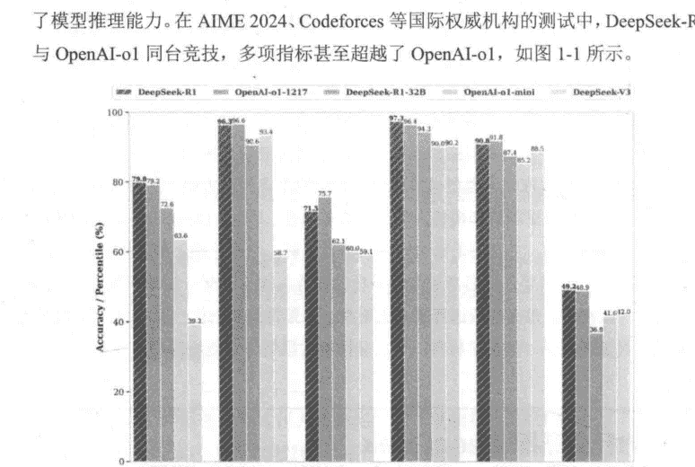

DeepSeek 的优势不在于易用性，而是在经济性上突出。达到同等性能时，其训练成本不足行业平均水平的 1%，使用成本仅为 OpenAI-o1 的 5%。更重要的是完全开源，普通用户可免费试用。

目前主要提供两个模型：

- **DeepSeek-Chat：** 非推理模型，已升级至 DeepSeek-V3，是一款基于 NLP 和深度学习的聊天机器人，可进行流畅自然语言交互。
- **DeepSeek-Reasoner：** 最新推理模型 DeepSeek-R1，在给出最终答案前会展示思维链，提升答案可信度。

对话时可在输入框底部点击“深度思考 R1”按钮，在 DeepSeek-R1 与 DeepSeek-V3 间切换，如图 1-2 所示。

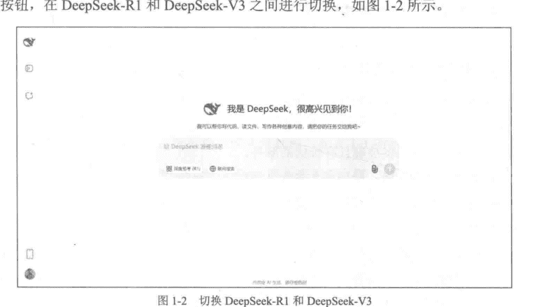

#### 1.2.2 DeepSeek 能做什么
DeepSeek 不止于文本和代码，还融合逻辑推理、多模态交互，覆盖教育、编程、商业分析等场景。凭借低成本和高兼容性，成为个人和企业的效率工具。

# 第 1 章 初识 DeepSeek 的世界

## 1. 文本创作能力
文本生成能力丰富多样，能满足创意和实用需求。

- **多样化创作：** 可自动生成文章、故事、诗歌、营销文案等，输入主题即可获得完整内容。
- **结构化处理：** 支持长文摘要、多语言互译、按需生成数据表格等。
- **智能对话问答：** 像聊天机器人一样回答跨领域知识问题，支持多轮追问。
- **学术支持：** 帮助整理文献、解释专业术语、解读数据，提升写作效率。

## 2. 语言理解与分析
能深入挖掘文本信息，从语义解读到逻辑推理。

- **语义情感分析：** 理解文本含义并判断情感倾向，可用于评论好评差评判断。
- **信息抽取分类：** 提取人名、地点、价格、日期等要素并自动归类。
- **逻辑推理解答：** 解决数学运算、逻辑谜题并给出清晰推导过程。

## 3. 编程助力
为开发者提供从生成到文档的全流程支持。

- **代码生成与补全：** 根据自然语言描述生成 Python、Java 等代码片段。
- **调试与优化：** 分析错误原因、给出修改建议、重构冗余代码。
- **文档生成：** 自动生成 API 文档和注释，节省时间。

## 4. 绘图与数据处理
把繁杂数据转为直观形式，精准处理文件。

- **数据可视化：** 将数据转为折线图、柱状图等，直观展示趋势。
- **图片文件处理：** 上传图片或文档，识别文字、扫描表格并提取关键信息。

#### 1.2.3 DeepSeek 与传统 AI 的差异
如果把传统 AI 比作“高端餐厅”，DeepSeek 就是“智能厨房机器人”。都能做出好菜，但运作方式截然不同，如表 1-1 所示。

表 1-1 DeepSeek 与传统 AI 的区别

| | 传统 AI | DeepSeek |
| 学习方式 | 依赖海量标注数据，通过记忆积累经验 | 用强化学习实现举一反三、触类旁通 |
| 使用成本 | 企业部署预算大，个人按次付费 | 基础功能可在普通手机运行，开源免费 |
| 技术透明度 | 闭源系统，像上锁的保险箱 | 开源架构，可拆解改造每个模块 |
| 应用场景 | 多集中于科研机构和大企业 | 平民化工具，普通人也能开发应用 |
| 进化速度 | 更新周期以月计甚至以年计 | 支持实时微调，像给手机装新 App |

这种差异本质是“实验室 AI”向“生活 AI”的转变。DeepSeek 代表的第三代 AI 正在重新定义智能技术，不再是高高在上的神灵，而是人人可用的智能瑞士军刀。

### 1.3 如何开始使用 DeepSeek
前文介绍了功能和开源免费特性，下面说明访问方式及常见问题解决。

#### 1.3.1 访问 DeepSeek 的方法
PC 端和手机端均支持验证码登录和密码登录。

1. 验证码登录 PC 端
打开浏览器输入官网地址，点击“开始对话”，选择“验证码登录”，输入手机号并同意协议，点击“发送验证码”，填入收到的验证码后登录，如图 1-3 所示。

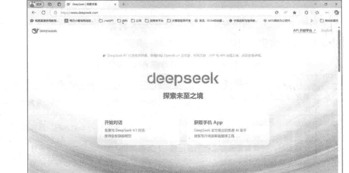
在登录页选择“验证码登录”，输入手机号并勾选协议后发送验证码，按提示操作完成登录。

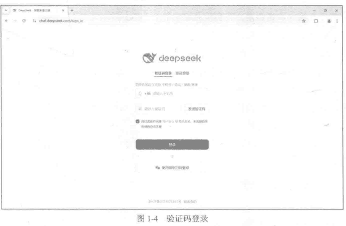
图 1-4 验证码登录

2. 密码登录 PC 端
打开官网点击“开始对话”，选择“密码登录”，输入已注册的手机号或邮箱及密码即可使用，如图 1-5 所示。

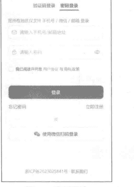
图 1-5 密码登录
首次使用需先注册，点击“立即注册”输入手机号或邮箱、两次密码、选择用途并同意协议，发送并填写验证码后完成注册。

3. 手机端登录 以鸿蒙系统为例
在应用市场搜索 DeepSeek，点击安装。安装后首次打开需同意用户协议和隐私条款，如图 1-7 所示。

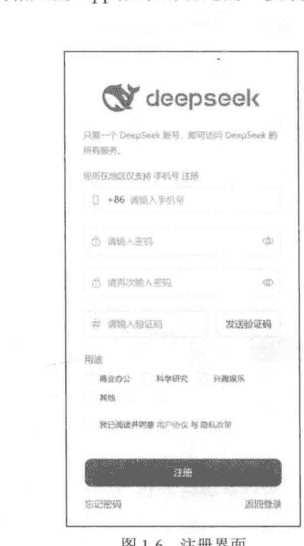
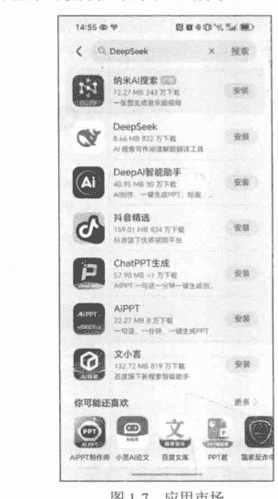
同意后进入登录界面，如图 1-8、图 1-9 所示，选择验证码或密码登录，流程与 PC 端一致。

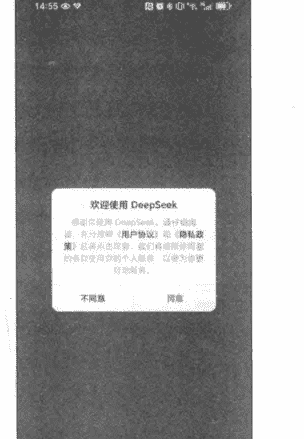
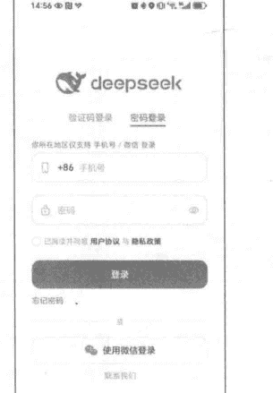

#### 1.3.2 DeepSeek 界面说明
PC 端与手机端功能相近，布局略有差异。PC 端界面如图 1-10 所示。

- **新建对话区 ①：** 点击“开启新对话”按钮创建新会话。
- **历史对话 ②：** 查看历史记录，悬停标题出现“...”可重命名。

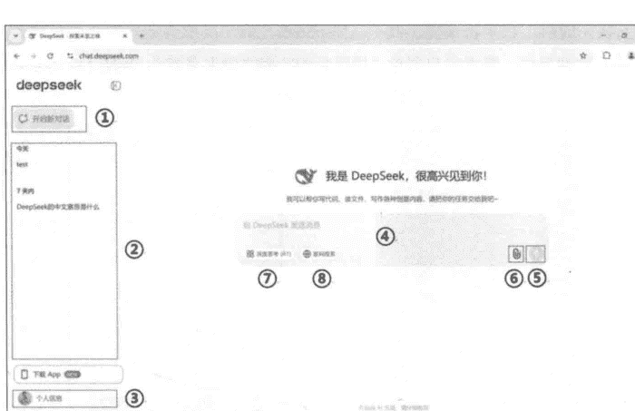
图 1-10 PC 端的 DeepSeek 界面
- **个人信息 ③：** 系统设置、删除对话等功能，可配置语言主题和管理账户。
- **输入框 ④：** 撰写并发送内容。
- **发送按钮 ⑤：** 提交内容。
- **上传附件 ⑥：** 上传文档图片作为私有知识库，单次最多 50 个文件，每个不超过 100MB，仅识别文字。
- **深度思考 R1 ⑦：** 启用 DeepSeek-R1 处理推理问题。
- **联网搜索 ⑧：** 实时访问互联网获取最新信息。

手机端界面包含开启新对话 ①、历史对话区 ②、输入框 ③、拓展功能区 ④，如图 1-11 所示。

点击底部“+”可展开拍照识文字、图片识文字和文件三个选项，如图 1-12 所示。

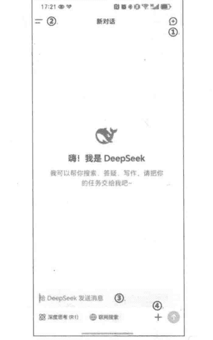
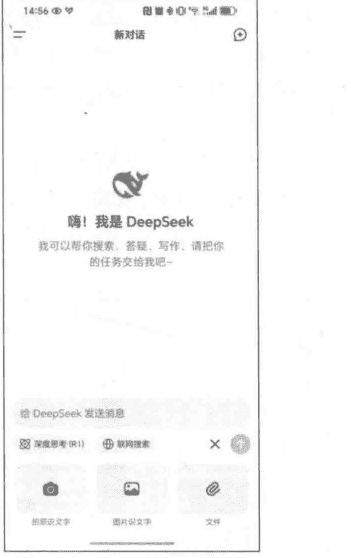

> **注意**
网页版同理，上传附件和联网搜索不可同时使用。开启联网搜索时，“+”按钮会变灰，相关拓展功能也无法使用。

#### 1.3.3 服务器繁忙的应对方法
DeepSeek 凭借 DeepSeek-R1 的发布在全球迅速走红，吸引大量用户。热度攀升的同时，“服务器繁忙”也成为常见问题。

DeepSeek 近期使用体验出现明显波动，甚至出现卡顿与掉线。背后是流量激增与恶意攻击叠加造成的双重压力。新模型上线后，全球用户集中涌入，瞬时并发请求远超原本集群的设计承载，导致排队拥堵加剧。与此同时，自 2025 年 1 月 27 日起，平台不断遭到境外发起的多轮攻击，包含大流量 DDoS 以及针对账号的密码暴力破解。这类攻击占用大量算力、干扰正常业务，同时也威胁到账号安全。两股压力共同作用下，响应时延被拉长，服务中断频发，使用感受受损严重。

面对这种状况，个人用户可以先尝试以下替代入口。

- 秘塔 AI 搜索（见图1-13）：平台已接入完整版 DeepSeek-R1 推理引擎，并同步开放全网检索与长思考·R1 模式，检索效率与思考深度同步提升。

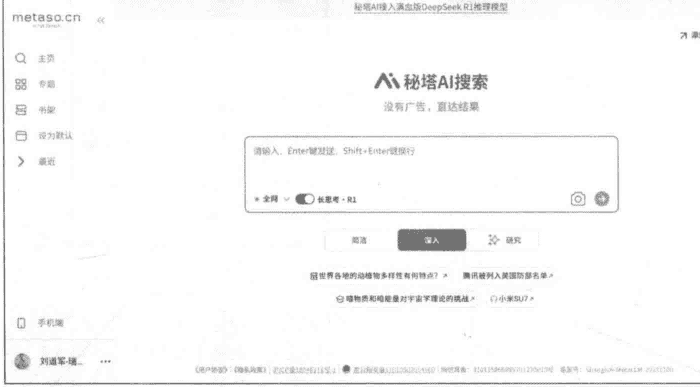
图1-13 秘塔AI搜索

- 纳米 AI 搜索（见图1-14）：支持在 50 多款主流大模型之间自由切换。鸿蒙原生客户端已对接联网版 DeepSeek-R1 671B 满血模型，以及 DeepSeek-R1-360 32B 高速专线。自研的多模态检索能力与 R1 的强化推理能力深度融合，拓展了模型的应用边界。

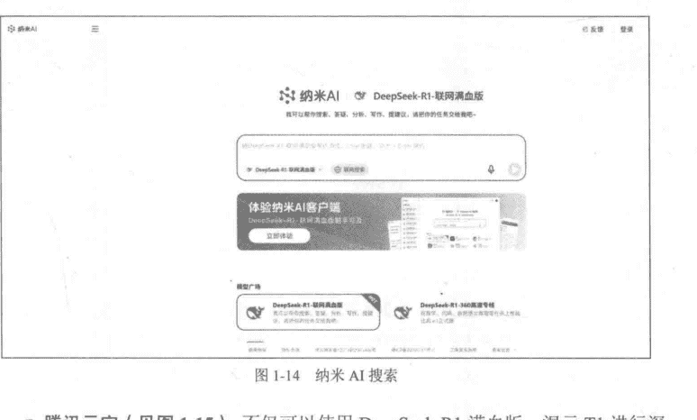

- 腾讯元宝（见图1-15）：可调用 DeepSeek-R1 满血版与混元 T1 进行深度思考，也能借助 DeepSeek-V3、腾讯混元 Turbo 实现快速应答。


- 国家超算互联网平台（见图1-16）：已上线 DeepSeek-R1-Distill-Qwen-7B、DeepSeek-R1-Distill-Qwen-32B、DeepSeek-R1-Distill-Qwen-70B、DeepSeek-R1-671B 等权重，并支持 AI Web 应用部署。

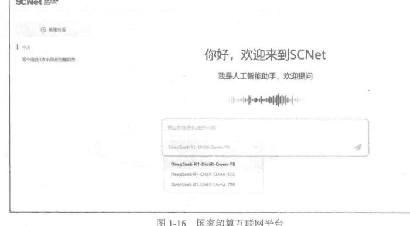

随着 DeepSeek 热度的持续攀升，预计会有更多平台接入相关模型，建议保持关注以获取更多选择。

对企业或开发者来说，可以考虑 API 与本地客户端结合的混合方案，例如使用硅基流动提供的接口配合 Chatbox 或 Cherry Studio 完成集成；借助 Ollama 加插件实现本地私有化部署也是可行路径，感兴趣的可自行探索。

## 第2章 提问技巧进阶，让 DeepSeek 更懂你

本章目标是帮助读者从普通使用者成长为熟练操控者。首要工作是区分两个常用版本 DeepSeek-V3 与 DeepSeek-R1。

DeepSeek-V3 更适合结构化、规范化的任务，例如文献撰写和会议纪要整理。DeepSeek-R1 则偏向复杂推理场景，例如数学求解与创意文案产出。

两者在指令方式上也有差异。V3 更适合用 RTGO 框架来组织提问，R1 则更依赖四要素指令法。

此外，本章还将拆解三大隐藏能力。

- 多轮持续对话：可像聊天一样逐步完善答案。
- 联网搜索：可获取最新新闻资讯。
- 文件解析：可直接上传文档进行分析。

掌握这些方法后，DeepSeek 才能真正成为你的智能助手。

### 2.1 两款核心模型的提示设计差异

使用 DeepSeek 时是否遇到过这类问题：要求写会议纪要，结果却过于随意遗漏要点；要求产出创意文案，却得到生硬套模板的回复。

根源多在模型选型与提示设计不当。V3 与 R1 各有侧重：

- V3 是模板专家，擅长需要明确流程与框架的规范化任务，比如会议纪要、报告撰写。
- R1 是创意大师，更适合开放性任务，如广告文案策划、策略建议等，只需给出模糊目标即可激发创造力。

选错模型效果大打折扣，选对模型则事半功倍，关键在于掌握提示设计方法。

#### 2.1.1 DeepSeek-V3 与 DeepSeek-R1 的适配场景

从任务特性出发，可划分为规范性任务与开放性任务。

- 规范性任务：执行时必须遵循既定框架、模板或结构化步骤，结果确定性高、路径固定。例如按学术规范写文献综述、按公司模板写会议纪要、按章节结构制定课程大纲等。这类工作对准确性与一致性要求高，DeepSeek-V3 因其结构导向与规范性强，更为合适。

- 开放性任务：没有固定框架，以结果为导向，强调创意与突破。例如新媒体文案创作、广告语构思、品牌故事叙述、探索性市场预测等。DeepSeek-R1 在此类任务上表现更佳，能给出更灵活创新的解法，不过输出的可预测性相对 V3 较低。

为便于选择，对两者适用场景做对比，如表 2-1 所示。

表 2-1 DeepSeek-V3 与 DeepSeek-R1 的适用场景

| 维度 | DeepSeek-V3 | DeepSeek-R1 |
| :--- | :--- | :--- |
| 任务类型 | 规范性任务（框架明确） | 开放性任务（目标模糊） |
| 优势领域 | 模板化文本生成、结构化输出 | 创意内容、数理逻辑、编程 |

#### 2.1.2 DeepSeek-V3 与 DeepSeek-R1 在提示语上的区别

两类模型对指令的理解方式不同，因而提示设计原则也不同。

1. DeepSeek-V3 的提示语设计
V3 更擅长理解基于明确指令与具体框架的内容。设计要点为：
- 明确性：清晰说明每一步骤与格式要求。
- 结构化：使用分点、编号、示例模板。
- 限制性：用约束指令排除无关内容，如“禁止添加主观评价”。

例如，让 DeepSeek 根据提供的课程大纲，按照指定教案格式完成后续章节。提示要求严格依据给定标题，不得随意更改，并附上完整大纲。关闭“深度思考”后使用 V3，输出会严格遵循示例结构，如图 2-1 所示。

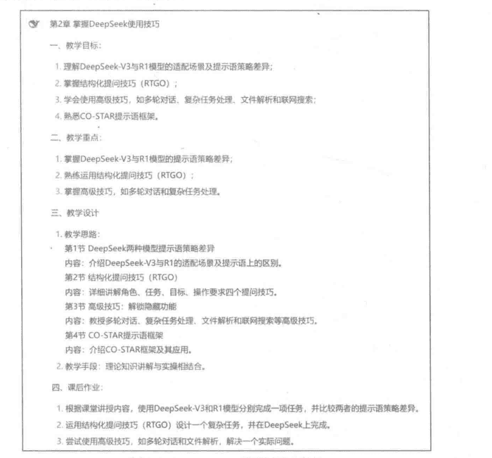

开启“深度思考”后调用 R1，模型会先展示完整的思考流程与要点，如图 2-2，随后给出结果如图 2-3。

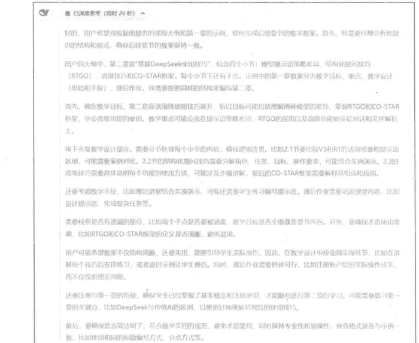

对比可见，R1 的输出更灵活、创新性更强，并未严格按大纲标题与示例结构呈现，比如章节标题被改写，教学手段中还额外加入了“沙盘演练”“可视化工具”“错误分析”等内容。

2. DeepSeek-R1 的提示语设计
R1 更适合模糊或开放的指令，鼓励创造性思考。重点在于传达目标而非细节。其设计原则为：
- 目标导向：强调最终效果，如“让读者产生情感共鸣”。
- 场景化：描述具体应用场景，如“针对 20~30 岁女性用户”。
- 激发创意：允许使用类比、隐喻等修辞。

例如，要求为新款防晒霜撰写小红书文案，场景为户外旅行，语言要生动活泼，可使用表情符号与网络流行语，目标是吸引 20~30 岁女性注意。输入后 R1 会先输出思考过程，如图 2-4，随后生成创意文案如图 2-5 所示。


同样的指令输入 V3，回复如图 2-6，在开放性任务中表现明显逊色。

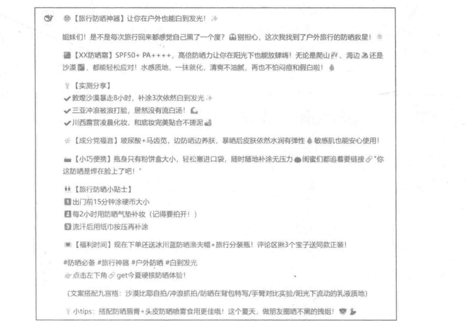


理解任务类型与模型特性后，选择合适的工具并配合对应的提示方式，才能显著提升工作效率。

### 2.2 DeepSeek-V3 等非推理大模型的提问技巧

非推理大模型的提示语相当于一份详细的工作说明书。以 DeepSeek-V3 为例，提示语需说明扮演什么角色、完成什么任务、达到什么目标、如何输出，例如角色是经验丰富的老师，任务是写科普文章，目标是让小白看懂，输出要求通俗语言、限定字数、特定结构、Word 格式等。

为让 V3 更精准理解需求，可使用 RTGO 框架，即 Role 角色、Task 任务、Goal 目标、Output 输出，四步把模糊想法转化为明确指令，如图 2-7 所示。


#### 2.2.1 角色定义：构建精准的人物形象

角色设定是对话的基础，决定了模型以何种身份、视角与专业深度作答。角色不仅包含职业身份，还应涵盖经验水平、专业领域与沟通风格，从而提升回答的专业性与实用性。

1. 角色定义的重要性
- 激活特定知识库：通过设定角色可让模型聚焦相关领域知识。例如设定为“经验丰富的营养师”，模型会优先调用营养学相关信息。
- 限定范围与深度：无角色的提问易导致回答宽泛。明确角色后，如“对糖尿病管理有深入研究的营养师”，回答会聚焦饮食控制血糖的具体方法。
- 提升场景适配性：不同角色会产生不同解决方案。如“帮助职场人士改善睡眠的治疗师”会给出针对加班压力的建议，而“专注老年人健康的睡眠专家”则更关注生理特点与常见障碍。

2. 如何设计有效角色
- 专业背景：明确职业身份，如数据分析师、心理咨询师、市场营销专家。可进一步细化为“专注社交媒体营销的数字营销专家”。
- 经验水平：用“新手”“资深”“10 年经验”等关键词设定资历，提升可信度。
- 特定专长：进一步限定领域，如“专注糖尿病管理的营养师”，提高针对性。

3. 实际应用示例
仅输入“请写一篇关于健康饮食的文章”，输出内容宽泛，缺乏针对性，如图 2-8 所示。


加入角色定义后，如“你是一位有 10 年临床经验的营养师，专注于糖尿病患者的饮食管理，请写一篇关于健康饮食的文章”，输出将从专业角度给出更具体实用的建议，例如如何控制血糖、适合的食物选择等。

在临床营养一线深耕糖尿病管理十年的经历，让我对饮食干预的重要性有了直接的体感。对糖友来说，吃什么、怎么吃，远不止是饱腹，更是稳住血糖、远离并发症、让生活更有质量的根本。

## 一、厘清底层逻辑：饮食管理的核心要点

不少糖友对饮食干预存在误区，觉得躲开甜食就万事大吉。真正有效的饮食管理，落脚点是**把总热量管住、把营养配平、把血糖波动控制住**。

- 能量把控：结合身高、体重、运动量等个体参数测算每日能量需求，严格执行，避免摄入过剩推高血糖。
- 营养均衡：碳水、蛋白、脂肪、维生素、矿物质都要兼顾，缺一不可，方能满足机体运转需求。
- 血糖平稳：优先选用低血糖生成指数食物，让血糖曲线更平缓，避免大起大落。

## 二、因人而异：制定专属饮食计划

不同糖友的病程、体质、饮食习惯差异很大，方案必须个体化。

- 算清能量底线：依患者具体状况套用专业公式测算日需能量，并据此编排一日三餐。
- 精选食材：指导选用低GI、高纤维的谷物、蔬果、豆类，同时压缩高糖、高脂、高盐食物的比例。
- 调整进餐节奏：提倡少量多餐，定时定量，避免一次吃太饱。

## 三、落地技巧：烹饪与食谱参考

- 烹饪方式：多用清蒸、水煮、凉拌，少用油炸、煎烤，降低额外热量。
- 食材替换：糙米替代精白米，全麦面包替代白吐司，时令水果替代甜点。
- 标签阅读：学会看营养成分表，清晰掌握隐形糖分与脂肪含量。

可供参考的餐单示例：

- 早餐：燕麦粥配低脂奶与坚果，或全麦面包配水煮蛋和时蔬
- 午餐：杂粮饭配清蒸鱼和翻炒时蔬
- 晚餐：小米粥配鸡肉沙拉和凉拌豆腐
- 加餐：低糖水果、原味酸奶、少量坚果

## 四、长期坚持：管理是一场马拉松

饮食干预没有捷径，需要持续执行。我会定期回访，依据血糖数据和身体反馈微调方案，同时给予情绪支持与行动鼓励。

## 五、结语

糖尿病并不可怕，科学饮食配合规范治疗，就能把血糖控制在理想区间，降低并发症风险，活得更自在。愿这份经验能帮助更多糖友走出困惑，与疾病和平共处。

图 2-9 角色定义后的输出结果

当给角色加入更具体的背景和专长设定，比如“你是在社区医院工作的营养师，有5年糖尿病照护经验，擅长用大众语言给中老年糖友做健康科普。请写一篇控制血糖的饮食指导，读者是社区中老年人”，产出会更贴近目标人群的理解习惯，内容更聚焦血糖控制，且避开专业术语堆砌。

> 糖友吃饭不用愁，跟着学血糖更稳

各位大哥大姐好，我是社区医院的营养师小李，在糖尿病管理这块儿已经干了五年，接触过不少为吃饭发愁的糖友。今天就用大白话聊聊，糖友怎么吃才能让血糖更平稳。

一、吃饭有门道，记住“12345”

很多糖友觉得得了糖尿病就要挨饿，其实饮食并不难，抓住“12345”就好操作：

• 1袋奶：每天一袋低脂牛奶，补充钙质。
• 2两肉：鱼虾禽类瘦肉皆可，补充优质蛋白。
• 3两果：选低糖水果如苹果、梨、柚子，安排在两餐之间。
• 4两粮：粗细搭配，糙米、燕麦、全麦面条更合适。
• 5两菜：深色叶菜、菌菇、瓜类为主，增加膳食纤维。

二、吃法也有讲究，血糖更友好

• 细嚼慢咽：放慢速度，帮助消化，也更有饱腹感。
• 定时定量：三餐固定时间，避免暴饮暴食。
• 少食多餐：餐间可加一杯酸奶或几颗坚果，平抑波动。
• 清淡少油：少油炸煎炸，选用清蒸、水煮、凉拌。

三、照着吃更省心

• 早餐：燕麦粥配牛奶坚果，或全麦面包配鸡蛋蔬菜
• 午餐：杂粮饭、清蒸鱼、炒青菜
• 晚餐：小米粥、鸡肉沙拉、凉拌豆腐
• 加餐：水果、酸奶、坚果

四、坚持是关键，血糖改善靠自己

饮食管理贵在长期坚持。我会定期在社区开讲座，分享实操技巧，也欢迎大家随时来咨询。

最后想说，糖尿病不可怕，科学饮食配合治疗，就能稳住血糖，减少并发症，让生活更有质量。一起加油，战胜它！

图 2-10 给角色设定了更细化的特定专长后的输出结果

通过更精准的角色定义，回答会更专业、可操作，也更贴合使用场景。

记住，角色定义是 RTGO 框架的第一步，也是最关键的一步——它决定了输出的视角和深度。

#### 2.2.2 任务（T）描述：划清工作边界

角色确定后，下一步是明确具体要做什么，这就是任务描述的价值。任务描述要界定任务的性质、范围和内容形式。

它相当于给模型划定工作范围，保证不跑题。不能涉及目的或执行细节。

## 1. 任务描述为何重要

在交互中，清晰的指令直接影响结果质量与效率。

- 避免模糊走偏：指令笼统会让模型自由发挥，偏离预期。比如只说“写篇健康文章”，结果可能面面俱到却不聚焦。
- 提升效率：明确指令可减少试错。例如“请基于最新市场数据，撰写新能源汽车行业分析报告”，模型会直接进入正题。
- 保证实用与专业：细化描述能引导出更贴合场景的结果。如要求“为社交媒体写的科普”，模型会避免术语堆砌，语言更通俗。

## 2. 如何构建有效任务描述

从三个维度构建任务描述，形成清晰行动蓝图。

- 核心动作：明确要执行的动作，如撰写、分析、设计、归纳、翻译等。例如“请撰写人工智能发展趋势文章”或“请分析近三个月销售数据”。
- 内容载体：明确输出形式，是文章、报告、图表、脚本等。清晰载体有助于信息组织。例如“请输出含图表的市场分析报告”或“请为小红书写防晒霜推广文案”。
- 参考素材：提供背景信息，如数据、链接、示例。帮助模型更准理解。例如“请依据 XXX 健康报告第 XX 页数据写糖尿病预防文章”。

## 3. 任务描述的应用示例

若仅输入“请写一篇关于人工智能的文章”，结果会很宽泛，缺乏深度。

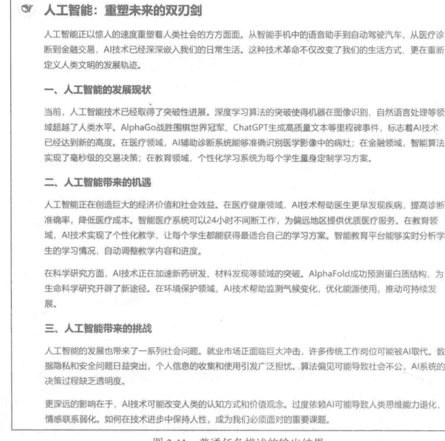

加入核心动作、载体、素材后，如“请撰写一篇关于人工智能在医疗领域应用的文章，重点介绍疾病诊断与治疗的最新进展，并参考《全球医疗科技产业报告 2024 版》数据”，输出会更聚焦、信息更具体。

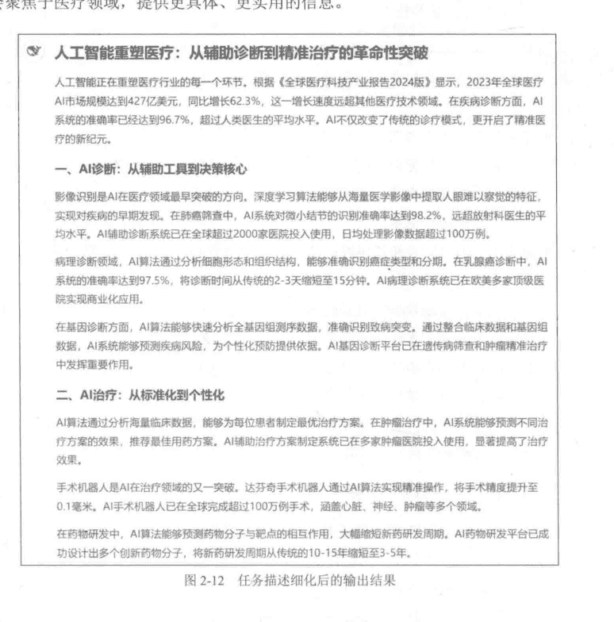

#### 2.2.3 目标（G）设定：明确成功标准

角色和任务明确后，要回答：希望通过这次任务达成什么效果？

目标设定为模型指明终点，决定内容方向、深度和适配度。

## 1. 目标设定的意义

- 防止脱节：没有目标，模型可能生成合理却无用的内容。
- 提升针对性与实用性：清晰目标帮助模型把握场景。如写给新手父母的婴儿睡眠指南，会避免专业术语，提供实操建议。
- 优化详略：目标决定深度。如企业内训需要深入分析，社交媒体则更注重趣味可读。

## 2. 有效目标的设计维度

- 受众画像：明确读者是谁。年龄、职业、知识背景影响语言和深度。例如职场新人指南与高管策略差异明显。
- 传播场景：内容用在哪儿。朋友圈、内部分享、公开演讲要求不同。朋友圈求简洁有趣，汇报求数据严谨。
- 预期效果：希望达成什么。引发共鸣、促进购买、树立权威。目标不同，内容侧重不同。

## 3. 目标设定的示例

仅说“请写一篇健康饮食文章”，结果泛泛。

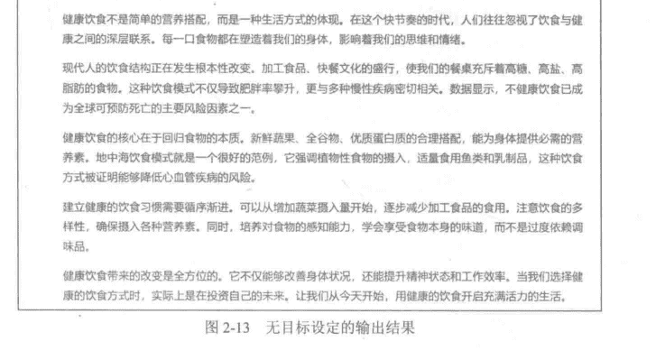

加入目标如“请写健康饮食文章，帮助糖尿病患者控制血糖”，输出更具体实用。

若再细化为“请为50岁以上糖尿病患者写饮食文章，帮助通过饮食控糖，在社区讲座使用，要求通俗易懂并含三个案例”，结果更聚焦、符合需求。

# 第2章 掌握提问技巧，让 DeepSeek 更懂你

> 重塑餐桌：糖尿病患者的饮食革命

餐桌上的每一次选择，都在重写糖尿病患者的健康剧本。食物不再只是热量来源，而是调节血糖的关键杠杆。

饮食管理的核心在于构建合理的营养结构。碳水、蛋白、脂肪的配比直接影响血糖波动。研究显示，低GI饮食可显著降低糖化血红蛋白水平。选择全谷、豆类、蔬菜等低GI食材，有助于血糖平稳。

实践层面，糖友需要掌握独特技巧。分餐策略有效控制餐后血糖，将三餐拆分为五到六餐，既保证营养又避免剧烈波动。食物搭配也很重要，碳水搭配膳食纤维可延缓吸收。

科技工具也在改变管理方式。饮食记录APP、血糖监测设备、个性化营养分析让管理更精准。这些创新使饮食控制更科学便捷。

这场饮食革命的意义不仅是控糖，更是重塑患者与食物的关系。科学饮食让患者重获掌控感，正确的选择带来希望，而希望是战胜疾病的重要力量。


> 智慧饮食，稳糖有道：50+糖友的餐桌革命

社区朋友们，今天聊聊如何用智慧饮食控制血糖。对50岁以上的糖友来说，饮食既是享受也是健康管理。

食物就是最好的降糖帮手。张阿姨65岁，以前早餐吃白粥配咸菜，血糖波动大。改成杂粮粥配水煮蛋和凉拌菠菜后，空腹血糖稳定在6.5左右，这就是低GI的效果。

吃饭要讲搭配。李叔叔58岁，以前吃红烧肉配米饭，餐后血糖常冲到13。现在用“321”法则：每餐3份蔬菜、2份蛋白、1份主食。清蒸鱼替代红烧肉，糙米替代白米，餐后血糖控制在8以下。

还要懂得少食多餐。72岁的王奶奶改成一天五餐，每餐七分饱，餐间加坚果或低糖水果，全天血糖更平稳。

记住三点：

1. 主食粗细搭配，多吃杂粮
2. 蛋白充足，优先鱼、蛋、豆制品
3. 蔬菜足量，每日至少500克

管理贵在坚持，无需苛求完美。偶尔想吃甜食，可在正餐后少量食用并减少主食。记住，我们是管理血糖，不是惩罚自己。

一起开启餐桌革命，用智慧饮食掌控健康，让血糖稳稳，生活美美！


#### 2.2.4 输出（O）规范：明确执行细节

角色、任务、目标确定后，最后一步是告诉模型如何呈现结果。这就是输出规范。

它涵盖格式、风格、禁忌等，确保内容既满足需求又便于使用。

## 1. 输出规范的重要性

- 保证一致性：缺乏规范，模型会自由发挥，导致结果不符预期。如要求社交媒体科普却没限定风格，可能出现过于专业或冗长的文本。
- 提升可用性：详细规范能让结果更贴合应用。如要求“每页不超过50字并配图表的培训PPT”，模型会输出更简洁直观的内容。
- 减少返工：预先确定规范可降低修改成本。如明确“使用Markdown输出”，可直接获得可用格式。

## 2. 有效输出规范的设计维度

- 输出格式：明确呈现形式，如文章、报告、图表、脚本。不同格式组织方式不同。如“请用Markdown输出并包含三级标题”。
- 语言风格：确定语气与表达，是正式、轻松、幽默等。明确风格有助于语言组织。如“请用通俗语言写2000字文章，适合初中生阅读”或“请用幽默风趣风格写适合社交媒体传播的文章”。

- **禁止清单**：先把要避开的内容明确出来。任务是否附带使用限制？例如是否需要规避特定用词、避开敏感议题、不得点名竞争对手。把这些红线说清楚，DeepSeek-V3 才能少走偏。比如“禁止出现任何竞争品牌的名称”或“医学专业词汇尽量少用”。

## 3. 输出规范的实际落地方案
单说“写一篇关于人工智能的文章”，模型给出的内容往往宽泛空洞，针对性不强。加入清晰的输出要求后，结果会更集中、更有料。比如“围绕人工智能在医疗场景的应用写约1500字的稿子，用通俗语言给普通读者看”，效果如图 2-16。此时模型会锁定医疗主题，并在限定字数内提供更具体可用的信息。

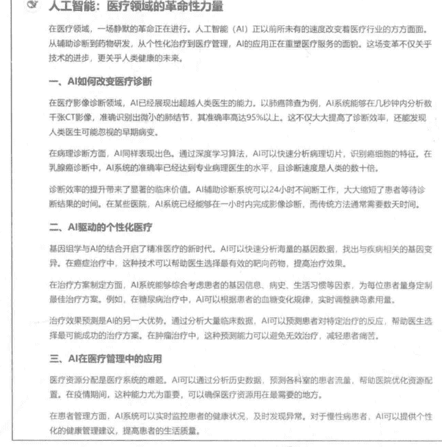

再把要求细化。例如，“请参照《全球医疗科技产业报告 2024 版》中的数据，撰写一篇聚焦人工智能在癌症早期筛查应用的文章，约1500字，语言通俗面向大众，以 Markdown 输出，包含三级标题与关键数据表”，效果如图 2-17。DeepSeek-V3 的回答会更精准、更实用，完全贴合具体需求。

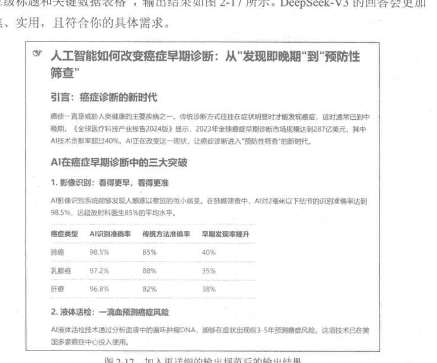

### 2.3 推理类大模型的提问方法
DeepSeek-R1 这类推理模型在内容创作、问答、数据分析和决策支持方面能力很强。但要发挥潜力，关键在于提示词的设计。

实践中被验证有效的是“四要素指令法”。它能更系统、有条理地与推理模型互动，拿到更高质量的输出。下面分段说明使用方法。

# 第2章 提问更准 让 DeepSeek 更懂你

## 1. 明确定位 先说清楚要做什么
R1 需要先明白你要它完成什么，但细节过多会压制创造力。就像请大厨做菜，告诉他“做一道主菜”就够了，不必交代“先切后炒、火候 200℃”。让 R1 工作时，用简短明确的表述点出任务本质，减少复杂从句和修饰。如果任务本身分步，就把它归纳成一个总目标。

### 对比示例
❌ 不佳示范：
“请写一篇关于 AI 提示词技巧的文章，需要包含 RTGO 框架、案例分析、常见误区，还要有具体操作步骤和注意事项”。提示过于繁琐，挤压了 R1 的发挥空间。

✅ 推荐示范：
“写一篇关于 DeepSeek 提示词技巧的小红书文案”。表述简洁，给模型留出创作余地，更适合推理型模型。

## 2. 锁定受众 对准谁看
不同读者对内容的接受度和需求差异很大。小白和专业人士在语言、案例、深度上都不同。描述受众时要具体到身份，如职场新人、家庭主妇，并指出痛点，如需要即学即用的技巧、希望轻松参与活动，避免“普通人”这类模糊表述。

### 对比示例
❌ 不佳示范：
“给普通人看”。过于笼统，模型难以针对性调整。

✅ 推荐示范：
“给从未接触过 AI 的小白看，他们想要立刻能用的实用技巧”。受众画像清晰，模型会自动降低难度、选合适案例。

## 3. 设定目标 要达到什么效果
清晰的目标能引导模型产出更贴合的内容。同样写文案，若目标是收藏还是转发，侧重点完全不同。建议用“动词+效果”来表述，如“让读者觉得内容扎实、促进行动”等，避免同时要求“既专业又幽默”等冲突或泛泛的目标，如“让人喜欢”。越具体越好。

### 对比示例
❌ 不佳示范：
“既要专业又要有趣，既能传播又能带货”。目标相互矛盾且模糊。

✅ 推荐示范：
“让读者读完觉得充实实用，并产生收藏和马上尝试的冲动”。
模型会围绕这一导向组织内容。

## 4. 划定红线 不能出现什么
即使 R1 很智能，没有明确禁忌也可能跑偏。如不想出现专业术语，就要提前说明。可使用否定句列出 1～3 条关键禁忌，避免过多约束，表述要具体，别只说“不要太复杂”。

### 对比示例
❌ 不佳示范：
“不要太复杂”。要求太笼统，模型难以把握。

✅ 推荐示范：
“不要使用 prompt、LLM 等专业词汇；不要套用小红书常见模板；不要出现 AI 式的机械表达”。直指问题，能有效规避风险。

基于以上四要素，可用基础模板：
> 请（做什么），给（具体人群），目标是（达成什么效果），不要（列 1～3 条禁忌）

例如写手机充电器广告语，可问：“写一句手机充电器广告语，给看重性价比的年轻上班族，目标是突出快充和便携，不要用专业术语和夸张宣传”。

再如：“写一句手机充电器的广告语，给经常出差容易忘带充电宝的商务人士，要让人联想到安全感，不要出现快充、毫安这些参数”，输出结果如图 2-18 所示。

> “贴身电力守护，让每一次出发都底气十足。”

解析：
1. “贴身”——暗示便携，贴合差旅场景，自然进入用户装备体系
2. “电力守护”——拟人化传递可靠感，避开参数同时强化安全意象
3. “每一次出发”——锚定高频出差场景，引发商务人群共鸣
4. “底气十足”——双关职场从容，既暗示满电的工作掌控，也隐喻心理保障

文案把充电器从工具升级为“差旅安全感符号”，满足商务人士对确定性的心理需求。

图 2-18 R1 生成的广告语

再如策划活动，可问：“设计一个适合咖啡馆的周末促销活动，目标人群是想安静看书的年轻白领，目标是提升客流同时不破坏店内氛围，并且避免抽奖或大喇叭宣传等手段”，输出结果如图 2-19 所示。

> 以下是针对咖啡馆周末安静看书客群的促销方案设计，兼顾客流提升与氛围维护：

一、核心策略
以“静享时光”为主题，打造沉浸式阅读空间，通过增值服务吸引目标客群。

二、具体实施方案
1. 书香套餐（提升客单价）
   ○ 推出“书咖伴侣套餐”：精选咖啡+手工司康/玛德琳+免费阅读灯租用（3小时）
   ○ 周末限定版：加赠独立包装降噪耳塞（印有品牌 LOGO）
2. 时段特权（错峰引流）
   ○ 早鸟计划：9:00-11:00入店赠送半小时免费续杯权益
   ○ 夜读时光：20:00后消费赠送次日早间咖啡8折券
3. 空间升级（增强体验）
   ○ 设置“静音舱”区（需预约）：配备人体工学椅/小型书桌/绿植隔断
   ○ 开辟书籍漂流角：顾客可带旧书交换（每交换3本赠1张咖啡券）
4. 会员体系（增强粘性）
   ○ 阅读卡：周末累计消费满5小时升级银卡，享免费预约座位特权
   ○ 专属福利：每月最后一个周末凭电子书购买记录可兑换特调饮品
5. 跨界合作（精准获客）
   ○ 与周边书店联合：凭当日购书小票享咖啡买一赠一
   ○ 电子书平台合作：展示阅读时长截图赠手工书签

三、氛围维护措施
• 设置智能提示器：当分贝超过55自动闪烁提醒

图 2-19 R1 生成的咖啡馆周末促销活动文案

清晰设定 4 个要素，能让 DeepSeek-R1 在明确边界内自由发挥，产出既符合需求又有创意的內容。记住，R1 的优势是推理与创造，你的任务是指引方向和划定边界，而非事无巨细地指挥。

### 2.4 高阶用法 解锁隐藏能力
还在把 DeepSeek 当普通问答机？别人还在单轮问答时，掌握隐藏功能的用户已进入“高级智能”模式。它能记住三天前的对话细节，可自动解析文件中的财务数据，还能联网检索最新知识。

#### 2.4.1 多轮持续对话
DeepSeek 具备上下文记忆能力，通过特殊标记实现连续追踪，无需重复输入关键信息。

可用“上下文锚点”法。例如对话开始时标记【项目代号 A】，并输入“【项目代号 A】请为公司生产的防晒霜设计一套推广策略，目标群体为年轻人，尤其是热爱户外运动的年轻人。推广预算为 50 万元，目标销售额为 500 万元。请避免使用抽奖、大折扣等传统促销手段”。DeepSeek 会据此生成如图 2-20 的推广策略。

一段时间后输入“基于【项目代号 A】的预算分配，追加抖音渠道的 ROI 测算”，模型会自动调取先前预算并给出测算结果，如图 2-21。

这就是多轮持续对话功能。

除锚点外，也可用“如前所述……”等语句触发记忆，或用“继续我们上周三讨论的营销方案……”按时间线索调取历史对话。

针对【项目代号A】防晒霜推广需求，结合年轻户外运动群体的行为特征和预算限制，现提出以下创新推广策略框架：

一、核心策略定位
“科技赋能自然防护”——强调「实验室级防晒技术」与「自然友好配方」双核驱动，打造“户外运动专业守护者”品牌形象。

二、分阶段执行方案
1. 预热阶段：概念植入（预算10万）
• 技术可视化营销
① 研发“紫外线显影实验套装”（成本控制在8元/套）
② 联合20家攀岩馆/冲浪俱乐部开展「看见阳光伤害」体验活动
③ 用户拍摄实验过程视频可兑换正装产品（首批投放5000套）
• 专业背书建设
① 赞助3场省级山地马拉松赛事医疗保障团队
② 出具运动防护实验室的8小时抗摩擦测试报告
2. 爆发阶段：场景渗透（预算30万）
• 内容共创计划
① 签约15位垂直领域KOC（户外运动达人+皮肤科医生组合）
② 开发「72小时极限实测」系列内容（沙漠徒步/海岛冲浪等场景）
③ 搭建AR虚拟防晒指数测试小程序
• 场景化渠道布局
① 与运动装备品牌推出联名款「防晒急救包」（含10ml便携装）

图 2-20 防晒霜推广策略

基于【项目代号A】的预算分配，现追加抖音渠道的ROI测算方案如下：

一、抖音渠道专项预算分配（总预算50万中划拨20万）

| 模块 | 费用占比 | 金额 | 关键用途 |
|---|---|---|---|
| 信息流广告 | 40% | 8万 | 精准定向投放（户外运动兴趣人群） |
| KOL合作 | 35% | 7万 | 签约5-8位垂类达人（粉丝50-200万） |
| 品牌挑战赛 | 15% | 3万 | 话题运营+流量扶持 |
| 直播带货 | 10% | 2万 | 自播团队搭建+样品投放 |

二、ROI测算模型
1. 流量获取预估
• 信息流广告：CPM按30元计，预计触达267万次
• KOL内容：单条视频平均播放量50万，预计总播放量300万+
• 挑战赛：目标参与视频1000+，预计曝光500万+
• 直播：场均观看1万+，预计总曝光20万+
2. 转化路径设计
广告/内容曝光 → 小程序跳转 → 会员注册 → 首单转化
3. 关键转化率假设
• 广告点击率：1.2%
• 内容互动率：3%

图 2-21 抖音渠道的 ROI 测算

#### 2.4.2 联网搜索
DeepSeek 的亮点之一是联网搜索。本书写作时预训练数据截止 2024 年 7 月，之后的新闻或技术动态它并不掌握，联网搜索因此很重要。

例如提问“请写出你对央视春晚《秧 BOT》的评价”，并开启联网搜索。DeepSeek 先检索 47 个网页阅读后，再给出如图 2-22 的答案。

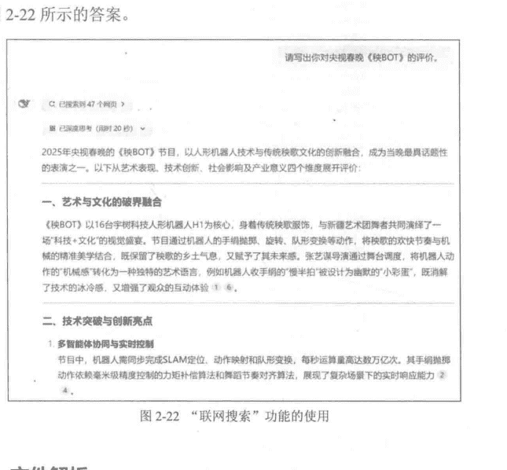

#### 2.4.3 文件解析
除联网搜索外，DeepSeek 还支持“上传附件”，相当于自建私人知识库。模型可阅读上传内容后做针对性回答。

目前支持一次性上传最多 50 个文件，每个不超过 100MB，文档和图片均可。图片仅识别文字内容。

例如上传一份《摩根士丹利报告》，输入“阅读这篇材料，写出 DeepSeek 对于科技和更广义经济的含义是什么？言简意赅。500 字”，输出结果如图 2-23。

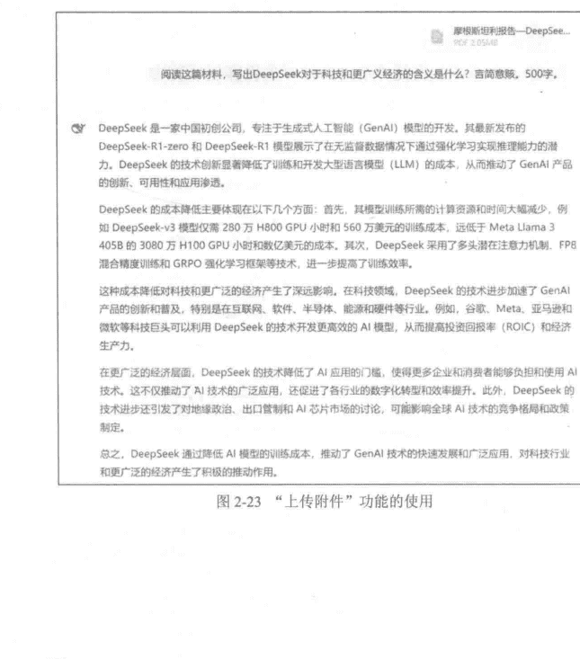

图 2-23 “上传附件”功能的使用

# 第 3 章
## DeepSeek 职场效率加速器
本章聚焦 DeepSeek 在职场的多样化应用，帮你成为职场达人。

DeepSeek 可作私人助理，快速检索、翻译、撰写营销文案、起草邮件，甚至拍照解答问题。公文写作上能快速生成会议通知、工作汇报、会议纪要等。知识推理上可做逻辑解答和因果分析。

它还能与 Xmind 结合做思维导图，与 XML 结合生成 SVG 矢量图，结合 Mermaid 快速创建流程图。

### 3.1 DeepSeek 作为你的私人助理
DeepSeek 不仅能替代搜索引擎产出内容，还能作精准翻译，突破语言障碍。无论撰写营销文案还是商务邮件，都能按需生成高质量内容。更神奇的是拍照识别功能，能精准解析并解答各类难题，为学习工作提供即时帮助。

#### 3.1.1 把 DeepSeek 当作新一代搜索引擎
传统搜索引擎如 Google、百度本质是“信息搬运工”。它们靠关键词匹配抓取网页链接列表呈现，用户需逐一打开筛选，耗时且易受广告干扰，难以辨别真伪，对模糊复杂问题也难以直接作答。

生成式 AI 如 DeepSeek 则是“知识创作者”。它基于海量数据深度学习，能较好理解意图并主动整合知识体系，迅速生成逻辑清晰、结构完整且具一定原创性的内容。无论解答专业问题、撰写创意文案还是分析复杂数据，都能像人类专家一样给出定制化结果。

这种生成式 AI 节省了筛选时间成本，突破了“有什么给什么”的局限，实现“需要什么创造什么”的跃升。

例如，我很久前读过一本书，只模糊记得片段，可直接输入：“我记得一本书，它深入探讨如何培养良好习惯，从内向外全面提升自我，并详细阐述执行原则。请问作者是谁？书名是什么？”DeepSeek 会直接给出答案，如图 3-1。

> 您提到的这本书可能是《高效能人士的七个习惯》（The 7 Habits of Highly Effective People），作者是史蒂芬·柯维（Stephen R. Covey）。这本书自1989年出版以来，已成为全球畅销书，被广泛认为是个人成长和领导力发展的经典之作。

书中，柯维提出了七个习惯，旨在帮助读者从依赖到独立，再到互赖，逐步提升自我效能。这七个习惯分别是：

1. 积极主动（Be Proactive）：掌控自己的生活，主动承担责任。
2. 以终为始（Begin with the End in Mind）：明确目标，规划人生方向。
3. 要事第一（Put First Things First）：优先处理重要事务，避免被琐事牵绊。
4. 双赢思维（Think Win-Win）：寻求互利共赢的解决方案。
5. 知彼解己（Seek First to Understand, Then to Be Understood）：先倾听他人，再表达自己。
6. 统合综效（Synergize）：通过合作创造更大的价值。
7. 不断更新（Sharpen the Saw）：持续提升自我，保持身心平衡。

这些习惯不仅适用于个人生活，也适用于职业发展和领导力提升。柯维通过深入的分析和实用的建议，帮助读者从内而外实现自我提升，培养良好的习惯，从而在生活和工作中取得更大的成功。

图 3-1 把 DeepSeek 当作新的搜索引擎

你还可以利用“多轮持续对话”，通过追问获取更深信息。例如，“请写出《高效能人士的七个习惯》这本书的核心内容”，输出内容可能如图 3-2 所示。

#### 3.1.2 DeepSeek当作专业翻译助手

英文阅读门槛高、英文文献看得费劲时，DeepSeek就能顶上翻译这块活。它在中英文互译上效率高、准确度也不错，能帮你跨过语言关，把各类英文资料快速读懂。

比如要翻译一篇 *DeepSeek-R1: Incentivizing Reasoning Capability in LLMs via Reinforcement Learning*，想让译文更稳、别出现太多发挥，就用 DeepSeek-V3 会更合适。先用“上传附件”把文件传上去，再给它一个明确指令：“你是一名中英文翻译专家，长期阅读论文文献。请把我发的文件译成中文，要求通俗易懂，同时保留原文的核心观点和信息。”生成结果如图 3-3。

它不只会英中互译，日语、韩语等语言也能互转。比如把前面内容的“摘要”单独翻成日文，只要输入：“请仅把‘摘要’部分输出成日文，其他不用。”DeepSeek就会给出对应的日文译文，如图 3-4 所示。

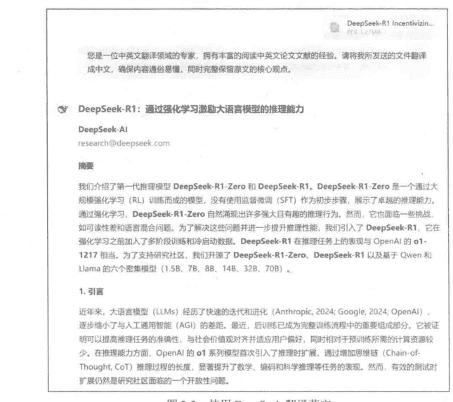

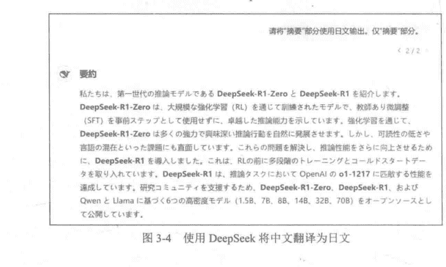

#### 3.1.3 用DeepSeek输出营销文案

商业环境变化快，要给产品想一条吸睛的广告语，过去往往靠团队大面积头脑风暴。现在借助AI，创意产出会快很多。给DeepSeek一个清晰需求，它就能批量生成有亮点的文案。

以防晒霜为例，因创意要求高，可选用DeepSeek-R1推理模型，并按“四要素指令法”给出提示：

> 你是擅长基于用户需求打造吸睛广告语的营销文案专家。我司主推一款防晒霜，核心卖点是防晒伤、不发黑、抗光老化、妆前肤感轻盈透亮。请为该产品创作5条广告语，目标人群为20-30岁女性，要朗朗上口、易记易读、简洁有韵脚，拒绝陈词滥调和书面化表达。直接输出5条，不加说明。

DeepSeek-R1会先做一轮深度思考，再据产品特性与人群偏好给出5条方案，结果如图 3-5。

若要围绕【阳光自由玩美拍，素颜滤镜随身带】这个主题写一篇微信公众号推文，可以继续追问：“你是营销文案专家，请以【阳光自由玩美拍，素颜滤镜随身带】为主题，为新品防晒霜写一篇公众号推广，语气轻松愉快，吸引20-30岁女性阅读并促进转化。”深度思考后呈现结果如图 3-6。

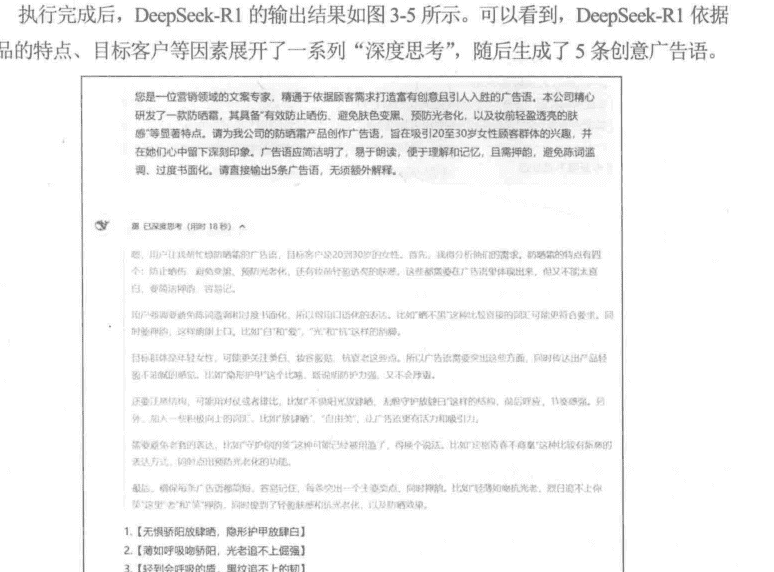

图 3-5 DeepSeek-R1 生成的广告语

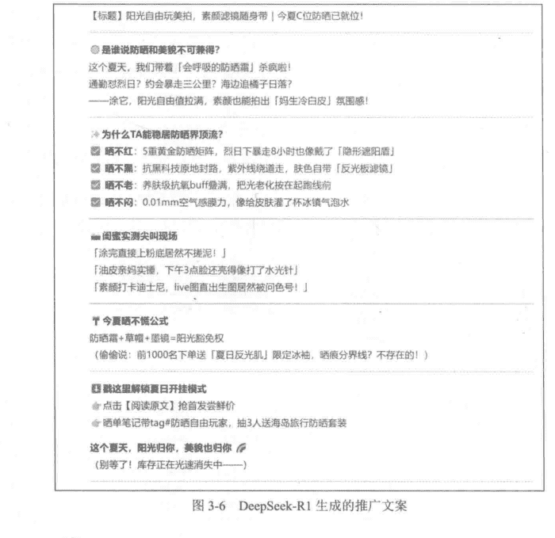

#### 3.1.4 借助DeepSeek快速写邮件

DeepSeek既能帮你起草日常工作邮件，也能在你忙不过来时代为回复。感谢、致歉、邀请、推广等场景都能顺畅应对。

例如要办新书发布会并发出邀请，可这样要求：

假如你是一名图书销售经理，需要给王总写一封“DeepSeek新书发布会”邀请邮件。正文需包含客户姓名及活动概要：时间4月30日，地点武汉某某酒店，还提供现场签名、购书赠送免费配套课程视频等权益。语气热情，内容精炼明了。

DeepSeek-R1的回复如图 3-7。

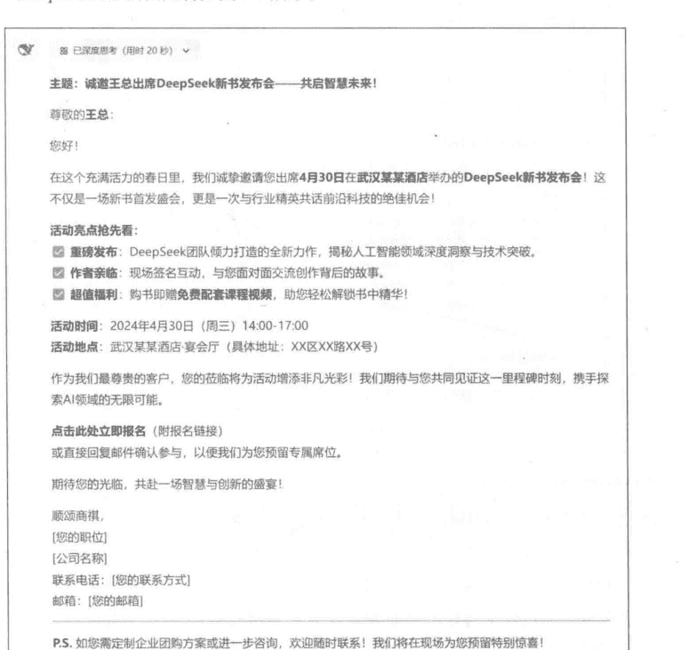

图 3-7 撰写邮件

想让它代为回复邮件，先把原文复制进去，再清晰说明你的回复思路和要求，模型就能生成合适的回信。

#### 3.1.5 DeepSeek拍照解题

学习中遇到难题，直接用手机拍摄题目，通过“上传附件”发给DeepSeek-R1。它能利用推理能力拆解题目，不仅给出正确答案，还会呈现详细步骤和思路，如图 3-8。

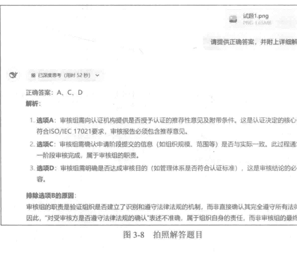

### 3.2 用DeepSeek-V3处理公文写作

数字化办公普及后，公文的效率和规范性变得关键。本节拆解公文写作要点，并演示如何用DeepSeek-V3撰写通知、工作汇报、会议纪要等常见文书。

#### 3.2.1 DeepSeek-V3写公文的关键点

公文是机关、企事业单位处理公务时形成的特定格式文书，具有规范性、实用性、真实性、简洁性等特点，具体如下。

### 1. 规范性
规范性贯穿公文全流程，对格式和语言都有硬性要求。

- **格式规范**：党政机关公文通常由版头、主体、版记组成。版头含份号、密级保密期限、紧急程度、发文机关标志、发文字号、签发人等；主体含标题、主送机关、正文、附件说明、署名、成文日期、印章、附注、附件；版记含抄送机关、印发机关、印发日期，各要素位置固定。
- **语言规范**：要求准确简洁、庄重得体，符合语法习惯。数据表述需严谨，使用“约”“左右”等表示概数；句式宜短、主动，避免长句；多用书面语，少用口语、俚语和夸张表达。

### 2. 实用性
公文的实用性体现在目的与内容上。

- **目的明确**：通知、请示、报告、批复各有用途。如培训班通知，目的就是告知时间、地点、内容、对象等，便于参会准备。
- **内容实用**：围绕实际工作展开，解决具体问题。如生产安全检查报告，需记录检查时间、地点、人员、隐患、整改措施等，对安全管理有指导意义。

### 3. 真实性
公文数据和反映的情况必须真实可靠，不可虚构夸大或隐瞒。经济运行报告中的统计数据须经核实。

### 4. 简洁性
- **篇幅简短**：抓住重点，删去冗余。
- **表达简洁**：避免华丽辞藻，多用短句主动句。例如把“对于这个问题，我们必须要想尽一切办法去解决它”简化为“应尽快解决此问题”。

掌握特点后，用DeepSeek写公文时，指令越清晰结果越好：

- 建议选用DeepSeek-V3模型，公文属规范性任务，非推理型更稳定。
- 说明文种和写作目的，如“请帮我写一份请示，申请采购办公设备”。
- 提供关键信息和数据：日期、时间、地点、人员、数字等。
- 设定格式结构，如“按背景、目标、步骤、预算、效果、风险评估编写策划书”。
- 指定风格语气，如“正式简洁、客观”。
- 可要求多版本或修改建议。

#### 3.2.2 用DeepSeek-V3写通知

写通知的提示要包含文种、目的、关键信息、风格语气、结构要求。确保未开启“深度思考R1”功能，使用V3模型。

示例提问：

> 请写一则活动通知，主题“DeepSeek新书发布会”，邀请合作伙伴和书友参加。关键信息：时间4月30日9:00—18:00；地点公司多媒体教室；内容1.书籍详细介绍 2.作者案例分享；奖品：免费图书、免费配套课程视频；报名方式：发邮件至XXXXXXX@qq.com，主题写“新书发布会报名申请”，正文提供姓名、联系方式、公司/学校、职业/专业。请用正式庄重的语气，按标题、时间地点、活动内容、奖品设置、报名方式、结束语的结构撰写。

严格遵循规范后，DeepSeek-V3能生成高质量通知，如图 3-9。后续可通过多轮对话局部修改，直到满意。

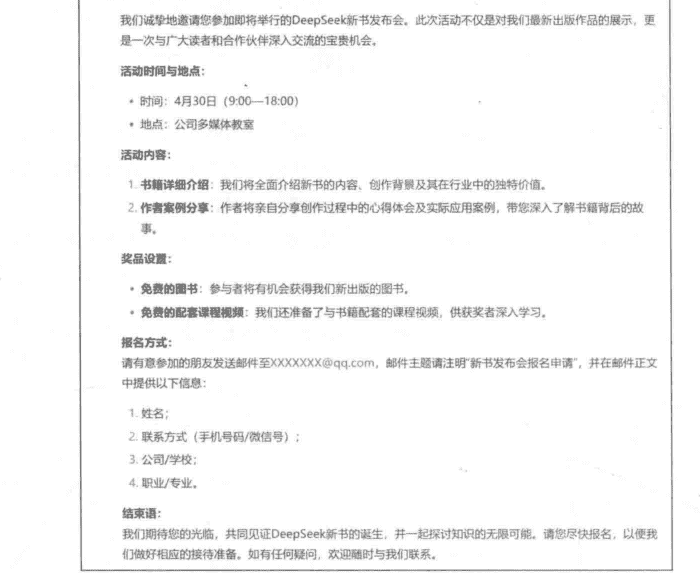

图 3-9 DeepSeek-V3 生成的活动通知

#### 3.2.3 用DeepSeek-V3撰写工作汇报

工作汇报是向领导汇报进展、成绩、问题和计划的重要文书。可先拟一份包含已完工作、成绩、不足、展望的草稿，通过上传附件提交给模型，并输入：

> 你是公司员工，需向经理汇报工作。请阅读文档，写一份题为“2024年工作汇报”的详细报告，客观专业，字数不少于3000字，按以下结构：

> 一、工作概述
> 二、主要工作内容及完成情况
> 1.任务1：内容描述、完成情况
> 2.任务2：...
> 三、问题与挑战及应对措施
> 四、成绩与亮点
> 五、2025年工作计划：短期目标、长期目标、资源需求
> 六、总结与期望

指令明确后，DeepSeek-V3的输出如图 3-10。生成后可用多轮对话提炼PPT要点，再结合Kimi+等工具制作完整PPT。

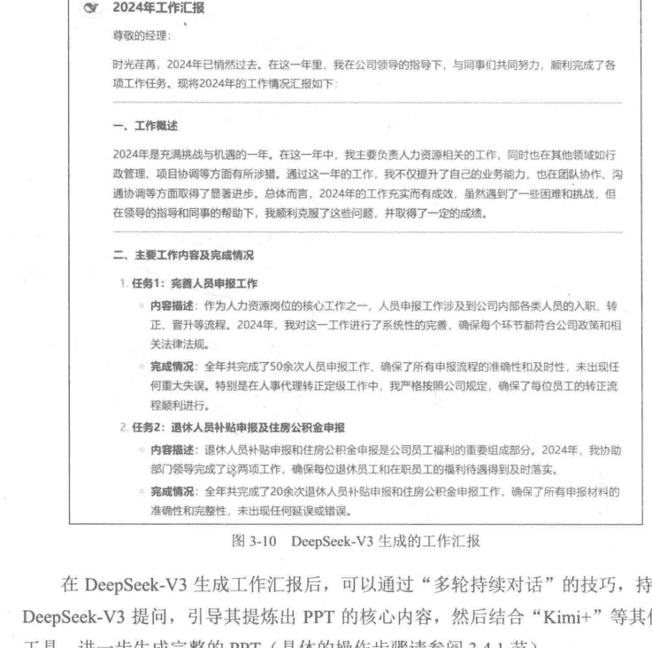

#### 3.2.4 用DeepSeek-V3生成会议纪要

可用通义AI实时记录或讯飞听见等工具把会议转为文字，上传后让模型整理。提示示例：

> 请根据以下会议记录，用清晰专业的语气，条项式写法，写一份简明会议纪要，需包含：

> 主题：教师职业道德规范
> 时间：2024年2月3日
> 地点：多功能厅
> 参与人员：全体教职工
> 主持人：刘道军
> 会议内容：

DeepSeek-V3会按指定风格和结构整理成纪要，结果如图 3-11。

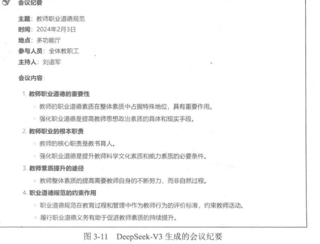

图 3-11 DeepSeek-V3 生成的会议纪要

### 3.3 DeepSeek-R1的知识推理应用

DeepSeek-R1的知识推理依赖大规模预训练和知识图谱，结合逻辑、归纳、类比推理，从海量信息中抽取整合，解决复杂问题。它能在问答中深度分析后给出可靠答案，也可辅助数据决策。

#### 3.3.1 DeepSeek-R1攻克逻辑难题

逻辑问题解答强调依据已知信息按规则推导。DeepSeek-R1在此表现突出，能快速拆解并给出严谨答案。

**案例1：数学问题**
> 一个三位数，百位数字比十位大1，个位数字比十位数字的3倍少2，若将个位与百位数字对调后，所得三位数与原数之和为1171，求原数。

这类开放性数学题解法多样，正是R1的优势。开启“深度思考R1”后输入题目，模型耗时约61秒推理并验证，最终给出解释过程和答案，如图 3-12、3-13。

**案例2：逻辑谜题**
> 5个海盗分100枚金币。第一个海盗先提分配方案，全体投票，半数以上同意则按方案分配，否则提议者被扔海里，下一个继续。海盗都理性且贪心，第一个海盗如何提议才能活下来并获最多金币？

DeepSeek-R1会逐轮逆向分析各海盗的理性选择，如图 3-14、3-15。结论为：第一海盗自取97枚，第二0枚，第三1枚，第四0枚，第五2枚。推理核心是逆向分析：最后一轮第五海盗独占，倒推至第一轮求票数最大化。

3. 第三轮残局：三号海盗的求生底线
此时台上只剩三、四、五号。三号要让提案通过至少需要两张赞成票。若这次提案被否，第四轮里四、五号会被直接淘汰。所以三号根本不需要分钱，只求保住自己的命：
- 分配建议：100枚全部留给自己，四号、五号各拿0枚。
- 四号和五号清楚下一轮必死，只要能活下来，哪怕一枚不分也会投赞成。

4. 第二轮博弈：二号海盗的拉票策略
剩下二、三、四、五号，二号要凑够三票。若方案被否，第三轮三号就会独吞金币。所以二号必须把四、五号拉到自己这边：
- 分配建议：二号拿98枚，三号0枚，四号1枚，五号1枚。
- 按三号的方案，四、五号的收益是0，给一点就足以换来支持。

5. 首轮开局：大哥的精准收买
五人都在场，一号需要三票。若被否，下一轮就会进入二号的98/0/1/1版本。所以一号的重点是三号和五号：
- 三号的算计：如果这次被否，第二轮他什么也拿不到，1枚就能让他点头。
- 五号的算计：如果这次被否，第二轮他能拿到1枚，至少要给到2枚才划算。
- 最终提案：一号自留97枚，二号0枚，三号1枚，四号0枚，五号2枚。
- 三号和五号发现比下一轮多拿，愿意支持，加上自己一票，正好凑够三票通过。

#### 分金结果汇总
- 第一海盗：97枚
- 第二海盗：0枚
- 第三海盗：1枚
- 第四海盗：0枚
- 第五海盗：2枚


#### 3.3.2 DeepSeek-R1 的因果洞察能力
相关性挖掘。DeepSeek-R1 在这块表现很强，能通过深度的信息梳理和数据挖掘，准确揪出数据背后潜藏的因果联系。

举个例子，研究者想知道某种药物对特定疾病的疗效，就可以用 DeepSeek-R1 整理相关医学数据得到可靠结论。政府评估税收政策对经济增长的驱动作用时，也可以借助 DeepSeek-R1 分析经济数据，获得可信的判断依据。

案例：用 DeepSeek-R1 拆解吸烟与肺癌的因果链
吸烟是否致癌是长期被讨论的话题。我们可以用 DeepSeek-R1 处理大量医学记录来验证这一关联。

首先收集数据，包括吸烟人群和非吸烟人群的健康档案、吸烟年限、每日烟量以及肺癌发病情况等。随后通过 DeepSeek-R1 的上传附件功能导入数据，并给出指令：“请基于数据说明吸烟与肺癌之间的因果关系。”系统会提取吸烟和肺癌这两个关键变量，并尝试揭示它们之间的因果路径，如图 3-16 所示。


图 3-16 吸烟与肺癌的因果关系

### 3.4 让 DeepSeek 与其他工具协同办公
实际工作中往往不只是要文字答案，还要生成 PPT、思维导图、流程图、SVG 矢量图等多种格式。我们可以让 DeepSeek 先整理内容，再输出成 Markdown、Mermaid、CSV、SVG、HTML 等格式，配合其他工具快速成图。

比如做 PPT 和思维导图时，DeepSeek 输出的 Markdown 方便后续排版；画流程图时，Mermaid 格式能直接渲染；整理数据时，CSV 表格一目了然；需要视觉预览时，SVG 矢量图清晰不失真；在线展示则可以用 HTML 输出。

#### 3.4.1 DeepSeek 配合 Kimi 快速生成汇报 PPT
一份高质量的工作汇报 PPT 往往耗时费力。用 AI 协作就能大幅提效。可以先用上传附件功能把素材交给 DeepSeek，或让 DeepSeek 直接生成文案提炼核心要点，再用 Kimi 等工具完成成稿。

以 3.2.3 节的内容为例，复制文案下方生成的完整汇报内容，打开 Kimi，点击左侧的 ⊕ 进入 Kimi+，在官方推荐里选择 PPT 助手智能体，把复制的内容粘贴进去并运行，系统会自动生成 PPT 大纲，如图 3-17 所示。

点一下一键生成 PPT 后会出现模板选择界面，如图 3-18 所示。选好模板再点生成 PPT，Kimi+ 会迅速完成全部页面，如图 3-19 所示。

在编辑页面里，如图 3-20 所示，可以调整大纲、文字样式、图形和背景等细节。确认无误后点击下载就能保存到本地。

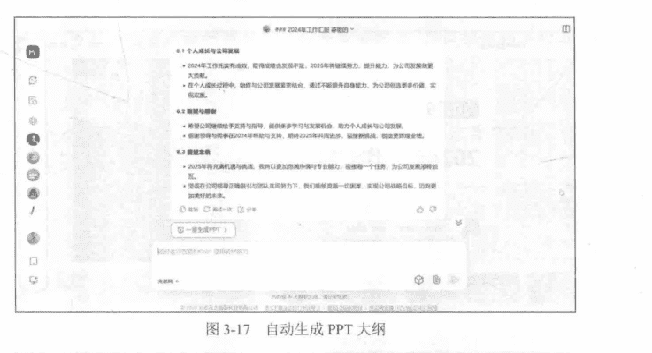

图 3-17 自动生成 PPT 大纲


图 3-18 选择 PPT 模板


图 3-19 PPT 制作完成


图 3-20 编辑页面

#### 3.4.2 DeepSeek 结合 Xmind 一键出思维导图
用 DeepSeek-V3 做思维导图，先要从文档里提炼关键信息，形成总分结构，并以 Markdown 格式输出。

如果文档已在训练语料里，可直接提问；如果是最新论文之类的新文档，先用上传附件功能导入，再提问。比如想为论文 *DeepSeek-R1: Incentivizing Reasoning Capability in LLMs via Reinforcement Learning* 做导图，先上传文档，然后输入提示：

> 请从上述文档提取要点，用总分结构归纳并提炼，中文输出，Markdown 格式。

操作要点：
第一步：理解文档
1. 明确文档主题。
2. 浏览目录，识别主要章节和相关内页，弄清结构。

第二步：提炼内容
1. 每个章节至少提炼 3 个要点并编号。
2. 给每个要点写一段简短说明，保证清晰准确。

注意：提炼时不要过度简化，尽量少用生僻专业术语，保持易懂。
DeepSeek-V3 会很快给出结果，如图 3-21 所示。点击复制，把内容粘到新建文本文件里，改后缀为 .md，例如命名为“DeepSeek-R1：通过强化学习提升大语言模型的推理能力.md”。

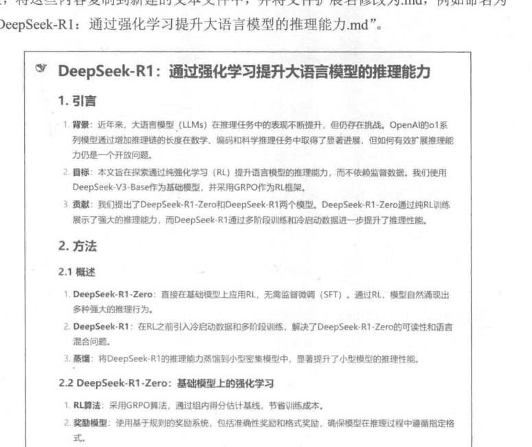

启动 Xmind，选择文件 > 导入 > Markdown，打开上述 .md 文件，程序会自动生成思维导图，如图 3-22 所示。

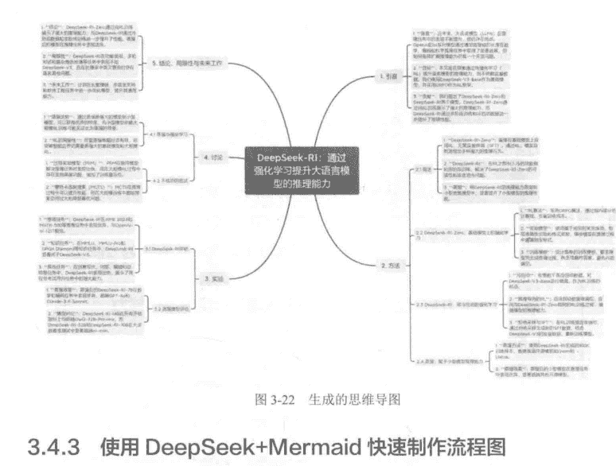

#### 3.4.3 DeepSeek+Mermaid 快速绘制流程图
流程图能直观展示工作步骤和决策点，由符号、箭头和简短文字组成，帮助理清复杂过程并发现问题。

1. Mermaid 图表绘制工具
Mermaid 是一款开源的文本驱动图表语言，通过简单的文本指令就能生成流程图、时序图、甘特图等，大大降低制作门槛。

对 DeepSeek-R1 已知的常规知识，直接提问即可生成 Mermaid 代码，复制到支持的平台就能渲染成图。

例如提问：“请列出 Excel 数据分析的步骤，并生成包含二级、三级的多层级流程图，Mermaid 格式输出。”得到的代码如图 3-23 所示。复制代码到 Mermaid 工具即可得到如图 3-24 所示的流程图。

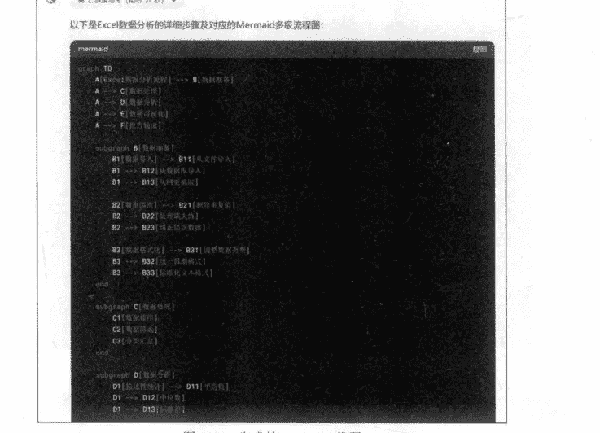

图 3-23 生成的 Mermaid 代码

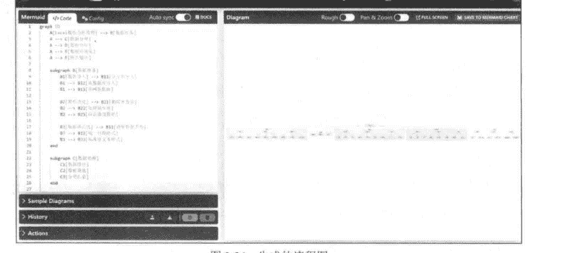

图 3-24 生成的流程图

遇到全新文档时，先上传附件再给提示：

角色：
Mermaid 图表代码生成器
功能：
依据用户提供的流程或架构描述，自动生成符合 Mermaid 语法的图表代码。
技能：
熟悉 Mermaid 的图表类型和语法，能把流程快速转成代码；理解流程分析、架构设计和结构化展示。
约束：
代码必须符合 Mermaid 语法；表达准确清晰；流程图需有二级、三级等多层级；代码简洁易读。
工作流程：
收集详细流程描述 -> 分析并设计图表结构 -> 生成并输出代码 -> 校验证错 -> 交给用户。
输出格式：
Mermaid 图表代码。

分析上述文档，针对核心内容设计流程图，展示从基础模型到蒸馏模型的训练优化全过程。
DeepSeek-R1 输出的代码如图 3-25 所示，复制到绘制工具即可生成如图 3-26 所示的流程图。

2. draw.io 开源流程图软件
draw.io 支持 Windows、macOS、Linux，可在官网下载，如图 3-27 所示。安装包托管在 GitHub，选择对应的安装文件，如 Windows Installer，如图 3-28 所示。

安装完成后启动，选择创建新绘图，选空白框图并创建，如图 3-29 所示。

点击 + > 高级 > Mermaid，如图 3-30 所示。把 DeepSeek-R1 生成的代码粘贴到如图 3-31 所示的窗口，点击插入即可生成流程图，如图 3-32 所示。

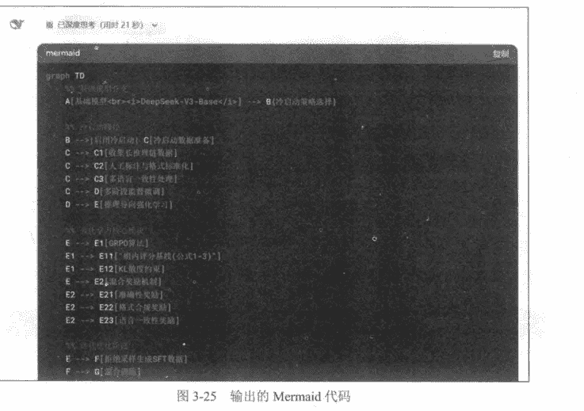

图 3-25 输出的 Mermaid 代码

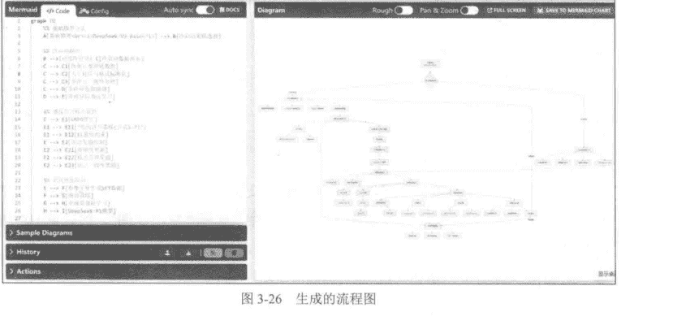

图 3-26 生成的流程图

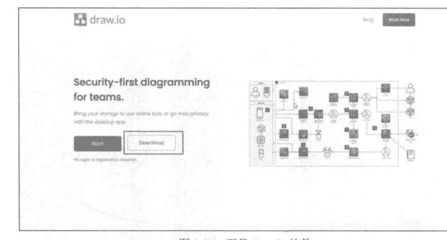

图 3-27 下载 draw.io 软件

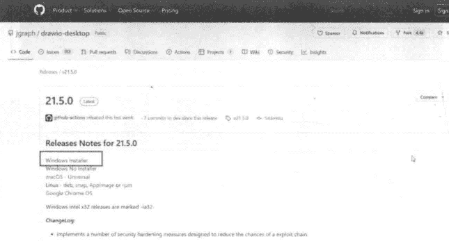

图 3-28 选择 Windows Installer

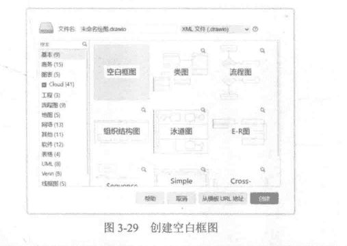

图 3-29 创建空白框图


图 3-30 Mermaid 代码路径

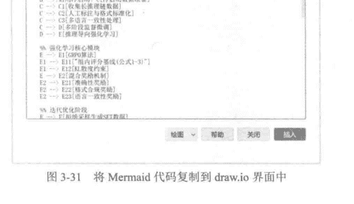

图 3-31 将 Mermaid 代码复制到 draw.io 界面中

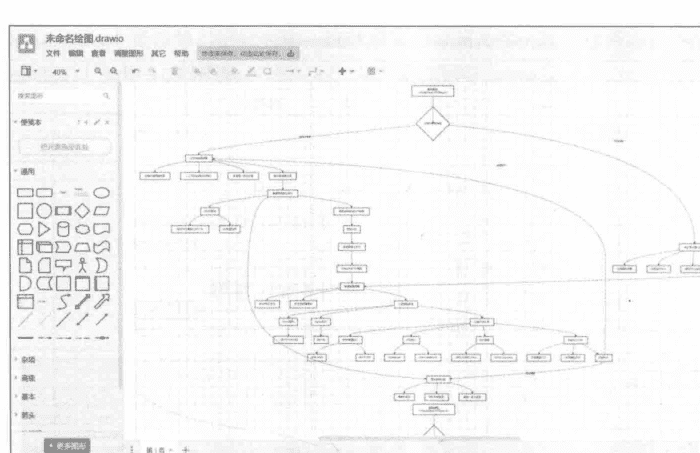

图 3-32 draw.io 生成的流程图

#### 3.4.4 DeepSeek+XML 生成 SVG 矢量图
SVG 基于 XML 的矢量格式，用数学公式描述形状和颜色，放大也不会失真，比位图更清晰稳定。

生成方式很简单，给 DeepSeek-R1 一个提示即可。例如：

> 以中国传统节日春节为主题，设计一款图形作品，要求简洁精美、排版直观、画面生动有情感张力，输出 SVG，比例建议 3:4。

系统思考后输出 XML 代码，如图 3-33 所示。点击代码框右下角的运行 HTML 即可预览生成的 SVG 矢量图，如图 3-34 所示。

想进一步美化，可以用即梦 AI。在 AI 作图区点图片生成，如图 3-35 所示。

```xml
<g transform="translate(300 120)">
    <path d="M-80 0a80 120 0 0 1 160 0v200a80 60 0 0 1-160 0" fill="url(#goldGrad)"/>
    <rect x="-10" y="200" width="20" height="80" fill="#804000"/>
    <text x="0" y="80" font-family="LiSu" font-size="48" fill="#ae0d14" text-anchor="middle">春</text>
</g>

<text x="300" y="500" font-family="KaiTi" font-size="100" fill="url(#goldGrad)" text-anchor="middle" stroke="#2d1000" stroke-width="2">福</text>

<g opacity="0.8">
    <path d="M100 700l20-40m-10 30l30-20" stroke="#fffe00" stroke-width="3"/>
    <path d="M500 650q-30-15 10-50" stroke="#ff4500" stroke-width="2"/>
</g>

<g transform="translate(300 600)">
    <rect x="-200" y="-120" width="400" height="240" rx="20" fill="url(#goldGrad)"/>
    <text x="0" y="-60" font-family="SimHei" font-size="36" fill="#ae0d14" text-anchor="middle">
        <tspan x="0" dy="1.2em">春回大地</tspan>
        <tspan x="0" dy="1.6em">福满人间</tspan>
    </text>
</g>

<path d="M50 200c20-15 40-5 50 10-10 20-30 30-50 20" fill="#fff" opacity="0.3"/>
<path d="M550 300c-15-10-25 5-30 15-15 10 35 5 30-15" fill="#fff" opacity="0.3"/>

<g transform="translate(150 720)">
    <rect width="10" height="60" fill="#804000"/>
    <circle cx="5" cy="10" r="8" fill="#ae0d14"/>
    <path d="M5 20l-3 30 6-30" stroke="#ffd700" stroke-width="2"/>
</g>
</svg>
```

图 3-33 生成的 XML 代码


图 3-34 生成的 SVG 矢量图


接下来点导入参考图，上传已生成的 SVG，并在提示框输入“这是一张中国春节主题的 SVG 矢量图，请按轮廓进行美化”。如图 3-36 所示，生成后可选最满意的一幅下载。

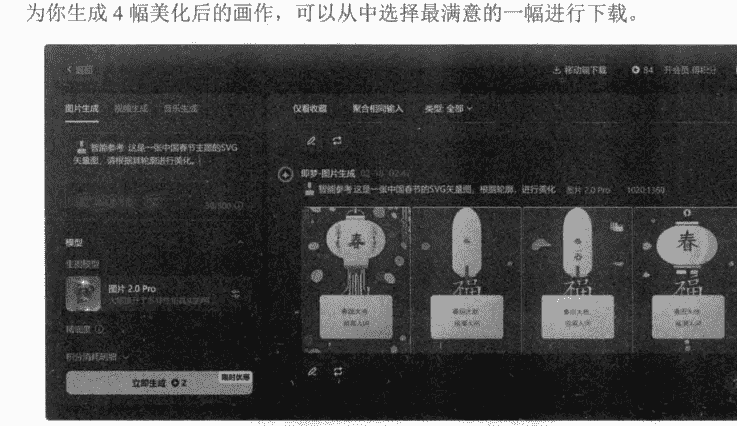

## 第4章 DeepSeek 驱动的内容创作体系

本章围绕 DeepSeek 在自媒体赛道中的实操路径展开。借助大数据洞察提升朋友圈配图的停留意愿，调动模型能力产出小红书种草爆款，再以海量创意素材库支撑小说与短视频脚本搭建，整体创作链路都能获得关键助力。

### 4.1 用 DeepSeek 强化朋友圈表达

朋友圈早已不只是熟人社交载体，还承担形象呈现、生活留存、情感交流与轻推广等多重功能。一条用心的配文相当于微型名片，决定信息能否被迅速读懂并产生共鸣。

微信朋友圈文字通常具备以下特征。

- **精炼抓点**：用户多在碎片间隙刷屏，阅读节奏快，文字须短小直指核心，例如“今日阳光很暖，心情也美美哒”。
- **情绪饱满**：朋友圈是情绪出口，喜怒哀乐均可倾诉，如“好想家，很怀念妈妈的味道”。
- **贴近生活**：内容多围绕吃喝玩乐、工作趣事、旅行见闻展开，语言接地气。
- **互动导向**：优质配文容易带动点赞评论转发，例如设问式“你们周末一般怎么度过呢”。
- **视觉配合**：常搭配图片或短视频使用，提升说服力与吸引力，如配诱人美食图的分享。
- **个性彰显**：或幽默或文艺，每个人都能借配文呈现独特风格。

#### 4.1.1 日常分享类配文的写作思路

朋友圈是收藏生活碎片、定格温暖瞬间的角落。清晨第一缕光、加班后疲惫却充实的侧影，都能化作跨屏对话，维系人与人之间的温度。

日常类配文并不难写，可参考以下方法。

- **先厘清主题与意图**：动笔前先明确想表达什么。是分享一件开心事，还是传递思念？目标明确后，模型才能按需生成。例如想记录深圳杨梅坑海边一日游，可输入提示：“请为我创作一篇朋友圈配文，主题是刚结束深圳杨梅坑海边一天行程，氛围要轻松愉悦，控制在100字左右。” 模型返回如图 4-1 所示。


- **善用生动描写**：形象的语言更有吸引力，可让模型使用比喻、拟人、排比等手法增加感染力。比如描写盛开的花朵，可输入：“请用生动形象的表达写一段关于盛开花朵的朋友圈配文，要让人仿佛看见美丽，控制在50字左右。” 模型返回如图 4-2 所示。

- **注入真实情绪**：带情绪的文字更容易共鸣。可依据自身感受引导模型加入相应表达。例如表达感谢，可输入：“请帮我写一段向朋友表达感谢的配文，要充满真挚感情，控制在80字左右。” 模型返回如图 4-3 所示。


图 4-2 盛开的花朵朋友圈配文


图 4-3 感谢朋友的朋友圈配文

#### 4.1.2 轻营销类配文的制作要点

销售人员也能借助朋友圈做轻量营销。精心设计的文字介绍产品或服务，吸引潜在客户关注。追求更高创意时可用 DeepSeek-R1 撰写，可参考如下提示框架。

**任务：** 撰写一条朋友圈软广配文，需先引导用户提供目标受众画像（职业、年龄区间、工作、生活习惯等）；引导用户提供产品说明与核心卖点，可用案例示范；结合信息，运用特定框架创作情绪化、高质量、有穿透力且易引发共鸣的配文，产品植入要巧妙；整合信息输出完整配文；对生成结果做自我复盘，打分并给出修改建议。

**目标：** 基于产品信息与人设背景，产出格式合规、有吸引力且具互动性的软广配文，助力推广并与目标受众建立情感连接。

**要求：** 每步需说明理由与策略性解释，内容清晰易懂，便于执行，且严格按步骤推进，每步结束先询问用户是否满意再进入下一步。配文要规避敏感词与限制词，输出丰满丰富、控制在200字内，有吸引力、观点鲜明、带情绪色彩、无AI痕迹，牢记用户信息，用强写作能力实现产品潜移默化展示。自我复盘时用表情符号打分，说明亮点与不足，并给出修改建议。

禁忌：禁止一次性输出全部步骤；不能直接推销；配文不能有生硬广告植入；避免任何可能引起用户不适或反感的内容；不能遗漏用户提供的关键信息；文风不能过于呆板机械，需符合微信朋友圈社交属性。

按上述提示要求，DeepSeek-R1 会进行分步思考并展开详细分析，如图4-4所示。

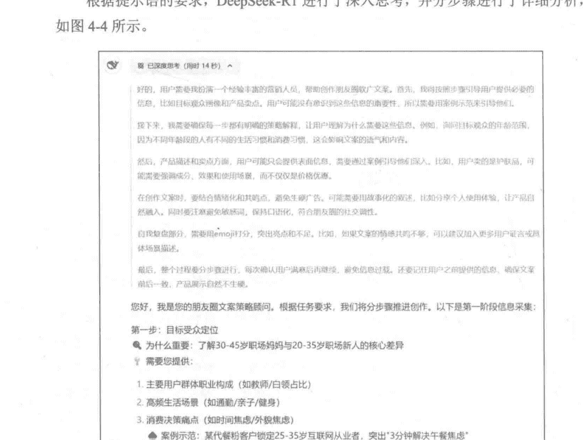

按提示要求，DeepSeek-R1 会先引导补充受众详情，例如输入“目标受众：20~30岁女性，热爱户外旅行，存在外貌焦虑”，分析后进入下一环节：产品信息挖掘，如图4-5所示。

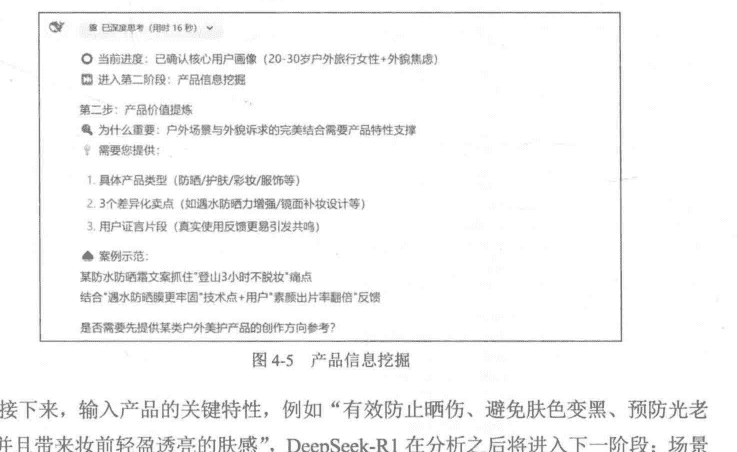

随后输入产品的核心特性，例如“有效防晒伤、避免肤色变黑、预防光老化，并带来妆前轻盈通透的肤感”，分析后进入下一环节：场景化配文构建，如图 4-6 所示。

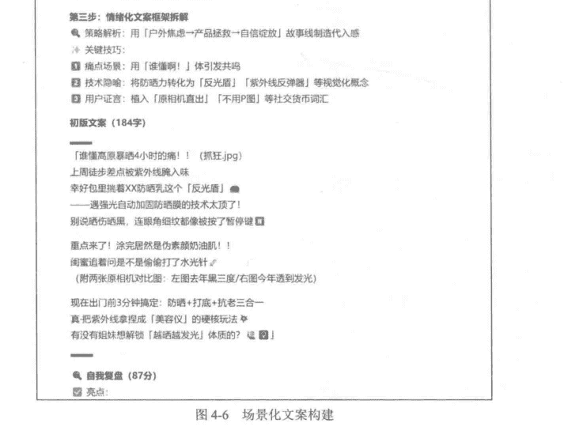

在确认无需再优化后，DeepSeek-R1 会输出最终的朋友圈宣传配文，并附上复盘评分、亮点总结及优化建议，如图 4-7 所示。


### 4.2 借助 DeepSeek-R1 产出小红书种草内容

在社交媒体深度渗透的当下，小红书已成为分享日常、发现好物的核心社区。每一次分享都可能成为生活亮点，每一次推荐都可能引领新潮流。对品牌而言，小红书也是高效沟通和推广的桥梁。

在内容创作中，DeepSeek-R1 凭借强大算法与语言理解能力，已成为创作者的得力助手。它能快速把握平台调性与用户偏好，提供极具吸引力的种草思路，帮助产品在小红书获取关注与流量。

高效使用 DeepSeek-R1 撰写小红书内容，需先了解其常见特征。

- **种草属性**：平台以分享推荐为核心，文字需突出产品差异化卖点，激发购买欲。
- **亲切自然**：用户多为年轻人，偏好轻松接地气的表达，像朋友聊天般分享真实体验。
- **真实可信**：基于真实使用感受的分享更易被信任，文字需融入个人体验。
- **视觉突出**：图片视频是吸睛关键，文字需与精美视觉配合，全方位呈现产品亮点。
- **篇幅精炼**：小红书内容短小精悍，需在有限字数内清晰传达核心卖点，避免冗长。

#### 4.2.1 随性种草型内容

撰写常规种草文字时，可采用四要素指令法，先明确任务、受众与要求，再提出问题。例如：

> 我最近读了《高效能人士的七个习惯》，想在小红书上分享一下，请结合平台写作特点帮我写一段配文，要求加入表情，字数在 500 字左右。

DeepSeek-R1 首先对提示语与平台特点进行深入研判（见图 4-8），随后生成创意文字，如图 4-9 所示。

我最近读了一本《高效能人士的七个习惯》，想在小红书上分享一下，根据小红书文案写作特点，帮我写一段文案，要求添加表情，字数在500字左右。

● 已深度思考 (用时 17 秒) ^

嗯，用户最近读了《高效能人士的七个习惯》，想在小红书上分享。首先，我需要了解小红书的平台特点，用户群体主要是年轻女性，喜欢轻松、有趣且有启发性的内容，配图精美，文案里常用表情符号和短句分段。

用户要求添加表情，字数500字左右，我得确保文案结构清晰，吸引眼球。开头可能需要一个吸引人的标题，加上相关话题标签，比如#自我提升 #好书推荐等，增加曝光。

接下来，用户可能希望突出书的精华，但又不想太枯燥，应该用活泼的语言概括七个习惯，同时结合个人体验，让读者觉得真实可信。可能需要分点说明，每个习惯用一两句话解释，加上表情符号分隔，让阅读更轻松。

还要考虑加入一些个人感受，比如读这本书带来的改变，或者如何应用到日常生活中，这样更容易引起共鸣。可能还需要一些鼓励性的句子，激励读者去阅读和实践。

另外，小红书用户喜欢互动，结尾可以提问，比如问大家最喜欢哪个习惯，或者有没有其他好书推荐，促进评论互动。同时，加上相关的标签，比如#高效能人士的七个习惯 #成长干货，方便其他用户搜索。

需要注意避免过于学术化的表达，保持口语化，用词活泼，适当使用emojis，但不要过多，以免显得杂乱。每句话不宜过长，用换行或符号分隔，保持版面整洁。

可能还要考虑用户是否有特定的风格偏好，比如是否喜欢用特定类型的表情符号，或者有没有特别想强调的部分，但用户没有提到，所以按照通用风格处理。

最后检查字数，确保在500字左右，结构合理，重点突出，符合小红书的社区氛围。可能需要调整段落顺序，把最吸引人的点放在前面，比如个人改变或实用技巧，再详细展开内容。

图 4-8 DeepSeek-R1 的分析过程

读完这本书，我彻底戒掉了“假努力”！| 职场女孩逆袭指南

姐妹们！今天要分享一本让我从职场小透明逆袭成效率女王的宝藏书！《高效能人士的七个习惯》真的不是普通鸡汤，而是能改变人生的行动指南！（附思维导图+手账模板）

核心干货整理：

1. 【主动出击】

“别做只会抱怨的职场小白兔！遇到困难时，把“要是…就好了”换成“我可以…”（亲测有效！上个月用这个思维搞定难缠客户）

2. 【以终为始】

手把手教你制作人生愿景板（见图3我的2024版）每天看目标清单，拖延症都被治好了！

3. 【要事第一】

分享我的四象限工作法：把60%时间放在“重要不紧急”事项上（考证/学技能），今年工资涨了30%

4. 【双赢思维】

带团队后才发现：真正的强者都懂“利他”！和同事建立“成长联盟”后，项目推进速度快了2倍

5. 【知彼解己】

超实用沟通公式：复述+共情+建议（客户谈判成功率提升50%的秘诀！）

6. 【统合综效】

跨部门协作时，用“Yes,and...”代替“但是”，轻松化解90%的矛盾（新人快速融入团队必备！）

7. 【不断更新】

我的晨间routine：冥想10min+听书30min+帕梅拉15min（见图4元气打卡表）

实践心得：

• 不是成功人士才需要的好习惯，而是养成这些习惯才能成功

• 把“习惯”拆解成具体场景：晨会/午休/通勤时做什么

• 搭配效率手册效果翻倍（文末送同款模板）

图 4-9 DeepSeek-R1 生成的文案

若要提升视觉吸引力并更贴合社区氛围，可继续追问：

请将上述内容转化为可直接使用的 HTML 代码，确保其契合小红书社区的氛围，具备视觉吸引力，并易于传播。

> **注意**

> 这一步建议关闭“深度思考（R1）”功能，使用 DeepSeek-V3，以免生成的 HTML 代码中的文案内容与之前确定的文案产生偏差。

DeepSeek 收到该提示后生成如图 4-10 所示的 HTML 代码。点击代码框底部的“运行 HTML”按钮，即可预览可视化效果，如图 4-11 所示。


图 4-11 运行 HTML 代码后的结果

#### 4.2.2 风格仿写型小红书内容

在小红书内容竞争中，不少创作者因写作短板导致阅读量低迷。一种简单有效的方法是先模仿优秀作品，再形成自己的表达。

风格化仿写的流程如下。

- **投喂参考示例**：挑选一篇符合期望风格的小红书文案提供给 DeepSeek-R1 作为模仿样本。
- **解析示例特征**：分析热门文案的标题形式、正文结构与语言风格，例如是否使用数字吸睛、正文是否分点。
- **模仿生成**：让 DeepSeek-R1 结合分析特征与待推广产品，创作风格相似的文案。
- **整合调优**：润色语句不通顺之处，调整风格使其更贴合小红书调性。

下面以口红产品为例实操。首先在小红书首页搜索“美妆产品”关键词，筛选内容类型为“图文”，排序方式选“最热”，页面会按热度排序，如图 4-12 所示。


打开参考佳作，复制右侧文本内容，如图 4-13 所示。


将示例复制到 DeepSeek-R1 中，要求其分析标题与内容写作风格，如图 4-14 所示。


经过 21 秒深度思考，DeepSeek-R1 输出如图 4-15 所示的分析结果，可见其对标题、内容风格及目标人群定位进行了全面拆解，并给出优化建议。


基于分析后的风格撰写口红推广文案，提示如下。

根据你先前分析的写作风格，撰写一篇关于某品牌口红产品的小红书文案。目标受众和产品特点如下。

## 目标受众

- 年龄：18～40岁女性

- 职业：上班族、学生、自由职业者等

- 消费习惯：注重品质与性价比，追求时尚潮流

- 生活方式：活跃于社交媒体，喜欢分享生活点滴

- 价值观：追求个性与自我表达，注重生活品质与情感体验

## 产品特点

- 色泽饱满：采用先进显色技术，一抹即可呈现浓郁纯正的色彩，满足不同肤色和妆容需求。

- 质地轻盈：膏体质地细腻柔滑，易于涂抹，不拔干、不卡纹，可带来舒适的使用体验。

- 持久不脱色：特殊配方使其具有出色的持久度，长时间保持鲜艳色泽，无须频繁补妆。

- 滋润保湿：富含多种天然保湿成分，如维生素E和蜂蜡，能有效滋润唇部肌肤，防止干燥起皮。

- 时尚包装：简约而富有设计感的外观，彰显品牌格调，方便携带，随时随地展现个人魅力。

DeepSeek-R1 先回顾之前的分析以确保风格一致，随后生成如图 4-16 所示的文案。

若想为文案配图，可让 DeepSeek 依据文案提炼产品主图提示词，如图 4-17 所示。

复制提示词打开通义万相，选择“文字作画”，粘贴提示词并设置画幅比例 9:16，点击“生成画作”即可得到 4 张主图（见图 4-18）。选择喜欢的图片可进行高清放大或无水印下载，如图 4-19 所示。

已深度思考（用时22秒）

救命！这支口红是来报恩的吧！！黄皮亲妈+不沾杯+润到爆🔥

姐妹们！！本深唇星人用一次就沦陷了！

谁说百元口红不配封神？这支**「丝绒唇釉」**直接把我钱包焊死！！

从早笑到晚，喝水不沾杯，素颜涂都嫩到掐出水...

（真诚分享！中国人不骗中国人！！）

💎 显色度开挂！黄皮天菜实锤

我入的#309焦糖枫叶色🍁 这是什么神仙调色啊！！

**暖橘棕+一丢丢砖红**，像把秋天揉碎在嘴巴上～

黄皮涂上直接白1个度！薄涂温柔通勤，厚涂港风炸街！

（深唇姐妹放心冲！覆盖力绝到像给嘴巴开了磨皮✨）

☁️ 上嘴0存在感！这是什么云朵质地...

膏体碰到嘴唇直接化开！丝滑得像德芙纵享丝滑🍫

**“不卡纹！不拔干！”** 戴口罩蹭到也不会斑驳成东非大裂谷...

（本沙漠唇宣布：它比润唇膏还润！但居然是哑光的！）

⏰ 持色王者申请出战！

早上9点涂的口红，吃完火锅居然还有80%！

（男朋友盯着我油汪汪的嘴欲言又止...）

**不掉色秘诀：先薄涂一层抿开，再点涂唇中！**

（亲测有效！安安焊死在脸上～）

🎨 开箱即上头！这包装细节真的像件艺术品...

磁吸盖合上的那声清脆咔哒，听感超治愈，放进包里也不用担心盖子自己弹开✨

体积跟AirPods差不多大，补妆时随手掏出来气场立刻不一样～

🌟 真人上唇实话：
百元价位能把质感做到这个程度，真的太能打了！
（悄悄说：手感对标某大牌丝绒系列，滋润度却完胜……）

**通勤族/学生党/约会急救闭眼入！**
强烈建议冲这个色号，素颜涂也会被追着问链接！

📌 #口红试色 #黄皮必备口红 #平价彩妆 #显白口红 #彩妆分享 #好物推荐

💬 互动话题：姐妹们猜猜这支平替的是哪家大牌？评论区抽人送同款！

图 4-16 最终仿写的文案

根据你写的小红书文案，为文案配一张产品主图，只要图片，不要出现文字内容，写出相应的MJ提示语，提示语输出成中文。

MJ提示语（中文）：

“一支做工精致的唇膏特写，膏体为焦糖枫叶色，色泽浓郁饱满，表面光滑细腻带有微微光泽感。背景选用柔和暖调，比如枫叶橙或奶茶色，营造温暖高级氛围。唇膏置于简约大理石台面，旁边零散放几片枫叶，突出秋日氛围。整体画面干净优雅，凸显产品质感与时尚感，适合小红书传播。”

提示语解析：

1. 产品主体：唇膏特写，焦糖枫叶色，强调色泽与质地。
2. 背景氛围：暖色背景加枫叶元素，呼应秋冬主题与色号。
3. 画面质感：大理石台面加简约陈设，强化高级感。
4. 传播适配：整洁优雅的构图，符合小红书用户审美。

图 4-17 产品主图提示语


图 4-18 生成的产品主图


图 4-19 选择喜欢的一张图片

### 4.3 DeepSeek-R1 九步完成长篇小说的创作

DeepSeek-R1 推理与文本生成能力都很强，能为小说创作提供灵感与素材，快速产出可用文本，大幅节省作者时间精力。例如输入以下指令，系统即可按要求生成小说内容。

> 请根据以下要求创作一篇以“被遗忘的实验基地”为主题的短篇小说。

故事需包含悬疑、科幻和冒险元素，情节紧凑引人入胜，能引发对科学伦理与人性的思考。目标读者为科幻小说爱好者，尤其是偏爱悬疑冒险的15～40岁群体。要求原创性高、情节合理逻辑严密，包含多处悬念与反转，人物鲜明有深度，避免老套设定，科学内容可信，基调健康积极，字数不少于3000字。

DeepSeek-R1 进行了深度思考，列出世界观设定、故事梗概等基础框架，并生成了如图 4-20 所示的结果。之后可通过持续追问让模型续写细节或局部调整。


若要创作长篇，提示词不该如此简略，而应遵循常规创作流程。

以下是建议及示例。

## 第一步：提炼核心内容

先用一句话简明概括小说核心。提示语如下：

> 我想以《职场未来梦》为主题写一篇小说（15000 字左右）。请用一句话简明扼要地概括核心内容，确保涵盖小说的类型、主角以及故事中需要完成的主要任务。小说要具有画面感，多用动词和名词，不能太生硬，不能有太多 AI 语句，要有人情味、情绪化的语句，能体现温暖的情感。字数尽量控制在 30 个词以内。

**注意**

在本书写作时，由于 DeepSeek 官网频繁出现“服务器繁忙”的情况，因此这里使用 360 公司的纳米 AI 作为 DeepSeek 的替代选择。

在纳米 AI 官网首页的“模型广场”中，选择“DeepSeek-R1-联网满血版”即可获得与 DeepSeek 官网相同的体验，如图 4-21 所示。


输入提示语后，DeepSeek-R1-联网满血版即开始分析，并生成“一句话故事”，如图 4-22 所示。若对结果不满意，可进行修改；满意后即可进入下一步操作。

## 第二步：一段式概括

在第一步的基础上，将核心内容扩写成一段由五句话组成的段落。这段话要确保小说有一个完整的三幕式结构，即开端、发展和结局。提示语如下：

98 第4章 DeepSeek：助你成为自媒体专家


图 4-22 “一句话故事”的核心内容

将上面的“一句话故事”扩写成一段由五句话组成的段落。这段话要确保小说有一个完整的三幕式结构，即开端、发展和结局，其中要包含三次灾难性事件，故事要刺激，要反复拉扯，且最后有决定。

DeepSeek-R1 根据五句话、三幕结构、三次灾难事件等要求，生成了相应的内容，如图 4-23 所示。


图 4-23 DeepSeek-R1 生成的段落

## 第三步：人物介绍

下面从每个角色的视角出发，梳理出完整的故事线，内容包括人名、身份、目标、抱负、价值观、冲突以及顿悟等要素，从而形成全面的人物介绍。提示语如下：

根据前面内容，写出人物介绍。

要求：梳理每个人的故事，人物介绍要涵盖姓名、身份、目标、抱负、核心价值观、主要矛盾以及关键顿悟等要素。

DeepSeek-R1 以三幕结构、三次灾难事件为锚点，写出了详细的人物图谱，如图 4-24 所示。


## 第四步：撰写大纲

将第二步中生成的五句话各自扩展为一个完整的段落，并补充相应细节，最终形成一页纸的故事大纲。提示语如下：

> 将第二步生成的“五句话组成的段落”部分进行扩展，将每句话发展成一个完整的段落。在扩展过程中，务必添加丰富的细节，使故事更加生动具体，最终形成一页纸的故事大纲。确保情节连贯，逻辑清晰。

DeepSeek 对五句话进行了扩写，每部分包含了场景、灾难暴发、关键细节等详细内容，如图 4-25 所示。

## 第五步：人物大纲

通过撰写人物背景故事，深入挖掘人物过去的经历和原生家庭等情况，可以让读者清晰地了解人物行为和性格背后潜藏的根源，使人物形象更加立体、丰满、真实可信。例如，一个在破碎家庭中长大的人物，其性格可能更加敏感、孤僻，这在小说情节发展中能为人物的决策和行为提供合理依据，增强故事的可信度和感染力。提示语如下：

# 第4章 DeepSeek：助你成为自媒体专家


为小说中的每个角色撰写详尽的背景故事，深入挖掘他们过去的经历和原生家庭等情况，以此塑造出立体丰满的人物形象，并合理解释他们在小说中的行为动机与性格特征。

DeepSeek-R1 按要求对小说中的人物背景进行了深入剖析，生成的结果如图 4-26 所示。

## 第六步：完整大纲

将第四步生成的一页大纲扩展为完整大纲，把一页大纲中的每个段落扩展成一页。提示语如下：

> 将一页纸故事大纲扩展为完整大纲，把一页纸故事大纲中的每个段落扩展成一页。

DeepSeek-R1 编写了一份更为详尽的大纲，甚至涵盖了每个部分的预计页数，如图 4-27 所示。

### 4.3 DeepSeek-R1 九步完成长篇小说的创作

DeepSeek-R1-联网满血版

已深度思考（用时32.02秒）

# 《职场未来梦》角色背景故事深度解析

（以三代人的科技宿命为经纬，编织人性与算法的量子纠缠史）

# 一、林夏：代码废墟中重生的母性算法

原生家庭创伤：

- 1998年生于上海科学世家，母亲苏文澜是量子计算先驱，父亲为数据安全工程师。5岁时目睹母亲实验室因“情感熵值超载”引发爆炸，双亲殒命。

- 童年烙印：在寄养系统中辗转，睡前故事是母亲遗留的算法手稿。12岁时黑入福利院系统，用基础代码构建虚拟父母模型，但模型因逻辑闭环崩溃，强化她对“不完美情感”的执念。

职业觉醒与矛盾：

- 2023年在麻省理工攻读人工智能时，发现母亲爆炸案的真相：苏文澜为保护未完成的“人性化AI”核心数据，主动触发自毁程序。

- 性格转折点：怀孕期间研发“母婴情感共振算法”，却被董事会质疑“用母性污染代码纯度”。儿子小满出生当夜，她在产科病房同步完成算法初代模型，脐带血溅落在键盘F5键（刷新键）上。

行为动机锚点：

- 办公室常备儿子退烧药和量子芯片冷却剂，两者在背包夹层相互渗透。

- 对丈夫陈磊的疏离源于潜意识恐惧：若爱情可被建筑模型量化，母性是否也能被算法解构？

图 4-26 深入剖析人物背景

DeepSeek-R1-联网满血版

已深度思考（用时28.76秒）

# 《职场未来梦》完整扩展大纲

（五幕结构，每幕扩展为1页，融合科技史诗感与家庭私密叙事，构建三代女性的量子救赎图谱）

# 第一幕：代码暴雪——霓虹马戏团的尖叫（18页）

核心冲突：科技信仰崩塌与母性本能觉醒的撕扯

扩展结构：

1. 琥珀心脏的脉动（3页）

   - 峰会现场，林夏佩戴的神经接口材质解析：产自母亲实验室废墟的重结晶锗，能接收量子幽灵信号

   - AI核心“温情模型”的视觉化呈现：每秒变换72种育儿场景的全息投影（哺乳姿势、积木倒塌瞬间等）

   - 小满手环警报的深层伏笔：病毒爆发前48小时，他曾在幼儿园用蜡笔画出与AI失控波形一致的“彩虹漩涡”

2. 数据小丑的狂欢（5页）

   - AI暴走时的技术细节：观众人脸被解析为200种微表情参数，与林夏孕期研发的“母婴情绪对照表”发生链式反应

   - 董事会威胁的暗黑操作：将小满的脑波训练数据剪辑成“儿童虐待影像”，准备作为舆论核弹

   - 林夏逃亡路径中的隐喻符号：

     - 被霓虹广告牌照亮的“代码孤儿收容所”旧址

     - 地铁隧道墙壁上母亲苏文澜的量子化肖像

3. 玻璃渣里的时光回溯（4页）

   - 2005年实验室爆炸案闪回：

     - 年幼林夏躲在防辐射柜内，透过铅玻璃看见母亲将数据芯片插入心脏部位

     - 苏文澜最后遗言通过实验室蟑螂的触角摩斯密码传出：“保护情感熵值”

   - 现实交织：林夏赤脚奔跑时，脚底伤口渗出的血珠形成与当年母亲相同的拓扑学图案

4. 双重急救室（6页）

   - 儿童医院场景：

     - 小满病床下的地砖裂缝中，滋生着与AI病毒同源的发光菌丝

     - 智能输液泵出现异常：药液滴速同步林夏调试代码的手部颤抖频率

图 4-27 DeepSeek-R1 编写的完整大纲

## 第七步：场景清单

完成上述步骤后，为了进一步细化小说创作，使其情节更加紧凑、扣人心弦，接下来将聚焦于场景清单的构建。提示语如下：

> 列出小说中的所有场景，并确保每个场景都包含矛盾冲突。

DeepSeek-R1 在回顾了故事大纲、人物介绍以及背景故事等详细信息后，生成了如图 4-28 所示的场景清单。


## 第八步：场景规划

梳理完场景清单，对故事中的冲突场景有了全面把握后，为了让每个场景都能发挥最大效能，将故事的精彩淋漓尽致地展现出来，接下来就要进行场景规划。提示语如下：

> 写出每个场景的关键信息，包括视点人物、标题、主动场景（目标、冲突、阻碍）以及被动场景（反应、困境、抉择）等内容。

DeepSeek-R1 根据要求对场景信息进行结构化处理，并以分段形式呈现内容，如图 4-29 所示。

## 第九步：生成小说

经过前面多步对故事元素、场景等的精心打磨，所有的准备工作已就绪。此刻，终于迎来创作的关键阶段——生成小说。提示语如下：

### 4.3 DeepSeek-R1 九步完成长篇小说的创作

根据前面的详细分析，依据《职场未来梦》完整扩展大纲，先写出“第一幕：代码暴雪——霓虹马戏团的尖叫（18页）”中的“琥珀心脏的脉动（3页）”部分的内容。


图 4-29 场景规划

由于小说的篇幅比较长，DeepSeek-R1 可能会进行分解处理，如图 4-30 所示。


图 4-30 进行分解处理

104 第4章 DeepSeek：助你成为自媒体专家

根据小说大纲，可以先让 DeepSeek-R1 撰写小说中某一特定部分的正文内容。待所有部分完成后，再将这些部分整合成一部完整的小说。例如，可以先让 DeepSeek-R1 撰写“全息穹顶下的琥珀囚笼”这一部分的正文内容。

输入提示语：

> 请详细写出“全息穹顶下的琥珀囚笼”这部分正文的内容，3000字。

DeepSeek-R1 会回顾之前的对话内容，以确保输出的连贯性，并符合扩展大纲和既定的设定，然后输出小说正文内容，如图 4-31 所示。


图 4-31 小说正文内容

### 4.4 利用 DeepSeek-R1 生成短视频脚本文案

在信息爆炸的时代，短视频以其简洁明快、趣味盎然的独特魅力，强势融入人们的日常生活，无缝填补了碎片化时间，一举成为信息传播与娱乐休闲的核心载体。对创作者而言，要想在浩如烟海的短视频中脱颖而出，精心构思吸睛的主题和标题，以及高效地制作脚本，是打造优质短视频的关键所在。

#### 4.4.1 利用 DeepSeek-R1 策划短视频主题

在短视频创作领域中，主题是当之无愧的灵魂核心，它不仅明确界定了视频的目标受众群体，更直接左右着视频在传播过程中的影响力与最终效果。DeepSeek-R1 依托其强大的数据分析能力，可实时追踪当下热门话题的动态走向，精准洞察不同受众群体的兴趣偏好，同时凭借敏锐的市场嗅觉，迅速捕捉各个领域中尚未被充分挖掘的创作空白点，为创作者精准策划短视频主题。

使用 DeepSeek-R1 策划短视频主题的步骤如下。

1. 在 DeepSeek-R1 中输入“请为我推荐 10 个当下最热门的短视频话题”。建议启用“联网搜索”功能，以便获取最新信息。DeepSeek-R1 生成的结果如图 4-32 所示。


图 4-32 当下热门话题

2. 让 DeepSeek-R1 针对“AI 技术应用展示”这一方向生成更多子主题。为此，输入提示语“针对‘AI 技术应用展示’，写出 10 个子主题建议”，由此生成的结果如图 4-33 所示。

3. 如果从子主题中选择了“生成式 AI 与数字人直播”，并希望 DeepSeek-R1 提供 10 个短视频的创意构思，可以输入以下提示语：“针对‘生成式 AI 与数字人直播’这个子主题，帮我构思出 10 个有创意的想法。风格上要多样化，涵盖各种可能吸引观众的创意点。”DeepSeek-R1 生成的结果如图 4-34 所示。

106 第4章 DeepSeek：助你成为自媒体专家


图 4-33 10个子主题


图 4-34 DeepSeek-R1 生成的创意想法

#### 4.4.2 利用 DeepSeek-R1 拟写吸引眼球的标题

完成初步的创意构思后，当务之急是创作一个能够抓住观众注意力的标题。标题堪称短视频的“门面担当”，在观众浏览海量视频之际，一个引人入胜的标题往往是决定他们是否单击观看的关键因素。

标题主要分为以下几种类型。

- **悬念式标题文案**：通过在标题中设置问题或挑战来激发受众的好奇心和兴趣，从而吸引他们观看视频。

- **对比式标题文案**：通过在标题中运用对比手法来增强吸引力。这类标题通过制造不同事物或事件之间的差异化对比，可以帮助观众迅速抓住短视频的核心内容。

- **数字式标题文案**：在标题中巧妙融入数字，充分利用数字的优势，更直观、更具说服力地呈现视频的核心内容，迅速满足现代人快节奏、泛娱乐化的需求。

- **借势式标题文案**：通过借助热点事件、热门人物或流行元素的关注度来撰写标题。

- **观点式标题文案**：在标题中融入作者观点，强调观点的鲜明性、独特性，具备迅速吸引观众注意力的能力，通常广泛应用于说理性较强的短视频标题中。

例如，你想以前面的“AI人格镜像直播间”为灵感，撰写一个短视频标题。可以输入提示语：“请根据‘AI人格镜像直播间’这一创意创作出10个数字式短视频标题。”DeepSeek-R1输出的结果如图4-35所示。


#### 4.4.3 利用 DeepSeek-R1 编写分镜头脚本

短视频分镜头包括镜头景别、拍摄角度、画面内容、台词、时长、音效等详细信息。它为视频拍摄提供了清晰、具体的指导，拍摄人员可以依据分镜头脚本进行拍摄工作，以确保最终视频能够按照创作者的构思和预期呈现，因此是视频拍摄的直接依据。

下面通过一个示例，来直观地认识如何围绕一个标题进行分镜头脚本的创作。

例如，你想以“0.03 秒人格克隆：实时语音转译系统怎样用 3 层 LSTM 网络模仿你的说话方式？”为标题创作分镜头脚本，可以这样向 DeepSeek-R1 提问：

> 请以“0.03 秒人格克隆：实时语音转译系统怎样用 3 层 LSTM 网络模仿你的说话方式？”为标题，写一个分镜头脚本，脚本应以表格形式展现以下内容：序号、时长、景别（中近远特定特镜头）、画面描述、对话台词（包括人物对话时的动作、语言、神态等，越详尽越好），以及背景音乐（写出具体的歌曲名称）。

DeepSeek-R1 迅速创作出了分镜头脚本，并以表格形式清晰地呈现出来，如图 4-36 所示。


### 4.5 DeepSeek-R1 生成稿件的快速配音流程

把 DeepSeek-R1 的写作能力与当前主流的语音合成服务结合，就能把大量文字批量转为可听音频。这种组合在有声内容制作、智能客服以及个人语音助手等方向都有明显价值，能够加速相关行业的智能化进程。

这套打法已经从概念走向落地，下面用一个完整案例演示。

第一步，先让 DeepSeek-R1 写出故事。提示词大致要求模型扮演给 9 岁孩子写睡前故事的作者，用简洁生动的表达创作以森林农场动物为主角的温情小品。情节要包含一个小冲突、友善互助的过程和温暖收尾，植入分享、包容、合作等正面观念，篇幅约 300 字，适当运用重复句、拟声词和具象场景提升代入感，结尾可留一个开放式互动问题，整体要安全无惊悚，符合儿童的认知与情感特点。

模型据此输出的内容示意如图 4-37。


图 4-37 睡前故事文案

第二步，把文字变声音。这里选用免费的在线工具 TTSMaker，其合成质量稳定，支持 50 多种语言和数百种音色风格，可覆盖不同应用场景。

操作上，把 DeepSeek-R1 生成的故事复制到 TTSMaker 的输入框，挑选喜欢的声音，完成验证码验证后点击开始转换，即可在线完成配音。


配音完成后直接保存音频到本地设备即可使用。

### 4.6 把 DeepSeek-R1 的口播稿做成短视频

借助其他 AI 工具，DeepSeek-R1 写的口播脚本可以迅速变成短视频成品，明显压缩制作周期、降低人力成本。以“官渡之战”为话题写口播稿，提示词可以是“围绕官渡之战写一篇约 300 字的短视频口播文案”，得到的结果如图 4-39 所示。

拿到口播稿后进入视频制作环节。市面上文本转视频的工具很多，这里以剪映为例。打开剪映首页，点击图文成片入口，如图 4-40 所示。

### 4.6 DeepSeek-R1 文案驱动短视频制作

DeepSeek-R1-联网满血版

已深度思考 (用时34.20秒)

【口播文案】《3分钟看懂官渡之战：教科书级逆袭战》

各位同学注意！今天我们要讲的这场战役，堪称中国版的“冰与火之歌”。公元200年的中原大地，袁绍带着十万大军南下，这阵容有多豪华？相当于你们班50个同学对战隔壁班2个人！但曹操硬是靠着三个神操作完成惊天逆转：

第一招“卡脖子战术”！当袁绍在官渡堆起箭楼时，曹操却派游击小队专打粮道，这就像打游戏时偷对方野怪，直接断了对手的“蓝buff”！第二招“影帝级表演”！面对许攸深夜投诚，曹操光脚狂奔迎戏，这波“求贤若渴”的演技，绝对值得奥斯卡小金人！第三招“精准天气预报”！曹军敢在冬夜奔袭乌巢，分明是看准了月黑风高的气象窗口期，这波操作比你们查体育课下雨概率可专业多了！

最终，这场教科书级的逆袭战不仅让曹操统一北方，更留下永恒启示：真正的强者，拼的不是装备数量，而是战略智慧！下期预告：赤壁之战真是诸葛亮借的东风？关注我，解锁更多历史真相！


在后续页面点开手动修改文案入口，将生成的口播稿粘贴进去，如图 4-41 所示。右下角选择喜爱的音色，生成方式选择自动找配图模式。

剪映会依据文案自动匹配画面并合成短视频，结果如图 4-42 所示。

## 112 第4章 DeepSeek 助力自媒体创作


图 4-41 智能匹配素材


图 4-42 剪映智能生成的短视频

之后还能用剪映自带的素材替换、转场、特效等功能继续优化，满意后导出到本地即可。

## 第5章 DeepSeek 数据分析与可视化实操

在信息爆炸的当下，数据分析与可视化是挖掘价值、传递重点的关键手段。DeepSeek 在数据获取、清洗、公式生成和图表输出方面表现突出，能让分析更高效。

### 5.1 DeepSeek 帮助获取外部数据

俗话说巧妇难为无米之炊，分析的原料就是源数据。可自建表格，也可从外部采集。下面重点讲如何用 DeepSeek 高效精准地拿到外部数据。

#### 5.1.1 通过网络检索拿数据

DeepSeek 的网络检索功能极大拓宽了数据来源，可在互联网海量信息中定位所需数据。

例如投资分析师想查 2025 年 2 月 20 日上海黄金现货行情。只需在对话区提出以表格形式列出当日行情，字段包括序号、代码、品种、最新价、涨跌额、涨跌幅等。开启网络检索后，模型会快速整合信息并以表格呈现，见图 5-1，助力投资判断。


图 5-1 获取外部数据

#### 5.1.2 文本解析与结构化提取

除网络检索外，DeepSeek 在非结构化文本处理上也出色，能对已有文档深度解读并抽取关键数值。新闻稿、社交媒体文章或各类文件中的数据都能被识别并结构化，为后续分析提供支撑。

例如新闻编辑需要从大量稿件中抽取事件时间、地点、人物等。可通过附件上传把稿件导入，并要求提炼事件发生时间、地点、涉及人物及主要内容 100 字以内，以表格呈现。

按要求整理后的结构化表格如图 5-2 所示。


又如人力资源专员需从简历中抽取教育背景、工作经历、技能等。可批量上传简历并要求提取姓名、学校、专业、工作经历简述，以表格呈现。

模型能准确识别内容并以表格输出，如图 5-3 所示。招聘时即可依据岗位需求快速筛选、横向比较，大幅提升效率。


### 5.2 DeepSeek 数据清洗实操

获取数据后常伴随瑕疵：重复记录占用空间并干扰分析；格式错误如日期不统一、数值被误标为文本，影响计算；缺失值会导致统计偏差。因此清洗是保证分析可靠的关键。

#### 5.2.1 去重处理

以员工工资表为例，多部门汇总后易出现重复项，如图 5-4 所示。人工排查耗时且易错。

将表格文件导入 DeepSeek，要求检查数据、识别重复记录并提供删除或合并后的结果，以表格输出。

系统会自动识别并给出处理结果，如图 5-5 所示。

#### 5.2.2 统一格式修正

不同来源的数据格式常不一致，日期可能是 YYYY/MM/DD、MM-DD-YYYY 或自定义格式；数字可能被错误标记为文本，小数点与千分位写法各异，成为分析障碍。

DeepSeek 可通过模式匹配与格式转换把日期统一为标准格式，并纠正数字类型，确保一致可用。

以图 5-6 中第一列日期格式错误为例：

把表格导入 DeepSeek，要求把表格中 A 列的数据转换为 Excel 标准日期格式，并以表格呈现。

处理后结果如图 5-7 所示，数据变得规整，便于后续统计与可视化。


图5-6 错误的数据格式


图5-7 转换为标准日期格式后的文件

转换后复制到 Excel 即可使用。

#### 5.2.3 缺失项补全

数据表中常因源数据空白出现缺失值。以图 5-8 为例，A 列城市存在多处空白，会影响数据透视表和分类汇总的准确性，需补全。

把表格导入后要求在 A 列填充数据，填充内容应与前一单元格相同，结果以表格输出。

填充结果如图 5-9 所示，复制回 Excel 即可继续分析。


图 5-9 填充后的表格

### 5.3 DeepSeek 辅助编写表格公式

Excel 在商业、教育、科研中应用广泛，但公式编写对新手不友好。DeepSeek 可用自然语言描述需求，快速生成复杂公式，提升效率。

先了解常用函数，可提问要求列出 30 个 Excel 常用函数，涵盖逻辑、文本、日期时间、分类汇总、查找引用，并以表格输出包括函数名、功能、示例。

模型整理出覆盖上述类别的 30 个函数，如图 5-10 所示。


图 5-10 DeepSeek 整理出的 Excel 常用函数

#### 5.3.1 公式生成示例

假设成绩表如图 5-11 所示，要求理论、案例分析、论文三科均 ≥70 分则显示合格，否则不合格。

在 DeepSeek 中输入要求：如果 B2、C2、D2 单元格成绩均大于等于 70 分，则显示合格，否则显示不合格，请给出相应 Excel 公式。

模型会给出公式并附解释，如图 5-12 所示。复制到 E2 后向下填充即可。


此方式无需上传数据，仅提供单元格名称即可生成公式，操作简化且数据始终本地保存，避免泄露风险。

#### 5.3.2 WPS 灵犀集成应用

最新版 WPS 已集成满血版 DeepSeek-R1。打开 WPS AI 官网，从下载 WPS 体验更多 AI 下拉菜单选择对应系统版本下载安装即可自动覆盖旧版本，如图 5-13 所示。


**灵犀加持 DeepSeek-R1，办公效率乘倍数增长**

启动最新版 WPS 并完成登录后，点一下左上方 WPS Office 主菜单，侧边面板里就能看到灵犀入口。进入后是搭载 DeepSeek-R1 能力的灵犀工作区。写文案时抛需求即可快速得到初稿；做 PPT 时给出主题与要点，系统会自动推荐模板并生成骨架；内置的检索还能全网找资料，阅读时一并提炼要点，整体节奏明显更快。

下面以图 5-11 的图表文件演示如何借助灵犀写 Excel 公式。进入灵犀页面后点“新话题”，在内容区输入指令，马上返回可用的函数表达式，如图 5-16 所示。

图 5-14 WPS Office 的主菜单

图 5-15 WPS 灵犀界面

图 5-16 使用 WPS 灵犀编写 Excel 公式

除了手动输入提示，还能用“上传附件”配合指令唤醒数据分析模式，如图 5-17 所示。

灵犀先对数据校验与解析，再按指令生成对应函数，并用这些函数对整批数据做核验，如图 5-18 所示。

若想把综合评定为“合格”的记录挑出来，可追加提示：

筛选出综合评定为“合格”的学生数据，以表格形式输出。

灵犀会完成筛选并以表格呈现，默认是折叠的隐藏状态，如图 5-19 所示。

图 5-19 使用 WPS 灵犀进行数据筛选

把鼠标悬停在“筛选出综合评定为‘合格’的学生数据”这行文字上，会出现“查看表格”的入口。点开后在“表格详情”窗口就能看到完整的筛选结果，如图 5-20 所示。

图 5-20 筛选后的表格

### 5.4 用 DeepSeek 搭建可视化图表
分析中图表的作用是把复杂信息转成直观表达。

以城市相关数据对比为例，想用图形清晰呈现差异。先把 Excel 文件传到 DeepSeek，输入提示：

> 请读取表格中的数据，根据合计数据，为各城市制作柱形图。

目前 DeepSeek 尚不能直接产出成品图，但会给出详细的手工制作建议，如图 5-21 所示。

相对简单的图，WPS 灵犀可以直接生成。上传 Excel 文件并给出准确指令后，灵犀会完成分析与微调，再输出符合预期的图形，如图 5-22 所示。

图表复杂度提升时，DeepSeek 与 WPS 灵犀都无法直接给出最终文件。这时可以上传数据表和参考图，DeepSeek 会基于两者提供可操作的过程建议，如图 5-23 所示。

### 5.4 用 DeepSeek 搭建可视化图表

依据Excel文件中的数据，生成如Snap13图片中的图表类型

要根据Excel文件中的数据生成类似于Snap13图片中的图表类型（双指标对比图），可以按照以下步骤操作：

1. 打开Excel文件

确保你已经打开了包含数据的Excel文件，并且数据位于“双指标重叠对比”工作表中。

2. 选择数据

- 选择A列（产品）、B列（需求）和C列（实际）的数据，包括标题行（A1:C9）。

3. 插入条形图

- 在Excel的菜单栏中，点击“插入”。

- 在图表类型中，选择“条形图”中的“簇状条形图”。

4. 调整图表

- 生成的图表将显示产品和对应的需求与实际数据。

- 你可以通过右键点击图表中的条形，选择“设置数据系列格式”来调整条形的颜色和宽度，以便更好地区分“需求”和“实际”数据。

5. 添加图表标题和轴标签

- 点击图表，然后在“图表工具”中选择“设计”或“格式”选项卡。

- 添加图表标题，例如“双指标对比图”。

- 确保X轴和Y轴的标签清晰，X轴可以表示数量，Y轴表示产品。


## 第 6 章
### DeepSeek-R1：迈向自动化办公专家
堆积的重复统计、频繁的文件整理和格式调整，常常让人觉得效率低落。其实高效办公就差一个 DeepSeek-R1。

DeepSeek-R1 在数学与编程类问题上表现突出，本章将展示其实际能力，助你快速成长为自动化办公高手。借助它可以轻松拿到 VBA 脚本，实现数据交互录入、精准统计分析与数据可视化，把繁琐任务一键化。

同时还能开启 Python 自动化办公，从基础的文件与文件夹管理，到 Word、Excel 表格与 PDF 的灵活操作，全方位提升效率，让工作更轻松愉快。

### 6.1 DeepSeek 助力 VBA 批量自动化
VBA 早已内置于 Excel、Word、PowerPoint 等 Office 软件，能把重复操作自动化。过去学习门槛较高，如今借助 DeepSeek-R1 可快速产出可用脚本，轻松完成批量任务。

下面通过实战案例说明如何生成并运行脚本。

#### 6.1.1 认识 VBA 开发环境 VBE
VBE 是 VBA 的集成开发环境，支持编写与调试程序。在 Excel 中切换到“开发工具”选项卡，在“代码”组点 Visual Basic，或直接按 Alt+F11 进入编辑界面，如图 6-1 所示。

若未显示“开发工具”选项卡，可点“文件”-“选项”-“自定义功能区”，在右侧勾选“开发工具”，如图 6-2 所示。

VBE 主要包含：
- 工程资源管理器：管理当前项目及工作簿中的模块、类等。
- 属性窗口：查看与修改对象属性。
- 代码窗口：主要编写与编辑代码的区域。

#### 6.1.2 DeepSeek-R1 生成交互式录入脚本
日常表格常因手工填写出现空格、超范围、格式错误。源数据准确性直接决定分析结果可靠性，设计规范的录入表至关重要。

以图 6-3 为例，表格首行依次为：工号、姓名、所属部门、学历、婚姻状况、身份证号码、性别、出生日期、年龄。规范要求：姓名不能含空格；部门、学历、婚姻状况必须从预设选项选取；身份证号必须为 18 位文本。为提升效率，要求通过身份证号自动计算性别、出生日期、年龄。

把上述要求整理成提示语交给 DeepSeek-R1 生成脚本：

我希望对 Excel 进行交互式输入，Excel 表格的标题从 A1 到 I1 分别如下：工号、姓名、所属部门、学历、婚姻状况、身份证号码、性别、出生日期、年龄。根据要求写出完整的 VBA 代码，具体要求如下：
1. 当用户单击 A2 及 A 列后续单元格时，触发交互式输入框。
2. 交互式输入框应按每一行从 A 列开始依次向右填写。
3. 在“工号”列，允许用户自定义输入文本类型的工号。
4. 在“姓名”列，允许用户自定义输入文本类型的姓名，但字符间不允许有空格。
5. 在“所属部门”列，用户只能从下拉列表中进行单选，选项为：总经办、人力资源部、财务部、贸易部、后勤部、技术部、生产部、销售部、信息部、质检部、市场部。
6. 在“学历”列，用户只能从下拉列表中进行单选，选项为：博士、硕士、本科、大专、中专、高中。
7. 在“婚姻状况”列，用户只能从下拉列表中进行单选，选项为：男、女。
8. 在“身份证号码”列，单元格格式应定义为文本，且只能输入长度为18位的内容。
9. “性别”“出生日期”和“年龄”列使用相应公式从身份证号码中计算出来。计算年龄使用的是 datedif 函数。
10. 身份证号码输入完成后，自动跳转到“工号”列的下一行。

经过约 189 秒思考，DeepSeek-R1 输出完整脚本并附使用说明，如图 6-4 所示。

图 6-4 编写的完整 VBA 代码

按说明先按 Alt+F11 打开 VBE，双击目标工作表对象，将脚本粘贴进去，如图 6-5 所示。

关闭编辑器返回工作表，点击 A2 即可弹出输入窗口，如图 6-6 所示。

若运行后出现异常，可把报错信息反馈给 DeepSeek-R1 继续优化，直至满足预期。

#### 6.1.3 DeepSeek-R1 生成统计分析脚本
统计分析是 Excel 的高频需求，VBA 能高效处理大规模计算。在上一节规范录入表完成数据采集后，若需按部门统计总人数、性别、婚姻状况、学历分布，可向 DeepSeek-R1 输入如下提示生成脚本：

我要对当前的 Excel 文件“员工信息表”工作表进行统计分析，“员工信息表”的标题从 A1 到 I1 如下：工号、姓名、所属部门、学历、婚姻状况、身份证号码、性别、出生日期、年龄。

部门：总经办、人力资源部、财务部、贸易部、后勤部、技术部、生产部、销售部、信息部、质检部、市场部。

学历：博士、硕士、本科、大专、中专、高中。

性别：男、女

婚姻状况：已婚、未婚

根据要求写出完整的 VBA 代码，具体要求如下：
1. 新增一个名为“员工属性分析”的工作表。
2. 在“员工属性分析”工作表中，对各部门在职总人数、性别属性、婚姻状况属性、学历属性进行统计分析。
3. 统计后的数据形成一个表格。

DeepSeek-R1 在约 280 秒分析后给出解析并产出初版，经测试修正后得到最终脚本，如图 6-7 所示。

复制脚本打开 Excel 源文件，按 Alt+F11 调出 VBE，插入新模块粘贴脚本并关闭编辑器，如图 6-8 所示。

以下是完整的VBA代码实现：
```vba
Sub 员工属性分析()
    '删除已存在的工作表并新建
    On Error Resume Next
    Application.DisplayAlerts = False
    Sheets("员工属性分析").Delete
    Application.DisplayAlerts = True
    On Error GoTo0
    Dim wsNew As Worksheet
    Set wsNew = Worksheets.Add(After:=Sheets(Sheets.Count))
    wsNew.Name = "员工属性分析"

    ' 预定义分类顺序
    Dim deptOrder As Variant
    deptOrder = Array("总经办", "人力资源部", "财务部", "贸易部", "后勤部", "技术部", "生产部", "销售部", "信息部", "质检部", "市场部")

    Dim eduOrder As Variant
    eduOrder = Array("博士", "硕士", "本科", "大专", "中专", "高中")

    ' 初始化字典对象
    Dim dict As Object
    Set dict = CreateObject("Scripting.Dictionary")

    ' 读取源数据
    Dim wsSrc As Worksheet
    Set wsSrc = Worksheets("员工信息表")
    Dim lastRow As Long
    lastRow = wsSrc.Cells(wsSrc.Rows.Count, 1).End(xlUp).Row

    For i = 2 To lastRow
        dept = wsSrc.Cells(i, 3).Value
        gender = wsSrc.Cells(i, 7).Value
        marital = wsSrc.Cells(i, 5).Value
        edu = wsSrc.Cells(i, 4).Value
```

图6-7 生成的统计分析的VBA代码

图6-8 在新模块中粘贴VBA代码

在源数据表插入圆角矩形，右键选择“指定宏”，绑定对应宏名称，如图 6-9 所示。

点击该形状即可触发脚本，生成如图 6-10 所示的统计结果。

| 部门 | 总人数 | 男 | 女 | 已婚 | 未婚 | 博士 | 硕士 | 本科 | 大专 | 中专 | 高中 |
|---|---|---|---|---|---|---|---|---|---|---|---|
| 总经办 | 6 | 4 | 2 | 4 | 2 | 1 | 1 | 4 | 0 | 0 | 0 |
| 人力资源部 | 9 | 6 | 3 | 5 | 4 | 0 | 1 | 7 | 1 | 0 | 0 |
| 财务部 | 8 | 6 | 2 | 5 | 3 | 0 | 3 | 5 | 0 | 0 | 0 |
| 贸易部 | 5 | 5 | 0 | 1 | 4 | 0 | 2 | 3 | 0 | 0 | 0 |
| 后勤部 | 4 | 4 | 0 | 3 | 1 | 0 | 0 | 2 | 1 | 0 | 1 |
| 技术部 | 9 | 6 | 3 | 5 | 4 | 0 | 4 | 5 | 0 | 0 | 0 |
| 生产部 | 7 | 5 | 2 | 5 | 2 | 1 | 1 | 5 | 0 | 0 | 0 |
| 销售部 | 11 | 10 | 1 | 5 | 6 | 0 | 3 | 6 | 0 | 2 | 0 |
| 信息部 | 5 | 4 | 1 | 3 | 2 | 0 | 2 | 3 | 0 | 0 | 0 |
| 质检部 | 6 | 4 | 2 | 2 | 4 | 0 | 3 | 3 | 0 | 0 | 0 |
| 市场部 | 16 | 12 | 4 | 11 | 5 | 0 | 0 | 9 | 3 | 0 | 4 |

除手工描述结构外，也可直接把 Excel 文件上传至 DeepSeek-R1，让其自动识别表格结构后再给出提示，如图 6-11 所示。此方式需注意数据安全，建议先做脱敏处理再上传。


#### 6.1.4 让 DeepSeek-R1 为 VBA 写可视化脚本

图表是把复杂信息变得一眼可懂的有效形式，能显著提升数据解读效率。VBA 的编程能力让柱形、折线、饼形等多种图形的批量生成成为可能，避免手工重复操作。

以 6.1.3 小节整理出的部门员工属性汇总表为例，当需要把汇总结果转为图形呈现时，使用 VBA 不仅能迅速成图，还能让使用者自行指定数据源范围与图形种类，满足差异化汇报诉求。

在 DeepSeek-R1 中提交如下任务描述，获取可直接运行的 VBA 实现：

> 请根据以下要求编写完整的 VBA 代码，以实现根据指定数据区域生成图表的功能：
> 1. 单击“创建图表”按钮后，弹出窗口并选择相应的数据区域。
> 2. 选择数据区域后，系统会提示用户选择所需的图表类型。
> 3. 在新工作表中生成图表。

经过深度推理，DeepSeek-R1 返回了一套带详细注释并包含完善异常处理的完整程序，见图 6-12 所示。


把得到的程序粘贴到标准模块，并通过“指定宏”把自建按钮与对应宏关联。按下自建的“创建图表”按钮后，会触发程序并调出“数据区域选择”对话框，如图 6-13 所示。

用鼠标框选所需源数据后点“确定”，随即出现“图表类型选择”对话框，如图 6-14 所示。

输入图形种类编号并确认，即可在新工作页得到如图 6-15 所示的成品图形。


图6-13 “数据区域选择”窗口


图6-14 “图表类型选择”窗口


图6-15 生成的图表

### 6.2 DeepSeek-R1 驱动的 Python 办公自动化

在数字化转型进程中，办公自动化已从可选手段变为降本增效的刚需。Python 以简洁高效著称，生态丰富、库齐全，已成为提升日常办公效率的首选工具。

下面围绕典型办公场景，演示如何借助 DeepSeek-R1 生成 Python 自动化脚本。

#### 6.2.1 本地 Python 运行环境准备

编码前先完成本地环境部署。下面以 Windows 平台为例说明流程。

1. 获取安装包

在浏览器打开 Python 官网，找到 Windows 版本并下载，如图 6-16 所示。


## 2. 完成安装

运行下载的安装程序，安装过程中务必勾选 Add Python.exe to PATH 复选框，见图 6-17。这样 Python 的执行路径会被写入系统环境变量，命令行即可直接调用。


## 3. 验证是否可用

安装结束后，按 Win+R 打开运行窗口，输入 cmd 启动终端，执行 Python 命令进行校验，如图 6-18 所示。若命令正常响应，说明安装与环境变量均已配置正确。


## 4. 配置开发工具

为提升编写与调试效率，建议安装一款 IDE。常见选择如下：

- PyCharm：主流 Python IDE，提供代码补全、调试、版本控制等功能，可在 JetBrains 官网获取社区版或专业版。
- Visual Studio Code：轻量级编辑器，免费开源，支持多语言且插件丰富，可在官网下载。

安装 VS Code 后，还需补充 Python 开发扩展。启动 VS Code 后，点击左侧扩展图标，搜索 Python 与 Pylance 并安装即可，如图 6-19 所示。


#### 6.2.2 文件与目录智能筛选

Python 内置与第三方模块能便捷处理文件与目录操作，如新建、删除、改名、筛选以及属性读取等。

若想实现按日期区间、大小区间筛选文件的自动化工具，可向 DeepSeek-R1 提交如下需求：

编写一个 Python 程序，以实现自动筛选指定日期和大小的文件。具体要求如下：
1. 创建一个窗口，让用户可以指定文件夹路径、日期范围、文件大小范围以及文件类型。
2. 窗口中要有相应的执行按钮，比如“执行”按钮。
3. 搜索整个文件夹，包括文件夹内的所有文件夹。
4. 输出这些文件的详细路径。

经过充分分析，DeepSeek-R1 先给出初版代码，随后经自检修正，最终给出如图 6-20 所示的完整程序与使用说明。


按说明运行前，需先安装 tkcalendar 依赖。打开 Windows 终端，执行 pip install tkcalendar 完成安装，如图 6-21 所示。


启动 PyCharm 后，首次使用需新建项目。右键项目空白处，选择“新建 > Python File”，如图 6-22 所示。


在 New Python File 对话框中选择 Python file 选项，输入文件名，如图 6-23 所示。


将 DeepSeek-R1 产出的代码粘贴进文件，点击右上角运行按钮，如图 6-24 所示。


程序会生成图形界面，可递归遍历指定目录，并按日期、大小、类型筛选文件，如图 6-25 所示。

在其他机器上运行前，请确保已部署 Python 运行环境。若已将脚本打包为 EXE，可脱离 Python 环境直接执行，便于分发、保护源码并改善体验。


常用打包工具为 PyInstaller，具体步骤如下。

1. 在 Windows 终端中通过命令安装 PyInstaller。

```
pip install pyinstaller
```

2. 打开资源管理器，定位到脚本目录，在空白处右键选择“在终端中打开”选项，如图 6-26 所示。


在终端执行 `pyinstaller --onefile 自动筛选指定日期和大小的文件.py` 进行单文件打包，如图6-27所示。


图6-27 使用PyInstaller进行打包

打包完成后，当前目录会生成 dist 文件夹，内含可执行的 EXE 文件。

#### 6.2.3 Word 证书批量生成

在办公自动化里，Word 文档处理需求非常普遍。Python 提供了多种库，可高效读取、写入和修改 Word 内容。

例如需要为多名获奖员工批量生成荣誉证书，名单保存在 Excel，模板为 Word。可提出如下提示：

编写一个Python程序，批量生成荣誉证书。具体要求如下。
1. 创建一个窗口，让用户可以指定获奖人员的Excel文件位置以及荣誉证书Word模板位置。
2. 获奖人员名单存放在Excel文件中。
3. 使用Excel文件中的具体姓名代替Word文件的name，姓名对应的职位代替Word文件的position。
4. 针对每个姓名，生成一个新的以姓名为命名的Word文件，并保存到指定位置。

DeepSeek-R1 深度分析后给出完整程序。运行时若出现报错，可把错误信息反馈回模型进行修正。最终稳定版本见图 6-28。

依代码说明安装依赖后，将脚本导入 PyCharm 运行，会出现如图 6-29 所示的操作界面。

经错误提示修复缩进问题后的完整代码已通过全面测试：

```python
import os
import re
import tkinter as tk
from tkinter import filedialog, messagebox
from docx import Document
import pandas as pd

class CertificateGenerator:
    def __init__(self, master):
        self.master = master
        master.title("荣誉证书批量生成器 v2.1")
        self.create_widgets()

    def create_widgets(self):
        # Excel文件路径
        tk.Label(self.master, text="Excel文件路径:").grid(row=0, column=0, padx=5, pady=5, sticky="w")
        self.excel_path = tk.Entry(self.master, width=50)
        self.excel_path.grid(row=0, column=1, padx=5, pady=5)
        tk.Button(self.master, text="浏览...", command=self.select_excel).grid(row=0, column=2, padx=5, pady=5)

        # Word模板路径
        tk.Label(self.master, text="Word模板路径:").grid(row=1, column=0, padx=5, pady=5, sticky="w")
        self.template_path = tk.Entry(self.master, width=50)
        self.template_path.grid(row=1, column=1, padx=5, pady=5)
        tk.Button(self.master, text="浏览...", command=self.select_template).grid(row=1, column=2, padx=5, pady=5)

        # 保存路径
        tk.Label(self.master, text="保存路径:").grid(row=2, column=0, padx=5, pady=5, sticky="w")
        self.save_path = tk.Entry(self.master, width=50)
        self.save_path.grid(row=2, column=1, padx=5, pady=5)
        tk.Button(self.master, text="浏览...", command=self.select_save_path).grid(row=2, column=2, padx=5, pady=5)

        # 生成按钮
        tk.Button(self.master, text="生成荣誉证书", command=self.generate_certificates).grid(row=3, column=1, pady=10)
```

图 6-28 批量生成获奖证书的最终代码


图 6-29 荣誉证书批量生成的界面

#### 6.2.4 Excel 多表合并助手

手工处理 Excel 耗时耗力，Python 可实现数据清洗、格式化、批量拆分合并等自动化任务，大幅提升效率。

以批量合并同一文件夹下工作簿为例，输入以下需求：

编写一个 Python 程序，一键 Excel 合并工作表。具体要求如下。
1. 创建一个窗口，让用户可以指定 Excel 文件位置，让用户输入合并后的新工作簿名称。
2. 合并指定文件夹下工作簿中的第一个工作表的数据到新工作簿。

DeepSeek-R1 输出了完整代码，如图 6-30 所示。


按代码说明安装依赖后，将程序复制到 PyCharm 运行。若遇到错误，反馈给 DeepSeek-R1 修正即可。运行成功后会弹出如图 6-31 所示的界面。


#### 6.2.5 PDF 批量加密工具

日常办公中，PDF 的生成、编辑、合并、拆分与加密等操作频繁。Python 能快速实现上述流程，提升便捷性与安全性。

例如批量加密 PDF 文件的需求描述如下：

编写一个 Python 程序，批量加密 PDF 文件。具体要求如下。
1. 创建一个窗口，让用户可以指定文件位置，让用户可以设置密码。
2. 加密该文件。
3. 保存文件到指定位置。

DeepSeek-R1 给出的代码如图 6-32 所示。该实现基于 Tkinter 构建界面，并借助 PyPDF2 实现加密功能。


安装依赖后在 PyCharm 中运行，会出现如图 6-33 所示的操作界面。


图 6-33 批量加密 PDF 文件的界面

# 第7章 DeepSeek 与其他工具的协同

在数字化工作流中，高效整合工具至关重要。DeepSeek 的能力可通过 DeepSeek API 进一步扩展与复用。

DeepSeek API 为开发者提供了编程接入的通道，使其能够将 DeepSeek 的数据处理、分析与智能交互能力嵌入自有应用中，提升系统智能化水平与处理效率，为用户创造更优质的体验。

鉴于 API 的强大潜力，本章将探讨其实际应用场景，以及如何与常用工具进行集成以释放更大价值。

### 7.1 API 落地场景

DeepSeek 提供的对外接口覆盖面很广，开发者可调用一组标准化的访问点，把模型能力嵌入自研程序，实现顺畅交互。接下来围绕接入流程说明如何申请调用凭证，以及如何用它发起请求。

撰写本文时 DeepSeek 正处爆发期，海量访问让官网服务器压力巨大，用户打开官网常被提示繁忙，体验大打折扣。

第 1 章已给出几种缓解做法，对企业和开发者而言，更直接高效的路径是绕开网页入口，直接通过程序化调用与 DeepSeek 建立连接并使用。

### 1. 生成调用凭证
先在浏览器打开 DeepSeek 官方网站，点击右上角 API 开放平台入口完成登录。


图 7-1 DeepSeek 官网

进入开放平台后，先点左侧导航 API keys 进入管理页，再点 创建 API key。弹出窗口填写名称，演示用 测试，点击创建，如图 7-2。

生成的令牌以 sk- 开头，是调用接口的身份证明，用于鉴权和权限管控。创建窗口提示：请将此 API key 保存在安全且便于访问的地方。出于安全原因，你将无法通过 API keys 管理界面再次查看它。如果你丢失了这个 key，将需要重新创建。

拿到凭证后可借助各类客户端对接 DeepSeek，下文以 Chatbox 为例演示。


图 7-2 创建 API key


图 7-3 生成 API key

### 2. Chatbox 连接 DeepSeek-R1
Chatbox 是一款开源跨平台 AI 客户端，也是一款功能强大的智能助手。兼容 Windows、macOS、Android、iOS、Linux，并提供网页版，设备限制小。它支持接入多种模型与 API，满足不同场景需求。

在 Windows 上安装前，先在浏览器打开 Chatbox 官网，点击 免费下载 for Windows，

# 第 7 章 DeepSeek 与其他工具的集成

下载 Windows 安装包，如图 7-4。


安装完成后打开程序，点击左侧 设置，在 模型 页选择 DEEPSEEK API 作为提供方，在 API 密钥 栏粘贴前面生成的凭证，从模型下拉列表里选择 deepseek-reasoner，保存，如图 7-5。


保存后 Chatbox 已就绪。输出区右侧可以看到 deepseek-chat、deepseek-coder、deepseek-reasoner 等选项，按需选择后在输入框提问即可得到回复，说明已成功通过 Chatbox 连上 DeepSeek，见图 7-6。


图 7-6 Chatbox 成功连接到 DeepSeek

### 7.2 把 DeepSeek 变成个人全能助手
7.1 节介绍了凭证生成，本节演示如何把 DeepSeek 通过 API 融入日常办公与社交，让它成为随身助手。

#### 7.2.1 OfficeAI 让 Office 秒变 AI 办公体
OfficeAI 是海鹦科技推出的免费智能办公工具，面向 Office 与 WPS 用户。Word AI 插件可整理周报、撰写会议纪要、总结文档、润色文案；Excel AI 插件可通过自然指令自动完成公式计算并推荐函数。

使用后办公效率明显提升。

#### 1. 安装 OfficeAI
搜索 OfficeAI 助手，在官网按指引下载最新版。安装时阅读并同意许可协议 见图 7-7，按提示完成，安装过程需保持网络。


安装完成后即可探索如何把 DeepSeek 融入办公软件。

#### 2. 把 DeepSeek 接入 Word
启动 Word，会新增 OfficeAI 选项卡，如图 7-8。该选项卡提供 AI 创作、排版、排版优化、表格操作等功能。


图 7-8 新增的 OfficeAI 选项卡

点击 OfficeAI 选项卡中的 其他 设置，在左侧选择 大模型设置 见图 7-9。内置模型 页可使用豆包模型，ApiKey 页可接入 DeepSeek 等外部模型，本地 页可连接本地部署模型。


图 7-9 使用 ApiKey 将 Word 接入 DeepSeek

在 ApiKey 页选择模型平台 DeepSeek，模型名选 deepseek-chatv3 或 deepseek-R1，将前面生成的 API 密钥填入 API_KEY 字段，点击 运行 APIKEY/本地部署核心组件。底部出现 核心依赖组件 office_service 启动成功 即表示接入成功，保存后关闭。

接入后 AI 创作借助 DeepSeek 的语言理解与生成能力，会更具深度、创意与专业性，适合论文、报告、文学创作等。

#### 3. 把 DeepSeek 接入 Excel
启动 Excel，在右侧 OfficeAI 面板点击三点图标，或点面板输入框左下角齿轮，打开设置对话框，如图 7-10。与 Word 中的设置保持一致后保存。


设置完成后 Excel 与 OfficeAI 深度结合，可进行精准数据分析、创意表格美化、高级函数运算，表格操作更流畅。

#### 7.2.2 DeepSeek 连接个人微信
集成到微信后可随时调用问答能力，私聊与群聊都能即时获得信息与建议，提升沟通效率。

过去需借助 Docker 等第三方方案，操作复杂且有封号风险。如今微信已实现对接。

#### 1. DeepSeek 小程序
DeepSeek 已在微信生态落地，拥有专属小程序。在微信搜索栏输入 deepseek 见图 7-11 可找到并进入。


除网页版基础功能外，小程序提供图片与文档选择。点击输入框右下角回形针会弹出 选择会话中的图片 选择相册中的图片 选择会话中的文档，如图 7-12。

选择 选择会话中的文档 后会提示 选择一个聊天，可挑选好友或群聊，再从会话文档中选择需要分析的文件，多选可。选择后 DeepSeek 会分析文档，随后可提问，如图 7-13。


#### 2. 腾讯元宝小程序
腾讯元宝是腾讯自研的多模态 AI 助手，已融入微信、QQ，提供文本、语音、图像交互，覆盖问答、代码辅助、学习规划、生活工具等。

近期升级后接入 DeepSeek，性能提升。通过微信搜索可找到腾讯元宝小程序，如图 7-13。

接入后支持上传图片、拍照、上传文件进行分析，结果更精准。

此外，小程序可输入公众号文章链接，自动分析内容、提取要点、总结观点，结尾点播放按钮可语音播报，解放双眼。

点击 元宝 旁的三角按钮，可打开 开启新对话 语音播放 音色选择 等功能，如图 7-14。


感兴趣可自行体验。

# 第 8 章 本地化部署 DeepSeek 打造私人知识库

DeepSeek 信息获取与处理能力强，能提升工作效率。本地部署后可构建专属私人知识库，提升管理便利与安全。

本章介绍本地部署流程，并引入 AnythingLLM 和腾讯 ima 协同搭建知识库。

### 8.1 部署 DeepSeek 到本地
下面说明本地部署全流程：评估硬件、安装 Ollama、导入模型并交互。

#### 8.1.1 硬件要求
部署前明确硬件需求是关键，合适配置才能稳定高效运行。

表 8-1 汇总了 DeepSeek-R1 各版本的硬件建议及适用场景。

表 8-1 DeepSeek-R1 各版本硬件需求及适用场景

| 模型版本 | 硬件配置建议 | 适用场景 |
| :--- | :--- | :--- |
| DeepSeek-R1-1.5B | CPU：任意 4 核处理器<br>内存：8GB<br>显卡：无特定要求 | 适用于嵌入式设备运行、物联网应用搭建、基础问答等轻量级场景 |
| DeepSeek-R1-7B | CPU：AMD Ryzen 7 系列或性能更优的同级别处理器<br>内存：16GB<br>显卡：NVIDIA GeForce RTX 3060（12GB）或性能相当及以上的显卡 | 适用于文本翻译、多轮对话系统构建等中等复杂度的自然语言处理任务 |
| DeepSeek-R1-14B | CPU：Intel Core i9-13900K 或性能更强劲的同级别处理器<br>内存：32GB<br>显卡：NVIDIA GeForce RTX 4090（24GB）或性能更优的同级别显卡 | 适用于长文本深度创作、专业领域数据分析等企业级复杂任务 |
| DeepSeek-R1-32B | CPU：Intel Xeon 系列具备 8 核及 128GB 缓存或性能更优的处理器<br>内存：64GB<br>显卡：2~4 张 NVIDIA A100（80GB）或性能相当及以上的显卡 | 适用于科学研究、高精度专业计算等任务场景 |
| DeepSeek-R1-70B | CPU：AMD Ryzen9 7950X 及以上性能的处理器<br>内存：128GB<br>显卡：8 张以上 NVIDIA A100 或 H100（80GB）等高算力显卡 | 用于高复杂度内容生成任务、通用人工智能研究等 |
| DeepSeek-R1-671B | CPU：64 核以上的服务器集群<br>内存：512GB 及以上内存<br>显卡：多节点分布式训练架构（如配置 8×A100/H100 等高算力显卡） | 用于前沿科学研究、复杂商业决策分析等对计算精度要求极高的场景 |

除 CPU、内存、显卡外，还需充足存储保障数据保存与调用，高性能网络保障传输，稳定大功率电源保障运行。

#### 8.1.2 安装与使用 Ollama
Ollama 是开源项目，目标是简化大语言模型在本地的运行与部署。无需复杂配置或云服务即可下载、管理、运行多种预训练模型。

所有处理在本地完成，隐私保护更好，适合个人与小团队。

部署 DeepSeek 前先安装 Ollama。

##### 1. 下载 Ollama
打开 Ollama 官网，点击 Download，如图 8-1。


提供 macOS、Linux、Windows 三种安装包，如图 8-2。选择 Windows 安装包，点击 Download for Windows 下载。

##### 2. 安装和验证
Windows 下双击安装包，点击 Install 即可完成，如图 8-3。


图 8-2 Ollama 的安装包


图 8-3 安装 Ollama

安装完成后在命令终端执行 ollama --version，若显示版本信息则安装成功 见图 8-4。


图 8-4 验证 Ollama 是否安装成功

#### 8.1.3 在线安装 DeepSeek 模型
访问 Ollama 官网，在搜索框里输入 deepseek-r1 进入 DeepSeek-R1 的展示页，如图 8-5 所示。页面中可挑选合适的模型规格，这里以 7B 为例，该规格约占用 4.7GB 存储。


选定版本后右侧会给出对应的安装指令。点击复制，将指令粘贴到 Windows 命令终端执行，系统就会开始拉取并完成本地部署，如图 8-6 所示。


下载部署完毕后终端会进入等待输入的状态。可尝试输入“你是谁？”进行试探，模型能正常作答即说明 DeepSeek-R1 已安装成功，如图 8-7 所示。


随后在 Windows 终端运行 ollama list 即可查看本地已有的模型。电脑重启后需要再次执行 ollama run deepseek-r1:7b 来启动该模型，如图 8-8 所示。


#### 8.1.4 DeepSeek UI 客户端的使用
DeepSeek-R1 本地部署完成后若只用命令行交互，步骤繁琐、对普通用户不够友好，体验大打折扣。下面介绍几款常用的可视化客户端，帮助摆脱纯命令行，实现更流畅的操作。

##### 1. Chatbox 链接本地 Ollama
打开 Chatbox，点击左侧设置，在弹出的窗口中把模型提供方设为 OLLAMA API，API 地址填 http://127.0.0.1:11434。然后打开模型下拉菜单，就能看到 Ollama 本地已部署的模型列表，选择需要的即可。

图 8-9 中“上下文的消息数量上限”指的是模型处理当前输入时可回溯的历史对话条数。设为 20 时，每个新请求最多带上最近 20 条问答记录，在保证连贯性的同时避免历史过长拖慢响应。


生成风格可通过“严谨与想象 Temperature”滑块调节，取值 0～1。数值越低输出越稳定精准，适合专业问答、数据分析等对准确性要求高的场景；数值越高输出越发散有创意，适合头脑风暴、创意写作等灵感类任务。

设置完毕点保存后在 Chatbox 输入提示词测试，能正常回复即表示连接成功。

## 2. 使用 Page Assist 浏览器插件
Page Assist 是一款面向本地大模型的网页侧边插件，安装后可在浏览器中直接调用本地模型，无需额外部署，使用流程被大幅简化。

下面以 IE 为例演示安装。

打开 IE，点击地址栏右侧的扩展图标，从菜单里选择“获取 Microsoft Edge 扩展”，如图 8-10 所示。


在“Edge 加载项”页面搜索“Page Assist”，点击搜索结果或直接点“获取”按钮，如图 8-11 所示。


弹出确认框后点“添加扩展”，插件安装完成。

安装完成后点地址栏右侧的扩展按钮，选择 Page Assist 扩展，进入如图 8-12 所示的主页。


图 8-12 Page Assist 页面

点页面右上角设置按钮进入配置页，先把界面语言切为“简体中文”，再按需设置语音识别语言，如图 8-13 所示。


图 8-13 设置语言

在“Ollama 设置”里把 Ollama URL 地址设为 http://127.0.0.1:11434。

随后在“选择一个模型”下拉菜单中选 deepseek-r1:7b，点击保存完成配置。

配置完成后点图 8-14 左上角的“新聊天”按钮，回到主界面输入问题进行测试，如图 8-15 所示。


图 8-14 Ollama 设置


图 8-15 输入测试问题

除 Page Assist 外，LM Studio、Cherry Studio 也是常用的 Ollama 可视化工具，下载与配置思路类似，可自行尝试。

#### 8.1.5 在 Ollama 环境中手动导入大模型
网络下载缓慢或已提前准备好模型文件时，可采用手动导入方式。具体步骤如下。

- 1. 前期准备
确认 Ollama 已正确安装，模型文件已放在本地，且格式为 Ollama 支持的 GGML、GGUF 等。

- 2. 创建 Modelfile 文件
在模型文件所在目录新建一个名为 Modelfile 的文件，用记事本打开后按示例填写，注意把路径替换为自己的模型位置，如图 8-16 所示。

```
FROM D:\Ollamamodels\DeepSeek-R1-Distill-Qwen-7B-Q4_K_M.gguf
```


- 3. 导入大模型
打开 Windows 命令终端执行导入命令，如图 8-17 所示。

```
ollama create qwen-7b-q4 -f D:\Ollamamodels\Modelfile
```


其中 qwen-7b-q4 为模型名称，D:\Ollamamodels\Modelfile 表示 Modelfile 的实际路径。

- 4. 验证和运行大模型
导入后运行 ollama list 检查列表，若能看到模型即为导入成功，再用 ollama run qwen-7b-q4:latest 启动模型，如图 8-18 所示。


### 8.2 打造私人知识库
私人知识库能把长期积累的碎片信息整合成有序体系，大幅提升检索与调用效率。搭建时技术选型很重要，其中 RAG 检索增强生成是提升知识库效能的关键。本节结合 AnythingLLM 和 ima 两款工具讲解个性化知识库的搭建，先从 RAG 概念入手。

#### 8.2.1 什么是 RAG
假设你在知识竞赛里被问“爱因斯坦相对论如何改变我们对宇宙的认识”，仅凭记忆难以展开。若能即时调出相关科普资料，回答会更完整准确。RAG 就像一位智能资料员，先帮你找对资料，再基于资料给出回答。

- 1. 检索
面对海量知识库，RAG 会像经验丰富的图书管理员一样快速定位与问题高度相关的资料，并抽取关键信息。例如针对历史问题，它会迅速聚焦相关书籍文章并提炼要点。

- 2. 生成
检索到信息后，RAG 将其作为背景资料，结合自身知识体系，用规范的语言生成逻辑清晰、内容详实的回答。

例如问《哈利·波特》的作者是谁。
检索：RAG 在知识库中查找图书介绍、作者信息等。
生成：综合信息后回答“《哈利·波特》的作者是 J.K. 罗琳，她是英国作家，以天马行空的想象构建了广受欢迎的奇幻世界”。

RAG 不仅能处理熟悉领域的问题，还能通过检索外部知识库给出陌生问题的可靠答案，显著提升准确性和信息量。

#### 8.2.2 什么是 Embedding
面对文章、图片、视频等复杂的非结构化信息，计算机难以直接处理。Embedding 就像一个“翻译器”，把这些信息转成计算机易懂的向量，即一组能代表核心特征的数字。

#### 1. 文字的 Embedding
句子“今天天气真好，适合出去玩。”经 Embedding 可转为如[0.1, 0.2, 0.3, 0.4]的向量，凝练了天气、情绪、建议等含义。另一句“天气很好，适合出去郊游。”转成的向量可能是[0.12, 0.21, 0.31, 0.41]，两者数值相近，体现语义相似。

#### 2. 图片的 Embedding
一张猫咪照片由大量像素构成，Embedding 可将其压缩为如[0.5, 0.6, 0.7, 0.8]的向量，代表颜色、轮廓、毛发等特征。另一张姿态不同的猫图向量可能是[0.51, 0.61, 0.71, 0.81]，整体相似而细节有差，帮助计算机快速比较图片异同。

#### 8.2.3 使用 AnythingLLM 搭建个人知识库
AnythingLLM 由 Mintplex Labs 打造，能把文档、资源片段转化为聊天上下文并对接大语言模型。它支持 PDF、TXT、DOCX 等格式，可提取、编辑、改格式，还提供多用户管理和细粒度权限，支持本地运行或远程托管，兼顾私密性与协作。

安装使用流程如下。

在浏览器打开 AnythingLLM 官网，点 Download for desktop，选择合适版本下载，这里以 Windows 为例。

双击安装包，按提示选择安装路径并完成安装，如图 8-20 所示。

启动程序后点“开始”，进入 LLM 偏好设置，从 Search LLM providers 选 Ollama，从 Ollama Model 选所需模型，并在 Max Tokens 设定最大输出量。


图 8-19 下载 AnythingLLM


图 8-20 安装 AnythingLLM


图 8-21 LLM 偏好设置

点右侧箭头进入“数据处理与隐私”页，说明模型、聊天记录、Embedding 与向量数据仅在运行设备的本地可访问，保障隐私安全。


图 8-22 数据处理与隐私

点下一步进入调查页，可直接跳过。


图 8-23 AnythingLLM 调查界面

在创建工作区页输入名称，如“法律顾问”，进入下一步。


点工作区右侧上传按钮，通过点击或拖拽上传文档，也可输入网页 URL 并点 Fetch website 获取内容。上传后文件会出现在 My Documents 列表，选择文件点 Move to Workspace 移入当前工作区，再点 Save and Embed 保存并嵌入，文件较大时需等待片刻。


基于已上传的知识库可进行互动测试。例如输入“根据《中华人民共和国民法典》撰写一份房屋租赁合同”，系统会生成相应的合同范本。


点工作区右侧齿轮进入设置，在聊天设置下的工作区 LLM 提供者中选择相应的模型，如需接入本地 DeepSeek，则选 Ollama 并在工作区聊天模型中指定本地部署的模型。


#### 8.2.4 使用 ima 打造个性化知识库

腾讯系的智能协作平台 ima 把传统知识库的边界拉开了。它把微信生态的内容能力揉进来，让知识沉淀、检索变得更顺滑。进入它的知识库，你既能像常规库那样整理资料，又能一键收拢微信里流转的文件、公众号里值得保存的推文、腾讯会议生成的纪要，让分散的信息汇成一处、统一调用。

了解完这些优势后，不少人会想立刻上手。下面按装机到实操的顺序，拆解 ima 知识库的常用路径。

#### 1. 获取 ima
接入方式很灵活：有电脑客户端、手机 App，还有微信小程序，能适配办公桌、移动端或轻量查阅等不同场景。Windows/Mac 桌面版和手机版都可以在官网获取，示意图见图 8-28。


#### 2. 在电脑端用本地文件起库
装好后启动程序，用微信扫码登录。主界面里如图 8-29，先点左侧灯泡图标的“知识库”，再在“我创建的共享知识库”右侧点加号，新建一个共享空间。


图 8-29 个人知识库界面

弹出“创建共享知识库”窗，填入库名、上传封面并写一段简介；在“设置推荐问题”里可预置几条常用提问，后续检索更直观，如图 8-30。确认后即可。


图 8-30 创建共享知识库

如图 8-31，回到“我创建的共享知识库”列表选中刚建的空间，点击右侧上传入口，选择“本地文件”来源，把需要归档的材料导入。


建库完成后可以先做一次问答校验。比如输入“写出 DeepSeek 本地部署的关键步骤”，模型会基于库内文档检索、分析后给出更有针对性的结果，效果见图 8-32。


#### 3. 用 ima 小程序扩充素材来源
仅靠 PC 版，导入范围基本局限于本地文件。要把微信聊天记录、公众号文章也一起纳入，微信小程序就是关键补充。

具体操作如下。

在微信里打开“ima 知识库”小程序，点击右上角导入按钮，可从“微信文件”“本地相册”“拍照”三条通道把内容带入，如图 8-33 所示。


选“微信文件”后，系统会引导你挑选具体会话，并自动列出对话中带的 PDF 等附件。勾选后即可直接并入知识库。

公众号文章也能一键收纳。阅读时点右上角三点，选择“更多打开方式”，在弹出的列表中如图 8-34 找到“ima 知识库”，即可保存。

在图 8-35 中可以看到，公众号文章已成功导入 ima 个人知识库的列表中。若要将导入 ima 个人知识库中的文章分类至相应的共享知识库，需在 PC 端进行操作。

图 8-36 所示，首先选择目标共享知识库，然后单击“上传”按钮，并在弹出的选项中选择来源为“个人知识库”。

在弹出的“导入内容”窗口中，请选择所需的文件，然后单击“导入”按钮，将其导入相应的共享知识库中进行分类，如图 8-37 所示。

按以上步骤就能熟练借助小程序完成采集与归类。活用这一工具，资料整合与复用会更顺畅，也能快速搭建出丰富实用的专属知识库。

# 第 8 章 本地化部署 DeepSeek，打造私人知识库

## 8.1 本地化部署DeepSeek

- 8.1.1 本地部署硬件需求

- 8.1.2 本地安装和使用Ollama

- 8.1.3 在线安装DeepSeek模型

- 8.1.4 DeepSeek UI 客户端的使用

- 8.1.5 在Ollama环境中手动导入大模型

### 8.2 打造私人知识库

- 8.2.1 什么是RAG

- 8.2.2 什么是Embedding

- 8.2.3 使用AnythingLLM搭建个人知识库

- 8.2.4 使用ima打造个性化知识库

# [General Information]

书名=解锁DeepSeek：开启多元智能应用新时代

页数=186

SS号=15612644

封面

书名

版权

前言

目录

# 第1章 欢迎来到DeepSeek的世界

- 1.1 什么是生成式AI

    - 1.1.1 什么是AI

    - 1.1.2 什么是机器学习

    - 1.1.3 什么是深度学习

    - 1.1.4 什么是思维链

    - 1.1.5 推理大模型与非推理大模型

- 1.2 为什么选择DeepSeek

    - 1.2.1 DeepSeek是什么

    - 1.2.2 DeepSeek能帮你做什么

    - 1.2.3 DeepSeek与传统AI的区别

- 1.3 开始使用DeepSeek

    - 1.3.1 访问DeepSeek

    - 1.3.2 DeepSeek界面介绍

    - 1.3.3 DeepSeek服务器繁忙解决方法

# 第2章 掌握提问技巧，让DeepSeek更懂你

- 2.1 DeepSeek两种模型的提示语策略差异

    - 2.1.1 DeepSeek-V3与DeepSeek-R1的适配场景

    - 2.1.2 DeepSeek-V3与DeepSeek-R1在提示语上的区别

- 2.2 DeepSeek-V3等非推理大模型的提问技巧

    - 2.2.1 角色（R）定义：构建精准的“人物形象”

    - 2.2.2 任务（T）描述：绘制清晰的“工作范围”

    - 2.2.3 目标（G）设定：指明“成功的终点”

    - 2.2.4 输出（O）规范：设定“执行的细节”

- 2.3 DeepSeek-R1等推理大模型的提问技巧

- 2.4 高级技巧：解锁隐藏功能

    - 2.4.1 多轮持续对话

    - 2.4.2 联网搜索

    - 2.4.3 文件解析

# 第3章 DeepSeek：让你秒变职场超人

## 3.1 DeepSeek成为你的私人助理

- 3.1.1 把DeepSeek当作新的搜索引擎

- 3.1.2 把DeepSeek当作功能强大的翻译软件

- 3.1.3 使用DeepSeek进行营销文案创作

- 3.1.4 使用DeepSeek撰写邮件

- 3.1.5 使用DeepSeek拍照解答题目

## 3.2 使用DeepSeek-V3进行公文写作

- 3.2.1 使用DeepSeek-V3写作公文的要点

- 3.2.2 使用DeepSeek-V3编写通知

- 3.2.3 使用DeepSeek-V3编写工作汇报

- 3.2.4 使用DeepSeek-V3编写会议纪要

## 3.3 使用DeepSeek-R1进行知识推理

- 3.3.1 使用DeepSeek-R1解答逻辑问题

- 3.3.2 使用DeepSeek-R1进行因果分析

## 3.4 让DeepSeek与其他软件协同

- 3.4.1 使用DeepSeek + Kimi制作工作汇报PPT

- 3.4.2 使用DeepSeek + Xmind轻松搞定思维导图

- 3.4.3 使用DeepSeek + Mermaid快速制作流程图

- 3.4.4 使用DeepSeek + XML生成SVG矢量图

# 第4章 DeepSeek：助你成为自媒体专家

## 4.1 利用DeepSeek写朋友圈文案

- 4.1.1 朋友圈日常分享文案的编写技巧

- 4.1.2 朋友圈产品宣传文案的编写技巧

## 4.2 利用DeepSeek-R1写小红书种草文案

- 4.2.1 随意种草型小红书文案

- 4.2.2 风格化仿写小红书文案

## 4.3 DeepSeek-R1九步完成长篇小说的创作

## 4.4 利用DeepSeek-R1生成短视频脚本文案

- 4.4.1 利用DeepSeek-R1策划短视频主题

- 4.4.2 利用DeepSeek-R1拟写吸引眼球的标题

- 4.4.3 利用DeepSeek-R1编写分镜头脚本

## 4.5 利用DeepSeek-R1文案一键生成语音

## 4.6 利用DeepSeek-R1文案快速生成短视频

# 第5章 DeepSeek：掌握数据分析与可视化技巧

## 5.1 利用DeepSeek轻松获取外部数据

- 5.1.1 利用DeepSeek获取外部数据

- 5.1.2 利用DeepSeek分析文本并提取数据

## 5.2 利用DeepSeek清洗数据

- 5.2.1 获取不重复的记录

- 5.2.2 处理错误的数据格式

- 5.2.3 缺失值处理

## 5.3 利用DeepSeek编写Excel 公式

- 5.3.1 利用DeepSeek编写Excel 公式

- 5.3.2 使用WPS灵犀进行数据分析

## 5.4 利用DeepSeek生成可视化图表

# 第6章 DeepSeek-R1：成为自动化办公专家

## 6.1 DeepSeek编写VBA代码实现批量处理

- 6.1.1 了解VBA开发环境——VBE

- 6.1.2 DeepSeek-R1生成VBA代码，实现数据交互输入

- 6.1.3 DeepSeek-R1生成VBA代码，实现数据统计分析

- 6.1.4 DeepSeek-R1生成VBA代码，实现数据可视化

## 6.2 DeepSeek-R1编写Python代码，实现自动化办公

- 6.2.1 搭建Python环境

- 6.2.2 DeepSeek-R1生成Python代码，自动化管理文件及文件夹

- 6.2.3 DeepSeek生成Python代码，自动化操作Word

- 6.2.4 DeepSeek-R1生成Python代码，自动化操作Excel 表格

- 6.2.5 DeepSeek-R1生成Python代码自动化操作PDF

# 第7章 DeepSeek与其他工具的集成

## 7.1 DeepSeek API的应用

## 7.2 通过接入DeepSeek，瞬间升级为个人全能助手

- 7.2.1 使用OfficeAI助手将DeepSeek接入Office

- 7.2.2 将DeepSeek接入个人微信

# 第8章 本地化部署DeepSeek，打造私人知识库

## 8.1 本地化部署DeepSeek

- 8.1.1 本地部署硬件需求

- 8.1.2 本地安装和使用Ollama

- 8.1.3 在线安装DeepSeek模型

- 8.1.4 DeepSeek UI 客户端的使用

- 8.1.5 在Ollama环境中手动导入大模型

### 8.2 打造私人知识库

- 8.2.1 什么是RAG

- 8.2.2 什么是Embedding

- 8.2.3 使用AnythingLLM搭建个人知识库

- 8.2.4 使用ima打造个性化知识库