# 智能计算基础导读

# 前言

本教材的编写参考了教育部关于提升高校计算类基础教育的相关指导精神，面向大学生计算通识课程的真实学习需求，同时结合了当前高校教学实践的实际情况进行组织。

当下社会正处于信息驱动与智能协同的发展阶段，计算技术的迭代速度加快，应用渗透范围不断扩大。信息素养的重要性随之提升，高校对计算类课程的要求也在上调。作为公共基础课的骨干，大学计算机基础长期以来备受关注。本书在现代计算教育理念的指引下，借鉴兄弟院校的教学经验并吸收校内实践成果，形成 “计算技术与人工智能基础” 系列。编写目标是帮助学习者把握传统计算技术与新兴技术的知识脉络，掌握在学习生活与职业场景中必备的计算常识与操作能力，培养计算思维，并在人工智能理论层面建立先导性的信息素养，提升运用计算知识解决专业实际问题的能力，强化对人工智能整体认知与实践水平，拓展知识视野，为后续课程奠定基础，契合社会人才培养需求。

该系列包括正文《计算机技术与人工智能基础》与配套实验书《计算机技术与人工智能基础实验教程》。正文侧重基础概念、原理、新技术理论及当下广泛使用的 Python 语言，夯实理论基础，拓宽视野，强化分析与解决实际问题的能力。课程具有很强的实践属性，学习者在理解概念与原理后需大量动手上机，通过实操提升综合应用素质，为以计算机作为信息处理工具解决本专业问题打下基础。

章节编排依据多年教学经验，顺序合理、重点清晰，便于循序渐进、由浅入深，加深对基本概念的理解，促进计算技术与人工智能等新技术的普及。

全书共 12 章，分上下两篇。上篇 7 章，依次为计算机概览、信息表示与编码、系统基础、操作系统基础、多媒体技术概览、数据库技术基础、软件工程基础。下篇 5 章，依次为网络与物联网概览、大数据与云计算、人工智能基础、机器学习及 Python 程序设计基础。

建议学时安排：课堂教学 40 学时，上机实践 24 学时。

本书由赵学军、武岳、刘振晗担任主编，负责统筹。各章分工：第 1 章由刘振晗撰写；第 2 至第 7 章由武岳撰写；第 8 章由赵学军、张登科撰写；第 9 至第 11 章由赵学军、臧泽龙撰写；第 12 章由赵学军、闫雪撰写。

感谢长期关心支持的各方领导、同事与朋友，尤其感谢中国矿业大学（北京）校领导、教务处、机电学院、计算机系领导及基础课程教师的大力支持。

限于水平，书中难免有疏漏，敬请专家读者批评指正。

作者
2020 年 3 月 1 日于中国矿业大学（北京）

# 上篇

## 第 1 章　计算设备概览

### 1.1　计算设备与信息

计算装置是一类可进行高速运算的机器，既能完成数值运算也能执行逻辑判断，且能在程序控制下高速处理大量数据，属于智能电子设备。正因其延伸了人类脑力劳动，常被称为电脑。如今它已成为社会现代化的必需装备，其技术水平与应用程度也成为衡量国家国防、科技、经济实力的重要标志。

技术迅猛发展也推动了信息产业繁荣。信息是指人类活动与自然存在所传递的信号与消息，是人类社会创造的知识总和。信息技术是开发利用信息的方法与手段，涵盖信息的产生、采集、表征、存储、传输、处理与利用等。各领域均在应用信息技术，如今其范围不仅包括通信、计算、多媒体、信息处理，还涉及自动控制、新材料、传感等前沿方向。互联网应用持续扩张，信息产业日新月异。

### 1.2　设备类型划分

计算技术演进迅速，机型不断细分。按结构原理可分为模拟、数字与混合式；按用途可分为专用与通用；按性能与角色可分为巨型、大型、小型、微型。随着性能提升，昔日大型机的指标已不及今日的微型机，划分并无绝对标准。综合性能与应用场景，常见类型为高性能机、微型机、工作站、服务器、嵌入式系统。

#### 1.2.1　高性能机

高性能机即超算。国内曙光 4000A、联想深腾 6800 均曾进入全球高性能机 TOP500 榜单。其中部署于上海超算中心的曙光 4000A 以 11 万亿次每秒峰值速度位列全球前十，使中国成为继美国、日本之后第三个拥有世界前十超算的国家。

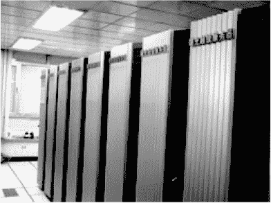
图 1.1　曙光 4000A 高性能计算机

#### 1.2.2　微型机

大规模与超大规模集成电路的发展为微型机诞生奠基。中央处理器 CPU 将运算器与控制器集成于一枚大规模集成电路芯片，成为微型机的核心，犹如心脏。因成本低、软件生态丰富、操作简便、性能优良，微型机已普及办公与家庭，台式机与笔记本是典型代表。

#### 1.2.3　工作站

工作站是一种高端通用微型机，通常配备高分辨率大屏显示器与大容量内外存储，图形图像处理与高速数据运算能力突出。主要用于工程设计、金融管理、动画制作等专业领域的设计开发。

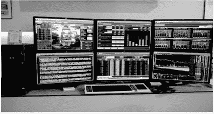
图 1.2　工作站

#### 1.2.4　服务器

服务器是网络环境下为多用户提供共享资源与服务的设备，具有大存储容量、强网络通信、安全可靠等特点。服务器上通常运行专用网络操作系统，提供文件传输、数据库通信等服务。

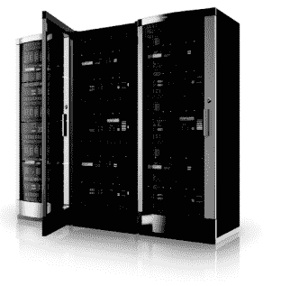
图 1.3　服务器

#### 1.2.5　嵌入式系统

嵌入式系统是指植入特定对象实现智能化控制的专用计算机系统。以应用为中心、以计算机技术为基础、软硬件可裁剪，适用于对功能、可靠性、成本、体积、功耗要求严格的场景。一般由嵌入式微处理器、外围硬件、嵌入式操作系统与用户应用程序四部分构成，用以控制、监视与管理其他设备。手机、空调、机顶盒、数码相机、汽车等日常设备中均可见其身影。

### 1.3　国际发展脉络

从贝壳、结绳、算筹、算盘到计算尺、计算器、机械计算机，计算工具不断延伸人脑。1946 年 2 月，首台电子计算机 ENIAC 在美国宾夕法尼亚大学诞生，标志人类科学发展的重要里程碑。半个多世纪以来，计算机在性能提升、体积缩小、成本降低方面取得巨大进步，在信息爆炸的时代作用不可估量。

按所用物理器件划分，发展大致经历四个阶段，见表 1.1。

表 1.1　计算机发展的 4 个重要阶段

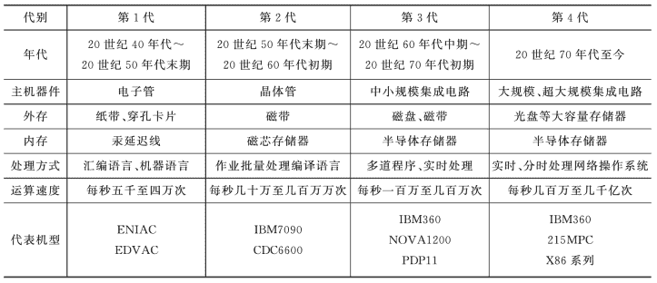

#### 1.3.1　第 1 代电子管机（1944 年—1958 年）

1944 年 2 月，马克 1 号问世，长约 15 米、高约 2.4 米、重 31.5 吨，每分钟可完成 200 次以上运算，加法 0.3 秒、乘法约 6 秒，被视为最后一台机械/电动式“史前”计算机。

二战期间美国为计算火炮弹道需大量人工计算，易出错。时任宾夕法尼亚大学莫尔工程学院的莫希利提出研制首台电子计算机设想，获军方资助。1946 年 2 月 14 日，世界第二台电子计算机、首台通用计算机“埃尼阿克”ENIAC 在宾夕法尼亚大学诞生。

ENIAC 长 30.48 米、宽 6 米、高 2.4 米，占地约 170 平方米，重 30 英吨，耗电 150 千瓦，造价 48 万美元。内含 17468 根真空管、7200 根晶体二极管、1500 个中继、70000 个电阻、10000 个电容、1500 个继电器、6000 多个开关。每秒可完成 5000 次加法或 400 次乘法，人类最快仅约每秒 5 次加法。

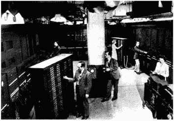
图 1.4　世界上第一台计算机 ENIAC

1945 年 6 月，冯·诺依曼等发表长达 101 页的报告，奠定现代计算机体系结构基础，被视为里程碑文献。报告确立了输入、输出、存储器、运算器、控制器的五大部件，并提出用二进制替代十进制。

1947 年晶体管问世，运算更快、更耐用、体积远小于真空管或继电器。

#### 1.3.2 第 2 代晶体管机（1958 年—1964 年）

晶体管取代真空管，体积缩小、成本下降，使中小企业也能负担。FORTRAN 与 COBOL 两种高级语言的出现让编程更易，催生了程序员、分析员等新职业与软件产业。晶体管机开始采用监控程序，即操作系统的雏形。

主要特点：体积小、可靠性增强、寿命延长；运算速度提升；操作系统适应性提高；存储容量增大；应用领域扩展。

#### 1.3.3 第 3 代集成电路机（1964 年—1971 年）

采用中小规模集成电路构成主要功能部件，主存储器使用半导体存储器，运算速度达每秒几十万至几百万次。软件层面操作系统趋于完善。

集成电路可在数平方毫米硅片上集成十几个甚至上百个元件，使计算机更小、更省电、功能更强、寿命更长、应用更广。

主要特点：体积更小、寿命更长；计算速度更快；外围设备多样化；操作系统、应用软件与高级语言进一步发展；应用扩展至企业管理与辅助设计。

1964 年 4 月 7 日，IBM 50 周年之际，由吉恩·阿姆达尔主设计的 IBM360 问世，标志第三代全面登场，也是 IBM 历史上最成功的机型。

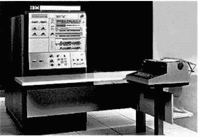
图 1.5　IBM360 计算机

1965 年 DEC 推出 PDP-8，标志小型机时代到来。1968 年 Intel 成立，为计算机普及作出重要贡献。同年加州大学恩格巴特博士发明了第一只鼠标。

#### 1.3.4 第 4 代大规模集成电路机（1971 年至今）

体积、重量、功耗进一步降低，运算速度、存储容量与可靠性大幅提升。

主要特点：采用大规模与超大规模集成电路，可靠性更高、寿命更长；运算速度达每秒几千万至几十亿次；系统软件与应用软件大发展，程序设计部分自动化；计算机网络、多媒体、分布式处理技术快速发展，微型计算机走入家庭；计算机广泛应用于办公自动化、数据库管理、图像处理、语音识别、专家系统等，电子商务兴起，个人电脑出现。

1971 年，记者唐·赫夫勒以半导体主要成分“硅”命名帕洛阿托地区，“硅谷”由此得名。同年 1 月，Intel 的特德·霍夫研制出首枚可实际工作的微处理器 4004，集成 2250 个晶体管，运算能力超过 ENIAC。11 月 15 日正式公布。

1972 年，开发 UNIX 的 Dennis Ritchie 领导研发 C 语言。1974 年 4 月 1 日，Intel 推出首款 8 位微处理芯片 8080。

1975 年 7 月，比尔·盖茨为“牛郎星”电脑配置 BASIC 后退学，与保罗·艾伦创办微软，提出“每家每桌运行微软程序”的目标。

1976 年 4 月 1 日，斯蒂夫·沃兹尼亚克与斯蒂夫·乔布斯创立苹果，推出 Apple-Ⅰ。1977 年 6 月，拉里·埃里森与好友创立甲骨文。

1981 年 8 月 12 日，PC 之父唐·埃斯特奇团队完成 IBM 个人电脑研发，IBM PC 诞生，改写世界历史。1985 年 11 月，微软正式推出 Windows 操作系统。1990 年并行巨型机问世，1994 年机群结构出现。

### 1.4 国内发展简史

中国计算机事业走过 60 余年风雨。1956 年，周恩来总理主持制定《十二年科学技术发展规划》，将计算机、电子、半导体、自动化列为四项紧急措施，计算机事业由此起步。

1956 年 3 月，闵乃大、胡世华、徐献瑜、张效祥、吴几康等专家赴莫斯科参加“计算技术发展道路”国际会议回国后，“十二年规划”明确研制计算机并批准成立计算技术、半导体、电子学、自动化四研究所。

#### 1.4.1 第 1 代电子管机的研制（1958 年—1964 年）

我国 1957 年起研制通用数字电子计算机。1958 年 8 月 1 日样机可运行短程序，定名为“八一型数字电子计算机”，后在 738 厂小批量生产，改称 103 型，共生产 38 台。

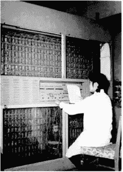
图 1.6　103 型计算机

1958 年 5 月启动首台大型通用电子计算机 104 机的研制，以苏联 БЭСМ-Ⅱ 为蓝本，在苏联专家指导下由中科院计算所、四机部、七机部与 738 厂协作，1959 年国庆前完成。

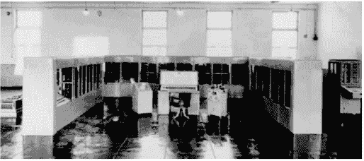
图 1.7　104 机

同期夏培肃院士领衔的小组自行设计，1960 年 4 月成功研制小型通用电子计算机 107 机。

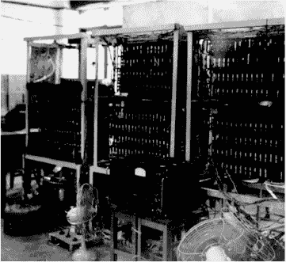
图 1.8　107 机

算力自立：新中国计算机六十年

1964年，设计自主的大型电子管通用数字机119机宣告完成，平均浮点处理能力约5万次/秒，攻关团队约250人，参与协作的单位超过十家。

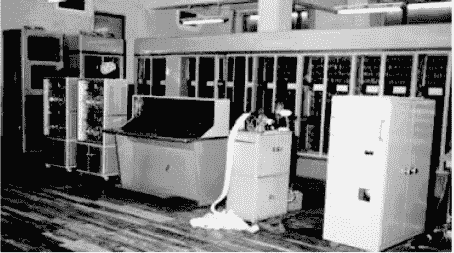

图 1.9　119 机

#### 1.4.2 第 2 代晶体管计算机的研制（1965 年—1972 年）
电子管机研制推进的同时，晶体管机的立项已经展开。1965年，首台国产大型晶体管通用机109乙机交付，研发脉络可追溯至1958年启动。海外禁运之下造晶体管机，必须先建半导体生产基地，因而有了109厂。两年左右的建设后，109厂为整机提供了全部所需晶体管，109乙机装配晶体管超2万支，二极管超3万支。改进后两年推出109丙机，服役超过15年，有效解题累计超10万小时，在“两弹”试验中贡献突出，被用户称为“功勋机”。

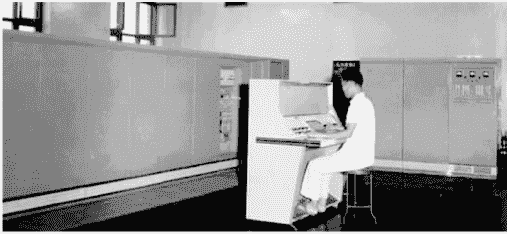

图 1.10　109 机
第二代晶体管机的研制与量产中，工业力量发挥重要作用。华北计算所先后拿出108机、108乙机即DJS-6、121机即DJS-21、320机即DJS-6，并在738厂等5家工厂实现生产。中国人民解放军军事工程学院，即国防科大前身，于1965年2月推出441B晶体管机，并小批量生产了40余台。

#### 1.4.3 第 3 代中小规模集成电路计算机的研制（1973 年—20 世纪 80 年代初期）
IBM在1964年推出360系列，标志美国进入第三代计算机时代，我国直至七十年代初才逐步推出大、中、小型集成电路机。1973年，北京大学联合北京有线电厂等单位研制出运算速率达百万次/秒的大型通用机。进入八十年代，高速与向量机迎来新突破。1983年，中科院计算所完成首台国产大型向量机757机，运算速率达千万次/秒。

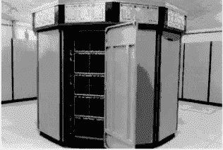

图 1.11　757 机
同年，国防科大研制的银河-Ⅰ亿次巨型机刷新纪录。银河-Ⅰ在中国高速机发展史上具有里程碑意义。

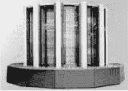

图 1.12　银河-Ⅰ

#### 1.4.4 第 4 代超大规模集成电路计算机的研制（20 世纪 80 年代中期至今）
第四代计算机起步同样源自微型机。1980年初，多家单位基于Z80、X86、M6800等芯片开展微机研制。
1992年，国防科大研制成功银河-Ⅱ通用并行巨型机，峰值浮点运算达4亿次/秒，折合基础操作约10亿次/秒，整体水平达到八十年代中后期的国际先进层次。1997年，国防科大推出银河-Ⅲ百亿次并行巨型系统，采用可扩展分布共享存储并行处理架构，由130余个处理节点构成，峰值浮点运算达130亿次/秒，综合技术达到九十年代中期的国际先进层次。国家智能机中心与曙光公司于1997至1999年间陆续推出曙光1000A、曙光2000-Ⅰ、曙光2000-Ⅱ超级服务器，峰值浮点运算突破千亿次/秒，系统规模超过160个处理器。此后2000年推出峰值3000亿次/秒浮点运算的曙光3000超级服务器，2003年上半年推出峰值万亿次/秒浮点运算的曙光4000L超级服务器。

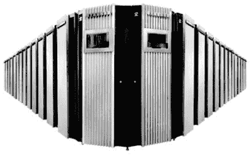

图 1.13　曙光 4000L
2018年，世界超算组织公布截至当年11月的全球前十榜单，中国占据两席：排名第三的神威·太湖之光，HPL性能为93.0千万亿次浮点运算；排名第四的天河-2A，采用Intel Xeon E5-2692v2与Matrix-2000处理器，核心数接近500万，最高性能达61.44千万亿次浮点运算。

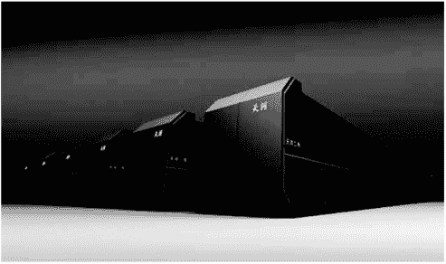

图 1.14　天河-2A
此前，天河2号曾实现世界超算榜首六连冠，天河-2A为其升级型号，连续四年保持榜首。太湖之光的运算速率约为天河2号的两倍。该机的研发大幅提升我国应对气候与自然灾害的减灾防灾能力，可对地震等灾害实现更精准预警，降低损失，同时为航空航天、医疗制药等多个领域提供不可替代的技术支撑。

#### 1.4.5 自主研发之路
自八十年代中期起，我国计算机与半导体器件产业发展过度依赖技术引进，企业追求短期效益。当时全社会研发投入占GDP比重不足0.70%。进入九十年代投入依旧偏低，除1993年前受封锁影响略高于0.70%外，九十年代中期回落至八十年代水平，其中1995年与1996年连续两年降至0.60%左右。
1989年，中美关系“蜜月期”结束，美国政府对中国高性能计算机出口实施严格管制，除索取高价外，还要求服务器置于透明玻璃房接受美方监控。此后我国开始走上高性能计算机自主研发道路。
1993年，具有标志意义的曙光一号诞生，但因国内微电子近十年停滞，高性能机未能完全国产化，技术仍受制约。例如曙光一号采用美国摩托罗拉1989年底推出的M88100商业微处理器，操作系统移植自美国IBM公司的AT&T UNIX。此后多款国产机仍使用进口芯片。
1999年，以美国为首的北约轰炸中国驻南斯拉夫大使馆，激发爱国热情，人们认识到国家安全不能靠购买，自主科技研发的重要性凸显。
2002年8月10日，我国成功制造首枚高性能通用CPU——龙芯一号。此后龙芯二号问世，龙芯三号也在研制中。龙芯的诞生打破国外长期技术垄断，结束了中国近二十年无“芯”历史。

#### 1.4.6 国内与国际计算机发展的对比
回顾六十余年我国高性能通用计算机研制历程，从103机到曙光系列，历程不平凡。海外代表机型有ENIAC、IBM 7090、IBM 360、CRAY-1、Intel Paragon、IBM SP-2；本土代表机型有103机、109机、150机、银河-Ⅰ、曙光1000、曙光2000。对比情况见表1.2。

表 1.2　国内与国际计算机发展对比表

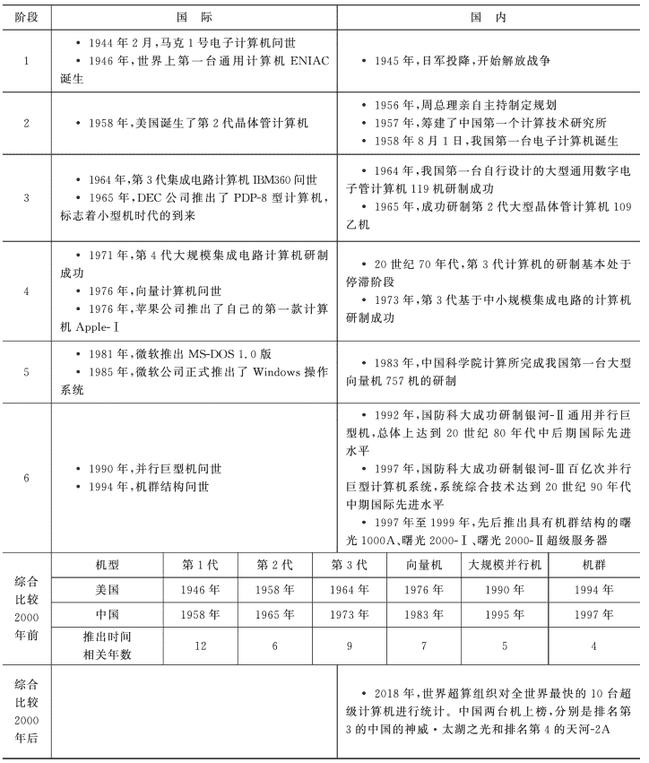

### 1.5 计算机的主要应用领域
计算机已渗透各行各业，改变工作、学习与生活方式，推动社会进步。主要领域包括科学计算、数据处理、计算机辅助系统、过程控制、人工智能、网络应用等。

#### 1.5.1 科学计算
科学计算即数值计算，利用计算机解决工程技术与科研中提出的数学问题。是计算机最早的应用方向。现代科研中相关问题繁多复杂，要求计算机具备高速、连续运算及超大存储能力，以完成人工难以实现的目标。

#### 1.5.2 数据处理
数据处理即信息处理，指对各类数据进行采集、存储、整理、分类、统计、比较、检索、增删、判别等活动。其核心工作并非运算，涉及运算时方法也较简单。
发展经历三个阶段：
（1）电子数据处理EDP阶段，以文件系统为工具，实现部门内部单项管理，提升效率。
（2）管理信息系统MIS阶段，以数据库技术为工具，实现部门事务全面管理，提升效率。
（3）决策支持系统DSS阶段，以数据库、模型库和方法库为基础，辅助决策者提高决策水平和运营策略有效性。
目前数据处理已广泛应用于办公自动化、企业管理与决策、情报检索、影视动画设计、图书管理等。

#### 1.5.3 计算机辅助系统
计算机辅助技术涵盖计算机辅助设计、计算机辅助制造、计算机辅助教育等。
（1）计算机辅助设计CAD是借助计算机系统辅助设计人员进行工程或产品设计，实现最佳设计效果的技术。目前已广泛应用于航空、汽车、机械、电子、建筑、轻工等领域。例如在电子计算机设计中，利用CAD进行体系结构仿真、逻辑仿真、插件划分、自动布线等，大幅提升设计自动化水平，提高设计速度与质量。
### （2）计算机辅助制造CAM
指借助计算机系统对生产设备进行管理、控制与操作。在产品制造过程中，通过计算机控制机器运行、处理生产数据、控制物料流动及产品检测等。使用CAM可大幅提升产品质量、降低成本、缩短生产周期、改善劳动条件。
### （3）计算机集成制造系统CIMS
将CAD与CAM集成，实现设计与生产自动化。在信息化与自动化技术基础上，通过计算机把产品设计制造过程中分散的自动化子系统有机整合，形成整体效益的集成化与智能化体系。CIMS将真正实现无人化工厂。
### （4）计算机辅助教育CBE
已广泛应用于教育领域，近二十年逐渐兴起，成为教育现代化的标志之一。包括计算机辅助教学CAI和计算机管理教学CMI。CAI特色为交互教学、个别指导、因材施教。CMI用于课程安排、教学计划制定等事务管理。CBE借助计算机系统与课件进行教学，通过学习者与计算机交互完成多种教学任务。

#### 1.5.4 过程控制
过程控制即实时控制，利用计算机及时采集检测数据，按最优值快速对控制对象进行自动调节或控制。不仅大幅提高自动化水平，还提升控制的及时性与准确性，改善劳动条件，提高产品质量。已在冶金、机械、石油、纺织、化工、水电、航天等行业广泛应用。例如汽车工业利用计算机控制机床，全线控制装配流水线，实现高精度复杂零件加工自动化，推动车间或工厂全面自动化。

#### 1.5.5 人工智能
人工智能AI指计算机模拟人类感知、判断、理解、学习、问题求解、图像识别等智力活动。近年来成为计算机技术领域重要学科。不但可模拟人类视觉、触觉、听觉、嗅觉，还可模拟推理思维、自然语言理解与自动翻译、文字图像识别能力。计算机博弈亦属研究范围。研究成果已走向实用，如模拟医学专家的疾病诊疗专家系统、具有一定思维能力的智能机器人等。

#### 1.5.6 网络应用
计算机技术与现代通信技术结合构成计算机网络。网络的建立解决了单位、地区、国家乃至全球范围内计算机互联及软硬件资源共享问题，极大促进了视频、声音、文字、图像等各类数据的传输与处理。

### 1.6 计算机技术对于社会发展的影响
随着计算机技术高速发展，其在社会生活中的地位愈发重要，已应用于生产生活的各个领域并展现强大生命力。以下从多个维度探讨其影响。

### 1.6.1 推动社会生产力发展
自工业革命以来，人类经历三次技术革命，第三次革命中最具划时代意义的是电子计算机的迅速发展与广泛应用，它是现代信息技术的核心。与前两次不同，第三次革命更好解决了科学向现实生产力转化的中间环节。通过计算机发展与应用，信息技术的可靠性、及时性与有效性增强，人类掌握的信息量增大，传输渠道增多。信息技术发展催生相关产业，如现代物流、电子商务、现代生物技术等，同时这些产业反过来推动信息技术发展。信息技术作为科学技术前沿，其广泛应用提升了科学技术作为第一生产力的地位，加快社会生产力发展与生活水平提高。

### 1.6.2 对经济的影响
计算机技术在全社会的应用对经济产生巨大影响。结构发生变化。以电子计算机为基础的信息生产、传递、存储、加工与处理产业迅速从第三产业中分离，形成独特的第四产业。据德国统计，1997-2000年，信息与通信技术在全球市场经济总量增长50%，达20120亿欧元。按年均15%增速推算，信息产业未来将逐步超越第一、二产业，在各国经济发展中占据更突出地位。其余方面，计算机技术推动社会经济大幅提升。信息产业属高就业型产业，可扩大就业带动产出。截至2010年上半年，信息产业国内生产总值占中国国内生产总值的4%，对GDP直接贡献率超10%。据中商情报网，2011年中国电子计算机行业规模以上企业从业人员185.2万人，同比增长18.03%。

### 1.6.3 对生产方式和工作方式的影响
工业社会中机器生产取代了农工手工业，生产力大幅提高，劳动强度减轻，工人成为“机器附庸”，仍是工厂劳动主力。随着计算机技术发展，工人的简单重复劳动及繁重体力劳动逐渐被计算机及相关辅助与控制技术机器取代，工人素质与知识化水平发生转变，越来越多工人从事脑力劳动。
计算机在生产领域的广泛应用，使生产与工作方式发生巨大变化。例如工程或产品设计中，计算机辅助设计取代了传统手工绘图，使设计人员从繁重计算中解脱，集中发挥创造性思维，提高设计效率与质量，缩短设计周期；在产品制造中，利用计算机控制机器运行，自动完成加工、装配、检测、包装等过程，改变了传统加工的繁琐，工人只需监视设备运行，降低劳动强度，改善工作条件，提高加工速度与自动化水平，缩短准备时间，降低成本，提高质量。此外，那些需大量重复劳动且精度要求高，或需长时间连续在放射性、有毒等危险环境下进行的工作，原本由工人承担，有了计算机后正逐步被替代。不难看出，计算机进入生产过程，使工人从大量繁重体力劳动中解放，从事更灵活的与计算机相关生产活动，这是人类生产史上一次飞跃。

### 1.6.4 对生活的影响
计算机技术已融入人类日常生活。可利用计算机进行信息处理，如文字、声音、图像。教师可利用计算机辅助教学，使学生从图文并茂课件中轻松学习；医生可利用高诊断水平的智能机器人为病人诊疗等。随着计算机技术与现代通信技术结合，其一可通过计算机方便交流沟通，缩短人与人时空距离，形成地球村；其二可通过计算机获得各类服务，如网上办公、收发电子邮件、网上观影、网上购物、网上授课、网上看病等。计算机使生活更加丰富多彩。

### 1.6.5 其他方面
除上述内容外，计算机对社会其他方面也有积极影响。例如帮助攻克科学难题，使原本需数十年甚至上百年的人工计算在数秒内完成；帮助决策者明确目标，提供备选方案及评价，提高决策水平，改善运营策略的正确性与有效性；帮助工人在工作过程中控制系统，替代体力劳动及部分代替脑力劳动，对工人科学文化素质提出新要求，同样全体社会成员的科学文化素养也随计算机广泛应用而提升。
由此可见，计算机技术发展将对人类社会产生积极影响，引起社会生产与生活方式革命性变化，推动人类社会向更高阶段发展。

### 1.7 计算机的发展趋势

### 1.7.1 计算机的发展方向

自 1946 年首台通用电子计算机 ENIAC 投入使用以来，跨越半个多世纪的时间里，计算设备的应用边界被不断拓展，机型也走向持续分化，整体演进呈现多线并进的态势。今天的技术演化主要集中在四个维度：运算能力向极致扩张、物理体积向极致压缩、系统互联向深度融合、功能表现向类人智能靠拢。

#### 1.巨型化
巨型化追求极高的运算速率、超大规模的存储容量以及更为完善的功能体系。这类超算平台主要部署在航空航天、国防军事、气象预报、人工智能训练、生物工程等对算力吞吐与数据处理提出极高要求的领域。

#### 2.微型化
集成电路工艺由大规模走向超大规模，推动了微型化成为不可逆转的主流趋势。自首个微处理器芯片出现后，微型化的进展日趋加快。业界普遍认可的经验规律是芯片集成密度约每 18 个月翻一番，而制造成本大约减半，这正是摩尔定律所体现的性能价格比持续改善的轨迹。集成度提升带来能力跃升，从而加速微型设备的普及。

#### 3.网络化
网络化是计算技术与通信技术深度结合的产物。进入 20 世纪 90 年代后，随着 Internet 的迅猛扩张，计算机网络已覆盖政府部门、教育机构、企业、科研单位、家庭等诸多场景，公众对网络概念的认知大幅提升。其本质是将地理分散、功能独立的设备借助通信装置与传输介质连成整体，在通信软件的支撑下实现资源共享与信息交换。网络化水平已成为衡量国家现代化程度的重要标尺，在经济运行中发挥关键作用。

#### 4.智能化
智能化旨在让机器展现类人的智力活动，涵盖学习、感知、理解、判断、推理等核心能力。具备智能特征的系统能够解析自然语言、语音、文字与图像，并可主动发声，实现人与机器间的自然语言直接对话。它能够持续吸纳新知识，并在既有知识基础上进行联想、推演，从而得出结论并解决复杂问题。

### 1.7.2 未来的新型计算机
回溯发展脉络，长期以来计算进步都以电力电子与集成电路的演进为基础，芯片始终是核心载体。伴随前沿技术的突破，下一代计算形态正开辟新赛道。目前研究热度较高的方向包括分子计算机、量子计算机、生物计算机和光计算机。

#### 分子计算机（molecular computer）
分子计算机试图利用分子层面的信息处理能力。其工作机理依赖分子晶体能够捕捉以电荷形式存在的信息，并以更高效的结构重新编排。得益于纳米量级的尺寸，整体体积有望大幅缩小。同时能耗预计显著降低，数据的保存周期也可明显延长。

#### 量子计算机（quantum computer）
量子计算机是在遵循量子力学规律的前提下，完成高速数学与逻辑运算、存储及处理量子信息的物理装置。当某台设备处理的是量子信息并运行量子算法时，即可归为量子计算机。其最小信息单元为量子比特。与经典比特仅限 0、1 两种状态不同，量子比特可同时处于多种状态的叠加，叠加特性对并行信息处理极具价值。

量子计算概念源于对可逆计算机的研究，而研究可逆计算最初是为了攻克能耗难题。量子计算机展现出一些反直觉特性，例如信息传输理论上可近乎瞬时，能耗可逼近零。

#### 生物计算机（biological computer）
又称仿生计算机。它是用生物芯片取代硅片上成千上万晶体管而构建的计算机。主要原材料来自生物工程制备的蛋白质分子，并以此作为生物芯片。生物芯片天生具备并行处理能力，理论运算速度可达现役顶尖机型的十万倍，而能耗仅为普通计算机的十亿分之一。该方向涉及计算机科学、脑科学、分子生物学、神经生物学、生物工程、生物物理、物理学和化学等多学科。目前生物芯片整体仍处研制阶段，但在生物元件尤其是生物传感器方面已取得不少进展。

#### 光子计算机
光子计算机是一种利用光信号进行数字运算、逻辑操作、信息存储与处理的新型机器。它由激光器、光学反射镜、透镜、滤波器等光学器件构成，通过激光束在反射镜与透镜阵列中调控来完成信息处理，以光子取代电子、以光运算替代电运算。光的并行与高速特性决定了其并行处理能力极强，运算速率极高。同时它还具备类人脑的容错性，系统中个别元件损坏或出错时，通常不影响最终计算结果。光在光介质中传输时的畸变与失真极小，传输与转换过程中的能耗与散热量也非常低，对环境条件的要求远低于电子计算机。

### 本章小结
本章第一节与第二节先梳理了计算机的核心概念，并概括了各类机型的划分及用途。第三节与第四节回顾了中外发展历程，帮助建立历史脉络；第四节还特别对照了国内外进展，加深对中国计算产业的认知。第五节盘点了主要应用分支，第六节讨论了技术对社会的驱动作用，末节则简要展望未来走向。通过本章学习，读者应对计算机基础概念形成较为系统的认识。

### 习题

### 1.填空题

（1）电子数字积分计算机 ENIAC 首度问世于　　　　年。

（2）第四代电子计算机所采用的电子器件是\_\_\_\_\_\_。

（3）计算机通常划分为\_\_\_\_、\_\_\_\_、\_\_\_\_、\_\_\_\_\_ 和\_\_\_\_。

（4）我国首台自主研制计算机诞生于　　　　年。

（5）我国首款高性能 CPU 为\_\_\_\_。

（6）计算机未来发展趋势为\_\_\_\_、\_\_\_\_、\_\_\_\_ 和\_\_\_\_。

### 2.选择题

（1）我国首台小型通用电子计算机为（）。

A.103 机　　　　　B.104 机　　　　　　C.107 机　　　　　　D.119 机

（2）财务软件归属于计算机在（）方面的应用。

A.计算机辅助设计 B.工程计算　　　　C.人工智能　　　　D.数据处理

（3）关于首台计算机 ENIAC，下列说法正确的是（）。

A.ENIAC 的中文含义是电子数字积分计算机

B.ENIAC 是由图灵等人研制成功的

C.ENIAC 在第二次世界大战初期问世

D.ENIAC 体积过小，因而功能也有限

（4）为实现计算机资源共享，计算机正朝（）方向发展。

A.微型化　　　　　B.智能化　　　　　C.网络化　　　　　D.巨型化

（5）由大规模和超大规模集成电路芯片构成的微型计算机属于现代计算机阶段的（）。

A.第 2 代　　　　　B.第 3 代　　　　　C.第 4 代　　　　　D.第 5 代

（6）有关计算机应用领域中的人工智能，下面叙述正确的是（）。

A.人工智能与机器智能不同　　　　　　B.人工智能即是要计算机做人所做的事情

C.计算机博弈属于人工智能的范畴　　　D.AI 与人工智能无关

（7）日常使用的计算机属于（）。

A.微型计算机　　B.工作站　　　　　C.服务器　　　　　D.嵌入式计算机

### 3.简答题

（1）概述计算机的主要分类。

（2）概述计算机发展各阶段所采用的逻辑部件。

（3）概述计算机的主要应用领域。

（4）概述计算机未来的发展趋势。

## 第 2 章 计算机中的信息表示与编码

### 2.1 计算机中的信息表示
机器内部对信息与运算数据的编码均采用二进制体系。

#### 2.1.1 数制
数制是什么？简言之，就是借助一组固定的数码符号和一套统一的计数规则来表达数值的体系。

按进位规则计数的称为进位计数制。二进制逢二进一，八进制逢八进一，日常常见还有十进制、十六进制等。

任何进位制都由基数和位权两个要素构成。

基数表示该进制中可用的数码总数，每种进制对应一组固定的符号。

#### （1）二进制`B`（`binary`）
基数为 2，可用符号仅为 0 与 1，数码的实际值由其所在位按逢二进一规则确定。

#### （2）八进制`O`（`octal`）
基数为 8，可用符号为 0、1、2、3、4、5、6、7，每个数码按其所在位遵循逢八进一决定实际数值。

#### （3）十进制`D`（`decimal`）
基数为 10，可用符号为 0~9，每个数码按其所在位遵循逢十进一决定实际数值。

#### （4）十六进制`H`（`hexadecimal`）
基数为 16，可用符号为 0~9、A、B、C、D、E、F，每个数码按其所在位遵循逢十六进一决定实际数值。

在进制表示法中，相同数字处在不同位置意义不同。位权表示该位置所代表的量级。例如十进制“234.56”中，2 的位权为 10²，3 为 10¹，4 为 10⁰，5 为 10^-1，6 为 10^-2。二进制 1001 中，从左到右各位的位权依次为 2³、2²、2¹、2⁰。对 k 进制数，整数部分从右往左数第 i 位的位权为 k^(i-1)，小数部分从左往右数第 i 位的位权为 k^-i。

### 2.1.2 不同数制之间的转换
下面介绍不同进制之间如何相互转换。

#### （1）非十进制数转换为十进制数
k 进制转十进制常用位权展开法：将各数位按位权展开后求和，即得十进制结果。

【例 2.1】`（10101.101）2 = 1×2⁴+0×2³+1×2²+0×2¹+1×2⁰+1×2^-1+0×2^-2+1×2^-3`
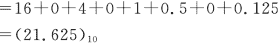

#### （2）十进制数转换为非十进制数
十进制转其它进制需分别处理整数与小数两部分。

整数部分：用待转换整数除以目标进制基数，余数作为最低位；再用商继续除基数，余数作为次低位，重复直至商为 0，最后一个余数为最高位。

小数部分：用小数部分乘以目标进制基数，整数部分作为新小数最高位；再用剩余小数继续乘基数，整数部分作为次高位，重复直至小数变为 0 或达到所需精度。

##### ①十进制数转换为二进制数
【例 2.2】将`（10.25）10`转换为二进制数。
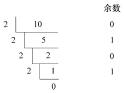
所以`（10）10 = （1010）2`
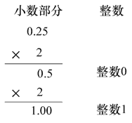
所以`（0.25）10 = （0.01）2`
结果`（10.25）10 = （1010.01）2`
注：十进制小数并不一定能精确映射为二进制小数，有时需要取近似值。

## 十进制数转换成八进制数和十六进制数
与二进制转换方法相同，分别采用“除 8 取余、乘 8 取整”和“除 16 取余、乘 16 取整”进行转换。

### 非十进制数之间的转换
两非十进制数之间转换可采用组合运算：先转十进制，再由十进制转目标进制。因为二进制、八进制和十六进制存在内在联系，所以三者互转相对简便。读者宜牢记表 2.1。

#### 二进制数与八进制数之间的转换
1 位八进制数等同于 3 位二进制数。因此二进制转八进制时，以小数点为界，整数部分从右往左、小数部分从左往右，每 3 位分为一组，不足补 0。反向转换则相反。参照表 2.1 即可完成。

表 2.1　二进制、八进制和十六进制之间的转换关系
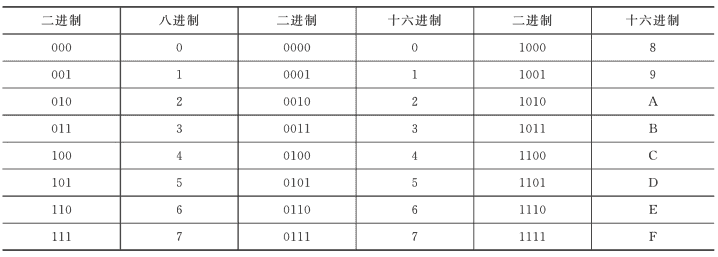

【例 2.3】将`（10101110.01001110）2`转换为八进制数。
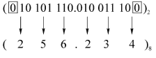

【例 2.4】将`（472.321）8`转换为二进制数。
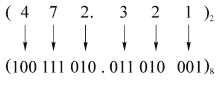

二进制与十六进制之间的转换与八进制类似，只是每 4 位分为一组，不足补 0。

【例 2.5】将`（110101110.010011101）2`转换为十六进制数。
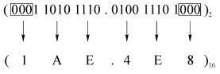

## 2.1.3　二进制数的运算规则

### 计算机采用二进制数的原因
日常使用十进制书写方便、直观，但计算机采用二进制，主要因其具备以下特点。

（1）易于技术实现。二进制仅需 0 与 1 两个符号。计算机由逻辑电路构成，具有两种稳定状态的物理器件易于实现，如开关的通断、电压的高低，正好对应 1 与 0。

（2）简化运算规则。十进制加法与乘法运算规则各有 55 条，而二进制加法与乘法组合仅有 3 条。运算规则简单，有利于简化运算器设计、提升速度。

（3）适合逻辑运算。逻辑代数是逻辑运算的理论依据，二进制的 0 与 1 正好对应逻辑中的假与真，故非常适合逻辑运算。

（4）工作可靠性高。二进制表示数据抗干扰能力强、可靠性高。例如电压高低易于分辨，用二进制表示每位仅有高低两态，即使受一定干扰，也能可靠判别。

### 二进制数的算术运算
在计算机内部，二进制加法是基本运算，减法可转化为加负数，乘除可通过加减实现，从而使运算器结构更简洁稳定。

二进制加法规则如下。
`0+0=0`；`0+1=1`；`1+0=1`；`1+1=10`（本位 0，进 1）

【例 2.6】计算二进制数`1001+1101`：
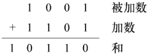
由计算过程可见，两数相加按从低位到高位逐位累加，每位包含被加数、加数及来自低位的进位。

## 2.1.4　计算机中的数据存储单位
程序与数据在计算机中均以二进制形式存于存储器。下面介绍常用存储单位。

位（`bit`，简写为`b`）是存储数据的最小单位，也是信息量的最小度量单位，仅有 0 与 1 两种状态。1 位只能表示 2¹ 种状态，每增 1 位，信息量翻倍。

字节（`Byte`，简写为`B`）是数据处理中最常用的单位，`1 B=8 b`，由 8 位二进制组成。

存储容量通常以字节为单位衡量。常见单位`KB`、`MB`、`GB`、`TB`关系如下。
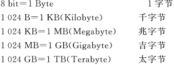
字（`Word`，简写为`W`）是指处理器一次通过数据总线存取、加工和传送的数据。一个字由若干字节组成。字长指计算机一次能处理的二进制位数，由 CPU 寄存器和数据总线宽度决定，是衡量性能的重要指标，字长越长性能越好。常见字长有 8 位、16 位、32 位、64 位等。

由于机器内部采用二进制，习惯十进制的人类在使用中常把 1 K 设定为 2¹⁰，即 1024。

## 2.1.5　数值型数据的表示与处理
计算机数据分为数值型与非数值型两大类。数值型分为整数即定点数和实数即浮点数。下面分别介绍二进制表示方法。

### 定点数表示
定点数的小数点位置固定不变，隐含于预定位置。定点数有定点整数与定点小数两种。整数的小数点固定在数值最右端。小数在计算机中不显式存储小数点，而是用隐含规则确定位置。定点小数一般把小数点固定在数值最左端，若最高位为符号位，则小数点置于符号位之后、数值位之前。整数分为无符号整数与有符号整数。

#### 无符号整数
无符号整数通常表示地址等正整数，可为 8 位、16 位或更多。8 位正整数范围 0~255 即 2⁸-1，16 位范围 0~65535 即 2¹⁶-1。

#### 有符号整数
有符号整数规则：最高位作符号位，0 代表正，1 代表负，其余位表示数值大小。常用表示方法有原码、反码和补码。

##### 原码表示
数 X 的原码记作`［X］原`，若机器字长为 n，则原码定义如下。

例如：`X1`、`X2`的真值为`X1=+1110110`，`X2=-1011010`，
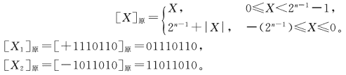

# 数值表示与信息编码精要

原码把最左侧的位用来记录正负，正数记 0，负数记 1，剩余 n-1 位存放真值的绝对值。零在原码里出现两套写法：+0 写成 00000000，-0 写成 10000000。

从直观角度看，原码与真值互转非常直接，乘除也方便。加减则麻烦，同号相减或异号相加时必须先比较绝对值大小，用较大者减去较小者，结果符号跟随绝对值较大者。这种额外判断会增加运算器复杂度，双零并存也会给判定带来歧义。

##### 反码表示
数 X 的反码定义如下。
若 X 是纯整数，则
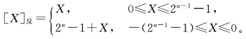
若 X 是纯小数，则
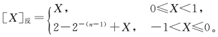
由定义可知，负数的反码把原码除符号位外的其余位逐位取反，正数的反码与原码形式一致。
例如真值 X1=+1110110，X2=-1011010，反码为
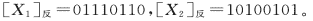
反码同样存在双零：+0 反码 00000000，-0 反码 11111111。

##### 补码表示
记数 X 的补码为［X］补，字长为 n 时定义如下。
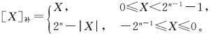
正数的补码与原码相同。负数的补码等于 2^n 减去绝对值，也可理解为原码除符号位外取反后加 1。
同例 X1=+1110110，X2=-1011010，补码为
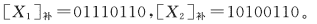
注：补码中零唯一，［+0］补＝［-0］补＝00000000。

补码的核心价值在于把减法化为加法，x-y = x+(-y)。运算规则为：［X+Y］补＝［X］补+［Y］补；［X-Y］补＝［X］补+［-Y］补。

### 浮点数表示
字长为 n 时，定点补码可表示 2^n 个数值，原码与反码只能表示 2^n-1 个数值，因正零负零占用两份编码。定点范围有限易溢出，于是引入小数点可移的浮点数，覆盖范围大幅扩大。
二进制数 M 的浮点写法为
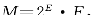
其中 E 为阶码，F 为尾数。
浮点表示的常用格式为
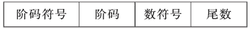
浮点表示并不唯一，小数点移动会同步改变阶码。
数值范围主要取决于阶码，精度取决于尾数。为提高有效位数通常做规格化，把尾数绝对值限制在 0.5 到 1 之间。尾数用补码时注意两点。
1. 若尾数 F≥0，规格化形式为 F=0.1××××…×，×可为 0 或 1，范围限定在［0.5，1］。
2. 若尾数 F＜0，规格化形式为 F=1.0××××…×，×可为 0 或 1，范围限定在［-1，-0.5）。

## 2.2　计算机信息编码
数字化信息编码是以少量二进制符号按约定规则组合，用来表达大量复杂信息的方法。按信息种类可分为字符编码、数字编码、汉字编码、多媒体信息编码等。

### 2.2.1　字符编码
计算机不仅处理数值，还要处理大量符号文字等非数值数据，必须把字符映射为二进制。给字符编号再用二进制表示编号的过程即字符编码。

#### ASCII 码
ASCII 即美国信息交换标准代码，后被 ISO 采纳为国际通用字符方案。用 7 位二进制表示 128 个字符，2⁷=128。每个编码转成十进制后的数值称为该字符的 ASCII 值。ASCII 表见表 2.2。
表 2.2　ASCII 表
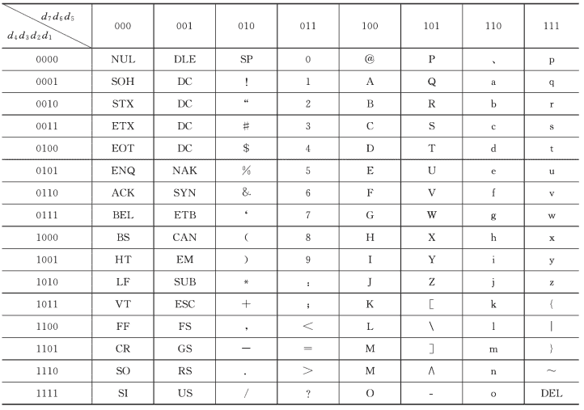
128 个字符分为两类：可显示或可打印的 95 个与控制字符 33 个。可显示字符包含 0～9 数字、a～z、A～Z 字母、+-≠/ 等运算符号、. ? , ； 等标点、# % 等商用符号，共 95 个，可通过键盘输入并在屏幕或打印机呈现。
控制字符用于数据通信传输控制、打印或显示格式控制、外部设备操作控制等特殊功能，本身不可见。ASCII 共 33 个控制字符，如编码 7DH 的 DEL 用作删除，编码 08H 的 BS 用作退格。ASCII 编码表共 24 行 23 列，低 4 位 d4d3d2d1 作行码，高 3 位 d7d6d5 作列码。
数字 0 到 9 的编码集中在第 3 列 011，从第 0 行 0000 到第 9 行 1001 排列，即“0”的 ASCII 为 (0110000)₂=(30)₁₆，“9”的 ASCII 为 (0111001)₂=(39)₁₆。屏蔽高 3 位后，低 4 位恰好是 0～9 的二进制，转换很方便。

#### EBCDIC 码
EBCDIC 即扩展的二/十进制交换码，采用 8 位表示一个字符，理论上可表示 2⁸=256 个符号。实际并未全部使用，部分保留扩充。EBCDIC 常用于 IBM 大型机。该码制里数字 0～9 的高 4 位均为 1111，低 4 位依次为 0000 到 1001，屏蔽高 4 位后可方便得到二进制数值。

### 2.2.2　数字编码
数字编码是用二进制按一定规律描述十进制数的方法。最常用的是 8421 码，也称 BCD 码。用 4 位二进制表示一位十进制数，从高到低位权为 2³、2²、2¹、2⁰，即 8、4、2、1。
BCD 编码既能以二进制满足数字系统要求，又保留十进制特点，仅有 10 种有效状态，部分场合可直接运算。
常见 BCD 编码有以下几种。

#### 8421BCD 码
8421BCD 是最广泛使用的 BCD 编码，是一种有权码，各位权从高到低为 8、4、2、1。有效编码只有 0000～1001 共 10 个，1010、1011、1100、1101、1110、1111 这 6 个编码为无效编码。

#### 2421BCD 码
2421BCD 也是有权码，从高到低权为 2、4、2、1，也可用 4 位二进制表示一位十进制数。

#### 余 3 码
余 3 码是无权 BCD 编码，每个码值与对应 8421BCD 相差 3，故称余 3 码，使用较少，仅作了解。
常见 BCD 编码见表 2.3。
表 2.3　BCD 编码表
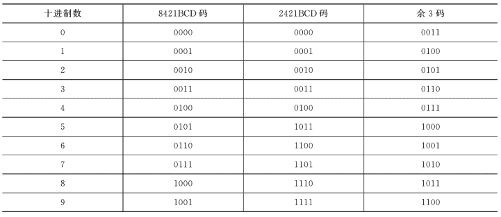

### 2.2.3　汉字编码
汉字数量庞大，常用字符数千个，一个字节 8 位不足。现有的汉字编码方案有 2 字节、3 字节甚至 4 字节。在汉字处理系统中，输入、内部处理、输出对汉字要求不同，需要进行输入码、国标码、机内码、字形码之间的转换。

#### 国标码
1981 年国家标准局制定了 GB2312-80，即《信息交换用汉字编码字符集》。该编码称为国标码。字符集共收录 7445 个字符符号，其中一级常用汉字 3755 个，二级常用汉字 3008 个，西文和图形符号 682 个。
GB2312-80 规定所有国标汉字与字符符号组成 94×94 的矩阵。每行称为一个区，区号 01～94；每个区内有 94 个位，位号 01～94。分布如下：1～15 区为图形符号区；16～55 区为一级常用汉字区；56～87 区为二级常用汉字区；88～94 区为自定义汉字区。

#### 输入码
输入码又称外码，是通过各种输入设备把汉字输入计算机时使用的编码。每种输入码对应一种输入方案。按方案可分为数字编码如区位码、字形码如五笔字型编码、音码如拼音编码以及音形混合码等，用户可自行选择。

#### 机内码
计算机内部存储和处理汉字采用统一的机内码。机内码与国标码有区别，若直接用国标码作内码会与 ASCII 冲突。输入时依据输入码通过计算或查表完成到机内码的转换。

#### 字形码
汉字在显示和打印时以字形信息呈现，每个汉字可写在同样大小的方块中，以点阵方式构成图形。字形码即确定汉字字形点阵的代码，也称汉字字模。
图 2.1 所示为 16×16 点阵的汉字“中”，用“1”表示黑点、“0”表示白点，黑白信息可用二进制表示。每个点用一位二进制表示，一个 16×16 字模需 32 字节。国标码中的 6763 个汉字及图形符号约需 261696 字节。所有汉字字形信息的集合称为汉字字库。点阵越大所需存储越大，质量越好成本也越高。当前屏幕显示一般用 16×16 点阵，打印输出常用 32×32 点阵，质量要求高时可采用更高点阵。

图 2.1　16×16 汉字点阵“中”

### 2.2.4　多媒体信息编码
信息大爆炸时代，多媒体信息无处不在。手机、影音播放器等设备都依赖多媒体编码。多媒体编码大致分为音频编码和图像编码。

## （1）音频编码
音频本身是模拟信息，时间上连续。数字声音是数据序列，需对模拟声音进行采样、量化和编码。采样即每隔一定时间间隔在波形上取一个幅度值，该间隔为采样周期，其倒数为采样频率。

### ①MIDI
MIDI 即音乐乐器数字接口，始于 1982 年，是数字音乐的国际标准。它以数字方式记录乐器发声，回放时使用调频或波表合成。标准多媒体 PC 可通过内部合成器或外接 MIDI 端口录入 MIDI 文件。用 MIDI 文件演奏音乐，存储需求很小，例如两分钟乐曲的 MIDI 文件不足 8 KB。

### ②WAVE
WAVE 格式记录声音波形，处理速度快、采样率高、采样字节长时，音质可接近原声。缺点是不压缩数据，文件体积巨大。

### ③MOD
MOD 格式大约始于 20 世纪 80 年代初，利用 Modplayer 通过 LPT 口自制声卡或直接使用机内喇叭播放。MOD 是这类音乐文件的总称，后来衍生出 ST3、S3M、XT、669、FAR 等扩展格式，基本原理相同。文件里既存乐谱也存音色样本。

### ④MP3
MP3 基于 MPEG Audio Layer 3 技术，通过压缩人耳不敏感部分实现高压缩比。它是有损压缩，但能在音质损失很小的情况下大幅减小体积，因而成为网络音乐的通用格式。

## （2）图像编码
图像格式可分为矢量类和位图类。前者由几何元素和数学方法描述，后者以像素形式描述。图像主要指标为灰度、分辨率与色彩数。分辨率分为输出分辨率和屏幕分辨率，前者用每英寸像素点数表示数值越小越差，后者用每英寸行列数表示数值越大质量越好。常见色彩位有 2 位、4 位、8 位、16 位、24 位、32 位、64 位。16 位可显示 65536 种颜色，24 位可显示约 1677 万种颜色，即真彩。代表性格式有：

### ①BMP（bit map picture）
BMP 是 PC 上最常用的位图格式，有压缩和不压缩两种，是 Windows 画图程序默认格式。通用图像软件都可访问，但文件容量相对较大。

### ②PCX（PC paint brush）
PCX 由 Zsoft 公司创建，可压缩以节约磁盘空间，最高可表现 24 位图像。

### ③GIF（graphics interschange format）
GIF 是一种跨平台的压缩图形格式，可在 IBM、Macintosh 等机器间移植，优点是兼容性好，但色彩上限为 256 种。因此除 Animator Pro 和 Web 网页等二维图形场景外，应用已很少。

本章小结
本章介绍了常用数制及数制转换，简要说明了二进制运算规则与数值型数据的表示处理，对计算机信息表示有了初步认识。概括了计算机信息的几种编码方式，使读者了解计算机中文字的表示与处理。通过本章学习，可对计算机编码形成整体认知。

习题
1.填空题
（1）标准 ASCII 字符集总共有　　　　个编码。
（2）在计算机内用　　　　字节的二进制数码代表一个汉字。
（3）二进制数 11110 转换为十进制数是\_\_\_\_\_。
（4）在计算机内部，数字和符号都用　　　　代码表示。
（5）汉字编码包括汉字输入码、国标码、\_\_\_\_ 和\_\_\_\_ 几方面内容。
2.计算题
（1）将下面二进制数转换为八进制数、十进制数和十六进制数。
①（10110101101011）₂；②（11111111000011）₂。
（2）将下面十进制数转换为二进制数、八进制数和十六进制数。
①（223）₁₀；②（137）₁₀；③（65.625）₁₀。
（3）将下面十六进制数转换为二进制数、八进制数和十进制数。
①（4E1）₁₆；②（11A）₁₆；③（5F25）₁₆。
（4）假设计算机字长为 8 位，采用补码进行表示，请写出下列十进制数在计算机中的二进制表示。
34　0　-3　-10　-127
3.简答题
（1）简述计算机内部的信息为什么要采用二进制数编码来表示。
（2）汉字有哪几种常用的编码方式？请简述它们的编码规则和用途。

# 第 3 章　计算机系统基础

从大脑启示谈计算机系统与冯·诺依曼思想

把电脑视作一个有机整体，类比很贴切。整套系统由硬件与软件两大部分构成，如图 3.1 所示。它能从外界或使用者处接收信息并保存，自动完成各类信息加工，再将结果反馈出去。与人脑相比，机器的特征是计算快而准、记忆容量巨大、通用性强易上手，并且可以组建成庞大网络。如今已广泛应用于科研运算、生产过程控制与日常事务处理，改变了生活方式并推动社会发展。

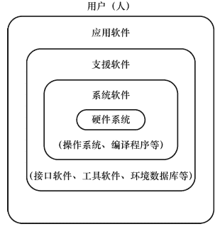

图 3.1　计算机系统层次结构

本章从体系思想的源头展开，先介绍冯·诺依曼体系结构。体系结构是指程序员所能感知的机器属性，也就是概念层面的构造与功能特性。按照图 3.1 所示的分层，不同层级的开发者看到的机器面貌不同，通常底层细节对上层是透明的。本章重点讲解机器语言层级的系统构造。

## 3.1　冯·诺依曼体系结构

### 3.1.1　冯·诺依曼体系结构

冯·诺依曼被世界公认为计算机之父，如图 3.2 所示，主要因为他设计了冯·诺依曼体系结构，该结构采用二进制并按程序顺序执行指令。这一结构是现代计算机的基础，也奠定了系统结构研究的基础。在此结构中，计算机主要由控制器、运算器、存储器即内存储器与外存储器、输入设备、输出设备五部分组成，如图 3.3 所示。


图 3.2　冯·诺依曼

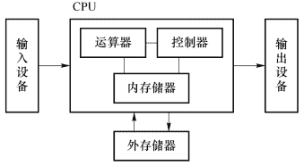

图 3.3　计算机五大组成部件

在冯·诺依曼结构的机器里，程序与数据存放在同一个存储器中，指令与数据的宽度相同，用地址进行线性存储与访问，通过五个基本部件完成指令控制与数据传递。该结构具有以下能力。

1. 能把所需程序与数据送入计算机。
2. 具备长期保存程序、数据、中间结果与最终运算结果的能力。
3. 能够完成各类算术、逻辑运算与数据传送等加工处理。
4. 能够按需控制程序走向，并按指令协调各部件协同工作。
5. 能够按要求把处理结果输出给用户。

### 3.1.2　冯·诺依曼体系结构与哈佛体系结构的比较

与冯·诺依曼结构的机器相比，哈佛结构的机器将程序与数据分别放在各自的存储器中，程序计数器只指向程序存储器而不指向数据存储器，这样无法自行修改结构中的程序，但程序与数据的数据宽度可以不同，效率更高，尤其在数字信号处理时性能更好，如 `ARM10` 系列、`摩托罗拉公司的 MC68` 系列、`Zilog 公司的 Z8` 系列等。

### 3.1.3　冯·诺依曼体系结构的局限

冯·诺依曼体系结构以二进制作为数据表达方式，这体现了该进制的优势，也符合物理元件的限制。但人脑神经元的构造远超出二进制逻辑的表达范围，此外计算机依靠存储器的线性运算过程与人脑依靠记忆的非线性运算过程也有本质区别，所以冯·诺依曼体系结构在一定程度上限制了计算机的发展，目前发展的量子计算机对逻辑单一性有较好突破。

## 3.2　微型计算机的组成结构与工作原理

微型计算机是一台进行数据计算的机器，同大型设备一样由硬件组成与软件组成，并按预设规则运行。下面分别介绍其组成结构与工作原理。

### 3.2.1　微型计算机的组成结构

微型计算机由硬件与软件组成。硬件主要是主机与外设，软件分为系统软件与应用软件，主要结构如图 3.4 所示。

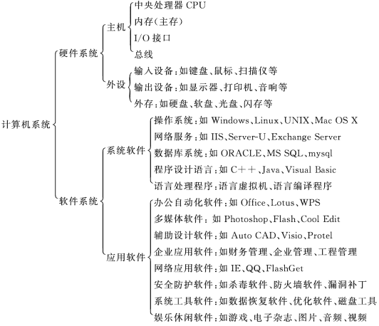

图 3.4　计算机系统

### 3.2.2　微型计算机的工作原理

根据冯·诺依曼的构想，计算机的基本工作原理是程序的存储与控制。

程序存储是指用一定方法把程序及运行所需数据输入并保存到存储器中。

程序控制是指计算机运行时按顺序自动逐条取出指令并分析执行。

从定义可知，运行过程包含两种流动的信息——数据流与控制信号。数据流的内容是指令与原始数据，这些数据以二进制形式编码，并在运行前已置于主存。运行时数据送往运算器，指令送往控制器。控制器依据指令内容发出控制信号，各部件接收控制信号后做出相应运算与操作，并控制执行流程的进行。

计算机之所以能进行各项操作，主要是因为有一个核心部件 `CPU` 中央处理器。`CPU` 能控制一组操作的正常执行，例如从存储器中取得一个数据，或完成数据的加减乘除并保存结果等。每项动作对应一条指令，指令被 `CPU` 接收后就执行相应动作。程序是由一系列指令构成的，执行程序就是让 `CPU` 执行一系列指令，完成一系列动作，从而完成一件复杂工作。抽象来看，执行过程可视作 `CPU` 从存储器中取出下一条指令，按指令要求执行相应动作，不断循环取指令、执行这两个动作，直到程序结束或有指令要求停止，有时也可能无休止工作下去即死机。

另一个重要中心部件是内部存储器。计算机诞生初期，存储器保存的内容仅是正在处理的数据。`CPU` 执行指令时到存储器提取数据，执行后把结果保存回存储器。冯·诺依曼提出应把程序也存入存储器，`CPU` 按要求从存储器提取指令、执行指令并不断循环。这样计算机就能摆脱外界干预自动运行。这种基本思想称为存储程序控制原理。遵循此原理的计算机称为存储程序控制计算机，也称冯·诺依曼计算机。

#### 1.指令和指令系统

指令电路如图 3.5 所示，指令是对计算机进行程序控制的最小单位，包含操作码与地址码，如图 3.6 所示。

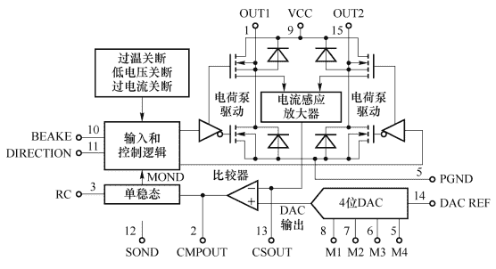

图 3.5　指令电路图


图 3.6　指令格式

操作码 `OP` 说明操作的性质及功能，用来表示指令需要完成的操作。

地址码用于描述指令的操作对象、直接操作数、操作数的存储器地址或寄存器地址。

计算机的指令系统是所有指令的集合。不同计算机的指令系统不同，从指令角度看，程序是为完成特定任务而编写的一组指令序列。

#### 2.工作原理——执行程序

指令的执行步骤如图 3.7 所示。

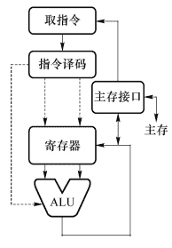

图 3.7　指令的执行步骤

1. 取指令
2. 分析指令
3. 执行指令
4. 程序计数器加 1

程序是若干指令的有序排列，计算机工作即从第一条指令开始逐条完成。首先计算机依据程序计数器 `PC` 中存放的将要执行指令的内存地址，从内存读取指令，读取 1 字节后 `PC` 自动加 1，指向下一字节，为下次读取做好准备，如图 3.8 所示。指令寄存器 `IR` 存放从存储器读出的当前要执行指令的指令码。该指令码在 `IR` 中缓冲后送到指令译码器 `ID` 中译码，译码后得到该指令要进行的操作，这一步称为分析指令。最后一步是执行指令，在时序部件与微操作控制部件作用下控制相应部分进行操作完成指令执行。

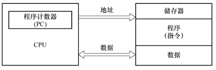

图 3.8　指令的执行

## 3.3　计算机硬件系统

### 3.3.1 中央处理器 CPU

中央处理器 `CPU` 是整个微型机的核心，用来对信息执行处理与控制，它有插卡式 `Slot` 与针脚式 `Socket` 两种，如图 3.9 与图 3.10 所示。目前主流产品有 `Intel` 公司的 `Pentium` 奔腾系列与 `AMD` 公司的 `Athlon` 速龙系列，如图 3.11 与图 3.12 所示。

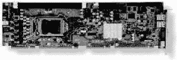

图 3.9　插卡式

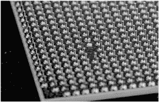

图 3.10　针脚式

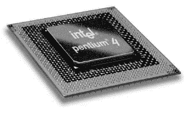

图 3.11　奔腾系列

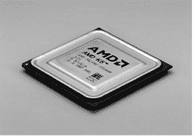

图 3.12　速龙系列

#### 1.CPU 的组成及工作

`CPU` 主要由运算器与控制器构成，包括运算逻辑部件、寄存器部件与控制部件等，如图 3.13 所示。

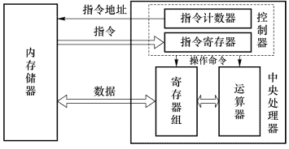

图 3.13　`CPU`组成及其与内存关系

运算逻辑部件可执行定点或浮点算术运算、移位操作以及逻辑操作，也可执行地址运算与转换。

寄存器部件包括通用寄存器、专用寄存器与控制寄存器。通用寄存器用来保存指令中的寄存器操作数与操作结果，也可分定点与浮点两类，通用寄存器的宽度决定计算机内部数据通路宽度，其端口数往往影响内部操作的并行性。专用寄存器是为执行特殊操作而用的寄存器。控制寄存器通常用来指示机器执行状态或保存某些指针，有处理状态寄存器、地址转换目录基地址寄存器、特权状态寄存器、条件码寄存器、处理异常寄存器以及检错寄存器等。

控制部件主要是控制器。控制器是指挥各部件按指令要求协调工作的部件，是计算机的神经中枢与指挥中心，由指令寄存器 `IR`、程序计数器 `PC` 与操作控制 `OCsange` 部件组成。它主要负责指令译码并发出为完成每条指令所需的操作控制信号。控制器主要有两种控制方式：一种是以微存储为核心的微程序控制方式；另一种是以逻辑硬布线结构为主的控制方式。微存储中保持微码，每一个微码对应一个最基本的微操作，又称微指令。各条指令由不同序列的微码组成，这种微码序列构成微程序。中央处理器在对指令译码后，发出一定时序的控制信号，按给定序列的顺序以微周期为节拍执行由这些微码确定的若干个微操作，即可完成某条指令的执行。简单指令由 3～5 个微操作组成，复杂指令则要由几十个微操作甚至几百个微操作组成。逻辑硬布线控制器则完全由随机逻辑组成。指令译码后，控制器通过不同逻辑门的组合，发出不同序列的控制时序信号，直接去执行一条指令中的各个操作。

有的中央处理器中还有缓存，用来暂时存放数据指令，缓存越大说明 `CPU` 运算速度越快，目前市场上的中高端中央处理器都有 2M 左右的二级缓存，高端中央处理器有 4M 左右的二级缓存。

#### 2.CPU 主要性能指标

1. 字长：指计算机内部一次可处理的二进制位数，有 8 bit、16 bit、32 bit、64 bit 等。越来越多的微机采用 64 bit。
2. 运算速度：指单字长定点指令的平均执行速度，即计算机每秒所能执行的指令数，也称工作频率，通常以 MH 兆赫与 GH 千兆赫为单位，目前大多数 `CPU` 的主频均为 GH 数量级。
3. 时钟频率：指 `CPU` 的外部时钟频率，它直接影响 `CPU` 与内存之间的数据交换速度，也是高速缓存 128 KB～2 MB 的速度。
4. 内存容量：计算机的内存大小，通常以 MB 来衡量，1 KB=1024 B，1 MB=1024 KB。

### 3.3.2 总线

微机系统采用以总线为中心的标准结构，总线是连接各个功能部件的信息通道。根据总线上数据传送范围的不同，总线可分为 4 级：片内总线、片间总线、系统内总线、系统外总线。如图 3.14 所示。①片内总线在芯片内部连接各元件运算器、控制器、寄存器等；②片间总线连接主板上的各芯片；③系统内总线连接主板与扩展板；④系统外总线连接微机与外设。总线按功能不同分为 3 类：数据总线 `DB` data bus，宽度等于字长，即条数取决于 `CPU` 的字长，传送是双向的；地址总线 `AB` address bus，条数决定计算机内存的大小，传送是单向的；控制总线 `CB` control bus。

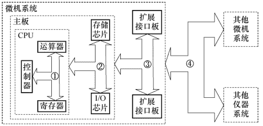

图 3.14　总线分级

总线的性能指标如下。

1. 总线的带宽：指单位时间内总线上可传输的数据量，单位为 B/s。
2. 总线的位宽：指总线能同时传送的数据位数，即数据总线 DB 的宽度。
3. 总线的工作频率：指总线的时钟频率，单位为 MHz。


常用的总线标准有 ISA、EISA、VESA、PCI 总线，通常指的是系统内总线所遵循的标准。

### 3.3.3 内部存储器

内存 computer memory 是一种利用半导体技术做成的电子设备，用来存储数据，如图 3.15 所示。电子电路的数据是以二进制方式存储的，存储器的每一个存储单元称作记忆元。存储器的种类很多，按用途可分为主存储器与辅助存储器，主存储器又称内存储器简称内存。程序与数据存储在计算机的存储器中，存储器容量的大小与存储器存取数据的快慢会直接影响微机系统的性能。

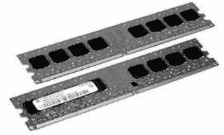

图 3.15　内存

主存储器内存分为随机存储器 RAM 运行时的程序与数据存储在其中，分为静态 SRAM 与动态 DRAM、只读存储器 ROM、可编程只读存储器 PROM 与可改写只读存储器 EPROM。RAM 可读写，但断电后数据会丢失；ROM 不可写，但断电后数据不会丢失。

高速缓冲器 cache 位于 CPU 与内存之间，如图 3.16 所示，是一个读写速度比内存更快的存储器。它分为一级缓存 L1 cache、二级缓存 L2 cache 与三级缓存 L3 cache。

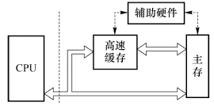

图 3.16　高速缓存的位置

内存地址是存储单元的一个编号，需要通过此编号进行数据的存取。

内存容量指内存单元的总数，通常 1 字节为一个单元 B，内存容量实际上是指 RAM 的容量，通常以 MB 来衡量。

内外存存取速度及容量大小如图 3.17 所示。

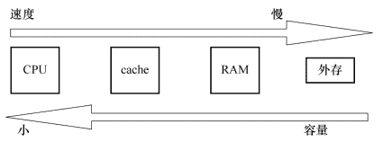

图 3.17　内外存存取速度及容量比较

### 3.3.4 外部存储器

外部存储器是指除计算机内部存储器及高速缓冲存储器之外的存储器，这类存储器在断电后依然能保存原有数据，虽然数据交换率低，但是存储量大、可转移，更为可靠。常见的外部存储器有硬盘、软盘、光盘与 U 盘等，如图 3.18 所示。


图 3.18　外存

硬盘是电脑的主要存储媒介之一。容量是硬盘最主要的参数。硬盘的容量以兆字节、千兆字节或百万兆字节为单位，除此之外，硬盘还有如下几个重要的评估参数。

1. 转速：是指硬盘盘片在一分钟内所能完成的最大转数。转速的快慢标示了硬盘的档次，也决定了硬盘的传输速率。硬盘传输速率是指硬盘读写数据的速度。硬盘上有一块内存芯片，调节硬盘内部与外界接口之间的传输速率，是硬盘内部存储与外界接口之间的缓冲器。
2. 盘面号：又叫磁头号，磁盘的每一个盘片都有两个盘面，每一个有效盘面都有一个对应的读写磁头。磁盘的盘片组在 2～14 片不等，通常有 2～3 个盘片，故盘面号磁头号为 0～3 或 0～5。磁盘在格式化时被划分成许多同心圆，这些同心圆轨迹叫作磁道。所有盘面上的同一个磁道构成一个圆柱，通常叫作柱面。系统以扇区形式将信息存储在硬盘上。

### 3.3.5 主板

主板是计算机中传输电子信号的部件。计算机的功能、兼容性都取决于主板的设计。目前市面上主要的主板产品是 ATX 主板，如图 3.19 及图 3.20 所示。北桥芯片决定主板性能的高低；南桥芯片决定主板功能的多少；BIOS 芯片决定主板兼容性的好坏。生产芯片组的厂商有 Intel、AMD、VIA、SIS 等。


图 3.19　主板实物图


图 3.20　主板示意图

### 3.3.6 输入设备

输入设备是向计算机输入信息的设备，是计算机与用户或者其他设备通信的桥梁。通过鼠标、键盘、摄像头、扫描仪、光笔、手写输入板、游戏杆、语音输入装置等输入设备，输入数字、文字符号、图形图像、语音等各种类型的数据信息到计算机中，并转换成相应的数据编码。输入设备如图 3.21 所示。


图 3.21　输入设备

### 3.3.7 输出设备

输出设备与输入设备一样，都是人与机器交互的主要装置。将计算机处理的结果进行转换，以用户需要的形式展现给用户，常用的输出设备有显示器、打印机、绘图仪、磁盘等，如图 3.22 所示。


图 3.22　输出设备

## 3.4 计算机软件系统

软件从本质上说是由可执行程序与配套文档构成的集合。软件体系把硬件的各种部件按一定逻辑组织起来，成为人与硬件之间的中介。整体上可分为系统软件与应用软件两类。

### 3.4.1 系统软件

系统软件位于硬件之上，是第一层软件，承担计算机运行过程的调控与资源管理职能。常见的范围包括操作系统、网络服务程序、数据库系统、诊断程序以及编译程序等，其全部实现都依赖程序设计语言。

操作系统是管理硬件与软件资源的核心程序，直接在裸机之上运行，为所有上层软件提供运行基础。它既是用户与机器交互的通道，也是硬件与上层软件的衔接层。

网络服务指的是运行于网络环境中的面向服务的分布式软件模块。依托 HTTP、XML 等互联网通用规范，用户可在异地通过不同终端访问 Web 上的数据，例如网上订票、座位查询等。

数据库系统 DBS 一般由软件部分、数据本身和数据库管理员三者构成。软件部分涵盖操作系统、宿主语言、实用程序及数据库管理系统。数据的写入、修改与检索都必须经由数据库管理系统完成。数据库管理员负责数据库的创建、监督与维护，确保有权限的用户能够有效利用资源，通常由业务经验丰富、资历较深的人员担任。

1）程序设计语言的发展大体经历三阶段。

（1）机器语言是最早的编程方式，以二进制指令码编写，执行效率高、被机器直接接受，但编写繁琐、易出错、可移植性差，现已基本不再使用。

（2）汇编语言也是面向机器的语言，如图 3.23 所示，用助记符代替操作码，用地址符号或标号代替地址码，本质上是二进制指令的符号化。相比机器语言，汇编语言同样易于被机器接受、执行效率较高，但编程仍较复杂、易出错，如今主要用于计算机控制类开发。


图 3.23　汇编语言指令

（3）高级语言摆脱了对硬件的直接操作，语法结构更贴近自然语言，学习和使用都较为容易，开发效率高、可移植性强，已得到广泛应用，如 BASIC、FORTRAN、C、FoxPro、VB、VC、VF、Java 等。

2）程序可划分为三类，处理流程如图 3.24 所示。


图 3.24　程序处理过程

（1）源程序：由高级语言或汇编语言编写的初始程序。
（2）目标程序：源程序经翻译后得到的机器语言程序。
（3）可执行程序：由机器语言构成、能够直接运行的程序。

3）语言处理程序主要有三类。

（1）汇编程序：将汇编语言源程序转译为目标语言程序。
（2）编译程序：一次性把源程序全部翻译成目标语言程序，如 Fortran、Pascal、C。
（3）解释程序：逐条解释源程序并立即执行，无目标程序生成，如 Basic 程序。

### 3.4.2 应用软件

应用软件是为满足不同领域用户的实际需求而开发，用以拓展系统应用范围并放大硬件能力。它由用户可用的程序设计语言及由此编写的各类应用构成，可分为用户程序与应用软件包。用户程序为完成特定任务而编写，可在用户模式下运行并与用户交互，具备可视界面。应用软件包是为解决某类问题而设计的程序集合，供多用户使用，与特定应用领域相关，可分为通用包与专用包。通用包针对社会共性需求开发，专用包则按用户具体要求定制，可依据特殊需求进行修改。

应用软件与日常生活紧密相关，主要包括：

办公自动化软件：把办公与计算机网络功能结合起来形成的信息化产品，使用便捷高效，如 Office、Lotus、WPS 等。

多媒体软件：把文本、图形、图像、动画、声音等信息融合，通过计算机综合处理与控制，支持交互操作，如 Photoshop、Flash、Cool Edit 等。

辅助设计软件用于提升设计效率，如 AutoCAD、Visio、Protel 等。企业应用软件运行于系统软件之上，专为企业需求开发，如财务管理软件、企业管理软件、工程管理软件等。

网络应用软件为网络用户提供各类服务，如 IE、QQ、FlashGet 等。

此外还有安全防护软件，如杀毒软件、防火墙、漏洞补丁等；系统工具软件，如数据恢复、优化软件、磁盘工具等；娱乐休闲软件，如游戏、电子杂志、图片、音频、视频等。

## 本章小结

本章围绕计算机系统的核心知识展开。计算机是人机合一的实体，软件驱动硬件完成各类运算。介绍了系统的概念、思想与功能。系统思想源于冯·诺依曼，其结构简洁，采用二进制，程序作为数据的一部分，指令按线性顺序执行。冯氏结构由运算器、控制器、存储器、输入设备、输出设备构成，按取指令、分析指令、执行指令、程序计数器加 1 的顺序工作。

计算机系统由硬件系统与软件系统组成，硬件由主机与外设构成，软件由系统软件与应用软件构成。主机包含 CPU、内部存储器、I/O 接口与总线。CPU 是微型计算机核心，负责信息处理与控制，由运算部件、控制部件、寄存器部件组成。内部存储器用于存放数据，提升运算速度。总线负责主机内部信息交换。外设包括输入设备、输出设备与外部存储器。软件系统实现微型机的逻辑功能，分为系统软件与应用软件。

## 习题

1.填空题

（1）计算机硬件由五大基本部分组成，分别为\_\_\_\_\_、\_\_\_\_、\_\_\_\_、\_\_\_\_ 和\_\_\_\_。

（2）KB、MB、GB 都是存储容量的单位。1 MB=\_\_\_\_B

（3）HUB 的中文名称是\_\_\_\_。

（4）CPU 是　　　　的简称。

（5）计算机能直接识别和执行的语言是\_\_\_\_。

（6）计算机中的信息是以　　　　形式存储在外存储器中的。

（7）现代微型计算机的内存储器都采用内存条，使用时把它们插在　　　　上的插槽中。

（8）计算机分为　　　　和　　　　两类。

2.单选题

（1）将计算机的内存储器和外存储器相比，内存的主要特点之一是（）。

A.价格更便宜　　B.存储容量更大　C.存取速度快　　D.价格虽贵但容量大

（2）计算机指令的集合称为（）。

A.计算机语言　　B.程序　　　　　　C.软件　　　　　　D.数据库系统

（3）按存取速度来划分，下列哪类存储器的速度最快？（）

A.主（内）存储器　B.硬盘　　　　　　C.cache　　　　　D.U 盘

（4）计算机性能指标包括多项，下列项目中（）不属于性能指标。

A.主频　　　　　　B.字长　　　　　　C.运算速度　　　　D.是否带光驱

（5）CAM 是计算机应用领域中的一种，其含义是（）。

A.计算机辅助设计 B.计算机辅助制造 C.计算机辅助教学 D.计算机辅助实现

（6）能把源程序翻译成目标语言程序的处理程序是（）。

A.编辑程序　　　　B.汇编程序　　　　C.编译程序　　　　D.解释程序

（7）要使用外存储器中的信息，应先将其调入（）。

A.控制器　　　　　B.运算器　　　　　C.微处理器　　　　D.内存储器

（8）在下列设备中，不能作为计算机的输入设备是（）。

A.打印机　　　　　B.键盘　　　　　　C.扫描仪　　　　　D.鼠标

（9）Pentium（奔腾）指的是计算机中（）的型号。

A.主板　　　　　　B.存储器　　　　　C.中央处理器　　　D.驱动器

（10）（）都是系统软件。

A.DOC 和 MIS　B.WPS 和 UNIX　C.DOS 和 UNIX　D.UNIX 和 Word

3.问答题

（1）什么叫微处理器？什么叫微型计算机？什么叫微型计算机系统？这三者之间的联系和区别？

（2）什么叫冯·诺依曼体系结构类型的计算机？它的内涵是什么？

（3）为什么微型计算机的基本结构也叫作总线结构？试简述总线结构的分类及其优缺点。

（4）微处理器内部一般由哪些基本部件组成？试简述它们的主要功能。

（5）如何理解微型计算机的工作过程？它的本质是什么？

（6）一般指令的执行由哪几段操作组成？各段操作的任务是什么？

（7）什么叫微程序控制技术？

（8）PC 系列微机系统由哪几个基本部分组成？其中主机箱内一般包含哪些基本配置？

（9）计算机软件系统的是如何构成的？系统软件具体包括哪些？

# 第 4 章 计算机操作系统的基础知识

操作系统是计算机最重要的系统软件，功能可类比人类大脑的神经中枢。作为整机的指挥中心，操作系统负责调度系统内部全部资源，其优劣在很大程度上决定整机水平。本章介绍操作系统的定义、发展历程、类型与功能，并简要介绍几种常见系统。

## 4.1 操作系统概述

### 4.1.1 操作系统的定义

硬件与软件是计算机系统的两大支柱。硬件由中央处理器即运算器与控制器、存储器、输入设备、输出设备等构成，为软件运行提供物质基础与工作环境。

软件分为系统软件与应用软件。操作系统、系统实用程序、汇编与编译程序属于系统软件；为应用程序编写的软件属于应用软件。

裸机指没有任何软件支持的计算机，仅是系统的物质基础。用户实际接触的是经过多层软件包装后的计算机。图 4.1 展示了裸机与软件层的关系。

从图 4.1 可见，硬件、软件与应用之间呈层次结构。最内层是裸机，外层是操作系统，再外层是提供各种服务功能的软件系统。叠加这些软件层后，裸机变得功能强大且易用，通常称为虚拟机或扩展机。各种实用程序与应用软件运行在操作系统之上，以操作系统为支撑，向用户提供所需服务。

因此可将操作系统定义为：计算机系统中的关键系统软件，由若干功能模块组成，负责管理与控制系统的软硬件资源，合理组织工作流程，以便高效利用资源，为用户提供功能强大、易用、可扩展、可管理且安全的工作环境，在计算机与用户之间起到接口作用。

### 4.1.2 操作系统的发展历程

操作系统源于客观需求，随计算机技术与应用发展不断完善。其在系统中的地位不断提升，已成为计算机核心，任何计算机都需配置操作系统。技术进步推动着操作系统演进。

1.计算机发展主要分四个阶段。

第 1 代：电子管时代，无操作系统阶段。
第 2 代：晶体管时代，批处理系统阶段。
第 3 代：集成电路时代，多道程序设计阶段。
第 4 代：大规模和超大规模集成电路时代，分时系统阶段。

为适应发展，操作系统经历了手工操作系统即无操作系统、批处理系统、执行系统、多道程序系统、分时系统、实时系统、通用操作系统、网络操作系统、分布式操作系统等阶段。

2.操作系统的发展阶段

（1）第 0 代手工操作系统

1946 年至 20 世纪 50 年代为手工操作系统时代，即无操作系统时代。

特点：硬件为巨型机，使用电子管，运算速度每秒几千次；语言为机器语言；无操作系统；输入输出依靠插件板、纸带、卡片；用户既是程序员也是管理员。

操作过程为装入程序纸带或卡片，启动输入机送入计算机，通过控制台开关运行程序，计算完毕打印机输出结果，用户取走纸带或卡片，下一个用户上机。特点是人工参与、独占式、串行式。主要问题是人机矛盾，即计算机高速运行与手工操作低速之间的矛盾。

无操作系统工作情况如图 4.2 所示。


图 4.2　1946 年情人节诞生的第一台通用电子计算机——ENAIC

（2）第 1 代批处理系统

20 世纪 50 年代末至 20 世纪 60 年代中期为批处理系统时代。

手工操作时代，单步错误可能导致作业重来。用户希望程序设计与运行管理分离，同时提高 CPU 利用率，故提出批处理系统，主要解决方案是配备专职操作员。

批处理分为单道批处理与多道批处理。

# 单道批处理系统

特点：硬件主要为大型机与晶体管；语言为汇编语言，如 FORTRAN 等；操作系统为 FMS、IBMSYS 等。用于较复杂科学工程计算。

优点：实现作业自动转接，改善 CPU 与输入输出设备使用效率，提升系统处理能力。缺点：需人工拆装磁带；监督程序、系统程序与用户程序调用关系带来的保护问题；任一环节出错系统停顿；用户程序可能破坏监督程序等。

批处理系统工作如图 4.3 所示。


图 4.3　20 世纪 60 年代出现的 IBM 7094

## 第 2 代多道程序系统

20 世纪 60 年代中期至 20 世纪 70 年代中期为多道程序系统时代。

为充分利用系统资源、提高效率，采用多道程序交替运行。

特点：硬件由集成电路构成，如 IBM System/360；操作系统复杂庞大，如 OS/360。

多道程序运行指内存中同时存放多道独立程序，宏观上并行、微观上串行，各作业轮流使用 CPU 交替执行。优点是资源利用率高、吞吐量大，缺点是平均周转时间长、无交互能力。

## 第 3 代多模式系统

20 世纪 70 年代中期至 20 世纪末期为多模式系统时代。

分时系统实例：第一个分时操作系统于 1959 年在 MIT 提出，开创多用户共享资源新时代。

实时操作系统实例：Symbian、Symbian OS 由摩托罗拉、西门子、诺基亚等公司合资开发，在智能移动终端上具备强大应用与通信能力。

通用操作系统实例：UNIX 操作系统。

今天已进入网络操作系统与分布式操作系统时代。

# 4.1.3 操作系统的作用

操作系统具有双重作用，即管理者与服务员作用。

## 1. 管理员作用——管理计算机系统内的各种资源

计算机系统由硬件与软件组成。操作系统是最基础的系统软件，既是系统的一部分，又能反过来组织管理整个系统，充分利用软硬件资源，使系统协调高效完成复杂任务。

## 2. 服务员作用——为用户提供方便、良好的界面

从用户角度看，操作系统不仅要管理资源，还应提供良好的操作界面，便于用户简单高效地使用系统资源。

# 4.1.4 操作系统的性能指标

操作系统性能指标反映计算机系统性能。良好的结构可提升指标，充分发挥 CPU 处理速度与存储器存储能力。

常用指标如下。

## (1) 系统的 RAS

可靠性 R 指系统正常工作时间的平均值，常用平均无故障时间 MTBF 衡量。

可用性 A 指系统在任意时刻能正常工作的概率。


可维护性 S 指故障发生到修复所需的平均时间，常用平均故障修复时间 MTRF 衡量。

## (2) 吞吐率

吞吐率指系统单位时间内处理的信息量。

## (3) 响应时间

响应时间指从接收数据到输出结果的时间间隔。

## (4) 资源利用率

资源利用率指部件在给定时间内实际使用时间占总时间的比例。

## (5) 可移植性

可移植性指将操作系统从一个硬件环境迁移到另一个硬件环境所需的工作量。

# 4.1.5 操作系统的基本特征

了解基本特征有助于更深入认识操作系统。各类操作系统均具有以下四个基本特征。

## (1) 并发 concurrence

并发指两个或多个事件在同一时间间隔内发生。在多道程序环境下，并发性指一段时间内宏观上有多个程序同时运行，而在单处理机系统中每一时刻仅能执行一道程序，故宏观上同时运行的多个程序在微观上分时交替执行。若系统有多处理机，则可将可并发执行的程序分配到各处理机上实现并行执行，利用每个处理机处理其中一个程序，使多个程序真正同时执行。

## (2) 共享（`sharing`）
在并发场景里，系统资源不可能独享，必须被多方共用。共享指的是一种运行机制：内核与用户程序共同调用同一套软硬件设施，多个同时活动的进程可以访问同一资源池。这种共用的好处是减少闲置浪费，代价是带来了三类难题——资源抢占时如何裁决、供给如何按需分配，以及多程序并行推进时怎样避免相互破坏导致整体紊乱。

## (3) 虚拟（`virtual`）
虚拟是用技术手段让一个真实存在的物理载体在使用者视角下呈现为多份逻辑载体。物理载体客观存在，逻辑载体是感知层面的效果。例如在分时多道环境里，硬件只有一颗 CPU，却能让每个终端用户产生“自己有一颗专属 CPU 在服务”的错觉。借助多道程序技术，单颗物理 CPU 被映射为多颗逻辑 CPU，后者通常被称为虚处理机。

## (4) 异步性（`asynchronism`）
异步性也常被称作不确定性，它并非指系统功能不可靠或执行结果会变化，而是指各进程的推进节奏无法事先预知。举例来说，正在运行的进程提出打印请求时，打印机可能正为别的任务服务，作为临界设备，请求方只能释放处理器进入等待，等设备空闲并再次被调度后才续行。受制于资源与事件，进程的执行往往是间断的、走走停停的。只要同步机制完善且运行环境保持一致，多次执行仍能得到完全相同的结果，异步运行是允许的。

# 4.1.6 相关概念

## (1) 进程
进程是并发程序在运行期作为资源分配与管理的基本活动单元。

## (2) 线程
线程是处理器调度的最小粒度，是进程内部的一个执行实体，可被系统单独调度，本身几乎不拥有资源，仅保留少量必要的控制信息。

## (3) 程序
程序是一组用于描述计算机完成某项独立功能的指令序列，按先后顺序严格执行，属于静态的描述。

## (4) 并行
并行指同一瞬间两个或多个事件真正同时活跃，即同时发生。

## (5) 并发
并发在宏观上呈现并行特征，在微观上仍有先后，任一时刻只有一项活动在实际进行。例如分时系统下多个程序看似同时运行。

# 4.2 操作系统的基本类型
随着技术演进，操作系统形态日益丰富，按使用场景与处理方式可归纳为：
（1）批处理操作系统 `batch processing operating system`；
（2）分时操作系统 `time sharing operating system`；
（3）实时操作系统 `real time operating system`；
（4）通用操作系统 `general operating system`
（5）个人计算机操作系统 `personal computer operating system`；
（6）网络操作系统 `network operating system`；
（7）分布式操作系统 `distributed operating system`。

## 4.2.1 批处理系统
采用多道程序技术形成多道批处理。工作流程为：用户用作业控制语言描述意图与资源需求，将程序与数据交给操作员或通过远程线路送入系统；外存中积压大量待处理作业，系统按调度策略挑选搭配合理的作业调入内存。
主要特征：
（1）用户脱机。作业提交后至结果返回前用户不再干预，可直接交给操作员或经远程线路提交。
（2）成批化。操作员将作业分批送入系统。
（3）多道运行。按调度原则从后备池中选出若干作业入驻内存并组织执行。
优缺点：
优点：多作业共享资源，调度自动化，用户脱机不干预，资源利用率与吞吐量提升明显。
缺点：交互性差，提交后无法干预，程序微小错误即可导致作业失败，调试困难。

## 4.2.2 分时操作系统
分时系统支持用户与机器交互，运行中可随时介入，有利于调试。它把系统资源在时间上切分，将总运行时间划分为若干时间片，CPU 时间轮流分配给各用户，实现单机多用户共享。
典型特点：
（1）交互性；
（2）多用户并发性；
（3）独立性。

## 4.2.3 实时操作系统
实时操作系统能在规定时限内响应请求。核心在于响应迅速与可靠性高，系统必须保证处理速度快于信息进入速度，且自身安全可靠，常在硬件上采用冗余，资源利用率相对偏低。
### 1. 实时系统的用途
（1）实时控制系统：用于自动控制，如飞行控制、导弹发射等。
（2）实时信息处理系统：机票预订、航班与航线、票价查询等。
### 2. 实时系统的特征
（1）及时性：存在严格的时间约束。
（2）高可靠性与安全性：多用于生产与军事现场控制，一旦出错后果严重。

## 4.2.4 通用操作系统
批处理、分时、实时是三种基本形态。通用操作系统在此基础上发展，可同时兼顾批处理、分时、实时处理及多重处理。

## 4.2.5 个人计算机操作系统
面向单用户的操作系统。

## 4.2.6 网络操作系统
网络操作系统 `network operating system，NOS` 的核心任务是以统一方式管理网络共享资源并处理任务，具备：
（1）网络通信；
（2）资源管理；
（3）提供多种网络服务；
（4）提供网络接口。
可定义为：建立在主机操作系统之上，专注于网络通信与资源管理、协调各主机任务运行，并向用户提供统一有效网络接口的软件集合。它是用户程序与主机操作系统的桥梁。

## 4.2.7 分布式操作系统
定义为：将物理上分散、具备自治能力的数据处理系统或计算机互联，实现信息交换与资源共享。
主要特点：
（1）动态分配与管理各类资源，有效控制并协调任务并行执行；
（2）处理单元间无主次之分；
（3）对外提供统一有效接口的软件集合。

# 4.3 操作系统的功能
操作系统的目标是方便使用并提升资源利用率。其职能是对软硬件资源进行有效管理与控制，合理安排工作流程，同时提供良好的工作环境与接口。

## 4.3.1 处理机管理
任务是对处理器进行分配并实施控制。进程是系统中可独立运行并作为资源分配基本单位的活动实体。在多道程序环境下，处理器分配与运行均以进程为单位，故处理机管理可归结为进程管理，涵盖进程控制、进程调度、进程互斥与同步、进程通信等。

## 4.3.2 存储管理
指对主存储器的管理，即如何合理分配有限主存以满足多用户程序运行需求。主存通常划分为系统区与用户区，主要管理用户区。
功能：
（1）内存分配与释放。若当前无法满足申请，申请进程进入等待，直至有足够空间再分配；作业结束时系统回收资源。
（2）存储保护。确保进程间互不干扰、相互保密，进行访问合法性检查，防止非法访问与系统程序被破坏。
（3）内存扩充。通过虚拟存储技术或自动覆盖技术，为用户提供远大于实际容量的虚拟存储空间，将辅存作为主存的扩展。

## 4.3.3 设备管理
管理除CPU与内存外的全部输入输出设备。主要任务是设备分配与启动、故障处理。用户无需了解设备与接口的具体技术细节即可方便操作。目标是提高I/O利用率与速度，提供友好界面，常采用虚拟技术与缓冲技术提升设备与主机并行能力。

## 4.3.4 信息管理
处理机、存储、设备管理针对硬件，信息管理即文件系统管理，针对软件资源。
程序与数据统称文件，暂时不用时存于外部存储器。若大量文件管理不当，易导致混乱甚至损坏。
任务是对信息的共享、保密与保护。
（1）文件存储空间管理：为每个文件分配必要外存空间，提升利用率，通常以盘块为分配单位，容量多在512 B～4 KB之间。
（2）目录管理：系统为每个文件建立目录项，包含文件名、属性、在磁盘上的物理位置。用户只需提供文件名即可存取。
（3）读写管理：读写时系统按文件名检索目录获取位置，利用读写指针操作，完成后更新指针以便下次使用。
（4）存取控制：防止未授权用户存取、防止冒名顶替存取、防止以错误方式使用文件。

## 4.3.5 用户接口
除资源管理外，操作系统还提供友好接口。可分为两类：
程序级接口，即提供一组系统调用供实用程序与应用程序调用；
作业级接口，即提供作业控制语言等控制命令，供用户组织与控制作业运行。

# 4.4 进程管理

## 4.4.1 进程的概念
### 1. 进程的引入
多道程序系统带来复杂环境，程序段呈现并发、制约、动态特性。原程序概念静态且无法体现并发。为控制与协调各程序段执行过程中软硬件资源的共享与竞争，需要一个描述执行过程与资源的基本单元，即进程或任务。
### 2. 进程的概念
进程是并发程序在执行过程中进行资源分配与管理的基本单位。
### 3. 进程和程序的区别
（1）进程是动态概念，是程序的一次执行过程，具有生命周期；程序是有序指令集合，本身静态。
（2）并发是进程的重要特征，进程可与其他进程并发执行；程序单独存在时不能并发。
（3）进程是可独立运行、分配资源和调度的基本单位，未建立进程的程序不能作为独立单位运行。
（4）不同进程可包含同一程序，同一程序运行中也可产生多个进程。
### 4. 作业和进程的关系
作业是用户提交给计算机的任务实体，提交后进入外存等待队列；进程是完成用户任务的执行实体，是资源申请基本单位。一个作业可由多个进程组成，且至少包含一个进程。作业概念主要用于批处理系统，进程概念用于几乎所有多道系统。


图 4.4　作业、作业步、进程关系图

## 4.4.2 进程的描述及上下文
进程的静态描述用于刻画其存在性及反映变化的物理实体。进程由进程控制块、程序段、数据段构成。
（1）进程控制块：记录进程情况并控制运行所需全部信息，是动态特性的集中体现。
（2）程序段：描述进程功能，是可被调度程序在CPU上执行的代码段。
（3）数据段：是进程加工的原始数据或中间、最终结果，是执行时的操作对象与工作区。
进程上下文是抽象概念，指执行过程中顺序关联的静态描述。包括已执行、正在执行、待执行的指令与数据。已执行部分在寄存器与堆栈中的内容称为上文，正在执行部分称为正文，待执行部分称为下文。

## 4.4.3 进程的状态及其转换
# 进程状态与转换
并发执行时，进程因资源共享与竞争会处于不同状态。等待事件发生时处于等待状态，被唤醒后因得不到处理器而处于就绪状态；刚创建时因处理器被占用处于初始状态；执行结束则进入终止状态。因此生命周期至少包含初始、执行、等待、就绪、终止五种基本状态。


图 4.5　进程状态转换模型
（1）初始→就绪：就绪队列可接收新进程时，操作系统将其移入就绪队列。
（2）就绪→执行：进程调度程序分配处理器后，进程转为执行态，也称当前进程。
（3）执行→等待：执行中因请求临界资源被占用等事件无法继续，进程转为等待。
（4）执行→就绪：执行中被中断或时间片用完、更高优先级进程抢占等，进程转为就绪。
（5）等待→就绪：I/O完成或等待事件发生。
（6）执行→终止：程序正常结束或出现地址越界、非法指令等异常，进程转为终止。

## 4.4.4 进程间的制约关系及死锁问题
并发系统中进程因资源共享与合作而相互制约，按共享方式不同分为两类。
（1）间接制约关系即进程互斥：因共享公有资源，临界区内不允许并发进程交叉执行，导致执行速度被间接制约。
（2）直接制约关系即进程同步：因并发进程互相共享对方私有资源而产生直接制约，存在时序关系，需合作完成任务。
死锁是指多个进程因竞争资源而互相等待、无法继续推进的现象。若无外力干预，进程将永远阻塞。陷入死锁的进程及其占用的资源会连锁受影响，甚至导致系统瘫痪。
产生原因：
（1）竞争资源：共享资源不足以同时满足需求。
（2）推进顺序不当：请求与释放资源顺序不合理。
必要条件：
（1）互斥条件：资源为非共享。
（2）不剥夺条件：已占有的资源不能被强行剥夺。
（3）请求与保持条件：进程在等待新资源时仍持有已分配资源。
（4）环路条件：存在进程循环等待链。
排除方法：
（1）死锁预防：设置限制破坏必要条件之一或多个。
（2）死锁避免：动态分配过程中防止系统进入不安全状态。
（3）死锁检测与恢复：检测环路等待并采取措施将进程从死锁中解脱。

## 4.4.5 线程的概念
线程是进程的一部分，是被系统独立调度和分派任务的基本单位。它几乎不拥有系统资源，仅保留少量必备资源。线程可创建与撤销另一线程，同一进程内的多个线程可并发执行。线程共享所属进程的完整虚拟地址空间与资源。

# 4.5 处理机调度

## 4.5.1 分级调度
### 1. 作业的状态及其转换

任务本质
任务可以看作用户一次性向机器提出的处理需求，覆盖从递交、计算到输出的完整流程。请求进入系统到处理器完全跑完，需要依托多层调度机制逐级推进。

任务生命周期
一次任务在系统内的轨迹一般经历四个阶段：递交、收容、执行、收尾。

（1）递交阶段。将任务从输入设备搬运到外存的过程。
（2）收容阶段。输入管理子系统持续把任务写入外存的输入井。当全部信息已落入输入井但尚未被挑选执行时，任务处于收容状态。
（3）执行阶段。任务被作业调度选中后装入主存开始运行的阶段。
（4）收尾阶段。运行已结束但系统尚未回收全部占用资源时处于收尾。

### 2. 调度的层次

（1）作业调度。也称宏观调度或高级调度。主要工作是从外存的后备池挑选任务调入内存，为其创建进程、分配必需资源，并把新进程挂入就绪队列待执行。批处理系统中常见。
（2）交换调度。也称中级调度。负责进程在内外存间的搬移。从存储角度看，把进程整体或部分换出到外存，可为当前运行进程腾出内存；反之把所需部分调回内存。指令和数据必须在内存才可被处理器直接访问。中级调度提升内存使用率和系统吞吐。
（3）进程调度。也称微观调度或低级调度。决定就绪队列中谁获得处理器，随后由分派程序完成具体的分配。低级调度由每秒可多次执行的调度程序实现，该程序常驻内存。
（4）线程调度。

上述四类调度与任务状态转换见图 4.6。


图 4.6　作业状态转换图

## 4.5.2 任务调度

### 1. 任务调度功能

（1）记录系统内各类任务的实时情况。
（2）按某种规则从后备队列挑选一个或一批任务调入内存投入运行。
（3）为入选任务做好运行前的准备。
（4）任务结束后完成善后收尾。

### 2. 任务调度目标与度量

1）目标
（1）整体公平合理。
（2）设备利用率提高。
（3）单位时间内完成任务数尽量多。
（4）响应尽快。

2）度量
（1）周转时间：任务 i 从提交时刻 `T1` 到结束时刻 `T2` 的间隔。

周转时间为


平均周转时间为


周转时间包含等待与运行两部分，即从后备到执行的等待加上实际运行时间，因此


（2）带权周转时间：周转时间除以运行时间的比值。

带权周转时间为


平均带权周转时间为


## 4.5.3 进程调度及算法

### 1. 进程调度功能

（1）记录系统内全部进程的运行状态。
（2）挑选占用处理器的进程。
（3）完成上下文切换。

### 2. 调度方式

（1）非抢占式（`non-preemptive mode`）：分派程序分配处理器给某进程后让其一直运行，直至自行结束或阻塞，才换给另一进程。
（2）抢占式（`preemptive mode`）：运行期间系统可按规则剥夺处理器重新分配。

### 3. 典型算法

（1）先来先服务。最常用最简单。任务与就绪进程按到达或就绪先后排队，先到先服务，优先久等者，不考虑运行时长。
（2）时间片轮转。将 `CPU` 拆分为若干时间片。就绪进程按 FCFS 排队，每次把 CPU 给队首执行一个时间片。长度数毫秒到数百毫秒。时间片到触发时钟中断，调度程序挂起当前进程放到队尾，切换执行新队首。进程也可主动提前释放 CPU。
（3）优先级法。系统或用户按规则赋予任务或进程优先级，表示调度优先次序。核心在于优先级确定方式。
（4）最短作业优先。对 FCFS 的改进，降低平均周转时间。优先分配预计运行时间短的任务，通常不允许新到的短任务抢占正在运行的任务。
（5）高响应比优先。响应比 `R`=1+（等待时间/运行时间），选响应比最高者投入执行。兼顾 FCFS 与最短作业优先。等待相同则运行越短响应比越高；运行相同则等待越久响应比越高。

# 4.6 存储管理

## 4.6.1 存储管理职能

1.内存分配与回收
核心职能之一。当多进程同时进入内存，需合理分配空间、区分已用未用、选用合适策略以提高利用率。任务退出后系统必须收回其内存。
2.内存共享
多道环境下同时进入主存的任务可能使用相同程序或数据。如编译程序常驻某区，多任务调用时访问同一区，可共享。
3.存储保护
保证各任务只能在所属区间操作，相互不干扰、破坏，特别保护系统程序。常见手段有硬件、软件、软硬件结合。
4.地址变换
用户使用逻辑地址，处理器执行时按物理地址访问。
5.地址空间扩充
为摆脱容量限制，系统构建虚拟存储。以辅存扩充主存，向用户提供远大于实际主存的逻辑空间。操作系统统一管理多级存储，实现自动覆盖：执行时部分驻主存，部分在辅存。效果相当于提供更大的存储，被称虚拟存储。

## 4.6.2 分区存储管理

分区管理是多道程序较简便的方式，把内存分成若干不等大小的区，操作系统占一区，其余由并发进程共享。

原理为每个进程划分合适连续区存放程序和数据，使并发执行。分固定分区与动态分区。

（1）固定分区。启动时由操作员或系统确定划分为若干连续区，分区大小与数量运行期间不变。
分区说明表用于管理，记载分区号、起始地址、大小、状态。表还用于分配释放、地址变换、保护。图 4.7 示意说明表与内存状态。


图 4.7　固定分区法

（2）动态分区。运行中按需建立分区，分区大小与任务需求相符。避免固定分区浪费，是较实用的方法。

## 4.6.3 覆盖与交换

覆盖与交换是扩充内存的两种手段。

1.覆盖技术
目标是在较小内存运行大程序，常与分区配合。基本思路不是一次性装入全部指令与数据，而是按时间顺序让若干代码段或数据段共用同一内存区。常用功能常驻内存，不常用功能存于外存的覆盖文件，需时再调入。

例：某进程正文由 `A`、`B`、`C`、`D`、`E`、`F` 六段组成，调用关系如图 4.8（a）。`A` 可调用 `B` 与 `C`，`B` 可调用 `F`，`C` 可调用 `D` 与 `E`。


图 4.8　进程之间调度及覆盖关系

`B` 与 `C` 互不调用，可共享同一区；`D`、`E`、`F` 互不调用，也可共享一区。`A` 为根程序需常驻。常规需 210 KB，采用覆盖后仅需 120 KB，如图 4.8（b）。

2.交换技术
多程序并发时，可把暂时不可执行的程序整体调至外存，腾内存装新程序或就绪进程。原理是挂起内存进程，把其地址空间保存到外存交换区，同时把外存中由阻塞转为就绪的进程调入内存并入就绪队列。

## 4.6.4 页式管理原理

页式管理弥补分区碎片问题，提升利用率。将逻辑空间与物理空间均划分为等大块，解决碎片。

只在内存保留频繁或即将执行的段，其余在外存，需时调入。

（1）把进程逻辑地址空间划分为等大片，称页面，编号，如图 4.9。


图 4.9　页的划分

（2）内存也划分为同大小的存储块。
（3）分配时按块为单位，将进程若干页装入不连续物理块。
（4）系统建立页号与块号对照表，称页表，如图 4.10。包含页号、块号、保护相关信息。


图 4.10　页表

## 4.6.5 段式与段页式管理

1.段式管理思想
用户程序由多个程序段组成，装入内存时按段分配，每段逻辑完整，有名且有连续地址空间，段间可离散。段式以段为单位分配，虚拟地址为段号与相对地址二维结构，段长不固定。
2.段页式管理思想
兼顾页式与段式优点。段内分页后称段页式。作业仍按逻辑分段，每段再分成若干页，每段不必占据连续主存，可按页存放在不连续块。对用户仍按段划分，对系统按页管理。

（1）虚地址组成
逻辑地址由段号、页号、页内地址三部分组成。
（2）段表与页表
①段表：系统为每个作业建段表，记录每段的页表始址与长度。
②页表：为每个段建页表，记录逻辑页号与内存块号对应。一个程序可能多个页表。
（3）段页式内存访问
获取指令或数据需三次访存，如图 4.11。
①首次访问段表取得页表始址。
②第二次访问页表取得物理块号，结合页内地址形成物理地址。
③第三次访问目标地址取得指令或数据。


图 4.11　段页式管理中段表、页表和内存的关系图

## 4.6.6 分段与分页对比

（1）段是逻辑单位，按用户需求划分，对用户可见；页是物理单位，为管理主存划分，对用户透明。
（2）页大小固定由系统决定；段大小不固定由功能决定。
（3）段提供二维地址空间；页提供页号=逻辑地址 DIV 页面大小、页内偏移=逻辑地址 MOD 页面大小，属硬件特性。
（4）段便于保护与共享；页的保护与共享受限。

# 4.7 设备管理

## 4.7.1 设备分类与管理职能

### 1. 设备类别
除 CPU 与内存外，其余硬件称外部设备，用于计算机与外界、用户交互。
按使用特性分存储设备、输入输出设备、终端设备、脱机设备。按从属关系分系统设备与用户设备。

### 2. 管理职能
（1）提供与进程管理系统的接口。
（2）设备分配与回收。
（3）实现设备间、设备与 CPU 的并行。
（4）缓冲区分配释放管理。
（5）控制设备与内存或 CPU 间数据传输。

## 4.7.2 传输控制方式与中断

设备与内存或 CPU 间数据传输控制分四类。

（1）程序直接控制。用户进程直接控制传输，控制者为用户进程。
（2）中断控制。利用中断信号，无需 CPU 全程管理 I/O。
（3）DMA 方式。直接存储器访问，在外存设备与内存间开辟直接交换通路。
（4）通道方式。与 DMA 类似，以内存为中心实现外设与内存直接交换，由通道控制，使 CPU 脱离 I/O 事务。

中断是实现高并行运行的重要支撑。程序执行期间发生非预期急需处理事件，CPU 暂时中断当前程序执行相应处理程序，处理完返回原点继续或调度新进程。

# 4.8 常见操作系统简介

## 4.8.1 Windows 系列

### 1. Windows 7
微软 2009 年发布的桌面系统，内核 NT 6.1，面向个人、家庭、企业。超级任务栏提升美观与多任务体验。性能提升如开机更快、硬盘传输加速。提供窗口半屏、快速最大化、故障快速修复、跳跃列表等。版本包括入门版、家庭普通版、家庭高级版、企业版、旗舰版。

### 2. Windows 8
革命性变化系统，续航更好、启动更快、内存占用更低，兼容 Windows 7 软件硬件。操作逻辑大幅调整，强化触控，采用 Modern UI，应用以动态磁贴呈现。

### 3. Windows 10

Windows 10：跨设备互联的新起点
微软在 8.1 之后没有推出 9，而是直接命名为 10，这一跳号的背后是战略重心的转移：从单一桌面向全场景互联的生态迈进。

Windows 10 相较前代主要有以下五方面变化
（1）跨终端联动。系统覆盖了 PC、平板、手机以及 Xbox One 四类终端，实现设备间的无缝贯通。登录同一账户后，日程、个人资料、个性化设定等可在电脑、手机、平板与游戏主机间自动同步。
（2）开始菜单与磁贴优化。Windows 8 曾移除开始键，10 又将其带回。开始菜单支持全屏呈现，视觉上接近 8.1 的主屏幕，磁贴区域可纵向滚动浏览，交互更顺畅。
（3）全新浏览器 Spartan。微软为 10 量身打造了 Spartan 浏览器，界面比 IE 更简洁，风格近似 Chrome。Spartan 支持网页批注，并能把网页片段一键保存到 OneNote。
（4）智能语音助手 Cortana 上线。Cortana 可查询天气、协助收发文件、在网上检索信息。
（5）首年免费升级。发布一年内，Windows 7 与 Windows 8.1 用户均可免费升至 Windows 10。

## 4.8.2 UNIX 操作系统简介
UNIX 是一种支持多用户多任务的系统，1974 年面世后迅速在全球普及。它运行在硬件与上层软件之间，统一调度软硬件资源，并向应用提供简洁一致的调用接口，保证程序正确执行。与其他系统的差异主要体现在实现方式与交互界面的设计上。

### 1. UNIX 操作系统的组成
（1）kernel 内核：UNIX Kernel 是系统核心，负责调度机器运行，直接管理硬件资源，隔离硬件细节对用户程序的干扰。
（2）shell 外壳：UNIX Shell 是内核与用户的桥梁，承担命令解释任务。
工具及应用程序

### 2. UNIX 系统基本结构
UNIX 可分为五层。最底层是裸机，即纯硬件；第二层是 UNIX 核心，构建于裸机之上，实现文件管理、进程管理、存储管理、设备管理、网络管理等关键职责，内核程序不能被用户直接执行，只能通过系统调用按规范请求服务；第三层是系统调用，充当应用层与核心层的桥梁；第四层是应用程序层，包含编译程序、文本编辑处理程序、系统命令、窗口图形软件包、各类库函数及用户自编程序；最外层是 Shell 解释程序，是人机交互的通道。

### 3. UNIX 应用范围及特点
UNIX 基本适用于 16 位及以上的各类硬件，涵盖微机、小型机、多处理器和大型机。
主要特征：多任务多用户、运行稳定移植性好、并行处理能力强、具备安全防护机制、Shell 功能强大且网络支持完善。

## 4.8.3 Linux 操作系统简介
Linux 是一款可免费使用并自由传播的类 UNIX 系统，诞生于 1991 年 10 月 5 日。它支持多用户、多任务、多线程和多 CPU，可运行主流 UNIX 工具、应用与网络协议，兼容 32 位和 64 位硬件。Linux 继承了 UNIX 以网络为中心的架构思想，是一个稳定可靠的多用户网络系统，主要面向 Intel x86 系列 CPU 的机器。以高效灵活著称，采用模块化结构，既可在高端工作站运行，也可在低价 PC 上完整复现 UNIX 特性，具备多任务多用户能力。
发行包除完整系统外，还包含文本编辑器、高级语言编译器等应用，并提供带多窗口管理器的 X-Windows 图形界面，支持窗口、图标、菜单操作，使用感受与 Windows NT 相近。
Linux 与 UNIX 的核心差异在于源码开放性：Linux 是开放源码的自由软件，UNIX 是源码受知识产权保护的商业软件。因此 Linux 用户拥有更高的自主权，UNIX 用户更多被动适应；Linux 开发在开放环境中进行，UNIX 开发相对封闭。此外，UNIX 多与硬件捆绑，Linux 可跨多种硬件平台；UNIX 为商业软件，Linux 为免费自由软件且源码公开。

# 本章小结
第 1 节介绍了操作系统的概念、种类、发展史与作用。操作系统是计算机系统的关键系统软件，由多个功能模块构成，负责管理控制硬件与软件资源，合理组织工作流程，为用户提供功能齐全、易用、可扩展、可管理且安全的环境，在计算机与用户之间起接口作用。总的来看，操作系统管理内部资源并提供友好界面。
第 2 节介绍了操作系统的主要类型及适用范围，包括批处理、分时、实时、通用、网络和分布式系统。批处理系统使用户脱机，操作员分批处理作业，多道程序并发；分时系统为联机多用户交互式系统；实时系统强调即时响应与高可靠性；分布式系统把地理分散且具自治能力的数据处理系统或计算机互联，实现信息交换与资源共享。
第 3 节介绍了操作系统功能，其职责是管理控制软硬件资源，合理组织运行，为用户提供工作环境与接口。从资源管理与用户接口角度，操作系统具有处理机管理、存储管理、设备管理、信息管理、用户接口五大功能。
第 4 节介绍了进程管理，需明确进程是系统分配资源的基本单位，进程概念源于资源有限性与处理的并行性，进程是动态概念。本节需区分进程、线程与程序，重点掌握进程状态及状态转换，并理解死锁产生条件与防范措施。
第 5 节介绍了处理机调度，涵盖调度目标、策略与评价标准。调度方式有进程调度、作业调度、交换调度和线程调度四种。常见算法有先来先服务、最短作业优先、时间片轮转、最高响应比等。需理解作业与进程关系，进程为执行实体与资源分配基本单位，一个作业由一个或多个进程组成，系统为作业创建根进程，运行中按需创建子进程。本节需掌握作业周转时间、平均周转时间、带权周转时间的计算。
第 6 节介绍了存储管理，主要讲解分区式、页式、段式、段页式管理。内存管理的核心是解决内外存统一及数据交换问题。覆盖与交换是内存扩充的两种技术，需掌握其思想。需熟练掌握各类内存管理方法，理解页式、段式、段页式的基本原理及差异。
第 7 节介绍了设备管理，其主要任务是控制设备与 CPU 间的 I/O 操作，提升设备利用率。数据传输方式有程序直接控制、DMA、中断控制、通道方式四种。
第 8 节介绍了常见操作系统，包括 Windows 系列如 Windows 7、Windows 8、Windows 10，并简要介绍了 Linux 与 UNIX 及二者差异。

# 习题
## 1. 选择题
（1）操作系统属于（）类软件。
A.应用软件　　　　B.系统软件　　　　C.通用软件　　　　D.工具软件
（2）操作系统的目标为其他程序提供良好运行环境，因而必须让计算机（）。
A.高效运行　　　　　　　　　　　　　　B.操作便捷
C.资源利用合理　　　　　　　　　　　　D.操作便捷且高效运行
（3）下列系统中（）为实时操作系统。
A.办公自动化系统　　　　　　　　　　B.化学反应堆控制系统
C.计算机激光照排系统　　　　　　　　D.计算机辅助设计系统
（4）在操作系统中进程是一个具有一定独立功能的实体，是程序在某个数据集合上的一次（）；进程是一个（）概念，而程序是一个（）的概念。
A.并发活动；运行活动；单独操作；关联操作
B.组合态；关联态；运行态
C.等待态；静态；动态
（5）进程间的同步是指进程间在逻辑上的相互（）关系。
A.联接　　　　　　B.制约　　　　　　C.继续　　　　　　D.调用
（6）进程间的互斥是指进程间在逻辑上的相互（）关系。
A.联接　　　　　　B.制约　　　　　　C.继续　　　　　　D.调用
（7）（）属于低级调度。
A.作业调度　　　　B.交换调度　　　　C.进程调度　　　　D.短作业优先

## 2. 填空题
（1）______ 是进程的实际存在形态，可作为系统独立调度和分派的基本单位。进程是一个　　　　的基本单位。
（2）计算机系统由　　　　和　　　　两部分组成。
（3）计算机硬件通常由　　　　构成，计算机软件包括______。
（4）排除死锁的方法是______、______ 和______。
（5）处理机调度可以分为______、______、______ 和______4 级。
（6）作业调度主要完成从______ 到______ 的转换，以及______ 到______ 的转换。
（7）常用的内存管理方法有______、______、______、______。
（8）页是信息的______ 单位，段是信息的______ 单位，页的大小由______ 确定，段的大小由______、______ 确定。

## 3. 思考题
（1）是否存在如下状态迁移，为何？
①等待→运行；②就绪→等待。

（2）假设有 4 个作业，各作业的提交时刻与运行时间如表 4.1 所示。
表 4.1　作业的提交时间和执行时间

在单道运行环境下，分别采用先来先服务算法与最短作业优先法，计算平均周转时间与平均带权周转时间，并给出调度顺序。

## 4. 简答题
（1）操作系统的定义是什么？
（2）批处理系统、分时系统、实时系统分别是什么？各有何特征？
（3）程序并发与并行的区别是什么？
（4）操作系统的职能是什么？
（5）操作系统可分为哪几类？
（6）为何批处理多道系统能大幅提升计算机系统工作效率？
（7）计算机系统资源包含哪些？
（8）简述进程的各状态及状态间的转换关系。
（9）简述分段式管理与页式管理的基本思想。
（10）进程、作业、程序和线程有何区别？
（11）死锁产生的 4 个条件是什么？如何预防死锁？
（12）存储管理的功能是什么？
（13）固定分区与动态分区有何区别？
（14）简述覆盖与交换技术的基本思想及差异。
（15）作业调度的主要功能与性能指标是什么？
（16）简述 `Linux` 与 `UNIX` 操作系统的区别。
（17）简述设备管理的目标与功能。
（18）数据传输控制方式有哪 4 种？请比较其优劣。

# 第 5 章 多媒体技术概述
## 5.1 多媒体技术的基本概念
### 5.1.1 多媒体与多媒体技术
#### 1. 多媒体与多媒体技术的定义
媒体是信息载体与传递媒介。超媒体一词源于媒体，指由超链接构成的全球信息系统。本章所论多媒体为超媒体的子集。
借助文字、声音、图像、动画、影片等两种及以上媒介，使计算机与人实现实时信息交互的系统称为多媒体。而在交互过程中，对文字、图像、声音、动画、视频等信息进行综合处理与管理的技术称为多媒体技术。
#### 2. 多媒体技术的历史与发展前景
多媒体技术的萌芽期可追溯至 1980 年至 1990 年间。早在 1984 年，Apple 公司为改善人机交互，加入图形处理功能，并在研发中采用 bitamp 位映射、window 窗口、icon 图标等技术，创造出备受青睐的图形用户界面 GUI。同时引入鼠标配合界面使用。美国 Apple 实现了操作便捷的目标，如图 5.1 所示。

图 5.1　Machintosh 计算机
此后众多厂商开始重视人机交互界面，1985 年微软推出 Windows 多任务图形操作环境。同年美国 Commodore 公司率先发布全球首台多媒体计算机系统 Amiga。1986 年日本索尼与荷兰飞利浦合作研制 CD-I 交互式紧凑光盘系统及对应的 CD-ROM 数据格式。随着大容量光盘普及，声音、文字、视频等媒体信息的存储变得更加便捷。
同期交互式视频技术快速发展，1983 年美国 RCA 无线电公司研究中心启动交互式数字视频系统研究，后将该 DVI 技术出售给 GE 公司。1987 年 Intel 公司购得 DVI 技术并完善改进，使其具备商品化条件，如图 5.2 所示。此后 IBM 参与合作，与 Intel 共同推出基于 DOS 系统的音频视频支撑系统 AVSS 的 ActionMedia 750 多媒体开发平台。

图 5.2　DVI 交互式数字视频系统

# 多媒体技术发展与概述
20 世纪 80 年代起，多媒体技术迅猛发展，势头惊人。随着技术稳步提升，多媒体开始渗透日常生活。更准确地说，随着声卡的出现，一个全新的多媒体时代开启。硬件性能提升使计算机同时处理图像与声音的能力实现质的飞跃。随后多媒体进入新阶段。鉴于多媒体技术的综合性，其产品覆盖各行业。为规范行业，相关方展开合作，经过分析、测试、比较、综合，逐渐形成便于应用的行业标准。
1990 年微软提出 MPC 1.0 标准，规定一系列指标。三年后，由 IBM 与 Intel 等数十家厂商组成的 MPMC 多媒体个人计算机协会发布 MPC 2.0。1995 年该协会再次更新规范，发布 MPC 3.0，如表 5.1 所示。
表 5.1　多媒体个人技术规范标准表

续表

可将多媒体技术的发展粗略分为视频技术与音频技术两条线。视频技术在 AVI、Stream、MPEG 出现时分别迎来三次革新。音频技术主要经历单声道、双声道立体声、多声道环绕三个阶段，由单点声场逐步发展为平面，并随着需求提升对音质音色要求提高，声场信息扩展至三维空间，3D 音频应用日益增多。

## 3. 多媒体技术的特点
多媒体技术主要具有多样性、集成性、交互性、实时性四大特征。
### （1）多样性
指媒体类型丰富，信息处理手段多样。例如媒体类型包括视频、图像、音频、文本等，技术层面涵盖视频技术、图像压缩、音频技术等。
### （2）集成性
包括信息媒体的集成，即以计算机为中心对多种媒体信息进行综合处理；还包括软硬件设备的集成，即打印机、扫描仪、投影仪、音箱等外部设备协同使用。
### （3）交互性
指多媒体领域人机高效交互。计算机能及时识别外部控制指令，使用者操作简便，上手迅速。
### （4）实时性
指各类媒体信息具有动态变化特性。
此外，多媒体技术还存在数据体量庞大、数据类型多、数据类型差异大、输入输出复杂等特点。数据量庞大源于多媒体数字化需采样、数据存储、数据分析等过程，无论图片还是音乐，要保证高质量体验通常需处理海量数据。

## 5.1.2 多媒体的数据格式
多媒体数据格式多样，主要包括文本、图形图像、音频、视频等。
### （1）常见的文本格式
有 TXT、DOC、PDF，如图 5.3 所示。

图 5.3　TXT、DOC、PDF 文件图标

纯文本 TXT 是大家最熟悉的文字载体，微软的 Windows 体系自带这种格式，从早期的 DOS 系统就能直接打开编辑明文。TXT 只保存字符本身，不带排版信息。

专有文档 DOC  是微软打造的封闭式格式，能收纳文字排版、脚本、修订记录等丰富内容，跨平台打开时兼容性相对较弱。

跨平台文档 PDF  由 Adobe 推出，底层的呈现模型源自 PostScript。文件能完整保留字符、色彩、图像的原貌，打印设备、排版设置或操作系统不同也不会影响阅读效果。

### （2）常用的音频文件格式
主流的声音类格式有 `WAV`、`MP3`、`MIDI`，见图 5.4。


图 5.4　`WAV`、`MP3`、`MIDI`文件格式图标

`WAV` 由微软设计，遵循 RIFF 结构，兼容 MSADPCM、CCITT A_Law 等编码，可保存 Windows 各类音频信息。采样率固定为 44.1 kHz，与 CD 标准一致，音质接近光盘，能被众多播放器读取。

`MP3` 借助特殊的音频压缩，把音乐数据压到原来十分之一到十二分之一左右，主观听感损失很小。1991 年德国 Fraunhofer-Gesellschaft 的团队提出该方案并持续改进，完整名称是 Moving Picture Experts Group Audio Layer III，即动态影像专家组音频层第 3 版。

`MIDI` 即音乐数字接口标准，可在连接中传输数字音乐指令，用于合成演奏。1983 年 8 月发布的 MIDI 1.0 由 Yamaha、Roland、Kawai 等乐器厂商共同制定，统一了电子乐器间的通信规范，让设备互连变得简便。

`MOD` 是 Module 的别称，属于数码音乐格式。DOS 年代的游戏配乐常用它，兼容 S3M、669、MTM、XM、IT、XT、RT 等多种音轨。它的结构与 MIDI 相近，记录了乐器采样、乐谱、时序等信息，播放器据此决定何时以何种音高触发哪一路样本。

### （3）常见的图形图像文件格式
常见类型包括 `BMP`、`GIF`、`PNG`、`JPEG`、`TIFF`、`RAW`。

`BMP` 是 Windows 的位图标准，几乎所有在 Windows 运行的图像软件都能处理。它以位映射方式存储，只能改变位深，不做压缩，所以文件偏大。读取时扫描顺序是从左到右、从下到上。按用途可分为设备相关位图 DDB 与设备无关位图 DIB。

`GIF` 由 CompuServe 研发，完整名称是 Graphics Interchange Format，使用 LZW 编码方式，属于无损压缩。色调连续、体积小、成像清晰，还能把多帧图像打包进同一个文件，因此流行度很高，大多数图片软件都支持。

`PNG` 完整名称是 Portable Network Graphic Format，同样基于 LZW 编码并做无损压缩。Unisys 公司推出它来替代 GIF 与 TIFF 并加入新特性，存储彩色图像时色深可达 48 位。

`JPEG` 完整名称是 Joint Photographic Experts Group，是应用最广的图像压缩格式之一。由 ISO 主导制定，使用有损压缩，通过算法去除冗余信息，在高压缩比下仍保持较好视觉效果，压缩比例可按需调节。

`TIFF` 完整名称是 Tagged Image File Format，属于标签式图像格式，在业内影响较大，Photoshop、GIMP、Ulead、PhotoImpact 等均可打开。文件头里带有标签，记录尺寸、数据排列方式以及采用的压缩选项等信息。

### （4）常见的视频文件格式
常见格式有 `AVI`、`MOV`、`MPEG`。

`AVI` 完整名称是 Audio Video Interleaved，即音频视频交错格式，能把声音与画面同步。对视频做有损压缩，画质损失较明显，但跨平台能力强，在实际使用中非常普及。

`MOV` 是苹果为 QuickTime 媒体播放器开发的有损压缩影片格式，也具备跨平台特性，占用空间小，画面质量比 AVI 更高。它使用 25 位色彩，支持集成压缩技术，可实现上百种视频效果，还能与 200 多种音响与声音设备的 MIDI 格式协同。

`MPEG` 由 ISO 与 IEC 联合制定的运动图像国际标准。为减少时域冗余，采用运动补偿的帧间压缩；为减小空域冗余，采用 DTC 方法；为降低统计冗余，使用熵编码。多重技术叠加使压缩效率大幅提升。

## 5.2 多媒体类型
媒体是信息传递的载体。多媒体从字面看是指文字、声音、图形等多种信息交叉传递、相互作用的总称。在现代计算机里，多媒体主要处理的是声音与图像。

按内容划分，多媒体可分为文本、声音、图像、动画、视频。文本由文字、数字、符号构成的书面表达；声音包含对话、音乐、环境音效，表达更直观、情感更强；图像是多媒体最核心的视觉呈现，决定观感，也是动画与视频的基础；动画与视频是当下热门的影像形式，融合图像、声音、文本的优点，能承载更丰富的信息。

按形式划分，多媒体可分为电波媒体与网络媒体。电波媒体主要是广播、电视；网络媒体主要是网页与站点，近年来微博、微信、论坛等也在快速兴起。

多媒体的基本要素包括技术指标、物理构成与软件系统。核心元素有文本、图形、动画、声音与视像，如图 5.5 所示。


图 5.5　多媒体元素

## 5.3 多媒体系统的组成
多媒体系统通常由四个部分构成：多媒体硬件系统、多媒体操作系统、媒体处理系统工具以及用户应用软件。

### （1）多媒体硬件系统
指各类多媒体硬件设备，涵盖计算机主机、声音处理器、视频处理器、输入输出设备、信号转换设备、通信传输设备及接口装置等。其中关键是按多媒体技术标准制造的信息处理芯片、板卡与光盘驱动器等。

### （2）多媒体操作系统
多媒体核心系统，负责设备的同步驱动与控制、实时任务调度、图形界面管理以及多媒体数据的转换。

### （3）媒体处理系统工具
又称多媒体系统开发工具软件，是多媒体系统的重要组成部分之一。

### （4）用户应用软件
根据需求在多媒体终端定制的应用软件，或特定领域的专用系统。常见包括多媒体播放与制作软件。

### 5.3.1 多媒体系统硬件
硬件指计算机的实体组成及多媒体相关装置，是多媒体系统的基础。要实现文字、图形、图像、声音、视频等大量媒体信息的实时综合处理，硬件必须达到一定性能要求。

不同功能的多媒体系统所需硬件也不同。常见设备通常配备 CDROM 或 DVD-ROM、显卡、声卡、音箱、打印机等，如图 5.6 所示。按功能可做如下分类。


图 5.6　多媒体硬件

#### 1. 多媒体计算机
多媒体电脑是在普通 PC 基础上增加多媒体配置，使其软硬件均达到 MPC 标准。实际使用中往往在此基础上进一步升级，以满足具体需求，因此种类繁多。

购置方式有两种：直接购买厂商生产的多媒体机，或自行改装普通 PC。直接购买时建议选择高配，因 MPC 标准仅为最低配置，实际应用常需额外配件。自改升级所需的套件包括声卡、CD-ROM 驱动器、高分辨率显示接口及相关驱动程序与应用软件。

#### 2. 多媒体工作站
多媒体工作站运算速度高、图形处理能力强，采用 TCP/IP 网络传输协议，安装工程设计软件包，可完成大量科学计算，对存储容量要求很高。一般遵循工业标准 POSIX 与 XPG3 研发。

典型产品如 SGI Indigo，如图 5.7 所示，由美国 SGI 公司研发，可同步进行三维图形、动画、图像、视频、音频等多项应用。设计采用均衡体系结构，有效协调软硬件，使各部分性能最大化，满足高层次应用需求。


图 5.7　多媒体工作站

#### 3. 多媒体板卡
多媒体板卡插在计算机上，用于获取和传输多媒体信息，常见有声卡、显卡、视频卡等。

##### （1）声卡
声卡也称音频卡或声效卡，是多媒体技术的核心部件之一，能解码各种声音并输出到音响设备，实现声波与数字信号的相互转换。可将话筒、磁带、光盘等存储设备的信号转换为耳机、扬声器、录音机、扩音器等可播放形式，或通过数字接口驱动乐器发声。

声卡分独立声卡和集成声卡。独立声卡需通过接口接入，通常提供 Line-in、Mic-in、Speaker、MIDI 等接口；集成声卡内置于主板，无需额外接口。主流品牌有创新、华硕、声擎、客所思等，声道规格有 5.1、7.1、双声道等。

##### （2）显示卡
显示卡即显卡，全称显示接口卡，是计算机基本配置，能解压图像文件并转为数字信号，经主机处理后送至显示终端。显卡对专业图形设计尤为重要，常见厂商有 AMD 以及 Nvidia。

显卡分为核芯显卡、集成显卡、独立显卡。核芯显卡将图形核心与处理核心集成在同一基板，功耗低、运算时间短，但低端产品游戏表现有限。集成显示卡将显示芯片和显存集成在主板上，性能较弱且难以更换，故障时常需更换整块主板。独立显卡以独立板卡形式存在，插槽有 ISA、PCI、AGP 等，功耗与发热较高，但性能更强，更易升级，适合游戏和 3D 渲染用户。

##### （3）视频采集卡
视频采集卡可将模拟摄像机、电视、录像机、LD 等设备的视频信号转换为计算机可处理的数字信号，再传入电脑进行分析处理。

#### 4. 其他多媒体设备
多媒体设备种类繁多，常见有显示器、音响、投影仪、打印机、摄影机、电子讲台等。

##### （1）显示器
显示器应用广泛，电视、电脑、手机、电子书、大屏广告等均使用。虽无严格统一定义，但通常指能将文件信息传输并呈现于屏幕供人观看的设备。

##### （2）光盘存储器
利用基体涂层记录信息的工具，数据以凹坑点线沿盘面螺旋轨道存储，容量大且易更换。

##### （3）音箱
将电信号转换为声音的设备，是音响系统的核心部件，提供听觉享受。

##### （4）扫描仪
利用光电转换和数字图像处理技术，将图像图形信号转为计算机可识别的数字信号，属于输入设备，可扫描照片、图纸、书页、纺织品等，处理后可输出到显示屏或打印机。

##### （5）数码相机
属于输入设备，利用 CCD 或 CMOS 等光学电子元件将光学影像转为电子数据，与胶片相机不同，无需化学反应。可将数据存入存储卡或传至电脑处理。

### 5.3.2 多媒体系统软件
多媒体软件被视为多媒体系统的灵魂，能使硬件按规则组合并有序工作。

按功能可分为驱动程序软件、多媒体操作系统软件、多媒体数据准备软件、多媒体编辑与创作软件、多媒体应用软件。

##### （1）驱动程序软件
直接与硬件交互，负责设备初始化、操作控制和调用基本硬件功能，一般由硬件厂商提供或预置于操作系统中。

##### （2）多媒体操作系统软件
位于驱动与应用之间，核心功能包括调度多媒体环境下的多任务、同步媒体、管理多媒体外设等。

##### （3）多媒体数据准备软件
用于采集和加工多媒体数据。

##### （4）多媒体编辑与创作软件
包括多媒体创作工具及支持多媒体开发的程序设计语言，如 Visual Basic、Visual C++、Delphi 等。

## （5）多媒体应用软件
基于多媒体操作系统，面向具体应用，具有明确功能用途，是用户直接交互的软件。

### 5.4 流行的多媒体应用软件
常见的多媒体应用软件有：

文字处理：记事本、写字板、Word、WPS。

图形图像处理：PhotoShop、CorelDraw、Freehand、Illustrator。

动画制作：Adobe After Effects、3DS MAX、Maya、Flash。

声音处理：Adobe Audition、Wave Edit。

视频处理：Adobe Premiere。

多媒体写作系统：Authorware、Director、Tool Book、Flash。

#### 5.4.1 记事本
记事本也称文本文档，前文在介绍 TXT 格式时已有提及。Windows 1.0 以来的系统均内置该文本编辑器，保存文件扩展名为 txt，为纯文本，无格式、标签或样式，适合在 DOS 环境下编辑。记事本图标如图 5.8 所示。


图 5.8 记事本图标

记事本仅支持纯文本，粘贴其他文件文本时会丢失原有格式，只保留文字内容，如图 5.9 所示，但几乎可编辑除 UNIX 风格文本外的所有文件。

如图 5.9 a 所示，原本是 Microsoft Word 文档中的一段文字，格式为楷体、加粗、二号。将其复制到记事本中，文字会变为宋体、不加粗、五号，即记事本默认格式。所有从记事本导出的文字信息均为此样式。


图 5.9 记事本中的操作

记事本功能简洁，也可用于编写代码，再将代码传至外部编译。

#### 5.4.2 Word 办公文档工具
`Microsoft Office Word` 是微软公司推出的文字处理软件，长期以来是办公场景中使用最广泛的编辑器。自1983年起持续更新迭代，最初版本由 Richard Brodie 设计，目标平台为运行 DOS 的 IBM 电脑。随后在 1984 年到 1989 年间，后续版本陆续支持 Apple Macintosh、SCO UNIX 以及 Microsoft Windows。

`Microsoft Office 2013` 的运行环境限定在 Windows 7、Windows 8、Windows Server 2008 R2 或 Windows Server 2012。保留经典的文字排版与图表制作能力的同时，图片微调功能得以延续，并新增视频的插入与处理，使文档呈现突破传统限制，灵活性明显提升。

下面对 `Word 2013` 的主要能力做简要说明，见图5.10。


图 5.10 Word 2013 中的功能

相较前代，该版本扩充了多项操作：可调取在线视频、可打开 `PDF` 并直接编辑、可对图片与图表进行对齐。同时对冗余功能做了精简，审阅模块仅保留基础批注与标记。

##### 1. 在线视频嵌入
`Word 2013` 支持把视频片段直接嵌进正文，使行文衔接更连贯丰富，见图5.11。

图 5.11 联机视频

##### 2. 标题折叠展开
为文档设置标题样式后，点击标题即可收起或展开其下内容，见图5.12。

图 5.12 展开和折叠

##### 3. 简洁标记视图
简单标记经过重新设计后界面更清爽，仍能从修订处查看标记信息，见图5.13。

图 5.13 简单标记

##### 4. 批注可回复
在 `Word 2013` 中用户可对批注进行回复。完成修改后将批注设为已完成，批注会呈现灰色，见图5.14。

图 5.14 批注可回复

##### 5. 模板与装饰
`Word 2013` 提供了更多创意模板，也可在空白模板上自行创作，见图5.15。

图 5.15 添加润饰和样式

##### 6. PDF 编辑支持
在 `Word` 内部可以直接编辑 `PDF` 内容，诸如段落、表格、列表等，操作手感与编辑 Word 文件基本一致。

#### 5.4.3 PS 图像处理工具
`Adobe Photoshop` 简称“PS”，由 `Adobe Systems` 研发，专注于图形图像制作。可运行于 `Windows`、`Android`、`Mac` 系统，`Linux` 用户需借助 `Wine`。界面见图5.16。

图 5.16 PS 界面

功能模块覆盖图像编辑、图像合成、校色调色。基础编辑包含缩放、旋转倾斜、复制、修补等。图像合成通过图层与工具将多张素材合并为具有设计感的完整画面，使用频率较高。校色调色可快速调节明暗与色偏，并在不同色彩空间间切换。借助滤镜、通道与工具可完成特效与文字创意，例如浮雕、油画、素描等效果。

##### 1. 基础操作
###### 1）新建图像
方式一：双击桌面图标启动 `Photoshop`。
方式二：按住 `Ctrl` 与 `N`。
方式三：在“`File`”菜单选择“`New`”。新建时可设定：
（1）宽度、高度，单位可选 `cm`、`mm`、`pixels`、`inches`、`point`、`picas`、`columns`；
（2）分辨率，分辨率越高画面越清晰但占用越大；
（3）色彩模式可选 `RGB color`、`bitmap`、`grayscale`、`CMYK color`、`Lab color`；
（4）文档背景 `contents`，可放入图片、透明或纯色。

###### 2）保存图像
方式一：通过“`File`”菜单保存。
方式二：`Ctrl+S` 保存为默认 `PSD`，`Shift+Ctrl+S` 可导出为 `TIF`、`BMP`、`JPEG/JPG/JPE`、`GIF` 等。

###### 3）关闭图像
方式一：双击标题栏左侧图标按钮。
方式二：点击标题栏右侧关闭按钮。
方式三：菜单“`File`”→“`Close`”。
方式四：`Ctrl+W` 或 `Ctrl+F4`。
方式五：`Windows→Documents→Close All` 关闭所有打开文档。

###### 4）置入图像
`Photoshop` 为位图软件，可引入矢量软件制作的图像。置入后会出现对象控制符，双击即可移除。

###### 5）屏幕显示模式切换
可在全屏、标准屏幕、带菜单栏全屏三模式间切换，快捷键为 `F`。按 `Tab` 可隐藏/显示工具箱，同时按 `Shift+Tab` 可打开控制面板。

###### 6）标尺
通过视图菜单打开标尺，或按 `Ctrl+R` 切换显示状态。

##### 2. 动画制作
`Photoshop` 可实现简易动画，通过按序播放多帧画面形成连贯效果。

以闪字为例：
（1）启动 PS 并新建文档，自行设定尺寸。用渐变工具在画布对角绘制渐变，示例由 `#0a485a` 过渡至 `#1180a0`，见图5.17。

图 5.17 渐变工具
（2）文字颜色设为 `#08d7f0` 并栅格化，对边缘做处理提升轮廓清晰度，见图5.18。

图 5.18 文字栅格化
（3）动画原理是控制不同图像切换的时间间隔并按序播放。背景与文字主体保持不变，仅让周边光点变化即可实现闪光文字。
（4）复制两次文字图层，得到 3 个文字图层，见图5.19。

图 5.19 图层
（5）在“滤镜”→“杂色”→“添加杂色”为三层分别加入 15%、16%、17% 杂色，见图5.20。

图 5.20 杂色滤镜
（6）调用星光笔刷，若无自带笔刷可自行下载，为文字增加闪光点，见图5.21。

图 5.21 星光笔刷
（7）保持笔刷白色，多次点击可使闪光更亮，见图5.22。

图 5.22 耀眼效果
（8）将三幅闪光文字分别与背景合成，见图5.23。

图 5.23 文字分别与背景合成
（9）在窗口菜单打开“时间轴”，点击“创建视频时间轴”按钮，见图5.24。

图 5.24 时间轴
（10）进入时间编辑器后，可按设计顺序安排各图层出现时刻，见图5.25。

图 5.25 时间编辑器
（11）总时长可自定义，示例设为 0.6 s，背景贯穿全程。
（12）时间轴以帧为单位，拖动时显示时间。让各图层间隔 0.2 s 出现并维持 0.2 s，形成依次播放，见图5.26。

图 5.26 时间放映
（13）可反复微调，完成后选择“存储为 Web 所用格式”保存，见图5.27。

图 5.27 保存

#### 5.4.4 Premiere Pro 视频剪辑工具
`Adobe Premiere Pro` 是 `Adobe` 推出的一款非线性视频编辑软件，兼容性较好，广泛应用于影像设计、剪辑与网页制作，成片质量较高，部分电影与社交媒体内容亦由其制作。

`Premiere` 提供采集、剪辑、调色、音频美化、字幕添加、输出、DVD 刻录等完整流程，并可与其它 `Adobe` 软件高效协同，满足日益复杂的制作需求。

处理素材时先将素材导入项目窗口，通过菜单“`File`”→“`New`”→“`Project`”创建新项目，见图5.28。

图 5.28 新项目窗口

执行“`File`”→“`Import File`”选取所需文件并逐个导入。`Project` 窗口中可管理素材导入、显示模式、删除与调用。执行 `Window→Timeline` 打开时间线窗口，将素材拖入对应轨道，用剃刀工具在所需位置剪切，按 `Delete` 剔除不需要片段；复制片段可实现重复播放。片段衔接处提供 75 种特效转场。内置近 80 种滤镜，可实现变形、模糊、平滑、曝光、纹理化等处理，也可接入第三方插件。制作完成后执行“`File`”→“`Export`”→“`Movie`”设置输出格式并自动编译。

### 本章小结
随着多元媒体在生活中的渗透加深，掌握相关知识变得日益重要。本章先阐释了媒体与媒体系统的概念，回顾了发展历程与未来趋势，并介绍了媒体要素及常见数据类型。重点论述了媒体系统的软硬件构成、硬件作用、典型硬件设备以及软件分类，最后对常用应用软件及其使用方法做了简要说明。

### 习题
#### 1.选择题
（1）文字、音频、图像、视频等为加工、处理和传输感觉媒体而构建的数字化编码媒体，这类媒体被称为（）媒体。
A.显示媒体　　B.表示媒体　　C.感觉媒体　　D.存储媒体
（2）以下（）属于媒体的主要特性。
①集成性　②多样性　③实时性　④交互性
A.仅①　　B.①和②　　C.①、②、③　　D.全部
（3）依据定义与特点，（）可归为媒体。
①有声图书　②交互式视频游戏　③彩色电视　④彩色画报
A.仅②　　B.①、②　　C.①、②、④　　D.全部
（4）通常认为，第一台媒体设备是（）。
A.1987年，美国RCA公司展示的交互式数字影像系统DVI
B.1986年，Philips和Sony公司宣布发明的交互式光盘系统CD-Ⅰ
C.1984年，美国Apple公司推出的Macintosh系列机
D.1972年，Philips展示播放电视节目的激光视盘
（5）媒体未来将朝（）方向发展。
①高速度化，减少处理时间
②高分辨率，注重显示质量
③智能化，提高信息处理能力
④简单化，更易于人机交互
A.①、②、③　　B.①、②、④　　C.②、③、④　　D.全部
（6）下列说法正确的是（）。
①媒体技术推动了通信、娱乐与计算等多领域的融合
②可借助媒体技术实现V-CD、卡拉OK机以及影视音像制作等
③媒体技术促进了人机交互界面的发展
④利用媒体是计算机产业发展的必然趋势
A.①、②、③　　B.①、②、④　　C.②、③、④　　D.全部
（7）下列说法正确的是（）。
①信息还指媒体间的关系
②任意两种媒体可直接相互转化
③不同媒体表达信息的程度不同
④只有格式化数据才能表达信息含义
A.①、②、③　　B.①、②、④　　C.①、③、④　　D.全部

#### 2.填空题
（1）媒体既是信息存储的载体也是信息传递的______。
（2）媒体系统通常构成4个部分：______、______、______、______。
（3）______是信息传递的载体和手段。
（4）媒体软件按功能可划分为5类：__、______、______、______、______。
（5）媒体技术主要有______、______、______、______这4个特征。

#### 3.简答题
（1）媒体的种类有哪些？
（2）简要说明媒体的主要特性。
（3）媒体有哪些主要应用领域？请举一例并解释其工作原理。
（4）常用的媒体软件有哪些？请简述其中两个。
（5）媒体是否等同于人机交互界面技术？原因何在？

## 第 6 章 数据库技术基础
### 6.1 数据库系统的基本概念
#### 6.1.1 数据库系统的组成
# 数据库系统
数据库系统 `DBS`是以数据库技术为核心的计算机应用系统，包含数据库、数据库管理系统、数据库应用软件、数据库用户4个要素。完整结构见图6.1。

图 6.1　数据库系统的组成

## 数据库系统的组成
### 数据库
数据库 `DB`是以特定组织方式保存在存储介质中的文件集合，是有组织、可共享的相关数据汇集。

### 数据库管理系统
数据库管理系统 `DBMS`是数据库系统的核心，介于数据库与应用程序之间。`DBMS`提供数据库的建立、增删改查、更新及访问控制等手段。当前主流的 `DBMS`多为关系型数据库管理系统，如 `DB2`、`SQL-Server`、`Oracle`、`Access` 等。

数据库管理系统的主要功能包括：

数据库设计要点速览

DBMS 核心能力
（1）模式定义。系统内置 DDL，让使用者搭建表、库结构等元数据。
（2）数据操作。系统配备 DML，支持数据的增删改查等日常使用。
（3）数据管控。涵盖完整性、并发访问、安全权限与故障恢复等全流程监管。
（4）建库运维。包含存储与恢复机制、初始数据的导入转换、性能监控与重组分析等工作。

数据库应用软件
此类软件面向具体业务开发，如办公自动化、教务管理等。开发时先选定 DBMS，再按常规流程推进：需求分析、库设计、应用编程、测试与维护。

数据库使用者
大致分为三类。应用设计师负责编写使用与维护库的程序；终端用户是直接操作者，通过程序交互式访问数据；DBA 负责库的规划实现、日常运维与需求把控等高级事务。

## 6.1.2 数据描述
### 事物的数据描述
数据描述是用符号或文字对客观事物进行刻画。以人为例，包含姓名、性别、年龄、身高、体重等信息。先厘清基础概念。

（1）实体：现实中可分辨的独立存在，可以是具体的学生、教师、课程，也可是抽象的选课、授课等事件。
（2）属性：刻画实体特征的描述项，一个实体由若干属性共同描述。
（3）域：属性允许取值的范围，例如性别的取值只有“男”“女”。
（4）码 又称键，是能够唯一标识实体的属性或属性组合，如学号可唯一标识学生，姓名在不重复时也能充当码。
（5）实体型：同类实体的名称与属性集合的概括，例如学生（学号，姓名，性别，出生日期）。
（6）实体集：同型实体的全体，如全体学生构成一个实体集。

把待解决对象先抽象成带属性的实体。例如学生可视为实体，用学号、姓名、性别、班级等属性描述，其中学号能唯一确定个体，可作为码；性别属性的取值被限定为“男”或“女”，即其取值域。学生实体集对应全部选课学生，可抽象为实体型 学生（学号，姓名，性别，班级）。

### 事物间联系的描述
现实世界中事物不仅独立存在，还存在多种关联。关联主要分为 1:1、1:n、m:n 三种。

（1）1:1 关联。若实体集 A 的每个成员在实体集 B 中至多对应一个成员，反之亦然，则为 1:1。

【案例】班级与班长
一个班级仅设一名正班长；
一名班长仅在一个班级任职。

（2）1:n 关联。若 A 中每个成员在 B 中可对应零个或多个成员，而 B 中每个成员在 A 中至多对应一个成员，则为 1:n，也是最常见的关联。

【案例】班级与学生
一个班级可包含多名学生；
一名学生通常仅归属一个班级学习。

（3）m:n 关联。若 A 中每个成员在 B 中可对应多个成员，B 中每个成员在 A 中也可对应多个成员，则为 m:n。

【案例】课程与学生
一门课程可被多名学生选修；
一名学生可同时选修多门课程。

## 6.1.3 概念模型
概念模型是从用户视角对信息建模，是设计师与用户沟通的桥梁，也是设计的起点。

### 实体-联系方法
实体-联系方法使用 E-R 图表达现实世界的概念模型，因此又称 E-R 图法。

### 实体型
实体型用矩形表示，框内写明实体名称。

### 属性
属性用椭圆形表示，通过连线与对应的实体关联。

### 联系
联系用菱形表示，框内写联系名，并用连线与相关实体相连，连线旁标注联系类型 1:1、1:n 或 m:n。

例如，用 E-R 图描述两个实体间的联系，如图 6.2 所示。


图 6.2　实体之间联系

### E-R 图的建立过程
（1）确定实体类型。
（2）确定联系类型。
（3）据实体与联系绘制 E-R 图，合理布局。
（4）明确实体和联系的属性。
（5）优化处理：合并同类、剔除冗余。
结果如图 6.3 所示。


图 6.3　E-R 图

## 6.2 数据模型
库中存储的是结构化数据，用来表达事物及其关联。数据模型是描述实体类型及实体间联系的抽象。DBMS 必须依托某种数据模型，既管理取值，也管理联系。

数据模型的三大要素是数据结构、数据操作、数据完整性约束。

数据结构：数据的组织方式。数据并非孤立，随访问需求不同，同样信息可有多种组织形式。数据结构体现了实体和实体间联系的表达实现。

数据操作：主要指检索与更新，更新包含插入、修改、删除。数据模型需定义操作语言、语义、符号与规则。

数据完整性约束：完整性规则的集合，约束库的状态及其变化，保证数据的正确、有效和相容。主要包括域完整性、实体完整性、参照完整性和用户自定义完整性。

实体是客观存在且可区分的事物，如班级、学生。实体间联系包括 1:1、1:n、m:n。例如班级与班主任为 1:1，班级与任课老师为 1:n，学生与选课为 m:n。

目前主流的支持模型有层次模型、网状模型和关系模型。

### 层次模型
层次模型是最早的数据模型，采用树形结构表示实体及联系。每个实体对应的父节点唯一，可拥有多个子节点，树顶为根。现已基本弃用。


图 6.4　层次模型

### 网状模型
网状模型用有向图结构表达实体及联系。节点间无严格上下级，彼此平等，类似城市交通图。

### 关系模型
关系模型以双维表格形式表示实体及联系，是当前最广泛使用的模型，相较层次与网状模型具有以下优势。

（1）结构单一。实体与联系均以关系表示，关系对应一张双维表格，结构清晰简洁。
（2）规范化且理论严谨。关系属性保持原子性，并建立在严格的数学基础之上。
（3）概念简洁操作便捷。关系即表格，用户易于理解，通过简单查询语言即可操作。

## 6.3 关系数据库
关系数据库模型由 E.F.Codd 于 1970 年提出，由关系集合构成。

### 6.3.1 基本概念
#### 关系
关系即双维表格，需满足：
（1）每列均为原子基本属性；
（2）行列顺序可任意。

#### 元组
表的一行即元组，也称记录。如表 6.1 含两个元组。

#### 属性
表的一列即属性，列名即属性标识。如表 6.1 包含姓名等六个属性，在相同关系中属性标识不可重复。

表 6.1　学生


#### 主键
主键亦称主关键字，能唯一确定记录，可由一列或多列组成。例如表 6.1 中学号能唯一确定学生，可定义为主键；表 6.2 中学号与课程编号组合才能唯一确定选课记录。

表 6.2　选课


定义主键后，关系中任意两个元组不可完全相同。

#### 域
域是属性的取值范围，如性别域为“男”“女”。

#### 外部关键字
若某字段在本表不是关键字，但在另一表是关键字，则称为外关键字。

#### 关系模式
关系模式是对关系的描述，形式为 关系名（属性1，属性2，…，属性n）。
例如学生成绩管理系统中：
学生（学号、姓名、性别、出生日期、班级、籍贯）；
课程（课程编号、课程名称、总学时、学分）；
选课（学号、课程编号、成绩）。

### 6.3.2 关系数据库的主要特点
1. 关系需规范化，最基本要求是属性保持原子性，表中不嵌套表。
2. 在相同关系中属性标识不可重复，即表内不可出现重复字段名。
3. 关系中禁止出现完全相同的元组，以保证实体唯一性和完整性。
4. 行与列的顺序可自由调整，实际使用时可按需重排。

### 6.3.3 关系的基本运算
参与运算的两个关系需具有相同模式，即元组结构一致。

1. 并。将两个关系的元组合并。
例：将某班的学生记录追加到另一班记录之后。
2. 差。从某关系中去掉另一关系中也有的元组。
例：选修了大学计算机基础但未选数据库的学生。
3. 交。取两个关系的共同元组。
例：同时选修了大学计算机基础和数据库的学生。
4. 选择。按给定逻辑条件筛选符合的元组。
例：从教师表中挑选职称是“教授”的教师。
5. 投影。按指定属性列出新关系，为列方向的垂直分解。
例：查询学生姓名和班级。
6. 联接。横向拼接两个关系，按联接条件生成更宽的关系。
例：对两个表进行操作，如图 6.5 所示。


图 6.5　两个表的联接运算

### 6.3.4 关系完整性约束
关系完整性约束用于保证数据的正确性和一致性，包含实体完整性、参照完整性、用户定义完整性。

（1）实体完整性
规则：基本关系的主键属性不可为空。检查主键是否唯一、是否为空，不满足则拒绝操作。

（2）参照完整性
关系间存在引用时，引用值必须在被引用表中已存在。

（3）用户定义完整性
针对具体应用定义的约束，由业务语义决定。

## 6.4 实时数据库基础
### 6.4.1 实时数据库简介
实时数据库支撑实时控制、数据采集、控制信息管理系统等。在流程工业中用于监控、先进控制与优化，为生产管理、调度、分析、决策提供实时数据服务，成为企业信息化的基础数据平台，可实时采集运行数据并转化为公共信息，保障生产、管理、监控间的完整性、一致性以及安全共享。

实时性的核心包括数据实时性和事务实时性。数据实时性受现场设备制约，事务实时性指处理速度，可按事件触发或定时触发。事件触发响应快但资源消耗大，定时触发在时间窗口内调度。完善的实时数据库需同时提供两种调度方式。

数据来源多样：DCS 系统、组态软件加 PLC 系统、SCADA 采集系统、关系数据库、硬件直连或人工录入。通信方式包括标准 OPC、DDE、MODBUS、ODBC、API 定制以及专有协议驱动。

### 6.4.2 实时数据库作用
现代工业企业需要决策者随时查看生产过程数据以做出商业决策。MES 关注的资源中，生产过程信息至关重要，实时上传是发挥 MES 与 ERP 价值的前提。

MES 核心是实时历史数据库，工厂历史数据极具价值。实时数据库核心在于数据档案管理，采集并长期保存大量流程点数据。保存全量数据可避免未来分析时信息缺失，配合物料信息和操作状态，可指导工艺改进、降本增效。

采用并行计算和分布式架构，可高效压缩和长期存储实时、准实时数据，并提供高速服务，使管理者及时掌握生产销售情况，提升资源利用率和可靠性，增强核心竞争力。

实时数据库将工厂数据统一存放，任何位置均可查看分析。客户端应用便于工艺改进、质量控制、故障预防与维护，并可集成计划、维护管理、专家系统、化验室信息系统、模拟优化等，实现业务管理与实时生产的桥梁作用。

系统优劣取决于功能完备性、性能水平以及数据操作与事务管理的有效性。

## 6.5 数据库系统应用
随着信息社会发展，数据库已渗透各领域，如图书管理系统、财务管理系统等。无论是对外服务的开放系统还是对内管理的系统，本质都是数据库应用。

常见类型包括专用数据库应用系统、电子商务系统、数据仓库与数据挖掘分析系统。

### 6.5.1 专用数据库应用系统
为特定应用开发的完整自治系统，可独立完成数据专用管理。例如教学管理系统、银行管理系统、税务管理系统等。

### 6.5.2 电子商务系统
电子商务以数据库技术和网络技术为依托，以商品交换为核心的商务活动，也指在互联网、企业内网、增值网上进行的电子交易与服务。数据库系统支撑电子商务前台动态管理和后台数据管理，如网上售票系统。

### 6.5.3 数据仓库与数据挖掘分析系统
数据仓库是面向主题、集成的、随时间变化且不可更新的数据集合，主要支持决策分析。

数据挖掘是从大量不完整、有噪声、模糊、随机的实际数据中提取隐含、有用信息和知识的过程。

数仓加挖掘：高层决策的数据中台

把多学科的数据挖掘方法与多维仓储技术结合起来，形成面向管理层的高阶分析工具，本质上就是一种让决策更快落地的数据库层级分析体系。其工作方式是借助挖掘模型从海量仓储里甄别出可直接指导决策的信息，为更高层次的知识提炼与业务洞察提供支撑。

这类体系目前已经在银行的业务分析与趋势预测、保险的风险评估、电信的服务分析与预测、证券的投资研究等多个行业落地，成为数据库技术应用的重点场景之一。

## 6.6 常用的数据库管理系统简介

当下市面上占有率较高的商用数据库，主要出自 IBM、Oracle、Microsoft、MySQL、Sybase 等厂商，下面挑选几款典型系统做简要梳理。

### 6.6.1 DB2

DB2 由 IBM 推出，属于多媒体 Web 关系型数据库类型，既能满足大型企业的需求，也能灵活适配中小型电商方案。企业级场景渗透很广，全球范围内使用者超过 6000 万，覆盖约 40 万家组织。

从历史看，1968 年 IBM 发布 IMS 信息管理系统，是层次式数据库的代表作，也是首个大规模商用的数据库产品。1970 年 IBM 研究人员首次提出关系模型，为关系方法与关系数据理论开创了研究路径，也为整个技术奠定了基础。如今 IBM 仍然是数据库产品的主力供给方，在大型机市场占据主导，财富世界 100 强全部采用，财富世界 500 强 80% 在用 DB2。生态方面，围绕 IBM 形成了庞大的应用软件开发圈。2001 年 IBM 收购位列全球第四的 Informix，把其先进特性并入 DB2，让系统在性能与功能上再上一层。

架构上，DB2 采用多进程多线索设计，可在多类操作系统上运行并做平台级优化。支持范围从 PC 到 UNIX，从小型机到大型机，从 IBM 体系到非 IBM 体系。既能在主机上主从独立运行，也能部署在客户端服务器模式下。服务端常见于 OS/400、AIX、OS/2、HP-UNIX、SUN-Solaris 等，客户端常见于 OS/2、Windows、DOS、AIX、HP-UX、SUN Solaris 等。

主要特征如下。
（1）面向对象开发友好。能处理复杂结构与非结构化文本，对非结构化文本可做布尔、近似、任意匹配检索，支持自定义数据类型与自定义函数。
（2）多媒体承载能力。支持大二进制对象 BLOB，可存放二进制大对象与文本大对象，二进制类型常用于多媒体存储。
（3）备份恢复能力突出。
（4）存储过程与触发器支持。建表时可定义较复杂的完整性规则。
（5）标准 SQL 及 ODBC、JDBC 接口兼容。
（6）异构分布式访问。内置连接异种数据库的网关，提升互访便利性。
（7）数据复制功能完善。
（8）并行表现良好。采用并行多节点环境，分区自带数据、索引、配置与事务日志。

### 6.6.2 SQL-Server

SQL Server 是微软打造的大型关系数据库，功能覆盖面广、效率较高，可作为中大型企业的核心数据平台。产品在伸缩与可靠性上投入较多，近年在诸多企业高端服务器上广泛部署，同时继承了微软产品易用、界面友好的传统，在操作与交互体验上区别于其他大型数据库。与 Windows 操作系统深度绑定，能充分利用系统特性，提升应用开发效率与事务处理速度。还能通过浏览器完成查询，支持扩展标记语言 XML，并提供完备的 Web 能力数据库方案。对于在 Windows 环境下开发的企业信息系统，无论 C/S 还是 B/S，SQL Server 都是合适选择。不足之处在于只能运行在 Windows 系统下。

核心特点如下。
（1）高可用。依托日志传送、在线备份与故障群集，把业务可用性推向最大化。
（2）可扩展。能够扩展至 32 个 CPU、64 GB 内存的硬件环境。
（3）安全性。基于角色的安全机制与网络加密，确保在各类网络环境下安全。
（4）分布式分区视图。可在多台服务器间分担负载，获得额外伸缩空间。
（5）索引化视图。存储查询结果以缩短响应，提升现有硬件性能。
（6）虚拟接口系统局域网。借助 VI SAN 的内部能力改善整体表现。
（7）复制机制。实现与异类系统间的合并、事务处理与快照复制。
（8）纯文本检索。对结构化与非结构化数据均可管理，并在 Microsoft Office 文档间检索。
（9）XML 能力丰富。简化后端系统与跨防火墙数据传输的集成。
（10）与 Microsoft BizTalk Server、Microsoft Commerce Server 等 .NET 企业服务器集成，提供电商解决方案。
（11）Web 分析能力。能分析 Web 访问的远程 OLAP 多维数据集。
（12）Web 数据访问。无需额外编码即可快速连接 SQL Server 与 OLAP 多维数据集。
（13）应用托管。支持多实例，让硬件投资得到充分利用，多应用可在单服务器稳定运行。
（14）点击流分析。帮助深入理解线上客户行为，支持更优业务决策。

### 6.6.3 Sybase

Sybase 成立于 1984 年 11 月，核心产品包括旗舰数据库 Adaptive Server Enterprise、Adaptive Server Replication、Adaptive Server Connect 以及异构数据库互联组件。ASE 是主打数据库产品，可运行于 UNIX 与 Windows。移动数据库 Adaptive Server Anywhere、Sybase Warehouse Studio 在客户分析、市场细分与财务规划领域提供专门方案。Warehouse Studio 的核心是 Adaptive Server IQ，其专利化底层存储技术能快速检索海量数据，并配套完整工具链，覆盖数据仓库/数据集市设计、数据源集成转换、信息可视化分析与元数据管理。

互联网相关产品包括中间层应用服务器，以及 RAD 开发工具 PowerBuilder 和领先的 4GL 工具。

系统特性主要有：
（1）完整客户端服务器架构，满足 OLTP 需求，可为数百用户提供高性能服务；
（2）单进程多线程查询技术，降低开销、提升内存使用率；
（3）虚拟服务器架构结合 SMP 技术，充分发挥多 CPU 平台性能；
（4）DBA 可在线调整与监控性能；
（5）提供日志与数据库镜像，提升容错能力；
（6）支持集群环境下的快速故障切换；
（7）通过存储过程与触发器在服务器端约束数据完整性；
（8）多种安全机制，可对表、视图、存储过程与命令授权；
（9）分布式事务采用 2PC 技术，支持 Image 与 Text 类型，为工程数据库与多媒体应用提供基础。

### 6.6.4 FoxPro

Visual FoxPro 是微软开发的微机平台关系型数据库系统，具备网络能力，适用于客户端服务器及 Internet 环境下管理信息系统开发。其设计工具、数据中心语言机制、快速数据引擎与组件创建能力使其成为开发效率较高的工具，可用于开发基于 Windows 的分布式内部网应用 DNA。

该产品源自 dBASE 与 FoxBase。80 年代初 dBASE 成为 PC 上最流行的数据库管理系统，大量管理信息系统以其为平台。FoxBase 几乎完全兼容 dBASE，并具备强劲数据处理能力。Visual FoxPro 是 xBASE 系列的跃进，为 PC 数据库开发带来革命性变化。不仅引入图形界面设计新技术，还提供所见即所得报表与屏幕格式设计工具，并引入 Rushmore 技术，使查询性能得到本质提升。仅能运行于 Windows 环境。

主要功能包括：创建表与数据库并进行数据管理；利用查询与视图按筛选条件检索数据；利用表单设计强力的用户界面；利用报表与标签把统计结果输出为文档。

开发时需创建表、数据库、查询、视图、报表、标签、表单与程序等，系统提供大量可视化设计工具与向导，配合项目管理器便于文件组织、连接与调试。

主要特点：
（1）项目与数据库管理增强，提供集中管理环境，便于控制与调整对象外观；
（2）开发便捷快速灵活，配备应用程序向导，界面与调试环境可操作性强；
（3）无需编码即可搭建界面，组件库提供常用应用组件；
（4）支持面向对象编程，在过程式基础上提供继承、封装、多态等能力；
（5）采用 Rushmore 优化技术，可把查询响应时间从数小时降至数秒；
（6）支持团队协同开发，可同时访问数据库组件，并可使用源代码管理跟踪变更；
（7）可构建客户端服务器解决方案并提升性能；
（8）支持多语言字符集，包括英语、冰岛语、日语、朝鲜语、汉语等，支持国际化开发。

### 6.6.5 Access

Access 属于微软 Office 套件组件。自 1992 年上市以来已售出超过 6000 万份，成为全球最受欢迎的桌面数据库管理系统。与 Visual FoxPro 相比，Access 更易上手，普通用户也能掌握，同时足以应对一般小型数据管理。无论是个人独立桌面库，还是部门或中小企业共享库，都可作为平台提升效率，如处理客户订单、管理个人通讯录、记录科研数据等。仅能在 Windows 下运行。

最大亮点是界面友好、操作简便，与其他 Office 产品保持一致，易于接受，常被用作低端数据库应用平台，也多作为数据库学习的入门工具。

主要功能：
（1）以向导或自定义方式建立数据库，完成表创建与编辑；
（2）定义表结构及表间关系；
（3）图形化查询与标准查询；
（4）建立与编辑数据窗体；
（5）报表创建、设计与输出；
（6）数据分析与管理功能；
（7）支持宏扩展 Macro。

### 6.6.6 Oracle

Oracle 数据库被认为是业界较为成熟的商业化关系型数据库管理系统。Oracle 公司是世界第二大软件厂商，也是数据库软件领域第一大厂商，不含大型机市场。产品以运行稳定、功能齐全、性能出众著称，定位高端。适合数据量大、事务繁忙、安全要求高的企业，但价格较高。随着互联网普及，Oracle 及时把产品与网络计算结合，成为互联网应用领域的领先者。

可运行于 UNIX、Windows 等主流操作系统，完全支持工业标准并获得最高级别 ISO 安全认证。采用开放策略，便于客户选择方案并支持开发商。

特点：
（1）无范式强制，可按实际需求构造数据库；
（2）采用标准 SQL 结构化查询语言；
（3）开发工具丰富，覆盖开发全周期；
（4）数据类型支持数字、字符，最大可达 2 GB 二进制数据，为面向对象存储提供支持；
（5）具备第 4 代语言开发工具，如 SQL*FORMS、SQL*REPORTS、SQL*MENU 等；
（6）提供字符界面与图形界面，Oracle 7 后版本提供面向对象开发环境 CDE2；
（7）通过 DBA 控制权限，提供数据保护并监控运行状态，调整缓冲区大小；
（8）分布优化查询功能；
（9）数据透明、网络透明，支持异种网络与异构数据库，并行处理采用动态数据分片技术；
（10）支持客户端服务器及混合体系结构；
（11）实现两阶段提交与多线程查询；
（12）支持多平台 Linux、HP-UX、SUNOS、OSF/1、VMS、Windows、OS/2；
（13）保护措施无读锁，采用快照 SNAP 消除分布式读写冲突，自动检测并解决死锁；
（14）数据安全级别为 C2 级；
（15）内部模型支持多字节码制，支持多种语言文字编码；
（16）具备面向制造系统的管理信息系统与财务应用系统；
（17）服务器用户支持超过 10000 个。

## 本章小结

数据库在日常工作与生活中发挥关键作用，掌握数据库基础知识并能使用相关软件，已成为现代社会对大学生的基本要求。

本章旨在帮助读者理解数据库、数据库系统、数据库管理系统的概念及相互关系；掌握数据库的重要作用、系统构成的四个部分及 DBMS 主要功能；了解常见数据模型并重点掌握关系数据库概念、基本运算与关系完整性约束；认识实时数据库；了解数据库系统应用的主要领域；熟悉常用数据库管理系统及其特点。

## 习题

### 1. 名词解释
（1）数据库；
（2）数据库管理系统；
（3）数据库系统；
（4）数据完整性约束；
（5）概念模型；
（6）数据模型；
（7）关系；
（8）实时数据库。

### 2. 填空
（1）数据库系统是指采用数据库技术的计算机应用系统，包括 ______、______、______、______4 个部分。
（2）数据模型的组成要素有 3 个，分别是 ______、______ 和 ______。

（3）数据库管理系统可管理的数据模型包括 ______、______ 和 ______ 三类。
（4）关系模型借助 ______ 来展现实体以及实体之间的关联。

## 填空题

（5）关系模型里一个关系等价于一张二维表，表中一行被称为 ______，一列被称为 ______。
（6）属性能够取值的集合称为 ______。
（7）事物之间的联系通常划分为 ______、______、______ 三种。
（8）在关系数据库的基本操作中，筛选出满足条件的元组称为 ______；将两个关系依据相同属性值把元组合并成新二维表的操作称为 ______；按属性值条件从表中提取列的操作称为 ______。

## 问答题

（1）数据库管理系统的核心功能有哪些？
（2）分别举例说明实体集合之间的一对一、一对多和多对多联系。
（3）E-R 图的用途是什么？请简述 E-R 图的构建步骤。
（4）关系模型相较其他模型有哪些优势？
（5）关系模式的通用表达方式是什么？
（6）关系代数中常用的基本运算有哪些？
（7）关系模型应满足哪些完整性约束？
（8）常见的数据库管理系统有哪些？
（9）Oracle 数据库系统有哪些特点？

# 第 7 章 软件工程基础

## 7.1 软件工程概述

### 7.1.1 软件危机

计算机硬件经历了电子管、晶体管、集成电路、超大规模集成电路四个阶段，软件也随之演进为四个时期。60 年代中期以前属于程序时期，软件基本就是程序，主要用于科学计算。60 年代中期到 70 年代中期进入软件时期，软件开始商品化，包含程序和说明书。70 年代中期到 80 年代中期是软件工程时期，软件由程序与文档构成，开始规范化和工程化。80 年代中期至今进入软件产业时期，出现了“软件作坊”现象。

硬件发展迅速推动了计算机普及，但软件开发仍长期沿用手工作坊方式，效率受限。随着应用范围扩大需求激增，同时文档编写不规范，导致后期维护工作量急剧膨胀，于是产生了软件危机。

软件危机指的是软件开发与维护过程中出现的一系列严重困难。总的来说包含两点：一是如何以满足不断增长的需求为目标来开发软件，二是如何维护日益膨胀的既有软件。

典型表现包括：
（1）开发成本与进度的估算偏差大；
（2）交付后用户对软件不满意；
（3）产品质量普遍偏低；
（4）可维护性差；
（5）文档缺失或不规范；
（6）软件成本占硬件成本的比例逐年提高；
（7）供给难以跟上需求。

### 7.1.2 软件工程

软件危机根源在于手工作坊式的开发观念，很多人把软件开发等同于程序编译，甚至把软件等同于程序。软件工程的成熟是解决危机的关键。

软件工程是用工程的概念、原理、技术与方法来组织软件的开发和维护，把经过时间检验的管理技术与当前可用的最佳技术结合起来，以经济的方式开发出高质量软件并有效维护它。

软件工程覆盖计算机科学的众多领域，但侧重点不同。计算机科学偏重理论研究，软件工程更偏重具体系统的研制与实现。

软件是逻辑实体，可见性低，进度与质量难以把控，因此生产管理至关重要。长期实践总结出七条基本原则：
（1）采用分阶段生命周期计划进行严格管理；
（2）坚持阶段评审；
（3）实行严格的产品控制；
（4）采用现代程序设计技术；
（5）成果应能被清晰审查；
（6）开发小组宜小而精；
（7）承认不断改进软件工程实践的必要性。

### 7.1.3 软件生命周期

软件生命周期指从用户提出开发要求到软件正式停止使用的全过程。可划分为软件定义、软件开发、运行维护三个时期，每个时期包含若干阶段，如图 7.1 所示。


图 7.1 软件生命周期

1. 软件定义时期包含问题定义、可行性研究、需求分析三个阶段。
（1）问题定义是明确待开发系统要解决的问题。目标不清会导致方向偏移和资源浪费，因此需访谈用户，形成关于问题性质、工程目标和规模的书面报告。
（2）可行性研究是用最小代价判断前一阶段目标是否能实现。要进一步明确系统总目标，给出功能、性能、可靠性、接口等方面的要求，同时估算资源、成本、效益和进度，形成可行性研究报告提交管理部门审阅。
（3）需求分析是对用户提出的要求进行分析和细化，形成软件需求说明书或系统功能说明书，以及初步用户手册，提交评审。

2. 软件开发时期由总体设计、详细设计、编码与单元测试、综合测试四个阶段组成。
（1）总体设计把需求转化为软件体系结构，每个构件意义明确并对应特定需求。
（2）详细设计对各模块的具体工作进行细化，为源代码编写奠基。总体与详细设计均需形成设计说明书并评审。
（3）编码把设计转化为机器可执行的代码，要求结构清晰、易读、与设计一致；单元测试用于发现模块功能与结构问题并修复。通常编码与单元测试合并为一个阶段。
（4）综合测试按规定顺序组装已测试模块，按需求逐项进行有效性测试，判断软件是否合格可交付。

维护时期旨在让软件持续满足需求，保证系统稳定运行。

### 7.1.4 软件过程

软件过程指生命周期中一系列关联活动，是把用户需求演化为可执行系统的全过程所包含的工程实践，集合了工具、方法与实施保障。

过程规定了方法执行顺序、文档资料、质量与进度控制措施，以及各阶段完成标志。生命周期模型描述阶段划分与执行顺序，经典模型有瀑布模型、快速原型模型、增量模型、螺旋模型和喷泉模型，这里重点介绍前四种。

1. 瀑布模型
瀑布模型是应用最广的生命周期模型。先看传统瀑布模型特点，如图 7.2 所示。


图 7.2 传统的瀑布模型

1）阶段顺序性与依赖性
各阶段工作必须按序完成，后一阶段需在前一阶段完成后启动；各阶段文档也需按序完成，前一阶段输出即后一阶段输入，后一阶段结果正确的前提是前一阶段文档正确。

2）推迟实现观点
实践表明，规模较大项目越早编码完成时间越长。因为前期工作不扎实就过早进入实现阶段会导致大量返工。瀑布模型在编码前设置系统分析与设计，分析与设计关注目标系统的逻辑模型而不涉及物理实现，核心思想是区分逻辑设计与物理设计，尽可能推迟程序物理实现。

3）质量保证观点
为保证质量，每个阶段都要做到：阶段规定文档必须完成，无合格文档即视为未完成；每个阶段结束前进行文档评审，尽早发现问题。错误发现越晚修复成本越高，及时审查对质量与成本至关重要。

传统瀑布模型过于理想化，现实难以做到零错误，因而形成实际瀑布模型，如图 7.3。


图 7.3 实际的瀑布模型

瀑布模型强迫开发人员采用规范方法，严格规定各阶段文档，并对交付物进行验证。对软件维护而言，各阶段文档必不可少，瀑布模型的文档驱动使其便于维护。但其缺点也在于文档驱动，用户在拿到可运行产品前只能通过文档了解情况，用静态规格说明理解动态软件产品难以全面准确，且用户在使用后需求常会变化，最初规格难以完全适用。

2. 快速原型模型
快速原型模型先快速搭建可在计算机上运行的程序，即能反映用户主要需求的原型系统，便于用户通过试用了解目标系统概貌，如图 7.4 所示。


图 7.4 快速原型模型

快速原型模型不带反馈环是其主要特点。开发基本按线性顺序进行，原因有二：原型经用户交互已得到验证，由其产生的规格说明可正确描述需求，后期不易因规格错误而返工；开发人员在构建原型时已掌握大量信息，降低设计与编码出错概率。其核心在于“快速”，需求确定后原型可被抛弃。与瀑布模型最大区别在于获取用户需求的方法不同。

3. 增量模型
增量模型又称渐增模型，将软件产品视为一系列增量构件，设计、编码、集成、测试分步进行，每个构件提供部分功能，如图 7.5 所示。


图 7.5 增量模型

软件分解需遵循唯一约束：现有软件中加入新构件后形成产品必须是可测试的。

优点：
（1）能在较短时间内让用户获得可完成部分工作的产品；
（2）通过逐步增加功能减少全新软件对客户的冲击，给用户学习适应时间。

困难在于：新构件集成到现有产品时不能破坏原有功能；体系结构必须开放以便集成新构件。

4. 螺旋模型
没有风险的软件项目不现实，项目越大、设计越复杂，风险越大。软件风险会在不同程度影响开发进程与产品质量。开发过程中需及时识别、分析风险并采取措施降低危害。螺旋模型核心思想是降低风险，实质是在快速原型每个阶段前加入风险分析，如图 7.6 所示简化说明，完整模型如图 7.7。


图 7.6 简化的螺旋模型


图 7.7 完整的螺旋模型

螺旋模型有三点优势：强调软件重用与质量要求；降低测试不足或过度带来的风险，前者故障多，后者浪费资金；维护与开发在模型中并无本质区别。

## 7.2 软件的需求分析

上节已介绍软件生命周期划分与软件定义阶段包含问题定义、可行性研究、需求分析三个子阶段，本节重点展开需求分析。

需求分析是软件定义阶段的最后一个子阶段，任务是明确软件必须完成的工作，确保需求完整、准确、清晰、具体。过程中需建立三种模型：数据模型、功能模型、行为模型，分别用实体-联系图、数据流图、状态转换图表示。

### 7.2.1 需求分析流程

软件是为用户开发，需求分析由用户与分析员共同完成。获取需求的方法主要有访谈、面向数据流自顶向下求精、简易应用规格说明技术、快速建立软件模型四种。

面向数据流自顶向下求精步骤如图 7.8 所示。


图 7.8 面向数据流自顶向下求精过程

1. 沿数据流图回溯
数据流图输出端为系统最终目标。确定每个数据元素的来源，可细化数据流图与数据字典，并将相关算法记录在 IPO 图中，IPO 图用于说明模块输入、输出及数据加工。

2. 用户复查
为确保系统满足需求，需用户再次确认。

3. 细化数据流图
细化前后输入输出必须保持一致，分解到可实现代码层面即可停止。

获取需求后需进行分析，主要目的是依据数据流逐步细化软件功能。

随后形成软件需求规格说明书，将功能以书面形式体现。说明书通常包含概述、数据描述、功能描述、性能描述、参考文献目录、附录，格式可根据需求调整。

最后对说明书进行评审，未通过则需重新分析。

### 7.2.2 结构化分析方法

需求分析方法包括结构化方法、面向对象方法、原型方法、用例建模等，下面以结构化方法为例介绍。

1. 结构化分析的基本思想与步骤
结构化分析采用“分解”与“抽象”手段，自顶向下逐层分解，将复杂系统拆分为若干子系统，必要时继续划分直至易于实现。

需求分析阶段的具体步骤如下。
（1）了解现实环境，建立当前系统物理模型。对当前环境进行详细调查，充分理解后用图形表示。
（2）建立当前系统逻辑模型。物理模型反映“怎么做”，逻辑模型在物理模型基础上抽象出系统“做什么”。
（3）建立目标系统逻辑模型。在当前逻辑模型基础上明确系统最终要“做什么”。
（4）补充完善目标系统逻辑模型。

阶段结束时，分析员需与用户再次审查需求规格说明书，及时纠正错误。只有用户确认模型符合需求，规格说明书才最终确定。

2. 结构化分析的工具
SA 方法以图形等半形式化描述手段表达需求，主要工具为数据流图、数据字典、结构化语言、判定表、判定树。数据流图描述系统数据流程，体现系统组成及各部分关系。数据字典对数据流图中的各元素进行定义。

1）数据流图
数据流图由四部分组成，如图 7.9 所示。


图 7.9 数据流图的组成

（1）数据流：用箭头及箭头旁文字标记表示，表示数据流向，箭头指向为流动方向，每条数据流有各自名称，流入或流出数据存储的数据流可不命名。
（2）加工：用圆圈及内部文字标记表示，表示对数据的处理，每次加工需写明名称并标号，以便明确加工顺序。
（3）数据存储：用双线及旁文字标记表示，指加工过程中需查找的数据或产生的临时文件。数据存储是系统中静止数据，具有静态特征；数据流是动态的。
（4）数据来源与去向：用方框及内部文字标记表示，指数据流的源头与终点，常来自系统之外，在图中起注释作用，命名不必过于严格。

图 7.10 为学生档案管理系统的数据流图，以此为例说明四部分。


图 7.10 学生档案管理系统的数据流图

复杂系统很难用一张数据流图说清楚，分层拆解是常规做法。把整体难题拆成若干可单独求解的子难题，DFD 也由此展开为顶层、中层、底层三级。

上层 DFD 的任务是划定边界，梳理系统的输入与输出，并把内部所有加工暂时概括为一个节点，因而通常只有一张。

## 中间层与底层展开逻辑
中间层 DFD 处于上层与底层之间，既是自上而下的细化产物，也是对若干底层加工的再归并。上层可派生出多套中间层，所以中间层不是唯一的，也不会停在该层，还可继续向下分解。底层 DFD 中的加工已无法再拆分，不能再拆分的加工称为基本加工，底层的加工集合由多个基本加工构成。

## 数据字典
数据字典是对数据流名、数据存储名、数据项名、基本加工名进行严格定义的集合。它与数据流图相伴存在，本质上是对图的说明。由于非基本加工可由基本加工组合来表达，所以在字典中不必对非基本加工另行解释。

建立字典有助于用户、分析员、程序员之间沟通顺畅，也能让程序员在描述数据库和数据结构时保持数据项与数据存储定义的统一，避免模块或系统间接口不一致。为减少修改麻烦和冗余，字典通常要求无冗余，可人工管理，也可借助计算机管理。实践中多采用如图 7.11 所示的卡片格式，针对数据流、数据存储、数据项也有常用记号。

### 记号使用规则
（1）“`+`”表示“与”。例如，`登记表=姓名+性别+出生日期+籍贯+学院+专业+班级`。
（2）“`|`”表示“或”。例如，`性别=［男|女］`。
（3）“`［］`”表示“选择项”。例如，`籍贯=［北京|辽宁］`。
（4）“`｛｝`”表示“重复”。例如，`档案=｛登记表｝`，表示一份档案里包含若干登记表。
一般而言，字典要写明待描述的数据流、数据存储或数据项的名称、类型、简述、别名、构成等，必要时对特殊信息做详细标注。


图 7.11　数据字典示例

# 7.2.3 实体联系与状态建模

## 1. 实体-联系图
实体-联系图，简称 `E-R 图`，用于构建数据模型，由实体、联系、属性三部分构成。

（1）实体即数据对象，用一组属性能界定的对象都可视作数据对象。在 E-R 图中，实体常用矩形框加框内实体名表示。
（2）联系又称关系，是数据对象间关联的方式，常见 `1∶1`、`1∶n`、`m∶n` 三种，联系本身也可带属性。在 E-R 图中，联系由连接相关实体的菱形框和框内联系名组成。
（3）属性是数据对象的特性。在 E-R 图中，用椭圆框或圆角矩形框加框内属性名表示，如图 7.12 所示。


图 7.12　E-R 图示例

## 2. 状态转换图
状态转换图，简称状态图，用来刻画系统的状态及引发状态变化的事件，表达系统行为，通常由状态和事件组成，主要符号见图 7.13。


图 7.13　状态图使用的主要符号

# 7.3 软件设计
从生命周期看，软件设计处于开发阶段，包含总体设计与详细设计两个环节，下面分别说明。

## 7.3.1 总体设计
总体设计也称概要设计或初步设计，目标是给出“系统该如何实现”的轮廓。过程可区分为系统设计与结构设计，典型步骤有 9 项。
（1）构思可选方案。开发之初要先列出多种可行思路，再遴选。
（2）筛选合理方案。从候选方案中挑出若干合理方案，通常按成本低、中、高各取一种。
（3）推荐最优方案。通过利弊对比确定最优方案，并为其制定详细计划。
（4）功能分解。为确定软件结构，先把整体复杂功能逐步拆成若干小功能。
（5）设计软件结构。按层次设计模块，每个模块对应一个子功能，完成上一步的分解结果。
（6）设计数据库。对需使用数据库的系统，按用户数据需求进一步设计。
（7）制定测试计划。开发早期考虑测试计划有助于提升可测试性，具体内容见 7.4 节。
（8）撰写文档。用正式文档记录总体设计结果，内容包括系统说明、用户手册、测试计划、实现计划与数据库设计结果。
（9）审查与复查。先从技术角度审查设计结果，再从用户管理角度复查。

### 基本原则
总体设计需遵循模块化、抽象、逐步求精、信息隐藏、局部化、模块独立。
模块化指把程序划分为可独立命名、可独立访问的模块，每个模块实现一个子功能，组合后满足需求。模块独立是上述特性的综合体现，主要用量化耦合与内聚衡量。
耦合衡量软件结构内不同模块间互连程度，共 5 种，从弱到强依次为数据耦合、控制耦合、特征耦合、公共环境耦合、内容耦合。越模块化越倾向使用数据耦合，少用控制耦合与特征耦合，限制公共环境耦合，完全不用内容耦合。
内聚衡量模块内部元素结合紧密程度，是信息隐藏与局部化的延伸。理想模块只做一件事。7 种内聚从优到劣依次为功能内聚、顺序内聚、通信内聚、过程内聚、时间内聚、逻辑内聚、偶然内聚。

### 面向数据流的设计方法
该方法把信息流映射为软件结构，信息流类型决定映射方式。

#### 变换分析
变换分析是把具有变换流特征的数据流图按预定模式映射成软件结构的一系列步骤，包含：
（1）复查基本系统模型；
（2）复查、细化数据流图；
（3）判断数据流图特性，是变换型还是事务型；
（4）孤立变换中心，确定输入流与输出流边界；
（5）完成“第一级分解”，分出输入控制、变换控制、输出控制；
（6）完成“第二级分解”，把数据流图中的每个处理映射为软件结构中的合适模块；
（7）进一步细化软件结构。
变换分析在任何情况下都可使用。

#### 事务分析
当数据流图呈现明显事务特征时使用，即图中存在明显的“发射中心”或事务中心。由事务流映射的软件结构包含接收分支与发送分支。变换分析通用性强，但数据流图事务特征明显时更适合事务分析，实际中两者可结合使用。

## 7.3.2 详细设计
详细设计是在总体设计基础上，进一步给出程序的“蓝图”。

### 基本结构
实现任意单入口单出口程序，只需掌握 3 种基本控制结构：顺序、选择、循环。其中循环也称“`do...while`”结构，选择也称“`if...then...else`”结构，流程见图 7.14 所示。


图 7.14　3 种基本结构

### 过程设计工具
过程设计工具用于描述程序处理过程，可分为图形、表格、语言三大类。常用程序流程图、盒图、PAD 图、判定表、判定树与过程设计语言，这里重点介绍前三种。

#### 程序流程图
程序流程图又称程序框图，是历史最悠久也最易混乱的方法，其符号如图 7.15 所示。


图 7.15　程序流程图的基本符号

【例 7.1】机票预订系统负责预订与发放。预订时需录入旅客信息、安排航班、打印取票通知与账单；取票时需做取票凭证处理、交款、打印机票。描绘其功能的程序流程图如图 7.16 所示。


图 7.16　机票预订系统的程序流程图

#### 盒图
盒图又称 N-S 图，思路与流程图相近，但无箭头，功能域更清晰，不会出现随意跳转与混乱，其基本符号如图 7.17 所示。


图 7.17　盒图的基本符号

【例 7.2】将例 7.1 的程序流程图改画成盒图，如图 7.18 所示。


图 7.18　机票预订系统的盒图

#### PAD 图
PAD 图即问题分析图 `problem analysis diagram`，用二维树形结构表示程序控制流，便于把分析图翻译成代码，其基本符号如图 7.19 所示。


图 7.19　PAD 图的基本符号

### 面向数据结构的设计方法
该方法依据数据结构设计程序处理过程，最终目标是描述处理过程，主要有 Jackson 方法与 Warnier 方法，这里简述 Jackson 方法。

#### Jackson 图
实际中数据结构种类繁多，但逻辑关系归根到底只有三类：顺序、选择、重复，如图 7.20 所示。


图 7.20　Jackson 图的表示方法

（1）顺序结构
顺序结构的数据由一个或多个元素构成，每个元素按预定顺序出现一次。如图 7.20（a），B、C、D 不可为选择或重复元素，顺序结构元素右上角不能标记小圆圈或星号。
（2）选择结构
选择结构由两个或多个元素组成，调用时按条件从中选一个，如图 7.20（b），S 右边括号里的 i 代表分支条件编号。图 7.20（c）表示的可选结构是选择结构的特例，表示 A 或 B 或不出现。
（3）重复结构
重复结构的数据由一个元素的零次或多次出现构成，如图 7.20（d），i 指循环结束条件编号。

#### Jackson 方法
Jackson 结构程序设计方法由 5 步组成：
（1）用 Jackson 图描绘输入输出数据的数据结构；
（2）找出输入输出数据结构中对应的数据单元；
（3）在数据结构 Jackson 图基础上画出程序结构 Jackson 图；
（4）把所有操作和条件分配到程序结构图的合适位置；
（5）用伪代码表示程序。

# 7.4 软件实现
详细设计后进入编码与测试阶段，软件测试贯穿单元测试与集成测试。软件实现通常指编码与测试的统称。本节重点介绍编码、测试与维护，核心放在软件测试上。

## 7.4.1 编码
编码即把软件设计结果翻译成某种程序设计语言的程序，也就是编程，是对设计的进一步具体化。
编写可运行程序离不开程序设计语言，选择很重要。语言种类很多，如汇编语言、`C++`、`JAVA` 等，汇编语言难读、负担重，现已基本不用。`JAVA`、`C++` 等高级语言因易读、易测、易调、易维护成为主流，除特殊领域外一般选用高级语言。
优秀编码需有良好风格，逻辑清晰易懂，还应包含以下 5 个方面。

### 源程序文档化
源程序文档化要求文档包含正确的标识符、适当的注释以及使程序更清晰的布局，注释是理解程序的关键手段。

### 数据说明
数据说明是对程序数据及数据结构的解释，次序要标准化，说明要有条理，便于查阅。

### 语句构造
语句构造的原则是语句要简单直接，不要为追求效率把程序搞得过度复杂。

### 输入输出
输入输出风格的主要规则：检验所有输入数据，保证有效性；注意检查输入项重要组合是否合法；保持输入格式简洁，允许缺省值；用结束标识代替让用户指定数目；交互式输入要给出明确提示；尽量保持输入格式一致；设计良好的输出报表；对所有输出数据都要加标记。

### 效率
效率涉及处理机时间与存储器容量。追求高效率重要，但要清楚三点：效率是性能要求，应在分析阶段确定；高效率源于好设计；高效不等于复杂，不要盲目追求。高效要求体现在减少运行时间、提高存储器效率和提高输入输出效率。

## 7.4.2 软件测试概述
软件测试是在编码结束后，通过反复执行程序来寻找错误，是一个查错过程。目的是多测程序、发现漏洞、证实不完美。根本目标是最大可能发现并排除隐藏错误，交付高质量系统，测试成败取决于是否发现了此前未发现的错误。
为达成目标，主要遵循以下准则：
（1）所有测试都应与用户需求挂钩；
（2）编码前即可开始制定测试计划；
（3）善用 `Pareto` 原则，80% 的错误可能来自 20% 的程序，找到那 20% 是关键；
（4）从小到大，先测小模块后测大模块；
（5）不要幻想穷举测试，可执行路径太多无法穷举；
（6）原则上开发人员不应测试自己的程序；
（7）测试文档要妥善保存。

## 7.4.3 测试方法
软件测试方法分为黑盒测试与白盒测试。黑盒测试把程序当作只能看到外表的黑盒，不考虑内部结构与处理过程，只验证是否实现规格说明书的功能，也称功能测试。白盒测试把程序当作透明的白盒，测试人员清楚内部结构与处理过程，主要按内部逻辑覆盖主要通路是否正确工作。也可结合使用，称灰盒测试。

### 黑盒测试
黑盒测试又称功能测试或数据驱动测试，与白盒测试互补，不能完全取代。白盒多用于测试早期，黑盒多用于后期。黑盒力图发现的错误类型有：
（1）功能错误或遗漏；
（2）界面错误；
（3）数据结构或对外部数据库访问错误；
（4）性能错误；
（5）初始化或终止错误。
黑盒测试技术主要有等价划分、边界值分析与错误推测。

#### 等价划分
把程序输入域划分为若干等价类，再从每个类中导出测试用例，每类一个代表值的测试结果代表整类。理想划分是一个用例能独立发现一类错误，比如把所有小数划为一类，取其中一个代表值，若结果错误则认为所有小数的处理都错误。

#### 边界值分析
程序在边界处最容易出错，可用边界值或接近边界值的数据测试程序边界。

#### 错误推测
凭借程序员经验与直觉进行测试，根据经验推测可能出现的错误并选数据验证。

### 白盒测试
白盒测试又称结构测试或逻辑驱动测试，基本思想是用测试数据覆盖程序内部逻辑结构，如覆盖所有语句或判定，并建立覆盖标准衡量测试程度。常用的覆盖标准有 5 种，从弱到强排列如下。

软件测试与维护全链路解读

逻辑覆盖的五级递进关系

1. 语句覆盖 用例的选择要足够丰富，保证程序里的每一行执行代码都至少被触达一次。
2. 判定覆盖 也叫分支覆盖，在语句覆盖之外，还要让每个判断节点产生的两种走向都得到执行。
3. 条件覆盖 在语句覆盖基础上，要求判定表达式里的每一个原子条件都能出现真假两种取值。
4. 判定/条件覆盖 同时满足判定覆盖与条件覆盖，是兼顾分支走向和条件真值的综合标准。
5. 条件组合覆盖 在语句覆盖前提下，要求同一个判定表达式内所有条件的各种组合都被覆盖到。

白盒测试常用的手法有程序控制流分析、数据流分析以及各类逻辑覆盖标准。

### 黑盒测试与白盒测试的比较
3.黑盒测试与白盒测试的比较

两种策略的差异可通过表 7.1 来呈现。

表 7.1　白盒测试与黑盒测试的区别


## 7.4.4 测试的过程
按实施顺序，软件测试可划分为单元测试、集成测试、确认测试、系统测试四段，其与开发活动的对应关系见图 7.21。


## 图 7.21　软件测试过程流程

### 1.单元测试
模块是设计的最小单元。单元测试即对单个模块的集中检验，可人工完成也可借助工具。通常安排在编码阶段，源码写完编译通过后由编写者或评审小组执行，由评审小组执行时也称代码评审。该阶段以白盒手段为主。

重点落在模块接口、内部数据结构、关键执行路径、异常处理路径以及边界取值上。

### 2.集成测试
集成测试是在设计阶段把多个模块组装并验证的系统化工作。分为非渐增式和渐增式。

非渐增式主张先把全部模块一次性组装成大程序再整体验证，定位与修复困难，效率很低，一般不推荐。

渐增式则逐步推进，把程序拆分为模块分批验证，更利于定位缺陷、接口校验更充分、方法更规范。集成测试通常采用渐增式。渐增式又分为两种策略。

（1）自顶向下集成 从主控模块开始，沿控制层次逐层向下，逐步把各模块连起来。
（2）自底向上集成 与自顶向下相反，从底层模块开始向上逐层组装。

### 3.确认测试
确认测试即验收测试，核心是验证软件的有效性。有效性指功能与性能是否符合用户预期，因与需求高度相关，确认测试必须以用户为主体，需要用户参与。也常称为 Alpha 测试，即用户在开发方现场进行的测试。

为保证达标、文档与程序一致、配置齐全具备可维护性，确认测试中还加入了软件配置复查。

### 4.系统测试
系统测试把已确认的软件与硬件、外设、网络、数据、人员等要素结合起来，对整个应用系统进行检验。

系统测试也称 Beta 测试，指把软件交付最终用户在客户现场测试，开发者通常不会在现场。

## 7.4.5　调试
调试即纠错，是在测试发现问题后排除错误的过程。测试重在发现，调试重在改正。常用方法有蛮干法、回溯法和原因排除法。

为保证调试成功，需遵循一系列原则。

### 1.确定错误性质及位置的原则
（1）分析与错误征兆相关的信息；
（2）避开死胡同；
（3）不过分依赖调试工具，只将其作为辅助；
（4）避免蛮干法。

### 2.修改错误的原则
（1）避免只改表象而忽略根源；
（2）避免改正旧错的同时引入新错；
（3）修改过程可能迫使开发人员暂时回到设计阶段；
（4）只改源代码，不要改目标代码。

## 7.5　软件维护
软件维护指软件交付使用后为改正缺陷或满足新需求而进行的变更，其目的在于让已开发的软件能够长期使用，避免被淘汰。正因如此，维护往往成为生命周期成本最高的一环，很多厂商因此放弃后续维护，当然也存在其他原因。

### 7.5.1　软件维护的特点
影响维护工作量的因素主要有：
（1）系统规模。
（2）编程语言。
（3）系统年限。
（4）数据库技术的应用。
（5）开发技术水平。
（6）其他。例如应用类型、数学模型、任务难度、开关与标记、if 嵌套深度、索引或下标数等。

软件维护主要有三个特点：一是结构化维护与非结构化维护差异巨大，非结构化维护对象是未经软件工程方法开发的软件，成本极高，而以完整软件配置为基础的结构化维护虽不能完全避免问题，却能减少精力浪费并提升整体质量；二是维护费用高昂；三是问题较多。

主要问题包括：
（1）理解他人代码通常非常困难；
（2）待维护软件无文档或文档不全；
（3）软件人员流动性大；
（4）设计时未考虑未来变更，导致修改困难；
（5）维护工作缺乏吸引力，成就感低。

### 7.5.2　软件维护的类型
软件维护分为四类：改正性维护、适应性维护、完善性维护和预防性维护。各类型占总工作量的比例见图 7.22 所示。


图 7.22　各种维护占总维护的比例

改正性维护主要是诊断并改正错误。软件交付初期，各种问题或隐藏较深的错误会逐步暴露，需通过改正性维护进一步完善。

适应性维护是为了适应环境变化而进行的修改。当下计算机发展迅速，约每 36 个月会出现新一代硬件，操作系统更新更是频繁。若不随使用环境调整，软件很快会被淘汰。

完善性维护是为满足用户在使用后提出的新增功能或修改已有功能需求而进行的变更。用户即为核心，因此该类维护通常占用维护阶段的大部分时间。

预防性维护是为了提升未来可维护性或可靠性，或为未来改进做准备而进行的修改。目前使用相对较少。

### 7.5.3　软件维护的过程
软件维护过程本质上是对定义与开发过程的重塑。开展前需先建立维护组织，确定报告与评价流程，为每项维护需求制定标准化事件序列，同时建立适用于维护活动的记录报告流程，并明确复审标准，准备就绪后方可展开具体工作。

#### 1.维护组织
维护组织是一个职责分明的团队，如图 7.23 所示。例如，维护需求由维护管理员接收，系统管理员负责评估，具体活动由变更授权人决定。工作展开前明确职责至关重要。正式组织并非必须，但即使小型团队也必须建立非正式的委托责任机制，明确每位开发人员的责任。


图 7.23　软件维护机构

#### 2.维护报告
维护报告格式标准化，能够正确表达所有维护需求。在形成内部报告前，会先产生外部文件，即维护要求表，也称软件维护要求表，如表 7.2，供用户填写以明确错误或需求，随后据此形成维护报表。

表 7.2　维护要求表


维护报表需包含：
（1）满足需求表中用户要求所需的工作量；
（2）维护要求的性质；
（3）要求的优先级；
（4）与修改相关的事后数据。

#### 3.维护的事物流
维护的事物流指维护阶段的整体工作流，如图 7.24 所示。


图 7.24　维护阶段的事物流

#### 4.保存维护记录
开发阶段需要文档，维护阶段同样要做好数据记录。以下数据通常有价值：（1）程序标识；（2）源语句数；（3）机器指令条数；（4）所用程序设计语言；（5）程序安装日期；（6）安装以来运行次数；（7）安装以来运行失效次数；（8）程序变动层次和标识；（9）维护时新增源语句数；（10）维护时删除源语句数；（11）每次改动耗费的人时数；（12）改动日期；（13）软件工程师姓名；（14）维护要求表标识；（15）维护类型；（16）维护开始和完成日期；（17）累计维护人时数；（18）与维护相关的纯效益。

#### 5.评价维护活动
评价维护活动需要明确标准。通常从以下七个方面评估：
（1）程序运行的平均失效次数；
（2）各类别维护所用的总人时数；
（3）平均每个程序、每种语言、每种维护类型的程序变动数目；
（4）平均增减一句源语句所需人时数；
（5）平均维护每种语言所需人时数；
（6）一张维护要求表的平均周转时间；
（7）不同维护类型的占比。

### 7.5.4　软件的可维护性
软件可维护性是指维护人员纠正系统错误、缺陷，或为满足用户新需求进行修改、扩充或压缩的难易程度。

#### 1.软件可维护性的度量
（1）可理解性 外来读者通过阅读源码和相关文档，理解程序功能及其运行方式的难易程度。
（2）可测试性 诊断和测试的难易程度。
（3）可修改性 修改程序的难易程度。
（4）可移植性 将程序迁移到另一种计算环境的难易程度。
（5）可重用性 在不同环境中重复使用同一软件或软件成分时，需修改或几乎无需修改的程度。

#### 2.文档
维护期间，文档的重要性甚至超过程序代码，它是可维护性的决定因素。文档分为用户文档和系统文档。用户文档用于描述系统功能及使用方法，不涉及实现细节。系统文档则涵盖从问题定义、需求说明到验收测试的全部相关资料。

## 本章小结
本章以软件危机为切入点，按软件生命周期为主线，简要介绍了软件工程。应掌握软件危机的概念，软件生命周期可分为软件定义、软件开发和软件维护三个时期，每个时期包含若干阶段；并熟悉用于描述软件过程的四类经典模型——瀑布模型、快速原型模型、增量模型、螺旋模型和喷泉模型，了解各自特点。

随后依次介绍各阶段内容。需求分析属于定义阶段，核心是确定软件需完成的工作。SA 分析法为代表，需建立数据模型、功能模型和行为模型三类模型，并对应使用数据流图、数据字典等工具，其中数据流图符号与数据字典功能为重点，须能绘制数据流图并配套字典。E-R 图和状态转换图作了解即可。阶段成果为软件需求规格说明书。

软件设计属开发时期，含总体设计与详细设计。总体设计可分为系统设计和结构设计，了解其九个典型步骤；遵循模块化、抽象、逐步求精、信息隐藏、局部化和模块独立等原则，重点理解模块化思想及模块独立度量标准内聚与耦合的含义与分类；了解面向数据流设计方法中交换流与事务流特点。详细设计需明确基本任务与程序三种基本结构，掌握程序流程图、盒图、PAD 图等过程设计工具并能读写；了解 Jackson 方法步骤并能绘制 Jackson 图。

实现涵盖编码与测试。编码时需考虑语言选择因素和良好编程风格。测试阶段需掌握测试目标、测试计划制定阶段。掌握白盒测试概念、测试技术及其覆盖标准强弱；掌握黑盒测试概念及等价类划分、边界值分析等技术；了解测试步骤及各步骤产出文档；区分渐增式与非渐增式集成，自顶向下、自底向上及混合策略优缺点。调试需了解定义、方法与原则。

软件维护是软件交付后为纠错或满足新需求而进行的修改，是生命周期中成本最高的阶段。重点掌握改正性、适应性、完善性、预防性四类维护，明确维护流程及影响可维护性的关键因素。

## 习题
1.请解释下列名词

软件工程；软件生命周期；需求分析；SA 方法；变换分析；黑盒测试；白盒测试；软件可维护性。

2.选择题

（1）软件工程是一门（）学科。

A.原理性　　　　　B.工程性　　　　　C.理论性　　　　　D.管理性

（2）（）的目的就是用最小的代价在尽可能短的时间内确定一个软件项目是否能够开发，是否值得去开发。

A.软件可行性研究 B.项目开发计划　C.软件需求分析　D.软件概要设计

（3）在需求分析阶段，分析人员要确定对问题的综合看法，其中最主要的是（）需求。

A.功能　　　　　　B.性能　　　　　　C.可靠性　　　　　D.可维护性

（4）在软件生存周期中，（）阶段必须要回答的问题是“要解决的问题是什么”。

A.需求分析　　　　B.总体设计　　　　C.编码　　　　　　D.单元测试

（5）需求分析阶段产生的最重要的文档是（）。

A.需求规格说明书　　　　　　　　　　　B.修改完善的软件开发计划

C.确认测试计划　　　　　　　　　　　　D.初步的用户使用手册

（6）在软件开发方法中，（）方法总的指导思想是自顶向下、逐步求精。它的基本原则是功能的分解和抽象。

A.结构化　　　　　B.面向对象的开发 C.JSD　　　　　　D.VDM

（7）程序流程图是一种传统工具，它用来描述（）。

A.物理模型　　　　B.逻辑模型　　　　C.体系结构　　　　D.目标系统

（8）在数据流图的基本图形符号中，加工是以数据结构或（）作为加工对象的。

A.信息内容　　　B.数据内容　　　　C.信息流　　　　　D.信息结构

（9）数据流图反映系统“做什么”，不反映“如何做”，因此箭头上的数据流名称只能是（），整个图不反映加工的执行顺序。

A.动词或动词短语 B.形容词　　　　　C.名词或名词短语 D.副词

（10）结构化设计方法是一种面向（）的设计方法。

A.数据流　　　　　B.数据结构　　　　C.数据库　　　　　D.程序

（11）下述结构中不属于基本控制结构的是（）。

A.顺序结构　　　　B.循环结构　　　　C.选择结构　　　　D.嵌套结构

（12）提高程序效率的根本途径并非在于（）。

A.选择良好的设计方法　　　　　　　　B.选择良好的数据结构

C.选择良好的算法　　　　　　　　　　　D.对程序语句做调整

（13）白盒测试是结构测试，被测试对象基本上是源程序，以程序的（）为基础设计测试用例。

A.应用范围　　　　B.功能　　　　　　C.内部逻辑　　　　D.输入数据

（14）确认测试计划是在（）阶段制定的。

A.需求分析　　　　B.详细设计　　　　C.编码　　　　　　D.测试

（15）软件测试的目的是（）。

A.发现错误　　　　B.改正错误　　　　C.改善软件的性能 D.挖掘软件的潜能

（16）单元测试主要针对模块的几个基本特征进行测试，该阶段不能完成的测试是（）。

A.模块接口　　　　B.错误处理　　　　C.系统功能　　　　D.重要的执行路径

（17）产生软件维护的副作用是指（）。

A.开发软件时的错误　　　　　　　　　B.运行时的错误

C.隐含的错误　　　　　　　　　　　　　D.因修改软件而造成的错误

（18）在整个软件维护阶段的全部工作中，（）所占的比例最大。

A.校正性维护　　B.适应性维护　　　C.完善性维护　　　D.预防性维护

3.填空题

（1）软件工程研究的主要内容是软件开发技术和　　　　两个方面。

（2）\_\_\_\_ 是一种非整体开发的模型。软件在该模型中是“逐渐”开发出来的。

（3）软件工程是计算机科学中的一个分支，其主要思想是在软件生产中用　　　　的方法代替传统手工方法。

（4）结构化分析的基本思想是采用　　　　的方法，能有效地控制系统开发的复杂性。

（5）对于复杂问题的数据处理过程，要通过分层的数据流图来表达，它的顶层图描述了系统的\_\_\_\_。

（6）需求分析的基本任务是要准确地定义\_\_\_\_，为了满足用户需要，回答系统必须“做什么”的问题。

（7）通常建立数据字典的两种形式是手工建立和\_\_\_\_。

（8）软件结构的设计是以　　　　为基础的，以需求分析的结果为依据，组成一种系统的控制层次结构。

（9）在结构化方法中，软件功能分解应属于软件开发中的　　　　阶段。

（10）两个模块之间有调用关系，传递的是简单的数据值，这种模块之间的耦合称为\_\_\_\_。

（11）在软件详细设计阶段，要对数据库进行\_\_\_\_。

（12）所有模块进行完单元测试后，还必须按照设计要求组装成一个完整的系统进行\_\_\_\_。

（13）维护阶段是软件生存周期中时间　　　　的一个阶段，所花费的精力和费用也是　　　　的一个阶段。

4.简答题

（1）请简述软件生命周期是如何划分的，以及其各个阶段的主要内容。

（2）结构化分析方法一般要经历哪些操作步骤？

（3）银行储蓄业务的运行逻辑为：柜员把客户填好的存款单或取款单录入系统；若为存款业务，系统需保存客户相关信息并打印存单返还客户；若为取款业务，系统需计算应付利息并打印利息清单给客户。请用数据流图表达该系统的业务功能，并尝试用 E-R 图刻画系统里涉及的数据对象。

（4）请为模块耦合的每一种类型以及模块内聚的每一种类型，各提供一个能够清晰体现其典型特征的具体实例。

（5）在黑盒测试思路下，构造测试用例通常有哪些常用方法？不同方法在关注点上有什么区别？

（6）下面是一段简易伪代码程序：

①请为这段伪代码绘制程序流程图、盒图以及 PAD 图；
②将已绘制的流程图改写为等价的 Jackson 图。

（7）请概括软件维护四大类别各自的核心工作内容。

（8）请绘制维护阶段的事务流程。

下篇

# 第8章 网络与物联网概览

## 8.1 计算机网络总览

### 8.1.1 网络概念

计算机网络可以看作把分布在各地的具备独立运算能力的机器，通过通信装置与传输链路联接起来，在统一协议与软件环境下实现互联与资源共享的整体系统。

所涉及的资源大致分三类。软件类包含操作系统、通用系统程序以及用户自制的专用程序；硬件类包含大型主机、光盘、硬盘、彩色打印机等设备及各类通信装置；信息类指数据库、数据文件与各种信息程序。

设备之间的物理连接可借助铜导线、光纤、通信卫星等介质实现。

### 8.1.2 网络构成

互联网横跨全球，从工作视角可分成边缘区与核心区两部分。

## 1. 边缘区

边缘区由接入互联网的所有主机构成，主要承担资源共享与通信，是用户直接使用的部分，这些主机也称端系统。端系统既可以是普通个人电脑，也可以是高性能主机，甚至是掌上设备或手机。其拥有者可以是个人、机构也可以是某家 ISP。

主机间的通信本质上是主机 A 上的某个进程与主机 B 上的另一个进程之间的交互。

边缘端系统上运行的程序之间交互主要有客户-服务器模式 C/S 与对等模式 P2P。

### 1）客户-服务器模式 C/S

日常上网查资料或收发邮件多采用 C/S 模式，它描述了进程间请求服务与提供服务的关系。客户是请求方，服务器是提供方。

客户程序必须知道服务器程序的地址，客户端对操作系统与硬件要求不高；服务器程序负责提供服务，能够同时响应本地或远程客户的请求，服务器无需获知客户地址。

### 2）对等模式 P2P

P2P 不区分请求方与提供方，只要两台主机都运行了对等连接软件即可相互通信。对等连接也常被称作 P2P 文件共享，双方均可下载对方硬盘中已共享的文件。

## 2. 核心区

核心区为边缘区提供支撑，由大量网络及连接这些网络的路由器构成。

核心区最关键的功能是转发收到的分组。路由器是分组交换的关键设备。

分组交换是指把一个分组送至相邻节点，暂存后查转发表再转发至下一节点，采用存储转发技术。要发送的完整数据称为报文，发送前先把较长的报文拆成等长的数据段，并在每段上加上必要的控制信息形成分组，这些附加信息称为首部，如图 8.1 所示。分组又叫包，首部又叫包头。


图 8.1 报文分组

分组交换的主要优点体现在三方面：
（1）在传输过程中可动态分配带宽，链路逐段占用；
（2）在网络协议配合下可保证可靠性；
（3）以分组为基本传输单元。

### 8.1.3 网络分类与拓扑

按不同标准，网络可划分为多种类型。

## 1. 按覆盖范围划分

### （1）无线个人区域网
无线个人区域网借助无线技术把个人电子设备连接起来，覆盖半径大约 10 米左右。

### （2）局域网
局域网如校园或企业内部多台计算机互联，覆盖范围通常小于 10 公里。

### （3）城域网
城域网连接多个局域网，目前多采用以太网技术，连接距离约 10～100 公里，覆盖范围一般为一个城市。

### （4）广域网
广域网跨越几十公里到几千公里，也称远程网，常用于互联不同城市的 LAN 或 MAN，实现数据、语音、图像传输。随着发展，主干速率从 56 kbit/s 到 155 Mbit/s，已出现 2.5 Gbit/s 甚至更高速率的网络。

## 2. 按拓扑结构划分

拓扑结构指网络中设备采用何种连接方式互联，忽略物理布线。常见结构有星形、总线形、树形、环形和网状，如图 8.2 所示。


图 8.2 星形、总线形、树形、环形及网状结构

### （1）星形拓扑
所有站点都连接到中央节点即集线器。优点是单个站点故障不影响整体，故障易检测隔离；缺点是中央节点故障则全网瘫痪，布线量大成本高。

### （2）总线形拓扑
以单根传输线为介质，所有站点经硬件接口直连总线。结构简单可靠性好，但故障定位与隔离困难。

### （3）树形拓扑
即分层结构，由根节点及分支节点构成。造价低、易隔离故障，但根节点故障会导致全网失效。

### （4）环形拓扑
各节点经点到点链路构成闭合环路。传输时延较大，故障诊断困难。

### （5）网状拓扑
各节点间均有直连链路。优点是传输容量大、容错性高；缺点是结构复杂成本高。

## 3. 按信息交换方式划分

### （1）线路交换网
线路交换与电话交换类似，先在通信子网中为两台计算机建立实际物理通路，再进行数据交换。

### （2）报文交换网
报文交换即存储转发交换，属数字化网络，采用存储转发方式传输数据，无需预先建立专用线路。

### （3）分组交换网
分组交换中，长报文被拆分为定长数据段并加上源地址、目标地址等控制信息构成分组，以分组为传输基本单位，已成为主流。

## 4. 按使用者划分

### （1）公用网
公用网由国家邮电部门建设，公众按规定缴费即可使用，也称公众网，如 ChinaNet、CERNET 等。

### （2）专用网
专用网为特定单位满足特殊需求而建，不对外提供服务，如军队、电力、铁路系统的专用网络。

## 5. 按传输介质划分

### （1）有线网
利用双绞线、同轴电缆、光纤等物理介质传输数据。

双绞线由两根绝缘导线按规格绞合而成，抗干扰强、布线方便、价格低。

同轴电缆为同心导体结构，中心为铜导线，外包绝缘层、网状铜屏蔽层及最外绝缘层，常用于设备互连或总线形拓扑，抗干扰强、传输稳定、屏蔽好。

光纤由纤芯与包层构成的光波导，传输距离远、容量大、抗干扰强、受外界影响小，适用于远距离传输。

### （2）无线网
通过微波、卫星等无线方式传输数据，用途与有线类似，最大差异在于传输媒介，无线可作为有线的备份。

## 6. 按通信信道划分

### （1）点到点式网络
点到点网络中一条信道仅连接两个节点，若无直连则经中间节点中转。

### （2）广播式网络
广播网络只有一个共享信道，节点广播时所有节点均可接收。信息发送类似公共场合呼喊，收件方响应，其余忽略。报文被分成分组，分组地址字段标明目的主机，收到分组后各机检查地址，命中则处理，否则丢弃。

## 7. 按频带传输划分

### （1）基带网
又称窄带网，速率在 100 Mbit/s 以下，介质多为双绞线、同轴电缆。

### （2）宽带网
速率在 100 Mbit/s 以上，介质多为光纤或同轴电缆，以射频信号形式传输。

### 8.1.4 常用网络术语

## 1. 交换机
交换机用于实现交换式网络，工作于 OSI/RM 第二层数据链路层，可对帧操作，属智能设备。各端口具备桥接功能，也称多端口网桥。传输模式包括全双工、半双工及自适应。按范围分为广域网交换机与局域网交换机。

## 2. IEEE 802.3
IEEE 802.3 即以太网，用于描述物理层与数据链路层 MAC 子层的实现。物理媒体类型包括 10Base2、10Base5、10BaseF、10BaseT、10Broad36 等。

## 3. IEEE 802.3u
IEEE 802.3u 为 100 Mbit/s 以太网标准，采用 100Base-T4、100Base-TX、100Base-FX 三类介质。

## 4. IP 地址
IP 地址即网际协议地址，是互联网为主机分配的 32 bit 标识，可据此访问主机。常见类型为 IPv4 与 IPv6。

编址方案将地址空间划分为 A、B、C、D、E 五类，其中 A、B、C 为基本类，D、E 用于多播与保留。

## 5. 域名
域名即入网计算机的名称，如同寄信需写收件人姓名地址一样重要。结构为：主机名.机构名.网络名.最高层域名。域名比数字 IP 更易记忆，各级网络按 DNS 命名规则命名并完成域名与 IP 的相互转换。

## 6. DNS 域名服务器
DNS 是互联网上查询域名与 IP 的目录服务系统，可将域名解析为 IP，或将 IP 解析为域名。大多数 DNS 维护大型对应数据库并定期更新，请求通常来自需要路由选择的网络主机。

## 7. Telnet 远程登录
用户可在本地发送命令让远程服务器执行。Telnet 基于字符界面，是最常用且最原始的远程管理方式。

## 8. TCP/IP 协议
TCP/IP 包含互联网通信细节标准及互联协议与路由选择算法。TCP 为传输控制协议，类似装箱单，保证数据不丢失；IP 为网际协议，类似地址与姓名，保证数据送达指定地点。

## 9. TFTP 协议
TFTP 即普通文件传送协议，是无盘计算机使用的简化版 FTP，安全性较差。

## 10. URL
URL 即统一资源定位符，表示资源位置与访问方式，基本构成包括协议、服务器名称、路径与文件名。

## 11. 万维网
万维网 WWW 是互联网的最新信息服务，基于超文本文件的交互浏览检索工具，用户可在其上浏览、传递、编辑超文本文件。

## 12. WAN
WAN 即广域网或远程网，用于互联不同城市的 LAN 或 MAN，实现数据、语音与图像传输。

### 8.2 计算机网络体系结构

分层体系结构是计网基本概念的核心，学习时需多加思考。

## 8.2.1 协议与体系结构基础

网络协议即为数据交换而制定的规则、标准或约定，由语法、语义、同步三要素构成。语法指数据与控制信息的结构或格式；语义指需发出何种控制信息、执行何种动作及作出何种响应；同步指事件执行的先后顺序。

网络协议是计网不可或缺的部分，常见协议有 TCP/IP、IPX/SPX、NetBEUI，互联网普遍使用 TCP/IP。

两台计算机传送文件可归为三类：第 1 类与文件传送相关，若格式不同需至少一台完成转换；第 2 类与数据通信相关，靠可靠文件传输命令保证；第 3 类与网络接入相关，处理网络接口细节。

各层功能包括差错控制、流量控制、分段与重装、复用与分用、建立与释放连接等。

网络的各层及其协议集合称为网络体系结构，是对该网络及其构件应完成功能的精确定义。

## 8.2.2 OSI/RM 开放系统互连参考模型

国际标准化组织提出开放系统互连基本参考模型 OSI/RM，1993 年形成正式文件，即 7 层协议体系结构。开放指遵循标准的系统可与全球任何遵循该标准的系统通信；系统指现实中与互联相关的部分。

OSI/RM 将网络体系结构划分为 7 层，自上而下为应用层、表示层、会话层、传输层、网络层、数据链路层、物理层，如图 8.3 所示。

应用层为用户进程直接服务。进程即正在运行的程序。常见协议有支持文件传输的 FTP、支持电子邮件的 SMTP、支持万维网的 HTTP。大多数应用层协议采用客户服务器方式。

表示层处理不同体系结构间数据表示差异，如文件格式转换、ASCII 与 Unicode 转换。数据按网络可理解方式格式化，并负责加密解密。

会话层建立在传输层之上，负责建立、管理、拆除进程间通信连接。传送大文件时可利用校验点恢复通信。

运输层为两主机间进程通信提供服务，主要使用 TCP 与 UDP。传输单位为数据段，TCP 面向连接，数据单位为报文；UDP 面向无连接，单位为用户数据报。运输层提供复用与分用功能，复用指多应用进程共享运输层服务，分用指把收到的信息交付给相应应用进程。

网络层为分组交换网上的不同主机提供服务，把运输层报文段或用户数据报封装为分组或包传输，使用 IP 协议。传送单位为分组。网络层负责路由选择，使源主机分组经路由器到达目的主机。互联网中异构网络经路由器互联，主要协议为 IP 与路由选择协议，故网络层也称 IP 层或网际层。

（6）数据链路层：帧封装与链路管理
两台节点之间的通信不是一次性直达，而是按跳在相邻链路上逐段转发。抵达相邻下一跳时，数据链路层会把来自上层的 IP 数据包重新打包成帧，并在链路上做看不见的处理。所谓“透明”，就是上层察觉不到中间的处理过程，好像链路不存在一样。除物理线路外，链路的可靠运转还依赖一套链路协议。把实现这些协议的软硬件叠加到物理介质之上，两者合起来才构成完整的数据链路。该层向上交付的基本单元是帧，每一帧都由载荷与控制信息组成。

主要承担的工作有五项：帧界定、差错校验、流量调节、地址标记、链路维护。帧界定是从连续比特流中找出每帧的起止位置。差错校验用来判断接收帧是否完整，完好则交给上层，有问题则请求重传或丢弃。流量调节在接收端处理不过来时，主动压低发送端的速率。地址标记确保帧送达正确的收端，同时收端也能识别发端。链路的创建、保持与拆除统称为链路管理。

（7）物理层：比特搬运
物理层是 OSI/RM 的最底一层，处理粒度是比特。它的任务只是把比特流原样搬运过去，不关心比特代表什么含义。物理层的下面还有传输介质，部分人会把介质称为第 0 层。

分层传递可以用写信作比喻。信件从顶层向下传递，每经过一层就多包一层信封并写地址，到达目的地后再从底层起逐层拆封，把内容交还上层。


图 8.3　OSI/RM 模型

## 8.2.3 TCP/IP 的体系结构
TCP/IP 协议族是互联网的基础规则集合，共分为四层：应用层、传输层、网际层、网络接口层。

网络接口层基本对应 OSI 的物理层和数据链路层；网际层功能与 OSI 网络层相近；传输层与 OSI 传输层一一对应；应用层则大致涵盖 OSI 应用层、表示层、会话层的职责。

该协议族能在各种异构网络上运行，并为各类应用提供服务。

TCP，即传输控制协议，是面向连接的。发送数据前必须先建立连接通道。它提供端到端的流式服务，能保证数据完整送达，并在出错时进行校验与重传，直至完全正确。可视为可靠传输的基石。

IP，即网络互联协议，负责把数据从源节点逐跳转发到目的节点。它提供基本数据单元的传送、路由选择，以及主机和路由器处理分组的规则。

# 8.3 局域网技术

## 8.3.1 局域网概述
# 局域网速览
局域网是在有限范围内把多台计算机连起来实现资源共享的技术，目前使用最广泛的网络形态之一。覆盖范围小、传输速率高。其体系结构只定义了物理层和数据链路层。

## 1. 局域网的分类
常见类型包括以太网、FDDI 网、ATM 网、无线局域网 WALAN 等。

### （1）以太网
以太网由 Xerox 提出，1980 年由 DEC、Intel、Xerox 联合发布基带局域网规范。采用载波监听多路访问并冲突检测技术。典型速率有标准以太网 10 Mbit/s、快速以太网 100 Mbit/s、万兆以太网 10 Gbit/s。常用介质有细同轴电缆、粗同轴电缆、屏蔽双绞线、非屏蔽双绞线和光纤。自 IEEE 发布 802.3u 100BASE-T 快速以太网标准后进入快速时代，千兆以太网是后续的高速演进。

### （2）FDDI 网
FDDI 即光纤分布式数据接口，是 80 年代兴起的局域网技术，其高速通信能力优于当时的以太网 10 Mbit/s 和令牌网 4 Mbit/s 或 16 Mbit/s。主要限制是仅支持光缆和 5 类电缆，部署受限且成本偏高。

### （3）ATM 网
ATM 即异步传输模式，是一种新型的单元交换技术，使用 53 B 固定长度单元进行交换，对视频和音频传输适配性好。

### （4）无线局域网
无线局域网 WLAN 用无线方式替代有线介质，通过空中链路连接，无需布线。与传统有线局域网区别主要在传输介质。

## 2. 局域网组件的整体构思
### （1）选择局域网类型
选型时需考虑网络标准化程度、接入控制方式、传输介质要求、网络管理软件、终端处理能力与内存、传输距离及拓扑结构等。

### （2）组网需要的配置
组网设备包括网络服务器、客户端、工作站、网络适配器、传输介质、交换机和网络软件系统。

网络服务器是为其它机器提供网络服务的计算机系统，其性能直接影响整网效率。客户端也称工作站，通常由微机担任，是用户接入网络的终端。网络适配器又称网卡，是接入网络的硬件，目前多采用带光纤接口的以太网卡。传输介质主要有光缆、同轴电缆、双绞线等。交换机负责把信息送往目标路由，有效隔离广播风暴并避免共享冲突。网络软件系统包括协议软件、通信软件、管理软件、网络操作系统和网络应用软件共五类。

## 3. 常用局域网的组网设备
组建局域网通常就是组建以太网。

### （1）常用的以太网设备
常用设备有网卡 NIC、网线 UTP、STP、交换机 switch。每台局域网主机至少配置一块网卡，常用网线为非屏蔽双绞线、屏蔽双绞线和光纤。

### （2）常用的网络传输介质
有线介质包括双绞线、光纤、同轴光缆；无线介质包括微波、卫星和红外技术。

## 8.3.2 网络互联设备
常用的互联设备有中继器、网桥、路由器、网关等，如图 8.4 所示。


图 8.4 中继器及路由器

### 1. 中继器
受线路噪声影响，信号只能传输有限距离。中继器通过接收再生后转发，从而延长传输距离。它是最简单的互联设备，用于连接同一网络的多个网段。以太网常借中继器扩展总线长度，标准细缆以太网每段最长 185 m，最多可接 5 段，加入中继器后最长可达 925 m。一般中继器两端为网段而非子网。

集线器是一种特殊的中继器，可作为多网段的汇接点，多台集线器可级联。智能集线器还能集成网络管理、路径选择等功能。随着交换技术发展，集线器正被交换机逐步取代。

### 2. 网桥
网桥连接两个相似网络并管理数据流。工作在数据链路层，可延长网络距离、提升性能、可靠性和安全性。网络 1 与网络 2 经网桥相连后，网桥接收来自网络 1 的数据包并检查地址，若属于本地则丢弃，若属于对方则转发。据此可利用网桥进行信息隔离，把网络划分为多个网段，形成安全隔离区，防止非法访问。各网段相对独立，一个网段故障不影响其它网段。

网桥可由专用硬件实现，也可由运行网桥软件的计算机实现，此时该机需安装多块网卡。

### 3. 路由器
路由器用于连接多个在逻辑上分离的网络。其主要功能是为用户提供最佳通信路径，利用路由表选择传输路径。路由表记录网络地址及各地址间的距离。路由器依据表项查找数据包从当前位置到目的地的最优路径，采用最少时间或最优路径算法进行调整，若某路径故障或拥塞可自动切换。路由器还能进行数据格式转换，是异构网络互连的必要设备。

路由器具备网桥功能，但在网络中拥有自己的网络地址，而网桥没有。网桥连接的网络仍是一个逻辑整体，路由器则把网络划分成若干逻辑子网。大型网络常需用路由器进行分域。Internet 由多种网络构成，路由器是其核心组成，数量庞大。内联网接入 Internet 时，路由器是必备组件，配置相对复杂。

### 4. 网关
网关又称协议转换器，可在不同协议间转换，实现异构网络互联，常用于不同体系结构网络或局域网与主机系统的连接。它是最复杂的互联设备，一般只做一对一转换或少数特定应用协议转换。网关通常是软件产品，目前已成为用户访问大型主机的通用工具。

## 8.4 Internet 简介

### 8.4.1 Internet 概述
因特网是全球最大的互联网络，将众多网络连接在一起。它由大量计算机和路由器构成，极大改变了人们的生活方式。

发展可分为三个阶段。

#### （1）第 1 阶段是从单个网络 ARPANET 向互联网演进的过程。
因特网源于 1969 年美国国防部建立的 ARPANET，最初为单一网络。70 年代中期 ARPA 开始研究多网互连技术，这为互联网诞生奠定基础。使用 TCP/IP 的计算机可通过互联网通信，1983 年 TCP/IP 成为 ARPANET 标准协议，故将 1983 年视为因特网诞生日。

Internet 是专有名词，指采用 TCP/IP 协议族连接而成的特定计算机网络；internet 是通用名词，指由多台计算机互连而成的网络。

#### （2）第 2 阶段是建成三级结构的因特网。
1985 年起，美国国家科学基金会 NSF 逐步建设国家科学基金网 NSFNET，分为主干网、地区网和校园网。该三级结构覆盖主要高校和科研机构。1991 年 NSF 扩大使用范围，美国政府将主干网移交私人公司运营。1992 年因特网主机数超过 100 万台。

#### （3）第 3 阶段是逐渐形成多层次 ISP 结构的因特网
1993 年起，政府不再运营，NSFNET 被若干商用主干网取代。因特网服务提供商 ISP 是商业公司。机构和个人向 ISP 缴费后可获得 IP 地址并接入因特网。

### 8.4.2 IP 地址和域名
IP 地址为因特网上每台主机或路由器每个接口分配一个全球唯一的 32 bit 标识符，目前由 ICANN 分配。一个 IP 地址在全球范围内唯一。IP 地址由网络号和主机号组成。
IP 地址：：=｛＜网络号＞＜主机号＞｝
“：：=”表示“定义为”
IP 地址分为 A、B、C、D、E 五类，如表 8.1 所示。

表 8.1 IP 地址范围及网络号和主机号长度


A、B、C 类为单播地址，指派范围见表 8.2，D 类用于多播，E 类保留。
表 8.2 IP 地址的指派范围

续表


A 类最高位为 0，B 类前两位为 10，C 类前三位为 110，D 类前四位为 1110，E 类前五位为 11110，通过前几位二进制进行划分。特殊 IP 地址见表 8.3。
表 8.3 特殊 IP 地址


#### 1. 划分子网与子网掩码
给每个物理网络分配网络号会使路由表过大，降低性能且灵活性不足。为提高地址空间利用率，在 IP 地址中增加子网号段，使两级地址变为三级地址，这就是划分子网。划分子网不改变原网络号 Net-ID，只对主机号 Host-ID 进行划分。

两级 IP 地址在单位内部变为三级 IP 地址，即


子网掩码用于标识 IP 地址中哪些位表示主机所在子网，哪些位标识主机本身。
A 类默认子网掩码 255.0.0.0 或 0xFF000000；B 类默认子网掩码 255.255.0.0 或 0xFFFF0000；C 类默认子网掩码 255.255.255.0 或 0xFFFFFF00。

#### 2. 域名系统
域名由圆点分隔的一串名称构成，是 Internet 上某台计算机或计算机组的名称。
一般格式为“计算机名.组织机构名.二级域名.顶级域名”，从左到右层级升高。
顶级域名分为国家顶级域名、国际顶级域名和通用顶级域名。
国家顶级域名 nTLD 中“.cn”代表中国，“.us”代表美国，“.uk”代表英国。截至 2006 年 1 月，国家顶级域名共有 247 个。国际顶级域名采用“.net”。通用顶级域名 gTLD 常见有 7 个：net 网络服务机构、com 公司企业、edu 教育机构、gov 政府部门、mil 军事部门、org 非营利组织、int 国际组织。
二级域名由各国自行确定，分为类别域名和行政区域名。组织机构名表示主机所属域或单位。
域名与 IP 地址一一对应，用户可用域名或 IP 地址通信。Internet 上的 DNS 服务器负责 IP 与域名之间的转换。

### 8.4.3 Internet 提供的服务
Internet 服务已多达数万种，其中万维网、文件传输、远程登录、电子邮件等免费提供。

#### 1. 万维网
##### （1）万维网概述
WWW 即 World Wide Web，是一个大规模联机信息存储空间。1989 年 3 月由欧洲粒子物理实验室的 Tim Berners-Lee 提出，是分布式超媒体系统，超文本的扩展。
超文本包含指向文档的链接，文件格式为 HTML 超文本标记语言。万维网不仅含图像和文字，还包含可作为超链接的词、词组、句子、图标和图像。超媒体与超文本的区别在于内容，超媒体含文本及图像、图形、动画、声音、视频，超文本仅含文本。
万维网由 HTTP、Web 服务器和浏览器三部分组成，采用客户服务器模式，客户端请求，服务器返回文档。
网站是以万维网方式提供服务的站点，其内容为网页。提供接入服务的单位为 ISP，如中国电信、中国网通等。

##### （2）统一资源定位符
统一资源定位符 URL 用于表示因特网上统一资源的位置和访问方法，由协议、主机、端口、路径四部分组成。URL 格式为


＜协议＞指获取文档使用的协议，常用 HTTP，其次是 FTP，后接“：//”不可省略。＜主机＞指主机在因特网上的域名。

##### （3）超文本传输协议
超文本传输协议 HTTP 是 Web 客户机与服务器之间的应用层传输协议，是万维网可靠交换文件的基础，基于 TCP/IP。
Web 服务器监听到浏览器连接请求并建立 TCP 连接后，浏览器向 WWW 服务器请求页面，服务器返回页面，最后 TCP 释放连接。

##### （4）浏览器
浏览器是访问 WWW 的必备工具，常用的有 IE、Firefox、Opera、Google Chrome 等。

#### 2. 文件传输

文件传输协议 FTP，英文记作 file transfer protocal，给予用户一种对远端文件进行交互式访问的通道，客户端可自行声明所需文件类别、格式以及对应的存取权限。互联网早期阶段，由域名解析与电子邮件带来的流量都逊于 FTP，后者一度占据全网流量的约三分之一。

FTP 的主要功能是下载与上传。下载指把远程主机上的文件复制到本地，上传指把本地文件推送到远程主机。只要两端机器均支持该协议，不论地理距离多远，都能随时实现文件互传。

实际使用大致分为客户端程序与 WWW 两种路径。迅雷、东方快车、BT 等客户端在传输过程中会采用保障质量的技术手段，例如断点续传与多线程。断点续传会在传输途中设置多个标记点，一旦中断系统会记住最后标记点的位置，下次从该位置重新续上；多线程则将任务拆分为多段并行推进。WWW 方式功能丰富，但传输速率相对偏慢。

#### 3. 远程登录
本地用户可以发送指令让远程服务器执行。Telnet 属于字符界面时代的远程管理工具，用法大致为

`Telnet` 目标计算机的域名或 `IP 地址`。

因 Telnet 本身基于字符界面，所有可执行指令也必须为字符指令。退出会话时使用“`exit`”指令即可。

#### 4. 电子邮件
邮件机制会把发出邮件投递到收件人使用的邮件服务器，并保存在收件人的邮箱中。

##### （1）E-mail 信箱与 E-mail 地址
开设邮箱常见两种途径：一是向 ISP 申请互联网账号时，ISP 会在自有邮件服务器上为用户创建邮箱；二是借助 WWW 在互联网上申请免费邮箱。

每个邮箱对应唯一的地址，通用写法为

用户名@邮箱所在主机域名。

其中用户名为该主机上为用户建立的账户名，@ 读作 at，主机域名指具备独立 `IP 地址` 的计算机名称。

##### （2）E-mail 系统的功能
邮件系统可拆分为用户界面与报文传输两部分。用户界面负责邮件的编辑、收发；报文传输负责把邮件正确可靠地送达目的地。

##### （3）E-mail 的两种方法
日常使用多为 WWW 方式与邮件客户端程序方式。

##### （4）E-mail 协议和工作过程
系统核心使用两种协议：简单邮件传送协议 `SMTP` 与邮局协议 `POP`。`SMTP` 负责把发件人电脑中的邮件准确送达收件方邮箱；`POP` 负责把服务器邮箱中的邮件准确拉取到用户本地电脑。

工作流程为，用户发出邮件先进入 ISP 的邮件服务器邮箱。服务器依据目的地址，采用存储转发方式经互联网把邮件投递到收件人所在邮件服务器。当收件人电脑开机时，服务器会自动把新邮件下发至收件人的邮箱。

## 8.5 物联网概述
### 8.5.1 物联网定义
物联网属于新一代信息技术的关键组成，也是信息化进程的重大阶段，英文为 `Internet of things（IoT）`。直译即万物互联的网络。

该表述包含两层含义：其一，物联网的基础和核心仍是互联网，是在互联网上延伸扩展的网络；其二，终端被拓展到各类物品，物品之间可交换信息、实现通信，即“物物相息”。

借助智能感知、识别与普适计算等通信感知技术，物联网深度融入网络融合，被视为继计算机、互联网之后信息产业的第三次浪潮。物联网更像互联网应用的延伸，说它是网络不如说是业务与应用，应用创新是发展的核心，以用户体验为中心的 2.0 创新则是灵魂。

物联网概念最初于 1999 年提出，即通过射频识别 `RFID`、红外感应器、全球定位系统、激光扫描器、气体感应器等传感设备，按约定协议把任意物品接入互联网，实现信息交换与通信，从而达成智能识别、定位、追踪、监控与管理。简言之即“物物相连的互联网”。

### 8.5.2 物联网的发展
# 物联网发展史与技术概览
## 历史沿革
物联网雏形最早见于比尔·盖茨 1995 年出版的《未来之路》，当时受制于无线网络、硬件与传感设备发展，并未引起广泛关注。

1968 年，英特尔在美国硅谷圣克拉拉成立，开启计算机与互联网革命。1971 年，英特尔发布全球首个微处理器 `Intel 4004`。同年，IBM 在密歇根大学与韦恩州立大学之间建立主机到主机的互动连接，创造世界第一台联网主机。

1974 年，`TCP/IP` 协议问世，同年世界首台联网 ATM 诞生，货币由此接入网络。1977 年，世界首台家用调制解调器 `80-103A` 诞生，当时全球仅 13 台设备联网。

1981 年，Adam Osborne 公司设计制造首台笔记本电脑 `Osborne 1`，重量 10.7 kg，售价 1795 美元，运行 `CP/M 2.2`。此时全球约 188 台设备联网。

1989 年，前欧洲核子研究组织雇员 Tim Berners-Lee 提出万维网基础协议框架，万维网由此形成。

1995 年 `Hotmail` 创立，1996 年正式商用，成为首个基于网页的电子邮件服务，全球约 31 万台设备联网。

1998 年，斯坦福在读博士 Larry Page 与 Sergey Brin 共同创立 `Google`，1999 年下半年搜索引擎正式启用。1998 年，麻省理工学院提出 `EPC` 系统的“物联网”构想。同年，世嘉发布 `Dreamcast` 游戏机，这是世嘉最后一款硬件，也是全球首款可联网游戏机，采用 `Windows CE 2.0` 并内置改进版 `IE 4` 浏览器。

1999 年，美国 `Auto-ID` 首次提出“物联网”概念，主要基于物品编码、`RFID` 与互联网。在中国曾称传感网，中科院 1999 年即启动传感网研究并取得成果，同年移动计算与网络国际会议提出“传感网是下一个世纪人类面临的又一次机遇”。

进入新千年，计算机界面临“千年虫”难题，因年份使用两位表示导致跨世纪运算紊乱。当时全球约 9300 万台设备联网。

2000 年底，京瓷与 Palm 发布全球首款智能手机 `Palm Kyocera`，移动电话由此接入网络。同期 LG 宣称进军互联网冰箱领域，厂商开始探索家电联网。

2001 年，宝马发布第四代 7 系轿车，主打“联网驾驶 `connected drive`”，汽车接入网络。

2002 年，麻省理工研究者推出 `Ambient Orb`，可联网监测道琼斯指数、天气等并随数据变化颜色。2002 年 11 月，微软推出 Xbox 主机的 `Xbox Live` 在线对战平台，主机联网协作成为现实。

2003 年起，《卫报》《科学美国人》《波士顿环球报》开始使用“物联网”一词，同期沃尔玛等零售商大规模应用 `RFID`。同年美国《技术评论》提出传感网络技术将是改变生活的十大技术之首。

2004 年，哈佛学生 Mark Zuckerberg 在宿舍上线 `Facebook`，后来成为全球最大社交网站。2004 年，世界首部智能电表问世，水电基础设施接入网络；索尼 `LIBRIé` 问世，全球首部电子书阅读器问世，书籍接入网络。

2005 年 11 月 17 日，突尼斯信息社会世界峰会上，国际电信联盟发布《ITU 互联网报告 2005：物联网》，正式提出物联网概念，指出无所不在的物联通信时代即将到来，从轮胎到牙刷都可通过因特网主动交换信息，`RFID`、传感器、纳米、智能嵌入技术将广泛应用。

2007 年，`Amazon Kindle` 问世，后成最受欢迎的电子书阅读器。

2008 年，欧盟认可物联网概念并举办首届欧洲物联网大会。同年，Roku 与 Netflix 推出 `Roku Netflix Player` 机顶盒，全球首款智能电视产品问世，电视接入网络，全球约 20 亿台设备联网。同年，笔记本销量首次超过台式机。

2010 年，`Google` 推出 `Google TV`，将电视与互联网娱乐整合，支持搜索、边上网边看电视、以 Android 手机遥控并运行 Android 应用，家居生活因互联而更丰富。同年，中国总理温家宝公开表示物联网是中国重要产业并宣布巨额投入。苹果发布首款消费级平板电脑 `iPad`，平板开启替代台式机的进程，全球约 50 亿台设备联网。


图 8.5　`Google TV`

2011 年，`IPv6` 面世，可创建和分配 2 的 128 次方个互联网地址，足以为地球上所有生物、非生物的原子各分配一个地址。

伴随开源平台 `Arduino` 日趋成熟，`NFC` 成为手工电子爱好者的常用方案，三星、`Google`、诺基亚等宣布未来手机将标配 `NFC` 模块。


图 8.6　`Arduino`

## 8.5.3 物联网的特征
从通信主体与过程看，物与物、人与物之间的信息交互是物联网的核心。基本特征可概括为整体感知、可靠传输与智能处理。

整体感知利用 `RFID`、二维码、智能传感器等感知设备获取物体的各类信息。可靠传输通过互联网与无线网络融合，实现信息的实时准确传递以便交流共享。智能处理借助各类智能技术对感知和传输的数据进行分析，实现监测与控制的智能化。

结合信息科学观点，围绕信息流动可归纳出物联网的信息功能：

（1）获取信息的功能：主要指感知与识别。感知是对事物属性状态及其变化的知觉与敏感；识别是把感受到的状态以一定方式表示出来。
（2）传送信息的功能：指信息发送、传输、接收等环节把物体状态信息从一点传送到另一点，即通信过程。
（3）处理信息的功能：指信息加工过程，利用已有或感知的信息产生新信息，实质是决策过程。
（4）施效信息的功能：指信息最终发挥效用的过程，重要表现是通过调节对象状态使其始终处于预设状态。

## 8.6 物联网的相关技术
### 8.6.1 地址资源技术
谈物联网绕不开射频识别技术 `RFID`。`RFID` 是由读写器和众多标签组成的简易无线系统，标签由耦合元件与芯片构成，每个标签带有唯一的电子编码，附着于物体以标识目标，通过天线把射频信息传给读写器。`RFID` 让物品“开口说话”，赋予物联网可跟踪性，人们可随时掌握物品准确位置及其周边环境。据 Sanford C.Bernstein 公司的零售分析师估计，这一特性可为沃尔玛每年节省 83.5 亿美元，主要来自无需人工核对条码的劳动成本节约。`RFID` 帮助零售业解决断货与损耗两大难题，沃尔玛因盗窃一年的损失接近 20 亿美元。


图 8.7　`RFID`芯片

物联网实现需要为每个物体分配唯一标识或地址。最早的可定址思路基于 `RFID` 标签和电子产品唯一编码。语义网的另一种思路是利用统一资源标志符等现有命名协议访问所有物品，这些物品本身不能对话，但可被中央服务器等节点访问。

下一代互联网将使用 `IPv6`，其地址资源极其庞大，几乎可与所有接入设备通信，系统能识别任何物品。

### 8.6.2 人工智能
自主控制与人工智能相关并不依赖网络架构，但当前研究趋势是将人工智能相关自主控制与物联网结合形成人工智能物联网。未来物联网可能是一个非决定性、开放的网络，其中自组织或智能的实体和虚拟物品能在环境中交互并依据各自目标自主运行。

### 8.6.3 物联网架构
物联网系统很可能采用事件驱动、由下而上的架构，囊括多种子系统，模型驱动与功能驱动并存，易于加入新节点并处理意外。

物联网中的事件信息往往不是预先确定的、有固定句法结构的消息，而是一种可自我表达的内容，如语义网。信息也不必由单一协议规范所有可能内容，因为不存在能预测全部信息的“终极规范”。自上而下的标准化是静态的，无法适应网络动态演化。物联网上的信息应能自我解释，遵循一定标准同时可演化。

物联网=物+联网；物=处理器+传感器+动作器；联网=数据传输+服务器+用户端。

主要结构大致分为三层：

（1）感知层 `sensor level`：模拟人类感官采集环境数据如声、光、温度、压力。工具有传感器、识别器、影音监控。传感器分物理、化学、生物，可覆盖人类视听嗅触甚至微生物酵素侦测；识别器用于记录、传递、识别与鉴别身份，如 `RFID`、`QR Code`；影音监控通过影像、声音截取侦测身份与移动，如 `IP camera`、智能音箱、人工智能与语音识别。

（2）网络层 `network level`：分近距和远距通信。近距通常在 100 m 内，含蓝牙、`Wi-Fi`、`4G`、`ZigBee` 等，属于高功耗、短距离、高成本技术。远距分 `LoRa` 与窄带物联网 `narrow band-IoT`，前者是当前产业支持度最高的 LPWA，后者相对速度更快、覆盖更大，被视为有望成为产业标准。

（3）分析层 `analysis level`：主要运用 `AI`、`machine learning`、模式识别、云计算等对各类回传大数据进行分析研判。


图 8.8　物联网主要结构图

### 8.6.4 云计算技术

云算力：把计算变成像用电一样的事

云计算的思路很直白：把网络里分散、单价低的计算单元聚拢起来，拼成一个性能强大的服务池，再用新型商业模式向用户开放。把算力比作发电，从单机自发电到电厂集中供电的转变，就对应了从本地算到云端集约算的迁移。云就像数字电厂，算力密度远超单机，所以算力可以像煤气自来水电力一样商品化，随取随用费用可控，用户不必自己造硬件。电力走电网，算力走有线无线网络，于是云端处理越强，终端负担越轻，设备逐渐退化为输入输出端，按需调用后端强算力。物联网感知层采集的海量原始数据经网络汇聚到统一平台后，必须靠高性能云计算做分析和智能化处理，才能变成终端用户能用的信息。

### 8.6.5 物联网系统

物联网并非每个节点都必须跑全球通用的协议栈。以 `TCP/IP` 为例，靠近前端的传感器和执行器往往没有能力承载完整的 `TCP/IP` 栈，它们多靠 `ZigBee`、现场总线接入。这类设备地址转换和信息解析能力有限，要把它们纳入整体网络，需要专门的代理装置和程序做桥梁：在子网内部用本地“方言”对话，完成本地语言与上层网络语言的互译，并补齐设备接入短板。这类代理也是物联网硬件架构的重要一环。

出于安全考量，家、办公室、工厂等场景常会自建相对自治的子网，只在必要范围内与公网联通。

机器对机器通信 `machine to machine` `M2M` 指设备间无需人工干预即可通过网络直接交互并自主完成任务的机制。`M2M` 以终端智能交互为核心，提供网络化应用服务，让通信对象实现智能控制。`M2M` 涉及五大要素：机器、`M2M` 硬件、通信网络、中间件、应用。在云平台和智能网络支撑下，可依据传感器网络数据做决策，进而改变对象行为并反馈控制。以智慧停车为例，车辆进入或离开天线覆盖区时，天线以微波方式与电子识别卡双向交换数据，从车卡读取车辆信息、从司机卡读取司机信息，自动识别卡片并校验有效性与合法性，同时核对车道控制电脑中与卡片对应的车牌及驾驶员资料；车道控制电脑据此判断卡片状态为正常、未授权、无卡或非法，并给出相应提示。`M2M` 的生活场景很多，比如老人佩戴内置传感手表，异地子女可随时通过手机查看血压心率是否正常；智能住宅在主人外出时可自动关闭水电气和门窗，并定时向手机推送安全状况。

### 8.6.6 物联网传输方式的选择

物联网末端的“物”种类庞杂，很难用一套规范覆盖所有场景，这是系统设计的痛点。目前 `MQTT`、`CoAP`、`AMQP` 等标准都在尝试把终端应用抽象化，收进统一通信格式。常见传输方案可归纳为：

（1）低功耗近距离，多用 `BLE` 或 `ZigBee`；
（2）低功耗远距离，多用 `NB-IoT` 或 `2G` 网络；
（3）大数据近距离，多用 `Wi-Fi`；
（4）大数据远距离，多用 `4G` 网络。

网络部署上，远距离网络可直连基站，无需自建节点；近距离网络先接入本地节点，再由节点进入广域网。远距离传输通常更贵、功耗更高。远近搭配合理能降低终端成本。例如早期共享单车用 `2G` 解锁，需要保持长连接或靠下行短信，功耗费用都高；后来改成手机蓝牙就近解锁，省去持续数据传输，功耗下降、开锁更快。

## 8.7 物联网的主要应用领域

物联网覆盖面极广，涉及智慧交通、环境保护、政务、公共安全、家庭安防、智慧消防、工业监测、老人照护、个人健康等多个方向。

### 8.7.1 智能家居

智能家居把自动化控制、计算机网络和网络通信融合，把音视频设备、照明、窗帘、空调、安防、数字影院、网络家电等通过智能家庭网络互联，实现自动化。通过宽带、固话、`3G` 可远程操控家庭设备。相比普通家居，智能家居提供更舒适高品质生活、更智能的安防，也把家居环境从被动静止结构转变为具备主动感知能力的智慧工具，提供全方位信息交互。


图 8.9　智能家居图示

### 8.7.2 智能医疗

智能医疗借助简易实用的家庭医疗传感设备，对家中病人或老人进行生理指标自测，并把数据通过固定网络或 `3G` 无线网络传给护理人员或医疗机构。按需求还可提供紧急呼叫救助、专家咨询、终生健康档案管理等增值服务，缓解子女因工作繁忙难以照料老人的困境。


图 8.10　智能医疗图示

### 8.7.3 智能城市

## 智能城市

智能城市包含城市数字化管理和城市安全统一监控。前者依托“数字城市”理论，以 3S 技术即地理信息系统 `GIS`、全球定位系统 `GPS`、遥感系统 `RS` 为基础，深挖空间信息资源，建设服务于城市规划建设管理、服务于政府企业公众、支撑人口资源环境经济社会可持续发展的信息基础设施和信息系统。后者基于宽带互联网实时远程监控传输存储管理，利用遍布的宽带与 `3G` 网络，把分散独立的图像采集点联网，实现城市安全的统一监控存储管理，为管理者提供全新直观的视听感知延伸工具。


图 8.11　智能城市图示

### 8.7.4　智能环保

智能环保通过地表水水质自动监测，实现水质实时连续监测与远程监控，及时掌握重点流域断面水质状况，预警预报重大或流域性水质污染事故，解决跨行政区域水质污染纠纷，监督总量控制制度落实。例如太湖环境监控项目，环太湖部署的环保监控传感器把水文水质等环境状态实时提供给环保部门，并通过互联网把监测点数据上报至相关管理部门。

### 8.7.5　智能交通

智能交通包括公交行业无线视频监控平台、智能公交站台、电子票务、车管专家、公交手机“一卡通”等。公交无线视频监控平台利用车载无线视频监控和 `GPS` 定位，对公交运行实时监控。智能公交站台通过媒体发布中心与电子站牌数据交互发布调度信息，也可用于广告发布。电子门票是二维码在手机凭证业务的典型应用，以手机为平台、以移动网络为媒介实现凭证处理。

### 8.7.6　智能司法

智能司法集成监控、管理、定位、矫正功能，可帮助各级司法机构降低刑罚成本、提升处理效率。例如已实现通过 `CDMA` 独有的 `GPSOne` 手机定位技术对矫正对象进行位置监管，同时具备矫正对象电子档案、查询统计功能，并包含管理考核，为矫正工作人员提供信息化智能化高效管理平台。

### 8.7.7　智能农业

智能农业实时采集温室温度湿度、光照、土壤温度、`CO2` 浓度、叶面湿度、露点温度等环境参数，自动开启或关闭指定设备。可按用户需求随时处理，为农业综合生态信息自动监测和环境自动控制智能化管理提供依据。通过数据采集模块采集现场传感器信号，经无线收发模块传输，实现大棚环境参数远程控制。还包括智能粮库系统，把粮库内温湿度变化感知与电脑或手机连接，实时观察记录现场情况，保证温湿度平衡。

### 8.7.8　智能物流

智能物流打造集信息展示、电子商务、物流配载、仓储管理、金融质押、园区安保、海关保税等功能于一体的物流园区综合信息服务平台。平台以功能集成效能综合为理念，以电子商务网上交易为主要形式，建设高标准高品位综合信息服务平台，并为金融质押、园区安保、海关保税等功能预留接口，为园区客户及管理人员提供一站式综合信息服务。


图 8.12　智能物流图示

### 8.7.9　智能文博

智能文博系统基于 `RFID` 与无线网络，运行于移动终端的导览系统。服务端建立导览场景文字图片语音视频介绍数据库，以网站形式面向移动设备提供访问服务。移动终端通过附带 `RFID` 读写器获取展品 `EPC` 编码后，可按需访问服务器网站获取文字图片语音或视频介绍等数据。主要应用于文博行业的智能导览及呼叫中心拓展。

## 8.8　物联网产生的影响

物联网对社会产生深远影响，主要体现在三方面。

### 1.对经济的影响

物联网把技术与社会联结，催生新的技术经济结构，对社会经济活动产生巨变，形成新经济形态，展现巨大市场前景。物联网是生产社会化智能化的必然产物，也是现代信息网络技术与传统商品市场有机结合的创新，可极大促进生产力发展并改变生活方式。

### 2.对信息产业发展的影响

把计算机出现带来的信息处理质变视为信息技术第一次产业化浪潮，把互联网移动网发展带来的信息传输提升视为第二次浪潮，则以物联网为代表的信息获取技术突破将掀起第三次产业化浪潮。物联网实现了原由人操控的物与物联系，搭建起现实世界与虚拟世界的桥梁。新概念必将激发新思路，推动信息产业创新，加快社会信息化进程。

### 3.对安防的影响

北京奥运会期间物联网广泛应用，如视频联网监控、智能交通指挥、食品安全追溯、环境动态监测等。上海世博会期间约 34 万人在世博园就餐，食品安全是首要目标，利用物联网可在现场快速追溯食品原料来源，确保供应渠道安全可靠。世博会火警报警装置也利用物联网，消除火险。汶川地震时信息通过物联网传至后方决策部门，有效规避人员实地观测伤亡风险。这些案例说明物联网有效应用可保障安全。

## 8.9　物联网的发展前景

物联网作为新一代技术高度密集集成与综合应用，具有知识密集度高、应用范围广、成长潜力大、带动力强、综合效益好等特点。应用范围极广，我国“十二五”规划聚焦九大重点领域：智能工业、智能农业、智能物流、智能交通、智能电网、智能环保、智能安保、智能医疗、智能家居，几乎覆盖社会生产生活各个方面。

但市场培育和发展不可能一蹴而就，需要相当漫长过程。目前我国仍处初级阶段，产业链建设、商业模式创新、市场培育是核心难题。此外传感器与芯片、智能信息处理技术及软件等也是产业链薄弱环节，制约发展。物联网有自身发展规律。

未来将经历点到面、低级到高级的应用过程。目前我国发展仍以政策引导示范应用为主，以应用带动产业发展，逐步过渡到市场主导。产业发展不均衡，例如安防、电力、交通应用最多，市场规模大，迫切需要物联网提升生产服务水平。随着推进，应用将逐步从公共管理服务市场过渡到企业行业应用，再推广至智能家居个人家庭，提升生活水平与质量。

点到面发展过程中具有分散经营特征，难以形成规模化智慧化。例如智能家居目前多属分散分割，智能空调冰箱仅是其中很小一部分，只有当整个居住区基本被智能家居产品覆盖，形成智能环境并成为智能小区一部分时，才能演化为智能居住环境，体现面状特征。

发展必须经历低级到高级过程。例如农业物联网大棚，通常在村外无人值守，冬季温度至关重要，简单应用可让农民在家通过电信商业无线网络掌握大棚温度。若信息异常还可网络报警。稍复杂应用不仅汇报信息，还可在农民许可或自动下开启温度调节装置实施自动控温。若还能控制浇水施肥虫害防治通风温湿度光照并结合专家系统，可使大棚更智能化，改善蔬菜质量口感、提高产量，甚至结合食品追溯，大幅降低劳动强度，利于规模化经营。

高级阶段必然以智慧化服务为特征。初级阶段是智能物体上网感知信息传输，应用仅关注前端数据收集。随着深入，通过海量感知信息的智能分析处理如数据挖掘专家系统等，物联网将呈现智慧化服务特征。

另外物联网本身是多种技术集成，传感器、无线传输、嵌入式节点、软件、信息处理等技术发展都会促进物联网发展。对其他产业技术而言，物联网发展并非孤立，本质上属于社会信息化的自然推动，物联网只是手段而非目的。智慧城市建设需依赖物联网、云计算、无线网络、移动互联网等技术，这些技术相互依赖融合促进，最终迈向智慧化世界。

## 本章小结

计算机网络是指不同地理位置分散的具有独立运算功能的计算机，通过不同通信设备和链路连接，在一定网络协议软件支持下实现互通与资源共享的系统。

因特网覆盖全球，按工作方式可分为核心部分与边缘部分。边缘部分由所有连接在因特网上主机组成。核心部分为边缘部分提供服务，由大量网络与链接这些网络的路由器组成。

计算机网络按作用范围可分为无线个人区域网 `WPAN`、局域网 `LAN`、城域网 `MAN`、广域网 `WAN`；按信息交换方式可分为线路交换网、报文交换网、分组交换网；按使用者可分为公用网、专用网；按传输介质可分为有线网、无线网；按通信信道可分为点到点式网络、广播式网络；按传输频带可分为基带网、宽带网。

主要拓扑结构有星形、总线形、树形、环形、网状。

`OSI/RM` 模型把计算机网络体系结构分成 7 层，自上而下为应用层、表示层、会话层、传输层、网络层、数据链路层、物理层。

`TCP/IP` 代表 Internet 协议系列，用于计算机通信，仅有 4 层：应用层、运输层、网际层、网络接口层。

`TCP` 即传输控制协议，面向连接，数据传送前需建立连接。

`IP` 即网络互连协议，负责把数据从一个节点传送到另一个节点。

局域网常见类型有以太网 `Ethernet`、`FDDI` 网、`ATM` 网、无线局域网等。

常用网络互联设备有中继器、网桥、路由器、网关等。

域名由一串用圆点分隔的名字组成，是 Internet 上某一台计算机或计算机组的名称。

`IP` 地址是给因特网上每一部主机或路由器每个接口分配的全世界范围内唯一的 32 bit 标识符。

Internet 上服务已多达几万种，其中万维网 `WWW`、文件传输、远程登录、电子邮件等均免费提供。

本章通过介绍物联网基本概念、涉及技术、应用领域与未来发展前景，使读者对物联网有初步认识，进一步了解计算机应用技术未来发展趋势。

## 习题

### 1.填空题

（1）计算机网络是由\_\_\_\_ 技术和\_\_\_\_ 技术的结合而产生的。

（2）`OSI/RM` 模型将计算机网络体系结构分成 7 层。自上而下依次为\_\_\_\_、\_\_\_\_、\_\_\_\_、\_\_\_\_、\_\_\_\_、\_\_\_\_、\_\_\_\_。

（3）按不同作用范围可把网络分为广域网、\_\_\_\_、\_\_\_\_、无线个人区域网。

（4）主要的拓扑结构有星形拓扑结构、\_\_\_\_、树形拓扑结构、\_\_\_\_、网状拓扑结构。

（5）常用的网络互联设备有中继器、\_\_\_\_、\_\_\_\_、网关等。

（6）域名 `gTLD` 中，`net` 表示\_\_\_\_、`com` 表示\_\_\_\_\_、`edu` 表示\_\_\_\_、`gov` 表示\_\_\_\_、`mil` 表示\_\_\_\_。

（7）Internet 上的基本服务方式包括万维网 `WWW`、\_\_\_\_、\_\_\_\_、\_\_\_\_、\_\_。

（8）`TCP/IP` 协议只有 4 层，分别是\_\_\_\_、\_\_\_\_、\_\_\_\_ 和网络接口层。

（9）在局域网环境里，除了以太网 Ethernet 之外，还经常见到\_\_\_\_、\_\_\_\_、\_\_\_\_。

（10）物联网一般被总结为三大根本特性：\_\_\_\_\_、\_\_\_\_ 以及\_\_\_\_\_。

（11）物联网的整体框架通常分为三层：\_\_\_\_\_、\_\_\_\_ 与\_\_\_\_。

（12）M2M 的中文名称是\_\_\_\_。

（13）物联网这一概念最早在\_\_\_\_ 提出。

（14）物联网对社会的影响主要体现在\_\_\_\_、\_\_\_\_ 和\_\_\_\_ 三个方面。

（15）感知层常用的感知手段有：\_\_\_\_、\_\_\_\_ 与\_\_\_\_。

### 2.选择题

（1）在校园、企业等相对有限的范围内，多台电脑互联形成的网络属于（）。

A.局域网　　　　　B.城域网　　　　　C.广域网　　　　　D.无线个人区域网

（2）所有终端都接入同一个中心节点的网络形态是（）。

A.总线形拓扑结构　　　　　　　　　　B.树形拓扑结构

C.星形拓扑结构　　　　　　　　　　　　D.环形拓扑结构

（3）提供因特网服务的商家英文简称是（）。

A.IPS　　　　　　　B.USA　　　　　　　C.ISP　　　　　　　D.ISA

（4）用于把不同类型局域网连在一起的互联设备是（）。

A.网桥　　　　　　B.路由器　　　　　C.网关　　　　　　D.网卡

（5）OSI/RM 参考模型中由上往下数第 5 层是（）。

A.物理层　　　　　B.网络层　　　　　C.数据链路层　　　D.应用层

（6）下列不属于物联网通信感知技术的是？（）

A.M2M　　　　　B.智能感知　　　　C.智能识别　　　　D.普适计算

（7）下列属于物联网体系架构的是？（）

A.SSH　　　　　　　B.M2M　　　　　　C.RFID　　　　　　D.SSM

（8）以下属于物联网低功耗远距传输方式的是？（）

A.ZigBee　　　　　B.4G　　　　　　　C.NB-loT　　　　D.Wi-Fi

（9）在整体感知特性中，不属于物联网感知技术的是（）。

A.GPS　　　　　　B.射频识别　　　　C.二维码　　　　　D.智能传感器

（10）M2M 的技术核心是（）。

A.简单高效　　　　B.人工智能　　　　C.智慧地球　　　　D.智能交互

（11）智慧城市是　　　　和　　　　　结合的产物（）。

A.数字乡村物联网　　　　　　　　　　B.数字城市互联网

C.数字城市物联网　　　　　　　　　　D.数字乡村局域网

（12）以下哪种方式常用于大数据近距离传播？（）

A.ZigBee　　　　　B.Wi-Fi　　　　　C.4G　　　　　　　D.BLE

（13）下列不属于物联网应用范畴的是？（）

A.智慧地球　　　　B.健康医疗　　　　C.智能通信　　　　D.智慧城市

### 3.简答题

（1）域名与 IP 地址之间是什么关系。

（2）判断 198.116.177.3 属于哪类 IP，并给出网络号和主机号。

（3）概述两台计算机间网络传输文件的过程。

（4）描述数据在各层间传递的大致流程。

（5）域名有哪些用途。

（6）网络互联设备有哪些，各自的作用。

（7）给出物联网的定义。

（8）IPv6 协议对物联网发展有何意义。

（9）物联网处理信息时具备哪些功能。

（10）云计算技术为何对物联网至关重要。

（11）结合所学，智能家居应采用何种传输方式更合适。

# 第9章 大数据与云计算概览

## 9.1 大数据入门

### 9.1.1 认识大数据的本质

不同领域对大数据的理解各有侧重，但其价值共识很高。

1) 当数据规模大到人工在合理时限内无法完成采集、治理、运算并转化为可读信息时，即可归入大数据。
2) 另一层面强调在多元或海量信息中快速抽取有效洞察的能力。
3) 它也被视为连接实体世界、信息空间与人类社会的纽带。
4) 从产业看，是推动新一代信息技术发展的核心动力。

主要来源可归纳为数据库产生的数据、Web 产生的数据、移动互联网产生的数据以及物联网产生的数据。

学术上，big data 指在既定时间内常规工具难以捕捉、管理与处理的信息集合，属于需要新型处理模式才能实现更强决策、洞察与流程优化的海量、高增速、多样化资产。

### 9.1.2 大数据技术概览

技术生态大致分为科学、工程与应用三类。科学侧重从高速演进的网络运行中发现规律，以验证数据与社会活动的复杂关联；工程负责系统的规划、建设与运维；应用面向业务需求，前置需要对海量数据进行有效预处理，涉及 MPP 数据库、分布式文件系统、数据挖掘网格、云计算平台、分布式数据库、互联网及弹性存储等。

处理方式按时间诉求分为流式与批式。流式认为数据价值在于新鲜度，要求尽量快地处理并输出结果，数据持续到达时仅少量驻留在内存中。该方向已较成熟，代表性开源实现有 Storm、S4 与 Kafka，多用于在线场景，响应在秒级甚至毫秒级。批式则是先存储后分析，MapReduce 是典型模型，核心思路是把数据拆分为小块并行计算产生中间结果，再合并为最终结果，因简洁高效被广泛用于生物信息、Web 挖掘与机器学习。

从生命周期看，结合数据源与数据特性可归纳出结构化数据分析、文本分析、Web 数据分析、多媒体数据分析、社交网络数据分析与移动数据分析等方法。

## 1. 结构化数据分析

科研与商业中产生大量结构化数据，可借助 RDBMS、数据仓库、OLAP 与 BPM 等管理，分析多依赖数据挖掘与统计。近年来深度学习成为热点，传统机器学习多需人工设计表达与特征，而深度学习集成了表征学习，能自动学习多层次抽象。

## 2. 文本分析

文本是信息存储最常见形态，涵盖邮件、文档、网页与社交内容，故商业潜力较大。文本分析即文本挖掘，指从非结构化文本中抽取知识。属于跨学科领域，涉及信息检索、机器学习、统计、计算语言学与数据挖掘。大多数系统建立在文本表征与自然语言处理 NLP 上。文档表示与查询处理是构建向量空间模型、布尔检索模型与概率检索模型的基础，也是搜索引擎的基础。NLP 能提升文本可用性，使机器可分析、理解甚至生成文本。常用方法有词汇识别、语义消歧、词性标注与概率上下文无关文法，进而发展出信息抽取、主题建模、摘要、分类、聚类、问答与观点挖掘等。

## 3. Web 数据分析

对互联网企业而言，掌握数据分析并衡量关键指标已是运营核心。Web 数据分析目标是从 Web 文档与服务中自动检索、提取与评估信息以发现知识，涉及数据库、信息检索、NLP、文本挖掘与 Web 挖掘。Web 挖掘可分为内容挖掘、结构挖掘与用法挖掘。

## 4. 多媒体数据分析

指从多媒体中提取知识并理解语义。来源已不仅是图像，而是各类可产生图像、视频、语音的智能设备；监控摄像、医疗影像、物联网传感器、卫星等均能产生海量音视频。多媒体在许多场景承载的信息比文本或简单结构化数据更丰富，提取需解决语义歧义。以新浪微博为例，含图片视频的动态获得更多关注与转发，纯文本关注度相对较低。微信长期高居使用榜首，其以语音为主的信息载体改变了以往以纯文本社交的模式。研究已覆盖多媒体摘要、标注、索引检索、推荐与事件检测。

## 5. 社交网络数据分析

随在线社交兴起，网络分析从文献计量与社会学网络分析走向21世纪的社交网络分析。社交网络包含联系数据与内容数据，联系数据常用图拓扑表示关系；内容数据则包括文本、图像等多媒体。其丰富性带来挑战与机遇。分析可发现商机，如用户活动商圈是否在企业覆盖范围、消费能力、兴趣爱好、近期购买习惯、购买概率、竞争对手策略等，并可进行效果预测与危机预警。预警即实时监控网络中可能引发危机的信息，追踪传播路径，找到关键节点打散传播，使危机趋于消失，类似舆情管控。从数据中心角度，研究包括基于联系的结构分析与基于内容的分析。未来社交网络将成为预测趋势的有力工具，企业可据此制定更精准的社会化营销体系，提升服务质量。

## 6. 移动数据分析

移动计算快速普及，移动终端与应用全球推广。移动应用数据分析是在获取用户使用等基础数据后进行深度挖掘，洞察使用特征与潜在价值，发现产品设计不足、识别机会、优化产品与运营策略。


图 9.1　移动数据分析的意义

分析思路是从混乱到清晰，也是从基础分析向深度分析的演进。基础分析包括新增用户与启动、活跃度、时段、地域、设备机型等。深度分析包括留存、流失、生命周期、回访次数、日启动次数等。流程本质是发现问题、分析问题、解决问题，与其他大数据方法一致。开展前需厘清三个问题。


图 9.2　移动数据分析的 3 个问题

需在应用、产品、运营、市场三者间取得平衡。2012年末移动数据流量月均达885 PB。巨量数据催生分析需求，但移动数据特性带来挑战，如移动感知、活动敏感性、噪声与冗余。

## 9.1.3 大数据的特征

常用 4V 概括：volume 量、variety 多样、velocity 速度、value 价值。技术层面前三者是根本，商业层面价值才是核心。

### 1. 数据体量庞大

规模之大是大数据与传统数据最显著区别，不仅指存储空间，也指计算量。通常达 PB 级以上，常规数据多在 TB 级。原因包括技术发展带来各类智能设备、通信工具带来交流数据激增、集成电路成本下降使设备普遍智能化。

体量间接体现处理能力。字节是基本单位，传统企业数据多为 TB 级，而百度、谷歌、新浪微博、淘宝等大型企业已达 PB 级。当前技术处理量级一般在 PB 以上。

### 2. 类型高度多样

包含文本、结构化表格、半结构化、非结构化视频、图像、语音、日志、地理位置、订单等。

结构化数据便于存储、处理与查询，结构化过程中已抽取价值，新增数据可用固定技术处理。非结构化因缺乏统一属性，存储时需同时保存结构，增加难度。目前非结构化占比已超四分之三，且新类型不断出现，传统处理难以满足。

不仅量大还种类繁多，其中约五分之四为非结构化，来自物联网、社交网络等，仅小部分为结构化。

结构化数据：传统关系模型、行数据，存于数据库，以表格呈现，同一列类型一致。
非结构化数据：无标准格式，难以直接获取对应值。
半结构化数据：如 XML、HTML，结构与内容混杂，介于两者之间，多为日志、温度数据等纯文本。

### 3. 处理时效要求高

增长近乎爆发式，对存储与处理速度要求极高。需实时分析并提取价值，与传统分析差异显著。快速处理下需兼顾及时性与实时性。数据持续流动且价值随时间衰减，需及时处理。当前大数据多以流方式产生，流动快、易消失且不稳定，对实时性要求更高。

### 4. 潜在价值巨大

从商业角度挖掘潜在价值是投入资本的出发点。合理利用并正确分析可带来巨大回报。

还具有低密度特征，海量数据中仅部分具备价值，数据量指数增长时有用信息未同比例增长，如何精准挖掘是亟待解决的问题。

## 9.1.4 价值与挑战

### 1. 潜在价值

“大”不在表象容量，而在潜在价值。

数据量越大、信息越多、传播越广，潜在价值越高，但低密度下若工具不完善，价值会受损。研究显示数据价值随时间反比，若无法在短时间内处理，价值会流失。

数据化指将一切内容量化为数据，如位置、发动机振动、桥梁承重等。实时化需求日益突出，互联网便利带来数据实时交换，推动人们分析海量数据并找出关联。随着人工智能与数据挖掘提升，大数据在信息价值方面具有引导作用，帮助企业获利。

通过专业化处理与挖掘数据间潜在关系产生市场价值。获取大数据已不难，如何获取有利于自身利益的数据是企业关注重点。优质数据是业务生命线与决策基础，竞争优势在于深度理解客户，数据已成为决策依据。价值体现为信息与人的有效对接。能将客户需求相关数据与自身业务结合的公司拥有新竞争优势。部分公司通过数据交易获益，利用分析降低成本、提升利润。数据正成为价值规模最大的交易商品。大体量、多类型数据通过共享处理非标准化数据可实现价值最大化。提供、使用与监管正把大数据变为大产业。

大数据时代绝大部分数据由传感器与自动设备生成，采集与价值分离，全面记录即时系统可产生巨量价值。记录数据与利益不直接相关，仅为采集过程的记录。网络时代主体间有效连接，实时记录提升主体对操作行为的负责程度。随着互联网经济与实体经济融合，网络操作记录成为经济发展基本保障。目前最突出的价值在于预测未来。人们通过记录发现规律特征，优化系统以预测运行模式，实现价值。企业与国家正通过深入挖掘了解系统运作并协同优化。

### 2. 面临的挑战

#### 1）业务层面

业务部门对大数据及应用场景与价值认知不足，内部数据孤岛严重。挑战即机遇，通过分析改进业务，可创造三大优势：整合销售数据与洞察供客户了解产品优缺点，间接说明受欢迎程度或质量；将先进分析技术集成到产品中，创造更多智能产品；利用分析提升客户关系与体验。

#### 2）技术架构层面

数据处理存储挑战：高性能共享问题、文件管理与保护问题、重复数据问题。
数据分析挑战：非结构化数据急剧增长，传统挖掘分析技术降低效率，影响时效性。
数据安全挑战：可能包含大量个人隐私，涉及企业重要信息与核心技术，存在安全隐患，甚至威胁国家安全。

#### 3）管理策略层面

让海量数据真正好用

面对海量信息对管理逻辑的冲击，最先要检验的是使用便利度。从汇聚到分析再到解读，便利性贯穿全流程。主要难点体现在两类情形：其一，数据规模爆发增长，分析难度攀升，结果呈现形态愈加多样；其二，诸多行业都有分析诉求，可在接触专业分析工具时使用者多处于入门阶段。

从设计学角度看，便利性可归为可感知、可学习、可操作。开展相关研究前，先把握三项基础准则：

（1）可视化原则（`visibility`）；
（2）匹配原则（`mapping`）；
（3）反馈原则（`feedback`）。

## 9.1.5 大数据的典型应用

### 1. 大数据与统计分析

传统统计研究的脉络多为“定性—定量—再定性”。实证研究一般先据研究目的提出假设，再借数据采集与分析检验假设是否成立，思路是“假设—验证”；推断研究则依赖分布理论，以一定概率作担保，由样本特征推及总体特征，逻辑是“分布理论—概率担保—总体推断”。大数据时代要求上述思维转向。

过去统计倚重为特定目标采集的结构化样本数据，如今面对的是可被记录、可存储且持续扩充的超大容量多类型数据。认知层面，海量数据体量庞大、演进迅速，来源、类别与量化方式均发生根本变化，导致数据混乱、异构、不规整；采集层面，研究目的确定后，可选数据的规模与种类大幅扩张，工作的重心转向甄选与比较，以及如何充分利用海量信息；分析层面，借助现代信息技术与各类软件工具从海量信息中挖掘价值，并在过程中推动统计分析方法本身的丰富与发展。

### 2. 大数据与数据挖掘

数据挖掘（`datamining`），又称资料探勘、数据采矿，是数据库知识发现（`knowledge discovery in databases`，`KDD`）流程中的核心环节。它综合运用统计、在线分析处理、情报检索、机器学习、专家系统与模式识别等手段，从大规模数据中自动发掘并抽取具有特殊关联的信息。

在大数据语境下，数据挖掘的回报极高。20世纪90年代中后期，关联规则挖掘、分类、预测与聚类等相对成熟的方法逐步延伸至时间序列挖掘与空间数据挖掘。近年研究边界持续打开，已渗透到Web数据、社交网络、智能交通、生物信息、医疗卫生、金融证券等众多领域，这些行业数据积累大、类型繁杂，对挖掘理论与技术提出新挑战，也成为当前研究的重点与难点。

数据挖掘在大数据时代具有不可替代的意义。企业可通过多维分析获取对决策有价值的信息。目前几乎所有世界500强企业的管理建议都建立在数据依据之上，国内中小企业在解决问题时也日益倾向数据驱动，缺乏海量数据支撑难以提出科学合理的建议。数据累积到一定规模后，数据自身开始“自言自语”。经分析处理后，日常海量交易数据中隐藏的客户偏好乃至未来市场趋势会显现。企业若能提炼这些信息进行挖掘，就能占据竞争先机，有助于生存与发展。信息获取越多，市场动态把握越清晰，竞争脱颖的可能性越大。传统数据管理思维更多关注静态程序提供的固定内置功能，其助益有限，企业必须依靠海量数据分析加深对客户的理解、提升服务质量、完善内部运作，才能在激烈市场中站稳脚跟。

### 3. 大数据与云计算

海量数据与`cloud computing`关联紧密。若把海量数据视作资产，云计算则为其提供保管与访问的场所与渠道。如何盘活数据资产、释放潜在价值，并为国家治理、企业决策、个人生活服务？正因云计算具备超强算力，才得以支撑海量数据的超大容量、超快速度与安全存储，使价值得以显现，同时海量数据处理也在反向塑造云计算的发展方向。

总体而言，海量数据离不开云计算，云计算是海量数据的唯一选择、唯一可行的处理路径。在实践中，云计算强调的是算力，海量数据看重的是存储能力与数据处理能力。云计算能为海量数据提供强劲存储与计算支撑，使丰富信息的处理更为迅速，并更便捷地交付服务。二者结合相得益彰，释放的综合能力几乎波及所有行业，为社会创造更多财富与贡献。

## 9.2 云计算综述

### 9.2.1 云计算的基本概念

“云”本质上就是网络。

狭义来看，云计算（`cloud computing`）是一种面向资源的网络服务。使用者可随时调取“云”上资源，按需使用且可视为近乎无限扩展，仅需按用量付费。可类比自来水厂，用户随时接水，用多少付多少。

广义来看，云计算是与信息技术、软件、互联网相关的服务形态。这种计算资源共享池被称为“云”。它通过软件实现自动化管理，人力参与极少，即可快速供给资源。换言之，算力作为一种商品可在互联网上流通，如同水电气一样便利且价格低廉。

总之，云计算并非全新的网络技术，而是一种全新的网络应用理念。核心是通过互联网中心化提供高速、安全的数据存储与云计算服务，让所有互联网使用者都能便捷调用网络上庞大的计算资源与数据中心。

云计算是继互联网、计算机之后信息时代的又一次革新，是一个大跃进。尽管定义多样，但基本共识一致：云计算具有强扩展性与强需求性，能够为用户带来全新体验。大量计算资源可被协同整合，用户通过网络获取不受时空限制的近乎无限资源。

云计算属于分布式计算的一种，指借助网络“云”将庞大的数据计算程序拆解为无数个子程序，再由多台服务器组成的系统进行处理与分析并返回结果。早期它基本就是分布式计算，解决任务分发与结果合并，因而又称网格计算。该技术可在数秒内完成海量数据处理，实现强大的网络服务。

当前所谈的云服务已不只是分布式计算，而是分布式计算、效用计算、负载均衡、并行计算、网络存储、热备份冗余与虚拟化等多项技术融合演进的结果。

### 9.2.2 云计算的特点

云计算的价值在于高灵活性、可扩展性与高性价比，与传统网络应用相比，具备以下优势。

#### 1. 虚拟化技术

虚拟化打破了时空限制，是云计算最显著的特征。虚拟化技术包括应用虚拟与资源虚拟。物理平台与应用部署环境在空间上并无必然联系，通过虚拟平台可完成数据备份、迁移与扩展等操作。

#### 2. 动态可扩展

云计算运算效率高，在原有服务器基础上叠加云计算能力后，计算速度可迅速提升，最终实现动态扩展虚拟化，从而扩展应用。

#### 3. 按需部署

不同应用对应不同数据资源库，用户运行不同应用时需要较强的计算能力进行资源部署。云平台能依据用户需求快速匹配计算能力与资源。

#### 4. 灵活性高

市场上大多数IT资源、软件、硬件都支持虚拟化，如存储网络、操作系统等。虚拟化要素被统一收纳进云系统资源虚拟池管理，兼容性极强，不仅可兼容低配机器与不同厂商硬件，还能通过外设获得更优性能。

#### 5. 可靠性高

即使单台服务器出现故障，也不影响计算与应用的正常运行。故障可通过虚拟化技术将分布在不同物理服务器上的应用恢复，或利用动态扩展部署新服务器继续计算。

#### 6. 性价比高

资源置于虚拟资源池统一管理，优化了物理资源。用户无需购置昂贵的大型主机，可选择相对廉价的PC组成云池，一方面降低成本，另一方面计算性能不逊于大型主机。

#### 7. 可扩展性

用户可借助应用软件的快速部署，更简便地扩展自身业务。例如云计算系统出现设备故障，对用户而言在计算层与应用层均无感知，可利用动态扩展功能向其他服务器扩展，确保任务有序完成。虚拟化资源在动态扩展时，还能高效扩展应用，提升整体操作水平。

### 9.2.3 云计算的服务类型

云计算服务通常分为三类，即基础设施即服务（`IaaS`）、平台即服务（`PaaS`）和软件即服务（`SaaS`）。这三类常被称为云计算堆栈，层层构建。

#### 1. 基础设施即服务

基础设施即服务（`IaaS`）是主要服务类别之一，向个人或组织提供虚拟化计算资源，如虚拟机、存储、网络与操作系统。

#### 2. 平台即服务

平台即服务（`PaaS`）为开发者提供通过全球互联网构建应用与服务的平台，按需提供开发、测试与管理软件应用的环境。

#### 3. 软件即服务

软件即服务（`SaaS`）通过互联网提供按需付费的应用，云服务商托管与管理应用，用户可通过全球互联网连接并访问。

各服务类型的灵活性和难易程度如表 9.1 所示。


### 9.2.4 云计算实现的关键技术

#### 1. 体系结构

构建云计算需要特定环境与条件，体系结构需具备关键特征。第一，系统需智能化、具自治能力，在减少人工的前提下实现自动化处理与智能响应，因而应内嵌自动化技术；第二，面对变化信号与需求信号，云系统需具备敏捷反应能力，要求架构有敏捷性；同时服务级别与增速快速变化，内嵌集群化技术与虚拟化技术需能应对此类波动。

云平台体系结构由用户界面、服务目录、管理系统、部署工具、监控和服务器集群构成。

（1） 用户界面
主要用于云用户传递信息，是双方互动的窗口。
（2） 服务目录
即供用户选择的列表。
（3） 管理系统
主要负责管理应用价值较高的资源。
（4） 部署工具
依据用户请求对资源进行有效部署与匹配。
（5） 监控
对云系统资源进行管理、控制并制定应对措施。
（6） 服务器集群
包含虚拟服务器与物理服务器，隶属于管理系统。

#### 2. 资源监控

云系统资源数据量庞大且更新迅速，获取精准可靠的动态信息需要有效机制。云系统可对动态信息进行有效部署，并兼具资源监控功能，有助于管理负载与使用情况。资源监控堪称资源管理的“血液”，对整体性能起关键作用。若监管不到位、信息失真，其他子系统引用错误数据必然导致资源分配受损，因此资源监控亟待落实。

监控过程中，可在各云服务器部署`Agent`代理程序进行配置与监管。通过一台监视服务器连接各云资源服务器，以周期为单位将资源使用情况推送至数据库，由监视服务器汇总数据库信息分析并评估资源可用性，最大化提升资源信息有效性。

#### 3. 自动化部署

技术发展倾向半自动化，即出厂即用或简易安装。计算资源的可用状态正向自动化部署演进。对云资源进行自动化部署，是在脚本调控基础上实现不同厂商设备工具的自动配置，减少人机交互、提升应变效率，避免人工超负荷操作，推动智能部署进程。

自动化部署指通过自动安装与部署，将计算资源由原始状态转为可用状态。系统资源部署环节较多，利用脚本调用即可自动配置各厂商设备管理工具，实现静默调用，避免繁琐交互，使部署不再依赖人工。

数据模型与工作流引擎是自动化部署管理工具的核心。数据模型管理通常是将具体软硬件定义于数据模型中；工作流引擎负责触发与调用工作流，以提升智能化部署为目标，将不同脚本流程集中于高频复用工作流数据库中应用，有助于减轻服务器负担。

### 9.2.5 云计算的典型应用

较为基础的云计算技术已广泛服务于互联网，最常见的是网络搜索引擎与网络邮箱。像谷歌、百度等搜索引擎，随时可通过移动终端检索所需资源并通过云端共享数据。网络邮箱也因此变革，过去寄信繁琐耗时，而今在网络环境下可实现实时寄发，电子邮箱已融入社会生活。

#### 1. 存储云

存储云即云存储，是在云计算技术上发展出的新型存储方案。云存储是以数据存储与管理为核心的云计算系统。用户可将本地资源上传至云端，并在任何联网地点获取云上资源。谷歌、微软等大型公司均提供云存储服务，国内百度云、微云市场占有率突出。存储云提供存储容器、备份、归档与记录管理等服务，大大便利了资源管理。

#### 2. 医疗云

医疗云依托云计算、移动技术、多媒体、4G通信、大数据与物联网等新技术，结合医疗技术构建医疗健康服务云平台，实现医疗资源共享与服务范围扩大。医疗云提升医疗机构效率，便利居民就医。预约挂号、电子病历等正是云与医疗结合的产物。医疗云兼具数据安全、信息共享、动态扩展与全国布局优势。

#### 3. 金融云

金融云利用云计算模型，将信息、金融与服务功能分散到由庞大分支机构构成的互联网“云”中，旨在为银行、保险、基金等金融行业提供互联网化处理与运行服务，共享互联网资源，实现高效率、低成本。2013年11月27日，阿里云整合阿里巴巴旗下资源推出阿里金融云服务。快捷支付的普及即是金融与云结合的体现，用户仅需手机简单操作即可完成存款、保险购买、基金交易。阿里巴巴之外，苏宁、腾讯等企业也相继推出金融云服务。

#### 4. 教育云

教育云实质是教育信息化的进阶形态。它可将所需教育硬件资源虚拟化并接入互联网，向教育机构、师生提供便捷平台。慕课即是典型应用。MOOC指大规模开放的在线课程，目前较优秀平台有Coursera、edX、Udacity，国内“中国大学MOOC”表现突出。2013年10月10日，清华大学推出MOOC平台学堂在线，多所高校已在此开设课程。

## 本章小结

本章梳理了大数据与云计算的基础内容。学习后应对两者有基本认知。

大数据是指在一定时间范围内难以用常规软件工具捕捉、管理和处理的数据集合，需要新处理模式才能实现更强决策力、洞察力与流程优化能力，是海量、高增长率、多样化的信息资产。主要技术包括大数据科学、大数据工程与大数据应用。其特征为数据量庞大、类型多样、处理速度快、潜在价值大。典型应用有大数据与统计分析、大数据与数据挖掘、大数据与云计算。

云计算是一种分布式计算，通过网络“云”将庞大计算程序拆解为无数小程序，由多台服务器系统处理分析并返回结果。其特点为虚拟化技术、动态可扩展、按需部署、灵活性高、可靠性高、性价比高、可扩展性强。服务类型为基础设施即服务、平台即服务、软件即服务。实现关键技术为体系结构、资源监控、自动化部署。典型应用为存储云、医疗云、金融云、教育云。

## 习题

### 1. 填空题

（1）大数据的产生和来源主要是\_\_\_\_\_、\_\_\_\_、\_\_\_\_、\_\_\_\_。
（2）大数据的特征为\_\_\_\_、\_\_\_\_、\_\_\_\_、\_\_\_\_。
（3）大数据把时间作为处理要求，把处理方式分为\_\_\_\_\_ 和\_\_\_\_\_。
（4）移动数据分析的 3 个问题是\_\_\_\_\_、\_\_\_\_、\_\_\_\_。
（5）大数据的数据类型包括\_\_\_\_、\_\_\_\_、\_\_\_\_。
（6）云计算的特点包括\_\_\_\_\_、\_\_\_\_、\_\_\_\_、\_\_\_\_、\_\_\_\_、\_\_\_\_、\_\_\_\_。
（7）云计算的应用包括\_\_\_\_\_、\_\_\_\_、\_\_\_\_、\_\_\_\_。

### 2. 选择题

（1）以下不属于大数据技术的是（）。
A.大数据科学　　B.大数据工程　　　C.大数据存储　　　D.大数据应用
（2）以下不属于大数据的根本特征的是（）。
A.数据量庞大　　B.数据类型多样化 C.数据处理速度快 D.数据潜在价值大
（3）以下不属于移动数据分析要达到的平衡的是（）。
A.产品　　　　　　B.运维　　　　　　C.运营　　　　　　D.市场
（4）以下不属于云计算服务类型的是（）。
A.基础设施即服务 B.平台即服务　　　C.软件即服务　　　D.应用即服务
（5）以下不属于云计算关键技术的是（）。

A. 网络架构　　B. 资源观测　　C. 自动化上线　　D. 系统架构

### 3. 简答题

（1）请阐述大数据的概念。

（2）目前大数据应用面临哪些主要难题？

（3）大数据能够带来哪些潜在价值？

（4）实现云计算需要哪些关键技术支撑？

（5）存储云具体指什么？

# 第10章 AI入门精要

AI已然成为时代热词，渗透进学习、工作和生活各层面，改变着人们的习惯与效率。作为计算机科学的分支，AI致力于探寻智能本质，并构建可作出类人判断的系统。涉及方向包括机器人、语音识别、视觉识别、自然语言处理、专家系统等。本章将通俗梳理AI的核心概念、发展脉络、研究目标和主要范畴。

## 10.1 AI初探

“AI”可拆分为“人工”与“智能”。

“人工”即由人类制造或可由人力实现。“智能”指人类或自然所拥有的认知能力。按脑科学分层，人类智能大致划为高、中、低三层。高层以大脑皮层为主，称抑制中枢，负责记忆与思考；中层以丘脑为主，称感觉中枢，负责感知；低层由小脑和脊髓组成，负责动作反应。

智能大致包含四类表现。

（1）感知能力。通过感觉器官捕捉外部信息的能力，是最基础的生理心理现象，也是信息入口。对感知信息，人类通常有两类处理方式：简单或紧急情况可由低层智能直接作出反应；复杂情况则需经过大脑思维后决策。

（2）记忆与思维能力。记忆是保存感知信息或思维产物的过程，思维是对保存内容进行本质属性与内在规律的认知。常见思维方式有抽象、形象与灵感三种。

（3）学习与自适应能力。学习是有目的的知识获取过程，也是本能。通过学习积累知识、提升能力、适应环境。

（4）决策与行为能力。行为能力指对外部信息作出动作反应的能力。触发信息既可来自直接感知，也可经思维加工。动作实现多经脊髓控制，以语言、表情、体态等形式表现。

综合来看，智能可概括为人在认识客观世界时由思维与脑力活动展现的综合表现。

AI直译为人造智能。若智能能被严格界定，AI也就容易界定，但从上述分析看前提不成立，故至今缺乏形式化定义。五六十年来，学界主要从四个角度给出代表性解释。

（1）类人行为取向。也称图灵测试取向，以人类智能为参照判断机器是否智能。库兹韦尔1990年提出：AI是打造能完成本需人类智能方能胜任任务的机器的技艺。

（2）类人思维取向。也称认知模型取向，依据人类思维原理构建可检验理论。贝尔曼1987年提出：AI是与人类思维、决策、问题求解、学习等活动相关的自动化过程。

（3）理性思维取向。也称思维法则取向，基于逻辑推理定义智能。查尼艾克与麦克德莫特1985年提出：AI是利用计算模型来研究心智能力的学科。

（4）理性行为取向。也称理性智能体取向。尼尔森1998年提出：AI关注人工制品中的智能行为，即能感知环境、适应变化、自主操作并执行动作的理性智能体。

总体而言，AI是研究并开发用于模拟、延伸和拓展人类智能的理论、方法、技术及应用系统的新兴技术科学。

## 10.2 AI的发展脉络

AI诞生五六十年，道路曲折。可划分为孕育、形成、知识应用、学派分立走向融合、智能科学技术兴起五个阶段。

### 10.2.1 孕育期

远古人类就有用机器替代脑力劳动的设想。中国战国时期有歌舞机器人传说，古希腊也有制造机器人神话。为实现这一愿景，众多学者付出长期努力。

从亚里士多德创立演绎法，到莱布尼茨奠定数理逻辑基础；从图灵1936年提出图灵机模型，到莫克利等人1946年研制出首台通用电子计算机，为AI提供了思想与物质基础。

1943年麦卡洛克与皮茨提出首个人工神经网络模型MP模型，开创仿生模拟路径；1948年维纳创立控制论，为行为模拟研究奠基；1950年图灵发表《计算机能思考吗？》，明确提出机器思维观点。至此AI雏形初现，通常称此为孕育期。

### 10.2.2 形成期

AI诞生于1956年达特茅斯夏季研讨会。麦卡锡、明斯基、洛切斯特、香农等十位青年科学家共商机器模拟人类智能问题，麦卡锡正式提出“人工智能”术语，学科由此确立。

1956至1970年为形成期，也称高潮期。主要成果包括：1956年塞缪尔研制出可自学习自组织的西洋跳棋程序，1959年击败本人，1962年击败州冠军；1957年纽厄尔、肖、西蒙研制逻辑理论机LT，开创计算机研究思维规律先河；1965年鲁滨孙提出归结原理；1968年斯坦福费根鲍姆团队研制化学专家系统DENDRAL；1957年罗森布拉特提出感知器，可进行简单文字图像声音识别。

### 10.2.3 知识应用期

形成期后AI遭遇挫折。博弈中塞缪尔程序五局输四局；定理证明中归结法效率低下；机器翻译出现“酒是好的肉变质了”等笑话；神经网络研究受明斯基1969年《感知器》批评而低落。经费削减、机构解散，研究陷入低谷。

在反思中，研究重心转向以知识为中心的应用开发。

专家系统是关键转折。专家系统是植入大量专业知识，能解决需专家才能处理的特定领域问题的计算机程序，标志着AI从理论走向应用。代表作有1976年费根鲍姆团队的MYCIN，可识别51种病菌并使用23种抗生素；1981年杜达团队的地质勘探专家系统PROSPECTOR。

同期知识表示、不确定性推理、AI语言及开发工具取得进展。如明斯基1974年框架理论、绍特里夫1975年在MYCIN中应用的确定性理论、杜达1976年在PROSPECTOR中应用的主观贝叶斯方法。费根鲍姆1977年提出知识工程概念。

该阶段计算机视觉、机器人、自然语言理解与机器翻译并行发展，神经网络也复苏。1982年霍普菲尔特提出全互联人工神经网络，解决旅行商问题；1986年鲁梅尔哈特等提出带误差反向传播BP的多层前馈网络，实现多层网络设想。

### 10.2.4 从学派分立走向综合

神经网络复兴带来学派竞争。1987年有人高呼神经网络万岁、AI已死。1991年布鲁克斯提出感知动作模式，认为智能无需表示与推理。

于是形成以专家系统为代表的符号主义学派、以神经网络为代表的联结主义学派、以感知动作模式为代表的行为主义学派三足鼎立局面。随后学界认识到三者各有优劣，应取长补短综合集成。1980年代末至21世纪初为分立走向综合时期。

### 10.2.5 智能科学技术学科的兴起

21世纪初，以AI为核心，融合自然智能、人工智能、集成智能与协同智能的新兴学科逐步成形。集成智能指自然智能与人工智能协同所产生的智能，协同智能指个体智能相互协调涌现的群体智能。该学科呈现四方面特征：

（1）从单一人工智能研究转向自然智能、集成智能与协同智能一体化研究。
（2）重视与脑科学、认知科学等学科交叉。
（3）从多学派分立走向多学派综合。
（4）从个体集中智能转向群体分布智能。

## 10.3 AI的研究目标

学界尚未形成统一目标。斯洛曼1978年提出三大目标：对智能行为作出有效解释的理论分析；解释人类智能；构建智能人工制品。

实现这些目标需兼顾智能机理揭示与智能构造技术两条线。揭示人类智能根本机理，用智能机器模拟延伸拓展人类智能是远期目标，涉及脑科学、认知科学、计算机科学、系统科学、控制论、微电子学等，需长期积累。

近期目标则是让现有计算机更聪明，能运用知识处理问题，模拟人类推理、思考、分析、决策、预测、理解、规划、设计、学习等行为。远期与近期相互依存，近期为远期奠基，远期为近期指引，二者界限随研究进展而动态变化。

## 10.4 AI的研究领域

AI已深入生活，可从机器思维、机器感知、机器行为、机器学习、计算智能、分布智能、智能系统等角度划分。

### 10.4.1 机器思维

机器思维模拟人类思维，主要包括推理、搜索、规划。

#### 1. 推理
推理是按策略从已知事实出发，利用知识推出结论的过程。按知识确定性可分为确定性推理与不确定性推理。确定性推理所用知识与结论可精确表述，真值非真即假。不确定性推理则允许知识与结论不确定。

推理理论基础是数理逻辑。常用确定性方法有产生式推理、自然演绎推理、归结演绎推理。现实问题多不确定，更多需不确定性推理。

不确定性推理依托非经典逻辑与概率。非经典逻辑涵盖多值逻辑、模糊逻辑、模态逻辑、概率逻辑、默认逻辑等。常用方法有基于可信度的确定性理论、基于改进贝叶斯公式的主观贝叶斯方法、基于概率的证据理论、基于模糊逻辑的可能性理论等。

#### 2. 搜索

在 AI 的解题工具箱里，搜索占据着基础位置。简单说，它就是为了抵达预设目标而不停探路、调整推理路径，让问题最终闭环的过程。按照问题建模方式，搜索大致分两大类：状态空间搜索和与/或树搜索。前者用状态迁移的视角求解，后者靠问题分解归约来推进。

做搜索时，系统最看重的是利用过程中捕捉到的线索来指引下一步，这就是启发式搜索的思路，既适用于状态空间，也适用于与/或树。

博弈是搜索的典型场景。目前研究多集中在棋类。代表作是 IBM 推出的超算“深蓝”和“小深”与世界冠军对弈。国内也在推进象棋人机对抗，例如 2006 年 8 月北京首届人机大战，电脑以 3 胜 5 平 2 负小胜国内大师。

机器对弈的价值并非只为娱乐，它为 AI 提供了可检验的试验场，也证明了机器的智能水准。连世界冠军都可能被电脑击败或逼平，足以说明机器已具备相当智能。

#### 3. 规划
规划属于更关注过程本身的求解技术。目标是从初始状态出发，生成一系列操作，逐步达成目标状态。相比通用求解，规划更贴近真实世界任务，而非纯数学抽象。

较为完整的方案是斯坦福研究所的问题求解系统 STRIPS。它基于状态空间和正向规则 F 规则。系统由世界模型、操作符、操作方法三部分构成。世界模型用一阶谓词公式描述初始与目标状态。操作符包含前提条件、删除表、添加表，前提是规则可用的条件，删除表记录执行后要去掉的谓词，添加表记录要新增的谓词。操作方法采用状态表示加中间节点分析，状态空间涵盖初始、中间、目标，每次迭代挑选能缩小差距且前提可满足的 F 规则执行，直至抵达目标。

### 10.4.2 机器感知
机器感知是 AI 获取外界信息的入口，也是智能的重要构成。接下来聚焦视觉、模式识别、自然语言处理三块。

#### 1. 机器视觉
机器视觉旨在用计算机复现或模拟人的视觉能力。核心是让机器从二维图像中解读三维环境信息，包括物体形状、位置、姿态、运动等几何属性，以及对这些属性的描述、存储、识别与理解。

视觉在人类感知中占主导，约八成以上信息来自视觉，正如“百闻不如一见”。人类视觉流程是：物体受光在视网膜成像，感光细胞转为神经脉冲，经神经纤维传至大脑皮层，再由大脑处理理解。可见视觉涵盖采集、传输、处理、存储、理解全链路。

计算机视觉已在多领域落地：图像识别有指纹、染色体、字符识别；航天军事有卫星图处理、飞行器跟踪、成像制导、场景识别、目标检测；医学有 CT 器官重建、医学影像分析；工业有各类监测监控。

#### 2. 模式识别
模式识别是 AI 的早期分支。广义上模式指可供模仿的典型样本，日常中画作、景物、乐段、建筑都可算模式。理论上，模式是对事物做的定量或结构描述的集合。

模式识别的目标是让计算机辨别待测事物并归入相似类别。可识别对象涵盖物理、化学、生理属性以及文字、图像、声音。实现时通常需配备感知装置。流程是采集模式信息、变换预处理、提取特征或基元、生成表征、与已有标准模式比对、分类输出。

按标准模式差异，常见做法有模板匹配、统计模式、模糊模式、神经网络。模板匹配把标准模式当模板直接比较；统计模式基于统计特征构造样本，用决策函数分类；模糊模式依托模糊集合理论处理模糊特征；神经网络法先用训练样本调好权值再识别。

#### 3. 自然语言处理
自然语言是人类交流主渠道，也是机器智能的重要标志。但因多义性与不确定性，人机交互仍多靠受限的非自然语言。自然语言处理研究人机有效交流的理论方法，涵盖理解、翻译、语音处理。

自然语言理解即让计算机读懂并生成自然语言，分书面与语音两类。书面理解一般经历词法、句法、语义、语用四步；语音理解在此前需先做语音处理。主要难点在语音分析，因需考虑上下文语境。

语音处理的任务是让机器听懂人话。流程从声波分析抽取发音单元特征，再在词识别阶段用模型匹配单元序列与词序列。

机器翻译是实现跨语言转换。尽管理解、语音、翻译都有进展，但完全理解人类自然语言仍遥远。相关研究对智能人机接口有实践价值，对不确定性 AI 也有理论意义。

### 10.4.3 机器行为
机器行为是智能体作用于外部世界的主要方式，也是智能的体现。下面重点看智能控制与智能制造。

#### 1. 智能控制
智能控制指在极少人工干预下自主驱动机器达成目标的过程。它融合 AI 与传统自动控制，构建智能控制系统。

# 智能控制系统
能完成特定控制任务并具备自学习、自适应、自组织能力的系统称作智能控制系统。结构上常包括传感器、感知处理模块、认知模块、规划控制模块、执行器、通信接口。传感器采集现场信息；感知处理对原始信息加工；认知模块利用知识经验分析推理决策；规划控制模块按任务和决策制定动作；执行器实施动作；通信接口实现人机交互与模块间联系。

## 常用的智能控制方法
目前常用方法有模糊控制、神经网络控制、分层递阶控制、专家控制、学习控制等。应用覆盖智能机器人、计算机集成制造系统 CIMS、复杂工业过程、航空航天、社会经济管理、交通运输、环保能源等。

## 2. 智能制造
智能制造以计算机为核心，整合相关技术，对制造中依赖专家智力的活动进行替代、延伸、强化，形成新的制造范式。其技术统称智能制造技术，指在制造系统各环节用计算机模拟专家智力活动，并与现场人的智力柔性集成交互的总称。包括机器智能实现技术、AI 与机器智能融合技术、多智能体集成技术。

在实践中，智能制造系统多呈分布式协同求解形态，核心特征是单元自主性与整体自组织能力。近年来智能 Agent 技术在网络化智能制造系统开发中应用广泛。

### 10.4.4 机器学习
机器学习是机器获取知识的根本途径，也是智能的关键标志。没有学习能力的系统通常不被视作智能。按模拟人类学习方式可分符号学习与神经学习。

### 1. 符号学习
符号学习从功能上模仿人类学习，基于符号主义，认为知识可用符号表达，学习即符号运算。按策略可分记忆、归纳、演绎。

记忆学习即死记硬背，最基础，系统需记住知识以备使用。归纳学习以归纳推理为基础，从正反例中总结概念描述，是研究热区，示例学习与决策树学习是代表。演绎学习以演绎推理为基础，解释学习是典型，通过领域知识指导分析单个案例的求解过程，构建因果解释结构并泛化，得到可解决相似问题的通用知识。

### 2. 神经学习
神经学习又称联结学习，基于人工神经网络。脑科学显示，人脑学习记忆由神经系统完成，神经元既是学习单元也是记忆单元。按网络模型，典型算法有感知器学习、BP 网络学习、Hopfield 网络学习。

感知器学习基于纠错规则迭代调整权值与阈值直至收敛。BP 学习包含正向传播与误差反向传播，反向传播修正各层权值以减小误差直至期望输出。Hopfield 学习追求系统稳定态，从初始态逐步过渡，稳定性由能量函数描述。

### 10.4.5 计算智能
计算智能 CI 借鉴仿生学思想，基于对生物智能机制的认识，用数值计算模拟人类智能。主要领域包括神经计算、进化计算、模糊计算。

### 1. 神经计算
神经计算即神经网络 NN，通过大量人工神经元并行互联模拟生物神经结构与功能。它是结构层面的智能模拟，研究内容包括人工神经元模型、网络互联结构、基于网络的联结学习机制。

人工神经元是人工构造的单元，具有抑制与兴奋两种态，可接受刺激并输出状态，是网络基础单元。互联结构指神经元连接模式，是网络构建基础，按此可分为前馈与反馈。网络模型综合结构、权值、学习能力，常用模型有感知器、带误差反向传播的 BP 网络、采用反馈连接的 Hopfield 网络。

神经网络具备自学习、自组织、自适应、联想、模糊推理等能力，在模仿生物计算上优势明显，已渗透到机器学习、专家系统、智能控制、模式识别、计算机视觉、信息处理、非线性系统辨识与组合优化等。

### 2. 进化计算
进化计算 EC 模拟自然生物进化过程与机制，进行自组织自适应随机搜索。以达尔文“物竞天择适者生存”为规则，结合孟德尔遗传变异理论，将繁殖、变异、竞争、选择引入算法，是对人类智能的演化模拟。

主要分支包括遗传算法、进化策略、进化规划、遗传规划。遗传算法是最早且影响广泛的模拟进化优化方法。其思路是用生物进化模拟求解复杂问题，从初始种群出发，按优胜劣汰选择个体，经杂交变异产生新种群，逐代演化直至达标。

### 3. 模糊计算
模糊计算即模糊系统 FS，通过认识人类处理模糊现象的能力，用模糊集合与模糊逻辑模拟智能行为。模糊集合与模糊逻辑由加州大学 Zadeh 教授提出，用以处理因模糊导致的不确定性。

边界不清难以精确描述的现象称模糊现象，对应概念为模糊概念，如“大”“小”“多”“少”。在模糊系统中，模糊概念用模糊集合表示，模糊集合用隶属函数刻画，隶属值在 0 到 1 之间，描述元素属于概念的程度。目前模糊计算在推理、控制、决策中应用广泛。

### 4. 人工生命
人工生命由洛斯阿拉莫斯非线性研究中心的 Chris Langton 在 1987 年提出，源于对混沌边缘细胞自动机的研究。他认为人工生命是研究能展现人类生命特征的人工系统，即研究以非碳水化合物为基础的人造生命系统。

研究不聚焦碳基生命的特殊形式，而关注生命存在形式。若能抽象出控制存在形式的关键机制并在其他物质中实现，就可创造基于不同物质的生命——人工生命。方法多采用自底向上综合，目标是创造具有人类生命特征的人工生命。

### 10.4.6 分布智能
分布式人工智能 DAI 伴随计算机网络、通信、并发程序设计发展而兴起，研究逻辑或物理上分布的智能体如何协调行为，实现问题并行求解。

当前研究分两大方向：分布式问题求解与多 Agent 系统。前者关注多合作者间任务划分与求解，后者关注多自主 Agent 间行为协调。多 Agent 系统由多个自主 Agent 构成，每个可自主运行交互，需合作时通过通信机制寻找愿意合作的伙伴共同解决问题。

### 10.4.7 智能系统
智能系统泛指具有智能特征的软硬件系统，前述内容多可具体化为系统形式，如智能控制系统、智能检索系统等。下面介绍专家系统与智能决策支持系统。

### 1. 专家系统
专家系统是基于知识的智能系统，基本结构包括知识库、综合数据库、推理机、解释模块、知识获取模块、人机接口。知识库存放领域知识；综合数据库即全局数据库，存放事实数据、初始状态、推理中间状态；推理机控制调度；解释模块以用户易懂方式说明推理过程；知识获取模块用于修改扩充知识；人机接口负责交互通信。

新型专家系统是当前主流，通过引入新思想技术克服传统缺陷，包括分布式专家系统、协同式专家系统、神经网络专家系统、基于 Web 的专家系统等。

### 2. 智能决策支持系统

## 智能决策支持系统概览

智能决策支持系统 `intelligent decision support system`，简称 `IDSS`，是在传统决策支持系统 `decision support system`，简称 `DSS` 框架内植入智能模块后的升级形态。 它把 AI 手段嵌入 DSS 体系，既保留 DSS 在定量模型求解与分析方面的长处，又引入 AI 于定性研判与不确定推理方面的能力，通过人机对话吸收人在问题求解中的知识经验，主要面向半结构化及非结构化难题提供辅助决策。

从构成看，IDSS 一般包含数据库、模型库、知识库、方法库以及人机交互界面。 当前演进方向在于推动各部件深度融合，实现以知识为基础的智能化决策；同时借助数据仓库与 OLAP 技术搭建企业级支撑平台，是走向实用化的重要路径。

## 10.4.8 人工心理与人工情感

人脑中的智能表现并非孤立，常与心理活动和情感体验相伴。 心理学研究指出，情感与心理会塑造认知的发生与思维方式，因而在推进 AI 研究的同时，也需要同步开展人工心理与人工情感的研究工作。

人工情感 `artificial emotion` 是指借助信息科学技术模拟、识别并理解人类情感过程，使机器能够产生类人情感并与人实现自然和谐交互的研究领域。 当下该方向的两个主线是情感计算 `affective computing` 与感性工学 `kansei engineering`。

人工心理 `artificial psychology` 则以信息科学手段为依托，利用计算机、模型与算法对人的心理活动进行模拟，尤其是聚焦情感、意志、性格、创造力等层面。 其目标是从心理学广义角度探讨情感、情绪与认知的关联，以及动机与情绪在人工系统中的实现问题。

人工心理与人工情感拥有广阔的应用空间，可用于研发具备情感、意识与智能特质的机器人，推动拟人化机械研究；让控制理论更贴近人脑控制模式；促进人性化产品设计与市场开拓；并为个性化电子教育提供支撑。

## 10.5 人工智能的典型应用

AI 的落地已十分广泛，横跨理论、技术、产品、工程乃至家庭与社会。 智能 CAD、智能 CAI、智能产品、智能家居、智能楼宇、智能社区、智能网络、智能电力、智能交通、智能控制等均属典型。 下面挑选几种进行简述。

### 10.5.1 智能机器人

机器人可理解为具备部分人类智能行为的机器装置。 其学科根基涵盖电子学、AI、控制论、系统工程、精密机械、信息传感、仿生学、心理学等。 按用途可分为家用、工业、农业、军用、医疗、空间、水下、娱乐等类型。 2008 年中科协“五个 10”评选中，未来家庭机器人入选“10 项引领未来的科学技术”且排名第二。

机器人研究的驱动力有二：一是应用层面，让机器人承担人类不适宜进入的危险或特殊环境作业，以及生产、管理、服务、娱乐等任务；二是科学层面，机器人为 AI 理论、方法、技术提供综合实验平台，用于检验各领域成果并推动学科自身发展。 因此机器人既是 AI 的研究对象，也是重要的试验场，几乎所有 AI 技术均可在其上得到应用。

智能机器人是新一代具备感知、思维、行为能力的机器人。 它能够主动适应外部环境变化，并通过学习不断丰富知识、提升工作效能。 目前已有肢体行为灵活、能按指令完成复杂操作并回答复杂问题的机器人问世。

总体看，现阶段智能机器人仅具备部分智能，与人类自然智能仍有明显差距，尤其在自学习、分布式协同、感知与动作、视觉与自然语言交互、情感化与人性化等方面仍需长期提升。

### 10.5.2 智能网络

互联网提供了高效的信息交换手段，深刻改变了生活与工作方式，已成为信息化社会的标志。 但基于万维网 `WWW` 的信息空间往往杂乱、真伪难辨，未对问题领域、用户类型、个人兴趣进行区分，也缺乏信息过滤。 传统搜索引擎虽便利，但信息冗余带来的困扰明显，故以 AI 构建智能网络具有重要理论与实践价值。

智能网络研究的重点包括智能搜索引擎与智能网格。 智能搜索引擎可提供相关度排序、角色适配、兴趣识别、语义理解、智能过滤与推送等个性化服务。 智能网格是一种摆脱物理结构与分布限制的网络环境，可实现各类资源的高效共享，为不同用户提供定制化服务。 可将其比喻为超级大脑，其内部的计算、存储、通信、软件、信息、知识等资源如神经元般相互作用，实现资源的共享、融合与再生。 目前智能网格研究仍处起步阶段，发展潜力巨大。

### 10.5.3 智能检索

智能检索借助 AI 方法，从海量信息中快速定位所需信息或知识。 随着信息技术发展，数据库尤其是互联网中的信息呈爆炸式增长，人工检索已不现实，因而需要智能检索技术与系统来帮助用户高效、精准地完成检索。

构建智能信息检索系统主要需解决以下问题。

（1）系统应具备一定的自然语言理解能力，能够解析用户以自然语言提出的各类查询。
（2）系统应具备一定的推理能力，能够基于已知信息或知识推导出所需答案。
（3）系统应拥有常识性知识以补充专业学科知识的不足。

互联网海量信息的检索既是智能检索的重要研究方向，也在持续推动智能检索系统的发展。

## 本章小结

本章梳理了 AI 的基础内容，学习后读者应对该领域形成基本认知。

AI 是研究、开发模拟、延伸、拓展人类智能的理论、方法、技术及应用系统的技术科学。 其发展大致经历孕育期、形成期、知识应用期、学派从分立走向综合期、智能科学技术学科兴起期。 研究目标包括构建对智能行为进行有效解释的理论、解释人类智能、制造智能人工制品。 研究领域涵盖机器思维、机器感知、机器行为、机器学习、计算智能、分布智能、智能系统、人工心理与人工情感。 典型应用包括智能机器人、智能网络、智能检索。

本章所涉及的 AI 实现主要借助 `Python` 语言，具体语言学习安排在第 12 章。

## 习题

### 1. 填空题

（1）智能包含的能力包括\_\_\_\_、\_\_\_\_、\_\_\_\_、\_\_\_\_。

（2）人工智能的 3 个主要研究目标为\_\_\_\_、\_\_\_\_、\_\_\_\_。

（3）与机器思维有关的研究主要包括\_\_\_\_、\_\_\_\_、\_\_\_\_。

（4）机器感知包括\_\_\_\_、\_\_\_\_、\_\_\_\_。

（5）机器学习包括\_\_\_\_、\_\_\_\_。

（6）计算智能包括\_\_\_\_、\_\_\_\_、\_\_\_\_、\_\_\_\_。

（7）智能系统包括\_\_\_\_、\_\_\_\_。

### 2. 简答题

（1）什么是智能？

（2）什么是人工智能？

（3）简述人工智能的发展经历了哪几个阶段。

（4）简述什么是推理。

（5）简述什么是机器视觉。

（6）简述什么是模式识别。

（7）简述什么是模糊计算。

（8）简述什么是智能决策系统。

# 第 11 章 机器学习

## 11.1 机器学习概述

学习本质上是一种联想机制，给定特定输入即会产生特定输出。 以对狗发出“坐”的指令为例，狗即做出坐下行为。 学习是系统在反复或类似任务中因适应性变化而变得更为高效的过程。 在心理层面表现为有益的内部变化，整体来看学习是有目的的知识获取与能力增长过程，内在表现为知识积累、经验沉淀、规律发现，外在表现为性能改善、环境适应与自我完善。

学习目标多样：识别客户购买模式以检测信用卡欺诈；对客户进行简要画像以定位市场推广；对网络内容分类并按用户兴趣自动推送等。

机器学习是多学科交叉领域，融合概率论、统计学、近似理论与复杂算法，以计算机为工具力求真实实时地模拟人类学习方式，并对现有内容进行知识结构化以提升效率。

机器学习常见表述有：

（1）机器学习是人工智能分支，主要研究经验驱动下如何提升具体算法性能。
（2）机器学习是研究可通过经验自动改进的计算机算法的学科。
（3）机器学习是利用数据或历史经验优化程序性能标准的手段。

学习系统的模型如图 11.1 所示。


图 11.1　学习系统的模型

环境向学习模块提供信息，学习模块设计受此影响最大。 学习模块利用环境信息更新知识库，从而提高执行模块完成任务的效能。 知识库存储指导执行模块行动的通用原则。 执行模块依据知识库完成任务，并将所得信息反馈给学习模块。 具体应用中，环境、知识库、执行模块决定工作内容，学习模块需解决的问题由三者共同确定。

按训练样本信息与反馈方式，机器学习分为监督学习（supervised learning）、无监督学习（unsupervised learning）、强化学习（reinforcement learning）。

（1）监督学习
监督学习利用已标注训练样本进行训练，获得最优模型后将新样本映射为相应输出并据此完成分类或预测。 其核心是提升泛化能力。 典型算法有决策树、支持向量机、K-近邻算法等，广泛用于文字识别、垃圾邮件拦截、网页检索、基因诊断、股票预测等。

（2）无监督学习
无监督学习在无类别信息与目标值条件下，挖掘数据内在模式与统计规律，提取样本结构特征。 其目标是依据相似性进行区分，常用于处理未标记样本。 典型算法包括 K-均值、DBSCAN 密度聚类、最大期望算法等，应用包括卫星故障诊断、视频分析、社交网络解析、异常检测、数据可视化及作为监督学习的前处理。

（3）强化学习
强化学习通过与环境交互进行学习。 智能体根据状态采取动作并获得即时或延迟奖励，通过不断调整策略以最大化期望收益。 早期多用于智能控制如机器人控制、电梯调度、电信通信，现已扩展至自动驾驶、自然语言处理、语音交互等。

3 种机器学习类型的比较如表 11.1 所示。

表 11.1　3 种机器学习类型的比较


## 机器学习基础

学习的目的是多种多样的：学习识别客户的购买模式以便能检测出信用卡欺诈行为；对客户进行扼要描述以便能对市场推广活动进行定位；对网上内容进行分类并按用户兴趣自动导入数据等。

机器学习是一个多学科交叉的领域，其涵盖概率论知识、统计学知识、近似理论知识和复杂算法知识，使用计算机作为工具，致力于真实实时地模拟人类学习方式，并对现有内容进行知识结构划分来有效提高学习效率。

## 11.2 分类算法

分类是机器学习的中心任务之一，指在数据库对象中寻找共性特征并按分类模型归类。

分类任务是判断对象属于预定义目标类的哪一类。 例如依据邮件标题与内容识别垃圾邮件；在照片集中区分风景照与人物照等。

分类目标是基于数据集特征构建分类器，将未知样本映射到给定类别之一。

一般流程为：
（1）建立分类模型。 通过分析训练样本总结出通用分类规则，模型可表现为规则集、决策树或数学公式。
（2）模型应用。 在验证准确性与精度的前提下，用该模型对未知样本进行分类。

目前广泛应用的算法包括决策树、贝叶斯、K-近邻、支持向量机等。 下面重点介绍决策树。

决策树（decision tree）是机器学习中常见算法，用于分类与预测。 顾名思义，它学习用于决策的树状结构。 决策树是一种基础的分类与回归方法，模型呈树形，在分类问题中体现为基于特征对实例进行划分的过程。 构建决策树的目的是发现属性与类别间的关联，用以预测未知记录的类别。

决策树通常由根节点、内部节点和叶节点组成。 根节点包含全部训练样本，叶节点对应分类结果，内部节点对应属性测试。

以相亲为例可展示一棵决策树，如图 11.2 所示。


图 11.2　相亲事例的决策树

关于人的分类也可构建决策树，可预先定义属性及取值。 高度取“高”“矮”；发色取“黑色”“红色”“金色”；眼睛颜色取“蓝色”“棕色”；类别分为“+”与“-”。 样本集如表 11.2 所示。

表 11.2　人分类决策的样本集


（1）选取“发色”为根节点，此时产生 3 个属性值与 3 个子集。 决策树如图 11.3 所示。


图 11.3　选取“发色”为根节点的决策树

（2）按属性“眼睛颜色”划分“金色”分支，产生 2 个属性值与 2 个子集，形成二级决策树，如图 11.4 所示。


图 11.4　按属性“眼睛颜色”划分“金色”分支的决策树

这两个例子直观展示了决策树的作用。 其优点是易于理解与实现，对大数据源能在较短时间内给出良好效果；缺点是处理缺失数据困难，且忽略了属性间的相关性。

## 11.3 聚类算法

聚类算法基于“物以类聚”思想，通过计算对象或对象类间的相似度，将满足相似条件者归为一类，不满足者归为不同类，使类内相似度高、类间相似度低。 聚类属于典型的无监督学习，目标是通过无标记样本的学习揭示数据内在规律，为后续分析提供基础。 下面重点介绍 K-means 算法。

K-means 算法也称 K-均值，是一种无监督学习算法，在机器学习中应用广泛。 其流程为输入 n 个无标注数据、输出 K 个聚类结果，目的是将 n 个数据划分为 K 个集合。 具体步骤为：
（1）从 n 个数据对象中任选 K 个作为初始聚类中心；
（2）依据其余对象与各中心的相似度，将它们分配给最近的中心所代表的聚类；
（3）计算新聚类的中心，即该聚类所有对象的均值；
（4）重复直至聚类结果稳定。

【例 11.1】设数据集｛1，2，30，15，10，18，3，9，8，25｝，用 K-means 进行聚类。

第 1 步：设定 K=3，随机选取后 3 个对象作为初始中心，分别为 `m1=8`，`m2=9`，`m3=25`。

第 2 步：第 1 次迭代，计算每个对象到 3 个中心的距离，按绝对差值分配至最近中心。 计算过程如表 11.3 所示。

表 11.3　第 1 次迭代计算中心点与数据对象的差的绝对值


第 1 次迭代结果：`K1={1，2，3，8}`，`K2={9，10，15}`，`K3={18，25，30}`。

第 3 步：重新计算均值，中心更新为 `m1=3.5`，`m2=11.3`，`m3=24.3`。 第 2 次迭代结果为 `K1={1，2，3}`，`K2={8，9，10，15}`，`K3={18，25，30}`。

第 4 步：再次计算均值，中心更新为 `m1=2`，`m2=10.5`，`m3=24.3`。 第 3 次迭代结果仍为 `K1={1，2，3}`，`K2={8，9，10，15}`，`K3={18，25，30}`。 与第 2 次结果相同，聚类稳定，算法终止。

K-means 优点是算法简单易懂、实现方便、适合常规数据集；缺点是需预先指定聚类数，实际中常未知；初始中心选择对结果影响较大；对噪声和孤立点敏感，稳定性下降。

## 本章小结

本章介绍了机器学习的基础内容，学习后读者应对机器学习及相关算法有基本了解。

机器学习是一种跨学科的综合研究，融汇了概率论、统计学、近似理论与复杂算法等多方面知识，以计算机为工具，力求逼真模拟人类实时学习的方式，并通过对既有知识进行结构化拆分来提升学习效率。依据训练样本提供的信息量与反馈机制，机器学习通常可划分为监督学习、无监督学习和强化学习三类。分类是机器学习的核心任务之一，其本质是从数据库中的对象里提炼共同特征，再借助分类模型实现归类。聚类则遵循“物以类聚”的思路，通过计算个体或类群间的相似度，将达到阈值的对象归为一类，未达阈值的划入不同类别，最终实现类内高度相似、类间明显差异的划分。

本章仅对机器学习做概括性介绍，关于 Python 语言的具体实现将在第 12 章展开。

## 习题

1.填空题

（1）机器学习按照训练样本提供的信息以及反馈方式的不同分为 ______、______、______。

（2）解决分类问题的一般过程为 ______、______。

（3）被广泛应用的分类算法有 ______、______、______、______。

2.简答题

（1）什么是机器学习？

（2）简述学习系统的模型及其关系。

（3）什么是分类？

（4）什么是决策树？

（5）简述决策树的优缺点。

（6）什么是聚类算法？

（7）简述 K-means 算法的优缺点。

（8）按“高度”划分图 11.4 中的“黑色”分支。

# 第 12 章 Python 程序设计基础

人工智能正处于高度关注期，其关键分支包含机器学习与深度学习。AI 浪潮的兴起也带动了 Python 的发展，当下主流的 AI 框架大多由 Python 完成。原因在于 Python 拥有 matplotlib、Numpy、sklearn、keras 等大量生态库，pandas、sklearn、matplotlib 分别承担数据处理、建模分析与可视化，基本覆盖了机器学习中数据采集 scrapy、数据清洗 pandas、数据绘图 matplotlib 与模型构建 sklearn 的全流程。Python 在数据挖掘、神经网络与深度学习等领域占据主导地位，得到广泛支持。因此熟练掌握 Python 对学习 AI 至关重要。本章围绕 Python 语言基础知识、程序设计基础与综合案例三大模块帮助读者建立认知。

## 12.1 Python 语言基础知识

### 12.1.1 Python 语言

Python 是一种集解释执行、交互使用与面向对象于一体的高级脚本语言，其设计强调可读性，语法风格特色鲜明。

Python 属于解释型语言，开发过程省略显式编译环节，与 PHP、Perl 类似；同时具备交互能力，可在提示符“>>>”后直接运行代码；作为面向对象语言，支持面向对象的设计与代码封装思想；对新手友好，可用于从简易文本处理到 WWW 浏览器、游戏等多种场景。

Python 具备以下特性。

（1）易学易用：关键字少、结构简洁、表达清晰，上手迅速。
（2）阅读友好：代码可读性高。
（3）维护简便：高可读性带来更低维护成本。
（4）标准库丰富：内置库资源充足，跨平台兼容性好。
（5）交互式体验：可在终端即时运行调试。
（6）可移植性强：开源且可在多种系统间迁移。
（7）扩展性好：不愿公开的算法可用其他语言实现后在 Python 中调用。
（8）数据库支持：提供主流商业数据库接口。
（9）GUI 开发：支持 GUI 编程，可移植到多系统调用。
（10）可嵌入性：可嵌入 C/C++ 程序赋予脚本化能力。

下面展示两个简易 Python 示例。

#### 1. 九九乘法表


```
#end 默认在结尾输出换行，将它改成空格 sep，默认 j，'*'，i，'='，i*j 各元素输出中间会有空格
print() #这里的作用是输出换行符
```

输出结果如下：


#### 2. 登录程序，有 3 次输入账号、密码的机会，密码错误 3 次账号将被锁定。


运行结果如下：


通过以上两个小例子可对 Python 程序形成初步感知，下面开始正式学习。

### 12.1.2 Python 环境的搭建

本书以 Windows 系统为例说明环境搭建与程序运行。先打开命令行终端输入“Python”检查是否已安装。若能显示版本号则环境就绪，否则需自行搭建，具体步骤可参考实验教程实验一。

实际开发中常选用集成开发环境 IDE 以便查看运行结果和调试。Python 开发可选自带的 IDE，也可选用 PyCharm、Notepad++ 等。为方便称呼，集成开发环境常被简称为编译器或编程软件。

### 12.1.3 基础语法

#### 1. 交互式编程

交互式编程借助 Python 解释器的交互模式编写代码。在 Linux/UNIX 系统中命令行输入“Python”即可启动，窗口如图 12.1 所示。


图 12.1　命令行窗口

Windows 安装 Python 时已附带交互客户端 IDLE，窗口如图 12.2 所示。


图 12.2　`IDLE`示意图

#### 2. 脚本式编程

另一种方式是通过脚本参数调用解释器执行脚本，执行结束解释器即退出。脚本文件扩展名为 py，可在文件中写入源代码，如图 12.3 所示。


图 12.3　`Python`文件示意图

打开终端输入对应命令即可得到执行结果，运行结果如图 12.4 所示。


图 12.4　`Python`文件程序运行结果

#### 3. 标识符

Python 中标识符由字母、数字和下划线构成，可包含这三类字符，但首字符不能为数字。以单下划线开头的 _foo 表示类属性不可直接访问，需通过接口使用，不能用 from xxx import * 导入。以双下划线开头的 __foo 表示类私有成员，以双下划线开头结尾的 __foo__ 表示 Python 内置特殊方法，如 __init__() 为构造函数。

Python 一般一行一条语句，若需一行多条语句可用分号 ; 隔开。若一条语句需换行，可在行尾加反斜杠 \。例如：


若语句包含 []、{} 或 ()，则无需多行连接符。例如：


#### 4. 保留字符

# Python 编程基础

## 保留字符

Python 中部分关键字不可用作常量名、变量名或其他标识符，这些关键字即为保留字符。所有关键字均为小写。表 12.1 列出这些保留字符。

表 12.1　保留字符


## 5. 行和缩进

Python 不同于其他语言不用 {} 控制逻辑结构、类和函数，主要依靠缩进来划分模块。缩进空格数通常以一个 Tab 为准，同一模块内应保持一致。例如：


## 6. 注释

Python 注释多用于程序开头或语句后以作说明，也可在调试时屏蔽代码。单行注释以 # 开始，多行注释可用三个单引号 ‘’’ 或三个双引号 “”” 包裹。


## 12.1.4 变量和运算符

Python 变量用于保存内存中的值，创建时分配对应内存空间并按数据类型解释。变量类型主要包括整数、浮点数、字符和布尔类型。常量存储方式与变量相似，区别在于变量可多次修改，常量一旦确定不可更改。

### 1. 变量赋值

各语言中把数据放入变量的过程称为赋值。Python 用等号 = 作为赋值符，格式为 “变量名=值”。简单赋值示例及运行结果如下：


运行结果如下：


重新赋值会覆盖旧值，也可将不同类型数据赋给同一变量，重复赋值示例如下：


运行结果如下：


运行结果如下：


### 2. 运算符

#### (1) 算术运算符

设变量 a=10，b=20。具体分类见表 12.2。

表 12.2　算术运算符


#### (2) 比较运算符

设变量 a=10，b=20，运算结果返回 True 或 False。具体分类见表 12.3。

表 12.3　比较运算符


#### (3) 赋值运算符

设变量 a=10，b=20。具体分类见表 12.4。

表 12.4　赋值运算符


#### (4) 位运算符

把数字视为二进制进行运算。设 a=60，b=13，二进制分别为 00111100 和 00001101。具体分类见表 12.5。

表 12.5　位运算符


#### (5) 逻辑运算符

设变量 a=10，b=20。具体分类见表 12.6。

表 12.6　逻辑运算符


#### (6) 成员运算符

用于判断指定数据是否在指定序列中，序列包括字符串、列表、元组或字典。具体分类见表 12.7。

表 12.7　成员运算符


成员运算符使用示例：


运行结果如下：


#### (7) 身份运算符

用于比较两个对象的存储单元。具体见表 12.8。

表 12.8　身份运算符


身份运算符使用示例：


运行结果如下：


多个运算符同时出现在表达式中时存在优先级，先后顺序见表 12.9。

表 12.9　运算符优先级


## 12.1.5 列表、元组、字典和集合

Python 编程既需独立变量保存数据，也需序列保存大量数据。序列按特定顺序排列，可占用连续内存或分散存储。Python 序列类型包括列表 list、元组 tuple、字典 dict 和集合 set。

列表和元组都按顺序保存元素，占用连续内存，通过索引访问。区别在于列表可修改，元组不可修改。字典和集合存储元素无序，各元素占用不同内存，字典以 key-value 键值对形式保存。

### 1. 列表

列表是 Python 最常用的数据类型，可完成多数集合类数据结构，支持字符、数字、字符串，甚至嵌套列表。用 [] 标识，是最通用的复合类型。

创建格式为 listname=[e1, e2, e3..........en]，listname 为变量名，e1~en 为元素。例如：

list=['runoob',786,2.23,'john',70.2]

tinylist=[123,'john']

也可创建空列表。

列表支持切片，可取部分数据，格式为 [头下标:尾下标]，从左到右索引默认从 0 开始，从右到左默认从 -1 开始，下标可空表示取到头或尾。创建并读取示例代码如下：


注：“+” 为列表连接运算符，“*” 为重复操作符。

运行结果如下：


Python 核心容器与控制流程精要

表 12.10 收录了 Python 列表相关的函数与常用方法，本文仅做要点式说明，完整示例可参考实验教程。

表 12.10　列表函数


在工程实践中，列表往往需要被维护，典型操作包含向其中追加元素、更新已有元素以及移除元素等。相关内置方法整理于表 12.11。

表 12.11　列表方法


### 2. 元组
元组是 Python 另一类有序序列，和列表相似以顺序保存元素，用圆括号表示。由于其创建后不可改写，可视为只读序列，常用于存放固定不变的数据。

创建语法为 `tuplename=（e1，e2，e3......en）`，其中 `tuplename` 为标识符，`e1`～`en` 为元素。以下写法均合法：


创建元组并取值的使用示例如下：


元组不支持更新操作，而列表支持。下述代码简要对比了二者的差异：


因不可变特性，元组没有针对单个元素的更新接口，只能借助拼接合并元组，或用 `del` 语句删除整个元组。元组相关的内置函数见表 12.12。

表 12.12　元组函数


### 3. 字典
除列表外，字典是 Python 最灵活的内置结构。列表按位置寻址，字典按键名寻址，且元素顺序不固定。以花括号表示，由键 `key` 与值 `value` 配对构成。

创建形式如下：


其中 `dictname` 为变量名，`key:value` 为键值对。同一字典的键不能重复，下例均合法：


创建字典并读取数据的示例代码如下：


运行结果如下：


表 12.13 列出 Python 字典的函数与常用方法，本书仅作简述，具体用例见实验教程。

表 12.13　字典函数


在开发中字典也常被动态维护，包含新增键值、修改已有值与删除条目等。常用内部方法见表 12.14。

表 12.14　字典方法


### 4. 集合
Python 集合与数学概念对应，用于保存唯一元素，内部不允许重复。表面上与字典相似，均以花括号表示，但只能容纳不可变类型，如整型、浮点型、字符串、元组等，若放入列表、字典、集合等可变对象解释器会抛出 `TypeError`。

创建格式为 `setname=｛e1，e2，e3，......en｝`，`setname` 为名称，`e1`～`en` 为成员。例如：


运行结果如下：


注：成员必须唯一，集合对同一数据只保留一份。

Python 提供了若干用于集合操作的函数与方法，具体说明见表 12.15。

表 12.15　集合方法


## 12.1.6 字符串
字符串是 Python 常用类型，可用单引号或双引号创建，赋值即完成，例如：


### 1. 字符串的基本操作

#### (1) 访问字符串中的值
Python 不设单字符类型，单字符即长度为 1 的字符串。取值时使用方括号截取。创建与访问示例如下：


#### (2) 字符串拼接
开发中常需把字符串与其它类型数据组合。字符串常量之间直接用 “+” 连接即可。代码如下：


拼接后输出为：Hello python！

Python 不允许直接与数字拼接，需先转为字符串，可借助 `str（）` 与 `repr（）`，格式为 `str（obj）` 和 `repr（obj）`，`obj` 可为数字、列表、元组、字典等。示例如下：


拼接后输出为：

C 语言中文网已经 8 岁了，共发布了 30 套教程。

#### (3) 转义字符
字符中需要表达特殊符号时，用反斜杠 “\\” 转义。如表 12.16 所示。

表 12.16　转义字符


续表


### 2. 字符串的常用方法

#### (1) Unicode 字符串
定义 Unicode 字符串与普通字符串同样简便，例如：


引号前小写 “u” 表示 Unicode 字符串。若需插入特殊字符，可使用 Python 的 Unicode-Escape 编码。例如：


#### (2) 内置函数
字符串方法自 Python 1.6 起逐步加入，基本实现自 string 模块的功能。如表 12.17 所示，列出当前支持的方法，均对 Unicode 有支持，部分专门面向 Unicode。

表 12.17　字符串方法


续表


具体用法请参照实验教程。书中仅作简要说明。


## 12.2 Python 程序设计基础

## 12.2.1 流程控制
与其它语言相同，Python 程序包含顺序、选择与循环三大结构。

顺序结构：自始至终依次执行，不会重复也不会跳过。

选择结构：依据条件决定执行哪一段代码。

循环结构：在条件成立时反复执行同一段代码。

### 1. 顺序结构
按次序依次执行相关代码，具体示例见实验教程。本节重点介绍选择与循环。

## 2. 选择结构
Python 常用 `if` 实现选择，基本形式如下：


当“判断条件”成立时执行后续语句，可有多行，以缩进划分作用域。`else` 为可选分支，条件不成立时执行。示例代码如下：


注：Python 将非 0 且非空的值视为 `True`，0 或 `null` 视为 `False`。

显然程序输出为：

a 为偶数

`if` 的条件可用 `>`、`<`、`>=`、`<=` 等表示，多个分支时可用以下形式：


多分支示例代码如下：


对输入数字判断后，最终输出应为“roadman”。

## 3. 循环结构
Python 提供 `for` 循环与 `while` 循环，不存在 `do...while`。循环体可相互嵌套。

循环控制语句可改变执行顺序，支持：

`break` 指令：在语句块执行过程中终止循环并跳出整体。

`continue` 指令：终止本次循环剩余部分，进入下一次迭代。

`pass` 指令：空语句，用于保持结构完整。

### (1) while 循环
`while` 在条件为真时反复执行循环体，形式为：


执行语句可以是单句或代码块，条件为任意表达式，非 0 或非空即为真，条件为假时结束。示例代码如下：


按规律得到的运行结果如下：


条件恒为真时会形成死循环。

### (2) for 循环
Python 的 `for` 可遍历任意序列，如列表或字符串。语法格式如下：

`for`迭代变量`in`字符串|列表|元组|字典|集合：


运行结果如下：


另一种遍历方式是通过索引，例如：


运行结果如下：


### (3) 嵌套循环
Python 允许在循环体内再嵌套循环，`while` 与 `for` 均支持。外层控制整体次数，内层在每次外层迭代中完整执行。

执行流程为：

①外层条件为真时执行外层循环体；

②外层体中包含内循环，内层条件为真时反复执行，直至为假；

③外层条件仍为真则继续，至外层条件为假；

④内层与外层条件皆为假时嵌套循环结束。

以输出 100 以内素数为例：


输出结果如下：


### (4) 循环控制语句
在 `while` 或 `for` 中，可强制改变流程：

① `continue` 跳过本次剩余代码，直接进入下一次迭代；

② `break` 完全终止当前循环。


运行结果如下：


### (5) pass 语句
`pass` 是空语句，不执行任何操作，常用于占位。

`#输出 Python 的每个字母`


运行结果如下：


# 12.2.2 函数
函数是组织良好、可重复调用的代码块，用来实现单一或相关功能，能提升模块性与复用率。Python 提供系统函数如 `print()`，用户也可自行定义。

## 1. 函数定义
自定义函数需满足：

（1）以 `def` 开头，后接函数名和圆括号；

（2）参数置于圆括号内；

（3）首行可选用文档字符串说明功能；

（4）函数体以冒号起始并缩进；

（5）`return`［表达式］结束函数，可选返回，省略则返回 `None`。

定义语法如下：


默认按声明顺序匹配参数名与值。函数定义方式如下：


## 2. 函数调用

在 Python 中，给一段可复用代码命名、列出输入并写下执行体属于定义阶段，真正让它工作需要调用。可以被其它例程内部触发，也可以在解释器里直接执行。

调用的通用写法是：
［返回值］=函数名（［形参值］）
左侧的函数名指待执行的例程，括号内的值是定义时约定好的输入。若例程会产出结果，可用变量承接，也可直接输出。调用时传入的个数与顺序必须与定义时一致，即便不接收任何输入，圆括号也不能省略。示范代码如下：


## 3. 参数传递

使用例程时会遇到形式参数与实际参数，两者角色不同。

形式参数：在定义时写在名字后括号里的占位符。
实际参数：在调用时写在名字后括号里的真实值。

按实际参数的性质，传递行为可分为值拷贝与地址共享。

值拷贝：适用于不可变类型如字符串、数值、元组。
地址共享：适用于可变类型如列表、字典。

区别在于，值拷贝后形参被修改不影响实参；地址共享后形参被修改，实参也会跟随变化。不可变对象传递的说明如下：

实例中有 int 对象 2，指向它的变量是 b，传给 ChangeInt 时按值拷贝复制，a 与 b 暂时指向同一 int 对象，当 a=10 时会新建 int 对象 10 并让 a 指向它。

可变对象传递的说明如下：


运行结果如下：


实例中进入例程的对象与在末尾追加内容的那个对象使用的是同一引用。

除此之外，调用时还能使用的参数形式有必备参数、关键字参数、默认参数和不定长参数。

### (1) 必备参数

必须按声明时的顺序给出，数量必须一致。例如 printme 在调用时必须给出一个字符串，否则会出错。

### (2) 关键字参数

通过名字指定值，调用时的顺序可以与声明不一致，解释器会按名字匹配。示例如下：


运行结果如下：


### (3) 默认参数

若调用时省略某个参数，解释器会报错。可以预先为形参设置默认值，这样调用时省略也能使用默认值。注意带默认值的形参必须放在所有不带默认值的形参之后，否则语法错误。示例代码如下：


运行结果如下：


### (4) 不定长参数

开发中常需要例程处理比声明时更多的输入，这类输入叫不定长参数。定义写法为 “*变量名”，带星号的变量会收集所有未命名的输入。使用方法如下：


运行结果如下：


## 4. 匿名函数

除了常规定义，Python 还提供 lambda 表达式，也称匿名函数，用来表达仅含一行表达式的简短例程。若函数体只有一行表达式，就可用 lambda 代替。

语法格式如下：


使用时注意两点。
（1）lambda 的主体是表达式而非语句块，只能封装有限逻辑。
（2）lambda 拥有独立命名空间，不能访问参数列表之外或全局命名空间里的名字。

用法示例如下：


运行结果如下：


# 12.2.3 类和对象

类与对象是 Python 的核心特征，相较其它面向对象语言，Python 创建类与对象更简洁，同时支持封装、继承和多态。

先明确术语。
class：描述一组具有相同属性和方法的对象的集合，定义了集合中每个对象的共性。对象是类的实例。
对象：由类定义的数据结构实例，包含类变量、实例变量和方法。
类变量：在所有实例间共享，定义在类体外，通常不作为实例变量使用。
实例变量：在类声明内部、成员方法之外声明的属性变量。
实例化：创建类的具体对象。

## 1. 类的定义

Python 用 class 关键字定义类，基本语法格式如下：


注：类属性和类方法都不是必须的，可以有可无，位置比较自由。更完整的定义格式如下：


（1）empCount 是一个类变量，所有实例共享，可通过 Employee.empCount 访问。
（2）__init__ 是特殊方法，也称构造函数，实例创建时自动调用。
（3）self 代表类的实例，定义方法时必须有，调用时无需显式传入。

self 指实例而非类。类方法与普通函数唯一区别是多了一个第一个参数，惯例命名为 self。self 的使用示例如下：


运行结果如下：


结果清晰显示 self 代表实例，即当前对象的地址，而 self.__class__ 指向类。self 并非关键字，可换名使用。

## 2. 类的实例化

实例化即创建类对象，写法类似函数调用。下面以 Employee 为例，通过 __init__ 接收参数。语法格式如下：


对象创建后，用点号 “.” 访问属性，例如：


完整实例如下：


运行结果如下：


除此之外，还可增删改属性，直接操作或通过函数访问。相关类函数说明见表 12.18。

表 12.18 类函数


## 3. 封装

## 类的封装

Python 的类成员要么公开要么私有。公有成员在类内、外、子类中都可访问，私有成员只能在类内部使用。

Python 没有 public/private 修饰符，采用命名约定实现封装。默认无下划线前缀为公有；名称以双下划线开头则视为私有，效果等同 private。单下划线开头的属性或方法通常被视为受保护，虽然仍可访问，但属于约定俗成的用法。注意以双下划线开头结尾的名称如 __init__ 是系统内部专用，不要自行使用。封装方式如下：


运行结果如下：


虽然实例不能直接访问私有变量，但仍可通过 object._ClassName_attrName 的形式访问，参考实例。


访问结果如下：


头尾双下划线为特殊方法，一般由系统定义；单下划线表示 protected，仅类本身与子类访问；双下划线表示 private，仅类本身可访问。

## 4. 继承

继承常用于在已有类的基础上创建新类，避免复制代码。通过继承创建的新类叫子类或派生类，被继承的类叫基类、父类或超类。

继承语法如下：


Python 继承有几处特点。
（1）子类若需父类构造方法，需显式调用，或不重写父构造方法。
（2）调用基类方法需带基类名前缀并传入 self，与普通函数调用不同。
（3）查找方法先在派生类中找，找不到再逐级到基类。

多重继承时多个父类用逗号分隔。示例代码如下：


运行结果如下：


子类继承后拥有父类所有属性和方法，通常会扩展，也可重写不适用的方法。重写语法如下：


调用结果如下：

调用子类方法

注意，用类名直接调用类方法时，Python 不会自动绑定第一个 self 参数，需要手动传值。

## 5. 多态

Python 是弱类型语言，变量无需预先指定类型，同一变量可先后指向不同类对象，从而产生多态。多态指同一接口有多种实现，依赖继承而存在。

示例如下：


运行结果如下：


注：多态与多态性是不同概念。多态性指不同功能的函数可使用相同函数名。

可以看出 CPython 与 CLinux 都继承 CLanguage 类并重写 say() 方法。同一变量 a 执行 say() 时，因实际指向不同实例，调用的是不同类的 say()，这就是多态。

# 12.2.4 文件操作（I/O）

Python 具备文件 I/O 能力，如打开、读、写、追加、删除、关闭等，同时提供大量模块支持。本节做简要介绍。

### 1. 文件路径

文件有两个关键属性：文件名和路径。文件名是标识，路径指明位置。Python 支持绝对路径和相对路径。

绝对路径：从根目录开始。Windows 以盘符 C: 为根，Linux/UNIX 以 “/” 为根。
相对路径：相对于当前工作目录。例如当前目录为 C:\\Windows\\System32，文件 a.txt 位于该目录，相对路径可写为 .\\a.txt，其中 .\\ 表示当前目录。

相对路径中还常用 ..\\ 表示父目录。

### 2. 文件的基本操作

常见操作包括创建、删除、修改权限、读写等。创建删除修改权限属于系统级操作，读写属于应用级操作。

应用级操作一般分三步，均借助对应函数实现。
（1）打开文件：使用 open()，返回文件对象。
（2）读写操作：读取可用 read()、readline()、readlines()；写入可用 write()。
（3）关闭文件：完成读写后用 close() 关闭。

注：文件必须先打开才能操作，操作结束必须关闭，顺序不可颠倒。

#### 1）`open()` 函数

用于创建或打开指定文件。

语法格式如下：

Python 文件操作与三大实战案例精讲


`open()` 调用后会返回一个可操作的句柄，后续的读取写入都围绕这个句柄展开。常用参数说明如下：

（1）`file`：指本次操作产生的文件句柄，也就是后续调用方法的对象本身。

（2）`file_name`：目标文件名或路径，以字符串形式给出，单双引号均可。若文件与当前脚本同目录，直接写名字即可；若在其它位置，则需提供完整路径。

（3）`mode`：可选项，用来决定以何种方式打开文件。可选方式汇总在表 12.19 中，若省略此项则默认走只读 `r` 模式。

表 12.19　`open()` 函数支持的文件打开模式


（4）`buffering`：可选项，控制读写时是否启用缓存及缓存策略。

（5）`encoding`：手动指定打开时的字符编码，不同系统默认值不同。Windows 下通常是 `cp936`，实际等价于 GBK。

打开成功后会得到一个 `file` 句柄，可通过其属性查看状态。

`file.closed`：已关闭返回 True，未关闭返回 False。
`file.mode`：返回当前访问模式。
`file.name`：返回路径名。
`file.encoding`：返回本次使用的编码。

注：由 `open()` 产生的文件句柄必须显式关闭，Python 的垃圾回收不会自动回收其占用的系统资源。

#### 2）`read()` 方法
按字节或字符分段读取内容。

语法如下：


`size` 为可选项，限定单次最多读取的字符或字节数，省略则一次性读完。注意，只有在 `open()` 以可读模式如 `r`、`r+`、`rb`、`rb+` 打开时，该方法才能正常工作。

#### 3）`readline()`
读取一行，行尾的换行符 `\n` 会保留在结果里。

语法如下：


`size` 为可选项，用来限制单行读取的最大长度。与 `read()` 一样，必须在可读模式下使用，支持 `r`、`rb`、`r+`、`rb+`。

#### 4）`readlines()` 方法
一次性把全部行读入，返回一个由每行组成的字符串列表。

语法如下：


使用前提与前两个读取方法一致，打开模式需为可读模式 `r`、`rb`、`r+`、`rb+`。

#### 5）`write()` 方法
向已打开的文件写入内容。

语法如下：


`string` 表示要写入的字符串或字节串，后者仅用于二进制文件。写入前必须保证 `open()` 的模式允许写入，如 `r+`、`w`、`w+`、`a`、`a+`，否则会抛出 `io.UnsupportedOperation`。不同模式会影响写入位置与是否覆盖。

#### 6）`writelines()` 方法
把一个字符串列表写入文件。

语法如下：


该方法不会自动为每一行补充换行符，需要自行处理。

#### 7）`close()` 方法
关闭已打开的文件并释放资源。

语法如下：


除上述方法外，还有 `tell()` 查看指针当前位置，以及 `seek()` 将指针移动到指定偏移。因为 `seek()` 使用非零偏移时涉及二进制流，所以打开方式必须包含 `b`，否则会触发 `io.UnsupportedOperation`。

## 12.3 综合案例

本节用三个实例帮助理清编程思路，展示如何用 Python 构建模型解决实际问题。

### 12.3.1 贪吃蛇游戏
游戏规则：场上有蛇和食物，可用方向键控制蛇移动，吃到食物后蛇身增长、食物重新生成，撞墙或撞到自身则结束。

借助 `Pygame` 实现。`Pygame` 基于 `SDL` 库，`SDL` 是跨平台多媒体库，可访问声视频与输入设备，`Pygame` 在其上提供了 Python 接口，便于开发游戏与多媒体程序。

（1）安装 Python。打开 Windows 命令行，执行 `pip3 install pygame` 即可。

（2）导入所需模块，如 `sys`、`random`、`time` 等。


（3）设定屏幕宽高、游戏区域坐标范围、食物分数与颜色等常量。


（4）初始化蛇体并生成首个食物。


（5）搭建游戏主循环，完成整体逻辑。


### 12.3.2 网络爬虫与信息提取
网络爬虫是按规则自动抓取网页信息的程序，也称爬虫、自动索引等。本案例演示爬取豆瓣最受欢迎的 250 部电影。

（1）搭建基础环境。`Urllib`、`re` 为 Python 内置库，直接导入即可。


返回 `HTTPResponse` 对象即为导入成功。


该库为内置库，运行无报错即为成功。

（2）通过命令行安装 `requests` 库，执行 `pip3 install requests`，安装后验证。


（3）遇到 JS 渲染页面时，`requests` 可能无法获取完整内容，可用 `selenium` 驱动真实浏览器。安装命令为 `pip3 install selenium`。


上述代码可直接打开 Chrome 并访问百度。需先安装 `chromedriver` 与 Google Chrome，且版本需匹配，否则会出现闪退。

（4）`lxml` 是高效的 HTML/XML 解析库，支持 XPath，安装 `pip install lxml`。`beautifulsoup4` 是常用解析库，依赖 `lxml`，安装 `pip install beautifulsoup4`，验证 `from bs4 import BeautifulSoup`。

（5）`PyQuery` 仿照 jQuery 实现，语法更贴近前端，使用 `pip` 安装。


以上为常用库介绍，具体爬取豆瓣 Top250 的核心代码如下：


### 12.3.3 泰坦尼克号遇难人数预测模型
泰坦尼克乘客存活预测是经典分类问题，旨在判断存活是否存在规律。构建模型前需安装 `numpy`、`scipy`、`matplotlib`，分别执行 `pip3 install numpy`、`pip3 install scipy`、`pip3 install matplotlib`。

### (1) 数据集下载
从 Kaggle 下载 `train.csv`、`test.csv`、`gender_submission.csv`，如图 12.5、图 12.6、图 12.7 所示。


图 12.5　`train.csv` 数据集


图 12.6　`test.csv` 数据集


图 12.7　`gender_submission.csv` 数据集

初步分析后剔除无用特征如编号、姓名、船票号。对缺失值用该特征均值填充，`cabin` 因样本稀少直接舍弃。

### (2) 进行数据处理


### (3) 从数据集中剔除无用特征


### (4) 缺失值以及非数值数据处理
对“年龄”和“旅费”缺失项，用训练集中对应特征的均值填充。


处理后训练集剩下 7 个有效特征。

### (5) 构造分类器
先使用随机森林，参数采用 `sklearn` 默认值。


### (6) 分类结果
在样本上的预测准确率约为 82%。继续调参可进一步提升。

使用支持向量机 `SVM` 并调参后，准确率可提升至 89%。


至此完成初步建模，数据处理与模型调优仍有优化空间。

## 本章小结
第 1 节介绍了 Python 概览与基础语法，包括语言特点、环境搭建、程序规范、变量与运算符、常用数据类型、字符串处理等。第 2 节聚焦程序设计基础，涵盖流程控制、函数、面向对象与文件操作。第 3 节通过贪吃蛇游戏、网络爬虫、机器学习案例展示完整开发流程，帮助理清逻辑与建模思路。

## 习题

### 1.填空题
（1）`Python` 语言语句块的标记为\_\_\_\_。
（2）转义字符‘\\n’的含义是\_\_\_\_。
（3）任意长度的 `Python` 列表、元组和字符串中最后一个元素的下标为\_\_\_\_\_。
（4）表达式［1，2，3］\*3 的执行结果为\_\_\_\_\_\_\_\_\_\_\_。

# Python 核心考点演练

## 填空

5. 用 Python 写出 220 减 1 的表达式：__________。
6. 表达式 4.5%2 在 Python 中的值是：______。
7. Python 常见序列有 ______、______、______、______ 等，其中 ______ 是唯一映射类型。
8. 单行注释采用 ______，多行注释采用 ______。
9. 运行 `print（'AAA'，'BBB'，seq='-'，end='！'）` 后终端显示 ______。
10. 判断整数 i 能被 3 与 5 同时整除的 Python 表达式：______。
11. 在 `while True` 的无限循环里，可用 ______ 语句跳出循环。
12. 已知 `x=［1，2］`、`y=［3，4］`，则 `x+y` 的结果为 ______。
13. Python 定义函数时用到的关键字是 ______。
14. 函数定义阶段的参数称为 ______，调用阶段提供的值称为 ______。
15. Python 文件操作中，打开文件用 ______，关闭文件用 ______。
16. 若 abc.txt 已存在，`myfile=open（“abc.txt”，”w”）` 会产生什么效果 ______。
17. 在直角坐标系中，用 x、y 表示点落在第一象限或第二象限的表达式为 ______。
18. 执行 `print（set（［1，2，1，2，3］））` 的输出是 ______。
19. `for i in range（1，5）：pass` 执行完毕后变量 i 的值是 ______。
20. 设 `f=lambda x，y；｛x：y｝`，则 `f（5，10）` 的值是 ______。

### 2.单选题

（1）Python 源程序的运行方式是（）。
A.编译执行　　　　B.解析执行　　　　C.直接执行　　　　D.边编译边执行

（2）关于 Python 特点，下列描述错误的是（）。
A.`Python`语言是非开源语言
B.`Python`语言是跨平台语言
C.`Python`语言是多模型语言
D.`Python`语言是脚本语言

（3）下面哪个不是 Python 合法的标识符？（）
A.`int32`　　　　　B.`40XL`　　　　　　C.`self`　　　　　　D.`\_name\_`

4.下列哪个语句在 Python 中是非法的？（）
A.`x=y=z=1`　　　B.`x=（y=z+1）`C.`x，y=y，x`　　　D.`x+=y`

（5）关于 Python 内存管理，下列说法错误的是（）。
A.变量不必事先声明　　　　　　　　　　B.变量无须先创建和赋值就可以直接使用
C.变量无须指定类型　　　　　　　　　　D.可以使用`del`释放资源

（6）Python 不支持的数据类型是（）。
A.`char`　　　　　　　B.`int`　　　　　　　　C.`float`　　　　　　　D.`list`

（7）（多选）下列哪种说法是错误的？（）
A.除字典类型外，所有标准对象均可以用于布尔测试
B.空字符串的布尔值是 False
C.空列表对象的布尔值是 False
D.值为 0 的任何数字对象的布尔值是 False

（8）关于字符串下列说法错误的是（）。
A.字符应该视为长度为 1 的字符串
B.字符串以“\\0”标志字符串的结束
C.既可以用单引号，也可以用双引号创建字符串
D.在三引号字符串中可以包含换行回车等特殊字符

（9）以下不能创建一个字典的语句是（）。
A.`dict1=｛｝`B.`dict2=｛3：5｝`
C.`dict3=dict（［2，5］，［3，4］）`D.`dict4=dict（（［1，2］，［3，4］））`

（10）（多选）以下哪个为创建分配内存的方法（）
A.`new（）`B.`init（）`
C.`del（）`D.没有正确答案

（11）以下哪个不属于面向对象的特征？（）
A.封装　　　　　　B.继承　　　　　　C.多态　　　　　　D.复合

（12）下列哪个不是`Python`语言的保留字？（）
A.`except`　　　　　B.`do`　　　　　　　C.`pass`　　　　　　D.`while`

（13）假设有字符串`s="Happy New Year"`，则`s［3：8］`的值为（）。
A."ppy Ne"B."py Ne"C."ppy N"D."py New"

（14）以下那个不是合法的布尔表达式？（）
A.`x in range（6）`B.`3=a`　　　　　　C.`e＞5 and 4==f` D.`（x-6）＞5`

（15）下列代码的执行结果是什么？（）

A.1　　　　　　　B.2　　　　　　　C.3　　　　　　　D.报错

（16）下列哪种类型是`Python`的映射类型？（）
A.`str`　　　　　　B.`list`　　　　　　C.`tuple`　　　　　D.`dict`

（17）下列哪种函数参数定义不合法？（）。
A.`def myfunc（\*args）：`
B.`def myfunc（arg=1）：`
C.`def myfunc（\*args，a=1）：`
D.`def myfunc（a=1，\*\*args）：`

（18）下列哪种不是`Python`元组的定义方式？（）
A.（1）B.（1，）C.（1，2）D.（1，2，（3，4））

（19）以下程序的输出结果是（）。

A.［'1'，'2'，'3'］B.［'1'，'2'，'3'，'0'，'0'］
C.［'1'，'2'，'3'，'0'，'0'，'0'］D.［'1'，'2'，'3'，'0'］

（20）以下程序的输出结果是（）。

A.［'z'，'j'，'s'，'y'］B.［'j'，'s'，'y'，'z'］
C.［'j'，'z'，'z'，'s'，'z'，'y'，'j'］D.［'j'，'j'，'s'，'y'，'z'，'z'，'z'］

### 3.简答题

（1）简述运行 Python 脚本的两种常用方式。
（2）概括 Python 语言的主要特性。
（3）声明变量时需要留意哪些问题？
（4）对比列表、元组、字典、集合的异同。
（5）阅读代码并写出执行结果。


（6）字符串格式化常用有哪些方式？
（7）数字、字符串、列表、元组、字典在布尔判断下对应的 False 值分别是什么？
（8）int 与 string 如何相互转换？转换结果及条件？
（9）解释型与编译型语言的异同。
（10）一个规范的 Python 文件通常怎样组织？
（11）continue 与 break 有何区别？
（12）什么是 lambda 函数？使用它有什么优势？
（13）阐述封装、继承、多态的含义与作用。
（14）`read（）`、`readline（）`、`readlines（）` 的区别是什么？
（15）`open（）` 支持哪些打开模式？默认模式为何？
（16）为何建议尽量在列表尾部增删元素？
（17）异常与错误的区别是什么？
（18）如何区分函数与方法？
（19）函数参数传递有哪些常见形式？
（20）值传递与引用传递有什么不同？分别适用于什么场景？

### 4.程序题

（1）遍历列表 `li`，剔除每个元素的空格，筛选首字母为 “A”/“a” 且末字母为 “c” 的元素组成新列表并打印。
`li=［'taibai'，'alexC'，'AbC'，'egon'，'Ritian'，'Wusir'，'aqc'］`

（2）实现整数加法计算器。输入如 `content=input（'请输入内容：'）`，用户输入 5+8+7…，至少两数相加，求和后写入 `dic=｛'最终计算结果'：None｝` 替换 None。

（3）输入三数 x、y、z，按从小到大输出。
（4）输入年、月、日，判断是该年第几天。
（5）购物车程序：输入总资产如 2000 元，展示商品列表供用户按序号选择加入购物车，结算时若总额超资产提示余额不足，否则购买成功。
（6）用条件表达式嵌套实现成绩分级：≥90 分为 A，60～89 分为 B，低于 60 分为 C。
（7）输入一行字符，统计英文字母、空格、数字、其他字符的数量。
（8）随机输入 10 个数，按从大到小排序输出。
（9）`a=［3，6，9］`，键盘输入 `b`，计算 a 与 b 对应元素乘积的累加和。
（10）编写函数判断输入数是否为素数。
（11）编写函数把形如 12.3.9.12 的 IP 地址转为去掉点号的整数 123912。
（12）在 D 盘根目录创建文本文件 `test.txt`，写入 “hello world”。
（13）向该文件追加 “好好学习天天向上”。
（14）统计当前目录下各文件类型的文件数。
（15）定义学生类。
① 类属性：姓名、年龄、成绩（语文、数学、英语），成绩为整数。
② 类方法：`get_name（）` 返回姓名；`get_age（）` 返回年龄；`get_course（）` 返回三科最高分。
示例：`zm=Student（'zhangming'，20，［69，88，100］）`。

## 参考文献

［1］姜薇，张艳.大学计算机基础教程［M］.徐州：中国矿业大学出版社，2008.

［2］丛晓红，郭江鸿.大学计算机基础［M］，北京：清华大学出版社，2010.

［3］耿国华.大学计算机应用基础［M］，北京：清华大学出版社，2010.

［4］杨素行.微型计算机系统原理及应用［M］.北京：清华大学出版社，2009.

［5］常晋义，王小英，周蓓.计算机系统导论［M］.北京：清华大学出版社，2011.

［6］张尧学，史美林，张高.计算机操作系统教程［M］.3 版.北京：清华大学出版社，2006.

［7］潘卫华，张丽静，张锋奇，等.大学计算机基础［M］.北京：人民邮电出版社，2015.

［8］钟玉琢，沈洪，吕小星，等.多媒体技术基础及应用［M］.北京：清华大学出版社，2000.

［9］林福宗.多媒体技术基础［M］.北京：清华大学出版社，2000.

［10］赵子江，吴海燕.多媒体技术基础［M］.北京：机械工业出版社，2004.

［11］刘甘娜.多媒体应用基础［M］.3 版.北京：高等教育出版社，2003.

［12］谢希仁.计算机网络［M］.5 版.北京：电子工业出版社，2008.

［13］高敬阳，朱群雄.大学计算机基础［M］.北京：清华大学出版社，2012.

［14］贾宗璞，许合利.大学计算机基础［M］.徐州：中国矿业大学出版社，2008.

## 参考文献

［15］陆汉权.大学计算机基础教程［M］.浙江：浙江大学出版社，2006.

［16］严蔚敏，吴伟民.数据结构 C 语言版［M］.北京：清华大学出版社，2007.

［17］赵学军，钱旭主.C 语言与程序设计［M］.北京：清华大学出版社，2013.

［18］李代平.软件工程［M］.3 版.北京：清华大学出版社，2011.

［19］张海藩.软件工程导论［M］.5 版.北京：清华大学出版社，2008.

［20］冯博琴，贾应智，张伟.大学计算机基础［M］.3 版.北京：清华大学出版社，2010.

［21］许合利，沈记全.计算机文化基础［M］.徐州：中国矿业大学出版社，2005.

［22］李存斌.计算机公共基础教程［M］.北京：高等教育出版社，2008.

［23］李秀，安颖莲，田荣牌，等.计算机文化基础［M］.北京：清华大学出版社，2006.

［24］贾积有.大学计算机应用基础［M］.浙江：浙江大学出版社，2007.

［25］韦鹏程，石熙，邹晓兵.物联网导论［M］.北京：清华大学出版社，2017.

［26］刘鹏，张燕，张重生，等.大数据［M］.北京：电子工业出版社，2017.

［27］王万森.人工智能［M］.北京：人民邮电出版社，2011.

［28］周勇.计算思维与人工智能基础［M］.北京：人民邮电出版社，2019.

［29］奥尔索夫.Python 编程无师自通：专业程序员的养成［M］.宋秉金，译.北京：人民邮电出版社，2019.

## 封底

