# 计算与智能：跨场景应用全景

# 引言

时代推移，计算力量与人工智能正重塑生活样貌、工作模式以及人与世界的交互方式。计算技术已成为当代社会的底层支撑，大幅提升了信息编排、数据研析与通联效率，重构了商业与制造形态，也深切介入日常。人工智能作为计算技术的重要分支，带来革命性跃迁。机器获得了近似人类的思辨、学习与决策能力，加速任务自动化，同时催生出一批令人振奋的新型应用。AI的渗透在提升效能与准确性的同时，也打开了新的商业机会与就业空间。

基于此，本书以计算技术与人工智能的多域落地为线索展开论述。先从机器的基本特质、品类、演进脉络及其对社会发展的推动谈起；再深入计算机系统技术、网络技术及安全防护、虚拟现实与增强现实技术及应用；随后对人工智能技术与体系发展进行系统梳理；最后聚焦实践，探讨人工智能在视觉图像处理、计算技术、电气自动化等方向的具体应用。

本书结构注重逻辑贯通、由浅入深。从基础概念到工程实践，帮助读者清晰把握技术发展脉络与应用层次。内容覆盖面广，既涵盖计算与AI的基础知识，也涉及机器学习、数据分析、自然语言处理等前沿议题，形成全景式学习路径。

成书过程中得到众多专家学者的支持与指点，在此致谢。因作者学识有限且时间紧迫，书中难免存在疏漏，欢迎读者批评指正以便完善。

# 第一章 计算机器概览

作为电子设备，计算机器主要承担数据处理与存储，以及各类计算任务。其发展对社会、经济、科技与文化产生了深远影响。本章围绕机器的特质与分类、技术演进史，以及技术对社会发展的推动展开。

## 第一节 机器性状与分类法

### 一 共性特徵概述

总体来看，计算机器呈现以下共性：

其一，程序化自运行。输入预先编写好的程序后，设备可自动完成计算、处理与控制过程，一般无需人工干预，实现了操作的自动化，这是最突出的特点之一。

其二，运算速率快。运算速率是核心性能指标，通常以每秒定点加法次数或平均每秒指令数衡量。超级机的速率已达每秒千万亿次，个人机也能达到每秒上亿次，使得大量复杂科学计算成为可能。

其三，精度可控。可根据实际需求取舍数字位数，计算精度稳定可靠。

其四，具备记忆能力。机器能够记忆信息。当前一张光盘可存下约900万字百科全书的内容，一块闪存盘可容纳一年的报纸数据。

其五，具备逻辑判断能力。不仅能处理数值数据，也能处理非数值数据，可用于信息检索、飞行控制、辅助教学、医疗诊断、语言翻译、文件处理、图像识别、机器人控制等领域。

### 二 分类方式

自1946年诞生至今，计算机器品类繁多，可从多个维度划分。

#### （一）按信息表示形式与处理方式划分

机器内部可采用离散量或连续量表示信息。离散量即二进制0或1的跳变，如电脉冲；连续量则是连续变化的物理量，如电压幅度。以算盘作比，算珠是离散的，而计算尺的滑移长度则是连续的。

据此可分为三大类：

##### 第一 数字机器
内部以0、1编码信息，精度高、存储量大、通用性强。人们常说的计算机器多指电子数字计算机。

##### 第二 模拟机器
以连续变化的模拟量表示信息，精度相对较低，处理全靠模拟电路，结构复杂、抗干扰弱。1947年美国贝尔实验室研制出首台全电子直流模拟机器。1959年天津市电子仪器厂研制出带非线性部件的模拟机器，可解12阶线性和非线性微分方程，后又试制东风12型，可解6阶方程，是中国早期批量生产的模拟机。

##### 第三 数字模拟混合机器
兼具数字与模拟信息处理能力。20世纪60年代中期我国研制出M-2、M-6等大型混合模拟机器等系列成果。

#### （二）按用途划分

##### 第一 通用机器
用途广泛、功能齐全，可适配各行业，多为数字机。

##### 第二 专用机器
为特定任务设计，软硬件按需求定制，如工厂工控机、超市收银机等。

#### （三）按规模与性能划分

按规模、速度与功能可分为巨型、大型、小型、微型和工作站五类，各类在体积、结构、功耗、性能、存储、指令系统与软件配置上存在差异。

##### 第一 巨型机器
又称超级计算机，速度最快、信息处理量最大、用户承载最多、价格最高。常用于求解复杂科学计算，如洲际弹道导弹轨迹计算、中长期天气预报、卫星与飞船导航等。

##### 第二 大型机器
规模不及巨型机但运算速度、存储容量与数据处理能力仍很强，常用于大型企业、科研部门及需大量数据处理与管理的机构。IBM是主要厂商，单台起步价约100万美元。

##### 第三 小型机器
体积小、成本低、易维护、用途广泛，可用于科学计算与数据处理，适合中小企业。IBM、HP、SUN等提供，如IBM p系列、HP9000系列，售价数万至数十万美元。

##### 第四 微型机器
又称个人电脑PC，包括台式机与笔记本。体积小、功耗低、成本低，性能价格比高，应用极为广泛。

##### 第五 工作站
高档微型机，介于小型机与PC之间。通常配备高分辨率大屏显示、大容量内外存储、强信息处理与图形功能及联网能力，适合CAD/CAM与办公自动化。此处所指工作站与网络中的工作站概念不同，后者可为普通PC。

## 第二节 计算技术演进脉络

### 一 技术发展历程

#### （一）第一代 1946—1958年
以电子管为核心元件，内存储器用水银延迟线，外存储器有纸带、卡片、磁带、磁鼓。编程仍处机器语言阶段，无操作系统，操作困难。代表机型有1946年ENIAC、1952年冯·诺依曼设计的EDVAC、IBM650与IBM709。

当时机器体积庞大、速度慢、容量小、可靠性低，主要用于科学计算，为下一代奠定基础。

#### （二）第二代 1959—1964年
晶体管取代电子管，内存储器采用磁芯，外存储器出现磁盘、磁带，I/O处理机提升输入输出能力。出现监控程序并演变为操作系统，高级语言BASIC、FORTRAN、COBOL问世，降低编程复杂性。代表机型有IBM-7090、IBM-7094、CDC7600。

除科学计算外，开始进入工业控制与数据处理。

#### （三）第三代 1965—1970年
中小规模集成电路为基本元器件，半导体存储器取代磁芯，微程序设计简化处理机结构。体积、重量、功耗下降，速度与容量显著提升，可靠性增强。软件技术发展，出现操作系统与编译系统，提出结构化、模块化思想，PASCAL诞生。代表机型有IBM-360系列、富士通F230系列。

应用范围进入更多科学技术领域。

#### （四）第四代 1971年至今
以大规模与超大规模集成电路为核心，主存储器使用更高集成度的半导体存储器，运算速度达每秒数百万次到数百亿次。外部设备种类与质量大幅提升。操作系统向虚拟化、网络化、分布式发展，数据库管理系统不断完善，程序语言持续改进，实用软件层出不穷。

通信与计算机网络的快速发展推动行业进入高速期。计算机已渗透社会各方面，生产生活离不开它。

新一代研究目标是突破现有体系结构，使机器具备类人的思维、推理与判断能力。未来将融合微电子、光学、超导、电子仿生等多学科，可进行知识处理、自动编程与排错，并以自然语言、图形、声音等多种形式交互。已出现超导计算、量子计算、生物计算、光计算等非传统计算技术，未来形态或为超导、量子、生物、光、纳米或DNA计算机。

### 二 发展趋势

随着社会进步，计算技术向巨型化、微型化、智能化、网络化方向演进，性能不断提升，应用持续拓宽，已成为工作学习的必备工具。

#### 1 多极化
个人电脑遍布全球，但对巨型机、大型机的需求也在稳步增长，形成多极化格局。巨型机多用于天文、气象、地质、核反应、航天等尖端领域与国防，标志国家技术水平。

#### 2 智能化
目标是让机器模拟人的感知与思维过程。研究方向包括图像识别、模式识别、自然语言生成与理解、博弈、自动证明、自动编程、专家系统、学习系统与智能机器人等。

#### 3 网络化
从单机到联网是必然趋势。借助现代通信与计算机技术，将分布各地的机器互联，形成大体量、高功能的网络结构，实现软硬件与数据的共享。当前从全球通信网到实验室局域网已很普及，因特网已连接150多个国家与地区，资源共享提升使用效率。

#### 4 多媒体化
多媒体计算机融合计算机、通信与大众传播技术，综合处理文本、视频、图形图像、声音等多种信息，使信息有机联系、人机交互，成为高新技术热点。

## 第三节 计算技术对社会的塑造

计算的飞速发展使其地位日益重要，广泛应用于生产与生活的各个环节。

### 一 推动生产力发展
第三次技术革命以电子计算机的迅猛发展为标志。相比前两次革命，其更精准地解决科学从潜在生产力转化为实际生产力的瓶颈。计算机的应用强化了信息技术的稳定性、时效性与效能，信息量大幅增长，传输渠道日益丰富。

其影响还体现在物流、电商、生物技术等相关产业的孕育与成长上，信息技术在这些产业中取得巨大进步，作为科学技术前沿推动社会生产力蓬勃发展，提升了生活水平。

### 二 拉动经济跃升
计算机的普及深刻重塑经济格局。一方面引发产业结构变革，信息生产、传递、存储、处理的信息产业逐步从第三产业中分离，形成第四产业。另一方面信息产业本身就业潜力高，扩大就业、拉动增长，为经济注入活力。

### 三 改变生产与工作方式
计算为生活带来便利，也为社会发展提供动力。工业社会中机器生产替代手工，提升生产力并减轻体力负担。计算技术使工人在重复性、体力消耗大的工作中的角色改变，工人素质与知识水平提升，更多转向脑力劳动。

在工程与产品设计中，手绘被计算机辅助设计取代，设计师更聚焦创意，提升效率与质量，缩短周期。制造中计算机控制机器实现自动加工、装配、检测与包装，降低劳动强度、改善条件、提高效率与质量并降低成本。在繁重、精度要求高或危险环境下，计算机逐步替代人工，使工人从危险与重复任务中解脱。社会正演变为以计算为核心的智能生产时代。

### 四 影响日常生活
计算机已深度融入生活，可处理文字、声音、图像等多样信息。教育中教师借助计算机辅助教学，学生可从丰富课件中汲取知识；医疗中医生借助智能机器人提升诊断水平。结合现代通信技术，实现网上办公、电子邮件、网购、在线教学、远程医疗等服务。

同时计算机帮助攻克科学难题，将原本需数十年上百年的复杂计算缩短至数秒。决策中提供目标、备选方案与后果评估，提升决策质量与运营策略。

总体来看，计算技术的进步必将持续影响人类社会，推动生产与生活方式变革。

# 第二章 计算机系统核心技术

计算机系统技术涵盖硬件、软件与网络，旨在构建高效、可靠、安全的计算环境。从个人电脑到企业级系统，从移动设备到工业自动化，无处不在，技术创新持续推动效率、可靠性和安全性的提升。本章重点探索硬件系统与技术、软件技术及发展趋势。

## 第一节 硬件系统与技术

计算机硬件由多个关键组件协同工作。中央处理器CPU是执行指令与运算的大脑；内存RAM临时存储数据与程序；存储设备如硬盘HDD与固态硬盘SSD长期保存数据；主板连接各组件；图形处理器GPU负责图形任务；输入设备如键盘、鼠标、触摸屏将信息输入；输出设备如显示器与打印机呈现结果。扩展卡增强功能，电源供应能量，散热系统维持温度。以下重点介绍存储器系统与输入输出接口技术。

### 一 存储器系统

存储器由特定介质构成，具有记忆功能的物理载体。常用介质包括半导体器件、磁性材料与光学材料。其中半导体存储器在微型计算机系统中应用广泛。

#### （一）半导体存储器的类型

按存取方式可分为随机存取存储器RAM与只读存储器ROM两类。

##### 1 RAM
即读写存储器，属于易失性存储器，使用时可随机写入或读出，断电后信息丢失。

按工艺分为双极型与MOS型两种。双极型速度快功耗大，多用于高速系统或缓存；MOS型功耗低集成度高，是微型系统的主流。MOS型又分为静态RAM SRAM与动态RAM DRAM。SRAM集成度较低，多用于中小容量单片机系统；DRAM面向80×86等需大容量内存的微型系统。

##### 2 ROM

`ROM`属于一种掉电信息也不丢失的只读型非易失存储器件，工作时只能读取不能写入，常被用来固化引导 `BOOT` 程序、基本输入输出系统 `BIOS` 等不易改动的重要代码和数据。按使用特性与工艺划分，`ROM` 大致可分为掩膜 `ROM`、可编程 `ROM` 即单次可编程 `PROM` 或 `OTPROM`、紫外擦写可编程 `EPROM` / `UV-EPROM`、电擦写可编程 `EEPROM` 以及 `Flash` 存储器等几类。

#### （二）存储器的结构与性能

##### 1. 半导体存储芯片的结构

###### （1）存储体
存储体是承载信息的核心，由大量存储单元拼接而成。每个存储单元由若干个基本存储电路构成，一个基本电路可记 1 位二进制。工程上通常以 1 字节为单位组织，即 8 位组成一个单元，便于寻址。每个单元都有唯一的地址，`CPU` 按地址访问。为简化封装与译码，存储元一般排成二维矩阵。

矩阵的组织有两种常见形式。位结构又称多字一位，把多个单元的同一位并排，容量写法为 `N` 字×1 位，如 `1K×1`、`4K×1`。字结构又称多字多位，把一个单元的数位连同多个单元放在一起，容量写法为 `N` 字×4 位或 `N` 字×8 位，如静态 `RAM` 6264 为 `8K×8` 位，62256 为 `32K×8` 位。

###### （2）地址译码器
接受来自 `CPU` 的 `n` 位地址信号进行译码，产生 `2^n` 路地址选择信号，实现对片内各存储单元的精准选定。

###### （3）控制逻辑电路
接收片选信号 `CS` 以及 `CPU` 发出的读/写信号 `R/W`，综合后形成芯片内部的控制时序，完成对存储体内容的读出或写入。

###### （4）数据缓冲器
起到暂存作用，一方面缓存 `CPU` 写入的数据，另一方面暂存从存储体读出的数据，平衡 `CPU` 与存储器在速度上的差异，避免数据冲突。

##### 2. 半导体存储器的性能

###### （1）存储容量
指存储器能够容纳的二进制信息总量。最小单位是 1 位 `bit`，8 位为 1 `B` 字节。微型计算机多按字节编址，容量常用 `MB`、 `GB`、 `TB` 等来表述。

###### （2）存取时间
即存储器访问时间或读写时间，指从发出操作指令到操作完成所需的时间。读时间从 `CPU` 给出有效地址和读命令起，到被选单元内容送上数据总线止；写时间从给出有效地址和写命令起，到信息写入被选单元止。内存的存取时间一般以 `ns` 计。

###### （3）功耗
芯片工作功耗多在毫瓦 `mW` 级，功耗越低工作越稳定。手册中通常给出维持功耗和工作功耗，维持功耗多低于工作功耗。

###### （4）环境温度
不同等级对应不同工作温度范围。民用级 `0～70℃`、工业级 `-40～85℃`、军用级 `-55～125℃`。允许温度范围越宽，成本往往越高。

###### （5）可靠性
指规定时间内无故障存取的概率，常用平均无故障时间 `MTBF` 表示。`MTBF` 越大可靠性越高，存储芯片的 `MTBF` 多在数千小时以上。

#### （三）存储器体系的结构模式

计算机希望存储器容量大、速度快、价格低，三者难以兼得，因而在体系上采用分级与虚拟化设计。

##### 1. 分级结构
微型计算机存储器分为高速缓存 `Cache`、主存和辅存。速度依次下降，容量依次上升，价格依次降低。

第一级是高速缓冲存储器，置于 `CPU` 与主存之间，存放 `CPU` 高频使用的指令和数据，容量可达数 `MB`，芯片速度接近微处理器。自 `80486` 起常集成在 `CPU` 内，尺寸约 `8～16KB`，现多为两级或三级 `Cache`。

第二级为主存，存放运行中的程序和数据。因大部分寻址命中 `Cache`，主存可选用速度稍慢的器件，容量可达数 `GB` 甚至数十 `GB`。

最低一级为外存，如磁带、软盘、硬盘、光盘等海量存储器，通 --------------------------------------------------------

过 `I/O` 接口访问，速度远慢于内存但费用极低，常作为后备存储与虚拟存储的硬件支撑。

多级体系兼顾了速度、容量与成本，`Cache` 解决速度问题，辅存解决容量问题。

##### 2. 虚拟存储器结构
在分级结构之上，内存与外存统一编址，借助硬盘或光盘构成虚拟存储器，其逻辑容量远大于物理内存，访问速度却接近内存。

编址采用虚拟地址或逻辑地址，程序员无需考虑实际内存大小，可编写超出物理容量的程序。程序预置于外存，由操作系统按算法调入内存执行，未执行部分仍留在外存。`CPU` 看到的是一个速度接近内存、容量远大于内存的地址空间。

虚地址空间供程序使用，实地址空间为 `CPU` 可访问的物理内存。虚空间通常远大于实空间，例如 `Pentium` 处理器实地址空间为 `2^32B` 即 `4GB`，虚地址空间可达 `2^46B` 即 `64TB`。执行时需经地址映射将虚拟地址转为物理地址，映射方式依管理机制而定，主要有页式、段式和段页式。

虚拟存储极大提升了存储系统的有效性能，间接提升整机性能。

#### （四）随机存取存储器的分类

微型计算机主存储器多采用半导体 `RAM`，可随机读写每个单元，断电则丢失信息。按保存原理分为静态 `RAM` `SRAM` 和动态 `RAM` `DRAM`。`SRAM` 不掉电即可保持，`DRAM` 需定期刷新。

##### 1. 静态 RAM
`SRAM` 的存储单元由 `MOS` 触发器构成，用导通与截止表示 `0` / `1`，无需刷新电路。优点是速度快、稳定、灵活，缺点是管数多、集成度低、功耗与成本偏高，常用于小容量 `Cache`。

###### （1）SRAM 的单元电路
`SRAM` 基本存储电路如图 2-1 所示，由标准双稳态触发器、行列选择线与 `I/O` 数据线构成。

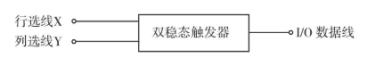
图 2-1　`SRAM`的基本存储电路

读操作时行选线 `X` 与列选线 `Y` 均为高电平，触发器内信息经内部数据线接到外部 `I/O`，为非破坏性读出，状态不变。写操作时待写入信息置于 `I/O` 上，`X`、`Y` 置高，信息经内部数据线写入触发器，写入后保持。掉电恢复供电时触发器竞争，状态不确定，故 `SRAM` 属于易失性存储器。双稳态触发器无论存 `0` 还是 `1` 总有管子导通，因而功耗相对较高。

###### （2）SRAM 的构成
单个存储单元只存 1 位，实用芯片含成千上万单元并配地址译码器、读写控制与数据缓冲器。图 2-2 为 `4K×1` 位 `SRAM` 原理结构。存储体由 4096 个六管静态单元组成 `64×64` 矩阵。`X` 地址译码器输入 `A0～A5`，输出 `X0～X63` 64 根行选线；`Y` 地址译码器输入 `A6～A11`，输出 `Y0～Y63` 64 根列选线。仅行列同时选中时才能存取。

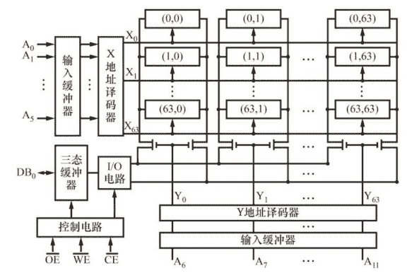
图 2-2　4`K`×1 位的静态`RAM`结构组成原理图

读写控制逻辑先由片选信号选中芯片，控制片选有效后，再由 `OE` 控制读、`WE` 控制写。读时选中单元信息经放大整形后送三态缓冲器，再到数据线 `DB`；写时 `DB` 上的数据经三态门进入输入电路，再写入单元位线。

##### 2. 动态 RAM
`DRAM` 利用 `MOS` 管栅极分布电容的充放电表示信息，充电为 `1`、放电为 `0`。电容会漏电，需定时刷新，常作内存条使用。

###### （1）单管 DRAM 存储电路
单管结构由 `MOS` 管 `T1` 与电容 `C` 组成，结构简洁、功耗低、集成度高。

###### （2）DRAM 基本原理与操作

## 基本原理与操作
`DRAM` 以与 `MOS` 管源极相连的电容 `C` 储存电荷来记忆 `1` 与 `0`，有电荷为 `1`，无电荷为 `0`。

### 无存取操作
行选择线为低电平，`MOS` 管 `T1` 截止，电容与外电路隔离，无充放电回路，信息得以保持。

### 写操作
行选择信号为高电平选中该行，电容上信息送至刷新放大器，放大器对电容重写。刷新时列选择信号恒为 `0`，信息不会送到数据总线。

### 读操作
行选择线 `X` 为高电平，同行 `MOS` 管导通，刷新放大器读取电容电压并放大为逻辑电平。若列地址产生列选择信号，则行列同时选中的基本单元被驱动，完成读取。

### 刷新操作
电容会泄漏，放电后信息丢失。刷新即读出、放大、再写入，`1` 电平的电容补足泄漏电荷，`0` 电平保持。刷新过程类似读操作，但不发送片选与列地址，数据不输出到外部总线。

## 刷新机制与控制
刷新按行进行，两次刷新间隔称为最大刷新时间间隔，一般不大于 `2ms`。温度升高泄漏加快，间隔约 `1～100ms`。因读写随机，难以保证 `2ms` 内遍历所有行，需专用刷新机制。常见做法有两种：一是借助 `DRAM` 控制器如 `Intel8203` 实现刷新；二是芯片内置刷新控制电路，自行完成刷新，如 `Intel2186/2187`。

`DRAM` 必须配备刷新电路，且刷新期间不能正常访问对应单元。相对 `SRAM`，其集成度高、功耗低、价格便宜，因而在大数据量存储中广泛应用。

## 典型 DRAM 芯片
首片 `DRAM` 诞生于 1973 年容量 `1KB`，同年出现 `4KB`，1976 年 `16KB`，1980 年 `4MB`，当时主流 `IBM PC` 内存约 `16KB`；1990 年出现 `256MB`。当前主板内存可达 `2GB` 以上。

以 `Intel2164A` 为例：

### Intel2164A 的引脚信号
`2164A` 为 16 引脚双列直插芯片，引脚如图 2-3 所示。

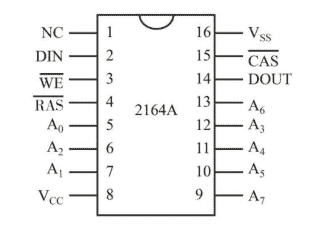
图 2-3　`Intel2164A`的引脚信号

`A7～A0`：地址输入；`DIN`：数据输入；`DOUT`：数据输出；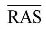：行地址选通信号，输入低电平有效；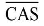：列地址选通信号，输入低电平有效；`VCC`：`+5V` 供电；`VSS`：信号地。

### Intel2164A 的内部结构及工作原理
`Intel2164A` 容量为 `64K×1` 位，8 片可组成 `64KB`。内部存储体由 4 个 `128×128` 存储矩阵构成，各由 7 条行地址线与 7 条列地址线选取。读/写由控制信号决定： 为 `1` 时为读，所选单元内容经 `DOUT` 输出； 信号为 `0` 时为写，`DIN` 引脚数据经输入缓冲器写入选中单元。

刷新时仅加行选通信号，不加列选通信号。地址送入行译码器刷新指定 4 行单元，不进行读写，`DOUT` 输出不受影响。最大刷新周期一般为 `2ms`。

# （五）只读存储器的分类
传统只读存储器 `ROM` 只能读不能写，信息长期保存且断电不丢失，属于非易失性存储器。常用于存放固定的程序和参数，如监控程序、`BIOS` 程序等。

ROM 进化全景：从掩膜到闪存

根据存储单元的结构和制造工艺，ROM 大致可以拆分为五大分支：掩膜型ROM、可编程型ROM即PROM或OTPROM、电可擦除可编程ROM即EEPROM或E2PROM、紫外线可擦除可编程ROM即UV-EPROM或EPROM，以及闪存Flash。

掩膜 ROM
这种ROM的数据是在晶圆制造阶段由厂商通过掩模写入的，交付后使用者只能读取，无法修改。信息固化后就不可再改，万一内容出错整批芯片只能作废，所以投片前必须反复校验准确性。正因为结构简单、集成度高、成本低，它非常适合大规模量产场景。

一个典型的MOS管构成的掩膜ROM示例如图2-4的4×4位结构。2位地址经译码后产生4条字选线，每条选中一行，每个单元输出4位数据。行列交叉点上有无管子连接，是由厂家二次光刻工艺决定的。存在跨接管的位存储的是“0”，没有管子的位存储的是“1”。

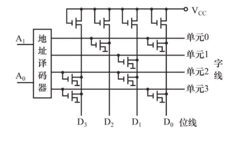

图 2-4　4×4 位掩膜 ROM 结构示意图

以选中单元1为例讲解存储机理。地址A1A0=01译码后选中该单元，其中D1位线与单元相连，MOS管导通输出为“0”；其余位线无连接，输出为“1”，于是D3D2D1D0=1101。同样可得单元0的内容为1010，单元2为0101，单元3为0110。

可编程 ROM
PROM的基本存储单元由一只MOS管或晶体管、熔丝F和上拉电阻R组成，如图2-5所示。选中单元后用编程器施加高压大电流，可把熔丝F熔断。F断开时字线为高，管子T导通，但位线被电阻R拉低，读出D=0。若熔丝未被烧断，选中时字线高、T导通，数据线D=1。

熔丝一旦烧断就无法恢复，因此只能编程一次，也称OTPROM多用于批量生产与应用。出厂状态下所有信息都是1。

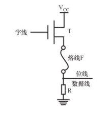

图 2-5　PROM基本存储单元

电可擦除可编程 ROM
EPROM虽然使用面广，但要擦除必须从板上拆下再放到紫外擦除器里操作，流程繁琐且频繁插拔会损伤管脚。后来出现的EEPROM则支持用电擦写，可在线完成修改，在智能工业仪器仪表里广泛使用，主要存放变化不多的参数与表格。它兼具ROM断电保存与RAM灵活改写的特性。

EEPROM 的主要特点
和EPROM相比，EEPROM呈现出以下优势：

第一，读写灵活性更强。兼有RAM的随机改写能力，同时保持ROM的非易失优点，可作为系统里可靠的数据保存区，比EPROM更方便。

第二，擦写粒度更细。擦除和修改的最小单位可达1B，且都可在电路中在线完成。EPROM只能整片擦除、整片编程，且不能在线操作。

第三，编程条件更宽松。采用电擦除/改写，常见供电为+5V或低压2.7～3.6V。多数芯片内建写入结束标志寄存器，供软件轮询。典型擦写寿命可达500000次以上，读取时间约200～250ns，数据保持10年以上。不足之处在于在线擦写耗时较大，约10ms，操作时必须保证充足写入时间，否则会失败。

第四，接口形态多样。分并行与串行两种。Intel 2864容量8K×8位采用并行传输，速度较高；Atmel AT24C16容量2K×8位采用串行传输，这类串行EEPROM只用少数几根线传地址数据，引脚数、体积和功耗明显降低，在便携式产品中应用广泛。总的来看，EEPROM无需高压电路和专用编程器，按时序操作即可完成编程。

EEPROM兼顾RAM与ROM优点，在微型计算机系统中能让设计更灵活。

EEPROM 的典型芯片
按工作方式可分为并行EEPROM与串行EEPROM。

常见并行芯片有Intel的高压编程2816、2817，低压编程2816A、2817A、2864A，以及1Mb的28010、4Mb的28040等。读出时间在120～250ns，字节擦写写入约10ms。串行EEPROM按协议可分两线制与三线制。两线制多为I2C总线，最早由PHILIPS提出，代表如Atmel AT24C01B容量1K位、AT24C02B容量2K位。三线制多采用Microwire同步串行接口，最早由美国NSC提出，典型型号有93C46、93C56等。

并行 EEPROM
以Intel 2817A为例。引脚排列如图2-6。

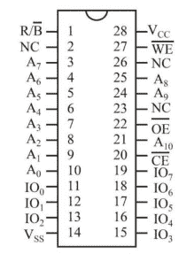

图 2-6　2817A的引脚图

2817A容量2KB，28脚双列直插封装。最大读出时间200ns，单电源+5V供电，最大工作电流150mA，待机电流55mA。单元擦写次数可达10000次，数据保存寿命超10年。片内集成+21V高压脉冲发生电路，无需外部编程电压与脉冲。

引脚功能如下：
A10～A0：11位地址线，可寻址2KB，输入，接系统地址总线。
IO7～IO0：8位数据线。编程时输入数据，读出时输出数据，接系统数据总线。
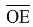：读出允许，输入，低电平有效，一般与系统读信号相连。
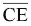：片选，输入，低电平有效，通常与地址译码器输出相连。
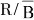芯片准备/忙状态引脚。写入操作时输出“0”，写入完成后输出“1”。该脚常接微机中断脚，便于以中断方式读写不影响主任务。
VCC：工作电源+5V。
VSS：信号地。
NC：空脚可悬空。

串行 EEPROM
以AT24C01为例。该芯片由Atmel采用CMOS工艺制造，容量1K位，仅8个引脚，如图2-7。

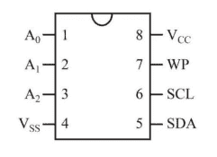

图 2-7　AT24C01的引脚图

引脚功能：
A2～A0：3位片选地址，用于级联扩展，一个系统最多可挂8片。
SDA：串行数据输入/输出。
SCL：串行时钟输入，提供时序。
WP：写保护。WP=“0”可读写，WP=“1”禁止写仅读。
VSS：地。
VCC：工作电压+5V。

AT24C01按二线制I2C协议读写，定义了SDA与SCL的时序及数据格式，按手册操作即可，十分灵活。

紫外线可擦除可编程 ROM
工程中程序常需升级，最理想的是可多次擦写重用的ROM。PROM只能写一次限制较大，于是可重复擦写的EPROM得到广泛应用。

EPROM顶部有一个圆形石英窗口，紫外光照射可擦除内部数据，再配合专用编程器烧写，芯片可反复使用。

存储电路和工作原理
图2-8(a)所示的EPROM存储电路采用浮栅MOS管，又称浮栅MOS EPROM电路。栅极不外引，四周被SiO2包围形成浮空状态。初始无电荷时沟道不导通，表示“1”；注入电荷后等效栅压为负，感应出源漏导电沟道，表示“0”。电压撤去后电荷被封闭，信息可长期保存。

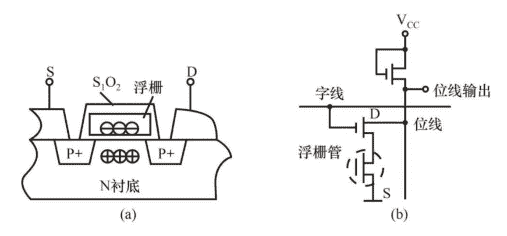

图 2-8　浮栅 MOS EPROM存储电路

图2-8(b)的工作原理：单元由浮栅管与MOS管组成。读取时字线为“1”且浮栅带电，管子导通位线被拉低读出“0”；浮栅无电荷则管子截止位线被拉高读出“1”。出厂时未编程，浮栅无电荷，默认全1。

编程和擦除过程
编程即向部分单元写入“0”，也就是向浮栅注入电子。向漏极加约24V高压，使漏区PN结雪崩击穿，高能电子穿过绝缘层进入浮栅。注入量由电压幅度和脉冲宽度决定。

擦除靠紫外光照射实现，常用波长2537Å，能量约15W·s/cm2。光子使浮栅电子逸出到基片，恢复初始状态。芯片顶部开有小窗口，擦除一般照射20～30min，直至读出全为FFH才算完成。烧写后需贴不透光封条防止误擦。

EPROM可靠性高，可重复烧写约2000次。缺点是出错后必须拆下整片擦除重写，且紫外擦除耗时长。

Flash 存储器
Flash又称闪存、快闪存储器，由Intel在20世纪90年代初发明，属于新型非易失存储器。数据可保存10年，且支持在线擦写重写。它从EEPROM发展而来，成本、功耗更低，密度和集成度更高。

近年来广泛用于电信、互联网设备、汽车、数码相机摄像机记录器和图像处理等领域。在微机系统中常用来保存引导程序和系统参数，Pentium后主板普遍使用Flash BIOS，升级非常方便。

存储原理与特点
Flash存储电路由一个晶体管构成，多晶浮栅被氧化物包围。存储原理与EPROM类似：浮栅带电时漏源导通表示“0”，不带电时不导通表示“1”。

Flash存储器的特点
通过对栅极、漏极、源极施加控制电压，可在擦除与编程之间灵活切换，方便在线改写。主要优点有：

按区块或页面组织
存取可按字节、块、Sector或Page甚至整片进行，提升应用灵活性。

快速写入
CPU可先以芯片存取速度、通常几十ns到200ns把页数据写入缓存，再由内部逻辑写入对应页，大大提高编程效率。

内部编程控制逻辑
编程写入由内部逻辑自动完成，通过读验证或中断查询结果，CPU可脱离复杂时序处理主程序。

相对EPROM，Flash能进行大面积电擦除，速度更快；可重复擦写几十万次而不失效，对系统应用极为重要。

Flash 的存储单元组织
Flash有整体擦除BulkErase、自举块BootBlock和快擦写文件FlashFile三种结构。整体擦除把存储阵列做成单一块，擦除时清空全部，修改少量数据不够灵活，早期产品常见。另一类把存储器分大小不同的块，自举块与参数块存引导代码和参数，主块存程序与数据，块可独立擦写，密度高速度快，面向嵌入式实时处理器。快擦写文件结构把存储器划分为等大若干块，以块为单位擦写，密度更高，适用于U盘和便携数码产品。

Flash 芯片
Flash厂商众多，知名厂商包括Intel、Atmel、AMD、Hyundai、SST、Hitachi、Toshiba、Mitsubishi等。按架构分有NOR、DINOR、NAND、AND等类型。编程电压持续下降，目前已到1.8V左右，利好便携应用。

Flash存储器的应用
与传统ROM相比，Flash制造密度高、价格低、功耗低、可靠性好，问世后迅速普及。作为高密度非易失存储，它非常适合做固态磁盘，在工业现场控制、嵌入式系统、便携数码产品如音频视频产品、笔记本、PDA，以及U盘、移动硬盘等移动存储领域广泛使用。随着工艺进步与成本下降，未来被Flash取代的小容量乃至大容量磁盘比例将大幅提升。

存储器与 CPU 的接口
系统设计中常遇到存储器扩展问题，核心是如何正确连接地址线、数据线和控制线。CPU操作存储器时先送地址，再发读写控制信号，最后通过数据总线传输数据。因此连接时必须考虑芯片类型、时序匹配与驱动能力。

存储器与 CPU 接口的重点
实际设计先根据用途、容量、成本选定存储器种类，再处理地址、数据、控制总线的具体连接。重点关注以下方面：

存储器类型

存储器选型与连接实战指南

怎么挑芯片
选型要兼顾存放内容、容量需求、读写速度、组织结构和成本。SRAM 响应极快，接口与中央处理器衔接简单，在工业控制、智能仪表这类中小规模系统里用得比较多。DRAM 集成度高、单价低、容量容易做大，但和微处理器之间的接口设计相对复杂，多见于需要海量数据的微型计算机。ROM 是非易失品，通常用来固化不需在线改动的常数。掩膜 ROM 和 PROM 适合大批量量产的微型机，研发和小批量阶段若要保存图形、表格、控制或显示参数等改动不频繁的数据，更常选用 EPROM 或 EEPROM。Flash 兼备长久保存与在线快速擦写重写能力，集成了 EEPROM 的非易失特性和 SRAM 的读写体验，已成为替代 EPROM/EEPROM 的主流选择。

总线驱动要算负载
驱动能力在存储空间设计中不可忽视。中央处理器的片上总线一般只能带几片 TTL 负载。尽管当代存储器件多为直流负载极小的 CMOS 或 CHMOS 电路，分 дъ 布电容仍会拖累信号，所以负载问题必须核算。小型系统里处理器可以直接挂接存储芯片；当系统总线负载变大时，就需要额外加入总线驱动器件。

单向传送的地址或控制信号，可选用三态锁存器如 74LS373、Intel8282/8283，或三态单向驱动器如 74LS244、74LS367 来增强处理器的带载水平。双向传送的数据总线则常用三态双向驱动器如 74LS245 来驱动。

时序要对齐
处理器访问存储器始终遵循固定时序，这直接决定了对存储芯片的存取速度要求。选型时必须让芯片速度与处理器速度匹配，这关系到系统是否可靠高效。尽量挑选时序相符的器件，才能化解扩展与速度的矛盾。

若所选器件速度不足，可考虑换件，或在存储器访问总线周期里加入等待状态 Tw。若器件偏慢，在规定的读/写周期内无法完成操作，就在正常周期之外再插入一个或多个等待周期 Tw，通过拉长指令时钟周期来降低系统工作频率，从而与慢速存储协同。

容量扩展三种路子
单片容量有限，系统需求往往要靠多片配合，这就是存储器扩展。以 SRAM 为例说明，ROM 的做法类似，分为位扩展、字扩展和字位全扩展。

位扩展
当单片字长达不到系统要求时，用多片并联扩位。芯片数量上升，但整体存储单元总数仍与单片相同。连线方式为各芯片的数据线并到系统数据总线，地址线全部并接到系统地址总线，片选端并联到同一控制线。例如用 8K×8 的 SRAM 6264 组成 8K×16 的组合，需要 2 片。内存条就是典型实例，把 8 个 512M×1 位芯片集成到一块 PCB 上，就能得到一根 512MB 的条。

字扩展
当单片字长够用而单元数不足时，用多片拼单元数。数据线对应位并联到系统总线。地址线分为高位和低位，低位直接与各芯片地址线相连，高位经译码器产生片选信号。例如系统已有 512MB，想扩到 1GB，只需再加一根内存条，共 2 根，完成地址单元的扩充。

字位全扩展
当字数和位数都不满足要求时，把位扩展和字扩展结合起来。先算出所需芯片数，再先做位扩展把多片拼成一个逻辑芯片组，随后再按字扩展规则对芯片组进行单元数扩充。

与处理器的连线思路
容量扩充时要解决三总线与存储器的正确连接与时序配合。数据总线和控制总线的连接相对简单，地址总线的连接本质是地址分配与译码。高位地址用于译码选片，低位地址用于片内寻址，划分依据是芯片的字数与总容量。例如用 4K×8 芯片构成 16K×8 系统，片内地址约 12 位用于选 4K 单元，片外约 2 位用于选 4 片。

8086 拥有 20 位地址线，其中低 16 位 A15~AD0 与数据总线复用，高 4 位与状态总线复用。连接存储器时需要外部地址锁存器，由 ALE 把 AD19~AD16 及 AD15~AD0 锁存，形成系统地址总线 A19~A0。

全译码方案
地址线中未参与片内译码的高位全部参与译码，译码输出作为各芯片片选。以 4 片 SRAM 0#~3# 为例，如图实现 32K×8 存储器，地址范围 00000H~07FFFH，仅占 8086 1MB 空间的低 32KB。全译码的优点是各片地址唯一、连续、无重叠，空间利用率最高。

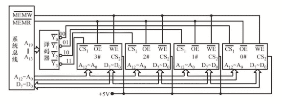
图 2-9　全译码方法实现存储器容量扩展

小规模系统常用简单译码器，中大规模 RAM 子系统则多采用 PLA、GAL、CPLD、FPGA 等可编程逻辑阵列，简化设计、节省布线并提升地址译码灵活性，部分器件本身还集成 SRAM 和 EEPROM。

部分译码方案
在部分译码法里，仅高位地址的一部分参与译码。以 4 片 6264 构成 8086 的 32KB 空间为例，数据线和读写信号连接与全译码相同，用 A14、A13 产生 4 个片选，A19~A15 不参与译码。由于高位地址未用，某存储单元对应 2^5=32 个地址，出现地址重叠。整体上 32KB 实际上映射到 8086 的全部 1MB 空间。若把未用高位全置零，即为基本地址。

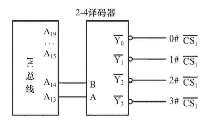
图 2-10　部分译码实现存储器扩展

高速缓存原理与结构
处理器访问低速存储器会降低效率，直接用高速存储器成本又高。现代系统普遍采用 Cache 技术，在速率与成本间折中。Cache 利用程序局部性原理，把近期集中访问的代码和数据从主存调入 Cache，便于重复访问。

Cache 通常与处理器同材质制成，速度比主存高约 5 倍，容量一般几 KB 到几十 KB，位于处理器与主存之间，处理器同时与 Cache 和主存保持通路。硬件实现速度快，能让系统兼具 Cache 的速度和主存的容量。Cache 可多级，单级即可让存取速度提升 4~10 倍。

当前 PC 多为 L1 和 L2 两级。L1 集成在处理器芯片内，以处理器时钟全速运行。L2 容量更大，几百 KB 到几 MB。早期 Pentium 的 L2 在主板上随主板时钟运行，Pentium II 为处理器时钟一半，Pentium III 后期可全速运行，Pentium IV 的 L2 已集成进芯片，可占芯片体积一半。

微机板上 Cache 基本结构含 Cache 控制器和存储体。控制器含主存地址寄存器 MA、主存-Cache 地址转换机构、置换控制逻辑和 Cache 地址寄存器。处理器发出地址经 MA 进入转换机构，判断是否命中。命中则转为 Cache 地址访问 Cache；未命中则访问主存并把邻域页装入 Cache。Cache 满时由置换控制部件按硬件实现的置换算法替换旧信息。

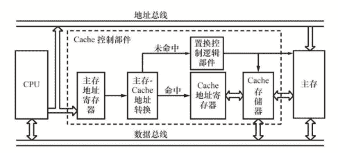
图 2-11　Cache 系统基本结构框图

命中率是核心指标，定义为命中次数与总访问次数之比。例如命中率 92%，意味着 92% 的总线周期从 Cache 取数，仅 8% 访问主存。一般要求不低于 85%。Cache 容量过小命中率低，过大成本上升而命中率提升不明显。

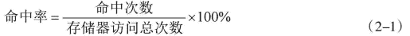

I/O接口基础认识
外设种类繁多，处理器不能直接交互，需接口作桥梁，完成信息中转。早期系统无独立接口，处理器直接管理外设，效率低且主机控制电路复杂。现代系统在处理器与外设间设接口电路，把控制任务交给接口，降低处理器负担，提升效率。接口是处理器与外界的连接部件，促进了计算机与外设的标准化和系列化。

信息类型划分
微机通过接口与外设交换信息，主要有数据信息、控制信息、状态信息。

数据信息包括数字量、模拟量、开关量。数字量如键盘、数字化仪输入，或显示器、打印机、绘图仪输出，多为二进制或 ASCII 码。模拟量如温度、压力、湿度等连续物理量，经传感器和 A/D 转换后变为数字量处理，处理后再经 D/A 转换回模拟量控制对象。开关量如开关通断、阀门启闭等双态量，经电平转换后接入计算机，1 位二进制即可表示，8 位或 16 位字长一次可处理多个开关量。

控制信息是处理器通过接口发出的命令信号，用于启动、停止或设定外设工作方式。状态信息是联络信息，处理器读取外设状态可知其是否准备好数据或是否空闲，从而避免冲突，保证数据交换正确。

接口主要功能
理论上处理器与 I/O 的连接与与存储器类似，实际差异很大。外设形式多样，有机械、电子、机电、磁电、光电等；信息有数字、模拟、开关；传输速度从秒级到数十兆字节每秒相差悬殊；信息格式和电平也不统一。因此接口电路多样且复杂。CPU 与外设接口需完成信号转换、时序配合、状态联络等任务，以实现高效可靠的信息交换。

I/O 接口功能与结构精要

### 1 数据中转与暂存
外部设备如打印机运行速率远慢于主机，若直接对接极易出现丢弃。接口内部通常装配寄存器或锁存器作为中间缓存，先收后发，从而缓解速率差带来的冲突，亦为批量交换提供基础。

### 2 外设选定
系统常接驳多种外部设备，同一类设备亦有多台，而处理器同一时刻仅能与一台进行交互。必须先经地址译码锁定目标，才能建立有效通信，这即是接口的选通职责。

### 3 指挥与状态回馈
输入输出接口可接收来自处理器的指令与控制信号以驱动外部设备，同时把设备运行情况以状态字或应答信号形式返回。双方借握手配合实现动作同步。

### 4 信号适配
多数外部设备为机电装置，其电平未必符合 TTL 或 CMOS 规范，需接口完成电平转换。除电平外，还涉及逻辑关系与时序配合的转换。主机总线传输 8/16/32 位并行码，外设或采用串行方式，需完成并串或串并变换；若涉及模拟量，则需 A/D 或 D/A 处理。

### 5 中断请求与管理
为实现主机和外部设备并行工作，常采用中断传送。部分接口提供中断请求线以便及时获得服务，部分则以中断控制器形态专门处理中断事务，提升处理器利用率。

### 6 程序化配置
当代接口芯片基本具备可编程特性，硬件不变，改写程序即可切换工作模式，灵活性与扩展性显著提升，推动接口向智能化发展。并非所有接口都需齐备上述能力，不同微机系统需求各异，但前三项通常不可或缺。

## 3 接口基本构成
每个接口电路一般包含若干可供处理器读写寄存器，统称为输入输出端口，端口像存储单元一样拥有唯一地址，部分端口引脚直接连向外部设备。

数据、状态、控制三类信息均经信息总线传输，因属性不同而分端口承载。单一外部设备常占用多端口，如数据口、状态口、控制口。对外部设备的操作本质上即为通过输入输出指令读写对应端口：状态口读出反映设备状态，控制口写入表达控制意图，只有数据口才真正完成信息实体交换。不同设备端口使用策略可异，既可各自独立，也可将位数少的控制或状态信息合并共用一口。

接口外部特性由引脚信号体现。面向处理器侧主要是数据线、地址线、控制线，与存储器连接思路相近，关键在于地址译码。面向外部设备侧信号繁杂，定义、时序、有效电平差异大，需在掌握设备原理与工作特性后才能正确解读。

## 4 端口编址方式
处理器访问存储器或输入输出端口均依赖地址总线，常见两种编址思路：端口与存储器分离编址，以及统一编址。

### 1 端口独立编址，也称直接映射编址
此方式将端口地址空间与存储器地址空间分隔，互不占用。如 Z-80/Z8000、i8080/8086/80X86 系列即采用此法。

8086 访问存储单元可利用 A19～A0 全译码得 1MB，范围 00000H～FFFFFH；端口仅用 A15～A0，可得到 64K 端口地址 0000H-FFFFH。两者独立，存储器可扩至最大而不必为端口预留空间。此方式需专用输入输出指令，处理器对端口与存储器采用不同控制线选择，如 MEMW、MEMR，故接口电路较复杂。

优点在于专用指令操作端口，易于区分访问对象，程序可读性好；端口地址空间独立且通常小于存储空间，译码电路相对简洁，且允许地址重叠而不致混淆。

### 2 端口与存储器统一编址，也称存储器映射编址
此方式从存储器空间划分部分给输入输出设备，将端口视作存储单元访问，不设专用输入输出指令，部分访存指令亦可用于端口。Motorola 系列、Apple 系列等采用此法。

优点是使用访存指令操作端口，指令丰富功能齐全，不仅可输入输出，还可对端口内容进行算术逻辑运算、移位等；此外端口编址空间可较大，对大型控制与数据通信系统意义显著。

## 5 端口地址分配实例
设计接口时需明确系统端口地址分配，以便接入新设备。以 IBM-PC/XT 为例说明。

8086 访问端口可用 A15～A0，可寻址 64K 端口，但 PC/XT 实际仅用低 10 位 A9～A0，可寻址范围仅 1K，即 000H-3FFH。A9 决定端口位置：A9=0 寻址主机板 512 个端口，A9=1 寻址扩展卡 512 个端口。其中 A9～A5 经 74LS138 译码产生各芯片片选信号，译码前提为...为高电平，低电平时表示由 DMA 控制器送出地址有效，表明此时处理器掌控总线。A4～A0 交由 8255/8259/8253/8237 等芯片内部译码，用以选中不同端口或寄存器。

## 二 简易接口电路

从外部设备向处理器送信息称为输入接口，反之为输出接口。不同设备所需接口复杂度差异很大。三态缓冲器与数据锁存器结构简洁使用方便，常用于功能简单的外部设备；但能力受限，复杂需求通常需可编程接口芯片。

### 1 输入侧接口
各输入设备皆需经信息总线向处理器传送信息，若直接挂接总线不做隔离，总线数据会紊乱，故必须缓冲隔离。大多数外部设备自带保持能力，仅用三态门缓冲即可。

三态指输出可为高电平、低电平或高阻态。处理器读取时，先在使能端加上有效电平，三态门导通，设备信息被读入，同时其它输入设备被隔离。使能撤除后门断开，输出成高阻，设备脱离总线，总线可供其它设备使用。

74LS244 与 74LS245 为常用数据缓冲器，均可增强总线驱动能力。前者为单向缓冲，后者为双向缓冲。二者各含 8 个三态门，设 1G、2G 两控制端，各控制 4 个门。控制端有效为低电平时对应门导通，否则高阻。实际使用可将两控制端并联，用单一信号同时控制 8 个门。

采用三态缓冲作输入接口时，因无锁存功能，要求设备信息在处理器读完前保持稳定。

### 2 输出侧接口
信息总线为处理器与外部设备的公共通道，处理器向慢速设备写信息时需考虑速率配合。处理器送至总线的信息只能维持数微秒，对慢设备而言几乎瞬逝，故输出接口必须具备锁存能力。信息先锁存入锁存器直至设备取走。

输出接口常用带存储能力的双稳态触发器实现。最简可用 D 触发器搭建。74LS273 含 8 个 D 触发器，具 D0～D7 输入、Q0～Q7 输出，CR 为低电平有效复位端，CP 为时钟输入，脉冲上升沿将 Dn 锁存至 Qn 并保持至下次上升沿。

## 三 处理器与外部设备间的信息传送

信息传送分两段：处理器与接口之间、接口与设备之间。不同设备对内容与服务质量需求不同，故传送方式不同，控制方式与接口结构亦随之变化。常见方式为程序控制与中断传送。

### 1 程序控制输入输出

通过程序执行输入输出指令实现处理器与外部设备信息交换，传送时机预先确定，可按需插入指令。根据设备要求分为无条件传送与查询传送。

#### 1 无条件传送
结构简明，要求设备始终处于就绪状态，可随时收发。设备为接收方时处理器不检查状态直接送数，若设备来不及取走，下一个信息会覆盖旧信息导致丢失。设备为发送方时，处理器发出 IN 指令后设备必须已准备好信息，否则读取错误。

适用范围极窄，仅用于简单开关量。如读取 DIP 开关状态，或向七段 LED 数码管写入显示码，设备始终空闲，处理器需要时随时交换。可见该方式要求主机和设备同步，仅适用于极简输入输出。

#### 2 查询传送
适用于处理器和设备异步工作。处理器通过不断查询设备状态判断是否就绪，再转入服务程序交换信息。若未就绪则继续轮询。设备就绪对输入指已有信息可读，对输出指已准备好接收新信息。输入输出操作由处理器主导，设备被动响应。

接口除数据缓冲端口外，还需状态端口。处理器经数据端口交换信息，经状态端口读取状态。

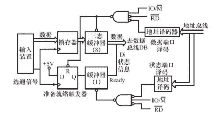
图 2-12 查询式输入接口电路

举例：数据端口记为 DATAPORT，状态端口记为 STATUSPORT。处理器读数时先从状态端口读取 READY，执行 INAL, STATUSPORT，若 READY 为 0 则循环等待，为 1 时再读数据端口 INAL, DATAPORT，同时复位就绪触发器。设备再次准备好时会发出选通信号，将信息暂存锁存器并置就绪触发器为 1，发出 READY 等待下次查询。

输出查询类似，先查状态端口 BUSY，若为 0 表示空闲就绪，处理器经数据端口写出，否则继续查询。写出后置忙触发器为 1，阻止新信息写入；输出完毕设备发回 ACK，忙触发器清零。

查询方式硬件简易、软件易实现、传输可靠，但处理器需耗费大量时间轮询，效率不高。若系统设备多、实时性要求高，或某设备故障长期不就绪，会出现死循环，通常需加入超时判断。因此仅适合处理器负载轻、设备少且任务简单的场景。

### 2 中断传送方式
查询让设备被动等待，浪费处理器时间。中断方式让设备主动请求服务。设备就绪后经接口发出中断请求 INTR，处理器收到后中断当前程序、保护断点，转去执行对应中断服务子程序，服务完毕恢复断点继续原程序。设备未就绪时处理器可处理其它事务，效率更高。

中断输入典型流程：输入装置就绪发出选通信号，信息被暂存锁存器，同时中断请求触发器置 1，向处理器发出 INTR。若中断开放，处理器在指令结束时响应，发出中断响应信号，设备将中断类型码放入总线，处理器跳转至对应服务程序，经输入指令读取数据端口并清除中断请求。服务结束后自动返回。

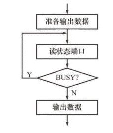

与轮询式查问相比，中断驱动的搬运能让 CPU 脱离持续等待，整机效率得到提升，同时 I/O 请求的响应更为及时，在系统满载且对输入输出实时性要求极高的场景，比如实时采集、实时处理与实时控制里，优势格外突出。缺点也很明显，这类机制必须依赖一套完整的中断判断电路，多 I/O 环境下硬件复杂度会上升。并且中断申请的出现时间是随机的，服务程序何时被触发事先无法预知，所以中断方式的编程必须更严谨细致。

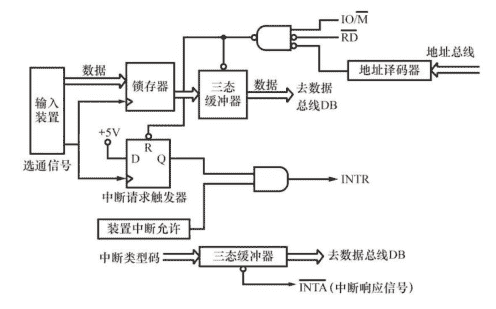

图 2-14　中断传送输入接口电路

## 3. DMA 高速搬运模式

程序控制 I/O 和中断传输都能实现 CPU 与外围设备之间的信息交换，二者的共性是对外设的服务都靠指令序列完成，数据在外设与内存之间必须经过 CPU 中转，这天然限制了速度上限。DMA 则让 CPU 不参与搬运，外设可以直接和内存交换信息，整个过程全由硬件掌控，无需 CPU 条条执行，传输的极限只取决于内存本身的工作速度，整体吞吐因此大幅提升。

DMA 需要专用的控制器来完成外设与内存之间的高速搬运。常规情形下数据总线、地址总线以及控制信号都由 CPU 管理，DMA 工作时 CPU 必须让出总线控制权，把相关引脚置成高阻，由控制器接管并管理这些总线。控制器拥有独立访问内存和输入输出端口的能力，能够自行给出搬运所需的地址信息和读写控制信号，把总线上的数据写入内存或端口，或从两者读出到总线。

图 2-15 为某输入设备以 DMA 方式向内存写入数据的接口示意。其工作流程为：DMA 过程启动前，CPU 会先对控制器编程，写入待搬运的数据块长度、内存起始地址、传输方向等参数。一旦输入设备提出 DMA 需求，就会发出 DMAREQ 申请，该申请保持有效直至被响应。控制器收到后先检查是否被屏蔽以及优先级，若有效则向 CPU 发出总线保持请求 HOLD，并在整个搬运期间维持该信号。此为 DMA 申请阶段。

CPU 在当前总线周期结束时检测 HOLD，若锁定信号 LOCK 未置位，则响应请求进入保持阶段，使 CPU 侧三态总线转为高阻，并回送总线响应 HLDA 告知控制器 CPU 已放弃总线控制权。

随后控制器向输入设备回送 DMAACK，使设备被选中参与 DMA 搬运，申请触发器被清除，数据搬运正式开始。搬运期间控制器自行提供内存地址，并向设备给出输入输出读、写及内存读、写等控制信号，在输入输出设备与内存之间完成高速数据交换。此为 DMA 回应与数据搬运阶段。控制器会自动增减内部地址与计数，据此判断任务是否完成，未完成则重复上述流程。当设定的字节数全部搬运完毕，控制器向外设发出结束信号，外设撤回 DMAREQ 信号，两组握手信号相继失效，DMA 结束，CPU 重新获得总线控制权。

DMA 模式具有传输速率高、I/O 响应快、CPU 开销小等明显优点，应用范围不断扩大。随着集成电路技术进步，DMA 不仅可用于内存与外设间交换，也可扩展到内存对内存，或高速外设对高速外设之间的直接搬运。

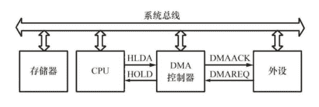

图 2-15　DMA 传送的接口电路
无论采用何种情形，数据都是在 DMA 控制器的管控下直接完成搬运，而不经过 CPU 也不受 CPU 约束。只是这些优点往往以系统硬件复杂度提升和成本增加为代价。DMA 用硬件控制取代了软件控制，与程序控制输入输出和中断传输相比，在小型系统或对速度、数据量要求不高的场合通常并不选用。

## 第二节 软件体系与演进趋势

计算机系统由硬件和软件构成，硬件提供基础，软件提供灵魂。软件不仅包括程序，还包括保证程序正确运行的数据和文档。程序是让计算机完成计算任务的一组可被接受的操作指令集合。数据是程序处理的输入与输出，主要指支撑程序正常操纵信息的结构，其中直接处理的结构仅有整数、浮点数、字符、布尔值等，复杂结构则在此基础上定义。文档以图、表、文字形式记录程序设计、开发、运行、维护各阶段成果与方法，如需求说明书、设计说明书、流程图、用户手册等，既是合同依据也是任务书和技术指导。当前在知识产权日益受重视的背景下，软件许可协议也成为软件的重要组成部分。

### 一、软件概览

现代计算机系统由硬件、软件与使用者构成。硬件是物理基础，使用者是直接使用者，软件则是使用者与硬件之间的宏观接口，使用者不直接操作硬件，而是通过软件实现。软件为使用者使用计算机提供便利，并可将应用开发替代脑力劳动，减轻负担。

#### (一) 软件的职能

为便于使用者掌握计算机，软件对硬件进行了改造。

第一，语言处理系统。专家实现了接近人类自然语言的计算机语言，并通过翻译软件将之转为硬件指令，使得使用者可用高级语言编程而非指令编程，极大方便了使用。

第二，数据结构与数据库。专家设计了多种数据结构，可将二进制数转为十进制整数与实数，实现中英文转换，并能组织图形、图像、声音等多媒体数据及知识表示。使用者可直接使用自己熟悉的计算对象。进一步将数据结构组织成数据模式供多使用者共享，形成数据库，管理数据库的软件称为数据库管理系统。

第三，操作系统。软件在硬件之上运行，需统一协调软硬件关系，这由操作系统实现。

操作系统、语言处理系统与数据库管理系统被称作系统软件。硬件与系统软件捆绑形成具备全新功能的新计算机，这是硬件功能的首次扩充。此后在系统软件基础上出现工具软件、接口软件、中间件等支撑软件，形成第二次扩充。加上直接服务使用者的应用软件则构成第三次扩充。三类软件与硬件共同构成完整的计算机系统，为使用者提供新的功能与使用环境。

#### (二) 软件的特征

软件与硬件相比具有以下特征。

第一，随硬件发展而不断演进，是人类智慧的延伸，不存在老化和磨损。

第二，软件具有生命周期，从提出到淘汰，持续修改最终导致退化而结束。

第三，软件复杂且依赖关系复杂，难以全面理解和描述，容易存在缺陷影响可靠性，任何改动都可能引发连锁反应。

第四，软件无形，是逻辑概念，定义“做什么”是开发的核心问题。

第五，研制成功后复制过程简单，只需复制原版。

第六，维护复杂，可能涉及纠错、完善、升级等工作。

第七，开发与运行涉及社会因素并受系统限制。

第八，错误难以根除，总有漏洞存在。即便是微软 Windows 也无法摆脱漏洞困扰，因而需持续安装补丁。

第九，软件开发至今仍大量依赖手工方式。

#### (三) 软件属性与划分

##### 1. 软件属性

软件是一种特殊产物，其个性独特。

(1) 抽象性。软件是信息产品，无具体物理形态；同时是逻辑产品，是知识的结晶。抽象性是其首要特性，其他特性由此衍生。

(2) 知识性。软件生产是脑力活动过程，不需大量厂房设备，主要依赖专业知识与脑力劳动，是知识性产品。

(3) 复杂性。结构上是复杂的逻辑产品；制作上需从客观需求经多层次提炼改造为可用软件，制作本身亦复杂。

(4) 复用性。生成后可反复多次复制使用。开发虽艰苦复杂，一款软件即可服务成千上万使用者，这是软件的独特优势。

##### 2. 软件分类

(1) 按系统分层。系统软件、支撑软件、应用软件。

第一，系统软件。操作系统是典型代表，内容繁多，源代码规模可达百万至千万行。不针对特定应用，用于管理资源、隐藏硬件细节并为应用软件提供统一平台。常用系统软件包括操作系统、编译器、数据库管理系统、设备驱动、通信处理程序等。

第二，支撑软件。为软件开发与维护提供帮助，主要指开发工具与环境、建模工具、界面工具、项目管理工具、测试工具等。

第三，应用软件。为特定用途编写，在系统软件基础上实现使用者需求，如邮件收发、浏览器、文字处理、电子表格、演示文稿、游戏、多媒体播放等。

(2) 按服务对象。通用软件与定制软件。

第一，通用软件。由开发机构面向市场或大规模使用者提供公开出售或独立使用的产品，如操作系统、办公软件、财务处理、项目管理、绘图、媒体播放等。其设计需满足共性需求，竞争关键在于功能、性能、培训与售后。

第二，定制软件。为满足特定客户个性化需求而在合同约束下专门开发，如军用指挥、机场控制、金融机构业务处理、天气预报、石油地震数据处理、卫星控制、高校教务系统等。交付后可能根据需要进一步开发。

(3) 按著作权角度。免费软件、收费软件、共享软件、自由软件。

第一，免费软件。无需付费即可使用，源代码不一定公开，使用者通常无复制、修改、传播自由，也不得转为商业用途。

第二，收费软件。需付费使用，受版权保护，不允许自由传播，否则构成侵权，通常称为商业软件。

第三，共享软件。以“先试用后购买”营销模式，受版权法保护，使用者可免费获得拷贝，需获许可证后方可传播。试用期过后若不付费则需删除或停止使用，通常有限制次数、时间或使用者数，付费注册可解除限制。

第四，自由软件。核心在于使用自由而非价格。根据自由软件基金会定义，可不受限制地自由使用、复制、研究、修改、传播、买卖。几乎所有自由软件均为开源，多在线发布且不收费，也可离线实体发行并收取工本费等最低费用。

## 二、软件发展动向

进入数据时代，软件技术显著发展并日趋多元复杂。其演进受技术进步、需求变化与创新影响，当前与未来趋势包括：

第一，人工智能与机器学习应用扩展。AI 与 ML 将推动软件向更智能、自适应、预测性方向发展，从智能助手到自动化决策支持。

第二，边缘计算与物联网增长。物联网设备规模扩大使边缘计算愈发重要，软件开发趋向设备端或其附近进行数据处理，减少延迟、提升效率。

第三，容器化与微服务架构。Docker、Kubernetes 等容器技术推动更灵活可扩展的部署架构，微服务将大型应用拆分为独立小组件，便于开发与维护。

第四，低代码/无代码平台。为缩短开发周期，此类平台将更普及，非开发人员可通过拖拽界面创建应用，降低编码需求。

第五，增强现实与虚拟现实。AR 与 VR 在娱乐、培训、医疗等领域应用广泛，软件需适配以提供更丰富体验。

第六，安全与隐私的强调。数字化扩展使安全与隐私愈发重要，软件开发需内置安全与隐私保护以应对网络威胁。

第七，量子计算与量子软件。量子计算技术发展将带来新挑战与机遇，特别在处理复杂问题领域可能引发创新。

第八，可持续性与绿色计算。对环境影响关注增加，软件开发更注重资源有效利用与能源可持续性，绿色计算成为重要方向。

这些趋势仅是软件发展的一部分，未来将有更多新技术与概念涌现，持续推动领域演进。

# 第三章 计算机网络技术及安全防护技术

计算机网络技术与安全防护技术在计算机系统中至关重要，涵盖网络构建维护与保护免受威胁的各个方面。网络技术的发展使信息与资源共享更便捷，但也带来安全挑战。因此网络安全防护技术对保护个人、组织与企业数据免受攻击具有关键作用。本章主要探讨计算机网络及其主要设备、网络信息安全技术与安全防护技术。

## 第一节 计算机网络及其主要设备

从不同阶段或角度看，人们对计算机网络有不同定义，反映了技术水平与认知程度。计算机网络即通过通信设备与介质将地理位置分散的、具有独立功能的计算机互连，以完善的网络软件实现资源共享的系统。

### 一、网络基础认知

#### (一) 网络作用

网络作用可归纳为以下方面：

第一，通信。实现计算机与终端、计算机与计算机之间的数据传输，是网络的基础功能，如网络电话、即时聊天、实时信息传输、电子邮件发送等。

第二，协同处理。将任务分配到计算机系统内，由多个小型机或微机共同承担部分任务，如云计算、网络计算、分布式计算等均涉及协同处理。

第三，资源共享。涵盖硬件与软件资源。硬件共享指打印机、硬盘、主机数据、处理能力等；软件共享指文件、程序、数据库数据等。

第四，提升可靠性和可用性。网络中计算机互为后备，故障时任务可转移至其他节点，提高可靠性；任务过载时系统可将新任务分配给空闲节点，保证有效利用，提升可用性。

#### (二) 网络互连

在基于 TCP/IP 架构构建的互联网中，网络层实现了大量功能。可分为四类：实现异构物理网络互连；完成源主机到目的主机的数据传输；选择最佳传输路径；路由器上的其他功能。TCP/IP 体系因 TCP 与 IP 协议作用巨大而得名。随着需求快速提升，老版本的 IPv4 逐渐难以胜任。

网络互连：把分散的网织成一张网

把多种物理网络拼接起来，形成一个整体可用网络，是互连要解决的核心问题。一方面打破距离和覆盖限制，让远端节点可以共享资源；另一方面在规划新网络时控制单网规模与覆盖半径，提升效率并简化运维。

### 1. 互连可以发生在哪些层次
两个物理网络如果在某层的数据表示或格式相同或能互相识别，就能在该层完成互联。

以两段10BaseT以太网为例，它们共用总线和网卡，比特对应的电信号形态完全一致。集线器把两段总线直连，源端物理层发出的电信号经集线器传到对端物理层，被正确解析后提取比特，再逐层剥离首部，最终交给目标进程，这是物理层的互连。

如果一个网用双绞线、另一个用光纤做总线，物理层的信号形态完全不同，集线器就无法直接用。但两者都是以太网，数据帧结构相同，就能用网桥在数据链路层完成互联。网桥只负责帧转发，帧内部二进制是电信号还是光信号，由各自物理层决定。

再往上，若帧格式也不相同，网桥就无能为力。可只要数据字段里的数据包格式一致，就能在网络层互联。互联网要求接入设备都运行TCP/IP，于是网络层的数据格式与处理方式得到统一。IP是TCP/IP体系的核心之一，和ARP、RARP、ICMP等一起规范网络层的数据交换格式与流程，从而把大量异构网连通。

因此各层互联对条件的要求不同：①物理层互联需要设备兼容、信号一致；②数据链路层互联需要协议与帧结构一致；③网络层互联需要协议与数据包格式一致；④高层互联面向协议完全不同的网络。

按层选择设备。物理层常用中继器和集线器。中继器对抗衰减后放大转发，让信号继续传播。集线器扩展局域网时把多个物理段的总线连通，要求各段表达比特的信号格式相同，即必须采用相同的物理层协议。数据链路层的设备是网桥，按需把数据帧从一个网段转到另一个网段，要求被连网段具有相同的数据帧结构，即使用相同的链路层协议。网络层互联设备是路由器，要求各物理网都遵循IP协议，按IP规定处理与传输数据。网络层以上互联统称高层互联，设备统称网关或应用网关，主要职能是协议翻译。

仅在物理层和数据链路层完成的互联只能算局域网扩展。集线器和网桥连接的是同类型物理网，连接后只是规模更大的局域网，各主机仍共享同一个网络号。真正意义上的网络互联指不同类型的物理网相连，主要由路由器承担。

互联后的网络在逻辑上可视为一个整体，称为虚拟互联网络。物理上异构、设备差距很大，但在网络层看来像是单一整体，计算机由此连通。

### 2. 打通异构差异的思路
不同物理网之间的差异可能很大，互联不仅要物理可达，还要逻辑上相互认可。资源共享的前提是数据单元能在另一网中自由传输并被使用，因此格式必须一致。只有格式一致，对方才能识别并利用。但差异往往使这很难满足，例如PPP与以太网在数据链路层各自规定了帧格式，单靠该层难以统一。

关键在于，两个采用相同网络模型例如都用OSI模型或TCP/IP模型的物理网，本身具备相同的层次结构。只要在某层选用相同的协议，该层的数据格式就一致，两个网在该层得到统一，一个网在该层发出的数据单元可被另一网识别与处理。内部其他层的协议与实现方式不再影响互联。

换句话说，网络接收来自另一网的数据单元后，可按自身要求进行处理。例如以太网在网络层收到来自他网的数据包后，可在链路层按本网规则把数据包封装成以太网帧进行传输与使用。事实上，互联网正是借助IP协议在网络层把所有物理网统一起来的。

### 3. 核心设备盘点
路由器是互联网的标准部件，实现网间连接。若网络号不同则视为不同网络，不同网络的连接依靠路由器作为枢纽。路由器系统构成互联网的主体骨架，是通信子网中的交换节点，形成Internet的骨架。

一个网络可通过路由器接入各种类型、不同规模的网络，互联网正是这样逐步互联发展成覆盖全球的网络。当前制约网络发展的主要瓶颈之一是路由器的处理速度，路由器的可靠性也直接影响连接质量。因此在园区网、地区网乃至整个互联网研究中，路由器技术始终居于核心，其演进折射出互联网研究的大方向。

路由器是相连网络的共同边界，也是各网络的内部成员。路由器的一个端口连着一个网络的总线，该端口拥有属于该网络的IP地址。作为内部成员，它能像工作站一样广播与接收数据帧；作为另一网络的内部成员，当端口收到需要送往另一网络的数据帧时，会把数据包封装成该网络的帧，通过连接端口以广播形式转发。路由器同时属于多个网络内部，必须同时运行各网络采用的协议。

路由器是连接两个相邻网络的交换节点，反过来一个网络也是连接两个路由器的链路。若该网络足够简单，两路由器间无其他连接节点，则构成相邻节点。若两远程网络相连，可用通信链路把两边界路由器直接连通，此类链路是特殊直联网，与之相连的端口不需IP地址。

路由器与网桥在外观上相似，都具备处理器与内存、多个端口并按表决策转发。区别主要在：第一，路由器工作于网络层，实现网络级互联；网桥工作于链路层，连接不同局域网。第二，路由器构成的互联网可存在回路；网桥互联网若有回路易产生广播风暴，故必须避免回路，实践中难以完全杜绝。第三，二者在安全策略、实现技术、性能、价格等方面各异。第四，网桥扩展的局域网仍属一个局域网，具有相同网络号；路由器连接的网络通常是不同物理网，各自网络号不同。

## （三）互连网络协议
IP即Internet Protocol，其互联能力源于对IP地址和数据包格式的规范，为不同物理网互联提供了统一平台。各网只要运行IP协议，就能识别IP地址和数据包格式，并按IP规定处理。

### 1. IP 地址
IP地址是互联网为每个网络连接即网卡分配的全球唯一标识。长度32比特，由网络号和主机号组成，为便于记忆划分为四个字节，用十进制点分表示，如172.16.122.204。

#### （1）IP地址的类别
按32位地址首字节的前几位分为A、B、C、D、E五类。A、B、C类为单目传送地址，用来分配给计算机，既可以作为源地址标识发送数据的源主机，也可以作为目的地址标识接收数据的目的主机；D类地址为组播地址，用于在一个组内进行广播，即一个IP地址标识多台目的主机，只能作为目的地址；E类地址为保留地址，以备特殊用途。

#### （2）特殊的IP地址
有几类地址不能分配给具体的计算机，他们有自己特殊的作用。路由器会按照以下地址的特殊作用进行路径选择：
第一，广播地址。主机地址部分全为“1”的地址是广播地址，将向指定网络的所有主机发数据。IP地址全为“1”的地址（255.255.255.255）是有线广播地址，将向本网络的所有主机发数据。
第二，“零”地址。主机号为“0”的IP地址表示该网络本身，是一个网络号。网络号为“0”的IP地址表示本网络上的某台主机。全0地址“0.0.0.0”代表本主机自己。
第三，回送地址。任何一个以数字“127”开头的IP地址都是回送地址。当任何程序用回送地址作为目的地址时，计算机上的协议软件不会把该数据报向网络上发送，而是把数据直接返回给本主机，便于网络程序员测试软件。
可见，网络号和主机号为全0、全1的地址都是特殊地址，都不能用来分配给网络或计算机。

#### （3）子网与掩码
主机数过多会导致管理复杂、效率下降，可把一个网络拆分为若干小网，即子网。子网掩码用于在主机号空间划分子网，用主机号的高位作为子网号。子网的网络号由原网络号加子网号组成。子网掩码共32位，通过它可把主机号再分为子网号和主机号。掩码中1对应子网号部分，0对应主机号部分。划分后子网掩码需对外公布，外界路由器会把各子网视作独立网络。
寻址时路由器会用到子网号或主机号。IP地址与子网掩码做按位与，得到所在子网号；地址与掩码反码按位与，则得到主机号。

#### （4）IP地址的分配
IP地址由管理机构统一调配。以连续地址块形式下发给建设单位，单位按预估规模购买网络号，获得该号段内的地址。单位还能通过子网掩码把地址再分配给下级。下级管理员可把地址静态分配给用户，也可采用动态方式，让上网机器临时获取空闲地址。

地址要绑定到网卡上，网卡通过接口接电缆，是网络的物理接入点。IP地址代表一个网络连接，即一个网络接口。主机可插多块网卡拥有多个物理接口；一块网卡也能绑定多个IP，因而一台机器理论上可拥有多个网络接口。

对外提供信息服务的网络除大量客户端外，还需Web、FTP、邮件、DNS等服务器，每台服务器都需要独立IP。服务器本质是提供资源的软件，分为文件、数据库及各类应用服务。性能足够时一台机器可承载多套服务器，但服务器负载重，性能不足就会成为瓶颈。

运行服务器的机器相比普通PC要求更高的速度与可靠性。普通PC故障影响范围有限，服务器保存重要数据并提供关键服务，故障会导致代理、认证、邮件等功能失效，造成网络瘫痪。因此服务器主机在稳定、安全、性能上要求更高，CPU、芯片组、内存、磁盘、网络等硬件规格也不同。这类专用机器常被称作服务器，是网络的核心节点，承担大部分数据存储与处理，也被称为网络的灵魂。

多服务器运行时每个服务都需要独立IP并绑定到机器上，只有这种情形下机器才需要多个IP。大多数情况下一台机器只使用一个IP。

#### （5）IP报文的格式
IP协议规定了网络层数据包的格式。数据包由报文头和数据两部分组成，数据来自传输层。报文头是网络层添加的控制信息，也称首部。前20字节为固定首部，后面可接若干选项。首部长度以4字节为单位，选项会改变长度。选项后会补填充位，使总长为4字节的整数倍。

### 2. 数据包
#### （1）数据传输服务
在通信子网中网络层为最高层，在资源子网中其上层是传输层，网络层为传输层提供端到端的数据包传输。网络层可提供两种服务：面向连接的虚电路服务和无连接的IP数据报服务。

虚电路服务先由源主机发出连接请求，在沿途路由器逐段记录路径，形成一条逻辑通路。目的主机返回确认，包含路由表，随后后续数据包按表转发，通信结束释放。虚电路是逻辑电路，一条物理线路可承载多条逻辑电路。适合大数据量传输，因路径固定可降低时延，保证顺序。若某包出错，后续包需重传，因此服务可靠。

IP数据报服务属于无连接服务。交换节点根据包头目的IP，按路由算法逐段转发。适合小数据量。每个数据包独立传输，可能走不同路径，导致乱序、丢失或重复，服务不可靠。互联网默认提供IP数据报服务，即20字节固定首部时的服务。需虚电路功能时可在首部增加松散源路由、严格源路由、路由记录等选项，属于特殊处理。

#### （2）数据传输技术
面向连接和无连接是两种不同的传输方式。

面向连接类似电话：先建立连接、维护连接、释放连接；各交换节点按包头路由表转发；传输通道像管道，数据从一端送入另一端取出，保证顺序，传输较可靠。

无连接类似邮政：每个包都带源地址和目的地址，由沿途节点逐步投递，各包传输相互独立；无需建立维护释放过程；目的端可能收到乱序、重复或丢失的包。

无连接式的传输方式并不能保证百分百可靠，却也自有一套可取之处。它省掉了大量协议开销，流程更轻快，操作门槛更低，反而能在某些场景下换来更快的通信效率。

## （四）路由分类与选路机制
路由，说白了就是给数据包挑路、按指定路线送达。路由器的核心工作就是做路由。它作为网络的交汇点，一头连着本地网络，一头通过物理链路连着相邻的节点，也就是别的路由器。为了讲清楚，需要先统一几个概念：目的主机是最终要收包的那台机器；目的网络就是这台主机所在的网段；互联网里每个网络都挂在一个路由器的端口上，通往目的网络的那台路由器就叫目的路由器，也可视作目的节点。路由器的任务是对每一个进来的数据包，依据包头里的目的 IP 定位主机所处网络，然后挑一个端口把包发出去。这个端口要么直接连着目的网络，要么连着离目的路由器更近的邻居节点。

总的来看，就是为数据包找到通往目的主机的最优路径。路由的本质是路由器在某个端口收到数据包后，依据目的地址做定向决策并从另一个端口转发出站的过程。

### 1. 路由划分的两个视角
#### （1）直连转发与多跳转发
第一种是直连转发，也就是直接路由。数据要发到目的网络时，路由器通过直连的端口以广播方式发出数据帧，把包送到目的主机。封装帧和发送帧都必须遵守目的网络数据链路层的协议要求。一个路由器挂了多个网络，就必须能同时运行这些网络的低层协议。

第二种是多跳转发，也就是间接路由。路由器依据包里目的 IP 指定的目的网络，选择离目的路由器最近的邻居路由器，通过相连的端口把包封装进帧发给这个邻居。

#### （2）人工预设与自适应路由
路由器背靠一张路由表做决策，表里记着去往某个网络该走哪个端口。拿到数据包的目的 IP 后，先算出主机所在的网络，再查表确定端口号，把包从该端口发出，转发就完成了。

路由表分人工预设的静态表和自适应的动态表。静态表是人提前定好的通信路径，基于经验常识；动态表会跟着网络实况变化，始终指向当前最优路径。要做到自适应，所有路由器都要定期探查周边网络状态，互相交换局部网络信息，再用路由算法刷新动态表。可想而知，动态表对路由器负担更大，但换来的是网络响应更快、效率更高、流量分配更均衡。

按使用表的类型，路由可分为静态路由和动态路由。静态路由遵循静态表决策，动态路由遵循动态表决策。

互联网覆盖全球，网络数量庞大，一张表不可能收录全部。当路由器查表找不到对应条目时，就会把包扔向一个默认端口，这种做法称为默认路由。

### 2. 静态路由算法
路由器的基本使命是选路，追求的最优指标有：路径最短、可靠性最高、时延最小、带宽最大、负载最小、价格最便宜等。可选用其中任一标准，但必须能用数值表示。路由信息的交换方式由路由算法决定。

路由算法大体分两类：① 静态路由算法，路由映射表预先建好，非人工修改就不变；② 动态路由算法，通过接收到的路由更新信息动态修改路由表。

#### （1）泛洪法
路由器收到一个不是发给自己的数据包时，便向除原入向端口外的所有其他端口都转发一次。相当于广播，一个包经过节点就会复制成多个，再被后续节点继续扩散，数据量会急剧膨胀。好处是实现简单且能保证目的主机最终收到；坏处是冗余数据太多，必须想办法抑制。

#### （2）固定路由法
路由器保存一张路由表，每项记录一个目的路由器以及下一步该交给哪个邻居。当包到达时，依据包里的地址信息在表里找到对应的目的路由器和下一跳邻居，然后发出。

#### （3）分散通信量法
路由器内部维护一张路由表，给出一组可选输出端口，并为每个端口分配一个概率。包到来时产生 0.00 到 0.99 的随机数，选择与之最接近概率的端口转发。

#### （4）随机游走法
路由器完全随机挑选一个端口转发。面对设备或链路故障，这种方式显得很稳健，算法容错性更好。

### 3. 动态路由算法
使用动态路由的网络里，各路由器会周期性交换路由信息以刷新各自路由表。典型算法有向量距离算法和链路状态算法。

#### （1）向量距离算法
向量距离算法的核心要点如下：

第一，要求路由器之间定期交换信息。
第二，交换的内容是一张向量表，记录到达本路由器的各目的路由器的“距离”。
第三，“距离”可用跳数或时延度量，相邻路由器间的跳数为 1；时延可换算为传输时间、通信费用、带宽倒数等数值，数值越小越优。距离本质上是传输代价。
第四，每个路由器维护一张表，记录通往各个目的节点的候选路径及其距离，并给出已知最优距离 D（i，j）和最佳线路 k。
第五，节点 i 代表本路由器自身，节点 j 代表目的节点，节点 k 代表本路由器的相邻节点。
第六，D（i，j）=min（d（i，k）+D（k，j））。D（i，j）是本节点到目的节点的最短距离，D（k，j）是邻居 k 到目的节点的最短距离，d（i，k）是本节点与邻居的链路距离。这些值通过与邻居交换信息获得。邻居越多，候选路径越多，最优的就是距离最小的那条。
第七，若节点 i 发现邻居 k 故障，令 d（i，k）=∞，重新计算 D′（i，j），找到新的最佳线路 s，把表中的记录更新为 D′（i，j），s。
第八，若邻居 k 的相邻节点故障导致 D（k，j）变化，重新计算 D′（i，j），可能出现两种结果：找到新的最佳线路 s，更新记录为 D′（i，j），s；或 k 仍是最佳线路，仅更新距离记录为 D′（i，j），k。

#### （2）链路状态算法
向量距离算法的局限是每个路由器看不到全网状态，链路状态算法弥补了这一点。

基本思路是通过路由器之间的信息交换，让每个节点掌握全网拓扑：知道全网节点、链路连接关系以及每条链路的代价，如时延、费用，用权值表示。把这些信息抽象成一张带权无向图，再用最短路径算法算出到各目的节点的最短通路。

具体流程：
第一，探邻。通过向邻居发送问候报文，判断邻居是否存在或是否正常。
第二，测距。通过发送回响报文计算与邻居的时延。
第三，构造报文。各路由器依据邻居时延构造自己的链路状态报文。
第四，泛洪报文。每个路由器用洪泛法向外广播，确保全网所有节点都能收到。同时也能收到其他路由器发来的报文。
第五，计算新路由。每个路由器据此构建带权无向网络拓扑图，运行最短通路算法求出到各目的路由器的最短路径，并建立新的路由表。

# 二、计算机网络的核心设备
## （一）有线传输介质
传输介质是网络最基础的通信设施，是连接各节点的物理通道。按形式分有线和无线两类。有线介质包括同轴电缆、双绞线、光纤；无线介质包括无线电波、地面微波、红外线通信、卫星微波等。

### 1. 同轴电缆
#### （1）同轴电缆的结构组成
同轴电缆由内导体铜芯、绝缘层、外导体屏蔽层和塑料保护层构成，联网时还需专用连接器件。

#### （2）常见型号
第一，RG-8 或 RG-11，匹配阻抗 50Ω，用于 10Base5 以太网，又称粗缆网。
第二，RG-58A/U，匹配阻抗 50Ω，用于 10Base2 以太网，又称细缆网。
第三，RG-59/U，匹配阻抗 75Ω，用于 ARCnet 和有线电视网。
第四，RG-62A/U，匹配阻抗 93Ω，用于 ARCnet。

#### （3）常见形式
① 基带同轴电缆，采用网状编织结构，特性阻抗 50Ω，适合传输数字信号。
② 宽带同轴电缆，采用铝箔缠绕结构，特性阻抗 75Ω 或 93Ω，适合传输模拟信号。
在局域网中最常用的是特性阻抗 50Ω 的基带同轴电缆，数据传输率约 10Mbps。

#### （4）主要特性
按直径粗细，50Ω 基带同轴电缆可分为细缆 RG-8 和 RG-11，以及粗缆 RG-58 两种。

粗缆传输距离更长，加中继器后最大可达 2500m，单段最远 500m，最多 5 段。布线时电缆无需切断，可灵活调整入网位置，但需要收发器和收发器电缆，安装成本高、难度大。

细缆传输距离较短，加中继器后最大约 925m，单段最远 185m，安装简便成本低，但需要切断电缆，在两端装基本网络连接头，通过 T 形连接器相连，接头过多易出现接触不良，引发细缆以太网故障。

同轴电缆抗干扰能力强，屏蔽层需接地，两端配 50Ω 终端适配器以减少信号反射。

无论粗细，同轴电缆连接的网络都是总线型拓扑，多台计算机共享一根线缆，适合设备密集场景。但一旦连接点故障，会影响整根线上的多台主机，修复麻烦，因此逐渐被双绞线和光纤取代。

### 2. 双绞线
#### （1）双绞线的结构
双绞线由两根包覆橡胶绝缘层的铜线绞合而成。

#### （2）常用形式
有两对线型，接插头为 RJ-H；四对线型，接插头为 RI-45。按屏蔽情况分屏蔽双绞线 STP 和非屏蔽双绞线 UTP。STP 有金属屏蔽层，造价高安装复杂，仅在强电磁干扰或需防信号外泄时使用；UTP 无金属屏蔽，只有绝缘皮包裹，价格便宜、维护容易，使用最广。

按传输特性可分为七类：
一类线：仅传语音，不传数据。
二类线：可传语音，数据速率最高 4Mbps，最早用于 4Mbps 令牌环网。
三类线：带宽 16MHz，传语音兼 10Mbps 数据，多用于 10 兆以太网。
四类线：带宽 20MHz，传语音兼 16Mbps 数据，多用于 16 兆令牌环网和 10 兆以太网。
五类线：外部优质绝缘，带宽 100MHz，传语音兼 100Mbps 数据，广泛用于 100 兆或 10 兆以太网，是日常最常见的电缆。
超五类线：衰减小、串扰少、延时误差小，带宽 200～300MHz，通常用于千兆以太网。
六类线：带宽 350～600MHz，性能远高于超五类，多用于 1Gbps 应用。

双绞线主要用于星型网络拓扑，以集线器或交换机为中心，各工作站用一根双绞线连接。适配结构化综合布线，可靠性高，单线故障不影响其他主机，排错方便。

#### （3）双绞线的特性
传输距离一般不超过 100 米；不同类型速度不同；电缆柔软轻便价格低廉，易维护；串扰小、抗干扰强；具阻燃性；适合结构化综合布线。

#### （4）接线方式
常用五类双绞线含四对线共八根，颜色为橙、橙白、绿、绿白、蓝、蓝白、棕、棕白，每根线与对应相间色扭绞。实际联网只需四根线。电子工业协会制定的 EIA/TIA568A 和 EIA/TIA568B 标准规定，使用橙、橙白、绿、绿白两对线接入 RJ-45 接头的 1、2、3、6 四个槽位，其余四根线可在布线时用于电话等设备。

直连线两端线序一致，均用 T568A 或均用 T568B，习惯上多数用 T568B。交叉线两端线序相反，一端 T568A 另一端 T568B。

不同场景用不同线序。一般直连线用于不同类型设备互连，如主机与交换机或集线器、交换机与路由器、集线器普通口与 Uplink 级联口。其目的是让一端的发送端 1 橙白、2 橙 对接另一端的接收端 3 绿白、6 绿。不同类型设备内部线序不同，直连线正好匹配。当连接相同类型设备时，因内部线序一致，需用交叉线实现发送与接收的正确对应，如两台主机直连、两台交换机或集线器普通口互连、集线器普通口与交换机普通口互连等。

### 3. 光纤
光纤在所有传输介质中性能最佳，大型网络主干普遍采用，是发展最快、前景最好的介质。

#### （1）光纤结构
横截面呈圆形，由纤芯和包层构成，光学性能不同。纤芯是光路通道，由多层反射玻璃纤维构成，可将光反射在纤芯内传播。光缆外部还有加固纤维如尼龙丝或钢丝，以及 PVC 保护外皮，提供抗拉强度，防止因温度、弯曲、外拉而折断。

#### （2）传输原理
发送端用发光二极管把电信号转为光信号，接收端用光电二极管把光信号再转回电信号。

#### （3）光纤类型
单模光纤内径小于 10μm，仅传输单一频率光，光沿轴线直线传播，速率可达数百 Gbps，用红外激光管 ILD 作光源；传输距离可达数十千米，成本高。
多模光纤纤芯直径 50～62.5μm，可传多种频率光，光在纤芯壁间波浪式反射，多色光共存，用发光二极管 LED 作光源；传输距离约 2km，损耗大成本低。

#### （4）光纤优势
信道带宽大，传输速率快，一般可达 1000Mbps。
传输距离远，单段单模可达几十千米，多模可达数千米。
抗干扰强，光信号不受电磁场影响，传输质量高。
重量轻体积小，便于运输安装。
保密性好，串扰小，难被窃听。
材料多为塑料和玻璃，来源广污染小。
无辐射，使用寿命长，实用性强。

## （二）无线传输介质
无线传输借助大气层和外层空间传输电磁信号，地球大气提供物理通道。频段多样，主要方式有无线电波、地面微波、红外线通信、卫星微波等。

### 1. 无线电波
无线电指频率 10kHz～1GHz 的电磁波谱，分短波、超高频、甚高频。常用于无线广播电视和移动电话通信，也可承载计算机数据。

### 2. 地面微波
常用频率 4～28GHz，采用定向抛物面天线收发。微波方向性强、直线传播，受阻挡会反射或中断，需视距通路。距离超过 50km 或遇到山脉阻隔，需设中继站放大信号。

地面微波系统可实现远距离通信，特别适合不便铺设电缆的区域。频带宽、容量大，可承载电话、传真、数据、彩色电视等多种业务。

### 3. 红外线通信
以红外线为载体的通信方式，分两种：
#### （1）点对点方式
衰减易控，不易被窃听，但发射器与接收器之间不能有物体遮挡。
#### （2）广播方式
信号覆盖相对较大区域，区域内接收器均可接收。

在日常应用场景里，红外通信的出现频率很高，常见的诸如掌上电脑、个人数字助理、笔记本、台式机以及对电视等家电的遥控数据传输，都离不开它。

### 4. 卫星微波
# 卫星通信
卫星通信属于微波通信的分支，借助位于太空的卫星做中继，把地面各点的信号串联起来。其最突出的优势在于覆盖面极大，能让多个地面节点实现近乎无缝的联通。之所以覆盖如此之广，关键在于卫星运行在数百、数千乃至数万公里的高空轨道，视距远超地面基站，所以适用范围比传统系统更宽。基于此，它被大量用在远程视频通话、电话以及各类数据传输场景。

## （三）网络连接设备
### 1. 集线器
#### （1）集线器及其作用
集线器承担着把局域网内各个节点集中起来联通的角色。局域网中每个终端都需借助某种介质接入网络，而双绞线配合`RJ-45`接口的物理限制，导致多台工作站无法直接互连，必须依靠一个中心枢纽。该枢纽即常说的集线器或集中器。大多数型号具备信号再生与放大能力，并提供多个接口，因此行业里也称其为多端口中继器。

#### （2）集线器的工作原理
以常见的共享式以太网集线器来说明其运行机制。从OSI分层角度看，它工作在物理层，只能对比特做机械接收、再生后再发出。它不具备地址识别与过滤能力，无法分辨源与目的，所以收到数据后只能全网广播，即从入口端口收到的信息会向除入口外的所有端口转发。

内部结构上，集线器仅有一条背板总线，全部端口都挂在这条总线上。当某站点发送时必须独占整条总线带宽，其它站点只能被动接收。若多台同时发送，就要靠竞争机制争取介质使用权。这种竞争导致每个端口实际可用的带宽大约只有总带宽的1/N，N为端口总数。

当单个集线器端口不足以接入全部站点时，可采用级联方案。部分设备配备了上联口`UPLink`，用直连线把一个集线器的上联口与另一台的普通口相连；若没有上联口，则可用交叉线直连两个普通口。级联后端口数看似增加，但每个端口平均速率下降，同时广播域与冲突域也随之扩大。

#### （3）集线器的类型划分
按端口数量分类，主流产品多为8口、16口、24口等规格；按速率分类，常见有`10Mbps`、`100Mbps`以及支持`10/100Mbps`自适应的型号。

### 2. 调制解调器
#### （1）调制解调器及其作用
调制解调器是拨号上网时连接电脑与电话线的关键硬件。电脑内部使用的是数字信号，而电话线路传输的是模拟信号，二者制式不同无法直接互通。调制解调器负责在两者之间做转换：电脑发出数据时，它把数字信号调制成电话线可承载的模拟信号；电话线传来信号时，它再把模拟信号解调回电脑可识别的数字信号，核心作用就是实现两种信号体系的互通。

#### （2）调制解调器的分类
按形态分为外置和内置两种。外置式独立放置在主机箱外，封装更美观；内置式则是一块电路板，需打开机箱插入主板，安装步骤相对繁琐。此外市场还存在USB接口的调制解调器。

### 3. 网卡
网卡又称网络接口卡或网络适配器，是组建网络的基础硬件，每台联网主机至少需配备一块。一端对接计算机总线，另一端面向网络。从OSI模型来看，网卡主要承担物理层和数据链路层的服务，为主机提供低层通信能力，使其能够参与网络通信。

另外，网卡还会为主机分配唯一的网络标识，即物理地址或`MAC地址`。市面上网卡种类繁多，其中以太网卡占据主流，下面就以以太网卡为例介绍其基本知识。

#### （1）网卡的功能
第一，连接主机与网络。网卡作为局域网的接口，一头挂计算机总线，一头接传输介质。大部分网卡只支持单一介质，也有二合一、三合一等多介质支持的型号。

第二，实现串并转换。网卡与网络之间通过同轴电缆或双绞线进行串行传输，而网卡与主机之间借助主板`I/O`总线进行并行传输。发送时，网卡把主机的并行数据转为串行送入网络；接收时，则把网络传来的串行比特流转为并行交还主机。

第三，差错检测。网卡以帧为单位校验传输是否出错。发送端计算检错码并附在数据后，接收端据此检查，若帧出错则丢弃，若正确则上交给主机。

第四，协议实现。不同网络的介质访问方式和帧格式各异，具体采用哪种协议由网卡上的协议控制器决定，它规定了帧的格式和介质访问规则。发送时网卡把数据封装成帧并加上控制信息，接收时则识别帧并剥离控制信息。

第五，编码解码。为了提升传输质量，网卡会在发送前对数据重新编码。以以太网为例，发送端会用曼彻斯特编码后送出，接收端再把曼彻斯特编码还原为原始数据。

第六，数据缓存。发送方向，主机把数据交给网卡，网卡将其暂存于缓存中待发。若收到接收端确认，缓存即清空供新数据使用；若未正确接收，则从缓存重发直至成功。接收方向，缓存暂存已到达但尚未处理的帧，处理完后清空以接收下一帧。

第七，收发功能。网卡内置发送器和接收器，负责信号的发出与接收。

#### （2）网卡地址
每块网卡都拥有全球唯一的物理地址，即`MAC地址`，该地址在生产时固化到网卡只读存储器中。以太网卡的物理地址长度为48位二进制，实际书写时为了方便常以12位十六进制表示。转换规则很简单，每4位二进制对应1位十六进制。

# 第二节　计算机网络信息安全技术
近几年国内经济持续提速，信息技术的普及随之加速，计算机已融入日常工作与生活。随着应用范围不断扩大，网络信息安全对个人生活的影响日益显著，个人信息保护已成为核心技术议题。

## 一、计算机身份认证技术
### （一）报文认证
报文认证发生在通信双方建立连接后，通过对收到的信息进行校验来确保真实可靠。通常需要确认三点：报文确实出自可信发送方、内容未被篡改、收到的顺序与发送顺序一致。

基于此，报文认证一般包含以下三个方面：
#### 1. 报文源认证
报文源认证的目的是确认发送方的身份，多基于密码学手段。例如，可在报文中附加加密密文，该密文是对双方预先约定的通行字的加密结果；也可由发送方用自身私钥对报文加密，接收方再用发送方的公钥解密，以此验证身份。

#### 2. 报文内容认证
报文内容认证用于确保数据完整性未被篡改，通常借助认证码实现。认证码是通过对报文进行特定运算得到的，也可视为校验和，其值与报文内容紧密相关。

具体流程是发送方先算出认证码并随报文一起发送，接收方用约定算法重新计算后与收到的认证码对比。若一致则认为内容无误，若不一致则判定报文可能被改动，可选择拒收或报警。

#### 3. 报文时间性认证
报文时间性认证旨在验证报文的时序正确性，确保接收顺序与发送顺序一致且不出现重复。可采用三种手段：使用时间戳、对报文编号、或采用预先的一次性通行字表，用有序的通行字标识符来标明报文顺序。

### （二）身份认证
身份认证是构建安全通信环境的基础，只有在双方互相确认身份后才能建立加密信道，它同时也是授权访问和审计的基础，在网络安全中地位关键，尤其在分布式和开放环境中作用突出。

实现消息认证需要双方遵守约定规则，这种规则规范化后即为协议。根据认证方向，身份认证可分为单向和双向。单向是指一方需要被另一方验证身份；双向则指双方互相验证身份，对应协议也有单向认证协议和双向认证协议之分。

#### 1. 单向认证
在无需双方同时在线的场景中，单向认证即可满足，例如电子邮件发送方在证明自身身份后即可发送数据，接收方在收到后先验证发送方身份，验证通过才处理数据。

#### 2. 双向认证
双向认证协议应用最为广泛，它要求通信双方互相验证身份，适用于双方同时在线且互不信任的场景。双向认证需同时兼顾保密性和即时性，以抵御潜在攻击。

## 二、计算机访问控制技术
网络运行不仅要防御外部攻击，还需防范内部泄密。访问控制技术可阻止非法用户入侵，避免外部对系统资源的恶意使用，从而保障共享信息安全。

### （一）访问控制系统的要素
访问控制系统通常由三要素构成：
第一，主体。即主动发起访问的操作方，通常是用户或发出请求的智能体，如程序、进程、服务等。
第二，客体。即被访问的目标，涵盖受控的系统资源，例如操作系统的内存与文件、数据库记录、网络页面或服务等。
第三，访问控制策略。即对主体访问客体的能力与行为的限制，明确了主体可对客体执行的操作及客体对主体的约束条件。

### （二）访问控制技术的类型
#### 1. 强制访问控制
强制访问控制`MAC`要求主体必须严格遵循系统预先制定的策略，所有信息都被赋予保密等级，用户获得相应许可后，通过分级安全标签实现单向信息流动。`MAC`体系可将授权访问控制应用于数据库管理或网络操作系统管理。

#### 2. 自主访问控制
自主访问控制`DAC`的核心在于主体可以自行设定访问限制，即有权把权限授予或收回给其他主体，其模型基础是访问控制矩阵，粒度细化到单个用户。当前常用的是基于客体的访问控制列表`ACL`，其优点是直观易用，但在规模较大、需求复杂的网络环境中，管理员负担会明显加重，风险也随之上升。

#### 3. 基于任务的访问控制
基于任务的访问控制`TBAC`是一种新型授权管理模式，适用于分布式计算、多点访问的信息处理及决策系统。它以任务为视角进行访问控制，有效解决提前授权难题，并将动态授权关联到用户、角色与任务，实现最小特权原则。

#### 4. 基于角色的访问控制
基于角色的访问控制`RBAC`通过对合法访问者进行角色认证来确定权限，从而简化授权管理。其核心是在用户与权限之间引入角色，利用角色的相对稳定来抵消用户权限关系的频繁变动，并可根据业务需求灵活增删角色对应的权限集合。

## 三、计算机数据库安全技术
### （一）数据库加密技术
常规的安全措施能在一定程度上提升数据库管理水平，但一旦应用于重点领域或敏感场景，面对针对性攻击就显得不足。部分用户尤其是内部人员仍可能通过非法手段窃取账号密码、违规操作数据库，严重时甚至直接盗取或篡改文件。

数据库安全与个人隐私紧密相关。企业自管系统时，管理者可浏览全部数据资源；而在电商等外包场景下，数据交由服务商保管，保密性便难以完全保障，安全系数下降。

数据库加密技术可有效缓解上述风险。其核心是将明文数据经转换如置换和代换后变为密文存储，使用时再解密还原。加密与解密互为逆过程，前者将可读数据转为密文，后者恢复为明文。通过加密，可防止重要数据被窃取或丢失，提升数据库整体安全性，对单位内部数据保护意义重大。

#### 1. 数据库加密的基本特点
传统加密多以整篇文章为对象，按顺序加密解密，而数据库加密的对象并非全部文件统一处理，因其使用方式特殊。检索时往往只解密符合条件的少量记录，不能从头开始解密，因此数据库加密必须支持中间定位解密。

主要特点如下：
第一，采用公开密钥加密。数据库数据本身是开放的，用户经授权并持有密钥后即可使用，故多采用公开密钥机制。
第二，采用多级密钥结构。数据库查询具有层级规律，加密单位从大到小依次为库、表、记录、字段。定位到某条数据时，其所在的上级单位也随之明确，查询者可获得对应子密钥，这些子密钥共同组成公开密钥体系，便于随时加解密。

#### 2. 数据库加密的技术要求
（1）加密强度需足够高，确保数据在长时间内不易被破解。
（2）加密后存储空间占用应仅有轻微变化，避免大幅增长。
（3）加密解密速度要快，保持系统原有性能，避免用户体验延迟。
（4）密钥管理需建立稳定且灵活的体系，密钥保存既要安全又要便于使用。
（5）加解密过程对合法操作应透明，加密后数据不影响系统原有功能。

此外，还需准确识别数据类型，避免因类型不匹配导致加密时加载错误。

#### 3. 数据库加密的方式方法
早期数据多以可信方式直接存储在数据库中，但安全性不足，易被入侵者窃取或篡改。因此对数据库数据加密很有必要。目前主要分为两种方式：

##### （1）软件加密方法
软件加密依托加密组件与数据库管理系统的差异，可细分为两种：
第一，库内加密。加密与解密均在数据库内部完成，对用户完全透明。`DBMS`在数据物理存储前完成加解密，密钥保存于`DBMS`可访问的系统表中。库内加密优势在于加密能力强且透明易用。
第二，库外加密。与库内相反，库外加密在`DBMS`之外运行，主要由加密服务器承担，多用于文件加密。

数据库与操作系统间通常有三种连接方式：利用文件系统功能、使用操作系统`I/O`模型、使用存储管理。采用库外加密时，可先用`DES`、`RSA`等算法对内部存储数据加密，再由文件系统把密文写入数据库文件，读取时逆向解密即可。

库外加密密钥管理相对简单，仅需文件加密密钥即可，但读写流程较为繁琐，每次读写都要经历解密与加密，影响程序效率和数据读写速度。

##### （2）硬件加密方法
相较软件加密，硬件加密在物理存储器与数据库系统之间增加一层硬件，由该硬件完成加解密。但新增硬件易出现兼容问题，导致读写控制复杂，使用并不普遍。

#### 4. 影响数据库加密的因素
##### （1）加密粒度因素
加密粒度是影响数据库加密效果的关键因素，由大到小可分为表级、记录级、数据项级。总体上粒度越小灵活性越高安全性越好，但操作复杂度也越高，实践中表级和数据项级应用更常见。

第一，以表为单位加密与操作系统的文件加密相似，不同表由不同密钥保护并存储。表级物理存储形式多样，可能以文件或文件块为单位。此方式实施最简便，但安全性、稳定性和可依赖性相对较低。

第二，数据项级加密：安全灵活但落地难度最高
这种按数据项来做加密的方式，在安全性、稳定性以及使用灵活性上都是最强的。缺点也最明显，实现成本极高。每一条数据项都要单独完成加密，并且要搭配多套数据项密钥使用。这意味着密钥总量会迅速膨胀，密钥的自动生成规则和日常管理流程也会变得异常复杂。

第三，记录级加密：处于表级和项级之间的折中方案
这种做法把一条记录当作加解密的操作对象，把属于同一记录的字段捆绑在一起统一处理。力度介于按整表加密和按数据项加密之间。

（2）加密算法选型决定成败
对数据库做加密，核心在于算法是否匹配数据库特性。业界最常用的两类是：

第一，对称密钥方案。加密用的密钥和解密用的密钥是同一把，有时解密密钥需要从加密密钥推导出来。

第二，非对称密钥方案。与对称正好相反，加密密钥和解密密钥是两把不同的钥匙，拿到加密密钥也无法反推出解密密钥。

（3）密钥管理是硬伤
加密单元越多，参与的密钥就越多，密钥数量和加密强度的关系是反向的：加密力度越弱，需要的密钥越多，管理的难度也越高。要兼顾数据安全和密钥交换效率，通常有两种做法：

第一，集中式密钥管理
管理阵地设在数据库管理中心。建库时由密钥管理中心生成加密密钥，对数据加密后形成密钥表。用户登录后，密钥管理部门先做身份和密钥校验，通过审核后调出对应数据的加密密钥，用解密算法还原数据，最终把数据交给用户。

第二，分级式密钥管理
目前研究和应用都更偏向这种模式。以数据项为单位加密时，系统密钥由主密钥、表密钥和各数据项密钥三层构成。数据库整体只有一个主密钥，每个数据表对应一个表密钥。表密钥由主密钥加密后以密文形式保存在数据字典里。通过一个函数，主密钥和各数据项密钥可以派生出数据密钥。整个体系分层，主密钥处于最高层，是整个系统的核心。主密钥的安全直接决定数据库的安全。

（二）数据库恢复技术梳理
恢复数据库要解决两个核心问题：冗余数据的建立与管理，以及如何用冗余数据完成恢复。主流技术有两种：

1. 数据转储技术
后援副本也就是备份副本，是管理员把数据复制转储到磁盘或磁带上保存的备份文本。它的作用是在数据库损毁时及时补全数据。恢复后数据库只能回到一次转储时的状态。如果想精确恢复到故障瞬间的状态，就必须在转储数据的基础上重放后续操作。转储分为两种形态：

（1）静态转储
在数据库没有运行事务的空闲窗口进行转储，此时库内数据处于一致状态。转储期间数据不可读写。通常要等所有正在进行的业务结束才能开始，所以会阻断新事务的进入，数据库利用率明显下降。

（2）动态转储
相比静态，转储时数据库仍可被修改和读取，用户感觉不到中断。很好地弥补了静态转储的停机缺陷，可以随时执行。但缺点是转储结束时，后援副本与线上数据的时点一致性很难保证。

2. 日志文件登记技术
日志是用于记录数据更新操作的文本文件，格式依系统而定。按记录单位划分，可分为以日志记录为基础和以日志数据块为基础两种。

以记录为基本单位，需要记录三类信息：事务开始的标记、事务结束的标记、从开始到结束的完整记录。日志条目可涵盖所有事务的起止和更新操作。完整日志应包含五项内容：事务的标识，日志操作类型如修改插入删除，操作对象的数据内部标识，更新前的数据快照，更新后的新数据。

在大数据环境下，日志不可或缺，可用于修复介质故障、系统故障和事务执行过程中的故障。日志与转储配合使用时价值最大：动态转储恢复必须结合日志和后援副本；静态转储恢复也依赖日志，借助备份副本和日志可以把数据整理到各事务的正确位置，撤销故障时刻尚未完成的事务，避免重复提交，从而把数据拉回到故障前的正常状态。

要实现有效恢复，日志登记必须做到两点：先写日志，再改库；严格按时间顺序记录事务执行。若故障发生在两者之间，数据可能只完成了一半。如果只改了库没写日志，就无力回天；如果先写了日志但库未改动，则可以通过日志安全回滚，对数据库正确性没有副作用。日志是数据恢复的基石。

# 第三节 网络安全防护实战指南
## 一、局域网防护技术要点
局域网是互联网的重要节点，近年发展迅速，已广泛应用于各行各业，承担起经营管理和资源存储的核心角色。我国学校、企业、银行金融、社区等都在使用互联网实现信息传输和共享。但发展越快，风险越大，木马病毒、非法入侵等网络安全问题频发，严重时会导致重要信息被盗。

### （一）局域网认知与管理
#### 1. 局域网的两种定义
##### （1）功能视角
指在方圆几千米范围内，通过网线互联起来的多台计算机集合。局域网主要提供文件管理、软件与打印机共享、电子邮件与传真、小范围日程安排等服务。它是相对封闭的，规模从两台到上千台不等。

##### （2）技术视角
指利用电缆、光缆等特定传输介质和网络适配器组建、在网络操作系统监控下运行的网络系统。
功能视角是从服务和外部行为出发，技术视角是从构成基础和组网方式出发，两者互补。

#### 2. 常见拓扑结构
传统局域网覆盖范围在几千米内，主流拓扑有星型、总线型、环型、树型。

##### （1）星型拓扑
当前最常用的结构。通过双绞线把计算机、网络打印机等终端设备连接到中心集线器。所有通信都要经过中心节点，便于集中管理和维护，传输延迟小。单个终端故障不影响其他节点，但中心节点故障会导致全网瘫痪。

##### （2）总线型拓扑
用一条总线把多个终端设备串联起来。总线可以是同轴电缆、双绞线或光纤，IEEE 802.3早期标准使用同轴电缆。因为所有节点共享同一条线路，节点数量受限，且信号衰减限制总线长度。优点是没有中心节点，单点故障不影响整体，可靠性高，布线简单成本低易扩展。缺点是节点需排队使用总线，不能全双工，实时性差。

##### （3）环型拓扑
多个终端通过干线耦合器连成一个闭合环，信号单向流动，节点按序获取通信权。设备A发送数据后沿环传递到设备B，B判断是否为目的节点，是则保留否则继续转发，直至返回A。典型代表是令牌环网。现实中多为逻辑环，两端用阻抗匹配器闭合，物理上很难真正闭环。

##### （4）树型拓扑
由总线型演化而来，形似倒置的树，根节点向下分出多个分支，每个分支可再细分。它基于总线扩展，通过分支传输介质，分支多但不闭合。属于分层广播式网络，结构对称、层次固定，具有一定容错性，某分支或节点故障不会波及其它部分，各节点均可对外传输信息。

#### 3. 局域网扩展方式
单位内部往往存在多个局域网，需要互联成更大规模的网络。常用扩展方法有集线器、交换机、网桥三种。

##### （1）集线器扩展
集线器是早期组建以太网的中心设备。物理上是星型，逻辑上仍是总线型。一端口发送的数据会被所有端口接收。端口数常见8、12、16、24。多个办公室可各用一台集线器组网，再把集线器互联成大网。缺陷是冲突域随之扩大，扩展后任意时刻仍只能有一台主机发送数据。

##### （2）交换机扩展
以太网的中心连接设备，多个端口连接工作站，形成星型结构。工作原理类似电话交换机，按需建立通信对。能按需求连接不同地域的工作站，实现虚拟局域网VLAN。

##### （3）网桥扩展
局域网扩展硬件，每端口连一段局域网，网桥本身成为该网段的成员。能把一段网络的数据帧转发到另一段，使多个网段逻辑上成为一个扩展局域网。只在必要时转发，端口间隔离，转发可并行进行，不会像集线器那样扩大冲突域。

#### 4. 局域网安全措施
大中型局域网可采取以下组合拳：
按用户划分网段并控制访问权限；定期排查关键网段漏洞并及时修复，形成修复报告；部署对有线无线都有效的统一安全认证机制；建立Windows Service Update Service及时修补系统漏洞；建立行为管理机制，提取分析有价值数据和信息；搭建网络安全门户网站发布安全资讯；建设预警机制和入侵检测系统；遭受攻击时启用日志和配置备份体系；部署防火墙实现区域隔离，避免单点问题波及全局。
落实后，局域网可形成预防、检测、恢复一体化的综合防护平台。

#### 5. 局域网安全管理
安全问题多源于管理不到位。局域网信息安全保障的核心是管理，技术只能发挥三成作用，管理占七成。技术需要管理来驱动，管理有效才能让技术价值最大化。信息安全管理是网络管理体系的重要组成。

为此应建设网络管理中心，解决三个关键问题：组织上建设信息安全组织架构，明确责任；制度上完善管理制度，保障工作开展；人员上对管理人员进行持续培训和教育，提升安全意识。

### （二）局域网网络监听协议
分析网络数据包依赖于使用的设备。早期采用集线器，只需用网线连接计算机即可。协议分析的本质是基于流量分析，例如发现某段网络报文发送变慢却不知原因时，可用协议分析工具如数据包探嗅器进行判断。

数据包探嗅器分两类：商业用途用于维护网络安全，地下用途用于入侵计算机。其主要功能有：分析失效通信；判断是否存在入侵者；转换数据包信息读取格式方便查看；探测网络通信瓶颈；提取网络中有价值的信息；记录通信过程以追踪入侵路径。

### （三）无线局域网安全防护
受有线网络部署限制，无线网络因便捷受到青睐。它必须依托有线网络存在，具有灵活移动的特性。无线网络结合了无线通信技术和网络技术，数据信号传输依赖射频，无需铺设网线、同轴电缆、双绞线等传统介质。

#### 1. 无线局域网安全目标
与有线网络一致，主要包括：
可靠性：在给定条件和时间要求下，网络系统能正常实现功能；
可用性：授权用户可访问信息系统，并可按需调整访问；
完整性：未经授权不得修改信息，传输或已输出的信息不被破坏丢失；
保密性：仅授权实体可访问，避免信息泄露，是信息安全系统的基础；
真实性：信息交互过程各项操作均被系统记录，不可否认。

#### 2. 无线局域网安全技术应用
无线信号以微波形式在覆盖范围内传播，任何终端均可接收，安全风险极高。传输尤其是机密数据必须加密，存储和传输环节都要采取技术保护，防止数据外泄。要阻止入侵者窃取或篡改数据，可采用有线等效加密WEP等方案，该方案由国际电子电气工程师协会提出，是无线局域网常用的加密手段之一。

# 无线安全与防火墙技术全景拆解

（2）访问权限精细化管理
无线局域网在起步阶段就开始做访问管控，做法简单直接，稍作设置就能起到未雨绸缪的作用。把未获授权的实体用户挡在网外，可以实质性地保护网内数据的完整性；对终端开通权限后，恶意侵扰的风险也会明显下降。成本低、见效快，这套做法因此被大量采用。

如今无线技术迭代迅速，网络架构愈发复杂，单纯的粗放式保护已经不够。更精细的准入划分成为维护整体系统安全的重要抓手，能够有效阻断非法入侵和越界访问。企业在强化无线安全时，也在调整验证思路，逐步由传统的基于设备 `MAC` 地址认证转向基于用户的身份认证。

（3）无线局域安全体系搭建
企业里无线应用越普及，构建专门的信息安全体系就越关键。它既能帮助企业盘活网络资源，又能守住敏感机密，支持对无线风险进行分级评估。`AP` 内部的动态管理密钥功能，兼顾阻断黑客入侵和避免密钥短周期带来的泄漏风险。

搭建无线网络安全管理平台和配套机制，既能显著拉低安全事故的发生概率，也能在业务发展时灵活更新升级数据库。总体来看，网络防护能力的提升离不开持续的技术迭代。

无线应用推陈出新，配套的风险防控同样要与时俱进。只有选用领先的技术手段，才能实现真正有效的监控与巡检。

## 二、计算机防火墙安全防护技术

# 防火墙核心逻辑

防火墙一词原本来自建筑学，指能在火势蔓延时起到阻隔作用的墙体。在网络安全语境里，它指的是把内网与外网隔开的控制点。两网需要通信时，只能经由防火墙这条通道，系统会按预设规则判定数据能否放行。

本质上它是一种隔离式控制，需要软件或硬件配合，在不同网络间形成屏障，拦截危险信息。制定安全策略时，可针对外部非法网络或窃取行为进行管控，从而守护内部数据和系统运行。防火墙的构成比较灵活，既可以是软硬件结合，也可单靠软件实现。

## （一）防火墙的特点与分类

### 1. 防火墙的特点

防火墙属于网络安全策略的组成部分，常部署在网络之间负责信息通关与监察。它遵循预先制定的安全限制，只有符合机制要求的数据才会被放行，因而直接决定了访问的边界。加上活动记录能力，管理者能回溯网络行为。

具体功能因场景而异，但共性体现在以下方面：

#### （1）过滤进出网络的全部数据信息
所有想穿越网络边界的数据都必须经过防火墙。规则提前写好，数据按规则被逐项核验，不合规的信息会被直接拒收，以此守住安全底线。

#### （2）管理网络访问权限
多数传输依赖网络服务完成，防火墙内部配置了经过筛选的应用协议。来自攻击者的脆弱协议无法通过阻挡，自然也就无法触达内网。

#### （3）监控存取行为与访问日志
监控对防火墙而言非常顺手，发现异常会即时报警，同时会把每次访问完整记录并形成统计报表，这正是网络管理员制定安全决策的依据。

#### （4）实现网络安全的集中化防护
防火墙相当于安全指挥中心，集成了身份认证、口令校验、审计等多种功能。集中处理成本更低、管控更稳。

#### （5）`NAT` 技术落地的理想载体
防火墙内部可以完成地址转换，把外部 `IP` 与内部 `IP` 做动态或静态映射，极大缓解地址资源紧张的问题。

### 2. 防火墙的分类

分类维度不同，类型也不同。

#### （1）按技术实现划分
第一，包过滤防火墙。工作在网络层到传输层之间，判断依据主要是数据报的源地址、端口号、目的地址和协议类型。优点是处理速度快、透明无感，用户端无需改动。缺点是配置逻辑复杂易出错，难以抵御地址伪装，缺乏身份认证和日志支持，拦截能力有限。

第二，代理防火墙。工作在应用层，可为不同服务定制代理程序，并在数据流上实施监控与控制。优点是对流量和内容管控更灵活，能拦截违规数据包，避免驱动式攻击并留存完整记录。缺点是对协议弱点覆盖不全，底层安全提升有限，且代理不透明、响应速度偏慢。

#### （2）按部署位置划分
第一，边界防火墙。部署在内网与外网交界处，是最常见的形态，主要作用是把内网与外界隔离开。多数为硬件形态，性能稳定、吞吐量大。

第二，个人防火墙。安装在单台主机上，仅保护该主机本身，多用于个人用户且以软件为主，能监控网卡所有通信。优势是经济便宜、配置方便，劣势是难以统一管理、防护能力有限。

第三，混合防火墙。由多种软硬件组成，分布在网络边界与主机上，同时过滤内外部数据和内部主机间流量，形成整体防护与监控体系。性能突出但投入较高。

## （二）防火墙的包过滤技术

包过滤是防火墙最核心的功能，目前主流路由器均已内置。过滤标准完全由安全需求决定。

### 1. 包过滤技术原理
在 `TCP/IP` 环境下，通信数据被拆分为等长数据包。每个数据包由报头与数据体构成，报头内含封装协议、源 `IP`、目的 `IP`、`ICMP` 类型、`TCP/UDP` 源端口与目的端口等信息。路由器依据目的 `IP` 选择物理链路转发，数据包经多条路径传输后在目的地重组。

报头在经过网络层时会被包过滤机制截获，并与预设规则逐条比对，符合的放行，不符合的丢弃。核心在于安全策略的设计质量。

### 2. 包过滤规则
规则本质是在网络关键节点设置选择性数据包准入清单，也即访问控制列表 `ACL`。系统逐包检查后决定放行或丢弃。规则会存放在对应端口上，不同端口对应不同策略。

创建规则时通常遵循：
#### （1）以“拒绝所有”作为首要安全策略
先用防火墙把内外网络隔离，再根据业务需求有节制地放开。

#### （2）规则库仅对 `DMZ` 应用服务器开放访问，其余外部网络不得访问内部主机。

#### （3）内部访问外部时也需做必要的规则限制。

### 3. 静态包过滤技术
静态包过滤不关心会话是否已建立，单纯依据报头与规则做二选一判断。

流程为：①提取数据包的 `IP` 报头和 `TCP` 报头；②按顺序与规则匹配；③匹配通过则转发，否则丢弃。

优点：成本低、速度快、易学易用，对应用层透明且覆盖面广。缺点：无法识别伪装 `IP`，难以判断数据好坏，内外主机直连风险仍在，管理弱、难修改、无日志、仅控端口不控服务。

### 4. 动态包过滤技术
状态检测技术介于包过滤与应用层网关之间，也称动态包过滤。它既保留包过滤的速度，又具备应用层保护能力。

检测时在遵循规则库的同时维护状态表，表内记录源 `IP`/端口、目的 `IP`/端口、`TCP` 序列号及附加标记，用于分析连接状态并决定是否允许。

操作步骤：①判断数据包是否属于已有会话流；②拒绝则丢弃，允许则转发并更新或新建连接项；③通过 `TCP` 包的 `FIN` 字段与计时器决定连接项的清理时机。

优势：能准确识别伪装 `IP`，兼顾网络层与应用层检查，日志详细。局限是并发高、规则复杂时可能产生延迟，随着硬件提升该问题已大幅缓解。

## （三）防火墙的代理服务技术

代理服务最初为提升传输效率而生，后来成为防火墙体系的重要支柱。

代理服务器程序在客户请求发出后先行核验，再交由应用处理，处理后的应答由代理返回客户。用户几乎感知不到中间环节，服务器也看不到真实客户端，形成双向隐蔽的桥梁。

防火墙中常采用双宿主主机或堡垒主机构建两个网络接口，代理程序置于其间，使两网无法直连，只能通过代理交互。代理按安全策略决定放行或拒绝，并对所有数据包做分析、登记、告警和留痕。

### 1. 应用层网关技术
也称应用程序代理，把代理软件装在带操作系统的主机上，形成完整的 `TCP` 连接，并在应用层完成协议过滤与转发。可在身份认证通过后建立连接，也可放开内部连接以降低发起攻击可能。

依赖对应代理软件如 `HTTP`、`FTP`、`POP3`、`SMTP` 等，无对应代理的应用无法被转发。

流程：①外部主机按协议请求内部；②网关检查内容并按规则裁决；③允许则完成认证并建立专属连接；④内部访问外部时亦需先获授权并认证。

优点：隔离性强，具备流量过滤、监控、记录与报告能力，并可通过高速缓存提升命中页面访问效率。

### 2. 电路层网关技术
又称 `TCP` 通道，通过校验 `SYN`、`ACK` 与序列号的逻辑是否合理来判断请求合法性。合法则建立连接并维护会话表，数据必须与表项一致才放行，会话结束时表项自动清除。

与包过滤相似之处在于可在传输层操作并建立内外虚拟通道，差异在于它建立两个独立连接，网关与内外主机分别连接，禁止端到端直连。字节在两个连接间拷贝，源 `IP` 被改写为网关地址，隐藏内网。

优点是可兼容多种协议且不需解析应用命令，支持 `NAT`。不足是连接建立后内容无法深度分析，无法识别伪装 `IP`，需改动应用程序，且需终端身份认证。

`SOCKS` 是典型代表，由防火墙上的代理服务器软件包和客户端库函数包组成，实现透明访问与身份验证。

### 3. 自适应代理技术
由自适应代理服务器与动态包过滤器构成，二者间有安全通道。数据先经应用层初步检查与认证，通过后再由代理在网络层传输。融合包过滤的高安全与代理的高效率，便于管理员统一管控，满足多样化需求。

# 第四章 计算机虚拟与增强现实技术及应用

## 第一节 虚拟现实关键技术与硬件设备

### 一、虚拟现实关键技术

#### （一）立体显示技术
虚拟现实可模拟场景、空间、人物在视觉、听觉乃至触觉层面的表现，立体显示是基础手段。人眼左右间距约 6～8cm，导致双眼成像存在细微视差，大脑融合后产生空间深度感。

二维图像仅通过灰度变化暗示深度，而立体图通过为左右眼生成略有差异的图像，重建真实三维信息。观察时借助立体眼镜等设备，使双眼分别接收对应画面，视线汇聚于三维空间一点，从而恢复深度。

##### 1. 彩色眼镜法

戴上一副红片绿片各一的眼镜看电影，就能获得很强的立体沉浸感，这套做法业内常称彩色眼镜法。拍摄的时候，机器模拟人眼左右位置分两路拍下两张画面，随后再用红绿滤光片把两张画面叠印到同一张胶片上。放映时观众戴上红绿不对称的眼镜，滤光片只让同色光通过、其余光被吸掉，于是左眼只看到红通道的画面，右眼只看到绿通道的画面，大脑合并后就有了深度。缺点也很突出：滤光会砍掉色彩信息，画面基本是黑白的；左右眼色调不平衡，看久了容易眼疲劳。

##### 2. 分时交替立体显示
呈现立体图基本分两种思路，一种是并行同时显示，屏幕上两眼的画面一起存在；另一种是时序分时显示，画面以一定频率轮流出现。
并行同时显示的代表就是彩色眼镜法和偏振光眼镜法。彩色眼镜法是用不同波长的光分别投出左右画面，眼镜片对应滤光，让每只眼各取其所。50年代立体电影盛行时，这条路子被大量使用。但放到今天的计算机图形学和可视化里就不太合适了：主流光栅显示器的显示机制与内容无关，很难按图像需求控制波长，所以它对电脑绘图的立体绘制并不友好。
头盔显示器是典型的并行头盔方案，左右眼各接一个画面源。因为对源的要求很高，成品往往笨重难带。理论上更理想的是对源要求没那么高的串行式方案，可它的技术门槛更高、成本也更贵。
现在应用更广的是分时串行的立体显示。屏幕按固定频率交替刷新左右画面，用户戴有源或无源同步眼镜，镜片跟着同样频率开关，左右眼就各得到了对应的画面。这种方式在观看时真实感更强，立体效果也更稳定。

##### 3. 不用眼镜的裸眼立体
不少科技公司已经做出不用戴3D眼镜、直接用肉眼就能看的立体液晶屏，让人们摆脱眼镜束缚，观感上很有冲击力，也点燃了业界对裸眼3D液晶的研发热情，新产品不断涌现。为了让各家产品能互相兼容，夏普、索尼、三洋、东芝、微软等100多家企业组成了3D联盟，共同推动裸眼立体显示的标准和产品。

## 裸眼3D液晶实现原理
裸眼立体液晶巧妙利用双眼视差和成像原理，自动生成两张画面，一张给左眼看，一张给右眼看，从而制造视觉差异。基于双眼观察的液晶技术，不需要任何眼镜就能呈现立体影像。原理是借助液晶分子方向性，让屏幕在不同视角下显示不同内容，观众在指定位置就能看到逼真的立体效果。同一台设备也能一键切换回普通二维模式，满足不同场景需求。

## （二）信息可视化技术概览
信息可视化就是把数值、文字、图形、表格、地图等各类信息，转化成更直观的视觉表达。无论静态还是动态，其核心都是借助人类快速识别视觉模式的天性，让观者读出信息的内涵、找到问题的答案，发掘内在联系，甚至捕捉到其他形式下容易被忽略的细节。整体来看，它承担两大作用：数据分析与信息传播。
虚拟现实的发展为信息可视化理论研究提供了强有力的工具和方法。虚拟地理学的提出，正是体现了虚拟地理环境对地理学未来的推动力。虚拟地理环境还让地学工作者可以反复做信息模拟实验，同一个分析模型可以在虚拟环境中被复现检验，从而加速地学可视化理论的成熟。
虚拟现实作为高新技术，前景广阔。把虚拟现实和信息可视化结合，可以动态系统地研究信息变化，实现空间数据的快速获取、高精度定位和即时模拟，提升人机交互，让用户更充分地利用和分析信息，也为更高阶的可视化功能提供技术支撑。

### 1. 信息可视化的两大功能
信息可视化涵盖数据可视化、信息图形学、知识可视化、科学可视化以及视觉设计等多个分支。在艺术设计研究里，它更强调用直观手段传达抽象信息，让观众能看、能探索、能迅速理解大量语义，与图形设计和视觉传达关系密切。理解信息可视化，先要厘清信息与可视化这两个概念。
信息和数据密切相关。数据是对客观事物属性的记录，比如数字、文字、图像、代码等。单独的数据很难体现深层规律，信息则是经过组织整理、赋予意义后的数据，能够表达事实并揭示其中隐含的含义。对设计师来说，信息要承载认知、思想或情感，必须有目的性地呈现，而不是简单复制。
信息可视化本质上是对大规模非数值型信息、数据和资源进行视觉呈现，主要用于图像图形处理，帮助使用者更有效地理解分析。面对海量信息，我们每天都在交换信息，如何让信息传得更顺、让数据更易懂，是关键。信息可视化就是为此而生的新型交换方式。它既能把目标数据重新整合以便分析，也能把信息转化为可视形式传播，正好对应了数据分析功能和信息传播功能。

#### （1）数据洞察的分析作用
面对成千上万的数据，靠文字很难迅速找到关联或所需内容，也很难呈现全貌，特别是错综复杂的关系，纯文字表达很吃力。信息可视化的分析价值在于能用图像承载多维抽象数据，让用户对数据含义理解加深，而且可以把大量数据同时放在一个空间里呈现。通过视觉反馈，用户能更快地研究数据库中数据的各类特性，为分析提供可能。
它能把显性与隐性数据都表达出来，帮助更准确地理解相互关系，还能催生新的可视化隐喻。因为数据的收集、提炼、存储、应用本身是隐性的，只有通过可视化变成显性，才能记录保存。不同信息的数据可视化模型也有差异，比如对知识思想类信息，常用的有概念图、思维导图和认知地图。

#### （2）信息的传播作用
信息可视化的另一大功能是传播，且随时代在演进。过去传播主要靠图形和形象的视觉化语言。进入网络时代，传播方式被大幅拓宽，同时具备了视觉性、存在性和方向性三个新特征，这也是保证传播快、准、清晰的基础。
存在性体现在真实客观。设计时要尽量展示事物之间的关联，尽可能逼近真相，让传播更准确、直击要点，提供相对客观不失真的信息，为深入了解铺路。
视觉性是最显著的特征。它契合社会多元化、多层次的发展，也符合快节奏生活。可视化设计更以人为本，常以大众喜闻乐见甚至娱乐化的方式呈现，满足情感需求。为利于传播，设计师可以让信息更有趣、更抓人，提升触达率。
方向性随载体和时代变化而产生。纸媒时代传播范围有限，如今设备载体多样，图表形式也得到充分发展。设计时可选用的元素更多、方式更多，对数据的掌握也更全面，传播因此更精准。还可以针对不同载体的受众和接受程度调整方向，提升传播效率。

### 2. 信息可视化的设计原理
#### （1）主体与背景分离
观者看画面时会自动把视觉区分为主体和背景，主体是首先被接收的信息，其余为背景。当小图形叠加在大图形上时，小图形先被识别为主体，大色块则成背景。可视化作品通常让主体承载信息，背景提供暗示或提示。

#### （2）相似归组原理
人倾向把看起来相似的物体归为一组，这在可视化编组中很有用。设计时可通过形态、色彩的变化让同组信息显得相似，不同组则明显区分，方便快速读取。

#### （3）邻近分组原理
位置靠近的物体会被视为一组，距离远的则被分开。因此同组信息应放在相对近的位置，不同组则拉开距离或用内容隔开。

#### （4）连续性感知
视觉偏好连续的形状而非碎片，即使图形被打断，人们仍会感知其连接性，这一点在可视化作品中同样适用。

### 3. 信息可视化的设计方法
要在遵循原理的同时保证传达准确，就必须在前期做好信息结构，保证逻辑合理；选用形象化、层级清晰的图形，保证视觉清晰；并在优化阶段基于经验做再认知与再创造。质量的关键就在这三点。
#### （1）信息建构
格式塔原理说明人们倾向把分散元素看成整体并建立关联。视觉更偏爱有层级、有结构的表达。信息建构是个系统工程，涉及组织方式和信息环境搭建。有效结构让用户按逻辑快速获取所需信息，也改善信息生态，促进理解吸收。可视化正是通过图形、图表、多媒体、网络等手段表现信息，其价值在于把隐藏信息点形象化呈现。
精确传达需要逻辑建构和图形创意并重。设计师要搭建合理逻辑结构，划分源数据的层级，厘清层级间、信息间的关系，通过分类、排序、分组、归纳演绎完成结构搭建，再用图形创意映射不同性质、维度、级别的信息。根据用户需求和思维关联排序，突出主要问题，提供清晰的信息路径，提升传达效率。

#### （2）信息表达
不同形式会带来截然不同的传达效果和认知效率。最好的办法是在受众既定经验认知上创新。信息可视化设计要考虑阅读习惯，比如人们更倾向特征驱动而非语义驱动。
特征驱动是指大脑先识别外形、线条等基本视觉特征，再合成完整认知并形成记忆符号。长期记忆特定特征后，看到类似符号就会联想。语义驱动则是先了解内容再推测各部分含义。
设计时可选用常见熟悉的语言和形象，保持正常大小、柔和色彩，减少认知负担，提高接受效率。创新也要基于受众经验，避免主观个性化导致观众花费大量时间理解符号而错过最佳接收时机。

#### （3）信息重构
复杂信息要简化传达，先解构再重组，再用合适的视觉语言表达。呈现还需遵循格式塔视知觉原理布局安排，因为呈现方式直接影响接受率。重构是通过改变形状、大小、位置、色彩等视觉形态，让目标信息从背景中凸显，提升效率。设计者要兼顾文字形象化、时空层次性和布局秩序感。
视觉形象建立在把握信息主体基础上，用形象化元素模拟文字内容，并兼顾各元素关系，保证阅读有序。层次感是对架构关系的视觉化呈现。通过多维度视觉调整，可让目标信息更形象、更贴近现实，同时保持整体风格统一，避免注意力分散，又要突出但不过度。设计过程中需要取舍信息轻重，提炼精华。确定元素形象和层次后画面才有秩序。设计还涉及角色关系、情感、条件解释等视觉元素，需要深度剖析赋予内涵，形成空间感和秩序感，实现视觉艺术与量化数据的相互渗透。
形象化、层次化、秩序化也能提升情感力、号召力和可信度，能高效传达数字与信息之间的关系。

### 4. 信息可视化的设计原则
设计都有规范可循，可视化要把复杂信息变成易懂形式促进阅读传播，应遵循以下原则：
#### （1）视觉吸引力
信息可视化首要原则是吸引注意。信息爆炸时代，刻意寻找的信息也可能被忽略。只有第一眼让人眼前一亮，才能引发探究兴趣甚至共鸣。图形的美感、趣味、个性以及巧妙生动的设计，都是吸引力的来源。

#### （2）清晰易懂
作品要把信息完整传达给观众，脉络清晰。设计师先要搞清视觉元素关系，再准确表达，确保视觉逻辑明白易懂。

#### （3）视觉流动
版式布局要顺应视线移动规律，横向排版通常由上到下、由左至右。遵循这一规律能建立清晰的阅读流程，体现空间或时间变化，保证信息准确传递。设计时要把握阅读顺序，避免混乱，给出良好体验。

#### （4）删繁就简
面对冗长数据，设计师需甄别筛选，只保留符合表达的数据可视化呈现。冗余信息会像薄膜一样阻挡意图。简化也适用于设计元素，图形、色彩、字体、版式都会影响有效性。用最少元素实现最大化传达，减少认知负担，符合视觉思维经济原则。

#### （5）以图表意
尽量少用文字，甚至不用文字，用图形表意，减少文字带来的视觉障碍。用系统化的图形语言取代文字，形成跨语言的视觉共通，克服语言、种族、国别障碍，实现全球化传播目标。

二、虚拟现实硬件设备
### （一）生成设备
#### 1. 个人计算机
全球几千万台个人电脑构成了最大的计算系统。个人电脑价格低、普及快、可扩展性强，CPU和三维显卡性能持续提升。还能通过多CPU、多显卡的并行部署，把三维处理任务分摊，实现性能成倍增长。

#### 2. 超级计算机

巨型算力概览

超算通常也叫巨型机，在整个计算家族里属于规格最全、计算最快、存储最大且造价最高的品类。

它在整体架构上和普通个人电脑并无根本差异，只是各项指标都被推向极限，成为超大规模的电子计算体系。这类系统的运算与数据处理能力极为突出，突出点在于极快的处理速率与极大的存储规模。除主机之外，还会配置多种外设与周边设备，并搭载功能丰富且体系完善的软件环境。现役的主流超算普遍能达到每秒上万亿次的运算水平，基本在每秒一太次量级。

作为高科技产业的发动机，超算在各国的经济博弈和国防建设中都占据不可替代的位置。经过数十年的持续攻关，我国高性能计算的研制水平已进入国际第一梯队。这些系统主要投入国内前沿科技与尖端国防技术的攻关，为国家战略目标的实现提供关键支撑。

#### 3. 高性能图形工作站

在各类计算应用里，图形工作站的规模仅次于个人电脑体系。对比个人电脑，工作站算力更强、磁盘容量更大、网络通信更快，在算图和图像处理上更专业。

图形工作站泛指面向静态、动态图形与视频处理的顶级专用机种。得益于强大的绘图能力，其被广泛用于三维动效、可视化分析及 CAD/CAM/CAE 制图等场景。该设备在专业平面创作、影视剪辑、动画制作、视频监控检测、军事仿真等领域应用广泛。

### （二）输入设备

#### 1. 虚拟物体操纵设备

##### （1）力矩球

市场上力矩球常被称作空间球，自由度极高的一种输入装置。将其平放后可进行拉伸、按压及摇摆，用以更精准地操控虚拟场景。依据球体的形变与施力，六个传感器配合多向记录会把动作实时转为平移与旋转指令，并送入主机呈现。采用空间球的最大优势是可以直接操纵实体，结构简洁且寿命较长。

##### （2）数据手套

数据手套是虚拟物体操控的典型设备，在虚拟现实体系中主要承担人机交互任务，能够还原手部动作。手套可把不同应用场景下的手势转成数字信号并做后续处理，结合主机特定算法与程序即可在虚拟世界中执行移动、控制等操作。通常与定位装置配合使用，可实现精确跟踪。

## （二）输入设备

### （3）数据衣

数据手套多把手部动作作为客户端输入，数据衣则更偏向输出端。数据衣是在可穿戴服饰上集成大量传感器，通过衣物感知人体活动与关节弯曲程度，将采集的数据传回主机后可进行建模甚至模拟不同角色的运动。数据衣主要服务于三维动画的动作捕捉。其原理与数据手套相近，利用光纤传感器捕捉关节信息建模，把光信号转为电信号，最终确定肢体位置。

### （4）操纵杆

操纵杆本质上是把物理位移转成可计算电子信息的塑料杆件。它主要用于手部对操作物的控制，不同型号的操作手感与信息传输能力各不相同。

杆体上布置了多种功能按键，按键的工作方式与杆体运动机制类似。按下时内部电路闭合形成回路，从而驱动系统运行。这种设计旨在让操控更高效、更灵敏，便于捕捉细微变化。但操纵杆也有局限，例如只能传递单一方向的数据，无法区分前后运动。

## 2. 位置跟踪定位设备

在虚拟现实使用中，位置跟踪装置交互性很强，且交互建立在三维空间之上。为提升体验并获取更精准数据，这类定位装置应运而生，精度高、误码率低。

这类设备对使用环境要求较高，空间内不能有阻碍实体与设备之间数据传输的障碍，被跟踪对象也不能抖动，否则数据会偏差。显示器、数据手套等装置需要与定位设备协同工作，空间跟踪装置为显示设备提供准确的位置信息支持。若缺少可靠的定位系统，位置信息的处理就会出现误差，影响体验。配合显示设备使用时，能保证用户在虚拟环境中的位置与动作被准确还原。

### （1）声学跟踪设备

人耳可听频段为 20～20kHz，振动频率高于 20kHz 或低于 20Hz 的声波无法感知。可听声波称为可闻波，高于 20kHz 的声波称为超声波，属于机械振动波。

超声波应用广泛，声学跟踪装置在一定范围内属于非接触方案。对比其他技术，超声方案成本更低、实现更易、结构更简便，因而很受欢迎。人耳听不到超声波，但其在传播中衰减明显，距离受限，故多用于小范围定位。与电磁跟踪类似，声学跟踪由发射机、接收机、传感器与主机构成，但不受电磁场干扰，也不受周边物体影响。抗干扰特性好，可安装于头盔上，节省成本并缩小体积。

### （2）光学跟踪设备

光学跟踪装置性能强劲、精度高，因其非接触特性，通过精密光学计算即可获得目标位置与朝向。光学跟踪基于图像处理，图像获取至关重要。通过摄像机获取清晰图像，再经复杂计算与时序测量即可解析目标位置。所用光学器件多样，光源包括结构光、脉冲光、红外线等，结构光多用于激光扫描，脉冲光多用于雷达探测。

光学跟踪的最大优势是运算速度快、延迟低，适合对实时性要求高的场景。但致命缺点是易受遮挡，一旦被物体遮挡，系统便无法正常工作。

### （3）电磁跟踪设备

以电磁方式实现跟踪是当前最主流的方案，应用场景非常广泛。磁场跟踪主要依赖低频磁场传感器，核心部件是磁场发射器，发射器中的三个正交线圈与接收端正交线圈相互作用，计算结果回传至主机处理。通过磁场互动可精确计算发射器位置与朝向，进而推断物体准确位置。

电磁跟踪的一个显著特点是非接触，整体由发射机、接收机、传感器、运算单元构成，原理是通过磁场对运动物体进行精确定位。发射机负责产生电磁场，接收器把收到的信号转为电信号，主机负责数据与信号的加工。主机算力强大，多组数据交叉叠加可得出不同方位与维度的结果。

## 3. 动作捕捉设备

动作捕捉装置是实现动作捕捉的专业技术设备，种类丰富，主要分为以下几类：

### （1）声学式动作捕捉设备

由接收系统、处理系统与发送装置组成。接收系统通常包括三个以上超声探头阵列，发送装置即超声波发生器。通过测量声波从发送装置到传感器的相位差或时间差确定距离，利用三角排列的三个接收传感器获取距离信息，从而算出超声发生器相对于接收器的方向与位置。其缺点是实时性较差，易受多次反射与噪声干扰，精度有限；优点是成本低。

### （2）光学式动作捕捉设备

通过跟踪与监视目标上的特定光点来完成动作捕捉任务。计算机视觉是当前主流技术。光学相机在该类设备中承担采集传感器的角色。按应用方式可分为标记点式与无标记点式。标记点式需将标记点粘贴于物体上发挥作用，无标记点式不加标记，主要探测三维形状特征或从二维图像特征提取的关键信息。

### （3）电磁式动作捕捉设备

由接收传感器、数据处理单元与发射源构成。接收传感器安装于表演者身体关键部位，随动作在电磁场中运动，经有线或无线方式将信号传至处理单元，分析处理后解算出各传感器方向与空间位置。发射源在空间中形成按一定时空规律分布的电磁场。其优势是实时性好、易用性与鲁棒性强；不足是采样率较低，不适合捕捉快速动作，精度易受金属物电磁场畸变影响，且易受线缆制约，不适合复杂表演。

### （4）机械式动作捕捉设备

依靠机械装置跟踪与测量物体运动轨迹。由多个关节与刚性连杆构成，角度传感器安装于可转动关节处，实时测量角度变化。运动时通过连杆长度与角度传感器数据计算出杆末端在空间中的运动轨迹与位置。缺点是便携性差，使用者动作受限，不适合连贯表演；优点是精度高、成本低。

### （5）惯性式动作捕捉设备

主要包括姿态传感器、信号接收器与数据处理系统。姿态传感器固定于人体主要肢体，通过蓝牙等无线方式将姿态信号传至数据处理系统进行运动解算。传感器集成惯性、重力、加速度计等元件，可获取各肢体姿态信息，结合骨骼长度与层级关系，最终计算出关节点的空间位置。

惯性式设备便携、操作简单且不受空间限制。采用惯性传感技术，无需复杂外部基站，可做得轻巧小巧，便于携带。用户只需穿戴设备做正常动作即可被捕捉，无需专业技能。使用过程中不依赖外部基站或摄像设备，可在室内外不同环境使用。

## （三）输出设备

### 1. 视觉感知设备

#### （1）头盔显示器

头盔显示器是三维显示技术中最成熟的设备，在虚拟现实与增强现实中凭借高沉浸感、实时交互性与广阔应用领域占据重要地位。使用时需以机械方式将头盔固定于头部，要求头与头盔无相对运动。头部动作时，显示器随之运动。内部配置位置跟踪器，可实时探测头部位置并反馈给主机，主机据此生成图像场景并显示。头盔应尽量轻小以便佩戴。因显示屏与眼睛距离极近，为避免观看疲劳需设计专用镜片进行适配。

#### （2）吊杆式显示器

又称双目全方位显示器，属可调移动显示结构。两台独立 CRT 显示器由两根相互垂直的机械臂支撑，可在半径 2m 的球形空间内自由移动。吊杆结构关键节点配备三维定位跟踪设备，实现对显示器空间位置与朝向的精准定位。

#### （3）洞穴式显示系统

是一种理想的沉浸式虚拟现实环境，基于多通道视景同步、技术三维空间校正算法与立体显示技术。其为房间式可视协同环境，用户在洞穴空间内可感受周边环境影响，获得高仿真三维立体视听效果，并借助跟踪器与交互设备实现自由度交互。

#### （4）响应工作台显示设备

通过多传感器交互通道向用户提供视觉、听觉、触觉等多模态信息，属非沉浸式多用户协同立体显示装置。工作台由 CRT 投影仪、反射镜与散射屏构成。顶部投影仪将图像投向竖直散射屏，底部投影仪经反射镜将图像投向倾斜散射屏。两片散射屏漫射后在屏幕上反射。当多位用户佩戴立体眼镜围坐时，可在立体显示屏上看到三维物体悬浮于工作台上方，呈现明显立体感。

### 2. 听觉感知设备

听觉是虚拟现实系统中仅次于视觉的传感通道，为用户提供声音显示，是构建虚拟世界的重要部分。为实现身临其境的逼真感，听觉通道需让用户置身立体声场，能分辨声音类型与强度，并准确判断声源位置。

将三维虚拟声音与视觉感知并行融入系统，可提升沉浸感与互动性。听觉感知装置在三维虚拟空间中将实际声音定位于特定虚拟声源，并追踪声源位置或景象变化。同时可削弱大脑对视觉的依赖，降低沉浸体验对视觉信息的依赖度，使用户在视听结合环境中获取更丰富信息。

虚拟声音通过立体声设备输出，典型设备为立体声耳机与多声道音箱。当前立体声耳机音质良好，能逼真再现自然音响与人声。

### 3. 触觉和力觉反馈设备

触觉与力觉反馈系统改变了传统以视觉、听觉、键盘鼠标为核心的二维交互方式，为用户提供基于力觉与触觉的自然直观交互体验。用户可通过触觉与力觉感知虚拟环境中物体位置、方位，或操作移动物体完成任务。触觉与力觉融合使人机交互更精准。

触觉反馈设备让用户接触虚拟三维物体时产生触觉，感知形状、纹理、温度等属性；力觉反馈设备让用户在操作虚拟对象时感知重量与力的强度方向。这些装置使实验者在实验过程中获得更真实的体感。

# 第二节 虚拟现实技术相关工具及平台

## 一、虚拟现实技术的相关工具

在虚拟现实中用户可与虚拟世界互动并获得沉浸体验。创建逼真场景需借助建模工具软件创建与编辑虚拟对象、场景与角色。

### （一）Unity

Unity 是一款流行跨平台游戏引擎，也可用于虚拟现实建模。它提供丰富的开发工具与资源，便于开发人员创建逼真虚拟现实场景。具备直观的可视化建模界面，可在 3D 空间中创建、编辑、组装虚拟对象。提供强大的场景编辑器，可调节光照、材质、碰撞体等属性，增强真实感。还支持物理引擎，可模拟真实世界物理效果，提升场景真实度。

### （二）Unreal Engine

Unreal Engine 是另一款广泛使用的游戏引擎，也可用于虚拟现实建模。其渲染能力强，蓝图系统高度可定制，可创建高度交互沉浸式虚拟现实体验。提供直观编辑器界面，可创建编辑虚拟对象、角色与场景。支持先进光照与渲染技术，实现逼真画面。此外提供虚拟现实专用开发工具与插件，如虚拟现实蓝图与交互框架，简化开发流程。

### （三）Blender

Blender 是一款免费开源的 3D 建模软件，支持虚拟现实建模。功能全面，涵盖建模、动画、渲染与物理模拟。建模工具集包括多边形建模、曲面建模、体素建模，可创建复杂虚拟场景与角色。具备可视化节点编辑器，可创建编辑复杂材质与着色器。支持渲染引擎与物理模拟引擎，实现逼真渲染与模拟。

### （四）Autodesk Maya

Maya 是电影、游戏、虚拟现实等领域常用的专业 3D 建模与动画软件。提供丰富的建模、动画与渲染工具，可制作高质量虚拟现实内容。建模工具包括多边形建模、NURBS 建模、曲面建模，可创建复杂虚拟对象与角色。动画工具强大，支持骨骼动画、蒙皮、物理模拟等，可实现逼真动画效果。具备高级渲染引擎，可实现逼真光照与渲染。

### （五）Sketch Up

Sketch Up 是一款直观易学的 3D 建模软件，可用于创建简单虚拟现实场景与模型。界面简洁，适合快速原型设计。提供绘制、移动、缩放等简单而强大的建模工具，可快速创建虚拟对象与场景。支持插件扩展，可按需安装插件增强建模功能。

上述建模工具功能各有侧重，适用于不同项目与用户需求。开发人员可根据项目复杂度、技能水平与预算选择合适的工具。无论选择哪款，都需投入时间学习掌握其功能，才能实现令人印象深刻的虚拟现实体验。

## 二、虚拟现实技术的开发平台

### （一）SteamVR

SteamVR 由 Valve 开发的虚拟现实平台，旨在为开发者提供创建 VR 游戏与应用的工具与资源。兼容 HTC Vive、Oculus Rift 等多种硬件，为用户提供丰富虚拟现实体验。

SteamVR 提供综合开发环境，开发者可使用其 API 与工具构建虚拟现实应用。其中包括 SteamVR Tracking 与 SteamVR Input 等用于跟踪头部与手部动作的传感器技术，可实现精确交互，为用户带来更沉浸的体验。

借助 SteamVR，开发者能够搭建交互性很强的虚拟现实场景，并调用 Valve 自研的图形与音频引擎完成渲染和运算。SteamVR 同时对接 Steam Workshop 社区，用户可以在该平台上传和获取他人创作的内容，实现虚拟现实体验的共享与再传播。

### （二）Oculus SDK
Oculus SDK 是 Oculus VR 推出的软件开发工具包，专为基于 Oculus 硬件的虚拟现实应用而设计。相关设备涵盖 Oculus Rift、Oculus Quest 等，均能提供较高品质的沉浸体验。
该工具包提供了一系列能力，帮助开发者打造逼真图形与可交互的虚拟现实内容。核心包括基于传感器的头部追踪，可捕捉用户头部姿态以实现在虚拟空间中的观察与操作；同时支持手部追踪，让用户通过手势进行自然交互；并提供空间音频，使听觉呈现更具包围感。

### （三）Google Cardboard
Google Cardboard 是一种低门槛的虚拟现实方案，只需将智能手机放入纸板或塑料支架即可即时变身为 VR 设备。Google Cardboard SDK 可用于开发面向 Android 与 iOS 的虚拟现实应用。
SDK 提供了相应工具与接口，支持头部追踪，让用户在虚拟环境中自由转动视角。另提供渲染与图形处理能力，以保证程序在 Cardboard 设备上运行流畅。

### （四）Microsoft Mixed Reality
Microsoft Mixed Reality 是微软打造的混合现实与虚拟现实开发平台，面向开发者提供构建混合现实应用的工具与资源。该平台兼容 Windows Mixed Reality 头戴显示器，并配备配套工具与 API。
平台功能覆盖空间追踪应用的开发，可将虚拟对象放置并操作于物理空间之中。此外还支持手部追踪与语音输入，为用户带来更自然直观的操作方式。

总体来看，SteamVR、Oculus SDK、Google Cardboard、Microsoft Mixed Reality 等知名平台及其配套工具，为开发者提供了多样化的资源与能力，使其能够构建引人入胜的虚拟现实体验，推动技术进步与普及。

# 第三节 增强现实技术与系统解析
# 增强现实技术概览
增强现实是通过计算生成的虚拟内容与现实场景无缝融合的技术，利用视频显示设备向用户呈现虚实一体画面，使人机交互更自然，因而成为近年研究热点。借助 AR 设备如智能手机、AR 眼镜、平板电脑，或专项 AR 应用，可将虚拟元素与真实环境结合。虚拟元素包括三维模型、文字、图像、视频、声音等，通过计算机视觉与传感实现与真实环境的互动。例如在现实中看到虚拟导航标识、游戏物件或产品信息等。

## 一、增强现实技术特征
增强现实是把计算机生成的图像、模型、音乐等信息叠加到真实环境中，以强化人们对真实场景的感官与认知。技术源于虚拟现实，能突破时间和空间限制，使难以直接体验的信息通过叠加被感知，进而提升操作体验，在工业制造、军事、医疗、教育等多领域应用广泛。增强现实具备虚实融合、实时交互、三维沉浸三大特征，具体如下：

### （一）虚实融合
虚实融合是把虚拟物体信息叠加或合成到真实世界，形成 AR 的具体表现。其关键在于让虚拟元素与真实环境互融，使观察者在同一视野中同时感知二者，而非简单替换现实。目标是丰富现实场景，使其更生动有趣。融合后用户可沉浸式观察与理解虚拟内容。
在融合环境中，用户既能感知真实物体，也能看到虚拟与真实交织的画面，丰富感知并创造教育、娱乐、工业等新场景。
例如体育直播可将虚拟数据与图像叠加于真实画面，为观众提供更丰富的分析与互动；教育场景可构建生动的教学情境，帮助学生将抽象概念与实际情境关联。
总之虚实融合能让虚拟与真实巧妙结合，带来更丰富沉浸的体验，为多领域创新提供可能。

### （二）实时交互
在实现场景虚实融合的基础上，需要打破虚实物理界限，建立虚拟物体、用户与真实环境之间的互动，通常借助语音、手势等实时交互模式，可显著提升体验与认知互动。
一是突破虚实界限。通过技术调整视觉、光照、阴影等，使虚拟物体看似真实存在于周围，实现无缝融合。
二是构建互动方式。多模态交互让用户直接参与场景，可通过语音指令或手势控制虚拟物体，使其呈现逼真行为与反应。
实时多模态交互提升认知体验与知识互动，使用户更深入探索虚拟物体的特点与功能。该方式适用于教育、培训等场景，帮助用户直观学习抽象概念。

### （三）三维沉浸
三维沉浸依托用户在三维空间中的运动，实时调整计算机生成的增强信息，营造身临其境的体验。用户可在虚拟世界中获得接近真实的感知，认知体验逼近物理世界。
体验过程中用户的动作被实时捕捉与分析，计算机据此调整虚拟信息，使视野、听觉、触觉等感知更贴近现实。沉浸式体验不仅丰富感知，也提升认知效果，帮助用户融入虚实一体系统，与虚拟元素深度互动。

## 二、增强现实与虚拟现实差异
两者在实现方式与用户体验上存在明显差别。
第一，定义与目标。增强现实是将虚拟信息叠加于真实世界，增强用户对现实的感知与互动；虚拟现实则把用户完全置入虚拟环境，通过头戴显示器等设备与真实环境隔绝。
第二，用户体验。增强现实允许同时感知虚拟与真实，信息交织提供丰富互动；虚拟现实将用户带入封闭虚拟空间，无法感知真实世界。
第三，设备与交互。增强现实多采用手机、平板、AR 眼镜等，借助摄像头观察现实并叠加虚拟信息；虚拟现实需头戴显示器封闭视觉，通过显示与感应实现与虚拟环境的互动。

## 三、增强现实系统构成
典型增强现实系统至少包含跟踪注册、显示、交互三部分，并需待增强的虚拟三维模型等信息，基于跟踪结果将模型按正确位置与朝向叠加到现实场景，实现有效融合，并借助交互组件实现信息交流共享。
第一，跟踪注册组件。是移动增强现实应用的基础与性能关键，研究重点与难点。其任务是实时检测相机相对真实场景的位姿，确定虚拟信息在投影平面的位置并实时显示，完成三维注册。评价标准包括实时性、稳定性、鲁棒性。
第二，显示组件。是实现虚实融合显示的主要设备，分为头戴式、手持式、投影式等，可把融合效果呈现在观察者视野中。
第三，交互组件。负责把用户操作输入计算机、处理后通过显示设备输出，实现特定功能。常见方式有外接设备、特定标识、徒手交互。
若待增强虚拟物体的三维模型已有设计尺寸，可用 `OpenGL` 直接绘制或用 `3DMax` 等软件预先制作。

## 四、增强现实系统技术核心
从视觉显示角度，高真实感的虚实融合是核心，需在几何、遮挡、光照上保持一致。
### （一）几何一致性
指虚拟物体与物理世界在同一空间中保持位置关系与透视关系的一致。例如虚拟杯子置于真实桌面上，不同视角下仍能稳定呈现位姿。几何一致性是 AR 的关键技术。
实现通常依赖三维物体或相机位姿的实时跟踪，通过计算机视觉解算场景特征点推导出相机位姿，再将虚拟物体与真实场景融合。常用方法是同时定位与地图构建 `SLAM`，可从图像提取视觉特征，重建场景三维结构并持续跟踪相机位姿。该技术亦广泛应用于机器人与自动驾驶。

### （二）遮挡一致性
涉及虚拟物体与真实场景的正确遮挡关系，要求虚拟物体既能遮挡背景，也能被前景物体遮挡，以产生可信融合与自然空间感知。例如真实手握虚拟杯子，拇指遮挡部分杯体。
实现方法主要有：基于深度估计的遮挡处理，通过深度学习或立体视差实时估算场景深度，结合视点与叠加位置判断遮挡关系；基于模型重建的遮挡处理，需预先对可能遮挡的真实物体建模，降低运行时计算并保证视角变化下判断准确；基于前后关系不变的遮挡处理，不实时计算深度也不建模，设定虚拟物体恒在真实物体前方或后方。

### （三）光照一致性
指虚拟物体表面光照与真实光源协调，呈现明暗与阴影等效果，使虚实难以区分。目标是让虚拟物体的光照与真实场景一致，提升增强效果。
实际计算场景光照较复杂，常采用简化策略，主要考虑远处光源产生的局部光照，忽略物体间反射的全局交互，以降低计算负担。
估算光照参数可使用光照探测器，如被动反光球，通过拍摄其图像获取环境光参数，或主动鱼眼相机直接采集环境光数据，用于环境贴图计算。
在部分应用中，为避免布置探测器的繁琐，可基于单张图像或视频分析，借助材质反射、阴影等假设推算光源方向与强度，从而近似还原场景光照。

# 第四节 VR与AR实践应用
## 一、建筑设计领域应用
虚拟现实与增强现实正快速渗透各行业，为建筑师与设计师提供可视化、模拟与优化设计的新方式。
第一，虚拟现实提供沉浸式体验。佩戴 VR 头盔后，设计师可进入虚拟空间感受建筑比例、空间与氛围，便于评估与调整，提升设计准确性与品质，并可向客户与利益相关方展示方案，帮助其理解设计概念与细节。
第二，增强现实可将虚拟元素叠加于真实世界。借助 AR 设备，设计师能更清晰理解场地地形、周边建筑与自然光等环境因素，并可视化建筑外观、材料与尺寸，使方案更直观真实。施工阶段 AR 也可用于指导与协作，提升效率与精确度。
总体影响包括提供更直观的可视化流程，改善创意表达与沟通，减少误解，提高团队协作；提供模拟比较支持，优化功能、可持续性与美学；增强客户参与，通过虚拟环境或叠加展示实现实时审阅与讨论，收集反馈，强化合作关系与方案认可度。
应用仍面临成本与设备复杂度、图像质量待提升、新技术学习等挑战。

## 二、教育行业领域应用
虚拟现实与增强现实为教育带来前沿学习方式。
第一，虚拟现实创造沉浸式学习。学生佩戴头盔进入虚拟世界，可亲身体验历史事件、地理环境、自然现象等场景。例如历史课程中参观古迹、重现事件，加深对背景与文化的理解，激发兴趣并提升学习效果。
第二，增强现实融合虚拟与真实。利用手机、平板或 AR 眼镜，学生可在真实环境中观察与操作虚拟对象。以生物课程为例，通过 AR 应用观察微观结构，手势操作进行实验与模拟，提升参与度与动手能力，加深概念理解并培养实践技能与思维能力。

第三，VR 与 AR 能够构建高度定制的学习体验。依托这两项技术，授课方可以结合学员的差异化需求与学习偏好，推送专属的内容与教学方式。以 VR 为例，学习者可按照自身进度和能力水平自主推进，在可选的路径和资源中进行匹配。这种一人一策的体验，更契合个体诉求，有助于提升学习成效和持续动力。

第四，这类技术同时拓展了学习的边界。无论何时何地，通过 VR 头显或移动终端即可进入虚拟课堂，或调用 AR 应用展开学习。高自由度与便捷操作，让零碎时间被充分利用，整体效率与学习产出随之提高。

## 三、医疗保健行业中的实践应用

医疗领域是较早尝试 VR 价值的行业。虚拟现实为代表的前沿技术正被广泛引入临床与健康服务，用以增强供给能力、降低医疗复杂性与风险、缓解服务需求压力。随着健康体系的完善，更多诊疗方案会催生新的应用场景与业态创新。

第一，VR 在医教训练方面的潜力突出。佩戴 VR 设备后，医学生与执业医生能够进入沉浸式模拟手术与操作环境。实时仿真有助于积累更多实操经验，减少对真实患者的依赖，提升手术成功率与安全性。紧急救护的模拟训练也能让医生在虚拟情境中演练复杂处置。

第二，AR 在手术引导与可视化层面发挥关键作用。借助 AR 眼镜或头戴设备，医生可在术中获得即时导航与影像叠加。关键解剖结构与医学图像被投射到患者体表，定位与操作更精准；同时可实时呈现生命体征，帮助术中动态调整治疗策略。

第三，VR 与 AR 在疼痛控制与康复环节价值显著。沉浸式体验可转移注意力，削弱疼痛感知，例如术前焦虑缓解、分娩疼痛干预。康复阶段则可通过运动模拟帮助功能恢复，患者在虚拟环境中完成动作并获得即时反馈与指导，以强化训练效果。

第四，二者还能优化诊疗互动与远程协作。借助 VR，患者无需长途奔波即可完成远程会诊，缩短等待、提升资源使用效率。心理治疗与康复支持也可依托个性化的虚拟场景与情境，帮助调节情绪与压力水平。

## 四、游戏和娱乐行业的实践应用

VR 与 AR 正在重塑游戏与娱乐体验，为用户带来更强沉浸与互动。

第一，VR 为游戏注入全新沉浸感。戴上头显，玩家完全进入虚拟世界，探索场景、与虚拟角色互动、参与各类玩法。高度代入感让体验更真实，剧情融入度大幅提升。例如射击类游戏借助 VR 获得逼真操作反馈，刺激感与紧张感同步增强。

第二，增强现实技术为互动提供了新路径。与 VR 的完全替代不同，AR 将虚拟元素叠加于真实世界，通过手机、平板或 AR 眼镜呈现。虚拟物体、信息与特效与现实环境融合，创造现实之上的交互可能。

第三，在娱乐产业中，VR 与 AR 的作用持续扩大。影视制作借助 VR 创造更具临场感的观影体验，观众戴上眼镜仿佛置身故事之中并可与角色互动。主题乐园与游乐场也引入 VR，如虚拟过山车，带来与传统游乐设施截然不同的刺激体验，无需实际乘坐即可感受飞驰。

第四，AR 在娱乐场景的落地同样丰富。艺术表演可通过 AR 在舞台叠加虚拟视觉元素，提升演出表现力；音乐会现场亦可呈现独特画面。展览与博物馆借助手机或平板提供叠加信息与解读，增强观众对展品的理解。

# 第五章 人工智能技术及系统发展

人工智能持续演进，驱动智能系统在多领域赋能。从机器学习到自主决策，其技术进步正重塑产业格局。本章聚焦人工智能的演进趋势、核心技术与应用体系。

## 第一节 人工智能及其发展趋势

### 一、人工智能的起源与发展

近年人工智能发展迅猛，成为科技与公众关注热点。尽管仍存挑战，其已催生大量智能产品，并在更多领域逼近甚至超越人类能力，对经济社会与国际竞争产生深远影响。人工智能被视为新一代通用目的技术。

智能指学习、理解并以逻辑方式思考，以及应对难题的能力。其要素包括环境适应、对偶然事件的应对、辨析模糊矛盾信息、在孤立情境中寻找相似性、生成新概念与思想。

自然智能指人类及部分动物的智力与行为能力。人类智能由多个具有“家族相似性”的智能样式构成，各自以生物模式实现的模块组合成复合能力，表现为有目的行为、合理思维与有效环境适应。智力指获取并运用知识解决问题的能力，能力则体现完成任务的素质。

人工智能是人造智能，旨在以人工方法在计算机上实现智能，模拟、延伸与扩展人类能力，又称机器智能。其涵盖基于规则的智能任务，而洞察力、创造力等非规则性行为仍难完全实现。

#### （一）人工智能的起源

图灵测试由人类与计算机同时回答提问者问题，若无法分辨则认为机器具备智能。

1991年，美国休·洛伯纳资助图灵测试竞赛并设立洛伯纳奖，首个通过无限制图灵测试的程序可获10万美元。竞赛中机器需尽可能表现得像人类，最具“人性”的机器获胜，同时也评选“最有人性的人”。三十余年来，该活动既是人工智能的盛事也是争议焦点。

图灵测试本质是机器在人与人的博弈中展现智能。虽无机器人真正通过，但国际象棋、围棋、扑克的人机对弈展示了显著进展。

基于此特性，图灵测试被逆向用于防机器滥用。如登录验证码随机生成变形字符与复杂背景，人类易识别而当时模式识别难以胜任，从而区分人机，防止程序恶意攻击。

#### （二）人工智能的发展

##### 1.人工智能的孕育期
人工智能孕育期指1956年前，为其奠定理论与计算工具基础。

###### （1）问题的提出
19世纪末巴黎数学家大会上，大卫·希尔伯特提出23个未解难题，其中第2、10题与人工智能密切相关。希尔伯特第2问题主张数学系统应同时具备一致性与完备性，试图以公理化统一数学并自证正确，后称希尔伯特纲领。

库尔特·哥德尔借助“哥德尔句子”悖论证明，足够强大的公理系统无法同时一致与完备，即哥德尔定理。

###### （2）计算机的产生
17世纪布莱丝·帕斯卡制造机械加法机，为首台机械式计算机。克劳德·香农1938年阐明布尔代数在开关电路中的作用，创立信息论，为现代通信与电子计算机奠基。1946年2月15日，通用电子数字计算机“埃尼阿克”诞生，成为计算技术发展的重要里程碑。

##### 2.人工智能的形成期
1956年达特茅斯学院召开为期两月的研讨会，麦卡锡提议采用“人工智能”术语，被誉为“人工智能之父”。随后的十余年，机器学习、定理证明、模式识别、专家系统、人工智能语言等取得突破。

1969年首届国际人工智能联合会议召开，1970年《人工智能国际杂志》创刊，标志其成为独立学科。

##### 3.人工智能的发展与实用期
1971—1980年为发展与实用阶段，多领域专家系统投入使用，涵盖化学、数学、医疗、地质等。

1975年斯坦福大学推出MYCIN系统，用于细菌感染诊断与抗生素推荐，是早期决策模拟系统，耗时5-6年研发，为后续专家系统奠基。

1977年第五届国际联合会议上，费根鲍姆发表《人工智能的艺术：知识工程课题及实例研究》，系统阐述专家系统思想并提出“知识工程”概念。

##### 4.人工智能的知识工程与机器学习期
1981—1990年，知识工程确立知识的核心地位，推动技术从实验室走向应用。机器学习指系统在重复工作中自我增强，使下次执行同类任务更优更高效。20世纪80年代后期，机器学习进入新阶段。

##### 5.人工智能的智能综合集成期
20世纪90年代至今聚焦模拟智能。第六代电子计算机被视为可模仿大脑判断与适应能力的神经网络计算机，能处理模糊破碎信息。

21世纪初至今，深度学习带来人工智能新一轮繁荣，技术逐步普及。

### 二、人工智能的基础理论

基础理论分两层：一是基本概念、研究对象、方法与学科体系；二是基于知识的研究，包括：

第一，知识与知识表示。人工智能以知识为核心，研究知识表示、组织与获取。常用表示形式超过十种，典型包括谓词逻辑、状态空间、产生式、语义网络、框架、黑板、以及本体与知识图谱等。

第二，知识组织管理。即知识库，用于存储与管理知识，提供增删改、查询、推理等功能，并兼顾完整性、安全性和故障恢复。

第三，知识推理。核心内容之一，通过一般知识获得个别知识的演绎推理，属符号主义范畴。常用方法包括基于状态空间的搜索与基于谓词逻辑的推理。

第四，知识发现。即归纳推理，由个别知识归纳出一般知识，属连接主义范畴。常用方法有人工神经网络、决策树、关联规则与聚类分析。

第五，智能活动。行为主义研究范畴。智能体受环境感知器触发启动活动，结果经执行器反馈于环境。

### 三、人工智能的应用领域

以应用为背景的分支众多，主要包括：

第一，机器博弈。含人机、机机、单体、双体、多体博弈，涵盖棋类、球类、现代游戏及彩票、炒股等风险博弈，是衡量人工智能水平的重要标尺。

第二，声音、文字与图像识别。人类90%以上信息来自听觉与视觉。模式识别模拟人类识别能力，包括语音、音乐、其他声音识别；手写、光学字符识别；指纹、签名、印章等图像识别。

第三，知识工程与专家系统。用计算机模拟专家智能活动，知识工程为其理论，专家系统为实现形态。

第四，智能机器人。指具备感知、处理与执行能力的类人机器，由机电部件与计算机构成，不一定具人形但具人基本功能。

第五，智能决策支持系统。用以模拟与辅助人类决策，提升科学性与合理性，适用于企业投资、志愿填报等重大决策。

第六，计算机视觉。模拟人类视觉，描述、存储、识别与处理外部世界，涵盖人脸识别、卫星图像分析、医学图像分析与图像重建等。

### 四、人工智能的应用模型

DeepBlue、AlphaGo、蚂蚁金服人脸识别、百度自动驾驶汽车、科大讯飞翻译机、Siri智能查询、方正扫描仪等均为典型应用，已成为知名智能产品。

### 五、人工智能的发展展望

#### （一）人工智能的学科发展

人工智能源于多学科，历经多次思想与方法迭代方成今日之势。展望未来，仍需完善理论体系。

##### 1.构建完整的人工智能体系
学科需完整基础理论支撑。人工智能虽已形成一定体系，但因自身特殊性，理论完整与统一仍待完善。

###### （1）人工智能为边缘学科，萌芽期即由多学科以不同理论组合而成。
###### （2）发展中多种理论体系虽有融合，却因环境与处境形成符号主义、连接主义、行动主义三大体系，至今难以完全统一。
###### （3）近十余年应用爆发带来大量理论问题，却多聚焦实现而忽视总结提炼，亟需建立统一完整的理论体系。

##### 2.人工智能的多学科交叉融合
人工智能需在统一目标下强化交叉融合，发挥各学科优势。

###### （1）人工智能理论与应用间的融合。
###### （2）人工智能理论中各方法间的融合。

###### （3）AI应用里技术与系统的融合

多学科交叉融合是推动人工智能整体能力提升的必然路径。

#### （二）AI的社会影响

人工智能的研究对象紧贴人类自身，因而在萌芽期就伴随着公众的焦虑。科幻作品的夸张渲染、社会对自我保护的本能反应，都让人们担心美好前景背后会与人类利益产生碰撞。这种担忧已超出技术范畴，成为社会议题，核心集中在就业被挤占和人身安全两大方面，需要从技术与社会学双重视角作出回应。

##### 1.AI与就业关系

上世纪50年代起，发达国家流水线开始引入机器人，替代简单重复的人工，随后扩展到规则明确但较复杂的工序。随着机器人与人工智能水平提升，替代范围触及成熟技术工人，引发了从业者乃至社会的恐慌。

回顾历史，新技术始终伴随生产力解放与就业结构调整。第一次工业革命以蒸汽机为标志，解放体力劳动的同时冲击体力工岗位；第二次电气化革命解放脑力体力劳动，影响技术工人；第三次信息化革命以计算机为核心，解放脑力劳动，影响脑力岗位；第四次智能化革命以人工智能为代表，解放智力劳动，影响智力岗位。前三次革命最终都带来生产力大释放与生活水平提升，就业问题在发展中通过平衡与调整得以消化，智能化时代的就业阵痛预计也能通过类似机制化解。

就业本质是社会问题，必须由社会统筹解决。社会学基本前提是生产力发展是解决社会问题的根基。人工智能驱动的生产力提升，可通过政策调控与市场调节实现就业再平衡。实践也印证了这一点，大量应用机器人和人工智能的国家并未出现大规模失业，反而改善了民众的生活水平和质量。

##### 2.AI能否超越人类

有观点认为人工智能终将超越人类智能、控制人类并威胁生存。该论调形成有三源：学科本身研究对象的敏感性；科幻影视的过度渲染与非专业人士的误解；部分从业者不负责任的宣传。

实际上“AI威胁论”缺乏依据。长期从事研究的专家深知模拟人类智力的艰难，人类自身对智能的认知尚浅，目前成果稀薄。由AI到人类智能之间存在诸多难以跨越的鸿沟，当前研究水平仍然很低，难度极高。AI发展仍在路上，研究任重道远。

## 第二节 人工智能底层技术拆解

### 一、知识库体系

知识是人工智能研究开发与应用的基石，任何AI场景都离不开海量知识的支撑。为便于使用和管理，需要一个专门的组织机构——知识库。

知识库概念诞生于人工智能初期，如今其重要性愈发凸显。各类研究开发都依赖知识库，但系统性的介绍相对不足。下一代搜索引擎的核心技术是知识搜索，而知识库则是其核心载体。

#### （一）知识与知识库概览
# 知识库全景

在人工智能中“知识库”高频出现，但解释往往粗浅，按惯常理解即存放知识的场所。抽象来看，它是知识的集合。早期这种理解尚可应付，随着发展，内涵逐渐清晰，地位日益突出，有必要作出系统介绍。其基本内容如下：

## 知识的四大特性
对知识库的研究始于知识特性，可从不同维度展开。

### 按保存时长划分
从保存周期看，知识分为易失性知识和持久性知识。前者保存期短，后者可长期保留。

### 按使用范围划分
从使用广度看，知识分为私有知识与共享知识。私有知识服务于特定应用，共享知识可供多应用复用。

### 按数量规模划分
从规模看，知识可分为小规模、大规模、超大规模、海量及大数据型知识。知识量是衡量其价值的重要标尺。量级差异会引发质变。小规模知识无需专门管理，超大规模和海量知识必须纳入管理，而大数据知识往往呈现多结构、分布式和并行处理等特点。

### 按获取方式划分
从处理角度看，知识分为直接知识与间接知识。直接知识通过实践从客观世界直接获得，间接知识则由直接知识经知识获取过程衍生而来。

## 知识库相关概念

### 知识库管理
知识库需要专门管理，管理涵盖开发与应用两端，物理实现依靠计算机软件，即知识库管理系统。另需一批专业人员负责知识的搜集、录入与维护，称为知识工程师。管理过程是软件与人力协同完成。

### 知识库管理系统
这是一种计算机软件，用以有效支撑知识库的创建、应用、演进与维护，为各类知识库活动提供一致的操作支撑。

### 知识工程师
专业人员团队，负责从外部搜集知识并录入库中，同时承担日常运行与维护工作。

### 知识库系统
人工智能中用于知识管理的专用计算机系统，由四部分构成：①知识库本身，即知识；②知识库管理系统，即软件；③知识工程师；④计算机平台与专用软件。四者围绕知识库核心构成系统，简称知识库。

### 知识库应用系统
知识库系统直接服务于AI应用，二者结合形成知识库应用系统。它以知识库为核心，具备独立的知识管理和获取应用能力，包含系统平台、知识库、管理系统、相关应用软件及知识工程师。

一个完整知识库通常由知识存储体、知识库管理系统、知识库接口三部分组成。管理系统内部又包含知识结构定义、知识操作、知识约束和知识搜索引擎。

## 知识库的发展阶段
随人工智能演进，知识库内容与功能发生重大变化，经历了三个阶段。

### 第一阶段
1956年至1980年，人工智能早期。知识库概念出现并被广泛使用，但定义模糊，多被描述为“存放知识的地方”，主要依托计算机内存实现。此阶段知识量有限，无需复杂管理，长期存储难以实现。典型代表是PROLOG程序设计中的知识库，被称为数据库。该阶段内涵仅限于知识集合。

### 第二阶段
20世纪80年代至21世纪初，随以知识为中心的专家系统兴起，真正意义上的知识库与知识库系统出现，成为专家系统的核心。知识量进入MB级，需要管理，存储实体转为外存储器如磁盘，具备持久性。同期出现多个知识库系统工具，可开发知识库应用系统即专家系统。理论、方法、系统与应用在此阶段得到充分发展。

### 第三阶段
21世纪初至今，在互联网推动下迎来新发展。现代知识库多建于互联网平台，采用本体、知识图谱等网络化表示方法，可在网络上形成独立系统供全网用户使用，共享性达到极致。此时知识库被理解为具有管理能力且持久共享的知识组织。从计算机视角看，它是一种独立的软件管理组织。一般用于知识获取，因此常包含搜索与获取能力，也称知识库系统。新一代知识库与传统知识库差异有三：搜集从人工转向自动；推理从无语义自动推理转向基于Web语义推理；人机交互从专用操作语言转向自然语言与语音交互。

# 知识搜索

搜索策略是人工智能知识获取的基本技术之一，在专家系统、模式识别等早期领域广泛应用。

在问题求解中，常将应用问题转化为可搜索空间，即“搜索空间”，再用特定“策略”在该空间寻找路径，得到解。问题由初始条件、目标和操作集合组成。常用知识表示法为状态空间法，问题转化为状态空间图。搜索算法引导下，从初始状态经操作逐步搜索，最终在较短时间内到达目标状态。

因此，搜索策略是以状态空间法为表示、以搜索算法思想为引导获取知识的方法，属于演绎推理。核心是研究搜索算法，包括盲目搜索与启发式搜索。

## 知识搜索概述
基于搜索策略的问题求解目标是找到达成目标的操作序列，使成本最小、性能最优。步骤为建模、搜索、执行。输入为问题实例，输出为操作序列，求解包含建模、搜索、执行三阶段，核心是搜索。

一个问题的基本信息由四部分构成：初始条件定义起始状态；操作符集合定义状态转换方式；目标检测函数判断是否到达目标；路径费用函数给路径赋费。初始条件与操作符集合共同定义初始状态空间。

搜索需回答“搜什么”和“在哪搜”。人工智能中多数问题的状态空间在求解初期并不完整，常以初始状态形式呈现。若一次性生成全部空间会占用巨大存储。于是搜索分为状态空间初始生成和目标搜索两阶段，空间逐步扩展，目标状态在每次扩展时判定。

搜索方法分为盲目搜索和启发式搜索。盲目搜索按固定方式推进，未考虑问题特性，效率低，不易处理复杂问题。启发式搜索在过程中加入与问题相关的启发信息，引导搜索向更有希望的方向前进，加速求解并可能获得最优解。盲目搜索效率不如启发式，但当问题缺乏启发信息或难以提取时，盲目搜索仍具重要价值。

## 盲目搜索
盲目搜索共同特点是路线预先固定。常用方法有广度优先搜索和深度优先搜索。状态空间从根状态出发生成有向树，即搜索树。宽度优先先扩展根节点，再生成并扩展下一层全部节点，如此迭代。深度优先每次仅选择一个子节点按左到右顺序扩展，遇到死结才回退选择其他节点。两种方法节点遍历顺序一旦空间确定即固定。

两者区别在于新状态生成顺序。共同点：一仅适用于搜索空间为树的问题，解为生成子树的路径；二宽度优先能保证找到最短路径即最优解，深度优先不能保证。宽度优先总能在扩展完第n层后才进入n+1层，因而能保证最优，但当目标远离初始节点时会产生大量无效节点，导致组合爆炸，实用性有限。

## 启发式搜索
盲目搜索因方式固定而盲目，无效节点多，效率不高。若能利用节点特征信息预测目标方向并沿此方向搜索，可缩小范围、提升效率，这类方法称为启发式搜索。

操作方式为：在生成节点全部子节点前，先用评估函数判断该生成是否值得进行。评估函数为每个节点计算整数值，值越小越值得扩展。惯例上将生成节点全部子节点称为扩展节点。

# 机器学习

机器学习是实现人工智能的重要手段，在计算机视觉、自然语言处理、搜索引擎与推荐系统等领域应用广泛。

## 学习与机器学习

### 学习的概念
学习是人类获取知识的过程。人类知识主要通过学习获得。学习方式多样，对机理的认知仍有限，但不妨碍对其研究。

学习可分为间接学习与直接学习。间接学习通过他人传授或书本、音视频等媒介获得。直接学习通过与外部世界接触、观察实践而获得，是主要途径。

人类学习多从直接知识出发，经归纳、联想、举例、类比、灵感、顿悟等手段产生新知识。

### 机器学习的概念
机器学习建立在人类学习概念之上，指用计算机系统模拟人类学习的一门学科。目前主要体现为以归纳思维为核心的行为，将大量事实归纳为具有一般性的知识。

其结构模型包括计算机内部与外部两部分。内部为学习系统，在计算机支持下工作；外部为学习系统所处的外部世界。学习过程由系统与外部世界交互完成。

学习系统完成核心功能，由三部分组成：样本数据、机器建模、学习模型。

样本数据是计算机学习的载体，具有统一结构，要求量大且准确，通常由感知器从外部环境采集。

机器建模是用算法表示学习过程并以代码实现，通过执行模块并输入大量样本进行统计计算来建立学习模型。

学习模型是样本数据经机器建模运行后的结果，即学习获得的知识模型。

学习系统外部世界是学习对象，由环境与感知器构成。环境是知识源泉，感知器将环境中文字、声音、语言、动作等静态动态实体，以及可见不可见、可感不可感的信息转换为学习系统可用的结构化数据，作为样本输入。常见感知器包括模数转换器、传感器及专用输入设备。

整体流程为：环境实体经感知器转为数据，进入计算机作为样本输入，经机器建模学习，最终以学习模型形式输出知识。

## 机器学习的要素
机器学习可表示为：样本数据+机器建模=学习模型。两大要素为样本数据与机器建模。

### 样本数据
样本数据即客观世界事物在计算机中的结构化表示，由若干属性组成，属性刻画样本固有性质。在建模中起关键作用，样本集合用于训练模型，量越大模型正确性越高，通常要求海量。

训练样本分为两类。仅含训练属性的样本称为不带标号样本；除训练属性外还包含对应输出的标号属性的样本称为带标号样本。不同样本用于训练不同模型。

### 模型训练的三种路径

机器建模本质上是用样本来训练模型的过程，根据样本是否带标签可以划分出三种基本方式。

监督学习是使用带标签样本来训练的模式。训练前输入与对应的输出是已知的，任务是建立输入到输出的映射模型。模型在训练前已有初始参数框架，通过不断训练调整参数直至收敛稳定。这种办法学习效率最高、应用最广，日常多用于分类任务，因而又被称作分类器。缺点是高质量的带标签数据采集成本高、难度大。

无监督学习则完全依赖不带标签的样本。训练开始时仅有原始样本，模型是在算法自我调节、自我更新的过程中逐步成形。同样需要足够多的样本才能趋于稳定。目前关联规则挖掘、聚类分析等就是典型代表。样本容易获取，但得到的模型规范性和可解释性相对不足。

半监督学习即混合监督学习。先用少量带标签数据启动训练，再利用海量无标签数据继续训练。这种做法既规避了标签数据难得的痛点，又避免了纯无监督模型规范性差的问题。除此之外还存在弱监督等非典型半监督变体。

### 学习模型的四类倾向

学习模型是通过机器建模从样本数据中得到的知识模型，可归纳为四种倾向类型。

具体经历倾向型强调依托个人经验做判断，无需系统化分析，本能地挑选学习内容与方式。这类人通常相处愉快、投入其中，对生活持开放包容的态度。

反思观察倾向型偏好先细致观察环境、解析其含义，理解不同观念的内涵。他们更习惯对事物本身而非行为进行反思，多角度看问题，先评估再做出深思熟虑的判断。

抽象概念化倾向型重视逻辑、观念与概念，排斥主观随意判断。擅长系统规划与定量分析，喜欢对简洁体系和精巧概念系统进行评估。

积极试验化倾向型乐于将知识付诸实践，积极参与变革，对实际工作的反思较少。这类学习者更看重结果获取，也会评估环境带来的影响。

# 人工智能应用系统剖析
## 专家系统
### 专家系统四要素
第一，知识获取接口。知识库里的知识由知识工程师从专家处采集、分析、提炼后形成。传统系统多靠人工获取，现代系统可结合机器学习、大数据等自动手段获取。获取后需通过接口将知识从外部导入知识库，导入后才能在系统中发挥作用。

第二，推理引擎。知识是基础，但仅有知识不够，还需推理才能得到结论。以肝病诊治专家系统为例，除诊断治疗肝病的知识外，还需模拟专家思维进行推理，才能输出正确诊断和治疗方案。实现推理的软件即推理引擎，属于演绎式自动推理，其形式会随知识表示方法而变化。

第三，系统输入输出接口。专家系统服务于用户，必须建立系统与用户之间的沟通通道。输入端接收用户以特定形式提出的需求，输出端将推理结果以特定形式反馈给用户。该接口还需配备人机交互界面以便顺畅沟通。

第四，应用程序。该程序负责协调输入输出接口、知识库与推理引擎的关系，并监督推理引擎运行。

# 专家系统构建与深度学习基础
传统专家系统流程简单、监督较少，应用程序常可省略。现代专家系统流程复杂、监督繁琐，应用程序已不可或缺。

## 专家系统开发全流程
### 开发工具概览
#### 编程语言实现
专家系统可用多种语言开发。通用语言如 C、C++、C#、Java、Python 等；专用语言如 Lisp、Prolog、CliPt 等；还有其他语言与工具组合。对大型复杂系统，往往需多类语言协同开发以取得更好效果。

#### 专用工具实现
实际开发中多采用专用的专家系统开发工具，品种繁多。早期典型工具有 EMYCIN、KAS、EXPERT 等。这些工具通常是从成熟的专家系统中抽取知识库而演化而来。

EMYCIN 是从诊断细菌感染的 MYCIN 系统抽取知识库后形成的，可用于开发通用医疗诊治系统。KAS 是地质专家系统 PROSPECTOR 的骨架系统。用于青光眼诊治的 CASENT 系统抽取具体知识后形成医学诊治开发工具 EXPERT。

使用开发工具只需将领域知识填充到知识库并编写应用程序，即可借助已有的推理引擎和输入输出接口构成新系统。

不同知识表示方法对应不同推理引擎与知识获取接口，不同系统类型对应不同输入输出接口，因此应根据类型与表示方法选用合适的开发工具。

### 开发团队构成
专家系统既是人工智能应用，也是计算机应用系统，开发需两类人员协作：

人工智能专业人员，即知识工程师。

计算机应用系统开发人员，包含系统及软件分析员、编码员、测试员、运行维护员四类。

二者分工合作才能完成开发。

### 开发六步法
#### 需求分析
需完成三项工作：确定专家系统目标即系统类型；确定知识来源及知识表示方法；确定应用程序工作流程。完成后编写需求分析说明书归档。参与人员为知识工程师与软件分析员。

#### 系统设计
需完成三项工作：依据系统类型与知识表示方法选定开发工具；知识工程师依据知识来源总结整理归纳出系统知识；按应用程序工作流程组织软件程序模块。完成后编写系统设计说明书归档。参与人员为知识工程师与软件分析员。

#### 平台搭建
设置系统平台，分硬件与软件两方面。硬件包括计算机平台、计算机网络平台；软件包括操作系统、开发工具、知识库工具以及网络平台的开发与知识库工具。完成后编写平台设置说明书归档。参与人员为系统及软件分析员。

#### 系统编码
分为知识编码与应用程序编码。知识编码按开发工具规范完成并通过知识获取接口录入知识库；应用程序编码按开发工具规范完成并放入相应位置。完成后编写知识清单与源代码清单归档，此时系统初步具备实用价值。参与人员为知识工程师与编码员。

#### 系统测试
对编码完成的系统进行测试，范围覆盖知识与应用程序。局部测试包括知识库知识测试与应用程序测试；全局测试在局部通过后进行，联合测试开发工具、应用程序与装载知识的知识库。完成后编写测试报告，编码员据此调整修改以满足需求。参与人员为测试员与编码员。

#### 运行与维护
测试通过后正式投入运行，需持续维护。知识库维护包括增删改；应用程序维护包括调整与修改。运行过程中每日填写运行记录，每次维护后填写维护记录归档。参与人员为知识工程师与运行维护员。

## 深度学习
### 浅层与深度学习的分野
机器学习中支持向量机、单层感知器、仅含一层隐藏层的感知器等方法分类能力有限，只适合特征少、类别少的场景，只能获取简单粗线条的浅层知识，无法获得复杂精细的深层知识，故称浅层学习。例如能识别物体为人，却难以区分不同人。

两种理论路径可实现深度学习。第一是扩充浅层学习，增加隐藏层至多层，理论可行但参数激增，需大量带标签数据，而现实中带标签数据难获，最终易过拟合，实用性差。第二是对浅层学习进行根本改造，使改造后模型权重增长不大、所需标签数据不多，或用大量易获的无标签数据替代带标签数据，这才是实用的深度学习路径。近年研究者集中于此并取得突破。

### 深度学习的核心观点
研究源于人类大脑视觉听觉反应机制，研究者归纳出以下观点。

特征提取与选择是首要问题。在图像、语音、文字识别中样本难获，数据多以点阵形式呈现，需自动从点阵中提取特征值替代样本。

分层提取遵循由粗到细、由具体到抽象的原则。如摩托车图像直接无法识别，逐步细化可辨别把手、轮子等特征后再识别整体。

分块提取遵循由局部到全局原则。将点阵划分为若干等大小小方块，逐块提取特征后再组合成整体。

特征选择遵循由多到少、由分散到聚合原则。如摩托车图像初阶段会出现大量非本质特征，经逐层选择聚合为少量本质特征。

特征提取可采用无标签数据的非监督学习实现。

整体流程为非监督学习完成特征提取与选择，监督学习完成分类。

深度学习由非监督与监督共同完成，大量无标签数据负责特征学习，较少带标签数据负责最终分类。

深度学习能够挖掘数据间深层的隐含关联，通过深层非线性网络的监督学习逼近复杂函数参数，具有从有限标签样本中学习本质的强能力，对视觉、语音等建模尤为有效。

## 卷积神经网络
### 基本原理
卷积神经网络是应用最广的深度神经网络之一，早期用于手写字符识别，2012 年 AlexNet 的成功推动其爆发式发展。CNN 具有深度学习的共性，其运行原理包括：

功能上同时具备特征学习与分类学习能力。

结构上是多层 BP 神经网络，由用于特征学习的多层隐藏层和用于分类学习的一层 BP 网络组成，二者结合构成完整 CNN。

特征学习隐藏层由卷积层与池化层实现，可使用无标签数据训练。多层卷积与池化完成特征提取与选择，卷积层负责提取，池化层负责选择。

卷积层结构沿用传统 BP 隐藏层形式，池化层则以区域用单值替代的形式出现。

CNN 以局部感受野为输入，形成由多个卷积核组成的卷积层，后续再组合成全连接层。全连接层即传统 BP 隐藏层，实现局部到全局的转换。

典型结构包括输入层、卷积层、池化层、全连接层、输出层。

卷积层与池化层可使用无标签数据训练，输入层、全连接层、输出层构成 BP 网络需带标签数据训练。

多层 CNN 从输入图像进入多层卷积池化，每层经历“去粗取精、去伪存真”，得到比上一层更凝练的特征图。前面卷积层捕捉局部细节，后面捕捉更复杂抽象信息，最终获得多尺度抽象表示。

其结构源于人脑视觉皮层分层机制，观察由局部到全局，因此擅长计算机视觉与图像处理，后经改进也适用于声音、文字等领域。

### 主要特征
拥有局部权值共享特征，布局更接近生物神经网络。权值共享大幅减少训练参数，使结构更简洁、适应性更强。

可直接从传感器点阵数据自动生成特征值。

特征提取与模式分类可在训练中同步进行。

先用大量易获的无标签数据预训练获得各层最佳初始权重，再用少量昂贵的带标签数据微调，效果优于纯监督学习。

网络结构适合图像、语音处理、文字分析、语言检测等相似领域。

### 训练阶段
训练目标是寻找能记忆足够输入输出映射的模型。训练分为前向传播与反向传播。

#### 前向传播阶段
将初始数据输入网络，逐层经卷积、池化等操作输出各层参数，上一层输出作为下一层输入，最后经全连接与输出层得到更显著特征。

#### 反向传播阶段
计算最后一层偏差与激活值，将偏差与激活值逐层向前传递，使上一层神经元据误差更新自身权重，再根据偏差计算权重梯度并调整网络参数，循环直至收敛或达到最大迭代次数。

CNN 实质采用预训练加监督微调策略。预训练以逐层方式对大量无标签数据训练，学到有效表示；随后用少量带标签数据微调权重。该自学习方式利用无标签数据提供良好初始权重，再借助少量标签数据精调，效果优于仅监督学习。

# 第六章 人工智能技术的实践应用研究
随着科技演进，人工智能正深度融入日常生活，在多领域展现惊人实践价值，不仅提升效率，也创造新商业机会，重塑人与世界的互动方式。本章聚焦人工智能在视觉图像处理、计算机技术、电气自动化领域的应用。

## 第一节 人工智能技术在视觉图像处理中的应用
### 人工智能在图像识别技术中的应用
#### 人工智能在图像识别技术中的优势
智能、便捷、实用是 AI 图像识别的显著优势。应用该技术既能满足现实需求，也能提高社会生产效率。

智能优势。借助图像识别处理图片可实现智能化筛选与分析。由信息技术演化而来的 AI 图像识别技术展现出强智能化能力。基于图像识别研发的软件可帮助人们从工作与生活中识别图像的数据内容与信息价值，经智能化分析处理后给出具有应用价值的建议与结论，提升工作效率。

便捷与实用优势。AI 图像识别兼具智能与便捷实用。应用 AI 图像处理可提升日常工作生活的便利性。面对流程繁琐、程序复杂的工作，借助该技术即可轻松解决关键问题，保证工作顺利推进，这正是其便捷化优势的核心体现。

#### 视觉智能的下一步

技术迭代与社会需求共同推动AI视觉持续进化。随着识别精度不断攀升，算力提速、感知维度拓展、场景渗透这三个方向，正让视觉技术为人类生活创造更多便利。

第一，算力与传输提速。当前AI视觉已具备高保真高清晰的特性，但受计算误差影响，判读效率、数据运算与传输表现仍不够理想。制约主要来自两端：一是算力硬件需要迭代；二是信息采集与运算能力仍待加强。业界正通过升级算力设备、优化采集与运算环节的缺陷，让视觉技术更成熟、误差更低，最大程度满足各行业多元化诉求。

第二，感知维度拓展。传统AI视觉多以平面辨识为主，随信息技术进步，三维辨识已被广泛采用。三维虽改善了平面局限，却仍难以完全匹配现代社会的期待。因此突破三维边界、迈向多维感知，成为技术演进的必然趋势。多维感知在各领域的延伸，也让学习工作与日常生活更紧密更顺畅。

第三，应用边界扩张。目前技术已落地农业、商业、医疗、建筑与交通等行业。随着技术持续完善，应用边界将进一步打开。未来工作学习与日常场景中传统操作方式将被逐步替代，深度融合视觉辨识的AI也将迎来更深层次的发展。

AI产品兼具跨界融合与扎根实体经济的特质，例如无人驾驶与网联车体现AI与汽车产业的交叉，人脸识别体现AI与图像处理的交叉，机器翻译体现AI与语言服务的交叉，智能医学影像体现AI与医学的交叉。这些交叉融合带动多学科智能化，发挥了AI的引领作用。

### 医疗影像的AI化进程

#### 智慧影像解析体系

##### 智能阅片为何必要

现代医学发展以现代化检验手段为支撑，其中医学影像在疾病判别与治疗方案选择上起决定性作用。所谓医学影像，是以非侵入方式获取人体或局部内部组织影像的技术与流程，涵盖放射、磁共振、超声等设备。这些影像的灰度分布由组织特性参数决定，本质差异微小，对比度低，相邻灰度难以区分。人眼灰度分辨力有限，仅能分辨十几个灰阶。旧式模拟影像必须数字化后才具实用价值，而当代医学影像基本为直接数字成像。

数字化后识别能力提升，但仅凭肉眼仍难以分辨组织中细微复杂结构，需要医生长期经验与推理。同一张影像不同医生可能得出不同结论。最先进的影像最终仍依赖医生经验判断，而医院缺乏足够的高水平阅片人员，已成为制约先进影像设备效能发挥的重要问题。

设想用AI替代阅片员分辨复杂组织结构并分析其与正常组织的差异，为疾病诊断提供依据。医学影像属于计算机图像范畴，可借助AI的智能图像处理与计算机视觉理论，特别是机器学习、深度学习、卷积神经网络等，从海量影像中学习、提取人体各器官组织特征，实现差异分辨。这正是智能医学影像处理的核心理念与方法。

# 智能影像处理通览

由于智能医学影像在医学研究中的重要性与实用性，已被国家纳入AI应用发展规划，相关系统与应用成效逐步显现。

## 2. 智能医学影像处理流程

智能医学影像处理主要依托AI基础理论中的机器学习、智能图像处理与计算机视觉方法，实践中主要使用机器学习算法、深度学习与卷积神经网络。对象为人体组织结构，对识别能力与精确度要求极高，故学习算法有特殊要求。智能医学影像处理是一个流程，其操作环节有明确规范。通常包括影像获取、影像预处理、影像特征提取、分类模型建立与分类结果五个环节。

### 第一，影像获取
通过图像采集器、摄像头及数据转换卡等设备，将光信号、模拟信号等物理信息转换为数字图像。

### 第二，影像预处理
内容较多，先进行去噪与增强，再做图像分割，将关注区域聚合并剔除无关部分，最后进行图像重建。具体技术包括灰度化、中值滤波、直方图均衡化、形态学处理、各向异性扩散、小波分析等。

### 第三，影像特征提取
特征提取决定识别结果，常用特征有形状、颜色与纹理。不同算法对特征敏感度不同，优良的提取方法应能捕捉最利于分类的特征。纹理是目标图像的重要属性，可视为灰度或颜色在空间上的分布规律所形成的图案。

### 第四，分类模型的建立
基于特定算法，通过合理训练样本学习建立分类模型。常用方法包括决策树分类、支持向量机分类、统计分类、人工神经网络分类以及深度学习中的卷积神经网络分类。深度学习分类中图像特征可自动提取。

### 第五，分类结果
分类结果是在机器学习模型对医疗影像进行分析鉴别后得出的类别或疾病判定。利用训练好的模型将输入影像与模型对比，归为不同类别或判断特定疾病是否存在。分类结果可为医生提供参考，辅助更准确诊断、制定治疗方案并预测病情演变。需要强调的是，分类结果仅为辅助判断工具，最终诊断与治疗仍需医疗专业人员依据临床经验与医学知识决定。

## （二）AI助力医学影像分割

核磁共振、电子计算机断层扫描与超声检查可获取多模态影像，反映人体器官与病灶的生理形态信息。但仅凭二维影像难以从三维空间详尽审视，治疗效果受限。借助三维重建技术，结合AI进行医学影像分割，能更直观地获取病灶间空间关系，实现精确诊断与科学治疗。

传统三维重建与分割需人工参与，不同人员知识水平差异导致主观偏差，且耗时繁琐、浪费人力。基于深度学习的卷积神经网络在医学影像分割中的应用，能明显缩短分割时长、提升效率、降低人为误差，并在复杂组织结构分割中取得理想重组效果。

## （三）AI辅助疾病智能诊断

医学诊断是选择治疗方案的依据。传统影像解读需医生积累丰富经验，培养成本高。利用AI辅助诊断，可提升检测效率与精准度，降低主观误判，帮助医生快速成长，在医疗资源有限的基层医院与偏远地区，AI还能协助识别癌症病灶。

21世纪初期，美国斯坦福大学研发的皮肤癌镜像照片深度学习算法，能够区分脂溢性角化病与角质细胞癌，并准确辨别恶性黑色素瘤与良性普通黑痣，临床水平与专家无异。移动终端应用该算法可降低诊断成本，实现诊室外的皮肤癌精准鉴定。

此外，AI辅助肺癌识别可避免过度诊断。通过准确区分良性与恶性结节的影像结果，为肺癌检测、治疗与预后提供机会。唯有早期准确识别肺部恶性结节，手术、放疗与化疗才具现实可能性。

# 三、AI在无人驾驶与车牌车型识别中的应用

## （一）AI在无人驾驶与网联车中的应用

无人驾驶是AI与汽车驾驶的结合，利用先进技术改造汽车产业，辅助驾驶员减轻脑力体力负荷，最终实现完全替代，这就是无人驾驶。具备该功能的汽车称为智能汽车。目前实现无人驾驶的核心技术是网联车技术。

### 1. 无人驾驶技术的主要类别
驾驶员通常以手脚眼配合大脑完成车辆操控，无人驾驶由计算机网络架构系统完成，由部分到全部分为六个等级：

第 0 级：人驾驶，系统仅做必要提示，不能替代任何工作。
第 1 级：人机联合驾驶，以人为本。系统根据环境信息执行纵向或横向操作，其余需驾驶人完成。系统可取代驾驶员手或脚功能。
第 2 级：人机联合驾驶，以人为本。系统根据环境信息执行转向及加减速全部项目，其余由驾驶人完成。可替代手脚功能。
第 3 级：人机联合驾驶，以系统为主。系统可执行全部驾驶操作，特殊情况下请求干预，驾驶员需响应。可替代手脚眼及大部分逻辑思维。
第 4 级：系统驾驶。系统可执行全部驾驶操作，特殊情况下会请求干预，可能无视驾驶人请求。可基本替代全部职能。
第 5 级：系统可执行所有驾驶操作，对所有特殊情况均能自动处置，完全不需要驾驶员。可完全替代全部工作。

### 2. 无人驾驶技术的研究方法
无人驾驶研究近五十年的演进经历了两种路径：

#### （1）传统研究方法
以单车为主的研究方法，系统为车载设备，关注点集中于单车。目标单一，缺乏环境共享数据支持，难度大，难以实现本质突破。

#### （2）现代研究方法
即基于网联车的研究方法，将无人驾驶置于人车路统一平台，建立人与车、车与车、车与路的关联与协调，实现线路上所有车辆自动驾驶。实现方式是建设连接人车路信息的采集、流通、处理、分析网络，该网络包含车联网 IOV 在内的互联网系统。每辆车车载设备仅为网络节点，无人驾驶由网络统一控制协调完成，故称网联车。

智能网联汽车 ICV，通过车联网技术与先进车载传感器、控制器、执行器结合，实现车辆与人、道路、后台智能信息的高效交流与共享，具有安全、舒适、节能、高效等特点。

网联车需统一连接人车路信息的网络平台，非单个企业可完成，需政府统一规划支持。该工作已由工信部统一安排并逐步推进。

### 3. 无人驾驶技术的基本原理

#### （1）基于网络系统的无人驾驶原理
无人驾驶建立在网络之上，融合多种以AI为主的技术，主要包括：

第一，网络系统。该系统负责采集路况、车况、人员及后台数据，进行处理分析，最终通过车内控制设备完成无人驾驶。网络为具有云计算能力的物联网，由多个移动终端节点组成，每个车载系统为移动节点，所需数据多从网络获取，自行完成分析并转化为驾驶行为。

第二，数据搜集。所需数据由网络数据搜集子系统负责并可共享。包括前台实时数据与后台固定数据。前台实时数据通过传感器如雷达、摄像机、激光传感器采集，涵盖静态如道路标记、车道数、路宽、路面状况等，动态如红绿灯、行人、车辆等。后台固定数据通过数据库采集整理，包括交通规则、行车地图、规范文件及各型号车辆规格参数等。

第三，数据通信。包括有线与无线通信，通用网络通信与汽车专用短程通信、车载无线射频通信、LTE-V 通信、汽车移动自组织网络、面向智能交通的 4G/5G 通信等。

第四，数据处理。搜集后进行数据重组、结构转换、计算、统计等。

第五，数据分析。除处理外，数据分析更为关键，包括道路标记识别、动态物体运动速度方向分析、动态行驶车辆定位等。

第六，数据控制。经处理分析后进入数据控制，通过控制算法经机电接口实现对汽车纵向与横向的实时控制，实现无人驾驶目标。

#### （2）无人驾驶中的AI技术
核心技术体现为：

第一，计算机视觉。可用于识别路况、车辆、障碍物距离，速度检测、交通标志识别与红绿灯识别。

第二，车辆定位。常用基于基站的定位方法，采用卷积神经网络学习。车辆在区域内各时刻接收到的基站信号强度可绘制成 96 像素×96 像素信号强度特征图，以特征图为输入、以对应坐标为输出，用 CNN 训练，训练后模型可基于基站信号强度较精确估计车辆位置。

第三，大数据技术。无人驾驶数据量大、实时性强、结构复杂，需大数据技术保障系统有效高速运行。

第四，决策技术。最终执行由系统控制软件完成，包括纵向油门刹车与横向方向盘操作，实现纵向防撞、横向防撞、交叉路口防撞等。决策需演绎推理与归纳推理等智能技术。

### 4. 无人驾驶技术的主要功能
无人驾驶可替代驾驶员完成车辆驾驶任务，包括用眼观察路况车况行人道路标记、用手操纵方向盘用脚操纵油门刹车、用大脑存储交通法规地图知识、用思维进行逻辑推理实现防撞与按规定路线行驶等系统按等级均可完成。

#### （1）视觉能力
具备机器视觉功能，利用计算机实现人类视觉测量判断识别，包括数字图像与 3D 图像采集处理分析。可用于三维测量、三维重建、虚拟现实、运动目标检测与目标识别等，在无人驾驶中用于识别路况、车辆、行人、障碍物距离速度方位。

#### （2）操纵功能
在系统控制下可自动操纵油门刹车与方向盘，取代驾驶员脚手功能。

#### （3）控制能力
计算机作为决策控制中心，对传感器收集信息与后台信息综合处理，做出最佳控制执行方案并通过车辆控制系统自动控制车辆，取代驾驶员逻辑思维功能。

#### （4）安全驾驶
在视觉、操纵与控制能力作用下，可完成安全驾驶：安全状况检测、纵向防撞、横向防撞、交叉路口防撞。

#### （5）自动车辆驾驶
在系统支持下，无人工干预或部分干预情况下，实现车道跟踪、车辆间距保持、换道、巡航、定位、停车等操作。

## （二）AI在车牌号车型识别中的应用

交通运输快速发展让人们越来越依赖智能交通系统，车牌识别系统是其重要组成部分，智能化发展极大便利出行。机动车管理唯一标识为车牌照，识别车牌号需视觉辨识技术。

识别时需先从车辆整体图像中准确提取车牌号码图像，再识别字符。通常车牌识别系统包括图像采集、图像预处理、车牌位置定位、车牌字符切割与车牌字符识别五部分。20 世纪 90 年代后我国开始探索车牌识别系统，并构建出自主知识产权系统。

智能牌照识别新进展
牌照判读与 AI 融合后，整体准确率明显上扬。关键在于系统打通了联网通道并采用信息化手段，得以搭建更立体的分析模型。

百度提供的云端算力具备稳定和弹性特点。在其一体化云架构之上，形成了百度云影像识别能力。经由海量影像的反复学习与训练，该能力可从各类画面中精准抽取有效信息，并定位出与牌照判定相关的图像。

前端采集主要依靠摄像头与照明设备完成。采集单元持续抓取视频流并把画面传回本地终端。本地程序对视频与图像做截取解析，筛选出含有车辆特征的画面，再传至百度云做二次研判。云侧会基于返回的结果展开后续分析。

依托百度云 AI 构建的牌照判读方案有四个明显亮点。其一硬件投入门槛下降，算力可直接调用云端服务。其二反馈速度很快，通常一张图片的响应在毫秒量级。其三底层采用深度学习模型，图片判读的准确性显著提升。其四搭建成本可控，利用百度云丰富的 AI 服务与工具包，用户能迅速搭建高效识别系统。

凭借这些优势，该方案已在高速公路场景落地，用于快速判定车辆身份并完成收费流程自动化，也为 ETC 的进一步推广提供支撑。

技术迭代加速的当下，传统牌照判读已难以满足需求。未来系统必须融合 AI 与云端算力，才能实现稳定高效的车辆信息读取。两项技术的接入既能压低运营成本，也能提升识别精度。

总体来看，计算机科学的下一步演进离不开 AI。当 AI 与云端算力深度融入牌照判读体系后，高速公路的智能化程度将被进一步放大，公众也能享受到更便捷的出行服务。

# 第二节 AI 深化计算机网络安全
信息化渗透加深后，计算机网络对 AI 的依赖日益增强。国内正积极布局各类计算机与通信技术，智能化产品的落地正加速社会信息化进程，显著改善民生。智能机器人的普及帮助企业减轻人力负担，而 AI 产品的持续涌入也在缓解居民日常痛点，提升生活品质。可以预见，AI 在计算机技术中的迭代将持续加速。

## 一、智能防火墙
防火墙是网络空间防御的核心屏障，能够有效阻隔外部风险。借助大数据分析，智慧防火墙可以处理模糊信息、解析非线性特征，从而明显提升防御效能。遭遇未知攻击时，系统会自动生成未知威胁感知模块，依托智能大数据分析及时捕捉新颖攻击手法，迅速筑牢网络安全防线。AI 主要作用于主机行为学习环节，通过智能检测分析实现病毒精准识别。智慧防火墙的构建完善了智能化防御体系，整体网络安全性得到大幅加强。

## 二、智能入侵检测机制
智慧防火墙为网络安全提供了基础保障，但入侵检测是预防恶意软件攻击的关键一环。AI 能够自动生成智能入侵检测系统，及时阻断恶意程序入侵。基于感知数据构建检测模型，一旦传感器触发报警即意味着存在恶意行为，AI 入侵检测系统会立即启动安全防护。这一机制的建立为网络稳定运行提供了坚实守卫。

## 三、神经网络驱动安全
神经网络在 AI 技术体系中应用广泛，既能保证处理效率，又能构筑网络安全防御体系。面对复杂网络信息时，经神经网络分析与判断后处理速度明显加快。其一，传统处理多为单元素串行，神经网络可实现多单元并行处理，大幅提升数据吞吐能力；其二，神经网络擅长处理复杂数据关联，通过要素分析强化风险研判能力。

总体而言，AI 的广泛应用正持续提升生活品质与企业办公效率。作为科技领域的重要成果，AI 已成为推动发展的重要引擎。计算机技术与通信技术的快速演进让行业进入高阶发展阶段，未来会有更多人才投入 AI 研究，进一步提升其在计算机领域的价值。

# 第三节 AI 重塑电气自动化
## 一、AI 助力电气自动化设计优化
电气优化设计是一项专业性强、流程复杂的任务，需要综合考量技术、成本与社会效益。单靠工程师经验难以完全保证方案的可靠性，隐含风险较大。为提升设计质量与可信度，AI 被引入系统优化环节，帮助方案实现高效稳定运行。当然，设计人员仍需具备扎实的专业素养、设计能力以及实操经验，以确保优化结果落地。

人工神经网络与深度学习等 AI 方法可结合大数据训练模型，自动输出更优的电气工程设计方案。算法能从复杂数据中挖掘关键信息，为决策提供依据。将 AI 融入优化流程，有助于在合理性、经济性与社会效益之间取得更好平衡。

## 二、AI 驱动电气自动化故障检测
电气自动化生产受多重不确定因素影响，易出现安全隐患。传统检测方式耗时长、人力需求大、误差明显。引入神经网络、机器视觉等 AI 技术后，故障检测的精准度与效率得到显著改善。

### 第一，精准定位故障并给出优化建议
神经网络通过学习海量数据识别各类故障模式，并据此给出针对性优化方案。定位更准确，参数可快速调整，避免损失扩大。

### 第二，快速异常识别
机器视觉能够实时监控设备运行状态，迅速发现肉眼难察的异常，提前消除潜在危险。

### 第三，实时监控与即时反馈
AI 系统可持续监测设备状态，一旦出现问题立即向控制中心或客户端推送预警，便于及时处置，保障系统稳定。

### 第四，数据分析与趋势洞察
借助大数据采集与统计，AI 能够对运行问题进行分类归纳，发现潜在规律，为预防性维护提供依据。

## 三、AI 提升电气自动化操作效率
传统电气自动化控制流程繁琐，培训与资金投入大，任何环节失误都可能影响运行甚至造成经济损失。AI 技术的引入优化了操作流程、简化了步骤，提升了安全与效率。

### 第一，流程简化
AI 可将复杂操作自动串联为少量环节，减轻操作人员负担，降低人为失误风险。

### 第二，远程控制与监测
结合 AI 算法、云计算与互联网，可通过定制客户端实现设备远程监控与操控，专业人员可随时排查解决问题。

### 第三，实时数据上云与分析
关键数据实时上传云端，利用分布式控制进行采集分析，帮助快速发现问题并优化生产。

### 第四，大数据洞察
AI 大数据分析能够处理海量运行数据，发现隐性规律，支撑更科学的决策。

## 四、AI 赋能电气自动化生产制造
传统生产环节多、场景不确定，资源消耗高。深度神经网络等 AI 技术可实时调适系统参数，实现更智能的生产。

### 第一，参数自适应调节
AI 通过分析大量有效数据，动态优化物料温度、湿度、运行时间等关键参数，使系统在不同场景下保持最佳状态。

### 第二，生产系统整体优化
通过数据采集与分析，AI 可识别生产瓶颈，提升效率，减少资源浪费。

### 第三，供应链协同
AI 将生产与供应环节联通，实现更紧密配合，使生产更灵活响应市场需求，减少库存积压。

### 第四，自主学习与决策
深度神经网络具备自主学习能力，可基于不断积累的数据持续优化决策，使生产系统更具自适应与智能化。

## 五、AI 推动电气自动化质量检测
大规模生产中逐一人工检查效率低、易疲劳，准确度下降。传统检测手段仅能做基础筛选，部分环节仍依赖人工。AI 技术的应用解决了这一难题，实现了智能高效的质量管控。

### 第一，智能检测与数据统计
结合机器视觉与 AI 算法，可实时检测产品质量并进行数据汇总。误报率降低，检测精度可按需求调节，效率显著提升。

### 第二，自动化产线集成
将 AI 嵌入自动化产线，可实现检测、判定与处理全流程无人干预，按结果自动分拣，提升合格率。

### 第三，降本增效
自动化检测减少人工成本，避免疲劳导致误判，同时提升良品率，整体生产效率得到改善。

参考文献

［1］曾伟.探究信息化时代计算机网络安全防护技术［J］.建筑工程技术与设计，2021（3）：1020.

［2］常娥.信息化时代计算机网络安全防护技术［J］.技术与市场，2016，23（6）：133，135.

［3］陈颖博，张文兰.国外教育人工智能的研究热点、趋势和启示［J］.开放教育研究，2019，25（4）：43-58.

［4］崔侠，范常忠，孙群，等.计算机技术在环境保护信息系统中的应用［J］.生态环境，2003，12（3）：327-330.

［5］董琴.人工智能云服务模式的系统构建——评《人工智能-深度学习核心算法》［J］.现代雷达，2021，43（9）：2.

［6］杜春玲，王铁铮，王琛伟.数字经济下中国人工智能芯片技术发展现状、面临挑战及对策建议［J］.科技管理研究，2023，43（12）：1-10.

［7］杜龙洋.浅析计算机技术的未来发展趋势［J］.黑龙江科技信息，2016（26）：191.

［8］范莹.人工智能网络与产业融合经济发展［J］.经济研究参考，2018（55）：76-79.

［9］高新民，罗岩超.“图灵测试”与人工智能元问题探微［J］.江汉论坛，2021（01）：56.

［10］侯颖，许威威.增强现实技术综述［J］.计算机测量与控制，2017，25（2）：1.

［11］黄国祯，方建文，涂芸芳.人工智能教育应用研究的全球图景与趋势［J］.现代远程教育研究，2022，34（3）：3-14.

［12］黄毓森.人工智能的认识论批判［J］.广东社会科学，2018（5）：100-106.

［13］贾婷，陈强，沈天添.基于 LDA 模型的人工智能伦理准则体系研究［J］.同济大学学报：自然科学版，2023，51（5）：652-659.

［14］江波，丁莹雯，魏雨昂.教育数字化转型的核心技术引擎：可信教育人工智能［J］.华东师范大学学报：教育科学版，2023，41（3）：52-61.

［15］李超德.大数据、人工智能与设计未来［J］.美术观察，2016（10）：4-6.

［16］李慧.信息化时代计算机网络安全防护技术研究［J］.数字技术与应用，2018，36（7）：214，217.

［17］李家宁，熊睿彬，兰艳艳，等.因果机器学习的前沿进展综述［J］.计算机研究与发展，2023，60（1）：59.

［18］刘庆科，薛峰.人工智能“虚拟角色”的美学研究［J］.电影文学，2021（18）：41-46.

［19］陆丹丹.后人类主义视域下人工智能时代的设计［J］.美术观察，2017（10）：18-19.

［20］吕瑞强，侯志霞.人工智能与智能制造［J］.航空制造技术，2015（13）：60-64.

［21］吕细巧.计算机虚拟现实关键技术及其应用研究［J］.科技资讯，2021，19（33）：1.

［22］梅立润.人工智能企业的权力生产及其政治影响［J］.河海大学学报：哲学社会科学版，2023，25（2）：13-21.

［23］庞华丽.计算机的未来发展及可能的新技术［J］.信息通信，2014（5）：148-148.

［24］彭茜.对计算机网络安全防护技术的几点探讨［J］.信息系统工程，2016（10）：65.

［25］蒲德广.计算机硬件系统维护保养探析［J］.硅谷，2012（1）：165-165，173.

［26］秦蓁.相知与定名：人工智能（AI）时代的图像、文献与历史［J］.学术月刊，2017，49（12）：48-51.

［27］申喜凤，李美婷，南嘉乐，等.医学人工智能发展态势分析及问题浅析［J］.科技管理研究，2023，43（7）：193-198.

［28］施婉君.3D 计算机技术专利申请分析［J］.科技管理研究，2015（6）：118-121.

［29］宋彦民.浅谈计算机技术的应用——评《计算机应用基础》［J］.当代教育科学，2015（15）：4.

［30］谭建荣，刘振宇，徐敬华.新一代人工智能引领下的智能产品与装备［J］.中国工程科学，2018，20（4）：35-43.

［31］王良玉，张明林，祝洪涛，等.人工神经网络及其在地学中的应用综述［J］.世界核地质科学，2021，38（01）：15.

［32］徐佳君，赵文，雷黄伟，等.基于状态辨识的人工智能组方模型设计［J］.中国中医基础医学杂志，2021，27（12）：1906-1908.

［33］徐英瑾.虚拟现实：比人工智能更深层次的纠结［J］.人民论坛·学术前沿，2016（24）：6-26.

［34］杨光.计算机网络信息安全技术应用［J］.无线互联科技，2022，19（9）：38-40.

［35］杨凯森.计算机的未来发展趋势［J］.电脑迷，2018（28）：19.

［36］杨远花.浅析人工智能在当代计算机信息技术中的应用［J］.材料保护，2020，53（9）：17-18.

［37］郁建兴，刘宇轩，吴超.人工智能大模型的变革与治理［J］.中国行政管理，2023，39（4）：6-13.

［38］张创奥.大数据时代计算机软件技术的应用［J］.软件，2023，44（6）：160-162.

［39］张威.计算机技术在广播电视工程中的应用［J］.电视技术，2020，44（3）：35-36.

［40］张鑫，王明辉.中国人工智能发展态势及其促进策略［J］.改革，2019（09）：31.

［41］张长华.局域网环境下计算机网络安全防护技术应用研究［J］.才智，2020（12）：12.

［42］赵楠，缐珊珊.人工智能应用现状及关键技术研究［J］.中国电子科学研究院学报，2017，12（6）：590-592.

［43］赵思博.浅谈计算机技术对社会发展的影响［J］.通讯世界，2018，25（12）：67.

［44］朱明.计算机应用的发展现状及未来趋势［J］.中国信息化，2021（4）：114-115.

［45］万晓冬，陈则王，孔德明，崔江.计算机硬件技术基础［M］.北京：国防工业出版社，2017：65-85.