# 计算机辅助制造实战：Python 驱动三维打印路径规划

# 序言

智能制造正以新一代信息技术与制造业的深度融合为引擎，在全球范围内掀起新一轮工业变革浪潮。

“工欲善其事，必先利其器；器欲尽其能，必先得其法。”站在“人工智能+制造技术”的时代十字路口，首要任务是精通 AI 理论与编程工具，并将其深度植入先进制造领域。

本书属于“人工智能+制造技术”系列实战丛书。它以 Python 语言为切入点，引导读者实战计算机辅助制造（CAM）中的三维路径规划，并落地至三维打印应用，旨在帮助读者同步掌握 CAM 专业知识与 Python 编程技能。

Python 凭借“易上手、生态强”双重优势，稳居人工智能、数据科学与机器学习首选语言宝座，并广泛渗透至 Web 后端、移动开发乃至嵌入式领域。这对立志智能制造赛道的学习者极具吸引力。

广义 CAM 涵盖工装设计、CAD 模型处理、CNC 编程、CMM 检测、仿真模拟及后处理等全流程。其中，依据三维模型生成刀具路径是核心中的核心。初学者往往“知其然不知其所以然”，且市面教材鲜有涉及路径生成编程实现，更缺乏实操指导。

作者初衷是打通 CAM 理论、Python 编程、三维打印三大智能制造必修课，为读�“AI+制造”跨界融合筑牢理论与实战双基座。

本书凝聚作者多年教学科研心得，也是新工科教改的探索之作，期冀通过跨学科实践，为国家输送更多智能制造复合型人才。

浙江大学制造技术及装备自动化研究所所长、教授 傅建中 2021 年 1 月

# 前 言

计算机辅助制造（CAM）融合制造工程与计算机技术，是 CAD 后续关键环节，更是国民经济与国防工业的基石技术，其水平直观反映国家制造业现代化程度。广义 CAM 指全流程数字化管控；学术界聚焦刀具路径规划——输入零件工艺信息，输出刀具轨迹与数控代码（如 G 代码）。作为制造业大国，中国对 CAM 技术有着海量刚需。

当前国产 CAM 仍处起步期，主流软件高度依赖 PowerMILL、UG、MasterCAM 等进口巨头，虽功能强劲但昂贵且核心受制于人。虽有国产软件崛起，普及度与用户认可度仍待提升。

高校是 CAM 人才摇篮。机械专业普设 CAM 必修/选修课，体系覆盖基础概念、建模、软件操作、工艺实践，**却极少触及路径规划算法实现层**。教学过度倾向职业技能培训，难支撑 CAM 研发型人才培养需求。

本书定位 **CAM 底层算法设计、开发、应用与实战**，面向从业者、高校师生（高年级本科/研究生）。旨在引导读者综合运用代数几何、机械制造、数控、编程等知识，针对数控机床、三维打印机、工业机器人等设备，攻克路径规划关键算法，自主开发小型实用 CAM 系统，并在实机验证。

为降低门槛，本书以热门的三维打印为切入载体，系统拆解切片生成、路径规划、支撑生成、代码输出全链路，提炼出通用、精简、高效、易懂易用的 CAM 算法集。

**语言选型曾是难题：** Python 语法简洁、免费开源、生态爆棚，是当之无愧的“网红语言”；但其动态特性导致运行速度慢，面对 CAM 中海量矩阵运算、几何求交、搜索查询等计算密集型任务，挑战巨大。

**为何仍坚定选择 Python？**
1.  **零门槛入门**：语法简易，无需编程基础，懂基础数学机械知识即可读懂。
2.  **伪代码式直观性**：代码即算法逻辑，所见即所得，极利于原理展示与教学。

为弥补性能短板，本书在算法层面深度优化，确保核心流程秒级完成，这本身也是对算法优化的倒逼。有编程基础者，建议用 C/C++ 重构核心模块以榨干性能。

**章节架构一览：**
*   **基础篇（Ch1-3）**：Python 语法环境 → 计算几何库搭建 → VTK 三维可视化。
*   **切片核心篇（Ch4-7）**：Ch4 切片基础；Ch5 平面/三维优化截交算法；Ch6 截交线段优化拼接；Ch7 基于拓扑模型的切片算法（Ch5+6 与 Ch7 逻辑并行）。
*   **路径生成篇（Ch8-9）**：Ch8 轮廓平行路径；Ch9 方向平行路径。
*   **支撑与代码篇（Ch10-11）**：Ch10 支撑区域/路径规划 + 粒子群算法优化支撑量；Ch11 切片端面识别与打印代码生成（最终交付物）。

**核心依赖三大 C++ 底层加速库（提供 Python 接口）：**
1.  **VTK**：强大的三维可视化引擎，用于模型与路径渲染。
2.  **Clipper**：平面几何布尔运算与偏置利器，用于轮廓裁剪与偏移。
3.  **pyserial**：串口通信桥梁，驱动打印机执行 G 代码。

致谢略。

作者 2020 年 8 月

# 第 1 章 Python 速成入门

## 1.1 Python 语言全景扫描

Python 之父 **Guido van Rossum**（见图 1.1）。1989 圣诞节，阿姆斯特丹，为打发无聊，Guido 决定开发 ABC 语言继任者——一种以教学为宗旨、追求“用户体验极致”、易读易学的新语言。虽 ABC 因缺陷未大热，却为 Python 奠基。


图 1.1 Python 创始人 Guido van Rossum(图片来自网络)

命名 “Python” 纯粹因 Guido 迷恋英剧 *Monty Python’s Flying Circus*。他愿景明确：打造一种介于 C 与 Shell 之间、功能全面、易学易用、强拓展的语言。

1991 年首版解释器诞生（C 实现，可调 C 库），一出生便自带类、函数、异常处理、列表/字典核心类型及模块化扩展体系。

Python 将机器底层细节封装给解释器，程序员聚焦业务逻辑而非实现细节，此特性引发程序员狂欢，Python 开始走红。早期 Logo 见下图。


图 1.2 Guido 兄弟设计的早期 Python logo (图片来自网络)

近 30 年迭代，Python 优势显著：

- **极简上手**：崇尚“优美、清晰、简洁”，语法极简，零基础易入门，代码阅读若英语般流畅。
- **免费开源**：属 FLOSS 范畴，自由复制、阅读源码、修改、二次开发。
- **生态霸主**：标准库全面，冷门需求亦有开源项目兜底。
- **跨平台王者**：一份代码，零改动或微调即可跑在 Linux、Windows、macOS、FreeBSD、Solaris、嵌入式乃至 Android 等几乎所有平台。

**短板客观存在**：运行速度慢（动态多态天生注定）、多核支持弱、版本兼容性痛点（2.x/3.x 长期并行困扰选型）。但硬件红利逐步稀释速度焦虑。

**应用版图**：云计算、Web 框架、科学计算栈，尤其 **AI 领域**，Python 突围而出，成行业标配语言。

**“Life is short, use Python!”** —— 极简上手正是本书选型核心理由。

## 1.2 Python 解释器部署与运行

历经 0.0/1.0/2.0/3.0 时代，Python 3.8（2019.10 发布）为书写时最新版。本书以 **Python 3.6.8** 为演示基准，宿主机默认 **Windows 10 64位**。

**步骤 1：获取安装包**
访问官网 `python.org` → Downloads → Windows。以 3.6.8 为例，64 位系统下载 *Windows x86-64 executable installer*（可执行安装包），32 位选对应版本。

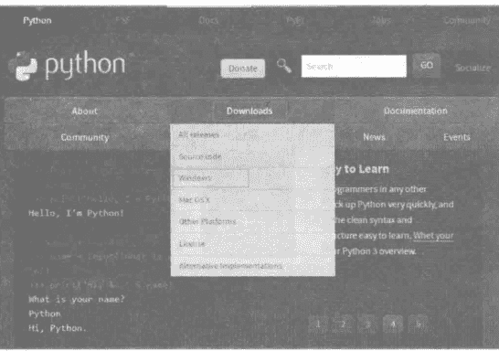

- * Python 3.7.2 - Dec. 24, 2018
  - Note that Python 3.7.2 cannot be used on Windows XP or earlier.
  - * Download Windows help file
  - * Download Windows x86-64 embeddable zip file
  - * [x] Download Windows x86-64 executable installer
  - * Download Windows x86-64 web-based installer
  - * Download Windows x86 embeddable zip file
  - * Download Windows x86 executable installer
  - * Download Windows x86 web-based installer
- * Python 3.6.8 - Dec. 24, 2018
  - Note that Python 3.6.8 cannot be used on Windows XP or earlier.
  - * Download Windows help file
  - * Download Windows x86-64 embeddable zip file
  - * [x] Download Windows x86-64 executable installer
  - * Download Windows x86-64 web-based installer
  - * Download Windows x86 embeddable zip file
  - * Download Windows x86 executable installer
  - * Download Windows x86 web-based installer

图 1.3 Python 官网下载链接

**步骤 2：安装配置**
双击运行安装包，界面见图 1.4。提供两种模式：
*   **默认安装**：一键部署至系统盘默认路径，**新手首选**。
*   **自定义安装**：可配组件与路径（如 `D:\Program Files\Python36\`）。

**关键动作**：**务必勾选 `Add Python 3.6 to PATH`** 将解释器写入系统环境变量，便于 CMD 直接调用 `python` 命令。漏勾可事后手动补齐。

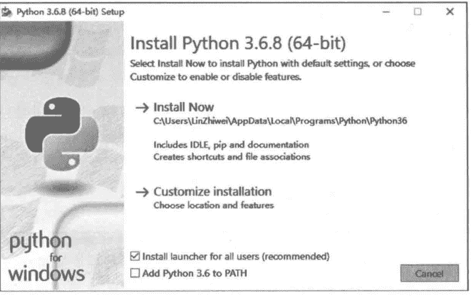

图 1.4 Python 安装界面

**步骤 3：目录结构速览**
安装后打开目录（见图 1.5）：
*   `python.exe`：核心解释器。
*   `Doc`：官方文档与新特性说明。
*   `Lib`：标准库 + 第三方库（位于 `Lib\site-packages\`）。

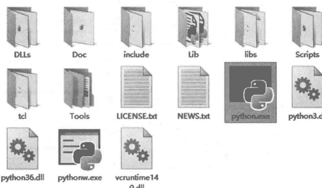

图 1.5 Python 安装目录

**步骤 4：Hello World 验证**
双击 `python.exe` 启动交互式环境（见图 1.6），版本信息显示正常即成功。
输入 `print("Hello Python!")` 回车，输出字符串，编程之旅正式启航！
可尝试 `1+1` 或 `sum(range(101))` 等内置函数玩法。环境变量配妥后，CMD 直接敲 `python` 同样进入；`python -V` 查版本。

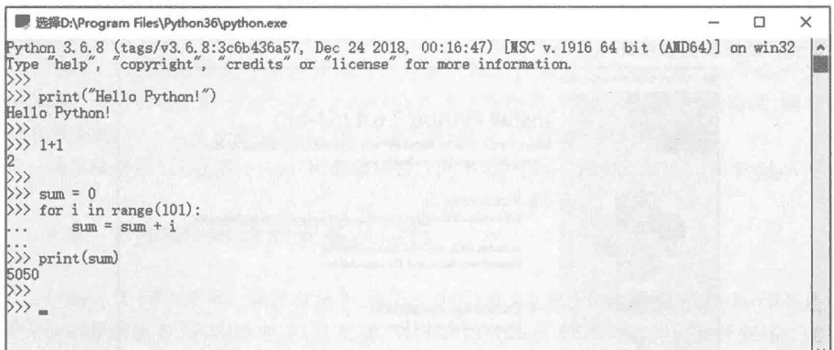

图 1.6 Python 解释器运行窗口

# 运行脚本与环境配置：从命令行到 PyCharm 实战指南

通常而言，我们不习惯直接在命令行窗口（如图 1.6 所示）敲写 Python 代码，尤其是逻辑繁杂的程序。主流做法是将业务逻辑封装进脚本文件，再调用 Python 解释器执行。例如，在 D 盘根目录新建 `test.py` 并写入代码，随后在 Windows 终端输入 `python D:\test.py` 即可运行并查看结果，效果参考图 1.7。

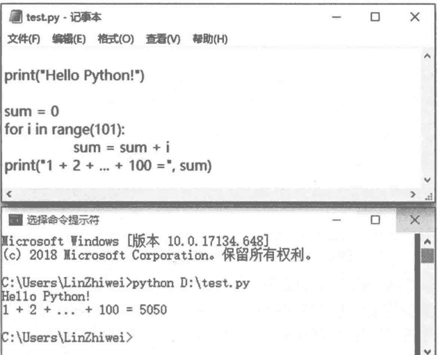

图 1.7 Python 脚本文件演示

此外，Python 官方自带了一款轻量级开发工具——IDLE。它既支持交互式输入命令，也能创建并运行脚本。不过 IDLE 功能单薄，无法管理项目文件。稍后在 1.4 节，我们将重点讲解功能全面的主流 IDE——PyCharm；在此之前，先掌握第三方库的安装方法。

## 1.3 Python 第三方库安装

Python 近年大火，除语法平缓易学外，庞大的第三方生态系统功不可没。开发时遇到的功能需求，往往已有现成库可用：解析 PDF 用 `PDFMiner`，处理图像用 `OpenCV` 或 `pillow`，串口通信用 `pyserial`，科学计算用 `numpy`、`Scipy`、`Matplotlib`，游戏开发用 `Pygame`、`cocos2d`，人工智能首选 `Tensorflow`、`PyTorch`……几乎所有可想象的领域，都能找到对应的 Python 库。

安装极其简便：打开 Windows 终端，执行 `pip install 库名` 即可。如图 1.8 所示，装串口库只需 `pip install pyserial`，装数值库只需 `pip install numpy`。`pip` 会自动识别当前 Python 版本，从源站下载兼容包并安装至本地，成功后提示 `Successfully installed 库名`。卸载同理，执行 `pip uninstall 库名`，如 `pip uninstall pyserial`。

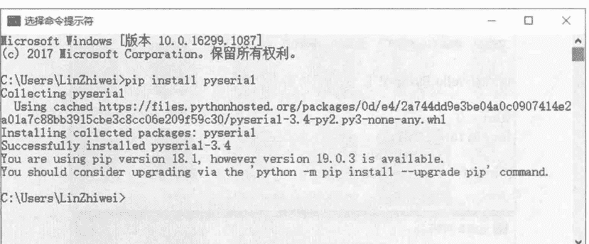

图 1.8 使用 pip install 安装 Python 第三方库

安装完成后，在代码文件头部添加 `import 库名` 即可引用，如 `import serial`。

默认情况下，第三方库安装在 `Lib\site-packages\` 目录下，可直接查看已装库。感兴趣可探索 PyPI（Python Package Index，官网 https://pypi.org/），这是官方中央仓库，支持库的下载与上传。`pip install` 默认即从此处拉取资源。

## 1.4 Python 集成开发环境

“工欲善其事，必先利其器。”虽仅装官方解释器配合文本编辑器也能写代码，但效率低下。市面上 Python IDE 众多：Vim、Eclipse with PyDev、Sublime Text、PyCharm、Wing、VS Code、Anaconda 等。它们大同小异，核心功能涵盖调试、语法高亮、项目管理、智能提示、补全、跳转等。本书选用 JetBrains 出品的 PyCharm 作为主力开发工具。

PyCharm 官网下载地址：http://www.jetbrains.com/pycharm/。进入下载页可见两个版本：**专业版** 功能全集，适配 Python 及 Web 专业开发，收费但提供 30 天试用；**社区版** 轻量免费开源，面向科研与初学者，功能已足够日常使用，建议下载最新社区版。

安装流程简单，无特殊目录要求时一路“下一步”默认安装即可。桌面快捷方式启动后，首次需做基础配色等初始化，保持默认即可。

启动后进入欢迎页（图 1.9），点击 **Create New Project** 新建项目，或 **Open** 打开现有项目。我们选择新建，进入配置页（图 1.10）。


图 1.9 PyCharm 欢迎页面

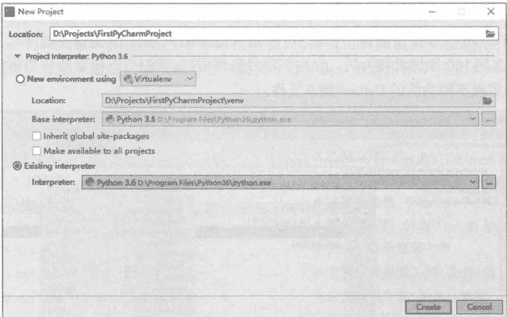

图 1.10 PyCharm 新建项目页面

在 **Location** 填写项目存放路径及名称，示例置于 `D:\Projects\FirstPyCharmProject`。关键步骤在 **Project Interpreter**：建议选 **Existing Interpreter**，指向先前安装的 Python 解释器路径。若选 **New environment**，PyCharm 会将解释器及库文件复制到项目目录，仅会增加体积无实质收益。点击 **Create** 完成创建，进入主界面（图 1.11）。

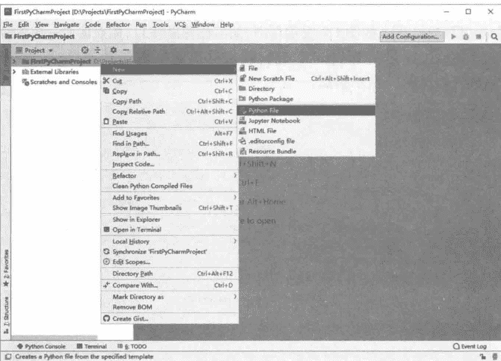

### 图 1.11 PyCharm 集成开发环境主界面

主界面左侧为项目管理面板，右侧为代码编辑区。新建脚本：右键项目文件夹 → **New** → **Python File**，命名如 `Hello Python`。

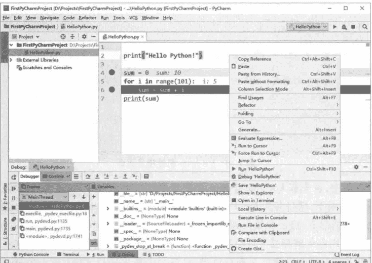

### 图 1.12 PyCharm 主界面代码编辑及调试运行

首次运行：在左侧选中脚本文件或右侧激活编辑标签页，右键选择 **Run 'Hello Python'** 直接运行，或 **Debug 'Hello Python'** 调试运行。调试模式下，若代码打了断点（图 1.12 红圆点标记），程序会在断点暂停，支持单步执行并通过 **Variables** 窗口监控变量值。

本节速览了 PyCharm 从安装、建项目、建脚本到编写调试的核心流程。更多进阶用法请参考自带 Help 文档或网络教程。

## 1.5 Python 语法速览

本书旨在用 Python 实战有趣项目，非系统教语法，故仅做提纲挈领式梳理。欲系统学习请阅读专业书籍或教程。

### 1.5.1 核心数据类型

Python 内置 5 大标准类型：**Numbers（数字）**、**String（字符串）**、**List（列表）**、**Tuple（元组）**、**Dictionary（字典）**。其中 Numbers 细分为 `int`（整型）、`long`（长整型）、`float`（浮点型）、`complex`（复数）。

Python 属动态弱类型语言，变量无需声明类型，由赋值决定；命名首字符必须为字母或下划线，建议小写字母开头。赋值示例：

| | 变量赋值操作 | 1-1 |
|---|---|---|
| 1 | `counter = 100` | `# 整型` |
| 2 | `miles = 1000.0` | `# 浮点型` |
| 3 | `city = "Hangzhou"` | `# 字符串，单双引号通用` |
| 4 | `flag = True` | `# 布尔型，True/False` |
| 5 | `a = b = c = 1` | `# 多变量赋同值` |
| 6 | `name, age, sex = '张三', 23, '男'` | `# 多变量赋异值` |
| 7 | `names = ['Jim', 'Tom', 'Kate']` | `# 列表` |
| 8 | `classes = ('English', 'math', 'physics')` | `# 元组` |
| 9 | `students = {'Jim': 10, 'Tom': 11, 'Kate': 9}` | `# 字典` |

**符号区分**：列表用 `[ ]`，元组用 `( )`，字典用 `{ }`。列表/元组元素为单值，字典为键值对。**可变性差异**：列表与字典支持动态增删改元素；元组一旦定义，长度与内容均不可变。

常用列表/字典操作速查：

| | 列表和字典操作 | 1-2 |
|---|---|---|
| 1 | `# 列表` | |
| 2 | `names = []` | `# 空列表` |
| 3 | `names.append('Jim')` | `# 尾部追加` |
| 4 | `names.append('Tom')` | |
| 5 | `names.append('Kate')` | |
| 6 | `names.remove('Tom')` | `# 按值删首个匹配项` |
| 7 | `del names[1]` | `# 按索引删` |
| 8 | `names.clear()` | `# 清空` |
| 9 | `# 字典` | |
| 10 | `students = {}` | `# 空字典` |
| 11 | `students['Jim'] = 10` | `# 新增/更新键值对` |
| 12 | `students['Tom'] = 11` | |
| 13 | `students['Kate'] = 9` | |
| 14 | `del students['Tom']` | `# 按键删` |
| 15 | `students.clear()` | `# 清空` |

遍历模式：

| | 列表/元组、字典遍历 | 1-3 |
|---|---|---|
| 1 | `# 列表遍历` | |
| 2 | `names = ['Jim', 'Tom', 'Kate']` | |
| 3 | `for x in names:` | |
| 4 | `print(x)` | `# 缩进标识代码块，用 Tab` |
| 5 | `# 字典遍历` | |
| 6 | `students = {'Jim': 10, 'Tom': 11, 'Kate': 9}` | |
| 7 | `# 遍历键` | |
| 8 | `for key in students.keys():` | |
| 9 | `print(key, students[key])` | |
| 10 | `# 遍历值` | |
| 11 | `for val in students.values():` | |
| 12 | `print(val)` | |
| 13 | `# 遍历键值对` | |
| 14 | `for key, val in students.items():` | |
| 15 | `print(key, val)` | |

### 1.5.2 常用运算符

内置算术、比较、逻辑运算符，速查表 1.1：

| 类别 | 运算符 | 说明 |
|---|---|---|
| 算术 | `+` | 加 / 字符串拼接 |
| 算术 | `-` | 减 / 负号 |
| 算术 | `*` | 乘 / 序列重复 |
| 算术 | `/` | 除 |
| 算术 | `%` | 取模（余数） |
| 算术 | `//` | 整除（商的整数部分） |
| 算术 | `**` | 幂运算 |
| 比较 | `==` | 等于 |
| 比较 | `!=` | 不等于 |
| 比较 | `>` | 大于 |
| 比较 | `<` | 小于 |
| 比较 | `>=` | 大于等于 |
| 比较 | `<=` | 小于等于 |
| 逻辑 | `and` | 与（全真才真） |
| 逻辑 | `or` | 或（一真即真） |
| 逻辑 | `not` | 非（取反） |

### 1.5.3 流程控制

程序执行三大结构：**顺序**、**选择**、**循环**。顺序结构平铺直叙，重点看后两者。

**选择结构** 由 `if`、`elif`、`else` 引导。双分支用 `if-else`，多分支引入 `elif`。示例：

```
score = int(input( " 请输入您的总分：") )      # 输入分数
if score >= 95:                 # if 条件输入后必须输入冒号
    print('优')
elif score >= 85:
    print('良')
elif score >= 70:
    print('中')
elif score >= 60:
    print('合格')
else:
    print('不及格')
```

**关键点**：`elif` 链中，自上而下判断，**首个条件成立即执行对应块并跳出整个 if 结构**，后续分支不再评估。

简化二选一场景，可用**三元运算符**单行搞定：

```
x if b else y
#### Python 中的三目运算
```

含义：`b` 为真返回 `x`，假返回 `y`。对比 C 系语言的 `?:` 写法：

```
b ? x : y
#### C++、C####、Java 等语言中的三目运算
```

**循环结构** 用 `for` 或 `while`。`for` 适合已知迭代次数/遍历序列，常配合 `range()`；`while` 适合已知终止条件。示例：寻找 100 以内质数。

| | 循环结构：for 与 while | 1-5 |
|---|---|---|
| 1 | `# 寻找 100 以内质数并打印` | |
| 2 | `for number in range(1, 101):` | `# for 常搭配 range 生成范围` |
| 3 | `isPrime = True` | |

# Python 核心语法进阶：循环、函数、类与模块实战指南

## 循环控制与 range() 进阶用法

接着来看一段判断质数与合数的循环示例：

| 行号 | 代码 | 说明 |
|---|---|---|
| 4 | `for i in range(2, number):` | |
| 5 | `if number % i == 0:` | # 整除则 i 为因数，number 为合数 |
| 6 | `j = number / i` | # 计算配对因数 |
| 7 | `print("%d = %d * %d" % (number, i, j))` | # 输出合数分解式 |
| 8 | `isPrime = False` | |
| 9 | `break` | # 跳出当前 for 循环 |
| 10 | `if isPrime:` | |
| 11 | `print("%d 是一个质数" % number)` | # 无因数则为质数 |

紧接着演示了 `while` 循环筛选 100 以内 5 的倍数：

| 行号 | 代码 | 说明 |
|---|---|---|
| 12 | `# 循环结构，while 语句，寻找 100 以内 5 的倍数并打印` | |
| 13 | `val = 0` | # 初始化计数器 |
| 14 | `while (val <= 100):` | # 循环终止条件 |
| 15 | `val = val + 1` | |
| 16 | `if val % 5 == 0:` | |
| 17 | `print(val)` | |
| 18 | `else:` | |
| 19 | `continue` | # 不满足条件直接进入下一轮 |

**知识点拓展**：`range(1, 101)` 生成 1~100 的整数序列（步长默认 1）。若需隔一个取一个，只需加第三个参数：`range(1, 101, 2)`。实际开发中 `range` 与 `for` 搭配极为常见，用于精确控制迭代次数。

流程控制关键字 `break` 与 `continue` 区别要记牢：
- `break`：直接终结**当前层**循环
- `continue`：跳过本轮剩余语句，直奔下一次迭代

---

## 1.5.4 函数：封装复用的基石

函数能大幅提升代码模块化程度与复用率。Python 内置了 `input`、`print` 等大量现成函数，开箱即用。

与强类型语言（需声明返回类型、参数类型）不同，Python 属于弱类型语言，**定义函数时无需指定返回类型与参数类型**，语法极其精简。

### 基础定义与调用

```python
# 定义一个通用求和函数
def add(a, b):          # def 关键字不可少；add 为函数名；a,b 为形参
    result = a + b      # 函数体：完成核心逻辑
    return result       # 将结果返回给调用处

# 调用示例
x, y = 1, 2
z = add(x, y)
print(z)                # 输出 3

# 同一函数直接支持字符串拼接
u, v = 'I am ', 'a student.'
w = add(u, v)
print(w)                # 输出 "I am a student."
```

**关键规则速记**：
- `def` 后跟函数名，命名规范同变量（首字符建议小写字母）
- 参数放在圆括号内，**不写类型**，个数随意（0 个或多个）
- 函数体**必须缩进**，这是 Python 语法硬性要求
- 需要输出结果时用 `return`；无 `return` 或 `return` 无表达式则返回 `None`

> **Python 的“魔力”**：同一个 `add` 函数既能加数字，又能拼字符串，甚至支持列表合并。这得益于 Python 的**动态类型**与**鸭子类型**机制——类似 C++ 模板却比模板更直观、零门槛。

### 默认参数：让调用更灵活

若某参数在大多数场景下取值固定，可在定义时给默认值：

```python
def add(a, b=7):        # b 默认为 7
    return a + b

print(add(5))           # 12，b 取默认值
print(add(4, 5))        # 9，全显式传参
print(add(a=1, b=2))    # 3，关键字传参（顺序可变）
```

**实战价值**：减少重复传参、降低记忆负担、提升大型函数易用性。

### 多返回值：Python 独有的优雅

一条 `return` 语句可同时返回多个结果，自动打包成元组：

```python
def hybrid(a, b):
    return a + b, a - b, a * b, a / b   # 一次性返回四则运算结果

x, y, z, w = hybrid(8, 2)               # 解包赋值：x=10, y=6, z=16, w=4.0
print(hybrid(10, 5))                    # 直接打印元组：(15, 5, 50, 2.0)
```

这在 C++/Java/C# 中需用结构体/类/输出参数实现，Python 原生支持，极大简化坐标变换、统计指标计算等多返回场景。

---

## 1.5.5 类：面向对象的核心载体

Python 是地道的面向对象语言。用 `class` 关键字定义类，**类名首字母大写**，冒号结尾。

### 动态绑定属性（不推荐常规开发）

```python
class People:
    pass                    # 占位符，暂不实现任何内容

p = People()                # 实例化对象
p.name = 'Jim'              # 运行时动态绑定属性
p.age = 11
print(p.name, p.age)        # Jim 11
```

> ⚠️ 虽然 Python 允许随时给对象“拍脑袋”加属性，但**严重损害可读性与维护性**。工程实践中，请统一在 `__init__` 中声明。

### 规范写法：`__init__` 初始化 + `__str__` 友好显示 + 业务方法

```python
class People:
    def __init__(self, name, age):   # 构造器，self 必填且居首
        self.name = name             # 绑定实例属性
        self.age = age

    def __str__(self):               # 定义 print(obj) 的行为
        return '%s: %d' % (self.name, self.age)

    def talk(self):                  # 实例方法，self 自动绑定
        print('I am %s, %d years old.' % (self.name, self.age))

# 使用
p = People('Jim', 11)                # 传参自动传给 __init__
print(p)                             # Jim: 11  —— 调用 __str__
p.talk()                             # I am Jim, 11 years old.
```

**核心要点**：
- `self` 代表实例本身（类比 C++/Java 的 `this`），**所有实例方法第一参数必须是 `self`**
- 调用方法时**无需手动传 `self`**，解释器自动注入
- `__init__` 完成初始化后，实例化才能带参数：`People('Jim', 11)`
- `__str__` 让 `print(对象)` 输出可读字符串，而非默认的 `<__main__.People object at 0x...>`

### 继承与方法重写：建立“Is-A”关系

现实中“人”可细分为“学生”“教师”。用继承复用父类逻辑，子类再扩展差异：

```python
class Student(People):               # 括号内写父类名
    def talk(self):                  # 重写父类 talk
        print('I am %s, %d years old. I am a student' % (self.name, self.age))

    def learn(self):                 # 子类专有方法
        pass

class Teacher(People):
    def talk(self):                  # 重写父类 talk
        print('I am %s, %d years old. I am a teacher' % (self.name, self.age))

    def teach(self):                 # 子类专有方法
        pass
```

**机制解读**：
- 子类定义时 `class Student(People)` 即完成继承
- 子类**可重写（覆盖）父类方法**，实现差异化行为
- 若子类**未重写**，调用时自动向上查找父类实现
- 子类可新增父类没有的方法（如 `learn`、`teach`），体现特有能力

```
def teach(self):
    pass
#### 类的使用
student = Student('Jim', 11) # 定义一个 Student 对象
student.talk() # talk 函数调用，输出：I am Jim, 11 years old. I am a student.
teacher = Teacher('Tim', 31) # 定义一个 Teacher 对象
teacher.talk() # talk 函数调用，输出：I am Tim, 31 years old. I am a teacher.
```

---

## 1.6 Python 模块：工程化组织代码的单元

实际项目中，将相关的**类、函数、常量**聚合在同一个 `.py` 文件中，该文件即为一个**模块**。

### 创建模块：`Circle.py`

```
PI = 3.1415926 # 定义变量，圆周率 π
class Circle: # 定义类，圆
    def __init__(self, radius):
        self.radius = radius # 绑定 radius 属性
    def area(self): # 计算圆面积函数
        return self.radius * self.radius * PI
def compare(circle1, circle2): # 在类外定义函数，比较两圆面积是否相等
    if circle1.area() != circle2.area():
        return 'Not equal'
    else:
        return 'Equal'
### 模块测试
if __name__ == '__main__': # Python main 函数写法
    c1 = Circle(2) # 创建两个圆，半径分别为 2 和 3
    c2 = Circle(3)
    print(c1.area()) # 输出：12.5663704
    print(compare(c1, c2)) # 输出：Not equal
```

> 模块内定义了常量 `PI`、类 `Circle`（含 `radius` 属性与 `area()` 方法）、函数 `compare()` 及规范的 `main()` 入口。  
> `if __name__ == '__main__':` 块仅在**直接运行该文件**时执行，方便单元测试；被 `import` 时**不执行**，避免副作用。

### 使用模块：两种导入姿势

#### 方式一：`import 模块名` —— 带命名空间前缀（推荐大型项目）

```python
# Test1.py
import Circle

if __name__ == '__main__':
    c1 = Circle.Circle(2)
    c2 = Circle.Circle(3)
    print(c1.area())                # 12.5663704
    print(Circle.compare(c1, c2))   # Not equal
    print(Circle.PI)                # 3.1415926
```

**特点**：引用时必须加 `Circle.` 前缀，命名空间隔离清晰，避免同名冲突。

#### 方式二：`from 模块名 import *` —— 直接裸用（适合脚本/交互）

```python
# Test2.py
from Circle import *                # 导入所有公开成员

if __name__ == '__main__':
    c1 = Circle(2)
    c2 = Circle(3)
    print(compare(c1, c2))          # Not equal
    print(PI)                       # 3.1415926
```

**进阶用法**：按需导入，减少命名空间污染
```python
from Circle import PI               # 仅导入常量
from Circle import Circle           # 仅导入类（注意同名）
```

> ⚠️ `import *` 便利但易引发命名冲突，**生产环境建议显式导入**或使用 `import 模块名 as 别名`。

---

## 本章小结

| 知识模块 | 核心要点 |
|---|---|
| **循环进阶** | `range(start, stop, step)` 灵活生成序列；`break` 跳出层循环，`continue` 跳过本轮 |
| **函数定义** | `def` 无需类型声明；支持默认参数、`*args/**kwargs`、多返回值（元组解包） |
| **面向对象** | `class` 定义类；`__init__` 规范初始化；`self` 绑定实例；继承用 `Child(Parent)`，重写实现多态 |
| **模块机制** | `.py` 文件即模块；`import` 带前缀，`from ... import` 裸用；`__name__ == '__main__'` 守护测试代码 |

掌握这四大支柱，你就拥有了编写结构清晰、可复用、可扩展 Python 程序的完整工具箱。下一章我们将深入标准库与第三方包生态，解锁更强大的工程能力！

# 第 1 章 Python 语言速览

本章对当下炙手可热的 Python 编程语言进行了精炼入门级的梳理。内容涵盖了 Python 的发展源流、解释器部署与第三方包安装，并重点演示了主流集成开发环境 PyCharm 的项目构建与代码调试技巧。语法层面，我们浓缩了数据类型、运算符、流程控制、函数定义及面向对象编程（类）等核心知识点，同时也阐述了模块的组织与调用机制。特别提示：全书将 Python 视作落地创意的利器，此处旨在助读者快速上手；若渴望系统深造，建议另寻专业教材或权威文档。

## 课后思考

1.  简析 Python 与其他主流编程语言相比的长板与短板。
2.  配置 Python 环境变量的具体步骤是？这么做意在何为？
3.  列举 Python 第三方库的安装途径及其默认落地路径。
4.  对比阐述元组、列表、字典三大数据结构的表达形式与本质差异。
5.  概括类与模块的定义方式及其根本区别。
6.  自查资料，探究 Python 类中属性“后期绑定”的实现原理。

# 第 2 章 基础计算几何库构建

## 章节导读

本章将引导读者动手实践，借助 Python 在三维空间里从零打造一套专属的计算几何基础库。该库将囊括点、线、面、向量、矩阵等核心几何实体，并实现点线/点面距离计算、直线/面片求交、点多边形包含性判断等基础算法。我们首先从三维点、向量及矩阵的数学定义切入。

## 2.1 核心几何实体：点、向量与矩阵

依照过往认知，三维笛卡尔坐标系下的点位由 (x, y, z) 三分量唯一锚定。虽直观，却难以将平移、旋转、缩放等几何变换统一纳入矩阵乘法框架。为此，本书摒弃笛卡尔表示，改用**齐次坐标**体系——以 N+1 维坐标编码 N 维空间信息。

### 2.1.1 点的齐次表达

设空间点 P 的笛卡尔坐标为 $(x_c, y_c, z_c)$，对应齐次坐标为 $(x, y, z, w)$，二者换算法则为：$x_c = x/w, y_c = y/w, z_c = z/w$。由此，单一笛卡尔坐标可映射无限组齐次坐标。例如 $(2, 3, 4)$ 既可表为 $(2, 3, 4, 1)$，亦可表为 $(4, 6, 8, 2)$。当 $w \neq 0$ 时，齐次坐标唯一对应一个笛卡尔点；若 $w = 0$，换算分母为零，我们约定此为**无穷远点**（理想点）。

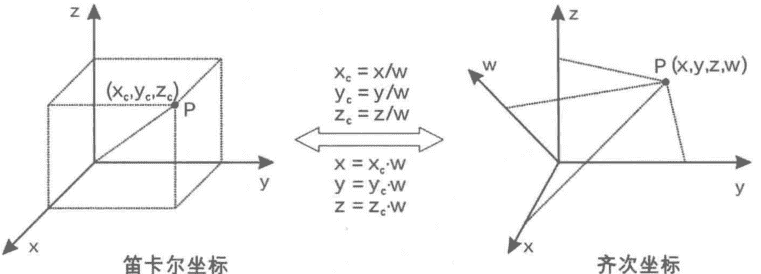

图 2.1 笛卡尔与齐次坐标互换示意

工程实践中，非无穷远点习惯令 $w=1$，即 $(x, y, z, 1)$，使齐次坐标前三分量数值与笛卡尔坐标对齐，降低认知负荷。

### 2.1.2 向量的齐次表达

向量刻画两点间的位置关系，虽同用坐标标识，但本质迥异：点具位置属性，向量仅具方向与模长，平移不变性意味着其可视作源自无穷远。故向量齐次坐标强制末位 $dw=0$，记为 $(dx, dy, dz, 0)$。

向量可视为点 $P_1(x_1, y_1, z_1, 1)$ 指向 $P_2(x_2, y_2, z_2, 1)$ 的位移增量 $\vec{V} = (x_2-x_1, y_2-y_1, z_2-z_1, 0)$。定义点向加减运算：

- $\vec{V} = P_2 - P_1$  (2-1)
- $P_2 = P_1 + \vec{V}$  (2-2)
- $P_1 = P_2 - \vec{V}$  (2-3)

公式 (2-1) 表明向量由两点差得出，方向指向被减点；(2-2)(2-3) 揭示点可通过向量平移生成新点。

### 2.1.3 矩阵与几何变换

矩阵编码点点、向向、点向间的复杂映射。本书约定：点视为 1×4 行矩阵，变换通过**右乘** 4×4 齐次矩阵完成，向量同理。如图 2.2，16 个元素分区掌管不同变换：左上 3×3 块 ($a_{00}\sim a_{22}$) 负责旋转，底行三元组 ($a_{30}, a_{31}, a_{32}$) 掌管平移，主对角线 ($a_{00}, a_{11}, a_{22}$) 控制缩放。

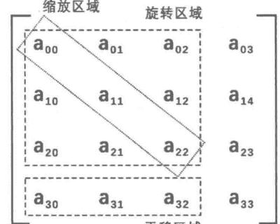

图 2.2 四阶齐次矩阵功能分区图

**平移矩阵 $M_t$**  
仅赋值底行 $t_x, t_y, t_z$：  
$P' = P \cdot M_t = (x,y,z,1) \begin{bmatrix} 1&0&0&0\\0&1&0&0\\0&0&1&0\\t_x&t_y&t_z&1 \end{bmatrix} = (x+t_x, y+t_y, z+t_z, 1)$  (2-4)

**缩放矩阵 $M_s$**  
仅赋值主对角线 $s_x, s_y, s_z$：  
$P' = P \cdot M_s = (x,y,z,1) \begin{bmatrix} s_x&0&0&0\\0&s_y&0&0\\0&0&s_z&0\\0&0&0&1 \end{bmatrix} = (x s_x, y s_y, z s_z, 1)$  (2-5)

**旋转矩阵**  
任意轴旋转可分解为绕 X/Y/Z 轴序列旋转。设旋转角 $\theta$，正角按右手螺旋规则（逆时针）：

绕 X 轴：$M_{rx}(\theta) = \begin{bmatrix} 1&0&0&0\\0&\cos\theta&\sin\theta&0\\0&-\sin\theta&\cos\theta&0\\0&0&0&1 \end{bmatrix}$  (2-6)

绕 Y 轴：$M_{ry}(\theta) = \begin{bmatrix} \cos\theta&0&-\sin\theta&0\\0&1&0&0\\\sin\theta&0&\cos\theta&0\\0&0&0&1 \end{bmatrix}$  (2-7)

绕 Z 轴：$M_{rz}(\theta) = \begin{bmatrix} \cos\theta&\sin\theta&0&0\\-\sin\theta&\cos\theta&0&0\\0&0&1&0\\0&0&0&1 \end{bmatrix}$  (2-8)

以 Z 轴为例，点 $P$ 旋转后坐标为：  
$P' = (x\cos\theta - y\sin\theta,\; x\sin\theta + y\cos\theta,\; z,\; 1)$  (2-9)

**复合变换**  
实际操作常涉及多变换组合，需严格按顺序右乘对应矩阵，**不可交换顺序**。例如：先绕 Z 转 $\theta_1$，再绕 Y 转 $\theta_2$，继而平移、缩放：  
$P' = P \cdot M_z(\theta_1) \cdot M_y(\theta_2) \cdot M_t \cdot M_s$  (2-10)

### 2.1.4 几何基础模块：Python 代码落地

本节将上述数学实体封装为三大核心类 —— `Point3D`、`Vector3D`、`Matrix3D`，置于 `GeomBase.py`（Geometry Base 缩写）中，作为后续几何运算的基石。完整实现如下：

| GeomBase.py | 几何基础库：点、向量、矩阵及互操作定义 | 代码清单 2-1 |
|---|---|---|

```python
1  import math                     # 引入数学库
2  epsilon = 1e-7                  # 定义极小阈值 10^-7
3  epsilonSquare = epsilon * epsilon  # 阈值平方
4  
5  class Point3D:                  # 三维点类
6      def __init__(self, x=0.0, y=0.0, z=0.0, w=1.0):
7          self.x, self.y, self.z, self.w = x, y, z, w
8  
9      def __str__(self):          # 打印友好显示
10         return 'Point3D: %s, %s, %s' % (self.x, self.y, self.z)
11
12     def clone(self):             # 深拷贝当前点
13         return Point3D(self.x, self.y, self.z, self.w)
14
15     def pointTo(self, other):    # 当前点指向 other 的向量
16         return Vector3D(other.x - self.x, other.y - self.y, other.z - self.z)
17
18     def translate(self, vec):    # 就地平移
19         self.x, self.y, self.z = self.x + vec.dx, self.y + vec.dy, self.z + vec.dz
20
21     def translated(self, vec):   # 平移生成新点
22         return Point3D(self.x + vec.dx, self.y + vec.dy, self.z + vec.dz)
23
24     def multiplied(self, m):     # 右乘矩阵生成新点
25         x = self.x * m.a[0][0] + self.y * m.a[1][0] + self.z * m.a[2][0] + self.w * m.a[3][0]
26         y = self.x * m.a[0][1] + self.y * m.a[1][1] + self.z * m.a[2][1] + self.w * m.a[3][1]
27         z = self.x * m.a[0][2] + self.y * m.a[1][2] + self.z * m.a[2][2] + self.w * m.a[3][2]
28         return Point3D(x, y, z)
29
30     def distance(self, other):       # 两点欧氏距离
31         return self.pointTo(other).length()
32
33     def distanceSquare(self, other): # 距离平方
34         return self.pointTo(other).lengthSquare()
35
36     def middle(self, other):         # 中点坐标
37         return Point3D((self.x + other.x)/2, (self.y + other.y)/2, (self.z + other.z)/2)
38
39     def isCoincide(self, other, dis2=epsilonSquare):  # 依距离判重合
40         return True if self.pointTo(other).lengthSquare() < dis2 else False
41
42     def isIdentical(self, other):    # 精确坐标比对
43         return True if self.x == other.x and self.y == other.y and self.z == other.z else False
44
44     # 运算符重载
45     def __add__(self, vec):          # 点 + 向量 = 平移后新点
46         return self.translated(vec)
47
48     def __sub__(self, other):        # 点 - 点 = 向量；点 - 向量 = 逆向平移
49         return other.pointTo(self) if isinstance(other, Point3D) else self.translated(other.reversed())
50
51     def __mul__(self, m):            # 点 * 矩阵 = 变换后新点
52         return self.multiplied(m)
53
54 class Vector3D:                 # 三维向量类
55     def __init__(self, dx=0.0, dy=0.0, dz=0.0, dw=0.0):
56         self.dx, self.dy, self.dz, self.dw = dx, dy, dz, dw
57
58     def __str__(self):
59         return ' Vector3D: %s, %s, %s ' % (self.dx, self.dy, self.dz)
60
61     def clone(self):             # 向量拷贝
62         return Vector3D(self.dx, self.dy, self.dz, self.dw)
63
64     def reverse(self):           # 就地取反
65         self.dx, self.dy, self.dz = -self.dx, -self.dy, -self.dz
66
67     def reversed(self):          # 取反生成新向量
68         return Vector3D(-self.dx, -self.dy, -self.dz)
69
70     def dotProduct(self, vec):   # 点积
71         return self.dx * vec.dx + self.dy * vec.dy + self.dz * vec.dz
72
73     def crossProduct(self, vec): # 叉积
74         dx = self.dy * vec.dz - self.dz * vec.dy
75         dy = self.dz * vec.dx - self.dx * vec.dz
76         dz = self.dx * vec.dy - self.dy * vec.dx
77         return Vector3D(dx, dy, dz)
78
79     def amplify(self, f):        # 数乘放大
```

### 2.1.5 深度剖析：几何基础核心模块

接下来，我们将逐一拆解 `GeomBase` 模块中的三大基石类——`Point3D`、`Vector3D` 与 `Matrix3D`。重点在于 `Point3D` 类，我们将对其内部机制进行详尽阐述。

#### **Point3D：三维空间中的锚点**

`Point3D` 采用齐次坐标系（x, y, z, w）描述空间位置，其中 `w` 分量默认为 1 且通常保持不变。类中封装了操作点的核心接口：
*   **构造与显示**：`__init__` 负责初始化，`__str__` 定义打印输出格式（前文已介绍过类似机制）。
*   **深拷贝机制**：`clone` 方法在内存中生成完全独立的副本，修改原点坐标不影响新点，这在后续避免副作用时至关重要。
*   **指向向量生成**：`pointTo` 接收另一个点为参数，计算并返回从当前点指向目标点的向量。
    > **示例**：`p1(1,1,1)` 指向 `p2(2,3,4)` 生成向量 `v(1,2,3)`。

*   **平移操作双形态**：
    *   `translate(v)`：原地修改，点坐标随向量 `v` 位移。
    *   `translated(v)`：非破坏性，返回新点，原坐标不变。
    *   **命名惯例**：动词原形（如 translate）暗示原地修改；过去分词（如 translated）暗示返回新对象。`__add__` 重载了 `+` 运算符，内部复用 `translated` 逻辑。
    > **验证**：`p1.translate(v)` 修改 p1；`p3 = p2.translated(v)` 与 `p4 = p2 + v` 效果等同，均生成新点 (3,4,5)，p2 保持原样。

*   **矩阵变换（右乘）**：`multiplied(m)` 实现点右乘矩阵（`P * M`），返回变换后的新点。设计上将乘法逻辑封装在 `Point3D` 内部，`Matrix3D` 不处理点运算。`__mul__` 重载 `*` 运算符提供语法糖。
    > **验证**：点 (1,1,1) 乘以平移矩阵 (1,2,3) 得到新点 (2,3,4)。

*   **距离计算策略**：
    *   `distance`：计算真实欧氏距离，涉及开方运算。
    *   `distanceSquare`：计算距离平方，省去开方，**性能更优**。
    *   **工程应用**：在“最近邻搜索”等仅需比较大小的场景下，优先使用 `distanceSquare` 提升效率。底层实现上，`distanceSquare` 复用向量长度平方，`distance` 则在其基础上开方。

*   **重合与一致性判定**：
    *   `isCoincide`：**几何重合**判定。引入极小阈值 `epsilon`，距离小于该值即视为重合。此为工程首选，可抵消浮点数截断误差导致的理论重合点坐标不一致问题。
    *   `isIdentical`：**数值完全一致**判定。要求三维坐标逐分量精确相等。因浮点误差存在，几何计算中慎用。

---

#### **Vector3D：方向与大小的载体**

向量类同样采用齐次坐标 (dx, dy, dz, dw)，`dw` 默认 0，`d` 前缀寓意“增量/方向分量”。核心能力矩阵如下：

| 功能类别 | 方法对 | 语义区别 | 核心逻辑 |
| :--- | :--- | :--- | :--- |
| **取反** | `reverse` / `reversed` | 原地修改 / 返回新向量 | 各分量取反 |
| **点乘** | `dotProduct(other)` | 返回标量 | 判断夹角：>0 锐角，<0 钝角，=0 正交 |
| **叉乘** | `crossProduct(other)` | 返回向量 | 结果垂直于两输入向量（右手螺旋法则）；平行向量叉积为零向量 |

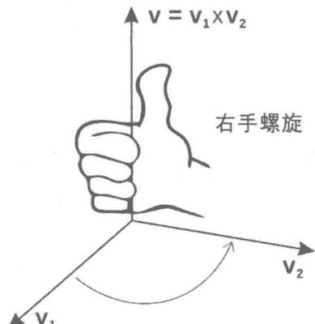

> **图解**：右手螺旋法则决定叉积方向（参考原图 2.3）。
> **平行判定推论**：叉积为零向量 ⇒ 平行。结合点乘符号可进一步区分同向/反向。

*   **缩放操作**：`amplify` (原地) 与 `amplified` (新对象)，分量乘以标量因子。
*   **长度计算**：`lengthSquare` (平方，高效) 与 `length` (模，含开方)。同距离计算策略，平方版用于比较场景。
*   **单位化**：`normalize` (原地) 与 `normalized` (新对象)，分量除以模长，生成单位向量。
*   **零向量检测**：`isZeroVector` 通过长度平方是否为 0 判断。
*   **矩阵变换**：`multiplied(m)` 实现向量右乘矩阵，返回新向量（齐次坐标 `dw=0` 确保不受平移分量影响）。
*   **夹角计算 `getAngle(vec)`**：返回 `[0, π]` 间夹角。
    1.  双方单位化。
    2.  计算点积 `dotPro`。
    3.  **关键容错**：浮点误差可能导致 `dotPro` 越界 `[-1, 1]`，直接送入 `acos` 会报错。**必须钳制**：`dotPro = max(-1, min(1, dotPro))`。
    4.  调用 `math.acos` 得出弧度。
*   **2D 专用工具**：
    *   `getOrthoVector2D()`：XY 平面内生成正交向量（处理 dx=0 边界情况）。
    *   `getAngle2D()`：计算与 X 轴正向夹角 `[0, 2π]`，利用 `dy` 符号判断象限修正。
*   **运算符重载**：`__add__`、`__sub__` (复用取反加加法)、`__mul__` (代理矩阵乘法)。

---

#### **Matrix3D：空间变换的算子**

4x4 齐次矩阵，行主序存储 `self.a[4][4]`，初始化为单位阵。

*   **基础接口**：`__str__` 格式化打印；`makeIdentical` 重置为单位阵。
*   **矩阵乘法 `multiplied(other)`**：标准 4x4 矩阵乘法（行×列），返回新矩阵。`__mul__` 重载 `*` 运算符。
*   **占位接口**：`getDeterminant` (行列式)、`getReverseMatrix` (逆矩阵)、`__add__`、`__sub__`、`createMirrorMatrix` (镜像) 标记为 `pass`，待后续扩展。
*   **静态工厂方法（核心变换生成器）**：
    *   `createTranslateMatrix(dx, dy, dz)`：修改第 4 行 (索引 3) 前三列。
    *   `createScaleMatrix(sx, sy, sz)`：修改主对角线前三项。
    *   `createRotateMatrix(axis, angle)`：按轴 (X/Y/Z) 填充对应 2x2 旋转子矩阵（sin/cos 布局），其余保持单位阵特性。

这套体系确立了 **点/向量区分（w=1/0）**、**不可变/可变命名规范**、**运算符语法糖** 及 **数值稳健性处理** 四大工程基因，为上层几何算法奠定坚实基础。

## 深度解析：3D几何核心类与线型实体的Python实战

### Matrix3D：四阶矩阵的“瑞士军刀”

收官之作，我们聚焦 `Matrix3D` 类。它内部封装了一个 4×4 的二维数组 `a`。实例化时，`__init__` 默认将其构建为单位矩阵；若后续需要重置，`makeIdentical` 方法也能完成单位化操作。矩阵乘法由 `multiplied` 承担，行列式求值交给 `getDeterminant`，求逆矩阵则调用 `getReverseMatrix`（前提是逆矩阵存在）。受限于篇幅，书中未给出后两者的具体代码，感兴趣的同学可翻阅线性代数教材自行补全。

更实用的是，类里预置了四个静态工厂方法，均以 `@staticmethod` 装饰：
- `createTranslateMatrix()`：生成平移矩阵
- `createScaleMatrix()`：生成缩放矩阵
- `createRotateMatrix()`：生成旋转矩阵
- `createMirrorMatrix()`：生成镜像矩阵

静态方法的优势显而易见——无需实例化即可直接用类名调用：
```python
mt = Matrix3D.createTranslateMatrix()  # 平移矩阵
ms = Matrix3D.createScaleMatrix()      # 缩放矩阵
```
书中已落地前三个，镜像矩阵留作练习。此外，类还重载了加、减、乘等运算符，让矩阵运算读写如同原生数值般自然。

---

## 2.2 直线、射线、线段：一维几何的“三兄弟”

上节搞定点、向量、矩阵三大基石，这节我们推进到一维线型实体：**直线、射线、线段**。

### 2.2.1 直线：无限延伸的秩序

数学上，直线是通过两个不同点、曲率为零、可双向无限延伸的曲线。初中平面几何用斜截式 `y = kx + b`，高中立体几何则常用**点向式**：
```
(x - x₀)/m = (y - y₀)/n = (z - z₀)/p
```
或**一般式**（两平面交线）：
```
A₁x + B₁y + C₁z + D₁ = 0
A₂x + B₂y + C₂z + D₂ = 0
```
点向式直观易懂，本书统一采用该形式。

代码落地在 `Line.py`，结构极简：
```python
from GeomBase import *

class Line:
    def __init__(self, P, V):
        self.P = P.clone()                 # 经过点
        self.V = V.clone().normalized()    # 方向向量（单位化）

    def __str__(self):
        return f"Line\nP {self.P}\nV {self.V}\n"
```
两个核心属性：`P`（Point3D）确定位置，`V`（Vector3D）锁定方向。

**关键细节**：`__init__` 中显式调用 `clone()` 而非直接赋值。Python、Java、C# 等语言采用引用传递，若不拷贝，外部修改原对象会意外篡改直线内部状态——这类 Bug 极其隐蔽。示例对比：
```python
p = Point3D(1, 2, 3)
v = Vector3D(4, 5, 6)
ln = Line(p, v)
print(ln)        # P: 1,2,3
p.x = 0          # 外部修改
print(ln)        # 若无 clone，P 变为 0,2,3 —— 灾难发生
```
养成防御性拷贝习惯，省去无数排查夜。

---

### 2.2.2 射线：单向无限的“光线”

射线仅一端固定、另一端无限延伸，本质仍是点向式，**几乎可以直接复用直线代码**。`Ray.py`：
```python
from GeomBase import *

class Ray:
    def __init__(self, P, V):
        self.P = P.clone()
        self.V = V.clone().normalized()

    def __str__(self):
        return f"Ray\nP {self.P}\nV {self.V}\n"
```
区别仅在语义：`P` 代表起点而非任意经过点。

---

### 2.2.3 线段：有的放矢的“尺子”

线段两端点固定，长度有限，**两点完全确定一段**。`Segment.py` 采用 `A`、`B` 命名端点，更符合直觉：
```python
from GeomBase import *

class Segment:
    def __init__(self, A, B):
        self.A, self.B = A.clone(), B.clone()

    def __str__(self):
        return f"Segment\nA {self.A}\nB {self.B}\n"

    def length(self):          # 长度
        return self.A.distance(self.B)

    def direction(self):       # 方向向量（A→B）
        return self.A.pointTo(self.B)

    def swap(self):            # 端点交换
        self.A, self.B = self.B, self.A
```
亮点：
- `length()`：调用点间距离
- `direction()`：获取所在直线方向
- `swap()`：利用 Python 元组解包 `a, b = b, a` 优雅交换，无需临时变量——这招在多段线拼接时极其好用。

---

## 2.3 多段线：点序列的“自由曲线”

前文三类线型最多两点，现实建模常需**多个空间点依次连接**形成的折线，即**多段线**（Polyline / PS-curve）。

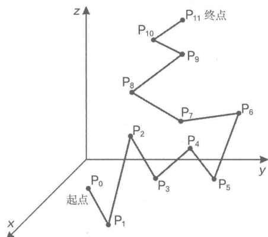

> **特性速览**  
> - 顶点有序连接，非乱序集合  
> - 至少 2 个顶点；顶点数 = 2 时退化为线段  
> - 首尾端点重合 → **闭合多段线**；否则为**开放多段线**  
> - 闭合且全顶点共面（如 XY 平面）→ 退化为**平面多边形**，后续章节高频使用

实现文件 `Polyline.py`，类名 `Polyline`：

| Polyline.py | 多段线类 | 2-9 |
|---|---|---|

```python
from GeomBase import *

class Polyline:
    def __init__( self ):
        self.points = []
    def __str__( self ):    # 定义 Polyline 被 print 时的显示行为
        if self.count() > 0:
            return 'Polyline\\nPoint number: %s\\nStart %s\\nEnd %s\\n\\' \\
            % ( self.count(), str( self.startPoint() ), str( self.endPoint() ) )
        else: return 'Polyline\\nPoint number: 0\\n'
    def clone( self ):    # 克隆一条多段线
        poly = Polyline()
        for pt in self.points:
            poly.addPoint( pt.clone() )
        return poly
    def count( self ):    # 获取多段线中点的数量
        return len( self.points )
    def addPoint( self, pt ):    # 在多段线末尾添加一个点
        self.points.append( pt )
    def addTuple( self, tuple ):    # 在多段线末尾添加一个点(元组形式)
        self.points.append( Point3D( tuple[0], tuple[1], tuple[2] ) )
    def raddPoint( self, pt ) :    # 在多段线起点前添加一个点,r 表示 reverse
        self.points.insert( 0, pt )
    def removePoint( self, index ):    # 根据点的序号移除一个点
        return self.points.pop( index )
    def point( self, index ):    # 根据点的序号获取一个点
        return self.points[ index ]
    def startPoint( self ):    # 获取起点
        return self.points[ 0 ]
    def endPoint( self ):    # 获取终点
        return self.points[ -1 ]
    def isClosed( self ):    # 判断多段线是否闭合
        if self.count() <= 2: return False
        return self.startPoint( ).isCoincide( self.endPoint( ) )
    def reverse( self ):    # 对多段线的点序进行反向操作
        sz = self.count( )
        for i in range( int( sz/2 ) ):
            self.points[ i ], self.points[ sz-1-i ] = self.points[ sz-1-i ], self.points[ i ]
    def getArea( self ):    # 当多段线在 XY 平面上闭合时,获取多边形面积
        area = 0.0
        for i in range( self.count() -1 ):
```

```python
41  area += 0.5 * ( self.points[i].x * self.points[i+1].y - self.points[i+1].x * self.points[i].y)
42  return area
43  def makeCCW( self ):                   # 将 XY 平面上的多边形调整成逆时针方向
44  if self.getArea() < 0: self.reverse()
45  def makeCW( self ):                    # 将 XY 平面上的多边形调整成顺时针方向
46  if self.getArea() > 0: self.reverse()
47  def isCCW( self ):                     # 判断多边形是否为逆时针方向
48  return True if self.getArea() > 0 else False
49  def translate( self, vec ):            # 根据一个向量平移多段线
50  for i in range( len( self.points ) ): self.points[ i ].translate( vec )
51  def appendSegment( self, seg ):        # 在多段线的开头或结尾添加一条线段
52  if self.count() == 0:                  # 如果添加成功，返回 True，否则返回 False
53  self.points.append( seg.A )
54  self.points.append( seg.B )
55  else:
56  if seg.A.isCoincide( self.endPoint() ): self.addPoint( seg.B )
57  elif seg.B.isCoincide( self.endPoint() ): self.addPoint( seg.A )
58  elif seg.A.isCoincide( self.startPoint() ): self.raddPoint( seg.B )
59  elif seg.B.isCoincide( self.startPoint() ): self.raddPoint( seg.A )
60  else: return False
61  return True
62  def writePolyline( path, polyline : Polyline ): # 将多边形保存到文本文件
63  f = None
64  try:
65  f = open( path,'w' )                      # 打开文件,w 表示 write,写文件
66  f.write( '%s\n '% polyline.count( ) )
67  for pt in polyline.points:
68  txt ='%s,%s,%s\n '% ( pt.x, pt.y, pt.z )
69  f.write( txt )
70  except Exception as ex:
71  print( ex )
72  finally:
73  if f: f.close( )
74  def readPolyline( path ):                 # 从文本文件读取多边形
75  f = None
76  try:
77  f, poly = open( path,'r' ), Polyline( ) # 打开文件,r 表示 read,读文件
78  number = int( f.readline( ) )
79  for i in range( number ):
80      txt = f.readline( )
81      txts = txt.split( ',' )                # 对形如'1, 2, 3'的字符串按照逗号分割成 3 个字符串
82      x, y, z = float( txts[0] ), float( txts[1] ), float( txts[2] )
83      poly.addPoint( Point3D( x, y, z ) )
84  return poly
85  except Exception as ex:
86      print( ex )
87  finally:
88      if f: f.close( )
```

前文已给出 `Polyline` 类的完整实现，其核心数据结构是一个存储 `Point3D` 对象的列表。代码逻辑大多直观易懂，且已添加注释，此处重点剖析几个稍具深度的关键方法。

**双向顶点追加：`addPoint` 与 `raddPoint`**
这两个方法均用于向多段线末端增加顶点，唯有方向相反。`addPoint` 遵循正向逻辑，将新顶点接在尾部；`raddPoint` 顾名思义（r 代表 reverse），则是将顶点插入头部，实现反向扩展。

**面积计算与方向判定：`getArea`**
该方法基于鞋带公式（Shoelace Formula）计算多边形在 XY 平面的投影面积，公式为：
$ S = \frac{1}{2} \sum_{i=0}^{n-1} (x_i y_{i+1} - x_{i+1} y_i) $

其返回值的正负蕴含着拓扑信息：**面积为正，顶点序列呈逆时针（CCW）排布；面积为负，则为顺时针（CW）**。这一特性被 `makeCCW` 与 `makeCW` 方法利用，可强制统一多边形绕序。感兴趣的读者不妨自行探索其他判定绕序的算法实现。

**线段拼接逻辑：`appendSegment`**
该方法尝试将一条独立线段无缝衔接至当前多段线末端。拼接的前提是：线段的两个端点与多段线的首尾端点中，必须存在一对几何重合的点。这衍生出四种拼接场景（详见原版图 2.5）。成败由布尔值返回。值得注意的是，判断重合采用了 `isCoincide` 函数而非直接坐标比对，这是为规避浮点运算截断误差而设的工程容差处理。

**持久化工具：`writePolyline` 与 `readPolyline`**
模块还提供了两个全局 IO 函数，用于多段线与自定义文本格式的互转。文件结构极简：首行记录顶点总数，后续各行依次存放 `x, y, z` 坐标三元组。代码中大量采用 `try-except-finally` 守护文件操作，这在 Python 处理磁盘、网络或串口等 IO 场景时，是构建健壮程序的必备范式。

---

## 2.4 平面

本节构建 `Plane` 类（位于 `Plane.py`）。回顾直线章节给出的平面方程（式 2-14），几何本质上，平面可定义为：空间中所有过定点 $P_0(x_0,y_0,z_0)$ 且垂直于法向量 $\vec{N}(A,B,C)$ 的直线集合。由此导出点法式方程：

$ A(x - x_0) + B(y - y_0) + C(z - z_0) = 0 \tag{2-16} $

向量化表达即两向量点积为零：
$ \vec{N} \cdot (\vec{P} - \vec{P_0}) = 0 \tag{2-17} $

因此，`Plane` 类仅需 **一个基点** 与 **一个单位法向量** 即可确定。类定义如下：

| Plane.py | 平面类 | 2-10 |
|---|---|---|
| 1 | `......` | `# 导入相关库` |
| 2 | `class Plane:` | |
| 3 | `def __init__(self, P, N):` | |
| 4 | `self.P = P.clone()` | `# 平面上任意一点` |
| 5 | `self.N = N.clone().normalized()` | `# 单位法向量` |
| 6 | `def __str__(self):` | |
| 7 | `return "Plane\\n%s\\n%s\\n" % (str(self.P), str(self.N))` | |
| 8 | `def toFormula(self):` | `# 解析标准方程 Ax+By+Cz+D=0 系数` |
| 9 | `A, B, C = self.N.dx, self.N.dy, self.N.dz` | |

```python
10 D = -self.N.dx * self.P.x - self.N.dy * self.P.y - self.N.dz * self.P.z
11 return A, B, C, D
12 @staticmethod
13 def zPlane(z): # 静态函数，返回一个 z 平面
14 return Plane(Point3D(0, 0, z), Vector3D(0, 0, 1.0))
15 def intersect(self, other): # 两平面求交，返回 Line 或 None
16 dir = self.N.crossProduct(other.N) # dir 为直线方向向量
17 if dir.isZeroVector():
18 return None
19 else:
20 x, y, z = 0, 0, 0 # x, y, z 为直线经过点的坐标
21 A1, B1, C1, D1 = self.toFormula() # 通过平面标准方程联立求解
22 A2, B2, C2, D2 = other.toFormula()
23 if B2 * C1 - B1 * C2 != 0:
24 y = -(-C2 * D1 + C1 * D2)/(B2 * C1 - B1 * C2)
25 z = -(B2 * D1 - B1 * D2)/(B2 * C1 - B1 * C2)
26 elif A2 * C1 - A1 * C2 != 0:
27 x = -(-C2 * D1 + C1 * D2)/(A2 * C1 - A1 * C2)
28 z = -(A2 * D1 - A1 * D2)/(A2 * C1 - A1 * C2)
29 elif A2 * B1 - A1 * B2 != 0:
30 x = -(-B2 * D1 + B1 * D2)/(A2 * B1 - A1 * B2)
31 y = -(A2 * D1 - A1 * D2)/(A2 * B1 - A1 * B2)
32 else: return None
33 return Line(Point3D(x, y, z), dir.normalized())
```

**核心方法解读：**
*   **`toFormula`**：由基点与法向量反推标准方程系数 $A,B,C,D$。
*   **`zPlane`**：静态工厂方法，快速生成垂直于 Z 轴（即水平面）的平面实例，后续切片模块将高频调用。
*   **`intersect`**：计算两平面交线。原理直观——**交线方向向量 = 两法向量叉积**。若叉积为零向量，说明平行或重合，直接返回 `None`。求交线上一点需解联立方程组（两方程三未知），手工消元繁琐易错，此处强烈推荐借助 **Mathematica** 等符号计算工具（见图 2.6）。策略是：尝试令 $x=0$ 求 $y,z$；若分母为零则改固定 $y$ 求 $x,z$；以此类推。理论上三组方程必有一组可解，兜底策略均返回 `None`。

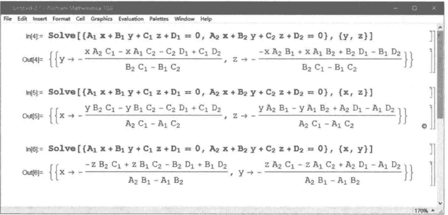

图 2.6 Mathematica 求解平面联立方程组示意

---

## 2.5 几何算法

前序章节已落地点、线、面实体类，本节转向算法层，建立 `GeomAlgo.py` 模块，作为通用几何算法库（距离、求交等）的长期沉淀地。

### 2.5.1 实体距离

涵盖点线、点面、线线、线面四类核心距离（点点距离已内置于 `Point3D`）。

#### 1. 点线距离
**空间直线** $l(P, \vec{V})$ 与点 $Q$（见图 2.7a）。
设 $Q$ 在 $l$ 上投影为 $R$，向量 $\vec{PR} = \vec{V} \cdot t$。由 $\vec{QR} \perp \vec{V}$ 得 $\vec{QR} \cdot \vec{V} = 0$，解得参数 $t = \vec{PQ} \cdot \vec{V}$。投影点 $R = P + \vec{V}t$，距离即 $|\vec{QR}|$。

**射线/线段** 需额外判断投影点是否落在有效域内（见图 2.7b, c）：
*   **射线**：$t \ge 0$ 落内，距离取 $|\vec{QR}|$；否则取 $|\vec{QP}|$。
*   **线段** (端点 $P, P_1$，长 $L$)：$0 \le t \le L$ 落内取 $|\vec{QR}|$；$t<0$ 取 $|\vec{QP}|$；$t>L$ 取 $|\vec{QP_1}|$。

$$(QP + V \cdot t) \cdot V = 0$$ (2-18)
$$t = - \frac{QP \cdot V}{V^2} = PQ \cdot V$$ (2-19)
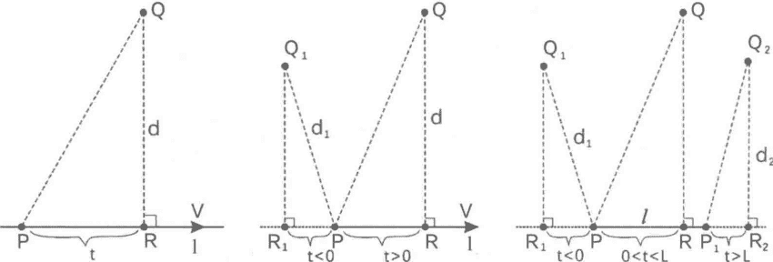

图 2.7 点到直线/射线/线段距离计算几何示意

#### 2. 点面距离
平面 $\alpha(P, \vec{N})$ 与点 $Q$（见图 2.8）。$Q$ 在面上投影为 $R$，$\vec{QR}$ 与 $\vec{N}$ 共线。由三角形 $PQR$ 几何关系，夹角 $\theta = \arccos(\frac{\vec{PQ} \cdot \vec{N}}{|\vec{PQ}|})$，距离 $|\vec{QR}| = |\vec{PQ}| \cos\theta = |\vec{PQ} \cdot \vec{N}|$（因 $\vec{N}$ 为单位向量）。

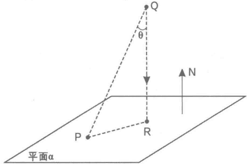

图 2.8 点到平面距离计算几何示意

#### 3. 线线距离
仅讨论**异面直线** $l_1(P_1, \vec{V_1})$, $l_2(P_2, \vec{V_2})$（见图 2.9）。
公垂线段 $C_1C_2$ 长度即为距离。将 $l_1, l_2$ 分别平移至对方公垂足，可构成两**平行平面**，法向量 $\vec{N} = \vec{V_1} \times \vec{V_2}$ (2-21)。异面直线距离 $\equiv$ 两平行平面距离 $\equiv$ 点 $P_1$ 到由 $(P_2, \vec{N})$ 确定平面的距离 $\equiv$ **点面距离问题**。
特殊情况：若 $\vec{N}=\vec{0}$（即 $\vec{V_1} \parallel \vec{V_2}$），退化为**点到直线距离**。

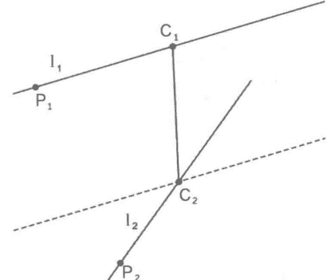

图 2.9 两异面直线距离计算几何示意

#### 4. 线面距离

# 空间几何核心运算：距离判定与相交求解全解析

## 实体间离度计算：Line、Ray 与 Segment 至 Plane

**Line 与 Plane 离度**  
核心在于 Line 的 Direction 与 Plane 的 Normal 夹角关系。若二者正交（点积为零），Line 与 Plane 保持等距，离度等于 Line 上任意 Point 至 Plane 的投影长；反之 Line 必贯穿 Plane，离度为零。

**Ray 与 Plane 离度**  
Ray 引入单向性约束。当 Direction 非正交 Normal 时，必须考量指向。采用探测策略：除 Origin 外，另取 Ray 上一点，分别计算二者至 Plane 的有向离度。若 Origin 离度绝对值较大，表明指向 Plane，取该值；否则判定为远离或平行，离度清零。

**Segment 与 Plane 离度**  
Segment 计算稍繁，关键在判断两 Endpoint 是否分居 Plane 两侧。构造判定函数 $f(x,y,z) = A(x-x_0)+B(y-y_0)+C(z-z_0)$，代入端点得 $f_1, f_2$。  
*   $f_1 \cdot f_2 \le 0$：Segment 贯穿或接触 Plane，离度为零。  
*   $f_1 \cdot f_2 > 0$：Segment 完全在单侧，取两端点离度较小者。

---

### 2.5.2 实体求交：Line-Line 与 Line-Plane

#### 1. 两 Line 相交（共面前提）
已知共面 Line1($P_1, V_1$)、Line2($P_2, V_2$)，设交点为 $P$。参数式 $P = P_1 + t_1 V_1 = P_2 + t_2 V_2$，移项得 $P_1 - P_2 = t_2 V_2 - t_1 V_1$。展开为三标量方程，任选二式组成线性系统解 $t_1, t_2$（可借助符号计算工具）。  
```
\begin{cases} P = P_1 + V_1 \cdot t_1 \\ P = P_2 + V_2 \cdot t_2 \end{cases}
```  
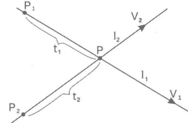  

图 2.10 共面双线相交几何示意  

进一步推导可得：  
```
$P_1 P_2 = V_1 \cdot t_1 - V_2 \cdot t_2$
```  

考虑到向量维度为三，可列出：  
```
\begin{cases} P_1 P_2.dx = V_1.dx \cdot t_1 - V_2.dx \cdot t_2 \\ P_1 P_2.dy = V_1.dy \cdot t_1 - V_2.dy \cdot t_2 \\ P_1 P_2.dz = V_1.dz \cdot t_1 - V_2.dz \cdot t_2 \end{cases}
```  

对上式，任选两等式求解 $t_1, t_2$。若分母（除数）为零，换另两式重试；若仍为零，则两 Line 共向无解。解得参数后代回参数式即得交点坐标。  
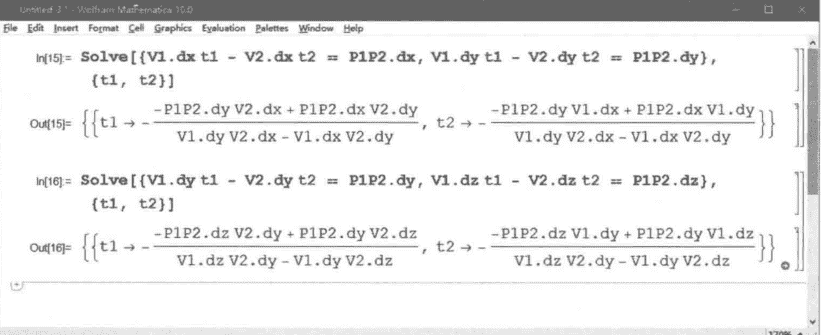  

图 2.11 符号工具求解线性系统演示  

#### 2. 两 Segment 相交
视 Segment 为有限长 Line。设 $S_1(A_1,B_1)$, $S_2(A_2,B_2)$，单位 Direction $V_1, V_2$，长度 $L_1, L_2$。沿用上法求得 $t_1, t_2$ 及交点。  
**判定准则**：仅当 $0 \le t_1 \le L_1$ 且 $0 \le t_2 \le L_2$ 时，交点落入两 Segment 内部，判定相贯；否则不相贯。  
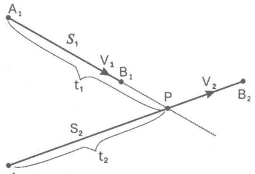  

图 2.12 共面双段相交几何示意  

> **扩展**：Line/Ray/Segment 两两组合，均归结为解参数后，依据各自定义域（Ray: $t \ge 0$; Segment: $0 \le t \le L$）裁剪判断。

---

### 2.5.3 线面求交

**Line 与 Plane**  
Line($P_0, V$), Plane($P_1, N$)。设交点 $P = P_0 + t V$。因 $P$ 在 Plane 上，向量 $\vec{PP_1} \perp N$，即 $(P_0 + t V - P_1) \cdot N = 0$。  
解得参数：  
$$t = \frac{(P_1 - P_0) \cdot N}{V \cdot N}$$  
```
t = P0 P1 * N / V * N
```  

*   分母 $V \cdot N = 0$：Line 与 Plane 共向，无唯一交点（或 Line 在 Plane 内）。  
*   分母非零：代入 $t$ 得唯一交点。

**Ray/Segment 与 Plane**  
复用 Line 结果，得 $t$ 后按定义域筛选：  
*   Ray：要求 $t \ge 0$。  
*   Segment：要求 $0 \le t \le L$。

---

### 2.5.4 点与多边形位置关系（XY Plane 限定）

经典射线法判定 Point 与 Polygon 关系：从 Point 向无穷远发射 Ray，统计与边界交点数（贯穿次数）。奇数为内，偶数为外。实现难点在于 Vertex 重合与 Edge 共线临界情况。  
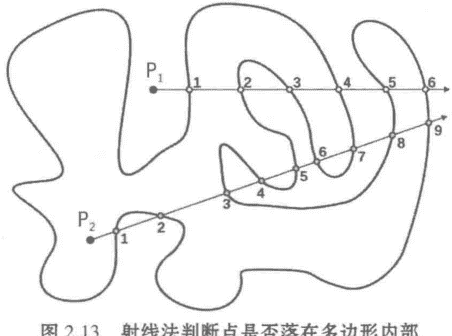  
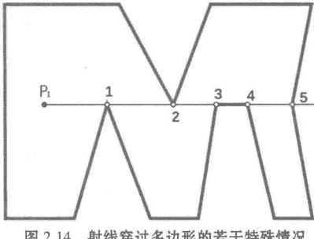  

#### 算法优化：拆分原子操作
将 Ray 与 Polygon 求交拆解为两类基本运算，彻底规避重复计数：

1.  **Ray 与开区间 Segment（不含 Endpoint）求交**  
    求解参数 $t_1$(Ray), $t_2$(Segment)。  
    *   $t_1 = 0$：Point 落在 Vertex/Edge 上，直接判定“在边上”，终止。  
    *   $t_1 > 0$ 且 $0 < t_2 < L$：有效贯穿，**计数器 +1**。

2.  **Ray 与 Vertex 求交（处理 Ray 贯穿顶点情况）**  
    统计所有 Endpoint 落在 Ray 上的 Edge。若某 Edge 与 Ray 共线，视其两 Endpoint 均不在 Ray 上（去重）。  
    *   **配对原则**：将落在 Ray 上的 Edge 按“位于 Ray 上方/下方”分组。任取一条上方 Edge 与一条下方 Edge 配对，**计数器 +1**（等价贯穿 1 次）。同侧 Edge 配对视为贯穿 0 或 2 次，**不改变单双性**。

#### Ray 方向工程化选取
为简化“Point 与 Ray 相对位置”判断，固定 Ray 方向为 **X 轴正向**。此时仅需比较 Point 的 Y 坐标与 Ray 起点 Y 坐标即可完成上下侧判定，大幅降低计算负担。  
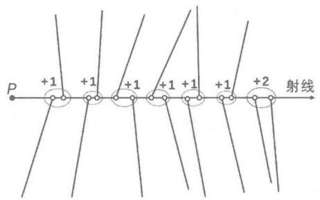  

图 2.15 落在射线上的多边形顶点配对示意  

整套流程仅需遍历一次 Vertex/Edge，时间复杂度 **O(n)**（n 为顶点数）。

---

### 2.5.5 几何算法工程落地：`GeomAlgo.py`

封装上述逻辑为工具模块，核心接口设计如下（节选）：

```python
elif isinstance(obj1, Point3D) and isinstance(obj2, Segment): # 情况 3:点和线段距离计算
    Q, P, P1, V = obj1, obj2.A, obj2.B, obj2.direction().normalized()
    L = obj2.length()
    t = P.pointTo(Q).dotProduct(V)
    if t <= 0: return Q.distance(P)
    elif t >= L: return Q.distance(P1)
    else:
        R = P + V.amplified(t)
        return Q.distance(R)
elif isinstance(obj1, Point3D) and isinstance(obj2, Plane):   # 情况 4:点和平面距离计算
    P, Q, N = obj2.P, obj1, obj2.N
    angle = N.getAngle(P.pointTo(Q))
    return P.distance(Q) * math.cos(angle)
elif isinstance(obj1, Line) and isinstance(obj2, Line):      # 情况 5:直线和直线距离计算
    P1, V1, P2, V2 = obj1.P, obj1.V, obj2.P, obj2.V
    N = V1.crossProduct(V2)
    if N.isZeroVector(): return distance(P1, obj2)
    return distance(P1, Plane(P2, N))
elif isinstance(obj1, Line) and isinstance(obj2, Plane):     # 情况 6:直线和平面距离计算
    return distance(obj1.P, obj2) if obj1.V.dotProduct(obj2.N) == 0 else 0
elif isinstance(obj1, Ray) and isinstance(obj2, Plane): pass  # 情况 7:射线和平面距离计算
elif isinstance(obj1, Segment) and isinstance(obj2, Plane): pass # 情况 8:线段和平面距离计算
pass                                                          # 实体距离计算情况有待拓展
def intersectLineLine(line1 : Line, line2 : Line):          # 计算直线和直线的交点，返回
    P1, V1, P2, V2 = line1.P, line1.V, line2.P, line2.V         # 交点及 t1 和 t2,参考图 2.10
    P1P2 = P1.pointTo(P2)
    deno = V1.dy * V2.dx - V1.dx * V2.dy                       # 分母，参考图 2.11
    if deno != 0:
        t1 = -(-P1P2.dy * V2.dx + P1P2.dx * V2.dy) / deno
        t2 = -(-P1P2.dy * V1.dx + P1P2.dx * V1.dy) / deno
        return P1 + V1.amplified(t1), t1, t2
    else:
        deno = V1.dz * V2.dy - V1.dy * V2.dz
        if deno != 0:
            t1 = -(-P1P2.dz * V2.dy + P1P2.dy * V2.dz) / deno
            t2 = -(-P1P2.dz * V1.dy + P1P2.dy * V1.dz) / deno
            return P1 + V1.amplified(t1), t1, t2
    return None, 0, 0                                          # 如果不相交，返回 None
def intersectSegmentPlane(seg : Segment, plane : Plane):     # 计算线段和平面的交点
    A, B, P, N = seg.A, seg.B, plane.P, plane.N
    V = A.pointTo(B)
    PA = P.pointTo(A)
    if V.dotProduct(N) == 0: return None       # 线段和平面平行，返回 None
    else:
        t = -(PA.dotProduct(N)) / V.dotProduct(N)
        if t >= 0 and t <= 1: return A + (V.amplified(t))
    return None
```

```python
def intersect(obj1, obj2):            # 实体求交计算
    if isinstance(obj1, Line) and isinstance(obj2, Line):   # 情况 1:直线和直线求交
        P, t1, t2 = intersectLineLine(obj1, obj2)
        return P
    elif isinstance(obj1, Segment) and isinstance(obj2, Segment): # 情况 2:线段和线段求交
        line1, line2 = Line(obj1.A, obj1.direction()), Line(obj2.A, obj2.direction())
        P, t1, t2 = intersectLineLine(line1, line2)          # 调用 intersectLineLine 函数
        if P is not None:
            if t1 >= 0 and t1 <= obj1.length() and t2 >= 0 and t2 <= obj2.length():
                return P
        return None
    elif isinstance(obj1, Line) and isinstance(obj2, Segment):    # 情况 3:直线和线段求交
        line1, line2 = obj1, Line(obj2.A, obj2.direction())
        P, t1, t2 = intersectLineLine(line1, line2)
        return P if P is not None and t2 >= 0 and t2 <= obj2.length() else None
    elif isinstance(obj1, Line) and isinstance(obj2, Ray): pass      # 情况 4:直线和射线求交
    elif isinstance(obj1, Ray) and isinstance(obj2, Segment): pass  # 情况 5:射线和线段求交
    elif isinstance(obj1, Ray) and isinstance(obj2, Ray): pass      # 情况 6:射线和射线求交
    elif isinstance(obj1, Line) and isinstance(obj2, Plane):       # 情况 7:直线和平面求交
        P0, V, P1, N = obj1.P, obj1.V, obj2.P, obj2.N
        dotPro = V.dotProduct(N)
        if dotPro != 0:
            t = P0.pointTo(P1).dotProduct(N) / dotPro
            return P0 + V.amplified(t)
        return None
    elif isinstance(obj1, Ray) and isinstance(obj2, Plane): pass     # 情况 8:射线和平面求交
    elif isinstance(obj1, Segment) and isinstance(obj2, Plane):   # 情况 9:线段和平面求交
        return intersectSegmentPlane(obj1, obj2)
    pass                                   # 实体求交计算情况有待拓展
```

```python
def pointOnRay(p : Point3D, ray : Ray):        # 判断点是否在射线上
    v = ray.P.pointTo(p)
    return True if v.dotProduct(ray.V) >= 0 and v.crossProduct(ray.V).isZeroVector() else False
```

```python
def pointInPolygon(p : Point3D, polygon : Polyline): # 判断点是否在多边形内部
    passCount = 0                      # 返回 1:点在多边形内部
    ray = Ray(p, Vector3D(1, 0, 0))   # 返回 0:点在多边形外部
```

```
99     segments = [] # 返回-1;点在多边形边上
100    for i in range( polygon.count() -1 ):
101        seg = Segment( polygon.point(i), polygon.point( i+1 ) )
102        segments.append( seg )
103    for seg in segments:      # 计算线段(不包含端点)和射线交点个数
104        line1, line2 = Line( ray.P, ray.V ), Line( seg.A, seg.direction() )
105        P, t1, t2 = intersectLineLine( line1, line2 )
106        if P is not None:
107            if nearZero( t1 ) : return -1
108        elif seg.A.y != p.y and seg.B.y != p.y and t1 > 0 and t2 > 0 and t2 < seg.length() :
109            passCount += 1
110    upSegments, downSegments = [], []   # 存放射线上方和下方的线段
111    for seg in segments:    # 计算多边形顶点和射线交点个数
112        if seg.A.isIdentical( ray.P ) or seg.B.isIdentical( ray.P ):
113            return -1      # 点在多边形边上
114        elif pointOnRay( seg.A, ray ) ^ pointOnRay( seg.B, ray ):
115            if seg.A.y >= p.y and seg.B.y >= p.y: upSegments.append( seg )
116        elif seg.A.y <= p.y and seg.B.y <= p.y: downSegments.append( seg )
117    passCount += min( len( upSegments ), len( downSegments ) )    # 顶点配对,图 2.15
118    if passCount % 2 == 1:   # 射线穿过多边形次数为奇数,
119        return 1   # 则点在多边形内部
120    return 0   # 否则点在多边形外部
```

在上述代码实现中，我们重点攻克了 `distance`（实体距离）、`intersect`（实体求交）以及 `pointInPolygon`（点多边形位置关系）这三大核心函数。`pointInPolygon` 函数的返回值逻辑很直观：返回 `1` 代表点落在多边形内部，`0` 代表在外部，`-1` 则精准标识点位于边界上。作为这些主功能的衍生成果，我们还顺手实现了 `intersectLineLine`（直线与直线求交）、`intersectSegmentPlane`（线段与平面求交）、`pointOnRay`（点在射线上判定）等辅助工具函数。特别是在 `pointOnRay` 的实现里，向量的点积与叉积运用得淋漓尽致，建议读者重点研习此类数学技巧。

## 本章小结

本章带领大家用 Python 从零构建了一套专属的计算几何基础库。我们陆续落地了点、向量、矩阵、直线、射线、线段、多段线、平面等核心几何类，并打通了实体距离计算、求交运算、点多边形关系判定等关键算法流程。这一套类体系与算法集合，将作为后续所有章节深入展开的基石。期望读者在后续学习中，能坚持积累，持续为自己的几何库“填砖加瓦”，让它愈发健壮。

## 思考题

- 1. 计算几何领域为何偏爱用齐次坐标来描述点与向量？
- 2. 简析四阶方阵中各分块区域元素的几何含义与作用。
- 3. 三维空间下，如何判定两个不同点是否重合？
- 4. 三维空间下，如何判断两个向量方向一致？
- 5. 动手实现 `GeomBase` 模块中 `Matrix3D` 类的求逆矩阵方法。
- 6. 解释直线、射线、线段类构造函数中为何必须对输入参数执行拷贝操作。
- 7. 列举至少两种判断平面多边形顶点顺序（顺/逆时针）的方法。
- 8. 设计算法：在平面上高效筛选出落在多边形内部的点云数据。
- 9. 设计算法：快速求解平面上两个多边形之间的最短距离。

# 第 3 章 几何可视化平台搭建

## 引言

回顾上一章计算几何库的构建过程，你可能有过这种挫败感：代码跑通了，但几何实体长什么样全凭脑补，根本无法直观验证算法对错。迄今为止，我们缺的正是一个“显微镜”——一个能实时渲染点、线、面实体的可视化工具。本章任务明确：指导大家用 Python 配合 VTK（Visualization Toolkit），从零搭建一个几何实体可视化平台。

## 3.1 VTK 概览

VTK 是一个开源、跨平台、支持并行计算的免费软件体系，广泛服务于计算机图形学、几何建模、图像处理、体渲染及科学可视化等领域。它最早由 GE 研发部的三位学者（Will Schroeder、Ken Martin、Bill Lorensen）利用业余时间合力打造。面世后迅速构建起活跃用户社区，并快速渗透进学术科研与商业应用的腹地。目前由 Kitware 公司负责持续迭代维护。

VTK 基于 OpenGL 三维图形库，采用面向对象架构演进而来，核心内核由 C++ 编写，代码量约 25 万行，涵盖 2000 余个类。类继承关系与函数说明文档可在线查阅（https://vtk.org/doc/nightly/html/index.html），文档以 C++ 语法呈现。VTK 还提供了 Java、Python、Tcl/Tk、C# 等多语言绑定接口，移植性极佳。

尽管 Kitware 出版了《VTK User's Guide》与《Visualization Toolkit》两本权威著作，但国内仍缺乏系统性的中文 VTK 学习书籍，仅能在技术论坛或博客寻觅零散资料。本书不以 VTK 系统教学为主旨，定位为“启蒙入门”；对图形学研究或应用有深度兴趣的读者，建议进阶研读 VTK C++ 源码或官方英文原著。

VTK 功能庞杂，但在 Python 环境下部署却异常轻量：无需编译配置，仅需在 Windows 终端执行 `pip install VTK` 即可开箱即用。安装包约 80MB（基于 8.1.2 版本）。

## 3.2 Hello VTK

初识新语言或新库，“Hello World”是不变的仪式感。本节我们用 VTK 绘制一个立方体，作为“Hello VTK”示例。运行后将获得一个具备标准三维视图交互能力的窗口：支持鼠标滚轮缩放、左键拖拽旋转、中键拖拽平移。完整代码见 `Hello VTK.py`：

| | | |

|---|---|---|

| Hello VTK.py | Hello VTK，用 VTK 渲染一个立方体 | 3 - 1 |

| 1 | import vtk | # 引入 vtk 库，全小写 |

| 2 | | |

| 3 | source = vtk.vtkCubeSource() | # 创建立方体数据源，默认边长 1 |

| 4 | | |

| 5 | mapper = vtk.vtkPolyDataMapper() | # 实例化 mapper |

| 6 | mapper.SetInputConnection( source.GetOutputPort() ) | # 绑定 mapper 数据源 |

| 7 | | |

| 8 | actor = vtk.vtkActor() | # 创建 actor 实体 |

| 9 | actor.SetMapper( mapper ) | # 关联 actor 数据源 |

| 10 | actor.GetProperty().SetColor( 0.7, 0.7, 0.7) | # 设置实体显示颜色 |

| 11 | | |

| 12 | renderer = vtk.vtkRenderer() | # 创建渲染器 |

| 13 | renderer.AddActor( actor ) | # 将 actor 加入渲染器 |

| 14 | renderer.SetBackground( 0.9, 0.9, 0.9 ) | # 设置视图背景色 |

| 15 | | |

| 16 | window = vtk.vtkRenderWindow() | # 创建渲染窗口 |

| 17 | window.AddRenderer( renderer ) | # 注入渲染器 |

| 18 | window.SetSize( 900, 600 ) | # 设定窗口分辨率（像素） |

| 19 | | |

| 20 | interactor = vtk.vtkRenderWindowInteractor() | # 创建交互器 |

| 21 | interactor.SetRenderWindow( window ) | # 绑定窗口，响应鼠标/键盘/时钟事件 |

| 22 | interactor.SetInteractorStyle( vtk.vtkInteractorStyleTrackballCamera() ) | # 设定“轨迹球相机”交互模式 |

| 23 | interactor.Initialize() | # 初始化交互器 |

| 24 | interactor.Start() | # 启动主循环，窗口运行 |

执行上述代码，效果如图 3.1 所示，即可通过鼠标自由操控三维视角。

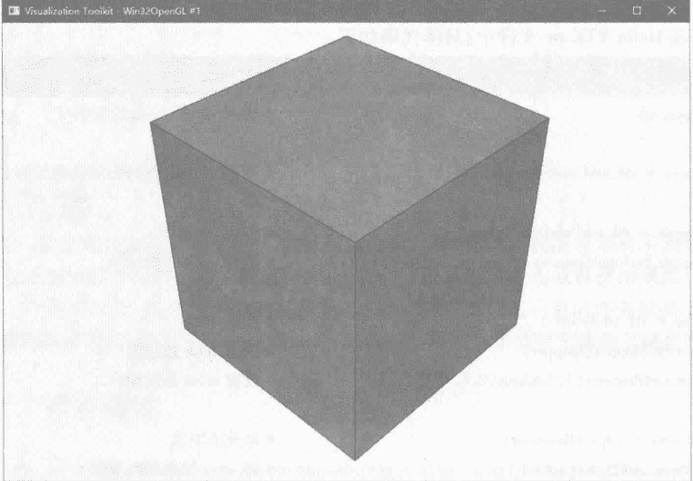

图 3.1 VTK 创建并显示立方体效果图

代码解析：首先 `import vtk` 引入库（注意全小写）。接着 `vtk.vtkCubeSource()` 生成数据源对象，VTK 类名统一以小写 `vtk` 为前缀。默认生成边长为 1、中心在原点的立方体；可通过 `SetXLength`、`SetCenter` 等接口调整尺寸位置。随后按“Source → Mapper → Actor”流水线串联：`vtkPolyDataMapper` 负责数据映射，`vtkActor` 代表可渲染实体并承载颜色、透明度等属性。颜色采用 RGB 模式，分量归一化至 0~1 区间。

后续构建渲染三件套：`window` 对应应用程序主窗口，`SetSize` 定尺寸；`renderer` 对应窗口内的渲染视图，`AddActor` 加实体，`SetBackground` 换底色；`interactor` 封装了类似 Windows 消息循环的事件分发机制。三者协作完成场景呈现。交互风格设为 `vtkInteractorStyleTrackballCamera`，即相机在虚拟轨迹球上运动；亦可切换其他交互模式。

若需显示多个实体，按 Source/Mapper/Actor 流程复写代码并 `AddActor` 即可。除 `vtkCubeSource`，VTK 还内置 `vtkConeSource`（圆锥）、`vtkCylinderSource`（圆柱）、`vtkLineSource`（直线）等源类。甚至可用 `vtkVectorText`（注意：早期版本为 `vtkTextSource`）渲染文本，如图 3.2 显示“Hello VTK”字符。须知目前 VTK 原生仍不支持中文字符渲染。

## 3.3 VTK 可视化管线解析

前文提到，`renderer`、`window` 与 `interactor` 这三大件搭建起了三维场景的基础框架。通常场景一旦初始化便趋于稳定，频繁变动的往往是舞台上的“演员”——即 `actor` 对象。下面我们深入剖析 VTK 中 `actor` 的生成全流程。

如图 3.3 所示，构造一个 `actor` 并非一蹴而就，首要步骤是建立**数据源**。以此前的 `Hello VTK.py` 为例，我们借助 `vtkCubeSource` 生成了一个单位立方体。VTK 提供了多元化的数据源创建路径：既可用 `vtkConeSource`、`vtkLineSource` 等类在内存中直接算出生成简单几何体，也能通过读取外部文件获取复杂模型数据。针对 3D 打印常用的 STL 格式，`vtkSTLReader` 便是现成的读取利器，示例代码如下：

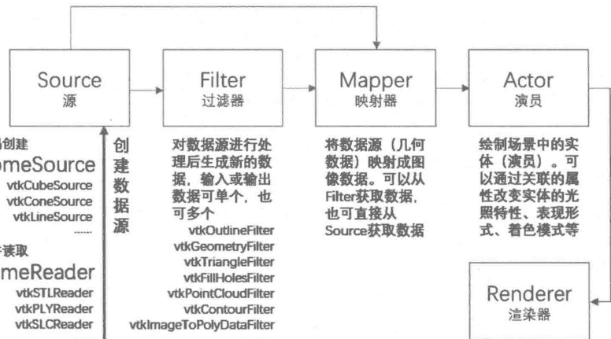

当然，若你对 VTK 架构烂熟于心，还能基于其组件机制自定义专属数据源。

拿到数据源后，最直接的做法是将其直连**映射器**，正如 `Hello VTK.py` 所演示的：

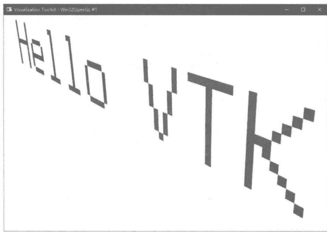

但在实战中，我们常需在映射前对数据加工处理，这便轮到**过滤器**登场。以 STL 模型为例，若想提取其包围盒轮廓，只需把数据源接入 `vtkOutlineFilter`，再将过滤器输出接给映射器即可：


留意上述两段代码的连接模式：`source` 通过 `GetOutputPort()` 获取端口，`mapper` 或 `filter` 调用 `SetInputConnection()` 接入。`filter` 同理，输出端口再连 `mapper`。这里的“端口”本质是对象句柄或指针引用。考虑到几何体动辄数十上百兆数据量，若直接传递对象实体，内存与时间开销极大；端口机制恰好规避了这一痛点。

**映射器**的核心职责，是将抽象数据对象转化为可渲染的图像对象。代码中采用的 `vtkPolyDataMapper` 正是为了匹配 STL 模型的 `PolyData` 数据结构——这种结构以点、线、三角面、多边形等离散拓扑形式描述几何体。VTK 还内置了 `vtkGraphMapper`、`vtkImageMapper` 等针对不同数据类型的映射器。

映射器就绪，便可实例化**演员**了，关联仅需一行 `SetMapper()`：


`actor` 是场景里真正可见的几何实体。它持有一个 `vtkProperty` 属性对象（通过 `GetProperty()` 获取），借此我们能随心所欲地定制外观：渲染模式切换（点/线框/实体面）、颜色、透明度、材质纹理、边线高亮与线宽等，示例如下：


演员备妥，最后一步是入场。创建渲染器并调用 `AddActor()` 即可完成装配：


综上，VTK 可视化管线按 **Source → Filter（可选） → Mapper → Actor** 的顺序流转。下面给出针对 STL 模型的完整可视化脚本 `DisplaySTL.py`（代码结构经调整，优先构建场景），运行效果可见图 3.4。

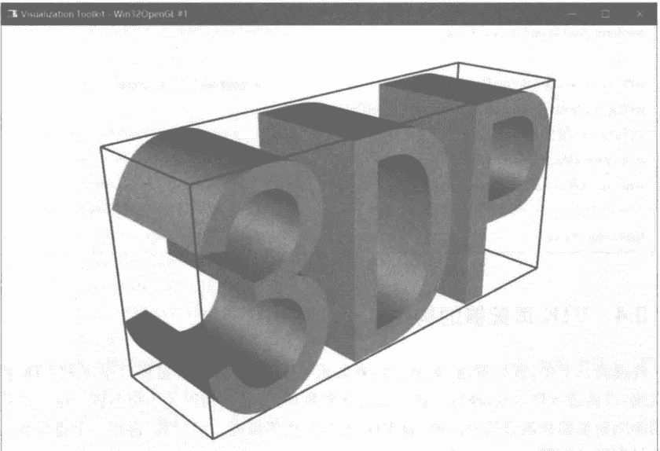
```python
DisplaySTL.py | 利用 VTK 显示一个 STL 模型和模型边框 ( vtkOutlineFilter ) | 3-8

1 import vtk # 导入 vtk 库
2
3 renderer = vtk.vtkRenderer() # 创建三维场景
4 renderer.SetBackground(0.95, 0.95, 0.95)
5 window = vtk.vtkRenderWindow()
6 window.AddRenderer(renderer)
7 window.SetSize(900, 600)
8 interactor = vtk.vtkRenderWindowInteractor()
9 interactor.SetRenderWindow(window)
10 interactor.SetInteractorStyle( vtk.vtkInteractorStyleTrackballCamera() )
11 interactor.Initialize()
12
13 stlReader = vtk.vtkSTLReader() # 从文件加载 STL 模型数据源
14 stlReader.SetFileName( "E:\\3DP.STL" )
15
16 filter = vtk.vtkOutlineFilter() # 创建模型边框显示 filter-mapper-actor
17 filter.SetInputConnection( stlReader.GetOutputPort() )
18 outLineMapper = vtk.vtkPolyDataMapper()
19 outLineMapper.SetInputConnection( filter.GetOutputPort() )
20 outlineActor = vtk.vtkActor()
21 outlineActor.SetMapper( outLineMapper )
22 outlineActor.GetProperty().SetColor(0.1, 0.1, 0.1)
23 renderer.AddActor( outlineActor )
24
25 stlMapper = vtk.vtkPolyDataMapper() # 创建模型显示 mapper-actor
26 stlMapper.SetInputConnection( stlReader.GetOutputPort() )
27 stlActor = vtk.vtkActor()
28 stlActor.SetMapper( stlMapper )
29 renderer.AddActor( stlActor )
30
31 interactor.Start() # 运行程序
```

## 3.4 封装 VTK 适配器：化繁为简

回顾前几节，每显示一个几何体都要重复编写大量 VTK 样板代码，过程繁琐且易错。本节我们引入面向对象思想，对 VTK 核心功能进行二次封装，打造一个开箱即用的 `VtkAdaptor` 适配器类。

新建 `VtkAdaptor.py` 文件，定义同名类，核心实现如下：

```python
import vtk             # 导入 vtk 库
......                 # 导入必要库
class VtkAdaptor:
    def __init__( self, bgClr = ( 0.95, 0.95, 0.95 ) ):   # 适配器初始化函数
        self.renderer = vtk.vtkRenderer()
        self.renderer.SetBackground( bgClr )
        self.window = vtk.vtkRenderWindow()
        self.window.AddRenderer( self.renderer )
        self.window.SetSize( 1000, 1000 )
        self.interactor = vtk.vtkRenderWindowInteractor()
        self.interactor.SetRenderWindow( self.window )
        self.interactor.SetInteractorStyle( vtk.vtkInteractorStyleTrackballCamera() )
        self.interactor.Initialize()
    def display( self ):                                  # 显示函数
        self.interactor.Start()
    def setBackgroundColor( self, r, g, b ):              # 设置 VTK 场景背景色函数
        return self.renderer.SetBackground( r, g, b )
    def drawAxes( self, length = 100.0, shaftType = 0, cylinderRadius = 0.01, coneRadius = 0.2 ):
        axes = vtk.vtkAxesActor()                         # 绘制坐标轴
        axes.SetTotalLength( length, length, length )
        axes.SetShaftType( shaftType )
        axes.SetCylinderRadius( cylinderRadius )
        axes.SetConeRadius( coneRadius )
        axes.SetAxisLabels( 0 )
        self.renderer.AddActor( axes )
        return axes
    def drawActor( self, actor ):                          # 绘制 actor 对象
        self.renderer.AddActor( actor )
        return actor
    def drawPdSrc( self, pdSrc ):                          # 绘制 PolyData 类型的 source
        mapper = vtk.vtkPolyDataMapper()
        mapper.SetInputConnection( pdSrc.GetOutputPort() )
        actor = vtk.vtkActor()
        actor.SetMapper( mapper )
        return self.drawActor( actor )
    def drawStlModel( self, stlFilePath ):                 # 绘制 STL 模型,参数为文件名
        reader = vtk.vtkSTLReader()
        reader.SetFileName( stlFilePath )
        return self.drawPdSrc( reader )
    def removeActor( self, actor ):                        # 从场景中移除 actor 对象
        self.renderer.RemoveActor( actor )
    def drawPoint( self, point, radius = 2.0 ):         # 绘制一个点,Point3D
        src = vtk.vtkSphereSource( )
        src.SetCenter( point.x, point.y, point.z )
        src.SetRadius( radius )
        return self.drawPdSrc( src )
    def drawSegment( self, seg ):           # 绘制一条线段,Segment
        src = vtk.vtkLineSource( )
        src.SetPoint1( seg.A.x, seg.A.y, seg.A.z )
        src.SetPoint2( seg.B.x, seg.B.y, seg.B.z )
        return self.drawPdSrc( src )
    def drawPolyline( self, polyline ):      # 绘制一条多段线,Polyline
        src = vtk.vtkLineSource( )
        points = vtk.vtkPoints( )
        for i in range( polyline.count( ) ) :
            pt = polyline.point( i )
            points.InsertNextPoint( ( pt.x, pt.y, pt.z ) )
        src.SetPoints( points )
        return self.drawPdSrc( src )
    pass                 # 有待扩充
```

观察 `__init__` 构造器，它在内部完成了 `renderer`、`window`、`interactor` 的实例化与关联。这样一来，上层应用只需 `new` 一个 `VtkAdaptor` 对象，调用 `display()` 即可一键启动场景；若需修改背景色，直接调 `setBackgroundColor()` 搞定。至此，VTK 的底层复杂性被彻底屏蔽，开发者可专注于业务逻辑本身。

# 核心工具类 VtkAdaptor：几何绘制与场景管理的“瑞士军刀”

在 `VtkAdaptor` 类中，我们内置了一套开箱即用的几何实体绘图接口，主要覆盖 `drawAxes`、`drawActor`、`drawPdSrc` 以及 `drawStlModel` 四大核心函数。

*   **`drawAxes`**：专司坐标系渲染，轴长、箭头尺寸均可通过参数灵活定制。
*   **`drawActor`**：面向 `vtkActor` 对象的直接绘制入口。调用前提是你已完成“数据源 → 映射器 → Actor”的标准构建流程。
*   **`drawPdSrc`**：更上一层楼，直接吞噬 `PolyData` 类型的数据源（如 `vtkCubeSource`、`vtkConeSource` 或 `vtkSTLReader` 输出），省去了手动配置 Mapper 与 Actor 的繁琐步骤。
*   **`drawStlModel`**：针对 STL 文件的终极简化封装，仅需传入文件路径，即可完成加载与渲染的一站式操作。

进一步地，结合第二章奠定的几何基础库（`Point3D`、`Segment`、`Polyline`），我们补充了三大基础绘图原语：
*   **`drawPoint(Point3D)`**：打点功能，`radius` 参数控制大小（默认 2.0）。
*   **`drawSegment(Segment)`**：线段绘制。
*   **`drawPolyline(Polyline)`**：多段线绘制。

**关键设计：统一返回 `vtkActor`**  
上述所有 `draw` 系列函数，返回值均为场景中生效的 `vtkActor` 实例。这意味着你可以在外部捕获这些返回值，随时调用 `GetProperty()` 修改颜色、线宽、透明度等视觉属性，或通过 `removeActor()` 将其从场景中移除，实现动态交互控制。

---

### 实战验证：`Test_vtkAdaptor.py` 解析

我们编写测试脚本 `Test_vtkAdaptor.py` 验证上述功能，运行效果见 **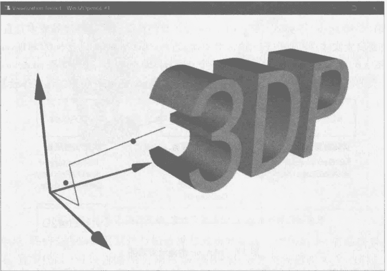**。

```python
# Test_vtkAdaptor.py
from VtkAdaptor import *           # 1. 导入核心模块

if __name__ == '__main__':
    # 2. 实例化适配器（场景搭建的基石）
    va = VtkAdaptor()
    
    # 3. 环境配置
    va.setBackgroundColor(0.95, 0.95, 0.95)  # 柔和灰背景
    va.drawAxes()                            # 显示坐标系
    
    # 4. 绘制离散点并即时设色（链式调用演示）
    va.drawPoint(Point3D(10, 10, 10)).GetProperty().SetColor(1, 0, 0)
    va.drawPoint(Point3D(50, 50, 50)).GetProperty().SetColor(1, 0, 0)
    
    # 5. 构建并绘制多段线
    pl = Polyline()
    pl.addPoint(Point3D(1, 1, 1))
    pl.addPoint(Point3D(50, 2, 10))
    pl.addPoint(Point3D(20, 10, 30))
    pl.addPoint(Point3D(50, 80, 55))
    pl_actor = va.drawPolyline(pl)
    pl_actor.GetProperty().SetColor(0.1, 0.7, 0.7)  # 青色
    pl_actor.GetProperty().SetLineWidth(2)          # 加粗
    
    # 6. STL 模型加载与变换
    stl_actor = va.drawStlModel(r"E:\3DP.STL")
    stl_actor.SetPosition(0, 150, 150)  # 平移至合适位置
    
    # 7. 启动渲染循环（收尾关键步）
    va.display()
```

**代码逻辑三部曲**：
1.  **初始化**：`VtkAdaptor()` 构建渲染窗口、渲染器、交互器。
2.  **自由发挥**：中间区域随需调用各类 `draw` 函数堆砌场景内容。
3.  **启动显示**：`display()` 进入事件循环，呈现最终画面。

**亮点回顾**：第 6、7 行演示了“绘制即返回 Actor，链式调用 `GetProperty().SetColor()`”的极简风格，这正是返回 `vtkActor` 设计意图的直接体现。**记住：`VtkAdaptor` 是可进化的，当前版本仅满足当下需求，未来可随时扩展属性与方法。**

---

# 3.5 VTK 模型变换：玩转 `vtkProp3D` 的几何魔法

上一节测试中，我们用 `SetPosition()` 平移了 STL 模型。本节深入剖析 `vtkActor` 继承体系，掌握平移、缩放、旋转的底层逻辑。

### 继承链路一览

VTK 类系庞杂，**`vtkActor` 的核心祖先链**如 **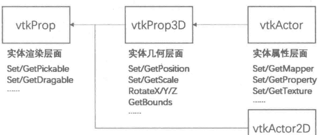** 所示：
`vtkProp` (渲染层基类) → `vtkProp3D` (几何变换核心) → `vtkActor` (显示属性管理)

| 类职责 | 核心功能 |
| :--- | :--- |
| **vtkProp** | 渲染管线底层调度（3D/2D均管），极少直接调用。 |
| **vtkProp3D** | **几何变换大管家**：位置 (`Set/GetPosition`)、缩放 (`Set/GetScale`)、旋转 (`RotateX/Y/Z`)、包围盒 (`GetBounds`)。 |
| **vtkActor** | **开发者主战场**：属性 (`Property`)、纹理 (`Texture`)、Mapper 绑定等显示层配置。 |
| *vtkActor2D* | *平行分支，专司 2D 叠加层（如文字、标尺）。* |

**结论**：三维实体变换，**直奔 `vtkProp3D` 接口**即可，无需绕道。

---

### 实战 1：平移——坐标叠加的艺术

需求：模型沿 X 轴正向平移 125mm。  
步骤：`GetPosition()` 取当前坐标 → X 分量 +125 → `SetPosition()` 回写。

测试代码见 ****，对比效果见图 3.7（左原模、右平移后）。

```python
# 核心平移逻辑 (参考 3-11)
actor1 = va.drawStlModel(r"E:\baymax.STL")  # 对照组
actor2 = va.drawStlModel(r"E:\baymax.STL")  # 实验组

x, y, z = actor2.GetPosition()
x += 125.0
actor2.SetPosition(x, y, z)
```
*同理，Y、Z 轴平移仅需修改对应分量。*

---

### 实战 2：缩放与旋转——非均匀变形与局部旋转

接上例 `actor2`，继续施加变换（代码 3-12，效果见 **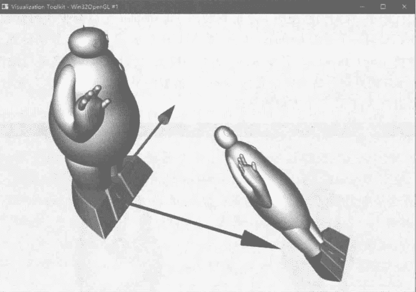**）：

```python
# 1. 非均匀缩放：X/Y 缩半，Z 微缩 (1/1.1) → 模型变“瘦长”
sx, sy, sz = actor2.GetScale()
actor2.SetScale(sx/2.0, sy/2.0, sz/1.1)

# 2. 绕 Y 轴旋转 -45°
actor2.RotateY(-45.0)
```

**两大避坑指南**：
1.  **单位是角度非弧度**：`RotateX/Y/Z` 接收度数。
2.  **旋转中心是模型局部参考点而非世界原点**：这与第二章矩阵变换“以原点为中心”不同。
3.  **右手定则反了？** VTK 中 `RotateY(-45)` 为**顺时针**（沿 Y+ 向原点看），与通用数学右手定则（正角逆时针）**相反**！实战中务必实测验证方向，切勿凭直觉。

---

### 进阶：矩阵与变换矩阵

`vtkProp3D` 还暴露 `Set/GetUserMatrix`、`Set/GetUserTransform`，支持直接喂入 `vtkMatrix4x4` 或 `vtkTransform` 实现复杂组合变换（如绕任意轴旋转、剪切等），感兴趣可自行深挖。

---

# 本章小结

本章以 **VTK + Python** 为剑，斩开三维可视化迷雾：
1.  **Hello VTK** 快速上手，掌握“源-滤-映-演-渲”可视化管线精髓。
2.  **封装 `VtkAdaptor`** 适配器模式，以极简 API 隐蔽 VTK 冗长样板代码，提效显著。
3.  **剖析 `vtkActor` 继承体系**，定位 `vtkProp3D` 为几何变换入口，实战平移/缩放/旋转，踩清“角度制、局部中心、旋转方向反直觉”三大坑。

VTK 功能深似海，本章仅窥冰山一角。志在图形学/可视化者，建议直击官方文档与 C++ 源码核心腹地。

---

# 思考题精选

1.  调研主流矢量图形/计算几何库（CGAL, OpenCASCADE, Eigen...）。
2.  对比 VTK 与 OpenGL：封装层级、适用场景、学习曲线。
3.  梳理 VTK 管线中 Source/Mapper/Actor 的职责边界与数据流向。
4.  尝试用 `vtkVectorText` / `vtkTextActor` 渲染矢量文本。
5.  复述 VTK 完整可视化流程五阶段。
6.  **核心设计题**：`VtkAdaptor.draw*` 返回 `vtkActor` 的战略价值？（答：赋予外部动态控制权——改属性、删对象、加变换）。
7.  挑战：实现 DXF 文件解析与 VTK 显示。

---

# 第 4 章：STL 切片核心——从离散三角面到轮廓线的几何桥梁

三维打印路径规划的输入是 **STL 模型 + 工艺参数**，输出是 **NC 代码**。中间跨度巨大，本章攻克第一关：**给定层高，用平行平面族截交 STL，获取每层轮廓线**。基础前提：先拿到 STL 里的离散坐标。

---

## 4.1 STL 模型加载：拆解“事实标准”的数据骨架

第三章用 `VtkAdaptor.drawStlModel()` 一键显示 STL，但**文件内部结构**却被屏蔽了。STL 由 3D Systems 于 1988 年定义，早已成为 3D 打印**事实上的通用格式**。它究竟怎么存几何数据？

### 4.1.1 STL 文件解剖：文本格式直观看

拖入记事本，若是 ASCII 格式，结构一目了然（见 **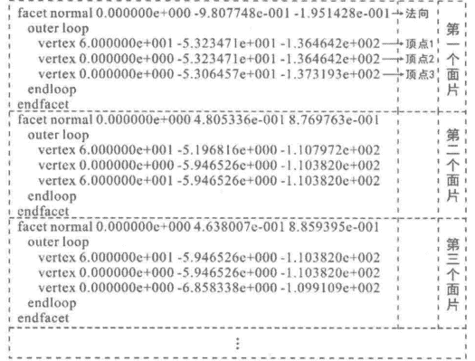**）：

*   **面片无序堆砌**：文件就是一堆三角面片罗列，**无拓扑连接信息**（邻面关系、公共边/点全靠坐标重合推断）。
*   **单面片 7 行制**：
    1.  `facet normal nx ny nz` — 法向量（科学计数法）。
    2.  `outer loop` — 固定标记。
    3~5.  `vertex vx vy vz` ×3 — 三顶点坐标。
    6.  `endloop` / 7. `endfacet` — 闭合标记。
*   **合法性规则**：相邻面须“点对点、边对边”，顶点落在别的边上即非法。

**二进制 STL** 结构同源但更紧凑（80 字节头 + 4 字节面数 + 每面 50 字节：法向 12B + 3顶点 36B + 属性 2B），体积约为 ASCII 1/3，工业界多用此格式。本章聚焦 ASCII 便于教学，二进制解析留作拓展。

---

### 4.1.2 落地代码：从文本到内存对象模型

#### 核心数据结构 `Triangle` (```
from GeomBase import *
class Triangle:
    def __init__(self, A, B, C, N = Vector3D(0,0,0)):
        self.A, self.B, self.C, self.N = A.clone(), B.clone(), C.clone(), N.clone()  # 顶点和法向量
        self.fzs = []                                   # 存储面片包含的层高
    def __str__(self):
        pass
    def zMinPnt(self):                                  # 3 个顶点中的 z 方向最低点
        pass
    def zMaxPnt(self):                                # 3 个顶点中的 z 方向最高点
        pass
```)
```python
# Triangle.py
class Triangle:
    def __init__(self):
        self.A = Point3D()  # 顶点1
        self.B = Point3D()  # 顶点2
        self.C = Point3D()  # 顶点3
        self.N = Vector3D() # 面法向
        self.zs = []        # 该面跨越的层高集合 (切片阶段用)

    def zMinPnt(self): ...  # 返回 Z 最小顶点
    def zMaxPnt(self): ...  # 返回 Z 最大顶点
```
*注：后续章节代码将精简为框架骨架，基础工具函数留予读者自练。*

#### 容器类 `StlModel`：文件解析器
`StlModel.py` 负责读取文件，逐面片实例化 `Triangle`，汇聚为 `self.facets` 列表（`Triangle` 对象数组）。解析逻辑核心：
1.  逐行扫描，识别 `facet normal` 提取法向。
2.  连续读三行 `vertex` 提取三顶点。
3.  组装 `Triangle` 入列。
4.  循环至文件末尾。

至此，**STL 离散几何数据已就绪于内存**，为后续“平面-三角形求交”算法铺平道路。

```python
class StlModel:
    def __init__(self):
        self.triangles = []   # 三角面片列表
        self.xMin = self.xMax = self.yMin = self.yMax = self.zMin = self.zMax = 0   # 模型边界
    def getFacetNumber(self):
        # 获取 STL 模型中的面片数
        return len(self.triangles)
    def getCoords(self, line):
        # 从文本中提取坐标,被 readStlFile 调用
        strs = line.lstrip().split()
        cnt = len(strs)
        return float(strs[cnt-3]), float(strs[cnt-2]), float(strs[cnt-1])
    def readStlFile(self, filepath):
        # 读取 STL 文件,输入文件路径
        f = None
        try:
            f = open(filepath, 'r')
            while True:
                line = f.readline().strip('\n')   # 删除最后一个换行字符
                if line is None or line == "": break
                if ' facet normal ' in line:
                    dx, dy, dz = self.getCoords(line)
                    N = Vector3D(dx, dy, dz)
                    f.readline()
                    A, B, C = Point3D(), Point3D(), Point3D()
                    A.x, A.y, A.z = self.getCoords(f.readline())
                    B.x, B.y, B.z = self.getCoords(f.readline())
                    C.x, C.y, C.z = self.getCoords(f.readline())
                    triangle = Triangle(A, B, C, N)
                    self.triangles.append(triangle)
        except Exception as ex:
            print(ex)
        finally:
            if f: f.close()
    def extractFromVtkStlReader(self, vtkStlReader):   # 从 vtkSTLReader 提取面片信息
        vtkStlReader.Update()
        polydata = vtkStlReader.GetOutput()
        cells = polydata.GetPolys()
        cells.InitTraversal()
        while True:
            idList = vtk.vtkIdList()
            res = cells.GetNextCell(idList)
            if res == 0: break
            pnt3ds = []
            for i in range(idList.GetNumberOfIds()):
                id = idList.GetId(i)
                x, y, z = polydata.Point(id)
                pnt3ds.append(Point3D(x, y, z))
            triangle = Triangle(pnt3ds[0], pnt3ds[1], pnt3ds[2])
            triangle.calcNormal()
            self.triangles.append(triangle)
    def getBounds(self): # 获取模型 6 个方向边界极值
        if len(self.triangles) == 0:
            return self.xMin, self.xMax, self.yMin, self.yMax, self.zMin, self.zMax
        else:
            self.xMin = self.xMax = self.triangles[0].A.x
            self.yMin = self.yMax = self.triangles[0].A.y
            self.zMin = self.zMax = self.triangles[0].A.z
        for t in self.triangles:
            self.xMin = min(t.A.x, t.B.x, t.C.x, self.xMin)
            self.yMin = min(t.A.y, t.B.y, t.C.y, self.yMin)
            self.zMin = min(t.A.z, t.B.z, t.C.z, self.zMin)
            self.xMax = max(t.A.x, t.B.x, t.C.x, self.xMax)
            self.yMax = max(t.A.y, t.B.y, t.C.y, self.yMax)
            self.zMax = max(t.A.z, t.B.z, t.C.z, self.zMax)
        return self.xMin, self.xMax, self.yMin, self.yMax, self.zMin, self.zMax
```

**StlModel 类关键字段与读取接口**

`StlModel` 的核心成员为 `triangles` 列表，承载全部 `Triangle` 面片数据。`xMin`、`zMax` 等极值字段用于构建轴向包围盒（AABB），初始化为零，需显式调用 `getBounds()` 刷新。文件解析方面提供两条路径：`readStlFile` 直接加载 ASCII 格式 STL，仅需路径参数；`extractFromVtkStlReader` 则从 `vtkSTLReader` 实例提取几何，借助 VTK 原生兼容性间接支持二进制格式读取。

## 4.2 空间三角形与平面求交算法详解

增材制造路径生成流程涉及多环节（见图 4.2）：几何层面首重模型姿态调整（直接影响支撑用量），随即进入**切片阶段**——以一族平行平面（常垂直 Z 轴）切割模型，获取闭合截交线。同层截交线间可能存在包含拓扑，共同确定打印区域；区域内规划填充轨迹即为喷头运动指令；最终跨层、跨区串联路径并转换为机床可识别的 NC 指令。除主干流程外，尚含支撑构建、凸台处理、轨迹优化等辅助步骤。

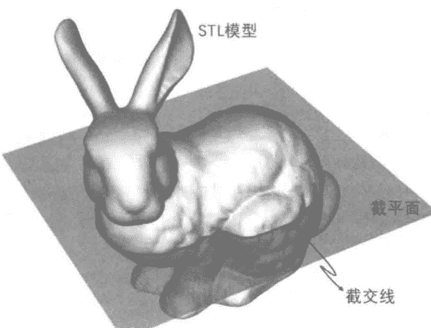

**切片几何本质：离散面片与平面的相交**

STL 模型本质为三角面片集合，平面切割模型等价于平面与每个面片求交得到线段，再将线段首尾拼接成闭合轮廓。本节核心任务：给定三角形 `ABC` 与平面 `α(P, N)`（P 为面上点，N 为法向），求解其交线。

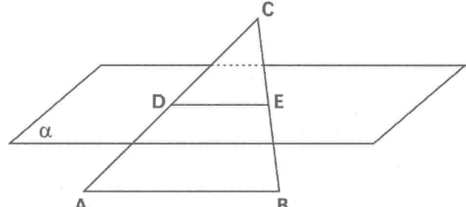

前文已推导线段-平面求交算法，并封装为 `GeomAlgo.py` 中的 `intersectSegmentPlane`。利用该工具分别计算三边 `AB`、`BC`、`AC` 与平面 `α` 的交点，再从中筛选两点构成交线段。如图 4.4 所示，交点数可能为 3、2 或 0（注：线段与面平行/共面、三角形仅顶点接触平面，均判定为无交）。

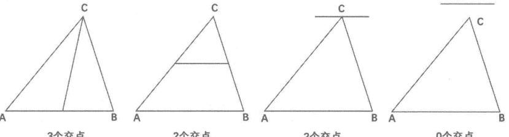

```
GeomAlgo.py | intersectTrianglePlane:空间三角形和平面求交函数 | 4 - 3
......
def intersectTrianglePlane( triangle, plane ):
    # 输入为 Triangle 和 Plane 对象
    AB = Segment( triangle.A, triangle.B )
    AC = Segment( triangle.A, triangle.C )
    BC = Segment( triangle.B, triangle.C )
    c1 = intersectSegmentPlane( AB, plane )
    c2 = intersectSegmentPlane( AC, plane )
    c3 = intersectSegmentPlane( BC, plane )
    if c1 is None:
        if c2 is not None and c3 is not None:
            if c2.distance( c3 ) != 0.0:
                return Segment( c2, c3 )
    elif c2 is None:
        if c1 is not None and c3 is not None:
            if c1.distance( c3 ) != 0.0:
                return Segment( c1, c3 )
    elif c3 is None:
        if c1 is not None and c2 is not None:
            if c1.distance(c2) != 0.0:
                return Segment(c1, c2)
        elif c1 is not None and c2 is not None and c3 is not None:
            return Segment(c1, c3) if c1.isIdentical(c2) else Segment(c1, c2)
    return None    # 如果都不满足，返回 None
```

**交点情况分类处理策略：**

*   **3 个交点**：必含一对重合顶点，取不重合的两点作为线段端点。
*   **2 个交点**：若坐标不同直接成线；若重合则视为无交线。
*   **0 个交点**：直接判定无交线。

基于上述逻辑，在 `GeomAlgo` 模块实现通用函数 `intersectTrianglePlane`。针对切片专用的 Z 向平面，进一步封装高效版 `intersectTriangleZPlane`：

```
class Layer:
    def __init__(self, z):
        self.z = z # 当前层高的值
        self.segments = [] # 截交线段列表
        self.contours = [] # 多边形轮廓列表(封闭截交线)
```

| GeomAlgo.py | intersectTriangleZPlane: 空间三角形与 Z 平面快速求交 | 4-4 |
|---|---|---|
| 1 | `......` | `# 前置代码省略` |
| 2 | `def intersectTriangleZPlane(triangle, z):` | `# 入参：Triangle 对象、Z 高度` |
| 3 | `if triangle.zMinPnt().z > z:` | `# 三角形整体位于平面上方` |
| 4 | `return None` | `# 直接返回无交线` |
| 5 | `if triangle.zMaxPnt().z < z:` | `# 三角形整体位于平面下方` |
| 6 | `return None` | `# 直接返回无交线` |
| 7 | `return intersectTrianglePlane(triangle, Plane.zPlane(z))` | `# 否则调用通用算法求交` |

该函数利用三角形 Z 向包围盒（`zMinPnt`/`zMaxPnt`）预判相对位置，仅当平面穿过包围盒时才触发精确求交，大幅削减无效计算。

## 4.3 STL 模型批量截交：暴力遍历实现

切片过程每层产出一组线段，需结构化存储并区分层级。定义 `Layer` 类（`Layer.py`），核心字段含层高 `z`、原始线段集 `segments`，以及由线段拼合生成的闭合轮廓 `contours`。

| Layer.py | 切片层数据结构：层高、截交线段、轮廓线 | 4-5 |
|---|---|---|
```
class Layer:
    def __init__(self, z):
        self.z = z # 当前层高的值
        self.segments = [] # 截交线段列表
        self.contours = [] # 多边形轮廓列表(封闭截交线)
```

拥有 `Layer` 结构与单面片求交函数，即可实现全模型切片。基线方案采用**暴力遍历**（`SliceAlgo.intersectStl_brutal`）：
1.  **确定切片区间**：调用 `StlModel.getBounds()` 获取模型 Z 向极值，层高在 `[zMin, zMax]` 内按步长推进（验证期设较大值如 10mm）。
2.  **逐层全量求交**：对每个层高，遍历模型**全部**三角面片，调用 `intersectTriangleZPlane` 计算交线。
3.  **收集结果**：有效线段写入对应 `Layer` 实例。

此法未引入空间加速结构，逻辑直观，适合作为基准版验证切片流程正确性，后续将探讨提速策略。

| SliceAlgo.py | intersectStl_brutal: STL 模型暴力切片获取截交线段 | 4-6 |
|---|---|---|

```
...... # 导入必要的模块
def intersectStl_brutal(stlModel, layerThk): # STL 模型截交函数
    layers = [] # 保存层对象列表
    xMin, xMax, yMin, yMax, zMin, zMax = stlModel.getBounds() # 模型极值
    z = zMin + layerThk
    while z < zMax: # 截交主循环
        layer = Layer(z)
        for tri in stlModel.triangles: # 对当前高度，遍历所有三角形
            seg = intersectTriangleZPlane(tri, z) # 计算三角形和平面交线
            if seg is not None:
                layer.segments.append(seg) # 将交线保存在 layer 中
        layers.append(layer)
        z += layerThk
    return layers # 返回层列表
if __name__ == '__main__': # 截交函数测试
    vtkAdaptor = VtkAdaptor()
    vtkStlReader = vtk.vtkSTLReader() # 使用 VTK 读取 STL 模型
    vtkStlReader.SetFileName("E:\\3DP.STL")
    vtkAdaptor.drawPdSrc( vtkStlReader ).GetProperty( ).SetOpacity( 0.5 )     # 显示模型
    stlModel = StlModel( )                                      # 建立 StlModel 对象
    stlModel.extractFromVtkStlReader( vtkStlReader )            # 从 VTK 加载 STL 模型
    layers = intersectStl_brutal( stlModel, 10.0 )              # 暴力切片，层高为 10.0 毫米
    for layer in layers:                                        # 在 VTK 中显示所有截交线段
        for seg in layer.segments:
            segActor = vtkAdaptor.drawSegment( seg )
            segActor.GetProperty( ).SetLineWidth( 2 )
    vtkAdaptor.display( )
```
运行上述代码，可视化结果如图 4.5 所示。图中黑色线条即为目标截交线段。这些线段按层以列表形式归档于 Layer 对象，首尾相连围成闭合回路。理论上，这些回路即为截平面与 STL 模型的几何交线。为便于观察，测试主函数中将模型透明度置 0.5，交线线宽设为 2。

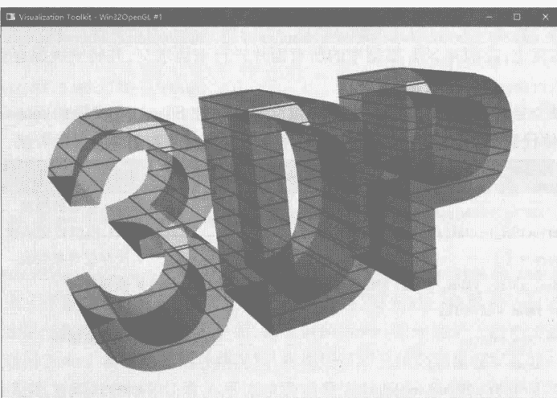
### 图 4.5 截平面与 STL 模型截交线（暴力法）

本例模型含 3928 个三角面，Z 轴高度约 100 mm。设层高 10 mm，约 10 层。单层需与 3928 个三角形求交，总计 3.9 万次。实打印层高 0.1 mm 时，总次数飙升至 392 万，耗时巨大。面对几十万甚至上百万面片的模型（司空见惯），计算量更是天文数字。下一章将详解优化策略。

观察图 4.5，某层截交线虽肉眼成闭合轮廓，实则线段顺序杂乱，这源于 STL 面片的无序存储。下一节将讲如何把乱序线段梳理成有序闭合回路。

## 4.4 线段拼接成环

如图 4.6 所示，上一节获得的某层所有截交线段若平铺于平面，势必构成若干封闭多边形（轮廓）。然而线段在多边形中是无序分布的——列表中第 1 条线段可能落在某多边形上，第 2 条却未必与其首尾相连，而可能属于另一个多边形。

本节任务：将各层平面上无序散落的线段集合，整理拼接为若干具备几何意义的封闭多边形。

### 图 4.6 截平面上无序分布的截交线段

沿用上节思路，先实现一个朴素版拼接器。核心逻辑：从列表取一条线段为种子，遍历其余线段寻找端点共合者进行拼接。数据结构上复用 Polyline 类承接结果。拼接流程如下：

- (1) 新建 Polyline 对象，命名为 contour。
- (2) 从线段集取出一条线段并移除，将其两端点分别加入 contour。
- (3) 遍历线段集，拿每条线段的两端点与 contour 两端点逐一比对：若与 contour 终点重合，则将另一端点追加至 contour 尾部；若与 contour 起点重合，则将另一端点插入 contour 头部。
- (4) 检查 contour 是否闭合；未闭合则回步骤 (3)；已闭合则保存 contour，并检查线段集是否仍有剩余——有则回步骤 (1)，否则流程终止。

上述步骤输出一系列封闭多边形，只需持续收集 contour 并存入当前层（Layer 类）的轮廓列表（contours）即可。

下面给出将线段集拼接为多边形的函数，仍置于 SliceAlgo 模块，函数名 linkSegs_brutal，代码如下：

| SliceAlgo.py | linkSegs_brutal：暴力法将截交线段整理为封闭轮廓 | 4-7 |
|---|---|---|
| 1 ...... | # 略过前序代码 | |
| 2 def linkSegs_brutal( segs ): | # 定义暴力拼接函数 | |
| 3 segs = list( segs ) | # 基于原列表建新列表，必要步骤 | |
| 4 contours = [ ] | # 最终得到的拼接轮廓 contours | |
| 5 while len( segs ) > 0: | # segs 仍有元素时循环 | |
| 6 contour = Polyline( ) | # 新建轮廓并加入 contours | |
| 7 contours.append( contour ) | | |
| 8 while len( segs ) > 0: | | |
| 9 for seg in segs : | # 遍历搜索 | |
| 10 if contour.appendSegment( seg ) : | # 若将 seg 拼入轮廓成功 | |
| 11 segs.remove( seg ) | # 则从 segs 中移除 seg | |
| 12 break | | |
| 13 if contour.isClosed( ) : break | # 轮廓闭合则退出当前循环 | |
| 14 return contours | # 返回封闭轮廓集合 | |
| 15 if __name__ == '__main__ ': | # 测试主函数 | |
| 16 ...... | # 省略代码，参考代码 4~6 | |
| 17 layers = intersectStl_brutal( stlModel, 1.0 ) | # 暴力切片，层高 1.0 mm | |
| 18 for layer in layers : | | |
| 19 layer.contours = linkSegs_brutal( layer.segments ) | # 线段转多边形，暴力法 | |
| 20 for contour in layer.contours : | # 显示各多边形 | |
| 21 polyActor = vtkAdaptor.drawPolyline( contour ) | | |
| 22 polyActor.GetProperty( ).SetLineWidth( 2 ) | | |
| 23 ...... | # 省略代码，参考代码 4~6 | |

代码运行结果见图 4.7，模型由层高 1.0 mm 的截交多边形堆叠而成。linkSegs_brutal 内部调用 Polyline.appendSegment（第 2 章已讲），拼接成功返回 True，条件是线段端点与多段线首尾端点存在重合对。关键点：重合判定用 Point3D.isCoincide，依据是“距离小于阈值”而非坐标全等，因浮点运算存在截断误差，理论重合点坐标往往不完全一致，务必注意。linkSegs_brutal 虽正确，但复杂度 O(n²)，n 为单层线段数。面对百万面片模型，n 极大，耗时不可接受。自然法则简洁优美，必有更优算法，后续章节揭晓。

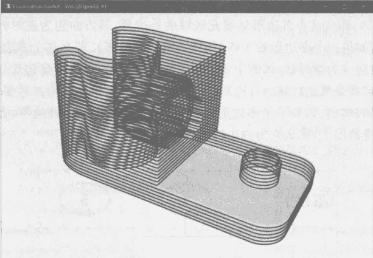
### 图 4.7 将截交线段拼接成封闭多边形结果（暴力法）

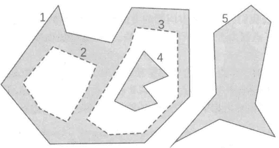
## 4.5 轮廓朝向识别与修正

上节虽能拼出闭合多边形，但未考虑朝向（顺/逆时针），方向随机。合法 STL 切片多边形互不相交，关系只两种：包含或不包含。两者组合形成填充区域内外边界（见图 4.8 阴影部）。本书约定：外边界逆时针，内边界顺时针。本节任务：依据包含关系确定各多边形内外属性及方向，最终识别填充区域。

### 图 4.8 由多边形内外边界形成的填充区域

分析包含层级（结合图 4.8、4.9）：最外层（第 0 层）为外边界，逆时针（1、5 号）；第 1 层（第 0 层内）为内边界，顺时针（2、3 号）；第 2 层又成外边界，逆时针（4 号）……规律显现：偶数层为外边界/逆时针，奇数层为内边界/顺时针。

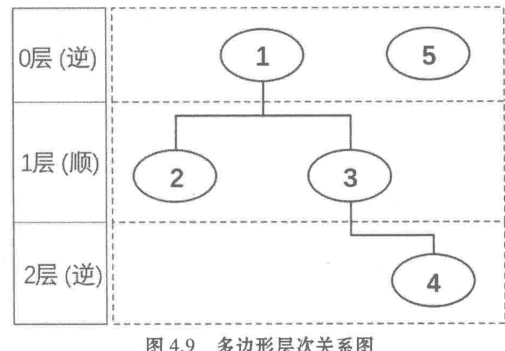
定义父子关系：B 在 A 内，B 为 A 子，A 为 B 父。图 4.9 中，1、5 号父数 0；2、3 号父数 1；4 号父数 2。推论：父数偶数 → 外边界/逆时针；父数奇数 → 内边界/顺时针。问题转化为熟悉领域。第 2 章已有点多边形关系判断，封装于 GeomAlgo.pointInPolygon。对任意多边形 A，取顶点 P，统计 P 落入其余多边形个数：偶数 → A 为外边界/逆时针；奇数 → 内边界/顺时针。单层循环判一多边形，双层循环判全平面。调整方向函数置于 GeomAlgo，名 adjustPolygonDirs，入参为 Layer 轮廓列表，代码如下：

```python
......
def adjustPolygonDirs( polygons ):
    for i in range( len( polygons ) ):
        pt = polygons[ i ].startPoint( )
        insideCount = 0
        for j in range( len( polygons ) ):
            if j == i: continue
            restPoly = polygons[ j ]
            if 1 == pointInPolygon( pt, restPoly ):
                insideCount += 1
    if insideCount % 2 == 0:
        polygons[ i ].makeCCW( )
    else:
        polygons[ i ].makeCW( )
```
识别方向不止此法。选此法因前文已备 pointInPolygon。若无此基础，可用射线法（见图 4.10）：从多边形顶点发射线，数与其余多边形交点数。交点偶数 → 外边界/逆时针；奇数 → 内边界/顺时针。核心思想与 pointInPolygon 相似，有兴趣可自行实现或探索更简洁做法。

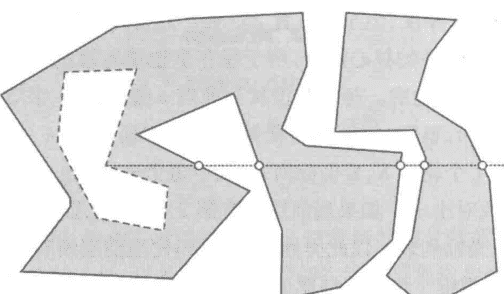
### 图 4.10 使用射线法识别轮廓内外属性及方向

## 4.6 切片数据落盘

至此，STL 切片完成，得到层序列，每层含闭合回路序列。接下来可继续开发，或将数据落盘以便复用。可自定义格式（如 Polyline 模块读写多段线），也可采用通用标准 SLC。

### 4.6.1 SLC 格式解读

SLC 同 STL 皆由 3D Systems 制定。STL 是模型标准，SLC 是切片数据标准。SLC 用 2.5D 轮廓描述 CAD 模型，含层概念，层高随 Z 增长，每层由内外边界多边形组成。SLC 采文本二进制混合编码，四段：头部、预留、采样表、轮廓数据区（见图 4.11）。头部为 ASCII 键值对，记录版本（-SLCVER）、单位（-UNIT）、软件（-PACKAGE）、包络（-EXTENTS）等，上限 2048 字节，以 0x0d/0x0a/0x1a 结尾。预留区 256 字节全 0，留作扩展。采样表由通道组成，首字节给通道数（≤255）。每通道 4 字段，各 4 字节，共 16 字节：起始高度、层厚、线宽补偿、保留。均匀层高仅需 1 通道（17 字节）。非均匀层高可设多通道、不同厚度，最多 255 种厚度。

SLC 文件的核心在于轮廓数据区，它专门用于存储多边形轮廓的几何坐标。如图 4.11 所示，该区域采用分层存储机制。每层数据块首先记录当前层的 Z 轴高度（单精度浮点数，占 4 字节），紧接着是该层包含的轮廓总数（无符号整型，4 字节）。随后依次写入每个轮廓的信息：起始为顶点数量（4 字节，uint）与间隙计数（4 字节，uint），随后是成对出现的 X、Y 坐标序列（每个坐标值均为 float 类型，占 4 字节）。若该层存在多个轮廓，则按相同格式依次追加，直至该层所有轮廓写入完毕。接着直接衔接下一层的 Z 值，循环此过程。数据区尾部预留 8 字节作为终止标识：前 4 字节记录模型最高点的 Z 坐标，后 4 字节固定写入 `0xFFFFFFFF`，同时标志着轮廓数据区乃至整个文件的结束。

文中提到的“间隙”指轮廓上相邻两点重合的位置，可视为轮廓线的断裂处。由于本书讨论的轮廓均为闭合回路，故该字段数值恒为 0。

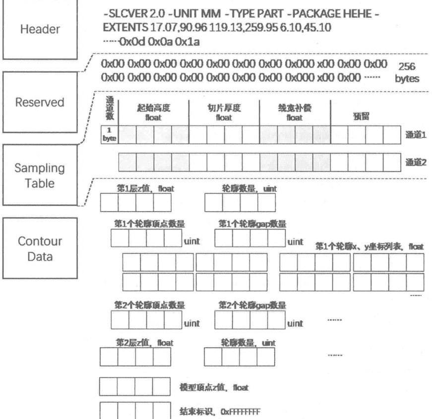

### 图 4.11 SLC 文件存储结构

至此，SLC 文件存储格式解析告一段落，其结构相对清晰直观。基于上述规范，编写 SLC 文件的读写函数便水到渠成。

### 4.6.2 SLC 文件读写

依据前文规范，针对代码中已生成的切片数据列表（`layers`），我们需要两个核心函数：一是 `writeSlcFile`，将切片数据归档为 SLC 文件以备后用；二是 `readSlcFile`，从历史文件中恢复切片数据，规避重复切片的时间开销（尤其在调试阶段极为关键）。这两个函数均归属 `SliceAlgo` 模块。

`writeSlcFile` 接收切片列表 `layers` 与文件路径 `path` 作为入参。执行成功时将数据写入指定路径，失败则抛出异常信息。

```python
def writeSlcFile( layers, path ):
    f = None
    try:
        f = open( path,'w+b' )
        f.write( bytes( "-SLCVER 2.0 -UNIT MM", encoding='utf-8' ) )
        f.write( bytes( [ 0x0d, 0x0a, 0x1a ] ) )
        f.write( bytes( [ 0x00 ] * 256 ) )
        f.write( struct.pack( 'b', 1 ) )
        f.write( struct.pack( '4f', 0, 0, 0, 0 ) )
        for layer in layers:
            f.write( struct.pack( 'f I', layer.z, len( layer.contours ) ) )
            for contour in layer.contours:
                f.write( struct.pack( '2i', contour.count( ), 0 ) )
                for pt in contour.points:
                    f.write( struct.pack( '2 f', pt.x, pt.y ) )
        f.write( struct.pack( 'f I', layers[-1].z, 0xFFFFFFFF ) )
    except Exception as ex:
        print( "writeSlcFile exception:", ex )
    finally:
        if f: f.close( )
```

`readSlcFile` 仅需传入 SLC 文件路径。成功则返回解析出的切片数据列表，失败则打印错误并返回空列表。可参考代码 4-6 或 4-7 修改 `SliceAlgo.py` 中的 `main` 函数进行测试。图 4.12 展示了读取商业软件生成的人像模型 SLC 文件的效果，该文件含 3515 层切片，为保证显示清晰，代码设置为每隔 20 层渲染一层。

```python
def readSlcFile( path ):
    f , layers , i = None , [ ] , 0
    try:
        f = open( path , 'rb' )
        data = f.read( )
        while True:
            if data[ i ] == 0x0d and data[ i + 1 ] == 0x0a and data[ i + 2 ] == 0x1a : break
            i += 1
        i += ( 3 + 256 )
        channelCount = data[i]       # 获取 Sampling Table 区通道数
        i += (1 + channelCount * 16)
        while True:             # 获取 Contour Data 区数据
            z, = struct.unpack('f', data[i: i+4])   # 获取当前层高
            i += 4
            contourCount, = struct.unpack('I', data[i: i+4]) # 获取当前层上轮廓数
            i += 4
            if contourCount == 0xFFFFFFFF: break   # 如果碰到结尾标识,则退出
            layer = Layer(z)           # 新建 Layer 对象
            for j in range(contourCount):
                pointCount, = struct.unpack('I', data[i: i+4]) # 获取当前轮廓点数
                i += 4
                gapCount, = struct.unpack('I', data[i: i+4])
                i += 4
                contour = Polyline()      # 新建轮廓
                for k in range(pointCount):
                    x, y = struct.unpack('2f', data[i: i+8])
                    i += 8
                    contour.addPoint(Point3D(x, y, z))   # 向轮廓添加坐标
                layer.contours.append(contour)
            layers.append(layer)
    except Exception as ex:
        print("readSlcFile exception:", ex)   # 打印异常
    finally:
        if f: f.close()
    return layers          # 返回 Layer 对象列表
```

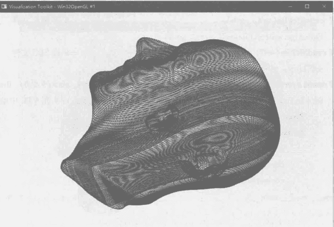

### 图 4.12 使用 readSlcFile 读取商用软件生成的 SLC 文件

## 4.7 SliceModel 模块

前几节分别阐述了 STL 暴力切片、线段暴力拼接、轮廓方向判别及 SLC 存取。为便于讲解，前述算法均以独立函数形式存在于 `SliceAlgo.py` 中，属于典型的面向过程风格。虽逻辑直观，但函数间需频繁传递 `layers` 等中间数据，管理维护较为繁琐。

本节引入面向对象思想，重构上述功能，构建 `SliceModel` 类（对应 `SliceModel.py`），将 STL 加载、求交、拼接、方向修正、文件存取等全流程封装于一体，核心代码如下：

| SliceModel.py | 切片模型类，封装 STL 截交、拼接等核心算法 | 4 - 11 |

|---|---|---|

```python
import SliceAlgo
......
class SliceModel:
    def __init__(self, stlModel, layerThk, sliceAlgo = "brutal"): # 初始化函数，输入模型、
        self.stlModel = stlModel # 层高以及切片方式
        self.layerThk = layerThk
        if sliceAlgo == 'brutal': self.slice_brutal()
        elif sliceAlgo == 'optimal': self.slice_optimal()
    def slice_brutal(self): # 切片函数，brutal
        self.layers = SliceAlgo.intersectStl_brutal(self.stlModel, self.layerThk)
        for layer in self.layers:
            layer.contours = SliceAlgo.linkSegs_brutal(layer.segments)
            SliceAlgo.adjustPolygonDirs(layer.contours)
    def slice_optimal(self): pass # 切片函数，优化，未实现
    def writeSlcFile(self, path): # 写 SLC 文件
        SliceAlgo.writeSlcFile(self.layers, path)
    def readSlcFile(self, path): # 读 SLC 文件
        self.layers = SliceAlgo.readSlcFile(path)
    def drawLayerContours(self, va, start=0, stop=0xFFFF, step=1, clr=(0,0,0), lineWidth=1):
        for i in range(max(0, start), min(stop, len(self.layers)), step): # 在 VTK 中绘制切片轮廓
            layer = self.layers[i]
            for contour in layer.contours:
                contourActor = va.drawPolyline(contour)
                contourActor.GetProperty().SetColor(clr)
                contourActor.GetProperty().SetLineWidth(lineWidth)
if __name__ == '__main__': # SliceModel 类测试 main 函数
    vtkAdaptor = VtkAdaptor()
```

```python
28 stlModel = StlModel()
29 stlModel.readStlFile( "E:\\3DP.STL" ) # 读取 STL 文件
30 sliceModel = SliceModel( stlModel, 0.7) # 建立切片模型,输入层高 0.7 毫米
31 sliceModel.drawLayerContours( vtkAdaptor) # 绘制切片轮廓
32 vtkAdaptor.display()
```

`SliceModel.py` 文件头部采用 `import SliceAlgo` 而非 `from ... import *`，旨在规避命名空间污染，防止函数名冲突。

`SliceModel` 初始化接收三个参数：STL 模型对象、层厚、切片算法类型（`brutal` 暴力法或 `optimal` 优化法）。为简化调用流程，切片逻辑直接内嵌于构造函数中。针对两种算法模式，分别定义 `slice_brutal` 与 `slice_optimal` 方法：前者调用 `SliceAlgo` 中带 `brutal` 后缀的函数实现；后者目前仅预留接口，具体实现留待后续章节。

此外，类内部还封装了 `writeSlcFile` 与 `readSlcFile`，直接代理 `SliceAlgo` 同名函数完成文件操作。

绘图功能方面，新增 `drawLayerContours` 方法，支持指定层号、线条颜色、线宽等参数。值得注意的是，该方法需外部传入 `VtkAdaptor` 对象（`va`），所有轮廓绘制均委托给该对象。这种将绘制行为封装于实体类内的设计，极大精简了外部调用代码，极具推广价值。

`SliceModel.py` 的 `main` 函数给出了简易测试范例：仅需一行代码即可完成切片。示例中先通过 `StlModel` 读取 STL，再实例化 `SliceModel` 自动完成切片与 VTK 可视化，层高设定为 0.7 mm，结果见下图。

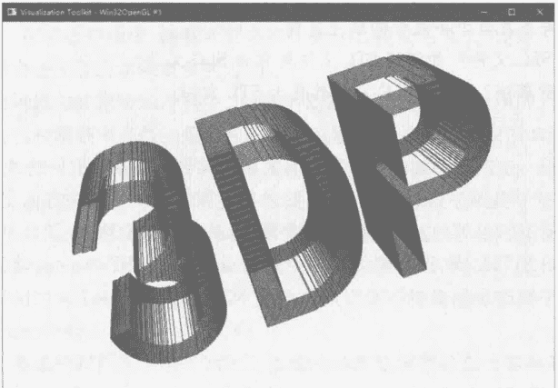

图 4.13 使用 SliceModel 类获得的切片结果，切片厚度为 0.7 毫米

综上，本节核心工作是将 `SliceAlgo` 中的散点功能模块整合封装，产出 `SliceModel` 类。其优势显而易见：代码结构更清晰，逻辑内聚性更强，彻底屏蔽了中间数据传递与临时存储的细节。

## 本章小结

本章在前序知识基础上，完成了从 STL 模型到切片轮廓的完整推演。起步于 STL 文件格式解析，封装 `StlModel` 类加载三角面片；切片过程拆解为三大子问题——平面三角形求交、截交线段拼接、轮廓方向识别与修正，并逐一给出算法实现与 `SliceAlgo` 函数；随后引入 SLC 格式落盘存储；最终以面向对象思想统筹全局，构建 `SliceModel` 类。求交与拼接环节暂采暴力法，虽效率一般，但在更优算法就绪前，其稳定性与有效性足以支撑教学与原型验证。

## 思考题

- 1. 调研除 STL 外主流三角网格存储格式，对比优劣。
- 2. 实现二进制 STL 文件读取器。
- 3. 尝试用平面解析式求解截平面与三角面片交线。
- 4. 分析代码 4-7 中 `linkSegs_brutal` 的潜在缺陷及改进方案。
- 5. 设计新算法替代 `adjustPolygonDirs`，识别平面多边形包含关系与朝向。
- 6. 简述 SLC 文件定义及 STL 转 SLC 流程。
- 7. 探索 SLC 反向重建 STL 的算法思路。

# 第 5 章 STL 模型截交计算优化

## 引言

上章构建了完整切片流程，但核心环节——STL 模型截交与线段拼接——均采用暴力算法。暴力法虽实现简单、鲁棒性好，适合面片数少、层数少的场景，但计算复杂度呈平方级增长。面对数万至百万级面片的工业模型，耗时往往难以接受。本章将深入攻克截交瓶颈，设计两种优化算法，大幅削减计算量。

## 5.1 暴力截交存在的问题

STL 切片的核心任务，是让一组高度固定的平行平面依次与模型相贯，提取并存储每层的轮廓线段。最直白的**全量遍历法**，要求每一切面逐一检查模型内的全部三角面元，调用几何模块里的 `intersectTriangleZPlane` 求交。若模型含百万级面元，单层便需百万次函数调用。实测环境（i7-8700/24GB）下，仅 4.5 万面元、0.1mm 层厚（2202 层）的模型，全量法耗时 **107 秒**。工业级模型动辄数十万面，耗时将成倍攀升。
基础求交函数虽内置预判——平面超出面元 Z 范围即返回 `None`，使耗时从 24 分钟（1444 秒）骤降至 107 秒——却无法改变“逐层扫全模”这一结构性短板。既难在求交函数上再挖潜力，破局之道只能是：**从调用端入手，极力规避无效计算**。
下文将展开两大优化思路：**扫描平面法** 与 **层高匹配法**，先讲前者。

## 5.2 扫描平面法截交优化

### 5.2.1 扫描平面数据结构

设想一张平行 XY 平面的“扫描面”沿 Z 轴自底向上滑动。它持有一个动态列表 `triangles`，仅收纳当前与之相贯的三角面元（即面元顶部 Z ≥ 扫描高度 ≥ 面元底部 Z）。这一数据结构极简，核心类 `SweepPlane` 定义于 `IntersectStl_sweep.py`：

```python
......       # 导入必要模块
class SweepPlane:
    def __init__( self ):
        self.triangles = []   # 三角面片列表
    pass
```

> 备注：类中可增设 `z` 字段记录高度，但非必需，外层循环变量即可传参。

### 5.2.2 扫描平面法原理

扫描面从模型底部升至顶部，`triangles` 列表随之动态增减：
1. **清退过期面元**：逆序遍历 `triangles`，若面元顶部 Z < 当前扫描高度，说明扫描面已穿过，移除之。
2. **吸纳新面元**：若仍采用全模扫描寻找新成员，优化归零。  
   **关键预处理**：**预先将模型所有面元按“底部 Z 坐标”升序重排。**

   重排后，面元在 Z 向呈“由低到高”有序分布。扫描面上移时，仅需从上轮停止索引 `k` 处继续向后扫：
   *   底部 Z ≤ 扫描高度 ≤ 顶部 Z → 纳入 `triangles`；
   *   底部 Z > 扫描高度 → 后续面元底部仅会更高，必不相贯，**即刻终止遍历，记录当前索引为下轮起点 `k`**。

   如示意图，首轮从面元 1 扫至 9 停驻；面上移，次轮直取 9 起扫至 11……**各层仅轮询极少量“临界面元”，彻底摆脱全模扫描。**

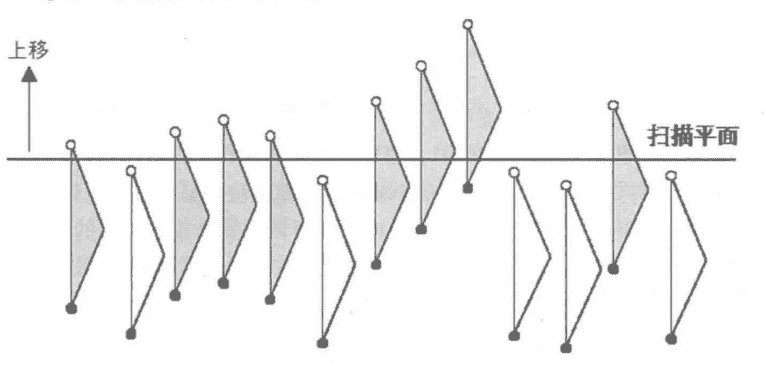
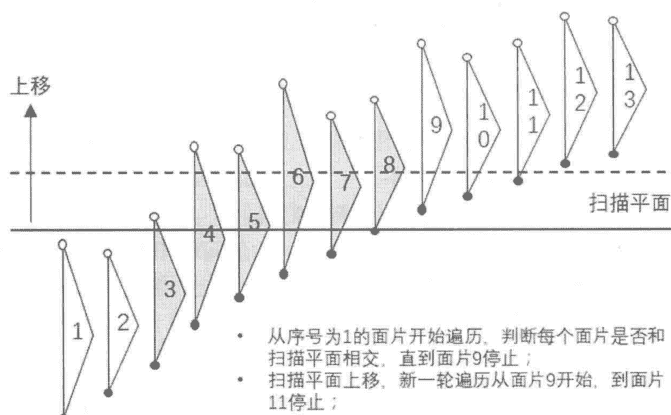

### 5.2.3 三角面片排序

排序属经典问题，切勿重复造轮子。Python 内置 `list.sort()` 复杂度 O(n log n)，稳健高效。只需指明比较键——**面元底部的 Z 值**。
`Triangle` 类未实现比较协议，直接 `sort()` 会失败。借助 `key` 与 `lambda` 一行解决：

```python
triangles.sort( key = lambda t : t.zMinPnt( ).z, reverse = False )
```

> `zMinPnt()` 取得面元最低顶点，`.z` 为排序依据。默认升序（`reverse=False`），完美契合。

### 5.2.4 算法流程及实现

总流程见图 5.4：喂入模型与层厚 → 面元预排序 → 生成高度序列 `zs` → 逐层循环 `zs`：
1. 逆序清洗 `sweep.triangles` 中的失效面元；
2. 从索引 `k` 起顺序吸纳新面元，同步刷新 `k`；
3. 遍历精简后的 `sweep.triangles` 求交，写入 `Layer` 对象；
4. 遍历结束，输出层列表。

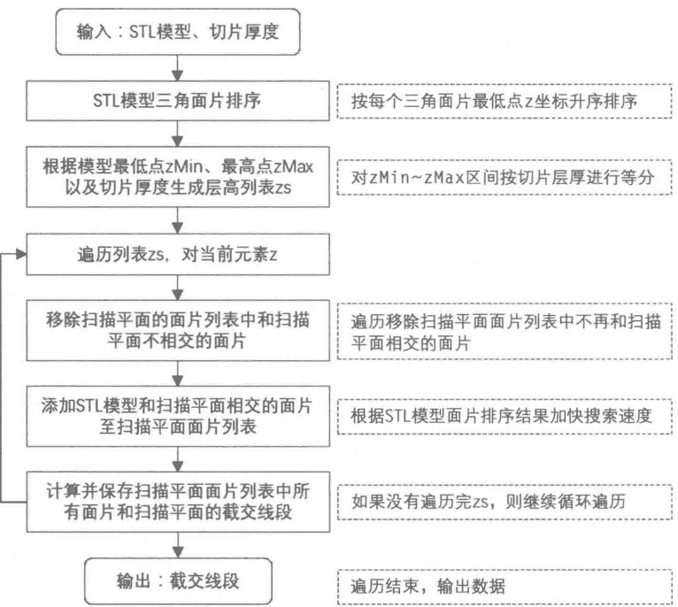

核心逻辑封装于 `IntersectStl_sweep` 类（同文件 `IntersectStl_sweep.py`）：


**实现细节点拨：**
*   **构造器 (`__init__`)**：缓存模型与层厚引用，即时触发 `intersect()`，结果沉入 `self.layers`。
*   **预排序 (`triangles.sort(...)`)**：一次性投入，全流程受惠。
*   **高度生成 (`genLayerHeights`)**：依包围盒 `zMin`→`zMax`，按 `layerThk` 等差产出，独立成法为后续变层厚预留接口。
*   **主循环 (`for z in zs`)**：
    *   **逆序删元 (`range(len-1, -1, -1)`)**：源自 C++ 实践，Python 列表删中间元素触发后移，倒序操作可减少内存搬运。
    *   **顺序加元 (`for i in range(k, len(triangles))`)**：利用有序性配合 `break` 早停，`k` 单调递增，全程每面元仅判一次“入池”条件。
    *   **求交收尾**：遍历精简池调用基础求交函数，非空则存段。

**潜在微调**：循环中反复调 `zMinPnt()`/`zMaxPnt()` 仍有开销。可在 `Triangle` 类增设 `z_min`/`z_max` 属性，模型加载时预算，后续直接取属性，省去重复比高。

**调用演示**：

```python
layers = IntersectStl_sweep(stlModel, layerThk).layers
```

# 5.3 层高匹配法：换个角度做截交优化

上一节我们刚把扫描平面法（`intersectStl_sweep`）在 `SliceAlgo` 模块里封装好，名字叫 `intersectStl_sweep`，入参是 `stlModel` 和 `layerThk`，直接返回 `layers` 结果，这才和之前的暴力法 `intersectStl_brutal` 对齐了接口。虽说咱们得跑benchmark对比一下稳定性和效率，但这事儿安排在 5.4 节再讲。现在，咱们得换个思路，探索一条和扫描平面法完全不同的优化路径。

## 5.3.1 核心思路：主角换人，以面片为主

不管是暴力法还是扫描平面法，底层逻辑其实都一个样：**截平面当“主角”，三角面片当“配角”**。截平面站着不动，面片一个个跑过来求交。这大概是因为咱们人类直觉上觉得“切东西”就是刀（平面）去切模型（面片）。

这一节咱们反其道而行之：**让三角面片当“主角”，截平面当“配角”**。面片固定不动，层高一个个轮流上来求交。

听起来总求交次数好像没变？假设面片数 $N$，层数 $M$，暴力法是 $M \times N$，面片主导也是 $N \times M$，数学上乘法交换律摆在那儿。但别急，这里藏着个巨大的剪枝空间——**绝大多数面片根本不跟大部分层高相交**。

回顾上一节，层高列表 `zs` 是升序排好的实数数组，代表 Z 轴高度。每个三角面片在 Z 轴上都有个包络盒 `[zMin, zMax]`。比如图 5.5 里的 1 号面片，只跟 `z9` 到 `z14` 这 6 个层高有交集；2 号面片只管 `z2` 到 `z7`。如果面片主导，处理 1 号面片时，直接跳过 `z9` 以下和 `z14` 以上的层高，省下一堆无效判断。

关键问题来了：**怎么快速给每个面片找到它对应的那段层高区间？**

咱们上一章定义 `Triangle` 类（代码 4-1）时留了个 `zs` 属性，就是专门存这玩意儿的。有了现成的有序层高列表，给每个面片“配对”层高，就是个经典的区间查找问题。

先把相关代码塞进 `IntersectStl_match.py`，建个 `IntersectStl_match` 类。先上个暴力版 `matchFacetZs_brutal` 热热身：

```python
IntersectStl_match.py matchFacetZs_brutal:将层高匹配到每个三角面片，暴力法 5-4
...... # 导入必要模块
class IntersectStl_match:
    def __init__(self, stlModel, layerThk): # 初始化，输入模型和层高
        self.stlModel = stlModel # 保存模型和层高
        self.layerThk = layerThk
        self.layers = [] # 切片结果，Layer 对象列表
        self.intersect() # 调用截交核心函数
    def intersect(self): pass # 截交核心函数定义，略
    def matchFacetZs_brutal(self, zs): # 暴力法层高匹配函数
        for tri in self.stlModel.triangles:
            zMin, zMax = tri.zMinPnt().z, tri.zMaxPnt().z # 面片最高点最低点
            for z in zs:
                if z > zMax: break
                if z >= zMin and z <= zMax: # 如果层高在面片最低最高点
                    tri.zs.append(z) # 之间，则将其加入面片
```

逻辑直白：遍历面片，算 `zMin`/`zMax`，然后从头扫 `zs`，进区间的存进去，超过 `zMax` 直接 `break`。利用了 `zs` 有序的特性省了尾部判断，但**头部还是得从 `z0` 一个个试过去**。对于 Z 值很大的面片，这前面几百上千次无效比较太亏了。所以这函数名带 `brutal`，下面咱们上二分法优化这事儿。

## 5.3.2 二分法精准定区间

把问题抽象一下：有序序列 $C = \{z_0, z_1, ..., z_n\}$，找出落在区间 $[a, b]$ 内的所有元素（对应面片的 `[zMin, zMax]`）。元素多、讲效率，遍历不可取。利用单调性，只需搞定区间**下限**和**上限**在序列里的下标 `start`、`stop`。

### 找下标（对应 a）
初始 `low=0, up=n`。循环：
1. `mid = (low + up) // 2`
2. 若 `z_mid < a`，`low = mid`；否则 `up = mid`
3. `up - low <= 1` 收敛退出

收敛时 $z_{low} \le a \le z_{up}$。$z_{up}$ 必在区间内。$z_{low}$ 需判断能否取等：若 `z_low == a` 下限是 `low`，否则是 `up`。

### 找上标（对应 b）
步骤几乎一样，把判断条件 `z_mid < a` 改成 `z_mid < b`。收敛时 $z_{low} \le b \le z_{up}$。$z_{low}$ 必在区间。$z_{up}$ 判等：若 `z_up == b` 上限是 `up`，否则是 `low`。

搞定双边下标，切片 `zs[start:stop+1]` 就是该面片的专属层高列表。代码实现如下（含辅助函数）：

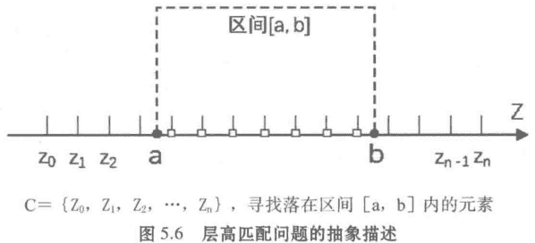
```python
IntersectStl_match.py matchFacetZs_bisection:将层高匹配到每个三角面片,二分法 5 - 5
...... # 导入必要模块
class IntersectStl_match: # 省略前面代码
    ...... # 二分法层高匹配函数
    def matchFacetZs_bisection(self, zs): # 层高列表元素个数
        n = len(zs) # 遍历模型中每个三角面片
        for tri in self.stlModel.triangles: # 面片最低点,最高点
            zMin, zMax = tri.zMinPnt().z, tri.zMaxPnt().z # 初始化 low,up,mid
            low, up, mid = 0, n - 1, 0 # 1. 二分法求下限序号
            while up - low > 1:
                mid = int((low + up) / 2)
                if zs[mid] < zMin: low = mid
                else: up = mid
            start = up # 下限序号 start
            if mid == zMin:
                start = low
            low, up = 0, n - 1 # 2. 二分法求上限序号
            while up - low > 1:
                mid = int((low + up) / 2)
```
```python
if zs[mid] < zMax:
    low = mid
else:
    up = mid
stop = low      # 上限序号 stop
if mid == zMax:
    stop = up
for i in range(start, stop + 1, 1):   # 面片层高匹配[start, stop]
    tri.zs.append(zs[i])
```

这回不用从头遍历了，对数级复杂度直接定位区间，再把这段层高挂到面片 `zs` 属性上，匹配环节彻底跑快了。

## 5.3.3 串联全流程：从匹配到出线段

原理懂了，流程就顺了（见图 5.7）：
1. **输入**：STL模型 + 层厚。
2. **生成层高列表 `zs` & 字典 `layerDic`**：按模型 Z 包络和层厚算出均匀层高，`layerDic` 键是层高值，值是 `Layer` 对象（存中间线段）。
3. **面片匹配层高**：调用刚写的 `matchFacetZs_bisection(zs)`，给每个面片填好 `zs`。
4. **核心求交循环**：遍历面片 -> 遍历面片自带的 `zs` -> 算面片与平面交线 -> 按高度 `z` 扔进 `layerDic` 对应层。
5. **输出**：把 `layerDic` 值转成 `Layer` 列表返回。

代码层面，`IntersectStl_match` 类里的核心入口 `intersect` 就干这三件事：

| IntersectStl_match.py | 核心流程 `intersect` & 层高生成 `genLayerHeights` | 5-6 |
|---|---|---|
| 1 `......` | `# 必要导入` | |
| 2 `class IntersectStl_match:` | | |
| 3 `......` | `# 省略前序匹配函数` | |
| 4 `def intersect(self):` | `# 核心入口` | |
| 5 `zs, layerDic = self.genLayerHeights()` | `# 步骤 1/2` | |
| 6 `self.matchFacetZs_bisection(zs)` | `# 步骤 3` | |

```python
for triangle in self.stlModel.triangles:          # 遍历模型三角面片
    for z in triangle.zs:                         # 遍历面片中保存的层高
        seg = intersectTriangleZPlane( triangle , z) # 截交计算
        if seg is not None:
            layerDic[ z ].segments.append( seg)    # 将当前交线保存到层字典
    for layer in layerDic.values() :              # 将层字典转化为层列表
        self.layers.append( layer )

def genLayerHeights( self ) :                     # 生成切片层高列表函数
    xMin, xMax, yMin, yMax, zMin, zMax = self.stlModel.getBounds()
    zs , layerDic = [] , {}                       # 初始化列表，字典对象
    z = zMin + self.layerThk
    while z < zMax:
        zs.append( z)                             # 往列表中添加层高
        layerDic[ z ] = Layer( z)                 # 保存高度为 z 的层到字典中
        z += self.layerThk
    return zs , layerDic                          # 返回列表和字典对象
```

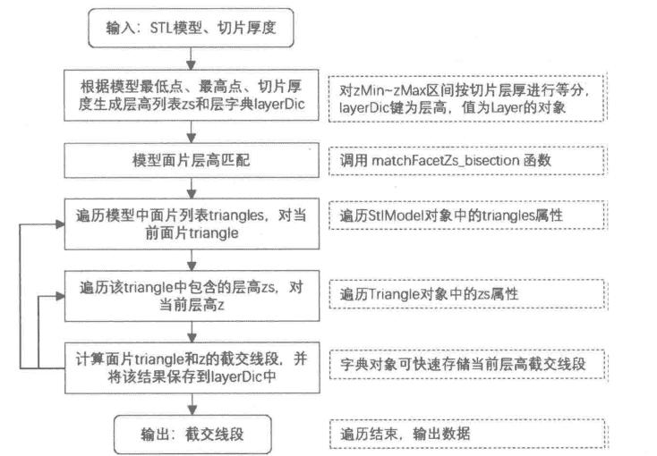

> **图 5.7 基于层高匹配法的 STL 模型截交流程**

至此，以“面片为主导、二分法匹配层高、字典聚合线段”的完整链路就跑通了。下一步自然是把它也挂到 `SliceAlgo` 里，跟前两个算法同台 PK，看看实测性能咋样。

# 实战对比：三种STL截交算法谁更强？

我们先快速回顾一下 `IntersectStl_match` 类里的 `genLayerHeights` 函数。它的逻辑与 `IntersectStl_sweep` 中的同名函数如出一辙，只有一处关键差异：除了输出层高列表，它还额外构建了一个层字典 `layerDic`。有了这个字典，指定任意 Z 值，就能瞬间定位到对应的 `Layer` 对象——比如 `layerDic[z0]` 直接拿到高度 z0 处的层数据，省去了遍历列表的麻烦，这正是引入字典的核心动机。

接下来看重头戏：`intersect` 函数。得益于前期依赖函数的完善，核心流程压缩到了极致，仅四步走：**生成层高 -> 匹配层高 -> 计算截交 -> 转换数据**。在截交计算环节，拿到当前三角面 `triangle` 在层高 `z` 处的截交线段 `seg` 后，只要 `seg` 非空，即通过 `layerDic[z]` 秒级检索到层对象，将 `seg` 扔进其 `segments` 列表。若换成列表存储，每条线段都要遍历查找对应层，性能必然大打折扣。

至此，基于层高匹配的 STL 截交算法落地完毕。调用方式与扫描平面法一脉相承，参考如下：

```
layers = IntersectStl_match(stlModel, layerThk).layers
```

> 其中 `stlModel` 为预读取的 `StlModel` 对象，`layerThk` 为指定层厚，`layers` 用于承接计算出的截交线段。

别忘了在 `SliceAlgo` 模块挂载接口 `intersectStl_match`，代码极简：

| SliceAlgo.py | 新增层高匹配法截交接口 | 5-7 |
|---|---|---|
| 1 | from IntersectStl_match import * | # 导入模块 |
| 2 | ...... | # 省略其他导入与代码 |
| 3 | def intersectStl_match(stlModel, layerThk): | # 定义函数 |
| 4 | return IntersectStl_match(stlModel, layerThk).layers | # 直接返回层数据 |

---

## 实测 PK：暴力、扫描、匹配三足鼎立

现在手里有了三把刀：**暴力法、扫描平面法、层高匹配法**。扫描与匹配法相较于暴力法到底快多少？二者之间又谁更胜一筹？下面用数据说话。

### 测试阵容
选取 4 个典型模型（图 5.8）：
*   **Bunny (斯坦福兔)**：27 万面，高 49.5mm，图形学界“标准考题”。
*   **Monk**：33 万面，高 175.5mm。
*   **Hulk**：59 万面，高 119mm。
*   **Vase**：118 万面，高 381.4mm。
> 备注：三维打印中，百万面级别模型属于家常便饭。

### 测试脚本
在 `Test_intersectStl.py` 中跑分（CPU: i7-8700 @ 3.20GHz），三种层厚 (1.0, 0.5, 0.2mm) 全测，用 `time.clock()` 计时：

| Test_intersectStl.py | 三算法性能实测 | 5-8 |
|---|---|---|
| 1 | ..... | # 导入模块 |
| 2 | stlModel = StlModel() | |
| 3 | stlModel.readStlFile("E:\\STL\\bunny.STL") | # 读模型 |
| 4 | print(' face count:', stlModel.getFacetNumber()) | |
| 5 | layerThks = [1.0, 0.5, 0.2] | # 三种层厚 |
| 6 | for layerThk in layerThks: | |
| 7 | print(' layerThk:', layerThk) | |
| 8 | start = time.clock() | # 1. 扫描平面法 |
| 9 | layers1 = intersectStl_sweep(stlModel, layerThk) | |
| 10 | end = time.clock() | |
| 11 | print("Sweep: %f CPU seconds" % (end - start)) | |
| 12 | start = time.clock() | # 2. 层高匹配法 |
| 13 | layers2 = intersectStl_match(stlModel, layerThk) | |
| 14 | end = time.clock() | |
| 15 | print("Match: %f CPU seconds" % (end - start)) | |
| 16 | start = time.clock() | # 3. 暴力法 |
| 17 | layers3 = intersectStl_brutal(stlModel, layerThk) | |
| 18 | end = time.clock() | |
| 19 | print("Brutal: %f CPU seconds" % (end - start)) | |
| 20 | print(' layer count:', len(layers1), '\n\n') | |

### 硬核数据（表 5.1 摘要）

| 模型 | 层厚 | 层数 | Sweep(s) | Match(s) | Brutal(s) | **加速比(B/S)** | **加速比(B/M)** |
| :--- | :--- | :--- | :--- | :--- | :--- | :--- | :--- |
| **Bunny** | 1.0 | 49 | 2.5 | 2.8 | 16.6 | **6.6x** | **5.9x** |
| | 0.5 | 98 | 3.5 | 5.1 | 32.3 | **9.2x** | **6.3x** |
| | 0.2 | 247 | 7.0 | 7.7 | 79.7 | **11.4x** | **10.4x** |
| **Monk** | 1.0 | 175 | 5.5 | 6.4 | 67.5 | **12.3x** | **10.5x** |
| | 0.5 | 351 | 9.5 | 14.5 | 134.2 | **14.1x** | **9.3x** |
| | 0.2 | 877 | 21.4 | 22.2 | 337.3 | **15.8x** | **15.2x** |
| **Hulk** | 1.0 | 119 | 6.3 | 7.7 | 73.2 | **11.6x** | **9.5x** |
| | 0.5 | 238 | 10.0 | 11.5 | 150.1 | **15.0x** | **13.1x** |
| | 0.2 | 595 | 20.7 | 22.9 | 359.0 | **17.3x** | **15.7x** |
| **Vase** | 1.0 | 384 | 22.4 | 25.9 | 408.5 | **18.2x** | **15.8x** |
| | 0.5 | 769 | 41.7 | 60.0 | 828.5 | **19.9x** | **13.8x** |
| | 0.2 | 1924 | **92.6** | 94.4 | **2034.4** | **22.0x** | **21.6x** |

### 数据解读

1.  **降维打击**：扫描法与匹配法对比暴力法，**效率提升 6~22 倍**，妥妥的数量级跨越。理论优势经实测坐实。
2.  **扫描微优**：扫描平面法与层高匹配法处于同一梯队，但扫描法稳占上风，平均快 **10% 以上**。
3.  **预处理依赖度**：还记得 `intersectTriangleZPlane` 里的“面片高于/低于平面直接返回 None”预处理吗？暴力法极其依赖它；而扫描、匹配法**完全不吃这一套**，去掉预处理性能纹丝不动——原理上也说得通，因为它们从根源上避免了无效面片的遍历。

**痛点直击**：
*   Bunny 切 1.0mm：暴力 16s vs 优化 2~3s。差距感知不强，喝口水的功夫。
*   **Vase 切 0.2mm：暴力 2034 秒（34 分钟） vs 优化 90 秒（1.5 分钟）。**
    仅截交一项就要等半小时，这在工程落地中是**不可接受**的。算法优化，不只是纸面参数，关乎生产力。

> **核心感悟**：算法设计首要正确，其次追求极致。对于计算密集型任务，哪怕 1% 的提升也值得尊敬。我们走过的路，正是这条轨迹。

---

## 本章小结

本章聚焦三维打印切片核心环节——**模型截交**。在暴力法基础上，推出两大优化范式：
*   **扫描平面法**：面片排序 + 扫描平面自底向上收集相交面片计算。
*   **层高匹配法**：面片为主导，反向收集相交层高计算。

实测证明：双优算法性能持平，**均碾压暴力法一个数量级**，扫描法略胜一筹。但这不代表终点，**截交算法仍是开放命题**，期待更高效的方案涌现。

## 思考题
1.  扫描平面法中，如何加速从维护序列中删除面片？
2.  尝试实现近线性时间复杂度的排序算法。
3.  如何进一步榨干 `intersect` 函数性能？
4.  非均匀层高切片下，如何确定层高控制误差？
5.  简述扫描平面法与层高匹配法核心原理差异。
6.  对比 `matchFacetZs_brutal` 与 `matchFacetZs_bisection` 效率。
7.  设计一种全新的 STL 快速截交算法。

---

# 第 6 章 截交线段拼接：从乱序到闭环

## 引言
上章攻克截交优化，拿到了无序离散线段。本章接力，**将散乱线段拼成闭合轮廓**。第 4 章提过暴力拼接，显然不够格。我们将设计两大优化算法，誓要让拼接速度追平截交速度。

## 6.1 暴力拼接的性能陷阱

**问题本质**：同一平面上 N 条无序线段 → 首尾相连成 M 条多段线 (M ≤ N)。打印要求最终闭合 (M 条闭环)。

**暴力逻辑**：对当前多段线端点，遍历所有线段找重合，接上；找不到则该多段线结束。
**致命伤**：时间复杂度 **O(n²)**。最优情况也要 `n(n+1)/2` 次搜索比对。

**实测血泪史**（Monk 模型，0.2mm，877 层）：
*   扫描法截交：**21 秒**。
*   总线段数：86.6 万，均每层 ~988 条。
*   暴力拼接总耗时：**975 秒（16 分钟！）**，均每层 1.1 秒。
*   **拼接耗时是截交的 46 倍**，严重拖后腿。层越薄、层越多，灾难指数级放大。

**合格拼接算法标准**：
1.  **正确鲁棒**：结果对，能扛住奇葩输入。
2.  **高性能**：耗时与优化截交算法同量级，不能当“短板”。

针对痛点，本章推出两套方案：**基于坐标字典序排序** 与 **基于哈希字典查询**。虽名字都带“字典”，**原理截然不同**。但都依赖一种新数据结构——**LinkPoint（链接点）**。

## 6.2 LinkPoint：连接点与线段的桥梁

截交阶段，线段用 `Segment` 结构（仅存两端点）存储。这太基础了，**无法支撑高效拼接**。

**拼接本质 = 找邻居**：寻找与目标点重合的线段端点。
**优化方向 = 建拓扑**：构建端点间的邻近关系。
**前提 = 精妙数据结构**。

**LinkPoint 定义** (`LinkPoint.py`)：
一种**点线合一**的混合体。既能存点，也能存线段。本质表达一个点，但自带链接能力，便于织网。

> 具体字段定义见代码实现……

# 从暴力遍历到 O(n log n)：链接点与字典序如何破解线段拼接难题？

```python
from GeomBase import Point3D
class LinkPoint():
    def __init__(self, pnt3d, digits = 7):
        self.x = round(pnt3d.x, digits)
        self.y = round(pnt3d.y, digits)
        self.z = round(pnt3d.z, digits)
        self.other = None
        self.used = False
        self.index = 0
    def __str__(self):
        return 'LinkPoint: used: %s\nself (%s, %s, %s)\nother (%s, %s, %s)\nlinked to: %s\'' % (self.used, self.x, self.y, self.z, self.other.x, self.other.y, self.other.z, self.other.index)
    def toPoint3D(self):
        return Point3D(self.x, self.y, self.z)
```

上一节我们剖析了 `LinkPoint` 类的设计蓝图。简单回顾：它本质上是一个三维坐标点（含 X、Y、Z），但在初始化时，我们引入了 `digits` 参数配合 Python 的 `round` 函数，将坐标精度锁定在小数点后 7 位。这么做并非多此一举，而是为了对抗浮点运算的“原罪”——截断误差。理论上重合的端点，计算时极易变成 `0.99999999` 或 `1.00000001` 这种“伪重合”。早期暴力算法靠“距离阈值”硬凑，而 `LinkPoint` 从数据源头上就把精度管住了。

`LinkPoint` 还有一个杀手锏属性——`other`。它是一个指针，指向同一线段的另一个端点。也就是说，**一个 `LinkPoint` 对象，既存储了自己作为“点”的坐标，又通过 `other` 隐式地完整保存了“线段”信息**。初始化时，我们只需将线段两端 `A`、`B` 分别实例化为 `lp1`、`lp2`，再互指 `other` 即可（见下方代码演示）。这一操作，将一条线段一拆为二，生成两个完全重合的链接点对。

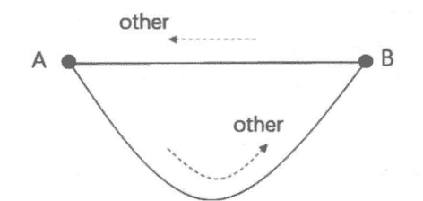

除了 `other`，类内部还预埋了两个关键字段：
*   **`used`（布尔标记）**：默认 `False`。拼接过程中一旦被采用即置 `True`，防止重复使用导致拓扑崩塌。
*   **`index`（索引定位）**：解决“知对象、寻下标”的痛点。列表查元素快，元素反查索引慢（需遍历）。有了 `index`，随时能 O(1) 定位自己在列表中的位置，进而瞬间找到前后邻居。

有了这套“点线合一、自带索引、防重标记”的数据结构，我们就可以正式登场今天的主角——**基于字典序排序的线段优化拼接算法**。

---

## 核心思路：排序赋能，把“找邻居”变成“看邻居”

处理海量同类元素优化问题，暴力遍历是大忌。咱们在 STL 切片扫描线算法里尝过甜头：先对三角片最低点排序，截交效率蹭蹭涨。同理，海量截交线段拼接，也得先“排队”。

但点不像实数，没法直接比大小。怎么办？借用**字典序**的思想。

### 什么是点的字典序？

查字典时，先比首字母，同则比次字母……以此类推。我们把这套规则套用到三维点 `(x, y, z)` 上：
1.  先比 **X**：`x1 < x2` 则 `P1 < P2`；
2.  X 相等，比 **Y**；
3.  Y 也相等，比 **Z**。

这和字符串转 ASCII 排序本质不同。字符串法极其脆弱：`1.10` 和 `1.1` 几何意义相同，字符串排序却天差地别。而坐标分量逐级比较，**几何意义清晰（左下永远小于右上），且对微小扰动免疫**，排序结果稳如泰山。

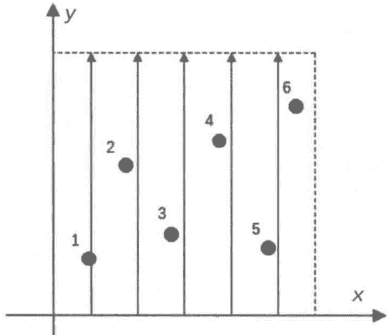

落地代码层面，我们在 `LinkSegs_dorder.py` 里定义比较函数 `cmp_pntSmaller(lp1, lp2)`，返回值遵循 Python `sort` 回调规范：`-1`（小于）、`0`（等于）、`1`（大于）。有了它，对链接点列表 `lpnts` 排序仅需一行：

```python
from functools import cmp_to_key
lpnts.sort(key=cmp_to_key(cmp_pntSmaller))
```

```python
lpnts.sort( key = functools.cmp_to_key( cmp_pntSmaller ) )
```

---

## 算法核心洞察：排序后的“间隔重合”规律

假设平面有 `M` 条散乱线段，转化得 `2M` 个 `LinkPoint` 扔进 `lpnts` 排序。调试时你会发现一个极其美妙的现象：**列表中下标相邻的奇偶点（0&1、2&3、4&5……）坐标高度重合**。

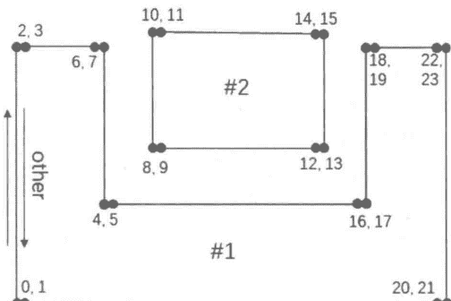

为什么？因为字典序把坐标相同的点强行挤在了一起，而它们原本就是相邻线段的公共端点。这个规律直接把“海量点中找重合”降维成了“只看左邻右舍”。

### 拼接链路实战推演

以图中 24 个点为例，选 3 号点起跑：
1.  **穿越线段**：`3 号点.other` 直接跳到同线段另一端 **6 号点**。
2.  **找重合邻居**：6 号点在列表里的邻居是 5 和 7。算距离，7 号点距离 ≈ 0，**锁定 7 号点为重合点**。
3.  **循环往复**：7 号点 `.other` → 4 号点 → 找邻居重合 → 5 号点 → `.other` → 16 号点……
4.  **闭合收尾**：绕一圈回到起点附近，轮廓闭合，本轮结束。

接下来在 `lpnts` 里找下一个 `used=False` 的点（如 8 号），开启下一轮闭合。直到所有点 `used=True`，所有轮廓拼接完毕。

### 关键细节：`index` 如何避免遍历？

从 3 号点 `.other` 拿到的是 6 号点**对象**，不是下标。没 `index` 只能遍历列表比对地址/值，太慢。有了 `index`，初始化时按顺序写死下标（`lpnts[i].index = i`），6 号点 `.index` 直接给出 `6`，邻居下标 `5`、`7` 瞬间获取，O(1) 定位，零遍历。

```python
for i in range(len(lpnts)):
    lpnts[i].index = i
```

---

## 算法全貌与复杂度：两层循环跑通全流程

整理成标准流程（见流程图），输入 `M` 条 `Segment`，输出若干 `Polyline` 轮廓：

1.  **数据转换**：`Segment` → `2M` 个 `LinkPoint` 入列表 `lpnts`。
2.  **字典序排序**：`lpnts.sort(...)`。
3.  **双层循环拼接**：
    *   **外层**：遍历 `lpnts` 找 `used=False` 的点 `P`。找不到 → 全部结束，输出轮廓列表。
    *   **内层**：以 `P` 为种子，新建 `Polyline`。利用 `.other` 跳线段、用 `index ± 1` 找重合点、标记 `used=True`、加入 `Polyline`。直到轮廓闭合或找点失败，跳回外层。


### 复杂度分析：排序决定上限

除排序外，所有操作（指针跳转、下标取邻居、标记访问）均为常数时间。
*   排序耗时：`O(N log N)`（`N = 2M`）。
*   遍历拼接：`O(N)`。
*   **总复杂度：`O(N log N)`**。

相比暴力法 `O(N²)` 的指数级灾难，这是质的飞跃。

---

## 小结

这节我们完成了从数据结构重构到算法原理推导的完整铺垫：
1.  **`LinkPoint`**：用 `digits` 修浮点病，用 `other` 合点线，用 `index/used` 服务高频查找与去重。
2.  **字典序排序**：赋予无序点集“全序”关系，让重合点天然聚拢为邻居。
3.  **拼接逻辑**：`other` 横向穿线段，`index` 纵向找重合，`used` 纵向防重复，双层循环收割所有闭合轮廓。

下一节，我们将把这套流程图直接翻译成可落地的 Python 类封装代码，实战验证性能提升。敬请期待！

## 6.3 基于字典序的线段拼接实现

既然图 6.4 的流程逻辑已十分明确，下一步便是将其落地为可运行代码。为此，我们定义了 `LinkSegs_dorder` 类（其中 `dorder` 取自 *dictionary order* 缩写，意指字典序）。考虑到先前已创建 `LinkSegs_dorder.py` 并实现了点比较函数 `cmp_pntSmaller`，新类自然延续在该文件中。

```python
......  # 导入必要库
......  # 略过 cmp_pntSmaller 函数
class LinkSegs_dorder :
    def __init__( self, segs ) :
        self.segs = segs
        self.contours = []
        self.polys = []
        self.link( )
    def createLpList( self ) :
        lpnts = []
        for seg in self.segs :
            lp1, lp2 = LinkPoint( seg.A ) , LinkPoint( seg.B )
            lp1.other , lp2.other = lp2 , lp1
            lpnts.append( lp1 )
            lpnts.append( lp2 )
        lpnts.sort( key=functools.cmp_to_key( cmp_pntSmaller ) ) # 对点进行字典排序
        for i in range( len( lpnts ) ) :
            lpnts[ i ].index = i
        return lpnts
    def findUnusedPnt( self, lpnts ) :
        startIndex = -1
        for lpnt in lpnts :
            if lpnt.used == False :
                startIndex = lpnt.index
                break
        return startIndex
    def link( self ) :
        lpnts = self.createLpList( )
        cnt = len( lpnts )
        while True :
            startIndex = self.findUnusedPnt( lpnts )
            if startIndex == -1 : break
            p = lpnts[ startIndex ]
            poly = Polyline( )
            while True :
                poly.addPoint( p.toPoint3D( ) )
                p.used , p.other.used = True , True
                if poly.isClosed( ) :
                    self.contours.append( poly )
                    break
                index = p.other.index    # 获取 p.other 在 lpnts 中序号
                if index-1 >= 0 and p.other.toPoint3D().isCoincide(lpnts[index-1].toPoint3D()):
                    p = lpnts[index - 1]    # 比对 index 前一点是否重合
                elif index+1 < cnt and p.other.toPoint3D().isCoincide(lpnts[index+1].toPoint3D()):
                    p = lpnts[index + 1]    # 比对 index 后一点是否重合
                else:     # 都不满足则跳出第 2 层循环
                    self.polys.append(poly)    # 将 poly 保存到 polys 中,非封闭
                    break    # 不正常的退出
```

该类的组织形式与前文提到的 `IntersectStl_sweep` 及 `IntersectStl_match` 高度一致。初始化时，通过参数 `segs` 接收外部传入的截交线段集；`contours` 字段留作最终封闭轮廓的输出接口；`polys` 则暂存拼接途中可能产生的开放多段线。

核心逻辑集中在 `link` 方法中，它忠实复刻了图 6.4 的流程：先经 `createLpList` 依输入线段生成按字典序排列的节点表 `lpnts`，继而进入双层循环。首层循环借助 `findUnusedPnt` 从 `lpnts` 中检索未被占用的节点，若返回 -1 则宣告遍历结束；次层循环中，拿到 `p.other` 对应的索引 `index` 后，首要任务是校验边界（`index-1 >= 0` 且 `index+1 < cnt`），防止越界。随后对比 `p.other` 与 `lpnts[index-1]` 是否重合。注意此处采用 `isCoincide` 而非 `isIdentical` 判定，并将节点转为 `Point3D` 比较，这种“宽容”策略能显著提升鲁棒性——即便初始化时坐标已保留 7 位小数，理论重合点在数值上仍难免微小偏差。

次层循环有两类出口：一是生长中的多段线自成闭环，属正常收敛，产出目标轮廓；二是 `p.other` 无法在序号邻域找到重合点而被迫终止，属异常中断，留下的非闭合多段线存入 `polys`。异常成因通常有二：STL 模型本身未封闭（存在孔洞），或相邻三角面间隙过大。针对后者，可先收集这些开放多段线，放宽重合容差再做二次拼接，因数量稀少，暴力法即可高效补全。

最后，在 `SliceAlgo` 模块暴露统一入口 `linkSegs_dorder`，仅作一层薄封装：

| SliceAlgo.py | linkSegs_dorder: 引入字典序排序的截交线段拼接 | 6 - 5 |
|---|---|---|

| 1 | from LinkSegs_dorder import * | # 导入模块 |
| | ...... | # 省略其余导入与代码 |
| 3 | def linkSegs_dorder( segs ): | # 定义接口 |
| 4 | return LinkSegs_dorder( segs ).contours | # 直接返回封闭轮廓 |

至此，字典序排序法已完整呈现。暂不急于基准测试，因为随后还将推出一套功能等效但机制迥异的方案——两者将与暴力基准一同接受横评。

## 6.4 字典映射查找法拼接优化

上一节的字典序排序法（$O(n \log n)$）依赖 `LinkPoint` 结构与排序结果建立邻接关系。本节另辟蹊径：同样基于 `LinkPoint`、同样为了寻找线段邻接，但不再排序，而是将所有节点投入哈希映射（Python `dict`），利用其 $O(1)$ 平均查找特性直接定位邻居。*特别提示：两节标题虽均含“字典”，前者指排序规则，后者指容器类型，切勿混淆。*

### 6.4.1 映射查找的核心机制

面对 $M$ 条散乱线段，按惯例拆解为相互关联的节点对，但不再施加任何排序，任其保持原始分布（参考图 6.5）。此时，本应重合的两个节点在序列中位置随机，不再相邻，字典序法因此失效。

聚焦图 6.5 中相连的 1 号与 4 号线段：端点分别为 0/1 与 6/7 号节点，1 与 6 重合。从 0 经 `other` 到 1 易如反掌，难点是如何从 1 “跳”到 6？二者唯一共享属性是坐标。于是引入映射：以坐标为键，以节点对象列表为值。例如 1、6 号节点共同落在 $(x_0,y_0)$，映射记为 `{ (x_0,y_0): [node_1, node_6] }`。多组重合点同理扩展。查找复杂度仅 $O(\log k)$（$k$ 为键数），极其高效。

*为何键只用 $(x,y)$？* 切片场景下所有线段同处一水平面，Z 恒定，省略 Z 既不影响正确性，又能加速哈希。若通用场景涉及多高度，补上 Z 即可。

回看跳转过程：0 → `other` → 1 → 取坐标 $(x,y)$ → 映射查得 `[node_1, node_6]` → 比对对象身份标识（Python `id`）剔除自身 → 锁定 6。若映射再扩充一项 `{ (x_2,y_2): [node_7, node_2] }`，即可串联 0→1→6→7→2→3……将平面所有重合点按此法入映射，轮廓即可高速提取。关键在于映射如何构建。

构建算法（`createLpDic`，置于 `LinkSegs_dlook.py` 中的 `LinkSegs_dlook` 类，`dlook` 源自 *dictionary lookup*）：

1.  迭代线段表 `segs`，取当前段 `seg`。
2.  由 `seg` 生成节点 `lp1`、`lp2`，互设 `other`。
3.  以 `(lp1.x, lp1.y)` 为键，将 `lp1` 置入映射对应列表（键不存在则新建）。
4.  对 `lp2` 执行同一逻辑。
5.  循环至遍历结束。


正常情况下，输入 $M$ 段，映射含 $M$ 个键，每键挂两个节点。至此，节点与映射均已就绪，遵循上述跳转规则即可完成拼接，下节给出完整流程与代码。值得注意的是：单次查找 $O(\log k)$，全程 $O(n \log n)$，且无排序环节，复杂度稳定，无最好/最坏情况之分。

### 6.4.2 流程图解与代码落地

图 6.6 展示了基于映射查找的拼接流程。虽与图 6.4 轮廓相似，内核实现却大相径庭。二者输入均为离散线段表 `segs`，输出均为闭合轮廓表 `contours`。

```python
#### 导入必要库
class LinkSegs_dlook :
    # 类定义
    def __init__( self, segs ):
        # 初始化函数，输入线段列表 segs
        self.segs = segs
        # 保存线段列表
        self.contours = []
        # 保存封闭轮廓
        self.polys = []
        # 保存非封闭轮廓
        self.link()
        # 调用拼接函数
    def link( self ) : pass
        # 字典查询法拼接函数，略
    def createLpDic( self ) :
        # 构建字典函数
        dic = {}
        # 字典初始化
        for seg in self.segs:
            # 遍历 segs
            lp1, lp2 = LinkPoint( seg.A ) , LinkPoint( seg.B )
            # 构建两个 LinkPoint 数据点
            lp1.other, lp2.other = lp2, lp1
            # 点的 other 属性相互赋值
            if ( lp1.x, lp1.y ) not in dic.keys() :
                # 判断 lp1 坐标是否在字典的键中
                dic[ ( lp1.x, lp1.y ) ] = []
                # 如果不在则对该键新建列表
                dic[ ( lp1.x, lp1.y ) ].append( lp1 )
                # 对该键对应的列表添加 lp1
            if ( lp2.x, lp2.y ) not in dic.keys() :
                # 对 lp2 执行相同的操作
                dic[ ( lp2.x, lp2.y ) ] = []
                dic[ ( lp2.x, lp2.y ) ].append( lp2 )
        return dic
        # 返回字典
```

# 基于字典查询的线段拼接：原理、实现与性能实测

在处理截交线段拼接时，引入字典结构进行键值查询能显著提升效率。本文将深度解析这一算法的核心流程、代码落地细节，并构建百万级数据量的测试场景，对比三种主流拼接方案的实际表现。

## 核心流程：双层循环驱动的拼接逻辑

正如流程图所示，整个拼接过程建立在 `createLpDic` 函数构建的链接点字典 `dic` 之上。键为坐标，值为该坐标下的链接点对象集合。主流程由两层循环协作完成：

**第一层循环：猎寻起点**  
遍历字典的值集合（而非键），寻找 `used` 标记为 `False` 的链接点 `p`。若遍历结束仍无可用点，说明所有线段已处理完毕，直接输出闭合轮廓列表 `contours` 并终止；一旦捕获到未使用点 `p`，即实例化一条新多段线 `poly`，准备串联后续节点。

**第二层循环：链路追踪与终止判定**  
此循环负责沿着拓扑连接关系“走迷宫”：
1.  **落笔与标记**：将当前点 `p` 加入 `poly`，同步将 `p` 及其孪生点 `p.other` 标记为已用。
2.  **邻域查询**：以 `p.other` 的坐标为键，在 `dic` 中定位对应的点集。
3.  **寻找下一站**：在该点集中筛选出非 `p.other` 的点作为新的 `p`（若不存在则 `p` 置空）。
4.  **分流决策**：
    *   若 `poly` 已闭合 → 存入 `contours`，断开内层循环。
    *   若 `poly` 未闭合但 `p` 为空 → 存入开放轮廓列表 `polys`，断开内层循环。
    *   否则 → 继续内层循环，延伸多段线。

值得注意的是，该方案全程未使用 `LinkPoint` 的 `index` 属性，彻底摆脱了对序号索引的依赖。

## 代码落地：`LinkSegs_dlook` 类深度解析

我们将上述逻辑封装于 `LinkSegs_dlook` 类中，核心实现如下：

### 关键辅助函数

*   **`findUnusedPnt(dic)`**：  
    遍历 `dic.values()`，返回首个 `used == False` 的点对象（引用），找不到则返回 `None`。这与排序法返回“列表下标”形成鲜明对比，体现了字典查询“直接操作对象”的特性。

*   **`findNextPnt(p, dic)` —— 算法的灵魂**  
    代码虽短（仅十余行），却浓缩了字典查询的精髓：
    1.  取出 `p.other`。
    2.  用其坐标 `(other.x, other.y)` 瞬间定位字典条目。
    3.  遍历该条目下的点列表（通常仅 2 个元素），通过 `is not` 身份比较排除 `other` 本身，锁定另一个几何重合点。
    
    正是这个函数，利用哈希表将“寻找几何重合点”从 O(N) 降为 O(1)，驱动第二层循环以极简形态高速运转。

### 核心驱动函数 `link()`

```python
def link(self):
    dic = self.createLpDic()        # 1. 构建索引
    while True:                     # 2. 外层：找起点
        p = self.findUnusedPnt(dic)
        if p is None: break
        poly = Polyline()
        while True:                 # 3. 内层：链路追踪
            poly.addPoint(p.toPoint3D())
            p.used, p.other.used = True, True
            p = self.findNextPnt(p, dic)
            if poly.isClosed():
                self.contours.append(poly); break
            if p is None:
                self.polys.append(poly); break
```
代码结构与流程图严丝合缝，清晰展示了“构建索引 -> 外层扫描 -> 内层链接 -> 分类收集”的完整链路。

## 模块接口：`SliceAlgo.linkSegs_dlook`

为方便上层调用，在 `SliceAlgo` 模块暴露统一入口：
```python
def linkSegs_dlook(segs):
    return LinkSegs_dlook(segs).contours
```
输入乱序线段，直接输出闭合轮廓列表，屏蔽了内部开放轮廓 `polys` 等中间细节。

## 理论复杂度回顾与实测必要性

目前已有三套方案：
1.  **暴力法**：O(n²)
2.  **字典序排序法**：O(n log n)
3.  **字典查询法（本文）**：O(n log n) —— *字典构建排序主导复杂度*

理论上后两者碾压暴力法，但常数项、内存访问模式、Python 解释器特性等工程因素可能导致实测偏离理论。且第 5 章实测发现，真实切片高度下的线段数仅百~千级，难以拉开性能差距。**我们需要百万甚至千万级的压测场景。**

## 构建百万级压测数据：从“轮廓”反向生成“乱序线段”

直接随机生成线段无法保证拓扑闭合。**正确思路是“先有轮廓，后打碎成段，再打乱顺序”**。

### 几何建模：同心圆族
*   **为什么选圆？** 参数方程 `x = x0 + r·cosθ, y = y0 + r·sinθ` ```
\begin{cases} x = x_0 + r \cdot \cos(\theta) \\ y = y_0 + r \cdot \sin(\theta) \end{cases} (6-1)
``` 统一且简单，避免多边形分段函数的麻烦。
*   **为什么同心？** 天然保证轮廓互不相交，符合 3D 打印单层多轮廓（外壳+内填/支撑）的拓扑约束。

### 生成管线 `makeMessySegs` ```python
from Segment import *          # 导入 Segment 模块
from random import *         # 导入随机数生成模块
import math                  # 导入 math 模块
def makeMessySegs( circleNum = 10, segNumPerCircle = 100000, radius = 100.0 ): # 函数定义
    segs = []                    # 定义线段列表
    r = radius                   # 以半径递增的方式生成同心圆
    for i in range( circleNum ): # 遍历，生成指定 circleNum 个同心圆
        pnts = []                    # 点列表，用于收集圆上的点
        for j in range( segNumPerCircle ): # 按细分份数细分圆
            theta = j / segNumPerCircle * 2 * math.pi # 角度 theta
            x = r * math.cos( theta )    # 圆上点 X,Y 坐标，圆心在原点
            y = r * math.sin( theta )
            pnt = Point3D( x, y )
            pnts.append( pnt )           # 将点添加到 pnts
        pnts.append( pnts[0] )           # 在 pnts 添加起点，以封闭轮廓
        for j in range( len( pnts ) - 1 ): # 将点依次整理为线段，添加至 segs
            seg = Segment( pnts[ j ], pnts[ j+1 ] )
            segs.append( seg )
        r += 10.0                        # 同心圆半径递增
print( ' segment count: ', len( segs ) ) # 打印 segs 中线段总数
print( ' min segment length: ', segs[0].A.distance( segs[0].B ) ) # 打印 segs 中最短的线段
for i in range( len( segs ) ): # 对 segs 中线段散乱化处理
    rd = randint( 0, len( segs ) - 1 ) # 生成一个随机整数 rd
    segs[ i ], segs[ rd ] = segs[ rd ], segs[ i ] # 当前线段和随机序号线段交换
return segs
```
1.  **参数控制**：`circleNum`（轮廓数）、`segNumPerCircle`（单圆细分段数）、`radius`（起始半径，步长 10mm）。总段数 = `circleNum × segNumPerCircle`，轻松突破百万。
2.  **采样生成**：按 `θ` 均匀采样，相邻点成段，得到有序线段列表 `segs`。
3.  **最小线段长度守门员**：打印最短段长，必须 **> 10⁻⁶ mm**（排序法与暴力法的重合判阈默认 10⁻⁷ mm），防止数值抖动导致拼接失效。
4.  **洗牌打乱**：遍历列表，每段与 `random.randint(0, len-1)` 位置互换。遍历结束，`segs` 即为“外观完全散乱、内在拓扑完备”的理想测试集。

## 实测环境与启动

*   **硬件**：Intel Core i7-8700 @ 3.20GHz
*   **脚本**：`Test_linkSegs.py` ```python
from Segment import *          # 导入 Segment 模块
from random import *         # 导入随机数生成模块
import math                  # 导入 math 模块
def makeMessySegs( circleNum = 10, segNumPerCircle = 100000, radius = 100.0 ): # 函数定义
    segs = []                    # 定义线段列表
    r = radius                   # 以半径递增的方式生成同心圆
    for i in range( circleNum ): # 遍历，生成指定 circleNum 个同心圆
        pnts = []                    # 点列表，用于收集圆上的点
        for j in range( segNumPerCircle ): # 按细分份数细分圆
            theta = j / segNumPerCircle * 2 * math.pi # 角度 theta
            x = r * math.cos( theta )    # 圆上点 X,Y 坐标，圆心在原点
            y = r * math.sin( theta )
            pnt = Point3D( x, y )
            pnts.append( pnt )           # 将点添加到 pnts
        pnts.append( pnts[0] )           # 在 pnts 添加起点，以封闭轮廓
        for j in range( len( pnts ) - 1 ): # 将点依次整理为线段，添加至 segs
            seg = Segment( pnts[ j ], pnts[ j+1 ] )
            segs.append( seg )
        r += 10.0                        # 同心圆半径递增
print( ' segment count: ', len( segs ) ) # 打印 segs 中线段总数
print( ' min segment length: ', segs[0].A.distance( segs[0].B ) ) # 打印 segs 中最短的线段
for i in range( len( segs ) ): # 对 segs 中线段散乱化处理
    rd = randint( 0, len( segs ) - 1 ) # 生成一个随机整数 rd
    segs[ i ], segs[ rd ] = segs[ rd ], segs[ i ] # 当前线段和随机序号线段交换
return segs
```
*   **对象**：三大算法 `linkSegs_dorder`（排序法）、`linkSegs_dlook`（字典查询法）、`linkSegs_brute`（暴力法，隐含对比）
*   **数据规模**：示例中 `makeMessySegs(10, 10000)` 生成 10 万段预热，正式测试将推向百万/千万级。

```python
# Test_linkSegs.py 片段
segs = makeMessySegs(10, 10000)  # 生成测试集
start = time.clock()
contours1 = linkSegs_dorder(segs) # 1. 排序法计时
end = time.clock()
# ... 后续测试 dlook 与 brute ...
```

下一节将揭晓实测数据：字典查询法能否在工程实践中兑现 O(n log n) 的理论优势，并最终加冕“最优拼接算法”？敬请期待。

# 实测对决：三大线段拼接算法谁是“速度之王”？

## 代码实战：计时器拉开序幕

我们直接上代码看实测。测试脚本 `Test_LinkSegs.py` 里，三种算法轮流上场，`time.clock()` 全程盯着跑：

```python
# 1. 字典序排序法
start = time.clock()
contours1 = linkSegs_dorder(segs)
end = time.clock()
print("dorder: %f CPU seconds" % (end - start))

# 2. 字典查询法
start = time.clock()
contours2 = linkSegs_dlook(segs)
end = time.clock()
print("dlook: %f CPU seconds" % (end - start))

# 3. 暴力法
start = time.clock()
contours3 = linkSegs_brutal(segs)
end = time.clock()
print("brutal: %f CPU seconds" % (end - start))
```


## 测试设置：从“小打小闹”到“百万级”压力测

测试数据由 `makeMessySegs` 生成。我们锁定轮廓数为 10 条不变，只动第二个参数——线段密度，让它从 100、200、500 一路飙升到 10^6。对应的总散乱线段数就从 1000 条飙升到 1000 万条。跑完脚本，各算法在不同数据量下的耗时鲜明对比，汇总如表所示。

### 表 6.1 三大算法耗时PK表（单位：秒）

| 线段总数 方法 | 1,000 | 2,000 | 5,000 | 10^4 | 10^5 | 10^6 | 5×10^6 | 10^7 |
| :--- | :---: | :---: | :---: | :---: | :---: | :---: | :---: | :---: |
| **字典序排序** | 0.018 | 0.029 | 0.077 | 0.17 | 2.12 | 24.16 | 135.62 | 277.66 |
| **字典查询** | **0.008** | **0.017** | **0.054** | **0.10** | **1.16** | **13.45** | **67.22** | **133.95** |
| **暴力法** | 1.06 | 4.31 | 27.21 | 110.02 | — | — | — | — |

> **注**：暴力法在 10^5 级别以上耗时超 2 小时，直接弃测（表中用 “—” 标记）。

## 结果复盘：差距不是一星半点

### 1. 暴力法彻底“出局”
看 1000 条线段时，前两者只需几毫秒，暴力法却要 **1 秒多**——慢了 **100 倍**！数据量涨到 1 万条，差距直接拉大到 **1000 倍**。这也解释了为什么我们在第 4 章有了暴力法，还得拼命研究新算法——它根本干不了实际活。

### 2. 字典查询法“稳赢”字典序排序法
两者同属“线性梯队”，但字典查询法全程领跑，效率约为字典序排序法的 **2 倍**。比如 10^7 条线段时，前者 133 秒搞定，后者要 277 秒。

### 3. 硬核线性特性：数据涨 10 倍，时间涨 10 倍
抽取关键节点（10^3 ~ 10^7）一看便知：
- 字典查询法：0.008s → 0.1s → 1.16s → 13.45s → 133.95s
- 字典序排序法：0.018s → 0.17s → 2.12s → 24.16s → 277.66s

标准的 **O(N) 线性增长**，没有任何隐形开销，极其稳健。

---

## 实战检验：Monk 模型切片现场

合成数据过瘾不够，还得看真模型。我们拿第 5 章用过的 **Monk 模型**（三角面片 33 万、高 175.5mm）实测：
- 切片厚度 0.2mm，扫描平面法截交耗时 **21 秒**（见表 5.1）
- 共 877 层，总截交线段 **约 87 万条**，均每层 ~988 条

**拼接环节实测耗时：**
| 算法 | 耗时 | 折合 |
| :--- | :--- | :--- |
| 暴力法 | 975 秒 | **> 16 分钟** |
| 字典序排序法 | 13.1 秒 | — |
| **字典查询法** | **8.8 秒** | — |

**结论一目了然：**
1. 实际工程场景下，新算法依然 **碾压暴力法**（快 70~100 倍）。
2. **拼接耗时（~9-13s）与截交耗时（21s）同量级**，不再是瓶颈，实现了“截交+拼接”流程的均衡高效。
3. 最终得到的切片轮廓完美闭合，见下图。


### 图 6.8 Monk 模型截交拼接得到的封闭切片轮廓

---

## 本章核心速记

| 问题根源 | STL 面片无序 → 截交线段散乱 |
| :--- | :--- |
| 旧方案（第 4 章） | 暴力拼接 → **O(N²)，实用性差** |
| 新方案一：字典序排序法 | 端点按字典序排序 → 靠序号找重合点 → **O(N)** |
| 新方案二：字典查询法 | 端点坐标作 Key 建字典 → 靠 Key 查重合点 → **O(N)，且常数因子更小** |
| 共同基石 | **LinkPoint 链接点** 数据结构 |
| 最终结论 | **字典查询法 > 字典序排序法 >> 暴力法** |

---

## 课后思考题（留给硬核玩家）

1.  **LinkPoint 结构**为何能“一点两用”（既代表点，又代表线段）？
2.  三维空间里，点做字典序排序的**几何意义**是什么？
3.  本质上讲，为什么**基于点的字典序排序**能极大提升平面线段拼接效率？
4.  STL 模型三角面片间有**缝隙**时，拼接阶段如何仍能生成封闭轮廓？
5.  简述**字典查询法**的原理、流程及效率提升根因。
6.  字典查询法中，为何用**坐标元组**而非点对象本身作字典 Key？
7.  **开放挑战**：除以上两法外，你能设计一种新的线段快速拼接算法吗？

---

# 第 7 章 基于拓扑模型的切片轮廓计算

## 引言：换个赛道，彻底解决“散乱”根因

前几章我们的套路是：**STL → 截交得散乱线段 → 拼接成轮廓**。虽然后两步优化到了 O(N)，但我们**从未动过 STL 模型本身**——顶多在截交时给面片排个序。

事实是：STL 里虽然没显式存，但**顶点-面、边-面、边-边、面-面**之间天然存在**几何拓扑关系**（如：一个顶点关联哪些面、一面邻接哪些面）。本章核心任务就是：**预处理阶段显式重建这些拓扑关系，然后在此基础上重写切片轮廓计算逻辑**。

---

## 7.1 STL 模型的“原罪”：冗余与孤岛

### 1. 顶点冗余：存 6 倍数据，干 1 倍的活
回顾图 4.1，STL 以三角面片为单元，**顶点独立存储**。一个四棱锥（图 7.1）理论上 5 个顶点够用，STL 却要 6 个面 × 3 顶点 = **18 个顶点**，每个坐标位置重复 3~4 次。

**理论推导（欧拉公式）：**
- 简单多面体：$V - E + F = 2$  (7-1)
- 全三角面片：$E = \frac{3}{2}F$  (7-2)
  > *理解技巧：把每条边拆成两个“半边”，归属两个三角形，共 3F 个半边，合并即 1.5F 条边。*
- STL 实际顶点数：$V_{act} = 3F$  (7-3)
- 理论最少顶点数：$V = 2 + \frac{1}{2}F$  (7-4)
- **冗余倍数**：$\frac{V_{act}}{V} = \frac{6F}{4+F}$  (7-5)

```
V + F - E = 2  (7-1)
```


**结论**：面片数 $F \gg 4$ 时，**冗余趋近 6 倍**。10MB 模型存成 STL 可能要 60MB。

### 2. 拓扑孤岛：面片间“零社交”，查邻居只能“遍历全村”
同坐标顶点平均存 6 份，每份归属不同面片/棱边。**面片与面片完全隔离**，想从当前面片跳到相邻面片？只能全模型遍历匹配坐标——极其低效。

### 3. 如果打通“社交网络”会怎样？（种子追踪法）
假设我们有了**面片邻接表**：
1. 随便找个面片作“种子”，求其与截平面交线。
2. 查邻接面片，求交线 → 必然与上一段**首尾相连**。
3. 迭代追踪，直到遍历完所有相关面片。

**效果**：**截交与拼接融为一体**，一步到位生成有序轮廓，彻底甩掉“散乱线段”包袱。

---

## 7.2 拓扑关系怎么存？先定数据结构

STL 模型 = 一堆无序三角面片。每面片 = 1 面 + 3 顶点 + 3 棱边。我们要把 **顶点、边、面** 的从属/包含/索引关系全梳理清楚，落地为代码。所有类均写在 `TopoSlicer.py`。

### 7.2.1 顶点拓扑结构：去重是第一步

**痛点**：STL 里同坐标顶点是不同对象。**理想状态**：同一坐标**只留一个顶点对象**。

**设计（图 7.2）**：
- **坐标**：X, Y, Z（保留 7 位小数，参数 `digits=7`，确保本该重合的点能重合）。
- **关联面片列表 `faces`**：存所有用到该顶点的三角面片引用（至少 3 个，上限不定）。
- **不存棱边列表**：面片里已存棱边，经由 `faces` 间接可得，简化结构。

**Python 实现 `TVertex`（T = Topology）**：
```python
class TVertex:
    def __init__(self, pnt3d, digits=7):
        self.x = round(pnt3d.x, digits)
        self.y = round(pnt3d.y, digits)
        self.z = round(pnt3d.z, digits)
        self.faces = []  # 关联面片引用

    def toTuple(self):       # 转元组，用作字典 Key
        return (self.x, self.y, self.z)

    def toPoint3D(self):     # 转 Point3D，复用几何库算子
        return Point3D(self.x, self.y, self.z)

    def isSmaller(self, other):  # 字典序比较，复用第 6 章逻辑
        if self.x < other.x: return True
        if self.x == other.x and self.y < other.y: return True
        if self.x == other.x and self.y == other.y and self.z < other.z: return True
        return False
```
> **注**：`isSmaller` 为何不直接调第 6 章 `cmp_pntSmaller`？为避免跨模块耦合（链接模块不该被拓扑模块依赖），保持代码“纯粹”，此处重写一遍。


#### 图 7.2 顶点拓扑结构

---

### 7.2.2 棱边拓扑结构：引入“半边”化解归属纠纷

**困境**：一条棱边共享两个面片，若在棱边里存“所属面片”，**到底算谁的**？

**破局（半边 / Half-Edge，图 7.4）**：
把一条几何棱边**拆成两条重合的半边**：
- 半边 `e1` 归属面片 `f1`
- 半边 `e2` 归属面片 `f2`

**半边拓扑结构**：
- 两个**顶点引用**（起/终点）
- 一个**面片引用**（明确归属）
- 一个**对边引用**（指向共享同几何位置的另一半边）
  > 边界处半边可能**无对边**（开放模型）。


#### 图 7.3 棱边与顶点、面片的拓扑关系（拆分前）
#### 图 7.4 半边拓扑结构（拆分后）

---

*(后续内容将展开面片拓扑结构、拓扑构建算法、基于拓扑的切片追踪流程等，敬请期待)*

# 构建高效拓扑结构：从半边到面片的STL重建实战


基于前序分析，我们得以构建一个半边类，专门用于维护半边、顶点与面片间的几何拓扑关联。该类定名为 `TEdge`，前缀 `T` 代表 Topology（拓扻）。同前文一样，该类置于 `TopoSlicer.py` 中，具体实现代码如下：

```
#### TopoSlicer.py | TEdge 类定义,它表示具有拓扑关系的棱边( 半边) | 7 - 2
...... # 导入必要库,省略其他代码
class TEdge: # 定义 TEdge 类
    def __init__( self, tA, tB) : # 从两个 TVertex 点初始化
        self.A, self.B = tA, tB # 两个顶点引用 A、B
        self.F = None # 所从属的面片引用 F
        self.OE = None # 对边引用 OE
    def toTuple( self) : # 将边转化为元组( 6 维)
        if self.A.isSmaller( self.B) :
            return ( self.A.x, self.A.y, self.A.z, self.B.x, self.B.y, self.B.z)
        else :
            return ( self.B.x, self.B.y, self.B.z, self.A.x, self.A.y, self.A.z)
    def intersect( self, z) : # 边和 z 平面求交,返回交点
        if min( self.A.z, self.B.z) > z or max( self.A.z, self.B.z) < z :
            return None # 如果边高于或低于 z,无交点
        elif self.A.z == self.B.z == z :
            return None # 如果边位于 z 平面,无交点
        else :
            if z == self.A.z : return self.A.toPoint3D()
            else :
                ratio = ( z - self.A.z ) / ( self.B.z - self.A.z ) # 根据 z 比例计算
                vec = self.A.toPoint3D().pointTo(self.B.toPoint3D()).amplified( ratio)
                pnt = self.A.toPoint3D() + vec
                return pnt
```

首先解析 `TEdge` 的四大核心字段：`A`、`B`、`F` 与 `OE`。其中 `A`、`B` 均为 `TVertex` 类型引用，标识半边的始末顶点；`F` 指向所属面片；`OE` 则指向对边。此处反复强调“引用”概念，旨在保障后续应用中能极速定位对象。Python 变量本质即存储对象引用，故无需额外操心；若迁移至 C/C++ 实现，则须显式保存指针。

初始化函数仅对两个顶点赋值，其余字段默认置空。后续代码中，函数参数采用小写 `t` 前缀标识拓扑对象。同 `TVertex` 一样，`TEdge` 亦提供 `toTuple` 方法，将两端点的六个坐标压缩为六维元组。为确保几何完全重合的半边生成一致元组，引入一技巧：对比两端点大小，令较小顶点坐标占据元组前三位。此过程调用了 `TVertex.isSmaller`，这也是前文预埋该方法的用意。

此外，`TEdge` 还内置 `intersect` 方法，用于计算半边与高度为 `z` 的 XY 平面（即 Z 平面）的交点，这是后续拓扑模型与切平面求交的基石。注意，前述拓扑体系建设，终极服务于切片轮廓提取。

在 `intersect` 实现中，我们“重造轮子”。`GeomAlgo` 模块已有通用线段-平面求交函数 `intersectSegmentPlane`，完全可在 `intersect_v1` 中直接调用，如下所示：

| TopoSlicer.py | TEdge 类中的 intersect_v1 函数定义，直接调用 intersectSegmentPlane 函数 | 7-3 |
|---|---|---|
| 1 | class TEdge: | |
| 2 | ...... | |
| 3 | def intersect_v1( self, z ): | # 定义 intersect_v1, 返回交点 |
| 4 | seg = Segment( self.A.toPoint3D(), self.B.toPoint3D() ) | # 线段构造 |
| 5 | pln = Plane.zPlane( z ) | # 截平面构造 |
| 6 | return intersectSegmentPlane( seg, pln ) | # 返回截交点 |

然而，通用函数缺乏预处理，导致 `intersect_v1` 效率平平。

针对 Z 平面这一特例，通过简单预判即可剔除明显不相交情况（如半边最低点高于切面、最高点低于切面、或半边共面），大幅提速。`TEdge.intersect` 前半段即按此逻辑处理。若确有相交，交点 Z 坐标必为 `z`（见图 7.5），两端点坐标已知，据 Z 方向比例即可快速解算交点。实测表明，`intersect` 效率较 `intersect_v1` 提升 30% 以上。有时，若再造轮子成本可控，并非不可取。


### 7.2.3 面片拓扑结构

最后审视三角面片与顶点、棱边（半边）的拓扑联系。有了顶点、半边基础，面片结构构建便水到渠成。如图 7.6 所示，面片必含三顶点，故须保存三顶点引用；同时必含三半边，且各半边专属当前面片，故亦须保存三半边引用。


图 7.6 面片拓扑结构

据此，即可建立拓扑面片类 `TFace`，置于 `TopoSlicer.py`，用于维护面片、顶点、半边三者关系。实现代码如下：

```
TopoSlicer.py | TFace 类定义，它表示具有拓扑关系面片 | 7-4
1 ......
2 class TFace():
3     def __init__(self, tA, tB, tC, te1, te2, te3):
4         self.A, self.B, self.C = tA, tB, tC
5         self.E1, self.E2, self.E3 = te1, te2, te3
6         self.used = False
7     def zMin(self): return min(self.A.z, self.B.z, self.C.z)
8     def zMax(self): return max(self.A.z, self.B.z, self.C.z)
9     def intersect(self, z):
10        if self.zMin() > z or self.zMax() < z:
11            return None, None, None
12        elif self.A.z == self.B.z == self.C.z == z:
13            return None, None, None
14        else:
15            c1 = self.E1.intersect(z)
16            c2 = self.E2.intersect(z)
17            c3 = self.E3.intersect(z)
18            if c1 is None:
19                if c2 is not None and c3 is not None:
20                    if c2.distance(c3) != 0.0:
21                        return Segment(c2, c3), [ self.E2, self.E3 ], None
22            elif c2 is None:
23                if c1 is not None and c3 is not None:
24                    if c1.distance(c3) != 0.0:    # 返回线段，半边 E1、E3
25                        return Segment(c1, c3), [self.E1, self.E3], None
26
27            elif c3 is None:
28                if c1 is not None and c2 is not None:
29                    if c1.distance(c2) != 0.0:    # 返回线段，半边 E1、E2
30                        return Segment(c1, c2), [self.E1, self.E2], None
31
32            elif c1 is not None and c2 is not None and c3 is not None:
33                if c1.isIdentical(c2):
34                    return Segment(c1, c3), [self.E3], self.B    # 返回线段，半边 E3、顶点 B
35                elif c2.isIdentical(c3):
36                    return Segment(c1, c2), [self.E1], self.C    # 返回线段，半边 E1、顶点 C
37                elif c3.isIdentical(c1):
38                    return Segment(c1, c2), [self.E2], self.A    # 返回线段，半边 E2、顶点 A
39
40            return None, None, None
```

`TFace` 定义七属性：`A`、`B`、`C`、`E1`、`E2`、`E3` 及 `used`。前三者为顶点引用，非独占，常被多面共享；`E1`~`E3` 为半边引用，初始化时约定：`E1` 连 `A`-`B`，`E2` 连 `B`-`C`，`E3` 连 `C`-`A`。此序列约束至关重要，违之将导致从半边反查顶点无从下手。`used` 标记面片是否已参与计算，服务于后续求交流程。

`zMin`、`zMax` 分别取三顶点 Z 向极值，功能类似 `Triangle` 类的 `zMinPnt`、`zMaxPnt`，但更精简。核心在于 `intersect` 方法，计算三角面片与切平面交线，亦是切片轮廓计算核心。其原理与 `GeomAlgo.intersectTrianglePlane` 如出一辙，代码形态也极似。为何还要重写？

细察可知，二者返回类型不同。后者仅返回 `Segment` 或 `None`；前者返回三元组：交线线段（或 `None`）、交线端点所在半边或顶点引用。端点均在半边上则回两半边引用；一半边一顶点则分别回引用；不相交或仅交于一点则全返 `None`。

因 `intersectTrianglePlane` 返回粒度不足，无法满足拓扑追踪需求，不得不从底层重写求交逻辑——又一次“造轮子”。`TFace.intersect` 内亦做预处理：面片最高点低于切面、最低点高于切面、或面片共面，直接判不相交。且复用 `TEdge.intersect` 求半边交点。

## 7.3 STL 拓扑模型重建

上节构建了 `TVertex`、`TEdge`、`TFace` 三大拓扑结构，并封装求交相关方法。此前设一关键假设：模型无冗余顶点。现实却是 STL 充斥大量冗余，欧拉定理推算平均每顶点重复存 6 次。现在利用三大类对 STL 重建，消除冗余，建立顶点-面片-半边互联网络。终极目标：从任一拓扑元素出发，速览邻域，进而迭代遍历全模型。

### 7.3.1 冗余顶点消除

重建首战即去冗余。遍历 STL 每三角面收集顶点坐标入列表。按欧拉定理，列表约 5/6 冗余，同坐标顶点反复存，仅 1/6 有效。抽象来看：如何最快从含重复元素列表得 unique 列表（元素互异）。

直觉解法：排序。如图 7.7，排序后同值元素相邻，从首元素起逐对比对，相等则删一，至尾。复杂度 O(nlog n)，主因排序，去重仅 O(n)。

同理，对顶点列表字典序排序，去相邻重复，得 unique 列表，实现不难。但排序打乱原序，难回溯顶点归属面片、棱边，拓扑重建反陷僵局。最佳去冗余时机，应在仍能厘清面-边-顶点面内关系之时，以便速建面内半边-顶点、面片-顶点、面片-半边拓扑。

| 原始序列 | 3, 2, 3, 5, 4, 2, 4, 1 |
|---|---|
| 排序序列 | 1, 2, 2, 3, 3, 4, 4, 5 |
| 移除相邻相同元素 | 1, 2, ~~2~~, 3, ~~3~~, 4, ~~4~~, 5 |
| unique序列 | 1, 2, 3, 4, 5 |

图 7.7 基于元素排序的冗余元素移除方法

第 6 章拼接优化中，同坐标链接点归入字典同键，实现邻近截交线段快速拼接。换个角度看，这实质是冗余顶点的聚合与收集。故完全可复用此原理消除冗余顶点。

# 核心数据结构：字典驱动的拓扑重建

## 7.3.1 冗余顶点消除：以坐标为键的去重策略

构建拓扑模型的首要任务，是解决 STL 文件中大量共享顶点重复存储的问题。我们引入一个字典 `vxDic`（Vertex Dictionary 缩写）作为核心索引结构。

**键值设计逻辑：**
*   **Key（键）**：顶点的三维坐标标识 `(X, Y, Z)`。坐标的唯一性天然适合作为哈希键，实现 O(1) 级别的定位。
*   **Value（值）**：顶点对象的引用（`TVertex` 实例）。

| 键：坐标标识 | 值：顶点引用 |
| :--- | :--- |
| `X₀, Y₀, Z₀` | `vertex 0` |
| `X₁, Y₁, Z₁` | `vertex 1` |
| `...` | `...` |
| `Xₖ, Yₖ, Zₖ` | `vertex k` |

**去重流程（以三角面片 ABC 为例）：**
1.  取出顶点 A 的坐标元组 `(xA, yA, zA)`。
2.  **查找**：在 `vxDic` 中检索该坐标键。
3.  **决策**：
    *   **未命中**：说明这是首次遇到该空间位置，将 `<坐标, A>` 插入字典。
    *   **命中**：说明该坐标对应的顶点已存在（引用为 `tA`），直接放弃当前新建的 A，复用字典中的 `tA`。
4.  对顶点 B、C 重复上述操作。

遍历完所有三角面片后，`vxDic` 便仅保留几何唯一的顶点集合。得益于字典查找的对数级/常数级复杂度，整体去重时间复杂度降为 **O(n log n)**（n 为含冗余的总顶点数），远优于暴力对比的 O(n²)。


## 7.3.2 拓扑织网：从“面内关联”到“全局邻接”

有了去重后的顶点池，下一步是建立拓扑实体间的引用链。

### 第一阶段：单面片内部拓扑闭环
针对处理过的面片 ABC（此时顶点已替换为字典中的规范引用 `tA, tB, tC`）：
1.  **构建半边**：生成三条有向半边 `e1(tA→tB)`、`e2(tB→tC)`、`e3(tC→tA)`。
2.  **实例化面片**：创建 `TFace` 对象 `f`，聚合三顶点、三半边。
3.  **双向绑定**：
    *   **顶点→面片**：将 `f` 加入 `tA, tB, tC` 的 `faces` 邻接列表。
    *   **半边→面片**：设置 `e1.F = e2.F = e3.F = f`。

此时，单个三角形内部的“点-边-面”拓扑已成环，但**半边对（Opposite Edge, OE）尚未建立**，模型仍是孤岛集合，无法直接跳转到相邻面片。

### 第二阶段：全局半边配对——构建 `egDic`

半边配对的本质是寻找“共享同一几何边但方向相反”的两个半边。难点在于：边的两端顶点在不同面片中顺序可能相反（无序性）。

**统一键的生成规则——6维坐标元组：**
对任意半边，取其两端点坐标，按字典序排序（小在前，大在后），拼成 6 维元组 `(X_min, Y_min, Z_min, X_max, Y_max, Z_max)`。几何相同的边，必生成相同的 6 维键。

**字典 `egDic` 结构：**

| 键：半边 6 维坐标 | 值：半边引用列表 `List[TEdge]` |
| :--- | :--- |
| `(X₀,Y₀,Z₀, U₀,V₀,W₀)` | `[edge_0, edge_1]` |
| `(X₁,Y₁,Z₁, U₁,V₁,W₁)` | `[edge_2, edge_3]` |
| `...` | `...` |

**配对算法：**
1.  遍历每个面片的三条半边 `e1, e2, e3`。
2.  计算 6 维键 `tp`。
3.  **入字典**：
    *   若 `tp` 不在 `egDic`：新建列表 `[e]` 存入。
    *   若 `tp` 已存在：将 `e` 追加至对应列表。
4.  **建立 OE 指针**：遍历 `egDic.values()`。
    *   列表长度为 2：标准内部边，互设 `OE` 指针（`edges[0].OE = edges[1]` 及反向）。
    *   列表长度为 1：边界/裂缝边，`OE` 为空，标记模型未封闭。

---

## 7.3.3 工程落地：`TModel` 类与 `createTModel` 核心逻辑

将上述原理封装进 `TopoSlicer.py` 中的 `TModel` 类：

```python
class TModel:
    def __init__(self, stlModel):
        self.vxDic, self.egDic = {}, {}  # 核心索引字典
        self.faces = []                   # 拓扑面片池
        self.stlModel = stlModel          # 源数据引用
        self.createTModel()               # 启动重建

    def createTModel(self):
        for tri in self.stlModel.triangles:
            # 1. 创建顶点实例 & 去重入 vxDic
            A, B, C = TVertex(tri.A), TVertex(tri.B), TVertex(tri.C)
            for V in (A, B, C):
                if V.toTuple() not in self.vxDic:
                    self.vxDic[V.toTuple()] = V
            
            # 2. 取回规范顶点引用
            tA, tB, tC = (self.vxDic[V.toTuple()] for V in (A, B, C))
            
            # 3. 建立面内拓扑
            e1, e2, e3 = TEdge(tA, tB), TEdge(tB, tC), TEdge(tC, tA)
            f = TFace(tA, tB, tC, e1, e2, e3)
            self.faces.append(f)
            
            tA.faces.append(f); tB.faces.append(f); tC.faces.append(f)
            e1.F = e2.F = e3.F = f
            
            # 4. 半边入 egDic 待配对
            for e in (e1, e2, e3):
                tp = e.toTuple()  # 6维键
                if tp not in self.egDic: self.egDic[tp] = []
                self.egDic[tp].append(e)
        
        # 5. 统一建立 OE 对应关系
        for edges in self.egDic.values():
            if len(edges) == 2:
                edges[0].OE, edges[1].OE = edges[1], edges[0]
            else:
                print('Single edge detected') # 边界/非流形边
```

**拓扑导航能力验证：**
重建完成后，任意面片 `f` 可达：
*   邻面：`f.E1.OE.F`（跨边跳转）
*   环顶点面片：`f.A.faces`（顶点伞集）
*   半边端点/属面/对边：`e.A`, `e.B`, `e.F`, `e.OE`
理论上支持从任意种子面片出发，通过图遍历访问全模型。

---

# 第 7 章 拓扑模型切片：从“遍历搜索”到“拓扑漫游”


有了 `TModel`，切片逻辑发生质变：**不再需要“线段拼接”，因为拓扑漫游天然输出有序轮廓。**

## 切片核心范式转移
*   **旧模式 (STL 扁平列表)**：逐面片求交 → 海量无序线段 → 复杂拼接排序（O(N log N) 甚至 O(N²)）。
*   **新模式 (拓扑图)**：找到**种子面片** → 沿 `OE` 指针追踪相邻面片 → 顺序生成相连线段 → **天然有序闭环**。

## 7.4.1 种子面片寻找：从“全局遍历”到“扫描平面增量维护”

### 痛点分析
若在每层切片高度 `z` 遍历所有面片（如 33 万面 Monk 模型）判断 `[zMin, zMax]` 是否包含 `z`，单层即需 33 万次判断。但实际相交面片仅 ~1000 个，**无效计算达 99.7%**。且多轮廓需多次遍历，性能灾难。

### 解决方案：扫描平面法——复用第 5 章成果

**核心思想**：利用切片层高 **单调递增** 的特性，维护一个“当前活跃面片集合”，随扫描平面上移动态增删。

**数据结构准备**：
1.  将 `TModel.faces` 按 `zMin`（面片最低点高度）**升序排序**一次（预处理 O(N log N)）。
2.  维护指针 `idx_add` 指向下一个待加入的面片。
3.  维护 `active_faces` 列表/集合（当前与扫描平面相交的面片）。

**逐层切片流程（伪代码逻辑）：**

```text
对于每一层切片高度 z (由低到高)：
    1. 【剔除失效】遍历 active_faces：
           若 face.zMax < z：从 active_faces 移除（已完全穿过）
    2. 【吸纳新增】while idx_add < 总数 and faces[idx_add].zMin <= z：
           将 faces[idx_add] 加入 active_faces；idx_add++
    3. 【种子搜索】在 active_faces (约 1000 个) 中寻找未 used 的种子面片
           -> 启动拓扑漫游切片
           -> 标记沿途面片 used = True
    4. 循环步骤 3 直至 active_faces 中无未用面片
```

**复杂度质变**：
*   排序：一次性 O(N log N)。
*   逐层维护：每个面片**仅进出 `active_faces` 各一次**，总摊还 O(N)。
*   种子搜索：范围锁定在 `active_faces` (O(K), K≈1000)，而非全模型 O(N)。

**工程收益**：Monk 模型单层种子搜索从 33 万次判断骤降至 ~1000 次，**加速比超 300 倍**，彻底消除切片瓶颈。

---

## 小结
本章完成了从 **离散三角面片汤** 到 **半边结构拓扑模型** 的跃迁：
1.  **字典去重** 解决几何顶点唯一性 (O(n log n))。
2.  **6维键配对** 解决半边邻接关系 (O(n))。
3.  **扫描平面增量维护** 解决切片层种子面片定位 (O(1) 摊还/层)。

拓扑模型不仅赋予了“邻面常数时间跳转”的超能力，更为后续的**自适应切片、支撑生成、工艺路径规划**奠定了统一的几何拓扑查询基座。下一步，我们将基于此拓扑骨架，实现具体的切片轮廓提取与漫游算法。

### 7.4.2 精准定位：目标邻面如何“接力”？


**扫描平面法的“全局视角”**

沿用前文扫描平面法的思路（如图 7.12），我们先按层厚生成高度列表 `zs`，让平面自底向上逐层扫描。每到一层，平面收集所有相交三角面片，再从中依次挖掘种子面片（第1、第2、第3个……），直到所有面片的 `used` 标记全置 `True`，该层轮廓便提取完毕。这招“分而治之”，把全模型面片按层高拆解，大幅提升了种子搜索效率。

但有个关键前提：**扫描平面法是面向全模型所有连续切片层的“宏观框架”**。单层切片时，它因数据准备、面片排序反而不占优；唯有全模型批量切片、每层都要找种子时，优势才凸显。

**缩小战场：从 `faces` 入手**

在某一具体层高，扫描平面能快速筛选出相交面片集合 `faces`（`TFace` 列表）。注意，`faces` 规模远小于全模型，甚至可忽略不计。下面的讨论全在 `faces` 这块“小战场”展开。

因面片少，直接遍历 `faces` 找首个 `used=False` 的种子面片极快。拿到种子（即当前面片）后，别急着找邻居。一个面片至少邻接 6 个面（3 条棱边 + 3 个以上顶点），搜索范围仍大。**核心思路是“定点打击”：精准定位截平面与当前面片相交的具体半边或顶点。**

好在 `TFace` 封装了 `intersect` 函数，一键搞定求交，同步返回截交线段、交点所在半边 `edges` 与顶点 `node`。回顾实现可知：
*   `edges` 为 `TEdge` 列表，长度 1 或 2。
*   **情况一**：`edges` 有 2 个元素，`node` 为 `None` → 线段两端皆落在半边上。
*   **情况二**：`edges` 有 1 个元素，`node` 不为 `None` → 线段一端在半边，一端在顶点。

这两种情况的邻面寻找策略截然不同，必须分情况讨论。


**情况一：双端落在半边上（`node` 为 `None`）**

如图 7.13，取出 `e0=edges[0]`、`e1=edges[1]`。目标邻面必藏在 `e0` 对边所在面 `e0.OE.F` 或 `e1` 对边所在面 `e1.OE.F` 中。选谁？看谁没被用过（`used=False`）。
1.  `e0.OE.F.used == False` → 选它。
2.  `e0` 用过、`e1` 没用 → 选 `e1.OE.F`。
3.  两个都用过（理论极少见，但要兜底） → 目标邻面为 `None`，不存在。

**情况二：一端在半边、一端在顶点（`node` 不为 `None`）**

如图 7.14，记半边为 `e=edges[0]`，这比情况一复杂。

*   **简单情形（图 7.14a）**：`e.OE.F.used == False`。目标邻面直接是 `e.OE.F`。轮廓从上一面片穿过顶点 `node` 而来，穿越当前面片，从半边 `e` 穿出进入邻面，逻辑自洽。
*   **复杂情形（图 7.14b）**：`e.OE.F.used == True`。说明对边那面已处理过，目标邻面必在共用顶点 `node` 的邻面群里。需遍历这些面片（排除当前面），实测求交（调用 `intersect`），找出与截平面相交者作为目标邻面；找不到则返回 `None`。

**为何不直接判 `zMin <= z <= zMax` 而要实测求交？** 因为该条件是必要非充分条件：面片顶点恰好落在截平面上时，我们定义为不相交。实测求交才万无一失。顺带一提，此时截平面高度 `z` 等于 `node.z`，直接用 `node.z` 调用 `intersect` 还省去了传 `z` 参数。

**封装核心函数 `findNextFace`**

将上述追踪逻辑封装为 `findNextFace`，输入不是面片，而是求交结果 `edges` 和 `node`。函数内部分情况讨论，输出目标邻面，驱动邻面追踪循环。

该函数不设为全局，而是塞进 `TopoSlicer` 类（`TopoSlicer.py`），这是本章拓扑切片的核心载体。

```
......
class TopoSlicer:
    def __init__(self, stlModel, layerThk):
        self.stlModel = stlModel
        self.layerThk = layerThk
        self.topoModel = TModel(stlModel)
        self.layers = []
        self.slice()
    def slice(self):
        pass
    def findSeedFace(self, faces):
        for face in faces:
            if face.used == False: return face
        return None
    def findNextFace(self, edges, node):
        nextFace = None
        if node is None:
            e0, e1 = edges[0], edges[1]
            if e1.OE is not None and e1.OE.F.used == False:
                nextFace = e1.OE.F
            elif e0.OE is not None and e0.OE.F.used == False:
                nextFace = e0.OE.F
        else:
            e = edges[0]
            if e.OE is not None and e.OE.F.used == False:
                nextFace = e.OE.F
            else:
                for f in node.faces:
                    if f is not e.F:
                        seg, egs, n = e.F.intersect(node.z)
                        if seg is not None:
                            nextFace = f
                            break
        return nextFace
```

**`TopoSlicer` 类关键代码解读**

仅列部分代码（剩余下节补全）。初始化时把 STL 转 `TModel` 拓扑模型，后续操作均针对它。`layers` 存 `Layer` 切片数据。核心 `slice` 函数在初始化时触发（此处仅声明）。

重点看两个函数：
1.  **`findSeedFace(z, faces)`**：在 `faces` 里线性找首个 `used=False` 面片，全用完返回 `None`。因 `faces` 规模小，无需优化。
2.  **`findNextFace(edges, node)`**：重中之重。按上述原理，对 `edges`/`node` 分类讨论（双半边 vs 半边+顶点），精准拿下目标邻面。针对“顶点相连”复杂情形，调用 `TEdge.intersect` 遍历 `node.faces` 实测求交，规避 `zMin/zMax` 判断的逻辑漏洞，并利用 `node.z` 简化参数。

---

### 7.4.3 串联全流程：切片轮廓如何“生成”？

有了快速找种子、追邻面的能力，离“拓扑模型切片”只差一套严谨流程。本节梳理轮廓创建全链路，并补全 `TopoSlicer` 剩余代码。


**轮廓创建流程图解（图 7.15）**

输入：层高 `z`、相交面片列表 `faces`（来自扫描平面法）。
输出：含轮廓信息的 `layer`。

**第一步：初始化与“洗数据”**
新建 `Layer(z)` 对象 `layer`。**极其关键**：遍历 `faces`，把所有面片 `used` 重置为 `False`。
> **避坑指南**：这步看似微不足道，实则是成败手。模型薄壁处，一面片可能被多层截平面反复切。上层切完标记 `True`，下层不重置，种子直接找不到 → 切片失败。千万别漏！

**第二步：双层循环“织轮廓”**

*   **第 1 层循环（找种子 → 开新轮廓）**：
    调 `findSeedFace`。找不到 → 全部搞定，输出 `layer` 退出。找到 → 新建 `Polyline` 作为当前 `contour`，进第 2 层循环。

*   **第 2 层循环（追邻面 → 长轮廓）**：
    不断调 `findNextFace` 追踪下一面片，将求交线段加入 `contour`。有 **3 个退出条件**：
    1.  **当前面片与截平面不相交**（兜底条件，正常难触发，但保命）。
    2.  **`contour` 已闭合**（正常退出，回第 1 层找下一轮廓）。
    3.  **`findNextFace` 返回 `None`**（异常退出，模型未闭合或有裂缝，得非闭合轮廓）。

*   **收尾检查（防“空轮廓”死循环）**：
    退出第 2 层后，若 `contour` 顶点数 > 0 加入 `layer`，否则丢弃。
    > **隐形杀手（图 7.16）**：截平面恰好过共享顶点 `v0`（如 6 面共用）。这些面全在 `faces` 中，可能被选为种子。但面片与平面过顶点**无交线** → 触发退出条件 1 → 得到 0 顶点轮廓。若不检查顶点数直接加入，流程卡死。**必须检查顶点数！**


**封装 `createLayerContours`，补全 `TopoSlicer`**

将上述流程封装为 `createLayerContours(z, faces)`，补齐类代码（见下表）。

| TopoSlicer.py | TopoSlicer 类定义，拓扑模型切片类。封装切片轮廓创建函数及剩余代码 | 7-7 |
|---|---|---|
| 1 | ...... | # 导入必要库，省略其他代码 |
| 2 | class TopoSlicer： | # 定义 TopoSlicer 类 |
| 3 | ...... | # 忽略类中其他代码 |
| 4 | def createLayerContours(self, z, faces): | # 定义切片轮廓创建函数 |
| 5 | layer = Layer(z) | # 切片数据 layer |
| 6 | for f in faces: | # 清洗 faces，置未使用 |
| 7 | f.used = False | |
| 8 | while True: | # 第 1 层循环 |

```python
f = self.findSeedFace(faces)
if f is None: break
contour = Polyline()
while True:
    seg, edges, node = f.intersect(z)
    f.used = True
    if seg is None: break
    contour.appendSegment(seg)
    if contour.isClosed() : break
    f = self.findNextFace( edges, node)
    if f is None: break
    if contour.count() > 0:
        layer.contours.append( contour)
return layer
def slice( self ):
    self.topoModel.faces.sort(key=lambda t: t.zMin())
    zs = self.genLayerHeights()
    k = 0
    sweep = SweepPlane()
    for z in zs:
        for i in range(len(sweep.triangles) - 1, -1, -1):
            if z > sweep.triangles[i].zMax():
                del sweep.triangles[i]
    for i in range(k, len(self.topoModel.faces)):
        face = self.topoModel.faces[i]
        if z >= face.zMin() and z <= face.zMax():
            sweep.triangles.append( face)
    elif face.zMin() > z:
        k = i
        break
    layer = self.createLayerContours(z, sweep.triangles)
    adjustPolygonDirs(layer.contours)
    self.layers.append( layer)
def genLayerHeights( self ):
    xMin, xMax, yMin, yMax, zMin, zMax = self.stlModel.getBounds()
    zs, z = [], zMin + self.layerThk
    while z < zMax:
        zs.append( z)
        z += self.layerThk
    return zs
```

我们先深入剖析 `TopoSlicer` 类中剩余的核心逻辑 —— `createLayerContour` 函数。该函数的实现完整复现了图 7.15 所展示的切片轮廓生成流程。值得注意的是，在处理求得的截交线段时，代码调用了 `Polyline` 类的 `appendSegment` 方法将其并入当前轮廓。循环迭代过程中，虽然我们明知每条新线段必能无缝衔接到现有轮廓，但难点在于：它究竟会接在轮廓的“头”还是“尾”？

理论上，对于初始空轮廓，首条线段的朝向无关紧要；但从第 2 条线段起，走向便成了关键。若第 2 条线段拼接在尾部，根据追踪原理，后续所有线段皆顺延尾部；反之，若接在头部，则后续皆集中在头部扩展。

考虑到主流编程语言中动态数组的特性，头部插入的时间复杂度通常高于尾部追加，因此我们并不期望线段频繁拼接至头部。代码采取的策略是直接委托 `appendSegment` 内部自行判断拼接位置。感兴趣的读者不妨在此处深入优化，在时机成熟时主动反转轮廓方向以规避性能损耗。

虽采用上述妥协方案，但为了尽可能引导线段向尾部生长，我们在前序代码（代码 7-6 的 `findNextFace` 函数）中已埋下伏笔：当线段两端点均落在三角片的半边上时，代码刻意先检查半边 `e1` 的邻面（第 20 行），再检查 `e0` 的邻面。因为截交计算返回的线段方向是从 `e0` 指向 `e1`（参考 `TFace.intersect`），优先检查 `e1` 实质上是顺应轮廓生长方向的“顺势而为”策略。

接着我们审视 `TopoSlicer` 的主入口 —— `slice` 函数。它构建了扫描平面法的整体骨架，核心算力已下沉至子函数。其主流程为：先按模型所有三角片最低点 Z 值升序排列；逐层扫描时，动态维护当前活性面片集合 —— 剔除不再相交的旧面片，加入新相交的面片；随后调用 `createLayerContour` 生成该层轮廓，最终汇总进切片列表 `layers`。

最后，遵循惯例，我们在全局工具模块 `SliceAlgo` 中暴露 `slice_topo` 接口，封装 `TopoSlicer` 类。该函数接收标准 STL 模型与层厚，直接返回包含全层轮廓信息的列表，实现极简：

| SliceAlgo.py | slice_topo:新增基于拓扑模型的切片算法入口 | 7-8 |
|---|---|---|
| 1 | from TopoSlicer import * | # 引入 TopoSlicer 模块 |
| ..... | | # 省略 SliceAlgo 其他导入及代码 |
| 3 | def slice_topo(stlModel, layerThk): | # 定义函数签名 |
| 4 | return TopoSlicer(stlModel, layerThk).layers | # 直接返回切片列表 |

至此，`TopoSlicer` 类及其模块构建告一段落。接下来，我们将选取实测 STL 模型，验证其运行稳健性与执行效率，并与前几章实现的截交、拼接算法横向对比。特别声明：第 7 章着墨拓扑切片，绝不意味其绝对优于前序算法。

## 7.5 算法实测与横评

本节将对封装完毕的 `TopoSlicer` 模块实施实例测试与对比。首先明确对手阵容：前 3 章共实现了 3 类截交算法（暴力法、扫描平面法、层高匹配法）与 3 类拼接算法（暴力法、字典序排序法、字典查询法）。过往测试表明，**扫描平面截交**配合**字典查询拼接**组合拳效能最优，故本次对比仅选取该最强组合作为 Baseline，确保对比含金量。

为便于调用，我们在 `SliceAlgo` 中新增 `slice_combine` 全局函数，封装该组合逻辑：

| SliceAlgo.py | slice_combine:新增扫描平面截交+字典查询拼接组合算法 | 7-9 |
|---|---|---|
| 1 | from TopoSlicer import * | # 引入 TopoSlicer 模块 |
| 2 | ...... | # 省略 SliceAlgo 其他导入及代码 |
| 3 | def slice_combine( stlModel, layerThk ): | # 定义组合切片函数 |
| 4 | layers = intersectStl_sweep( stlModel, layerThk ) | # 步骤一：扫描平面截交生成线段 |
| 5 | for layer in layers : | |
| 6 | layer.contours = linkSegs_dlook( layer.segments ) | # 步骤二：字典查询拼接成轮廓 |
| 7 | layer.segments.clear( ) | # 关键步骤：清空线段释放内存 |
| 8 | adjustPolygonDirs( layer.contours ) | # 步骤三：修正轮廓向“外逆内顺” |
| 9 | return layers | |

代码逻辑清晰：先截交得线段集，再逐层拼接成轮廓。**第 7 行 `clear()` 操作至关重要** —— 拼接完成后线段即失去价值，若不及时释放，大模型、高层数下极易引发内存溢出（OOM）。同步完成轮廓方向校准，满足“外逆内顺”工艺规范。

回到正题，对 `slice_topo`（拓扑切片）与 `slice_combine`（组合切片）展开实测。测试环境：Intel Core i7-8700 @ 3.20GHz。测试模型沿用图 5.8 四模型中的 **bunny**（约 27 万面）与 **vase**（约 119 万面）。切片厚度设 5 档：1.0、0.5、0.2、0.1、0.05 mm。测试脚本见 `Test_topoSlicer.py`：

```python
### Test_topoSlicer.py
### 测试比较拓扑切片和组合切片两种方法效率
### 7 - 10
from SliceAlgo import *   # 导入 SliceAlgo 库
src = vtk.vtkSTLReader()   # 通过 VTK 库加载 STL 模型
src.SetFileName("E:\\STL\\bunny.stl")
stlModel = StlModel()
stlModel.extractFromVtkStlReader(src)
layerThks = [1.0, 0.5, 0.2, 0.1, 0.05]   # 切片厚度列表, 5 种切片厚度
for layerThk in layerThks:   # 循环, 一次性完成 2 种方法, 5 种层高切片
    print('layerThk:', layerThk)   # 打印当前层高
    start = time.clock()
    layers1 = slice_topo(stlModel, layerThk)   # 对拓扑切片计时
    end = time.clock()
    print("slice_topo: %f CPU seconds" % (end - start))
    start = time.clock()
    layers2 = slice_combine(stlModel, layerThk)   # 对组合切片计时
    end = time.clock()
    print("slice_combine: %f CPU seconds" % (end - start))
```

执行测试并整理输出耗时，汇总得表 7.1 与图 7.17 趋势图。

### 表 7.1 拓扑切片 vs 组合切片 性能对比统计

| 模型 | 面片数 | 模型高度 /mm | 切片厚度 /mm | 层数 | 拓扑切片 topo/s | 组合切片 combine/s | 比值 T/C | 拓扑构建耗时 /s |
| :--- | :--- | :--- | :--- | :--- | :--- | :--- | :--- | :--- |
| bunny | 270021 | 49.5 | 1.0 | 49 | 8.3 | 2.8 | 2.96 | 6.3 |
| | | | 0.5 | 98 | 8.9 | 5.0 | 1.78 | 5.4 |
| | | | 0.2 | 247 | 10.9 | 10.2 | 1.07 | 5.4 |
| | | | 0.1 | 494 | 15.3 | 18.4 | 0.83 | 5.4 |
| | | | 0.05 | 989 | 24.6 | 34.2 | 0.72 | 5.0 |
| vase | 1187016 | 381.4 | 1 | 384 | 41.0 | 29.6 | 1.39 | 22.9 |
| | | | 0.5 | 769 | 57.2 | 56.4 | 1.01 | 24.9 |
| | | | 0.2 | 1924 | 98.7 | 134.6 | 0.73 | 25.4 |
| | | | 0.1 | 3848 | 166.5 | 267.8 | 0.62 | 19.2 |
| | | | 0.05 | 7696 | 308.0 | 519.5 | 0.59 | 21.9 |


(a) Bunny 模型双算法耗时趋势对比


(b) Vase 模型双算法耗时趋势对比

图 7.17 不同层厚下两种切片算法执行时间趋势

---

### 深度解读：Bunny 模型（小模型）

结合表 7.1 与图 7.17(a)：
- **粗层厚 (1.0mm)**：拓扑切片 8.3s vs 组合切片 2.8s，**比值 2.96**。组合切片完胜，拓扑模型构建开销（约 6.3s）拖了后腿。
- **中层厚 (0.5mm)**：拓扑 8.9s vs 组合 5.0s，**比值 1.78**。差距收窄，组合仍领先。
- **临界点 (0.2mm)**：拓扑 10.9s vs 组合 10.2s，**比值 1.07**。几乎持平，组合微弱领先。
- **细层厚 (0.1mm)**：拓扑 15.3s vs 组合 18.4s，**比值 0.83**。**拓扑反超**，优势显现。
- **超细层厚 (0.05mm)**：拓扑 24.6s vs 组合 34.2s，**比值 0.72**。拓扑优势进一步扩大。

**趋势明确**：层厚越薄、层数越多、计算量越大，组合切片优势递减直至逆转，拓扑切片后劲十足。推测层厚再减小，拓扑领先幅度将持续拉大。

### 深度解读：Vase 模型（大模型，面数约 4 倍 Bunny）

大模型放大了算法复杂度差异。结合表 7.1 与图 7.17(b)：
- **0.5mm** 时比值 **1.01**，已基本持平；
- **0.2mm** 时比值 **0.73**，拓扑显著领先；
- **0.05mm** 时比值 **0.59**，拓扑耗时仅为组合的 **6 成左右，效率近乎翻倍**。

**结论一致**：两模型呈现同质规律 —— **层厚大/层数少时组合切片占优；层厚小/层数多时拓扑切片逆袭并确立统治优势。模型面数越多，拓扑优势来得越早、越猛。**

### 关于拓扑构建耗时的补充视角

表末列记录了拓扑构建纯耗时：Bunny 均值 ~5.4s，Vase 均值 ~22s。层数少时，构建耗时占拓扑总耗时大头。**若抛开构建开销仅比对切片核心逻辑，拓扑切片全工况碾压组合切片**；但这失之公允，因为拓扑重建正是该方法不可分割的基石与前置成本。

---

## 本章小结

本章系统实现了**基于拓扑模型的切片轮廓计算方法**。该方法集成了第 5 章截交算法与第 6 章拼接算法的功能，实现从 STL 模型**一站式**直出切片轮廓。

技术路线回顾：
1.  **拓扑表示体系**：确立顶点/棱边/面的关联映射（顶点→面、面→顶点与半边、半边→顶点/面/对边）。
2.  **拓扑重建与去重**：引入字典结构，从离散 STL 重构拓扑模型，同步消除冗余顶点。
3.  **扫描平面加速**：沿用扫描平面框架，快速定位各层相交面片集。
4.  **种子追踪成环**：选取种子面片，依托点线面拓扑关系，顺藤摸瓜追踪截交，直至闭合成环。

最终实测印证：**模型面数越多、层厚越薄，拓扑切片的综合性能优势越显著。**

---

## 思考题

1.  **STL 冗余本质**：为何称同一顶点在 STL 中被重复存储了 6 次？
2.  **紧凑存储设计**：尝试设计一种新的面片存储格式，兼顾压缩体积与保留拓扑信息。
3.  **半边必要性**：棱边拓扑中，为何要将一条棱边拆分为两条半边？
4.  **TFace 重写求交**：`TFace` 类为何需重新实现平面/三角形求交函数？
5.  **去冗余顶点实战**：给出至少两种高效去除 STL 模型冗余顶点的算法思路。
6.  **多边形去重顶点**：设计算法剔除平面多边形上的重复顶点。
7.  **对边索引建立**：如何快速查找并建立来自不同三角形的对边索引关系？

- 8. 设计算法，利用点、线、面的拓扑关系排查并修复 STL 模型的缝隙等几何缺陷。

- 9. 简述扫描平面法在拓扑切片流程中的核心功能。

- 10. 设计算法，构建壁厚均匀一致的轻量化抽壳模型。

- 11. 融合第 5~7 章的切片优化策略，对第 4 章第 7 节的 Slicemodel 模块进行补全与强化。

# 第 8 轮廓平行填充路径生成策略

## 引言

三维打印本质上是一种“降维”制造技术，其核心工艺逻辑在于逐层堆叠成型。路径规划的使命，就是将复杂的三维实体模型解构为一系列相对简单的二维刀具路径。前几章我们已攻克多种切片算法，成功从 STL 模型中提取出各层的轮廓几何数据。从本章起，重心转移至如何在这些轮廓圈定的打印区域内部，规划出既能完整覆盖区域、又符合工艺约束的填充轨迹，统称为填充路径。实战中主流的两大路径范式为轮廓平行填充与方向平行填充，本章将深度解析前者的生成机理与实现细节。

## 8.1 主流填充路径范式速览

在给定层高条件下，路径规划实质是受工艺约束的平面区域填充问题。理论上，任意满足工艺要求且能全域覆盖打印区域的曲线皆可作为有效路径。但工程实践中，真正落地的方案寥寥无几，轮廓平行与方向平行填充仍是绝对主力。两者形态对比如下图所示。


图 8.1 轮廓平行 vs 方向平行填充路径示意

**轮廓平行填充路径**（下文简称轮廓路径），本质是一组平面偏置曲线族。它们通过对打印区域边界轮廓实施连续等距偏置而生成。如图 8.1(a) 所示，$b_0$ 为切片轮廓序列（含外边界与内边界，约定外边界逆时针、内边界顺时针）。$b_1$ 为对 $b_0$ 等距偏置得出的曲线序列，即 $b_1$ 上任意点到 $b_0$ 的距离恒定为偏置距离。两曲线若满足等距偏置关系，即视为“平行”，故名轮廓平行路径。等距偏置实为工艺刚需：以 FDM 为例，喷头挤出丝宽固定，要在平面内无缝铺设等宽丝材，必须依赖等距偏置。同理，$b_2$ 由 $b_1$ 偏置而来，$b_3$ 由 $b_2$ 偏置而来……偏置迭代中，曲线可能分裂增多（如 $b_3$），包围区域逐渐收缩，最终汇聚于点，实现区域全覆盖。

**方向平行填充路径**（下文简称平行路径），本质是平面上的一族平行线段，见图 8.1(b)。生成逻辑直观：预设方向，在区域包围盒内生成等距平行线族，求交边界轮廓获取内部线段，再按策略连接成路径，类似 CAD 的区域裁剪。若轮廓为凸多边形，单线仅产出一段；凹多边形下，单线可能被截成多段，段数受轮廓形状与线方向共同影响。我们将预设方向称为“参考方向”，它是关键参数，直接决定线段总数、平均长度及喷头抬笔次数。平均线段越长、抬笔越少，打印效率越高。

实战中，单一路径模式鲜用，主流采用**混合填充策略**。如图 8.2，边缘区铺设 3 层轮廓路径，利用其贴合轮廓的特性保障外观精度；内部区域填充平行路径。轮廓路径虽精度高，但曲率变化剧烈导致电机频繁变速，效率低；平行路径边缘呈锯齿状精度稍逊，但线段内方向恒定，可全速巡航，效率极高。内外结合，兼顾精度与速度，优于单一模式。


图 8.2 混合填充路径示例：外轮廓 + 内平行

## 8.2 轮廓偏置核心算法基石

生成轮廓路径的基石，是平面简单多边形（无自相交封闭点列）的等距偏置算法。下文为简洁起见，省略“平面简单”与“等距”前缀。

多边形偏置虽是经典几何问题，广泛应用于数控刀补、路径规划等领域，实现难度却不容小觑。数学定义：给定多边形，在其单侧构造新多边形，使新多边形上每点到原多边形距离等于偏置距离。操作性定义：半径等于偏置距离的圆沿多边形单侧滚动，圆心轨迹即为偏置多边形。


图 8.3 圆滚动法形成偏置轮廓示意

直觉上有两条实现路径：基于线段平移、基于角平分线。

### 8.2.1 线段平移偏置法

思路：将多边形拆解为线段。圆沿单条边滚动，圆心轨迹即偏置线段。对全边偏置后，按序连接修补，理论可得偏置多边形。现实却暗藏玄机。

**单线段偏置**：几何上等价于线段沿法向平移。关键在于获取法向量。利用 `Vector3D.getOrthoVector2D()` 可得 XY 平面内单位正交向量。设线段端点 P1、P2，方向向量 `v = P1.pointTo(P2)`，法向 `n = v.getOrthoVector2D()`。但法向有左右之分。约定逆时针多边形向内偏置需取线段左侧法向（站在起点看向终点）。`getOrthoVector2D` 返回方向不定，需校正：叉乘 `n × v`，若结果指向 Z 轴负向，则 `n` 指向左侧，保留；若指向正向，则 `n` 指向右侧，取反。代码如下：

| | 线段偏置端点计算 | 8-1 |
|---|---|---|
| 1 | v = P1.pointTo(P2) | # 线段方向向量 |
| 2 | n = v.getOrthoVector2D() | # 初始法向(单位) |
| 3 | if n.crossProduct(v).dz > 0: | # 叉乘指向 Z+，说明 n 在右侧 |
| 4 | n.reverse() | # 反转 n 使其指向左侧 |
| 5 | Q1 = P1 + n * d; Q2 = P2 + n * d | # d 为偏置距离，得偏置端点 |

```
Q1 = P1 + n.amplified(d)  # Q1 为 P1 的偏置点
Q2 = P2 + n.amplified(d)  # Q2 为 P2 的偏置点
```

顺时针多边形或向外偏置，只需调整法向指向右侧即可。

**相邻偏置线段修补**：直接首尾相连行不通。如图 8.5(a)，邻边内角为锐角/钝角（<180°），偏置线段必相交，需求交点并裁剪连接；如图 8.5(b)，邻边内角为反角（>180°），偏置线段间现缝隙，需延长线相交或用半径 d 圆弧过渡。注意：延长线上点到原轮廓距离超偏置距离，不符严格定义，但工程上允许妥协。


图 8.4 单边平移偏置几何示意


图 8.5 邻边偏置线段修补策略：相交裁剪 vs 缝隙填补

**自相交环——核心难题**：偏置距离小时，上述修补可行；距离增大时，修补结果常现**局部自相交环**（图 8.6）。环上点到原轮廓距离小于偏置距离，属偏置错误，必须消除。识别消除极难：遍历求交、裁剪去环计算量大；若环嵌套（图 8.7），判断保留与舍弃段更需复杂规则，极难写出健壮通用的代码。


图 8.6 局部自相交环示例


图 8.7 嵌套自相交环复杂情况

更棘手的是**全局自相交环**（图 8.8）。它看似合理（对应局部轮廓距离达标），实则靠近另一轮廓部位距离过近，同样属错误。常规消除需遍历求交、分段、测距、筛选、拼接，计算量巨大。


图 8.8 全局自相交环示意

读者可尝试按此思路实现，虽代码可能不够健壮、效率不高，但攻克过程能极大锻炼几何算力。

### 8.2.2 角平分线偏置法

上节基于线段，此节基于顶点。观察图 8.5，无论相交还是延长，交点 Q 到两边直线距离均等于偏置距离，故 Q 必在顶点角平分线上。若求得各顶点对应偏置点，首尾相连即得初始偏置轮廓，可省去线段修补裁剪之繁。

**偏置点计算**：仍以逆时针向内偏置为例。连续三点 P1、P2、P3，求过 P2 的角平分线方向。单位位向量 `v1 = P2P1`，`v2 = P2P3`，相加归一化得 `v = (v1+v2).normalized()` 即为平分线方向。

但 `v` 正反未定。向量和指向夹角优角区域。如图 8.9(a)，内角为优角（<180°），`v` 方向正确；图 8.9(b)，内角为劣角（>180°），`v` 方向反了，需取反。

```
4 If v1.crossProduct(v2).dz > 0      # 如果 v1、v2 叉乘向量指向 Z 轴正向
5     v.reverse()                   # 则对它们的和向量方向取反
```


图 8.9 角平分线法求偏置点几何示意

**判断优劣角**：叉乘 `v1 × v2`，结果指向 Z 轴负向则为优角，正向则为劣角。据此调整 `v` 方向代码如下：

```python
# v1, v2 为单位向量
if v1.crossProduct(v2).dz > 0:  # 叉乘指向 Z+，劣角
    v.reverse()                 # 反转平分线方向
# 此时 v 指向正确偏置点方向
offset_point = P2 + v * (d / sin(theta/2)) # 简述：需结合半角正弦计算具体距离
```

此法从顶点出发，天然规避了线段修补的麻烦，但后续仍需处理自相交环等拓扑问题。

### 8.3 基于裁剪的轮廓偏置实战

前文介绍了两种基础偏置思路——线段平移法与角平分线法，但均未落地实现。原因有二：一是自研多边形偏置算法工程量极大、易出错；二是计算几何领域已有成熟开源库（如 CGAL、Clipper）可直接调用，没必要重复造轮子。

CGAL 功能全面但 C++ 模板代码晦涩，上手门槛高；相比之下，**Clipper** 专注平面多边形布尔运算，轻量、高效、鲁棒性强，且已移植至 Python、C# 等主流语言。本章将基于 Python 版 Clipper 实现二维轮廓偏置。

---

#### 8.3.1 Clipper 核心概念速览

Clipper 由 Angus Johnson 基于 Vatti 1992 年论文实现，支持交、并、差、异或及偏置运算。

**1. 基础数据结构：Path**  
所有输入输出均为 `Path` 对象，本质是二维多段线（类似前文 `Polyline` 但仅 2D）。可开合、自相交、单点或多点。为叙述方便，下文仍称其为“轮廓”。

**2. 填充规则——布尔运算的基石**  
Clipper 定义四种填充规则，决定平面区域哪些部分被视为“内部”：

| 规则 | 判定逻辑 | 适用场景 |
|------|----------|----------|
| **奇偶填充** | 从区域外发射射线，穿过奇数条边为内部，偶数条为外部 | 简单无自交轮廓组 |
| **非零填充** | 计算绕数，非零即内部 | 复杂自交/嵌套轮廓 |
| **正填充** | 绕数 > 0 为内部 | 同上 |
| **负填充** | 绕数 < 0 为内部 | 同上 |

> **绕数计算**：轮廓从右向左传射线 ➕1，左向右传 ➖1。

**3. 两类轮廓角色**  
- `subject`：被操作对象  
- `clip`：裁剪窗口/操作数  

四大布尔运算中的角色对应关系：  
- **交**：`clip` 为窗口，保留 `subject` 落在窗口内的部分（闭合轮廓时双方可互换）  
- **并**：双方等价，输出覆盖区域并集  
- **差**：`subject - clip`，从被减数扣除减数  
- **异或**：双方等价，输出并集扣除交集后的剩余区域  

**4. 整型坐标设计**  
Clipper 强制使用**整数坐标**（C++ `IntPoint` / Python `Point`），而非浮点。这是有意为之：规避浮点截断误差导致的几何判断翻车（如相交性、包含性测试），显著提升鲁棒性。

---

#### 8.3.2 Python 环境下的极简调用

**安装推荐**：  
```bash
pip install pyclipper   # 自动拉取预编译轮子，版本紧跟上游
```
导入方式：`import pyclipper`。

**核心类 `Pyclipper` 仅四个关键接口**：  
- `AddPath(path, type, closed)` / `AddPaths(paths, type, closed)`：注册轮廓，`type` 为 `PT_SUBJECT` 或 `PT_CLIP`  
- `Execute(op, subj_fill=PFT_EVENODD, clip_fill=PFT_EVENODD)` / `Execute2(...)`：执行运算，`op` 取 `CT_UNION`、`CT_INTERSECTION`、`CT_DIFFERENCE`、`CT_XOR`；填充规则默认奇偶  

**最小化 Demo**：
```python
from pyclipper import *
from VtkAdaptor import *          # 书中配套可视化模块

def to_polyline(tuples):
    poly = Polyline()
    for x, y in tuples:
        poly.addPoint(Point3D(x, y, 0))
    poly.addPoint(poly.startPoint())  # 闭合
    return poly

if __name__ == '__main__':
    subject = [(0,0), (100,0), (100,70), (0,70)]      # 正方形
    clip    = [(30,50), (70,50), (70,100), (30,100)]  # 长方形

    clipper = Pyclipper()
    clipper.AddPath(subject, PT_SUBJECT, True)
    clipper.AddPath(clip,    PT_CLIP,    True)

    result = clipper.Execute(CT_UNION)   # 并运算

    va = VtkAdaptor()
    for pts in result:
        va.drawPolyline(to_polyline(pts)).GetProperty().SetColor(0,0,0)
    va.display()
```
寥寥数行即可完成布尔运算，得益于 Angus Johnson 的极致封装。将 `CT_UNION` 换为其他 `CT_*` 即可切换运算类型；`Execute` 第二、三参数可显式指定 `PFT_NONZERO` 等填充规则。

---

```
6 theta = v1.getAngle( v2 ) / 2      # 三角形 QDP2 内角 QP2D 角度
7 L = d / math.sin( theta )          # 三角形 QDP2 内斜边 P2Q 长度
8 Q = P2 + v.amplified( L )          # 偏置点 Q 坐标
```  
  
  
  


### Clipper库核心机制与偏移原理深度解析

在正式进入偏移算法之前，有必要先梳理一下Clipper库里的几个关键数据结构与闭合定义，这能帮你避开不少坑。

**数据结构层面**：Clipper里的轮廓叫 `Path`，本质就是二维 `Point` 组成的列表。既然 `Point` 就是二维元组，咱们在代码里直接用元组和列表给 `subject`（主体）和 `clip`（裁剪）轮廓赋值即可。布尔运算结束后，Clipper 可能会吐出多条轮廓，每条依然是二维元组列表。为了方便在 VTK 里显示，我之前封装了个 `tuplesToPoly` 函数，专门把这堆元组列表转成咱们自家的 `Polyline` 对象，后续渲染直接走现成流程。


**闭合定义的差异**：这是个极易踩坑的地方。咱们习惯用“首尾坐标重合”判断闭合，但 Clipper 不吃这一套，它靠单独的标识位判断。所以代码里构建 `subject` 和 `clip` 时，明明坐标没闭合，调用 `AddPath` 却要把第三个参数设为 `True`，就是强行告诉库：“这货是闭着的”。同理，布尔运算返回的轮廓若想转 `Polyline` 显示，得在 `tuplesToPoly` 里手动补上起点，强行闭合，否则 VTK 里看着就是断的。

---

至此 Clipper 基础篇告一段末。最后强调一句：它的裁剪算法复杂度接近线性，跑得飞快且稳如老狗。想钻研原理的，去啃 Vatti 1992 年那篇 *A generic solution to polygon clipping* 或直接读 C++ 源码；只想拿来用的，多看官方文档、多跑测例。注意，这节内容是为下一节“布尔偏移原理”铺垫的。

### 8.3.2 布尔偏移原理：用并集运算“洗”掉自相交

前文 8.2 节讲了线段平移法和角平分线法，这两种基础偏移手段都有个共同痛点：**必然产生自相交小环，且常规手段极难清洗**。幸好 Clipper 提供了基于布尔运算的偏移方案（简称“布尔偏移”），能高效稳健地搞定平面偏移曲线，自动剔除各种非法自相交。下面基于源码阅读，拆解一下它的核心逻辑。


**起步依然是线段平移**，但拐角处的“缝合策略”变了。仍以逆时针轮廓内偏移为例（如图 8.15），对连续顶点 P1~P5，先按老办法生成偏移线段：P1P2 对应 Q1Q2，P2P3 对应 S2S3，以此类推。

*   **优角（内角 < 180°）场景**：比如顶点 P2。传统做法是算交点、修剪连接（见图 8.5a）；Clipper 却**不修剪**，直接连 Q2-P2 和 P2-S2，凑出 Q1-Q2-P2-S2-S3 这段带“自缠绕”效果的连续偏移轮廓。结果在 P2 附近天然形成一个自相交小环。P3、P5、P1 同理。有了布尔运算在手，这些小环暂时全无视。
*   **劣角（内角 > 180°）场景**：比如顶点 P4。相邻偏移线段中间有缝，Clipper 提供三种缝合枚举（`JT_` 开头，Joint Type 缩写）：
    1.  **圆弧缝合 (`JT_ROUND`)**：理论上用顶点为圆心、偏移距离为半径的切圆弧填补（图 8.16a），几何唯一。但实操中真上圆弧会导致数据格式不统一（直线+曲线混杂），后续 3D 打印切片麻烦透顶，且 Clipper 本身不处理圆弧裁剪。所以**实际全靠离散**——用微小线段逼近圆弧。精度低少分几份圆心角，精度高就细分角度。
    2.  **矩形缝合 (`JT_SQUARE`)**：用一条与角平分线垂直、且与两偏移线段相切的直线段填补（图 8.16b）。为保连续，偏移线段需延长至交点。顶点到缝合段最短距离等于偏移距离。顶点数据量比圆弧少，代价是牺牲光滑度。
    3.  **斜角缝合 (`JT_MITER`)**：同样用垂直角平分线的直线段填补（图 8.16c），但限制顶点到缝合段距离不超过给定值（默认 2×偏移距离）。若距离恰等于偏移距离，退化为矩形缝合，故矩形可视为斜角的特例。

**默认策略是矩形缝合**。特别注意：Clipper **不支持**“直接延长两偏移线段至相交”这种最直观的做法。原因是尖角处这么干极易炸出不合理自相交，把本该一体的区域强行切碎（见图 8.17）。


搞定所有拐角连接后，得到一条带大量自相交小环的闭合初始偏移轮廓（图 8.15）。接下来祭出上一节的**绕数统计规则**：统计各区域绕数。图中可见，无论局部还是全局，自相交区绕数全是 **1**，合法偏移区绕数全是 **-1**。于是，四种填充规则里的**负填充规则** 就能精准识别并提取合法区域。代码层面靠 `CT_UNION` (布尔并) + `PFT_NEGATIVE` (负填充) 一把梭：

| 代码片段 8-4：初始偏移曲线负填充提取 |
| :--- |
| `clipper = Pyclipper()` |
| `clipper.AddPaths(offsetPolys, PT_SUBJECT, True)` |
| `sln = clipper.Execute(CT_UNION, PFT_NEGATIVE)` |

布尔并运算里 `subject` 和 `clip` 等价，所以只传 `subject` 也能跑通，前文已解释过。


你可能会疑惑：图 8.15 太简单了，逆时针内偏移时自相交区绕数 > 0 真是普适规律？严格数学证明这儿不展开（有兴趣自查文献），但看个更复杂的“回”字轮廓实例（图 8.18，同图 8.7），统计下来所有自相交区绕数确实全为正，佐证了这套逻辑的鲁棒性。

---

原理透底了。实战中**别手写布尔操作**，Clipper 封装好了现成类 `PyclipperOffset`（命令行安装名）。用法极简，示例见 `Test_clipperOffset.py`：

| 代码片段 8-5：PyClipperOffset 偏移测试 |
| :--- |
| `from pyclipper import *` |
| `outerPoly = [(0,0), (100,0), (100,100), (0,100)]  # 外轮廓，逆时针` |
| `innerPoly = [(30,30), (30,70), (70,70), (70,30)]  # 内轮廓，顺时针` |
| `pco = PyclipperOffset()` |
| `pco.AddPath(outerPoly, JT_ROUND, ET_CLOSEDPOLYGON)` |
| `pco.AddPath(innerPoly, JT_ROUND, ET_CLOSEDPOLYGON)` |
| `sln = pco.Execute(-7)  # 内偏移 7mm，返回格式同代码 8-3` |

*   先造个“回”字轮廓（外逆内顺，均为二维元组列表）。
*   `AddPath` 丢进 `pco`，指定 `JT_ROUND` 圆弧缝合、`ET_CLOSEDPOLYGON` 闭合多边形。
*   `Execute(-7)` 直接出偏移结果 `sln`，负号含义：逆时针内偏 / 顺时针外偏；正号反之。


**实战红线：必须管住输入轮廓方向**。能分清内外时，外逆内顺；分不清时，至少保证逻辑内外边界方向相反。否则偏移结果必错。源码里 Clipper 会检测最外层轮向：最外层是逆时针则全盘不改；是顺时针则全盘取反。

## 8.4 打造 Clipper 适配器：跨越精度与类型鸿沟

上节搞定了原理与调用，但离“直接生成平行填充路径”还差两关：**整数运算精度损失**与**自定义 `Polyline` 与原生 `Path` 互转**。

### 精度陷阱：整数盒子里的放大缩小术

Clipper 内部 `Path` 顶点全是**整型**，加减乘除开方全走整数运算。好处是数值极稳，坏处是**吃不下小数**。打个比方（图 8.20）：有个只能整除的黑盒子，除数固定为 6。你塞进 7，它吐出 1（真值 1.166...），误差巨大不可用。咋办？**进盒子前×1000，出盒子后÷1000**。输入 7000，输出 1166，外部再除 1000 得 1.166，精度瞬间拉满。要留 7 位小数，就乘除 10^7。


同理，Clipper 输入端统一**放大 10^N 倍 (N≥1 整数)**，输出端**缩小 10^N 倍**，就能让纯整数内核精准处理浮点坐标，最终保留 N 位小数。

### 类型转换：Polyline ⇄ Path 无缝桥接

如前所述，Clipper 靠 `Path`（二维整数元组列表），咱们自己用 `Polyline`（存储前序章节所有切片轮廓）。想用 Clipper 偏移，必须互转。

为此专门写了 **`ClipperAdaptor`** 适配器类（`ClipperAdaptor.py`），同第 3 章 `VtkAdaptor` 一个套路：封装原生库、简化调用、解决精度转换。核心实现如下：

| 代码片段 8-6：ClipperAdaptor 核心实现 |
| :--- |
| `class ClipperAdaptor:` |
| `    def __init__(self, digits=7):` |
| `        self.f = math.pow(10, digits)  # 精度因子，默认 1e7` |
| `        self.arcTolerance = 0.005      # 圆弧离散容差，默认 0.005mm` |
| `    def toPath(self, poly):            # Polyline → Path` |
| `        path = []` |
| `        for pt in poly.points:` |
| `            path.append((pt.x * self.f, pt.y * self.f))  # 放大入库` |
| `        return path` |
| `    def toPaths(self, polys):          # 批量转换` |
| `        return [self.toPath(p) for p in polys]` |
| `    def toPoly(self, path, z=0, closed=True):  # Path → Polyline` |
| `        poly = Polyline()` |
| `        for tp in path:` |
| `            poly.addPoint(Point3D(tp[0]/self.f, tp[1]/self.f, z))  # 缩小落地` |
| `        if len(path) > 0 and closed:   # 补首尾闭合` |
| `            poly.addPoint(poly.startPoint())` |
| `        return poly` |

*   构造函数锁定精度因子 `f=10^digits` 与圆弧容差。
*   `toPath`：遍历 `Polyline` 顶点，坐标乘 `f` 变整数，装入元组列表返回 `Path`。
*   `toPaths`：列表推导式批量转。
*   `toPoly`：反向遍历 `Path`，坐标除 `f` 还原浮点，构建 `Point3D` 入 `Polyline`；若要求闭合且非空，追加起点收尾。

有了这层薄薄的适配器，Clipper 就能无缝融入咱们的切片流水线了。

## 8.5 轮廓路径的生成与衔接

前文已铺垫清楚：轮廓平行填充路径的本质，是对打印区域边界轮廓反复向内偏移、再将这些偏移曲线首尾相连而成。本节任务明确——先按工艺要求生成连续偏置曲线，再设法将它们串联成一条（或几条）可直接打印的连续轨迹。

### 8.5.1 连续偏置曲线的生成策略

给定某层高上的边界轮廓组，为保证表面质量，需按工艺向内连续偏移多圈，形成厚度均匀的填充带。以 FDM 为例，若填充带宽为 $W$，喷头直径为 $\Omega$，大致需偏移 $W/\Omega$ 次（取整）。这其中有三个关键问题必须拿捏。

**先看 `ClipperAdaptor` 这个“翻译官”。**  
它把咱们自家的 `Polyline` 与 Clipper 库原生的 `Path` 做双向转换，核心配置就两项：
- `digits`：决定定点运算精度，默认保留小数后 7 位；
- `arcTolerance`：控制凹角圆弧衔接时弦拟合圆弧的“弓高”误差（见下图），默认 0.005 mm。弓高越小、拟合越真，但顶点数越多、算得越慢。


R: 半径  
L: 弦长  
δ: 弓高  
R²=(R-δ)²+(L/2)²  

图 8.21 以弦代弧圆弧近似及弓高误差

转换函数成对出现：`toPath/toPaths` 负责 `Polyline → Path`（丢失 Z 值），`toPoly/toPolys` 负责 `Path → Polyline`（需外部补 Z 与闭合标志 `closed`，默认闭合）。最后封装了 `offset(polys, delta, jt)`：对闭合轮廓做偏移，`delta` 正为外扩、负为内缩，内部自动把圆弧精度与偏移距离同乘放大系数，保证算得准。

**偏移距离怎么取？**  
首圈偏 $\Omega/2$（喷头半径），后续每圈偏 $\Omega$。理论上第 $n$ 圈累计宽度为 $n\Omega$，保证模型尺寸不大不小、相邻丝材无缝贴合。


图 8.22 工艺限制下的连续偏置距离取值

**偏移“主体”选谁？**  
直觉上想“滚雪球”：$b_1$ 基于 $b_0$，$b_2$ 基于 $b_1$……但这有两大坑：
1. **凹角顶点指数级爆炸**。矩形衔接下，每轮凹角顶点翻倍；圆弧衔接更是爆炸式增长，白白拖慢后续计算。
2. **微小扰动被放大**。Clipper 输出难免带裁剪痕迹（微尖角等），若以此为基准继续偏移，误差会层层累积，最终破坏轮廓精度。


图 8.23 连续偏置中劣角顶点数量快速增长

**折中方案：全程锚定边界 $b_0$。**  
$b_k$ 直接由 $b_0$ 偏移 $(2k-1)\Omega/2$ 得到。代价是相邻偏移线形状关联性变弱，打印时局部可能重叠或留缝，但换来顶点数可控、精度稳定，工程上常用此法。

**凹角怎么衔接？**  
Clipper 给三选项：圆弧（精度最高、顶点最多）、矩形（次之）、斜角（最差）。三者各有利弊，全开放给用户选，默认推荐**矩形衔接**——兼顾精度与顶点量。

---

**落地代码：`GenCpPath` 类**  
封装在 `GenCpPath.py`，构造函数吃三个工艺参数：边界 `boundaries`、偏移间距 `interval`（即 $\Omega$）、填充带宽 `shellThk`。另加两个几何参数 `arcTolerance`、`jointType`（默认同 `ClipperAdaptor`，但层面不同：前者偏几何，后者偏工艺）。

核心逻辑在 `offset()`：
1. `new ClipperAdaptor()`，同步圆弧精度；
2. 首圈 `delta = interval/2`，内偏存入 `offsetPolys`；
3. `while |delta| < shellThk` 循环：`delta += interval`，每次**以原边界 `boundaries` 为基准**偏移，存入二维列表 `offsetPolys[级数][曲线序号]`；
4. 两种退出：偏移距离超宽、或偏到中心收敛得空集。

`linkLocalOffsets()` 留待下节实现——把这堆离散曲线串成最短打印路径。

### 8.5.2 确定曲线间的包含层级

上节得到的 `offsetPolys` 是二维表：行是偏移级数，列是该级别下的各条曲线（注意：$b_0$ 本身可能含多条外轮廓/内轮廓）。要高效串联，必须先摸清“谁包谁”的父子关系。

**最简情况：仅有外轮廓（逆时针）。**  
层级极其清晰：第 1 级必包第 2 级，第 2 级必包第 3 级……即 `offsetPolys[i+1]` 中每条曲线的**直系父曲线**必在 `offsetPolys[i]` 中。定义上，子曲线至多 1 个直系父曲线，可有 0~n 个直系子曲线；父子角色相对（儿子可能是别人的爸爸），形成一张关系网（参考 4.5 节、图 4.9），抓住任一节点即可遍历全图。

复杂情况（含内轮廓/孔洞）的包含判定逻辑，后续再展开。

### 8.5.2 曲线层级关系的构建策略

在上一节的分析基础上，我们先看仅含外轮廓的理想情况。对于 `OffsetPolyses[i+1]` 层级中的任意曲线 `c`，其直系父曲线必定位于上一层 `OffsetPolyses[i]` 中。判断依据很直观：若 `c` 位于某条曲线 `p` 内部，则 `p` 即为 `c` 的直系父级，`c` 为 `p` 的直系子级。

那么，如何高效判断“内部包含”关系？这在第四章已有涉及。鉴于 `OffsetPolyses` 中曲线互不相交，判断曲线 A 是否在曲线 B 内部，等价于判断 A 上的任意一点（如起点）是否落在 B 内部。点在多边形内部的检测早有成熟方案（`GeomAlgo.PointInPolygon`）。因此，仅含外轮廓时，遍历各层曲线并在上一层寻找父级即可建立树状层级，当然这需要配套的数据结构支撑。

然而，实际打印区域边界 `b0` 往往同时包含外轮廓与内轮廓（如图 8.24）。引入内轮廓偏置后，原有“子代父级必在上一层”的规律失效：同层曲线间可能出现包含（如 `c1` 在 `c2` 内），跨层曲线可能共享父级（`c1` 与 `c3` 同属 `c2` 子代），且难以从曲线本身判断其源自外轮廓还是内轮廓。此时若沿用原有数据结构特性推导包含关系，难度骤增。

既然如此，不妨抽象出一个更通用的命题：**给定一组互不相交的平面闭合曲线序列 `polys`，求任意两条曲线间的包含关系。** 解决此问题，`OffsetPolyses` 的层级自然迎刃而解。

#### 暴力求解与优化演进

**基础暴力法：** 对 `polys` 中的任一曲线 `c`，遍历其余所有曲线找出包含它的集合 `parents`。这些都是潜在父级。依据“直系父级最近”原则，在 `parents` 中寻找与 `c` 距离最小者作为直系父级。但此法需 $O(n^2)$ 次点包含判断与距离计算，开销巨大。

**面积启发式优化：** 观察发现，**直系父曲线面积必大于直系子曲线**。利用此性质，`parents` 中面积最小者即为直系父级，彻底省去了昂贵的曲线距离计算。更进一步，若预先按面积升序排列 `polys`，对曲线 `polys[i]` 仅需从 `polys[i+1]` 起向后查找首个包含它的曲线即可。最好情况仅需 $n$ 次点包含测试，最坏约 $n(n-1)/2$ 次，大幅削减计算量（如图 8.25 所示）。

#### 通用实现：PolyPcrSeeker 类

为复用此逻辑，我们封装了 `PolyPcrSeeker` 类（`PolyPcrSeeker.py`），专门解决多边形父子关系确定。

**核心流程 (`seek` 方法)：**
1.  **扁平化输入**：通过 `Utility.makeListLinear` 将任意维度的曲线列表压平成一维，兼容 `offsetPolyses` 格式。
2.  **动态挂载属性**：利用 Python 动态特性，为 `Polyline` 对象临时添加 `area`（面积绝对值）、`parent`（父级）、`childs`（子级列表）、`depth`（深度）四字段，避免侵入原类定义。
3.  **面积排序**：按 `area` 升序排列曲线。
4.  **双层循环匹配**：外层遍历小面积曲线 `i`，内层从 `i+1` 遍历大面积曲线 `j`。用 `i` 的起点测试是否在 `j` 内；首个命中的 `j` 即为 `i` 的直系父级，建立双向引用并 `break` 内层循环。
5.  **深度计算与最终排序**：自底向上递归统计父级数得 `depth`，最后按 `depth` 升序重排列表，外层曲线在前，内层在后。

**工具函数 `makeListLinear` (`Utility.py`)**：采用递归方式将嵌套列表展平，保证输入通用性。

**全局接口 `seekPolyPcr`**：输入曲线列表（任意维），输出已建立父子关系且按深度排序的一维列表。理论复杂度仍为 $O(n^2)$，但工程上已足够高效。


图 8.24 包含内外轮廓的连续偏置


面积比较： c1 < c2 < c3 < c4 < c5 < c6

图 8.25 根据面积大小快速确定直系父曲线


图 8.26 曲线包含关系中的深度值概念

---

### 8.5.3 偏置路径的智能连接策略

得到带层级的 `offsetPolyses` 后，喷头沿曲线打印一圈需跳转至下一条曲线。若按列表顺序强行首尾相连，路径往往非最优，主因有二：
1.  **起点随机性**：Clipper 生成的偏置曲线起点位置无规律（左/右/任意），相邻层级曲线间连接线可能极长，甚至贯穿整个轮廓（图 8.27）。
2.  **同层跨度大**：同级别多条曲线可能相距甚远，调整起点也难缩短跳转距离。

长跳转意味着喷头空走、不出丝，纯粹增加打印时长。目标转化为：**为连续偏置曲线寻找连接策略，生成总长度最短的打印路径。**


图 8.27 直接连接两曲线端点存在的问题

#### 从简入繁：分层求解思路

**退化情况：两条嵌套曲线连接（图 8.28）**
假设外层 `b1` 包含内层 `b2`。最短连接显而易见：找到两曲线上距离最近的点对 `P1`（在 `b1`）与 `P2`（在 `b2`），以此为桥梁。
连接拓扑：从 `b1` 起点走至 `P1` → 跳转至 `P2` → 沿 `b2` 绕行一周回 `P2` → 跳回 `P1` → 续行 `b1` 至终点。两曲线合二为一。


图 8.28 两条具有包含关系的曲线连接方法

**推广：三层嵌套曲线连接（图 8.29）**
`b1` ⊃ `b2` ⊃ `b3`，且层级已知。
1.  先用上述方法将 `b3` “桥接”进 `b2`，生成新曲线 `b2'`。
2.  再将 `b2'` 桥接进 `b1`，生成最终路径 `b1'`。
此即自内而外的贪心归并策略，可推广至任意层级嵌套结构，构建全局最短打印路径。

# 连接偏置曲线：从核心算法到工程落地


在掌握了三条曲线的连接逻辑后，我们不妨将难度升级，看看面对五条曲线（b1 至 b5）且拥有更复杂嵌套关系的场景该如何处理。如图所示，它们的包含层级为：b1 外含 b2，b2 外含 b3 与 b4（b3、b4 同级），b4 再外含 b5。解题思路依旧遵循“由内向外、逐层桥接”的核心策略。

首先锁定最内层的 b5 及其直系父曲线 b4，按既定规则在最近点处完成桥接，生成新 b4 并移除 b5。此时剩余四条曲线中，b3 与新 b4 共同处于最内层。我们先处理 b3，将其桥接至父曲线 b2，得到新 b2 并移除 b3。剩下三条曲线（b1、新 b2、新 b4）里，新 b4 成为最内层目标，将其桥接至新 b2，再次更新 b2。最后只需将这条全新的 b2 桥接至最外层的 b1，最终得到的新 b1 便是融合了所有曲线的最短连接路径。


归纳来看，无论输入曲线数量几何，包含拓扑多么错综复杂，只需坚持“每一步均将当前最内层曲线在最近点处连接至其直系父曲线”这一原则，最终必能将所有内层曲线逐级汇聚至最外层，形成一体化的最短路径。这便是连续偏置路径的最优连接策略。


在上述叙述中，我们略过了一个关键技术难点：**如何高效求取两条曲线的最近点？** 广义上，这是在任意两条不相交平面多段线间寻找最近距离及对应点对。首先需明确：最近点不一定落在顶点，更多情况出现在线段上（顶点情况可视为线段情况的特例）。若不计算力成本，双重循环遍历所有线段两两计算距离即可，但时间复杂度高达 O(mn)（m、n 为两条多段线边数），呈平方级增长。考虑到切片层数众多、计算频次极高，该方案工程上不可取。

既然精确计算代价高昂，工程实践中我们选择“退而求其次”换取效率：
1.  **顶点级近似**：仅在多段线顶点间搜索最近点。虽有误差，但偏差可控，且大幅简化逻辑。
2.  **单向锚定再搜索**：人为指定其中一条多段线的起点为“锚点”，仅在另一条多段线上遍历寻找其最近点。此举省去一重循环，将复杂度降至线性 O(n)。注意：第二重循环不可省，否则随意指定双端点极易导致连接线段穿越轮廓区域，引发拓扑错误。

解决最近点求取后，我们来看 `GenCpPath` 类的核心实现——`linkToParent` 与 `linkLocalOffsets` 两大函数。

```python
newPoly.addPoint( child.point(i).clone() )
newPoly.endPoint().w = 2 # 标记 newPoly 上进出点 w=2
for i in range( iAtDMin, parent.count(), 1):
    newPoly.addPoint( parent.point(i).clone() )
return newPoly        # 返回新曲线
def linkLocalOffsets( self ):   # 定义连续偏置曲线连接函数
    self.findParent()   # 首先确定所有曲线的直系父曲线
    for i in range(len( self.offsetPolyses ) - 1, 0, -1): # 逐一将所有直系子曲线连至直系父曲线
        childs = self.offsetPolyses[ i ]
        for j in range( len( childs ) - 1, -1, -1 ):  # 注意 range 里的参数取值
            child = childs[ j ]
            newPoly = self.linkToParent( child )  # 调用 linkToParent 函数
            parent = child.parent    # 用 newPoly 中的点替换原 parent
            parent.points = newPoly.points   # 中的点
            del childs[ j ]   # 重要:从列表中删除直系子曲线
    for path in self.offsetPolyses[ 0 ]:    # 最后将 offsetPolyses 中的剩余
        self.paths.append( path )   # 曲线转存到类的 paths 属性中
    self.offsetPolyses.clear()   # 清空临时列表 offsetPolyses
def genCpPath( boundaries, interval, shellThk ):   # 定义 GenCpPath 类接口函数
    return GenCpPath( boundaries, interval, shellThk ).paths
```

**`linkToParent` 函数深度解析**：
该函数负责将直系子曲线桥接至父曲线，输出融合后的有序多段线。为平衡性能，代码采用近似策略：直接以子曲线起点作为桥接锚点。随后遍历父曲线所有顶点，计算至锚点的距离平方，锁定最近点索引 `iAtDMin`。构建新曲线 `newPoly` 时，顺序添加：父曲线起点至最近点段 -> 子曲线全体点 -> 父曲线剩余段。关键细节在于标记：连入子曲线的父曲线点、及子曲线连出父曲线的点，其 `w` 属性被置为 2（默认为 1）。复用 `w` 字段避免了新增数据结构，这对后续 G 代码生成至关重要。

**`linkLocalOffsets` 函数流程梳理**：
有了 `findParent`（寻父）与 `linkToParent`（桥接）两大基石，主流程异常清晰：
1. 调用 `findParent` 建立所有偏置曲线的父子映射。
2. 遍历曲线集，逐个调用 `linkToParent` 完成桥接。
3. **地址保持技巧**：桥接生成新曲线后，用新曲线的点集（`points` 属性）覆盖原父曲线点集，而非直接替换对象引用。这是为了维持 `OffsetPolyses` 容器中元素地址稳定——因为索引父曲线依赖子曲线的 `parent` 指针，而非容器索引。若已知父曲线在容器中的索引，直接赋值 `OffsetPolyses[s][t] = newPoly` 亦可，但当前架构下“替换点集”更稳健。
4. 桥接后同步从 `OffsetPolyses` 移除已合并的子曲线。
5. 循环结束，容器仅保留最外层曲线引用，将其转存至类属性 `paths`，即为最终输出的完整轮廓路径集。

**关于路径间“跳刀”与 TSP 问题**：
`paths` 中路径数量等于原最外层曲线数。路径间无法像层内那样桥接，只能通过“跳刀”切换。数控加工中跳刀需抬刀至安全平面移动再落刀，虽避免干涉但属空行程，应极力压缩；FDM 打印则仅需跳刀段停止出丝。值得注意的是，多路径间的最优连接顺序本质是经典的**旅行商问题（TSP）**。穷举法 O(n!) 难以置信地慢（n=50 时枚举量超 10^64），工程上通常求近似解。目前业界最快求解器非丹麦学者 Keld Helsgaun 的 **LKH**（C 语言，官网可下载源码）莫属，**Concorde** 亦是劲旅且提供 Python 接口，有兴趣可自行钻研。本书不展开处理此优化。

最后，模块封装了全局接口 `genCpPath`，参数与类初始化一致，直接返回已连接路径列表，便于上层调用。


## 8.6 轮廓路径生成实战测试

理论构建完成，接下来验证 `GenCpPath` 在真实 STL 模型切片数据上的表现。测试载体为 SLC 切片文件，依托第 4 章 `SliceAlgo` 模块已就绪的 `writeSlcFile` 与 `readSlcFile` 接口。

### 8.6.1 切片文件制备

编写 `Test_saveSlc.py` 生成测试用 SLC 文件：

```python
# 核心流程：加载 STL -> 拓扑切片 -> 修正轮廓朝向 -> 写入 SLC
from SliceAlgo import *

modelName = "monk"          # 测试模型（约 33 万三角面，高 176mm）
layerThk = 2.0              # 层厚可选 2.0/1.0/0.5/0.2 mm

src = vtk.vtkSTLReader()
src.SetFileName(f"E:\\STL\\{modelName}.stl")
stlModel = StlModel()
stlModel.extractFromVtkStlReader(src)

layers = slice_topo(stlModel, layerThk)  # 拓扑切片获取轮廓
writeSlcFile(layers, f"D:\\{modelName} at {layerThk}mm.slc")
print("SLC file has been generated and saved")
```

关键点提示：
- **模型合法性**：STL 必须水密无裂缝，否则切片轮廓不闭合，后续区域识别会逻辑报错。
- **轮廓朝向统一**：`slice_topo` 内部已调用 `adjustPolygonDir` 强制外轮廓逆时针、内轮廓顺时针。朝向混乱会导致 Clipper 偏置出不可预期错误，这是前置保障。
- **文件命名**：输出文件名包含模型名与层厚，如 `monk at 2.0mm.slc`。修改 `layerThk` 即可批量生成不同精度切片。

### 8.6.2 路径生成验证

有了 SLC 文件，编写 `Test_genCpPath.py` 读取并驱动 `GenCpPath` 生成各层轮廓平行填充路径，完成全链路闭环测试。

# 第 8 章 轮廓路径生成测试与性能分析

## 代码实战：轮廓填充路径生成测试

下面展示了一个完整的测试脚本 `Test_genCpPath.py`，用于验证轮廓并行填充路径的生成效果。

```python
| 1 | from GenCpPath import * | # 引入 GenCpPath 模块 |
| 2 | interval = 0.4 | # 设置相邻轮廓线间距 |
| 3 | shellThk = 2.0 | # 设定外壳总厚度（即轮廓填充带宽） |
| 4 | pathses = [] | # 用于缓存各层生成的连通路径 |
| 5 | layers = readSlcFile("D:\\monk at 1.0mm.slc") | # 读取 SLC 切片文件 |
| 6 | start = time.clock() | # 启动计时器 |
| 7 | for i in range(len(layers)): | # 逐层处理，生成轮廓填充路径 |
| 8 | print('cp, layer: %d / %d' % (i+1, len(layers))) | # 打印当前处理进度 |
| 9 | paths = genCpPath(layers[i].contours, interval, shellThk) | # 核心调用：生成当前层路径 |
| 10 | pathses.append(paths) | # 将结果存入列表 |
| 11 | end = time.clock() | # 停止计时 |
| 12 | print("GenCpPath time : %f CPU seconds" % (end - start)) | # 输出总耗时 |
| 13 | va = VtkAdaptor() | # 初始化 VTK 可视化适配器 |
| 14 | for layer in layers: | # 绘制各层打印区域边界（黑色） |
| 15 | for contour in layer.contours: | |
| 16 | va.drawPolyline(contour).GetProperty().SetColor(0, 0, 0) | |
| 17 | for paths in pathses: | # 绘制各层生成路径（红色） |
| 18 | for path in paths: | |
| 19 | va.drawPolyline(path).GetProperty().SetColor(1, 0, 0) | |
| 20 | va.display() | # 显示渲染窗口 |
```

**参数解读：**
代码中的 `interval` 定义了相邻轮廓线之间的间距，`shellThk` 代表外壳厚度，也就是轮廓填充区域的总宽度。此处设定间距为 0.4 mm，壁厚为 2.0 mm。依据前文介绍的连续偏移原理，`GenCpPath` 将对每层轮廓执行 5 次偏移操作（2.0 / 0.4 = 5）。

流程上，先通过 `SliceAlgo` 模块的 `readSlcFile` 函数读取 SLC 文件获取切片数据列表 `layers`；随后循环调用 `genCpPath` 逐层生成路径，结果暂存于 `pathses`，并同步记录耗时；最后借助 `VtkAdaptor` 将原始轮廓（黑）与生成路径（红）对比展示。


## 性能基准测试结果

测试环境采用 Intel Core i7-8700 @ 3.20GHz 处理器。表 8.1 统计了不同切片厚度下 monk 模型生成轮廓并行路径的耗时情况。

**表 8.1 monk 模型不同层高下的轮廓路径生成耗时统计**

| 模型 | 面片数 | 高度/mm | 层厚/mm | 层数 | 生成耗时/s |
| :--- | :--- | :--- | :--- | :--- | :--- |
| monk | 336,974 | 175.5 | 2.0 | 87 | 13.1 |
| | | | 1.0 | 175 | 26.7 |
| | | | 0.5 | 351 | 53.4 |
| | | | 0.2 | 877 | 132.9 |

数据显示，当层厚为 0.2 mm（接近常规 FDM 打印设置）时，耗时约 133 秒。与成熟商业切片软件（如 Cura）相比，这个速度处于劣势。根因在于语言层面：Cura 核心由 C++ 编写，执行效率极高；而本书算法主体采用 Python 实现（除 Clipper 等第三方 C++ 库外）。针对计算密集型任务，C++ 通常比 Python 快 10 到 100 倍。理解这一客观差距后，上述结果便在预期之中。

**优化提示：** Clipper 库内置了高效的点包含多边形判断函数。若用它替换 `GeomAlgo` 中自行实现的 `pointInPolygon`，路径生成速度可提升 2 倍以上，感兴趣可自行尝试。


## 视觉验证结果

图 8.33 展示了层厚 0.5 mm 时的整体轮廓填充效果，路径形态已高度贴合原始 STL 模型外观。图 8.34 进一步放大某单层细节，可见打印区域内所有偏移回路均被成功串联，最终汇聚至最外层轮廓，形成连续不断的打印轨迹。

## 本章回顾

本章聚焦轮廓并行填充路径的生成机制。核心在于平面轮廓的**偏移算法**。

我们先后考察了线段平移法与角平分线法，二者均难以妥善处理局部自相交问题。因此引入专业几何库 **Clipper**，并构建适配器解决数据格式兼容性。基于此，流程为：生成连续偏移曲线组 -> 识别曲线间包含拓扑关系 -> 将内层子曲线逐级连接至外层父曲线 -> 得到若干连通的整体路径。最终将该流程封装为 `GenCpPath` 类。测试表明，剔除语言性能损耗，该类具备工程实用的生成效率。

## 思考与练习

1.  FDM 打印为何常混合采用轮廓并行与方向并行两种填充策略？
2.  分析相邻偏移路径在尖角区域的材料堆积分布特征。
3.  偏移路径出现极尖锐尖角会带来什么打印隐患？如何对路径尖角进行圆滑处理？
4.  何为平面曲线偏移中的“自相交环”？消除策略有哪些？
5.  尝试用 Python 复现文献 [Lin Z, et al. 2013] 中的带多岛轮廓偏移算法。
6.  设计算法求解平面任意多边形的最大内接圆（圆心坐标与半径）。
7.  Clipper 为何采用整数表示坐标？具体缩放机制是怎样的？
8.  简述 Clipper 基于布尔运算实现曲线偏移的核心原理。
9.  若未预先整理轮廓朝向（顺/逆时针）直接调用 Clipper 偏移，会产生何种后果？
10. 如何高效判断平面闭合曲线间的包含关系并建立父子层级？
11. 指出代码 8-10 中 `linkLocalOffsets` 函数的潜在缺陷，并提出改进方案。

---

# 第 9 章 方向平行填充路径生成

## 9.1 扫描线法填充线生成

### 引言

FDM 打印常采用**混合填充策略**：边缘用轮廓并行保精度，内部用方向并行提效率。上章已详解轮廓路径生成（核心为偏移算法），本章转向内部平行填充路径生成，核心问题转为：**如何用一组等距平行线高效截取区域边界，提取有效线段并连接成路径。**

### 核心原理：奇偶规则提取线段

给定包含多个外轮廓（逆时针）与内轮廓（顺时针）的平面多边形区域（如图 9.1），生成平行填充线步骤如下：

1.  **构造扫描线簇**：生成一组指定倾角、能完整覆盖区域的平行线序列。
2.  **逐线求交**：遍历每条扫描线，计算其与区域所有边界的交点集合。
3.  **奇偶筛选**：按交点在直线上的几何顺序排序（序号从 0 开始），**偶数索引到奇数索引**之间的线段即为落在区域内部的有效填充段。


关键瓶颈在于第 2 步：平行线与多边形边的求交计算。暴力法复杂度为 $O(m \times n)$（$m$ 为扫描线数，$n$ 为总顶点数），面对成百上千层切片显然不可取。

### 借鉴与创新：从扫描平面到扫描线

第 5 章 STL 切片用过**扫描平面法**（Sweep Plane），通过排序与增量维护活性三角面片列表，大幅加速求交。平面问题中，扫描平面退化为**扫描线**（Sweep Line），同理可构建高效算法。

为简化模型，先假设扫描线平行于 Y 轴（即垂直于 X 轴），线方程仅由 Y 截距（称“高度”）决定。已知扫描线高度序列 `ys`（来源暂不论）。

#### 9.1.1 扫描线数据结构 (`SweepLine` 类)

位于新建模块 `GenHatch`（Generate Hatch 缩写）中。核心属性 `segs`：列表，维护**当前扫描线高度下实际相交的边界线段**。

核心方法 `intersect(y)`：计算当前维护线段与指定高度 `y` 线的所有交点。
- 构造水平线 $Y=y$。
- 遍历 `segs` 求交。

**数值鲁棒性处理（关键点）：**
直接调用 `GeomAlgo.intersect` 存在浮点截断误差风险：端点恰落在扫描线上时可能漏报交点。这在填充算法中是致命的——单个交点缺失会翻转后续所有交点的奇偶性，导致填充完全错位。

**规避策略：** 利用扫描线水平特性，先显式判断线段端点 Y 坐标是否等于 `y`（端点在线上）；否则再调用通用求交函数。

**后处理：**
1.  交点按 X 坐标升序排序（便于后续配对）。
2.  **去重合交点对**：检查相邻交点距离平方为 0 的情况并移除。

> **为何去重不影响正确性？（图 9.3 解析）**
> 重合交点对仅两种几何拓扑：交点两侧线段均在扫描线**下方**（如 P1,P2），或均在**上方**（如 P3,P4）。按奇偶规则，原本提取 P0-P1, P2-P3, P4-P5 三段。因 P1=P2, P3=P4 且共线，移除它们后等价合并为单段 P0-P5。结果不变，且减少输出段数。

 (对应原素材图 9.2，此处保留标记)
```
...... # 导入相关库
class SweepLine: # 定义 SweepLine 类,扫描线
    def __init__(self) :
        self.segs = [] # 属性 segs,Segment 类型列表
    def intersect(self, y) :
        ips = [] # 交点列表
        yLine = Line(Point3D(0, y, self.segs[0].A.z), Vector3D(1, 0, 0)) # 创建 y 线
        for seg in self.segs: # 遍历 segs, 和 y 线求交
            if seg.A.y == y: # 重要:如果 y 线经过线段 A 端点
                ips.append(seg.A.clone()) # 则将 A 端点添加至交点列表
            elif seg.B.y == y: # 同理,如果 y 线经过线段 B 端点
                ips.append(seg.B.clone()) # 则将 B 端点添加至交点列表
            else: # 否则,使用 intersect 函数计算 y
                ip = intersect(yLine, seg) # 线和线段交点,并将交点添加至
                if ip is not None: # 交点列表,ip:intersection point
                    ips.append(ip)
        ips.sort(key=lambda p: p.x) # 对交点按 x 值从小到大排序
        i = len(ips) - 1
        while i > 0: # 移除交点列表中的重合点对
            if ips[i].distanceSquare(ips[i-1]) == 0: # 逐个比较相邻点是否重合
                del ips[i]
                del ips[i-1]
                i = i - 2 # 如果点对被移除,i 向前走 2 步
            else:
                i = i - 1 # 否则 i 向前走 1 步
        return ips # 返回处理后的交点列表
``` (对应原素材 SweepLine 代码展示，此处保留标记)
 (对应原素材图 9.3，此处保留标记)

#### 9.1.2 填充线交点计算流程

有了数据结构，算法主流程包含两大关键动作：
1.  **预排序**：依据线段**最低端点的 Y 坐标**，对所有输入边界线段全局升序排序。
2.  **增量扫描**：扫描线按 `ys` 序列从低向高移动；动态维护 `segs`——移除最高端点低于当前扫描线的旧线段，加入最低端点高于当前扫描线的新线段。

此即平面版“排序+增量”范式，将求交复杂度从 $O(mn)$ 降至接近 $O((n+m)\log n)$ 量级。所有参与计算的线段均源自输入多边形的边界边。

# 扫描线填充核心：从交点计算到任意角度旋转的完整实现

在上一节基础上，我们将在 `GenHatch` 模块中落地 `calcHatchPoints` 函数（`calc` 即 `calculate`，意为计算）。该函数遵循参考扫描平面法框架，核心任务是利用扫描线算法，高效求出多边形集合与一组平行线的所有交点。下面直接上代码实现细节：

| GenHatch.py | GenHatch 模块核心函数：calcHatchPoints，专攻平行线与多边形交点计算 | 9 - 2 |
|---|---|---|
| 1 | `......` | `# 导入依赖库，其余代码省略` |
| 2 | `def calcHatchPoints(polygons, ys):` | `# 入参：多边形列表、扫描高度列表` |
| 3 | `segs = []` | `# 容器：暂存所有多边形边线段` |
| 4 | `for poly in polygons:` | `# 遍历多边形，收集边` |
| 5 | `for i in range(poly.count() - 1):` | |
| 6 | `seg = Segment(poly.point(i), poly.point(i + 1))` | `# 相邻顶点构建线段` |
| 7 | `seg.yMin = min(seg.A.y, seg.B.y)` | `# 记录线段 Y 向最小值` |
| 8 | `seg.yMax = max(seg.A.y, seg.B.y)` | `# 记录线段 Y 向最大值` |
| 9 | `segs.append(seg)` | |
| 10 | `segs.sort(key=lambda s: s.yMin)` | `# 按 yMin 升序排列线段` |
| 11 | `k, sweep = 0, SweepLine()` | `# 初始化索引 k 与扫描线对象` |
| 12 | `ipses = []` | `# 最终交点容器（二维列表）` |
| 13 | `for y in ys:` | `# 逐条处理扫描线高度` |
| 14 | `for i in range(len(sweep.segs) - 1, -1, -1):` | `# 逆序清理：移除失效线段` |
| 15 | `if sweep.segs[i].yMax < y:` | |
| 16 | `del sweep.segs[i]` | |
| 17 | `for i in range(k, len(segs)):` | `# 从 k 处开始增量添加有效线段` |
| 18 | `if segs[i].yMin < y and segs[i].yMax >= y:` | `# 判定相交条件` |
| 19 | `sweep.segs.append(segs[i])` | `# 加入当前扫描线` |
| 20 | `elif segs[i].yMin >= y:` | `# 遇到未达高度的线段即停止` |
| 21 | `k = i` | `# 记录下一轮起始索引` |
| 22 | `break` | |
| 23 | `if len(sweep.segs) > 0:` | `# 存在相交线段时` |
| 24 | `ips = sweep.intersect(y)` | `# 调用 intersect 求交点` |
| 25 | `ipses.append(ips)` | `# 收集本扫描线交点` |
| 26 | `return ipses` | `# 返回二维交点列表` |

**函数签名解读**：入参 `polygons` 为多边形列表，`ys` 为扫描高度序列。值得注意的是，基于填充线提取原理，该函数对多边形顶点顺序（如“外逆内顺”）**不敏感**，无强制拓扑要求。

**核心流程拆解**：
1.  **边收集与预处理**：遍历所有多边形顶点构建 `Segment` 对象，利用 Python 动态特性动态挂载 `yMin`、`yMax` 属性标记 Y 轴包围盒。
2.  **全局排序**：对 `segs` 按 `yMin` 升序排序，为后续扫描线增量维护奠基。
3.  **扫描线动态维护（关键优化）**：
    *   **失效清理**：逆序遍历当前扫描线线段池 `sweep.segs`，剔除 `yMax < y` 的过期线段。
    *   **增量加载**：从索引 `k` 起扫描全局有序表 `segs`，将满足 `yMin < y <= yMax` 的线段纳入扫描线。
    *   **索引 `k` 的妙用**：一旦遇到 `yMin >= y` 的线段，因排序特性，后续线段必不相交，即刻 `break` 并更新 `k = i`。此举避免了每轮从头遍历 `segs`，将复杂度从 O(N*M) 降至接近 O(N+M)，是算法高效的基石。
4.  **求交与收集**：调用 `SweepLine.intersect(y)` 计算当前激活线段与扫描线交点，存入 `ipses`。返回值为二维列表：第一维对应扫描高度索引，第二维为该高度下所有交点。

---

### 判定条件的博弈：为什么选择 `yMin < y <= yMax`？

代码第 18 行采用**条件 1**（`yMin < y 且 yMax >= y`），而非直觉上更对称的**条件 2**（`yMin <= y 且 yMax >= y`）。这个细微的等号差异，实则决定了算法的工程鲁棒性。


若用条件 2，凡端点落在扫描线 y 上的线段皆会入选（含上端点/下端点/穿过/重合四种情形，见上图）。看似合理，实则暗藏隐患：因线段首尾相连，端点会被相邻两段同时收集，**重复交点**不可避免。这会严重干扰后续基于“奇偶性”提取填充线的逻辑。

以图示 P9、P10 为例，条件 2 会导致提取出多边形外部的错误填充段（P10-P11）。虽可通过“合并重合点对”补救，但判断合并条件需引入线段邻接拓扑（存前驱后继引用），大幅推高实现复杂度。

**条件 1 的优势**：
1.  **天然屏蔽共线线段**（`yMin == yMax` 情况）。
2.  **单向收集端点**：仅纳入扫描线**下方**的线段（如图 9.5 中 s1~s5），排除上方线段（s7~s11）。这使得 P5 处自动仅产生单一交点，完美契合填充逻辑。
3.  **配合 `intersect` 去重**：虽仍会产生 P1、P2 类重合对，但 `SweepLine.intersect` 内部会剔除重合点，最终输出 P0, P3, P4, P5, P6, P7，正确生成 P0P3、P4P5、P6P7 三条填充段。


> **启示**：看似微不足道的边界判定，实则关乎算法成败。几何算法中，边界条件的处理往往比核心逻辑更考验功力。

---

## 9.1.3 破局：任意角度填充线的旋转策略

目前 `calcHatchPoints` 仅支持 X 轴平行填充（倾角 θ=0）。但 3D 打印工艺要求相邻层填充路径交错（如 90° 正交），以形成编织结构增强层间结合力。


面对“倾角可调”需求，有两条技术路线：

| 方案 | 思路 | 评价 |
|---|---|---|
| **方案一：旋转扫描线** | 将线段投影至扫描线法线方向排序 | 直观但实现难；斜向扫描下端点判定数值稳定性差，极易导致填充断裂，**不推荐** |
| **方案二：旋转多边形（采用）** | 借物理“相对运动”思想：多边形旋转 `-θ` → 标准扫描 → 交点/填充段旋转 `+θ` 回原位 | 复用现有稳健逻辑，规避斜向数值难题，**工程首选** |


**方案二标准化流程**：
1.  **预旋转**：输入多边形绕原点顺时针旋转 `θ`（即乘 `-θ` 矩阵）。
2.  **标准扫描**：按间距生成 `ys`，调用 `calcHatchPoints` 得到水平填充段。
3.  **后旋转**：将填充段逆时针旋转 `θ` 回原坐标系，即得倾角 `θ` 的目标填充线。

---

### 几何变换基建：矩阵与类扩展

几何变换底层依赖矩阵运算。`GeomBase.Matrix3D` 已提供 `createRotateMatrix(axis, angle)` 创建旋转矩阵，例如 `Matrix3D.createRotateMatrix('Z', math.pi/2)` 生成 Z 轴逆时针 90° 矩阵。

为支撑“旋转多边形/线段”，我们为 `Polyline` 与 `Segment` 扩展了两组对偶方法：

**Polyline.py (代码 9-3)**
```python
def multiply(self, m):      # 原地变换
    for pt in self.points: pt.multiply(m)

def multiplied(self, m):    # 非原地，返回新对象
    poly = Polyline()
    for pt in self.points: poly.addPoint(pt * m)
    return poly
```

**Segment.py (代码 9-4)**
```python
def multiply(self, m):      # 原地变换端点
    self.A = self.A.multiplied(m)
    self.B = self.B.multiplied(m)

def multiplied(self, m):    # 非原地，返回新线段
    seg = Segment(self.A, self.B)
    seg.multiply(m)
    return seg
```

*   `multiply`：Just-in-place 修改，节省内存。
*   `multiplied`：函数式风格，保留原对象，链式调用更安全。

---

有了上述基建，下一步我们将在 `GenHatch` 中实现 `genSweepHatches`，串联“旋转→扫描→逆旋转”全链路，输出任意倾角的均匀填充路径。

```python
...... # 导入相关库，省略其他代码
def genSweepHatches(polygons, interval, angle): # 定义均匀填充线生成函数
    mt = Matrix3D.createRotateMatrix('Z', -angle) # 旋转矩阵, matrix to, 去
    mb = Matrix3D.createRotateMatrix('Z', angle) # 旋转矩阵, matrix back, 回
    rotPolys = [] # 存储旋转后多边形
    for poly in polygons: # 遍历，旋转多边形，作用 mt
        rotPolys.append( poly.multiplied(mt) )
    yMin, yMax = float('inf'), float('-inf') # 获取旋转后多边形最低和最高值
    for poly in rotPolys:
        for pt in poly.points:
            yMin, yMax = min(yMin, pt.y), max(yMax, pt.y)
    ys = [] # 存储扫描线高度
    y = yMin + interval # 起始高度
    while y < yMax: # 根据输入间距生成高度列表 ys
        ys.append(y)
        y += interval
    segs = genHatches(rotPolys, ys) # 对旋转多边形生成填充线段
    for seg in segs: # 遍历，旋转填充线段，作用 mb
        seg.multiply(mb)
    return segs # 最后返回回旋转后的填充线列表

def genHatches(polygons, ys): # 填充线生成函数，不涉及旋转
    segs = []
    ipses = calcHatchPoints(polygons, ys) # 生成填充线交点，二维列表
    for ips in ipses: # 根据填充线奇偶提取原则从交点
        for i in range(0, len(ips), 2): # 列表中提取填充线
            seg = Segment(ips[i], ips[i+1])
            segs.append(seg)
    return segs # 返回填充线段，一维列表
```

## 9.2 借力 Clipper：用裁剪思路生成填充线

回顾一下上一节的 `genSweepHatches`，它接收三个参数：待填充多边形 `polygons`、线距 `interval` 与倾角 `angle`。由于是等距填充，相邻线间距固定。函数内部先构造两个旋转矩阵 `mt`（顺时针）和 `mb`（逆时针），将多边形用 `mt` 旋转，使填充方向与 X 轴对齐；接着生成扫描高度列表 `ys`，调用子函数 `genHatches` 产出旋转坐标系下的填充线；最后用 `mb` 将线段旋回原位。

`genHatches` 的核心在于调用 `calcHatchPoints` 求多边形与平行线的交点，再依奇偶规则转为线段。注意它同样不接收角度参数，故只能输出水平线。还有一个细节：它返回扁平的一维线段列表，丢失了“属于哪条扫描线”的层级信息（虽可通过坐标反推，但不直观）。这么设计是为后续将区域拆分为子区域铺路——子区域内每条扫描线仅对应一段填充线。

至此，基于扫描线的平行填充算法落地，得益于扫描线框架，时间复杂度控制在 $O((m+n)\log(m+n))$（$m$ 为线数，$n$ 为总边数）。我们已将其封装为 `GenHatch` 模块。按理说，下一步便可用它生成 3D 打印路径，再解决连接、优化等问题。但在动手前，有必要介绍一种“现成”的替代方案。

### 核心原理：把求交变裁剪

在实现扫描线算法时，我们攻克了端点落在扫描线上的数值稳定性、重合交点去重等难题，这些经验对后续几何算法大有裨益。但不得不面对一个现实：我们可能在“造轮子”。前文介绍的第三方库 Clipper 内置了生成平面填充线的功能。本节任务就是把它封装成拿来即用的函数。

如图 9.1 所示，换个视角看填充线与多边形的关系：求填充线的过程，本质上是**以多边形为窗口，对一组平行线做裁剪**。而裁剪正是 Clipper 的拿手好戏。第 8 章提到，Clipper 支持交、并、差、异或四种布尔运算，且不仅能处理闭合轮廓间的运算，还支持**闭合轮廓（窗口）与开放轮廓（线段）的求交**——这完美契合填充线生成的需求。

结合图 9.1，用 Clipper 生成填充线仅需两步：
1. 生成一组指定倾角、能覆盖整个区域的平行线段序列；
2. 以多边形为裁剪窗口，对线段序列做交运算，输出落在窗口内的部分。

有了 Clipper，繁琐易错的求交逻辑全甩给库，我们只需聚焦步骤 1。扫描线法中（参考代码 9-5），因先旋转了多边形，平行线皆与 X 轴平行，只需求旋转后多边形的 Y 向极值 `yMin`、`yMax`，按间距生成 `ys` 即可。但 Clipper 要求输入实实在在的**带倾角线段对象**（它只认多段线，不认无限长直线），所以我们得自己算出这些线段。

给定多边形、间距 `d`、倾角 $\theta$，如何生成恰好覆盖区域的平行线段？理论上在全平面铺无限长线必覆盖，但算力与存储不允许。最理想是线段“刚好”覆盖区域。直觉上，先在多边形的**轴向包络矩形**（axis-aligned bounding box）内生成线段（见图 9.8）。但线段长短不一，求端点仍需额外做求交运算，并非上策。

观察图 9.8 可知：无论倾角如何变化，落在包络矩形内的线段最大长度不超包络矩形对角线。于是，若令每条线段长度等于对角线长度，定能覆盖全区域。具体构造如图 9.9：
1. 作包络矩形外接圆，圆心 $O$，半径 $R$；
2. 过 $O$ 作垂于填充方向 $\mathbf{v}$（与 X 轴夹角 $\theta$）的直线，得交点 $P_1, P_2$；
3. 在 $P_1P_2$ 上按间距 $d$ 取点 $Q_i$ 作垂足，以 $Q_i$ 为中点、长度 $2R$ 作垂线段。这些垂线段即为所需平行线段。

计算步骤如下：


- **(1) 求包络盒极值**  
  计算输入多边形序列在 X、Y 方向的极值 `xMin`、`xMax`、`yMin`、`yMax`。

- **(2) 定外接圆心与半径**  
  圆心 $O$ 坐标：  
  $$

  \left(\frac{xMin + xMax}{2}, \frac{yMin + yMax}{2}\right)

  $$  
  半径 $R$：  
  $$

  R = \frac{\sqrt{(xMax - xMin)^2 + (yMax - yMin)^2}}{2} \tag{9-1}

  $$

- **(3) 确定方向与法向量**  
  填充方向向量 $\mathbf{v}$ 与其左法向量 $\mathbf{n}$：  
  $\mathbf{v}$ 坐标：  
  $$

  (\cos(\theta), \sin(\theta))

  $$  
  $\mathbf{n}$ 坐标：  
  $$

  \left(\cos\left(\theta + \frac{\pi}{2}\right), \sin\left(\theta + \frac{\pi}{2}\right)\right)

  $$

- **(4) 算 $P_1, P_2$ 坐标**  
  $$

  P_1 = O - n \cdot R \tag{9-2}

  $$  
  $$

  P_2 = O + n \cdot R \tag{9-3}

  $$

- **(5) 生成垂足序列**  
  在 $P_1P_2$ 上从 $P_1$ 起、间距 $d$ 取垂足 $Q_i$：  
  $$

  Q_i = P_1 + n \cdot (d \cdot i), \quad 0 \leqslant i \leqslant 2R/d \tag{9-4}

  $$

- **(6) 产出平行线段**  
  第 $i$ 条线段端点 $A_i, B_i$：  
  $$

  A_i = Q_i - v \cdot R \tag{9-5}

  $$  
  $$

  B_i = Q_i + v \cdot R \tag{9-6}

  $$

以上 6 步输入多边形序列、间距 $d$、倾角 $\theta$，输出覆盖全区的带倾角平行线段序列。有了它们，轮到 Clipper 登场。

### 代码实战：Clipper 裁剪落地

解决线段生成后，给出基于 Clipper 裁剪的填充函数 `genClipHatches`，仍置于 `GenHatch` 模块，代码见下表：

| 文件 | 描述 | 代码编号 |
|---|---|---|
| GenHatch.py | GenHatch 模块, genClipHatches 函数实现, 基于 Clipper 库的填充线生成 | 9-6 |

| 行 | 内容 | 备注 |
|---|---|---|
| 1 | `......` | # 导入相关库，省略其他代码 |
| 2 | `def genClipHatches(polygons, interval, angle):` | # 定义基于裁剪的填充线生成函数 |

```python
xMin, xMax = float( 'inf' ), float( '-inf' )      # 初始化多边形在 X 方向极值
yMin, yMax = float( 'inf' ), float( '-inf' )      # 初始化多边形在 Y 方向极值
z = polygons[ 0 ].points[ 0 ].z
for poly in polygons:      # 遍历获取多边形各向极值
    for pt in poly.points:
        xMin, xMax = min( xMin, pt.x ), max( xMax, pt.x )
        yMin, yMax = min( yMin, pt.y ), max( yMax, pt.y )
v = Vector3D( math.cos( angle ), math.sin( angle ) )      # 填充方向向量
n = Vector3D( math.cos( angle+math.pi/2 ), math.sin( angle+math.pi/2 ) )      # 填充方向法向向量
O = Point3D( ( xMin+xMax )/2, ( yMin+yMax )/2, z )      # 多边形包络矩形外接圆中心
R = math.sqrt( ( xMax-xMin ) ** 2 + ( yMax-yMin ) ** 2 )/2      # 外接圆半径
P1 = O - n.amplified( R )      # 计算 P1 点，见图 9.9
parallels = []      # 保存生成的平行线段
for i in range( 0, int( 2 * R/interval )+1, 1 ):
    Q = P1 + n.amplified( interval * i )      # 计算 P1P2 上的垂足点 Q
    seg = Polyline()      # 用多段线保存平行线段
    seg.addPoint( Q - v.amplified( R ) )      # 平行线段起点
    seg.addPoint( Q + v.amplified( R ) )      # 平行线段终点
    parallels.append( seg )
hatchSegs = []      # 保存最终生成的填充线段
ca = ClipperAdaptor( )      # 创建 Clipper 的适配器对象 ca
clipper = Pyclipper( )      # 创建 Clipper 对象 clipper
clipper.AddPaths( ca.toPaths( polygons ), PT_CLIP, True )      # 向 clipper 添加裁剪窗口多边形
clipper.AddPaths( ca.toPaths( parallels ), PT_SUBJECT, False )      # 向 clipper 添加平行线段列表
sln = clipper.Execute2( CT_INTERSECTION )      # 执行求交裁剪操作，结果为 sln
for child in sln.Childs:      # 遍历，从 sln 中提取填充线
    if len( child.Contour ) > 0:
        poly = ca.toPoly( child.Contour, z, False )      # 将 Clipper 库 Path 转化为 Polyline
        seg = Segment( poly.startPoint( ), poly.endPoint( ) )      # 将 Polyline 转化为 Segment 对象
        hatchSegs.append( seg )
return hatchSegs      # 最终返回 Segment 类型列表
```

`genClipHatches` 参数与 `genSweepHatches` 完全一致：`polygons` 待填区域，`interval` 线距，`angle` 倾角。代码逻辑分两段：
- **前半段（第 3~21 行）**：按前述 6 步生成覆盖区域的平行线段。此处用 `Polyline` 存线段，纯为兼容 Clipper 后续数据格式。
- **后半段**：调用 Clipper 裁剪产出填充线。重点分析这部分。

后半段先实例化 `ClipperAdaptor` 对象 `ca`，它封装了 `Polyline` 与 Clipper 内置 `Path` 互转方法，负责两种格式桥接。随后进入裁剪主流程：创建 `Clipper` 对象 `clipper`，分别添加裁剪窗口（输入 `polygons`，类型 `PT_CLIP`）与待裁剪主体（平行线段，类型 `PT_SUBJECT`），最后调用 `Execute2` 做交运算（`CT_INTERSECTION`），得到窗口内的填充线段。

**关键点**：Python 版 Clipper 提供 `Execute` 与 `Execute2` 两个执行函数。功能相似，输出组织不同。前者返回扁平线性列表，后者返回**带父子层级的树状结构**。**针对开放线段裁剪，必须用 `Execute2`**，否则拿不到结果。想深究 `Execute2` 细节或返回结构的读者，可自行查阅 Clipper 文档。

回到代码 9-6，拿到 `Execute2` 结果 `sln` 后，需遍历其子节点（`Childs`）提取线段。每个子节点含一个 `Path` 类型轮廓（`Contour`），即填充线段。我们将其转 `Polyline` 再转 `Segment` 存入列表。至此，`genClipHatches` 核心逻辑跑通，通过裁剪得到了一系列填充线段。

但这些线段在平面上的**分布顺序**我们一无所知：第一条在哪？第二条是否相邻？是否遵循生成时的线段序号？这些疑问亟待解答。

### 隐患排查：填充线顺序谁说了算？

本节探查 `genClipHatches` 返回线段的平面排列顺序，这对后续路径连接至关重要。扫描线法生成的线序完全可控，按生成原理即可预测。但 Clipper 内部裁剪机制对我们是黑盒，输出线段在平面上的分布未知。若不实测，最坏情况下只能假设它们**随机散乱分布**。

我们在 `Test_hatch.py` 中测试 `genClipHatches`，并在生成线段上标序号观察分布，代码如下：

| 文件 | 描述 | 代码编号 |
|---|---|---|
| Test_hatch.py | 测试基于 Clipper 库的填充线生成方法及填充线在平面上的分布情况 | 9-7 |

| 行 | 内容 | 备注 |
|---|---|---|
| 1 | `......` | # 导入相关库 |
| 2 | `va = VtkAdaptor()` | # 创建 VTK 适配器对象，用于显示 |
| 3 | `path = [(0,0), (100,0), (100,100), (50,60), (0,100)]` | # 创建平面点列(多边形) |
| 4 | `poly = ClipperAdaptor(0).toPoly(path)` | # 将平面点列转化为 Polyline 对象 |
| 5 | `angle = degToRad(90)` | # 填充角度,90 度 |
| 6 | `segs = genClipHatches([ poly ], 6, angle)` | # 生成填充线段,间距为 6 |
| 7 | `va.drawPolyline( poly ).GetProperty().SetColor( 0, 0, 0)` | # 绘制多边形,黑色 |
| 8 | `for i in range(len(segs)) :` | # 遍历填充线 |
| 9 | `va.drawSegment(segs[i]).GetProperty().SetColor(1, 0, 0)` | # 绘制填充线段,红色 |

# 填充路径规划：从离散线段到连续轨迹的关键分区策略

在三维打印切片软件的开发实战中，如何高效生成并连接填充线段是核心课题。本文将通过代码实战对比两种填充算法的优劣，深入剖析复杂区域路径连接的难点，并揭示基于扫描线特性的区域分区核心原理。

## 代码实战：标注填充线序号，直观对比算法差异

我们先看一段 VTK 可视化代码，它的作用是为生成的填充线段打上序号标签，方便我们直观观察线段的分布顺序。

```python
# 创建 VTK 矢量文本源
textSrc = vtk.vtkVectorText()
# 设置文本内容为当前线段索引 i
textSrc.SetText('%d' % i)
# 绘制文本演员
textActor = va.drawPdSrc(textSrc)
# 将文本定位至线段终点 (B点) 坐标
textActor.SetPosition(segs[i].B.x, segs[i].B.y, segs[i].B.z)
# 设置字体缩放倍数为 3
textActor.SetScale(3)
# 设置文本颜色为黑色
textActor.GetProperty().SetColor(0, 0, 0)
# 刷新显示
va.display()
```


这段代码逻辑清晰：首先构建一个二维点元组列表，经 `ClipperAdaptor` 转化为 `Polyline` 对象（注意 `digit=0` 表示坐标不缩放），得到一个仅含 5 个顶点的平面简单凹多边形。随后调用 `genClipHatches` 生成内部填充线，并用 `vtkVectorText` 在每段终点标注序号。最终效果如图 9.10(a) 所示。

 对应上图左侧
 对应上图右侧

**图 9.10 两种算法生成的填充线序号分布对比**

观察左图（Clipper 裁剪法），结论显而易见：**填充线在平面上的序号排布是断裂、不连续的**。理论上，只要存在一条线段序号跳跃，在连接路径前就必须重排。若强行按原序连接（如从最左端 0 号线跳到最右端 1 号线），喷头将产生大量空走行程，严重拖慢打印效率。

若将代码中的 `genClipHatches` 替换为 `genSweepHatches`（扫描线法），得到右图（b）结果。可以看到，**扫描线法生成的线段序号在平面上天然连续有序**。这意味着我们可以直接按序号首尾相连，极大降低了后续路径拓扑连接的难度。

> **补充工具函数**：代码中用到的 `Utility.degToRad` 封装了角度转弧度逻辑（`deg * pi / 180`），其对偶函数 `radToDeg` 负责弧度转角度。虽简单，但高频复用，故置于通用模块。

---

## 9.3 填充区域分区：破解复杂轮廓的连接困局

前文对比了扫描线法（`genSweepHatches`）与 Clipper 裁剪法（`genClipHatches`）。虽然后者得益于 C++ 内核，速度约快一倍，但前者胜在**填充线分布完全可控**，这对路径连接至关重要。本节将聚焦扫描线法生成的离散线段，探讨如何将它们串联成符合工艺要求的平行连续路径。

### 9.3.1 填充线连接：从理想矩形到复杂多边形的跨越

#### 最简单情形：矩形区域
如图 9.11(a) 所示，矩形内生成一组平行线段，连接策略主流有二：
*   **Zig-Zag（之字形）**：相邻线段同侧端点（起-起或止-止）相连，路径短、效率高（图 9.11(b)）。
*   **单向连接**：相邻线段异侧端点（起-止）相连，路径长、效率低（图 9.11(c)）。

扫描线法生成的线段方向一致（起点指向终点）。机加工中因顺/逆铣差异，高精度零件常用单向；但 **3D 打印无此区别，首选 Zig-Zag 以追求极致效率**。


#### 噩梦开始：旋转 90° 后的“花瓶形”多边形
当填充角度固定为 0°，多边形顺时针旋转 90°（图 9.13），原本顺畅的连接逻辑瞬间失效。我们面临两大核心难题：

**难点一：上下层线段的“识别配对”乱序**
调用 `genSweepHatches` 返回的列表顺序是几何扫描顺序（如上区段 AB、CD、EF、GH）。但 Zig-Zag 逻辑要求 AB 连完后接 EF，而非列表中的下一个 CD。**列表顺序与拓扑连接顺序严重背离**。
我们必须从列表中搜索符合逻辑的“下一条”。直觉判断条件有二：
1.  线间距等于设定填充间距（必要不充分）。
2.  **投影重叠？错误！** 如图 9.14，CD 投影落在 AB 上，但 EF 才是真正的下一条；EF 投影未落在 AB 上，却是正确配对。

 对应图 9.12
 对应图 9.13
 对应图 9.14

**难点二：配对目标“一人之下，万人之上”的歧义性**
看图 9.13 左下区域，IJ→KL→MN→OP→QR 连接顺畅。但到达 R 点后，QR 的下一条是谁？表面看是 UV。然而右下区域 ST 也指向 UV。**一条线段（UV）同时成为两条线段（QR、ST）的“下一条”**，逻辑冲突。只能定义 QR 和 ST 无后继，连接终止。结果：**整个区域无法连成单一通路**。

#### 根因揭秘：扫描线被“切”成了几段？
对比图 9.12（可连）与图 9.13（不可连），结合扫描线原理：
*   **图 9.12**：任一扫描线与轮廓相交，**仅得 1 个线段**（被切 1 段）。
*   **图 9.13**：存在扫描线与轮廓多次相交，**得多个线段**（被切多段）。

**定义**：
*   **单连通区域/多边形**：所有扫描线均仅被切成 1 段 → 线段可直接 Zig-Zag 连成一体。
*   **多连通区域/多边形**：存在扫描线被切成多段 → 线段无法直接连成一体。

*注：此“连通性”相对填充方向定义。同一多边形，换个填充角度，可能在单/多连通间切换（如图 9.12 vs 9.13）。*

**破局思路**：**预分区**。在生成填充线前，将输入多边形按指定填充方向切分为若干**单连通子区域**。子区域内线段天然可连；子区域间再从全局视角优化连接。

---

### 9.3.2 分区核心原理：寻找“切分直线”与“凹峰点”

#### 动态视角：扫描线平移与临界状态
仍以填充角 0° 为例（图 9.15）。扫描线从下向上扫过凹多边形：
*   位置 `l1`：2 个交点 → 1 个线段（单连通）。
*   位置 `l`：4 个交点 → 2 个线段（多连通）。
*   **临界位置 `l`**：扫描线恰好过凹陷顶点 P，**3 个交点**。此时直线 `l` 将原区域一刀切成 **3 个单连通子区域**！我们称 `l` 为**切分直线**。

关键发现：
*   切分直线 `l` 位置**唯一且关键**。上移到 `l1`（下方变多连通），下移到 `l2`（上方变多连通），均无法全得单连通子区。
*   交点数变化的临界点 P，**必是轮廓的局部峰值点**（扫描方向上的极值点）。

#### 并非所有峰值点都能“切分”
图 9.15 有三个峰值点 A、B、P。
*   过 A、B（凸起峰值）的直线 → 无法有效切分。
*   仅过 P（凹陷峰值）的直线 → 完美切分。

**推论**：**只有经过轮廓“凹峰点”（凹陷处的极值点）的直线，才能将多连通区域切分为单连通区域。**
因此，分区算法核心步骤：
1.  找出轮廓所有**凹点**。
2.  从凹点中筛选**凹峰点**。
3.  过凹峰点作切分直线。

#### 数学判别：向量叉乘识别凹凸点
假设多边形顶点有序，符合 **“外边界逆时针（CCW），内边界顺时针（CW）”** 约定。对于轮廓上点 $P_k$，其前驱 $P_{k-1}$，后继 $P_{k+1}$。

构造向量：
$$ \vec{v}_k = P_k - P_{k-1}, \quad \vec{v}_{k+1} = P_{k+1} - P_k $$

计算叉积 $Z$ 分量（二维叉乘标量）：$C = \vec{v}_k \times \vec{v}_{k+1}$。

```
v_k = P_k - P_{k-1}                     (9-7)
v_{k+1} = P_{k+1} - P_k                  (9-8)
``` 公式占位
```
(v_k × v_{k+1}) · dz < 0                  (9-9)
``` 判别条件 1
```
(v_k × v_{k+1}) · dz > 0                  (9-10)
``` 判别条件 2
```
(v_k × v_{k+1}) · dz = 0                  (9-11)
``` 判别条件 3

**判别准则**：
*   $C > 0$ → **凹点**（内角 > 180°）。
*   $C < 0$ → **凸点**（内角 < 180°）。
*   $C = 0$ → **平点**（共线）。

#### 实战验证与旋转不变性
图 9.16 展示含内外轮廓的复杂区域。应用上述法则：
*   **外轮廓**：$P_0, P_1, P_8...$ 为凸点；$P_2, P_7, P_{12}...$ 为凹点。
*   **内轮廓（孔洞）**：方向相反，$P_{27}, P_{28}$ 为凸点；$P_{24}...$ 为凹点。
*   **嵌套细节**（如 $P_4, P_5, P_{19}, P_{20}$）亦能准确识别。


**关键特性**：凹凸属性具有**旋转不变性**。无论多边形在平面如何旋转，凹点永远是凹点，为后续基于填充方向筛选“凹峰点”奠定了几何基础。

---

**小结**：填充路径连接的顽疾，源于多连通区域导致的扫描线多段切割。通过几何拓扑分析，利用向量叉乘精准定位轮廓凹点，进而锁定凹峰点引出切分直线，实现区域预分区，是通往高效、鲁棒打印路径生成的关键桥梁。下一步，我们将实现这一分区算法。

### 9.3.3 实战落地：多连通区域切分与代码详解

攻克凹点识别后，下一步是锁定轮廓上的**特征峰值点**。连续函数依靠导数归零定峰（如图 9.17），但多边形轮廓本质是离散顶点链，不可导，代数法失效。

换用几何判据：对轮廓顶点 $P_k$，邻边向量 $v_k, v_{k+1}$ 按公式 (9-7)、(9-8) 得出，引入扫描方向向量 $v_s$。
*   **单调段**（图 9.18 a/b）：两邻边落在 $v_s$ 同侧。
*   **转折峰**（图 9.18 c/d）：两邻边分居 $v_s$ 两侧。

**核心法则**：邻边向量指向 $v_s$ 异侧，正是 $P_k$ 为峰值点的**充要条件**（可自行推导验证）。

工程上如何判“异侧”？引入向量外积。若 $v_k \times v_s$ 与 $v_{k+1} \times v_s$ 方向相反，即满足：

```
(v_k × v_s) · dz · (v_{k+1} × v_s) · dz ≤ 0   (9-12)
```

（等号兼容向量平行的临界情况）


---

#### “凹峰点”双重判定与倾角泛化

“凹峰点” = 凹点特征 ∩ 峰值特征。顶点 $P_k$ 需同时通过凹性判别式 (9-9) 与峰值判别式 (9-12)。

前文假设填充倾角为 0（扫描线平行 X 轴）。实打实的 3D 打印倾角任意，必须泛化：
*   **凹凸性具备旋转不变性** → 式 (9-9) 恒成立。
*   **峰值本质是法线方向极值**。倾角非零时，极值方向随法线旋转（图 9.19），判别逻辑不变 → 式 (9-12) 依然有效。

**统一准则**：任意倾角下，$P_k$ 双重判别通过 $\Leftrightarrow$ $P_k$ 为凹峰点。

---

#### 从特征点到单连通块：切分策略

遍历轮廓顶点，筛出全部凹峰点，逐个过切割线。以图 9.20 为例，3 个凹峰点 $P_1,P_2,P_3$ 对应切割线 $l_1,l_2,l_3$。

**切线不可过长**，否则产生冗余分区。实操：在切线与轮廓的所有交点中，取夹住峰值点的最近两点 $L_1, R_1$，线段 $L_1R_1$ 即为有效切割段。单次切割：上方生成 2 个单连通块（区域 1、2），下方剩 1 个多连通块。递推处理 $P_2, P_3$…… 3 轮后，原始多连通块 $\rightarrow$ 7 个单连通块。


**数量规律**：
$$N_s = 2 N_p + 1 \tag{9-13}$$
$N_s$：最终单连通块数；$N_p$：凹峰点数。

至此，切分原理打通。理论上任意简单多边形多连通块，给定填充方向均可切分为单连通序列。切分终极目的是**便于后续串联各子块内的填充线段**。下面落地代码。

---

### 工程实现：五步走流程与倾角处理

原理对应工程五步：
1.  输入多边形（须符合“外逆内顺”朝序）。
2.  依据 (9-9)(9-12) 搜集全部凹峰点。
3.  每个凹峰点构造切割段。
4.  沿切割段切割多边形，得单连通子块。
5.  输出子块序列。

**倾角特殊处理**：步骤未显式传倾角。生成填充线时，为降低求交难度、提升数值稳健性，倾角非零时会**先旋转轮廓**，使填充线在平面内视作水平。切分属于填充流程一环，置于旋转**之后**执行，故切分阶段默认扫描方向即 X 轴（倾角 0）。

---

#### 核心类 `SplitRegion` 代码逐层拆解

**步骤 1&2：构造器与特征点猎手 `findTurnPoints`**

```python
class SplitRegion:
    def __init__(self, polygons, adjustPolyDirs=False):
        self.polygons = polygons
        if adjustPolyDirs:               # 可选：校正为“外逆内顺”
            adjustPolygonDirs(self.polygons)
        self.splitPolygons = self.split()

    def findTurnPoints(self):            # 核心筛选逻辑
        vx = Vector3D(1, 0, 0)           # 基准方向（X 轴）
        turnPts = []
        for poly in self.polygons:
            pts = poly.points
            n = poly.count()
            for i in range(n - 1):
                # 邻边向量
                v1 = pts[-2 if i == 0 else i-1].pointTo(pts[i])
                v2 = pts[i].pointTo(pts[i+1])
                # 式(9-12)：外积 Z 分量异号或为零 → 峰值
                if v1.crossProduct(vx).dz * v2.crossProduct(vx).dz <= 0:
                    # 式(9-9)：邻边外积 Z 分量 < 0 → 凹点
                    if v1.crossProduct(v2).dz < 0:
                        turnPts.append(pts[i])
        return turnPts
```
*   `adjustPolyDirs`：保险开关，防输入朝序混乱。
*   `findTurnPoints`：双重过滤器，先查峰值（异侧），再查凹性（右转），双命中即收录。

---

**步骤 3：切割段端点精准定位 `findLRPoints`**

思路：复用 9.1 节 `calcHatchPoints`（多扫描线批量求交）。传入凹峰点 Y 值组成的高度列表，拿回按 X 排好序的分层交点表 `ptses`。

```python
def findLRPoints(self, pt, ptses):       # pt: 凹峰点; ptses: 分层交点表
    for pts in ptses:                    # 按层遍历
        if pts and pts[0].y == pt.y:     # 定中目标高度层
            for i in range(len(pts)-1):  # 利用 X 有序特性
                if pts[i].x < pt.x < pts[i+1].x:
                    return pts[i], pts[i+1]  # 夹住 pt 的正是两侧最近点
    return None, None
```
*   交点已去重、已排序 → 夹逼法极简高效。
*   返回 $L, R$ 即可构造切割段 $LR$。

---

**步骤 4：最难一刀——用“极扁矩形 + 布尔差”绕开拓扑重构**

直接拿线段切多边形，需追踪交点在原轮廓上的边索引，极其繁琐（图 9.21：需知交点对应原轮廓序号才能拼新轮廓）。多条切割线递归下去更是噩梦。


**破局奇招：切割线段 $\rightarrow$ 极扁矩形 + 布尔差运算**（图 9.22）。
*   $\delta \to 0^+$，$v_x,v_y$ 为轴向单位向量。
*   线段 $AB$ 扩成矩形 $P_1P_2P_3P_4$：


$$P_1 = A - \delta v_x - \delta v_y \tag{9-14}$$
$$P_2 = B + \delta v_x - \delta v_y \tag{9-15}$$
$$P_3 = B + \delta v_x + \delta v_y \tag{9-16}$$
$$P_4 = A - \delta v_x + \delta v_y \tag{9-17}$$

*   X 向长度 $\approx |AB|$，Y 向高度 $2\delta \approx 0$ → 几何等价于线段切割。
*   多条切割线 = 多个极扁矩形，统统丢给 **Clipper 库**做布尔差，自动输出子多边形，彻底避开手写拓扑重构地狱。

---

**收尾两大核心函数：`createSplitter` 与 `split`**

```python
def createSplitter(self, p1, p2, delta=1.0e-4):  # 极扁矩形工厂
    vx, vy = Vector3D(1,0,0), Vector3D(0,1,0)
    splitter = Polyline()
    splitter.addPoint(p1 - vx*delta - vy*delta)  # P1
    splitter.addPoint(p2 + vx*delta - vy*delta)  # P2
    splitter.addPoint(p2 + vx*delta + vy*delta)  # P3
    splitter.addPoint(p1 - vx*delta + vy*delta)  # P4
    return splitter                              # 闭合折线即矩形

def split(self):                                 # 总调度
    turn_pts = self.findTurnPoints()             # (2) 找点
    splitters = [self.createSplitter(p, ...) for p in turn_pts]  # (3) 造刀
    # (4) Clipper 布尔差批量切割
    # (5) 整理输出 self.splitPolygons
    ...
```
*   `delta=1e-4`：经验值，足够“瘦”且规避数值抖动。
*   `split` 串联全流：找点 $\rightarrow$ 造刀(矩形) $\rightarrow$ 切菜(Clipper差集) $\rightarrow$ 装盘。

---

**小结**：原理上用“凹峰点”做刀把，工程上用“极扁矩形+布尔差”做刀刃，把几何拓扑难题转化为成熟库的标准调用。下节把这些单连通块串起来，跑通完整平行填充路径生成链路。

# 平行填充路径生成全流程解析与跳刀优化策略

在上一节我们搭建好区域分区的基石后，现在要把目光投向完整的路径生成管线。本文将深入剖析 `SplitRegion` 模块的收尾细节、核心生成类 `GenDpPath` 的运作机制，以及如何通过数学推导找到“最省事”的填充角度。

## SplitRegion 核心逻辑：从微小偏移到布尔差运算

回顾 `createSplitter` 函数（代码行 8-11），构造切分矩形时引入的 `delta` 参数并非随意设定。它对应前文公式（9-14）至（9-17）中的极小正实数，默认值 `1e-4`。这个数值的选取有讲究：`ClipperAdaptor` 适配器在坐标转换时的默认精度是 `1e-7`，`delta` 必须大于这个精度底线，才能保证几何运算的鲁棒性，避免因数值误差导致拓扑错误。

`split` 函数（行 13-33）是整个类的“大脑”，严格遵循既定分区流程：
1.  **找特征点**：调用 `findTurnPoints` 抓取所有凹峰点。
2.  **建扫描线**：收集凹峰点 Y 坐标排序，调用 `calcHatchPoints` 算出扫描线与轮廓的交点。
3.  **造切分刀**：遍历凹峰点，通过 `findLRPoints` 定位两侧最近点，再由 `createSplitter` 生成切分矩形集合。
4.  **布尔切割**：引入 `Pyclipper` 与 `ClipperAdaptor`（负责数据格式互转），将原多边形作为 `PT_SUBJECT`，切分矩形作为 `PT_CLIP`，执行 `CT_DIFFERENCE` 差运算，一刀切下去，多连通区域瞬间变身单连通集合。

特别注意：若输入本就是单连通区域（凹峰点为空），函数直接原样返回，省去了繁琐运算。此外，类设计时将切分结果缓存至 `splitPolygons` 属性，同名全局接口 `splitRegion`（行 34-35）更是封装好了“输入多边形列表、输出单连通列表”的标准化调用。**现阶段限制**：该模块仅支持沿 X 轴平行方向切分，任意角度需先旋转模型再调用。


## GenDpPath：一条龙完成“旋转-分区-填充-连接-旋回”

有了分区利器，`GenDpPath` 类（对应 `GenDpPath.py`）登场，专攻方向平行填充路径的生成与连接。其构造函数仅需三要素：待填多边形 `polygons`、填充间距 `interval`、填充角度 `angle`。

核心 `generate` 函数编排了一套标准化流水线：

1.  **预旋转对齐**：调用 `GeomAlgo.rotatePolygons` 将多边形**顺时针**旋转 `angle` 角度。为何顺时针？因为后续填充线沿 X 轴生成，旋回时再**逆时针**旋转同角度即可复原，逻辑自洽。
2.  **区域分区**：复用 `splitRegion` 将旋转后模型切分为单连通子区 `splitPolys`，并存为类属性（便于后续统计分区数量）。
3.  **定扫描高**：`genScanYs` 遍历所有顶点求得包围盒 Y 范围 `[yMin, yMax]`，按 `interval` 步长生成扫描线 Y 坐标列表 `ys`。
4.  **生成填充段**：遍历每个单连通多边形，喂给 `genHatches([poly], ys)` 产出填充线段集 `segs`。
5.  **局部 Zig-Zag 连接**：`linkLocalHatches` 是连接逻辑的精髓。它遍历线段列表，奇偶行交替取端点：偶数段 `A->B`，奇数段 `B->A`，实现“头连头、尾连尾”的之字形串联，输出单条多段线 `poly`。
6.  **旋回归位**：所有局部路径收集完毕，统一调用 `rotatePolygons` **逆时针**旋转回原始朝向，返回最终路径序列。

### 旋转数学：平移-旋转-平移回的矩阵乘积

`GeomAlgo.rotatePolygons`（`GeomAlgo.py`）实现了通用的绕任意点旋转。若未指定中心默认原点。核心在于三矩阵相乘 `M = T(-c) * R(z, angle) * T(c)`：
- `mt`：将中心平移至原点；
- `mr`：绕 Z 轴旋转；
- `mb`：平移回原位。
这一套组合拳保证了旋转中心不再受限于原点，几何变换标准且高效。

### Zig-Zag 连接的极简实现

`linkLocalHatches` 代码虽短，却精准捕捉了连接本质：
```python
for i, seg in enumerate(segs):
    poly.addPoint(seg.A if i%2==0 else seg.B) # 起点
    poly.addPoint(seg.B if i%2==0 else seg.A) # 终点
```
利用索引奇偶性交换端点顺序，天然形成连续折线，无需额外排序或寻邻，计算量极小。

### 设计留白：为何 `generate` 不缓存路径？

细心者会发现：`GenCpPath` 会把结果存 `paths` 属性，`GenDpPath` 的 `generate` 却直接返回且不存。这非疏忽，而是为下一章扩展铺路的“无奈之举”，留出了灵活性。

### 全局视角的欠账：区域间的“旅行商”难题

`generate` 只解决了**区域内**连接。如图 9.23 所示，各单连通区域生成的平行路径彼此孤立。实际加工中必须“跳刀”串联，这本质是**旅行商问题 (TSP)**，同第 8 章轮廓连接同构。寻找最短跳刀路径是后续优化的重中之重。

```
N_j = N_s - 1
```

## 9.5 填充方向优化：从几何拓扑推导最少跳刀角度

跳刀少不少，取决于单连通区域个数 `N_s`。跳刀次数 `N_j = N_s - 1`。那么 `N_s` 由何决定？

推导链条清晰：
1.  分区公式：`N_s = 2 * N_valley_peaks + 1`（式 9-13）。
2.  凹顶点数 `N_concave` 仅由多边形形状决定，与填充角度无关（式 9-9）。
3.  峰值顶点数 `N_peaks` 既受形状影响，也受**填充方向**影响（式 9-12）。
4.  凹峰点 = 凹顶点 + 峰值顶点（特定方向下）。
5.  **结论**：给定模型形状固定，`N_s` 仅取决于填充角度 `angle`。

角度在 `[0°, 180°)` 区间变化（180° 后周期重复），`N_s` 必存在极小值对应的最优角度。**核心策略**：遍历或搜索角度空间，找到使单连通区域数最少（即凹峰点最少）的那个方向，直接从源头压缩跳刀次数，而非事后靠 TSP 算法补救。

这为下一步智能工艺参数选取指明了方向——**几何特征驱动工艺优化**。

# 9.5 最少跳刀填充角度优化

本节核心任务是以**降低跳刀频次**为导向，推导出最优填充角度。值得注意的是，该模块相对独立：此处得出的优化角度可直接作为参数传入 `genDpPath` 函数（参考代码 9-12），从而生成跳刀最少的平行填充轨迹。

## 9.5.1 目标函数构建

针对优化问题，首要步骤是建立目标函数，即明确**优化指标（因变量）**与**影响因素（自变量）**之间的函数映射关系。若仅存在单一优化指标，则归类为单目标优化；若指标为多个，则为多目标优化。

本节聚焦的跳刀优化问题，指标单一——**最小化跳刀次数**，影响因素单一——**填充角度**。这属于典型的**单目标、单因素优化**，其目标函数可表述为：

```
J = f(θ)
```

式中，$J$ 代表跳刀次数，$\theta$ 代表填充角度。

受限于问题本身特性，函数 $f(\theta)$ 难以给出显式的代数解析表达式。然而，对于确定的多边形区域，给定填充角 $\theta$ 后，可依据本章 9.3 节流程完成分区计算，进而精确得到跳刀次数。换言之，目标函数式（9-19）中 $\theta \to J$ 的映射虽复杂且不可显式化，但**计算路径极其清晰**。理论上，单目标优化求解最优解等价于寻找目标函数导数为零的点（类似图 9.17）。显而易见，跳刀优化无法采用求导法，那么该如何破局？

## 9.5.2 跳刀优化计算核心逻辑

求解上述问题，若未接触过遗传算法、粒子群等成熟优化算法，反倒可能成为优势——迫使我们从问题本质出发，或能发掘出朴素而高效的解法。针对该问题，一种极具直觉的思路是**目标函数正向遍历**：在 $0^\circ \sim 180^\circ$ 区间内对填充角 $\theta$ 进行离散采样，计算每个采样角对应的跳刀次数，最后选取跳刀次数最小的角度值。

具体执行逻辑为：将 $\theta$ 在 $0^\circ \sim 180^\circ$ 均匀细分，对每个细分角度 $\theta_i$，先将输入多边形顺时针旋转 $\theta_i$，随即调用 `SplitRegion` 类的 `findTurnPoints` 函数（参考代码 9-9）统计该角度下的凹峰点数量，最后依据式（9-18）换算出跳刀次数。

该思路实现门槛低，但**计算效率堪忧**，瓶颈在于细分精度。例如精度设为 $0.01^\circ$ 时，将产生 18000 个采样角，意味需执行 18000 次多边形旋转，且每次旋转后还需遍历所有顶点。计算量随精度线性膨胀，令人直观感受到压力。工程实践中，精度 $0.1^\circ$ 通常已足够。

若结合式（9-12）深入剖析图 9.18，会发现一个关键洞见：**多边形旋转操作实非必要**。如图 9.24 所示，已知 $P$ 为多边形凹峰点，$v_1, v_2$ 为其相邻两边方向向量，$v_s$ 为扫描线方向向量。依据峰值点定义，$v_1, v_2$ 必分居 $v_s$ 两侧。反之，固定 $v_1, v_2$ 方向、令 $v_s$ 可变，只要 $v_s$ 落入 $v_1, v_2$ 夹角内，相对于 $v_s$，$P$ 即为峰值点。据此，可**反推**顶点 $P$ 成为峰值点时，填充方向 $v_s$ 的允许角度区间，我们形象地称之为 $P$ 的**切线角度范围**（或切线角度），记为 $\Psi$。同理，输入多边形上任意凹顶点 $P_i$ 均可求得其切线角度范围 $\Psi_i$。


图 9.24 凹顶点成为峰值点的切线角度范围

将多边形**所有**凹顶点的切线角度范围投影至同一坐标系（如图 9.25），将得到一组水平线段。每段线段对应一个凹顶点的切线角度范围，左端点为角度上限，右端点为角度下限。在图 9.25 中，构造一条竖直扫描线于 $0^\circ \sim 180^\circ$ 扫动。特定扫描角度下，若扫描线与某线段相交，则该线段对应的凹顶点在该角度下即为峰值点。随扫描线移动，统计各位置交点数，理论上可找出**交点数最少**的扫描角度（或区间）。该区间内（图 9.25 中为 $0^\circ \sim 30^\circ$）峰值点最少，凹峰点随之最少，平行填充时分区数与跳刀次数均达到最小。**此角度区间即为我们追寻的最少跳刀填充角度。**


图 9.25 基于所有凹顶点切线角度确定最少跳刀填充角度

上述分析得出两大核心结论：
1.  获取最少跳刀次数，**无需旋转输入多边形**；
2.  确定各凹顶点的切线角度，是寻找最优填充方向的**基石**。

## 9.5.3 顶点切线角度确定方法

连续可导轮廓上某点切线方向唯一，切线角度为定值；但**离散轮廓顶点**的切线角度如何界定？

如图 9.26，设 $XY$ 平面离散轮廓上顶点为 $P$，若直线 $l$ 过 $P$ 且**不“穿过”**由三点 $O, P, Q$ 构成的局部轮廓，则定义 $l$ 为离散轮廓顶点 $P$ 的切线，且 $l$ 与 $X$ 轴正向夹角为切线角度。

依此定义可推断：
1.  离散顶点切线存在与否，**与凹凸属性无关**，凹顶点、凸顶点均可拥有切线。
2.  直线 $l$ 与 $X$ 轴夹角在一定范围变动时均可作为该顶点切线，故离散顶点切线角度实为一个**角度区间**，记为 $\Psi$。


图 9.26 离散点切线及切线角度定义

设顶点 $P$ 两邻边方向向量为 $v_1, v_2$，直线 $l$ 方向向量为 $v$，它们与 $X$ 轴正向夹角分别为 $\alpha, \beta, \phi$。考虑向量可能指向任意象限，$\alpha, \beta \in [0, 360^\circ)$。本小节任务抽象为：**已知 $\alpha, \beta$，求顶点 $P$ 的切线角度范围 $\Psi$**。

### $\Psi$ 的定义域约束

图 9.26 中 $v$ 可指向任意象限，$\phi$ 本应取 $0^\circ \sim 360^\circ$。但过同一顶点时，倾斜角为 $\phi$ 与 $\phi + 180^\circ$ 的直线在平面几何上**完全重合**。故规定 $\phi$ 定义域为 $[0, 180^\circ)$，即 $\phi \in [0, 180^\circ)$。据此，**离散顶点切线角度范围 $\Psi \subseteq [0, 180^\circ]$**，其上下限均落在 $0^\circ \sim 180^\circ$ 之间。

### $\Psi$ 的定量求解

如图 9.27，$\alpha, \beta$ 为 $v_1, v_2$ 与 $X$ 轴夹角，均在 $0^\circ \sim 360^\circ$。数值上 $\alpha$ 可能大于或小于 $\beta$，为简化讨论，设 $\alpha < \beta$（实为 $\alpha > \beta$ 时交换数值）。由此得出 $\Psi$ 的三种取值情形：


图 9.27 不同情况下离散点切线角度确定

*   **情形 (1)**：如图 9.27 (a)，若 $\beta \le 180^\circ$（即 $\alpha < \beta \le 180^\circ$），则 $\Psi = [\alpha, \beta]$；
*   **情形 (2)**：如图 9.27 (b)，若 $\alpha \ge 180^\circ$（即 $\beta > \alpha \ge 180^\circ$），则 $\Psi = [\alpha - 180^\circ, \beta - 180^\circ]$；
*   **情形 (3)**：如图 9.27 (c)，若 $\alpha \le 180^\circ$ 且 $\beta \ge 180^\circ$，令 $\alpha' = \alpha, \beta' = \beta - 180^\circ$，必要时交换 $\alpha', \beta'$ 使 $\alpha' < \beta'$，则 $\Psi = [0, \alpha'] \cup [\beta', 180^\circ]$。

情形 (1)(2) 中 $\Psi$ 为**单段连续区间**；情形 (3) 中 $\Psi$ 为**两段连续区间**。综上，无论何种情形，只需已知顶点两邻边方向（即 $\alpha, \beta$），即可确定其切线角度范围 $\Psi$。解决切线角度计算后，回到最少跳刀填充方向优化问题。

## 9.5.4 最少跳刀优化工程实现

依据图 9.25，掌握所有凹顶点切线角度即可求得最少跳刀填充角度区间。本节任务即将该原理落地为可执行步骤或代码。所有相关代码置于 `FindOptFeedDir` 模块。

### 步骤一：凹顶点夹角对 $(\alpha, \beta)$ 计算

首先提取输入多边形所有凹顶点，计算其邻边方向向量与 $X$ 轴夹角对。为复用逻辑，将该子功能封装为全局函数 `__findAnglePairs`（下划线前缀标识非对外接口），实现如下：

| FindOptFeedDir.py | 最少跳刀优化模块，凹顶点夹角对计算函数 | 9-14 |
|---|---|---|
| 1 ...... | # 导入相关库 | |
| 2 `def __findAnglePairs(polygons, adjustPolyDirs):` | # 定义凹顶点夹角对计算函数 | |
| 3 `if adjustPolyDirs:` | # 必要时调整多边形方向 | |
| 4 `adjustPolygonDirs(polygons)` | # 满足“外逆内顺”规定 | |
| 5 `anglePairs = []` | # 夹角对列表 | |
| 6 `for poly in polygons:` | # 遍历多边形 | |
| 7 `for i in range(poly.count() - 1):` | # 遍历多边形顶点 | |
| 8 `pts = poly.points` | | |
| 9 `v1 = pts[-2 if (i == 0) else (i - 1)].pointTo(pts[i])` | # 当前顶点前边方向向量 v1 | |
| 10 `v2 = pts[i].pointTo(pts[i + 1])` | # 当前顶点后边方向向量 v2 | |
| 11 `if v1.crossProduct(v2).dz < 0:` | # 叉积判断凹顶点 | |
| 12 `a = radToDeg(v1.getAngle2D())` | # 向量 v1 与 X 轴夹角 a, 0~360° | |
| 13 `b = radToDeg(v2.getAngle2D())` | # 向量 v2 与 X 轴夹角 b, 0~360° | |
| 14 `a, b = min(a, b), max(a, b)` | # 强制 a < b | |
| 15 `anglePairs.append((a, b))` | # 加入夹角对 | |
| 16 `return anglePairs` | | |

**关键点解析**：
*   输入为多边形列表 `polygons` 与布尔量 `adjustPolyDirs`。若 `True`，自动调用 `adjustPolygonDirs` 强制满足“外逆内顺”拓扑约束（**至关重要**，否则凹凸属性全反）。
*   通过叉积 $z$ 分量符号判断凹顶点（$<0$ 为凹）。
*   `getAngle2D` 返回弧度 $[0, 2\pi)$，经 `radToDeg` 转度数 $[0, 360^\circ)$。
*   强制 `a < b` 统一后续逻辑分支处理。

### 步骤二：扫描角度表构建与离散化策略

理论上需连续扫描竖直线（图 9.25），工程上难以实现，故采用**离散扫描**。设角度步长 $0.1^\circ$，区间 $[0, 180)$ 产生约 1800 个离散角度。构建**扫描角度表**，每个离散角度 $\omega$ 关联计数变量 $t$，记录该角度下扫描线与凹顶点切线角度线段的交点数。

朴素双重循环：外层遍历角度表，内层遍历切线角度线段，相交则 $t$ 累加。最终统计 $t$ 最小值对应角度。

**算法优化——倒置循环序**：
交换遍历顺序可**大幅降低计算量**。对单个切线角度 $\Psi = [\phi_{min}, \phi_{max}]$（暂不考虑双段情况），其端点即线段两端。依据离散规则，直接计算落入 $[\phi_{min}, \phi_{max}]$ 的所有离散扫描角度，仅对这些角度的 $t$ 累加 1。该方法同理适用于双段切线角度。由此，**仅需遍历一次凹顶点切线角度**，即可完成全角度表统计。

Python 中使用字典实现角度表：键为角度，值为交点数 $t$。封装为 `_initAngleTable` 函数（下划线前缀标识内部函数）：

```python
...... # 导入相关库，忽略其他代码
def _initAngleTable( digit ): # 角度表构建函数，digit 为小数位数
    angleTable = { } # 角度字典
    delta = math.pow( 10, -digit ) # 角度增量
    angle = 0.0
    while angle < 180: # 在 0 ~ 180 度范围内，创建字典键
        angleTable[ angle ] = 0 # 初始化每个角度下的交点数为 0
        angle = round( angle + delta, digit ) # 保证角度小数位数为指定值
    return angleTable # 返回角度表
```

`_initAngleTable` 仅接受参数 `digit`，控制角度表键值保留小数位数（即精度）。
*   `digit=1`：保留 1 位小数，角度键为 0, 0.1, ..., 179.9（共 1800 个，**忽略 180° 因与 0° 重合**）。
*   `digit=0`：保留整数，角度键为 0, 1, ..., 179（共 180 个）。
*   初始化时所有键值 $t=0$。

**为何必须用 `round` 控制小数位？**
后续查找字典键值依赖**精确匹配**。若浮点运算导致小数位不可控（如 0.30000000004），尽管数值相近，但字典查找将彻底失败。`round` 保证键值生成与查询时的数值表达**位级一致**，是工程落地的关键细节。

### 步骤三：最少跳刀填充角度计算主函数

整合 `__findAnglePairs`（夹角对计算）、`_initAngleTable`（角度表初始化）及 9.5.3 节 $\Psi$ 的三种取值逻辑，给出对外接口函数 `findOptFeedDir`（无下划线前缀）：

| FindOptFeedDir.py | 最少跳刀优化模块，寻找最少跳刀填充角度函数 | 9-16 |
|---|---|---|
| 1 ...... | # 导入相关库，忽略其他代码 | |

# 平行填充路径生成与跳刀优化：从算法原理到实测验证

## 核心算法解析：`findOptFeedDir` 函数深度剖析

`findOptFeedDir` 函数是实现“最少跳刀填充方向优化”的关键模块。它接收三个参数：多边形轮廓集 `polygons`、角度精度 `digit`（默认 0，即 1 度）以及是否调整多边形方向的标志 `adjustPolyDirs`（默认 False）。

函数执行流程分为两阶段：**数据预备**与**核心统计**。

**数据预备阶段**：
1.  调用 `_findAnglePairs` 获取所有凹顶点的角度对列表 `anglePairs`；
2.  调用 `_initAngleTable` 初始化扫描角度表 `angleTable`（字典结构）；
3.  根据精度 `digit` 计算角度增量 `delta`（即 10 的 -digit 次方）。

**核心统计阶段**：遍历每组角度对 `(a, b)`，依据数值区间分三种情况处理，本质是将该凹顶点对应的“合法切线角度范围”映射到角度表中，并让区间内的计数器累加 1。

*   **情况一（b ≤ 180）**：区间为 `[a, b]`。代码采用**收缩策略**，实际统计 `[a+delta, b-delta]`。这种“保守做法”能确保落在区间内的角度，其对应直线必为该顶点的切线，提升了可靠性。
*   **情况二（a ≥ 180）**：映射至 `[a-180, b-180]` 处理，逻辑同情况一。
*   **情况三（跨越 180 度）**：拆分为 `[0, a']` 与 `[b', 180)` 两个子区间分别统计。

**工程细节**：代码大量使用 `round` 四舍五入控制小数位，根本目的是**键值对齐**——避免浮点数误差导致字典查找失败。

遍历结束后，`angleTable` 记录了 0~179 度每个角度对应的凹峰点数（即交点个数）。理论上，**交点数最少的角度即为最优填充方向**。将该角度传入 `genDpPath`，即可生成最少跳刀的平行填充路径。


## 几何预处理优化：剔除冗余精度点

为了进一步提升模块性能与鲁棒性，建议在输入前**移除冗余精度点**。

**判定标准**：对于三个连续顶点 $P_{k-1}, P_k, P_{k+1}$，若 $P_k$ 到线段 $P_{k-1}P_{k+1}$ 的距离 $d_k < \varepsilon$（极小正数），则 $P_k$ 为冗余点。平角点是典型代表。

**优化收益**：
1.  **轮廓简化**：消除微小扰动，几何拓扑更清晰；
2.  **计算减负**：大幅减少 `_findAnglePairs` 需处理的凹顶点数量；
3.  **结果增强**：提升最优角度搜索的实用性与可靠性。

此预处理对本章及上一章所有路径规划算法均具通用价值。

---

## 9.6 模块测试与性能验证

前文已实现四大核心模块：`GenHatch`（扫描线生成）、`SplitRegion`（区域分区）、`GenDpPath`（平行路径生成）、`FindOptFeedDir`（方向优化）。前两者为 `GenDpPath` 提供支撑，后者相对独立。本节重点验证 **`GenDpPath` 与 `FindOptFeedDir`**。

### 9.6.1 平行路径生成实测

**测试标的**：沿用上章生成的 `monk` 模型（33.6 万面片，高 175.5mm）四组 SLC 切片数据（厚度 0.2/0.5/1.0/2.0mm）。

**测试脚本逻辑** (`Test_genDpPath.py`)：
1.  设定填充间距 `interval=3mm`、基础角度 `angle=0`；
2.  逐层读取轮廓，调用 `genDpPath` 生成路径；
3.  **正交填充策略**：奇偶层角度差 90°（如 0°/90° 交替），形成编织结构，增强各向同性；
4.  计时统计，VTK 可视化验证（轮廓黑、填充红、Zig-zag 连接）。


**实测结果（图 9.29）**：多层路径呈现清晰的正交分层特征，单层内 Zig-zag 连接完好，符合预期。

**性能基准（表 9.1，测试平台 i7-8700 @ 3.20GHz）**：

| 切片厚度 | 层数 | 耗时 (秒) | 备注 |
| :--- | :--- | :--- | :--- |
| 2.0 mm | 87 | 1.3 | |
| 1.0 mm | 175 | 2.7 | |
| 0.5 mm | 351 | 5.5 | |
| **0.2 mm** | **877** | **13.5** | **远低于轮廓生成耗时 (132.9s)** |

**结论**：
*   算法**极具工程实用性**，0.2mm 薄层下全模型仅需 13.5 秒；
*   耗时与层数（即厚度倒数）呈**近似线性正比**，复杂度可控。


**单层角度敏感性分析（图 9.30，2mm 厚度第 43 层）**：
*   0° 填充 → 13 条独立路径；
*   30° 填充 → 16 条独立路径；
*   直观对比显示 0° 优于 30°，但全局最优角度需借助 `FindOptFeedDir` 精确求解。

### 9.6.2 跳刀优化算法验证

测试脚本 `Test_findOptFeedDir.py` 设计三大验证函数，构建**“理论-暴力-实测”三重校验体系**：

| 函数 | 核心逻辑 | 定位 | 效率预期 |
| :--- | :--- | :--- | :--- |
| **`getAngleTable`** | 调用 `findOptFeedDir`（默认参数），输出角度表 & 耗时 | **核心算法（快速解析法）** | **最高** |
| **`getRegionTable`** | 0~179° 遍历：旋转轮廓 → `splitRegion` 实测分区数 → 统计 | **暴力基准法（Ground Truth）** | 低（含几何旋转与分区） |
| **`getPathCount`** | 0~179° 遍历：调用 `genDpPath` 实测生成路径条数 | **工程落地验证** | 中等 |

**理论支撑**：
*   凹峰点数 $N_p$ → 分区数 $2N_p+1$（公式 9-13）。
*   `getAngleTable` 给出的凹峰点数 $\times 2 + 1$，应等于 `getRegionTable` 的分区数，亦应等于 `getPathCount` 的实际路径数。

**主程序入口**：读取 `monk at 2.0mm.slc` 切片数据，驱动上述验证流程。


---

**小结**：本章完成了从数学建模（角度表统计）、几何预处理（冗余点剔除）、算法实现（三情况分支）到工程验证（性能基准、正确性三重校验）的完整闭环。`findOptFeedDir` 以微秒级开销换取了填充路径数量的数量级优化，为增材制造切片软件的高效化提供了可落地的核心组件。

# 第 10 章 支撑结构生成与优化策略

``` 
layer = layers[43]
getAngleTable(layer.contours)
getRegionTable(layer.contours)
getPathCount(layer.contours, 0.1)
```

本轮实验延用 2mm 层厚的 monk SLC 数据，分析对象锁定在第 43 层切片轮廓（见图 9.30）。测试流程依次驱动 `getAngleTable`、`getRegionTable`、`getPathCount` 三大函数，表 9.2 记录了各角度下的凹峰点数、理论/实际分区数，以及 0.1mm 与 1.0mm 间距下的路径条数。理论分区数由凹峰点数反推而得。

### 表 9.2 Monk 模型特定层切片在不同填充角度下的分区统计

| 角度(度) | 0 | 1 | 2 | 3 | 4 | 5 | 6 | 7 | 8 | 9 | 10 | ... | 177 | 178 | 179 |

|---|---|---|---|---|---|---|---|---|---|---|---|---|---|---|---|

| 凹峰点个数(Np) | 24 | 23 | 22 | 23 | 19 | 22 | 22 | 20 | 18 | 16 | 16 | ... | 21 | 25 | 23 |

| 理论分区数(2Np+1) | 49 | 47 | 45 | 47 | 39 | 45 | 45 | 41 | 37 | 33 | 33 | ... | 43 | 51 | 47 |

| 实际分区数 | 52 | 55 | 58 | 52 | 49 | 49 | 53 | 47 | 39 | 39 | 43 | ... | 51 | 50 | 52 |

| 实际路径数(间距 0.1 毫米) | 33 | 32 | 34 | 34 | 34 | 32 | 29 | 31 | 29 | 31 | 30 | ... | 35 | 32 | 34 |

| 实际路径数(间距 1.0 毫米) | 18 | 17 | 16 | 18 | 16 | 14 | 15 | 18 | 17 | 15 | 16 | ... | 18 | 16 | 18 |


图表直观呈现了四条曲线的对比：实际分区数、理论分区数、0.1mm 间距路径数、1.0mm 间距路径数（自上而下）。两条分区曲线在数值与趋势上高度重合，最大相对偏差 20.1%，均值 9.7%。15° 时理论分区数触底（25），实际值为 31。实际曲线恒居理论曲线上方，缘于 `findOptFeedDir` 统计凹峰点时收缩了切线角度区间（[a+δ, b-δ]），漏算了临界边缘点。


除分区曲线外，两条路径数曲线中，0.1mm 间距走势与分区数相关但数值偏低；1.0mm 间距则彻底解耦，趋于常值（~20）。根因在于轮廓顶点过密且含微小锯齿噪点。此类轮廓经分区算法处理会将锯齿邻域纳入统计，虚增分区数。但生成填充线时，若间距超越微小区域尺寸，则无路径产出，解释了路径数随间距增大而减少的现象。

实验证实：`findOptFeedDir` 角度表可指导最少分区方向优化；同时锯齿噪声会严重干扰判断，路径生成前必须预处理去冗余。

## 第九章技术回顾：平行填充生成与优化

本章攻克平行路径生成难题。平行路径本质为平面平行线段组，对比了扫描线法与 Clipper 裁剪法。考虑到裁剪法易导致线段顺序混乱，采用扫描线法。获取填充线后，需对区域分区以实现线段首尾相连，提出基于轮廓凹峰点的分区算法，保证分区内路径可连通。最后从减少跳刀角度优化路径。结合上一章轮廓路径，实现层内完整填充。

## 进阶思考题

1.  设计高效算法，快速报告平面线段集合（直线、圆弧、椭圆弧、样条等）所有交点。
2.  扫描线算法求解平行填充线时，如何处理扫描线穿过多边形顶点的数值稳定性？
3.  分析代码 9-2 中判断条件 `segs[i].yMin < y && segs[i].yMax >= y` 中等号取舍对求交的影响。
4.  图 9.7 为何选坐标原点为旋转中心？可否替换为其他点？
5.  基于裁剪法生成填充线时，为何需构建恰好覆盖轮廓的平行线段集合？
6.  尝试从源码层面探究 Clipper 库裁剪得到的填充线在平面上的分布规律。
7.  平行填充路径生成中，为何必须对填充区域进行分区处理？
8.  何为凹峰点？如何求取平面多边形上的凹峰点？
9.  设计算法兼顾分区内路径两种连接方式，以总路径最短为目标连接不同分区路径。
10. 结合图 9.25，构思一种新的最少跳刀优化填充方向计算法。
11. 除方向平行与轮廓平行填充外，创新设计一种新型打印区域填充策略。

## 引言：从填充到支撑的跨越

前序章节已实现模型切片及轮廓内填充路径生成。虽足以应对减材切削粗加工，但面对增材制造的三维打印，仍显不足。打印过程中，若遇大尺寸悬臂结构（即下层无材料托底），材料将因无依附而塌陷。因此，必须识别悬臂并为其生成支撑路径。如何识别悬臂？仅水平悬臂需支撑？支撑空间确定后如何生成路径？这些是本章核心任务。

## 10.1 支撑生成核心逻辑

三维打印中，宏观悬臂若无支撑将导致失败。首要任务是提取悬臂特征。常见 STL 格式仅存几何信息（顶点、法向），面片无序等权，需算法分析方能识别。


图 10.1 展示了典型的倒“L”型悬臂模型。垂直面（法线 n₁）无需支撑，归类为“安全面片”；水平面（法线 n₂）必须支撑，属“危险面片”。原理上，统计所有三角面片与水平面夹角（即法向量与 Z 轴夹角 θ，见图 10.2）即可筛查。


上述为两极情况。工程中设定临界角 θ₀（如 60°），θ > θ₀ 判安全，θ ≤ θ₀ 判危险。依此可定位所有危险面片。


单个危险面片的支撑体为竖直投影三棱柱，上底面为面片，下底面落于工作台或模型表面，分属“支撑到底”与“支撑到模型”两类。直接投影会产生大量细长三棱柱（小面片时尤甚），非预期结果。期望融合成大块连片空间以利于路径生成。虽可在三维空间拼接三棱柱，但先合并相邻危险面片更高效。

参考第 7 章思路，建立危险面片拓扑索引，合并共享公共边的面片成片，提取边界得封闭空间多边形，竖直投影即得支撑空间。


切片阶段将支撑实体并入模型同步切片，保证层高一致，喷头同高作业。随后生成填充路径，同模型区，可用轮廓/平行填充（详见 8、9 章）。支撑不求轮廓精度，轮廓圈数可少甚至无。相邻层角度差设 0° 或 90°。90° 交叉编织增强稳定性；0° 同向需外围加圈轮廓防倒塌。支撑填充宜稀疏，省料省时且易剥离。

以上梳理了支撑生成主流程：悬臂识别→危险面片判定（核心参数 θ₀）→支撑空间确定→路径生成。工业级实现远比这复杂，下文深入支撑区域识别算法。

## 10.2 支撑区域识别：射线离散截交法

上节“面片合并投影法”原理直观但落地难（合并、投影算法均复杂）。本节介绍更易实现的“竖直射线离散截交法”。


核心思想：在模型 XY 范围布设竖直射线（Z 向）截交模型及底面（过最低点水平面），交点按 Z 升序排列。奇偶配对原理：偶数索引与奇数索引交点间的线段即为支撑线段（如 0-1、2-3）。理论上无限加密射线可精确定域，工程上采用离散网格节点布射线，通过网格尺寸控制精度。下面详述网格生成。

### 10.2.1 构建模型投影平面网格

这是支撑流程起始步，实现简单。调用 `getBounds`（StlModel 模块）获取 X/Y 极限坐标，构建轴对齐包络矩形。

$$a_x = \frac{L_x}{\text{int}(L_x/a) + 1}$$

$$a_y = \frac{L_y}{\text{int}(L_y/a) + 1}$$

预设正方网格边长 a。为精覆盖矩形无缝无隙，需微调边长。设矩形 X/Y 边长 L_x, L_y。X 向调整后边长 a_x 计算如下（10-1）：式中 `int` 取整，分母+1 保证 a_x < a。Y 向同理得 a_y（10-2）。


有了边界与调整边长，即可推算所有节点坐标。X 向序列：x_min, x_min+a_x, ..., x_max；Y 向同理。两序列笛卡尔积得全体节点。

#### 图 10.7 三维模型 XY 平面包络矩形与网格划分示意

代码实现延续惯例，新建 `FindSptRegion` 类（FindSptRegion.py，“Spt”取自 support），封装支撑区域搜索逻辑。类初始化与网格生成函数如下：

### 10.2.2 核心算法：高效计算模型支撑点

| 文件 | 类/功能 | 说明 | 页码 |
| :--- | :--- | :--- | :--- |
| `FindSptRegion.py` | `FindSptRegion` 类 | 支撑区域搜索，含初始化与平面网格构建 | 10 - 1 |

```
21 while y <= yMax:                                    # 生成 Y 方向网格坐标序列
22     ys.append(round(y, self.digit))
23     y += self.ay
24 for x in xs:                                         # 生成网格字典
25     for y in ys:
26         gridDic[(x, y)] = [(round(zMin, self.digit), 0)]
27 return xs, ys, gridDic                               # 返回 X,Y 序列和网格字典
```

**类初始化解析**

`FindSptRegion` 类的构造函数 `__init__` 接收五个关键参数：
- **stlModel**：待处理的 STL 三维模型对象。
- **layers**：前序步骤生成的切片轮廓数据集（详见第 5-7 章）。
- **gridSize**：网格预设边长 $a$（对应公式 10-1、10-2），类内部用 `ax`、`ay` 存放修正后的实际边长。
- **crAngle**：支撑判定的临界角 $\theta_0$（弧度制），"cr" 即 critical（临界）之意。
- **xyGap**：支撑与模型在 XY 平面的横向安全间隙，防止材料融合导致难拆除，默认 1 mm。

核心调度函数 `execute` 此处仅留接口，后续小节将逐步填充子逻辑。值得注意的是，网格生成阶段 `initGrids` 仅依赖 `stlModel` 与 `gridSize` 两个参数。

**网格生成逻辑 (`initGrids`)**

该函数流程清晰：
1.  **获取边界**：调用 `stlModel.getBounds()` 拿到模型在 XYZ 三轴的极值。
2.  **修正边长**：依据预设 `gridSize` 反推整数网格数，再反算实际边长 `ax`、`ay`，保证网格铺满边界且尺寸均匀（公式 10-1、10-2）。
3.  **坐标序列化**：从 `xMin` 起步，以 `ax` 为步长生成 X 坐标列表 `xs`（Y 向同理得 `ys`），数值统一四舍五入保留 `digit` 位（默认 3 位），消除浮点误差隐患。
4.  **构建核心字典 `gridDic`**：键为网格节点坐标元组 `(x, y)`，值为列表，预置元素 `(zMin, 0)`。该元组代表竖线与模型底面的交点（0 号交点），倾角设为 0° 标记为“危险面片”，旨在统一后续支撑线段截取的逻辑起点。该结构融合了拓扑与几何信息，为后序查询极大提效。

函数最终返回 `xs`、`ys`、`gridDic`。虽 `gridDic` 键已隐含坐标序列信息（存在冗余），但显式返回列表便于上层流程直接遍历，工程上取舍合理。


---

#### 竖线与三角面求交：从暴力遍历到空间索引优化

拿到投影网格后，核心任务是在每个节点发射竖直射线，求其与 STL 三角面片的所有交点，并按结构化方式存入 `gridDic`，为后续支撑线段识别铺路。

**1. 单条竖线与单三角面求交：先判交、后求交**

几何本质是直线与平面求交，本书第 2 章 `GeomAlgo.intersect` 已实现通用算法。但直接套用需额外判断交点是否在三角形内，多此一举。利用竖线“投影退化为点”的特性，**转而判断网格节点是否落在三角形 XY 投影内**，逻辑更简、算量更小。

**点包含三角形判定（面积法）**：
设节点 $P(x,y)$，三角形投影顶点 $A,B,C$。若 $P$ 在 $\triangle ABC$ 内或边上，则 $S_{\triangle PAB} + S_{\triangle PBC} + S_{\triangle PAC} = S_{\triangle ABC}$；否则面积和严格大于。引入微小容差 `err`（默认 $10^{-7}$）抵消浮点误差，该参数至关重要——设为 0 会导致内部点误判；非零时倾向“判内”，偏安全，工程可接受。

```
FindSptRegion.py | 寻找支撑区域类:在平面上判断一个点是否在三角形投影内 | 10 - 2
...... # 导入相关库
class FindSptRegion:
...... # 忽略类中其他代码
def pointInTriangle(self, pt, tri, err = 1.0e-7): # 报告点是否在三角形投影内部
    A, B, C = tri.A, tri.B, tri.C
    S = self.area(A, B, C) # 大三角形面积
    S1 = self.area(pt, A, B) # 小三角形面积
    S2 = self.area(pt, B, C)
    S3 = self.area(pt, A, C)
    if math.fabs(S1 + S2 + S3 - S) < err: # 判断面积是否相等
        return True # 如果相等,则返回 True
    return False # 否则返回 False
def area(self, A, B, C): # 计算由三点确定的三角形面积
    x1, x2, x3, y1, y2, y3 = A.x, B.x, C.x, A.y, B.y, C.y
    return 0.5 * math.fabs(x1 * y2 + x2 * y3 + x3 * x1 - x1 * y3 - x2 * y1 - x3 * y2)
```


新增 `area`（解析法算面积）与 `pointInTriangle`（调用面积法判包含）两函数封装上述逻辑。求交流程确立为：**点在三角投影内 → 调用 `intersect` 求精确交点 → 记录 (z, 倾角) → 存入 `gridDic`**。此“先筛后算”策略大幅削减昂贵的线面求交调用次数。

**2. 全局求交优化：以面片为主体，网格为客体**

朴素思路：遍历 $m$ 个网格节点，各对 $n$ 个面片求交，复杂度 $O(m \cdot n)$。
反向思路：**外层遍历面片，内层筛选该面片投影覆盖的网格节点**。
- 单面片处理：仅对投影范围内的节点做“点在三角形”判交 + 求交。
- 优势：求交次数与面片投影面积、网格密度正相关，而非全模型面片总数，显著降低计算量。

**3. 进一步加速：包围盒 (AABB) 粗筛 + 面积法精筛**

上述反向遍历虽减少求交，但“点在三角形”判交仍需执行 $m \cdot n$ 次。引入**轴对齐包围盒 (AABB)** 作为极低成本的第一道过滤器：
1.  计算三角形投影的 AABB：$[x_{min}, x_{max}] \times [y_{min}, y_{max}]$。
2.  从有序网格序列 `xs`、`ys` 中二分/切片取出落入区间的子序列 `sub_xs`、`sub_ys`。
3.  仅对笛卡尔积组合出的“潜在节点”执行面积法精筛，确认“有效节点”。


**图 10.11 示意**：三角形 ABC 投影，外接矩形 DEFG 即 AABB。`getValidGrids(tri, xs, ys)` 即实现上述两级筛选，返回有效节点坐标元组列表。该函数将判交对象从全网格压缩至极小局部集合，配合有序网格序列的切片特性，实现了工程级的高效求交。

```
FindSptRegion.py | 寻找支撑区域类:寻找落在指定三角面片投影内的有效网格节点 | 10 - 3
1 ...... # 导入相关库
2 class FindSptRegion:
3 ...... # 忽略类中其他代码
4 def getValidGrids(self, tri, xs, ys): # 定义寻找有效网格节点函数
5     A, B, C = tri.A, tri.B, tri.C
6     xMin, xMax = min(A.x, B.x, C.x), max(A.x, B.x, C.x) # 面片在 X 方向极值
7     yMin, yMax = min(A.y, B.y, C.y), max(A.y, B.y, C.y) # 面片在 Y 方向极值
8     sub_xs, sub_ys = [], [] # 定义子序列
9     for x in xs: # 寻找落在[xMin, xMax]的子序列
10         if x >= xMin and x <= xMax:
11             sub_xs.append(x)
12         elif x > xMax:
13             break
14     for y in ys: # 寻找落在[yMin, yMax]的子序列
15         if y >= yMin and y <= yMax:
16             sub_ys.append(y)
17         elif y > yMax:
18             break

19     grids = []  # 用于保存有效节点
20     for x in sub_xs:  # 从子序列中筛选落在面片投影内
21         for y in sub_ys:  # 的有效网格节点
22             if self.pointInTriangle(Point3D(x, y), tri):  # 判断点在三角形内
23                 grids.append((x, y))  # 每个网格节点为(x, y)元组

24     return grids  # 返回有效节点序列
```

搞定了竖线与面片序列的求交难题，接下来该如何妥善保存这些交点数据呢？回顾一下，`initGrids` 函数除了输出 `xs` 和 `ys` 序列，还会返回一个字典对象（暂且叫它 `gridDic`）。这个字典以网格节点坐标为键，对应节点正上方存储交点信息（高度、角度）的序列为值，结构如图 10.8 所示。前文提到过 `gridDic` 举足轻重，实战中，我们会把所有求得的交点统统装进这个字典。具体操作是：依据交点的 x、y 坐标在 `gridDic` 里定位到对应的信息序列，然后将交点以元组 `(z, a)` 的形式压入序列——这里 `z` 代表交点高度，`a` 代表该面片的倾角。因此，在竖线与三角面片求交的过程中，记录面片倾角是必不可少的步骤。

以上便是竖线序列与面片序列快速求交的核心逻辑，其时间复杂度接近 O(n)（n 为 STL 模型面片数），相比暴力遍历效率有了质的飞跃，这得益于我们对竖线特性与网格结构的巧妙利用。同时，我们也落地了 `pointInTriangle`、`getValidGrids` 等关键子函数。最后，奉上针对给定 STL 模型的支撑点计算主函数 `calcModelSptPoints`，具体实现见下：

```
#### 导入相关库
class FindSptRegion:
    # 忽略类中其他代码
    def calcModelSptPoints(self):
        # 定义计算模型支撑点函数
        xs, ys, gridDic = self.initGrids()  # 初始化网格，返回网格字典
        for tri in self.stlModel.triangles:  # 遍历 STL 模型中每个三角面片
            validGrids = self.getValidGrids(tri, xs, ys)  # 获取当前面片有效网格节点
            for vg in validGrids:  # 遍历每个有效节点
                ln = Line(Point3D(vg[0], vg[1]), Vector3D(0, 0, 1))  # 构造过节点竖线
                pln = Plane(tri.A, tri.N)  # 构造三角面片所在平面
                pt = intersect(ln, pln)  # 线面求交，获得交点 pt
                if pt is not None:  # 如果 pt 不为空
                    z = round(pt.z, self.digit)  # 获取交点 z 坐标
                    a = self.getFacetAngle(tri)  # 获取面片倾角 a
                    gridDic[vg].append((z, a))  # 构造 (z, a)，并将其添加至字典
```

```
for k in gridDic: # 遍历字典
gridDic[k].sort(key = lambda t : t[0])        # 对每组交点按 z 值从小到大排序
return gridDic        # 返回网格节点
def getFacetAngle( self, tri ):        # 定义计算面片倾角函数
angle = tri.N.getAngle( Vector3D( 0, 0, 1 ) )        # 角度单位为度
angle = round( angle, self.digit )        # 角度保留指定小数位数
return ( math.pi - angle ) if angle > math.pi/2 else angle # 保证倾角在 0~90 度范围内
```

代码里定义了两个函数：`calcModelSptPoints` 和 `getFacetAngle`，后者是前者的依赖项，专门用来算三角面片相对于水平面的倾角，为简化处理，倾角范围锁定在 0~90 度。重点剖析一下 `calcModelSptPoints` 的流程：先调用 `initGrids` 在平面铺设模型网格，随后以面片为主导开展线面求交。遍历模型每个面片，先用 `getValidGrids` 拿到有效网格节点，再借此构造竖线与面片所在平面求交，结果直接写入网格字典 `gridDic`。特别注意，函数末尾有一步排序动作：将每条竖线上的交点按 Z 坐标从小到大排序（如图 10.6），目的是为后续依据交点奇偶性提取支撑线段铺路。

### 10.2.3 切片层面的支撑点获取

经过上一节铺垫，我们已能算出三维模型与网格竖线的交点集合。如图 10.6 所示，只需校验这些交点序号的奇偶属性，就能锁定用于支撑悬臂结构的支撑线段。但如何把这些线段转化为可落地的支撑及路径？直觉上，让材料沿竖直方向顺着线段长成细长柱子似乎可行，可这细柱子打印时极易倒塌，实用性大打折扣。支撑结构自身必须具备自支撑能力，如图 10.5 所示，水平面上支撑路径通常采用上下层平行交叉或轮廓加平行填充。那竖直线段如何变身为水平填充区域？鉴于 3D 打印本质是通过切片将三维转二维，我们不妨也用切片思路，把竖直支撑线段“切”成平面区域。

如图 10.12，本节核心任务是给支撑线段做切片——即计算指定高度水平面与支撑线段的交点。为区分上一节的“模型支撑点”（模型与竖线交点），我们把这些新交点称为“切片支撑点”。下节会详细讲解如何在平面上将这些点转化为支撑区域。

回到切片问题。调用 `FindSptRegion` 类的 `calcModelSptPoints` 可得到字典 `gridDic`，键是网格节点坐标，值是该节点正上方的一组交点，且已在函数内按 Z 值升序排好。下面以 `gridDic` 中某个节点的交点组为例，说明支撑线段提取与切片方法。

参照图 10.8 及字典结构，设该网格节点坐标为 `(xc, yc)`，对应交点


图 10.12 支撑线段与载平面 Z 坐标交算

序列为 \(\xi = \{(z_i, a_i) \mid i \in [0, 2n]\}\)，\(z_i\) 为 Z 坐标，\(a_i\) 为面片倾角，\(n\) 为自然数，且 \(i < j\) 时 \(z_i < z_j\)。常态下，每个节点上方共有奇数个（\(2n+1\)）交点，这符合逻辑：竖线从模型外部刺入，必产生偶数交点，加上底面人为设定的一个初始交点（见图 10.6），总数自然为奇数。

针对序列 \(\xi\)，如图 10.12，潜在支撑线段的下支点只能落在 \((z_{2k}, a_{2k})\) 上（\(k \in [0, n-1]\)），对应上支点为 \((z_{2k+1}, a_{2k+1})\)。若该线段为有效支撑，上支点必须满足 \(a_{2k+1} \leqslant \theta_0\)，\(\theta_0\) 为支撑临界角，倾角低于此值的面片即为危险面片。对一张高度为 \(z_c\)、平行于 XY 平面的载平面，寻找其与支撑线段交点，只需逐对遍历 \(\xi\) 相邻交点，判断两个条件是否同成立：

\(z_{2k} \leqslant z_c \leqslant z_{2k+1}\)  (10-3)

\(a_{2k+1} \leqslant \alpha_0\)  (10-4)

若同时满足，则该载平面与当前节点支撑线段的交点坐标为 \((x_c, y_c, z_c)\)。遍历完 \(\xi\) 仍无解，则无交点。单节点问题解决后，同理遍历 `gridDic` 所有节点，即可获取当前高度下的所有切片支撑点。下面给出计算函数 `calcLayerSptPoints`，依然置于 `FindSptRegion` 类中：

| FindSptRegion.py | 寻找支撑区域类:切片支撑点计算 | 10-5 |

|---|---|---|

| 1 ...... | # 导入相关库 | |

| 2 class FindSptRegion: | | |

| 3 ...... | # 忽略类中其他代码 | |

| 4 def calcLayerSptPoints(self, gridDic, z): | # 定义计算切片支撑点函数 | |

| 5 pts = [] | # 定义切片支撑点序列 | |

```
6 for key in gridDic.keys():                            # 遍历网格字典
7     zas = gridDic[key]                                # 获取指定网格上的交点序列
8     if self.hasSptPoint(zas, z):                      # 如果网格节点上有切片支撑点
9         pts.append(Point3D(key[0], key[1], z))        # 则构造支撑点并存储在 pts 中
10    return pts                                        # 返回切片支撑点序列
11 def hasSptPoint(self, zas, z):                        # 判断网格上是否有切片支撑点
12     for i in range(0, len(zas), 2):                   # 逐对遍历序列中相邻交点
13         if i + 1 <= len(zas) - 1:                     # 保证数组索引不越界
14             za0, za1 = zas[i], zas[i+1]
15             if za1[1] < self.crAngle and z >= za0[0] and z <= za1[0] :   # 如果满足式（10-3）、（10-4）条件，则返回 True
16                 return True
17     return False                                        # 否则返回 False，无切片支撑点
```

代码实现了两个函数，`hasSptPoint` 是 `calcLayerSptPoint` 的辅助函数，入参为 `zas`（指定节点交点序列，即前文 \(\xi\)）和 `z`（截平面高度），依据式（10-3）、（10-4）判断是否存在切片支撑点，返回布尔值。主函数 `calcLayerSptPoint` 逻辑直白：输入 `gridDic` 和切片高度 `z`，遍历字典并调用 `hasSptPoint`，输出切片支撑点序列。有了它，指定不同高度即可获取对应层面的切片支撑点。

至此，`FindSptRegion` 类核心函数已就绪。我们先在竖直方向拿到模型支撑点，再在水平方向推导出指定高度的切片支撑点，接下来聚焦这些点，攻克如何将离散点转化为平面支撑区域。

### 10.2.4 从离散点构建切片支撑区域

上节已知，对指定模型在指定高度截面上，我们获得了一组切片支撑点。它们散落在平面上，但竖直投影精准落在网格节点上（见图 10.13）。易见，网格越细（节点越密），切片支撑点越多越密；若网格尺寸趋近无穷小，平面上将出现无限多支撑点，密集聚合呈现的即为支撑区域真貌。但受限于算力，网格尺寸无法无限缩小，最终得到的往往是稀疏分布的有限支撑点（见图 10.13）。面对稀疏点，如何生成支撑区域？本节任务即寻找通用解法。

实测中，依据式（10-1）、（10-2），X、Y 方向设定了可操作的网格间距 \(a_x, a_y\)。基于此，截面上得到稀疏网格节点支撑点。不妨做个思想实验（见图 10.14）：若 \(a_x, a_y\) 从初值逐渐减至 0，必然涌现一系列新的切片支撑点（虚拟支撑点）。


图 10.13 切片支撑点转化为平面支撑区域示意

这些新点出现在原支撑点附近（可理解为在原点附近做竖线试探是否与危险面片相交）；随着网格细化，新点出现范围逐渐明朗；相邻原支撑点对应的新点范围甚至会融合，最终合并成片。虽说这实验不一定严谨，但能指引我们寻找离散点转区域的路径。


图 10.14 网格细化过程中在原切片支撑点附近出现的新支撑点

基于此，可定义“支撑点影响范围”——即该支撑点周边可能存在新支撑点的最大区域。为简化，假设其为矩形（符合图 10.14(a)(b) 直观认知，后续将论证合理性）。矩形尺寸如何定？观察图 10.14(b)，X 方向上节点 A、B 有支撑点，随 \(a_x\) 减小，二者影响范围逐渐清晰融合。临界时，若矩形 X 向尺寸均为 \(a_x\)，边界恰好贴合；再增尺寸已无助于边界融合。故 X 方向矩形长度定为 \(a_x\)。同理，分析节点 A、C 可得 Y 方向高度为 \(a_y\)。综上，一个支撑点的影响范围，即为以该点为中心、X/Y 边长分别为 \(a_x, a_y\) 的轴平行矩形。

### 为什么支撑影响范围偏爱“矩形”？从原理到代码的完整复盘

在切片算法里，把支撑点的影响范围定为矩形，绝非拍脑袋决定，而是经过权衡的“避坑”策略。咱们来拆解一下背后的两大核心逻辑。

**第一，这是个“宁可错杀一千，不可放过一个”的安全策略。**  
三维打印最怕啥？模型悬空没支撑，直接塌了。但如果在不需要支撑的地方多加了几根柱子？顶多费点材料、后处理麻烦点，绝不会导致打印失败。基于这个不对称的风险收益比，哪怕矩形范围内混入了几个本不需要支撑的“安全面片”，我们也照单全收。这就叫**偏安全设定**。

**第二，矩形拼接不留缝，圆形却很难办。**  
想象一下，相邻两个支撑点影响范围要融合。用圆吧，边缘总留着三角形缝隙（如图 10.15 所示）；想堵缝？只能无限增大直径，结果引入海量冗余支撑。换成矩形？标准的网格对齐，边挨边、角对角，**小尺寸就能实现无缝融合**，冗余量可控得多。


图 10.15 切片支撑点影响范围圆形和矩形设定优劣对比

---

#### 从“散点”到“区域”：Clipper 库的布尔并大显身手

确定了矩形假设，下一步就是把离散的支撑点变成连续的支撑区域。原理直白得很：**求并集**。

如图 10.16，给每个支撑点中心画个长宽为 $a_x, a_y$ 的矩形，然后把这些孤岛矩形全扔进布尔运算引擎做“或”运算。咱们在第 8 章已经攒好了家底——**Clipper 库**及其适配器 `ClipperAdaptor`，直接调用布尔并接口，一行代码搞定融合。


图 10.16 切片支撑点生成平面支撑区域原理

来看核心实现 `FindSptRegion` 类里的两个关键函数：

```
def genRawSptRegions( self, pts ):
    rects = []
    for pt in pts:
        rects.append( self.pointToRect( pt, 1.1 * self.gridSize, 1.1 * self.gridSize ) )
    clipper, ca = Pyclipper(), ClipperAdaptor()
    clipper.AddPaths( ca.toPaths( rects ), PT_SUBJECT )
    sln = clipper.Execute( CT_UNION, PFT_POSITIVE )
    return ca.toPolys( sln, pts[ 0 ].z )

def pointToRect( self, pt, lx, ly ):
    vx, vy = Vector3D( lx/2, 0 ), Vector3D( 0, ly/2 )
    rect = Polyline()
    rect.addPoint( pt - vx - vy )
    rect.addPoint( pt + vx - vy )
    rect.addPoint( pt + vx + vy )
    rect.addPoint( pt - vx + vy )
    rect.addPoint( pt - vx - vy )
    return rect
```

*   **`pointToRect(pt, lx, ly)`**：基础构件。以点 `pt` 为心，生成轴对齐矩形。为适配 Clipper，顶点按逆时针排序，首尾闭合成 5 点折线。
*   **`genRawSptRegions(pts)`**：主流程。遍历支撑点序列 `pts` 生成矩形列表 `rects`，丢给 Clipper 做并运算，输出初步支撑多边形。

**注意一个细节**：代码里矩形边长没直接用推导值 $a_x, a_y$，而是统一放大到 `1.1 * gridSize`。因为推导值经取整后 $\le gridSize$，**适当放大能增加矩形重叠，极大降低布尔运算拓扑报错的概率**——这是工程经验换来的鲁棒性。

函数名带 `Raw` 前缀，暗示这只是“半成品”。为啥？单看支撑生成看不出问题，但把**模型轮廓**和**支撑轮廓**叠在同一截面上（图 10.17a），矩形假设的副作用暴露无遗：支撑区域生生“咬”进了模型实体里。打印时材料混叠，支撑根本撕不下来。


图 10.17 考虑模型区域和支撑区域重叠情况下的支撑区域修正流程示意

---

#### “避让模型”三步走：偏移 + 布尔减 = 完美修正

模型轮廓是切片铁律，不能动；支撑轮廓是假设产物，必须让路。思路借力布尔运算：**支撑区域 - 模型区域 = 修正后支撑区域**。

但工艺上还得留缝隙（`xyGap`），防止材料过度粘连。标准流程如下：

1.  **模型轮廓外扩** `xyGap`，得到“禁区轮廓”（图 10.17b）；
2.  **支撑轮廓减去禁区轮廓**，布尔差运算出新支撑轮廓（图 10.17c）；
3.  两区域边界贴合且不相交，剥离手感杠杠的。

升级版函数 `genSptRegions(pts, layer)` 就干这事儿——比 `genRawSptRegions` 多了个 `layer` 参数，专门拿当层模型轮廓来“修枝剪叶”：

```python
def genSptRegions(self, pts, layer):
    rawRegions = self.genRawSptRegions(pts)          # 1. 先生成毛坯
    clipper, ca = Pyclipper(), ClipperAdaptor()
    contours = ca.offset(layer.contours, self.xyGap) # 2. 模型外扩留缝
    clipper.AddPaths(ca.toPaths(rawRegions), PT_SUBJECT)
    clipper.AddPaths(ca.toPaths(contours), PT_CLIP)
    sln = clipper.Execute(CT_DIFFERENCE)             # 3. 布尔减，去重叠
    return ca.toPolys(sln, layer.z)                  # 4. 回传修正结果
```

---

#### 全流程串联：`execute()` 一把梭

有了底层原语，总调度 `execute()` 逻辑清晰得像流水线：

1.  `calcModelSptPoints()`：全模型算出所有支撑点网格 `gridDic`；
2.  遍历每层 `layer`：
    *   `calcLayerSptPoints(gridDic, layer.z)`：取当层支撑点 `pts`；
    *   `genSptRegions(pts, layer)`：生成修正后支撑轮廓，动态挂载到 `layer.sptContours`。

对外统一入口 `findSptRegion(stlModel, layers, gridSize, crAngle, xyGap=1)`，调用完直接读 `layers[i].sptContours` 拿结果。

---

#### 实战验证：Monk 模型跑通全链路

不搞花架子，直接在模块 `main` 里写测试（代码 10-8）。沿用老朋友 **Monk 模型**（33 万面、高 176mm），加载第 8 章切好的 **2.0mm 层厚 SLC 文件**。参数设定：网格 2mm、危险角 60°、横向间隙 1mm。跑完用 VTK 可视化——**黑色模型轮廓 + 蓝色支撑轮廓**，重叠处干干净净，间隙控制精准到位。

### 深度解析：支撑区域参数如何影响打印效果与生成效率？

在 `findSptRegion` 函数的实战测试中，我们锁定了模型（`stlModel`）与切片序列（`layers`）这两个核心输入，重点考察了网格尺寸（`gridSize`）、危险面片临界角（`crAngle`）以及支撑横向间距（`xyGap`）三个关键参数对支撑区域生成的具体影响。图 10.18 以 monk 模型第 22 层切片为基准（参数基准：`gridSize=2`、`xyGap=1`、`crAngle=60`），直观展示了参数调整带来的轮廓变化。


**临界角 `crAngle`：支撑范围的“开关阀”**
对比 (a)、(b)、(c) 三图可知，在其余参数固定时，`crAngle` 与支撑面积呈正相关。原理直观：临界角阈值越高，被判定为“危险面片”的三角面数量激增，自然触发更大范围的支撑生成，这完全符合工程直觉。

**网格尺寸 `gridSize`：精度与算力的博弈**
对比 (a) 与 (d) 可见，缩小 `gridSize` 能显著细化支撑边界，提升几何精度。但代价是计算量指数级上升——将网格从 2mm 缩至 1mm，节点数暴增 4 倍，求交运算随之倍增。考虑到冗余支撑可被容忍，且后续可通过轮廓偏移与布尔运算修正误差，**工程实践中建议 `gridSize` 不宜设得过小，以换取生成效率。**

**横向间距 `xyGap`：剥离易与成型质量的平衡**
图 (e) 设定 `xyGap=2`，支撑与模型间隙拉大，利于后处理剥离。但过大间隙会导致悬臂结构“欠支撑”，成型风险骤增。该参数最优值强依赖材料特性，需通过大量工艺实验累积经验得出。

**初始区域的“越界”与修正必要性**
图 (f) 切换至 `genRawSptRegions` 接口，直接展示矩形影响区布尔并运算后的原始支撑区。画面清晰显示：初始支撑区边缘与模型轮廓存在重叠。这实锤了早期推测（图 10.17(a)），也有力佐证了 `genSptRegions` 中引入轮廓偏移与布尔减运算的合理性——这是剔除非法重叠、保证几何拓扑正确的必经步骤。

---

### 全模型视角的功能验证与性能基准测试


图 10.19 汇总了 monk 全模型（约 33.7 万面片，高 175.5mm）各层支撑轮廓。底座、袖口、手部、佛香、下巴及前倾面部等典型悬空特征均被精准捕获并加注支撑，`findSptRegion` 功能完备度通过实战检验。

**效率实测：对数级增长的惊喜**
测试平台：Intel Core i7-8700 @ 3.20GHz。固定 `gridSize=2`、`xyGap=1`、`crAngle=60`，变化层厚（2.0/1.0/0.5/0.2mm），记录耗时（表 10.1）。

| 层厚 (mm) | 层数 | 耗时 (s) |
| :--- | :--- | :--- |
| 2.0 | 87 | 3.9 |
| 1.0 | 175 | 4.7 |
| 0.5 | 351 | 7.2 |
| 0.2 | 877 | 14.9 |

横向对比模型轮廓生成（`genCpPath`）：2mm 层厚下支撑耗时 3.9s vs 轮廓 13.1s；0.2mm 下支撑 14.9s vs 轮廓 132.9s。双重结论极具说服力：
1.  **绝对速度优势**：同一切片下，支撑生成显著快于模型轮廓提取。
2.  **低敏感度**：层数增 10 倍（87→877），支撑耗时仅增约 4 倍。算法复杂度对层数增长极不敏感，大规模高精切片场景下性能优势巨大。

`FindSptRegion` 类迭代至今，效果达标、效能强劲，完美契合预期。下一站，基于此支撑区域，攻克**支撑路径生成**难题。

---

## 10.3 支撑路径生成：从区域到工具路径的关键一跃

有了 `FindSptRegion` 产出的各层支撑多边形，核心任务转为：如何在区域内高效、可靠地铺设填充轨迹？

**支撑填充策略的差异化思考**
- **精度要求低**：支撑非成品，轮廓精度可妥协。
- **效率优先**：主推平行线填充，轮廓线仅作辅助（1-2 圈），意在加固边缘防止高层倒塌，尤其针对同向填充模式（图 10.5(c)）。
- **间距更疏**：相较模型填充，支撑线间距可设大，降低材料用量且便于剥离。

---

### 10.3.1 `GenDpPath` 类的进化：从“各自为政”到“全局对齐”

第 9 章封装的 `GenDpPath`（接口 `genDpPath`）能否直接复用？**不能。**

**旧版痛点：层间路径错位**
旧版设计默认两大前提：
1.  层间正交/角度差填充，形成编织增强。
2.  间距密集，上层材料下陷填补缝隙可接受（图 10.20(a)）。

在此前提下，`generate` 核心流程中，变量 `ys`（平行线位置序列）**逐层独立生成**（基于当前层轮廓包络），导致层间路径天然错位（图 10.20(b)）。

**支撑场景的刚性需求：必须对齐**
支撑填充间距大、常采用同向策略。若层间线条错位，上层熔体无下层支撑依附，直接导致打印失败（图 10.20(b) 红叉）。**隔层或相邻层平行线强制对齐（图 10.20(c)(d)），是支撑成型的生存底线。**

**升级方案：`generateEx` —— 统一 `ys`，全局一致**
核心改动：将 `ys` 从“内部生成”改为“外部注入”，全模型共用唯一 `ys` 序列。该序列依模型 XY 向外接圆柱生成（参考图 9.9 原理），配合以圆柱轴线投影点为 `center` 旋转中心，保证任意层、任意旋转角度下，扫描线始终覆盖旋转后多边形。


```python
# GenDpPath.py 核心增量
def generateEx(self, ys=None, center=None):
    rotPolys = GeomAlgo.rotatePolygons(self.polygons, -self.angle, center)
    if ys is None:                      # 兼容旧逻辑：无外部 ys 则退化为 generate
        ys = self.genScanYs(rotPolys)
    self.splitPolys = splitRegion(rotPolys)
    paths = []
    for poly in self.splitPolys:
        segs = genHatches([poly], ys)   # 关键：使用统一 ys 生成扫描线
        if len(segs) > 0:
            path = self.linkLocalHatches(segs)
            paths.append(path)
    return GeomAlgo.rotatePolygons(paths, self.angle, center)

# 全局接口，兼容 genDpPath 签名
def genDpPathEx(polygons, interval, angle, ys=None, center=None):
    return GenDpPath(polygons, interval, angle).generateEx(ys, center)
```

**设计细节解读**
- `ys` 与 `center` 默认 `None`：**向下兼容**，无参调用时行为等同旧版 `generate`。
- `interval` 与 `ys` 语义重叠：为兼容旧接口签名不得不保留的冗余。调用 `genDpPathEx` 时若指定 `ys`，`interval` 失效（可填 0 占位）。

---

### 10.3.2 `GenSptPath` 模块：支撑路径生成的最终落地

基于升级版 `GenDpPath`，新建 `GenSptPath` 模块，核心导出：枚举 `SptFillType` 与函数 `genSptPath`。

```python
#### 导入相关库
class SptFillType( Enum ):
    # 填充路径形式枚举类
    line = 1    # 平行同向填充
    cross = 2   # 平行交叉填充
#### 定义支撑路径生成函数
def genSptPath(stlModel, layers, pathInvl, gridSize, crAngle, fillType, fillAngle = 0, xyGap = 1):
    findSptRegion(stlModel, layers, gridSize, crAngle, xyGap)    # 生成支撑区域
    xMin, xMax, yMin, yMax, zMin, zMax = stlModel.getBounds()    # 计算模型在各个方向极限
    center = Point3D((xMin + xMax)/2, (yMin + yMax)/2)    # 模型在平面上中心点
    corner = Point3D(xMax, yMax)    # 模型包络在平面上角点
    radius = center.distance(corner)    # 计算模型外接圆柱半径
    ys, y = [], center.y - radius
    while y <= center.y + radius:    # 生成实数序列 ys
        y += pathInvl
        ys.append(y)
    for i, layer in enumerate(layers):    # 遍历每层切片
        angle = fillAngle    # 填充角度
        if fillType == SptFillType.cross and i % 2 == 1:    # 如果是平行交叉填充，
            angle = fillAngle + math.pi/2    # 计算交叉填充角度
        layer.sptDpPaths = genDpPathEx(layer.sptContours, 0, angle, ys, center)    # 平行填充路径
        layer.sptCpPaths = layer.sptContours    # 外周轮廓路径
```

**填充模式枚举 `SptFillType`**
- `line`：层间同向平行填充（图 10.5(c)），结构简单，剥离易。
- `cross`：层间交叉填充（图 10.5(a)），强度更高，适配大跨度支撑。

**主函数 `genSptPath` 参数解析（8 项输入）**
| 参数 | 角色 | 备注 |
| :--- | :--- | :--- |
| `stlModel`, `layers` | 模型与切片数据源 | 核心输入 |
| `gridSize`, `crAngle`, `xyGap` | 支撑区域生成参数 | 透传 `findSptRegion` |
| `pathInvl` | 平行路径间距 | 控制支撑疏密 |
| `fillType` | 填充模式 | `SptFillType.line` / `cross` |
| `fillAngle` | 填充角度 | 默认 0° |
| `xyGap` | 横向间隙 | 默认 1mm |

**三步走执行流程**
1.  **生成区域**：调用 `findSptRegion`，结果回写 `layers` 序列。
2.  **算全局锚点**：计算模型 XY 平面中心 `center`，依外接圆柱生成唯一扫描线序列 `ys`（保证层间对齐的基石）。
3.  **逐层填充**：遍历层，调用 `genDpPathEx(polygons=sptRegions, interval=pathInvl, angle=fillAngle, ys=ys, center=center)`，产出对齐的支撑工具路径。

---

**下一步预告**：支撑路径已就绪，后续将探讨支撑结构的**三维组装**、**连接柱设计**及**工艺参数优化**，构建完整可用的支撑生成链路。

### 10.3.3 支撑路径生成实测

完成前两步的数据准备后，接下来调用 `GenDpPath` 模块里的 `genDpPathEx` 函数，为每层切片的支撑区域生成平行填充路径。

在 `genSptPath` 函数内部，生成的平行填充路径会被存入每层切片（`layer`）的 `sptDpPaths` 序列中；同时，我们直接把平行填充路径外围的支撑区域轮廓（`sptContours`）作为轮廓路径，保存到该层的 `sptCpPaths` 序列里。

**特别提示**：上述 `sptDpPaths`、`sptCpPaths` 以及 `sptContours` 这三个序列，本质上都是 Python 语言特有的动态属性。若要用其他编程语言复现，必须在 `Layer` 类定义阶段就预先声明好对应属性。最终，`genSptPath` 输出的核心成果就是 `sptDpPaths` 和 `sptCpPaths` 两组路径序列。其中，`sptDpPaths` 里的平行填充路径已天然具备分区特性，且区内路径均已完成连接。

```python
14    for poly in layer.sptCpPaths:                 # 显示轮廓路径
15    if poly is not None:
16        va.drawPolyline(poly).GetProperty().SetColor(0, 0, 1)  # 轮廓路径蓝色
17    va.display()
```

**实测环节**：我们选取 `monk` 与 `bunny` 两个经典模型（参考图 5.8）作为测试对象，配套的切片文件层厚均设为 2.0 mm。

*   **Monk 模型设置**：路径间距（`pathInvl`）2 mm，网格尺寸（`gridSize`）2 mm，危险面片临界角（`crAngle`）60°，填充模式（`fillType`）选用同向填充（`line`），其余参数沿用默认值。
*   **Bunny 模型设置**：因体量较小，路径间距调至 1 mm；为对比效果，填充模式改为交叉填充（`cross`）。当然，所有参数均可按实际需求灵活配置。

测试代码后半段通过 VTK 可视化了模型及支撑填充路径（含平行填充与外围轮廓）。实际生成结果见图 10.21。从图 10.21（a）和（c）可见，`genSptPath` 能严格依据参数生成完备支撑路径，这得益于 `FindSptRegion` 类的良好封装；俯视图（b）、（d）则显示，无论同向还是交叉填充，相邻层间的平行路径都实现了严格对齐，完全符合支撑打印要求，这归功于对 `GenDpPath` 模块的扩展改进。

**性能测试**：依然以 `monk` 模型为例，但切片厚度设为 0.2 mm（共 877 层，见表 8.1），参数维持：间距 2 mm、网格 2 mm、临界角 60°、同向填充。在 i7-8700@3.20GHz 平台上，`genSptPath` 耗时约 30 秒。相比切片及内部路径生成耗时（表 7.1、8.1、9.1），该效率令人满意。需强调：本书算法均为 Python 实现，若换用高性能语言，同条件下耗时必将大幅缩短。

## 10.4 支撑用量优化：寻找最佳摆放姿态

对于给定模型，我们已能识别支撑区、生成支撑路径。支撑路径总长度直接映射支撑材料用量，而这些材料打印后均需剥离丢弃。因此，在保证支撑有效、强度达标的前提下，支撑用量自然是越少越好。

在固定工艺参数（路径间距、临界角、填充模式/角度、横向间距等）下，同一模型的支撑用量仅取决于其在工作台上的**摆放角度**。为实现减量，本节将引入智能优化算法，寻找最优摆放角度。


图 10.21 monk 和 bunny 模型支撑路径生成测试

主流智能算法有遗传算法、粒子群算法、免疫算法、模拟退火等，它们多源于自然群体行为或物理现象，遵循“随机—迭代—进化”范式在解空间搜索最优解。其中，**粒子群算法（PSO）原理直观、实现简易、调参少**，故本节选用 PSO 优化模型摆放角度。下面先讲其核心原理。

### 10.4.1 粒子群算法（PSO）核心原理解析

PSO 由 Eberhart 与 Kennedy 于 1995 年提出，灵感源于鸟群捕食行为。通过个体间信息共享，使群体在解空间从无序演化为有序（见图 10.22）。同遗传算法一样，PSO 也用**适应度**评价解的优劣，从一群随机粒子出发迭代寻优。每轮迭代中，粒子跟踪两个“极值”更新自身：一是个人历史最优（`个体极值` LP），二是全群当前最优（`全局极值` GP）。相比遗传算法，PSO 结构更简单、参数更少，常用于组合优化问题。


图 10.22 粒子群算法粒子演化收敛过程示例

**PSO 基本流程**：

1.  **初始化**：随机生成 N 个粒子，赋予初始位置 $P_i$ 与速度 $V_i$ ($i \in [1, N]$)。
2.  **评价**：按指定适应度函数计算各粒子适应度。
3.  **更新个体极值**：若当前位置 $P_i$ 优于历史最优 $LP_i$，则用 $P_i$ 替换 $LP_i$。
4.  **更新全局极值**：若 $P_i$ 优于全局最优 $GP$，则用 $P_i$ 替换 $GP$。
5.  **速度位置迭代**：按公式更新速度与位置：
    $$V_i(t+1) = \omega \cdot V_i(t) + r_1(LP_i - P_i(t)) + r_2 \cdot (GP - P_i(t)) \quad (10-5)$$
    $$P_i(t+1) = P_i(t) + V_i(t+1) \quad (10-6)$$
6.  **终止判断**：满足停止条件则退出，否则回步骤 (2)。

上述流程中，**位置、速度、适应度函数的定义是基石**，尤其适应度函数。适应度是衡量粒子品质的指标，适应度函数即其计算方式。正如第 9 章处理跳刀优化，多数优化问题需建立目标函数，PSO 中通常直接以问题目标函数定义适应度函数。

回到本问题：**目标函数即支撑量关于摆放角度的函数，求最优解即寻找支撑量最小时的角度**。下节将定量分析角度对支撑量的影响，推导计算步骤，明确粒子位置/速度定义，最终建立适应度函数。

### 10.4.2 构建高效的适应度函数：从路径长度到空间体积

在其他变量受控时，模型支撑量仅与摆放角度相关，与平移位置无关。几何上，摆放角度可由模型绕世界坐标系 X、Y、Z 轴的旋转角定义（局部坐标系亦可）。考虑到平移不改变支撑量，我们直接采用世界坐标系。

**关键洞察**：若沿 Z 轴方向打印，模型绕 Z 轴旋转**不改变**面片相对 XY 平面的倾角，故**支撑空间形状与用量不变**，仅位置偏移。结论：**支撑量仅取决于绕 X 轴（$\alpha$）和 Y 轴（$\beta$）的旋转角**。

要获取不同角度下的支撑量，首步是按指定角度旋转模型获取新坐标。记绕 X 轴角为 $\alpha$，绕 Y 轴角为 $\beta$，定义域均为 $[0, 2\pi]$，初始 $\alpha=0, \beta=0$。依式 (2-6)、(2-7) 构建旋转矩阵 $M_{rx}(\alpha)$、$M_{ry}(\beta)$。任意面片顶点 $P$ 与法向 $N$ 旋转变换为：
$$P' = P \cdot M_{rx}(\alpha) \cdot M_{ry}(\beta) \quad (10-7)$$
$$N' = N \cdot M_{rx}(\alpha) \cdot M_{ry}(\beta) \quad (10-8)$$

**警示**：矩阵乘法无交换律，**旋转次序不可随意更改**。我们在 `StlModel` 类中封装了通用变换函数 `multiplied` 与特化旋转函数 `rotated`（见下表），命名采用过去分词表示**返回新对象、原对象不变**。`rotated` 接受绕 X、Y、Z 三轴弧度参数 a、b、c，调用时 **c 必须设 0**（因无需绕 Z 轴旋）。`multiply` 和 `rotate` 两个原地修改版实现简单，此处略过。

| StlModel.py | 在 StlModel 类中添加旋转变换函数 | 10 - 12 |
| :--- | :--- | :--- |
| ...... | # 导入相关库，忽略其他代码 | |
| class StlModel: | # 忽略类中其他代码 | |
| ...... | | |
| def multiplied( self, m ): | # 根据矩阵进行几何变换 | |
| model = StlModel() | # 新建一个模型 | |
| for t in self.triangles: | # 遍历每个面片 | |
| triangle = Triangle(t.A * m, t.B * m, t.C * m, t.N * m) | # 对顶点及法矢作用矩阵 | |
| model.triangles.append( triangle ) | | |
| return model | # 返回模型 | |

```
def rotated( self, a, b, c ):
    mx = Matrix3D.createRotateMatrix( 'X', a )
    my = Matrix3D.createRotateMatrix( 'Y', b )
    mz = Matrix3D.createRotateMatrix( 'Z', c )
    m = mx * my * mz
    return self.multiplied( m)
```

有了 `rotated`，即可按指定 $\alpha, \beta$ 生成新模型。接下来量化计算所需支撑材料量。前文所述，支撑路径总长 $L_s$ 直接反映用量。一种“偷懒”但可行的路径：将旋转后的新模型喂入 `genSptPath`，累加各层平行填充与轮廓路径长度得 $L_s$，从而建立映射 $L_s = L_s(\alpha, \beta)$ (10-9)。虽无解析式，但可按步骤算值，目标即寻找使 $L_s$ 最小的 $\alpha, \beta$。

对应 PSO 概念：**粒子 = 一个角度对 $(\alpha, \beta)$；适应度 = $L_s$；适应度函数 = $L_s(\alpha, \beta)$；粒子位置 = 角度坐标 $(\alpha, \beta)$**。

概念就绪，似乎可直接按 6 步迭代。**但直接用 $L_s(\alpha, \beta)$ 做适应度函数并不明智**。因算 $L_s$ 必须先切片（耗时可观，见表 7.1），且切片厚度难设定——评估模型外支撑量却要切模型内部，逻辑不通。优秀的适应度函数应**几何意义明确、计算高效**（迭代中极高频调用）。故必须另寻低计算量指标。


图 10.1 支撑空间示意

我们注意到（图 10.1），**支撑空间体积 $V_s$**——即危险面片正下方、模型外部的空间体积——与切片无关且能反映支撑量。故可用 $V_s$ 替代 $L_s$ 作适应度：
$$V_s = V_s(\alpha, \beta) \quad (10-10)$$

如何量化计算 $V_s$？封装 `FindSptRegion` 类时已涉及相关概念。计算层支撑区时引入了**支撑线段**：过模型投影网格节点、位于支撑空间内、用于支撑悬臂/横梁等危险结构的线段（图 10.23）。为降低计算量，通过设置网格尺寸使线段稀疏分布。**支撑线段总长度可评价支撑空间大小**。进一步（图 10.6），**线段总长 × 单元网格面积 ≈ 支撑空间体积**（类似微积分微元累加）。精度取决于网格细度：尺寸越小、数量越多，体积越精确。


**PSO优化模型摆放姿态：适应度函数与粒子重新定义**

在 `FindSptRegion` 类的现有实现中，并未直接提供获取支撑线段的代码。要获取这些线段，首要步骤是计算穿过投影网格节点的一系列竖直线与模型本身的交点集合——即模型支撑点。这部分逻辑已在 `FindSptRegion` 类中通过 `calcModelSptPoints` 函数落地（参考代码 10-4），且经过优化，运行效率颇高。拿到支撑点数据后，我们便可以利用交点序号的奇偶性特征来提取支撑线段：位于偶数序号与奇数序号交点之间的线段，即为目标支撑线段。

基于此，我们以模型支撑空间体积作为粒子适应度，以模型绕 X、Y 轴旋转角度对 (α, β) 作为粒子位置坐标，编写粒子适应度量化计算函数 `fitness`。这部分代码归置于新建的 `PsoModelPos` 模块中。模块名中 "Pso" 代表粒子群算法，"Pos" 取自 Posture（姿态），专门用于承载基于 PSO 的模型摆放角度优化逻辑。`fitness` 函数的具体实现如下：

| PsoModelPos.py | 粒子群算法优化模型摆放角度模块：定义粒子适应度函数 | 10 - 13 |
|---|---|---|
| 1 | ...... | # 导入相关库 |
| 2 | def fitness(stlModel, a, b, gridSize, crAngle): | # 定义适应度函数 |

```
3    sptLength = 0.0                                # 支撑线段总长度
4    newModel = stlModel.rotated(a, b, 0)          # 对模型绕 X、Y 轴旋转变换
5    fsr = FindSptRegion(newModel, None, gridSize, crAngle)  # 定义 FindSptRegion 对象 fsr
6    gridDic = fsr.calcModelSptPoints()            # 模型支撑点，返回 gridDic
7    for key in gridDic:                           # 根据交点奇偶性和 crAngle
8        zas = gridDic[key]                        # 提取支撑线段
9        for i in range(0, len(zas), 2):
10            if i + 1 <= len(zas) - 1:
11                za0, za1 = zas[i], zas[i+1]
12                if za1[1] < crAngle:
13                    sptLength += (za1[0] - za0[0])    # 累加支撑线段长度
14    return sptLength * fsr.ax * fsr.ay            # 计算并返回支撑空间体积
```

观察上述代码，`fitness` 函数接收 5 个输入参数。参数含义多为熟面孔：`stlModel` 为三维模型；`a`、`b` 分别对应模型绕 X、Y 轴的旋转角度（弧度制）；`gridSize` 为投影网格尺寸；`crAngle` 为危险面片判定临界角（弧度制）。**特别注意**：此处的 `stlModel` 必须是未经任何几何变换的原始初始模型。

函数内部流程如下：首先依据角度参数 `a`、`b` 对输入模型施加旋转变换，生成新模型；随后以新模型、网格尺寸、临界角为参数实例化 `FindSptRegion` 对象 `fsr`。构造对象时，我们将 `layers` 参数显式设为 `None`，表明该参数在此场景下冗余——这也是我们以支撑空间体积替代支撑路径长度作为适应度指标的根本原因。接着调用 `calcModelSptPoints` 计算模型支撑点，结果以字典 `gridDic` 形式存储，键为网格节点坐标，值为该节点竖线上的支撑点集合。利用 `gridDic`，结合支撑点序号奇偶性及面片临界角，即可提取支撑线段并累加长度。最后，结合实际网格单元边长（`FindSptRegion` 类中保存的 `ax`、`ay` 属性），换算出支撑空间体积。

`fitness` 函数的计算开销依然不小。性能瓶颈主要集中在模型旋转变换与 `calcModelSptPoints` 调用两个环节，因为两者都涉及对模型所有面片的全量遍历，且在当前逻辑下难以规避。感兴趣的读者可尝试深入优化此函数以降低复杂度，或另辟蹊径寻找更轻量的支撑量评价指标。

至此，我们已获得指定模型在指定姿态 (α, β) 下的支撑空间体积计算函数 `fitness`。按前文设定，在构建的 PSO 体系中，(α, β) 即粒子位置，支撑体积 $V_s$ 即粒子适应度，`fitness` 即适应度函数。然而，我们始终未给出粒子速度的定义。事实上，后续我们将对传统 PSO 进行改造，**在改进算法中，速度项将被彻底移除**。

### 10.4.3 粒子定义

经过前两节铺垫，我们已掌握 PSO 基本原理与实施步骤，并结合“优化摆放角度减少支撑”这一场景，完成了粒子位置与适应度函数的定义。常规 PSO 中，粒子除位置外还需速度属性。依据式 (10-5)、(10-6)，速度是驱动粒子位置更新的动因。若粒子无速度，将静止不动，算法也就失去了进化能力。

在本场景下，为速度下定义既容易又棘手。因位置用转角对 (α, β) 表征，理论上转角增量 (Δα, Δβ) 即为速度。但一旦引入速度，便陷入“粒子越界”难题。以模型绕 X 轴转角为横轴、绕 Y 轴转角为纵轴建立平面直角坐标系，因 α、β 定义域均为 [0, 2π]，粒子活动区域为边长 2π 的正方形（如图 10.24）。粒子进化本质是位置叠加速度矢量。若某粒子处于边界附近且速度指向域外，它极易“跳”出定义域。虽此时转角在几何上仍有意义（三角函数/矩阵运算周期为 2π），但任其发散将导致收敛困难。因此必须约束粒子在定义域内。例如引入物理“碰撞反射”机制，让粒子撞壁反弹，但建模反射路径极复杂，尤其是高速下需多次反射（图 10.24）。另一种利用周期性直接加减 2π 整数倍拉回域内的做法，几何意义模糊，可能破坏收敛性。


图 10.24 模型转角坐标系及粒子定义域

同遗传算法一样，PSO 有效的核心在于二者：一是**随机性**，保证初始种群均匀覆盖解空间，体现“基因”多样性，提供进化动力；二是**趋优性**，每个粒子自发向种群优秀个体靠拢，驱动种群收敛至最优解。

若对 PSO 本质有更深认知，会发现**速度项并非刚需**，算法真正需要的是“粒子向优秀个体靠拢”的机制。既然速度定义麻烦，不如取消速度项，另寻进化机制。

PSO 框架中存在三型粒子：普通粒子 $P_i$（迭代主体，数量人为设定）；个体极值粒子 $LP_i$（普通粒子伴随体，一一对应，数量相等）；全局极值粒子 $GP$（全局唯一）。按原理，每个 $P_i$ 都有向对应 $LP_i$ 及 $GP$ 靠近的趋势。在移除速度、仅保位置的前提下，我们用下式描述这种趋势：

$$P_i(t + 1) = p \cdot P_i(t) + q \cdot LP_i(t) + r \cdot GP$$

式中，$i$ 为粒子索引，$t$ 为迭代轮次，$p,q,r$ 为权重系数，取值 $[0,1]$ 且满足 $p+q+r=1$。$p$ 为惯性系数，体现粒子自我延续；$q,r$ 分别为向个体极值、全局极值学习的因子。具体计算如下：

$$\begin{cases} p = \frac{r_1}{r_1 + w_L \cdot r_2 + w_G \cdot r_3} \\ q = \frac{w_L \cdot r_2}{r_1 + w_L \cdot r_2 + w_G \cdot r_3} \\ r = \frac{w_G \cdot r_3}{r_1 + w_L \cdot r_2 + w_G \cdot r_3} \end{cases}$$

式中，$r_1,r_2,r_3$ 为同分布随机数；$w_L,w_G$ 为调节个体/全局极值相对重要性的随机权重，取值 $[0, +\infty)$。注意，式 (10-11) 与 (10-13) 涉及双重嵌套随机权重。总体上，$p,q,r$ 的比例关系由 $w_L,w_G$ 决定，满足 $p : q : r = 1 : w_L : w_G$。

解析式 (10-11) 的几何与进化意义。如图 10.25，若新粒子 $P_i(t+1)$ 由式 (10-11) 得出并满足式 (10-12)，则在转角坐标平面上，$P_i(t+1)$ 必落在 $P_i(t)$、$LP_i(t)$、$GP$ 三点构成的三角形内（含边界）。这极具价值：若三个父粒子均在正方形定义域内，子粒子必不越界，**迭代过程天然合法、安全**。从进化视角看，新粒子相对旧位置确是向个体/全局极值靠拢。综上，式 (10-11) 在几何与进化双重维度均成立。


图 10.25 粒子三角形进化区域（阴影部分）

然而，式 (10-11) 存局限。几何上（图 10.25），我们既希望新粒子被限制在三角形内以保安全，又希望打破固有模式，防粒子永困三角形无法“跳出”陷入局部最优。借鉴遗传算法**基因变异**思想，引入变异概率，让粒子以此概率发生变异，制造多样性。

如何控制变异位置，使变异后粒子落在定义域内、且在三角形外？严格求交三角形边界虽可行（用 `GeomAlgo` 模块即可解决线线求交），但流程繁琐。如图 10.26，为简化且不失变异意义，我们用三角形**外包矩形**替代三角形本身，在“包络矩形外、定义域内”区域随机取点作为变异后位置。仅需简单坐标比较即可确定变异点。


图 10.26 粒子变异区域（阴影部分）

综上，我们移除了速度项，改进进化公式规避越界，引入变异机制对抗早熟，并已在上节给出适应度计算函数。粒子核心属性与行为均已就绪。下面在 `PsoModelPos` 模块中定义粒子类 `Particle`，代码如下：

| PsoModelPos.py | 定义粒子类，封装拷贝、适应度、变异等函数 | 10 - 14 |
|---|---|---|
| 1 | ...... | # 导入相关库，忽略其他代码 |
| 2 | amax = 2 * math.pi | # 模型转角取值上限 |
| 3 | class Particle: | # 定义粒子类 Particle |
| 4 | def __init__( self, a = None, b = None, f = None ) : | # 粒子初始化函数 |
| 5 | self.a = uniform( 0, amax ) if a is None else a | # 属性 a 为模型绕 X 轴转角 |
| 6 | self.b = uniform(0, amax) if b is None else b | # 属性 b 为模型绕 Y 轴转角 |
| 7 | self.f = float('inf') if f is None else f | # 属性 f 为粒子适应度 |
| 8 | def clone(self): | # 复制一个粒子 |
| 9 | return Particle(self.a, self.b, self.f) | |
| 10 | def fitness(self, stlModel, gridSize, crAngle): | # 在类中封装适应度函数 |
| 11 | self.f = fitness(stlModel, self.a, self.b, gridSize, crAngle) | # 调用全局适应度函数 |
| 12 | def evolve(self, LP, GP, wL, wG): | # 粒子进化函数 |
| 13 | r1, r2, r3 = random(), random(), random() | |
| 14 | sum = r1 + wL * r2 + wG * r3 | |
| 15 | p, q, r = r1 / sum, wL * r2 / sum, wG * r3 / sum | # 根据式(10-13) 获得 p,q,r |
| 16 | self.a = p * self.a + q * LP.a + r * GP.a | # 根据式(10-11) 对粒子进化 |
| 17 | self.b = p * self.b + q * LP.b + r * GP.b | |
| 18 | def vary(self, prob, LP, GP): | # 粒子变异函数 |
| 19 | if random() < prob: | # 只在指定概率下变异 |
| 20 | a = uniform(0, amax) | # 先随机生成转角 a |
| 21 | if a < min(self.a, LP.a, GP.a) or a > max(self.a, LP.a, GP.a): | # 再根据 a 确定转角 b |
| 22 | self.b = uniform(0, amax) | # 变异点在包络矩形左右两侧 |
| 23 | else: | |
| 24 | if random() < 0.5: | # 变异点在包络矩形上下两侧 |
| 25 | self.b = uniform(0, min(self.b, LP.b, GP.b)) | |
| 26 | else: | |
| 27 | self.b = uniform(max(self.b, LP.b, GP.b), amax) | |
| 28 | self.a = a | |

代码解读：`Particle` 初始化接收 `a`、`b`、`f` 三参数，分别映射绕 X/Y 轴转角（即 α、β）与适应度。若外部未传参，构造函数自动在 $[0, a_{max}]$ 生成随机角度，适应度初始化为无穷大；否则按传入值构造。`amax` 为全局上限变量（此处 $2\pi$），将定义域上限参数化，便于后期调整。

类内定义四方法：`clone` 复制粒子对象，虽简却是算法实现关键；`fitness` 封装适应度计算，底层依赖前文全局函数；`evolve` 依式 (10-11) 执行进化，入参 `LP`、`GP` 为个体/全局极值粒子，`wL`、`wG` 为对应权重（对应式 10-13）；`vary` 实现变异，按概率 `prob` 触发，逻辑严遵“包络矩形外、定义域内”策略：先随机 `a`，若 `a` 落在三粒子 `a` 坐标极值区间外，`b` 全域随机（落在包络矩形左右）；否则 `b` 在极值区间上下随机（落在包络矩形上下）。

# 改进粒子群算法：从变异策略到工程落地实战

## 核心算子深度解析：vary 变异函数

我们首先聚焦于 `vary` 函数，这是引入变异机制的关键环节。该函数接收三个参数：`prob`（变异概率）、`LP`（个体历史最优）、`GP`（全局历史最伞）。其中 `prob` 取值区间为 [0, 1]，工程实践中通常建议设定较小值（如 0.01），过高的变异率会干扰种群收敛进程。引入 `LP` 与 `GP` 的几何意义在于构建参考三角形及其外包矩形（如图 10.26），为变异后的粒子定位提供空间约束。

执行逻辑上，函数首先生成 [0, 1] 均匀分布随机数，若小于 `prob` 则触发变异。变异过程分两步走：首先对转角 `α`（记为 a）在 `[0, amax]` 生成随机值；随后依据 `a` 落在包络矩形左右侧还是上下侧，决定对转角 `θ`（记为 b）采取全域随机 `[0, amax]`，还是仅在矩形垂直边界范围内采样。这种策略巧妙保证了变异粒子落在“包络矩形之外、合法定义域之内”，兼顾了探索多样性与约束满足。

## 改进 PSO 工程化实现路径

在完成粒子属性（位置、适应度、极值记忆）与行为（进化、变异、克隆）建模后，我们将标准 PSO 流程重构为以下六步迭代范式：

1.  **初始化**：随机生成 N 个粒子位置 `P_i`，同步复制至个体极值 `LP_i`。
2.  **评价**：依据适应度函数计算全体粒子当前支撑体积。
3.  **个体更新**：若 `P_i` 优于 `LP_i`，则 `LP_i ← clone(P_i)`。
4.  **全局更新**：若 `P_i` 优于 `GP`，则 `GP ← clone(P_i)`。
    *注：必须调用 `clone()` 深拷贝，避免引用共享导致极值记录失效。*
5.  **扰动与迁徙**：按概率 `prob` 对各粒子执行 `vary()`，随后调用 `evolve(LP_i, GP, wL, wG)` 更新位置。
6.  **终判**：满足停止条件（达最大迭代数 `iter` 或 `GP.f ≈ 0`）则退出，否则回步骤 2。

对应的核心函数 `pso(stlModel, gridSize, crAngle, popu, iter, prob, wL, wG)` 已在 `PsoModelPos.py` 中落地（代码清单 10-15）。参数分为两类：前三项（模型、投影网格粒度、危险面临界角）耦合业务逻辑，后五项（种群规模、迭代上限、变异率、双权重）为算法超参数。代码结构上，将业务相关的适应度计算、进化/变异细节全部封装进 `Particle` 类，`pso` 函数仅保留框架性流控，实现了算法骨架与应用场景的解耦，便于移植复用。

关于终止条件的补充说明：智能优化算法难以在无先验知识下判断是否触达全局最优，本问题的特例在于“支撑体积为 0”这一可识别的全局最优解（并非所有模型均可达成）。工程妥协方案包括：固定迭代次数、连续若干代全局最优停滞则停机，或如前所述识别到零支撑即终止。

## 实战验证：两大典型模型测评

### 案例一：立方体模型——教科书级收敛
**模型特征**：150 mm 边长、12 面片，初始单顶点着地，三底面夹角约 50°/57.2°/57.2°，理论最优支撑为 0（底面平行构建平台）。  
**参数配置**：`gridSize=10 mm`（约 200 网格）、`crAngle=60°`、`popu=70`、`iter=1000`、`prob=0.01`、`wL=wG=4`。切片层高 2.5 mm 仅为可视化，支撑生成网格设 2 mm 提精度。  
**结果亮点**：
- **极速收敛**：最快 15 代即将支撑体积从 10⁶ mm³ 级压至 0。
- **多解共存**：(α, β) = (232.5°, 207°)、(180°, 130°)、(52.5°, 153°) 等均为全局最优，源于 [0, 2π] 定义域的旋转对称性。收窄定义域虽能减少等效解，但易导致粒子“撞墙”陷入边界局部最优，故保留全域。
- **性能基线**：i7-8700 @ 3.20GHz 下，单次迭代 ~1.3 s，平均收敛耗时半分钟左右。
- **鲁棒性**：偶发百代不收敛（陷局部最优），得益于变异机制，续跑终能跳出并找到零支撑解。

### 案例二：人头像模型——复杂几何下的工程妥协
**模型特征**：200×200×300 mm，45,636 面片，最优支撑量未知。  
**参数调整**：为控制适应度计算开销，`gridSize` 放宽至 20 mm，`popu` 降至 50，`iter` 仅设 30 代（不指望全局最优，寻求“够用”即可）。单次迭代耗时 ~38 s。  
**优化效果**：直观对比图（图 10.30）显示，即使在极少迭代预算下，算法仍能显著调整模型姿态，大幅削减悬空区域与支撑体积，验证了改进 PSO 在高模型复杂度场景下的工程可用性。

## 关键洞察总结
1.  **变异是破局关键**：低概率、几何约束下的变异设计，有效平衡了开发与探索，规避了早熟收敛。
2.  **解耦设计利于复用**：`pso` 框架函数与 `Particle` 业务类的分层，使算法核心可无缝迁移至其他拓扑优化、参数搜索任务。
3.  **参数无银弹，场景定乾坤**：网格粒度、种群规模、迭代预算需依模型面片数、尺度、算力预算动态权衡；`prob=0.01`、`wL=wG=4` 为本问题的经验良配，但需实测微调。
4.  **零支撑可识别，非零靠工程经验**：利用问题特有的“零支撑可判别”特性设计硬终止条件，其余场景以“收敛停滞/预算耗尽”为软终止，是智能优化落地的常态范式。

下一步，我们将探讨如何将该优化模块集成至完整切片软件管线，并针对批量生产场景的自动化参数推荐策略展开讨论。


**第十一章 收官之作：端面封闭与 NC 代码生成**

---

### 第十章尾声：改进 PSO 实测与章节回顾

**实测对比：变异率如何改写结局？**

我们选取头像模型为测试对象，分别将粒子变异概率设定为 0.01 与 0.05，意在探究该参数对寻优能力的实质影响。图 10.31 直观记录了两组实验中支撑量随迭代演进的轨迹。


#### 图 10.31 头像模型在不同变异概率下的粒子群优化支撑量-迭代曲线

曲线清晰揭示：变异概率 0.05 时，算法捕获的解显著优于 0.01 设定。这在情理之中——变异机制注入了种群基因多样性，适度的变异能推动种群向更优进化。但变异是“双刃剑”，参数调优需结合具体场景，如何在降低计算量与加速收敛间寻得平衡，本身就是一门深度学问。

进一步观察图 10.31 双曲线：无论参数如何，迭代至 15 代左右，曲线均趋于平缓，标志着算法已陷入局部最优。此外，曲线起始高度差异暗示：初始种群质量直接决定寻优上限，种群初始个体越优秀，越易觅得高质量解，这自有其生物学本源。

**算法落地的“拦路虎”与后续探索方向**

经实测验证，我们提出的改进粒子群算法在三维打印支撑优化问题上确有建树，能有效寻得最优摆放角度、削减支撑用量。然而工程落地仍存痛点：变异概率、种群规模、权重系数等超参数的配置，直接制约运行效率与收敛速度。更核心的瓶颈在于算法本身的计算开销——尤其面对大面片数模型，适应度函数的高昂计算成本是主因。感兴趣的同学可尝试从适应度函数效能优化、或重新设计粒子适应度指标切入，深挖潜力。

**本章知识脉络速览**

本章聚焦面向三维打印的模型支撑生成与优化，这是路径规划的关键环节。脉络梳理如下：
1.  **夯实基础**：确立支撑空间、危险面片临界角等核心概念。
2.  **攻坚切片支撑区生成**：规避直接切割支撑空间的难题，构建“底面网格化 → 模型竖线求交 → 支撑线段奇偶提取 → 平面支撑点生成 → 扩张融合 → 轮廓偏置 → 布尔运算”完整工艺链，拿下平面支撑区域。
3.  **支撑路径稀疏填充**：升级 `GenDpPath` 模块，实现支撑材料的经济型铺设。
4.  **摆放角度智能优化**：引入改进粒子群算法（PSO），通过**移除速度项、引入变异机制**的改造，兼顾搜索边界约束与跳出局部最优能力。
5.  **工程化封装**：打包 `FindSptRegion`、`GenSptPath`、`PsoModelPos` 三大核心模块，暴露 `findSptRegion`、`genSptPath`、`pso` 全局接口，实现任意 STL 模型的摆角优化与支撑路径一体化生成。

**思维训练场（习题）**

1.  设计算法：利用 STL 拓扑关系提取全量危险面片，并按局部区域连片成面。
2.  支撑区外围加轮廓路径的作用？可否省略？
3.  设计工艺实验：探究 PLA、ABS 等常用 FDM 材料的支撑临界角。
4.  简述：STL 模型生成切片支撑区的完整流程。投影网格、模型支撑点、切片支撑点如何计算？各司其职？
5.  切片支撑点生成区域时，为何用矩形替代？矩形尺寸为何略大于投影网格？
6.  单层切片上，如何消除支撑区与模型区的干涉冲突？
7.  支撑区平行填充路径，上下层为何最好对齐？错位会有何后果？
8.  简述 PSO 基本流程，解释粒子位移、速度、适应度函数概念，阐述其解优化本质。
9.  优化模型支撑量时，为何取消速度项、增设变异操作？
10. 如何进一步压降 PSO 中适应度函数的计算量？
11. 尝试引入遗传算法、模拟退火等优化支撑量，对比异同。

---

### 第十一章 引言：终局之战

这一章，我们将攻克三维打印路径生成的最后两座高地：**端面封闭**与**NC 代码生成**。

端面封闭极易被低估。内部填充为省料提速，间距往往设大；但上下端面及邻近层，为保表面封闭度，必须以喷头直径为间距实施密实填充。核心难题在于：**如何精准识别模型端面？** 尤其是面对复杂几何体（如图 11.1(b) 所示）。


### 图 11.1 三维模型上的上端面与下端面

理论上可按法向判断面片归属，但切片过程会切断拓扑信息，法向法失效。既然前几章已掌握任意模型切片，不妨**抛开原模型，直接从切片数据出发识别端面**。

---

### 11.1 端面识别与切片分区

#### 11.1.1 端面密实填充区域的提取逻辑

**起步：下端面识别的几何本质**

观察相邻两层切片轮廓 $c_1$（下）、$c_2$（上），为叙述方便，后文将轮廓与切片层概念合用。$c_2$ 相对 $c_1$ 外露的阴影区域（图 11.2），即待封闭的下端面。记该区域轮廓为 $d$，由布尔运算（参考图 8.14）即得：

$$d = c_2 - c_1 \tag{11-1}$$

*注：运算忽略 Z 坐标；结果轮廓 $d$ 的 Z 值取 $c_2$ 所在平面。*

同理，求交或 $c_2 - d$ 可得内部重叠区 $\bar{d}$（$d$ 关于 $c_2$ 的补集）。


至此，$c_2$ 区域被划分为：端面区 $d$（需密实填充）与内部区 $\bar{d}$（可稀疏填充省料）。但直接这样分，**遗漏两大工程实况**：

1.  **轮廓拼接痕迹**：外围常用轮廓填充，内部用平行填充。$d$ 与 $\bar{d}$ 同属 $c_2$，为避免表面拼接痕，两者应**共用 $c_2$ 的偏置曲线**作为轮廓填充边界。
2.  **疏密过渡强度**：$d$ 与 $\bar{d}$ 边界硬切换会削弱端面支撑力。密实区边界需**向 $\bar{d}$ 内部延伸**一段过渡带。

**修正：构建合理的密实/稀疏分区**

引入偏置运算修正（图 11.3）：
1.  $d$ **外偏置**距离 $x_o$ 得 $d_{oo}$（offset outside），密实区向内延伸，增强支撑——但 $c_1, c_2$ 外侧也会延伸，这是副作用。
2.  $c_2$ **内偏置**距离 $x_i$ 得 $c_{2oi}$（offset inside），预留轮廓填充带宽，同时修剪 $d_{oo}$ 的外侧越界部分。
3.  **求交** $d_{oo} \cap c_{2oi}$，得最终密实填充区 $f$ (full fill)：
    $$f = d_{oo} \cap c_{2oi} \tag{11-2}$$
4.  $c_{2oi} - f$ 得稀疏填充区 $s$ (sparse fill)：
    $$s = c_{2oi} - f \tag{11-3}$$

$f, s$ 均落在 $c_2$ 所在平面。


#### 图 11.3 下端面密实填充区提取流程

**参数落地**：$x_i$ 即第 8 章轮廓填充带宽 `shellThk`（外壳厚度）；$x_o$ 代表密实端面向内延伸量，简化取 $x_o = x_i = \text{shellThk}$。

**多轮廓兼容性**：上述推导假设单轮廓，实则 $c_1, c_2, d, f, s$ 均可代表轮廓集合，代码实现需兼容多轮廓并行运算。

**关键判断：该层究竟有没有端面？**

回看图 11.2/11.3，默认 $c_1, c_2$ 存在偏差 $d$。但实况可能：两层同构、或偏差极微。此时仍有下端面吗？如何按偏差量级判定？

引入判据：计算 $e = c_{2oi} - c_1$（式 11-4）。
*   **$e \neq \varnothing$**（非空集）：存在下端面。需按式 (11-2)(11-3) 计算 $f, s$。注意：轮廓填充本身即密实填充，带宽 `shellThk` 已覆盖边界。
*   **$e = \varnothing$**：无下端面。$c_{2oi}$ 围成区域全为稀疏填充区。


#### 图 11.4 切片端面存在性判断法

至此，借助平面轮廓偏置与布尔运算，我们已能从相邻两层 $c_1, c_2$ 提取密实填充区。下面给出工程化函数实现。

---

### 代码落地：`IdEndLayers` 模块与核心数据结构扩展

**核心函数 `pickFfRegions`**

新建 `IdEndLayers` 模块（Id = Identify，Ff = Full fill），定义全局函数 `pickFfRegions`，输入相邻两层 `layer1`（下）、`layer2`（上）及 `shellThk`，返回布尔值指示是否找到密实区。

| IdEndLayers.py | 端面切片识别模块：提取密实填充区核心函数 | 11 - 1 |
|---|---|---|
| 1 | `......` | # 导入依赖库 |
| 2 | `def pickFfRegions(layer1, layer2, shellThk):` | # 定义提取密实填充区函数 |
| 3 | `c1, c2 = layer1.contours, layer2.contours` | # 取两层轮廓 |
| 4 | `ca = ClipperAdaptor()` | # 实例化裁剪适配器 |
| 5 | `c2oi = ca.offset(c2, -shellThk)` | # 计算 c2 内偏置轮廓 c2oi |
| 6 | `if len(c2oi) == 0: return False` | # c2oi 为空说明区域太小，轮廓填充已覆盖，无需内部密实 |
| 7 | `layer2.shellContours = c2oi` | # 存外壳内边界，留后用 |
| 8 | `e = ca.clip(c2oi, c1, CT_DIFFERENCE) if len(c1) > 0 else c2oi` | # 按式(11-4)算 e，兼容 c1 为空 |
| 9 | `if len(e) == 0: return False` | # e 为空则无端面 |
| 10| `d = ca.clip(c2, c1, CT_DIFFERENCE) if len(c1) > 0 else c2` | # 按式(11-1)算 d，兼容 c1 为空 |
| 11| `doo = ca.offset(d, shellThk)` | # d 外偏置得 doo |
| 12| `f = ca.clip(doo, c2oi, CT_INTERSECTION, c2[0].point(0).z)` | # 按式(11-2)求交得密实区 f |
| 13| `layer2.ffContours = f` | # 存密实填充轮廓 |
| 14| `return True` | # 标记找到密实区 |

**代码逻辑解读**：
函数严守图 11.3 流程，并加固鲁棒性：
*   `c2oi` 为空即返回 `False`：区域极小，轮廓填充足矣。
*   `c1` 为空保护：`Clipper` 库不接受空集参数，故 `c1` 空时直接赋值 `d=c2, e=c2oi`。
*   结果写入 `layer2`：`ffContours` 存密实区，$c_{2oi}$ 存 `shellContours`（外壳内边界），供后续流程复用。

**`Layer` 类属性扩展**

为承接上述数据，扩展 `Layer` 类（见代码 4-5），在 `__init__` 中新增三属性（Python 动态语言特性，此处选在初始化显式声明，区别于 `FindSptRegion` 运行时动态加属性）：

| Layer.py | 切片类：新增壳/密实/稀疏填充轮廓属性 | 11-2 |
|---|---|---|
| 1 | `class Layer:` | # 切片类 |
| 2 | `def __init__(self, z):` | |
| 3 | `......` | # 其它属性略 |
| 4 | `self.shellContours = []` | # 轮廓填充内边界轮廓 |
| 5 | `self.ffContours = []` | # 密实填充区域轮廓 |
| 6 | `self.sfContours = []` | # 稀疏填充区域轮廓 (sf = sparse fill) |

**`ClipperAdaptor` 增强：封装通用 `clip` 函数**

为简化繁杂的布尔运算调用，在适配器类中添加统一 `clip` 接口：

| ClipperAdaptor.py | Clipper 适配器：新增 clip 函数封装布尔运算细节 | 11-3 |
|---|---|---|
| 1 | `......` | # 导入库 |
| 2 | `class ClipperAdaptor:` | # 适配器类 |
| 3 | `......` | # 其它代码略 |
| 4 | `def clip(self, subjPolys, clipPolys, clipType, z=0, minArea=0.01):` | # 通用布尔运算入口 |
| 5 | `clipper = Pyclipper()` | # 创建裁剪器 |
| ... | `(后续逻辑：AddPaths, Execute, 结果清洗/按 z 坐标组装, 过滤 minArea)` | # 核心实现略 |

> **注**：表中代码 11-3 第 5 行起为核心逻辑框架，完整实现包含 PyClipper 路径添加、执行差集/交集/并集、结果点序清洗、Z 坐标赋值及微小面片过滤等标准化流程。

---

**[未完待续：下一节将详解上端面识别、全模型切片分区流程及 NC 代码生成总线模块设计]**

### 核心封装：Clipper 布尔运算与端面识别逻辑

上文展示的 `clip` 函数，实质上是对 Clipper 库几何布尔运算的一次轻量级封装。此前章节已多次使用类似模式，此处重点解析其五大入参：`subjPolys` 与 `clipPolys` 分别对应参与运算的主体与裁剪轮廓集；`clipType` 决定运算模式，支持并集、交集、差集及异或；`z` 指定输出轮廓的高度（默认 0）；`minArea` 设定面积阈值（默认 0.01mm²），用于过滤掉运算产生的微小噪声轮廓。

还需补充一点：前文推导以轮廓 $c_2$ 位于 $c_1$ 上方、求 $c_2$ 下端面密实区为例。实则只需互换两轮廓位置，即可复用该逻辑获取 $c_1$ 的上端面密实区（见图 11.2），无需另写函数。

---

### 11.1.2 切片疏密分区：从单层到全局的推进

上一节封装出 `pickFfRegions` 后，理论上遍历相邻切片即可逐层提取密实区，再经布尔差运算得稀疏区。但实际操作中，真有这般顺遂吗？

以提取下端面密实区为例（见图 11.5）。遍历相邻层 $c_i, c_{i+1}$ 时，能识别出 $c_{i+1}$ 的下端面及密实区。可若后续层 $c_{i+2}$ 在 XY 平面投影与 $c_{i+1}$ 完全重合，则 $c_{i+2}$ 无下端面、亦无密实区。这意味着端面附近仅单层切片承担上方所有材料重量，力学性能堪忧。


**图 11.5 端面附近的多层密实填充切片示意**

更合理的策略是：对端面及其上方若干层的外延区域实施密实填充，以增强端面强度。设密实层数为 $n$，按下式计算：
$$n = \text{int}(H/h) + 1 \tag{11-5}$$
式中 $H$ 为端面厚度，$h$ 为层厚。

据此，遍历至 $c_i, c_{i+1}$ 发现下端面时，需进一步检测 $c_i$ 与 $c_{i+2}, c_{i+3}, \dots, c_{i+n}$ 的层对，从而锁定 $c_{i+1} \sim c_{i+n}$ 共 $n$ 个切片的下端面密实区。

基于上述思路，给出全局下端面密实区分区函数 `splitFfRegions`（位于 `IdEndLayers` 模块）：

| IdEndLayers.py | 全局下端面密实填充区分区函数 | 11 - 4 |
|---|---|---|
| 1 ...... | | # 导入库，省略其他代码 |
| 2 `def splitFfRegions(layers, shellThk, endLayerNum):` | | # 定义分区函数 |
| 3 `layers.insert(0, Layer(0))` | | # 头部插入虚拟空切片（层高 0） |
| 4 `i, j = 0, 1` | | # 初始化层索引，j > i 且相邻 |
| 5 `while True:` | | # 外层循环：遍历全序列 |
| 6 `if j > len(layers) - 1:` | | # 越界则退出 |
| 7 `break` | | |
| 8 `while pickFfRegions(layers[i], layers[j], shellThk):` | | # 内层循环：构建端面厚度 |
| 9 `j = j + 1` | | # 上移 j |
| 10 `if j > len(layers) - 1 or j - i > endLayerNum:` | | # 触顶或达层数上限 |
| 11 `break` | | |
| 12 `i = i + 1 if j - i == 1 else j - 1` | | # 更新 i：常规后移 1，或跳至端面末层前一层 |
| 13 `j = i + 1` | | # 重置 j 为 i 下一层 |
| 14 `del layers[0]` | | # 移除虚拟切片 |

**参数解读**：
*   `layers`：切片序列（前几章切片方法生成）；
*   `shellThk`：轮廓填充带宽，传递给 `pickFfRegions`；
*   `endLayerNum`：密实层数 $n$，即公式 (11-5) 结果。

**双循环机制**：
外层循环驱动 `pickFfRegions` 自底向上扫描相邻层对。一旦检出端面，内层循环接管，按 `endLayerNum` 向上延伸密实区。内层循环两种终止条件：① `pickFfRegions` 返回假（无下端面），提前结束；② 层数达 `endLayerNum`，正常结束。索引 `i, j` 协同：常态下差值为 1，进内层循环后差值增大但不超 `endLayerNum`，以实现“跳跃式”遍历。

**虚拟切片技巧**：
函数首尾插入并删除一个层高为 0 的空切片。底层切片必为密实填充，但其下无实体层供 `pickFfRegions` 判定。虚拟层统一了判定逻辑，避免单独处理底层特例。

**上端面复用**：
上下端面本质对称。调用前将 `layers` 反序（或模型倒置），即可复用 `splitFfRegions` 获取上端面密实区。

---

#### 稀疏填充区分区：`splitSfRegions`

有了密实区，稀疏区即为“外壳内边界减去密实区”（式 11-3）。同模块下实现 `splitSfRegions`：

| IdEndLayers.py | 全局稀疏填充区分区函数 | 11 - 5 |
|---|---|---|
| 1 ...... | | # 导入库，省略其他代码 |
| 2 `def splitSfRegions(layers):` | | # 定义稀疏分区函数 |
| 3 `ca = ClipperAdaptor()` | | |
| 4 `for layer in layers:` | | # 逐层处理 |
| 5 `if len(layer.shellContours) > 0:` | | # 外壳内边界非空 |
| 6 `if len(layer.ffContours) == 0:` | | # 无密实区 |
| 7 `layer.sfContours = layer.shellContours` | | # 稀疏区 = 外壳内边界 |
| 8 `else:` | | # 有密实区 |
| 9 `s = ca.clip(layer.shellContours, layer.ffContours, CT_DIFFERENCE, layer.z)` | | # 差运算得稀疏区 |
| 10 `layer.sfContours = s` | | |

逻辑直白：遍历每层，若有外壳内边界，则视密实区是否存在决定稀疏区取值——无密实区则全内边界为稀疏区；有则做差运算。

---

#### 模块总入口：`idEndLayers`

两函数再封装，形成对外接口：

| IdEndLayers.py | 模块接口：端面识别与疏密分区 | 11 - 6 |
|---|---|---|
| 1 ...... | | # 导入库，省略其他代码 |
| 2 `def idEndLayers(layers, shellThk, endLayerNum):` | | # 总入口 |
| 3 `splitFfRegions(layers, shellThk, endLayerNum)` | | # 生成上端面密实区（因后续反序） |
| 4 `splitFfRegions(layers[::-1], shellThk, endLayerNum)` | | # 反序切片，生成下端面密实区 |
| 5 `splitSfRegions(layers)` | | # 生成全层稀疏区 |

调用该接口，即可完成模型上/下端面识别及全切片疏密分区。单层分区结果仅四种：① 疏密并存；② 仅稀疏；③ 仅密实（如顶底面）；④ 全无（区域极小，轮廓填充已覆盖全域，无需额外疏密填充）。

---

### 11.1.3 实测验证：功能正确性与性能

完成 `IdEndLayers` 模块后，通过测试代码（嵌入模块尾部）验证功能与效率：

| IdEndLayers.py | 模块自测代码 | 11 - 7 |
|---|---|---|
| 1 ...... | | # 导入库，省略其他代码 |
| 2 `if __name__ == '__main__':` | | |
| 3 `src, stlModel = vtk.vtkSTLReader(), StlModel()` | | |
| 4 `src.SetFileName(r"E:\Models\STL\multiEnds.stl")` | | # 读取多端面测试模型 |
| 5 `stlModel.extractFromVtkStlReader(src)` | | # 提取 VTK 数据 |
| 6 `layerThk, shellThk, endThk = 0.5, 2.0, 3.0` | | # 设定层厚/壳厚/端面厚 |
| 7 `endLayerNum = int(endThk / layerThk) + 1` | | # 依公式 (11-5) 算密实层数=4 |
| 8 `layers = slice_topo(stlModel, layerThk)` | | # 拓扑切片 |
| 9 `idEndLayers(layers, shellThk, endLayerNum)` | | # 执行端面识别与疏密分区 |
| 10 `va = VtkAdaptor()` | | # 可视化 |
| 11 `for layer in layers:` | | |
| 12 `for poly in layer.contours:` | | # 原始轮廓·黑 |
| 13 `va.drawPolyLine(poly).GetProperty()...SetColor(0,0,0)` | | |
| 14 `for poly in layer.ffContours:` | | # 密实区·红 |
| 15 `va.drawPolyLine(poly).GetProperty()...SetColor(1,0,0)` | | |
| 16 `for poly in layer.sfContours:` | | # 稀疏区·绿 |
| 17 `va.drawPolyLine(poly).GetProperty()...SetColor(0,1,0)` | | |
| 18 `va.display()` | | |

**测试一：多端面几何体（`multiEnds.stl`，高 120mm）**
由圆柱、长方体叠加而成，含多上/下端面（见图 11.6）。参数设为：层厚 1.0mm、壳厚 2.0mm、端面厚 3.0mm → 密实层数 4。


**图 11.6 含多端面的简单三维模型**

切片后经 `idEndLayers` 处理，结果见图 11.7。所有端面被精准识别，端面邻域生成连续密实区（粗红线，图 a），其余层为稀疏区（细绿线，图 b）。相交重叠区判为稀疏，非重叠端面区判为密实，完全符合预期，功能验证通过。


**（a）密实填充区轮廓**  **（b）稀疏填充区轮廓**

**图 11.7 multiEnds 模型端面识别与疏密分区结果**

**测试二：Bunny 模型（约 27 万面片，高 49.5mm，见图 5.8）**
旨在考察运行耗时。`idEndLayers` 核心为平面轮廓布尔运算与偏移，底层依托高效的 Clipper 库，理论执行效率极高，实测将给出具体耗时数据支撑。

# 11.2 打印代码生成实战

本节将前文介绍的切片算法、填充策略、支撑生成及端面识别等核心模块进行整合，目标是封装出一个完整的三维打印 NC 代码生成器，输出可直接被打印机识别执行的指令。

须明确一点：在 CAM 领域，“路径”属于几何层面的概念，指内存中的曲线/折线数据集；而 “NC 代码” 则带有强设备属性，是针对特定数控装备（如 FDM 打印机）的指令集。将几何路径转化为设备指令的过程，业界称为 “后处理”。同一套路径，因目标设备差异，后处理输出的代码往往不同。

因此，本节逻辑分两步走：先依据工艺参数生成几何路径，再针对主流 FDM 设备实施后处理，产出 G 代码。我们首先梳理路径生成所需的关键工艺参数。

## 11.2.1 工艺参数体系构建

常规 FDM 路径规划流程涵盖：模型切片 → 端面识别与疏密分区 → 轮廓路径生成 → 平行填充路径生成 → 支撑路径生成。对应的核心函数依次为：`slice_topo`/`slice_combine`、`idEndLayers`、`genCpPath`、`genDpPath`、`genSptPath`。汇总这些函数的入参，即可构建工艺参数表（表 11.1）。

**表 11.1 FDM 打印核心工艺参数表**

| 序号 | 参数名 | 数据类型 | 关联函数 | 说明 |
|---|---|---|---|---|
| 1 | stlModel | StlModel | slice_topo、slice_combine | 输入 STL 模型 |
| 2 | layerThk | float | — | 层厚 |
| 3 | shellThk | float | idEndLayers | 外壳厚度（轮廓填充宽度） |
| 4 | endThk | float | — | 端面厚度，决定端面层数 |
| 5 | sfRate | float | genDpPath | 内部稀疏填充率 (0, 1] |
| 6 | fillAngle | float | — | 平行填充角度 |
| 7 | sptOn | bool | genSptPath | 是否启用支撑 |
| 8 | sptSfRate | float | — | 支撑区域填充率 |
| 9 | sptGridSize | float | — | 底面投影网格尺寸 |
| 10 | sptCrAngle | float | — | 危险面片判定临界角 |
| 11 | sptFillType | Enum | — | 支撑填充模式（交叉/同向） |
| 12 | sptFillAngle | float | — | 支撑填充角度 |
| 13 | sptXyGap | float | — | 支撑与模型横向间隙 |
| 14 | nozzleSize | float | genCpPath 等 | 喷头直径 |
| 15 | filamentSize | float | — | 丝材直径 |
| 16 | g0Speed | int | — | 空走速度 (mm/min) |
| 17 | g1Speed | int | — | 打印速度 (mm/min) |
| 18 | startCode | String | — | 机器相关启动 G 代码 |
| 19 | endCode | String | — | 机器相关结束 G 代码 |

**参数关联逻辑补充**：
部分参数虽非函数直连入参，但通过派生量间接生效。例如 `sfRate` 与 `nozzleSize` 共同决定稀疏填充间距 `sfInvl = nozzleSize / sfRate`，该派生量再传入 `genDpPath`。同理，`sptSfRate` 用于计算支撑填充间距。采用 “填充率” 而非直接指定间距，更符合用户直觉。

**扩展参数说明**：
表中新增 `sptOn` 作为支撑开关；`nozzleSize`、`filamentSize` 除用于间距计算外，还可联合推算挤出机转动量；`g0Speed`/`g1Speed` 仅影响 NC 代码进给指令；`startCode`/`endCode` 用于注入机器初始化（归零、预热等）与复位指令。

为统一管理上述参数，我们在 `GenNcCode` 模块中定义 `PrintParams` 类（代码清单 11-8）。


`PrintParams` 属性与表 11.1 一一对应。构造函数仅需 `stlModel`，其余属性均给出合理默值：层厚 0.2 mm、外壳/端面厚 2.0 mm、内部填充率 20%、默认填充角 0°、支撑默认关闭、危险面临界角 60°、支撑网格 2.0 mm、支撑填充率 15% 且交叉模式、支撑间隙 1.0 mm、G0/G1 速度 5000/1000 mm/min、喷头 0.5 mm、丝材 1.75 mm。注意：`startCode`/`endCode` 及 `nozzleSize`/`filamentSize` 实际部署时必须依据具体设备与耗材调整。

**参数体系的可演进性**：
当前参数集仅覆盖核心流程。后续可按需细化：如将 `g1Speed` 拆分为外壳/内部/支撑差异化速度；引入轻量化抽壳壁厚、轮廓简化容差等新参数，以实现更精细的工艺控制。

## 11.2.2 一站式路径生成函数 `genAllPaths`

有了 `PrintParams`，我们在 `GenNcCode` 模块中封装综合函数 `genAllPaths`，串联全流程 6 步：

1.  模型切片（`slice_topo` 或 `slice_combine`）；
2.  端面识别与疏密分区（`idEndLayers`）；
3.  轮廓路径生成（`genCpPath`）；
4.  密实填充路径生成（`genDpPath`）；
5.  稀疏填充路径生成（`genDpPath`）；
6.  按需生成支撑路径（`genSptPath`）。

```python
...... # 导入相关库,忽略其他代码
def genAllPaths(pp : PrintParams) : # 定义路径生成函数
    sfInvl = pp.nozzleSize / pp.sfRate # 计算工件内稀疏平行填充间距
    sptSfInvl = pp.nozzleSize / pp.sptSfRate # 计算支撑部分平行填充间距
    layers = slice_topo(pp.stlModel, pp.layerThk) # 1.对模型切片,得到切片序列
    idEndLayers(layers, pp.shellThk, int(pp.endThk / pp.layerThk) + 1) # 2.端面识别,疏密分区
    for i, layer in enumerate(layers) : # 遍历切片生成路径
        layer.cpPaths, layer.ffPaths, layer.sfPaths = [], [], [] # 定义轮廓、密实、稀疏填充路径
        layer.cpPaths = genCpPath(layer.contours, pp.nozzleSize, pp.shellThk) # 3.生成轮廓路径
        delta = 0 if i % 2 == 0 else math.pi / 2 # 平行路径上、下层交叉填充
        if len(layer.ffContours) > 0 : # 4.生成密实填充路径
            layer.ffPaths = genDpPath(layer.ffContours, pp.nozzleSize, pp.fillAngle + delta)
        if len(layer.sfContours) > 0: # 5.生成稀疏填充路径
            layer.sfPaths = genDpPath(layer.sfContours, sfInvl, pp.fillAngle + delta)
        if pp.sptOn: # 6.生成支撑路径
            genSptPath(pp.stlModel, layers, sptSfInvl, pp.sptGridSize, pp.sptCrAngle, \
                pp.sptFillType, pp.sptFillAngle, pp.sptXyGap)
    return layers # 返回切片序列
```

`genAllPaths` 仅接收 `pp: PrintParams` 单一入参。函数内部先由填充率反推间距，再按序执行上述步骤。为保证件体封闭，密实区与轮廓区间距均设为喷头直径。遍历切片层时，动态向 `Layer` 对象挂载 5 组路径：工件轮廓 `cpPaths`、密实填充 `ffPaths`、稀疏填充 `sfPaths`、支撑轮廓 `sptCpPaths`、支撑填充 `sptDpPaths`。某层若无对应路径，序列为空，逻辑自洽。切片函数默认调用 `slice_topo`，实为任意选择，替换为 `slice_combine` 亦可。函数返回携带完整路径信息的切片序列 `layers`，供下一环节后处理使用。

## 11.2.3 路径到 G 代码的后处理转换

主流 FDM 打印机识别的 NC 代码本质为 G 代码子集。标准 G 代码含 G（准备功能）与 M（辅助功能）两大类指令；FDM 场景下，我们仅聚焦与运动挤出直接相关的 4 条核心指令（表 11.2）。

**表 11.2 FDM 核心运动指令速查**

| 指令 | 功能 | 典型示例 |
|---|---|---|
| G0 | 快速定位（不挤出） | `G0 F2000 X10.1 Y20.2 Z30.3` |
| G1 | 直线插补（挤出打印） | `G1 F1000 X20.1 Y30.2 Z40.3 E50.1` |
| G90 | 绝对坐标模式 | `G90` |
| G91 | 相对坐标模式 | `G91` |

后续将基于这组指令集，把 `genAllPaths` 产出的几何路径序列化为可执行的 G 代码文件。

# FDM 打印核心：从几何轨迹到 G 代码的转译逻辑

在数控加工体系中，FDM 设备的运动轨迹主要由 **G0 与 G1** 两大指令构建。G0 定义为**快速定位命令**，驱动打印头在非打印区段以最高速度跨越，期间挤出机保持静止；G1 为**直线插补命令**，控制打印头在挤出熔体的同时沿直线轨迹精准沉积。二者调用时均需绑定目标坐标（X、Y、Z）与进给速率（F），G1 独有的 E 参数（进给长度）则直接管控材料吐出量。

### 持续特性与坐标基准

这两条指令均属于**模态指令**，具备“参数记忆”能力：若当前行某字段数值与上一行一致，该字段可省略，显著压缩代码体量。例如连续段落速度、层高不变时，后续行仅需更新变动的坐标与挤出量。

坐标系模式由 G90（绝对编程）与 G91（相对编程）切换。绝对模式下坐标指向空间固定位置；相对模式下数值代表相对前一位置的位移增量。FDM 领域主流采用 G90 绝对坐标，逻辑直观，便于调试追溯。

### 关键推导：E 值的精准计算

挤出头口径通常小于耗材直径，导致“进给长度”与“挤出长度”存在固定体积换算关系。$$ \frac{L_{in}}{L_{out}} = \left( \frac{nozzleSize}{filamentSize} \right)^2 $$ 既然 G1 累积的路径总长即为挤出长度，引入喷头与耗材截面积比值的平方（$nf^2$）作为系数，对路径长度累加换算，即可逐步解出每步所需的 E 值。这构成了切片软件“可打印”的数学基石。

### 单轨转译器：pathToCode 实现剖析

`pathToCode` 函数承担将几何多段线“翻译”为标准指令文本的核心任务。接口包含四参数：几何路径 `path`、工艺参数 `pp`、累计挤出量 `e`、换算系数 `nf2`（喷头/耗材尺寸比平方）。逻辑分两阶段：
1.  **首点就位**：启动 G0，以 `g0Speed` 快速移至起点，无挤出。
2.  **轨迹跟随**：后续顶点依次采用 G1，按 `g1Speed` 移动，段长乘 `nf2` 累加更新 `e` 实现挤出。

设计亮点在于：`e` 作为可变参数贯穿多路径调用，保证全局挤出连续性；`nf2` 外部传入避免重复运算，兼顾性能。

### 全局调度管线：postProcess 与生产策略

拥有单轨转译能力后，`postProcess` 充当调度中枢。输入切片序列 `layers` 与工艺表 `pp`，逐层循环，按优先级串联五类轨迹：
> **支撑外壁 → 支撑内填 → 模型外壁 → 密实内填 → 稀疏内填**

此“先支撑后主体、由外向内”策略，有效保障悬空成型成功率与表面质量。各层首自动插入层号注释，便于事后定位；首尾拼接 `startCode` 与 `endCode`，覆盖设备初始化（回零、预热）与收尾动作（关风扇、退丝）。

终极入口 `genNcCode` 仅两行：先生成全量路径，后转码输出。它是全书算法链的终点，将建模、切片、填充、支撑等上游成果汇聚为机器可执行的指令流。

---

## 本章回顾

本章攻克两大里程碑：
1.  **端面识别与分区策略**：基于平面布尔运算与偏移算法，将切片精准划分为密实区、稀疏区、外壁区，封装 `IdEndLayers` 模块，在强度与效率间寻得平衡。
2.  **NC 代码生成闭环**：梳理工艺参数表，串联全流程函数，封装 `GenNcCode` 模块，实现从三维模型到 G 代码的“交钥匙”输出。

---

## 思维延伸

1.  端面识别的工程必要性何在？它如何重塑填充策略？
2.  算法层面如何判定某层切片存在上/下端面？
3.  端面几何特征能否反向指导支撑生成？二者耦合关系为何？
4.  代码 11-4 中，首层前插入空切片的工程考量是什么？
5.  `startCode` 与 `endCode` 在全打印周期中分别扮演何种角色？
6.  代码 11-10 潜在缺陷有哪些？优化方向指向何处？（提示：轨迹连接顺序的最优化空间）

---

# 附录：Marlin 固件串口控制实战指南

为让生成指令真正驱动机械，必须跨越上位机与下位机的通信鸿沟。Marlin 作为 FDM 领域最主流的开源固件，其串口交互遵循严格的**“发送-应答”同步机制**。

### 通信协议核心铁律
- **指令终止符**：每条指令必须以 `\n` 结尾。
- **缓冲瓶颈**：控制器接收缓冲极小（仅数百字节），不可一次性推送全量代码。
- **握手同步**：上位机发送后，**必须阻塞等待**下位机返回 `ok` 字符串，方可发送下一条。`\n` 与 `ok` 数量始终严格对等。

### 硬件连接与数据流
控制器经 USB 转串口与上位机相连。 发送端需严格遵循单条发送、等待应答的节奏，否则指令丢包导致打印偏移甚至撞机。

### Python 上位机控制核心流程

```python
import serial

def wait_for_ok(ser):
    """阻塞读取串口，直到捕获 'ok' 才返回"""
    while True:
        line = ser.readline()
        print(line)  # 调试监控：观测下位机反馈
        if b'ok' in line:
            break

if __name__ == '__main__':
    # 1. 建立串口链路（端口号、波特率需与硬件一致）
    conn = serial.Serial("COM3", 115200)
    
    # 2. 等待固件启动就绪信号
    wait_for_ok(conn)
    
    # 3. 发送回零指令（打印前置动作，不可省略）
    conn.write(b"G28\n")
    wait_for_ok(conn)
    
    # 后续即可循环读取 G 代码文件逐行下发...
```

掌握此流程，即掌握了让代码驾驭机械的“神经中枢”，为自动化打印、远程监控、闭环控制奠定通信基石。

# 附录全景：3D打印上位机通信与核心算法库速查

## 附录 1 FDM 三维打印机控制方法


上位机通过串口向打印机下发指令的核心逻辑，归纳为以下 Python 代码片段：

| 行号 | 代码内容 | 备注说明 |
| :--- | :--- | :--- |
| 13 | `codePath = "E:\\model.gcode"` | 定义 G 代码文件存放路径 |
| 14 | `codeFile = open(codePath, 'r')` | 以只读模式打开文件 |
| 15 | `for line in codeFile.readlines():` | 逐行遍历读取指令流 |
| 16 | `con.write(line)` | 经串口发送单行指令 |
| 17 | `readToOk(con)` | 阻塞等待控制器回复 "ok" |
| 18 | `codeFile.close()` | 释放文件句柄 |
| 19 | `con.close()` | 关闭串口连接 |

**图附 1.2 上位机控制程序基本流程**

### 通信流程深度拆解

程序伊始，会引入 `serial` 第三方库（未安装需执行 `pip install pyserial`）。`main` 函数首要任务是实例化串口对象 `con`。启动前请确保打印机已通过 USB 与电脑物理连接，对应的端口号（如 Windows 下的 `COM3`）可在设备管理器中确认。本示例配置波特率为 115200。

连接建立瞬间，运行 Marlin 固件的控制器会主动推送设备标识、固件版本等启动信息，并以 `ok` 标识结束。因此，必须循环读取缓冲区直到捕获到 `ok`，为此封装了 `readToOk` 函数专司此职。

随后下发 `G28\n` 指令触发回零动作，**注意换行符 `\n` 为必选项，缺失将导致指令无效**。后续每条以 `\n` 结尾的指令发送后，均需调用 `readToOk` 确认执行完毕。确认无误后，程序打开 G 代码文件，进入循环：读取一行、发送一行、等待 `ok`，直至文件尾。最后依次关闭文件与串口，标志着打印任务流程闭环。

## 附录 2 本书封装的路径规划类和函数

### 表附 2.1 核心类库清单（按类名字母序）

| 序号 | 类名 | 所属模块 | 核心职能 | 代码编号 |
| :--- | :--- | :--- | :--- | :--- |
| 1 | ClipperAdaptor | ClipperAdaptor | 裁剪库适配接口 | 8-6, 11-3 |
| 2 | FindSptRegion | FindSptRegion | 切片支撑区域检测 | 10-1 ~ 10-7 |
| 3 | GenCpPath | GenCpPath | 轮廓路径生成器 | 8-7, 8-10 |
| 4 | GenDpPath | GenDpPath | 平行填充路径生成 | 9-12, 10-9 |
| 5 | IntersectStl_match | IntersectStl_match | 层高匹配式 STL 截交 | 5-4 ~ 5-6 |
| 6 | IntersectStl_sweep | IntersectStl_sweep | 扫描平面式 STL 截交 | 5-2 |
| 7 | Layer | Layer | 单层切片数据容器 | 4-5, 11-2 |
| 8 | Line | Line | 直线几何实体 | 2-5 |
| 9 | LinkPoint | LinkPoint | 线段拼接关键节点 | 6-1 |
| 10 | LinkSegs_dlook | LinkSegs_dlook | 字典查找法拼接线段 | 6-6, 6-7 |
| 11 | LinkSegs_dorder | LinkSegs_dorder | 字典序排序法拼接线段 | 6-4 |
| 12 | Matrix3D | GeomBase | 齐次变换矩阵 | 2-1 |
| 13 | Particle | PsoModelPos | 粒子群优化粒子 | 10-14 |
| 14 | Plane | Plane | 平面几何实体 | 2-10 |
| 15 | Point3D | GeomBase | 三维坐标点 | 2-1 |
| 16 | Polyline | Polyline | 多段线容器 | 2-9, 9-3 |
| 17 | PolyPcrSeeker | PolyPcrSeeker | 嵌套轮廓包含关系判定 | 8-8 |
| 18 | Ray | Ray | 射线几何实体 | 2-7 |
| 19 | Segment | Segment | 线段几何实体 | 2-8, 9-4 |
| 20 | SliceModel | SliceModel | 切片模型聚合容器 | 4-11 |
| 21 | SplitRegion | SplitRegion | 多边形区域分割 | 9-9 ~ 9-11 |
| 22 | splitRegion | SplitRegion | 多边形分区入口函数 | 9-11 |
| 23 | StlModel | StlModel | STL 模型数据结构 | 4-2, 10-12 |
| 24 | SweepLine | GenHatch | 扫描线算法核心 | 9-1 |
| 25 | SweepPlane | IntersectStl_sweep | 扫描平面定义 | 5-1 |
| 26 | TEdge | TopoSlicer | 拓扑棱边定义 | 7-2, 7-3 |
| 27 | TFace | TopoSlicer | 拓扑面片定义 | 7-4 |
| 28 | TModel | TopoSlicer | 拓扑模型聚合 | 7-5 |
| 29 | TopoSlicer | TopoSlicer | 基于拓扑的切片引擎 | 7-6, 7-7 |
| 30 | Triangle | Triangle | 三角面片基元 | 4-1 |
| 31 | TVertex | TopoSlicer | 拓扑顶点定义 | 7-1 |
| 32 | Vector3D | GeomBase | 三维向量运算 | 2-1 |
| 33 | VtkAdaptor | VtkAdaptor | VTK 可视化适配层 | 3-9 |

### 表附 2.2 核心函数清单（按函数名字母序）

| 序号 | 函数名 | 所属模块 | 核心职能 | 代码编号 |
| :--- | :--- | :--- | :--- | :--- |
| 1 | adjustPolygonDirs | GeomAlgo | 调整多边形朝向(外逆内顺) | 4-8 |
| 2 | calcHatchPoints | GenHatch | 计算扫描线与轮廓交点 | 9-2 |
| 3 | cmp_pntSmaller | LinkSegs_dorder | 字典序比较点大小 | 6-3 |
| 4 | degToRad | Utility | 角度转弧度 | 9-8 |
| 5 | distance | GeomAlgo | 几何实体间距离计算 | 2-11 |
| 6 | findOptFeedDir | FindOptFeedDir | 寻找最优填充方向 | 9-16 |
| 7 | findSptRegion | FindSptRegion | 识别模型支撑区域 | 10-7 |
| 8 | fitness | PsoModelPos | 粒子适应度评估 | 10-13 |
| 9 | genAllPaths | GenNcCode | 生成完整打印路径集 | 11-9 |
| 10 | genClipHatches | GenHatch | 裁剪法生成内部填充 | 9-6 |
| 11 | genCpPath | GenCpPath | 生成轮廓偏移路径 | 8-10 |
| 12 | genDpPath | GenDpPath | 生成平行填充路径 | 9-12 |
| 13 | genDpPathEx | GenDpPath | 平行路径生成扩展版 | 10-9 |
| 14 | genHatches | GenHatch | 生成轮廓内填充线 | 9-5 |
| 15 | genNcCode | GenNcCode | 依参数生成 NC 代码 | 11-11 |
| 16 | genSptPath | GenSptPath | 生成支撑结构路径 | 10-10 |
| 17 | genSweepHatches | GenHatch | 扫描线法生成均匀填充 | 9-5 |
| 18 | idEndLayers | IdEndLayers | 切片层疏密分区标识 | 11-6 |
| 19 | intersect | GeomAlgo | 通用几何求交入口 | 2-11 |
| 20 | intersectLineLine | GeomAlgo | 两直线交点计算 | 2-11 |
| 21 | intersectSegmentPlane | GeomAlgo | 线段与平面求交 | 2-11 |
| 22 | intersectStl_brutal | SliceAlgo | 暴力法 STL 截交 | 4-6 |
| 23 | intersectStl_match | SliceAlgo | 层高匹配法 STL 截交 | 5-7 |
| 24 | intersectStl_sweep | SliceAlgo | 扫描平面法 STL 截交 | 5-3 |
| 25 | intersectTrianglePlane | GeomAlgo | 三角面与平面求交线 | 4-3 |
| 26 | intersectTriangleZPlane | GeomAlgo | 三角面与 Z 平面求交 | 4-4 |
| 27 | linkSegs_brutal | SliceAlgo | 暴力法拼接截交线段 | 4-7 |
| 28 | linkSegs_dlook | SliceAlgo | 字典查找法拼接线段 | 6-8 |
| 29 | linkSegs_dorder | SliceAlgo | 字典序排序法拼接线段 | 6-5 |
| 30 | makeListLinear | Utility | 多维数组扁平化 | 8-9 |
| 31 | nearZero | GeomAlgo | 判定浮点数是否接近零 | 2-11 |
| 32 | pathToCode | GenNcCode | 单条路径转 NC 代码 | 11-10 |
| 33 | pickFfRegions | IdEndLayers | 提取单层密实填充区 | 11-1 |
| 34 | pointInPolygon | GeomAlgo | 点在多边形内判定 | 2-11 |
| 35 | pointOnRay | GeomAlgo | 点在射线上判定 | 2-11 |
| 36 | postProceess | GenNcCode | 路径后处理优化 | 11-11 |
| 37 | PrintParams | GenNcCode | 打印工艺参数配置类 | 11-8 |
| 38 | pso | PsoModelPos | 粒子群优化算法主流程 | 10-15 |
| 39 | radToDeg | Utility | 弧度转角度 | 9-8 |
| 40 | readSlicFile | SliceAlgo | 读取 SLC 切片文件 | 4-10 |
| 41 | rotatePolygons | GeomAlgo | 多边形旋转变换 | 9-13 |
| 42 | seekPolyPcr | PolyPcrSeeker | 确定轮廓父子包含关系 | 8-8 |
| 43 | slice_combine | SliceAlgo | 组合切片策略 | 7-9 |
| 44 | slice_topo | SliceAlgo | 拓扑切片策略 | 7-8 |
| 45 | splitFfRegions | IdEndLayers | 提取全层密实填充区 | 11-4 |
| 46 | splitSfRegions | IdEndLayers | 提取全层稀疏填充区 | 11-5 |
| 47 | writeSlicFile | SliceAlgo | 写入 SLC 切片文件 | 4-9 |

---

### 书籍档案与知识脉络

**书名**：《计算机辅助制造实践 Python实现三维打印路径规划`  
**页数**：310 页  
**SS号**：15169118  

#### 章节知识图谱

*   **第1章 Python简介**：从解释器安装、IDE 配置到语法模块速成，夯实编程基石。
*   **第2章 基础计算几何库搭建**：构建点/向量/矩阵、直线/射线/线段、多段线、平面等核心几何实体，并实现基础算法（距离、求交、点包含判定等）。
*   **第3章 几何可视化平台搭建**：引入 VTK，打造从 Hello World 到模型变换的可视化调试利器。
*   **第4章 STL模型切片轮廓计算基础**：覆盖 STL 加载、三角面求交、截交计算、线段拼接、轮廓定向、数据存取全流程。
*   **第5章 STL模型截交计算优化**：剖析暴力法瓶颈，推演扫描平面法与层高匹配法两大优化路径并实测对比。
*   **第6章 截交线段拼接计算优化**：引入链接点结构，对比字典序排序法与字典查找法的拼接性能。
*   **第7章 基于拓扑模型的切片轮廓计算**：重构 STL 拓扑关系，实现基于拓扑的鲁棒切片算法。
*   **第8章 轮廓平行行填充路径生成**：详解 Clipper 裁剪库适配，实现轮廓偏移与路径连接。
*   **第9章 方向平行行填充路径生成**：涵盖扫描线/裁剪双填充策略、区域分区、路径连接及最少跳刀方向优化。
*   **第10章 支撑生成与优化**：从区域识别、路径生成到用量优化的支撑全链路方案。
*   **第11章 端面封闭与代码生成**：切片疏密分区、端面识别，最终汇聚成 NC 代码输出。