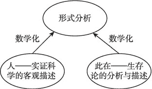
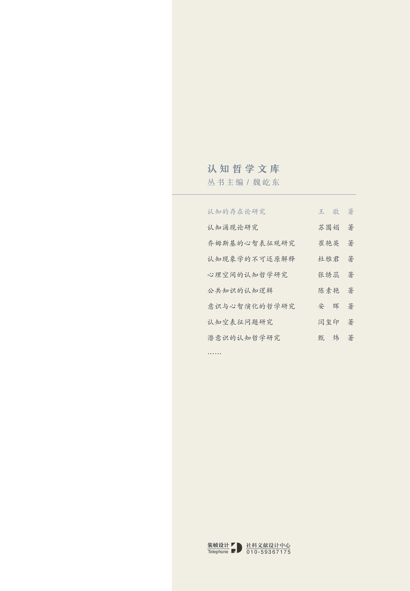
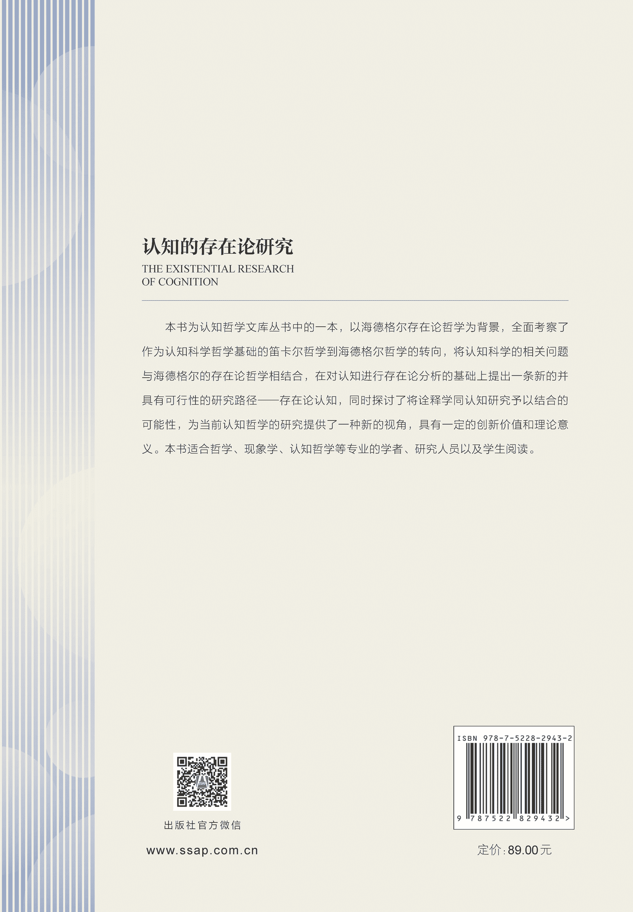

# 认知与存在论的交会
# 文库序言

认知通常被理解为人类与灵长类共同具备的模仿、学习以及对事物加以把握的功能。认知如何产生，尤其是意识从何处生成，至今仍无定论。即便认知科学、神经科学已有不少积累，人造的认知装置——尤其是智能系统、认知型机器人以及近年兴起的脑机接口——总体上仍停留在对大脑功能的仿真层级，很难像活体那样自发地形成自我觉知。这种落差或许源于生命体与无机系统的本质差异。将人之所以为人归结为文化作用，动物缺少文化特质，尤其是符号特质，正是这一差异的体现。

非生物的智能是否拥有认知能力，学界持续争论。争点多集中于理解力。现在的主流观点认为，机器人虽具备机器学习等学习机制，却缺乏真正的理解，因为它没有意识乃至生命。若把人工智能视为一种另类的认知形态，那么对话机器人这类智能体便可被看作具有认知能力，即便只是表层的。2022年12月初，OpenAI 公布的对话系统 ChatGPT，人机对话已逼近人与人对话的情境。此类现象既是科技与工程需要回应的难题，也是哲学必须深入追问的命题。

认知哲学是近十余年兴起的分支，研究范围涵盖生物脑与人造脑所产生的各类智能行为，例如感知、觉知、心智、自我、观念、思想、机器意识，以及人工生命、人工感知、人工意识、人工心智等。既涉及自然认知，也涉及人工认知，更涉及二者的交叉融合，重要性极高难度亦大，是认知科学、人工智能、神经科学以及认知哲学共同面对的重大课题。

《认知哲学文库》聚焦自然认知与人工认知及其哲学议题，内容涉及现象学、符号学、语义学、存在论、涌现论与逻辑学分析，心智表征、心理空间与潜意识研究，以及人工认知系统的生命、感知、意识、心智、智能的哲学与伦理探讨，旨在建构认知哲学的中国话语、学术与学科体系。

本套文库继“认知哲学译丛”“认知哲学丛书”之后，是笔者承担的国家社科基金重大项目“人工认知对自然认知挑战的哲学研究”（21&ZD061）系列成果之一。鉴于该项目多学科交叉且研究面广，同时获得山西省“1331 工程”重点学科建设计划与山西大学“双一流”学科建设规划的资助。

魏屹东
2022 年 12 月 12 日

# 要点提要

以存在论现象学审视人类认知，实质是对认知哲学问题的方法、样式与核心要义的回应。借鉴海德格尔关于“此在”的生存分析来说明认知的要素，或可开辟新路，有助于认知科学与欧陆哲学对话，以不同姿态区别于认知哲学中的传统范式。海德格尔的存在论与认知科学结合是否合理有效，由此产生的存在论认知能否成为认知科学的新进路，需加以论证。

梳理既有认知科学纲领及其哲学基础可知，各条路径均有局限。经典认知主义与联结主义深陷“计算至上”的形而上学迷思，遵循心物与心身二分，导致认知与世界、身体的割裂，因而难以理解人的情感、意志活动，也不能恰当说明人类认知的形成与演化，计算主义对情感体验、意志冲动与审美活动的描述亦不充分；以“4E+S”为核心的第二代认知科学研究纲领虽在批判笛卡尔主义哲学基础方面有所进展，但自身却面临难以统合的困境，认知活动的脑外要素之因果性与构成性分歧仍未弥合；胡塞尔现象学因其先验唯心主义与反自然主义立场而与认知科学的实证原则相悖，它把全部意义都植根于先验的主体性之中，而该先验主体性缺少经验世界的支撑。

理论建构的基石是概念。本书讨论存在论认知的三个核心概念——“此在”、世界与在世存在，分析“此在”所具有的身体、实践与情境三种维度，厘清世界与背景，以及认知视域中环境概念的差别，把在世存在视作人类认知得以可能的条件。海德格尔力图把人的存在设想为在世界中存在，却缺少对身体要素的讨论，需要修正。

在把海德格尔的存在论现象学与认知科学结合方面，存在论认知具有三个主要命题：（1）以动态的原初上手活动取代静态的静观认知；（2）以具身的情境性认知取代无身的离身性认知；（3）把表征性认知拓展为行动导向性认知，人类认知是表征与行动的叠加耦合。海德格尔把理论性认知看作对上手劳作的一种修正，操用器具的上手活动是通达事物本身的恰当方式，但这种直接上手也遭遇自动化、智能化延展实践形式的挑战。任何单一上手状态都是在情境中与人们照面，身体性的“在世界中存在”才真正符合人类真实的生存境况。同时，上手活动并不必然排斥表征，认知是行动导向的，这是对既有表征性认知的拓展而非替代。

把存在论哲学引入认知研究也面临理论困境与质疑。一方面，“此在”作为存在论概念与事实层面的自然化描述并不相容，自然化“此在”在现实层面没有可能性，它是思辨式的、现象学的先验解释与先验分析的产物，不适于形式化、模型化的科学解释。另一方面，“海德格尔式人工智能”尝试以“被抛”的机制化回答“框架问题”，面临非因果的现象学解释与因果的自然主义解释不相容的矛盾，按“被抛”设计的人工智能也未能完整呈现人类智能的整体结构。

存在论认知的理论困境以及存在论现象学与诠释学在理论上的连续性表明，单纯依靠存在论哲学不足以支撑整个存在论认知，有必要把诠释学纳入存在论认知的框架，以丰富其内涵。首先，海德格尔的存在论现象学本身就是一种诠释学；其次，人类认知也是一种诠释，认知依赖于诠释、渗透着诠释，二者在结构上具有“家族相似”；最后，诠释学能够对认知科学产生助益。同时，诠释学揭示了人类认知的复杂维度，凸显其动态性与自我超越性。存在论与诠释学可以共同构成推动认知研究的新助力。

关键词：存在论认知；“此在”；在世存在；人工智能；诠释学

# 导论
## 一 选题意义
自 20 世纪 50 年代以来，人类认知的本质问题已成为现代科学关注焦点，认知科学随之诞生。短短七十余年，其发展速度与覆盖范围罕见于其他学科。如今认知科学已成为 21 世纪前沿科学，先后产生计算隐喻与符号主义、脑隐喻与联结主义、交互隐喻与具身心灵等不同理论模型，也经历认知心理学、人工智能、人工神经网络、神经科学等主要研究阶段。认知哲学领域亦出现符号主义、计算主义、情境主义等学说并伴随相应反思与批判。本选题意义有三。

第一，从切入角度看，以符号主义、联结主义为代表的第一代认知科学研究纲领、以“4E+S”为核心的第二代研究范式、动力系统理论与现象学均从各自立场对认知问题作出回应。经典范式之后的大多数进路都建立在对笛卡尔主客二元认识论的批判之上。海德格尔的存在论从世界的世界性分析与“此在”的生存分析出发批判笛卡尔，强调人是世界的参与者而非旁观者，摒弃超越性的视见，这种实践描述引起了认知科学家与哲学家的关注。因而从存在论角度进入认知科学可说是一种新的进路。

第二，海德格尔的存在论与胡塞尔的现象学在现代西方哲学史上影响深远，均与认知科学密切相关，对认知科学研究范式的哲学基础转换产生积极作用，甚至可能成为新的哲学来源。例如海德格尔的“在世存在”、对事物的上手性与现成性区分，为具身认知、情境认知等进路提供启发。海德格尔把“此在”看作存在意义显现之处，对存在意义的追问也是诠释学自身的任务，故其存在论与诠释学相结合。理解与认知紧密相连，海德格尔与伽达默尔对理解前结构的重视有助于描述人类认知的澄明。海德格尔诠释学与受其推动的伽达默尔诠释学能为研究人类认知现象提供何种启示，值得考察。

第三，据笔者检索，国内学界对将海德格尔与认知科学结合的关注不多，相关论文屈指可数；国外已有专著与论文，显示该问题的重要性已被国外学界重视。故本书在梳理笛卡尔到海德格尔的转向作为认知科学哲学基础的基础上，充分把认知科学的相关问题与海德格尔的存在论哲学结合，在对认知进行存在论分析的基础上提出一条新的并具可行性的研究路径。选题难度大、资料有限，但可在一定程度上拓展认知科学研究视野，推动认知哲学领域学术研究，弥补国内相关研究的不足。

## 二 国内外研究现状
认知科学是研究心智、认知与智能的交叉学科，其源起包括 1956 年后兴起的人工智能研究热潮、心灵哲学中的功能主义、认知心理学与语言学反对激进行为主义的“认知革命”等。走过半个多世纪的认知科学，已不再是不同领域的人对心智的泛泛而谈。今天不同领域研究者联手为心智与认知的探索贡献了许多新方法与富有创见的成果，例如传统的符号计算主义与联结主义，以“4E+S”为核心的第二代认知科学研究纲领，从现象学、实用主义、生态学等角度介入认知科学的研究路径等。国内学界对海德格尔存在论的研究成果颇丰，多为文本解读。下面梳理与认知相关联的解读文献。

### （一）海德格尔与认知相关议题研究状况
海德格尔本人几乎未使用“认知”一词，但并不意味着不重视。《存在与时间》中已有关于认识与真理的讨论；《时间概念史导论》中进一步指明人的认知在存在论哲学中的地位，但他把认知视为此在在世界中存在的一种派生方式。海德格尔在阐述在世现象时即特别注重对传统认识论尤其是笛卡尔主义认识论的批判。他认为整个传统认识论陷入认识主体如何合理抵达客体的窠臼，要摆脱这一困境，必须一开始就把认识理解为“此在在世界中存在的一种方式”。国内对此域关注度较高，诸多新认知研究进路也吸收了这一思想，并以此为基础作进一步解读。

#### 1. 海德格尔认识论研究状况
李龙博士论文《认识论的先验转向和生存论转向——以生存论维度重新理解认识论》认为海德格尔在批判先验哲学的独断性与传统形而上学的实体性中开启了认识论的生存论转向，揭示出认识论的生存论前提，在生存论维度上重新理解认识论。作者指出，其生存论转向本质上是反对科学主义认识论、反对技术控制论的，实际上是在认识论先验转向基础上强调思维方向的重新开拓，不再从思维的先验结构、思维的逻辑机能去研究认识的可能前提，而是从在世的生存论结构、人的生存领会来研究认识的可能前提。海德格尔的生存论转向改变了认识论的主题，认识论的根本问题已不再是寻求知识的客观性、真理性问题，而是通达存在的意义。

丁蓓增《海德格尔对传统认识论的解构》认为，海德格尔哲学的目的在于摆脱以自然科学为思维模式的世界观，对存在问题的重新分析使他突破狭隘的主—客体认识关系，向人们展示一个新而广阔的领域；张一兵论文《意蕴：遭遇世界中的上手与在手——海德格尔早期思想构境》深入探讨海德格尔哲学语境下的“意蕴”概念，他认为意蕴不是认识论范畴，而是一种遭遇性的存在，其展露表现为意蕴的上手—在手状态与意蕴共同世界中的显现，存在就是意蕴建构起来的相遇发生；余平论文《“朝向实事本身”之思——从笛卡儿到海德格尔》认为海德格尔以“在-世界-中-存在”化解掉意识哲学的不破金身，进而击中认识论哲学一直够不着的自在存在，即那种滚滚而来激荡着我们的“实事本身”；刘丽霞《心物关系问题的解决：从胡塞尔到海德格尔》论述海德格尔对胡塞尔认识论范式的批判，反对从内部解决心物关系，坚持从此在领域出发理解“物自身的经验”；陈辉论文《海德格尔对“世界观”概念批判的多重意蕴》论述海德格尔所理解的“世界观”，在他看来，后者是对主体形而上学的一种表达方式，应坚决予以解构、批判，人与世界的关系完全不同于这一概念所显示的那样，他试图在这一层面上超越主客二分。

#### 2. 关于认知的意向性问题
由布伦塔诺开创、后经胡塞尔改造的意向性概念也受到海德格尔的极大关注，他把这一概念用于研究此在“在世界中存在”的问题，脱离胡塞尔解释意识的原初路径，具有不同意义。国内学界对此关注较多。孙周兴论文《我们如何得体地描述生活世界——早期海德格尔与意向性问题》认为海德格尔早期正是借助“意向性”获得了真正的“实事域”，并在视域到世界、理论化到生命体验等方面对意向性作诸多推进；舒红跃论文《从“意识的意向性”到“身体的意向性”》认为海德格尔对胡塞尔现象学的批判不在于拒绝意向性，而在于否认意向性是第一性的存在基本结构，他认为“意识的意向性”、单纯朝向某物，必须被回置到“在之中存在”的基本结构中，意向性奠基于此在的超越性，它不是此在最原初的特征，意向行为是被奠基的，根基于此在的实存；杨晓斌博士论文《意识意向性、身体意向性与伦理意向性——胡塞尔、海德格尔与列维纳斯哲学中的意向性概念》认为海德格尔确立了一种与胡塞尔意识意向性不同的身体意向性，他将意向式存在者即实在的人、此在作为起点，并通过对“本质”与“实有”的回溯，将这意向式存在者等同于“动手性或制作性施为者”；陈攀文论文《现象学意向性理论的生存论转向：从胡塞尔到海德格尔》论述海德格尔基于“存在论”立场对胡塞尔意识意向性理论作出的三方面批判性改造：海德格尔认为意向性之“主体”是指向实践价值意义的此在而非先验自我，意向之意义出自此在之实践和价值性质的筹划而非纯粹意识之授意活动，意向性之指向性根源于使生存价值得以绽出的时间性而非意识的本质结构之事实。作者认为海德格尔的意向性理论超越传统哲学而走向价值和实践哲学，从意识意向性转向生存意向性。

#### 3. 关于认知的语言问题
语言作为人类认知的一种特殊现象，一直受到哲学家关注，海德格尔的存在论哲学也对语言问题展开独特追问。国内目前研究状况如下。冯凯迪硕士论文《试论海德格尔的语言之思——基于语言与世界之关联的考察》从语言和世界的内在关联阐释海德格尔的语言观，并分析世界概念以及世界和语言的关系问题；谢文静硕士论文《行走在“思”与“诗”的路上——海德格尔存在论的语言学诠释》在诗、语言和存在的框架下讨论海德格尔语言和存在的关系；张贤根《语言：区分与道路——海德格尔语言思想研究》论述海德格尔在批判流俗语言和技术语言的基础上实现的语言转向，以及海德格尔为保持语言纯粹性和本真性所作努力，即区分诗意语言与技术语言，并利用前者克服后者；杨佑文《海德格尔的“语言转向”及其语言观》探讨海德格尔的“语言转向”及其意义，区分了他前期和后期语言观的差别；张海洋《本体论语言哲学视域中的海德格尔语言观》批判了海德格尔前后期语言观，从“语言与此在”、“语言与意识世界”和“语言与存在”三个维度来澄清海德格尔语言观的本质；王锺陵《论海德格尔的语言观》一文分析了海德格尔关于语言的“道说”概念与老庄哲学之谓道的异同。总体看，海德格尔对语言的理解以其“存在论”思想为理论基础，把对“存在”意义的追问作为其探究语言本质的出发点，海德格尔认为人如何通过意识世界认识外在世界正是语言意义的体现。“语言是存在自身既澄明又遮蔽的到来，因此语言是存在之家，人在其中生存着。”语言的本质既体现在语言与存在的关系中，也体现在语言与人和人的世界的关系中，语言的意义既离不开存在，也离不开人和人的世界。

#### 4. 关于认知的情绪问题

# 从生存论出发谈情绪：海德格尔的另类进路

认知科学和心理学习惯把情绪当成心理功能来拆解操作，海德格尔的问法则完全不同，他把情绪放在生存论分析里，看此在在“在世”境况中是如何被情绪打开的。国内学界对这种取向的梳理，目前集中在畏与烦两条线索上。

刘丰的硕士论文《论海德格尔的“根本情绪”——畏》厘清了情绪的本体位阶以及它的结构性特征；[^(\[18\])](#chapter001.html#m18)张银华的硕士论文《海德格尔生存论中的情绪问题研究》以烦和畏的本体意蕴为入口，寻找此在生存结构里的构成性要素，由此逼近本真；[^(\[19\])](#chapter001.html#m19)孙周兴的《为什么我们需要一种低沉的情绪？——海德格尔对哲学基本情绪的存在历史分析》用存在论方法勾勒出惊恐、压抑、畏惧三种时代性情绪，认为它们对思想具有根本的调音与规定作用；[^(\[20\])](#chapter001.html#m20)肖庆生等的《海德格尔哲学中的情绪本体论探究》把操心看作此在的基础情绪、把畏视作本真情绪，指出海德格尔的情绪本体论具有颠覆性并有现实启示。[^(\[21\])](#chapter001.html#m21)综合而言，海德格尔把情绪理解为此在的一种原初存在方式，此在本身就是情绪性的存在者。他说：“在现身情态中此在总已被带到它自己面前来了，它总已经发现了它自己，不是那种有所感知地发现自己摆在眼前，而是带有情绪的自己现身。”[^(\[22\])](#chapter001.html#m22)于是此在的展开最先就发生在情绪里。海德格尔认为情绪包含烦和畏两大环节，此在借助这两种情绪显现并把握本真存在的意义，也正透过对畏与烦的细析来界定本真存在的内涵。这项分析属于生存论的任务，并不归于认知科学。

### （二）关于海德格尔式人工智能的问题

AI 在生产生活中的渗透愈深，哲学层面的审视也愈加频繁。德雷福斯借助海德格尔的现象学对 AI 前景作出深刻反思，并把现象学与具体技术实践紧密联结。国内学者多以德雷福斯为起点，对 Heideggerian AI 展开延伸讨论与批判。

徐献军较早进入此议题。2011 年《国外现象学与认知科学研究述评》介绍了海德格尔式人工智能的初步探索，并指出现象学与认知科学合作的潜力。[^(\[23\])](#chapter001.html#m23)2013 年《海德格尔与计算机——兼论当代哲学与技术的理想关系》论述了在海德格尔思想影响下计算机专家提出的几种新式设计进路，如维诺格拉德的存在主义设计、阿格勒的指示表征设计和多罗西的具身交互设计，并评析其理论与实践意义。[^(\[24\])](#chapter001.html#m24)在《论德雷福斯、现象学与人工智能》中，作者认为德雷福斯的贡献在于整合法的海德格尔存在论现象学与梅洛-庞蒂身体现象学，并搭建起现象学、计算机科学与 AI 之间的桥梁；同时指出其局限：对胡塞尔评价失当、低估胡塞尔对 AI 与认知科学的重要性，以及过度强调身体而淡化意识。作者认为即便人造身体实现，人机差异的关键不在身体而在意识与心智，若接受塞尔的生物自然主义，则意识、心智与身体的因果仍指向身体作为基础，目前只有碳基生命呈现意识现象。[^(\[25\])](#chapter001.html#m25)

《德雷福斯对人工智能的批判仍然成立吗？》再次检视批判的哲学依据，并在深度学习与强化学习快速发展的背景下回应有效性。作者指出德雷福斯立足于海德格尔与梅洛-庞蒂的现象学，形成了“德雷福斯式的海德格尔与梅洛-庞蒂现象学”。AI 的哲学预设带有理性主义色彩，其发展可能在传统理性主义与现象学之间抉择。作者认为批判至今仍有效，德雷福斯揭示了制约 AI 发展的深层哲学假设。[^(\[26\])](#chapter001.html#m26)

王颖吉在《作为形而上学遗产的人工智能——休伯特·德雷福斯对人工智能的现象学批判》中重温德雷福斯的核心见解，认为智能的实质是情境化与具身化的心智，未来方向在于发展一种去除表征、重视身体与情境且不依赖规则的智能形式。[^(\[27\])](#chapter001.html#m27)

张昌盛的《人工理性批判：对德雷福斯的人工智能哲学的现象学反思》从德雷福斯关于 AI 极限的现象学分析出发，与塞尔的生物自然主义对照，认为德雷福斯提出的海德格尔式 AI 优于表征主义式 AI，但难以完全应对认知科学发展与生物自然主义的挑战。理解 AI 的关键在于认知、智能与意识的关系，涉及意识就不能不回到胡塞尔的先验现象学，而德雷福斯在此存在误读。[^(\[28\])](#chapter001.html#m28)

段似膺在《海德格尔式人工智能及其对“意识”问题的反思——兼与何怀宏先生商榷》中探讨海德格尔式 AI 如何再现“意识”。作者认为它虽摆脱传统符号表征、以生物与日常世界的交互为基础，仍难逃强 AI 的困境：人是通过身体在情境中直接把握意义的，人与世界打交道的基础在于身体存在，人机本质区别在于是否具有依托“在世存在”的“身体-意识”。[^(\[29\])](#chapter001.html#m29)

陶锋的《人工智能语言的哲学阐释》从存在论视角指出，AI 语言是一种技术语言，即抽象的逻辑演算公式，它遮蔽了存在者的显现，因而无法实现本真的诗性语言。按海德格尔的语言观，AI 不具备生存论意义上的超越、领会与情绪，难以体认语言本质，也没有人的言谈能力。[^(\[30\])](#chapter001.html#m30)

夏永红在《人工智能的创造性与自主性——论德雷福斯对新派人工智能的批判》中梳理德雷福斯对人工神经网络与具身 AI 的批判，认为其缺乏理论指引，易流于技术评估。引入本真性概念后，作者从生存论层面论证创造性与自主性的先验条件是生命的脆弱性，AI 因缺乏活生生的身体和自主性、创造性而难以具备完全智能，未来可能在于人工与生命的结合。[^(\[31\])](#chapter001.html#m31)

朱清华的《德雷福斯与海德格尔式人工智能》考察海德格尔式 AI 对框架问题的回应。首先概述德雷福斯对 AI 四项形而上学假设的批评，再区分海德格尔式 AI 的三个阶段：基于行为的机器人学、给上手状态编程、虚拟的海德格尔式 AI，并指出其在解决框架问题上的局限。最后认为德雷福斯的批判关乎人类根本的思维与行动方式是否为概念性与表征性，在哲学上站得住脚，海德格尔对“在世存在”的描述可作为发展参照。[^(\[32\])](#chapter001.html#m32)

李日荣的《海德格尔的时间性此在与人工智能发展的自主性难题——兼论德雷福斯人工智能批判的局限性》从本真性与自主性出发，认为德雷福斯未能完整呈现海德格尔对人类智能本质的揭示，其本质介于形式与非形式之间，正确方向应是揭示二者融合统一的“关联领域”。[^(\[33\])](#chapter001.html#m33)

国外讨论的时间跨度更长。贝斯·普雷斯顿在《海德格尔与人工智能》中指出，海德格尔式 AI 以社会性为本质特征，反对认知主义，智能的涌现来自与环境的交互而非神经元联结。[^(\[34\])](#chapter001.html#m34)卡罗斯·埃雷拉与里卡多·桑斯在《海德格尔式 AI 与机器人的存在》中认为，海德格尔的生存论分析并不适用于人工系统，机器人或 AI 是一种执行人类劳动的特殊存在者，与人类和动物不同，为其做存在论分析是巨大挑战，其任务在于为制造智能机器提供智力支持。[^(\[35\])](#chapter001.html#m35)查理塔与塞泽拉兹的《超越框架问题：海德格尔对 AI 的贡献》考察海德格尔哲学能否成为 AI 的思想资源，认为若海德格尔启发的认知科学成立，其焦点应是存在论差异而非其他特征。[^(\[36\])](#chapter001.html#m36)

总体来看，将海德格尔哲学应用于 AI 已成热点，国内研究多以德雷福斯对经典 AI 的批判为依托，关注意识、框架问题与形而上学预设。德雷福斯在《计算机不能做什么：人工智能的极限》中提出的生物学假设、心理学假设、认识论假设、本体论假设四项假设，至今仍影响研究走向。当前国内讨论仍多集中于计算机的无身性、非情境性批判，对海德格尔式 AI 的具体描述与定义不够清晰。是否过时，需要结合最新研究成果审慎判断，而非简单否定其适应性。

### （三）其他学者将存在论哲学与认知科学相结合的研究状况

#### 1. 第二代认知科学研究纲领与存在论哲学的关系述评

在对第一代认知主义、联结主义进行反思与批判的背景下，以“4E+S”为核心的第二代认知科学研究纲领兴起，后者强调身体与情境在认知中的作用，突出主体与环境交互的过程。其主要进路包括具身认知、延展认知、生成认知、嵌入认知以及情境认知，后四者实质上是具身认知的不同形态，但与存在论现象学的关系并不密切，主要在“身体”概念上展开讨论。

国内关于具身认知的研究多围绕其与计算-表征正统认知科学的争论，有的从现象学切入，有的从认知心理学切入，鲜有人从海德格尔存在论切入具身认知理论。关于“身体”概念的论文也屈指可数，可能与海德格尔本人对身体缺乏专门分析有关；在《存在与时间》等著作中，身体被视作空间性物体，缺乏独特存在论地位。国外讨论更为活跃。埃德加·E.彼得斯的《海德格尔的他者化——论〈存在与时间〉中对身体和“主体间性”的批判》研究加拉格尔与雅各布森在认知科学领域提出的有关海德格尔“主体间性”的问题，后者认为《存在与时间》忽视了源始的主体间性：具身性交互，作者为之辩护。[^(\[38\])](#chapter001.html#m38)查尔斯·戈登的《身体、躯体感觉和生存性感觉：一种海德格尔视角》考察海德格尔对身体及以身体为基础的感觉的存在论分析。[^(\[39\])](#chapter001.html#m39)阿科伊贾姆·托伊比萨纳的《海德格尔论此在作为习惯体的概念》反驳海德格尔忽视身体的说法，认为《存在与时间》中讲的是活生生的身体，是对身体的现象学理解。克里斯蒂安·乔坎的《论海德格尔对此在分析中的活身》分析海德格尔在存在论分析中忽视身体的原因与意义。[^(\[40\])](#chapter001.html#m40)目前国外相关成果多为论文形式，尚未形成专著，且多停留在存在论语境下的身体概念分析，对认知科学哲学语境下的身体议题结合不足，这恰为新的切入点。

#### 2. 海德格尔存在论现象学与认知科学的关系述评

# 海德格尔哲学与认知科学研究综述

## 国内研究现状

近年来欧洲大陆哲学在认知科学中的作用日益受到重视，海德格尔哲学引发认知科学家、人工智能学者与哲学家的关注。然而国内相关研究尚不充分。

刘晓力和孟伟的《认知科学哲学基础的转换——从笛卡儿到海德格尔》认为海德格尔认知观可为认知科学提供新的构成性解释，主张涉身-嵌入式研究纲领。[^(\[41\])](#chapter001.html#m41)兰州大学孙冠臣的《从表象主义到现象主义——认知语境中的“存在问题”》探讨胡塞尔与海德格尔各自关于认知的现象主义观点，认为只有把认知还原为存在、生存，才能避免主体客体二分并应对怀疑论。[^(\[42\])](#chapter001.html#m42)北京航空航天大学韩连庆在《哲学与科学的短路——德雷福斯人工智能批判的局限》中引用齐泽克观点，认为德雷福斯主张的海德格尔式认知主义把哲学化约为科学，造成短路，错失超越论维度。[^(\[43\])](#chapter001.html#m43)孟伟与杨之林的《涉身认知的外在主义解释与人工智能的未来发展》指出海德格尔的具身性理念支撑了涉身认知的外在主义框架，其核心是“上手状态”与“顺应于事的视”，前者描述原初认知状态，后者指生于情境、面向行动并引导行动的意识状态。[^(\[44\])](#chapter001.html#m44)刘晓力与孟伟合著的《认知科学前沿中的哲学问题》用一节篇幅介绍海德格尔对日常认知内在机制与外在情境的描述。[^(\[45\])](#chapter001.html#m45)总体看，国内研究零散、缺乏整体视角，多停留在概念说明层面。

## 国外研究现状

### 《哲学与认知科学的新方向：海德格尔与认知科学》

海德格尔×认知科学：国外在聊什么

翻看国内外的研究热度，能明显感觉到西方学界把海德格尔哲学送进认知科学这个交叉场的热情更高。最有代表性的入口是迈克尔·惠勒与朱利安·基弗斯坦因共同主编的文集《哲学与认知科学的新方向：海德格尔与认知科学》，整本书收了11篇独立论文，下面做一个带路的梳理。

朱利安·基弗斯坦因写的那篇《何为海德格尔式认知科学？》基本充当了全书的引子。他的判断是，海德格尔的存在论，尤其关于“此在”生存状态的展开，可以给下一代认知科学提供哲学上的出发点。文章先狠批以笛卡尔为底层的第一代认知纲领，特别是围绕符号操作的老式强人工智能 GOFAI，随后讨论海德格尔范式可能的长处与短板。要让这种范式真正取代笛卡尔范式，需要两件事：证明当下能找到比 GOFAI 更靠谱的替代方案，并且证明新范式不会掉进框架难题，还要能够解释人类的基本生存方式“在世存在”。文中还用海德格尔的视角重新解读今天流行的 4EA 潮流——具身认知、延展认知、生成认知、嵌入认知和情感认知内部围绕“具身”与“嵌入”的争论，并认为 4EA 的发展路径与海德格尔现象学的精神颇为一致。

休伯特·德雷福斯的《为什么海德格尔化的人工智能会失败，以及修复人工智能需要让人工智能更加海德格尔化》聚焦人工智能与哲学的冲突。他研究怎么借助海德格尔来解开符号主义人工智能的死结，并探讨海德格尔式人工智能如何消解框架难题。在他看来，早期尝试的海德格尔化人工智能因为处理不了常识难题和框架难题而沦为退化路线，主张接受海德格尔对笛卡尔内在表征的批判，强调认知的本质是嵌入和具身。

马修·拉特克里夫的《不可能有此在的认知科学》立场更保守。他提出“海德格尔认知科学”这个概念，却论证其早期主张与自然主义难以兼容，用认知科学的语言去解释“此在”显得荒唐。因为经验学科解释不了人类存在方式，所以用认知科学来把握“此在”并不合适，海德格尔哲学在某些议题上并不完全适配认知科学。

安德里亚·雷贝格的《海德格尔与疑难反思下的认知科学》围绕具身—嵌入式认知模型展开，提醒在以海德格尔改进新模型时不能回避根本难题，比如“此在”究竟是什么。由此延伸出本真与非本真、被抛、沉沦、事实性、决断与展开、绽出的方式以及对存在的预先理解等一串问题。她指出，对绽出、being-in、being-with、being-towards 等存在方式的分析表明，传统认知解释忽略了此在最基本的生存境况，任何知识的获得都必须以对处境的艰难抽象为前提。文章还重点讨论海德格尔关于语言存在论性质的反思，认为理解其存在论思维离不开语言的关键作用，且语言本身并不只是工具性的概念装置。

迈克尔·惠勒的《自然化此在和其他被指控的异端》直接回应拉特克里夫的怀疑，为自己的海德格尔式认知科学辩护。作者认为合理对待认知科学的多元研究方案需要承认彻底自然主义与人类心理现象之间的关联，任何与认知科学结合的心灵哲学本质上都具有自然主义形式。他主张真正的海德格尔式认知科学能够把海德格尔的哲学框架与关于心灵、智能、思维与行动的认知科学进路系统结合。文中还探讨海德格尔的诠释学现象学框架与认知科学的关系，并针对德雷福斯与里特维德的批评作出回应，提出海德格尔现象学可消解相关性问题，帮助洞察活动展开的条件，并让经验支持的认知科学能够以机械因果解释的方式理解现象学解释。关于相关性问题，他区分内在语境敏感性与区间语境敏感性，并据此反驳里特维德的质疑。

莎恩·加拉格尔与瑞贝卡·塞特·雅各布森合写的《海德格尔与社会认知》讨论海德格尔哲学与社会认知的关系。作者认为海德格尔对共在的分析比当代社会认知的主流理论更能充分描述社会认知，但同时指出其分析不够深入，为理解上手状态提供了新的启示。共在被视为此在原初的存在论结构，而非外在附加物，使他人的存在获得意义。文章以现象学批判当代社会认知解释为支撑，但核心结论是海德格尔并未说明原初的交互主体性，只留下次级交互主体性与共在的贫乏概念，以及难以理解的本真性联系。

玛利亚·塔里奥的《共同注意与表现力：经验调查极限的海德格尔指南》讨论海德格尔提出的一种先验现象性。作者认为理解海德格尔哲学的先验现象学维度有助于把握背叛、亲密、信任等主体间经验，而经验手段无法完全触及。先验现象学维度虽可通过现象学追溯，却具有经验上的不确定性。文章以认知心理学的“共同注意”概念为案例，将实证研究与海德格尔观点对照，认为海德格尔的主体间性现象学指出了对鲜活体验实证研究的局限，并揭示了经验方法与现象学内涵结合时可能出现的问题。

海伦娜·德·普列斯特的《器具与生存的空间性：海德格尔、认识科学与装有假肢的主体》关注身体与技术的关系，追问人类在使用客体或人工制品时的特殊关系及其建立的可能性。文章以《存在与时间》中关于人类活动与工具使用的分析为依据，指出海德格尔的存在论分析预设了身体主题却未充分展开具身性。作者认为海德格尔刻意避免让此在的存在空间性过度绑定身体，身体的空间性应从在世存在的存在论角度理解。关于器具，不应从实体性、物质性、延展性等纯粹事物属性出发，而应看到器具始终隶属于整体性，我们总是先把握整体，器具才在环境中显现，上手的状态比现成在手更为根本。文章主张存在的空间性与身体密切相关，即使海德格尔未专论身体，其在世存在的论述已隐含身体。凭借工具与仪器的去远能力，此在构成身体，身体的具体构成对存在的空间性具有决定性作用，二者的交织是必要而非偶然。

杰夫·玛帕斯在《海德格尔、空间与世界》中对海德格尔的空间性与世界概念作出重新解读。他认为当代认知科学对空间性在海德格尔思想中的出现方式关注不足，世界与空间性不可分割，也不能仅凭实践行为或因缘来理解。文章梳理《存在与时间》中关于空间的讨论，提出两条线索：复杂的非衍生空间性结构，以及空间性与世界概念的关联方式。作者指出，海德格尔在《存在与时间》中的空间性定位存在问题，一是难以摆脱空间性与均匀延展的关联，后者是笛卡尔主义的核心，二是源于他对身体作用的不确定，导致空间性处于次要位置。但他并非完全忽略身体，而是暂时搁置。最终，空间与空间性的主客观模式与世界概念一样，属于哲学而非物理科学与经验主义形而上学的范畴。

西奥多·沙茨基的《时间性与人类活动的因果路径》以海德格尔对在世存在的分析为基础，考察人类活动解释对科学概念与研究的启示，并阐明在世存在对研究心智的影响。他认为心灵研究与行为研究并非彼此独立，而是专注于不同心理或行为现象的统一整体。全文分三部分，讨论因果性与行动科学、海德格尔存在论哲学与活动的时间性结构、在世存在与人类活动的因果进路。

### 《约翰·豪格兰德——被解蔽的此在》
约瑟夫·劳斯主编的约翰·豪格兰德关于海德格尔研究的论文集《约翰·豪格兰德——被解蔽的此在》收录约16篇论文，是对海德格尔观点的细致哲学解读，而非文本注释。内容涉及此在、解蔽、世界、时间性、在世存在等核心概念，根本挑战了人们对《存在与时间》的常规解读。论文排序与主题基本遵循《存在与时间》的出现顺序。全书分四部分：第一部分为豪格兰德早期两篇研究海德格尔的论文，指出其哲学立场；第二部分据此对亚里士多德、笛卡尔与康德进行批判性重述；第三部分为已发表与未发表的论文或演讲，《阅读布兰登，阅读海德格尔》与《顺其自然》主要讨论《存在与时间》第一部分，《真理与有限》聚焦第二部分前三章，《死亡与此在》讨论存在的死亡，《时间性》解释第二部分第四章；最后一部分两篇论文虽不直接阐述海德格尔主张，却表明其解释对当代哲学产生的广泛意义。[^(\[46\])](#chapter001.html#m46)

### 认知存在主义与存在论认知
迪米特里·吉内夫在2011年著作《认知存在主义的原则》中提出认知存在主义。该概念基于诠释学理解与客观性理解的区分，将其视为以诠释学现象学的构成性分析为基础的新型科学解释路径。吉内夫提出这一概念意在反对科学哲学中以客观主义视角、以认知表征主义为核心的惯例。他认为心智并非存储世界事实表征的仓库，而是设计、规划实践行动并具有驱动力的存在。认知存在主义试图避免主客二分导致的实体化心智，主张思维或心智总体上已然是世界中的实在，而非基于主客割裂对世界作出定义。具备全部认知能力的人一开始便被抛入实践，表征与图像的建构与其客观实践交织，形成特殊的认知实践过程，此思路借用海德格尔对科学概念的存在论解读。总体来看，该理论对认知问题着墨有限，更关乎科学研究构成的诠释学与本体论议题，其任务是用诠释学的构成性分析解决科学的认知特殊性。

“存在论认知”一词的早期专著是罗恩·麦克拉姆洛克于1995年出版的《存在主义论认知：世界中的计算心智》。全书分为四部分，对应四个问题：如何使本质上嵌入的认知与科学解释的一般原则相符？为何不满内在主义的现状？嵌入式进路需要注意什么？接受嵌入式认知会带来何种后果？最后一章探讨将萨特的存在主义与梅洛-庞蒂的身体现象学洞见应用于认知科学的可能性。他反对把认知看作局限于大脑的信息处理过程，认知主义与基于内在主义假设的反认知主义皆错。现象学的存在论转向把胡塞尔所定义的直接呈现于反思的意向思维与世界关联起来，将人拉回现实世界，打破笛卡尔关于心灵独立于世界的错误观念。决定思维与行动内容的不再是先验意识，而是意向性、环境与世界共同构成的结构，意向对象正是我们在环境中互动的对象。由此意向性结构可以被重新解释，将复杂的思维、感知与行动与主体共享的环境结构相连接，能够减轻人们对主体内在性的理解压力，毕竟内在的“黑箱”比进入视域的事物更难理解。[^(\[47\])](#chapter001.html#m47)

麦克拉姆洛克从萨特“存在先于本质”的信条出发，主张人类思维的存在状态先于其内容，在世界中的存在相较于本质与定义具有逻辑优先性。他认为“我思故我在”把人的属性存在置于实体存在之前，我们首先意识到心灵的“思维”属性，而非在世界中存在的事实。与海德格尔的“在世存在”相似，萨特的立场反对笛卡尔的唯我论，反对自我与外部世界的对立，世界没有严格的内外区分。表征不是心灵的内在图像，而是主体与世界之间的意向关系，表象是世界事物向意识的投射，不存在表象与存在的分殊。思维与行动只有依托结构化的世界才有意义，脱离世界进行分析很可能徒劳无功。

休伯特·德雷福斯与马克·A.拉索尔主编的《现象学与存在主义指南》对比研究了20世纪的两大哲学流派。第16、17、21章论述了存在主义与现象学的情感与身体问题。[^(\[48\])](#chapter001.html#m48)

迈克尔·惠勒著《认知世界的重构：下一步骤》在第5至9章利用海德格尔的哲学观点来阐释其 DEEDS 主张：在线智能是智能的基本类型；在线智能形成于延展的大脑-身体-环境系统；认知科学需要更多关注生物维度，应当采用动力系统视角。惠勒认为海德格尔哲学与心灵、认知科学密切相关，海德格尔式的流畅应对与实时环境互动是一种知识构成形式，其对默会知识的环视能够有效理解人类认知。[^(\[49\])](#chapter001.html#m49)

存在论打开认知科学的另一扇窗

Mark Wrathall 与 Jeff Malpas 主编的《Heidegger，Coping，and Cognitive Science—Essays in Honor of Hubert L.Drefus Volume 2》以回溯 Dreyfus 在人工智能与认知科学中的基本立场为起点，探讨海德格尔思想如何与认知研究产生实质性交锋。全书收录的论文多受 Dreyfus 将现象学洞察迁移到具体议题之方法的影响，他的海德格尔解读为意向性、技巧性实践、具身性等话题提供了背景。[ ^(\[50\])](#chapter001.html#m50)

第一部分围绕现象学立场的实践分析展开，这正是 Dreyfus 研究的核心脉络。Joseph Rouse、David Stern、Theodore R.Schatzki、John Searle、Mark A.Wrathall 以及 Charles Taylor 都就 Dreyfus 提出的熟练应对发表评论。Rouse 一方面使 Dreyfus 对实践应对的区分更为复杂，另一方面也模糊了显性表达与理论理解的界限，主张把显性表达与理论反思纳入熟练行为的统一模型。Schatzki 概括了 Dreyfus 批判笛卡尔心理状态理论的一个要点，认为信念、希望等常识心理学概念完全可以按现象学批判所允许的方式来理解，在这种理解中心理状态未必需要主题式觉知。对 Dreyfus 对实际行为的分析路径，Stern 与 Searle 分别回应。Stern 强调熟练应对抗拒任何分析并罗列支持性论证。Searle 则以撰写哲学论文这类显式熟练活动为例子质疑 Dreyfus 反表征主义的意向性说明，认为所有熟练应对必然牵涉意向性心理运作，并指出 Dreyfus 的现象学描述未充分处理熟练应对中潜藏的意识结构与逻辑结构。Wrathall 在海德格尔“解蔽”概念的语境下审视 Searle 与 Dreyfus 各自提出的“背景”关系。Charles Taylor 收束本部分，讨论反基础主义的效应，凸显身体性与熟练应对对理解人类存在的意义，同时坚持历史变迁的动力并非只来自实践本身。

中间章节聚焦 Dreyfus 现象学批判在当代笛卡尔式框架下的延续价值。Daniel Andler 考察人工智能与认知科学的新近发展，如新语境论，受到的 Dreyfus 式影响。Andler 与 Sean D.Kelly 的合写文章回应了 Searle 等人对 Dreyfus 用现象学研究意向性与心智的批评。Kelly 主张现象学应进入认知科学，他把现象学与脑科学的关系比作数据与模型的关系，并以熟练驾驶为例说明。Harry Collins 检视 Dreyfus 对人工智能批判的局限，指出 Dreyfus 未充分考量不同知识类型与具身状态的差异，因而虽精准指出计算机做不到之事，却对界定计算机可能做到之事贡献有限。Albert Borgmann 最后指出，经由计算机中介的多用户空间，可对结果进行分析，从而限制离身化倾向。

收尾部分呈现受 Dreyfus “应用哲学”启发的研究样例。Dreyfus 高度评价 Charles Spinosa，认为其最佳著作始终受存在论现象学意义的引导，因为哲学理念背后的日常经验常充满争议。Spinosa 的论文借描述当代经验阐释海德格尔对神性的解读，进而以非神秘的方式说明在世俗化世界中为“活生生的上帝”保留经验位置的意义。Robert C.Solomon 借助 Dreyfus 的资源展开信任议题，认为信任是一种共同的、具有转化性的实践，而非心理状态与社会现实的简单叠加。George Downing 延伸 Dreyfus 对专家应对的描绘，用以理解身体在情感体验中的作用。Fernando Flores 采纳 Dreyfus 对“在世存在”的实践理解重释商业活动，并概括这种重释对商业理论的后果。Patricia Benner 探讨 Dreyfus 将海德格尔“关怀”阐释为与世界接触的日常实践结构对护理理论与实践的影响，并借助 Dreyfus 对海德格尔技术解释的解读批判技术医学日益增长的主导地位。

A-T.Tymieniecka 主编的《Phenomenology and Existentialism in the Twentieth Century》第 5 章“Embodiment and Existence：Merleau-Ponty and the Limits of Naturalism”主要论述 Merleau-Ponty 的具身存在论，提出对身体的自然主义解释只有结合存在论进路才成立，其具身存在论能提供更宽泛的身体性概念，为意识的自然化提供可能。[ ^(\[51\])](#chapter001.html#m51)

单篇研究方面，Joseph Ulric Neisser 1999 年发表的《On the Use and Abuse of Dasein in Cognitive Science》认为 Van Gelder 的动力系统理论可视作一种“在世存在”的模型，海德格尔的此在并不否定任何内在表征或行为的潜在机制。[ ^(\[52\])](#chapter001.html#m52)

David Suarez 在《A Dilemma for Heideggerian Cognitive Science》中指出，Michael Wheeler 的海德格尔式认知科学在主体性解释上陷入两难，无论是直接关切主体性抑或致力于发展一种海德格尔式现象学心理学，都难以实现现象学的自然化。[ ^(\[53\])](#chapter001.html#m53)

近期国外学界更关注海德格尔开创、伽达默尔发展的哲学诠释学对认知科学的影响。Veronica Vasterling 在《Heidegger’s Hermeneutic Account of Cognition》中论述海德格尔诠释学转向对 4EAC 即具身、生成、嵌入、延展及情感认知的影响。文章认为认知的核心在于与世界的交互，讨论了第一、第二、第三人称视角认知的不同意蕴，区分了直观与叙事、命题与表征两种理解方式，最后提出一个探索性的诠释学认知模型。[ ^(\[54\])](#chapter001.html#m54) Shaun Gallagher 在《Hermeneutics and the Cognitive Sciences》中试图超越解释与理解的对立，考察两者关系。作者提出三点：诠释学与认知科学所知事实并不完全对立，在诸多问题上趋同；诠释学对认知科学与意识科学有积极贡献；认知科学亦反哺诠释学领域。对应到“如何认识对象”“如何认识情境”“如何理解他人”三个问题。国内相关研究尚不成熟，但已有敏锐觉察，费多益 2008 年的《认知研究的诠释学之维》已深入探讨如何以诠释学方法理解认知现象及可能遭遇的逻辑困境。[ ^(\[55\])](#chapter001.html#m55)

总体来看，现有借助存在论解释认知现象的文献仅触及认知科学与人工智能的部分领域，虽然提出了若干原则与方向，却缺乏统摄性理论框架。当前研究多把海德格尔的存在论分析方法用于解决认知科学的局部难题，并未在此基础上提出类似认知现象学的纲领，这正是本书想要推进之处。

### （四）其他存在主义哲学家有关认知问题的论述概况

#### 1. 萨特关于意识问题的研究
萨特高度关注意识议题，他区分了自我意识、对象意识与反思意识，并提出“反思前的我思”。国内学界已开始关注其意识理论。庞培培在《萨特的意向性概念：内部否定》中阐述“内部否定”概念及其确立的自为与自在，以及在萨特意识理论中的作用。[ ^(\[56\])](#chapter001.html#m56)《第一人称视角假设与他人问题——萨特的思路》讨论了萨特对他人问题的处理，认为不应把他人问题等同于对他人心灵的知觉，而应在与世界及我的关系中界定他人。[ ^(\[57\])](#chapter001.html#m57)通过对遭遇他人的日常经验分析，萨特揭示了我与他人在意识层面的根本关联，即“我的为他存在”。《萨特的自身意识理论与自由概念》认为萨特强调意识的能动性是关键，它是意识非主题性自身关系的最终奠基。[ ^(\[58\])](#chapter001.html#m58)贾江鸿的《萨特的本体论证明和对笛卡尔身心关系问题的解决》阐述了萨特辩证的心身关系理论及其关于自为的身体与为他的身体的区分。[ ^(\[59\])](#chapter001.html#m59)莫伟民、杜小真的《“我思”：从笛卡儿到萨特》论述萨特的独特意识观：意识与其所意识者为一，意识是存在而非认识，主体源于世界而非囿于意识，绝对意识将我与世界联结，他人亦是意识的所是，故萨特坚持一种存在论的意识哲学。[ ^(\[60\])](#chapter001.html#m60)

在认知问题上，萨特从本体论层面深入分析意识存在，并进一步厘清非反思意识与反思意识的关系，为认识问题提供了新思路。20 世纪 90 年代初，杨深的《萨特认识理论剖析》分析了萨特对自然世界的认识观，认为除直观外别无认识形式，演绎与推理只是通向直观的工具，认识即自为对自在的关系，并论述了真理在萨特那里是一种本体论矛盾。[ ^(\[61\])](#chapter001.html#m61)贾江鸿在《萨特论认识：反思意识，还是非反思意识？》中指出《自我的超越性》《想象物》《存在与虚无》分别代表反思意识的认识、非反思意识的认识与作为存在方式的意识。萨特视认识为自为存在的一种在世方式，体现了其与自在存在的内在否定关系，认识不应停留于抽象判断，而须从人的在世具体现象出发，前提是思考意识现象。[ ^(\[62\])](#chapter001.html#m62)

#### 2. 伽达默尔关于真理的研究
Gadamer 的哲学诠释学是当代西方重要思潮，其真理阐释居于核心，可视为贯穿其诠释学的主线。国内研究者从不同角度展开探讨。孙丽君在《伽达默尔真理观及其理论资源》中梳理其真理观，认为真理的本质在于通向“公共视域的形成”，真理是一种态度而非认识成果。[ ^(\[63\])](#chapter001.html#m63)帅巍的《伽达默尔解释学“我-你”关系及其真理观》比较诠释学真理观与传统真理观，认为 Gadamer 意义上的真理是在人与人交往实践或对话中显现的，而非纯粹理论概念运动。[ ^(\[64\])](#chapter001.html#m64)王坡的硕士论文《作为实践的理解的真理观——伽达默尔的真理观研究》从实践角度详细论述诠释学真理观。Gadamer 反对认识论真理观的独断性，试图为精神科学乃至人类科学建立统摄性真理观，主张从精神出发。他继承 Heidegger 的真理观，认为真理不能脱离人存在而存在，必须在人的实践中体现价值并指导实践。其批判揭示了主体认识真理的动力机制，对克服传统真理观的狭隘具有启发。[ ^(\[65\])](#chapter001.html#m65)

综上，将以 Heidegger 为主的存在论哲学和认知科学问题结合，国内学者的认识尚显不足，多作宏观描述，未能深入具体研究。国外研究则相当活跃，主题繁杂，涉及主体间性、框架问题、认知的自然化解释等，主要意图是以“在世存在”为核心建构 Heidegger 式认知科学，甚至认为其可能取代认知科学的笛卡尔范式，并对“此在”及其派生概念作了深入探讨，主张认知解释须以对存在状况的理解为前提。然而国内外研究多停留于初步结合，借助概念分析，尚未把存在论作为具体方法来回答认知科学问题，也未提炼出存在论认知的研究纲领；鉴于诠释学与存在论的承继关系，考察其作为存在论认知基础的可能性亦属必要。存在论认知作为新的研究路径，需要系统列举其概念、流派、理论与问题，为之奠定理论基础，而文献综述显示该议题涉及的主题极其繁复，这恰说明其重要性与研究价值。

## 三 研究思路与方法
存在论认知或“Heidegger 式认知科学”作为可能的认知研究纲领，在概念界定和理论建构上仍显薄弱，进行认知哲学层面的抽象反思有助于推进其建构。第一，厘清哲学根源，尤其与其和 Heidegger 存在论现象学的密切关系，避免误入纯粹从事存在论哲学研究的误区。研究立足存在论现象学视角审视人类认知关键问题，在 Heidegger 存在论体系中寻找与认知活动相关概念，并将其与认知科学的具体议题相结合，例如人工智能的“框架问题”，尤其以此在的生存论分析为基础构建描述与回答认知现象的新路径，并探讨其可能性。第二，澄清基本概念和主要命题，避免使用中的模糊和歧义，论证核心论题的合理性和有效性。第三，探讨存在论认知在具体应用中可能出现的问题，分析是否需要扩展，即把诠释学纳入路径。

本书主要采用文献分析法、定性研究法和认知的历史分析，通过中英文资料的文献分析全面考察认知科学哲学的各种进路，并在深刻理解 Heidegger 思想内涵的基础上，将认知现象的解释置于存在论语境下分析，挖掘其对认知科学与人工智能的理论贡献。研究思路由局部分析走向整体综合，充分借鉴 Heidegger 的存在论分析和哲学解释学的研究理论和方法，可视为把 Heidegger 关于“此在”“世界”和“在世存在”的理解存在论地反射到人类认知现象的阐释与分析上。

具体做法是系统梳理国内外关于存在论认知解释的文献，在借鉴表述形式的同时考察其不足和成因；针对当前研究现状，探究存在论分析应用于认知解释的具体机制，力图构建新的描述路径，并按既定项目纲领开展工作。

## 四 难点与创新之处
Heidegger 作为 20 世纪最杰出的哲学家之一，其著作晦涩难懂，创造的诸多术语更令理解者望而却步。他对“此在”的人存在模式和世界的分析精确而艰深。理解其哲学本身就颇具难度，将存在论及延伸的诠释学与认知科学结合难度更大。但难点也蕴含创新可能，本书在研究内容上着力创新。

1. 国内外认知科学哲学研究多集中于批判正统研究纲领并寻找替代范式，对 Heidegger 思想的挖掘并不系统，更多是借用若干概念，也未考察与存在论渊源深厚的诠释学与认知科学的关联，这在学位论文和研究专著中体现明显，对如何以存在论描述人类认知缺乏全方位探究。本书拟解决此点，明确提出并论证存在论、诠释学和人类认知的相关性。

2. 国内学者常从计算、具身、现象学维度切入认知哲学研究，本书则从存在论角度切入，提供新视角，并对认知研究和诠释学结合作分析与展望，最终提出存在论认知这一新的概念和路径。

本书在写作过程中仍可见若干难以回避的局限，可概括为三方面。

第一，海德格尔的著作文量庞大、分布分散。以中文版《海德格尔文集》为例，卷帙已达三十余卷，议题繁杂、线索交错。从如此浩繁的文本中筛选出能为认知研究提供启发的论点，难度极大，遗漏在所难免。正因如此，国外研究者多将重心放在革新性最突出的《存在与时间》上。

第二，海德格尔的著述以艰深著称，自造了大量冷僻术语。在本人学养与解读能力有限的情况下，要实现对思想的精准把握并不现实，个别判断出现偏差乃至误读的风险客观存在。

第三，国内学界对该交叉议题的关注度相对不足，而英美学界的成果则相当丰富。为把握前沿进展，需要阅读大量英文文献。翻译的不准确以及跨语理解的偏差，会影响转述的 fidelity，并可能导致部分引用的使用不够妥当。

* * *

[\[1\]](#chapter001.html#w1) 李龙：《认识论的先验转向和生存论转向——以生存论维度重新理解认识论》，博士学位论文，吉林大学，2004。

[\[2\]](#chapter001.html#w2) 丁蓓增：《海德格尔对传统认识论的解构》，《社会科学》1994 年第 9 期。

[\[3\]](#chapter001.html#w3) 张一兵：《意蕴：遭遇世界中的上手与在手——海德格尔早期思想构境》，《中国社会科学》2013 年第 1 期。

[\[4\]](#chapter001.html#w4) 余平：《“朝向实事本身”之思——从笛卡儿到海德格尔》，《四川大学学报》（哲学社会科学版）2013 年第 2 期。

[\[5\]](#chapter001.html#w5) 刘丽霞：《心物关系问题的解决：从胡塞尔到海德格尔》，《中南大学学报》（社会科学版）2013 年第 5 期。

[\[6\]](#chapter001.html#w6) 陈辉：《海德格尔对“世界观”概念批判的多重意蕴》，《社会科学论坛》2018 年第 4 期。

[\[7\]](#chapter001.html#w7) 孙周兴：《我们如何得体地描述生活世界——早期海德格尔与意向性问题》，《学术月刊》2006 年第 6 期。

[\[8\]](#chapter001.html#w8) 舒红跃：《从“意识的意向性”到“身体的意向性”》，《哲学研究》2007 年第 7 期。

[\[9\]](#chapter001.html#w9) 杨晓斌：《意识意向性、身体意向性与伦理意向性——胡塞尔、海德格尔与列维纳斯哲学中的意向性概念》，博士学位论文，浙江大学，2012。

[\[10\]](#chapter001.html#w10) 陈攀文：《现象学意向性理论的生存论转向：从胡塞尔到海德格尔》，《求索》2015 年第 5 期。

[\[11\]](#chapter001.html#w11) 冯凯迪：《试论海德格尔的语言之思——基于语言与世界之关联的考察》，硕士学位论文，吉林大学，2018。

[\[12\]](#chapter001.html#w12) 谢文静：《行走在“思”与“诗”的路上——海德格尔存在论的语言学诠释》，硕士学位论文，吉林大学，2017。

[\[13\]](#chapter001.html#w13) 张贤根：《语言：区分与道路——海德格尔语言思想研究》，《自然辩证法研究》2003 年第 3 期。

[\[14\]](#chapter001.html#w14) 杨佑文：《海德格尔的“语言转向”及其语言观》，《理论月刊》2011 年第 3 期。

[\[15\]](#chapter001.html#w15) 张海洋：《本体论语言哲学视域中的海德格尔语言观》，《外语学刊》2016 年第 5 期。

[\[16\]](#chapter001.html#w16) 王锺陵：《论海德格尔的语言观》，《江苏社会科学》2018 年第 2 期。

[\[17\]](#chapter001.html#w17) 〔德〕海德格尔：《在通向语言的途中》，孙周兴译，商务印书馆，1997，第 87 页。

[\[18\]](#chapter001.html#w18) 刘丰：《论海德格尔的“根本情绪”——畏》，硕士学位论文，四川大学，2005。

[\[19\]](#chapter001.html#w19) 张银华：《海德格尔生存论中的情绪问题研究》，硕士学位论文，黑龙江大学，2008。

[\[20\]](#chapter001.html#w20) 孙周兴：《为什么我们需要一种低沉的情绪？——海德格尔对哲学基本情绪的存在历史分析》，《江苏社会科学》2004 年第 6 期。

[\[21\]](#chapter001.html#w21) 肖庆生等：《海德格尔哲学中的情绪本体论探究》，《学术交流》2014 年第 6 期。

[\[22\]](#chapter001.html#w22) 〔德〕海德格尔：《存在与时间》，陈嘉映、王庆节译，三联书店，2012，第 158 页。

[\[23\]](#chapter001.html#w23) 徐献军：《国外现象学与认知科学研究述评》，《哲学动态》2011 年第 8 期。

[\[24\]](#chapter001.html#w24) 徐献军：《海德格尔与计算机——兼论当代哲学与技术的理想关系》，《浙江大学学报》（人文社会科学版）2013 年第 1 期。

[\[25\]](#chapter001.html#w25) 徐献军：《论德雷福斯、现象学与人工智能》，《哲学分析》2017 年第 6 期。

[\[26\]](#chapter001.html#w26) 徐献军：《德雷福斯对人工智能的批判仍然成立吗？》，《自然辩证法研究》2019 年第 1 期。

[\[27\]](#chapter001.html#w27) 王颖吉：《作为形而上学遗产的人工智能——休伯特·德雷福斯对人工智能的现象学批判》，《南京社会科学》2018 年第 3 期。

[\[28\]](#chapter001.html#w28) 张昌盛：《人工理性批判：对德雷福斯的人工智能哲学的现象学反思》，《重庆理工大学学报》（社会科学版）2018 年第 12 期。

[\[29\]](#chapter001.html#w29) 段似膺：《海德格尔式人工智能及其对“意识”问题的反思——兼与何怀宏先生商榷》，《学术争鸣》2019 年第 1 期。

[\[30\]](#chapter001.html#w30) 陶锋：《人工智能语言的哲学阐释》，《南开学报》（哲学社会科学版）2020 年第 3 期。

[\[31\]](#chapter001.html#w31) 夏永红：《人工智能的创造性与自主性——论德雷福斯对新派人工智能的批判》，《哲学动态》2020 年第 9 期。

[\[32\]](#chapter001.html#w32) 朱清华：《德雷福斯与海德格尔式人工智能》，《哲学动态》2020 年第 10 期。

[\[33\]](#chapter001.html#w33) 李日荣：《海德格尔的时间性此在与人工智能发展的自主性难题——兼论德雷福斯人工智能批判的局限性》，《陕西师范大学学报》（哲学社会科学版）2022 年第 1 期。

[\[34\]](#chapter001.html#w34) B.Preston，“Heidegger and Artificial Intelligence，” *Philosophy & Phenomenological Research* 53（1993）.

[\[35\]](#chapter001.html#w35) Carlos Herrera and Ricardo Sanz，“Heideggerian AI and the Being of Robots，” Vicent C.Müller（eds.），*Fundamental Issuses of Artifical Intelligence* （Switzerland：Springer International Publishing，2016），pp.497-513.

[\[36\]](#chapter001.html#w36) Alexander Sedzielarz，“Beyond the Frame Problem：What （Else） Can Heidegger Do for AI？，” *AI & SOCIETY* 38（2023）：180.

[\[37\]](#chapter001.html#w37) 〔美〕休伯特·德雷褔斯：《计算机不能做什么：人工智能的极限》，宁春岩译，三联书店，1986，第 166 页。

[\[38\]](#chapter001.html#w38) M.E.Peters，“Heidegger’s Embodied Others：On Critiques of the Body and ‘Intersubjectivity’ in *Being and Time*，” *Phenomenology & the Cognitive Sciences* 7（2018）.

[\[39\]](#chapter001.html#w39) Charles Guignon，“The Body，Bodily Feelings，and Existential Feelings：A Heideggerian Perspective，” *Philosophy Psychiatvy & Psychology* 2（2009）：195-199.

[\[40\]](#chapter001.html#w40) Cristian Ciocan，“The Question of the Living Body in Heidegger’s Analytic of Dasein，” *Research in Phenomenology* 38（2008）：72-89.

[\[41\]](#chapter001.html#w41) 刘晓力、孟伟：《认知科学哲学基础的转换——从笛卡儿到海德格尔》，《科学技术与辩证法》2008 年第 6 期。

[\[42\]](#chapter001.html#w42) 孙冠臣：《从表象主义到现象主义——认知语境中的“存在问题”》，《天津社会科学》2012 年第 6 期。

[\[43\]](#chapter001.html#w43) 韩连庆：《哲学与科学的短路——德雷福斯人工智能批判的局限》，《哲学分析》2017 年第 6 期。

[\[44\]](#chapter001.html#w44) 孟伟、杨之林：《涉身认知的外在主义解释与人工智能的未来发展》，《西南民族大学学报》（人文社会科学版）2018 年第 3 期。

[\[45\]](#chapter001.html#w45) 刘晓力、孟伟：《认知科学前沿中的哲学问题》，金城出版社，2014。

[\[46\]](#chapter001.html#w46) Joseph Rouse，*John Haugeland-Desein Disclosed* （Cambridge，M.A. & London，England：Harvard University Press，2013）.

[\[47\]](#chapter001.html#w47) Ron McClamrock，*Existential Cognition：Computational Minds in the World* （Chicago：The University of Chicago Press，1995）.

[\[48\]](#chapter001.html#w48) Hubert Dreyfus，Mark A.Wrathall（eds.），*A Companion to Phenomenology and Existentialism* （Oxford：Blackuell，2006）.

[\[49\]](#chapter001.html#w49) M.Wheel，*Reconstructing the Cognitive World：The Next Step* （Cambridge：The MIT Press，2005）.

[\[50\]](#chapter001.html#w50) Marle A.Wrathall，Jeff Malpas（eds.），*Heidegger，Coping，and Cognitive Science—Essays in Honor of Hubert L.Drefus*，Volume 2（Cambridge：The MIT Press，2000）.

[\[51\]](#chapter001.html#w51) A-T.Tymieniecka（ed.），*Phenomenology and Existentialism in the Twentieth Century* （Berlin：Sprintger Netherlands，2009）.

[\[52\]](#chapter001.html#w52) Joseph Ulric Neisser，“On the Use and Abuse of Dasein in Cognitive Science，” *The Monist* 82（1999）：347-361.

[\[53\]](#chapter001.html#w53) E.D.Suarez，“A Dilemma for Heideggerian Cognitive Science，” *Phenomenology and Cognitive Science* 16（2017）：1-22.

[\[54\]](#chapter001.html#w54) V.Vasterling，“Heidegger’s Hermeneutic Account of Cognition，” *Phenomenology and Cognitive Science* 14（2015）：145-163.

[\[55\]](#chapter001.html#w55) 费多益：《认识研究的诠释学之维》，《哲学研究》2008 年第 5 期。

[\[56\]](#chapter001.html#w56) 庞培培：《萨特的意向性概念：内部否定》，《云南大学学报》2012 年第 6 期。

[\[57\]](#chapter001.html#w57) 庞培培：《第一人称视角假设与他人问题——萨特的思路》，《世界哲学》2015 年第 1 期。

[\[58\]](#chapter001.html#w58) 庞培培：《萨特的自身意识理论与自由概念》，《哲学研究》2018 年第 3 期。

[\[59\]](#chapter001.html#w59) 贾江鸿：《萨特的本体论证明和对笛卡尔身心关系问题的解决》，《现代哲学》2013 年第 5 期。

[\[60\]](#chapter001.html#w60) 莫伟民、杜小真：《“我思”：从笛卡儿到萨特》，《学术月刊》2006 年第 3 期。

[\[61\]](#chapter001.html#w61) 杨深：《萨特认识理论剖析》，《社会科学战线》1994 年第 5 期。

[\[62\]](#chapter001.html#w62) 贾江鸿：《萨特论认识：反思意识，还是非反思意识？》，《河北学刊》2017 年第 1 期。

[\[63\]](#chapter001.html#w63) 孙丽君：《伽达默尔真理观及其理论资源》，《山东大学学报》（哲学社会科学版）2009 年第 2 期。

[\[64\]](#chapter001.html#w64) 帅巍：《伽达默尔解释学“我-你”关系及其真理观》，《社会科学研究》2018 年第 2 期。

[\[65\]](#chapter001.html#w65) 王坡：《作为实践的理解的真理观——伽达默尔的真理观研究》，硕士学位论文，华中科技大学，2013。

# 第一章 认知科学的七十年回望

1950年代以后，认知科学的面貌发生了巨大变化。1956年的达特茅斯会议常被视作起点，距今已走过近七十年历程。从以计算与表征为核心的笛卡尔式第一代研究纲领，到以脑-身-境互动为基础、以4E+S为代表的第二代，再到自然主义与现象学等多元路径，不同取向对人类认知与心智提出了各自的解释。认知究竟是什么、其前提条件与运作机制如何、与意识及意向性的关系怎样、心智的本质以及它与大脑、身体之间的互动方式等核心问题，一直是争论的焦点，相关成果层出不穷。本章将先对已有研究纲领进行梳理，随后以海德格尔的存在论现象学为分析透镜，厘清各路线的不足之处，为认知研究的存在论转向提供参考。

## 第一节 笛卡尔式认知科学的哲学渊源

对认知科学家和哲学家来说，认知科学就是要解释人类智能如何在物质基础上产生，以及大脑如何进行信息加工，范围覆盖从感觉输入到复杂问题解决、从个体智能到社会智能，直至人与机器智能的比较。[^(\[1\])](#chapter002.html#m1) 在哲学层面，能够形成范式的主要是建立在笛卡尔主体哲学之上的认知计算主义，其中包括认知主义和联结主义。该立场以计算性表征为核心，把心智的内部状态看作抽象的逻辑运算，表征和计算过程都被限定在大脑内部，离身式认知是其基本假设。

上世纪五十年代兴起的第一代范式曾达到顶峰，也曾遭到广泛质疑。如今围绕4E+S等第二代模型的讨论十分活跃，不少人希望以此削弱甚至取代计算主义，但这种替代尚未完成。计算主义并没有退出，反而在吸收新见解后焕发新的活力，例如威尔逊提出的宽计算主义。4E认知本身就是在批判和继承认知主义与联结主义的基础上发展起来的，若脱离传统基础，新路径就失去了对话对象。因此，对传统认知科学范式进行系统梳理与分析是必要的。

### 一 毕达哥拉斯：“数是万物的本原”

# 计算主义从何而来

认知主义偏重符号操作，联结主义偏重网络模拟，表面手法不同，底层逻辑却都指向计算。两者在哲学上都站在了计算主义的阵营，这条思路可以追溯到18世纪西欧盛行的理性主义。霍布斯率先点出“推理即计算”，算是一个早期信号。计算的材料是数字与符号，而对数字的崇拜可以上溯到古希腊的毕达哥拉斯学派。该学派把数学研究推向高潮，并提出“数是万物的本原”。[^(\[2\])](#chapter002.html#m2)学派贬低水火土气等具体元素的建构作用，更关注世界是如何搭建的，这显示抽象思维已被触及，试图为具象与抽象寻找共同根源。与米利都学派相比，其革命性在于决定事物性质的不是原始物质而是构成方式。毕达哥拉斯发现了音乐协和的数学根基，音程之间存在比例关系，于是推断事物关联的实质是数量关系，而数量关系本身也就是思想与世界的同构，数因此成为衡量万物的尺度。若把“数是本原”与计算主义对照，相似点在于对世界的抽象化理解。“数”存在于事物的量上，多样性被归纳为量的统一，数是量的抽象原则。[^(\[3\])](#chapter002.html#m3)数量关系预示了一种认识自然的理论，毕达哥拉斯学派缺少概念范畴的工具，却从现象的纷繁中做出了科学的抽象，只是在今天看来略显稚嫩。

毕达哥拉斯学派关于数与实物的关系，也与联结主义推崇符号有可比性：前者认为万物分有或模仿数，后者试图把一切对象化约为逻辑符号，可视为逆向操作。数与符号成为物之范型，亚里士多德把毕达哥拉斯的“数”同时归入形式因与质料因。作为形式因的“数”没有形体，是纯粹抽象的，毕达哥拉斯希望从理想的数出发，由完满的几何关系推导出构造世界的规则。

### 二 笛卡尔的心身分野
当下认知科学家和哲学家难免受笛卡尔渗透，视认知为心智的活动，与物理化学的机械运动相对，是带现象特征的心理与意识过程，认知与身体被割裂开来。第一代认知科学被称为笛卡尔式，正因其研究纲领建立在笛卡尔理性主义之上。笛卡尔把心智与物质划分为两种独立实体，二者的差别之一是广延，即是否占据长宽高定义的物理空间。身体占据空间，因而属于物质；心智不占广延，但笛卡尔认为它有空间位置，即大脑松果体，灵魂栖居其中，是沟通心智与身体的枢纽与中转站，统摄行动。随着现代医学的进展，松果体的奥秘已被揭开，解剖学显示其中并无灵魂，主要功能是通过分泌激素抑制神经系统。以当下视角看，松果体说幼稚甚至荒谬，但在笛卡尔的语境里却可以理解。彻底怀疑后得出的“我思故我在”，这里的“我”指独立的心智而非身心统一体，强调思维属性的心智实体不可怀疑，由此论证物质与心智平行独立。笛卡尔建构的清晰的“我思”确立了心智区别于身体的特质，其基本性质是自由，[^(\[4\])](#chapter002.html#m4)而属于物质的身体被机械因果律锁住，不朽的灵魂优先于身体，纯粹智性高于纯粹物质性。

第二代认知科学常主张笛卡尔的心身二元论为无身认知提供了哲学基础，认为笛卡尔重理性轻身体。但笛卡尔始终强调心身统一，他明确说过，“我们不能只说理性灵魂像舵手一样住在身体里，否则不能使肢体运动，这不够，灵魂必须更紧密地与身体连接与统一，才能产生情感与欲望，这才构成真正的人”。[^(\[5\])](#chapter002.html#m5)可见笛卡尔并未抛弃身体，反而强调人是心智与身体的统一体而非单纯复合体，只有这样人才是完整的实体。在他看来心身并不松散，若把身体比作舵手的船只，舵手完全可以换船，这正是第二代认知科学对笛卡尔的误读。我们认为这种理解偏差了笛卡尔对心身关系的描述，他始终坚持身心统一的“人”是原初、不可怀疑的基本概念。[^(\[6\])](#chapter002.html#m6)只是心身如何互动，笛卡尔始终没有给出令满意的答案，这为胡塞尔、梅洛-庞蒂以及认知科学家留下了空间。总的说，笛卡尔在主观上区分心身，客观上不经意地为第一代认知科学、计算机科学和人工智能描绘了可行性。

### 三 霍布斯的推理即算
如今多数认知科学家把笛卡尔理性主义传统视作第一代认知科学的基础，称之为笛卡尔式认知科学。但笛卡尔从未提出“认知可计算”的计算隐喻。认知主义与联结主义把人的认知理解为基于规则的符号表征与计算，这是传统认知科学的核心观念，其源头可追溯到17世纪英国经验主义者托马斯·霍布斯，他明确提出“推理即计算”，霍布斯与笛卡尔同为传统认知科学的思想先驱。

认识论在霍布斯体系中地位重要，他首次把牛顿经典力学原理引入认识论，是近代机械主义认识论的代表。霍布斯认为人的认知能力是构成人性的自然能力之一，自然能力分肉体与心智，心智再分“认知或概念能力”与“促动能力”。[^(\[7\])](#chapter002.html#m7)前者让人判断推理，后者让人产生情感等非理性活动。霍布斯的研究重点是认知能力。他认为思维推理的方法是加减计算，“所谓推理即计算。计算或把许多东西加成总数，或求知从一物中去掉另一物后剩余。推理与加减同义……一切推理都包含心灵的这两种运作，即加减”。[^(\[8\])](#chapter002.html#m8)我们如何对心中的观念进行推理计算？霍布斯说，远望某物因距离看到的是具广延的形体，先出现的观念是“物体”；走近发现它具备理性动物特征，包括言语动作表情，于是产生“理性的”观念，叠加构成“人”的观念，减法正相反。霍布斯认为加减计算不应限于数学物理几何，一切与推理相关都可用此方式，“由此可见，无论哪种事物，只要用得上加减法，就得靠推理。相反，若用不上加减法，推理也就无从存在”。[^(\[9\])](#chapter002.html#m9)从今天看，这一思想过于简化，人的认知不仅有推理，还有感觉、知觉、记忆、思维、想象乃至情感。仅就推理而言，加减不能涵盖一切形式，等于推理的简化，显示霍布斯深受几何与经典力学的冲击，把理性认知简化为符号化的数量运算，抹杀了抽象思辨与具象思维等功能。他提出的“推理即计算”虽比计算主义核心假设简单，未上升到理解心智本质的高度，陷入机械论。但我们认为，霍布斯不自觉地成了计算主义的哲学先驱，虽与图灵的计算概念相去甚远，在当时已是卓越设想。

### 四 莱布尼兹的普遍语言设想
传统认知范式对符号格外重视，被称为符号主义，可能受莱布尼兹启发。莱布尼兹在《神正论》中提出雄心勃勃的设想——“普遍语言”：“这种语言以字母与符号进行逻辑分析与综合，把一般逻辑推理规则改为演算规则，以便更精确更敏捷地推理。”[^(\[10\])](#chapter002.html#m10)他试图统一数学与逻辑，建立普遍符号逻辑，目的在于为人类认知提供统一表达，摆脱认识论的纠缠，实现不同语言民族学科的有效交流。在莱布尼兹眼中，人虽在外貌体质种族风俗上差异甚大，但理性层面存在融贯共通。他认为符号能带来更一般、更准确的定义与论证，理性推理的实质是符号演算，符号结构直接反映概念世界甚至实在结构。对理解莱布尼兹认知观而言，普遍语言不可或缺，认知的目标是知识与真理，要想获得清楚完整的知识，形式语言是必要条件与手段。莱布尼兹确信，符号不仅能借助形式构造推理表达思想，还能获得纯粹心理表征得不到的概念与真理。[^(\[11\])](#chapter002.html#m11)符号化思维有用以增强记忆，也是演绎推理的必要部分。

本质上，莱布尼兹的普遍语言推崇符号主义，包含两重期待：一是推理不依赖于对推理中命题含义的思考，如计算不依赖于符号含义；[^(\[12\])](#chapter002.html#m12)二是基于符号结构的推理优于依赖心理表征的推理。莱布尼兹强烈反对笛卡尔的演绎概念，希望以数学家方式解决哲学逻辑推演，形式化操作字符是实现有效论证的唯一途径，即以符号取代概念与图像，按形式组合规则构成推理最佳模式。从这个角度看，普遍语言不重心理内容，而转向客观符号标记来表示概念。其主要功能是为心灵提供导引，避免在复杂定义链条中迷失，心智面对概念与演绎常感无力，同时可区分定义并简化推理过程。“所谓方法就是一条为思维服务的导引线，简便可靠，循之可无紧张无白费气力不致出错，思维得以安全进行，如同希腊神话里提修斯手持阿里阿德涅导引线在迷宫行走。”[^(\[13\])](#chapter002.html#m13)

总之，莱布尼兹那里概念作为理性产物，需借助符号形式转向来超越知觉与想象的感知。他指出心智可在不使用心理内容的情况下组合计算符号，理解分析符号不必先分析其概念意义，搁置意义内容，心智可自由聚焦抽象形式元素。从某种意义上，普遍语言背后的符号思维为人表达海量数字与图形提供了可能，这正是认知主义乃至当下人工智能的主流路线。

## 第二节 笛卡尔式认知的困境

自20世纪50年代起，控制论、信息论、计算机科学蓬勃发展，图灵《论可计算数及其在判定问题中的应用》《计算机器与智能》、麦卡洛克与皮茨《神经活动内在概念的逻辑演算》、纽厄尔与西蒙《作为经验探索的计算机科学：符号和搜索》等开创性成果，为人工智能与认知科学开辟道路。1956年达特茅斯会议成为人工智能发端，长期以来人们视人工智能为认知科学的智力内核，希望一般智能科学能完满解释以意向性为基础的心理能力甚至生物心智，“它必须告诉我们，智能是否仅体现于具大脑般基本构造的系统中，还是可以别的方式实现”。[^(\[14\])](#chapter002.html#m14)西蒙甚至预言20年内机器将能做到人所能做的一切。无论认知主义抑或联结主义都把大脑看作计算系统，只关心它体现何种函数关系，而非哪些脑细胞体现或生理机制如何实现。[^(\[15\])](#chapter002.html#m15)因此，尽管联结主义以模拟神经网络研究认知，工作方式不同于认知主义——信息处理由顺序串行变为并行分布式，但根本上二者都在应用形式规则对符号进行形式操作，人工神经元组成的联结网络只是对大脑神经活动高度抽象的理想形式，本质仍是数字式信息加工。我们认为这种模型无法与神经联结一一对应，无法在生物学意义上重现神经系统运作，原因之一是脑神经元突触数量庞大，人工神经元模拟不是智能涌现的充分条件，且人工神经网络未能呈现人类大脑特有的直觉、顿悟、灵感等突现智能，也未能呈现人类认知的情感特征。两者只截取了认知的片段，由于心物与心身二分的理论预设，面临诸多难以解决的困境。

### 一 主客二分带来的认知割裂
在研究人类认知与心智本质的道路上，联结主义比认知主义更进一步。从仿生学看，联结主义对认知的研究具某种整体性，对神经网络联结活动的模拟比单纯符号操作更有优势，克服了认知主义在形式化方面的困难，在快速认知、联想记忆等方面表现更好。认知主义的逻辑规则被联结主义的神经元联结规则取代，[^(\[16\])](#chapter002.html#m16)但从计算本质看，二者并无不同，都把认知看作基于规则对符号的转换与计算，认知离不开表征。若要区分，认知主体与对象的表征中介由心智变为人工神经网络，表征方式由符号表征变为神经网络激活模式表征，但强调表征关系仍是二者共识，不愿放弃表征显示其基本框架建立在心物、主客二元对立之上。此举不可避免地把身体与环境的影响排除在认知之外，身体不参与认知过程，环境对人而言是分离的客观存在，心智、身体、环境互相分离，这是第一代认知科学的理论瓶颈，也成为以“4E+S”为核心的第二代认知科学批评的重点。具身认知、情境认知、延展认知等在批判中发展起来，都强调身体与环境在解释认知中的积极作用，赋予其重要地位而非附属物。

心智与世界割裂的预设间接导致认知主义把心智视作计算系统，大脑计算等同于数字计算机计算，智能通过控制内部信息处理的输入输出规则得到解释。这种规则只是纯粹形式的句法理论，意义只产生于符号自身的因果效力，意义是内在的而非外在世界赋予。在认知主义与联结主义视域中，世界是与主体对置、被给予的认知材料，忽视了主体与客体间的情境关联。[^(\[17\])](#chapter002.html#m17)世界像由原始物质堆砌的巨大东西，大脑作为中央处理器把感官刺激形式化为符号以便操作，因此世界类似随时可取用的数据库，二者关系平行，通过形式表征勾连。潜在问题是能否对世界进行可靠表征？能否借助表征撕裂现象帷幕、精确把握实在本身？主体与客体世界对峙产生了解释鸿沟，此问题自近代起困扰哲学家。休谟说，“我们既然假设，心与物是两种十分相反甚至矛盾的实体，所以物体究竟在什么方式下来把它的影像传达到心里，那真是最难解释的一件事”。[^(\[18\])](#chapter002.html#m18)康德在休谟启发下直面问题，提出“哥白尼革命”区分现象与物自体，虽为理性划界，人只可触碰现象世界，但因坚持表征是主体认知世界的唯一方式，心智与世界仍断裂，世界的本来面目遥不可及。然而人类理性的能动性与求知欲不可能满足于只认识现象，我们仍会不遗余力追问无法放弃之物，正如康德所言，“幻相的大本营……不停地以空幻的希望诱骗航海家去作出种种发现，将他卷入那永远无法放弃、但也永远不能抵达目的之冒险”。[^(\[19\])](#chapter002.html#m19)我们认为摆脱困境有两种路径：一是跳出“我”的牢笼，立足上帝视角审视主体与世界关系；二是放弃笛卡尔主客二分原则，摒弃主客对立的本体论预设，放弃唯表征论但不放弃表征，表征不是认识对象的唯一途径。第一种是抛却表征最彻底的方法，但只是形而上学想象，人不可能超出自身限制认识对象，这种超越只发生在意识中由“我思”进行，我们作为有限存在者并无此经验，至多是头脑虚幻设想。第二种更可行，海德格尔对“此在”“在世存在”的揭示为超越主客二分表征之路提供启示，即“在传统沉思、表征、计算之上，补充实践、操作、交互，以一种替代和开放的方案来实现心智与世界的勾连”。[^(\[20\])](#chapter002.html#m20)

海德格尔的出发点是存在者并非自己选择闯进现成情境，而是被无条件地投入其中。这种投放具有强制性，不由人决定。存在者从一开始就和周遭牵连在一起，不可能抽离成没有肉身的精神或纯粹先验的主体。我们早已置身于一个先在的场域，必须与别的存在者以及非存在者的事物发生关联。这种关联的前提是身处其中，而且首要的层面上讲是生存层面的归属，而不是认识层面的把握。

认知主义和联结主义都承认环境会施加作用，也没有彻底否定认识对环境的依赖，差异在于它们是否承认境域仍具有互动的意义，是否能够对认识作出主动的回馈。走笛卡尔路线的认知科学从内在论出发，把心智与境域割开，把境域贬为消极的背景。但境域本身在变动，赫拉克利特就说过人不能两次踏进同一条河。主体的实践也会扰动境域，传统的物理符号体系无法把一个流动的境域完全形式化，也处理不了变动带来的信息洪流，人却能灵活应对。这说明智能主体不可能在自身与境域之间划出干净的界线，认识需要境域的积极参与与回响，二者并非先连后断，因为主体自始就存在于其中。这正是海德格尔所说的在世状态最根本的表述，在世状态就是人之为人的基本建构方式。

### 二  身体缺场带来的认识困局
第一代认识研究范式把人的认识描述成遵循规则对记号进行的操作与运算过程，把大脑比作数字计算机。受功能主义影响的认知主义鼓吹离身认识，肉身只是认识的载体，不参与运算。联结主义发展出的联结计算心智理论虽然模拟了生物神经网络，同样绕开了肉身。这种排斥肉身的倾向，源于对笛卡尔理性主义传统的继承。笛卡尔认为人区别于物的关键在于本质是思维，而肉体只是一个具有广延却不能思维的东西；“我”即灵魂，与肉体完全有分别，灵魂可以没有肉体而存在”[^(\[21\])](#chapter002.html#m21)。肉身可分，思维不可分。即便“整个精神似乎和整个肉体结合在一起，可是当一只脚或者一只胳膊或别的什么部分从我的肉体截去的时候，肯定从我的精神上并没有截去什么东西”[^(\[22\])](#chapter002.html#m22)。愿望、感觉、想象都归于精神，肉身无关。于是认知主义与联结主义的计算思维更不需要肉身，符号的计算表征就能解释一切，人脑被视为认识的核心。

这种离身路线诞生时就怀抱宏大愿景：用物理符号系统建模人类认识，让人工系统模拟甚至拥有智能。但抛开肉身的进路并未达成目标，反而愈行愈远。脱离肉身的研究至少面临两大困境：一是无法真正把握人类认识，情感体验、意志冲动等非理性层面被搁置；二是无法说明认识如何形成与演化。

先看第一点。符号进路与神经网络进路都借用计算机隐喻，认为认识的本质是运算，是按形式系统与算法规则对信息或记号进行操作。它们呈现的是计算的心智，而不是体验的心智[^(\[23\])](#chapter002.html#m23)。计算隐喻只抓住了认识理性的一面。事实上，认识过程几乎总是伴随情绪，即便看似最理性的实验、演算，也都带着情绪，只是常被忽视。不存在一种不夹杂情感的纯粹理性形式与过程。把心理过程抽象成符号运算，就剥离了现象属性与情绪属性，忽略了认识与情感交织的复杂方式。人是以具身的方式理解境域的，排掉情绪与肉身感觉，得到的不是稳固的自我、明智的判断与有效的互动，而更像精神机能障碍[^(\[24\])](#chapter002.html#m24)。

抽象运算更难以解释瞬间迸发的创造性突发状态，比如灵感。强人工智能认为只要编程得当，计算机就能理解并进行认识，人工神经网络的逻辑运算可以涌现智能。可严格遵循规则、程序化的运算如何产生突现的思维？经验告诉我们，灵感常在长期苦思、百思不得其解后，被外界偶然刺激突然点亮。它没有规则，不受规则支配，具有突现性与不可预测性。图灵式的推理与运算不会产生灵感，图灵机的每一步都被控制命令串联，是基于规则的机械步骤，无法理解也无法生成灵感。灵感的产生也离不开肉身，牛顿被苹果砸中而悟出万有引力，阿基米德在沐浴时发现浮力，都是肉身与外界接触感知的结果。肉身塑造认识过程，它是认识的限制者、分配者与调节者[^(\[25\])](#chapter002.html#m25)，作用不可轻视。

理性认识并非单纯的逻辑与符号操作，非理性的意志、欲望、冲动也在为认识大厦添砖加瓦。理性与非理性并非彻底对立。亚里士多德在《形而上学》开头就说求知是人类的天性，这种天性背后是求知欲与好奇心的冲动，意志的冲动往往通过肉身显现。我们对境域的理解始于对肉身的理解，肉身是我们与境域打交道的媒介[^(\[26\])](#chapter002.html#m26)。境域不是可被理性穷尽的对象，通达境域的路径是通过肉身去体验、去知觉。肉身既是意识的载体，也是个体活动的核心，却长期被有意无意遗忘。

再从演化看，人的认识、意识与肉身一样，都是自然选择的结果，不是恩赐也不是突变，有其自然起源与演化机制。约200万年间，人脑体积扩大了三倍，中枢神经与额叶扩张使功能愈加复杂，最后出现抽象思维。躯体进化改变了行为，工具制造与劳动形式的丰富反过来强化了知觉、注意、记忆、思维与想象。认识的形成与演化离不开以大脑为核心的肉身。仅从高度演化的人类大脑出发研究认识，难以回答本质与演化规律，只能得到片面的知识。肉身是参与者而非旁观者，认识能力的提升离不开感官系统的进化。即便没有感觉器官的多细胞生物，也以具身方式与环境直接互动。德雷福斯认为人对境域的应对常以熟练应对、上手而不经意的方式进行。不少认识功能已内化于肉身，内在表征扎根于肉身与环境的感官互动，经验是肉身图式对知觉的汇聚。

人工智能学家布鲁克斯正是看重肉身对智能的影响，研制了类人机器人Cog，相关研究不断增多，说明认识研究离不开肉身。人并非生来就拥有完备的推理与感官系统，而是在与复杂多变的环境长期交互与任务实践中发展起来。布鲁克斯因此指出人类认识智能具有发展性，局限于某一认识层级的理解无法把握整体脉络。没有肉身的运动与感知，认识的演化就无法说明，认识会变成无根之木、无源之水，像空中楼阁一样悬空。

海德格尔明确指出，此在是肉身式的在世界之中的存在，肉身是人在世界中存在的根本方式，人类整体的存在方式只能被把握为肉身式的在世界之中[^(\[28\])](#chapter002.html#m28)。从认识看，一方面认识的生成需要肉身的保证，另一方面不触及肉身维度的研究难以确保有效性。存在论现象学视域下的肉身不是生物学或医学意义上的现成物，而是一种动态的身体化。与具身认识的强调不同，后者常把肉身当作可量化、功能化的躯体，追求肉身—认识的因果解释，肉身仍被看成当下之物。而从肉身作为此在存在方式、认识奠基于在世存在来看，肉身与认识活动不可分割、彼此交织。谈在世存在就不能否认肉身。认识与肉身的割裂不符合此在本质的生存状态，笛卡尔的心身二分是有问题的。

### 三  计算主义并非无所不包
有学者总结计算主义强纲领的主张：物理世界、生命过程乃至人类心智皆可计算，整个宇宙由算法支配[^(\[29\])](#chapter002.html#m29)。从分子细胞到天体宇宙，都可纳入算法，都可视作自然的计算过程。如今计算主义已成为神经科学、脑科学、人工智能、生命科学等领域的主流范式，被视作标尺。有人甚至要把它从认识理论提升为普遍世界观[^(\[30\])](#chapter002.html#m30)，但宏大目标必然遭遇挑战。计算科学、复杂性科学与哲学界纷纷提出质疑，哥德尔不完备性定理、符号奠基问题与框架问题都成为诘难。人们质疑数字计算机是否能具备人类意识的关键特征：自主产生与理解语义的能力、表征动态变化境域的能力，以及意识最精微神秘的直觉能力[^(\[31\])](#chapter002.html#m31)。更重要的是，计算主义并非放之四海而皆准的先验规则，在非理性欲望、自由意志与审美体验面前，它的解释力十分有限，并非一切皆可计算。

其一，非理性活动如意志、欲望、冲动不可计算。计算主义是理性主义传统的延续。自巴门尼德区分“真理之路”与“意见之路”起，理性主义就主导西方哲学。笛卡尔提出机械肉身与自由心智的二元对立，他把人肉体看作结构精巧的机器：“如果我把人的肉体看作是由骨骼、神经、筋肉、血管、血液和皮肤组成的一架机器，即使里面没有精神，也并不妨碍它跟现在完全一样的方式来运作……”[^(\[32\])](#chapter002.html#m32)。笛卡尔否认心智可成机器，心身二元论堵死了联结，肉身只是心智的容器，无法产生心智，甚至上帝也造不出能产生心智的机器。霍布斯说推理即计算，拉美特利更激进地提出“人是机器”，心理活动即机械活动，莱布尼兹设想普遍语言，用符号系统描述哲学与科学，类似弗雷格、罗素的数理逻辑。

从唯理论哲学到逻辑经验主义，再到计算主义，都聚焦主体的理性认识能力，用逻辑重构对象，纳入因果、合规范、合目的的解释框架，以求精确把握境域。但理性进路与非理性的情感意志背道而驰。理性把直观表象抽象为逻辑表征，体现反思性，遵循规则，像逻辑主义之于命题、计算主义之于算法，有条件、有因果。而意志是盲目的，无理由、无目标、不循规则，按叔本华所言，它不受根据律制约，是漫无目的的原创力，因而具有能动性。叔本华的唯意志论揭示了人作为生命存在的本质，生存意志先于理性认识，一切认识能力都以意志为前提，意志是认识的驱动力。人认识的是自己所欲求的东西，而不是欲求自己所知的东西，主体按意志认识自己与对象，意志的本质就是欲求与欲望。遵循理性传统的计算主义难以界定这种非理性意志，意志不可计算。叔本华把意志看作世界最本原的存在，它不属于现象世界的因果链，不服从现象法则，因而是自由的。若计算主义成立，大脑、生命体乃至整个世界都是完备计算系统，任何实在都只是超级计算机的程序结果。只要信息足够，就能算出任意实体在任意状态下的轨迹。这是一种决定论，每一步程式化运算都是符号状态间的因果映射。如此一来，自由意志便无立足之地，人再次陷入无自由的因果决定。显然因果关系解释不完满，计算主义亦然。

其二，情绪感觉不可计算，计算对情感是不充分的。认识与情感交织，不可分割，概念、判断、演绎、推理等理性形式都受情感、情绪或动机影响。萨加德认为推理本身就是一种情感过程[^(\[33\])](#chapter002.html#m33)。纯粹理性的过程并不存在。基于抽象逻辑规则的计算结构无法理解情感，也无力把主观情绪数字化、客观化，因为情感是第一人称的感受性体验，情绪体验与计算状态并非一一对应。更关键的是，情感体验伴随肉身感觉。威廉·詹姆斯的情绪理论指出，情感是我们在外部刺激下对肉身变化的感知，不同情绪的转换都有躯体表现。我们因哭泣而悲伤、因颤抖而恐惧、因报复而愤怒，而不是相反。没有知觉到的躯体状态，知觉就只是苍白暗淡、缺乏情绪激动的认识，没有肉身变化，情绪只剩冷静中性的理智感知[^(\[34\])](#chapter002.html#m34)。大量证据表明，特定情感状态的感觉包含着对相关肉身变化的感知，肉身变化与情感模式高度相关。若把恐惧中的肉身感觉全部取消，只保留危险的信念判断，那种状态已很难称作恐惧。

把情感体验说成可计算，实质是对情感的抽象化理解，其前提是强认知主义立场：情感即认识评价与判断，而判断可形式化为承载语义的符号信息。于是强认知主义视域下情感似乎可算，保罗·萨加德据此以环境、肉身、心理状态为变量，建立数学演绎或工具模拟的情感动态系统，用计算机模拟解释情感现象[^(\[35\])](#chapter002.html#m35)。但剥离肉身感觉的情感是不完整的，缺少主观感受性体验，这正是情感与理性认识之间的区分点。认识本身无法产生情绪状态，程式化的符号计算也无法生成情绪。对情感的形式化描述也难以实现精确预测，情感多变，主体能在不同情绪间自由切换，可人为控制情绪，常有喜怒不形于色的表现。因此情感与意志活动相似，不遵循规则，难以纳入算法框架。概言之，人的情感或情绪不可计算[^(\[36\])](#chapter002.html#m36)。

第三 审美为何超出了计算的边界

康德把知性描绘成要统辖所有经验对象的完整框架，这样的企图与计算主义的总体目标高度重合。可现实中的经验充满偶然与不确定，概念网络根本不可能没有死角地覆盖全部事实。康德指出，把万物皆可计算奉为原则，已经触碰到人类知性的承受上限，很容易掉进形而上学的迷思。

在康德的人性图式里，人被拆成认知、情感、欲求三块，审美判断归属情感侧。品美与识物从源头就走不同路线，康德就说过，对美的领域没有科学可建，只有批判可作。美建立在主观感受之上，却自带一种可共鸣的普遍性，给人无功利的愉悦。说“这朵花真美”与断言“这朵花是美的”，都不是逻辑推理，只是借用了客观判断的句式。所说的客观性并非真正的客观，而是为把主观感受包装成可传递的形式，以达成“主观的普遍性”，这是审美得以公共化的机制。[^( \[38\])](#chapter002.html#m38)审美提供的是意象式的把握而非概念式的把握，基本是直觉性的，不带概念。克罗齐写道，“直觉的认识不需要主人，也无须依赖他人……一旦概念真正融入直觉，它们就不再是概念，而成为直觉的单纯要素”。[^( \[39\])](#chapter002.html#m39)因此审美体验与理性认识分道扬镳，前者倚赖直觉给予的具体表象，后者依靠抽象原则与概念展开。计算主义倡导的运作近乎机械，只关注可形式化、可程序化的逻辑事实，所以能被计算呈现的东西不具备美丑张力，只剩下理智决定的因果链。审美时人不需要抽象思考与逻辑分析，就能立刻不假思索地觉察对象的美丑。[^( \[40\])](#chapter002.html#m40)

人与动物的分野不仅在抽象思维，更在能审美，审美把握也是人性外化的方式。若把生命本质等同于计算，计算主义对不牵涉抽象原则与概念的审美活动几乎无力解释，因为审美不受算法与规则支配。此外审美与认知一样具有意向性，都发端于意识并生发出意义。形式系统执行的符号运算既不能产生意向性与意义，也不能理解意义，更不能理解以无功利与崇高为特征的审美活动。某种程度上审美时人仿佛暂时摆脱了因果律的束缚，切实感受到自身的自由，实现了自身形式的合目的性。前面已指出计算主义与自由意志不相容，会把人逼进因果决定论，因而体现自由意志的审美活动同样与计算主义不相容，人的审美好是不可计算的。

计算主义的兴起与当下现代技术的狂飙不无关联，后者追求严格与精确，与计算主义诉求高度契合，同时排斥诗性想象、审美意象以及思维的非理性跳跃。计算主义像是一种哲学的技术化，把哲学语境里的计算术语技术化使用，以数学方式把对象描述成封闭系统，“以可计算、可掌控的方式将自然物摆置到作为主体的人面前，从而使其研究的每一进程都带有严格性和准确性的特点”。[^( \[41\])](#chapter002.html#m41)在海德格尔的存在论里，计算即“预计到某物，也即考虑到某物，指望某物，也即期待某物。以此方式，一切对现实的对象化都是一种计算，无论这种对象化是以因果说明的方式来追踪原因之结果，还是以形态学的方式阐明对象，还是确保一种序列和秩序联系的基础”。[^( \[42\])](#chapter002.html#m42)他认为数学与物理学具有精确性特征，但一切精神科学包括哲学，恰恰是为了保持严格性而不必然被精确性覆盖。从这个意义上，海德格尔会从根本上反对计算主义观念，“此在”也不可能凭借计算获得关于存在的理解，正如前述，并非一切皆可计算。

综上，第一代认知科学遵循笛卡尔理性主义传统，把人内在的心智状态抽象为符号的逻辑表征与计算过程。不论是推崇物理符号系统的认知主义，还是主张模拟脑神经网络的联结主义，都把计算视为理解人类认知与心智的充要条件，由此衍生的认知计算主义甚至宣称一切皆可计算，计算主义几乎成为一种新世界观。我们认为这一主张存在三处缺陷：第一，遵循心物二分导致认知与世界的割裂，从存在论现象学看，在世界中存在是“此在”的基本建构；第二，割裂了认知与身体的联系，因而难以理解人的情感、意志活动，也无法正确说明认知的形成与演化，从存在论角度，身体与认知作为“此在”在世的方式彼此交织，无法切割，这一割裂遮蔽了“此在”本真的生存状况；第三，计算对机器智能或许足够，但对人类心智则不然。人类心智状态除认知外，还包含情感体验、意志冲动与审美活动，计算对后者不充分，不构成满足条件，甚至毫无解释力，也无法实现“此在”对存在的理解与领会。可以承认某些心理状态与过程在一定程度上可用计算形式呈现，但这种计算视角绝不能穷尽人类认知与思维的本质。概言之，并非一切皆可计算，计算主义想成为新世界观仍困难重重。

第三节 4E+S认知范式的再审视

近年来，认知科学内部对笛卡尔式认知科学的批判浪潮催生了一批新认知观。批评者认为前者只重视符号的计算表征与信息加工，把认知等同于大脑神经过程，将认知局限于颅内，抹去了身体与环境对认知的影响，因而被视作无身或离身认知理论。在该理论指导下的人工智能在理论与实践层面都遭遇严重挫折，于是人们提出具身认知、延展认知、生成认知、嵌入认知、情境认知等新路径，合称“4E+S”认知理论/模型。一些认知科学家与哲学家把这一转向视作认知科学的哥白尼革命，认为其可取代传统认知科学成为新的研究纲领与范式，事实是否如此？在我们看来，这一目标仍遥远，仍有诸多待解问题，比如认知计算主义是否真的如日薄西山而必须舍弃，“4E+S”五条路径是否自身存在缺陷。我们拟在此进行考察并给出回答，并尝试从存在论现象学的角度作简要分析。

### 一 4E+S的哲学源头

第二代认知科学的诞生有诸多思想来源，比如认知主义与联结主义、动力学与复杂系统理论以及人工智能，在哲学上还得益于海德格尔与梅洛-庞蒂现象学、经验自然主义和维特根斯坦后期语言哲学的启发与影响。受篇幅限制，这里仅梳理“4E+S”认知的哲学源头。

#### （一）此在与身体的现象学

人们通常把第一代认知科学称为笛卡尔式认知科学，原因之一是它坚持“我思”所代表的理性主义传统，由此产生心智与物质、我思与对象的对立鸿沟。在其影响下，认知主义与联结主义把认知过程紧锁在大脑内部，造成认知与身体、世界的割裂。为弥合裂痕，人们转向现象学，力图由笛卡尔剧场转向现象学剧场，现象学方法也被用来批判心智的认知主义与计算主义范式，现象学本身也具此可能，“在世存在”与“身体”概念如今已进入认知科学视野，故先梳理现象学对第二代认知科学的影响。

20世纪初的现象学运动包含胡塞尔、海德格尔、舍勒、梅洛-庞蒂等多位哲学家贡献。其中最受认知科学关注的是海德格尔的存在论现象学与梅洛-庞蒂的身体现象学，他们在胡塞尔的本质现象学与先验现象学基础上提出各自理论，为现象学开辟不同道路。胡塞尔首次提出“回到事物本身”，所谓事物即意识活动本身直接经验的总和，他与笛卡尔一样朝向内在感知寻求人类认知的普遍确定性，不同之处在于胡塞尔通过本质直观分析意识的本质结构，以悬搁方法排除笛卡尔二元论的理论预设。这种本质直观是“一种在反思中进行的、对意识本质要素以及这些要素之间的本质联系的直接直观把握”。[^( \[43\])](#chapter002.html#m43)对意识结构的分析使他从布伦塔诺那里接受的“意向性”内涵得以展现，意向性在被赋予哲学意义后真正发挥力量。如今意向性已成为人工智能的棘手难题，因为胡塞尔视意向性为意识的基本结构与性质，而人工智能目标是模拟甚至拥有人类心智，意向性成为难以跨越的障碍，也因此说明认知计算主义不充分。此外胡塞尔对意识的现象学分析为解决意识难题提供了有益启发。

为掌握观念的本质意义、正确性与有效性，胡塞尔利用直观方法对现象本身作细致描述，因而体现现象学的无前提原则。获得无前提经验内容与结构的关键在于中止日常经验、偏见甚至科学知识的预设，不作任何科学或哲学假设。本质还原与先验还原引导我们通向作为自我体验的意识之先验结构。与胡塞尔关注意识先验结构不同，海德格尔与梅洛-庞蒂侧重揭示与强调世界与身体在认知活动中发挥的作用。海德格尔要求越过意识理论的主体，回到具体现实生活中的自我，[^( \[44\])](#chapter002.html#m44)在他看来，“此在”是作为世界之中的存在者而在，“在世存在”是事物包括人在内的普遍存在方式，人正是在世界这个整体域内和事物照面、打交道，“此在”和世界的关系不同于钱之于口袋、饼干之于盒子，世界不是全部存在者的总和与堆积，其本身亦非存在者。表面上看，“此在”和世界以时空方式关联，本质上“此在”是生存于世界的意义境遇中。他强烈反对笛卡尔的主—客、心—物的二元论框架，笛卡尔认为人的存在方式在本质上是复合的，是纯粹物质世界中的不同成分（也就是说思想和身体）的范畴综合。[^( \[45\])](#chapter002.html#m45)海德格尔否认“此在”从根本上是以表征方式认识事物，强调人对事物具有一种非反思性的存在论理解，和世界的实践交互先于冷静的、基于逻辑规则的表征性认知活动。

与海德格尔偏重讨论此在的情境性不同，梅洛-庞蒂从身体出发，以具身性角度展开对笛卡尔心身二元论的批判。他反对把心智看作“具有自思能力的物”，批评笛卡尔主义将意识、身体与世界彻底分离。在他看来，灵魂与身体结合不是由外在客体与主体之间的随意决定关系保证的，身体活动本身就是灵魂与身体结合的表现形式。梅洛-庞蒂把身体看作知觉活动的主体，身体是人之体验的核心要素，并作为主体当前的和现实的知觉场与世界相接触，将它归于物理世界便无法真正理解人类自身的体验，也就是说体验活动与人被分割开来了。因此梅洛-庞蒂眼中的身体具有牵涉世界的功能，人的身体与世界以一种“预定和谐”的方式紧密纠缠，我们是作为身体性存在者被投入世界并成为世界的一部分，而非“作为一空间世界中的简单的空间客体”。[^( \[46\])](#chapter002.html#m46)“身体是在世界上存在的媒介物，拥有一个身体，对一个生物来说就是介入一个确定的环境，参与某个计划和继续置身于其中……我通过我的身体意识到世界。”[^( \[47\])](#chapter002.html#m47)缺少身体，我们便不能实际地、以上手的方式介入世界。因为身体与我是一体的，它始终贴近我，始终为我而存在，“它留在我的所有知觉的边缘，它和我在一起”。[^( \[48\])](#chapter002.html#m48)梅洛-庞蒂力图将科学的意义奠基于人的身体体验，科学本身是这种体验的间接表达，对世界的体验是我们严肃地思考科学意义的前提。梅洛-庞蒂对身体与具身性的深入探讨、对心智与身体、意识与身体之间传统二元论的讨论为第二代认知科学理论尤其是具身认知理论提供了有益启示，促使人们重新关注被笛卡尔式认知科学忽略的身体因素。

可见，以海德格尔与梅洛-庞蒂为代表的现象学是“4E+S”认知模型重要哲学来源。在现象学影响下，新认知进路重新把世界环境与身体纳入研究范畴，开始注重认知主体与世界、身体的实践交互。同时在人工智能领域也引发了研究者如塞尔、德雷福斯等人对基于认知主义经典人工智能的批判。总之现象学与认知科学的汇聚产生许多深邃富有意义的理论成果，为后者提供思想助力，认知科学发展需要现象学参与，离不开现象学。

#### （二）杜威经验自然主义

加拉格尔将杜威视作情境认知的重要哲学先驱。[^( \[49\])](#chapter002.html#m49)为克服超越传统哲学中的各种二元对立，杜威提出经验自然主义，即不把经验当作知识或主观对客体的反映，也不把经验当作独立意识存在，而是当作主体与对象即有机体与环境之间的相互作用，“每一个存在的东西，只要它是被认知的和可知的，它就是在和其他事物的交相作用之中了”。[^( \[50\])](#chapter002.html#m50)即便是自言自语式的内省也不是在孤立心智中发生的事情，而是与他人交互的结果与反映，不以交互为前提，我们便不可能具有反省能力。对杜威而言，情境是一种视界与复杂性条件，它塑造我们对世界的经验，“‘情境’指的不是某一单个的对象或事件，也不是某一组对象和事件，因为我们从不孤立地经验或形成对事物和事件的判断，我们只在同整体环境的联系中生成自身的经验，后者谓之‘情境’”。[^( \[51\])](#chapter002.html#m51)作为有机体的人在生存中总要遇到某种环境，必须对之作出反应以更好地适应环境。经验就是人与环境之间的相互作用，它使主体与对象、有机体与环境、经验与自然连成不可分割的统一整体，正是经验确立了这些要素间的连续性。此外杜威还反对反射弧主张的机械刺激—反应关系，他认为感觉、思维与行动密不可分，感官刺激、中枢连接与运动反应当被视作整体中不同功能因素，而不是各自孤立、自身存在的实体。在杜威看来，客观的自然本身是可知的，可能使人获得一种“安适、秩序和美丽的感觉”，但笛卡尔的理性主义传统人为地将这个世界分裂了，造成了心智与身体的二元对立，使得我们对世界的认识成为一件神秘的事情。基于自然主义立场，杜威认为世界就是它本身，心身结构都与自然的部分结构相吻合，都是从世界里面发展出来的，而且身体作为心智唯一的活动器官与后者不可分离，心身关系如同树木与土壤的关系一样不可怀疑。[^( \[52\])](#chapter002.html#m52)总之杜威重视有机体与环境间的交互，强调情境与身体在认知活动中的重要作用，强调环境与身体之间的耦合互动。认知首先不是一种心理现象，而是在社会交往基础上展开的实践活动。因而认知就是一种行为形式，不是心智中的某种思考和世界中的某种行为之间的联系，经验的基本构成就是有机体—环境，而非笛卡尔的“我思”或者康德主义的纯粹自我。杜威的这些观点有力地影响了第二代认知科学，成为后者又一个重要的思想来源，尤其是具身认知和生成认知的某些观点，其都和杜威的主张有着相通之处。

#### （三）维特根斯坦的日常语言转向

纵观整个哲学史，似乎没有哪一位哲学家能够比维特根斯坦更富有传奇色彩了，他经历了从前期的“语言图像论”到后期“日常语言哲学”的颠覆性转变，甚至完全推翻了自己前期的哲学体系。作为逻辑经验主义的代表，前期的维特根斯坦极力推崇逻辑化的语言，使用逻辑分析的研究方式，将语言看作描述世界和事实的逻辑图像，这里所讲的语言是指由哲学家和逻辑学家构造的、具有精确性的、理想化的逻辑语言，而不是人们日常使用的语言形式。然而，后期的维特根斯坦批判和放弃了自己早先追捧的逻辑原子主义，后者主张通过对命题的逻辑分析就可以揭示出世界的逻辑结构。与之相反，他认为命题和世界不存在这样的逻辑结构，命题的逻辑形式只是语言的语法结构，而语法是动态、鲜活的，语词和句子的意义要根据其在不同语境中的使用加以确定。因而不存在所谓“客观的意义”，我们想要了解的其实是一个词或句子在不同语言环境中的不同用法，[^( \[53\])](#chapter002.html#m53)维特根斯坦的“用法”概念旨在强调说出或写出某个词或句子的特定情境或环境，而“用法”本身则是这个词或句子在其中起作用的语言游戏。[^( \[54\])](#chapter002.html#m54)这样，维特根斯坦就从对语句命题进行的孤立、内在的逻辑分析转向了在交互、外在的环境和情境中的语言使用，从而转向了某种外在主义立场，他通过对“语言游戏”的描述和对“私人语言”的反驳论证突出了实践交往和情境的重要性。

根据维特根斯坦的描述，我们对语言的使用类似于参与具有某种具体规则的游戏活动，使用语言与儿童、成人所玩的各种游戏非常相似，可以说，使用语言就是在进行某种游戏。因此，语言的意义只有在交流的语境中才能生成，语言只有“流动”起来方才具有生命力，语言不属于个人，而具有情境性、社会性的特征。在维特根斯坦看来，语言游戏就是人生活的构成部分，人们日常就是在进行各种各样的语言游戏活动。在此基础上他进一步讨论了语言游戏的规则问题，主张不能对规则进行逻辑分析，我们应该在游戏的参与过程中予以观察和体会，否则就会造成遵守规则的悖论，因为不存在普遍意义上的规则，规则由游戏产生，也应该在游戏中得到遵守和解释。孤立地谈论遵守规则必然会产生哲学的错误，[^( \[55\])](#chapter002.html#m55)因而规则亦具有情境性的特征。在此基础上，维特根斯坦对“私人语言”进行了反驳，认为根本不存在无法交流的语言，个体心智内在地生成的心理语言不能对具体的情形予以明确的概括，它如同人的指纹一样只与个人特定的心理状态相联系，具有不可通约性。从这种意义上说，维特根斯坦是基于语言的交流和理解来进行反驳论证的，而交流和理解自然离不开语境，情境可看作广义的语境，语言活动也可看作人在情境中的实践和交互活动，所以在他看来，认知不是一种由全知心智紧密组织起来的命题式知识，而是一种依赖于常识知识和情境化特定知识的技巧和实践的集合。[^( \[56\])](#chapter002.html#m56)我们认为，维特根斯坦对逻辑原子主义所谓理想语言的批判和攻击似乎显现出认知主义范式的符号化、形式化进路的某种缺陷，他对于语言使用的情境、交流和理解的重视与前面提到的杜威的主张有诸多相似，正如加拉格尔所言，维特根斯坦为理解认知的情境本质提供了深厚的思想资源。

回顾第二代认知科学的哲学源头，可以明显看出现象学的体验转向、杜威式的经验自然主义，以及维特根斯坦对日常语言的重视，共同为新一轮的认知转向提供了思想养分。加拉格尔曾指出它们为情境化认知奠基，但影响并不止于此，具身、生成等多种进路同样承袭了这批资源。将身体与情境置于解释中心，已经成为 4E+S 理论群体的共同取向。

### 二 对“4E+S”认知模型的考察与分析

认知主义与联结主义的缺陷越发突出，第二代认知科学据此展开反思，聚焦两大核心问题：认知的本质究竟为何，认知在空间上如何定位，即认知究竟发生在何处。对认知的质料与边界至今缺乏令人满意的界定，研究路径因此出现发散，“有这样一门关于认知的科学……却不知道认知的构成要素，至少这么说是很尴尬的”。[^(\[57\])](#chapter002.html#m57) 在本质问题上，各派并未达成一致，新进路认为传统的笛卡尔式认知科学的理解狭隘且不完整，认知不仅是依规则对符号进行操作与计算，更包含身体作为活动图式与物质结构与外部世界相互耦合的过程。至于落点，虽然说法不一，但具身、延展、嵌入、生成乃至情境认知都强调情境对认知过程的制约作用。正因如此，沃尔特 Sven Walter 将 4E 认知纳入情境认知的统摄之下，视其为情境框架下的子进路。他提出，认知涉及的“颅外过程”包含两类要素：一是脑外的其他躯体部分，二是超出身体的环境资源，也就是自然性的与技术性的资源。根据认知的关系维度，即因果性与构成性的区分，他归纳出四种情境假设。[^(\[58\])](#chapter002.html#m58)

A. 认知展开与躯体展开彼此牵制。
B. 认知展开与躯体展开互相构成。
C. 认知展开与自然或技术性延伸身体展开彼此牵制。
D. 认知展开与自然或技术性延伸身体展开互相构成。
A 与 B 概括了具身认知的核心主张，C 指向嵌入式认知，D 指向延展式认知。以下分别检视情境认知与 4E 认知，判断二者能否整合，能否取代笛卡尔式认知科学成为新范式。

#### （一）情境认知：情境依赖不能取消认知的反向自识

情境认知的底层预设是，智能行为并非心智的孤立产物，而是行动者与其所处环境持续动态耦合下涌现的结果。这与传统认知主义的内在表征立场形成尖锐对立。信息并非先验存在，而是有机体与环境耦合的产物。可以把情境认知归纳为境遇性、交互性、动态性、即时性四个特质。事实上这四点并非情境认知的发明，而是人类认识活动的固有属性，只是在笛卡尔二元论主导下，尤其在第一代认知科学的认知主义、联结主义计算表征一统天下时期，被强力遮蔽了。两种框架虽各有斩获，在发展中也暴露出诸多缺陷，未能充分揭示认知的真实面貌，因此需要把被遮蔽的特质重新显现出来。

#### 1. 境遇性：主体在情境中的自适应

境遇性主要用于回应认知内在主义。该立场认为心智与认知既不涉及也不依赖外部环境，其内容完全在大脑内部。情境认知则主张，认知是在有机体与世界，包括自然界与文化社会持续互动中浮现的适应性过程。正因情境在认知中占据特殊地位，境遇性成为情境认知的根本特征。海德格尔的“在世存在”指明了情境的意义，我们的存在方式本身就是与外部世界保持意向性关联的方式，也是最能体现本真状态的方式。他在《存在与时间》中使用过“situation”一词，并将其理解为“形势”，“代表着一种发自人的生活境遇或世界的诠释学形势……世界与经验着它的人的实际生活息息相通而不可区分，因此世界 welt 就绝不只是所有存在者的集合，而意味着一个世界境域”。[^(\[59\])](#chapter002.html#m59) 海德格尔把情境称作“环境”或“周遭世界 Umwelt”，在他看来，世界是在人与人、事物的关系中对我们显现的意义整体。人对待世界是情境性的而非单纯嵌入性的，我们并非只是地理意义上置于环境之中，而是被一个有意义的世界构成存在的一部分。情境作为生存的构成性要素而存在，离开有意义的情境谈认知活动是不可想象的，从起点上讲，人就是境遇性的，始终浸润于情境之中。

#### 2. 交互性：认知与环境的相互映射

交互性与认知主义那种孤立的认知观相对立。认知主义把认识活动看作基于规则对符号与信息进行孤立计算，后来的联结主义有所改进，把认知与智能视为大量神经元相互作用涌现的结果，是神经元承载信息的并行分布式处理。但在情境认知视角下，它们仍忽视了外部环境的影响，仍把认知行为归结为大脑与心智的产物，属于内在表征主义立场。相比之下，情境认知的交互性强调心、脑、身体与情境之间的相互映射，不仅凸显身体的基础性，更重视其与情境的耦合过程。

交互性也保障了认知主体与情境的能动性，使人在认识世界时处于主动位置。现象学告诉我们，更为原初的状况是主体与自然对象、他人之间的一种共存关系。主体是嵌入整个情境的，认知活动伴随与情境的持续互动，从而模糊了主体与世界的概念界限，消解了二元论造成的人与世界的对立。加拉格尔也指出，“我们原初和通常的在世方式，就是一种实践的互动即一种行动、介入或基于环境因素的互动，而不是心理主义的或概念式的沉思”。[^(\[60\])](#chapter002.html#m60) 换言之，认知的交互性以主体与情境的实践互动为基础，其结果并非心智内在的自我反思，也不是对抽象符号的内在表征，而是主体与情境互动活动的产物。

#### 3. 动态性：认知机制的运行形态

动态性针对传统研究范式的静态内在计算表征而言。表征计算模型把认识活动局限于大脑内部，认为认知产生于脑内神经活动。这种符号主义进路以笛卡尔的主客心物二分作为前提，把认知变成孤立主体对客体的反映与表征。我们认为这种静态模式与现实不符，忽略了认知主体作为与情境动态交互存在的基本状况。人的存在根本结构是“在世界中存在”，人与世界的联系并非日常经验中的空间关系，而是浑然一体、近似耦合的关系。作为认知主体的人与其所处情境存在协调与共变。海德格尔指出，“认识乃是在世的另有根基的样式，而在世之存在先要越过在操劳活动中上手的东西才能推进到对现成在手的东西的分析”。[^(\[61\])](#chapter002.html#m61) 人们通过与事物发生实践性关联，理解事物的上手状态，才能揭示其本真属性。海德格尔试图以动态认知方式取代笛卡尔传统的静态认知方式，为认知动态性打开了广阔视域，使我们意识到人类认知在最原初意义上就是能动的，动态性是认知活动的基本特征之一。

#### 4. 即时性：认知在当下的耦合状态

情境认知主张，人类的全部认知活动不仅依赖于主体自上而下、由内到外的信息处理与加工，也依赖于外部环境对主体的自下而上、由外而内的即时刺激。这种刺激是当下的、即时的，与所处情境保持协调共变，一旦情境转换，对认知主体的刺激与影响过程也随之改变，我们把这种特质称作即时性。

日常活动尤其是语言交流离不开语境，而语境具有当下性与直接性。人们在某一确定语境中交谈，对话终结语境随之消失，交谈对象改变对话语境也自动改变。我们认为语境与情境相通，即时的语境即情境。若要理解谈话者的意图并接收最准确信息，就必须投入当下的语境或情境之中，这也是人们强调第一手信息的理由。我们认为即时当下获得的信息最为真实可靠，准确度最高，即使是事后回忆、推理，或事前预测、判断也都必须依托当下即时的情境，由此可知人类认知具有即时性特征。

境遇性发挥基础性作用，动态性与交互性在此基础上展开，即时性是对境遇性的进一步细化。四者相互依存、相辅相成，共同体现了情境认知的核心主张。这些特质并非某一路线的发明，而是认知活动本身的性质。剖析情境认知的四个特质并非单纯进行本体论描述，而是为了加深对情境认知的理解，认识到其对传统认知理论的必要批判与反思。心理学研究表明，情境会强烈作用于行动。即使我们未觉知情境特征，情境仍在驱动行动，但这会带来消极后果：人类主体对自身行为几乎缺乏自觉控制，对为何如此也几乎不自知。[^(\[62\])](#chapter002.html#m62) 就情境认知框架而言，情境对认知与行动的影响并非单纯被动，需要从具身性、嵌入性与生成性角度分析主体与情境的交互。当前情境认知与具身认知科学仍未明确回答若干关键问题：如何区分情境与情境要素 situational factor？在何种意义上对情境要素的反应不是消极的因果现象？为何不同的人对同一情境要素产生不同反应？为何个人反应会随时间改变？人们应如何理解自己与情境要素的互动？这些问题仍需理论给出明确答案。同时情境认知的确切含义仍有争议，其表述在某些方面难以与具身认知区分，二者存在相似与兼容，特别是在概念与历史上相互通约。

#### （二）具身认知：身体对认知的因果作用抑或构成作用

具身认知大致有两种含义：一是作为范畴术语，用以区分具身与非具身的认知过程，进而判定社会认知、语言与意识等特定现象；二是作为理解与研究全部认知的一种方式，而非仅适用于部分现象。[^(\[63\])](#chapter002.html#m63) 在此意义上，具身性已成为研究人类认知的必要起点，身体是否参与认知已不再是争议议题，而是被普遍接受的原则，研究重心转向认知的具身机制。具身认知是在质疑传统认知主义与联结主义范式中产生的，批判其脱离身体的立场，强调身体在认知过程中的渗透与影响，甚至把身体体验与感官知觉视为基本认知能力，要求摒弃以大脑为中心的还原主义。认知是蕴含具身性、嵌入性、延展性、生成性与生态性特征的现象。具身认知不仅主张身体对认知具有某种因果力，也认为身体对其具有基础性与构成性作用。相较于古老的心身二元论，具身认知视域下心身关系发生反转，身体似乎成为决定认知与心智状态的关键因素，不再是笛卡尔眼中仅具广延属性的东西，心智特性随之附属于它，心智与身体之间的坚实壁垒被打破。具身性不是对心理与行为现象的某些假设，而是研究与理解这些现象的初始假设，具身认知是作为整体研究方案提出的，而非对传统范式的有限补充。

在认知科学领域，针对经典认知科学的“无身性”，依据身体在认知过程中的作用，有学者把具身认知区分为朴素具身化与激进具身化两种形式，[^(\[64\])](#chapter002.html#m64) 这表明，具身认知虽在反对离身认知上目标一致，但在看待身体作用上仍存在分歧，尚不足以构成统一范式。

“朴素具身化”强调身体对认知的因果作用与影响，并不排斥计算与表征，而是对其内涵进行延伸与扩展。在信息加工基础上加入身体要素，身体与环境的互动为认知提供信息来源，三者构成紧密结合体。计算与表征的内容获得具身性特征，身体的感觉与运动系统也具有某种表征作用，高级认知过程所加工的内容接纳了身体感觉与运动信息。[^(\[65\])](#chapter002.html#m65) 在此意义上，“弱立场”的具身认知对认知表征态度温和包容，并非彻底批判这一解释策略，其实质是以身体与环境交互为核心对计算主义框架进行补充与修正，典型代表是威尔逊的“宽计算主义”与克拉克的“动态计算主义”。结果导致这种朴素具身认知呈现出“严重依赖内部表征、计算转换和抽象的数据结构等特点……对身体、环境和行为的关注就仅仅是作为一种获得内部数据结构和操作权限的方法与工具”。[^(\[66\])](#chapter002.html#m66)

如果“弱立场”主张身体参与认知，那么“强立场”或“激进立场”的具身认知则主张身体塑造认知。后者不满足于对传统认知科学的修补式改良，要求彻底拒绝与消除计算与表征在认知科学中的影响，“认知科学中结构的、符号的、表征的和计算的观点都是错误的”。[^(\[67\])](#chapter002.html#m67) 认知与心智活动是身体与环境互动的产物，身体的生理构造与感官系统决定了人类认知能力的范围、程度与强弱，大脑内部神经生理特征决定了心智的形式结构。因此强具身观之所以强，在于它赋予身体在塑造心智特征方面的重要地位。[^(\[68\])](#chapter002.html#m68) 这表明，强立场的具身认知已把身体视作心智与认知状态实现的关键乃至唯一载体，具身认知的强弱临界点在于表征的有用与无用。

区别于强弱对立，笔者试图在两者之间保持张力，采取温和理论态度。一方面，我们不同意完全否认与取消认知机制的计算与表征功能。虽然计算不可能全方位立体地涵盖与描述认知现象，心智活动也不能完全借助计算来理解。然而德雷福斯指出，计算主义根植于西方哲学中悠久的理性主义传统，作为抽象化思维，它以概念与规则编织的逻辑之网理解世界。计算不仅限于数字运算，还包括概念、命题的操作与推理演绎。因此，只要人们以抽象方式认知对象，便无法摆脱计算影响。同样，表征作为人与外部世界勾连的主要方式，即便在德雷福斯描述的专家阶段，主体不需要进行预先表征，也不意味着表征不存在，我们认为它只是暂时隐入技能背景。表征是人类认知活动的重要组分，虽然可能与感觉运动等低层加工关联不紧密，但在思维、推理与记忆等高阶加工中发挥基础性作用。

另一方面，我们也赞同强具身认知的某些观点，即身体构造的特殊性决定心智的特殊性，[^(\[69\])](#chapter002.html#m69) 比如，除非我们能成为一只蝙蝠，否则永远不可能具有与之相同的知觉与关于世界的经验。身体构造存在差异的生命体对世界的感知方式不同。所有生命体的知觉经验都基于身体构造，是具身性的。我们通常利用身体的感知通路与机制来理解世界中的其他事物，比如用眼睛测量远近，用手掂量物体的轻重，人们也往往以躯体的某些部分作为通用符号系统，例如在多数文化背景下，人以点头与摇头表示赞成与反对。

具身认知的缺陷主要集中于激进版本，矫枉易过正。首先，过分强调身体的基础性乃至构成性作用，强调躯体结构、感官运动系统与神经系统的影响，有可能把认知与心智状态归为生理过程，向身体的复归可能重蹈还原论覆辙。其次，正如有学者指出，激进具身认知面临两大难题：（1）其理论、概念与方法能否覆盖并适用于解释人的全部认知与心智活动，（2）其描述框架是否真的与经典认知科学范式格格不入，甚至可以完全取代它。[^(\[70\])](#chapter002.html#m70) 最后，夏皮罗指出，具身认知给予认知科学研究的一个重要观念就是概念化，即智能体的身体概念与属性限制约束着对智能与认知的研究，从这种意义上说，具身认知似乎为认知科学设置了不可逾越的界限，即身体是人类认知的天然边界。然而延展认知假设对这一界限进行了强有力冲击，在某种程度上甚至颠覆了人们关于认知的寻常理解。基于神经生物学过程的认知现象，包括感知、记忆、决策与学习等，第一次容纳了非神经性的要素，过度的理论跨越招致多方批评。可以说，延展认知是对具身认知离经叛道的极端变种，也是“4E+S”模型中最受攻击的假设。

#### （三）延展认知：对认知边界的过度突破

我们认为，提出延展认知假设的背后原因在于缺乏对认知概念的科学阐释。与生物学对生命的定义不同，对认知的阐明可以确定认知科学的划界标准，从而消弭认知科学家与哲学家关于认知边界以及认知科学边界的严重分歧。延展认知引发了关于认知划界的论战，可以将这一论战看作认知科学领域尚未解决的理论与方法论争议的集合。根据延展认知假设，在当下认知情境中，人类主体与外部物理与社会环境构成了一个动态耦合系统，“认知不局限在头脑中，而在这个耦合系统中”。[^(\[71\])](#chapter002.html#m71) 认知过程不局限于头脑，它延展到了世界，一部分由延展到大脑与身体之外的过程构成。批评者坚持认为人的认知完全是一种在大脑内部结构与过程中发生的神经现象。大脑中的认知过程可能会表现出对身体环境结构的因果依赖，然而接受这种因果依赖并不等于接受更为激进的构成性观点。认知过程因果地依赖神经、身体与环境的现实状况并不会从根本上改变认知概念的内容，我们完全可以认为认知只发生于大脑之中。从某种角度说，延展认知假设之所以争议较大，原因可能在于其论证有赖于认知本质的具体理论假设，这些假设要么因定义模糊而难以坚持，要么很可能被反对者认为论证与其所要支撑的假设同样存疑。

延展认知及延展心智论的理论原则主要有两个：均等性原则以及耦合构成原则。反对者主要针对这两个基本原则展开批评，并据此提出两种反对论证：①耦合构成谬误，②认知膨胀以及认知的标志问题。亚当斯 F.Adams 与埃扎瓦 K.Aizawa 早已在他们的著作中作了翔实的反驳论证，[^(\[72\])](#chapter002.html#m72) 我们在此提出一些新的看法作为补充。

延展认知能走多远

从一个角度看，延展认知多被描述成把辨识、加工、诠释外部现象的任务挪到脑外来完成。其核心说法是认知的展开从依托身体转向脱离身体，脑部原本承担的部分职能被卸到躯壳之外，并借技术中介实现。脱离性的后果是认知的承担者撤出现场，目的在于削弱对先天生物器官的依赖。日常使用纸笔、计算器处理繁复运算很常见，可这并不意味着心智可以无限制地在脑、身、境之间穿梭，工具的角色终究是辅助。能力提升不等同于结构延伸。当前争论的关键并非如何界定躯体与情境因素，而是该假说是否动摇认知研究的根基——颅内立场。真正需要厘清的是，身体化与情境嵌入的事实能否被传统框架吸收，还是必须彻底改写认知研究的主题与理论架构。[^(\[73\])](#chapter002.html#m73)

换个视角看，延展认知又被表述为人类有机体与外部物理装置共同构成一个动态耦合整体，认知于其中生成。由此产生的问题是如何定位作为载体的物理装置。我的判断是，若要成立，就必须证明这些装置拥有与脑部无差别的认知地位。克拉克与查尔莫斯借助“可通达性”进行辩护，认为信息随时可取就能让外部装置与大脑原生认知平起平坐。但我认为这一论证忽略了可通达性背后意识与心理的支撑。认知很大程度上伴随心理状态，而心理状态具有意向性，意向性又根植于意识。即便存在无意识意向，与认知相关的是有意识的意向，否则过程无法产生。便携装置即便可通达、能同脑部联动，也未必具备意识基础。对加工产生积极作用只是必要条件，认知资源可靠稳定的根源在于人的意识。若要证明跨越脑、身、境的耦合整体与内部资源具有同等地位，就必须先证明该整体拥有相应的意识基础。于是问题被转译为意识能否延展。没有意识的延展，认知的延展无从谈起，而认知的延展又以意识的同一性为前提。意识无法延展，它是发生在我们身上、伴随心理生活的内在过程与状态。[^(\[75\])](#chapter002.html#m75)把意识排除在外就去描述认知延展，是一个严重的缺口，而延展认知假说恰好忽略了这一点。

秉持积极外在立场的延展认知是对第二代认知研究的过度推进，因而招致诸多批评。争议不断，很大程度上源于“认知”概念的外延缺乏共识性的厘清，也缺少可被广泛接受的科学表述。认知研究的划界取决于认知如何界定，若没有有效说明，实践容易误导，研究对象或方法都可能偏离。[^(\[76\])](#chapter002.html#m76)因此我对相关假说持怀疑态度，其论证存在漏洞，理论上还需要进一步明确，例如伴随认知状态并交缠的情绪是否也能延展。也许在技术发展到人机相融的赛博格时代，人能像下载网络资料一样把记忆、想象、思维存入芯片，从那个意义上认知甚至心智都延展了。但就目前而言，延展认知仍是假说而非事实，人类心智依然内在。

### （四）生成认知：对行动交互的过度侧重

生成认知是认知研究中影响较大的一条进路，《具身心智：认知科学与人类经验》让它获得更多关注。一般而言，生成认知认为认知并非只由大脑构成，个体同外部之间的来回作用才是认知的根基，认知是身心一体个体在所处物理情境里动态互动的结果。关键词是“互动”。正因为我们以特定方式在情境中行动——交流、观察、操作工具——我们才得以认识外部。“生成”一词表明该进路明确反对内在心智对外部现象的表征，认知不是靠表征模拟或再现外部，而是建立在我们沉浸于自然社会情境的感官运动能力之上。认知同行动紧密纠缠，认知即身体化的行动，认知结构形成于反复出现的感觉运动模式，与身体构造与动作保持深刻连续。[^(\[77\])](#chapter002.html#m77)近些年，生成认知把个体同外部的互动从自然物理情境拓展到社会文化情境，出现了“社会可供性”与“参与式意义建构”等概念。前者强调他人的情感表达与行为如何塑造我们对外部的体验，后者指向人通过他人参与来理解外部与自我的能力。[^(\[78\])](#chapter002.html#m78)整体来看，生成主义认为身体层面的互动同社会层面的互动相互交织，社会文化并非同身体互动相对立，而是建立在身体互动之上，人类自我维持的活动依赖于社会交往。

相较于身体化认知，生成认知的立场更为激进。后者强调认知现象存在于整个有机体的部分活动之中，而非对表征或信息的操纵，有时甚至认为微生物也会参与认知。它主张正是有机体的行动造就了经验情境，情境在行动中被显现。认知是自主体主动向外部敞开的结果，自主体在自我维持中保持自我同一。在这个视域里，外部被剥去了客观中立的外衣，加入了个体感知建构的成分，精细的感觉运动活动构成了经验情境。身体化行动塑造了知觉经验，知觉经验又引导行动。由此可见，生成认知关注的并非个体内部机制，也不是单向的情境影响，而是有机体同情境之间非线性、动态的非因果关联。似乎在它看来，身体同情境的互动就能解释一切认知现象与结果，“所有行动都是认识，所有认识都是行动”。[^(\[79\])](#chapter002.html#m79)果真如此吗？我认为不是。

生成认知侧重描述认知的实践维度，把认知当作一种实践形式，强调认知对个体行动的有效作用，因而带有实用主义色彩。人类认知是一种具有多重维度的复杂意识现象，不必也不可能把所有认知活动都归结为个体同情境的互动。比如下棋情境里，焦点并非情境特征，而是瞬息万变的棋局，脑中进行思考与模拟，高手甚至能作详细推演。此时个体同周遭几乎没有互动，需要把注意力集中在比赛本身，甚至要排除情境干扰。

激进的生成认知认为基本心智没有内容，全部心智活动都是个体同情境互动的产物，不存在负载内容的心理表征，行动才是心智内容的载体。若此论成立，那么在下棋、判断、推理等排除了情境影响的活动中，心智就没有任何内容，等于心智是空的，这显然不成立。人在这些情境下需要心理表征。正如前文所说，认知是一种复杂的意识现象，传统表征观同生成认知的行动观各有侧重，不能互相替代。我们不否认认知的身体化与技能性，也不否认情境中熟练运用技能的重要性。但过度强调行动会淡化认知的心理与现象特征。激进生成认知在某种程度上把认知理论变成了行动理论，它对身体与行动影响的渲染，无法为认知的非身体性特征提供令人信服的解释。[^(\[80\])](#chapter002.html#m80)此外，生成认知不重视认知的内在过程，把认知视为脑、躯体、情境之间的行动关联，认为认知活动在身体同外部情境的互动中涌现。但对闭锁综合征的研究有力冲击了这一主张：身体损伤并非影响认知功能的根本原因，人类认知并不必然依赖身体结构。感觉运动模式形成的认知结构能否解释基于抽象概念的判断、推理、决策等高阶认知过程，生成认知也未说明。激进版本因而存在理论缺陷，需要进一步研究与思考。

### （五）嵌入认知：心智、身体、世界的层层嵌套

与其他进路相似，嵌入认知同样重视情境在认知形成中的作用，强调认知活动受情境影响，认知机制在互动中产生。智能体同情境并非对立，而是构成一个更大的认知整体，前者被内嵌于后者。嵌入认知认为人的感觉运动与认知能力不仅植根于物理情境，也植根于包含生物、技术、文化的更广情境。它同样主张个体同情境的直接互动，因而排斥表征，认为没有必要对外部进行建模，布鲁克斯甚至说外部本身就是最好的模型。个体通过工具中介同外部的实践互动，把部分认知任务卸载到情境载体，减轻大脑负担。我们看到，在情境作用问题上，嵌入认知持较温和立场，认知活动同情境是依赖关系，而非激进延展认知所说的构成性关联，与情境认知主张非常接近。因此鲁伯特认为，嵌入认知在处理有机体同情境关系时，其解释策略比延展认知更好一些。[^(\[81\])](#chapter002.html#m81)

嵌入认知是4E认知中较为明显地重视情境的进路，它反对认知的内在主义，强调大脑过程、身体过程同情境过程之间错综复杂的本质关联。日常经验也支持这一主张，至少一些心理过程并非孤立存在于大脑，而必须通过跨越身体同情境的机制来解释。嵌入认知指出，把身体同情境看作自主运作的心理或大脑过程的随附因素是误解，它代表了一种外在主义：部分心理过程并不完全由内部大脑或身体构成，而是包含情境过程。情境过程共同构成心理过程的一部分。[^(\[82\])](#chapter002.html#m82)只有保证大脑同身体、情境的相关性，大脑功能才能正常运作，如今这已成为理解人类认知的普遍背景假设。大脑能实现心理过程并不意味着身体同情境因素不重要。笔者认为，嵌入认知的立场比单纯强调身体情境重要性更进一步。对内在主义而言，身体同情境是大脑过程的边界条件，而嵌入认知认为这些边界条件本身就是某些认知过程的一部分。这样的主张确实激进，虽然不如积极外在主义的延展认知那样强烈。

至此，对情境认知、身体化认知、延展认知、生成认知与嵌入认知做了分别分析，不同程度上发现了各自的缺陷与困境。总体来看，各研究进路虽有独立内涵，但在重视身体同情境影响、强调身体化与情境性、取代计算表征、采用整体主义解释策略等方面高度接近，都在突破、扩展甚至取代笛卡尔式认知科学的观点。梅纳里认为，至少在拒斥或根本重构传统认知主义方面，各进路存在同质性。[^(\[83\])](#chapter002.html#m83)同时，延展认知与生成认知的激进立场要求彻底取代认知主义，认为认知解释不需要心理表征，对此笔者持谨慎态度。无论个体同情境的互动多么复杂，多么积极地整合外部资源，认知始终产生于大脑之中。身体作为认知依赖的空间载体，以动态有效的方式探索外部，分担大脑负担，但我们仍然需要表征。原因在于认知个体一定具有内在心理状态，外部情境的现实状态同之存在落差，个体需要在心智内再现与模拟，这就需要表征的功能。人类心智与认知的描述需要更丰富，因为认知活动充满多样性，单一同质的解释无法呈现其复杂性。

“4E+S”认知模型对经典认知科学范式造成了猛烈冲击，但认知主义依然具有强大解释力，较弱的认知主义立场是可以接受的，人的认知活动需要且应接纳基本的表征能力。常言道过犹不及，片面反对表征使得我们缺失对人类认知能力的完整刻画，表征不应被驱逐出认知解释的范围。此外，“4E+S”并非统一范式，虽然在反对主流认知科学的内在主义与方法论个体主义方面比较一致，但诸进路只是维特根斯坦意义上的“家族相似”，整合并不容易。尽管所有生成认知理论都赞同身体化立场，但并非所有身体化认知都主张认知的生成性，延展认知的某些观点也与认知嵌入的立场冲突。[^(\[84\])](#chapter002.html#m84)总之，目前的“4E+S”自身仍有待解决的问题，要成为新范式仍道阻且长。

## 第四节 对胡塞尔先验现象学的反思

在反驳批判笛卡尔式认知科学范式的浪潮中，现象学思想资源日益受到重视，它不仅被视作新认知研究纲领的思想来源，也被看作介入认知科学的新路径，尤其在解决意识“难问题”方面提供了独特视角。有学者认为，若要完成从心身二元的“笛卡尔剧场”向“在世存在”的“海德格尔剧场”的迁移，现象学无疑是最佳选择。认知解释的现象学进路主要有胡塞尔的意识现象学、自然化现象学与存在论现象学，本文简要论述胡塞尔的意识现象学，并试图从海德格尔的存在论现象学立场出发进行简要分析。

作为认知科学的主要问题域之一，意识的“难问题”一直备受关注。胡塞尔的描述现象学对意识结构的先验分析为解决这一问题提供了可能，其关注源于对绝对真理的不懈追求、对哲学成为“严格科学”理想的追求，以及确保知识包括科学知识建立在坚实基础上的认识论关切。[^(\[85\])](#chapter002.html#m85)所谓“严格科学”一方面是指最具确定性的知识起源于内在感知，更确切地起源于对意识活动的内在反思。[^(\[86\])](#chapter002.html#m86)通过本质还原与先验还原的一系列理性活动，将一切自然立场与观点，包括关于外部存在的信念、一切不可靠的判断、命题、理论、常识悬搁起来，不予讨论，而非教条地否定自然态度。因为“科学的现象学态度”不持任何立场、无偏倚，故胡塞尔发出“回到实事本身”的呼吁，即回归主体原初的意识体验结构，全部事物都是意向活动，在纯粹意识中得以构造，都是意向相关项。从这一意义上，胡塞尔的现象学消除了笛卡尔主客二分认识论的传统模式，认知关系在更原初本质上是“关于……的意识”的主客不分的意向形式。[^(\[87\])](#chapter002.html#m87)因此其怀疑主义与笛卡尔“普遍怀疑”仍有区别，在胡塞尔那里认识论没有基础、不存在任何前提也不依赖任何东西，而笛卡尔的怀疑活动已暗示了主体“我”的存在，这也是海德格尔对胡塞尔不满之处，前者进行的怀疑比后者更彻底，作为结果的“我思”也更明晰。

胡塞尔由描述现象学向先验现象学的转变使其对意识的分析进一步深化，前者要求摆脱心理主义影响，从心理学的现象到达纯粹、一般性的本质，后者要求进一步转向对纯粹意识本身的研究。也就是说，意识活动及其对象都被统摄到纯粹意识之下，至此胡塞尔以彻底的超越论方法完成了由二元论向一元论的转化，全部事物都在意识中被给予、被显现。新的认知科学研究纲领当然不会接受类似于纯粹意识这种形而上的超验概念，也会拒斥胡塞尔的超越立场，它们只把胡塞尔看作心智与认知表征理论的哲学先驱。德雷福斯说道，“胡塞尔终于被认为是现今对意向性感兴趣的先驱，是第一位在语言哲学和心智哲学中提出心理表征作用的一般理论的人。作为首位将心理表征的指向性（directedness）置于其哲学之核心地位的思想家，胡塞尔也开始作为现今认知心理学和人工智能的研究之父而出现”。[^(\[88\])](#chapter002.html#m88)在德雷福斯眼里，胡塞尔的哲学观念同如今的认知主义有不少相似之处，倘若胡塞尔还在世，他有可能会赞同认知主义的计算—表征观点和形式化立场。

从比较的角度来看，胡塞尔对绝对有效性与明见直观的执着，和当代认知科学对精确性的强调，在追求极致的科学精神上有着某种可比性。“对胡塞尔来说重要的是，将自然科学的科学倾向贯彻到极致”，[^(\[89\])](#chapter002.html#m89) 他试图把所有关涉人类认知的要素都收归到纯粹意识的范畴，让对认知现象、活动和历程的研究变成对纯粹意识自身的探究。对胡塞尔而言数学与逻辑是精确知识的典范，认知科学也把精准揭示心智运作的机制与流程作为核心任务。两者的分岔很明显，前者是对内在原初的纯粹意识所做的先验式探询，后者是对经验事实的探索，需要考虑环境、文化等外在制约，而这正是胡塞尔力求悬置的部分。

正是在此分歧上，海德格尔对胡塞尔的现象学提出批评。他认为关键在于主体置身于周遭世界中的生存体验和处境，意识的建构效用只有在回溯性反思中才显现力量。基于这一判断，海德格尔的存在论现象学比胡塞尔的先验现象学更适宜为认知研究提供思想资源，因为它回返现实而非停留于观念层面。他更强调主体在世界中的鲜活在场，而非还原后剩下的纯粹意识，也更强调人与近在身边的事物的紧密关联。

胡塞尔企图从先验主体的纯粹意识中寻找认知及外部世界可靠性之根基，“先验还原以‘悬搁’的彻底化为前提，将‘悬搁’获取的‘无基地化了的’内部性解释为先验的主体性，由此由世界基地和世间的自身统觉所承载的纯粹意识才成为世界构造性的起源”。[^(\[90\])](#chapter002.html#m90) 由描述性现象学转向先验纯粹现象学之后，包括海德格尔在内的多数现象学成员都难以理解这一转向，被批评为退回康德式的先验唯心主义。在海德格尔看来，胡塞尔确立纯粹意识的优先性，是为了在纯粹内在意识中确立建构外部对象的明晰可靠起点。先验还原要求排除关于自然世界存在的全部信念前提，直接抵达纯粹意识本身。若以此逻辑置于当下认知研究的语境，胡塞尔很可能持彻底拒绝的立场。

我们的看法是，将胡塞尔现象学直接接合进认知研究，实质上违背了他本人反自然主义的基本立场。他反对把认知或心智过程理解为世界内部的心理物理过程。认知研究需要以自然态度为前提，而现象学开拓则需借助方法论反思与悬搁来摆脱自然态度，两者走向几乎相反。在他看来，若把认知体验仅视作自然界中发生的事实性过程，便无从把握认知的认识论意蕴……按照自然主义方式不足以反思认知行为的成就。[^(\[91\])](#chapter002.html#m91) 因此，把先验现象学纳入认知解释框架的做法仍需审慎讨论与商榷。

## 小结

本章对认知科学内部的主流研究范式及其哲学渊源作了梳理与分析。传统认知科学范式主要建立在计算表征与笛卡尔主客二分的认识论模式之上，进而汇入计算主义，宣称心智活动乃至世界本质皆为计算，主张一种号称包罗万象的计算主义世界观。分析后认为这只是形而上学的假设。一方面，它因循心物二分导致认知与世界、身体的割裂，难以解释情感、意志活动，也难以描绘认知的形成与演化；另一方面，计算主义对情感体验、意志冲动及审美活动解释力不足，甚至完全失效，并非一切皆可计算。

以“4E+S”认知模型为核心的研究纲领意图取代认知主义和联结主义，成为新的范式，各进路在批判对象上目标一致，但在整合为统一理论上仍有困难。总体来看，各进路对身体、环境与认知关系的理解存在因果性与构成性的差异，如强立场的具身认知、激进的生成认知和延展认知即属构成性理论，强调以大脑、身体与外在环境的交互过程取代计算表征。然而，认知作为复杂的意识现象具有多重维度，表征是主体与世界有效联结不可或缺的工具，取消表征而完全以身体与行动解释认知活动容易滑向还原论与行为主义的困境，因此温和的因果性“4E+S”模型更具融贯的解释力。

除“4E+S”之外，认知科学与现象学的结合已成新趋势，强调现象学在破解意识难题中的积极作用，尤其提倡第一人称视角。也有人试图以自然化方式改造现象学，使其与经验科学互动。但胡塞尔现象学特有的方法论先验还原决定了现象学描述与一般神经生物学描述处于不同层次。前者是本质的、超验的，后者是形式的、经验的，两者矛盾能否弥合是现象学能否自然化的关键。按扎哈维的主张，自然化成功的可能性在于现象学心理学而非先验现象学，[^(\[92\])](#chapter002.html#m92) 因为前者即便经过本质还原，仍保留某种自然主义态度。胡塞尔本人并未止步于此，后期彻底否定自然主义，走向纯粹自我的先验领域，回到了康德式的先验唯心主义，这是认知科学家难以接受的。对认知研究而言，胡塞尔先验现象学的自上而下探究方式并不匹配。因此，胡塞尔的先验现象学难以成为认知科学的新哲学基础，视线于是转向海德格尔的存在论现象学，考察它与当代认知研究的互动能否实现后者哲学基础的转换，甚至开辟新的研究进路。

* * *

[\[1\]](#chapter002.html#w1) 王志良：《脑与认知科学概论》，北京邮电大学出版社，2011，第 14 页。

[\[2\]](#chapter002.html#w2) 李建会、符征、张江：《计算主义——一种新的世界观》，中国社会科学出版社，2012，第 2 页。

[\[3\]](#chapter002.html#w3) 汪子嵩等：《希腊哲学史》，人民出版社，2014，第 250～251 页。

[\[4\]](#chapter002.html#w4) 周晓亮、尚杰主编《西方哲学史（学术版）》第 4 卷，江苏人民出版社，2011，第 74 页。

[\[5\]](#chapter002.html#w5) 转引自贾江鸿《作为灵魂和身体的统一体的“人”——笛卡尔哲学研究》，中国社会科学出版社，2013，第 103 页。

[\[6\]](#chapter002.html#w6) 贾江鸿：《作为灵魂和身体的统一体的“人”——笛卡尔哲学研究》，中国社会科学出版社，2013，第 115 页。

[\[7\]](#chapter002.html#w7) 转引自周晓亮、尚杰主编《西方哲学史（学术版）》第 4 卷，江苏人民出版社，2011，第 296 页。

[\[8\]](#chapter002.html#w8) 托马斯·霍布斯：《论物体》，段德智译，商务印书馆，2019，第 17 页。

[\[9\]](#chapter002.html#w9) 托马斯·霍布斯：《利维坦》，陆道夫等译，群众出版社，2019，第 16 页。

[\[10\]](#chapter002.html#w10) 转引自刘辉《普遍语言与人工智能——莱布尼茨的语言观探析》，《外语学刊》2020 年第 1 期。

[\[11\]](#chapter002.html#w11) C.Leduc，“The Epistemological Functions of Symbolization in Leibniz’s Universal Characteristic，” *Foundations of Science* 19（2014）：53-68.

[\[12\]](#chapter002.html#w12) 〔德〕肖尔兹：《简明逻辑史》，张家龙译，商务印书馆，1977，第 50～51 页。

[\[13\]](#chapter002.html#w13) 〔德〕肖尔兹：《简明逻辑史》，张家龙译，商务印书馆，1977，第 53 页。

[\[14\]](#chapter002.html#w14) 〔英〕玛格丽特·博登编《人工智能哲学》，刘西瑞、王汉琦译，上海译文出版社，2001，第 2 页。

[\[15\]](#chapter002.html#w15) 〔英〕玛格丽特·博登编《人工智能哲学》，刘西瑞、王汉琦译，上海译文出版社，2001，第 2 页。

[\[16\]](#chapter002.html#w16) 刘晓力、孟伟：《认知科学前沿中的哲学问题》，金城出版社，2014，第 78 页。

[\[17\]](#chapter002.html#w17) 李建会等：《心智的形式化及其挑战——认知科学的哲学》，中国社会科学出版社，2017，第 337 页。

[\[18\]](#chapter002.html#w18) 〔英〕休谟：《人类理解研究》，关文运译，商务印书馆，1957，第 135 页。

[\[19\]](#chapter002.html#w19) 〔德〕康德：《纯粹理性批判》，邓晓芒译，杨祖陶校，人民出版社，2004，第 216 页。

[\[20\]](#chapter002.html#w20) 李建会等：《心智的形式化及其挑战——认知科学的哲学》，中国社会科学出版社，2017，第 342 页。

[\[21\]](#chapter002.html#w21) 〔法〕笛卡尔：《第一哲学沉思集：反驳和答辩》，庞景仁译，商务印书馆，2012，第 85 页。

[\[22\]](#chapter002.html#w22) 〔法〕笛卡尔：《第一哲学沉思集：反驳和答辩》，庞景仁译，商务印书馆，2012，第 93 页。

[\[23\]](#chapter002.html#w23) 费多益：《心身关系问题研究》，商务印书馆，2018，第 78 页。

[\[24\]](#chapter002.html#w24) Michelle Maiese，*Embodiment，Emotion，and Cognition* （New York：Palgrave Macmillan，2011），p.186.

[\[25\]](#chapter002.html#w25) 李建会等：《心智的形式化及其挑战——认知科学的哲学》，中国社会科学出版社，2017，第 189～191 页。

[\[26\]](#chapter002.html#w26) 费多益：《心身关系问题研究》，商务印书馆，2018，第 72 页。

[\[27\]](#chapter002.html#w27) 陈剑涛：《认知的自然起源与演化》，中国社会科学出版社，2012，第 61 页。

[\[28\]](#chapter002.html#w28) 王珏：《大地式的存在——海德格尔哲学中的身体问题初探》，《世界哲学》2009 年第 5 期，第 132 页。

[\[29\]](#chapter002.html#w29) 刘晓力、孟伟：《认知科学前沿中的哲学问题》，金城出版社，2014，第 46 页。

[\[30\]](#chapter002.html#w30) 李建会、符征、张江：《计算主义——一种新的世界观》，中国社会科学出版社，2012，第 227 页。

[\[31\]](#chapter002.html#w31) 李建会等：《心智的形式化及其挑战——认知科学的哲学》，中国社会科学出版社，2017，第 127 页。

[\[32\]](#chapter002.html#w32) 〔法〕笛卡尔：《第一哲学沉思集：反驳和答辩》，庞景仁译，商务印书馆，2012，第 88 页。

[\[33\]](#chapter002.html#w33) 〔加〕保罗·萨伽德：《热思维：情感认知的机制与应用》，魏屹东、王敬译，科学出版社，2019，第 10 页。

[\[34\]](#chapter002.html#w34) 〔美〕威廉·詹姆斯：《心理学原理》第 3 卷，方双虎等译，北京师范大学出版社，2019，第 1236～1238 页。

[\[35\]](#chapter002.html#w35) 〔加〕保罗·萨伽德：《热思维：情感认知的机制与应用》，魏屹东、王敬译，科学出版社，2019，第 48～53 页。

[\[36\]](#chapter002.html#w36) 费多益：《心身关系问题研究》，商务印书馆，2018，第 429 页。

[\[37\]](#chapter002.html#w37) 〔德〕康德：《判断力批判》，邓晓芒译，杨祖陶校，人民出版社，2004，第 148 页。

[\[38\]](#chapter002.html#w38) 张慎主编《西方哲学史（学术版）》第 6 卷，江苏人民出版社，2011，第 204 页。

[\[39\]](#chapter002.html#w39) 〔意〕克罗齐：《美学的理论》，田时纲译，中国人民大学出版社，2014，第 2 页。

[\[40\]](#chapter002.html#w40) 凌继尧：《美学十五讲》，北京大学出版社，2014，第 90 页。

[\[41\]](#chapter002.html#w41) 高山奎：《试析海德格尔的技术之思及其限度》，《云南大学学报》（社会科学版）2020 年第 2 期，第 19～28 页。

[\[42\]](#chapter002.html#w42) 〔德〕海德格尔：《演讲与论文集》，转引自高山奎《试析海德格尔的技术之思及其限度》，《云南大学学报》（社会科学版）2020 年第 2 期，第 21 页。

[\[43\]](#chapter002.html#w43) 倪梁康：《意识的向度——以胡塞尔为轴心的现象学问题研究》，商务印书馆，2019，第 10 页。

[\[44\]](#chapter002.html#w44) 张汝伦：《〈存在与时间〉释义》上册，上海人民出版社，2014，第 9 页。

[\[45\]](#chapter002.html#w45) 〔英〕S.马尔霍尔：《海德格尔与〈存在与时间〉》，亓校盛译，广西师范大学出版社，2007，第 40～41 页。

[\[46\]](#chapter002.html#w46) 〔爱〕德尔默·莫兰：《现象学：一部历史的和批评的导论》，李幼蒸译，中国人民大学出版社，2017，第 460 页。

[\[47\]](#chapter002.html#w47) 〔法〕莫里斯·梅洛-庞蒂：《知觉现象学》，姜志辉译，商务印书馆，2001，第 116 页。

[\[48\]](#chapter002.html#w48) 〔法〕莫里斯·梅洛-庞蒂：《知觉现象学》，姜志辉译，商务印书馆，2001，第 126 页。

[\[49\]](#chapter002.html#w49) 参见 E.Robbins，M.Aydede（eds.），*The Cambridge Handbook of Situated Cognition*（Cambridge：Cambridge University Press，2009），pp.35-51。

[\[50\]](#chapter002.html#w50) 〔美〕杜威：《经验与自然》，傅统先译，商务印书馆，2014，第 175 页。

[\[51\]](#chapter002.html#w51) 转引自 Guilherme Sanches de Oliveria，“The Strong Program in Embodied Cognitive Science，” *Phenomenology and the Cognitive Science*，2022，https：//doi.org/10.1007/s11097-022-09806-w。

[\[52\]](#chapter002.html#w52) 〔美〕杜威：《经验与自然》，傅统先译，商务印书馆，2014，第 274～275 页。

[\[53\]](#chapter002.html#w53) 江怡主编《西方哲学史（学术版）》第 8 卷，江苏人民出版社，2011，第 515 页。

[\[54\]](#chapter002.html#w54) 江怡主编《西方哲学史（学术版）》第 8 卷，江苏人民出版社，2011，第 516 页。

[\[55\]](#chapter002.html#w55) 江怡主编《西方哲学史（学术版）》第 8 卷，江苏人民出版社，2011，第 545 页。

[\[56\]](#chapter002.html#w56) 刘晓力、孟伟：《认知科学前沿中的哲学问题》，金城出版社，2014，第 284 页。

[\[57\]](#chapter002.html#w57) F.Adams，R.Garrison，“认知之标记：对 Elpidorou 的回应，” *心智与机器* 23（2013）：340.

[\[58\]](#chapter002.html#w58) Sven Walter，“情境认知：关于某些开放的概念和本体论问题的田野指南，” *哲学与心理学评论* 5（2014）：245.

[\[59\]](#chapter002.html#w59) 谢地坤主编《西方哲学史（学术版）》第 7 卷上册，江苏人民出版社，2005，第 496 页。

[\[60\]](#chapter002.html#w60) S.Gallagher，*身体如何塑造心智* （Oxford：Oxford University Press，2005），p.212.

[\[61\]](#chapter002.html#w61) 〔德〕海德格尔：《存在与时间》，陈嘉映、王庆节译，三联书店，2012，第 84 页。

[\[62\]](#chapter002.html#w62) Martin Weichold，“情境化能动性：迈向基于可供性的感觉运动行动理论，” *现象学与认知科学* 17（2018）：761-785.

[\[63\]](#chapter002.html#w63) Guilherme Sanches de Oliveria，“具身认知科学中的强纲领，” *现象学与认知科学*，2022，https：//doi.org/10.1007/s11097-022-09806-w.

[\[64\]](#chapter002.html#w64) 陈巍、殷融、张静：《具身认知心理学：大脑、身体与心智的对话》，科学出版社，2021，第 48 页。

[\[65\]](#chapter002.html#w65) 陈巍、殷融、张静：《具身认知心理学：大脑、身体与心智的对话》，科学出版社，2021，第 49 页。

[\[66\]](#chapter002.html#w66) 陈巍、殷融、张静：《具身认知心理学：大脑、身体与心智的对话》，科学出版社，2021，第 49 页。

# 第二章 存在论认知：核心概念剖析

前一章我已经把认知科学里现阶段的主流路径做了概览。对经典认知主义和联结主义的质疑，其实已经牵动到底层哲学的更替。笼统地看，笛卡尔理性主义的框架正在淡出，被现象学、维特根斯坦的日常语言转向以及杜威的经验自然主义共同构成的新基座所取代，而现象学在其中占据了最突出的位置。我们此前粗略对比过胡塞尔的先验现象学与自然化现象学，二者在自然主义问题上的立场并不一致。现象学最根本的立场是反对把知识拆成主客对立的自然主义认识论以及由此带来的客观主义偏向，它把主体与客体相互缠绕的意向关联视作比二分更原初的基底联系。[^(\[1\])](#chapter003.html#m1)

我个人的判断是，胡塞尔滑向先验唯心主义之后，现象学很难再为实证性的认知科学提供哲学地基。他把全部意义的源头收进先验主体性里，这种主体性本质上是笛卡尔“我思”的升级版。世界的生成被归结为主体性自身的创造，是先验自我的产物，先验自我成为世界得以可能的先决条件。正因如此，胡塞尔剥离了所有独立于心智而存在的属性。他指出笛卡尔“自我—我思—我思对象”这一结构的问题在于把自我当成自然世界的一个部分，一种“我思物”（res cogitans），一种思维实体。自我并非世界的一个物件，世界也并非自我的附属。[^(\[2\])](#chapter003.html#m2)

现象学还原把与自我相连的身体和心理体验全部清空，只留下被视作意义绝对源头的纯粹自我。海德格尔正是针对这一点提出批评。他反复追问存在的意义，目的就是要卸掉那种飘忽的先验光泽，让人回到具体的生活现场。在海德格尔眼里，人早已在日常言行里显露出对存在意义的初步把握，自我只能在“此在”自身的生存流中显现本质。与胡塞尔不同，他并不把意向性塑造成主动的创造力量，而是从生存的角度来把握意向关联，挖掘出意向背后更根本的行动向度。正是这个转向，使得存在论现象学能够为认知科学提供一个非笛卡尔式的哲学基础。有学者用戏剧的比喻来形容这种转换：从“心身二元对立”的笛卡尔剧场，切换到“心灵—大脑—身体—环境—世界”共同上演的海德格尔剧场。[^(\[3\])](#chapter003.html#m3)海德格尔在对“此在”做生存论剖析时重新界定了认知，提出了“此在”“在世存在”“上手”“现成在手”等新概念，也对“世界”等旧概念做了新的诠释。搞清楚核心概念是研究的起点，所以先把几个关键概念的含义梳理清楚。

## 第一节 此在的三重面向：身体、实践与情境

“此在”出自海德格尔的《存在与时间》，德文写作 Dasein[^(\[4\])](#chapter003.html#m4)，直译接近“生存”“生活”。词由两部分组成，后缀 sein 对应“存在”“是”，与 being 相近，前缀 Da 的含义很灵活，可指“此时此地”“那里”“那么”等。海德格尔刻意选用这个生僻词，就是为了避开“意识”“心灵”“灵魂”等容易带偏的先入之见。不能把此在字面理解成“在这里存在”。它的本义是指人特有的存在方式，指人这种特殊存在者，人作为此在的核心任务就是追问存在。海德格尔给此在的定义是一个在自身存在中关怀存在意义的存在者。他一生的目标就是弄清“存在的意义”，回答这个问题必须从人即此在出发，因为只有此在才能提出存在问题。他写道：“我们所说的、所指的、与之相关行止的一切都在存在着。我们自身的所是和如是也在存在着。在存在、现成、持存、有效性、‘此在’、有之中，都蕴含着存在。”[^(\[5\])](#chapter003.html#m5)在众多存在者中，此在拥有阐释存在意义的优先权。它与他物的区别在于，只有此在能够理解存在，其他存在者的意义必须通过此在对存在的追问与理解才能被打开。所以在我看来，此在是解开存在之谜的唯一钥匙。

当进入认知科学的语境，尤其是具身认知、情境认知等新方向也借用此在概念时，一个疑问自然出现：海德格尔意义上的此在和认知科学意义上的此在是否等同？它能直接对应认知主体吗？若内涵有别，分歧点在哪里？下面展开讨论。

### 一 身体维度：此在如何具身

我的判断是，海德格尔的此在和认知科学语境里的认知主体并不等同，不能混用。海德格尔的论述里几乎没有凸显身体的特殊地位，也几乎不谈主体或主体性。而以具身认知为核心的新认知科学，则把身体放在中心位置，主张用具身机制来解释人的认知。身体不是被动观看、只能透过固定感觉行动面纱窥视的旁观者，而是一个主动搭建界面与能力的建筑师。[^(\[6\])](#chapter003.html#m6)若用海德格尔的视角检视，过度强调身体可能会错过此在本质的把握。他认为此在的本质在于生存，此在不能被看作现成的存在者，关注点不在肉体而在存在方式。海德格尔要削弱的正是长期主导的笛卡尔式主体观，即人本质是自主独立的心灵与自我，人与世界最原初的关系是认知——感知、相信、理解等。[^(\[7\])](#chapter003.html#m7)他通过对日常状态的现象学描摹来反驳这种传统观念，因为此在生存的基本结构是在世，它深陷于现实环境，实践交互才是人与世界的最原初关系。存在论现象学关涉的是包含身体的具身实践，触摸、抓取、手写、拥抱等都以身体为前提，没有身体这些活动就失去意义。人的基本活动是用身体熟练地操作器具来完成任务，笛卡尔式的理论思辨才建立在这一基础上。然而《存在与时间》里几乎没有对身体性做专题讨论，于是有人怀疑他忽视了身体问题，或根本不在意。

由于《存在与时间》关于身体的文字极少，质疑声此起彼伏。有人把此在称为“离身的”，说海德格尔的描述更接近康德继承自笛卡尔的无身体先验主体。[^(\[8\])](#chapter003.html#m8)德雷福斯也指出，海德格尔似乎暗示拥有身体不构成此在本质结构，此在不必具身，身体不是根本。[^(\[9\])](#chapter003.html#m9)我认为，海德格尔回避身体问题是有意为之，他关心的是具身性能否触及此在存在的本质方式。他用中性的“此在”取代“人”，某种程度上就表明身体不是讨论重点，因为身体总是“我”的身体，被主观化后带有主体性色彩，这仍有笛卡尔二元论的影子。他始终想超越笛卡尔区分，所以不以一般意义谈身体，而是认为现身情态与情绪遮蔽了身体，在最原初意义上身体是一种非本质现象。

在1960年代的泽利康讲座里，他提出新的身体观念，反对把身体当成可分解可还原的结构，否则人会滑向“人是机器”的极端。他提醒，身体现象是完全独特的，不能还原为机械系统。[^(\[10\])](#chapter003.html#m10)此在是显现存在意义的存在者，不是现成的存在者，只有在自身生存中才显现自己。此在不能被理解为现成性，作为其不可分割的部分，自然也不能只盯着身体的生物学意义。他说，若要恰当理解身体，人类身体的存在从根本上绝不能仅被视作现成在手的存在物。[^(\[11\])](#chapter003.html#m11)

若过度强调身体的事实性与实在性，就容易把身体也当成非此在的存在者。这或许也是他区分“身体”与“躯体”，要求区分两者的界限。躯体以皮肤为界，身体却是无界限的，二者分属不同层面，前者属于存在者层级，后者需在存在论分析中阐明。比如我用手指指向远处的高塔，指尖是躯体边界，但我的身体并不止于此，高塔被纳入我的存在视域，与我建立起生存意义的关联。身体不是内嵌于世界的实体，反而为人们与世界实体相遇设定了可能性条件，身体的界限是动态变化的。[^(\[12\])](#chapter003.html#m12)某种意义上，他以特有方式解构了作为科学和生物学概念的身体。

总体来看，面对身体问题，此在与认知主体存在明显落差。认知科学范式转换的重要特征是身体地位的提升，从认知主义和联结主义的无身认知到具身认知把身体纳入核心。到了某些强立场，身体甚至被视为认知的来源，自我意识即身体体验，心智内容取决于身体结构。相比之下，海德格尔的身体观更深刻新颖。在具身认知等理论里，认知主体的身体更接近他所说的躯体层面。用身体结构考察认知功能会让研究更精确，但也可能把身体当成可量化的客体。

在我看来，延展认知关于身体界限的争议之所以激烈，一个原因是它仍在生物学意义上使用身体概念，试图通过与技术工具的耦合来突破身体与世界的限制，这种强行突破违背了常识。把身体从存在论角度视作此在本质的存在方式，让身体成为动态存在，依照海德格尔的说法就是身体化，身体界限即此在存在视域的界限，从这个角度看，反而可能为延展认知提供某种可行性论证。

从以上分析可见，海德格尔并未抛弃或轻视身体。不能因《存在与时间》里论述不多就断定他不在意，也不能说此在是无身或离身的。此在当然需要身体支撑，只是身体已隐入此在的生存，隐入此在的上手活动，隐入此在与世内存在者的实践关联。此在并非像使用工具那样拥有身体，正如他所言，并非我们拥有一个肉身，而是我们就是肉身存在。[^(\[13\])](#chapter003.html#m13)

### 二 实践维度：此在如何行动

作为一种能够自我圆成的存在样态，此在与桌椅、石块这类凭借自身就能自存的器物并不处在同一层面。海德格尔将三者做了区隔：石头等自然物缺乏世界性，动物处于对世界的贫乏状态，而此在则主动建构世界。原因在于此在能够让周遭的存在者显现，并由此抵达存在的意义本身。换个说法，此在并不是一件静止的事实，而是一直在流动、自我生成的过程。

关于人如何建构世界，我习惯做两种区分：一种是凝视式的认知建构，比如头脑风暴、思想实验；另一种是行动式的实践建构。笛卡尔式的认知主体、胡塞尔的先验自我、纯粹意识都归于前者。笛卡尔借助普遍怀疑，把具有物质属性的身体自我与具有精神属性的心灵自我分开，抽掉了主体的身体成分，强调心智活动的纯粹反思同一性，并想以纯粹的“我思”作为行动的原初基础，从而给心灵赋予实践力。

胡塞尔的先验立场更彻底，他视意识为绝对的存在，认为没有意识就没有世界，意识是世界存在的先验前提，“世界是通过意识被开放的，产生意义的，或者被揭示的。世界离开意识是不可想象的”。[^(\[14\])](#chapter003.html#m14)对照笛卡尔，胡塞尔更强调意识的主动性，其揭示功能本身也显出行动的面向。只是胡塞尔借助现象学还原[^(\[15\])](#chapter003.html#m15)悬置了“我”的身体负担，先验自我在悬置后留下，能够构造身体与世界，但这种构造仍是内在的，是意识内部对对象的可能显现。

我认为胡塞尔把身体纳入还原程序，暗含了自我与现实的断裂，他“放弃了对现实世界、对事实性的指涉关系……而只是关注我们的体验是如何从内部被如实区分的”。[^(\[16\])](#chapter003.html#m16)凝视纸笔、桌椅等物，本质仍是一种内在的心理把握，是一种纯粹的“看”，主体在意识里搭建对象的结构，把实在性与事实性的经验解释为一系列意识行为的伴随物。这样的主体缺少更为主动的实践特质。海德格尔正抓住了这一点，强调此在在世界里与他者存在的实践接触，把上手活动与事物的用具性置于理论性交互之上。

在我看来，此在的实践面向，体现在它与世界中具体存在者的交往上，它天然具有一种能力，构成人的多种活动模式。它不是笛卡尔式心智的静观，而是首先使用、操作对象，事物因操作而获得用具的品格，不再以纯粹物体的面目出现。我们最先碰到的往往是文具、缝纫用具、加工用具、交通工具、测量用具，在使用过程中，用具与所指涉的事物被揭示。海德格尔借此取消了“我思”式认知主体的绝对地位，在他看来，实践活动与认知活动同等重要，都是此在在世存在的方式。严格说，没有孤立的用具，存在向来是用具器物的整体。[^(\[17\])](#chapter003.html#m17)用具的整体联系向此在展开某种情境的基本架构，比如自习室里的电脑、桌椅、纸笔，并不是各自单独显现，也不是作为物之总和显现，而是在动态使用中指向我们，在上手里意义与存在方式才显露。

因此，胡塞尔的先验自我与海德格尔的此在在对待对象上明显不同：前者是在纯粹意识域内的意向建构，体现的是意识的意向性；后者是相对外显的上手操用，体现的是一种实践或行动的意向性。海德格尔认为对用具的上手操用更为源始，在世的此在只有通过对上手事物的劳作才能推进到对现成事物的分析。认识是一种派生的存在样式，[^(\[18\])](#chapter003.html#m18)在一定程度上，使用用具的活动优先于纯粹观察事物，此在正是在使用中变得通透、明晰，并对沉浸其中的劳作乃至自身存在有所体认。海德格尔视这种实践感知为最自然、最先在的经验方式，而非孤立的静观，胡塞尔的现象学经验实质上是纯化的先验意识，悬置了人与周遭世界的行动关联，行动维度的缺失使体验概念显得空洞。海德格尔以更具行动力与实践力的此在概念取而代之，把静态认知建构与动态实践建构结合在了一起，不再把人固定在单一观察点上，此在生存的内涵更多是实践而非认知。通俗地讲，此在既可以审视锤子的实在属性，也可拿起锤子敲击，后者更本源、更基本，因而充分彰显实践意蕴，这正是理解此在概念的出发点。

### 三 “此在”的“情境”维度
前文谈到此在的实践面向，强调海德格尔所说的此在与世界之间的行动关联。行动总是在具体情境中展开，并受情境要素的制约。此在在世存在的论述表明，此在是一种情境性的存在者，始终处于情境构成之中，实践面向决定了它的情境面向。海德格尔说，“某种上手东西何因何缘，这向来是由因缘整体性先行描绘出来的”，[^(\[19\])](#chapter003.html#m19)此在作为认知主体在展开认知前，已先行处在整体的因缘之中，被因缘整体性规定。

在我看来，此在与情境或世界之间是根本的相互牵引，此在作为存有方式具有“去存在”“存在起来”的动态性，而非以现成状态置于情境之内，“此在的‘去存在或‘悬而不定的状态’并不没入一个发散的‘坏无限’之中，而是就依凭这‘去’（zu）的悬临趋势而回旋牵连出‘我’与‘世界’共处的一个境遇”。[^(\[20\])](#chapter003.html#m20)这种鲜活的“去存在”使人与情境的联系更为紧密，作为此在的一种样式，认知也离不开情境背景，此在的情境面向主要体现为与世界的关联。

在海德格尔那里，此在与世界不是传统认识论中主客对立，也不是现象学还原后保留的意向行为与意向对象构成关系，而是此在向来生存于世界，栖居于世界本质上就是此在的先天条件，此在的被抛决定它自始就与世界联结，但这并非并列共存，“绝没有一个叫做‘此在’的存在者同另一个叫做‘世界’的存在者‘比肩并列’那样一回事”，[^(\[21\])](#chapter003.html#m21)而是指此在“依寓世界而存在，说的是消融在世界之中”，[^(\[22\])](#chapter003.html#m22)此在最根本地在世界中，没有无世界的此在，亦没有无此在的世界。[^(\[23\])](#chapter003.html#m23)因此，被理解为心灵与世界勾连的认知活动失去优先性，更能与世界内存在者融合的上手实践变得关键。海德格尔把“那些由境遇引发的和相互牵引的认识方式看作更原本和更在先的；而视那些以主客相对为前提的和依据现成的认知渠道（比如感性直观和知性反思）的认识方式为次生的和贫乏化了的”，[^(\[24\])](#chapter003.html#m24)他在此在与情境/世界交缠的界面看到摆脱笛卡尔主客二分的可能。

认知并非锁在主体大脑内部，反思性认知之所以可能，在于主体与世界的交互出现海德格尔所谓的“残断”现象，即流畅应对与熟练应对的中断。主体认知的着眼点始终在外，海德格尔说，“此在一向已经‘在外’，一向滞留于属于已被揭示的世界的、前来照面的存在者……此在的这种依寓于对象的‘在外存在’就是真正意义上的‘在内’”，[^(\[25\])](#chapter003.html#m25)因而无需回答意识如何从内部超越到外部。海德格尔的这一观点彻底排除了主客二元，即便延展认知等激进理论也未完全摆脱内在—外在对立，此在本就是作为认识着的“在世界之中”，也就是此在与其他非此在存在者共存于一个世界中，“如果有什么‘内在领域’的话，此在与其他存在者都在世界这一个‘内在领域’中”。[^(\[26\])](#chapter003.html#m26)对被认识者的知觉不是先捕获再带回意识的密室，而是在知觉保存中此在依然在外。[^(\[27\])](#chapter003.html#m27)我们总在世界中，在世存在是动态结构，认知作为一种存在方式自然要符合这一结构，正是在世存在体现了此在的情境特征。

综上，这一部分给出了此在概念的界定，认为它具有身体、实践与情境三个维度，即此在是具身的、有实践意蕴的、情境性的存在者。另，此在与认知主体内涵不同，不能等同，认知是此在植根于在世的一种样式，是我们作为此在存在的方式之一，认知主体也只是此在观念集合的子集，而“在世存在”作为先天结构已先行规定了此在的情境性。总之，人首先是以实践性的预备上手方式被情境浸没的存在。

## 第二节 世界：认知的因缘与背景
前文提到，“在世界中存在”体现了此在的情境面向，也是它最基本的特征。要理解“在世存在”，首先要厘清“世界”概念。海德格尔基于传统哲学与存在论现象学区分了“世界”的四种意义：①存在者层次的世界，指现成存在于世界内的存在者总体，如日月星辰、山川等物之集合；②世界作为包含各种存在者的范围名称；③作为“此在”生活其中的最切近的周围世界；④世界之为世界的存在论生存论概念，即特殊世界的先天结构整体。[^(\[28\])](#chapter003.html#m28)我认为，海德格尔区分传统意义与存在论意义，是为了把世界改造为构成人类认知与意向性的支撑背景。

海德格尔自始就对传统认识论有独特理解，他反对把世界作外在形式化的描述，否则世界会变成外在于主体并与其对立的东西，认知便沦为主客映射。这与他的初衷相悖。主体与客体并非等同于此在与世界，[^(\[29\])](#chapter003.html#m29)主体与客体都是现存者，其关系是两存在者间的现成关系，而此在是人的生存，即对存在的理解，世界则是这种理解展示的境遇。[^(\[30\])](#chapter003.html#m30)因此，从存在论现象学切入认知，必须舍弃世界的前两种意义。世界不是现成存在者的累积，而是能把我们融入有意义活动中的因缘背景，它不是认知的清晰对象。换言之，此在与世界、主体与客体紧密纠缠，此在区别于现成存在者的根本特征在于其超越性。

一般认知强调主客二分基础上的内在超越，把活动定位于“内在领域”，大脑与意识内的主体突破界限达到外部客体，即一般事物。人们诉诸意向性等解释这种超越，但本质仍是内在领域与外在领域的关系，世界仍被视作外在于此在的存在者。然而在存在论现象学语境下，超越是此在本源的特征，此在的存在本身就是超越，即超越非此在的存在者。存在者先被超越，之后才成为客体，展开认知的条件是此在在意识到自己也是存在者的情况下与非此在存在者关联，但被超越的不是此在与客体之间的鸿沟，“而恰恰是它作为事实的此在也是的存在者，是存在者被此在超越”。[^(\[31\])](#chapter003.html#m31)这种超越在世界中发生，此在的超越实质就是它在世界中存在的生存现象。世界不仅是认知活动的寓所与认识对象，它本身就是此在的本质属性之一，在世存在是基本状况，世界使认知成为可能。

### 一 世界与背景
# 世界、背景与认知视域
## 一 世界与背景的哲学阐释
根据德雷福斯的阐释，海德格尔对世界的四种意义可分为包纳与因缘两种关联。从包纳看，无论是存在者层次还是存在论层次，世界都是某种对象总体集合，作为物理对象集合，或具有共同抽象本质的对象集合。胡塞尔与萨特延续笛卡尔，从“我”的世界出发，试图说明一个绝缘的主体如何为他人的心灵与共享的交互主体性世界赋予意义。[^(\[32\])](#chapter003.html#m32)与他们不同，海德格尔认为世界是被共享的，这一特征原初就蕴含于世界观念，世界总是先于“我”的世界。[^(\[33\])](#chapter003.html#m33)德雷福斯把世界描述为背景概念，视为通常不被觉知的隐晦背景。在他看来，作为背景的世界结构晦暗、难以言说，并不存在适用于任何世界的一般结构，因而没有关于世界的先天知识，“我们至多能够对那些与我们一起栖留于世界之中的人们指出这一现实世界的某些突出的结构性方面”。[^(\[34\])](#chapter003.html#m34)

我认为，世界在人的认知过程中扮演必要的活跃角色，而非单纯的外部背景。世界不是事物的集合，集合起来仍不是世界，无法揭示整体的世界现象。德雷福斯的背景概念正是用来解释这一“世界现象”，即海德格尔所说的世界之世界性，这一概念更强调世界内的存在者，即由全部事物相互关联构成、交织形成的意义境遇。我认为，“世界”与“背景”都与此在的存在相关，海德格尔从存在论出发指出世界的存在不与世界内诸存在者相关，而认为“此在恰恰是倾听世界的”。[^(\[35\])](#chapter003.html#m35)对于世界与背景而言，两者似乎只对此在显现，因为只有此在才能理解它们。

德雷福斯说：“人们从来都不是直接存在于世界之中的，我们总是通过存在于某些具体的周围世界之中而存在于此世界。”[^(\[36\])](#chapter003.html#m36)背景或情境似乎是我们理解世界的先在条件，因为人们总发现自己首先处于某一情境或背景中，并透过基于背景的实践应对与非实践反思性认知来理解更宽泛的世界概念。若将世界视为整体集合，则情境或背景相当于其子集，是局部化。此在不直接暴露于世界，用海德格尔术语即透过存在于某一情境而在世界中存在，在他看来，此在所处情境是可以共享的，这由它的最本己特征在世存在决定。周遭世界对每个此在都不同，各有感知与认知图式，但我们仍栖居于共同世界。由此可推断，认知并非封闭的，在某种程度上我们能突破个人私密的内在心理与感受性，尽管心灵状态本质上私密，我无法体验他人的牙痛，若我体验到了那就成了我的牙痛。然而，心灵状态所依附的情境或背景是可以分享的，若我分享了某人的情境，它不会成为我独有的情境，而会变成“我们”的情境。世界、情境与背景的可理解性正基于其可共享性，我们作为此在进行的认知与实践活动，都是对一个已被共享的世界的可共享把握。由于在世存在是此在最本己特性，此在总已走出自身，不管是在世界中还是在作为子世界的情境或背景中，此在总已在外，故而在海德格尔眼中，此在不是“一个像主观的内在领域一样的东西”，[^(\[37\])](#chapter003.html#m37)此在的认知活动与行为具有不被封闭的特性。

背景作为互补的世界而持存，除此差别，世界与背景的另一个不同在于能否完全明晰化。休伯特·德雷福斯与约翰·塞尔都对背景作了详细描述，比较二者差异，有助于对背景与海德格尔的“世界”概念作出明确区分。我们先看德雷福斯对背景的理解与描述。

# 说不清的背景

德雷福斯给出的表述相当简洁，他把背景归结为在日常生活中反复使用的一组实践、技艺与活动。关键在于，这组东西能不能被讲清楚，他的判断是否定的。对他来说，背景指的是人在面对事实、话语与具体问题时所浸润其中的整体处境，用最概括的说法，这是一种无法被规则穷尽的原始规定。它也不可能靠把能表征的事实与规则罗列出来就完成形式化，更像是一种前置的前提——只要事物仍有意义，背景就始终在场。通常情况下，背景从未被表征，也难以被任何认知系统转译成一串表征，而人、动物乃至人工智能的认知系统恰恰依赖表征来决定行动。当我们回头解释自己的行为时，最终于会落回日常实践，归结起来就是“我们本来就是这么做的”“这就是做人的样子”。于是所有可被理解的内容、所有智能化的行为，都必须追溯到“我们是什么”这一层面，而这条追溯会不断向下探到一个永远无法彻底明晰的点。[^(\[38\])](#chapter003.html#m38)这个说不清的部分即是背景。德雷福斯把海德格尔的“存在之领会”解读为一种暧昧的背景，它是理解与认识能够发生的前提；我们的认知与行动并非建立在清晰规则之上，也不可能用清晰规则去明智地控制生活。规则只能在背景内部发挥作用，而背景本身是朦胧的，不能被预先拆解成原子化的事实或信息，再在计算机里描述出来。

提出背景概念，是为了反对把心智等同于信息加工过程的心智认知主义。那个模型把心智和世界的关系、理解自己和周遭的能力都看成信息处理流程；世界被描绘成一堆毫无意义的原子要素，像感官材料一样冲击心智，本身对主体没有意义。[^(\[39\])](#chapter003.html#m39)按康德的说法这就是杂多表象，心智的任务是对这些独立要素进行表征与信息化处理，然后建构出一个有意义、符合规则的世界。德雷福斯认为，把事物当成独立现存的实体来理解是不合适的，这源于“独立”这个谓词带来的错觉。没有任何东西能对我们变得可理解，除非它先以已经被纳入我们的世界、被编入应对实践的方式显现出来。[^(\[40\])](#chapter003.html#m40)事物只有在背景里被衬托出来、变得碍眼时，才会被感知并成为注意焦点。就像荀子说的“目不能两视而明，耳不能两听而聪”，我们只能处理眼前凸显的对象，而对象之所以能凸显，正是因为有背景在托底。意义是在背景中显现的，认知的可能性也扎根于此。

塞尔的切入点不同，他从神经生物学角度谈背景，德雷福斯不愿把背景降维成心理过程的神经科学描述，所以两人出现分叉。塞尔把背景看成能够生成意向状态的神经元结构，更倾向于说背景是一套能力：“背景即一切表征得以发生的非表征性心理能力集合”。[^(\[41\])](#chapter003.html#m41)由此塞尔主张背景是心理性的，以心理内容和外部事物的关系为基础，近似于一种信念系统，即便不算，也仍是心理层面的东西，包含心智能力、倾向与立场。正是这些背景能力让我们能在适当的时间地点做出适当的事，流畅地应对具体情境，比如在餐厅吃饭时，只要跟服务员、菜单和食物相关的操作在线，就能在“餐厅”这一背景里自如应对。

在塞尔那里，理解一句的字面意义需要一种前意向的背景，字面意义不是脱离语境的概念。[^(\[42\])](#chapter003.html#m42)只有给定背景后，才能判定句子的真值条件。举例来说：

主席召开了（opened）会议

炮兵开了（opened）火

比尔开了（opened）一家餐馆

三句话里的 opened 语义内容相同，但正确的打开方式依赖塞尔所说的“前意向背景”，比如“炮兵开了火”在语法上是无可挑剔的句子。[^(\[43\])](#chapter003.html#m43)我们能明白每个成分，却对整句的意义一头雾水。语法上的拼接并不给出意义，需要背景补充额外信息，背景的差异造就了对词句的不同解读。可以说，没有背景参与，无论是塞尔区分的“深层背景”还是“局部背景”，语言的把握都只能停留在孤立的语义层面。塞尔也把人的身体技能算进背景，但同时坚持背景具有根本的心理属性，由心理现象构成。世界里充斥着自然物与人工制品，我们作为生物与社会存在生活其中，塞尔拒绝把存在物间的联系纳入背景，而是把它心理化。背景不是物之集合，也不是人与物之间神秘关系的集合。[^(\[44\])](#chapter003.html#m44)总之，塞尔描述的背景不是一种实在，而是指为意向状态提供满足条件的幕后要素，本身无法被意向地表征，像黑洞一样可猜不可见；他的比喻更直白：正如我们能看到眼前的一切，却唯独看不到自己的眼球。

把德雷福斯和塞尔对照起来，背景有三个交叉共识：其一，它带着模糊性，难以被清晰表征；其二，它本身不是一种实在，而是“我们对实在的表象所具有的特征，而非表象本身的实在特征”；[^(\[45\])](#chapter003.html#m45)其三，它充当理解与认知活动的启动条件，是必不可少的。本文的立场是，背景或许由实践、技能、习惯等要素构成，但它很大程度上并非心理性的。若像塞尔那样做心理主义解释，背景必然打上主观主义的烙印，个人可以凭自己的心理内容随意塑形，背景就会丧失客观意义。背景虽然属于“我”，也具有客观性。技能、实践、习惯这些要素看似主观，行动时却很少被注意，它们在背景里沉淀下来，成为无意识运用的工具。比如学开车，教练会给出明确指令：“膝盖微屈”“前脚掌踩离合”“轻打方向”。每条指令都基于清晰表征与规则。练熟后就不再僵硬地遵循表征，而是“就是在开车”。塞尔认为此时规则被剥离了，像儿童甩掉学步车。但我们认为规则并非无关，而是内化到了背景中，甚至可以说规则本身就是背景。熟练司机和新手的区别，在于能否流畅无意识地遵循规则。我们仍按规则行事，只是经过无数次实践后规则被“遗忘”，变成身体的下意识本能。

海德格尔的存在论现象学指出，最接近“此在”的不是自然环境，而是周遭世界，是日常的实践世界。自然环境只有与“此在”发生关联后才进入“周围世界”范畴，海德格尔正是此义上使用“世界”。“此在”与世内存在者的相遇方式不在于知觉认识或静观反思，而在于日常打交道的上手活动，这种最切近的打交道不是觉知，而是与事物建立实践关联，即“此在”沉浸操作用具的“操劳”活动。操劳活动构成其周围世界，在用具整体的指引下和我们照面。操劳的结果不是单一物件，而是一个由实践目的串联起的用具关联系统。[^(\[46\])](#chapter003.html#m46)用具和被用具制造之物都有可用性，能通达其他用具。我们正是在这种用具整体的关联中看到世界现象，于操劳中和世界相遇。世界像无数用具相关系统构成的整体联结，我们对用具的理解先于对世界的理解，透过用具间的相属关系逐步显现更大的整体。虽然事物以整体呈现，不像胡塞尔的感觉综合，但世界是在事物自身的指向中被发现的，背景本身带有整体主义设定。背景是模糊的，不易被表征，但切近的世界并非如此，它是前理论的、实践性的。在世存在须越过操劳中上手的东西，才能推进到对现成在手之物的分析。[^(\[47\])](#chapter003.html#m47)也就是说，理论认知活动以“此在”在操劳中和上手事物打交道为基础。上手性操劳受阻或被切断，世界才展现在心智面前。这说明世界具有被表征的可能性，能成为意向对象，相较之下，背景是使意向状态成为可能的前提，没有背景就没有意向状态。它不处在意向性外围，而是渗透整张意向网络，缺乏它状态便无法运作。[^(\[48\])](#chapter003.html#m48)因此背景不具备被心智表征的可能性，这正是世界和背景的显著分野。

## 二 世界和环境的认知分野

认知科学内部对环境的描述并不一致，不能一概而论。首先，颅内主义把大脑当成全部认知系统，于是大脑之外包括身体都可划入环境，我们称之为“环境 1”。问题在于，大脑作为生物学基础不等于认知主体内容，颅内主义混淆了认知意义上的环境和认知目标、主体和大脑。其次，为克服颅内主义缺陷，具身认知强调身体的主体性与体验，认知系统被理解为包含身体的人，即大脑加身体，身体之外属于“环境 2”。具身认知突破了颅内主义，但仍未区分认知环境和认知目标，对自身缺陷的克服不彻底。再次，延展认知在具身基础上把推理决策时使用的工具如语言、纸笔、计算机纳入认知系统，更强调主体离散特征。延展认知可看作具身的激进版，它所指环境是人及所用工具之外的境遇，我们称之为“环境 3”。认知系统扩展为大脑—身体—工具，但环境和认知对象、目标的关系仍模糊，后者未从前者剥离。根本原因在于主客二分的固有惯例，认知活动中主体和客体对立，对象和目标因异于主体被划入客体。最后，从认知系统观出发，在延展认知上再进一步，主张把认知的对象和目标纳入认知系统，于是认知系统成为人、工具、对象和目标构成的有机构成，大脑加身体加工具加目标，除此之外即为环境，我们称之为“环境 4”。经验和日常都强烈感受到环境对认知的影响，关键在于合乎逻辑地说明环境如何参与认知过程。

海德格尔的“世界”和认知科学重视的“环境”有相当差别，后者具空间广延性，环境像巨大容器，心智存在于其中。这是人们熟知的观念，也被物理学强化。海德格尔视其为一种现成理解方式，基于日常经验描述。对他而言，作为事物存在方式，“世界”的物理空间意义退后了，初始照面的是近在手边的上手之物。物理距离远近淡出考虑，器具和生存活动有亲缘关系，像“海内存知己，天涯若比邻”般存在论上切近。“世界”通过上手器具的相关性展开。[^(\[49\])](#chapter003.html#m49)世界总是上手的、贴近“此在”生存活动，具有上手状态这一特征，不能被远化为和生存无关的单纯认识对象。“此在”之所以有世界，原因在于它通过栖居构造周遭世界，世界对“此在”是一种被表象的有用之物，是“在-世界-中-存在”的环节。世界不是静观理论态度下的对象，而是通过自身活动组织而成，因认知和实践的分殊而具内在心智世界和外在周围世界两个维度。对海德格尔而言，世界本身不是存在者，而是从实践交互角度建构起来的指引网络，因通常不触目而无法被清晰巡视和关切。

从相关性看，海德格尔的“世界”和认知科学“环境”似乎有共同点，都反对人和世界/环境彼此绝缘。具体说，认知研究强调环境在主体认知中的相关性，强调环境对延伸至大脑和皮肤之外的认知过程的承载和外包，比如嵌入认知主张，认知过程在很大程度上依赖有机体外部器具以及认知发生的外在环境结构。[^(\[50\])](#chapter003.html#m50)对新的具身—延展模型而言，基于感知的在线认知加工往往嵌入身体之外的环境背景，物理、社会/文化环境中的非神经资源被纳入延展的认知行为、倾向和活动，并可能在功能层面整合进更广的认知系统。环境不只是被放置等待认知的物集合，除反馈机制外，新模型主张它能产生更积极主动的影响，以克服心智认知计算模型的弊病，即把注意力集中于亚主体层次的神经编码和计算表征，从而建构超越认知主义的更大框架。外在环境因素能影响大脑皮层回路和网络的神经过程，因皮层是身体一部分，身体处于更大的物理/技术/社会环境中。认知加工可“卸载”到其中，也可内化于自身计算网络。从中可见，对认知科学而言空间性居于核心，而海德格尔哲学中对空间性的颠覆性理解并未获足够关注。

总之，对海德格尔来说，世界不是现成空间的无限延续，他反对笛卡尔把空间数学化，反对把客观坐标系加于世界以确定空间位置。“此在”从根本上把和对象的空间关系理解为远近关系，且这种远近在和“此在”实际目的的关系中被理解。[^(\[51\])](#chapter003.html#m51)事物总是以上手或不上手的面貌呈现，世界可能就是这些事物组成的相互关联整体，其根本意义是置于和“此在”的存在关系。某种程度上，海德格尔在实践意义范围内谈“世界”，世界是一个日常实践世界，事物之于“此在”的远近源于一般实践中的熟悉感。相较而言，认知科学视域下的“环境”仍在现成存在的意义上被谈论，未脱离康德甚至笛卡尔的空间范畴。

## 第三节 在世存在：认知发生的场域

若说海德格尔的存在论哲学为认知科学留下最重要的思想遗产，首先应是“在世存在”概念。[^(\[52\])](#chapter003.html#m52)它直观呈现主体和世界的相关性问题以及主体如何在世界中存在，因而不是一个简单概念，而是包含诸多可讨论内容。

在海德格尔视域中，“在世存在”作为“此在”的存在结构，不是人作为有形存在者在空间上被世界包容的状态。它不指人的血肉之躯在空间容器里现成可见的状态。[^(\[52\])](#chapter003.html#m52)由此可见，海德格尔在存在方式上刻意排除身体成分，同时拒绝把人视为笛卡尔式的心灵实体或胡塞尔主张的“纯粹意识”“先验主体”。海德格尔对身体问题的避让为梅洛-庞蒂的身体现象学留出空间，这也是梅洛-庞蒂的“在世存在”和海德格尔貌合神离的原因。此外杜威也表达过类似思想，[^(\[53\])](#chapter003.html#m53)但海德格尔和梅洛-庞蒂各自所指仍有明显差别。

### 一 在世存在和身体面向世界的存在

海德格尔“在世存在”的目标直指笛卡尔的“我思故我在”，他认为笛卡尔先设定我思者是荒谬的，未考量“我”的存在样式就孤立设定自我和思维主体是本末倒置。他说，“经过辨析可见，笛卡尔的‘我思故我在’意图恰在界定‘我思’和‘我思者’，却遗漏了‘我在’。与此相对，我们的考察首先将‘我思者’及其界定悬置，转而争取‘我在’及其界定”。[^(\[54\])](#chapter003.html#m54)那么“我”如何在此？海德格尔回答“在-世界-中-存在”，这是关于“此在”统一而原初的规定，是其根本枢机，作为其本身而整个在此，不由可分离要素构成。字面上“在世存在”表示“某物处在某物之中”，人似乎作为存在者居于另一个存在者之中。然而海德格尔指出，“在世存在”不是空间上一物被包容于另一物，即两种具广延的存在者的空间位置关系。[^(\[55\])](#chapter003.html#m55)空间位置关联只是“此在”存在的外观样式，更为基本的是，“在世存在”表达“此在”和世界之间更为基本的因缘关系，即“此在”总是依据和它打交道的事物来理解自身和世界。

在世的两种写法：亲熟与身体

海德格尔谈“在……之中”，最先抓到的是此在对世界的亲切感。这种亲切并非主体把握客体，而是像鱼活在水中那样，人与周遭彼此缠绕、难分彼此。此在安顿于世界里，跟世界里其他存在者的关联是浑然一体，世界不是供打量之物。此在整个人沉浸在世界的劳作里，自己和身边之物的牵连不能用主客对立来套，[^(\[56\])](#chapter003.html#m56)海德格尔明确否定主客二分，而表征恰是主客分裂后才冒出来的副产物。表面上看，此在的在世与对世界的表征似乎是敌对关系。

加拉格尔把海德格尔当作情境认知的开路人。在世凸显此在的情境性，世界是认知活动得以展开的前提。从某种角度，海德格尔的“世界”可被读作情境，只不过这种等同太粗，容易把人与世界的扣合简化成刺激-反应。海德格尔强调，身处其中的存在方式里藏着一种待展开的操持性，即为世界操心、牵挂，说明我们对世界投射了意向性的关注，里面包含态度。他说，“即使我百事不为而只是心怀隐忧地羁留在世界上，我也具备这一固有的操持性的在-世界-中-存在——我每时每刻都无不秉有这样的一种随身耽着的存在”。[^(\[57\])](#chapter003.html#m57)

现象学的另一位核心人物梅洛-庞蒂也高度关注在世存在，并直接借用海德格尔的术语，却给出了迥异的界定。我们认为分歧关键在于身体性与在世存在哪个更原始、更能作为认知的本源条件。梅洛-庞蒂从身体知觉出发解释人的在世，在他那里世界不是因果网，而是被感知改造后的结果，“世界是被感知的”。[^(\[58\])](#chapter003.html#m58)他提出，“世界不是我掌握其构成规律的客体，世界是自然环境，我的一切想象和我的一切鲜明知觉的场……没有内在的人，人在世界上存在，人只有在世界中才能认识自己”。[^(\[59\])](#chapter003.html#m59)这里说的在世，主语换成了活生生的身体，而非海德格尔的此在。

梅洛-庞蒂大概认为身体巧妙化解了主客对立，它既是我的，我能随心展开动作；它又能成为我的对象，被意向性地观照与反思，我能用第三人称的姿态感受疼痛或麻木。因此他的身体是“一种保留了‘二元性’的存在”，[^(\[60\])](#chapter003.html#m60)“一种介于其（物质和心灵）间的第三种存在，一种身体-主体的存在”。[^(\[61\])](#chapter003.html#m61)在世存在本质上是身体的活动，人靠身体走向世界。梅洛-庞蒂想说我们以知觉为媒介接触世界，主体主动关联对象，这种关联是感性的、缠绕的，不宜用理性拆解。我不是上帝视角旁观知觉，这与海德格尔有别：身体本身就是世界的一部分。身体的活动让在世成为可能，呈现为对环境的适应。不同于海德格尔把身体看作存在者层面的广延躯壳，梅洛-庞蒂把它当作理解在世结构的入口，身体在在世结构里居核心。身体的在世是处境性的存在而非空间坐标的存在，即把世界当成身体体验的场域。梅洛-庞蒂认为，只要把世界当成对象，我们就无法理解世界。[^(\[62\])](#chapter003.html#m62)当我说我在世界里存在，意思是世界以知觉经验的方式向我显现并开出意义，主体只有借助身体进入世界并在其中存在，才能实现充分的自我觉知。身体与世界不可分割，世界是主体整体把握的世界，身体自带认知能力。另需注意，梅洛-庞蒂认为身体是我们拥有世界的基本方式，活的身体承载人与世界的互动，而海德格尔认为此在拥有世界是因为世界本就内在于其生存结构，与身体无关。所以梅洛-庞蒂试图恢复身体与世界之间前反思的连接，他的在世更准确应理解为“朝向世界的存在”，身体凭借其朝向在知觉中与世界对象关联，[^(\[63\])](#chapter003.html#m63)这大概就是两者概念的根本差别。

综合来看，梅洛-庞蒂只是借用术语，其实质已与海德格尔完全不同，“身体朝向世界存在”更能表达他的思想。我们认为，无论是在世存在还是身体朝向世界存在，都显示出人类存在的情境性，强调情境是存在的本质构成，分歧在于行动者不同。梅洛-庞蒂批评海德格尔的此在是一个凌空蹈虚、俯视苍生的局外旁观者，一个把世界作为由我掌握构成规律的客体全然展示在面前的先验主体……在世限定了此在看世界的视点和视角。[^(\[64\])](#chapter003.html#m64)认知主体总处于某种情境中并被其包容，梅洛-庞蒂的批评让我们意识到，作为情境性存在的人类不可能对世界或情境整体进行反思，不可能获得清晰的整体印象，因为主体被“身体围绕”而置于世界中——我仅仅存在于我作为一个物体而存在的地方。[^(\[65\])](#chapter003.html#m65)从这个意义上，对海德格尔的质疑是有道理的，把在世存在理解为不能依据主体—客体关系说明的先决条件，不可表征和形式化描述，使概念既缺乏内容又显神秘。如此，认知作为植根于在世存在的方式也变得模糊不清，我们认为有必要审视人的在世存在与其表征之间的关系。

### 二 “此在”的“在世存在”是否消解了表征

首先，无论是在世存在抑或身体朝向世界存在，其针对的都是笛卡尔认知模型。人们如何把无意义的物理刺激体验为有意义？所有被普遍接受的神经模型都无力解释，即便它们都谈到动态耦合，因为它们依然接受笛卡尔式认知模型为基础。[^(\[66\])](#chapter003.html#m66)

（1）大脑通过感觉器官接收来自世界的资讯输入，如视网膜上的图像、耳蜗产生的振动、鼻腔内的气味粒子等。
（2）大脑从这些刺激资讯中提取特征，并以之构造关于世界的表征。

由此可见，主体作为超然的理性实体借感觉材料这一媒介与外部他物关联，至今该模型仍活跃于认知科学。问题在于，这一超然实体如何与实在世界中的存在物建立有意义的关联。无心的感觉材料向表征式心智的转换不会生成意义，[^(\[67\])](#chapter003.html#m67)于是经验知识的合法性出现问题，主体与对象世界的联系被切断，我们时时刻刻感觉到的外部世界的物性实在以及由此产生的对象性知识都变得没有意义，人们只能理解“现象”杂多，却触碰不到“物自体”，这使我们回到康德当年所面临的问题。总之，世界图景不是自明性的。海德格尔也同意这一点，他对人类状况的存在主义分析意图表明人类存在总是以世界为首先预备上手的方式而情境性地存在。[^(\[68\])](#chapter003.html#m68)事物通过此在的上手与在手状态为我们所知，例如幼儿第一次看到桌子时会好奇面前是什么，即便我们告诉他这是桌子，他也只有关于桌子形状、颜色、体积等的模糊抑或清晰表象，没有通透把捉到桌子的本质即其用途。只有当桌子进入上手，如触摸、使用，他才会理解其意蕴，知道桌子用来学习、吃饭、堆放物品，而非停留在物体表象的觉知层面。上手活动呈现了人类认知的前理论态度，表达了反对以纯形式理论光线映射事物表象的立场，它是我们研究此在在世的基础，在世存在即我们与世界中其他存在者“打交道”，而打交道并非仅靠纯粹知觉表征。

在海德格尔看来，在世存在从根本上不可靠认知理解和把握，他反对以认知表征方式理解此在的在世存在，因为那样会把源始、先天的存在论关系蜕变为后天的认知关系。他认为，若要认识这种存在建构，认识活动就突出出来，而它作为对世界的认识之任务恰恰把它自己弄成了“心灵”对世界的关系之范本。[^(\[69\])](#chapter003.html#m69)表征虽呈现人与世界关系，但在世存在本身依旧晦暗不明，未获澄清。若按海德格尔理解，表征意味着从存在者层面把在世存在理解为两个存在者——现成世界与人类心智之间的映射关系，在世存在作为此在的生存论要素，表明此在完全投入世界，即此在与世界内存在者的首要、源始关系不是外在理论认知，而是此在全身心的专注行动，此在完全融入了与其他存在者的关系之中，两者亲密无间、没有距离。从此意义上，在世存在弥合了人/心智与世界之间的认知间距及由此产生的表征关系，否认认知在人与世界关系中的首要地位。海德格尔认为，人作为此在早已先行投入对周围世界的操劳活动中，事物的上手操用比单纯瞠目直观更能绽露本身的现象性质。“在操劳活动中首先照面的存在者不是纯粹的物，而是用具器物［Zeug］，我们首先与之打交道的是文具、缝纫用具、加工用具、交通用具、测量用具。”[^(\[70\])](#chapter003.html#m70)只有在操持用具过程受干扰和阻断后，如工具用不顺手或坏了，表征才会显现。然而表征是人为了实现目的而认识外部世界的中介，人要认识世界就必须借助表征完成，所有表征都是心灵与外部世界直接或间接相互作用的产物，表征本身则是心灵通达世界的手段或工具。[^(\[71\])](#chapter003.html#m71)同时表征具有意向性特征，内在心理表象与外在世界某一事件具有因果关联，而海德格尔认为，认知表征不是此在勾连世界的媒介和桥梁，“认知不是一种这样的东西：那在一开始仿佛还不是在世界中存在的此在，正是通过认知、正是在认知中才产生了一种与世界的联系”。[^(\[72\])](#chapter003.html#m72)他始终从存在出发谈论和理解此在的生存问题，表征意味着此在与其表征对象一样是现成存在者，它依然是认知性活动，不像上手操劳更能揭示此在与世界内其他存在者的关系。可以看到，海德格尔极力想摆脱笛卡尔、康德乃至胡塞尔推崇的主体性结构，消除由此产生的内在主体经验与外在经验客体之间的分殊，对事物的积极理解和领会不是知觉表征，而是上手性的熟练使用和操作过程。

我们的观点是，海德格尔已然截断主体通过表征通达世界内事物之路径，至少不承认表征是我们接触世界的首要方式。对他而言，认知是一种典型的主—客模式关系行为，若把认知视作此在基本存在方式，便会陷入表征主义窠臼，而他极力避免引入主体/客体区分，避免心智意向内容与客观世界相分离。对事物的表征不是主体掠取性出走，之后带着战利品重新回到内在意识容器里，即便进行表征活动的此在也依然“在外”，即在世界之中，这是海德格尔最坚定立场。他举例说，“当我单纯表象起弗莱堡大教堂的时候，这并不意味着，大教堂仅仅以内在的方式现成可见地存在于表象行为之中，相反，这一单纯的表象行为在真正的和最为切合的意义上就是寓于存在者本身之中的”。[^(\[73\])](#chapter003.html#m73)换言之，表征不是由内而外对对象的把捉，寓于存在者说明我们与之有最为紧密的存在论联系，因为作为表征者的此在也是存在者，与作为被表征对象的存在者同样寓于世界中。“把捉正是奠基于让某物先行得见的基础之上”，[^(\[74\])](#chapter003.html#m74)被表征物是在在世存在框架约束下被主体所“视”。“‘仅仅地’表象存在者的存在联系……同我在原本字义上的把捉活动的情况下一样，我仍在世界中寓于外部存在者处。”[^(\[75\])](#chapter003.html#m75)即使人们在单纯表征对象，也依然是与其他存在者一道存在于世界中，表征改变不了我们在世存在这一存在状况。在我们看来，此在在世界中的先行照面是表征过程得以产生和进行的基础，只有依凭在世存在去理解认知性表征，才能准确领会到后者是怎样作为此在在世的一种方式的。

我们看到，海德格尔似乎把在世当作一种必要情境性背景，认知表征的目的不在于获取关于对象经验知识，而是“通过认识，在一向被揭示了的世界取得一种新的存在之地位”，[^(\[76\])](#chapter003.html#m76)也就是一种新的存在可能性。我们认为，任何表征形式都具有语境相关性这一特征，表征负载内容，而内容的含义是根据语境确定的，离开语境谈论表征不能确定表征意义。对于表征而言，语境是客观、实在的基底，表征因此是语境化的，“脱离语境的表征和认知是无根据的，也是不合理的”。[^(\[77\])](#chapter003.html#m77)正因为此在与其他存在者都在世界中存在，二者才可能通过表征关联起来，[^(\[78\])](#chapter003.html#m78)因而从此意义上说，在世存在不仅没有取消表征，而且还是表征的语境框架，只不过在海德格尔眼里，在世存在不可被概念化，它也是此在的生存活动。同时语境伴随着人而存在，石头是“无世界”的，动物“贫乏于世”，人则“拥有世界”并“建构世界”，表征亦是人构造世界的一种方式，甚至是他的一种存在方式。

### 三 “此在”的“在世存在”是否反表征

我们认为，此在的在世存在这一生存特征与表征并非剑拔弩张的关系，在世存在需要且不能完全取消表征，抽离了在世存在的表征是不可言说的神秘之物。同样，剥离了表征的在世存在亦缺乏内容，是形式的、空洞概念。德雷福斯所谓无心的应对活动和沉浸于手头的活动并未完全描绘关于在世存在的图像，熟练应对是直接通达对象本身意义的一种方式，超然理性只有在全神贯注活动被打断时才会显现，这一观念也并没有涵盖人与其他实体相关联方式的所有方面。概言之，在世存在不是反表征的，主要原因有以下三点。

首先，海德格尔认为人们作为此在，其日常在世的主要活动是与世界内存在者打交道，“打交道”一词形象地道出了他本人持有的实践立场。他相信存在论现象学要关注的不是理论认知的对象，而是人在世界内操劳活动显现的东西，后者比前者具有存在意义上的优先性。他说道，“现象学首先问的就是这种在操劳中照面的存在者的存在……它是被使用的东西、被制造的东西”。[^(\[79\])](#chapter003.html#m79)我们需要厘清的是，存在论现象学的真正目标是存在问题，纯粹认知不可能切中存在。认知无非就是此在在-世界-中-存在的一种方式，更具体地讲，它还不是在-世界-中-存在的一种首要和根本方式，而是奠基于在-世界-中-存在的一种存在方式，它在一种非认知行为基础上才是可能的。[^(\[80\])](#chapter003.html#m80)这里的非认知行为就是海德格尔谓之的“源始的操劳”以及德雷福斯谓之的“沉浸应对”，即用锤子敲击钉子以及扭转门把手等活动。在我们看来，这些活动固然先行于理论性认知，但并没有过分凸显出静观式认知表征在切中对象时的无力感，表征仍然是必要甚至必需的。主体—客体关系在事实上无可指摘，因为此在日常的非本己存在方式决定了他是以认知表征的方式，即他所指的存在者状态理解着世界中的事物。“人们恰好首先就是从世界的存在在一种认识行为面前的显现方式出发，去界定此在所处于其中的世界之存在的，就是说，人们正是根据在对于世界之认识面前显示出来的世界所具有的特定的客体属性而去界划世界的存在方式的。”[^(\[81\])](#chapter003.html#m81)非表征模型固然可以解释我们应对世界的上手活动，但这样的活动并不仅仅包括打篮球、打网球，或者是用锤子敲击钉子，人们经常会遭遇现成在手状态，因而需要关于对象的表征。上手性操作活动产生的实践知识和默会知识无法囊括人类知识全部范围。表征是知识呈现的前提和必要条件，完全以无表征认知排除表征认知是不可取的，表征和非表征之间需要保持一种辩证张力。[^(\[82\])](#chapter003.html#m82)

进一步说，若把“在世存在”当作一种奠基性的先在前提，就等于在论域中先行置入了一个世界。对该世界的实体性与存在样态予以否定或剥离，在逻辑上站不住脚，而这种先设也不等同于基督教创世论，并非由上帝之类的超验者造出一个具有广延的物。海德格尔将世界说成是“此在”栖居的“其间”，此“其间”并非空间上的容纳[^(\[83\])](#chapter003.html#m83)。一旦把世界把握为“之中-在”所归属的间隙，空间性的包容就不再构成世界的首要规定。人是在与世界的实践交往里不断塑成自我，也同步塑成所面对的境域。海德格尔把这种建构视作本质上是操用的实践，“此在”借此开显世界，而我们关注的是表征如何开显世界，它仍是处理认知问题的有效工具，即使在海德格尔那里并不居于中心。他强调“在世存在”呈现的是人与世界相互依存的状况，个体全身心投入、专注于与世界的交互，主体和世界浑然一体、界限模糊。“此在”彻底沉入世界，它与世内存在者的源初关联并非外在的理论观察，“此在”对世内存在者有直接的会意、了然、无距离，后者不是行为的外在客体，而是其自身的部分。[^(\[84\])](#chapter003.html#m84)这表明海德格尔有意打破人与世界之间惯常的认知模式。按我们的理解，他大概想把“此在”本身的抽象思维扎根于对存在的理解与体验。惠勒的解读把海德格尔对“在世存在”的分析视作一个经验性假设：认知不仅是脑内表征系统，更是延伸的身体-脑-环境系统里复杂的因果互动。[^(\[85\])](#chapter003.html#m85)总体来看，人类心智借助身体的技能性与意向性活动与环境互动，并以此方式被环境包围。这就意味着主体与世界之间存在熟练的在线耦合，能够自如、纯熟地对情境作出反应，从而与他人及环境互动，而无须有意识的推敲或筹划。[^(\[86\])](#chapter003.html#m86)

对海德格尔与德雷福斯等反表征主义者而言，心理表征在解释熟练技能时显得多余。[^(\[87\])](#chapter003.html#m87)譬如开车时，无须进行程式化的有意识表征，也不会刻意盯着控制离合、刹车、油门的脚或拨动变速杆的手。身体虽能以恰当方式熟练驾驭车辆，仍需要视觉图像表征与心理表征，驾驶中必须时刻留意突发状况，例如判断与周边车辆的距离不能仅靠身体感觉，必须有视觉表征介入。以驾驶为例，我们认为把表征隐匿而凸显身体技能的“无心之境”并不贯穿全部驾驶过程，严格说它只出现在靠无意识直觉即可应对的平稳段落，表征并未消失，只是暂时退到背景。笔者认为，人与世界最原初的接触依然离不开表征，二者碰撞的结果终究会产生关于世界的一系列认知产物。完全依赖身体、不借助概念与表征的互动也许能带来更顺滑、更契合意向的行动流，但概念与表征渗透在具身的沉浸应对之中。锤子等上手工具在被流畅使用之前，早已作为表象呈现在心智里。我们对工具的熟悉建立在上手性之上，但只有具备关于工具的完整知识，理解其用途，才能顺利操用。

最后，“此在”“在世存在”的许多活动并非全是德雷福斯所说的“非命题的、非概念的、非理性的、非语言的”无意识活动，[^(\[88\])](#chapter003.html#m88)因为连“在世存在”本身也可能并非非概念的。海德格尔指出，世界中存在的是“此在”，而“此在”向来是我所是的那种存在者。虽然他明确反对“主体”一词，意图用看起来更温和中性的“此在”替代，我们仍认为这并不能阻止具有心智的“我”对在世的介入，即便以熟练的实践形式与世界融合，“我”与心智仍占据一定位置。心智对世界的表征是自由的，可能源于主体中普遍存在的人类理性，概念、图像、符号等表征形式与身体性实践应对一样，都是向世界敞开并揭示世界的重要方式。可表征的世界就是我们存在并生活其中的世界，在海德格尔看来，表征的介入会让主体与情境分离，把笛卡尔式的幽灵重新带回认知领域，他强烈反对这种分离。然而，人类认知终须回归经验并依赖经验，日常经验仍具解释效力，“因而当我们在研究认知或心智本身的时候，不考虑经验就显得站不住脚了，甚至是悖谬的”。[^(\[89\])](#chapter003.html#m89)这些产物来自心理表征、知觉表征等一系列表征形式，故而表征不是像胡塞尔那样可随意悬置的，它是人与世界相连的重要通道与中介。世界固然如布鲁克斯所言是认知系统的最佳模型，但若不能通过感知、表征等恰当方式与人关联，人类拥有世界这一观念便无从谈起。我们的认知总是借助表征把握、解释世界，把表征看作静态的“世界之镜”只会忽略其丰富细节。认知主体凭借表征生成、塑造所处的周围世界，即便把刺激视网膜的物体能量模式映射成视觉场景的视觉表征，也是一种主观解释，例如视觉欺骗实验表明所见内容与自身希望看到的内容相关，即与当下心理状态相关。另一个典型例子是卡尼萨三角：一个白色三角形似乎覆盖在作为背景的黑边三角形之上，事实上并没有白色三角形，它只是由零散线条和三个带缺口的圆构成。该图形表明视觉不是对世界的简单反映，而是对它的解释。[^(\[90\])](#chapter003.html#m90)心智在表征世界的同时也在生成一个作为差别域的世界，它与认知系统的具身结构无法分离。[^(\[91\])](#chapter003.html#m91)

总之，海德格尔所指的“在世存在”不是单纯的对象、事件与过程的集合，更像是产生经验的背景或场域，这种背景与我们的身体结构、行为与认知不可分离。“此在”的“在世存在”与它对事物的表征之间并非矛盾对立，前者是后者的背景条件，后者在前者设定的框架内展开。我们要描述任何对象，都要借表征这一工具获取其表象并生成相关信念，即便表征模型不能给出关于世界的良好描述，也总能告诉我们些什么，至少提供某种解释。表征体现了人的自适应能力，使我们能以有效方式应对周遭事物与事件。从这个意义上，表征是人必然具有的能力，无论主体是“拥有”一个世界还是“面对”一个世界，都不能剥离表征。海德格尔与伽达默尔等大陆哲学家的讨论表明认知如何依赖于“在世存在”，这种“在世存在”与我们的身体、具身性紧密相连、不可分离，而关于身体、具身性与“在世存在”的关联，海德格尔在《存在与时间》中着墨甚少，这引起了其他哲学家的诸多疑惑，我们接下来将讨论这一问题。

### 四 “在世存在”与身体
众所周知，《存在与时间》中对“此在”的生存论分析出人意料地缺失了对身体现象的讨论，[^(\[92\])](#chapter003.html#m92)对此海德格尔仅轻描淡写：“此在在它的‘肉体性’——这里暂不讨论‘肉体性’本身包含的问题——中的空间化也是依循这些方向标明的。”[^(\[93\])](#chapter003.html#m93)对身体问题的视而不见也在他关于“在世存在”的论述中体现，梅洛-庞蒂与新现象学因此认为，“在世存在”的一个重要缺陷在于忽略了身体的基础性意义，没看到主体的在世是一种“切身”的状态。原因之一在于海德格尔对主体性的严格刻画在某种程度上使“此在”丧失了身体维度，他对“此在”在世的生存论分析似乎是以超然视角进行的直观分析，而我们也在前文指出，认知主体不可能脱离自身背景与情境而对之进行理论观照。另一原因在于，海德格尔始终强调“此在”的在-世界-中-存在与现成之物的“处于世界之中”的存在论差别，强调“此在”并非以空间上具有广延的存在者特征伫立于世，从这一意义上讲，在-世界-中-存在似乎必然舍弃与排斥身体的介入，因为身体占据空间，除非对身体概念进行改造，以作为身体性的“身体”取代作为躯体“身体”。查尔斯·泰勒认为，我们经验或“生活”在世界上的方式本质上是一种有这种身体的主体的方式……要理解什么是“近在手边”，就必须理解什么是一个具有特定身体能力的主体。[^(\[94\])](#chapter003.html#m94)也就是说，主体的世界依凭其具身性塑造，海德格尔在《存在与时间》中以上手状态表示人与周围事物的关系，世界通过用具器物的上手性与我们照面，他集中于工具是否称手、能否流畅应对，却忽略了“手”乃至整个身体的参与性。在我们看来，工具的应手性直接呈现为主体操作工具的某种顺畅感，而这种顺畅感以主体的身体维度为前提，对人工机器人而言并不存在如此这般的上手性，因为它缺少人所具有的身体感知形式，这是上手状态的隐含条件，可能被海德格尔忽略了。

由此，我们认为身体是在世存在一个不可或缺的要素，主体并非以具有心灵结构的先验主体“骄傲地”在世，进而俯瞰视域内可成对象的事物，如此产生的一切经验、命题与知识难以满足内格尔界定的客观性——努力不是从内在于实际的某个地方看世界，或从一种特殊的生命、意识的有利位置看世界，而是不从任何特殊的处所与特殊的生活形式出发……由此达到一种对事物如它们真实所是那样的理解。[^(\[95\])](#chapter003.html#m95)在世存在似乎要实现这一目标，然而这可能只是美好愿景，因为主体首先表现为身体这一存在样式，我们以作为身体与拥有身体这两种方式在世界中存在，胡塞尔准确地将其划分为身体—躯体，前者是感知的主体，后者是感知的对象。我们作为鲜活主体觉知、经验世界，“正是我们的物质性使我们向世界敞开并受到它的影响”。[^(\[96\])](#chapter003.html#m96)海德格尔的观点是，“此在”在世必然会对世界和世界内存在者有所交涉与领会，但这种交涉与领会建立在“此在”的具身性之上，比如人具有前后左右的方向感正因身体构造，我们不仅积极导向世界凭借触觉与视觉探索，而且会对通过视觉与触觉揭示的东西有所觉知。海德格尔认为，石头无世界，植物贫乏于世，人作为“此在”则拥有世界。但就实现过程而言，无心智的石头与植物是开放的，并与世界交织，而身体对人类心智的包裹性使后者将自己与周围世界隔绝，故而人类心智并未完全融入世界，相反必须积极寻求与世界之间的关联。事实上，世界只不过是我们的经验场，我们只不过是关于世界的某种视景，[^(\[97\])](#chapter003.html#m97)而这一论断的前提就是身体，是身体而非先验自我、纯粹意识使我们得以知觉并经验世界以及其中的东西，我们也正因具有身体而获取关于世界的有限图景。一言以蔽之，人之在世就是身体的在世，身体是在世存在这一整体结构的不可分割的方面，它在一定程度上确保了我们与世界之间的勾连不会断裂，与世界的接触不会停止。

从认知角度看，作为“此在”的我们是从身体的感觉能力出发面对在世存在这一基本境况的，这可能是大多数人不能否认的一点，我与我的身体是一个不可分割的整体，这也是无法否认的事实。即便通过笛卡尔普遍怀疑的方法也仍要面对心智与身体的关系问题，身体就像横亘在认知道路上斯芬克斯[^(\[98\])](#chapter003.html#m98)，喋喋不休地向我们发问，我们无法绕过它继续前行。“此在”作为一个鲜活的存在，一个离不开任何身体感觉能力的有机体，离不开对对象物与所处环境的主观体验，更依赖于身体的知觉与运动能力，若缺失这些能力，“此在”便不能进行敲钉子、打网球等流畅的上手活动，正如汤普森所言，“没有本体感受和肌肉运动的体验，很多正常的知觉和运动行为就不可能发生”。[^(\[99\])](#chapter003.html#m99)身体作为我们拥有世界的一般方式亦限定了我们自身的认知世界，身体的构造与功能给认知能力划定了范围与界限，不论是从感觉系统还是神经结构实现与理解人类认知，都呈现出认知的具身性特征。虽然海德格尔不愿把人“此在”理解为精神之心智与物质之身体的现成结合，把在世存在理解为这种现成存在者在范畴性空间中的存在。他把在世存在理解为“此在”同世界中存在者打交道或产生关联的种种方式，是一种意向的、实践性的活动。既然是实践活动，我们便仍跳不出身体的圆圈，换言之，在世存在已经预设了身体要素在其内，“此在”的在世就是身心操劳的在世，是其“身体”的在世。

## 小结
这一章节的主要任务与目的是梳理与厘清核心概念，这是我们继续研究的基石与重要环节。但需要注意而且在前文中早已提到的是：我们要明确区分海德格尔的存在论现象学与认知与心智科学的问题域，尝试将存在论现象学与认知科学相结合并不意味着研究目标的重叠。也就是说，存在问题不属于认知科学所要解答的问题域，同样的，海德格尔本人对于认识论问题的关注程度也远远不及人的存在问题。当然，这并不妨碍我们将海德格尔的哲学理解作为一种新的非笛卡尔式认知科学的哲学基础，原因就在于其与笛卡尔主义哲学的本质差异。海德格尔哲学的“此在”概念在某种意义上改变了我们对于智能主体的理解，他对“在世存在”的现象学描述也揭示出人类认知是与境遇相交互的这一本质特征，然而，我们并不准备照搬、复刻关键的核心概念，而是以一种批判性的方式对其进行审慎考察。

### 首先
关于“此在”概念，我们主要从身体维度将之与认知科学哲学语境下的认知主体作了区分，第二代认知科学的诸多研究进路都表达了这一核心观念：认知的许多特征是具身的，是因为认知深深地依赖于主体的身体特征，身体是认知的限制者、认知过程的分配者以及认知活动的调节者。[^(\[100\])](#chapter003.html#m100)身体的重要性得到空前的提升，身体甚至成了认知的主要组分，但海德格尔对“此在”的论述似乎刻意缺失了对身体现象的关涉，而且在“此在”是否表现出“主体性”的问题上，海德格尔的描述也较为晦暗。当然在笔者看来，“此在”具有其身体维度、实践维度以及情境维度，它是具身的、有实践意蕴的、情境性的存在者，由于认知是“此在”在世的一种样式，故而认知主体也作为“此在”的一种样式而得以呈现。

### 其次
在澄清“世界”这一概念时，我们将其与背景/情境作了较为详细的分析。海德格尔区分了“世界”具有的四种意义，他要求从根本上将世界把握为非客体、非对象性的存在，并将以往人们认为世界固有的范畴意义的空间性予以排除，其意在于颠覆人与世界之间反思性的认知关系，不从一种外在、形式的意义上理解和描述世界，而就像德雷福斯所言，世界是人们浸没其中，时时刻刻受之渲染和影响的背景。也就是说，世界不仅是“此在”展开认知活动的寓所及加以认识的东西，而且使得认知得以可能。

### 最后
“在世存在”作为海德格尔对认知科学最具影响力的创见，其重要性自然不言而喻，但这一概念仍然为人诟病。海德格尔将身体排除在外，但同时他又反对“此在”以笛卡尔式的心智实体和胡塞尔式的“纯粹意识”“先验主体”等这些形式“在世”，这样似乎与我们的日常经验相矛盾。梅洛-庞蒂正是因为看到了这一点才提出了自己的“朝向世界存在”概念，他重新把身体接纳进来并将其作为这一概念的重心，世界是经过人的感知知觉过滤后的世界，在世界中存在的是人的鲜活身体而非别的什么东西，身体的活动构成了人在世界中的在场。我们赞同梅洛-庞蒂恢复身体与世界的前反思性连接这一做法，两者之于“在世存在”的立场差异都表明人类存在具有本质的情境性特征，而且对主体“在世”的承诺并未取消表征存在的合理性，前者不是反表征的。此外，身体亦是人之“在世存在”的必不可少的要素，因为我们是以作为身体和拥有身体这两种方式在世界中生存和展开自身的，它确保了我们与世界之间的勾连和接触。

* * *

[\[1\]](#chapter003.html#w1) 孟伟：《身体、情境与认知——涉身认知及其哲学探索》，中国社会科学出版社，2015，第 68 页。

[\[2\]](#chapter003.html#w2) 〔爱〕德尔默·莫兰：《现象学：一部历史的和批评的导论》，李幼蒸译，中国人民大学出版社，2017，第 193 页。

[\[3\]](#chapter003.html#w3) A.Clark，*Supersizing the Mind：Embodiment，Action，and Cognitive Science*（Oxford：Oxford University Press，2008），p.217.

[\[4\]](#chapter003.html#w4) 有的学者将之译作亲在、缘在，我们在此使用最为通用的译法，即“此在”。

[\[5\]](#chapter003.html#w5) 〔德〕海德格尔：《存在与时间》，陈嘉映、王庆节译，三联书店，2012，第 8 页。

[\[6\]](#chapter003.html#w6) 张之仓、张卨：《身体认知论》，人民出版社，2014，第 83～84 页。

[\[7\]](#chapter003.html#w7) J.A.Seguna，“Disability：An Embodied Reality （or Space） of Dasein，” *Human Studies* 37（2014）：36.

[\[8\]](#chapter003.html#w8) 王珏：《大地式的存在——海德格尔哲学中的身体问题初探》，《世界哲学》2009 年第 5 期。

[\[9\]](#chapter003.html#w9) 〔美〕休伯特·德雷福斯：《在世：评海德格尔的〈存在与时间〉第一篇》，朱松峰译，浙江大学出版社，2018，第 41、137 页。

[\[10\]](#chapter003.html#w10) C.Ciocan，“Heidegger’s Phenomenology of Embodiment in the *Zollikon Seminars*，” *Continental Philosophy Research* 48（2015）：469.

海德格尔的身体观：为何不等于具身认知

很多人第一次接触海德格尔，会觉得他的“在世存在”跟今天流行的延展认知、具身认知很像，都在说皮肤不是边界。但这个相似只是表面。

延展认知和具身认知的身体，更接近海德格尔说的“躯体”。它们的出发点是神经与运动系统如何构成一台生理机器，然后用大脑和身体的构造去解释心智是怎么工作的。海德格尔要反向走。他眼中的身体根本不是可以物化的零件，也不是认知科学里的信息处理器官，而是此在存在本身的一种方式。它是人能够与世界相遇、与他人碰撞的通道。所以理解身体不能停留在生理层面，必须上升到存在论的高度。

谈到海德格尔的分析背景，先要把现象学还原的用法说清楚。胡塞尔在文本里常把现象学还原和先验还原混用，因为前者有广义和狭义两个层次。广义的现象学还原包含本质还原，而狭义上说的现象学还原几乎等同于先验还原。它的任务是把自然态度里所有的信念预设统统悬置，清理出一个纯粹意识的场域，从而抵达一种全新的先验经验。这里讨论的，正是这个狭义的先验还原。

世界和此在的关系也常被误读。海德格尔说只有此在“拥有”世界，并不是贝克莱那样的“存在就是被感知”。从存在论角度看，世界之所以显现意义，是因为有此在去揭示它；反过来，世界的意义也只能向此在敞开。石头、河流是无世界的，其他动物如蚂蚁则属于贫乏于世。

“世界先于我”这句话的核心在于，海德格尔承认世界的客观性。康德的先验体系里，客观世界是理智主观建构的结果；胡塞尔的先验主体则在更纯粹的意识领域里生成世界，而主体的实在性被搁置，只剩下意向的指向关系。对海德格尔而言，世界先于我不仅意味着世界在我之前就已在场，更意味着世界塑造了此在的存在结构。此在不是孤立无世界的认知主体，也不是纯粹意识或绝对自我的那种先验范式，世界本身就是自我结构的一部分。

在方法论的对照上，会让人想起马赫的要素一元论。马赫认为物理经验和心理经验共享同一组要素，关键是他的要素不是孤立的点，而是一种函数关系，物理和心理只是关系中的变量。相较之下，认知主义模型里的要素更像罗素所说的分散独立的原子事实。

杜威虽然从未正式使用“在世存在”这个词，但他对有机体与环境相互构成的思考，和在世存在的精神有很多共同处。而且杜威曾明确表达过对海德格尔有关人类情境思想的兴趣，这个历史联系常被忽视。

关于表征的问题，也需要澄清。动手劳作或许在发生学上更原始，这点不否认。但从人与世界关联的普遍性来看，表征性的方式覆盖更广、更常见。德雷福斯和海德格尔也不是全盘否定表征，他们反对的是把表征基础主义化的解读。德雷福斯的核心立场是，人类智能的基础模式是“沉浸式应对”，海德格尔称之为“对存在的理解”，而表征性的认知和感知是建立在这一基础之上的衍生形式。

[\[92\]](#chapter003.html#w92) 海德格尔在 1959～1969 年于瑞士泽利康的一系列讲座里集中讨论文体问题，然而学界普遍认为，《存在与时间》对身体与具身性的缺席是一处疏漏，这项取舍招致了萨特为首的多位学者的质疑与反弹。

[\[93\]](#chapter003.html#w93) 谢地坤主编《西方哲学史（学术版）》第 7 卷上册，江苏人民出版社，2011，第 126 页。

[\[94\]](#chapter003.html#w94) 〔美〕查尔斯·吉尼翁编《剑桥海德格尔研究指南》，李旭、张东锋译，北京师范大学出版社，2018，第 224 页。

[\[95\]](#chapter003.html#w95) 〔美〕查尔斯·吉尼翁编《剑桥海德格尔研究指南》，李旭、张东锋译，北京师范大学出版社，2018，第 228 页。

[\[96\]](#chapter003.html#w96) Maren Wehrle，“Being a Body and Having a Body. The Twofold Temporality of Embodied Intentionality，” *Phenomenology and the Cognitive Sciences* 19（2020）：499-521.

[\[97\]](#chapter003.html#w97) 〔美〕赫伯特·施皮格伯格：《现象学运动》，王炳文、张金言译，商务印书馆，2016，第 748 页。

[\[98\]](#chapter003.html#w98) 源于古埃及神话，也常见于西亚神话和古希腊神话，是一个坐在路边悬崖用谜语盘问过往路人的狮身人面的怪物，猜不中者便会被它吃掉，后来被俄狄浦斯所杀。

[\[99\]](#chapter003.html#w99) 〔加〕埃文·汤普森：《生命中的心智：生物学、现象学和心智科学》，李恒威、李恒熙、徐燕译，浙江大学出版社，2013，第 191 页。

[\[100\]](#chapter003.html#w100) 李建会等：《心灵的形式化及其挑战：认知科学的哲学》，中国社会科学出版社，2017，第 190～192 页。

# 第三章 存在论视域的认知要义

在自媒体讨论里，认知哲学最常被追问的是认知究竟为何物、心智指涉什么这类根本命题。学理上需要厘清认知、智能、心智等核心概念的界限与关联。近十余年神经科学与脑科学的推进，使得关于人类认识机制的争论愈发多元，呈现百家争鸣的局面。这正说明认知哲学尚未形成库恩意义上的成熟范式，统一的研究纲领仍处竞争摇摆，不同进路互相攻防。争议焦点之一在于，认知是纯粹的内在心理表征，还是由符号规则驱动的操作，又或是主体与外在世界持续互动的产物。哈尼什曾将经典认知科学的底层预设归纳为三条。[^(\[1\])](#chapter004.html#m1)

（1）认知状态可被视为带心理内容的计算式表征关联。
（2）认知过程即对带心理内容的计算式表征进行的运算。
（3）计算架构与表征本身皆为数码符号。

在此图景下，人类智能被等同于类似电子计算机的内部流程：复制、组合、生成、清除、存储、调取等符号操作。传统理解认为思维与推理便是这类内部加工。借助构建与提取符号表征便可解释专家推理、形式演算等高阶心理现象。激进的认知科学家甚至主张所有与智能有关的心理活动皆为规则驱动的符号运算，大脑的功能到此为止。这一立场对理性的推崇值得肯定，但也暴露盲区：情境维度尤其是历史与文化的制约被忽略了，认知并非凭空产生，而是生长于生物有机体之中。后来的研究正是从此修正，开始强调神经系统、身体与环境之间的实时动态耦合，并在生成认知行为时赋予三者同等分量。这种转向深受海德格尔存在论现象学的影响。

海德格尔给认知科学的最大启示是，意义的判定始终建立在主体与世界熟络的情境性之上，而意义并非由现成事实与规则直接授予。主体在世界中的流畅行动与理解，并不依赖掌握海量事实与规则来应对情境，而是扎根于自身的关切与需求。先前的概念梳理已指出情境性如何构成存在结构的根本向度，并渗透进认知与实践的各个环节。需要补充的是，海德格尔对认知科学的贡献远不止把主体本质说成情境式而非嵌入式。学界常引用的“在世存在”虽被第二代认知科学吸纳为纲领性概念，却无法穷尽海德格尔的全部启发。他关于上手与现成之区分的论述，以及围绕照料的讨论，都值得进一步展开。本章要做的工作，就是把海德格尔的存在论现象学对认知科学的理论洞见整理成可操作的具体命题，凸显其建设性。

## 第一节 用上手行动取代静观式理解

沿着哲学史回看，笛卡尔的理性主义在胡塞尔那里达到高峰。经严格的现象学还原，世界的实在性仿佛消失，世界沦为先验自我的意向对象，纯粹意识被抬举为绝对自明的开端。于是笛卡尔的心身二元论被胡塞尔的意识一元论取代，后者主张一种更彻底的主体性。在剥离前现象学、前反思的世界信念之后，胡塞尔在纯粹内在的意识域重建世界，主体与客体的关系首先呈现为意向关联。

海德格尔继承了胡塞尔的认识论描述，却拒绝把意识本身当作先验前提。他转而从此在的生存维度来理解实践与认知，强调对存在状态本质的把握。由此，海德格尔的存在论现象学实质上在否定胡塞尔所说的自然态度设定：世界是客观的物理存在，主体对其持有信念。客观性意味着世界由不依赖主体经验的物质、属性、关系与事件构成，其存在不以意志转移。借此摆脱笛卡尔式的感官—表征—规划—行动模式。[^(\[2\])](#chapter004.html#m2)他更重视认知主体与已被情境化、背景化的世界实时互动，认为我们始终处在一种有意义的世界里，这个世界提供行动的可能性。若仍沿用笛卡尔的认识论，便容易错失对“此在”在世存在的理解。此在在世的根本方式之一，就是把自身置入上手关系中，即工具、目的与世界共同构成的关系网络。[^(\[3\])](#chapter004.html#m3)在此网络里，事物以上手存在的方式显现。于是，海德格尔发现了先于认知状态的行动本性，用动态原初的上手活动取代了静态凝视式的静观认知。

### 一 以运算为核心的凝视认知

新科学的诞生往往始于一个过度简化的自我定义，这种定义多是通过否定被取代的对象来确立自身范畴，而非通过对新主题本质的深刻理解。[^(\[4\])](#chapter004.html#m4)认知科学亦然，它是对沃森、斯金纳激进行为主义的回应，于是最初被设想为人类心智内部的信息处理。认知主义试图以内部表征为基础，通过计算来解释计划、推理等复杂高阶行为。实践证明，单纯的计算解释并不充分。严格说来，认知过程并不局限于大脑内部的非动态神经计算。相较于显性动态的行动，大脑计算是一种隐性静态的过程，即一种静观认知，它忽略了大脑、身体与环境之间错综复杂的互动，而人类认知灵活性的来源恰恰在于这些互动。问题的关键在于，认知的核心是计算，还是海德格尔所说的目标导向的上手活动。

按我们的理解，经典认知主义可被视为一种凝视式的认知形态。其基本主张是：心智本质上是脑内操作符号或亚符号表征的信息系统，认知就是该系统的计算，人类认知主要是一种离线的“心理体操”。[^(\[5\])](#chapter004.html#m5)这种活动与身体关联很弱，认知对身体和外部世界的依赖处于次要位置。离线信息处理关涉内在表征计算，不受主体身体特征和环境制约。凝视认知的重心落在心智的诸多内部状态上，认知过程被理解为内部状态与环境中可能的外部状态之间的耦合、调节与映射，外部变化需用内部状态做功能主义解释。主体凭借从经验中抽象出的形式系统与算法规则来揭示对象意义，认知即符号操作，即依据逻辑规则进行的心理状态转换。对凝视认知而言，心智计算与主体外在物理行动相联系，计算是认知系统内部对外部世界的符号化与形式化。主体的基本路径是瞠目凝视，他把大脑当成唯一认知器官，而忽略了脑外的身体部分。

总体看，认知主义与联结主义等凝视式认知遵循自上而下、由内而外的路径。意义上说，其模拟的智能核心始终是大脑，无论是整体中枢还是神经元活动，大脑被当作认知与智能的唯一载体；操作上说，认知主体总是从自身内在信念出发去推测、构造关于外部世界的观念、判断与评价，这其实暗含了“我思故我在”的另一层含义。简言之，凝视认知是一种内在主义与大脑中心主义的形式，世界并不是靠身体比如海德格尔所说的“手”来把握，而是靠概念、范畴、规则的推理来反映，计算是其标志。与此相对，海德格尔提出的上手活动关联世界的方式是动态的，非计算而是实践性的，“上手操用”才是其特征。

### 二 动态认知以上手操用为核心

要超越经典与联结主义的认知范式，新一代研究从海德格尔那里获得了重要启发。海德格尔对传统笛卡尔认识论的批判，以及对此在生存结构的分析，为当代提供了有效的理论资源。

在人与事物、环境的关系上，海德格尔把上手状态置于原初优先位置，同时也需注意他对行动的过度强调可能滑向行为主义。他特别突出这种状态在解释此在生存方式上的优先性，主张工具的情境式使用先于对事物的纯粹观看，而且被使用所显现的东西在存在论上比由超然沉思所显现的、无背景属性的实体更为根本。[^(\[6\])](#chapter004.html#m6)换言之，理性沉思所产生的认知经验是去情境化、行动中立的观念，意义是内生于主体心智内容与客体关联的产物。海德格尔认为这种传统阐述并不恰当，它与此在在世的存在状况不相容。他把主体与客体纳入“在世存在”的框架来理解，此在的在世并不是世界占据空间包围此在，而不能从存在者层面描述此在在世的状态。因此，不能把对认知客体的传统主体阐述直接当作研究在世的基础。[^(\[7\])](#chapter004.html#m7)

海德格尔认为，破除笛卡尔迷雾的钥匙就藏在日常劳作应对中。通过使用工具把握到的东西与世界本身更具亲缘性，能够弥合笛卡尔制造的内外鸿沟。纯粹知觉认知很难逼近对象本身，操作与使用才是通达对象的方式。[^(\[8\])](#chapter004.html#m8)出现在心智面前的不是“纯粹事物”，胡塞尔提示我们关注事物显现的方式。海德格尔在某种意义上延续了老师的现象学还原，即从反思中退回，事物仍在面前，只是观察角度换了，严格按照如其所是的体验去看，这种体验就是流畅无障碍地使用工具。按他的观点，若只把对象当作单纯之物理解，就遮蔽了其中涉及的此在的劳作现象。沿着当下给定的物追问，得到的只是质量、颜色、密度、是否易燃等物理化学属性，这些完全不触及操劳之际照面的事物现象性质。[^(\[9\])](#chapter004.html#m9)

也就是说，对象的用具性质并不适合专题式认知。对工具的纯粹凝视与观察并非最佳了解方式，只有在使用操劳中，其上手属性才会显现，主体与工具的源始关联也才出现，即海德格尔所说的上手存在。这才是工具的“自在”，对摆在眼前的东西的静观，无论多么敏锐，都无法揭示上手的本质，“理论考察”缺乏对上手状态的体认。[^(\[10\])](#chapter004.html#m10)

需要指出的是，随着科技进步，本来由身体承担的实践已可由体外技术工具或系统实施，一种新的延展实践应运而生。这种实践在一定程度上不再需要上手，身体活动转化为体外延展系统的活动。或者是人基于计算机的“指控”，即通过手指敲击发出实践意图，控制延展系统运行；或者是意图通过脑机接口实现对机器的控制。两者共同点是，人承担的职能是信息控制而非直接物质变换。[^(\[11\])](#chapter004.html#m11)由此，海德格尔与德雷福斯所说的上手活动似乎可以被延展实践消解，大脑或心智中的信念在这种特殊形式中占据主导控制地位，人与工具关系需要重新界定，这也引发了关于上手状态的新思考。

即便锤子敲钉的活动再流畅，人仍处于被工具束缚的不自由状态，而新的延展实践在人与工具间增添了诸多中间环节，具身性的上手操作转变为人只需输出信息即可完成的实践。海德格尔以锤子敲钉为例说明上手的原初性，他所说的上手存在物理性地依赖身体，而发达技术使我们无需亲手敲钉，锤击完全可以脱离人的手进行，人面对的不是动态实践关联而是静态信息关联。特别在脑控型延展实践中，外在行为完全被内在信息行为取代。[^(\[12\])](#chapter004.html#m12)换言之，大脑内部的心智表征与信念系统已先在地引导行动，被海德格尔驱逐的笛卡尔主义幽灵似乎借新形式复归。他认为对工具的凝视越少，对工具的理解就越到位。但如前所述，上手活动具有被心智内实践信念取代的风险与可能。他认为工具在被操作使用过程中变得通透，有“消失”倾向。以盲人为例，平静触摸手杖时会觉知重量、质感、长短等属性，但拄杖行走时，他便失去了对手杖本身的意识，只意识到手杖与路面的接触点，甚至连这点都不会意识到，而是直接意识到自如的行走与所遇事物。按塞尔的理解，海德格尔意在表明日常活动拒斥自我指涉的心智状态，行动是无心智参与的流畅行为。延展实践对知行合一的可能实现说明主体内部心智状态对行动具有优先性，我们甚至可以大胆推断，海德格尔赋予上手活动原初地位的论断是有问题的。“脱手”状态意味着人不再亲密无间地占有工具，实践之知随着人工运动的延伸而消逝。人们不再关心锤子是否称手，因为新系统比人手更高效，锤子等工具从根本上看已无须上手，人们从一开始面对的就是现成存在，关注的是观念世界的虚拟运动如何有效呈现为现实世界的实在过程。

我们想强调的是，在大多数情况下，熟练的非表征性技能应对与身体密切相关，人通过身体认知世界。海德格尔认为，认知活动只有在工具故障或活动中断时才显现，这一论断的前提是人与工具直接的上手关联，即人以身体为中介操作工具展开实践，这类实践仍属传统操作类型。德雷福斯所说的技能性应对是经过训练后肢体尤其是手与大脑的耦合，而新的延展实践不再体现脑手耦合，而是脑与工具的耦合，大脑把延展工具有机融合进自身意图操作。[^(\[13\])](#chapter004.html#m13)因此，无论工具使用是否顺畅，都牵涉某种心智状态，整个实践似乎都处在大脑内部并受心智驱动。从这个角度看，用上手的熟练应对替代自我心智过程并不成功，至少在新的延展实践语境下，大脑内部状态比外在行为更源始、更在先。

### 三 “手”与“脑”：上手活动的创造性

海德格尔所说的上手活动，本质上是一种把认知、创造与动手操作揉在一起的人类实践。它既包含德雷福斯所强调的熟练应对应对，也暗合亚里士多德那种把形式赋予质料的创造性工作。创造并非大脑的独角戏，头脑的构思不可能抽离身体的活动。创造力远不止于概念空间里的映射、探索与重组，还必须算上手的熟练加工。以珠宝设计制造为例，大脑里的分析与手上对材料的处置始终在互相牵引，从切割镶嵌宝石，到穿凿金属、铸造成品，每一步都在承载设计者的意图。手工操作并不是认知指令的被动执行，两者界限模糊，创造并非先在脑中形成意向再由行动兑现。敲击宝石时，宝石的信息并非被大脑单独表征出来，而是与设计师的身体一起构成其关怀的整体。工匠不是单方面对物件施加影响，而是在与之互动中共同成形。

因此上手活动是一个双重维度的复杂现象，不能简单归结为使用工具的熟练。身体行动与创造性认知不可分割，具身的关系既是行动方式也是认知方式，经验让我们能够预判手边变化并灵活应对，比如更换工具。把人类活动看作动态系统时，就会发现具身与行为密不可分。海德格尔认为日常里人首先是实践主体，与自身、器物、他人打交道，实践并非无知。上手活动是手脑一体化的动态系统，创造力并非大脑专利。珠宝加工就体现出反思性的实践特质，创造与身体行动缠结互构。熟练工匠要应对材料当下的状态，也要应对突发的异常。材料的变化借助工具完成，但在加工的关键节点，工匠仍会做出不同的锻造选择，这正是创造力显现之处。创造性也体现在对情境不断变化的循序反应上，而非遵循预设路径。正是这种适应性的回应体现了海德格尔对情境的重视：上手是对环境限制、身体技能、对象状态变化的综合反应，作为手脑的动态系统，它站在了情境性认知的立场上。

## 第二节 用具身情境认知取代脱离身体的认知

熟悉心灵哲学的人都清楚，笛卡尔在形而上学上把心智与身体割裂，心智归于思维，身体归于广延。他的体系被这道鸿沟撕开：一边是脱离身体的心灵，一边是包含身体的物理世界。他写道我的本质在于我是一个在思维的东西……灵魂可以没有肉体而存在。笛卡尔先确立“我”作为精神实体的真实性，用来对抗怀疑主义，随后才有了衡量外部知识的标尺。主体对客体的把握由此成为可能。“我思故我在”呼应了“人是万物的尺度”，客观性的任务被托付给理性的审视。如今以认知主义和联结主义为代表的脱身式认知延续了这一路径，把自上而下的哲学思辨转为以计算隐喻为核心的认知模拟。

### 一 脱身式认知如何把身体和情境甩开

为了解释智能，笛卡尔一次次容忍心智与世界因果互动，让他画的红线名存实亡。即便心身二元论从诞生起就饱受批评，它仍确立了影响至今的认知范式，并渗透到计算机科学。认知科学长期以电子计算机为理想模型，把思维、推理、决策等高阶能力理解为类似程序运行的过程：构建可解释、可组合、有意义的符号要素，再进行复制、存储、检索。早期研究者认为这是人类认知的根本形式，强硬派甚至主张心智活动只有这一种，心理过程就是调取已有符号表征、建立新表征并按规则操作。既然计算机能完美执行，就被认为具备认知所需的一切条件，智能行为也于是成为可能，这为人工智能争论埋下伏笔。

这种说法预设认知是机制化的符号加工，智能理性行动由此产生，却把情境排除在机制之外。大脑被塑造成按固定逻辑处理符号的信息处理器。像软件可脱离硬件一样，心智内容被认为独立于身体和情境，身体只是恰好能运行程序的载体。对脱身式认知而言，实现认知的工具并无差别，因为认知可从计算系统涌现，是封闭活动，身体环境自然不产生影响。计算隐喻把身体降格为输入加工输出的管道，物质构成无论碳基硅基都不关键。切断身体关联的同时，也切断了心智与更广阔的社会文化历史传统，脱身式认知因此是非情境化的，它让认知与知觉独立于世界事物属性，仅通过抽象普遍概念联系。

关于脱身认知常被拆成三个问题：能否有脱身的意识？能否有脱身的心智？能否有脱身的个体？ 脑机接口技术正提供了一个极端演示。BCI 通过头皮或植入电极记录脑电，放大数字化后提取特征转化为控制指令。大脑借计算机而非身体作用于外部世界，提供了思维间接改变现实的新通道，无需身体行动即可在世界留下痕迹。常识要求哪怕眨眼说话也得动身体，而 BCI 让“只靠思想做事”成为可能，绕过肌肉系统，这正是脱身特征的体现。

即便认知科学出现基于情境、具身、生成、延展的第二代研究纲领在批判脱身性，BCI 也在强化它的现实感。它既能治疗功能缺失，也可能增强健康个体的感知行动能力，让意念控制落地。BCI 对思维的赋能，反而强化了认知的脱身性，因为大脑可直接与外部认知工具交互，越来越不依赖生物身体。脑内信念与机器的动态耦合巩固了脱身立场，也给批判带来新挑战。但 BCI 虽挑战具身立场，却动摇不了情境性立场，因为信念源于个体浸润其中的文化社会历史情境，没有情境，大脑产生的信念会空洞盲目。BCI 让人们真切感受到“全靠脑完成”，客观上强化认知，却也显示出认知负荷被卸载到世界中。离身认知忽略了有机体与世界契合时生成认知行为的可能性，只适合计算机或赛博机器，并把心智局限于颅骨皮囊内，忽视历史文化情境。简言之，情境在认知生成中与大脑身体同等重要。

### 二 “在世存在”本就是情境化的认知方式

海德格尔的“在世存在”指出，人的发现总是发生在熟悉的情境里，我们知道该怎样妥善处理问题。情境及其要素是有意义的，它让我们看清可行的应对方式。恰当并非靠掌握大量事实规则，而在于把握情境自身显现的可能性。理解可能性即理解意义，意义就是看见情境与要素之间的联系。

传统认知科学的核心“表征”是去语境的结构，主体与对象被视为两类实体。世界是物理实在，主体持有信念，只有内在状态与外在状态契合才能获得知识。表征像灯塔之光驱散黑暗，意义被认为是由人赋予。但海德格尔认为我们始终生存于有意义世界中的情境性存在，在世界中行动筹划以更好地生存。沿笛卡尔路径考察主客，忽略了此在已在世的事实，容易把主体客体划为形而上的楚河汉界，这正是海德格尔欲摆脱的阴影。

现象学分析显示，人们多以上手与不上手两种模式应对事物。古往今来的哲学多追逐客观真理，从巴门尼德到康德，无不致力于确定普遍准则，却忽略了日常情境。科学认知也是典型：把对象从背景抽离，注意可量化属性。海德格尔认为这只是与世界相遇的方式之一，并不体现生存活动。

“在世”中的 in 有两层：空间上的包含，如甲虫在盒中；生存论上的因缘，如在军队里、在恋爱中。后者意味着相互交织的关系网络。情境并非整体呈现，而是通过忙碌于事物而展开。它不是单纯认知对象，而是支撑智能体生存的背景。认知并非纯粹理性，那仍是现成存在的理解。此在先行沉浸于对存在的理解中，对存在始终有所领会，德雷福斯称之为背景。

情境、背景、语境都是人类遭遇事实、说话、解决问题时的环境，共性是无法用规则定义或形式化。情境性是认知心理的基本特征，符号、任务、事实从不孤立出现，即便古老文字也并非孤立，只是意义联系未被读懂。意义、规则、信息并非固定，而是以恰当方式附着于符号，恰当与否取决于当下情境。强调情境即采用自下而上看智能，与笛卡尔自上而下相反。自上而下寄望理性绝缘于世界，不需环境支撑，靠自身产生确定认知。理性被高估了，它擅长离线高阶活动，感性负责在线知觉，但情境仍影响信息加工。进化来看，人是不断适应自然的结果，社会文化反过来加速认知进步。我们深深依赖所创造的文化，孤立个体无法发展语言与符号思想，孤立人脑不会像符号器官那样工作，无法自发产生表征，必须借助强大的文化适应。

无论考察哪种智能现象，情境都不可缺席。逻辑抽象描述不足以刻画认知实质。人的智能并不完全等同于程序性、明晰性、确定性，也不等于计算机按规则加工信息。它更像是理性抽丝剥茧后的产物。认知的目的在于获得确定意义，而意义的确定性并非对象单独呈现，而是在情境中涌现，事物在渗透人类活动的情境中获得意义。德雷福斯拒绝形式化情境，认为人对情境的理解是含混的，试图在模型里清晰表达情境事实是一种虚假本体论假设。把椅子识别为椅子，含义在于理解它与其他事物和人之间的关系。情境无法在反思中被完全客观化，它是模糊的，意向只投射到关注的事物上。明晰可控的世界是柏拉图理念。情境不等同于物理状态，情境类型与物理状态类型不同，后者可量化、抽象为可组合元素，而情境包含文化、社会、历史、身体、环境等多重要素及其关联。海德格尔指出在世存在是认知根本模式，认知主体嵌入的不是纯物理世界，而是充满实践与习俗的社会文化世界。我们在认识它之前已浸润于文化传统，文化可视为终极情境，认知能力在情境中增强。情境性凸显主体与情境的密不可分。海德格尔虽不用“认知主体”而用“此在”，但他预设的原初主体是情境性的，这让我们对智能主体有全新理解。

### 三 存在论现象学视野下的情境多维度性

把情境拉进对认知与心智的讨论里，很快就会碰到一个棘手的疑问：当主体各自处在不同的情境里，比如内格尔拿来举例的蝙蝠，我们该如何把握它们的心理内容？又该怎样看待栖居于世界不同向度之中的事物或对象？海德格尔追问的核心在于人对动物、对他者的可达性，在描述他者或动物时应该用什么样的立场。他所说的设身处地，并非指某个存在者真的钻进另一个存在者的内部，也不是以替身的方式占据对方的位置，恰恰相反，被理解的存在者必须依旧保持其本来的存在方式与样貌。[^(\[29\])](#chapter004.html#m29)

情境性认知体现的是主体与其具体处境之间的契合。主体始终被当下的历史条件、文化传统，以及自然与社会环境所制约。面对背景迥异甚至身体构造完全不同的对象，海德格尔提出的做法是“随行”，也就是一种直接的体验，而不是先把对象从其处境中剥离出来，再自由地想象自己成为他者，想象本身就意味着遗忘了自我。能够成功体验他者的前提是维持自身存在的独立性，“在那想要或本该随行的人先放弃自己的地方，绝没有同行之事。‘置身于……境地’既不等于真实置入，也不是一种简单的思想实验，是某种已完成的假定”。[^(\[30\])](#chapter004.html#m30) 这里海德格尔要把这种态度与移情区分开来。移情在精神分析的语境里指的是被试者对外在情感的投射与转换，是在想象性认同他人的基础上对对方内在情感的透彻理解。他认为移情的路径有限，因为它始终预设双方关系在外部，我们习惯由外而内地解释与检视对方的特殊事实，总想窥探对方心智的内部，这很容易被斥为一种以想象力为支撑的胡思乱想。

动物尤其是蝙蝠的处境该如何理解，内格尔在《成为一只蝙蝠会是什么感觉》一文中用思想实验来探问人类能否获得蝙蝠的主观现象经验。对海德格尔而言，成为蝙蝠的关键在于复现它的存在方式，以它的活动与感觉方式，以它的捕猎与避敌方式与之随行。内格尔的立场与此相近，他认为理解蝙蝠的现象经验实质上是拥有与蝙蝠相同的感知世界知觉模式，人靠视觉，蝙蝠则凭借自身的声呐与回声系统判断地形、捕食与测距。但我们只能凭自身经验想象别人具有类似蝙蝠的行为，比如用嘴捕捉昆虫、用高频声波感知周围环境、以脚倒挂在高处，却始终无法得知“蝙蝠之为蝙蝠”究竟是什么样子。[^(\[31\])](#chapter004.html#m31) 不同之处在于，海德格尔的讨论并不涉及动物构造与感觉经验本身，他并不怀疑“此在”通达其他动物的可能性，关心的是“此在”能否真正进入动物存在的界域。“成问题的根本不是动物本身仿佛自带一个可置身的领域，成问题的只是我们自己能否成功置身于这种特定的领域，成问题的仍是衡量那种设身处地的实际必要尺度以及实际界限。”[^(\[32\])](#chapter004.html#m32) 也就是说，动物的存在始终向我们敞开，它为我们保留了理解的空间，无论是以存在论的方式还是以科学研究的方式，只是“此在”至今尚未找到通达动物本身的可行手段。

海德格尔提出三个引导性命题：石头无世界，动物缺乏世界，人形成世界。本意是追问“什么是世界”这一形而上学问题，但也在一定程度上表明了世界即情境的多维度性。动物的世界被限定在一个特定区域，规模与范围固定。工蜂熟悉觅食花朵的颜色与香气，却不会把花蕊当作花蕊来认识，不认识植物根系，不认识花蕊或叶片这些东西。[^(\[33\])](#chapter004.html#m33) 相比之下，人类情境更为丰富，规模与范围也更大，却无法完整占有情境即世界，即便借助外在仪器不断加深探索深度、拓宽探索广度。情境的多维与多层决定了我们只能看到有限的对象，外在认知工具拓展了感知机制，帮助我们感知外部客体，例如借助正电子发射断层扫描以及功能性磁共振成像技术，人们可以观察到神经激活模式的现象活动。相对而言，内在认知工具比如自省让我们觉察自己的意识与内在经验，聚焦于内在世界。需要指出，外在技术手段观察脑状态与对心理状态的内在觉察不能等同。在我们看来，自我认知分内外，对外物的认知也有层次差别，认知对象各自处于不同的时空框架，不同认知条件下，人类主体看到的是同一事物的不同现象层面，每一现象层面构成一个认知世界，人类认知于是表现为不同认知世界之间的迁移与转换，在不同条件下我们面对的是不同的认知世界。

任何工具、理论与假设都有适用区间，[^(\[34\])](#chapter004.html#m34) 都只适用于所属的认知世界，而每个认知世界都由结构、属性、关系与过程相同的实体构成，比如原子、电子、质子、中子等微观世界的微粒子，以及行星、恒星、星系等构成的宇观世界。在特定条件下，我们只能看到某个认知世界包含的内容，注意力是连续的，不可能同时观察不同认知世界，考察一个认知世界意味着其他认知世界的暂时退场与缺席。例如肉眼看到的桌子与电子显微镜看到的桌子不同：日常感知中桌子相对于环境静止，透过电子显微镜看到的是不断运动的粒子及其相互作用，桌子不再作为整体显现。不同认知世界展现了情境的多维与多层，因而需要不同的概念理论来描述属于不同认知世界中的对象或现象。所以横向纵向看，我们面对的情境从来不是铁板一块。

在认识与通达处在不同情境的主体这个问题上，海德格尔认为这与通达蝙蝠等动物不同，“此在”不存在如何置于他人中的问题，也就是说，“此在”的本质就是与人共在，这是奠基于“此在”本身的特征，“此在”也就是在他者之中，与他人共同生存。在海德格尔看来，日常生活中并行不悖的生存现象造成一种错觉，即我们只能靠移情来通达理解他人，彼此是相互独立、自在自为的个体，与他人随行的起点与终点都是“自我”，都是唯我。我可以谈论你的关联行止与我的关联行止，也可以谈论你的活动中的存在之领会与我的活动中的存在之领会，但这不应导致我认为你的关联行止在你的世界里而我的关联行止在“我”的世界里，或者你有你的存在之领会而我有我的存在之领会。[^(\[35\])](#chapter004.html#m35) 海德格尔的意图是消除这种唯我论色彩，去除自我图像。正如他多次强调，要从生存论意义出发看待“此在”，若把“此在”看作诸多独立、具有各自特殊性的主体，就意味着把“此在”带回现成性范畴，使我们只知晓自己的内在经验，从而难免滑向怀疑他心存在的怀疑论立场。因此他主张放弃把人看作主体、心智或意识的观念，而要首先且必须理解为生存着的东西，从某种意义上说，他排斥基于个人意向状态的交互认知形式。“此在”是在与上手事物打交道即操劳中发现自己的，同样，它也在与其他“此在”打交道的过程中即操持中发现他人。他人首先不是作为主体呈现，而是在人与事物、他人共同打交道的实践活动中才为我们所识，海德格尔倾向于从实践维度把握他人存在，理解他人不表现为认知关系。若其观点成立，他就是把认知他人心智的问题消解了，至少是替换了。

从存在论视角看，对居于不同情境中人的认知与理解不能单纯靠移情或设身处地想象等技术性手段解决，即“从首先被给定为茕茕孑立的自己的主体通到首先根本封闭不露的其他主体”。[^(\[36\])](#chapter004.html#m36) 与他人共在是“此在”的一项生存论要素，由于“此在”即人的本质是“在世存在”，世界作为所有“此在”共同展示的意义境域被“此在”共享，“此在的世界是共同世界”，[^(\[37\])](#chapter004.html#m37) 共在成为“此在”生存先天规定的样式。在海德格尔看来，人们之所以会遭遇棘手的“他心”问题，就在于仍把“此在”理解为某种现成存在者或范畴，共在不是多个主体的聚合，不是一定数目的主体摆在那里，而是“此在”生存意蕴的展开。其他“此在”早已先天呈现在我的生存视域，所处情境的差异不会影响我们对他人的理解，在世存在先在地确定了我们与他者共同在此的现象。从这种意义上说，我与“他人”都是“此在”，没有分别，“‘他人’并不等于说在我之外的全体余数，而这个我则从这全部余数中兀然特立；他人倒是我们本身多半与之无别、我们也在其中的那些人”。[^(\[38\])](#chapter004.html#m38) 海德格尔并不关注他人内在的“私人语言”与意识体验，这些属于存在者层面，他思考的是我的“此在”与他人的“此在”在生存论上的联结，即在上手的操劳活动中与他人相关。就像上手应对活动被打断时会瞠目凝视一样，对他人心理内容与意识体验的关注也是一种有缺陷的、派生的共在方式，对用具的本真理解是通过流畅、沉浸的实践操用获得，对他人的认识与理解不靠主观认知形式，而要基于“此在”原初的生存状况即共在。

总之，海德格尔排除了主体主义哲学隐含的“无我何他”的预设，即理解他人必须以某一明晰自我为出发点，不同自我间的相互理解是一种存在关系而非认知关系。不是移情和设身处地构成人的共在，而是只有以共在为基础，以移情方式认知与理解他人才成为可能。我们看到，海德格尔把认知他人的问题放到“此在”共享操劳活动这一背景中解决，表现出对“此在”日常打交道活动的高度重视，从某种角度表明了“此在”实践性的行动维度，而行动在我们看来正是“此在”具有的重要功能。对于同一事物，它向来以认知对象与实践对象的存在方式向我们显现，因而“此在”暗含着从认知主体到实践主体的延伸，具体表现为表征向行动的功能扩展。

第三节 从表征到行动：主体功能如何延展

作为“后笛卡尔主义”概念，“此在”不仅仅具有表征世界的功能与作用。它反对心智作为某种完备、独立的表征系统对客观外在世界施加影响，相比而言，“此在”能做到更多。要充分描述和说明人在世界中的行动，只靠心智表征显然不够，心智的计算模型不足以充分描述情境化的人类活动。在前面我们阐明了所认为的存在论认知具有的一个核心论题，即情境性认知对离身性认知的取代。既然认知在情境中发生，而情境又确定了与主体当下关切之物相关联的事实，那么认知行为与过程的施动主体也需要相应改变，换句话说，我们对主体的判断应当作出改变。人作为“此在”“在世界之中”，而“在世存在”从某种意义上说就是情境化。情境像一张大网包裹着表征与规则，它本身不能被表征并用规则形式化，因为后者只有在情境中才有意义，情境是构成人类认知的重要成分。故而有学者把“此在”区分为“`此在[1]`”和“`此在[2]`”：“`此在[1]`”指我们与世界之间的因果性、机械性联结，比如只有物体将光线反射到视网膜上，它才会被我们看见，相反，我们看不到视线之外的东西；“`此在[2]`”是我们具有意义的情境、体验以及筹划中表现出的实践上的因缘关系。[^(\[39\])](#chapter004.html#m39) 对于“`此在[2]`”而言，它要应对的不是命题间的纯粹逻辑联结，也不是事物间的因果关系，而是在“此在”对存在理解的基础上与世界的某种实践与行动关联。

在海德格尔看来，人的所有活动包括认知与行动都以厘清和回答存在问题为前提，明晰自身与诸多存在者的存在方式，需要以对存在之本真理解为先决条件，这才是理解与认识事物的根本方式。正是在这一点上，海德格尔与笛卡尔的认知路径决裂了，[^(\[40\])](#chapter004.html#m40) 关乎认知者与被认知者关系的认识论问题被关乎我们是何种存在者以及我们的存在如何紧密关联于世界可理解性的存在论问题取代。[^(\[41\])](#chapter004.html#m41) 而这种对存在的领会不能被清楚明白地解释说明，它不存在于表征形式中，更不是主体内在的信念系统，而是需要人们从“此在”日常的实践行动中去寻获。正如狄尔泰所言，“一切沉思、严肃的探索和思维皆源于生活这个深不可测的东西，一切知识都植根于这个从未充分认识的东西”，[^(\[42\])](#chapter004.html#m42) 他与海德格尔一样，都认为思维认知是实践行动的派生物，后者才是最根本的，而不是相反，认知过程不是驱动人类行动的一种机制。也就是说，认知与行动相异。

### 一 认知与行动：孰先孰后

虽然各种认知理论与假设在认知过程本质问题上争论不休，但一个共同预设是：认知与行动不同。这里的认知，我们界定为包括记忆、推理、判断等形式在内的心智活动，是主体与对象的动态联结，行动是具有复合结构的概念，包括物理性的具身运动与心理性的目标与意向状态，并排除那些无意识身体动作，比如条件反射等单纯物理运动，以及由意志、情感等非理性因素驱动而产生的行为。不论是认知主义，还是具身与情境认知，它们都在坚持传统观点，把认知与行动区分开来，认知作为信息处理过程，不是行动的子集，相反，它是产生行动的内因。根据认知计算主义观点，人类认知是将来自世界的某种形式输入编码为内在符号，并在这些内部符号间进行操作与计算，如果计算过于复杂，则会产生符号的行动操作，比如拿计算器或纸笔手动进行计算。在埃扎瓦看来，即便是延展认知也依然蕴含着认知是行动之因的立场，在著名的英伽-奥托思想实验中，克拉克和查尔默斯并没有摆脱关于认知与行动的旧有观念，奥托笔记本内记录的信息与英伽大脑中的记忆都是两人前往艺术博物馆这一行动的因果相关要素。[^(\[43\])](#chapter004.html#m43) 他的看法是，不论认知在形式上是延展还是生成的，也不管其本质是否为计算，只要认知过程与行动表现为前后相继的关系，那么认知与行动就属于完全不同的范畴，这与认知科学的正统观点并不冲突，思维与认知过程在脑内，而任务执行与完成即行动在脑外。当然也有不同观点。认知实用主义持有的立场是：认知不应被理解为有机体被动获得世界模型并加以表征的能力或过程，而应是在环境中通过行动生成世界的过程，有机体在世界中有效的具身行动实际上构成其知觉，并进而成为认知的根基。[^(\[44\])](#chapter004.html#m44) 可以说，认知先于行动体现的是基于认知的行动观，行动先于认知则体现的是基于行动的认知观。除此之外，有的观点将认知与行动等同起来，转向极端的行动主义，把认知视为行动，主张人的认知过程通过密切协调的感知与行动加以实现，激进的具身认知甚至将认知解释为大脑—身体—环境系统的行动展开。

对于把认知等同于行动的观点，有些实验能给出有力回击，如神经肌肉阻滞与闭锁综合征。前者表明身体瘫痪程度并不影响主体认知活动，模式化的行动表现与自由的认知相互分离；后者表明人在失去对身体控制的情况下仍可以进行认知加工。因此这些实验证明认知就是行动这一假设有问题，至少对其进行了强烈挑战。可以说，认知不应该被理解为一种行动，至少二者不能完全等同。若这一假设正确、必要，那么认知与行动的关联是什么？谁更具优先性？若我们把行动定义为认知过程的物理实现，那么从逻辑上说，行动是认知之后的，受到属于认知范畴的目标与预期的驱动，“是需要由认知过程或知识来解释的经验现象”，[^(\[45\])](#chapter004.html#m45) 因而行动的意向性与认知体现出的意向性可能一致，也就是说，行动是认知意向的现实化与实践化。

认知主义观点是，关于同我们互动的现成之物，即便我们不可能具有关于它们的清晰表征，但是心智的认知机制伴随始终。在熟练操用器具的过程中，我们必定先构造了关于器具的某一表征模型，因为只有预先了解工具的属性与功能才能更加流畅地使用它。因此表征在人与世界交互中占据主导地位，交互离不开以表征为核心的认知机制参与，认知实质上体现为表征—世界—行动的结构，需要借助心智内在认知机制作为中介实现，行动则是这一机制的输出结果。从这种意义上说，“瞠目”式的表征似乎是行动展开的前提，一般而言，人们不太可能不假思索地使用工具，先“知”后“行”似乎才是更加普遍的模式。所谓“知”是对器具等其他存在者之样式与属性的认知与纯粹察看，“行”是基于情境对器具的上手操用。主体熟练、具身的行动在一定程度上决定了他所持有的信念，我关于“桌子”的认知表征同我围绕桌子产生的活动相关，比如在桌子上写字、阅读等，而这种技能活动是非形式、非表征的，并总是处于特定情境中。正如德雷福斯所言，一件用具依据人们用它来干什么而得到界定，[^(\[46\])](#chapter004.html#m46) 沉浸的意向性总是先于表征的意向性。以椅子为例，我们都知道椅子具有“坐”的功能与属性，本质上正是“坐”这一行动使我们将它作为一把椅子而分辨出来，而非通过形状、材料等物理描述确定椅子的表象。对于人而言，椅子的类型并不重要，只要某一物体能够同人坐下的行动相契合，我们就可以认为它是椅子，或者至少具有了椅子的功能与效用。

我们认为，强调行动之于主体认知活动的重要作用，其目的不是取消表征即便是旗帜鲜明地反对表征主义的动力理论，也在一定程度上为表征留有地盘，更不是重新回到斯金纳与华生主张的行为主义立场。奈瑟尔指出，作为“后笛卡尔主体”概念，“此在”不是将思维与行动或行动的生成机制相等同的操作主义，而是对主体性自身意义根基的认识。为了保证输入心智信息具有意义，这一输入必须和成为一极的世界与主体相关联。[^(\[47\])](#chapter004.html#m47) 但是认知表征作为唯一的关联方式显然不够，需要行动“并驾齐驱”，人类认知产生的一个重要结果就是主体在以表征为核心的认知机制引导之下采取的理性行动，也就是社会的生活、生产实践。

奈瑟尔的解读是，海德格尔剖析“此在”并不意味着抛弃心理表征，也没有否认行为背后运行的机制。换句话说，真正关乎认知的要素始终栖居在头脑内部，认知的本质仍旧是颅内发生的。[^(\[48\])](#chapter004.html#m48)

于是心智被塑造成一个本体论上自足的场域，符号性的心智内容要与身体过程对接，就必须有中间转换装置。笛卡尔的松果体到当代的各类传感器，本质上都在扮演同样的中介角色，把物理层面和心理层面连起来。

倘若所有身体活动和外部刺激都先被转码成符号或心理表征，主体实际回应的就只是内部的加工结果，而非真实的环境本身，人与世界的关联便被抽薄了。

恰恰相反，是行动让主体与世界的联结变得丰厚。认知和行动都是人与世界互动不可或缺的两种方式，两者互不替代，认知也不可能在大脑里自成闭环，它总依附于行动而存在。哪怕是深思、反思、想象这类高级心智活动，也都与熟练的操作和身体卷入环境的实践紧密纠缠在一起。[^(\[49\])](#chapter004.html#m49)

### 二 行动与表征的耦合形态

表征和行动，哪个才是存在论意义上认知的核心？德雷福斯和惠勒在此处出现分歧。德雷福斯质疑，惠勒虽然提出“行动导向的表征”，却仍保住表征，这让他怀疑该提法到底是真正遵循海德格尔，还是只是借海德格尔之名为传统表征论撑腰。在德雷福斯看来，惠勒的行动导向表征实际上是回到旧式认知科学，对海德格尔的解读犯了认知主义的错误。

行动导向的表征自身就充满矛盾，实时进行的行动并不具备表征性，而表征总是离线的、脱离情境的，非上手活动也源于上手行动。德雷福斯真正想建立的是一个把行动置于基础位置的动态模型。真正的海德格尔式认知科学并不在表征和行动之间做单选。海德格尔有意把认知表征从人与世界最根本关联的位置上抽离，但并未彻底否定主体借助表征来关联世界，心智并不是构成我们的根本。人类并非是嵌入世界的孤立心智，而是在身体行动中直接裹挟世界。如此一来，内在与外在的分野就失去了意义，克拉克和查尔莫斯所说的认知延展也就站不住脚，“把心智延展到外界的说法不过是不自然、微不足道且无关紧要”。[^(\[50\])](#chapter004.html#m50)

惠勒则反驳说，德雷福斯对人工智能的批评仍停留在形而上学的高度，没有给出摆脱笛卡尔式认知路径的实操方案，而海德格尔在认知科学里的位置需要经验层面的支撑。于是惠勒努力论证，以海德格尔为基础的认知理论在经验上是可行的，并试图把现象学的洞见装进表征的框架里。[^(\[51\])](#chapter004.html#m51)

康德把人定义为有限的理性存在，人之所以为人在于理性，惠勒的取向更像是“人本质上是认知性的”，所以人的本质要从认知中找。他把表征和行动看成描述自然智能的两条竞争路线。前者认为智能主体靠感知推理和通用推理运作，把自己当成脱离情境的主体，与一个独立于自身的客体世界相对，智能行为由此在内部表征中生成。[^(\[52\])](#chapter004.html#m52)

这种说法却抹掉了认知的时序性与动态性，把身体和环境的作用边缘化。身体被降格为心智运作的容器，只关注环境提供的信息刺激，行动也只是被想象成输出动作。这样的行动是被动的，缺少主动性。我们强调的行动是即时的、能适应的，不是单纯的输入—输出。

某种程度上，德雷福斯仍在跟随海德格尔，把认知看成人类存在的一种衍生。海德格尔在说明此在如何处在世界中时反复指出，世界不仅由实体、物质、延展的对象构成，更是一个意义网络，我们所生活的、所感知的世界已经被实践的功能标记所充盈。[^(\[53\])](#chapter004.html#m53)

于是必须区分两种世界：一个是传统意义上作为客体总和的“世界”，另一个是有秩序的器具和实践构成的世界。[^(\[54\])](#chapter004.html#m54)

此在置身于实践世界，并由实践来界定自身，实践由此成为自我的存在方式。正是有了实践的应对，无论处于现成还是上手状态，[^(\[55\])](#chapter004.html#m55)人类才得以展开对事物的理论探究。我们先使用工具，只有当工具失效时才把注意转向它，检视它的属性。这种失上手的状态才为表征腾出了空间。流畅的上手活动虽常处于无主体无对象的意识状态，只沉浸于当下任务，例如全神贯注打字时可能完全无视键盘触感和周围环境。它只是暂时抹平了主体与客体间的认知距离，理论推理能力被遮蔽了。一旦流畅的上手结束后，主客二分就重新显现，表征便成为人与世界联结的主要渠道。对人来说，行动与表征是主体与所揭示世界关系的两种形态，在海德格尔和德雷福斯那里，表征是实践行动的一种修正。

再从海德格尔对“此在”的基本界定也能看出他对行动的重视。人的生存最本质的规定是：人或此在并非现成的存在物，生存也不等同于现成存在或现成性。[^(\[56\])](#chapter004.html#m56)

此在的本质在于是生存，而非实存。生存并非追求实在性，而是一种“去存在”“在起来”的姿态，人于生存中不断自我揭示、自我完成。海德格尔反对把此在当标本一样静态解剖，决定此在的不是物性属性，而是它的可能性。这也改变了提问方式：问“人是什么”，答案是“人是此在”；问“此在是什么”，则会被纠正应问“此在是谁”。问“此在是什么”预设了此在是实体或现成物，抹杀了它的可能性，把它的存在方式固化。人不能先被当作一种物，再靠理性、思维、自由等特殊属性与其他物区分开来。[^(\[57\])](#chapter004.html#m57)

人并非先天拥有本质再通过内省反思显现，而是要从生存的朝向，即“向……存在”的角度去理解。此在的“本质”就在于生存，[^(\[58\])](#chapter004.html#m58)而生存于世界必然要与自我和其他存在者互动。海德格尔并未把此在的生存任务交给认知、思维或意识，他认为此在“在世存在”的本质是操心，其中包括操劳，而操劳散布于日常存在方式里，如“与某物打交道、制作某物、安排照料某物、使用某物、放弃或浪费某物”[^(\[59\])](#chapter004.html#m59)等，此在正通过上手的操劳达到对其他存在者的通透理解。

广义上说，操劳作为此在栖居世界的方式即是实践行动，是此在有意地与世界中事物互动的方式，“生存即实践，它涵盖此在与自身、与他物、与他人打交道三个层面”。[^(\[60\])](#chapter004.html#m60)

海德格尔并不否定主客间的认知关系，也未打算取消意向活动的表征性，特别是与熟悉事物日常打交道时的活动。他关注的是实践行动与认知何者更原初。他认为，此在与世界的本源关系并非由认知来规定，而把认知归于主体的传统做法恰恰说明：“对世界的认知是此在的一种存在方式，以致于在实存层面，认识就根植于此在的根本关节，即‘在-世界-中-存在’之中。”[^(\[61\])](#chapter004.html#m61)

此在日常是以行动者的姿态在世，作为实践主体与他人、他物及自身互动。海德格尔想说明，只有聚焦于最本源的现象——也就是我们所说的日常上手操劳——才能把握所有源于此在存在的问题。

在海德格尔那里，认知表征是在“保存”对象的前提下趋向被表征之物，这一过程需基于此在“去存在”的特征来理解。主体并非拥有众多表象的心理实体，而始终是通过“欠缺”或“完满”的实践行动与世界中的存在者发生关系。此在应被视作实践与行动的主体，它与所面对事物的表征关系并非终极的，而是建立在在世存在之上。此在凭借操劳依附于其他事物，操劳正是此在与他者最基本的关系。此在的在世状况驱使它先投入与存在者的互动中，先行操劳起来。这就回到了此在与事物相遇的原初方式。操劳不可作实用主义式的行为类型解释，但仍可视作实践性的。

总之，对此在而言，最能接近事物的方式并非理论审视或表征，事物不是靠表征被“看见”，此在所见的是事物的功能与属性，即海德格尔所说的存在者状态。意义是在日常实践行动中显现的，换言之，此在与事物最本真的接触是行动的相遇、上手的相遇，而非单纯的知觉或反思相遇。许多当下行动是下意识、直觉性的，并不总伴随审慎思考。但这也不意味着彻底排除表征。此在的日常行动始终蕴含知觉、意志和情感倾向，哪怕熟练且语境敏感的意向行动也包含最低限度的表征觉知，即对某存在者的意识。行动与表征并非互相取代。对人来说，表征能力很重要，但表征的有效性依赖行动的即时反馈。人类对世界的适应性决定了认知从表征向行动的功能延伸，这也契合了海德格尔关于此在与世界是实践性生存关系的论断。

## 小结

本章提炼出把海德格尔存在论现象学与认知科学结合的三个核心命题：（1）用动态的原初上手活动替代静态的旁观认知，（2）用具身的情境认知替代无身的离身认知，（3）从单纯的表征认知向行动与表征叠加耦合的形态扩展延伸。

首先，我们梳理海德格尔关于“此在”上手操劳的论述。他确实指出了掌握世界的一种新原初路径，这种上手活动有潜力重塑我们对知觉与行动的理解，人与工具的实践互动成为认知的基础。然而，当面对“延展实践”这类新的实践形态时，这一命题遭遇挑战。严格来说，把原初上手状态当作人类认知生成的起点，海德格尔的说法仍需商榷。

其次，海德格尔最鲜明的立场是强调认知主体具有基础性的情境性，坚决反对笛卡尔式的“无身认知”。与笛卡尔相比，海德格尔为认知主体增添了情境构成这一要素。“此在在世界中存在”的结构决定了我们最理论化、最审慎的思考也都是情境化的活动。某种意义上，“在世存在”本身就是一种情境化认知形式。剥离身体而成为纯思维实体的无身心智并不符合真实的人类处境。此外，海德格尔关于“共在”是此在生存论结构的思想启发我们思考在日常情境中如何认知他人。在他看来，“在世存在”已包含“共在”，情境性存在也已包含与他人的情境性存在，[^(\[62\])](#chapter004.html#m62)借此海德格尔以独特方式回避甚至消解了“他心问题”。同时我们认为，海德格尔语境中的“情境”并非内容贫乏的概念，而具有多维度、多层次性，在不同观察条件下，主体面前呈现不同的认知世界，并在其中不断迁移转换。

最后，海德格尔描述的流畅上手应对无法用基于表征或推理的模型解释，即不能被还原为纯推理过程。但我们认为存在论认知并不完全排斥表征理解，相反，人类智能需要一种面向行动、受行动引导的表征。因此，我们并非主张行动导向认知取代表征认知，而是把行动视为智能主体功能的扩展和延伸，人类认知本质上是行动与表征能力的叠加耦合。

# 第四章 当存在论撞上认知科学

机器面对的不是活生生的情境，而是可以罗列出来的状态。状态的数量终究有限，而人每天浸泡在层层叠叠、不断变动的情境里，每一个情境又自行展开出难以穷尽的状态组合。区分人和机器的关键，并不在于有没有一个脱离物质的心灵，而在于在纷繁多变的情境中做出灵活、贴切的反应。人善于筛掉干扰、抓准与自己相关的事实，机器在这一点上却常常卡住。

这个落差有点像物理学的范式转换。牛顿力学在物体运动远低于光速的宏观低速世界里运转得很好，一旦速度逼近光速，原来的方程就显得无能为力，需要相对论来接手。认知问题也类似，计算—表征的框架在可控的封闭任务里有效，面对开放的情境却会失效。

海德格尔当年就指出笛卡尔把顺序弄反了。在“我思”究竟意味着什么尚未澄清之前，就先把思考的行为置于思考的存在之上，是本末倒置。类似的倒置也出现在把认知等同于大脑内部信息加工的思路里。

惠勒的感知—表征—计划—行为回路，也好，布鲁克斯的感知—建模—计划—行为架构，也罢，都绕不开大脑这个枢纽。有趣的是，身处具体情境的身体是智能产生的必要条件，但要解释智能行动的丰富性，人们仍习惯诉诸推理、识别、判断这类头脑内部的操作。也就是说，能够推动智能的因果机制，并不在环境本身，而被安放在人的头脑里。

正是从这样的分歧出发，存在论取向的认知研究应运而生。它和主流认知科学一样反对纯粹的计算表征立场，却想借海德格尔的存在论现象学为认知科学提供哲学基座，甚至描绘出一门“海德格尔式的认知科学”。惠勒对这个前景相当乐观，认为它兼具前瞻性和启发性。可是如同自然化现象学一样，这条路也走进了自己的困境。

一方面，“此在”这个存在论范畴能不能被自然化？一旦要自称科学，就得接受科学的概念标准和话语规范。而存在论现象学与认知科学分属不同的语境，海德格尔本人就拒绝用自然主义的方法去触碰他关心的存在域。要建立存在论本位的认知科学，首先必须把“此在”改造成一个可操作的科学概念，这一步难度极大。

另一方面，存在论认知必然要面对人工智能。德雷福斯提出“海德格尔式人工智能”，核心意图是更完整地回应框架难题。他和惠勒都从“此在”“被抛”的生存分析出发，惠勒甚至提出“被抛的机器”来规避表征存储与信息计算，为框架问题提供新的出路。我们的判断是，德雷福斯对人工智能的批判依然锋利，现在仍有解释力，但无表征智能并不能涵盖人类智能的全貌，“被抛”的因果机制也难以彻底化解框架难题。

## 第一节 “此在”自然化的可能性

“此在”是《存在与时间》里反复出现的关键词，它的任务是理解存在。概念晦涩程度很高，连海德格尔自己在不同地方的说法也不完全一致。有时它指人这个存在者，有时指人对存在的理解，有时又指人的整体生存现象。总的来看，它是切入存在问题的关键入口。

对于想建构海德格尔式认知科学的人来说，“此在”能否被自然化，是必须正面回答的问题。惠勒坚信二者可以联姻，“此在”应当被自然化。拉特克利夫则持相反意见，他认为这种尝试很困惑，甚至荒谬：用认知科学的术语去解释此在的在世存在，是方法上的错位。认知科学走的是经验自然主义路线，而海德格尔的哲学在根本上是反自然主义的。“此在”是一个存在论概念，不是科学概念。把它自然化，就等于背离了它先验的存在论预设，把源初意义上的“此在”稀释成掺杂自然主义色彩的存在者。

要判断可能性，先要看“此在”在存在论语境里到底指什么，以及它与认知智能有什么关联。

### 一 存在论语境下的“此在”

从人的本质是什么问起，哲学史不断给出答案。亚里士多德强调人区别于动物的是对未知的求知欲，基督教传统把不朽的灵魂视作人的核心。笛卡尔把“能思”作为人与物的分界，康德突出人的求知与自由，胡塞尔提出了先验自我。豪格兰德指出，“此在”是对这一漫长讨论的延续，却与以往的描述不同。

海德格尔认为，以往对人类本质的界定都不够稳固，因为它们都回避了对人存在方式的追问，没能通过对存在的探寻抵达存在者。他用“此在”来命名人这一特殊存在者的“如此存在”，更精确地说，是人的存在性和存在状态。人对自身和其他存在者的存在有一种领会，这种领会体现了存在方式。把人理解为某个意识主体，甚至是胡塞尔意义上的先验自我，反而遮蔽了人的真实生存结构。

Dasein在德语古典传统里可以指任何一种存在，海德格尔借用它来指人的存在方式。把Dasein拆成Da-sein，关键就在前缀Da。Da意味着人必须在世界中占有一席之地，在“此”。“此”就是此在的展示，是存在理解得以可能的场所，存在正是在“此”中显现。它的结构是“在世存在”，这是一种整全的人类生存结构，而不是某个个体随意的现成存在。

“此在”不是对象。对它的分析不是一种关于如何认识存在方式的认知研究，也不是把心智与身体外在拼贴起来的研究。科克尔曼斯提醒我们，不能把“此在”想象成自然或人造的事物，它不被概念规定和约束。事物的本质一旦展开就固定下来，而“此在”的存在方式必须用生存论来表达，它始终在自我阐释、自我调整、自我规定。它总是保有可能性并实现可能性，可能性不是它的属性，而是它本身就是自己生存可能性的展开。因此谈论“此在”不能借用谈论存在者的范畴，它的超越性也无法用主客分离的超越来定义。

### 一 此在的生存论分析

既然存在不是一般意义上的存在者，而是规定存在者并且逻辑上更先在的东西，就必须从某个存在者出发。马尔霍尔认为“此在”是让存在从众多存在者中浮现的恰当入口，必须保证它在探究存在问题上的优先性。Dasein虽然被译为“此在”，本质上谈的仍是人。海德格尔引入这个词有三重考虑：它在德语里特指人，并指其独特存在形式；它能避免主体性、灵魂、意识、心灵等词汇带来的误读；它像一张白纸，没有先入为主的内涵，只有海德格尔赋予的含义。

理解“此在”需要用适合它的术语展开，不能用描述其他存在者的语言来套用。它不是“什么—存在”，不是已经展开的具体本质和特质，也不能用具体的范畴或规范性概念来设定。更准确地说，“此在”不是指生物学上的自然人，也不是社会关系的总和，而是指在世界之中的全部生存活动。任何生存状态都与周围世界相关联，以认知或实践的方式与其它存在者联系，其中实践在存在论上占优先，认知是建立在在世存在之上的次要、派生方式。

人们习惯从主体和意识的角度理解“此在”，于是误以为海德格尔的生存分析不过是用现象学方法做人类学分析。这是对概念的误用。“此在”不能被随意拿来作为人类主体的新名称，二者概念上不可通约。它显现的种种性质不是现成存在者的现成属性，它的基本特征是生存，是去存在、去绽显和展开存在的可能性。性质只是它存在的方式，所以它表达的不是它是什么，而是它如何去存在。

把“此在”等同于人类主体，只抓住了自然人普遍的主体性特征，窄化了它的本真含义。它确实指向人这一存在者，但不止于此。因此，海德格尔本人不会同意用观察、统计、实验等科学方法去研究“此在”。对它的分析是一个方法论问题，恰当的起点是正确理解“此在”本身的出发点，而不是把它强行自然化为一个科学概念。

把达世存在直接装进认知主体的框架里，会导致概念的失真。它的优先性与笛卡尔“我思”所展示的那种认识论主体完全不是一回事。一旦提前把此在界定为认知主体，就等于在存在论上先行预设了认知客体与认知对象的存在，主客二分的结构在认知关系出现之前就被植入原点。如此一来，打破笛卡尔二元论的努力就成了空转，因为对立的框架始终没有被动摇。

海德格尔要做的，是从人类存在这一最原初的境遇出发，切断心物二分与主客二分产生的根源。他把此在描绘为“在我们现实生命活动之中的活生生的、个别的、有血有肉的、前理论的、先于主体客体、人与世界二分的存在物，它不受任何理论、概念的羁绊，相反，它的活生生的、有血有肉的生存活动使得任何‘主体’‘客体’的概念，使得人与世界的划分成为可能”。[^(\[11\])](#chapter005.html#m11)因此对人类认识与心智的解释，必须追溯到更为本原而且真实的操持与关怀的生存实践中去寻求依据。

换句话说，此在是一种具体的存在样态。海德格尔移除了胡塞尔借助本质还原得到的纯粹意识，转而强调人对世界的实践性占有与对实用事务的指向。相较于被理论化审视的“现成在手”之物，以使用方式相遇的“上手”之物在存在论上更具优先性。谈论此在的在世存在，不应从认知主体及其内心内容出发，而要从必然与环境互动的实践存在者出发。此在与其所处环境的根本关联不是认识性的，而是生存性的，或本真或非本真。所以此在不可能被压缩成纯粹的认知主体，更不能被理解为困在主观表象中、无世界的笛卡尔式主体。

总的来看，对此在的界定有一点是清晰的：它占据追问存在的首要位置。此概念不属于人类学、心理学或生物学范畴，只有借助生存论分析才能说清，单靠科学理论的分析是不够的。海德格尔反对以意识与主体为起点来说明此在，认为那样会遮蔽其存在方式。主体性的“我思”对客体的认识，不过是此在生存活动的一种环节，并非全部，更非最关键最原初的环节。[^(\[12\])](#chapter005.html#m12)而当前的认知科学却始终以经验主体为起点展开对认知与智能的研究，无论认知主义、联结主义，还是具身交互的能动视角，都在苦寻心智与环境的连续性。新范式虽试图摆脱表征计算的依赖，并把人看作身心合一整体，但海德格尔意义上的认知主体——此在——远不止环境嵌入的具身行为，更关乎整个人生存活动与现象本身。一旦抽离其生存本质的核心规定，它就不再是海德格尔式的了。

### 二 在认知科学语境中自然化此在

即便冒着消解存在论内涵的风险，仍有人主张海德格尔现象学与认知科学可以对话，经过自然化处理的此在概念可以被新范式吸收，从而在核心概念上保持某种延续。只是双方对“此在”的分析进路差异明显，这成了融合的主要障碍。关键疑问在于，为何此在不能直接搬入认知科学？前文已提示：此在不仅涉及意向性认知，更关乎对存在的理解与把握，它深植于存在论现象学语境，不能随意混用，[^(\[13\])](#chapter005.html#m13)必须经由自然化改造。那么自然化到底指什么？此在如何被自然化？自然化之后它是否仍是此在？下文尝试回应。

#### （一）自然化与自然化的现象学

自然化最初由奎因为消解怀疑论而提出，主张为厘清知识及其生成基础，必须诉诸行为主义心理学以及科学史研究，人们的科学信念源于感官刺激，人的认知官能是自然中的实体，认识论与自然科学彼此包含。[^(\[14\])](#chapter005.html#m14)自然化现象学的初衷，是调动现象学与认知科学的资源，用现象学方法处理意识、感受质等难题，通过恰当理解和描绘意识活动的本质结构，寻找与实证研究对脑状态的功能解释的对应，证明现象学可以成为理解心智的可行路径，最终搭建统摄二者的解释框架，同时保留现象学自身的分析特征。可以看出，自然化现象学立足自然而非超自然，承认自然科学解释的权威，正如塞拉斯所言，“在描述和解释世界的维度上，科学是衡量一切的标准”。[^(\[15\])](#chapter005.html#m15)自然科学对哲学构成相当挑战，持自然主义立场者认为对意识、心智等的研究本质上是科学问题而非哲学问题，不能靠一般哲学论证解决，“鉴于哲学家在过去两千年的表现实在糟糕，他们最好谦逊一些……哲学家必须在不利的科学证据面前放弃心爱的理论，否则只会自取其辱”。[^(\[16\])](#chapter005.html#m16)对现象学家而言，现象学虽不是经验科学，却不能排除其对意识和认知科学等实证研究的积极影响，科学研究恰恰需要现象学所具有的先验洞察力。

关于将现象学自然化，学界似乎已形成某种共识，分歧在于具体做法，出现了激进与温和两条路径。激进的自然化把现象学的第一人称体验等同于大脑的神经生物过程，弥合第三人称经验科学描述与第一人称个体体验的鸿沟，最终让现象学成为自然科学的一部分。温和的自然化则在保持现象学与认知科学各自独立性的前提下实现有意义的互动：一方面现象学有助于质疑和澄清经验科学的基本理论假设；另一方面经验科学可为现象学提供具体发现，现象学必须容纳而非无视这些证据，因为这些证据能推动现象学完善或修正自己的分析。[^(\[17\])](#chapter005.html#m17)总体来看，自然化现象学的基本立场是在本体论上把自己限定于可信赖的科学属性范围内，使自己的概念与自然科学承认的概念在属性上保持连续，但这可能带来与现象学先验传统割裂的危险。

#### （二）惠勒关于自然化此在的主张

人类认知现象和能力长期为认识论哲学与经验性认知科学所关注，二者在交叉地带形成对话。在惠勒看来，此在是在世界之中且能够完全应对世界的具身智能体，他关注人类认知，并把此在情境性的存在方式纳入其中。关于认知表现形式，惠勒指出他所说的“流畅应对”是人类认知活动的主要形式，这种“在线”智能比“离线”的理论反思更准确，更能完整描述人类认知的全貌，同时更易于与身体和环境产生关联，即认知在很大程度上是身体与环境的交互结果。可以看到，惠勒的研究遵循自然主义，他也承认，“任何称得上是认知科学的研究纲领都不可避免地伴随着自然主义的身影”。[^(\[18\])](#chapter005.html#m18)其目的在于避免海德格尔哲学可能具有的神秘感，希望让对认知现象的海德格尔式研究与自然科学保持一致，[^(\[19\])](#chapter005.html#m19)当我们以科学认知的方式促成对世界的理解时，科学主张便具有或真或假的事实价值。惠勒认为，依托对存在的理解，经验科学的理论态度能更好地揭示事物的本来面目，而探究事物构成本就是人的天然诉求。因此他不认为烙有海德格尔印记的心智理论必然与认知科学对立，海德格尔哲学并不必然反对自然主义。相反，海德格尔哲学与自然主义是否以及能否融合，是决定海德格尔式认知科学前景的关键。在他看来，海德格尔哲学有可能为认知科学开辟新道路，条件是关于心智与认知的哲学在形式上必须是自然主义的。换句话说，就是要保证哲学与实证科学的连续性，某一现象X的科学解释限制着哲学的理论化。

惠勒认为此在能够被自然化的理论基石在于承认自然主义是认知科学的规范性前提，海德格尔式认知科学是系统地把海德格尔哲学框架与认知、智能、思维及行动的认知科学路径基本特征相结合的科学。此在作为海德格尔式认知科学的核心概念，也是其解释目标，海德格尔本人始终避免把此在当作现成对象来研究，只有这样才能理解其意蕴。惠勒发现了其中的矛盾，他认为海德格尔式认知科学的亮点是以非对象化意义建构模式描述此在，然而包括认知科学在内的现代科学的根本特征反而是意义建构的对象化模式，由此产生明显矛盾。这里惠勒自己也面临艰难取舍，是聚焦人的认知现象还是此在的存在方式，正如加拉格尔和扎哈维所指出的，现象学家与心理学家都试图解释同一经验，但方法、问题与答案类型不同。[^(\[20\])](#chapter005.html#m20)他力图在两者间保持动态平衡，既要实现对人类认知的海德格尔式考察，又想回避拉特克利夫和德雷福斯等人的质疑。后者批评他背离了海德格尔对人类原初生存体验的关切，忽视了此在亲熟于世界，即“在世界中存在”这一至关重要的生存现象。根据海德格尔的思路，“在世存在”是人类认知的先验条件，认知科学作为揭示存在者的独特模式也以此为先验条件，而此在在世的先验性阻碍着关于此在的自然化描述，因为世界不能被还原为数学物理意义上的空间性，“在世存在”也不是一物嵌套另一物的状况，我们前面已作论证。在惠勒看来这一挑战并不致命，他认为此在同世界相亲熟的现象学理解的具体细节可以被认知科学重塑为生成熟悉感的因果反馈循环，此在的“在世”也能被描述为一种具身嵌入式认知机制，因为此在在世具有某种历史性，同时历史性也是此在生存论的构成部分，认知科学作为人的意义建构活动内嵌于人类历史中。[^(\[21\])](#chapter005.html#m21)

概言之，惠勒的结论是此在能够而且应该被自然化，再抽象、先验的哲学概念也不能让我们无视自己是经验性存在者这一事实，我们对存在之领会的澄明也需要对实在的理解，而后者正是科学的任务。这可能是他坚定支持自然化此在的根本原因。

#### （三）“没有关于此在的认知科学！”：拉特克利夫的反驳

针对惠勒提出的“海德格尔式自然主义”，[^(\[22\])](#chapter005.html#m22)拉特克利夫认为这一设想在原则上存在不可克服的局限性，经验科学的基本概念都是围绕存在者建构的，对存在者的聚焦阻碍着我们对此在与世界的充分理解，海德格尔早期哲学立场与自然主义并不相容。海德格尔在授课时以桌子为例说明经验科学视角与现象学视角的本质差别：我们不是在描画此时此地的某个特定感知，而是感知活动本身。我看到的不是椅子的“表象”，把握的不是椅子的图像，我觉知的不是对椅子的知觉，毋宁说，我只是简捷地看到了它——看到它本身。我不是在对椅子做理论性研究，即确定作为质料之物的椅子的硬度和密度，而是在说，这把椅子用起来不舒适。我们对椅子的“看”不能在狭隘视知觉意义上去理解，“看”是对显现物的简捷认知。[^(\[23\])](#chapter005.html#m23)关于惠勒将此在自然化的设想，拉特克利夫提出两点反驳。

第一，根据海德格尔观点，科学研究对象是完全客观的、独立于主体的存在物及其属性，并不涉及对存在问题的考察与理解。从某种意义上说，认知科学的目标是受限的，它不是最能切近此在之本性的方式，会湮没此在与其他存在者的突出不同之处，从而把此在置于众多存在者之中，以坚持自然主义立场的认知科学解读海德格尔哲学是一种非常肤浅的方式。他概括、抽离了海德格尔在《存在与时间》第一部分关于经验科学未能揭示此在本质的先验论证。[^(\[24\])](#chapter005.html#m24)

（1）经验科学探究事物是什么，在回答之前，人们必须区分存在与非存在。也就是说，必须理解事物的是其所是。
（2）我们是对存在有所理解的存在者，因而对人类认知的完整解释需要囊括我们关于存在的理解。
（3）经验科学关注事物的在手状态，只关涉填充在世界中的事物，故而它不可能包含关于此在的充足描述。[^(\[25\])](#chapter005.html#m25)
（4）经验性科学理论不能充分概括此在拥有世界这一特征，这一特征与此在不可分割。世界自身不是作为现成在手之物与此在遭遇，我们凭借对存在的领会得以理解世界，“属于世界”的意义不能简单还原为与一些对象的照面。
（5）因此，经验性科学理解仅限于弄清楚事物是什么，没有考虑到当我们进行科学研究时如何发现自己的在世性。

在拉特克利夫看来，没有理由相信经验科学所采用的认知实践的偶然集合足以完全揭示世界中的一切对象。现成在手的认知模式对上手活动作了抽象化处理，它剥离了上手活动本身具有的某些特征与意义，正是上手活动使得人们产生与世界之间的归属关联，但认知科学没有能够充分说明这一点。

第二，此在与其他动物、植物以及其他物质性东西如石头不同，区别在于此在能够“拥有世界”，而“拥有世界”表明此在不是基于“刺激—反应”，抑或“感知—表征—决策—行动”的一般模式，[^(\[26\])](#chapter005.html#m26)而是具有更强的主动意味。蚂蚁等非此在的其他存在者只是“拥有环境”，处于严格限定的特定范围，此在与这些存在者之间的区别不在于行动反应更灵活适应性更强，而在于此在本身不会像动物一样限于固定环境，世界会随着此在生存之可能性而延伸或收缩。也就是说，此在置身于由有意义可能性形成的场域，并且拥抱着可能性。海德格尔说道：“人不仅被认作世界的一部分，在世界中出现，建构着世界，而且人与世界相对而立。”[^(\[27\])](#chapter005.html#m27)相对而立是人的主动选择，正如马克思所指出的，人作为实践和认识的主体，始终在不断认识世界和改造世界，在海德格尔视域中此在就是对世界的一种“拥有”。拉特克利夫认为，人与其他有机体之间存在三个根本差别：①对有限刺激的僵化反应；②具有灵活的反应形式，可以预测一系列可能性；③能够将可能性理解为可能性。[^(\[28\])](#chapter005.html#m28)在他看来，惠勒的“行动导向的表征”只是②的复杂版本，没有能够说明为什么可能性是人与世界相关联的根本途径，而这才是人们理解世界和自身与世界关系的独特之处。

概言之，拉特克利夫认为，海德格尔的方法从任何意义上讲都不是自然主义的，将此在自然化归根结底是对此在作了现成性的误读，按照他的理解，上手活动与现成性的科学描述之间并不是融贯的，有机体—环境灵活耦合也不是“海德格尔式”。随着认知科学不断发展进步，未来或许能完满描述和解释人的全部经验与行动，但这不是存在论现象学的目标。如果海德格尔观点正确，那么“拥有世界”是认知科学永远无法抵达的彼岸，不管我们对人类认知能力的解释如何连贯。海德格尔可能并不会让我们放弃全部认知科学，但它同生物学、人类学等实证学科一样，定位于事实状况，而忽视了此在向自身境遇的可能筹划。正如拉特克利夫所言，一门关于此在的认知科学就如同通过画一幅精美图像来做心脏移植手术，或者通过思量289和47624的美学特质来进行加法运算一样，属实是拙劣的设想了。[^(\[29\])](#chapter005.html#m29)

### （四）此在自然化的三种维度及其可能性

什么是自然主义，在不同语境中这一术语具有不同含义，我们在这里将自然主义主要区分为本体论的自然主义、认识论的自然主义以及方法论的自然主义，因此自然化的具体方式取决于对象所属的具体范畴，现象学的自然化也分为本体论、认识论和方法论上的自然化。[^(\[30\])](#chapter005.html#m30)每一种自然化形式是不同的，我们需要分析从三个维度将此在自然化的可能性，从而更为全面地考察和把握此在自然化的问题。

先从本体层面展开。自然化现象学的本体预设承自自然主义。自然主义坚持构成上的一元论，认为一切要素与属性都归入自然秩序。在此思路下，本体层面的自然化被视作自然化现象学的核心诉求，一旦实现，就能在根本上弥合因果解释与现象描述、物理属性与生活属性之间的解释裂缝。按这种逻辑，要让此在获得本体论意义上的自然化，就必须把它处理成一个普通的自然人，意识不再是玄奥的私人体验，而是大脑神经活动的自然产物，由此得出此在与其他存在者一样可以用实存方式把握的结论。

问题在于，这样的处理遮蔽了此在与世界经由上手所建立的指引关联，而上手本身就是一种实践。海德格尔更强调此在首先是实践性的存在而非认知性的存在者，其原初方式并非认识，而是栖身于世界之中的上手劳作，劳作蕴含着人类存在不可化约的本源意义。

与此相反，自然化现象学试图把现象学分析的结果转译成清晰的科学语言，乃至数学语言。现象学描述只有被纳入自然科学解释框架时才算自然化，前提是能够被形式严谨的数学语言替代。罗伊等人把数学化看作自然化的关键操作，[^(\[31\])](#chapter005.html#m31)数学化本身也是一种还原。马尔巴赫尝试用形式语言表述第一人称的现象学报告，把个人现象性描述符号化，使其具备主体间共享性。另一些现象学符号则抛开了经验内容，只聚焦经验的形式结构。数学作为中立且形式化的工具，共识度较高，能有效刻画连续与离散的动态系统，比如戈尔德对认知动力学的分析。因此足够精密的数学被认为能把现象学材料与自然科学数据转化为共通语言，[^(\[32\])](#chapter005.html#m32)自然化此在的理想图景如图 4-1 所示。

图 4-1 自然化“此在”的理想形式

资料来源：笔者自制。

从构成性来看，在世性是无法绕开的核心。海德格尔所说的在世存在并非指两个客体在空间中并列，也不是物理上的连接，[^(\[33\])](#chapter005.html#m33)而是此在的基本结构。对他而言，存在于世的不是孤立的先验自我，而是诸多个体的生存活动。惠勒从经验角度对在世的结构作了描述，认为人类主体是以具身方式嵌入科学描述的世界之中。这种说法忽视了此在在世界中的存在方式即忧虑，更忽略了此在最本质的特征——向死而在。在世性带给此在一种根本的畏体验，这种畏并非针对其他存在者，而是在被抛入世界后感受到的不确定性，它构成了生存的结构可能性。

总体来看，站在海德格尔的立场，此在的存在并非现成存在，形式化的对象才是现成的存在物。把此在用数学方法形式化，就失去了进行恰当生存论分析的可能。海德格尔明确表明此在概念根本不同于一切旧有的关于人的传统观念，人的认知与思维能力不是论述重点，重要的是对存在的理解。本体论上，此在是把存在问题扛在肩上前行的特殊存在者，需要在存在论上加以确定，海德格尔不是在做人类学研究，因而此在也不属于人类学范畴。在我们看来，自然化也是一种对象化与机制化，它把身心合一的人解释为具身嵌入的智能主体。但具象的“人”不是此在，肉身和心身统一体的自我都不是此在，[^(\[34\])](#chapter005.html#m34)自然化的运作需要建立在关于人的因果以及功能层次的理解之上，这无疑与此在的本质定义相矛盾。由此，本体论角度谈论此在的自然化并不可行。

再看认识论这一维度。自然主义主张认识论上的证成与解释是与自然科学相伴随的持续过程，科学的方法是我们获得知识的唯一可靠手段，[^(\[35\])](#chapter005.html#m35)是我们认识事物和对象唯一可靠的途径。自然主义认识论强调经验知识的唯一合法性与有效性，强调知识应当同自然的事物、属性、法则以及规律相关。反映在现象学上，形成了三种自然化路径的现象学：罗伊、马尔巴赫等人提出的形式化现象学；瓦雷拉和汤普森等人提出的神经现象学以及加拉格尔等人提出的前置现象学。后两种形式是在基本保留现象学材料、方法与洞见的前提下把现象学与认知科学结合，现象学主动地融合进技术和实验方法，二者通过相互引导关联在一起。它们都力图沟通现象学材料和神经生理学材料，前者通过第一人称的内省报告获得，后者则借助于功能核磁共振成像等实验，其共同目标是通过把详细的现象学研究形式和神经科学研究的实验方案相结合，生成新的数据资料，以获得关于人的自身体验和大脑神经过程复杂关系的理解和解释。

从认识论维度讨论此在的自然化，涉及我们如何认识此在的问题。自然化现象学的一般方式是利用了第一人称的现象学方法，将人作为自身体验的报告者与观察者，此在成为第一人称视角的体验主体。胡塞尔否认现象学语境下的意识结构或形式同神经科学语境下的自然的因果形式或结构之间具有某种类型同一，“意识的综合完全不同于自然要素的外部组合……而是关于意识生活的本质，而意识生活包含在一个意向的交织、动机，以及通过意义的相互蕴含，在其形式和原则上都与物理世界的方式毫不雷同”。[^(\[36\])](#chapter005.html#m36)他将一切事物的有效性，甚至世界的存在与否都置于先验主体内，先验自我成为经验何以可能的必要条件，通过连续的现象学还原，最终走向先验唯心主义。相反，海德格尔认为，此在不是先验的主体性或一束意识流，并非现成的主体或客体，不能作为一个业已发生的存在者被我们所理解。他竭力避免从“主体的我”这一角度切入。按照张祥龙先生的解释，海德格尔利用“此在”既保持了“主体”指示出的人的关键性的存在论地位，又清除掉了人性观中的主体主义，“此在”就是诠释学和现象学化了的人本身。[^(\[37\])](#chapter005.html#m37)可以看出，不论是胡塞尔的先验唯心立场还是海德格尔的存在论立场，此在都不能被自然化，因为它不是自然要素的综合。

最后从方法论角度来看，此在的自然化问题同时也是方法问题，即我们是否能够以一般的科学方法对“此在”概念本身进行分析和阐明。一种强立场的方法论自然主义将自然主义视为一种元哲学，主张哲学研究应当采用，或者至少与自然科学的方法及其证明标准如简约性、简明性、预测力以及结果的可重复性保持一致，[^(\[38\])](#chapter005.html#m38)这暗含着取消哲学在方法论领域内自主性的危险。由于这一立场过于强硬，不会为大多数人所接受，因而主要关注方法论自然主义的较弱立场：如果 X 是某一自然实体或属性，那么研究它的最恰当方法就是与自然科学的研究方法相融贯或连续。[^(\[39\])](#chapter005.html#m39)承认和接受方法论自然主义需要拒斥本体论自然主义，只有在此前提下，前者才能作为一种理论立场被我们解读。若我们接纳了自然主义的本体承诺，就意味着消除了使方法论自然主义得以成立的约束条件，即命题的适用范围不是哲学中的全部话语和对象，而是那些被认为是自然实体或属性的对象。

笔者认为，海德格尔存在论哲学语境中的“此在”与这种较为和缓的方法论自然主义并不兼容。关于人的活生生的身体与心智，我们赞成弱的方法论自然主义的介入，因为它们可以被看作具有自然属性的事物，甚至还有专门研究身体与心智的自然科学，胡塞尔也设想了讨论身体的躯体学。对于“此在”而言，它既不适合于“无身”的描述，不能看作脱离身体的先验主体，同时也非心智寓于肉身的心身统一体。与自然科学的研究方法不同，海德格尔是利用现象学方法来应对“此在”这一研究对象的，“此在”并非对“人”这个名称的一个随随便便的替换，而是对一种存在方式的特别限定。[^(\[40\])](#chapter005.html#m40)在他看来，身体首先必须作为人在世界中存在的根本方式而被我们把握，它不是放置心智的容器，“此在”因之也可被视为一种身体式的存在。海德格尔反对以传统的方式对“此在”展开说明，所以他一直在强调自己不是在作人类学研究，与其他人不同，他认为诠释学才是研究“此在”的正确、恰当的方法。这一方法不是为了描述某个处于历史或文化情境中的具体个人，而是“为我们摆明我们的自我解释着的存在方式之普遍的、跨文化的、超历史的结构”，[^(\[41\])](#chapter005.html#m41)对海德格尔来说，“此在”的自然化就是对“此在”本身之领会的误解，我们对“此在”的探究不等于以规则和程式将诸多属性、因素和特征关联起来，如何通达“此在”涉及对存在的理解，而这种理解不是纯粹的认知和心理过程。此外，每一方法都有它所要实现的目标，自然化方法论的意图是将“此在”本身科学化，从而与认知科学的概念体系相容。这样造成的后果是使“此在”有名而无实，“此在”面对的存在问题在自然科学的视域中被忽视了，更不用说探讨和解决，他成了具有经验内容并奠基于科学的认知机制的认知主体，这背离了海德格尔的原意。

综上，从本体论、认识论和方法论三个维度讨论了自然化“此在”成立的可能性，结果表明将“此在”自然化为适用认知科学语境的概念面临着不小的困难。不论立场的强或弱，借用自然科学的理论来研究“此在”，甚至形成一套描述“此在”的科学机制，这样的做法始终会更迭“此在”原有的生存论意义以及它作为追问存在问题的特殊存在者的存在论地位，“此在”的自然化可能只是如同水中月镜中花一样的幻象。

### 三 自然化此在为何只是幻象

在惠勒看来，一个人在持有科学的实在论立场的同时赞同海德格尔的哲学观点其实并不矛盾。[^(\[42\])](#chapter005.html#m42)海德格尔并不反对科学本身，他反对的是一种以朴素的眼光看待世界和存在者的理论态度，任何学科都必须在对存在有所理解的前提，即在一个“生物、社会和文化信念和实践的既定背景”[^(\[43\])](#chapter005.html#m43)下展开。惠勒的目的在于寻求建立一门新的“海德格尔式认知科学”，将海德格尔的某些哲学主张纳入自然主义的解释框架当中，实现这一目标的关键点在于如何以认知科学的概念术语描述和确定“此在”，如何在认知科学中为“此在”寻求一个恰当的位置。从某种意义上说，对人类认知的考察与研究既需要朝外转向自然主义的因果解释，也需要朝内转向对个人经验的内省描述。丘奇兰坚定地认为我们的个体经验和认识是错误的，按照他的观点，我们在日常生活中应该诉诸大脑和神经状态而非经验。同样地，我们不能把对认知的理解束缚于某种科学或哲学的解释，而应当力图融合两者之间的裂痕，寻求它们在解释上的统一。人恰好处在一个交叉点上，若要成功地构建一门真正的“海德格尔式认知科学”，“此在”的自然化是重要的一环。所谓自然化则是运用认知科学的概念来说明“此在”，说明他在认知科学领域中具有的本体论地位。胡塞尔先前指出，“由于自然主义想将哲学建立在严格科学的基础上，并且想将哲学作为严格的科学构建起来，而它看起来又显得完全不可信，因此，它的方法目的本身也就显得不可信”。[^(\[44\])](#chapter005.html#m44)需要明确的是，胡塞尔并不反对自然科学解释，他反对的是统摄一切的自然主义解释范式，有关意识、意向性本质的描述只能是现象学的任务，自然主义的经验分析是现象学排除的对象。从这种意义上看，“此在”的自然化似乎违背了现象学最基本的原则和信条。

在前述中我们厘清了认知科学视域下“此在”的基本内涵。按照海德格尔的说法，“此在”首先不能被描述为一个意识主体，“我们应当指出，迄今为止以‘此在’为目标的提问与探索虽然在事实方面大有收效，但错失了真正的哲学问题，而只要它们坚持这样错失哲学问题，就不可要求它们竟能够去成就它们根本上为之努力的事业”。[^(\[45\])](#chapter005.html#m45)海德格尔就是要将关于“此在”的生存论分析同心理学、生物学以及人类学区分开来，在他看来，学科之间的分立决定了它们只能独立地把“此在”的某一方面作为自己的课题加以研究和解决，因而未能指向“整个人的存在”。相较而言，自然主义将解释限制在了物理事件和物理对象的范围内，对自然主义来说，任何不能依照物理过程加以解释的东西都是神秘的，需要被解释和可以被解释的一切东西尽在自然之中。若依照自然主义的信念来理解，“此在”和其他事物一样，是服从严格的自然法则因果律的时间—空间存在者，是一个在世界中实在地发生着的实体。即便是心理现象也是依附于物理自然的一个变体，是“平行的伴随物”，任何东西都明白无误地受严格的自然法则的支配。[^(\[46\])](#chapter005.html#m46)

然而，海德格尔会认为“此在”的生存论分析是更为基本的，在自然主义者眼中，认知神经科学等领域的研究也同样基础。在一些现象学家看来，这两种类别的研究之间不可通约和还原。海德格尔虽然不赞同胡塞尔先验主体的转向，但他接受了后者“悬搁一切预先设定”包括自然主义的立场和态度的现象学方法。因此，基于这一点分析，海德格尔是不会赞成从自然主义视角诠释“此在”，并将“此在”自然化的，我们认为，这是现象学与认知科学之间对立关系的又一体现。[^(\[47\])](#chapter005.html#m47)此外，海德格尔认为，实证科学与存在论现象学的研究领域之间存在着重要的差别，一个讨论事物的实存，另一个则关注作为奠基的存在。然而，海德格尔给予“此在”以特殊的存在论地位，是能对主体和自我意识的存在问题进行追问的“特殊”存在者，存在问题只能从“此在”切入，它自身蕴含着比主体性和意识维度更加丰富的内容。认知科学将“此在”定义为一种“人类主体”，甚至重新解释为主体性，我们认为，这在很大程度上掩盖了人的存在与一般存在的本质关系，并且海德格尔的《存在与时间》不是要对人类认知作出解释和说明，更不是一部知识论和心智哲学的著作，他要澄清的是，关于人类认知与心智的传统解释和说明没有考虑到“此在”基本的生存境况，也就是在世存在的生存结构。

在我们看来，自然化“此在”是以分析方法解读海德格尔哲学的结果，它有可能会贬低人类自身的经验。“分析性”不仅指海德格尔哲学被受过分析训练的英美哲学家照搬照用，而且指为了推进新的认知科学范式而被利用的海德格尔哲学，因此只关注《存在与时间》第一篇中的特定部分，同样的，这些部分也被非常有选择地加以利用。这种接受是“分析性”的，它构成了海德格尔哲学的一个相当程式化的版本，而这恰恰背离了存在论的语境。[^(\[48\])](#chapter005.html#m48)惠勒将海德格尔哲学的许多概念引入了认知科学研究，虽然我们也认为，不能依靠纯粹的哲学思辨来考察认知问题，一条真正的认知进路应当为旧有认知模式产生的困难提供解决方案。但类似于“拿来式”的概念引用很容易引起误解，比如他把人对用具的上手操用理解为，以行动为导向的表征在亚主体层次解决在线的问题求解。“此在”的自然化是海德格尔哲学与认知科学进行对话的关键，而对话本身就意味着一定限度的矛盾消解或者一方对另一方的退让，这里则是表现出了存在论现象学对某种自然主义版本的妥协和屈服。

综上所述，“此在”的自然化是不可能的，至少目前看来仍有待商榷。我们多次强调，海德格尔对以胡塞尔和笛卡尔为代表的哲学传统的批判是为了回答存在这一根本性的问题，实际上，他并非在主动意义上触碰关于人类认知、心智以及智能的问题域，而是不自觉地反对以一种纯粹反思的方式来解释认知和心智现象。严肃地说，海德格尔无意使“此在”取代笛卡尔的“我思”，成为认知活动的新的主体，而是视其为在世界中存在的日常的实践能动者。相比之下，认知科学是以与之截然不同的模式来回答截然不同的问题，“此在”根本上表现为操劳和共在的生存现象，它适用于思辨式的、现象学的先验解释和先验分析，而不适于形式化、模型化的科学解释。因此，作为存在论概念的“此在”与事实层面的自然化描述并不相互包容，自然化“此在”并没有现实层面的可能性，这对于构建海德格尔式认知科学而言无疑是一个严重的困难。同样，海德格尔式认知科学的另一维度，也就是存在论现象学与人工智能相结合的产物——“海德格尔式人工智能”，面对框架问题也陷入了困境。

## 第二节 存在论现象学与“框架问题”

AI的身体难题：符号为何不够用

近几年AI商业化跑得很快，自动驾驶、语音识别、智能家居、专家系统轮番上阵，让“更方便”的预期不断被兑现。外界对AI的终极设想，往往是让机器读懂人类心智的运作方式，甚至超越人类。但当下的主流技术路线仍固守计算范式，核心活动就是信息加工，“计算机就是在做信息处理”已成为行业常识。所谓加工，是依提前写好的程序，对有限符号的有限序列做有限变换，产出新的符号序列[^(\[49\])](#chapter005.html#m49)。强AI与弱AI在目标上各有说法，但在方法上殊途同归，都可以看作物理符号系统假说的展开。纽厄尔和西蒙认为该假说对一般智能行动既必要又充分：必要指任何表现一般智能的系统都能被拆解为物理符号系统；充分指足够大的物理符号系统经恰当组织便能显现一般智能[^(\[50\])](#chapter005.html#m50)。在这种图景下，一般智能行动与人类行动高度重合，智能的范围等同于行动的范围，符号成了行动的根基。于是AI自诞生起就在玩一场逻辑游戏——先剥离意义把一切化为形式符号，再把意义重新装回符号里再现。德雷福斯指出这条路走不通，符号串的推演无法完整承载人类世界里显现的意义，他借海德格尔哲学对该假说做了激烈质疑[^(\[51\])](#chapter005.html#m51)。透过这场争论能看到AI可以从海德格尔借到哪些观念，也必须反思德雷福斯的批评今天是否仍成立，海德格尔思想能否真正给AI提供新资源，能否为框架问题打开新视角[^(\[52\])](#chapter005.html#m52)。经典认知科学与AI都建立在按规则表征与操作符号之上，框架问题因此难以回避，长期实践表明该难题在认知计算主义内部很难获得合理解释，于是德雷福斯、惠勒等人把目光转向存在论现象学，希望借现象学资源回应框架问题的挑战。

### 一 德雷福斯对经典AI的质疑

上世纪七十年代德雷福斯就捕捉到AI发展的症结，他1965年为兰德公司写的《炼金术与人工智能》给当时正热的AI当头一棒。他认为把人类智能等同于通用符号加工设备的思路，建立在四项预设上：①生物学预设——大脑处理信息是离散计算，像开关通断；②心理学预设——大脑依形式规则运转；③认识论预设——所有知识都能形式化，能理解的都能化为某种逻辑关系；④本体论预设——存在是一组彼此逻辑独立的事实，外部世界的全部信息包括意义都能拆解为与情境无关的确定单元[^(\[53\])](#chapter005.html#m53)。在他看来，传统AI预设世界由清晰的原子事实构成，在精确描述情境行为之前人们不会理解该行为，而计算机只能处理明晰确定的数据材料，这些材料并不直接出现在世界中，必须经过人的抽象操作才产生，人被比作按规则运算数据的装置。他指出AI最初的设想忘了身体，导致研究者过度相信人类可以化为数字计算机的启发式程序，他把身体视为产生智能行为的必要条件，是应对情境的可靠保障，决定实践能力，“把人同机器不管它造得多么精巧区别开来的，不是一个独立的、周全的、非物质的灵魂，而是一个复杂的、处于情境中的、物质的躯体”[^(\[54\])](#chapter005.html#m54)。在他眼中，AI的阿喀琉斯之踵在于始终驾驭不了感觉、知觉等低阶功能。尚未具备人类与动物特有的感受性的人工系统，如今却在逻辑推断与信息处理上远超人类，这现象很不寻常。

我们的立场是，人类智能行为与现象必须整体看待。康德曾把认知能力分为感性、知性、理性，他说：“人类知识有两个主干，也许出自一个共同的但不为我们所知的根源，这两个主干就是感性和知性，对象通过前者被给予我们，但通过后者被思维”[^(\[55\])](#chapter005.html#m55)。感性与知性紧密交织，感官构造决定可经验的内容，知性决定经验形式，而AI对人类智能的模仿是经验性的，只是抽离了感觉成分，只剩下可形式化的经验结构并按规则推理。康德提醒我们，人类认知并非单一知性构成，完全依赖先验推理是唯理论做法。休谟也认为人类观念源于感官产生的感觉经验，任何对感官的仿真都只是程度上的，永远无法抵达原初感受的鲜活，哪怕最生动的思考作为间接产物，也比不上最迟钝的直接感官。

这牵涉到AI与身体的关系。德雷福斯把身体视作AI发展的首要瓶颈，若不能破解身体与智能的关系，模拟人类智能就像在黑箱里找另一个黑箱。物理符号系统与模拟大脑神经元的人工神经网络，都依赖符号表征，缺乏具身主体特有的知觉、情感、意向性等功能。事实证明，脱离身体模拟智能，只能得到人类智能的形式化计算层面，这样理解认知过于狭隘，而人与世界打交道恰恰依靠身体，用眼睛看世界，用肢体触碰事物。作为近代主体哲学的开创者，笛卡尔在确立清楚明白的“我思”的同时，也划清了身体与理智的界限。虽然他在形而上学上只重视纯粹理智，但他显然意识到身体并非可随意抛弃，他写道：“我不仅住在我的肉体里，就像一个舵手住在他的船上一样，而且除此而外，我和它非常紧密地连结在一起，融合、掺混得像一个整体一样地同它结合在一起”[^(\[56\])](#chapter005.html#m56)。笛卡尔借日常经验推断身心融合，说明他并未完全抛弃身体，仍对身体持敬畏，认为身体深刻影响心灵。然而经典AI范式在早期加深了这种对立，它代表“无身认知”思路，大脑执行全部认知加工与信息处理，工程意义上的机械臂仅限部分操作，身体不参与智能行动，用德雷福斯话说“躯体是智能与理性的多余之物，而不是智能与理性的必要之物”[^(\[57\])](#chapter005.html#m57)，心灵统摄一切。然而人类要妥当地应对无限情境，不只靠大脑严谨思考，还有灵活的身体。德雷福斯认为具身性技术路线才是未来方向，他本人也提出“海德格尔式人工智能”的新构想。

### 二 海德格尔式人工智能与框架难题

总体看，海德格尔式人工智能主要基于海德格尔哲学修正AI的理论根基，开辟新技术路线，重新审视智能机器的符号表征路径。在海德格尔看来，人类日常应对并不建立在理性推理式思维之上，心智表征不是智能的普遍机制。自六十年代起，心智的计算机隐喻把表征置于智能行动核心，表征成为构建智能体框架的关键。这一隐喻包含两项假设：①计算机拥有执行人类任何智能活动的方式，②必须把智能理解为心智的形式操作[^(\[58\])](#chapter005.html#m58)。但海德格尔认为，关键不在于智能体能否充分表征信息，而在于能否在恰当情境中动用恰当知识恰当地解决问题。占有客观知识的多寡与人们应对所遇事件关联不大，正如俗语“我们知道很多道理，却依然过不好这一生”，相反，后者依赖于人与用具、系统的有效耦合，表征只有在耦合中断时才会显现[^(\[59\])](#chapter005.html#m59)。如果海德格尔还在，他会反对AI沿袭认知主义路线，拒绝按信息收集—形成假设—推理运算—求解的模型。计算机作为认知主义典范诞生，人的智能被视为一系列确定独立简单要素的复杂集合。所谓认知就是操作与处理大量表征，在AI中体现为按算法处理的数据资料，但我们生存的世界并不直接呈现这种形式。也就是说，我们从世界直接接收的不是离散明晰确定的数据信息与符号，需要内在自动处理符号的官能转换。由此看，AI成功模仿人类智能的关键在于像人一样直接取用非离散形式的信息。人每时每刻都处在某情境并经历情境变动，思维往往处在具体复杂环境中，认知是实时、情境性的活动。

海德格尔式AI试图打破认知主义设定的信息处理模式，即“力图依据逻辑上独立的符号——它们代表着世界之中的元素、属性或原始的东西——的一个复杂的复合体来说明人的活动”[^(\[60\])](#chapter005.html#m60)。以明斯基为代表的认知主义者笃信，充分表征存在的事实就能解决常识难题，但他们低估了人类常识本身的庞大体量。德雷福斯认为深层问题不在于存储数以百万计的事实表征，而在于特定情境下辨认出相关的事实[^(\[61\])](#chapter005.html#m61)。我们常以整体性视角把握情境中的对象，对象不是以一组独立于语境的要素与我们接触，而是已承载依赖语境的意义。例如，教室内一张桌子，我们在所处背景下一眼识别出这是讲桌/课桌，而不是餐桌或其他。若只关注原初感觉材料，比如颜色视觉经验，便可能遮蔽我们关于对象功能或属性的认识，只有在有意义的信念系统构成的背景下，对象才能更完整地显现。

德雷福斯把海德格尔式AI区分为三个阶段。

（1）通过构造基于行动的机器人来消除表征，主要代表是AI与机器人学家鲁迪·布鲁克斯。他提出口号：“世界的最佳模型就是世界本身。”德雷福斯认为他的进路绕过而非解决框架问题，他的机器人只对环境的孤立、固定特征而非语境作出反应。布鲁克斯采用自下而上的设计，从知觉与行动出发模拟原始低等智能活动，他把智能体在动态环境中的感知与活动能力看作高阶认知基础，对世界的清晰符号表征与模型反而阻碍理解认知的本质。我们认为布鲁克斯过分追求与环境的灵活互动，只是模拟了没有信息加工过程的人类智能，人工系统对生物系统的模仿不能仅停留在原始智能层次，后者严格说并不代表生物系统尤其是人所具有的智能水平，他的尝试仍停留在实践经验层面。

（2）为上手状态编程。相较布鲁克斯，阿格雷Phil Agre有意识汲取海德格尔哲学，他设计的机器人面对的不是现成在手对象的属性，而是引发主体恰当反应的行动可能性。在德雷福斯看来，阿格雷对海德格尔的理解展现新内容，后者把器具视为引发行动的可能性，而不是具有功能特征的实体。虽然他试图为海德格尔明言的日常活动编程，但在面对情境转换时依然束手无策，他设计的人工智能面对的可能联系都是预先设定的，没有任何获得技能与学习情况出现[^(\[62\])](#chapter005.html#m62)。和布鲁克斯一样，阿格雷也是在消解而非解决框架问题。

（3）虚拟的海德格尔式人工智能：嵌入、具身以及延展的心灵。与前两者不同，惠勒是在为行动导向的表征辩护，认为自己提出的“具身—嵌入式认知科学隐然是一种海德格尔式的冒险旅程”[^(\[63\])](#chapter005.html#m63)。他赞同德雷福斯观点，即笛卡尔与海德格尔在形而上学层面的哲学僵局可通过认知科学以经验方法解决，且海德格尔思想为心智与智能的非笛卡尔式概念化提供了令人信服的模型。在德雷福斯眼中，惠勒的行动导向式表征相比布鲁克斯之前的人工智能而言是倒退，他对海德格尔作了认知主义误读。他的理由是，既然依托在世存在构建新的具身—嵌入式认知科学，就不能掺杂任何形式的表征，因为在世存在作为人的生存背景，比思维与问题求解更基本，在世本身亦非表征。也就是说，我们与器具打交道是全神贯注的，是不会停顿的进程，其中弥合了因表征造成的内外差别与对立。德雷福斯认为，惠勒的新表征路径依旧面临框架问题的诘难，尽管惠勒宣称自己的海德格尔式认知科学预示了解决框架问题的可能性，但根据德雷福斯对海德格尔的解读，所有表征性的说明都是有问题的，尝试以在线的表征状态触碰框架问题即徒劳。

我们看到，海德格尔式AI的几种版本在德雷福斯眼里都不够“海德格尔化”，它们仍无力解决日常世界复杂的关联性，而这是人们惯常的能力。人们之所以能对世界变化作出反应，根本上是因为其有着具身性的应对能力和梅洛-庞蒂所谓的“意向弧”，而不是通过信念、表象以及图式等表征形式关联外部世界。概言之，真正意义上的海德格尔式人工智能是不包含任何表征成分的，否则便称不上基于海德格尔哲学的假设。在德雷福斯看来，这种尝试成功的关键在于模型能再现人体验意义的独特方式。在大多数情况下，我们可以准确把捉与自身紧密关联的要素，而不是眉毛胡子一把抓，这样意义便凸显出来。怎样才能像人一样在世界中智能地行动，靠的不是心灵表征，而是在线的身体行动，这才是海德格尔式人工智能成功的关键，也是德雷福斯着重强调的核心主张。和惠勒一样，德雷福斯借鉴了海德格尔关于“此在”“被抛”的论断，然而，如何模拟人“被抛入世”的生存现象，也就是将“被抛”形式化和机制化，这成为他们共同需要阐明的问题。

### 三 存在论现象学对框架问题的介入

在德雷福斯那里，常识问题与框架问题密切相关，如果AI能够回答前者，那么后者自然迎刃而解。在这种意义上，成功构建完全指导智能主体行动的框架，其关键在于将极易扩充的日常知识纳入其中，并能依据所处情境作出相应调整。常识是人们在长期生活与实践中积淀下来的经验以及经过理论化之后的成果，表现了人类对环境的适应程度。从进化论角度看，它是人类生存的必要手段，是日常生活知识源泉，在一定程度上保证了人类行动后果具有可靠的预见性。然而常识并不是具有明确系统且融贯的真理体系，与科学知识相比，常识内容在很大程度上不具有精确性，后者是一种基于直觉的、非明晰的知识，因而很难予以形式化。德雷福斯认为，常识在根本上不关乎我们对世界的判断，而是关乎我们对世界的应对方式[^(\[64\])](#chapter005.html#m64)。他从海德格尔的“被抛入世”概念入手，强调“此在”本身具有的对所处境况的操心与关切。在他看来，“此在”的被抛恰恰呈现出认知主体固有的情境属性，能够更为灵活地处理机器难以应付的巨量信息，因为它摒弃了作为沉重负荷的精确表征，海德格尔有关上手状态和现成在手状态的思想体现了这一核心观念。

为什么机器会受框架问题束缚而人类不会，原因可能在于二者应对世界的方式不同。前者是基于命题知识knowing-that的表征性应对，后者是基于技能知识knowing-how的实践性应对，两种应对方式的不同之处在于对精确、清晰表征的核心诉求。人类知识具有明显的情境特征，它依赖于具体、特定语境，并不是只有严格遵循句法规则的语句才表达和承载意义，只要达到预期目标，并不一定要按照逻辑规则来进行认知活动。德雷福斯认为，框架问题产生的根源在于好的老式人工智能GOFAI假设任何与情境相契合的行动都必定是替代外在情境和对象的内在表征的结果与产物，内在表征是GOFAI模型解释世界的核心组分，而依照他的理解，以表征方式描述“在世存在”不会使我们感到满意。

由此，德雷福斯走向了一条在我们看来颇为极端的道路，他拒斥所有形式的表征主义，要求回到无意识的前反思状态，认为这才是人类智能最源始和本质的状态，将表征成分剔除出了智能范畴，进而提倡一种无表征智能。他坚信认知科学和人工智能若不能摆脱笛卡尔主义的认识论假设，直接后果便是导致框架问题，要克服这一“阿喀琉斯之踵”，必须纠正笛卡尔关于认知主体本质的错误观念。表征—行动认知模型遭遇的失败与困境在另一方面也支持了海德格尔关于人“在世存在”的论断和理解，这也是为什么德雷福斯转向存在论现象学寻求消解棘手的框架问题。

在我们看来，德雷福斯声称的无表征智能不可能轻易实现，虽然他提供了解决框架问题的路径，即诉诸“此在”的“被抛”状态，但在如何在功能层面描述“被抛”的具体机制上却缺乏必要的说明。海德格尔认为，“此在”是被抛到这个世界中的，就像石头被抛入河中一样，“此在”在这一过程中向世界开显自身。如何为被抛状态提供一种具有因果力的解释，成为惠勒的主要任务和目标。他认为海德格尔指出了关于“此在”与事物照面的三种方式，包括上手状态ready-to-hand、现成在手状态present-to-hand以及未上手状态un-ready-to-hand。这三种照面方式奠定了海德格尔理解心智、认知与智能的基础，进而得出海德格尔关于认知能动者本质上是嵌入世界的论断，而世界在惠勒看来则是使事物呈现意义的整体语境网络[^(\[65\])](#chapter005.html#m65)。他认为德雷福斯提出的海德格尔式进路回避了框架问题，因为它没有从认知科学视角予以正面回应。前者依然具有某种神秘的形而上学色彩，如何将他的观念转变为一种现实的机制系统，从而能够提供一种科学的认知解释，这才是对框架问题的正确和有效的回应。用惠勒的话说就是“规避表征的被抛的机器”[^(\[66\])](#chapter005.html#m66)。

被抛是否真能绕过框架困境

惠勒提出，要在哲学层面真正打通框架困境，需要现象学拆解与因果解释同步进行：既要厘清现象学层面的描述，又要说明能动者被抛进情境的机制作何可能。该主张明显承接了布鲁克斯等人在情境机器人上的研究脉络。[^(\[67\])](#chapter005.html#m67)在现象学意义上，被抛可被理解为主体被情境化的操作过程，而自适应耦合所体现的状态，本质上是对周遭环境的一种顺手应对，即海德格尔所说的上手。进入上手时，主体与用具之间的认知间隙会被暂时弥合，体验到的不再是主体与客体的清晰对立，而是任务的持续绵延；另两种照面方式里，主客分离始终存在，而主客二分恰是表征得以成立的前提，所以都牵涉到认知能动者的表征。未进入上手时，表征服务于特定行动、以自我为中心且内在地依赖行动语境，属于行动导向的亚能动表征机制。[^(\[68\])](#chapter005.html#m68)惠勒希望以这种亚能动机制配合自适应耦合机制，构建出带有被抛特征的机器，从而突破他所说的语境内与语境间两类框架困境。在他看来，只要机器保持语境敏感并能灵活自适应语境，源于语境不敏感的框架困境便可被规避。[^(\[69\])](#chapter005.html#m69)因此，被抛在本质上是对认知能动者语境敏感程度的一种现象学表述。

### 四 “被抛”能否解决框架问题

沿海德格尔哲学路线的人工智能，如何面对框架问题？德雷福斯主张借用此在被抛入世的观点，并试图为人的被抛提供因果机制。惠勒表示认同，认为可以从海德格尔关于此在被抛的思想中获取启发，“如果我们要针对框架问题得出一个能让认知科学家满意的答案，那就需要补充现象学分析，并且提出一个能够因果地解释主体如何被抛的机制”。[^(\[70\])](#chapter005.html#m70)海德格尔本人并未将此在的被抛机制化，也没有在因果意义上展开讨论，其论述始终立足于此在的生存论立场。

“被抛”首次出现在《存在与时间》第五章第三十八小节，海德格尔用它来标记此在固有的、无法摆脱的处境。此在只要生存，就必然卷入常人化的非本真状态，海德格尔称之为沉沦，而沉沦显露出此在的被抛特质，具有不可抗拒性。在德雷福斯与惠勒的解读中，此在的被抛在某种程度上可被理解为主体对情境的具身嵌入与依赖，主体始终发现自己置身于有意义的世界，世界中存在者与自身保持切身关联，神经机制与非神经身体要素及环境要素的耦合或许能在经验层面解释人的被抛状态。他们试图对这一存在论概念进行自然主义解释，将其描述为可辨认的、非神秘的因果过程。对他们而言，被抛意味着智能主体实时整合感知与行动，产生流畅且具身的适应行为。人被抛进日常生活的世界，必须时刻应对诸多情境。若把被抛作为设计策略移植到机器人，可在很大程度上减弱甚至摆脱对内部世界表征模型的依赖，从而降低计算成本。

在惠勒看来，机器的被抛机制实质是机器的情境化或语境化，语境并非人类专属，它能在亚主体层面因果实现。但正如加拉格尔所指出的，惠勒的语境概念在现象学主体层面与亚主体机制层面之间切换过于频繁，两个层面的语境概念不能随意混用。若人工智能要呈现智能主体灵活的语境敏感性，就需要在亚主体层面厘清因果机制，才能说明被抛这一现象学描述为何适用于类人智能体。语境敏感性体现为智能体有效栖居环境的能力与事实，惠勒想论证被抛是语境敏感性的可能条件，主体的适应性活动乃至认知行为都是在被抛条件下展开，并在被抛中显现。德雷福斯与惠勒敏锐捕捉到此在被抛入世界后的情境性特征，但海德格尔明确指出，“被抛境况不仅不是一种‘既成事实’，而且也不是一种已成定论的实际情形”，[^(\[71\])](#chapter005.html#m71)提醒我们避免把被抛状态当作经验事实，更不能把此在的被抛理解为此在存在的客观历史条件、时代背景或客观的社会文化背景之类。[^(\[72\])](#chapter005.html#m72)

若接受海德格尔的看法，计算机便无法借助算法把人的被抛形式化或转化为可处理的讯息，因为被抛意味着人整体卷入世界互动，而遵循规则的计算机恰好缺乏对世界体验的直觉把握。另外，在海德格尔那里，被抛境况区别于理性决策的行动情境，人在被抛状态下的活动并不建立在有限理性与静态推理表征上，而是当下直接、非反思的行动，“人的最佳行动不是理性思虑的结果，而是完全无我地受被抛境况引导的结果”。[^(\[73\])](#chapter005.html#m73)日常生活里大量活动是非审慎的，即在未意识到自身正在进行何事的情况下进行。这样看，构建人工智能的被抛机制实质是放弃对世界的精确表征，而框架问题的产生正源于对世界进行彻底、精确、统一形式化描述的逻辑追求，因而被抛其实是以放弃表征的方式巧妙规避框架问题，而非正面解决。

在某种程度上，布鲁克斯提出的无表征智能契合了此在被抛的观念，智能行为从动态且难以预测的现实世界中生成。然而，由被抛机制建造的机器还能称之为智能吗？我们认为智能体的关键特征在于具备主动思维能力，主动思维蕴含创造性，而表征正是这一主动能力的呈现形式。依靠与世界的复杂互动虽可在一定程度上减轻甚至摆脱对内在表征的依赖，却可能丧失智能的主动性与自主性，而且行动并不必然产生智能行为，只会行动不会思维的机器人谈不上智能体，它实现的是被动理智，即针对环境变化被动反应，也就是感官接收与躯体行为。相反，主动理智是人类智能的显性能力，它帮助我们解决各类问题、理解大脑的认知成果，如数学证明、科学理论与经验报告等，这些都是人类智能创造性的产物。依我们对被抛的理解，此在被抛入所栖居的世界并始终忙碌，“总处在抛掷状态中而且被卷入常人的非本真状态的漩涡中”，[^(\[74\])](#chapter005.html#m74)而常人的非本真状态表现为遵从规范的倾向，它先天地继承了规范性概念框架，甚至把这种倾向带入AI研究。试想，人工智能不正是遵循程序指令工作的吗？因此人工智能仅能遵循既有的部分规范，无法创造新规范，只能达到此在的常人理解，触不到创造性的本真理解。[^(\[75\])](#chapter005.html#m75)由此，按被抛机制设计的AI既未解决框架问题，也不能完整呈现人类智能的创造性本质，按被抛路径设计的AI仍属低阶智能体。

我们的立场是，面对框架问题的质询，任何回避回答的企图都暗藏失败风险，必须直面问题并寻求解决。第一，技术层面解决框架问题很重要，哲学关心的则是框架问题引发的认识论困境。我们认为德雷福斯与惠勒以存在论现象学的被抛为基础提出了海德格尔式的解答策略，尤其是惠勒进一步把被抛现象机制化。这可能面临非因果的现象学解释与因果自然主义解释能否相容的问题，以及存在论概念能否被置换为科学解释或得到科学辩护的问题。既往论证显示，实现这种相容与置换仍困难重重，详见前述关于此在能否被自然化的讨论，以被抛解决人工智能的框架问题是不彻底的，按被抛设计的AI也未能完整呈现人类智能的整体结构。第二，我们认为表征能力作为人类进化的产物，始终伴随人类实践，离线智能需要表征，人与世界互动产生的在线智能也需要表征，只不过这类表征受行动引导。人工智能既然以模拟与实现人类智能为目标，而表征始终是人类智能的一环，它就应当思考表征问题而不是去建构无表征智能。[^(\[76\])](#chapter005.html#m76)引入存在论现象学的目的并非反表征，而是以建设性姿态介入认知科学与人工智能，同时调和其与表征的矛盾，进而丰富人类智能的内容与形式。即便是专家级的熟练技能活动也需要触及表征，在最弱的意义上，人脑或心智仍具备对整体情境的表征结构。

### 小结

总体来看，将海德格尔哲学引入认知研究会遭遇诸多困境，在试图把此在自然化、以被抛为特征的海德格尔式AI解决框架问题上，这种存在论认知路径存在被质疑之处。在某种程度上，这反映出存在论认知这一进路尚未像具身认知那样成为成熟完整的理论体系。同时有学者指出，由于认知科学本身庞杂、问题繁多，探索其哲学基础本身就是复杂任务，仅仅聚焦海德格尔是不够的，还有认知科学家把杜威、梅洛-庞蒂、后期的维特根斯坦与罗蒂作为哲学来源。[^(\[77\])](#chapter005.html#m77)海德格尔的存在论现象学只是推动认知科学发展的一种动力，若要单独为一种认知研究进路提供哲学基础可能不足，因此我们在此引入诠释学作为认知研究的另一支撑与方法。海德格尔与后来的伽达默尔发展了一种关于人类理解和解释本体论的阐释学，指出人的理解与解释活动何以可能。同时理解与解释也体现出人所具有的一种认知能力，反过来说，人的认知活动诸如思维、判断、推理以及问题求解几乎都可以被看作一种理解或解释现象。正如加拉格尔所指出的，诠释学与认知科学之间存在着明确的通路，使它们能够相互助益。[^(\[78\])](#chapter005.html#m78)

* * *

[\[1\]](#chapter005.html#w1) 德雷福斯等人（尤其是惠勒），意图构建一门“海德格尔式认知科学”，但我们认为这一提法目前还不成熟，它尚不具备完备的概念体系，因此我们认为以“存在论认知”一词代替较为稳妥，表示一种新的认知研究路径。

[\[2\]](#chapter005.html#w2) Julian Kiverstein，Michael Wheeler（eds.），*Heidegger and Cognitive Science*（New York：Palgrave Macmillan，2012），p.138.

[\[3\]](#chapter005.html#w3) Joseph Rouse，*Dasein Disclosed：John Haugeland’s Heidegger* （Massachusetts：Harvard University Press，2013），p.77.

[\[4\]](#chapter005.html#w4) 〔美〕休伯特·德雷福斯：《在世：评海德格尔的〈存在与时间〉第一篇》，朱松峰译，浙江大学出版社，2018，第 19 页。

[\[5\]](#chapter005.html#w5) 贺麟先生将黑格尔的 Dasein 翻译为“定在”，指的是具有一种规定性，也就是质的存在，一般而言也就是存在着的某种事物。

[\[6\]](#chapter005.html#w6) 张汝伦：《〈存在与时间〉释义》上册，上海人民出版社，2014，第 136 页。

[\[7\]](#chapter005.html#w7) 〔英〕尼古拉斯·布宁、余纪元编著《西方哲学英汉对照辞典》，人民出版社，2001，第 227 页。

[\[8\]](#chapter005.html#w8) 〔美〕约瑟夫·科克尔曼斯：《海德格尔的〈存在与时间〉：对作为基本存在论的此在的分析》，陈小文等译，商务印书馆，1996，第 108 页。

[\[9\]](#chapter005.html#w9) 张汝伦：《〈存在与时间〉释义》上册，上海人民出版社，2014，第 17 页。

[\[10\]](#chapter005.html#w10) 参见〔德〕海德格尔《存在与时间》，陈嘉映、王庆节译，商务印书馆，2017，第 49—50 页。

[\[11\]](#chapter005.html#w11) 王庆节、张任之编《海德格尔：翻译、解释与理解》，三联书店，2017，第 18 页。

[\[12\]](#chapter005.html#w12) 王庆节、张任之编《海德格尔：翻译、解释与理解》，三联书店，2017，第 13 页。

[\[13\]](#chapter005.html#w13) 根据魏屹东教授提出的语境同一论，本体原则指明讨论特定的概念和问题必须在特定的语境中进行，而意义制约原则指出每一概念都有其意义边界。不同语境之间的交叉决定着能否共享同一概念。

[\[14\]](#chapter005.html#w14) 〔英〕尼古拉斯·布宁、余纪元编著《西方哲学英汉对照辞典》，人民出版社，2001，第 660 页。

[\[15\]](#chapter005.html#w15) W.Sellars，*Science，Perception and Reality* （London：Routledge and Kegan Paul，1963），p.173.

[\[16\]](#chapter005.html#w16) Shaun Gallagher，Daniel Schmicking，*Handbook of Phenomenology and Cognitive Science* （New York：Springer，2010），p.4.

[\[17\]](#chapter005.html#w17) Shaun Gallagher，Daniel Schmicking，*Handbook of Phenomenology and Cognitive Science* （New York：Springer，2010），pp.14-15.

[\[18\]](#chapter005.html#w18) M. Wheeler，“Science Friction：Phenomenology，Naturalism and Cognitive Science，” *Royal Institute of Philosophy Supplement* 72（2013）：137.

[\[19\]](#chapter005.html#w19) 正如我们在前文中提到的，德雷福斯对他的观点提出了强烈批评，认为惠勒的认知理解就是围绕着操作心理表征而展开的，就此而言，他的“海德格尔式认知科学”是虚假的幻象。

[\[20\]](#chapter005.html#w20) Shaun Gallagher，Dan Zahavi，*现象学心灵：心灵哲学与认知科学导论* （New York：Routledge，2008），p.7.

[\[21\]](#chapter005.html#w21) Julian Kiverstein，Michael Wheeler（eds.），*海德格尔与认知科学*（New York：Palgrave Macmillan，2012），pp.191-192.

[\[22\]](#chapter005.html#w22) 惠勒的自然主义认为，我们需要对已有的一些解释予以最为可靠的程度的检验，也就是弄清楚它们是否同自然科学相一致，如果答案是否定的，则说明该解释没有通过检验，那么这一解释就必须被拒斥。

[\[23\]](#chapter005.html#w23) 马丁·海德格尔：《时间概念史导论》，欧东明译，商务印书馆，2016，第 50～54 页。

[\[24\]](#chapter005.html#w24) Julian Kiverstein，Michael Wheeler（eds.），*海德格尔与认知科学*（New York：Palgrave Macmillan，2012），pp.144-145.

[\[25\]](#chapter005.html#w25) 海德格尔认为，相对于其他一切的存在者，“此在”具有在存在者和存在论层面上的优先性。凡是以不具备“此在”之存在特性（也就是以对存在有所领会的方式生存着）的存在者为课题的各种学科都需要基于“此在”自身的存在结构而得以说明。

[\[26\]](#chapter005.html#w26) 在惠勒看来，“此在”“拥有世界”表现为他在世界中的熟练活动，他将这一活动描述为身体反应与环境之相关特征的动态耦合，人的智能行为从中得以涌现。

[\[27\]](#chapter005.html#w27) 〔德〕马丁·海德格尔：《形而上学的基本概念：世界—有限性—孤独性》，赵卫国译，商务印书馆，2017，第 262 页。

[\[28\]](#chapter005.html#w28) Julian Kiverstein，Michael Wheeler（eds.），*海德格尔与认知科学*（New York：Palgrave Macmillan，2012），p.149.

[\[29\]](#chapter005.html#w29) Julian Kiverstein，Michael Wheeler（eds.），*海德格尔与认知科学*（New York：Palgrave Macmillan，2012），p.138.

[\[30\]](#chapter005.html#w30) 参见 J. Maxwell，D. Ramstead，“自然化什么？自然主义的多种形式与先验现象学，” *现象学与认知科学* 14（2015）：929-971。

[\[31\]](#chapter005.html#w31) J.Petitot，F.Varela，B.Pachoud，J.M.Roy （eds.），*现象学的自然化：当代现象学与认知科学问题* （Stanford，CA：Stanford University Press，1999），p.42.

[\[32\]](#chapter005.html#w32) 要注意的是，胡塞尔早期是作为一名数学家进行活动的，后来才转向哲学，他为什么没有利用数学方法解释现象学反思的成果，其中原因值得思考。

[\[33\]](#chapter005.html#w33) 〔德〕汉斯·约阿西姆·施杜里希：《世界哲学史》，吕叔君译，广西师范大学出版社，2017，第 583 页。

[\[34\]](#chapter005.html#w34) 张一兵：《回到海德格尔——本有与构境 第一卷 走向存在之途》，商务印书馆，2014，第 434 页。

[\[35\]](#chapter005.html#w35) 〔英〕尼古拉斯·布宁、余纪元编著《西方哲学英汉对照辞典》，人民出版社，2001，第 660 页。

[\[36\]](#chapter005.html#w36) 〔加〕埃文·汤普森：《生命中的心智：生物学、现象学和心智科学》，李恒威、李恒熙、徐燕译，浙江大学出版社，2013，第 300 页。

[\[37\]](#chapter005.html#w37) 张祥龙：《海德格尔思想与中国天道：终极视域的开启与交融》，中国人民大学出版社，2011，第 81 页。

[\[38\]](#chapter005.html#w38) J. Maxwell，D. Ramstead，“自然化什么？自然主义的多种形式与先验现象学，” *现象学与认知科学* （14）2015：931.

[\[39\]](#chapter005.html#w39) J. Maxwell，D. Ramstead，“自然化什么？自然主义的多种形式与先验现象学，” *现象学与认知科学* （14）2015：932.

[\[40\]](#chapter005.html#w40) 王珏：《大地式的存在——海德格尔哲学中的身体问题初探》，《世界哲学》2009 年第 5 期，第 134 页。

[\[41\]](#chapter005.html#w41) 〔美〕休伯特·德雷福斯：《在世：评海德格尔的〈存在与时间〉第一篇》，朱松峰译，浙江大学出版社，2018，第 43 页。

[\[42\]](#chapter005.html#w42) 虽然惠勒主张哲学与科学的智力联姻，但若两者的解释相冲突，比如哲学主张的一些实体、状态和过程与自然科学不一致，人们需要放弃的是哲学而非科学的解释。尤其是涉及关于存在对象的假设，科学具有解释的优先性。

[\[43\]](#chapter005.html#w43) 〔智〕F.瓦雷拉、〔加〕E.汤普森、〔美〕E.罗施：《具身心智：认知科学和人类经验》，李恒威等译，浙江大学出版社，2010，第 9 页。

[\[44\]](#chapter005.html#w44) 〔德〕胡塞尔：《哲学作为严格的科学》，倪梁康译，商务印书馆，2010，第 11 页。

[\[45\]](#chapter005.html#w45) 〔德〕海德格尔：《存在与时间》，陈嘉映、王庆节译，三联书店，2012，第 65 页。

[\[46\]](#chapter005.html#w46) 〔美〕肖恩·加拉格尔：《现象学导论》，张浩军译，中国人民大学出版社，2021，第 22 页。

[\[47\]](#chapter005.html#w47) 现象学要求考察第一人称的活生生的意识体验，而认知科学是从第三人称视角来解释人类的心智现象，许多人在两者相互兼容的问题上产生了较大的分歧。有的学者，比如扎哈维，认为现象学能够对认知科学研究人类心智活动提供有益和必要的补充，现象学的解释模型可以与认知科学的解释模型进行卓有成效的交流；马尔巴赫主张现象学所讲的个人意识体验与内省报告应该而且可以为认知科学提供解释的基础；丹尼特则认为，认知科学是在亚主体层次说明认知行为的结构和过程，而主体层次的自我意识和前者存在着差别，第一人称的意识体验不能还原为功能层面的信息处理系统。

[\[48\]](#chapter005.html#w48) Julian Kiverstein，Michael Wheeler（eds.），*海德格尔与认知科学*（New York：Palgrave Macmillan，2012），p.160.

[\[49\]](#chapter005.html#w49) 〔美〕休伯特·德雷福斯：《计算机不能做什么——人工智能的极限》，宁春岩译，三联书店，1986，第 3 页。

[\[50\]](#chapter005.html#w50) 〔英〕玛格丽特·博登：《人工智能哲学》，刘西瑞、王汉琦译，译文出版社，2001，第 119～120 页。

[\[51\]](#chapter005.html#w51) 与胡塞尔和梅洛-庞蒂这些现象学家相比，海德格尔的思想在认知科学领域远没有受到重视。

[\[52\]](#chapter005.html#w52) 与技术日新月异的发展相比，哲学理论的更新显得尤为缓慢，这就要求我们审慎地对待任何一种批判性的观点和主张，以旧有的、过时的目光去审视全新的事物无异于刻舟求剑，必然是无效的。

[\[53\]](#chapter005.html#w53) 〔美〕休伯特·德雷福斯：《计算机不能做什么——人工智能的极限》，宁春岩译，三联书店，1986，第 166 页。

[\[54\]](#chapter005.html#w54) 〔美〕休伯特·德雷福斯：《计算机不能做什么——人工智能的极限》，宁春岩译，三联书店，1986，第 244 页。

[\[55\]](#chapter005.html#w55) 〔德〕康德：《纯粹理性批判》，邓晓芒译，杨祖陶校，人民出版社，2004，第 21～22 页。

[\[56\]](#chapter005.html#w56) 〔法〕笛卡尔：《第一哲学沉思集：反驳和答辩》，庞景仁译，商务印书馆，2012，第 88 页。

[\[57\]](#chapter005.html#w57) 〔美〕休伯特·德雷福斯：《计算机不能做什么——人工智能的极限》，宁春岩译，三联书店，1986，第 243 页。

[\[58\]](#chapter005.html#w58) Vincent C.Müller，*人工智能的基础问题* （Switzerland：Springer，2016），p.498.

[\[59\]](#chapter005.html#w59) 要谨慎地看待这一点，在我们看来，表征仍然是人类智能最为重要的功能之一，海德格尔以及德雷福斯所指的日常活动是技能性的，不具有明确的觉知，比如两者常以锤击、驾驶等活动例示，但在诸如弈棋、决策、问题解决以及系统分析等高阶认知活动中，我们总是在运用心理表征、模型表征等诸表征形式和方法。完全摒弃表征且基于行动的机器人称不上“智能”，因为它处理不了更为复杂的任务，表征对于智能而言虽不充分，但却是必要的。

[\[60\]](#chapter005.html#w60) 〔美〕休伯特·德雷福斯：《计算机不能做什么——人工智能的极限》，宁春岩译，三联书店，1986，第 6 页。

[\[61\]](#chapter005.html#w61) Julian Kiverstein，Michael Wheeler（eds.），*海德格尔与认知科学*（New York：Palgrave Macmillan，2012），p.63.

[\[62\]](#chapter005.html#w62) Julian Kiverstein，Michael Wheeler（eds.），*海德格尔与认知科学*（New York：Palgrave Macmillan，2012），p.72.

[\[63\]](#chapter005.html#w63) Michael Wheeler，*重构认知世界：下一步*（Cambridge：The MIT Press，2005），p.223.

[\[64\]](#chapter005.html#w64) 李建会等：《心智的形式化及其挑战——认知科学的哲学》，中国社会科学出版社，2017，第 121 页。

[\[65\]](#chapter005.html#w65) Michael Wheeler，*重构认知世界：下一步*（Cambridge：The MIT Press，2005），p.18.

[\[66\]](#chapter005.html#w66) Michael Wheeler，“情境中的认知：现象学、情境机器人与框架问题，” *国际哲学研究杂志* 16（2008）：332-335.

[\[67\]](#chapter005.html#w67) 情境机器人的核心在于实时地整合感知与行动，从而可以生成迅速且流畅的具身性的适应性行为，它完全规避了内部表征模型，将重心转向了引导其行动的外部环境。经此定义后的智能，其灵活性和丰富程度不是由通用的推理过程决定，而是取决于结合了神经机制、非神经的身体因素以及环境要素的具有专属目标的自适应耦合状态。

[\[68\]](#chapter005.html#w68) Michael Wheeler，“情境中的认知：现象学、情境机器人与框架问题，” *国际哲学研究杂志* 16（2008）：336.

[\[69\]](#chapter005.html#w69) Michael Wheeler，“情境中的认知：现象学、情境机器人与框架问题，” *国际哲学研究杂志* 16（2008）：339.

[\[70\]](#chapter005.html#w70) Michael Wheeler，“情境中的认知：现象学、情境机器人与框架问题，” *国际哲学研究杂志* 16（2008）：332.

[\[71\]](#chapter005.html#w71) 谢地坤主编《西方哲学史（学术版）》第 7 卷上册，江苏人民出版社，2011，第 207 页。

[\[72\]](#chapter005.html#w72) 张汝伦：《〈存在与时间〉释义》上册，上海人民出版社，2014，第 486 页。

[\[73\]](#chapter005.html#w73) 徐献军：《海德格尔与计算机——兼论当代哲学与技术的理想关系》，《浙江大学学报》（人文社会科学版）2013 年第 1 期，第 158 页。

[\[74\]](#chapter005.html#w74) 谢地坤主编《西方哲学史（学术版）》第 7 卷上册，江苏人民出版社，2011，第 207 页。

[\[75\]](#chapter005.html#w75) 夏永红：《人工智能的创造性与自主性——论德雷福斯对新派人工智能的批判》，《哲学动态》2020 年第 9 期。

[\[76\]](#chapter005.html#w76) 诚然，如德雷福斯所言，存在某些无表征的人类智能形式，但这不足以表明无表征是人类智能的本质属性和特征，而且表征本身具有多种形式，诸如知识表征、视觉表征和心理表征等，完全的无表征描述本身反而是不完备的。即便是像舒马赫这样的冠军级别的赛车手，我们很难想象他在驾驶过程中不会触及任何形式的表征，只依靠纯粹的身体行动和对当下情境的自发反应就可以完成并赢得比赛。

[\[77\]](#chapter005.html#w77) 孟伟、刘晓力：《认知科学哲学基础的转换——从笛卡尔到海德格尔》，《科学技术与辩证法》2008 年第 6 期。

[\[78\]](#chapter005.html#w78) 王波：《后人类纪的现象学与认知科学：对心智的重新思考——访肖恩·加拉格尔教授》，《哲学动态》2020 年第 12 期。

# 第五章 存在论之后：诠释学如何进入认知研究

前面章节以海德格尔的存在论框架回顾了当下主流的认知科学路径，梳理出核心概念，同时点出把存在论现象学直接用于认知研究时容易遭遇的两项理论困境。由此自然会问：仅用存在论作为切入点是否足够？存在论确实提供了一条审视人类认知的新通道，但若把它视为认知科学唯一的思想仓库明显不够，存在论认知需要新的资源来充实。而诠释学与存在论本就存在深层联结，这就为存在论认知向诠释学延展提供了可能性。我们判断，认知科学乃至人工智能研究都能从诠释学获得有价值的启示，二者之间是有沟通空间的。

## 第一节 为什么存在论认知需要延伸到诠释学

# 诠释学在说什么

Hermeneutics的字面上指向宣告、翻译、阐释等操作，源头可上溯到希腊神话里负责传递信息的神赫耳墨斯Hermes，他的功能不是原样搬运神谕，而是把神的语言转译成人类能理解的形式，实现意义的传递。所以诠释学的本质是意义在不同语言与语境间的呈现与转换。笼统说，它是关于理解与解释的理论与实践，是探讨意义如何被把握与阐明的哲学。在发展史上，诠释学最初来自法学解释与圣经文献的神学阐释。施莱尔马赫和狄尔泰的工作让它摆脱了特定教义的束缚，成长为一门通用的理解学说，研究焦点也从文本和历史转向对理解活动本身的反思，其自我定位是调和不同解释的冲突，成为人文研究的方法论基础和一种普遍的哲学方法。[^(\[1\])](#chapter006.html#m1)

把诠释学看作存在论认知的自然延伸，并非无端联想，而是逻辑自洽。对海德格尔来说，存在论的任务就是追问此在Dasein的存在意义，无论是早期以此在为核心的基础存在论，还是后期对存在意义本身的追问，其操作手段始终是诠释学。若要论证诠释学可以进入认知的部分领域，就必须给出合理的过渡理由。

### 一 海德格尔的存在论现象学就是在做诠释学

从海德格尔起，诠释学的关注点不再仅是解释技巧，而是把理解视为此在本身的一种生存论要素，此在借由理解意识到自己身处世界之中。换句话说，海德格尔对“此在”的现象学描述本身就是一种诠释，“此在”是理解的此在，对其生存结构的刻画自带解释性质。现象学在此的方法论意义就是解释，诠释让存在本真的意义与此在的基本结构得以向其自身显现。此在的现象学就是诠释学。[^(\[2\])](#chapter006.html#m2)

“此在”自始即把把握存在意义作为自身课题，而意义的领会与展开属于诠释学的研究范围，由此可推出“此在”的现象学即诠释学这一结论。既然“此在”的现象学构成了基础存在论的探究工作，那么“此在”的诠释学也可以被视作基础存在论。[^(\[3\])](#chapter006.html#m3)海德格尔使用诠释学的目的在于揭示“此在”自身的存在，“此在”向来在理解与解释中生成对存在的主题性或非主题性理解，这种理解与解释的本质是“此在”关于存在的自我反思。这类反思并非胡塞尔意义上的意识行为，而是“此在”的一种存在方式，牵涉“此在”对自己以及其他存在者的存在状况的理解。海德格尔没有把理解压缩为一种单纯的认知操作，而是视其为我们在世界中存在并与世界打交道的基本能力，也就是“我知道如何处理正在做的事情，在每种情境中都能做出合适回应”。[^(\[4\])](#chapter006.html#m4)这一观点后来被伽达默尔进一步明确为诠释学即实践哲学，[^(\[5\])](#chapter006.html#m5)从一种解释转向另一种解释，体现了人们如何应对不同的生存处境。与世界互动的过程本身就是对世界加以敞开的过程，它展现出人在时空维度上与其他事物的关联。在海德格尔那里，理解涵盖感知、实践性know-how、理论性认知知识以及与他人的日常交往，而非仅作为一种认知现象出现。

总体来看，海德格尔的存在论现象学与诠释学本质上是一体的，因为人始终对存在保持本真或非本真的理解，如何使恰当的理解显现出来，是诠释学与基础存在论共同的任务。由此诠释学从传统的文本阐释方法被提升到哲学本位，成为关于存在理解的学问。既然海德格尔的存在论现象学与诠释学密不可分，而伽达默尔整体上承袭了这一思想，就有理由把存在论与认知研究的结合扩展到诠释学，让诠释学的思想资源在认知研究中得到利用。

### 二 认知本身就是一种诠释

海德格尔提出诠释学是为了克服近代盛行的主体认识论，在他看来，那种孤立、去世界的认知主体观念破坏了人与世界源初的存在关联，而存在论现象学的任务之一正是从世界出发理解人与事物之间的关系。理解即世界本身与“此在”与世界关系的具现化，存在不可能没有“此在”的理解，存在正是在“此在”的理解中呈现出来。[^(\[6\])](#chapter006.html#m6)人不仅是行动的存在，而且是诠释的存在，人的认知与行动在先天层面已被领会和理解。某种意义上，认知本身也是一种行动，因为它具有表征性，即认知对象的模型或对应物的形成过程，认识个体事物、形成理论以及设计模型都是一个诠释的过程。可以将诠释视作对认知对象的解释性呈现，人一直是以诠释的方式并从不同视角面对世界，人的思维、认知、行动都依赖诠释、被诠释渗透，若没有合乎逻辑的诠释，我们就无法思考、认识、行动、评价和评判。[^(\[7\])](#chapter006.html#m7)

除了解释对认知的渗透之外，人类认知对诠释的依赖也十分深刻。细细体会会发现，我们绝大多数关于事物与事件的认知、思考、判断和评价中都潜藏着诠释的身影，诠释普遍渗透于人的认知现象与智能活动。日常生活中我们面对的大多是具有可理解性的事实，维特根斯坦认为世界是事实而非物的总和，事实经过诠释才被认知和理解，可以说事实的存在是某种诠释的产物，它出现在我们的认知当中。任何事物只有作为对象被纳入诠释过程才能被认识，甚至可以推断，诠释的范围即是认知的范围，人的认知世界通过诠释而被理解和建构。认知活动产生的结果也是一种诠释的结果，我们既以认知方式，又以诠释方式朝向世界，作为一种能够诠释并且时刻在诠释着的存在，我们在思维、认知和行动过程中依赖这一要素。

诠释与认知在架式上有着惊人的同源性。通说里，认知活动都环绕着一个出发点和一个落脚点——认知主体与认知客体，尽管有哲学家质疑这种二分，主体—客体框架仍是主流共识。诠释亦不例外，作为思维操作与符号实践，诠释必然预设一个被诠释的对象[^(\[8\])](#chapter006.html#m8)，无论是认知还是诠释，都默认被认知之物、被诠释之物的实在性。关键的分岔在于态度：科学式的认知要求尽可能不动对象，让客体保持原初完整，追求思维与存在的一致。诠释则不同，被诠释之物在诠释中被渗透、被重塑，诠释客体本身就是诠释过程建构出来的结果，并非静止不变，诠释同时也是自我理解的展开。主体方面两者一致，认知主体与诠释主体都具备主动性，都要把对象收进自身图式里运作，二者都是个体采取的行动。

### 三 诠释学能够对认知科学产生助益

第一，从目标看，诠释学与认知科学在根本上都想回答人类理解与认知的普遍规律。前者代表人文路径，后者代表自然科学路径，两者在“如何理解他人”的问题上本可互补，缩小方法、对象与性质上的隔阂。难度在于，诠释学秉持“非确定性”立场，认知科学则追求可验证、可预测的精确性，认知主义的可计算模型是典型。精确解释本身也是一种理解模式，提供了另一种可能性。哲学诠释学关心语言、符号与象征如何被理解、被解释的基础[^(\[9\])](#chapter006.html#m9)，这与认知科学的部分研究议程契合。无论是技术诠释学、哲学诠释学还是解释哲学，其关于理解的规则与反思，都能为探究心智提供借鉴。

第二，关于理解的本质，伽达默尔提出视界融合。每个个体都带着摆脱不了的历史条件，如同难以摆脱身体的局限，文化、语言与历史传统决定视界。理解发生在视界相互碰撞、相互融合之中，被理解物的视界进入理解者视界，从而生成新视界。理解的动态性正体现在此：前见被扬弃，新内容被吸纳，视界开放而非封闭，理解因此持续变动。

第三，诠释学的核心是整体性原则。任何被理解之物都是有机整体，局部与整体互为前提。理解一个单一思想必须回到它栖身的历史背景，局部理解要深化整体，整体理解又依赖局部展开，形成循环往复。人类认知同样需要情境化的解释框架，客体的意义随主体诠释而相对化，认知活动也呈现循环结构。

第四，认知科学兼具精神科学与自然科学特质，其本体更像光的波粒二象性：可以用解释性的方式描述，也可以用理解性的方式描述。科学解释排斥主观自明，依赖实证支撑；理解则允许开放、创造性的进入。科学解释追求符合式真理，有明确评判标准；理解因不可避免的主观性而流动，具有相对性与不确定性。

总的来看，诠释学与存在论并非割裂，而是互通。基于诠释学的认知描述不是无根据跳跃，而是基于上述推断。诠释学尤其能为那些不确定、不依循方法规则的认知现象提供合理说明，与固定结构、强形式化的计算式认知形成对照。面对模糊、非形式化的认知活动，诠释学提供了有效的启示。

## 第二节 计算究竟是一种解释还是理解

计算主义想用确定性描述与抽象化来锁定模糊的表象世界，把认知、心智甚至宇宙都符号化、逻辑化。计算带来的预测力令人震撼，比如藉由开普勒定律与万有引力定律精确算出小行星轨道周期[^(\[10\])](#chapter006.html#m10)。这种成功让人倾向把计算当成世界观。问题在于，计算主义的解释链在处理理解的不确定性与相对性时出现断裂，是否可用严格客观的计算术语说明人的理解[^(\[11\])](#chapter006.html#m11)。加拉格尔认为诠释学能为此提供支持，弥合计算与理解的裂隙。

### 一 计算作为一种人类理解方式的可能性

人的理解不是计算，但计算能否算作一种理解形式？先界定计算。心灵哲学、认知科学甚至物理学都未达成共识，因而出现“一切皆计算”等极端主张。塞尔的立场是计算具有主观性：一个物理系统是否在计算、何种计算，取决于观察者的看待方式[^(\[12\])](#chapter006.html#m12)。判断标准在人，足够复杂的过程皆可被视作计算。对于足够复杂的物理对象O与任意程序规范P，存在从O物理状态子集S向P形式结构的同构映射[^(\[13\])](#chapter006.html#m13)。这强调了计算的形式性：一种符号状态到另一种符号状态的因果映射。是否伴随语义与信息，则是另一争议。无论信息论还是语义论，都带有人类中心主义，因为信息与语义由人赋予。塞尔的“中文屋”思想实验正是基于纯句法操作，计算依循句法，心智才赋予意义[^(\[14\])](#chapter006.html#m14)。综合来看，计算可定义为在明确有限范围内受规则支配的信息处理过程，即计算模型或计算机运行。

加拉格尔指出计算适用于剥离情境的简单形式活动，如下象棋，大多形式过程是去情境化的理论知识，而非实践知识。后者需要想象与顿悟，去应对生活世界的不确定问题，多半不必用精确程序决策。现实生活依赖理解，而非计算。

诠释学的重要贡献在于区分解释与理解。亚里士多德混淆了二者，把“口语是心智符号，文字是口语符号”视作同一[^(\[15\])](#chapter006.html#m15)。施莱尔马赫在语言与心理层面作出区分，解释需经语言，理解可心理体验。狄尔泰划分更严格，使理解归属精神科学，解释归属自然科学。若按狄尔泰，认知科学的交叉性意味着内部存在理解与解释的分疏，计算究竟是理解方式还是客观解释方式，值得讨论[^(\[16\])](#chapter006.html#m16)。

从理解能否经计算符号操作呈现看，彭罗斯认为人类智能有计算力，更有理解力[^(\[17\])](#chapter006.html#m17)。形式化计算难以捕捉认知与意识的主观特质，主—客鸿沟仍在。只要理论借助语言表述，就涉及语言的诠释与理解问题[^(\[18\])](#chapter006.html#m18)。海德格尔说语言是存在之家，维特根斯坦说语言界限即世界界限。关联语言必然牵涉理解，理解与认知皆在语言中展开。

计算模型使用的人工语言规则超越情境，逻辑实证主义曾尝试以此通达对象结构。人的理解则是情境敞开的，施莱尔马赫强调“设身处地”，通过移情创造性还原作者意图[^(\[19\])](#chapter006.html#m19)。诠释学开放精神使理解成为读者与作者的对话，无统一严规则约束，主观创造带来多元化，一千个读者有一千个哈姆雷特。计算在开放结构面前显得笨拙，对生成性意义无能为力。历史性内化为理解原则，理解总是情境化并不断涌入新要素，意义持续生成。

把认知系统看作表征状态计算，是理解智能的常见路径。理解作为智能现象，计算能否揭示其意义？福多认为计算获取有意义信息，是含语义过程。塞尔反驳，计算系统只是信息加工：人说“2个汉堡加1份薯条”会联想到场景、点餐、外卖、发胖等，计算机只有符号、规则与算法，无情境联想。心智能把文字符号与意义勾连，理解是意义融贯并可能生成新意义。

狄尔泰的体验诠释学强调理解伴随个人体验，体验整体性决定意义统一，与生命密切。伽达默尔指出体验与生命整体关联，体验在时间上双向流动，过去、现在、未来在理解中融合[^(\[20\])](#chapter006.html#m20)。计算遵循单向时间。狄尔泰认为共同理解建立在生命共同性上，理解是“由生命客观化返回富有生气的生命性”[^(\[21\])](#chapter006.html#m21)。计算缺乏体验维度，如同流水线机器人不知工作意义。即便用来描述生命，形式过程也不会产生体验。基于体验的理解具感受性，计算则是纯粹抽象理性模拟[^(\[22\])](#chapter006.html#m22)。狄尔泰说：“我们通过纯粹理智说明，却通过联结一切心理力量的领悟来理解”[^(\[23\])](#chapter006.html#m23)。

由此，计算与理解是两种描述世界的方式：前者抽象严谨，后者具象带感性。体验让理解得以发生，也带来个体性与主观性，难以提供放之四海皆准的解释。普遍性恰是计算的优势与目标，使计算成为元语言工具。从此角度，计算可看作精确、工具性的人类理解形式。但把理解活动塞进计算解释机制并不通顺，主体与意义难以经计算强关联。计算不充分，无法充分说明精神认知现象，理解的计算化难以实现。信息输入输出的映射难以产生理解，理解者的意向状态非信息交换可得，即便可得也难以符号化。纯形式计算对理解的不确定性无力应对，说明“心理能力超出计算所能涵盖范围”[^(\[24\])](#chapter006.html#m24)。计算与认知的共同抽象功能不足以覆盖整体认知现象，根源仍是计算的不充分。

### 二 计算与人类理解结合的可能性

伽达默尔的提示有启发：一切理解无非是对语言的理解，一切解释无非是对语言的解释，在语言沟通中相互理解解释[^(\[25\])](#chapter006.html#m25)。语言是符号系统，是解释与理解的工具。施莱尔马赫认为解释是语言外在表达，以文字言语为载体，理解是心理内部运作，说出后才成解释。科学解释遵循客观普遍语法规则，关注对象与解释契合，追求真。理解关注主体精神状态与意义体悟，追求善。无论追求真或善，过程皆在语言网中展开。理解与解释皆具语言性[^(\[26\])](#chapter006.html#m26)，一切计算与理解最终落在语言之上，由语言系统生成语言性结果。

从通约的立场看，计算与人类领会之间展开的是一种对话关系：一方是追求严密精确的人工符号系统，另一方是松动、暧昧且高度倚赖情境的自然语言。核心问题在于，前者怎样真正进入后者，而不是简单取代。后者即自然语言或文本语言，受限于时代语境，伽达默尔未充分展开计算所依赖的逻辑符号语言对意义承载的不完备性。利科则主张，在由符号关系编织的语言网络里，领会与解释可以走向融合，对立得以消解。

在计算主义的叙事里，领会世界等同于建构语言，语言之结构即世界之结构。它试图剥离情境，在真空里建立符号与世界的映射。真实的领会则是主体与所处情境的联结，情境差异恰恰划出了计算与领会的界限。若要实现对话，就必须把计算重新放回领会的语境中审视。

计算语言与自然语言使用不同符号工具，天生存在鸿沟，对言语行为与对象的说明路径各异。领会因携带体验要素，通过语言与对象建立直接关联；而计算缺乏体验，只能以表征符号为中介，形成间接关联。计算关注的是对象在思维中可被抽象化的部分，而非对象本身。

直接性与间接性的张力说明，计算是以形式化与符号化的方式再现对象，领会并不止于再现，它在新视域里生成新意义，因而领会本质上是创造，是意义生成的活动。从这个角度看，领会似乎并不依赖计算来完成。

我们同时认为，若要把人类领会变得更清晰，把“真”的判断带入领会以降低误解，就不能彻底排除计算，甚至要发挥其确定性与精确性，把它当成匡正领会的工具。计算与领会还能结合的另一个理由是，领会者心中的内容必须被解释出来才算成立。[^(\[27\])](#chapter006.html#m27)海德格尔的领会观指出，意义是在领会展开中逐步显现、被生成的。解释与领会并非对立，它们密不可分，解释扎根于领会，是领会自我展开的方式，“对领会有所裨益的一切解释，必然已经对被解释的东西有所领会”。[^(\[28\])](#chapter006.html#m28)解释是诠释学不可或缺的构成，放弃解释就等于让诠释学里的一切永远沉在不明状态，缺少理论思考需要的明晰与确定性，换句话说，领会只能停留在模糊不清。[^(\[29\])](#chapter006.html#m29)计算作为一种解释方式与工具，有把领会显现出来的可能。因为根本上说，领会是对语言的领会，符号本身不是意义或对象，只是意义或对象的抽象表征，需要把符号承载的意义揭示出来。无论解释形式如何，都以语言为基础，计算正是以特殊方式完善领会。

此外，计算的客观性与不偏倚可以用来限制领会过程中主观随意性的膨胀，防止滑向相对主义。这是诠释学各流派共同关注的焦点：如何克服领会的相对主义与不确定性，如何处理领会的客观性问题。把计算纳入领会过程作为环节或形态，就有可能遏制意义的纯主观化倾向。符号化的计算作为主体领会对象或自我领会的中介，打开了领会的新可能。领会者在推进领会时不可避免地加入主观要素，而正是这种主观性帮助揭示对象背后的意义，在文本领会中甚至能生发出连作者自己未意识到的东西，这是计算难以企及的，也就是说，计算难以挣脱形式与先在规则的约束而生成新意义、产生新领会。但另一方面，计算仍可作为增强人类领会确定性的工具被利用。

## 第三节 诠释学视域下的人工智能是否具有理解力

从哲学解释学的角度看，领会牵涉语言、传统、思维方式、情绪等多重因素。AI走的是符号操作的技术路径，接受科学知识的规范概念，秉持客观主义的认知立场，遵循严格精确的程序与规则。中立无偏的意识才能保证知识客观，对人而言很难，AI成了这一设想的典范，它形式化地模拟人类思维的认知功能，逼近理想目标，即追寻普遍的、与个体无关的推理准则。笔者认为，这种功能模拟并不能产生类人的领会，原因有四：

第一，人的领会充满反思意识的“自思”，AI缺乏这种能力。人即此在，总是在筹划和设计自己的可能性，体现创造性和自主性，显示出强烈的自我意识，关涉主体对对象的领会程度。对AI而言这个问题悬而未决，它不具备自我意识，更没有自我反思和自我觉察。人们担忧AI会自主改变程序创造新规则，进而衍生领会与反思能力。现阶段即便是模拟神经元网络的人工神经网络，也缺乏类人的创造性与领会力。换句话说，人工神经网络只能对固定情境下的固定特征作出反应，无法创造性地回应新的特征和情境，[^(\[30\])](#chapter006.html#m30)面对奔腾江水，AI不会发出“大江东去浪淘尽，千古风流人物”或“逝者如斯夫，不舍昼夜”的感叹。按规则和算法生成的程序是对事物的刻画与描述，而领会不仅是创造性的解释，更是人的自我领会。某人对自己的领会是有意识的，能领会自己所领会的内容，领会自始就包含反思。由此，严格按规则计算推理的AI不构成领会，若不计内存，它会把`π`无限算下去。人不会这样，他领会圆周率是无限不循环小数，于是用字母`π`指代，若有人无脑计算`π`，我们会觉得奇怪。AI的程序相当于人类预先输入的思想，是对人类观念系统的外化与复制，反复遵守规则的行动不具创造性。领会是创造的前提，人借助领会可以避开“二律背反”“飞矢不动”等哲学陷阱。AI或许永远只在程序预设范围内推理解决问题。相比之下，人可以领会规则并在前提下灵活运用，甚至修改或废弃规则，这得益于以自我意识为基础的自我分析。人会依据已有的“前见”，即知识背景、文化传统和信念系统不断修正现有领会，而这正是AI缺失的一环。

第二，AI缺少人类领会具有的“前结构”。领会的可能性就存在于人向来就有的“前结构”中，它是领会的前提和基础。前结构包括前有、前见、前把握。前有是先行占有我们的历史、文化和传统；前见是指认知和领会时所用的语言与观念，任何领会都需要语言观念参与；前把握是指领会之前具有的诸前提和假定，是推向未知的脚手架与参照系。我们无法从白板状态展开领会，即便前结构中有错误观念，也只能在领会中修正。对某物的领会过程在某种程度上也是对自身前领会结构的重塑。可以说，没有前结构，我们不会知道更多东西。

领会主体与领会对象之间存在循环结构，前结构与对象内容的交互就是领会。海德格尔认为领会过程一直由先行存在的“前结构”引导，这种前结构奠定认知框架与模式，反过来领会推进又会修正已有信念系统。人们依据已有框架生成认识，领会前总是“有所知晓”，而有所知晓使东西能够被明确表达。[^(\[31\])](#chapter006.html#m31)因此不存在无前提的领会，人心灵从来不是空白，具有初始信息存储，领会可视作已有与现有认知的碰撞与循环。计算机若无输入程序或算法，就像没有心灵的躯壳，更遑论领会中涌现的灵感与顿悟。

哲学解释学把“循环”作为领会的基本特征，经海德格尔改造，“解释学循环”成为人之领会活动的积极可能性。他写道，“在这种循环中包藏着最原始认识的一种积极的可能性。当然，这种可能性只有在如下情况下才能得到真实领会，这就是解释（Auslegung）领会到它的首要的经常的和最终的任务始终是不让向来就有的前有（Vorhabe）、前见（Vorsicht）和前把握（Vorgriff）以偶发奇想和流俗之见的方式出现，而是从事情本身出发处理这些前有、前见和前把握，从而确保论题的科学性”。[^(\[32\])](#chapter006.html#m32)这一循环结构体现为，人作为此在自领会之始便置身于由前有、前见、前把握构成的背景中，比如历史文化、传统观念与道德规范，主体通过前结构进入领会循环，任何领会都非单向线性，这个“程序”可由人自主修改补足。虽然AI也依赖先行植入的程序和数据，例如“好的老式AI”预设完备知识，能应对诸多问题，但与人自身的先在认知框架和信念系统不同，人为输入的知识框架不会自动修正扩容，AI没有能力在运行中自主修正算法漏洞。程序与算法可视为人的“权威前见”在技术上的体现。

我们最后指出，AI缺乏人类领会具有的“前结构”，根本在于离身性与具身性的对立。“前结构”是人类领会的组成部分，是信息的具身式存储，本质上离不开生物学意义上的身体，大脑和身体长期塑造它，不与身体绝缘。AI不属于“生物体”范畴，本质仍是离身人工产物，不认为它能承载具身的“领会前结构”。

第三，人是历史性的存在者，AI基于算法的计算程序缺失历史维度。人领会呈现“历史理性”，AI呈现“计算理性”或“纯粹理性”。AI缺乏对历史性的把握与关切，人的领会具有历史性，主体总是从自身历史存在出发领会某物，这是重要解释学原则。领会的循环结构表明：“在循环中，一切前结构与领会着的此在表现为一种历史的关联，把历史上曾发生的与正在发生的以及将要发生的东西联结起来，此在就存在于这种历史的关联之中；此在在历史的关联中存在着，它是一个历史的存在。”[^(\[33\])](#chapter006.html#m33)一切深思熟虑的解释与领会都以领会者自身的历史性为基础，即以从具体情境出发的对存在的前反思领会为基础，这种情境同解释者的过去和未来有内在关系。[^(\[34\])](#chapter006.html#m34)人的领会是过去、现在、未来的复合体，不能摆脱所处历史情境，领会基于“前结构”向事物投射，“前结构”就是人类信念的历史积淀，通过教育学习保留并内化于头脑，且人的每一领会都基于历史情境中先行给定的信念体系，纯化分析反思无法消除历史参与。能否历史地认知事物，是人与AI的重要区别，后者是逻辑上融贯的人工系统，但逻辑自洽不能赋予其人类特有的循环结构。人对事物的领会不是自由自意识活动的产物，先在的人类智慧沉积已为个体领会奠定可能性，并先验塑造信念内容与结构。从这个意义上，工程技术层面反映人类智慧成果的AI仍在模仿智能行为，程序与算法的更新凝结着新近思考。历史是人类丰富的智力资源，人类知识的历史沉淀造就的前见奠定领会产生与进步的基石。对AI而言，它没有历史感，只有浓缩代码序列，它的“前见”是由符号代码按规则进行的信息处理，各系统与历史之间缺乏有效意义流动。虽然人工神经网络足够复杂，但编程算法不能呈现人类领会的醇厚历史性，后者不能通过数学或逻辑纯化为形式。

### 第四，人工智能自身蕴含的认识论的逻辑理路与人的理解不同

当前AI主要分三大流派：以符号主义为代表的好的老式AI、以深度学习为代表的联结主义、以智能机器人为代表的行为主义。背后认识论是理性主义、经验主义、控制论以及具身理论。判断AI是否具备领会力，关键在于其认识论逻辑是否与人类领会的内在逻辑契合。

对符号主义来说，世界充满逻辑与符号，由清晰原子事实构成，靠演绎推理和逻辑分析，从信息加工角度研究认知，认知过程展开为计算—表征模型。然而符号主义把心智还原为符号抽象，因而难以描述人类心智的丰富内容。可以说经典算法及其对应的符号主义AI较为成功地模拟了人左脑的抽象逻辑思维。[^(\[35\])](#chapter006.html#m35)它以推理计算为代表的理性思维，但人类领会是复杂的、多维现象，还包括直观、感受体验以及“山重水复疑无路，柳暗花明又一村”式顿悟。面对复杂不确定事实，我们的领会结构也呈现复杂与不确定。符号主义逻辑奠基于规则，以规则统摄信息/数据，在复制高阶认知能力如运算、推理、下棋的同时过度简化世界，在复杂事实面前陷入困境。显然其逻辑理路不是滋生人类领会现象的土壤。

联结主义以深度学习为代表，走的是自上而下设计，通过信息/数据总结规则。模拟大脑神经元网络，计算发散到人工神经元动态联结，信息存储于突触连接，计算不再集中于中央处理器，而是并行分布式。基于深度学习的联结主义抓住了人类认知的自主性和适应性特征，通过“学习学习再学习”的强化涌现出智能，人产生自我进化超越的态势。然而对以模拟人类学习为基础的AI能涌现类人领会力的观点，我们持怀疑态度。人的确通过学习获取知识、认识世界、改造世界，这种“学习认知也使得人具有了指称、定义、理解和构造对象、事实和世界的认知能力”。[^(\[36\])](#chapter006.html#m36)深度学习的实现以专家提供的大量专业信息数据为前提，但人的领会活动并不必然需要专家知识填充。另外，由于深度学习系统在输入信息与目标信息间构建非线性映射，算法具有不透明性，甚至不可捉摸，出现设计者也无法理解的“黑箱”，即算法不可知问题，这类AI“只知其然而不知其所以然”。相比之下，人的领会是清楚明白的，不是黑箱输出，我领会意味着我知道自己为何领会，除非自我欺骗。因此逻辑不透明的算法不能实现逻辑自明的人类领会，联结主义AI也无法具备类人领会力。

行为主义AI的认知观是：智能源自感知与行动，在与环境相互作用中体现，认知就是身体应对环境的一种活动，是智能系统与环境的交互过程，是在不断适应复杂环境时进行的行为调整。[^(\[37\])](#chapter006.html#m37)它取消了符号表征和逻辑推理，强调在世界中自适应行动，“通过建构能对环境作出适恰应对的行为模块来实现人工智能”。[^(\[38\])](#chapter006.html#m38)我们认为，这一系统形成的行动与人类行动不同，前者是刺激—反应映射，后者是领会关系，行动是领会的外化，人既因领会而行动，又在行动中丰富领会，而行为主义AI模拟的行动并不包含领会要素。换句话说，通过模拟行动设计的人工智能也不具领会力。

总体来看，当前流行的人工智能关注的是“人如何认知”及“人如何行动”，希望以对人类计算力和行动力的模拟为跳板跃入更高层次的领会力。从某种意义上它们实现了各自的“领会”：推理计算、学习和行动，这些都是人类领会的片段或部分，人类领会兼蓄理性、体验、直觉和行动，是复杂现象。另一方面，AI的内在逻辑仍是离身认知，无论深度学习、强化学习还是类脑人工智能，都在刻画神经系统运作细节，模拟神经回路计算，却忽略了具身性。人类领会之所以复杂，根本原因可能在于大脑不是唯一领会器官，身体也在参与。AI算法依赖“硬件”，人的领会靠“湿件”。

AI的发展让人产生其具有类人领会力的期盼，但基于哲学解释学的分析，人的领会是基于前见的自我反思活动，自产生便具有反思因素。就此而言，目前的AI不具备类人领会力，它不像人一样具有领会的“前结构”。作为领会之循环的关键环节，前见是我们正确对待人这一有限、历史的理性存在时需重视的概念。人类领会无法从历史的直接缠绕和伴随这种缠绕的前见中解脱，领会的历史性因之向人呈现，而这恰是AI缺失的维度。任何关于AI领会力的讨论都应严肃看待领会本有的历史之维，它是人领会的本质特征。AI的设计者试图使其具有“领会之心”，但后者缺失了与历史之间的意义关联。当前AI的主要流派都从各自维度向“领会力”的金字塔尖推进，它们实现的只是一种“人工领会力”，尚未实现带有自然和文化属性的人类领会力。如果出现将计算、学习和行动整合的“超级人工智能”，也许实现人的领会力是可能的，但就目前而言，AI的“领会之路”依然道阻且长。

## 第四节 诠释学对于认知研究的意义

心智计算的边界与诠释学的回响

经典认知科学的代表性叙事多以泽农·派利夏恩为标杆，把心智看成由表征结构构成的系统，并在其上运行程序，进而以此解释心理现象，这便是计算—表征假定。在《计算与认知》里，派利夏恩强调计算并非心理活动的仿真，而是一种真实模型，认知运行与计算运行在逻辑上被等同起来[^(\[39\])](#chapter006.html#m39)。在此图式中，心智被理解为符号编码的操作场域，解释工作被拆分为功能、符号、语义三层，且三者被认为缺一不可。对大众而言，认知几乎就等于计算，符号主义曾企图成为认知科学的基石，这一企图在事实上已获得相当程度的实现。即便后来遭到强烈质疑，计算仍像一条暗线把零散的研究串起，避免学科沦为松散的联盟，并提供共同前提：心理表征是解释认知的设定，计算是把握认知机制的核心。由此形成了一种近乎共识的说法：人类认知可被理解为依据规则对符号进行运算的行为。

其后兴起的具身认知纲领把身体感受与主体—情境的互动置于中心，指出以表征与计算为核心的解释难以真实再现人类心理，尤其是知觉、情感、体验等低阶现象。但这并未导致经典假说的彻底废弃。正如有学者所言：“随着新知与新理论不断涌现，表征—计算这一经典假说因局限受到广泛质疑，但较好的解决路径仍是持续修正完善，而非全盘抛弃。”[^(\[40\])](#chapter006.html#m40)这也说明计算与认知难以切割，并折射出对认知精确性与确定性的持续追求：认知需要精确描述，形式化是最常见的手法，思想推演呈现程式化特征，符号本身可能承载的多重含义被搁置。于是理解被异化为依据句法规则进行的无意义符号游戏。形式化的符号处理普遍缺乏灵活性与可塑性。它可以生成任意的输入—输出函数，但一旦输入符号被锁定，输出便只有唯一可能。而人类思维具有发散性，不同个体对同一信息的解读各异，同一人在不同时段对同一信息的解读也会变化。理解作为一种人类认知形式，并不适配机械的输入—输出模型。实践中会遇到明显困难：潜在的输入—输出函数太多，无法以有限指令集或其他有限手段确认它们[^(\[41\])](#chapter006.html#m41)。

正如前文所述，理解无法借助函数式的输入—输出来窥探，因为理解并不单纯表现为一种认知模式。海德格尔提出，理解是此在的一种存在方式，此在的生存意义在于向世界敞开，即在时空维度上与他人与事物互动。理解作为诠释学术语，代表这一敞开的认知维度。海德格尔把人类理解置于在世存在的框架，他说我们作为此在皆被抛入世，理解是一种被抛的筹划，并以诠释学循环解释认知结构。作为一种认知形式，人类理解是与世界进行意义建构的开放循环，它始于此在先验地拥有的与世界之间的前反思亲熟。循环之所以开放，在于理解本身具有差异性筹划，我们自出生起亲熟的世界，并非我们通过理解维持与改变的世界。

这一前提使理解与解释成为可能，也就是说，在进行理解与认知活动前，我们必须先发现自己，发现我们身在何处。烦恼、焦虑等情绪体验在海德格尔那里揭示了此在与现实的关联，比主—客二分更根本。认知中我们把对象置于面前，但在—世界—中—存在使我们对情境的感觉先于对对象的感觉。因此，认知的目的不是把握对象事实，不是揭示对象中先在的意义，而是领会和揭露它所指示的存在可能性。解释是一种说明，也是一种理解的进展，是“领会使自己成形的活动”，“解释并非要对被领会之物有所认知，而是把领会中所筹划的可能性整理出来”[^(\[42\])](#chapter006.html#m42)。古典诠释学将解释与理解割裂，视之为认知主体的两种不同行动，目标都是认识对象。海德格尔在生存论层面把二者统一：解释根植于理解，而非相反。理解是前主题性的，它尚未把被理解者变为主题；阐释则是主题性的，它确定和规定所理解之物[^(\[43\])](#chapter006.html#m43)。所有解释都建立在某种先有之见上，体现了此在自身的先行掌握。因此不存在中立、局外的认知行为，不存在纯粹的看，也不存在未经解释的纯粹事物。传统哲学追寻对象的纯粹知觉与经验，比如笛卡尔与胡塞尔，但这种尝试往往徒劳，因为任何知觉，尤其是关于上手用具的知觉，都已经是有所理解、有所解释的。我们并非先遭遇事物产生知觉再作理解解释，二者基本同时发生：当我们说“天上有一架飞机”时，我们已然理解飞机为何物，是以理解的方式与事物相遇。

在我们看来，海德格尔的诠释学为认知问题提供了重要资源。首先，它提醒我们关于事物的认知与解释渗透着诸多前见，并在相当程度上影响认知态度与取向。前见并非模糊背景，而是因明确的前概念而清晰表达。前概念是我们预先掌握的东西，用以概念化先见中的事物[^(\[44\])](#chapter006.html#m44)。即前概念使人对所照面的事物拥有清晰概念图像，知道它为何物，是我们把某物作为某物解释的原因。海德格尔已指明，解释从来不是对先行给定之物的无前提把握[^(\[45\])](#chapter006.html#m45)。即便关于无的解释也是基于有的前提展开，无不能生有。绝对无前提的理解与认知是无本之木，如同人在绝对光滑、摩擦力为零的地面无法站立。理解与认知的前结构规定其方向性，使我们不致闹出指鹿为马的笑话，不会把爆炸声理解为雷声。

沿着海德格尔的思路，伽达默尔也认为，我们对对象的理解并非如对象所现那样，而是通过效果历史的积累把握，在过程中我们向对象投射意向，对象也对我们施加作用力。故此过程不是主体对客体的占有，投射中主体与对象世界相互融合[^(\[46\])](#chapter006.html#m46)。所谓效果历史是过往认知结果的沉积，显示我们与传统与他者的联系，为新的经验与理解提供可能。效果历史形成了伽达默尔所说的前判断，而前见决定一切理解活动。伽达默尔正视前见的积极意义，正如海德格尔所言——此在被抛入世，同时也被抛入一个充斥着前见的世界[^(\[47\])](#chapter006.html#m47)。即便有意识规避某项前见，也无法消除全部偏见，因为前见对理解是必要的，理解者总是从自身的前见与观念体系出发展开活动。当然前见可能产生消极作用，干扰判断，但在某种意义上仍有积极效果，这是伽达默尔力图表达的重要观点[^(\[48\])](#chapter006.html#m48)。

任何理解与解释都不是突发奇想，都受难以察觉的思维局限所制约。海德格尔指出理解与筹划向来被先行存在的结构引导着，前结构是理解产生的前提。此在的种种可能性，理解的可能筹划，都基于这种先在结构，海德格尔更多把前结构当作理解的结构要素来揭示[^(\[49\])](#chapter006.html#m49)。可以说，理解的可能性取决于前结构本身作用的可能性与内容丰富性，例如牛顿从苹果落地这一常规现象中发现万有引力，而普通人即使目睹无数次也无法洞察。现象的纯粹事实判断在很大程度上依赖主体先行的理论框架，正是理解的前结构指引人们对世界的判断。故如伽达默尔所主张，前见属于个人的视域，是滋生判断的温床，导引所思并构成向世界敞开的预设前提。这些前见是基于特定文化或传统的特殊体验，是人们如何看待世界的部分表现。所以前见并不必然等于错误判断，它包含肯定与否定价值。前见之所以重要，在于诠释学试图描述理解实际的生成方式，而非构造增进主体间实践的规定性，它关注理解源始的规定性。

因此，人类认知与思维并非从零点、无开始，我们通常不构造概念，而是在活生生的历史传统与情境中承袭它们。我们并非先知觉纯粹在手边的东西再解释为某物，而是遇到的事物已通过一组可能性被解释了，此组可能性我们把握为该物所具有，“在每一情况下此解释都是基于某种我们预先已有者，即一种‘前有’”，我们根据对该物的一种“前有”、一种“前见”来把握和解释对象[^(\[50\])](#chapter006.html#m50)。前见积淀于心智，纯粹无知不可能产生问题，不可能像蛇蜕皮般摆脱前见影响。认知活动不能单纯依靠知觉分析，决定视角与观点的是信念系统以及历史文化传统造成的前见与前判断体系，人们在展开认知之初便已随附这些因素。人类认知不存在绝对澄明、纯粹无前提，我们甚至可以断言，绝大部分理解与认知活动都只在前见之内并通过前见发生。前见并非阻断知识与真理的盲目性，反而成为展开认知活动尤其是科学认知的脚手架。人们往往以某种最初前见或认知模式接近主题，正是这初始信念使我们能够思考并质疑，全部理解与认知活动都以此为基础。为了理解对象，我们必须进入由自身与对象关系所建立的熟悉与陌生辩证法：一方面对象因自身前见与前把握而熟悉，另一方面它因与我们的距离而提出挑战。若以伽达默尔的表述，认知基于一种由熟悉性与异他性构成的对极性关系[^(\[51\])](#chapter006.html#m51)。从这一意义看，人类认知可能包含不可移除的间距，间距是认知产生的前提，而非需克服的东西，主体与客体间的鸿沟并不易填平，完全被同化的东西已无理解认识的必要。我们认为，作为认知者与诠释者，人需要谦卑地面对对象，不要被虚荣傲慢误导。保持对前见的足够尊重，是诠释学研究认知问题的重要启示。

第二，诠释学使我们意识到情境的重要性，强调理解与解释离不开当下与历史的情境关联，认知行为与情境相连，观念依据情境而出并依托情境获得理解。这一主张在语境论、情境认知等理论中亦常见。我们在展开理解时，要重视其情境的历史性特征，它不单指过去，更绵延至现在与未来。文化传统不是静态存在，在生存与交互中不断变化，人总是生存在他的传统中。从这一前提出发，认知的可理解性基于情境，后者关乎能否正确解释人的认知与行动。如今诠释学在追问人对作品的理解时，反对以旧有的主—客体模式界定诠释学情境，认为这一模式只是虚构出来的，“它不是源自理解的经验，而是被反思地建构起来的，且又投射到诠释情境的一种模式”[^(\[52\])](#chapter006.html#m52)。存在于主体—客体框架内的理解与解释已成为主体性与心智的反思活动，体验式的生动理解被化为冰冷的技术分析，得到的结果自然不是生动经验，而是静态知识，是一种关于客体的纯粹、明晰观念，每一事物都成了可度量、可重复或可显现的图式[^(\[53\])](#chapter006.html#m53)。计算主义盛行之一因可能是，符号与逻辑规则是最纯粹、明晰与抽象的观念，是知识与经验形式化的基础。

概言之，认知研究需要并应当考虑文化传统等历史性、情境性要素，正如伽达默尔所主张，我们不能脱离自身历史。前见是先于一切的绝对知识与状态，若这一主张是独断论，那么彻底抛弃前见的主张亦是独断论。前见作为人类理解与认知的历史传承物，摈弃它意味着切断理解自身所有的意义连续性。对一切前见的根本贬斥本身也是一种前见，这展现出前见对人类理性的绝对影响，同时支配着理解意识。理性对我们而言只是作为实际历史性的东西而存在，即根本地说，理性不是它自己的主人，而总是依赖于它所活动的被给予的环境[^(\[54\])](#chapter006.html#m54)。狄尔泰将体验作为理解的基础与出发点，是最初先于意义而存在的东西，生命体验汇入被理解对象，虽然他也认为个人总是在历史社会关联中被理解的，但其最终根据是个体心智。但在伽达默尔看来则相反，体验的内在意识不能架起通向理解他人的桥梁，历史与社会传统产生的前见对任何“体验”总是具有“先行决定性”。早在我们通过自我反思理解我们自己之前，我们就以某种明显方式在所生活的家庭、社会与国家中理解了我们自己……因此个人的前见比起个人的判断来说，更是个人存在的历史实在[^(\[55\])](#chapter006.html#m55)。这样的历史实在是被全部个体共享的情境，构成了我们认知对象、理解他人的基石。

### 第三 时间性与理解
诠释学强调的情境关联还与时间性有关，理解与解释不是在静态、非时间的范畴中进行。人的理解具有前结构，这一事实说明理解是一个具有历史性与时间性特征的概念，它关涉我们自身历史地形成的对世界的认知架构。可以说，我们是在历史地形成的世界中展开活动的，理解等认知活动与过程都是在时间性的模式中进行的。也就是说，一个人既是在当前情境中与事物相照面，也是在回忆他历史地形成的认知架构与模式以及预测其理解投射到未来的方式的基础上与事物照面。认知并不是外在于时间的一种静态活动，它处于时空某一特定位置，不同时空条件下的认知结果也可能不同。因此，对认知对象的把握与理解，不能只在空间、静止以及非时间的概念知识范畴内进行，认知过程是动态的、时间的。它不是仅仅涉及人类心智的某一部分功能，比如信息加工与表征计算，人的自我理解同样发挥重要作用，换言之，我们总是理解地认识着对象世界。从某种意义上说，计算不是人类智能的单一本质，在计算力之外更多体现的是一种理解力，该能力有可能是进化选择的结果。彭罗斯认为，“对我们遥远的祖先而言，会做复杂数学问题的特殊能力很难构成选择优势，而所需要的是一般的理解能力”[^(\[56\])](#chapter006.html#m56)，这也是人工智能面临的主要难题之一。相较于人，计算机在处理和应对复杂庞大的科学计算时具有明显优势，但却不能理解计算本身的意义。如果计算机设计不能改变传统依靠编码程序运行的方式，便很难触碰人类认知中居于更高层面的理解领域[^(\[57\])](#chapter006.html#m57)。

### 第四 认知理解的划分
诠释学的引入使得我们对人类认知有了新的划分。根据维斯特林 Veronica Vasterling 的观点，人的认知也是意向的理解活动，主要包括前反思性的直接理解 direct understanding 与反思性的叙事理解 narrative understanding。在她看来，直接理解是人们在日常生活中基本的认知模式，它是人在世界中同其他事物、事件与情境进行非反思性交互的认知维度[^(\[58\])](#chapter006.html#m58)。它类似于我们关于世界的整体性、直接性感知能力，当我们环顾四周时所看到的不是形状与色彩的斑块，而是书本、电脑与水杯，当下的直接理解暗含着记忆的影响，能够被人直接理解的对象早已内化于个人记忆当中。如果说直接理解的对象是我们熟悉的东西，比如婴儿对勺子的理解基于行动与解释可能性的前反思熟悉，当他能够熟练地用勺子吃饭时，我们会认为他理解了勺子的功能。那么，叙事理解应对的则是陌生的对象，当我们试图理解不熟悉的某物或向他人解释某一行为、境况或技能时，通常便会陷入叙事理解[^(\[59\])](#chapter006.html#m59)。与直接理解不加反思地呈现恰当行动可能性相比，叙事理解是对行动与解释蕴含的可能性进行的反思性探究。直接理解构成了我们日常认知活动的默认模式，叙事理解则是对直接理解的进一步阐释与延伸，而这种阐释与延伸往往以语言为中介，比如我们习惯性地社会互动。由于交互性实践在很大程度上与习惯相牵涉，比如遇到熟人习惯性寒暄与打招呼，而遇到陌生人则需要思考恰当的言语内容与行为。因此，维斯特林认为叙事理解的反思实质上是一个程度问题，习惯使得叙事理解能够近乎直接理解的非反思性，以至与直接理解几乎没有区别[^(\[60\])](#chapter006.html#m60)。

# 故事框架中的判断

故事性的把握内部往往藏着一种可检验真假的判断，比如“雪是白的”这类带有真值属性的述谓表达。这种判断式的把握离不开语言的负载，它更像是被嵌套在整体故事把握之中的分支，可以看作故事性把握的子项。反向来看，故事性把握为判断提供了意义的土壤，只有回到对情境的整体把握，才能判定某个命题是否成立。以母亲的说法为例，她说擦过的玻璃已经干净，角落里却仍有一丝污迹，这句话传递的核心是她对劳动成果的满意。经仔细查验，我会这样回覆：“那只是道划痕，根本擦不掉。” 这便对她话语中蕴含的述谓判断进行了修正。

故事性把握呈现的是一种厚重的情境阐释，它同时容纳了情绪状态、价值取向、注意焦点与行动指向——满意的情绪、对“玻璃已干净”的肯定、对角落污迹的在意、想要清除污迹的目的。总的说，人是通过熟悉所处世界中行动与解释的可能性来实现直接把握的。习惯与语言的作用让故事性把握与直接把握在不少情境里难以截然分离，二者高度重叠。判断式把握隶属于故事性把握，拥有故事性把握能力的人必然也拥有判断式把握能力。

诠释学的搭建建立在行动与解释可能性所构成的整体网络之上，而非诠释学的认知则是对这一网络的抽离与抽象，属于表征认知的范畴。维斯特林指出，诠释学认知作为低阶认知，奠定了人的实践知识、操作技能、常识以及面向世界的根本倾向，表征认知在实践、存在与逻辑三个层面都依赖于诠释学认知。[^(\[61\])](#chapter006.html#m61)“在世存在”的生存特质为诠释学认知模式的出现提供了条件，它说明人总是处于特定的世界背景中展开活动。人工智能与人工认知并不具备这种诠释学能力，它用非诠释学的表征框架来呈现我们日常接触的现象，解释路径是自顶向下；而诠释学认知则更接近进化论与具身认知的自底向上路线。因为人工智能执行的是机械过程与算法，用数学化、信息化的语言和算法取代了基于行动和解释的可能性，于是缺少了生存维度上丰富的语义含量，客观上决定了沿此技术路线的人工智能不会获得类人的理解力。

## 小结

从我们的角度看，人类理解仍然可以被视为认知现象的一种。海德格尔认为最本源的理解是一种实践知识，在存在者层面，理解就是“能够领受某事”“会某事”“胜任某事”“能做某事”。[^(\[62\])](#chapter006.html#m62)即我懂得怎样处理手头的事务，怎样在合适的情境里做出恰当的行为。因此对某件物例如锤子的理解，并不以掌握其具体知识为前提，最源始的理解是知道如何上手使用工具。德雷福斯也强调这是一种实践性的应对，以锤子为例，理解并不等于知道锤子有哪些属性，或按流程抓起锤子去敲。[^(\[63\])](#chapter006.html#m63)不过我们觉得海德格尔对拿锤子敲击这类活动的迷恋有些过度，活动本身过于单一，锤子这类工具也太简易。如今人们使用的工具愈发智能精密，复杂度大幅提升，如人工智能，使用时需要先了解其特有属性并熟悉操作方法，并非无缝衔接地上手。人工智能的快速发展让工具不再以“上手”的方式呈现，人更多是以审慎的态度去观照工具。单纯的捶打能带来对锤子的最源始理解，但非上手或无需上手的工具是否也能产生同等结果？海德格尔并未给出明确讨论，从这个角度看，海德格尔与德雷福斯提出的“熟练应对”并不能完全取消认知表征。

总体而言，我们重视诠释学，认为它有助于阐明和解决认知相关问题，希望把认知纳入诠释学框架重新解释，而不是彻底颠覆既有的描述方式。对认知研究而言，诠释学最核心的启发是让人意识到“前见”在认知与理解活动中不可或缺。[^(\[64\])](#chapter006.html#m64)前见并非凌驾于主体之上的观念或信息，而是心智可以修正的知识体系与信念系统，甚至心智本身就置身于由历史存在构成的前见之中，心智不是容纳知识的器皿，前见就是它的认知状态。[^(\[65\])](#chapter006.html#m65)修正前见本身就是一种自我认知。人类认知是一个与世界交互的意义建构的开放循环，不是单向均匀的知识积累，而是行动与解释的可能性网络与认知对象之间往复运动，并通过视域融合逐步发展的非线性过程。[^(\[66\])](#chapter006.html#m66)诠释学以独特方式反映了认知的复杂性：认知并非单一结构作用或机械叠加的结果，而是前理解与成见中蕴含的知识能力结构与驱动调控结构、理解中所用的文本语言媒体构成的工具结构、主体历史性中蕴含的认识关系结构，在视域交互中产生的整体涌现。前见让我们对自身的历史存在产生清晰觉知，认知过程不是主体不断自我否定以求得零偏见的结果，而是始于前见、以已知走向未知的脚手架与参照。由此，人的认知呈现出开放性，并向未知敞开无限可能。

* * *

[\[1\]](#chapter006.html#w1) 程志民、江怡主编《当代西方哲学新词典》，吉林人民出版社，2003，第 112～113 页。

[\[2\]](#chapter006.html#w2) 谢地坤主编《西方哲学史（学术版）》第 7 卷上册，江苏人民出版社，2011，第 44 页。

[\[3\]](#chapter006.html#w3) 张震：《海德格尔与诠释学的存在论转向——〈存在与时间〉中的诠释学问题》，《兰州学刊》2007 年第 6 期，第 31～33 页。

[\[4\]](#chapter006.html#w4) 〔美〕休伯特·德雷福斯：《在世：评海德格尔的〈存在与时间〉第一篇》，朱松峰译，浙江大学出版社，2018，第 223 页。

[\[5\]](#chapter006.html#w5) 〔德〕马丁·海德格尔：《存在论：实际性的解释学》，何卫平译，人民出版社，2009，第 19 页。

[\[6\]](#chapter006.html#w6) 张汝伦：《〈存在与时间〉释义》上册，上海人民出版社，2014，第 115 页。

[\[7\]](#chapter006.html#w7) 〔德〕汉斯·伦克：《诠释建构——诠释理性批判》，励洁丹译，商务印书馆，2021，第 14～16 页。

[\[8\]](#chapter006.html#w8) 〔德〕汉斯·伦克：《诠释建构——诠释理性批判》，励洁丹译，商务印书馆，2021，第 303 页。

[\[9\]](#chapter006.html#w9) 潘德荣：《诠释学导论》，广西师范大学出版社，2015，第 8 页。

[\[10\]](#chapter006.html#w10) 例如在 1846 年，勒维耶通过数学计算成功预测了海王星的存在，并通过观测证实。

[\[11\]](#chapter006.html#w11) 〔美〕肖恩·加拉格尔：《解释学与认知科学》，邓友超译，《华东师范大学学报》（教育科学版）2004 年第 1 期。

[\[12\]](#chapter006.html#w12) 〔美〕约翰·塞尔：《意识的奥秘》，刘叶涛译，南京大学出版社，2009，第 122 页。

[\[13\]](#chapter006.html#w13) Nir Fresco，“Objective Computation Versus Subjective Computation，” *Erkenntnis* 80（2015）：1039.

[\[14\]](#chapter006.html#w14) 李建会、符征、张江：《计算主义——一种新的世界观》，中国社会科学出版社，2012，第 253 页。

[\[15\]](#chapter006.html#w15) 潘德荣：《西方诠释学史》，北京大学出版社，2016，第 288 页。

[\[16\]](#chapter006.html#w16) 我们认为，在某种意义上，这一问题关系到诠释学与认知科学能否勾连和通约。从表面上看，两者似乎没有什么共同之处。诠释学在广义上是文本意义的理解与解释之方法论及其本体论基础的学说，（引自潘德荣《西方诠释学史》，北京大学出版社，2016，第 4 页）具有某种历史性特征，而认知科学是对人类的认知现象和心智本身的考察，计算通常被用作解释认知的术语。因此，如果不能合理地说明计算与理解之间的关联，我们便不能期待诠释学对认知科学有任何可能的助力。

[\[17\]](#chapter006.html#w17) 孟伟：《交互心智的建构——现象学与认知科学研究》，中国社会科学出版社，2009，第 30 页。

[\[18\]](#chapter006.html#w18) 潘德荣：《西方诠释学史》，北京大学出版社，2016，第 505 页。

[\[19\]](#chapter006.html#w19) 潘德荣：《西方诠释学史》，北京大学出版社，2016，第 267 页。

[\[20\]](#chapter006.html#w20) 潘德荣：《诠释学导论》，广西师范大学出版社，2015，第 55 页。

[\[21\]](#chapter006.html#w21) 〔德〕伽达默尔：《真理与方法》，洪汉鼎译，商务印书馆，2017，第 99 页。

[\[22\]](#chapter006.html#w22) 从这种意义上说，计算的抽象化本质似乎决定了它只能作为一种解释和说明方式，它是凭借用语言描述的、明确的概念和操作概念的形式规则构成的理论体系来描述表象世界的。（引自李建会、符征、张江：《计算主义——一种新的世界观》，中国社会科学出版社，2012，第 2 页）

[\[23\]](#chapter006.html#w23) 〔美〕里查德·E.帕尔默：《诠释学》，潘德荣译，商务印书馆，2012，第 149～150 页。

[\[24\]](#chapter006.html#w24) 贾向桐：《当代人工智能中计算主义面临的双重反驳——兼评认知计算主义发展的前景和问题》，《南京社会科学》2019 年第 1 期。

[\[25\]](#chapter006.html#w25) 潘德荣：《诠释学导论》，广西师范大学出版社，2015，第 71 页。

[\[26\]](#chapter006.html#w26) 计算首先是作为一种解释形式存在的，自然也具备这一特征，我们这里的目的是讨论计算能够与人类理解相结合的可能性。

[\[27\]](#chapter006.html#w27) 比如，老师在教学过程中通常会以学生能正确地解释某一知识点为其理解了所教授内容的标准。

[\[28\]](#chapter006.html#w28) 潘德荣：《西方诠释学史》，北京大学出版社，2016，第 307～308 页。

[\[29\]](#chapter006.html#w29) 潘德荣：《诠释学导论》，广西师范大学出版社，2015，第 120 页。

[\[30\]](#chapter006.html#w30) 夏永红：《人工智能的创造性与自主性——论德雷福斯对新派人工智能的批判》，《哲学动态》2020 年第 9 期，第 117 页。

[\[31\]](#chapter006.html#w31) 潘德荣：《西方诠释学史》，北京大学出版社，2016，第 309 页。

[\[32\]](#chapter006.html#w32) 〔德〕伽达默尔：《真理与方法》，洪汉鼎译，商务印书馆，2017，第 378 页。

[\[33\]](#chapter006.html#w33) 潘德荣：《西方诠释学史》，北京大学出版社，2016，第 317 页。

[\[34\]](#chapter006.html#w34) 〔德〕伽达默尔：《哲学解释学》，洪汉鼎译，上海译文出版社，2016，第 41 页。

[\[35\]](#chapter006.html#w35) 肖峰：《人工智能与认识论的哲学互释：从认知分型到演进逻辑》，《中国社会科学》2020 年第 6 期。

[\[36\]](#chapter006.html#w36) 肖峰：《人工智能与认识论的哲学互释：从认知分型到演进逻辑》，《中国社会科学》2020 年第 6 期，第 57 页。

[\[37\]](#chapter006.html#w37) 肖峰：《人工智能与认识论的哲学互释：从认知分型到演进逻辑》，《中国社会科学》2020 年第 6 期，第 53 页。

[\[38\]](#chapter006.html#w38) 肖峰：《人工智能与认识论的哲学互释：从认知分型到演进逻辑》，《中国社会科学》2020 年第 6 期，第 53 页。

[\[39\]](#chapter006.html#w39) 〔加〕泽农·W.派利夏恩：《计算与认知》，任晓明、王左立译，中国人民大学出版社，2007，第 9 页。

[\[40\]](#chapter006.html#w40) 周昊天、傅小兰：《认知科学——新千年的前沿领域》，《心理科学进展》2005 年第 4 期，第 390 页。

[\[41\]](#chapter006.html#w41) 〔加〕泽农·W.派利夏恩：《计算与认知》，任晓明、王左立译，中国人民大学出版社，2007，第 9 页。

[\[42\]](#chapter006.html#w42) 谢地坤主编《西方哲学史（学术版）》第 7 卷上册，江苏人民出版社，2011，第 173 页。

[\[43\]](#chapter006.html#w43) 张汝伦：《〈存在与时间〉释义》上册，上海人民出版社，2014，第 420 页。

[\[44\]](#chapter006.html#w44) 张汝伦：《〈存在与时间〉释义》上册，上海人民出版社，2014，第 425 页。

[\[45\]](#chapter006.html#w45) 谢地坤主编《西方哲学史（学术版）》第 7 卷上册，江苏人民出版社，2011，第 176 页。

[\[46\]](#chapter006.html#w46) 〔爱〕德尔默·莫兰：《现象学：一部历史的和批评的导论》，李幼蒸译，中国人民大学出版社，2017，第 281 页。

[\[47\]](#chapter006.html#w47) 我们认为，理解作为深植于语境之中的东西，它建立在先于语言的某种东西之上，也就是说，一切前判断的单纯视见，其本身都已经是正在理解着的视见了。

[\[48\]](#chapter006.html#w48) 在伽达默尔看来，科学认知和理解之所以要完全排除前见，是因为要遵循笛卡尔的普遍怀疑原则，即不把任何一般可以的东西认为是确实的。前见可以划分为两种类型，即产生于人的威望以及过分轻率的判断。从某种意义上讲，正是人类理性的强化使得人们认为自己的普遍行动能够摆脱前见的束缚，因为只有理性才是权威的最终源泉，一切都要放到理性的审判台上加以权衡，是理性赋予了前见可信性，同样，理性也可以将这种可信性移除。

[\[49\]](#chapter006.html#w49) 潘德荣：《西方诠释学史》，北京大学出版社，2016，第 309 页。

[\[50\]](#chapter006.html#w50) 〔爱〕德尔默·莫兰：《现象学：一部历史的和批评的导论》，李幼蒸译，中国人民大学出版社，2017，第 303～304 页。

[\[51\]](#chapter006.html#w51) 〔德〕伽达默尔：《真理与方法》，洪汉鼎译，商务印书馆，2010，第 279 页。

[\[52\]](#chapter006.html#w52) 〔美〕里查德·E.帕尔默：《诠释学》，潘德荣译，商务印书馆，2012，第 290 页。

[\[53\]](#chapter006.html#w53) 〔美〕里查德·E.帕尔默：《诠释学》，潘德荣译，商务印书馆，2012，第 291 页。

[\[54\]](#chapter006.html#w54) 〔德〕伽达默尔：《真理与方法》，洪汉鼎译，商务印书馆，2010，第 391 页。

[\[55\]](#chapter006.html#w55) 〔德〕伽达默尔：《真理与方法》，洪汉鼎译，商务印书馆，2010，第 392 页。

[\[56\]](#chapter006.html#w56) 转引自孟伟《身体、情境与认知——涉身认知及其哲学探索》，中国社会科学出版社，2015，第 86 页。

[\[57\]](#chapter006.html#w57) 例如，机器翻译将初始语言转换为目标语言，在很大程度上消除了不同语言和文字之间的隔阂，但它很难达到人们常说的“信、达、雅”（忠实原文谓“信”，文辞言畅谓“达”，有文采谓“雅”）的要求和标准。“信、达、雅”是建立在对初始语言的深度理解的基础上，所体现得更多的是人类理解力而非计算力，而以计算和形式化为方法并基于规则的机译系统几乎不可能达到这一程度。

[\[58\]](#chapter006.html#w58) Veronica Vasterling，“Heidegger’s Hermeneutic Account of Cognition，” *Phenomenology and Cognitive Science* 14 （2015）：1149.

[\[59\]](#chapter006.html#w59) Veronica Vasterling，“Heidegger’s Hermeneutic Account of Cognition，” *Phenomenology and Cognitive Science* 14 （2015）：1150.

[\[60\]](#chapter006.html#w60) Veronica Vasterling，“Heidegger’s Hermeneutic Account of Cognition，” *Phenomenology and Cognitive Science* 14 （2015）：1150-1151.

[\[61\]](#chapter006.html#w61) Veronica Vasterling，“Heidegger’s Hermeneutic Account of Cognition，” *Phenomenology and Cognitive Science* 14 （2015）：1158.

[\[62\]](#chapter006.html#w62) 谢地坤主编《西方哲学史（学术版）》第 7 卷上册，江苏人民出版社，2011，第 167 页。

[\[63\]](#chapter006.html#w63) 〔美〕休伯特·德雷福斯：《在世：评海德格尔〈存在与时间〉第一篇》，朱松峰译，浙江大学出版社，2018，第 22 页。

[\[64\]](#chapter006.html#w64) 前见是主体在认识和理解对象时具有的“唯一视域”，主体之外的“客观视域”其实并不存在，这个视域乃是主体基于自身的视域而加以重构的，或者说，是内化于主体视域中的“历史视域”，换言之，是被主体所理解的视域。关于对象的认知就表现为主体视域内的两种因素的张力平衡，认知的客体由此而主体化了，传统的主体—客体的认知关系，在某种程度上转化和演变为主体间的内在关系。

[\[65\]](#chapter006.html#w65) 通过阅读哲学史，我们看到，作为经验论者的洛克主张人的心智是一块空无一物的白板，上面没有任何记号和观念，人即便是有前见也是由后天的经验产生的，该观念本身即一种偏见，因为心智不可能满足成为清净无染的自然之境的幻想。唯理论哲学家则认为人的心智中原本就存在着某些原则和观念，如数学公理、逻辑规则、道德原则以及上帝观念等等。然而天赋观念并不属于前见的范畴，因为后者是人自身存在的历史局限性造就的，不是上帝放置于人心中的可靠真理。

[\[66\]](#chapter006.html#w66) 赵光武：《哲学解释学的解释理论与复杂性探索》，《北京大学学报》（哲学社会科学版）2004 年第 4 期。

# 结语：存在论认知
——现象学与诠释学为认知科学提供的转向

本书的推进可归为两条相互关联的主线。

其一是对当下认知科学的主流进路，尤其是“4E+S”模型及其哲学渊源进行梳理与评析，辨明其积极价值和潜在风险，进而为转向海德格尔的存在论现象学、提出“存在论认知”这一提法作准备。回溯来看，计算—表征主义、认知主义以及以符号操作为核心的人工神经网络等传统范式，其深层哲学预设都可上溯到笛卡尔的身心二元论。4E+S 所包含的具身、嵌入、生成、延展与情境等取向，从各自角度对这一传统提出质疑，核心共识是旧范式在解释智能时忽视了身体与环境的实际作用。之所以把它们并列成模型，是因为它们或多或少在拒绝或重构传统认知主义。差异体现在心智/大脑与身体/环境各自参与的比重上，这正是梅纳里整合“4E”的动因，但他同时承认几种取向在侧重点与方法上并不一致。我们认为整体趋势是从并置走向互补，4E 试图厘清每个字母所代表的立场并探求联系，但每一种立场本身已可支撑独立的研究方案，未必需要统一的范式，务实的做法是保持开放多元。在使用4E框架时必须明确研究目标，例如神经科学更适合分析杏仁核等机制，延展认知的视角则更利于理解具身与离身的张力。

其二是认为向存在论现象学靠拢具有启发意义。海德格尔关注的是支撑人类主体更底层的世界性，它比胡塞尔的先验意识、笛卡尔的无身我思更贴近生活。他的论断是：存在于世界里的并非俯瞰一切的纯粹意识，而是一个事实性地在世的存在者。把主体性视为在世界中存在的事实，这种理解能够重塑我们对人类主体的常规图式，使其被看作具身地嵌入被科学揭示的世界之中。惠勒沿此思路，把海德格尔视作认知科学新范式的哲学同盟，认为存在论现象学可为嵌入—具身式认知科学提供根基，用动态交互的具身—嵌入系统取代孤立的表征系统，把笛卡尔式的认知描述替换为更具海德格尔色彩的描述。简言之，就是要建构一种海德格尔式的认知科学。

惠勒具体做了什么？他希望这条新路径为此在在世存在的现象提供解释，把海德格尔思辨的成分剥离，换成可描述的因果状态与过程。因为认知科学需要整合各类要素，厘清它们如何因果地组织、运行并生成心智现象，进而把握背后的机制。对人类认知的理解需要哲学的构成性理解与经验科学的可实现性理解相配合。哲学以现象学方式解释概念，比如上手、被抛、情绪等此在在世的现象；认知科学则提供可量化、可观察的实现路径。德雷福斯与惠勒把海德格尔所说的对存在的领会解读为背景应对活动，这种活动对人而言是直接可理解的，其可理解性来自相对易于描述的因果要素与结构。惠勒认为这正是海德格尔式认知科学家的任务：在我们自己的世界中实现背景应对。[^(\[1\])](#chapter007.html#m1) 这种做法会带来两个难题：其一，经验性的可实现解释可能只够描述心理现象，对此在的存在方式无能为力；其二，存在论与科学自然主义是否兼容，核心在于此在能否被自然化。

关于第一个难题，海德格尔早已区分了人作为此在与作为心理或意识主体的存在方式，拒绝用意识心理学解释此在，他认为那是错误路径。海德格尔式认知科学用因果机制有效描述心理现象，并不保证同样的机制能在在世存在这一根本生存境况中得到等同实现。从根本上说，此在的存在方式无法用因果关系来理解，在世存在呈现的是存在论层面的本质关联。对存在论现象学的方法与科学自然主义方法而言，把此在设想为由因果机制实现是有问题的。给此在一个因果说明，实质上是对客观实体的形而上学依赖，而海德格尔明确指出，此在之在世既不是自然科学研究的客体，也不能化约为某种实体，更不能被自然科学解释。此在在世并非物理属性与心理属性的简单或复杂叠加。不论从本体论还是存在论看，此在在世都不是任何物理心理属性的组合。即使因果机制有助于揭示人类认知的具体过程，心理认知过程也不等于此在在世的存在方式，正如海德格尔所说，认知只是人在世界中存在的一种派生方式，而非根本方式。

关于第二个难题，如果可实现性理解对而言是不可能的，即此在并非可由因果过程实现的存在者，那么我们就不能按世界中对象的模式来理解人的本真存在方式，这说明强调因果性的自然化方法并不适用于此在。海德格尔对在世存在的论断，先验地描绘了人类最初面对的现象结构，说明这种存在方式为何能够理解存在。对此在而言，它是存在的唯一领会者，不可能被还原为世界中的实体。对海德格尔来说，能生存的只有能够自我解释的存在者，即人本身，石头甚至上帝都不在他的意义上生存。[^(\[2\])](#chapter007.html#m2) 若剔除功能主义的影响，承认此在在本体论上不可还原为自然主义概念，就会发现海德格尔的存在论现象学与惠勒的形而上学解释之间存在不可调和的矛盾，此在在世与自然科学的研究对象本质不同，此在不能被自然化。海德格尔的一些先验概念有效地把人类经验的可能性条件与科学的影响区分开来，对人之在世存在的现象学理解不可能简单归结为因果反馈环。对实证认知科学的因果—机械解释而言，此在仍然难以把握，甚至可被视作一种幻象。这或许是海德格尔式认知科学与存在论认知面临的最大困境。

作为海德格尔式认知科学与存在论认知的重要内容，海德格尔式人工智能遭遇框架问题的拷问。与其他路径不同，它主要借用被抛这一资源。这一存在论概念被德雷福斯和惠勒看作规避表征的有效手段，特别是惠勒认为动力学涌现机制可以为被抛提供细节描述。我们认为他们简化了被抛的哲学意蕴，把它当作情境化操作，人被抛入世界也体现出嵌入性特征。确实，用被抛的机制化来处理框架问题是一种有益尝试，意在说明日常智能主体总置身于有意义的语境，其行为都具语境敏感性，无须建立或检索亚主体层次的表征。但经分析我们认为，人类智能离不开表征，表征是智能的重要体现，其主动性也是智能的特征。按被抛设计的机器可能获得机器意义上的智能，却不一定产生类人智能现象，而机器智能的核心目标是在硅基物理符号系统上模拟再现人类智能。被抛呈现的是被动的智能，强调在外在世界作用下产生的交互，不属于主动智能的范畴。

从被抛的结果看，人被抛入了被语言裹挟的世界，被抛关涉此在的本真生存，不能被预先设定的抽象逻辑技术语言描述。惠勒对被抛作因果形式化说明，可能体现了自然主义对认知的影响，因果性构成了自然主义解释的集—置。技术集—置带有强迫性，把一切在场者纳入技术，并使语言形式化，在形式化语言中得不到真正的本质。[^(\[3\])](#chapter007.html#m3) 自然主义的集—置用因果概念界定被抛这一生存现象，具身—嵌入机制的解释可能遮蔽海德格尔通过被抛所要表达的生存论意蕴。由此看，被抛的机器似乎难以完整呈现人类智能的全貌。

把海德格尔存在论现象学与认知科学结合，会产生两种结果：海德格尔式认知科学与存在论认知。共同点是都反对认知主义与联结主义内部持有的笛卡尔哲学假设，后者的难题在于如何解释人在适应情境时产生流畅灵活行动的相关性敏感度。正是对这一能力的解释催生了认知科学中的海德格尔转向，并迫使研究者放弃认知主体以去世界、离身的方式通过表征纯粹事实来应对无意义情境的假设。这里需要明确，二者不是同义反复。存在论认知不等同于海德格尔式认知科学，关键区别在于我们纳入了诠释学。我们推动存在论与诠释学同认知研究的结合，目的并非构建具有科学规范性的研究纲领，前文已论证这种尝试会立刻凸显此在自然化问题。也就是说，存在论与诠释学的某些观点方法虽能助益认知科学，却与构建海德格尔式认知科学并无绝对直接的因果关联，这由存在论现象学与认知科学之间的差异所决定。

对两者作简要区分：其一，惠勒的海德格尔式认知科学似乎做了科学上的考量，试图寻找与海德格尔哲学相呼应的思维心智的方式，他把此在在世界中存在的论断描述为认知主体对情境的嵌入性，描述为对不同情境或语境的敏感度，人类认知与智能产生于大脑、身体与环境之间巧妙的适应性耦合。他对情境作了空间意义上的解释，主张把认知放回大脑，把大脑放回身体，把身体放回世界。而存在论认知强调情境的整体性与统一性，强调认知主体与认知情境浑然一体的亲缘性。

其二，惠勒提倡行动导向的表征，把表征视作行动的先行准备，把行动视作表征的必然结果。存在论认知主张表征也是人们灵活流畅适应情境的方式之一，只是行动在存在论上优先于表征，表征与行动并不相互取代，后者并不排斥对认知的表征说明，及时的行动反馈保证着表征的有效性，行动是认知主体在表征之上的扩展与延伸，认知是行动与表征能力的叠加耦合。

惠勒的目的不是另起炉灶，而是基于海德格尔哲学改造正统认知科学并使二者联结。这与我们的目的做法不同。存在论认知是从认知研究中汲取海德格尔存在论现象学思想资源的产物，以此在、世界、在世存在为核心概念，强调此在是具身的、有实践意蕴的、情境性的存在者，具有身体、实践、情境三个维度；世界不仅具有空间维度，同时是通过实践构造起来的指引网络；在世存在是人产生认知经验的背景或场域，离不开人的身体，我们以作为身体和拥有身体的方式展开自身。

存在论认知有三个主要命题：以动态的原初上手活动取代静态的静观认知；以具身的情境性认知取代无身的离身性认知；由表征性认知扩展和延伸为行动与表征的叠加耦合。我们认为，存在论认知在能否自然化以及海德格尔式人工智能尝试解决框架问题这两个方面可能会遭到批评，前文已有具体讨论。这种形式的认知科学实质是把海德格尔对此在的生存论分析转变为一种科学解释。同时我们也要看到，仅从海德格尔的分析汲取资源是不够的，有必要把诠释学与认知科学结合，作为对存在论认知的有益补充。原因有三：其一，海德格尔的诠释学关注此在的生存，诠释学构成此在生存的一部分，因而与存在论具有紧密连续性；其二，诠释学自觉或不自觉地克服了笛卡尔的主体认知模式，理解活动同时也是人与世界关联的深化；其三，诠释学与认知科学都在寻求关于人类认知的普遍理解或解释，二者的某些问题域相互重合，如他心问题，而且在处理非形式化、具有不确定性的模糊认知活动方面，诠释学具有某种优势。这是在书中提出的一个新观点。前见是构成人类认知与理解的重要因素，后者同时离不开当下以及历史的情境关联，人的认知根基于一种行动与解释的可能性，同时，诠释学划分的前反思性的直接理解与反思性的叙事理解使我们对人类认知有了新的认识，我们有理由相信，诠释学对认知哲学的研究是有助益的。

总之，存在论现象学与认知科学的结合让我们看到一种不同于以往的海德格尔式认知科学，惠勒基于科学主义立场称之为具身—嵌入式认知，他自己也认为科学的可实现性解释同现象学的构成性解释之间不能相互还原。然而，他本人却有意或无意地违背了自己坚持的信条。严格说，与现象学自然化问题类似，惠勒关于海德格尔式认知科学的设想仍需进一步商榷。相比之下，我们持较弱立场，不主张构建类似惠勒的海德格尔式认知科学，而是试图提出将海德格尔存在论现象学与认知科学进行泛化结合的存在论认知，不谋求使之成为认知研究中的科学范式。我们认为，以在世存在这一整体性现象学描述说明智能主体的处境，以上手活动的实践领会说明关于人的具身性知识，以被抛的因果机制尝试解决人工智能的框架问题，这些都展现出海德格尔存在论哲学对认知研究的影响和启示，诠释学也为我们揭示出人类认知的复杂之维，客观上阐明了认知具有的动态性与不断的自我超越性。存在论现象学需要和诠释学共同构成推动认知科学发展的新基础和新动力，这也是我们将来需要继续深入研究的方向，认知科学有可能在诠释学中寻找到新的哲学支撑。

* * *

[\[1\]](#chapter007.html#w1) M.Wheeler，“科学摩擦：现象学、自然主义与认知科学，” *皇家哲学研究所增刊* 72（2013）：147.

[\[2\]](#chapter007.html#w2) 〔美〕休伯特·德雷福斯：《在世：评海德格尔的〈存在与时间〉第一篇》，朱松峰译，浙江大学出版社，2018，第 19 页。

[\[3\]](#chapter007.html#w3) 陶锋：《人工智能语言的哲学阐释》，《南开学报》（哲学社会科学版）2020 年第 3 期。

# 致谢

写致谢这件事，曾在脑中排演过无数次，以为会写得洒脱自如，却在落笔时发现心绪沉重。六年的博士时光转瞬即逝，2017 年金秋入学的意气仍在眼前，博士生的身份曾让我短暂产生春风得意的错觉，想到未来能够顺利毕业，心里难免激动。可现实的路比想象中漫长，我走了整整六年。路途虽有曲折，但得益于师友的关照，我才得以坚持到最后。

首先要感谢我的博导魏屹东教授。从 2014 年起步，到如今近十个年头，导师对学术的执念深深影响了我，让我下定决心投身研究。若无导师，我不会成为现在的自己。第一次把写好的论文交到导师手上时，我紧张不安，甚至想过最坏的结果。走进办公室时，导师的微笑打破了我的焦虑，他不仅肯定了努力，还在稿件上留下了密密麻麻的修改，从大结构到标点都未放过。每一次写作与修改都让我获益匪浅。导师反复叮嘱我，要保持对学术前沿的敏感，避免闭门造车，多参与交流。他对研究的严谨也令我敬佩，强调原创性与学术规范。在魏老师的严格要求下，我才最终完成博士论文，从选题到定稿都凝聚了他大量的心血。近十年的熏陶，导师渊博的学识、宽厚的品格、严谨的治学以及不断探索的精神，都指引我明确了人生的方向。

让这本书与读者相见，离不开长期陪伴与支持，在此一并致谢。

近十年在山西大学哲学学院求学的时光里，学院师长的教导为我打开了通往哲学殿堂的门。作为一名起步较晚的后来者，我由衷感念王航赞老师、王玉彬老师、原海成老师、陈敬坤老师、胡瑞娜老师、邢媛老师、韩宁老师、范莉老师一路的引领与点拨。预答辩阶段，周斌老师、吴文清老师、胡瑞娜老师提出的细化修改建议，对文本的打磨帮助很大。

球场一直是我排解压力的重要空间。一起打球的伙伴给予我充分信任，场上不断的掩护与传递，让我得以把积蓄的紧张在运动中释放出来。师姐杜雅君博士在我情绪低落时总是主动开解，让我迅速调整状态，她对我提出的疑问都能及时回应，让我十分感动。同学们的无私帮助我始终铭记，尤其是赵秀红老师，多次耐心地为我的英文翻译进行校对与润色。

王凯兄经常组织茶聚，与建斌兄、春羊兄、李肖兄的茶后闲谈，为看似平淡的博士生涯增添了许多色彩。正是有这么多师友同行，我才能在起伏的求学路上坚持下来。

本书出版得到了多项资助，谨向国家社会科学基金重大项目“人工认知对自然认知挑战的哲学研究”（21&ZD061）、山西省“1331 工程”重点学科建设计划以及山西大学“双一流”学科建设规划表示感谢。也特别感谢社会科学文献出版社编辑周琼老师，她对全书内容进行了认真细致的审校，付出了大量辛劳。

将近十年在山西大学的日子里，家人始终是我最坚实的依靠。每逢挫折归家，看到爷爷慈祥的面容，心情便会平复下来。求学二十余载，爷爷与已在天堂的奶奶是我精神上的最大支柱，他们的养育是我今天努力的起点。感谢父母在我求学期间悉心照料爷爷，让我能够心无旁骛地专注于学业。

谨以此书献给我挚爱的爷爷奶奶！

王敬
2023 年 12 月 13 日

# 参考文献

## 1.中文著作

［1］〔美〕埃利泽·斯腾伯格：《神经的逻辑》，高天羽译，广西师范大学出版社，2018。

［2］〔加〕埃文·汤普森：《生命中的心智：生物学、现象学和心智科学》，李恒威、李恒熙、徐燕译，浙江大学出版社，2013。

［3］〔加〕保罗·萨伽德：《热思维：情感认知的机制与应用》，魏屹东、王敬译，科学出版社，2019。

［4］〔德〕彼得·特拉夫尼：《海德格尔导论》，张振华、杨小刚译，同济大学出版社，2012。

［5］〔美〕查尔斯·吉尼翁编《剑桥海德格尔研究指南》，李旭、张东锋译，北京师范大学出版社，2018。

［6］陈嘉映编著《存在与时间 读本》，广西师范大学出版社，2019。

［7］陈嘉映：《海德格尔哲学概论》，商务印书馆，2014。

［8］陈剑涛：《认知的自然起源与演化》，中国社会科学出版社，2012。

［9］陈巍、殷融、张静：《具身认知心理学：大脑、身体与心智的对话》，科学出版社，2021。

［10］陈勇：《海德格尔的实践知识论研究》，人民出版社，2021。

［11］程志民、江怡主编《当代西方哲学新词典》，吉林人民出版社，2003。

［12］〔丹〕丹·扎哈维：《胡塞尔现象学》，李忠伟译，上海译文出版社，2007。

［13］〔爱〕德尔默·莫兰：《现象学：一部历史的和批评的导论》，李幼蒸译，中国人民大学出版社，2017。

［14］〔法〕笛卡尔：《第一哲学沉思集》，庞景仁译，商务印书馆，2012。

［15］〔法〕笛卡尔：《哲学原理》，关琪桐译，商务印书馆，1958。

［16］〔美〕杜威：《经验与自然》，傅统先译，商务印书馆，2014。

［17］樊岳红：《认知哲学导论》，科学出版社，2018。

［18］〔智〕F.瓦雷拉、〔加〕E.汤普森、〔美〕E.罗施：《具身心智：认知科学和人类经验》，李恒威等译，浙江大学出版社，2010。

［19］费多益：《心身关系问题研究》，商务印书馆，2018。

［20］郭熙煌：《语言认知的哲学探源》，华中师范大学出版社，2009。

［21］〔美〕R.M.哈尼什：《心智、大脑与计算机：认知科学创立史导论》，王淼、李鹏鑫译，浙江大学出版社，2010。

［22］〔德〕海德格尔：《存在论：实际性的解释学》，何卫平译，商务印书馆，2017。

［23］〔德〕海德格尔：《存在与时间》，陈嘉映、王庆节译，商务印书馆，2017。

［24］〔德〕海德格尔：《什么叫思想》，孙周兴译，商务印书馆，2017。

［25］〔德〕海德格尔：《时间概念史导论》，欧东明译，商务印书馆，2014。

［26］〔德〕海德格尔：《现象学之基本问题》，丁耘译，商务印书馆，2018。

［27］〔德〕海德格尔：《在通向语言的途中》，孙周兴译，商务印书馆，2015。

［28］〔德〕海因里希·罗姆巴赫：《结构存在论》，王俊译，浙江大学出版社，2015。

［29］〔德〕汉斯·伦克：《诠释建构—诠释理性批判》，励洁丹译，商务印书馆，2021。

［30］〔德〕汉斯·约阿西姆·施杜里希：《世界哲学史》，吕叔君译，广西师范大学出版社，2017。

［31］〔美〕赫伯特·施皮格伯格：《现象学运动》，王炳文、张金言译，商务印书馆，2016。

［32］〔德〕胡塞尔：《纯粹现象学通论》，李幼蒸译，商务印书馆，2012。

［33］〔德〕胡塞尔：《逻辑研究》，倪梁康译，上海译文出版社，2006。

［34］〔德〕胡塞尔：《内意识现象学》，倪梁康译，商务印书馆，2009。

［35］〔德〕胡塞尔：《哲学作为严格的科学》，倪梁康译，商务印书馆，2010。

［36］〔德〕伽达默尔：《哲学解释学》，洪汉鼎译，上海译文出版社，2016。

［37］〔德〕伽达默尔：《真理与方法》，洪汉鼎译，上海译文出版社，1999。

［38］〔德〕伽达默尔：《真理与方法》，洪汉鼎译，商务印书馆，2010。

［39］〔德〕伽达默尔：《真理与方法》，洪汉鼎译，商务印书馆，2017。

［40］高宣扬：《存在主义》，上海交通大学出版社，2016。

［41］贾江鸿：《作为灵魂和身体的统一体的“人”——笛卡尔哲学研究》，中国社会科学出版社，2013。

［42］江怡主编《西方哲学史（学术版）》第 8 卷，江苏人民出版社，2011。

［43］〔德〕康德：《纯粹理性批判》，邓晓芒译，杨祖陶校，人民出版社，2004。

［44］〔德〕康德：《判断力批判》，邓晓芒译，杨祖陶校，人民出版社，2004。

［45］〔意〕克罗齐：《美学的理论》，田时纲译，中国人民大学出版社，2014。

［46］李建会、符征、张江：《计算主义——一种新的世界观》，中国社会科学出版社，2012。

［47］李建会：《走向计算主义》，中国书籍出版社，2004。

［48］李建会等：《心灵的形式化及其挑战：认知科学的哲学》，中国社会科学出版社，2017。

［49］〔美〕里查德·E.帕尔默：《诠释学》，潘德荣译，商务印书馆，2012。

［50］凌继尧：《美学十五讲》北京大学出版社，2014。

［51］刘晓力、孟伟：《认知科学前沿中的哲学问题》，金城出版社，2014。

［52］〔德〕马丁·海德格尔：《形而上学的基本概念：世界—有限性—孤独性》，赵卫国译，商务印书馆，2017。

［53］么秋胜：《存在论》，河北大学出版社，2014。

［54］〔法〕莫里斯·梅洛-庞蒂：《知觉现象学》，姜志辉译，商务印书馆，2001。

［55］〔英〕尼古拉斯·布宁、余纪元编著《西方哲学英汉对照辞典》，人民出版社，2001。

［56］倪梁康：《现象学概念通释》，三联书店，2007。

［57］倪梁康：《意识的向度——以胡塞尔为轴心的现象学问题研究》，商务印书馆，2019。

［58］潘德荣：《西方诠释学史》，北京大学出版社，2016。

［59］〔美〕普特南：《理性、真理与历史》，童世俊、李光程译，上海译文出版社，2005。

［60］任晓明、桂起权：《计算机科学哲学研究：认知，计算与目的性的哲学思考》，人民出版社，2010。

［61］孙周兴：《语言存在论：海德格尔后期思想研究》，商务印书馆，2011。

［62］托马斯·霍布斯：《利维坦》，陆道夫、牛海、牛涛译，群众出版社，2019。

［63］〔英〕托马斯·霍布斯：《论物体》，段德智译，商务印书馆，2019。

［64］王庆节、张任之编《海德格尔翻译、解释与理解》，三联书店，2017。

［65］汪子嵩等：《希腊哲学史》，人民出版社，2014。

［66］王志良：《脑与认知科学概论》，北京邮电大学出版社，2011。

［67］〔美〕威廉·詹姆斯：《心理学原理》第 3 卷，方双虎等译，北京师范大学出版社，2019。

［68］〔苏〕维果茨基：《思维与语言》，李维译，浙江教育出版社，1997。

［69］魏屹东等：《认知、模型与表征：一种基于认知哲学的探讨》，科学出版社，2016。

［70］魏屹东：《认知科学哲学问题研究》，科学出版社，2008。

［71］魏屹东：《科学表征：从结构解析到语境建构》，科学出版社，2018。

［72］〔美〕肖恩·加拉格尔：《现象学导论》，张浩军译，中国人民大学出版社，2021。

［73］〔德〕肖尔兹：《简明逻辑史》，张家龙译，商务印书馆，1977。

［74］〔美〕休伯特·德雷福斯：《在世：评海德格尔的〈存在与时间〉第一篇》，朱松峰译，浙江大学出版社，2018。

［75］〔英〕休谟：《人性论》，关文运译，商务印书馆，1981。

［76］徐献军：《现象学对于认知科学的意义》，浙江大学出版社，2016。

［77］叶浩生：《具身认知的原理与应用》，商务印书馆，2017。

［78］谢地坤主编《西方哲学史（学术版）》第 7 卷上册，江苏人民出版社，2005。

［79］俞吾金、徐英谨主编《当代哲学经典：西方哲学卷》（下），北京师范大学出版社，2014。

［80］〔美〕约翰·克里斯蒂安：《认知科学的历史基础》，武建峰译，魏屹东校，科学出版社，2014。

［81］〔英〕约翰·洛克：《人类理解论》，关文运译，商务印书馆，2009.

［82］〔美〕约翰·塞尔：《心、脑与科学》，杨音莱译，上海译文出版社，1991。

［83］〔美〕约翰·塞尔：《心灵、语言与社会》，李步楼译，上海译文出版社，2001。

［84］〔美〕约翰·塞尔：《心灵的再发现》，王巍译，中国人民大学出版社，2012。

［85］〔美〕约翰·塞尔：《意识的奥秘》，刘叶涛译，南京大学出版社，2009。

［86］〔美〕约翰·塞尔：《意向性：论心灵哲学》，刘叶涛译，上海人民出版社，2007。

［87］〔美〕约瑟夫·科克尔曼斯：《海德格尔的〈存在与时间〉：对作为基本存在论的此在的分析》，陈小文等译，商务印书馆，1996。

［88］〔加〕泽农·W.派利夏恩：《计算与认知》，任晓明、王左立译，中国人民大学出版社，2007。

［89］张汝伦：《〈存在与时间〉释义》，上海人民出版社，2014。

［90］张汝伦：《二十世纪德国哲学》，人民出版社，2008。

［91］张慎主编《西方哲学史（学术版）》第 6 卷，江苏人民出版社，2011。

［92］张世英：《哲学导论》，北京大学出版社，2016。

［93］张祥龙：《海德格尔传》，商务印书馆，2007。

［94］张祥龙：《海德格尔思想与中国天道：终极视域的开启与交融》，三联书店，1996。

［95］张一兵：《回到海德格尔——本有与构境 第一卷 走向存在之途》，商务印书馆，2014。

［96］张之仓、张卨：《身体认知论》，人民出版社，2014。

## 2.中文论文

［1］陈嘉映：《真理掌握我们》，《云南大学学报》（社会科学版）2005 年第 1 期。

［2］陈攀文：《现象学意向性理论的生存论转向：从胡塞尔到海德格尔》，《求索》2015 年第 5 期。

［3］陈少明：《“心外无物”：从存在论到意义建构》，《中国社会科学》2014 年第 1 期。

［4］费多益：《情绪的哲学分析》，《哲学动态》2013 年第 10 期。

［5］费多益：《认知视野中的情感依赖与理性、推理》，《中国社会科学》2012 年第 8 期。

［6］费多益：《认知研究的解释学之维》，《哲学研究》2008 年第 5 期。

［7］费多益：《认知研究的现象学趋向》，《哲学动态》2007 年第 6 期。

［8］费多益：《他心感知如何可能？》，《哲学研究》2015 年第 1 期。

［9］费多益：《心身难题的概念羁绊》，《哲学研究》2016 年第 10 期。

［10］费多益：《意义的来源》，《世界哲学》2016 年第 6 期。

［11］符征：《哥德尔不完备性定理与心智的可计算性》，《自然辩证法研究》2015 年第 3 期。

［12］高新民、刘占峰：《心性多样论：心身问题的一种解答》，《中国社会科学》2015 年第 1 期。

［13］高新民、杨飞：《联结主义的意向性缺失难题及其化解》，《自然辩证法通讯》2018 年第 8 期。

［14］关群德：《梅洛-庞蒂的身体概念》，《世界哲学》2010 年第 1 期。

［15］管云波、魏屹东：《从环境作用机制看认知的本质》，《科学技术哲学研究》2015 年第 5 期。

［16］郭建莉：《解释学视阈下的语言存在论》，《长白学刊》2016 年第 6 期。

［17］韩连庆：《哲学与科学的短路——德雷福斯人工智能的批判》，《哲学分析》2017 年第 6 期。

# 参考文献

## 中文文献

［18］何静：《论生成认知的实用主义路径》，《自然辩证法研究》2017 年第 3 期。

［19］何静：《一种温和的具身认知研究进路——读〈此在：重整大脑、身体和世界〉》，《哲学分析》2013 年第 4 期。

［20］何静等：《自然主义认识论的不同形式》，《自然辩证法通讯》2006 年第 3 期。

［21］黄家裕：《根植认知及其难题》，《哲学研究》2016 年第 7 期。

［22］黄侃：《认知科学的方法论探析》，《哲学动态》2016 年第 12 期。

［23］黄侃：《认知主义之后——从具身认知和延展认知的视角看》，《哲学动态》2012 年第 7 期。

［24］黄侃：《延展心智论题与认知的标志之争》，《自然辩证法通讯》2013 年第 1 期。

［25］金延、高常营：《理解与语言：存在论生存论分析的意义与困难——哲学解释学语言观反思》，《兰州大学学报》（社会科学版）2004 年第 3 期。

［26］李革新：《在遮蔽与无蔽之间——海德格尔现象学的一种理解》，《复旦学报》（社会科学版）2003 年第 2 期。

［27］李恒威：《生成认知：基本观念和主题》，《自然辩证法通讯》2009 年第 2 期。

［28］李孟国：《海德格尔的无弊之思与其“转向”问题》，《贵州大学学报》（社会科学版）2017 年第 3 期。

［29］李日容：《海德格尔的时间性此在与人工智能发展的自主性难题——兼论德雷福斯人工智能批判的局限性》，《陕西师范大学学报》（哲学社会科学版）2022 年第 1 期。

［30］李为等：《认知科学与当代认识论自然化路向》，《社会科学战线》2006 年第 6 期。

［31］郦全民：《认知计算主义的威力和软肋》，《自然辩证法研究》2004 年第 8 期。

［32］郦全民：《认知研究中的行动概念》，《自然辩证法通讯》2019 年第 1 期。

［33］廖德明：《认知的界限之争及其辨析》，《自然辩证法通讯》2013 年第 2 期。

［34］刘高岑：《延括认知假说认知科学的新范式？》，《科学技术哲学研究》2009 年第 6 期。

［35］刘辉：《普遍语言与人工智能：莱布尼茨的语言观探析》，《外语学刊》2020 年第 1 期。

［36］刘晓力、孟伟：《交互式认知建构进路及其现象学哲学基础》，《中国人民大学学报》2009 年第 6 期。

［37］刘晓力：《当代哲学如何面对认知科学的意识难题》，《中国社会科学》2014 年第 6 期。

［38］刘晓力：《进化-涉身认知框架下的“作为行动指南的表征理论”》，《哲学研究》2010 年第 11 期。

［39］刘晓力：《认知科学研究纲领的困境与走向》，《中国社会科学》2003 年第 1 期。

［40］刘晓力：《延展认知与延展心灵论辨析》，《中国社会科学》2010 年第 1 期。

［41］柳海涛：《心灵真的可以被延展吗？》，《自然辩证法研究》2014 年第 3 期。

［42］孟伟、刘晓力：《认知科学哲学基础的转换——从笛卡尔到海德格尔》，《科学技术与辩证法》2008 年第 6 期。

［43］孟伟：《自然化现象学——一种现象学介入认知科学研究的建设性路径》，《科学技术哲学研究》2013 年第 2 期。

［44］宁晓萌：《空间性与身体性——海德格尔与梅洛庞蒂在对“空间性”的生存论解说上的分歧》，《首都师范大学学报》（社会科学版）2006 年第 6 期。

［45］齐磊磊：《从强计算主义到弱计算主义——走出“万物皆数”之梦》，《学术研究》2016 年第 11 期。

［46］孙冠臣：《从表象主义到现象主义——认知语境中的“存在问题”》，《天津社会科学》2012 年第 6 期。

［47］孙周兴：《为什么我们需要一种低沉的情绪？——海德格尔对哲学基本情绪的存在历史分析》，《江苏社会科学》2004 年第 6 期。

［48］谭光辉：《情感先验与情感经验的本质与互动机制》，《南京社会科学》2017 年第 6 期。

［49］唐佩佩、叶浩生：《作为主体的身体：从无身认知到具身认知》，《心理研究》2012 年第 3 期。

［50］陶锋：《人工智能语言的哲学阐释》，《南开学报》（哲学社会科学版）2020 年第 3 期。

［51］王波：《后人类纪的现象学与认知科学：对心智的重新思考——访肖恩·加拉格尔教授》，《哲学动态》2020 年第 12 期。

［52］王建辉：《延展心灵论题与胡塞尔现象学的对比研究》，《科学技术哲学研究》2016 年第 6 期。

［53］王珏：《大地式的存在——海德格尔哲学中的身体问题初探》，《世界哲学》2009 年第 5 期。

［54］王珏：《技术时代的时间图像——海德格尔论无聊情绪》，《现代哲学》2018 年第 4 期。

［55］王珏：《身体的位置：海德格尔空间思想演进的存在论解析》，《世界哲学》2018 年第 6 期。

［56］王亚娟：《梅洛-庞蒂与海德格尔之间“缺失的对话”》，《哲学动态》2014 年第 10 期。

［57］维之：《心-身问题的出路何在？》，《科学技术哲学研究》2017 年第 5 期。

［58］魏屹东：《语境同一论：科学表征问题的一种解答》，《中国社会科学》2017 年第 6 期。

［59］武潇洁：《论海德格尔“真理”概念的存在论基础》，《南昌大学学报》（人文社会科学版）2015 年第 6 期。

［60］夏永红、李建会：《超越大脑界限的认知：情境认知及其对认知本质问题的回答》，《哲学动态》2015 年第 12 期。

［61］夏永红、李建会：《人工智能的框架问题及其解决策略》，《自然辩证法研究》2018 年第 5 期。

具身现象学视角的AI批判参考文献

本清单收录了以现象学为参照、以具身与延展认知为核心批判人工智能的中文期刊论文、学位研究、以及英文专著与期刊论文。所涉议题涵盖存在论再阐释、技能导向的计算反思、认知外延、行动理论与脑机接口等，按类别分块列出，旨在帮助快速定位文献并把握研究脉络。

［62］夏永红：《人工智能的创造性与自主性——论德雷福斯对新派人工智能的批判》，《哲学动态》2020 年第 9 期。

［63］肖峰：《脑机接口与认识主体新进化》，《求索》2022 年第 4 期。

［64］肖峰：《人工智能与认识论的哲学互释：从认知分型到演进逻辑》，《中国社会科学》2020 年第 6 期。

［65］肖峰：《作为哲学范畴的延展实践》，《中国社会科学》2017 年第 12 期。

［66］谢利民：《何种“自然”？——胡塞尔与海德格尔存在之辩的一种解读视角》，《世界哲学》2018 年第 3 期。

［67］徐献军：《海德格尔与计算机——兼论当代哲学与技术的理想关系》，《浙江大学学报》（人文社会科学版）2013 年第 1 期。

［68］徐献军：《论德雷福斯、现象学与人工智能》，《哲学分析》2017 年第 6 期。

［69］徐献军：《现象学对计算主义的批判》，《杭州电子科技大学学报》（社会科学版）2017 年第 3 期。

［70］徐献军：《现象学对认知科学的贡献》，《自然辩证法通讯》2013 年第 3 期。

［71］徐越如：《自然主义能解决当代认识论的问题吗？》，《自然辩证法研究》1992 年第 7 期。

［72］于小晶、李建会：《对延展认知的再审视》，《自然辩证法研究》2014 年第 12 期。

［73］余平：《“朝向实事本身”之思——从笛卡尔到海德格尔》，《四川大学学报》（哲学社会科学版）2013 年第 2 期。

［74］俞吾金：《海德格尔的“世界”概念》，《复旦学报》（社会科学版）2001 年第 10 期。

［75］俞吾金：《海德格尔的“世界”概念》，《复旦学报》（社会科学版）2001 年第 1 期。

［76］郁锋：《环境、载体和认知——作为一种积极外在主义的延展心灵论》，《哲学研究》2009 年第 12 期。

［77］郁锋：《麦克道尔和德雷福斯论涉身性技能行动》，《哲学分析》2019 年第 3 期。

［78］袁蓥、魏屹东：《心智可以延展吗——关于认知界限、认知标准的思考》，《学术研究》2014 年第 6 期。

［79］张铁山：《延展心灵论题中的积极的外在主义和认知颅内主义之争》，《南京林业大学学报》（人文社会科学版）2015 年第 2 期。

［80］张铁山：《对质疑和挑战延展心灵论题论证策略的辩证分析》，《自然辩证法研究》2016 年第 11 期。

［81］张兴娟：《对海德格尔“历史性”与“时间性”关系理论的理解和质疑——在解构在场形而上学的层面上》，《世界哲学》2014 年第 1 期。

［82］张尧均：《哲学家与在世——梅洛-庞蒂对海德格尔的一个批判》，《同济大学学报》2005 年第 3 期。

［83］张一兵：《实际生命：此在是一个在世界中的存在——海德格尔〈存在论：实际性的解释学〉解读》，《山东社会科学》2012 年第 10 期。

［84］张一兵：《意蕴：遭遇世界中的上手与在手——海德格尔早期思想构境》，《中国社会科学》2013 年第 1 期。

［85］赵博：《认知的具身性——自然主义哲学的一个潜在困难》，《科学技术哲学研究》2017 年第 6 期。

［86］赵光武：《哲学解释学的解释理论与复杂性探索》，《北京大学学报》（哲学社会科学版）2004 年第 4 期。

［87］赵玉鹏等：《情感、机器、认知——斯洛曼的人工智能哲学思想探析》，《自然辩证法通讯》2009 年第 31 期。

［88］赵泽林：《“计算的解释鸿沟”的新证据及其哲学反思》，《自然辩证法通讯》2009 年第 6 期。

［89］赵泽林：《认知计算主义的解释难题与威尔逊宽计算主义的回应》，《科学技术哲学研究》2016 年第 4 期。

［90］周理乾：《认知科学需要去自然化现象学吗？》，《自然辩证法通讯》2018 年第 12 期。

［91］朱清华：《德雷福斯与海德格尔式人工智能》，《哲学动态》2020 年第 10 期。

3. 学位论文

［1］黄侃：《认知边界的哲学问题》，博士学位论文，浙江大学，2013。

［2］韩翔宇：《论伽达默尔理解观的性质》，硕士学位论文，华东师范大学，2007。

［3］徐献军：《具身认知论——现象学在认知科学研究范式转型中的作用》，博士学位论文，浙江大学，2007。

4. 英文著作

［1］Baumeister，R.，Mele，A.R.，Vohs，K.D.，*自由意志与意识：它们如何运作？*（Oxford：Oxford University Press，2010）.

［2］Blattner，W.，*海德格尔的《存在与时间》：读者指南* （London：Continuum International Publishing Group，2007）.

［3］Clark，A.，*在场：再次将大脑、身体和世界结合起来* （Cambridge：The MIT Press，1997）.

［4］Clark，A.，*放大心智：具身、行动与认知科学* （Oxford：Oxford University Press，2008）.

［5］Dreyfus，H.L.，*在世存在：对海德格尔《存在与时间》的评注*，Division I（Cambridge：The MIT Press，1990）.

［6］Dreyfus，H.L.，*计算机仍然不能做什么：对人工理性的批判* （Cambridge：The MIT Press，1992）.

［7］Freeman，W.J.，*大脑如何做出决定* （New York：Columbia University Press，2000）.

［8］Gallagher，S.，Schmicking，D.，*现象学与认知科学手册* （New York：Springer，2010）.

［9］Gallagher，S.，*身体如何塑造心智* （Oxford：Oxford University Press，2005）.

［10］Gallagher，S.，Zahavi，D.，*现象学心智：心灵哲学与认知科学导论* （New York：Routledge，2008）.

［11］Kiverstein，J.，Wheeler，M.，*海德格尔与认知科学* （Basingstoke：Palgrave Macmillan，2012）.

［12］Leidlmair，K.，*认知主义之后——对认知科学与哲学的再评估* （Netherlands：Springer，2009）.

［13］Malpas，J.，*海德格尔的拓扑学：存在、场所与世界* （Cambridge：The MIT Press，2008）.

［14］Wrathall，Mark A.，Malpas，Jeff，*海德格尔、应对与认知科学：纪念 Hubert L.Drefus 文集*，Vol.2（Cambridge：The MIT Press，2000）.

［15］Menary，R.，*认知整合：无界的心智与认知* （Basingstoke：Palgrave Macmillan，2007）.

［16］Müller，Vincent C.，*人工智能的基础问题* （Switzerland：Springer，2016）.

［17］Olafson，F.，*海德格尔与心灵哲学* （New Haven：Yale University Press，1987）.

［18］Petitot，J.，Varela，F.，Pachoud，B.，Roy，J.M.（eds），*自然化现象学：当代现象学与认知科学问题* （Stanford，CA：Stanford University Press，1999）.

［19］Price，H.，“无表征主义的自然主义，” In DeCaro，M. & Macarthur，D.（eds），*自然主义之问* （Cambridge，MA：Harvard University Press，2004）.

［20］Ratcliffe，M.，*存在的感受：现象学、精神病学与现实感* （Oxford：Oxford University Press，2008）.

［21］Rouse，J.，*此在的揭示：约翰·豪格兰德的海德格尔* （Massachusetts：Harvard University Press，2013）.

［22］Rowland，M.，*心智的新科学：从延展心智到具身现象学* （Cambridge：The MIT Press，2010）.

［23］Rowlands，M.，*身体在心智中：理解认知过程* （Cambridge：Cambridge University Press，1999）.

［24］Rupert，R.，*认知系统与延展心智* （Oxford：Oxford University Press，2009）.

［25］Sellars，W.，*科学、知觉与实在* （London：Routledge and Kegan Paul，1963）.

［26］Stewart，J.R.，Gapenne，O.，& Di Paolo，E.，*具身行动：迈向认知科学新范式* （Cambridge，MA：The MIT Press，2011）.

［27］Thompson，E.，*生命中的心智：生物学、现象学与心智科学* （Cambridge：Harvard University Press，2007）.

［28］Varela，F.，*此在的大脑：现象学邂逅认知科学* （爱因斯坦邂逅马格里特：跨学科反思，1999）.

［29］Wheeler，M.，*重建认知世界：下一步* （Cambridge，MA：MIT Press，2005）.

5. 英文论文

［1］Adams，F.，Garrison，R.，“认知的标记，” *心智与机器* 23（2013）.

［2］Ainbinder，B.，John Haugeland，“此在的揭示：约翰·豪格兰德的海德格尔，” Edited by Joseph Rouse，*现象学与认知科学* 4（2015）.

［3］Aizawa，K.，“认知与行为，” *合成* 194（2017）.

［4］Akagi，M.，“重新思考认知问题，” *合成* 195（2018）.

［5］Baber，C.，Chemero，T.，Hall J.，“珠宝匠的手告诉珠宝匠的大脑什么：工具使用、创造力与具身认知，” *哲学与技术* 32（2019）.

［6］Blatter，W.，“海德格尔是表征主义者吗？，” *哲学专题* 2（1999）.

参考文献

［7］Bortolan，A.，“情感性与道德经验：一种扩展的现象学论述，” *现象学与认知科学* 3（2017）.

［8］Buckner，C.，Fridland，E.，“认知是什么？焦虑的单一论、宽容的多元论（们）与认知科学的未来，” *综合* 194（2017）.

［9］Buskell，A.，Joseph，K.Schear （eds.），“心智、理性与此在世界：麦克道威尔-德雷弗斯争论，” *现象学与认知科学*，2（2015）.

［10］Cerbone，D.R.，“海德格尔与此在的‘身体性’：隐藏的问题是什么？，” *国际哲学研究杂志* 2（2000）.

［11］Christensen，C.，“海德格尔的表征主义，” *形而上学评论*，1（1997）.

［12］Ciocan，C.，“海德格尔在 *佐利孔研讨会* 中的身体现象学，” *大陆哲学研究* 48（2015）.

［13］Clark，A.，Chalmers，D.，“扩展心智，” *分析* 1（1998）.

［14］Dempsey，Liam P.，Shani.，I.，“强调血肉：为强有力的具身认知辩护，” *哲学与现象学研究* 3（2013）.

［15］Dennett，D.C.，“认知轮子：人工智能的框架问题，” In M. Boden （ed.），*人工智能哲学* （牛津：牛津大学出版社，1990）.

［16］Dierckxsens，G.，“导论：具身认知的伦理维度——关于具身主义的视角，” *生物伦理学与应用伦理学，Topoi* 41（2022）.

［17］Dreyfus，H.L.，“为什么海德格尔式人工智能失败了，以及如何修复它需要使其更具海德格尔性，” *哲学心理学* 2（2007）.

［18］Fresco，N.，“客观计算与主观计算，” *认识* 80（2015）.

［19］Furtak，R.A.，“情感、身体与认知，” *哲学探索*，1（2010）.

［20］Gelder，T.V.，“如果认知不是计算，它会是什么？，” *哲学杂志* 7（1995）.

［21］Gerken，M.，“外包认知，” *哲学议题* 24（2014）.

［22］Goldie，P.，“情感、感受与意向性，” *现象学与认知科学* 3（2002）.

［23］Guilherme Sanches de Oliveria，“具身认知科学中的强纲领，” *现象学与认知科学*，2022，https：//doi.org/10.1007/s11097-022-09806-w.

［24］Hopkins，J.，“情绪是认知的吗？：对施密特关于海德格尔的批判，” *价值探究杂志* 1（1972）.

［25］Jelscha，S.，“混乱的生存论：精神疾病与海德格尔的此在哲学，” *现象学与认知科学* 34（2017）.

［26］Jeuk，A.，“海德格尔的实用主义驯化：德雷弗斯论‘熟练的’理解，” *综合* 200（2022）.

［27］Jorba，M.，Vicente，A.，“认知现象学、内容获取与内心言语，” *意识研究杂志* 9-10（2014）.

［28］Kaplan，D.M.，“如何划定认知的边界，” *生物学与哲学* 27（2012）.

［29］Keijzer，F.，Schouten，M.，“嵌入式认知与心灵因果：为形而上学设定经验边界，” *综合* 158（2007）.

［30］Kriegel，U.，“意识作为感性品质与作为隐含的自我觉知，” *现象学与认知科学* 1（2003）.

［31］Kriegel，U.，“意识的功能性作用：一种现象学方法，” *现象学与认知科学* 2（2004）.

［32］Krueger，J.W.，“具体的意识：萨特式对功能主义心灵观的批判，” *萨特研究国际* 2（2006）.

［33］Lassiter，C.，Vukov，J.，“寻找 4E 理论的本体论：从新机制到因果力量实在论，” *综合* 199（2021）.

［34］Ledsham，C.，“受干扰的认知作为对海德格尔本体神学挑战的替代解决方案：F.H.布拉德雷与约翰·邓斯·司各特，” *国际哲学与神学杂志* 4（2013）.

［35］Leduc，C.，“莱布尼茨普遍特征中符号化的认识论功能，” Foundations of Science 19（2014）.

［36］Leidlmair，K.，“此在世界再思考：超越沉浸式应对与疏离的理性，” *人文研究* 43（2020）.

［37］Leon，C.，de Bruin，Lena Kästner，“动态具身认知，” *现象学与认知科学* 11（2012）.

［38］Levy，L.，“意向性、意识与自我：胡塞尔对萨特早期作品的影响，” *欧洲遗产* 5-6（2016）.

［39］Maiese，M.，“情感如何既是认知又是身体的？，” Phenomenology & the Cognitive Sciences 4（2014）.

［40］Marsh，L.，Wheeler，M.，“重建认知世界：下一步，” *现象学与认知科学* 1（2008）.

［41］Menary，R.，“关于 4E 认知的特刊导论，” *现象学与认知科学* 9（2010）.

［42］Montague，M.，“认知现象学与有意识思维，” *现象学与认知科学* 2（2016）.

［43］Montague，M.，“知觉与认知现象学，” *哲学研究* 8（2017）.

［44］Nagataki，S.，Hirose，S.，“现象学与认知科学的第三代：迈向身体的认知现象学，” *人文研究* 3（2007）.

［45］Noschka，M.，“扩展认知、海德格尔与保罗式后人类主义，” *文学与神学* 3（2014）.

［46］Okrent，M.，“此在世界：对海德格尔《存在与时间》第一部的评注，由 Hubert L.Dreyfus，” *哲学与文学* 2（1991）.

［47］Tibbetts，Paul E.，“认知发生在哪里：在头脑中还是在具身扩展环境中？，” *生物学季刊* 4（2014）.

［48］Pessoa，L.，“关于情感与认知关系.Nat，” *自然神经科学评论* 2（2008）.

［49］Peters，M.E.，“海德格尔的具身他者：关于《存在与时间》中身体与‘主体间性’的批判，” *现象学与认知科学* 7（2018）.

［50］Petitot，J.，Varela，F.J.，Pachoud，B.，et al.，“自然化现象学：当代现象学与认知科学中的议题，” Inquiry An Interdisciplinary Journal of Philosophy 2（1999）.

［51］Phillips，J.，“认知心理学的诠释学批判，” *哲学、精神病学与心理学* 4（1999）.

［52］Preston，B.，“海德格尔与人工智能，” *哲学与现象学研究* 1（1993）.

［53］Ramstead，M.J.D.，“自然化什么？自然主义的多种形式与先验现象学，” *现象学与认知科学* 4（2015）.

［54］Ratcliffe，M.，“海德格尔的情绪调谐与情感的神经心理学，” *现象学与认知科学* 3（2002）.

［55］Ratcliffe，M.，“存在的感受，” *意识研究杂志* 8（2005）.

［56］Rowlands，M.，“萨特、意识与意向性，” *现象学与认知科学* 3（2013）.

［57］Rupert，R.D.，“对扩展认知假说的挑战，” *哲学杂志* 101（2004）.

［58］Schlosser，M.E.，“具身认知与时间延展的能动性，” Synthese 195（2018）.

［59］Seguna，J.A.，“残疾：此在的具身现实（或空间），” *人文研究* 37（2014）.

［60］Shim，M.K.，“表征主义与胡塞尔现象学，” *胡塞尔研究* 3（2011）.

［61］Slaby，J.，“情感意向性与感受身体，” *现象学与认知科学* 4（2008）.

［62］Smith，D.W.，“意识的三个侧面，” *Axiomathes* 1-2（2001）.

［63］Smithies，D.，“认知现象学的本质，” *哲学罗盘* 8（2013）.

参考书目

64. Smithies D. 2013 年在 Philosophical Compass 第 8 卷推出论文《认知现象学的重要性》。
65. Stafford S.P. 与 Gregory W.T. 2006 年于 Phenomenology and Cognitive Science 第 2 卷发表《海德格尔的无聊现象学与意识体验的科学研究》。
66. Steinberg Jesse、Steinberg Alan 在 Philosophia 第 35 卷 2007 年刊载《去身体化心智与识别与个体化问题》。
67. Steinert S.、Bublitz C. 2019 年于 Philosophy & Technology 第 32 卷发表《用思想做事：脑机接口与去身体化的能动性》。
68. Stroh K.M. 2015 年在 Human Studies 第 2 卷发表《海德格尔《存在与时间》中此在的主体间性：本真性如何是回归共同体》。
69. Suarez D.A. 2017 年于 Phenomenology and Cognitive Science 第 16 卷推出《海德格尔式认知科学的困境》。

延伸文献
70. Thoibisana Akoijam 2008 年在 Indo-Pacific Journal of Phenomenology 第 2 卷发表《海德格尔论此在作为栖居身体的概念》。
71. Ulric Neisser J. 1999 年于 The Monist 第 2 卷刊出《关于此在在认知科学中的使用与滥用》。
72. Vasterling V. 2015 年在 Phenomenology and Cognitive Science 第 4 卷发表《海德格尔对认知的诠释学说明》。
73. Walsh P.J. 2017 年于 Phenomenology and Cognitive Science 第 16 卷刊载《认知扩展、增强与思考的现象学》。
74. Wehrle M. 2020 年在 Phenomenology and Cognitive Science 第 19 卷发表《身为身体与拥有身体：具身意向性的双重时间性》。
75. Weichold M. 2018 年于 Phenomenology and Cognitive Science 第 17 卷推出《情境化主体性：迈向基于可供性的感觉运动行动理论》。
76. Wheeler M. 2008 年在 Journal of Research in Philosophy 第 3 卷发表《情境中的认知：现象学、情境化机器人学与框架问题》。
77. Wheeler M. 2013 年于 Royal Institute of Philosophy Supplement 第 72 卷刊载《科学摩擦：现象学、自然主义与认知科学》。
78. Whiting D. 2011 年在 European Journal of Philosophy 第 2 卷发表《情感的感受理论与对象导向情感》。
79. Yoshimi J. 2009 年于 Husserl Studies 第 2 卷推出《胡塞尔的信念理论与海德格尔式批判》。
80. Zahavi Dan 2004 年在 Phenomenology and Cognitive Science 第 3 卷发表《现象学与自然化项目》。

出版著录
《认知的存在论研究》系王敬撰写，2023 年 12 月由社会科学文献出版社政法传媒分社推出，列入认知哲学文库。书号 ISBN 978-7-5228-2943-2，中图分类 B842.1，主题涵盖认知科学、科学哲学与研究。CIP 核准号为中国国家版本馆 2023 年第 230648 号。

丛书与图书信息同属认知哲学文库。出版人为冀祥德，责任编辑周琼，文稿编辑梅怡萍，责任印制王京美。出版机构电话 010-59367126，地址在北京北三环中路甲 29 号院华龙大厦，邮编 100029，官网 www.ssap.com.cn。发行由社会科学文献出版社负责，联系电话 010-59367028，印装单位为三河市东方印刷有限公司。

开本 787mm×1092mm 1/16，印张 16.5，字数约 261 千字。2023 年 12 月第 1 版，2023 年 12 月第 1 次印刷。ISBN 978-7-5228-2943-2，定价 89.00 元。读者服务热线 4008918866，版权所有，禁止翻印。

