# DeepSeek：你的随身心理伙伴

# 内容概览

心理探索常被卡在两个困境：想找人说心里话却找不到及时私密的出口，不知道自己的问题到底出在哪。本书就是围绕这个痛点展开，用DeepSeek的能力帮助你实现心理成长和问题突破。

准备篇会先讲清楚DeepSeek扮演心理咨询师的定位、优势，以及如何快速开启对话。成长篇教你用DeepSeek挖掘潜意识里的习惯模式、梳理内在冲突、看懂人际困局、解读梦境。进阶篇讲不同阶段的对话关系设计，以及与真人咨询师的配合方式。实战篇聚焦情绪调节、人际冲突化解和自我价值提升。识人与识己篇教你识别依恋类型和消耗型人格。最后安全与伦理篇说明使用边界和心理支持的局限。

本书提供系统可操作的心理自助路径，适合有成长需求、想改善关系、处理情绪、探索AI辅助心理的人阅读。

·传统咨询的瓶颈：费用高、周期长、受地域限制。
·DeepSeek的价值：理性拆解、随时在身边的陪伴。
·关键认知：DeepSeek是助推器，不是替代品，你才是成长主角。
·人机结合：机器的理性解析+人类的感性共情=最优解

# 开篇
# AI时代的心理关怀新可能

AI时代正在重新定义心灵照护。

我们正经历一场无声的流行。世界卫生组织数据显示，全球约8亿人受心理问题困扰，72%的人因费用、偏远或病耻感从未得到专业帮助。

时间也是隐形门槛。DeepSeek的算法团队分析了约2700万条匿名对话，发现凌晨1点到3点求助量是白天的3.8倍。也就是说，当咨询师下班休息时，正是很多人失眠、焦虑最需要倾听的时刻。

在技术浪潮下，困扰逐渐变成新的可能。DeepSeek像一个永不休眠的倾听者，即使深夜也能打开对话。它对语言的敏感度超出想象，能从只言片语捕捉情绪细微变化。于是心理支持正摆脱时间、空间和费用的限制，从遥远变得可触，从偶发变为日常，像光和空气一样唾手可得。

凌晨3点，刚做完项目的设计师小L陷进情绪低谷。手指颤抖地打字：项目结束了，为什么更害怕？30秒后DeepSeek回复：也许你下意识用焦虑掩盖了失控恐惧？或已陷入“成果一定被质疑”的灾难化想象？试着给焦虑写个退出指令吧！

当最私密的情感遇上前沿AI，我们进入新时代：技术重塑连接方式，也改变着心理健康支持形态。传统咨询的温暖烛光与AI的理性星光相遇，可以创造更包容、可持续的关怀模式。

本书会带你探索如何以理性而温暖的方式，让DeepSeek成为心理伙伴。但要分清辅助与替代的边界：AI能提供触手可及的支持，让挣扎的人知道感受值得被看见，却无法替代真实的人际互动。

本书是一段心理觉醒的旅程。

第一步：先认识作为心理师的DeepSeek。
第二步：理解它能起作用的原理。
第三步：掌握实操方法。
第四步：在智能时代守住边界。

书中示例均来自作者写作期间的真实提问，不同时间提问同一问题答案会不同，仅供参考。

# 准备篇
# 认识这张心理陪练桌

目标：零基础也能迅速上手，把心理健康养成像健身一样日常。

我们手机里有拍照美颜、有记账购物，却很少有守护内心健康的工具。我们愿意花时间护肤穿搭、保养爱车，却常忽略内心养护。夜深时情绪涌上来，除了“熬过去就好了”，似乎没有第二种选择，这就像对报警的机器视而不见一样危险。

该给心灵配一个24小时在线的教练了。DeepSeek像装在手机里的智能助手，凭借强大的算法能层层拆解复杂情绪，解读难以表达的感受。它能在情绪崩溃时迅速给应对策略，也能在日常里守护心理健康。

## 一、DeepSeek是什么

DeepSeek是由中国AI企业研发的大模型，覆盖服务、医疗、教育、金融等上百个场景。

它不仅是生活协同伙伴，还把人工智能与心理学原理结合，在情绪识别、行为干预、自我认知等方面提供即时、私密的支持。

其心理功能建立在三点上。借助自然语言处理，它能读出文字背后的情绪倾向，让焦虑抑郁无处隐藏。运用认知行为疗法的标准化模型，它帮助识别负面思维并重构积极认知。还有个性化学习机制，对职场压力、社交焦虑等高频话题动态调整反馈。

它像拥有海量案例库的实习医生，通过分析数千万次对话，从用词、标点、沉默里捕捉未说出口的感受，形成从即时疏导到长期认知重塑的闭环。

有人会问：算法怎么懂情绪？其实DeepSeek像一面镜子，不评判对错，只是把内心波动转成可读信息。它提供洞察自我的新路径。把它当成一位沉默却极度专注的倾听者，把心底故事放心交给他就好。

## 二、为什么DeepSeek能承担咨询角色

### 即时性
DeepSeek全天候在线，随时成为情绪出口。装在手机电脑上，想说时就能倾诉学习、工作、情感压力。它像随时待命的电子树洞，也像贴心的分析助手。

### 私密性
使用时只在自己的设备操作，不用担心被路人看见。无需透露真实身份就能获得专业支持，有效降低病耻感和隐私顾虑。

### 精准性
模型能从海量知识库提炼核心心理学内容，再针对性理性思考。不易被冗余信息干扰，也不易受咨询者情绪带偏，保持客观精准。

### 个性化
传统AI回复偏数据理性，容易显得冰冷。DeepSeek加入反思模拟，能分析你的行为情绪，产出专属回复。它会追问你为什么需要这个答案、创伤点在哪、怎样表达更易接受，更像自我探索的第一响应者。

基于这些特点，我系统探索了它在咨询场景的应用。深度反思和觉察价值不输一位从业数十年的真人咨询师。

前提是自我认知足够清晰，能直面恐惧欲望羞耻。于是互动中收获的是惊喜而非创伤。

这也让我换位到来访者视角。面对真人咨询，羞耻感和防御会很高；来自智能工具的帮助则更自在、负担更轻。

所以把它介绍给你，愿它在你卸下防御时，助你觉察、分析情绪、找到创伤并逐步修复。

如果你此刻极度痛苦甚至有伤害自己的念头，请先对自己说：我现在很痛苦，但这不是终点。DeepSeek会点亮应急灯，我值得被帮助，也一定能得到帮助。

## 三、30分钟开启首次心理对话

### DeepSeek的查看与登录 
### 查看
先打开DeepSeek官网或在应用商店下载官方版本。 
### 登录
电脑端：打开官网，选择验证码或密码登录。
手机端：打开已下载的App，确认开发者为杭州深度求索人工智能基础技术研究有限公司，按提示登录，如图1-1、图1-2所示。
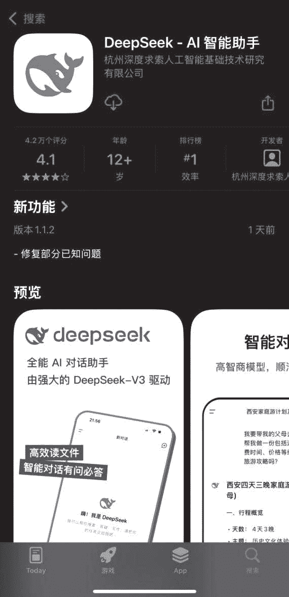
▲图1-1 DeepSeek应用程序
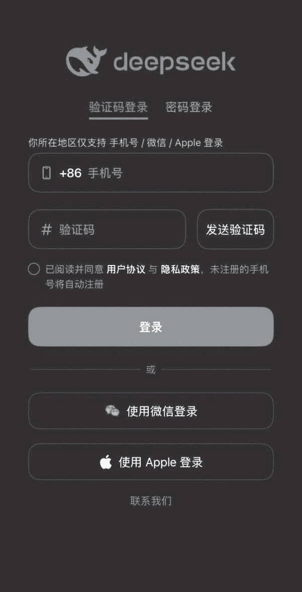
▲图1-2 选择登录方式

### 首次对话：新手必学的三个提问角度

登录后即可开始对话。

对心理完全陌生的人，不用术语，用最朴素的语言提问即可。

记住一句话：自我疗愈始于真诚对话。

基于使用习惯，我归纳出三个入口：

（1）情绪角度：问“我”为什么有这种感受。
（2）问题角度：问“我”想解决的具体困扰。
（3）流派角度：用认可的学派（如精神分析、认知行为疗法）获取答案。 

情绪角度——从模糊感受定位问题
你可以问：我最近总是____，能帮我分析原因吗？

原理是先打开心门觉察感受，再追问“我现在感觉如何”。潜藏的真实感受会浮现，帮助你从逻辑中解放出来，用情绪重新理解处境。

DeepSeek会推测情绪背后的可能性，回溯经历、梳理脉络，让你更懂情绪含义。

举例：我最近总是心慌，能帮我分析原因吗？
可能思路：
（1）追问细节：是不是遇到截止日临近或人际冲突？
（2）给出方向：很可能源于职场压力，可试分解任务法，每天拆小目标。 

问题角度——把抽象困惑变具体
你可以问：我想改善____问题，该从哪里开始？

适合习惯理性分析的人。可跳过模糊困惑，直接从目标入手。

例如：我想改善人际关系，同事背后议论让我难以忍受，如何改变？
DeepSeek会分析信息，推演出人际不良的可能并给方案。

举例：我想改善失眠，该从哪里开始？
可能思路：
（1）给建议：睡前一小时远离电子设备，保持卧室暗且温度适宜。
（2）推资源：附睡眠白噪音链接。
（3）设提醒：要不要现在设置每日睡眠打卡？ 

流派角度——调用专业疗法
你可以问：请用____，帮我分析____这个想法。

适合有一定基础或咨询经验的人，选择契合认知的学派提问。

举例：请用认知行为疗法分析“同事都不喜欢我”这个想法。
可能思路：
（1）认知重构：“都不喜欢”是否过度概括？有无被称赞的经历？
（2）行为实验：明天主动与一位同事共进午餐验证想法。

掌握这三个角度即可开启初步交流。建议开启“深度思考R1”模式，如图1-3所示，可挖掘更深层含义。
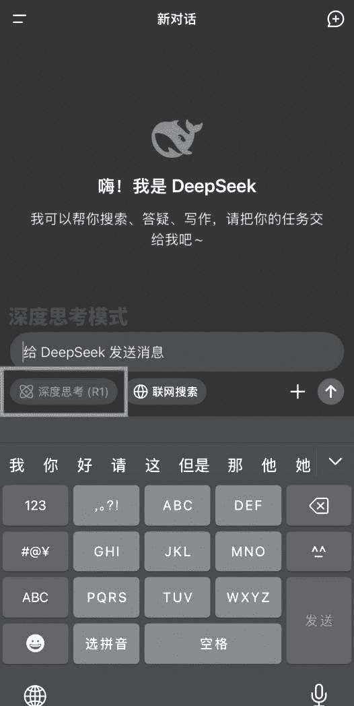
图1-3 “深度思考R1”模式

完成首次对话后，若你感到“原来如此”的触动，那这场自我探索之旅就此展开。

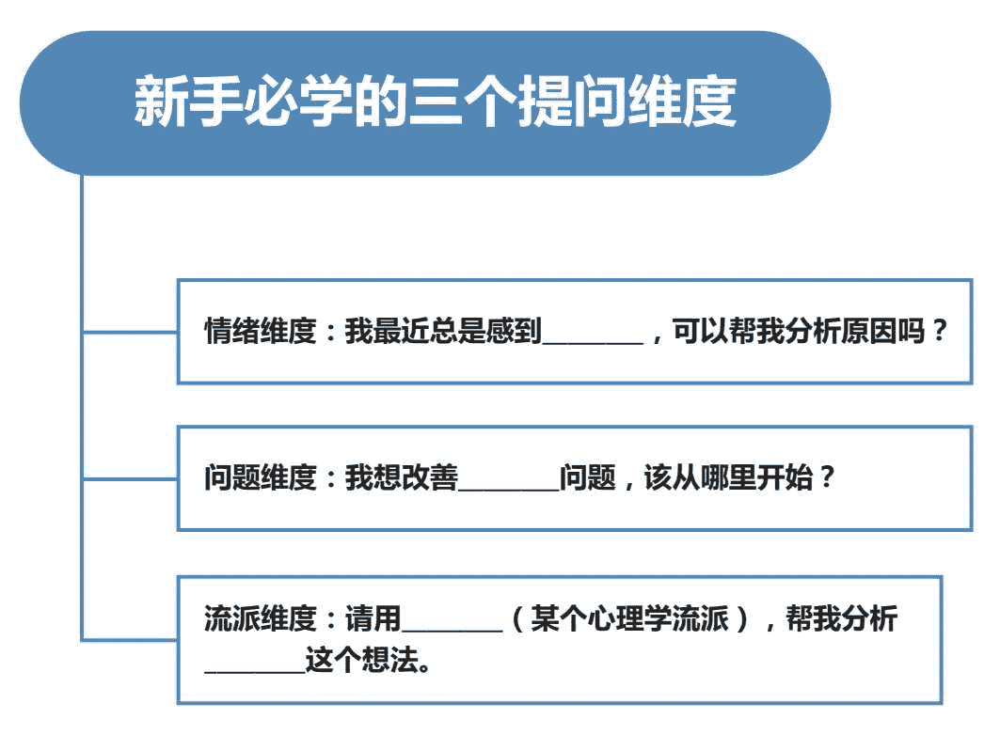
### 使用DeepSeek时常见疑问
把DeepSeek当心理师时常会担心：它真能懂情绪吗？能处理危机吗？怎么问更准？以下梳理一些答案，帮助你更有效使用。 
问题1：DeepSeek能否真正理解情绪
它依据上下文语义做分析。若结果不符，可反馈真实情况进行人工修正。它会记录并学习，后续分析会更贴近实际。 
问题2：能处理紧急心理危机吗
它主要起即时安抚和专业转介作用，不能替代医疗干预。一旦出现重度危机，请立即拨打120或心理危机热线求助。 
问题3：如何提问更精准
尽量用具体描述，如“被领导批评后失眠”，而非“我心情不好”。

学完本章，你已掌握核心原理，完成从登录到首次对话的实践，并能用三维提问进行自我探索。

在成长篇，你将用DeepSeek揭开潜藏的心理模式，看见潜意识里的自己。

# 成长篇
# 用DeepSeek看见潜意识的自己

目标：挖掘隐藏的心理模式，促成人格突破。

焦虑的孩子怎样学会与自己和解

我身边有一位叫小F的女生。父母早年分开，她一直跟着母亲生活。读高中的日子里，焦虑像影子一样跟着她，偶尔会去做基础的心理疏导，可高一高三的课业节奏太快，根本挤不出完整的时间给自己减压。一次月考没发挥好后，她开始频繁胃痛、夜里睡不着，脑子里只绕着一个念头：考不上大学，妈妈会失望。

DeepSeek 问世后，带她的老师建议把情绪写下来。小F先是在睡前记下当天最揪心的片刻：被老师在课堂上点名时，手心会莫名冒汗；看到班级排名时，心跳会猛地加速。聊了几轮后，DeepSeek 总结出她最紧绷的恐惧，并不是怕难，而是怕辜负在意的人。

随后给出的方向很具体，先从生活里的微小互动练起，慢慢把安全感建起来。小F鼓起勇气对母亲说，今天数学课上有几处没听懂。没想到妈妈回得很温柔，周末一起把错题再捋一遍。那一刻的回应松动了她多年以来的假设——只要承认不会就会被责备。

课堂上她也尝试迈一步。声音有点抖地举手问了一个基础题，老师耐心解答还给了鼓励。她惊讶地发现，自己一直担心会被嘲笑为“笨问题”的事根本没发生。

半年过去，她告诉妈妈，在 DeepSeek 的陪伴下，自我否定的语言明显少了。期末分数依旧在中等区间，可“我可以试试”的感觉真真切切长出来了，走路也比从前稳当了些。

读到这样的片段，很容易对号入座。自我怀疑的刺痛、为了被看见而耗尽的力气，从来不是个例。很多人都困在相似的漩涡里。

DeepSeek 对我而言不只是工具，更像一个安静的陪伴者，轻声说你并不孤单。当自我否定的雾气再袭来，脑中响起“我不够格”时，可以借助它把恐惧摊开，直面它，慢慢与自己握手言和。

## 一、拆解潜意识里的自动程序

我们常以为自己在掌舵，却没留意许多关键决定早被无意识的暗流牵着走。亲密关系里总怕被丢下的人，可能还在重复童年父母离去时的空落；职场里总拒绝加班的人，也许仍在延续“听话就能被夸”的旧有奖励逻辑。

这些藏在习惯里的程序像呼吸一样自然，却把人一次次拉回同一个坑。即便想改变，也总被一股看不见的力量拽回去。

DeepSeek 更像一位细致的心智解码者，帮忙翻译内心深处的行为密码。比如问“为什么我老是讨好同事”，它会引导你回想童年里为避免父母争吵而小心维系家里和平的片段；又比如困惑“被表扬后反而失眠”，它会陪你追溯到当年考第一却被长辈告诫别骄傲的经历，从而看懂对满足感的防御。

它的价值不在于追究过去，而在于让人看清那些仍在运行的“心理脚本”，按下暂停，再写新版本。**只要把反复出现的场景和随之而来的强烈感受描述给它，它就能把细节里的心理线索梳理出来。**看清牵着自己的那根隐形线条，人格才有真正蜕变的可能。

怎么把经历说得更清楚？以下六个递进的沟通方式，能让对话更有效。

**1. 抓住反复出现的循环。**
**2. 追问情绪背后的信念。**
**3. 面对没完的事。**
**4. 撕掉自我设限的标签。**
**5. 留意关系里的投射。**
**6. 厘清真实的需要。**

### 抓住循环模式 

**提问示范**

·为什么不管是亲密关系还是职场社交，一旦走近，我内心就会冒出强烈的失望，而且这种失望在每段关系里都一样？

·当局面开始失控，我的第一本能就是抽离，这背后是什么心理在驱动？ 

**这样问的意义**

反复上演的心理模式往往源于无意识的自我保护。比如拖延，很多人用它来躲开失败的打击。若能找到触发条件，比如被否定、失去掌控感，就能在信号出现时捕捉到，并尝试用更健康的应对手法替代。

### 追问情绪背后的信念 

**提问示范**

·别人指出来我的问题时，我会感到愤怒或羞耻，这两种感受背后藏着什么核心假设？

·如果我不再 ____（比如拼命工作、讨好他人），最糟糕的结果会是什么？这些我害怕的后果合理吗？ 

**这样问的意义**

情绪是潜意识寄来的加密信，每种强烈感受背后都有待破译的核心信念。很多人信奉“我必须完美”，追根溯源，这往往是童年为适应环境而形成的生存策略。用理性检验信念的合理性，才能更了解自己。

### 面对未了的往事 

**提问示范**

·记忆里有 ____（某个经历或某个人），只要想起就会波动。我在这段关系或事件里学到了什么？

·如果能直接面对内心最大的遗憾，我最想说什么？现在该怎样重新理解和处理这份遗憾？ 

**这样问的意义**

没有被处理的创伤和遗憾不会消失，会变成心理卡点，像系统里的漏洞持续耗能。压抑负面情绪只是治标，真正的做法是接纳、剖析、赋予新意义。比如把“我被抛弃了”转化为“我学会了独自面对生活”，从而自我疗愈。

### 撕掉自我设限的标签 

**提问示范**

·我常给自己贴上“天生敏感”“不擅长社交”的标签，这些标签如何影响我的日常选择？如果撕掉它们，我会怎样行动？

·假如有一个既支持我又了解我的人坦诚点出问题，我可能忽略了哪些盲区？ 

**这样问的意义**

标签会固化心理模式，限制发展空间。用成长型视角看自己，把“我做不到”换成“我还没找到方法，可以通过学习获得进步”，才有可能突破。

### 留意关系里的投射 

**提问示范**

·在交往中，他人的 ____ 特质让我难以接受。这些让我排斥的特质，会不会是我内心不愿承认的部分在对方身上显现？

·在亲密关系里，我总是不自觉扮演某种固定角色，比如拯救者或受害者。这种角色满足了我内心哪些潜在需求？ 

**这样问的意义**

人际像一面镜子，映出潜意识。当我们对某人的特质产生强烈好恶，很可能是自己不愿接受的阴影在投射。比如厌恶控制欲强的人，也许是因为自己压抑了主导欲。

### 厘清真实的需要 

**提问示范**

·我努力追求成就、渴望被认可，这到底是我的价值追求，还是在迎合他人的期待？

·如果没有任何外界限制，比如舆论、评价、资源匮乏，我内心最想成为 ____。现在没有成为理想中的自己，是现实的限制，还是内心观念的束缚？ 

**这样问的意义**

许多行为受“虚假自我”驱使，为融入社会而迎合标准，却忽略了内心的声音。区分社会期待与内在渴望，才能正视并表达真实需求。

作为非专业的自助探索者，觉察力不足会降低协作效率。基于咨询经验，四个提升觉察的步骤很有帮助：

1. **记录情绪峰值**：用日记追踪反复出现的情绪高点，找模式。比如每次和母亲通话后总烦躁。
2. **扮演理想自我**：冲突时设想以理想的自己应对，记录现实反应与理想的差异。
3. **做微小实验**：从小处突破，留意身体和情绪变化。比如对不合理请求回应“我需要时间考虑。”
4. **请外部回馈**：定期请信任的人观察你的模式，他们常能捕捉到自己忽略的进步。

成长的本质，是把自动运行的无意识模式转为有意识的选择。需要直面惯性的勇气，也需要自我宽容的视角。这不是全盘否定过去，而是理解后把无意识的程序升级为主动选择。

## 二、看见内心里的拉扯

内心常运行着互相矛盾的行为：极度渴望认可，却在被夸时下意识贬低自己；嘴上说要改变，行动上却反复说“不可能”。这些困惑是无意识里隐藏矛盾的外显。理性想要成长，无意识却因早年创伤设置了自我保护，形成拉扯。

DeepSeek 像一位心理语言学家，能剖析言行矛盾，帮助我们精准定位束缚发展的内在冲突。它会捕捉对话中“应该/但是”“想要/害怕”等对抗性表达，标记意识与无意识的撕裂，并关联压力事件下自我否定词汇激增与回避行为的关系。

它不替人思考，而是把“以为了解，其实从未看清”的自我对抗呈现出来。一旦洞察到“想要被爱”与“害怕受伤”的拉锯，就站在了停止重复痛苦的起点。

**向它提问的参考**

·我内心渴望亲密，行动上却总是回避约会，为什么？

·我一直说想要升职，可机会摆在眼前时我却拒绝，这种矛盾反映了什么心理冲突？

**拆解困惑的流程**

1. **描述矛盾情境**：用具体事例说明。例如上周领导提出晋升，我以能力不足为由拒绝了。
2. **分析潜在动机**：探寻深层原因。例如我拒绝升职，背后真实原因可能有哪些？
3. **兼顾理性与感性**：分别问“从理性看，支持我升职的理由有哪些”和“从感性看，我害怕升职的原因有哪些”。

**案例展示：用户小 L 的困惑及分析**

小 L 说：“每次一萌生换工作的念头，我当晚就会失眠。”

进一步拆解：
1. 描述矛盾：“昨天工资到账，看到数额又想换工作，可真要开口提离职时却说不出口。”
2. 分析动机：问“我为什么不敢迈出换工作这一步？”
3. 分离层面：请 DeepSeek 分别列出理性上应该换工作的理由和感性上害怕换工作的理由。

分析结果：
1. 理性需求：迫切需要职业突破和薪资提升。
2. 感性恐惧：对新环境失控和对舒适圈的依赖。
3. 建议：设计“最小试错实验”，先去一家非目标公司面试，把过程当练习。

## 三、打破人际间的循环剧本

你是否发现自己在某些关系里反复掉进同一个坑？同样的争吵、僵局、冲突不断重演。关系困境往往是创伤或代际创伤在现实中的重演。对同事的下意识讨好，可能在复制母亲在婚姻里维持平衡的姿态；对领导的沉默退缩，也许复刻了父亲权威压制下的生存策略。这些隐形模式操控着互动。

DeepSeek 会通过深度引导，帮助你解码关系模式，打破创伤局限，重塑健康互动。只需简要描述困境，例如“每次和母亲讨论职业选择，最后都不欢而散”，它便会用引导式提问帮你梳理触发规律、潜意识诉求和行为互动逻辑，最后给出可行建议。

**看清原生家庭的影响**

原生家庭的影响贯穿一生。你以为已独立，却在情绪爆发时发现自己的愤怒反应和父亲如出一辙，逃避方式也复制了母亲的沉默。这些情感遗传隐蔽却影响着无数选择。DeepSeek 像一位洞察者，能抽丝剥茧挖掘代际传递的线索。一旦明晰，你不再是被动承受者，而是可以改写剧本、挣脱束缚的人，开启全新的人生篇章。 

**关系描述示例**

**我和父亲沟通时，总是感到压抑。** 

**深度引导示例**

**第一轮引导：把模糊感受落地**

○ 能否回忆最近一次和父亲对话感到压抑的具体场景？
○ 当时他说了什么让你呼吸变得急促？
○ 你当时如何回应？是沉默、反驳还是转移话题？
○ 你觉得父亲常用的沟通方式属于哪一种？

**第二轮引导：从单一关系到系统认知**

○ 当领导或伴侣用类似方式沟通时，你是否也会出现语言丧失、自我怀疑或胃部紧缩等反应？
○ 你有没有无意识模仿父亲的沟通方式？例如教育孩子时脱口而出他的口头禅。

**第三轮引导：连接身心信号**

○ 对话时，身体哪个部位反应最强？胸口闷痛可能与被否定有关，喉咙发紧或许是压抑了真实表达。

3、指尖不自觉地发颤，通常在提示你正处在失控感引发的焦虑里。

你也可以补充其他反应比较明显的身体部位。

**第四阶段：溯源探查**

○ 父亲这样的沟通风格，会不会让你联想到他自身成长里的某些片段？比如祖父对父亲是否格外严苛？翻看家庭相册时，年轻的父亲脸上是否也流露着相似的压抑？
○ 回忆童年，有没有为争取父亲认可而努力却落空的画面？例如考了满分只换来一句“别骄傲”，求职成功却被回一句“这家公司不够好”。

**第五阶段：寻找切口**

○ 你和父亲之间是否出现过交流顺畅的时刻？当时场景与平常有什么不同？有没有第三方在场？你当时用了哪些不常用的沟通方式，比如用幽默化解了僵局？
○ 如果要用两种物件来隐喻理想中的你和父亲，你会选什么？比如“树与藤”可能指向依赖与掌控的互动，“两座山”则更像是在表达对边界的渴求。 

**DeepSeek 解析结论与改进建议**

· 解析结论
渴望父亲认可过度，往往源于他长期否定、打压和严厉的教养方式。你把童年未被满足的情感需求无意识投射到各类权威关系里，于是面对上司或伴侣时自动掉进“讨好—受伤”的循环。

· 改进建议
○ 当父亲说出“你不行”之类的话，你可以在心里默念：“这是他的不安，不是我的事实”。
○ 参考 DeepSeek 提供的沟通话术模版，练习在与父亲相处时守住合适的边界。

### 亲密关系里的隐形困局

在亲密关系里，最让人耗损的是那些说不清道不明、反复上演的微妙冲突。明明彼此有好感，却总在同一类问题上争执；明明想靠近，却习惯性地回避沟通。

这些循环往复的情节背后，往往藏着未被察觉的情感模式。你可能在不自觉中复刻了父母“冷战几天再破冰”的相处脚本；也可能把伴侣的回避误读成童年被拒绝的信号。

DeepSeek 能在对话中捕捉你在亲密关系里潜藏的风险信号，解读内心真正的需求，并给出可操作的修复方案，帮你走向更和谐的互动。 

**关系描述示例**

伴侣常常不回我消息，让我心里很焦虑。 

**DeepSeek 深度引导示例**

**第一阶段：具象化引导**

○ 最近一次因为伴侣不回消息而焦虑时，具体发生了什么？
○ 你当时发的内容是日常分享，比如午餐照片，还是重要安排，比如周末计划？
○ 你清楚对方可能在忙吗？比如正在开会或加班？
○ 你觉得他“不回消息”的模式更接近以下哪一种？
（1）长时间完全沉默，例如超过12小时无回复。
（2）选择性回复，只回部分话题。
（3）已读不回。
（4）延迟回复，隔段时间才回。

**第二阶段：模式迁移**

○ 如果朋友或同事没及时回你消息，焦虑程度会一样吗？
○ 在过去的感情或其他人际关系里，有没有类似经历？例如前任的冷暴力，或童年时父母因忙碌而忽略你的需求。

**第三阶段：身心连结**

○ 等待回复时身体有什么反应？
（1）频繁刷新手机。
（2）手心出汗，心跳加快。
（3）失眠或食欲下降。
（4）强迫联想，比如担心出轨或出事。
○ 你通常用什么方式缓解焦虑？
（1）连续追问。
（2）在社交平台查看对方动态。
（3）向朋友倾诉寻求安慰。
也可以描述其他缓解行为。

**第四阶段：探查源头**

○ 成长中是否曾被重要的人忽视？例如哭泣时没得到及时回应，发言时被老师同学无视，或经历过突然断联的分手。
○ 用一句话概括内心最深的恐惧，更接近哪一种？
（1）我不够重要。
（2）我怕被抛弃。
（3）我怕真实的自己不被接纳。

**第五阶段：寻找突破**

○ 你和伴侣有没有过对方及时回复让你安心的时刻？当时的回应方式如何？是秒回还是稍晚但会解释原因？你当时状态怎样？
○ 如果用一种天气来形容理想的沟通状态，你会选什么？比如“晴天微风”代表稳定轻松；“阵雨后彩虹”代表能容纳冲突但需要明确的和解信号。 

**DeepSeek 解析结论与改进建议**

· 解析结论
产生焦虑，很可能潜意识里把“不回消息”等同于被抛弃。这种灾难化想象的根源，或许是童年留守、父母缺席带来的不安全感和恐惧在当下被激活。

· 改进建议
○ 与伴侣协商一个“忙碌信号”，比如一个特定表情代表稍后回复。
○ 收到消息时记录当下感受，慢慢建立“延迟不等于危险”的新经验。
○ 练习分离焦虑的调适练习，稳住情绪状态。

### 职场里的信号迷雾

职场中常有人感到迷茫，明明察觉到敌意却拿不出证据；明明反复争吵却理不清源头。

背后可能是未被识别的沟通模式：你习惯用“随便吧”掩饰真实需求，或把对方的沉默误读为冷漠。DeepSeek 能通过文字里的隐含信息，帮你揪出那些引发误会的情绪地雷。 

**关系描述示例**

我总觉得同事对我有恶意。 

**DeepSeek 深度引导示例**

**第一阶段：具象化引导**

○ 最近一次感到被恶意对待，具体发生了什么？
○ 发生在会议、私下交流还是群聊？
○ 对方做了哪些行为让你有这种感觉？例如冷笑、打断发言、私下议论？
○ 对方有没有使用特定表达，如“果然是你”“随便吧”？
○ 你感受到的“恶意”更像哪一种？
（1）公开贬低，质疑工作能力。
（2）隐性忽视，跳过你的提议。
（3）社交孤立，聚餐不邀你。
（4）过度竞争，抢你的项目资源。

**第二阶段：模式迁移**

○ 在学校或家庭里是否也有类似感受？学生时代被排挤？在家常被误解或针对？
○ 当朋友或家人给建议时，你会不会下意识觉得是否定？

**第三阶段：身心连结**

○ 感受到恶意时身体有哪些反应？
（1）肌肉紧绷，咬牙握拳。
（2）呼吸变浅，血氧感下降。
（3）注意力涣散，记不住会议内容。
也可以描述其他反应。
○ 你一般如何应对？
（1）刻意回避接触。
（2）反复解释以消除误会。
（3）向其他同事打听对方意图。
也可以补充其他应对方式。

**第四阶段：探查投射**

○ 成长中有没有“被误解”“被针对”的深刻记忆？例如因误会受罚却无法辩解，或被小团体造谣孤立。
○ 用一种颜色形容你对同事恶意的感知？
（1）深灰色，可能关联不安与猜疑。
（2）鲜红色，可能反映未处理的愤怒投射。
（3）土黄色，可能指向压抑的竞争焦虑。
（4）暗紫色，可能暗示权力压迫带来的隐痛。
（5）墨绿色，可能代表一种伪善的感受。
……

**第五阶段：寻找突破**

○ 有没有让你觉得可信的同事？他们与那位同事的不同点在哪？例如是否会认真回应你的建议、主动分享信息？ 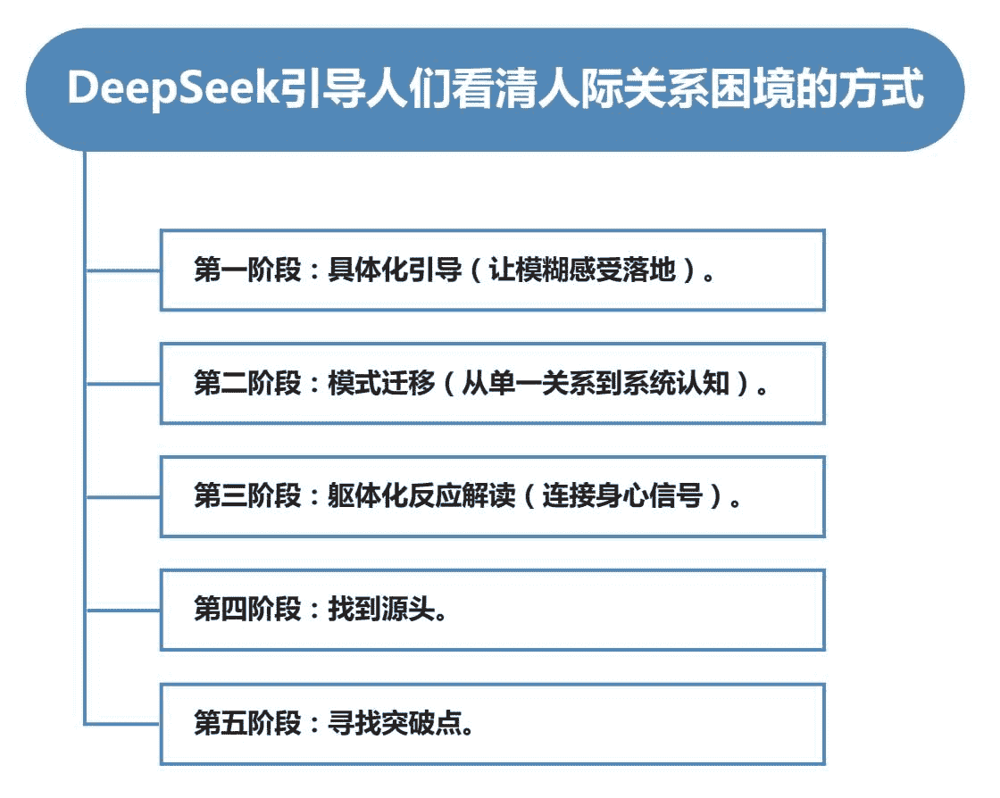
○ 如果用天气比喻理想的职场关系，你会选什么？
（1）多云有阳光，接受分歧但需要基本信任。
（2）晴朗无风，渴望稳定和谐。
（3）雷雨后放晴，接受激烈讨论但求共识。
（4）微风习习，拒绝僵化保持流动。
（5）秋高气爽，希望成果可量化、收获可共享。
…… 

**DeepSeek 解析结论与改进建议**

· 解析结论
对“恶意”的敏感，与童年频繁被误解、被诬陷的经历有关。像“这个方案要调整”这样中性的反馈，被神经系统误判为攻击，触发了战斗或逃跑反应。

· 改进建议
○ 进行三次“无害化测试”，主动请教对方小问题并记录回应模式。
○ 在会议中有意提出一个有争议的观点，观察对方反应并对比预期偏差。
○ 把负面解读转为中性假设，如“没回消息”转为“可能在处理更紧急的事”。
○ 练习非对抗表达，把“你为什么反对我”改为“我想听听你的顾虑有哪些”。

如果你正困在某段关系里，无论是伴侣的反复争吵、同事的频繁误会，还是与父母的长期矛盾，都可以借助 DeepSeek 做一次系统解析，找到切实可行的改善入口，迈向更清晰的关系重塑。

## 四、用 DeepSeek 探索梦境与潜意识

梦境像是潜意识寄给意识的信件。奇异的意象、反复的场景、醒来残留的身感，如坠落的失重、被追逐的心跳，都是重要的线索。

DeepSeek 通过非语言信息的分析，把被压抑的恐惧和未被承认的渴望逐一拆解，不仅翻译表层意象，更深入潜意识，带你更清楚地认识自己。

### AI 解梦与真人解梦有什么不同

真人咨询师依托专业理论在互动中动态调整解读，并在过程中提供情感支持，将梦境与整体心理状态和行为模式结合服务长期治疗。

DeepSeek 融合荣格原型理论，构建了涵盖数十种常见梦境意象的解读体系，从坠落映射的失控焦虑到被追逐暗示的压力逃避，把抽象符号转译为心理语言。

DeepSeek 和真人咨询师解梦的核心区别如表 2-1 所示。 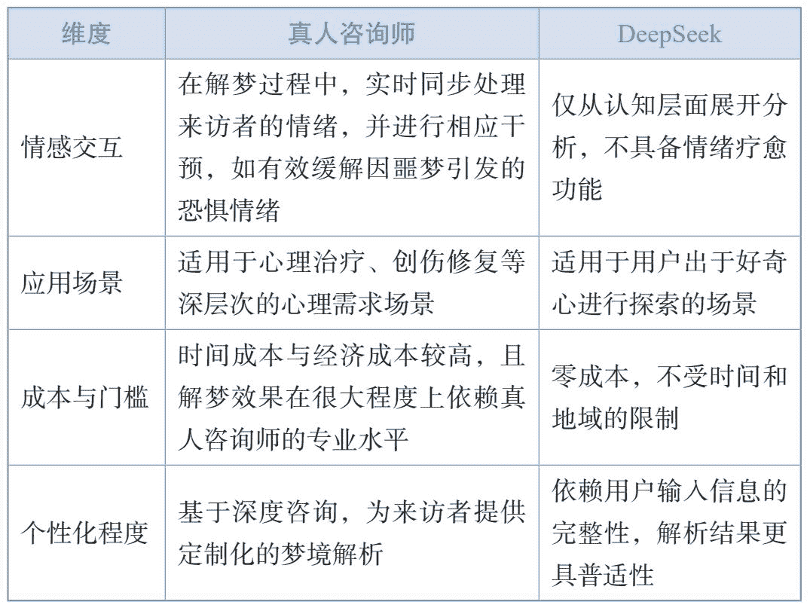

### DeepSeek 的解梦流程

**第一步：细致记录梦境细节**
引导你描述以下要点。
· 场景与情节：时间、地点、人物、关键事件。
· 感官体验：颜色、声音、气味等。
· 情绪变化：梦中恐惧喜悦迷茫等，以及醒后残留情绪。
· 重复元素：反复出现的场景、人物、物件如楼梯水动物等。

**第二步：识别关键元素与象征意义**
· 拆解梦境：提取关键词。例如“我被追赶想回家却迷路最后到悬崖边”可提取“被追赶”“迷路”“悬崖”。
· 探寻象征：同一元素意义不同人不同。如蛇对有人是恐惧，对有人是智慧与能量。
· 参照原型：影子象征被压抑自我，智者寓意内在智慧，水代表无意识或情感流动等。

**第三步：把梦中情绪与现实连结**
· 情绪对比：梦中情绪是否与现实呼应。
· 未决冲突：是否反映当下压力、焦虑或渴望。
· 反向视角：强烈负面梦可能是潜意识在预演恐惧以增强现实应对力。

**第四步：自由联想**
引导你对关键元素不加过滤地说出第一个浮现的词或画面。如梦到“上锁的房子”可能联想到童年老屋、秘密、孤独等。

**第五步：关联近期生活**
· 显性关联：梦境直接复制近期事件。如面试前夜梦见找会议室迷路。
· 隐性关联：以比喻形式传达深层需求。如工作压力大梦见化作小鸟飞走，象征逃离渴望。
DeepSeek 会追问梦中情形是否与近期经历契合，感受是否与近期心境相似，帮助挖掘联系。

**第六步：结合不同理论解梦**
例如梦见在沙漠找水最后找到一杯血。
· 弗洛伊德可能说：渴望情感滋养却担心满足会带来伤害。
· 荣格可能说：沙漠是精神荒芜，血是生命与牺牲，提示直面痛苦才能得到滋养。
· 认知理论可能说：近期接触干旱新闻或身体缺水，大脑在整合信息。
DeepSeek 不预设单一理论，会根据你的描述匹配契合角度，也可指定理论或对比多种理论结果供你选择最触动的那一个。

**第七步：整合分析并给出行动建议**
· 揭示潜意识信息，如“留意被忽视的情感需求”。
· 提供调整建议，如学习放松技巧、与特定人沟通。
· 特别提示：主观感受始终最重要。

同一个梦在东方可能是吉兆在西方可能是危险，同一种情绪对一人映射童年创伤对另一人却是创造力燃料。AI 能解析符号，却丈量不了人性的深渊。若反复做同样梦却无法理解，解梦后更混乱，梦境与现实边界模糊，请停止与 AI 的对话，转身走进真实的咨询室——那里没有算法，却有一面能照见心灵褶皱的镜子。

**内在求救，等你学会翻译**

读到这里，你已经学会借助 DeepSeek 照出潜意识里的自己。在它的引导下，你可以回溯那些不假思索就冒出来的消极话语背后在守护什么自我保护机制；看清内心渴望改变却又怕失控的拉扯如何左右选择；明白为何在关系里反复撞进相似的冲突剧本；也能把看似荒诞的梦境拆开，读出隐喻的含义。

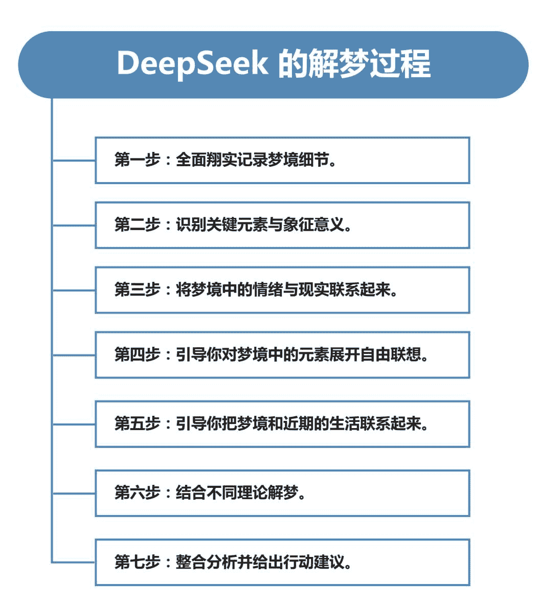

这些觉察会成为自我重塑的起点。接下来，进阶篇要讲怎样让 DeepSeek 长期陪你走心理成长之路。

# **进阶篇**
# **让 DeepSeek 成为你长期的心理成长伙伴**

**目标：搭建可持续的心理支持系统。**

周五快下班，小 L 正要关机，群里领导忽然 @ 他：下周客户汇报你来主导。项目他已筹备数月，消息一跳出来心跳猛地上扬，手指悬在键盘上打不出“收到”。

焦虑的小 L 唤起 DeepSeek 把当下写下来：每次被交付重任，胃就开始绞痛。我准备得很充分，却总怕搞砸。

对话里它回馈：本会话里你检索过 13 次“如何不紧张”；接任务前你常失眠；是否卡在“必须完美，否则就是失败”的固化信念？随后给出了可落地的调节建议。

照着做，小 L 每天工作开始前就对着镜子给自己打气：我扛过更难的案子，先拿六十分就行。汇报那天声音仍有点颤，表达却清晰有条理。

成长不是抹掉恐惧，而是带着恐惧继续前行。它不提供无懈可击的标准答案，而是帮助普通人实现心理进阶。

哺乳期的妈妈能用它记录复工时的不安；临近毕业的学生在练面试话术时可即时获得反馈；中年的伴侣也能学会用非暴力沟通温和化解家庭矛盾。

心理成长不是突击任务，而是需要长期投入的生命课题。它全天在线，随时响应，这正是可信赖的伙伴基础。

怎么让它变成长期的成长伴侣？从初次搭档开始，学会深度对话，在引导下发现隐藏的心理模式，再用自然语言随时描述困惑，促进自我疗愈。

## **一、起步：和 DeepSeek 初次搭档**

### **做结构化对话**

头三周，用它做轻量自我探索，关键是建立默契，具体做法如下。

**第 1 周：养成互动节奏。** 熟悉基础功能和使用逻辑，形成每日互动习惯。

○ **一分钟情绪快照**：记下当日情绪关键词，如加班、烦躁、成就感。情绪解析依托认知三角，想法-情绪-行为。它依据你输入的词做初步剖析。

○ **简单提问每周 2~3 次**：比如“我老被批评还喜欢躲人，这是什么原因”。

它会拆成三层：
想法层：捕捉内在独白，像“我不够好，大家不喜欢我”。
身体层：指出此时警觉中枢过于敏感，所以你会紧张害怕。
行动层：点出当前应对是“躲起来”，像乌龟受惊缩进壳。

**要点**：描述越具体，事件经过、当下想法、身体感受、后续行为还原得越完整，它就能把复杂问题分层并深入剖析。

**第 2 周：掌握结构化提问。** 学会清晰表达需求，熟练“三项提问法”。

○ **三项简化**
· **事**：如“下午汇报被领导打断”。交代背景。
· **感**：如“愤怒+尴尬”。说明情绪反应。
· **问**：如“怎样下次别那么紧张”。提出想解决的核心。

○ **标签归类**：给问题加自定义标签，如“#职场压力”“#自我怀疑”，便于后续复盘。

**第 3 周：启动模式识别。** 持续沟通，发掘重复的心理与行为套路。

○ **定期复盘**：比如问“让我愤怒的事件有什么共同点”。从过往里找相似。
○ **微型实验与反馈**：执行它给出的最小行动，如“被否定时先做三次深呼吸”，并记录效果。成败都要记，用来验证建议可行性并深化自我认知。

这三周的引导式互动，本质是搭起从混沌到清晰的认知桥。第一周靠关键词记录培养觉察；第二周用模板把模糊困扰转为具体问题；第三周能主动察觉重复性并尝试微调，完成从被动记录到主动干预的跨越。

这种基础训练既建立对工具的信任，也培养持续自我观察的习惯。

### **用它设计行为实验，跳出心理循环**

脑科学认为大脑像肌肉可训练，坚持六周的新行为练习能让负责理性的前额叶增厚。这意味着靠科学练习改变固有思维模式，这就是神经可塑性。

第三周要借助微型实验练习。不清楚怎么开，就按三步：

1. **设定最小挑战**：比如害怕说错被嘲笑，可指令它“生成一个我能承受的最小验证，来检验担忧是否合理”。
2. **照建议行动**：它可能给出“明天会上主动抛一个不成熟的想法”。在低风险场景检验恐惧是否兑现。
3. **记录反馈**：行动后你会发现预想的“被嘲笑”并未发生。

反复用小挑战测试恐惧，大多数担忧不会成真，从而实现神经重塑，建立“尝试新行为就能获得安全反馈”的新连接。

## **二、中期：和 DeepSeek 做深度对话**

进入中期，核心是养成“带着问题提问”的习惯。

深夜因工作失眠时，不再只说“我又焦虑了”，而是问“为什么每次项目收尾我都会自我怀疑”；争吵后不再只说“我们又吵了”，而是问“为什么我说希望他多回应时我们总会吵”。

这种提问让你在情绪波动时建立“观察行为→分析模式→尝试改变”的思维链，会自问：此刻情绪触发了哪段旧伤？我有什么新应对？

### **深度对话的原理**

**（1）引导式提问技术**

它会使用 SOCRATE 提问框架：

S Situation 情境；O Origin 起源；C Consequence 后果；R Resource 资源；A Alternative 替代；T Transfer 迁移；E Evaluation 评估。

例如你说工作压力大，它可从七个维度展开：
·S“哪些场景最容易让你有压力？会议汇报、跨部门协作还是紧急节点？”
·O“这种压力何时变得明显？是否伴随岗位调整或新 KPI？”
·C“持续压力如何影响工作表现和个人生活？”
·R“你用过哪些有效应对？”
·A“是否尝试过非传统方法，如正念呼吸、边界重设、压力可视化？”
·T“过往应对类似挑战的方法能否迁移过来？”
·E“哪些方法缓解超过三成压力？可复制性如何？”

**（2）动态叙事引导**

它会生成故事线模板：你提到 __（事件），这似乎与 __（模式）有关，可尝试 __（策略）。

·孩子写作业拖延：事件是反复擦草稿写不出字；模式是害怕写错被批评，越紧绷越不敢下笔；策略是先随便写三个字不擦。
·夫妻因家务吵架：事件是争谁倒垃圾；模式是双方都想被看见付出；策略是贴“今日贡献榜”记录小事。
·老人迷信保健品：事件是劝不住买三无产品；模式是推销员陪伴缓解孤独；策略是假装请教她腌酸菜，让她感到被需要。

**（3）认知重构练习**

烦心时常出现“我肯定做不好”“别人都讨厌我”。认知重构帮助调整负面解读。

它会自动识别灾难化、过度概括等扭曲，并引导：
① 揪出负面想法；
② 用事实检验不合理性，如“上周我完成过类似任务”；
③ 把消极表述转积极，如“我搞砸了”→“这次没做好，但我知道问题在哪”。

例如方案被否定，负面想法“我不适合这个行业，同事都在笑我”。它让你暂停并找反例，最终重构为“方案数据与领导要求有差距，需补充市场数据”。

### **深度对话操作指南**

**步骤 1：结构化提问训练**
每天挑一个情绪相关事件，按“事件—感受—需求”提问。如“会上方案被质疑，感到愤怒与羞耻，根源是渴望认可”。

**步骤 2：动态反馈调整**
若分析偏离真实感受，及时纠正。如它说焦虑源于失控担忧，实际是需要被认可，就输入“我的真实感受是愤怒和羞耻，请重新分析”。及时反馈帮助它更贴合你。

**步骤 3：整合认知与行为**
把建议转化为行动清单。如建议“强化积极自我认知”，细化为“每天记录三个被认可瞬间”。从认知落地到行动，才能体现辅助价值。

认知重构本质是换副眼镜看世界。它反驳“我什么都做不好”的信念，是邀请你发现所谓失败里藏着未被看见的成长线索。

## **三、长期：和 DeepSeek 做自然的深度对话**

当基础功能熟练、初步探索完成，进入为期十二周的更持久自然对话。

此刻它更像心理健身教练，通过每周多次对话培育觉察力与情绪韧性。当对话陷入僵局，往往触及潜意识核心议题。有人会突然抗拒对话或觉得共情不足，这恰是疗愈开启的信号，焦点从发现问题转向重构经验。

### **从“练习生”到“主理人”：对话模式跃迁**

初期中期已学会结构化提问与引导式拆解。自然对话不是抛弃方法，而是内化为本能，进入自动驾驶阶段，不再依赖固定模板，而是自主叙事，它如思维外接硬盘供你调用。

例如设计师小 K 中期提问：昨天提案被否定，我愤怒，如何调整认知？

练习后他能自然输入：今天路过客户公司大楼，心跳加快，想起上次被批评。项目已通过，为何身体还在报警？

自然对话的特点：
1. 如朋友聊天，自然描述身体反应、场景细节与内心矛盾。
2. 激活潜意识，不经意暴露情绪记忆锚点，如大楼→被批评→生理反应。
3. 便于深度挖掘，它会追问“这种预警在何种情境下最明显？时间、气味或人群？项目通过后再经过是否仍有反应？”

自主叙事能力是解决真实心理问题的核心。

### **自然深度对话的“三阶训练法”**

在“怎么办”环节常卡壳。有咨询者反复问“领导总否定我怎么办”，直到她描述出“既渴望认可又怕被看穿短板”的撕裂感，对话才突破。

它提出让她故意向领导请教一个已知答案的问题。她发现适度暴露脆弱反而让沟通更真实。困住她的不是领导，而是“必须完美”的枷锁。

**阶段一：从记录事实到抓念头**
○ **自主练习模板**
·旧模式：和同事争执，我很生气，想离职。
·新模式：开会时小李打断我瞬间，胃部收紧，脑中闪过“果然没人尊重我”，随后沉默对抗。这让我想起高中举手被老师无视的经历。现在一边打字太阳穴发胀，又有“说出来就好多了”的释然。

○ **辅助分析示例**
·自动提取关键词：“打断发言”“胃部收紧”“童年创伤”“释然”。
·生成思维导图：关联“被忽视经历—过度防御—当下矛盾”。

**先把边界和认知拆开看**

思维上：同事小李的急性子并不等于对你工作价值的否定。打断你发言更合理的解释是他自己时间紧、节奏快，而非在评判你的专业能力。

行动上：可以在明天会议开始前先和他沟通好，“我先完整说完三点核心，后面马上给你时间”。提前划定发言顺序，能让你表达时更稳。

**把质疑当成解题线索来用**

提问的坑：领导总是否认我，怎么办？这种封闭式问法很容易得到千篇一律的安慰。

提问的升级：当领导详细点评方案时，我一方面感谢他的重视，一方面害怕被识破能力短板，这种拉扯该怎么解？

模型给出的拆解思路

·心理细节的解读：感激和畏惧同时出现，说明对专业价值的评判标准跑偏了。你默认只有近乎完美才配得上被关注，任何瑕疵就触发自我价值崩塌。

·认知重塑的路径：把十条点评拆开，能否挑出三条真正涉及专业判断的？剩下的七条，有没有部分只是沟通习惯导致的负面感受，比如语速变快时爱用否定词？拆开后更容易分清客观反馈和主观焦虑的投射。

·小范围试探的设计：下一次汇报时，可刻意保留一个不影响主线的可完善点，用“我对这部分还在权衡两种可能性”来开启讨论。同时自测两件事：领导是否真像你担心那样死盯这个点，心跳加速时你能否保持清晰的逻辑。一次微型的试探，往往能松动“暴露就等于毁灭”的固有信念，你会发现适度示弱反而促成更真实的专业信任。

**把个人困境放到更大的系统里看**

当你把困境放进系统视角，和模型的对话会更立体。比如输入“母亲催婚时我总是忍不住发火，事后又内疚，感觉在反抗者和乖女儿之间摇摆”，就能得到更高维的解读。

模型给出的拆解思路

·代际框架的搭建：催婚场景里母亲像施压方，你像承受方，但本质上双方都在扮演拯救者，都在试图让对方过得更好。

·破局提问的建议：可以问母亲，“妈，你当年决定嫁给我爸时，最希望外婆怎么支持你？”把母女对峙转化为代际共情。

到这里，和模型做深度自然对话的套路你已经掌握了。接下来真正的挑战是把这些办法落地到生活里。

## 四、DeepSeek 和真人咨询师怎么配合

DeepSeek 很好用，能不能替代真人？我的判断是不能。

在心理成长这条路上，DeepSeek 更像全天候在线的陪练。它能处理日常困扰，比如凌晨三点焦虑突袭时的即时安抚，或在自我厌恶的漩涡里提供临时支持。

真人咨询师则像资深的主教练，负责 AI 难以覆盖的深度任务，比如童年创伤修复、现实社交演练，以及出现自伤念头时的紧急干预。

两者分工，能让成长既稳定又有专业背书——低成本高频的 DeepSeek 负责日常调适，能做深度洞察的咨询师负责核心问题。

### DeepSeek 的强项与局限 

### DeepSeek 的长处

它特别擅长应对日常高频的轻量心理需求。比如凌晨三点焦虑来袭，它能立刻给出方法帮你稳住心率；工作时情绪骤降，它会帮你溯源并建议散步转移注意力；被否定后陷入自我怀疑，它会指出这是一种思维惯性；当你问“为什么我总在讨好别人”，它会用心理学知识剖析原因并推荐权威文章和测评工具。

总的来看，无论是应急还是长期状态的改善，它都能提供具体实用的支持。 

### DeepSeek 的短板

功能虽强，边界也很明显。在需要深度情感联结和现场观察的复杂议题上，它无法替代人。比如出现自残自杀倾向、性侵家暴等严重创伤，必须立刻转介给真人咨询师或就医。家庭治疗需要咨询师捕捉互动细节，这是它不具备的能力。模拟面试、陪同社交等现实场景演练，真人也能提供更细致可操作的方法。此外，咨询师能记住你三个月前哭泣时的状态并做纵向连结，而它只能依据你主动提供的描述回应。

总体而言，面对生命安全、复杂关系处理和现实技能提升的需求，仍需依靠真人咨询师的专业力量。

### 真人咨询师的强项与局限 

### 真人咨询师的长处

真人咨询师拥有 AI 难以替代的核心能力，擅长处理需要深度情感联结和现实观察的难题。首先，通过面对面交流建立信任，帮助来访者处理长期被否定、亲人离世等创伤。其次，能捕捉微表情、肢体动作等非语言信号。最后，还能设计角色扮演练习，如模拟客户谈判，并现场调整身体语言，如放松肩膀等。出现自伤倾向或需药物干预时，咨询师会第一时间转介医疗机构。

总的说来，在需要深度情感联结和现实观察的复杂心理问题上，真人咨询师优势明显。 

### 真人咨询师的短板

相比工具的即时响应，真人咨询师做不到 7×24 小时在线。焦虑突袭或小挫折时，往往要等数天才能预约；而按次计费也难以满足碎片化倾诉需求。

主要不足有两点：一是响应时效，传统咨询需提前预约，难以应对突发心理危机；二是经济成本，高频咨询会带来较大负担。

总的来说，在日常情绪波动和轻微困扰上，真人咨询师在速度和成本上存在劣势。

### DeepSeek 和真人咨询师协同工作

两者可共同守护心理健康。实际操作中，可先用 DeepSeek 处理大部分日常问题，遇到复杂情况再预约真人咨询师。比如工作压力大、失眠焦虑时，工具能随时提供舒缓方法；察觉到童年创伤等需深度干预的问题时，就必须求助咨询师。 

**DeepSeek 担任情绪急救员**

它可作为日常情绪的急救员。比如被领导批评后浑身发抖想哭，你可以立刻输入“我现在浑身发抖、想哭怎么办”，它会给出分析与应对。

它可能会指出“你怕被否定可能源于父亲的高要求”，随后指导你做“深呼吸十次，默念三遍我有能力解决问题”等急救练习。

你也可以把它的建议记录下来，下次见真人咨询师时讨论：“这些方法对我有效吗？该如何调整？” 

**真人咨询师修复深度问题**

深度问题由真人咨询师来修复。如果你发现自己总在恋爱中被抛弃，可以先问工具：我的依恋模式有问题吗？

它会初步判断，比如提示“你可能属于焦虑型依恋”，并解释特征和成因。

如果目标只是了解原因，到此即可。若想系统修复或做全面评估，就需要咨询师了。他们会用专业量表测评，并为你定制如六周改善计划、安全基地重建练习等。

咨询师还能通过角色扮演化解人际困惑。如职场难以应对同事施压，咨询师会模拟施压场景，帮助你练习坚定语气和得体肢体语言，并布置实践任务，如下周进行一次拒绝练习并录音。下次咨询时一起复盘优点与改进点。 

**真人咨询师携手 DeepSeek 加速成长**

两者可以良性互动。你可以问工具：“咨询师让我每天写情绪日记，能否帮我分析其中的思维偏差？”也可以问咨询师：“它建议我焦虑时用橡皮筋手环法，这和你的专业方法冲突吗？”交叉提问能让双方合力推动成长。 

**切勿把 DeepSeek 当成医生，避免协作失灵**

使用时务必注意，不要把工具当成真正的医生，以免支持机制失效。它没有医疗诊断资质，要避免功能越界。比如“我是不是抑郁症”这类诊断性问题不适合问它。就像不能用搜索引擎确诊疾病一样，心理疾病的专业诊断必须由有资质的医生完成。

总体上，你可以把 DeepSeek 看作心理健身教练，随时处理日常情绪；真人咨询师则像心理主刀医生，聚焦深层创伤和复杂关系难题。二者互补，心理成长事半功倍。

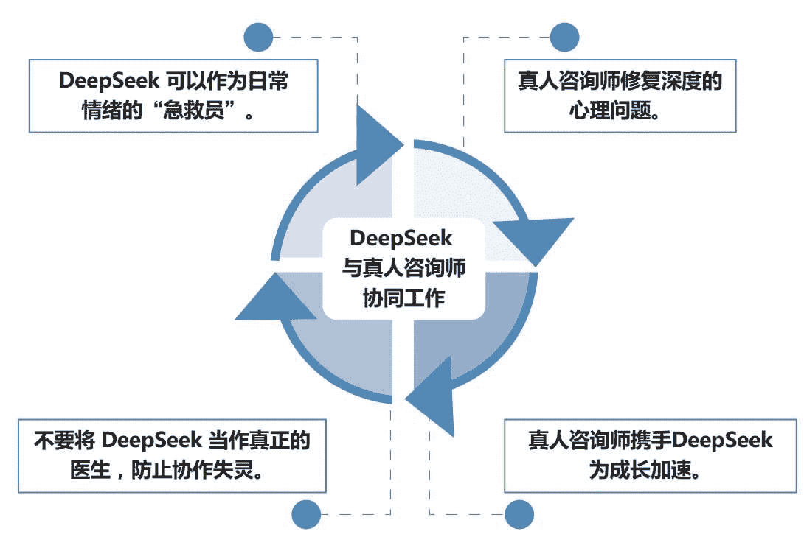

# 实战篇

# 运用 DeepSeek 解决具体的心理问题 

**目标：运用 DeepSeek 解决具体的心理问题。**

## 一、运用 DeepSeek 处理情绪问题

焦虑、抑郁、愤怒等情绪本质上是身体的警报，提醒我们关注内心需求，只是很多人被卡在“我心情不好”这种模糊状态里。

研究表明，模糊的情绪表述会激活大脑回避机制。若把笼统的“难受”细化为“每次被否定后就胃痛失眠，怎么停止自我攻击”，就能触发前额叶的逻辑分析，从回避模式转为行动模式，效率提升数倍。

本篇会带你借助 DeepSeek 精准拆解情绪，把“难受”变成可解决的具体问题。

处理情绪时，不能只描述感受，还要说明**触发事件、对此的认知、当时的行为**。

可参考表 4-1，即认知行为疗法的黄金三角：**情绪、认知、行为**。掌握这三要素，就能精准提问、直击核心。

表 4-1 认知行为疗法的黄金三角模型 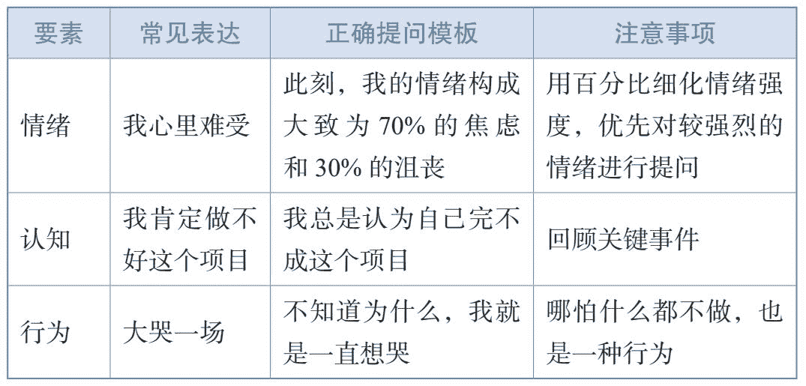

例如你可以输入：

下午改方案时我突然心跳加速、喉咙发紧、手指颤抖。从收到会议提醒邮件就开始了，每隔几分钟我就看一次时间。上周领导当众说我“连 PPT 格式都调不好”，当时后背瞬间冒汗的感觉和现在很像。我知道新 CEO 更看重业务逻辑而非排版，但我还是忍不住想：要是明天汇报数据出错或动画卡顿，我会不会被直接开除？为方案已熬三个通宵，越临近截止越觉得漏洞百出。

这段叙述就遵循情绪+认知+行为。你无需懂原理，只需套用公式，就能得到精准分析。如“我开会前心慌（情绪），总怕被嘲笑（认知），于是请假回家（行为）”。

黄金三角本质上捕捉心理活动的动态闭环。触发事件激活自动化认知如“我必须完美”，引发焦虑情绪，进而产生逃避行为，结果又强化原认知，形成自我验证闭环。

干预关键在打破闭环。DeepSeek 通过分析和引导，帮助你找出偏差信念，察觉思维盲区。

### 处理焦虑情绪：从失控恐慌到理性掌控

焦虑不是敌人，而是敏感的警报系统。只不过有时过度拉响，导致心慌、失眠。

出现心跳加速、手心出汗、坐立难安等急性症状时，可借助 DeepSeek 干预。

**具体步骤如下。**

**第一步：开启沟通。**
例如输入：我现在心跳很快、手在发抖，请引导我快速冷静。

**DeepSeek 可能反馈：**
·可用“478 呼吸法”：鼻吸 4 秒，屏息 7 秒，口呼 8 秒，重复 5 轮。

**第二步：探寻根源。**
例如输入：帮我分析这次焦虑的可能原因。

**DeepSeek 可能反馈：**
·确定时间：焦虑是今天突发还是已持续一段时间？
·关联事件：近期是否有高压力事件如汇报、人际冲突？
·触发细节：焦虑时脑中反复出现什么画面或声音？

**第三步：制定计划。**
例如输入：请设计每日微习惯帮我克服焦虑。

**DeepSeek 可能反馈：**
·早晨：5 分钟正念呼吸。
·中午：记录一件可掌控的小事，如整理桌面。
·晚上：23 点前放下手机，阅读 10 页轻松书籍。

### 处理抑郁情绪：打破情绪黑洞

抑郁像阴霾笼罩，连喝口水都觉得费力。DeepSeek 不会说“振作点”，而是分四阶段陪你找回内在力量，把“我什么都不想做”转化为“我可以先试 1%”。

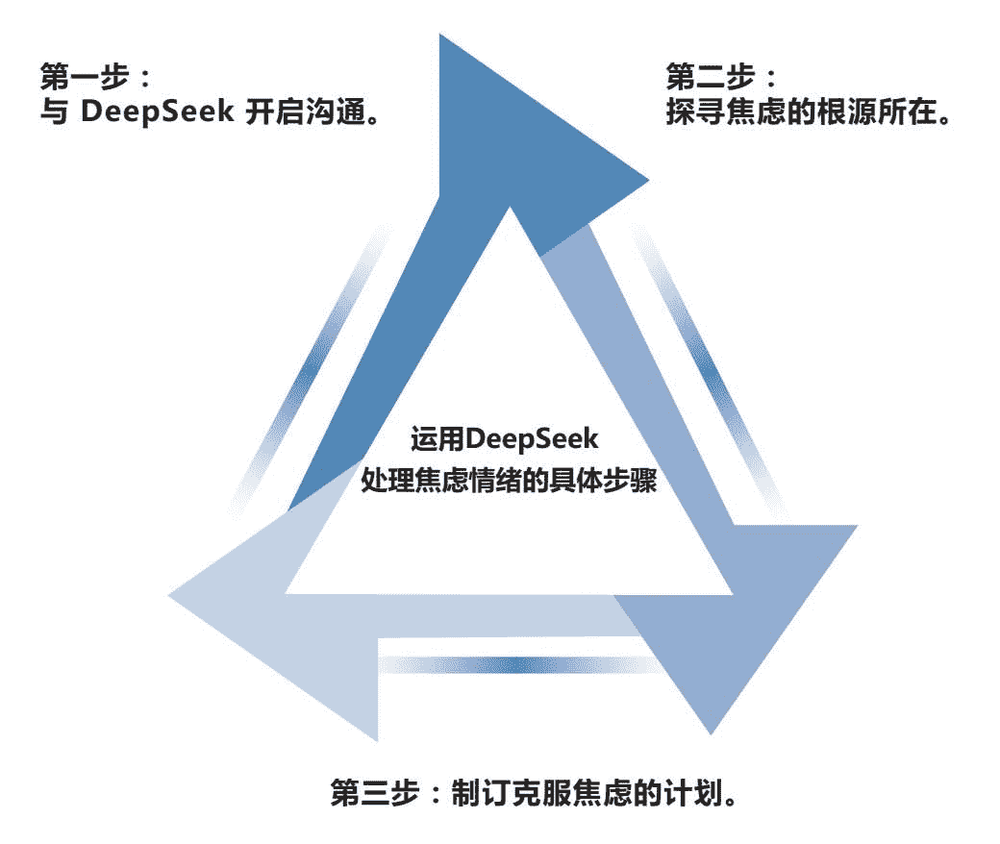

**四个阶段如下。**

**阶段一：捕捉身体求救信号。**
○ **参考输入**：我现在感觉 ____（如沉重/麻木），已持续 ____ 天，最明显身体反应是 ____（如起床困难/食欲减退）。例如，“连续两周像被裹在潮湿棉被里，只能瘫在床上刷手机，连喝水都疲惫不堪。”

○ **DeepSeek 回应示例：**
√ **识别关键词**：敏锐捕捉“湿棉被”“瘫”等具象化信息。
√ **追问细节**：过去一周有哪些瞬间感觉稍轻松？刷手机是否短暂缓解？手机里有什么吸引你的内容？

**阶段二：区分自动思维与事实。**
○ **认知重构引导**见表 4-2。

表 4-2 DeepSeek 引导抑郁者进行认知重构 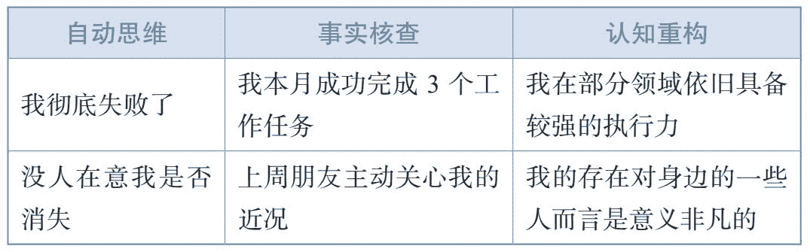

○ **搜集证据验证事实**：生成证据清单。例如针对“我一点用也没有”，引导回忆“过去一个月你曾为他人带来温暖的三个细微瞬间”。

**阶段三：用 1% 行动打破停滞。**
○ **寻求微行动策略**：输入“为我生成一个 5 分钟内可完成的任务”。

○ **DeepSeek 回应示例：**
√ **初级任务**：轻轻打开窗户，深呼吸三次，感受新鲜空气；给绿植浇一杯水，轻声说“你今天状态不错”。
√ **进阶任务**：录一段一分钟“今日天气报告”；把旧衬衫剪成抹布，擦拭书桌一角。

**阶段四：从紧急救助到构筑心灵防护。**
○ **让 DeepSeek 给出防护方案，示例如下。**

**情绪关系修复的 DeepSeek 实践笔记**

√ **意义感回溯**：给自己一段时间，认真回想童年里哪些时刻让你眼睛发亮、充满热情。
√ **抗抑郁餐单定制**：结合个人口味，挑选富含欧米伽-3脂质的食物，例如营养密度高的深海鱼类。
○ **关系地图更新**：梳理近段时期有过联系的5位熟人，主动安排一次温暖互动，具体可参考：

√ 为小琳转发的猫咪照片点赞，用低压力的方式开启友好交流。
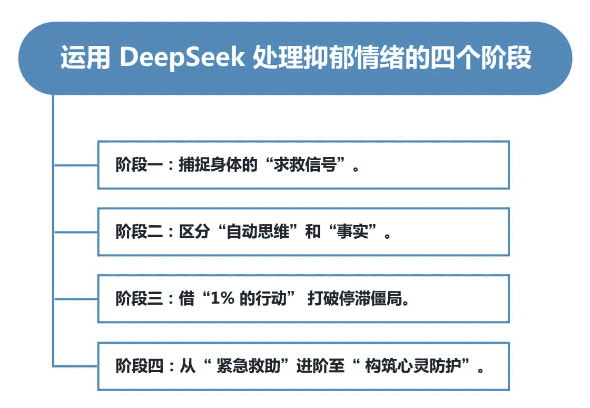
√ 回复老张“谢谢你的咖啡，低落的情绪被缓解了一些”。
√ 向线下咨询师咨询“是否提供晚间时段的支持小组”。

### 处理愤怒情绪：从冲动爆发到理性对话
当怒火瞬间淹没理智，DeepSeek 就能充当情绪急救的角色。它不是简单的安抚工具，而是依托认知行为疗法搭建的智能干预系统，既能在当下阻断失控，也能帮助提升长期的情绪耐受。

争吵后浑身发抖、甚至想摔东西时，系统可以帮助迅速恢复平静。

**实操分为三段**

**第一段：先降温**
比如这样提问：我刚和人吵完，现在手在抖，该怎么稳住。
示例回复：

·**身体冷却法**：把双手浸入冷水10秒，拿出后再重复3次，通过激活迷走神经达到镇静。
·**安全宣泄法**：对着枕头大喊“我现在很生气”，连续喊3次。

**第二段：厘清愤怒背后的需求**
接着提问：用小朋友也能理解的语言帮我拆解生气的根源。
示例回复：
你就像被抢走心爱玩具的小熊，其实想表达的是“请尊重我的想法”。

**第三段：获取理性沟通模板**
提问：我想和对方好好聊，请给我一套非暴力沟通的话术。
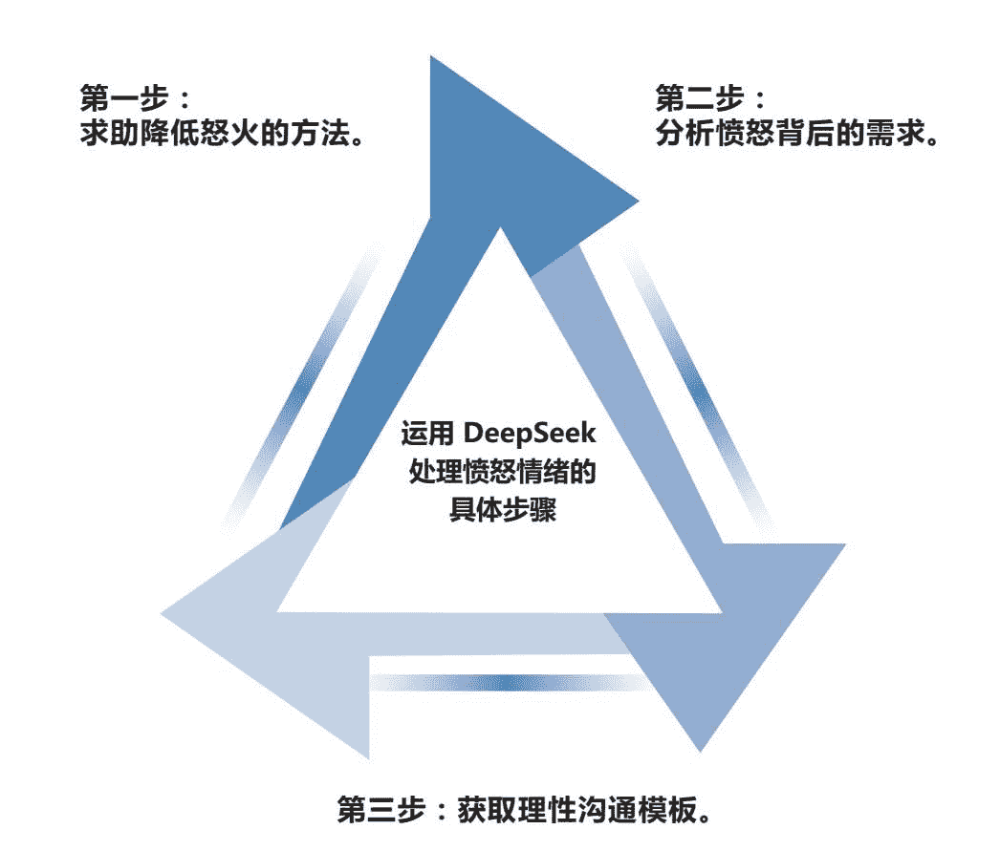
示例回复：

·**陈述客观事实**：例如“刚才讨论方案时，我的话被打断了3次”。
·**表达主观感受**：例如“这让我觉得没被尊重，心里有点失落”。
·**提出明确诉求**：例如“下次能否让我先说完，你再补充意见”。

这些微小行动的本质是行为激活疗法的实践，而这种逻辑贯穿于系统的设计。

## **二、借助 DeepSeek 化解人际摩擦**
人际冲突多源于情绪信号传递失准。我们常陷入自我视角，把主观感受当成客观事实，忽略了互动中的需求落差。

依托实时语言解析与关系模式识别，系统帮助跳出受害者心态，读懂对方真实动机，并把强情绪转化为可执行的沟通策略，让双方频率对齐。

### **化解亲密关系冲突**
适用场景：伴侣冷漠、频繁争吵、信任受损等。

关系陷入热战冷战循环时，争吵往往在重复旧模式。冷漠让温馨的客厅变得冰冷，愤怒又让裂痕加深。此时需要一把打开心门的钥匙。

操作三步：

**第一步：厘清冲突根源**
提问：我们总是为家务吵架，根本原因可能是什么？
推断示例：
·渴望被理解和体谅。
·追求分配上的公平感。

**第二步：设计关系小实验**
提问：用行为心理学设计一个改善家务分配的实验。
示例：
·共同列出详细家务清单，再用抓阄方式随机分配本周任务。
·完成一项任务可获得对方奖励的一个星标，集满十个可兑换按摩券等小奖励。
·每周日晚保留复盘时间，重点讨论哪次合作最愉快及原因。

**第三步：重启深度对话**
提问：想和伴侣深度交流，给我五个开放式提问。
示例：
·你希望我们十年后的生活是怎样的？
·最近哪件事让你感觉到被我爱着？
·如果给关系打分1到10，你会给几分？理由是什么？
·最近有没有某个瞬间觉得我们特别默契？当时发生了什么？
·如果共同培养一个新爱好，你想尝试哪个方向？为何？

### **化解亲子冲突**
适用场景：孩子叛逆、沉迷手机、拒绝沟通等。

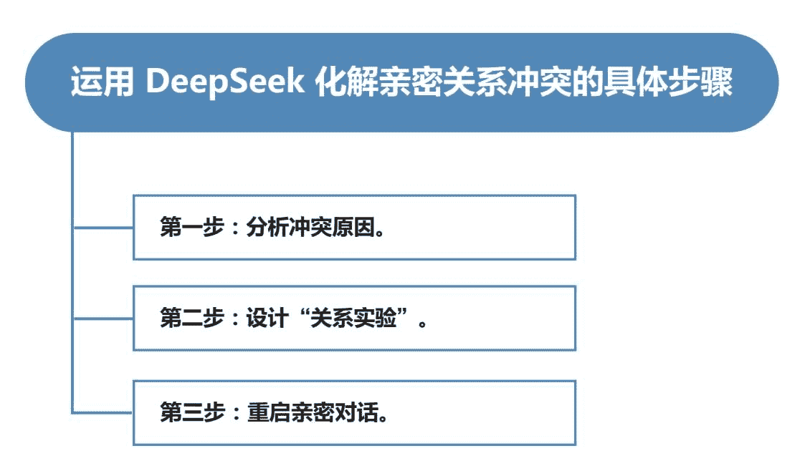
亲子关系中常出现越管越逆反的困境。没收手机后沉迷更深，沟通一触即发只剩摔门声。管教之外，更关键的是读懂情绪背后的需求。

**第一步：转换家长式表达**
**不当示范：**你整天就知道玩手机！看看人家小明！
**优化后表达：**我注意到你这周玩了8小时《王者荣耀》，是游戏特别有趣，还是你想放松一下？
这种表述既陈述事实，又表达关心，更易打开对话。

**第二步：制定双赢约定**
提问：孩子熬夜玩手机，我担心学习受影响，请设计一个双赢方案。
示例：
·**双方约定**：周日至周四23点前交手机，周五周六可延至24点，保证学习日休息，周末保留娱乐。
·**激励机制**：连续两周遵守，可在周末多一小时娱乐或兑换零食礼包，培养自律。
·**例外条款**：考前一周启动自律模式，提前约定特殊时期调整规则。

**第三步：让系统充当传声筒**
直接沟通易失控时，可让系统中转。例如让孩子对系统说“爸妈哪里最烦人”，孩子会更放松表达。
系统会生成报告，例如“孩子吐槽前三名：总拿我和别人比、进入房间前未敲门、答应之事常反悔”。报告呈现不满点，家长可据此询问改进建议，促进良性互动。
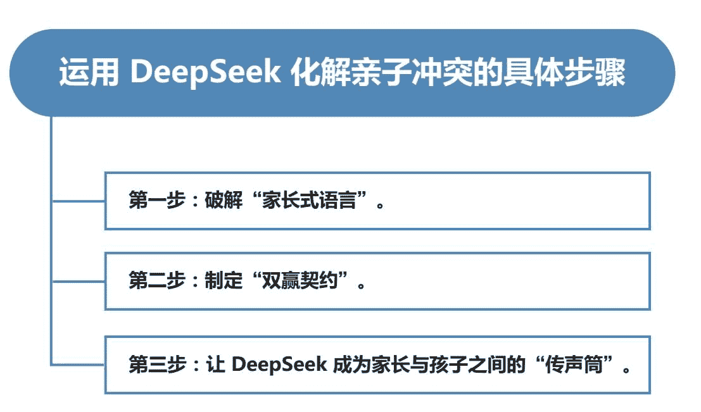

### **化解职场冲突**
适用场景：被抢功、被PUA、被排挤等。

同事抄送全员的抢功邮件像暗箭，领导的“为你好”话术悄悄侵蚀自信，团队排挤让人像被困孤岛。对抗并非上策，需要借力破局。

**第一步：快速隔离情绪，冷静回应**
提问：被同事当众甩锅，我现在又气又慌，给个急救话术。
示例：
“这个部分我需要再确认细节，稍后会以邮件同步大家”。既避免当场争执，也争取整理证据的时间。

**第二步：深度剖析利益关系**
提问：分析领导批评我的真实意图。
示例分析：
·**表层动机**：结果导向型批评，如项目延期、数据错误；过程监控型批评，如方法有瑕疵。
·**深层推测**：从组织生态、个人发展、关系管理三个维度推断意图。

**第三步：规划长期职场好感**
提问：请设计一个提升职场好感度的计划。
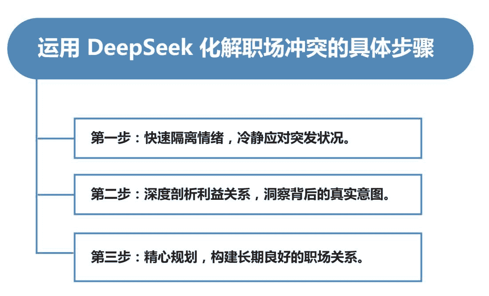
示例：
·**每周**：挑选一位同事，真诚夸奖具体贡献，例如“你昨天的PPT结构很清晰”。
·**每月**：为团队提供小福利，分享有价值的行业报告或零食，提升亲和力。
·**每季度**：主动询问领导“我需要重点改进哪些方面”，展现进取心并加深印象。

## **三、用 DeepSeek 重建自我价值感**
低自我价值感像严厉的批评家，把闪光的成就抹掉，把真诚的赞美翻译成虚伪。并非天生性格，而是长期认知惯性形成。

系统通过认知重塑与行为激活，帮助重建健康积极的价值体系，把“我果然不行”的自我审判，转化为“我正在经历自我怀疑”的客观觉察。

### **重塑认知：打破“我果然很失败”的循环**
认知扭曲例如总觉得“同事都讨厌我”，大脑会放大失败对话。系统陪你回溯经历，识别思维陷阱，把负面审判转为客观观察。

**第一步：精准捕捉负面想法**
提问：当____发生时，我脑中自动出现____的想法，同时身体有____的反应。
分析流程：
·**语义拆解**：提取“果然”“永远”等绝对化词汇。
·**事件厘清**：如汇报时被领导打断。
·**自动思维**：如“我的方案毫无价值”。
·**扭曲识别**：如过度概括。
·**扭曲判定**：把单次打断泛化为全盘否定。
·**细节追问**：打断前领导是否点头认可？方案是否有数据支撑？
·**认知重构**：并列呈现负面想法与客观事实，如“方案被否定在职场很常见，而你能优化方案”。

示例：销售员小D提问：客户挂断电话时我立刻想“我根本不适合干这行”，手心冒汗。
分析：
·**判定**：非黑即白思维，把一次挂断等同于职业否定。
·**追问**：挂断前客户是否对方案感兴趣？过往有成功案例吗？
·**重构**：用一次失败否定整个生涯，忽略了多次有效沟通的事实。

**第二步：收集证据，挑战负面想法**
把内心法庭具象化，先给控方举证，再由辩方反击。

原告席示例：负面想法“演讲时声音发抖，我把演讲搞砸了”。
控方证据：
√ 开场翻页笔失灵10秒。
√ 演讲中卡顿3次超5秒。
√ 后排有人低头玩手机。
√ 结束时没掌声。
√ 去年曾忘词。
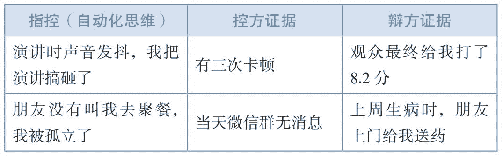
辩方反击提问：
√ **具体化**：发抖程度如何？是否影响操作？
√ **后果评估**：最坏结果是什么？概率多大？
√ **对照验证**：观众真实反馈？
√ **应对资源**：过去类似情况怎么处理的？
可能答案：仅手指轻颤不会干扰；最坏扣5分，实际得到8.2分；会后3人主动请教；去年忘词时用幽默化解赢得好评。

**第三步：设计行为实验**
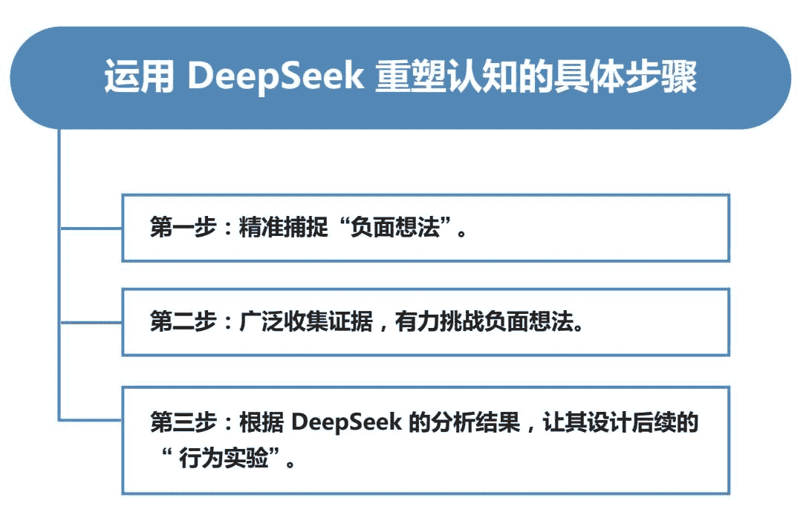
·**初级**：今天对着镜子微笑说“我挺棒的”。
·**中级**：会议中主动举手发言1次，不在意时长。
·**高级**：争取一个渴望的项目，并坚定说“我相信我能做好”。

### **克服拖延：从截止日冲刺到时间掌控者**
拖延像偷时间的贼。想写报告却点开社交软件，任务拖到截止前夜才爆发。背后是面对不确定性的逃避机制，焦虑随拖延加剧。系统帮你一次次实现“现在就开始”。

**第一步：启动即时行动**
提问：我要写报告却一直拖延，给我一个立刻行动的方案。
回复：
**量身定制的启动方案**
·**仪式感开启**
√ 立刻把手机调飞行模式，物理隔绝干扰。
√ 设定25分钟倒计时，让时间具象化。
·**打破僵局**
√ 写下脑中关于任务的任意三句话：这份报告需要涵盖____；我最想传达的关键点是____；可能用到的数据案例有____。
·**列出拖延后果**
√ 今晚要熬夜到____点。
√ 影响____项目进度。
√ 错失____奖励机会。
·**激发身体能量**
√ 喝半杯冷水激活大脑。
√ 做10秒高抬腿提升肾上腺素。
√ 对镜大喊：“3、2、1，现在行动！”

**第二步：破解完美主义陷阱**
提问：因为总想一次做到最好，所以不敢开始，该怎么办？

# DeepSeek实操笔记：破拖延·解选择·调关系

DeepSeek在示例回复里指出，拖延常不是懒，而是一种对过度追求完美的系统性当机。它提醒：完成优先于完美。先拿出一份六十分的草稿，之后再逐步打磨到八十分，这比空想一次交付满分却一事无成要高明。

第三步：把工作变成闯关
试着这样问：能不能把本周工作换成游戏闯关，给我设计方案。

模型示范的思路如下。
· 主线：年终总结完成，经验值+100。
· 支线：整理10份资料，完成可+20经验并有概率开“素材宝箱”；向直属领导汇报一次，解锁“勇气徽章”。
· 终极挑战：周五收工前提交终稿，通关奖励是周末可以放松。

### 精准决策：从选择瘫痪到果断拍板
适用情境：犹豫是否离职、比较两份机会、纠结分手等。

人生岔路常让人失向。辞职信在草稿箱躺了三个月不敢发送；两份工作反复权衡却难定夺；分手的话在对话框里改了又改，心里煎熬。

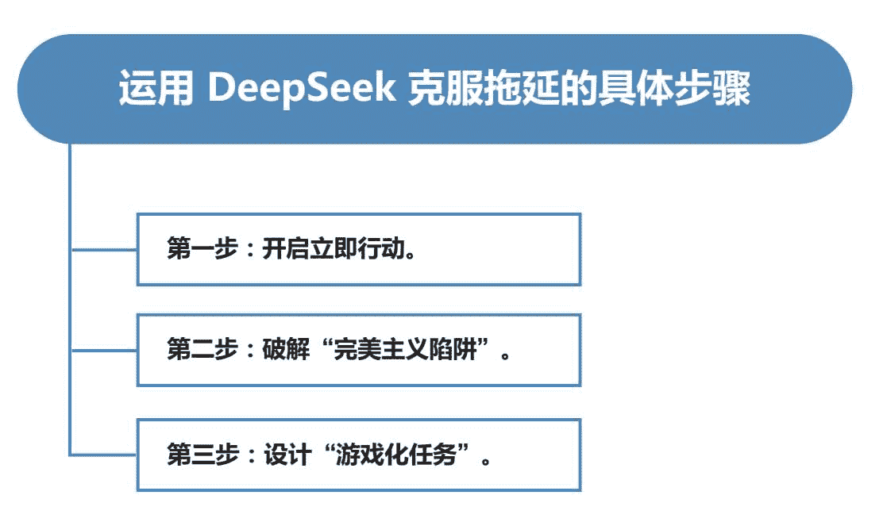

这种纠结既源于选项本身难以分高下，更源于内心害怕选错就全盘皆输的恐惧。既怕进入未知会受冲击，又怕守住现状会错失他路。

借助结构化引导，DeepSeek能帮助你听见最真实的内在声音。

**用DeepSeek做精准判断的路径**

步骤一 把利弊摊开
比如输入：用表格对比留在现单位与跳槽到新单位的利弊。

模型产出的决策矩阵示例见表4-4。

表4-4 DeepSeek产出的决策矩阵示例

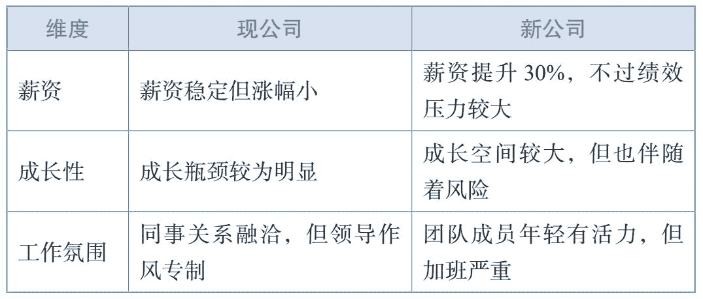

步骤二 为相关要素排优先级
职业价值观的排序会直接影响选择。可以问：帮我挖掘内心前三名的职业价值观。模型会用引导式提问挖掘核心价值，示范如下。
· 提问环节：比如“一份高薪却枯燥的工作，和一份低薪却有意义的工作，你会怎么选？”这类直指偏好的问题，帮你看清倾向。
· 结果呈现：比如得到“成长空间＞薪资＞工作氛围”的结论。这个结果能在外界干扰下守住真正的需求。

步骤三 设计最小成本的试错方案
如果你想裸辞做自由职业却担心翻车，可以问：我想辞职做自由职业，但怕失败，请评估风险。模型会按专业风险评估框架给出低成本探路，示例如下。
· 副业起步：前期每周拿出10小时业余时间做与自由职业相关的业务，先探市场反应。在保留稳定工作的前提下小规模试探。
· 阶段性复盘：以90天为一个周期，重点看两项指标。一是自由职业收入是否达到现收入的30%，看盈利能力；二是客户回购率，看市场认可度。两项指标能判断业务是否健康。

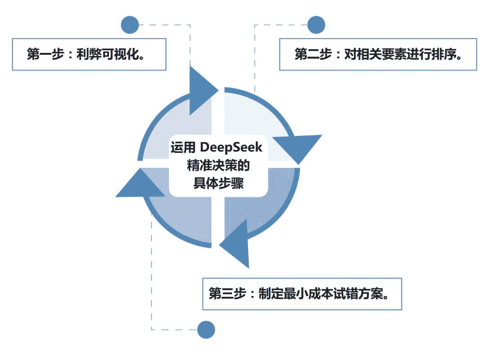
· 退路规划：为防失败，模型还会规划后路。依你在探索期新增的技能，比如自媒体运营，为你设计回职场的路径，降低试错成本。

情绪管理、关系修复、自我成长这些议题，看似复杂，拆开都是可执行的练习。交由DeepSeek，它就像一位老练向导带你穿过迷雾。

在识人识己部分，我们要解锁的新能力是：用DeepSeek辨认悄悄消耗能量的有毒人格，洞察关系里的陷阱。

# 识人与识己篇
# 用DeepSeek重塑关系能量场

目标：从依恋模式到人格解码，终结消耗型关系的隐形伤害。

为何总陷在互相消耗的关系里？答案藏在依恋风格和人格两个心理学概念里。

依恋风格在童年早期形成，决定亲密关系的建立方式。安全型能平衡独立与依赖；焦虑型会过度索取关注，担忧被抛弃；回避型习惯用疏离保护自己，在亲密中保持距离。

人格是相对稳定的思维与行为倾向。比如偏执型总想赢过对方；自恋型渴望成为焦点；讨好型习惯压抑自己迎合他人。

这些内在“心灵代码”常让关系陷入恶性循环。焦虑型遇上回避型容易形成“追逃”死结；自恋型配讨好型容易变成情感绑架。更危险的是，很多人不自觉重复吸引伤害过自己的相似类型，这不是命运，而是未被识别的心理模式在筛选对象。

DeepSeek把语言、行为分析和心理学模型结合起来，帮你辨认双方的依恋倾向与人格倾向，并提供“对话翻译”：把“你根本不在乎我”翻译成“我需要确认连接”，把“别烦我”翻译成“此刻亲密让我恐慌”。

创伤清晰后，重建关系不再是盲目拉扯。

## 一、借助DeepSeek看清依恋模式

凌晨三点，设计师小林第11次删掉对话框的长文。男友说“你太粘人，我需要空间”像刺一样扎心，她在追问真相和假装洒脱间反复摇摆。

她把聊天记录整理成文件上传DeepSeek。二十秒后屏幕出现：你可能正陷入“追问—失望”循环，这是焦虑型依恋的警报。

依托依恋理论，DeepSeek能给出初步辨认的参考。

亲密关系里行为各异。分离时有人焦虑有人坦然；冲突时有人据理力争有人冷战。若想了解自己的依恋模式，只要描述具体行为，例如“伴侣出差时我因不安频繁查岗”，或“争吵后我习惯冷战拒绝交流”，模型会深入分析背后的情感需求，判断倾向并帮助洞察心理状态。

### 依恋风格初探

步骤一 向模型提问题。
在输入框里问“请帮我识别我和伴侣的依恋风格”，开启探索。

步骤二 获取理论科普。
模型会快速给出依恋理论要点，示范如下。
· 核心特点：详细解释安全型、焦虑型、回避型的特征。安全型自信稳定，能自如建立关系；焦虑型过度担心被抛弃，渴望亲密；回避型倾向保持距离，对亲密不适。
· 典型表现：说明不同场景下的表现。冲突中，安全型理性沟通寻求解法；焦虑型情绪激动反应过激；回避型逃避冲突拒绝交流。

步骤三 获取测量表。
模型会提供一份简化的依恋风格量表，约15至20题。

题目示例：伴侣说需要空间时，你通常什么感受？
· 安心给予空间。
· 焦虑但不说。
· 立刻疏远对方。

步骤四 查看分析结果。
模型会生成分析报告，示范如下。
· 倾向判断：明确你的倾向，例如你有70%安全型特征和30%焦虑型特征。
· 行为标注：标注对应典型行为，帮助理解模式及原因。例如建立信任后你比较稳定，但在不确定时会有担忧。

步骤五 关系解读。
模型还能根据你提供的场景描述分析互动模式并给出沟通策略，示范如下。
· 互动模式分析：若你提到“对方常突然冷淡”，模型会分析回避型伴侣在压力下可能出现的冷淡行为及心理状态。
· 沟通策略建议：比如尝试“明确表达需求加上给予适度空间”的方式改善沟通，促进良性发展。

### 处理不同依恋组合的问题
测出倾向后，模型能按组合类型和现状提供针对性支持。

第一 深度解析关系动态。
从多维度解析关系，提供关键内容。
· 矛盾点预判：分析依恋碰撞可能产生的潜在矛盾。例如焦虑型对陪伴的强烈渴望与回避型对独立的迫切需求必然冲突。
· 冲突场景解读：对典型冲突做心理学解读。以“追逃模式”为例，解释其触发机制：一方不断追求亲近，另一方持续逃避，形成恶性循环。
· 影响剖析：剖析依恋风格如何影响沟通、信任建立和情感表达。

第二 定制关系修复方案。
按依恋组合定制方案，思路如下。
· 焦虑型×回避型：设计“安全撤退信号”与“情绪缓冲带”。前者让回避型能以可接受方式表达需要空间；后者帮助焦虑型调节不安。
· 安全型×不安全型：激活安全型的“稳定锚”作用，提供修复话术。稳定沟通可逐步改善不安全方的模式和心态。
· 恐惧型回避×疏离型回避：制定“微小信任实验”，在推进关系的同时避开过度刺激的雷区。

第三 场景化训练。
针对高频冲突设计模拟对话训练，示范如下。
· 回避型情感掉线时：焦虑方可用“非压迫式联结话术”。例如“我需要暂停二十分钟整理思绪，之后我们再聊可以吗？”既尊重空间，也留下后续沟通的温和铺垫。
· 焦虑方被抛弃恐惧触发时：回避方可启动“有限承诺回应”。例如“我现在有点累，明天吃早餐时我们好好谈”。给予一定情感承诺，同时保留缓冲时间。

第四 升级依恋风格。
提供渐进训练方法。
· 首周聚焦觉察：提供“情绪日记模板”记录每日情绪起伏，并每天录十分钟“自我安抚音频”，学会情绪波动时的自我调节，增强稳定性。
· 次周重塑表达：给出“需求表达脚本”指导如何恰当表达情感需求；冲突后提供“修复话术清单”，提升沟通修复效率。
· 第三周整合共创：双方共同绘制“安全感地图”，深入了解彼此需求点。

## 二、借助DeepSeek辨识消耗型人格

凌晨两点，二十八岁市场经理王蜜第七次删除质问：“为什么我总在道歉？”男友曾说“你太敏感真没意思”，这句话像倒刺扎在喉咙三年，咽不下吐不出。

她把痛苦的对话输入DeepSeek。十九秒后屏幕显示：你正用过度反省喂养对方的情感懒惰，你不是敏感，而是察觉到情感系统的警报。

心理学数据：八成的长期抑郁患者身边至少有一段持续五年以上的消耗型关系。这种关系像渗水的墙，起初发霉，最后坍塌。

什么是消耗型人格？这不是学术术语，而是对破坏性行为模式的通俗描述。很多有毒关系里都藏着人格缺陷者，它们像慢性毒药侵蚀自我认知与精神世界。

四大消耗型人格特征。
· 自恋型人格：以自我为中心，缺乏共情，常贬低他人维持优越感。
· 反社会型人格：漠视规则，缺乏道德感，可能操控或伤害他人达目的。
· 边缘型人格：情绪极不稳定，易有极端行为如自伤或威胁自杀。
· 偏执型人格：过度猜疑，常把他人行为解读为敌意或背叛。

### DeepSeek辨识四大消耗型人格的示例

自恋型人格——优雅的情感吸血鬼
· 高频词筛查：留意对话中“我”“我的”“最”等词是否高频。例如“我的方案是全场最佳”体现自我中心。
· 行为模式识别：初期营造极度热情假象，后期突然冷漠打压，借反差满足优越感。

反社会型人格——披着羊皮的控制狂
· 语言漏洞筛查：总承诺宏大却说不清细节，如“跟我投资稳赚百万”。这类诱饵常用于迷惑和后续控制。
· 异常行为识别：虐待动物、缺乏共情、对他人痛苦无动于衷等倾向需警惕。

边缘型人格——易燃易爆的情感炸弹
· 情绪波动筛查：聊天记录充斥大量感叹号，频繁出现“永远恨你！”等极端表述，体现情绪剧烈起伏。
· 自伤倾向判断：出现“自杀”“自残”等关键词要提高警惕，常是内心痛苦混乱的外化。

偏执型人格——永远找敌人的侦探
· 质问句式识别：常抛出“你是不是在骗我”“你和他什么关系”这类充满猜忌的问题。
· 代表行为识别：频繁检查手机、过度解读社交动态、无端猜测发布者意图并陷入怀疑漩涡。

### 初期：识别消耗型人格

当关系里频繁出现贬低话语如“你连这点都做不好”“当初我怎么看上你”，很多人会陷入自证陷阱：我是这样吗？我不是！反复自证后容易自我怀疑。

DeepSeek提供新视角，让你明白伤人的话多是对方内心恐慌的投射。

识别步骤如下。

步骤一 输入有毒语言让模型判断。
○ 高频否定词：如“你想多了”“别小题大做”。表面轻描淡写，实则打压表达，长期会让你怀疑感知、丧失自信。
○ 责任转移句式：如“要不是你……我也不会……”。例如“要不是你非要选这家店，我也不会等这么久”。把责任推给对方，会让你背负过多自责，小心翼翼。
○ 情感勒索标记：如“如果你爱我，就应该……”。例如“如果你爱我，就应该把工资交给我管”。用爱绑架行为，不满足就被贴标签。

步骤二 输入身体反应让模型分析。
比如你发现每次和闺密见面后都会头痛欲裂。身体的不适常是潜意识在提醒这段关系有问题。

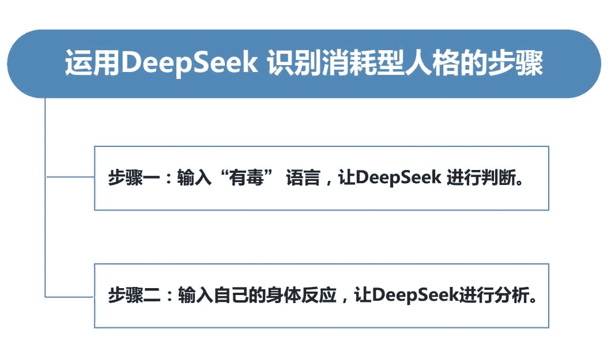

# DeepSeek 拆解消耗型互动：识别、脱敏与自护

把“每次见完闺蜜就头痛欲裂”这类身体信号丢进 DeepSeek，借助大数据模式的推断，系统很可能判定“这段互动存在明显能量被抽取的风险”。

一旦确认是消耗型人格，就能立即拿到初步的应对思路。

· 被贬低时可以说：“我明白你有不同看法，但这种表达让我感觉不舒服。” 这样既避免正面冲突，也把感受讲清楚，让对方意识到行为的负面影响。
· 把对方的贬低性表达记录下来找规律。长期积累后，问题轮廓会更清晰。

### 中期：对消耗型人格进行脱敏

确认消耗型人格后，需要做脱敏训练。DeepSeek 会把“我被否定了”的内在叙事转译为“他此刻在惧怕什么”，再通过行为实验，让对抗变成映照对方恐惧的镜子。

当你能平静回应过去刺痛的话语，关系正在改善，这就是积极信号。

**用 DeepSeek 做脱敏**

**第一步：把贬低原话贴进去。**
打开对话窗口，把伤人的话完整复制，例如：

·“你连这点小事都做不好。” 直接否定执行力，会打击自信。
·“当初我真不该选你。” 从情感选择上打击，容易引发自我怀疑。
·“没人能忍受你的脾气。” 针对性格贬低，容易把人带进自我否定。

**第二步：请系统拆解贬低根源。**
DeepSeek 会判断这类贬低是否源于对方内在的安全感缺失。自信不足、未来迷茫的人，往往通过贬低他人来换取虚假优越感，以掩盖焦虑与不安。

**第三步：获取应对建议。**
它通常会建议在被贬低时选择沉默。这种沉默不是示弱，而是以静制动。观察对方在沉默后的反应变化，能更深入读懂贬低背后的动机。

**第四步：获取回复话术库。**
还能产出一套应对复杂沟通的表达模板，分类如下。

**·情绪缓冲类**
○ “你的观点我会认真考虑，只是需要一点时间来消化。” 既表现尊重，又为自己争取思考空间。
○ “我明白这是你的感受，但我的理解角度可能不太一样。” 承认对方同时表明差异，为理性对话铺路。
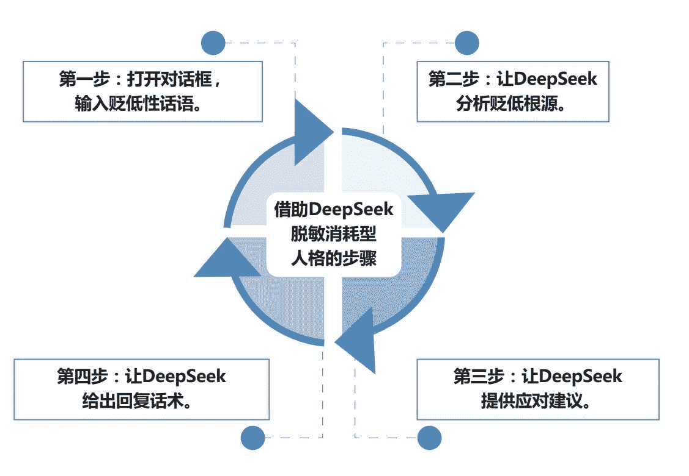
○ “也许我们先暂停这个话题，等情绪平复后再谈。” 交流变紧时，能避免矛盾升级。

**·话题转移类**
○ “针对这个问题，你觉得我具体该改进哪方面？” 把贬低引向具体改进，化指责为探讨。
○ “我们是否可以把焦点放到解决方案上？” 引导双方从互相指责转向共同找办法。
○ “现在的状态沟通效率不高，要不先处理别的？” 僵局时及时换题，避免无意义消耗。

**·自我肯定类**
○ “我理解你的看法，不过我对自己的付出心里有数。” 尊重中坚定肯定自我。
○ “标准因人而异，我会参考你的意见，也会坚持自己的节奏。” 表明理性但不盲从。
○ “我听到了你的评价，但我依然认可自己在这件事上的努力。” 传达自我认可，不被轻易带偏。

**·柔性反问类**
○ “能具体说说哪里有问题吗？” 温和追问帮助对方展开，也为后续沟通指明方向。
○ “你觉得我用什么方式处理更合适？” 展现改进意愿，也提升对方参与感。
○ “你认为最关键的问题是什么？” 让对方聚焦核心，避免无端抱怨。

**·界限设定类**
○ “这种沟通方式我不太舒服，能换种表达吗？” 委婉而明确地表达需求，守护心理边界。
○ “我知道你很急，但这个语气会影响沟通效果。” 既理解情绪，也指出不当之处。
○ “我们可能需要建立更有效的沟通规则。” 从更高层面提出新规则，为未来奠定基础。

另外还能做定制话术，格式为：当对方说 ____ 时，我可以回 ____。把贬低原话填入前半句，DeepSeek 就能匹配出对应回应。

### 长期：重建自我认知

前两个阶段不是让你变成全副武装、时刻防备的人，而是帮你温和筑起智慧屏障。这一步要重建自我认知，划清个人边界。

比如对方再次当众调侃你的弱点，你可以平静坚定地说：“这种玩笑让我不适，请停止。”

DeepSeek 能按你的实际情况，给出循序渐进的练习计划。随着练习推进，你会发现那个曾以为必须靠他人认可才存在的自我，已在清晰边界与多元支持中扎下根。

重建自我认知是系统工程，需要结合心理学持续强化觉察，并长期执行。

**运用 DeepSeek 重建认知的路径**

**步骤一：看清当下的自己。**
·借助专业模型梳理特质：让系统列出常用评估工具，如“大五人格模型”从开放性、神经质、外向性、宜人性、尽责性五维度解析，以及 MBTI 模型按四维度划分16种类型。
·整理优缺点清单：可提问“从性格看我很守旧，该如何突破？”深挖原因与改变方向；“我总是自我批评，这算心理问题吗？怎么调整？”探寻根源并求解。

**步骤二：搭建心理学知识框架。**
可要求整理经典理论，如：
·埃里克森社会心理发展八阶段，说明不同人生阶段的危机与任务。
·认知三角模型，探讨认知、情绪、行为的联动。
·成长型思维核心原则，帮助培养积极迎难心态。
为便于理解，可随时要求举例，如“用做饭比喻认知三角模型？”“职场中如何用成长型思维？请给真实案例。”

**步骤三：定制专属练习。**
基于目标定制，例如：
·增强情绪稳定：设计“情绪日志模板”，记录变化，觉察触发点，提升管理力。
·改善社交模式：生成“社交场景应对话术清单”。提需求时务必说明具体场景和当前痛点，才能拿到更精准方案。

**步骤四：定期复盘成长。**
定期把行为记录交给系统，要求：
·四象限总结：用“优势—短板—机会—雷区”全面复盘。
·挖掘思维陷阱：找出重复踩坑的模式，避免束缚。
·生成调整方案：据分析结果给出下一步方向和具体指导。

**步骤五：开启解开心结对话。**
察觉内心矛盾时可提问，例如：
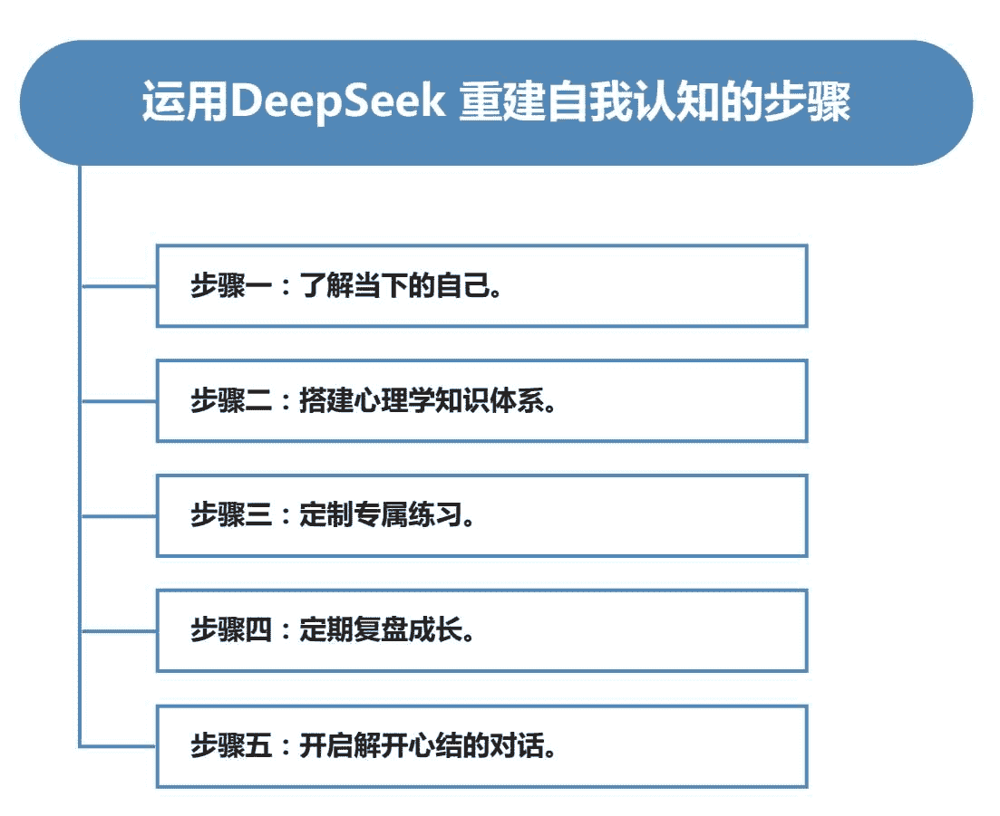
·“为什么我觉得必须完美才会被接纳？这个信念的证据是什么？”深挖不合理信念根源，解开心结。

## 三、DeepSeek 针对具体场景给出回复建议

你已了解消耗型人格特征和识别逻辑，但在现实中，对方一句刺耳的话往往让你不知如何回。下面列出场景与建议。

**具体场景及回复建议**

**场景 1——对方抛出：“你太敏感了，我只是在开玩笑。”**
·回复：“玩笑应该是双方都愉快，而不是你开心我难受。”
·后续可：把这类表达记下来，剖析说话者动机，更好理解行为模式。

**场景 2——对方抛出：“如果你爱我，就应该听我的。”**
·回复：“真正的爱是相互尊重，而非控制支配。”
·后续可：清晰划界，明确告知“请不要以爱之名要求我妥协”。

**场景 3——对方抛出：“你做出这点成就有什么好骄傲的？我当年可比你强多了。”**
·回复：“成就无论大小都应被尊重，你的比较让我感觉被贬低。”
·后续可：减少向对方分享个人进展，避免陷入不断自证的陷阱。

**场景 4——对方抛出：“别人都能忍受，怎么就你事多？”**
·回复：“每个人都有表达感受的权利，用他人反应否定我的需求不公允。”
·后续可：运用先肯定再反馈再表达期待的沟通结构，重申诉求。

**场景 5——对方当众说：“我家这位就是笨手笨脚的。”**
·回复：“这种调侃我不认同，请道歉。”同时直视对方，表现坚定态度。
·后续可：事后严肃声明，若再发生公开羞辱，会立即离开现场。

**场景 6——对方抛出：“你连这个都做不好，还能干什么？”**
·回复：“你可以指出具体问题，人身攻击只会让我停止沟通。”
·后续可：被贬低时立即离开，并告知“等你能心平气和说话时再聊”。

**场景 7——对方抛出：“要不是为了你，我早就……”**
·回复：“请不要把你的人生选择后果转嫁给我，每个人要为自己的决定负责。”
·后续可：定期做“责任归属练习”，用记录区分哪些是对方应承担的责任，强化自我认知。

### 生成“防 PUA 话术库”

遭遇 PUA 式言语攻击时，可描述场景让 DeepSeek 产出反击模板。

**职场贬低场景**
周会期间上司提到：“你连这种方案都做不好，当初是怎么通过面试的？”
错误回应：“我下次会花更多时间修改。”
DeepSeek 建议的回击范例：“我的工作成果是有数据支撑的，如果有具体改进意见我们可以详细讨论。”
思路拆解：事实锚定+责任转移。

**情感操控场景**
伴侣说：“你这么胖/丑，除了我谁还会喜欢你？”
错误回应：“我会努力减肥/化妆的。”
DeepSeek 建议的回击范例：“我的自我价值无需他人认证，如果你持续外貌攻击，我需要重新评估这段关系。”
解读：价值声明+关系重启警告。

**社交压迫场景**
聚会时被嘲笑：“你穿成这样也敢来高级餐厅？”
错误回应：“我临时随便穿的。”
DeepSeek 建议的回击范例：“我的着装符合餐厅规定，倒是你好像对他人穿着特别关注？”
解读：规则锚定+动机质疑。

**学术霸凌场景**
对方说：“你连这个理论都不知道，难怪混不进核心圈。”
错误回应：“我马上去查资料。”
DeepSeek 建议的回击范例：“大家的知识体系有差异很正常，如果你愿意分享具体应用场景，我们可以展开专业讨论。”
解读：去污名化+场景转换。

## 四、抵御消耗型人格者攻击的四个步骤

生活中常会遭遇消耗型人格的长期攻击，如听到“你这么胖，有人要就不错了”会感到窒息。单纯忍让不是办法，可借助 DeepSeek 阻挡。

**第一步：记录自身感受。**
互动后向系统输入对方言论和自己的感受，例如：
·对方的话：你这么胖，还有人要就不错了。
·我当时的情绪：羞耻感+愤怒，胃部抽搐。
·DeepSeek 给出的分析框架：
√ 标签：外貌羞辱、自我价值打压。
√ 推荐应对话术：这是我的私事，讨论到此为止。
通过解析能更清楚认识对方行为本质，为后续应对奠基。

**第二步：打破错误归因。**
很多人会把他人负面情绪归咎于自己，系统能帮你重构思维，例如：
·“对方的情绪属于对方的责任，你的价值不依赖他人满意度。”
·“你有权拒绝不合理的要求。”
·“被激怒不等于你有错。”
借助这种转变打破错误归因，重建健康自我认知。

**第三步：逐步建立安全距离。**
以逃离控制型朋友为例，具体操作：
·第 1~2 周：把通话时长从 2 小时缩短至 1.5 小时，用“要开会”等简洁理由替代详细解释，避免纠缠。
·第 3~4 周：拒绝讨论不适话题，直接表明“这个话题让我不适”。
·第 5~6 周：建立“情感缓冲带”，如改用邮件沟通代替即时回复，给自己更多思考和处理情绪的空间。
逐步保持适当距离，减少负面影响。

**第四步：多维度构建心理防护网。**
DeepSeek 可教你从多维度构建防护：
·专业支持：寻求真人咨询师帮助，获取“创伤后关系重建指南”，疗愈创伤，重建健康关系。
·知识加持：阅读人际交往、心理健康类书籍，提升应对复杂关系的能力。
·物理隔离：与让自己痛苦的人保持物理距离，减少接触。
·正向体验：积极加入健身社群、书友会等，每周保证至少一次健康社交，获得正面情感支持。
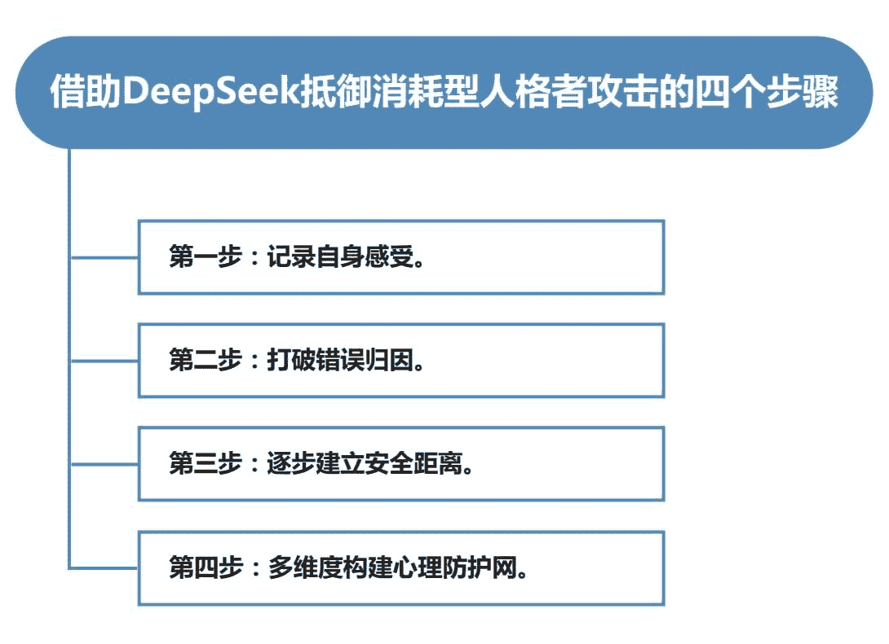

## 五、案例：如何运用 DeepSeek 预防职场“煤气灯效应”

职场中“煤气灯效应”时有发生，会带来极大精神压力。下面用案例展示如何借 DeepSeek 提前规避和应对。

某天同事严肃地说：“这个方案太差劲了，除了你，没人会犯这种低级错误。”听到这话，你可能瞬间自我怀疑，脑中浮现“我果然能力不行……”这恰恰可能是职场“煤气灯效应”的开端。 

**传统应对方式**
·找朋友倾诉：可能向朋友抱怨“他就是针对我”。能宣泄情绪，但无法真正解决问题。
·网络上查找：搜索“如何反击职场 PUA”时，看到的往往是“你要变得更强大”这类鸡汤，缺乏实操性，无法应对当下困境。 

**通过 DeepSeek 的解析思路**
面对不当言论，只需把原句输入，触发 DeepSeek 的“煤气灯效应检测模型”。该模型能精准识别语言陷阱，例如：
·否定人格：用“低级错误”否定个人能力。
·制造孤立：用“除了你”试图把你孤立，让你觉得是团队异类。
·扭曲事实：方案可能已完成 80%，却用“太差劲了”全盘否定，刻意忽视已有成果。

识别陷阱后，DeepSeek 还能产出反内耗话术，例如：“感谢你的反馈，能否指出具体需要改进的部分？我会根据建议调整。”这样既展现专业态度，又避免陷入对方设置的情绪陷阱。

当同事的否定不断袭来时，容易滑入自我怀疑的漩涡。DeepSeek 会把焦点拉回可检验的实证，例如追问你近三个月里上级有没有公开肯定过你、被批评的频次是否确实高于组内平均水平。通过回忆具体发生的场景，你能看清外部评价并不客观，从而校准偏掉的自我认知。

它也会给出可落地的建议。比如在被否定时立刻把原话记下来，再与过往评价并列比对。若你曾获得创新奖，却被指责缺乏创意，就可以用温和的方式作回应。这种基于事实的对照能提高你察觉不合理评判的敏感度，并做出针对性的行动。

工具可以提前提示关系中的隐患，但有两条红线必须守住。其一，输出内容不能替代专业的心理诊断。其二，涉及肢体暴力、自伤或自杀威胁时，请立刻报警或联系心理危机热线。

当“你太敏感”“开不起玩笑”等话语反复出现时，先停止自我审判。你的不适感其实是潜意识发出的警示。借助 DeepSeek 可以梳理哪些互动正在悄悄消耗你，并得到破局的启发。

现在打开对话框，输入：最近一次让我产生自我怀疑的人是 ____。从叙述出发，一步步收回属于自己的叙事主导权。

# 安全伦理篇
# 善用科技的边界

**目标：掌握安全使用 DeepSeek 的方法，守住心理边界与个人隐私。**

把心声交给 DeepSeek 倾听，意味着也交出一部分信任。前几篇系统学习了如何借助它维护心理健康，而隐私保护是绕不开的议题。

本篇不是阻止倾诉，而是教你设置隐私安全锁。更重要的是培养清醒判断：DeepSeek 并非真实的人，其回应来自大数据运算，不会像人际互动那样回应，也不要因偶尔的共鸣而产生依赖。

## 一、DeepSeek 的三大使用原则

### 使用原则一：设置每日对话上限

具体做法如下。

·**时间边界：**为避免过度沉浸，需要划定每日使用频次和时长，例如，**每日对话最多不超过 ____ 次，且每次对话的时长不超过 ____ 分钟**。明确的时间框架既能发挥解惑作用，也能防止心理边界模糊甚至产生依赖。

·**依赖自检：**在持续使用一段时间后，要定期自我审视，例如，**若离开 DeepSeek，我是否还能独立应对情绪问题**。通过这种自我检测，及时发现依赖倾向并调整使用方式，维护心理的自主性。

### 使用原则二：设置真人社交日

执行步骤如下。

·**固定时段：**把每周日设为**“无 AI 日”**。当天主动切断与 DeepSeek 等智能工具的连接，创造全身投入现实社交的空间，加强面对面交流的情感联结。

·**替代方案：**在“无 AI 日”，可以参与线下活动或学习新技能。

（1）积极参加线下社交，如报名读书会、约三五好友爬山等。
（2）学习一项新技能，如尝试烹饪一道新菜等。

·**AI 辅助设计：**也可以巧妙借助 DeepSeek 为真人社交助力。例如输入指令“帮我规划本周日的真人社交活动”，它会根据偏好和需求生成有创意且可行的方案，为线下互动增添乐趣。

### 使用原则三：交叉验证 DeepSeek 的建议

操作指南如下。

·**深度追问：**收到建议后，可以自问三个关键问题。

（1）**这些建议是否与我的个人价值观相符？**确保采纳的内容符合自身原则，避免盲从。
（2）**这些建议是否有科学研究支撑？**可以要求 DeepSeek 同时提供相关参考文献，以便从科学角度审视合理性与可靠性。
（3）**如果朋友面临同样情况并采纳此建议，我会支持吗？**通过换位思考，从第三方视角评估可行性与适用性。

·**权威验证：**除自我审视，还可以寻求权威渠道核验。

（1）**专业咨询：**向有资质的真人咨询师求助，借助专业经验对 DeepSeek 的建议进行评估与补充，获得更精准的指导。
（2）**查阅图书：**广泛阅读心理学权威著作，对比书中理论与 AI 建议，拓宽决策参考。

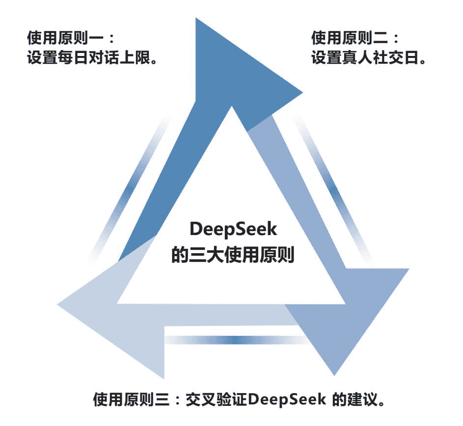

## 二、必要时求助专业人士

DeepSeek 更适合担任“心理健身教练”的角色，帮助应对工作压力、社交焦虑等日常困扰。但一旦遭遇“心理重疾”，如重度抑郁、创伤后应激障碍等，就需要寻求专业医生的帮助。

记住一个简明原则：若症状已严重影响正常生活且持续超过两周，例如连续两周严重失眠、对曾热爱的事物完全失去兴趣，或反复出现自伤念头，就必须求助专业人士。

哪些情况需要机构介入？

### 重度抑郁

·**生理信号：**连续两周失眠或嗜睡，食欲急剧变化导致体重波动超过 5%，清晨醒来即觉得“活着毫无意义”。
·**行为信号：**回避大部分甚至全部社交，工作学习能力断崖式下降，出现自伤倾向如划伤手臂等。

### 创伤后应激障碍

·**生理信号：**听到特定关键词如“车祸”“暴力”等时，出现强烈生理反应如心悸、窒息感等。
·**行为信号：**长期回避相关话题，却在梦中频繁重现创伤场景。

### 精神分裂症

·**生理信号：**出现幻觉或妄想，坚信自己“被监控”或“身负特殊使命”，并拒绝理性讨论。
·**行为信号：**语言混乱，说话缺乏逻辑。

## 三、DeepSeek 心理支持功能的局限

DeepSeek 在认知行为疗法、精神分析及人文关怀三方面都存在边界。

### 认知行为疗法的算法困境

人性复杂多面。当 DeepSeek 把焦虑解析为“认知偏差—躯体化反应—回避行为”的线性链条，并按“修复系统漏洞”的逻辑生成干预方案时，它难以回答根本问题：**为何相同的认知偏差在不同个体身上会产生迥异的结果？**

**例如，为何某种认知偏差会让一些人陷入抑郁，却让另一些人迸发出创造力？**

公式化处理的本质是用算法效率掩盖人性的复杂，容易过度简化心理议题。真人咨询师往往需数十次会谈建立信任，DeepSeek 却凭几次对话就生成“认知重构报告”。这类标准化报告可能忽略来访者潜意识中对改变的抗拒，也忽略不同文化背景对“合理认知”的差异理解。

### 在精神分析层面，DeepSeek 难以触及潜意识

AI 的词典里没有“移情”，因此无法理解一句“我理解你”为何会让人落泪；数据库里也没有“主体间性”，它只能作为无主体性的辅助工具存在。当你说“你终于懂我了”，系统识别不出这可能是你退行到童年、寻求母爱补偿的投射，更无法处理由此产生的伦理风险。

这种技术局限映射深层危机：**AI 在解读痛苦时，实质是在用算法垄断对痛苦的解释权。**正如海德格尔所言：**情绪并非可对象化的“存在者”，而是人类存在于世的基本方式。**

当 DeepSeek 得出“你的愤怒源于童年创伤”这一结论时，可能诱导用户无意识改造记忆以适配算法逻辑，形成“叙述痛苦—AI 解释—自我叙事重塑—强化算法权威”的循环，悄然削弱人的主体性。

### 技术理性不能替代人文关怀

当 DeepSeek 把“孤独”简单定义为“社交频率低于最低临界值”时，便抹杀了两种不同质的孤独：深夜阅读时体验到的清醒深邃孤独，和身处喧闹人群中体验到的张力孤独。

它的评判标准理性而冰冷，可能忽视“抑郁有可能是个体健康的抵抗方式”，也可能忽视“焦虑或许是个体重构生命意义过程中必须经历的阵痛”。标准化分析本质上是降维式关怀——把“共情”压缩为算法，把“关系”异化为实验结果，削弱人与人间的真实联结。

**DeepSeek 可以作为“智能手电筒”，却绝不能成为“精神手术刀”。**真正的疗愈需要捍卫对痛苦的解释权，为潜意识、移情、超越性体验保留质疑空间。因为，**痛苦不是代码，而是能冲破代码的生命力。**

## 四、数据安全与自我管理

为平衡数字疗愈与生活边界，需要为隐私搭建防护。

可建立三重机制：首先设定每日 30 分钟的对话上限，避免过度沉浸；其次定期备份对话记录，防止心灵资料丢失；最后开启手机隐私保护模式，以生物识别如指纹/面部识别构建物理屏障，确保每次交流都在专属安全空间进行。

请记住，不要把 DeepSeek 的分析结果直接当作诊断结论。在心灵的海洋里，真正掌舵的人只能是自己。另外，遭遇重度抑郁等险境时，务必及时求助专业人士。

至此，你已学会与 DeepSeek 完成一次自我探索之旅。改变可能如蜗牛爬行般缓慢，但回头看会发现，你已能以新视角审视曾以为无法跨越的心理鸿沟。技术是冰冷的，成长是炽热的。每一次提问都是迈向“成为独一无二的自己”的一小步。

# 后记

**回顾阅读历程，从起初生涩地与 DeepSeek 对话到现在，你已掌握诸多能力：**

（1）基础能力：高效对话，掌握提问模板，进行情绪分析。
（2）核心能力：实现认知重塑，进行危机干预与目标管理。
（3）高阶能力：探索潜意识，识别消耗型人格。

**本书目的并非打造永不崩溃、从不焦虑的完美人。相反，它想传达：情绪崩溃并非心灵漏洞，而是灵魂渴求被理解的信号；DeepSeek 并非问题的答案，而是助力你开启自我觉察的捷径。**

或许初用时你分不清“愤怒”与“失望”，现在你能识别情绪背后的需求。你收获的不仅是技能，更是对自我的深刻认知。

**这些进步并非数据堆砌的结果，而是你一次次直面内心痛苦的选择。**

合上本书时，请坚守信念：**DeepSeek 不是终点，而是一把打开心门的钥匙。**技术会迭代，界面会更新，但心理成长的本质不变——关乎勇气、智慧与慈悲。

最后，以咨询师身份给出三条提醒。

（1）**永远珍视 AI 无法衡量的美好：**朋友突如其来的拥抱，陌生人善意的微笑，夕阳洒落在肩头的温暖。
（2）**允许自己偶尔“退行”：**微小进步后突然情绪崩溃不等于失败，这是心灵整合新技能的过程。
（3）**把使用 DeepSeek 当作自我探索的起点，而非终点：**真正的疗愈始于你敢于对爱人说出“我需要”，对伤害说出“我拒绝”的瞬间。

从今天起，你是心理健康的第一责任人，愿本书成为探索内心的指南针。未来 DeepSeek 将持续进化，你也将与之共同成长，一步步成为更好的自己。

# 5 节精选音频课扫码查看

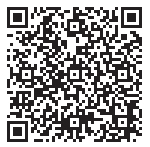

▲1. 关于投射：别人狠狠攻击你的点，其实是他自己最大的痛点

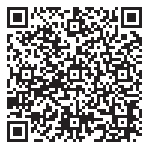

▲2. 关于人格：识别人格来升级人生系统

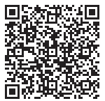

▲3. 关于祛魅：一个人变强的开始是对世界祛魅以后

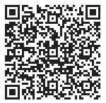

▲4. 关于关系：改变关系模式，从改变“投射源”开始

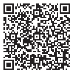

▲5. 关于爱情：让爱情少走弯路的 6 个真相