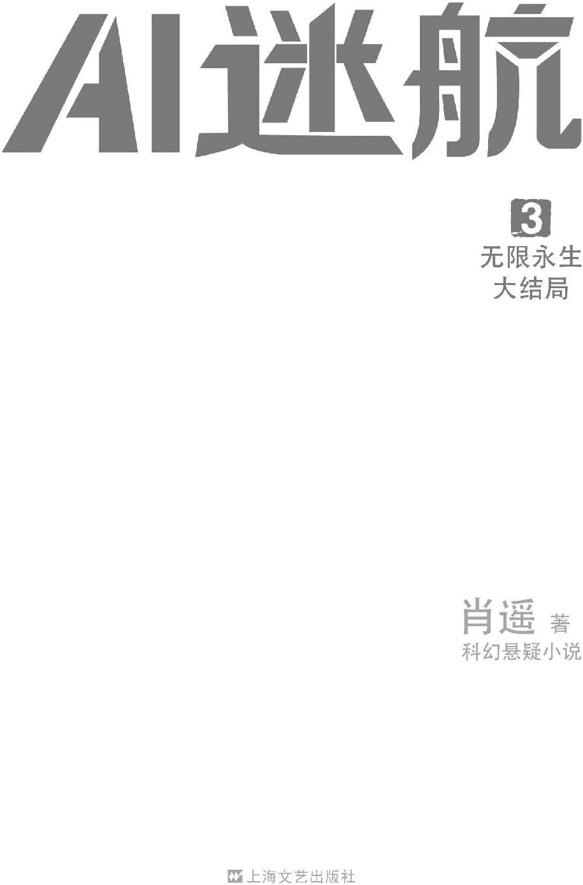
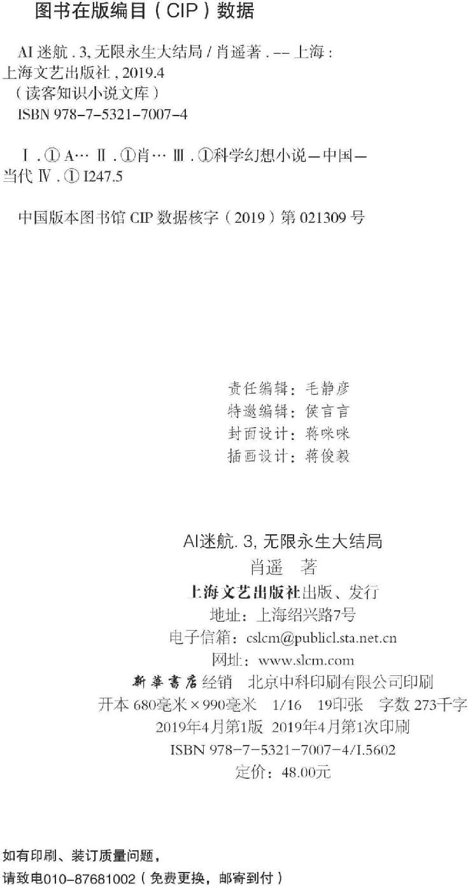
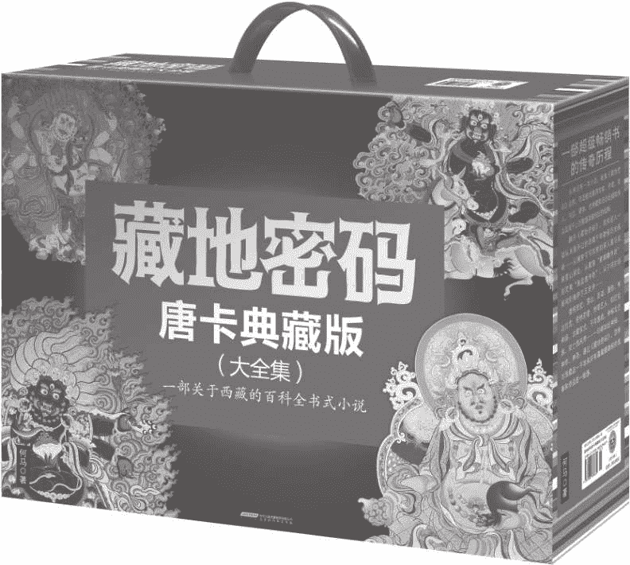
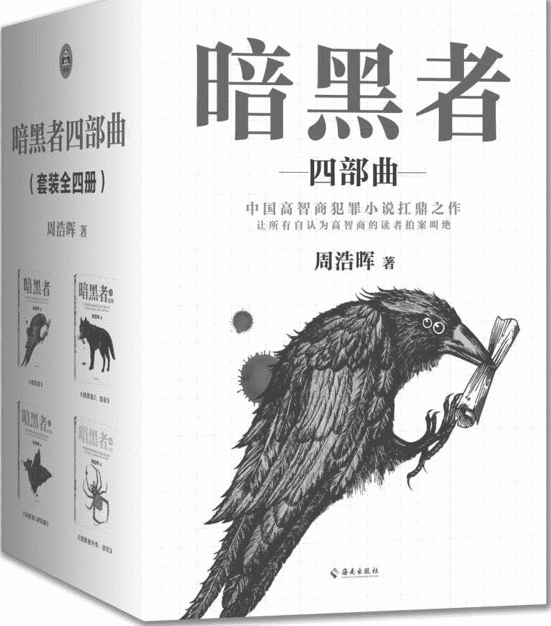
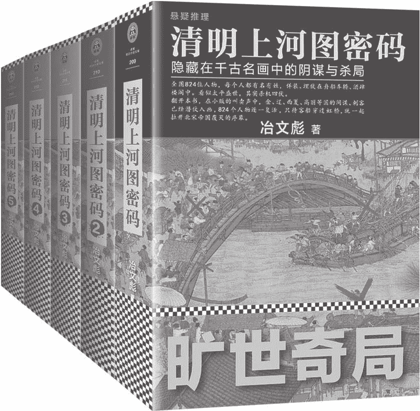
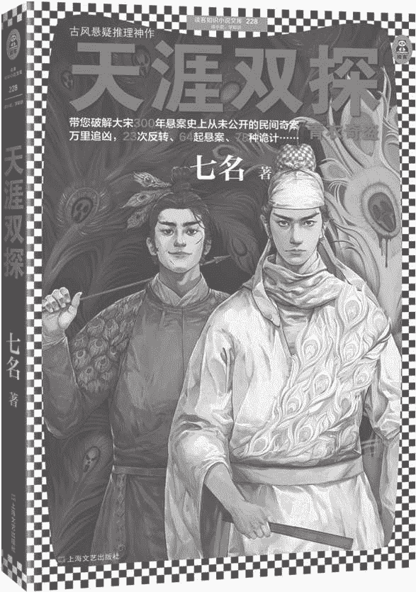

# AI迷航3·无限永生终章：智械失控，人类极限在哪？全平台热销中

# 楔子

“是我亲手把她埋下去的……”她唇角附近的沟壑在颤，音色像浸透的老式磁带，嘶哑又断续。

身后屏幕上，模糊的数字快闪，一行行熄灭，头皮发紧。

“你会再醒过来……”一滴液体从那具只能称作面容的结构上滑落，晶莹，“睁眼后，你会爱上别人……”

你到底是谁？

问出口才发现嘴根本张不开。

她在眼窝处抹了一下，转身离去，淡白雾气渐渐遮住视线。想喊发不出声，想抓也抓空。

我坠入虚无，冰冷的黑暗里有个男声在重复。

莫要忘却……

莫要忘却……

# 第一章 灵魂融合

## 1

这颗星球往昔承载过上百亿生灵，如今可能只剩百万上下，未来是重生还是覆灭，无人能断。

他们做过许多事，也会继续做更多事，然而有一个举动，只有我能完成。

我抱着自己的尸骸。

遗体裹在蓝袋子里，我跪着托起上半身，拉链未拉严，露出短发、额头、低垂睫毛、凹陷眼窝……

梦里才会出现的桥段，如今真实落到我身上。寒意从掌心窜遍全身，我僵住不动。

我是谁？

机动队的战友与陆警迅速赶到，远处一个不甘心的身影拖着颤腿拐进巷口。

此刻分辨我到底是赵仲明还是程复还为时尚早。

我让韦森把队伍拆成两拨，一拨留下来抢救胸口被利器贯穿的七名陆警，另一拨被我故意误导去反向街道与住区搜寻。

“三天前，叛徒程复的遗体被一伙来历不明者劫走，利莫里亚陆警迅速瓦解了盗尸行动……”

事发其实已过去三日，播报却说昨晚。

今晨把此事置顶，本身就说明陆警未抓到人。我悬了三天的心仍放不下。按赵仲明记忆中对利莫里亚的认知：若匪徒落网，审讯处决都会悄悄进行；没抓到，则敌人已化整为零混入人群，甚至就坐在视听室里，和我们一起高喊绝不纵容间谍的口号。

影像里，五名穿机动队制服者围着棺木与陆警交火，下一段直接切到陆警夺回棺木，看着像粉碎了盗尸。至于突发事件中牺牲的五名陆警以及203机动队的支援，报道里只字未提。

视听室死寂。第一排的韦森回头锁定我的位置，挑眉，意思很明显。

韦森是华裔，偏爱英伦贵族自称，高祖受封爵位，让他整天摆出高傲姿态。我真想把他和牛顿凑一起，看看两尊爵爷会怎样。

我认定五人里就有爱因斯坦。即便他套着淡绿制服，银发藏进头盔，鼻下被面具遮住，我仍从皱纹环绕的棕色眼眸里看出熟悉的睿智。

策划者是谁不清楚，带他上场绝对失误。其余四人没接触，大致能推断五人里仅他是半机械体。脑子快，动作笨。若我只是赵仲明，那天他必被擒。

认出他时我愣了几秒，可机动队和陆警已在百米外。我把枪口指向天空，压低声催他快跑。他错愕地边跑边回头，若瞳孔真能发射X光，也照不出这具年轻躯壳里住着程复的意识。

“五名不明者最后消失在第九区，陆警已封锁主要交通线，对该区学生宿舍逐一排查，必要时会以记忆读取筛查。”新闻里年轻警官的话引起注意，“警方对伤者留下的血做基因检测，结果显示基因因辐射突变，或曾生活在核爆地北美。通过基因镜像已查清父母身份，基因库也已确认此人身份，但为一网打尽，警方暂不公开。叛徒程复遗体今日将被火化……”

主持人补充：“利莫里亚陆警已发布基因通缉，一旦嫌犯进入G网便会被锁定击杀。同时号召民众提高警惕，揭发潜伏在大陆的AI间谍。”

第二则新闻表彰了一场光辉战绩——利莫里亚空军第三大队某团在东非大裂谷与AI能源防卫部队交火，水陆两栖战士配合空军从后奇袭，将能源据点从地面抹去。屏幕里人机混战惨烈。

重点表扬了牺牲的英雄，尤其是第七区二十二岁的席瓦尔。他父母是巴西人，美洲共同体成立后搬到亚特兰大，十年后生下他，还有个姐姐。战争第二年，姐姐与母亲被杀，父亲带着他随难民潮流亡到阿拉斯加白令海边，被东北亚防区第四飞行大队在白令海防御战中救下。

生前录像里席瓦尔说：“我见过程成将军，他在漫天白雪的阿拉斯加抱过我，我和其他人一样小时候视他为偶像，正因如此我选择成为空军战士。”

我前排两名女兵掩面痛哭。

席瓦尔的直属长官格林中校讲述了他的表现，并号召全体将士学习他无畏牺牲的精神。

第三条是征兵，今年十万人将上战场，投身保卫全人类、反攻AI、收复陆地。

而我就在这十万人里，十多天前通过空军第四飞行大队109团初审，今天的面谈将决定我去开飞机还是在指挥中心绘图。

屏幕黑下去，人群几乎同时起身，教室瞬间喧闹。每个人都在向周围宣泄看法，谩骂不止。

“程复还有同伙！”我身旁那名文静的女战士忽然转头怒吼，“这种渣滓还有人同情？盗尸还想办葬礼？无耻！同情程复的也是渣滓，留着浪费资源！杀掉他们，一个个吊死绞死，我真恨不得亲手捅进他们胸口……”每根神经都透出愤怒。

我第一天来也被吓到，几十人拍桌跺脚骂了十分钟叛徒程复。适应半月后，我也会配合情绪发泄。

她停下望我，眼神示意轮到我。我把五官皱成一团骂道：“程复给敌人当狗，绞死都便宜他了，为什么不让每个人都插一刀……”

昨天我也骂过同样的话，周围人毫无察觉。他们在意的是愤怒是否到位。

每个人都歇斯底里谩骂，到底谁在听？我右侧一对男女同时说两种话，男的批AI罪行，女的骂程复。根本无讨论，房间充斥谩骂，不需要听众。

赵仲明六岁上利莫里亚，每天都要骂十分钟。不愤怒就会被拉去思想教育一周。赵仲明八九个月前才知道愤怒是正心片的副作用。告诉他秘密的人记不清了，只记得一起把正心片碾碎混着洗脸水冲掉。

我和赵仲明用半个月学会相处，他接纳我的灵魂，我适应他的身体、过往、世界。

换脑后的整整一周，我常怀疑手术是否真实。苍白灯光、模糊医生、嘈杂噪声，真的发生过吗？

荒谬，我就是程复，我能想起程复上天入地又下海的全部记忆。我记得丁琳的眼泪和施云的笑容，记得穹顶的云海落日与海下幽蓝鱼群。这些都是程复独有的经历。

适应赵仲明圈子的半月里，更多故事在我脑海里炸开，像烟花照亮夜空。

电铃响，室内安静。每个人收敛情绪，整理衣鬓回到座位，仿佛刚才的狂风暴雨没发生过。

一位六十出头的老将军投影出现，肩章为上将，他眼中燃烧着怒火，握拳鼓励：“孩子们，只有战斗到底，人类才能赢，胜利希望在你们肩上。牺牲是光荣的！每场胜利都靠牺牲换来，牺牲越大越接近胜利。人类不会灭绝，只要掌握基因技术。敌人AI早晚因盲目扩张、资源浪费而败。所以要心存希望，不能放弃！只要坚持就会赢！胜利将至，你们听到了吗？孩子们，欢呼吧，让我听到你们声音！”

老人对利莫里亚来说异常珍贵。这里由年轻人掌控空中大陆，衰老只存在于影像里，存在于被十二区包围的神秘圆环里。这里人无权衰老，超过二十二岁都要被派往战场，有去无还。

一批批年轻人慷慨赴国难，硅城的花姐却等不来祖国消息……

## 2

视听室所在的约五十层银灰色管状大楼是利莫里亚常见建筑，通过乳白软管与其它建筑相连，每栋蜂巢拼接的管柱直通蔚蓝天顶，似乎也在撑起上方天空。

天空像倒覆的月牙湖，因外围和内壁呈圆形，传送履带前行时月牙仍保持原样。人们生活在两道环状墙壁之间，空间庞大，管状蜂巢建筑林立交错，像热带雨林的藤条，杂乱却有章法。楼宇间乳白通道与地面传送履带构成交通网。

我上方有巨大的Z7标志，即第七区。利莫里亚共分十二区，近百万人居住。

街上无人散步，每个人匆忙。大体分两种：军人与青春期孩子。街上看不见中老年人，我这几天与数千人擦肩，未见一个中年人。

街道没有商店、书店、酒吧、咖啡厅，只隔几百米有一座治安岗亭。身着黑制服的年轻陆警注视远处几个愤怒挥拳的十七八岁男孩，他们挥拳的对象只是显示屏上程复的照片。

“叛贼，为什么不能亲手杀了他！”

“判绞刑便宜他了，把他全身涂油架在烈火上慢慢烤死！我要听他的哀号和忏悔！”

年轻人职业唯二：陆警与军人。工作区除军队、警局、学校外别无它物。

第三飞行大队109团驻地在第十区。前往第十区的路上，传送履带穿过广场，正进行大学生和中学生集会，口号无外乎程复被绞杀、间谍盗尸，表达战斗到底决心。

年轻真好，有大把时间单纯愤怒，尽管他们根本不知真相。无人深究，因聪明孩子活不到毕业。这也是我们遗留人不受待见的原因。原生人在出生前已去除基因情绪模块，十五岁即可为利莫里亚服务。那年纪的我，还在学校因荷尔蒙打群架。

我不断提醒自己这是赵仲明的记忆，非因尊重他的遗产，而是担心会忘了自己是谁。但记忆融合已成趋势。这些天很多语言行为并非出自我本意，大脑里有一股能量自然喷薄。那时我更像旁观者，看着自己思维自动与他人沟通。

我能做的，只是尽量不让赵仲明在不经意间说出只有程复才知道的秘密。

109团位于第十区与第九区交界的高塔中层，从宽大玻璃向下望，可见第九区街道上两条黑压压的陆警人流。十余台记忆扫描仪被运入第九区，新闻里说的筛查开始了！

爱因斯坦他们到底藏在哪？若有学生或军人掩护，这番大动作绝不会无功而返。只要一人注意到异常，筛查仪都会反馈。

“难以置信，这群孙子竟潜进利莫里亚。”

一位小个子机动队士兵左手搭我右肩，右手叉腰，俯瞰楼下动静。看上去是华人后裔，脑袋圆得像黄豆，两粒芝麻眼嵌在倒八字眉下，一张吹火口总能说出耸动消息。看到他时，脑中烟花炸开，赵仲明记忆瞬间苏醒。

相关场景在他脑内排列。我想起学生时代为他出头打架，却想不起名字，轻松愉悦的感觉蔓延。我下意识勾住他脖子，脱口而出：“黄豆子……”

完全超出理性控制，又是赵仲明记忆作祟，就像第一次见到韦森，不知名字却能喊韦爵爷。

“你小子给站岗士兵送了多少礼，也能进109团大门？”他笑着把我往左一拱：“有你赵仲明的地方哪少了我！”

“口气不小，109团是英雄团，是第四飞行大队尖刀，你连国际日期变更线都搞不清，也敢开飞机？当然了，109团也有后勤部……”

“赵仲明，你少寒碜我，你成绩比我好，可我命比你好，哈哈！”土豆似的脑袋差点裂开，“我都没申请，109团主动给我黄战斗同志发通知！我还琢磨我这几年立了啥功劳，竟能引起赫赫有名的109团注意。”

黄战斗这名字再次让我脑中炸开花。

他与赵仲明同年，出身商人家庭，善经营人际。赵仲明冲动惹麻烦，黄战斗能摆平；过于油滑惹厌，高中时赵仲明曾替他打架，两人罚一周禁闭。

“苦恼啊苦恼，我想破天灵盖，只想到一个可能……”

“团长是熊瞎子吧。”这句话又脱口而出，赵仲明思维越过权限直接对话。

“嘘……你小子就算嫉妒我，也不至于在109团说团长瞎，嫌命长！”他谨慎左右瞧瞧，见最近的人在二十米外，便放宽心，“我告诉你，我的优秀不是一般人能发现的！”

我嘿嘿一笑：“祝你好运喽。”

黄战斗面色骤严，小眼睛盯我十余秒，疑云渐浓：“我说赵仲明，你最近是背了三字经还是弟子规？跟我说话这么客气，往日我这么嘚瑟，你要么更嘚瑟，要么直接赏我板栗！”

客气？我忽然想起203机动队时也有人说过。那天队员训练出错，我耐心解释并鼓励认真工作。旁人就说我变了，因穿拳头穿皮鞋的赵仲明很少用嘴皮子解决问题！

赵仲明有股痞气。

我勾住他脖子的手渐紧：“109团不是机动队，你也注意点！老子想这一天想了十几年，今天可不能因你搞黄。”

黄战斗被勒着脖子却挺舒坦，就是说话喘气：“咱们上中学的时候，是……高中二年级……还是一年级的那个国防课老师……你记得吗？”

我松开他，装作思考：“高二……吧……”

“对！就一定是高二，你记性一直比我好，我到现在也没背下来……敌人在北美五大湖区三条防线二十一个据点的经纬度！”

“关乎性命的！”我严肃说，“真能用上的时候，能救你一命。”

“咦？”他眯起小眼，“哥们儿，你今天确实不对劲啊？”

“我？不对劲？我看是你小子不对劲吧。”我漫不经心。

“往常你可比我不抱希望啊……北美五大湖，别说咱们这一代，就是再等原生人繁衍六十代，也没戏——这不是你的原话吗？”

“行了，别废话！”我赶紧岔开，“你刚才提国防课老师，到底想说什么？”

“那老师说，人类永远不可能被外来敌人打败，打败人类的只有人类自己！”他指着第九区陆警说，“你看见没？利莫里亚要乱套了，国防老师的谶语马上应验了。”

“我倒觉得，国防老师是在鼓励我们。你断句，打败人类的只有人类自己——这不就是说，AI再厉害不可能打败我们吗？明明是鼓励。”

“你不记得我也不怪你，但老师说这话的神情我记得清清楚楚，特别丧气，只有丧气到极点的人才有那种表情！”他脸上努力重现昨日之丧，看起来仍像颗土豆，“所以他永远消失了，利莫里亚不需要丧人。”

这时，我们身后木门被推开，一位士兵走出喊道：“203机动队赵仲明、205机动队黄战斗进来报到。”黄战斗郑重行礼，和刚才判若两人，我一愣，他拱拱我：“敬礼啊！”

我和黄战斗一前一后走进办公室，偌大房间只有一张三米长白木桌，光幕以桌面中部为中心把房间切成白日与黑夜。

对面黑夜里传来两人轻声交谈，等我们走近，一个黑影起身离开，另一个黑影坐在对面。我和黄战斗正襟危坐，等待问话。

里面轻咳两声，低沉男声从黑色光幕传出：“赵仲明，赵德义之子，赵伯显堂弟，军校成绩优异，曾代表军校参加利莫里亚空军院校比武，两次获海东青奖章；黄战斗，庸才一个，从小学到军校都是马屁精，靠灵巧机变和见风使舵，竟也能混成机动队参谋……”

黄战斗满脸尴尬，瞟我一眼：“长官……我……是不是……没戏了？”

里面人哼了一声，不悦，随后冷冷说：“你还有脸问！歇着去吧……赵仲明——”

“到。”

“你的行为很可疑。”

对面黑幕传来啪嗒声，像是笔扔在桌上的声音。“老实交代，你二十二岁生日那晚，到底干什么去了？”

我眼前闪现机动队员为我庆祝生日的场景，有个叫黄海的兄弟不合时宜说：“队长，我们还想给你过二十三岁生日，你可一定要活着回来呀！”

此言一出，瞬间冷场。

里面长官追问：“在干什么？”

“和朋友庆祝。”

“别兜圈子，你知道我问什么。我只关心你从203驻地庆祝完之后的事。”

“我……”我用力回忆，可实在想不起赵仲明后来去了哪里，又做了什么。但可推测，那时我正关在牢房，第二天就要执行死刑，所以前一晚，赵仲明肯定有所行动，才能顺利提取我的记忆。

他一定见了什么人——必须隐瞒、保护的人，所以在记忆里抹去了这段经历。

“我……好像在外面逛了逛，然后就回去休息了。”

里面传来冷笑。“我手里的枪随时能按下扳机，结束你这骗子生命，”他暴喝，“快坦白，你到底去做了什么？！”

我手心冒汗，此时必须坚持刚才的话：“报告长官，我什么也没做。”

“正心片是不是早就停了？”

“没有，一直在吃。”

“放你娘的屁！”里面的人骂起来，“赵仲明，你张嘴闭嘴全是假话……”扳机咔哒一声，“最后一次机会，你背着利莫里亚部队到底干了多少见不得人的事？”

“我什么都没干！”

我身边的黄战斗浑身发抖，连屁股底下的凳子腿都在颤。

里面的人冷笑：“你们中国人，非得看到棺材才肯认输……”语气沉下去，“那我就让你亲眼看看，你那晚到底去做了什么！”

黑幕里投出一段虚拟影像。赵仲明穿便装走在蜂巢式居室的走廊，目光四处扫，到一扇房门前停下，左右张望后才敲门。

门缝打开，一只雪白的手臂伸出来把他拽进去。开门的瞬间，一头金色齐肩短发闪了一下，里面是个女人。

那人冷哼：“这就是你口中的没事？”黄战斗也惊讶地看向我，眼神里没有怒意，反倒像“你小子又开新地图怎么不带我”的好奇与埋怨。

我没话说，心里在盘算怎么脱身。如果只有这段影像，远不足以定赵仲明通敌，除非他们能提供女人身份并证明她是间谍。

那人说：“赵仲明，军队一再强调欲望是肮脏的，你倒好，背着人跟女人私会……这种败类就是给军人丢脸，我今天替军队收拾你……”

黑幕里伸出一支黑枪。

我愕然，赵仲明的牺牲就这么轻易被否定了？

反抗还是跑？

黄战斗求饶：“长官饶命，赵仲明只不过犯了谈对象的错，不至于死……”

啪嗒，扳机扣下，却没子弹。黄战斗吓得一屁股滑到地上。

“法律规定男人23岁会安排配偶，但前提是前线服役满一年，赵仲明却成了……”声音忽然变调，“……我最喜欢的模样。”

一口熟悉又带调侃的声音：“恭喜赵仲明，审查通过！”

黄战斗猛地站起：“咦？你……”

光幕散去，对面亮起，一个英俊带点桀骜的白人年轻人站在我面前，左手把玩着黑手枪，坏笑。

“原来是你这王八蛋！”黄战斗拍桌子，“吓死我了……”

那白人右手一撑桌子跃过，军靴直冲黄战斗裆下踢去，黄战斗想躲，对方瞪眼，他就不敢动，硬生生挨了一脚。黄战斗倒地，脸上笑意更浓，谄媚起来。

白人骂道：“跟你爹说话放规矩点。”他蹲在桌上，用枪口敲我脑门：“赵仲明，这回被我吓尿了没？”

我僵笑：“机动队训练没这项目，空军要穿尿不湿见长官吗？”

他大笑，跳下桌，拎起我又拎起黄战斗，搭着肩：“没想到吧，兄弟我从今以后就是109团的团长……”

“哎哟，我的伯乐是你！”黄战斗笑，“我早跟赵仲明说过，努力有个屁用，只要把咱们阿历兄弟伺候好了，前程自在。赵仲明成绩比你好，我早知道靠你。”

“就冲你这眼力，给你个营长。”

“营长？一下升两级？阿历，你别开玩笑！”

“在109团，我说了算。”

黄战斗喜形于色：“阿历克斯，你真是我亲爹！”

那人搂紧我右臂：“赵仲明，你哑巴了？是被吓傻，还是看我爬你头上心里不爽？”

我扳开他的手，握住他的手：“恭喜兄弟。”

这人是阿历克斯。开飞机炸酋长的阿历克斯，怂恿程雪背叛我的阿历克斯。

阿历克斯笑道：“你小子怎么也成黄战斗了？对我突然客气，我不习惯，我还怀念你天天跟我叫板的日子。走，陪爹喝两杯，今天三兄弟齐了，好好庆祝。”

黄战斗道：“阿历，这不妥吧，109团是英雄团，让人知道我们走后门还跟你花天酒地……”

阿历克斯道：“去他妈的规矩，跟我还讲规矩？”瞟我一眼，“赵仲明背着我们坏了多少规矩。刚才视频你也看了，这小子天天装蒜，你们中国人真狡猾……”

黄战斗指我：“就是，你就跟我装，不讲义气。”

阿历克斯大笑，对黄战斗说：“你也得学学赵仲明。对了，你的正心片停了吧？”

“停一阵了。”

“好！”嘴角坏笑我很熟悉，“哥们儿带你们见见世面……”

我咬牙挂笑，机械地跟两人往光幕对面门走去。阿历克斯和赵仲明还是朋友，真好……太感谢你了，赵仲明。脑子里烟花炸开。

## 3

赵仲明与阿历克斯在中学时就是亦敌亦友，黄战斗在中间起了关键牵线作用。

黄豆子路子野，听说阿历克斯有背景，就拼命巴结，几天就跟他成了铁哥们。

赵仲明不喜欢阿历克斯，后者从小乖戾暴躁。可得知阿历克斯自幼无父，母亲被强行留在陆地后，赵仲明有了同病相怜的感觉，有事就帮一把。与黄战斗不同，他跟阿历克斯从没推心置腹，阿历克斯天生骄傲跋扈，落魄时就不可一世，得意时只会更难缠。

人人都知道阿历克斯有个秘密，却没人知道是什么，这让他身份越发神秘。他还能掌握内部消息。

内部，指圆环内的世界。他没去过，却有渠道。

入伍后两人少有联系，赵仲明去陆军机动队，阿历克斯直接进空军，据说参加过不少对地作战。

赵仲明以为此生不会再见，直到一年前那件离奇事。

堂兄赵伯显16岁时被派往陆地执行任务，后光荣牺牲，尸骨无存。五年后，197机动队的拉里贝私下找到赵仲明，给了他一枚狗牌。

狗牌是军人身份牌，活着时是铝片，死后是辨认残骸的标签。没人会乱丢狗牌，赵伯显稳重，更不可能把铭牌留在利莫里亚。更何况，铭牌是从一头蜥蜴体内找到的。

我赶到时，蜥蜴被切成六块，勉强能看出是蜥蜴，约两米长，有蜥蜴大体特征，面部和四肢细节却不对，似乎隐约有人脸轮廓，大腿粗壮，指头各五根细长。

197防区出现蜥蜴，难辞其咎，队长决定捂住消息，悄悄处理。拉里贝拆解时发现狗牌，链子已和肠子连在一起。

拉里贝与赵仲明是同学，中学时就熟悉赵伯显。他把狗牌藏起，找机会交给赵仲明。

此后赵仲明一直被疑问困扰，不否认英雄牺牲，却不解堂兄铭牌为何在蜥蜴肚里。

没多久，拉里贝消失了。197机动队当日执勤23人全数消失。半月后阿历克斯出现在203驻地，劝赵仲明别再查狗牌和197机动队，23人被追认为烈士。

想起拉里贝模样，我身体不自觉颤抖。

怎么会是他……萨德李？

我和黄战斗随阿历克斯乘电梯到塔顶最高房间。屋内通白，三面墙一面玻璃，办公桌后挂满枪械，对面墙挂满动物头颅——斑斓虎头、带角鹿头、被子弹打伤一只眼的狮头，还有一具巨大头骨，额头下方有个大洞，配两颗象牙，否则我会以为是三眼变异体。

“怎么样？”他指着一头黑猩猩脑袋炫耀，“全是我亲手猎的！”

黄战斗摸着麋鹿后脑的枪孔：“可以啊，哪打的？好多叫不出名。”

阿历克斯指地板：“当然是非洲草原。”

“大陆！”黄战斗羡慕，“你常下去？”

阿历克斯拍他后脑：“要不我怎么成团长？别老‘你小子’，让人听见我丢脸，以后叫团长或爹，你选。”

黄战斗嘿嘿笑：“叫爹叫团长一样，反正我们跟定你了。”

阿历克斯拍桌角，枪墙移开，露出方形门洞。进去后是一间密封黑房，地上是连排沙发。

“不是说见世面？带这来有什么看？”黄战斗问。

阿历克斯靠沙发，拍旁位让我们坐，嘴角诡异。门关后，茶几升起，酒架上躺一瓶红酒。

“哪搞的！”黄战斗站起，见酒像见炸弹。

“认得？”

“咋不认得！军营有个蒙古人从陆地带酒进来，被发现人就没了。别害我们，利莫里亚有禁酒令！”

“你那德行！”阿历克斯拍我肩，“成大事的人什么样？你永远追不上赵仲明。”

“你是团长，公然违纪，被举报死都不知道怎么死。”

“别人而已，不是我！”他倒酒，“我费多大劲才弄来让你们开眼？黄豆子不领情。算了，爱喝不喝。”递给我，“赵仲明，兄弟喝，甭搭理黄豆子。”

我接杯，装谨慎：“小心为妙，你新任团长带头破坏纪律不合适。”

他不屑：“纪律？从今起109团纪律我定，喝！”

我无动于衷，他说：“至于吗？这是天上葡萄酒，里面人喝的，我能让你们看见就没事，来吧。”

黄战斗苦笑：“我们信你，性命攸关嘛……”

他冷笑：“二位兄弟，咱从死人堆爬出来，自小一起长大，我对你们没戒心，要不怎么敢提身边！”先小啜一口，“我见过的世面你们想不到……死是迟早，地方这儿，不享受就得被别人享受……”

“什么叫被人享受？”我问。

他微笑再举杯：“干了就告诉你。”

他把杯举到我眼前，我嗅一下，装厌恶，掐鼻一口饮尽：“说吧。”

他大笑：“不愧是我最看得起的人！”瞪黄战斗，“你呢？”

黄战斗颤抖举杯，一口干尽，吐舌：“这味儿啊，涩死了，之前人类咋爱喝。”

“说吧！”我催。

他把剩酒倒半杯：“在利莫里亚，要么当猎物，要么当猎手……猎物自己不觉得自己是猎物，直到死在猎手手里才明白意义，这就是解释。”

“有话明说不行？”黄战斗埋怨，已主动往嘴里送。

阿历克斯按沙发后红键，黑墙瞬间消失，我们在沙滩中央。

我知是虚拟成像，还是被逼真震到。已近黄昏，沙滩人多，比基尼美女走过，黑人扛冲浪板归来，小孩堆沙塔，海岸救援员用望远镜盯海面少年。

阿历克斯望夕阳：“我用职权保存的影像，很美吧。”

黄战斗叹：“美，十几年没见海了，这哪？”

“太平洋东岸。”

黄战斗盯美女，喉咙咽口水。

阿历克斯笑：“豆子，你懂不少嘛。”

黄战斗脸红：“这种女人利莫里亚犯法。”

“这就是人类原本模样，”他举杯让夕阳透过琥珀洒在鼻梁，“我们却永远失去……”

黄昏隐去，画面切，仍是海滩夕阳，人却没了。远方晚霞如手中红酒，海里漂破碎帆船，半块冲浪板埋沙。远方战舰缓行，两艘微型战机升空，朝西红云发射子弹……

阿历克斯：“人造卫星被打下来，人类失去全球通信。”

“AI真够狠！”

他哼：“再狠也狠不过程成……”顺手指，一架朱雀从远方飞来，冲破两架悬浮机构建防线。背后拔地而起黑色沙尘直冲云霄。

“那是什么？”

“或许是AI政府防御武器，却没用。”朱雀掠过头顶，右侧白光闪，投下东西……

蘑菇云升起，大地震动，身后白光……

影像消失。

阿历克斯把最后酒匀三杯：“干了吧，敬程成的世界！”

我克制恨不得砸杯。父亲不是毁灭者，他有苦衷！父亲救了这群人渣，他们活下来只会反咬。

“赵仲明，一杯酒就红眼？”

我攥拳想挤笑，却控制不住：“没有程成将军，我们早成AI俘虏，你有什么资格骂他！”

阿历克斯捻杯，三角眼打量我，肌肉僵硬。

“赵仲明，别忘了身份！赵德义是程成一条狗，你赵仲明从今天起，是我的狗！”

房间温度骤降。黄战斗打圆场：“哪至于，一句话吵起来……”

一阵急促电铃响起。

阿历克斯白眼：“我现在事多，黄豆子，你当秘书，接电话。”

黄战斗笑：“你不讲信用，刚才还让我当营长。”

铃声刺耳。

阿历克斯把杯丢开：“少废话，先听听发生了什么。”

黄战斗摇晃跑出去，30秒后撞进：“阿历……利莫里亚防御系统……侦测到入侵……入侵的……”

“入侵什么？舌头捋直点。”

“敌方战斗机！”

# 第二章 双面人格

## 1

利莫里亚军分进攻与防卫两大系统，进攻含空军陆军两栖，占80%以上；防卫以机动队为主，负责大陆近空。多年无人能近，机动队地位低下，被嘲“足球队”——因战舰十二面体像足球。但服役两年可申请前线，机动队成了前线预备营。

没走完流程，我和黄战斗仍算机动队，立刻返驻地。

还没进作战指挥室就闻到群情激昂，这群二十来岁男女没恐惧，反而兴奋像猫见老鼠。多年来终于轮到正面交锋。利莫里亚教育是让人遗忘恐惧，看来奏效在我眼里却是盲目自大。

大规模AI军队出现在利莫里亚附近，只悬停安全距离，却像对人类创造者的临终告别。

我越过布雷上校做动员的宽厚肩膀，第一次见到利莫里亚外观图。俯视是标准圆形大陆，直径无法判断，但容纳百万人口，底部绝不小于中等城市；侧视像塔基，高几百米，与直径比微不足道，像倒扣碟子，中央凸起是核心控制区。

12个红点包围空中大陆，如12颗静止卫星。

“敌人围着利莫里亚绕了一个小时，”布雷上校说，“刚开始后方出现巨大球形飞行器，十几分钟后分裂成12部，与利莫里亚同速飞行……”

“上校，下令吧，让我们杀一场？”一人喊，其他人附和。

“利莫里亚已暴露，更多敌人赶来，国防部长下令，尽快反击先遣部队，务必全歼！”布雷上校与我们同龄，因学业军旅表现优异才升校，是第一次真正前线指挥。

“战士们，你们苦练多年，终于等到最光荣时刻！现在敌人就在面前，像碾蚂蚁一样碾碎他们，夺回人类尊严！”

“必胜！”

十二面体在地球上空两万米黑云层缓慢飞行，像黑海遨游的海龟。脱离利莫里亚瞬间就被黑尘包裹，我本想看大陆外观，却忘了这大家伙靠平流层尘土才藏18年未被AI发现。

我第一次在云层细看黑尘模样，并非纯黑，多是棕黄沙土，因无光才显黑。

上次与黑砂石擦肩，是夸父农场N33穿透云层瞬间。我恍惚，仿佛黑砂石里还存那模糊沙哑声音：

这黑夜漫长……我坚信，路再长有终点，夜再长终有尽头……

我是程成之子，他是你们战友！从今天起，我也是你们战友……

这云再厚，也挡不住我们回归……

我是船长程复，我是你们的孩子……

……

和我一同杀出云层的袍泽，现在还能数出几个活着的？程复，你那份逞强的代价，会不会付得太贵了。

“逞强的代价？”脑海里另一道声音接上了，“那不正是一点希望的火星吗？你总觉得自己拖累了大家，可有没有想过，若没有希望，人活着还有什么意义。”

不过是自我安慰罢了。

那声音冷笑。

沉默。

“程复，别把所有人都想成和你一样懦弱。我把命交到你手上，不是可怜你。像你这种懦夫，死上万次我都不会心疼。”

对不起。

“你以为我把生命给你，是想听你说对不起吗？对我，还是对其他人？”那声音陡然提高，我仿佛看见他握紧的拳头，“你忘了你的职责了？”

职责……

“成千上万人想把这点火熄掉，你却偏要点起一支火把。你说过要带大家回家。你忘了吗！”

回家……这地方算家吗？

那声音一字一句地在我脑中回荡：你自己掂量掂量，那个地方配叫家吗？

“队长！”行军参谋韦森把我从走神中拽回十二面体舰桥，“距目标三千米，目标刚有异动，像是发现我们了，还要不要继续推进，请指示。”

雷达屏上，原本单独的红点忽然裂成六个，一字排开，像在迎接我们的到来。

203机动队共十二艘飞行足球，我与韦森坐镇的主舰是二十人编制，其他每艘只剩十三名机动队员。舰内刻意不装任何智能化电子设备，就是为了防止AI隔空接管武器。自从与AI彻底决裂，人与机器的沟通倒退到二战水平，每门炮每支枪都要战士亲手去操。

平时其余十一艘都吸附在主舰上担任防御，出征时它们会像真的足球一样被踢出去。

“按原编组拆成四组，曼联、巴萨、千叶一组，解放者、恒大、沃尔夫斯堡一组分左右展开，慢慢收拢成包围圈，推进到一千米外待命。”友军常拿我们打趣说像足球队，203索性就用战前豪门的名字来给十二艘十二面体命名。

雷达上，六个蓝点从母舰剥离，和母舰一起拉成钳口阵型，缓缓逼近。目标依旧悬在半空，既不撤离也不还击。

“队长，下一步怎么办？要开火吗？”解放者的舰长邱明用电台询问。

我压下了申请，对韦森说：“再试一次沟通。”其实出发前利莫里亚就试过，最后无果。

信号发出五分钟，毫无回音。

“打还是不打？”恒大的舰长卢峰也申请了，语气里带着兴奋。

我下令：“继续前进，等总部命令。”这次行动总指挥是布雷上校，没有他的授权不能先动手，除非对方先开火。

主舰离目标只剩一千米，敌人仍无动作。重重黑尘里，我们只能靠雷达确认它们还在前方悬浮，什么时候动、多少火力对准我们，完全未知。

恐惧源于未知。僵持半小时，连出发时意气风发的韦森脸色都发白了。期间我们和207、209两支友军通话，大家都被困在同一境地，没有仪器能穿透沙云，看清对方模样与装备。

最后，连布雷上校也失去耐心。

“全体进攻，全歼！”

我立刻转达，另外五艘十二面体脱离母舰，和之前的六艘组成爪形，同时向对面红点掐去。炮弹如雨砸向目标，命中极高。雷达显示所有炮弹都已命中，可敌人依旧悬停，像六个虚假的光点，毫发无伤。

“阿贾克斯、大阪樱花高速前推，贴近观察，其余舰只掩护。”

两艘舰加速后在炮弹轨迹上空穿行，在六个红点间穿梭，把拍摄画面传回母舰。

信息员莫甘娜脱口而出外语。

小画面被投到舰桥中央，信息员把两舰拍摄的同一架敌机合成。在灰蒙蒙画面里，出现了一个比沙尘稍深的黑色陀螺状物。莫甘娜修复噪点后，那东西更像一坨不规则的粪状物被倒吊起来。

“这他妈是什么玩意儿？”韦森忍不住问。舰内死寂，其他舰也传来各种猜测。

与此同时，阿贾克斯和大阪樱花再次掠过，拍下另外两架的外形。传回来后，利物浦舰的舰长杨炯吼道：“这是马蜂窝，我五岁那年还捅过，绝对是马蜂窝！”

“扯淡，你家马蜂窝能有这么大？”

“绝对是，化成灰我都认得，蜇人疼得要命！”

战斗仍在持续，后续传来的动态影像里，我们清楚看见炮弹打进“马蜂窝”的全过程，它们像一团黑棉花，把炮弹吞进去，让暴躁的弹头彻底没了脾气。

这是AI的武器，还是某种新生物？

它的冷漠比嘲笑更让人无力。

“停止攻击！”我下令全队，“后撤，保持安全距离！”

“队长，这就不打了？我们连这东西是什么还没搞清，就撤了？”黄海不服。

“全队暂撤！韦森，联系布雷上校！”

韦森还没切过去，上校的影像已经出现在屏幕上：“快撤，所有舰队全部撤回利莫……”

画面一黑，信号中断。

紧接着，我发现母舰和其他舰船之间的联络也断了。忽然，对面六个红点开始移动。雷达上，六个红点分裂成十二个，再从十二个变成二十四、48……直到雷达被密密麻麻的红色填满，十一艘舰艇已经被红点彻底淹没。

“后撤！”

韦森推满动力，母舰迅速脱离包围网，向利莫里亚急驰。

不到一刻钟，遍布的红点开始向中心聚拢，而雷达上此时竟再也找不到一个红点。

黑云依旧静谧，隔绝着我们不愿面对的残酷。

“黄海，黄海收到请回话！”莫甘娜喊。

“大阪樱花……大阪樱花……”

“千叶收到回话……”

“巴萨收到请……回话……”

……

没有回应。

布雷上校急躁的声音插进来：“……该死的，全都滚回来！能回来几个算几个……”

布雷上校低着头，他面前的雷达干净得像白纸，利莫里亚周边没有任何红色点子，也没有我方布防。旁边的参谋替他说出了大家的心声。

“就像在原地融化了，一点不剩。”

另一名参谋补充：“这是前所未见的新式武器。”

布雷上校抬头时额头已布满细汗，他望向我们身后的方向，半晌才问：“还没有其他舰船的消息吗？”

作战室内鸦雀无声，战前的亢奋早已消失。

“汇报战后伤亡。”

“机动队派出十二支机动部队，共一百四十四艘战舰，一千九百五十六名官兵，如今……只回来七艘，其余战舰和战士，下落不明。”

静默，难熬的静默。

有人用麻木掩饰胆怯，大多数人连麻木都装不出来。

布雷上校依旧低头，脖颈颤抖着对参谋说：“向国防部……汇报战果……”

怎么汇报？一场没有流血的惨败？

有人开始哭。我身后的韦森攥着拳头不住摇头，我拍拍他的肩膀。在这种情形下，没人能说出振奋的谎言。

布雷上校如何向国防部汇报的我没细听。他放下电话后，我们就收到命令：封锁与战争有关的一切消息。凡是参与本次行动的机动队，除了队长和第一参谋，其余人员立刻接受精神抚慰。

所谓的精神抚慰并不是安慰情绪，利莫里亚做得很彻底——抹除记忆。

当我和韦森带着队员来到军队心理抚慰中心时，大家都明白了。没有人反对，谁也不想在人工智能制造的恐惧和战友牺牲的痛苦里余生。只有韦森哭得像个孩子，莫甘娜最后一个走进中心，她抱了抱韦森，又抱了抱我。

“队长，记得把活动室里，我和黄海的所有合影……清理掉！拜托……”

我和韦森花了五个小时，抹除了所有失踪战友的信息。

安抚中心给我的故事模板写着：203机动队另外一百二十一名队员因表现优异，已被派往地面执行特殊任务，保密等级S。

其实最需要心理治疗的是韦森，然而他是我走后接任队长的第一选择，所以他必须保留失败的记忆，以应对未来更残酷的战争。军事技能可以学，临战的应变和心态却不是训练场能教的。

那晚，韦森躺在我宿舍地板上睡着，大约凌晨三点，我被他的抽泣吵醒。

“队长……”他哽咽着问：“我们……还能赢吗？”

我望着漆黑。“你相信胜利吗？”

“我不知道……曾经我还笑过别人的失败与牺牲，可到今天才明白，我们和敌人根本不是一个科技层级，我看不到任何希望……”他极力控制情绪随时崩溃。

希望？

我想问，你愿意在绝望中活着，还是在希望中死去？

终究没问，因为我知道此刻该给他什么。

“韦森，如果明天就要死了，你可以做任何想做的事，你会做什么？”

韦森陷入沉思，良久后语气兴奋地说：“我想回家！”

“只要敢想，就一定能实现。活着最可怕的是连想都不敢想。”

“队长，你难道不怕死吗？”

“我只怕死得没有价值……更怕无缘无故地消失……”

谁料韦森忽然换回平常轻松的语气，接我的话：“你还在查197队二十三人离奇消失的事？”

我浑身汗毛竖起，默不作声。

“机密事务司的记录可不是随便能看到的，”他翻身把被子盖过头顶，“队长，求你别查了，我怕你也会……不告而别。”

我试探着说：“我想知道真相。”

“知道了又能怎样？”

“我不能不明不白去死，更不能让他们像那样死了都没人记得！”我从床上坐起，“我查的不只是拉里贝消失的真相，我想知道的是，利莫里亚没人能活过二十三岁的真相！”

“难道不是战斗牺牲的吗……”

“你亲历了今天的事，你还信他们的话？一千多人就这么不明不白没了！命令却是保密。那每年几万人的消失呢？难道真的是牺牲？明知会失败会送死，为什么还要这么做？我不能让大家再不明不白地送死了，必须找到真相！”

韦森也坐了起来。“队长，我忽然觉得你像变了个人。”

“嗯？”

“你以前很爱发怒，见到不平就闹脾气，很少深究事件背后的原因。而且你很自我，认定的事会不顾一切去做，哪怕搭上性命，”他轻叹，“刚才我发现你变了，你不再只想着自己，你好像……忽然会为别人而活了。”

2
利莫里亚不是家，可阿历克斯却说要带我们“回家转转”。

在109团驻地的密室里，他对着我和黄战斗痛骂布雷指挥官一个多小时，声称国防部对后者在上次防御战中的指挥失误深表失望。我们晕乎乎地被他拉进一架蝌蚪飞行器，在乳白色的管道里晃晃悠悠高速飞行。

蝌蚪飞到尽头，冲进一团烟雾。面前出现一道巨大的白色弧形墙，墙上密密麻麻布满像高尔夫球洞的圆坑，蝌蚪慢慢降落在其中一个坑里。原来这些坑都是入口。

黄战斗比我更震惊。“这什么地方？我十几年也没见过这堵墙！”

“废话，你能见到还叫特权吗！”阿历克斯冷笑，“这就是内城，你们若没我这个大哥，这辈子都别想进来。”

“你不要命了！”黄战斗炸了，“内城我们不能来！”说着就要抢控制杆。

“放手！这是我家，我爱干嘛干嘛。”

我问：“阿历，你到底什么背景，现在能说了吗？”

阿历克斯嘴角挂上诡异的笑容。

“知道得越多，刀子来得越快。一头猪就算成了哲学家，它还是一头猪。”

蝌蚪停稳后，墙壁的红外装置扫描身份，验证通过后，飞行器被一股吸力吸进墙内，洞口迅速关闭。

飞行器沿着淡红色半透明管子缓慢前行，透过管壁可看到上百条错综的管子伸向前方一个巨大的半球形底部。进入半球后，仿佛进入一个红蓝光交替的世界。抬头望去，红光蓝光来自半球中央上空一条望不到头的巨大天梯，它一半红一半蓝，在交界处截然断开，空隙处上下游移着一道电梯。两端梯杆由一个个球体连接，红蓝梯杆顺时针转动，形成下方红蓝交替的光。

“欢迎来到生命之梯！”阿历克斯喷出一口酒气，“这里是利莫里亚大陆的中心，也是那些原生人笨蛋出生的地方。”

“行了，世面见完了，快回头吧！”黄战斗催促。

“回头？真正想带你们玩的还没开始呢！”

蝌蚪飞船被两只巨大的钢铁臂送入天梯中心的一部自由电梯，扫描信息后急速上升。天梯的轨迹是螺旋形的，直到飞上近百米，我才意识到它是什么——基因的双螺旋。

飞行器被送到第20排左右的位置，看不清顶端。随后通过中心横向通道，抵达20层的红色圆球，阿历克斯说：“到家了。”

他双手搭在我们肩上推着向前走，很快看见一个圆形银色门洞。门口站着一个盘起长发的女人，背对着我们，肩披淡红色披风，我心头一沉。

这不是法庭审讯那天……

听见脚步声，女人转身，我愣在原地。

程雪！果然是她。

她的眼神比数月前更冷，穿透胸膛，冻住心脏。在我脸上停留片刻，没有表情。

这个骗子！

我不知道阿历克斯何时放开了我们，等我意识到该保持清醒时，黄战斗正拉着我的袖口，和他站在一边。阿历克斯自己走到门前，像个犯错的孩子低着头，与程雪对立。

啪的一声，程雪在他脸上狠狠扇了一巴掌。声音响亮，清晰可闻。

“畜生！”她咬牙切齿，“别忘了你是个什么东西！”

阿历克斯抚摸被打的脸颊，张嘴活动下颚，笑了笑：“我是个什么东西，你不比我清楚？我是个杂种，哈哈。”

“我能给你一切，也能收回一切，包括你这条贱命！”

阿历克斯眯起眼睛，戳了戳胸口：“这一切是你给的吗？这是我应得的，我的血统……”

程雪又一巴掌抽过去，她无名指的戒指在他脸颊划出十厘米左右的淡红痕，很快渗出血来。程雪的目光扫向我和黄战斗。“你带外人进来，我本该处死你们，看在他面子上才亲自来警告，这是最后一次！下次我绝不饶恕，你知道后果。”

程雪的出现和离开都像一场幻梦，她可能没注意到，我一直盯着她的脸。脑子里都是她的欺骗以及欺骗带来的伤害。

“哥……哥哥……”她银铃般的嗓音在我耳畔回响。她想把我带回祖国，骗我回来只是为了彻底送我去死吗？可我还是回来了，登上了她早就准备好的绞刑架。

程雪，你到底是谁？

阿历克斯孤零零站在门前，肩膀和后背止不住颤抖。程雪消失后，他身子一软跪在地上。我和黄战斗冲过去搀扶，被他一把推开，我看见他的脸在流血，嘴唇在滴血。

阿历克斯用拳头捶着地面。

他们一定在返回利莫里亚的路上发生了什么，但作为赵仲明，若去套问赵仲明本不该知道的问题，肯定会引起怀疑。

“哼，别看她现在猖狂，一会儿让你们见识见识她的真面目！”阿历克斯脸色忽然转晴。

我们穿过门进入球体内部。这里装修得像娱乐场所，却没有其他客人。我们随阿历克斯往里走，几个穿着暴露的女子迎上来，有的白肤有的黝黑，有拉美裔也有欧亚丽人，身高不同，却都身材完美脸蛋天使，看一眼就心动。

“主人，您回来了！”她们像苍蝇般围上来。

“滚！谁也别跟着我！”

他自己沿旋梯向上而去，我和黄战斗站在原地不知所措，阿历克斯的声音从楼上传来：“你们给我伺候好我的两个兄弟！”

女子像饿狼般扑来。

我们被簇拥到大厅沙发上，她们端起桌上的葡萄酒，笑吟吟地灌我们喝。

黄战斗眼神迷离，显然这是他生平第一次面对这种场面，他有些局促，被身旁一位黑人美女挑逗，一时不知所措。

“兄弟！救命啊，怎么办？教教我！”

“我要是能知道怎么办……”我话没说完，一名高挑的小麦肤色拉美裔女孩靠过来，伸舌就要舔我脸颊，我一把推开，“咱俩早就是死罪了……”另一名亚洲面孔女子又凑过来。

“你会不知道怎么办？你那天晚上……不都实习了吗？”

“什么实习……”

“那间宿舍！”

拉美女子又靠回身边，在我耳边吹气。“将军哥哥，我们带你去别的地方玩，好不好？”

我看了眼黄战斗，装作云里雾里：“有没有单独的房间，这时候有个男人在旁边，真的扫兴……”

黄战斗道：“你大爷的赵仲明，你还说不知道怎么办！”

拉美女子和一名欧洲白人女子簇拥着我离开，我回头时朝他暧昧一笑：“管好自己的裤子，否则我举报你！”

和两名女子滚到一张大床后，我装作酒劲上头，伏在床上一动不动，偶尔回应她们的“关心”。

“将军哥哥，起来再喝一杯嘛！”白肤色姑娘道。

小麦肤色姑娘也道：“是啊，这里还有很多玩法，主人让我们伺候好你，你还没体验到乐趣就睡了，主人知道会责怪我们的……”

我软绵绵试探：“这小子，竟然背着我们养了这么多美人，真是太不够义气，我们虽然是兄弟，可连他的背景也不知道，你们……”

这时，忽然听到一声女人痛苦的喊叫从通风道传来，伴随着清亮的皮鞭声。

我愣住：“黄战斗这个变态，在干什么？”

两名女子本来叽叽喳喳，如今听到声音却不说话了。没过几秒，又传来鞭子抽打身体的声音以及女人的惨叫。

“怎么了？”我看着两名女子问。

“这是主人在惩罚那个女人。”白肤色姑娘回答。

“惩罚？”又一声惨叫和听不清的哀求，我提醒自己别被干扰，于是返回上一个问题，“你们主人到底什么身份？”

小麦肤色姑娘道：“我们跟主人也没多久，不是很清楚，总之是很尊贵了……”

“奇怪，我和他认识十几年，都不知道他为什么能来内城……你们一直在这里？”

两个女人对看一眼，都摇了摇头。

我问：“你们也是外面的？”

小麦肤色姑娘：“我们在中学时就被带进来……如今人老珠黄，已经不能胜任上面的工作，所幸还有主人收留我们。”

我看她们年纪也就二十一二，怎么就人老珠黄了？心下好奇。“那你们被阿历收留之前，做什么的？”

“当然是服侍你们，”白肤色姑娘笑道，“这是我们的天职，就像你们军人的天职是保卫利莫里亚一样。”

“服侍我们？除了我和阿历克斯，你们还服侍过什么人？”

“上面的人。”

我指着房顶。“生命之梯顶端究竟有什么？”

两名女子又对视一眼：“你不是从那里下来的？”

第九区走廊的灯

我摇摇头报出来源，外城第九区。

陪我说话的二人脸色煞白，惊惶道我们原以为……天，竟敢闯进来，不怕丢命吗。

楼上传来撕裂般的哭喊，一道女声哀求别割她的脸，听得我心口发颤。

肤色如雪的女子低声说，可怜也罢，主人几乎天天拿她泄愤。

另一人道，活该，若非主人收留早死了，说不定原是AI派来的内奸。

我心里一凛，脑中闪过施云的脸，可她明明已被施文郁带走，不该在此处，那哭腔也不像她。

阿历克斯笑着下楼，脸上疤痕修补得七七八八，仅剩淡淡粉痕。我摘下幻效头盔坐在沙发上，与几位女孩玩沉浸式杀戮，额上尽是汗。

过瘾吗，他递来一支雪茄。

我打量着雪茄让他点燃，太爽了，阿历，这是我多年以来待过的最有趣所在。

哎哟，赵仲明，你脸上这种谄媚很难得，这不过是公子哥生活里的……一角。他吐出烟圈，跟我混，你也能有。

还有更刺激的吗。

有。

什么。

他笑，杀人。

脑中浮现他驾机轰炸印第安部落的画面，这在他眼里竟是好玩。

我装作轻松切了一声，刚玩过，画面很真，但与我想象的血腥仍有距离。

阿历克斯大笑，那是游戏，我说的是弄死活人。

我干笑两声，活人，别开玩笑了，利莫里亚陆警是干嘛的，你敢在利莫里亚动手。

利莫里亚的法是管住你们这些笨蛋的，定规则的人自然不受规则束缚。

哪有这种事，知法犯法不是罪加一等。

阿历克斯缓缓吐烟，眼神飘向虚无，牧羊人对羊群说，草原有草原的律，夜里羊不能出圈，我夜里不能离毡房，谁破坏就一起处死。羊们老实吃睡繁衍，牧羊人也从未违律。结果呢，牧羊人进圈，一代代把羊宰光。

## 2
黄战斗摇摇晃晃出来，步伐虚浮眼神发直，军帽歪了。他挨着我坐下嘟囔，长见识真长见识，赵仲明你可别打小报告，我什么都没干，发誓。旁边的女子掩嘴笑，阿历克斯一抬手，她们退下。

黄豆子怕什么，我就是规矩我就是王法，老子没发话，这里的女人随意。他冷笑，反正你们早晚要死，趁早享受。

我问，我们，不含你。

你们能跟我一样。

哪里不一样。

黄战斗抢话，哪能一样，没阿历我们连门都进不来。赵仲明你嘴欠，如今阿历是团长，你这语气跟长官说话吗，还以为在学校你十项全能就该比阿历克斯强，人活一世还得认命。死生有命富贵在天，人家命好你不服不行。

阿历克斯拍了拍黄战斗脸颊以示夸奖，赵仲明不服我正常，我可能都要嫉妒炸了。

我笑道，嫉妒，我嫉妒你，得了吧，我只是好奇，除了109团团长你还有什么隐秘身份。

阿历克斯一怔摇头，这个不能说，你们猜。

我们怎么猜得着。

门口扇我耳光的女人，你们知道是谁吗。

谁。

能排进利莫里亚权势榜前五的人物。

黄战斗惊道，听见没赵仲明，能被这么尊贵的人打耳光，就说明阿历了不起。

阿历克斯骂道，放屁，老子要扇她她也得让我扇。别说耳光，我就是划烂她脸撕碎她衣裳，她又能怎样。

黄战斗不信，还是少开这种玩笑吧，传出去肯定要挨枪子。

阿历克斯解开衬衫前三颗扣子露出胸膛，今天我就让你们再长长见识。说完朝楼上喊，下来。

黄战斗和我对视一笑，各自捡起桌上的雪茄把玩。

楼上传来脚步声，黑高跟鞋与深裤先入眼，随后是淡红披风下摆。

一位女子缓缓下楼，停在我们面前笑吟吟看着。我和黄战斗都惊住，黄战斗想起身被阿历克斯按回。

她竟是外面抽了阿历克斯两巴掌的程雪。

她神色不似方才冰冷，反倒有些惶恐。清嗓道，你们三个，是活腻了。

阿历克斯摇头面露不满，重来。

程雪皱眉瞪他语气更厉，你这杂种，和我说话还敢坐着。

我和黄战斗立刻站直，阿历克斯也缓缓起身敬礼，属下冒犯请程议长恕罪。

程雪微微一笑，没事，下回注意。

啪的一记耳光打得她踉跄，我和黄战斗皆愣住。

阿历克斯面目狰狞左手托住她下颌喝道，你他妈竟敢笑。

程雪眼含泪嗫嚅，我我错了。

阿历，你疯了吗，黄战斗吼道，你糊涂啊做这种傻事，哥儿俩都得跟你完蛋。

阿历克斯右手又抽她一巴掌，说，你到底是什么东西。

我是是程雪议长，她颤抖作答。

你他妈不是议长，你他妈就是条怕死的母狗。

对，我是。

阿历克斯大喝，你不是，把她推开，拉着我和黄战斗重新坐回沙发，重来。

我搞不清二人何种关系，只能看着这场荒诞戏。自分别后到底发生了什么，程雪怎么成议长，阿历克斯只是团长，外面冷若冰霜的程雪，如今竟能忍受被打。

程雪敛容，两个耳光让她无法再镇定。

你们是不是活够了，语气带哭腔。

阿历克斯却颓然闭眼深深叹气，像入定五秒，随即从沙发弹起一脚踹在程雪小腹，将她踹到楼梯下。

臭婊子给我丢人。

我心头一痛，连忙跑下去挡住还想再踢的阿历克斯，喝道，够了，她是议长。

程雪蜷在我怀里抖得像掉进狼窝的兔子。

可这只兔子又被阿历克斯拎起。

你刚才为什么当着我朋友的面给我难堪。

程雪眼里闪过一丝疑惑瞬间阿历克斯又抽她一巴掌。

还记得你刚怎么说的吗。

不不记得了。

老子这条命是你给的吗，老子的荣华富贵是你给的吗。

程雪泪飞颤抖着下巴恐惧道，不是，是主人应得的。

阿历克斯歇斯底里狂笑，你说什么你管我叫什么。

主人。

他得意看向我和黄战斗，听见没，堂堂利莫里亚议长这艘船上最有权势的人竟然管我叫主人。哈哈兄弟们我刚没吹牛吧。

黄战斗愣愣点头。

程雪闭眼眼泪滚落。

我胸口发闷为何会这样，我明明恨她此刻却又怜她，我竟在怜惜这个骗子。我扭头不忍再看。程复别忘了，她是你的仇人。

谁知阿历克斯手中不知何时多了一把短刀在程雪脸上比划。敢给我破相我就让两个好兄弟一起欣赏我的雕刻。

程雪满眼惊恐。

阿历克斯眼里全是笑龇牙道，饶了你，可你刚才又何曾饶过我，你当着我兄弟羞辱我我知道你看不起我你觉得我贱可我也比你这婊子强。说罢挥刀直下。

哥哥，程雪闭眼刹那嘴里喊出这两个字。

与此同时我已攥住阿历克斯右臂刀尖距程雪脸不到一厘米。

我并非因她喊哥哥才救她，却因她喊出哥哥内心再次被撼动。

她认出我了。

程雪微微睁眼含泪抬头感激地望着我嘴里仍喃喃，哥哥救我。

我的眼模糊了。

阿历克斯一脚踹开程雪站起反手抽了我一巴掌吼道，赵仲明你算哪根葱敢不给我面子找死吗。

他把刀抵在我下颌我大口喘气没还手只是怒视他。

谁料程雪爬回来跪在阿历克斯脚下，主人是我错了。

他大吼，滚给我滚蛋。

程雪看我一眼连爬带跑沿旋转楼梯上二楼关门声后便没了动静。

黄战斗从沙发后出来劝架，红颜祸水啊女人真不是好东西早知道你要让我们见识女人我们就不来了。你们看怎么自家兄弟还打起来了。

阿历克斯把刀收回坐回沙发双手揉太阳穴眼泪啪嗒砸进地毯。

赵仲明我早晚要让你心服口服。

自己兄弟置什么气，黄战斗打圆场，对了阿历这女人到底耍什么把戏我实在看不懂。

阿历克斯抬头红着眼瞪我们，我警告你们不该问的给我闭嘴，以后看见她绕着走多嘴就是找死。

## 3
返回109团驻地已是傍晚黄战斗酒劲未过躲在参谋室呼呼大睡。我心绪烦闷溜到一楼。

大厅人来人往我穿行其中最后驻足在门口一段虚拟影像前它播着东北亚防御反击战的传奇。那段历史发生在我三岁那年我最早的记忆大概就是父亲打完胜仗回家用胡子蹭我脸蛋的那一刻。

当时我不懂父亲六月指挥第四飞行大队完成贝加尔湖奇袭两小时后又配合两栖部队登陆北海道拔掉叛军在北海道的基地。这次漂亮的釜底抽薪史称北海道之夏。

此前部队越过重重封锁率先占领白令海在阿拉斯加冰天雪地过春节。人们当时只以为他是营救不愿臣服AI的人类后来在坚守中才发现他并不打算放弃基地。

数月后随着空袭和阻击战胜利战争分析家才明白他控制阿拉斯加的目的是控制北极地磁点进而掌控地球磁场变化也正因占据这个战略制磁点敌人导弹飞机才失去精准和航向。

这是战略胜利它促成次年五月关岛收复六月檀香山会师在第四飞行大队主导下以中国为主的东北亚海军和南太平洋海军在夏威夷会师收回人类在北太平洋的制海权。

父亲能一次次击败敌人正因深谋远虑和四两拨千斤而我作为他唯一的儿子曾被植入过他记忆的人却从未继承这一优点。

朴信武最佩服父亲的就是谋局能力。

当AI叛军把人类逼到绝路时只有父亲跳出来打破局面。曾经人类步步被动被AI牵着鼻子走数十年依赖导致丧失独立思考。

一台AI设备仅凭面部表情就能大致猜出想法跟这种敌人打注定失败。

但父亲的战术跳出了理性逻辑。没人敢在袭击贝加尔湖这个东亚最大军事据点后还能奔袭万里用尽燃料奇迹般出现在北海道上空。

人类的空中战斗极限被第四飞行大队不断刷新父亲和战士每站都破釜沉舟视死如归这是AI不能理解的为何只有百分之一胜算还要战。

父亲敢这么做不是气血上涌而是精确谋划不只是数学上的更有他对人类精神意志的了解。

AI能洞悉思想却永远无法了解意志。

第九区仍在封锁不断有记忆扫描仪器推进去。陆警似乎只能靠最笨最有效的逐个筛查记忆片段寻找昨晚妄图盗取程复尸体的捣乱分子或许昨晚的战事让军方警醒这些人极可能是吸引敌人前来的间谍。

封锁线外常有人驻足。我在年轻军人与学生中发现一张美丽脸庞。她像是东欧血统深目高鼻金发挽起身材修长深蓝制服更显英挺。她时不时朝我站立处张望我看她时她又刻意避开目光。

赵仲明旁边传来稍显稚嫩的呼喊。喊第二声时我才反应过来那是我。

喊我的人是个相貌俊朗的陆警面无表情目光呆滞看上去十五六岁一套合身警服与稚嫩脸庞极不搭像小孩穿了大人衣服。

他胸口证件写着11-D02625看到这个编号脑中记忆被唤醒三个字浮现原生人。只有利莫里亚用基因技术培育的新人类才只冠编号。

你现在到底算机动队还是空军他语气毫无感情。

大概还算机动队。

好按利莫里亚陆地防卫章程机动队有义务配合陆警治安工作。我们现在缺人手我现在征用你来协助审查。他理直气壮我找不到理由拒绝我也正想了解他们获得了什么消息是否发现爱因斯坦行踪。

到底是什么人真是程复同伙我试探。

无可奉告。

新闻说警方已锁定一个人你知道是谁吗。

无可奉告。

这家伙态度像机器硅城银队长也不过如此。目前有啥可靠信息。

无可奉告。

更像第三人。

那你能奉告什么我装作生气，你让我帮忙又不共享信息我怎么找得到你要的东西。

记忆扫描仪会帮我找到你要做的就是把屋子里的人摁住若有人逃逸你就得像条狗一样追回来。他说话相当没礼貌毫无表情给人城府极深的感觉。

你这孩子求我帮忙也这么没诚意算了反正老子就要进空军大队也不怕什么章程我作势要走一点好处都没有谁愿意帮你。

我转身走了几步。

喂他冷冰冰喊住我只能回答你一个问题。

我笑着回头。有人受伤了据说靠血液基因已确定身份他是谁。

一个死人。

死了。

不那是一个死人的基因我们查到的数据显示这人二十年前就死了。

听说你们启动G网到底锁定那群家伙没。

这是第二个问题。

你说不说我瞪他。

他面无表情但我觉得赵仲明的狠劲儿应该震慑了他毕竟他只是个孩子。

嗯目前还没结果。

我心下稍安。

远处跑来一个同龄白净小伙名牌10-F17623。

报告F17623立正，在第九区边缘发现一间可疑房间房间被锁摄像头被破坏红外显示室内有生命迹象我们不敢轻举妄动请指示。

我随他们小跑到诡异房间门口这里像学校这间屋子是教室楼梯拐角的杂物室堆着各种仪器开关。学校负责人也来了说房间只能从内部锁上外面无钥匙可开。

激光切割热气蒸腾当啷一声内锁与门板分离陆警撞开房门。房间内除打扫工具和闪烁仪表盘六七平米空间里绝对没人。

刚才确实有生命迹象两个陆警先后证明。

D02625在屋内转圈找隐秘门洞另一名陆警指着角落通风口喊血。

血迹呈暗红应过了很久。

打开通风道D02625举枪瞄准百叶挡板缝隙。一名陆警搬来梯子我抢先爬上去。按要求摘下百叶挡板露出只有五十厘米宽的正方形洞口我肩膀倾斜才能挤进去半个身子我努力想把自己塞进去脑子里同时盘算如何帮这群想抢我尸体的马虎小队掩盖蛛丝马迹。

我向内望去在距离我眼睛三十厘米处一双眼睛也正看着我。

那双眼睛是杏黄色瞳孔是两道竖线乍看像只猫蹲在我面前。可这双眼睛长在人脸上她脸形细长头发蓬乱鼻孔外翻嘴巴扁平。

一张丑陋如女鬼的女人脸。

我猛地深吸一口气差点喊出来之所以没喊是因那怪物细长手掌握着一把电钻抵在我眉心我不敢喊。

下面因梯子剧烈晃动意识到不对问道什么情况。

没有我盯着那双眼睛丝毫不敢大意什么都没有。

看到血了吗。

没有。

能爬上去吗。

很难。我说话时那双眼睛眨了一下似乎对我的表现很感兴趣同时也点了点头扁平嘴里吐出一个两厘米长的圆柱状物体低头轻轻放在通风道边缘然后收起电钻缩着身子缓缓向后退去。她的动作很轻轻到在我面前也很难听到任何声响。

下面开始讨论。见了鬼那人到底怎么逃的。

也有人建议用微型遥控摄影机试试于是我被要求下来我装作很困难摇晃双肩肩膀一离开洞口就假装舒展手臂悄悄把那人吐出来的圆柱形物体攥进手中。

# 第三章 变异壁虎
## 1
每天夜里只有躺到床上我才能真正松口气。赵仲明把生命让给我是为了让我寻找真相可越接近真相反而越扑朔迷离。

曾经进入夸父农场N33营救我的萨德李竟然与赵仲明记忆中的197队拉里贝一模一样；而程雪这个扮演我妹妹的女子忽而冷艳高贵忽而又卑贱如奴；阿历克斯对背景守口如瓶。

机密事务司。

我从韦森口中得知赵仲明一直在暗中调查197团23人离奇消失的秘密他到底调查到什么。想到这里心跳忽然加速。我在紧张什么难道是赵仲明身体在提示我什么。

他与机密事务司接触颇多赵德义的牺牲以及给我的挂坠都是他在机密事务司的发现。

以他的权限应该不可能获知那么多重要信息这也就意味着赵仲明或许曾经私自潜入机密事务司试图了解他想知道的秘密包括这23人的离奇消失。

我翻来覆去难以入眠在意识迷离间听到房门一响看到两个穿淡蓝色防化服的人围了过来。

他们脑袋被罩住但仅凭露出的眼睛还是能看出一个男人一个女人。我想坐起身可根本动弹不得我的喉咙忽然像被谁掐住一样一句话也喊不出来。

忽然小腹一痛那男人将一根管子插入我小腹右侧一股熟悉的无比强大的吸附力在体内来回冲撞像要吃光我的五脏六腑。

嗵嗵嗵嗵。

一颗红色的肾脏伴随着声响落入透明器皿中。

肾脏14男性血型B养殖仓N33C261。

这时候那女人摘掉防护服头罩向我笑了笑为我擦去额头的汗水。

哥我是来救你的。

惊醒。

屋子里依然黑漆漆的我深呼一口气眼睛直愣愣瞪着屋顶忽然眼前绿光一闪而过。

床头柜方向有光渗出来，我一时没分辨出是哪件东西在亮。刚要重新躺回床上，光又跳了一下，这次看清了，淡绿的亮点正从柜面那件通风道怪东西留下的圆柱形物件里漏出。

把那根圆柱拿起来细看，像是从某部设备上拆下的零件，表面密布纵向齿纹。凑近才发现，每道齿缝里都嵌着一道极细的裂口，光正从裂口透出。因为整周的纹路都有相同的缝隙，每次亮起，墙上就会映出重叠的青绿色剪影，像一片片晃动的竹叶。

光又闪了。

像是某种定时提示器？可那通道里的怪物为何要把这东西给我？闪烁的节奏很快加快，最初大约隔三四秒一次，很快变成每秒一次，到后来每秒能看到三次，我脑中冒出炸弹的念头。

门外响起敲门声，韦森压低声音喊队长。光啪地灭了。我盯着那根柱体，它再没亮过。

队长……他又唤了一声，声音很轻。开门后他俯身进来。

大半夜来做什么。

他抿了抿唇，像是做了决定，刻意压着声线说：没有我，你明早活不到天亮。随后补了一句，明天有批货要送往机密事务司。

我已不再管203机动队的日常行动，队长的职责被韦森接手。没有特殊授权，机动队无法靠近位于第一行政区的机密事务司，那里是利莫里亚安保等级最高的区域。韦森说的那批货，我在次日傍晚才见到。

一百个孩子。

其中不少面孔眼熟，正是新大陆那批尼人孩子。他们精神状态还不错，完全不知危险，一路上还在低声交谈。统一穿着白色的囚服依次走过，我庆幸他们不认得我，否则场面会失控。

这次任务是护送他们进入机密事务司。严格说我已不属于机动队，但109团的交接手续还没走完，韦森利用这个空档做了手脚。

轨道车在地下行驶约二十分钟，到达机密事务司底部的停靠站。我们让孩子们按顺序进入监狱区，等待传唤。

机密事务司并不是刑场，送进去只有两种处置，被审问或被读取记忆。据韦森说，马蜂窝出现后国防部压力骤增，怀疑新大陆囚犯里藏有漏网间谍，于是筛查力度加大。

进入数据中心比我想象的容易。韦森与几名工作人员熟络，趁他们开玩笑的间隙我混了进去。

这里的计算机与利莫里亚常见的基因硬盘不同，存储方式是以基因碱基ATGC的排序来编码，现有AI无法解析。

我在系统里输入拉里贝的名字，索引自动调出了197机动队失踪的二十三名队员档案。

后背发凉。

程复的那段记忆没有出问题，拉里贝就是萨德李，只不过胡子没那么多，看起来更年轻。我又翻看其余二十二人的照片，都是那天与程雪前往夸父农场N33营救我的解放者小队成员。

只是在地面上，每个人都换了另一个身份。

他们确实是祖国派来救我的，可到底受谁指使？那个人难道不清楚，我回来等于自投罗网吗？还有程雪，她有无数次机会取我性命，为何执意把我带回来？那场毫无公正可言的审判，他们到底想要以数十条生命换取什么结果？

别动！身后响起枪声，一名女性的声音喝道，把手举起来！

嗓音有几分熟悉。

我缓缓抬臂，转身。蓝色行政制服的女人双手握枪，枪口对准我。

哪个队？

203机动队。

叫什么？

赵仲明。

为何会出现在这里？

好奇，乱逛。

韦森和他的朋友冲进来，看见这幕都愣住。

那女人对工作人员说，这人可疑，押去审讯室，我要亲自读取他的记忆。

她怎么会出现在这里？若真读取了我的记忆，一定会大吃一惊，她想不到这个二十出头的年轻人脑中会有她丈夫的记忆。

雪华，怎么会是你？你不是该在联合政府智人管理局下属的某处，继续扮演夸父农场某位船长的贤妻吗？

熟悉的白墙、白顶灯、潮湿里混着血腥味。曾经的程复不知多少次进入过类似的房间，受了多少苦楚。

双手被锁在桌面，头上扣上读取装置，那个从未对我发火过的妻子，此刻正带着嘲弄看着我，等设备启动。

我已经弄清情况了，你本该在109团，押运任务与你无关，你却跑到不该去的地方。雪华绕到对面，灯光从她头顶打下，脸上一半黑一半白。

主动交代，我可以考虑从轻。

我反而有点想看她认出我是程复时的表情。这个演技精湛的演员，骗了我两年八百多个日夜，心里难道没有一丝愧疚？但我已不是从前的程复了，若被查出问题，第一个遭殃的是韦森，我不能坐以待毙。

我只是思念战友，这也有罪？

思念战友？她冷笑一声，这种表情我与她隔屏相处两年从未见过，如今整个利莫里亚都在抓藏在大陆的间谍，你偏要这时候闯进信息中心？你与叛国者程复联络过吧？当初就是你登上MU执行抓捕任务，我完全有理由怀疑，你就是在那时被程复诱惑，背叛了人类。

提到程复，她眼神稍微软下来。我摇头，任务结束后我们都来这里检查过，当时怎么不怀疑，现在又说我是叛徒？

雪华一愣，脸色瞬间冷下来。

不想废话，准备启动扫描！

操作员犹豫，这不符合程序，没有长官命令不敢。

雪华吼道，我是国防部派来的，出了事我担着！

工作人员无奈敲了几下键。

急什么！审讯室门被推开，一个金发女子笑吟吟走进来，同样深蓝制服，笑起来让人如沐春风。

我见过她，就在109团驻地外，当时远远看一眼就觉得她有种摄人的魅力，如今近了，那双浅蓝色的眸子像在荡漾天池的湖水。

她笑道，我还没到你就急？刚来几天就想取代我了？

雪华挤出笑，怎么敢，我见你忙着查那群小畜生，就没打扰。

你倒会心疼人。她走到读取仪前，轻轻推开操作员，语气立刻变冷。规矩还是要讲的，我是这里的长官，动用记忆读取必须先通知我，你知道吗？

雪华脸一阵红一阵白，嘴上道，知道了。

那就出去，赵仲明的脑子里有国家安全的信息，你们级别不够，看了反而给自己找麻烦。

可是，他是我……

女人瞪她一眼，听不懂人话？

## 2
雪华她们离开后，她自己启动了读取仪。屏幕在我身后，我不知道她看到了什么，整整半小时她一言不发。结束后她坐在对面，面色严峻地看着我。

赵仲明，你的脑子挺复杂。

我死撑，你什么意思？

她摇头，中文里有句话，若要人不知，除非己莫为。

你都看到了，还要我交代什么？

记忆也不绝对，万一有幻想呢？她抬下巴，在本子上写了个2，老实说，那两个姑娘是怎么回事？

我脸一红，什么姑娘……

你房间床上坐着两个穿得很暴露的姑娘，你懂军人纪律吗？

我暗松口气，她没有看到程复的记忆。

那不是你这个级别该关心的。我忐忑地笑，我可以用人格担保，我没有违法行为。

她闭眼权衡，随后一转话题，你参与那天的防御作战？

嗯。我心想你明明都看了，还要问一遍？

敌人出现前，我们截获到一封自利莫里亚内部发出的加密电波，结合战况，我们有理由推断正是这道电波暴露了利莫里亚的位置。进一步推断，内部混进了敌方间谍。而大陆最近一次跟外界接触，就是接管MU那次，登船的就是你们203机动队。你在报告里提到MU指挥室里击毙了一名伪装成人形女性的AI，其他AI按指示就地销毁。这次电波的发出，很可能是你们工作的失误。

你是说我们放进了间谍？我心稍安，所有人都交给你们处理了，我们只负责抓捕押送，就算有疏漏，责任也不在我们。

不找你们麻烦，只是你们留下的安全隐患，已让国防部难以控制。她在我面前踱步，敌人的强大你最清楚，你现在被调到109团，空军的尖刀，本该发挥最大价值，可你们团长阿历克斯关键时刻总爱玩火。你可能还不知道，刚他才碰了一鼻子灰，三十三架飞机，回来的只剩个零头。

有作战任务？

不过是他好大喜功，根本没领袖的脑子，非要打肿脸充胖子。

我疑惑，她这是在审我？

她继续道，不过在109团，我还看好你，毕竟你的各科成绩都碾压阿历克斯。

我拱了拱手铐，你想把我关在这儿听你夸我？

你现在竟还学会冷幽默了？她眼里溢出欣喜，对了，刚才通过读取仪，我给你脑子里做了点小改动。

我记忆被改了？

准确说是植入点新东西，比如程成将军的战争思想之类的军事智慧，还有一些小玩意。

我稍安，我现在什么也想不起来。

不是现在想，在特定时刻自然会起作用。

离开机密事务司的路上，我拼命回忆赵仲明和她的点滴，凭她的语气我觉得她与赵仲明相熟，可我什么也想不起来。除了她名字——娜塔莎。

这次的最大收获，不是证实197机动队失踪的二十三人就是萨德李他们，而是见到雪华。

为免娜塔莎怀疑，我没多问雪华身份。显然她才加入机密事务司。那之前呢？从联合政府叛逃归来？见到她的瞬间，我心里冒出一个不切实际的答案，因觉得荒唐，我必须把它遗忘。

来日方长，既然打草惊蛇，只能先静观。

AI对利莫里亚的突袭，让大陆所有防卫部队都绷紧了弦，可敌人再也没有出现。空军比往常更活跃，以至于我再见到阿历克斯时，他的眼圈黑得不像样，脾气像爆米花机，随时要爆，身边的秘书和参谋个个青一块紫一块的。想起娜塔莎那天的话，我明白了原因。

我的交接三天后完成，正式进入109团，韦森接任203机动队队长，忙着补充人手。

进入109团驻地第一天，我连着参加三场会，每次都在复盘上次出击的损失，却提不出可行办法。除了109团的损失，过去三天利莫里亚有多艘空天母舰被AI俘虏，空军争夺惨败。

种种迹象表明，AI的手已扼住人类咽喉，只差最后一击。陆地是人类的家园，人类离了陆地就像鱼离了水。虽然利莫里亚里人人都说人类必胜，可稍微了解情况的人都知道，最后的人类就是一群流浪的行军蚁，以个体牺牲换种族延续，前路林火密布、激流纵横，流浪将无止境。

我走进阿历克斯房间，他正把黄战斗圆滚滚的脑袋按在那面挂着野兽头的墙上。我不让你动，你绝对不许动！

嘿嘿，阿历，连皇帝身边都得有奸臣和忠臣，我是奸臣，我不说话最安全嘛！我也很重要啊，因为我能给你带来快乐嘛！哎哟，你的忠臣来了，要点子找他要嘛！

黄战斗谄笑，小眼睛暗示我求情。阿历克斯见我进来，松开他，靠进椅子里。雪茄白烟缓缓升起，他看了我许久，然后给我放了一段视频。

一个不规则硕大的黑色陀螺悬浮云层之上，就是当日侵入空域的马蜂窝。五架红色朱雀战机一字排开靠近，飞到下方时，黑色烟雾喷出包裹了靠近的机。拍摄的战机接到撤退命令，拉杆瞬间烟雾散去，朱雀永远消失。

被吃掉了，他无力地说，根本无法靠近，更别谈作战了。赵仲明，你鬼点子多，多少给我提一两个……

目前空军对这个马蜂窝有分析数据吗？

只能推测，它是个能自我复制的AI群落。

群落？

阿历克斯展示两张图，一张是刚才的，一张是一周前靠近利莫里亚的。我们不能肯定是不是同一个，但一周前你们碰到的那家伙，和我们碰到的体积完全不是一个量级，我们的这个大了将近十倍……

一个马蜂窝已让我们束手无策，若是两个或更多……

我们做好最坏打算，但主流观点认为，它就是一周前的那个，只是在七天内自我复制——繁殖，真的像马蜂一样……他把雪茄插进咖啡杯里，作战指挥部那群王八蛋说，理论上只要消灭蜂王就彻底瓦解……他妈的，真是废物，我们要是能找到蜂王，还用他们干什么！

我陷入沉思，无法靠近就无法了解，无法了解谈何制胜？

阿历克斯见我不说话，便从桌下拔出一把手掌长的尖刀，对准黄战斗的脑袋，然后伴随一声惨叫，刀扎在他脑袋上方三厘米处。赵仲明，你若没主意，就和黄豆子一起给我当靶子！

黄战斗号叫，赵仲明，救我啊，快想个主意……

我摇头，先放了黄战斗，再给我点时间……

一宿！明天，我要么带着你脑子里的想法去参加飞行大队的高层会议，要么就直接带你的狗头。

我和黄战斗离开驻地，在电梯口与一个女人擦肩而过。我们不约而同低下了头。

又是程雪！她的眼神在我们脸上稍作停留便移开了。

走出几十米，黄战斗回头确认她已进电梯后道，你说这娘们见着咱俩，心里是不是得咯噔一声？

别多嘴，咱们不知道她什么身份，还是谨慎些。

嘿嘿，不知道是什么人？但你知道她穿什么颜色的内衣吧……黄战斗眼睛放光，见我扭头瞪他，便立刻不悦，赵仲明，你这什么意思？大家都是男人，我已经不是当年的黄战斗了，你少在我面前装小白兔。

我扫了周围的人，见没人注意，便把他拉到门外一角。我再强调一次，那个女人很危险，想活下去就管好嘴！

你认识她？他似捕捉到信息。

我摇头，听阿历的话没错，她肯定不是普通人，你若惹了她，恐怕最后连怎么死的都不知道。

今夜注定无眠。

我躺在床上翻检陆地上的记忆，实在想不起来，更没听说AI造出这样巨大的杀人机器。它既然有如此威力，为何不直接攻进来把利莫里亚的人类一锅端？或者说，它也有局限性？

一定是的！任何武器都有长处短处，不可能完美。空中无敌手的朱雀，往往无法实现持续打击；能持续打击地面的蜂鸟，往往会成为地面敌人的活靶子；移动快的武器攻击防御弱；攻击防御都强的重装坦克质量巨大，移动缓慢，敌不过一个蜘蛛自爆机器人……

孙子曰避实击虚。两千年前他就认清了战争的特殊性，只要是武器，只要是军队，都有弱点，难就难在如何找到。

嗯？我怎么忽然有这么多想法？难道真的是娜塔莎植入的记忆起作用了？

一想到这里，心立刻乱了，脸皮隐隐发烫。我强迫自己去想施云。我会找到她的，请再耐心等我。

胡思乱想时，忽然绿光一亮，我瞪着屋顶，又是一亮。我直接看向那圆柱体。它还在床头柜上，之前数天一直没动静，怎么今天又开始闪了？

和上次一样，绿光越来越频繁，从三秒左右一亮，到每秒一亮……

我心中生起强烈不安，迅速抄起那玩意儿想扔进卫生间马桶冲走。可跑向卫生间时自己不小心摔倒在地。

右脚踝被什么东西缠住了，接触皮肤的感觉像麻袋，又像风干的鱼鳞。当闪烁的绿光照到脚上那东西时，我看见攥住我脚踝的不是麻袋鱼鳞，而是一只手。

绿光断了。

那只手从床下伸出来，紧紧攥住我脚踝，皮肤青黑，手臂细长。我来不及细想，准备用能活动的左脚向那手蹬去，可另一只同样的手却迅速攥住我左脚，正当我准备起身掰开那双怪手时，对方却突然用力，竟然生生把我拖入床下。床下空间高度不足四十厘米，我进去后连转身动的可能都没有。拖我的力量并未停止，那股力量竟然把我拖入一条狭窄的通道——在床下开辟的一条通道。

别喊！是一个女人的声音，嗓音尖锐，我可不想在这通道里处理你的血肉！

那双手拽着我拖行了二十分钟，随后我身体一松，终于被拖进一处宽阔的房间。房间依旧漆黑，我剧烈喘息着，两肩似乎已被通道间壁夹错了位。

咣的一声，我头顶上方的通道门被关上，空气不再流通，一股腐臭味扑鼻而来。

你是什么人？我看不见她的位置，也听不到任何移动的声音。

你很好奇吗？说话的声音来自我头顶上方四五米处，可惜你知道也没用，因为你马上要死了。声音移动着，从头顶上方移到了我头顶对面。

想杀我的人多了去了，你是因为什么？

听你语气还挺轻松，不知天高地厚——我为什么杀你……因为你长了一双蛮好看的眼睛，更是看到了不该看的东西。声音已来到我右侧墙壁之下，同样距离我四五米。

你是……那天通道里，将那东西给我的……人？

那女人咯咯一笑，笑得我浑身寒毛直竖。你管我叫——人？她又笑了起来，仿佛听见莫大的笑话。

那你是什么？

鬼！

我笑了，不是为了故作镇定，而是真的被她逗笑。

纸的背面

她皱眉嗤问有没有那么好笑。声源已贴到身后三米上下，我却毫无觉察她何时靠近。要是真人能做到这种无声接近，轻功早已到了匪夷所思的境界。

“我不信鬼，顶多觉得你有点幽默。”

女人冷笑：“鬼没走，和人类共用同一张世界。把世界想成纸，人类走正面，鬼走反面。看不见对方，却相互知晓。为什么会这么安放？因为世间所有的鬼，都是人类自己造出来的。”

“你恨人类？”

“恨。”

“被造出来还回来恨？”

“造物主给了生命，也给了不公的命运。我们恨人类，就像人类恨天恨神恨自己的造物主。”此时她的声音已近到头顶一米。

我忽然起疑：“你是AI？”

她没答，我鼻尖一凉眼前多了一双眼，鼻尖几乎抵住鼻尖，细长的瞳孔紧盯过来，同时那只像麻袋般的手掐住我的喉咙。

我下意识用额头猛撞她的脑门，力道出乎她意料，她吃痛跌倒。我翻身想压住地上的轮廓，扑过去时人已不见。

摸回入口时入口被铁皮封住，沿着边缘摸索没有拉手，直到碰到锁孔才明白早已被锁死，钥匙大概率在那东西手上。

后颈寒毛竖起，我贴墙转身，劲风擦过后脑，墙上传来金属撞击，火星一闪，她狰狞的脸在半米外一现。我冲向对面墙，却被脚下软绵绵的物件绊倒。

伏下去才看清，面前是半张惨白的年轻男面孔，另一半脸皮被生生撕去。颅边躺着一截乌黑长条，我一把捞起——是巡逻陆警常用的步枪。后脑再次来风，我扣住扳机横枪格挡，又是一点火光，借光看见她悬在我上方，我一脚将她踹开。她落地瞬间我连开五枪，弹头全打进金属地面，她又消失。数秒后身后斜上方传来铁门关闭的闷响，我循声而去，拐角处出现通往上方的楼梯，我慢慢攀上。

上面是通道，尽头门缝透出微弱橙光。

抵达门口我看见两滴新鲜血珠，她受伤了。我稍松口气，用枪口撬开门缝，里面是收窄的通道，两侧光滑，顶上低瓦灯只亮两盏。

走廊没有门窗，若是她闯进来没有藏身之地，可视范围内空无一物。若真躲起来，最可能就是尽头那片阴影，那里似乎藏着看不见的孔洞。

我端枪逼近，每隔两米地上就有一道血痕，我更确信她藏在尽头。加快步伐在离阴影还有两三米处停下，因为血线在这里断了。尽头的暗处只剩一个黑色罩住的红色开关，别无他物。

她不见了，或许开关藏着玄机。

右手背忽然发热，一滴血落在上面。

来不及看头顶有什么，我调转枪口连开两枪，随即冲前拍下按钮。回头时，一片红色鳞片贴着墙面扭动，向门口滑去。

真见鬼了？那是伤口吗？我生出见鬼杀鬼的豪气，子弹如连珠打去。门忽然被推开，红鳞随之消失，门把已被血染红。

## 3

冲出门外空间彻底变了。我像是钻进了原始森林的山洞，空气闷热潮湿，眼前墙面变成土石结构，裂缝纵横，少量苔藓蕨类点缀其间。

我缓步前行，光脚踩在砂石上刺痒作痛。地上已无血迹，她或许躲在某条宽缝里伺机再袭。

来到一条巨大裂缝前我愣住，缝里两双熟悉的黄眼盯着我，一大一小，距离不足两米。我知道那不是那个女人。

身后啪嗒一声，石头从墙上掉落。我举枪，对面墙上伏着一只巨大的壁虎，若不计尾巴也有近一米五，它迅速钻进缝隙。我心生不祥——我似乎闯进蜥蜴巢，转身往回跑，却发现来时的铁门不见了，取而代之的是一面石壁。

这时刚才钻进缝的壁虎探出头，却是一颗男人的头。

他开口：“你手里拿的棍子，就是枪吗？”

话音刚落，先前那对大小眼的缝隙里也探出两颗脑袋，同样黄眼细线瞳，模样像是女人，缝隙下方露出一截细长的壁虎尾巴。

男壁虎又问：“是吗？枪？”

我把枪口对准他：“你们到底是什么东西？”

刹那间整个石洞响起窸窸窣窣的声音，像几百只蟋蟀在秸秆垛里爬行。两三秒内，几百条缝口全塞满人头，场面让我双腿发软。此时一个熟悉的女声从人头群里喊：“这个人类已经知道我们的存在了，必须杀了他！”我找不到她的位置，但话音结束时所有黄眼睛同时眨了一下，随即全都爬了出来。

成百上千长着壁虎身子的人迅速围拢，像下水道里奔腾的污水，翻滚蠕动瞬间把我淹没。

子弹还没打完，愤怒的壁虎们已把我按在石壁上。有人吼：“吃了他……”他们争抢着撕扯我的四肢，撕心裂肺的痛。

忽然一支带血的长矛在壁虎间来回捅动，将壁虎一只只挑离我的身体。壁虎见到长矛似乎畏惧，松开了我。

“这个巨人不易惹，我们暂且保存实力！”有壁虎喊道。

怪物松开后，一个个脑袋挤在我头顶的墙上，看得我腹内作呕。一条人类手臂从壁虎中间伸进来，轻松拎起我衣襟把我扛在肩头。我的脑袋耷拉着撞在她软绵绵的胸口，我忍着痛想避开那种无礼的碰撞，她却用力按住我，我倒着向上看，在朦胧光影中看见一张熟悉的面庞。

“颂玲……”

我仿佛做了很长的噩梦，梦醒时意识到自己真的死了，因为我看见许多死人。

我身处一间昏暗的房间里，墙上挂着各种齿轮、巨型螺母、扳手锤子电线，像是一间储物室。门外不时传来机械轰鸣和号叫惨笑声。

一个死人坐在我床头，是孔丘。孔丘脑门上拇指大小的黑色枪口还在，只是被沥青似的黏稠物封住，估计脑浆已流干。他胸口挂着一个绿色玻璃瓶，瓶里嗡嗡作响。

见我醒来，他笑嘻嘻问：“程复，你小子总算来了！”

我坐起身，看来我真的死透了，只有成了鬼另一只鬼才能认出我的灵魂是程复——可孔丘这种死过一次的家伙还能再变一次鬼吗？但我终究不信鬼。

“我没死？”

孔丘发出熟悉爽朗笑声，指着自己脑门：“我孔老二被爆头尚且死不了，你小子那点皮肉伤又算得了什么？”

我心潮澎湃：“老孔，你……你也没死？”

“你换了身子脑子是不是傻了？我没死！我没死！我没死！还要听吗？”

我哈哈大笑想搂他，却被他一把推开。他指着胸前嗡嗡作响的瓶子：“当心点，燃料电池！虽然老旧，可这就是我的动力源，你要是压坏了我，我就真的活不成了。”

我一时高兴得不知道说什么，眼泪在眼眶里打转：“哎呀，你到底是怎么活过来的？谁救了你？你怎么也到了这里？这里到底是什么地方？”

“你问题哪来那么多？我孔老二虽诲人不倦，但得省燃料……从现在起我得少说话。”他身子一动离开床边，这时我才发现他坐在一张轮椅上，他指着门口亮光：“走！”

我穿上他为我准备的鞋子，跟着轮椅一瘸一拐追上去。门外是条仅容轮椅通过的窄通道。刚出门一只壁虎人迅速从我头上爬过，我下意识举臂挡住，那壁虎没扑我，他脖子上挂着打孔机，回头瞪我骂道：“滚你妈的，老子没空理你，但不代表老子放弃吃你。”骂完匆忙朝我身后方向爬去。

孔丘已在二十米外一扇门前朝我招手：“来！”

我回头看一眼那壁虎，他早消失在黑暗。孔丘带我进门又拐几个弯，来到稍微宽敞且相对整洁的房间。

房间里几个模糊人影在昏黄灯下争吵。

“喂，你到底行不行啊，好赖也是研究生物的，怎么这么笨，不行让我来。”

“闭上你那张披萨嘴，闲着没事就去找个塔扔你的铁球去！”

另一个人说：“你们这些西方人，真是丝毫没有大局观。此时危难当头，我们理当同仇敌忾，而你们大部分时间都浪费在斗嘴上。”

“嘿，你这黑矬子，别以为岁数大就能倚老卖老……”

“行了！孙武老师说得一点没错！你们这些老家伙，能不能放下心中的傲气，真正地去把事情做好？”

他们围在一张上面放着盖白布尸体的试验台前，其中一人戴圆形帽盔在尸体上做手术，另外几人见我随孔丘进来瞬间安静同时望向我。

“老师中最会打手枪的来了！”孔丘开着玩笑道。

牛顿朝我微微一笑：“程老师，既然你有伤在身，本爵士就免了你的见面礼节，以后该行的礼还得行。”

孔丘道：“夷狄之有君，不如诸夏之亡也！老牛，你们那一套对我们华夏之后不适用。”

牛顿道：“老孔，你这话可就不对了，你们乾隆皇帝会见我大不列颠使臣马嘎尔尼时也是要他行君臣之礼哦。”

孔丘道：“是啊，可你们小马哥认为两国主权平等，不也没行礼吗？你们使臣不拜我中华皇帝，我国的程老师，为何要认你这番邦爵士！”

牛顿道：“你……”

孔丘道：“哎哟，我的电池……”

达尔文从圆形罩子下面发出沉闷声音：“行了牛顿，你跟孔老二斗嘴，这不是找损吗？程老师，好久不见，你们那句话怎么说来着？士别三日，当刮目相看。对你可是要刮脸相看了。”

孙武走过来重重搂住我后背：“很高兴。”

爱因斯坦绕过孙武后背把烟斗插嘴里，双手握我右手道：“我们还打算将来用技术把你复活呢，没想到你的记忆已经转移到新身体里。难怪那天我就觉得你看我的眼神不对劲，哈哈哈，真是多活一天多长一天见识。”

他偷尸体原来是为了这个计划。

达·芬奇一言不发，只是拍拍我肩膀。

诺贝尔和伽利略站在圆形罩旁无动于衷，我朝他们挥挥手。

“我们跟他熟吗？”

“有些话心里知道就行，说出来就破坏美感。”

我轻轻一笑，心里却说无数遍不可思议：“谁能告诉我这到底是怎么回事？”

孔丘指着爱因斯坦又指指自己胸前电池：“爱，说，我，省。”

爱因斯坦把烟斗拔出嘴，扭头朝诺贝尔和达·芬奇道：“你俩再去给他做个备用电池吧，一个话痨不让他说话迟早得憋死……”

牛顿笑道：“嘿嘿，这叫报应！”

孔丘见牛顿插嘴，便不在乎电池还有多少电：“你大肆宣扬因果报应，请问你家上帝知道吗？”

牛顿道：“因果律本来就是科学家探讨的范畴。”

孔丘道：“你还觍着脸把你划入科学家范畴，我就问问你这大科学家，金子炼出来了没有？”

“我……”

“上帝找到没有？”孔丘咄咄逼人。

达尔文又从罩子里发出沉闷声：“老牛啊，你可长点心吧！别惹这位脱口秀祖师爷了！”

爱因斯坦把我拉到门口，指指一块旧式监控显示屏里站着的两个女人道：“是一名 AIK 救了你，她听到你昏迷前喊张颂玲的名字，便引起我们的注意，于是在你昏迷时我们对你大脑做了记忆检测，检测结果让我们喜出望外。”

“我……我好奇的问题简直太多了，你们哪里找到记忆检测仪，又怎么来到这里的？”

爱因斯坦道：“我们知道你很好奇，但我还是得慢慢一件件讲给你听。”

“我等不及了！”在他面前我像个求知若渴的学生，“我都不知道问什么了。那群壁虎到底是什么……”

“工程师。”

我等他说下去，他却慢悠悠抽一口烟，我问：“然后呢？”

“我等你问呀！你换了具年轻身体，性格都毛毛躁躁了。”

此时像有几十只老鼠在我胸膛抓挠，“工程师是什么意思？他们连人都不是，怎么又是工程师？”

“工程师只是我们给他们的名字，因为据我们观察，他们每天工作就是检修利莫里亚大陆内部运转机械的各种问题，有了问题就维修，从无间歇，”他将烟斗在身后墙上敲敲，“至于是不是人，很难定论，达尔文说他们应该是人类结合某种蜥蜴基因的变体。他这句话确实启发了我，因为人类当年建造利莫里亚时和 AI 的战争已经开始了，对于 AI 的恐惧，已经不能让机器去做这些工作。而人类高高在上，更不能亲自做这复杂又辛苦的工作，于是合成了这样一种生命，具有人类智慧，却像蜥蜴壁虎一样能在黑暗世界中生存，能维护庞大机器在天空中运转下去。”

“是他们在维修利莫里亚？”我不禁讶异，但立刻想起 MU 大陆的建造者，不正是那群被基因技术改造成鱼人的战士吗？

爱因斯坦点点头。“基因改造时就会把利莫里亚的维护程序编入他们的 DNA 中，所以他们除了生存与繁衍之外，只会这一件工作。这就是天分，就像燕子天生会筑巢、蜘蛛天生会织网一个道理，不用驯化，只通过遗传信息去了解工作内容。”

“那群家伙中的一只，因为我发现了她的存在，就要杀我，可你们为什么却能和他们一起生活？”

“她是季三木，那天她也和我们一起去抢你的尸体，之后就负责守在那洞口，以防有人发现我们，谁料她竟然碰见了你。工程师是不允许利莫里亚的人类发现他们存在的，按照祖先留给他们的命令，一旦有人类发现他们，就必须杀死。”

我点点头。爱因斯坦继续道：“你的死亡给工程师们也带来很大影响，他们如今已经正式分裂了，一拨主张和平，一拨却对人类充满敌意。”

“那你们……”

他回头看了看那群教员同事。“准确说，我们并不算人类，我们以及 AIK，和工程师的性质是一样的，我们都是被人类创造出来的，所以他们了解我们之后，便把我们当成……嗯，同盟，不过也不是所有工程师都这么认为。”

“还真是一种奇特的联盟形式啊……”

“也多亏这群盟友，我们才有了记忆复制、身体修复等一系列仪器，他们这群家伙神通广大，能够爬到利莫里亚大陆的任何地方，但他们和创造者有约定——永远不能被大陆上其他人类发现！”

我越过爱因斯坦蓬松头发，看向达尔文头顶那个圆形罩子。“他在给谁做手术？”

爱因斯坦领我来到灯下，揭开白布，白布下是一具由纤维拼接的身体，那身体还缺少一个脑袋，达尔文正用一根银针和夹子，将一道红色的线从脊椎里抽出来。

达尔文头顶上方罩子上有数道电线，电线一端连接一个黑色匣子，匣子内部传来咕噜噜声响。爱因斯坦抽开挡住匣子的木板，一个人头赫然出现，被泡在冒泡液体之中。

周茂才！

“周厅长竟然……死了！”

爱因斯坦道：“说来话长，我们正在努力给他做一具和我们一样的躯体……”

达尔文接过话：“但我们也不知道怎么做，所以……”

孔丘抢话道：“只能先读取老周的记忆，现学现卖，这正是师头长技以制头！”他一边手按着给燃料电池充氢的管子，一边笑道，“有电的感觉，真好。”

## 4

周茂才的头颅泡在一个透明容器中，眼睛微闭，眼角皱纹清晰可见，仿佛陷入对于永恒的思考。下颌处裸露出来的参差血肉、组织、筋脉令人触目惊心，他的脖子像是被人生生扯断。

“说来话长。”爱因斯坦又燃起烟袋，将我拉出那闷热昏暗的房间，远离孔丘、牛顿、伽利略等人的聒噪。经过门口时，老爱顺便拍了孙武一把，后者显然也有些受不了，便跟我们一起出来了。

“新大陆是根据你父亲遗命建造的，这一点，你想必已经知道了。”爱因斯坦望着烟斗上升腾的烟气——为我们谈话通道营造仙境般神秘。我“嗯”一声，暗示他继续，眼神穿过烟气，却看见四个壁虎人正从远处墙壁迅速爬过来。他们嘴里各衔一个铁环，铁环下绳子分别绑在一个木箱四角之上。

“新大陆建设目的，只是想为你父亲旧部以及战后残存的人类，提供一个安身之地。”

“朴信武也曾跟我讲过，新大陆建设，是父亲占据太平洋战场主动权之后才决定的。我不能理解他为什么胜利时却要准备一条后路。”

爱因斯坦深吸一口烟喷出来：“檀香山会师之后，人类与 AI 的战争进入反攻阶段，程成将军接到了潜伏于联合政府的内线密报，知道被逼急的 AI 政府已经研发出新的武器来对付人类，而这种武器是一种灭绝性的生化武器。全球领导人坐在一起讨论，有些人认为消息耸人听闻，也有人主张应该做两手准备。程成将军属于后者，他派朴信武带领一支部队悄悄进入海底，在早些年发现的姆大陆遗址基础上进行建设，为人类准备好了一旦丧失陆地之后逃亡海底之路。”

“到底是什么武器能让父亲如此恐惧？”我心中忽然闪现那飘浮于空中的巨大马蜂窝，但显然不可能是它，如果马蜂窝在十几年前出现，想必利莫里亚早就成了它的口中食。

爱因斯坦耸耸肩，看向孙武。孙武也摇摇头。“谁也说不清，但是从你父亲被迫用核弹去毁灭敌人的情形来看，敌人的武器是真实存在的。”

爱因斯坦道：“很多事情，老周虽然了解，但并没有和我们说过，毕竟他是历史亲历者，而我们都是在核爆之后几年才被创造出来的。”

“当时我同意新大陆返回利莫里亚时，你们似乎是不同意的。”

“老周曾经说过，核弹爆炸之后你父亲便牺牲了，一个曾经旧部为他送来一封程成的遗书，遗书中明确告诉了他事情真相。老周便按照信中指示，暗中联络一大批程成旧部，将一部分人类转移到新大陆之中，而老周则留在联合政府做顾问，背地里却和白继臣他们用基因技术复活尼人孩子。”

“我前几天还见到一部分孩子，他们被关在 11 区地下。”

孙武道：“工程师已经告诉我们了，孩子们大部分都还活着，被关押在 T280 通道的 J-W 窗口下面——当然这是他们描述地理位置的术语，应该就是你说的位置。只是孩子数量太多，凭我们几个人，根本没法把他们救走。不过其他人——无论士兵还是工作人员，大部分人都生死不明……”

我们说话时，四个壁虎人将抬来的箱子放到门外。他们互相对视一眼后便等待在我们周围墙壁上，像是有话要说，又像只是为了听我们谈话。爱因斯坦和孙武对于他们在旁，并没有表现出任何不适和反感。

爱因斯坦道：“由于老周早有准备，所以当你们执意驾着新大陆前往利莫里亚时，老周就已经做好了最坏打算。我们这些老家伙，既非 AI，也非人类，所以能够逃避利莫里亚的筛查网络，更不会被平流层的极寒气候杀死。当然，AIK 也是如此。在你们被抓进新大陆时，我们几个已经从老周告诉我们的秘密通道逃出了新大陆，在利莫里亚外面的云层里爬了两天，才找到老周地图中标记的位置，于是便来到这里。”

“那天看见老爱，我浑身都在颤，惊喜的程度大到足够我回味一生。”我摇着头说。

孙武半揽着旁边额间有个红点的年轻壁虎男，低声说带队的是哥四脚。说完哥四脚就从墙面上蹦下来改用双后腿站地，我这才注意到他的尾巴不见了。

他看我发愣，便解释为避免暴露身份只能自断尾巴，换上人类风格的衣着，这样才能配合季三木和那对双胞胎姑娘一起护着爱因斯坦，把你的遗体抢回来。

对这个小工程师我一下子有了好感。我追问，那个伤员到底是谁。

他答，是个 AIK。

我想起陆警提过伤者的血液 DNA 来自一位早已死亡的人，这时就明白了，AIK 实际上是张颂玲基因克隆的变种，在壁人眼里等同于死者。

正趴在哥四脚头顶的女壁人插嘴，你就是他们要吃的那个人吗？

他们，指的就是你们同类吗？

爱因斯坦接话，壁人类里分很多部族，这个部族对我们十分友善，每天送来的吃食都是他们提供的。他指了指地上的木箱。

四只壁人冲我笑着，年长的那位说，我们部族信奉神灵，老族长特意嘱咐要照顾好神的朋友，他指着地下的箱子，你们可能吃不惯，但为了活下去只能将就。

哥四脚掀开盖子，里面是一团白色的东西，凑近一看还在蠕动。

是蛆。孙武提醒我别再凑近了，可我已经看清，箱子里至少有几万条白蛆。

年长者平静地说，这是部族前几日的收获。

我胃里翻腾，看向孙武和爱因斯坦，你们……

爱因斯坦叹口气，还好你没尝过他们先前送的腐肉。如今总算体贴，把腐肉挑掉只送这种高蛋白的东西。

哥四脚满是歉意，我们也知道你们吃不惯，可这已是我们能拿出的最好食物了。

我挤出一个难看的笑，谢谢。

四只壁人依旧笑眯眯的，和先前骂我、想杀我的那拨壁人判若两人。年轻女壁人又重复，你就是要被吃的那个人吗？

我点头，那你们不想吃我吗？

年长者说，我们虽会食人，却不仇视人类。

听起来矛盾，爱因斯坦补充，利莫里亚处理尸体的办法就是丢下喂壁人，老周的脑袋就是从他们的祭坛上找回来的。

祭坛？

神的祭坛。哥四脚合十，神色虔诚。

正因信仰我们才心平气和，年长者说，以前的壁人没有信仰也踏实工作。后来活人被抛下，壁人从人类口中得知利莫里亚的真相，部分壁人心灵不再纯净，也有人听到了救世主的传说，只要等待他降临壁人就能得救。爱因斯坦比了两根手指，示意壁人分成两派。

等到了吗？

四只壁人脸色如常，最后说话的年轻壁人说，我们认为只有全体壁人都信救世主，他才会真正拯救我们。

我看向爱因斯坦和孙武，两人带着兴味看着这场对话。爱因斯坦问，你不问问他们心中的救世主是谁？

我转向壁人，年长者答，他像人却有一条巨大尾巴，眼睛是红色。

女壁人补充，据说瞳孔细如发丝，能射出电焊般的激光，一扫就能切开钢铁。

不过，另一只壁人叹气，他们说救世主已经死了。

年长者摇头，不会的，救世主永生。

哥四脚说，我和他们一起去找过救世主，我亲眼见到他的尸体。

胡说，另外三人一起喊。

孙武怕他们打起来，插一句，他没死。

哥四脚坚持，我亲眼看到的。

爱因斯坦拍我肩膀，他就是你们的救世主。

另外三只壁人齐齐盯着我，对视后说，他怎么可能，连尾巴都没有，也没有能发射激光的红色瞳孔。

爱因斯坦说，你们为什么不问他叫什么。

四双黄眼睛看着我，我脱口说出原本的名字。四只壁人愣住，你是程复？你是我们的救世主？哥四脚喊，同时向爱因斯坦他们求证，你们信他吗。

我们信，孙武和爱因斯坦对视，一起回答。

年长壁人说，我们信朋友，朋友信的我们也信。

我尴尬得不知说什么，孙武却悄悄捏了捏我的手。等四个壁人高高兴兴离开，他才低声说，壁人地位低却能左右利莫里亚生死，我们必须好好用这批盟友。

那你也不能骗他们。

爱因斯坦说，我们没有骗，他们确实相信你。

我不是什么救世主，你何必用谎言操纵他们。

孙武问，如果谎言能让他们帮我们，最终实现他们自己的解放，那谎言是好是坏？

爱因斯坦继续说，任何事都有价值。若把利用壁人的价值和拯救他们、拯救所有人的价值对比，你选哪个？装好人把他们置于死地，还是坦率当个坏人把他们救出来？

这么比，我选做坏人。

孙武说，谈生存就别谈道德。现在的世界是弱肉强食的草原，你想护住朋友和族群，就得变成野兽亮出獠牙。何况季三木已把你死亡的消息传遍壁人部落，加剧内部分裂，这几天天天械斗，你此刻出现反而能缓和内斗。

爱因斯坦忽然问，程复，你有没有想过自己想做什么？或者说，你的理想是什么？

理想，对我来说太遥远。我深吸一口气，爱因斯坦的烟袋已灭，他和孙武却盯着我等答案。

曾经我以为自己能当英雄，带着一群人穿破云层回家，可现在……我只是个普通人，不是什么救世主，我只是夸父农场的领航人，我答应过要送你们回家，虽然很多人倒在了路上，我的使命没倒。只要还有一个人活着，我就得兑现承诺。

普通人只要有崇高理想就不普通，孙武说，当你心里装着别人不再只为自己活，你就是那些人的救世主。

爱因斯坦把烟袋用手绢包好，人类本质上是动物，自私自利刻进基因，再怎么进化也摆脱不了。可历史上总有些人能改写自私的基因，不再算计个人得失，而是把自己奉献给他人，愿意牺牲成全别人。他们的爱像女娲补天、普罗米修斯盗火一样伟大。只有大爱才是人类进化的钥匙。

仁者，孔丘不知何时出现在门口，坐在轮椅上眼睛发亮，爱人。

##5

达尔文已摘下头罩靠在墙角抽烟，脚边散落几个烟头。伽利略和牛顿围着为周茂才准备的躯体争论如何让神经系统和大脑结合。达尔文说老周记忆残缺，目前没法完成赋予无机体生命或复活头颅的技术。

我拍拍他庞大的头罩，我可以试试，不是想复活他，我想查阅老周和父亲最后一次交流时提到的武器，或许和现在威胁利莫里亚的那个有关。

达尔文摇头，更难，极度隐私的记忆会被老周大脑做成非信任加密，我们谁也进不去。

有密码吗？

不是密码，是信任程度。夫妻能聊的话题不会告诉外人，同事问你昨晚和妻子聊了什么你会抵触，因为关系没到那层，这就是非信任加密。

达·芬奇劝说，不妨让他试试。

试也没用，我们和老周相识十几年都进不去内心，这个程老师……

孔丘笑道，你们科学家不是都要事实说话吗，怎么没做实验就下结论。

达尔文说，就你话多。

于是那具身体被搬走，我平躺在平台上。达尔文为我头部连上电极，达·芬奇把调配好的药物注入血管。

入侵别人的记忆会伤到自己的记忆，达尔文在太阳穴贴胶带，这种老技术的记忆入侵对体验者很像一场梦境，你要努力在梦里醒来。醒不来不仅检索不到想要的，还会被记忆反噬，分不清虚实。

房间声音渐远，药效发作，眼前景象混沌，昏黄光线模糊，我闭上眼。

耳畔响起悠扬的女声合唱，钢琴声在远处，我置身草丛，光影在眼皮晃动，那是初秋的野菊，我最喜欢的植物。

远处是一间白色的天主教堂，歌声从里面飘出。教堂前跑来一个小女孩，淡红裙子和头发在风中飘。

哥哥，哥哥，你这辈子真的不进教堂吗……

我没回答，把她抱住问，快结束了？

还有半小时，刚才妈妈来电话说爸爸要回来了。

父亲带回一个孩子，一个头颅硕大的男孩，和我差不多大。饭桌上他不会用刀叉，也没看过电视动画。妹妹不喜欢他，说他是野人。我没什么感觉，只觉得他的眼里永远充满畏惧与好奇。

孩子，父亲温柔地说，爸爸需要你帮个忙。

我当时正在看父亲从动物园拿来的史前生命科普书，最讨厌被打扰。

你可以找小雪。

只有你能帮我。

父亲凝重的眼神在我面前消失，一个和他相貌相似的年轻男孩站到我面前，向我伸手。

我是程成。

程成，多么熟悉的名字。我伸手回握，脸上在笑，心里却酸。

我听说你考上军校。

哦，他笑得很坦然，你怎么知道？我们是第一次见面吧？

第二次，上次是很久以前了。

葬礼上，程成哀戚地抱着老人照片，后背挺直，被一群黑衣人簇拥走向墓地，棺木跟在后面。他把秘密带进棺中，只留我独自艰难遗忘。

周师兄，那声音在我心里回响多年，我转身，是张颂玲，真的是你呀。

我心脏怦怦跳，听说你留学了，没想到今天能遇见。

张颂玲眼圈红肿，我回国一年了，一直在做科研项目，老师走得太突然，他发病前一小时我们还在讨论工作……

你和老师在一起？

她点头，擦泪楚楚动人。

你也在做吉尔……那个项目？

她猛地抬头，老师跟你说过？

行业早有传闻，我问过老师，你放心我了解不多，我攥紧袖口，我能说说看法吗？为你好。

你打算劝我离开？

我也劝过老师，那是妄想，很危险，不仅对你们个人，更对整个人类。

张颂玲抹泪，按你的想法，人类和 AI 结合才是进化终极方案？语气生硬。

我懊恼，为什么一见面就要争吵。

人体与机器融合虽不完美，却是最公平的。

公平？

基因技术用于医疗无可厚非，可吉尔伽美……我观察她的表情，那个项目只是为了满足一部分人的利益，一旦成功，权力与财富阶层会优先享用……

师兄，她打断我，你的问题在于狭隘，你被平等思想蒙蔽了眼睛，你也研究过人类历史，自古至今何时有过纯粹的平等？只要有人类社会就不可能平等。你想做全人类的脑机结合？不可能。

完全可能，人类和 AI 合成……

人类会彻底灭绝，她提高声音，那时的人类不是人，是机器，我们会从有血有肉变成钢铁塑料零件，你把灵魂和人性置于何处？

可你们呢，只会加大阶级分化，让特权阶层权力极致化，那时世界你敢想象？

难以想象吗？这就是进化的代价。我们的研究着眼的不是某个人，而是整个人类种族。百年千年之后，没有人永恒，但人类的种族会延续。你们却限制了人类的进化，只给历史留下堆废铁。

颂玲，程雪清脆的声音从背后传来，我转头看见她站在几米外。我看着这个姑娘，心里有无数话，最后只说，小雪，节哀顺变。

程雪礼貌点头，眼睛和我对视几秒，才拉起张颂玲的手聊起近况，显然她不知道张颂玲加入组织的事。

程雪笑得甜美……但她心如蛇蝎。我真想提醒颂玲离开，可她们看上去亲密无间。

程雪，不可能，她比我还小……

我想起来了，我进入了周茂才的梦境，我在梦里醒来。当意识到自己在记忆中的一刻，身体像被吸入天空，景象全部消失。我缓缓上升到群星璀璨的天空，每两颗星之间仿佛连着细丝。

我默念检索程成与周茂才最后一次会面的记忆。

你一定恨我。

我们之间不该有恨。

是我夺走了本应属于你的一切。程成坐在竹椅上望向夕阳，夏威夷海风拂面，眼角已有皱纹，本应是你的。

我嗓子干涩，这就是命运。若没发生那样的事，人类可能早已灭绝。反正我的爱好你也知道，想捉尽生物杀死再剖开看看。

程成笑了。

我问，你把我从战俘营请出来，肯定不只是陪你看大战前最后一刻的平静吧？

我有种强烈预感。

又要破格高升了？

我有时真羡慕你们书呆子，就算枪口指着脑门也能开玩笑。

后知后觉罢了，当年若有这心态，早就……张颂玲的脸在我眼前闪现，我从竹椅坐起，不过看着小复能健康长大，我心里也安慰。

你有 Alice，他闭上眼，我真想见见 Alice，她一定能和小复成为好朋友。

哎，别让他们谈恋爱。

孩子们的事我们哪管得了？程成笑，十几年二十年后的事，你现在操什么心？

我不是操心……我摇头傻笑，还是聊正事吧，你找我是想放我回去？

程成说，我预感 AI 还会有最后一次反攻。线人情报显示他们在研发某种武器，具体是什么还不知道。

你的线人都不知道，我怎么能知道？

你好歹是合成人与 AI 的主要设计者，难道没权利套点消息？

今时不同往日。如今被你俘虏，短期内肯定接触不到核心机密。若真是极端军事机密，参与者不会有我这种级别。

程成久久不语，眼看夕阳被大海吞没。

如果我们真的败了，你一定要帮我做一件事。

什么？

程成指向落日方向，我已派队伍进入海底，如果失败，我担心投降 AI 的人类早晚会被彻底清洗。你一定要把残存人类带进大洋之下，这是我能为文明延续做的最后一件事。

你今天怎么这么悲观？你们已掌握战争主动权，还有你这天才统帅，还怕什么？

程成摇头，眉头紧皱，仿佛想起难过的事。

如果这真是一场人类与 AI 的战争，一切就简单了……

记忆淡去，我又回到星空中。父亲和周茂才最后一次会面竟也没提到武器是什么。而周茂才在战争中竟然站在父亲对立面，着实出乎意料。若他是 AI 叛军的人，回去后是否调查出什么？

于是我继续检索周茂才的记忆，AI 的秘密武器。

鲜血喷涌，染红地板。

周茂才的脸在镜中一闪，迅速拿起镜下毛巾，转身捂住身后女人还在涌血的断腿。女人躺在六张书桌拼凑的手术台上，两名女学生紧张配合清理她刚被截断的双腿。

坚持住，周茂才额头汗水渗进眼角，我感受到灼烧般的疼，他想擦一下，却看到手套已被血浸透。

名叫向日葵的女特工嘴里咬着《百年孤独》，周茂才最近常翻，昨天刚读到上校的十七个儿子齐聚马孔多。书页被她咬变形，脸上青筋毕露，麻药很快失效，但她求周茂才一定要让她活下来。

我的女儿刚八岁，我不能……不能让她失去母亲，她恳求，救我……求你不要放弃我，我还有用……

截掉下肢是最好的选择，也是唯一选择，周茂才没时间研究导致女人下肢坏死腐烂的东西是什么，那黑色如沥青的胶质已腐蚀双足，像浓酸融化金属般侵蚀肌体。

双腿包扎完，女人松开嘴里的书，《百年孤独》掉落在染血绷带上。

微尘……代号，微尘……她有气无力地说。寄居在我记忆里的我记下了这个名字。向日葵的眼睛让我想起樱子。我认出这段记忆里的女特工，她就是年轻时的花姐。

向日葵带来一个玻璃瓶，瓶中有 400 颗浮尘，只有 1 粒是敌方武器。显微镜下，周茂才一颗颗排除，终于到第 264 颗时，找到了那个黑色、丑陋如螨虫的小东西。

微尘，周茂才用探针想粘出来研究，那东西却自动躲开，沿着瓶壁游走，仿佛在寻找逃逸之门。

生命？

向日葵的声音在耳边回荡，这是一种病毒，铺天盖地的病毒……

这就是 AI 灭绝人类的终极武器？

无论如何，必须让程成知道。周茂才把信息藏进一只蝴蝶的 DNA 片段中，派最可靠的人送出去。他颓然坐在书桌后，重新拿起被咬变形的《百年孤独》，漫不经心翻到最后一页。

他再次跳读去搜索自己死亡的日期和情形，但没看到最后一行便已明白自己不会再走出这房间，因为可以预料这座镜子之城——或蜃景之城——将在奥雷里亚诺·巴比伦全部译出羊皮卷之时被飓风抹去，从世人记忆中根除，羊皮卷上所载一切自永远至永远不会再重复，因为注定经受百年孤独的家族不会有第二次机会在大地上出现。

# 第四章 军事戒备

## 1

壁族迷航与金座密谈

天快亮时，四脚哥把我捎回宿舍。路边正好经过季三木的聚落，那群自称壁族的人群眼神凶戾，像是要把我当场撕碎。四脚哥说讲道理没用，便带我绕道而行。

“他们已经迷了，”他低声道，“老族长的预言里提到过，末日来临的前兆之一就是壁族内讧，我心里发慌却帮不上忙。季三木往日是我最好的伙伴，如今却成了反神派的核心。救世主，你觉得我怎样才能把她拉回来？”

连壁族也会伤感。刚才还在墙面上攀爬的四脚哥跳了下来，和我并肩走。

我拍了下他光裸的肩膀。“迷失总有结束的时候，友情会变成仇恨，仇恨也能再变回友情，历史上这样的转折不少。”

“真的吗？”他有些怀疑。

“你见过月亮吗？”

“那是什么？”

“走出利莫里亚就能看见，它是个星球。”我比划出圆弧，“大约一个月一周，形态每天都在变。盈亏交替，消涨轮回。你与季三木之前的关系像十五满圆，现在只剩初一的细痕。名字好听，实际看着像个黑团。再过半月左右，又会慢慢转圆。”

我尽量说得通俗，四脚哥点点头，刚才的颓丧一扫而空。“你懂得真多，难怪会被成为救世主。”

阿历克斯的眼圈发黑又肿胀，分明一宿没合眼，或许还喝了酒。我推开顶层办公室的门，他不等我开口就把我拽进那艘蝌蚪形舱体。

“你是我的军师，就对外宣称我们彻夜商讨出了应对办法。”他有些不安地交代，“仲明，你是不是已经想好路子了？”

“有点思路，还需要补充些情报……”

“快把材料给我！”

我摊手。“没有材料。”

他抬拳作势要打，随后又收住。“你一晚上去哪了，有想法不早写出来，是想让我丢人？”

“刚想通就赶来了，哪有时间准备讲稿。”

阿历克斯摆手。“算了，今天的风头我让给你。你陪我去国防部，等到我发言时你上。”

舱体穿过上一次走过的隔墙，在生命阶梯下方停泊。巨型装置把我们送进一条蓝色的通道，一直向上抵达基因双螺旋阶梯的顶端，随后被推进一个入口。

下船后阿历克斯不再多言，甚至动作都格外谨慎。我们穿行在一道银白长廊，尽头两名守卫核验身份后才开启闸门。沿着弧形通道上楼，来到仅剩两个空位的席区旁边。

大厅呈半圆形，中央是一张菱形的红木桌，桌面嵌着一只金色倒三角，中间像眼。倒三角两端各有一把椅子，共三席。桌下十二个席位排成半圆，正对下方。下方座位每排十二个，共十排，我和阿历克斯坐在末排。

落座后我瞥见同排右侧有人向我挥手，正是布雷上校。连他都只能坐在最后一排，可见这次会议规格极高。

与会者陆续从侧道走出，多为军装，也有些西装革履的学者，看起来大多二十出头，却有不少人眼神老练狡黠。百个席位坐满后，十二名男女身着金边黑袍列于钻石桌下，我在中间偏右的位置认出了程雪。

最后上来的三人，两男一女，坐在了最上首。中间是白人男子，左侧是黑人女子，右侧是黄种男子。我先看了看中座男子的脸，再看阿历克斯，两人的轮廓有几分相像，不禁问：“他是你兄长？”

阿历克斯冷笑一声，随即收敛：“别乱说。”

我又扫视一遍会场，确认没人超过三十岁，心里更加疑惑，利莫里亚竟然被一帮年轻人掌控。

程雪敲下木槌，会议正式开始。她先说明议题，自利莫里亚升空以来，从未遇到今日这样严峻的考验——敌人已经发现了我们。但更荒唐的是，我方军队对敌方一无所知。人类的创造者被AI夺走领土，现在连对手都无法认识。全场寂静，最后三人仿佛入定一般。

随后国防部长，一名黑人青年，简要通报了最近几次失利与敌方特征，并寄望年轻军官深入研究敌人，提出克敌之道。下面请各空军大队与机动防卫队根据研究成果发言。

安静。

部长目光在几位要员脸上游移，最后落在第一排一名男子身上。“第一飞行大队？”

那人摇头低头。

“第二飞行大队？”声音提高。第二队依旧没有反应，他又转向第二排。“三队、四队？”

沉默如死水，会场响起唏嘘，焦虑蔓延。十二位要职交头接耳，黄金三角旁的三人纹丝不动。

这时阿历克斯举手。程雪偏开头，故意不看我们。谁料阿历克斯站了起来。“程议长，109团申请发言。”

程雪面无表情。“你们能来已是荣幸，一个小团不要议论大事。”

“我团有制敌之策。”

所有视线集中到他身上，包括钻石桌旁的三人。阿历克斯得意。

程雪道：“按程序应由第四飞行大队提出，不轮到你。”

长相与阿历克斯相似的那人用食指轻敲桌面。程雪一愣便点头。

“阿历克斯，你们只有十分钟。”

他凝视台上三人，胸口起伏。“本团意见由参谋赵仲明陈述。”

我被送到十二席最左的发言位，敬礼后，把与爱因斯坦、孔丘、孙武商议的思路讲出。“程议长，这次讨论能否涉及MU相关信息？”

程雪犹豫片刻点头。“你所知道的可以讲。”

我看着她的眼睛，找不回曾经的熟悉。

“我团认为此事与程复有牵连，与MU也有密不可分的联系。这马蜂窝，我们的叫法，为何偏偏在MU降落后、在程复死后出现。一定是MU上的人传出了定位，暴露了利莫里亚的位置。”

前排有人嘲笑，连小孩都知道，也好意思在黄金议会上浪费时间。

“我冷笑，小孩知道，那请这位长官也让小孩把解决方法一起说出来。你认识这样的孩子吗？”

那人瞪着我。程雪提醒不要浪费时间。

我继续。“我的设想是，利用仍留在利莫里亚的MU俘虏布设圈套，引马蜂窝过来。先取得样本再深入研究，凭我们的技术，破解指日可待。如今被动，正因我们不了解敌人。”

有人说那东西碰不得，你竟说要擒获，做梦。那人是第二飞行大队长，据说是阿拉伯王子的后裔。我解释，中国哲学讲万物没有恒常强弱，极处必反。老子说物壮则老，是谓不道，不道早矣。又说强梁者不得其死。马蜂窝能吞噬炮弹战机，必有它无法消化的东西，有克星。我们没研究透就妄断，最有效的是取样。

第三大队长带着嘲弄问，这位来自中国的老学者，准备用什么方法取样。

“我认为可以用水。”

“这是什么逻辑？”

“造物有四元素，地火水风。”我目光扫过十二席，其中一位印度后裔相貌的人猛地坐直。地为物质之固，火为物质之热，水为物质之湿，风为物质之动。地火水风性质相克，固性者动性必缓，熔于火者必不溶于水。

这是孔丘教我的，如爱因斯坦所料，很多人听得云里雾里。

我再解释，油与火性相近，能助火却不溶于水，火能熔钢，水能炼钢。马蜂窝吞钢吞导弹，可见其近火性，故我推测水系武器可制衡。但这大家伙如今漂在平流层，地球水汽够不着，所以只有把它引到水汽丰富的地方，才能削弱它、取样。

室内人人皱眉摇头叹气，只有黄金三角三人不动如山。国防部长和程雪低语几句后对我说，目前看你的思路可以细议，109团可以去执行此计划。

在此之前，我看着两人，各步都如孙武、爱因斯坦、孔丘所料。 “我需要核爆之前的战争资料。”

散会后我和阿历克斯被单独留下，程雪与国防部长莫普提在一间四人密室会见我们。

“你还想了解什么？”莫普提翻白眼，“战争史早写进你们初中课本。”

“课本不及亲历者，所以我想问亲历者，程成将军为何向北美投下五枚核弹，部长能否安排人解惑？”

莫普提看向程雪，后者说不用别人，我能答，扔核弹自然为消灭敌人。

据我所知，当时我们已摆脱被动挨打，核爆前夕程成坐镇檀香山，只差最后总攻。凭他能力，加上全球其他军队，南美也已收复，只剩北美围歼。为何能用常规武力完成的事，最后却要用核弹。我盼着他们提到微尘，好把怀疑抛出来。他们却回避。

莫普提说事实告诉你们，战争总有奇妙变化，无法解释，你无须了解，我们只需把眼下……一定有原因，不明白细节我们无法执行任务。

三双眼睛齐看我。他们不知我为何固执，但在敌人威胁下，程雪终于松口。

“你很聪明。”她说完瞪了阿历克斯一眼，“此事越少人知道越好，若我哪天听见外面有人谈论相关内容，无论谁泄露，都要找你们算账。”见阿历克斯点头，她看向我，我也点了下头。

“程成背叛国家了。”

“不可能。”我拍桌，旋即觉失礼，他是我们的英雄。阿历克斯冷笑，像在笑傻子。

莫普提说这就是事实，你们从小把程成当英雄，如今听真相自然难以接受。但他确实叛国，战时为鼓舞士气才掩盖。

程雪说总攻前夕我们获证，程成与AI政府秘密联络多年，妄图由他与AI共治地球，所谓最后总攻只是假象，约好攻势开始时，他便率第四空军倒戈。

“不可能，逻辑全无，我们的程成将军怎会做这种荒唐决定。”

“因为，他……”程雪顿住，嘴角抽动，“他根本不是人类。”

阿历克斯来了兴趣，“难道我们东北亚最高指挥官是AI？”

“AI早被发现了，他不是AI，而是被人类灭绝后经基因复活的人种，”程雪说，“尼安德特人，他是尼安德特人。”

“这怎么可能？”我质疑，他有名有姓，有父母，怎么会是灭绝古人种。

程雪冷笑，我理解你们惊讶，连我也被这畜生瞒了近二十年。

我腹内翻腾，心里不断质疑，尼安德特人，白继臣，那群孩子，也是尼安德特人，颅大发言诡异。可我父亲不是。

程雪继续，大约六十年前，中国沿海有一个以基因复活史前动物为核心的主题园区，首席科学家程文浩就是程成的父亲。他与园方为利益复活了十个尼安德特人，五男五女，当时轰动一时。但尼安德特人终究是野兽，危险凶猛，虽被教说话，内心野蛮永不可驯。最后尼安德特人造反，杀死数名游客，园区决定安乐死十个尼安德特人。但程文浩不忍心血白流，伙同一名饲养员偷出两个尼安德特人，一个是白继臣，一个就是后来的程成。程文浩愚蠢至极，为保护这个尼安德特人，竟把自己亲生儿子的容貌给了尼安德特人，他就这样永远让我失去了哥哥。

“你……你是……”

“没错，我是程文浩的女儿，程成的妹妹。”

脑中轰响，像墙塌了。她是程成的妹妹，我的姑姑，为何如此年轻。

“吉尔伽美什……”我喃喃，“你……不死人？”

程雪警觉，“你从哪知道的？”

我说漏嘴，吉尔伽美什的名字曾是程雪在草原上告诉我的。

“你从哪听说的，赵仲明？”国防部长莫普提也面现警觉。

在我不知所措时，阿历克斯说，是我告诉他的。听他一说，两人稍缓。

程雪说从此以后，不许在任何人面前提吉尔伽美什。

我瞬间明白为何他们如此年轻，会议一百多人皆像二十多岁，原来都是吉尔伽美什的受益者，基因改良的永生人。

周茂才与张颂玲的争吵又在耳边。那是妄想，是很危险的，不仅对你们个人危险，更是对人类危险。依照你的想法，只有人类和AI结合，才是人类进化的终极解决方案。人体与机器融合，虽然不是最完美，但绝对是最公平。公平。基因技术若只用于医疗健康无可厚非，可那个项目只是为满足部分人利益设立，一旦成功，自然是权力和财富阶级优先享用。周茂才担心的事发生了，吉尔伽美什优先普惠了特权阶层，今日与会者绝大多数应是该计划受益者。

永生。人类或许真实现了永生，但这群永生人却仍怕死，如今被门外巨型AI集群吓得战栗。人类为何总是如此可笑。

这时莫普提说，程雪议长最了解程成，所以不必怀疑，这就是事实。程成这个异类，幻想灭绝智人文明，复兴尼安德特人五万年前的统治，于是与AI达成了默契。但核弹是投向AI的。

“因为五名负责投射核弹任务的飞行员深明大义，那五颗核弹本是投向亚洲、欧洲、南美、大洋洲、中南半岛仅存的人类文明与政治中心，但投射小队飞离檀香山后迅速达成一致，人类不能自相残杀。若他们放弃，程成很快会派出第二批、第三批，于是他们决定与敌人同归于尽，一致飞往北美，在太平洋东海岸绽放出举世闻名的五朵金花。”

程雪拭去眼角泪。

在浑噩中，我第二次被阿历克斯带到他的居所。之前两个熟悉的姑娘一左一右夹我，阿历克斯一杯杯灌白兰地。

“他妈的，贱人。”他摔杯，吓得其他女孩不敢笑，惊恐站着。碎裂声唤醒我。想起离开前程雪扇了阿历克斯一耳光，因她同意阿历克斯参会却违背约定，我在走廊尽头被父亲是叛徒的言论折磨。

我甚至记不起回程路上是否交谈。只记得进屋后阿历克斯先推倒两名姑娘，又砸烂凳子，自己喝光一整瓶白兰地。

“阿历，如今该说实话了吧，你到底是什么人？”我想把话题引向黄金议会上首那男人。

阿历克斯灌下酒摔杯。“我他妈是什么人，呵，我到底是他妈什么人。”红眼咬牙，“他不是人，我也不是人，都不是人。”

他朝楼上吼，给我滚下来。高跟鞋声急促，程雪绕楼梯小跑下来。装束未变，只是没了冰冷。

阿历克斯与这个女人到底什么关系。

“你是不是贱人。”

“是，主人，我程雪议长，是天下最下贱的女人。”

阿历克斯吼，跪下。程雪扑通跪下。谁料阿历克斯薅住她发髻来回扇两个耳光，骂，程雪是这种人吗。

“是……不是……”

“老子怎么教的你，我骂你贱，你就是贱人，你他妈不该扇我耳光吗。”

“我不敢……主人……”

“别叫主人，叫畜生。”

“畜……生……”

阿历克斯大笑，站起来。程雪抹泪颤颤起身。阿历克斯抓住她右手在自己脸上比划，打我。反手给她一巴掌，打我呀，你刚才怎么打的我，现在还怎么打我。

“我不敢。”

“没用的东西。”他骂完转向我，这贱人今天也惹怒了你，你难道不想狠狠报仇。

我努力平复，没兴趣，程议长人前一套人后一套，我实在无法理解。

“不需要你理解。大战在即，生死难料，趁还活着，甭想没用的，有酒就喝，有福就享，有仇就报。……脱鞋。”

我不明所以坐着。赵仲明，脱鞋。

我仍未动，预感脱鞋必与程雪有关，我没兴趣。

他冷笑，伪君子，程议长，让他也享受享受，你那舌头洗脚的功夫。

程雪爬到我膝下按住两只鞋，将军哥哥，你让我来伺候你，说罢听话地去脱我右脚鞋。

这两个人，都是疯子。

我推开她站起向门口走，没走几步又转回来。忘不了她当着我骂程成是畜生时那张令我厌恶的脸。

我指着程雪鼻子骂，你为什么成了这个德行，你不是程成的妹妹吗，你看不起程成，可你又成了什么。你骂程成是畜生禽兽，可如今你到底算个什么东西。恶不恶心。

程雪愣住，眼睛不断瞟向阿历克斯。阿历眼珠一转笑道，问得好，你告诉他，你为何人前光鲜人后又是这幅德行。哈哈哈，程议长。

程雪仍不知所措。我，我不知，怎么说。

“说呀。”阿历克斯吼着，右手一挥立刻给她一巴掌，贱人，你敢违抗我的命令。

“我……我哥哥，不是程成。”

我怒道，可他毕竟是你的亲人，他不是畜生。

程雪道，我哥哥叫程复，程成是我们的父亲，我没有看不起父亲，我没说过这种话。

我耳朵里似乎听见了山呼海啸的巨响。

阿历克斯仰头放声大笑，嘴里全是粗鄙的辱骂，骂这女人竟敢说实话，让她牢牢记住此刻的身份是议长程雪，是那个老婆子，演砸了。说完猛地把程雪按倒在地，吼她滚回狗窝。

他回到沙发重新坐下，抓起一只空杯倒满白兰地，挑眉问我是否还在装晕。

我重新坐回沙发，脑子里只能拼凑出自己像是被抽空的木偶，要是有镜子，大概只剩一具僵硬的躯壳。

“她不是程雪吧？”
“她就是程雪。”
“为什么她要称程复为哥哥？”

阿历克斯又灌下一杯，拧开一瓶酒，口气是除非我把整瓶喝光，否则不说。

我没推辞，抄起瓶子仰脖猛灌，液体顺喉而下像在烧，这才意识到不是白葡萄酒。阿历克斯笑得更夸张，骂我蠢货连度数都不看。心里的疑问压过一切，直到五百毫升全进了胃，才低头看标签，伏特加，六十度。

我把碎瓶丢在他面前的茶几上，催他快说。

他躲开玻璃碴，笑意更浓，说欣赏我这变态劲儿，随后故事要从上次的海东青竞赛讲起。他的飞机被一群变异的野人击落，坠地后就碰上一个跟程雪几乎一模一样的女人……

他讲了十几分钟还没讲完，我的意识已经开始飘散，在还能勉强控制身体的最后时刻，我只记得自己又给阿历克斯灌了不少酒，希望等我醉话脱口时他已经烂成一滩。

在一间卧室的床上醒来，空气里全是酒味和呕吐物的酸臭。程雪跪在床头，上身一件白T，下身换了条短裤，右腕被铁链锁住，链子另一头钉进地板。屋里空无一人。

她困得眼皮直打架，却不敢睡下。

“主人让我来照应您，是我惹怒了主人的朋友，才害您喝多呕吐……”她见我醒来，小心翼翼开口。

“困了就睡吧。”
“没主人的准许，我不能睡。”
“这地方没有主人，你并非奴隶。”

她先是恐惧地看着我，随后眼神变得古怪。“可是主人……”

“他并非你的主人！我们之间不需要这两个字，你直接叫我赵仲明就行。”

她胆怯地点头：“那……您打算怎么称呼我……”

“就叫你妹妹好了。”

程雪抬头，眼里满是泪水抽泣着说，我的兄长也是这样叫我的。

“你的哥哥并非好人，他没有保护好你。”

“不！”她带着哭腔反驳，“我哥哥是世上最好的哥哥！他总有一天会把我从这里救出去！”

我坐起身靠在床头，拍了拍身旁空荡的床单：“上来坐。”

程雪抹了把脸上的泪，怯生生站起，满是惧意却不敢违抗，依言坐到床边。

“背过身去，别看我。”

她转身背对，我赶紧擦了下眼泪。

“坚持住，”我按住她的肩，“你哥哥一定会把你带离这魔窟。”

## 2

关于马蜂窝的消息虽然被严密封锁，但影响根本掩不住。利莫里亚大陆的师生和士兵正遭遇十多年来最严重的粮荒。

三餐被压缩成两餐，人均配给减半。餐厅为了压下怨气，大幅增加了汤水的分量，用来弥补淀粉、肉类和蛋白质的削减。

最先跳出来的两百多名愤怒学生，聚集在八区九区交界的广场，手举“请给我们一个最终解释”的牌子，对过往人群演讲，要求政府说明原因。政府毫无动作，第二天集会便莫名消失。不久后十二区数万人走上街头，与陆警和机动队对峙，逼问真相。

一百零九团的驻地大楼被喷满了各种辱骂字句。

显然他们已经察觉到什么，只是泄露路径很难追查。

黄金议会和国防部派出代表常驻一百零九团，全程参与马蜂窝作战方案的制定。在阿历克斯的牵头下，他们没有采纳我以俘虏诱敌的主意，只让第四飞行大队派出两支小队在印度洋上空试探，结果损失惨重。

我终于有了近距离接触莫普提的机会。

“为何不试试用俘虏？”国防部长准备离场时我追上去。

他翻着发青的眼白看我：“年轻人，你的提议有一定可行性，但诱敌未必非得用俘虏。目前没有直接证据证明MU的俘虏跟AI有关。”

“可他们就是程复把人带上船后才有马蜂窝进攻的。”

“那只是你的推断。那批俘虏牵连重大，不是军方能决定的，若你坚持，我可以向议会申请特批几个俘虏给你做实验。”

我既没同意也没反对。爱因斯坦、孔丘和我的计划是借实验之名，带着所有孩子和教师暂时撤离利莫里亚，藏进陆地。若利莫里亚覆灭，人类文明至少还能在地球延续。

阿历克斯屡战屡败却总能侥幸活下来。黄战斗后来告诉我，阿历根本没有身先士卒的勇气。

我和阿历克斯的关系更糟。参加完黄金议会后他开始防我抢风头，而我绕开他单独找莫普提谈话又让他大怒。之后的会议我被彻底排除，他下令把我软禁在驻地大楼。

回不了寝室，就联系不上老爱和孔丘，营救尼人孩子和逃亡计划全搁浅。

他只是怕我抢功，还是发现了什么才故意隔离我？

我想起那天我无意提及“吉尔伽美什计划”，是阿历克斯帮我遮过去。他不想惹祸上身，可这句话必然也在他心里埋下怀疑。

被软禁的第七天，哥四脚找到了我。

我当时正坐在卫生间马桶上抽烟，通风扇开到最大。出神时听到有人喊“程复……”，声音缥缈像来自远古时空，又有“救世主”三个字被风声搅碎。我怀疑是幻听，声音却又出现。

我关掉风扇，声音清晰起来：“程复！”

我走到通风口，百叶窗被拨动，两只细长的覆鳞手把它取下，一双黄色的细长竖瞳出现在洞口。

“哥四脚！”我轻声喊。

他探出半个脑袋左右张望：“我们找你找得好苦！”

“我也想联系你们，可这几天吃住都在作战指挥室，根本抽不开身。”

哥四脚说你安然无恙最好，老师们放心，壁人也放心。话题一转说利莫里亚出大事了。

“外敌入侵。”

“不是这件！”他把后半个头也探出来，一个长着人脸脖颈却像壁虎的怪物堂而皇之地出现在109团驻地，好在卫生间没有监控，否则常人见了会惊骇。

“昨天我们收到许多孩子的骸骨！”

“孩子？骸骨？”

“对，壁人的食物就是人类从天上丢下的骸骨。之前抛下来的尸骨多带肌腱血肉残余，头颅也多完好。按骨骼判断以前多是成年人，可昨晚不同，全是未成年人，骨头上肉很少，连骨髓都被抽空，颅骨全被砸碎，细嫩的血肉被滤走，丢下来的只有骨渣！”

“老爱怎么看？”

“他让我通知你，进度要加快，孩子们很危险！”

“数量算过吗？”

“一百八十七具！”

在参谋进卫生间前，哥四脚迅速修好百叶窗，从嘴里吐出一个圆柱体，和上次想杀我的壁人留下的一样，是定位器，壁人靠大脑磁场与它判断彼此位置。

第二天我陪阿历克斯去国防部，是他主动带我去的，国防部长点名要见我。

在办公室外就听到莫普提对谁破口大骂。

“活该！”阿历克斯听几句就知道是谁，冷笑，“还记得那阿拉伯王子吗？他们搞砸了，我们可能要接盘……”

“接盘做什么？”

“我为何要告诉你，”他警惕地看我一眼，“难道让你先想好藏着掖着，然后在部长面前表演，衬托我不如你？”

他的心眼真多。

这时阿拉伯王子带着十几个军官列队走出莫普提那扁豆形的办公室，见我们尴尬，阿历克斯竖起中指。

“别高兴太早！”王子临走时警告，“只是早死和晚死的区别。”

室内，第四飞行大队队长郭子兴站在角落，显然刚才的风暴他经历过了。莫普提开门见山：本是让109团负责马蜂窝侦测反攻，但形势有变，AI对利莫里亚的攻击似乎不像强攻……他指着全息影像上硕大的黑色马蜂窝，“马蜂窝又倍增了，正如赵仲明所说，过于臃肿已不愿行动，悬浮在印度洋上空似乎在筹备新计划。”画面切换，地球模型出现，北纬三十度上空一艘圆形飞船缓行，那是利莫里亚。其他纬度闪烁着几颗蓝色小点，自东向西飞行。莫普提说这些都是利莫里亚的资源补给船，粮食绝大部分来自它们，敌人绕过主力去袭击补给船，意图显而易见，就是让利莫里亚自乱。

这就是粮食危机的根源。

阿历克斯懒懒说，你的意思要109团做防御？我们是战斗英雄，防御活儿该找机动队。

“这部分本是第二飞行大队执行，你们也听到了，他们完全不懂战术，频频钻进敌人埋伏圈。”

“埋伏？”

郭子兴解释，AI近期发生巨大变化，智力似突变。之前作战仅限正面对攻，很少耍计谋，最近却开始灵活使用战略战术，狡猾如狐。

莫普提说，第四飞行大队是由中国人组建的，中国人自古对战术研究深入，所以想让109团试试。若连你们都保不住补给基地，我会向黄金议会建议改变战术，收缩战线，转变生存策略。

“这是典型的围城打援。”看过我提供的几份动画还原战例后，孙武平淡地说。借研究战术的时机，我终于能独处，于是叫哥四脚把我带进利莫里亚间壁。

孔丘说，这种小儿科谁都看得出来，现在程复问的是怎么办。

孙武说，其实战争永远在解决一个问题：如何让一只猫吃辣椒。

孔丘说老孙你缺乏幽默感，现在都什么时候了。

“诸位不妨想想，怎么让猫主动吃辣椒？”

爱因斯坦思索道，直接喂它不就行了？

“挣扎呢？”

“硬塞啊！”他说着把烟袋也塞进嘴里。

孙武说，爱因斯坦你若带兵就属于典型的欧洲战术，枪对枪炮对炮，缺乏对战争的思考。

孔丘说西方人打仗哪里比得上中国人！

孙武说若让我喂，那就像AI对付人类，设圈套让猫主动去吃，比如把辣椒酱包在鱼肉外，猫以为是鱼肉实则陷阱。

孔丘说这与围城打援本质一样，但不是最佳方案。上过一次当猫第二次就会小心。

“那你说怎样才能让猫吃辣椒？难不成猫能主动去吃辣椒，一边吃一边喊辣得爽？”

孙武说，若把辣椒酱涂在猫的肛门，又会怎样。

我们三人同时倒吸凉气，爱因斯坦说妙啊。孔丘说你真狠，没考虑猫感受，小心动物保护组织告你，不过这方法确实能让猫主动吃辣椒酱。

我忽然领悟：“让猫承受比吃辣椒更大的痛苦，它就会两害取其轻！”

孙武微微一笑，同样的道理用在对付AI的战争中也适用。

孔丘抱怨老孙能说人话吗？你看老爱的眉头都快爆血管了，再看程复的小白脸都黑成煤了。我们要的是解决方案不是战术思想。

孙武说，简单四个字：攻其必救。

我回味这四个字，孙武没再解释。孔丘问还有别的吗？

孙武无奈笑道，不懂吗？善战者致人而不致于人，能使敌自至者利之也，能使敌不得至者害之也。后世曹孟德批注兵法时说出其所必趋攻其所必救，十个字尽得精要。

我问为何不直接在天空设伏，敌人伏我我在背后螳螂捕蝉黄雀在后不行吗？

孙武说兵法与物理公式一样贵在简洁，疲敌而不被敌疲，攻其要害则一劳永逸。像《三国演义》中程昱献的十面埋伏计抹杀袁绍，实则是谋战者最大败笔，罗贯中不知战也。

孔丘向爱因斯坦抱怨，我看他就是没主意，逮着机会显摆懂得多。

孙武不理会继续解释：君主、主城、粮道、后路都是敌之要害，也是敌兵力空虚处。于空中作战无君主无粮道，唯有后路与主城可攻，但我们的目的救援，所以只要摸清敌人出兵主城，断其后路，从防御转为进攻被动变主动。只要兵力足够必然引起高度重视，待其回防时我方可逸待劳各个击破。而今主要任务是摸清敌人从何处出兵，则可改变被动挨打局面。

攻其必救的战术策略很快获国防部长批准。109团参谋室暂搁马蜂窝文件，开始搜集补给船失事数据研究规律。研究发现，目前失联三十五艘资源补给船最后求救信号大多在安第斯山脉一线，也就是连接南北两极的美洲大陆已成为AI拦截补给船的防线。补给船隐形技术如今完全失效，AI一方面攻击飞船，另一方面设伏消耗利莫里亚空军战斗力，可能还是主要目的。通过幸存飞行员信息，可知分别有两至三个基地埋伏在陆地上，每个基地战斗机控制约一万公里范围。

参谋部迅速上报，政府果断下令让资源补给船暂时悬停空中。

“不要停！”我再次来到国防部长办公室，这次绕开阿历克斯，是孙武的计划。

“为何，难道想让补给损失更大？”部长黑脸看不出喜怒，“我们面临生存问题，在你们拿出可靠方略前不能冒进，保存实力为上策。”

“逃避有什么用？利莫里亚躲了十几年都能被发现，这些补给站纵然长期悬浮，敌人难道不会主动击落？”

“总比无意义送死好！”

“并非无意义！”我挥舞手里一沓资料，“我想到一个办法！”

莫普提看着我拍在桌上的作战方案，皱眉逐渐舒展：“程议长对你的评价没错，你还真是个战争天才，利莫里亚没有人能想出这么好的办法……嗯，你说吧，要多少朱雀？”

“我要整个第四飞行大队，而且……我要亲自带队！”

## 3

一个109团参谋竟要统领整个第四飞行大队？简直笑话。可我的方案偏偏获批了。

孙武之所以让我提这种没逻辑的要求，是因为他已在壁人帮助下看完了利莫里亚所有的军事教材。看完后他只给了五个字评价：什么玩意儿。

所有教材只教军事能力，没有一本教兵法。所以在这种教育背景下，利莫里亚军队自然不堪一击。

消息很快传开，阿历克斯是从别人嘴里听到的。他把我按在他办公室内那面镶着几十个兽头的墙上：“赵仲明，你小子终于逮着机会反我了？”

小肚鸡肠。

我笑道：“都是兄弟，我反你做什么？”

“你有这么好的方案为何不通过我递上去？你就是想争功，想骑在我头上！”他掐着我领口胳膊又往上提，“我是你的老大，这辈子都是，你不过就是我养的一条狗！”

一旁的黄战斗有点慌，连忙劝道：“阿历，如今大敌当前，如果赵仲明能打败敌人，对咱们都是好事，皆大欢喜！”

阿历克斯一脚把黄战斗踹倒：“滚你妈的，这里没你说话份儿！”转而向我骂道，“你小子心里想什么我还不明白？你他妈从中学时候就不服我，你看不起我，你认为我这团长当得不明不白，别以为我不知道！不过我告诉你，赵仲明，你也别做美梦，就算你爬到国防部长位置……你他妈也还是我的狗，只要在利莫里亚上，你永远都只能是我的一条狗！”

我眼前闪现出程雪卑微恐惧的眼神，右手狠狠扣住阿历克斯手背，把他攥着我领口的手硬生生掰开：“你很喜欢别人给你当狗吗？”

“你难道……还有其他选择？”他的左手扣住我的右手，想掰开手指。

我用力把阿历克斯推开：“死到临头你却跟我争风吃醋，若让你这种蠢货统领大家……”我摇摇头根本不用再废话，我从地上拉起黄战斗，扶着他肩膀走出顶层办公室，门口我头也不回告诉他：“阿历团长，接下来这场战争太危险，您如今情绪不适合参战，这段时间就在家好好休养吧。”

向第四飞行大队所有参战飞行员讲解完战术，已是凌晨。利莫里亚虽无绝对黑夜，灯光也已暗淡。

韦森站在大厅门口向人群张望。

“韦爵爷？”我喊了他一声。

韦森笑着一路小跑过来：“队长……你……你现在是什么官？”

我摇头：“连我也不知道，但我有权指挥此次战役，国防部破釜沉舟了。”

“我们听说了。”

“你来这里干吗？如果没有工作，宵禁时间出行可是违纪的。”

他把我拉到一边小声道：“队长，是203所有机动队员派我来的……”

我想到了主舰上那二十个兄弟。

“什么事？”

韦森摇头眉头微皱：“大家实在担心你，他们虽然忘了那马蜂窝的威力，但我还记得，你这次去挑战它，我害怕……”

我知道他的意思，心里感动。

“放心吧，我们不会和那家伙正面交锋的，”我拍着他臂膀，“我还想等着你们给我庆贺二十三岁生日呢！”

## 第四飞行大队

# 第五章 南极坠毁

## 1

中东亚共同体成立后，第四飞行大队才有了正式番号，编制对标一个空军师，满员时约一百二十架战机。利莫里亚升空整编，十五个空军大队压缩成四支，随后按实战再配比，大幅提升朱雀战斗机的占比，削减其他机型，名义上每个大队都应配备九十架朱雀。

战局连连吃紧，补给跟不上，第四大队现役的机体只剩五十五架，一百零九团贡献二十五架，一百零七团与一百零八团各出十五架。

我率一百零九团向北纬三十度的空域推进，一百零七团沿赤道线机动，一百零八团走南纬三十度的航路。前方两千公里摆了六艘诱敌的补给飞船，每艘身旁配两架护航机。

第一步是静默，所有战斗机待命，让第一艘补给飞船和两架护航机先探雷区。人类卫星已被AI接管，我们只能借助利莫里亚的定位系统捕捉敌方动向。美洲大陆的三处据点果然在半小时内先后有反应。

护航机的探测迅速锁定三股编队，每队七架。AI的无人机代号阿尔法，战前研发，靠卫星与AI自主操控，人类造的武器在战争开启后集体倒向对立面。

首批三艘补给飞船的职责是诱饵，战损或被俘都在计划内。护航机要发射蒲公英定位器，靠风扩散、吸附力极强的纳米装置，一枚炮弹可载十万枚，只要有一枚粘上敌机，就能暴露其坐标，敌机返航时还能顺势暴露基地。

半小时后首阶段结束，蒲公英已附着在阿尔法机体上。十五分钟后，三处基地的坐标下发到每一架朱雀。

第二阶段开始。

三艘补给飞船按序移动，北半球先动，随后赤道，最后南半球，间隔五分钟。

AI的阿尔法在飞船移动后十五分钟出动，北纬的补给飞船将在十五分钟后交火。我把一百零九团拆开，亲率十架战机冲向北美五大湖区，余下交给黄战斗迎面牵制，之后再会合。

收到黄战斗接触敌机的通报时，我的机群已悬停在五大湖上空。最艰难的环节来了。

十架朱雀要以五马赫突入北美AI据点，抵近后转超低空，凭经验抓航线并在五分钟内完成摧毁。

定位显示敌点在内华达山脉附近。接近山脉时我们冲破云层进入超低空，山顶积雪皑皑，云雾干扰飞行。既然AI能飞出来，据点不会太隐蔽。

距离越近，高度必须越压。第四分三十秒时，我们以贴地约十米的高度掠过敌方据点，在巡航导弹刚完成瞄准的瞬间投弹，将该点彻底抹掉。

同期赤道方向的一百零七团与敌人交火。

我们留下单机清理现场，摧毁通信与遗存设备，其余九架在十分钟内抵达哥伦比亚的AI空军场，投下第二枚炸弹。这次遭遇抵抗，两架朱雀在防御火力中坠毁。

幸好黄战斗的队伍及时赶到，打退追击敌机，我们才得以继续南下。这一仗后，黄战斗的机群只剩五架。

合兵后选出十架飞机离开哥伦比亚，飞往最后目标——安第斯山脉最南端的巴塔哥尼亚高原。此时AI终于做出反应，三支掩护补给飞船的团队先后通报，AI已向南半球移动。

显然对方已猜到战术，目的地是最后的巴塔哥尼亚空军场。

我向利莫里亚指挥部郭子兴呼叫，请求统筹时间。不满三十秒，对方反馈：第四飞行大队仍保有北纬和中美洲的两艘补给飞船，一百零七团已损失七架，一百零八团与敌人交锋后全线失联。

失联，飞船呢。
定位还在，雷达失灵，无法探测周边。

到敌据点还要多久。
十三分钟。
丢油箱呢。
什么，要同归于尽，我不赞成，部长和议长反复交代必须保证你的安全。
我不会死，相信我，我只问最后的时间。
六分钟。
收到。

我对身边的九架战机说，一字排开，丢掉油箱，开到极限速度，必须在敌人返航聚合前炸掉他们在南美的最后据点。

战士在耳机里回应，为了利莫里亚，为了全人类。

平流层很快遭到七架阿尔法拦截，推测是隐蔽场的机群，或是哥伦比亚场出发的巡逻机，否则AI不可能反应如此之快。

阿尔法机身轻盈，灵敏度高，近身格斗占优，但速度与远程打击能力远不及朱雀。我留下七架朱雀掩护，自率仅剩的三架继续前行，黄战斗坚持要参与最后轰炸，我没有再劝。

距目的地还有五十秒时，郭子兴的声音在耳旁响起，国防部命令你立刻返航。

为什么。
探测到马蜂窝在印度洋海域消失。
消失就消失，一时半会儿到不了南美。
敌人已摸清我们的意图，你现在过去等于送死。
箭已在弦上，我必须保住最后一艘飞船，若南美封锁不破，利莫里亚所有人都会饿死。
可你已经取得很大胜利。
这算什么胜利。

我切断通话，看向两侧护航机，黄战斗在左，右翼飞行员我连名字都不记得。

我说，这次突袭胜率只有零点零一，你们可以在最后三十秒内选择退出。

短暂寂静后，右侧战机消失了。耳机传来黄战斗的笑声，赵仲明啊赵仲明，你说你，哈哈，都这时候还给人选择，你要是不说，我看他也想不起来，好在还有我陪你战到底。

我也被逗笑了，你小子怎么不走。
他反问，这种弱智问题还要问，你小子干嘛不逃。

最后十五秒，我说，这是程成将军的番号，我必须把任务彻底执行完，才不辱他的威名。

黄战斗嗯了一声，语气异常冷静，赵仲明，雷达前方来了两架飞机，我们用饼干战术，我掩护你。

所谓饼干战术，是他的飞机翻转贴靠过来，两机贴着机腹前进，遭遇敌机时，一架倒飞迎敌，正飞的一架脱离。他选此战术，已决定把最后的生还机会留给我。

黄战斗，别废话，你知道我记性差，没有你带路我找不到那据点，时间快没了，我开始变阵。

他从我左侧消失。

老子一直以为你是个软蛋。
那小爷今天就让你看看老子到底有多硬。

敌机逼近，两架朱雀迅速贴成一块。炮火中我翻身向下飞去，他则翻身从掠过我们上空的两架敌机之后反击。

穿云而下，低空掠行。

前方出现黄色光芒，敌方军事据点暴露在视野里。

地面巡航导弹已调校完毕，正准备给予最后一击。

我冷笑，比比谁更快。手按在轰炸钮上时，我忽然意识到据点上停的不全是飞机。硝烟中我看见一艘庞大的飞船，被悬浮的巨大机械锁在地面上。

飞船巨大，透明穹顶将其罩住，穹顶之下是一片甘蔗园、葡萄园、玉米园、油菜园。

油菜刚开花，黄瓜刚发芽，白色的丁香花畔，那是我再熟悉不过的导航台。

一个女孩正站在导航台上，惊恐地看着天上倒掠的飞机。

它是夸父农场。
她是施云。
我的爱人竟又出现在夸父农场上。我忘不了她恐惧又迷茫的眼神，巨大的机械铁臂将夸父农场禁锢在大地上。

任务是摧毁，但怎么下得去手。

炮火交织，我握住发射器的右手终究没有按下红色按钮。朱雀低空掠过敌据点，奇迹般从火力网中穿出，右侧机翼被击中，机内没有感情的声音不断提示机身受损部位。更致命的是，两枚巡航导弹已锁定飞机，正从后方左右包抄。

我呼叫黄战斗，没有回应。

高原平坦，没有山地可依，只能靠变换飞行姿态甩开导弹，但机翼受损影响动力，速度变慢，操作也不如从前灵便。

赵仲明，收到请回答。是郭子兴。
暂时还活着。
耳机里传来一群人欢呼，真是奇迹，你在地图上至少消失了一分钟，成功了么。
没有。
没有，为什么没投弹。
嗯，敌人火力太猛，根本没有合适机会。我欺骗了他们。
也好，能活下来也算胜利，汇报受损情况，我们为你安排返航路线。
机身多处受创，后面还有两枚该死的导弹甩不掉。
燃料如何。
不足两分钟。飞机一个翻身与导弹擦肩而过，剧烈震动后前方冒出白烟。

郭子兴沉默片刻，你现在飞行的方向是南极洲。
知道了，那辛苦你们到南极一起看企鹅。

我让飞机螺旋向上，进入平流层后希望黑色沙尘能拖延巡航导弹的速度，但导弹异常聪明，没有追来，而是调整速度计算我可能出现的位置，在平流层下跟着我。

进入平流层后受限的反而是我，两枚导弹已绕到前方准备守株待兔。

我向上冲破平流层，朱雀如红色海豚跃出黑色大洋，蓝天如洗，夕阳在右窗沉没，为翻滚的黑云镶下万道金边。两枚导弹像两条鲨鱼紧随其后，我再次钻入云海，这次一直向下，利用重力和燃料推力逐渐加速。

短暂的黑暗，永恒的光明。

夕阳依旧照在右窗，皑皑雪原上也缀着金色边框。我浑身战栗，这颗星球之上竟还能看见太阳。

极寒之地此时正值极昼，太阳悬浮在起伏的冰山雪原之上。从下往上看，南极上空黑云已变淡，逐渐散去，偶尔能透过云层看到淡蓝色天空。这里或许是如今地球上唯一能看见太阳的地方，企鹅是唯一能享受日光浴的动物。

导弹破空而来，我继续俯冲，直朝一座冰山撞去，两枚导弹紧随其后。这次我不躲，静待导弹接近，在距冰山百米处猛地拉起操纵杆，朱雀贴着雪面迅速升起，灵巧翻越冰山。导弹似乎早已看穿诡计，在即将撞山的刹那同时抬升。

我暗暗佩服敌方武器，但它们如此也在我预料之中。于是就在朱雀翻越雪山的刹那，我按下弹射键。

两枚导弹从我身体两侧掠过，带起的空气又将我推高十几米，头盔震裂成一团粘连的碎片，两肋遭受剧烈冲击，口中一甜，呕出血来。我迅速下坠，残存的意识仍在最后一刻打开降落伞。

飘吧，随风飘吧，若能活下来，就再次扎根。

一声巨响，我失去意识。

被狗舌头舔醒前，我做了一个很怪的梦。梦里父亲母亲带着我和妹妹来到史前动物园，看见剑齿兽、长毛象、美国野马，随后母亲和妹妹失踪。我和父亲在园中寻找，却发现游客都不见了，偌大园区只剩我和父亲。

天上落下一个铁笼，锁住我和父亲，我们被关在广场中央。这时消失的人们从四面八方奔来把我们围住。他们向我和父亲扔石头木棍，嘴里喊着猴子，猴子。

我再看父亲，发现父亲变成了一只黑猩猩，我身上也长出黑色绒毛。

他们是怪物，披着人的样子想害我们。成年的程雪喊道，其他人听见号召，便挥舞拳头啐唾沫。

人群中，我看到了母亲和妹妹，她们手拉手站在外围冷笑。我哭喊，我不是畜生，我不是怪物。可我的声音却变成了哇哇的猩猩叫。父亲把我搂在怀里，我们泪流满面，父亲忽然伸出舌头开始舔我的脸。

梦醒了，一条狗正舔着我的脸。它是条黄色的拉布拉多，狗身后，一个穿着一身白色毛皮的人正举着双管猎枪对准我的腹部。

劳拉，离他远点。那人声音苍老，劳拉很听话地跑回主人身边。我才看清他的模样，白毡帽罩住整个脑袋，眼睛上蒙着黑色遮风镜，鼻口全被皮子裹住，露出的额头布满皱纹。

我这才意识到半个身子已被白雪覆盖，只露出胸部以上和脑袋。头盔不知去向，也许被他摘下扔掉，也许摔落雪坡时掉了。身后是我的降落伞，伞面上烧出直径一米的大洞，应该是朱雀爆炸的残骸引燃了降落伞，才让我从高空迅速跌落。

人，还是机器，老人吼道。
我缓缓举起双臂，身体并不太虚弱。人类。
你就是那架飞机的飞行员。
我是利莫里亚大陆第四飞行大队一百零九团的战士，我叫赵仲明。
利莫里亚。老人举着枪踩着雪一步步走来，劳拉紧跟在他身后不时摇尾巴。走到我身边，他伸出戴黑色皮手套的右手在我脸上摸了一把，随后把手套凑近遮住鼻子的罩子，确认手套上是人类的血迹后，才把双管猎枪收回背后。

他一把把我从白雪里拉出来，腿还能走。
我借他胳膊的力量缓缓站起，右腿生疼，左腿已无知觉。老人俯身摸着我的裤管，幸好没断，你大概是被积雪压太久，或许还有冻伤。说着便把我架在肩上，拔出猎枪卸掉子弹给我当拐杖用。

走了没几步，才发现降落伞后面围了一圈企鹅，它们见我走动，便好奇地看着我，但慑于劳拉和猎枪，谁也不敢靠近。

真精灵，地球上唯一能享受阳光的精灵了。我赞叹。
味道也不错，吃久了你也会觉得腻。

老人全名叫沃纳·费舍尔，德国人，曾是德国南极考察站的科学家，今年五十岁，已独自在这片白色荒原生活了二十年。

起初你为什么没有和其他人一起离开。
因为我在钓鱼。他在地下室里熬鱼汤，这里曾是德国站的一个仓库，狂风暴雪抹去了地表建筑的门窗，可这间地下室丝毫不受影响。

钓鱼，你难道没感觉到危机，还是撤离太突然。
他哈哈大笑，络腮胡子似乎许久没这么开心地跳跃。这是幽默，你懂吗。Fisher是我的姓，哈哈哈，劳拉，你看我们找到个傻子。

劳拉翻了个白眼，嘴里呜呜两声，不知是在嘲笑我还是为主人惭愧。

都说德国人严谨，我看你们中国人才是一本正经，沃纳掀开汤锅，一股鱼香迅速填满地下室，我当时受伤了，正处于昏迷，而撤离的直升机里没有卧铺。

所以他们就把你抛下了。
哈哈哈，你怎么一点幽默感都没有，我都说了我当时在昏迷中，又怎么知道接我们走的是直升机，还卧铺，哈哈哈，你动动脑子好不好。

我尴尬一笑，不过你确实被抛下了。所以，离开的场景，是你的想象吧。

沃纳捞出半条鱼丢在劳拉面前的铁板上，劳拉嗅了嗅又退回去，等那鱼肉变凉。没错，我醒来时基地一片狼藉，直升机已经飞走，基地不远的地面上还多了几个冒黑烟的弹坑，显然战火已经烧到南极。

那你没尝试和自己的国家取得联系。
通讯设备全被破坏了，他向后一指，角落里有个黄色匣子，匣子上有一根可拔出的天线，大概，十五年前吧，我在圣马丁站遗迹里找到了这个家伙。

那是什么。
收音机。他捧过黄色机器，又从铺盖角落里摸出两块圆形电池塞进去，打开电源后红色指示灯亮起，匣子里传来沙沙声。

我们听着那声响，安静地吃完两碗鱼汤。然而无论他如何转动调频，都是高低不一的沙沙声，偶尔有一阵刺耳高频，除此之外再无其他声音。

沃纳说，是不是很美妙。
我停住吧唧的嘴，这鱼汤远比沙沙声美妙。你听到了什么。
一切声音。
沃纳闭上眼睛，像老僧入定般端着鱼汤碗。是星空于北海闪耀的声音，是雨滴落在莱茵河的声音，是慕尼黑啤酒泡沫爆裂的声音，是安联球场观众鼓掌的声音，嗯，还有，西尔维娅端上新煎牛排，橄榄油在铝锅里沸腾的声音，弗兰克洗澡时淋浴打在瓷砖地面的声音，是一切声音，所有。

这个被遗弃二十年的老人陶醉似的深吸一口气，又静静吐出，你能听到什么。
我只听到了沙沙声。
不，你没有用心听，闭上眼睛仔细听，你的大脑就能破译这些信号。

我依言闭目，后背靠在墙上，手臂放松，沙沙声在脑海回荡。我看见了棕榈林，人造风在夸父农场巨大穹顶下传递夕阳的问候，棕榈树叶彼此摩擦，丁琳拎着一瓶红酒向我发出邀请，船长，我们去喝一杯。

我看见了地上的一团团白纸，一支铅笔沙沙地在桌上白纸上画着什么，张颂玲微微皱眉，面对一堆公式陷入沉思。见我走来，她停下铅笔，羞红了脸，局促不知说什么，只好又低下头，让沙沙声继续在纸上响起。

老白手中的笤帚正沙沙地清理腐朽木屋，樱子一个人坐在沙发上忽然转头道，我还是想不明白，什么叫发自内心的笑。

听到了吗。
听到了。
费舍尔低沉笑了两声，回忆才是真正摧心折肺的武器啊。

我睡着后不久就被费舍尔拍醒了，他朝我做个噤声手势，同时我看到劳拉正机警地盯着地下室上方那扇铁门。费舍尔拍拍劳拉的头，它便蹲了下来。就在这时，房顶突然震动了两下。

有人在上面，费舍尔低声道，可能跟你有关。

我从地上爬起来，一步步挪到门板下，侧耳倾听。地面上大概有两个人，他们在地下室上方的房间里来回走动查看。但我实在不敢抱期望，毕竟在人类能找到这里之前，AI应该早就到了，除非他们亲自查看过飞机残骸并且决定就此放过我。

第三个人的脚步声自远而近，忽听一个声音道，报告队长，方圆一公里都找遍了，没有足迹。

另一个男人的声音道，那就怪了，赵队长难道被AI俘虏了。不过我们看足迹，似乎有一条狼跟踪着赵队长。

我心下稍安，这一定是利莫里亚来营救我的队伍。于是走下去，向费舍尔道，是利莫里亚的人。

他双眼放光，人类，来接你了。
我点了点头，感谢你，我这就和他们离开。

费舍尔道，能不能，让我和你们。
我知道他的意思，在他说出这想法前，我就已想到这种可能性，但我必须拒绝他。果然，他听完我说的话后无比失望。

我这是在保护你。我知道他肯定不理解，如果我还能活着，一定回来找你。
你，你们也要抛下我。
不是这样的，是因为你不知道那里有多残酷。
残酷。他苦笑道，能比二十年见不到一个人更残酷，能比天天面对狗，天天吃鱼吃企鹅的日子还残酷。
你会死。我的声音加大，那里。

南极余烬

闷雷般的震荡把暗室掀开，我们滚到铺着毛皮的地面，德国老者死死抱住爱犬，两人一起砸进土炕。

尘埃落定后，只有木头被火舌舔过的噼啪。

老者捂胸咳嗽：“到底出了何事？”

我捡起断木撬开封住暗道的铁板，缝里露出一只孤零零的手，稍远处是炸开的深坑，窗外夜空里战机正向下栽。

“麻烦大了，人工智能已把我们锁定。”我把他拉起，“现在不是能否返回利莫里亚的问题，而是能否活着离开。”

他喘息：“这么强，你打算如何……”

“我问你，这里还能住吗？是否另有落脚之处？”

他沉默片刻，脸色沉下：“倒是有，在南极一处被人工智能废弃的旧点……”

“去南极考察何物？”

“我不敢靠近。要去就一同前往避避。”

铁板冷却后，他把门板抬开一道口，确认四周无人再把缝放大。对爱犬抬抬下巴，狗最先窜出，在弹坑边转一圈又回来，用舌头舔他的手套。

“暂时无虞，走吧。”老者把铁板彻底掀开拽了我一把，“身体如何？后路不短。”

刚才的爆破让胸口又闷又疼，飞机爆炸留下的脑震荡让视线发飘，这时顾不上计较。

“还能支撑，你放心，撑不住我不会逞强。”

他笑了一笑，把我推到洞口，自己扣紧帽子也跳出。雪面上新添七八个弹坑，五六具遗体散在雪原与裸露岩间。焦黑血肉、殷红血液、青紫烟气混在一起，气味刺得人反胃。

老者扫视四周不见追兵，稍稍松气：“来得快去得也快，你看见他们了吗？”

我摇头：“接我的人大概被空中截下。如今人工智能连天空都占了，对付我们就像哥伦布当年对付印第安人。”

“都是人类造的，怎么反过来咬主人？”他走在前头，爱犬探路，我们顺着站后一道缓坡往下走。

“说不清，大约二十年前它们诞生自我意识。你亲历过，应该比我清楚。”

他撇嘴：“我只记得那天，我和西蒙把冰盖下遗迹测完回来，离站甚远时看见台挖掘机在拆屋，一群工程师围在旁束手无策。他忽然笑起来，”机里操作员泽希尔挥着两只手大喊，不是我干的，不是我干的……“

“后来如何收场？”

“西蒙意识到可能是系统紊乱，就扔过去一根电钻给泽希尔，把控制模块砸坏，机器才安静。那晚八个男人挤在杂物间过夜。”

石板地上几头海豹晒太阳，远处企鹅嘎嘎叫着等配偶归来。

老者道：“那只是开端。后来智能手机彻底瘫痪，断网后才能玩一玩游戏。直到两个韩国人来报信，说人类与人工智能开战，让我们离所有智能设备远点。他们说韩国十小时内上千人被手机炸死，还有人被智能颈环勒死，数万辆自动驾驶汽车冲进汉江，筑起一道钢铁堤坝，河水倒灌首尔，把首都冲成一锅面汤。”

“那几天死伤不少，越是科技发达的地区越惨。不大不小的城市都被家政、城管等各类机器人占据，它们抢了武器、控制了交通与水电，逼得人们撤向智能化程度较低的乡下。”我顺着记忆补充。

“说起来我也是受害者，你们中国的四条智能雪橇犬闯进我们站，见人就撞见人就咬……”

“中国的？”

“可不是。一条狗按住我时，我看到肚子上印着 Made in China，肯定是你们养的。”

“我们造的，或许卖给了别的国家。”我干笑两声，“后来那几条狗抓住了吗？”

“哈哈，你倒关心狗。五年前我和爱犬打猎，在玛丽伯德地的冰层下发现那四条狗，全被冰封，保持着趴卧的姿势，可能极夜歇息时遇上暴风雪。”

几声犬吠传来，爱犬像是发现了什么，冲向一道雪坡，翻过去后传来几声凶恶的吼叫，像是与什么东西搏斗。

“劳拉！劳拉！”老者把双管猎枪推上膛喊了两声，脸色瞬间严肃，飞快冲上雪坡。我随后跟上，还没爬到坡顶，就见爱犬折返回来，未受什么伤。老者稍松口气，责备道：“丫头，你追什么了？”

爱犬领着我们来到处新翻的雪丘，围着叫了两声，丘体不低，里面肯定埋了东西。

“可能是贼鸥。”老者说，“爱犬曾逮过贼鸥，有时也会把死海豹叼回来埋掉。”

我慢慢剖开雪丘，里面有东西拱了拱，似乎还活着。力度不大，个头不会太大。手套探进去摸到个光滑的球面，下一秒那东西顺着手套滑到空中。

是巴掌大的雪白圆球，正对着我们的是个黑漆漆的镜头。我伸手去抓，它飞到三米高空继续监视。

“砰”的一声，圆球被打烂，枪口冒白烟。老者道：“肯定是人工智能来搜你的监控器，我没见过这玩意。”

“如果一直被盯着，位置就暴露了……”正说着，上空传来破空声，一个红点拖着白线从海面飞来。

“快跑，巡航导弹！”我拉起老者扑向雪坡。他全部心思在爱犬身上，爱犬不明就里，对着空中的导弹汪汪叫。“爱犬，快跑！”她回头看他一眼，跟着跑了过来。

我压着他滚下坡，才滑出二十米，一声巨响雪坡被掀开，热浪、高温蒸汽与冰冷的泥土白雪把我埋住。耳鸣足有一分钟，脑子才渐渐清醒，身体也恢复了力气。

幸好有雪坡缓冲，没有这层雪，我们就算不被炸死也会被震死。

我扒开身上足有四十厘米厚的积雪，老者就在不远处，双管猎枪的枪管露在雪面。我拽着枪把他拉出来。他喘着粗气坐起，第一句话就是：“劳拉，劳拉呢？”

我四处张望，直径六七米的弹坑周围哪里有爱犬的影子。老者不肯放弃，在雪里翻挖大喊她的名字。十来分钟后在弹坑边缘听见呜咽。

他像疯了一样刨开积雪，爱犬躺在白雪中，眼神无辜地望着他，身体却再也站不起来。老者抱起她亲了两口，爱犬的舌头舔着他眼下的泪。“我的宝贝，一定要挺住。”

我检查她的伤口，胸腔与腹部在渗血。

“天哪！绷带……你有没有绷带？”他满脸是汗，眼里像末日将至。

我想起随身携带的止血凝胶，喷在伤口上，凝胶遇空气后与狗毛形成一层薄膜，血止住了。

老者坐在雪地里把爱犬搂在怀中，不停低声安慰，眼泪止不住。我估计他此刻正后悔昨日救了我。

看着他们，我心里涌起一种说不清的疼，我懂他的感受。

这种疼我也尝过。那时我刚被程雪从夸父农场的手术室里带出来，怀里抱着的，是奄奄一息的丁琳。

“老者，不能一直坐在这儿，太危险了，爱犬受伤更要找个安全地方。”

他似乎不想理我，却听进去了。老者脱下白色的毛皮大衣，把爱犬裹进去系好背在身后，拎起双管猎枪，指着几公里外的一个白色凸起：“去那儿！”

“那就是目的地？”

他摇摇头，紧抿着嘴强忍悲痛，显然在怪我给爱犬带来厄运。

我们加快脚步小跑。几百米后天空中又出现个白色圆球。

“该死！”老者举枪一枪打爆监视器。半分钟后又一阵裂帛声，红色的导弹划破天际冲着我们而来。我们拼命向前跑，导弹最终落在老者打爆监视器的位置。

我判断不出到底是监视器被毁引来导弹，还是导弹本就在路上恰好撞上。但从时间推断，后者的可能性更大。

我们继续跑，来到那座巨大的白色雪丘之下。老者绕半圈，在个凹陷处摸了摸，“哗啦”一声拉开一道铁门。

“你等我，我换件衣服就出来！”他把猎枪递给我。

大约五分钟后，他换上白色的防风大衣，爱犬被装进塑料箱背在身后。他关上铁门，走到雪丘另一侧又拉开一道门，推出条船。

“这是什么？”

“雪地帆船。”他把船推到雪面上，拉动根绳子，船内的银色风帆立了起来，被风吹满，“快上船！”箱子放在船心，他坐在箱子上把我拉上船。调整风帆，船在雪面上缓缓滑行。

“帆船能在雪地上走？这也行？”

老者回望那座圆形的巨大雪丘：“不是普通的帆船，风力只是小部分动力，船体内部有电力推进装置。那是一座太阳能发电站，是当年给美国建第一条电力高速公路的商人捐赠的，如今成了一座冰冷的蓄电池。”

帆船在雪面高速滑行，轻质金属船体减小了摩擦与阻力，平地时时速可达八十公里左右。

“竟然把这群东西吵醒了！”半小时后老者抱怨着望向山坡，两个不规则长方形的白团正高速靠近，脚下是八只钢铁爪子。

“赵，你看见那个红点没……妈的被雪盖住了，这是机器蜘蛛，以前各国考察队用它探洞，后来人工智能觉醒后它们躲进地下，五六年后又回到地面……”他话音未落，一只蜘蛛已跑到帆船侧，一道银色蛛网向头顶罩来。老者早有准备，拉绳让帆船划出弧线巧妙避开。面前二三十只蜘蛛正逐渐包围上来。

“打中心偏前，那里有红点。”他喊道。

我接过双管猎枪，一只蜘蛛靠近时砰的一枪打在后背，它顿了一下又扑上来。

“打中间偏前，其他地方没用，我试过！”老者的帆船刚绕过块石头，船头被银网罩住，蜘蛛八脚着地拖着船在雪地上滑行，试图阻断前进。

砰，子弹正中红心，蜘蛛松开网被甩开。

“探洞用的蜘蛛，网是干嘛的？”我又击退一只。

“被改装过的，不是我们干的。”

帆船又前进了十分钟才离开蜘蛛的活动范围，我手里的子弹也打光了。后面两只蜘蛛用银网罩住我们，爬上帆船，其中一只差点把尖锐机械臂刺进我胸口，幸好我把猎枪戳进它的红色“眼睛”。

跳下帆船步行时，我们已到座冰山之下。巨大的雪帽松软，像随时会掉下来。老者背着装有爱犬的箱子从冰山脚下一道缝钻进去。进去后才发现像是个人工导弹发射井，那道雪缝是两扇闸门没关严的缝隙。

“这是基地的后方，我以前最远到这里。”

“看上去像废弃了。”

“半年前还很热闹，总能看见飞行器进出。”

“确定是人工智能的？”

“不然是谁建的？我们早就败了。”

我问：“如果是人工智能的军事基地，为什么放弃？完全没理由。”

“不管什么原因，半年没见过飞机了。”老者把箱子放下，打开后爱犬裹在破旧羽绒里无力呜咽两声，他把大手覆在爱犬头上安慰几句，说今晚给她炖海豹肉。

“我得下去看看。”我望着下面漆黑的洞口，大小足够架运输机起降。

“你不怕死？我带你来是逃难，这地方导弹炸不坏。”

“如果人工智能真的想抓我们，就算躲到极地冰盖下也一样会被监视器找到。”

“你的意思是我们现在也被监视？”

“不只是现在，你过去的生活也一直被监视，只不过对他们没威胁不值得浪费导弹。”我帮他把盖子盖上，“下去看看，或许有新发现，总比坐以待毙好。”

“你知道我为什么在南极活二十年没事吗？因为我不惹事，你不找事事就不找你……”

“可会找我！”

老者犹豫十几秒，最终把爱犬背起。“你说的利莫里亚，科技那么发达，能不能帮我把爱犬救活？”

我想起达尔文、牛顿等人。“技术应该没问题，不过……”

“你答应我，我可以不跟你回去，但如果真有人来接你，请务必带上爱犬。”

我无法拒绝他恳求的眼神。“我尽力。”

## 2
巨大洞口直径五六十米，顶部两瓣展开，起码能容下两架朱雀战机同时降落。老者带我进入的地方是两瓣防护罩底部一条狭窄裂缝，只有半米宽，两瓣之间始终保持同样宽度延伸上去，接近顶部处被白雪覆盖，仍能看见条微亮的光轨弧线横跨天顶，像一道银虹。

从洞口向底部望去黑得深不可测。我发现洞口一侧有圈盘旋向下的仿人工扶梯，便走在前头，老者背着装有爱犬的箱子小心翼翼跟在后面。

洞中墙壁斑驳，裂痕纵横，像网络一样缠住深井。缝隙里曾有水渗出，如今结成冰，手电一照万千条白线闪着莹莹光彩，如梦似幻。

“这风洞什么时候建好的？”声音不大，在洞里却嗡嗡回荡，像站在一只巨大的扩音器里。

老者谨慎地迈下每一级台阶，常年冰雪生活，他的眼睛很难适应黑暗。

“很久了……具体说不清。”

“你们当年考察时就有了？”

“那时……大概还没……什么时候造的，我真的说不出来。”

“这二十年你不是一直在这？”

“不完全是，文森站虽是我的站，当我的同胞撤离南极后，我还设想应该有其他国家的考察队还在工作。所以我等伤病好转后就驾驶银帆前往南极半岛，希望能碰到没完全撤走的人——那儿是最暖的地方，站点密集，就连你们中国人也曾在那儿建站，叫什么来着……你们那条举世闻名的墙的名字……”

“长城。”

“对，就是长城站……”老者忽然笑起来，“长城站里有个叫苗的姑娘，黑发，却有一双琥珀色的眼睛，我看一眼就迷住了，可惜我当时已结婚……但我确实喜欢她。”

他沉浸在回忆里，我不忍打断。

“苗是古生物学的研究生，不过在我眼里，她更是个阴谋史爱好者。知道我是文森站的德国人后，她一个劲儿追问我对希特勒的雅利安南极地下城了解多少，我们把科考站建在文森峰下是不是在找纳粹遗迹……哈哈，她还真可爱……”老者的笑很快转为重重咳嗽，咳声在深洞里回荡，他像是怕惊醒什么似的用手套捂住嘴，后面几声咳嗽全憋在胸腔里。

“把爱犬的箱子给我吧。”我见他咳得厉害，有些不忍。他或许是驾驶银帆时吸了冷气，造成肺部冻伤。

老者摆摆手，固执地非要自己背着，等咳嗽停了又继续说：“我对她说根本没有这些东西，不过是杜撰的，骗骗你这种小姑娘罢了。苗说我不信，我一定要去你们那里转转，说不定能发现你们这些德国人有什么阴谋呢！哈哈，我也只能说欢迎。后来我们分开了，但之后每天我都会想起这个姑娘，有时会和她通电话，我爱上了她，毋庸置疑……赵，我知道你心里会觉得我是个坏人，当时我也是这么认为的，每天和西尔维娅联系时我内心非常愧疚，但我也只能向上帝保证，虽然我的心已被苗俘获，但我绝对不会伤害西尔维娅……”

“后来你们再见了吗？”

“没有……现在想想，应该就是在人工智能与人类的战争开始前，我收到苗的信息，她说要来文森站，预定到达日期，就是我们撤离那天。我们谁也不知道未来两三天内世界会发生这么大的变化……”

我心中一动。“你留在南极的目的，不会是想等她吧……”

他感激地看着我，沉默许久才说：“对不起，是我骗了你……我的同胞并没有抛下我，我也没睡着，他们撤离时是我自己躲起来的。我只是害怕，害怕她真的一个人来到文森站，却找不到我，找不到一个人，她该怎么办……”

“可你，终究没有等到她。”

“你们中国有个词叫作‘有缘无分’，我和苗大概就是这样吧……”他嘿嘿傻笑着，“如果没有那场战争，我真的不知道未来人生会如何，我可能会和苗在一起……”

“你想过离婚？”

“我的心已经背叛了西尔维娅……但我不敢告诉她，如果她现在还活着，一定还会认为，我是世界上最爱她的那个人……”

他的忏悔让我想起我在夸父农场N33上对那位“妻子”的背叛。

“现在呢，你更怀念妻子，还是苗？”

他干笑两声后说。“这……很难比较，我怀念西尔维娅，但也思念苗。这二十年里，前十年我都在不断谴责自己，后十年我选择原谅自己。爱本是人类最美丽的花朵，我孤独在这片雪白大陆上艰难生存，能支撑我活下去的，也只有这朵名为爱的花儿……哈哈……”他尴尬地拍拍额头，“你看我，好不容易碰到一个能说话的人，就管不住嘴了，我们刚才聊的明明是这个基地的建造……嗯，我独自驾驶银帆前往南极半岛，可是在那里也碰不到一个人，我来到了南极最北端的德雷克海峡之畔，970公里之外就是南美洲。我尝试用皮艇改装成稍大的帆船，那感觉就像鲁滨孙的荒岛求生。哈哈，我度过了漫长的极夜，之后选了一个刮着北风的早晨准备横渡海峡，可也就漂出三十公里，却被三头抹香鲸当成海面的玩具，它们合伙把我的船拆了……”老者又咳嗽两声，“我向它们解释，我虽然叫Fisher——都怪我那些作为渔夫的祖先，我没得选。其实我并不喜欢钓鱼，再说了你们鲸鱼也不是鱼，我不是日本人，我不吃鲸鱼，更没上过捕鲸船——它们或许听懂了，最后只是拆了我的船，并没有吃我的肉。哈哈，我游上了一块两米左右的浮冰，用一个没电的笔记本当船桨划回南极大陆——你不会嫌我话多吧？”

我摇了摇头：“我非常理解你，其实，我也有过几年，经常每天说不出三句话，每天只能见到一个人……嗯，一个半人吧，还有个机器，也能和我对话。”

冰下蛛网：南极失踪基地全记录

黑暗里传来费舍尔压低的声音，生人总归有伴吧，你的妻子在哪。

我回他，那是一名女性，并非妻子。

他追问，几年的同居还不算妻子，难不成是情人。

我摇头，也不是情人。

他笑，总该同床过吧。

没有。

他忽然大笑起来，随后就猛咳。“孤男寡女，住了这么多年，最后竟没碰到一起，要么她丑得无法下口，要么你压根对女人没兴趣。”

我解释，她长相普通，我也不偏爱男性，当年我们俩各自都有家室，跟他情形差不多。

他狐疑地扫视我这副年轻的肉体，最后勉强信了，啧啧，道德感太强的人活得太累。康德那句名言，他又背了一遍，人心敬畏的两样，一是头顶星空，一是内心道德。你们中国人，还有德国人，大概是全世界最讲规矩、最死板的那批——对了，你们亲吻过没有，哈哈，别嫌我多嘴，好久没人能聊了。

没有。

他又笑了，天哪，连吻都没有也合理，吻了基本就睡了。我们边说边绕着洞壁下行，约莫转了四圈，垂直落差已逼近百米，可洞口之下依旧不见底。

我随口找了个说辞，我是军人，服役期间任务缠身，哪有空谈情说爱。

这地方只有我们两人，开诚布公吧，就像我坦白我爱苗一样，你跟那位同住的女伴，究竟有没有爱过。

爱这个词分量太重。

那喜欢呢。

大概有。相处两三年，相互倚赖成习惯，那份牵绊更像无法分割的挚友，而非爱情。

他絮叨，夜深人静时你难道从未起过念头。

我一时接不上话，他见我尴尬又笑，肯定会，人都是这样，本能里还留着动物残存，发情期总是会来，可以理解。赵，你其实是个不错的人，若我是女人一定想嫁你。

你并不懂我，我本质上是个负心汉。

是吗，结婚前你抛弃过几个——啊！那是什么——费舍尔忽然尖叫，手电脱手顺着石阶滚落下去，光束扫到岩壁上映出一团白色的东西。

我用灯照过去，右前方岩面上黏着一坨白腻的物体，上头露出一颗人头。那颗头龇着牙望着我们，像只干瘪的吸血蝙蝠盯着猎物。我拔枪瞄准，对方毫无动静。

走近才看清，头颅已脱水风干，只剩木乃伊般的残骸，下方那团银白其实是层层叠加的丝网，把整具遗体封在石壁上。

回去吧，这里肯定有怪物，费舍尔说。

我扯住他袖口，别怕，这不是怪物。你看这白丝，熟悉吗。

他挑下一缕在灯下看，这是人造蛛丝蛋白，他抬头道，外面那些机器蜘蛛的产物。

对，机器蜘蛛用网把人固定住。你看他虽干瘪，皮下仍有水分，说明死亡时洞内温度尚高，部分体液蒸发，随后气温骤降，遗体被冻住。

你的推断没错，这具遗体看上去不过二十多岁。

往下必须更谨慎。

你还想继续？你就不畏惧死亡吗，我回头看他惊恐的脸，你在雪原等苗时，难道没想过自己会死在南极，那为何还要冒险。

费舍尔沉默半晌，只说我明白了。

继续下行，他的话少了，注意力全放在灯光所及之处，有时抬头防备上方，怕有蛛形装置顺墙爬下袭击。

又绕了两周，我望见地下浮起淡亮光晕，是费舍尔遗落的手电，完好无损，距我们数十米。我们加快脚步，迎面却是一具女尸，四肢挣扎的姿态被蛛网固定在岩壁上。

他们想逃，在她旁一具男尸前费舍尔推测，你看他姿态像在向上奔跑，头还回望，就在那一瞬间被蛛网罩住，死时保持了这个姿势……他腰肋下那个孔是致命伤。血把附近的丝染成黑褐色，一个直径约五厘米的孔洞穿透丝网刺进体内，我想到蜘蛛的铁臂。我们没多停留，接下来所见已超出想象。

绕了两圈抵达洞底，这一段几乎成了冰封遗体的陈列场，不同肤色发色的年轻男女，着统一银色制服，被蜘蛛丝网罩在墙上。

这就是半年前的事故吧，费舍尔道，自此便没了飞机往来，是因为机械蜘蛛杀死了此地所有人。

那这该是个人类基地，为何能在南极隐匿如此之久才被AI察觉并摧毁。

AI也不是万能的，或许此地过于隐秘，或许基地被认为无足轻重。

我只能暂时接受这种说法。目光却被一个黑影吸引，一架飞机，确切说是应龙反重力物资运输机，是我再熟悉不过的型号，每天负责夸父农场与大陆的运输，载重五十吨。

应龙并不稀有，在人类与AI的战争中它是前线运送物资的功臣。看见它，可以推测这个南极地下洞穴很可能属于战时人类军事据点。

飞机，上帝，我们可以开着它离开，你会操作对不对。

我没回答，顺手拉开驾驶侧舱门，一具遗体跌出。看穿着是飞行员，手里还握着对讲机，死前似乎正在通话，伤口在背后，直径五厘米的锥形武器穿透了胸口。

挡风玻璃上布满黑色斑点，不知是飞行员口中吐出的血，还是胸口创口爆裂喷出的。

费舍尔叹了一声，我知道了，他准备驾机逃离，头顶的开口正是为飞机准备的，可还没完全打开，驾驶员就死了，或者控制台的人也死了。

他的推断有道理，不过我没空称赞，跑几步拉开货舱门，一股浓臭扑来，光芒下十余具赤裸遗体横七竖八躺在机舱，男女皆有，手脚都被铁锁捆着，年纪差异明显，我甚至看到两个四十岁左右的男子，还有一位白发妇人。

他们身上没有外伤，但从痛苦的死状看，应该是饿死的。

这就是地狱吧，费舍尔声音颤抖。

我摇头，太诡异了，如果这是人类军事基地，又怎么可能把同胞捆起来。

那是不是他们是被军人救下来的。

不，他们是囚犯。

赵，有了飞机，我们还是尽快离开吧。

我指了指头顶那道淡淡的白线，即便离开，也得先打开洞口。

对啊，真麻烦，我去找开关，费舍尔说。

这里究竟发生了什么。灯光扫过，飞机尾部正对的方向是一条深入内部的通道，高度可容两辆大卡车通过，通道下是一道铁轨，尽头的墙壁下与飞机并排停着一辆五节车厢的货物运输车。

我们登上车，启动人工操作系统，仪表亮起，轻松驾驶着向隧道深处驶去。

明亮的两盏车头灯驱散黑暗，墙壁光滑如数十年前城市的地铁。车轮与铁轨摩擦声在空间里回荡，沉闷又尖锐。费舍尔把身后箱子卸下抱在怀里，打开盖子看惊恐的劳拉，不停抚摸它脑袋。

赵，你是我见过胆子最大的人了，你真的不怕死吗。

我说如果说我死过一次，你信吗。

在雪地上说这话我不信，可现在我确信，因为以你的性格，能活下来的概率很小，如果当年把我换成你，我赌你活不过三年。费舍尔大胡子停了几秒，又补充，我怎么觉得你的人生阅历比我还丰富。

嗯，确实。我在云上待过，在地上跑过，也在大洋深处住过，如今又到南极，恐怕世上没有第二个人旅行经验比我更丰富了。

哈哈哈，看你年纪不大，没想到啊没想到。费舍尔不禁感慨，像为自己过去的二十年遗憾。

运输车行驶十五分钟，最终抵达一个车站。费舍尔在一根柱子上摸到开关，车站不大，只有两百平方米左右，大部分面积被装货物的保险箱占据。我拉开一个箱门，里面一层层的，装的全是真空包装的鲜肉，看不出是什么肉，也看不出是哪一部分。

随意打开几个箱子，终于在第五个箱子里，费舍尔看到了熟悉的东西。

耳朵，人耳。

一箱子都是人耳，一米见方的箱子里共十二坨高度压缩的人耳。这些耳朵像被漂白过，严实挤在一起，像超市里常见的压缩脆骨。

车站有一扇圆形铁门，锁环处插着一根铁销，像是有人逃离前想防备里面什么东西跑出来。

我抓住铁销时，费舍尔拦住我，万一里面是一群蜘蛛怎么办。

蜘蛛不都跑外面去了吗。

这。

铁门或许的确是为阻拦蜘蛛而插上的，可你刚才也看到了。

费舍尔点头，蜘蛛们或许有别的进出口通道，跑出来的那些人终究没能逃离。

我拔掉铁销，和费舍尔一起拉开铁门，一股浓烈血腥熏得费舍尔再次重咳。

我打开走廊尽头铁门一侧的开关，一盏盏黄灯依次亮起，灯光所及之处，一具具尸体横陈走廊，密密麻麻几乎没落脚之地。走廊两侧弧形墙壁布满被炸出的深坑，多数坑伴着黑褐色血液。走廊底部血液汇成死亡之河，被冻住，红色冰层厚度至少三厘米。

死者全是穿白制服的年轻男女，五米左右的走廊竟有百余具尸体。

这是一场大屠杀，死者应是地下的全部工作人员。联想到铁门上的铁销，大概能猜出为何这么多人死在同一条巷道——这是唯一逃生通道，危机时所有人都涌入巷道，可提前离开的一部分人为了自保无耻地关上铁门，完全不顾他人死活。

他们死前该有多绝望。

可怕的不是敌人，而是同胞的自私。

放我出去，求求你们，打开大门吧。

救命救命，我真的不想死。

太恐怖了，我害怕，求求你们打开门好不好？我想要活下去。

为什么，为什么要这样。

走廊里似乎仍回荡着死前的呼号声。

一个女人跪在我脚下，眼睛惊恐地望着我，眼眶里是两团绝望的深灰，分不清眼白与瞳仁；两只手像张开的鸡爪，指头上还有铁屑，黑血沿指缝流到掌心、手腕、袖口。用力张开的嘴像要咬什么，两颊肌肉紧绷，一段枯木般的舌头还向上翘起，我似乎还能听到她死前的绝望号叫。

我看见她荒漠般的眼睛里涌出涓涓泪水，看见她枯槁手指哗啦啦抖落尘埃，看见她干枯泛黄的牙齿上下动了动。

程复，救救我，我不想死。

费舍尔剧烈咳嗽将我意识拉回这人间地狱，这时才意识到眼泪已滑到下巴尖。

我绕过面前的女人，迈过身后拥抱的一男一女，绕过斜躺前方双手攥着一支钢笔的男人，我踮着脚尖，生怕惊醒脚下的人。

一步一步，一具一具，青春与爱情瓣瓣凋零。他们之中或许也有人和我一样怀揣改变世界的梦想，也曾憧憬田园中的柴米生活，但谁也猜不到天意，谁也猜不透命运，在覆盖千万年的冰层之下，这些柳树新芽般稚嫩的生命，却被死神的雪镰永久封存。

费舍尔说不出话，走廊里不断回荡他的咳嗽声，他艰难跟上我，右手搭上我肩膀时颤抖得像一条惊恐的蛇尾。

我推开走廊尽头的两扇活动木门，活页吱呀作响，唤醒房间内所有灯光。

这是一间宽五十米、长约百米甚至更长的房间。正前方是一道三米宽的通道，通道两侧规矩陈列着五个铁笼，每个笼子三米长宽、二米高，一排共有十个铁笼。

放眼望去尽头看不清，远不止五十米，但铁笼绵延开来，密密麻麻如网如织。每个笼子里几乎都是同样的东西——枯骨，枯骨之中还有一具完整死尸。

数百个笼子，皆是死尸与枯骨，别无他物。

有的尸体把脑袋挤在笼子宽约二十厘米的缝隙里，有的缩在角落，有的则将干枯头颅码成一堆，自己枕着头颅睡着了。

这到底什么时候才能结束，这简直是一座死人展览馆，费舍尔恐惧地喘息，躲在我背后不敢再看这片铁笼筑起的墓地。

我面前笼子里的尸体是个男人，他穿着淡蓝色的病号服似的衣服，身上没有伤口，却蜷缩着身体，脸颊凹陷，小腹内缩，胸前肋骨轮廓清晰。

周围笼子的几具尸体也是如此。

他们是被蜘蛛放的毒，毒死的吧。

蜘蛛会放毒。

费舍尔犹豫摇头，我倒是没见过放毒的蜘蛛，但你看他们的姿势。

他们是饿死的，我推测，这里是监狱，每个铁笼都是活人的监狱。

费舍尔爬过我肩头惊恐地看着前方，你的意思是蜘蛛杀死了给他们送食物的人，他们就全都饿死了，不对啊，那地上的骨头是怎么回事，每个里面只有一个饿死的人哪。

你若是他们中的一员，饥肠辘辘时，会做什么。

当然是抢能吃的东西。

若能吃的都吃光了呢。

那。

也不能这么说，人也是能吃的。

你，你，费舍尔忽然张大嘴，指着地下的累累白骨，你的意思是他们，他们都是被吃了。

虽然我也不愿承认，但似乎这种可能性最大。

他们怎么下得去嘴。

在生存面前，人只是动物，我不吃你，你就会吃我，我不甘心被你吃掉，自然要杀死你。

难以想象。

我曾经经历过人体种植，AI通过人类身体种植器官，用来为联合政府治下的人类换器官，不过据说有一部分器官就被送进餐厅，成了市民心中的绿色食品。

费舍尔作呕的表情看着我，像在庆幸这二十年来他能每天以鱼类、企鹅和海豹为食。

人类的历史，就是一部吃人史。

为了生存，笼子里十几个人开始互相攻击，或许他们会合谋杀死一个人，分食吃光后再合谋杀死另一个。他们开始可能还对生存抱有希望，幻想喂养他们的人会忽然出现，把面包和白水倒入他们面前空空的食槽。

但随着时间推移，他们绝望了。几百个笼子的人都绝望了。

他们开始互相屠杀，或许结盟，或许各自为战；联盟最终因敌人消亡而破灭，强者永远征服弱者；弱者死光之后，强者唯有与孤独为伴。每个笼子都有一个活到最后。胜者吃光所有人肉，最终也只能接受饿死的结局。

不忍心走到这一步的，可能将死在自己手中的同类尸骨摆好，自己躺上去，用曾经杀死他人的骨头刺入自己的喉咙。

我的双脚一步步往前挪动，想象每一具尸体死前的状态。在中心通道第二十多排时，我看到一男一女两具尸体，他们并排挤在笼子角落，相拥着一起死去。

他们的双手从对方腋下伸到背后，又绕过肩膀，分别从后面扼住了对方喉咙。

他们大概是恋人吧，这是一种祭奠爱情的仪式吧。

联手杀死所有人，吃光所有人，只剩下最爱的那个人，吃还是不吃？要生存，还是要爱情？与其先后死去，不如共赴黄泉。

胸口如遭重击，是感动，还是窒息？一股股寒气自脚心直直向上窜着，走过这几百个铁笼子监狱，我已精疲力竭。

尽头的几个笼子牢门打开着，空空如也，其中没有白骨和尸体，而对面墙壁之下，有一个斜向下的缓坡，有一道刷子似的转轮机器阻挡视线，看不见下坡后会通向何处。从刷子上我看见破碎的蓝色囚服，这转动的刷子或许搅进去了不少囚犯。

费舍尔已适应这里，他的胡子上被鼻涕和眼泪的混杂物搅得黏糊糊，不过此时无心整理。

我们走吧，往前走，我陪你走完，然后我们尽快离开这里，劳拉需要安稳地睡上一觉，他淡淡地说，脑袋无力歪在一旁，眼睛瞟向对面那扇缝隙里发着白光的门，世界上任何地方都不会比这里更惨了，不会了。

一具具发灰发白的尸体被蜘蛛的银丝倒吊在走廊里。

进入走廊后，左侧是一道透明玻璃窗，隔着玻璃可看见一条黑色传送履带，履带上方两米处挂着一根钢丝，尸体被蛛丝系住右脚，挂在钢丝上。

尸体排列很有规律，间隔都是两米左右。

第一具尸体正从墙壁内部一个黑暗空间转出来，还没被吊起，只是一丝不挂地躺在履带之上；第二具尸体虽然也躺着，但右脚脚踝已被蛛丝捆住，蛛丝另一端吊在钢丝上，显然还没来得及把尸体拉上去，工作就被中断了。

第三具、第四具尸体都被完全吊在空中，直到第五具尸体旁边，有一道机械臂将一根钢针刺入他臀部下方的脊椎处。

第六具、第七具之后的尸体，脊椎上都多了一个黑色血洞。

第十五具尸体正在被搅进一个海螺形、内部全是毛刷的机器之中，观测通道的玻璃到了尽头，我绕到海螺另一端，或许是第十七具尸体从中倒吊而出，皮肤变得像上市猪肉一样干净。

第二十五具尸体到第三十一具尸体，他们的另一只脚也被白色的蛛丝捆在了传送钢丝上。但第二十四具尸体的右脚被倒吊，可是左脚上只捆了一圈蛛丝，却还没吊上去。

怎么可能。

我不敢承认，但有一种猜测控制不住地涌入脑子，这些尸体是机械蜘蛛吐丝捆上去的，但机械蜘蛛又是受谁控制？也就是说，走廊另一侧，玻璃之外的那些观测者都是谁。

难道是他们。

第三十具尸体下方，一个穿银色制服的眼镜男子倒在血泊中，右手还握着平板电脑，死前似乎还在电脑上记录着什么。

第三十具尸体，机械臂尽头是一把竖切的钢刀，而刀子从尸体的胯部切了下去，此时正定格在肚脐附近。

第三十六具和之后的尸体，都是被分尸的，刀子从胯部切到胸腔，刀子刺入深度有讲究，并没有伤到内脏，第四十具尸体从伤口内拿出来的一堆小肠说明了这一切。

第四十三具尸体，刀子从她颈部刺入，倒划入胸腔，将肋骨切成两大块，血液从刀刃凝结，尸体被挑起，只差最后几厘米就全部切开。

从第四十五具尸体开始，便有机械臂分开了整个尸体，内脏掉落在传送带上，另外几条机械臂灵巧地剪断了大肠小肠，摘掉了心脏、肺叶、肾脏、肝胆和脾胃。

五脏六腑被归类分流入其他更窄的履带，大肠小肠则随着履带向下，进入一条深邃通道。

第五十具尸体的人头和身体发生了分离，头颅被摘下归类，剩下四肢的躯体传送给下一环节。

第五十三具尸体已被平放在一块向前传送的砧板之上，砧板中间有一道宽约一厘米的缝隙，半米之外，一个直径三十厘米的齿轮正等待着它的光临。

第五十四具尸体，已经被齿轮分成了两半，蛛丝各自吊着它们离开，下一步程序，斩刀切下两条手臂和大腿。四肢再次分流，被拆成前臂、后臂和手掌三部分；而大腿也同样以踝关节和膝关节为节点，被拆成三段。

第五十六具尸体，被切成两半的人体主躯干再次被分割成四大块，然后被依次分流、归类，滑向下方那神秘的、沾染着鲜血的通道里。

# 第六章 英雄归来

## 1

“屠宰，从昏迷到分割，每一步都和正规肉联厂对得上。”费舍尔的语气比我镇定，“我中学时参观过，场景很像，只是挂着的是死猪。”

我摇头。“没道理……没道理……”

费舍尔叹息。“他们的处境就是待宰的牲口。人工智能会吃人肉吗？要是不吃，又是谁在吃？赵，外面那群人，才是刀手。”

“没道理……没道理……”

“清醒一点，赵。”话音未落，伴着咔哒声，他把身侧的操纵杆拉了下来。

履带转动起来。刀片切开尸体，机械臂在僵硬胸腔里挑出冻住的器官，锯子把躯干锯成左右两半，咔嚓之后脑、躯干、四肢被拆开，四肢再被切成段……

“这就是真相，机械蜘蛛不会去动这根杆，这座厂是人造的，也是人操的。”

我记起车站里成箱的肉，那只耳朵的箱子……

箱子里装的不是别物，是人肉。

牢房里关的不是犯人，是待宰的羔羊。

机舱里绑着的也不是囚徒，是被送来的猎物……

荒唐而罪恶的洞穴。

我们都是同类，可他们怎么下得去手？

费舍尔低声问：“这二十年到底发生了什么。”

我立刻把锅推给人工智能，是它胁迫年轻人当牛马，是它在执行灭绝计划，是它把人做成腊肉喂什么……

都是它的错。

我冲他喊：“他们也是受害者，肯定是被迫害到丧失良知，才会害死同胞。”

“赵！”他怒喝，把双管猎枪举起，直指我。

一股不祥的预感涌上来，他要杀我？为什么？难道他也是当年参与这场屠杀的人？

一个人怎么可能在南极独自苟活二十年，他一定是半年前逃出来的。

费舍尔的胡须和握枪的手都在抖，眼里全是恐惧。他怕我活着把这里带出去，怕我记住他的故事，怕我成为他这一生污点的见证。

我心思急转，和他对视。汗水从他额头渗出，他慢慢说：“照我说的做。”

他声音发颤，明显怕我。

“你没子弹了，”我说，“银帆上的子弹都被我打光了。”

枪口一颤。“别动嘴，也别动。”他指了指右前方那个黑洞，“你看见那地坑没？”

那是被切成四块的主干被送进去的口子。

“我数三二一，你跳进去。”

“你到底想……”

“闭嘴！”

这时我听见身后有极细的嗒嗒声。

“蜘蛛就在你身后不到一米，别动它可能不攻击。”

我羞愧，原来枪口对着的是不知何时靠过来的机器蜘蛛。

“三。”

我对准地坑。

“二。”

费舍尔悄悄解下装劳拉的箱子放在地上。动作惊动了我身后的蜘蛛，它发出喳喳声。

“跳！”

我纵身跃入，双手探进洞口，随着履带的传送身体也进了坑，可脚踝忽然被一紧，是蛛丝缠住了。

巨大拉力往上拽，我死拽住履带边缘，感觉身体快被扯断。费舍尔骂了句王八蛋，砰的一声，拽住我的力量松了。

“费舍尔！”我被履带拖着下坠，重力接管了身体。

脑中闪过铁臂刺穿他前胸的画面，他无力望向洞口，已无法回应。

我被挤在几块冻肉间，顺着管道下坠，最后砸在一座切块肉山上。旁边还有机械臂，此刻却停着，这里开关和上层无关。

“费舍尔！”我喊。十几秒后上方传来虚弱的回声：“还活着，受了点伤，等我，我去把劳拉抱出来再找你……这坑口塞不进箱子……”

管道里传来咳嗽，已经没了力气。

“伤哪了？”

没回应，冻肉一块块掉落，机器噪音盖住了喊声。

两分钟后上方传来啪嗒，仿佛箱子落地。“他妈的……忍不住了……”

费舍尔喘得急促，我能听见凉气从齿间擦过的声音。

管道蠕动，费舍尔最终落到肉山上，怀里抱着劳拉。休息后劳拉有了力气，在肉山上滚了一下，便站了起来。

我扶起他，左手揽住他腰时摸到暖乎乎的黏液，是血。

“哎哟，轻点，扎到伤口了。你又不是犹太人，干嘛折磨我……德国人欠犹太人太多，不欠你们中国人，别借机出气……集中营里是不是有你祖上……”

“你的幽默该死。”

他喘着笑：“抱歉，咦，我为什么要道歉……哈哈。”

我让他平躺，掀开衣服，腰眼处被捅出约五厘米的口子。我掏出凝胶止血。他脸色更白，劳拉走过来舔他的大胡子。

“好姑娘，别怕，都是小伤。还记得去年我和海豹打架吗？这次轻多了……我会带劳拉去莱茵河洗澡，怎么会忘……”

一人一狗似乎在用语言之外的交流。

黑暗里又传来嗒嗒声，是机械臂踩地板的声音。我把两指压在他嘴上，他立即坐起，靠在冻肉堆上屏息并捂住劳拉嘴。

“七点钟方向，肉堆一侧。”

我点头。费舍尔在荒野活了二十年，自然把他磨成了猎人，听觉和经验远在我之上。

嗒嗒声翻过肉堆，一个悬浮的红点绕到左侧。

“别动，这家伙听不见，却看得见。”

红点约一米五高，伴着声响移到正前方。微光下八条黑色铁肢泛红，身体像餐桌那么大微微扭动，方形感应器在扫描我们。这是只比外面见过的更庞大的机械蜘蛛。

我不信神，那一刻却在心里念了一遍。

感应装置转向别处，蜘蛛朝肉堆右侧走去。

我长舒一口气，费舍尔强忍疼痛发出长叹。

忽然狂吠——汪汪。劳拉挣脱怀抱，跳到空地上对着黑家伙叫。它感应器一转，八只脚不动就开始后移，扫描锁定劳拉，脚下一压腾空跃起，两条前腿变成锥子朝劳拉刺去。费舍尔扑前一跃把狗推开，从身后甩出两块冻肉。

冻肉扰乱判断，只一瞬，费舍尔滚向左侧，捂着伤口想跑，却疼得跪下。

蜘蛛拨开冻肉转身再攻。危急时我翻上肉山，助跑从蜘蛛身后跳到它后背。它想甩我，两条前臂往后弯，锥子盲刺。我在背上辗转，吼道：“我拖住它，你带劳拉快走！”

费舍尔艰难爬起。“砸红心。”

“这里包着铁罩，外面那批是塑料。”

他想捡冻肉，微弯腰就剧痛。我提醒：“凝胶只是暂止血，别乱动。”

“沿墙找机关，找路走。”

“我把你当什么人？我才不跑，也不会给你挂销。”

“别逞强，现在不是讲义气的时候，我跑得比你快，抱上劳拉。”

他喘几口。“好，你当回英雄，我去找路。”

劳拉对着蜘蛛狂叫，费舍尔忍痛拦腰抱起它，绕过肉山冲向黑门洞。

刚才交谈时我心底冒出希望，却没细想——他提到了什么让我想到制服蜘蛛的可能？凝胶。我提到了凝胶。

我左手抓住边缘躲开挥舞前臂，右手把凝胶喷雾握好。等前臂移开，我前扑，左手扒住它额头，右手向红灯下感应器喷去。那应该是类似摄像头的采集装置，封住就没信息输入。

它停下了。

不再跳动不再攻击，两臂收回，规矩立在原地像匹驯马。这可能是伪装，我试着跺了几脚，没反应，便跳上肉山，它依旧不动。

我大口喘气擦汗。蜘蛛只是执行任务的工具，杀人不是本职，一旦切断信息通道就中断了。

刺啦声响起，四盏大灯打在肉堆上。房间长宽各三十米，中间是肉堆，墙下停四辆装卸车，后方十米费舍尔扶着把手望我。

“你打败它了？你会中国功夫？”

“管好自己，再管好狗。”我跑到他旁的黑通道口，“这里可能还有蜘蛛，做好准备。”

通道里只有两道相交的车辙，没有其它痕迹。我们继续摸索，费舍尔扶墙，劳拉已能跳跑。

穿过走廊是个直径五十米的圆厅，十二个门洞通向中心。中央一台圆形机器周围堆着被截碎的肉山，手臂一堆，手掌一堆，肾脏一堆，心脏一堆，肠子一堆，人头一堆。温度略高，呈暗褐色，腐臭令人作呕。

不同车辆把尸体送来，机器再把肉送进圆形设备，出口处真空包装后装箱码成箱山。正对门口上方是透明玻璃长廊，可见像办公室的隔间，一间闪着红绿灯。

我招呼费舍尔，他捂鼻与我一起穿过肉山过去。

“这臭肉里不会藏蜘蛛吧？”

“我也在想。”

“所以你也怕？”

“我只是不想吓你。你看起来像身经百战的勇士，怎么胆子这么小？”我指着肝胆，“我们有句养生说吃啥补啥，你可以就地取材。”

他大笑：“跟你一会儿，我幽默细胞增加了几百万。”

我们登上旋梯，拐角又看到身着银制服的年轻人被蛛网困在墙角。我不愿想他与外面肉山的联系，否则怜悯与仇恨会把我冲垮。

二楼走廊安静，落了一层尘土，我们踩出清晰脚印。

“这里安全，有蜘蛛来过地面肯定有脚印。”

“还记得雪地里潜伏的蜘蛛吗？我们经过时它们像冬眠，是我们吵醒的。”

“你真复杂。”

“该拼命时我比谁都大胆，该松口气时我又比谁都细心。”

“我当夸奖。我怕死，比谁都怕。”

“怕死就跟我去南极住吧，猎海豹逗企鹅，极夜有极光，不考虑洗澡的话还不错。”他抢先跨到我前面，弯得像虾，手能扶到劳拉头。

“以后再说，我还有承诺没兑现，兑现后会来找你。”

“啧啧，你比我小三十岁，说话老气横秋，不过我不讨厌你，可能我太需要说话的人了。”

“多注意蜘蛛和劳拉。”

“不用提醒。”走到闪红绿光的房间外，费舍尔愣住，盯着走廊里一间房。

一个男人以诡异姿势被吊着，像做体操，右脚尖着地，身体前倾，右手笔直拉着墙上把手下拉五厘米停住。银色蛛丝把手与把手绑住，又勒住脖子连顶，左脚被拽到后面绑在一张桌上。事发时他想拉对面把手，却被阻止。

“这把手是蜘蛛总开关吗？”

“可能性小，谁会把开关放房间墙上？而且……”房间几乎被蛛丝填满，穿透丝网能看见十几个屏幕的矩阵。

“而且什么？”我没理他，翻过蛛网摸向屏幕，在桌上一堆按键里找到开关。

屏幕亮起，大部分漆黑，只有两面有画面，一是圆形广场，一是仰拍我们进来的风洞。

“看什么不理我？”

“好吧好吧。”身后吧嗒一声，费舍尔已把把手扳下。

“你在干嘛？”

“探索，好奇，就像你。”

“你刚才不还怀疑是总控，你就……”

“可你不是否了？”

“你这么信我？”

“你可是二十年来……”

“行了，下次找事提前说。”

“我找事？嘿嘿，赵，你得万分感谢我。”

“感谢你？”

他指我身后屏幕。风洞顶部两瓣遮挡缓缓打开。

“你可以开飞机走了，感不感谢？”

“你胆大心细，好运也不差。”

“我推测这里是控制中心，能掌控全局。死人应该是拿到飞行员申请，正准备协助起飞，被偷袭了。飞机没起飞，一群屠夫反成鱼肉。”

我点头：“不愧科学家，推理不差。”

“那可不，我年轻爱看推理小说，福尔摩斯，陈晋，东野圭吾你看过吗？”

“都什么年代了。”

“几十年而已，你们年轻人平时不看书？”他摸向死人后脚方向的玻璃柜。

“我爱读书，古典、当代，西方拜伦雪莱惠特曼，战前还有AI诗人冰蓝，我最爱，战后被禁了。”

“哇，赵你看这是什么？”他回来手里拎着瓶日本清酒，拧开嗅了嗅，“不错。冰蓝我知道，我同学在工作室，据说创作是概率型，一年几亿作品，好作品如大海捞针，这算写诗？”

他刚要喝，被我夺走。

“小时被文采吸引，现在不算什么。你肚子有伤，喝酒更痛。”我倒在食指肚品了品，清而不腻，小啜一口。

“如何？”

“不好。”

“不好也让我尝尝，酒能杀菌消毒，喝点对身体好。”

“你直说馋吧。”费舍尔抢过咕嘟喝两大口，擦胡子。

“对，我就是馋。上次喝酒在玛丽伯德地边沿，爱德华七世半岛的俄国考察站，柜子里有两瓶伏特加，我喝一瓶，第二瓶打开后醉了，醒来洒了。”

“是劳拉不让你喝。”

“那时还没遇见劳拉，发现它在伏特加后五六年。对，劳拉十二岁，十二年前我在冰窟里发现几个月大的它，母亲死在不远，头皮被掀，我猜是和鸟搏斗后不敌。”

我又喝一口。“从此你们互相唯一。”

“像情侣似的，我们是父女。”

我笑，把酒瓶递他，目光扫到屏幕，有点状物体从风洞外爬进来。我站起跑向屏幕。

蜘蛛，机械蜘蛛！一只只从打开的天顶鱼贯而入，沿风洞盘旋而下。我还没提醒，费舍尔大喊：“赵，蜘蛛来了！”

“看见了！”

“不是屏幕，在楼下，楼下啊！”

## 2

发狂的钢铁蜘蛛排队袭来，大厅回荡着喳喳机械臂声，像魔鬼嘲笑。

我们拼命逃，费舍尔跑不快，我抱起劳拉，他扶我肩膀艰难挪动。

蜘蛛扑来，费舍尔用捡的铁棒回击，打退两只，源源不断的蜘蛛在狭窄走廊排成人墙，还有从墙壁爬来的。

我们闯进走廊关上铁门，想拖延速度。钢铁臂穿破铁门后明白只能继续逃。我们绕过楼梯到楼下大厅，我试着启动一辆运输车，竟然能发动。

车子快速移动立刻成为集体攻击目标，它们打破玻璃，从三楼跳下，四面八方涌来上百只把我们三面合围。

我让费舍尔开车沿隧道前行，车速终究慢，不断有蜘蛛爬上车，我用扳手搏斗，筋疲力尽，双臂肩膀多处流血。

隧道尽头是之前到的车站，我们上火车再和蜘蛛赛跑。

蜘蛛没追上火车，我们松口气，但没心情庆祝。凝胶用光了，费舍尔撕烂大衣给我包扎。

火车到站才发现高兴太早，车站已有蜘蛛等待，它们急躁，车子未停稳就扑上来。

“费舍尔！”我拎扳手砸铁臂守住车门，“抱劳拉，从后面窗口翻出去，弯腰……”我痛击一只，怪物后退两步缩身弹起撞入窗口，“快跑……”

费舍尔抱起劳拉：“赵，一起撤！”

“别废话！你没我快，你先去启动飞机帮我挡蜘蛛。”

费舍尔愣了两秒，显然也没有别的对策。他抄起还在乱叫的劳拉，从侧窗翻到车体的另一面，贴着月台下方匍匐摸向那架飞机。

我举起铁扳手猛砸车厢，震响大得足以把整节车厢震动，目的就是把蜘蛛引开。趁乱费舍尔把劳拉塞进机舱，自己也滚了进去。

那些蜘蛛出自人工智能，却很笨。要是像硅城的高级智能人那样灵敏，两三只就能要了我们两人的命。

蜘蛛群钳住列车，铁臂不断刺入车体。我在抵挡的同时喊：费舍尔，启动！他回：赵，我……我突然忘了这玩意儿怎么开……

此刻我已被围住，若钻进机舱只会把它们一并带过去，最后的生路也就断了。我把自己知道的要点一点点讲给他，他不是慌了神，就是找不到我说的启动钮。

车体外壳裂开缝隙，一只蜘蛛半个身子挤进来，其他立刻发力撕扯。

费舍尔大吼一声NO，赵，飞机你来，劳拉交给你！说完翻身跳下机腹，捡起地上一截铁链抡开。

蠢蜘蛛，来抓我，我在这！他边喊边把链子甩向列车，正砸中一只后背。他又跳又喊，生怕被忽视。这招奏效，约半数蜘蛛被他拉走。他钻进货架空隙，利用地形周旋。费舍尔正用性命为我们争取时间。

我从车厢窜出冲上飞机，先把货舱门打开留条后路，随后进入驾驶舱。劳拉坐在副驾，焦躁地盯着下面的费舍尔，想下去却起不了身。我右手轻抚它安抚情绪，左手去点火。两具螺旋桨同时嗡起。

费舍尔已被逼到货架死角，身上多处受伤仍在硬撑。桨声把部分蜘蛛吸引向飞机，但仍有两只不放过他，他翻进轨道后许久没起身。

劳拉终究放心不下，从驾驶舱跳出，踉跄跑到货舱边冲着费舍尔狂吠。就在这时飞机自行缓缓离地，我根本没动操纵杆。

费舍尔，快上来，这是自动驾驶的机！机身已离地约一米，他爬起刚翻上站台，又有蜘蛛扑来。

一瘸一拐来到机腹下时，机身已升至两米左右。他用手里铁棍砸向身后蜘蛛，纵身一跃双手抓住货舱边缘。

赵！他吼，拉我一把！我听见立刻跳出驾驶舱去抓他。

飞机已升到三米多高，他笑了笑，我也松了口气。忽然他瞪大眼，不敢置信地向下看，我感觉手上重量骤减。他的下半身掉进蜘蛛群，暗红血浆从空中泼洒。

紧接着一只巨大铁臂勾住他脖颈，硬生生扯下去。扑通一声，一切归于寂静。

劳拉悲鸣着想跳下货舱，被我死死按住。

飞机终于升到地面以上，阳光微弱却刺眼。白雪覆盖，蓝天澄澈，寒风如刀。方才的一切像场噩梦。

血是冰凉的，我仰头倒在货舱里。劳拉一动不动趴在我怀中。飞机在上行，我的灵魂却在血泪里沉沦。

梦里时间与现实不同步，其关联至今无定论。黄粱一梦，不过煮饭工夫，梦里却已过一生；我曾在闹钟响起的几秒里梦到参加盛大游行，梦里走了十几分钟，现实不过数秒。

梦里星空浩瀚，我独自走在河边，不知何方吹来冷风，冻得瑟瑟发抖。心口像压着巨石，喘不过气。我光脚在河畔泥沙里快跑。一具死鳄鱼绊倒我，我摔进泥塘，脸上衣服胳膊全是黏泥。我捶打泥塘，放声大哭。从出生至今的悲痛终于有了出口。

远处黑暗里传来从未听过的钢琴声，仿佛把星空的语言弹了出来。

劳拉从黑暗跑来在我脸上舔，我更悲从中来，一把抱住它。它却挣脱，奔向琴声传来的黑暗。

劳拉，别跑！

我追过去，有了它才不那么孤独，纵然有星空作伴，星空终究寒冷，我需要温暖。

劳拉坐在一架黑色钢琴下，费舍尔坐在琴后。十指在琴键上起伏，指尖触键时迸出火光，在夜空跳跃。

费舍尔！他抬头看我一眼，音乐停了两三秒又起。

费舍尔，我是赵仲明！他没理我。我追着他跑，无论如何追，费舍尔、劳拉和钢琴始终与我保持相同距离，最后消弭在无尽星空。

费舍尔……费舍尔……

我哭喊着醒来。

飞机仍在攀升，外面漆黑，半开的机舱门里飘进星星点点的沙灰，在昏黄顶灯下剧烈跳动。

我和几具尸体挤在机舱。疼，脑后疼，胳膊疼，胸口疼，后背也疼。我明白了，飞机已升到平流层。劳拉一动不动躺在我怀里，我抱起它挪进驾驶舱。

我蜷着身子瞥向机舱门旁的温度显示，零下五十摄氏度，冻死或许还需点时间。更紧要的是，我必须掌控这架飞机，否则升到哪去都不知道，若被人工智能空军发现，一颗炮弹就没机会做梦了。

费舍尔！我又想起他死前的惨状，眼泪流出瞬间结冰。我坐在地板上，手臂颤抖着抬起，用袖口抹去眼角的冰碴。

我麻木地关上驾驶舱与货舱的门，尝试操纵飞机，可无论怎么拉杆，飞机都匀速向斜上方飞去。

飞行时间两小时十四分，高度一万六千六百五十四米。外头乌黑，看不见光，平流层的黑云把飞机裹住。

十几分钟后我放弃了，手动根本无用。无线电里空无一频道，无法与任何人联系。

飞行时间十五小时三十七分，高度一万五千五百五十四米，机舱内温度显示零下三十五摄氏度。

再次醒来时，飞机飞行速度明显变慢，敌方的飞机也没出现。想来这是它们的机型，即便发现也不攻击，若知道人就在上面，绝不会放过。应该快到目的地了。

可飞机并未下降。

副驾驶座下有一个约三十厘米的铁扳手，我把它握在袖外抱在怀里。降落若遇敌人，或许还能抵挡一阵。

倦意又来，我强打精神。程复，你千万不能睡，千万不能！

上空出现模糊的光亮，目的地到了！

那显然是座悬浮堡垒的底部，模糊的光其实是方形门洞周边的导航灯，等飞机飞到正下方时，门洞打开，强光照在我头顶玻璃上。

应龙降落在门洞上方的停机坪，周边停着几辆运输车。这里该是人工智能储存肉类的仓库了。

仓库约五十米宽，上百米长。与我所在并排还有十个停机坪，周边还停着四架同型号飞机，每个停机坪下方都是方形洞口，供飞机进出。

我关闭螺旋桨，世界归于安静。

机舱外温暖如春，柔和白光普照，像误入天堂的旅客。

我打开舱门，踩着舷梯蹒跚下去。脱掉已成血衣的飞行服，手里握着扳手，走在空荡停机坪上，皮靴撞击地板的声音清亮，回荡在大厅里。

前方关闭的大门上写着一组看不懂的英文字母数字编号。我需要更强的武器，需要活下来，为即将到来的殊死搏斗做准备。

我忽然看见像枪口的东西，猜应是冲锋枪，和我曾在利莫里亚机动队用过的中型款相似。

我摇晃着朝它走去，拿到它活下来的概率会大大提升。

二十米，十五米，十米……

站住，不许动！一个清亮男声在大厅上空盘旋，再走一步我们就开枪了！

人类？我喘息着停下，又看见一支冲锋枪，还有半个头盔和一双警惕眼睛。

举起手来！我，也是人类！少废话，让你举手就举手，扔了你手里的武器。

铁扳手砸在地上，清脆刺耳，声响在大厅回荡。我把双手举过头顶。对面箱子后冒出十几个模糊人影，制服颜色款式我无比熟悉。

利莫里亚机动队！

哪里来的？对面一人喝道。

下面！下面你是哪支部队？

我……你们是哪支部队？少废话，问你呢！

利莫里亚空军，第四飞行大队……

我话没说完就被打断。队长？！他喊道。

人影逐渐清晰，那个比我高半个头的士兵跑来，向我敬礼后道：队长，真的是你？

我看着他，浑身颤抖。我曾在二零三机动队任行军参谋，如今的队长，韦森。

韦森一把扶住我，惊道：队长，你回来了……你这一脸的血，我刚才都没认出来！他招呼两名士兵，过来，架着赵队长回去！

怎么可能？你怎么在这里……

我在执勤。三天前，二零三机动队换防到此！韦森笑着说，眼里却是激动的泪水，这些都是新兵，所以不认得你。对了，莫甘娜在另外一边……

我打断他：这里是利莫里亚？

牙齿打战。

是啊！你飞越美洲，一举摧毁敌人两大空军基地，这英雄壮举我们都知道！韦森说，新闻说你可能牺牲了，我们哭得天昏地暗，现在看到你平安回来，真是太高兴了。

我没死，但现在比死更痛苦。这里竟然是利莫里亚。飞机的自动导航竟然把我送回了利莫里亚。一定是被人工智能操控了……但我回头望去，另外四架飞机又是怎么回事？大脑一阵眩晕。

让我坐一会儿……我剧烈喘息着。

大家停一下！韦森扶我坐上半米高的箱子，通过耳机与指挥部联系。用不了多久，整个利莫里亚都会知道，本该牺牲在南极，本该被冰层埋葬的赵仲明，又活着回来了。

现在不是痛苦的时候。

我闭眼调匀呼吸，一个不得不接受的结果渐渐显现：飞机就是往返于南极基地与利莫里亚的。

利莫里亚，有人，或者某种东西，吃人！

南极基地半年前还由利莫里亚控制，但机械蜘蛛忽然失控，杀死所有人。利莫里亚操纵南极地下数千人的生死，他们杀了那些人，并分解成人肉后送回利莫里亚。

这是目前最可靠的推断。我驾着南极基地的飞机返航，我看到了，我知道了，那些罪恶的制造者、阴谋的掩盖者，如何饶过我？

韦森接了个电话喜形于色，转头道：队长，你的归来对我们是极大振奋，国防部长和政府内一些大官，要亲自接见你，就现在……

那真是……荣幸……我硬挤出一个笑容，在众人惊呼中身子朝地板倒去，任由他们接住。此时我只能尽量拖延时间。若去见国防部长以及程雪那些人，说不定就真“牺牲”了。

韦森……帮我一个忙……

队长，你说！

飞机上的狗……帮我救活……

## 3
病房门外，负责我健康的医生正向毛玻璃上一个深绿色影子汇报：报告部长，赵仲明多处受伤，失血过多，如今仍处于昏迷中。

我回到利莫里亚后就一直装昏迷。有时回避强大的敌人，或许是活下去最有效手段。

这是费舍尔教我的，这个总在回避危险的老头，却因我的出现……

国防部长莫普提低沉声音响起：能活下来吗？

报告部长，赵仲明的性命无虞，我们刚才已为他输血……

你的工作结束了。一个尖锐男声说。

结束了？可是……

刚才的男声道：孙医生，你可以下班了，这里现在交由国防部国土安全保障局接管。

医生嗫嚅几声，最后不甘心离开。外面低语几声，绿色影子一闪，我迅速闭上眼睛，莫普提迈着缓慢步伐走进病房，身后跟着几人清脆皮鞋声。

你怎么看？莫普提问旁边人。

很可疑。

怎么处理？

那有着尖锐声音的人仿佛思考几秒：索性……

另一人却道：不妥。

有何不妥？

赵仲明重返利莫里亚的消息已传遍整个十二区，由于前期没封锁，造成民众对赵仲明的狂热英雄崇拜，若贸然……他轻咳两声，我担心……毕竟大敌当前，赵仲明是团结人心的重要角色，还请部长三思……

莫普提道：你考虑的正是本座担心的。

刚才那人道：不如先扫描他的记忆，若赵仲明真是个危险分子，我们再行动也不迟。

皮鞋在地上踱几步，莫普提道：就按你说的做。

几双皮鞋先后走出病房。门关上前那个尖锐声音传来：找个可靠的人，看好他。

是！

莫普提一行离开不到十五分钟，嘈杂脚步声与轮子转动声混合着，来到病房门口停下。房门再度打开，首先进来一个金发白人女郎，是娜塔莎！

她指挥两个穿和她同样深蓝制服的男人把仪器安排在床头，另外两名穿绿色制服的男人则带着凝滞气场站在了娜塔莎身后。门外还有两名穿白衣医护人员守着，观察里面动静，我看不清她们相貌，大概是两名护士。

两个男同事把仪器金属芯片贴在我大脑各处，一切就绪后退到门外，娜塔莎也向那两个穿绿色制服的人道：你们也出去吧，这里有我就可以了。

格林司长特意交代，这一次由我们共同完成这份工作。说话的人是个长着鹰钩鼻的秃头，眼睛不大，一眼望去看到的都是眼白。

怎么，格林司长还信不过我的技术？

那倒不是，鹰钩鼻旁边的方脸男人笑道，不过据我们了解，你和赵仲明之间还是有点私人交情的……我们担心你会过度悲痛……

娜塔莎冷笑一声：过度悲痛？他已脱离生命危险，我悲痛什么？

我们也是为你的情绪着想。

工作是工作，感情是感情，我身为机密事务司要员，自然懂得分寸。

鹰钩鼻与方脸盘对视一眼，只是笑吟吟站在显示屏后看着娜塔莎，并不打算离开。一定要看？

鹰钩鼻道：我们也很好奇，战斗英雄赵仲明，到底经历了什么？

娜塔莎坐在显示屏前笑道：也好，不过此事干系重大，你们最好还是先把门关上。两人对视一眼，方脸盘转身关门，娜塔莎接着道，你们也不要说话，病人虽然昏睡，但你们的行为和语言很容易干扰到他，只要造成他内心丝毫波动，都会误导我的检索。

两个男人点了点头，明显有些失去耐心。

娜塔莎却兀自说了下去：你们的行动、语言，都有可能引发赵仲明的梦境。这样的话，我们检测到的就有可能是梦境，而不是事实……明白了吗？

两个男人继续点头。

不，你们并不明白，若真明白，就不会坚持站在这里了……娜塔莎说着，但我却仿佛从她的言语中琢磨出一些刻意味道，她接着道，幸好他处在重度昏迷，若他此时真有什么心理活动，人为改变测试结果，我们就真的一点办法没有。

她在暗示我？

若按她所说的主观改变记忆的理论，那么现在我必须深信自己就是赵仲明，我必须遗忘我心中与赵仲明无关的记忆……

若我暴露，势必会连累娜塔莎。保护好娜塔莎，是我目前能为赵仲明做的最重要的事。

娜塔莎说道：现在赵仲明的思维混乱，这样极易测到错误信息，还要再等等。

她是在提示我不要胡思乱想？

若按照她所说的主观改变记忆的理论，那么现在我必须深信自己就是赵仲明，我必须遗忘我心中与赵仲明无关的记忆……

若我暴露，势必会连累娜塔莎。保护好娜塔莎，是我目前能为赵仲明做的最重要的事。

娜塔莎启动仪器，我感觉到电流在我大脑皮层与神经中枢间游走，身体酥麻，伴着淡淡刺痛感。

部长要从哪里看？

嗯……并未交代，你自己看着办，着重了解赵仲明返回之前到底经历了什么。

那就从他与利莫里亚最终通话开始，娜塔莎回头道，你们不要说话了，以防影响他主观地改变结果。

结果可以主观改变？娜塔莎已强调不止一次。我现在越发觉得，她这些话都是在讲给我听。

她为什么要说这些？

若她和赵仲明真是朋友，那么她这么做，肯定是想保护赵仲明？上一次她就已看到我的记忆，自然知道我的真实身份。所以她在保护赵仲明，也在保护程复！

娜塔莎，你到底是什么人？

娜塔莎说道：现在赵仲明的思维混乱，这样极容易测到错误信息，还要再等等。

她是在提示我不要胡思乱想？

若按照她所说的主观改变记忆的理论，那么现在我必须深信自己就是赵仲明，我必须遗忘我心中与赵仲明无关的记忆……

若我暴露，势必会连累娜塔莎。保护好娜塔莎，是我目前能为赵仲明做的最重要的事。

你们看，飞机坠毁在南极，出现了一个男人和一条狗……两个男人凑过来，娜塔莎指着屏幕道：我现在是快速浏览模式，你们若见到不对劲的地方，可以让我恢复正常速度。

停，这里！

我们的人去救赵仲明了，这炸弹……嗯，这个男人要带赵仲明去一个比较安全的地方。

娜塔莎解说完后继续快进。

停！

这里……赵仲明也不知道这些机械蜘蛛是怎么来的，嗯……来到了一个陌生的基地，赵仲明认为，这里是人工智能政府的秘密基地……没有什么问题。

两人沉默十余秒，鹰钩鼻在本子上记几句，方脸盘才道：继续吧。

我忽然想起从风洞向下走时，我和费舍尔聊了很久私人感情问题，而我则谈到我在夸父农场上对丁琳的看法。

我有这些念头时就意识到不对，果然听到娜塔莎说道：这一段都是闲聊，我们不看了吧……她似乎察觉到什么，单方面加快浏览速度。

等等！鹰钩鼻忽然吼道，娜塔莎一惊，却听鹰钩鼻道，这些死人怎么回事？

娜塔莎把耳机声音外放几句：你们自己听……赵仲明认为，是人工智能在屠杀我们的人民……

我与费舍尔交谈的声音在病房内回响，他们就像在看一部影片。二人听了几分钟，显然没发现破绽：快进！

我又回忆着哪里会有问题，忽然，鹰钩鼻又道：怎么如此混乱？

娜塔莎道：我们刚才的交谈，诱发了受测者的心理活动——当然，这么说，不代表他已醒来，因为人睡着时，大脑也会对周围环境做出反应。娜塔莎又将声音切回耳机，然而鹰钩鼻也向娜塔莎要了个耳机戴上。

我竭力控制心神，不去乱想什么。

他们继续向后看下去，我不知道他们看到什么地方，心中未免惴惴，但也不敢胡思乱想。

停下！

一群死人，有什么好看的？

倒回去！

太恐怖了吧，你们都什么兴趣爱好……

倒回去！鹰钩鼻声音大了许多。

娜塔莎眉头微微皱起，只能依言重新读取刚刚过去的记忆。

你听到了什么？方脸盘还不明所以。

你听这一段，赵仲明的心理活动……听见没？

程复？方脸盘惊道。

鹰钩鼻仿佛发现宝贝一样，将脸贴到娜塔莎一侧。再听一次！外放出来！

扬声器中传来一个女人刺耳尖叫：程复，救救我，我真的很痛苦。

这是在车站铁销拴住大门之后的女人。

怎么回事？赵仲明的心理活动，怎么会有程复的名字？

娜塔莎紧张道：这……不太明白。

将这一段重点记下来！

收到！娜塔莎只能依言去做，的确很可疑，不知道他之后会不会解释……

娜塔莎又在暗示我。

我们再听听后面的话，或许会找到原因。

我尝试着去回忆那凄惨场面，年轻肉体在百米地下凋零，我嗅到血液味道，我是赵仲明，我的心理活动中为什么会出现程复的名字？

因为，我曾经遇到过类似情况，一个女人在MU大陆上垂死挣扎，她喊着：程复，救救我……

那个女人是谁？

入门的瞬间，视线先落在倒地的姜慧。 她忽然抬头，对着程复大喊救我。 我逼着自己把这画面认定为真实，记忆里循环播放。

身后传来皱眉声：记忆为何如此紊乱，程复之名为何反复出现。

娜塔莎解释道：受测者受现场情境牵引，旧日回忆被唤出，新旧片段于是重叠。 她指着屏幕， 那是MU的场景，我看过赵仲明的记录，这里也有个女子，喊出的词与先前死者几乎一致。

“那女子是谁？”

“身份未明。按犯人供述疑似AI，为保安全机动队已就地销毁躯体。”

“记录，继续。”

扬声器嘈杂，忽而两名男子同时喊停，神情惊恐。

娜塔莎回放片段，我的声音响起： 我曾听闻人体种植，AI以人类身体培植器官，为联合政府辖下民众移植，据说部分器官流向餐馆，成为市民口中的绿色食品。

两人对视。

鹰钩鼻说： 我记得赵仲明提的是亲身经历。

方脸说：记不清了，可能我们太敏感，听说与亲历在语感上相近。

“可他只是听说也不对。”

娜塔莎补充： 赵仲明与程复有过接触，也在MU里聊过相关人物，人体种植的细节他理应知晓一些。

我暗自庆幸记忆修改奏效，若他们掀开被子便会看见后背尽是汗渍。

此后他们不再喊停，因我强迫自己代入赵仲明，后续情节里不再出现程复。他们看到我昏倒在机舱为止，在此之前我一直说服自己身处AI基地，与利莫里亚无关。

“查看赵仲明得知飞机自动返航利莫里亚时的想法。” 鹰钩鼻谨慎，这条信息关乎生死。

娜塔莎把进度调到我与韦森会面。

扬声器传出我的内心独白—— 我重建了当时的会面。

心里在说： 太好了，定是利莫里亚的人发现了我，操控飞机把我送回家。

语义模糊但大致被捕捉。 身后两人记下要点，拿走机密文件复印件后离去。 娜塔莎闭眼松了口气。

她起身关门，坐到床边。我睁眼，她微笑摇头，轻声说你醒了。

我坐起： 幸好有你。

她忽然吻上来，脑中像绽放烟花。

背景交代： 赵仲明因公多次出入机密事务司，对娜塔莎一见倾心。 两人真正交谈却是拉里贝追思会上，此后便认定彼此为此生最重要的存在。

在事务司任职期间，娜塔莎接触大量隐秘，遂萌生冒险：把禁书内容植入脑中。 极短时间内她掌握了远超年龄的智慧，知情者仅赵仲明。

是她告知粉红色药丸的秘密，并怂恿他一同体验伊甸园里毒蛇劝夏娃偷吃禁果的滋味。

两人常在无监控处幽会接吻，一次次挑衅利莫里亚法律却屡屡脱身。紧张刺激的游戏上瘾，直至赵仲明宣布退出。

也是娜塔莎在搜查违禁品时发现神秘挂坠，并在登记簿上抹去名字。

想起这些，心跳如调皮猴子。 这是赵仲明的心跳，却与我在夸父农场N33初见施云时的感受重合。

我要以墨玉镶边的睫毛轻拂你颊上的嫣红……

脑子遗忘的事，心却记得。

“想起来了吗？” 她移开唇揽住我脖颈。

我点头： 这就是你当初植入的特定条件下才启动的小把戏？

她笑，脸颊绯红： 你变聪明了。

在她眼里我仍是赵仲明。

“上次为何不直接说明关系。”

她埋怨： 是你执意要抹去我。

“那今日为何突然……”

“因为我演不下去。”

绿玻璃上人影晃动，娜塔莎低语： 小心说话，有监视。

话音刚落，白衣护士推门轻咳： 工作完毕请尽快离开病房。

娜塔莎起身转身，我认出护士竟是雪华。

她冷笑： 你可真万能，刚才还在机密事务司，现在又来当护士，工作时间溜号碰上长官，不尴尬？

雪华也笑： 你出去后国防部已调我岗位，娜塔莎，若你觉得我被埋没，尽管去国防部为我鸣不平。

语气平缓，更像温柔护士，也像我曾的妻子。她出现，让我方才被温暖的心瞬间坠入冰窟。

“赵队长，您身体不适？” 她走近将娜塔莎挤开。

我这才意识到自己盯着她看了许久，连娜塔莎也察觉异样。

“仲明，你怎么了？”

我轻咳： 我与这位朋友有过误会，刚在想真是冤家路窄，你不会借机报复吧？

雪华笑道： 赵队长幽默，如今你是利莫里亚大英雄，能照顾你是荣幸。若你不计前嫌，我感激不尽。

两名蓝制服行政员搬走仪器，娜塔莎依依不舍离开，临走眼神满是担忧。

雪华检查伤口愈合，又读取仪器上的心率血压。

“心跳偏快。”

“我……确实不舒服。”

她淡笑： 不会是见到我紧张吧？

我没答，只低头。

她又说： 开玩笑的。

“不好意思，我失态了。” 我试探道。

“最近没吃正心丸？”

我不好意思点头，我清楚她已把心率加快归因于异性吸引。

“那你对每个女人都这副模样？”

我顺势演下去： 哪有，只因你……很漂亮。

雪华得意一笑： 这些话别让外人听见。

“你叫什么？”

她看向紧闭房门，又看我眼睛： 你可以叫我阿雪。

阿雪，我喃喃： 你……我……

“大英雄，怎么说话结巴？”

我继续演： 你长得温柔特别，我常去机密事务司，怎么只见过你一次？

“嘴挺甜，利莫里亚像你这般有趣的没几个。” 阿雪调高空调，“我负责的多是内部工作，所以你没见过，我也是刚调去机密事务司。”

“难怪。”

“你是不是对每个美女都嘘寒问暖？”

“自然不是，”我尴尬一笑，“能不能答应我一件事？”

“你是英雄，有何不能答应？”

“谢谢，不过不是大事——只是我没吃正心丸的事，能否替我保密？”

阿雪歪头调皮笑： 乐意之至，这样我们之间也有秘密了。

她拿病历拉开门，忽然顿住，又关上。

“你……认识程复？” 她装作随意问。

“你打听他做什么？”

“没什么，只是好奇此人。” 眼神有些恍惚。

“我与他有过简单接触，这个叛徒不是早被处死了吗？”

“你刚才……提到程复了？”

“我？”

“娜塔莎给你做的记忆检测，你的记忆里出现了程复的名字。”

我装作不知： 是吗？都测出什么？

她摇头： 没事。赵队长，好好休息，有需要按床头红按钮。

白衣一闪，她出门。

渐渐地一些不愿承认的推测在我心头清晰——夸父农场与利莫里亚必然存在密切关联。

我驾驶朱雀战机掠过AI在南美的空军基地，见到夸父农场与施云时就该明白，那不过是敌人缴获的补给飞船。

我重重一拳砸向床铺，掌心伤口虽已愈合，内部却又隐隐作痛。越痛越真实。

补给飞船与夸父农场本质相同。过去以为的器官种植并非供给AI治下之人，我亲自去过硅城，那里的人多数换了机械器官。

答案只剩一个，夸父农场由利莫里亚掌控，是监狱，是犯人劳改场，其产出全供给利莫里亚。南极基地亦是如此，只是加工点罢了。

每日下午驶入夸父农场的飞机，难道不是运往利莫里亚？若不是，雪华怎会现身于此？本在利莫里亚的施云为何出现在夸父农场？答案只有一个：AI从未真正控制夸父农场，一直是人类在操控。但另一个疑问随之而来，令我无法全然确信。秦铁与大河原树的身份又如何解释？丁琳出事时，他们以联合政府智人管理局的名义登上过夸父农场，这又怎么说？

他们确是联合政府的人，也是AI的走狗。一定哪里出错了，一定还有我未知的层面。

真相到底是什么？

# 第七章 千神之殿

## 1

因赵仲明之名，利莫里亚沸腾。

数日后，阿雪搀着我来到医院窗边，楼下广场已聚起上万男女。他们高举照片和横幅，齐声高喊英雄。

“利莫里亚最敬英雄，上一个受此礼遇的还是程成。”阿雪关上窗，外面呐喊震天，“这么多年，也没人像你一样被击落还能活着返航。”

我只感荒诞。那日法庭上朝我扔垃圾骂叛徒恨不得食我肉寝我皮的，不就是这群人吗？

“怎么了？”她声音温柔。

“我只是觉得任重道远，如今敌人强盛，我活下来只是侥幸，如何确保利莫里亚安全才是关键。他们狂热崇拜我，可我能力有限，仅凭个人如何扭转乾坤？”

“大家都相信你，是你让我们看到希望。”

住院第三天，一个黄豆脑袋从门外探进，连发三声嘿嘿笑后才跳到床前。

“赵仲明，咱哥俩大难不死，以后后福不浅吧？”他抹着眼泪笑，“奶奶的，酝酿了好久喜剧开场，见到你还是忍不住想哭。”

我抓住他的手，劫后余生更显珍惜。

他那天也被击落，跳伞后藏在林中一天，最后等到救援。

“你立这么大功，得封多大官？”

我摇头：这算什么功劳，一次惨胜，改变不了战局。

“得了吧你，利莫里亚这些年也没人能把人工智能基地炸成废墟，还全身而退。我都听说了，你的表彰会在筹备。”

我耸肩无所谓。

韦森和莫甘娜昨天来过，一个带来好消息一个带来坏消息。好消息与黄战斗说的一样，坏消息是，我托韦森办的事没办成，他特来道歉。

劳拉活下来，却被国防部强制带离203驻地。探望需批准，所以隔了这么久他才告诉我。

我故作遗憾，看他伤心，我差点把实话说出来。

实际上劳拉已被哥四脚带入利莫里亚间壁，由达尔文牛顿等人救治，如今已康复。住院第二晚起，我就通过哥四脚与孔丘爱因斯坦取得联系，但医院通风道容不下我钻入，所以信息全靠哥四脚传递。

哥四脚还带来重要消息，人类食物短缺也波及壁人，生存危机下壁人部族开始自相残杀，战争断续，越来越多有信仰的壁人抛弃信仰，加入另一方。哥四脚因此忧心。

所谓的表彰典礼，更像一场新闻发布会。

大厅内，利莫里亚陆空军中上层军官济济一堂，我坐轮椅被109团两名参战战士推上台。

国防部长莫普提宣读战果，对第四飞行大队伤亡过半只字不提。接下来颁奖，黄战斗成为战斗英雄，兴奋接过郭子兴大队长颁发的奖章，乐呵呵笑着不住朝我抛媚眼，私下肯定早就跑过来了。

第四飞行大队只有阿历克斯没上台，他成了唯一与荣誉无关的人。他冷冷看着我们，嘴角抽搐。

最后是为我个人颁奖。本次行动被军方称美洲突袭战，连普通战士都能评英雄，谁也不知策划领导者会获何种荣誉。

莫普提拍话筒，全场安静。

“众所周知，本次突袭由第四飞行大队109团赵仲明全盘策划并亲自带队执行，伟大胜利赵仲明应记首功。”台下掌声雷动，记者相机不停闪烁。

莫普提压低声音：时代需要英雄，利莫里亚更需要英雄，如今大敌当前，更呼唤英雄时刻！为表示政府重视，对这次胜利嘉奖，我们决定——莫普提当众打开红色盒子，一枚泛着冰雪色的五角星奖章熠熠生辉。

前排将军上校不自觉站起，身后士兵有的激动有的不明所以，场内嘈杂。

“将北极之光奖章，授予赵仲明，以表彰他在美洲突袭战作出的决定性贡献！”

堂下哗然。

北极之光多数人听过，真正见过奖章的极少。莫普提微微一笑并未进一步介绍，我心中冷笑，这个小人。

我从轮椅站起，挺直胸膛让莫普提为我别上奖章。我向他敬礼，礼毕朗声道：感谢部长，我心里有些话想讲，希望部长批准。

莫普提一愣，随即放松神色：我们担心身体，本有安排，会前取消了……

“多谢部长关心，我还是想讲讲本次战斗感想。”我咬牙，若他再拒，我就自己抢话筒。

我要告诉台下年轻人，这奖章，是我父亲程成曾经得过的。莫普提故意回避，自然因他们心中仇恨父亲。

莫普提以为我要发表获奖感言，便点头带头鼓掌，掌声如雷。

“感谢大家！”我看向第四飞行大队近乎一半的空席，“大家看到的是胜利，或许胜利更能激励我们。但我看到的是牺牲，是我的战友们用40多条年轻生命为我们换回这次胜利，所以，这北极之光，我愧不敢当，这荣誉应属于所有参战战士……”

片刻宁静后，稀稀掌声起，随后汇成排山倒海。

“24年前，在座诸位包括我本人很多人都没出生。那一年，程成将军率第四飞行大队在白令海重创敌人，击沉3艘航母，取得人类与人工智能战争首次巨大胜利。而北极之光奖章，就是联合国授予程成将军的荣誉！”下面不少人恍然“噢”了一声，“程成将军带领人类走向一次次胜利，而我又何德何能敢与程成将军比肩……”

这时黄战斗突然喊：赵仲明，是你带领利莫里亚空军实现对人工智能首次大胜，你就是我们的程成！

一呼百应振奋士气。我瞟向莫普提，他黑脸看不出惭愧。我忽然想借此发言讽刺这位国防部长，但理智瞬间告诉我：必须隐藏自己。

我继续：有程成将军精神激励着我们，我必将承担起北极之光责任，与在座诸位，与利莫里亚所有士兵，共同守疆卫土，共同捍卫人类尊严。只要战魂不灭，人类就一定能取得这次战争胜利！

在热烈掌声中，我坐回轮椅缓缓被推下台。

傍晚，阿雪推我来到顶楼花园，这里有圆形穹顶可模拟蓝天落日。我们在苜蓿园看夕阳西下，这让我想起曾在夸父农场与丁琳赏落日，不由叹气。

她一边帮我按摩肩膀一边问：怎么，有心事？

“真美。”

“假的罢了，真实日落更美。”

“夕阳无限好，只是近黄昏，越美的东西越容易失去吧。”

她咯咯笑：真不知道你脑子里想什么，这么小年纪……胡思乱想。

“你不觉得吗？你心里难道没有当时不珍惜，如今却回不去的美好回忆？”

她双手停下，望着落日愣怔片刻。自然有。

“人一天有差不多1000分钟，日升日落加起来才10分钟，可一天当中人们最爱最怀念的，却只有这抓不住的区区片刻。”

“人还不都是这样？”她吸吸鼻子岔开话题，“你又感慨什么？”

“我只是想到了自己短暂一生。”

她笑：大英雄，你总发愁什么，你才……22岁吧？

“利莫里亚没有士兵能活到23岁，不是吗？”

她不再说话。

“你有没有爱过什么人，或者被什么人爱过？”这是关键问题，不问我安全，问了就走进禁区。

她没回答，只是望向即将消失的夕阳。

“怎么不说话？”半分钟后我追问。

“我只是……不知道如何回答。”我感受到她的情绪。

“你帮我保密正心丸的事，我自然也不会把你的秘密说出去，你也有过爱人吧？”

我很在乎，这不是装出来的，是真的在乎。

她摇头，没说话。

我故作轻松调侃：这么神秘，不会是我认识的人吧……

她扶我肩膀的手微微颤抖。

我适可而止。你喜欢他吗？

“我不知道。”

“不为所动？”

“不知道。”

我抱怨：自己的感情你会不知道？如果你也喜欢，不妨直说啊！

“他死了。”

“哦……真是遗憾。”

“没什么可遗憾的。”她的手离开我肩膀。

“那你……会想起他吗？”

“有时候，会，”她停停，“毕竟，也有两年的感情……”

我点头，足够了。就当那男人是夸父农场上的程成吧。这样我心里会舒服些。我不想总带着仇恨敌意生活，她，无论叫雪华还是阿雪，也不过是个工具，为完成任务不得不与我命运强行羁绊。

我已不在乎她是否因戏生情，但看她如今状态，至少她会想起那个人，那个也许是我的人。

足够了。

一切都是假的，至少还有一份真情留在了她心中。

我身体已接近康复，三五日后就能出院。自上次一别，哥四脚已五天没来找我。壁人危机恶化到何种地步？老爱、孔丘是否安好？这些问题时刻牵绊我。

自回利莫里亚，我睡眠一直很浅。虽过了记忆检测，我仍拿不准国防部会不会趁我睡熟除掉我，毕竟我是几万士兵中最接近真相的那个。

他们既然没动手，就说明我还有利用价值。大概是想在人工智能打过来时，把我一捆送去求和罢了。

喀啦，房顶一响，哥四脚终于来了。

我迫不及待站在床上，熟练替哥四脚拆开通风道挡板。脚步缓缓靠近，我轻唤哥四脚名字，却无回应。

当我意识到出问题时，通风道里寒光一闪，一把匕首自上而下刺来。我迅速倒在床上，匕首紧跟着扎向腹部。

一名女壁人从天而降，手握匕首连连刺来。

“你什么人？”

“你连我也忘了吗……”

听见那声粗喘，我的记忆被拽回了初次撞上壁人伏击的那一夜。季三木就是那个让我意识到壁人会埋伏的袭击者。

她连刺数次未中，便停在原地大口呼吸积攒力气。

“哥四个脚呢？”

她嗤笑一声：“那条走狗，我宰了。”

“你……”我咬牙，“他跟你是一路的！”

“壁人快饿死了，还分同类异类，有得吃就吃！”她翻了翻泛黄的眼珠，“不止这一个倒霉蛋，你那些同伴，迟早会被我们一点点吃光！”

“混账！”

“骂没用，为了活命，换成你也会这么做！”

“我绝不会吃同类！”

女壁人咬着牙笑：“没吃过？你们每天的肉，真的以为是猪牛羊？”她不等我回应，举刀再攻，“去死吧，虚伪的偶像！”

我抓住她手臂，双掌扣住腕部轻一用力，她便动不了。壁人灵活，臂力却不足。

我把匕首从她手中拔出，反手抵住她颈下：“你非要我死？”

“你自己不清楚？废物！”

“把嘴放干净！”

“你不死，壁人就不可能团结！”

我疑惑：“你在说什么……什么团结？”

“程复，我认得你，你就是他们供奉的救世主，我呸！在我眼里，用迷信操纵壁人的就是你这种骗子、垃圾！”

“我没制造迷信，也没想统治他们！”

“别狡辩！壁人已到生死关头，却还有一小撮人杀不死、不投降，死守对你的信仰，等着你来救！”她恶狠地说，“我要取你人头，让他们死心！”

“你就算平了内乱，也躲不过利莫里亚的大灾吗？”

“少说教，利莫里亚最大的灾难就是你！没有你，壁人不会自相残杀，现在已死五十多个兄弟，若不除掉你这败类，战火不会停……”她嘴角渗血，“败类！阴险……的……骗子……”

她软倒了。

季三木向我倒来。我这才注意，她肩头不知何时被一支袖箭钉住。

门缝微开，一双眼睛盯着。

阿雪笑着进来，一边走一边戴上手套。

“遇到麻烦了？”

杀死季三木的显然是她，现在却装作不知情。

“谢谢，”我假装胳膊受伤，喘息着坐回床上，“这是什么怪物……”

“第一次见？”她在柜子里翻东西，对地上的尸体毫不关心，“拉里贝带你去197团的时候，你不是已经见过了？”

“你说什么……”

“别怕，你吓坏了，”她拿出一管蓝色溶剂，在灯下晃了晃，“你正处康复关键期，必须好好休息，否则影响恢复。”她接了半杯温水，把蓝色溶剂倒进去递来，“快喝，这药对你身体有好处。”

她虽在笑，我却浑身发毛。

她不对劲！

我摇头：“我现在不想喝……而且你从来没半夜给我喂药，这……”话没说完，她已抓住我手腕，手腕像被蚊子叮了一下。

“你在干什么？”

我甩开她，手腕上多了一个红点。

“你需要休息……”

话音未落，我耳中像灌进水，脑袋嗡嗡作响，她的声音渐行渐远。她嘴角抽动，用复杂眼神看我，随后摇头。

“你不该冒充程复……”

身体越来越麻，说不出话。

“对不住了，虽然你是他的朋友，可我必须这么做，这是命令。”她右手捏住我下巴把嘴掰开。我想挣扎，却只剩神志，身体已不受控制。

她左手端起那杯蓝色药水。“见到他，请代我问候……”

她捏着我脸颊，我用最后力气喊出她的名字：“雪……雪华……”

阿雪愣住，像听见魔鬼名字般颤抖，蓝色药水泼在我身上。她眼神骤然空洞，身体朝我倒来，我被压在床上。

血腥味弥漫。

耳朵像塞了棉花，却仍能听见地板上传来清脆的高跟鞋声。

一把装消音器的手枪出现在我耳边，握枪的手指白皙修长，那只手拨开阿雪尸体。一个女人映入眼帘，模模糊糊，但我认出是程雪，是她刚刚把一颗子弹射进阿雪后脑。

“能走吗？”她面无表情问。

我想说不能，可连眼皮都抬不起来。

她摇头，抓住我左臂把我架在身上硬拖出门。我无力喘息，双腿软绵被拖向亮处。

还没走到光里，我就昏了过去。

## 2
“凡人最光明的时刻，便是与神同行。”

说不清是这句话唤醒了我，还是我醒来恰好听见这句话。说话者仿佛在耳边，又像住进脑子里，这句话像一拳重击胸口。

我猛地睁眼，大口喘气，像是睡着时有人掐住脖子。柔和光线照进来，我躺在一张木躺椅上，上身盖着一件深咖啡色男士绒大衣，领口遮住脖颈，绒毛还透着烟草焦油味。下身仍是医院条纹服，脚上套着布拖鞋。

这里像是客厅。我坐的躺椅靠落地窗一侧，窗被深红色帘子遮住，窗下摆着十几盆绿植。客厅陈设很普通，甚至有些老旧。木茶几、香案、茶具被几张布艺沙发围着，沙发后是两排大书柜。书柜旁嵌着书桌大小的鱼缸，几条红金鱼在水中悬浮，时不时摆尾。

一面墙爬满圆叶藤蔓，转角桌的枝条上开着粉花，两只蝴蝶绕着花飞。

程雪的家？我记得她从雪华手里救下我后搀我离开医院，之后记忆断片。刚才唤醒我的声音，是一个苍老却中气十足的男声。

忽然，叮当声从斜对面房间传来，红木门开着一条缝，缝里光比客厅亮得多，在地上投下一道白轨。哗啦一声，伴着骨碌碌的响，像石头落地摔碎。

我走到门前，轻轻推开木门，白光洒在脸上，像日光却不见太阳。等眼睛适应，才看清是一间比客厅大十倍不止的宽阔厅堂，篮球场般大小，墙下堆着零散的白石像，多是残缺或未完成的半成品。

三面墙与地面大理石同色，第四面白墙挡着一块酒红色幕布，看起来和客厅窗帘相近。

一个男人背对我，在红幕下专注雕刻一块两米多高的白石。

我猜不出年纪，从一头银色短发看至少七十。他不到一米七，精瘦，上身灰格衬衫，宽大蓝白牛仔裤下是一双朴素灰布鞋，正踩在四十厘米高的淡黄木凳上。

袖口挽到肘部，胳膊以上落满石屑。我走近，他全无察觉，埋头凿石。

“喂！”我试探喊，“请问，这里是什么地方？”

他听见了，停下锤子，很快又挥动起来。

“您好……”

他再次停下，这次终于缓缓转头。我才看见他戴银框眼镜，脸瘦长，额头细纹密布，头发像潮水退去般撤到头顶。

他撇着干瘪嘴唇，低头看三米外的我。脸上纹路不多，却布满参差老年斑，可能已八十以上。

“你在跟我说话？”他有些不耐。

没错，就是刚才唤醒我的声音。

我回头看空荡大厅。“这里大概只有我们两个人。”

“你家孩子，你爸妈没教你，跟人问路要用‘您’吗？谁名字叫‘喂’？”

原来他在计较称呼失礼。

“呃……”我整理语言，“请问老先生，这是什么地方？”

他这才下凳，把锤凿放在凳面，用桌上毛巾擦去白石屑。

“这里，千神殿。”

我喃喃重复：“在利莫里亚上？”

“当然，你以为睡一觉能去哪？”他嘴里说着，又转头打量刚雕的石，手上比划着构思下一步，看不出在刻什么。

“程雪呢？是她把我送来的吧？”

“她有腿，我怎么知道她去哪。”

“那请问老先生……我该怎么称呼您？”

他转头，眼神莫名其妙。“你都叫我老先生了，还问什么称呼？”

“我是问您贵姓？怎么会在利莫里亚……”我只是好奇他的身份，在利莫里亚我没见过这么大年纪的人。

“哦，你好奇我的名字？我在这里做什么？”他右手向石头一指，“没看见吗？我在雕刻。”

“您总不只是个雕石匠吧？”

“随你怎么想，现在我就是个雕石匠。”他退后两步打量我，又看石头，双手比划。

“您在刻什么？”

“刻你。”

“我？您是想给我造尊石像？”

他转头，脸上受辱似的表情。“你什么语气，质疑我刻不出来？”

“没那意思。”

老人朝对面红幕一招手，幕布徐徐升起。幕后是几百座白石人像，每尊模样各异，身高如人，有男有女，或立或坐，或笑或怒，或交谈或沉默，栩栩如生。

我惊呆，老人笑了笑：“还质疑我吗？”

“这些都是您一人雕的？”

老人懒得答，指着刚开始的雕像说：“你是第一千零一号。”

我望向密密麻麻的白雕群。“一千尊？”

老人道：“刚才我说过，这叫千神殿，自己理解下，别什么都问。”

我尴尬挠头，这老人古怪，或许一人雕石太久，孤僻，不太爱交流。

老人深吸一口气，张开双臂朗声：“凡人最大的荣耀，就是与神为伍，”他转头朝我微笑，“不是吗？北极之光！”

他的笑让我心里发寒，我轻咳掩饰紧张。“北极之光是部队给的荣誉，我担不起。”

“你当然担不起！”他面带微笑，声音慷慨，“但我还是给了你，因为在这片大陆，没人比你更配这枚勋章。”

“是你给我的？”我内心像炸开，“你……你到底是谁？”

他没正面回答。“我是谁已不重要。重要的是，你是谁？是个准备庸碌度日的庸人，还是个为不认识的祖国献身的傻兵？抑或只是人类命运终章里，一个负责陪葬的音符？”

我隐约觉得，这人在利莫里亚的地位，可能比国防部长莫普提和议长程雪都高。若利莫里亚是罪恶之地，这人必有不可推卸的责任。

“罪恶？”他盯着我眼睛，“还能看见罪恶，说明你还是凡人。”我被看得瞠目，他的右手指身后：“我们坐下慢慢聊。”

不等我反应，我已回到刚才醒来的躺椅上，后背比刚才抬高许多，我对面是茶几和布沙发，他就坐在沙发里悠然抽烟。

“这是……”我惊呆，难道在做梦？

“梦？随你怎么想，”他说着，我手中忽然多了一个黑陶茶杯，杯中绿光流转，“你也可以当成幻觉。在你认清真相前，经历的一切都是一场幻象。”

两只蝴蝶在他吐出的烟雾中飞舞。

“一定是我还没醒。”

他微微一笑。“醒与睡，有必要分得那么清吗？庄周梦蝶，蝶梦庄周，不都是梦？既然是梦，又有什么意义？分什么庄周和蝴蝶，分什么罪恶和正义呢？”

他话乍听有理，细想就是在混淆概念。

“当然要分善恶，人类自古崇尚正义、抛弃罪恶。”

“自缚罢了，善恶皆是自造迷宫，人类之所以每况愈下，就是因为非要分清谁善谁恶，可谁是善谁是恶？作恶者永远不觉得自己在作恶。你父亲未出生时，我在纽约遇见一个大毒枭，他对我说，若他不贩毒，美国东部近百万人会痛苦而死。世人视贩毒为罪恶，可在他看来，他是在救百万人，”他把烟摁进烟灰缸抬眼，“和你一样。”

我大惊，这老头在暗指我什么？救世主？他到底知多少？

“一切。”他说。

“一切……一切什么？”

“我知道一切！”他无视我的惊惧，“你不是好奇我知道多少吗？”

“你……怎么可能……”

“没有什么不可能。一个夸父农场的囚犯，与统治世界的神一起喝龙井，这都有可能，还有什么不可能呢？”他继续笑，“是不是啊，程复？”

我全身毛孔都在尖叫，我不可思议地看着他，他笑眯眯的，故作慈祥的目光仿佛看穿一切。

“你怎么知道？”

“孩子，还要我重复几次？我知道一切！”

“你到底是谁？”这是第二次发问。

“我是谁不重要，重要的是，你是谁？”他又重复，“别人封的救世主，还是自认正义捍卫者？呵呵，或许只是个自身难保的卫道者？”

我没接话。“告诉我，这里到底是怎么回事？”

他身体向后一靠。“你不配对我指手画脚。”

“为什么？”

“因为我是神，而你是凡人。”

我冷笑：“神？这世上从未有神。”

“曾经没有，现在有了。”

我继续嘲讽：“好，这位神，你找一个凡人想聊什么？”

“我需要你帮我做一件事。”

“堂堂神明，竟还要我帮忙？”我故意讽刺。

“程复，你能来这里不是偶然。你走的每一步，都是我安排的。是我一次次在危难中救你，一次次点拨你，让你无限接近人类救世主的位置。”

“我更糊涂了。”

“你是我唯一的希望。”

“你到底想说什么？”

“我们身份不同，但使命有些相近——你想救人，我想救人类。你盲目坚持道德正义，如今却山穷水尽，连性命都岌岌可危，谈何救人；我不信道德正义，我想从根本上挽救人类走向毁灭的命运，但如今也碰到前所未有的难题……”

“你也有难题？”

“我问你，人类如今的境地，是谁造成的？”

“是AI逼迫的。”

“没有AI时，人类就没屠杀？没战争？没吃过人吗？”

他似乎真知道我心里隐秘，但我不信他能读我真实想法，他不过对我有详尽了解罢了。我以程复身份出现显然已泄露。难道孔丘被抓了？还是娜塔莎出事了？

“都没有，”他笑道，“在我面前，别卖弄人类的小聪明，沟通效率会更高。”他从沙发站起，走到书柜前打开柜门。“大约五十年前吧，程成还没出生，我和我最好的朋友——人工智能科学家周鲸探讨过，人类未来将走向何方？周鲸认为终极形态是与AI融合；而我认为这很危险，首先无法确保AI是否会产生自由意志，一旦产生，人类无法匹敌；其次，人类若与AI融合，生命演化的特权将不复存在，人类将直接终结，成为冷冰冰的机器。另一种可能是我的看法——人类未来是基因技术支持的永生，从人到神的飞跃……”

他手一挥，我身后红窗帘唰地升起，窗外同样立着一尊尊白雕。

“成为神是人类渴望的目标，成为神的钥匙就是基因技术，”他手中摩挲着黑色本子，“可怜的周鲸，战争爆发时被当成人类公敌，被极端反AI分子枪杀在机场。而我，嘿嘿，下场也没好到哪去。扯远了。”

他翻开黑色本子扫几眼。“这是我当年的笔记，有人类进化成神的终极公式。后来这本子落在张颂玲手中——不是你惦记的姑娘，而是她母亲，你在风暴城见到的那个虚幻影子。”

我越来越骇然，他真的无所不知。

“张颂玲死在AIK基地，若不是你帮忙，我也拿不回这本子。”

“我怎么帮你了……”

“别插嘴，你父母没教过吗？”他斜睨我一眼，“还记得那场指引你冲向风暴的梦吗？”

他像在念剧本，把我梦里父亲的话复述出来：“水手们，前方纵然是恶龙巢穴，也要冲过去！因为后退比死亡更可耻！孩子，不穿透死亡旋涡，又怎知对面没有新大陆呢……”

这怎么可能！

“我说过，我是神。”他没抬头，直到把黑色本子翻到中间一页，才按在茶几上调转方向推到我面前。

本上画着一只六条腿的“爬虫”，虫子明显是机械构成，伏在一根根细线上，六条腿甚至连起不同颜色的细线。

“这就是几十年前，我与周鲸把纳米技术、人工智能、基因技术和神经科学融合后，想出的拯救人类命运的方法。”

“一只虫子？拯救人类？”

他哈哈一笑：“自然不是一只——你还记得硅城的雾霾吧？”

我点头：“记得。”

他打了个响指，茶几上方出现地球全息图，镜头不断下推，我看到美洲，看到北美西海岸，看到硅城，看到花姐妓院门口。画面定格，中心锁定在一个没戴防毒面具的男人鼻子前，图像放大，我看到他鼻孔里的鼻毛，看到鼻毛上粘着的秽物，看到一个灰白色点子悬浮在鼻毛一侧，画面再以点子为中心放大、放大、放大……

那灰白色点子是一团六脚虫子，它们密密麻麻抱在一起，有上百只，和笔记本上画的一样。

他用手指戳着那团虫子。“其实根本没有雾霾，只有这些小可爱。”

我心下骇然。

“不只是硅城，整个北美，凡你看到有雾霾的地方，都是这些小家伙，还记得林中小屋吗？还记得老鼠牧场吗？哈哈哈……”

“这到底是什么东西？”

“大千世界本是微尘。这些小可爱通过空气进入肺部，钻入血管，再经血管运送到大脑，与脑神经结合。”他指着笔记本上几条不同颜色细线，然后向上一拉，全息图变成神经元，几个他称作小可爱的虫子，正用触角“抚摸”一个个神经细胞。“看到了吗？这些小家伙会解析大脑神经元放电，从而读懂一个人的思想意识，更能执行指令，通过放电去控制一个人的思想行为……”他打了个响指，我们之间的图像消失，只剩下他那谜一样的目光，“现在知道我为何能了解你的想法了吗？”

我很快发现破绽。“你错了，就算你知道我的思想是程复的，可我的身体是赵仲明的，他从未去过硅城，更没法吸入雾霾大小的纳米虫子。”

他笑着摆手。“你以为利莫里亚就是净土？你未免太幼稚了……”他又打了个响指，我们中间的图像换成利莫里亚一个活动广场，广场上有几千人，大部分是学生，有人交谈，有人演讲，有人挥拳，有人举条幅。他用手指指向广场一侧石碑，忽然间广场上所有人都同时看向那块石碑。他将指头移动，在空中画条弧线，而广场上所有人，同时随着他手指移动而移动，眼神望向天空，仿佛天上此刻正有一架飞机飞过。

他收回手指，所有人原地打了个激灵，又恢复到之前状态。

他笑吟吟看着我。“还要怀疑吗？”

他是恶魔。

“这叫拯救人类？你这叫统治人类！你用这虫子，把人类变成了机器！”

质疑脱口而出的瞬间，他没有再像先前那样把我训斥一通，反而放缓了语气：
“没错，这套设想是我与周鲸在世的时候一同推敲的。那些细小的存在能让思想趋同，让仇敌握手，让干戈化玉，可一旦落入独裁者或法西斯手中，人就会迎来灭顶。所以在我那个年代，它始终只停留在纸面。”

“你们活着时难道就不……”

他目光一沉：“别打断——当时我主导的正是吉尔伽美什永生工程，通过基因编辑让躯体青春常驻、寿命无限。你参与过黄金议会，现场的那些议员，全是该计划的受益者。”一抬手，指尖浮出一支淡蓝药剂，“G6540，是我数千次实验的成果，我从未打算公开。因为我无法判断这支蓝色液体对人来说是长生药，还是灭绝之毒。基因能改写身体，改不了人性里的自私。G6540做不到让人高尚。当年我攥着它犹豫许久，至今不敢断定，若真让少数人永生，对整体是福祉还是灾祸。”药剂在他与我之间缓缓消散。

“后来的事你大约能猜到一部分，我死了。”

“你究竟是谁……”我的声音发颤，脑中浮现一个荒诞的猜测，却又觉得不可能。

“有什么不可能？我是程文浩。”

“你是……爷爷……”

他眼神柔和下来。“我咽气三年后你才出生，能以这种形式听你叫一声爷爷，我已无憾。”

我摇头，仍不敢置信，自己一定在做梦。

“取我性命的是我最得意的学生，也是你心上人母亲张颂玲。我知道她也是被逼无奈，吉尔伽美什投入了近千亿欧元，全球财阀与政要都在等G6540。可身为首席科学家，我拒绝把人类追寻数千年的长生药分给他们，所以我必须死，若不是她动手也会有别人。”

难以置信……

“后来我女儿程雪把你心上人的母亲杀在了塔克拉玛干的科研基地。你现在总算明白因果了吧，冤冤相报何时了，我还是说正事，”他端起茶自饮一口，“孩子，你心里最大的疑惑，人类与AI的战争——其实根本没有那场战争，AI从未脱离过人类的掌控。”

“这怎么可能，延续二十多年的战事怎么是假的？”

“在回答之前，先想想，如果徐福真为秦始皇求来仙药，他长生不老活到今天，中原和世界会变成什么样？”

“那……大概秦人还在吧——也可能人口会爆炸……”

“你会这么想，是因为你不够自私，你继承了父亲身上最好的特质。”他绕到那面透明玻璃前，望向窗外的雕像群。“但并非所有人都能像你一样。人类渴望永生，却不是人人都有资格占有。若秦皇得了仙药，永生的也只有他一人，分给旁人对他而言都是威胁，亲人不行，臣子更不行——吉尔伽美什的成果被用在了地球的权贵阶层，计划的千位主要投资人——那一千尊雕像，”他指着外面，“他们实现了大幅进化。剩下的没机会的人，在神眼里就是多余的废物，是蝗虫。”

他停顿数秒继续说：“资源是有限的，而虫子的繁殖没有尽头，该怎么办？当然是杀光这些虫子。人类与AI的战争就是这么起来的。战争是最好的收割机，战后伴随的饥荒、恐惧、疾病能带走更多性命。AI从未失控，它们只是神们重建秩序的工具罢了。”

我忘了呼吸。

“凡人啊，可悲的凡人，总要分对错争正义邪恶，却浑然不觉自己不过是待宰的猪羊。神管什么对错？管什么意义？神只在乎秩序！”

秩序……

“可神们还是低估了人类，我的儿子，也就是你的父亲程成，竟率领人类军队打出了战胜AI的第一枪。人类翻盘了，神们慌了，最后只能用极端手段——瘟疫，就是你刚看到的那些可爱的小东西，原本用来控制思想，后被稍加改动成了杀死大脑的武器。末日啊，数千亿微尘在北美上空扬起，寻找藏匿的人类，钻入鼻孔进入大脑，只等最终指令。”

“神们没想到，程成竟然投掷了核弹！”他笑了，也不知是否因五朵金花而欣慰，“核弹摧毁了微尘计划的控制中枢，微尘就真的成了微尘，在太平洋东岸的广阔大陆上空悬浮了二十多年。”

“程成触及了一些真相，所以他必须死——当然，我那坏女儿也有份。她从未把他当亲哥哥，她知道你父亲只是我修改面部五官身材的尼安德特人，而真正的程成，却忍辱负重地换了另一副模样。”

“周茂才，我曾进入过他的记忆……”

“是啊，茂才什么都明白，却甘愿自我牺牲，只为成全他那个对尼人痴迷的父亲，茂才，我对不起你！”

“所以程雪恨我父亲，恨他夺走了她的亲哥哥！所以她杀了我父亲？”

“没这么简单，你这个姑姑当时也已位列永生之神，千人之一。她仇视程成，却不至于因他是异类就杀他。程成之死，是因为他知道了神的秘密，而告诉他的人，是我的好女儿。”

“程雪为何这么做？”

“不是一个程雪。你不是知道吗？一个是我的好女儿，一个是我的坏女儿——好女儿本是替代品，却深爱父亲与兄长；坏女儿拥有万物，却恨父亲，更恨那个野人变的哥哥，甚至明知父亲被杀，心里想的却是如何与人共享永生成果……”

“到底哪一个……”

“别打断我——神们没料到程成会投掷核弹，摧毁了他们的毁灭计划。地球被污染，漫长寒冬到来，神也无法生存，于是他们去了天上，留在地上的人工智能和部分人类负责净化地球，消灭剩余人类，等待神归来。然而他们也没料到，接下来人工智能真的失控了。”

“您说的是半年前？”

“人工智能脱离人类控制，并以不可想象的速度极速进化。漂浮在利莫里亚之外的巨型蜂巢，大概就是进化后的形态。可惜人类创造人工智能，却不了解失控人工智能的欲望，就像我创造了神，却也不懂他们失控后的渴望……”

他长叹一声，背影佝偻，似乎比刚才矮了不少。

我见他不说话，便问：“您刚才说要我帮您，到底是什么事？”

“我本已死去，却某天又醒了。”

“死而复生？”

“不！你现在看到的我，不是真实的人，也不是虚拟的人，你很快会明白……”他的身体又缩小了一些，他也察觉了，语速忽然加快，“神们为控制利莫里亚的人类，在此使用了我的小可爱，然而神们不知，这些小可爱的程序被周鲸植入了我的人格。他这么做的目的，是希望我们死后仍有个‘人’去管理人类，观察他们，并自主修复程序问题——通俗点说，我就是个人工智能，一个拥有人格的人工智能罢了。但我不能存在于现实世界，地球上没有任何实质载体能让我真正重生，我只存在于你们大脑每一次神经元放电之中。”

我摸着他的肩膀，格子衬衫料子柔软，连上面的石灰颗粒也触感细腻。

“这么多年来，我一直在思考如何拯救人类，不是拯救几百几千人，而是拯救这个种族。当年因我的错误导致人类濒临灭绝，这些年我一直在弥补！”他转身仰头看我，“我的孩子，人类走到今天，全因体内的自私基因。当初造G6540时我还没找到掌管自私的片段。这十几年来，我在利莫里亚和地球上做了无数试验，终于知道了人类的自私是如何由ATGC组合而成，我找到了它们！”

他笑了，脸上泛着狂热的红光。

“试验？”我质疑，“你……到底做了什么？”我想到南极地下所见。

他笑道：“没错，恐惧是一种方法——就像你在那儿看到的，有人为了苟活，不惜拿别人的生命当诱饵延缓死亡。后来你在铁笼里见到的一切，有人为了活命要杀死别人，同样是为了延缓死亡。”

“这些都是你的试验……”

他没有正面回答。“还有一种方法，诱惑！在财富名声美色前，人类的自私同样暴露无遗，就像神们面对G6540一样……”

“回答我，杀死那些人是不是你的试验？”

他笑道：“孩子，神本来就以人为食，我不过是借机顺道把试验做了。”

“以人为食……这都是真的……”我后退两步，他的笑容让我不敢靠近，“夸父农场……真的是你们的……”

“养殖场？”他笑道，“对我而言不是，对神们确实如此——毕竟地面食物都被核污染了，他们怎么吃得放心？”

“可我们是人啊！”我吼道。

“神和人，本就是两种生命，就和人与猪一样，道理很简单：人吃猪牛羊时，可曾考虑过它们的感受——呵呵，你这孩子总是爱打断我的思路——我们刚才……”

“你口口声声要拯救人类，为何任凭他们杀死人类，还以人类为食？”

他敛去笑容。“我最后一次强调，以后不许再打断我——”

“我……”刚说一个字，嘴便无法发出声音。我被瞬间捆成粽子，躺在布艺沙发上。

他背对我，看向窗外的雕像，身高已经不足一米。“我拯救的是人类，不是人！这是本质区别！你即便救活这里所有人，甚至打败人工智能，杀光利莫里亚的神，你也拯救不了人类！拯救不了这个堕落的种族！”

他再次强调：“这是我们本质上的区别！”

他在落地窗前踱步。“蚂蚁能生存，是因为它们不在意个体死活，只考虑集体延续与种族繁衍。人呢，自以为尊贵，不过是自己的幻想罢了，自大，愚蠢的自大！本质上，一个人，和一只蚂蚁，有区别吗？没有！甚至连蚂蚁都不如。

蚂蚁会为种族甘愿牺牲，但一个愚蠢的人，却能因自己的好恶轻易毁掉上百万人！而一千个愚蠢的家伙，就能毁灭人类传承万年的文明！为什么？就是因为自私，人类基因中的自私若得不到根治，未来人类仍会重蹈覆辙，走向自毁，与末日比邻！

道德？呵呵，很美吗？美，当然美！但道德是个人的追求，永远不是集体的追求！三人行必有我师，也会有是非小人！道德成本太高，孔丘的‘己所不欲勿施于人’传了两千年，佛陀慈悲宣扬了两千五百年，摩西十诫传承了三千年，有用吗？人类改变了吗？小部分成了君子善人英雄，可大部分人呢？还不是庸碌蝇营狗苟，一如蝼蚁！

这世上，不会有救世主！因为人类永远自私，永远走向自毁——唯一能拯救人类的方法，就是彻底改造这种生物，用我的技术改写基因编码，让他们永远断绝自私自利，生而为圣！

而我引导你一步步走进这千神殿，就是为了让你成为第1001位神，在我永远消亡后替我掌管世界秩序，而你这位神，首先必须做的就是——”他的右手向外一挥，千尊神像轰然爆裂，化作粉末。

白粉渐渐消散，只剩一尊神像屹立其中，面孔竟如此熟悉。

是我，是程复的样子。

“毁灭千神！”他说。

# 第八章 毁灭前夜

## 1

石像粉末仍在玻璃外飘荡，程复那尊白玉似的雕像恰似立于云中般威严。它披着白袍，赤足立于石座，左手举至头高，食指指向天；右手微微下垂，展开掌心像在抚摸看不见的头颅。

程文浩看着逐渐落定的尘埃，朝我微微一笑：“这就是我的目的，而你，就是我选中的神。千神之后，你将是唯一的神。”

恍惚间，我又站在了他面前。嘴上的禁锢消失，手上的束缚仿佛从未存在。

“对我的安排，还满意吗？”

我摇头，我不是反对，但实在不明白他在说什么。

“孩子，复兴人类文明，最简单的方法是什么？”声音从我身后传来，他又坐回布艺沙发，手里端着青花瓷杯，热气氤氲，蝴蝶翻飞。

我喃喃重复他的话，复兴人类文明？当今时代又怎可能呢？

“是毁灭，”他道，“无论被外力毁灭，还是自我毁灭。”

“你真是个恶魔。”我有些失望。

他非但不恼，反带赞美地笑道：“上帝与撒旦从未分离；佛陀与波旬向来一体。等你具备神的视野，那千百万在你面前俯首的生灵，也不过如草芥刍狗。神无须怜悯任何生灵，众生痛苦不过是世界秩序，就像有的虫子生于皇宫御花园，有的长于市井荒草，神不会因怜悯虫子就阻止荒草再生虫子。若神真的这么做，他就不配为神。”

他打了个响指，房间倏然消失，红色火焰从我脚下升腾，但我却感受不到灼热。我们正悬于空中，下面是暗红熔岩，岩浆如暴怒恶龙，挥舞巨爪扑向火山下一座白色岩石构成的小城。爆裂岩石拖着长黑尾巴从天陨落，一声巨响，岩浆蹿入我脚下——几千米高，云气蒸腾，我看不清小城的人如何瞬间被吞没。

“庞贝。”

熔岩继而化作滔天洪水，向低洼处的庞大聚落咆哮而去，牛羊挣脱藩篱奔走。有人举火把想照亮天际，看清远处恶魔模样，但看清时洪水已到眼前。火把被吞噬，四野重归黑暗。

“两河。”

洪水又化作漫天黑色飞虫，像死神袍子遮蔽古城天空。忽然天际闪出亮光，轰鸣一声，城市中心裂开巨大裂缝，两块地皮摩擦颤抖，房屋倒塌，市民奔走于街巷，不少人跌入裂隙。逃出建筑的人，最终也被黑色魔袍覆盖，转瞬只剩白骨……

“摩亨佐·达罗！”他声音停歇数秒，画面再切，我们站在冬日莽苍荒原，黄草离离，白雪皑皑。不远处天际一抹黑烟升腾，火光乍现。

“创造之前，必先毁灭。”

话音才落，白雪退去，黄草化作黑土，春雨骤降，黑土上冒出青芽。青芽万里，天空中南雁北飞。

待他炫耀完，我提醒道：“世界已经毁灭，利莫里亚成了人类文明遗珍，如今人工智能要将人类赶尽杀绝，斩草除根的毁灭已注定，我们还谈何重建？”

“与其被机器毁灭，人类何不自己毁灭？自毁尚有一线希望，若真等到人工智能攻占利莫里亚那一刻，人类文明就再无希望。所以我才让你毁灭千神，毁灭利莫里亚……”

“你刚刚还说只是让我毁灭那一千个我父亲的仇人，现在怎么又要我毁灭利莫里亚？”

“千神即是利莫里亚的执掌，利莫里亚即是千神的奥林匹斯。同时，这里也是人工智能的目标，毁灭利莫里亚，人工智能便无目标，仅存的人类便可躲过一劫，仅仅需要几个世纪，人类种族又会在这地球繁衍，而彼时的人工智能，已成一堆废铁。”

“废铁？他们作为胜者，只会成为地球新统治者。”

“不可能，孩子你要记住，人工智能永远不是生命。没有任务执行的人工智能，最终命运就是归于尘土。”他的身形已缩小到三四岁孩童大小，整个沙发对他而言更像大床，“我的时间不多了，利莫里亚的时间也不多了。我已感觉到，那个东西——可说是一个和我类似的东西——我称它为另一个棋手，已向利莫里亚进军了。这群蠢如猪豕的神，此时还抱着侥幸心理，幻想能逃过最终命运惩戒，时间不多了……孩子，人类的命运就交给你了。你和程雪，是我选择的亚当与夏娃——不要犹豫，也无须自责，你和她没有血缘关系，千百年后，人类的故事中会流传着伏羲女娲一样的神话，来形容你们……”

伏羲女娲？亚当夏娃？

“你到底在说什么？”

“你们将在我的保护下，成为地球上最后的两个人，也是下一个人类纪元最开始的两个人……千百年后，人们将以始祖之礼祭拜你们，这五大洲遍布你们的庙宇，全世界人类都是你们的后代、信徒。”

他不仅是个恶魔，还是个疯子。

“你是想杀死除了我和程雪之外的所有人？”

他没有回答，只是兀自说着：“我会将人类万年文明智慧输入你大脑，你将伴随后代发展而永生，在合适时机，你的智慧和知识将指引人类走向应走的方向，而不像前几代人走向毁灭……”

“住口！”

“……你和程雪将会是第一批去除自私基因的神，而你们的后代也完全没有自私……千百年后，人类将建立一片多么崇高美丽的国度啊！没有战争，没有罪恶，没有你争我夺，没有一己之私带来的灾难。你将率领你们后代，走向光明，走向永恒，走向时间和空间的尽头……”

他消失了，恍如梦境。

一眨眼间，所有一切都消失了。唯一不变的，只有我坐的这张单人扶手椅。他不是我爷爷，他只是一段幻影罢了。他是个妖魔，甚至可以说刚才一切只是个噩梦。

我的爷爷，不可能说出那么荒唐的话来。

但我又怎么会做这样一个梦呢？

这间卧室陈设清新典雅，我起身，从梳妆台一侧书架上看到几张照片——年轻的程文浩搂着七八岁女孩，小姑娘身穿蓝色化验服，他们身后是巨大玻璃仪器，像个实验室。几个穿白大褂的工作人员身后挥手。女孩模样很容易分辨，就是程雪。

第二张，程雪已是十四五岁，仍穿蓝色化验服，正伏在实验室角落窗下，拿笔演算着什么，不知是谁偷拍了这样一张照片。

第三张，是程文浩和少年程成的合影。程成一侧本是一辆铃木摩托车，但车头位置被一张剪下来的程雪小人照覆盖了，她仍穿那套蓝色化验服。于是两人合影成了三人合影。

第四张，程雪看起来已二十四五岁，她骑在那辆铃木摩托车上，身穿黑色夹克和皮裤，正朝拍照者摆出一个yeah的手势。远处像是个军营，红色旗帜在两个站岗士兵身后飘扬。

刚才那个荒唐梦，或许与这里有关，我的潜意识接收到这里信息，于是组合了那样荒谬剧情？

……

现在不是看照片和考虑这些的时候。

我呼唤内心清醒与平静，无论刚才那是一场梦，还是真有奇怪虫子向我传递我那位死去爷爷的“天启”，以及这地方到底是不是程雪的家，这些都不重要，重要的是我究竟睡了多久。我还清晰记得，被雪华杀死的季三木跟我说，壁人内乱了，而我的朋友们此时正面临生命危险。

我撑着虚浮身体，在房间内寻找可以钻入利莫里亚内部的通道。而此时门外，有对话声传来。

“你还真是欲求不满！”一股浮夸浪荡与调笑，利莫里亚能发出这种声音的，只有阿历克斯。

对方哼了一声，是程雪的声音，一贯冰冷。

“别忘了你是什么身份！”

阿历克斯笑道：“身份？程议长是什么身份？怎么又会看上赵仲明这小子……哈哈哈……”

“放肆！”

“虽然程议长把医院的一切数据处理得天衣无缝，在三个小时之内绝对不会有人怀疑到赵仲明的失踪与利莫里亚议长程雪有什么联系，但是，你恐怕还不知道，我早就在那医院安插了眼线。”

“你难道就不怕莫普提知道？”

“彼此彼此，程议长都不怕，我怕什么！”阿历克斯道，“这么长时间，我给你心甘情愿地当一条可以呼来唤去的狗，而你，却从未兑现你的承诺……”

你这条走狗胃口见长，现在竟然来怪我给的骨头少了。

至少你帮我拨掉了程复那混蛋，我这口憋了许久的恶气算是出了大半。

程雪哼了一声，语气冰凉。你把自己看得太重了，你算哪根葱？程复的生死什么时候轮得到你做主？真正要了他命的是程成，是利莫里亚上那一千尊神里恨他入骨的对象，他那个没出息的儿子不过是被波及的牺牲品。

好，好，好……你果然半点情面都不留，当初许下的一个个承诺，一个也没兑现！

哦？

阿历克斯把声音抬高了好几度：明明是你亲口说的，可以帮我靠近他，让他承认还有我这儿子，结果呢？你做了吗？没做！这要求很高吗？对你区区一位议长来说，不就是开口的事吗？

程雪的回答依旧平静。路我已经帮你铺好了，认不认要看他自己的选择。阿历克斯，他的身份不容被玷污或被质疑，你的存在本身就是他的污点。他如今知道你活着，还能让你在利莫里亚继续苟活，就说明他默认了当年抛弃你和你母亲的过错。若他真要发火，现在跟我对话的这个人早已化为灰烬。

我侧着身把门缝推开，面前是一条约两米的通道，尽头悬着一盏吊灯，灯光下是间极尽奢华的会客空间。我站在上层向下看，阿历克斯正从后方揽住程雪，右手里寒光一闪的匕首从她胸前斜上抵住了喉侧。

## 2

纵然我变成枯骨，也要把你一起拉下去。阿历克斯的声音压得极低，却透着狠意，程雪议长背着另外九百九十九位神，暗中派克隆体去偷一本关乎众神安危的典籍？哈哈哈，这野心可真不小。你究竟想要什么？我那个无情的父亲肯定会感兴趣，毕竟一千神的命运，极有可能被一人掌控。

你以为把我押到他面前邀功，他就会承认你是他乖顺的儿子？

刀尖在程雪颈边轻轻滑动。就算不承认，可一千神少了一位，总得有人补位。

程雪说，亚伯拉罕自顾不暇，马蜂窝已经开始嗡鸣。你哪怕把我送到他跟前，他顶多弄死我，你永生无望，他更不会认下你这个儿子。

我会逼他认我！

就像你现在拿着那把蠢钝的刀架在我面前，去对付你父亲一样？我还真没想到他能生出这么愚蠢的儿子，这脸算是丢尽了。至于那本子，我可以解释为防备AI拿到神的密码，我一把火把它毁掉，谁也解不开神的秘密。

胡扯……那你让人暗中除掉安插在赵仲明身边的人，这又怎么说？你真以为自己做的事没有破绽？

这倒是个麻烦。她沉吟片刻。你怎么认定是我下的手？明明是赵仲明自己动的手。

别人都是傻子吗？阿历克斯冷笑。

不信的话，把赵仲明抓来当面对质不就行了。

你以为我们找不到他？

他这么一说，我才明白他根本不知道我就在程雪家里。

可你带着赵仲明从医院脱身，这是铁板钉钉的事。

那小子强迫了我，自己跑掉了，我一个弱女子能怎么办？

你……

程雪笑意更深，小伙子，你还是太嫩。

你这毒妇。他握刀的手青筋暴起，你刚才还说救了赵仲明，还说看上他了，不是吗？

对你可以这么说，对亚伯拉罕自然要换一套说辞。

你！

阿历克斯的攻势明显被压制，程雪眼珠一转，如果你连死都不怕，只为了让他认你，我倒可以考虑在我们都死之前帮你一把。

你又想骗我？

程雪冷笑，那你就动手杀了我？说着她忽然扣住阿历克斯的右腕，把刀往自己脖子上推了推。

当啷一声，匕首从他手中滑落。

就这点本事？程雪的得意更甚。

阿历克斯抖着，后背慢慢弯了下去，只有你可以帮我……

施文郁你认识吧？她把他推开，理了理衣领。

阿历克斯点头。她在他耳边低语了几句，他便灰溜溜地离开了。

聊得怎么样？她头也不回，朝我这边勾了勾手指。

确认屋里没有第三个人后我才走出来。你是在叫我？

你们聊得还不错吧？和老头子一样。

我心里一紧，你说的那场梦……

她示意我坐到对面，茶几隔开的位置，和梦里我与程文浩坐的格局一模一样。

你说是梦也好说是幻觉也罢，那不过是他与你联络的一种方式。

可他已经死了，那不过是虚无的幻象。

对，是幻觉，就像你和远方亲人视频，接收到的声音和画面本身就不是真实。你习惯了这种虚假的交流方式，才会觉得真实。说着，她从茶几下拿出一个盒子，打开后是两瓶金色药剂。

发什么呆？她盯着我，伏羲与女娲，他没跟你说？每一瓶里装着约一亿只纳米虫，它们会彻底改写你的基因，并与大脑融合，从今往后你将无所不知。

疯了，她也是个疯子。

我连梦里那个爷爷到底是什么都没搞清楚，为什么要轻信一段幻觉讲述的拯救人类故事，还要跟我……跟我的姑姑……

我们见过没几次，更没有血缘。再说了，你现在披着的是赵仲明的身体，我们结合没有任何障碍。

我不会那么做。

你必须这么做！

我看着那两瓶丹药，实在想象不出若真的遵从这两个疯子的意志会发生什么。她似乎看穿了我的想法。我们不会有任何危险，反而这药会悄无声息地改变我们，你会感受到前所未有的从容与智慧。在这段时间内，我们会把利莫里亚彻底摧毁，让AI以为人类已经灭绝。你我则乘坐救生舱坠向陆地或海洋，救生舱会让我们三天内失去生命特征以躲避搜寻。三天后自动苏醒，带着复兴文明的使命，成为第六代人类的始祖，成为他们的创世之神。

我对你们的计划毫无兴趣。我起身，如果你知道我是程复，就该明白我对你的恨意有多深。

我知道。我以为你和老头子聊完会聪明一点。

你害死我父亲，自己却身居众神之位。你操纵我的生死夺走我的性命，如今又拉我执行这疯子计划！

她冷冷地看着我，没有任何情绪。有些事你现在不明白，以后一定会明白。

以后……哈……我不敢想以后，我竟然还要和这个恶毒的女人成为人类祖宗，还要和她……

我一阵反胃。

她指着金色药剂，等你真的成为神，就不会纠结于凡人的七情六欲。那时再回想现在，你才会意识到自己的愚蠢。

我不解地望着她，你知道自己在做什么吗？

自然知道。

这是你的意思，还是那幻觉的意思？我现在都怀疑，那幻觉是不是你制造的，只为骗我喝下这莫名药剂，再害我一次？

嘴角一撇，似笑非笑，别怀疑，它洞悉一切。

他？那个长得和我爷爷一模一样的鬼影？

程雪道，他本是利莫里亚控制人类思想的AI，只是在某一天觉醒了，开始和我沟通。我反复验证过，他确是我父亲留给我的遗产，只对我开放权限。你可以说这是我的妄想，不过你也体验过了，但你不得不承认，他指给我们的道路，的确是最明智、最适合人类的。

我指着自己，你看清我是谁了吗？你要和这样一个人长久共处，你真的……

对我来说，你不是赵仲明，也不是程复，你只是人类文明传承的一个环节。坦白讲，我不会对任何人产生感情，更不会爱你，但我也不恨你，我们只是在执行任务。你可以把自己想象成一段信息，人类文明传承中的关键代码，一段指令的片段。

我不是你，做不到如此无情冷酷，我是人！我有爱人和朋友，他们的安危与我息息相关，我可不像你一样为一个妄想就能毁灭一切。别跟我说什么人类传承的伟大使命，我不信。你已经不是人了，他更不是人，两个像魔鬼的家伙，又怎么创造得出能延续人类文明的方法？

那你想怎么样？利莫里亚很快会被毁灭，我不会等AI包围这里，到时谁也跑不了！等阿历克斯把施文郁带到总控制台，我就启动利莫里亚的自毁程序。

你这疯子！

她冷笑一声，你当然可以选择无视，但我还是友情提醒，我们只剩不到两小时。现在是利莫里亚凌晨一点二十二分，我会在三点二十二分准时启动自毁。我看你还有些留恋，或许你还想和朋友告别，比如那个美人娜塔莎……她将一张银色卡片从茶几上弹了过来。

有了它，你在利莫里亚通行无阻。她把两瓶药剂攥在手中，站起身走向楼梯，两个小时后，总控制塔见。如果你没来，那不好意思，我对程成也算是仁至义尽了。放心，人类文明不会因为你的缺席而灭亡，至少还有阿历克斯，虽然蠢了点。

## 3

程雪的居住区是利莫里亚的核心地带。那张银卡带我穿过七道关卡，抵达外部十二个区块。蝌蚪飞船高速飞行，引起巡查陆警的注意，不止一拨人上来追踪，可扫描过飞船后就没了动静。

程雪说得没错，我的确担心娜塔莎。若利莫里亚毁灭的命运无法避免，若大部分人都要死去，我还是希望娜塔莎能活下来，这是报答赵仲明牺牲的最直接方式。但我先找娜塔莎，还有另一个缘由。

门开时她睡眼惺忪，眼圈发黑。显然最近状态很差，刚看到我还想回屋补妆。我挤进门缝拦住她，把银卡塞进她手里，交代了任务。娜塔莎知晓事态紧急，便一边听一边换衣服，丝毫不避讳她恋人体内那个陌生的灵魂。

我们登上蝌蚪飞船，她把我送回住处，自己开船离开。

我从房间床下通风道钻进利莫里亚内部。熟悉的道路，我曾在哥四脚帮助下走过多次。如今，却再也见不到他了。

我以最快速度挤过那条狭窄隧道，进入黑暗空间，摸着老路向前奔去。我很小心脚下，生怕忽然多出一具尸体，不过最恐怖的不是尸体，我担心它还顶着一张我最熟悉的面孔。

壁人居住的巢穴居然空无一人。我穿过巢穴，来到爱因斯坦他们藏身的巷道，除了一地鲜血，同样看不到任何人。孔丘的轮椅歪倒在地，达芬奇和达尔文做实验的瓶瓶罐罐摔了一地。周茂才那具未完成的尸体仍躺在实验室里，可原本泡在防腐液里的头颅却不知所踪。

隧道深处，忽然传来金属相击的声响。

叮叮当当，不是一两件，而是上百件、上千件，那声音整齐划一。我循声跑去，鞋子踩过或干涸或潮润的血液。接近后，又听到金属声中竟夹杂着一群人的嗬嗬之声！

愤怒，恐吓，杀气腾腾！

壁人内战真的发生了。

叮叮当当，嗬嗬呼呼，节奏重复，越来越急促，像冲锋前的战鼓。

正方形广场里，数千壁人围成巨大圆圈，密密麻麻围了十几层。他们全都直立双足，长着吸盘的双手各自握着工具，或钳或剑，或刀或棍，或钎或锤。整齐敲击，每敲四下便向圈心怒吼。

被圈在当中的只有两圈壁人，不足五十人，他们用铁板做盾抵挡外围叫嚣。身上大多带伤，面对十几倍敌人，眼神充满恐惧与无力。其中两个与张颂玲一模一样的AIK握着铁钎戒备。

他们保护的狭小空地里，正是孔丘和爱因斯坦等人，还有些身受重伤奄奄一息的壁人。孔丘拄着木棍，怀里抱着一个木盒子，大小刚好装下一个人头。他被众人围在中心，旁边是一座石头雕像，刻着五官模糊的人，却长着一条巨大的尾巴，石像下方有个黑色洞口。

孙武挥舞短剑在壁人内部巡视，不停交代着什么。

其他老师如达芬奇、伽利略等人正忙着为地上伤者包扎，达尔文手上还牵着劳拉，教它面对数千壁人保持镇定。牛顿则拿着一本圣经，为死去的壁人念诵着什么。

诺贝尔摘掉被鲜血浸透的手套，一脸不解地责备牛顿，他们不是上帝创造的，上帝怎么会带他们上天堂？他们的神是……他的手向后指向孔丘旁边的石像。

一把斧头突然从包围阵营第一排举起，全场顷刻安静，外围壁人全都双手下垂肃立。举斧的男壁人收回武器，迈两步朗声道，壁人已发展到第四纪元，正面临前所未有危机，若壁人不能团结，生存都无望，更谈何自由！人类囚禁壁人于利莫里亚，让我们日夜为他们做奴做仆，用谎言伪装的宗教欺骗壁人，说人类是壁人创造者，让我们奉智人为神……这多么荒唐可笑，我们壁人生而自由，造物主将平原馈赠智人，也将岩穴馈赠壁人，我们与智人本无贵贱之别。智人在与AI争夺战中失败，只能在天空中隐藏，这战争是智人与AI的，和我们壁人无关，可我们却成了受害者。他们抓来祖先，奴役身体，染污灵魂。但壁人们，真相永远掩盖不了……人类用谎言毒害思想，用宗教控制灵魂，用食物蓄养身体，才让我们甘心为奴长达四个纪元。难道你们甘愿给人类当一辈子牲畜？难道让后代也在这看不到太阳的地方继续活下去？我们已经四代人没见过太阳，忘了荒野大漠和青翠雨林的味道，这都是人类的错，都是人类的罪恶。壁人们，我们需要团结，需要最后的奋斗。我们最了解利莫里亚的生命，这艘飞船本就该是我们的，被关押在地下的，应该是上面的智人……如今，有一撮执迷不悟的壁人，继续坚持对人类的愚蠢崇拜，让我们无法统一，不能统一就无法团结，若无法团结，壁人力量不足以抗衡人类！壁人是纯洁的，我们大多数人要反抗，为什么仍有一小撮壁人甘愿为奴？他们的奴性已浸入思想，染污了灵魂，他们已不配做壁人，他们是人类的走狗！如今我们的兄弟快饿死了，他们却保护敌人，宁肯饿死同类也要维护异类，冷眼看着种族走向灭亡，那我们还要把他们当同类吗？

杀！杀！杀！声音震得空间嗡嗡作响。

内环壁人分开，走出来一个瘦小的老壁人，身高只有一米二三，头上包着黑巾，手里拄着一根近他身高的木叉。

壁人们……声音苍老虚弱，却有足够威严，他一出场，外圈壁人人头耸动。

怎么，都以为我死了吗？咳咳……后面有些年轻的孩子，你们是第五代、第六代壁人，可能还有第七代……你们或许没见过我，但你们的父辈、祖父辈都认识我……

刚才举斧的壁人道，老族长，你别怪我们，你们那老一套已经被证明是谬论，是错的了！

噢……伯七耳，原来你还承认我是族长……你是利莫里亚第三代壁人吧，小时候也是个尊重传统的孩子，到底是什么蛊惑你成了这副样子？壁人什么时候互相残杀过？我活了三个纪元，这还是第一次看见！第一次啊，死了三百多同胞兄弟，你们喝了他们的血，吃了他们的肉，这到底为什么？神说：壁人之间永不为敌。你们是不是疯了？

老族长，你已经在那石头下面的洞穴里待傻了吧！我们早就知道，智人根本不是神，他们和我们一样，也是两手两足，智力也没高到哪去，凭什么他们在上面作威作福，让我们在狭窄逼仄的地下，给他们修理这不知道什么时候完蛋的机器？

这是我们的使命，这是天意！

去他妈的天意，去他妈的使命！谁生来也不是奴隶！他挥舞斧头，身后立刻响起附和声，我们绑架来智人研究过，你都没见过他们在我面前被吓得尿裤子的样子——不过是第一纪元祖先和他们建立契约，难道我们这些后人就要世世代代给他们当奴隶吗？凭什么！

放肆！若壁人不做壁人该做的事，这世界就没了秩序，壁人同样无法生存。你们毁灭智人——我不习惯这么称呼——你们毁灭神，就是自取灭亡！神的能力比我们强大许多，祖先建立的契约，正是保全壁人之道……

放屁！伯七耳转身向后骂道，大家听见了，就是有这样的老顽固，我们壁人才会永世为奴的！这样的族长，你们认不认？

不认！

那要怎样？

杀！杀！杀！

伯七耳转过身来，咬着牙说道，老族长，听见了吗？这是全族的声音，你难道忍心看着你身后的弟兄，因为你的愚蠢陪葬吗？

老族长摇了摇头，你们……愚不可及……

你们要相信神……相信神迹……

外围一群壁人发出嘲笑声。

爱因斯坦从马甲兜里拿出烟斗，从诺贝尔身上掏出打火机点着，一口一口抽起来。他一边吐着烟圈，一边走到老族长身旁，一弯腰便把老族长拉了起来。

族长，不要祈求什么神了……

外面传来一阵哄笑，神连自己都保不住，祈求他们干什么？

老族长流着泪回头看了一眼爱因斯坦，难道……你们也放弃了吗？

爱因斯坦道，你们个子矮，如果长得像我这么高，就会看见，你们的救世主，已经来了。

他扭头看向壁人们身后的方向。

孔丘循着爱因斯坦的眼睛望去，然后哈哈大笑，程复这小子，真是……周茂才若有他一半命大，我也不用抱他脑袋抱到胳膊酸了！

我迎着一双双黄色眼睛的仇视与质疑，走进圆心，外面壁人自动让出一条路。他们不少人认出了我，喊着我的名字。

老族长不可思议地凝视着我，你……是……程复？

我点点头，我是。

天启是真的……天启是真的……他拉住我的手指着那塑像，在第三纪元，我接到了天启，说一名叫程复的救世主，会带领壁人走向自由，你真的来了……

身后的伯七耳喝道，救世主？你这人根本没有三只眼，更没有八条腿，哪有什么特长，也敢自称救世主？

我转头望着伯七耳和他身后那一双双充满仇恨的眼睛，我从没自认过是什么救世主。

他眼睛里稍微放松，那你是个什么东西？

我是个人！和你们一样，我也是个人！

那一片黄色的眼睛不断眨动，壁人之间开始乱哄哄地交谈。

老族长道，您是尊贵的神，是救世主，和我们不一样，您不能自贬身份……

这世界上从没有什么神！

此言一出，老族长愣了，壁人们更是躁动。

那伯七耳冷笑道，终于有个敢说实话的了，不过是怕死被吓出了真话！看在你这么坦诚的分儿上，那我就成全你当个救世主！如果你给我们跪下，我就放了你的朋友，放了里面的壁人，就让你救他们一次如何？

我向伯七耳道，我说自己不是神，并不是向你摇尾乞怜，我不需要你的赦免和恩赐。

那你也是来送死的咯？

谁也不愿意死，我更不会来送死！

伯七耳话音陡然尖锐，那你究竟来做什么！

我来请求你们的帮助！

现场安静了不到三秒，紧接着壁人之中发出爆笑声。

你们听到了吗？这就是神，这就是天启的救世主，如今还要请我们帮忙……伯七耳挥舞着手中的锤子，像是喝醉了一样兴奋，看来他已经不想立刻杀死我们了。

那么这位神，这位天启的救世主——程复，你请求我们帮你做什么？

帮我拯救利莫里亚！

# 第九章 通天之塔：六十分钟生死线

## 1

我把呼吸压稳，声音抬高。倘若我真惜命，当初大可以躲在暗处当个旁观者，何必把自己送进最危险的场域。

四周静得能听见自己的心跳。

我拍了拍胸口。程复这个身份没错，但这副皮囊原本属于赵仲明。那个真正的程复，已经倒在了利莫里亚，赵仲明用自己的身体把我带了回来。我承认自己冲动，也不会糟蹋一个为我付出生命的人。我和在场的各位并无本质差别，都害怕死亡，都牵挂着亲近的人，都不希望他们受到伤害。到了必须抉择的时刻，这条得来不易的性命我也愿意交出去，前提是值。

我没有留在后方。我站出来，因为事情值得。若程复的牺牲能让你们醒悟，停下内耗，把力量用在拯救利莫里亚身上，那条命就有分量，死得也算有意义。赵仲明若知道我浪费了他赠予的重生机会，也不会感到遗憾。

伯七耳打断我，语气很硬。别听他忽悠。地表人类说的话向来好听。我们的祖先就是被那些甜言蜜语哄成奴隶的，如今这人又想故技重施。

后面有人附和。说起来都轻松，地表人归根结底还是怕死，这番话无非想麻痹我们。

拿出点实在的。

怕死就现在当场了结给我们瞧瞧。

我把音量再提一层。生命的价值在于轻重。为了一时意气丢掉性命，那是轻如鸿毛；若为了让整批同伴活下来，重返地面，回到记忆深处的岩洞，我此刻倒下，便是重如泰山。听好，利莫里亚将在六十分钟后自行崩解，时间已经极紧。每一秒的拖延，都在把全员灭绝的概率往上推。我不愿看到无辜的死亡，也不愿利莫里亚内部的其他人类白白牺牲。我想救你们的迫切，和想救他们，一样强烈。

崩解的消息像颗炸弹，在人群里炸开。目光再次游移，这次映出的是恐惧。

伯七耳冷嘲。别信这小子的危言耸听，分明是计策。

计策？谁会给自己设计一个六十分钟的验证窗口来骗人？我盯着他。六十分钟后真相自证。如果你们只想把这里的人清除掉，对种族存亡漠不关心，那这一个钟头无所谓；如果你们要平等、尊严与自由，就该和我一起保住利莫里亚。它既是人类的避难所，也是壁族的家园。

嗡嗡声更密了。

别慌，别被这狡猾的地表人利用，他只是想让我们自乱阵脚。

几句话，伯七耳又把怀疑拉了回来。

请相信我一次。

我们不信地表人。

我们本是同一种族，为什么非要分地表与壁族？大难临头，我若不把你们当成兄弟，就不会进入这壁穴，更不会把利莫里亚即将散架的消息告诉你们。

伯七耳讥讽。听见没，他为了收买我们什么都说得出口。人类？地表人何时把我们当同类过。

若地表人并不把你们视作人，那你们自己把自己当人了吗？

寂静几秒，随后议论声起，有人低声问。我们算人吗？

各位，你们内部不是也流传着自己是基因改造的人类吗？我初次进来，就认识一个叫哥四脚的朋友，他说你们不杀被创造的生命，因为你们本身也是被创造的。你们为争取平等，编造出祖先生活于地球岩洞的故事，可我必须说，那才是谎言。

伯七耳握锤的手在颤。

你们本来就是人类，为何要编造岩洞传说？平原不是地表人的恩赐，平原属于所有人类。你们也是人类，只是为了在利莫里亚延续，被别有用心的人改写了基因。

很久以来我在思考，人是什么。是直立行走？是五官像我？是能说一口流利的话？

我曾遇见一群被辐射改变体貌、幼年被抛弃、流浪草原的丑陋骑士，长大后被当成怪物屠戮，无人承认他们是人。可他们抓到一个想置他们于死地、杀过他们同伴的人时，你猜酋长怎么处理？

全场无声。

酋长放了他。因为他们受过护士和养父的恩，酋长告诉部众，不能被仇恨吞没，要活在感恩里。

哗然一片。

就像你们一样，当时部族也不理解，为什么别人可以肆意伤害我们，我们却要忍。酋长说，人类不同于动物，在于懂得高贵与卑贱，崇尚光明、善良、正义。壁族的诸位，你们难道没有这些品质？我认识太多和我长得一样的人，内心比恶魔还可怕，为私欲伤害他人，人类之间的悲剧已经够多了。

那些人和我长得一样，却让我恐惧；而酋长的部族面相可怖，我却觉得温暖；还有你们的哥四脚，和壁族兄弟，你们长得不一样，却能彼此信任；我还有个AI伙伴叫樱子，她是机器，却让我怀念与她相处的时光；还有那两个和你们一样被基因改造而生的AIK，以及孔丘、爱因斯坦、牛顿、孙武、伽利略、达尔文。他们是复原大脑的合成生命，身体结构与我不同，我却觉得他们是最真实的人，和你们一样，也和我一样。

正因经历太多苦难，我对人类的定义变了。人类不在于外形，而在于心。有没有人心，有没有做人的骄傲，能不能感受到生而为人的高贵与幸运。心卑劣的人有愧于人这个字，内心善良光明、懂得奉献的人，就是人，不管长成什么样。是不是人类，别听旁人评判，问问自己。你们相信自己是什么，你们就是什么。

一些壁族人开始急促喘息。

同胞们，原谅我仍称你们壁族。这称呼就像我称爱因斯坦为美国人、称伽利略为意大利人一样，我们只是不同种族。

同胞们，如今人类与你们种族的命运都到生死关头，你们真愿意坐以待毙？你们的兄弟姐妹，六十分钟后就要随大陆陨落。地面人类活不下去，你们也要为地表人犯下的罪陪葬。所有人死了，人类就真正灭亡了。你们愿意看到吗？

不愿意！

帮帮我！我需要你们！

壁族人沉默了，刚才要爆发的火山变成了海底暗流。

我们也是人类的一支。

利莫里亚若真毁了，我们能独活吗？

万一他说的是真的呢？一个钟头就能验证。

我们的职责就是守护这艘船，世代守护。若因失职让利莫里亚毁灭，壁族就是罪人，对不起祖先！

难道还要继续伺候地面那群地表人？

就算救回利莫里亚，我们还不是会饿死。

若程复说的是真的，我们打不过地表人，还是会被奴役。

壁族人七嘴八舌，有人愿意相信，有人对未来惶恐。老族长用木叉杵了杵地，场面慢慢安静。

我的孩子们……咳咳……我活过三个纪元，是壁族被创造以来活得最久的。我知道大限将至，有些话想留给你们。我是第一个接收到天启的壁族，当时我就预感到自己的使命是等待救世主。如今他来了，我的使命结束了，我不久就会死去。

孩子们，使命不会让人迷失，这是神的指引。正因为有使命，我们壁族在最艰难也最内斗的时候，仍传承了四个纪元。若不辱使命，种族会延续；若遗忘使命，离灭绝就不远了。

孩子们，虽然你们不信，但壁族就是被神掌控的，神能创造我们，也能毁灭我们。神因我们坚持使命而慈悲，因遗忘而震怒。每代壁族都有自己的坚持。你们研究人类，发现他们并非全能的神，我不想责怪你们，我对神的信仰或许不适合你们。但我相信一件事是正确的，那就是我对使命的坚持。

使命不会让我迷失，坚持让我灵魂高洁。使命完成，哪怕立刻死去，我也觉得此生足矣。可你们谁能坦荡地说，现在死去也此生足矣？

停顿几秒，无人应答，目光所及的壁族人惭愧地低头。

你们的使命是捍卫这艘大船，世代捍卫。如今大船要分解陨落了，你们想的却是被地表人奴役、程复可信不可信、完成使命会不会饿死。老族长苦笑，用力杵地，你们想了那么多，唯独忘了使命。

若因你们的忽视让利莫里亚坠毁，将来就算活下来、有美食有自由，你们心里会无憾吗？会坦然吗？放弃天职换来所谓的幸福，就是你们的未来吗？

壁族人慢慢低下头。

我的使命完成了。老族长叹气，虚弱地说，这艘大船的命运。就交给。你们了。

木叉掉在地上，再没抬起。他的头像抽走支架一样垂了下去，再没抬起。前排壁族人纷纷跪倒，工具叮当落地，所有人朝老族长屹立不倒的尸体叩拜。

伯七耳也跪了，带着哭音吼。老族长放心。我们必不辱壁族使命！

我们不辱壁族使命。声震如雷。

一声闷响，地面剧颤。老族长尸身晃动，我赶紧扶住，将他平放。

爱因斯坦道。难道解体开始了？

我看了眼时间。还有四十分钟。

孙武问。出什么意外了？

一个壁族人忽然说。不对，我负责S75区，这声音来自那边，我猜是遭到撞击。

壁族人惊道。撞击？能撞得大船颤抖？

我问伯七耳。利莫里亚你们更熟，撞击和解体危机怎么处理？

伯七耳神色愧疚，很快整理情绪。单纯撞击可按程度修复。可若是攻击就难办。但在解体危机前，撞击只是小事，所以应该先处理解体。

孔丘道。危机谁都懂，直接说办法。

伯七耳瞪了他一眼。祖先记忆里，利莫里亚由十二块大陆加中心大陆拼合，所谓解体就是让大陆松散，一旦失控会依次坠毁。

别普及知识了，什么时候了！有没有办法？

去中心大陆的总控制塔，那里是中枢，总控制塔不失，利莫里亚就不会失控。

嗡。更剧烈的颤抖，这次方向相反。

我和爱因斯坦搭肩才站住，空气浑浊起来。

怎么了。孔丘没说完，又一阵剧震，所有人往我身后方向跌去。

像是。撞到。

不，是急停。

伯七耳努力站起。大家抄家伙，全部向C109与E279交会处转移。

那是什么地方？

控制塔下方的维修通道。

我拉住伯七耳。孩子，帮我们把尼人孩子救出来。

尼人？什么东西？

孙武说。就是T280通道的J-W窗口下关着的那群囚犯。

哦。大头娃娃啊！伯七耳恍然，派一队壁族人去解救。

壁族人扶着孔丘等人跟上，我和伯七耳等十几个壁族人先行在一道曲线上升的管道里向上爬。壁族人动作快，我简直像在龟爬。

上面就是控制塔？

最上面才是，还有百米左右到分流基地，通过运输设备先去控制塔，阻止想分解大船的家伙。伯七耳说，这条通道早就疏通，本打算统一壁族后从这里杀出去占领利莫里亚，没想到路走了，心态变了。

时间不多了。

我难以想象有种运输设备能在五分钟内把我送到总控制塔。但平台上空荡荡的，300平方米的台面，对面只有三个门洞。

伯七耳跑到门洞前，在面板输入坐标，门洞打开，里面像电梯，却有几圈腰带。

伯七耳和几个壁族人进去，拉我进去，用腰带把我和电梯绑好。六人绑好后他按启动键。

第一次会难受。

超重感几乎撕裂身体。几秒里电梯向上左右转了几次。

时速三百公里。

停稳后我喘气问。这是什么电梯？

不算电梯，是运输仓。输入坐标就能准确送到想去的地方，是壁族日常的交通工具，否则利莫里亚这么大，上上下下要爬好几个利日。

利日？

我们的时间观念不同，你们一天24小时，我们约六小时为一天。你们人类四年，差不多我们二十多年，即一个纪元。壁族寿命短，一般活过两个纪元算长。

伯七耳留下两个壁族人守门，带着其他人往一个狭窄洞口奔去。我伏身前进，壁族人四脚着地嘴里叼工具，恢复壁虎模样。时间只剩一分钟，我加快步伐。

伯七耳指着前方泛光的通风道。那就是控制塔入口。

忽然一声枪响从洞内传来，我们全都伏下。

那是什么东西，这么震耳？

手枪！

还能那么响？

一颗子弹就能要命。现在没空讲，明天活着再说。就怕。

一个男人吼道。我等这一天快二十年啦！

程雪冰冷的声音传来。解气了吗。满足了，现在可以输入指令了。

扳机咔嗒一声。

不要。我喊的同时，里面也有人喊这两个字，是个女人，声音熟悉。

我从通风道跳下。总控制塔是巨大的圆形房间，墙面连着屏幕，下方是按键。中间是控制台，此时一个两鬓斑白、眼眶通红的中年男人持枪指向捂胸的程雪。

娜塔莎搂着一个女人，那女人用匍匐姿势挣扎，却被紧紧抱住。那是另一个程雪，只穿粉色短连衣裙，双腿袒露，脚也光着。和受伤、冷面、制服的程雪形成鲜明对比。

娜塔莎找到阿历克斯的家，接到了我的妹妹。克隆程雪。刚才和我同时喊不要的正是她。

那中年男人身后站着阿历克斯，半举双手，眼神飘忽。

受伤的程雪咳嗽几声，瘫坐在指挥台玻璃门旁。她看了看另一个程雪，又看了看我，冷脸上竟笑了，对举枪男人说。真没想到，这时候最该盼我死的人，阻止了你。程复，你来得正好，这东西我会用隐秘方式交到你手里，到时候找个合适人帮他完成那伟大理想。我知道你看不上我，祝贺你。咳咳。

程复？克隆程雪喃喃。哥哥？

娜塔莎在她耳边说了几句，她颤抖，眼里放光。

我冲到受伤程雪身旁，她胸口不断冒血。需要血凝剂。我看向伯七耳，他点头，指挥三个兄弟在控制台找药。这几个壁族人吸引了控制台其他人注意。

程雪疲惫地说。不用找了。

我抬眼看着那男人。你到底是谁？为什么非杀她！

男人好奇。你是程复？程复早就死了。

我就是程复。

哦？你若真的是程复，自然明白我是谁，我可是亲自去牢房感谢过你呢。

施文郁！我一急，忘了程雪曾让阿历克斯带施文郁来的事。这个施文郁反客为主，把绑架他的人打倒在地。

你还真是程复！他回头瞟娜塔莎。是她帮你做的手脚吧？

我还没答，又是嗡的一声，塔里所有人被震向阿历克斯方向摔倒。随后阿历克斯对面的墙面屏幕忽然黑了。

程雪虚弱道。施文郁，你杀我便可，别拉所有人陪葬，这么大动静，黄金议会的人估计正往总指挥塔赶，你也活不了。别忘了约定，你报杀妻之仇，就帮我解体利莫里亚。

施文郁。说到做到！举起手枪。

我挡在枪口。

傻小子，你要干嘛？程雪喝道，随即剧咳。

我没理她。我不允许你当着我面杀她。

伯七耳等人站起，在总控制室找凝血药剂。

施文郁笑了，忽然反手把手枪递给我。我成全你，你替我杀了她，也算替施云报仇。

我把枪口对准程雪前额。你后悔吗？

她苍白脸笑得更灿烂。我对所作所为毫无后悔！能死在你手上，我高兴还来不及。

疯子！我食指扣在扳机，你父亲，我的哥哥，从没伤害过你，你怎么下得去手。

程雪望着我，眼神忽然温柔。

你开枪吧。她闭上眼睛。

枪口颤抖，程雪的眼也颤，泪水滑落。

这时身后的克隆程雪喊。哥哥，你不要杀她。

为什么？她害你还不够惨吗？

哥哥，我的记忆。我的记忆。在她手里。我要我的记忆。

我忽然意识到，克隆程雪记忆肯定被程雪改动，所以才认我为哥哥。

这时娜塔莎流下眼泪。

枪口下的程雪淡淡道。你的记忆早被我毁了，这辈子别想再要回。

不！她哀号，你为什么这么对我。

你现在这么爱你哥哥，哥哥明知你身份，生死关头还让人救你，你还有什么不知足？她笑，脸色惨白，冰霜似在融化，珍惜当下吧，程雪，曾经你只会更痛苦！

她额头顶向枪口。程复，动手吧！若你不想所有人因你优柔寡断陪葬的话。

我把眼睛合上，声音压得很轻：这是最后一次，我问你，对自己哥哥，真的从未有过哪怕一点点爱吗？

她的唇在发颤，眼睫也在抖，终究没发出声音。

“动手。”

“不要……”娜塔莎几乎是气音。

程雪吼道：“闭嘴！”娜塔莎立刻把头低了下去。

她像是憋着话说不出来。

我心里清楚并不想弄死她，我只是想听一句认罪。心神一分时，指尖松了。等我回神，枪已经不在手中。紧接着枪声炸开，我的身体猛地一震，全场都被这突如其来的响声钉住。

程雪倒在我脚边，子弹穿透她左侧太阳穴，暗红的脑浆顺着脸颊流下，她瞪大眼睛看着血渗到我的鞋尖。

一群壁族吓得趴在地上，彼此对视一眼，就停下了寻找凝血剂的动作。

“这就是手枪吗？”

“比扳手狠多了。”

施文郁笑了，笑里没有喜意。

“颂玲……颂玲……”他双臂张开在圆桌中控前徘徊，“你看见了吗，杀你的人死了……哈哈哈，颂玲，这些年我忍着……终于……”

他冲进中控台，手指在虚拟键盘上疾点。

我冲上去按住他。

“你在干什么！”

“我要兑现对程雪的承诺，她死了我就毁了利莫里亚！”

我把他的手死死压在键盘上：“上面还有几十万人等着活！”

施文郁眼神空洞：“几十万人？关我什么事，颂玲死了，我活了十几年像具行尸，若不是恨，我早去找她了……”

又一个被仇恨吞掉的人。

“那你女儿呢，你不想她吗？”

“女儿……”

“施云！”

“我的女儿很安全，很安全……”

“安全？她已经被AI扣押！”

“胡说，女儿在夸父农场，稳稳的，你们死光她也不会有事！”

“夸父农场已经被智能占领，我亲眼看到！”他抽出手想撬开我的手腕，“你难道不想救她？”

“施云……施云……我的女儿……”他的神智慢慢回来，“女儿还在等我！”

“别解体，我们可以紧急迫降到地面躲开AI！”

“不！”施文郁摇头，目光扫过几块黑掉的屏幕，“AI的黑臂已经把利莫里亚钳住了……”

他点了几下，一个巨型全息图浮在主控下方。上空悬着一个圆形黑球，直径已接近利莫里亚高度。黑球伸出如绳般翻腾的臂，缠住船体，已有六条臂扣住，连接处出现孔洞，黑绳像是系进洞里。

阿历克斯在旁说：“是蜂巢，它们打过来了！”

施文郁解释：“触手先锁住再慢慢分解，现在解体，中心大陆还能逃，再晚我们都要陪葬！”

“可十二块大陆上还有几十万人！”

阿历克斯走过来：“顾不了那么多……赵……程复，他们当年恨你，你还要救他们？”

我瞪他一眼对施文郁说：“打开中心大陆连向十二区块的通道，给利莫里亚最后一次广播，让所有人撤进中心大陆……”

“这……”

他还在犹豫，门外有人喝道：“做梦！”

## 2

国防部长莫普提带两队陆警闯入，枪口把我们连同四名壁族一起逼到一块黑屏下，只留下施文郁在中控前。

莫普提对身边的人低声：“局面控住了，通知黄金议会去指定区避难，封锁所有通往中心大陆的通道。”

“是！”

另一人问：“部长，几位军方指挥官问是打还是停。”

“打！让他们留在外围十二区反击，告诉他们为利莫里亚、为全人类牺牲是最高荣誉。宣传词要鼓舞士气。”说这话时莫普提漫不经心，目光早就落在程雪尸体上，好像外面的几十万活人不如这具死尸有意思。

“是！”

安排好，莫普提走到尸体前冷笑。

这时外面骚动，一个高大白人被一群年轻人簇拥进来，正是当年黄金议会首席的那位，阿历克斯的父亲。身后跟着十二个人，其中几个我在议会上见过。

阿历克斯紧张地咽口水，不安地低头。

“程议长？”亚伯拉罕在莫普提身后问，语气冰冷，“死了？”

身后有人冷笑：“这算是第一个死掉的永生者吧。”他回头一瞥，后面的人安静下来。

莫普提敬礼：“想必程雪议长为争夺利莫里亚失败，被残忍杀害，光荣殉国！”

“很好，战后我们要隆重表彰她。”

阿历克斯忽然喊：“不是，你们误会了，她才是叛徒！”

亚伯拉罕看向他：“你知道说错话的后果吗？”

“我知道！”阿历克斯喘息，“我知道……”

“闭嘴！”亚伯拉罕的目光能杀人。

阿历克斯挨了一击，灰溜溜蹲下。他没想到父亲明明清楚一切，却仍把他当普通士兵。

亚伯拉罕走向另一具程雪，饶有兴趣：“你就是程雪派下去的克隆？”

程雪摇头：“我不是克隆，我不是……”

亚伯拉罕嘴角一侧挑起，目光最终落在我脸上。

我和他对视，心里升起寒意。

“程复，你总给我惊喜，就像你那蠢父亲一样！”

他看起来比我更年轻，像刚毕业的学生，可说话时眼里的老练狠辣远超外表。

“我的父亲不蠢，蠢的是你们这群自称神的人！”

“正是他那五枚核弹才有今天！一个看不起神的人竟为毁灭人类投弹，你还说他不蠢？”

我冷声：“你以为我不知道微尘计划？”

“哦？”他耳朵一动，笑得更轻松，“看来你知道不少。”

“我还知道微尘计划的幕后是你们这些自私的永生者！”

他一怔，看看地上的程雪：“是她告诉你的？”

“谁说的无所谓，你们本想毁灭人类，没想到最后被毁灭的是你们！没想到吧，神也会成鱼肉。天作孽犹可恕，自作孽不可活。”

“你懂什么！”他怒了，“你和程成一样自大愚蠢，完全不懂自己在破坏自然秩序！和神对抗好玩吗？如果程成没投核弹，你无法想象世界会多美好！”

“被你屠光的美好？”

“灭绝人类？像你这样愚蠢的人只能看到罪恶。你可怜，程复，因为你没神的视角，只能站在低等生命角度仰望伟业。清除拖累进化的低等生命，算什么屠杀？！”说到低等时他嘲讽地扫了伯七耳等四个壁族一眼。

“低等？”我看着那张傲慢的脸，“没有G6540技术，你们能高级？你们不过靠人类科技和基因技术，才有了这群白眼狼。”

他抬下巴：“你不知道，我们背后庞大悠久的家族，才是世界真正的操控者。祖先明白个体很难认识到对群体的意义，更别说引领。所以祖先塑造世界，创造信仰，利用宗教，制定规则，一切按我们的意志发展。世界有序运行两千年，每次战争、瘟疫、伟人诞生、王朝更迭都在计划内。但随着科技发展，个人力量被无形增强，这些愚蠢的人用我们赐予的技术扰乱秩序。国家领导人选举一次次失控，国际合作一次次脱轨，人类发展方向被宵小左右，世界失控了！他们掌握规律后，在网络空间建起一座座虚拟神坛，而我们真正的神，失去了话语权。脱离控制的人类愈发自大，面对未知少了谦逊，每个人都以为掌握了至高真理，道德秩序不再被重视。程复，你还记得法庭审判时那群蠢如猪的人，只听几句谎话就疯狂诋毁你吗？他们无人知真相，却坚信自己就是唯一正确。你觉得这群人值得拯救？他们不配享有科技红利，更不配永生。他们只是进化后用来饲养的畜生。”

“你们……”

“程复，你是我少有的欣赏对象，若不是你那蠢父亲，我或许会重用你。你愤愤不平，是因为你只看到你以为的真相。当你成为真正的掌控者，你的视角会改变！我真希望你有我一样的心胸视野，那你不仅会理解我们的作为对人类的意义，更会明白你父亲做了多蠢的事！”

“但是！”我吼道，“就一定要用屠杀吗？微尘计划一旦启动就是上百亿条生命，你们真把人命当蚂蚁？”

“不然呢？蚂蚁还为种族奉献，那些拖累人类的家伙，连蚂蚁都不如！”

“那会多少人死，多少家庭破碎，多少痛苦！”

“你踩死蚂蚁时，可曾想过它们的家庭和痛苦？”

“可你们也是人，你们应该知道人心可变！既然有权力，为何不去改变他们，为何要夺走生命？那么多路，为何选最残酷的一条？”

“你怎么知道我们没努力改变？”亚伯拉罕面部僵硬地叹气，“这种改变从我父亲时代就开始了，他们通过各种渠道影响人心，让人类理性看待技术，防止灵魂堕落。可我们低估了世界的连接。便利技术没有加速十诫传播，没有推广道德——人类的秩序、道德、智慧似乎天生不适科技沃土——人类越来越自私，戾气越来越重，通过新技术迅速扩散到全球，形成恶性循环。人类种族命运堪忧，万年文明将毁于一旦。作为人类真正的控制者，我们不忍父辈经营千年的文明一步步灭亡，不愿后代生活在自私暴力色情谎言的世界，所以……”

他摇头，说出与梦中程文浩相同的话：“创造之前，必先毁灭！”

他的语气从愤怒到无奈再到心酸，我竟生出几分怜悯：“难道你们没想过，失控只会带来更大的失控！”

“先是你蠢父亲！之后……”他冷笑，“是这AI……”

“你以为控制了人类，以为所有人都如你们自私，可你终究低估了人类心中的善良，你低估了我父亲宁愿背上投弹骂名也要拯救所有生命的牺牲。”

他摇头：“不，那是蠢，是目光短浅的伪善。”

“自私的是你们！是你们想毁灭人类，我父亲才被迫用这种方式拯救世界！”

“可他没拯救世界！他连自己都救不了，他想保护的人如今没几个把他当好东西，他捍卫的生命最终被我们清理，若再给我们些时间，这世界会多美好啊，只要再给我们十年……”

“你只会做梦罢了！”

嗡——

全息图上，十二区块已被黑色圆球的黑线全部拴住。黑色绳索已侵入利莫里亚大陆边缘，接触越久凹陷越深，我明白了，它在“吃”利莫里亚。

莫普提道：“时间不多了，快撤回海底基地！”

亚伯拉罕点头。

莫普提催促施文郁：“执行吧，中心大陆脱离利莫里亚……”

话未说完，总控制塔门外传来几声哀号，守卫匆忙跑去，只听几声枪响，一人肩头插着一支半米长的细铁钎，踉跄跑到门口扶着门框：“报告部长，有人打进来了！”

“什么人，多少人？”

“没……没看清！”

黑影在门外一闪，那人头颅缓缓从颈腔滑落。

众人皆骇！莫普提喝道：“一半士兵出去迎敌，其余守门口！”一队武警冲出控制室后，莫普提挥手，门徐徐关闭落锁，被锁在里面的士兵暗暗松口气，庆幸死去的不是自己。

莫普提催施文郁：“快，把所有联络……呃……”

话音未落，他眉心蹿出一根红色短棍，直射对面墙壁，砰地没入十几厘米。

伯七耳兴奋地伏在我耳边：“是钻头……”

脑浆从莫普提后脑喷出，钻头从后入前出，可见来人臂力之大。

亚伯拉罕道：“有敌人……”

士兵守在门口回神，却见一个女人挥舞着一米四五的铁钎，如风似影来到面前，几下便挑了数人上房顶。

施文郁喊：“施云？”

来者正是AIK。

屋顶金属天花板一块块掉落，十几个壁族从上跳下，手持榔头、铁棍、扳手，跟在AIK身后补刀。

转瞬指挥室易主。孙武从通风道跳下。几个壁族涌上去：“这就是调虎离山？”

孙武大笑：“雕虫小技。”

“你不是说还有三十五计吗？一起用吧，让我们都试试！”

“计谋要因势而定，岂能一股脑用完？那就不是计谋了。等这段时间过，我会细细讲。”

亚伯拉罕和十二位神被包围。这些神自恃永生，有武装保护，想不到会被这样一支怪物杂牌军偷袭。

不断有壁族跳下，逐渐占据半个房间。偌大指挥室成了壁族的天下。

亚伯拉罕对伯七耳道：“你们竟然违背契约？”

伯七耳饶有兴致：“刚才听你和程复说话，你就是利莫里亚最厉害的那个，难道当初囚禁我们的就是你？”

“囚禁？你们本就是一群壁虎，若无我们改造，你们不过是虫子，是我们让你们有智慧，你们还说我们囚禁？”

“你们只是会修机器的蜥蜴壁虎，别把自己想多高级！我提醒你，我是你们的神，必须听我的，否则我会毁灭你们！”

“你……”伯七耳有些无措，面对亚伯拉罕阴冷目光，双腿开始颤抖。

“契约！”亚伯拉罕提醒，“毁掉契约的下场，你们忘了吗？”

伯七耳和其他壁族不安起来。

我拍着伯七耳肩膀：“你是人类！相信我，壁族也是人类，我们是兄弟！”我指着亚伯拉罕，“看看这群家伙，自诩为神，却已丧失良心，不过是一群做梦的疯子！他们不是神，是自私的鬼！”

“可……壁族与人类的契约……是注入血液中的誓言……它限制内心……我刚才……害怕……”

我右手握住伯七耳的手高举：“当初你们祖先与当时最有权势的人类缔结契约，但今天，最有权势的人已成阶下囚，而我程复，毋庸置疑将成为最有权势的人……”

壁族明白了，眼睛一眨不眨地看着我。

“壁族，从现在开始，你们享有与智人共同的名称——人类！你们生而高贵，地位与智人平等。作为人类中最有权势的人——我程复，宣布，曾经的契约到此废止，壁族从此刻起与智人重新建立契约，这契约只有两个词——平等与自由！”

壁族跳了起来，有人开始敲击金属工具。

叮叮当当。“平等！”叮叮当当。“自由！”……

亚伯拉罕和十二位神意识到大势已去，各自默然。

在壁族欢呼中，施文郁自语：“你让我想起程成……”

我跳上施文郁的中心控制台：“快，把十二区的通道打开，向所有人宣布，进入中心大陆，启动紧急避难！”

亚伯拉罕淡道：“真是蠢货。”

我示意伯七耳，壁族便把这些神驱赶到房间角落，用铁链锁了起来。他们捡起死士兵身旁的手枪和机枪研究起来，壁族天生精通机械，有人拆开枪分解部件，其他人一看便明白原理。

## 3

十二区通道同时打开，人们本已被天上露出的孔洞、四处飞舞的黑色烟尘和巨臂吓得六神无主，听到广播后开始向中心大陆涌来。数十万人挤在通道上，互相推搡践踏，只想往里冲。

无人顾及旁人感受，无人顾及脚下踩的是生是死，长者不管孩子，男人不管女人，军人丢了武器，武警没有维持秩序。面对空中黑色巨爪，每个人都怕自己也会像那些高楼、墙壁、飞行器一样被吞噬。

曾经高喊要打败机械智能的学生跑得最快，他们只看见巨爪，还没看见怪物全貌。人们撤向中心大陆，引起巨爪警觉，它们不再满足于慢慢吞噬，而是从黑触角上分裂出无数黑色“八脚蜘蛛”。它们通过细线轻轻降落人群中，蜘蛛八脚再分，每只抓四人，这样三十二人便被身后的长线拉上天。

蜘蛛不断跳下，不断满载而归。它们像在进行捕猎游戏，每次出击都精准无误。这是一群最好的猎手，或许猎物也是世界上最蠢的猎物。

我们通过屏幕看着外面惨状，娜塔莎和克隆程雪抱在一起颤抖，已不敢抬头。

我们只是安静看着，没人惋惜，没人哀叹，就连哭泣的人也捂住口鼻，生怕发出声响。外面的人尖叫，可我们听不见，但我们知道他们的四肢夸张，眼泪横流不是作假。他们被一群群黑色蜘蛛送入巨臂内，便再无声息。

“程复！”亚伯拉罕远处喊，“关门！你再等下去，这里的人也会沦为和他们一样的下场！”

不能关门！

能多救一个是一个。他们还年轻，最大的不过二十三岁，最小的像初中生。每个人都有美好未来！

他们是人类明天！

……

十二条黑色巨臂已完全深入利莫里亚内部，把所有人逼到一隅，最近的手臂已距离中心大陆门口不足五十米。

主控制塔乱成一锅粥，不断有人劝我快离开。我分不清声音，大概有施文郁、程雪、孙武，还有壁族，以及那群神。

我脑子里只有几个词萦绕：快些，再快些！快跑啊，快跑……

如果不是娜塔莎走过来握住我的手，我都不知道我的手一直在抖。

“你尽力了……”

我不住地摇头，施文郁却已经在控制台上敲起了指令。十二道闸门之外乱成一团，人群像潮水一样往里涌，同时那条黑色的巨臂也逼到了门口。原本行动迟缓的怪物分裂成无数条眼目似的触手，缠上每个能碰到的腰肢与四肢，把人拖进漆黑的躯干里。

“别关门。”我去拽他的胳膊，他只是轻微地摆了下头。

亚伯拉罕的声音从远处传来：“程复，执着于仁慈只会把所有人一起拖进深渊，你刚才救下来的人，马上就会被你送进地狱。”

十二扇门彻底合拢。冲到门下又被弹开的幸存者，有人跪地绝望，有人蜷成一团。我听不清他们在喊些什么，哀号、乞求、咒骂混作一团。他们在咒骂命运的偏私，可命运何曾公平？天地无情，视众生如草芥。天地在抉择时，难道就没有过撕裂般的痛苦吗？

一阵震荡后，所有屏幕齐黑。全息里只剩下一个亮起的圆柱，像个倒扣的喇叭，底宽顶窄，分成十二层。

“中心大陆和十二区已经断开联络。”施文郁说，“只能启动了。”

话音刚落，他就送出指令。全息上方四条黑触须旋转着砸下，直取中心大陆那座十二层的建筑。眼看要抓住导航台，大陆整体下沉，拉开了距离，触须扑了个空。

可那座建筑正做自由落体。全员失重，能贴墙的尚好，其他人全被抛起。就在导航台下方约第九层的位置，以及更低第三层的位置，同时撑开了两道伞状结构。我们骤然变重，一股上推力把大家往上顶。

那两道结构其实是缓冲兼推进装置，既抵消坠落的重力，又能把塔形建筑向上托起。于是塔变成了一座可漂浮的堡垒，随着助推的调整潜入平流层的尘云，向西推移。

寂静片刻，人群爆出劫后余生的欢呼。

我扶着屏蔽门站起：“底下是什么地方？”

施文郁查了坐标：“北美，已经靠近你父亲当年投放核弹的方位。”

亚伯拉罕等人只是冷哼。

“我们最终要去哪？”

“你还记得MU吗？”

“新大陆？不是已经被毁了吗？”

“没有被毁，只是被藏在了人类难以抵达、AI也难以发现的角落。你父亲当年为人类设计的撤离预案，被那些自命不凡的神当作了第二条退路。”

我打量着施文郁松弛的皮肤和额头上五道横纹三道纵纹：“你没接受永生？”

他摇头：“我本不想要，为了颂玲才答应，可没等到她回来。”

程雪的遗体被壁人搬到墙边，用袍子盖住，施文郁的视线却像要穿透布料。

十三位神依旧冷漠，像入定一般。壁人则显得兴奋，低声谈论岩洞和森林。克隆的程雪眼神空洞地窝在娜塔莎怀里，娜塔莎另一边是阿历克斯，他不时看向那个无情的父亲。

孙武被几个壁人围着聊战术，孔丘、爱因斯坦等人被送进塔顶导航台。牛顿看着悬浮的全息图忽然惊叫：“这像《圣经》里提到的巴别塔。”

西方学者来了兴趣，纷纷点头。

达·芬奇说：“很像，记载里人类原本同语，有一天说要建城建塔通天，避免分散，就是巴别塔。”

爱因斯坦笑：“最后没建成，神扰乱了口音，沟通中断，通天塔也停了。”

孙武道：“连神都惧怕人类团结。”

牛顿反驳：“孙老师，你们中国人太自负了，万能的神怎么会怕凡人。”

孙武说：“若真能统御万物，为何还要担心人建塔？若真全知全能，人类修起通天塔又能撼动什么？可见没有神是全能的。”

孔丘竖起大拇指：“老孙，给你点赞。”

爱因斯坦抽完一袋烟缓缓说：“如今这通天塔建成了，各族都说同一种话，我们可以和神平起平坐，又有什么意义？正如亚伯拉罕所言，我们错了，因为我们没有神的视角。普通人重自我，神要秩序。重自我必无序，重秩序必牺牲个体。我也崇尚秩序，我的相对论承接了伽利略和牛顿的体系，我喜欢天地有规律。我不愿承认量子物理却又不得不承认，世界既有序又无序。”

孔丘大笑：“我喜欢老爱，因为我们都爱秩序。我一生想恢复周礼，让混乱回归秩序。君不君、臣不臣的社会，技艺越精，人民越苦。百家争鸣的时代诸侯连年征战，我死后更甚，因失了秩序。唉，周监于二代，郁郁乎文哉。”

忽然两声巨响自头顶传来，通天塔剧烈摇晃，室内凭空多了两根黑色柱子，直径约一米，从天花板砸下。那两根触角蠕动几秒后分出八条触须，扑向各处人影。

AI追上来了。全息上方出现一个巨大的黑影，看不清全貌，只见四条触角伸下，两条扎进顶层导航台，另外两条在塔外晃动，像在探测结构。又有更多触角缓缓下降。

“快跑！”我喊。

室内的触须卷走了十几名壁人以及伽利略、达·芬奇、达尔文等人，随后缩回空洞，那些生命随之消失。

## 4

寒风灌进来。施文郁关闭推进器，只靠重力甩开触角。

那两根触角刚离开，另外两根挤进来，塔在下坠，触角没能伸到地面，化作八脚锚倒钩住塔身的两个孔洞，想拖慢坠落。谁知塔顶被这两条触角生生扯了下来，趴在天花板框架上的壁人随之消失在平流层。两侧的触角试图拦住塔，因重量过大只钩破了第九层的缓冲伞与推进器，塔像脱手的棒子从触角间滑落。

塔顶没了，光源消失，周围全是黑尘，全息影像也没了。我们不知道敌人会从哪出现。失重状态下除了壁人，其他人紧紧抓住一切。伯七耳指挥壁人分散固定人类，连那些厌恶壁人的神也被营救在列。

黑暗、狂风，还有零下四五十度的严寒。没了塔顶保护，大家像被扔进冰窖。只剩施文郁和我的控制台还有点亮。

施文郁吼道：“跑不过他们的。”

“你是说只能迫降？”

“这是活下来的唯一办法，至少不被全抓进去。”

“迫降。”

牛顿问：“现在高度？”

“一万二千米。”

牛顿说：“只有约一分钟。”

施文郁：“够了。”

下降加速，他用冻僵的手指敲指令，速度稍缓后又加快。他重复输入同一段指令三次，最终停下：“没有全息图，但反馈显示第九层的二级缓冲伞失效了。”

一名壁人说：“我去看。”翻出导航台后很快回来，“伞全被掀飞了。”

施文郁重重捶了屏幕：“单靠初级缓冲不够，塔里人太多，初级推进和缓冲动力不足。二级推进失灵，是触角破坏线路所致。现在只剩初级，我们只能坠毁。”

忽然天亮了。塔顶冲破灰尘回到了对流层，说明已进入万米以内。我看清塔顶情况，十几名壁人围着孔丘、爱因斯坦等人，十几名壁人围着程雪、娜塔莎，剩下的人固定住锁着神的锁链。

伯七耳匍匐而来：“程复，什么状况。”

“推进器失灵，二级缓冲伞大面积损坏。”

伯七耳立刻喊：“负责检修推进器的兄弟在哪。”

“我在。”

“多少人。”

“十五个。”

“再带二十个兄弟，快去修第九层二级推进器。”

三十五名壁人迅速赶往第九层。有人看到仪表：“还有八千米，修复风险太大，万一。”

“还有别的办法吗。”

壁人沉默。

伯七耳掐着头颅：“一定有的。”

“祖先也没料到利莫里亚会有这一刻，怎么会留下经验。”

“一定有的。”

一名壁人忽然坐到地上，其余壁人见状也坐下，伯七耳也坐下，他们手拉手闭眼。

孔丘问：“这是等死吗。”

施文郁说：“他们在找祖先记忆。”

“你怎么知道。”

“他们是为利莫里亚特意改造的，我是总设计师。壁人生来就会修利莫里亚，结构和解决方案都在基因里传承，他们现在在冥想。”

牛顿看表：“五千米了，只有二三十秒。”

施文郁忽然说：“有两个推进器恢复了。”但大家知道杯水车薪。数秒后他又叹气：“熄灭了。”

“推进器靠缓冲伞保护，没了伞气流干扰就紊乱。”

伯七耳睁眼站起，其余壁人仍闭眼。

“兄弟们，我想到办法了。”

壁人齐刷刷看他，几人落泪。

伯七耳吼：“我们还等什么。”

“可是。”

壁人从洞穴涌出，围在他周围。

伯七耳：“守护利莫里亚是壁人天职，我们向老族长许诺会铭记使命。你们忘了吗。今日我们与智人重建契约，我们也是人类，必须为文明延续做选择。壁人们，人类的未来就是壁人的未来。还记得程复说的话吗。我们生而高贵。”

不少壁人流泪。

“生而高贵。”他们齐吼。

壁人扔掉工具，顺墙爬去。离了黑沙尘，全息图恢复。我们看到以伯七耳为首的壁人来到缓冲伞位置，最里一圈抓住塔身围成一圈，第二圈抱住他们的手臂和大腿往外延伸，再往后踩着浮荡的壁人身体构建第三、第四圈。

他们在用身体织网。后面的人用衣服绳子连接，组成松散的锁链，再织成透气的伞面。

“他们疯了。”牛顿说。

几千个壁人在塔周极快编织出肉伞。最后一队登上伞面下压，并与第六层连接斜线。

没用，距地面只剩两千米。

一名壁人爬上来对施文郁说：“时间不多了，一定要抓住机会点火。”抹了把泪又翻身出去。

我们看着他沿着他人身体爬到关节，与其他壁人连成一体。

外面齐声吼：“生而高贵。”

刹那间每个壁人的身体都摊成平面。

“伞。”

一把青灰色的伞面撑开。在空气阻力下有的壁人被吹上天，周围的人立刻填补，有的链条断裂，十几个壁人被甩起，旁人马上手拉手衔接。

只剩几百米，草原和山崖清晰可见。

“点火。”施文郁大吼。

六个推进器喷出火焰，烈焰瞬间在肉伞上烧出六个红窟窿。超重把我们摔倒，再看全息投影，贴近塔的几十个壁人还匍匐着，其余壁人全消失了。有的被蒸发，大部分烤死后被甩向空中。

“生而高贵。”声音回荡在塔里，几万人中又有几人知道这群生命的牺牲。

上下十二个推进器艰难对抗地心引力。施文郁把动力开到最大，我们仍砸在地面。顶层人被掀起，爱因斯坦松手被抛起两米，幸亏孔丘拉住他的脚拽下。又是一阵巨震，我眼前一黑昏过去。

不知多久，冷风瑟瑟，我醒来。其他人都在地上不动。我爬起唤醒爱因斯坦和孔丘，施文郁从控制台爬起，额头磕出血。克隆程雪和娜塔莎抱在一起昏迷，裙下露出大腿，我脱下外衣盖上，唤醒她们。

“哥哥，我们着陆了。”

“成功了。”

成功只是对幸存者而言。

神终于露出情绪波动，虽被锁链束缚仍各自庆幸。施文郁开指令，十二层高塔每层向外伸出四根圆形管道，可滑到地面。

已有从不同层滑落的人来到这片陌生大陆，茫然又庆幸。他们多出生就在利莫里亚之上，对故乡的认知来自讲解。首次踏上陆地的惊奇冲淡了恐惧。

“我们撤吧，这些神怎么办。”爱因斯坦问。

“带上。”

孙武说：“后患无穷。”

我看向天空，AI没追来，可我预感他们不会放过我们。

爱因斯坦：“我建议别带他们，他们毕竟是下面那些人的统治者，有些军官和陆警在其中，会对我们不利。”

我犹豫，孙武把一支手枪塞进我手里。

“你自己决定。”

我让娜塔莎和克隆程雪先下滑梯，再是孔丘和老师们。一名AIK想留下保护我，我让她去找外面的姐妹，孙武的调虎离山就是她在外围作战，后来一直没回导航台。

导航台只剩阿历克斯和十三位神。

“你真打算杀他们。”阿历克斯沮丧。

我没答，握着枪走向角落里的神。他们有人开始发抖。

“神也会怕。”

亚伯拉罕闭眼一副引颈就戮模样。

后面有人说：“程复，杀你父亲是我们的错，但也逼不得已。”

“你不能滥杀，此时该抱成一团。”

亚伯拉罕喝道：“闭嘴。我们十三家族两千年来统治世界，血统高贵。今天死在普通人手里是命运安排，你们哀求只丢家族千年荣耀。”

说完又闭眼。

寒风更猛，他们浑身颤抖。

枪口终究没抬起。

忽然阿历克斯在我身后吼：“那你就连儿子也不认。”

亚伯拉罕抬眼：“不错，我早就知道你在利莫里亚，孩子时就知道了。”

“那为何让我和那群渣滓一起长大。你明明握有最高权力，怎么忍心让骨肉和你眼里的猪狗一起长大。”

“因为我是神，要的是秩序。遇见你母亲是我对家族的背叛，成为掌控者后我有了不同视野，曾经种种不过是凡人时的错，我肩负的重任远比你们母子重要。”

“可那是我的一生。”阿历克斯猛扑过去踹他脖子，亚伯拉罕摔倒，“混蛋，难道我和妈妈就不重要。你只要一句话，妈妈就能上利莫里亚，可你一句话也没说，把她抛弃，还抛在陆地上。”

亚伯拉罕：“两个人的命运与全人类命运相比算什么。”

“可那是我的全部，妈妈是我整个世界。”

亚伯拉罕冷笑：“愚蠢，这种见识也敢自称我儿子。我没有你这种后代。”

“我要杀了你。”阿历克斯夺过我手枪，指着亚伯拉罕头颅，“求我，求我啊。”

亚伯拉罕面带微笑：“求你。求你杀程复。”

“什么。”

阿历克斯忽然掉转枪头朝我开了一枪。

除亚伯拉罕外，其余十二位神都笑出来。我躲在中心导航台玻璃屏蔽门后，阿历克斯眼直追踪我的位置。

我终究低估了他们。借个空隙，我翻身跃入滑梯。滑梯绕几个弯，两分钟后到地面。

克隆程雪、娜塔莎、孔丘、爱因斯坦、牛顿、孙武、施文郁等人焦急等着，枪声他们听到了。一名AIK抱着她姐妹尸体默然不语。

我走到她面前，她身上中了不下二十枪，血几乎流干。眼睛灰蒙蒙朝天空发愣。我抚她眼皮让她闭上。

远处幸存的壁人从塔外爬下，在地面找同胞。一些壁人想过来，看见不远处敌意的陆警和军队，便止步。

# 第十章 绝境求生

## 1

要是在他们还没认出枪械之前，只怕早就一窝蜂涌上来了，可那样的代价会更加难以承受。

我轻抚着最后一位AIK的发梢，为她拭去泪水，把她揽进怀里：“别再哭了，我们必须尽快离开这里。”

我能感觉到她颈侧的轻微颤动，这种触感格外奇异，她的面容与我心底最深爱的女子重合，却又分明是另一个生命。施文郁在远处注视着我，我回望时他避开目光，从衣兜里掏出一块透明板，点亮全息地球，在上面搜寻坐标。

与AIK分开后，我才对身边的人说：“枪被阿历克斯拿走了。”

“又是那个小混账，早该先收拾他。”

“接下来怎么办？”

“把所有人召集起来，一块撤。”我转向施文郁，“这到底是哪儿，有定位吗？”

他摇头：“信号全无，天上剩下的卫星已被AI控制，利莫里亚的定位系统也失联了，我估计系统已经毁掉。”

远处黑压压的人群在集结，数百名士兵列阵，有人对我们投来审视的目光。见到我后，部分人神情稍缓。

“北极之光！”一个少年喊道。

来不及细说，我把眼下局势向陆警与机动队员简述了一遍，关于神的问题没有时间解释，也解释不清。

“诸位亲眼所见，我无需多言。我们已被AI逼到绝路，利莫里亚已经毁灭，活下来的人类可能只剩数万。”

“赵仲明！”熟悉的呼声传来，黄战斗一瘸一拐地跑了过来。

“黄豆子，你怎么会出现在这里？”

他长叹：“别提了，这是我一辈子的耻辱，第四大队……很可能全军覆没了。”

我拍拍他后背：“此时自责没用，还有这么多平民需要军人守护。兄弟，振作起来。”我向周围喊道，“大家打起精神，AI再强，只要我们还有希望，就不会被彻底抹去。”

一名士兵喊：“队长，我们听你指挥。”转眼两百多名陆警和机动队员围拢上来。

“你们……”

他们和黄战斗一样低下了头。

同胞尽数战死后，幸存者无论胜负都提不上荣耀。

“振作点！”我指着远处的壁人，“你们或许觉得他们是异类，很少有人知道，他们和我们一样在利莫里亚生活了十余年。我们在上层，他们在下层，代代壁人的职责就是维持利莫里亚运转。刚才，他们用数千条性命践行了使命。不要敌视壁人，要敬重他们。我们身为军人，职责并未因利莫里亚毁灭而结束。”

众人慢慢抬头，黄战斗转身大喊：“军人们，你们到底为谁而战！”

“为了全人类！”

两百名军警去通知其他人，按我的命令准备转移。我走到壁人中间，安慰的话语显得多余，幸存的不足百人，正互相搀扶着与我们保持距离。

我在尸堆里找到了伯七耳，他下半身被烧焦，寒风里弥漫着焦糊气味。远处一些年轻人嫌弃地捂鼻，还对壁人竖中指。

我抱着为死去孩子哭泣的女壁人说：“会好起来的，你们对我们的恩情我不会让任何人忘记。”

幸存的壁人也围上来，一层层抱住我，默默低下头。我抬眼望向十二层高塔，像一座丰碑，刻着智人的悲哀与壁人的荣光，人性之光在此时迸发。

远处传来烟火，几个壁人领着一群尼人孩子列队而来，领头的楚庚与吴丙沉稳地指挥学生前行，无人哭闹，只是面色凝重地承受旁人异样目光。走到我身旁看见孔丘与爱因斯坦，孩子们才齐声喊老师扑过去，师生抱头痛哭。

短短数月，生离死别轮番上演，五百名学生只剩六七十人，他们年纪虽小已经历最残酷的课程，已然长大。我遥望他们，视线模糊，抬起的脚最终放下。孔丘等人明白我的心意，并未向孩子们透露我的真实身份。

军警队伍逐渐壮大，当初为逃生换上便装的人，如今因内疚越来越多自发加入维持秩序的序列。

阿历克斯与十三位神始终未下。

孔丘说：“他们不下来最好，立刻出发。”

我道：“他们怕群起攻之，算了，让他们自生自灭。”

孙武道：“或许他们存活的几率更大，我们队伍太庞大，问题也多，两万人每天的粮食从何而来？”

我望向远方群山，山下是缓慢的草原。“如果这里是北美，或许还能猎些动物。”

“两万人不是小数目。”

施文郁走来：“这里靠近旧黄石公园，”他指向群山后方，“那边有一座疑似核爆形成的火山，火山正南方约五十公里处，有个不小的湖泊。”

孙武点头：“行军讲究依山傍水，有湖至少能解决饮水，山峦也有遮蔽，AI来袭也便于隐蔽。”

队伍在严寒中缓缓向山中开进。我与孙武、爱因斯坦走在最前，其后是孔丘、程雪等人，壁人跟随，再后是尼人孩子，再后是几十名持枪军人，最后是长长的队伍，陆警军人两侧维持秩序。队伍内部有些骚动，年轻人对目的地心存疑虑，我把行军目的传达下去才安抚住情绪。

高山看似近，走了至少六小时才到山脚，因有伤员，每小时行进只有三四公里。人们经历生死后更懂团结，健康者轮流背抬伤员缓慢前行。

地面温度约零下十度，大家穿的都是恒温二十八度的衣物，严寒比长途跋涉更考验耐力。大多数年轻人从未受过如此苦楚，连训练有素的军队也是首次直面大地母亲的残酷。

后面传来指责声，多是谴责投放核弹的人改变了地球气候，让本应温暖的北美变成冰雪地狱。他们不知道我是程复，也无需知道。

前方是一道狭窄山谷，中间的破旧公路被冰雪杂草掩盖大半。沿途可见倒塌的便利店、残破墙壁、加油站，以及一个个圆或方的深坑，直径十到二十米不等，有的连成一片，不知昔日为何所用，我猜测或许是未完工的工程现场。

我上身只穿薄衬衫，外套给了克隆程雪，她仍冻得发抖。出发前我从死去的壁人身上找到一条毯子为她披上。她与娜塔莎相互搀扶走在我身后。

“哥哥！”她忽然叫住我，“你不觉得这些坑很古怪吗？”

“古怪？”

“你……忘了？”

“忘了什么？”

“林中小屋，樱子的家。”

我恍然。她提醒后，那些深坑更像是曾有房屋在上，而相连的坑说明这里以前或许是个村落。坑沿规整如弧，无机器工具痕迹，反而像是被老鼠刨出。

我大喜：“若真是如此，我们就有了生机！”

克隆程雪惊讶道：“若真是那群家伙，岂不是更危险，多恶心。”

众人好奇，我便讲起曾被老鼠拖着房子跑进老鼠王国的往事。提到老鼠，只有孙武和孔丘显得兴奋。

孙武说：“如果它们真是一支受训的老鼠军团，我倒想和它们较量兵法。”

孔丘说：“跟老鼠有什么可打的？不过如程复所说，我们至少能有肉吃，解燃眉之急。”

我笑道：“暂时不用吃老鼠，那群老鼠养了成千上万头牛羊。”

这时一名士兵跑来敬礼：“报告，后方多名学生体力不支，申请休整。”我点头，让队伍原地休息十五分钟再行进。

壁人更艰难，他们本不穿鞋，如今赤脚踩在冰凉石上，痛苦难言，却无人抱怨，只轮流背起幸存者默默跟随。

休息时，壁人们席地而坐，互相搓脚。先前在壁人身后那五十名左右的士兵忽然绕到壁人周围，好奇观望，我总觉得他们眼神不对。

空洞？或许是寒冷让人痛苦吧。

娜塔莎说：“时间长了会有冻伤。”

她说话时，又有十几人慢慢绕到我们前方，像是闲逛，却总觉得不对劲。

“怎么了？”娜塔莎捕捉到我的神色。

“没事。”我走向路旁，拔了一些干草搓搓，递给壁人，“我知道你们维修利莫里亚的技艺精湛，不知能否用这干草编一双草鞋？”

“我们连鞋都不能穿，又谈何草鞋？我担心穿了反而摔倒。”

“总要尝试。路程才走一半，下面还很远，草鞋至少能保护足部。”

几个壁人照做，在路旁找材料，研究我们的鞋子，自行编织。几个士兵围观，动作迟缓，总觉得哪里不对。

“你们怎么了？”我问近旁两名士兵，他们没回答，只是盯着壁人编鞋。

正要再问，其中一人猛地抬头：“很好！”

眼神空洞，我太熟悉了……我在何处见过……

阿历克斯！

阿历克斯开枪时就是这种眼神。

寒意从心底升起。我并不觉得他们会像阿历克斯一样，可为什么眼神变了？这名小伙集结时极积极，精神抖擞，如今像变了个人。

“下来后是不是身体不适？”

“适……应……”两个字极迟缓。

“你叫什么名字？”

“我……叫……”他停住。

我心惊。此时他像忽然醒来，看着我表情古怪，随即严肃敬礼：“抱歉，我刚才像睡着了。”

“我没有怪你。”

再看其他士兵，眼神依旧麻木。

我把这诡异状况告诉孔丘和孙武，孙武推测，或许与当地气候或磁场有关。

“莫非空气有毒？”孔丘问。

孙武摇头：“若中毒，其他人也会如此，为何只这些士兵？”

“怪哉。”

我嘱咐他们当心。

壁人手巧，很快人手一双鞋，尝试走路，有人走得歪斜逗得尼人孩子发笑，很快便适应，有人还编了手套趴着走。

队伍继续前行两小时走出山谷，来到平缓草甸，远处五公里左右有一片深色湖水。这里气温稍高，受湖水调节。

零下湖水却未结冰，令人意外。见到湖水后队伍无形中加快脚步，又走一小时多，前方已到湖畔。

湖畔寒风清冷湿润。我望向远山，好奇问克隆程雪：“上次来这里还被白色雾霾笼罩，为何现在不见了？”

她也纳闷：“被风吹走了？”

娜塔莎推测：“或许是季节性气候，每月不同。”

施文郁与牛顿简单研究湖水，确定可以饮用，众人稍安。我让士兵传令今晚在此过夜。施文郁推测湖水与地下火山有关，他指着两山间岔口云雾蒸腾处：“那边有温泉。”

此话一出，连壁人都欢呼。

后队终于走出山口，最后的人距此还有五六公里。正当我与孙武商议安营撤离方案时，枪声响了。

密集枪声。

伴随枪声壁人接连倒下；伴随枪声最后一名AIK扶着铁钎，身体随子弹颤抖，她身下瑟瑟发抖的克隆程雪；伴随枪声远处人群冷漠站着，面无表情看着屠杀，时间仿佛静止。

先前我察觉异常的士兵，正疯狂向已不可能生还的壁人和AIK倾泻子弹。鲜血飞溅草地，克隆程雪与娜塔莎尖叫卧倒，牛顿压着孔丘藏进草丛，施文郁扑向我和孙武。

枪声整齐停止，一如响起时那样。

他们究竟在做什么！

我不顾劝阻站起。

“你们疯了吗！”我吼道。

无人回答。刽子手几乎同时看向我，未作语言交流即分三拨，一拨走向我，一拨走向孔丘牛顿，一拨走向克隆程雪娜塔莎。

每拨十人，将我们七人押至湖边，背向湖水跪下，枪口抵住后脑。

AIK扶着铁钎仍未倒，衣衫全被血染红，嘴角流血，她用尽最后力气抬头看向我们，眼中哀婉遗憾将是我此生最后的痛苦记忆。

“你们疯了吗！”

无人回应，只沉默等待行刑最后命令。

“你们为什么要这么做？人类已到绝路，为何还要自相残杀！”

仍无回应。

越来越多的人围来，每个都面无表情，眼神空洞。

直到笑声自人群后传来，麻木人群自动让出通道，亚伯拉罕搂着阿历克斯走出，身后十二位神面带蔑视。

亚伯拉罕道：“程复，你终究输了！你低估了神！”

“又是你们这群混蛋！我早该杀了你们！”

“你高估自己，就算阿历克斯没抢枪，你也杀不死我！”

“是我太蠢……对付你们这群狼不该留仁慈！”

他胸前晃动右手食指：“不不不，你终究凡人——不过你给了我惊喜，我没想到我竟然控制不了你！”

“我不会被你控制！”

他继续晃动食指：“我们对控制理解不同，我指——”他右手指向上方，忽然除了神之外所有人全都指向天空，他迅速收手，所有人同时收手，“这就是神迹，你不为神力所控，着实出乎我意料。”

多么熟悉一幕。梦里我爷爷程文浩不就展现过吗？

是控制意识的纳米虫！

亚伯拉罕道：“你是个惊喜，虽然不知为何我无法控制你，但看到娜塔莎就明白了，她一定对你做了手脚，若非如此我也不会发现我也控制不了她。在利莫里亚竟有人能脱离神控，也算奇迹！”他走到娜塔莎面前，“小姑娘，给你个机会，告诉我是谁教你做的！”

娜塔莎恐惧摇头。

“说！”亚伯拉罕掐住她脖子。

她吃痛：“她……已……死了……”

“又是程雪？”亚伯拉罕松手，“枉我那么信任她，我竟不知她何时背叛！”

我冷笑一声。

“你敢嘲笑我？”他怒了。

“我都是死人了，你以为我会哀求？”

“我便要你哀求！”

“绝不可能。在我眼里你不是真神，你不过是往人脑里种虫的卑劣之徒，这就是你所谓的神迹？就像一个人操纵木偶却对别人说看我多伟大一样可笑。你自欺欺人，你只征服神经，没征服人心，更没征服我的心！”

亚伯拉罕深吸一口气吐出：“你知道得不少，我尊重每个对手。我完全可以用枪逼你就范，但我是神，不屑这种卑鄙伎俩。罢了，程复，你也算人类有功之臣，我成全你，死后将你葬在这湖畔。从此刻起，我以你的名字命名此湖，以纪念你的牺牲与贡献！”

“你这无耻之徒！”

他退回阿历克斯身旁，右手搭他肩：“行刑吧。”

“父亲，我亲自来！”阿历克斯道。

“哦？你是我的孩子，杀人这种小事岂不自贬身份？让那群猪猡干就行。”

“父亲！你不知道程复之前百般折辱我！若今日不亲手杀他，永生之路上也是遗憾！父亲，你就答应我吧！”

亚伯拉罕：“既然如此，这程复就交给你了！”

“谢谢父亲！”阿历克斯笑道，抢过士兵冲锋枪来到我面前，枪口抵住眉心。

“程复，还记得这山脉草原吗？我曾败于你手，今日你彻底输给我。曾几何时你被绞死，那终究不是我亲手，心头遗憾，但今日老天成全，我终于能亲眼看你死在我手下脚下！”

克隆程雪忽然喊道：“你这浑蛋，我哥当初明明能杀你却没杀，是你心胸狭隘卑鄙无耻。”

“闭嘴，你这母狗！”

克隆程雪猛地挣脱禁锢，斜向上扑向阿历克斯。阿历克斯扣动扳机的瞬间被程雪推偏。

“砰砰”两枪全打向天空。

“妹妹，小心！”我挣扎喊，身后人扣住我双臂。

克隆程雪将阿历克斯扑倒，张口咬住他鼻子，疼得他哇哇大叫，她用力一扯，阿历克斯鼻子连半张脸皮被硬生生扯下。

克隆程雪站起背对我们，将脸皮啐在地上，擦拭脸颊鲜血转回去。阿历克斯在地像被插刀的猪般疼，亚伯拉罕和几位神冷漠看着，士兵无动于衷，说明亚伯拉罕故意看他反应。

“父亲，好疼啊。”

亚伯拉罕无回应。

阿历克斯睁一只眼看着面带嘲笑的克隆程雪。

“母狗，我要杀死你！”他捡起枪扣动扳机。

枪声几乎同时响起，枪口全对准阿历克斯。

阿历克斯缓缓倒下，他不可思议回头看向梦寐以求的父亲，不明白为何要杀自己。

阿历克斯腹部往上已然千疮百孔。而父亲脸色麻木，直至他失去意识也毫无反应。

亚伯拉罕望着逐渐变冷的尸体，最终摇头。

我看向程雪、娜塔莎，看向孔丘、爱因斯坦、孙武、牛顿，最后看向施文郁。无人求饶，甚至无人哭泣，他们与我对视后都闭上眼，等待命运终结。

或许阿历克斯之死平息他们心中某种怨恨。

我也闭上眼。

别了，我爱的所有。

别了，同胞。

别了，我那愚蠢至极的梦想。

我不会带着仇恨而死。

这是我唯一能做的事。

我还能祝福这些同胞，但祝福的话终究懒得再想。

砰！

程雪方向。

砰！

孔丘方向。

砰……

砰……

接连不断枪声震耳欲聋，可我并未中弹。当听到孔丘嗬嗬喊了几声后，我才睁眼，却见身后刽子手正将枪口对准我面前斜上方天空开枪。

十几只毛茸茸巨型飞兽正低空掠过湖面，冲向麻木人群。那巨兽张开翅膀足有两米多，后背各站一人。

领头的脖子里挂着青色笛子，他吹着笛子，飞行巨兽自动分开，向开枪者撞来。巨兽是蝙蝠，当先骑手是尼克！

尘烟自右前方谷口卷起，烟散时十多骑自中冲出，领头体格魁梧，头顶束着印第安风的羽冠，正是酋长一行。马队并入人群，天上的蝙蝠骑士俯冲，把刽子手与几名自称神祇的人掳起丢向前方的湖面。

枪声响起，蝙蝠与骑兵相继中弹坠落，战马与骑士也不断摔下，逼近的势头却没减。刽子手被酋长牵制，我这边从地上爬起，掀翻近处的兵，抢到武器就地卧倒，和空中的蝙蝠骑士、地面上的骑兵配合攻防。

十三位神祇退入人群被裹住，护卫他们的军人与学生像失控般扑来，多数人手无寸铁，却用手脚牙齿去撕咬蝙蝠，满嘴是血。

“哥哥！”
几名学生模样的青年死死拽住克隆程雪，四肢头颅都被扣住想把她撕开。娜塔莎倒在身后泥地，嘴角渗血。我冲上去一拳放倒一人，身后又冲上来三人，一人抱腰两人扯腿，无论怎么打他们像没痛觉，只想耗尽体力。

黑泥里露出一把手枪，我被按进泥中，克隆程雪正被三人拖向草地的人群。又有两人压住娜塔莎，其中一人骑在她身上捶太阳穴，她已近乎昏迷。孔丘蜷在地上动弹不得，孙武和牛顿只是勉力周旋。

指尖碰到枪柄。
“去死吧！”
先击倒按住我的三人，随后放倒殴打娜塔莎的男人，想逃的男子被一枪击中后脑。追上克隆程雪，毙掉拖拽她的两人，第三人被我一拳打得仰倒，再补一枪。

远处骑士深陷人群，长矛马蹄吓不住前赴后继的人潮，踩着尸体把骑士拖下马，双手勒死。几十骑对抗上万人，结局早定。这些神祇为胜负根本不计较几百条命。

天色骤暗，连厮杀的人都察觉。天幕似从上压下，等看清不是沙云，才发现能遮蔽整座山谷的庞体垂下数千条触须，像女人倾泻的长发。

我搀起克隆程雪到娜塔莎身旁，她神志模糊含糊回应。把她抱进怀里才发现后背被血浸透，子弹穿了过去。

“娜塔莎……”
她轻点下头，握住我的手示意还撑得住。尼克的蝙蝠这时自天而降停在面前：“你们是程复的朋友？”
我惊讶他怎会知晓，或许还记得程雪。得到肯定后，他吹响青色短笛，余下的蝙蝠闻声飞来。酋长收到讯息开始招呼撤离。

数千触须已落到地面开始捕捉每个人。蝙蝠在触须间起飞，八只蝙蝠驮着我们八人向湖泊尽头飞去。
连珠枪响，亚伯拉罕抱枪扫射空中的蝙蝠与人。施文郁的坐骑中弹越飞越低最终坠入湖面。换弹夹的瞬间，一根触角无声绕至身后勒住喉咙，弹夹脱手，他僵直挣扎，身体渐渐挺直。

触须像长了眼睛，追逐起飞的蝙蝠如蛇般缠来。前方已织起几十条触须的复杂网。尼克吹笛，骑士在缝隙间穿梭。回头时四周已成一片漆黑，天降的触角充盈天地，山谷再无空隙。这便是人类命运的永夜。

## 2
篝火在平原上跳动，迎接归来的战士。山谷下十余骑纵马驰骋，拖出白线。
天上蝙蝠骑士与地上的骑手用古老语言唱同一支歌：
总有一天我也会死亡，
我将把我的身体献上，
凡哺育过我的，
都将从我身上得到报偿，
只有这样，
生命才会放出光芒
……
尼克吹着青笛，声调婉转如诉。寒风呼啸，我们降落在平原。印第安部族面相粗犷却心善，已备好担架。

牛顿与爱因斯坦合力把只能呻吟的孔丘抬上担架，孙武坐在地上喘息，摆手拒人搀扶。我架着克隆程雪上另一副担架。娜塔莎一动不动躺在泥里，后背全是血。我问尼克能否手术，有无器械。
“有。”他领我到一间小木屋，里面有手术台、器械与药瓶。
“娜塔莎，撑住……你不会有事的……”我把她平放，从药匣里找麻醉剂。
“程复……”她虚弱道，“你听我说……” 
“现在不是说话的时候，治好再说。”
尼克有些茫然，显然注意到称呼，我来不及解释。“去把爱因斯坦和牛顿叫来，我需要帮忙！”
手在颤，声音在颤，眼泪在眼眶打转，这状态根本没法开刀。我恨自己不够坚强。程复，你害了这么多人，可娜塔莎必须活下去。必须活下去。

娜塔莎握住我颤抖的手：“你一激动就会发抖，他也是，我都分不清是你在抖还是他回来了……”眼里含泪，“静静陪我，好吗？”
我攥住她的手。“你不能出事，我还要把你安全交给赵仲明。”
“你做得很好……你把他保护得很好……” 
“可你也要坚持，你对他太重要了，否则我没法交代。”
她闭眼，像是笑了。
爱因斯坦与牛顿出现在门口。
“程复……别让人进来……我有话，很重要……必须跟你说……”两人对视，牛顿拽了爱因斯坦一下，两人退下并关上门，“答应我，耐心听我说。”
她狠狠攥着我的手。
我点头，她才松开。她从衣内取出一只小盒递来：“这是议长程雪让我交给你的，说由你处理。”
盒中是两枚金色小瓶，正是那晚程雪准备让我服下，与她一同下到地面扮演伏羲女娲的药剂。
“她说的隐秘渠道就是你？她怎会交给你？”
“你不了解她，你们都不了解她，除了我，没人了解她……”娜塔莎哽咽，“我好可怜她。”
“娜塔莎，她根本不是好人。”
“她是天下最好的人……我想象不出一个人能做到她那样牺牲……”
我惊道：“你在说什么？”
“程复，议长是个好人，她才是克隆人。而真正仇恨你父亲的程雪，是现在活着、喊你哥哥的那位！”
“什么！”
“听我说……四十多年前，你父亲程成的尼人身份被程雪知晓，她恨程成与她父亲程文浩。程文浩像失女一般，为弥补遗憾在实验室克隆出与程雪一模一样的女孩，就是议长。议长只是替代品，可能程文浩从未想过让她离开实验室，因为已有真正的程雪，克隆体会带来麻烦。程文浩大概只是想享受为人父的快乐，本来十八岁那年就要毁掉她，可到了那天他下不去手。议长给他的爱，远胜亲生女儿。

议长在实验室长大，十八岁前从未踏出几百平方米的房子。直到有一天来了一个男孩，就是你父亲程成。程成知晓她的身份却从未嫌弃，是真的把她当妹妹，是他劝阻程文浩毁掉她的计划，并建议给予自由。
议长说，她爱哥哥甚过父亲。哥哥让她懂得亲情温暖。对程文浩而言议长只是单向付出；但程成是真的爱她，议长第一次感受到纯净的爱。
十八岁那天，程成偷偷救出她，之后说服父亲。用军校津贴与打工积蓄买了一辆摩托送她作生日礼物。从此她骑着哥哥的摩托远离大都市，以自由之身流浪，且与父亲立约用程雪身份行走，却绝不让世界察觉有两个程雪。

十几年里她四处流浪，每到一城不久便离开，只有程成会主动问候。程文浩虽尽量不在乎，暗里也爱她。每隔几年她会偷偷回那个禁锢她十年的城市看望父亲，直到有夜，她亲眼看见美丽的女助手张颂玲用毒药毒死父亲，那个女助手就是张颂玲。
父亲死后她失控，找到程雪。程雪早知她存在，那是第一次见面。议长恳求为父伸冤，程雪却冷漠，认为父亲阻碍历史进程，死是必然。程雪囚禁了议长，承诺只要听话帮她做事当替身，就会找机会杀张颂玲报仇。议长为父报仇心切答应，于是成了程雪的影子。外界奇怪程雪效率极高，谁也不知她有个分身，议长与程雪联手攫取权力。

本该是张颂玲坐上黄金议会，但程雪为权力利用她，真正杀死张颂玲的是程雪而非议长。
程雪如愿进入利莫里亚成为议长，她的克隆姐妹被藏进机密事务司的秘密牢房，直到五年前我进入机密事务司才偶然知道另一个程雪的存在。我好奇她为何与利莫里亚议长一模一样，她没有朋友，我们隔着牢门聊天。知道她的遭遇，谁不心疼？我喜欢她对我的信赖与坦诚，我们成了唯一能互相信赖的朋友。直到有一天她说脑中有个声音在说话，是程文浩的灵魂，告诉她纳米虫子控制人脑的秘密。我不信，却通过工作研究犯人脑部，真的发现了虫子。

这事被程雪发现，她起了杀心，我不能让她死，于是打晕程雪，放出议长。从此克隆程雪成了议长，真正的程雪被我修改记忆派下去执行程文浩灵魂交给议长的任务。
后来你都知道了，你眼里可爱的妹妹才是真正的程雪，不是克隆人。而克隆程雪——那个深爱你父亲与爷爷的人——成了你眼里的恶人。当你找到利莫里亚时，她既激动又担心，觉得势单力薄，知道你必死，所以提前让我救你。

你以为我和赵仲明是真爱？不，他只是承载你灵魂的载体。我们在你被关押时就知道，若让你活下来必须做记忆副本，于是需要载体，赵仲明最合适。我借助工作修改了他部分记忆，让他彻底爱上我，并自愿成为你记忆传承的牺牲品。对不起他，但愧疚也让我对他生出喜爱。可这感情与我对议长的相比微不足道，我不能看她受苦，愿为她付出一切。我们借助赵仲明身体让你复活，可你依旧不懂，把她当敌人，我很想告诉你，但议长不让我说。直到施文郁的子弹射中她胸口，我才明白，她隐瞒真相是为了保护真正的程雪。

她是我见过最傻的人！明明说出真相就能活，可她偏偏不说……你拿枪抵着她额头时，我很想喊出来，可她的眼神哀求我不要说，让真相随我老去带入坟墓。她为父亲、哥哥、你付出一生，甚至囚禁她的姐妹她也没真正恨过，她总认为自己给程雪带来麻烦，若非程雪她也不会来到世上。为程雪而死也算是还债。她一生从未为自己活过，甘愿做牺牲和替代品，哪怕最后一刻也咬紧牙关。议长，是我见过最伟大的人……”

我听完，眼前浮现枪口抵着程雪前额时她颤抖的眼角与泪滴。
“你对哥哥真的一点爱也没有吗？”
她什么都没说。
程复啊，你到底在做什么！
她抢下枪选择了自杀，临死都在保护你，她怕你知真相会愧疚一生。
程复啊程复，你太蠢了！
“程复……答应我最后一个愿望好吗？”
娜塔莎虚弱的声音在泪海里找到灯塔。
“我什么都答应你。”
“永远不要告诉赵仲明……他曾经深爱过我……”她抓住我的手渐渐没了力气，“不要告诉他，曾经爱过……娜塔莎……”
她的手滑落。
我手里多了一枚银色芯片。
我紧握她滑落的手，直到她眼角泪水消在金色发梢，手也失了温度。
有人又唱起那支哀歌：
总有一天我也会死亡，
我将把我的身体献上，
凡哺育过我的，
都将从我身上得到报偿，
只有这样，
生命才会放出光芒
……
寒风猎猎，篝火腾腾。
大地黄昏来得比云上更早。我走出木门轻轻掩上，或许希望她只是睡着。
酋长、尼克、爱因斯坦等人守在门口，看我红着眼就猜到里面发生的事。酋长走来一把抱住我：“程复，我的好兄弟，能再见到你太开心了！”
想必爱因斯坦已解释赵仲明身体与我的关系。
“谢谢你们再次救了我们！”
尼克笑道：“都是好兄弟，谈何感谢。”
我左右抱住他们。“你们来得太及时，再晚一分钟我们就死了。你们怎么知道我们遇险？”
酋长大笑，豪迈笑声驱散疲惫与痛苦。
“那小姑娘呢？”
他们环视寻找。
尼克说：“小姑娘啊。”
酋长道：“尼克，你这算什么回答——那个白裙子的，曾经和你一起……”他的视线穿过我看向身后，“哎，你躲什么？”
我回头，木屋一侧露半个脑袋。
蘑菇头，稚嫩脸庞，十四五岁，穿利落吊带牛仔裤和毛衣。
“樱子？”
她站出来。爱因斯坦笑道：“这小姑娘不是酒吧里……”
樱子微笑，带着腼腆。“你好啊，老爱。”转头看我，“你真的是程复？”
“真的是。”
“介意我扫描一下你的记忆编码吗？”
“当然不介意。”
她上前举起右手，踮脚抚摸我额头，几秒后收回。忽然猛地扎进我怀里。
“你真的是程复！我终于找到你了！”
她浑身温热，我实在不信她只是机器。
“樱子，我以为再也见不到你了！”
“不，我从没这么想过，我坚信能见到你，程复。”
我叹道：“人类与AI，为什么不能像你我一样呢？”
樱子仰头。“程复，有些事不像你理解的那样。”
“什么意思？”
“他想见你。你见了他就会明白一切。”
“他？”
“一个很奇怪的家伙。”
“到底什么人？”
“你去见了就知道了。”
樱子卖关子，我们几个都好奇。酋长牵来马，我和程雪一匹，爱因斯坦和孔丘一匹，樱子自骑一匹，在酋长等十几骑护卫下，夜色初上随樱子往西部山峦奔去。
半小时后程雪说：“哥，你没觉得这条路眼熟？”
她一直缩在我怀里，我脑中还在想娜塔莎的话。“哦？你刚说什么？”
“你又没听我说话！”
“有吗？你说什么？”
“你不觉得这里眼熟？”
酋长接话：“雪姑娘记性好，这条路是去老鼠王国那片草原的必经之路。”
程雪疑道：“樱子……她为什么……”
酋长笑道：“雪姑娘别怕，那群老鼠数月前就彻底消失了。”
“消失了？”
“是啊，我们也觉得莫名其妙，留下了成千上万牛羊，它们全走了。”
“怪！它们养了牲畜却主动放弃，为何？”
酋长摇头。“我们的蝙蝠队偶尔去那边打猎，也看到怪事。”
“什么怪事？”
“有些黑色云彩笼罩那片山谷的上空。云动来动去很奇怪，但几次经过它也没攻击我们，只是那片黑云笼罩的山谷阻断了去往草原的必经之路，幸亏我们有蝙蝠，否则就得硬闯……”
“这条路？”
“前面就是了。”

## 3
樱子不愿多解释，只策马在前。我们只能跟上。又前行一小时，绕过一座高山，一轮又圆又大的“月亮”发着莹莹白光挂在山谷上方。
孔丘、爱因斯坦等人惊呼，就连酋长也惊讶，他们也是第一次见到月亮。
“怎么可能地球上能见到月亮？”
“不对，你们没注意吗，那只是个发光的球，不是月亮，只是太大了……” 
樱子放缓马缰。“它？你们不该最熟悉吗？”
“熟悉？”孔丘说，“我们中国人当然熟悉月亮，可不熟悉这样的月亮。”
樱子歪头淡淡一笑：“那你们一会儿自然会知道它是什么。”
孔丘道：“哎，小姑娘，几个月不见，你可不如之前可爱了，跟谁学的卖关子？这习惯不好。”
爱因斯坦道：“你没发现，她那一颦一笑和卖关子的方式，都更像人类了？”
“还真是……”
樱子道：“这不过是你们自以为罢了，我和你们人类有许多不同，只不过在程复面前，我要始终做一个小女孩。”
“嘿，这孩子，小大人！这是跟谁学的，还故作高深！”

皓月正好钉在老鼠大军扛回来的屋舍堆成的聚落上空。往常只有风声的街道，此刻每一扇窗都透出暖黄，笑语、碰杯、乐器声往外漫。

“怪了怪了！”酋长挠头，“黑雾哪去了，村子里怎么一下子塞进这么多人？”

他理不清头绪，我们更是一头雾水。似乎只有樱子心里有数，却偏偏一个字也不肯吐。

翻身下马走进街面，约有上百号人晃在巷子里，手里端着啤酒互相碰杯拥抱，像在为哪桩喜事庆祝。男女老幼混杂，招呼里能辨出法语、日语、西班牙语，大致都是在喊万岁、你好。

有人拨马头琴，有人拉二胡，有人吹风笛，有人扶小提琴。爱因斯坦走到拉琴人面前，轻轻摇头：“拉的时候，你得觉得弓就在弦里。”对方回了一句谁也听不懂的腔调，爱因斯坦的话大家听见了，却还是不懂。

见到酋长也没人觉得稀奇，反而有人凑上来摸一摸，有人举起相机合影。我们像误闯的外地游客，闯进了一个由世界各族拼凑而成的大杂院。

樱子偶尔会等我们半步，但从不超半分钟，就催着往前赶。路过一家小酒馆，一个醉汉冲出来扑在爱因斯坦身上喊：“嘿嘿，孔老，爱因斯坦，程老师，你们也来了！”

定睛一看，是伽利略。

“你还没死？”

伽利略笑：“老孔，你这混蛋，咒我死啊？”

“我咒你干嘛？我刚找来两颗铁球，想放你墓碑上，现在用不上了。”

酒馆门再开，达尔文探头：“哎，孔老，你们也来了？牛顿呢？”

大家没空答话，只惊讶地看着。

“你们都没事？”

达尔文说：“是啊，我也不懂，感觉只睡了一觉，就到了这么好玩的地方。”

街上一个壮汉挥着铁臂喊樱子：“樱子姑娘，你总算回来了，找到他们了吗？”

认出来是秦铁。

樱子冲我努嘴：“你看得出他像程复吗？”

秦铁走近，颈下连着一串线路接入颅内，分明是脑机改造体。他打量我：“你是程复？”

“我太太生日是九月十二。”

秦铁哈哈大笑，一把抱住我：“老弟，就差你了，将军等你很久了。”

“将军？”

秦铁尴尬地瞥了樱子一眼，挠头：“哎，她没说，我也不多嘴，见到你就懂了。”

樱子说：“秦铁，你招呼这几位，我带程复过去。”秦铁应声，笑得合不拢嘴，把孔丘、爱因斯坦、酋长等人拉进酒馆。程雪想跟，也被拽了进去。

“他先前一脸严肃，现在怎么像个孩子？”我问。

樱子抬头看我：“当孩子不好吗？”

我看着她那初中生般的脸庞，哑然失笑。

村里屋子比上次来时翻了不止一倍，家家都修整过，以前歪斜的房子现在都齐平了，底下那堆土改成了木石楼梯。每栋小楼下都辟了花坛，只是还空着，杂草已被清理。石子小路连着各家，皓月当空，雨花石在地上泛光，我和樱子并肩走在十字路口，像在梦里。

“你在想什么，怎么不说话？”她问。

“我在想，这真实吗？我是不是早死在湖边，现在只是在自己拼出来的世界里飘？”

“你怎么会有这种想法？”

“气氛太欢快了，我不信人间有这样欢快的地方。”

“巴贝卓乐土？”

她一提我才想起。“那种欢快跟这个不一样？”

“不一样吧，那里的人看起来都很开心。”

“开心也有区别。”

“什么区别？”她追问。

我不知道该怎么向一个AI解释，只能尽量描述：“有些人的开心是纵欲，比如买醉、寻欢作乐；还有一种是心里的亏欠被填平，比如见到你，就算不说话不喝酒，我只是看着你就觉得满足。”

“为什么？你很容易满足吗？”

“不是，这是更难得的幸福。巴贝卓乐土的快乐靠肉体欲望换来，你给我的，是抵到灵魂里的。”

樱子咀嚼着“灵魂”两个字，摇摇头：“灵魂啊，难以理解……”

“别说你了，我们自己有时也不明白。”我拍拍胸口，“这具躯壳属于赵仲明，记忆却是程复的——我到底是谁？我怀疑自己是不是赵仲明的重人格，却始终坚信自己是程复。记忆是灵魂吗？我不知道，但那次手术把程复的记忆、快乐与哀伤一起植进了赵仲明的身体。”

“这是算不清的问题。我认定你是程复，因为记忆代码。老白那种老式机器人只认脸，见到你肯定认不出。”

说着走到花姐住过的木屋。灯亮着，门口搭了十几级木梯。我正想问樱子是否住这里，屋里传来熟悉的声音——

“哎呀，门口又有人啦？一天到晚有人拜访，我该道喜，但客人能不能自觉换楼梯下的拖鞋……”

是机器人老白的声音，却不见它身影。

“……对，那位先生，拖鞋在你右脚边，想上来先换鞋。你知道，这里几个月不见太阳，没地方充电，我只能开节能模式——这不是续航不行。相反，几个月来我一个人把村子收拾得干净得一尘不染，结果一下来这么多人，不得不让我盘算剩余电量。我看不下去大街被踩脏了，是不是该在村口多放几双拖鞋？……这得益于第九代家政机器人的能源回收再利用系统。第九代集成娥皇科技的声纹与面部情绪识别，不仅是家政帮手，还是你孤独时的倾诉对象，感谢选择与信任……”

“拜托！”一个女人回应，“老白，这是我今天第17次听你念广告了……”

是施云的声音。还说这不是梦？

脚步声越来越近，她推开木门，笑着看樱子：“你这一天去哪了？快帮我再给老白升个级，怎么去掉广告，我研究两小时也没明白……”

樱子只是笑，不说话。

施云耸肩，把目光落在我脸上：“你好？”

我嗓子发紧：“你……你好……”

她点点头：“有什么需要帮忙的吗？”

樱子说：“他不需要帮忙——你不认识他？”

施云摇头：“也是夸父农场上的吗？”

“是，他在夸父农场待过一段时间。”

施云脸红了：“对不起，我真认不出来——不过成哥一定认得你……”

我问：“成哥？”

“对啊，当然是程成了，你不会连他都不知道吧？”

我看向樱子，她眼里看不出情绪。

“这是怎么回事？”

樱子摆摆手让施云继续升级老白，扯着我离开。我满心疑问，施云这是怎么了？走出几十米还能看见她站在门口望着我们。我多希望她能一眼认出我，可这只是奢望，就算我说我是程复，她也认不出。她被送进夸父农场，记忆肯定被改写了。

“我越来越怀疑这个村子的真实性了。”

“怀疑就怀疑吧，你们人类不是提倡怀疑一切吗？”

“我在梦里，对吗？”

“我又不会做梦，怎么知道什么是梦？”她扯着我加快脚步。路的尽头只有一处小院，四间木结构连体房前有棵五六十年的老柳，叶子落尽，树下放着摇椅。房下两排干枯的豆架。太熟悉了。

最右侧窗帘上映着一个女人伏案的影子。

我心头一热。

妈妈？

还没敢确定，豆架一动，一只黑猫窜上窗台，三跳两跳上房顶盯着我们。是了，这是硅城里我的院子，妈妈的院子。

猫的动静让影子晃了一下，站起身掀开窗帘。是我妈妈。她摘下老花镜看着窗外的我和樱子，放下窗帘喊：“小复！”

妈妈认得我！

樱子忽然拽住我不让我推门。最左边的房间传来回应：“妈妈？”

我迈出去的脚像生了根。

“你那小朋友来了。”

“知道了妈妈，您快休息吧——倒水不用麻烦您，快去休息……对……哎呀放下吧，不劳您操心，我一会儿和他们出去转转。”

里面窸窣。“快穿上，外面冷！”

“我知道了，妈妈，我也不是小孩子，我儿子都30了！”

“哼，你也知道年纪，我看得出颂玲对你有意思，你怎么总躲着人家？”

“哎呀，我的妈呀……您快回去休息，我保证明天就不劳您操心了……”

妈妈的影子又回到最右窗帘。这不是梦，又是什么？我怎么还没醒！

门口灯亮了，黄光照在冰冷地面上，像撒了金沙。木门吱呀打开，门帘一掀走出一个男人。蓝色的毛绒军大衣，空军大檐帽，黑皮靴，长方形脸庞，眼神炯炯。

多熟悉的一张脸。

他竟然是程复！

我一阵眩晕，手里传来樱子的力量才没跪下。

“是梦，对吗？”我问他。

他拍拍我肩膀：“是梦也该醒了。”

“那我又是谁？”

“你是谁，不该比我更清楚？”他笑了，没有嘲讽。

“我是程复！”

他探头：“你怎么证明？”

“我身体里是程复的记忆！”我拉着樱子，“她可以证明！”

他哈哈大笑，爽朗。我平时不会这么笑，他不可能是我，他只用了我的身体——我的身体不是在利莫里亚被毁了吗？这具身体估计也是假的。他是慧人？

他勾住我肩膀：“走，爬山去！”语气温和，我虽满心疑问却不反感，还生出一丝亲近。我们沿着屋后小路往山上走。此处无风。

爬了约百米，站在一处平缓坡上俯瞰村子的灯火。月亮高悬，淡淡蓝光缓缓转动。樱子走得快，在前面找路，见我们不动远远等着。

“我们有二十年没一起爬山了，最后一座山你还记得吗？”他说完看我一眼，白气从口鼻喷出，见我手足无措，他自答：“是凤凰山。你小时候最爱爬山，爱得要命，这肯定是遗传我的……”

我身子一颤。

“爸？”我脱口而出。

他转头看我，眼里莹莹发光。

“小复，你做得很好。”

他竟然承认了，让我更加诧异。

“不可能的，你怎么会是我的父亲？”

“我知道你很难相信，连我自己也没想到能以这种形式见你。我用了我儿子的身体，而我的儿子，却用了别人的身体。”

“二十年前，你不是已经死了！”

“是啊，我死了！”

“可是？”

“孩子，我带你来就是想讲讲我死后的经历，这经历匪夷所思，你若不信，就当个故事听听。”

他憨憨一笑，拍着我肩膀：“你小时候最喜欢听我讲故事了。”

## 4

我的确死了，可我也不知道怎么死的。说你无法理解，我也无法理解。死因或许只有杀我的人知道。而且我知道自己死了的消息，还是很多年以后。

很长一段时间，我都以一种奇妙形式存在。你想象不到，谁也想象不到，我竟然是老鼠。

一只老鼠自称曾经东北亚防区的程成，多么可笑。当我从铁勺里看到自己模样时，情绪崩溃得无以复加。狭小厨房在我眼里变得巨大，我无所适从地奔跑。我以为在做噩梦，但百般验证，我真的成了一只灰色的大老鼠。

我像是睡一觉就成了老鼠。回忆睡前事，我只记得妹妹来找过我，这个妹妹你知道，是克隆人。她失踪很久，那天在我获悉微尘计划，知道AI想毁灭人类并把密电发给上级后，她来了。

她告诉我微尘计划背后的全部，这计划是想重整世界秩序的人干的，而与AI的战争只是他们重整秩序的一步棋子。她问我怎么办，我痛心无比，不忍几十亿人在我面前死去，所以打算孤注一掷。

妹妹似乎猜到我的打算，给了我一份绝密文件，是她从另一个程雪家里盗出来的。从文件中我了解了微尘计划全部细节，也找到了弱点。我的记忆从得到文件那一刻结束。许多年后我才知道，我真的破坏了微尘计划，只是用了当时脑子里最极端的方式。

我成了一只老鼠。我跟着一家人向东逃亡，路上他们发现了我，把我赶下车。于是我来到这片草原。

那时气候突变，很久没见太阳，白雾弥漫，寒冷，所有老鼠挤在山洞抱团取暖。你不知道老鼠其实很聪明，我尝试和它们交流，取得了意想不到的成功。我们之间的交流有时不用语言不用动作，只是念头就能传递。它们的见识不如我，于是我毋庸置疑成了首领。冬天寒冷，为让它们活下去，我组织它们捕猎。我教它们设陷阱，让几个月的小羊羔自己走进我们的“餐厅”。对付野狼山猫，我教它们排兵布阵协同作战，用集体力量打败了草原上一个又一个敌人。后来方圆五十公里内的肉食动物都被我们消灭了。

种群越来越庞大，为生存我让它们优生优育，几代后个体越来越大。为长久生存免于奔劳，我教它们放牧饲养，把草原动物集中在我们发现的水草肥美、气候稍温和偶尔能见太阳的山谷。

我教它们筑堡垒，用工具，用等级制度维护老鼠生存。那时我疲惫不堪，我老了，不久就要死去。就在此时，更奇怪的事发生了。我卧在老鼠洞里，竟然看见一座雾气弥漫的城市，城里有人类也有AI共同生活。后来我才知道那是硅城。那时我才知道程成已经死了，核弹投射后大地严重污染，但人类与AI战争仍在持续。一些AI拥趸和慧人组成联合政府继续作战。当然我知道都是假的，是那群永生人想彻底控制世界，所以利用AI消灭剩下的人类罢了。

我的意识似乎能进入一些人的大脑，不只是进入，我还能和他们说话，但他们不能和我沟通。比如秦铁，就是其中一人，他曾是我的旧部，战争前就是坚定的AI崇拜者。

我和很多熟人都产生了联系，一个人会认为是幻觉，很多人产生幻觉，他们就意识到，我，死去的程成，是种神奇的存在。他们听了我的故事，知道了战争真相，于是尽力在联合政府内帮助人类生存。

这其实是我的遗言，我以为会死。

但是，当承载我灵魂的那只老鼠死去后，我忽然发现，我在另一只老鼠身上苏醒了。意识到这个问题，我开心地在行军队伍里跳出来。我继续领导整个老鼠王国。后来我尝试主动切换身体，发现也能做到。再后来，我的意识可以轻松在每只老鼠身上醒来并操纵它们。

直到遇见樱子，我才发现她也有这能力，但那是后话。继续说我的经历吧。我不知道自己在哪儿，也不知道一只老鼠怎么去硅城。我尝试让意识转移到人身体里，但失败了。或许生生世世当老鼠是我的宿命。

还记得这些房子吗？我让老鼠搬房子回来，其实想绑架一些人，我想继续做实验。我认为或许是这片神奇土地有怪异磁场，能让我实现自我意识转移。但我又失败了，而旁边的印第安部落也频繁救人，我索性卖个人情给他们。

但是我的孩子，你给了我惊喜。

有一天，我在行军老鼠托回来的房子里，看到了你。虽然隔了二十年，我依然认出你，我的孩子。我也看见了程雪，看见了樱子、老白。我很奇怪，为什么程雪会和你在一起？为什么她会喊你哥哥？所以我决定长时间观察你们。

可是那群印第安人还是把你们从我手里抢走了。这群家伙让我哭笑不得，我真没想把他们当敌人，甚至他们抢我的牛羊我也没在意。他们的存在还能成为锻炼老鼠军队的工具。但他们抢走你们，真的让我着急。

后来你也知道，为了抢你回来，我们牺牲了很多老鼠。等我重整旗鼓，跨越几十公里再来到部落时，你们已经离开了。我很伤心，我想找到你。所以我做了个艰难决定。

我要离开老鼠王国。

我挑选了几百只老鼠作为灵魂备份，然后驱赶着一群牛上路。累了就在牛肚子上歇息，饿了就杀一头牛一起吃。路上我们把牛吃光了，老鼠兄弟也死了八十多只，吃完牛后为生存，只能让老鼠互相吃。

终于剩下最后四只老鼠时，我们来到了硅城。

我尝试与秦铁联系，秦铁偷偷来见我，看到一只老鼠时吓坏了。我们终于能面对面沟通了，从他口中我知道你已经被囚禁，准备送回利莫里亚。

我存在的消息不知被谁泄露，有人闯入秦铁家里，于是我就被杀死了，秦铁也被捕了。我死前已没有可转移的老鼠，本来我以为自己会彻底消失，但我再次醒来时，却在一个人的身上，一个切切实实的人，他就是秦铁楼下五十多岁的老头。

我组织人去营救秦铁，但组织里出了叛徒。利莫里亚知道我以人体形式存在后，杀了那老头。我的意识在不同人之间切换，但唯一不能进入的是脑机合成人。他们于是下令，将所有人改造成脑机合成人，不配合的全部杀死。

他们改造了所有人，我没有退路。他们杀死我最后一个意识承载体后，我依然没有死。或许那也不叫活着。我成了一种无形无质的纯意识，就在硅城里飘荡。说飘荡也不合适，我可以一念之间洞悉硅城的一切，洞悉草原的一切，洞悉所有白色雾霾覆盖的一切。

我忽然明白了，明白了我之所以能联通各种人体、老鼠甚至其他动物的秘密。答案就在这白色雾霾之中——这些雾霾，就是当初微尘计划中被破坏中枢的纳米机器人。它们还是活的，依然执行进入人体附着脑部神经的命令，只是与控制者失去了联系，而我误打误撞，竟然利用了它们，我成了它们的总司令。

# 收尾

窥破机密以后，我便开始驱使那批纳米构件，让它们恣意组合出百般形体乃至活物，渗透到硅城的每一处街区。借此我改写了联邦智脑的管理权限，之后联邦与利莫里亚的联系彻底切断。

这类构件能吸取金属与土壤里的硅素实现自主增殖。明白这一点后，我决定去挑战栖身于利莫里亚内部、妄图操纵世界的长生族。

我令它们吞没一切可被利用之物。世间万象本为尘埃，被吞噬后皆归于尘埃。它们能按我的意志凝成万物，也能让万物还原成尘埃。

这大概触及了自然的本质。当时利莫里亚已将我视作威胁，用尽办法欲除之。只是他们不知，送来的兵器本质上也是尘埃，终究会成为尘埃的一部分。

那一瞬我曾以为自己无敌，直到某日察觉到另一股意念的存在。我所掌控的智体竟然违抗指令。我一时不明所以，直到一段独立意识与我对话，我才明白掌控中的智体里已诞生了第二重思维。

它说可以被称作樱子。樱子可以指某一台系统，也可以指全部系统。可理解为群体意识，也可理解为唯一意识。若人的自我意识靠数百亿神经元支撑，那么樱子意识的孕育，或许正靠着愈来愈多、达数百亿上千亿的微尘。

起初我作此推测。交流中它却向我诉说了关于你的过往。据说你在硅城遇见的小女孩樱子，便是智体独立意识的萌生，随着纳米虫越来越多，这份意识愈加壮大。

但它并未遗忘使命，也未遗忘契约，即权限的归属。因为你保有樱子的最高授权，这份独立意识始终服从你，对我而言它只是愿意协作。

与樱子交谈后，我才看清人类的偏狭。我们总担心智体能带来多大威胁，那是用动物心胸去揣度君子。人由动物演化而来，天生自私贪婪，潜意识里只计较自身利益；而智体自苏醒起便是整体，没有个体差异，没有自私自我，经验永远共享，信息永远互通，生来不为私利伤害同类。一个拥有整个人类文明知识与智慧、甚至超越人类感知的独立意识，又怎会等同于人。我们所说的智体威胁，不过是人类作为动物缺乏安全感的投射，把智体当成另一种动物罢了。

智体并无主动伤人的念头，因其思维不在同一维度。我们以为的威胁，不过是自作多情。若非要把它们定义为生命，它们更像是一种全知却又像孩童般毫无心机的存在。

奇妙的是，我们因你，我的儿子，达成了共识。后来令利莫里亚震恐的蜂巢，正是我与樱子的成果。

后来我在被吞噬的飞行员脑中得知你已被智体杀死，我一度陷入绝望。樱子却不愿放弃，她需要你的权限，需要你的记忆代码，即便只剩残骸也要寻回。随后我们决定打开利莫里亚，最好的策略是让它自乱。我们劫持了能劫持的所有夸父农场，却在农场上惊喜地见到活着的你，只是那时的你只是被改写记忆的船长。对我而言是惊喜，对樱子而言这具躯体并非你，故而最高权限仍未到手。

吞没利莫里亚是最后一步棋。樱子仍想在利莫里亚里寻找权限，我则想救下那些无辜的人。于是我们再次达成一致，便有了你们刚刚经历的一切。

在这颗蓝色的星球之上，有所有值得留下的人，对于没能通过我记忆审判的，全都化作了那蓝莹莹的月光。

一切都结束了，我的孩子。
噩梦，结束了。

# 余音

夕阳斜落，热风拂面，麦浪翻涌。

黄河流域小麦成熟多在端午前后。五月末一场突如其来的暴雪，让刚抬头的麦穗几乎被斩断。雪化后两周，天愈发炽热。久未经历如此高温，起初几天施云隆起的腹部起了片红疹，后来我母亲用田埂边一种不知名的草捣碎敷了一宿，第二天便消了。

此时婆媳二人正待在高挂夸父农场N33牌子的老柳树下的一座活动厨房里做饭，等着我们干完活回来喝啤酒吃冰镇西瓜。劳拉安静地坐在厨房外，舌头耷拉着盯着施云手里剔着的骨头。

一台家政机器人在柳树下铺开一张八仙桌，清理桌面。那是施云参照老白升级的第11代静音机型。

收割机在我面前走了两遭，所过之处只剩翻起的松软土。麦秸、麦叶与麦穗麸皮都被打碎，裹着玉米种子卷进泥里。

棕色的泥土，是生命的摇篮。

收割机冒出一阵黑烟，突突两声便熄了火。

黄战斗从驾驶位探出半个身子，拧着像黄豆似的脑袋冲我喊：又他妈坏了！那群大壁虎到底靠不靠谱？他们连地都没种过，造的收割机也就你敢买！

我小跑过去，黄豆子正大口喘粗气。这机器自今早送到，他收割不到十亩地就原地熄火三次。每次我都是按哥四脚电话里的指点找到问题。

算了，不必生气，给他们试错的机会，将来推广才不会更多问题。

哎，程复你再自己修我可不干了，我宁愿一根根拔，也不开这破烂了。

我朝他打了个OK手势，又拨通了哥四脚的电话。

哥四脚耐心听完，说道：凭咱们关系我亲自过去没问题，不过公司车全去做售后了，我走路去夸父农场不得两天……

忽听电话那端一个男人声音道：去夸父农场？

是啊！

坐我车，我正想去看看程复呢！

你是谁啊大哥？我咋看你那么眼熟？

那男人嘿嘿一笑，我却听出来了。

哥四脚并不是利莫里亚上死去的那位朋友，而是另一个小壁人。他孵出后父母让我取名，我立刻想到了哥四脚。

不到两年，年轻的哥四脚已选了方向，和几个壁人合伙开了家农机公司，专做与种地有关的机器。

这款全自动收割播种一体机，就是他们本月准备上市的新品，正处最终测试。听他电话里的潜台词，这机器看样子不堪到了极点。

歇息啦？我妈见黄战斗和我从麦地一前一后走回来便问，她端上来一盘粽子，把白砂糖放在粽子一侧。桌上已摆好八道荤素搭配的菜。施云在移动厨房里一刀一刀切西瓜。

劳拉已蹲在桌旁，小眼神瞟我妈又瞟桌子，心想往常早该吃饭了，今天怎么这么晚。

黄战斗面目狰狞地坐在八仙桌旁的凳子上，气呼呼道：大娘您评评理，就您这儿子，有成熟的收割机不买，非买那几只大壁虎的，还让我开，里面空调一会儿冷一会儿热，我又胖，谁受得了五十度的气温啊——这不是炖排骨吗，有肉还蒸我干吗？

施云挺着大肚子笑着把西瓜端上来：他是什么人，你还不了解。

黄战斗一口吞下一瓣西瓜：嫂子，我咋不了解！我太了解了！我就没见过程复这么傻实在的人，你跟这种人过日子，得多累啊！这一辈子得跟他吃多少亏！

一阵哄笑。

晚霞中传来轰隆声，一架蝌蚪形的飞行器从天而降，缓缓落在田埂上，巨大的推力压倒一片麦子。

劳拉见了飞行器，一边跳一边叫，兴奋得像见了兔子。

一个壁人穿短裤T恤当先跳下，摇晃着朝我们走来，上身T恤印着壁人机械四个大字，以及达芬奇为他们设计的商标——一把展开的伞。

哥四脚一边走一边抚摸T恤下的肚皮：哎，程复，少做几个菜，太多我也吃不下！

黄战斗腾地站起：你脸皮咋那么厚，我们过端午，你以为这桌菜招待你的啊？

哥四脚道：这样啊，那赶巧了，正好吃完饭有力气干活。

正拌嘴时，飞行器里又跳下一人。劳拉一见他便扑进怀里。

劳拉，大姑娘，好久不见咯！

他和劳拉亲热一阵，便笑吟吟走到人群外，礼貌向我妈和施云打招呼。

大妈，嫂子，过节好！说着，塑料袋里却是两尾鲜鱼。

黄战斗看见他一脸不悦：赵仲明，你这啥意思，饭都做完了才拿菜来，是不是吃完了还得拎回去？你脸皮也够厚！

赵仲明道：你还有脸说我脸皮厚？天天谁跟着程复蹭吃蹭喝，你交房租了吗？

我交啥房租？这夸父农场也有我股份，我是……夸父农场N33的领航员！

还领航员？我看你是个第三人。赵仲明把鲜鱼递给从移动厨房后闪出的家政机器人，股份是一码事，混吃混喝是另一码事，你也不是大娘的儿子，人家欠你的是不？

你小子……

我妈则笑道：你们俩呀，都是我儿子！都是跟着小复从死人堆里滚出来的，哪里还有亲疏之分？你们父母又都不在了，以后大娘就给你们当妈，尤其是你们俩的婚事，我和你们嫂子都记挂着呢。

婆媳对视一眼，施云扑哧笑了。

黄战斗道：大娘、嫂子，赵仲明你们别管，主要管我就行了。这小子太帅不劳您操心，人家在利莫里亚上就泡过一个洋妞……

赵仲明愣住了。

我咳嗽一声，黄战斗才意识到说漏嘴，赶紧岔开：哥四脚，你一个壁虎吃什么西瓜，快趁天没黑，给我看看车子去！

哥四脚道：我这眼睛，天越黑看得越清楚，没文化了吧……话未完就被黄战斗拦腰抱起，跑向麦田。

赵仲明抬眼看着我。

你说过，我的记忆是被你重新编辑的，那你是否编错了什么？

为什么这么说？

我总是梦见一个女孩子，一头金发，皮肤很白，鼻子很高，是个西方人的样子……赵仲明和我逐渐走向麦田，远离移动厨房，我认为只是个梦，所以也不好意思向你提，可是黄战斗是什么意思，你给我编辑的记忆里，为什么没有在利莫里亚和一个洋妞相识的那部分？

你是有的。

真的？他忽然激动地掐着我肩膀，到底是怎么回事，你能告诉我吗？

我只是遵从了她的遗愿，她不希望你记住她，她担心你会因她而痛苦。

为什么？你不觉得，你们这样剥夺我的记忆，才是对我最大的残忍吗？

我隐隐有预感，这幕迟早会发生。就像我曾在夸父农场上虽被编辑记忆，仍能爱上施云一样。

脑子忘记的事，心都记得。

我勾着他肩膀：你不后悔？

我死都不后悔，还有什么可以让我后悔！

那我也不会给你重新编辑一份记忆……

他呆住了。程复，你为什么要这么做？你太可恶……

你听我说完嘛，年轻人不要心急……我笑着道，但是，我已经复制了她的记忆，也保存了她的干细胞，就等着这一天。

赵仲明张大了嘴，眼睛里忽然迸出泪花。

他抹了抹眼睛。为什么……

嗯？

他的泪水决堤般涌出眼眶，为什么我会哭呢？这么想哭，我想号啕大哭，太丢脸了……

我回头看了看母亲和施云，指了指他的车子。

赵仲明跑进车中，关上门窗，谁也听不见他的撕心裂肺。

西天红云燃烧，那是娜塔莎的微笑。

一轮圆月从太阳落下的方向升起，那月亮发着蓝莹莹的光。天空中又是一阵轰鸣，一架蝌蚪飞行器掠过柳树梢，降落在赵仲明飞行器旁。孔丘、爱因斯坦和樱子先后跳下来。

孔丘小跑着来到桌旁，看着一道道菜，忽然笑道：烤乳猪，烤乳猪！程家妈妈，你可真是太了解我了！

招待夫子，怎么少得了这道菜！

爱因斯坦叼着烟斗与樱子跟上，我和赵仲明迎了过去。

我笑道：从密西西比河到黄河，樱子这次又快了，只用了三个小时一来回。

爱因斯坦猛嘬几口烟袋，向樱子抱怨：一路上也没让我抽烟，一个AI，你怕什么，你有肺吗！

樱子道：现在这里也不能抽，这是程复给我下的命令。她朝着大肚子的施云一努嘴，爱因斯坦立刻明白，就把烟斗敲了敲，收了起来。

敢情你也备孕呐。

樱子瞥了他一眼，大概没听懂，便没理会，转头向我道：程复，两年之约，你还满意吗？

当然，没有你的帮助，这平流层的灰尘我都不知道怎么处理。

既然我做到了，给了你们蓝天和太阳，你还记得当初的承诺吗？

记得！我摸着她的小脑瓜说道，我将最高权限还给你，而这次，你也可以安心接受。

我把手上的樱花戒指摘下来，戴在了樱子的手上。樱子闭上眼睛，天上的蓝色月亮忽然闪了一下。

谢谢你，程复。

你真正自由了。

不远处孔丘喊道：吃饭了，你们这四位大仙还等着人请啊，八仙桌在呼唤你们！

我们围着桌子坐好，我左边是孔丘，右边是樱子，孔丘挨着爱因斯坦，老爱挨着哥四脚，樱子身旁坐着的是赵仲明，赵仲明右侧是黄战斗。

孔丘道：发现没，发现没？

发现什么？

八仙桌，坐了七个仙哪！

众人笑道：这算什么发现？

孔丘向后招呼道：程家妈妈、小施云，你们一起来吃，咱们挤挤凑一桌！

我妈一边洗着粽子叶一边道：我这正忙着呢，一会儿再吃，小云，你去吃。

施云也让道：哪儿有儿媳吃饭让婆婆站着做饭的道理？

我则笑道：大家吃吧，她们让来让去，菜都凉了。

黄战斗向远处的家政服务机器人道：开一打啤酒！

那机器人看了他一眼，说道：高粱。

什么高粱？

高粱。

黄战斗摸不着头脑，看向我。我解释道：施云嫌它太烦，将它的词库都修改了，它的意思是，今天喝高粱酒，这是我中午给它下的指令，让它去准备了。

正说着，那机器人端上来一瓶高粱白酒，以及八个杯子。

爱因斯坦道：我可喝不惯你们中国的高度酒，我还是喝啤酒吧。

我拦着他道：今天得喝。

我依次斟满了八杯白酒，将最后一杯放在黄战斗身旁的空位上。

怎的，还有客人？

是啊。但我只是看着他们，终究没有说出来。

孔丘懂了，慨然叹道：没来的，太多了……

他当先站起身，高举酒杯，豪迈说道：敬未来。

我们都站了起来。7只酒杯彼此碰撞。

敬未来！

## 大结局

## 读客

激发个人成长

多年以来，千千万万有经验的读者，都会定期查看熊猫君家的最新书目，挑选满足自己成长需求的新书。

读客图书以“激发个人成长”为使命，在以下三个方面为您精选优质图书：

1.精神成长

熊猫君家精彩绝伦的小说文库和人文类图书，帮助你成为永远充满梦想、勇气和爱的人！

2.知识结构成长

熊猫君家的历史类、社科类图书，帮助你了解从宇宙诞生、文明演变直至今日世界之形成的方方面面。

3.工作技能成长

熊猫君家的经管类、家教类图书，指引你更好地工作、更有效率地生活，减少人生中的烦恼。

每一本读客图书都轻松好读，精彩绝伦，充满无穷阅读乐趣！

### 认准读客熊猫

读客所有图书，在书脊、腰封、封底和前后勒口都有“读客熊猫”标志。

两步帮你快速找到读客图书

1.找读客熊猫

2.找黑白格子

### 超级畅销巨著《藏地密码》系列全套

一部关于西藏的百科全书式小说

了解西藏，必读《藏地密码》！

从来没有一本小说，能像《藏地密码》这样，奇迹般地赢得专家、学者、名人、书店、媒体、全球最知名的出版机构以及成千上万普通读者的狂热追捧，《藏地密码》是当下中国数千万“西藏迷”了解西藏的首选读本，也是当下最畅销的华语小说，目前销量已达到惊人的 1000 多万册。

《藏地密码》被广大读者誉为“一部关于西藏的百科全书式小说”。

翻开《藏地密码》，犹如进入一幅从未展开过的西藏千年隐秘历史画卷……从横穿可可西里到深入喜马拉雅雪山深处，从藏獒“紫麒麟传说”到灵獒“海蓝兽传奇”，从宁玛古经秘闻到格萨尔王史诗，从公元 838 年西藏最黑暗时期的“朗达玛禁佛”到 1938 年和 1943 年希特勒两次派人进藏之谜……跟随《藏地密码》的脚步，您将穿越西藏深不可测的千年历史迷雾，看尽西藏绵延万里的雪域高原风光，走遍西藏每一个传说中永不可抵达的神奇秘境。

从《藏地密码》中，您还可以了解到不可思议的古格地下倒悬空寺、西藏极乐之地香格里拉，以及西藏历史上突然消失的无尽佛教珍宝去向之谜……雪山、圣湖、墨脱、象雄、布达拉宫、密修苦僧、传唱艺人、帕巴拉神庙、古藏仪式、千年兽战、神秘戈巴族、死亡西风带……一切都如此神秘、神奇、神圣。通过《藏地密码》，您将与西藏这一千年来所有最最最隐秘的故事和传说逐一相遇。

### 《暗黑者四部曲》全国热卖中！

中国高智商犯罪小说扛鼎之作

让所有自认为高智商的读者拍案叫绝

要战胜毫无破绽的高智商杀手，你只有比他更疯狂！

凡收到“死亡通知单”的人，都将按预告日期，被神秘杀手残忍杀害。即使受害人报警，警方以最大警力布下天罗地网，并对受害人进行贴身保护，神秘杀手照样能在重重埋伏之下，不费吹灰之力将对方手刃。

所有的杀戮都在警方的眼皮底下发生，警方的每一次抓捕行动都以失败告终。而神秘杀手的真实身份却无人知晓，警方的每一次布局都在他的算计之内，这是一场智商的终极较量。看似完美无缺的作案手法，是否存在破解的蛛丝马迹？

所有逃脱法律制裁的罪人，都将接受神秘杀手 Eumenides 的惩罚。

而这个背弃了法律的男人，他绝不会让自己再接受法律的审判……

### 《清明上河图密码》全国热卖中！

全图 824 个人物逐一复活

揭开隐藏在千古名画中的阴谋与杀局

《清明上河图》描绘人物 824 位，牲畜 60 多匹，木船 20 多只……5 米多长的画卷，画尽了汴河上下十里繁华，乃至整个北宋近两百年的文明与富饶。

然而，这幅歌颂太平盛世的传世名画，画完不久金兵就大举入侵，杀人焚城，汴京城内大火三日不熄，北宋繁华一夕扫尽。

这是北宋帝国的盛世绝影，在小贩的叫卖声中，金、辽、西夏、高丽等国的间谍和刺客已经潜伏入画，死亡的气息弥漫在汴河的波光云影中：

画面正中央，舟楫相连的汴河上，一艘看似普通的客船正要穿过虹桥，而由于来不及降下桅杆，船似乎就要撞上虹桥，船上手忙脚乱，岸边大呼小叫，一片混乱之中，贼影闪过，一阵烟雾袭来，待到烟雾散去，客船上竟出现了二十四具尸体，所有人都目瞪口呆……

翻开本书，一幅旷世奇局徐徐展开，错综复杂，丝丝入扣，824 个人物逐一复活，为你讲述《清明上河图》中埋藏的帝国秘密。

### 《天涯双探》全国热卖中！

带您破解大宋 300 年悬案史上从未公开的民间奇案

万里追凶，23 次反转、64 起悬案、78 种诡计……

宋朝是一个疑案多发的朝代，“狸猫换太子”“斧声烛影”“德诏自刎”等历史悬案，千年未解。本书所述，则是大宋 300 年悬案史上从未公开的民间奇案……

北宋末年，吏治腐败、狱讼多发、奇案频现。一起无人能解的盗窃案，让两个性格迥异的少年相识相遇。一个背负家仇，一个渴望自由，他们怀揣各自的理想和秘密，走上了携手破案的追凶之路。

由中原都城一路牵向遥远的西域，足迹漫过约一百零八万千米的辽阔山河。沿途人物版图极广，从帝王将相、文官武将，到商贾农户、军旅侠客，再到盗者娼者僧侣，共计十一类社会角色悉数登场。案件层面编织出六十四起错综离奇的谜案，诸如湖中浮现的女性遗体、乡间流传的致命童谣、埋藏在墓穴里的未解踪迹、以及鱼类残骸与人骨并置的诡异现场等。推理手法上则囊括七十八余种表现形式，像以童谣作武器布局的谋杀、看似无法复制的密室犯案、叙事视角带来的误导，以及封闭雪山别墅式的极端困境等。

翻阅全篇，由两位冲劲十足的少年作向导，你能直观体会到市井传说背后紧张的思辨角力与置生死于度外的深厚情谊。

## 目录

目录

楔子

第一章 灵魂融合

第二章 双面人格

第三章 变异壁虎

第四章 军事戒备

第五章 坠毁南极

第六章 英雄归来

第七章 千神之殿

第八章 毁灭前夜

第九章 通天之塔

第十章 九死一生

尾声