# 课堂智变：AI重塑学科教学新图景

# 内容简介

本书围绕生成式智能如何介入课堂展开系统梳理，回溯技术与各学科结合的底层机理与运行逻辑，并给出学科对接思路与教师能力进阶的方向。结合语义解析、图像理解、程序化解题等十大前沿能力，以真实课堂案例为经纬，全景呈现生成式智能在定制个性化学习材料、实现智能化作业评价、支撑跨学科项目作业等场景中的典型形态。

书中同步收录 DeepSeek、文心一言、豆包、即梦 AI 等主流工具的教学适用方案，目的在于帮助教师扫清认知门槛，快速学会用 AI 驱动学科实践，为教育数字化转型提供可复制的现场样本。

本书面向渴望提升数智教学素养的一线教师、校方管理者及教育研究者。

# 本书编委会

**主编：**李余仙

**副主编：**黄余海 袁蓓 林琳

**编委会成员：**黄传昶 危光明 黄碧贤 罗思 黄境炎
谭鹏 邓婷 刘欢欢 卢铭康 代蕊
周绍华 成立贤 邹思依 王楠 石甄

# 序言

教育正处在数字化深化的阶段，生成式人工智能以强势的颠覆气质改写教学生态。《课堂智变：生成式人工智能赋能学科实践》紧扣时代关键命题，以扎实的理论建构与丰富的在场案例，勾勒出生成式智能与学科教学深度融合的创新图景。著作既坚守育人本位，又直面技术挑战，为教育从业者提供极具参考价值的行动指引，可视作智能时代课堂变革的导航图。

**一、技术驱动：回应传统课堂的结构性张力**

长期以来，常规教学被两大矛盾困住：一是统一化讲授与差异化学习诉求的冲突，二是固定教材难以匹配学习者的多元认知节奏。资源有限制约探究深度，教师单向讲授难以点燃高阶思维。本书精准捕捉生成式人工智能的独特性，将其定位为思维放大器：借助自然语言处理、多模态生成、数据分析等手段，它能跨越时空与资源限制，为每位学习者提供量身的陪伴。

在人文领域，语义理解与文本生成能力尤为突出。针对文言文教学的语境隔阂，系统可把《岳阳楼记》等经典转成古今价值对照表，通过跨时代语义映射帮助学习者理解“先天下之忧而忧”的当代意涵；在历史教学中，生成的虚拟辩论让学生与“虚拟历史人物”对话，在角色扮演中深化史料批判；理科课堂中，程序化求解与虚拟仿真破解了抽象概念理解难题：数学定理推演时可动态生成多种证明路径，引导学习者多角度把握勾股定理本质；化学实验模拟中实时呈现分子键断裂的三维动画，将微观反应机理转为可视认知支架。艺术与体育教学也因创意辅助与动作识别焕发活力：智能绘图工具依据提示词生成多种风格草图，激发创作灵感；运动姿态分析系统通过三维建模实时反馈动作偏差，使训练从经验指导转向数据驱动。

这些案例表明，生成式人工智能并非简单替代传统手段，而是通过“技术驱动—认知提升—能力重塑”的链条，回应“难理解、难实践、难创新”的深层问题，为学科教学注入精准化、沉浸式、创造性的新动能。

**二、学科深耕：构建多维融合的赋能框架**

本书核心价值在于构建“学科特质—技术匹配—教学创新”的三维框架。作者深入剖析人文、理科、艺术与体育的独特需求，针对性提出生成式人工智能赋能路径，体现技术与学科本质的深度契合。

人文教学聚焦“语义理解与文化建构”，系统通过自然语言处理拆解文本逻辑，如英语写作中实时标注“中式表达”并给出地道建议，历史教学中生成多视角史料分析矩阵，培养批判思维。理科教学侧重“逻辑推演与实验模拟”，生成式人工智能凭符号推理与虚拟实验大显身手，如物理课模拟伽利略斜面理想过程，生物课构建基因编辑动态模型，让抽象原理在可交互场景中具象化。艺术与体育则依托创作生成与感知反馈技术打破技巧训练局限：美术课堂中学生借助人工智能完成从创意草图到数字作品的迭代；音乐教学中智能作曲工具帮助理解不同文化和声规律；体育训练中动作识别系统精准定位短板，实现技术—艺术—身体的协同发展。

跨学科实践尤为亮眼。针对新课标“跨学科主题学习”要求，书中以“校园生态改造”“智能交通优化”等真实项目为例，展示系统如何整合多学科知识图谱：在“碳中和校园设计”项目中，系统同步关联生物的碳循环、工程的材料力学、经济的成本核算，生成跨域解决方案，引导学生在复杂问题解决中发展系统思维。这种既深耕学科特质又突破学科边界的设计，既尊重教育规律，又呼应复合型人才培养需求。

**三、角色演进：勾勒智能时代教师的新定位**

教师是课堂变革的核心主体，其角色演进是本书的重要议题。作者提出，生成式人工智能普及推动教师从“知识垄断者”向“学习设计师”“认知引导者”“伦理守护者”三重角色跃迁，构建“人机协同”新关系。

在知识传递层面，系统承担数据处理、资源生成等机械任务，教师可聚焦高阶能力培养。例如数学教师利用系统生成分层练习体系，节省备课时间，转而设计“问题链探究”活动引导学生发现定理现实应用；语文教师借助人工智能作文批改快速定位逻辑漏洞，将评改重心从语句纠错转向思维深度指导。在认知引导层面，教师价值体现于“元认知培养”——当系统提供丰富资源时，教师需设计“批判性验证”环节，如历史课要求学生对人工智能生成的史料分析进行史实考据，培养“善用技术而不盲从”的理性思维。在伦理守护层面，书中强调教师需筑牢人文底座：在道德与法治课堂，系统可生成伦理困境案例，但引导学生建立正确价值观的对话过程，必须依托教师的情感共鸣与价值引领；在艺术创作中，人工智能辅助作品需经教师引导注入个性化表达，避免技术同质化削弱创造力。

书中大量一线案例展现教师在人机协作中的新定位：从“讲授者”转为“情境创设者”，利用系统生成虚拟历史场景设计“穿越式”探究任务；从“评判者”转为“对话伙伴”，与学生共同调试系统生成的实验方案时展现持续学习的开放姿态。这种演进并非削弱专业性，而是回归教育本质——当技术承担“知识传递”的体力工作时，教师可全身心投入“点燃思维火花”的创造性工作。

**四、未来展望：在守正中开拓教育新可能**

面对技术挑战，作者保持清醒理性。作者指出生成式人工智能应用中数据安全、算法偏见、过度技术依赖等问题不可忽视，强调构建“技术驱动与教育本质”动态平衡机制。例如提出“双轨验证原则”：系统生成的实验数据须与真实实验对照，确保科学教育严谨性；倡导“人机分工策略”：明确技术擅长结构化任务，教师主导价值判断与情感交流，避免“机器可替代人类”的认知误区。

展望未来，书中描绘的教育图景兼具技术张力与人文温度：当系统成为课堂“数字伙伴”时，每个学生都能获得“私人定制”学习路径——数学薄弱者通过动态几何模型理解抽象概念，艺术特长生借助系统拓展创作边界；当跨学科项目成为常态时，课堂不再是知识碎片堆积，而是真实问题解决的“微型实验室”；当教师从繁琐事务中解放时，教育回归“以心育人”本质，师生在人机协同中共同探索未知，形成“技术驱动而不替代，智能辅助而不束缚”的良性生态。

《课堂智变：生成式人工智能赋能学科实践》的价值不仅在于呈现前沿案例，更在于构建“理论框架—实践路径—伦理反思”的完整体系。它为一线教师提供备课、授课到评价的全流程指南，为教育研究者打开技术与教育深度对话新视域，为管理者提供推动变革的可行蓝图。在生成式人工智能加速渗透的当下，本书如同一座桥梁，连接技术创新与教育初心。我们坚信：课堂“智变”的本质是为了实现每个学生的“质变”——在智能工具辅助下，教育终将回归培养能驾驭技术、富有人文情怀、批判思维与创新能力的时代新人这一根本使命。

刘扬云
中国教育发展战略学会教育评价专业委员会秘书长
教育部教育评价改革研究基地常务副主任

# 前言

人类正处在技术迭代加速、知识爆炸式增长的时代。人工智能，尤其生成式人工智能，正以惊人的学习、模仿与创造能力深刻重塑社会生产生活，也为教育这一古老事业带来前所未有的机遇与挑战。课堂正站在深刻“智变”的门槛前。如何拥抱变革，让生成式人工智能成为赋能教学、促进师生共同成长的强大引擎，而非焦虑与颠覆的“黑箱”？这正是《课堂智变：生成式人工智能赋能学科实践》所致力探索的核心命题。

回顾教育发展，对更高质量、更具个性化、更富效率的学习体验追求未曾停止。从“因材施教”到“以学习者为中心”，教育理想一脉相承。然而传统教学模式在面对海量知识、学生个体差异及未来社会对复合型、创新型人才需求时常显力不从心。教师背负繁重备课、授课、批改、辅导任务，难以精细关注每位学生；学生在“一刀切”进度中迷茫或乏味，潜能未能充分激发。

生成式人工智能的出现为破解困境带来曙光。它不再是简单检索或流程自动化工具，而是具备一定“理解”与“创造”能力的智能伙伴。依托大语言模型和深度学习，系统能够理解自然语言，生成文本、图像、代码、音视频等多模态内容；可模拟复杂过程进行推演预测；能分析海量数据洞察规律。当这些能力进入教育领域时潜力巨大：个性化学习路径智能规划、教学资源即时生成与适配、虚拟实验环境低成本构建、学习过程精细化追踪与反馈、跨学科知识深度融合与创新……一切预示由技术驱动的课堂形态、教学方式乃至教育理念深刻变革正在发生。

本书编写基于对时代背景和教育需求的深刻洞察。一线教师是变革的亲历者和实践者，他们既期待生成式人工智能潜力，也疑虑其冲击。他们迫切需要理解系统核心机制，掌握融入学科教学的策略方法，并对伦理风险有所准备。因此本书旨在搭建连接前沿人工智能技术与一线教学实践的桥梁，为教育工作者提供系统、实用、前瞻的行动指南。

全书围绕“基础—应用—实践—展望”展开。

第一章从基础出发，深入浅出介绍生成式人工智能核心机制，如大语言模型、深度学习、自然语言处理、模式识别等关键技术，帮助读者理解系统“能做什么”“为何能做”。同时分析不同学科教学特点与需求，探讨技术与各学科融合的匹配性与应用前景，为实践奠定理论基础。更重要的是探讨生成式人工智能时代教师角色转变及所需新技能，强调教师从“知识传授者”向“学习设计者、引导者、协作者”转型。

第二章至第四章为核心应用部分，聚焦不同学科领域具体赋能路径。第二章着眼人文教学实践，重点探讨系统在语义理解、文本生成与批改、资料分析与呈现、图像生成与数据可视化等方面的应用，展示其如何助力语文、历史、道德与法治等学科创新。第三章深入理科教学实践，阐释系统如何在定理定律推演、程序化问题求解、学科模型构建、过程预测及智能实操模拟等方面发挥作用，为数学、物理、化学、生物等学科带来新可能。第四章关注艺术与体育教学实践，探索系统在智能绘画与创作辅助、音乐旋律生成与情感分析、动作识别与训练反馈等方面的独特价值，展现技术与美育、体育融合潜力。这些章节力求结合具体教学场景和案例，使技术应用具体化、情境化。

第五章视野拓宽至跨学科教学实践。面对新课标对“跨学科主题学习”强调，探讨系统如何作为资源整合与场景生成工具，支持项目式学习设计与实施，促进跨学科资源智能关联与调用，构建沉浸式、交互式学习体验，打破学科壁垒，培养综合素养与创新能力。

第六章回归教育主体——师生。本章关注系统如何赋能师生互动、课堂评估、学习分析，以及深度学习环境设计与支持。探讨如何利用系统进行更精准学情诊断，规划个性化学习路径，创设更具适应性学习环境，从而实现真正意义上“因材施教”与“精准教学”。

撰写过程中本书始终坚持两项原则：一是实践导向，力求内容贴近一线实际，提供可操作、可借鉴的案例与方法；二是审慎前瞻，既充分展示生成式人工智能赋能教学巨大潜力，也客观分析局限性与潜在风险，如数据隐私、算法偏见、伦理规范问题，引导读者在拥抱技术的同时保持理性思考。技术终究是工具，教育根本目的在于立德树人。生成式人工智能应用最终应服务于学生核心素养提升和全面发展，服务于教师专业能力提升和教学智慧升华。正如书中所言，这应是一种“人工智能铺路，人文架桥”的融合模式，技术的理性与人文的感性在此交汇，共同构筑教育的美好未来。

需特别指出，生成式人工智能技术正以前所未有速度发展，今天认知可能很快被明天突破刷新。因此本书更希望传递一种理念、一种方法、一种适应技术变革的姿态。它旨在激发教育工作者对生成式人工智能的好奇心与探索欲，鼓励大家在实践中不断尝试、反思与创新，将其真正内化为提升教学质量、促进教育公平、引领教育未来的得力助手。

“课堂智变”，变的是技术手段，是教学形态，不变的是教育的初心与使命。衷心希望本书能陪伴广大教育工作者在这场波澜壮阔智能变革浪潮中乘风破浪、智慧同行，共同开启学科教学新篇章，为培养适应并创造未来的新一代贡献力量。

# 本书编委会

# 第一章 GAI与学科融合基础

生成式人工智能的迅猛发展正深刻改变教育领域，为学科教学提供全新赋能方案。从内容生成、教学辅助到个性化学习与评估，生成式人工智能不仅展现强大技术潜力，还引发教学理念、方法及教师角色的深度转型。本章从理解核心技术出发，系统探讨其与学科教学深度融合的基础框架，旨在帮助教师全面把握技术内涵、学科适配路径及专业发展要求，为日常教学创新实践提供有力支持。

本章共三节。

第一节聚焦核心机制与学科应用前景，从底层技术逻辑切入，解析大语言模型与深度学习工作原理，并梳理自然语言处理与模式识别等关键能力点，最后展望系统如何通过加速个性化学习、提升教师效率、革新教学方法及促进教育公平，推动教育进入智能化新时代。

第二节围绕学科特点与技术适配性展开分析，分别探讨人文、理科及艺术学与体育学学科的教学痛点与融合可能。从人文学科的内容生成与文本深度解读，到理科教学的逻辑推演与实验模拟，再到艺术学与体育学学科的创新表达与个性化指导，不仅展示系统在多学科中的典型应用场景，还提出实践实施建议与注意事项，为教师提供科学指导。

第三节将视角转向教师自身，聚焦于生成式人工智能赋能背景下教师角色转变与能力重塑。教师逐渐由传统知识传授者转型为学习设计者、数据分析师和跨学科协作者，这对其技术应用、课程融合、认知解读等能力提出全新要求。本节还将探讨教师通过自主学习、同伴协作、专业培训及深度反思等方式实现专业成长的有效路径，从而更好地应对智能时代教育挑战。

通过本章学习，读者将形成对生成式人工智能赋能学科教学的整体认知框架，理解其技术逻辑、学科适配策略及角色变革要求，为后续具体教学场景设计与实践奠定理论基础。

## 第一节 GAI的核心机制与学科应用前景

随着生成式人工智能快速发展，其在教育场景中的嵌入方式日益多元，不再局限于答题与翻译辅助工具角色，而逐步转变为教学内容生成、学习路径规划、反馈机制重构等方面的重要推动力量。在教学实践中，系统展现出对不同学科逻辑结构与学习特征的高度适配能力。以语文学科为例，传统写作教学常陷于“千篇一律”模板模仿，系统则可依据学生个体风格实时生成写作建议，提供多样化表达路径，激发语言创造力；在历史课堂中，借助生成的时空对话、虚拟人物访谈，学生得以沉浸式体验历史情境，突破课本平面叙述限制，建构深层次历史理解。

本节将探讨底层逻辑、关键能力、应用前景，通过分析丰富案例，帮助教师更好理解核心机制与学科应用前景。

### 一、GAI的底层逻辑：大型语言模型与深度学习

**（一）什么是GAI**

GAI是一种能够根据输入数据生成新内容的人工智能技术。与传统辨识式人工智能（如图像识别、语音识别等）不同，GAI不仅能“看”、能“听”，还能“创造”（见表 1-1）。它能够通过学习大量文本、图像或其他数据，模仿其中的规律和模式，生成与之相似且逻辑正确的内容。

表 1-1 传统AI与GAI在生成内容能力上的对比

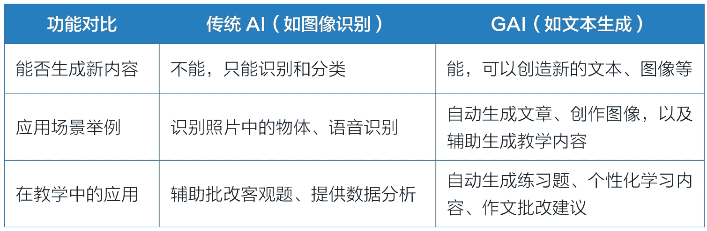

示例 1：语文教师输入“写一首关于春天的诗”，GAI可创作出押韵的诗歌（见图 1-1）。

图 1-1 用 Kimi 写的诗

示例 2：英语教师输入“画一只猫，图片上方写着英文‘cat’”，GAI可生成符合要求的图像（见图 1-2）。

图 1-2 用即梦 AI 生成的图片

GAI 还能够模拟人类思维，生成内容。这一能力主要依赖于两项核心技术：大型语言模型和深度学习。

**（二）大型语言模型：人工智能的“语言知识库”**

**1.什么是大型语言模型**

大型语言模型（Large Language Model，LLM）是 GAI 的核心部分，它是人工智能的“语言知识库”。

我们也可以把它当作一位博览群书的智者，通过阅读海量文字资料（例如书刊、古诗、网页等）来学习和理解语言，学会如何运用语言进行描述和解释。

这个“语言知识库”包含词语解释、句子结构、文章写作风格和不同语气表达等内容。当我们向大型语言模型发出指令时，它就能从这个“知识库”中撷取相关信息，像语言专家一样，运用所学语言知识生成适合的内容。

通俗化表达举例

举一个常见场景，教师向大语言模型提出：“请用小学生能听懂的语言解释光合作用”。模型会先评估提问者的理解水平，调取已有的表达储备，再结合贴近生活的比喻给出说明，比如把光合作用比作植物自己做饭，阳光、水、空气是食材，最终做出供自身生长的养分。

2. 大模型运行的两大阶段

运行过程通常可归纳为训练阶段与推理阶段两部分，见表 1-2。

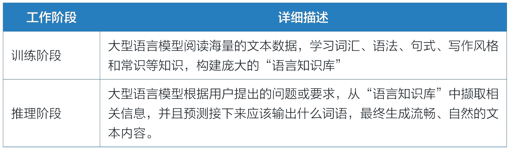

在训练阶段，模型需要阅读海量语料，来源包括小说、新闻、学术论文等多种文体。它会梳理词汇与句子的关联，逐步优化内部的参数表征以提升理解能力。

举例来说，模型能够学会“水果”与“苹果”之间的从属关系，也能辨别“说”与“喊”在语气强度上的差异。经过持续学习后，它可以把握语言的规律与使用惯例。

在推理阶段，模型把学到的规律用于新输入。用户给出问题或一段话，模型依据积累的语言经验，推断出最合理的回应或最可能的续写。

示例：输入“今天天气不错，我想去……”，模型很可能会补全为“去公园”或“爬山”等符合语境的活动（见图 1-3）。

图 1-3 某办公软件的智能写作辅助界面

3. 大模型在教育中的落地

教学场景里，大模型的应用面很广。

作文评改方面，模型能快速定位学生文本中的语法、结构问题并给出改进建议。比如学生写“我昨天去了学校，然后我去商店买书”，模型会提示把“然后”换成“之后”，使表达更顺畅。

课后辅导方面，学生可以直接提问获得即时反馈。例如学数学时问“二元二次方程怎么解”，模型会给出步骤清晰的演示。

此外，模型还能依据学生的兴趣与需求产出定制学习材料，支持自主学习。对地理感兴趣的学生，模型可以生成相关常识与配套知识点。

（三）深度学习：模仿大脑工作机制

1. 什么是深度学习

深度学习是人工智能分支下的一种机器学习思路，灵感来自人脑的工作方式。人脑由数十亿神经元构成，每个神经元接收信息后向其他神经元传递。深度学习借鉴此机制，通过多层神经网络即深度神经网络来处理与分析信息。

在深度学习里，数据像滚筒一样逐层穿过网络。每经过一层，网络会提炼数据，抽取更抽象的特征。最终模型利用这些特征做判断或预测。比如看图识物时，第一层可能捕捉基本形状，第二层辨识边缘与质感，最后一层才能确认图片内容。

2. 深度学习的核心技术：神经网络

神经网络由大量神经元组成，每个神经元接收输入后产生输出，工作方式近似人脑神经元经突触传递信号。

训练的本质是不断调节神经元间连接的强度即权重。该过程需要大量数据与算力，让网络从数据中提炼有效特征，最终形成判断准确的模型。

3. 深度学习的应用

深度学习可用于自然语言处理、图像识别、语音识别等多个方向，如表 1-3 所示为常见场景。深度学习还能帮助教师做数据分析与教学决策。例如生成式智能可以分析学生在学习中遇到的难点，自动调节内容与难度，提供差异化教学方案。

表 1-3 深度学习常见应用场景

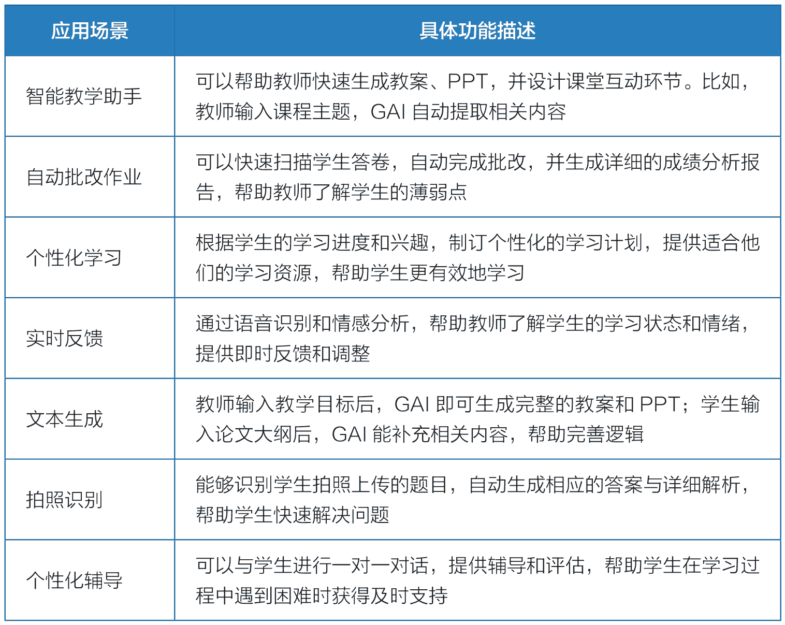

二、生成式人工智能的关键能力：自然语言处理与模式识别

本节深入解读自然语言处理和模式识别两项关键技术，探讨它们在学科教学中的运用，帮助读者理解原理及其在课堂上的使用方法。

（一）自然语言处理：让机器读懂人话

1. 自然语言处理的概念

教师日常与学生交流，讲课、布置作业、课后答疑都离不开语言。自然语言处理如同翻译官，目标是让计算机理解人类自然语言，实现人机顺畅交流。

该技术已进入生活，比如手机语音助理、翻译软件、网购智能客服，背后都是自然语言处理在运作。这些应用说明技术已融入日常，也在教育领域展现潜力。

图 1-4 某品牌手机搭载的智能语音助理

2. 自然语言处理的关键技术

分词、词性标注、句法分析、依存句法分析是自然语言处理的几项核心技术（见图 1-5）。

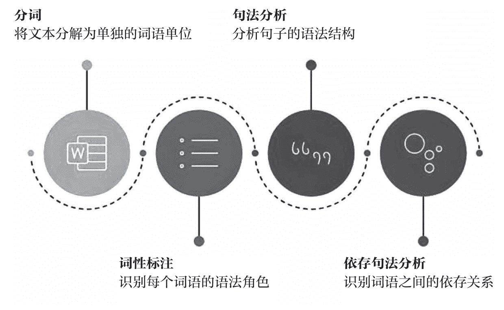

图 1-5 自然语言处理的关键技术

分词是语言处理的起点，类似语文教学中的断句与切词。中文分词比英文复杂，因无空格，计算机需把句子切成词。词性标注用于识别动词、名词等词性，理解语法作用。句法分析解析句子结构，理清语法关系。依存句法分析揭示词语间的依存关系，如主谓宾，有助于深入理解句意。

3. 自然语言处理在学科教学中的运用

自然语言处理在教学中价值突出。

（1）智能评改与写作辅助（语文、英语）
自然语言处理能减轻教师负担，在语文英语作文评改中发挥作用，还能提供写作辅助，部分软件可按主题给出思路、素材参考，甚至生成初稿，提升写作效率。

（2）阅读理解与文本分析（语文、历史、政治）
自然语言处理可帮助学生更高效深入地理解文本。可构建智能阅读系统，自动分析文章、生成问题、提取关键信息做摘要，还能从文本中抽取实体关系构建知识图谱。实践中，百度文库利用自然语言处理实现文档智能搜索、分类、摘要；知网平台利用自然语言处理提供文献智能分析、知识挖掘，辅助学术研究。

（3）智能问答与学习辅导（涵盖所有学科）
智能问答系统借助自然语言处理为学生提供在线辅导，理解问题、从知识库检索答案并用自然语言回复。个性化推荐系统通过分析学生数据识别薄弱点和兴趣，推送资源和练习。拍照搜题工具例如猿辅导、作业帮结合图像识别与自然语言处理展示应用。再如科大讯飞星火模型在智能客服、问答、教育辅导等领域体现自然语言处理潜力。

（二）模式识别：让机器学会“看”和“思考”

1. 模式识别的概念

自然语言处理赋予计算机“听”和“说”的能力，模式识别则赋予“看”和“思考”的能力。模式识别是让计算机从各类数据中自动发现模式，即数据中蕴含的规律和结构。

其应用领域非常广泛（见表 1-4）。

表 1-4 模式识别的应用领域

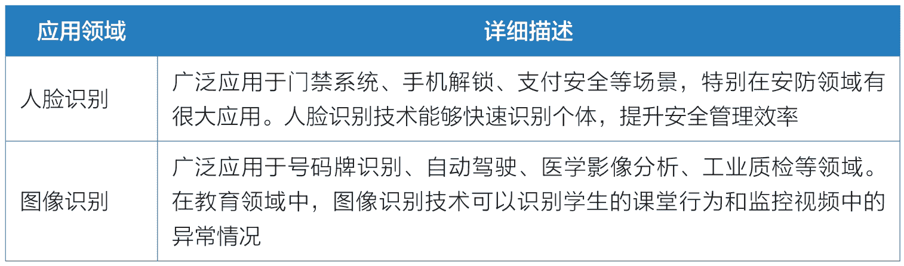

续表

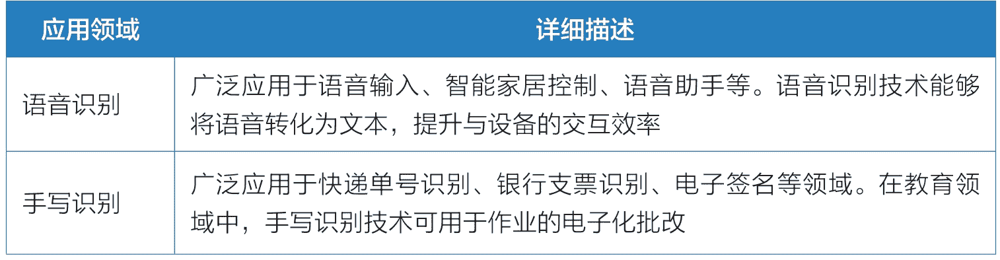

模式识别技术像“数据侦探”，能从海量数据中挖掘隐藏规律，为教学决策提供数据支持。

2. 模式识别的关键技术

（1）图像识别：赋予计算机视觉
图像识别让计算机读懂图像，识别物体、数量、场景和文字等信息（见图 1-6）。

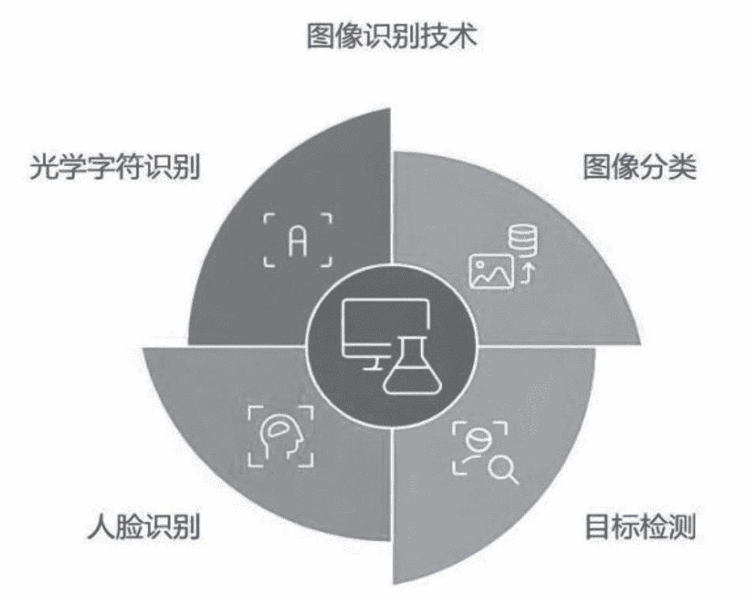

图 1-6 图像识别技术

（2）语音识别：赋予计算机听觉
语音识别即自动语音识别 ASR，将人类语音转为文本信息的技术（见图 1-7）。

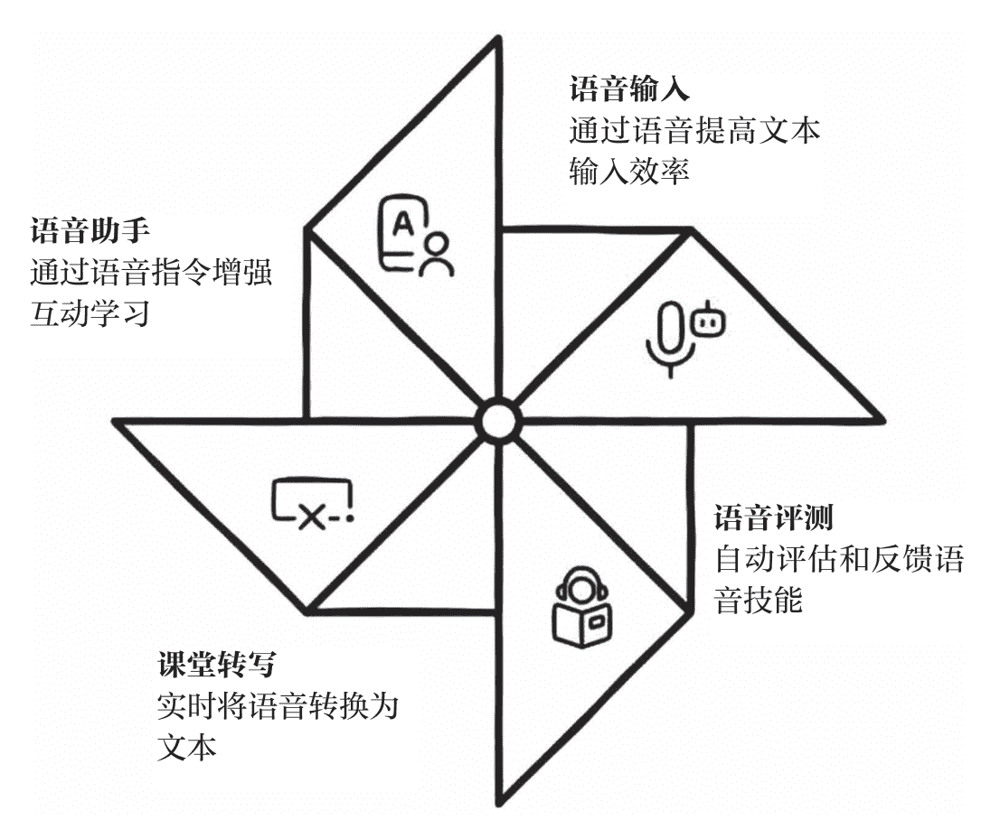

图 1-7 语音识别

3. 模式识别在学科教学中的运用

在教育领域，模式识别同样重要（见表 1-5）。

表 1-5 模式识别在教学中的应用

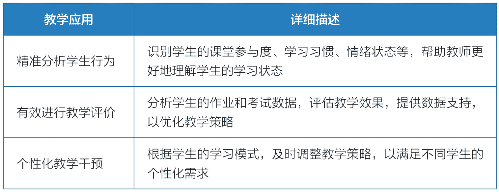

三、生成式人工智能的应用前景

前文介绍了生成式人工智能的底层逻辑和关键能力。对教师而言，生成式人工智能能带来哪些变革，哪些应用值得期待？

毋庸置疑，它不仅是技术革新，也是教育理念和模式的变革，将深刻影响未来教育生态，为师生带来机遇与挑战。

（一）定制化学习的加速器：满足每一位学生的差异化需求

中国教育长期追求公平与高质量。传统千篇一律模式难以兼顾每一位学生基础和兴趣差异，如何满足差异化需求是教师的难题。

生成式人工智能能依据学习情况和特点，为每位学生定制学习内容和辅导方案，真正实现因材施教。

应用案例 1：生成式人工智能动态分层精准教学实践
案例背景：广州某小学五年级英语教师发现学生英语能力分化明显，30%学生已掌握初中词汇，25%学生基础句型错误率达 65%。引入某生成式人工智能英语智学系统，通过动态诊断、分层资源和实时反馈实施精准教学。

技术应用与实施过程如下。
1.学情诊断分组
系统分析 Unit1～Unit3 知识点：核心词汇掌握率、语法错误聚类、听说能力分层，生成可视化报告并分组。整合课堂录音、作业及测试数据，构建动态知识图谱，输出三组学习方案。
2.分层资源生成
进阶组使用《小王子》语法填空，含 15 处陷阱及文学解析；基础组通过《动物园冒险》动画进行角色配音，系统实时标记时态错误并推送微课。
3.实时反馈机制
针对认知错误如“I has visited”，系统分析其认知缺失，推送定制微课及文化背景专项训练，达标后解锁创意任务。

应用成效：6 周后，班级英语标准差由 21.3 降至 8.5，基础组第三人称单数正确率从 38%升至 79%；进阶组词汇量达 6000 个；日均智能交互 23 次/人，语音练习增长 45%。

（二）教师效率的倍增器：让教师从繁琐事务中解放出来

备课、听课、批改、答疑、学情分析等工作繁重琐碎，生成式人工智能可减轻负担、提升效率，并自动化完成大量重复性工作，让教师聚焦更具创造性的任务。

应用案例 2：生成式人工智能驱动的全流程教学管理优化
数学教师备课时可用生成式人工智能工具快速生成课件和教案；智能生成练习题和测试卷；辅助批改作业和试卷；自动批改客观题，智能分析学情并生成报告。

如表 1-6 所示为某小学实行生成式人工智能辅助教学前后教师工作时间的对比。

表 1-6 传统教学模式与生成式人工智能辅助教学模式下教师工作时间对比

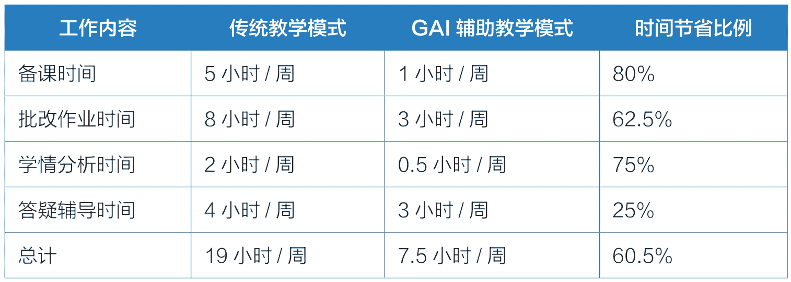

（三）教学方法的新引擎：激发学生的学习兴趣和创新潜能

生成式人工智能不仅是效率工具，更是创新教学、激发兴趣和潜能的引擎。

应用案例 3：生成式人工智能赋能的跨学科项目式学习实践
一位历史教师准备“古代丝绸之路”课程，可借助生成式人工智能：
创设沉浸式历史场景：生成逼真的丝绸之路场景，让学生身临其境感受古代贸易繁荣和文化交流。
生成互动式角色扮演游戏：设计角色扮演，让学生扮演商人、官员、使节、学者，在虚拟丝绸之路场景中进行贸易和文化交流，体验古人艰辛与乐趣（见图 1-8）。

图 1-8 学生通过 VR 眼镜在生成式人工智能场景中与历史人物互动
设计个性化探究式学习活动：引导学生用生成式人工智能工具查阅相关文献、文物资料，小组合作探究丝绸之路对东西方文化交流的影响或城市经济发展模式，培养探究与创新思维。

（四）教育公平的新助力：打破教育资源壁垒，惠及更多学生

城乡差距、区域差异、优质资源分布不均长期制约教育公平。生成式人工智能有望打破资源壁垒，让优质教育惠及更多学生。

偏远山区乡村教师可利用生成式人工智能平台获取优质教学资源，获得智能教学助手，并开展远程互动教学。

（五）未来展望与挑战：在发展中完善，在创新中前行

生成式人工智能在教育前景广阔，但也面临数据安全、隐私保护、伦理道德风险、教师角色定位等挑战。

1.未来展望
智能化的生成式人工智能导师和学伴：未来生成式人工智能将更智能，像经验丰富的导师一样提供深入个性化指导和情感支持。
开放的教育内容和形式：生成式人工智能将推动生成式课程、虚拟现实课堂、个性化学习游戏等创新，为学生带来更丰富灵活的学习体验。
更普惠的教育服务：生成式人工智能将降低优质教育资源获取门槛，让更多人享受优质教育，促进教育公平。

2.面临的挑战
数据安全与隐私保护：确保学生学习数据安全与隐私是首要任务。
算法偏见与伦理道德风险：避免算法偏见，防止不当使用，是需关注的伦理问题。
教师角色与技能提升：生成式人工智能普及要求教师重新定位角色，提升技能，有效利用技术优势。

（六）小结

生成式人工智能在教育应用前景广阔而深远，为定制化学习提供强大动力，精准满足差异化需求；为教师减负增效，使其更投入创新和专业成长；创新教学方法，带来更有趣丰富的学习体验；为促进教育公平提供新路径，让优质资源覆盖更多地区和学生。但发展中需关注数据安全、算法偏见等问题并积极寻求解决，才能充分发挥生成式人工智能优势，推动教育不断向前，构建更智能、高效、公平的教育新生态。

第二节 学科特点与生成式人工智能的匹配分析

不同学科因知识结构、思维方式与学习目标差异，对教学支持工具的需求各有侧重。传统统一策略常导致效率和体验双重损耗。生成式人工智能的到来为打通“学科特性—教学需求—技术供给”的桥梁提供了可能。

本节聚焦文科、理科、艺术学与体育学三大类，分析典型痛点与生成式人工智能适配潜力，构建针对性赋能框架，结合真实场景与案例，探索内容生成、逻辑推演、感官体验等方面的融合模式，并提出实施建议与风险防控要点。

一、文科学科的生成式人工智能赋能路径

新课标下文科学科如语文、历史注重文本理解、文化传承、情感浸润和批判性思维。教学需语言功底引导学生理解人文精神。生成式人工智能利用自然语言处理、文本生成、情感分析等技术，为文科学科提供新路径。下面从教学痛点与适配性、赋能框架、典型场景与案例三个维度分析。

（一）文科学科的教学痛点与生成式人工智能适配性

1.学科特点与教学挑战

文科学科的分类及特征如表 1-7 所示。

表 1-7 文科学科的分类及特征

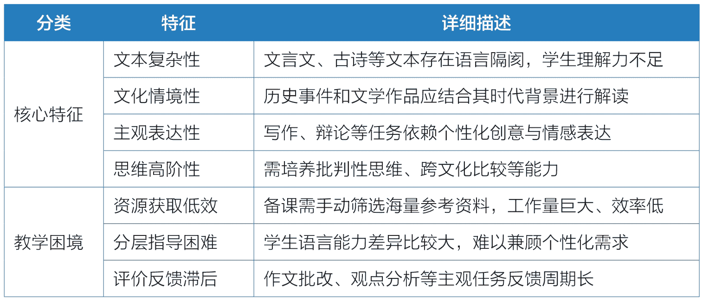

2.生成式人工智能的技术适配性

生成式人工智能技术特性与语言人文类学科需求高度契合（见表 1-8）。

表 1-8 语言人文类学科需求与技术支撑工具

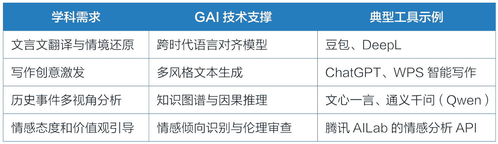

例如，在语文课《岳阳楼记》中，教师输入“忧乐精神现代意义”，生成式人工智能会自动生成古今价值观对比表格（见表 1-9），帮助学生把握文化传承脉络。

表 1-9 《岳阳楼记》核心思想跨时代解读

续表

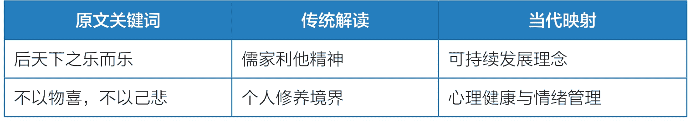

（二）文科学科的生成式人工智能赋能框架

基于学科特点与技术适配性，文科学科生成式人工智能赋能路径可构建为“三层四向”模型（见图 1-9）。

模型中的“三层”可理解为从资源支撑到能力培养，再到实践应用的逐步进阶赋能层次。

基础层：生成式人工智能作为资源引擎，提供文本、图像、音视频等多模态素材。

中间层：生成式人工智能作为认知脚手架，支持分层学习与思维训练。

应用层：生成式人工智能作为创作协作者，助力个性化表达与创新实践。

模型中的“四向”可理解为贯穿三层的核心赋能维度。

数据向：多模态资源的采集、清洗与结构化（基础层）。

认知向：学习者的知识建构与思维发展（中间层）。

# 课堂重启：生成式智能正在改写文理艺体

应用层落脚于人和模型共同完成表达与产出；贯穿始终的则是隐私保护、著作权归属与人文关怀的伦理把关。

图 1-9 GAI 赋能文科学科的“三层四维”模型

**1. 资源供给层：疏通备课与自学瓶颈**

智能文献检索：给出教学关键词后，系统推送教案草案、课件要点与延伸读物。比如“丝绸之路”单元，平台会把历史地图、商贸数据、文化故事整合成多源数字资源包。

多模态素材生成：利用图文转换与语音合成把抽象概念具象化。输入“安史之乱民生疾苦”，模型能产出动态地图和诗歌朗诵音轨。

**2. 认知建构层：搭建循序渐进的思维阶梯**

文言深度学习：古今互译的同时标注关键词的文化意象。如《出师表》“鞠躬尽瘁”，系统会自动关联“工匠精神”等当代案例。

批判思维训练：针对商鞅变法等争议议题，模型输出正反方论据矩阵，引导学生多角度审视。

表 1-10 商鞅变法正反方论据矩阵

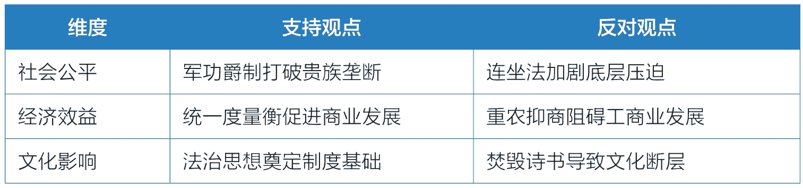

**3. 创新实践层：激活人文创造力**

分层写作辅导：依据写作水平给出差异化建议。对记叙文入门者提示“丰富环境描写”，对高阶者建议“尝试非线性叙事结构”。

跨文化对话演练：英语课堂中模型可扮演不同文化背景的虚拟角色进行情景交流。如模拟“中西餐差异”辩论，锻炼跨文化交际能力。

**（三）典型应用场景与案例分析**

**场景 1：GAI 支持古诗鉴赏教学**

教学痛点：学生共情不足，难以体会意象美与情感张力。

赋能路径如下。

意象可视化：输入《春望》“感时花溅泪”，模型产出战乱前后长安对比图，直观呈现“花”与“泪”的隐喻，见图 1-10。

情感迁移训练：将杜甫的忧国情怀迁移至当代语境，生成“若杜甫活在今天会关注哪些社会议题”的讨论题。

图 1-10 GAI 生成的战乱前后长安城对比图

**场景 2：道德与法治课的价值引导**

教学痛点：抽象价值观落地难。

赋能路径如下。

伦理困境模拟：模型构建“无人驾驶电车难题”等情境，学生通过选择反馈体会责任伦理。

社会热点拆解：输入“网络暴力事件”，系统自动提取法律条文、心理学原理与典型案例，并搭建多维讨论框架，见表 1-11。

表 1-11 “网络暴力事件”分析矩阵

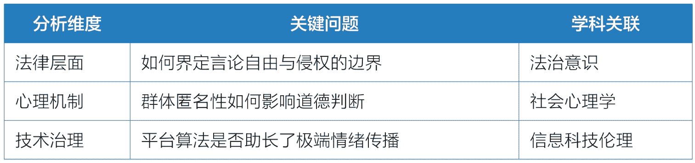

**（四）实施建议与注意事项**

**1. 教师角色转型**

由讲授者转向策展人：精挑模型产出，如从20个作文范例中筛选3个典型样本。

由评判者转向引导者：聚焦模型难以替代的价值引领，如文学审美体验、历史唯物史观培养。

**2. 关键技术选择**

文本生成工具：优先选用具备可解释性的平台，例如能展示写作建议推理过程的系统。

伦理审查机制：优先采用国产在线大模型，若本地部署则需增设敏感词过滤，避免产出偏见或错误史观内容。

**3. 教学评价创新**

双轨制评估：传统指标与模型增强指标各占一半，前者为语言准确性、内容完整性，后者为创意指数、跨学科关联度。

过程性追踪：借助模型分析课堂讨论录音，产出学生思维活跃度热力图。

### 二、理科学科的 GAI 融合路径

理科以逻辑推理、抽象建模与实验验证为核心，既要求知识传递精准，又要培养问题解决与科学思维。生成式模型通过符号推理、数据建模、虚拟实验等手段，为理科教学提供全新融合路径。以下从教学痛点与技术适配、融合框架、典型场景三方面展开。

**（一）理科学科的教学痛点与 GAI 的技术适配性**

**1. 理科学科的特点**

理科具有抽象性、逻辑性与实践性，教学难点集中在概念理解困难、实验资源受限、个性化指导不足，见表 1-12。

表 1-12 理科学科的分类和特征

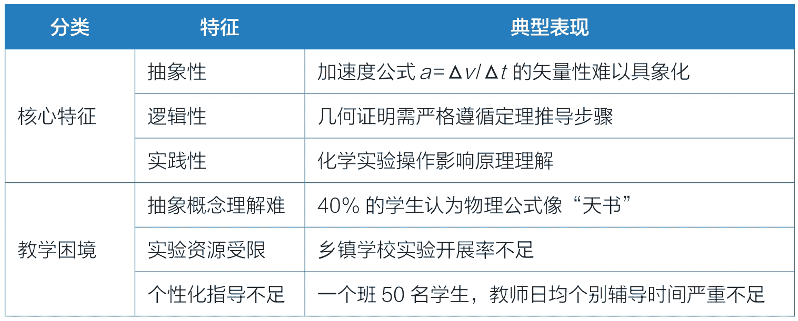

**2. GAI 的技术适配性**

模型的特性与理科教育需求高度匹配，见表 1-13。

表 1-13 理科学科需求与 GAI 技术支撑工具表

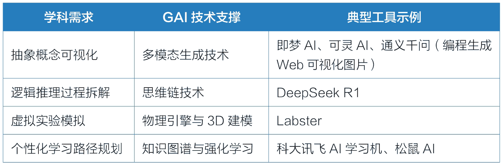

**（二）理科学科的 GAI 融合框架**

基于学科特性构建“三维赋能模型”。

知识具象层：将公式符号转化为可视化模型。

思维训练层：拆解复杂问题的推理链条。

实践创新层：搭建虚拟实验室与探究场景。

**1. 知识具象化：破解抽象概念理解瓶颈**

在具备编程能力的模型中，例如向 DeepSeek 输入“请用 HTML 生成正弦公式 y=A×sin(ωx+φ) 的可视化模型”，即可获得可交互代码。复制到 TXT 并改后缀为 html 后用浏览器打开，学生可拖拽滑块观察波形变化，加深理解，见图 1-11。

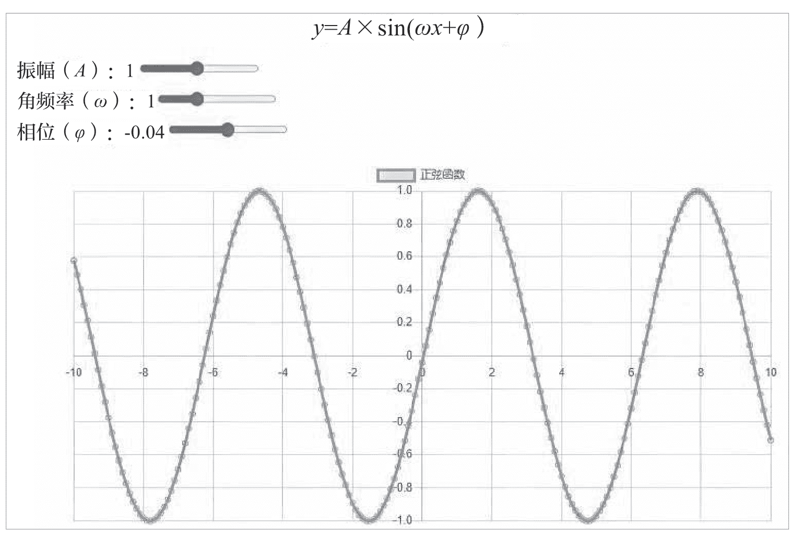

图 1-11 GAI 生成可视化的数学公式

**2. 逻辑思维训练：搭建科学推理脚手架**

解题步骤拆解：学生拍摄一道力学综合题后，模型不仅给出答案，还生成分步推理流程。

步骤 1：受力分析，画出重力、支持力、摩擦力。

步骤 2：建立正交分解坐标系。

步骤 3：列写牛顿第二定律方程。

**3. 虚拟实验创新：拓展探究边界**

高危实验模拟：在化学课中搭建虚拟实验室，学生可自由混合浓硫酸与水，观察飞溅现象，系统自动记录操作规范性得分。

跨时空探究：在 DeepSeek 输入“生成伽利略斜面实验模型，输出格式为 html”，即可得到17世纪比萨斜塔背景的虚拟场景，学生拖曳小球验证“加速度与质量无关”的结论。

**（三）典型应用场景与案例分析**

**场景 1：GAI 支持数学定理探究**

教学痛点：几何证明的逻辑链难以把握。

赋能路径如下。

动态几何生成：在 DeepSeek 输入“生成勾股定理可视化模型，输出格式为 html”，系统自动生成可交互直角三角形，学生可拖动顶点观察边长平方关系。

多证法对比：提供面积法、相似三角形法、代数法三种证明，并标注思维要点。

错因回溯：当学生误用余弦定理时，模型定位错误步骤并生成针对性微课。

**场景 2：物理力学问题智能辅导**

教学痛点：教师难以即时反馈每位学生的思路。

学生用手机拍摄滑轮组受力分析题，模型识别题目并生成解题过程。

步骤 1：确定动滑轮与定滑轮。

步骤 2：分析各段绳子的张力关系。

学生作答后，系统用红绿框标注对错，并生成班级错误热力图，便于教师针对高频错点讲解。

**（四）小结**

GAI 正重塑科学教育形态：让抽象的傅里叶变换化为声波可视化，把危险的化学爆炸变为可反复试错的虚拟实验，将千篇一律的习题课升级为精准诊断的思维训练场。技术的价值在于延伸而非替代人类探索，GAI 承担知识具象化与过程拆解后，教师更能引导学生体悟科学之美：在牛顿定律中感受简洁普适，在元素周期表中发现微观秩序，在几何证明中磨砺逻辑严谨。这种“机器处理确定性，人类启迪创造性”的融合，正是智能时代科学教育的突破口。

### 三、艺术学与体育学学科的 GAI 创新应用

艺术学与体育学强调动手能力、艺术表达与创造性思维，教学需要激发想象力并提供具体操作指导，传统课堂常受资源限制与个性化指导不足困扰。GAI 借助图像生成、音视频合成、三维建模等技术，为此类学科开辟虚实融合路径。以下从痛点适配、赋能框架、典型场景展开。

**（一）艺术学与体育学学科的教学痛点与 GAI 的技术适配性**

**1. 学科特点与教学挑战**

三大核心特征：高操作性、强主观性、长周期迭代。教师常陷入资源受限、指导低效、创新不足的困境。

**2. GAI 的技术适配性**

多模态能力与创意学科需求高度契合，见表 1-14。

表 1-14 艺术学与体育学学科需求与 GAI 技术支撑工具表

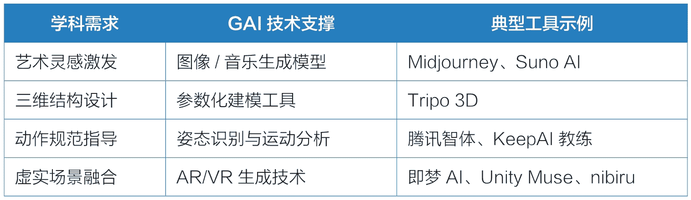

例如在陶艺课上，输入“宋代青瓷现代简约”后，模型自动生成釉色方案，见图 1-12，学生先在虚拟环境模拟拉坯再进行实体操作。

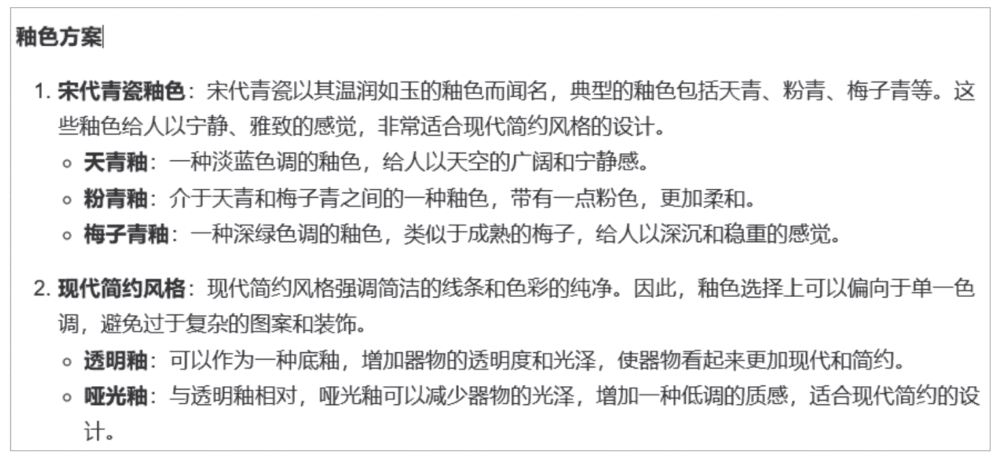

图 1-12 GAI 生成的青瓷釉色方案

**（二）艺术学与体育学学科的 GAI 赋能框架**

基础层：模型作为创意引擎，提供多模态素材与虚拟实训环境。

中间层：模型作为过程助手，实时指导操作与优化设计。

应用层：模型作为展示平台，构建数字作品集与创新生态。

**1. 创意孵化：打破资源边界**

智能素材生成：输入主题关键词，生成绘画草图、乐谱片段、舞蹈动作序列。如输入“未来城市环保”，得到科幻建筑群概念图供改造。

虚拟实训环境：AR 技术把画板变为数字创作空间，支持撤销重做与材质模拟。实验显示，使用 GAI 画板的学生色彩搭配能力提升 42%。

**2. 过程指导：精准降低门槛**

实时纠错反馈：摄像头识别素描透视错误，用红线标注消失点偏差。

个性化方案推荐：按学生设计进度推送改进建议。如木工课上检测到榫卯松动，推荐三种加固方案。

智能体即时评分：作品提交后即时打分并给出修改意见。

**3. 成果创新：拓展表达维度**

多模态作品集成：用 Tripo 3D 扫描实体作品为 3D 模型，结合模型生成背景故事与互动特效。

智能策展系统：利用 nibiru 生成虚拟美术馆，按主题展示学生作品。某校艺术节中，GAI 策展使参观者互动时长增加 65%。

**（三）典型应用场景与案例分析**

**场景 1：GAI 支持美术创作**

教学痛点：临摹多、创作少，构图能力弱。

赋能路径如下。

灵感激发：在可灵 AI 输入“山海经赛博朋克”，生成 10 张奇幻生物概念图供二次创作。

构图指导：把学生草图转化为九宫格分析图，标注视觉重心与留白比例，见表 1-15。

表 1-15 评估维度优化建议表

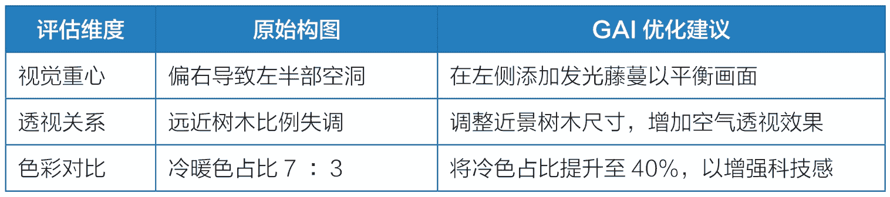

**场景 2：GAI 赋能音乐创编**

教学痛点：乐理基础薄弱，旋律创作困难。

赋能路径如下。

智能作曲：学生哼唱旋律片段，Suno AI 自动生成和弦伴奏与流行、爵士、古风等改编版。

跨学科融合：结合语文诗歌，模型把《静夜思》转为五声音阶旋律，学生可用陶笛演奏。

**场景 3：GAI 革新体育教学**

教学痛点：动作规范难把控，易受伤。

赋能路径如下。

姿态捕捉：摄像头识别广播体操动作，生成关节角度偏差热力图。

虚拟陪练：AR 眼镜投射游泳姿势指导线，实时纠正换气节奏。

**（四）实施建议与风险规避**

**1. 工具选择原则**

适老化设计：选用界面简洁的国产工具如即梦 AI、可灵 AI，降低学习成本。

离线功能优先：确保无网络环境下仍可使用核心功能，如本地部署的 AI 绘画软件，需配套敏感词过滤。

**2. 教学实施要点**

虚实比例控制：美术课建议先完成 70% 实体创作，再用 AI 效果增强。

作品确权教育：通过区块链存证平台如腾讯至信链，教会学生保护数字作品版权。

**3. 风险防范措施**

内容过滤机制：设置屏蔽词如血腥、暴力，防止不当内容生成。

防沉迷设置：限制 AR/VR 设备单次使用时长，避免视觉疲劳。

**（五）小结**

GAI 正重构实践与创意教育的边界。陶艺从捏泥巴扩展到虚拟建模，音乐创作从五线谱进化到声纹交互，教师的核心价值愈发凸显——不再是操作工，而是创意点燃者。在模型生成的无限可能性中，教师应引导学生捕捉“意料之外”的灵感闪光点，让技术理性与艺术感性碰撞出真正的创新火花。这种“GAI 铺路，人文架桥”的融合，正是破解实践教育困境的关键。

## 第三节 教师在学科实践中的新角色与新技能要求

随着 GAI 深度嵌入课堂，教师角色正从知识传授者转向学习引导者与智能协同者。传统课堂高度依赖教师经验筛选信息，GAI 提升资源生成效率，使教学重心从“教什么”转向“如何教”“为何教”。本节梳理工具应用、课程融合、数据解读与伦理素养等方面的新能力，助力教师实现从技术适应到智能引领的跃升。

### 一、教师角色的转变

教学模式从讲台中心转向学生中心，教师角色随之变化。

**（一）由“知识传授者”转向“学习设计者”**

核心变化：模型可快速提供标准化知识，教师转向设计个性化学习路径。

具体表现。

任务设计：利用模型分析学情，设计分层任务。

示例：某初中英语教师使用 GAI 作文批改系统自动分析全班共性语法错误，针对不同水平设计“基础纠错组”“创意提升组”等差异化任务，见图 1-13。

图 1-13 GAI 辅助分层任务设计流程

资源筛选：从海量模型内容中挑选优质资源。小学数学教师通过国家中小学智慧教育平台的 AI 题库，一键生成符合本地考情的习题包，备课时间节省超 50%。

**（二）由“单一评价者”转向“过程分析师”**

核心变化：从结果评价转向过程诊断。

教育评价方式对比见表 1-16。

表 1-16 教育评价方式对比表

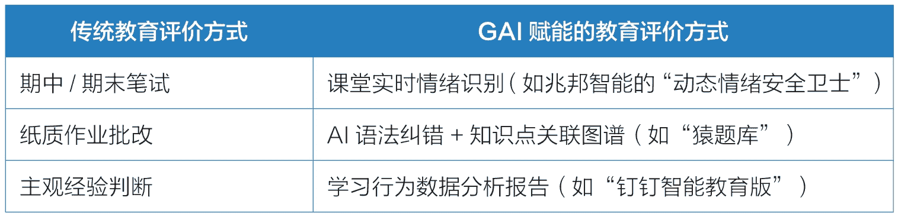

示例：某中学引入 GAI 课堂观测系统，通过摄像头捕捉表情、姿态数据，生成“课堂专注度分析表”，见表 1-17。教师据此实时优化互动频率，对后排学生实施分层关注，提升专注度。

表 1-17 课堂专注度分析表

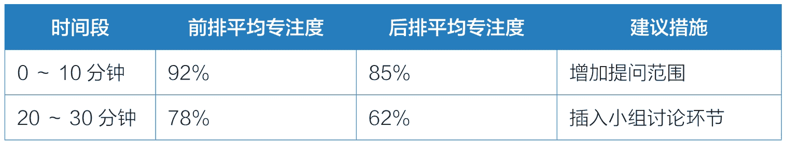

**（三）由“课堂主导者”转向“协作引导者”**

核心变化：模型承担重复性工作，教师聚焦高阶思维活动。

典型场景。

理科课堂：模型完成数据运算后，教师带领思考“如何验证模型结果的正确性”。

示例：高中生物课上学生先用 PhET 仿真软件进行遗传实验模拟，再小组讨论“模型预测与实际差异原因”。

文科课堂：模型生成辩论素材，教师主持观点攻防。

示例：小学道德与法治课中，教师引导学生用通义千问生成“该不该给游戏充值”的正反论据，并组织角色扮演，见图 1-14。

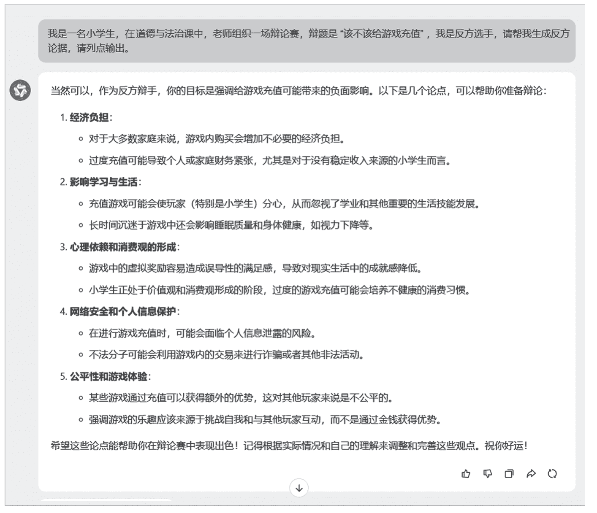

图 1-14 学生通过 GAI 获得反方辩论论据

**（四）由“技术使用者”转向“创新整合者”**

核心变化：教师结合学科特点自主开发应用场景。

实践路径：熟练使用通用工具如 DeepSeek、豆包；进阶到低代码平台如通义灵码定制学科插件；创新层则联合技术人员开发校本化模型。

示例：某小学科学教研组基于飞桨框架训练校园植物识别模型，学生拍摄树叶即可获得扩展知识。

**（五）由“学科教师”转向“跨学科协作者”**

政策背景：2022 年新课标强调跨学科主题学习，GAI 为打破学科壁垒提供技术支撑。

协同教学与师能重塑

课堂联动的边界正在被打破。

横向联动：多学科教师联手搭建生成式AI资源池。实例：某初中历史教研组与地理教研组合作开发“丝绸之路”虚拟情境课，AIGC自动补全沿线地貌、贸易数据等跨科素材。

纵向打通：学段之间复用AIGC教学成果。实例：某教育集团借助钉钉云课堂沉淀小学至高中阶段的AIGC案例，减少学段衔接时的内容重复。

（六）从经验驱动到数据驱动

核心素养迁移。过去课堂多靠教师直觉展开教学，以集体备课加手工记录来规划与复盘。随着技术演进，关键能力正转向数据驱动。

教学直觉被学情洞察替代。借助班级优化大师等分析应用，教师能更精准把握学情与需求，进而制定有效策略。

集体备课融入资源挖掘。借助学科网智能助教等系统，教师可快速获取海量教学资源，提升备课效率与质量。

纸笔记录转向行为预测。希沃易课堂等智慧教学工具可记录并解析学习行为，预判学习走势与潜在风险，为教师提供即时反馈与调整依据。

此次转型抬高了教学精度与效率，也推动了教育科技的创新发展（见表1-18）。

表1-18 核心能力转型

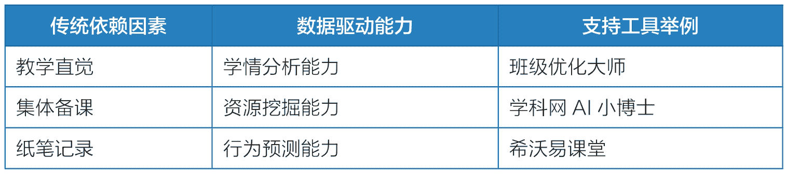

实例：某乡镇中学经AIGC系统筛查发现，数学薄弱生中68%的问题可追溯至小学分数运算。教师据此设计专项补救方案后，及格率三个月内从51%提升至79%。

### 二、教师的能力新谱系

生成式AI进入课堂后，教师角色由知识传递者转向学习架构师、过程分析师与协作引领者。这要求教师习得新能力，以便更好地驾驭生成式AI的价值。

（一）生成式AI应用能力：从熟悉到熟练

生成式AI的效能依赖工具支撑。教师不能止步于听说或浅尝。未来需要熟练运用多种AIGC工具，才能将其贯穿教学全流程。

这不只是会点软件，更要透彻理解工具的功能特质、适用场景与局限。例如面对文本生成类应用，教师既要会指令生成，也要懂其语言模型原理，能评判输出质量与适用性，并按学科与教学目标灵活调用。

1.能力成长重点

常用AIGC工具操作：熟练使用文本生成、图像生成、语音识别、数据分析等模态工具（见图1-15）。

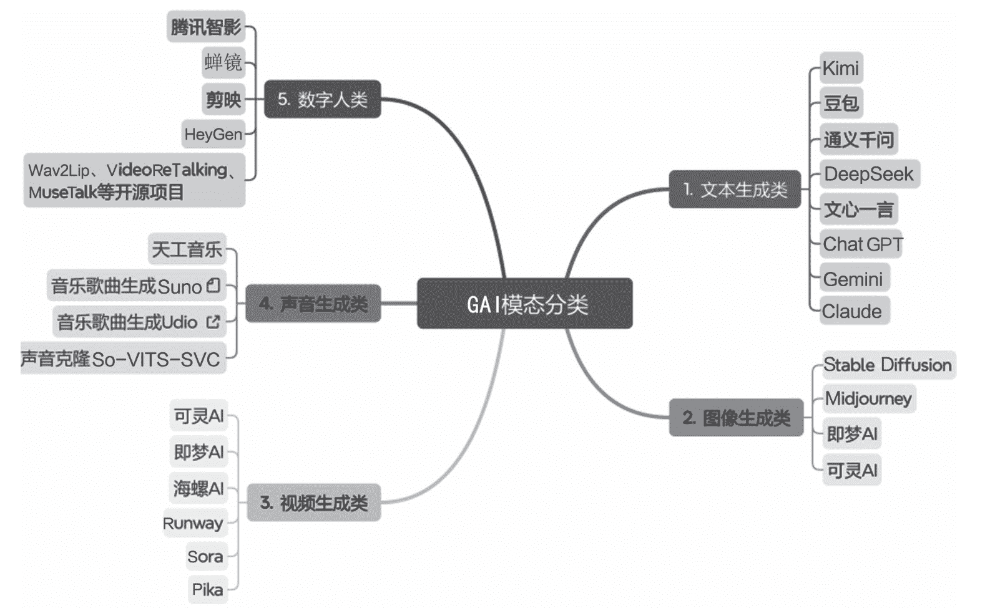

图1-15 AIGC模态分类

底层技术认知：理解大型语言模型、深度学习等核心概念，以便更好辨别优劣。

按需择优：针对不同教学目标与学科特点挑选最合适的工具辅助教学。

测评与优化：能评估工具使用效果，并根据实际反馈调整优化，提升使用效率。

2.实践案例

一位语文教师为提升学生写作水平尝试AIGC。起初只让学生生成初稿。深入使用后她发现工具还能语法检查、提供写作思路、实现风格迁移。于是引导学生先头脑风暴生成不同风格素材，再用语法纠错功能修改，最终大幅提升写作效率与作品质量。

（二）课程设计与融合能力：从常规到创新

传统课程以教材为中心，教师多扮演知识传递角色。生成式AI的出现为课程设计带来新思路。未来教师需把AIGC工具巧妙融入课程，打造更具创新性、个性化与互动性的课堂。

这要求教师既熟悉课程内容，又能洞察学生学习需求与特点，将人工智能与教学内容有机结合，设计出激发兴趣、促进深度学习的活动。如利用AIGC生成个性化学习资源，设计探究式任务，开展互动式评价等。

1.能力成长重点

基于AIGC设计创新教学活动：如探究式学习、项目式学习、情境模拟等。

生成个性化学习资源：按学生水平与兴趣生成不同练习题、阅读材料、案例分析等。

融入教学评价：利用AIGC进行作业自动批改、学情分析、个性化反馈等。

跨学科融合设计：把AIGC工具与其他学科知识结合，设计跨学科主题学习活动。

2.实践案例

教师用AIGC图像生成技术输入“古代战场、烽火狼烟、将士出征、盔甲鲜明”等提示词，迅速生成气势磅礴的古代战争场景图。画面中花木兰英姿飒爽，手持长枪，战马嘶鸣，旌旗飘扬，士兵身披铠甲严阵以待，紧张氛围扑面而来。

为增强沉浸感，教师还用AIGC语音合成技术将《木兰诗》经典段落合成古风朗读旁白。教室里回荡古代战歌与合成旁白，营造战场氛围。

教师把生成的场景图展示在互动大屏上并播放朗读音频。学生闭眼跟随引导展开想象，仿佛置身古代战场。随后教师引导学生结合AIGC营造的意境再品课文，理解花木兰的家国情怀。

AIGC打造的沉浸式场景让学生多感官体验，身临其境感受历史氛围，激发兴趣并提高学习效率（见图1-16）。

图1-16 利用AIGC工具打造沉浸式《木兰诗》教学场景

（三）数据分析与解读能力：由经验转向数据

传统教学中教师多靠经验与直觉判断学情与效果。AIGC应用后产生大量学习数据。未来教师需具备数据分析与解读能力，才能实现精准教学与个性化指导。

这要求教师既会收集整理数据，也要深度解读数据背后的含义，洞察学生学习行为与需求。如通过作业、测验、课堂互动数据了解知识掌握、兴趣与风格，调整策略提供精准支持。

1.能力成长重点

数据采集整理方法：了解如何从各类教学平台与工具获取学生学习数据。

基础数据分析方法：学会使用统计图表、数据可视化工具分析学习数据。

教学意义解读：从数据中发现学习规律、问题与需求，转化为教学改进依据。

数据伦理意识：了解学生数据隐私与安全，合规合理使用。

2.实践案例

一位语文教师使用科大讯飞智慧课堂学情分析平台自动采集分析电子作业、在线练习与互动表现数据，生成详细报告。

报告显示班级对“古诗词鉴赏”掌握不足，特别在意象分析与情感把握较弱，同时呈现学习风格差异。

据此教师调整策略，重点讲解薄弱环节并推送个性化资源以适应不同风格学生。

在平台支持下实现精准教学，学生古诗词鉴赏水平显著提升，各风格学生均有效学习（见表1-19）。

表1-19 智慧课堂学情分析平台学生学习数据示例

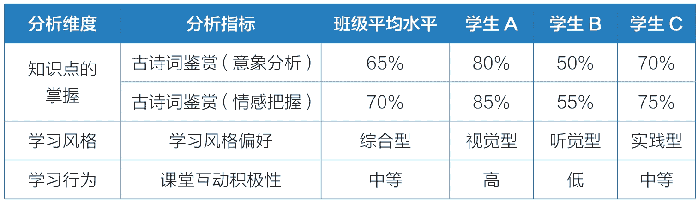

（四）批判性思维与伦理素养：由接受转向甄别

生成式AI功能强大但生成内容并非完美。文本工具可能出现事实、逻辑错误，图像工具可能涉及伦理问题。未来教师需具备批判性思维与伦理素养，正确使用生成式AI工具。

这要求教师审慎评估AIGC输出的质量与可靠性，并引导学生树立正确价值观与伦理观，避免过度依赖，培养独立思考与解决问题的能力。如在作文写作辅助中，引导学生批判审视初稿并完善，而非照搬。

1.能力成长重点

批判性评估输出：能识别文本生成中的事实错误、逻辑错误与表达问题。

辨别偏见与伦理风险：了解图像生成可能存在的歧视性偏见并引导学生正确看待。

引导批判思考与独立判断：培养学生将AIGC作为辅助而非替代，进行独立思考。

伦理道德教育：引导学生负责任地使用生成式AI技术。

2.实践案例

一位英语教师使用AIGC写作辅助工具时发现，生成文章虽语言流畅但内容空洞且有事实错误。课堂上她引导学生批判分析生成文章，找出优点与不足并修改完善。学生既学会使用工具，也培养了批判性思维与独立思考能力。

（五）协作沟通与终身学习能力：由单兵作战转向协同发展

教育数字化智能化日新月异，生成式AI技术持续迭代。未来教师需更强的协作沟通与终身学习能力以适应变化。

这要求教师积极参与学习与培训掌握最新技术与方法，并加强与同行、专家、技术人员的交流合作，共同探索AIGC教育应用、解决实践问题。如加入教师社群分享经验，与技术人员共研教学工具。

能力成长重点如下。

主动学习新技术与知识意愿与能力：积极参加生成式AI相关培训、工作坊，阅读文献资料。

与同行有效沟通协作：加入教师社群分享经验，开展教学研究。

跨界合作：与生成式AI领域专家交流了解技术动态，与技术人员合作开发教学工具。

反思与创新：反思自身AIGC教学实践并持续改进，提升效果。

（六）小结

面对生成式AI带来的变革，教师需主动提升技能。由工具应用、课程设计与融合，到数据分析与解读、批判性思维与伦理素养，再到协作沟通与终身学习，这些新要求既是适应未来教育的必要条件，也是教师在AIGC时代实现专业发展、服务学生、引领变革的关键。

### 三、教师的专业发展路径

面对生成式AI带来的变革，教师角色与技能正深度转型。教师不仅要掌握新技能，还要转变定位。持续专业发展至关重要，已不限于学科知识或教学技巧提升，而是适应人工智能时代教育生态、实现价值跃升的关键路径。

在生成式AI蓬勃发展的时代，教师专业发展如何规划？以下为中小学教师提供可操作的路径，帮助拥抱变革、乘势而上。

整体而言，教师专业发展应是持续、多元、自主的过程，不仅限于传统培训讲座，更要注重实践探索、同伴互助与自我反思。以下从五个维度展开。

（一）拥抱自主学习：构建个人AIGC学习地图

信息爆炸时代，教师需自主学习，掌握个人AIGC学习地图，追踪技术动态。生成式AI更新快，集中式培训难满足个性化需求。

指引如下。

利用在线资源随时随地学习相关课程，如网易云课堂、学堂在线等，覆盖技术原理、应用案例、教学实践。

关注专业网站、博客、公众号了解最新进展与行业动态。

学习AIGC教育工具官方教程，掌握操作技巧与应用方法。

加入AIGC教育相关社群，如教师社群、论坛、微信群，分享心得、交流经验、解决难题。

在社群中获取信息、获得同伴支持、拓宽视野。

构建个人知识库积累成果：建立学习笔记记录重点难点；收集优质资源；撰写学习反思总结经验教训。

（二）参与同伴互助：构建学习共同体，促进集体成长

教师专业发展应重视同伴互助，共同应对AIGC应用挑战。通过学习共同体与互助活动促进集体成长。

具体路径如下。

组建校本教研团队开展集体备课，以学校或教研组为单位共同学习AIGC知识、研讨教学设计、分享资源；深入研读AIGC教育理论，集体设计融合课程，探讨工具融入与教学创新；分享使用经验与技巧提升应用能力；通过同课异构与观摩学习了解不同应用模式，借鉴优秀设计，反思自身实践；定期开展案例研讨共同解决问题，聚焦学习效果提升、资源优化与课堂互动增强（见表1-20）。

表1-20 同伴互助活动形式与目标示例

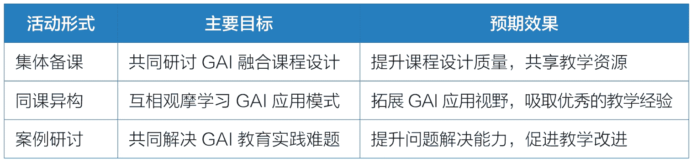

（三）参与专业培训：系统提升AIGC教育素养

教师可通过多种途径提升自己在AIGC教育领域的专业能力。首先可参加教育部门、师范院校或教育研究机构组织的培训项目。高校教师发展中心定期举办专题培训工作坊，各级教育行政部门也会组织面向中小学教师的AIGC教育培训项目。

其次可参与专业机构或企业提供的认证课程，更注重实践与技能培养。如AIGC软件厂商提供产品认证课程，帮助掌握深度使用技巧；教育科技公司提供解决方案培训，帮助了解技术融入学校教学体系。

对有更高学术追求的教师，攻读在职学位或获取专业证书是提升学历与技能的有效途径。通过系统学历教育可深入学习理论体系，提升科研能力，为职业发展开辟空间。

（四）投身行动研究：在实践中探索AIGC教育创新

理论学习与技能培训重要，但专业发展的目标是将所学应用于教学实践并不断创新。行动研究是有效方式，鼓励教师把课堂作为实验室，在真实情境中探索应用模式、解决问题并改进方法。

聚焦教学痛点，教师可从日常问题入手确定主题，如用AIGC工具提升写作兴趣、开展个性化教学或创设沉浸式环境。围绕主题制定行动方案：明确目标、选择工具、设计活动、确定数据收集方法。教学实验中持续收集数据如作业、问卷、观察、访谈，分析评估效果，反思实践并据结果调整改进。行动研究循环往复，需不断实践、反思、改进。最后撰写研究报告并分享成果，通过校本教研、学术会议、期刊媒体等方式交流扩大影响力。

（五）构建反思文化：持续审视AIGC教育实践，促进学生深度成长

反思是专业成长的关键。AIGC教育中教师应建立反思文化，审视教学行为与效果，总结经验。通过建立教学反思日志，定期记录教学设计合理性、工具有效应用、是否满足学生需求等。关注课堂流畅性、学生参与度、工具恰当应用，评估学习效果是否提升并达成目标。

提升反思质量可使用多种工具。如教学录像分析发现问题不足；学生反馈问卷了解感受与评价；同伴互评量表从同伴反馈发现问题。这些工具帮助更深刻理解情境、全面了解过程、洞察学生需求。开展教学叙事研究是深度挖掘教育智慧的有效途径，可更全面反思理念并与价值观紧密联系，进行深度反思与再建构。这不仅促进个人成长，也提升教育系统质量。持续反思改进有助于应对AIGC挑战，为学生提供更优质教育体验。

（六）小结

生成式AI为教育带来机遇，也对教师专业发展提出挑战。机遇与挑战并存，教师应积极拥抱变革、主动学习、勇于实践，在人工智能浪潮中找到专业发展之路。通过持续自主学习、同伴互助、专业培训、行动研究与反思实践，教师可成为人工智能时代的“学习设计者”“过程分析师”“协作引导者”，在教育变革中实现专业价值，为培养面向未来的创新人才贡献力量。

# 第二章 生成式AI赋能文科教学实践：语义理解与图像分析技术

文科教学在内容呈现与学习互动中面临多样化挑战，生成式AI凭借语义理解与图像分析技术为传统教学提供全新解决方案。本章聚焦生成式AI在文科教学中的作用，重点探讨智能文本生成与批改、智能资料分析与呈现、智能图像生成与数据可视化技术应用三个方面。首先介绍生成式AI在智能文本生成与批改中的应用原理与实际场景，展现其在提升教学效率与个性化辅导方面的潜力；然后分析生成式AI如何通过智能资料分析与呈现优化教学资源，促进教学模式转变；最后探讨生成式AI在智能图像生成与数据可视化技术中的创新应用，帮助教师通过多感官体验提升学生认知深度与兴趣。通过本章学习，教师将能有效借助生成式AI技术提升文科教学质量，创新教学手段，优化教学体验。

## 第一节 智能文本生成与批改

GAI 驱动语文英语教学的高效转型

人文课堂里，写作产出和教师评阅一直是核心环节，也是耗时且主观性强的部分。大模型凭借语言生成和语义理解的优势，正在改写语文、英语的内容准备和反馈方式。本文先从理论依据和技术机理展开，梳理智能写作与评改的运行逻辑与设计思路，再聚焦语文、英语及跨学科的典型应用与工具，并通过实操案例呈现其对提效、个性化指导与评价优化的实际作用。

### 一、写作生成与智能评改的理论与技术基础
**（一）写作生成的学习理论依据**
**1.建构派学习观**
建构派认为学习者不是被动接受信息，而是主动在情境中建构意义。知识是在真实问题中与经验互动而产生的，关键在于情境化实践、社会化协商和教师的引导角色。Piaget 的同化顺应思想与 Vygotsky 的文化历史观是其来源。大模型可输出定制化读写材料并提供即时互动，支撑学生完成情境搭建、自主探究到意义内化的闭环。例如在语文或英语课程中布置故事续写，能激活既有经验并促进创造性表达，提升思维与语言能力。
**2.语言习得观 英语学科**
该视角重视输入质量与交际实践。认知建构认为语言能力的形成源于内在机制、社会经验与认知发展的协同。大模型可在购物、问路、兴趣、出行等生活化场景中产出英语对话，呼应 Krashen 的可理解输入假说，让学习者在接近真实的语境中自然习得，提升交际效能。
**3.ZPD 视角 语文学科**
ZPD 强调从现有水平向潜在水平推进。语文教学常以分层阅读由浅入深、以仿写支架过渡到创意表达，并借助合作对话提供脚手架。大模型能依据学情动态调节材料难度，如古诗翻译的深浅、人物情节的理解层次，为学习者提供适度挑战的练习，推动认知跃升。
**（二）评改赋能的技术实现原理**
**1.自然语言处理**
大模型的 NLP 基于深度学习与大规模预训练模型如 GPT、BERT，掌握语言规律并实现生成、理解、翻译。核心技术包括自注意力、Transformer 结构与多任务学习，使模型具备上下文捕获与语义推理能力。应用涵盖智能对话、内容创作、情感分析，可通过零样本与持续微调适配不同需求。
**2.对抗生成网络与强化学习**
对抗生成网络与强化学习协同形成优化框架。生成器模拟数据分布，判别器给出反馈信号，强化学习动态调整策略以最大化奖励。对抗生成增强强化学习的探索，强化学习提升对抗生成训练的稳定性并避免模式崩溃。评改中，模型可将学生作文与标准语料对比，并借助强化学习优化反馈策略，提升纠错准确性。
**3.多模态融合**
多模态融合整合文字、图像、音频、视频等信息，通过跨模态对齐及联合表征技术如 CLIP 等，模拟人类多感官学习。核心在于按认知风格动态生成适配内容。图文解析概念、音视频增强情境、情感计算优化反馈，均可提高知识内化效率。看图写话借助图像生成与文字生成提升具象表达；语音识别结合 AI 对话则增强英语口语互动。
**（三）写作生成与评改的设计取向**
**1.学习者优先取向**
大模型依托语言学、统计学方法，结合机器学习与深度学习实现文字处理与语义理解。如输入学生偏爱的动画题材，就可产出契合语文教学需求的写作素材。借助 NLP，AI 学习平台可模拟真实口语场景。若学习者练习时说出“你最喜欢的运动是什么？”，平台会依水平调节难度并回应“我的喜好是踢足球”，随后追问延续对话。这种兴趣驱动的互动训练能提升学习动机与口语流利度。
**2.内容语义解析取向**
依托文字分析，大模型不仅能捕捉语法错误，还能对结构与内容提出建议。如学生作文出现“他通常去上学买食物”，系统会即时改正为“去上学走路”，并提示补充细节或使用过渡词增强连贯：“先吃早餐，然后步行上学”。平台可深度剖析段落安排、信息呈现、主题表达，并给出语法拼写纠错与结构建议。
**3.持续改进与即时回馈取向**
写作教学依赖大量练习与及时反馈。统编初中语文 36 个写作单元提供了丰富训练，如记事、突出中心、抒情、抓细节等，但实际反馈常滞后且缺乏深度，影响反思与非认知发展。大模型可全程陪伴写作，对不同阶段的文字给予即时、动态、针对性的回应，形成可追溯的历时反馈链。学习者可对照初稿与迭代稿针对薄弱点修正，从而深化理解、提升技能并增强自我效能感。

### 二、大模型在语文、英语教学中的应用场景
大模型在语文学科与英语学科的价值体现为三点：构建沉浸式语言学习环境、借助智能协作工具生成文字促进探究、依托人机协同完成评改。技术链条串联“情境—内化—检测—优化”的完整探究闭环，帮助学生解决综合文科问题，培养数字化素养。
**（一）价值概述**
个性化互动内容与实时反馈提升教学效果与自主学习能力。其一，丰富资源，ChatGPT、文心一言等可生成故事、诗歌、对话等素材激发兴趣；其二，提升效率，自动评改减轻教师负担并即时反馈；其三，支持个性化学习，按学生水平生成差异化材料。
**（二）智能文字生成工具**
大模型通过学习海量文字数据生成符合语法与语义的新文字，在文科教学中广泛用于素材创作与课堂互动。表 2-1 列出了常见智能文字生成工具及其特点。
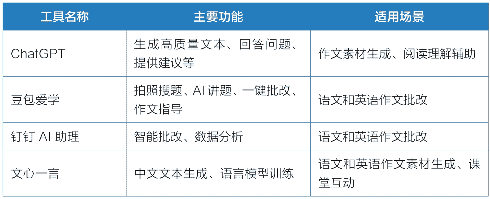
**（三）语文教学应用场景**
**1.文字生成：激发创意表达 见表 2-2**
表 2-2 文字生成：激发创意表达场景及应用
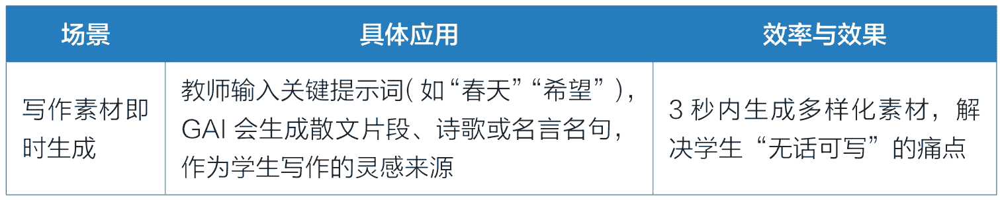
续表
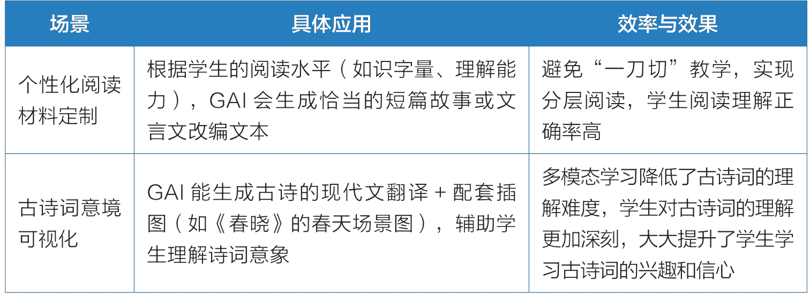
**2.文字评改：精准反馈闭环 见表 2-3**
表 2-3 文字评改：精准反馈闭环场景及应用
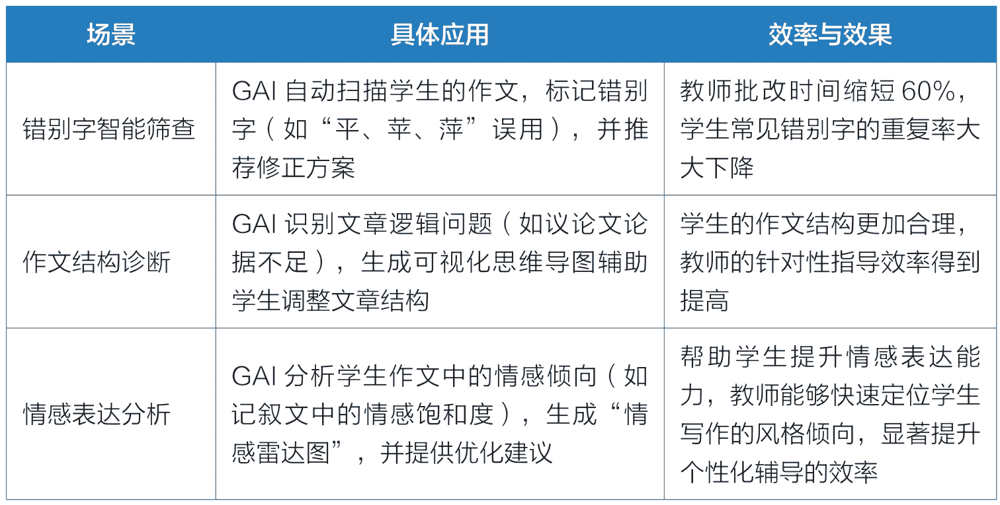
**（四）英语教学应用场景**
**1.文字生成：构建真实语境 见表 2-4**
表 2-4 文字生成：构建真实语境场景及应用
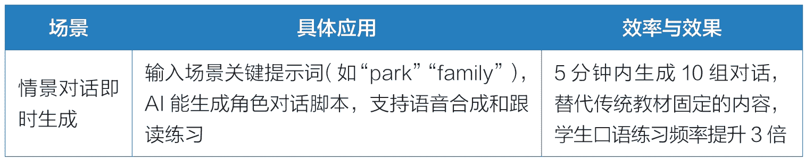
续表
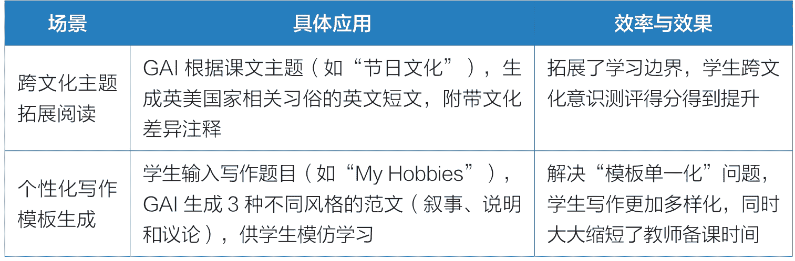
**2.文字评改：语言精准度强化 见表 2-5**
表 2-5 文字评改：语言精准度强化场景及应用
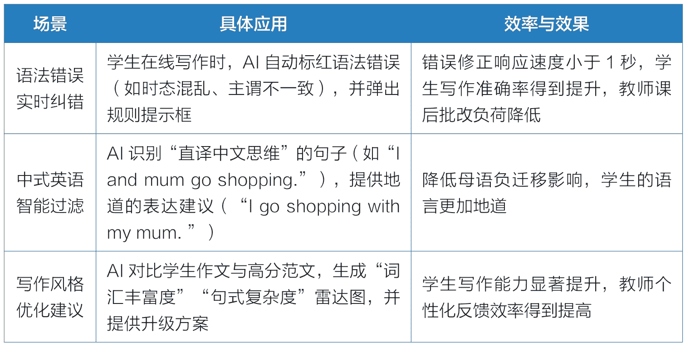
**（五）跨学科高效融合 见表 2-6**
表 2-6 跨学科高效融合场景及应用
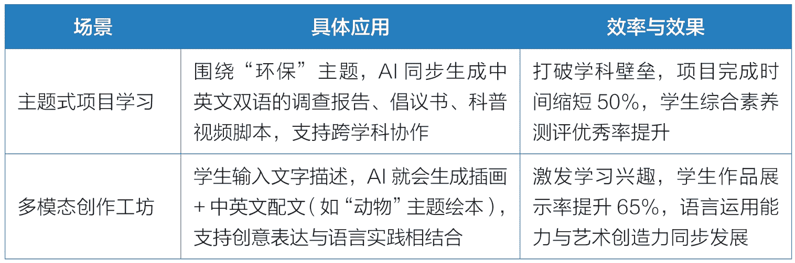
续表
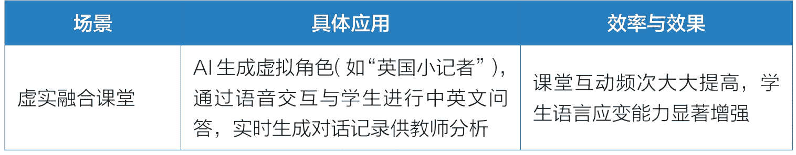
**（六）场景落地的关键支撑**
落地需技术、数据、教学场景、用户体验、教育理论、伦理安全与教师支持等多重保障。技术上语文需强化中文分词、古诗词平仄识别；英语需集成权威语料库保证地道性。教师赋能方面提供“AI 工具包”如提示词模板、评改规则库以降低门槛。评价体系上建立“AI 辅助指数”，量化使用率与评改准确率以动态优化设计。
应用场景需满足精准需求匹配、显著效率提升、多维能力培养三大特征。未来随多模态技术深度融合，边界将持续扩展，但始终以服务于人为价值导向。

### 三、大模型在语文、英语教学中的应用案例
案例紧扣学科核心素养，解决传统教学难点，涵盖生成与评改两大方向。
**（一）语文学科高效应用案例**
**应用案例 1：智能辅助续写 生成多种开头写作风格**
场景：小学四年级《春节趣事》作文开头难。
工具：ChatGPT、文心一言创意写作模式。
步骤 1：输入关键提示词“小学生”“春节”“放烟花”“灯笼”“旅行”。
步骤 2：模型生成三种风格开头。
叙事型：“春节，是一场盛大而温暖的狂欢，在这个特别的日子里，放烟花……”
悬念型：“家里门口悬挂的荷花灯笼，每次看到它，我就想起和父母元宵节在小区赏花灯、猜灯谜……”
对话型：“‘别怕，抓住我的手！’爸爸的声音从头顶传来，我却盯着脚下的悬崖瑟瑟发抖……”
模型还可配图辅助学习。
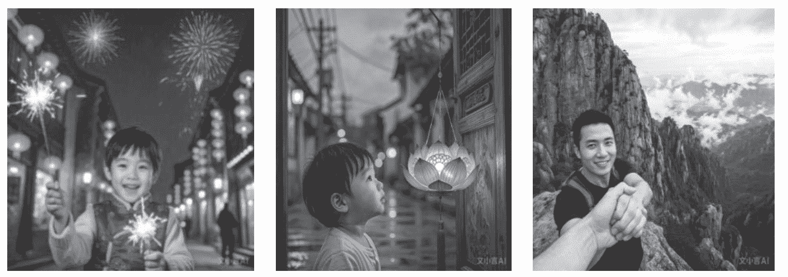
图 2-1 文心一言生成的三个场景图
步骤 3：学生挑选风格据图展开写作并修改。
效果：写作启动时间由 15 分钟降至 3 分钟，教师指导效率提升 50%，个性化风格初显。
**应用案例 2：古文学习助推器 提高文言文学习效率**
场景：初中生理解《岳阳楼记》“先天下之忧而忧”。
工具：豆包。
步骤 1：提示“请将范仲淹《岳阳楼记》名句‘先天下之忧而忧，后天下之乐而乐乎’转为白话文，并创作简短情景片段描绘写作心境。”
生成白话文与情景描写后，步骤 2 生成情景图。

图 2-2 生成式 AI 生成的范仲淹写《岳阳楼记》情景图
效果：帮助学生走进文本、理解作者感受，提升记忆与应用。
**应用案例 3：作文评改 实时精准评改**
场景：教师 24 小时内评改 50 篇《我的家乡》作文。
工具：钉钉。
操作步骤见表 2-7。
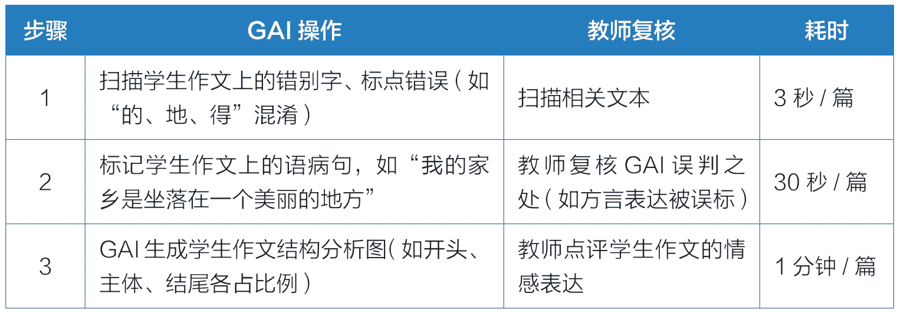
效果：评改时长由 24 小时缩至 2 小时，学生获得错误分布热力图，反馈针对性提升 70%。
**（二）英语学科高效应用案例**
**应用案例 4：情景对话 创设真实情境**
场景：六年级“上学交通方式大探究”。
工具：科大讯飞 AI 听说课堂。
步骤 1 课前准备输入中文指令生成 PEP 六年级 Unit2 词汇的 6-8 轮对话，含采访版与辩论版。
步骤 2 课中学生用语音答题器分角色对话，大屏显示语法与发音得分雷达图。
步骤 3 课后生成错音训练包。
效果：开口率由 40% 提升至 90% 以上，第三人称单数等语法错误重复率下降 65%。
**应用案例 5：写作评改 精准攻克中式英语表达**
场景：高中生作文频现中式英语。
工具：DeepSeek。
操作步骤见表 2-8。
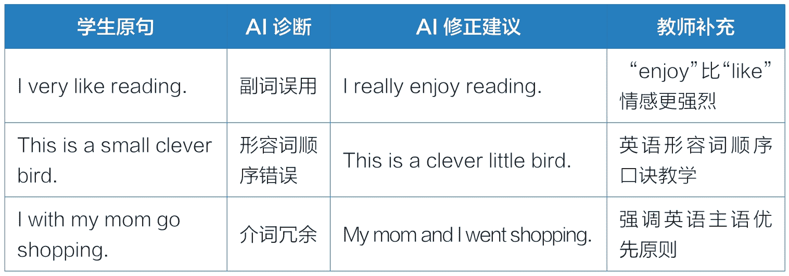
效果：中式错误减少 55%，教师可聚焦论点展开等深层问题。
**应用案例 6：跨文化交际模拟 培养跨文化交际能力**
场景：中国传统节日端午节。
工具：豆包。
步骤 1 生成初中八年级水平 200 词演讲稿并配图。
生成的演讲稿如下。
Dragon Boat Festival：A Colorful Chinese Tradition
Dear friends，

端午风情：龙舟竞渡 粽叶飘香

I’m thrilled to invite you to discover one of China’s most energetic festivals — the Dragon Boat Festival! It lands on the fifth day of the fifth month in the lunar calendar and boasts a heritage of over two millennia. Today I’ll walk you through its origin story, its customs, and why millions still cherish it.

The story revolves around Qu Yuan, a loyal minister-poet from ancient times. Heartbroken after his kingdom fell, he drowned himself in a river. Locals hurled rice dumplings into the current to distract fish from his body and launched boats in a frantic search for him. From that sorrow was born two enduring traditions: eating zongzi and rowing dragon boats.

Zongzi is the festival’s culinary highlight. Glutinous rice, pork filling or sweet red bean is packed into bamboo leaves and shaped into a pyramid. Every household seems to guard its own recipe. My grandmother’s pork zongzi is my absolute favorite — the aroma alone makes my mouth water.

The boat races deliver even more excitement. Crews in dragon-painted vessels chant “Hai yo! Hai yo!” in sync with the drum, slicing the water like arrows. It feels like watching a living dragon dance on the river.

Mugwort branches are hung on doorways for health protection, and kids don bright silk pouches for good fortune. These little rituals speak to a shared desire for wellbeing, family warmth and courage.

The Dragon Boat Festival is about far more than food and play. It’s a moment to honor historical heroes, to spend quality time with loved ones, and to feel proud of cultural roots. I hope you get a chance to join one day — try a zongzi, cheer the racers, and soak up the magic of this Chinese tradition!

Thank you!

第二步：生成配图。

提示词：请根据前文英语演讲稿的每一部分主题，按顺序制作对应的插画，如图 2-3 所示。学生还可以通过 GAI 把演讲内容整理成 PPT。

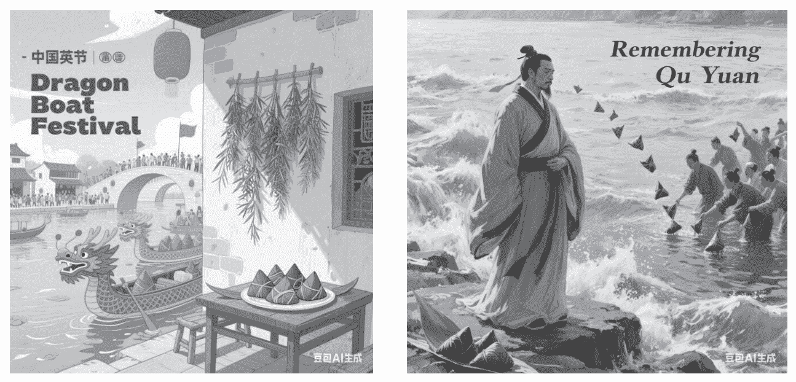

图 2-3 GAI 根据英语演讲稿各段内容生成的图片

图 2-3 GAI 根据英语演讲稿各段内容生成的图片（续）

学习效果总结。

①借助生成式 AI，学习者能快速产出符合自己英语水平的演讲稿。
②同步生成可视画面，让演讲表达更直观、更有冲击力，为现场展示加分。

## 第二节 智能资料分析与呈现

文科教学离不开文本阅读与运用，然而传统做法里资料整理耗时费力、呈现方式单一，已成为制约教学提升的瓶颈。生成式 AI 通过语料解析、信息重组与可视化表达，正在重塑文科课程的内容组织与呈现形态。本节聚焦生成式 AI 在文科资料分析中的价值，探讨其与人文教育理念的契合，推演教与学方式的革新，并结合操作策略与典型案例，展示其在加深理解、激发思维与提升互动方面的实践成效。

### 一、智能资料分析与呈现在文科教学中的应用价值

**（一）传统文科教学中文本类教学资源使用的痛点**

文科课堂大量使用文本材料，如历史史料、道德与法治案例。传统模式下材料的选择与制作明显带有教师主导色彩：教师依靠个人经验与预设框架挑选文本，形成单向知识传递。以大运河评价为例，曾选用以下材料。

材料一：尽道隋亡为此河，至今千里赖通波。若无水殿龙舟事，共禹论功不较多。
——皮日休《汴河怀古二首》（唐）

材料二：千里长河一旦开，亡隋波浪九天来。锦帆未落干戈起，惆怅龙舟更不回。
——胡曾《咏史诗·汴水》（唐）

问题：结合以上两首诗，如何客观评价大运河？

这两首诗经常出现在史料教学中，教师多以呈现不同历史评价来引导学生形成辩证认知。表面上契合“史料实证”素养要求，细究之下却暗藏认知陷阱——教师刻意挑选“利弊对立”的材料，实质上已用史料预设了认知的边界。问题看似开放，素材的局限却使思维训练趋于封闭。

在传统模式下，学生的思考仍被预设文本与问题框定，易产生两种风险：一是权威文本挑选导致批判性思维缺位，即使结论多元，过程仍受隐性制约；二是资源呈现静态同质化，难以满足个性化学习需求。

**（二）语料智能资料分析和呈现与人文教育的契合点**

生成式 AI 凭借海量语料处理能力和深度语义解析能力，为破解传统文本教学的权威化、同质化困境提供了技术路径。海量语料处理能力指依托 NLP 对大规模文本进行高效采集、存储、分析与挖掘，如从亿万级文献中快速提取高频词或主题模式；深度语义指算法对文本含义的深层理解，包括情感倾向、隐喻意图、逻辑关联等。二者结合，使人工智能既能把握文本的“量”，也能捕捉语言的“质”。

该技术特性与文科人文教育的深层目标高度契合。海量处理能力为语文、历史、道法等学科提供智能检索引擎，帮助教师突破备课时空限制，如历史教师准备“大运河客观评价”时可迅速检索不同时期文学作品中的多元评价；道法课设计“科技与人文”议题时，AI 可实时抓取最新科技讨论与社交媒体热词，自动归纳适合初中生认知水平的辩论素材库。

深度语义解析可在海量语料基础上进行加工，还原历史对话、模拟历史场景，创设更贴近学生的情境，如在“百家争鸣”教学中，AI 可扮演不同学派就同一议题展开辩论，将静态研读转为沉浸式体验。经智能分析的海量文本被转化为可触摸、可体验的教学资源，为传统文本资源提供了新视角。

**（三）语料智能资料分析和呈现与人文教育的新使命**

在技术高速发展的时代，如何在高效理性的世界中保持同理心与好奇心，保持充沛的情感表达，是文科面临的新挑战。人工智能的出现反而凸显了人文价值：AI 或许能精准分析《离骚》的修辞，却需要教师引导学生体悟屈原“路漫漫其修远兮”的生命追问；AI 可量化柳永词中愁绪的参数，人文教育的真谛在于让学生理解这种愁绪如何凝结为中华文化的集体记忆。

在文科教学中，使用 AI 不仅要熟练检索，更要将其转化为育人工具。以生成式人工智能构建的历史情境模拟为例，若仅指令式提问“列举商鞅变法的五项措施”，只是传统教学的数字化翻版；但若引导学生与加载大语言模型的历史人物数字分身跨时空对话——“作为被车裂的改革者，你此刻如何理解‘治世不一道，便国不法古’？”——让学生突破自身认知边界去理解历史人物的生存境遇，互动便转化为真实的学习与情感体验。

生成式人工智能在文科教学中的使命或许不是构建完美的数字拟像，而是通过技术激发学生填补认知空白的想象力，这正是其在文科中的独特价值。

### 二、智能资料分析与呈现促进教和学方式转变的实施策略

**（一）智能资料分析与呈现促进教和学方式转变**

生成式人工智能凭借大规模文本处理与深度语义理解能力，大幅扩展了教师处理资料的广度与深度，为教学创新与个性化路径设计提供支撑，有效推动教学方式转变。生成式人工智能在智能资料分析上的优势如同“智能助手”，促进了课前准备、课中教与学、课后评价的转变（见表 2-9）。

表 2-9 传统教学模式下的资料分析和基于生成式人工智能的智能资料分析对比

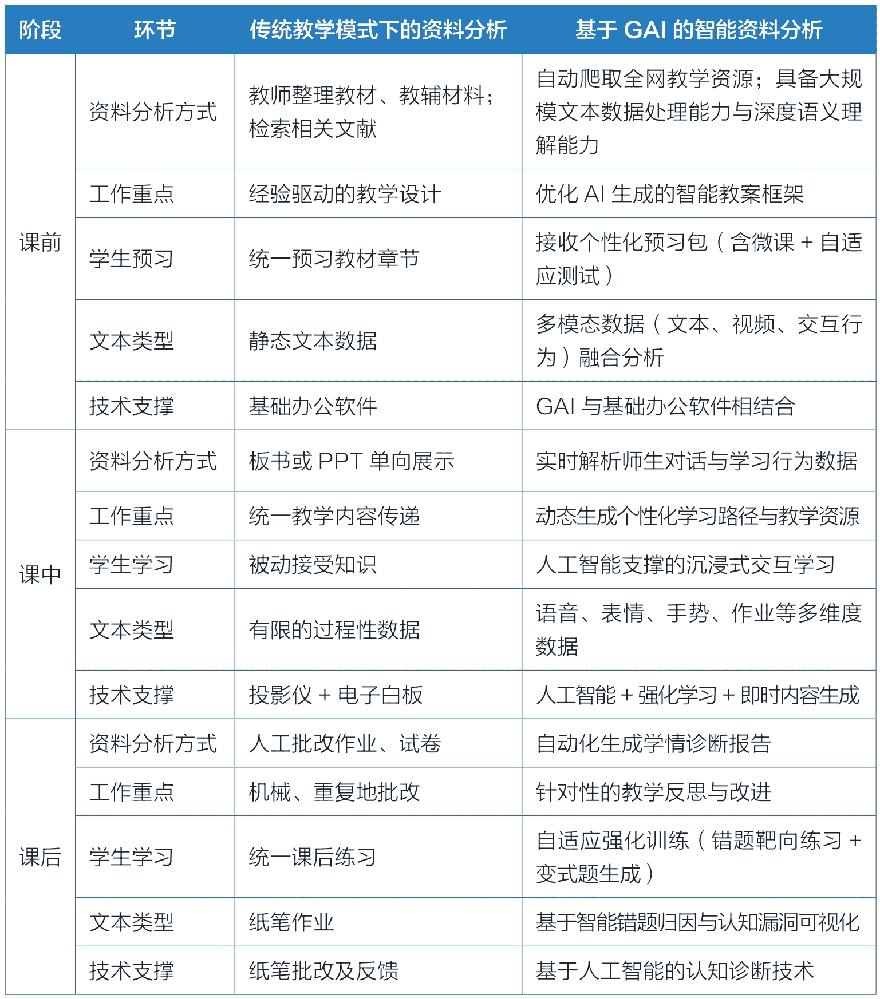

**（二）智能资料分析与呈现的应用场景**

智能资料分析技术为一线教师带来切实改变，能自动处理海量文本、作业与学情数据，减轻整理负担；通过智能解析教材重点与错题规律，自动生成分层目标与个性化练习，使备课更精准；课堂中实时分析学生作答数据，帮助教师动态调整节奏；课后自动归类典型错题并生成针对性巩固资源，使作业讲评直击认知盲区。这些工具不改变教师的主导地位，而是提升效率的智能助手，让教师更有精力投入教学设计创新与个性化辅导，应用场景不断拓展（见表 2-10）。

表 2-10 智能资料分析的应用场景

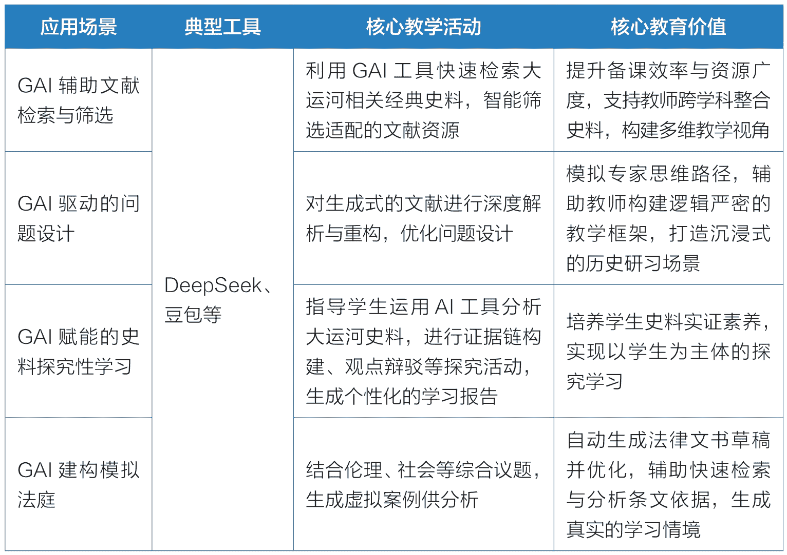

### 三、智能资料分析在文科教学中的应用案例

**应用案例 7：使用 DeepSeek 检索关于大运河的经典史料**

输入关键提示词：我是初中历史教师，正在进行隋朝大运河评价的教学，帮我选取几则古人对大运河的评价，要求呈现文献来源，并以表格形式输出。

DeepSeek 检索后输出内容如表 2-11 所示。

表 2-11 DeepSeek 检索关于大运河的经典史料

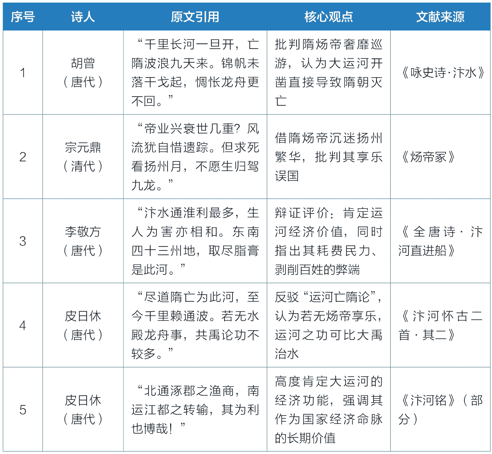

**案例说明**

教师选材往往带有预设，多基于既有知识结构；加上脱离学术环境与教学负担重，一线教师在史料获取与阅读上存在劣势，借助人工智能可拓宽选材的广度与深度。

本案例中，人工智能的海量语料处理能力得到体现，结合文献出处经核实，DeepSeek 提供的文献真实可靠，更关键的是其呈现了“深度思考过程”。这种多步骤逻辑推导、筛选与生成的机制，与教学设计所需逻辑一致。教师既可将检索文本转化为课程资源，也可把人工智能的思考过程转化为教学思路，实现历史文献的智能检索与整合。

**应用案例 8：对 DeepSeek 检索的文本进行“二次加工”**

输入关键提示词：依据这些史料（见应用案例 7），帮我生成几个适合初中生的问题，要求设问有层次，重点考查学生的历史解释素养。

DeepSeek 经深度思考后生成的问题清单如表 2-12 所示。

表 2-12 DeepSeek 基于检索史料生成的问题清单

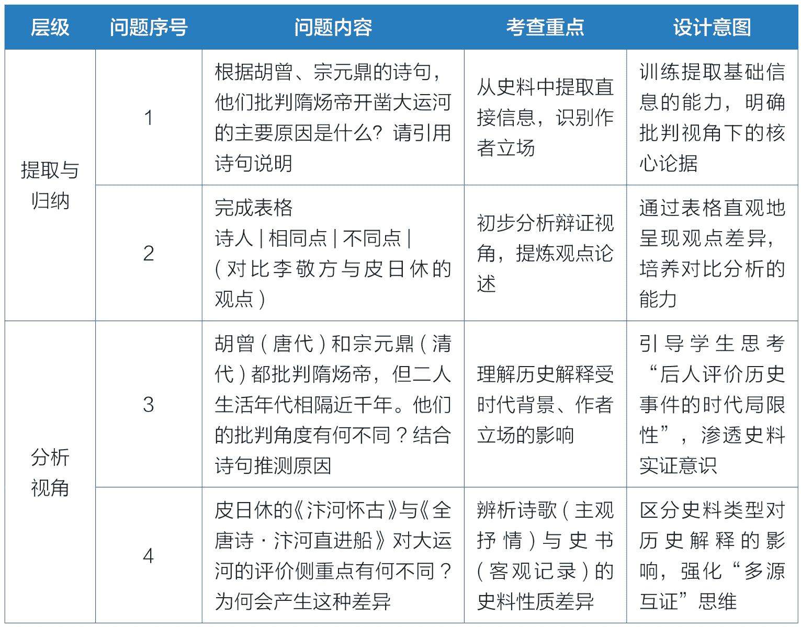

续表

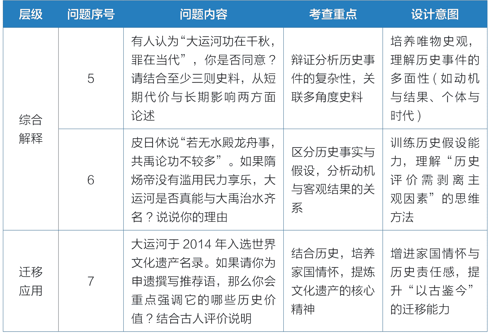

**案例说明**

海量语料处理只是人工智能的基础功能，若止步于此便会错过更多价值。人工智能在深度语义解析上优势明显，能对原始文献进行深度加工，并运用生成式模型的问题生成算法设计出认知梯度分明的探究链。从历史学科素养看，以上题目极具启发性，《普通高中历史课程标准》将历史解释素养划分为四个水平，对照该划分，DeepSeek 从“提取与归纳”“分析视角”“综合解释”“迁移运用”四个维度生成的问题链，体现出鲜明的能力分层与递进，与素养分层高度契合。

从教学实施看，上述七个问题的设问技巧、难度与分层尚有瑕疵，教师不能照搬，但其设问深度与准确度值得反思与借鉴。这种人机协同的教研方式不仅实现教学资源的智能重组，还可模拟专家型思维路径，帮助教师构建沉浸式史料研习场景。

**应用案例 9：学生使用人工智能评价大运河**

探究性学习：使用你熟悉的人工智能软件，围绕“我看隋朝大运河”，尝试对大运河进行合理评价并撰写研究报告。

参考建议：

①观察人工智能“思考”的过程，总结其思考特点。
②记录提问过程，与同学对比差异，哪些问题影响了答案；选出三个好问题，概括其共同特点。
③尝试不同人工智能软件提问，比较哪款思考更合理并说明理由。

**案例说明**

史料是今人与古人、教师与学生对话的重要载体。教师常统一选择史料并按既定逻辑组织，既不引导学生判断史料价值，也缺少自主选择与组织的环节。人工智能的介入增强了师生在史料选取与组织上的自主性，改变了传统模式。

当人工智能承担检索、整理等基础工作后，教师可更专注于引导学生培养问题意识、构建论证逻辑、锤炼历史解释等高阶思维，实现从“知识传授”到“素养培养”的转型。人工智能使“像历史学家一样思考”成为可能。

**应用案例 10：借助 DeepSeek 生成模拟法庭**

输入关键提示词：我是一名初中道德与法治教师，正在进行法律保护知识产权部分的学习。请你围绕知识点，帮我设计一个符合中学生认知能力的模拟法庭，要求案例真实、生动，能够体现认知冲突，需要结合相关法律条文进行说明。

DeepSeek 生成的模拟法庭内容如表 2-13 所示。

表 2-13 DeepSeek 生成的模拟法庭内容

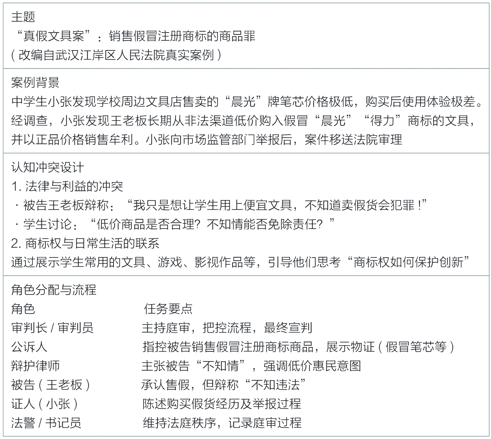

续表

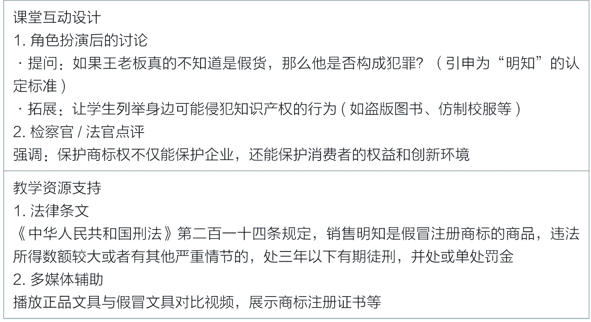

**案例说明**

模拟法庭是初中道德与法治的重要实践载体，通过再现司法场景深化法治意识。但实际教学中，缺乏专业法律指导，活动常异化为程式化表演：师生基于想象编排“剧本”，演变为少数学生背诵台词，法律条文理解停留在表层。

借助生成式人工智能，可大幅提升模拟法庭的真实性与可操作性。本案例中，借助武汉市江岸区人民法院真实案例“真假文具案”，贴近学生生活，人工智能可检索真实文书并将其转化为通俗对话，生动而不失真实。师生重心不再是剧本编写，而是对真实情境的思考，“模拟法庭”的真实不在于剧本，而在于情境。

当“法庭陈设”转向“思维现场”，“剧本台词”升华为“法律对话”时，学生不仅能具象理解《中华人民共和国民法典》等抽象条文，更能在角色代入中建立“程序正义”“证据意识”等法律概念，对培养初中生法治素养具有显著促进作用。

## 第三节 智能图像生成与数据可视化技术应用

图像与数据的呈现方式直接影响学生对知识的理解与思维建构。生成式人工智能通过智能图像生成与数据可视化，突破了传统文科教学信息传递的局限，使抽象概念具象化、静态知识动态化、思维过程可视化。本节聚焦人工智能在增强学习“现场感”、激发探究兴趣与深化认知结构中的独特价值，结合具体教学场景与创新案例，展示其在历史、地理等课程中的实践路径，为构建沉浸式、互动化教学新生态提供支撑。

### 一、智能图像生成与数据可视化技术的应用价值

**（一）传统教学中图像生成与数据处理的局限性**

当我们感慨“短视频夺走了人们的耐心”时，更值得反思的是为何人们更青睐图像信息。图像化认知是人类与生俱来的信息处理方式，具有直观与具象特征。在初中教学中，图像化认知优势明显。初中生正处于具体思维向抽象思维过渡的关键期，生动图像能把抽象概念转化为可感知的具象符号，降低理解难度。

在文科教学中，用图像丰富教学资源已成为常见策略，然而传统呈现仍存在局限。以历史教学为例，学生需理解时空变迁与事件关联，但教材中的地图与静态图像难以构建动态时空联系。例如讲解“丝绸之路”时，教材地图仅标出路线节点，学生难以感知商路变迁与地貌、政治因素的互动；在地理教学中，传统等高线图、人口分布图虽能呈现规律，却缺乏对地形演变、人口迁移等过程的动态模拟，一定程度上限制了学生空间认知能力的提升。例如讲解“河流地貌发育”时，教材多以静态剖面图展示河谷形态，学生虽能记忆“V 型谷”“冲积平原”等概念，却难以理解流水侵蚀、搬运与堆积的动态机制。

让历史地理课更“有感”：现场感与数据可视化的新玩法

在历史和地理课堂里，锻炼学生的历史想象和时空判断能力，是实现深度学习的重要切口。静态图片能传递部分视觉信息，要让学习者产生身临其境的代入和情境复原的沉浸，单一图像是不够的，需要更立体的技术支撑。生成式 AI 正为跨越时空限制打开通道。

**（二）现场感的价值与图像生成的托底作用**

要理解现场感有多重要，可以参考杨绛回忆的与钱穆同行的那段经历。

列车驶过“蔚然而深秀”的琅琊山后，窗外景色变得荒凉，视野里只剩连绵的大土墩，没有山川林木，也难觅人烟。直到蚌埠，画面依旧单调。杨绛感叹这一段路最无聊，钱穆却说“此古战场也”。一句话点醒，地理被历史重新赋色，土墩立刻有了看头。钱穆讲起哪里适合扎营、哪里适合冲杀，纵然战死的百姓早已枯骨无存，仍不免油然生出吊古之情，直到远处泰山出现才离开这片辽阔的古战场。

从乏味到好奇，正是现场感带来的反转。细节补足后，才能想象过去、回到现场、产生共情。教师要像钱穆那样让历史为地理上色，技术提供了新的支点。

进入生成式 AI 时代，智能绘画日渐成熟，博物馆的数字化也在加速。观众可以放大观察青铜纹饰、古籍字迹等细节，拉近与历史的距离。数字展馆通常配备讲解视频与互动环节，帮助理解背景与文化内涵。教师可组织学生线上参观特定主题的数字展览，打破时空限制，让历史学习更有临场感。

**（三）把数据摊开，让思考路径可视**

把抽象数字转成图形图表，是信息处理的关键一环。对初中生来说，可视化既是知识的桥梁，也是激活兴趣的手段。

在历史教学中，数据是把握社会变迁的钥匙，但一串数字容易让人却步。把人口、经济等信息转成地图、时间轴、柱状图，形成思维脚手架，既能避免迷失在数字迷宫，也能激发主动探究。静态数字由此变成串联逻辑的线索。

例如讲“中国古代经济重心南移”，可以做可视化尝试。用动态人口图呈现人口变化，用动态地图标出“永嘉之乱”“安史之乱”“靖康之变”三次南迁高峰的路线，直观展示人口流动。配合南北赋税的可视化处理，再结合《吴郡志》“苏湖熟，天下足”的记载，经济重心的转移就鲜活地呈现出来。

### **二、智能图像生成与数据可视化技术的应用场景**

智能绘图与数据可视化通过把复杂信息转为直观图形、动态图表或交互界面，为教学提供多维支持。核心价值在于，用可视化快速呈现规律，帮助教师优化策略；用动态交互激发兴趣，如让学生虚拟探访文物或地理现象，如表 2-14 所示。

表 2-14 智能图像生成与数据可视化技术的应用场景

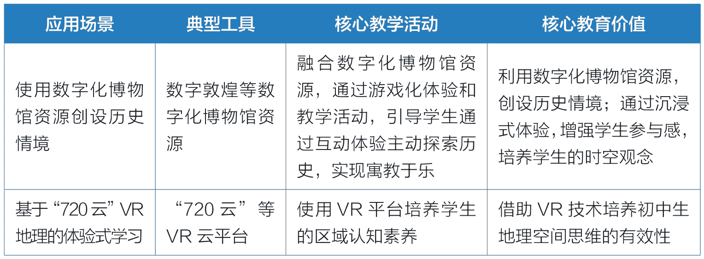

续表

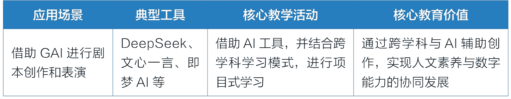

### **三、智能图像生成与数据可视化技术的应用案例**

**应用案例 11：数字化博物馆学习之旅**

敦煌莫高窟蕴藏千年文化精华，传统实地参观难以面面俱到。如今借助生成式 AI 与数据可视化，数字博物馆打开了新的学习通道。

数字敦煌网站推出的数字藏经洞专题，如图 2-4 所示，尝试把文化遗产与云游戏技术结合，用虚拟现实搭建游戏化场景，让中学生一看即懂、操作即会。

图 2-4 数字藏经洞登录界面

数字藏经洞由敦煌研究院联合多家技术团队制作。对莫高窟第 16、17 窟的外观原貌，以及内部空间和壁画细节实现了毫米级高精度等比例复刻，带来超拟真的体验和超写实的视觉效果，如图 2-5 所示。

图 2-5 数字藏经洞游戏化界面

项目在游戏化体验中引入了生成式 AI 驱动的虚拟 NPC，通过历史人物复现与交互叙事增强沉浸感。用户可从 6 个人物形象中挑选扮演，“穿越”到晚唐、北宋、清末等时期，经历洞窟开凿、封藏万卷、重现于世、文物流散和再次聚首的过程，以近似亲历的方式与历史互动，如图 2-6 所示。

图 2-6 数字藏经洞体验式参观界面

**案例说明**

用博物馆资源教学已成热点，但组织实体研学困难不少：时间协调难、跨区成本高、珍贵展品难接触，容易流于走马观花。数字藏经洞通过虚拟现实把敦煌场景与文物细节以毫米级精度还原，为课堂提供跨越时空的沉浸环境。学生登录网站即可“进入”藏经洞，观察壁画纹理、经卷摆放，甚至与虚拟历史人物对话，聆听敦煌学者的背景解读。

在游戏化环节，学生可扮演角色一键“穿越”到四个历史时段，与晚唐高僧洪辩法师等互动，完成任务，沉浸式亲历藏经洞从开凿到封藏再到重现、流散、聚首的全过程。

**应用案例 12：基于“720 云”平台的地理虚拟实践**

“720 云”是一个基于虚拟现实全景可视化的内容创作与分享平台，其 720 全景图可在水平与垂直方向 360° 自由旋转，使用者获得高逼真感和延伸感的三维沉浸体验。

传统地理学习多依赖等高线判读和景观图识别，学习偏静态，不利于空间思维培养。虚拟现实能高度还原真实户外环境，让学生在课堂上获得替代性实践体验。

例如学习“黄土高原”时，教师可借助“720 云”场景立体呈现地貌景观，让学生产生身临其境之感。把虚拟现实融入地理实践，打通了学生与真实世界的交互，也拓展了中学地理实践路径，如图 2-7 所示。

图 2-7 “720 云”平台中的“黄土高原”地形图

**案例说明**

以“地貌观察”为主题的虚拟实践中，借助 720 云构建的三维实景，能让学生直观观察不同地貌的形态与形成过程，摆脱平面教材局限，增强直观性和趣味性。模拟真实地理场景不仅提升参与度，也增强对复杂地理现象的综合分析能力。

**应用案例 13：借助生成式 AI 创作舞台剧**

项目学习：运用生成式 AI 创作舞台剧《张骞通西域》。

**（一）项目目标**

① 跨学科协作完成一部以历史事件为基础的《张骞通西域》舞台剧。

② 合理借助生成式 AI 手段辅助创作，并结合历史、语文、地理、艺术等学科知识检验成果的合理性。

③ 培养团队协作、批判性思维和创造性解决问题的能力。

**（二）项目分组与任务**

共四组，分工如下。

① 编剧组：产出剧本大纲，设计人物对话与情节冲突。

② 舞美组：产出舞台背景图，结合历史地理知识设计场景。

③ 道具组：设计符合汉代西域风貌的服饰、器物。

④ 音乐组：产出符合剧情氛围的背景音乐或音效。

**（三）推荐生成式 AI 工具清单**

**1.剧本生成**

工具：DeepSeek、文心一言、豆包、Kimi 以及其他同类产品。

任务示例：输入关键提示词如“张骞拜别汉武帝”，产出初步框架。

建议：对比不同产品输出差异，选择合适故事梗概并润色。

**2.图像生成**

工具：即梦、豆包、文心一格等。

任务示例：输入“汉代长安城市场景”“西域沙漠商队”，产出背景图。

建议：结合地理历史知识评估图像合理性。

**3.音乐生成**

工具：即梦可在免费条件下产出短音乐。

任务示例：输入“悲壮的西域旅途”“汉代宫廷音乐”，产出配乐。

建议：风格需与剧情匹配。

**4.辅助工具**

可用秘塔搜索快速获取史料，或用其他产品润色剧本。

**（四）项目实施步骤**

**1.第一阶段：历史学习与生成式 AI 初体验 1～2 课时**

（1）历史知识输入

观看纪录片《河西走廊》片段，阅读《史记·大宛列传》节选。

任务：列出张骞出使路线、重要事件、汉代与西域物产交流。

（2）生成式 AI 初次尝试

各组尝试用生成式 AI 产出初始内容，如编剧组产出大纲，舞美组产出背景草图。

**2.第二阶段：跨学科验证与修正 2～3 课时**

（1）编剧组

让模型产出片段如“张骞被匈奴扣押的冲突”。

学科验证：

历史：对照史料检查时间线与史实。

语文：分析台词是否符合人物身份。

优化任务：加入戏剧矛盾，如张骞与匈奴首领价值观冲突。

（2）舞美组

用即梦等产品产出“汉代玉门关遗址+商队驼影”背景图。

学科验证：

地理：检查地貌是否符合西域干旱戈壁特征。

艺术：调整配色，参考汉代壁画色调如朱红、土黄。

（3）道具组

用文心一言产出“汉代器具纹样”“西域胡商服饰”。

学科验证：

历史：确认是否符合汉代工艺水平。

艺术：设计简易材料制作方案，如纸板仿制漆器。

**3.第三阶段：整合彩排与反思 2～3 课时**

**（1）彩排试演**

结合模型产出的背景图、音乐和剧本进行片段表演。

**（2）批判性讨论**

文本、图像、音乐是否符合历史场景，生成式 AI 产出的内容是否存在漏洞。

**案例说明**

本项目围绕张骞通西域展开，通过“学科融合+生成式 AI”进行跨学科项目学习。核心在于从记忆转向体验，地理、艺术、语文不再孤立，而是通过创作整合；帮助学生批判性使用人工智能，学会在应用中甄别工具。学生能享受生成式 AI 的效率，同时亲手修正错误，比如纠正把汉代玉门关画成明长城的问题。这种“模型打基础，人把关”的模式，既契合学生使用科技的习惯，也避免无脑套用。对教师而言，用传统排剧任务加入生成式 AI 与跨学科验证，无需大幅改动教学计划，就能促进主动查证与团队协作。

**4.小结**

在人工智能时代，文科教学走向何方，生成式 AI 是助力还是阻力，需要教师用实践回答。我们认为生成式 AI 在文科教学中可发挥的空间很大。首先，智能文本生成与批改系统打破效率瓶颈，教师可快速生成背景资料、阅读提纲，并借助语义分析实现作文逻辑与情感的智能评阅，使反馈从结果评价转向过程指导。其次，自然语言处理能快速处理海量文本，把碎片信息转为结构化认知。最后，智能图像生成与数据可视化重构了文科知识的表现形态。通过时空地图等可视化工具，抽象思想具象化，复杂脉络变为可交互界面，提升空间思维与批判思考。生成式 AI 让教师更聚焦思维引导与价值塑造，实现从知识传递向素养培育的跨越。

# **第三章 生成式 AI 赋能理科教学实践：程序化问题解决与实操模拟技术**

理科教学的核心是通过推理、建模与实验操作帮助学生理解抽象概念与复杂过程。但传统教学常面临理解难、实验条件受限等问题。生成式 AI 为理科提供了新路径，尤其在定理推演、模型构建与实操模拟方面潜力巨大。本章围绕生成式 AI 在理科教学中的应用展开，探讨其如何助力数学、物理、生物、化学等学科创新。首先分析生成式 AI 如何优化数学定理与物理规律的推导，提升逻辑思维与解题能力；其次探讨其在生物化学中的应用，通过动态建模与过程预测加强系统思维与实验理解；最后讨论生成式 AI 如何在小学科学中实现虚拟实验与跨学科整合，推动教学方式创新。通过本章，教师可掌握生成式 AI 赋能理科的关键技术与应用场景，进一步提升教学效果与学生综合能力。

## **第一节 定理、定律推演与习题解决**

理科教学强调严密逻辑推演与问题解决，但抽象知识讲授常出现理解难、迁移难。生成式 AI 通过可视化演绎、语义解析与情境重构，为定理教学、规律学习和综合问题解决提供突破口。本节聚焦生成式 AI 在数学与物理教学中的应用，展示其如何帮助教师优化推演路径、重构学科逻辑、贴合学生认知节奏，并通过案例探索其在激发探究兴趣与提升思维品质方面的实践价值。

### **一、数学定理怎么教**

数学学习中，定理是核心。数学定理在特定条件下成立，可推广到更一般情形。其证明必须逻辑严谨、步骤清晰。传统讲法易显枯燥，而生成式 AI 能让学习更生动有趣，比如呈现历史故事、动态图解，帮助学生直观理解。

**应用案例 1：勾股定理教学**

勾股定理是人教版义务教育教科书数学八年级下册内容，揭示直角三角形三边数量关系。传统做法重证明重练习，现可用生成式 AI 设计教学。

**步骤 1：用历史故事点燃兴趣。**

2500 多年前，毕达哥拉斯在朋友家做客，发现铺砖地面图案反映了直角三角形三边的某种数量关系。教学中可用生成式 AI 工具模拟古人对话，让学生“穿越”到 2500 年前，理解地砖图案如何启发毕达哥拉斯发现勾股定理。

在豆包平台调用毕达哥拉斯对话体，输入：

毕达哥拉斯，您好！请问您是如何发现勾股定理的？您能还原发现过程吗？

结合图 3-1 的地砖图案，学生更容易理解定理内容。

东汉末至三国时期的数学家赵爽在注解《周髀算经》时用赵爽弦图证明了勾股定理。教师可在豆包调用赵爽 AI 角色，引导学生对话，了解其证明思路，并借助 GeoGebra、Manim、Photomath 等工具展示动态拼接过程，引导学生跟随古人切割图形，理解演绎推理与数形转化。

图 3-1 地砖图案

图 3-2 赵爽弦图

**步骤 2：借助生成式 AI 寻找多种证明路径。**

古往今来，勾股定理的证明方法众多。直接让学生列举难度大，课堂时间也有限。此时可用生成式 AI 工具，如向 GPT 询问：请给出多种证明勾股定理的方法。

它会给出拼图法、代数证明法、相似三角形法、几何构造法、三角函数法等，并提供思路。教师可结合学生水平选择几种分组探究、讲解。学生从不同角度理解定理。

图 3-3 赵爽弦图分割过程

**步骤 3：分层出题，巩固练习。**

讲解例题后，可用生成式 AI 生成练习。例如在 DeepSeek 中输入：“根据八年级数学教材勾股定理内容，给出 6 道练习题，其中简单 3 道、中等 2 道、能力提升 1 道。”学生练习后，用模型即时反馈，教师针对薄弱点布置作业。

本案例中，生成式 AI 让历史人物和内容鲜活，激发兴趣；同时提升课堂丰富度，拓展思维。

### **二、物理规律怎么学**

物理教学传统上依赖口头讲解、板书演示和实验操作。随着生成式 AI 发展，规律推演范式正在革新。生成式 AI 不仅能让学生更直观理解科学家的思维，还能智能解构学科逻辑，提供更立体学习体验。

**（一）生成式 AI 在物理规律教学中的应用场景**

以生成式 AI 在初中物理经典规律——“牛顿第一定律” 八年级物理第八章第一部分 的教学应用为例，具体操作如表 3-1 所示。

表 3-1 生成式 AI 在“牛顿第一定律”探究教学中的应用场景

**（二）科学家的思维脚手架**

大模型在物理规律推导中的价值在于把原本隐性的思考路径变成可视流程。以惯性定律的形成为例，借助 DeepSeek 的推理能力能够搭出一套由浅入深的支撑结构，让学生沿着真实的思路逐步触达规律诞生的逻辑链。

示例：用 AI 还原物理学史上探究规律时的思维框架。

示例提示：你是一名经验丰富的初中物理教师，请详细梳理“牛顿第一定律”提出与确立阶段，科学家在研究运动与力关系时的思路演进与实证过程。

检索后，DeepSeek 给出的“运动与力关系”探究脉络整理为表 3-2。

表 3-2 物理学史上科学家探究“运动和力的关系”的思维过程与探究过程

**1.探究方法的提炼**

①理想实验法 伽利略：先用斜面小车做可操作的观察，再逐步削弱摩擦，最终在思想中完成无摩擦的理想情境。
②控制变量法：固定小车释放高度保证初速一致，对比不同摩擦水平下的运动差异。
③逻辑外推法：基于带摩擦的有限实验数据，推导出零摩擦的极限结论。

**2.教学启示**

①实验复现：重现伽利略斜面，通过“摩擦递减、滑行距离递增”的现象，引导学生自行归纳惯性思想。
②概念辨析：并置亚里士多德与牛顿对力与运动的看法，凸显认知转折的关键点。
③思维训练：借助 AI 模拟无摩擦情景，如太空舱中的惯性演示，来检验理想实验的结论。

从表 3-2 的对照可见，牛顿第一定律的诞生是质疑、修正、综合不断叠加的结果，体现了科学探究中怀疑精神与逻辑推理的核心价值。教师结合实体实验与 AI 工具，能帮助学生打破前概念束缚，读懂定律的深层逻辑。

**（三）学科逻辑的智能拆解**

在还原科学家思维之外，生成式 AI 还能对学科内部的逻辑链条进行智能拆解，助力学生构建系统完整的知识框架。

示例：AI 解析物理规律在学科体系中的定位与逻辑关联。

提示词示例：你是一名教龄多年的初中物理老师，请分析人教版初中物理八年级下册第八章“牛顿第一定律”在整个初中物理体系中的学科地位与逻辑关系。

检索后得到的学科逻辑解析整理为表 3-3。

表 3-3 初中物理“牛顿第一定律”学科逻辑分析

**（四）学生认知逻辑与智能适配**

初中物理教学设计必须紧扣学生的认知规律。传统方式难以精准捕捉前概念，也难以提供个性化路径。引入生成式 AI 为这一难题提供了新解。

示例：AI 解析学生学习物理规律的认知路径与干预策略。

提示词示例：你是一名教龄多年的初中物理老师，请分析八年级学生学习八年级下册第八章“牛顿第一定律”的认知逻辑及教学干预策略。

经检索后由豆包生成的学生认知分析整理为表 3-4。

表 3-4 初中物理“牛顿第一定律”学生认知逻辑分析

**（五）物理学史的沉浸式再现**

物理学历史悠久且逻辑严谨，将学史融入课堂既能彰显学科魅力，也能培养探究精神。生成式 AI 为学史的情境化再现提供了新可能。

AI 可把教材中亚里士多德、伽利略、笛卡尔的静态图像激活，生成虚拟辩论短片。学生在沉浸式辩论中，能更直观体会历史上科学争论的脉络，提升批判性思维与表达能力，学会用实验数据支撑观点、有效沟通。这种历史语境模拟通过引擎重现与争论复演，让学生身临其境体验关键时刻与大师思辨。教学方式兼具趣味性与思辨性，有助于点燃学习热情并强化科学思维，未来在理科实践教学中作用将日益突出。

**（六）物理规律在教学中的实践案例**

**1.课堂导入的生成示范**

提示词示例：假设你是教龄20年的初中物理老师，请为“牛顿第一定律”设计3分钟课堂导入，要求结合学生日常经验如急刹车时身体前倾，设计互动生活小实验并引导观察后提出猜想。

检索后DeepSeek给出的导入方案如图 3-4 所示。

图 3-4 “牛顿第一定律”课堂导入环节设计

**2.跨学科任务设计**

提示词示例：假设你是教龄20年的初中物理老师，请设计融合物理力学与体育的探究任务，分析短跑运动员起跑时的惯性现象并阐释牛顿第一定律的应用，需包含实验步骤、小组分工与课后延伸问题。

检索后生成的跨学科实践方案如图 3-5 所示。

图 3-5 “牛顿第一定律”跨学科实践设计

图 3-5 “牛顿第一定律”跨学科实践设计（续）

**3.课堂分层作业生成**

提示词示例：你是一位资深初中物理老师，请为“牛顿第一定律”生成三组练习：基础题解释惯性现象，进阶题结合生活实例分析惯性，提升题设计实验验证定律。附答案解析与易错点提示。

DeepSeek生成分层作业如图 3-6 所示。

图 3-6 “牛顿第一定律”课堂分层作业设计

图 3-6 “牛顿第一定律”课堂分层作业设计（续）

### **三、综合问题怎么解**

教学中遇到难度问题时，如何帮助学生更好理解？生成式 AI 不仅能自动处理复杂计算，还能提供多种解题思路，帮助学生多角度理解、拓展思维。

**应用案例 2：密码中的数学**

人教版数学七年级上册第三章代数式活动 2《密码中的数学》让学生认识凯撒密码原理并尝试自设密文。学生常觉得抽象，AI 可辅助教学。

步骤 1：实战破译密文。

密文“L dp d vwxghqw.”采用凯撒密码。凯撒密码核心是通过固定位移实现加密解密。

已知密钥为“x-3”，则每个字母向前移 3 位可得原文。L→I，d→a，p→m，依次类推，得“I am a student.”。

若密钥未知，如何破解？可用穷举法。以“L dp d vwxghqw.”为例，L 可能对应字母表任意其他 25 个字母，共 25 种可能，逐一列出并结合字母频率、词义排除。

小提示：不同 AI 工具解答路径各异。

在 DeepSeek 中提问破解密文“L dp d vwxghqw.”，其会展示深度思考过程：先考虑凯撒、替换、维吉尼亚等常见加密，再从基础凯撒入手，将字母转成位置并尝试不同位移，确保解密结果有意义，最终判定为凯撒位移 3，明文“I am a student.”。

在通义千问中提问，过程如下：

步骤①观察密文，推测为完整句子且字母被偏移。
步骤②尝试破解，用穷举法逐位左移 1~25 位，或用频率分析推测位移。
步骤③找到正确密钥 3，解密得“I am a student.”。

同一问题不同工具路径不同，与学生一起对比分析，有助启发解决问题思路。DeepSeek 展示深度思考轨迹，通义千问给出条理清晰的步骤。

步骤 2：动手设计密码。

凯撒加密除 x-3 外还有多种方式，如将 a~z 对应 1~26，密文中数 x 为奇数时明文序号为 x+1；x 为偶数时明文序号为 。学生可自创规则如奇数+1 偶数÷2，自行写密文或借助 AI 生成，小组交换解密，遇到难题用 AI 辅助，体验密码攻防。

步骤 3：课后拓展。

查阅摩斯密码、栅栏密码等，用 AI 尝试加密解密，感受数学在生活中的应用。

通过活动课，学生理解代数式在密码中的应用，观摩 AI 解题过程可激发兴趣，明确解密思路。

**应用案例 3：一次函数与二元一次方程**

函数与方程是刻画数量关系的重要模型，二者关系抽象。AI 的绘图拟合功能可让“数”与“形”结合，便于直观理解。人教版八年级下册第十九章第 6 课时《一次函数与二元一次方程》可借助 Desmos 开展。

步骤 1：求二元一次方程 2x+y=4 的解，写出五个整数解。

例如：。

步骤 2：将上述解输入 Desmos 表格，可得如图 3-7 的点集。

拟合结果为 y[1]=-2x[1]+4。学生在此直观经历从方程到函数的转化。方程有无数组解，写出多组解后用 Desmos 拟合，可得函数图像与解析式 y=-2x+4。体会用函数视角看方程时，解的集合即为函数图像。

图 3-7 绘制点

步骤 3：用一次函数拟合图 3-7 中的点，输入 y[1]~kx[1]+b，得结果如图 3-8。

图 3-8 拟合函数

步骤 4：用加减消元法求二元一次方程组的解，得解为 。

步骤 5：在 Desmos 中绘制 y=-2x、y=2x 的图像并标注交点，效果如图 3-9。

图 3-9 标注的交点

步骤 4 与步骤 5 先求出方程组解为 。再在 Desmos 中输入 y=-2x+4 与 y=2x 并作图，交点坐标为（1，2）。让学生明白从函数视角看方程组，解即为两条直线交点坐标。

案例中借助 Desmos 实现方程解与坐标点的转化，帮助学生把方程解(x,y)看作变量对与图像点，建立数形结合意识，感受理解更直观深刻。

## **第二节 学科模型构建与过程预测**

模型构建与过程预测是生物化学教学的核心，也是理解复杂系统与微观机制的关键。生成式 AI 凭借信息整合、动态模拟与智能反馈能力，为理科教学提供全新建构工具与认知架构。

本节聚焦生物与化学，探讨模型构建与过程预测的应用场景与实践，通过典型案例展示 AI 提升理解深度、培养系统思维与推动教学创新的潜力。

### **一、GAI 赋能生物学科模型构建与过程预测的应用场景**

**（一）核心应用工具**

生成式 AI 赋能生物学科的工具体系围绕三类核心工具展开，形成覆盖教学全场景的智能化方案。

表 3-5 生成式 AI 赋能生物学科的工具体系构建思路

续表

**（二）典型案例分析**

AI 在生物教学中的应用不仅停留在理论，更需具体案例体现实践价值。下面结合真实教学情境分析示例，确保可操作与可借鉴。

**应用案例 4：生成式 AI 赋能神经冲动动态模拟实验教学**

**1.教学背景**

人教版高中生物选择性必修一“神经冲动的产生和传导”实验需模拟动作电位形成，直观展示离子通道动态。

传统教学中，动作电位产生机制依赖抽象图示，学生难观察离子流动。对学生而言，常困惑“静息电位为何为-70mV”“刺激为何必须达阈值才引发动作电位”。

**2.实践路径**

（1）工具选择

PhET 官方模拟器：PhET 神经模拟实验完全匹配教材知识点。

操作界面仅 3 个交互按钮（刺激强度、持续时间、离子通道开关），可实时显示膜电位变化曲线，如图 3-10。

图 3-10 神经冲动形成的动作电位模拟实验界面

（2）课堂实施（见表 3-6）

表 3-6 课堂具体操作步骤

续表

（3）生成式 AI 辅助教学补充（DeepSeek、文心一言）

实时回应学生提问：“为何 Na+ 内流比 K+ 外流快？”

DeepSeek 调用教材知识库回答：“电压门控 Na+ 通道激活速度比 K+ 通道快 3~4 倍，导致快速去极化。”

（4）一线教师操作流程（见图 3-11）

图 3-11 具体操作流程图

**3.使用生成式 AI 赋能后的优势**

（1）动态可视化

PhET 模拟器结合 AI，使抽象离子通道过程可视化，帮助学生直观理解动作电位形成。

（2）个性化学习支持

DeepSeek 等工具让学生随时提问即时获答，满足个性化学习需求。

**应用案例 5：生成式 AI 赋能生物学大概念教学形成知识网络**

**1.教学背景**

生物学大概念教学以学科本质为核心，帮助学生整合零散知识点，形成完整知识网络。当前教学仍存在教材按课时割裂、知识碎片化，学生停留在概念复述，缺乏“解释机制”“预测影响”等高阶思维训练。

生成式 AI 赋能可突破瓶颈：将静态知识转为交互系统；智能整合跨章节知识网络，揭示核心概念深层关联；构建阶梯式问题链，推动从记忆到应用的思维跃迁。

**2.实践路径**

（1）课前准备

①利用 AI 快速生成大概念图，在 DeepSeek、ChatGPT、通义千问中输入指令：

帮我整理“减数分裂形成不同配子”这一课的概念，分三部分：减数分裂基本过程、配子形成中基因重组机制、影响遗传多样性的因素。

②AI 自动生成 Mermaid 代码，复制粘贴至在线编辑器即可生成知识结构图（见图 3-12）。

图 3-12 减数分裂知识结构图

（2）课堂实操

利用知识图谱互动教学，引导学生从静态记忆转向动态结构化理解。

教师可导出思维导图插入课件，让学生用白板笔填写关键提示词。整个过程从指令输入到生成课件约 10 分钟，远省板书时间，并把抽象概念转为动态演示，如学生在电子白板拖动染色体填充各时期分裂图，从而深刻理解配子多样性关键概念（见图 3-13）。

图 3-13 白板交互式拖动填充图

**3. 十分钟完成两小时备课量**

借助“下指令—生成图谱—课堂转化”这一流程，教师能在十分钟内部署原先需两小时才能完成的教学结构，为学生搭建整体知识地图，减少碎片化，交互任务则推动深度探究。

**应用案例 6：生成式 AI 驱动生物学微观过程实时诊断**

**1.教学背景**
人教版高中生物选择性必修二《基因指导蛋白质的合成》被选作切入点，利用生成式 AI 搭建转录与翻译的动态微观机制。DeepSeek 输出可拆解、可操作的基因表达动态模型，实现学习盲区的即时捕捉，形成操作—反馈—修正的循环。中心法则等抽象内容被转化为可视、可验证的探究任务，提供可复制的突破方案。

**2.实践路径**
（1）教师做法
①课前准备：在 DeepSeek 中下达指令“为‘基因指导蛋白质的合成’制作动态互动模型”，要求产出带动态图示的互动网页；导出保存为可交互网页（见图 3-14），并具备实时操作记录功能。

图 3-14 基因转录和翻译的可交互 HTML 页面

②课堂实施：提前调试网页与设备，向学生说明规则与任务目标。

（2）学生操作
①分组：两人一组在电脑前操作，其余学生轮换上场或多组同步竞赛。
②操作规则（见图 3-15）：点选对应按钮挑选 mRNA 碱基，按“T→A，A→U，G→C，C→G”的配对原则匹配。每输入一个正确碱基，RNA 聚合酶即向右移动并展示下一位。最先完成序列匹配者获胜，屏幕提示“同学 X 获胜！”。

图 3-15 学生参与的可交互 PK 活动

**3.智能加持后的教学收获**
（1）转录与翻译动态呈现
借助可视化模型，学生能直观看到 mRNA 合成以及氨基酸形成肽链的全过程。
（2）学情即时诊断
系统自动采集操作数据，记录 tRNA 错配及核糖体移动中的认知偏差，并即时推送纠正建议。

**应用案例 7：生成式 AI 为生物教学打开新空间——创新与工程思维落地**

**1.教学背景**
在生成式 AI 时代，知识爆炸改变了信息获取方式。传统生物学习中，学生虽能提出创造性问题，却因知识储备、信息渠道与设备限制，创新多停留在设想。生成式 AI 作为打破信息壁垒的工具，可帮助学生快速获取精准知识、搭建模型与优化方案，让他们从提问者成长为解决者（见图 3-16）。

图 3-16 GAI 赋能学生创新思维培养实施路径

**2.实践路径**
（1）教学方案
本例围绕高中生物选修一《模拟生物体维持 pH 稳定》实验展开，教师带领学生利用生成式 AI 设计自动化测量与滴定系统（见表 3-7），培养工程思维并实现创新落地。

表 3-7 GAI 赋能设计自动化测量与滴定系统实验教学方案

续表

续表

（2）部分探究成果展示
①借助生成式 AI 设计的实验装置如图 3-17 所示，包含实时监测溶液 pH 变化的 pH 传感器、精准加入酸 HCl 或碱 NaOH 的自动滴定系统、处理数据并调节滴定的微控制器如 Arduino，以及实时显示 pH 值与滴定状态的显示屏。
②借助生成式 AI 生成的 3D 打印模型如图 3-18 所示，有助于学生构建工程思维。

图 3-17 利用 GAI 设计的实验装置

图 3-18 利用 GAI 生成的 3D 打印模型

**3.智能介入后的教学价值**
案例最大价值在于能力提升而非装置本身。学生不再满足于现有方法，主动思考改进优化，批判性思维得到培养；从传统文献检索转向生成式 AI 平台查询，信息获取渠道拓宽，学会高效用工具解决问题；通过调整提示词与优化问题设计，寻解效率大幅提升；从原型设计到 3D 打印再到实验调试，学生完成理论到实践的跨越，工程化实践能力显著增强。

生成式 AI 赋能生物教学的真正意义在于帮助学生构建系统化探究能力，涵盖跨学科整合、创新思维、工程思维与信息素养。这种综合能力的养成，既能应对当下学习挑战，也为未来科技社会适应奠定基础。生成式 AI 让学生不仅掌握知识，更学会学习、思考与创新，这正是未来教育的核心使命。

### 二、GAI 赋能化学学科模型构建

**（一）高效应用场景**
传统化学实验受设备不足、安全风险、时间成本制约，部分关键实验难以在课堂实施。生成式 AI 驱动模式能突破限制，带来更丰富的学习体验。下面从虚拟实验与模拟、智能诊断与反馈、真实情境创设和跨学科任务设计四方面（见表 3-8），分析生成式 AI 如何提升化学教学质量，推动深度学习。

表 3-8 GAI 赋能化学学科模型构建的高效应用场景

生成式 AI 为化学教学提供智能化、个性化与高效方案，但需反思优化。首先科学性与合理性是基础，教师需甄别生成内容，避免误导；其次技术与教学目标要匹配，生成式 AI 应服务于教学重点，而非为技术而技术；再者需平衡互动性与主体性，避免过度依赖削弱自主探究。化学学科中生成式 AI 应以引导为主，促进批判性思维与科学探究能力发展。

**（二）典型案例分析**

**应用案例 8：生成式 AI 让高危化学实验实现零风险探究**
以“金属镁在空气中燃烧反应”为例，展示虚拟实验室如何实现“零风险探究”与“数据深挖”。

**1.教学背景**
传统镁燃烧实验因高温强光、爆炸风险，教师只能严格限制操作，学生探究空间受限；反应瞬间即逝，难以捕捉氧气浓度变化、生成物质量动态等关键细节；器材易因误操作破裂，耗材成本高，导致高危实验“不敢放手、不便深究”。学生面临三重挑战：对明火与爆炸的畏惧影响观察；肉眼难以感知氧气浓度与反应速率关联，微观本质模糊；受限于条件无法横向对比不同环境或金属的燃烧差异，探究停留在表层。

**2.实践路径**
虚拟实验室赋能教学的实操如下。
（1）教师课堂指引
教师通过创设情境、技术引导与分层任务，帮助学生安全高效实验（见图 3-19），并引导数据分析。

图 3-19 虚拟实验室赋能教学新思路的实操

（2）学生操作
安全试错：在虚拟环境中尝试错误操作如使用烧杯，观察破裂现象并总结耐高温器材选择依据，记录结果分析器材对安全性的影响。
动态实验操作（见图 3-20）：将镁粉加入坩埚，设为空气环境，记录亮光强度与氧气浓度下降曲线，关闭“爆炸开关”模拟密闭容器反应，分析不同条件下的风险差异。
使用生成式 AI 平台如 DeepSeek 进行数据分析，绘制图表呈现变化趋势，并借助 Python 深入挖掘规律，撰写报告。

**3.生成式 AI 加持后的优势**
①学生在无风险环境下操作，规避传统实验安全隐患，虚拟实验室支持动态数据监测。
②学生通过 Label 功能实时记录关键参数，分析变量对现象的影响。互动式学习提升数据分析能力，加深对化学原理理解，凸显主体性，提高综合运用生成式 AI 解决实际问题的能力。
③虚拟实验室为教师提供高效素材准备、分层任务设计与学习进度实时监控的工具。

图 3-20 虚拟实验室赋能镁粉燃烧反应的操作

**4.可使用的 GAI 工具（见表 3-9）**
表 3-9 GAI 工具

**应用案例 9：GAI 驱动化学教学创新**
以“次氯酸钠与次氯酸的稳定性及氧化性探究”为例，介绍数字化建模具象化实践与高阶思维发展。

**1.教学背景**
传统教学存在认知障碍：化学物质性质差异抽象难懂；微观反应机理可视化缺失，分子转化仅靠机械记忆；实验只能定性呈现氧化性强弱，缺乏定量采集与对比，制约证据推理能力。教学体系尚未有效培育化学建模与数据驱动思维，学生难以构建不同参数下的反应预测模型，也无法通过变量控制验证假设。课堂难以提供多维度数据如氧化还原电位随 pH 变化曲线、分解速率定量监测，导致“条件—性质—应用”逻辑链难以建立。缺乏生成式 AI 支持的模拟推演平台，学生无法智能调节复杂参数并动态预测结果，阻碍数字化建模能力发展。

**2.实践路径**
（1）教师行为：引导学生使用生成式 AI 进行微观可视化建模（见图 3-21）
核心目标是让学生自主探究“次氯酸钠与次氯酸的稳定性及氧化性”，构建数字化模型、优化实验设计、分析数据趋势并预测结果。教师从讲解者转变为流程设计者、工具引导者与探究促进者。

图 3-21 引导学生使用 GAI 进行微观可视化建模

（2）学生行为：基于生成式 AI 建模与实验探究
①使用生成式 AI 生成化学转化路径，优化消毒剂制备方案
在生成式 AI 平台如华为云 ModelArts 中输入提示词“氯气转化为 HClO 和 NaClO”，自动生成不同 pH 下的反应路径：
酸性环境：Cl₂+H₂O→HClO+HCl；碱性环境：Cl₂+2NaOH→NaClO+NaCl+H₂O。
②使用生成式 AI 平台预测最优消毒剂使用方案，培养工程思维。医院消毒高效杀菌推荐 HClO 配方，氧化性强但稳定性差需现配现用；家庭消毒重稳定性推荐 NaClO 配方，可长期存储。
③在教师引导下分析生成式 AI 推荐的制备方法，探讨工业可行性。若目标是即时杀菌，HClO 更优但不稳定；若目标是长期储存，NaClO 更优但氧化性适中。不能盲目依赖生成式 AI，需保持思考力，成为学习主体。
④学生使用百度 EasyDL、腾讯云 TI 平台自动生成实验报告，借助 Tableau、Python Pandas+Matplotlib 赋能科学推理，提升证据分析能力。

（3）操作流程
学生在实验平台如腾讯云 TI 平台上传数据生成趋势曲线（见图 3-22），输入 pH 值与分解速率及氧化还原电位 ORP。

图 3-22 实验平台生成趋势曲线

学生基于生成式 AI 生成的报告进行证据推理：为何 NaClO 适合长期存储？使用 NaClO 高效消毒时为何可加入弱酸如醋酸？如何据数据优化配方？

**3.生成式 AI 赋能后的优势**
通过生成式 AI 赋能“次氯酸钠与次氯酸的稳定性及氧化性”教学，学生在建模、数据分析、实验优化中深入理解产品转化机制，培养数据驱动决策、工程优化应用与化学探究能力，实现从知识传递到核心素养生成的跃迁，为智能化化学教学提供新范式。

在教育数字化智能化转型中，生成式 AI 为化学教学带来变革机遇，实现从知识讲授到核心素养培养的转变。生成式 AI 能生成真实问题情境学习任务，激发探究兴趣，通过虚拟实验、智能诊断与个性化路径帮助学生深入理解概念，提升科学探究与问题解决能力；同时为教师提供智能备课与数据驱动教学支持，推动教师从经验型向数据驱动型转型，成为学科专家与学习促进者。

## 第三节 智能实操模拟与本质分析

小学科学实验常受安全、资源与操作局限。生成式 AI 通过虚拟实验室、沉浸式模拟与个性化学习路径，为学生提供互动且安全的体验。本节探讨生成式 AI 如何通过情境化学习、自适应机制与数据驱动优化突破瓶颈，提升探索兴趣与实践能力。通过案例如虚拟实验室安全教学、天文观测模拟及跨学科生态系统构建，展示生成式 AI 在提升科学教育质量与效率方面的潜力。

图 3-23 GAI 在小学科学教学中的应用

### 一、小学科学教学现状与挑战

**（一）教学现状**
小学科学旨在培养科学素养，通过观察、探究、实验建立科学思维与方法。实际教学中面临实验条件有限、教学资源匮乏、方法单一难以激发兴趣等挑战。

**（二）挑战分析**
针对上述现状，生成式 AI 提供有效解法。通过虚拟实验室与天文观测模拟等手段，突破传统限制，为学生提供更丰富直观的学习体验。

### 二、GAI 赋能小学科学教学的技术路径
生成式 AI 凭借强大的数据处理与生成能力，为教学内容与方式创新提供可能。下面阐述个性化学习内容生成、虚拟实验室智能交互、天文观测沉浸式模拟三条路径如何赋能小学科学教学。

**（一）个性化学习内容生成**
生成式 AI 能依据学生进度与能力水平，动态生成实验步骤、观测任务或教学材料，核心在于个性化定制。
以“电路的连接”为例，传统教学多提供固定方案，难以满足差异。生成式 AI 可智能生成不同难度任务：初学者提供串联点亮小灯泡的基础方案；有基础者提供串联与并联对比方案，甚至实时提升难度挑战“点亮圣诞树”的复杂电路。
向 DeepSeek 发出询问：“请设计一份‘电路的连接’实验方案，学习对象是小学四年级学生，需要符合四年级学生的认知规律”。DeepSeek 返回的学生实验记录单如表 3-10 所示。

表 3-10 “电路的连接”实验记录单

向 DeepSeek 发出询问：“请设计一份‘串联与并联’实验方案，学习对象是初中三年级学生”。DeepSeek 返回的学生实验记录单如表 3-11 所示。

表 3-11 “串联与并联”实验记录单

技术支撑主要来自 DeepSeek 的自然语言生成能力与知识图谱的结构化处理。DeepSeek 可理解并生成自然语言，根据反馈智能调整内容难度；知识图谱以结构化形式呈现科学知识，为生成式 AI 提供丰富资源库，使其更精准生成符合需求的教学内容。

**（二）虚拟实验室智能交互**

小学科学的沉浸式升级：虚拟实验与宇宙探险联动

在小学科学课堂里，生成式人工智能配合虚拟现实正把模拟实验空间推向更实用的方向。老师借助生成式人工智能与 VR，为孩子搭建可动手操作的仿真实验室。孩子在里面能做物理、化学、生物等学科的模拟操作，系统会按个人的学习进度和认知水平推送定制化的实验引导与即时回馈，帮助他们在交互中修正偏差、吃透原理。

电学课上，孩子可打开 PhET Interactive Simulations 的电路模拟程序，自行拼装电池、灯泡、开关、电阻等元器件，观察不同接法下电路的状态。例如串联电路中电流处处相同、总电阻等于各电阻之和的现象就能直观呈现。化学课上，虚拟实验环境同样适用，孩子可以模拟酸碱中和反应，观察反应进程中颜色与温度的变化。

支撑上述实践的常用工具主要有：

①PhET Interactive Simulations：覆盖物理、化学、生物等学科的实验仿真软件。
②Google Earth：结合生成式人工智能的数据处理与呈现能力，可用于地理与天文观测教学。

借助这些工具，虚拟环境中完成物理、化学、生物的模拟操作，以及智能系统实时指引、协助纠错并加深原理理解得以落地。

**沉浸式天文观测体验**

天文观测在小学科学中占重要地位，但受时空条件的制约，真实观测往往难以组织，现场教学难度随之增大。生成式人工智能结合 VR 为儿童提供了沉浸式的天文观测模拟，弥补了时空受限的不足。

以粤教科技版小学五年级《科学》下册第四单元“地球运动与宇宙”为例，该单元对小学生的多维空间思维要求较高，需要高科技智能手段辅助，帮助学生形成抽象的高阶空间思维。生成式人工智能可以构建动态的天文场景，如日食、行星运行轨迹等。孩子戴上 VR 头盔，就可以以第一视角探索宇宙，仿佛置身于浩瀚的星空。生成式人工智能生成的行星表面地形图、恒星生命周期动画等，帮助学生直观理解抽象的天文概念。如图 3-24 所示，360°展示了 VR 全景影像，包括星空、太空、星球、宇宙、银河系和太阳系等方面的内容。

图 3-24 360°展示 VR 全景影像

这种沉浸式模拟不仅增强了学生的学习体验，还激发了他们对天文科学的兴趣和好奇心。通过亲身体验和观察，学生能够更深入地理解天文现象和原理，为未来的科学探索打下坚实的基础。

生成式人工智能通过个性化学习内容生成、虚拟实验室智能交互以及天文观测沉浸式模拟三条技术路径，为小学科学教学带来了革命性的变革。这些技术路径不仅提高了教学的针对性和有效性，还激发了学生的学习兴趣和探索精神，为培养未来的科学人才奠定了坚实的基础。

### 三、实操模拟的核心特质拆解

在小学科学教学中，生成式人工智能的实操模拟凭借情境化、互动性及自适应学习机制等特质，为学生带来更丰富、生动、个性化的学习体验。以下从情境化与互动性、自适应学习机制、数据驱动的教学优化三个维度展开。

**一、情境化与互动性**

生成式人工智能借助叙事化设计，把科学知识点巧妙地融入故事情节之中，从而构建出具有高度情境化的学习环境。这不仅激发了学生的学习兴趣，还使他们在探索故事情节的过程中自然而然地掌握了科学知识。

以“太空探险任务”为例，生成式人工智能可以构建一个虚拟的太空环境，学生将扮演宇航员的角色，通过完成一系列的任务来探索宇宙的奥秘。在这个过程中，学生需要观测虚拟天文台的数据，推断行星的位置，并做出相应的决策。智能体 会根据学生的操作实时给出反馈，引导他们深入探究。这种情境化的学习方式不仅增强了学习的趣味性，还培养了学生的科学探究能力和问题解决能力。

笔者利用文心一言生成的“太空探险任务”示例如下。

**太空探险任务**

**一、任务背景设定**[在 2050 年，地球科学家发现了一系列神秘的宇宙信号，这些信号似乎指向了银河系的某个未知区域。为了揭开这些信号背后的秘密，国际航天局决定派遣一支由优秀学生宇航员组成的探险队，驾驶最先进的太空船“探索者号”前往目标区域，进行为期一个月的太空探险任务。]

**二、学生角色分配**[学生将被分为不同的小组，每组扮演不同的宇航员角色，负责不同的任务。导航组：负责规划太空船的航行路线，监测宇宙环境中的潜在危险。科学组：负责收集和分析科学数据，研究目标星球的地质、大气和生物特征。工程组：负责维护太空船的设备，确保探险任务的顺利进行。]

**三、任务流程设计**[（1）训练阶段学生将接受为期一周的太空训练，学习如何使用虚拟太空船和观测设备。通过 生成式人工智能 技术，学生可以体验真实的太空环境，了解太空船的操作流程和安全规范。（2）探险阶段学生将出发前往目标区域，进行为期一个月的太空探险。在探险过程中，学生需要观测虚拟天文台的数据，推断行星的位置，并做出相应的决策。生成式人工智能 将根据学生的操作，实时生成反馈，引导他们逐步深入探究。（3）总结阶段探险任务结束后，学生将返回地球，对收集到的科学数据进行分析和总结。通过 生成式人工智能 技术，学生可以制作探险任务的报告和展示，分享他们的发现和成果。]

**四、虚拟天文台的数据观测与行星位置推断**[（1）数据观测 生成式人工智能 将提供虚拟天文台的数据，包括星球的位置、大小、温度、大气成分等信息。学生需要使用观测设备（如望远镜和光谱仪）来收集和分析这些数据。（2）行星位置推断基于观测到的数据，学生需要使用科学知识和推理能力，推断出行星的位置和运动轨迹。生成式人工智能 将根据学生的推断，提供实时反馈，帮助他们纠正错误，深入理解行星的运动规律。]

**五、实时反馈机制**[（1）操作反馈 生成式人工智能 将根据学生的操作，提供实时反馈，包括正确的答案、解释和建议。例如，如果学生在导航过程中偏离了预定路线，那么 AI 将立即发出警告，并提供修正建议。（2）学习进度跟踪 生成式人工智能 将跟踪学生的学习进度，记录他们的操作和决策。教师可以通过 生成式人工智能 提供的数据，了解学生的学习情况，及时调整教学策略。（3）个性化学习路径根据学生的学习进度和能力，生成式人工智能 将为他们提供个性化的学习路径。例如，对于在行星位置推断方面表现较弱的学生，生成式人工智能 将提供更多的练习和挑战，帮助他们提高能力。]

**六、技术实现与资源支持**[（1）技术实现利用 生成式人工智能 技术，如 GPT-4、DALL·E 等，构建虚拟太空环境和天文台数据。结合 VR 技术，为学生提供沉浸式的太空探险体验。（2）资源支持提供丰富的教育资源，如太空探索视频、科学文献、实验指南等。利用 生成式人工智能 技术，根据学生的学习需求，动态生成教育资源。]

**七、评估与激励机制**[评估方式：通过 生成式人工智能 技术，对学生的学习成果进行评估。评估内容包括科学知识掌握程度、问题解决能力、团队协作能力等。激励机制：设立奖励机制，对表现优秀的学生进行表彰和奖励。利用 生成式人工智能 技术，为学生提供个性化的学习建议和激励措施。]

通过这种情境化的学习方式，学生不仅能够在虚拟的太空环境中体验探险的乐趣，还能在完成任务的过程中培养科学探究能力和问题解决能力。同时，生成式人工智能 技术将为学生提供实时的反馈和指导，帮助他们更加深入地理解和探索宇宙的奥秘。此外，生成式人工智能 的实操模拟还具有高度的互动性。生成式人工智能 能够通过相关实验问题在庞大的数据库中检索相关资料，并将参考资料进行列表展示，让生成的实验数据真实有效。学生可以通过与 AI 的对话、操作虚拟实验器材等方式，提出个性化需求，与系统进行实时互动。学生还可以从 生成式人工智能 的反馈内容中找寻关键点或自己不明白的问题，再次进行互动对话，从而增加互动深度。这种互动不仅能使学生更加积极地参与到学习过程中，还能帮助他们及时纠正错误，加深对知识点的理解，从互动对话中汲取相关知识。

**二、自适应学习机制**

生成式人工智能 的实操模拟具有强大的自适应学习机制，能够根据学生的学习进度和能力水平，实时调整实验参数和教学内容。这种机制使得每个学生都能够在适合自己的难度下进行学习，从而提高了学习的针对性和有效性。

以“植物光合作用”模拟实验为例，如果学生在操作过程中频繁出错，那么 生成式人工智能 就会智能地识别出学生的难点和困惑，并生成简化版的实验步骤和图文解释。这种个性化的教学支持不仅帮助学生克服了学习障碍，还增强了他们的学习信心。

自适应学习机制的实现依赖于 生成式人工智能 对大量学生数据的分析和学习。通过对学生的学习行为、操作记录等数据的深度挖掘，生成式人工智能 能够准确地评估学生的能力水平和学习需求，从而为他们提供量身定制的学习方案。

**三、数据驱动的教学优化**

生成式人工智能 的实操模拟还具备数据驱动的教学优化能力。通过对学生操作记录的深入分析，生成式人工智能 能够生成详细的学习报告，为教师提供教学反馈和评估依据。同时，生成式人工智能 还能够根据学生的学习情况，推荐针对性的练习和资源，帮助他们巩固知识点和提升能力。

粤教科技版（粤教版）小学四年级《科学》下册以“变化的月相”观测任务为例，受限于课堂教学的时空因素，教师很难组织学生在校进行学习和研究。此时可以借助 生成式人工智能 分析学生在观测过程中的点击频率、错误类型等数据，识别出他们对“月食成因”等知识点的误解。基于这些数据，生成式人工智能 可以推送相关的微课视频和练习题，帮助学生加深对知识点的理解和记忆，从而有效解决不能现场教学和长期观测跟踪的问题。

此外，数据驱动的教学优化还能够促进教学资源的动态更新和优化。通过分析学生的学习数据，教师可以了解哪些教学资源受到学生的欢迎和认可，从而调整和优化教学内容与教学方式。同时，教师还可以根据学生的学习反馈，及时修正和完善教学资源，提高教学质量和效果。

生成式人工智能 的实操模拟通过情境化与互动性、自适应学习机制以及数据驱动的教学优化等特征，为小学科学教学带来了革命性的变革。这些特征不仅提高了教学的针对性和有效性，还激发了学生的学习兴趣和探索精神，为培养未来的科学人才奠定了坚实的基础。

### 四、应用案例剖析

在小学科学教学中，生成式人工智能 的智能实操模拟不仅为传统的教学方式带来了革新，还通过其独特的情境化、互动性和自适应学习机制，极大地提升了教学效果。下面将通过虚拟实验室、天文观测模拟以及跨学科整合三个具体案例，深入分析 生成式人工智能 在小学科学教学中的应用及其效果。

**应用案例 10：虚拟实验室——小学科学实验安全教学**

**1.案例描述**

某小学利用 生成式人工智能 技术构建了一个名为“物质溶解”的虚拟实验室。在这个虚拟实验室中，学生可以通过拖曳不同的物质（如糖、盐等）到虚拟的水杯中，观察这些物质在水中的溶解速度差异。生成式人工智能 系统能够实时生成溶解过程的三维分子运动动画，直观展示溶解现象，同时对学生的操作进行实时监控，及时提示错误操作（如过量添加物质）。

**2.效果分析**

实验成功率提升：由于虚拟实验室提供了安全、可控的实验环境，学生可以在没有实物危险的情况下反复尝试实验，从而提高了实验的成功率。据统计，该虚拟实验室的使用使得实验成功率提升了 30%。

概念理解深度显著提高：通过三维分子运动动画的直观展示，学生对“溶解度”这一抽象概念的理解更加深入。他们不仅掌握了溶解的基本原理，还学会了如何根据物质的性质预测其溶解速度。

**应用案例 11：天文观测模拟——太阳系探索实践**

**1.案例描述**

生成式人工智能 被用于创建一个动态的太阳系模型，学生可以通过调整时间轴来观察行星的公转轨迹。例如，当学生输入“木星与地球的会合周期”时，生成式人工智能 系统会生成木星与地球在太阳系中的相对运动模拟，并标注出关键的天文事件（如冲日、合日等）。此外，生成式人工智能 还结合历史数据，生成了“未来 100 年天文事件预测”，引导学生思考天体运动的规律。

**2.创新点分析**

动态模拟与互动体验：通过动态的太阳系模型，学生能够以直观的方式理解行星的运动规律。这种互动体验不仅增强了学生的学习兴趣，还培养了他们的空间想象力和科学探究能力。

未来事件预测：生成式人工智能 结合历史数据生成未来天文事件预测的功能，为学生提供了一个全新的学习视角。他们可以通过分析预测结果，深入理解天体运动的周期性规律，并培养对未来科学探索的兴趣和好奇心。

**应用案例 12：跨学科整合——生态系统的虚拟构建**

**1.案例描述**

在“森林生态系统”项目中，生成式人工智能 被用于生成虚拟的动植物群落，并模拟食物链的互动过程。学生可以通过调整环境参数（如降雨量、温度等）来观察物种数量的变化，并分析对生态平衡的影响因素。AI 系统能够实时反馈学生的操作结果，并提供相关的科学解释和建议。

**2.效果分析**

跨学科知识融合：通过虚拟生态系统的仿真，学生能够将生物学、生态学、地理学等多个学科的知识融合在一起，形成对生态系统的全面理解。这种跨学科的知识融合不仅拓宽了学生的视野，还培养了他们的综合分析和解决问题的能力。

生态平衡意识培养：通过模拟食物链的互动过程和观察物种数量的变化，学生能够深刻理解生态平衡的重要性，学会分析环境参数对生态系统的影响，进而思考如何保护和维护生态平衡。

生成式人工智能 在小学科学教学中的应用案例展示了其在提升教学效果、增强学生学习兴趣、培养科学探究能力等方面的巨大潜力。未来，随着技术的不断发展和完善，生成式人工智能 将在小学科学教学中发挥更加重要的作用，为培养未来的科学人才贡献更多的力量。

# 第四章 GAI 赋能艺体课堂创新：艺术创作与动作识别的智能实践

生成式人工智能 技术不仅被用于文科、理科教学中，而且在涉及身体感知和创造性的艺术与体育领域，也起着非常积极的作用，推动着艺术与体育教育教学重塑。

在传统的艺术与体育教学中，我们常常会遇到这样的问题，例如，在艺术教育中，因为教师的经验与资源匮乏，学生在模仿技巧上容易受到限制，这导致他们在创意表达上难以实现重大突破；在体育学领域的研究里，学生的各种动作大多是基于教师的直接观察和实践经验来指导的，这种方法往往缺乏科学性和准确性，也很难为学生制订出具有个性化特点的训练计划。

在教育教学过程中，教师利用 生成式人工智能 技术可以有效地解决前面提到的问题，使学生的学习过程变得更加科学和高效。在进行美术教学的过程中，生成式人工智能 运用风格转换、构图优化和多模态生成等技术手段，将抽象的创意概念转化为可视化的创意草图，从而成为学生的“灵感协作者”；在学习音乐的过程中，学生拥有使用智能作曲工具来构建旋律结构的技能，并有能力深入探讨跨文化音乐的融合问题；在一些体育活动中，生成式人工智能 的实时动作捕捉和反馈系统能够协助学生进行深度的数据分析，从而准确确定学生的运动姿势，为他们的个性化训练提供坚实的科学依据。

在技术赋能的过程中，教育的本质是不变的。AI 工具的引进不是为了取代教师的专业技能，而是为了协助教师从“教授技能的人”转变为“有创意的策划者”或“培养设计师”。

本章主要探讨 生成式人工智能 在艺术和体育教育领域的三个核心应用场景，分别是智能绘画与创作辅助、音乐旋律生成与情感分析以及动作识别与训练反馈。通过深度剖析 生成式人工智能 理论、研讨 生成式人工智能 技术并分析实际案例，我们可全方位地呈现 生成式人工智能 如何突破传统教学模式的限制，构建起融合“技术、艺术、身体”三大元素的创新实践环境。在此发展阶段，技术与人文的深度结合，将为学生实现从“标准化学习”迈向“个性化创新”提供无限可能。

## 第一节 智能绘画与创作辅助

在传统的美术教学中，学生的绘画学习主要依靠教师的传授，以模仿为主。然而，这种方式往往会使学生受到教师的个人经验和教材示例的限制，很难打破固有的思维模式，并且技术训练过分依赖于重复与模仿。此外，教师也难以兼顾对每个学生进行长期有针对性的动态指导。相比之下，生成式人工智能 拥有跨模态生成、风格迁移和实时反馈等功能，这些强大的功能能够帮助学生构建一个“创意激发—技巧优化—风格养成”的闭环支持系统。

本节将探讨智能绘画与创作辅助的理论基础，以及设计原则、应用价值和应用场景等，通过解析丰富多样的典型案例，多方位呈现 生成式人工智能 赋能美术学科的做法。

### 一、智能绘画与创作辅助的理论基础和设计原则

**一、智能绘画与创作辅助的理论基础**

**1.认知科学与学习理论**

建构主义学习理论提倡以学生为中心的学习方式，包括基于问题的学习、协作探究学习和情境性学习。通过互动，生成式人工智能 能够帮助学生构建对艺术的理解，提供个性化的学习体验。它能够优化学习材料的呈现方式，减少学生的认知负担，从而帮助学生更高效地掌握艺术技能，大大提升学习效率。

**2.计算机视觉技术与机器学习**

生成式人工智能 通过机器学习和计算机视觉技术，能够分析艺术风格、技法和视觉结构，并在学生发出指令后生成新作品或为学生提供创作支持。生成式人工智能 具备风格迁移、图像生成、构图与色彩分析等强大的技术功能，这些功能能够帮助学生理解艺术创作。

**3.艺术理论与创造力**

生成式人工智能 结合形式主义和生成艺术理论，拓展学生的创作思路和激发学生创造力。例如，在学生发出指令后生成艺术作品，模拟不同风格，帮助学生探索多样化的艺术表达，激发学生的创作灵感。

**二、智能绘画与创作辅助的设计原则**

**1.以学生为中心**

无论 生成式人工智能 有多么先进，教师使用它们的核心目的都是为学生的学习服务。在遵循“以学生为中心”的原则下，智能绘画与创作辅助的设计应该注重学生学习兴趣的激发和艺术创造力的培养，同时鼓励他们进行个性化学习。注意，所使用的工具应该清晰明了、易于操作，而不是增加学生的负担。

**2.激发创造潜能**

创造力是学生艺术创作的关键能力。在美术教学中应用 生成式人工智能 工具的目的是拓宽学生的艺术视野，基于他们的认知理解和操作指令，实现人机协同，创作出更有创意的画作；生成式人工智能 工具的作用是激发学生的创造力和想象力，而非代替学生进行创新思考。智能绘画中的风格迁移和图像生成能让他们在看到不同的风格和图像后，激发自己的灵感，实现更多的创作可能。在智能绘画中，学生依然是创作的主导者，生成式人工智能 执行指令，或者 生成式人工智能 提供建议完成创作，而不是代替学生思考。

**3.实时反馈支持**

艺术创作是一个持续且反复的过程，学生需要及时反馈和精准指导来提升技能。如 生成式人工智能 工具可实时分析学生作品的构图、色彩、透视等方面，指出问题并提供建议，从而帮助学生快速提升。此外，生成式人工智能 工具还可以记录学生的创作过程，保存学生的作业草稿，方便学生回溯自己的创作思路，发现问题并进行调整。通过 AI 工具实时反馈和学习支持，学生能够有效地提升技能，使其成为学生创作学习的得力伙伴。

**4.保障伦理规范**

无论是智能绘画还是创作辅助，工具都应该保护学生隐私和作品版权，避免出现数据公开或者滥用的情况。同时应该明确 生成式人工智能 的角色定位，即 生成式人工智能 工具是为学生提供帮助的，不应误导学生或过度干预创作。

### 二、智能绘画与创作辅助的应用价值和应用场景

**一、应用价值：技术赋能下的新型艺术创作范式**

【美术课堂正在被生成式智能重写】

在艺术教育场域里，生成式技术的介入已经超越了单纯的工具替换，它在推动教学整体的范式切换。绘画与创作辅助类功能改写了传统课堂的运行方式，也改变了学习者的表达路径。

把生成式模型带进课堂，可以点亮创意的火花，明显压缩制作时长，同时提供差异化的学习陪伴，帮助机会更公平地抵达。整体价值主要落在三个层面。

·打开灵感边界：模型在海量艺术作品上训练，可呈现多元风格的范例，助力快速把握不同风格的特质，拓展思路。也可依据创作意图提供配色、构图等创意建议，推进想象力的展开。
·加快作业流程：系统具备自动化处理能力，能迅速完成线条柔化、上色、背景合成等重复性环节，让学习者把注意力集中在创意表达上。
·实现分层化陪伴：系统能结合学习进度与能力水平解析作业并给出优化建议，助推技能提升。模拟名家创作路径也能让学生在实践中习得技法，提升艺术素养与综合创作力。

（二）技术底座：支撑智能绘画与创作辅助的大模型（见表 4-1）

表 4-1 智能绘画与创作辅助的大模型基础介绍

（三）场景落地：智能绘画与创作辅助的项目及应用场景（见表 4-2）

表 4-2 智能绘画与创作辅助的项目及应用场景介绍

续表

### 三、智能绘画与创作辅助应用案例

应用案例 1：智能绘制蛇年海报

场景：为让学生更深入理解中华传统文化并讲好中国故事，临近蛇年，美术教师组织蛇年主题海报创作，培养创新思维与艺术表达，感受科技与艺术的融合。

工具：豆包。

课堂实录概要。

1.准备阶段
师：春节快到了，新一年生肖是蛇，在传统文化里蛇有哪些寓意？
生 1：智慧、吉祥、富贵之类的……
师：对。如今春节已成为联合国假日，越来越受世界关注。今天我们一起创作一幅蛇年春节海报，向国际友人介绍节日。本次美术课形式不同，不需要手绘，只要动脑、动眼、动口即可。借助智能创作完成海报。四人一组协作。

2.蛇年元素
引导学生思考生肖蛇、新年习俗等相关元素。

3.提示词
师：本次创作助手是“豆包”，怎样让它按指令执行，需要有效沟通。下面看如何对话。首先想想，你们想呈现哪种蛇的形象？形态如何？体色怎样？
可参照表 4-3 的话术与智能系统交流，充分发挥想象力。

表 4-3 智能绘制蛇年海报提示词框架

4.创作过程
教师在学生创作时给予指导。

5.初稿评价
教师展示部分小组初稿，如图 4-1 所示，围绕生成的海报展开讨论。

6.完善作品
学生依据教师和同学反馈对作品进行最终优化，如图 4-2 所示。

图 4-1 智能绘制蛇年海报初始作品

图 4-2 智能绘制蛇年海报并优化后的作品

在蛇年海报设计中，智能体发挥了关键作用。通过智能创作，学生掌握了创作步骤与方法，培养了创造力和表达力。互动中词汇得到扩充，表达更精准；活动也让绘画基础薄弱的学生重拾信心与兴趣。

应用案例 2：项目式学习“小小设计师——我们的书包”

场景：小学五年级美术课。

工具：即梦 AI。

课时：2 课时。

第 1 课时：探秘书包的前世今生

课堂实录概要。

师：（展示竹简、布包、皮质书包图片）猜猜这些是什么？与书包有何关系？
生 1：老师，竹简是古籍，裹布的像是古代书包吧？
师：观察很准！本次我们化身“书包侦探”，通过两项任务破解设计密码。
任务 1：书包时光机（分组调查）
每组领取一个年代信封（20 世纪 80 年代、21 世纪初、21 世纪 20 年代）。
用平板搜索对应年代书包特征，填写“时代特征表”，如表 4-4 所示。

表 4-4 时代特征表

任务 2：问题发现者
现场称重若干书包，计算“课本占比”（课本重/总重×100%）。
用便利贴制作“问题墙”：书本过重、不防水、侧袋不便、容量小、放不进抽屉等。
师：这些问题将成为设计的起点。

第 2 课时：畅想未来书包

课堂实录概要。

师：我们已找到现用书包的不少缺点，请分组讨论，未来的书包会有哪些神奇功能？用“若...则...”表达。
生 1：包体可以缩小就能塞进课桌抽屉了。
生 2：下雨时包能自动撑开保护伞，父母就不担心了。
生 3：若包能自带动力，就不用人背了。

设计工作坊：
1.功能头脑风暴
2.每组领取“功能卡牌”（安全、收纳、环保、智能）
例如“功能+技术”组合创新：防丢失+GPS 定位。

即梦 AI 初体验：
师：（投屏演示）输入指令——小学生书包、太空金属材质、带空气净化功能、赛博朋克风格、4K 高清……
生 4：老师，系统把书包画成飞船了。
师：这正是“赛博朋克”提示词的作用。现在打开你们的“设计密码本”，如表 4-5 所示。

表 4-5 设计密码本

生成任务如下。
基础组：组合 2 个功能词+1 个风格词生成设计。
进阶组：增加“可持续设计”要求（如太阳能充电）。

在教师引导下，学生创作出不同书包作品，如图 4-3 所示。

图 4-3 学生创作的书包作品

在这节“小小设计师——我们的书包”课中，通过项目式学习，借助智能辅助，学生在教师引导下完成“历史—现实—未来”的三维认知。对话系统设计想象中的书包，让技术真正服务创意，符合课标“用美术改善生活”的要求。

应用案例 3：美术与语文、历史学科融合《诗画千年：AI 重现<清明上河图>中的汴京生活》

课时：3 课时。

课前准备如下。
1.数字资源包
故宫博物院《清明上河图》高清互动网站、《东京梦华录》精选电子文档（白话注释版）、宋代建筑彩画色卡（Pantone 传统色编码）。
2.技术工具清单（见表 4-6）

表 4-6 技术工具清单

第 1 课时：解码历史画卷
1.数字探秘
小组观察“虹桥”及周边图画。通过故宫数字平台放大局部，完成商业设施登记表，如表 4-7 所示。

表 4-7 商业设施登记表

2.文献印证
各组选取《东京梦华录》节选阅读理解，再在数字平台查找相关场景。如阅读卷一河道部分，就可在平台找到“虹桥”桥畔场景。图文对照加深历史理解。
3.智能辅助猜想
教师演示即梦 AI 生成场景，给出结构化提示词模板：北宋汴京、时辰、地点、主体活动、建筑特征、艺术风格等。生成辰时赵太丞家医馆场景，如图 4-4 所示。

图 4-4 辰时赵太丞家医馆的场景

第 2 课时：穿越时空的设计师
历史店铺复原计划
（1）分组任务卡（见表 4-8）

表 4-8 分组任务卡

续表

（2）智能生成步骤
在即梦 AI 中输入基础指令：北宋香药铺、胡商交易场景、青砖柜台。
生成北宋香药铺与胡商交易场景如图 4-5 所示。

图 4-5 北宋香药铺与胡商交易场景

使用图生图功能，上传《清明上河图》局部截图作风格参考，要求符合宋代服饰风格与建筑特点。
（3）语文表达植入：广告文案设计
根据即梦 AI 生成的店铺画面，撰写符合宋代语境的宣传语。
必须包含：店铺特色（如南海龙脑）。
推荐使用：宋代量词（角、文）。
禁用词汇：现代品牌词（旗舰店、超市）。
生成内容如：刘家上色沉檀拣香——海南栈香每两八十文，龙涎香角钱三百。
（4）对话气泡创作
为智能画面人物添加文言对白，如图 4-6 所示。

图 4-6 刘家上色沉檀拣香人物对话气泡

第 3 课时：盛世汴京博览会
1.时空走廊构建：使用豆包制作历史时间轴
960 年：北宋建立，建都东京开封府。
1024 年：交子正式发行。
1127 年：靖康之变。
利用豆包生成相关图片并制作 PPT，还原汴京“最后繁荣”。
2.跨学科介绍作品及学习收获
本例以“观察—解构—再现—展示”四个阶段，将智能绘画转为历史探究工具。跨学科主题学习让学习更立体，培养历史细节辨识力、文言应用准确度、数字工具熟练度。此外可拓展：数学课统计《清明上河图》船舶类型与载重比例；物理课分析虹桥拱桥力学原理；地理课绘制宋代大运河贸易路线热力图等。

智能绘画是美术教育与科技结合的创新尝试，为学生呈现绘画的新路径。生成式智能不仅能辅助绘画，还能在情境设计、梳理美术史、学生评价等方面发挥作用。生成式智能在教育中的应用潜力巨大，需要一线教师持续思考、实践与创新。

事实上，智能绘画技术正冲击传统绘画行业。面对其应以开放包容心态接纳新兴技术，积极探索美术教育的创新路径。同时要思考如何培养智能时代人才，为学生全方位终身发展奠基，为民族复兴与人类进步贡献智慧。

## 第二节 音乐旋律生成与情感分析

《义务教育艺术课程标准（2022 年版）》指出，音乐学科内容包括“欣赏”“表现”“创造”“联系”四类实践，涵盖 14 项具体学习内容。在创作与欣赏领域，生成式智能正在改变传统作曲与情感教学方式。智能辅助作曲工具可生成旋律、和声、节奏，激发创作灵感。互动中学生能学习不同作曲技巧与风格，提升音乐素养。音乐情感教学亦可借助智能，通过情感分析技术帮助学生理解作品传递的情感，分析旋律与和声如何影响听者情绪反应，丰富教育内容，增强理解与感受力。

本节探讨智能如何赋能音乐旋律生成与情感分析，通过典型案例呈现智能赋能音乐学科的做法。

### 一、AI 赋能音乐旋律生成

（一）音乐旋律生成的特点
通过“创造”活动，学生可探索音乐，综合知识、技能与创造性思维开展即兴表演与编创，表达个人想法。但实际教学中，并非所有学生都能亲历创作过程。借助智能工具，学生结合自身想法生成音乐，体验旋律创作过程。教师可利用网易天音、AIVA 等引导学生体验智能作曲，分析生成作品的结构、和声、情感表达，帮助理解作曲原理与技巧。

（二）应用案例：《步步高》音乐作品教学
《步步高》是经典中国民间音乐，旋律优美跌宕，象征不断努力、追求进步的精神。基于此可设计作品分析教学方案，运用网易天音或 AIVA 作曲工具，帮助学生更好理解与欣赏。

步骤 1：聆听作品，感受旋律。
简要介绍《步步高》起源、历史及在传统音乐中的地位。播放不同版本，让学生感受旋律与节奏。
步骤 2：分析作品，理解旋律。
讨论旋律特点，如音阶、音程、走向；聆听不同乐器演奏效果或让学生用不同乐器演奏，多角度感受音色与情感。研究节奏特点及表现力。讨论整体结构如引子、主题、发展、尾声；绘制作品结构图帮助理解层次。
步骤 3：运用智能进行作曲。
讲解网易天音、AIVA 基本功能与使用方法，演示风格选择、参数设置等。分组使用工具尝试创作受《步步高》启发的音乐，鼓励运用所学旋律、和声、节奏知识。

通过该设计，学生深入理解作品，并借助科技工具创作，增强音乐素养与创造力。

表 4-9 对比分析了几种音乐创作工具，学生可按需求选择。

表 4-9 音乐创作工具的对比

### 二、AI 赋能音乐情感分析

（一）音乐情感分析的特点
音乐能在极短时间内改变情绪，无需语言即可直达人心。欣赏过程中，学生体验作品蕴含情绪，了解表现要素与形式，感知体裁与风格。情感分析可深化体验，提升审美感知与文化理解。但教学实践中，学生常因知识限制分析不全面。利用智能赋能情感分析，可提供有力支持。智能工具帮助学生借助旋律、节奏、和声等要素理解作品情感。

（二）案例：小调的情感分析
小调是我国民歌重要体裁，题材广泛，旋律流畅细腻，富于变化，地域特色鲜明，融入当地音乐文化与民俗风情，生活气息浓厚。结合 DALL·E、Gemini 2.0 等工具开展情感分析。

步骤 1：请欣赏以下作品，用恰当词语描述每首的音乐情感。
《沂蒙山小调》《无锡景》《一根竹竿容易弯》《桃花红杏花白》《龙船调》《小放牛》。
步骤 2：每组选一首小调深入分析。
先查阅资料了解作品，再进行情感分析。教师可用 DALL·E 绘图工具为每首作品配场景图。例如利用 DALL·E 为《沂蒙山小调》绘制的场景图如图 4-7 所示。

图 4-7 利用 DALL·E 给《沂蒙山小调》绘制的场景图

步骤 3：用智能工具分析。
结合 Gemini 2.0 对六首小调深入分析，并进行组间对比。Gemini 2.0 对《沂蒙山小调》的情感分析分为赞美和歌颂、革命情怀、深情与眷恋、悲壮与豪迈四个方面，让认识更全面深刻。
步骤 4：结合情感分析，再次聆听小调。
学生形成全面情感分析后再次聆听，与首次感受作比较，表达差异。

通过具体曲目分析，学生掌握小调情感表达及智能在音乐情感分析中的应用方法，更好领悟民间音乐丰富性与多样性。

## 第三节 动作识别与训练反馈

义务教育阶段体育与健康课程内容主要包括基本运动技能、体能、健康教育、专项运动技能和跨学科主题学习。专项运动技能要求动作规范，提升体能则可通过及时训练反馈调整。利用智能赋能体育与健康课程，可取得更好教学效果。

本节探讨智能如何赋能体育动作识别、训练反馈，通过典型案例呈现智能赋能体育学科的做法。

### 一、AI 赋能体育动作识别

（一）跳远运动的特点
跳远作为田径类项目，可发展弹跳力、身体控制与灵敏性，提高跳跃远度。技术动作标准化分析和体能训练计划生成是提高表现的关键。通过智能工具，可对运动员跳远动作进行姿态评估，识别技术不足，并据此制定个性化训练计划，优化表现。

（二）应用案例：跳远训练
跳远成绩受起跳、起跳姿势、空中姿态、落地动作影响。利用智能工具，可识别起跳角度是否合适、腿部力量是否充分释放、空中姿态是否稳定，为学生提供针对性改进建议。具体过程如下。

步骤 1：明确跳远动作要求。
学生通过观看视频、教师讲解等方式明确基本动作要领。
步骤 2：完成跳远动作。
学生完成跳远动作并记录成绩，同时用 Open Pose 人体姿态识别工具记录每个学生的动作。
步骤 3：用智能工具分析动作。

先让学生完整演练一次标准跳远，包含助跑节奏、起跳发力、空中姿态与落地缓冲，全程由 OpenPose 进行实时骨骼追踪，同时配合多机位同步录像以备后续复盘。进入分析环节后，依托 OpenPose 输出的姿态序列，对起跳倾角、躯干线条、手臂摆动幅度等关键技术点做精细化拆解，从而准确揪出动作问题，例如起跳时重心前探、助跑推进不足等表现。

**步骤 4：针对性训练**

结合 OpenPose 诊断出的薄弱环节，为每位学生制定个性化纠偏方案，重点矫正动作模式与身体姿态。同步参照跳远实测成绩与姿态分析结果，对力量、速度、柔韧、耐力等体能维度进行综合评估。把评估数据与技术需求一并导入 Tempo 系统，由系统自动生成个体训练清单。清单通常包含力量类项目如深蹲、硬拉，速度类项目如短距冲刺、敏捷练习，以及柔韧类项目如拉伸、柔韧专项。

### 二、生成式AI助力体能训练反馈

**（一）体能训练的核心特征**

体能训练的落脚点是改善身体构成，并同步发展心肺耐力、肌力、肌耐力、柔韧度、反应快慢、位移速率、协调性、灵敏度、爆发力与平衡感等素质。这些内容共同为提升体质、掌握专项运动技能打下基础。因为每个人的身体起点不同，必须结合自身现状实施差异化干预，才能更高效地改善体能水平。

**（二）应用案例：提升体能训练水平**

教学实践中可借助生成式AI工具如 Tempo 来规划体能方案，引导学生以科学、健康、高效的方式开展训练。

**步骤 1：采集身体指标。**
借助 Tempo 内的 3D 动态传感器采集体重、身高、心率、肌力等生理参数，据此为每位学生生成专属运动方案。个体化的方案有助于更有效地提升体能并降低运动损伤风险。

**步骤 2：动态追踪并即时回馈。**
生成式AI工具可通过可穿戴设备或智能测评设备实时追踪心率、热量消耗、运动时长等生理数据。经算法解析后及时回传运动状态，帮助学生动态调整强度与方式。例如心率偏高时系统会提示适当放缓节奏。

**步骤 3：生成训练方案。**
利用生成式AI统计与分析学生的运动成绩，生成个性化体测报告，为教师高效制定教学计划提供依据。同时结合生成式AI为学生定制专属训练方案，并与传统体能训练进行对比研究，如表 4-10 所示。

表 4-10 结合 GAI 工具开展体能训练与传统体能训练的对比

基于运动表现，生成式AI工具可输出科学且精细的测评报告，为体质提升提供数据支撑。GAI赋能体能训练通过专属训练计划、实时监测回馈、智能设备支持等手段，既保障了训练的健康安全性，又提升了训练成效并激发了学生的兴趣。

# 第五章 跨学科教学中的生成式AI：资源整合与场景生成

传统跨学科教学常陷入三重困境：一是多学科知识整合高度依赖教师个人经验，效率低且系统性不足；二是情境创设受时空与资源限制，难以实现个性化；三是高阶思维培养缺乏智能化支撑。GAI 借助语义网络构建与知识融合，能够联通不同学科的知识节点，形成可动态调用的资源池。

本章聚焦两项技术突破：一是基于大模型的智能资源整合，二是基于多模态的场景生成。GAI 产生的 3D 生态模拟场景可提升问题解决效率，动态生成的知识网络备课系统能压缩教学设计时长。技术赋能须回归教育本真，教师角色随之实现三重跃升，见表 5-1。后续将解析典型案例，展示 GAI 如何贯通“备课—实施—评价”全流程，并为骨干教师提供“资源—场景—活动”设计参考。

表 5-1 教师角色转型表

当前 GAI 在教育落地仍面临技术伦理、学科壁垒等挑战。正如联合国教科文组织《人工智能与教育：政策制定者指南》所指，教育未来不在于人与技术的对立，而在于人机智能的深度融合与协同。本章为探索跨学科实践教学模式提供理论参照，以案例驱动教育创新。

## 第一节 项目式学习的设计与落地

过去多媒体课件多属“预设内容播放”，学生被动接收，难以满足个性化需求。如今 GAI 如同一位隐形助教，能即时响应教学需求，让课堂更灵动。在 GAI 赋能的项目式学习课堂里，教师的差异化指导更加到位，学生主动发问的频次明显提升。工具革新推动模式演进，由“教师主导的知识传递”转向“人机协同的思维生长”。

本节聚焦小学科学 PBL，探讨其现实困境与 GAI 的破解路径。围绕理论基础与设计原则，挖掘 GAI 赋能小学科学 PBL 的应用场景，并以典型案例多角度呈现具体做法。

### 一、小学科 PBL 现存难题与生成式AI 的破解思路

当前小学科学 PBL 实践面临四大挑战：学生自主探究能力薄弱、跨学科知识整合困难、教师个性化指导资源不足、项目成果评价维度单一。GAI 通过智能支架构建问题链激发探究欲，生成多模态学习资源支撑跨学科建构，实时提供差异化指导并动态评价反馈，实现过程性数据采集与多维评价。这为破解传统 PBL 困境提供了技术新路径，使项目学习更高效、有趣、有深度。

**（一）资源匹配难，生成式AI实现精准辅助**

传统教学中教师需手工设计分层材料如实验方案、科普文本，耗时且难匹配认知差异。调查显示 72% 教师因资源准备压力而降低 PBL 频次。

GAI 可有效缓解此痛点。输入教学目标关键词如“三年级植物结构”，GAI 约十秒内即可生成三级差异化资源包。以《校园植物观察手册》为例，基础版为图文对照表，便于直观认知；进阶版嵌入 AR 功能，让学生透过增强现实观察植物细节；挑战版增设跨地域物种对比模块，引导深度探究。不同水平学生都能获得适配资源，教师也得以将精力转回过程引导，实现精准教与因材施教。

**（二）指导效率低，生成式AI提升交互效率**

小组探究时学生难以获得及时的个性化指导，教师难以及时回应各类问题。

部署 AI 语音助手实现“分屏指导”可提升效率。在“电路设计”项目中，学生问“为什么灯泡不亮？”，AI 即时解析电路图照片，定位断点并生成修复动画，如提示“检查开关触点是否氧化”。

**（三）评价维度少，生成式AI支持全程追踪**

传统评价多聚焦最终报告，忽视过程与思维轨迹。能清晰阐述实验设计逻辑的学生比例偏低。

借助多模态数据分析技术，摄像头捕捉实验操作轨迹，AI 生成“科学探究行为热力图”，可精准识别“变量控制意识薄弱”等共性短板。

**（四）整合流于表面，生成式AI重构知识关联**

传统科学项目常需融合工程、数学等学科，但教师专业受限易致整合表面化。

GAI 可助力构建跨学科知识体系。例如在“风力发电机设计”项目中，AI 自动关联科学中的能量转换、数学中的齿轮转速比、工程中的结构稳定性等知识点，生成动态任务卡。

### 二、GAI 赋能 PBL 教学应用的理论基础与设计原则

**（一）GAI 赋能 PBL 教学应用的理论基础**

**1.基于“最近发展区”理论的 GAI 脚手架设计**

GAI 在 PBL 中如同一名分层教练，在学生现有水平与潜在能力间搭建阶梯。以桥梁设计实践为例，第一次实验因桥面承重失败时，GAI 会推送引导性提问“看看塌陷处形状像什么？”以触发自主观察，契合维果茨基最近发展区理念。若仍失败，系统启动“三阶递进”支持：首次提示“三角形更稳定”提供语言支架；二次展示往届学生加固视频进行观察学习；三次提供三种简化方案降低难度。技术服务于教育本质，既保护探索勇气，又使教师指导有的放矢，帮助学生获得“跳一跳够得着”的成长体验。

**2.基于分布式认知理论下的人机协同**

依据分布式认知理论，GAI 作为思维外挂分担机械任务，推动深度思考。例如在“校园植物调查”PBL 中，学生用手机拍摄叶片，GAI 自动识别种类并生成档案卡，包含生长习性与分布区域，省去查阅图鉴的时间，释放认知资源用于更高阶思考。

**3.基于元认知理论下学习轨迹的可视化**

元认知即对自身认知过程的监控与调节。基于元认知理论，可视化学习轨迹能提升自我监控。GAI 记录学习轨迹帮助学生“看见自己的思考”。心理学研究证实，此类可视化反馈能提升元认知能力，如同健身时借助镜子调整动作，让学生学会监控与优化学习策略。

GAI 赋能 PBL 教学应用的理论对比表格见表 5-2，用于呈现不同理论框架在结合 GAI 时的差异与特点，助研究者与教师理解其作用、优势与适用场景。

表 5-2 GAI 赋能 PBL 教学应用的理论对比表格

**（二）GAI 赋能 PBL 教学应用的设计原则**

**1.按需提供帮助的“阶梯原则”**

GAI 支持应循序渐进，如同爬楼梯。对入门者先提供图文指引与分步提示；掌握基础后转为开放式问题引导，如“你觉得这个结果与昨天的有何不同？”；对能力强者推送拓展挑战，如“能否用数据预测明天天气？”同时系统实时判断进度，若发现多次卡在同一环节则自动降难度或更换方法。

**2.用真实问题串联起学习过程**

项目须围绕生活中有意义的问题展开，GAI 的任务是让问题“活起来”。例如研究“校园垃圾分类”时，GAI 可生成虚拟情境：先展示乱丢垃圾的操场，再播放清洁工工作视频以引发动机。探究中随学生新问题的出现生成子任务，形成“发现问题—解决问题—发现新问题”的循环，避免学习流于表面。

**3.做“隐形教练”的人机配合原则**

GAI 应如经验丰富的教练，既不过度干预，也不完全放任。平时默默观察操作，仅在关键节点给予提示。例如使用希沃 EN5 平台的“学情预警”模块，学生在设计生态瓶时若单节课三次遗漏植物数量与动物呼吸的关系，GAI 才弹出引导问题“如果小鱼增加一倍，水中氧气是否足够？”教师始终掌握主导权，GAI 建议可被修改或否决，确保技术服务于人。

### 三、GAI 在 PBL 实践中的应用场景

**（一）基于教育价值的应用路径：服务 PBL 教学核心目标**

**1.资源生成**

GAI 赋能 PBL 使教师能依据学生理解水平快速调整材料难度与呈现形式，既匹配认知水平又提供适当挑战。动态生成机制打破“一刀切”供给，避免内容过简导致思维停滞或难度过大引发挫败，使个性化支持贯穿探究全程。

**2.过程支持**

GAI 通过对话式交互实时解答疑问，既解释原理又引导自主设计探究方案。系统能识别问题背后的思维逻辑，针对性提供验证思路指导，将抽象问题转化为可操作实验步骤，并以引导性问题启发学生关注实验完整性与变量控制，培养严谨的科学思维。

**3.评价创新**

GAI 持续追踪项目中的思考痕迹与操作过程，分析讨论、实验记录等多源数据，自动生成可视化学习报告。可识别科学思维薄弱环节如因果关系不清晰、证据链断裂等，并给出改进建议。过程性评价帮助教师精准把握认知发展节奏，也为学生反思优化探究方法提供路径。

**（二）基于教学流程的技术路径：融入 PBL 各环节实践**

GAI 为 PBL 提供四大核心支撑，助力高效开展。在各环节中 GAI 扮演教师的智能备课助手与学生的“24 小时导师”角色，见表 5-3。它帮助 PBL 突破“找案例难、查资料慢、不会做”的瓶颈，实现“在解决问题中学习”的理念。

表 5-3 GAI 赋能 PBL 各环节的角色对比表

### 四、GAI 赋能 PBL 中的典型案例

**应用案例 1：GAI+虚拟物理实验室——制作“我的小灯笼”项目**

场景：设计个性化灯笼，探索并呈现电路原理。
课题：粤教科技版小学《科学》第四单元“简单的电路”PBL。
教之惑：学生设计灯笼时过度依赖教师示范，缺乏个性化方案，电路连接故障频发如短路、接触不良。
学之困：方案设计时空间想象力不足，易盲目模仿演示接线。

教师行为与 GAI 赋能设计如下。

**1.工具选择**
DeepSeek、豆包和 Physics Lab AR 虚拟物理实验室。

**2.教学行为**
（1）设计个性化灯笼
学生先向 DeepSeek 发送制作哪吒灯笼的指令，再将 DeepSeek 生成的提示词发送给豆包，豆包据此生成个性化哪吒灯笼设计图。

图 5-1 提示词

图 5-2 哪吒灯笼设计图

（2）探索简单电路的连接方法
课堂上教师引导学生思考点亮哪吒灯笼的电路设计方式，通过 Physics Lab AR 进行探究，实施过程见表 5-4。

表 5-4 Physics Lab AR 连接电路实施过程

（3）操作界面见图 5-3
在电路连接图中，通过右下角“+”按钮选取电路元器件如电池、灯泡、开关和导线，完成电路连接。

图 5-3 电路连接图

**3.GAI 辅助探究实验**
学生在豆包中语音提问“灯泡为什么不亮？”豆包回复：“那可能是灯泡坏了，或者电路没接好，也有可能是电源出问题了。”

**4.设计意图与核心素养落地**
项目以“文化传承+科技赋能”为核心，构建“神话创意设计—虚拟电路探究—实物制作”的跨学科路径。通过 DeepSeek 生成个性化提示词融合哪吒神话元素与电路设计，解决文化符号表面化问题；利用 Physics Lab AR 的可视化特性帮助直观理解电流路径，减少接线故障；借助豆包语音指导实现分层教学，培养工程思维与安全责任意识。核心素养覆盖科学观念、科学思维、探究实践、态度责任及技术与工程领域的物化能力，最终实现用科学原理活化传统文化。

**应用案例 2：GAI+AR 星座——寻找四季的“星星密码”项目**

场景：学生观察四季星空变化，绘制四季星空卡。
课题：粤教科技版小学五年级《科学》下册“四季星空”PBL。
教之惑：小学生难以理解地球公转与星空关系，真实户外观测难以实现。
学之困：如何便捷快速观测并辨认星座形状。

教师行为与 GAI 赋能设计如下。

**1.工具选择**
文心一言、观星、AR 星座。

**2.教学行为**
学生向文心一言发送提示词“请给我讲讲关于北斗七星和四季变化的故事”见图 5-4。随后使用“观星”见图 5-5，通过 AR 技术观测各星座并记录名称。

图 5-4 文心一言生成的内容

图 5-5 观星界面

学生再问豆包“春季在天空中有哪些星座呢？”以核对观测结果并补充，继而利用 AR 星座截图保存各星座图片见图 5-6，最后进行卡片设计与制作。

图 5-6 AR 星座界面

四季星空教学过程见表 5-5。

表 5-5 四季星空教学过程

**3.补充 GAI 辅助教学**
输入出生日期生成“专属季节星座”。GAI 生成“古诗词中的星空”如“北斗阑干南斗斜”，连接语文知识。图 5-7 为教师具体操作流程。

图 5-7 教师的具体操作流程

**4.设计意图与核心素养落地**
科学观念：理解地球运动导致观测视角变化的本质规律。
科学思维：基于证据构建解释，如“地球倾斜公转→夏季天蝎座可见”。
科学探究：借助工具探索四季星空，形成“本季限定星座”。
态度责任：培养尊重客观数据不盲目依赖 AI 的科学态度。
通过观星、AR 星座连接虚拟与现实，以任务驱动思维进阶，让小学生经历“发现规律—验证猜想—创造新知”的科学过程。

**应用案例 3：GAI+数据可视化——制作声音高低不同的乐器**

场景：以“制作乐器”为项目任务，直观探究振动速度与声音高低的关系。

**四年级科学：把音高“看得见”**

教学对接粤教版小学四年级《科学》上册《声音的高低》。以往课堂里，振动快慢的变化很难被直接观察，抽象概念与动手实践之间常有断层。孩子们反复提出的疑问是：怎样才能把握物体振动的速率，又如何进行测量。

本课引入生成式 AI 协同教学。

**1. 工具搭配**
选用文心一言、物理工坊、豆包作为组合工具。

**2. 课堂推进**
先由文心一言呈现波形与音高对应的图例，帮助学生建立对应关系，示例如图5-8。

图 5-8 文心一言生成的内容

再借助物理工坊采集声频。教师现场敲击八音琴，将采集到的声谱原数据投屏。结合波形疏密的差异，引导学生分辨高音与低音，示例如图5-9。

图 5-9 声音频谱图

随后展开“制作音高不同的乐器”项目式学习，整体流程整理在表5-6。

表 5-6 “制作声音高低不同的乐器”PBL 教学过程

**3. 实时智能助学**
实验进行时，大模型充当即时答疑助手。学生用语音向豆包提问：“钢尺拉得越短，为什么发声越高？”豆包调取知识库作答：“振动片段缩短后，振动频率加快，频率提升使听感音调上扬。”

**4. 教师执行路径**
教师整体操作步骤整理为流程图，见图5-10。

图 5-10 教师操作流程

**5. 设计价值与素养落地**
科学观念上，通过振动可视化与项目实作，帮助学生形成“音高由频率决定”的认识，并关联“结构决定功能”的思路。科学思维上，借助波形分析培养优化乐器设计的推理与创新能力。探究实践上，学生经历提出问题、设计实验、验证结果、改进方案的完整链条，锻炼工程思维与协作技能。社会责任上，围绕噪声控制展开讨论，鼓励在乐器设计中兼顾音量管理，减少噪声污染。

## **第二节 跨学科资源整合与设计**

当前 STEM 教学普遍存在知识割裂现象，例如桥梁工程学习中力学、成本、结构等内容常被分开处理，学生难以形成整体图景。大模型以“资源整合—场景生成—认知跃迁”为闭环，为跨学科教学提供新思路。它能够智能关联多领域知识，帮助学生看见学科间的联系。例如在“智能育苗工厂”主题中，植物生长模型、环境控制算法和成本函数被整合成统一的知识体系。

本节从理论与设计原则出发，展示大模型在 STEM 实践中的高效用法，并通过典型案例呈现跨学科资源整合的操作方式。

### **一、大模型赋能 STEM 教育的理论基础与设计原则**

**（一）大模型赋能 STEM 教育的理论基础**
大模型与 STEM 的结合本质是三种认知理论的融合，有助于学生从知识接收者转变为知识建构者。

**1.建构主义的知识生成观**
在数字环境中，建构主义获得新动能。学生用自然语言与大模型互动，模型提供的仿真数据常常打破原有经验，促使重新思考与整合。例如设计风力发电机叶片时，模型的流体力学仿真结果与学生的直觉产生冲突，推动他们深入学习空气动力学和材料工程。这种猜想—验证—迭代的节奏，相当于为学习搭建实时智能支架。

**2.情境认知理论的虚实融合拓展**
结合 AR 技术，大模型打破了物理空间限制，营造增强型实践共同体。学生操作实物时可同步获得模型生成的虚拟信息。比如在解剖青蛙标本时，同时观看模型生成的 3D 器官功能动画，理解更为直观。上海某中学数据显示，学生先在虚拟环境调试参数后，实体建造效率提升 40%，错误率下降 62%，印证了虚实结合的积极效果。

**3.分布式认知的智能增强范式**
大模型重新诠释了最近发展区，让学生在认知发展中拥有智能伙伴。以“生态鸟屋设计”为例，模型能输出结构强度报告，并通过虚拟角色展开多视角讨论：翠鸟强调材料轻量化，啄木鸟关注抗震性，猫头鹰主张成本最优。学生在多智能体互动中实现从线性思维到系统思维的跃迁，提升元认知能力。

**（二）大模型赋能 STEM 教育设计的三维认知支架模型**
大模型与 STEM 结合形成了三维认知支架模型，见图5-11。该模型通过认知分层、技术适配和动态交互，支持问题解决与思维拓展，也让个性化教学更易实施。

图 5-11 三维认知支架模型

**1.认知分层维度**
模型覆盖事实性认知、概念性认知、程序性认知与元认知四个层级。大模型在不同层级的赋能重点各异，如数据采集、跨学科知识建构、算法流程自动化等，结合典型教学行为可提升效果，具体对照见表5-7。

表 5-7 不同认知层级的 GAI 赋能对比表

**2.技术适配维度**
该维度强调把大模型工具的核心功能与具体认知任务精准匹配，形成“认知需求—技术供给”的动态对接机制，见表5-8。依据学习目标复杂度、学生认知阶段和场景特征选择最优工具组合，避免技术堆砌。

表 5-8 不同认知层级的 GAI 工具对比表

**3.动态交互维度：人机协作的渐进式跃迁**
该维度构建阶梯式协作机制，见表5-9。通过“工具使用—策略协同—认知共生”的三级跃迁，从技术依赖走向智能增强。遵循最近发展区理论，动态调节介入强度，促进认知螺旋上升。

表 5-9 不同协助层级协作特征对比表

**（三）大模型赋能 STEM 教学的基本原则**

**1.伦理先行原则**
使用大模型时必须先考虑伦理，保障安全、透明与公平，保护学生数据隐私，让运行机制可理解，使技术成为缩小而非扩大学习差距的工具，具体框架见表5-10。

表 5-10 伦理框架实施表

**2.数据驱动原则**
教学需要采集学生行为、思维过程与情感体验等数据，见图5-12。依托真实数据调整教学策略，减少单纯依赖教师经验，实现更精准的改进。

图 5-12 数据赋能决策流程图

**3.跨学科整合原则**
大模型通过语义理解与关联推理将碎片知识整合成动态网络，帮助学生建立系统思维，见图5-13。核心在于突破学科边界。

图 5-13 STEM 学科交叉与 AI 赋能流程图

**4.评价改革原则**
大模型赋能的评价不再以分数单一维度衡量，见表5-11。通过学习过程表现与创新成果的多维分析，实现教、学、评的联动。

表 5-11 GAI 赋能的评价体系

### **二、大模型在 STEM 教育实践中的高效应用场景**
大模型使 STEM 教学更高效直观且个性化，见表5-12。例如科学课上，学生用传感器采集温湿度，大模型自动生成图表帮助理解昼夜温差成因；设计课上，大模型分析草图并给出改进建议；数学课上，大模型通过互动游戏帮助理解营养搭配；伦理教学中则创造情境让学生在游戏中学习信息保护。

表 5-12 高效应用场景对比

借助大模型，原本需要数周的探究任务可压缩至数节课。思维过程被可视化，学习资源可按需推送。未来技术成熟后，学习将更沉浸、更个性化。

### **三、大模型在 STEM 教育实践中的应用案例**

**应用案例 4：大模型赋能“捞铁牛”STEM 探究教学**
情境结合古文《河中石兽》，破解浮力与密度的工程密码。
课题：统编版语文七年级下册《河中石兽》。
教之惑：古文中“铁牛镇水”缺乏工程原理的可视化支撑。
学之困：沉重的铁牛为何能被木船托起？

**1.工具选择（见表5-13）**

表 5-13 工具选择

**2.教学行为**
采用 PhET 互动仿真进行模拟实验，操作界面如图5-14。仅三个交互按钮：相同质量、相同体积、相同密度，可实时显示沉浮状态。

图 5-14 模拟实验操作界面
课堂实施阶段见表5-14。

表 5-14 课堂实施阶段表

**3.补充大模型辅助教学（DeepSeek、文心一言）**
学生提问：“为何现代打捞用浮筒而不用木船？”DeepSeek 调用教材知识库回答：“浮筒可调节排水体积；从材料学看，钢铁浮筒强度高于古代木船；气压系统实现精准控制，具有自动化优势。”

**4.教师操作流程（见图5-15）。**

图 5-15 操作流程图

**5.设计意图与核心素养落地（见表5-15）**

表 5-15 设计意图与核心素养落地表

续表

**应用案例 5：虚实共生·茶菌协奏——“普洱茶发酵”STEM 教育**
情境构建“微生物—化学成分—环境参数”三元联动的数字化发酵体系。
教材对应：非遗项目普洱茶渥堆发酵技艺。
教之惑：难以呈现黑曲霉、酵母菌、青霉的菌群共生竞争图景。
学之困：传统工艺如何与现代技术结合？

**1.工具矩阵（见表5-16）**

表 5-16 工具矩阵

**2.教学流程图（见图5-16）**

图 5-16 教学流程图

**3.课堂实施**
阶段一：菌群侦察兵。教师布置任务定位第 7 天发酵堆优势菌种。Flux.1 根据描述生成菌群显微结构图，见图5-17，帮助直观理解形态。

图 5-17 菌群显微结构图

阶段二：发酵指挥官。学生设计参数调控实验，设定温度梯度 45℃、55℃、65℃和湿度 30%～50%，并通过文心一言获取优化建议，如“建议维持 55℃以促进黑曲霉-酵母菌共生”。DeepSeek 生成温湿度控制代码，指导使用树莓派等开源硬件优化工艺，示例代码如图5-18。

图 5-18 示例代码

**4.GAI+硬件深度赋能路径（见图5-19）**

图 5-19 GAI+硬件深度赋能路径图

**5.设计意图与核心素养落地**
案例实现虚实结合，将非遗技艺与现代技术融合，培养跨学科思维与实践能力。学生在菌群图像生成、参数调控与智能硬件应用中提升生物、化学、信息技术等多学科素养，增强文化认同与创新能力。

**应用案例 6：大模型赋能“火柴燃烧”STEM 教育**
场景通过摩擦生热进行动态监测与化学反应可视化。
课题：人教版九年级化学上册第七单元“燃烧和灭火”。
教之惑：燃烧现象快、微观变化不可见，难以量化摩擦温度、物质成分与反应阈值关系。
学之困：摩擦生热时，红磷与氯酸钾接触面温度是多少？

**1.工具选择**
PhET 互动仿真程序、豆包、树莓派等。

**2.教学行为**
PhET 模拟摩擦力实验。摩擦作用下分子热运动加剧，动能增加，温度升高。操作界面含摩擦力度滑块、材料选择框、温度实时仪表盘，交互界面如图5-20。

图 5-20 摩擦生热模拟实验图
课堂实施阶段见表5-17。

表 5-17 课堂实施阶段表

续表

**3.补充大模型辅助教学（DeepSeek、文心一言）**
学生发出指令后，树莓派采集温度数据并核查，随后 DeepSeek 根据结果生成代码，见图5-21。

图 5-21 DeepSeek 生成的代码

**4.设计意图与核心素养落地**
案例围绕核心素养展开：PhET 动态曲线揭示能量转化，培养“变化观念”；模拟与实测数据对比强化“证据推理”；树莓派编程实现温度自动化采集，锻炼“工程思维”。

大模型与 STEM 的结合正在重塑教学形态。教育部“国家中小学智慧教育平台”正筹备上线 GAI-STEM 资源专区，提供教学设计模板、伦理审查工具与跨学科案例库。教师可一键调用“AI 虚拟实验”“智能学情诊断”等模块，快速构建技术赋能但不主导的创新课堂，提升教学效能，同时培养学生善用 AI 工具、保持自主思考与创新的能力。

## **第三节 学科场景生成与体验**

《义务教育课程方案（2022 年版）》提出“加强课程综合，注重关联”。学科教学正从单一知识传递转向真实复杂场景建构，以推动核心素养发展。例如在“校园生态改造”项目中，学生需整合气候、生物与工程知识，通过模拟数据分析与方案设计，理解生态系统动态平衡的深层逻辑。

本节聚焦大模型赋能的学科场景建构理论，重点探讨以编程和劳动学科为核心的跨学科课程场景创新实践。

### **一、大模型赋能的学科场景建构理论体系**
学科场景的智能化重构是认知科学与技术创新的融合。该体系以分布式认知理论为核心，强调人机协同进化。传统教学中教师认知负荷集中于知识传递与资源整合，大模型介入后将认知过程外延：模型承担信息处理、模式识别等机械任务，师生聚焦高阶思维。以小学科学“声音的产生”单元为例，模型通过动态模拟声波振动，让抽象概念具象化，学生直观观察振幅与频率关系，认知门槛降低，教师得以设计更具挑战的探究任务。

技术下沉，让教学走向深处

在理论框架的牵引下，技术落地正把教学实践推向更深处。多元感官交互的引入，冲破了传统课堂对时空的依赖。以 AR 虚拟实验平台为例，学生戴上终端就能“走进”红树林生态系统，手捏操作潮汐参数，实时观看不同物种的互动。这种虚实融合的情境借助多通道刺激增强沉浸感，同时规避了实地考察难开展的问题。

同时，动态脚手架引擎会跟随学段提供差异化支架。项目起步时自动搭建 3D 场景点燃兴趣，探究时在思维导图中自动标出逻辑断层，反思时借助行为图谱触发元认知。某校“城市热岛效应”项目里，生成式 AI 对学生上传的环境数据即时解读，自动生成热力图与因果网络图，帮助学生把“建筑材料吸热”与“绿化不足”关联起来，解题效率明显提升。

技术最终要回到教育本位。为此我们提炼了五阶演进模型，引导学习者由感知迈向创造，生成式 AI 辅助的学习阶段与方法见表 5-18 所示。

整体来看，这并非技术的堆砌，而是以人机协同为枢纽的范式升级。它既呼应新课标“做中学”的主张，也为教师提供了可直接落地的智能工具，从动态知识图谱到虚实融合场景，从认知分工到五阶能力培养，每一步都在让技术真正服务人的成长。

### **二、编程与劳动融合课程的 GAI 场景创新实践**
生成式 AI 通过重塑教学逻辑，为编程与劳动的深度融合打开了新路径。初中阶段，编程作为支撑劳动实践的工具，劳动情境则赋予编程真实意义，二者在 GAI 构建的虚实融合场域中形成认知闭环。该模式既破解了传统编程教学过度抽象的困境，也突破了劳动教育在资源与安全上的物理限制，使技术应用与问题求解紧密交织。

**（一）编程教学：从语法纠错走向系统思维跃迁**
传统编程课堂长期陷入“重语法、轻思维”的局面，学生约七成精力耗在调试缩进、符号缺失等基础错误上，教师疲于批改重复性问题，高阶工程思维培养被挤压。即便能完成“输出九九乘法表”等孤立任务，也难以迁移到真实问题，呈现出“代码实现”与“系统设计”的断层。GAI 的介入提供了新解法，通过虚实映射、人机协作、认知分层三重赋能，推动编程从“逐行编码”迈向“系统工程思维”。

虚实映射让抽象概念具象化。初中课堂推荐使用 Mind+图形化编程与 Tinkercad 虚拟电路仿真等普适工具。在“智能温度监测系统”项目中，教师可用 Tinkercad 搭建虚拟实验室：学生把代码中的温度阈值从 25℃改为 28℃时，配套 3D 模型会同步显示风扇启停与 LED 颜色变化，把“条件判断”转化为可视化反馈，对比传统教学，学生对变量关系的理解效率提升超过两倍。硬件入门借助 Micro：bit 仿真平台实时呈现传感器数据流，例如编写“光线强度低于 50 时自动开灯”的程序后，虚拟路灯亮度随数值即时变化，帮助初学者建立“代码逻辑—物理效应”的因果链。

人机协作通过分工降低工程复杂度。以“智能路灯节能优化”为例，教师引导学生用 Mind+生成基础 Python 框架，再用自然语言向 GAI 提出“如何用 Mind+实现人流量少时路灯变暗？需要哪些传感器和积木块？”提示词，GAI 给出步骤指导：拖曳“红外传感器读取”积木块连接变量 people_count；添加“如果…则执行”积木块，条件设为 people_count < 10；条件成立时拖曳“设置 PWM 引脚输出”积木块，值设为 30%。经过人机迭代优化为“动态环境适配”算法，调试重心从语法纠错转向逻辑优化，大幅缩短教学周期。

认知负荷分层实现精准支持。新手期用 Mind+图形化与预制循环模板降低负荷；进阶期用钉钉松鼠 AI 的学情分析定位函数模块调用的逻辑漏洞；精熟期转向 Wolfram Alpha 进行多方案对比论证，如“桥梁承重结构优化”任务中系统自动生成三种加固方案的应力模拟数据，引导学生进行技术伦理辩论。分层使教师能把约四成的课堂时间用于“时间复杂度—资源消耗”“技术创新—劳动价值”等深度研讨，推动素养从技能操作向思维建模进阶。

典型项目“智创开合桥：桥梁结构手工制作与智能控制”完整呈现了上述策略。需求分析阶段，学生用便笺提出的“撞船预警”“高峰时段调节”等功能点被 GAI 自动归类为安全模块与效率模块；原型设计阶段，自然语言指令“船高检测→警报触发”被转化为含超声波传感器、LED 警示灯的代码框架，并同步生成三维模型验证结构强度；系统优化阶段，GAI 对比三种算法的虚拟测试数据，生成的热力图与能耗统计图驱动学生平衡技术指标与社会效益。某校测评显示，参与项目的学生在“复杂问题拆解”“技术伦理判断”等维度的得分较传统班均提升 41%，验证了工具理性与价值理性融合育人的可行性。GAI 在信息科技学科的应用场景见表 5-19 所示。

**（二）劳动教育：从经验操作转向数据驱动的科学探究**
GAI 借助生成式模拟与数据分析，把传统劳动升级为科学探究过程。在“AI 助农：智能采摘机器人协同作业”课程中，学生需优化采摘路径。GAI 构建了虚拟果园实验场：输入果树三维点云数据，系统生成机械臂运动轨迹模拟并关联果实损伤率模型。当某组采用直线采摘路径时，GAI 预警“枝叶碰撞导致 25% 果实破损”，帮助学生理解生物力学与运动规划的跨学科关系。回到真实农场，学生据此调整“Z”字形采收策略，损耗率持续下降。数据驱动模式使实践从经验传承转向科学决策。某班报告显示，GAI 支持的组别劳动效率提升 120%，92% 的学生能完整阐述“点云建模—路径优化—经济效益”的技术逻辑。GAI 在劳动教育学科的应用场景见表 5-20 所示。

在“智创开合桥”中，GAI 破解了工程验证难题。学生用激光切割机制作模型后，GAI 通过 3D 扫描自动检测结构强度，生成应力分布可视化报告，如“桥墩连接处承受 72% 载荷”。改进榫卯结构时，系统实时模拟不同风速下的形变，标注共振频率危险区并推荐三角支撑加固方案。虚实结合让学生直观理解材料力学、流体动力学与控制论的关系。调查显示，GAI 辅助组的桥梁模型平均承重提升 65%，抗风性能较纯手工组提高 3 倍。

**（三）跨学科协同：技术逻辑与劳动价值的深度融合**
编程与劳动在 GAI 场景中形成双向赋能闭环。在“AI 助农”中，学生既要编写成熟度识别算法，也要参与果园管理。GAI 通过多模态数据融合联动代码调试与农业观察：当算法误把阴影中的西红柿识别为“未成熟”时，系统提示 HSV 色彩空间参数偏差，并生成果农访谈记录，引导学生发现光照条件对采摘标准的主观影响。技术与人文融合使 87% 的项目小组在最终方案中加入“AI 建议+果农复核”的协同机制，体现从单纯技术输出到尊重劳动者的思维升华。

在“智创开合桥”中协同更明显。编写控制代码时，GAI 同步生成开合能耗统计，如“单次开启耗电 0.8kWh”，驱动学生在劳动环节优化手动齿轮传动效率。某组发现增大主动轮直径可降低 30% 后电机负荷后，既修改程序扭矩参数，又手工打磨新型齿轮配件。“虚拟验证+实体改造”的循环使方案服务于可持续城市目标，作品在市政工程展获“最佳社会效益奖”。

这种实践把新课标倡导的“做中学”具体化。当学生看到程序把果蔬识别准确率从 68% 提升至 94%，或亲手改进的桥梁模型通过八级风洞测试，抽象知识转化为可触摸的创新自信。

### **三、典型案例回顾**
GAI 赋能的跨学科教学需跳出“实验室演示”局限。以“智慧果农小助手”项目为例，围绕“成熟度误判率高”“资源浪费严重”痛点，构建“技术探究—劳动实践—伦理反思”三位一体框架。聚焦阴雨天气识别、数据关联困难、模型部署复杂等核心问题，呈现教师如何借助 GAI 重构设计、学生如何通过虚实操作实现创新。案例遵循“问题溯源→工具适配→实践验证”路径，细化果树图像采集标注到 AIoT 设备田间部署全流程，并嵌入劳动伦理思辨，如“AI 决策是否削弱传统农艺价值”，确保技术与育人目标融合。

**应用案例 7：GAI 驱动的高效智能开合桥设计实践**
教之惑：开合桥设计跨学科面广，教师协调资源耗时；课时不足导致理论与完整设计难平衡，工程思维断层。
学之困：知识技能难用于实际；项目容量大与课时矛盾；学科割裂导致协作低效。

教师行为与 GAI 赋能设计如下。

**1.工具选择（见表 5-21）**
表 5-21 开合桥智能设计中的 GAI 工具

由 3Done 和 Tripo 3D 分别生成的伦敦塔桥如图 5-22 和图 5-23 所示。

图 5-22 3Done 搭建的伦敦塔桥

图 5-23 Tripo 3D 搭建的伦敦塔桥

**2.协同代码生成（GitHub Copilot）——编程教学范式重构**
Python 教学中，教师先以“智能感应红绿灯”等生活化案例讲解条件判断与循环，引导梳理“检测桥高→判断是否低于阈值→触发警报”逻辑。学生在编辑器输入关键注释如“# 船顶距离桥底不足 1 米时亮红灯”时，GitHub Copilot 即生成基础框架 if bridge_height < 1.0: red_light.on()，并自动补全变量定义与传感器调用。GAI 解决初中生语法记忆痛点，实时修正缩进、冒号遗漏等常见错误，同时把预设流程图转为彩色高亮代码块。原本需 40 分钟的手工编码压缩至 8 分钟，学生可把 60% 精力投向系统逻辑优化。工具重构课堂价值链，代码实现效率提升约 4 倍，“人类设计算法→AI 生成代码→双向迭代调试”模式让零基础学生体验完整工程闭环。

**3.设计意图与核心素养落地**
以 GitHub Copilot 为支点，重构“教+学+创”闭环，把“语法记忆+逐行编码”升级为“算法设计主导+人机协同落地”。教师以真实工程问题驱动算法教学，学生从自然语言逻辑向流程图表达进阶，Copilot 作为思维加速器把抽象逻辑即时转为可执行代码，使零基础学生在 8 分钟完成原本需 1 小时的任务，让约 70% 课堂时间聚焦系统逻辑优化与工程思维迭代。

**应用案例 8：GAI 赋能的智慧农业跨学科实践探索**
教之惑：真实情境解决门槛高，缺乏实践场景，劳动教育技能提升难以量化，评价不准。
学之困：学生难关联“AI 模型训练”与果实品质提升，传感器调试与代码修改耗时且易错。

教师行为与 GAI 赋能设计如下。

**1.工具选择（见表 5-22）**
表 5-22 智慧农业中的 GAI 工具

在浦育人工智能平台做苹果成熟度训练的图片如图 5-24 所示。

图 5-24 在浦育人工智能平台做苹果成熟度训练

**2.GAI 赋能课堂片段（见表 5-23）**
表 5-23 GAI 赋能的课堂片段

**3.补充 GAI 辅助教学**
学生若需综合数据看板，可通过 DeepSeek 生成 HTML 网页看板或 Python 代码示例。
HTML 代码示例如图 5-25 所示。

图 5-25 DeepSeek 生成 HTML 代码
借助 GAI 生成的网页工具，学生用少量代码搭建果园数据看板，实时显示温湿度与成熟度，直观呈现田间传感器与 AI 模型数据，融合编程与农学，提升技术应用能力。

**4.设计意图与核心素养落地**
跨学科项目不能仅用单一学科素养说明。结合《中小学综合实践活动课程指导纲要》，从四个维度阐述：
（1）价值体认：体会 AI 在农业生产中的价值，认识科技对提升生产效率的重要性。
（2）问题解决：运用所学解决真实农业问题，如通过模型训练提升果蔬识别准确率。
（3）责任担当：承担优化生产流程、提升品质的责任，在团队中培养担当意识。
（4）创意物化：利用 DeepSeek、阿里云 IoT Studio 等工具创新搭建数据看板，将创意转化为成果。
综上，GAI 赋能的智慧农业实践既破解教与学困境，也促进核心素养全面发展。

# **第六章 GAI 赋能师生主体教学实践：学习分析与环境支持技术**
人工智能深度融入教育，GAI 正“润物细无声”地重构中小学课堂底层逻辑。传统教学中教师常遇一对多互动效率瓶颈与素养评价操作难题：数学课上学生机械复述公式却难触本质；作文批改中逻辑松散的评语难转成可操作改进；实验受限于器材流于表面。这些痛点正是 GAI 的突破口。

本章以典型课堂场景为锚点，揭示 GAI 如何通过认知协作工具与过程性评估系统把抽象理论转化为教师可用方案：小学数学中学生用 GeoGebra 拖曳三角形模型，在 VR 空间具身体验全等局限；初中语文课堂里 GAI 写作教练实时标记逻辑断层并推送“论据超市”；小学“水的蒸发”实验从演示升级为 AR 环境下的多变量探究。技术已深度扎根教学设计、实施与评价全流程。

变革价值体现在三维度：师生互动上，分层问答引擎提供多模态解释，2022 年中国教科院实证显示学生课堂参与广度明显提升；课堂评估上，GAI 支持的写作心电图系统追踪草稿到终稿 17 次修改痕迹，精准识别论据链断裂，使议论文逻辑严谨性评分提升 67%；深度学习上，初中生物“传染病防治”项目中学生借助 GAI 生成虚拟仿真实验比较黑死病与新冠防控策略异同，跨时代迁移能力较传统组提升 2.3 倍。

这些案例构建“理论+工具+实践”转化桥梁。当教师用 GAI 生成错题解析动画，或学生通过腾讯文档协作完成校园噪声治理报告获市政府采纳，教育价值从“知识传递”升维到“真实问题解决”。

本章涵盖数学几何论证、语文批判性写作、科学探究等，为教师提供可复制迭代的智能教育行动框架。

## **第一节 师生互动与课堂评估**
传统课堂共性难题是学生记忆公式却难及本质，作文评语难转改进路径，科学探究受器材限制。GAI 正在改变这一困境。以数学为例，学生对三角形全等停留在死记硬背时，动态几何软件与 VR 融合让抽象定理变为可操作探究——学生拖曳虚拟模型观察变化，GAI 同步推送真实工程案例揭示定理意义，教师借助认知热区分析精准介入。

本节探讨师生互动与课堂评估的理论框架与技术工具，通过典型案例多角度呈现 GAI 如何赋能互动与评估。

### 一、教与学协作与评价的理论基石

**（一）沟通模式的再造：由单向发问转向协作探究**

过去的授课多呈现教师抛问、学员复述的线性链条，此类做法难以满足差异化认知。以小学数学为例，教师询问长方形周长的求法，多数孩子只能回道长加宽再乘二，对背后原理缺乏深层触及。引入大模型后，流程被重塑为多向协作场景：技术可在瞬间产出学习素材、解析操作行为，帮助授课者由知识传递者转向思维引导者。

以小学科学水的蒸发为例，传统上依赖演示，孩子只能观看记录。借助智能助手后，学生用平板拍摄校园水洼，系统结合温湿度数据即时生成蒸发动画，并依据操作痕迹自动分组。基础层聚焦温度对速率的影响，进阶层需设计收集水蒸气的可行方案。授课者通过系统输出的高频词云温度、表面积、风速等迅速把握班级关注焦点，在分组巡视中强化概念关联。这种模式扩展了参与广度，也把抽象原理转为可操作的探究任务，契合建构主义做中学的核心理念。

**（二）评价取向的升级：由分数中心转向素养追踪**

传统评价多依托标准化测验与作业批阅，只能呈现结果，难以捕捉思维过程。小学语文作文常只看语句通顺、结构完整，孩子如何由初稿逐步优化逻辑、如何选择论据支撑观点则难以量化。以大模型为支撑的评价体系，通过多模态数据融合构建知识、思维、实践三层诊断。如图 6-1 所示为文曲智阅工具评价的作文。

图 6-1 文曲智阅评价的作文

在初中数学数据统计单元，教师布置校园垃圾分布的实地调查。采集数据时，系统同步记录抽样方式、图表偏好、结论中出现的专业表述如相关性、趋势预测等。自然语言处理会标记典型问题，例如某生写道塑料垃圾最多，说明同学环保意识差，系统将环保意识差标红并提示请补充具体数据如可回收垃圾占比以增强说服力。教师借助系统生成的班级能力矩阵图，可迅速定位薄弱点：若三成学员混淆平均数与众数，则随后课时插入辨析活动；若多数学员缺乏图表优化意识，则可组织图表展示活动激发创造力。分数被转化为成长轨迹，让评价真正促进学习。如图 6-2 所示为腾讯元宝生成的能力矩阵图。

图 6-2 用腾讯元宝生成的能力矩阵图

**（三）落地双引擎：教育原理与技术手段的配合**

前线老师常感慨理论空洞、工具难用，而大模型的价值在于把教育原理转化为可操作的手段（见表 6-1）。例如维果茨基的最近发展区强调教导应瞄准潜在能力边界，系统通过课堂应答、作业错误模式等数据自动划分认知层级并匹配资源。

表 6-1 教育理论与 GAI 工具的映射关系

小学英语口语课的三步落地路径如下。课前测评：学员录音朗读单词，系统分析发音准确率与流畅度并自动生成易混音标对照表。课中干预：依实时语音识别结果，为发音薄弱者推送口型动画，为进阶者增加连读训练。课后巩固：把错误片段合成定制练习包，学员在发音闯关游戏中针对性强化。这种数据驱动的设计让抽象理论变成教师可直接操作的行动指南。

### 二、教与学协作与评价的技术支撑

**（一）对话重塑的技术组合：认知协同与策略演进**

大模型通过三类核心工具重构交流，打破单向问答与经验依赖，形成认知诊断、动态适配、策略迭代的闭环。

表 6-2 师生互动工具与教学案例对照表

技术落地的进阶路径是感知、适配、进化。在光的反射教学中，感知层实现精准捕捉：学员调节镜面角度时，系统分析操作轨迹的连贯性，一旦持续偏差超过5°即触发光路修正动画，把经验性纠错转为可视化支架。适配层推动策略升级：系统依据操作频率与复杂度，如高频组每分钟调参超过3次，动态划分探究小组并开放差异权限，高阶组可自主设计多变量实验，基础组保留分步引导。进化层完成系统自迭代：聚合班级操作热区，七成学员卡在同一环节时，系统会生成当堂强化模块并驱动教具创新，如开发带激光指示的量角器，让下一轮教导自动规避已知认知障碍。

这一机制构建了个体行为诊断、群体策略优化、系统能力进化良性循环。初中物理浮力原理实践中，学员先感知压力曲线异常，再获得个性化实验权限，最终推动虚拟实验平台迭代，工具价值从辅助走向生态重构。

**（二）评价系统的技术架构：过程追踪与素养培育**

以大模型为支撑的评价系统如同教学显微镜，让隐性的思维过程变得可操作。以初中数学统计图分析为例，学员在开展校园噪声调查时，系统实时记录数据采集方式、图表使用偏好、结论表述是否使用相关性、趋势预测等专业术语。这些数据会说话：若15%的报告写操场最吵却缺少分时段数据，系统自动标红并推送如何用数据支撑观点的互动教程。教师据能力矩阵图设计分层任务：基础组重新标注图表要素，进阶组用折线图预测午休噪声。作业完成后扫码可得3D错题解析，如漏标单位的图表会变成没有刻度的尺子。在等高线地形图教学中，系统还能捕捉学员反复旋转模型的困惑，建议用3D打印地形块辅助理解。技术不是替代教师，而是把数据整理时间归还给教学设计。

### 三、教与学协作与评价的实操案例

**应用案例 1：数学课堂的几何对话革新**

教之惑：教师反复讲解边边角不能判定全等，学员仍机械记忆，提问时只答老师说过不行，无法解释原理；作业显示65%的学生在SSA题上出错，但断点难定位。

学之困：学员疑问画出来明明一样，为什么不算全等，学优生则陷入考试没要求定理能否用SSA速解的惯性。

重构路径如下。

1.学情诊断：利用工具分析课堂录音，提取高频疑问词边角位置、形状差异占比53%。
2.工具重组：配置GeoGebra动态演示系统+VR空间操作台，构建虚实融合探究环境。
3.评估升级：生成三维学情热力图，实时标注认知梯度红区空间想象薄弱、黄区定理迁移障碍、绿区创新应用潜力。
4.课堂赋能片段（见表 6-3）

表 6-3 GAI 赋能的教学片段

续表

5.设计意图：空间观念上，VR具身体验打破二维图纸限制；推理能力上，培养提出猜想、找反例、修正结论的严谨链条；应用意识上，把抽象定理转化为船舶设计等工程问题，体会数学建模价值。

**应用案例 2：语文传统文化保护议论文写作**

教之惑：批改60篇作文耗时8小时，学员只盯分数不修改；互评时常出现内容空洞、语言平淡等无效反馈。

学之困：被批论据不足却不知去哪找数据，逻辑松散不知如何改；调研显示多数学员觉得评语抽象难懂。

重构路径如下。

1.过程追踪：部署写作教练系统实时采集删改频率、关键词密度、逻辑连接词使用等过程数据。
2.支架搭建：开发思维可视化工具箱，含论点地图生成器、论据数据库、修辞体验馆。
3.评价转型：从终结性评分转向写作过程动态报告。
4.课堂赋能片段（见表 6-4）

表 6-4 GAI 赋能的教学片段

5.设计意图：批判性思维在质疑链引导下不断反思修正；文化素养通过论据检索加深对传统文化保护的认知；信息处理能力在筛选整合中得到提升。

## 第二节 个性化学习路径与诊断

传统教学中个体差异常被统一进度掩盖，诊断多依赖期末反馈，滞后且笼统。大模型正破解这一痛点。以语文阅读为例，智能平台借助语义分析精准定位理解偏差，生成定制化练习，学员在互动场景中修正认知，系统记录轨迹生成成长报告，教师据此调整策略，实现教、学、评的深度融合。

本节梳理大模型赋能定制的理论框架、技术路径与落地案例。

### 一、理论框架：大模型正在改变教育的三个面向

大模型快速改变教学日常，通过数据分析与技术支持结合学科特点，定制每个学员的方案，涉及环境、过程与思维方式。

**（一）教学环境：虚实融合的学习空间**

大模型从课堂、课外和在线学习三方面改造环境，VR/AR突破教室边界，创造沉浸体验。

浙江大学用大模型打造虚拟课堂，数字教师支持模拟实验与讨论，提升兴趣与参与。在线平台借助智能推荐，按进度推送适配资料，让学习更灵活。

**（二）教学过程：全链路优化的教学环节**

大模型覆盖目标制定到效果评估，形成闭环。华中师范大学虚拟实验平台模拟真实操作，降低成本风险。教师可借助大模型准备课件习题，自动生成个性化内容；上课时实时监测学习状态，动态调整方法。

**（三）思维方式：核心能力的重点培养**

大模型侧重批判性思维、教师AI应用能力、管理者技术管理能力的养成。逻辑分析类学科可用大模型模拟案例，训练发现漏洞的能力。教师需掌握AI融入教学的方法，管理者要制定教育技术规划，推动整体水平提升。

### 二、技术路径：学习分析与定制化诊断的实现

大模型不仅提供工具，更通过学习分析与环境支持实现深度定制。

**（一）学习分析技术**

1.动态诊断与反馈
基于作业提交、在线测试、课堂参与等交互数据生成诊断报告，揭示薄弱点并给出改进建议。课前可做预测试定位起点，课后生成定制化作业巩固。

2.情感与认知双维分析
教育智能体实时捕捉情绪，识别焦虑、沮丧等负面状态并提供支持，兼顾认知与情感，促进归属感与动力。

**（二）环境支持技术**

1.多模态资源生成
大模型可快速生成虚拟实验、3D视频等认知资源，通过RAG技术实现长文本精准检索与整合，如提取三国演义经典章节，丰富体验。

2.人机协同共创
大模型是创作伙伴。教师利用其构建跨学科知识图谱，借助通义千问创建历史学者智能体，学员可与历史人物对话探讨诗经，提升跨学科思维与创新力。

### 三、多学科视角下的定制化学习案例

**（一）语文学科教学：定制化阅读与写作能力提升**

大模型按兴趣与阅读水平推荐材料，对作文分析语法错误并给出改进建议。

1.案例
教师用大模型分析作文，发现句子结构与用词准确性问题较多。
2.应用
大模型提供修改建议并生成例句、范文供参考（见图 6-3、图 6-4）。学员借鉴后写作水平提升。

图 6-3 利用 GAI 批改作文

图 6-4 GAI 生成的批阅报告

**（二）数学学科教学：趣味化与问题解决能力提升**

1.案例
用豆包工具把复杂数学题转成我的世界风格四格漫画，加减法教学设计成鬼屋探险情境，解题才能推进。
2.应用
结合游戏化设计与图像生成，大模型先设计情境与关卡，再把题目可视化为四格漫画；答题情况触发难度与关卡调整，并嵌入即时反馈、排行榜等互动元素。

**（三）英语学科教学：定制化互动与语言应用能力提升**

1.案例
大模型构建定制化语言学习路径，按水平与目标推荐阅读、听力、口语对话伙伴，在模拟语境中提升运用能力。
2.应用
先用自然语言处理评估词汇量、语法、听力理解等，再生成学习计划与资源推荐。阅读材料可选原著、新闻、科普；听力提供分层素材并实时评估；口语对话中纠正发音语法并反馈。

**（四）物理学科教学：虚拟实验与概念建模能力提升**

1.案例
电路故障分析课上用大模型平台建虚拟实验室，分层教学。
·基础组：搭建串联电路，系统实时标记连接错误并推送电流动态演示。
·进阶组：设计并联电路，系统生成滑动变阻器阻值—亮度变化曲线，揭示非线性关系。

**光敏实验：让亮度在波动光照中保持稳定**

拓展小组把光敏传感器接入实验平台，在仿真沙盒里围绕“光照怎么变化时仍能维持恒定亮度”这一开放性问题展开探索。

**2. 应用**
生成式智能在个性化分层学习中的体现可归纳为三方面。

· 精准判读：记录操作轨迹并生成认知热力图，定位理解盲区，随后自动推送匹配的微课与练习。
· 具象化干预：借助 AR 实现故障透视。例如接线短路时，系统把发热处高亮并配合导线熔断的 3D 动画，让抽象原理变得可感知。
· 动态重组：基于错误模式库实时调整教学内容。针对班级普遍混淆串并联电压规律的现象，平台会即时生成对比实验，引导学生取下灯泡后测量电压并归纳规律。

生成式智能通过虚拟实验的行为数据完成学情画像，用生成的情境任务打破概念理解障碍，形成“诊断—干预—验证”的闭环，对物理核心素养的培养起到支撑作用。

**（五）跨学科实践：多模态情境推动科学探究力提升**

**1. 案例**
在“传染病及其预防”项目中，学生调用生成的虚拟仿真模拟病原体传播。他们结合黑死病等历史数据评估公共卫生策略的有效性，并思考如何借助现代科技手段防控传染病。

**2. 应用**
该项目中生成式智能主要承担多模态资源生成。按教学目标生成可模拟传播过程、感染机理及防控策略效果的仿真平台，学生在虚拟环境中操作并观察不同干预对传播的影响。同时整合历史疫情数据、公共卫生政策等跨学科资料，为探究提供背景支撑。

### **四、挑战与应对策略**
生成式智能快速进入课堂，带来个性化体验的同时也伴随诸多难题，涉及技术、伦理、隐私和教师角色变化。下面梳理主要挑战与对策。

**（一）技术局限性：教师需把关准确度**
模型能产出丰富内容，但准确度仍需提升。因为训练数据若存在偏差或不足，输出就可能失真；算法偏见也可能带来歧视或误导。因此教师要强化对生成内容的审核，并培养批判性思维。选用智能工具生成教学材料或学习建议时，既要结合专业经验仔细甄别核对，也要教学生学会质疑和分析输出，培养独立思考与判断能力。

**（二）伦理与隐私：建立数字德育框架**
生成式智能在教育中的应用日益广泛，学生个人信息和学习数据面临泄露或被滥用的风险；使用过程中还易出现作业抄袭、学术不端等伦理问题。需要在使用中保障隐私与权益，规范使用行为。学校可明确使用范围与限制，加强伦理教育，在教学中培养诚信意识与学术道德，防止抄袭等不良行为。

**（三）教师角色转型：从讲授知识到设计学习**
在生成式智能赋能的场景中，教师角色需由知识传授转向学习设计。这要求教师既有扎实学科功底，也要掌握前沿教学理念和方法，并会用生成式技术设计、实施和评估教学活动。

为实现转型，教师需要提升人机协同能力。可通过培训课程掌握生成式智能的基本原理与应用，通过实践反思提升教学设计力。还可尝试用智能工具生成个性化学习路径与资源推荐，并根据学生反馈动态调整。同时参与跨学科教研与实践，拓宽视野，更好适应智能化教育环境。

## **第三节 生成式智能赋能深度学习环境设计与支持**
当前培养高阶思维与综合素养，深度学习成为关键目标。生成式智能凭借强大的语义理解、知识生成与个性化推荐能力，为深度学习环境设计带来新契机。研究显示，学生在深度学习环境下问题解决能力较传统模式提升52%，引入生成式智能后可进一步提升至68%。

本节围绕生成式智能赋能应用的认知机理、认知支架模型、核心实施原则，探讨其在深度学习环境设计中的应用，并结合案例分析实际教学作用。

### **一、生成式智能赋能深度学习环境设计与支持的理论基础和设计原则**

**（一）生成式智能赋能应用的认知机理**

**1. 分布式认知补偿**
分布式认知理论认为认知分布于个体、工具与环境。生成式智能通过知识图谱与大模型推理，弥补单一教师或教材在知识整合上的局限。
在生物学习中，生成式智能可自动关联细胞代谢、能量流动与生态平衡，构建系统性认知网络。例如哈佛大学开发的 BioGraph 系统利用生成式智能生成动态知识图谱，使学生对光合作用与呼吸作用能量转换的理解效率提升60%。

**2. 认知负荷再平衡**
Sweller 认知负荷理论指出优化认知资源分配是深度学习关键。生成式智能可自动承担机械性认知任务如数据处理、模式识别，减轻工作记忆负担，使学生聚焦深度思考。
在物理实验设计中，生成式智能可自动生成变量控制方案如斜面角度、摩擦力参数，帮助学生聚焦理论验证。例如麻省理工学院的 PhysAI 平台通过自动生成实验模板，使学生在探究“牛顿第二定律”时的效率提升45%。

**3. 动态学习路径优化**
“最近发展区”理论强调教学需匹配潜在能力水平。生成式智能通过自适应分析动态调整内容。例如可汗学院的数学自适应系统 Khanmigo 可根据解题表现推送个性化练习。

**（二）生成式智能赋能深度学习环境设计与支持的三维认知支架模型**
基于生成式智能技术的深度学习环境设计，本研究提出“感知—思维—元认知”三维认知支架模型，通过智能工具系统性地支持学习者认知发展。该模型从感知加工、逻辑思维和自主学习能力三个维度切入，分别制定策略并依托智能技术实现精准干预。

表 6-5 AI 赋能深度学习环境设计与支持的三维认知支架模型

续表

**（三）AI 赋能深度学习环境设计与支持的基本原则**

**1. 人机协同的认知分工原则重构教学角色**
生成式智能依托海量数据处理能力，承担知识整合如跨学科文献聚类、模式识别如实验误差归因等机械性任务，而学生聚焦假设生成如设计光催化材料配比与创新实践如构建碳中和方案。

**2. 数据双重验证原则确保技术可信度**
要求生成式智能生成数据与真实实验偏差低于一定标准。例如在金属腐蚀实验中实现虚拟数据与实测数据高度相关，通过科学教育认证。

**3. 动态脚手架设计原则贯穿学习全程**
探究前，生成式智能推送自适应预习材料如气候政策可视化图谱；探究中，实时优化实验参数如催化剂比例推荐系统；探究后，生成能力发展报告并标注思维漏洞如逻辑跳跃点识别。此类原则驱动下的课堂能显著提升学困生参与度和论证严谨性，标志教育智能化从工具辅助迈向认知共生。

**（四）生成式智能赋能深度学习环境设计与支持及其应用的实施路径**
生成式智能在教育中的深度应用需遵循四阶段递进路径。

**1. 基础建设**
构建安全技术生态，部署本地化生成式智能工具如 GPT-Lab，分层培训教师，确保其能独立设计生成式智能任务。

**2. 教学设计**
重构课程目标，融入跨学科任务如碳中和能源优化，建立“AI 诊断—教师研判—学生自评”三轨评价体系，助力学困生与资优生表现提升。

**3. 动态支持**
通过智能反馈触发认知冲突如反常识示例，并借助自适应平台如 DreamBox 推送精准资源，从而提升实验获奖率与小组效率。

**4. 持续优化**
数据驱动的系统迭代如 EduBrain 预测模型与区域教师社群协作如大湾区联盟相结合，能够孵化优质课例并降低虚拟实验事故率。实证研究表明该路径显著缩短教学周期，提高高阶思维达标率，并通过开源工具如 Google Colab 提高偏远地区学生实验参与率。未来技术突破如脑机接口将进一步释放教育潜力，但始终需以教育本质为核心，实现工具与价值共生。

### **二、生成式智能赋能四类高效应用场景**
在智能技术驱动教育革新的浪潮下，生成式智能正深度重构学科教学模式。生成式智能不仅突破传统课堂在时空与资源上的限制，而且以数据化、可视化、交互化方式促进学生核心素养发展。

生成式智能正通过动态场景构建、认知路径建模与多模态交互支持，重塑深度学习环境设计范式，其核心在于将传统单向知识传递转化为“问题发现—假设推演—协作验证—实践迁移”的闭环学习生态，使学习过程与真实问题解决深度融合。

表 6-6 GAI 赋能深度学习常见的应用场景

续表

下面通过典型示例从学科教学、能力培养与技术融合维度，展现生成式智能如何通过环境重构与智能支持，实现学生高阶思维与复杂问题解决能力的显著提升。

### **三、典型示例构建与分析**

**（一）场景：高中历史探究课堂**
课题：工业革命对社会结构的深远影响——基于生成式智能的跨时空数据分析。

**（二）教师的课前准备**

**1. 资源整合与工具配置**
（1）文本预处理
使用百度 ERNIE 模型对《济贫法》原始文本进行预处理。该模型可自动标注关键词如“童工”“工资纠纷”，还能识别描述社会矛盾的部分。
（2）数据可视化准备
在阿里云 DataV 中导入19世纪英国经济数据集，主要是工人和资本家收入数据，并设置好动态可视化模板以便课堂展示。
（3）模拟环境搭建
利用华为云 ModelArts 并采用蒙特卡洛方法搭建模拟政策干预效果模型，帮助学生预测不同政策选择可能带来的影响。

**2. 角色与任务设计**
（1）角色档案设计
设计三类历史角色档案，分别是工厂主、工会领袖和济贫院管理者。为每个角色定义核心目标及决策约束条件。
（2）任务模板创建
在腾讯文档中创建协作任务模板，包括数据记录表、辩论框架和报告大纲。

**3. 风险评估与备案**
（1）模型测试
测试 ERNIE 模型对文言文翻译的准确性，特别是“工厂视察员报告”中可能出现的古英语术语。
（2）离线场景准备
准备离线版 3D 场景包，使用腾讯云轻量级引擎，即使校园网络异常也能正常访问虚拟环境。

**（三）教师的课堂引导**

**1. 情境导入与工具演示**
（1）数据展示引导
展示 DataV 生成的1820—1850年阶级收入对比曲线图，引导学生观察曲线斜率变化。可提问：“为何1842年工人收入增速骤降？这可能与哪些历史事件相关？”
（2）文本分析演示
演示 ERNIE 模型文本分析功能，输入《济贫法》某段落，模型实时提取与救济资格、劳动惩罚等政策相关的关键词。

**2. 探究路径引导**
（1）假设验证指导
若学生提出提高最低工资的假设，就引导他们在 ModelArts 中模拟资本家可能采取的反制措施。
（2）跨学科思维被激发
从经济学角度引导思考机械化如何影响劳动力供需；从社会学角度探讨可能产生的连锁反应。例如，“从经济学看，机械化如何影响劳动力供需？社会学视角下又会产生哪些连锁反应？”

**3. 认知冲突设计**
（1）对立观点推送
通过腾讯文档的智能助手向学生推送对立观点。例如工会领袖认为技术进步加剧剥削，而工厂主则主张机器提高全民生活水平。
（2）组织辩论
组织学生围绕矛盾点进行辩论，要求用 DataV 图表中的数据证明立场，并预测对方可能使用的论据。

**（四）学生的课堂行为**

**1. 角色化数据探究**
（1）工厂主组
使用 ModelArts 模拟引进蒸汽机对利润的影响，寻找成本与罢工风险之间的平衡点。在 DataV 中对比不同年份阶级收入差距，撰写“机械化效益评估报告”。
（2）工会领袖组
利用 ERNIE 模型分析《工会宣言》，提取集体谈判、权益保障等核心诉求。设计三次罢工策略并用 ModelArts 预测社会动荡指数。

**2. 动态政策实验**
在 ModelArts 沙盒中调整《工厂法》参数，如将童工年龄下限从10岁提高到12岁，并观测资本家成本变化曲线、工人家庭儿童入学率热力图。基于观测数据生成多个版本政策报告。此外通过讯飞星火模型自动检查报告中的数据矛盾问题。

**3. 多模态成果表达**
使用腾讯文档智能模板整合：DataV 动态图表、ModelArts 模拟视频、ERNIE 提取的关键词云图。在小组答辩时调用讯飞语音合成生成角色独白。

**（五）生成式智能赋能后的优点**
课堂通过3D虚拟场景重构、动态数据推演与跨学科知识图谱，将历史教学从“单向史实记忆”升维至“多维系统建模”。核心优势在于：角色扮演触发深度代入感，让学生在虚拟工业城市中直面劳资矛盾；智能模拟沙盘打破传统课堂时空限制，实现政策干预的实时因果验证；本土化知识引擎精准解析文言史料，构建“技术—经济—社会”关联网络，使学生的批判性思维、系统建模与跨时代迁移能力得到提升，真正实现从“知识积累”到“历史智慧生成”的深度学习跃迁。

在技术落地实践中，生成式智能展现多维价值。
其一，认知边界的突破。通过 AR/VR、知识图谱与动态可视化工具，抽象概念得以具象呈现。无论是双曲几何的平行公理，还是《红楼梦》中王熙凤的权力网络，学生都能在沉浸式交互中深化理解。
其二，学习路径的革新。自适应学习系统如 Khanmigo 依据学生表现动态推送资源，精准满足学困生与资优生需求，提升个性化学习的匹配度。
其三，教育公平的推进。开源工具如 Google Colab 与云端资源共享，提高偏远地区学生的实验参与率，逐步弥合技术鸿沟。