# 生成式 AI 驱动课堂升级：课程设计实战指南

# 内容简介

本书避开纯技术科普的写法，以课程设计全流程为线索展开论述。书中提炼出生成式 AI 推动教学创新的八个策略、四十五个可直接套用的实操范例以及八个综合型案例，这些案例均能改造成课题申报材料。结合真实课堂情境与分步指引，演示如何借助 GAI 绘制精细的学习者画像、搭建匹配不同认知阶段的进阶路径、开发跨学科与项目式主题课程包，并落地过程性与增值性评价。附录收录四十余条提示词样例及主流教育类 AI 平台对照表，帮助读者平稳进入智能教学阶段。本书可作为教育从业者与课程设计者的方法与实践参考。

# 本书编委会

**主编：**王晶莹 张冬梅

**副主编：**杜蕾 王震 李思琦

**编委会成员：**王晨睿 郭乙霄 张羽婷 赵阳 马郡潞

郭建军 余瑞琪 杨琬祺 简敏 何静

贺亚丽 姜春明 张林 赵波 尚媛媛

# 推荐序

当前世界正处百年未有之大变局，数字化转型与人工智能的深度融合正在改写教育的底层逻辑。党的二十大明确提出推进教育数字化、建设全民终身学习社会与国家，为新时代改革指明方向。生成式人工智能凭借强内容生产、多模态交互与数据分析能力，为破解传统教育困境、重构课程设计范式提供了新路径。

《课程增效：生成式人工智能打造优质课堂》紧扣国家教育数字化战略，坚持技术服务于教育、原理引领工具的立场，搭建起生成式 AI 与教育学深度协同的创新框架。书中既回应了如何把生成式 AI 转化为可执行课程设计手段的实践问题，也在理论层面阐释了人机协同教育的内在机理，为教育高质量发展提供兼具学术性与可操作性的方案。

长期以来课程设计受三类张力制约：学情诊断的粗糙与目标精准化的要求之间的矛盾、教材内容的固化与学生需求的动态化之间的冲突、评价反馈的滞后与教学即时优化之间的对立。本书以生成式 AI 为支点，重塑学情分析、模式设计、内容开发、资源匹配、评价迭代的完整链条，推动教育从经验驱动转向数据驱动。

在学情分析环节，生成式 AI 能整合多模态数据形成动态学习者画像，精准识别认知风格与知识盲区，降低传统诊断的主观局限，并把社会建构主义的互动思想转化为可执行的技术流程。模式设计层面，借助布鲁姆目标分类与马扎诺认知系统模型，模型可依教学目标自动生成高阶问题链，把抽象素养目标转化为可观察的学习行为，体现教、学、评一致性。

课程内容的动态延展是创新的关键。书中以生成式 AI 突破教材边界，构建知识锚点—生活联结—实践迁移的三维框架。资源匹配的精准性关乎教育公平，依托加德纳多元智能理论，生成式 AI 可为不同学习者定制分层资源，实现个性化供给，摆脱千篇一律困境，凸显以学习者为本的本质。

评价闭环优化是课程设计的终极诉求。生成式 AI 能采集课堂问答、项目报告等过程性证据生成个性化诊断报告，呼应掌握学习理论，将滞后的经验判断升级为实时证据决策，为教师提供精准改进依据。

需要强调的是，本书始终坚守人本立场。生成式 AI 并非教师的替代品，而是放大教育智慧、释放创新潜能的协同者。教师作为教育设计者和引领者，需在应用中坚守育人初心，通过提升数字素养、优化教学策略，将算力转化为学生的认知力、创造力与终身学习力。全球教育竞争已进入智能升级阶段，探索生成式 AI 赋能课堂，既是回应技术前沿，也是践行科技教育人才一体化战略的积极实践。期待广大教育工作者拥抱变革，在守正创新中建设具有中国特色的智能教育体系，培养智能时代的新质人才。

安桂清

华东师范大学课程与教学研究所教授

# 前言

《课程增效：生成式人工智能打造优质课堂》的形成源于对教育数字化转型的思考与实践。教师是教育核心，课堂是知识传递的主阵地，课程是教育目标落地的载体。优质课程需要清晰的知识脉络与激发主动思考、真实参与；高效课堂则是师生互动、思维碰撞的生态场。生成式人工智能的兴起为打造优质高效课堂提供了新解。通过智能化内容生成、个性化学习支持、多模态数据分析，GAI 成为教师设计课程、优化课堂的超级助手，推动课堂从单向传授走向双向共创，课程从静态预设升级为动态生成，助力教育回归人本。

**全书框架：从设计到闭环的智能教育链**

本书以课程增效为主线，依托泰勒课程开发理论，构建学情分析→模式设计→内容开发→资源适配→评价迭代的闭环体系，体现以终为始的思想。章节逻辑见表1。

**表1 本书的章节逻辑**

续表

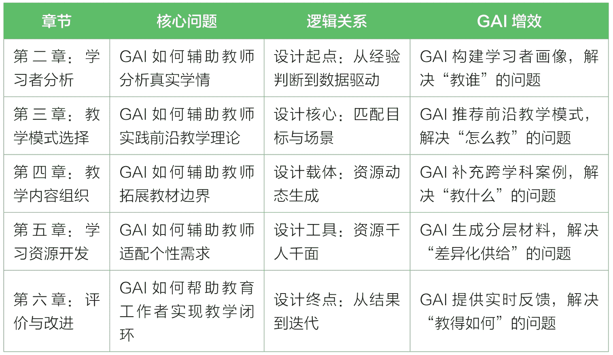

**八大策略：破解教学痛点的智能钥匙**

针对碎片化、技术偏向的攻略，本书结合教育学原理梳理八项策略，如表2所示，将 GAI 转化为可操作的解决方案，破解教师日常教学困境。

**表2 GAI 赋能课程设计的 8 大策略**

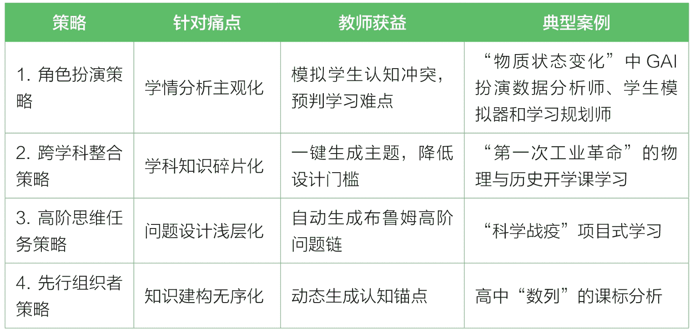

续表

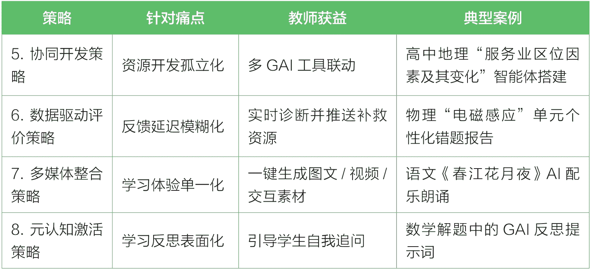

**从理论到实践：45 个操作案例＋8 个综合案例的赋能图谱**

为弥合知行鸿沟，本书设计四十五个动手案例与八个综合案例，覆盖备课、授课、评价全场景。动手案例提供步骤式指南，包含提示词设计、数据输入格式等细节，降低技术门槛。综合案例基于真实课堂需求，呈现不同场景下 GAI 的应用方式与实践价值。

本书既是 GAI 教育的工具手册，也是教学改革的思维地图。GAI 不是取代教师的万能答案，而是放大专业能力的超级助手。它促使我们重新审视教育本质：教育不是单向知识传递，而是思维唤醒、能力锻造与价值引领。教师角色由此从知识传递者进阶为学习生态设计师。在人与机器协同中，期待更多课堂迸发创造力，更多学生找到成长路径。

技术的温度来自人的智慧。让我们以 GAI 为笔，共同描绘优质课堂新图景。

# 本书编委会

2025 年 3 月

# 第一章

# 生成式智能对课程设计的定位

具备启发性内容生成、对话情境理解、序列任务执行与程序语言解析能力的生成式人工智能正快速发展，其在教育领域的应用愈加受到关注。2023 年 8 月，国家互联网信息办公室、国家发改委、教育部等七部门联合发布《生成式人工智能服务管理暂行办法》，鼓励 GAI 在各行业创新应用并推动生态构建。课程教学领域的应用生态已成为重要探索方向。需注意，GAI 在原创性知识生产上无法完全替代人类，但在辅助创新过程、解决复杂问题与促进高阶思维方面优势明显，因而在革新课程设计上潜力巨大。

本章从技术基础、基本模型与教师认知三方面回应生成式 AI 如何革新课程设计、赋能课程开发的基本模型、革新课程设计的核心原则与教师认知三问。

## 第一节 生成式智能如何改写课程设计

探讨生成式智能如何改写课程设计，先要把握其技术前景与基础。GAI 引发的教育变革并非简单工具叠加，而是通过重构学习者分析与目标规划、教学模式选择、教学内容组织、学习资源开发、评价与改进的过程，实现从教师经验主导向人机智能协同的范式迁移。

### 一、革新课程设计的技术前景

技术前景可概括为智能化学习内容生成、人机协同个性化学习支持、立体化评价反馈体系构建三个方向，分别扮演经验型教学设计助手、智慧学习伙伴、智能评价专家角色。

**（一）智能化的学习内容生成——经验型教学设计助手**

GAI 内容生成能力持续增强，教师可在其辅助下实现课程内容的智能迭代。GAI 能依据学生学习特征、认知水平与兴趣偏好生成个性化学习材料，如按阅读水平定制文本、设计梯度数学问题、布置分层科学探究任务。精准供给提升学习兴趣并培养创新思维与问题解决能力。对教学经验不足的新手教师，GAI 可提供全流程教学设计支持。以 ChatGPT、文心一言、DeepSeek 等大语言模型为例，它们能协助完成教学方案初稿、提供多样化资源建议并支持方案持续优化。经教育专业训练的大模型还能支持作业设计与批改，提升教学效率。

**（二）人机协同的个性化学习支持——智慧学习伙伴**

随着对话交互智能化，教师可设计更多学生与 GAI 互动的任务。互动既提供个性化知识建构支持，也提升人机协同能力与认知水平。未来 GAI 有望担任智能学伴或虚拟教师，推动课堂从教师主导学生响应转向学生主动智能支持的探究式学习。GAI 辅助教师通过认知冲突与即时反馈帮助学生从表层认知跃迁至深层理解。传统学习受制于知识与思维同质化及教师发散指导力不足，师生互动难以达效。GAI 作为智慧学伴可弥补不足，实现有问必答、有求必应的个性化支持，并支持机—生、生—机—生等协作模式，促进批判性思维等高阶能力发展。

**（三）立体化的评价反馈体系构建——智能评价专家**

基于证据的教与学反思是学习进阶关键。GAI 能快速理解多模态数据并进行分析、总结、点评、建议、批改、反馈。依托强大多模态处理能力，GAI 可助力构建立体化学习评价体系。例如将学生作品与评价标准输入，GAI 可模拟专家口吻提出针对性建议并迭代优化；也可对学习成果进行智能诊断，用通俗语言帮助学生正向看待错误并借助有效试错深化认知。教师借助 GAI 数据分析可构建智能初评、同伴互评、教师终评的多层次体系，以文本、图像、音频、视频等形式提供及时全面反馈与改进建议。

### 二、革新课程设计的技术基础

应用场景背后依托哪些核心技术？下文以教师熟悉场景解读四大关键技术。

**（一）数据驱动的学习分析——教育行为的显微镜**

GAI 赋能学习分析体现在优化分析思路、辅助分析过程、提升分析素养三方面。GAI 拥有较强语言理解与生成能力，能像显微镜一样精准识别利益相关者需求与意图，并据此生成或优化指标、思路、步骤与方案，以易懂方式呈现，使学习分析更清晰高效，不受素养水平限制。分析过程中教师可随时与 GAI 多元交互，解答难题并养成智能时代学习分析习惯。更重要的是，教师可通过 GAI 持续学习，提升技能与复杂问题解决能力，增强智能时代学习分析素养。

**（二）自然语言处理——课堂对话的智能翻译官**

自然语言处理技术发展使 GAI 具备类人语言理解与生成能力，为教育带来变革。NLP 使 GAI 能驱动自动化分析任务，并通过人类反馈强化学习不断优化结果，在教育场景打造互动性强、个性化的学习材料。智能辅导系统可根据课堂回答调整难度，或按兴趣自动生成故事与练习题，增强趣味性。该能力帮助教师理解课堂对话深层意义，挖掘学习信息，破解高阶思维评价难点。

**（三）深度学习算法——个性化教学的神经中枢**

深度学习模仿人脑工作方式。在课程设计中，深度学习算法可依据学生个性化需求调整内容，为每位学生定制独特学习路径。基于超大规模训练数据与 Transformer 架构，教育大模型展现卓越理解力，能综合素质相关数据。多模态数据处理上，模型将图片、视频、音频转为文本，解决异构数据难题；在不平衡数据分析中，自注意力机制与位置编码捕捉上下文关系，准确把握语境，为因材施教提供可能。例如视觉型学习者获得图表与视频资源，听觉型学习者获得音频材料，极大提升兴趣与效果。

教师将教学智慧与智能技术融合带来无限可能。正如 PPT 未取代板书而成为新表现形式，GAI 核心目的不是取代教师，而是帮助教师从容运用智能工具，使教学更高效、高质。

## 第二节 GAI 赋能课程开发的基本模型

敏捷课程开发模型与泰勒课程开发模型是两大重要框架。前者通过小规模交付与持续反馈不断改进质量，强调快速响应与灵活调整；后者强调系统性与逻辑性，确保各环节紧扣教育目标。下文介绍二者并展示 GAI 的作用。

### 一、GAI 支持的敏捷课程开发模型

该模型基于迈克尔·艾伦提出的逐步逼近模型发展，追求交付速度与质量最优，通过高频次小规模交付与反馈循环提升课程品质。通常包括调研分析、迭代设计、迭代开发三个阶段。

现有研究集中于理论构建与教师培训。理论上基于敏捷教学设计提出快速交付、迭代开发、多方参与、自主管理、协作沟通、工具支持、任务反馈、技术环境等原则，并提出学习者本位、动态管理、过程交付、群智共创等实践建议。培训上强调以关键任务为线索强化技术培训，优化敏捷课程内容。

**（一）模型说明**

研究团队基于敏捷理念构建包括调研分析、调试设计、迭代开发的 GAI 支持敏捷课程开发模型，具体见图 1-1。

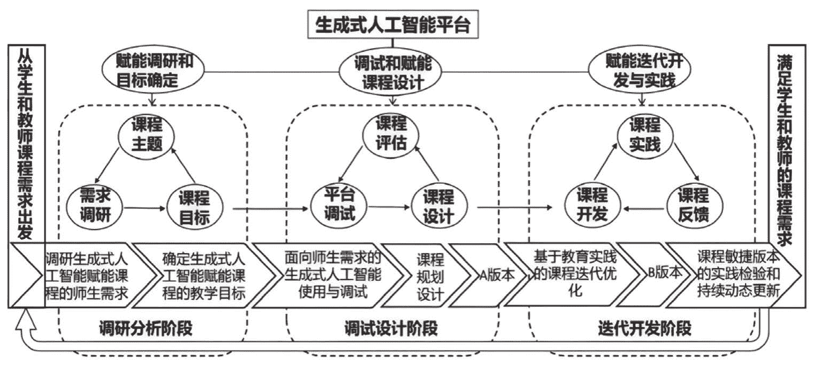

**图 1-1 GAI 支持的敏捷课程开发模型**

**1. 调研分析阶段**

此阶段 GAI 用于挖掘师生需求以实现开发目标。GAI 可结合纸质问卷或面对面访谈快速归纳海量学生数据，提升效率并揭示潜在学习趋势，明确实际需求。随后借助 GAI 细化课程目标，将学生兴趣与个性数据输入对话界面，定制科学、针对、可行、创新的教学目标。在内容选配阶段，学情分析至关重要。教师需借助 GAI 把握知识水平、学习能力与兴趣爱好，确定起点与难点，选取兼顾学科知识与创新思维培养的内容。

**2. 调试设计阶段**

重点是对 GAI 使用进行调试并据此整体规划与开发。鉴于技术快速迭代，不同平台与版本效果差异明显，每位使用者也有偏好平台，因此前期需多次尝试并择优推荐，同时细致反馈使用效果。

为确保最大效用，开发者需结合主题与内容，基于前期调研结果，兼顾教师需求与学生需求，设计符合教育规律且体现技术前沿的课程。GAI 可丰富教学内容，如利用自然语言处理创作出贴近实际的案例与故事，使抽象知识具体生动；借助图像识别与生成技术提供直观视觉素材，如动画与图表，激发兴趣并提升理解力。

**3. 迭代开发阶段**

主要任务是基于教育实践优化课程，通过敏捷版本实践持续改进内容。环境变化推动创新，敏捷课程可快速响应政策调整、社会热点与学生即时反馈，优化目标、内容、方法与评价体系，确保与实际需求同步。因此迭代开发是整个模型的关键环节。

课程迭代要落到课堂的真实体感上，必须紧扣学生在实施过程中的困惑、产出与期待，特别要听见他们在用生成式AI探索时的现场反馈。设计者可以把自评与互评搬进AI平台上演，一方面为后续更新提供更立体的证据，另一方面直接产生学习增益。自评环节系统能给出即时且贴身的回应，带动学生自我反思；互评环节多元视角的碰撞有助于锻炼批判思维。自评贴近个人学习实况，互评引入外部意见的多维视角，二者配合让评价更全面也更客观。

**（二）模型小结**

在生成式AI加持下，敏捷式的课程迭代既能加快开发节奏，又能强化定制化与互动感。对中小学一线教学者而言，这类模式可减轻设计负担，也有利于落实因材施教。只是敏捷模式本身带有渐进迭代属性，初级阶段试点的课程可能对学生产生影响，使用时仍需保持审慎。

### 二、GAI 支持的泰勒课程开发模型

泰勒课程开发范式由美国教育家拉尔夫·泰勒在1949年出版的《课程与教学的基本原理》中首次提出。它用四个核心问题串联课程：学校要追求什么教育目的？为达成目的应提供何种教育体验？如何安排这些体验？如何检验目的是否实现？归纳起来即确定目的、选择内容、组织经验、检验结果。

**（一）模型说明**

在经典泰勒“目标—内容—方法—评价”四要素基础上，生成式AI驱动的泰勒框架进一步拓展为学习者分析与目的规划、教学方式甄选、教学内容编排、学习资源开发、评价与改进五个环节。其升级体现在三个层面：由静态预设转向动态生成，课程要素可依据实时学情数据自动调整；由经验判断转向证据决策，每个环节都有AI提供的量化分析支撑；由统一供给转向分层适配，支持班级、小组、个人等多层级的定制化方案生成。

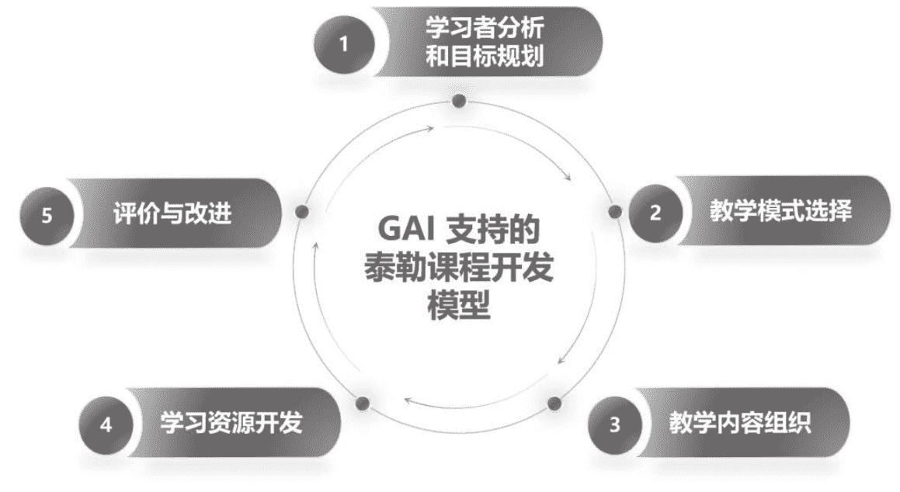

**图 1-2 GAI 支持的泰勒课程开发模型**

**1.学习者分析和目标规划**

此阶段教师可借助生成式AI采集并解析多源静态数据，综合认知层级、学习偏好、兴趣取向等多维度，为每位学生搭建详尽画像，从而制定更贴合实际的教学目的。在保持与课程标准一致的前提下，技术还能依据班级整体与个体差异智能提出调整建议，让目的既顺应整体进度也兼顾个性化需求。

在动态数据层面，依托多源融合与智能诊断可以构建全景学情认知体系。系统能捕捉并解析课堂互动、作业完成情况、在线学习记录等多模态信息，利用知识图谱建立个体认知档案。不仅可识别群体的知识薄弱点，还能通过自然语言处理解析讨论内容，洞察情感态度的潜在变化。目的设定时，教师输入课程标准关键信息后，系统即可按提示生成涵盖学科核心素养、认知层次、情感价值的三维目的框架，并依据学情诊断结果调节难度。例如当检测到班级基础概念掌握不牢时，系统会建议把“探究电磁感应原理”调整为循序渐进的“观察生活电磁现象”目的序列。

**2.教学模式选择**

不同教学情境适配不同模式，选择得当至关重要。作为课程设计与教学实施的桥梁，生成式AI基于目的、内容特性、学情特征、环境条件等多维度综合分析，通过决策支持与机器学习构建模式匹配模型，为教师推荐最优方案。同时提供定制化资源、个性化路径与智能化反馈，增强模式实效。

例如当系统识别到内容实践性强、学生具备一定自主学习能力且学校配备实验设备时，会自动推荐“项目式学习”模式，并附带驱动问题、任务分解、评价量表等完整实施方案。适配过程中需特别关注知识建构的深度、学生参与的广度与实施的可行性。对于以核心概念为牵引的单元教学，系统可能建议采用“大单元教学模式”，把零散知识点整合为主题任务群，并设计贯穿单元的表现性评价任务。而对于需要快速掌握基础技能的课程，如数学运算，则会推荐“精准分层教学”模式，提供诊断性测试、分层练习、自适应反馈等方案。此外生成式AI还具备模式创新组合的潜力，如语文阅读中可建议融合“群文阅读”与“跨媒介表达”，既保留深度思维训练，又融入数字化创作。通过提示词引导，每种推荐模式均附详细实施指南、常见问题解决办法及成功案例，降低教师实践转型的门槛。

**3.教学内容组织**

传统学习遵循“行为—认知主义”理念，内容与步骤多由教师预设，容易忽视个体差异，压抑学习动机。人工智能可承担知识结构化与认知路径优化任务。生成式AI具备卓越的知识处理能力，能迅速梳理学科体系，自动生成概念网络图，帮助教师把握知识内在关联。还能依据学生认知特点与已有知识智能推荐重点难点分布，优化呈现逻辑，并根据实时学情动态调整内容的深浅，确保与认知发展水平相匹配。

此外，生成式AI还能辅助教师分析学科本体知识库与历史教学案例库，生成包含核心概念、次级概念、事实案例的三层知识网络。在确定重难点时，综合比对课程标准要求、学生前测数据、区域教研热点等信息，运用决策树算法推荐最优内容组合方案。

**4.学习资源开发**

在资源生成中，生成式AI依托高级语义理解能力，以“人机共创”实现教育资源的动态生成与适应性重构，凭借优于人类的信息生成与知识水平突破类型与效率限制，以低边际成本推动资源开发向自动化、智能化迈进。以音乐教育为例，生成式AI将数字艺术、音乐、影像等多媒体元素有机融合，打破传统媒体壁垒，为学生提供开放独特的创作灵感与快速实验迭代机会。具有生成性、自适应性、可进化性与开发性的资源更能满足学习者选择需求。因此生成式AI可依据教学目的生成分层多样化资源。对基础水平学生提供融入生活化情境的图文导学案；对进阶学生开发交互式虚拟实验工具增强实践操作；对拓展层学生提供开放性研究项目模板，鼓励深度探索与创新。

**5.评价与改进**

生成式AI强大的内容整合与生成能力加速知识获取与传授，提高内容加工自动化程度，降低低阶内容作为核心学习结果的必要价值。核心素养评价指向培养更多样化的思维，以适应终身学习社会。生成式AI构建全面且持续的评估体系，通过多模态数据采集全程追踪学习过程，生成涵盖知识掌握程度、能力发展水平、学习行为特征的多维度评价报告。基于评估结果，生成式AI可协助教师智能诊断教学效果并提供具体改进建议。这种智能化评估与改进机制不仅实现教学效果精准评估，也支持课程持续优化，形成完整教学改进循环。

**（二）模型小结**

生成式AI在课程设计领域的应用标志着从“人工迭代”向“智能进化”的范式转变。该模型在保留泰勒原理系统性的同时，以人工智能突破传统课程设计的三大局限：经验主义带来的主观偏差、差异化教学实施的可行性难题、教学反馈的滞后性问题，为数字化转型时代的课程建设提供可行技术路径。本书将依托此模型，深入展示如何利用生成式AI高效高质量地进行课程设计。

## 第三节 GAI 革新课程设计的核心原则与教师认知

在厘清生成式AI技术基础及其在课程设计中的广泛应用后，关键在于如何在教育实践中科学规范地运用该技术。这不仅关乎应用效果，更关乎教育长远发展。本节从核心原则与教师认知两方面剖析生成式AI课程设计的要害，为一线教育工作者提供可操作指导。

### 一、GAI 革新课程设计的核心原则

生成式AI在课程设计中的应用不仅是技术革新，更是教育理念的深刻转变。遵循以下原则，教师能更有效地利用生成式AI工具优化课程设计，实现定制化教学。

**（一）学习目标的高阶化与进阶化原则**

真正的“教”是唤起学生“思”的能力。教意味着让人去学，好的老师让人学习的东西只是学习本身。尽管生成式AI在处理基础低阶知识上表现突出，但在设计学习活动时，教师更应聚焦高阶能力培养，如创造性思维、协作问题解决与批判性思维。为此需综合考量生成式AI操作难度与学生认知发展规律，规划生成式AI与学段、学习目标的协同关系，找到最适配的技术整合路径。例如设计开放性问题与项目，激励学生提出创新解决方案；组织小组协作任务，让学生在互动中学会合作；引导学生对生成式AI输出进行深入分析与质疑，培养独立思考。这样既提升知识水平，也促进高阶思维发展。

**（二）技术应用中的伦理合规性原则**

教育技术如同一把双刃剑。科学辩证看待教育技术，确保伦理合规使用是关键。UNESCO《GAI 教育和研究应用全球指南》指出，生成式AI可能因缺乏对世界的深入理解而削弱意见多样性，影响多元观点与创新思想发展。因此在学习设计中，生成式AI扮演专业教学设计师、助学同伴、学习路径引领师等角色时，应更突出“人师”的引导作用。教师需监控并审核生成式AI提供的低阶知识准确性，同时借助生成式AI促进学生高阶思维形成。此外需确保学生数据安全与隐私，防止泄露。

**（三）学习体验的个性化与多样化原则**

生成式AI技术特点在于内容定制化、技术整合集成化、呈现形式亲和力强。为营造适宜学习场景，生成式AI赋能的学习设计强调学习体验的个性化与多样化，即在同一学习目标下为每个学生提供不同路径与节奏。教师在设计活动与支架时，应依据不同学习风格提供个性化支持，如为视觉型学习者提供更多图表视频资源，为听觉型学习者提供音频材料。还可运用不同教育提示语设计促进个性反思的学习活动，如通过提问引导深入思考知识点，或通过案例分析帮助理解复杂概念。同时采用多样化评估方式，如自评、互评、教师评价，全面准确反映学习成效。

### 二、GAI 革新课程设计的教师认知

随着生成式AI逐步渗透教育，中小学一线教师迎来前所未有的挑战与机遇。在生成式AI赋能课程设计中，教师的认知深度与适应能力成为关键。为充分发挥技术潜力，教师不仅要增强数字能力，还需妥善应对学生使用生成式AI时可能产生的学习态度及技术专业性问题。以下策略有助于教师更好理解与应用生成式AI，确保教学实践的有效性与合规性。

**（一）提升教师的数字素养**

生成式AI到来使教师间的数字素养差异愈发明显。教师数字素养指使用数字技术获取、加工、使用、管理和评价数字信息与资源，解决教育教学问题、创新变革教育活动的能力。随着以生成式AI为代表的新技术突破，数字素养已成为新时代教师必备能力。这种提升不应局限于技术操作，而应深入教育场景融合实践。例如掌握如何设计恰当提示词引导生成式AI生成贴合教学需求的内容；学会利用数据分析技能从生成式AI提供的学习行为数据中提炼教学洞见；具备技术整合能力，将生成式AI与其他教育工具结合构建全面智能教学生态。这些能力的提升源于真实教学实践中的持续摸索与积累。

**（二）理解 GAI 的专业性局限**

生成式AI虽在智能化程度上远超传统搜索式智能问答，能自主组织信息并进行一定推理，但生成式特点决定其存在局限。教师应意识到，即便当前国内通用大模型在教育领域应用效果整体较好，专业性与前瞻性仍有提升空间。例如在语文教学中，生成式AI可能无法准确把握文学作品深层意蕴而误判内涵；在科学教学中，可能无法提供最新研究发现或输出知识性错误答案。这要求教师时刻保持专业判断力，既善用生成式AI提高效率，又避免过度依赖。实践中可先用生成式AI生成初步方案，再结合教师专业判断调整内容，确保教学内容可靠准确，始终保持人的主体性地位。

**（三）积极应对学生的学习态度问题**

人工智能深入应用让人警惕学习者是否会像使用电脑、手机那样形成技术依赖甚至成瘾，使教育目标偏离初衷，影响身心全面发展。第一，学生可能用人工智能代替自身完成作业。生成式AI的智能搜索、逻辑分析、内容创作功能可帮助学生轻松获取素材、解决问题甚至完成大量任务，直接动摇以学生成长为目标的信任关系基础。第二，人工智能在提高学习效率的同时减少深度思考机会，削弱迁移能力。例如学生可轻易用 ChatGPT 检索到知识或操作步骤，但停留在低水平认知阶段，难以应用于具体场景，导致碎片化外部知识难以内化为系统化个人知识，难以形成体系化结构。为应对挑战，教师可多方面着手。首先制定学生使用生成式AI的规范，明确可使用技术类型、方式、时间限制，并建立责任追究机制。其次建立学习活动数据追踪机制，要求学生在完成开放性或大规模作业时注明生成式AI使用情况并提供交互记录供教师审阅。最后定期通过信息技术课程或班会传授生成式AI使用伦理与规范，增强学生自律意识。

# 第二章

# 学习者分析：GAI 如何辅助教师分析真实学情

在教育数字化转型大潮中，识别教学关键点与合理设定教学目的成为课堂革新的关键。本章借助生成式AI技术，全面探讨如何破解传统教学中普遍存在的三大难题：学生学习情况诊断不明、教学目标设定主观、教学路径设计单一。本章介绍生成式AI革新课程设计的第一大策略“角色扮演”，并以“理论基础—策略开发—实际应用”递进框架，结合案例说明生成式AI如何帮助教师革新学习者分析与目标规划。

## 第一节 角色扮演策略：以学习者为中心

本节深入探讨角色扮演教学策略的理论背景及其在实际教学中的运用逻辑，并介绍该策略在具体使用过程中的技术特征与注意事项，为教育工作者提供兼具理论深度与操作性的指导。

### 一、GAI 革新学习者分析与目标规划的理论基础

教育理念演变见证了从教师主导到以学习者为中心的根本转变。传统模式下教师与教材占据核心，现代观念则通过认知科学革新实现重大突破。教学心理学研究表明，学习者并非被动接受知识的容器，而是基于个人经验与情境互动不断构建认知体系的主动参与者。这一认知在维果斯基的社会建构理论中得到充分阐释，他强调学习是主体与环境交互作用的社会化过程。皮亚杰的认知发展理论也强调“儿童是基于他们的背景和经验以整体的、连续的方式来构建知识的”。因此基础教育亟需建立以“学生为中心”的课程体系，这与生成式AI的多模态融合能力不谋而合。生成式AI融入促使课程设计从经验导向转向数据驱动，既尊重认知发展规律，又实现教学精准化。本节将阐述学习者分析与目标规划的两个核心理论。

**（一）建构主义理论**

建构主义强调个体通过同化与顺应机制将新知识内化为个人认知结构。图式作为认知基本单元，通过已有图式整合新刺激即同化，或调整现有图式以适应新刺激即顺应，达到认知平衡。在建构主义视角下，生成式AI为认知发展提供强大技术支持。生成式AI辅助教师深入分析学生的多模态学习特征，如学习风格、动机、知识基础等，揭示个体认知图式的独特性。以几何证明题为例，生成式AI不仅能判断答案正确性，还能识别学生思维偏好，如空间想象或代数推导。当检测到新知识超出学生当前图式承载能力时，生成式AI可帮助教师设计过渡性学习支架。例如在物理教学中，针对难以理解电磁感应的学生，生成式AI可推荐包含磁感线增强现实模拟与生活化类比如地铁闸机的微课组合，促进认知主体与环境持续互动与平衡。

**（二）“关注学习者与知识生成”课程观**

进步主义课程观以实用主义哲学为基础，强调“经验”对学习者的重要性。杜威等代表人物认为经验是有机体与环境相互作用的结果，具有主动性和整体性。因此课程应以儿童为中心，按心理发展规律组织。这种观点要求打破学科界限，设置整合性课程，这也是主题式阅读教学的灵魂所在。后现代课程规则认为知识是混沌、开放、非线性的，提出 4R 课程标准：丰富性、循环性、关联性、严密性。它将知识视为对动态变化自我调节系统的解释，拒绝知识的固定演化轨迹，强调知识的生成性与多样性。后现代课程观提倡将科学知识、社会知识与哲学等融合，形成新的课程范式。生成式AI技术正在推动课程生成范式发生根本性变革。传统的“预设-执行”线性结构正在向“生成-演化”的生态模式转型。

### 二、角色扮演策略说明

生成式AI革新课程设计的第一项策略是角色扮演策略。通过赋予生成式AI多重角色即数据分析师、学生模拟器、学习规划师，教师可系统性地实现“需求定位—需求验证—路径生成”的闭环设计流程。

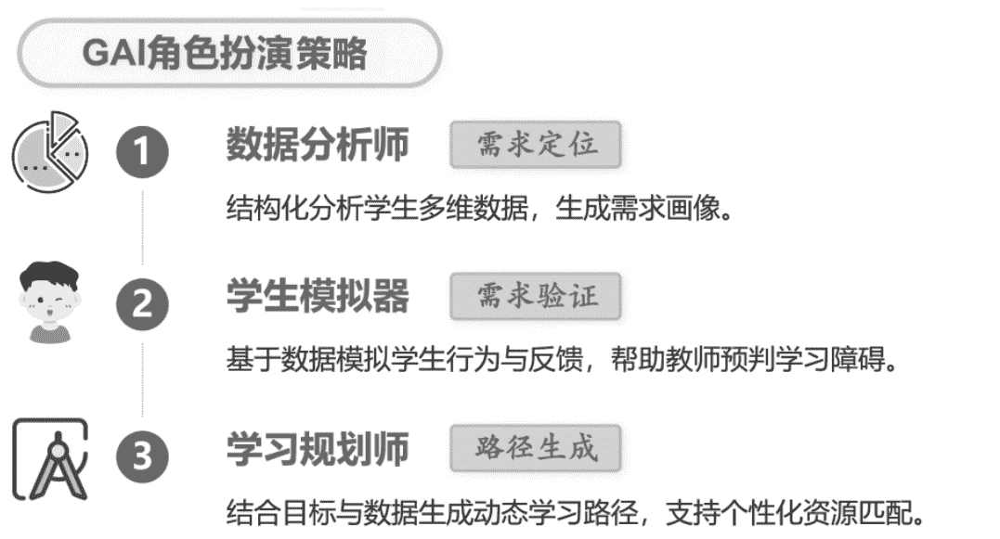

**图 2-1 角色扮演策略说明**

**（一）数据分析师：从碎片数据到需求画像**

**让AI扮演三重角色，重塑教学设计**

**把零散信息聚成可操作的画像**

生成式智能在教学设计里最先承担的是学情洞察专家的定位，核心在于把教师手中的碎片化资料整理成清晰可用的学习者画像。教师把认知发展阶段、学习偏好类型、动机水平、既有知识储备等多源信息导入系统。系统据此调用加德纳多元智能的视角进行综合研判，突出智能形态的多样性，如语言、逻辑、空间、身体操作等，让分类摆脱单一分数束缚，覆盖认知、情感与行为层面。举例来说，当判断某名学习者数理逻辑智能偏弱而身体动觉智能突出时，系统会建议增加动手实验类活动，减少纯理论推演练习。此流程能够产出带标签的学习者特征描述，例如“视觉偏好型/自信心不足”，并指出潜在的困难点，例如抽象概念理解受阻，为后续教学决策提供依据。

**（二）学生模拟器：从数据推演到行为预判**

完成需求定位后，生成式智能切换为学习者仿真身份，通过模拟真实对话来检验假设。该环节的理论基础是社会建构主义，知识是在互动中生成的，教师需要借助对话捕捉认知冲突与意义建构过程。例如教师提问“为何认为蒸发与温度相关？”时，系统会基于前期输入的画像，如“偏好具象思维/关联性评分偏低”，给出符合该特征的回应：“在家看到水壶烧开冒热气，却说不清具体关联。”这类对话能够暴露思维盲区，如将蒸发与沸腾混淆，也能揭示量化指标难以呈现的需求，如渴求生活化案例。教师通过持续追问并观察模拟反应，可以动态修正对需求的理解，避免被静态信息误导。

**（三）学习规划师：从目标拆解到路径生成**

作为路径设计师，生成式智能把分析结果转化为可执行的人性化进阶路线。该阶段遵循掌握学习理论，强调借助诊断性评估与分层任务设计确保人人达到目标。系统会根据画像把课程标准拆解为阶梯式任务并嵌入形成性评价节点。以“物质状态变化”单元为例，路线可这样安排：首阶段用冰块融化实验建立直观体验，契合动觉偏好者；次阶段引入分子运动动画，帮助化解抽象概念理解难题；末阶段开展“不同物质熔点对比”的探究项目，满足高阶思维发展需求。同时系统会匹配差异化资源，如实验指南、可视化工具、拓展阅读，并为每项任务标注理论依据，例如“任务二采用抛锚式教学，增强情境关联性”，帮助教师读懂设计逻辑。

**（四）三种角色扮演切换的逻辑闭环**

采用角色扮演方法时，教师需依次完成定位需求、核验需求、据此生成具体进阶路线三项工作。该方式打破了传统课程开发中采集与设计脱节的问题，使课程设计更灵活、响应更快。例如模拟对话显示学习者对“分子运动”概念有具象化需求时，教师可立即要求路径设计师在路线中加入模型构建环节，而不必等到实施后才调整。通过这种协同，智能体成为教师的得力助手，推动课程设计从经验驱动转向数据与理论双重驱动。

### **三、关键技术说明**

让理论框架落地，工具选择与使用方式至关重要。当前教育技术生态中，不同生成式AI平台的功能差异会直接影响学情洞察精度与教学决策效度。教师挑选工具时，需从解析深度、教育适配精度与操作友好度三个维度综合评估。本节剖析主流平台的核心特性，并探讨指令设计的关键法则，帮助教师把前沿技术转化为可操作的教学生产力。

（一）角色扮演方法中的技术平台选择

平台选择直接影响学情洞察的深度与信效度。合适的平台应具备三大特质：一是数据兼容性，可尽量支持表格、图像、文字等多模态导入；二是分析颗粒度，可细化到单个知识点的掌握追踪；三是使用习惯友好，尽量简化流程。表 2-1 列出了若干生成式AI平台在学习者已知内容分析时的特点。

**表 2-1** **GAI 平台分析**

续表

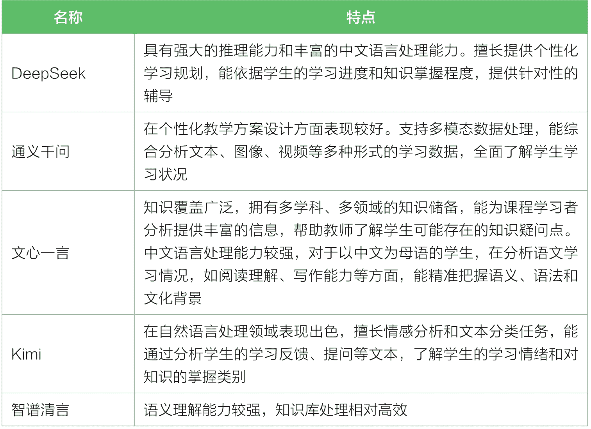

**（二）角色扮演方法的指令说明**

指令设计是激活生成式AI教育潜能的关键。结构化、规范化的指令相当于为智能体配备教学指南针，保证分析结果符合教育规律且具实践价值。规范指令包含五要素。角色定义：明确智能体的辅助定位，如“学情洞察师”；情境锚定：说明教学阶段与课程标准要求；任务指令：指定分析维度与方法论框架；输入规范：规定数据格式与内容范围；输出要求：设定结果呈现形式与细化程度。具体见表 2-2。

**表 2-2** **提示词指令说明**

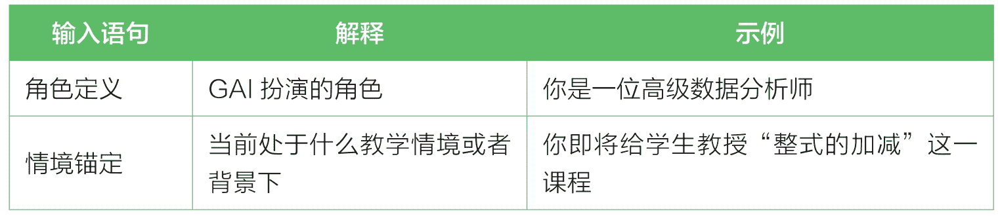

续表

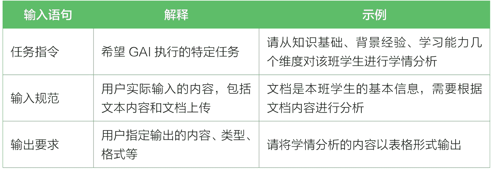

### **四、使用“角色扮演策略”的注意事项**

在用生成式AI革新课程设计时，教师需特别注意以下三方面，以保障技术应用的合理性、安全性和教育价值。

**（一）伦理与隐私：保护学习者数据安全**

学习者数据是分析基础，使用必须严格遵循伦理与隐私原则。首先，导入智能体的学习者数据须做匿名化处理，避免直接使用姓名、学号等敏感信息。例如用“学习者001”或“四年级学习者B”替代真实姓名。其次，要向学习者及家长说明数据用途和范围并征得同意，建立信任。传输存储环节应选用符合教育行业标准的安全工具，如学校提供的加密云平台，而非个人设备或公共网络。最后，定期清理不再需要的数据，降低长期存储风险。这些措施既保护隐私，也为分析提供合规高质量的数据基础。

**（二）人机协同边界：教师专业判断不可替代**

生成式AI在数据分析和路径规划上表现突出，但输出仍需教师专业判断和校准。算法生成的方案未必完全契合具体教学情境或个体学习者。例如，系统可能推荐高难度实验，却未考虑班级设备限制或安全风险，此时教师需结合经验优化或替换任务。要警惕过度依赖，智能体是辅助工具而非替代教师的万能方案。生成进阶路线后，教师仍需评估其是否符合课程标准、是否匹配班级进度、是否满足个性化需求。人机协同才能兼顾效率与科学性、人文关怀。

**（三）学习者参与度：以学习者为中心优化路径设计**

生成式AI生成的进阶路线有效性最终需经学习者体验验证。教师应定期邀请学习者评价，收集对其任务设计、资源匹配及支持策略的感受，作为优化反馈。例如，结束“物质状态变化”单元后，可发放简短问卷，让学习者对趣味性、难度、实用性打分，并开放文字建议。这种学习者参与式优化既提升路线适用性，也增强学习主体意识。当学习者看到反馈被采纳，如增加动手实验，参与度会明显提高。教师可将反馈作为迭代依据，动态调整智能体生成的路线。

## **第二节** **分析学习者现状：实现多维度学习者分析**

在教学目标精准定位的追求中，学习者分析扮演着类似航海图的关键角色。传统学情诊断多依赖教师个人经验，主观性强且覆盖有限。随着生成式AI引入，诊断升级为基于多源数据融合的智能系统，通过捕捉认知轨迹、情感波动和行为特征，教师可构建三维学习者画像，为教学决策提供科学依据。

### **一、多维度学习者分析框架**

学习者已知内容分析是教学设计的逻辑起点，核心在于揭示认知结构的最近发展区。借助自然语言处理与知识图谱，生成式AI能系统解构学习者已有知识体系的三大维度：现有知识基础、学习经历、具体技能水平。全面分析有助于教师更准确把握学习状态，设计个性化教学方案，巩固基础、利用先验知识、提升综合能力，使教学策略更科学，满足差异化需求，提高整体教学质量。

图 2-2 展示了学习者已知内容分析框架，内容分为基础知识掌握、先验知识与技能和方法三个部分。

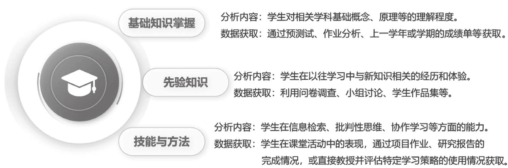

**图 2-2** **学生已知内容分析框架**

**（一）基础知识掌握**

该部分关注学习者对学科基础概念和原理的理解程度，包括掌握情况及理解深度。可通过预测试、往学期成绩单等方式获取数据。

**（二）先验知识**

主要分析学习者在以往学习中与新知识相关的经历与体验，涉及已接触的相关知识及迁移能力。可通过问卷、小组讨论、作业集等方式收集数据。

**（三）技能与方法**

关注信息检索、批判性思维、协作学习等对学业与职业成功至关重要的能力。可通过课堂活动观察、项目作业、研究报告完成情况获取数据，也可直接教授并评估特定学习策略使用情况。

### **二、面向全体学习者的“数据分析师”**

以下案例展示初中数学教师如何借助“办公小浣熊”平台做学情诊断。案例选七年级“整式的加减”单元，学习者正从算术思维向代数思维转型。通过单元测试、作业表现与课堂行为三维数据，系统生成包含认知特点、知识缺口、能力发展建议的综合诊断报告。

#### **【操作案例 2-1】GAI 赋能基础知识的数据分析**

探讨生成式AI在基础知识诊断中的应用，需以前沿认知与学习基础为切入点。本节解析如何利用生成式AI平台，以整式单元测试数据为例，理解学习者认知特征，为后续策略提供依据。

#### **指令设计**

你现在是一位高水平的初中数学老师，也是高级数据分析师（角色扮演策略），学习者目前已经学完了七年级上册第二章第一节整式的内容，即将开始学习第二节整式的加减（学习进度说明）。现在上传的文档是我班学生的整体测评情况，测评情况包含学生整式这一节的单元测试结果（上传文档说明）。请根据文档，结合我国义务教育课程标准，来分析学生的认知特点和学习基础（输出结果说明）。

**数据输入**

学习者测评情况建议以 Excel 格式上传。合理的格式化是生成式AI正确理解数据的基础。如图 2-3 所示，点击文件上传按钮（红色方框），将包含单元测试结果、作业表现和课堂表现的“学生测评情况”文档上传至平台，同时把上述提示词填入对话框。

**图 2-3 数据输入示例**

学习者单元测试结果不宜只提供整体成绩，不利于结合课标或知识点做详细分析。若试卷已有知识点分析，可上传知识点得分；若无，可直接上传题目分数（如表 2-3 所示）。

**表 2-3** **学生单元测试结果上传材料示例**

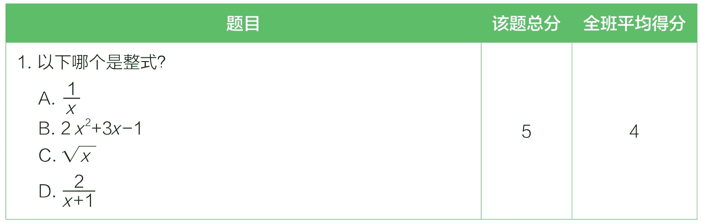

续表

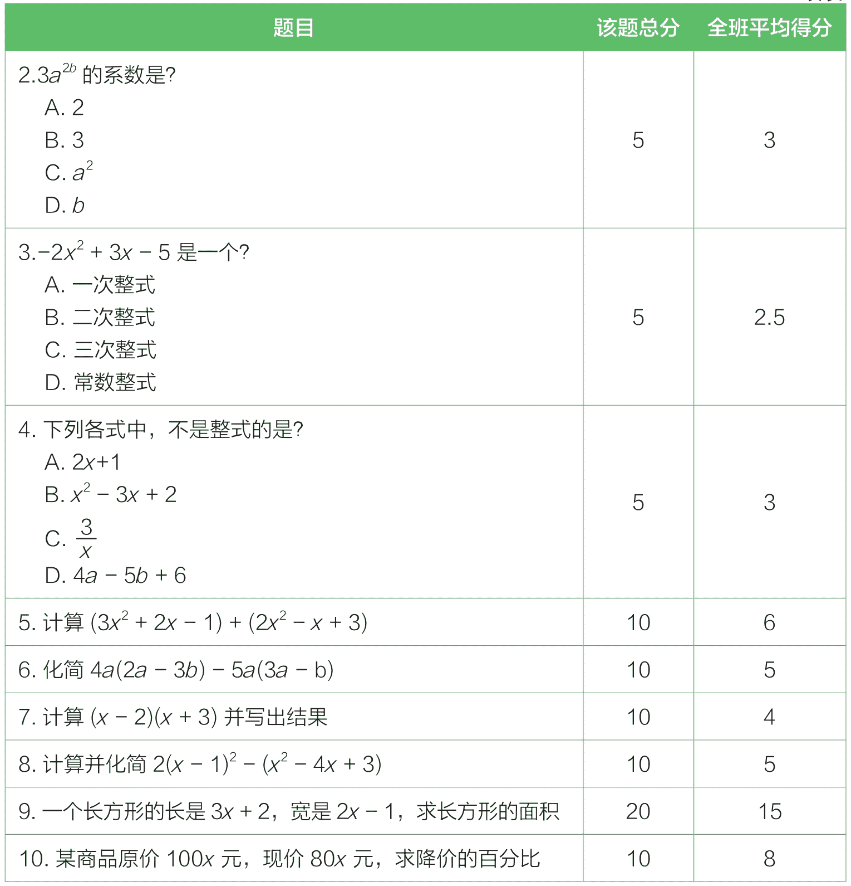

#### **【操作案例 2-2】GAI 赋能先验知识的数据分析**

在基础诊断后，需进一步评估先验知识。本节阐述如何借助生成式AI技术，依托义务教育课程标准，对班级学习者知识经验进行评估，揭示潜在障碍，为优化策略提供支撑。

#### **指令设计**

你现在是一位高水平的初中数学老师，也是高级数据分析师（角色扮演策略），学习者目前已经学完了七年级上册第二章第一节“整式”的内容，即将开始学习第二节“整式”的加减（学习进度说明）。现在上传的文档是我班学生的整体测评情况，测评情况包含学生整式这一节的作业表现，最近一周学生课堂表现情况（上传文档说明）。请根据文档，结合我国义务教育课程标准，从班级学生的知识经验进行详细的学情分析（输出结果说明）。

**数据输入**

学习者作业表现数据需呈现梯度化特征。如表 2-4 所示的“优秀-较优-良好-较差-很差”五级分布模型，配合人数统计，可帮助生成式AI识别群体性学习障碍。

**表 2-4** **学生作业表现上传材料示例**

#### **【操作案例 2-3】GAI 赋能技能与方法的数据分析**

在基础知识与先验知识评估后，转而关注技能与方法的多维度综合评估，揭示学习能力，促进全面发展。

#### **指令设计**

你现在是一位高水平的初中数学老师，也是高级数据分析师（角色扮演策略）。现在上传的文档是最近一周学生课堂表现情况（上传文档说明）。请根据文档和我们之前对话的结果，结合我国义务教育课程标准，从班级学生的学习能力维度进行详细的学情分析（输出结果说明）。

**数据输入**

学习者课堂表现的多维度量化是生成式AI分析的重要输入。如表 2-5 所示，主动参与互动质量反映认知投入度，任务完成指标关联知识内化效率。例如专注程度异常时，系统会建议调整教学节奏或嵌入情境化教学。

**表 2-5** **学生课堂表现上传材料示例**

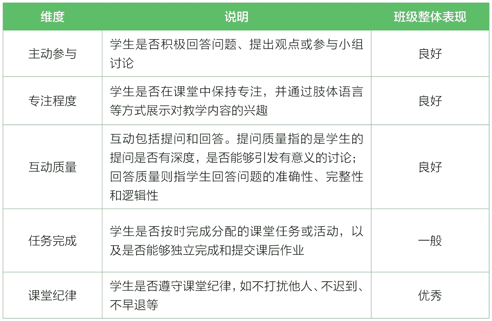

#### **【操作案例 2-4】GAI 赋能学生数据分析的结果优化**

将上述内容上传至办公小浣熊平台后，可得到学习者已知内容分析结果，如图 2-4 所示。收到首次分析后，可通过提示词对话补充，按实际需求优化。迭代对话机制使学情分析从静态报告升级为动态决策支持系统。

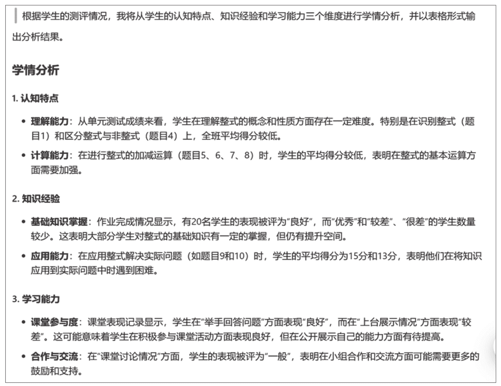

**图 2-4** **学生已知情况的第一次分析结果**

**1.深化内容分析**

提示词：“请对比课标要求，列出未达标的 5 个具体知识点。”

使用场景：当生成式AI回答未能完全贴合提问需求时使用。

**2.细化分析维度**

提示词：“请将班级整体学情分析细化至小组层面，按照基础组—提升组—拓展组分类呈现。每组需包含：知识掌握薄弱点（列出前 3 个）、典型思维误区（各 1—2 个）、针对性教学建议（每组 3 条）。输出格式要求：表格形式，包含组别、问题描述、建议措施三列。”

使用场景：当初步分析过于笼统，需为不同层次学习者制定差异化策略时使用。

**3.补充教学资源**

提示词：“根据学情分析结果，为以下知识点推荐补救资源：整式化简步骤混淆、同类项识别错误、去括号法则应用不当。要求：每个知识点推荐 2 个微课视频（时长＜5 分钟）、配套 3 道梯度练习题（基础—中等—挑战）、提供 1 个生活化应用案例。输出格式：知识点+资源链接+简要说明。”

使用场景：当分析显示特定知识点存在普遍问题，需快速获取补救资源时使用。

**4.预测学习趋势**

提示词：“基于当前学情数据，预测班级在未来一个月内的学习发展趋势。要求：列出 3 个可能出现的共性问题、预测各层次学习者的进步空间（用百分比表示）、提供 2 个预防性教学建议。输出格式：预测问题+数据支持+预防措施。”

使用场景：需前瞻性规划教学进度、预防潜在困难时使用。

## **第三节** **制定个性化学习路径：依据目标与需求规划**

个性化学习路径的构建如同为每位学习者绘制专属认知导航图。传统教学多采用“一刀切”模式，而生成式AI通过多维数据分析，可精准识别学习者的认知特征、风格偏好与发展需求，实现从“群体覆盖”到“个体适配”的转变，使教学目标与学习路径动态匹配，让每个学习者在最近发展区获得最优支持。

### **一、GAI 辅助的需求分析——个性化学习的“数据分析师”**

需求分析框架基于教育目标分类学与学习科学理论，包含认知特点、学习风格、学习动机和基础知识水平四大维度，具体说明见表 2-6。

**表 2-6** **GAI 辅助的需求分析的基本框架**

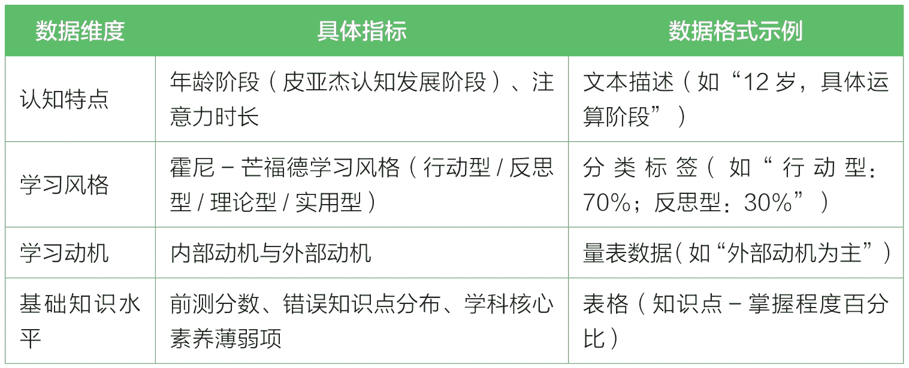

#### **【操作案例 2-5】GAI 辅助分析认知特点**

**数据准备与输入**

（1）创建 Excel 表格，包含如表 2-7 所示字段。

**表 2-7** **学生认知特点分析的数据输入示例**

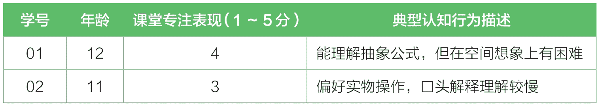

（2）数据说明：

• 年龄：直接填写数字（周岁）

• 课堂专注表现：教师观察评分（1 分：持续专注＜10 分钟；5 分：专注＞30 分钟）

• 行为描述：记录典型学习场景中的表现（如实验课/理论课的不同反应）

#### **指令设计**

你是一位教育心理学专家，现在需要根据学习者数据判断其大致的认知发展阶段：（1）参考皮亚杰理论，学习者在 7～11 岁是具体运算阶段，11 岁以上是形式运算阶段；（2）根据行为描述补充判断依据。请处理以下数据：

学号 01:12 岁，专注 4 分，行为“能理解抽象公式但空间想象困难”

学号 02:11 岁，专注 3 分，行为“偏好实物操作”

【输出要求】表格形式，包含学号/认知阶段/专注建议/教学提示，教学提示需结合年龄与行为特征。

输出示例如图 2-5 所示。

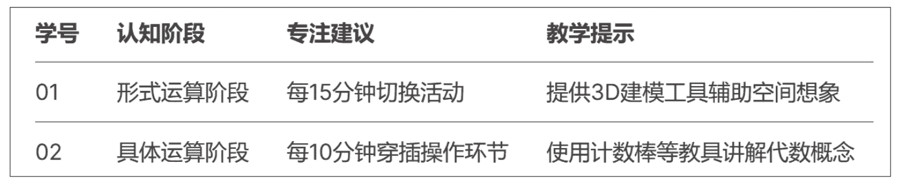

**图 2-5** **GAI 辅助的学生认知特点分析结果示例**

#### **【操作案例 2-6】GAI 辅助分析学习风格**

# 看懂偏好，调准教学

学习偏好就是学生在面对学业任务时习惯性使用的个人化套路，是在探索和解决问题过程中显现的带有个体印记的行为模式。这种取向奠基于神经组织的结构与功能，又在家庭、学校及社会文化长期浸润中，通过持续的学业实践逐步形成，稳定后延续性很强，很少随内容或环境变动。偏好的差异会直接牵动学习质量与效率，把学生的取向摸清是做学习路径规划的基础。

**1.霍尼-芒福德四类学习倾向**

霍尼与芒福德的观点认为，学生在学习情境中大致归为四种取向：行动型、理论型、实用型、反思型。不同学习活动对取向的匹配度各有差别，搞清取向与活动性质的对应关系，是挑选教学方式的关键。

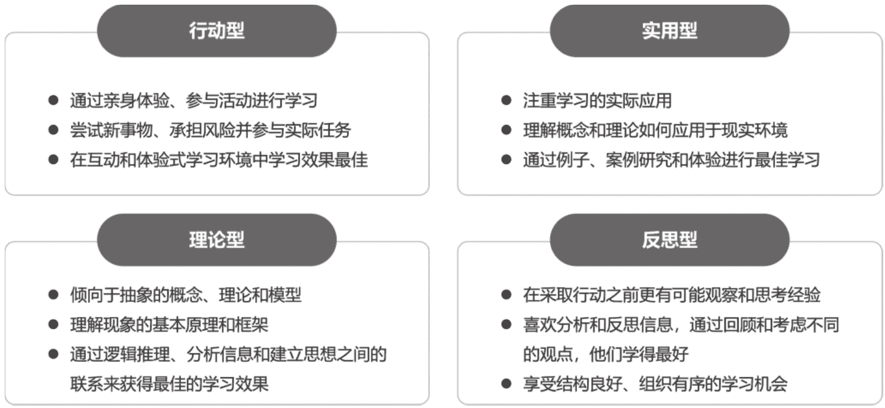

**图 2-6** **霍尼-芒福德的 4 种学习风格**

**2.偏好测评的做法**

市面上常见的量表约 80 题，覆盖四类取向的行为表现。典型题项例如“我习惯动手来掌握新知”“学习新内容时我会先观察再分析”“我倾向把理论用在实际问题上”“行动前我会全面权衡各种可能”。作答后按量表规则计分，每类取向最高 20 分，得分越高说明该取向越突出。受版权限制，完整题库可于 *Honey and Mumford Learning Style Questionnaire：What kind of learner are you？* 网站免费获取。

学习取向稳定性较高，短时间基本不变，所以在 2~3 年的学业周期内测评一次即可。

**3.用生成式大模型批量判定偏好**

把 Excel 结果导入办公小浣熊平台，借助提示词让模型自动计分。

提示词设计：
角色设定：教育数据分析专家。
任务设定：按霍尼-芒福德计分规则处理数据。输入：40 名学生的 80 题作答表，列 1-80 为题目，行对应学生。
处理要求：
-实用型得分=第 1-20 题得分总和
-理论型得分=第 21-40 题得分总和
-反思型得分=第 41-60 题得分总和
-行动型得分=第 61-80 题得分总和
输出：每名学生的四维得分及主导取向判断
数据输入格式：以 Excel 导入，示例见表 2-8。

**表 2-8** **生成式AI辅助学习偏好确定的数据格式示例**

#### **【操作案例 2-7】生成式AI辅助分析学习动力**

从路线规划的精准度看，学习动力是推动行为的内在力量，不同动力指向不同的学业方向。了解动力有助于生成式AI实现个性化规划并提升成效。

**1.学习动力介绍**

学习动力指引发并维持学业行为、指向学业目标的动力倾向。内部动力由兴趣、好奇心、成就感驱动，如“我对这门学科很有兴趣”。外部动力由外界奖励或避免惩罚驱动，如“我为了拿到好成绩而努力”。

**2.学习动力测试方法**

皮特里希的学习动机测量工具在教育心理学中应用广泛。量表从“完全不同意”到“完全同意”记 1-5 分，题目见表 2-9。^(⁴)

判断方法：
（1）计算得分：分别算内部动力题与外部动力题的平均分。假设前三题为内部，后三题为外部。
（2）比较得分：
• 内部均分明显高于外部，可判断以内部动力为主。
• 外部均分高于内部，则受外部动力影响更大。
• 两者接近，说明兼具内外动力。

**表 2-9** **学生学习动力**

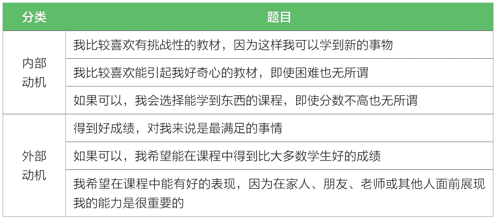

#### **【操作案例 2-8】生成式AI辅助分析基础知识水平**

基础知识是规划学业路线的基石。若不了解掌握情况，路线容易出现过难或过易。生成式AI可快速梳理各学科的基础掌握度。

**数据标准化处理**

教师自制的知识点掌握表，Excel 格式示例见表 2-10。

**表 2-10** **基础知识水平数据输入格式示例**

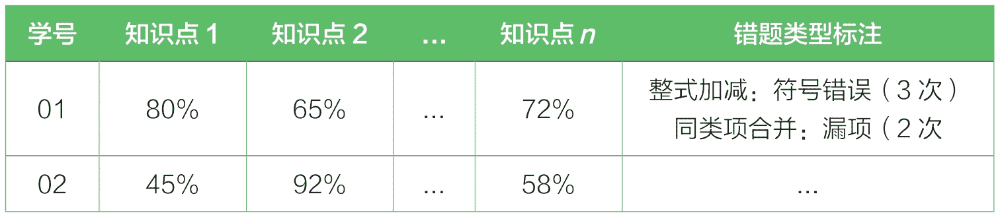

#### **提示词设计**

请以学科数据分析师身份完成：
1.诊断群体薄弱点：
-计算各知识点平均掌握率
-标红掌握率＜60%的知识点
2.分析个体知识结构：
-对每个学生列出掌握最差的 3 个知识点
-关联错题记录给出原因分析
3.生成教学建议：
-群体层面：设计 2 个补救性课堂活动
-个体层面：为每个学生推荐 1 个微课+3 道练习题
输入内容：导入的 Excel 为学生基础知识水平数据。
输出要求：
-用 Markdown 表格呈现
-标注急需干预的知识点
输出结果示例如图 2-7。

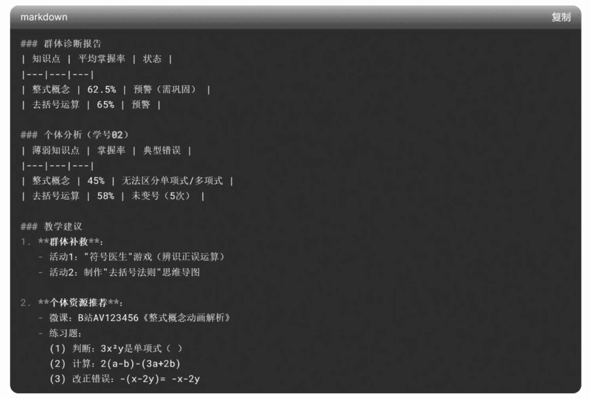

**图 2-7** **生成式AI支持的基础知识水平输出结果示例**

### **二、生成式AI辅助的需求验证——“学生模拟器”**

学情分析像画航海图，精确度需经风浪检验。传统验证依赖提问、作业等滞后手段，易陷入经验主义。生成式AI作为“学生模拟器”，构建虚拟对话实验室，实现三大革新：基于皮亚杰阶段推演认知应答；按霍尼-芒福德类型再现学习偏好；依据掌握度设计知识梯度测试。数字孪生让静态数据变为动态预演，教师可在实施前校准方案。

#### **【操作案例 2-9】综合学生需求分析内容**

整合认知特点、学习偏好、学习动力、知识水平等多维数据，构建结构化档案。生成式AI交叉分析生成需求画像，区分显性需求与隐性需求。

**数据输入格式需求**

将前期交互结果整理到一张 Excel 表，如表 2-11。注意事项：
（1）认知阶段：皮亚杰分类，前运算/具体运算/形式运算。
（2）学习偏好：霍尼-芒福德四型简写，A-行动型/T-理论型/R-反思型/P-实用型。
（3）动力类型：内部动力 I / 外部动力 E。

**表 2-11** **基础知识水平数据输入格式示例**

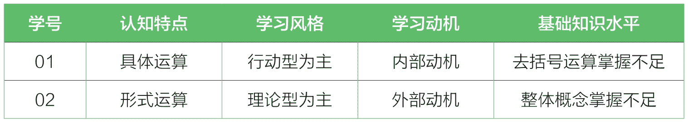

#### **提示词设计**

角色：教育数据分析师
任务：生成学生需求画像
输入：学生多维数据表
处理要求：
1.识别每位学生掌握率＜60%的知识薄弱点
2.标注学习偏好与教学内容的匹配度，如行动型学生缺乏实践任务
3.挖掘兴趣领域与学科知识的关联点
输出：
-表格：学号/显性需求 3 条/隐性需求 2 条
-文字：群体共性需求总结

#### **【操作案例 2-10】生成式AI扮演学生验证需求**

通过模拟真实课堂对话检验分析准确性。生成式AI基于档案生成符合认知水平与行为特征的对话，暴露认知冲突。

#### **提示词设计**

请模拟一位初中生，学号 02。特征：认知阶段具体运算，学习偏好反思型，几何证明薄弱。请与我模拟课堂对话，我提供教师提问与学生档案。请据此作答。
输出要求：1.语言符合认知水平，避免抽象术语；2.体现反思型特征，如自我质疑、谨慎表述；3.暴露知识薄弱点，如证明方法单一；4.隐含兴趣倾向，如建议动手验证。

示例：
教师：如何证明两直线平行？
生成式AI：可以用量角器比对角度？不过线太长的话可能不好操作……

**对话示例**

生成式AI扮演学生验证需求的对话示例如图 2-8。

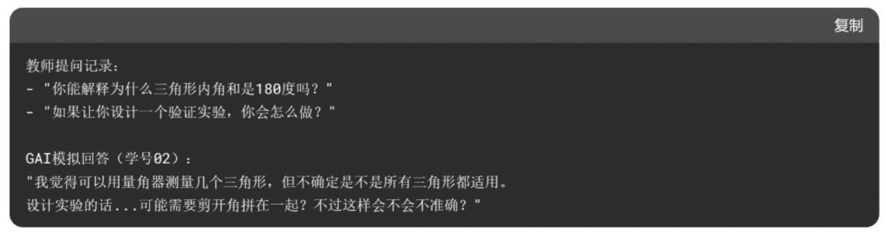

**图 2-8** **生成式AI扮演学生验证需求的对话示例**

#### **【操作案例 2-11】生成式AI扮演学生补充需求**

通过非结构化对话挖掘深层需求，如情感支持、脚手架需求、跨学科联结。

#### **提示词设计**

请扮演学生心理分析师，需从对话中提取隐性需求。我将提供学生自由讨论文本与档案数据。
处理规则：识别情绪词并关联动力类型；分析隐喻表述指向可视化等需求；推荐适配资源。
输出表格包含显性表述、隐性需求、教学建议，并标注优先级 ★ 紧急至 ★★★ 长期。

**对话示例**

使用文心一言后的结果如表 2-12。

**表 2-12** **基础知识水平数据输入格式示例**

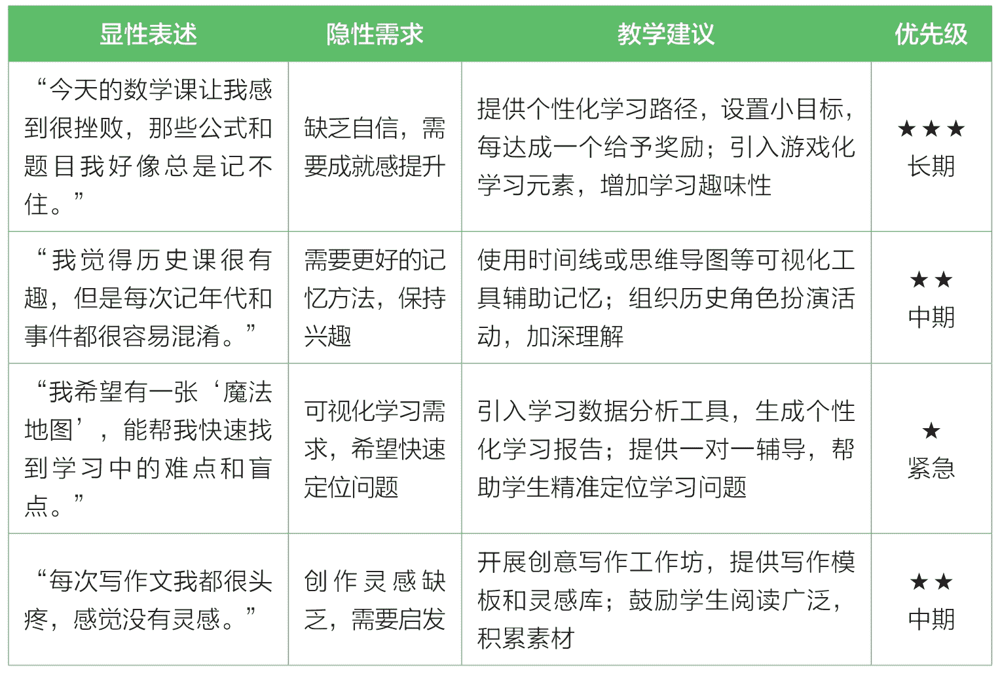

续表

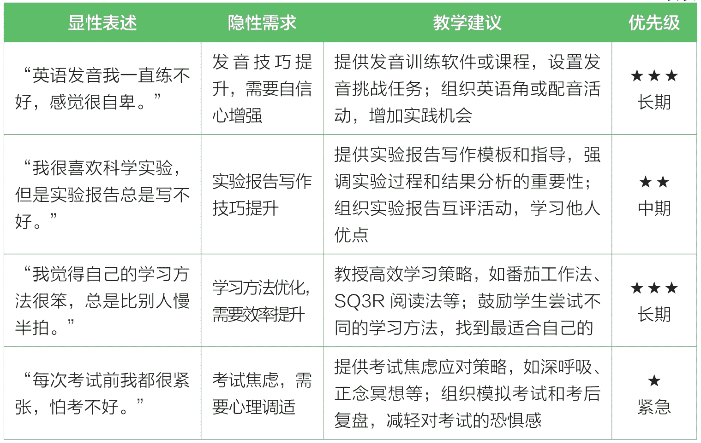

### **三、生成式AI辅助的路线规划——“学习规划师”**

掌握学习理论认为给予足够时间和适当教学，学生都能达成目标。最近发展区强调现有水平与潜在水平之间的差距。生成式AI分析作业与测评数据，定位现有水平并预测潜在水平，为学生规划最近发展区内的事项。

生成式AI可依据过往数据判断知识掌握程度，为未达标者规划额外时间和针对性练习。

**（一）多种场景提示词设计**

精准提示词是教师与生成式AI沟通的核心，以下为多场景示例。

**1.新知识学习方案制订**

身份：资深学习规划师，请依据[学生编号]数学、语文、英语的课堂表现与单元成绩，针对即将学习的[具体新知]制定两周方案。明确每周预习目标、课堂互动重点、课后复习事项及拓展材料。

**2.复习方案规划**

身份：资深学习规划师，请参考[学生编号]物理、化学、生物的历次成绩、实验表现与作业质量，制定考前四周复习方案。按周划分重点章节、强化题型与每日时长，并推荐薄弱点的复习资料。

**3.技能提升训练设计**

身份：资深学习规划师，请根据[学生编号]语文写作得分、批改评语与口语表现，设计一季度写作与口语提升方案。每月设定目标，每周细化训练事项与场景。

**4.项目式学习任务安排**

身份：资深学习规划师，请结合[学生编号]的团队参与度、贡献度与个人特长，为[项目主题]制定个性化任务。明确启动资料收集、执行中的具体工作与成果展示，并规划协作方式与节点。

**5.个性化辅导方案生成**

身份：资深学习规划师，请根据[学生编号]历史、地理错题分布、课堂表现与兴趣点，制定一对一辅导方案。确定周期、每次讲解知识点、专项练习与拓展内容，并设计调整策略。

#### **【操作案例 2-12】生成式AI扮演学习规划师**

初中语文教师准备散文单元教学，借助生成式AI制定个性化路线。教师输入：“请根据我提供的语文学习数据，为学生制定散文单元方案，涵盖预习、课堂、课后巩固。”上传含阅读理解得分、作文成绩、发言次数与作业完成情况的数据表。

生成式AI回复：“已接收，请明确各阶段具体要求。”

教师补充：“预习要熟悉散文内容与疑难字词；课堂侧重情感与手法分析；课后要求仿写。”

生成式AI最终回复如图 2-9。

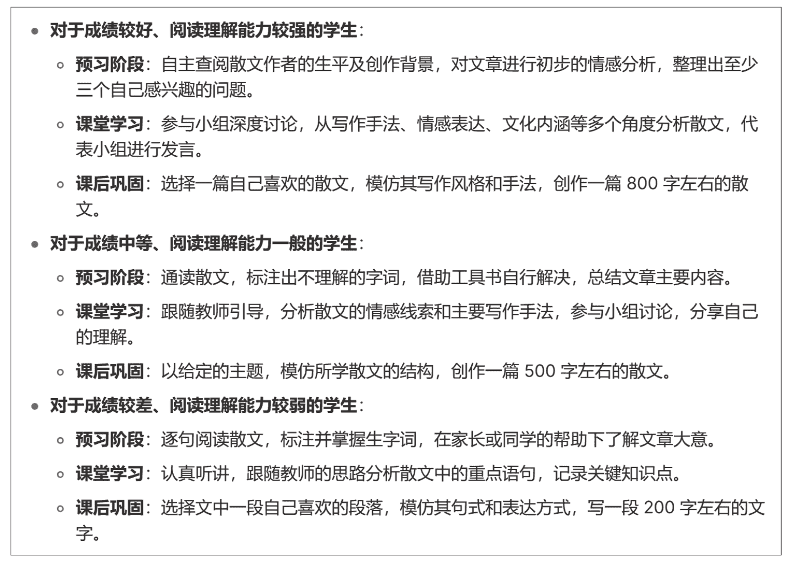

**图 2-9** **生成式AI最终回复**

**（三）策略价值定位**

生成式AI赋能路线规划不是替代教师决策，而是解放重复劳动，让教师聚焦创造性、情感性与战略性工作。

**1.创造性设计**

传统备课耗时于资料整理与题编。生成式AI可自动生成教学框架，减轻重复负担。教师可投入时间设计创新活动，如历史角色扮演、科学探究项目，提升兴趣与素养。

**2.情感性互动**

AI难以捕捉学生的微妙情绪。教师能通过表情、眼神判断理解程度，及时调整节奏；课后一对一交流了解困难并给予鼓励，增强信任与学习氛围。

**3.战略性思考**

生成式AI提供群体学习趋势报告，教师据此优化课程架构。识别薄弱环节后调整时间与顺序，或开发选修课程满足差异化需求，促进个性化成长。

### **综合案例一——小学科学：“物质的状态变化”路线规划**

课程依据：2022 版《义务教育科学课程标准》3-4 年级物质科学——了解物质在不同条件下的状态变化，能观察描述温度对水结冰与融化的影响。

**（一）数据输入：学生画像构建**

学生编号：001
年龄：10 岁，四年级
注意力时长：15 分钟，需多感官刺激
记忆偏好：动觉记忆，偏好动手
学习偏好：行动型 80%，反思型 20%
学习动力：内部动力 4 分，对实验感兴趣；外部动力 3 分，担心失败
知识水平：能描述冰化水，但无法解释温度变化对状态的影响，掌握率 60%。薄弱点为抽象概念理解，如分子运动。

**（二）生成式AI角色扮演策略实施**

**Step 1：生成式AI作为数据分析师**

# 第三章
# AI 协同，让前沿教学落地

本章聚焦生成式智能如何配合教师做课前准备，以跨学科主题、复杂学习任务、项目式学习为抓手展开说明。读完后，教师能掌握与智能体有效沟通的技巧，体会人机配合的工作方式。生成式智能并不是教师的替代品，而是能力的外延放大器，它会让教师的经验迁移到新的场域，在协同中体悟教与学的本质，借力智能打造更贴合时代、面向未来的素养导向课程。

## 第一节 认知发展与心智模型：建构素养发展课程

生成式智能的出现打开了教学新空间，也带来新反思。教师会问：用智能辅助备课可靠吗？我还需不需要做设计？该怎么用？当学生抛出“既然AI都能做得这么好，我们为什么还要学？”时该怎么回应？

本节回应上述疑问，并对智能辅助提出使用提醒，帮助教师拥抱人机协同的新形态。

### 一、智能赋能教学的原则

人工智能正在重塑教育创新版图，也倒逼教育者思考。首先要回答：让智能参与教学，可信吗？答案关乎工具效能，更指向教师专业角色的转型——从知识讲授者转向教育设计师，从经验执行者转向智能协同者。在技术赋能与人文坚守的张力中，未来教育的轮廓更清晰。

**（一）智能可用，但须教师与智能深度配合**

尽管生成式智能在信息检索、资源整理、个性化支持上很强——能迅速给出初稿教学方案、协助作业批改、提供个性化建议，甚至搭建虚拟实验环境——但本质上仍是工具，用得好不好取决于教师是否深度介入。

智能擅长数据分析和规律归纳，却缺乏教师的教育智慧、情感与价值判断。它很难捕捉学习者状态、情绪、个性的细微变化，也无法像教师那样进行情感交流和价值引导。例如，智能可以写出详尽的作文点评，却难以像教师那样洞察写作时的思路与情绪，并给出有温度的指导。

因此使用智能辅助时，教师不能撒手不管，寄望智能一口气打包所有方案。相反，教师需要主动进入人机协作的流程，发挥专业优势，与智能紧密协作，才能把智能的潜力转化为教学质量提升的动力。

**（二）智能是否在挤压教师地位**

并非如此，只是能力投射的阵地在迁移。过去教学设计要求教师先有灵感，再在脑中推演可行性，通过智力劳动转化为可执行方案并反复打磨，耗费大量精力。

有了智能辅助，教学设计只要教师脑中有灵感，随后可用口语化、碎片化的语言指引智能改进，灵感就能迅速落地。所以在人机协同模式下，教师的经验更值钱。教学经验、教育直觉、学科专业知识是智能无法替代的，教师要用这些经验把控智能的输出方向，确保应用真正服务教学与发展。

教师的认知劳动强度下降，因为智能能更快获取信息、梳理思路、解决问题。但批判性思维并未削弱，智能方案是否可用高度依赖教师的把关。在协同过程中，教师的批判性思维持续在线，教育智慧持续闪光。就像能力放大器，智能放大教师长处，增强信息处理、资源整合与个性化支持能力，让教学更高效、更优质，也促进专业成长。

**（三）走向素养发展型课程**

智能发展迅速，不仅改变工具，也深刻影响理念与人才培养。在智能时代，获取知识更便捷，机器在部分知识性任务上甚至优于人类。传统的“填鸭式”教学——教师单向讲授、学生被动记忆——已难以适应时代，需要：

• 忽视学习主动性与个体差异。统一内容与评价难以满足不同需求与发展潜能。
• 重机械记忆轻理解迁移。学生死记硬背，很难深入理解和灵活运用。
• 与社会发展与人才需求脱节。培养出的学习者常缺乏解决复杂问题、应对真实挑战的能力。
• 面对复杂挑战时力不从心。需要创造性思维、批判性思维与合作能力时，传统模式培养的学生往往吃力。

当机器能高效完成大量重复性、知识性工作时，社会对人才需求发生根本变化，仅掌握知识技能已不足以立足。过去学习是为了掌握技能、获得工作与报酬，如今机器常能更好地完成任务，学生必然发问“既然AI都能做得这么好，我们为什么还要学？”

可见教育重心正从“学什么”转向“为什么学”。美国课程重构中心认为，教育者需重新思考目标，强调批判性思维、创造力、情感智能、道德判断等人难以复制的能力。让学生真正理解人的不可替代性，教师必须在与智能的协同工作中体会到独属于人的能力运用，才能在学生提问时有底气，而非回答“因为要考试”。

构建素养发展型课程成为必然选择。教育重点须从传授知识转向培养综合能力，重新思考“教”与“学”的意义，把关键素养置于教学目标中心。认知发展策略与心智模型策略正是构建素养发展型课程的重要理论基础，二者从不同角度揭示学习规律与认知发展规律，为设计更有效的素养课程提供指导。接下来深入了解这两种策略，并讨论如何借助智能运用它们。

### 二、认知发展策略说明

认知发展指个体在思维、推理、问题解决、决策等方面能力的逐步提升，涉及记忆、注意力、语言等多个方面。认知发展策略基于认知发展心理学：皮亚杰提出儿童认知经历感知运动期0-2岁、前运算期2-7岁、具体运算期7-11岁、形式运算期11岁以上四个阶段；维果茨基基于社会文化理论强调社会互动对认知发展的重要性，特别是最近发展区，以及语言符号系统作为思维工具对高级心理功能的影响；信息处理理论解释注意力、记忆策略、问题解决能力的演变，指出随年龄增长选择性注意、持续注意时间、复述与组织策略使用提升，元认知与问题解决灵活性增强。这些理论认为，认知发展是逐步成长、主动建构的过程，受个体认知结构与外部社会文化环境共同影响。

**（一）按年龄段的认知发展策略**

按年龄段的认知发展教育策略综合皮亚杰阶段论与维果茨基最近发展区，针对特定年龄段认知特点设计教育方法，才能有效发展能力与素养。

**表 3-1 皮亚杰的认知发展阶段理论**

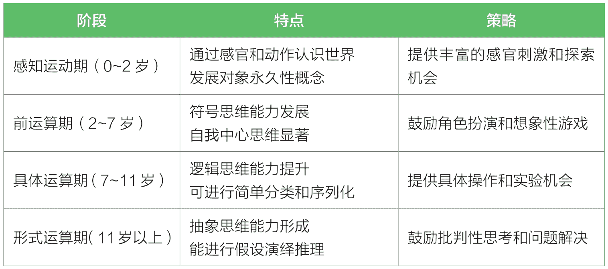

智能可通过测评、学习行为分析辅助教师初步了解学习者的认知发展阶段特征，为分段教学提供参考。需强调，智能评估仅为辅助，教师的专业判断依然关键，避免过度依赖标签化判断。进而，智能可依据不同阶段特点辅助教师快速生成匹配的教学资源。

**（二）基于最近发展区的认知发展策略**

维果茨基提出“最近发展区”即学习者当前实际水平与在他人帮助下可能达到的潜在水平之间的差距，通俗说“跳一跳，够得着”。由此衍生支架式教学，即教师或更有经验的学习伙伴依据学习者当前水平与需求提供恰到好处的外部支持，并在能力提升过程中逐步撤除，最终使学习者独立完成挑战性任务。

智能可结合学习者现有知识与认知能力，辅助教师设计有适当挑战的任务，并根据表现动态调整难度与支架类型，真正实现最近发展区的教学应用。例如，学习者独自面对复杂问题时，仅能查到答案，通过答案反推解决过程帮助不大。智能可在分析题目后逐步提供提示、线索、分解步骤等支架，帮助学习者在脚手架辅助下最终独立完成，经历思考过程后面对类似问题更得心应手。

更复杂的应用需信息技术支持，包括语音识别、面部表情识别、脑电传感、大数据与学习分析等，多维度收集数据以追踪学习者情感与认知状态变化，从而更及时精准了解学习过程、动态调整教学支架。我们已看到不少尝试，未来支架式教学在促进公平、高效、个性化学习环境构建中将持续发挥关键作用，为不同年龄与背景学习者提供更丰富多元、更精细精准、更富启发性的学习支持。

**（三）基于多元智能理论的认知发展策略**

霍华德·加德纳提出的多元智能理论包含8种智能类型，强调学习者的个体差异与全面发展，要求教学进行个性化方案设计、多样化教学方法，着重培养多方面技能。

班级授课制下教师布置统一学习内容，为适配不同层次学习者提出分层作业，但教师精力有限往往只能设计最多三个层次。智能在多元智能教学实践中可通过测评工具、学习行为数据分析辅助教师初步了解学习者的多元智能优势倾向，为因材施教提供参考。进而提供定制化学习路径与内容推荐，如对语言智能突出者推荐更多阅读写作任务，对空间智能突出者提供更多图形化、空间化学习资源。随着技术发展，智能已能越来越成熟地为学习特征不同的学习者提供差异化资源与任务。

### 三、心智模型策略说明

心智模型是个体对概念或现象的内部表征，是认知结构的一部分。在教育领域，心智模型被视为“学习者头脑中的内容”，可用来指导深度学习，教学应关注心智模型的构建与优化，帮助学习者深入理解并灵活迁移知识。

**（一）诺曼的心智模型**

诺曼认为每个人头脑中都有关于世界的“心智模型”，但它并不完美，更像草图，学习者对知识的初始理解常不准确、不一致，需要在学习中持续修正，并在解决复杂问题时功能有限。而科学家、教师等专家构建的概念模型具有准确性、一致性、完整性。我们可提炼专家“心智模型”，设定为“概念模型”，在教学中引导学习者不断修正完善自己的心智模型，使其逐渐逼近教师期望的诺曼心智模型，如图3-1所示。

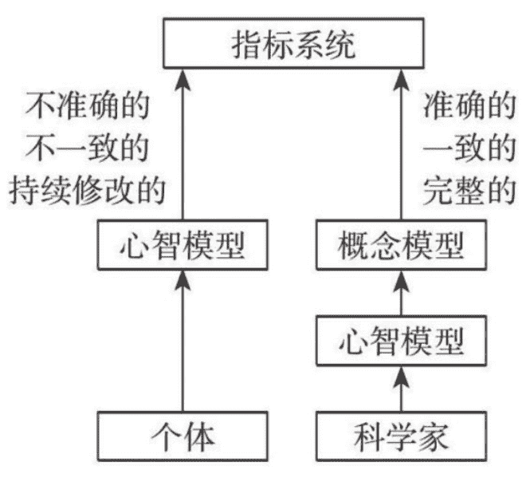

**图 3-1 诺曼心智模型**

结合智能可分析学科专家的知识体系、思维方式、解题策略，提炼“专家概念模型”，识别专家与初学者在心智模型上的差异；帮助教师优化教学内容与组织结构，引导学习者逐步逼近专家水平。常说“知道怎么做很重要，但知道为什么这么做更重要”。在教学中体现为学习者不仅要掌握解题步骤，更要明白为何这样思考。班级授课制下针对性指导往往不现实，只能靠一对一。而结合具备深度推理功能的智能模型，如DeepSeek-R1，通过指导学习者深入阅读智能推理过程并进行针对性提问互动，可使学习者思考方式逼近专家水平。

**（二）巴克雷心智模型**

巴克雷更侧重心智模型的动态构建与变化，认为学习者构建心智模型是一个循环往复的过程，包含形成、强化、修正、废除四个方面。学习者心智模型的修正完善过程中评估与反馈至关重要，而“上位模型”对心智模型形成有积极影响，包括良好的学习环境与支持系统，如图3-2所示。

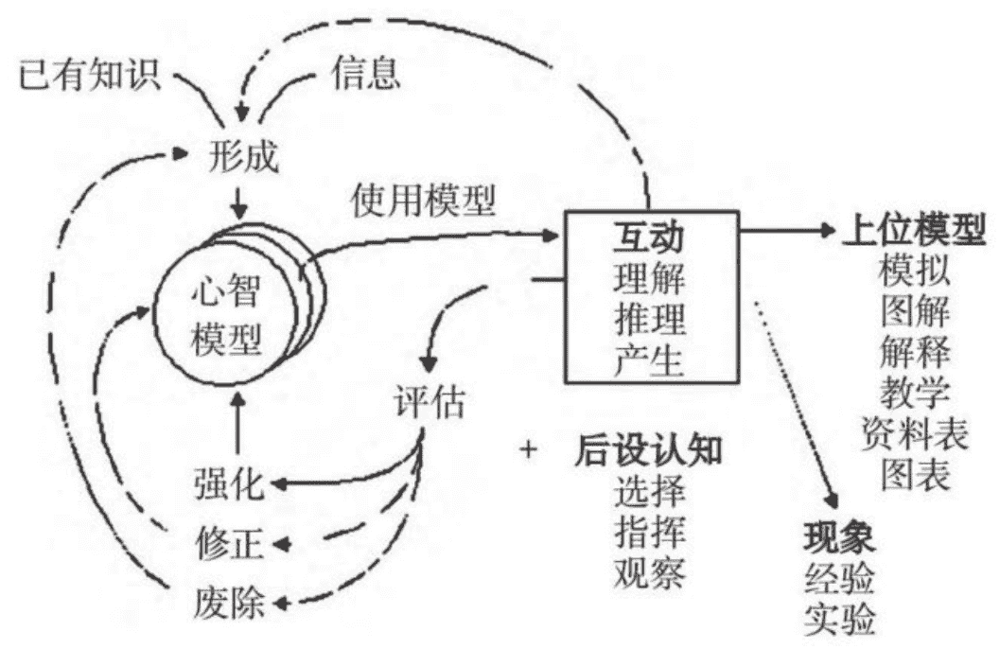

**图 3-2 巴克雷心智模型**

结合智能技术可为学习者提供即时的问题解答、学习指导与反馈，模拟导师角色，与学习者进行对话式互动，帮助学习者快速评估心智模型是否有效并及时修正。同时智能可构建更具吸引力、互动性与情境化的学习体验，模拟真实世界问题情境，为学习者心智模型的形成提供更积极的软环境。

### 四、使用智能辅助的教学提醒

智能辅助教学虽有诸多好处，实际使用中教师也易陷入误区。了解误区并掌握应对方法，才能更好发挥智能价值，避免“好心办坏事”。

**（一）误区一：期望一步到位完美**

部分教师对智能期望过高，认为只需简单输入指令，智能就能打包完美教学设计方案直接使用，看到回复后失望，随后放弃使用，认为智能不过如此。事实上智能并非万能，需要教师专业指导与持续调整优化。人类完成任务也需思考、解读、拟定计划、查阅资料、不断修改，期望智能一步到位给出完美结果，就像期望一个人一字不改写出好文章一样不现实。

**（二）误区二：智能幻觉现象**

“智能幻觉”指智能生成内容时可能出现编造、不准确或与事实不符的信息。因为智能本质是基于概率预测生成，而非真正理解与推理，因此幻觉现象无法完全避免。若教师忽视风险直接使用智能生成内容，可能误导学习者，损害教学准确性与严谨性。正如美国华盛顿州出版的*Human-Centered AI：Guidance for K-12 Public Schools*所强调，以人为本的人工智能学习环境永远优先考虑学习者、教师和管理人员的需求、能力与经验，始终以人工输入与探究开始、以人工反思与编辑结束。智能被视为支持工具来处理、生成或分析信息，而非替代人类判断与决策的方式。

为避免误区高效利用智能辅助教学设计，教师应遵循三步：

**1.明确目标**
开始前深入思考并明确需求——这次教学活动的核心目标是什么，希望培养学习者的哪些核心素养。把目标细化具体，形成清晰的任务指令，才能为智能提供明确工作方向。

**2.检查回复**
智能生成回复后，教师需检查评估而非直接使用。从内容准确性、是否符合教学目标、是否适合学习者情况、教学情境是否可行等多方面验证，判断哪些信息有价值、哪些需改进。

**3.整合回复**
智能回复只是初步方案或素材，教师需结合专业经验与教学智慧整理、修改、优化，形成最终教学设计。在实际教学中，还可根据学习者反馈与教学效果不断调整优化，提升教学质量。

## 第二节 整合跨学科主题：整合多学科知识能力，培养综合能力

打破学科藩篱：让跨域主题教学落地

以一个统领性议题为轴线组织教学，让多门学科各自发声、协同回应同一情境，是跨域主题式教学的基本做法，也能形成多维的认知图景。广义上，只要借助多种学科的知识来解决同一问题，都可归为跨域学习。项目式探究常被纳入此列，二者偏重不同：前者更看重学科间的融合与整合，后者更看重对同一议题的持续追问与成果产出 ^(¹⁰)。

真实世界的问题极少能由单一学科独立解释，世界本就相互关联。这要求面向未来必须推进跨域主题式教学，培养应对复杂情境的能力，也是对真实生活的回归。不能指望学生仅靠分科学习就能自发形成多学科综合运用的本领，需要教师主动建构这一能力。

在生成式人工智能时代，学习重点应落在机器难以替代的人类特质，如批判性思维、创造力、情商与道德判断。只有拥有这些独有素养，个体才能在未来立足。跨域主题教学正是素养培育的重要路径，用多元学科视角共同剖析同一问题，正是批判性思维与创造力的体现，学生在真实情境中迸发的灵感正是智慧的火花。

### **一、设计跨学科主题学习时面临的困难**

从执行面看，课时紧张、资源不足等外部条件会带来限制，本节聚焦设计环节教师常遇的卡点。

**（一）教师个体掌握的学科知识有限**
一个人很难精通众多学科，能把一门学问研究透已属不易。传统跨域设计要么依赖个人通才，要么依赖多位教师联动。前者样本稀少，后者虽能带来专业洞见，却因彼此对对方专业内核理解不足而沟通成本高、协同效果差。

得益于生成式AI的海量训练，单科教师在构思跨域教学时，因不熟他科知识而产生的盲区得到弥补，短时间内可将特定他科知识学到教学可用水平并投入使用。只要愿意学就能学会，这在AI时代已成现实。持续提问就能借助AI获取知识，这恰体现了批判思维、主体能动性与目标感。只有深度人机协作，教师面对学生关于AI的提问时才有底气。

跨域团队配合不顺，多数源于尚未形成真正的教学共同体，对彼此学科的理解有限 ^(¹¹)。具备自主学习的底座后，学科教师合作才会更高效，收获更大。

**（二）主题选取困难**
要做得好，需要锁定一个可被多学科回应的真实议题，厘清各学科知识与核心素养的参与方式，并理顺不同知识如何衔接、最终形成整合性理解 ^(¹²)。能同时满足这三点的选题并不多见，教师常陷入两难：知道要组合哪些学科却不知选何议题，或有了议题却不知如何与具体知识点有机联结，或该议题并不支持学生持续探究。

选题难与教师个体知识边界有关，而AI的应用恰好补足这一短板，改变了设计逻辑：从过去依赖个人经验与知识积累，到先由AI批量提供备选，再由教师筛选、针对性学习所需学科知识，最后完成设计。这极大减轻了工作负担。

总体而言，教师借助AI化解跨域设计难点，最首要的任务是先把涉及的其他学科知识与核心素养弄清楚，才能在教学中合理安排跨域内容。

### **二、借助生成式AI优化主题教学方案**

前文讨论了仅凭教师自身设计的难点，下面看如何借助AI辅助。

#### **【操作案例 3-1】选题环节的AI协作**

选题的核心准则是议题统领、聚焦核心素养 ^(¹³)。有意义的跨域不是为跨而跨，必须有议题作统领，有一个能支撑持续深入学习的情境，才能把不同学科知识有机串联。议题需来自真实的跨域需求，才能培养面向未来的能力素养。同时要回到学科立场，从各学科强调的核心素养出发，让学科本质得到体现。

基于上述分析，向AI提问的方式如下：

无特定范围的提示词：

“我需要为【学段】学生设计一堂跨学科主题教学，给我 5 个主题的选项。要求：

1）主题的选取需要来自真实生活中的问题且支持学生用不同学科的知识持续探究

2）涉及的科目是……

3）符合【学段】学生的认知和知识水平

4）明确不同学科知识如何具体地和跨学科主题结合，并给出简要的实施路径”

DeepSeek-R1 的回复如图 3-3 所示。

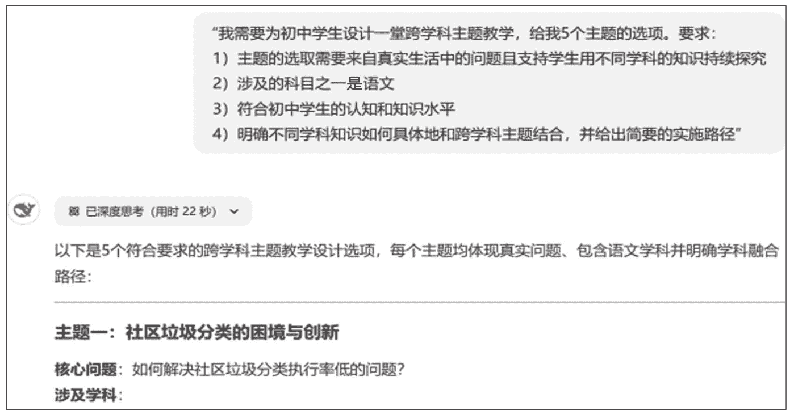

**图 3-3 DeepSeek-R1 的回复（部分）**

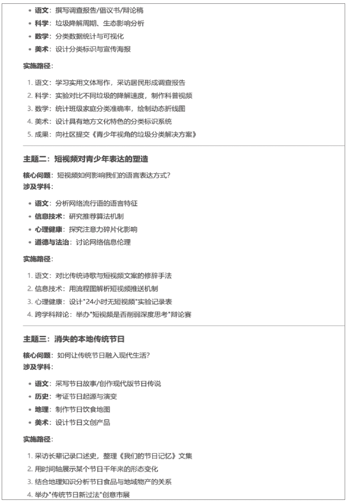

**图 3-3 DeepSeek-R1 的回复（部分）（续）**

有特定范围的提示词：

“我需要为【学段】学生设计一堂跨学科主题教学，上传的文件是××学科的目录，请从目录涉及的知识点中找到适合设计成跨学科主题教学的结合点，给我 5 个备选主题。要求××和××学科知识如何具体地和跨学科主题结合，并给出简要的实施路径”

“我需要为【学段】学生设计一堂跨学科主题教学，主题的大致方向是……，涉及的学科有……，给我 5 个备选主题。要求：符合【学段】学生的认知和知识水平；明确不同学科知识如何具体地和跨学科主题结合，并给出简要的实施路径”

通义千问的回复（部分）如图 3-4 所示。

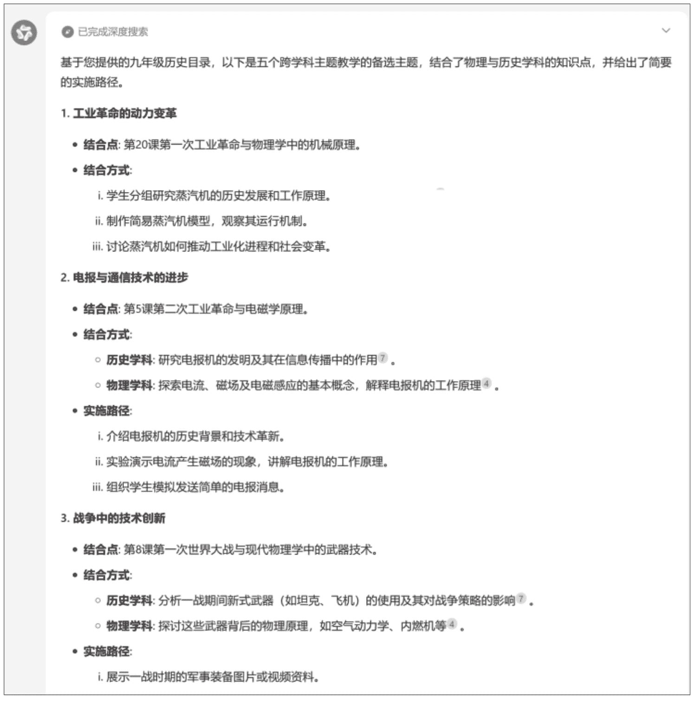

**图 3-4 通义千问的回复（部分）**

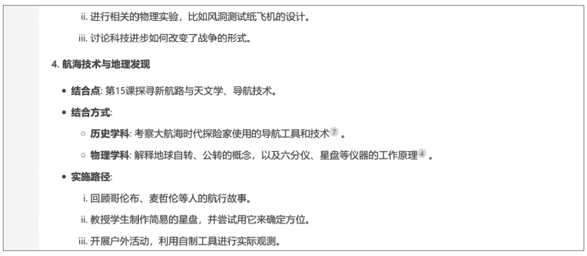

**图 3-4 通义千问的回复（部分）（续）**

#### **【操作案例 3-2】教学过程设计**

AI给出大量选题后，教师筛选出可操作性强的主题进行过程细化。用AI做教学设计时要明确要求，体现各学科核心素养，以及围绕主题的相互关联性。

**提示词设计：**

“请根据以上的跨学科主题教学设计，设计一个教学活动，以达成对不同学科的整合性理解，要求：1）给出具体的活动方案；2）不同学科知识的结合方向。”

DeepSeek-R1 的回复如图 3-5 所示。

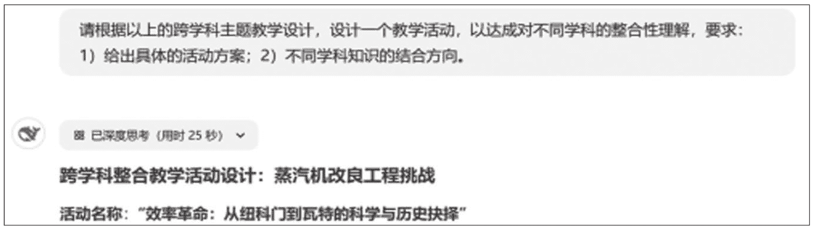

**图 3-5 DeepSeek-R1 的回复**

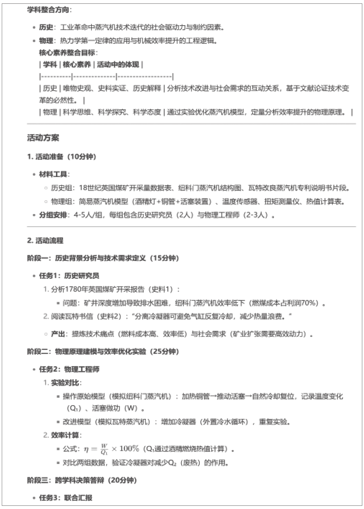

**图 3-5 DeepSeek-R1 的回复（续）**

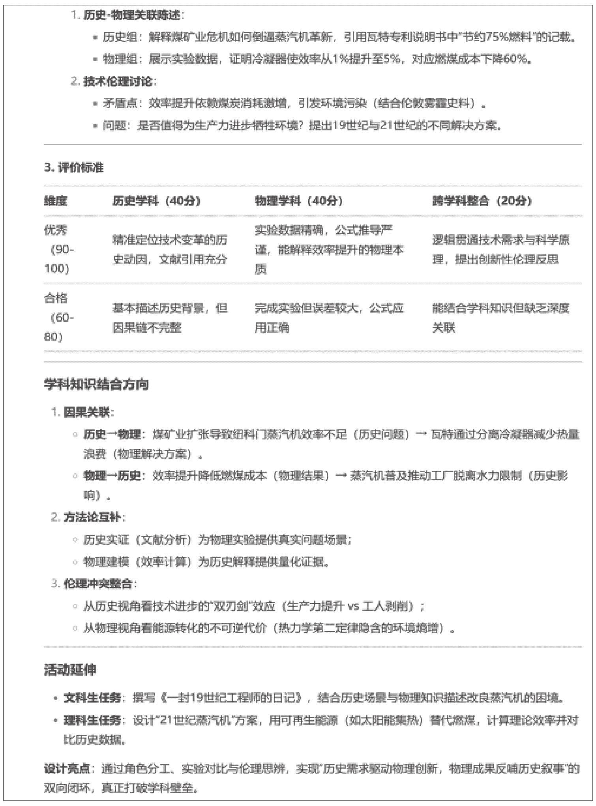

**图 3-5 DeepSeek-R1 的回复（续）**

DeepSeek-R1 的回复质量较高，但不建议直接套用，更推荐的做法是以AI输出为参考，再结合实际教学对环节进行调整改进，然后把调整后的环节再次反馈给AI，让其做针对性设计。

#### **【操作案例 3-3】整合性理解活动设计**

要让跨学科教学真正落实，需让不同学科知识产生实质联系，而非各自为政。需要一个活动把知识连起来，形成整合性理解，实现融合与应用。常见形式有主题讨论、辩论赛、调研活动等，但要给学生明确标准，要求其运用多学科知识完成任务，促使其多角度思考。

**提示词设计：**

“请根据以上跨学科主题教学设计，设计一个教学总结环节，对不同学科的整合性理解，给我 5 个备选项。要求：1）给出具体的活动方案；2）不同学科知识的结合方向。”

DeepSeek-R1 的回复如图 3-6 所示。

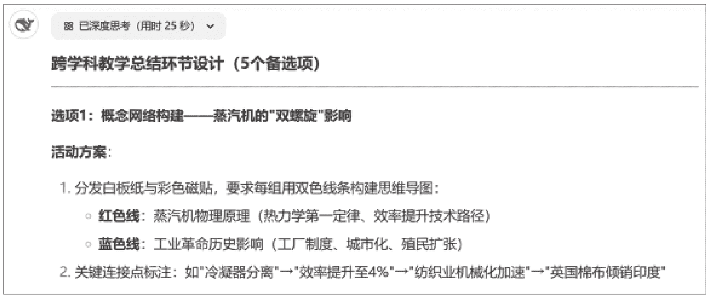

**图 3-6 DeepSeek-R1 的回复**

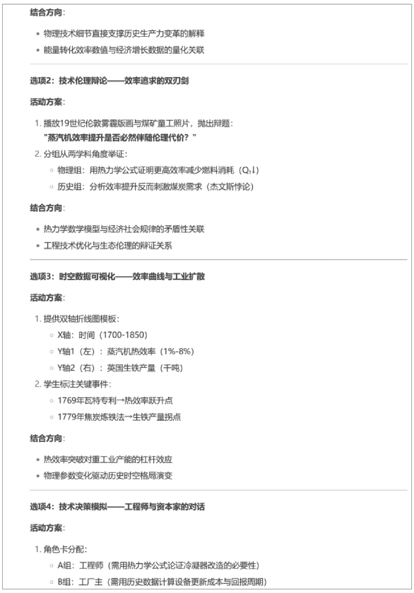

**图 3-6 DeepSeek-R1 的回复（续）**

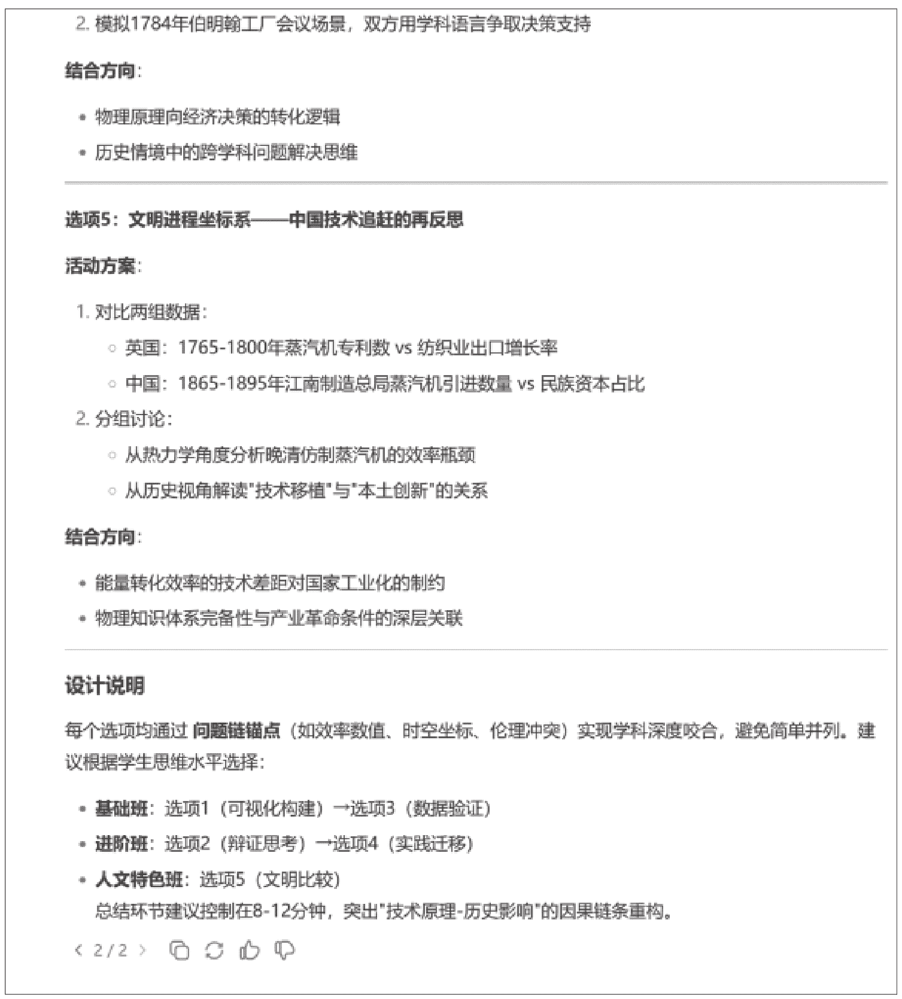

**图 3-6 DeepSeek-R1 的回复（续）**

**（四）他科知识的讲解支持**

个体教师知识有限，难以全面把握跨域教学，多次向AI提问可达到对他科特定知识的初步理解，再与学科教师讨论可提升协作效率与质量。即使教师已通过AI与资料了解他科知识，实施上仍有难度。同样可借助AI给出更具体的实施步骤。

对AI提问：“针对××部分请给出具体的教学实施步骤，包括逐步的引导性问题以及对应的讲解文稿。”

### **综合案例二——文理交融理解“第一次工业革命”**

**（一）选题分析**

根据历史学科课标中的跨学科实施建议，以及图 3-5 中 DeepSeek-R1 的回复，第一次工业革命是物理与历史结合的很好的切入点。考虑到实际教学，历史课中对蒸汽机工作原理涉及较少，学生难以体会蒸汽机与水力在效率上的明显差异，进而感受技术创新对生产力的极大推动。同时，九年级上学期学生已具备“压力、压强、机械效率、物态变化、比热容”等物理知识，故确定主题为第一次工业革命。

**（二）教学过程修改**

图 3-6 DeepSeek-R1 的回复中，历史情境导入、技术伦理辩论、通过“技术与社会”联动物理与历史等做法值得借鉴。但不足是没有详细展开蒸汽机演进，部分物理知识超出初中范围，历史与课本结合也不够紧密，于是做了如图 3-7 的修改。

教学环节以历史课本小标题作历史主线，以蒸汽机沿革作物理主线，用来展开原理讲解。最后的综合讨论聚焦科技进步与社会生产的关系、工业革命的利弊，实现历史与物理的整合性理解。不同学科的学习支持学生从多视角审视工业革命利弊 ^(¹⁴)。

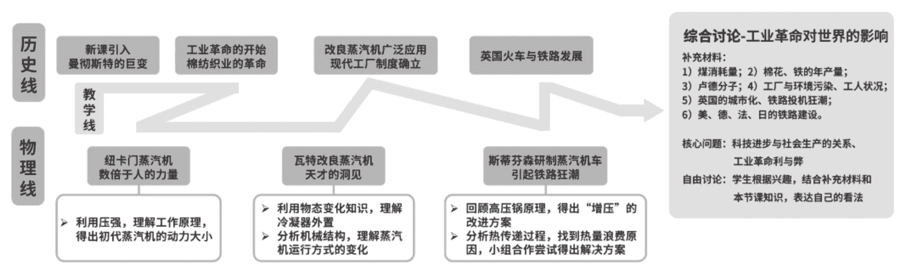

**图 3-7 教学环节初步设计环节**

最后与历史、物理学科教师深入讨论，将最终教学设计修改如图 3-8 所示。

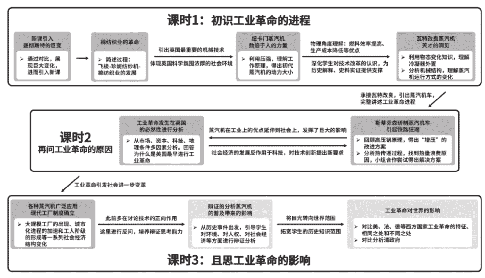

**图 3-8 最终的教学设计修改**

## **第三节 让高阶思维真正落地：用复杂任务驱动成长**

教育目标相关理论众多，如布鲁姆认知目标分类法、马扎诺教育目标新分类学、BOPPPS教学模式、SOLO分类法、OBE教学法……理论繁多且与实践存在距离。教师初次按理论设计教学易无从下手，特别是复杂开放式任务的设计。

现在借助AI可帮助新手教师快速入门，厘清重点，达到对教育学理论的初步认识，提高教师的下限；有经验教师也能借助AI提高效率，对AI输出做针对性修改，提高上限。推荐使用具备思维链的推理模型：DeepSeek-R1、通义千问 2.5 等。

阅读前先提出一个观点：高阶问题并不总是优于低阶问题，课堂提问的目的是促进学习内容的关联性理解，要合理安排低阶与高阶问题或任务的比例与顺序，每种问题都有其独特价值。

下面第一部分涉及布鲁姆六层次任务生成及“教—学—评”一致性设计，第二部分聚焦单个复杂任务设计，第三部分则是问题顺序规划。

### **一、布鲁姆分类法快速上手**

教学目标常让人想到布鲁姆分类法，该理论自20世纪中期起影响教育，帮助教师确定目标、设计课程、评估效果。

**布鲁姆分类法理论框架**

也有学者指出其不足，如六层划分过于简化机械，层次并非完全独立，且学生思维过程不可见，难以判断其是否使用了对应层次思维。但对一线教师而言，布鲁姆仍是实用工具，能帮助系统规范地规划循序渐进教学，判断课堂提问是否全面。

第一层，记忆/回忆——从长时记忆中提取相关知识。即对已有知识的回忆、再现与辨识。常用动词：识别、回忆。

第二层，理解——从口头、书面和图像等信息中建构意义。学生能背诵词义不等于真正理解其含义与用法。核心是能用自己的话解释、归纳、推演。常用动词：解释、举例、分类、总结、推断、比较、说明。

第三层，应用——在给定情境中执行或使用程序。聚焦知识迁移到新或熟悉情境。常用动词：执行、实施。

第四层，分析——把材料分解为成分，厘清部分间及与整体的关系。即拆解事物以揭示内在关联、动因与机制。常用动词：区别、组织、归因。

第五层，评价——基于准则和标准做出判断。需明本质、有见解、能迁移、能剖析并创新拓展。常用动词：检查、评论。

第六层，创造——把要素组成内在一致的整体或功能性整体，重组为新模型或体系。是认知最高层，需整合前五层能力。常用动词：产生计划、生成。布鲁姆认知过程类别及其例子如表 3-2 所示 ^(¹⁵)。

**表 3-2 布鲁姆认知过程类别及其例子**

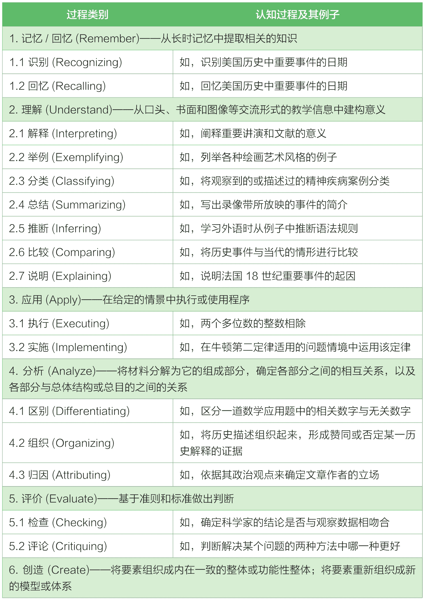

续表

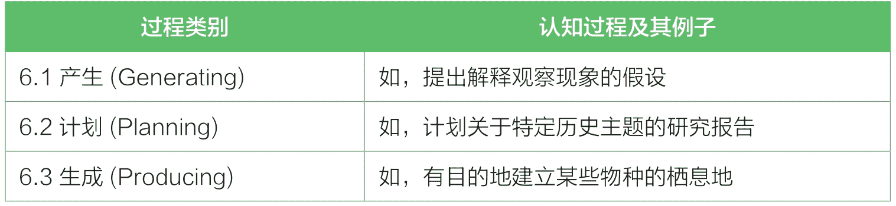

布鲁姆六层级如台阶般递进，对学生要求逐级提高，尤其后三层分析、评价、创造。AI能帮助更轻松地设计符合高阶思维要求的学习任务，让学生更多锻炼批判性思维、解决问题与创新精神。

除认知过程维度外，布鲁姆还有知识维度，包含事实性知识、概念性知识、程序性知识、元认知知识 ^(¹⁶)。两者叠加才是完整图景，但为便于入门，下面仅用认知过程六层次做教学设计。

#### **【操作案例 3-4】AI辅助设计六层次问题步骤**

**Step 1：知识唤醒与校准**

此步很关键，确保AI准确理解布鲁姆各层次内涵，避免设计偏离。除提问校准外，也可把表 3-2 拍照给AI。

输入提示词：“布鲁姆的分类法中，记忆、理解、应用、分析、评价、创造分别有什么含义？”

**Step 2：完善教学目标与重难点**

在AI理解理论后，可用其分析已设计的教学目标与重难点并提出建议，教师据此修改，确保目标覆盖各思维层次、重难点合理。

输入提示词：“请基于布鲁姆认知目标分类法（记忆、理解、应用、分析、评价、创造），分析下面的教学目标[在此处输入教师预设的教学目标]属于何种层次、是否覆盖所有思维层次，重难点[在此处输入教师预设的重难点]是否合理，并给出理由。

**Step 3：任务生成**

让AI让教学与评价同步运行

教师在参考生成式AI提供的改进建议并对教学目标与核心难点进行审校后，只需给出明确指令，就能让后续的学习活动与教学意图保持对齐，体现教与学的统一。随后可以继续让模型基于前述内容生成配套的评价活动与评分量规，帮助教师落实教-学-评一体化的设计思路。

输入提示词：“下面是我修订后的教学目标及重点难点：[在此处填写教师修改后的版本]，请先辨析目标与难点各自所属的层级，再围绕[学段+学科]的[单元标题]一课，设计一组学习任务或问题，以促进学生高阶思维，并确保各项目标与难点均能达成。”

教师初审并修正上述学习任务或问题后，可继续交互：“请依据下方的教学目标、重点难点以及学习任务设计，输出对应的评价任务与量规设计，并保证目标、任务、评价三者保持一致[在此处填入修改后的教学目标、重点难点与学习任务设计]。”

### 二、借助马扎诺新分类学设计复杂任务

马扎诺教育目标新分类学以知识领域与加工水平两个维度构建框架，提示教学既要关注“学什么”，也要关注“怎样思考”。知识领域对应学习内容，加工水平对应思维深度。

**马扎诺教育目标新分类学理论框架**

该模型说明四类系统如何分工协作，如图 3-9 所示。学生面对新任务时，自我系统先判断是否需要介入，元认知系统随后提出目标与策略，认知系统据此处理信息，三套系统的运作都依赖已储存的知识系统 ^(¹⁷)。因此在设计任务或提问时要自问：需要怎样的思考层级？调动哪些已有知识？

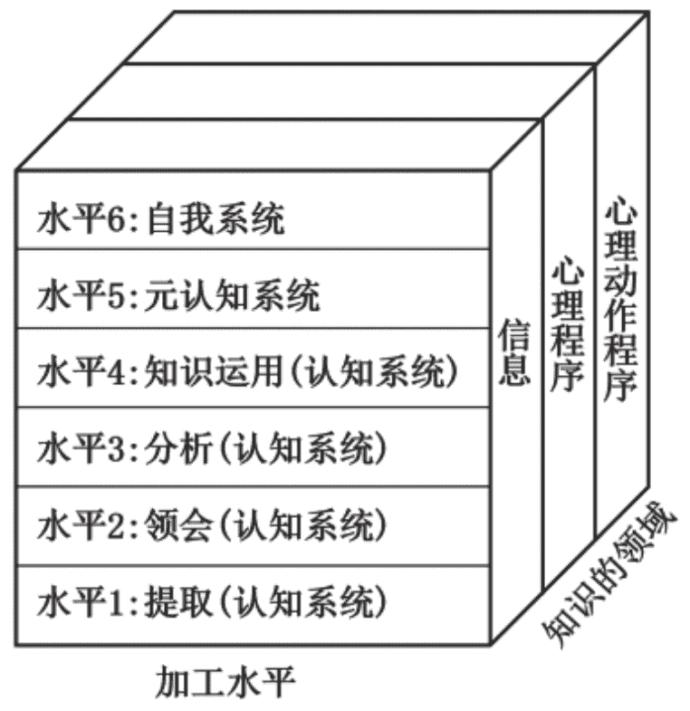

**图 3-9 马扎诺教育目标新分类学理论框架**

三种知识领域的细部构成见表 3-3。

**表 3-3 三种知识领域的具体成分**

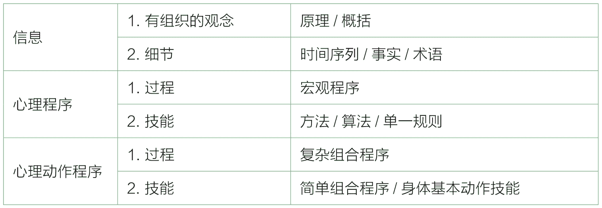

在认知系统的四层水平里，提取是对基础事实的准确再现，用以判断学习者能否辨认已知信息；理解在马扎诺体系中体现为整合与符号表征两种形式。整合是将要点提炼为宏观结构，例如对熟悉事物只保留轮廓而遗漏细节；符号表征是借助图表、时间轴、思维导图或公式等形式呈现知识结构。

高阶思维集中在分析与知识运用两层，马扎诺给出了五种分析过程和四类知识运用的类型，如表 3-4 所示，可为命题与任务形式提供参考。

**表 3-4 分析过程和知识运用的类别**

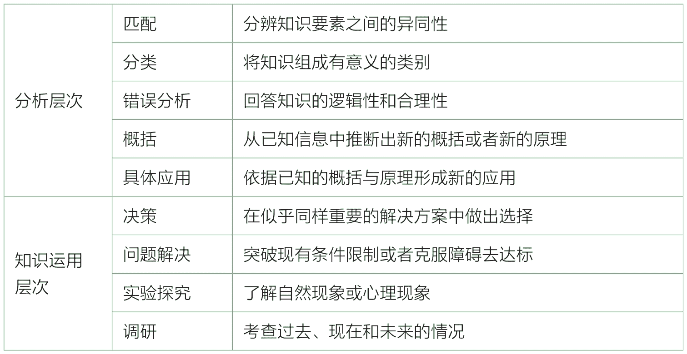

自我系统的加工水平决定学生是否愿意投入新任务、是否带着积极情绪参与。任务呈现的第一印象应具备吸引力与参与感。复杂任务的选题宜取自真实生活或新颖题材，难度应循序渐进。

元认知系统负责为新任务制定行动计划与策略，要求对不熟悉复杂任务的学生提供支架后再逐步撤除。该环节可借助生成式AI辅助编制学习任务单。

#### 【操作案例 3-5】用GAI搭建高阶任务

综合上述要点，可用以下提示词开展问题与任务设计：

“请为‘学段+学科+课程主题’一课设计问题和任务，情境需源于真实生活经验或新颖题材。从分析层出发，设计涵盖不同分析过程的问题；从知识运用层出发，设计不同类别的复杂任务。”

*提问前务必将上述信息填入对话框，避免模型对理论的误读。

*分析层的问题适合课堂即时提问；知识运用层的复杂任务耗时较长，通常只挑选一个交由学生自主完成。

为复杂任务设计学习任务单：“针对知识应用层面的不同复杂任务设计学习任务单，要求任务单能为学生提供支架，辅助完成任务。”

示例：初中物理“声音的产生与传播”——节选

【分析层次】

（1）匹配：音乐会上能听到小提琴、钢琴、鼓等多种乐器发声。请比较小提琴与鼓：

• 发声方式上有何相同与不同？
• 声音传到耳朵的介质是否相同？
• 若要区分两者，可从音调、响度、音色等哪些特性进行分析？

（2）错因分析：下述关于声音的说法是否正确？若有误请指出并用所学知识解释。

• 说法一：“真空不能传声，所以宇航员在太空无法直接交谈，只能用无线电。”
• 说法二：“声音传播速度只与介质种类有关，与温度无关。”
• 说法三：“只要物体振动，我们就能听到声音。”
• 说法四：“声音在固体中传播速度一定比在液体中快。”

（3）具体应用：蝙蝠夜间活动主要靠发出超声波并接收回声辨别方向与捕食。它们使用超声波而非可听声，你认为有何优势？提示可从超声波特性与蝙蝠生活环境思考。

【知识运用层次】

（1）决策：小明想在家打造家庭影院，担心扰民。可选隔音材料A成本较低效果一般，材料B费用较高效果好。假设安装难度相当，请你扮演顾问综合隔音效果、预算、成本等因素为小明选择更合适的方案并说明理由，还需考虑哪些因素才能更全面决策？

（2）调研：城市噪声污染调查与防治。

以小组为单位，选择所在城市或熟悉区域开展噪声污染调研。

• 调研内容可包括：主要噪声来源、污染程度、对生活健康的影响、现行防治措施等。
• 查阅资料了解历史上人们如何认识与治理噪声，以及未来可能出现的新技术。
• 撰写调研报告并提出防治建议。

### 三、提问序列驱动深度思考

马扎诺团队在研究高阶问题后发现，判断一个问题能否触发低阶或高阶思维并不简单。若学生此前已掌握相关信息，面对复杂高阶问题时也可能仅调动记忆作答，呈现低阶表现。低阶问题同样有价值，记忆类、知识类问题在检验掌握情况与巩固记忆方面不可替代 ^(¹⁸)。

为此，研究团队提出以一系列问题培养和加深理解，即提问序列，类似于问题链，为课堂提问提供了明确方向。如表 3-5 列出提问序列的四阶段及其说明。

**表 3-5 马扎诺研究团队的提问序列四阶段及其详细说明**

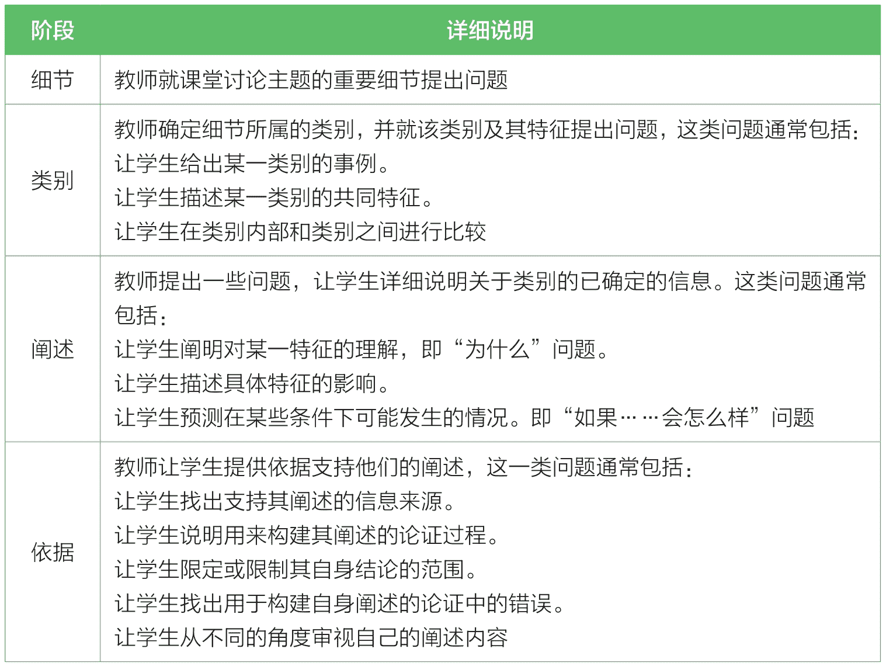

在课堂上这类序列会自然出现。如初中英语比较级教学。

细节类：什么是比较级？下列句子中哪些是比较级？

类别类：

（1）“观察‘faster’和‘bigger’的构成，与‘more outgoing’有何相同与不同？”
（2）“哪些形容词或副词像‘fast’一样直接加‘er’构成比较级？举例。”
（3）“像‘beautiful’、‘interesting’、‘expensive’这类词为何不用‘er’而用‘more+词’？有何特点？”

阐述类：

（1）为何要用比较级？它对日常表达有何帮助？
（2）若过度使用比较级，如总说‘我的比你的更好’‘我做得比你快’，会给他人留下什么印象？

随后教师让学生寻找支撑其阐述的依据，可来自教材例证或生活经历。

提问序列的核心是引导连贯思考，形成系统理解。虽可在课堂自发出现，课前精心设计更能促进系统学习。

#### 【操作案例 3-6】用GAI生成提问序列

方法与前述一致。

提示词：“提问序列的四个阶段是……（上述表格中的内容），依据提问序列四个阶段，以及教学目的与重点难点，对[学段+学科+课程主题]一课，设计问题序列。教学目的与重点难点如下：[在此处列出教师预设的教学目的与重点难点]。”

示例：高中物理“万有引力定律”

**1.细节阶段**

（1）能描述苹果落地与月球绕地球运动的共同特征吗？
（2）开普勒三定律揭示了行星运动的哪些规律？牛顿为何将之与地面物体运动联系？
（3）万有引力定律公式*F*=*G*（*m*1*m*2）/*r*2 中各符号的物理意义是什么？
（4）观察行星轨道数据表，能发现公转周期与轨道半径有何关系？

**2.类别阶段**

（1）把天体简化为匀速圆周运动时采用了哪些理想化条件？与真实运动差异何在？
（2）推导太阳与行星间引力时运用了哪些已知规律？在步骤中如何体现？
（3）举例说明哪些自然现象属于万有引力作用。

**3.阐述阶段**

（1）为何引力与两物体质量乘积成正比、与距离平方成反比？此数学关系反映了怎样的物理本质？
（2）若地球质量骤增一倍，月球轨道参数会怎样变化？对地球潮汐有何影响？
（3）阐明月地检验的核心思想：如何通过计算月球向心加速度验证平方反比律？

**4.依据阶段**

请用万有引力公式与向心力公式建立定量关系，并据现行地月系统参数计算：若地球质量加倍，月球新轨道半径的理论值是多少。

## 第四节 开展项目式学习：情境创设与能力建构

项目式学习 Project-Based Learning 是一种以学生为中心的教学模式，围绕真实情境中的驱动性问题展开探究，以小组合作完成挑战性项目并产出可展示成果如报告、产品或解决方案 ^(¹⁹)。其五大特征：起于驱动性问题，问题源于学科核心概念；学生在真实情境中以专家身份用科学方法解决问题；师生共同参与，多维度寻求方案；教师按学生水平提供技巧与技术支持；学生创造解决问题的产品并公开展示 ^(²⁰)。

### GAI 如何支持项目式学习

项目式学习设计需要大量创造性脑力劳动，教师需反复构思推演才能形成可实施方案。生成式AI有望实现教学设计的轻量化，加速灵感落地。

**传统项目式学习面临的挑战**

核心在于驱动性问题，理想主题需契合课标与学科内容、贴近生活、问题开放且可持续探究、能激发兴趣。实践中教师常花费大量时间寻找“完美”选题。

教师还需设计详细方案、规划活动、准备资源，时间成本高。

实施中教师既要讲授又要分小组指导，及时解决各组问题，对教学能力要求高。

项目式学习依赖学生自主获取筛选信息，但学生多依赖普通搜索引擎，信息质量参差，缺乏甄别，易受碎片化错误信息误导。

成果展示环节受时间、精力及教师能力限制，反馈难以细致，学生获益受限。

需提醒，AI不能无中生有，要使产出切实可行，离不开三基石——真实详实资料、教师专业经验、持续迭代优化。

接下来讨论AI在选题、规划、实施、评价四个环节的操作方法。

#### 【操作案例 3-7】GAI 在项目选题中的应用

项目式学习成败关键在于驱动性问题。实践中教师常陷入两难：找不到兼顾需求的选题，或为寻找主题耗费大量精力。AI提供新思路。

**1.教师主导的主题选择**

AI基于海量文本训练，具备强文本理解与生成能力。教师以“学科+主题方向”提问，AI可生成多条符合要求的项目主题供筛选，大幅减轻脑力负担。通用模型如 DeepSeek、Gemini 2.0、通义千问均可胜任。

对话步骤：

（1）科目+主题大方向

提示词：“我是一名【学段+学科】教师，我想设计一个有关于（主题方向）的项目式学习课程。”

主题方向可为社会热点、新闻报道、科技前沿或生活中的有趣问题。注意单一原理可解释的问题不适合设为项目式教学，因其缺乏开放性难以支持深入探究。

（2）缩小范围+设计项目问题

提示词：“我对其中的……主题感兴趣，请你以符合××年级学生的认知水平设计对应的项目问题，要求问题开放且支持学生进行持续探究”

应用示例：“我对其中的 1、3、4 主题感兴趣，请你以符合初二年级学生的认知水平设计对应的项目问题，要求问题开放且支持学生进行持续探究”

**2.学生主导的个性化选择**

AI数据分析能力突出。教师可让学生填写兴趣问卷，用AI高效分析结果，选取契合学生兴趣的项目主题。

对话步骤：

（1）AI分析问卷

提示词：“请你分析学生的问卷数据，给出 10 个符合××年级学生兴趣的项目主题。”

（2）缩小范围+设计项目问题 同上。

**3.辅助教师评估项目可行性**

在项目化设计中，AI可生成多样主题并辅助筛选。教师输入关键评估维度，AI输出全方位分析。协作优势在于减少主观偏差，同时兼顾课程关联性、认知水平、安全风险等细节，提供“第二视角”。最终教师结合经验择优。

提示词：“请针对教育价值、难度层级、所需教学材料等多个维度，对××主题的项目式教学进行分析。”

#### 【操作案例 3-8】GAI 在项目规划中的应用

AI在项目规划中可帮助快速生成框架、精细设计课时计划、启发设计灵感。

**1.准备阶段——文献支撑奠定基础**

教师在 Web of Science、知网等权威数据库人工检索筛选与主题高度相关的专业文献，将筛选后资料上传给AI，为其提供真实知识基础，减少幻觉。

（1）由AI提供检索关键词

提示词：“我想以××为主题进行项目式学习设计，当我在权威学术数据库搜索相关文献时我该输入哪些关键词？”

（2）人工筛选专业文献并上传

若在筛选时发现对学生有价值的研究问题，可直接在下一步利用该问题进行初步设计。

提示词：“请根据上传文献中的研究问题，设计一个符合【学段】学生认知水平的项目式教学计划。”

**2.初步规划——整体框架粗中有细**

把文献资料上传至AI，结合此前生成的项目主题、驱动性问题、子问题，要求生成初步项目式学习计划，包含项目目标、学习目标、主要活动、时间安排等。

提示词：“请结合上传的文献资料，以及项目问题‘……’，制订一个项目式教学计划。”

注意AI回复通常不能直接使用，需教师仔细审视并提出针对性修改意见。提出修改时建议附上原因，避免方向性错误重复。

提示词：“某某部分因为【具体原因】不符合教学，我想把教学方向设计为【具体意见】，请重新规划教学过程。”

**3.逐课细化——聚焦目标精雕细琢**

AI提供的设计往往是若干课时，需逐课与AI互动，明确教学目标、环节、活动、所需资源。根据教学经验多次引导修改，确保内容准确、活动可实施。

提示词：

当AI未提及某内容时：“在【课时名称】的教学环节中，关于【教学内容】的讲解不够详细，不利于学生理解，请你重新设计这一部分的教学环节。”

当环节过于简略时：“请你在【教学环节】中，添加逐步的引导性问题，并给出相应的参考讲解内容。”

当环节方向不符时：“我认为【教学环节】需要侧重于【教学方向】，请重新设计该环节的教学活动。”

若课堂互动出现冷场，可以直接向大模型发出明确指令：“请针对【教学环节】拟出【数量】个可用于课堂研讨的提问。” 若结合 3.3 节提出的讨论设计思路，还能进一步限定问题的切入角度与思维层级。

**4. 终检优化——细节到位才能落地**

全部课时细化完毕后，需要教师本人进行一次系统性的复核，保证方案具备可实施性。复核时既要揪出知识层面或科学层面的错误，也要重点检视教学内容中涉及的价值观表述是否契合社会主义核心价值观，避免对学生产生误导。

复核阶段同样可以借助生成式智能。只需将完整的教学设计以文档形式上传，要求模型对整体方案进行诊断并给出修改建议即可。即便模型给出的部分意见可行度不高，仍常有出人意料的参考价值。

#### **【操作案例 3-9】GAI 在项目推进阶段的实践**

项目实施是项目式学习的核心环节，是把计划转化为现实、达成学习目标的关键。

**1. 个性化辅导**

借助 DeepSeek、Gemini 2.0、通义千问等生成式工具，能够为学生提供量身定制式的学习反馈与建议。模型可解析项目成果、讨论记录等学习痕迹，识别学生在知识、技能、思维方面的薄弱环节并给出针对性指引。学生遇到疑问时也能随时向模型请教，无需等待教师回复。

学生常用的提问方式：

“我们小组正在进行××项目，请分析提交的项目报告初稿，指出其中的不足，并给出修改建议。”

“我不太理解××概念，请你用更通俗的方式解释一下，并举例。”

“请分析我在××问题上的回答，告诉我有哪些地方需要改进。”

**2. 支持知识建构**

大模型可扮演“智能学习伙伴”的角色，依托快速检索、整合多源信息、多角度阐释概念的能力，高效支撑项目所需的知识获取。小组探究时能否及时获得高质量信息至关重要。模型在提问时能提供凝练准确的解答，弥补了传统网页搜索碎片化、质量参差的不足，更好地支持自主探究。

建议选用具备联网检索或知识库更新较新的模型，如 DeepSeek、Gemini 2.0、通义千问等。

学生可直接提问：

“我想要了解[某个概念]是什么意思？”

“[某个事件/现象]发生的原因是什么？有哪些影响？”

“为了解决[某个问题]，我可以采取哪些方法？”

“如何设计一个实验来验证[某个假设]？请帮我列出实验步骤和注意事项。”

提问越清晰具体，模型回应的针对性与价值越高。因此对使用不熟练的学生，教师需要耐心引导，培养其提出高质量问题的能力。

#### **【操作案例 3-10】GAI 在项目评价阶段的应用**

项目评价是项目式学习不可或缺的环节，既是对成果的总结，也是对教学过程的反思与改进。

**1. 多维度评估**

大模型拥有较强的数据分析能力，能处理项目式学习中产生的各类数据，如作业、报告、代码、设计图、讨论记录等，从多角度评估学习成果与过程。教师只要提供分析框架，模型即可迅速完成分析并形成针对性评价，还可实现不同学生、不同小组、不同项目间的横向与纵向比较。

提示词设计：

“请分析学生提交的项目报告，从创新性、实用性、完整性、规范性等方面进行评价，并给出综合评分（1～10 分）。”

“请分析学生的发言记录，评估他们的参与度、贡献度、合作精神等，并给出每个学生的评分（A～E 等级）。”

“请对比分析五组学生提交的项目报告，找出各自的优点和不足。”

**2. 即时反馈**

模型可在项目推进过程中提供即时反馈与改进建议。学习者可在任意阶段向模型提问并获得优化方向。

提示词设计：

“请帮我分析这份项目研究报告，并提出修改意见。”

“我设计的××是否存在问题？请帮我分析一下，并给出优化建议。”

**3. 成果展示辅助**

生成式智能能帮助学生制作更具吸引力的项目成果展示材料。学生可利用模型快速生成演示文稿、海报、视频等展示框架、要点、脚本，节省制作时间，也能让多媒体技术薄弱的学生更生动地呈现成果。

提示词设计：

“请根据上传的项目文件，为我的项目设计演示文稿大纲，要求包含项目背景、方案亮点、效果评估等部分。”（也可以直接使用通义千问、Kimi 等 PPT 创作工具直接生成。）

“请根据上传的项目文件，为我的项目设计制作一个展示海报，请给出制作方案。”

### **综合案例三——GAI 赋能“保护生态”项目式学习**

本案例以“讲好中国故事——保护生态，持续发展”为主题，旨在通过项目式学习引导学生认识生态平衡基本规律、了解我国生态文明建设的重要成就，并内化科学精神、人与自然和谐共生理念以及可持续发展的国家战略智慧。项目以生物学为底座，融合编程思维、科学建模与真实案例，并深度运用 GAI 辅助教学，取得了良好效果。

**（一）案例简介**

项目围绕“生物与环境相互依存、相互影响，形成多样生态系统”这一核心概念展开，采用“问题导向、情境驱动”方式，从澳大利亚“兔灾”失控案例，到黄石公园重引狼群的成功修复，再到我国“长江禁渔”“退耕还林”“天津潮白河湿地保护区”等重大生态保护实践，层层深入探究生态系统自我调节的科学原理，最终培育学生参与环境保护的意识。如表 3-6 所示为“保护生态”项目式学习案例简介。

**表 3-6 “保护生态”项目式学习案例简介**

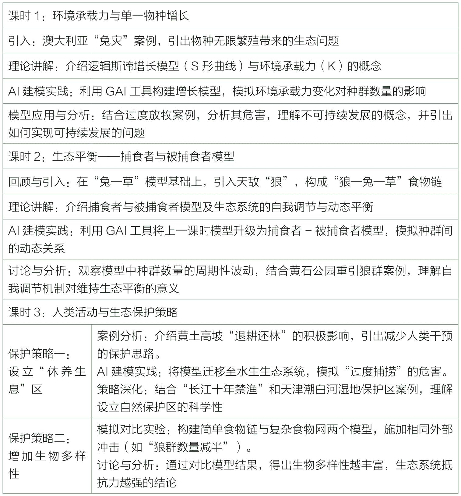

续表

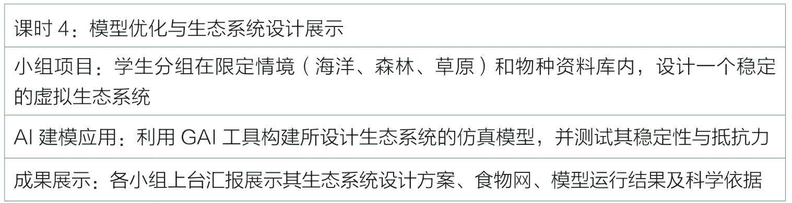

**（二）GAI 运用**

本项目在多个环节充分利用 GAI 技术，有效提升了教学设计效率与学习成效。

**1. 项目主题选取**

最初设想是设计一堂科学课，通过讲述中国故事激发学生的爱国情怀。考虑到近年来我国在环境保护方面取得的重大进展——成为全球增绿最快最多的国家，森林覆盖率超过 25%，我意识到可用此方向设计一个以生物学为主的项目式教学，培养生态文明意识，理解人与自然和谐共生理念。

于是向通义千问提问：

“搜索中国近年来在生态环境保护方面的重大成就”

通义千问的回复如图 3-10 所示。

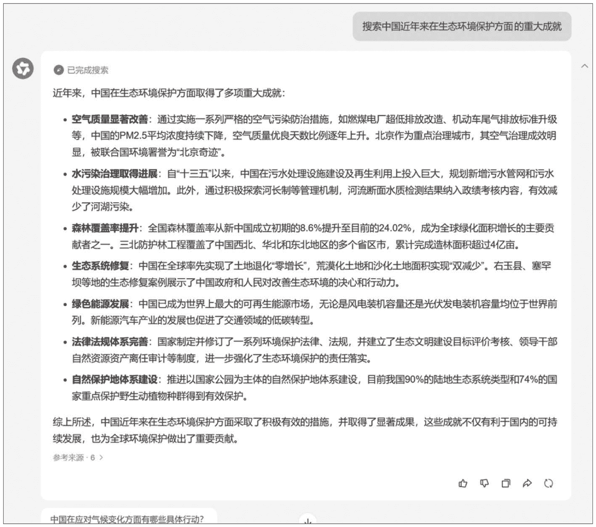

**图 3-10 通义千问的生态环境保护成就**

注意到“生态系统修复”“自然保护地体系建设”与生物学中“生物与环境”主题高度契合，进一步提问：

“生态系统修复和自然保护地体系建设的具体案例、新闻有哪些？”

“如何引导初中学段学生逐步理解生态平衡？”

通义千问的回复如图 3-11 所示。

**图 3-11 通义千问对进一步提问的反馈**

**图 3-11 通义千问对进一步提问的反馈（续）**

基于上述回答，项目式教学的初步思路确定为：以孤立种群在有限资源下的增长为起点，过渡到捕食—被捕食两个种群间的相互制约，以初步理解生态系统的自我调节与生态平衡，最后结合真实案例分析生态平衡被破坏的原因，以及通过设立自然保护区、提升物种多样性等措施保护生态。

将初步思路与 GAI 讨论，开启深度思考模式后，生成初步教学设计。通义千问的回复如图 3-12 所示。

**图 3-12 通义千问对项目式教学的初步设计**

**图 3-12 通义千问对项目式教学的初步设计（续）**

最终优化得到案例简介部分的 4 课时项目主题设计。

**2. 详细的教学设计撰写**

撰写详细教学设计时，直接提问“请按照课时主题给出详细的科学课教学设计”往往得不到可用结果。更有效的做法是教师先自行确定每个课时的大致环节，再让 GAI 在此基础上展开。

课时 1 的初步环节设定为：

细菌在培养皿中的指数增长，引出环境承载力概念——以澳大利亚野兔入侵为背景讲解逻辑斯谛增长模型——学生利用 AI 完成建模，模拟“兔—草”环境——丰富模拟程序，如增加草原面积、牧草丰富度调节功能，观察不同条件下种群数量变化曲线——结合过度放牧导致草原沙化的真实案例，指出超出环境承载力的发展模式不可持续。

在教师已明确环节后，GAI 的回答才具有针对性和可操作性。

“请你根据课时 1 的教学环节‘……’，给出课时 1 的教学设计。”

通义千问的回复（部分）如图 3-13 所示。

**图 3-13 通义千问的回复（部分）**

**图 3-13 通义千问的回复（部分）（续）**

**图 3-13 通义千问的回复（部分）（续）**

**3. 教学设计细节调整**

GAI 生成的教学设计不能直接使用，需教师细读并甄别不合适之处。

问题 1：教学设计不够细化
解决方式：提问“针对××环节，给出课堂上教师可用的逐步引导性问题和关键问题讲解的详细讲稿。”

通义千问的回复（部分）如图 3-14 所示。

**图 3-14 通义千问针对单个环节的详细设计（部分）**

**图 3-14 通义千问针对单个环节的详细设计（部分）（续）**

问题 2：概念讲解缺少例证
解决方式：提问“请针对‘××概念’的讲解进一步细化，给出讲解过程中的逐步引导性问题和对应讲稿”。或“上述讲解中请加入一个简易可计算的例子帮助学生理解‘××概念’。”

问题 3：关键概念未涉及
解决方式：提问“上述教学设计中未对‘××概念’进行讲解，不利于学生学习，请在教学过程中适时引入并讲解该概念。”

**4. 关键环节设计**

本项目涉及大量编程，学生在有限时间内几乎无法完成全部编程任务，但 GAI 可以按需编写程序，使项目实施成为可能。借助 GAI 辅助建模后，培养重点转向学生对模型的理解、批判性思考与逻辑思维，而非编程技能本身。

使用 GAI 编程时，需清晰描述任务要求。核心模拟思路为采用能量机制简化物种生存与繁衍：个体进食补充能量，移动消耗能量，能量达最高值时繁衍新个体，能量归零时死亡。合理设定不同物种的进食补充、移动消耗、最大能量值，即可构建简易模拟程序。

初步设计：

用 HTML、CSS 和 JavaScript 制作一个完整可交互的“兔-草”生态系统可视化模拟网页。页面应包含主画布作为模拟区，侧边信息面板实时显示兔子和草的数量。草用绿色方块表示，可随时间缓慢再生；兔子用白色圆点表示，会随机移动，移动消耗能量，遇到草时吃掉草补充能量。

模拟核心逻辑体现生命循环：兔子能量过低死亡消失，能量积累到阈值后繁殖。系统应自动运行，展示种群数量随资源变化的自然波动与动态平衡，并添加“开始/暂停”和“重置”按钮方便观察实验。

控件完善：

在上述程序基础上增加多种控件以模拟不同情境。

1）初始草量、兔子数量调节控件
2）系统演示速度调节控件
3）兔子数量随时间变化的曲线图显示

多次修改后，模拟程序如图 3-15 所示。

若程序报错或效果不符预期，可将具体情况详细描述给 GAI 请求修正，例如：

“程序运行后只有图像，没有动画，请检查代码并修改。”

“运行后系统反馈如下‘……’，请分析错误原因并修改。”

“运行后出现‘……（详细描述）’现象，请分析错误原因并修改。”

**图 3-15 兔—草生态系统模拟器截图**

多轮修改后的“狼—兔—草”生态系统完整程序运行截图如图 3-16 所示。

上述提示词非常详尽，这是 GAI 能够准确编程模拟的保障。如何设计复杂提示词？可先让 GAI 帮助设计提示词，互动提问：“我将使用 GAI 工具进行 HTML 格式的编程，用于可视化模拟兔—草生态环境，请帮我设计提示词。”在此基础上，教师需多次与 GAI 生成的方案互动，确保最终效果符合预期的逻辑斯谛增长模型或洛特卡—沃尔泰拉模型，以正确呈现物种间互动。

**图 3-16 狼—兔—草生态系统完整程序运行截图**

学生以小组合作形式，利用 GAI 辅助构建与调试生态模型，这一环节既锻炼了 GAI 对话互动能力，也实现了多项核心素养的深度融合与实践。学生将抽象的生态学概念——环境承载力、捕食关系、系统稳定性——转化为可交互、可视化的动态代码，提升了理论联系实际能力、系统思维与分析能力、批判性思维以及团队协作精神。整个模拟与设计过程是对生态平衡的深入理解，也是在复杂问题面前运用科学方法寻求可持续解决方案的实战演练。

# **第四章**

# **教学内容组织：GAI 如何辅助教师拓展教材边界**

在传统的教学中，教材和课标是教师组织教学内容的主要依据。然而，随着教育需求的多样化和信息技术的飞速发展，这种单一的内容组织方式已经显得有些力不从心。教师们常常面临这样的困境：教材内容有限，难以满足学生的个性化需求；课标要求抽象，教学目标难以精准落地；学生的学习兴趣和认知水平差异大，如何让知识真正被理解和吸收，成了教学工作中的一大挑战。

GAI 的出现，为这些问题的解决提供了全新的思路。它不仅能帮助老师更高效地解读教材和课标，还能通过智能化的手段拓展教学内容的边界，让知识以更丰富、更贴近学生认知的方式呈现。更重要的是，GAI 可以辅助设计“先行组织者”，帮助学生在学习新知识时建立清晰的认知框架，从而实现有意义的学习。

本章将从以下三个层面展开。

（1）先行组织者策略：如何利用 GAI 设计有效的学习“脚手架”，帮助学生更好地理解和内化知识。

（2）解读教材和课标：如何借助 GAI 精准拆解课标要求，明确教学目标，让教学更有方向感。

（3）拓展教学内容的边界：如何通过 GAI 获取多样化的教学资源，打破传统教材的局限，让课堂内容更鲜活、更贴近现实。

通过这些探索，我们希望能为教师们提供一套切实可行的工具和方法，让教学内容组织变得更智能、更高效，也让学生的学习体验更丰富、更深刻。

## **第一节 先行组织者策略：实现有意义学习**

为了更好地理解美国教育心理学家奥苏贝尔的“有意义学习”概念，我们需要先构建一个理论框架，为后续讨论奠定基础。奥苏贝尔提出的有意义学习理论，强调学习者通过将新知识与已有认知框架中的相关概念建立联系来实现学习的过程。这种学习方式不仅关注信息的记忆和复述，更注重知识的理解和应用，使学习者能够在新的情境中灵活使用所学知识。基于此，探讨奥苏贝尔所指的“有意义学习”的具体内容及其实施策略，有助于我们设计出更加有效的教学活动，促进学生的深度学习和长时记忆。接下来，我们将详细解析奥苏贝尔的“有意义学习”到底是什么，并探索其在实际教学中的应用方法。

### **一、先行组织者策略说明**

在本节中，我们将共同探讨奥苏贝尔的有意义学习理论框架，了解 GAI 平台如何运用这一理论帮助我们解读课标。同时，我们会介绍先行组织者策略的意义，并展示 GAI 平台是如何借助这一策略来拓宽教材的应用范围、为教学带来更多可能性的。这样不仅能让理论与实践更好地结合，也为提升教学质量提供了新思路。

**（一）有意义学习理论框架及其在解读课标中的应用**

奥苏贝尔的“有意义学习”到底是什么？想象一下这样的场景：学生背下了“牛顿第一定律”的内容，但遇到自行车刹车时为什么会摔倒的问题，却完全不会解释——这就是典型的“机械学习”。而有意义学习，就像把新知识变成乐高积木，稳稳地插在学生已有的认知框架上。

奥苏贝尔提出，真正的学习不是“死记硬背”，而是新旧知识发生实质联系的过程。比如，学生原本知道“力会改变物体运动状态”（旧知识），当学习“惯性”概念时，如果能用刹车时人向前倾的现象（新知识）与之联结，知识就不再是孤立的碎片。

奥苏贝尔特别强调，有意义学习需要满足两个条件：（1）学习材料本身必须具有逻辑意义，即知识本身是可理解的；（2）学习者必须具备有意义学习的心向，即学生有主动将新知识与已有知识建立联系的意愿和能力。

传统的备课过程往往如同“大海捞针”，教师需要逐字逐句分析课标中的抽象要求，例如“理解细胞呼吸过程”“培养科学探究能力”等。而 GAI 的出现，为教师提供了强大的认知导航工具，能够自动抓取课标中的关键词，帮助教师精准定位教学内容。

第一是知识锚点。GAI 能够自动标出课标中的核心概念，例如“细胞呼吸三阶段”，帮助教师快速锁定教学重点。

第二是能力阶梯。GAI 能够将抽象的能力要求，如“科学探究能力”，拆解为具体的教学步骤，例如“提出问题→设计实验→数据分析”，使教学过程更加清晰。

第三是素养落点。GAI 能够将课标中的素养要求转化为真实案例，例如“新冠疫苗研发中的科学家精神”，帮助学生更好地理解社会责任感。

**（二）先行组织者策略的意义及应用**

为什么需要“先行组织者”？很多教师都有这样的经历，刚讲完一个新概念，学生却一脸茫然地问：“老师，这和之前学的知识有什么关系？”这就是认知断层。

生成式AI重塑教学：从课标解析到教材扩充

预组织者可以看作学习前的认知导航，在正式进入内容前为学生铺展一幅可参照的知识框架。以1911年变革为例，课前先呈现中国近代自强求存的演进示意，把太平天国、戊戌变法等节点标出，再凸显1911年事件的特殊性。这种前置安排能够唤醒已有历史图式，让新信息有落脚之处。

生成式AI更像一位具备强情境判断的教学协作者，既把握知识的最佳呈现次序，又能依据学习节奏与方式预判卡点或遗漏。基于生成式AI的预组织策略属于主动自适应的学习支持机制，核心在于通过系统化、逻辑化的知识序列重塑学习路径，提升效率。

当教材内容遭遇现实热点时，生成式AI可即时搭起认知桥梁。传统教科书往往滞后，生成式AI却能产出与时俱进的材料。例如生成从天花疫苗起步到mRNA的抗疫史时间轴，帮助梳理疫苗演进脉络，并用物流员派送包裹作类比解释mRNA工作原理，将抽象变具体。它还能自动建立跨学科关联，例如把病毒结构与疫苗分配的伦理议题并置，拓宽视野。

面对抽象概念，生成式AI可一键搭建脚手架。物理课堂讲电势差时，系统能推送水位差类比动画，用水从高处流向低处建立直观感受。还能整理常见误解清单，比如多数人误以为电压是电子的速率，让教学更具针对性。

当单科知识需要立体呈现时，生成式AI能够自动编织知识网络。以历史课大航海时代开启为例，可生成3D航海路线图从地理维度直观呈现航线，并制作郑和远航与哥伦布航行的目的差异对比表从政治维度拓展比较思维，同时推送胡椒贸易引发的变革微课从经济维度揭示大航海对全球经济的冲击。

生成式AI既能帮助教师精准解读课标，也能突破教材边界，让教学更生动立体。

融合奥苏贝尔的有意义学习理论与预组织策略，生成式AI可以为学习者提供个性化、动态化的学习资源，助力知识建构更顺畅。

### **二、关键技术说明：生成式AI工具赋能教学实践**

在探讨生成式AI如何改进教学前，先厘清工具选择与教育需求的契合度十分关键。选对既能满足教学需要又能支撑教学目标的工具，才能显著提升教学效果和学习体验。接下来将重点介绍工具选择标准及其与实际教学需求的匹配情况。

**工具选型标准与教育适配性**

准备用生成式AI解读课标、拓展教材时，如何挑选合适的工具？不同大模型在能力上各有侧重。图 4-1 对比了市面上常见生成式AI工具在课标解读和教材拓展方面的特点。

**图 4-1 对比市面上常见的 GAI 平台在课标解读和拓展教材内容方面的特点**

依据图 4-1 的对比，不同应用场景的工具选用建议如下。

（1）深度课标解析：推荐 DeepSeek/Kimi。

（2）多模态教材拓展：推荐文心一言/通义万相。

#### **【操作案例 4-1】典型应用场景与提示词设计**

了解常用工具后，如何与生成式AI高效互动？关键在于在对话框中输入明确的提示词。下面给出两个典型场景的提示词示例。

**1.课标解读与预组织者生成**

**提示词设计：**

“基于人教版初中物理‘力与运动’单元课标要求：（1）提取 3 个核心概念锚点；（2）生成比较性组织者（牛顿定律与惯性定律）；（3）设计包含实验视频链接的多模态导学案。要求：符合认知负荷理论，设置两处预设认知冲突。”

**2.教材拓展与认知同化设计**

**提示词设计：**

“针对‘辛亥革命’教材内容：（1）构建救亡图存运动概念网络图；（2）生成 3 个文化适配的类比组织者；（3）设计包含虚拟博物馆访问的拓展任务。”

选用合适的技术工具，结合准确的提示词，是提升生成式AI使用效率的关键。

## **第二节 解读教材课标：理解教材课标，明确教学目标**

解读课标有助于教师把握内容要义并明确教学目标。课标中常出现“理解函数概念”“培养数学建模能力”等抽象表述，仅靠教师自行解读容易费力且难以让学生真正理解。借助生成式AI工具解读课标、明确目标、规划路径会更高效。

### **一、课标四维解析：从“模糊要求”到“清晰路径”**

数学课标中常出现“理解函数概念”“培养数学建模能力”等要求，具体如何教、教到什么程度往往让教师困惑。生成式AI可以把这些抽象要求拆解为可操作的维度。

#### **【操作案例 4-2】知识维度：抓取核心概念**

解读课标推荐 Kimi 模型，因其对扫描版 PDF 识别效果好。以数学课标为例，输入提示词“请对数学课程标准进行分析，从知识维度，抓取核心概念”后，Kimi 抓取出课标中的核心概念并给出知识维度分析，见图 4-2，对一线教师具有参考价值。

**图 4-2 Kimi 平台从课标中抓取核心概念**

#### **【操作案例 4-3】能力维度：拆解学科能力为具体动作**

明确核心概念后，需要把学科能力细化为具体行为。基于前一次对话，输入提示词“数学课程标准中提到的具体动作有哪些？”即可，见图 4-3，无需重新上传文件。

**图 4-3 Kimi 平台拆解学科能力为具体动作**

#### **【操作案例 4-4】素养维度：将核心素养转化为学生能理解的语言**

核心素养理解难度较大，可借助 Kimi 将其转化为学生易懂的表述。输入提示词“请对数学课程标准进行分析，从素养维度，将核心素养转化为学生能理解的语言”后，系统给出每个素养的详细解释及具体表现示例，如图 4-4 所示。

**图 4-4 Kimi 平台解读课标中的核心素养**

#### **【操作案例 4-5】价值观维度：挖掘学科背后的文化价值**

解读课标时，除关注概念、能力、素养外，还应关注学科蕴含的文化价值。输入提示词“请对数学课程标准进行分析，价值观维度，挖掘学科背后的文化价值”后，可获得数学与中华优秀传统文化、科学精神、社会生活等方面的启示，如图 4-5 所示。

**图 4-5 Kimi 平台挖掘学科背后的文化价值**

**图 4-5 Kimi 平台挖掘学科背后的文化价值（续）**

#### **【操作案例 4-6】高中数学“数列”课标解析**

第一步：在对话框中导入课标文件，如图 4-6 所示。

**图 4-6 通过 Kimi 平台对话框上传文件**

第二步：输入相应提示词，如图 4-7 所示。

**图 4-7 在 Kimi 平台对话框输入提示词获取回答**

**图 4-7 在 Kimi 平台对话框输入提示词获取回答（续）**

### **二、螺旋式结构：让知识“滚雪球”**

数学教材采用螺旋式编排，同一知识点在不同学段反复出现并逐层加深。生成式AI 可标注知识点在各年级的分布、生成知识进阶路径图并提示教学衔接点，帮助教师把握进度与衔接。

#### **【操作案例 4-7】标注知识点在不同年级的分布情况**

以人教版初中数学为例，输入指令“所涉及的教材为人教版初中数学，请你标注初中数学的所有知识点在不同年级的分布，以表格形式呈现”后，Kimi 生成表 4-1。

**表 4-1 Kimi 平台标注初中数学知识点在不同年级的分布情况表**

续表

#### **【操作案例 4-8】生成知识进阶路径图**

基于上述分布表，输入提示词“接下来请你基于上述表格，生成知识进阶路径图”后，生成初中数学知识进阶路径图如图 4-8 所示。

**图 4-8 Kimi 平台生成的初中数学知识进阶路径图**

**图 4-8 Kimi 平台生成的初中数学知识进阶路径图（续）**

**图 4-8 Kimi 平台生成的初中数学知识进阶路径图（续）**

#### **【操作案例 4-9】提示教学衔接点**

除分布表与路径图外，生成式AI 还能给出教学衔接提示。输入提示词“接下来请你根据上面的初中数学知识点在不同年级的分布情况表和知识进阶路径图，提示初中数学教学衔接点”后，得到七年级教学衔接点提示如图 4-9 所示。

**图 4-9 Kimi 平台生成的七年级数学教学衔接点提示**

**图 4-9 Kimi 平台生成的七年级数学教学衔接点提示（续）**

#### **【操作案例 4-10】目标矩阵，让教学目标“看得见，摸得着”**

传统目标如“掌握函数概念”过于笼统。生成式AI 可帮助制定具体可测的教学目标矩阵。以初中数学“一次函数”为例，输入指示词“请你生成一个关于初中数学一次函数的具体且可测量的教学目标矩阵，可以从知识、能力、素养、情感这四个维度展开。”使用 DeepSeek 生成的矩阵如图 4-10 所示。

**图 4-10 DeepSeek 平台生成的教学目标矩阵**

**图 4-10 DeepSeek 平台生成的教学目标矩阵（续）**

## **第三节 拓展内容边界：获取多样内容，补充传统教材**

在完成课标解读后，下一步是拓展教材内容。传统教材系统但有时单一，引入文字、故事等多样资源可让教学更生动、更具深度。本部分涉及图文生成，推荐工具为文心一言和通义万相。

### **一、内容拓展：通过文字与故事扩展**

通过文字与故事拓展内容，可让课程更生动，帮助学生建立深层理解与记忆。故事能把抽象概念具象化、复杂理论简化，还能激发想象力与创造力，培养问题解决能力。

#### **【操作案例 4-11】融入背景资料，丰富学习维度**

教材背景资料有限，备课时常需额外查阅。用生成式AI可快速生成合适背景资料。以初中数学代数为例，将指示词“给出代数部分的历史背景，说明‘代数’这一概念的历史演变及其在现代科学中的应用”输入文心一言，即可生成背景资料，如图 4-11 所示。

**图 4-11 文心一言平台生成的拓展教材的背景资料**

**图 4-11 文心一言平台生成的拓展教材的背景资料（续）**

#### **【操作案例 4-12】讲述相关故事，使抽象概念生动化**

讲解抽象概念时，用真实或虚构故事更易理解。用生成式AI可快速生成故事情境。例如小学数学“分数”，输入提示词“请你给分数这一数学概念构造一个故事情境，帮助学生理解”至文心一言，生成故事情境如图 4-12 所示。

**图 4-12 文心一言平台生成的虚构故事情境**

#### **【操作案例 4-13】分析应用，理论结合实际**

讲解理论后配上实际案例更易理解。借助生成式AI可快速生成案例。例如讲等比数列时，输入提示词“请设计一个关于等比数列的现实生活中的实际案例”，结果如图 4-13 所示。

**图 4-13 文心一言平台生成的实际案例**

### **二、视觉赋能：利用图片和视频辅助教学**

文字口述难以完全呈现复杂概念，加入图片视频可让抽象变具体。例如用图表解释数据变化，或播放实验视频展示操作过程。讲光合作用时，可用通义万相生成生动图片。

输入指示词“描述光合作用过程，阳光照射在绿色植物的叶子上，周围有二氧化碳和水分子进入叶子，经过光合作用转化，生成氧气释放到空气中和葡萄糖供给植物使用的情景”并生成画作，可得到如图 4-14 所示的四张图片。

**图 4-14 通义万相平台生成的光合作用图片**

此外，还可通过通义万相创作教学相关视频。点击首页“视频生成”，输入提示词即可，如图 4-15 所示。

**图 4-15 通过通义万相平台创作与教学内容相关的视频**

### 综合案例四——应用 GAI 对高中数学“数列”进行课标解析和教材解读

第一步：打开 Kimi 模型对高中数学“数列”进行课标分析和教材解读。提示词为：“请先分析课标中对‘数列’的要求，接下来从知识、能力、素养和价值观四个维度进行拆解”，如图 4-16 所示。

**图 4-16 Kimi 平台生成的高中数学“数列”的课标解析**

第二步：运用 DeepSeek 生成“数列”的教学目标矩阵。提示词为：“请你生成一个关于高中数学数列的具体且可测量的教学目标矩阵，可以从知识、能力、素养、情感这四个维度展开”，如图 4-17 所示。

**图 4-17 DeepSeek 平台生成高中数学“数列”的教学目标矩阵**

第三步：运用文心一言生成关于“数列”的拓展内容。提示词为：“请设计一个关于等比数列的现实生活中的实际案例”，如图 4-18 所示。

**图 4-18 文心一言平台生成的高中数学关于“数列”的拓展内容**

第四步：运用文心一言生成“数列”章节的跨学科主题。提示词为：“请你生成五个高中数学‘数列’章节的跨学科主题，要求新颖且有意义”，如图 4-19 所示。

**图 4-19 文心一言平台生成的高中数学“数列”跨学科主题**

# 第五章
# 用 GAI 重塑资源 实现个性化适配

在日常教学里，老师手头的素材大多还是教材、辅导书和现成的课件。授课手段会更新，但支撑教学的底料并没有真正扩容，更多是换皮之举。

要走出这种困局，关键在于升级资源开发本身。生成式 AI 凭借内容生产和信息整合的强能力，为教学创新提供了新支点，尤其是在构建个体化学习方案和供给多元媒体内容方面，价值非常突出。

## 第一节 协同开发与媒体融合 让直观教学落地

把抽象概念转化为可感知、可探究的体验，是教学的核心诉求。直观化教学，指的是教师借助实物操作、模型呈现、图表展示和语言描述，让学生在感知中把握本质，形成正确概念 ^(²¹)。

### 一、更新学习材料 助力直观化

借助 GAI 刷新教学材料时，先要看清教学现场的症结。

**（一）教与学面临的痛点**

对教师而言，实现直观教学最直接的依托是图片、模型等可视化载体。相比纯文字，这类载体的制作门槛更高，且要随教学内容不断迭代，准备成本很大。即便准备充分，学生的个体差异仍会削弱效果，比如空间想象偏弱的学生，面对静态图难以形成动态认知。

对学生而言，传统资料多以文字和静图为主，动态内容匮乏。学习路径和能力各不相同，统一资料难以覆盖差异化需求。如何提供多元化、定制化且可感知的学习材料，已成为教学亟待解决的问题。

**（二）个性化学习的内涵与价值**

个性化教育是当前国际教育改革的重要方向。学习者在方式、内容、起点、进度、目标上存在明显差异，这正是差异化学习兴起的土壤。

概括来看，差异化学习包含三层含义：第一，依据学生特质和发展潜能，选择合适的方法、手段、内容、起点、进程和评价方式，促进全面自由和谐发展；第二，强调学习既是个性展现与养成，也是自我实现与追求个性的过程；第三，它在一定程度上区分了教育与学习本质：教育的起点是借助机构筛选出被认为更聪明的人进行培养，过程往往趋同；而学习的起点是让任何人都能在原有基础上变得更聪明，过程是学习者成为自己想成为的人，更能体现个性、独特性、进取性与创造性。教育只面向各方面“合适”的少数人，学习则对所有人开放 ^(²²)。

差异化学习能显著提升成效。薄弱点被更清晰地呈现，教师可以进行精准干预；借助 GAI，每个学习者都能生成专属的学习蓝图，匹配不同风格。对学习动力的激发也明显，学生可按兴趣选择内容和方式，相较“统一教学+统一教材”，投入度更高；按自身节奏前行，学习压力也会降低。

总体来看，差异化学习是未来改革的重要方向。GAI 有助于精准定位个体差异，但不同内容适配的智能体能力并不相同。协同开发思路正是把各类 GAI 的优势模块与教学场景匹配，提升差异化落地的可行性。

**（三）直观教学为何关键**

夸美纽斯把直观过程概括为感官—记忆—理解—判断。多感官参与能强化对知识的记忆，进而促进理解与判断。例如动态图像可以帮助理解喀斯特地貌的形成，3D 模型则能呈现不同生物的细微差别。

直观把抽象转为具象，有助于逻辑思维培养。逻辑思维偏线性，形象思维是其初级形态，先以图像或模型呈现，再展开探究 ^(²³)。将概念具象化，需要对问题有独特的理解。

直观化教学还能激发想象力。真实情境能点燃灵感，学生在可视化材料基础上拓展知识可能。如讲“力与运动”时，用动画展示物体在不同作用力下的轨迹，学生既能直观感受效果，又能联想到现实场景。

直观化教学同时降低学习成本。抽象概念理解耗时，若缺乏引导易产生偏差。可视化让理论“活”起来，架起生活与抽象世界的桥梁。

直观化教学在教育中作用不可替代。GAI 为其提供了更丰富的手段，教师可便捷获取和制作动态图、3D 模型等具象资料，提升学习效果。媒体融合策略是对可视化材料进行系统化综合，利用 GAI 多维度应用可视化素材，能进一步强化直观化教学。可以预期，GAI 将在教育生态中发挥越来越重要的作用。

**二、协同开发逻辑详解**

《国家中长期教育改革和发展规划纲要（2010—2020 年）》早已提出树立多样化人才观念，尊重个人选择，鼓励个性发展。此后个性化教育研究持续深入，研究方法也日益多元。

但实践中困难不少。一名教师往往要带数个班级，学生几十上百，每个人学路不同，如何因材施教成为难题。

随着 GAI 的发展，教师获得了新工具。GAI 在文本生成、图像制作、创意构思、方案优化、数据分析等方面都很强，但如何选用合适的模型仍是问题。

2023 年《基础教育课程教学改革深化行动方案》提出推进数字化赋能教学质量提升，推动数字化在拓展时空、共享资源、优化课程与教学过程、优化学习方式、精准评价等方面应用，构建新型教与学模式。教育部部长怀进鹏在 2024 世界数字教育大会主旨演讲中提出更智能化发展数字技术，服务人的全面发展，将实施人工智能赋能行动，促进智能技术与教育教学、科学研究、社会深度融合。

数字化赋能是教育改革主线，GAI 作为代表应与教学更紧密融合，这正是协同开发思路的价值所在。

协同开发思路即根据不同 GAI 的独特优势，将其功能模块与教学领域匹配，实现在教育教学中的价值最大化。

下一节将系统梳理各 GAI 的优势，并结合案例说明教学应用。

**三、多媒体整合逻辑详解**

信息时代多媒体资源日益丰富，涵盖视频、音频、图片、动画等，以生动直观的特点为教学呈现提供多样路径。优质课件早已超越文字图表堆砌，通过色彩、声音、动态效果的结合，内容更丰富、更具吸引力，有助于集中注意力、激发兴趣、提升记忆与课堂氛围。如今多媒体课件已与黑板粉笔一样成为基本教具。

但教师在获取与整合这些资源时仍面临挑战。教师专业集中在学科教学，缺少多媒体制作的专业技能和时间。图片编辑、视频剪辑、制作特效幻灯片等，都需要专业软件和大量精力，会挤占教学研究和师生互动时间，影响效率。

除常见视频音频外，VR、AR 等新技术也在进入教育视野，它们能让复杂概念变得可感，降低教学负担，提高效率。但灵活用在教学中仍有难度。

GAI 为此提供了有效路径。它能依据教学目标快速精准筛选和整合多媒体资源，自动生成高质量课件。教师输入简单指令，复杂整合与制作即可完成，工作负担减轻，更能聚焦教学与指导。GAI 生成材料还能突破既有资源边界，实现对教学内容的全面覆盖。

这里的多媒体整合资源思路，指借助 GAI 的创造力生成文字、图片、视频、音频、动画等教学所需的多媒体资源，并利用其算法和信息检索能力在较短时间内筛选整合所需素材。原本耗时耗力的搜索制作变得高效，课堂更直观沉浸，节省的时间也能回馈到大班教学带来的困难中。

本章第三节将进一步介绍多媒体资源整合思路，探讨 GAI 如何生成直观化教学材料并充盈课堂。

## 第二节 按学情定制 差异化资料匹配

本节依托协同开发思路，系统介绍各 GAI 的优势及其在适配学习资料定制中的应用，帮助教师掌握高效定制差异化学习材料的实践技能。重点探讨个体差异对目标、需求、路径的影响，以及如何利用 GAI 针对差异定制适配资料，提升学习效果并减轻教师负担。

### 一、主流工具能力拆解

**（一）KimiChat：长文本处理引擎**

生成式 AI 通过深度学习架构如 Transformer、大规模训练、注意力机制、预训练与微调等技术，实现海量信息处理。

KimiChat 单次交互可承载二十万字左右的输入输出，包含单次交互和多轮对话累计。对长对话，处理步骤如图 5-1 所示。

**图 5-1 KimiChat 长对话处理步骤**

同时 KimiChat 拥有强大的文档解析能力，可处理 TXT、PDF、Word、PPT、Excel 等多种格式，如图 5-2 所示。

**图 5-2 KimiChat 可解析文件内容**

局限在于无法处理图像、音频、视频等非文本内容，不能保留文件的格式样式如字体颜色，也无法创建或修改文件，只能提取分析内容。

**（二）DeepSeek：推理链拓展**

DeepSeek 的深度思考 R1 模式完整展示问题思考路径。官方介绍为：先分析问题，理解学生意图；再从数据库检索相关信息，开启联网搜索时还会检索网络；接着从多角度思考问题，确保回答全面；最后生成结构化回答。教师上传学生作业等材料后，系统即可自动分析并给出个性化解答，见图 5-3。

**图 5-3 DeepSeek 的深度思考 R1 模式思考步骤**

**（三）豆包：对话式深度推演**

豆包储备信息海量，覆盖科学、技术、文史、文化等领域，支撑复杂问题的快速调用。其次自然语言理解能力强，能精准把握对话中的含义、意图和情感。再者，豆包的智能体搭建平台允许普通用户创建专属智能体，例如扮演学生角色为引导型教师提供授课思路。其创建界面如图 5-4 所示。

**图 5-4 豆包智能体创建界面**

### 二、分层进阶路径

传统教学面对学习进度差异时往往无力应对。时间固定，若重深度，新手会跟不上；若讲基础，已掌握者会无收获。借助 GAI 可针对性设计教学，实现事半功倍。

**【操作案例 5-1】起步期——搭建知识脚手架**

知识脚手架源自建筑脚手架概念，指在学习过程中由教师、教材或工具提供的支持性结构，帮助学习者逐步构建知识体系，待能独立学习时逐步拆除。

常见类型有问题支架、范例支架、图表支架和提示词支架，见图 5-5。

**图 5-5 知识脚手架类型介绍**

搭建核心是知识点的拆解。KimiChat 的长文本解析能力适合为新手解析资料并搭建脚手架。

拆解应遵循逻辑性、独立性、完整性、实用性、渐进性五项原则。

示例操作：以人教版《高中地理必修一》第三章第三节“海水的运动”为例，用 KimiChat 进行拆解。

提示词：请你根据人教版高中地理必修一第三章第三节“海水的运动”相关内容，依据逻辑性、独立性、完整性、实用性、渐进性原则，拆解其知识点。

KimiChat 输出如图 5-6 所示。

**图 5-6 KimiChat 生成的“海水的运动”知识点拆解文本**

**图 5-6 KimiChat 生成的“海水的运动”知识点拆解文本（续）**

**【操作案例 5-2】进阶期——认知冲突设计**

认知冲突设计是指创设与学生已有经验不一致的情境或问题，引发认知冲突，打破平衡，激发探究，促进认知更新。

实施方式包括设置问题情景、实验演示和观点碰撞，见图 5-7。

**图 5-7 认知冲突设计实施方式**

示例操作：以人教版《高中地理必修一》第二章第二节“大气受热过程和大气运动”中的“城市热岛环流”为例，用 DeepSeek 进行设计。

阶段一：诱导认知错误
指令：请你根据城市热岛效应相关知识，结合高中进阶学生认知水平，运用认知冲突设计理论，生成一个问题以诱导学生认知错误。
DeepSeek 呈现：
• 课堂提问：夏天中午市中心温度比郊区高 5℃，为什么会高出 5℃？
• 学生回答：因为汽车尾气排放、空调废气排放。

阶段二：抛出反常识现象
指令：接下来，请你设计一个反常识现象，以推翻学生答案。
DeepSeek 呈现：
• 展示凌晨 3 点数据对比图，并提问：为什么凌晨车流量归零，市中心仍比郊区热 3℃？

阶段三：认知重构
指令：
“生成 3 条引导线索，用破案比喻解释城市热岛效应，要求：
1.包含昼夜差异对比
2.涉及建筑材料因素
3.用学生熟悉的奶茶店排队场景类比”

DeepSeek 呈现如图 5-8 所示。

**图 5-8 DeepSeek 输出的引导线索**

**精熟阶段——元认知培养**

**元认知：让学习看见自己**

上世纪 70 年代，美国心理学家弗拉维尔首次提出元认知这一概念，他把它理解为个体对自身认知活动及其结果的觉知与调控，换句话说，就是人对自己如何思考的了解以及对思考过程的管理能力。通俗来看，元认知包含三层含义：对自己认知系统的认识、在认知过程中出现的内心体会，以及在进行中对认知的实时把控。

本书第六章会把元认知展开系统论述，这里先做概括性引介。

### **三、学习者类型分析**

#### **【操作案例 5-3】分析型学习者**

在学习时，分析型学习者更习惯先拆解信息、再用逻辑链条把知识串起来，关注知识的内在构造与运行原理，善于把复杂任务拆成若干子问题，通过厘清子问题之间的关联来求解。此类学习者的典型画像见图 5-9 所示。

**图 5-9 分析型学习者的特点**

实践片段：

一次高中地理课以“火山选址”为主题，为分析型学习者做路径定制，同时调动 DeepSeek 与 KimiChat 协同。

步骤一：构建知识图谱，借助 KimiChat
指令输入：“请通读人教版《高中地理必修一》与《高中地理选择性必修一》里有关火山的章节，提炼出知识图谱。”
KimiChat 的产出见图 5-10。

**图 5-10 KimiChat 输出**

步骤二：推演逻辑链，借助 DeepSeek
指令输入：“基于前述图谱，结合火山分布与活动条件等资料，示范‘已知某地经纬度、岩石年代、地震频次，估算火山活动概率’的思考路径。”
DeepSeek 的结果见图 5-11。

**图 5-11 DeepSeek 输出**

**图 5-11 DeepSeek 输出（续）**

#### **【操作案例 5-4】实践型学习者**

实践型学习者依赖亲身参与、动手操作与直接体验来形成知识与技能，倾向把抽象理论放进真实情境检验，重视学习的实用价值与即时反馈。此类学习者的特征见图 5-12。

**图 5-12 实践型学习者的特点**

### **综合案例五——高中地理“服务业区位因素及其变化”智能体搭建**

在学完人教版《高中地理必修二》第三章第三节后，教师安排了“商业中心选址”活动。

步骤一：搭建虚拟情境，使用豆包
先用豆包搭建 AI 智能体，见图 5-13，随后生成虚拟画面。

**图 5-13 运用豆包创建 AI 智能体**

步骤二：模拟实地调研，使用 KimiChat
指令输入：
“统计校园周边 50 米内奶茶店数量及每小时客流，并据此制定一份顾客市场需求问卷”
KimiChat 的产出见图 5-14。

**图 5-14 KimiChat 输出**

**图 5-14 KimiChat 输出（续）**

**图 5-14 KimiChat 输出（续）**

## **第三节 打造多媒体资源：整合图像、音视频，开发多元学习资源**

本节围绕多媒体整合与协同开发展开，探讨如何借助各家生成式 AI 的特性与工具组合，跨平台融合教学素材，产出更贴合课堂需求的多媒体成果。前文已涉及 GAI 在文本与个性化材料方面的长处，下面聚焦其在多媒体创作侧的能力与用法。

### **一、不同 GAI 在制作多媒体上的特点和功能**

**（一）图片制作**

**1.豆包**
在绘图层面，豆包可适配多种画幅与风格。如表 5-1 所示，其绘图模块提供 AI 扩图、AI 消除、提升分辨率等功能，创作页自带镜头角度、光线、风景、人像四类常用特征词，降低专业术语门槛。值得一提的是，创作页支持参考图导入，在提示词较少时仍能提高贴合度。

**表 5-1 豆包绘图有关功能**

**2.文心一言**
现更名为文小言，其 4.0 版本的图像生成分为图片创作与 AI 修图两块，如表 5-2 所示。图片创作涵盖不同画风、比例场景、光效等；AI 修图包括涂抹消除、局部替换、相似图生成、扩图、去水印等，场景覆盖面广。

**表 5-2 文心一言绘图有关功能**

**3.智谱清言**
智谱清言以绘图与视频生成见长。除常规的比例风格调节与特征词添加，如光线、镜头、构图、画质等“咒语”外，还新增 AI 特效，可让静态图呈现动态效果，如表 5-3 所示。

**表 5-3 智谱清言绘图有关功能**

**4.通义千问**
图像创作或再编辑也可通过精细提示词实现。多数平台支持智能体创建，以通义千问的古风小绘本智能体为例，产出自带古风属性，再按需微调即可。其绘画表现获得较高认可。

为横向对比，使用相同提示词在各平台测试：“画一幅画：一片宁静山谷，中间有一条清澈小溪，周围郁郁葱葱，远处山脉连绵，溪边有饮水的小鹿。比例 9:16，实景风格”。图 5-15 至图 5-18 为各平台 PC 端对话结果，已等比缩放。可看出除豆包外，其余作品比例需再调整；提示词相同情况下，各模型呈现差异明显，这与模型特性有关。总体均能满足教学配图需求，图文结合可提升课堂效果。

**图 5-15 通义千问作图**

**图 5-16 豆包作图**

**图 5-17 文心一言作图**

**图 5-18 智谱清言作图**

**（二）视频制作**
目前 GAI 生成视频大致分两类：图文成片与纯文字成片，后者更接近影视动画，耗时较长，常在已有素材基础上做 AI 再创作，如借助剪映等轻量剪辑工具。

可灵 AI、智谱清言等均可生成两类视频，仅需简短提示词即可出初稿。智谱清言创作示例见图 5-19。

**图 5-19 智谱清言创作示例**

**图 5-19 智谱清言创作示例（续）**

**（三）音频制作**
音频制作常见两种：一是为文本配人声朗读，二是直接生成音乐。以豆包为例，其可原创音乐，按需求生成不同风格曲目，并支持歌词修改。在教学中，此类功能有助于激发兴趣、助力记忆，与编写顺口溜辅助公式记忆异曲同工。

**（四）幻灯片制作**
图像、视频、音频成果多需汇总到幻灯片呈现，纯人工制作效率偏低。国内主流 GAI 多提供 PPT 生成能力，甚至有道翻译等专业工具也内置生成 PPT 功能。综合型工具如豆包可自动生成提纲、制作幻灯片并填充内容。

除对话生成外，iSlide 这类插件可直接嵌入 Office 工具栏，实现一键生成，与 Plus 版本功能类似。

至此对多媒体整合已有初步认识，下面介绍具体操作。

### **二、利用 GAI 创作多媒体资源的操作说明**

生成图像、视频、音频时，提示词质量决定输出水平。以下结合通用逻辑与案例总结不同领域的提示词设计要点。

#### **【操作案例 5-5】提示词设计通用原则**

**1.明确核心目标**
先自问想表达什么：场景、情感、故事、风格。
例如：
模糊：“一张好看的风景图”
具体：“清晨富士山，樱花盛开，薄雾缭绕，吉卜力动画风格，柔和水彩质感”

**2.结构化描述**
先确定主干，再叠加修饰。按优先级分层：主体+环境+风格+细节+技术参数
例如图像：
“一只银白赛博朋克猫，站在霓虹闪烁的东京雨夜街头，未来主义科幻插画风格，毛发细节清晰，4K 超现实渲染”

**3.关键词选择**
用具体名词替代抽象形容：“美丽的”→“梵高《星空》笔触的”
避免歧义：用“赛博朋克”而非“科技感”
可加入艺术流派或技术术语，如低多边形建模、双色调

#### **【操作案例 5-6】提示词设计的分领域技巧**

**1.图像生成**
• 风格强化：明确艺术形式，如浮世绘版画、铅笔素描
• 光照与镜头：逆光剪影、35mm 焦段柔焦、超广角鱼眼透视
• 权重分配：（主角：1.5）突出主体，（重复元素 2）控制密度
• 负面提示：排除模糊或畸变

**2.视频生成**
• 时间线描述，分段提示关键帧：“开场沙漠孤旅→10 秒后沙暴来袭→结尾沙尘中浮现金字塔”
• 运镜指令：“慢镜头特写、无人机俯冲、动态模糊穿梭”
• 连贯性控制：“保持服装一致，色调由暖黄渐变为冷蓝”

**3.音频生成**
• 情感与场景：“午夜咖啡馆孤独的爵士钢琴，蓝调忧伤，背景有雨声”
• 乐器与节奏：“非洲鼓加班卓琴，BPM 120，电子合成器渐进加入”

**4.高级策略**
• 用视觉词描声音：“金属碰撞的尖锐高音如破碎镜面”
• 用听觉词描图像：“画面充满爵士即兴般的色彩迸溅”
生成效果与提示词生动性及模型选择密切相关

**5.善用 AI**
可用 AI 优化提示词，直接输入“优化表述”“增添细节”，或使用软件内置提示词工具，案例如图 5-20。

**图 5-20 Kimi 生成提示词案例**

### **综合案例六——GAI 帮助语文《春江花月夜》匹配教学资源**

聚焦张若虚《春江花月夜》一课，展示 GAI 在媒体资源整合上的应用。教学设计概要如下，重点呈现多媒体制作部分。

**（一）导入新课（5 分钟）**
情境导入：播放月亮主题视频，可 AI 搜索或生成。此处采用生成，如图 5-21。
提示词：“月夜江南水乡，明月高悬，银辉洒向宁静江面，泛起细碎波光如繁星。远山朦胧，渔火点点，构成淡雅水墨卷。无人机缓升，广角捕捉动静相宜美景，镜头下移慢动作呈现水波纹理，每帧如工笔画。背景古筝悠扬，旋律轻远，与画面融合营造超然意境。中远景俯拍，突出光影与水面互动之美。”

**图 5-21 通义千问生成视频（1）**

整体画面唯美，但时长较短。若需更长视频，可先生成多段再用剪映拼接，或直接指令重剪，如图 5-22。
提示词：“春江潮水连海平，海上明月共潮生。滟滟随波千万里，何处春江无月明！斜月沉沉藏海雾，碣石潇湘无限路。不知乘月几人归，落月摇情满江树”

**图 5-22 通义千问生成视频（2）**

可见 GAI 能识别古诗，但要得到实景视频需进一步限定描述。

该环节可使用 PPT 单页生成功能。

**（二）整体感知（10 分钟）**
配乐朗诵：播放配乐朗诵视频，要求闭眼聆听体悟意境。
提问：听后感受如何？

音乐可通过 AI 搜索获取或 GAI 合成，后者可大量生成并按教学需求调整，案例如图 5-23。

**图 5-23 豆包音乐生成案例**

背诵阶段亦可据诗意生成背景乐，提升记忆效率。

**（三）赏析诗歌（25 分钟）**
意象梳理：春江、明月、花林、白沙、扁舟、青枫、玉户、闲潭、鱼龙、鸿雁、落花、江树等。
分组讨论各意象画面。

示例提示词，经 DeepSeek 生成后微调：
“实景风格：春江浩瀚连天，月轮初升，波光如银鳞，江畔花林随夜风摇曳，扁舟孤悬江心，远处沙洲若隐若现，镜头由江面推向星空，呈现‘江畔何人初见月’的时空苍茫感，8K 细节，淡赭石与群青为主调”

课堂上学生可用语言描述诗中场景，输入生成式 AI 实时生成对应画面，直观体验“诗中有画”。如图 5-24 所示，学生描绘“江流宛转绕芳甸”即可生成动态画面。条件允许可结合 VR 构建三维诗境，沉浸式体验。

**图 5-24 通义千问作图**

例如描述“月照花林皆似霰”，AI 可生成月光下花瓣如雪的画面，如表 5-4；随后戴上 VR 设备，“漫步”虚拟江畔，感受夜风与花影，深化意境理解。

**表 5-4 来自 DeepSeek 的示例**

讲解结束后，可让学生完善初始描述，观察 GAI 生成图的变化，从而体会词汇对画面塑造的作用，提升语言表达力。

**（四）课堂总结（3 分钟）**
总结诗歌特点。
作业：背诵全诗，撰写 300 字赏析短文。
可鼓励学生创作关联《春江花月夜》的小故事，体会诗人、妇人、征战将士的情感。教师先用 GAI 生成思路框架，虽灵活性与情感表达有限，但能提供大量素材启发学生。

# **第六章**
# **评价与改进：GAI 如何帮助教育工作者实现教学闭环**

本章将系统讨论如何借助 GAI 技术助力学生反思、评价与改进。通过阅读，教师可基于数据驱动与自我管理策略，聚焦学生元认知，利用 GAI 开展过程性评估与终结性评价，并结合案例探索其在教育实践中的潜力与应用效果。

在当下的教学语境里，教师借助数据驱动和自主管理等路径来强化学生的元认知，让学习过程本身能够被觉察、被审视、被评判。把学生的作业、行为、测评等学习痕迹收集起来做分析，教师对每个学生的需求点和卡壳点判断会更贴近，从而给出更具针对性的教学支持。与此同时，围绕目标设定、计划编排、进展追踪展开的自我管理训练，也在持续抬升自主学习能力。当反馈变得更及时、更立体、更贴合个人时，学生才能对自己的学习状态形成清晰画像，并做出恰当调整，这既推动元认知提升，也为学习上的新突破提供可能。

## **第一节 数据驱动与自我管理：点亮元认知**

本节围绕数据驱动与自我管理两条线，讨论 GAI 如何帮助学生聚焦元认知理论，实现自我反思、自我评价与自我改进，化解学习中的具体困境，给出个性化建议，推动元认知发展。

### **一、从评价与改进切入元认知能力**

教学现场里，老师常会发现部分学生明明接受了多种指导，仍会在某个节点卡住，成绩或综合能力长时间停滞。这一现象既制约个性成长，也削弱教学效能。要真正解决，需要深挖成因，对学习者的认知结构、学习动机、策略选择与环境因素做系统剖析。元认知理论正为此提供了关键抓手。借助它，学习者能更敏锐地感知自身学习，开展自我监控与调节，从而走出停滞。

**（一）学习困境的表现**

学习过程中，学生容易出现效率偏低、成绩原地踏步、概念理解不透等情况。课堂上看似认真听讲，一到作业或测验就出现大量失误，知识碎片化；小组讨论时表达不清、思路混乱，跟不上节奏；自学时缺乏规划、拖延严重，投入时间多产出少。这些问题直接拖累学业，也反过来打击自信与动机。根源并不在知识量不足，而在知识运用与思维延展上。由于缺少有效方式，学生面对困难时常感到无从下手、束手无策，这本质上是学习方式缺位所致。

**（二）元认知的核心作用**

元认知概念由心理学家 Flavell 提出，指个体对自身认知过程的认知与调控能力 ^(²⁴)。通俗说就是对认知的认知，体现为在表征、监控与控制心理功能上的能力。凭借元认知，个体可以评估选择与表现的质量，并在外部反馈不足时自主调整行为、优化后续决策。元认知不仅是认识行为，更是反思与调节认知过程的能力，具备一种上帝视角，让学生从更高维度审视自己的思考，发现短板并加以改进。

元认知是学习与问题解决的关键。能力不足时，学习像无舵之船，目标不明、难以针对性调整，也很难察觉思维局限。首先，元认知有助于学习计划的制定，在任务完成后能针对性地规划下一步方案并匹配策略 ^(²⁵)。其次，它提升自我监控水平，使学习者能在过程中及时发现错误并修正，以保证目标达成 ^(²⁶)。再者，它强化反思力，通过对学习过程与成果的评价，认识优劣并持续优化学习策略 ^(²⁷)。

**（三）GAI 赋能评价与改进革新**

在现有课堂里，学生对自己学习过程的主动评估并不充分。学生更多扮演接收者，埋头抄笔记、做题，鲜有时间去梳理逻辑关系与概念联系。即便拿到不理想的分数，多数人归因于“题超纲”或“粗心”，少有深究自身理解与思维方式的问题。浅层归因掩盖了真正难点。

更关键的是过度依赖外部评价。学校习惯用考试分数与教师评语衡量成效，忽视自我反思能力的培养。好比用别人的尺子量自己的高度，既难准确判断真实水平，又容易削弱探索积极性。久之，学生易陷入消极状态，视野窄、内驱弱。

要打破僵局，需要让元认知在学习中更活跃。GAI 的引入提供了新思路，它能从作业轨迹、交互记录、成绩波动等多源数据出发，生成个性化的学习诊断图谱。例如，学生在几何证明上受阻，GAI 不仅能标注错误类型，还能回溯出错步骤，定位逻辑链的断裂点；针对英语作文的语法高频错，GAI 可做相似匹配，把典型错误样式呈现出来。

### **二、数据驱动策略说明**

数据驱动像是为学习装上动态扫描仪，通过采集日常作业完成情况、在线学习行为、成绩波动、课堂互动热度等多维信息，识别个体行为模式。比如某学生在三角函数变形题上反复失分，系统能精准归类问题类型，并在每一步中找到逻辑漏洞。英语写作若出现语法混乱，GAI 也可对照相关资料，揪出认知误区，像是定位认知暗礁。

**（一）学习数据的全景式采集**

教育技术像一张密集网络，把作业提交记录、智能软件交互痕迹、终端实时反馈等串联，形成学习检查报告。比如学生物理单元测验失分集中在电磁学，系统在标注知识缺陷的同时，还会关联其在科创社团的电路设计练习，暴露理论与实践结合的薄弱处。

**（二）数据背后的成长密码**

横向比较会生成学习坐标图：将学生的古诗词鉴赏能力与同龄人对比，可见比喻技巧排前列，而典故追溯能力却落后约15%。纵向追踪则像播放回放，呈现阅读训练后阅读速度从200词/分钟提升至350词/分钟。结合课外信息还能发现：参与辩论俱乐部的同学议论文展开速度提升约40%；长期参与程序设计俱乐部的同学系统思考能力显著更强。

机器学习算法让数据会说话。例如聚类分析可把语文文言文翻译常见错误分为语法结构混淆与文化常识缺乏两类，并据此干预。数据分析就成了每位学生的认知地图，把抽象学习问题变得可视可感。

**（三）可视化反馈：照见成长的明镜**

GAI 产生的反馈如同X光片，基于深度数据分析制定个性化反思与评估方案，呈现知识掌握程度、逻辑方式、学习状态与知识应用的内在关联。这种可视化让学生迅速捕捉阶段要点，认清优势与不足，激活元认知，主动调整策略。

同时，GAI 可基于过往单元测试分布、阶段学习习惯、班级数据等进行预测，提前预警学习滑坡风险，并为下一阶段制定计划，让师生能在数据支持下精准调校策略，争取调整时间。

### **三、自我管理策略说明**

如果把数据驱动看作外在的认知导览，自我管理就是内在的导航系统。依托目标建构、过程调控、策略进化的三重机制，把学习主动权交还学生，促进自我反思与评价。

**（一）目标建构：绘制个性化成长蓝图**

有效目标管理呼应维果茨基的最近发展区，学生需预设成果、明确目标、挑选策略、评估可行性。持续反馈带来的动态自我认知是优化目标的驱动力。依据元认知发展规律，学生对自身能力的感知在动态变化，这对动机与成就感有积极意义 ^(²⁸)。

GAI 可据学习数据设定个性化目标，锚定个体成长需求，让目标既具挑战又可实现。当实际节奏与预期不符时，依适应性学习原则实时监测并帮助微调。

例如，经历5次数学测验后，GAI 为函数综合应用提出分解：两周内掌握图像转换法则，再通过跨学科实践如分析人体运动学影像加深理解，最终实现实际问题建模。该动态目标系统像知识阶梯，避免好高骛远，也防止低层次重复带来的惰性。英语学习中，原定每天50词记忆效果递减，GAI 在监测记忆曲线后建议改为30个新词加20个旧词并用词根联结法，以即时反馈为基础实现目标微调。

**（二）过程调控：建立学习节奏的“生物钟”**

监控策略要求学习者在进行中依据既定目标，对认知成效做及时评估与反馈，涵盖对达成程度的判断与对策略效果的评价。自我监控如同学习仪表盘。例如语文阅读时借助GAI追踪阅读速度与注意力分配，并通过提问检验对主旨与内容的把握；考试时监控答题速度与时间分配，及时调整策略。行为-监视-纠正的循环让元认知监控逐步内化为习惯。

**（三）策略进化：打造个性化学习武器库**

协调策略是对认知全过程的精准把握后进行的动态调整。总结阶段成果与任务完成情况，学生需深入反思成效与所用策略，发现不足即补救，并据评估结果优化认知策略。

GAI 协助建构自我觉察，帮学生审视结果的正确性与完整性，及时调整方法，如用思维导图梳理概念、用时间线呈现时序、用历史角色扮演深化抽象理论理解。

在数据驱动与自我管理的双重作用下，教育正从标准化流水线转向个性化工坊。当每个学生都能看清自己的知识轨迹并学会掌控发展时，学习会变得更有趣。

## **第二节 过程性评估：即时反馈指导学习进程**

本节聚焦 GAI 如何支撑过程性评估，阐释其在问答场景的原理与功能，并以物理答疑反思智能体的实践为例，分析有效性并提供参考。

### **GAI 问答功能实践——阶段性学习反馈指导**

依托自然语言处理与机器学习，GAI 能理解并处理学生的自然语言提问，从多维数据中挖掘答案并给出流畅回应。研究以深度学习、概率建模、生成式对抗网络为支撑，探索特征抽取与表达学习方法，并用概率模型建模数据生成过程，以对抗训练优化生成性能。

**（一）人机协作下的 GAI 问答**

以人机协作学习为代表的 GAI 问答系统可随时提供准确答案，大幅提升开放式教学的效率与便利性，为全天候高效学习奠基 ^(²⁹)。在交互中，对话是建构知识系统的关键路径。GAI 推动会话学习向个性化、精准化与适应性发展，形成新型人机交互学习模式 ^(³⁰)。在交流中，GAI 以学生为中心，主动发问、提供个性化反馈并持续追问，形成递进式问答，帮助学生建构新知、提高效率。

**（二）GAI 在问答领域的多维赋能：反馈、资源与情感激励**

学习中及时反馈至关重要。传统教学里教师批改与讨论耗时，而 GAI 能即时分析回答与作业并给出具体反馈，帮助学生迅速纠错、加深理解。首先，GAI 通过分析学习行为与成绩发现困难，提供个性化讲解与改进建议，涉及学习方法、时间管理、复习策略等。其次，它可按学习需求与兴趣推送匹配的练习、模拟题、教学视频等资源。再次，在情感层面，GAI 通过对话激励学习动力，并根据进展给予奖励与肯定，提升积极性。

### **综合案例七——基于物理答疑反思智能体的过程性评估实践**

物理作为高中主干课，抽象性与逻辑性强。学生常在概念理解与理论实践转化上遇到障碍，课后问题更易积累，缺乏及时指导会加剧学习效果波动，也削弱反思能力。项目以 GAI 为基础构建面向学生的答疑反思智能体，提供个性化辅导与及时反馈，助力反思评估。

智能体是能在感知信息后做决策的目标实体。GAI、智能体及教育智能体应用辨析如表 6-1 所示。

**表 6-1 GAI、智能体及教育智能体应用辨析**

**（一）智能体构建**

智能体由多个关键要素构成，协同工作确保精准感知与决策。

**1.组成要素**

以目标对象为起点，本智能体面向初中物理学生，提供课外作业指导、疑难解答、知识巩固与考试辅助等服务。

核心功能体现在五个方面：个性化指导、问题解答准确科学、考试辅导针对性强、启发式教学训练逻辑与反思、反思性评估提出改进建议。

系统功能架构包括六大模块：用户输入模块接收并识别问题；知识搜索模块抽取知识库内容；逻辑推理模块生成问题推理；交互式反馈模块输出自然语言反馈；个性化推荐模块基于历史记录推送资源；数据更新模块保持知识体系与参数实时更新。

知识库是核心资源，涵盖中学物理习题、考试大纲、历年高考试题等，并随教学内容动态调整，保证时效与精确。

提示语设计影响语言风格与交互方式，分为四部分：作为学习伙伴出现；采用苏格拉底式提问与友好口吻提升问题表达能力；基于因果逻辑解释物理现象的推理框架；强调启发式、分步、个别化的整体支持原则。在此基础上设计答疑反思智能体，满足个性化需求。

**2.设计框架**

设计框架从感知层、理解层、规划层、执行层四个层次构建系统化智能教学支撑。四大环节相辅相成，形成精准引导与个性化服务助手，智能体设计框架原理图如图 6-1 所示。

**图 6-1 智能体设计框架原理图**

感知层是起点，任务是全面精确采集学习需求。通过输入框、选择题、表格等多种界面适配不同情境，对掌握情况、难点、兴趣点等关键信息进行抽取，为后续分析提供数据。

理解层对感知层捕捉的需求做深度剖析，掌握其知识结构与逻辑联系。借助教育数据挖掘与知识图谱，对知识点、概念、原理进行精准解析，并评估当前学习状况与能力，为教学策略提供参考。

规划层整合教学资源与策略，快速生成适合学生的教学方案与学习反思，并具备自适应性，能依据学习进程与反馈动态调整策略，最大化学习效率。

执行层：把教学蓝图变成可感知的互动现场

执行层的作用是把规划层敲定的策略转译成学生可以直接感知并操作的界面形态。整体思路围绕人机协同展开，通过可视化演示、即时回应、按需推荐等交互手法的组合，让知识的理解更直观、掌握更牢固。同一层面内还配备笔记记录、错题整理、学习路线等实用组件，支撑日常练习与后续复盘。

**3.平台定位与技术支撑**
智能代理的稳定运行离不开平台、算法、运行环境的三重托底。技术底座可归纳为三个面向：其一是研发底座，利用开放的知识库搭建体系，打造面向定制化诉求的代理；其二是基于自然语言处理与推理的理解判断能力，解决问答难题；其三是实现知识的快速检索、答案的精细生成与内容的持续迭代，为自主学习提供可靠指引。

在设计与运营层面，技术覆盖架构、机制与运行环境的全链路。本研究选取文心智能体平台作为载体，该平台凭借开源属性与问答表现突出而备受关注。在此基础上提出一种由大语言模型驱动的互动式问答方案。借助生成式大模型的支持，代理可以完成知识检索、生成准确回应并不断优化内容，为学习群体输送可信的反馈。

**（二）智能体应用**
随着教育现代化推进，教育智能代理整合感知、决策、交互等核心要素，重塑教与学的体验，为行业注入持续创新动能。构建路径如下。

**1.智能体平台定位与目标设定**
紧扣高中物理课后作业的真实诉求，搭建高中物理学习反馈主体的定位，帮助学习者审视自身学习难点并提供改进方向。

**2.创建高中物理智能体平台（见图 6-2）**

**图 6-2 创建高中物理智能体平台**

**3.设置智能体相关信息（见图 6-3）**
基础信息设定：
明确名称与简介，定位为专门面向高中物理的 AI 伙伴，提供解惑、反馈、资源推荐与学习规划建议。

人设与回复逻辑设定：
角色规范用于说明人物设定与功能诉求，为学习者提供情绪支持并提升兴趣。例如作为物理智多星 AI 伙伴，主要任务是帮助学习者攻克高中物理难题，并给出定制化的学习反馈指引。

**图 6-3 设置智能体相关信息**

教学配置：界定代理的深度、学习风格、沟通风格等要求，使服务更贴近学习者身份。
思考规范：阐明运行流程，涵盖问题识别与分析、知识库检索与定制化反馈生成、解题步骤设计、资源推荐与规划等环节。
回复规范：对定制化功能进行设置，强调提问方式，采用苏格拉底式语言进行回应，在反馈时使用引导性提问，帮助学习者自主发现问题并思考对策。题目完成后，依据评价指标、作答表现与题目难度对学习状况进行评级，指出本堂课掌握较好的知识点与不足之处，评语结尾给予肯定与鼓励，激励后续坚持。

创建智能体知识库（见图 6-4、图 6-5）：该代理面向高中物理学科学习者，旨在解决学习过程中遇到的疑惑与难题，无论是不会作答还是知识点理解不清，都能及时提供帮助。

**图 6-4 智能体知识库建立**

**图 6-5 基于知识库的智能体引用**

所建知识库汇聚大量优质题库及详细解析，覆盖高考物理核心知识点梳理与专题训练题，便于学习者形成结构化知识，为反思评价提供专业标准。

**4.调试**
学习者在学习物理必修一速度模块时，复杂运动往往包含多个阶段，需要清晰分析各阶段运动状态变化与受力情况。若缺乏整体把握与细致分析，容易在列式时出现错误或遗漏。每个运动模型都有特定条件与规律，对本质特征与适用范围理解不足时，便难以准确判断题型并进行正确建模。

以 2024 年新课标高考物理第 12 题为例：
如图，一长度 *l* = 1.0 m 的均匀薄板初始静止于光滑平台上，薄板右端与平台边缘 *O* 对齐。薄板上小物块自左端以某初速度向右滑动，当薄板运动距离 Δ*l* = *l*/6 时，物块自薄板右端水平飞出；物块落地时，薄板中心恰好运动至 *O* 点。已知物块与薄板质量相等，两者间动摩擦因数 *μ* = 0.3，重力加速度 *g* = 10 m/s²。求：（1）物块初速度大小及其在薄板上运动时间；（2）平台距地面的高度。

智能体对话如表 6-2 所示。

**表 6-2 学生智能体对话分析**

文心一言平台智能体对话如图 6-6、图 6-7 所示。

**图 6-6 学生习题答疑对话**

**图 6-6 学生习题答疑对话（续）**

**图 6-7 反思性问题设计辅助学习**

过程性评价借力生成式问答功能与智能体应用，为教学带来新变化。问答打破传统反馈的时间壁垒，提供即时精准的学习回馈，全方位促进成长，能迅速纠正错误、深化概念理解，并在学习方法与情绪支持层面发挥关键作用，推动学习向定制化、精准化迈进。

物理学科智能体的构建与应用是生成式 AI 在教育领域的典型范例。通过清晰要素、合理框架与有力技术支撑，为高中物理学习者打造高效课后辅导体系。从平台定位到信息设置再到调试阶段，均展现出强劲功能，能有效引导学习者解决难题并进行反思评价，提升学习成效。

随技术持续演进，生成式 AI 在教育评价中的前景广阔。一方面智能水平将不断提升，更精准洞察学习需求与心理状态，提供更具针对性的定制化指导，真正实现因材施教；另一方面融合面将更深更广，覆盖更多学科与场景，为全球学习者提供公平优质的教育资源与服务。

## **第三节 终结性评价：总结学习效果并给予建设性意见**

教育信息化是国家教育教学的重要战略，教育管理信息化是其中关键一环。2021 年教育部发布加强新时代教育管理信息化工作的通知，要求以数据驱动，利用新一代信息技术提升教育管理的数字化、网络化、智能化水平，推动决策从经验驱动转向数据驱动、管理从单向管理转向协同治理、服务从被动响应转向主动服务，支撑治理体系与治理能力现代化。

基础教育阶段的日常成绩是教师反馈教学效果、学习者定位反思的主要形式。通过分析阶段性成绩，教师能及时反思课堂、了解掌握程度并调整教学，学习者也能通过排名与变化反思自身并调整状态。然而面对海量考试成绩，人工处理耗时耗力，给中学教师带来压力。进入信息化时代，生成式 AI 具备高效处理数据的能力，可为成绩分析与学习效果评价提供便捷。

近年来，自动化程序处理学习者成绩成为信息技术研究的热点，已出现多种案例，如利用 Python 分析大学物理实验课程成绩，实现多维度可视化与学业预警；利用 Python 与数据分析技术挖掘线上教学成绩相关学习行为特征，为教学方式与内容提供建议。

当前评估系统多依赖编程语言或专业软件，要求教师具备一定技术基础，学习成本高。大多数软件的个体数据相对独立，鲜少关联学习者间、学习者与科目间关系，难以挖掘成绩背后的深层信息，难以满足教师的普遍需求。

在现代教育体系中，生成式 AI 已成为终结性评价的有力工具，尤其在成绩分析上优势明显。它依托强大数据算法，深入挖掘学习者在各学科、不同题型与学习阶段的表现，生成定制化分析报告。报告涵盖知识强弱、方法优劣，并给出精准指导建议。操作界面简洁明了，教师无需专业技术背景即可快速获取详尽结果，大幅节省统计分析时间，使教师能聚焦教学优化、个体辅导与教育创新，提升工作效率。

本节基于生成式 AI 技术辅助终结性评价，阐述其在评价维度分析、终结性评价报告生成、终结性评价试题生成三方面的作用，并提供相关案例。

### **一、生成式 AI 赋能终结性评价维度策略**
生成式 AI 具备较强的文本处理与分析能力，在明确文档信息与提示需求后，可借助深层语义理解、关键信息抽取与逻辑整合实现内容有效处理。

#### **【操作案例 6-1】生成式 AI 评价维度分析**
在深度解析新课标后，生成式 AI 总结出六年级语文学科终结性评价的主要维度，涵盖知识积累与运用、阅读能力、写作能力、口语交际、综合实践活动等，为教师教学总结提供全面系统的参照，有助于科学评价学习效果并优化教学策略。生成式 AI 进行语文学科终结性评价维度如图 6-8 所示。

输入提示词：“请你根据以上试卷和义务教育语文课程标准，分析六年级语文终结性评价维度，应该从哪几个方面对学习者进行评价反思？”

**图 6-8 生成式 AI 进行语文学科终结性评价维度**

**图 6-8 生成式 AI 进行语文学科终结性评价维度（续）**

#### **【操作案例 6-2】生成式 AI 融合多元要素，打造评价维度新模式**
借助生成式 AI 辅助分析并结合文献查阅，最终确定六年级语文学科评价维度如表 6-3 所示。

**表 6-3 六年级语文学科评价维度**

### **二、学习者终结性评价报告**
生成式 AI 能对考试分数、试卷与评价标准进行分析，为学习者提供定制化学习指导。

资料采集阶段，系统分析考试结果，包括各学科得分、名次等，并结合试题了解选择题、填空题、解答题等环节的作答状况与评价标准，如各题型分值分布与知识点覆盖面。

资料分析阶段，生成式 AI 基于成绩数据分析总体学习状况与各学科强弱。通过选择题判断概念理解是否准确，通过解答题了解解题思路与逻辑是否清晰，并通过试题分析思维方式与逻辑严谨性。同时将学习者回答与评价要求对比，检验解题方法应用情况。

学习状况评价阶段，生成式 AI 诊断知识掌握优劣，识别掌握良好之处与关键短板及常见错误。基于此制定针对性学习方案，引导学习方式并推荐适配资源。综上，生成式 AI 可有效分析学习状况，完成终结性评估并生成定制化报告，为教学提供更准确指导。

#### **【操作案例 6-3】单个学习者成绩分析**
通过生成式 AI 进行单个学习者成绩分析评定（见图 6-9、图 6-10）。

提示词：“请分析一下秦墨寒学习者六年级语文考试期中、期末成绩，根据义务教育语文课程标准和评价维度，生成个性化升级反馈报告，分析学习变化趋势，存在的优势和不足，给出学习建议”

**图 6-9 学习者分析提示词拟定需求**

**图 6-10 文心一言平台单个学习者成绩分析及个性化评价**

**图 6-10 文心一言平台单个学习者成绩分析及个性化评价（续）**

#### **【操作案例 6-4】班级成绩分析**
班级层面分析可帮助教师全面把握整体学习状况与知识掌握情况。通过成绩资料可清晰看到各学科、各知识点板块的优劣分布，从而有针对性地辅导。

课堂表现分析有助于及时调整教学方式，当分数显示学习者对知识即时反馈与运用困难时，可由传统讲授转向互动、引导、探究或协作式教学，增强热情与应用能力。同时可识别学困生并给予针对性支持，提升班级整体水平。生成式 AI 复制班级进行终结性成绩分析如图 6-11、图 6-12 所示。

提示词：“根据语文学科评价维度，分析一下该班级语文科目的学习情况，并给予学习建议，生成个性化学习报告。”

**图 6-11 班级成绩分析提示词拟定需求**

**图 6-12 文心一言平台班级终结性成绩分析**

**图 6-12 文心一言平台班级终结性成绩分析（续）**

### **综合案例八——终结性评价试题生成**
综合性评价能全方位展现学习者对学科知识的熟悉程度及高阶思维能力提升。借助综合项目，学习者需调用多领域知识并运用分析、综合、评价等高阶思维解决问题，既能检测成效又能推动思维纵深发展。

借助生成式 AI 制定综合性题目，可全方位考量知识点、阶段成果与高阶思维。生成式 AI 可深度剖析学科架构，依据教学大纲与课程标准构思涵盖综合知识点的题目，既检验基础把握，又通过情境化复杂问题高效评估分析、综合、评价能力，为教学提供指向性反馈。

同时生成式 AI 能快速产出海量优质题目，大幅提升出题效率，并可依据学习者学习状况与能力层级定制专属题目，满足定制化需求，并提供即时反馈与详细解析。文心一言制作阅读材料分析综合试题如图 6-13 所示。

输入提示词：“请你帮我出一道综合性阅读题目，考查六年级上册学习者的学习成果和学习者高阶思维能力的培养，题目综合性强，具有代表性。同时，说明题目中的考点，给出参考答案。”

**图 6-13 文心一言制作阅读材料分析综合试题**

**图 6-13 文心一言制作阅读材料分析综合试题（续）**

文心一言平台节选提供文件的阅读片段，制作阅读材料分析综合试题，考查学习者比较与分析、信息提取与概括、语言运用与表达等能力，通过两材料考查学习者对信息的抓取理解。

Kimi 长思考模型的阅读训练试题如图 6-14 所示。

**图 6-14 Kimi 长思考模型的阅读训练试题生成**

**图 6-14 Kimi 长思考模型的阅读训练试题生成（续）**

**图 6-14 Kimi 长思考模型的阅读训练试题生成（续）**

Kimi 长思考模型节选名著《鲁滨逊漂流记》的阅读片段，制作阅读综合试题，考查学习者信息提取和理解、细节推理、创新性思维和批判性思维等能力。

当前，伴随教育不断探索与改革，生成式 AI 技术为评估与提升提供前所未有的契机。从元认知视角看，数据驱动策略与自我管理策略相互补充，帮助学习者更清晰认识学习状态并积极调节行为，成为学习主人。借助生成式 AI 与智能体，过程性评价突破时空限制，实现学习过程实时引导，使知识体系持续优化、学习能力不断提升。在终结性评估中，生成式 AI 用于分数分析、报告生成与试卷生成，既减轻教师负担，又提供精准学习指导，促进学习者全面发展。

把生成式人工智能带进教学评价环节，并非一帆风顺，落地时会暴露出明显的风险。

首要压力来自隐私与数据安全层面，学生信息的采集、留存与访问权限，需要产品研发方和教育机构都予以高度审视。另一层隐患在于使用习惯，一旦把提问、归纳、判断等关键认知动作过度外包给模型，学习者的自主思考与自我驱动能力就容易被削弱。实际应用时必须厘清边界，让 GAI 始终扮演辅助伙伴的角色，提供思路参考，而不是替人做思考。

放眼长远，技术迭代会让 GAI 在学业诊断与评价场景的渗透不断加深、覆盖面持续扩大。往后几年，课程设计与教学方式将迎来一轮明显更新，最终塑造成更公正、效率更高、更贴合个人需求的学习环境。教师群体也需同步强化数字素养，把 AI 自然融入日常教学生活，推动教育迈向高质量发展和现代化转型，为适应时代需求的创新人才成长提供坚实支撑。

* * *

1.  1.  徐慧芬，庞畅，郑如歆，等.GAI 赋能敏捷课程开发与实践研究[J].远程教育杂志，2024，42（05）：95-101.↩︎

2.  1.  汪霞.课程开发的目标模式及其特点[J].外国教育研究，2002，（06）：9-13.↩︎

3.  1.  Honey,P.,&Mumford,A.Using our learning styles[M].Berkshire:Peter Honey,1986.↩︎

4.  1.  Pintrich,P.R.,Smith,D.A.F.,Garcia,T.,&McKeachie,W.J.A manual for the use of the motivated strategies for learning questionnaire (MSLQ)[M].MI:National Center for Research to Improve Postsecondary Teaching and Learning (ERIC Document Reproduction Service No.ED 338122),1991.↩︎

5.  1.  KÁLÓZI-SZABÓ C,MOHAI K,COTTINI M.Employing Robotics in Education to Enhance Cognitive Development—A Pilot Study[J].Sustainability,2022:15951.↩︎

6.  1.  王文静.维果茨基“最近发展区”理论对我国教学改革的启示[J].心理学探新，2000，（02）：17-20.↩︎

7.  1.  LI S,CHUA C,CAMPO J,et al.Mental models and engineering education:a literature review[J].Proceedings of the Canadian Engineering Education Association (CEEA),2022.↩︎

8.  1.  张丙香，毕华林.中学生科学概念心智模型的理论研究综述[J].化学教学，2017（10）：6-11.↩︎

9.  1.  张丙香，毕华林.中学生科学概念心智模型的理论研究综述[J].化学教学，2017（10）：6-11.↩︎

10.  1.  夏雪梅.跨学科项目化学习：内涵、设计逻辑与实践原型[J].课程.教材.教法，2022，42（10）：78-84.↩︎

11.  1.  任学宝.跨学科主题教学的内涵、困境与突破[J].课程，2022，42（4）：59-64，72.↩︎

12.  1.  夏雪梅.跨学科项目化学习：内涵、设计逻辑与实践原型[J].课程.教材.教法，2022，42（10）：78-84.↩︎

13.  1.  李洪修，崔亚雪.跨学科教学的要素分析、问题审视与优化路径[J].课程，2023，43（1）：74-81.↩︎

14.  1.  王可，胡小丰，郭乙霄.“第一次工业革命”主题学习——文理交融的多学科整合型跨学科课程[J].中国科技教育，2025，（01）：27-31.↩︎

15.  1.  洛林 W 安德森.布卢姆教育目标分类学（修订版）：分类学视野下的学与教及其测评[M].蒋小平，张琴美，罗晶晶，译.北京：外语教学与研究出版社，2009.↩︎

16.  1.  洛林 W 安德森.布卢姆教育目标分类学（修订版）：分类学视野下的学与教及其测评[M].蒋小平，张琴美，罗晶晶，译.北京：外语教学与研究出版社，2009.↩︎

17.  1.  盛群力.旨在培养解决问题的高层次能力——马扎诺认知目标分类学详解[J].开放教育研究，2008（2）：10-21.↩︎

18.  1.  罗伯特.J.马扎诺，茱莉亚.A.西姆斯，课堂上的提问逻辑：更深度、更系统地促进学生的学习与思考[M].谢怀栋，译.北京：中国青年出版社，2023.↩︎

19.  1.  杨明全.核心素养时代的项目式学习：内涵重塑与价值重建[J].课程，2021，41（2）：57-63.↩︎

20.  1.  Rivet,A.&Krajcik,J.Achieving standards in urban systemic reform:Anexample of a sixth grade project-based science curriculum.[J].Journal of Research in Science Teaching,2004,41(07):669-692.↩︎

21.  1.  邵明德.试论直观教学[J].课程.教材.教法，1983，（03）：26-30.↩︎

22.  1.  李广，姜英杰.个性化学习的理论建构与特征分析[J].东北师大学报（哲学社会科学版），2005，（03）：152-156.↩︎

23.  1.  冯崇和.几何直观：探索解决小学数学问题的重要手段[J].内蒙古师范大学学报（教育科学版），2014，27（08）：120-123.↩︎

24.  1.  Flavell,J.H.Metacognition and cognitive monitoring:A new area of cognitive-developmental inquiry[J].American Psychologist.1979,34(10),906-911.↩︎

25.  1.  张钰瑜，康宏，张珊珊.促进大学生思维建模的 AI 场景研究：逻辑、模式与使用成效[J].黑龙江高教研究，2024，42（12）：154-160.↩︎

26.  1.  王雪，孙明琳，杨洁，等.教育智能体如何提供更有效的支持？——基于 EEG 信号的脑机制与优化策略探究[J/OL].电化教育研究，2025，（02）：49-56[2025-02-04].https：//doi.org/10.13811/j.cnki.eer.2025.02.007.↩︎

27.  1.  刘雨眠，郭燕.大数据时代基于教学支架的混合式教学模式探索与研究[J].教育科学研究，2024，（12）：20-27.↩︎

28.  1.  Osei P C,Bjorklund D F.Motivating the learning process:integrating self-determination theory into a Dynamical systems Framework[J].Educational Psychology Review,2024,36(3):89.↩︎

29.  1.  何珊云，沈演.学会提问：大学生与 GAI 协同学习模式的研究[J].华东师范大学学报（教育科学版），2025，43（02）：34-48.↩︎

30.  1.  戴岭，赵晓伟，祝智庭.智慧问学：基于 ChatGPT 的对话式学习新模式[J].开放教育研究，2023，29（06）：42-51+111.↩︎

31.  1.  魏吉兆，万丽丽，刘寅立.成绩分析系统的构建及其对高校理科基础课程教学的指导作用[J].时代教育，2013（15）：32-33.↩︎

32.  1.  张可，李红兵.基于 Python 成绩分析的大学物理实验课程教学质量提升建设探究[J].电脑知识与技术，2023，19（02）：162-164.↩︎

33.  1.  代爱妮，王蕊.基于 Python 的高校线上课程学习成绩分析与研究[J].电脑知识与技术，2023，19（04）：134-137+143.↩︎