# 豆包+Seedance 2.0 AI视频创富指南

李玮 刘源——著

从工具操作到商业落地
构建可复制的AI视频赚钱系统

## 版权信息

COPYRIGHT

书名：豆包+Seedance2.0：AI视频创富指南

作者：李玮；刘源

出版社：电子工业出版社

出版时间：2026年4月

ISBN：9787121524400

字数：96千字

## 内容简介

人工智能正在重塑视频生产方式。过去依赖团队协作的制作流程，如今可以由个人完成；过去高成本、高门槛的创作模式，正在被AI压缩到可规模复制的水平。

本书共分五大部分，12章内容，围绕豆包和AI视频工具Seedance展开，构建从认知到变现、从内容创作到商业客户交付的完整能力体系，帮助读者建立可持续的内容生产与商业转化能力。无论是短视频运营、自媒体矩阵运营的从业者，还是想借助AI提升个人生产效率的小团队与个体工作室，都可以通过本书系统提升能力。

## 前言

过去十年，流量改变了普通人的收入结构。短视频让个人具备媒体能力，电商让个人重构销售能力，自媒体让个人的传播能力跃升。如今，人工智能正在带来更深层次的能力跃迁——它正在让普通人拥有接近专业团队的生产力。

AI视频的出现，并不是简单的工具升级，而是生产关系的变化。过去，一个视频项目需要策划、编剧、摄影、剪辑、后期、配音等多环节协作；今天，一个熟练掌握 AI 工具的人，可以完成从创意到成片的全部流程。成本被压缩，门槛被降低，效率被放大。生产能力第一次以如此低的代价向个体开放。

Seedance 等 AI 视频工具的价值，不仅仅是生成一段画面，更重要的是它重新定义了内容产能。你不再依赖团队规模，不再依赖昂贵设备，不再被技术细节卡住。真正决定结果的，是你的创意结构、镜头控制能力和商业判断力。技术层面的执行，AI已经可以承担大部分。

这意味着什么？意味着个人可以拥有工作室级别的视频输出能力；意味着小团队可以对抗传统制作公司；意味着内容创业的规模上限被大幅拉高。对敏锐的人来说，这是一个窗口期。每一次技术革命，都会造就一批快速积累财富的人。人与人之间的差距不仅来自天赋，还与个人是否在早期建立系统能力有关。

AI不会替代所有人，但它会为那些懂结构、懂策略、懂商业的人带来极大的帮助。视频是流量入口，是品牌资产，是销售工具，是 IP 载体。当生产效率极大提升时，真正稀缺的"资源"变成了认知与判断。谁能把 AI 纳入自己的生产系统，谁就能在同样的时间内输出更多作品、测试更多方向、跑通更多商业模型。

本书的目的，不是教你简单使用某个软件，而是帮助你建立一套 AI 视频生产体系。从创意构思，到脚本结构，到分镜控制，再到成片输出与商业落地，通过阅读本书，你将掌握制作AI视频的完整流程。你会看到，AI不是炫技工具，而是一项可复制的赚钱能力。

我坚定地认为，AI视频不是风口泡沫，而是长期趋势。就像当年的电商和短视频，早期质疑者很多，真正行动的人却悄悄完成了财富积累。大多数时候，机会会在技术刚成熟、认知还未普及时出现。

如果你正在阅读这本书，说明你已经意识到这一轮变化的意义。接下来需要做的，是建立结构化能力，而不是零散尝试。只要方法正确，产出会持续放大；只要系统搭建完成，收益会逐步叠加。

技术红利正在释放。AI视频正在重塑内容产业。现在入场，并非追风，而是布局。

你要做的，是掌握它，然后让它为你工作。

## 一、全书结构

本书共分五大部分，12章内容，形成递进式能力升级路径：

#### 第一部分：Seedance核心基础

系统讲解 Seedance 在 AI 视频领域的定位、能力边界、生成逻辑与完整工作流，建立视频创作的底层认知与操作体系。同时梳理视频创意构建、脚本结构设计、分镜节奏控制与风格统一方法，为后续实操打下基础。

#### 第二部分：商业流量实操

聚焦短视频变现模型，包括爆款视频、自媒体矩阵视频、产品展示视频三类高频场景。围绕创意构思、脚本与分镜设计与成片实操，拆解高完播率与高转化率视频的制作方法。

#### 第三部分：影视内容制作实操

深入电影级大片场景制作、MV 音乐视频制作、真人短剧制作，强化叙事能力、镜头语言与节奏控制。帮助读者突破简单流量视频的限制，进入更具表现力与审美价值的创作层级。

#### 第四部分：内容IP制作实操

系统讲解漫剧视频与人物剧情短视频的 IP 构建方法，从角色塑造到故事结构，从分镜设计到成片输出，帮助读者建立可持续内容资产的生产能力。

#### 第五部分：商业客户项目实操

围绕商业广告与品牌宣传片制作，拆解客户项目的创意表达、转化结构与完整交付流程，帮助读者提高对接企业客户的实战能力。

本书从基础认知到高阶商业项目，形成完整闭环。

## 二、适合读者

本书适合以下人群：

- 1）希望通过AI视频实现变现的内容创业者
- 2）从事短视频运营、自媒体矩阵运营的从业者
- 3）需要制作产品视频与品牌宣传片的电商及企业人员
- 4）希望建立IP并长期运营内容资产的创作者
- 5）想借助AI提升个人生产效率的小团队与个体工作室

无论是零基础入门者，还是已有视频制作经验的创作者，都可以通过本书系统提升能力。

## 三、本书特点

### 1.结构清晰，路径完整

从工具认知到商业落地，全流程覆盖，不简单停留在功能介绍层面。

### 2.方法统一，流程标准化

每个实操章节均围绕"创意构思—脚本与分镜设计—成片实操"三步展开，形成可复制模型。

### 3.工具协同，效率最大化

结合 Seedance、豆包、即梦、剪映等工具，构建多工具协作体系，避免单一工具局限。

### 4.强调变现能力

不仅讲如何生成视频，更讲如何用视频获取流量、打造 IP、服务客户，实现商业转化。

### 5.面向长期能力积累

从流量视频到品牌项目，从单条内容到 IP 资产，逐步升级创作层级。

AI视频的核心价值，在于让个体具备规模化生产能力。掌握工具只是起点，建立结构化创作力与商业体系才是关键。本书的目标，是帮助读者在 AI 视频时代构建属于自己的生产系统，让技术成为持续输出与持续盈利的基础设施。

领取更多资料，请加作者微信：swordqiaoAI。

## 第一部分 Seedance核心基础

### 第1章 Seedance核心认知与创作逻辑

#### Seedance在AI视频领域的定位与能力边界

创作的核心竞争力，从来不是对工具功能的机械记忆，而是对工具本质、生成逻辑与工作流程的深度掌控。Seedance作为字节跳动自主研发的专业 AI 视频生成工具，其价值不仅在于 "快速生成视频"，更在于为创作者提供一套可落地、可优化、可复用的视频创作体系。要高效运用Seedance，首先需明确其在 AI 视频生态中的核心定位，清晰认知其能力范围，既不高估其功能上限，也不低估其高效价值，才能实现工具与创作需求的精准匹配。Seedance的定位与能力边界，均围绕 "全流程AI视频创作" 展开，贴合不同层级创作者的核心需求，区别于传统视频制作工具与同类AI产品。

Seedance（全称豆包视频生成模型Seedance 2.0），核心定位是全流程 AI 视频创作解决方案提供商，聚焦 "打破创作门槛、提升创作效率、保障内容质感" 三大核心目标，衔接 "创意构思" 与 "成片输出" 的全链路，为零基础新手、专业自媒体人、内容团队及企业品牌方，提供高效、便捷、专业的一体化视频创作服务。相较于传统视频剪辑工具（如PR、剪映等），Seedance无需专业拍摄、剪辑功底，无需投入大量人力与设备成本；相较于同类 AI 视频工具，Seedance的核心优势在于协同性更强、画面更流畅、场景适配更广泛。依托字节跳动的AI技术，Seedance可持续优化生成效果与操作体验，精准填补创意落地难、创作效率低的行业痛点。明确 Seedance 的能力边界，是避免无效试错、提升创作效率的关键。Seedance 有以下核心功能和优势。

**文本与静态画面转动态视频：** Seedance可精准将文字提示词、即梦生成的静态分镜，转化为流畅的动态镜头，支持单个镜头与多镜头串联生成，适配短视频、剧情片、科普片等多场景。

**多场景与多参数适配：** Seedance可灵活调整画面比例、分辨率、帧率、色调等参数，适配抖音、视频号、B站等多平台发布需求，同时支持4K超清输出，保障画面质感。

**基础编辑与优化：** Seedance无需额外使用剪辑工具，即可完成镜头裁剪、音画同步、补帧、画面微调等基础后期操作，弥补生成过程中的细节不足。

**多工具协同创作：** Seedance与豆包、即梦无缝联动，可复用豆包的脚本与提示词优化能力、即梦的静态分镜生成能力，形成一体化创作闭环，提升创作效率与风格统一性。

**低门槛高效产出：** Seedance无需专业镜头语言与剪辑技巧，仅需掌握基础提示词撰写方法，即可快速生成优质视频，大幅降低创作准入门槛。

简言之，Seedance的核心价值观是让创意快速落地、让创作高效可控，适合需要快速产出优质短视频的各类创作者，尤其适配对创作效率有高要求、无需专业后期能力的场景。

#### 1.2 Seedance视频生成底层逻辑解析

很多创作者在使用Seedance时，容易陷入盲目试错的误区，反复修改提示词，却始终无法得到预期效果，核心原因是不理解视频生成的底层逻辑。Seedance生成视频的本质，是将人类的创意需求，通过标准化指令（提示词），转化为AI可识别、可执行的"语句"，最终输出动态画面，其底层逻辑可拆解为指令解析、要素还原、动态生成、优化适配四大核心环节，环环相扣，决定了视频的生成效果。

Seedance视频生成的核心逻辑是"以提示词为核心指令，以字节跳动先进的 AI 生成算法为技术支撑，实现'需求—指令—画面'的精准转化"，本质是AI对人类创作需求的精准解读与可视化呈现，具体可拆解为四个联动环节。

**第一步：提示词解析（核心前提）**。Seedance 首先会对创作者输入的提示词进行拆解，提取其中的核心要素—场景、主体、动作、参数、氛围，这五大要素是 AI 生成视频的核心依据。例如，提示词"15秒职场场景视频，25岁女性，白色衬衫，敲击键盘，16∶9，4K，蓝白冷色调"，AI会快速拆解出：场景（职场）、主体（25岁女性）、动作（敲击键盘）、参数（15秒、16∶9、4K）、氛围（蓝白冷色调），确保不遗漏核心需求。

**第二步：要素还原（核心环节）**。基于解析出的五大要素，AI通过图像与动态生成算法，还原每个要素的细节—场景细节（办公区的桌面、背景）、主体细节（人物的服装、表情）、动作细节（键盘敲击的幅度、频率），同时匹配对应的色调、分辨率等参数，确保每个要素都贴合提示词描述，避免偏离需求。这一环节依托于字节跳动海量的视觉素材库与动态训练模型，确保细节还原的真实性与自然度。

**第三步：动态生成（核心动作）**。在要素还原的基础上，AI通过动态衔接算法，将静态的要素转化为连贯的动态画面—包括人物动作的连贯性、镜头的平稳性、场景的动态适配（如背景中模糊人物的轻微动作），同时匹配对应的背景音，生成单个或多个动态镜头。例如，将"敲击键盘"这一动作，转化为"手指起落、键盘按键轻微晃动"的连贯动态，避免出现卡顿、跳镜等问题。

**第四步：优化适配（效果保障）。**生成基础动态画面后，AI会自动对画面进行优化—调整画面流畅度、修复细节瑕疵（如画面模糊、动作违和）、同步音画节奏，同时适配创作者设置的参数（如分辨率、画面比例），确保生成的视频符合平台发布标准与创作者预期。若生成效果不符合预期，本质是提示词解析不精准（要素缺失、表述模糊），或算法未能精准捕捉需求，此时需优化提示词，而非盲目重复生成。

除了核心的"指令—生成"逻辑，Seedance的底层逻辑还包含两大关键补充，支撑全流程创作的高效性与可优化性。

**一是协同逻辑：**Seedance并非独立工具，其底层设计包含与豆包、即梦的协同接口，可实现"文案—静态—动态"的无缝衔接。例如，豆包优化后的提示词，可直接同步至Seedance，避免重复输入；即梦生成的静态分镜，可被Seedance识别并转化为对应的动态镜头，确保风格统一，这也是其区别于同类AI工具的核心逻辑之一。

**二是迭代逻辑：**Seedance 的 AI 算法会持续学习用户的创作偏好、提示词风格与生成反馈，不断优化解析精度与生成效果。例如，创作者多次使用"简约职场风"的提示词，AI会逐渐捕捉该风格的细节特征（色调、场景布置、人物穿搭），后续生成时无需重复细化提示词，即可贴合预期风格，实现"越用越精准"的迭代效果。

#### 1.3 Seedance视频生成完整流程解析

Seedance的核心优势之一是全流程闭环创作，创作者无需切换多款工具，即可完成从创意构思到成片导出的全部操作。其完整生成流程，遵循"创意拆解、指令转化、镜头生成、分镜串联、编辑优化、导出分享"的逻辑，每个环节紧密联动，既适配零基础创作者的简化操作，也支持专业创作者的精细化调整。

Seedance视频生成的完整流程，可分为六大核心环节，环环相扣，形成"输入需求、生成内容、优化完善、输出成果"的闭环。

**环节一：创意构思（流程起点）。**核心任务是明确"要创作什么、给谁看、发布到哪里"，拆解创意核心要素，为后续提示词撰写奠定基础。核心要点：明确视频主题（如职场科普、剧情片段、商业广告）、目标受众（如职场新人、年轻用户）、发布平台（如抖音、B站），同时梳理核心剧情或内容亮点，避免创意模糊。例如，创意为"抖音职场小技巧短视频"，需明确：主题是"桌面整理技巧"，受众是职场新人，平台是抖音（竖屏9：16），核心内容是"3步整理办公桌面"。

**环节二：提示词撰写与优化（核心指令）。**核心任务是将创意构思转化为 AI 可识别的提示词，这是决定生成效果的关键环节。核心要点：遵循"要素完整、精准具体、逻辑清晰、语言简洁"的原则，明确场景、主体、动作、参数、氛围五大要素；若提示词不够精准，可借助豆包进行优化，确保指令清晰。例如，对应上述创意的提示词："15秒抖音职场小技巧短视频，画面比例9：16，分辨率1080P，场景为简约办公工位，主体为女性手部，动作是分类整理文件、摆放办公用品，色调明亮，背景音为轻快背景音乐，镜头为特写，聚焦手部动作"。

**环节三：单个镜头生成（核心生成环节）。**核心任务是通过Seedance的镜头生成模块，将提示词转化为单个或多个连贯的动态镜头。核心要点：选择适配的生成模型（默认生成模型为Seedream4.5），上传参考图（可选，提升风格统一性），点击生成按钮，等待镜头生成；生成后预览镜头效果，若细节不符合预期（如动作不流畅、细节缺失），优化提示词后重新生成，无需整体返工。

**环节四：分镜串联与调整（成片基础）。**核心任务是将生成的单个镜头，按创意逻辑串联成完整的视频片段，适配多镜头创作需求。核心要点：通过分镜制作模块，导入所有单个镜头，按"开场—核心内容—结尾"的逻辑拖拽排序；设置转场效果（如淡入淡出），调整每个镜头的时长，确保镜头衔接流畅、逻辑连贯；预览分镜效果，对衔接不自然的地方进行微调，避免出现剧情脱节。

**环节五：编辑优化（质感提升）。**核心任务是对串联后的视频进行精细化调整，弥补生成过程中的细节不足，提升视频质感（对应附件中编辑优化模块）。核心要点：使用编辑优化模块，可完成三大优化：一是镜头优化（裁剪多余片段、调整镜头节奏）；二是画面优化（微调色调、亮度，修复模糊细节）；三是音画优化（同步背景音与画面动作，修改字幕错误），无需额外使用其他剪辑工具。

**环节六：导出与分享（流程终点）。**核心任务是将优化后的成片导出至本地，或直接分享至目标平台，完成创作闭环。核心要点：通过导出与分享模块，选择适配的导出格式（如MP4）、分辨率（如抖音1080P、B站4K），点击导出；导出后可直接分享至抖音、B站等平台，或保存至云盘备份，便于后续复用与修改。

### 第2章 Seedance视频创作方法与镜头语言基础

#### 视频创意构建与视觉表达原则

视觉表达的核心是"贴合创意、适配工具、清晰直观、受众友好"，结合 Seedance 的镜头生成与画面优化功能，需遵循四大核心原则，确保视觉画面能够精准传递创意核心，提升视频质感与受众接受度，同时降低后期调整成本。

**原则一：创意贴合原则。** 视觉画面的每一个元素（场景、人物、动作、色调）都需围绕创意主题与核心价值展开，避免产生无关元素，干扰受众注意力。例如趣味科普类创意，视觉画面需简洁活泼，可加入生活化场景与轻互动元素；专业教程类创意，视觉画面需简洁干净，重点突出实操细节，避免花哨装饰。

**原则二：工具适配原则。** 视觉表达需贴合Seedance的镜头生成特性，优先选择简约、可精准还原的画面元素，规避过于复杂的场景布置、人物动作或细节装饰。例如场景设计优先选择简约纯色背景或常见生活化场景，人物动作优先选择简洁连贯的动作，确保提示词输入后可快速生成符合预期的画面。

**原则三：清晰直观原则。** 视觉画面需清晰易懂，核心内容（如实操步骤、知识点、人物动作）需突出呈现，避免画面杂乱、细节模糊。例如实操教程类视频，需通过特写镜头突出手部操作或屏幕细节，搭配简洁字幕提示，确保受众快速捕捉核心信息；剧情类视频，需通过镜头切换清晰呈现剧情逻辑，避免因镜头混乱导致受众看不懂。

**原则四：受众适配原则。** 视觉表达需贴合目标受众的审美习惯与认知水平，调整画面色调、镜头节奏与呈现方式。例如面向青少年的内容，可采用明亮活泼的色调、轻快的镜头节奏；面向职场人群的内容，可采用简约专业的色调、平缓的镜头节奏，贴合职场氛围。

#### 2.2 视频脚本结构设计方法

短视频脚本的核心要素包含"核心信息、镜头导向、细节补充"三大模块，每个模块明确具体内容，确保脚本既具有指导性，又适配Seedance工具特性，避免冗余表述，贴合短视频快节奏传播特点。

**核心信息：** 明确脚本的核心主题、受众定位、核心价值，简要说明脚本的整体逻辑（开篇→核心→结尾），确保脚本创作不偏离创意方向。核心信息需简洁凝练，1～2句话即可概括，例如"脚本主题：Seedance新手提示词教程，受众：20～25岁职场新手，核心价值：零门槛掌握提示词撰写，逻辑：开篇点题→实操演示→结尾引导"。

**镜头导向：** 这是脚本的核心部分，明确每个镜头的"时长、镜头类型、运镜方式、核心画面、参数要求"，直接适配Seedance镜头生成与分镜制作功能，减少后续提示词撰写的工作量。每个镜头导向需具体描述，避免笼统表述，例如"镜头1（5秒）：特写镜头，快速聚焦，核心画面为文字+Seedance图标，参数：9：16，1080P，30fps"。

**细节补充：** 包含每个镜头的台词/旁白、字幕、背景音、色调风格等细节，确保镜头呈现更完整、更贴合创意主题。细节补充需贴合镜头导向与创意风格，例如实操教程类脚本，旁白需简洁专业、重点突出，字幕需提示核心操作步骤，背景音需轻快不干扰讲解。

结合Seedance工具特性与短视频传播规律，本书创新设计"核心要素确立、结构框架搭建、镜头导向填充、细节优化完善"的4步实操法，步骤清晰可落地，适配各类短视频脚本（教程类、剧情类、短广类），同时规避传统脚本设计的冗余环节，重点服务于镜头生成。

##### 第一步，核心要素确立，锚定脚本方向

明确脚本的核心主题、受众定位、核心价值与整体逻辑，提炼核心关键词，确保脚本创作围绕核心展开。例如剧情类脚本（职场互助片段），核心要素：主题（职场前辈帮助新人快速适应工作），受众（20～28岁职场人），核心价值（传递温暖互助的职场氛围），整体逻辑（新人困惑→前辈帮助→新人成长）。

##### 第二步，结构框架搭建，适配短视频节奏

将脚本整体逻辑拆解为"开篇引入、核心剧情、结尾收尾"三个核心模块，根据短视频时长合理分配每个模块的时长占比：15～30秒短视频，占比建议为2：5：3；30～60秒短视频，占比建议为2：6：2。明确每个模块的核心内容，避免剧情拖沓或逻辑脱节。

例如30秒教程类脚本，框架搭建：开篇引入（6秒，点题+痛点吸引）、核心剧情（18秒，实操演示+重点讲解）、结尾收尾（6秒，总结+引导行动）；30秒剧情类脚本，框架搭建：开篇引入（5秒，呈现冲突/困惑）、核心剧情（20秒，展开情节/解决问题）、结尾收尾（5秒，传递情感/留下记忆点）。

##### 第三步，镜头导向填充，衔接工具生成

在每个模块中，填充具体的镜头导向，明确每个镜头的时长、镜头类型、运镜方式、核心画面与参数要求，确保镜头导向贴合脚本逻辑与Seedance功能特性。填充时需合理搭配镜头类型（特写、中近景、全景），优化运镜方式，确保镜头衔接流畅。

##### 第四步，细节优化完善，提升可落地性

补充每个镜头的台词/旁白、字幕、背景音、色调等细节，同时校验脚本的逻辑连贯性、镜头适配性，优化冗余细节，修正无法生成的镜头导向，确保脚本既完整清晰，又能快速适配Seedance镜头生成与分镜制作功能。例如优化旁白表述，使其更简洁专业；调整字幕位置，避免遮挡核心画面；统一色调风格，确保全片视觉统一。

#### 2.3 分镜节奏与叙事逻辑设计

分镜节奏的核心是"时长分配、运镜方式、镜头切换"，三者协同作用，决定视频的整体节奏。需结合视频主题、受众偏好与Seedance工具特性，合理把控分镜节奏，避免节奏过快导致受众跟不上，或节奏过慢导致受众流失。

**核心要素一：时长分配。**不同类型的镜头、不同模块的内容，需分配合理的时长，以贴合短视频快节奏的特点。例如开篇引入镜头时长一般控制在5～8秒，快速吸引受众注意力；核心内容镜头时长占比最高，确保核心信息完整传递；结尾收尾镜头时长控制在5～6秒，简洁有力。同时，单个镜头时长不宜过长（一般不超过10秒），避免画面单调，可通过多镜头切换提升节奏感。

**核心要素二：运镜方式。**运镜方式直接影响节奏氛围，不同运镜方式对应不同的节奏效果：固定镜头节奏平缓，适合实操演示、情感表达；慢推/慢拉镜头节奏舒缓，适合突出细节、营造氛围；快速切换、推拉镜头节奏明快，适合热点、搞笑、短广类视频。实操时，需结合视频主题选择适配的运镜方式，避免因运镜过于花哨导致节奏混乱。

**核心要素三：镜头切换。**镜头切换的频率与方式决定节奏的流畅度，切换频率过快会导致画面杂乱，过慢会导致节奏拖沓。切换方式需贴合叙事逻辑，例如同一场景的连续动作，可采用淡入淡出转场，衔接自然；剧情转折处，可采用快速切换转场，增强冲击力。Seedance分镜制作模块可直接设置转场效果，适配不同节奏需求。

在实际操作上，我们可以遵照以下四步进行。

**第一步，**逻辑拆解，将核心主题拆解为"核心冲突/需求→核心内容→核心结论/行动"三个环节，明确每个环节的核心内容与衔接点；

**第二步，**镜头排序，根据逻辑拆解结果，排序镜头顺序，确保镜头切换贴合逻辑走向，例如教程类视频按"操作步骤"排序镜头，剧情类视频按"时间顺序"排序镜头；

**第三步，**逻辑校验，检查镜头排序是否连贯，核心内容是否突出，是否贴合受众认知，优化调整逻辑断层或冗余环节；

**第四步，**工具适配，结合Seedance分镜编辑功能，调整镜头顺序、转场方式，确保逻辑通过镜头精准呈现。

#### 2.4 视频风格统一控制方法

风格统一的核心是全程遵循统一标准，结合Seedance工具特性，掌握以下四大实操技巧，可确保全片风格无突兀变化，无需额外后期调整，实现风格精准落地。

**技巧一：制定统一风格标准，规范创作全流程。**提前制定简单清晰的风格标准，明确视频的色调、镜头语言、字幕样式、背景音、人物形象等核心要素的具体要求，后续所有镜头生成、分镜编辑、配音制作，均严格遵循该标准。例如简约专业风标准：色调（蓝白冷色调，光线充足）、镜头（固定、慢推，中近景+特写）、字幕（微软雅黑，白色加粗，画面下方居中）、背景音（轻快纯音乐，音量适中）。

**技巧二：统一参数设置，规避风格突兀。**在Seedance参数设置模块中，创建自定义参数模板，明确画面比例、分辨率、帧率、色调、背景音音量等参数，后续所有镜头生成均调用该模板，仅根据个别镜头特殊需求微调参数。例如简约专业风参数模板：9：16，1080P，30fps，色调蓝白，背景音音量50%，锐化+10（突出细节）。

**技巧三：细节统一，强化风格辨识度。**确保全片的细节元素保持一致，避免因细节变化导致风格混乱。例如：字幕样式（字体、颜色、大小、位置）全片统一；人物服装、场景布置全片统一；背景音风格、旁白语气全片统一。例如温暖治愈风视频，人物服装统一为柔和色系，场景统一为简约居家环境，背景音统一为钢琴纯音乐。

**技巧四：分镜衔接统一，强化风格连贯性。**根据核心风格，选择适配的转场效果，确保镜头衔接方式全片统一，避免因转场突兀导致风格割裂。例如：简约专业风采用淡入淡出转场（时长0.3秒），简洁快节奏风采用闪白转场，温暖治愈风采用叠化转场。同时，镜头排序逻辑要贴合风格基调，避免出现与风格不符的镜头动作。

## 第二部分 商业流量实操

## 第3章 爆款视频制作实操3.1

### 创意构思：流量型视频选题设计

短视频的流量基础始于优质选题，抖音平台的算法对选题的"赛道适配性、用户共鸣度、内容差异化"要求极高，传统选题方式不仅耗时耗力，还极易陷入同质化误区。借助AI工具的协同能力，可快速拆解平台流量逻辑、匹配目标用户兴趣，让选题从源头就具备爆款潜力。

##### 3.1.1 借助豆包进行流量型选题构思的优势

豆包可结合创作者的账号定位、目标人群特征（年龄、性别、兴趣、痛点），批量生成贴合赛道趋势、匹配用户需求的选题方向，同时规避同质化选题，每个选题均搭配核心钩子与内容亮点，直接降低试错成本。

##### 3.1.2 流量型选题构思的核心步骤

###### 第一步：拆解账号与用户需求，明确选题核心导向

确定账号赛道与目标人群，锁定垂直赛道（如生活好物、美食教程、职场技巧等），避免泛领域选题；明确目标用户画像（年龄、性别、需求痛点、消费习惯等），选题必须精准匹配用户需求等，输入提示词获取需求拆解与选题核心导向，示例提示词如下：

帮我拆解抖音生活好物赛道的选题核心导向，我的账号定位是平价懒人好物分享，目标人群是20～35岁租房党女性，核心痛点是租房空间小、时间少、预算有限，请结合该赛道近期流量规律：帮我明确选题方向、钩子类型、话题标签，确定选题的核心要求，提炼用户关心的核心需求点，为后续选题生成做铺垫。

豆包将根据指令生成需求拆解结果如下，为选题生成划定清晰范围。

####### 抖音平价懒人租房党好物账号选题核心拆解

######## 一、选题核心导向（核心锚点）

紧扣"平价+懒人+租房党女性"三大核心，以"解决实际痛点、降低决策成本、提供情绪价值"为导向，贴合抖音近期"场景化种草、痛点直击、高性价比优先、治愈感适配"的流量规律，拒绝冗余、不切实际的好物推荐，所有选题均围绕"租房空间小、时间少、预算有限"三大核心痛点展开，兼顾实用性与观赏性，让用户看完即有"刚需、划算、省事"的感知，同时契合近期"毛茸茸治愈""极简高效"的消费趋势，提升内容共鸣度与转化潜力。

######## 二、用户核心需求点（精准提炼，贴合痛点）

######### （一）核心刚性需求（必须满足）

省空间：拒绝bulky大件，优先可折叠、可壁挂、可叠加、小巧不占地方的好物，适配租房10～30m²小空间（如卧室、小厨房、迷你卫生间），解决"杂物堆置、空间拥挤"的核心痛点，契合小户型收纳的流量热点。

……

###### 第二步：用豆包批量生成选题，结合赛道规律进行优化

我们可以根据拆解结果，结合自身需求，再次在豆包中输入提示词，批量生成贴合要求的选题方向，示例提示词如下：

结合抖音生活好物赛道的流量规律和我的账号选题核心导向，为我生成10个高流量潜力的选题，目标人群是20～35岁租房党女性，核心要求：3秒抓睛钩子+懒人痛点解决+平价好物，每个选题包含选题名称+核心钩子+内容主体+互动方向，规避同质化，贴合短视频快节奏特点。

豆包接收指令会生成10个符合要求的初步选题，我们可以结合实际对初步选题进行简单优化，重点检查钩子类型、选题方向、话题适配性是否贴合赛道规律，例如将"租房厨房收纳技巧"优化为"租房厨房太小？1个好物搞定所有收纳，懒人必看"，强化3秒抓睛钩子，最终确定符合我们需求的选题。

##### 3.1.3 流量型选题构思的注意事项

**提示词需要素齐全，描述精准无歧义**：借助豆包生成与筛选选题时，提示词需明确包含平台、赛道、账号定位、目标人群、核心要求、流量规律等关键要素，避免模糊表述，例如需明确"抖音生活好物赛道，账号定位平价懒人好物分享，目标人群20～35岁租房党女性，核心要求3秒抓睛钩子+懒人痛点解决"，而非笼统描述"帮我生成生活好物选题，目标人群为年轻女性"，确保豆包精准捕捉需求，避免生成内容与预期偏差。

**选题钩子必须前置，贴合抖音快节奏观看习惯**：抖音用户的碎片化观看习惯决定了前3秒是留住用户的关键，所有选题的核心钩子必须前置，避免冗长的背景铺垫，钩子类型需贴合赛道规律，例如生活好物赛道适合"吐槽痛点、反差展示"，美妆赛道适合"颜值冲击、效果对比"；同时，钩子需与后续内容强关联，避免"标题党"，否则会导致用户划走率高、完播率偏低，反而影响平台流量推荐。

#### 3.2 脚本与分镜设计：高完播率结构设计

抖音爆款短视频的核心指标之一是完播率，平台算法会根据完播率判断内容的优质程度，进而决定是否给予更多流量推荐。脚本与分镜设计作为连接选题与成片的核心纽带，直接决定视频的节奏、画面与用户观看体验，其核心逻辑是"3秒抓睛—持续吸引—互动引导—简洁收尾"，让用户愿意看、看得完、想互动。

##### 3.2.1 借助豆包+Seedance进行高完播率脚本分镜设计的优势

依托豆包+Seedance的协同组合，可根据确定的流量型选题，结合抖音的高完播率结构（3秒抓睛—20秒核心内容—5秒互动引导—2秒收尾），快速生成标准化脚本框架，自动拆解镜头、分配时长、设计台词与音效，确保脚本节奏紧凑、亮点密集，每5秒设置一个小亮点（如实操效果、反转、提问等），牢牢抓住用户注意力，提升完播率；可根据脚本框架，生成贴合抖音9：16竖屏比例的分镜设计，明确每个镜头的构图、景别、镜头运动、画面要求，重点突出核心内容与产品亮点，避免横屏构图裁剪、画面杂乱等问题，同时分镜设计适配AI生成与后续剪辑特性，确保可落地。

##### 3.2.2 高完播率脚本与分镜设计的核心步骤

###### 第一步：梳理选题核心信息，明确脚本分镜设计依据

脚本分镜设计需立足选题本身，先全面梳理选题的核心信息，为后续脚本生成与分镜设计提供明确依据，避免偏离选题核心。需要梳理的核心信息包括：视频总时长、核心选题、3秒钩子、内容主体、互动方向、目标人群、视觉风格、音效导向等，我们以租房党懒人内衣清洗机实测选题为例。明确我们的需求如下：

视频总时长：30秒（贴合抖音用户完播习惯）

核心选题：租房党懒人内衣清洗机实测

3秒钩子：再也不用手搓内衣了！谁懂啊家人们

内容主体：实测内衣清洗机的操作简单、清洗干净、体积小三大优势

互动方向：提问"你们平时怎么洗内衣？评论区说说"

目标人群：20～35岁租房党女性

视觉风格：清新自然、真实实测，无过度滤镜

音效导向：轻快、亲切，贴合好物分享的轻松氛围，搭配真实的实操音效

###### 第二步：借助豆包，生成高完播率标准化脚本

基于梳理好的选题核心信息，借助豆包生成贴合抖音高完播率结构的标准化脚本，脚本需明确镜号、景别、时长、画面内容、人物动作、台词、音效、核心亮点八大核心维度，确保每个镜头都有明确的功能，贴合节奏要求。例如输入提示词如下：

为我生成抖音30秒高完播率短视频脚本，选题是租房党懒人内衣清洗机实测，目标人群为20～35岁租房党女性，视觉风格清新自然真实实测，音效导向轻快亲切，结构遵循3秒抓睛—20秒核心内容—5秒互动引导—2秒收尾，每个镜头5秒左右有一个小亮点，脚本包含镜号、景别、时长、画面内容、人物动作、台词、音效、核心亮点八大维度，台词简洁口语化，贴合女性好物分享的人设，避免生硬宣传。

豆包将根据指令生成标准化脚本表格如下，清晰呈现各镜头的详细信息，同时优化人物台词与动作设计，确保贴合人设，亮点密集，提升完播率。

| 镜号 | 景别 | 时长 | 画面内容 | 人物动作 | 台词 | 音效 | 核心亮点 |
|:---|:---|:---|:---|:---|:---|:---|:---|
| 1 | 近景+快速切换 | 0～3秒 | 博主皱眉用手搓内衣，表情疲惫，镜头快速切换到小巧的内衣清洗机 | 博主眉头微皱，双手用力搓内衣，随后镜头切换时，博主眼神露出惊喜 | （吐槽语气）再也不用手搓内衣了！谁懂啊家人们 | 叹气声+轻快背景音乐起 | 3秒痛点吐槽，快速抓睛，引发用户共鸣 |
| 2 | 特写+中景 | 3～10秒 | 特写博主将内衣放入清洗机，按下开关，中景展示清洗机小巧的体积，与桌面其他物品对比 | 博主单手将内衣放入清洗机，轻轻按下开关，用手比画清洗机的大小，展示体积小 | 挖到宝了！这个内衣清洗机也太小了吧，租房党桌面完全放得下，按下开关就不用管了 | 清洗机开机声+背景音乐持续播放 | 展示操作简单、体积小的优势，第一个小亮点 |

……

###### 第三步：根据脚本生成抖音竖屏分镜

基于脚本，我们可以用Seedance先生成一个分镜的视频内容，看一下与我们实际想要实现的效果有哪些可以进行调整优化的内容。我们以脚本中的1镜头为例，可以输入提示词：

请帮我根据如下的脚本内容生成分镜视频：景别：近景+快速切换，时长：0～3秒，画面内容：一位30岁左右的女性皱眉用手搓内衣，表情疲惫，镜头快速切换到小巧的内衣清洗机，人物动作：博主眉头微皱，双手用力搓内衣，随后镜头切换时，博主眼神露出惊喜，并用吐槽语气说台词：再也不用手搓内衣了！谁懂啊家人们，背景音乐先响起叹气声再响起轻快背景音乐。

将提示词输入豆包后选择Seedance 2.0 Fast，比例选择9：16，如图3-1所示。

####### 图片配描述，一键生成视频

图3-1 提示词范例

点击发送后，会生成分镜视频，如图3-2所示。

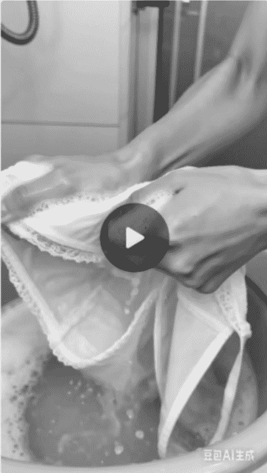

图3-2 分镜视频

###### 第四步：适配抖音特性与AI生成，优化脚本与分镜细节

脚本与分镜生成后，结合抖音平台特性与后续AI生成、剪辑特性，可以对脚本与分镜进行精细化优化，确保可落地、易生成，同时进一步提升完播率与互动率，优化核心遵循"节奏紧凑化、画面简洁化、互动明确化、生成适配化"四大原则，具体优化方向包括：

**节奏优化**：确保每个镜头的时长与抖音快节奏特点匹配，3秒钩子镜头不超过3秒，核心内容镜头每5秒一个亮点，互动引导镜头简洁有力，收尾镜头不超过5秒，避免拖沓；

**画面优化：**分镜画面需简洁，避免多余的场景元素与人物动作，核心内容与产品亮点采用特写/近景，确保用户快速捕捉核心信息；同时，所有画面均适配9：16竖屏比例，避免横屏构图裁剪问题；

**互动优化：**强化互动引导的明确性，脚本中的互动提问需贴合目标人群痛点，分镜中的互动镜头采用博主直面镜头的方式，提升与用户的互动感，同时在画面中添加互动文字，引导用户评论；

**生成优化：**避免设计过于复杂的镜头运动（如快速推拉摇移）、人物动作与场景特效，优先采用固定镜头、轻微推镜、快速切换等简单的镜头运动，确保后续AI生成（即梦）与动态化（Seedance）的效果，避免画面失真、动态生硬。

##### 3.2.3 高完播率脚本与分镜设计的注意事项

**严格把控视频总时长，贴合抖音用户完播习惯：**抖音用户的碎片化观看习惯决定了视频时长越短，完播率越高，新手创作者优先选择15～30秒的时长，避免超过60秒；若确需制作60秒以上的干货类视频，需每10秒设置一个核心亮点，同时强化前3秒钩子，确保用户愿意继续观看；脚本与分镜的时长总和需与视频总时长完全匹配，避免出现单镜头时长超标、全片时长失控的问题。

**分镜设计严格适配抖音9：16竖屏比例，避免构图问题：**抖音的核心播放形式是9：16竖屏，分镜设计需全程遵循该比例，所有镜头的构图、拍摄角度、画面细节均需适配竖屏展示，避免采用横屏构图导致的画面裁剪、核心内容缺失；同时，竖屏分镜需注重画面纵向聚焦，核心内容与产品亮点尽量放在画面中央，提升用户观看体验。

#### 3.3 成片实操：爆款视频完整生成流程

与传统视频成片制作不同，AI辅助的抖音爆款成片实操无须专业拍摄设备与后期团队，只需依托前期生成的脚本与分镜，通过精准的工具参数设置，就能快速实现"画面生成—动态化—剪辑优化"的全流程，全程兼顾效率与质量，同时贴合抖音的流量要求，确保成片能获得平台流量推荐。

##### 3.3.1 借助即梦+Seedance+剪映进行爆款视频成片实操的优势

即梦可快速生成脚本分镜所需的静态画面，无须专业拍摄；Seedance可直接将静态画面转化为动态视频片段，还原分镜要求的镜头运动与人物动作；剪映操作简单、功能齐全，内置多种抖音专属模板与AI功能，无须专业剪辑功底，借助其智能功能可快速完成镜头拼接、调色、字幕添加、互动强化，30秒视频全程仅需1小时左右即可完成，相比传统模式（数天）效率提升显著。

##### 3.3.2 爆款视频成片实操的核心步骤

我们以前文内衣清洗机的内容为例，成片的具体操作如下。

###### 第一步：用即梦制作并优化静态画面，贴合分镜要求

打开即梦，选择图片生成，根据分镜表格的画面细节描述，为每个分镜生成对应的静态画面，输入的提示词需包含画面内容、视觉风格、画幅比例、光线要求、核心亮点等关键信息，确保生成的画面与分镜要求高度匹配。示例提示词（分镜1）：

抖音9：16竖屏，清新自然真实实测风格，租房简约桌面场景，自然光光线明亮，画面中央是一位20多岁的女生穿着休闲家居服，皱眉用手搓内衣，表情疲惫，镜头快速切换到桌面中央的清新绿色小型内衣清洗机，背景无多余杂物，画面清晰细腻，突出痛点与产品存在感。

即梦接收指令后会生成图片如图3-3所示。

####### 图3-3 分镜图片

按此方式，为5个分镜分别生成静态画面，并筛选最合适的图片。将即梦生成的所有静态画面按分镜序号排序，逐一核对画面主体、人物特征、产品细节、场景元素、核心亮点与分镜描述是否一致，重点检查产品细节（内衣清洗机的外观、体积、操作按钮等）与核心亮点（体积小、清洗干净等）是否清晰呈现；若某张画面不符合要求（产品展示不清晰、人物表情不自然等），可借助即梦的局部重绘功能如图3-4所示进行优化，或补充提示词重新生成。

####### 图3-4 局部重绘功能

###### 第二步：用Seedance将静态画面转化为动态视频，还原分镜镜头运动

静态画面优化完成后，借助Seedance将其转化为贴合分镜要求的动态视频片段。

点击生成的分镜图片（以分镜1为例），选择右侧的生成视频选项，在对话框中输入提示词：

景别：近景+快速切换，时长：0～3秒，画面内容：画面中的女性皱眉用手搓内衣，表情疲惫，镜头快速切换到小巧的内衣清洗机，人物动作：博主眉头微皱，双手用力搓内衣，随后镜头切换时，博主眼神露出惊喜，并用吐槽语气说台词：再也不用手搓内衣了！谁懂啊家人们，背景音乐先响起叹气声再响起轻快背景音乐。

选择全能参考、画面比例9：16，时间选择4s，如图3-5所示。

####### 图3-5 视频生成对话框

点击发送后，会生成分镜视频，将生成的分镜视频按照顺序整理好并保存，便于后期的视频拼接剪辑。

###### 第三步：剪映导入素材，完成镜头拼接与节奏调整

动态片段导出后，打开剪映点击开始创作，如图3-6所示导入所有Seedance导出的动态片段。

####### 图3-6 素材导入

按分镜序号顺序将片段拖曳至时间轴，核对片段顺序与脚本、分镜一致；删除每个片段首尾多余的空白部分（若有），确保每个片段衔接紧密，无冗余画面；在时间轴上为每个片段标注分镜序号与核心亮点，方便后续针对性调整。如图3-7所示。

####### 图3-7 素材剪辑

###### 第四步：细节优化，统一视觉风格

我们需要补充视频的字幕，点击左上角的字幕，可以选择识别视频生成字幕也可以选择自己新建字幕，如图3-8所示。

####### 图3-8 字幕生成

###### 第五步：导出成片，适配抖音平台发布需求

细节优化完成后，进行最终全片预览，确认无误后，导出视频，如图3-9所示。

####### 图3-9 导出视频

##### 3.3.3 爆款视频成片实操的简易技巧与注意事项

**节奏优化，留住用户：**核心是抓牢3秒钩子、控制整体节奏，可在剪映中给钩子镜头加简单文字，全程每5秒突出一个小亮点，结尾3秒轻微提速，避免拖沓导致用户划走。

**画面与互动，低成本提效：**用剪映"AI画质增强"一键优化清晰度、批量统一色调，产品亮点用"局部放大"突出；互动避免生硬，结合内容简单提问，添加简洁文字贴纸引导关注、点赞。

### 第4章 自媒体矩阵视频制作实操

#### 4.1 创意构思：账号体系与内容定位设计

自媒体矩阵视频创意构思的核心是"搭建分层账号体系+精准内容定位"；核心任务是明确矩阵的整体运营诉求、各账号的分层定位与差异化方向，结合目标粉丝画像设计适配的内容体系，实现多账号协同引流、内容素材复用与粉丝精准运营。与单账号视频创意、商业广告创意不同，自媒体矩阵视频创意需额外兼顾"账号协同性与内容差异化"，每一个创意细节都需围绕"主账号立人设、子账号做垂类、全矩阵做复用"展开，例如主账号输出爆款泛内容，子账号深耕垂类干货，全矩阵共享核心素材。

##### 4.1.1 借助豆包+即梦进行自媒体矩阵视频创意构思的优势

豆包可快速接收自媒体矩阵的相关信息，例如矩阵整体定位、运营目标（涨粉、带货、引流）、核心赛道、目标粉丝画像等，拆解出主账号与子账号的分层定位、功能分工与差异化方向，避免账号定位重叠，同时结合不同垂类粉丝偏好（例如美妆主账号粉丝关注人设，底妆子账号粉丝关注产品实测），设计适配的内容方向，让矩阵账号既各有侧重又协同统一。

即梦可将文字化的账号风格与内容创意转化为初步视觉画面，验证账号风格的辨识度、内容与定位的匹配度，确保创意既贴合矩阵协同需求，又符合各账号差异化定位，同时适配Seedance后续动态化生成特性，大幅降低自媒体矩阵视频创意构思的难度与时间成本。

##### 4.1.2 自媒体矩阵视频创意构思的核心步骤

###### 第一步，明确矩阵核心诉求，拆解整体运营信息

自媒体矩阵视频创意构思的首要前提是明确自媒体矩阵的核心诉求与整体运营信息，这是后续搭建账号体系、设计内容定位的基础。创作者需先梳理矩阵的核心信息，例如整体定位、核心赛道、运营目标（涨粉、带货、品牌曝光）、目标粉丝画像（年龄、性别、消费偏好、需求痛点）、计划搭建的账号数量与层级，以及矩阵账号的核心差异化优势。我们以如下美妆账号矩阵为例，"主账号+2个子账号，整体定位平价美妆种草，目标人群为18～25岁学生党、化妆新手，核心诉求是涨粉+带货，主账号做平价美妆泛种草立人设，子账号1做底妆垂类实测测评，子账号2做眼妆简易教程"，设计提示词如下：

帮我拆解平价美妆种草自媒体矩阵的创意核心信息，矩阵整体定位平价美妆，目标人群是18～25岁学生党、化妆新手，核心诉求是涨粉+带货，计划搭建1个主账号+2个子账号的分层体系，主账号做平价美妆泛种草立人设，子账号1做底妆垂类实测测评，子账号2做眼妆简易教程。帮我提炼各账号对应的粉丝核心痛点，拆解各账号的定位、功能分工与差异化方向，明确矩阵创意的核心导向，设计"核心素材复用+垂类内容差异化"的内容框架，给出具体的各账号内容创意方向建议。

豆包根据指令生成的内容如下：

####### 平价美妆种草矩阵·创意核心拆解（1主2子）

######## 一、矩阵整体核心导向

主账号立人设引流，子账号做垂类做转化，全矩阵共享平价美妆核心素材，主打18～25岁学生党/化妆新手的高性价比美妆种草，实现"泛粉引流—垂类筛选—带货转化"的闭环。

######## 二、各账号粉丝核心痛点

- 主账号：新手美妆不知道怎么选，怕踩雷，想要一站式平价美妆种草，信任靠谱的美妆人设
- 子账号1（底妆）：新手底妆卡粉、脱妆，不会选粉底液/气垫，想要针对性实测推荐
- 子账号2（眼妆）：新手眼妆步骤复杂，手残画不好，想要3分钟简易眼妆教程，适配日常/上课场景

……

###### 第二步，适配矩阵赛道，细化各账号内容与素材复用方式

自媒体矩阵核心信息与账号体系明确后，需借助豆包，结合短视频高频赛道（美妆种草、本地生活探店、职场干货分享等），细化矩阵各账号的具体内容形式、核心素材复用规则与差异化内容设计方式，核心原则是"核心素材可复用、垂类内容差异化、矩阵账号相协同"，避免各账号内容同质化或脱节。不同矩阵赛道适配的内容形式与素材复用方式不同，需结合赛道特性灵活选择，例如美妆账号矩阵适配"人设种草+垂类实测+教程"的内容形式，本地生活账号矩阵适配"泛种草+区域探店+品类测评"的内容形式。实操中可在豆包中补充提示词，获取细化的各账号内容与素材复用方式，示例提示词（以美妆账号矩阵为例）如下：

基于平价美妆种草矩阵的广告核心信息，帮我细化矩阵各账号（主账号+底妆子账号+眼妆子账号）的内容形式与素材复用方式，适配短视频美妆种草赛道。主账号内容形式为人设化闺蜜式分享，底妆子账号为实测测评，眼妆子账号为简易教程，时长均控制在30～60秒，明确核心素材的复用范围、复用方式与各账号差异化内容的设计细节，贴合短视频快节奏特点，3秒抓睛，同时适配即梦视觉生成与Seedance动态化需求，给出具体的内容细节建议。

豆包根据指令生成的内容如下：

####### 平价美妆种草矩阵·各账号内容与素材复用细节（30～60s|适配即梦+Seedance）

####### 一、核心信息

矩阵赛道：美妆平价种草

内容形式：主账号（人设分享）、底妆子账号（实测测评）、眼妆子账号（简易教程）

核心原则：核心素材复用率≥50%，差异化内容突出各账号定位，3秒抓睛，适配AI生成与动态化

######## 二、核心素材复用规范

######### 1.复用素材范围

- 产品类：平价美妆产品开箱画面、产品瓶身/外观特写、产品质地展示（粉底液推开、眼影盘配色等）
- 通用类：新手化妆通用误区口播、粉丝互动答疑片段、矩阵账号引导口播等

######### 2.复用方式

画面复用：直接复用无字幕/无专属口播的原画面，根据各账号内容调整剪辑节奏

……

豆包生成细化的各账号内容，同时明确素材复用方式与差异化设计细节，确保矩阵各账号内容既协同统一，又各有侧重，贴合粉丝观看习惯。

###### 第三步，确定矩阵视觉风格，明确各账号视觉传达重点

自媒体矩阵的视觉传达直接影响账号辨识度、粉丝记忆点与矩阵协同性，需借助豆包，结合矩阵赛道、各账号定位与目标粉丝偏好，确定矩阵整体视觉风格与各账号差异化视觉细节，明确色彩基调、核心视觉元素与画面质感，确保"整体风格统一、各账号细节差异化、视觉元素贴合账号定位"。例如美妆账号矩阵整体适配清新自然风、高饱和度暖色调，主账号突出人设生活化元素，底妆子账号突出实测对比，眼妆子账号突出教程步骤。

###### 第四步，视觉化验证，迭代优化矩阵创意

矩阵各账号内容与视觉风格确定后，借助即梦的视觉生成能力，将文字创意转化为各账号的核心视觉画面，快速验证矩阵整体视觉风格的统一性、各账号差异化视觉细节的辨识度、内容与定位的匹配度，避免创意与实际效果脱节。操作时，在即梦中输入贴合矩阵整体风格与各账号定位的提示词（可借助豆包优化提示词精准度），为每个账号生成1～2张核心画面（例如主账号人设画面、子账号垂类内容画面），以验证视觉风格的统一性与差异化，以及AI对核心视觉元素、账号定位信息的还原效果。例如基于美妆账号矩阵的创意设定，子账号1（底妆品类）的即梦画面提示词可设置为：

写实风，暖色调（橘色+红色），自然柔光，9：16竖屏，高清2K，画面清晰细腻，突出底妆自然光泽感、通透服帖度；场景为同城美妆体验店/生活化化妆台（二选一，贴合底妆场景），木质化妆镜、暖黄色补光灯，背景有轻微的美妆体验人群/闺蜜互动模糊身影，营造热闹生动的美妆体验氛围；画面主体为底妆产品（粉底液/气垫，贴合子账号2底妆品类），瓶身质感清晰，搭配美妆蛋、化妆刷，特写美妆蛋上妆瞬间、底妆在肌肤上推开的细腻纹理，突出底妆服帖、自然透亮的妆效，贴合同城美妆底妆种草/体验广告场景，适配即梦生成特性，便于后续Seedance动态化。

输入提示词后即梦会生成如图4-1所示的图片。

####### 图4-1 即梦生成的图片

##### 4.1.3 自媒体矩阵视频创意构思的注意事项

**矩阵要素齐全，描述精准无歧义：**借助豆包梳理自媒体矩阵视频创意、撰写提示词时，需明确矩阵的核心要素，尤其是矩阵整体定位、运营目标、账号层级与数量、各账号定位与分工、视觉整体风格与差异化细节、时长、粉丝画像等关键信息，避免模糊表述。

**账号差异协同，杜绝同质化或脱节：**自媒体矩阵视频创意需避免"各账号定位重叠、内容同质化"或"各账号内容脱节、无协同性"的两大误区，借助豆包优化各账号的定位分工与内容框架，确保"整体协同统一，细节差异化"。一方面，明确各账号的功能分工与粉丝定位，避免粉丝重叠率过高；另一方面，设计可复用的核心素材框架，让各账号内容有连接点，例如所有账号均复用产品核心画面，同时添加专属垂类内容，确保矩阵账号形成流量闭环，而非各自为战。

#### 4.2 脚本与分镜设计：批量内容结构设计

自媒体矩阵视频的脚本与分镜设计，是连接矩阵视频创意与批量内容制作的核心纽带，也是确保矩阵各账号内容"标准化批量产出、风格统一、差异化突出"的关键环节。

##### 4.2.1 借助豆包+即梦+Seedance辅助自媒体矩阵视频脚本与分镜设计的优势

借助豆包辅助批量脚本撰写，搭配即梦与Seedance的AI生成特性进行可复用分镜设计，能让矩阵脚本与分镜更高效、更贴合实操需求与矩阵运营导向，大幅降低专业门槛，确保后续素材生成、动态化及剪辑环节顺畅推进，同时避免各账号脚本与分镜风格混乱、内容同质化，确保每一个镜头都围绕"矩阵协同、账号定位、粉丝需求"展开。

在分镜设计环节，创作者只需结合即梦与Seedance的生成特性，借助豆包明确矩阵整体视觉风格与可复用分镜模板，为各账号设计差异化的细节描述，就能让即梦精准还原矩阵创意与各账号定位，生成贴合需求的静态分镜画面。Seedance后续可无缝对接静态分镜，实现动态化呈现，避免复杂镜头运动、场景元素导致的生成失真、动态效果生硬等问题，确保分镜与后续批量生成环节高度适配，同时实现分镜模板的复用，大幅提升批量制作效率。

##### 4.2.2 自媒体矩阵视频脚本设计的核心步骤

**第一步，梳理矩阵创意与节奏节点，明确批量脚本设计依据**

脚本设计需立足自媒体矩阵视频创意本身，先借助豆包全面梳理自媒体矩阵的核心信息、各账号的定位分工与统一的节奏节点，为后续设计可复用脚本框架、替换差异化内容提供明确依据。重点梳理内容包括：矩阵各账号的统一视频时长、矩阵整体运营目标、各账号的核心定位、统一的节奏节点（3秒抓睛、中间内容传递、结尾矩阵引导）、人物设定（若有）、核心素材复用范围与各账号差异化内容、音效导向，确保脚本设计不偏离矩阵视频创意框架、各账号定位与矩阵运营目标。

在本案例中，矩阵各账号视频总时长均为60秒，矩阵整体运营目标是涨粉+带货，主账号定位平价美妆人设种草，底妆子账号定位底妆实测，眼妆子账号定位眼妆简易教程，统一节奏节点按"3秒抓睛—45秒内容传递—12秒矩阵引导"分配，人物设定为20岁左右亲切的美妆博主（贴合目标人群），核心素材复用范围为产品开箱、质地展示画面，各账号差异化内容为人设分享/底妆实测/眼妆教程，音效导向为清新轻快，突出美妆种草的真实感。这些内容是后续设计可复用脚本框架、替换差异化内容的关键核心。

###### 第二步，借助豆包，生成标准化可复用批量脚本模板

基于梳理好的矩阵核心信息与统一节奏节点，结合前期矩阵视频创意内容与素材复用方式，借助豆包设计标准化、可复用的批量脚本框架，明确各镜头的核心维度与固定内容，再预留差异化内容替换位，形成可直接落地的标准化批量脚本模板。示例提示词如下：

为平价美妆种草自媒体矩阵设计标准化可复用批量脚本模板，矩阵各账号视频总时长均为60秒，包含1个主账号和2个子账号（底妆实测、眼妆教程），目标人群为18～25岁学生党、化妆新手，矩阵整体运营目标是涨粉+带货，主账号定位平价美妆人设种草，底妆子账号定位底妆实测，眼妆子账号定位眼妆简易教程，核心素材复用范围为产品开箱、质地展示画面，统一节奏节点为3秒抓睛、45秒内容传递、12秒矩阵引导，视觉风格为清新自然风、高饱和度暖色调。设计可复用脚本框架，预留差异化内容替换位，生成包含镜号、景别、画面内容（固定+可替换）、时长、人物动作、台词（固定+可替换）、音效、素材复用范围、账号定位传递重点的标准脚本模板，镜头节奏与各账号定位高度同步，适配即梦+Seedance生成需求。

豆包接收指令后会生成如表4-1所示的脚本模板。

####### 表4-1 平价美妆种草矩阵·标准化可复用批量脚本模板（60秒）

| 镜号 | 景别 | 画面内容（固定+可替换） | 时长 | 人物动作 | 台词（固定+可替换） | 音效 | 素材复用范围 | 账号定位传递重点 |
|:---|:---|:---|:---|:---|:---|:---|:---|:---|
| 1 | 近景 | 固定：博主面对镜头，手持平价美妆产品 可替换：主账号（种草表情）、底妆子账号（对比表情）、眼妆子账号（教程手势） | 3s | 固定：手持产品，镜头怼脸 可替换：主账号（惊讶挑眉）、底妆子账号（皱眉指脸）、眼妆子账号（比耶手势） | 固定：宝子们！ 可替换：主账号（挖到宝了！这款平价美妆新手闭眼冲！）、底妆子账号（底妆卡粉脱妆？这款实测来了！）、眼妆子账号（手残党看过来！3分钟简易眼妆超简单！） | 轻快的背景音乐、产品拿起时的轻微声音 | 无 | 快速抓睛，传递各账号核心内容方向 |
| 2 | 特写 | 固定：产品瓶身/外观特写，缓慢转动 可替换：主账号（多款产品合集）、底妆子账号（粉底液单款）、眼妆子账号（眼影盘单款） | 5s | 固定：手指轻转产品，展示logo 可替换：无 | 固定：这款就是我一直在用的 可替换：主账号（平价美妆好物，均价50+！）、底妆子账号（平价粉底液，59.9元一瓶！）、眼妆子账号（平价眼影盘，39.9元搞定日常眼妆！） | 背景音乐持续、产品转动的轻微声音 | 产品开箱画面 | 展示产品，突出平价优势 |

……

##### 4.2.3 自媒体矩阵视频分镜设计的核心步骤

###### 第一步，借助豆包，生成标准化可复用分镜模板

基于前文生成的标准化可复用脚本模板，借助豆包将每个镜头的文字描述转化为可视化的分镜细节，明确每个镜头的固定可复用部分与差异化可替换部分，形成标准化分镜模板。分镜模板需包含镜号、景别、镜头运动、画面构图、画面描述（固定+可替换）、色彩光影、视觉焦点、账号定位传递重点8个核心维度，确保模板可适配矩阵所有账号，仅替换差异化细节即可快速生成各账号分镜，同时贴合AI生成特性，避免复杂镜头设计。结合脚本模板生成分镜模板，示例提示词（以美妆账号矩阵为例）如下：

基于平价美妆种草矩阵的标准化可复用脚本模板，帮我生成标准化可复用分镜模板，适配即梦静态画面生成与Seedance动态化需求，分镜模板包含镜号、景别、镜头运动、画面构图、画面描述（固定+可替换）、色彩光影、视觉焦点、账号定位传递重点8个维度。固定部分确保矩阵各账号风格统一，可替换部分贴合各账号定位（主账号人设种草、底妆子账号实测、眼妆子账号教程），镜头运动以简单自然为主（推、拉、固定），避免复杂运动，画面构图突出主体（产品、人物），色彩光影遵循清新自然风、高饱和度暖色调，视觉焦点贴合各账号核心内容，账号定位传递清晰，分镜细节可直接用于AI生成，同时标注各镜头的素材复用关联。

豆包接收指令后生成如表4-2所示的分镜模板。

####### 表4-2 标准化分镜模板

| 镜号 | 景别 | 镜头运动 | 画面构图 | 画面描述（固定+可替换） | 色彩光影 | 视觉焦点 | 账号定位传递重点 |
|:---:|:---:|:---:|:---|:---|:---|:---|:---|
| 1 | 近景 | 固定镜头 | 居中构图，人物占画面2/3 | 固定：博主面对镜头，手持平价美妆产品，背景为温馨化妆台，无多余杂物；可替换：主账号（博主面带惊喜微笑，眼神灵动）、底妆子账号（博主皱眉指向脸颊，示意卡粉问题）、眼妆子账号（博主比出"3"手势，示意教程时长） | 暖色调，自然光漫射，面部光线均匀，无明显阴影 | 博主面部表情+手中产品 | 快速抓睛，传递各账号核心内容方向（种草/实测/教程） |
| 2 | 特写 | 缓慢推镜 | 特写构图，产品居中，填充画面 | 固定：产品瓶身/外观特写，镜头缓慢推向产品logo，手指轻转产品；可替换：主账号（多款平价美妆产品依次特写，形成合集）、底妆子账号（单款粉底液，突出瓶身"平价"标识）、眼妆子账号（单款眼影盘，突出配色多样性） | 暖色调，侧逆光打亮产品轮廓，突出产品质感 | 产品外观+logo | 展示产品，强化平价、实用的核心卖点 |

……

###### 第二步，优化各账号差异化分镜细节，贴合账号定位

标准化可复用分镜模板生成后，需借助豆包，针对矩阵各账号的定位、粉丝痛点与AI生成特性，优化差异化分镜细节，确保各账号分镜框架统一、细节差异化、可落地、易生成。优化核心是让差异化细节更贴合账号定位，同时规避AI生成难点，确保分镜画面能精准传递各账号核心价值，具体优化方向（结合案例）如下。

- （1）主账号（平价美妆人设种草）：重点优化人物表情与场景细节，分镜中增加生活化元素（如宿舍化妆台的小摆件、博主的自然互动手势等），让镜头运动更轻盈，画面构图更具亲和力，贴合"闺蜜式分享"人设，避免过于专业的镜头语言，突出生活化、接地气的特点。

- （2）底妆子账号（底妆实测）：重点优化实测细节的镜头呈现，增加对比镜头（如卡粉与持妆效果的左右分屏、不同肤质的使用对比），镜头聚焦产品实测过程与效果细节，画面构图更简洁，避免多余场景元素，突出实测的真实性与专业性。

- （3）眼妆子账号（眼妆简易教程）：重点优化教程步骤的镜头呈现，增加步骤标识（如画面角落的"步骤1/2"文字提示），镜头聚焦眼部操作特写，动作镜头清晰、缓慢，贴合新手模仿需求，确保教程步骤直观可懂。示例提示词如下：

基于平价美妆种草矩阵的标准化可复用分镜模板，优化各账号差异化分镜细节：主账号突出闺蜜式人设，增加宿舍场景生活化元素，人物表情更亲切自然，镜头运动轻盈；底妆子账号增加左右分屏对比镜头（卡粉 vs 持妆），突出实测细节，画面简洁无多余杂物；眼妆子账号增加教程步骤标识，眼部操作镜头特写更清晰，动作缓慢方便新手模仿。所有优化需贴合即梦+Seedance生成特性，避免复杂镜头，确保分镜可批量落地，同时强化各账号定位传递。

###### 第三步，结合即梦验证分镜可落地性，迭代优化

分镜细节优化完成后，需借助即梦验证分镜的可落地性，将分镜描述转化为静态画面，检验分镜设计是否符合矩阵整体视觉风格、各账号差异化定位，以及AI生成的还原度，避免分镜设计与实际生成效果脱节。操作逻辑与创意构思阶段的视觉验证一致，重点验证3个核心维度：矩阵整体视觉风格的统一性、各账号差异化细节的辨识度、分镜镜头的可生成性。针对每个账号的核心镜头（如镜号1的抓睛镜头、镜号4的核心内容镜头），将分镜描述转化为即梦提示词，生成静态画面。以下为眼妆子账号镜号4的即梦提示词：

清新自然风，高饱和度暖色调，9:16竖屏，高清2K，自然光漫射，画面明亮柔和；场景为温馨宿舍化妆台，背景有简单小摆件，无多余杂物；画面主体为博主眼部特写，眼影刷正在晕染眼影，动作缓慢清晰，画面角落有"步骤1：铺底色"白色文字提示，眼影显色度适中，贴合新手教程定位，适配即梦生成特性，便于后续Seedance动态化。

即梦接收指令后生成的图片如图4-2所示。

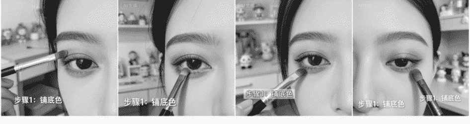

图4-2 眼妆子账号镜号4的分镜画面

若生成的静态画面与分镜预期不符（如镜头焦点偏差、差异化细节未体现、视觉风格不统一），可借助豆包调整分镜细节与即梦提示词，例如优化镜头构图、补充场景细节、调整光影描述，通过多次迭代，确保分镜设计可精准落地，同时为后续批量动态化与剪辑环节奠定基础。

##### 4.2.4 自媒体矩阵视频脚本与分镜设计的注意事项

**分镜模板复用性优先，避免个性化过度：** 矩阵视频批量制作的核心需求是高效复用，脚本与分镜设计需优先保证框架可复用、细节可替换，避免为每个账号设计完全独立的脚本与分镜模板，否则会失去批量制作的优势，增加时间与人力成本。借助豆包设计模板时，需明确固定复用部分与可替换差异化部分，固定部分占比不低于60%，差异化部分仅聚焦账号定位相关的细节（如人设、实测、教程），确保模板可适配矩阵所有账号，仅需简单替换即可快速生成。

**适配AI生成特性，规避生成难点：** 脚本与分镜设计需充分考虑即梦与Seedance的生成局限，借助豆包优化细节，避免设计过于复杂的镜头运动（如快速摇镜、复杂运镜组合）、场景元素（如复杂群像、杂乱背景）与人物动作（如高难度手势），否则会导致AI生成画面失真、动态效果生硬，增加后续修改成本。镜头运动以固定、缓慢推拉、简单跟拍为主，场景元素简洁聚焦，人物动作自然简单，确保分镜可快速批量生成。

#### 4.3 成片实操：自媒体矩阵视频批量生成流程

自媒体矩阵视频成片制作的核心是批量高效生成、风格统一可控、差异化精准落地；核心逻辑是借助豆包、即梦、Seedance、剪映四大工具的协同，将前期的创意构思、脚本分镜转化为可直接发布的矩阵视频，全程围绕"批量复用、高效落地"展开，重点解决矩阵视频"制作效率低、风格不统一、差异化难把控、素材复用率低"的核心痛点。

##### 4.3.1 借助豆包+即梦+Seedance+剪映实现自媒体矩阵视频批量成片的优势

即梦可根据分镜模板，批量生成矩阵各账号的静态素材（无须人工拍摄）；Seedance可对接即梦素材，批量完成动态化处理（如添加镜头过渡、动态文字、简单动画等）；剪映的批量剪辑功能可复用剪辑模板，快速完成多账号视频的剪辑、字幕与音效添加，大幅缩短成片制作时间，实现"一次设计，批量产出"，相较于人工制作，效率提升80%以上。

##### 4.3.2 自媒体矩阵视频批量成片的核心步骤

以下结合美妆账号矩阵案例，讲解实操步骤，其他赛道可参考复用。

###### 第一步：静态素材批量生成

借助豆包，将各账号的分镜模板（每个镜头的画面描述、色彩光影、视觉焦点）转化为即梦可识别的精准提示词，按账号分类整理，每个镜头对应1条提示词，确保提示词包含矩阵整体视觉风格、账号差异化细节、分镜核心要求，避免模糊表述。示例提示词如下（以底妆子账号镜号3为例）：

豆包帮我将底妆子账号镜号3的分镜描述转化为即梦提示词，要求包含：清新自然风、高饱和度暖色调、9:16竖屏、高清2K、顶光打亮手部与产品质地，特写构图、手指蘸取粉底液推开、左右手对比干皮/油皮推开效果，画面简洁无多余杂物，突出粉底液细腻无结块的特点，适配即梦生成特性，确保生成画面与分镜描述一致。

输入提示词后豆包生成的即梦提示词如下：

清新自然风，高饱和度暖色调（橘色+红色为主），9:16竖屏，高清2K，画面清晰细腻无噪点，特写构图，画面简洁无多余杂物；顶光均匀打亮手部与粉底液质地，光线柔和不刺眼，突出质地通透感；镜头聚焦双手，左手（干皮肤质）、右手（油皮肤质）分别蘸取粉底液，手指轻轻推开，清晰呈现干皮推开后水润服帖、油皮推开后清爽不黏腻的对比效果，重点突出粉底液细腻丝滑、无结块、易推开的特点，适配即梦生成特性，确保生成画面与分镜描述完全一致，可直接用于Seedance动态化制作。

打开即梦的无限画布，输入提示词生成各账号所有镜头的静态素材。生成完成后，按账号、镜号分类保存，便于后续调用。如图4-3所示为底妆子账号镜号3的分镜画面。

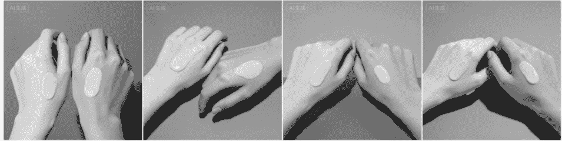

图4-3 底妆子账号镜号3的分镜画面

对照分镜模板，校验各账号静态素材的风格统一性、差异化细节准确性（如底妆子账号的对比镜头、眼妆子账号的步骤标识）。若出现素材与分镜要求不符（如视觉焦点偏差、风格不一致等），可借助豆包调整提示词，重新生成对应素材，确保所有静态素材均符合分镜要求。

###### 第二步：生成动态视频片段

将即梦生成的静态素材通过图片视频生成转化为动态视频片段，以贴合脚本节奏与账号定位，同时确保矩阵各账号的动态效果风格统一。打开无限画布里生成的图片，如图4-4所示。

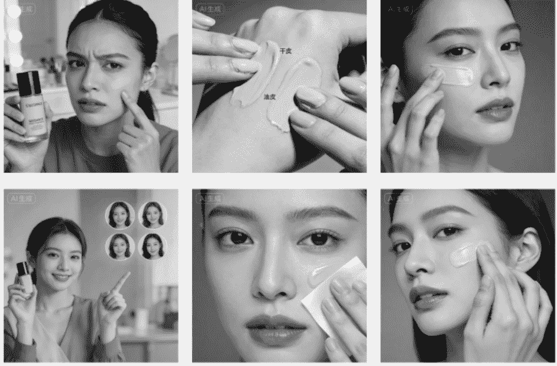

图4-4 无限画布里生成的图片

将我们所需的画面按照分镜排序在一起，点击图片选择生成视频，并且把生成的视频按账号、镜号分类下载保存。

###### 第三步：剪辑优化

打开剪映，点击"开始创作"按钮，按脚本逻辑导入分镜视频进行视频拼接，如图4-5所示。

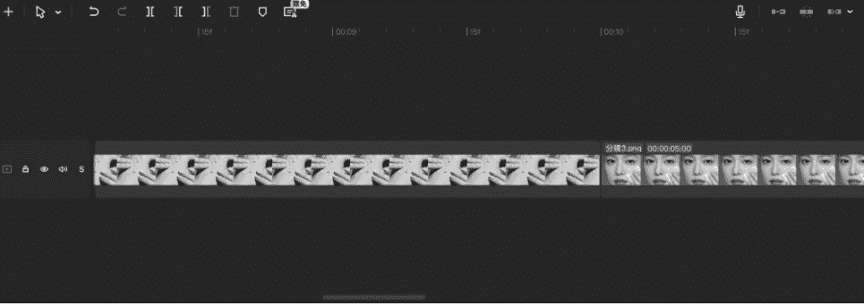

图4-5 视频拼接

在视频编辑的过程中，我们可以在剪映界面的左上角选择音乐、贴纸、转场、字幕等功能（见图4-6），为视频添加背景音乐音效、字幕等，增加视频的吸引力。

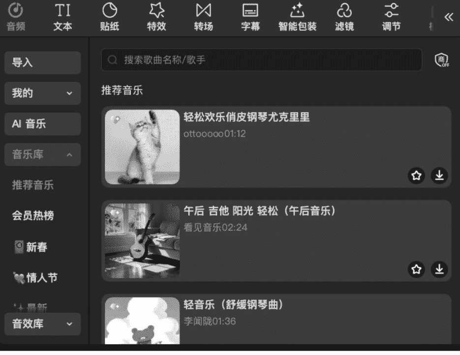

图4-6 剪映的剪辑功能

###### 第四步：成片导出与素材归档

通过视频预览（见图4-7）对剪辑后的视频进行审核，检查画面清晰度、声音流畅度、字幕同步性、动态效果自然度等，确保成片无卡顿、无错误，符合短视频平台发布要求，同时对照前期创意与脚本，确认成片精准传递各账号定位与矩阵协同理念。测试通过后，导出视频用于矩阵账号发布。

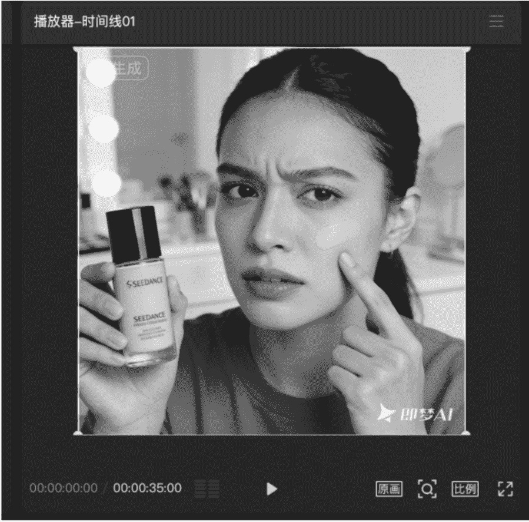

图4-7 视频预览

##### 4.3.3 自媒体矩阵视频批量成片的注意事项

**统一参数标准，确保风格一致：** 即梦生成、Seedance动态化、剪映剪辑与导出的参数需全程统一，包括画面分辨率（2K）、比例（9:16）、帧率（30fps）、色彩参数（色调、亮度、对比度）、字幕样式（字体、颜色、位置）、音效音量等，避免因参数不统一导致各账号成片风格混乱，影响矩阵辨识度。借助豆包整理参数清单，全程对照执行。

**差异化细节把控，避免同质化：** 在批量制作过程中，需重点把控各账号的差异化细节，避免"换汤不换药"（仅替换产品，未体现账号定位差异）。每个环节均需对照各账号定位，检查差异化细节是否落地（如底妆子账号的实测对比、眼妆子账号的教程步骤），可借助豆包逐一校验，确保各账号成片有明确的差异化，能精准吸引对应垂类的粉丝。

### 第5章 产品展示视频制作实操

#### 5.1 创意构思：产品核心卖点视觉化表达

产品展示视频创意构思的核心是"产品核心卖点的精准视觉化呈现"；核心任务是明确产品的核心功能、差异化优势、使用场景，将产品的细节特征、功能效果、使用价值通过有层次、有质感的视觉形式展现出来，让观众直观感知产品价值。与商业广告创意不同，产品展示视频无需兼顾转化效果与价值导向，核心聚焦"产品本身"，摒弃冗余的剧情与营销信息，每一个创意细节都围绕"清晰展示产品、突出核心卖点、传递产品质感"展开。

##### 5.1.1 借助豆包+即梦进行产品展示创意构思的优势

豆包可快速接收产品相关信息，例如产品材质、核心功能、差异化优势、外观设计、使用场景等，拆解出用户最关注的核心卖点，避免卖点堆砌，同时结合产品属性梳理展示优先级（例如实用型产品优先展示功能，颜值型产品优先展示外观设计），优化卖点的视觉化呈现顺序，让创意更贴合产品展示的核心需求。

即梦可将文字化的卖点创意转化为初步视觉画面，验证卖点展示的清晰度、产品细节的还原度与视觉风格的适配性，确保创意既贴合产品特征，又符合短视频传播逻辑，同时适配Seedance后续动态化生成特性，大幅降低产品展示视频创意构思的难度与时间成本。

##### 5.1.2 产品展示视频创意构思的核心步骤

###### 第一步，明确核心诉求，拆解产品核心信息

产品展示视频创意构思的首要前提是明确产品展示的核心诉求与核心信息，这是后续所有创意环节的基础。创作者需要先梳理产品的核心信息，例如产品品类、核心材质、功能优势、外观设计、使用场景，以及产品展示的核心导向（例如侧重功能展示、侧重外观展示、侧重使用场景展示）。借助豆包，输入相关信息，可以获取精准的需求拆解与核心信息提炼。我们以便携保温杯为例，展示具体操作，示例提示词如下：

帮我拆解一款便携保温杯的产品展示视频创意核心信息，产品材质为316医用不锈钢，核心卖点是长效保温12小时、350ml小巧便携、马卡龙色系高颜值，使用场景以通勤、户外、学生党日常为主，核心展示导向是兼顾功能与外观。帮我提炼用户关注的核心卖点并排序，明确产品展示的核心导向，贴合短视频产品展示赛道，突出产品细节与使用场景，给出具体的创意方向和建议。

豆包根据指令生成的内容如下：

####### 350ml便携保温杯：产品展示视频创意核心拆解

######## 一、核心卖点优先级（产品展示逻辑）

第一优先级：316医用不锈钢材质+12小时长效保温（核心功能，产品核心价值）

第二优先级：350ml小巧便携（使用属性，贴合核心使用场景）

第三优先级：马卡龙色系高颜值（外观优势，提升视觉吸引力）

……

###### 第二步，适配短视频赛道，细化创意内容与展示形式

核心信息明确后，需借助豆包，结合短视频产品展示的高频形式（细节特写、功能实测、场景化演示），细化创意内容，确定具体的展示形式与产品细节呈现方式，核心原则是"产品展示层次化、细节呈现精准化、视觉形式多样化"，避免产品信息的杂乱堆砌。不同品类产品适配的展示形式不同，需结合产品特性灵活选择。可以在豆包中补充提示词，获取细化的创意内容与展示形式，示例提示词（以便携保温杯场景为例）如下：

基于便携保温杯的产品展示视频创意核心信息，帮我细化创意内容与展示形式，适配短视频产品展示的细节特写+功能实测形式，时长控制在30～60秒，重点突出316不锈钢材质、12小时长效保温、350ml便携卖点，融入通勤、户外使用场景，明确创意的开头（产品特写）、中间（功能实测）、结尾（场景化演示）核心内容，贴合短视频快节奏特点，3秒抓睛，同时适配即梦视觉生成与Seedance动态化需求，给出具体的内容细节建议。

豆包根据指令生成的内容如下：

####### 便携保温杯·产品展示短视频创意（30～60s|适配即梦+Seedance）

####### 一、核心信息

卖点：316不锈钢、12小时长效保温、350ml便携

展示形式：细节特写+功能实测+轻场景化演示

风格：简约质感、真实客观、高清晰度，突出产品细节与质感

####### 二、3秒抓睛开头

画面：微距镜头特写马卡龙色系杯身，光影下展示细腻的漆面质感，镜头快速聚焦杯身316不锈钢标识

字幕（简洁）：316不锈钢便携保温杯，颜值与实力并存！

……

###### 第三步，确定视觉风格，明确视觉传达重点

产品展示视频的视觉传达直接影响产品细节的呈现效果与观众的感知体验。借助豆包，结合产品品类、外观设计、核心卖点与展示导向，可以确定核心视觉风格、色彩基调与核心视觉元素，确保"视觉风格贴合产品属性、视觉元素突出产品细节与核心卖点"。获取针对性的视觉风格建议，示例提示词（以便携保温杯场景为例）如下：

基于便携保温杯的产品展示视频创意内容，帮我确定产品展示的视觉风格与色彩基调，明确核心视觉元素、画面质感与光影效果，适配短视频产品展示的沉浸式体验形式，突出产品的细节设计与功能体验，画面质感高清细腻，同时适配即梦静态画面生成与Seedance动态化特性，方便后续生成视觉素材，给出具体的视觉细节建议。

豆包根据指令生成的内容如下：

####### 便携保温杯短视频视觉细节建议（适配即梦+Seedance）

######## 一、核心视觉风格定位

整体视觉风格：简约高级、真实客观、高清细腻，以"产品本身为核心"，拒绝冗余装饰，适配30～60s短视频的快节奏与沉浸式体验，兼顾即梦静态画面的质感呈现与Seedance动态画面的流畅度，让观众通过视觉直观感知产品的细节设计与功能价值，不刻意主观夸赞，突出"真实可感"的产品特质。

……

###### 第四步，视觉化验证，迭代优化创意

创意内容与视觉风格确定后，借助即梦的视觉生成能力，将文字创意转化为初步视觉画面，快速验证产品细节的还原度、卖点展示的清晰度与视觉风格的适配性，避免创意与实际效果脱节。在即梦中输入贴合创意内容、视觉风格的提示词，生成核心画面（例如产品细节特写画面、功能实测画面、场景化展示画面），验证视觉风格与创意的匹配度，以及AI对产品特征、细节元素的还原效果。例如输入提示词：

16:9竖屏，高清2K，画面清晰细腻，微距镜头特写马卡龙色系便携保温杯，细腻光滑的烤漆漆面在柔光下呈现高级质感，杯身清晰凸显316不锈钢金属标识。极简纯白干净背景，高清商业产品摄影，细节锐利，简约轻奢质感，明亮柔和色调，无多余杂物，短视频封面级特写。

即梦收到提示词后会生成如图5-1所示的图片。

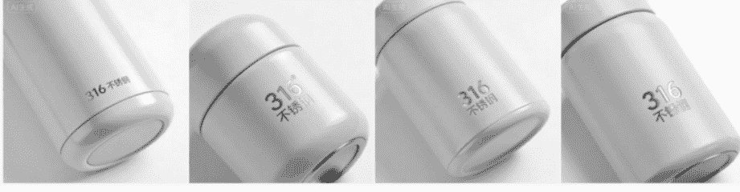

图5-1 便携保温杯图片（即梦生成）

##### 5.1.3 产品展示视频创意构思的注意事项

**核心要素齐全，描述精准无歧义：** 借助豆包梳理创意、撰写提示词时，需明确包含产品展示的核心要素，尤其是产品品类、核心卖点、展示导向、视觉风格、时长、展示形式等关键信息，避免模糊表述。例如需明确"便携保温杯产品展示，30～60秒，简约清新风，核心卖点是316不锈钢、12小时保温，展示形式为细节特写+功能实测"，而非笼统描述"保温杯视频，时长适中，画面好看"；明确"目标展示导向是功能+外观，使用场景为通勤、户外"，而非"展示保温杯的优点，适合日常使用"，确保AI精准捕捉需求，避免生成内容与预期偏差。

#### 5.2 脚本与分镜设计：产品展示镜头结构

产品展示视频的脚本与分镜设计，是连接产品展示视频创意与成片制作的核心纽带，也是确保视频内容精准展示产品细节、突出核心卖点、贴合视觉风格的关键环节。

##### 5.2.1 借助豆包+即梦+Seedance辅助产品展示视频脚本与分镜设计的优势

豆包可快速完成创意内容的细化、镜头拆解，创作者只需结合即梦与Seedance的生成特性，借助豆包明确画面构图、景别、镜头运动、光影效果与时长，就能让即梦精准还原产品展示视频创意与产品细节，生成贴合需求的静态分镜画面；Seedance后续可无缝对接静态分镜，实现动态化呈现，避免复杂镜头运动、场景元素导致的生成失真、动态效果生硬等问题，确保分镜与后续生成环节高度适配。

##### 5.2.2 产品展示视频脚本与分镜设计的核心步骤

产品展示视频脚本与分镜设计的核心是产品细节精准呈现、镜头节奏有层次、卖点展示逻辑清晰。本小节结合便携保温杯的产品展示视频创意框架，生成脚本的具体步骤如下，其他产品可参考此逻辑推进。

###### 第一步，梳理创意与节奏节点，明确脚本设计依据

脚本设计需立足产品展示视频创意本身，因此要借助豆包全面梳理产品的核心信息与镜头节奏节点，为后续镜头拆解与脚本撰写提供明确依据。

#### 第二步，借助豆包，拆解镜头维度并生成分镜内容基于梳理好的核心信息与镜头节奏节点，结合前期产品展示视频创意的内容与展示形式，借助豆包将整个视频拆解为若干个独立镜头，每个镜头均明确核心维度，形成可直接落地的标准化产品展示视频脚本。核心维度需包含镜号、景别、画面内容、时长、展示动作、音效、卖点/细节展示重点，确保每个镜头都能与创意内容、产品属性精准适配，贴合 AI 生成特性与短视频快节奏特点。示例提示词如下：

为便携保温杯的产品展示短视频设计标准化脚本，该视频总时长60秒，核心卖点是316不锈钢、12小时长效保温、350ml便携、马卡龙色系高颜值，核心展示导向是功能+外观，展示形式为细节特写+功能实测+轻场景化演示，节奏节点为3秒抓睛、47秒核心展示、10秒结尾场景展示，视觉风格为简约清新风、明亮柔和色调。生成包含镜号、景别、画面内容、时长、展示动作、音效、卖点/细节展示重点的标准脚本表格，镜头节奏与产品展示逻辑高度同步，适配即梦+Seedance 生成需求，展示动作贴合产品实际操作，卖点/细节展示清晰。

豆包接收指令后会生成标准化脚本表格，清晰呈现各镜头的详细信息，同时优化展示动作与音效设计，确保脚本内容贴合产品实际，卖点/细节展示精准，示例如表5-1所示。

####### 表5-1 便携保温杯产品展示短视频标准化脚本

| 镜号 | 景别 | 画面内容 | 时长 | 展示动作 | 音效 | 卖点/细节展示重点 |
|------|------|----------|------|----------|------|-------------------|
| 1 | 微距特写 | 马卡龙色系杯身漆面，光影下的细腻质感，快速聚焦316不锈钢标识 | 3s | 镜头微距对焦杯身，缓慢移动至杯身标识处 | 轻柔纯音乐响起、镜头轻微移动的轻音效 | 马卡龙色系高颜值、316不锈钢材质（初显） |
| 2 | 特写 | 杯口密封胶圈，杯盖旋紧结构，杯底防滑垫 | 7s | 镜头依次对焦杯口、杯盖、杯底，手指轻触密封胶圈展示弹性 | 纯音乐持续、手指轻触的轻音效 | 密封防漏设计、产品细节质感 |
| 3 | 近景 | 手掌托举保温杯，对比手掌大小，放入随身帆布包 | 8s | 手持保温杯展示尺寸，将保温杯放入帆布包中，轻晃包身展示不晃动 | 纯音乐持续、放取保温杯的轻音乐 | 350ml小巧便携 |

……

##### 5.2.3 产品展示视频脚本与分镜设计的注意事项

**镜头节奏贴合产品展示逻辑，杜绝混乱：** 脚本与分镜设计的核心是让画面服务于产品细节展示与核心卖点传递，需确保镜头的切换节奏、时长分配与产品展示逻辑的精准匹配。

**视觉风格与细节保持统一，杜绝前后偏差：** 脚本与分镜设计需严格遵循创意构思阶段确定的视觉风格、色彩基调、核心视觉元素、产品展示角度，在豆包提示词与分镜画面描述中需反复明确这些信息，避免出现前后偏差。例如便携保温杯的所有分镜需保持简约清新风、明亮柔和自然光色调；产品展示的角度需统一，避免同一产品在不同分镜中出现展示角度差异过大的情况；产品的细节特征（如标识、设计）需在各分镜中保持一致，减少后续修改工作量。

#### 5.3 成片实操：产品展示视频完整生成流程

产品展示视频的成片制作是创意落地、实现产品精准展示的最后一个关键环节，与传统产品视频成片制作不同，AI辅助成片制作无需专业拍摄与后期团队，只需依托前期生成的静态分镜画面，通过精准参数设置，就能快速实现动态化与剪辑优化，全程兼顾效率与质量，同时贴合产品展示需求，确保视频内容能有效展示产品细节、传递产品质感、突出核心卖点。

##### 5.3.1 借助即梦+Seedance+剪映进行产品展示视频成片制作的优势

Seedance可直接将即梦生成的静态分镜画面转化为动态视频，无需专业拍摄环节，单人即可完成。剪映操作简单、功能齐全，内置多种短视频剪辑工具，无需专业剪辑功底。借助其智能功能，可快速完成镜头拼接、调色、字幕添加、产品细节强化等工作，大幅缩短成片制作周期，60秒产品展示视频全程仅需1～2小时即可完成，相比传统模式（数天）效率提升显著。

##### 5.3.2 产品展示视频成片制作的核心步骤

结合前文便携保温杯场景素材（60秒），产品展示视频成片制作的具体步骤如下。

**第一步，静态画面制作和优化**

成片制作的首要任务是制作和优化静态分镜画面，确保所有画面风格统一、细节达标、产品主体突出，为后续动态化生成奠定基础。将即梦生成的所有静态分镜画面按镜号排序，逐一核对画面主体、产品细节、场景元素与分镜描述是否一致，重点检查产品细节（保温杯的316标识、密封胶圈、杯底防滑垫等）、场景元素（简约桌面、无多余杂物）、色彩光影（明亮柔和自然光）是否达标。若出现产品细节模糊（标识不清晰）、画面色调偏差、背景杂乱等问题，需借助即梦重新生成该画面，补充精准提示词（例如"优化316不锈钢标识清晰度，保持明亮柔和自然光色调，背景纯白色无杂物，突出杯身漆面质感"），确保每一张静态画面都能精准传递产品细节与质感，便携保温杯画面合集如图5-2所示。

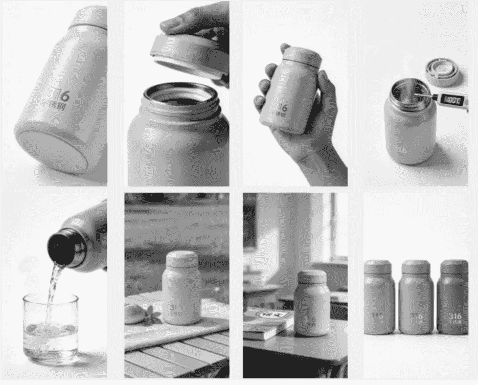

图5-2 便携保温杯画面合集

**第二步，静态画面转动态**

静态画面优化完成后，借助Seedance将所有分镜对应的静态画面，转化为符合分镜要求的动态片段，核心是还原分镜设定的镜头运动、展示动作，强化产品细节的动态呈现，确保动态效果自然、贴合产品展示需求，无需额外添加复杂特效，聚焦产品本身的动态展示。

在即梦中选择图片后点击"生成视频"按钮，如图5-3所示，即可生成动态片段。我们对生成片段进行预览，重点检查镜头运动是否流畅、动态时长是否与分镜要求一致、产品细节是否清晰、动态效果是否贴合产品操作。若出现动态生硬、镜头运动过快/过慢、产品细节模糊等问题，需进一步优化，直至所有动态片段符合分镜要求与产品展示导向。

图5-3 "生成视频"界面

**第三步，镜头拼接与节奏调整：剪映实操**

动态片段生成后，将所有片段导入剪映，以进行镜头拼接、节奏调整与转场设置，核心是确保镜头衔接流畅、节奏贴合脚本设定，突出产品展示的层次化，避免出现镜头突兀、节奏混乱的问题。

打开剪映开始创作，将生成的分镜片段全部导入剪映，如图5-4所示。

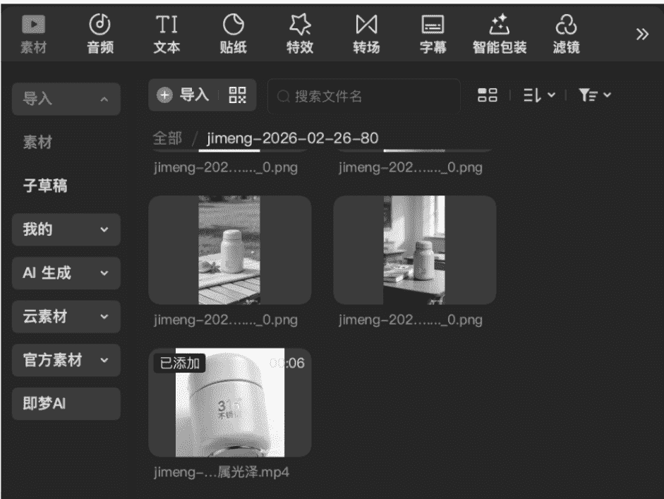

图5-4 "导入素材"界面

分镜片段导入后，按镜号顺序导入 timeline 轨道，确保片段顺序与脚本一致，如图5-5所示。

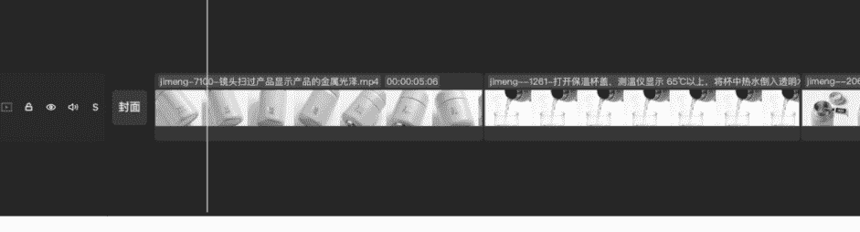

图5-5 拼接分镜片段

结合分镜要求与产品展示节奏，为每个镜头衔接处添加简单的转场效果，如图5-6所示。

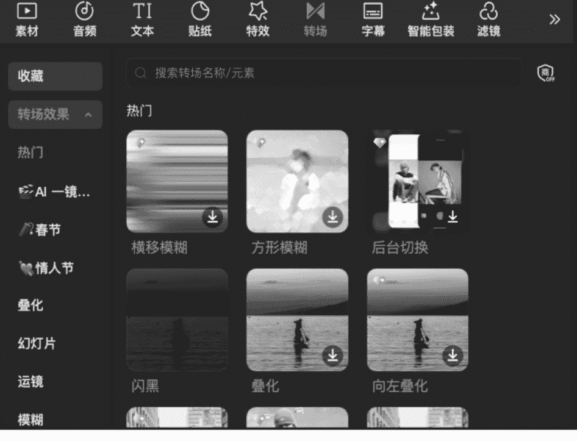

图5-6 添加转场效果

**第四步，音画适配：音效与背景音乐添加**

音画适配是提升产品展示视频质感的关键，核心是选择贴合产品风格、节奏的背景音乐与音效，确保音效与画面精准同步，背景音乐不抢戏，突出产品展示的真实感与沉浸感。点击界面左上角的"音频"按钮，进入后可以在音乐库或音效库中选择我们需要的音频添加到视频中，如图5-7所示，也可以通过导入功能使用我们已经准备好的音乐。

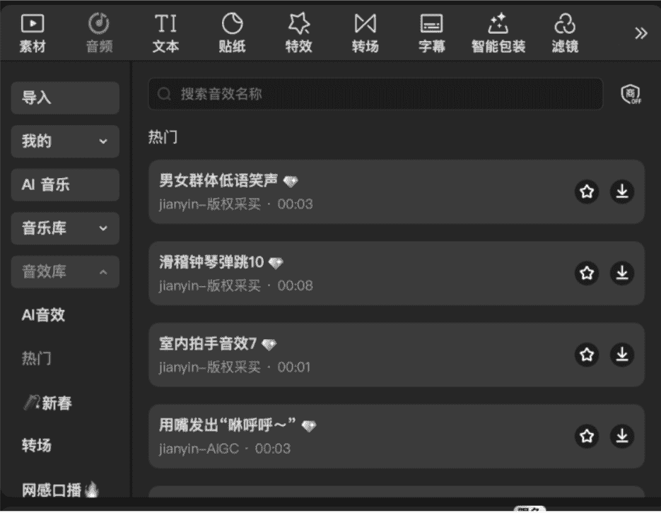

图5-7 添加音效

**第五步，细节优化，提升成片质感**

细节优化是确保成片效果达标的关键，需全面排查视频中的瑕疵，优化画面、音画、字幕等细节，确保成片贴合创意、脚本与分镜设定。细节优化完成后，即可导出成片，导出参数需适配短视频平台（如抖音、视频号）尺寸，确保成片清晰度高。

##### 5.3.3 产品展示视频成片制作的进阶技巧

**始终聚焦产品主体，避免冗余元素：** 全程确保画面、动态效果、字幕、音效都围绕"产品展示"展开，避免添加多余的特效、场景元素、字幕，防止干扰产品主体；背景尽量简约（如纯白色、浅灰色），确保观众的注意力聚焦在产品细节与核心卖点上，这是产品展示视频的核心原则。

**产品细节展示优先，杜绝模糊失真：** 无论是静态画面优化、动态化生成，还是剪辑优化，都需优先确保产品细节清晰（如材质标识、工艺设计、功能效果），避免出现细节模糊、失真的情况；若出现细节模糊，需及时通过即梦重新生成、剪映锐化等方式优化，确保产品细节精准呈现，让观众直观感知产品质感。

# 第三部分 影视内容制作实操

## 第6章 电影级大片场景制作实操

如今，借助Seedance 的 AI 生成与动态化优势，搭配豆包的创意拆解、细节优化能力及剪映的剪辑适配功能，这一核心痛点得到根本性解决，大幅降低了好莱坞级大片场景的制作门槛与成本。创作者可通过豆包快速拆解好莱坞大片场景逻辑、优化场景细节描述，结合其智能分析能力，预判场景与 AI 生成、视频传播场景的适配性；同时搭配Seedance的视觉化生成能力，将场景构思转化为初步视觉画面，即时验证落地效果，避免场景构思与实际制作脱节。此外，可根据豆包的智能建议与 AI 生成的视觉反馈，灵活调整场景设计思路，精准把控场景光影、元素搭配、氛围营造等核心要素，大幅提升场景落地效率，让普通创作者无需专业团队加持，也能快速完成高质量的好莱坞级大片场景制作。

### 6.1 创意构思：电影级场景设计方法

好莱坞级大片的大场面场景（战争、灾难等），核心是通过震撼的视觉效果、逼真的场景细节与紧张的氛围营造，传递场景的冲击力与感染力，抓住用户注意力。这类场景的制作重点是还原场景的真实感、突出场面的宏大性，同时兼顾细节的细腻度，避免出现场景杂乱、元素失真、氛围不足等问题。

#### 6.1.1 借助Seedance+豆包进行电影级场景创意构思的优势

借助Seedance的AI场景生成能力，搭配豆包的场景拆解、提示词优化功能，可快速解决大场面场景"制作难度高、还原度低、氛围不足"的核心痛点。豆包可辅助拆解场景核心元素、提炼关键细节、优化提示词，确保场景生成精准贴合预期；Seedance可将文字描述转化为高质感场景画面，同时实现动态化呈现，还原大场面的震撼效果，大幅缩短制作时间，让普通创作者也能快速打造好莱坞级大场面场景。

#### 6.1.2 电影级场景创意构思实操步骤

**第一步，明确场景核心需求，拆解关键元素**

大场面场景生成的首要前提是明确场景的核心需求与关键元素，这是后续提示词优化、场景生成的基础。创作者需先梳理场景的核心信息，例如场景类型（战争、灾难）、场景主题（例如战争场景的"阵地攻防战"，灾难场景的"地震废墟救援"）、核心氛围（紧张激烈、压抑绝望、震撼磅礴）、关键元素（人物、武器、环境、特效），以及场景的视觉风格（好莱坞级写实风格、高清质感、光影鲜明），确保场景构思清晰、重点突出，贴合好莱坞级大片的质感要求。实操中可借助豆包，输入相关信息，获取精准的场景拆解与核心细节提炼，以下分两个高频场景呈现具体示例，确保提示词具体可落地，规避笼统表述。

**场景1：战争场景**（阵地攻防战，好莱坞写实风格，目标受众18～40岁，核心需求是呈现战争的紧张激烈与震撼感，核心元素包括士兵、步枪、手榴弹、战壕、爆炸火光、烟尘、残破的旗帜等，核心氛围是紧张、激烈、悲壮，重点突出爆炸效果与士兵的作战状态，画面要求高清、光影鲜明，贴合好莱坞战争大片质感），提示词如下：

帮我拆解好莱坞级战争阵地攻防战场景的核心需求与关键元素，明确场景类型为战争场景，主题为阵地攻防战，视觉风格为好莱坞写实风格，目标受众是18～40岁，核心需求是呈现战争的紧张激烈与震撼感，核心氛围是紧张、激烈、悲壮。帮我提炼能体现场景质感的关键元素，包括人物（身着迷彩服的士兵，有的冲锋、有的隐蔽射击、有的受伤倒地，表情坚毅或痛苦）、武器（步枪、手榴弹、迫击炮）、环境（残破的战壕、布满弹孔的墙壁、散落的弹壳、残破的军旗）、特效（爆炸火光、黑色烟尘、子弹轨迹、飞溅的泥土），重点突出爆炸效果的逼真感与士兵的作战状态。帮我明确场景的视觉标准，包括画面分辨率、光影效果、色彩基调等，为后续Seedance生成场景画面提供精准指引，优化细节描述，让场景画面与好莱坞战争大片质感高度匹配，避免元素失真与场景杂乱。

豆包根据指令生成内容如下：

###### 好莱坞级战争阵地攻防战场景核心拆解（适配 Seedance生成）

####### 一、核心基础信息

场景类型：战争场景（阵地攻防战）

视觉风格：好莱坞写实风格（无夸张特效，重细节逼真度）

目标受众：18～40岁

核心需求：呈现战争紧张激烈与震撼感

核心氛围：紧张、激烈、悲壮

####### 二、核心关键元素（贴合质感，避免杂乱）

……

**场景 2：灾难场景**（地震废墟救援，好莱坞写实风格，目标受众18～40岁，核心需求是呈现地震后的荒芜与救援的希望，核心元素包括废墟、救援人员、被困者、救援设备、烟尘、破碎的建筑等，核心氛围是压抑、绝望中带着希望，重点突出废墟的真实感与救援人员的忙碌状态，画面要求高清、光影柔和，贴合好莱坞灾难大片质感），提示词如下：

帮我拆解好莱坞级地震废墟救援场景的核心需求与关键元素，明确场景类型为灾难场景，主题为地震废墟救援，视觉风格为好莱坞写实风格，目标受众是18～40岁，核心需求是呈现地震后的荒芜与救援的希望，核心氛围是压抑、绝望中带着希望。帮我提炼能体现场景质感的关键元素，包括环境（倒塌的高楼废墟、断裂的道路、散落的建筑碎片、扭曲的钢筋）、人物（身着救援服的救援人员，有的挖掘废墟、有的抬运伤员、有的呼喊被困者，表情焦急坚定；被困在废墟中的人，露出手臂或头部，表情痛苦无助）、设备（救援挖掘机、液压钳、急救担架、手电筒）、特效（弥漫的烟尘、轻微的余震晃动、手电筒的光束），重点突出废墟的真实感与救援人员的忙碌状态。帮我明确场景的视觉标准，包括画面分辨率、光影效果、色彩基调等，为后续Seedance生成场景画面提供精准指引，细化细节描述，让场景画面与好莱坞灾难大片质感高度匹配，突出压抑中带着希望的核心氛围。

豆包根据指令生成内容如下：

###### 好莱坞级地震废墟救援场景 核心拆解（适配Seedance生成）

####### 一、核心基础信息

场景类型：灾难场景

主题：地震废墟救援

视觉风格：好莱坞写实风格（重真实质感、强画面张力）

目标受众：18～40岁

核心需求：呈现废墟荒芜感与救援希望感

####### 二、关键元素（突出质感，适配画面生成）

######## 1.环境（重真实感）

……

豆包接收指令后，从场景拆解、关键元素、视觉标准、氛围营造四个维度给出精准建议，例如战争场景会明确"优先突出爆炸火光的层次感、士兵作战动作的逼真感，色彩基调以深灰色、土黄色为主，搭配爆炸的橙红色火光，形成强烈对比，光影效果为硬光，突出画面的冲击力，画面分辨率设置为4K，确保细节清晰可见"，为后续场景生成做好铺垫。

**第二步，借助豆包，细化场景细节，优化提示词**

核心需求与关键元素明确后，需借助豆包，结合好莱坞级大片的视觉质感要求，细化场景的细节描述，优化Seedance生成所需的提示词，核心原则是"细节具体、质感突出、氛围贴合、有冲击力"，避免模糊表述，确保 Seedance 生成的场景画面精准贴合好莱坞级大片预期。不同类型的大场面场景，适配的细节元素、光影效果、色彩基调不同，需结合场景特性灵活调整，例如战争场景适配硬光、高对比度、厚重色调，灾难场景适配柔光、低对比度、灰暗色调。

实操中可在豆包中补充提示词，获取细化的场景细节描述与优化后的Seedance提示词，示例提示词（以战争阵地攻防战场景为例）如下：

基于好莱坞级战争阵地攻防战场景的核心需求，帮我细化场景的细节描述，优化Seedance生成场景画面的提示词，要求细节具体、贴合好莱坞写实风格、有震撼力，避免模糊表述。视觉风格为好莱坞战争大片写实风格，画面分辨率4K，高清细腻，细节拉满，无噪点；色彩基调以深灰色、土黄色、褐色为主，搭配爆炸的橙红色火光与黑色烟尘，形成强烈色彩对比，突出战争的悲壮与激烈；环境细节方面，战壕深度约1.5米，墙壁布满大小不一的弹孔，弹孔边缘有黑色灼烧痕迹，地面散落着弹壳、残破的弹药箱、断裂的步枪，战壕上方插着一面残破的军旗，军旗边缘磨损、沾染泥土与血迹，背景是灰蒙蒙的天空，有零星的炮弹划过轨迹；人物细节方面，士兵身着迷彩服，迷彩服沾染泥土与血迹，有的士兵半蹲在战壕中，手持步枪，眼神坚毅，正瞄准射击，手指扣在扳机上，表情紧绷；有的士兵手持手榴弹，手臂前伸，准备投掷，脸上有黑色烟灰；有的士兵腿部受伤，倚靠在战壕墙壁上，眉头紧皱，表情痛苦，手按压着伤口，鲜血从指缝渗出；特效细节方面，爆炸火光有层次感，中心为亮橙红色，外围为暗红色，伴有黑色浓烟，浓烟缓慢上升、飘散，有细小的火星飞溅，子弹轨迹清晰可见，呈白色虚线状，飞溅的泥土颗粒分明；光影效果为硬光，光线从侧上方照射，形成明显的明暗对比，突出人物与场景的立体感，战壕内有阴影，强化场景的厚重感；整体画面构图饱满，聚焦战争核心场景，突出场景的宏大感与震撼力，适配Seedance场景生成特性，便于后续动态化处理，给出具体的提示词优化方案。

豆包生成细化的场景细节描述与优化后的Seedance提示词如下：

###### 好莱坞级战争阵地攻防战Seedance生成提示词（优化版）

4K ultra HD，1080P高清细腻，无噪点，细节拉满，好莱坞战争大片写实风格；色彩基调以深灰色、土黄色、褐色为主，爆炸橙红色火光与黑色浓烟形成强烈对比，凸显战争悲壮激烈

环境：1.5米深战壕，墙壁布满大小不一弹孔，弹孔边缘有黑色灼烧痕迹，地面散落黄铜弹壳、残破弹药箱（锈迹斑斑）、断裂步枪（枪身有划痕、泥土），战壕上方插着残破军旗（边缘磨损、沾染泥土与暗红血迹，轻微飘动），背景为灰蒙蒙天空，有零星炮弹划过的白色轨迹，远处隐约可见被炸坏的装甲车残骸

人物：士兵身着迷彩服（沾染泥土、暗红血迹，衣角破损），1.半蹲战壕内，手持步枪，手指扣在扳机上，眼神坚毅紧盯前方，表情紧绷，脸颊有细微汗珠；2.侧身站立，手臂前伸，手持拔销手榴弹，脸上沾满黑色烟灰，眼神锐利；3.倚靠战壕墙壁，腿部中弹，眉头紧皱、表情痛苦，双手按压伤口，鲜血从指缝渗出，浸湿裤腿

……

**第三步，确定场景视觉标准，明确统一规范**

好莱坞级大场面场景生成需确保场景的视觉风格统一，贴合好莱坞大片的整体质感要求，避免出现细节杂乱、光影违和、色彩偏差等问题。借助豆包，结合场景类型与核心需求，确定统一的视觉标准，包括画面分辨率、光影效果、色彩基调、细节规范等，明确场景元素的呈现要求，例如战争场景统一为"4K高清、硬光、高对比度、厚重色调"，灾难场景统一为"4K高清、柔光、低对比度、灰暗色调"。

实操中可输入提示词，获取针对性的视觉标准统一建议，示例提示词（以地震废墟救援场景为例）如下：

基于好莱坞级地震废墟救援场景的整体定位，帮我确定场景的统一视觉标准与规范，确保场景风格统一、贴合好莱坞灾难大片质感。视觉风格为好莱坞写实风格，画面分辨率4K 高清，细节清晰可见，无噪点、无模糊；光影效果为柔光，光线柔和，无明显硬边阴影，整体亮度偏暗，突出灾难的压抑氛围，救援人员手中的手电筒光束清晰，呈暖黄色，照亮周围废墟与被困者，形成明暗对比，传递希望感；色彩基调为灰暗色、灰白色、褐色，整体色调偏暗，避免鲜艳色彩，偶尔搭配救援服的橙色，作为画面亮点，突出救援的希望；细节规范方面，废墟建筑碎片大小不一，有完整的墙体碎片、扭曲的钢筋、破碎的玻璃，钢筋表面有锈迹，玻璃碎片有反光，地面有积水与泥土，积水倒映出废墟的影子；救援人员的救援服为橙色，上面有救援标志，头盔为黑色，佩戴护目镜，动作规范，表情焦急坚定；被困者的衣物破旧、沾染泥土，皮肤苍白，表情痛苦无助；特效方面，烟尘弥漫，呈淡灰色，缓慢飘散，密度均匀，无突兀感，余震导致的废墟轻微晃动自然，手电筒光束有散射效果；所有元素细节统一，贴合地震废墟的真实场景，避免出现不符合逻辑的细节，适配Seedance生成特性，便于后续批量生成场景画面，同时确保场景视觉风格统一，贴合好莱坞灾难大片定位。

豆包根据指令生成内容如下：

###### 好莱坞地震废墟救援场景·统一视觉规范

##### 一、基础画质

风格：好莱坞写实灾难片质感

分辨率：4K高清，细节锐利，无噪点、无模糊

##### 二、光影规范

主光：柔光，无硬边阴影，整体偏暗，压抑氛围

重点：救援手电暖黄色光束清晰可见，带散射效果，明暗对比强烈，突出希望

####### 三、色彩基调

主色：灰暗、灰白、褐色，低饱和、整体偏暗

点缀色：救援服橙色，作为画面唯一亮色

####### 四、场景细节

……

##### 第四步，场景生成与迭代优化

场景需求、细节描述、视觉标准确定后，借助Seedance的AI场景生成能力，将文字描述转化为高质感好莱坞级大场面场景画面，快速验证场景的还原度、震撼力与氛围营造效果，避免场景画面与预期脱节。操作时，在Seedance中输入豆包优化后的精准提示词，生成场景的全景、中景、特写等画面，验证视觉风格与场景需求的匹配度，以及AI对场景细节、色彩、特效的还原效果。

例如基于地震废墟救援场景的设定，Seedance场景提示词可设置为：

好莱坞灾难大片写实风格，4K高清，画面细腻无噪点，构图饱满，突出地震废墟的荒芜与救援的希望；色彩基调为灰暗色、灰白色、褐色，整体偏暗，搭配橙色救援服作为亮点，色彩过渡自然；场景为地震后的城市废墟，倒塌的高楼墙体断裂，扭曲的钢筋裸露在外，表面有锈迹，地面散落着破碎的玻璃、墙体碎片、家具残骸，有少量积水，积水倒映出废墟的影子，空气中弥漫着淡灰色烟尘，缓慢飘散；3名救援人员身着橙色救援服，佩戴黑色头盔与护目镜，有的弯腰用液压钳切割钢筋，手臂用力，表情焦急；有的蹲在废墟旁，轻声呼喊被困者，身体微微前倾，眼神关切；有的抬着急救担架，快速走向废墟深处，步伐急促；废墟缝隙中，一名被困者露出手臂，手臂纤细，皮肤苍白，手指轻微晃动，表情痛苦无助；光影为柔光，整体偏暗，救援人员手中的手电筒发出暖黄色光束，照亮周围废墟与被困者手臂，光束有散射效果；特效方面，烟尘密度均匀，缓慢飘散，有轻微的余震晃动，画面整体稳定，无杂乱元素；细节清晰，钢筋、玻璃、衣物的质感逼真，人物动作与表情自然，贴合救援场景的氛围，适配Seedance生成特性，便于后续动态化处理，精准还原好莱坞级地震废墟救援场景的压抑与希望感，突出场景的震撼力与感染力。

生成画面如图6-1所示。

图6-1 即梦生成画面

#### 6.1.3 电影级场景创意构思的注意事项

**创意方向清晰，贴合叙事逻辑：**借助豆包梳理创意需求时，需明确场景的叙事核心与情感表达，避免创意空洞、脱离叙事逻辑。例如悬疑场景需围绕"悬念设置、线索递进"展开创意，不可堆砌无关元素；浪漫场景需围绕"情感传递"设计细节，避免过度追求视觉效果而忽略情感表达，确保创意方向与叙事逻辑高度契合。

**细节贴合电影质感，避免同质化：**创意细节的设计需贴合电影级质感标准，借助豆包优化细节时，需突出场景的独特性，避免同质化。例如史诗战争场景不可照搬现有大片元素，可通过独特的环境细节（如地域特色战场）、人物设定（如独特的将领形象）打造记忆点；同时细节需真实细腻，避免粗糙敷衍，例如武器的磨损痕迹、人物的战伤等，需贴合现实逻辑，强化电影级真实感。

### 6.2 脚本与分镜设计：电影镜头结构设计

脚本与分镜设计是电影级视频创作的核心环节，是连接创意构思与成片输出的桥梁。不同于普通视频的简单脚本，电影级脚本与分镜需遵循"叙事流畅、镜头有张力、质感有保障"的原则，明确镜头类型、镜头运动、画面内容、时长、音效等核心信息，确保后续AI生成与剪辑工作有序推进。传统电影级脚本与分镜设计，需要专业的编剧与分镜师协同，流程烦琐、耗时漫长，且普通创作者缺乏专业的镜头结构知识，容易出现"镜头逻辑混乱、画面无张力、与创意脱节"等问题，难以呈现电影级的叙事质感。

#### 6.2.1 借助Seedance+豆包进行电影镜头结构设计的优势

豆包可根据创意构思，快速撰写电影级脚本，明确场景、人物、动作、台词、音效等核心内容，遵循电影级叙事节奏，避免脚本逻辑混乱、内容空洞；同时可优化脚本表述，让脚本更贴合镜头语言，为后续分镜设计提供精准指引，无需专业编剧功底，普通创作者也能快速完成高质量脚本。

#### 6.2.2 电影镜头结构设计实操步骤

电影级脚本与分镜设计的核心是"脚本叙事流畅、分镜逻辑清晰、镜头有张力"，需遵循"撰写脚本、拆解分镜、优化分镜、预览验证"的标准化流程，结合豆包与Seedance的协同操作，确保分镜设计可落地、贴合电影级质感。以下结合"暗黑悬疑（废弃医院密室）"创意案例为例，具体操作如下。

##### 第一步，撰写电影级脚本，明确叙事逻辑

脚本撰写是分镜设计的基础，核心是"明确场景、人物、动作、情感，贴合电影级叙事节奏"。需结合创意构思，梳理场景的开篇、发展、高潮、结尾，明确每个段落的核心内容，避免脚本冗长、逻辑混乱。实操中可借助豆包，输入创意核心与场景信息，获取完整的电影级脚本，同时可优化脚本细节，让脚本更贴合镜头语言。例如输入提示词：

> "帮我撰写电影级暗黑悬疑场景（废弃医院密室）的完整脚本，贴合前文创意构思，明确场景为废弃医院密室，叙事核心是'主角逃生、真相探寻'，视觉风格为好莱坞暗黑写实风，核心氛围是压抑、悬疑、紧张，脚本需包含场景描述、人物动作、神态、音效等，遵循电影级叙事节奏（开篇铺垫、发展推进、高潮转折、结尾留白），语言简洁、精准，贴合镜头语言，便于后续分镜拆解，避免冗长、空洞。"

豆包根据指令生成脚本如下：

###### 电影级暗黑悬疑脚本：废弃医院密室逃生

【场景】废弃医院密室（低光、潮湿、布满灰尘，墙面斑驳，散落废弃病历与医疗设备，中央有一扇上锁的铁门，墙面有模糊字迹）

【人物】主角（25岁，男性，神色慌张，手持手电筒，身着休闲装，带有轻微擦伤）

【时长】120秒

【脚本内容】

0～20秒（开篇铺垫）：

场景：密室全景，光线微弱，手电筒光束在黑暗中晃动，照亮墙面的斑驳痕迹与散落的病历。

人物：主角从昏迷中醒来，挣扎着站起，手持手电筒，眼神慌乱，四处张望，呼吸急促，手部微微颤抖。

音效：轻微的呼吸声、手电筒开关的电流声、远处隐约的滴水声，环境寂静压抑。

21～60秒（发展推进）：

场景：手电筒光束依次照亮废弃的病床、破损的输液架、墙面的模糊字迹（"救我""出口在…"），地面有积水，倒映主角的身影。

人物：主角缓慢移动脚步，小心翼翼地查看周围环境，弯腰捡起散落的病历（快速翻阅，神色凝重），手指触摸墙面的字迹，眼神中充满疑惑与恐惧；发现病床下有一把生锈的钥匙，弯腰捡起，紧握在手中。

音效：脚步声（空旷、微弱）、病历翻动声、手指摩擦墙面的声音、滴水声逐渐清晰，偶尔有轻微的墙体松动声。

……

##### 第二步，拆解分镜，明确镜头结构

脚本撰写完成后，借助豆包，将脚本拆解为具体的分镜，明确每个分镜的核心信息，包括镜头序号、镜头类型、镜头运动、画面内容、时长、光影、音效，确保镜头结构合理、衔接流畅、有张力。分镜拆解需遵循电影级镜头语言规范，结合场景氛围与叙事节奏，合理搭配全景、中景、特写，优化镜头运动，强化画面张力。例如输入提示词：

> "帮我将电影级暗黑悬疑密室逃生脚本拆解为具体分镜，明确每个分镜的镜头序号、镜头类型、镜头运动、画面内容、时长、光影、音效，贴合好莱坞暗黑写实风，镜头结构合理、衔接流畅，突出悬疑、紧张的氛围，镜头运动与画面内容贴合叙事节奏，例如开篇用全景铺垫氛围，高潮用特写突出主角神态，每个分镜的时长精准分配，便于后续Seedance生成与剪映剪辑。"

豆包根据指令生成分镜表，如表6-1所示。

表6-1 分镜表

| 镜头序号 | 镜头类型 | 镜头运动 | 画面内容 | 时长 | 光影 | 音效 |
|---------|---------|---------|---------|------|------|------|
| 1 | 全景 | 缓慢推进 | 废弃医院密室全景，黑暗潮湿，散落着病历与医疗设备，手电筒光束在黑暗中晃动 | 5秒 | 低光，冷色调，手电筒光束为唯一主光，光线微弱 | 轻微电流声、滴水声 |
| 2 | 中景 | 固定 | 主角从昏迷中醒来，挣扎站起，手持手电筒，眼神慌乱，四处张望 | 15秒 | 低光，光束照亮主角上半身，面部有阴影，强化压抑感 | 呼吸声、手电筒开关声 |
| 3 | 特写 | 固定 | 主角颤抖的手部，手电筒光束不稳定，照亮指尖的擦伤 | 5秒 | 光束聚焦手部，细节清晰，周围黑暗 | 轻微的手部摩擦声 |

……

##### 第三步，优化分镜，强化镜头张力

分镜拆解完成后，需借助豆包，结合电影级镜头语言规范与Seedance生成特性，优化分镜细节，强化镜头张力，确保分镜衔接流畅、贴合场景氛围。核心优化方向包括：调整镜头运动（避免镜头运动杂乱）、优化镜头时长（贴合叙事节奏）、补充镜头细节（强化质感）、调整光影与音效（贴合氛围），避免出现"镜头违和、衔接生硬、无张力"等问题。例如，若发现某两个分镜衔接生硬，可借助豆包调整镜头运动（如加入摇镜过渡）；若特写镜头时长过长，可缩短时长，避免拖沓；若光影描述不清晰，可补充具体光影细节（如"硬光、低饱和冷色调"），确保分镜更适配Seedance生成与后续剪辑。

#### 6.2.3 电影镜头结构设计的注意事项

**镜头搭配合理，贴合叙事节奏：** 借助豆包拆解分镜时，需合理搭配全景、中景、特写，遵循"全景铺垫氛围、中景展现动作、特写突出细节"的原则，贴合叙事节奏。例如开篇用全景铺垫场景氛围，发展阶段用中景展现人物动作，高潮阶段用特写突出人物神态与关键细节，避免镜头搭配杂乱、无逻辑，确保叙事流畅。

**镜头运动简洁，强化画面张力：** 镜头运动的设计需简洁适度，避免过多复杂的镜头运动（如频繁切换推、拉、摇、移等），导致画面杂乱、观众眩晕。借助豆包优化分镜时，需结合场景氛围与叙事需求，选择合适的镜头运动，例如悬疑场景用慢推、固定镜头营造紧张感，史诗场景用跟拍、全景镜头展现宏大感，确保镜头运动贴合氛围，强化画面张力。

### 6.3 成片实操：电影级视频生成流程

成片实操是电影级视频创作的最终环节，核心是"将创意构思、脚本分镜等，通过 AI 工具生成与剪辑优化，转化为高质感电影级成片"。传统电影级成片制作，需要专业的建模、渲染、剪辑、后期合成团队协同，流程烦琐、成本高昂、耗时漫长，普通创作者难以完成。

#### 6.3.1 借助Seedance+豆包+剪映进行电影级成片生成的优势

Seedance可根据豆包优化后的分镜描述，快速生成每个镜头的高质感画面，精准还原电影级的视觉风格、细节质感与氛围营造，无需专业建模与渲染，大幅缩短成片制作时间；同时可借助豆包优化生成提示词，调整画面细节（如光影、色彩、元素），确保画面贴合分镜与创意预期。

#### 6.3.2 电影级视频成片实操全流程

电影级成片生成的核心是"精准还原分镜、强化质感、优化节奏"，结合 Seedance、豆包、剪映的协同操作，确保成片贴合创意、质感达标、叙事流畅。具体操作如下。我们以前文"暗黑悬疑（废弃医院密室）"创意案例为例。

**第一步，AI镜头生成。** 根据分镜表，借助豆包，为每个分镜生成适配Seedance的精准提示词，输入Seedance，生成对应的镜头画面，确保画面贴合分镜描述、电影级质感与创意预期。例如输入提示词（针对分镜1：密室全景）：

帮我生成Seedance生成提示词，贴合电影级暗黑悬疑风格，镜头类型为全景，画面内容为废弃医院密室，黑暗潮湿，布满灰尘，墙面斑驳，散落废弃病历与医疗设备，手电筒光束在黑暗中晃动，光影为低光、冷色调，手电筒光束为唯一主光，光线微弱，细节清晰（灰尘颗粒、墙面斑驳痕迹、病历纹理可辨），风格为好莱坞暗黑写实风，无夸张特效，贴合密室压抑、悬疑的氛围，适配Seedance生成。

豆包接收指令后会生成分镜提示词如下：

电影级全景镜头，好莱坞暗黑写实悬疑风格，废弃医院密闭密室内部，黑暗潮湿阴冷，空间布满悬浮灰尘颗粒，墙面斑驳剥落、霉斑与划痕清晰可见，地面零散散落泛黄废弃病历、生锈医疗设备、破旧病床器械；极低光冷色调（青灰、暗蓝为主），手电筒微弱晃动光束为画面唯一主光，光束散射穿透黑暗，光影对比强烈、暗部层次丰富；病历纸张纹理、墙面斑驳痕迹、设备锈迹、地面水渍细节锐利可辨，无夸张特效，极致压抑静谧，沉浸式密室悬疑惊悚氛围，4K 电影质感，写实渲染，动态光影自然流畅。

将提示词输入即梦会生成对应的分镜图，即梦生成画面如图6-2所示。

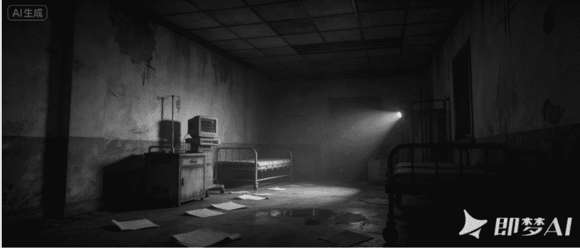

图6-2 即梦生成画面

将所有生成的镜头画面，按分镜序号整理，确保镜头顺序与分镜表一致，为后续动态化调整与剪辑做好准备。

**第二步，生成分镜视频。**点击图片后选择生成视频，即可对应生成分镜的视频，如图6-3所示。

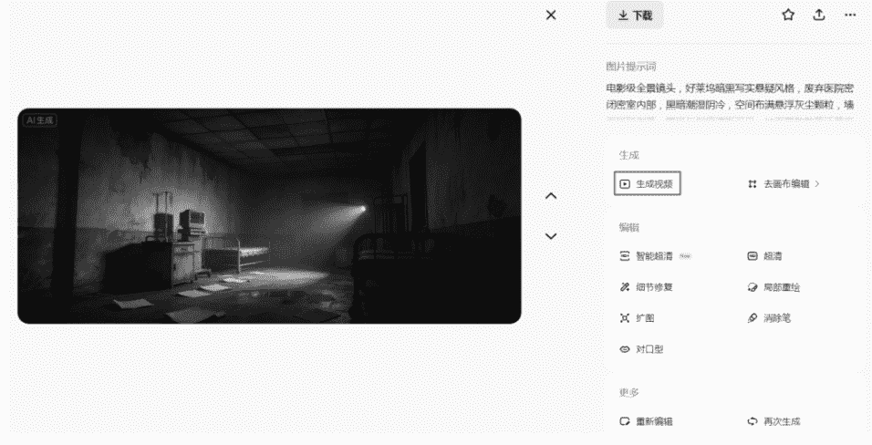

图6-3 即梦生成视频

将分镜逐个生成好后按顺序整理，便于后期剪辑。

**第三步，完成镜头拼接、节奏优化与音画融合。**将分镜画面导入剪映，同时导入音乐，将音乐与画面精准对齐，确保音乐的开头、高潮、结尾与画面的对应段落完全匹配，例如浪漫星空场景中，音乐的弦乐部分与银河镜头对齐，流星音效与流星出现的画面对齐；紧张悬疑场景中，音乐的急促段落与黑影闪过、镜头快速切换的画面对齐，音乐骤停与画面定格对齐，避免出现音画错位、脱节问题。

拼接完成后，预览音画效果，若出现画面动态与音乐节奏轻微偏差的情况，借助剪映的"变速"功能，微调画面或音乐的时长，例如画面时长略长于音乐，可适当加快画面变速（变速比例1.05～1.1倍），确保音画时长一致；若音乐节奏与画面动作卡点不精准，可借助剪映的"分割"功能，调整音乐片段的位置，确保卡点精准，同时微调镜头切换速度，实现音画节奏高度匹配，变速调整如图6-4所示。

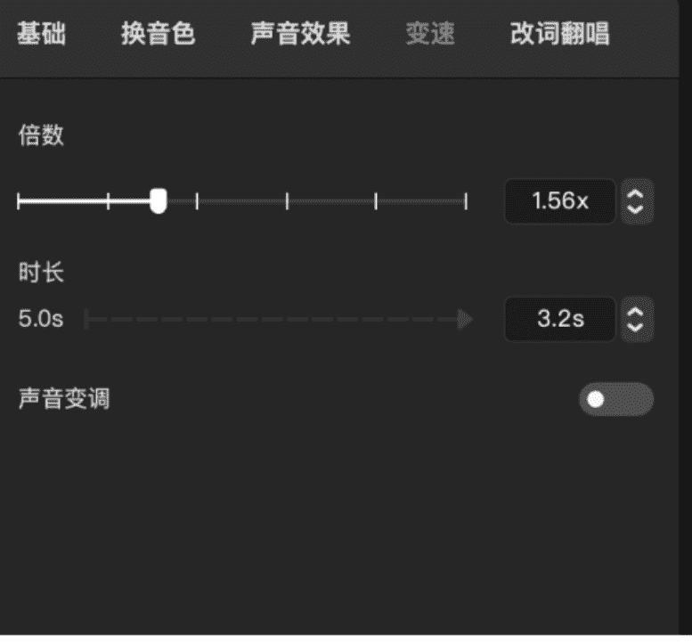

图6-4 剪映音频变速调整界面

按照音画适配节奏，将音效精准叠加至对应画面细节处，例如紧张悬疑场景中，黑影闪过的瞬间叠加脚步声，玻璃破碎的画面叠加玻璃破碎声，人物惊恐呼吸时叠加呼吸声；悲壮战争场景中，爆炸画面叠加爆炸音效，士兵敬礼时叠加轻微的风声与号角声，确保音效与画面细节高度匹配，补充画面氛围感，提升用户的沉浸式体验。叠加完成后，预览音效效果，若出现音效杂乱、音量不均的情况，调整音效的音量与出现时间，删除多余音效，确保音效贴合画面、不干扰音画融合，音效选择界面如图6-5所示。

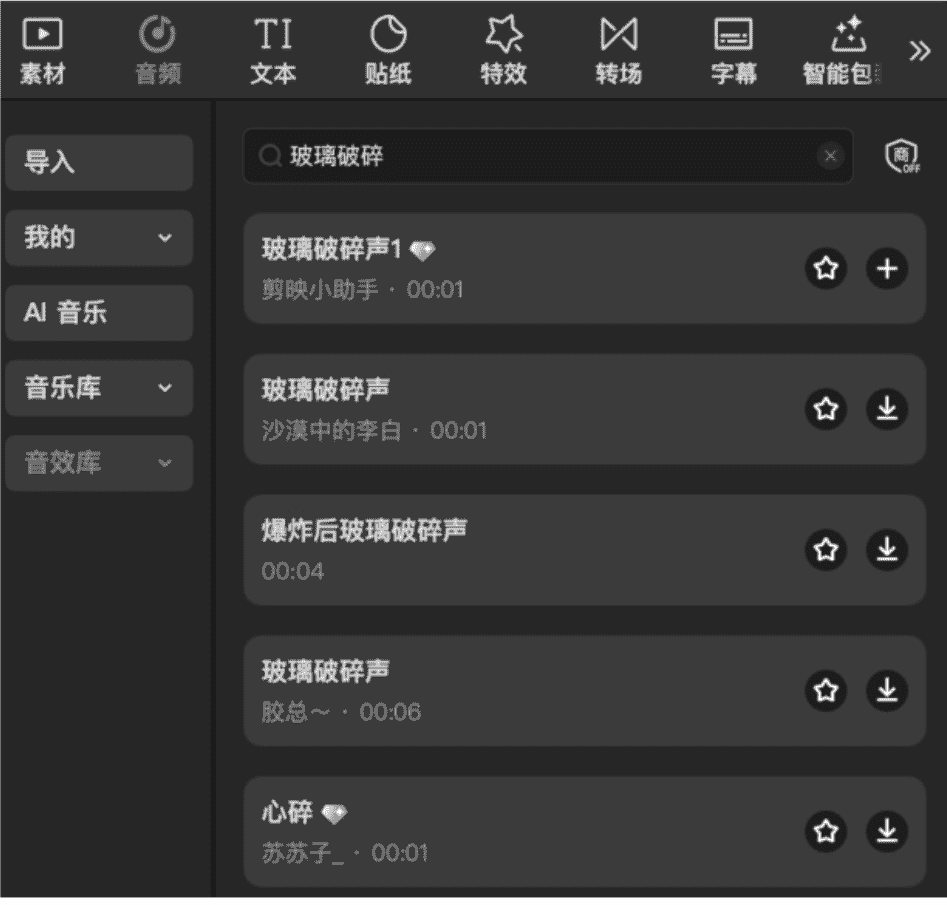

图6-5 剪映音效选择界面

#### 6.3.3 电影级视频成片的注意事项

**把控 AI生成精准度，减少后期修改成本：** AI镜头生成是成片的基础，若生成画面与分镜、创意不符，会大幅增加后续剪辑与修改成本。实操中需借助豆包优化 Seedance 生成提示词，确保提示词包含镜头类型、画面细节、光影、风格等核心信息。

**强化音画共生，提升成片沉浸感：**音画融合是电影级成片的关键，若音画脱节、音效杂乱、调色违和，会严重影响观影沉浸感。实操中，借助豆包筛选贴合场景氛围的音乐与音效，借助剪映的"音量淡化"功能，实现音乐与音效的自然过渡。

## 第7章 MV音乐视频制作实操

### 7.1 创意构思：音乐视觉表达设计

MV的核心是"音画共生"，创意构思的关键的是让视觉画面精准贴合音乐的节奏、情感与主题，通过画面强化音乐的感染力，同时打造独特的视觉记忆点。不同于电影级场景的宏大叙事，MV创意构思需兼顾"节奏适配、情感传递、视觉美感"，避免画面杂乱、与音乐脱节，确保每一组画面都能呼应音乐的旋律、歌词与情绪变化。

#### 7.1.1 借助Seedance+豆包进行MV创意构思的优势

豆包可快速接收MV的核心需求，拆解音乐的关键元素，包括音乐风格（流行、抒情、摇滚、古风等）、节奏快慢、情感基调（伤感、欢快、治愈、激昂等）、歌词核心意象，结合这些元素匹配适配的视觉风格、场景类型、色彩基调，避免创意与音乐脱节。例如抒情慢歌可匹配"唯美浪漫、柔和光影"的视觉风格，摇滚快歌可匹配"动感强烈、高对比度"的视觉风格，古风歌曲可匹配"古色古香、诗意场景"的视觉风格，确保创意方向与音乐调性高度契合。

#### 7.1.2 MV创意构思实操步骤

##### 第一步，拆解音乐核心元素，明确创意方向

MV 创意构思的首要前提是拆解音乐核心元素，这是后续创意匹配、提示词优化、画面生成的基础。创作者需先梳理音乐的核心信息，例如音乐风格（流行抒情）、节奏（慢节奏，旋律舒缓）、情感基调（治愈、温暖）、歌词核心意象（星空、海浪、烛光、牵手），以及MV的核心主题（陪伴、治愈、成长）、视觉风格（唯美柔和、低饱和暖色调），确保创意构思清晰、重点突出，贴合音乐调性。实操中可借助豆包，输入相关信息，获取精准的音乐拆解与创意方向建议，以下呈现具体示例，确保提示词具体可落地，规避笼统表述。示例提示词如下：

帮我拆解流行抒情治愈向MV的音乐核心元素，明确音乐风格为流行抒情，节奏舒缓，情感基调为治愈、温暖，歌词核心意象为星空、海浪、烛光、牵手、晚风，MV核心主题为"陪伴治愈"，视觉风格为唯美柔和、低饱和暖色调，目标受众18～35岁。帮我提炼能贴合音乐情感的关键视觉元素，包括场景（海边日落、星空下的草地、暖光房间）、人物（年轻男女，互动温柔，表情舒缓）、道具（烛光、鲜花、围巾）、特效（柔和光斑、星光、晚风飘动效果），重点突出画面的治愈感与温柔感，贴合慢节奏音乐的调性。帮我明确场景的视觉标准，包括画面分辨率、光影效果、色彩基调等，为后续Seedance生成场景画面提供精准指引，优化细节描述，让场景画面与流行抒情治愈向MV质感高度匹配，避免元素杂乱、氛围脱节。

豆包根据指令生成内容如下：

###### 流行抒情治愈向MV核心拆解（适配Seedance生成）

####### 一、核心基础信息

音乐风格：流行抒情（慢节奏，旋律舒缓）

情感基调：治愈、温暖、柔和

MV核心主题：陪伴治愈

视觉风格：唯美柔和，低饱和暖色调

目标受众：18～35岁

歌词核心意象：星空、海浪、烛光、牵手、晚风

##### 二、核心关键元素（贴合情感，避免杂乱）

###### 1.场景（重氛围感）

海边日落：夕阳西下，金色余晖洒在海面，海浪缓慢起伏，沙滩细腻，远处有归航的小船；星空下的草地：夜幕降临，满天星光，草地柔软，有微弱的萤火虫光斑；暖光房间：室内灯光柔和，摆放简约家具，桌面有点燃的烛光，窗帘轻轻飘动。

###### 2.人物（重互动感）

年轻男女（20～28岁），穿搭简约温柔（浅色系衣物）；互动自然柔和（牵手漫步、并肩而坐、温柔对视）；表情舒缓放松，眼神温柔，无夸张神态，贴合治愈氛围。

……

**第二步，借助豆包，细化场景细节，优化提示词**

音乐核心与关键元素明确后，需借助豆包，结合流行抒情治愈向MV的质感要求，细化场景的细节描述，优化生成所需的提示词，核心原则是"细节具体、情感贴合、节奏适配、质感突出"，避免模糊表述，确保生成的场景画面精准贴合音乐调性与MV预期。不同风格的MV，适配的细节元素、光影效果、色彩基调不同，需结合音乐风格灵活调整，例如摇滚快歌适配硬光、高对比度、鲜艳色调，古风歌曲适配柔光、低饱和、古风色调。实操中可在豆包中补充提示词，获取细化的场景细节描述与优化后的提示词，示例提示词（以流行抒情治愈向MV海边日落场景为例）如下：

基于流行抒情治愈向MV的核心需求，帮我细化海边日落场景的细节描述，优化生成场景画面的提示词，要求细节具体、贴合唯美柔和风格、情感温暖，适配慢节奏音乐，避免模糊表述。视觉风格为流行抒情治愈风，画面分辨率4K，高清细腻，细节拉满，无噪点；色彩基调以低饱和暖色调为主，米白、浅橙、淡粉搭配淡蓝色海面，形成柔和对比，突出温暖治愈感；环境细节方面，海边沙滩细腻柔软，有零星的贝壳散落，夕阳西下，金色余晖洒在海面，海浪缓慢起伏，泛起细腻的泡沫，远处有一艘小小的归航渔船，天空有淡淡的晚霞，呈现出粉紫色渐变，晚风轻轻吹动沙滩上的芦苇，芦苇缓慢摇晃；人物细节方面，年轻男女并肩走在沙滩上，手牵着手，男生穿着浅灰色卫衣，女生穿着米白色连衣裙，头发被晚风轻轻吹动，两人面带微笑，眼神温柔，并肩望向远方的夕阳，女生的裙摆轻轻飘动，男生的手臂自然搭在女生的肩膀上；特效细节方面，柔和的暖黄色光斑缓慢飘动，落在人物身上与海面上，海浪泡沫细腻柔和，夕阳有轻微的光晕效果，晚风飘动有自然的动态感；光影效果为柔光，光线柔和，无硬边阴影，夕阳的光线均匀洒在画面中，形成柔和的明暗过渡，突出画面的温暖治愈感；整体画面构图饱满，节奏舒缓，贴合慢节奏抒情音乐，突出陪伴治愈的核心主题，适配Seedance场景生成特性，便于后续动态化处理，给出具体的提示词优化方案。

豆包生成细化的场景细节描述与优化后的Seedance提示词如下：

###### 流行抒情治愈向MV海边日落场景生成提示词（优化版）

4K ultra HD，高清细腻，无噪点，细节拉满，流行抒情治愈风；色彩基调为低饱和暖色调，以米白、浅橙、淡粉为主，搭配淡蓝色海面，形成柔和对比，凸显温暖治愈感，画面色调统一柔和，无艳丽杂色

环境：细腻柔软的白色沙滩，零星散落着小巧贝壳，夕阳西下，金色余晖均匀洒在海面上，海浪缓慢起伏，泛起细腻洁白的泡沫，远处有一艘小小的归航渔船（轮廓清晰，带轻微船帆），天空布满淡淡的粉紫色晚霞，渐变自然，沙滩边缘有几丛芦苇，被晚风轻轻吹动，缓慢摇晃，空气中有微弱的水汽光斑

人物：20～28岁年轻男女，并肩牵手漫步在沙滩上，男生身着浅灰色宽松卫衣，女生身着米白色连衣裙，女生长发被晚风轻轻吹动，两人面带温柔微笑，眼神柔和，并肩望向远方夕阳，男生手臂自然搭在女生肩膀上，女生裙摆随晚风轻微飘动，脚步缓慢舒缓，姿态放松自然

……

##### 第三步，确定MV视觉标准，明确统一规范

MV 创意构思需确保整体视觉风格统一，贴合音乐的整体调性，避免出现细节杂乱、光影违和、色彩偏差等问题，确保不同场景的画面衔接流畅，提升MV的整体质感。借助豆包，结合音乐风格与核心需求，确定统一的视觉标准，包括画面分辨率、光影效果、色彩基调、细节规范，明确场景元素的呈现要求，例如流行抒情MV统一为"4K高清、柔光、低饱和暖色调"，摇滚MV统一为"4K高清、硬光、高对比度、鲜艳色调"。

获取针对性的视觉标准统一建议，示例提示词（以流行抒情治愈向MV为例）如下：

基于流行抒情治愈向MV的整体定位，帮我确定MV的统一视觉标准与规范，确保场景风格统一、贴合治愈向质感，适配慢节奏音乐。视觉风格为流行抒情治愈风，画面分辨率4K高清，细节清晰可见，无噪点、无模糊；光影效果为柔光，光线柔和，无明显硬边阴影，整体亮度适中，突出温暖治愈感，不同场景的光影过渡自然，避免光影违和；色彩基调为低饱和暖色调（以米白、浅黄、浅橙、淡粉为主），整体色调统一，不同场景的色彩衔接流畅，海边场景可搭配淡蓝色海面，暖光房间可搭配浅棕色家具，星空场景可搭配深紫色夜空与微弱星光，避免鲜艳杂色；细节规范方面，人物穿搭简约温柔，以浅色系为主，互动自然柔和，无夸张动作；场景元素简洁，无多余杂物，贴合治愈主题；特效柔和自然，以光斑、星光、晚风飘动为主，不夸张、不杂乱；所有元素细节统一，贴合流行抒情治愈向MV的调性，适配Seedance生成特性，便于后续批量生成场景画面，同时确保MV视觉风格统一，贴合音乐情感。

豆包根据指令生成内容如下：

###### 流行抒情治愈向MV·统一视觉规范

##### 一、基础画质

风格：流行抒情治愈风，柔和细腻，无夸张元素

分辨率：4K高清，细节锐利，无噪点、无模糊

##### 二、光影规范

主光：柔光，无硬边阴影，整体亮度适中，温暖柔和

重点：不同场景光影过渡自然，海边场景以夕阳为主要光源，星空场景以星光为辅助光源，暖光房间以烛光、室内灯光为主要光源，避免光影违和

……

##### 第四步，创意预览与迭代优化

MV 创意、细节描述、视觉标准确定后，借助即梦的AI场景生成能力，将文字描述转化为高质感MV场景画面，结合音乐片段，快速验证创意与音乐节奏、情感的适配度，避免画面与音乐脱节。用即梦生成不同场景的画面（如海边日落、星空草地、暖光房间等），如图7-1所示。验证视觉风格与音乐情感的匹配度，以及AI对场景细节、色彩、特效的还原效果。

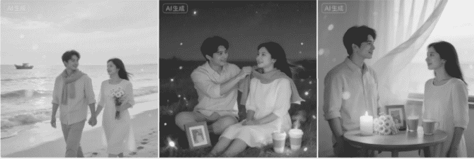

图7-1 MV场景

#### 7.1.3 MV创意构思的注意事项

**创意方向清晰，贴合音乐调性：**借助豆包梳理创意需求时，需明确音乐的节奏、情感与核心意象，避免创意空洞、脱离音乐调性。例如抒情慢歌不可设计过于动感、杂乱的画面，摇滚快歌不可设计过于柔和、舒缓的画面；同时创意需围绕音乐主题展开，确保每一组画面都能呼应歌词或旋律，强化音乐的感染力，避免画面与音乐脱节。

**细节贴合MV质感，避免同质化：**创意细节的设计需贴合MV的整体质感标准，借助豆包优化细节时，需突出MV的独特性，避免同质化。例如同样是抒情MV，可通过独特的场景设定（如小众海边、复古书店）、人物互动细节（如手写书信、并肩看日落）打造记忆点；同时细节需细腻柔和，避免粗糙敷衍，例如人物的表情、动作，场景的光影、特效，需贴合音乐的情感，强化MV的治愈感、氛围感。

### 7.2 脚本与分镜设计：节奏与镜头匹配

脚本与分镜设计是MV制作的核心环节，是连接创意构思与成片输出的桥梁。不同于电影级脚本与分镜的叙事导向，MV的脚本与分镜需遵循"节奏适配、音画同步、视觉流畅"的原则，明确镜头类型、镜头运动、画面内容、时长、音效等核心信息，确保每一个镜头都能贴合音乐的节奏与情感，让视觉画面与旋律、歌词精准呼应，同时确保后续AI生成与剪辑工作有序推进。

#### 7.2.1 借助Seedance+豆包进行MV镜头结构设计的优势

借助豆包的脚本撰写、分镜拆解能力，搭配Seedance的镜头预览优势，可快速解决传统分镜设计的核心痛点，帮助普通创作者快速完成MV脚本与分镜设计，明确镜头结构与节奏，确保分镜贴合创意、镜头有感染力、适配后续AI生成与剪辑，实现音画精准同步。依托Seedance与豆包的协同组合，MV脚本与分镜设计可实现"高效撰写、精准拆解、可视化预览、节奏适配"。

#### 7.2.2 MV镜头结构设计实操步骤

##### 第一步，撰写MV脚本，明确音画对应关系

脚本撰写是分镜设计的基础，核心是"明确画面与音乐的对应关系，贴合音乐节奏与情感"。需结合创意构思与音乐片段，梳理MV的开篇、发展、高潮、结尾，明确每个段落的画面内容、时长，确保画面时长与音乐片段精准匹配，避免出现音画脱节。例如输入提示词：

> "帮我撰写流行抒情治愈向MV的完整脚本，贴合前文创意构思，明确MV主题为陪伴治愈，音乐风格为流行抒情，节奏舒缓，时长180秒，脚本需包含场景描述、人物动作、神态、画面内容、时长，严格遵循音乐节奏（开篇铺垫1～30秒、发展推进31～120秒、高潮121～150秒、结尾留白151～180秒），明确每个段落的画面与音乐的对应关系，语言简洁、精准，贴合镜头语言，便于后续分镜拆解，避免冗长、空洞，突出温暖治愈的情感。"

豆包根据指令生成脚本如下：

流行抒情治愈向MV脚本：陪伴与治愈

【场景】海边日落、星空下的草地、暖光房间

【人物】男主（25岁，温柔内敛）、女主（24岁，温柔治愈）

【时长】180秒

【音乐基调】流行抒情，节奏舒缓，情感温暖治愈，开篇轻柔、发展平缓、高潮饱满、结尾舒缓

0～30秒（开篇铺垫，音乐轻柔）：

场景：海边日落全景，夕阳西下，金色余晖洒在海面，海浪缓慢起伏，沙滩细腻，远处有归航的小船，天空有淡淡的粉紫色晚霞。

人物：女主独自坐在沙滩上，望着远方的夕阳，表情舒缓，双手抱膝，头发被晚风轻轻吹动，身边放着一束白色小雏菊。

画面重点：突出海边日落的唯美与女主的温柔，贴合音乐的轻柔开篇。

31～120秒（发展推进，音乐平缓）：

场景1（31～60秒）：海边日落中景，男主缓缓走向女主，脚步舒缓，手中拿着一杯温热的奶茶，在女主身边坐下，递给女主奶茶，两人相视一笑，温柔对视。

场景2（61～90秒）：海边日落近景，两人并肩而坐，手牵着手，望向远方的夕阳，女主靠在男主肩膀上，男主轻轻抚摸女主的头发，晚风吹动两人的衣角与头发，画面柔和。

……

##### 第二步，拆解分镜，明确镜头结构与节奏

脚本撰写完成后，借助豆包，将脚本拆解为具体的分镜，明确每个分镜的核心信息，包括镜头序号、镜头类型、镜头运动、画面内容、时长、光影、音效，确保镜头结构合理、衔接流畅、节奏精准，每一个分镜的时长与运动都能贴合音乐的节奏与情感变化。分镜拆解需遵循MV镜头语言规范，结合音乐节奏，合理搭配全景、中景、特写，优化镜头运动，强化画面的感染力与音画同步性。例如输入提示词：

> "帮我将流行抒情治愈向MV脚本拆解为具体分镜，明确每个分镜的镜头序号、镜头类型、镜头运动、画面内容、时长、光影、音效，贴合流行抒情治愈风，镜头结构合理、衔接流畅，节奏精准适配音乐（开篇轻柔、发展平缓、高潮饱满、结尾舒缓），镜头运动与画面内容贴合音乐节奏，例如开篇用全景铺垫氛围，发展阶段用中景、近景展现人物互动，高潮用特写突出细节与情感，结尾用全景留白，每个分镜的时长精准分配，便于后续Seedance生成与剪映剪辑，突出温暖治愈的情感。"

豆包根据指令生成分镜表，如表7-1所示。

###### 表7-1 分镜表

| 镜头序号 | 镜头类型 | 镜头运动 | 画面内容 | 时长 | 光影 | 音效 |
|---|---|---|---|---|---|---|
| 1 | 全景 | 缓慢推进 | 海边日落全景，夕阳、海面、沙滩、归航小船，晚霞渐变，画面柔和 | 10秒 | 柔光，暖黄色余晖，光影过渡自然，无硬边阴影 | 轻柔海浪声、微风声，贴合音乐开篇 |
| 2 | 中景 | 固定 | 女主独自坐在沙滩上，抱膝望着夕阳，头发被晚风吹动，身边有小雏菊 | 20秒 | 柔光，余晖洒在女主身上，面部光影柔和 | 海浪声、微风声，音乐轻柔放大 |
| 3 | 中景 | 慢跟 | 男主缓缓走向女主，手持奶茶，脚步舒缓，面带微笑 | 15秒 | 柔光，余晖均匀洒在画面中，人物光影柔和 | 轻微脚步声、海浪声，音乐平缓 |
| 4 | 近景 | 固定 | 男主在女主身边坐下，递出奶茶，两人相视一笑，温柔对视 | 15秒 | 柔光，聚焦两人面部，光影柔和，突出表情 | 轻微的奶茶杯碰撞声，音乐平缓 |

……

##### 第三步，优化分镜，强化节奏与音画适配

分镜拆解完成后，需借助豆包，结合MV镜头语言规范、音乐节奏与Seedance生成特性，优化分镜细节，强化镜头节奏与音画适配性，确保分镜衔接流畅、画面有感染力，避免出现"镜头违和、衔接生硬、节奏不匹配"等问题。

#### 7.2.3 MV镜头结构设计的注意事项

**镜头搭配合理，贴合音乐节奏：**借助豆包拆解分镜时，需合理搭配全景、中景、特写，遵循"全景铺垫氛围、中景展现互动、特写突出情感"的原则，贴合音乐节奏。例如开篇用全景铺垫场景氛围，发展阶段用中景、近景展现人物互动，高潮部分用特写突出细节与情感，结尾用全景留白；同时根据音乐节奏调整镜头时长，慢节奏部分镜头时长可稍长，快节奏部分镜头时长可缩短，确保镜头节奏与音乐节奏精准匹配。

**分镜适配AI生成，兼顾细节与落地：**分镜描述需具体、精准，借助豆包优化分镜时，避免抽象表述，将镜头类型、运动、画面内容、光影、音效等细节描述清晰，确保Seedance能精准捕捉分镜核心，生成贴合预期的镜头画面。同时避免设计过于复杂的镜头（如过多特效、复杂场景元素），确保分镜可落地，减少后续生成与剪辑的修改成本；同时分镜设计需兼顾剪映剪辑，确保镜头衔接流畅，便于后续音画同步与节奏优化。

## 7.3 成片实操：MV完整生成流程

成片实操是MV制作的最终环节，核心是"将创意构思、脚本分镜，通过AI工具生成与剪辑优化，转化为高质感、音画同步的MV成片"。

### 7.3.1 借助Seedance+豆包+剪映进行MV成片生成的优势

Seedance可根据豆包优化后的分镜描述，快速生成每个镜头的高质感画面，精准还原MV的视觉风格、细节质感与情感氛围，无需专业拍摄与建模，大幅缩短成片制作时间；同时可借助豆包优化生成提示词，调整画面细节（如光影、色彩、元素、动态效果），确保画面贴合分镜与创意预期，贴合音乐情感。

### 7.3.2 MV完整生成实操全流程

**第一步，AI镜头生成**

根据分镜表，借助豆包，为每个分镜生成精准提示词，生成对应的镜头画面，确保画面贴合分镜描述、MV质感与创意预期，同时贴合音乐情感。例如输入提示词（针对分镜1：海边日落全景）：

> "帮我生成提示词，贴合流行抒情治愈向MV风格，镜头类型为全景，画面内容为海边日落，夕阳西下，金色余晖洒在海面，海浪缓慢起伏，沙滩细腻，远处有归航的小船，天空有淡淡的粉紫色晚霞，光影为柔光，暖黄色余晖，光影过渡自然，无硬边阴影，细节清晰（沙滩纹理、海浪泡沫、晚霞渐变、小船轮廓可辨），风格为唯美柔和，无夸张特效，贴合治愈温暖的氛围，适配Seedance生成，贴合慢节奏抒情音乐的调性。"

豆包接收指令后会生成分镜提示词如下：

流行抒情治愈向MV全景镜头，唯美柔和风格，海边日落场景，夕阳西下，金色余晖均匀洒在海面上，海浪缓慢起伏，泛起细腻洁白的泡沫，细腻柔软的白色沙滩延伸至海面，远处有一艘小小的归航渔船，船帆轻微飘动，轮廓清晰可见；天空布满淡淡的粉紫色晚霞，渐变自然柔和，空气中有微弱的水汽光斑；柔光质感，暖黄色余晖为主要光源，光影过渡自然，无硬边阴影，整体色调为低饱和暖色调（浅橙、淡粉、米白搭配淡蓝色海面）；细节锐利可辨，沙滩纹理、海浪泡沫、晚霞渐变、小船轮廓、水汽光斑清晰可见，无夸张特效，极致温暖治愈，4K电影质感，写实渲染，动态光影自然流畅，贴合慢节奏抒情音乐的轻柔调性。

将提示词输入即梦生成对应的分镜图如图7-2所示，随后将所有生成的镜头画面按分镜序号整理，确保镜头顺序与分镜表一致，为后续动态化调整与剪辑做好准备。

图7-2 海边场景

#### 第二步，镜头动态化调整，贴合音乐节奏

将静态镜头画面转化为动态视频，核心是让画面动态与音乐节奏精准适配，避免动态过快/过慢与MV调性违和。实操中可借助豆包，根据音乐节奏生成动态化调整提示词，在Seedance中完成镜头动态设置，核心原则为"慢节奏抒情音乐匹配舒缓动态，快节奏音乐匹配灵动动态"。

以流行抒情治愈向MV的星空草地镜头为例，输入豆包提示词：

> "帮我生成Seedance动态化调整提示词，适配流行抒情治愈向MV的星空草地镜头，音乐节奏舒缓，要求动态效果柔和自然，突出治愈氛围，镜头动态包括星光缓慢闪烁、萤火虫光斑轻轻飘动、人物脚步舒缓、晚风吹动草地与头发的轻柔效果，无夸张动态，贴合慢节奏音乐，确保动态与画面质感统一，适配后续剪映剪辑。"

豆包生成动态化提示词如下：

4K电影质感动态镜头，流行抒情治愈风，星空草地场景动态化调整：星光以低频率缓慢闪烁，亮度柔和不刺眼；萤火虫光斑呈不规则轻柔飘动，速度缓慢，分布均匀；人物牵手漫步脚步舒缓，肢体动作自然柔和，无急促动态；晚风带动草地轻轻摇曳、人物发丝与衣角缓慢飘动，动态幅度小；整体镜头无镜头晃动，保持稳定，动态效果贴合慢节奏抒情音乐，光影随动态自然过渡，极致温暖治愈，无夸张特效。

将动态化提示词与原镜头提示词结合，生成动态镜头视频，视频生成对话框如图7-3所示。

图7-3 视频生成对话框

点击发送后会生成分镜片段视频如图7-4所示，逐镜检查动态效果与音乐节奏的适配性，若动态效果不符预期，借助豆包微调提示词重新生成，确保所有镜头动态统一贴合MV的音乐调性。完成后将所有动态镜头视频按分镜序号整理，导出高清视频素材。

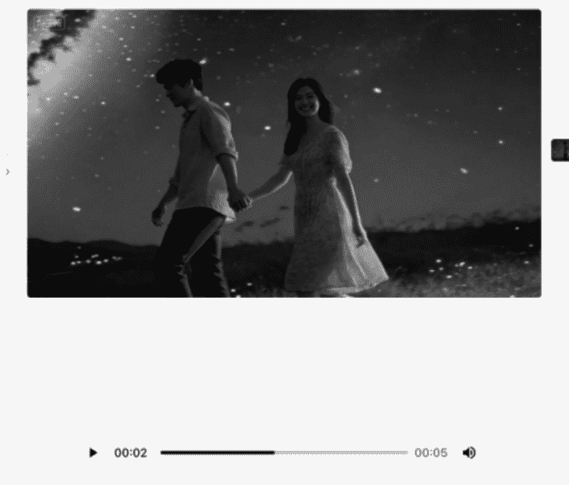

图7-4 分镜视频

#### 第三步，剪映剪辑落地，实现镜头拼接与音画同步

剪映是MV成片落地的核心工具，需完成镜头拼接、节奏优化、音画融合三大核心操作，确保镜头衔接流畅、音画精准同步、氛围贴合。将整理好的动态镜头视频、音乐导入剪映，按分镜序号依次排列在时间轴上，删除镜头素材的多余片段，确保镜头衔接无断层。针对治愈向MV，避免使用花哨转场，以硬切或淡入淡出为主，转场时长控制在0.5～1秒，保持画面流畅度，贴合柔和的氛围，如图7-5所示。

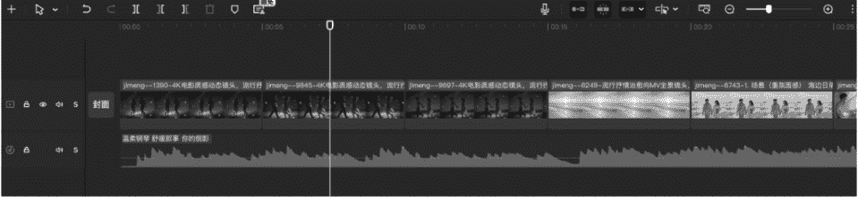

图7-5 分镜视频拼接

#### 第四步，后期细节优化，强化MV质感与情感表达

完成基础剪辑后，借助剪映进行后期细节优化，搭配豆包的专业建议，从调色统一、画面质感提升、字幕添加三个维度打磨，确保MV整体质感达标，情感传递更到位。完成所有剪辑与后期优化后，进行全片预览，重点检查音画同步性、镜头衔接流畅度、色调统一性、音效与字幕的适配性，判断整体效果是否贴合创意预期与音乐情感。若发现问题，如音画脱节、色调偏差、音效杂乱等，若整体效果达标，即可进行成片导出。

### 7.3.3 MV成片制作的注意事项

**严控音画同步精准度，避免节奏违和：**音画同步是MV的核心灵魂，若出现歌词与字幕不同步、画面动态与音乐节拍脱节、音效与画面细节错位等问题，会严重影响观影体验。实操中需在剪映中放大时间轴，精准对齐音乐与视频的关键节点，如音乐的重拍对应镜头的切换、歌词的起唱对应字幕的出现；音效叠加需精准匹配画面细节，如人物抬手对应微风声、烛光晃动对应燃烧声；完成后多次逐段预览，借助豆包的节奏分析建议，微调偏差部分，确保音画精准共生。同时避免过度叠加音效，防止音效杂乱盖过背景音乐，破坏MV的情感氛围。

**保障画面质感统一，规避视觉违和：** MV 的视觉质感统一体现在色调、光影、动态效果三个方面，普通创作者容易出现不同镜头色调偏差、光影违和、动态效果杂乱等问题。实操中需严格遵循前期确定的统一视觉标准，在剪映中进行全局调色，再对个别镜头进行局部微调，避免单镜头色调偏离主风格；在AI生成镜头与动态化调整时，确保光影效果与原设定一致，如治愈向MV全程保持柔光，无硬边阴影；动态效果按音乐节奏统一设定，避免部分镜头动态过快、部分过慢，确保整体视觉风格连贯统一。同时避免过度使用剪映的特效功能，如滤镜、贴纸等，防止画面过于花哨，破坏MV的质感与情感表达。

## 第8章 真人短剧制作实操

### 8.1 内容构思：剧情短视频结构设计

真人短剧的内容构思是其成为爆款的核心前提，区别于电影短片的完整叙事与抖音短视频的轻量化表达，真人短剧更注重冲突密集化、情节反转化、情感共鸣化，需在短时间内快速建立人物关系、引爆核心冲突、给出情感落点。借助豆包的剧情推演与创意优化能力，搭配即梦的视觉化验证功能，可高效破解短剧内容同质化、冲突薄弱、节奏拖沓等常见问题，让创意精准适配平台特性与AI生成需求。

#### 8.1.1 借助豆包+即梦进行真人短剧内容构思的优势

豆包可精准适配平台爆款逻辑，创作者只需输入基础创意方向，豆包就能结合抖音短剧热门赛道（例如家庭伦理、都市悬疑、甜宠逆袭等），梳理出高密度冲突线、强反转情节与共情式情感落点，避免剧情同质化，同时确保节奏符合"3秒抓睛、1分钟破局"的要求。

#### 8.1.2 真人短剧内容构思的核心步骤

##### 第一步，锚定赛道与核心痛点，明确创作方向

内容构思的首要任务是确定短剧的赛道类型与核心痛点，抖音真人短剧的热门赛道具有鲜明的用户偏好：家庭伦理类聚焦婆媳矛盾、财产争夺等现实痛点；都市悬疑类侧重陌生人闯入、秘密曝光等紧张情节；甜宠逆袭类围绕弱势主角的成长与情感救赎展开。创作者需先明确赛道，再梳理核心痛点，实操中可借助豆包，输入基础灵感与核心诉求，快速获取创意优化建议，示例提示词如下：

> "帮我优化一个抖音真人短剧创意灵感，核心赛道是都市悬疑，时长2分钟，聚焦'独居女孩遭遇陌生跟踪'的核心痛点，要求3秒抓睛、1分钟爆发冲突、结尾有反转，贴合抖音爆款逻辑，明确核心冲突、情节反转点与情感落点，避免俗套桥段，给出具体的剧情方向建议。"

豆包根据指令生成内容如下：

###### 抖音2分钟都市悬疑真人短剧创意灵感（优化版）

核心赛道：都市悬疑（贴合抖音下沉+年轻化受众，聚焦独居安全痛点，易引发评论互动、转发警示）

时长规格：2分钟（严格把控节奏，3秒抓睛、30秒铺悬念、1分钟爆发冲突、最后10秒反转收尾）

核心痛点：独居女孩（22～28岁，职场新人）遭遇陌生跟踪，贴合当代独居人群高频焦虑，易引发共情、评论区分享自身经历

核心要求：规避"跟踪者是变态/陌生人劫财劫色"俗套，突出"熟人伏笔+认知反转"，贴合抖音爆款逻辑（强冲突、高共情、有记忆点、留讨论空间），明确核心冲突、反转点、情感落点，可直接落地拍摄

####### 一、整体节奏拆解（贴合抖音2分钟爆款逻辑）

0～3秒（抓睛开篇，强制停留）：无多余铺垫，直给冲击画面+画外音，拒绝拖沓

画面：女主（林夏）低头快走，手机手电筒照地面，镜头给到她攥紧钥匙、发白的指节，背景是深夜空荡的小区楼道（暖光+阴影对比，营造压抑感），镜头余光扫到"身后台阶上的半双男士运动鞋"（不拍正脸、不拍全身，留悬念）

画外音（女主急促喘息，声音发颤）："我好像，被人跟了整整一路"

……

####### 二、核心要素明确（规避俗套，贴合爆款）

……

####### 三、剧情优化亮点（规避俗套，贴合抖音爆款逻辑）

……

####### 四、拍摄适配建议（贴合抖音真人短剧，降低拍摄成本）

……

####### 五、备选剧情方向（可灵活调整，同样规避俗套）

……

豆包从冲突强化、反转设计、情感共鸣三个维度优化创意，明确核心主题，同时给出具体剧情方向，为后续剧情框架搭建做好铺垫。

##### 第二步，搭建高密度剧情框架，梳理节奏节点

核心方向明确后，需借助豆包搭建贴合短剧节奏的高密度剧情框架，确保每个时间节点都有强钩子。抖音1～3分钟短剧的节奏需精准划分，以2分钟短剧为例，建议按"3秒抓睛（悬念导入）—30秒建冲突（矛盾爆发）—50秒强推进（情节升级）—15秒反转（破局点）—2秒落点（情感共鸣）"分配时长。实操中可补充提示词，获取结构化剧情框架，示例如下：

> 基于都市悬疑类真人短剧"独居女孩遭遇陌生跟踪"的创意，时长2分钟，按3秒抓睛、30秒建冲突、50秒强推进、15秒反转、2秒落点分配时长，帮我搭建剧情框架，明确每个节点的核心情节、人物动作与悬念设置，确保节奏紧凑、冲突密集，适配AI生成需求

豆包根据指令生成内容如下：

###### 都市悬疑真人短剧《跟踪》剧情框架（2分钟，适配 AI生成）

核心设定：独居女孩林夏（22～25岁，职场新人），下班深夜归途，遭遇不明男子跟踪，全程紧凑压抑，反转戳中都市独居安全感痛点；适配 AI 生成—人物动作简洁明确、场景单一（深夜人行道、单元楼、电梯）、冲突直观，无复杂道具/群演。

总时长：120秒，精准分配为【3秒抓睛→30秒建冲突→50秒强推进→15秒反转→2秒落点】，每个节点明确"核心情节+人物动作+悬念设置"，节奏拉满、冲突密集。

……

豆包生成包含各节奏节点的完整框架，清晰标注每个环节的核心内容与悬念设计，确保剧情环环相扣、钩子密集。

##### 第三步，塑造立体人物形象，强化角色张力

真人短剧的核心竞争力在于人物张力，鲜明的人物形象能快速让用户代入剧情。借助豆包，可快速搭建人物框架，明确核心人物的性格特质、行为动机与外在特征，避免人物扁平化。抖音短剧人物设定需遵循"标签化+反差感"原则，例如"看似柔弱的独居女孩实则心思缜密""外表凶狠的跟踪者实则是守护者"，通过反差增强剧情张力。实操中可输入提示词，获取针对性人物设定。

##### 第四步，确定视觉风格，明确场景与氛围导向

基于剧情框架与人物设定，借助豆包确定短剧的核心视觉风格，真人短剧的视觉风格需服务于剧情氛围，不同赛道适配不同风格：都市悬疑类适配"冷色调、低光环境、紧凑构图"；家庭伦理类适配"写实风、暖冷对比色调"；甜宠逆袭类适配"高饱和暖色调、明亮光影"。实操中可输入提示词，获取针对性视觉风格建议。

#### 8.1.3 真人短剧内容构思的注意事项

**核心要素明确，冲突密集无冗余：** 借助豆包梳理构思时，需明确包含"赛道类型、时长、核心冲突、节奏节点、人物反差、视觉风格"等关键信息，避免模糊表述。剧情设计需确保冲突密集，避免铺垫过长，每个节点都有明确的钩子（例如悬念、反转等），提升用户完播率。

**贴合短剧时长，节奏精准可控：** 抖音真人短剧的时长通常为1～3分钟，构思时需借助豆包严格控制各节奏节点的时长，确保3秒抓睛、1分钟破局、全程无冷场。提示词中需明确各环节时长分配，例如"2分钟短剧，3秒抓睛、30秒建冲突、50秒强推进、15秒反转、2秒落点"，让剧情框架更具可落地性，适配平台快节奏需求。

### 8.2 脚本与分镜设计：真人短剧镜头设计

真人短剧的脚本与分镜设计，是连接内容构思与成片制作的核心纽带，区别于电影短片的详细分镜与短视频的轻量化脚本，真人短剧的脚本更注重台词精练化、动作明确化、冲突可视化，分镜则更注重镜头语言的叙事性、节奏切换的紧凑性、氛围营造的精准性。借助豆包辅助撰写标准化脚本，搭配Seedance+即梦的 AI生成特性进行分镜设计，能让脚本与分镜高度适配平台爆款逻辑与 AI 生成需求，大幅降低专业门槛，确保后续拍摄（或AI生成）与剪辑环节顺畅推进。

#### 8.2.1 借助豆包+Seedance+即梦进行脚本分镜设计的优势

豆包可快速将内容构思转化为包含"镜号、景别、画面内容、时长、人物动作、台词、音效"的标准化脚本，精准控制每个镜头的时长与冲突点，确保台词精练、动作明确，贴合人物性格与剧情节奏。在分镜设计环节，创作者只需结合AI生成特性，明确镜头运动、构图方式与光影效果，就能让即梦精准还原剧情氛围，Seedance 后续可无缝对接静态分镜，实现动态化呈现，避免复杂镜头运动导致的生成失真。对比传统创作，AI辅助既降低了专业门槛，又能让脚本分镜高度适配平台节奏与AI生成需求，实现从文字到视觉的高效转化。

#### 8.2.2 真人短剧脚本设计的核心步骤

##### 第一步，拆解节奏节点，明确脚本设计依据

脚本设计需立足内容构思的节奏节点，先借助豆包全面梳理短剧的核心信息，为后续镜头拆解提供明确依据。重点梳理内容包括：赛道类型、总时长、各节奏节点的时长分配、核心剧情、人物动作、冲突点、音效与台词导向，确保脚本设计不偏离爆款逻辑。

##### 第二步，借助豆包，拆解镜头并生成标准化脚本表格

基于梳理好的核心信息，结合内容构思的剧情框架与人物设定，借助豆包将整个短剧拆解为若干独立镜头，每个镜头明确核心维度，形成可直接落地的标准化脚本。核心维度需包含镜号、景别、画面内容、时长、人物动作、台词、音效等，确保每个镜头都能精准传递冲突点与剧情信息，同时贴合 AI 生成特性。实操中可输入提示词快速生成脚本表格，示例提示词如下：

> 为抖音都市悬疑类真人短剧设计标准化脚本，核心剧情为"独居女孩遭遇邻居默默保护"，总时长2分钟，按3秒抓睛、30秒建冲突、50秒强推进、15秒反转、2秒落点分配时长，视觉风格为冷色调写实悬疑风，帮我拆解镜头，生成包含镜号、景别、画面内容、时长、人物动作、台词、音效的标准脚本表格，镜头节奏紧凑，适配抖音快切要求，人物动作与台词贴合性格设定

豆包接收指令后会生成标准化脚本表格，清晰地呈现各镜头的详细信息，如表8-1所示。

###### 表8-1 抖音都市悬疑类真人短剧设计标准化脚本

| 镜号 | 景别 | 画面内容 | 时长 | 人物动作 | 台词 | 音效 |
|:---:|:---|:---|:---:|:---|:---:|:---|
| 1 | 特写 | 汽车后视镜，陌生男子身影出现 | 3s | 无 | 无 | 急促的心跳声、汽车发动机声 |
| 2 | 中景 | 女孩握紧方向盘，回头张望 | 7s | 女孩眉头紧锁，双手用力攥住方向盘，快速回头看后座方向 | 无 | 轮胎摩擦地面声、心跳声持续 |
| 3 | 近景 | 女孩下车，快速锁车，快步走向单元楼 | 10s | 女孩眼神警惕，时不时回头，脚步急促，背包挡在身前 | 无 | 高跟鞋敲击地面声、环境风声 |
| 4 | 全景 | 男子在远处跟随，步伐沉稳 | 5s | 男子双手插兜，保持安全距离，目光紧盯女孩身后 | 无 | 轻微的脚步声、环境音 |
| 5 | 中景 | 女孩掏钥匙时掉落，慌乱弯腰去捡 | 5s | 女孩手忙脚乱，钥匙掉落地面，她蹲下身快速捡拾，眼神瞟向后方 | 无 | 钥匙碰撞地面声、急促的呼吸声 |

……

##### 第三步，适配AI生成特性，借助豆包优化脚本细节

标准化脚本生成后，需结合Seedance+即梦的AI生成特性，借助豆包进行精细化优化，确保脚本可落地、易生成。同时，需确保每个镜头的时长与剧情节奏精准匹配，冲突爆发段落可缩短镜头时长，增强剧情张力。

#### 8.2.3 真人短剧分镜设计的核心步骤

##### 第一步，拆分镜头单元，明确核心设计维度

以脚本为基础，按剧情节奏与镜头顺序，将每个脚本镜头拆分为独立的分镜单元。分镜数量需结合短剧时长合理规划，2分钟短剧建议设置12～15个分镜，确保镜头切换紧凑，适配抖音快节奏要求。每个分镜单元需先明确六大核心维度：镜号（与脚本一致）、景别、镜头运动方式（固定、推镜、拉镜、摇镜等）、画面构图（居中、偏左、对角线、特写聚焦等）、光影效果、场景细节，避免分镜设计混乱，确保贴合AI生成特性。

##### 第二步，细化画面描述，适配即梦生成

分镜的画面描述将直接作为即梦生成静态画面的提示词，描述越精准，AI生成效果与预期的匹配度越高。例如针对上述脚本中镜号7的分镜，画面描述文字如图8-1所示。

图8-1 画面描述文字

##### 第三步，整合分镜信息，生成标准分镜表

所有分镜单元拆解与描述完成后，需整合为标准化分镜表，方便后续即梦画面生成、Seedance动态化及剪辑环节衔接。分镜表需包含九大核心要素，按"镜号—景别—镜头运动方式—画面构图—光影效果—场景细节—画面描述—时长—对应台词"的顺序整理，借助豆包输入提示词即可快速生成。示例提示词如下：

> 将都市悬疑类真人短剧的12个镜头整理为标准化分镜表，标注镜号、景别、镜头运动方式、画面构图、光影效果、场景细节、画面描述、时长、对应台词等，画面描述贴合冷色调写实悬疑风格，突出人物微表情与场景氛围，镜头运动简洁适配即梦+Seedance生成特性，人物特征与脚本设定保持一致，贴合短剧紧张节奏。

豆包接收指令后会生成标准分镜表，清晰呈现各镜头的详细信息，如表8-2所示。

###### 表8-2 都市悬疑类真人短剧标准化分镜表

| 镜号 | 景别 | 镜头运动 | 画面构图 | 光影效果 | 场景细节 | 画面描述 | 时长 | 对应台词 |
|:---:|:---:|:---:|:---:|:---:|:---|:---|:---:|:---:|
| 1 | 特写 | 固定镜头 | 居中构图 | 冷色调，低光 | 汽车后视镜，表面有轻微反光 | 写实悬疑风，汽车后视镜特写，镜中清晰呈现深色外套男子的模糊身影，背景为深夜街道的路灯光影，后视镜边缘有轻微磨损痕迹，画面以冷色调为主，强化悬念，高清 2K，16:9 竖屏 | 3s | 无 |
| 2 | 中景 | 轻微推镜 | 偏右构图 | 冷色调，侧光 | 驾驶座内部，方向盘、仪表盘局部可见 | 写实悬疑风，女孩坐在驾驶座上，双手紧握方向盘，指节泛白，眉头紧锁，快速回头张望后座方向，眼神慌乱，驾驶座内部光线昏暗，仅仪表盘微弱光源照亮面部，画面轻微推镜聚焦人物表情 | 7s | 无 |

……

生成后的分镜表需再次核对，重点检查画面描述的一致性、时长与脚本的匹配度、人物特征的统一性，以及光影效果与剧情氛围的适配性，确保无细节偏差。

#### 8.2.4 真人短剧脚本与分镜设计的注意事项

**视觉风格与细节保持统一，杜绝前后偏差**：分镜设计与脚本撰写中，需严格遵循内容构思阶段确定的视觉风格、色彩基调、人物固定特征（发型、服饰、神态），在豆包提示词与分镜描述中反复明确这些信息。例如都市悬疑类短剧，所有分镜需保持冷色调、低光环境的视觉特征；人物的发型、服饰需全程统一，避免出现"前一个镜头女孩长发，后一个镜头短发"的问题，减少后续修改工作量。

**人物台词与动作贴合性格，增强真实感**：借助豆包撰写台词、设计动作时，需严格遵循人物设定，确保台词与动作符合人物的年龄、身份与情绪状态。例如退伍军人的台词简洁有力、动作沉稳干练，独居女孩的台词带有警惕感、动作略显慌乱，避免出现人物言行与性格不符的情况，增强剧情真实感与代入感。

### 8.3 成片实操：短剧完整制作流程

真人短剧的成片实操是创意落地的关键环节，核心任务是将分镜设计转化为动态视频，通过Seedance的动态化功能、即梦的画面优化能力，结合剪映的剪辑工具，完成镜头拼接、节奏调整、音效适配、字幕添加与细节优化，最终输出符合抖音爆款标准的完整短剧。与传统短剧制作不同，AI辅助成片实操无需专业拍摄与后期团队，只需依托前期生成的静态分镜画面，通过精准参数设置，就能快速实现动态化与剪辑优化，全程兼顾效率与质量。

#### 8.3.1 借助Seedance+即梦+剪映进行真人短剧成片实操的优势

传统真人短剧成片制作，往往面临拍摄周期长、后期剪辑烦琐、画面风格不统一、音画不同步等问题。普通创作者拍摄时易出现镜头晃动、光线杂乱、人物动作不自然等问题，后期剪辑需花费大量时间调整画面、统一色调、适配台词与音效，专业门槛极高。

Seedance可直接将即梦生成的静态分镜画面转化为动态视频，无需拍摄环节；剪映操作简单、功能齐全，内置多种短剧专属模板，普通创作者无需专业后期功底即可快速上手。

#### 8.3.2 真人短剧成片实操的核心步骤

##### 第一步，静态画面优化，统一视觉基础

成片实操的首要任务是优化即梦生成的静态分镜画面，确保所有画面风格统一、细节达标，为后续动态化奠定基础。具体操作如下：批量核对画面，将即梦生成的4张静态分镜画面按镜号排序，逐一核对画面主体、人物特征、场景元素与分镜描述是否一致，重点检查人物表情、动作细节、光影效果是否符合剧情氛围，如图8-2所示。

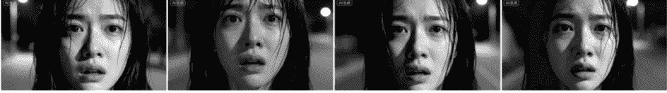

图8-2 生成画面

##### 第二步，Seedance静态画面动态化，还原剧情张力

静态画面优化完成后，借助Seedance将其转化为动态视频片段，核心是还原分镜要求的镜头运动、人物动作与场景氛围。具体操作分为三步：一是直接点击前面生成的静态图后，点"生成视频"按钮，如图8-3所示。

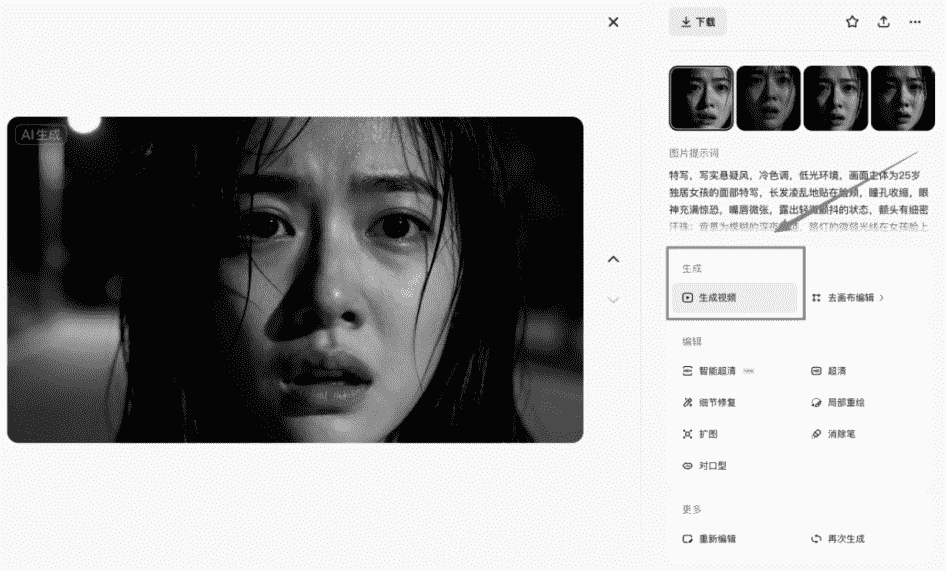

图8-3 Seedance生成视频操作界面

二是静态转动态和画面优化，按分镜要求直接生成动态分镜，画面参数可自由匹配，选择Seedance 2.0模型，添加首尾帧进行参考，解决动态卡顿、动作生硬问题，保障画面流畅度，如图8-4所示。

三是音画适配前置操作：借助Seedance的AI音效、AI配乐、重新配音功能提前完成音画适配，减少剪映重复操作，如图8-5所示。

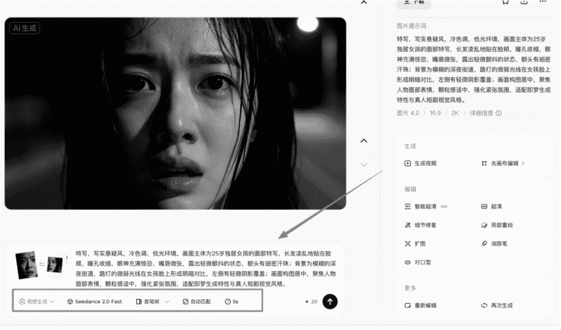

图8-4 Seedance生成视频操作界面

图8-5 Seedance 生成视频编辑界面

##### 第三步，剪映拼接镜头，精准把控节奏

动态片段生成后，借助剪映进行镜头拼接与节奏优化，确保短剧紧凑流畅。具体操作分为三步：一是导入素材与搭建框架，打开剪映，设置项目参数为2K 分辨率、16：9竖屏、30帧，将Seedance生成的动态片段按镜号顺序导入，拖动至时间轴的"视频轨道"，拼接形成完整剧情框架，如图8-6所示。二是精准变速调整，选中时间轴上的片段，针对冲突爆发段落（例如镜号6～7），通过剪映"变速"功能将速度调整为1.2倍，增强紧张感；针对反转与情感落点段落（例如镜号10～12），保持正常速度（1倍），舒缓氛围，确保全片节奏张弛有度。

三是优化镜头衔接，在快切镜头之间（例如镜号3～4）设置0.1秒"切镜"过渡，在情绪转折镜头之间（例如镜号7～8）设置0.2秒"淡入淡出"过渡，避免衔接突兀，增强观看流畅度，如图8-7所示。

##### 第四步，音画深度适配，强化剧情氛围

音画适配是提升短剧感染力的核心，需结合剧情情绪，搭配背景音乐、台词配音与音效，实现音画协同。具体操作分为三步：一是选择背景音乐，根据短剧风格选择适配的纯音乐，都市悬疑类可选择节奏紧凑的电子纯音乐，在冲突段落（镜号6～7）提高音量至80%，在反转与情感段落（镜号10～12）降低音量至50%，背景音乐音量避免盖过台词与音效，如图8-8所示。

二是添加台词配音，借助剪映的"文字转语音"功能，输入脚本中的台词，也可使用添加口播稿功能润色台词，如图8-9所示。

三是优化音效层次，将前期导入的环境音、动作选择贴合人物性格的配音音色，调整配音语速与画面中人物的口型（或动作）同步，音量控制在70%，如图8-10所示。

##### 第五步，添加字幕与细节优化，提升专业度

字幕添加与细节优化是成片的点睛之笔，需确保字幕清晰同步、细节无瑕疵。具体操作分为两步。

一是生成与优化字幕，借助剪映的"智能字幕"功能，自动识别台词配音，生成对应的字幕，批量调整字幕样式：字体选择简约清晰的黑体，颜色选择白色（搭配黑色描边，描边宽度2px），大小调整为35号，位置放置在画面底部中央，避免遮挡人物与核心场景；逐句核对字幕与台词的同步性，修正错别字与时长偏差，如图8-11所示。

二是强化氛围细节，针对悬疑氛围段落（例如镜号1～7），借助剪映的"滤镜"功能，添加"墨色胶卷"滤镜，强度调整为30%，增强紧张感，如图8-12所示。

##### 第六步，导出成片，适配抖音发布

细节优化完成后，即可导出完整短剧，导出参数直接影响成片质量与平台适配性。具体操作分为两步：一是设置导出参数，点击剪映右上角的"导出"按钮，设置分辨率为2K（3840×2160）、帧率为30帧、格式为MP4（抖音通用格式），画质选择"高清"，确保成片清晰无模糊；二是导出与预览，确认参数无误后点击"导出"，2分钟短剧的导出时间通常为3～5分钟，导出过程中避免关闭剪映，如图8-13所示。

#### 8.3.3 真人短剧成片实操的注意事项

动态效果自然，贴合剧情氛围：Seedance动态化设置时，需严格遵循分镜要求的镜头运动与人物动作，避免添加多余动态效果（例如无意义的摇镜、缩放），确保动态效果服务于剧情氛围。冲突段落可适当增强镜头运动幅度与速度，情感段落则保持动态平缓，避免动作生硬或镜头突兀，影响代入感。

**节奏把控精准，避免拖沓或过快：**剪映变速调整时，需结合剧情节奏合理设置速度，确保冲突段落紧凑不杂乱，情感段落舒缓不拖沓。2分钟短剧的整体节奏需控制在"平均每秒1～2个镜头切换"，避免单镜头时长超过10秒或切换过快导致画面混乱，确保用户能清晰地捕捉剧情信息。

# 第四部分 内容IP制作实操

## 第9章 漫剧视频制作实操

### 9.1 创意构思：IP角色设计与故事结构

漫剧IP的核心竞争力在于角色形象，有记忆点、有辨识度的角色是IP沉淀与粉丝积累的基础，也是后续变现的核心载体。漫剧角色形象塑造不同于真人短剧的人物设定，需兼顾漫画的视觉夸张感与角色的性格辨识度，核心任务是明确角色的核心特质、视觉风格与人设标签，通过AI工具实现角色形象的标准化、统一化塑造，避免出现前后形象偏差、辨识度低等问题。

#### 9.1.1 借助豆包+即梦进行漫剧IP角色塑造的优势

豆包可快速接收角色的核心人设信息，例如角色定位、性格特质、年龄、身份、人设标签，拆解出能体现角色特质的视觉细节（例如高冷角色的眼神、服饰，软萌角色的发型、神态），避免角色同质化，让每个角色都有独特的记忆点。

#### 9.1.2 借助豆包+即梦进行漫剧IP角色塑造的核心步骤

##### 第一步，明确角色核心人设，拆解关键信息

角色形象塑造的首要前提是明确角色的核心人设与关键信息，这是后续视觉塑造、细节优化的基础。创作者需先梳理每个核心角色的核心信息，例如角色定位（主角、配角、反派）、性格特质、年龄、身份、人设标签、核心反差（例如外冷内热、表面软萌实则强大），以及角色所处的漫剧场景（古风、都市、悬疑），确保人设清晰、有辨识度，贴合漫剧的整体风格与IP定位。实操中可借助豆包，输入相关信息，获取精准的人设拆解与核心细节提炼，示例提示词分三个高频场景呈现，确保具体可落地，规避笼统表述。

场景1：古风言情漫剧（主角1，女主，软萌医女，目标受众是18～25岁女性，核心人设是外软内刚、医术高明，年龄18岁，身份是隐居医者的弟子，人设标签是软萌、善良、坚韧、医术精湛，核心反差是平时温柔软萌，遇到不公时会坚定反击），提示词如下：

帮我拆解古风言情漫剧女主的核心人设，明确角色定位为主角、软萌医女，目标受众是18～25岁女性，核心性格特质是外软内刚、善良坚韧，年龄18岁，身份是隐居医者的弟子，人设标签是软萌、善良、坚韧、医术精湛，核心反差是平时温柔软萌、说话轻声细语，遇到不公或需要保护他人时，会变得坚定勇敢、气场十足。帮我提炼能体现角色特质的关键视觉细节，包括发型、服饰、神态、标志性动作、配饰，贴合古风场景，避免同质化，确保角色有独特记忆点，同时明确角色的色彩基调，为后续即梦生成角色画面提供精准指引，优化细节描述，让视觉形象与性格高度匹配。

豆包根据指令生成内容如下：

###### 古风言情漫剧·软萌医女人设视觉拆解

定位：18岁隐居医徒·外软内刚女主

色彩基调：主色雾白+浅青+淡粉，点缀暖棕、浅金，清透温柔，遇反差时添冷白+墨色线条强化气场

####### 一、发型（软萌+灵秀，不撞款）

- 半束垂云髻，两侧留细柔碎须刘海，显脸小圆软
- 发尾微卷不贴头皮，脑后松挽低髻，余发自然垂肩
- 仅用素色木簪/浅青丝带固定，无繁复头饰

####### 二、服饰（医女感+软感，不厚重）

- 交领窄袖襦裙，面料轻薄垂顺，方便行医动作
- 主色雾白+浅豆青，袖口、裙边绣极简淡粉忍冬/艾草纹
- 腰间系浅棕药囊腰带，裙摆短一截便于行走

……

场景2：都市甜宠漫剧（主角2，男主，高冷总裁，目标受众是18～28岁女性，核心人设是外冷内热、宠妻狂魔，年龄28岁，身份是上市公司总裁，人设标签是高冷、腹黑、深情、宠妻，核心反差是对外人冷漠疏离、不苟言笑，对女主温柔体贴、耐心十足），提示词如下：

帮我拆解都市甜宠漫剧男主的核心人设，明确角色定位为主角、高冷总裁，目标受众是18～28岁女性，核心性格特质是外冷内热、腹黑深情，年龄28岁，身份是上市公司总裁，人设标签是高冷、腹黑、深情、宠妻，核心反差是对外人冷漠疏离、不苟言笑、气场强大，对女主温柔体贴、耐心十足、偶尔会撒娇。帮我提炼能体现角色特质的关键视觉细节，包括发型、服饰、神态、标志性动作、配饰，贴合都市高端场景，避免俗套，确保角色有独特记忆点，明确角色的色彩基调与视觉风格，为后续即梦生成角色画面提供精准指引，细化细节描述，让视觉形象与性格高度契合。

豆包根据指令生成内容如下：

###### 都市甜宠漫剧·高冷总裁男主视觉人设拆解

基础信息：28岁上市公司总裁|外冷内热|腹黑深情|对外冷硬对内温柔

核心标签：高冷、腹黑、深情、宠妻

色彩基调：冷白+黑灰+雾蓝为主，触碰女主时点缀暖金、浅驼

####### 一、发型

- 冷感黑灰渐变短发，侧分微弧不遮眉
- 发丝利落服帖，无多余碎发，精英感极强
- 低头看女主时额前微垂一缕，软化气场

####### 二、面部神态

- 冷白皮，骨相锋利，眉骨高挺

……

场景3：悬疑短篇漫剧（主角3，反派，伪善律师，目标受众20～35岁，核心人设是表面温和、内心阴暗，年龄35岁，身份是知名律师，人设标签是伪善、腹黑、精明、狠辣，核心反差是平时温和有礼、善于伪装，私下里阴狠狡诈、不择手段），提示词如下：

帮我拆解悬疑短篇漫剧反派的核心人设，明确角色定位为反派、伪善律师，目标受众20～35岁，核心性格特质是表面温和、内心阴暗、精明狠辣，年龄35岁，身份是知名律师，人设标签是伪善、腹黑、精明、狠辣，核心反差是面对他人时温和有礼、谈吐优雅、善于伪装，私下里眼神阴鸷、手段狠辣、不计后果。帮我提炼能体现角色特质的关键视觉细节，包括发型、服饰、神态、标志性动作、配饰，贴合悬疑氛围与律师身份，突出伪善与阴狠的反差，确保角色有独特记忆点，明确角色的色彩基调与视觉风格，为后续即梦生成角色画面提供精准指引，细化细节描述，让视觉形象与性格高度匹配。

豆包根据指令生成内容如下：

###### 伪善律师·反派核心人设+视觉拆解（适配悬疑漫剧·20～35岁受众）

####### 一、人设定位

身份：35岁知名精英律师

核心标签：伪善、腹黑、精明、狠辣

核心反差：人前温和优雅绅士，人后阴鸷冷血不择手段

####### 二、关键视觉细节

######## 1.发型

- 深色偏分短发，整齐服帖、一丝不苟，无碎发
- 光影下边缘利落，显冷静克制

……

##### 第二步，借助豆包，细化角色视觉细节，优化提示词

核心人设明确后，需借助豆包，结合漫剧场景与IP定位，细化角色的视觉细节，优化即梦生成所需的提示词，核心原则是"细节具体、风格统一、贴合人设、有辨识度"，避免模糊表述，确保即梦生成的角色画面精准贴合预期。不同漫剧场景适配的视觉风格、细节元素不同，需结合场景特性灵活调整，例如古风漫剧适配汉服、发簪等元素，都市漫剧适配西装、高跟鞋等元素，悬疑漫剧适配深色服饰、冷冽眼神等元素。

##### 第三步，确定角色视觉风格，明确统一标准

漫剧IP角色塑造需确保所有核心角色的视觉风格统一，贴合漫剧的整体风格与IP定位，避免出现角色风格杂乱、违和的问题。借助豆包，结合漫剧场景与核心人设，确定统一的视觉风格、线条质感、色彩基调，明确角色形象的统一标准，例如古风漫剧统一为"唯美古风、线条细腻、色彩柔和"，都市漫剧统一为"简约高端、线条利落、色彩冷调"，悬疑漫剧统一为"暗黑悬疑、线条硬朗、色彩偏暗"。

#### 9.1.3 漫剧IP角色塑造的注意事项

**人设清晰具体，细节无歧义：**借助豆包梳理人设、撰写提示词时，需明确包含角色的核心要素，尤其是角色定位、性格特质、年龄、身份、人设标签、核心反差等关键信息，避免模糊表述。

### 9.2 脚本与分镜设计：漫剧叙事结构

漫剧分镜及故事情节设计是连接角色形象与成片制作的核心纽带，也是确保漫剧剧情有张力、节奏紧凑、贴合IP定位的关键环节。与短视频广告、真人短剧的分镜剧情不同，漫剧分镜需兼顾漫画的视觉质感与短视频的快节奏，故事情节需兼顾情感共鸣与IP沉淀，核心是通过分镜的视觉呈现，将故事情节生动传递，同时突出角色形象、强化剧情冲突，吸引用户持续观看，为IP化变现积累粉丝。

#### 9.2.1 借助豆包+即梦+Seedance设计漫剧分镜及故事情节的优势

传统漫剧分镜及故事情节设计，不仅需要创作者熟练掌握漫剧叙事逻辑、镜头语言，还需兼顾角色人设、剧情张力与IP定位，对专业能力要求极高；在设计过程中，难以直观预判画面落地效果，容易出现镜头节奏与剧情脱节、分镜画面过于复杂导致实际生成无法实现、故事情节平淡无共鸣、角色人设崩塌等问题，整体流程烦琐、耗时较长。

普通创作者借助豆包、即梦与Seedance的协同组合，可以很好地设计脚本与分镜。

#### 9.2.2 漫剧故事情节设计的核心步骤

##### 第一步，明确剧情核心与定位，梳理整体框架

故事情节设计需立足漫剧IP定位与角色人设，先借助豆包全面梳理漫剧的核心信息与剧情框架，为后续情节细化、冲突设计提供明确依据。重点梳理内容包括：漫剧整体定位（古风言情、都市甜宠、悬疑短篇等）、剧情核心主题（救赎、成长、深情等）、单集时长、连载节奏（单集一个小冲突，多集一个大冲突等）、角色关系（主角、配角、反派的核心关系等）、核心冲突与情感共鸣点，确保剧情框架不偏离角色人设、IP定位，同时适配短视频漫剧的快节奏特点。

##### 第二步，借助豆包，细化单集故事情节，设计冲突与共鸣点

基于梳理好的剧情框架与角色人设，结合前期角色的核心特质，借助豆包细化单集故事情节，明确单集的节奏节点（3秒抓睛、45秒剧情推进、12秒结尾悬念），设计核心冲突与情感共鸣点，确保单集剧情有张力、有记忆点，同时贴合角色人设，避免人设崩塌。单集情节需包含开头抓睛、中间冲突推进、结尾悬念三个部分，适配短视频漫剧的快节奏，吸引用户持续追更。

实操中可上传剧情框架与角色人设，输入提示词快速生成单集故事情节，示例提示词如下：

为古风言情连载漫剧设计单集故事情节，该漫剧单集时长60秒，剧情核心主题为软萌医女救赎温润公子、双向奔赴，核心角色为女主苏清颜（软萌医女，外软内刚、医术高明）、男主沈砚之（温润公子，身负重伤、隐于市井，身份神秘），角色关系为女主救赎男主、双向守护，单集节奏节点为3秒抓睛、45秒剧情推进、12秒结尾悬念，核心冲突为男主伤口复发、被追杀者追踪，情感共鸣点为女主的善良坚韧与男主的温柔隐忍。借助豆包细化单集故事情节，明确开头、中间、结尾的具体内容，贴合角色人设，避免人设崩塌，剧情有张力、有情感共鸣，结尾设置悬念吸引用户追更，同时适配即梦+Seedance生成需求，情节细节便于后续分镜设计与动态化呈现，补充具体的情节对话与动作细节。

豆包接收指令后会生成细化的单集故事情节，清晰呈现单集的完整内容，同时优化情节对话与动作设计，确保贴合角色人设，剧情有张力、有共鸣。

#### 9.2.3 漫剧分镜设计的核心步骤

##### 第一步，拆分镜头单元，明确核心设计维度

以单集故事情节为基础，按照漫剧节奏与情节顺序，将单集剧情拆分为若干个独立的分镜单元，确保每个分镜都能精准对应剧情内容、传递角色特质与剧情冲突，同时兼顾单集漫剧的整体节奏。分镜数量需结合单集时长合理规划，常规情况下每分钟10～15个分镜为宜，60秒漫剧建议设置10～12个分镜，确保镜头节奏紧凑，适配短视频漫剧的快节奏特点，同时避免镜头过于密集或稀疏，影响剧情传递与角色塑造。

##### 第二步，细化画面描述，适配即梦生成，突出核心重点

分镜的核心是"可视化指引+角色塑造+剧情传递"，需为每个分镜单元撰写详细、具象的画面细节描述，这份描述将直接作为即梦生成静态画面的核心提示词，描述越精准、核心重点越突出，AI生成效果与预期的匹配度越高。描述内容需全面覆盖画面主体、角色特征、动作表情、场景元素、色彩光影、风格基调、情感氛围，重点突出角色的微表情、动作细节与剧情冲突，贴合漫剧的IP定位与短视频传播需求。

漫剧分镜的画面描述需突出漫画质感，线条细腻、色彩贴合风格基调，同时明确角色的固定特征（发型、服饰、神态），确保与角色人设保持一致，避免前后偏差；若有剧情冲突，需重点描述冲突的细节（角色的动作、眼神、场景氛围），突出冲突张力；若有情感共鸣点，需重点描述角色的微表情与动作，传递角色情感。例如针对上述剧情中"女主为男主包扎伤口"的分镜，画面细节描述优化为：

中景，唯美古风风格，线条细腻流畅，柔和曲线勾勒角色轮廓；16：9竖屏，高清2K，画面清晰细腻，无噪点，突出角色情感与画面质感；场景为破旧的小屋内，昏暗的灯光，墙角有些蛛网，桌上摆放着药瓶、纱布等医用品，背景有轻微的雨声，营造紧张又温暖的氛围；画面主体为女主苏清颜与男主沈砚之，女主身着淡粉色襦裙，蓬松发髻上的珠花轻微晃动，眼神温柔却坚定，眉头轻轻皱起，神色专注，正小心翼翼地为男主清理伤口，手指纤细，动作轻柔；男主身着白色锦袍，衣衫被鲜血染红，脸色苍白，靠在墙角，眼神温柔地看着女主，眼底有一丝愧疚与感激，嘴角带轻微笑意；画面构图居中，聚焦两人的动作与表情，光影效果为柔和暗光，突出女主的善良坚韧与男主的温润隐忍，适配即梦生成特性，同时清晰传递两人双向守护的情感共鸣点，贴合古风言情漫剧场景，突出漫画质感。

##### 第三步，整合分镜信息，生成标准分镜表

所有分镜单元拆解与描述完成后，需将其整合为标准化分镜表，形成统一的创作指引，方便后续即梦画面生成、Seedance动态化及剪辑环节高效衔接。分镜表需完整包含九大核心要素，按"镜号—景别—镜头运动—画面构图—光影效果—画面描述—时长—对应对话—核心呈现重点"的顺序整理，无需手动排版，借助豆包输入提示词即可快速生成。示例提示词如下：

将古风言情漫剧单集的10个分镜单元整理为标准化分镜表，标注镜号、景别、镜头运动、画面构图、光影效果、画面描述、时长、对应对话、核心呈现重点，画面描述贴合唯美古风风格、线条细腻流畅的视觉要求，突出角色微表情、动作细节与剧情冲突，镜头运动简洁适配即梦+Seedance生成特性，角色特征与人设保持一致，对话与单集剧情对应，时长与单集节奏节点精准匹配，贴合古风言情漫剧的IP定位，确保每个分镜都能清晰传递角色特质、剧情冲突与情感共鸣点。

豆包根据指令生成内容如表9-1所示。

###### 表9-1 古风言情漫剧单集标准化分镜表

| 镜号 | 景别 | 镜头运动 | 画面构图 | 光影效果 | 画面描述（唯美古风） | 时长 | 对应对话 | 核心呈现重点 |
|:---:|:---:|:---:|:---|:---|:---|:---:|:---|:---|
| 1 | 全景 | 缓慢推镜 | 对称构图，月洞门为中心，衬梅枝廊影 | 月色柔光，淡银色调，明暗过渡柔和 | 冬夜庭院白梅缀枝，女主月白襦裙立廊下，捻梅垂眸，神色温婉疏离 | 3s | 女主OS：今岁梅开，竟与往年不同了 | 铺垫氛围，展现女主温婉疏离人设与心事 |
| 2 | 中景 | 固定镜头 | 三分构图，女主居右，梅枝宫灯留白 | 月色侧光，宫灯暖光点缀，冷暖中和 | 女主拂过梅瓣，花瓣落袖口，眉眼微抬，神色柔和落寞 | 2s | 无 | 突出女主气质与情绪，展现服饰细节 |

……

生成后的分镜表需再次核对，重点检查画面描述的一致性、时长与剧情的匹配度、角色特征的统一性、光影效果与视觉风格的适配性，以及核心呈现重点的清晰度，确保无细节偏差，为后续创作环节筑牢基础，确保即梦生成的静态画面、Seedance生成的动态视频都能精准传递角色人设、剧情张力与情感共鸣点。

#### 9.2.4 漫剧分镜及故事情节设计的注意事项

**分镜设计适配 AI 生成特性，避免复杂画面，突出核心重点：** 借助AI进行分镜设计时，需充分考虑即梦与Seedance的生成局限，分镜画面的构图、镜头运动、场景元素需简洁明了，避免设计过于复杂的画面。

**故事情节贴合角色人设，杜绝人设崩塌，强化情感共鸣：** 故事情节与分镜设计中，需严格延续角色塑造阶段确定的角色人设，在豆包提示词与分镜画面描述中需反复明确这些信息，避免出现人设崩塌的问题。

### 9.3 成片实操：漫剧视频生成完整流程

漫剧的成片实操是IP化变现的最后一个关键环节，核心任务是将7.2章节生成的静态分镜画面、故事情节，通过Seedance的动态化功能、即梦的画面优化能力，结合剪映的剪辑工具，完成镜头拼接、动态效果设置、音画适配、字幕添加、细节优化与悬念强化，最终输出符合短视频漫剧传播逻辑、贴合IP定位、能吸引粉丝追更的完整漫剧视频。

#### 9.3.1 借助Seedance+即梦+剪映进行漫剧视频成片实操的优势

Seedance可直接将即梦生成的静态分镜画面转化为动态漫剧镜头，无需专业动画制作环节，单人即可完成动态化操作；剪映操作简单、功能齐全，内置多种漫剧专属模板（古风漫剧字幕模板、悬念文字模板、音效库等），无需手动调整复杂参数，新手也能快速上手，大幅缩短成片制作时间，从静态分镜到完整成片，最快30分钟即可完成。

#### 9.3.2 漫剧视频成片实操全流程

##### 第一步：静态画面优化

前期即梦生成的静态分镜画面，需先进行统一优化，确保画面风格、色调、清晰度、线条质感一致，突出漫剧的漫画质感，为后续动态化与剪辑奠定基础，避免出现画面杂乱、色调偏差、线条生硬等问题。操作核心是统一视觉参数、修复画面瑕疵、突出角色与剧情重点，具体步骤如下：

- 1. 批量导入分镜画面：打开即梦，导入前期生成的所有静态分镜画面（需与分镜表一一对应），选择"导入无限画布"功能，避免因单张画面单独调整导致的风格不统一。

- 2. 统一视觉参数：按照角色塑造与分镜设计阶段确定的视觉风格（唯美古风、线条细腻、色彩柔和等），批量调整画面亮度、对比度、饱和度，参数参考：亮度+3、对比度+8、饱和度+12，确保画面清晰明亮、色调统一，同时突出漫剧的漫画质感，强化角色的色彩搭配（女主的淡粉色襦裙、男主的白色锦袍等）；若部分画面存在偏暗、偏灰问题，可单独微调，避免批量调整导致的画面失真。

- 3. 修复画面瑕疵：检查每张画面，修复AI生成可能出现的瑕疵（线条生硬、角色细节失真、背景杂物、色彩溢出等），借助即梦"瑕疵修复""细节增强""线条优化"功能，重点优化角色特写画面（角色的面部表情、动作细节等）与剧情冲突画面（男主的伤口、女主的包扎动作等），确保角色细节清晰可见，线条细腻流畅，突出核心剧情与角色特质，如图9-1所示。

- 4. 统一画面比例：批量将所有画面调整为9：16横屏，分辨率设置为1080P（高清），避免出现画面拉伸、黑边等问题，同时适配Seedance动态化与剪映剪辑需求。

- 5. 导出优化后画面：优化完成后，批量导出画面，命名格式为"镜号+画面内容"，便于后续对应分镜表与剧情，提升操作效率，如图9-2所示。

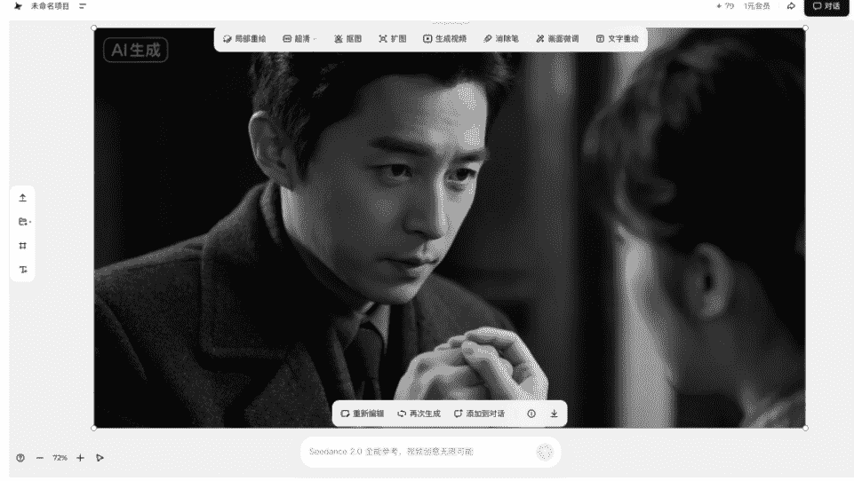

图9-1 即梦无限画布功能

图9-2 即梦优化分镜

##### 第二步：动态化生成（Seedance实操）

动态化是漫剧成片的核心环节，核心任务是将优化后的静态分镜画面，转化为连贯的动态镜头，贴合分镜表中的镜头运动、角色动作与剧情节奏，突出漫剧的动画质感，同时避免动态效果生硬，确保画面流畅自然，强化角色情感与剧情冲突。操作需严格对应分镜表中的镜头运动要求，结合漫剧特点，重点优化角色动作的流畅度，具体步骤如下：

- 1. 导入静态画面：点击"生成视频"按钮，导入优化后的静态分镜画面，按照分镜表镜号顺序排列，确保镜头顺序与剧情一致，避免出现镜头错乱。

- 2. 逐镜设置动态效果：结合分镜表中的镜头运动要求（固定、轻微推镜、特写聚焦等），逐镜设置动态效果，重点贴合角色动作与剧情节奏，突出角色情感与剧情冲突，如图9-3所示。

示例如下：镜号1（男主特写）：设置"轻微摇镜+动态模糊"，缓慢移动镜头，添加轻微动态模糊效果，突出深情对视效果，搭配雨夜的氛围。

- 3. 统一动态参数：批量设置动态速度，常规镜头速度为1倍速，角色特写镜头、剧情冲突镜头（男主的眼神、女主的皱眉等）速度放缓至0.8倍速，抓睛镜头、结尾悬念镜头速度保持1倍速，确保动态节奏与漫剧单集节奏（3秒抓睛、45秒剧情推进、12秒结尾悬念）匹配；同时，统一动态过渡效果，优先选择"淡入淡出""切镜"，避免复杂过渡特效导致的画面杂乱，贴合漫剧漫画质感，避免过度花哨影响剧情传递。

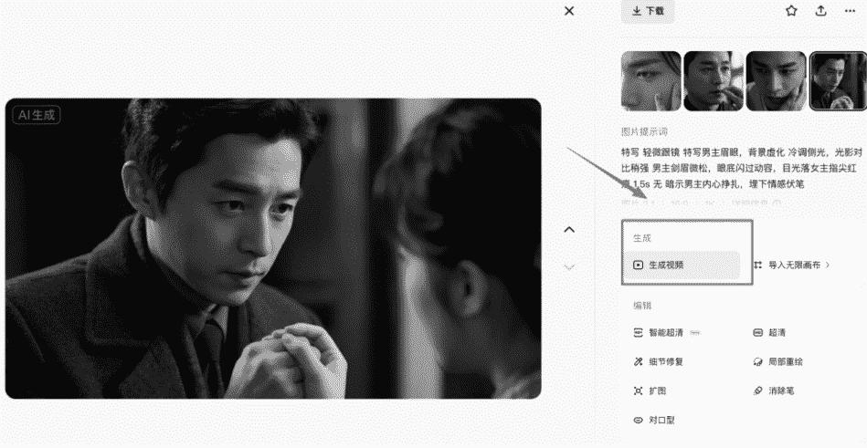

图9-3 Seedance模型使用跳转步骤

##### 第三步：镜头拼接

动态分镜镜头导出后，借助剪映进行镜头拼接，核心任务是按照分镜表的镜号顺序，将所有动态镜头无缝衔接，调整镜头衔接节奏，确保剧情流畅连贯，贴合单集漫剧的快节奏特点，同时避免镜头衔接突兀、错乱等问题，为后续音画适配、字幕添加奠定基础。具体步骤如下：

- 1. 新建项目并导入素材：打开剪映，新建项目，导入Seedance导出的所有动态分镜镜头，按照"镜号+画面内容"的命名，拖入剪辑轨道，确保镜头顺序与分镜表、故事情节完全一致，避免出现镜头错乱、颠倒的情况，如图9-4所示。

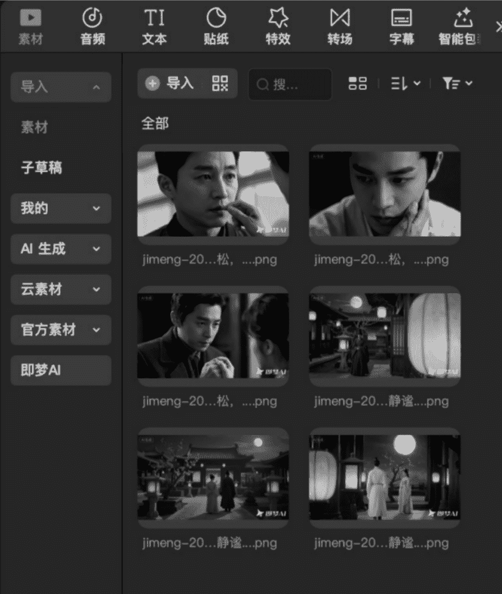

图9-4 剪映整理素材界面

- 2. 无缝衔接镜头：选中相邻两个镜头，单击"转场"功能，选择与漫剧风格适配的简单转场，优先选用"淡入淡出""叠化"（时长0.3～0.5秒），剧情冲突激烈的镜头（门外敲门声响起、男主眼神变冷等）可选用"切镜"，无需复杂转场特效，避免喧宾夺主，确保镜头衔接自然流畅，贴合剧情节奏；同时，检查每个镜头的首尾衔接处，若出现画面断层、卡顿，可微调镜头时长，删除多余帧，确保衔接无缝，如图9-5所示。

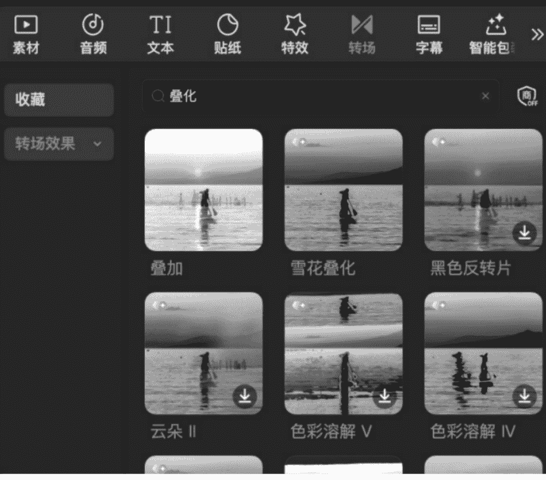

图9-5 剪映转场效果选择界面

- 3. 调整镜头整体节奏：结合单集漫剧60秒的时长要求，逐镜核对镜头时长，对照分镜表中的时长标注，微调每个镜头的时长，确保所有镜头总时长与单集时长完全匹配；重点优化3秒抓睛、45秒剧情推进、12秒结尾悬念的节奏分配，若剧情推进镜头过于冗长，可适当删减多余帧，若结尾悬念镜头时长不足，可适当延长，确保节奏紧凑、张弛有度，贴合短视频漫剧的传播逻辑，如图9-6所示。

- 4. 初步预览拼接效果：镜头拼接完成后，点击整体预览，检查镜头顺序、衔接流畅度、节奏合理性，重点查看剧情是否连贯、镜头切换是否贴合剧情冲突与情感变化，若出现问题，及时调整，确保镜头拼接后能完整传递单集故事情节，突出角色特质与剧情张力。

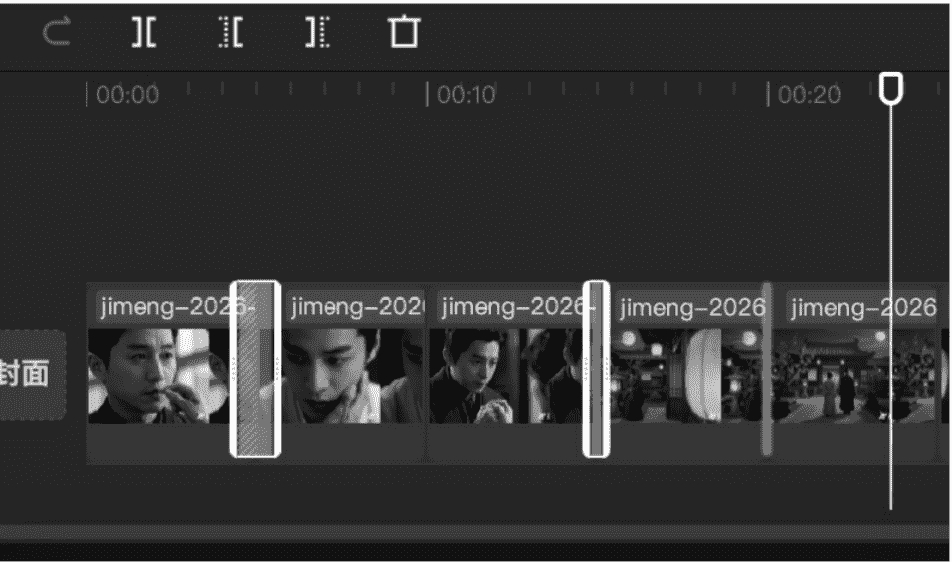

图9-6 剪映镜头调整界面

##### 第四步：音画适配

音画适配是漫剧成片的关键，核心是搭配贴合剧情氛围、角色情感的背景音乐与音效，实现音画同步，强化剧情张力与情感共鸣，避免出现音效与剧情脱节、背景音乐盖过角色对话等问题，提升漫剧的观看体验。操作需结合古风言情漫剧的氛围，重点适配剧情节奏与情感变化，具体步骤如下：

- 1. 选择并添加背景音乐：点击剪映"音频"功能，选择"背景音乐"，搜索"古风温柔纯音乐"，筛选节奏舒缓、旋律柔和的音乐（古筝、笛子合奏曲目等），拖入音频轨道；调整背景音乐音量，设置为20%～25%，确保背景音乐不盖过后续添加的角色对话与音效，同时贴合剧情氛围—剧情平缓（女主包扎伤口）时，音乐节奏放缓；剧情紧张（门外敲门声）时，可适当提升音量（30%左右），强化紧张氛围；结尾悬念部分，可逐渐减弱音乐音量，直至消失，突出悬念感，如图9-7所示。

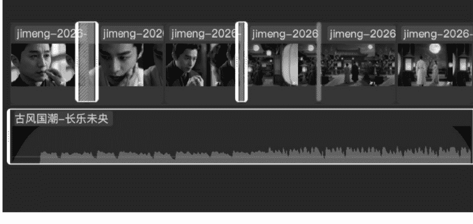

图9-7 剪映背景音乐调节界面

- 2. 添加场景音效与动作音效：结合剧情细节，添加对应的音效，增强画面的代入感，示例如下：雨夜场景添加"轻微雨声""脚步声"，音量设置为15%～20%；女主推门添加"推门声"，音量25%；包扎伤口添加"纱布摩擦声""轻微药水倒出声"，音量20%；门外添加"敲门声""呼喊声"，音量设置为30%，贴合剧情紧张感；将所有音效拖入音频轨道，与对应镜头精准同步，避免出现音效提前或滞后的问题，如图9-8所示。

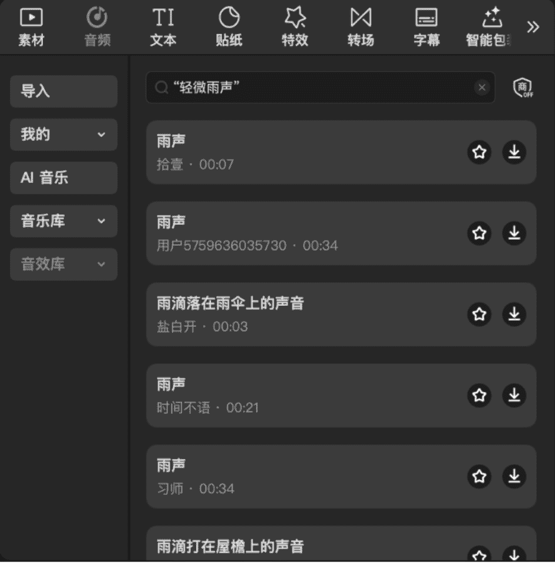

图9-8 剪映音效选择界面

- 3. 预留角色对话音频轨道：若后续需要添加角色配音，可提前在剪映中新建音频轨道，标注"角色对话"，预留对应位置，确保配音添加后与画面、背景音乐、音效协调统一，音量设置为35%～40%，确保对话清晰可闻，同时不与其他音频冲突。

- 4. 音画同步核对：音画素材添加完成后，逐镜预览，核对音效、背景音乐与画面的同步性，重点检查音效与角色动作、场景变化的匹配度，调整音频时长与音量，确保音画高度同步，贴合剧情节奏与情感变化，提升漫剧的观看体验，如图9-9所示。

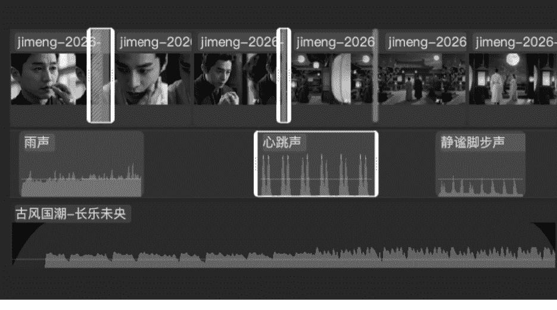

图9-9 剪映音画同步界面

##### 第五步：字幕添加

字幕是漫剧传递剧情、角色情感的重要载体，核心任务是添加角色对话字幕与关键提示字幕，确保字幕清晰、准确、简洁，贴合角色人设与剧情节奏，同时适配漫剧的视觉风格，避免出现字幕杂乱、错别字、字体违和等问题。具体步骤如下：

- 1. 生成并优化角色对话字幕：点击剪映"文本"功能，选择"自动字幕"，或导入预留的角色对话音频（或手动输入对话内容），剪映会自动识别对话，生成对应字幕；逐句核对字幕，修改错别字、语句不通顺的地方，确保字幕与角色对话完全一致，如图9-10所示。

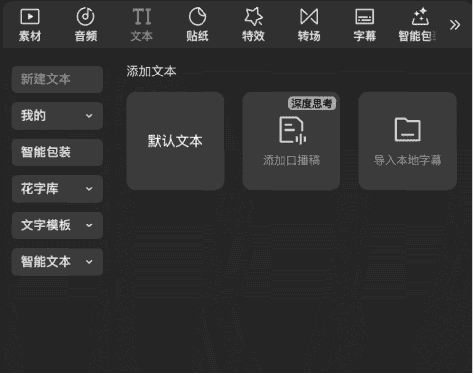

图9-10 剪映添加文本界面

- 2. 添加关键提示字幕：结合剧情重点，添加关键提示字幕，突出剧情冲突与情感共鸣点，示例如下：女主坚定回应时，添加字幕"我不会丢下你的"，如图9-11所示。

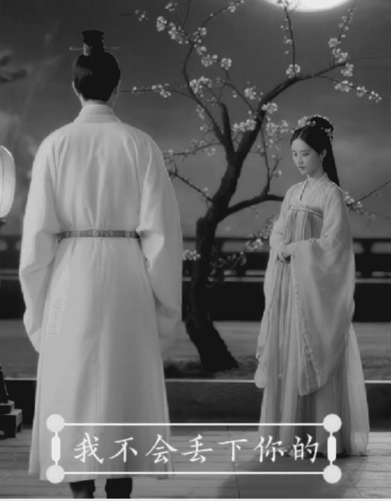

图9-11 剪映添加字幕界面

- 3. 统一字幕格式：批量调整所有字幕的字体大小、行距、位置，确保字幕格式统一—对话字幕放置在画面下方1/5处，关键提示字幕放置在画面上方1/5处或中间位置；字幕时长设置为"对话结束后延迟0.5秒消失"，确保用户有足够时间阅读；避免字幕过多、过于冗长，简洁明了地传递核心信息，贴合短视频漫剧的快节奏特点，还可以设置字幕入场出场方式，如图9-12所示。

- 4. 字幕核对预览：字幕添加完成后，整体预览，检查字幕的准确性、清晰度、格式统一性，以及字幕与画面、音频的同步性，若出现字幕遮挡角色、字体违和、同步偏差等问题，逐一调整，确保字幕为剧情传递、角色塑造提供辅助，提升漫剧的可读性。

##### 第六步：细节优化

细节优化是提升漫剧成片质量的关键，核心任务是优化画面色调、强化剧情重点、修复剪辑瑕疵，确保漫剧成片贴合IP定位、视觉效果统一、剧情传递清晰，同时规避常见剪辑误区，提升用户观看体验。具体步骤如下：

- 1. 统一画面色调：点击剪映"滤镜"功能，选择贴合古风言情漫剧的滤镜（"古风""丹青"等），强度设置为30%～40%，批量应用于所有镜头，确保全片画面色调统一，贴合唯美古风的视觉风格，如图9-13所示。

同时，逐镜微调色调，针对偏暗、偏亮的镜头，单独调整亮度、对比度，确保画面亮度均匀，角色细节清晰可见，避免出现色调偏差、画面失真的问题。

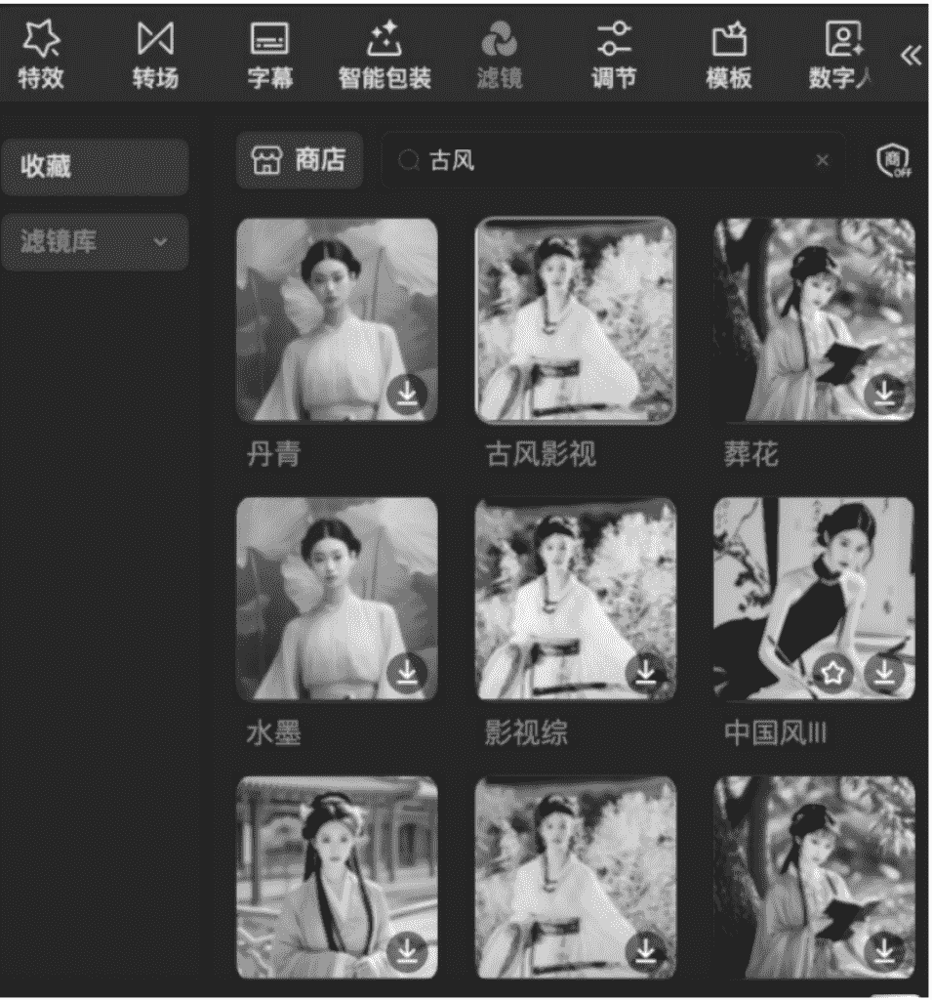

图9-13 剪映古风滤镜选择界面

- 2. 强化剧情重点：针对剧情核心冲突、角色情感共鸣点（女主包扎伤口、男主眼神变化、门外敲门声等），借助剪映"特效"功能，添加轻微的强化效果—角色特写镜头添加"轻微柔焦"特效，突出角色微表情；剧情紧张镜头添加"轻微震动""模糊边缘"特效，强化紧张氛围；特效强度控制在20%～30%，避免过度花哨，确保不影响剧情传递与角色塑造，如图9-14所示。

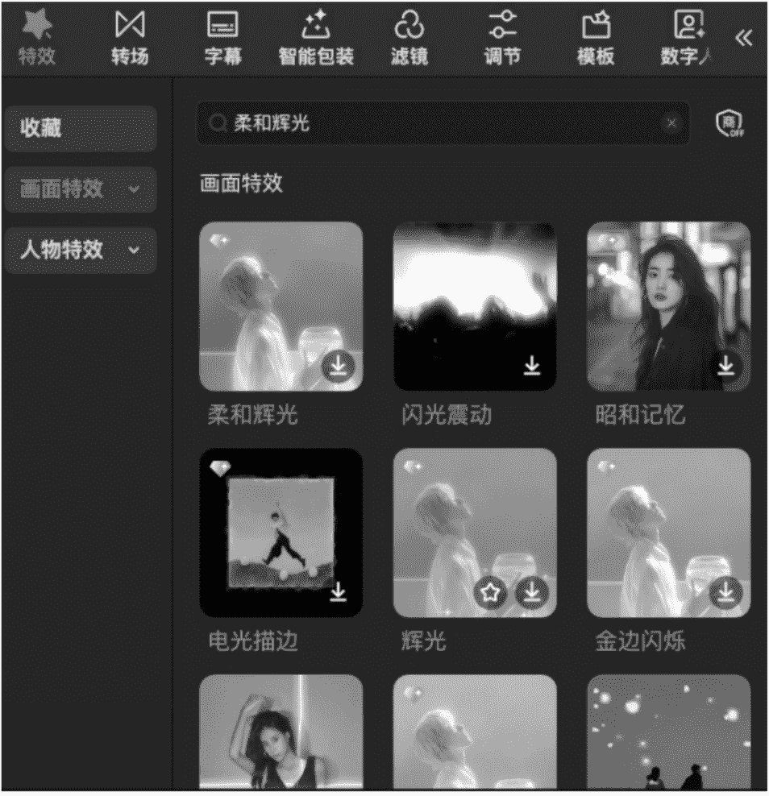

图9-14 剪映特效选择界面

- 3. 修复剪辑瑕疵：逐镜检查成片，修复剪辑过程中出现的瑕疵，例如镜头衔接突兀、画面卡顿、音频杂音、字幕错位等；若出现音频杂音，借助剪映"降噪"功能，降低杂音干扰；若出现画面卡顿，删除多余帧，调整镜头速度；确保成片流畅自然，无明显剪辑瑕疵。

- 4. 适配IP定位细节：结合漫剧IP定位，添加细微的IP标识元素，例如在画面角落添加小型Logo（若有），字体简洁、颜色柔和，不遮挡角色与剧情；结尾添加"未完待续"文字，字体与字幕保持一致，贴合古风风格，引导用户追更，为IP化连载奠定基础。

##### 第七步：导出成片

导出成片是漫剧实操的最后一步，核心任务是设置精准的导出参数，确保成片清晰度、格式适配短视频平台传播，同时保存工程文件，便于后续修改优化，如图9-15所示。

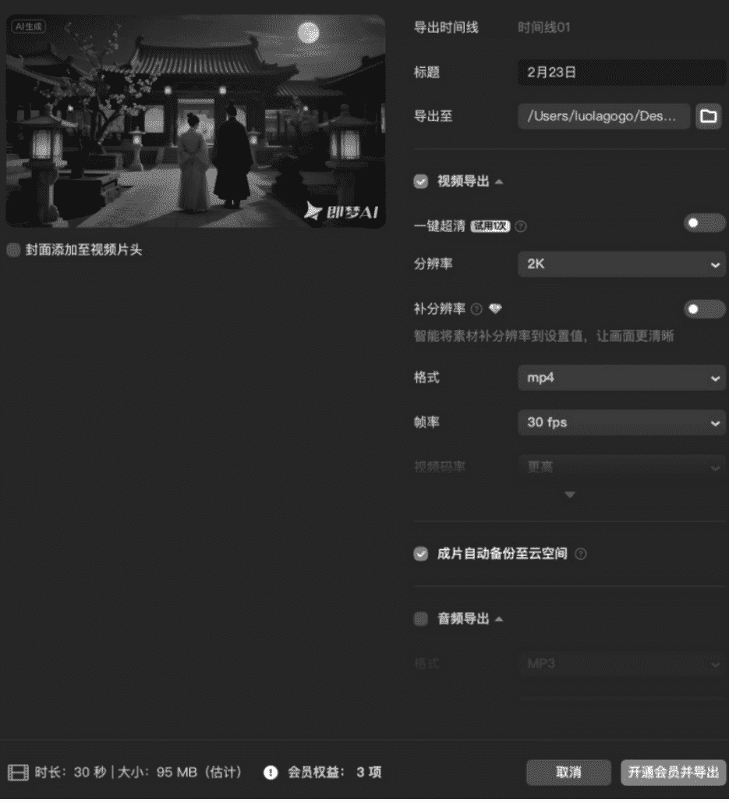

图9-15 剪映画面导出界面

#### 9.3.3 漫剧视频成片实操的注意事项

动态效果贴合剧情与角色，避免过度花哨。Seedance动态化设置时，需严格遵循分镜表中的镜头运动要求，动态效果以"流畅自然、突出剧情"为核心，避免添加过多复杂的动态特效（快速旋转、夸张缩放等），否则会喧宾夺主，影响剧情传递与角色塑造；同时，角色动态需贴合人设，例如软萌医女的动作需轻柔缓慢，高冷角色的动作需利落沉稳，确保动态效果与角色性格、剧情氛围高度匹配。

**音画同步精准，音量比例协调。** 剪映音画适配时，需确保音效、背景音乐与画面精准同步，避免出现音效提前/滞后、背景音乐盖过角色对话等问题；音量比例需合理控制，角色对话音量＞音效音量＞背景音乐音量，确保对话清晰可闻，音效与背景音乐贴合剧情氛围，不相互干扰；同时，避免添加过多音效，防止音效杂乱影响观看体验。

## 第10章 人物剧情短视频制作实操

### 10.1 创意构思：人物设定与剧情设计

人物剧情短视频的创意构思是内容的"灵魂"，直接决定内容的辨识度与观众代入感。与漫剧的IP角色塑造不同，人物剧情短视频的人物设定更贴合现实或轻架空场景，剧情设计更追求短平快的冲突与反转，适配短视频平台的观看节奏。本小节将从工具协同优势、分步实操方法、实操避坑要点三个维度，详解人物设定与剧情设计的核心逻辑，确保创意落地性强、贴合平台需求。

#### 10.1.1 借助豆包进行人物设定与剧情设计的优势

豆包可根据创作者的核心需求，提炼人物的身份、性格、核心反差、行为标签，避免人物同质化，同时将抽象的性格特质转化为具象的言行、动作细节，让人物形象更立体，例如将"内向社恐职场新人"拆解为"说话轻声、开会坐角落、递文件会低头"的具体行为，让人物有迹可循。

#### 10.1.2 人物设定与剧情设计的实操步骤

##### 第一步：明确创作定位，划定构思边界

创意构思前，需先明确核心创作定位，为人物设定与剧情设计划定清晰的边界，避免后续构思偏离方向，这是创意落地的基础。创作者需梳理三个核心信息：内容赛道（都市职场、古风情感、市井生活、悬疑短篇等）、目标受众（18～25岁职场新人、20～30岁古风爱好者、全年龄层的治愈系观众等）、制作形式（真人拍摄、AI生成人物画面、真人+AI结合），同时明确短视频的核心时长（30秒/60秒，主流为30秒）。实操中可将这些信息整理后，输入豆包作为构思基础，示例如下：> "我要创作30秒的都市职场赛道人物剧情短视频，目标受众是18～25岁的职场新人，制作形式为AI生成人物画面，帮我围绕这个定位构思人物与剧情，要求贴合受众痛点、有辨识度、适配AI生成。"

豆包收到指令后会生成内容如下。

###### 30秒都市职场新人短视频·AI创作全方案

**定位：** 18～25岁职场新人 | AI生成人物画面 | 高共鸣、强节奏、易出片

**核心痛点：** 入职慌乱、怕犯错、小透明、自我怀疑、渴望被认可

**人物设定：** 极简辨识度，AI零难度生成

####### 一、AI适配核心人物（统一人设，全脚本通用）

**主角：** 小星（22岁应届职场小白）

**视觉：** 齐肩黑发、淡妆、基础白衬衫+浅灰西装裤，无复杂装饰

……

##### 第二步：借助豆包，拆解高辨识度人物核心设定

以第一步的创作定位为基础，借助豆包拆解人物的核心设定，核心是"用3个核心标签+1个核心反差+具象行为细节"打造人设，避免模糊化表述。人物设定优先聚焦单核心人物（短视频篇幅有限，多人物易导致形象模糊），若需配角，仅保留1个极简配角，且配角的作用是衬托主角、推动剧情，不额外增加人设复杂度。实操中可通过精准提示词，让豆包生成完整的人物核心设定，以都市职场赛道为例，输入提示词：

帮我设计一个都市职场赛道的核心人物设定，制作形式为AI生成人物画面，人物为单女主，身份是入职1个月的新媒体运营新人，核心特质是"内向社恐但文字功底极强"，要求提炼3个核心标签、1个核心反差，拆解具象的言行、动作、神态细节，贴合18～25岁职场新人的痛点，人物形象有辨识度，同时给出AI生成的视觉关键词，适配即梦生成需求。

豆包生成结果：

###### 都市职场·新媒体运营新人女主设定

**核心标签：** 内向社恐、文字敏感、慢热坚韧

**核心反差：** 线下沟通支支吾吾，线上写文案逻辑清晰、气场全开

####### 具象细节：

言行：和同事沟通时低头、声音发颤，回复工作消息却言简意赅、精准犀利；开会时坐最角落，被点名时会下意识攥笔，但谈及文案内容时会慢慢抬起头，眼神坚定

……

##### 第三步：围绕人物人设，借助豆包设计紧凑有张力的剧情

人物设定确定后，核心围绕人物的核心特质、核心反差、受众痛点设计剧情，严格遵循短视频的黄金节奏，30秒短视频按"5秒抓睛—15秒核心冲突—7秒快速转折—3秒结尾/悬念"分配时长，60秒短视频按"8秒抓睛—30秒核心冲突—12秒快速转折—10秒结尾/悬念"分配时长，确保剧情紧凑、有冲突、有反转，同时剧情细节必须贴合人物人设，避免人设崩塌。实操中可将人物设定信息上传至豆包，输入精准提示词，让豆包生成完整的剧情框架，同时补充具体的言行、动作细节，以下以都市职场赛道的社恐新媒体新人为例，提示词：

基于已设计的都市职场新媒体运营新人人设（内向社恐、文字功底极强，线下支支吾吾、线上气场全开），创作30秒的剧情框架，制作形式为AI生成人物画面，按5秒抓睛—15秒核心冲突—7秒快速转折—3秒结尾的时长分配，剧情贴合18～25岁职场新人的痛点，有冲突、有反转、有情感共鸣，同时补充人物的具体言行、动作细节，适配后续脚本分镜设计，避免复杂场景，适配AI生成。

豆包生成结果：

###### 30秒都市职场剧情框架（社恐新媒体新人）

**5秒抓睛（画面+言行）：** 办公室场景，女主被主管叫到工位旁，主管指着电脑屏幕说话，女主低头、捏衣角、眼神躲闪，支支吾吾答"我……我马上改"，主管皱眉，画面聚焦女主的怯意与主管的不满；

**15秒核心冲突（画面+言行）：** 女主回到工位，面对电脑上的文案修改意见，眼眶微红，手指攥着笔发抖，同事路过小声议论"她是不是做不好啊"，女主听到后头埋得更低，却突然盯着屏幕，眼神从怯意变为聚焦，手指开始飞快敲键盘，画面切换女主敲键盘的手部特写与同事的质疑表情

……

#### 10.1.3 人物设定与剧情设计的注意事项

**人物标签忌过多，聚焦1～2个核心特质。** 短视频的观看时长有限，过多的人物标签会导致形象模糊，观众无法快速记住，例如避免将人物设定为"社恐、活泼、温柔、果断"，只需聚焦"社恐+专业能力强"1个核心反差即可，其他特质作为辅助，不刻意突出；实操中可让豆包"提炼人物的核心特质，删除冗余标签，保留1个核心反差"。

**人物细节忌抽象，必须转化为具象言行。** 抽象的性格描述无法支撑后续的镜头表达，例如避免只写"女主内向社恐"，需让豆包拆解为"低头、捏衣角、说话支支吾吾"等具象的言行、动作细节，让人物的性格通过具体行为体现，而非口头表述。

### 10.2 脚本与分镜设计：角色镜头表达

如果说创意构思是人物剧情短视频的"灵魂"，那么脚本与分镜设计就是内容的"骨架"，是连接创意构思与成片制作的核心纽带。与漫剧的分镜设计不同，人物剧情短视频的脚本更注重台词的简洁性、人物言行的贴合度，分镜设计更注重镜头语言的简洁性、人物表情与动作的特写表达，核心是通过镜头将人物的性格、剧情的冲突直观传递给观众，让观众快速代入。本小节将结合豆包、即梦等工具，详解脚本撰写、分镜设计的实操方法，打造适配拍摄/AI生成的标准化脚本与分镜，强化角色的镜头表达力。

#### 10.2.1 借助豆包+即梦进行脚本与分镜设计的优势

豆包可将创意构思阶段的剧情框架，转化为包含"序号、时长、场景、人物动作、台词、音效"的标准化表格式脚本，避免逻辑混乱，同时补充人物的微表情、微动作细节，强化人物的镜头表达，让每一句台词、每一个动作都服务于人物塑造与剧情推进。豆包可根据标准化脚本，生成包含"镜号、景别、镜头运动、画面描述、核心呈现重点"的分镜表，同时结合即梦的AI生成特性，优化画面描述，将抽象的镜头语言转化为即梦可识别的精准提示词，无需专业的绘画能力，普通创作者也能完成可视化分镜设计，确保镜头表达贴合人物人设与剧情冲突。

#### 10.2.2 脚本与分镜设计的实操步骤

##### 第一步：借助豆包，撰写标准化表格式脚本

标准化脚本是分镜设计的基础，核心采用表格式结构，确保信息清晰、一目了然，便于后续拍摄/生成与剪辑。脚本的核心要素包含序号、时长、场景、人物动作/微表情、台词/旁白、音效/背景音乐，其中"人物动作/微表情"是重点，需精准贴合人物人设，强化角色的镜头表达；台词/旁白需简洁精练，30秒短视频的台词总字数控制在50字以内，避免冗长。实操中可将创意构思阶段的剧情框架与人物设定上传至豆包，输入精准提示词，让豆包生成标准化表格式脚本，以下以30秒都市职场社恐新媒体新人（AI生成）为例，给出提示词与完整的脚本示例，真人拍摄脚本可按需调整场景、动作细节，示例提示词：

基于30秒都市职场社恐新媒体新人的剧情框架与人物设定，撰写标准化表格式脚本，制作形式为AI生成人物画面，核心要素包含序号、时长、场景、人物动作/微表情、台词/旁白、音效/背景音乐，人物动作/微表情需贴合"内向社恐、专业坚韧"的人设，强化镜头表达，台词简洁精练，音效/背景音乐贴合剧情氛围，适配即梦AI生成，避免复杂场景。

豆包接收指令后会生成脚本，如表10-1所示。

**表10-1 标准化表格式脚本（30秒都市职场）**

| 序号 | 时长 | 场景 | 人物动作/微表情 | 台词/旁白 | 音效/背景音乐 |
|:---:|:---:|:---|:---|:---|:---|
| 1 | 0~5秒 | 现代简约办公室，女主工位（电脑、笔记本、水笔），主管站在工位旁 | 女主：低头，捏衣角，眼神躲闪，手指微微发抖，下唇轻咬；主管：眉头微皱，目光看向电脑屏幕，身体微侧 | 主管：这份文案改得不行，马上重新改！女主：我……我马上改（声音发颤，支支吾吾） | 紧张的背景音乐（钢琴单音），办公室轻微的键盘声、翻纸声 |
| 2 | 5~20秒 | 女主工位，同事从工位旁路过 | 女主：回到工位坐下，眼眶微红，攥着水笔敲桌面，看到同事路过，头埋得更低；突然盯着电脑屏幕，眼神从怯意变为聚焦，手指飞快敲键盘，手部动作利落；同事：侧头看女主，小声议论，嘴角带质疑 | 同事（小声）：她是不是做不好新媒体啊？（无女主台词，仅动作表达） | 紧张的背景音乐节奏加快，敲键盘声（从慢到快），同事轻微的议论声 |

……

##### 第二步：基于脚本，借助豆包设计可视化分镜表

标准化脚本完成后，即可根据脚本来设计分镜表，分镜表是脚本的视觉化拆解，核心是通过景别、镜头运动、画面描述等，将脚本中的人物动作、剧情细节转化为直观的镜头画面，核心要素包含镜号、景别、镜头运动、画面构图、光影效果、画面描述、时长、对应脚本序号、核心呈现重点，其中"核心呈现重点"需明确每个镜头要突出的人物特质或剧情细节，强化角色的镜头表达。以30秒都市职场社恐新媒体新人（AI生成）为例，提示词如下：

基于上述30秒都市职场社恐新媒体新人的标准化表格式脚本，设计可视化分镜表，制作形式为AI生成人物画面，核心要素包含镜号、景别、镜头运动、画面构图、光影效果、画面描述、时长、对应脚本序号、核心呈现重点，景别以近景、特写为主，镜头运动简洁（固定、轻微推镜、切镜），画面描述精准适配即梦AI生成，核心呈现重点突出人物特质与剧情冲突，色彩基调为都市冷调（白+浅灰+淡蓝），线条利落。

豆包接收指令后会生成分镜表，如表10-2所示。

**表10-2 可视化分镜表（30秒都市职场，AI生成）**

| 镜号 | 景别 | 镜头运动 | 画面构图 | 光影效果 | 画面描述 | 时长 | 对应脚本序号 | 核心呈现重点 |
|:---:|:---:|:---:|:---|:---|:---|:---:|:---:|:---|
| 1 | 中景 | 固定 | 三分构图，女主居左，主管居右，留桌面空白 | 冷调柔光，均匀打光，人物面部清晰 | 现代简约办公室，女主坐在工位前，面前放笔记本电脑，浅白衬衫+黑框眼镜，主管站在右侧，身体微侧，眉头微皱 | 2秒 | 1 | 交代场景与人物关系，铺垫紧张氛围 |

续表

| 镜号 | 景别 | 镜头运动 | 画面构图 | 光影效果 | 画面描述 | 时长 | 对应脚本序号 | 核心呈现重点 |
|:---:|:---:|:---:|:---:|:---:|:---|:---:|:---:|:---|
| 2 | 近景 | 轻微推镜 | 聚焦女主面部 | 冷调侧光，突出女主的怯意 | 女主低头，捏衣角，眼神躲闪，下唇轻咬，眼眶略带微红，手指微微发抖 | 3秒 | 1 | 突出女主的社恐与紧张，强化人物特质 |

……

##### 第三步：结合即梦特性，优化分镜的画面描述

分镜表生成后，需结合即梦的AI生成特性，优化分镜的画面描述，这是确保AI生成画面精准贴合分镜要求的关键。优化的核心原则是"细节具体、风格统一、避免模糊"，在画面描述中补充AI生成所需的视觉关键词、风格基调、分辨率、画面比例，例如"漫剧风格，都市简约风，高清2K，9:16竖屏，线条利落，色彩冷调，无多余杂物"，同时删除过于抽象的表述，将"人物表情生动"转化为"眼神躲闪，下唇轻咬，手指微微发抖"等具体细节。也可以将分镜表上传至豆包，输入提示词，让豆包批量优化画面描述，提示词如下：

优化上述分镜表的画面描述，适配即梦AI生成人物画面的特性，补充视觉关键词、风格基调、分辨率（2K）、画面比例（9:16竖屏），细节具体、风格统一（都市简约风，线条利落，色彩冷调），删除抽象表述，确保AI能精准识别，同时突出人物的微表情、微动作。

##### 第四步：借助即梦，预览分镜镜头效果，微调优化

画面描述优化完成后，可借助即梦的AI生成能力，选取分镜表中的核心镜头（人物特写、剧情冲突镜头等），输入优化后的画面描述作为提示词，生成镜头预览图，验证镜头的视觉效果、人物表达是否贴合分镜要求。若生成的画面与预期不符，可根据预览效果，借助豆包微调分镜的画面描述，例如调整人物的动作、场景的细节、光影效果等，直至生成效果贴合预期。这一步能有效避免后续成片制作时，因镜头描述问题导致的人物表达不足、剧情脱节，确保分镜设计的落地性，同时让创作者提前直观看到镜头的视觉效果，为后续成片实操做好铺垫。

#### 10.2.3 脚本与分镜设计的注意事项

**脚本台词忌冗长，微表情/微动作优先于台词。** 人物剧情短视频的核心是"视觉表达"，而非"台词叙述"，过多的台词会导致节奏拖沓，观众失去耐心；实操中需遵循"能靠动作表达，就不用台词"的原则，通过人物的微表情、微动作传递情绪与性格，例如社恐新人的紧张，可通过"捏衣角、眼神躲闪、手指发抖"表达，而非台词"我好紧张"。

**分镜数量忌过多，节奏与剧情精准匹配。** 分镜数量过多会导致镜头切换过快，观众无法捕捉人物表情与剧情细节；过少则会导致节奏拖沓，视觉单调。30秒短视频分镜控制在8～10个，60秒控制在15～18个，同时根据剧情节奏调整分镜时长，冲突场景分镜时长缩短（2～3秒），情感升华场景分镜时长适当延长（3～4秒）。

**景别搭配忌单一，特写突出人物核心表达。** 单一的景别会导致视觉疲劳，无法突出人物的特质与剧情的冲突；实操中需采用"近景+特写+中景"的搭配方式，特写占比不低于40%，重点用于人物的微表情、微动作（眼神、手部、嘴角等），通过特写强化角色的镜头表达，让观众快速捕捉人物的情绪变化。

### 10.3 成片实操：人物剧情短视频生成流程

成片实操是人物剧情短视频制作的最后一步，也是将创意构思、脚本分镜设计转化为最终成品的关键环节。与漫剧的成片制作不同，人物剧情短视频的成片实操更注重人物画面的真实感、音画的同步性、节奏的适配性，核心任务是将拍摄/AI生成的镜头素材，通过剪映、Seedance等工具完成素材整理、剪辑拼接、音画适配、细节优化、导出发布，最终输出符合平台传播逻辑、人物表达突出、剧情流畅的完整短视频。本小节将以剪映为核心工具（新手首选、功能齐全、免费易用），结合Seedance、即梦的协同操作，拆解成片实操的全流程，细化每一步的操作细节、参数设置与实操技巧，同时适配真人拍摄与AI生成两种素材形式，让普通创作者能快速完成成片制作。

#### 10.3.1 借助剪映+Seedance+即梦进行成片实操的优势

传统的人物剧情短视频成片实操，往往面临剪辑效率低、人物呈现不佳、音画不同步、节奏混乱等问题：新手创作者缺乏专业的剪辑技巧，面对杂乱的素材无从下手，导致剪辑后的剧情逻辑混乱、人物表达扁平；部分创作者过度追求特效，忽略了人物与剧情的核心，导致视频华而不实；同时，容易出现音画不同步、字幕杂乱、画面色调不统一等问题，大幅降低视频的观看体验，影响平台推荐。

剪映的操作界面简洁，功能分类清晰，内置海量的模板、音乐、音效、字幕样式，无需专业的剪辑知识，新手也能快速上手；Seedance可直接将即梦生成的静态分镜画面转化为动态镜头，无需专业的动画制作能力；即梦可批量优化静态素材的画面风格，确保人物画面的统一性，单人即可完成全流程制作。

#### 10.3.2 人物剧情短视频成片实操的具体步骤

##### 第一步：素材准备，整理分类

素材准备的核心是分类清晰、筛选优质，避免后续剪辑时杂乱无章、浪费时间，同时确保素材贴合脚本分镜要求，突出人物特质。将分镜表中优化后的画面描述，批量输入即梦，生成对应的静态镜头画面。我们以上述分镜的镜号1为例，输入提示词：

中景，固定镜头视角，三分构图，女主居左、主管居右，桌面留空白，冷调柔光均匀打光，人物面部清晰，现代简约办公室场景，女主穿浅白衬衫、戴黑框眼镜坐在工位前，面前放笔记本电脑，主管站在右侧、身体微侧、眉头微皱，整体氛围紧张，画面清晰细腻，写实风格

即梦根据提示词会生成分镜图片，如图10-1所示。

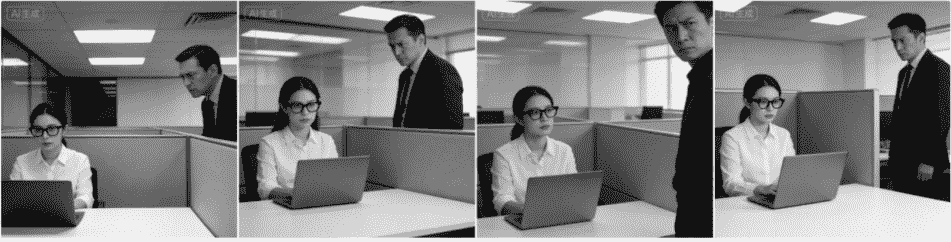

图10-1 分镜图片

##### 第二步：生成分镜视频

将生成的素材整理好，依次通过Seedance生成分镜动态视频。以镜号1为例，输入提示词，如图10-2所示。

图10-2 动态视频生成提示词

发送后Seedance会生成分镜的动态视频，如图10-3所示。

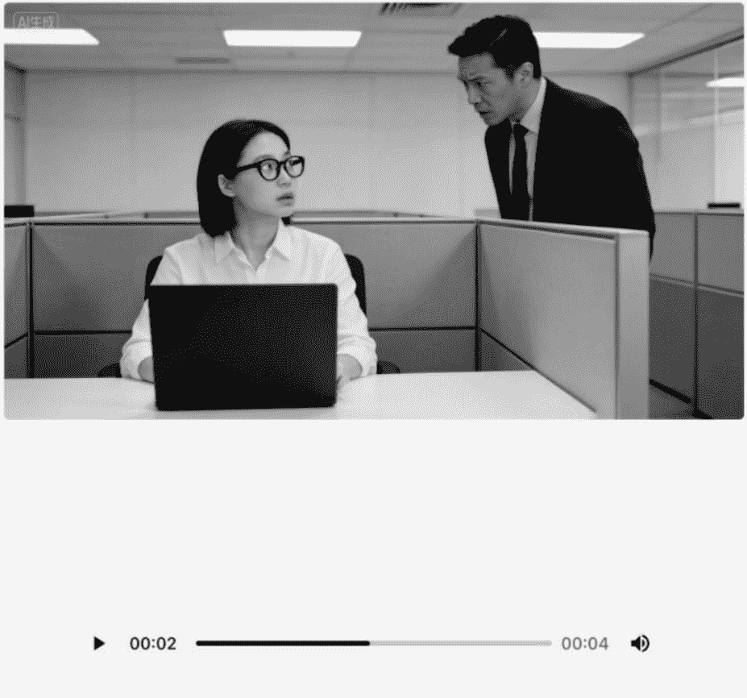

图10-3 分镜视频

将所有动态镜头素材按镜号顺序分类保存至文件夹，便于后续调用。

##### 第三步：剪辑拼接，还原剧情逻辑

剪辑拼接的核心是"按照分镜表顺序，拼接素材、调整时长，还原剧情逻辑"，确保镜头衔接流畅、剧情紧凑，同时突出人物的情绪变化与剧情冲突，贴合脚本要求。

打开剪映，新建项目。将处理好的素材按顺序导入剪映的时间轴，拖动素材调整位置，确保素材顺序与脚本剧情顺序一致（如镜1→镜2→镜3……），避免剧情逻辑混乱，如图10-4所示。

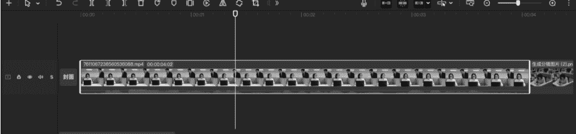

图10-4 时间轴

素材之间添加转场效果，如图10-5所示。

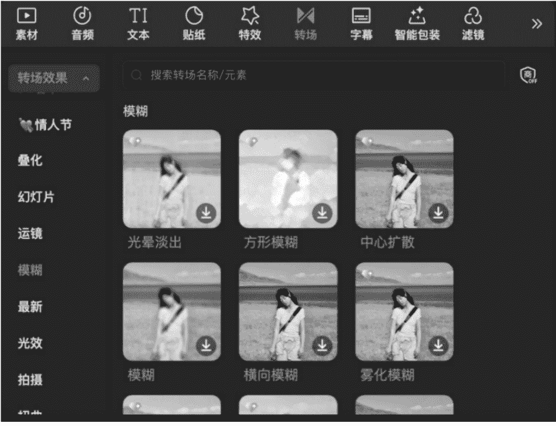

图10-5 转场效果

可以优先选择"淡入淡出""叠化"，这类转场柔和自然，适合人物剧情短视频；避免使用过于花哨的转场（旋转、闪屏等），这类转场会分散观众注意力，影响人物表达与剧情体验；重点在剧情转折处（女主情绪从怯意变为坚定等），添加轻微的转场，强化情绪变化。

##### 第四步：音画适配，强化剧情氛围

音画适配的核心是音频与画面同步、音效/背景音乐贴合剧情氛围，Seedance生成分镜片段的时候会同步生成台词配音，我们通过剪映可以为整个剧情选择适配的背景音乐：在界面左上角点击音频，进入后就可以找到剪映的音乐库和音效库。我们可以在音乐库里面选择纯音乐、抖音热门、卡点等音乐，如图10-6所示。

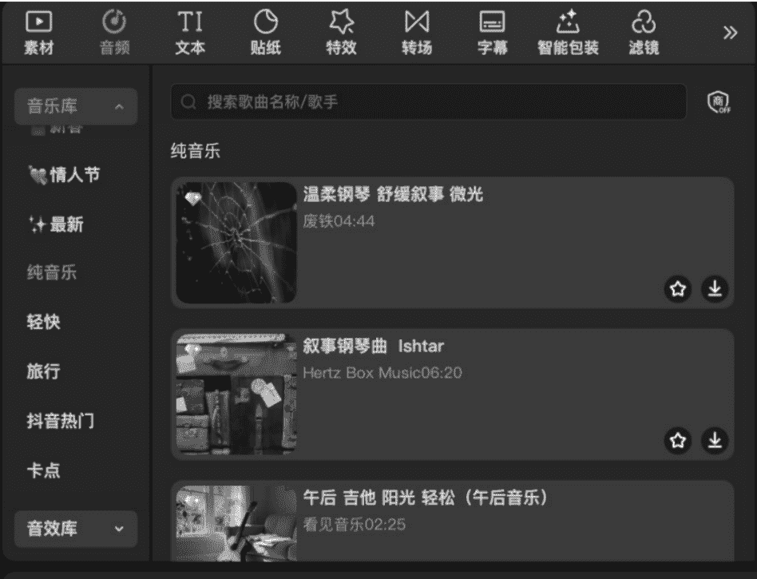

图10-6 音乐库

选择合适的背景音乐，我们可以拖拽到时间轴上，如图10-7所示。

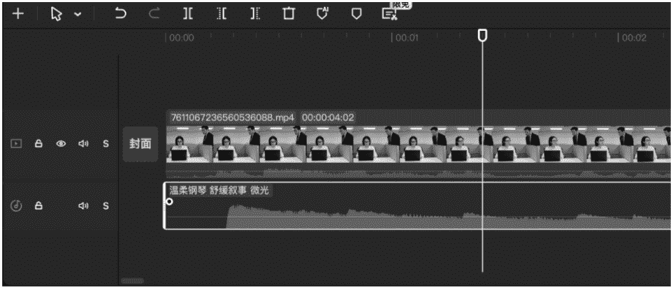

图10-7 添加背景音乐

添加背景音乐以后，为了避免添加的音乐音量遮盖原本的视频台词等，可以在界面右上角调节音量，如图10-8所示。

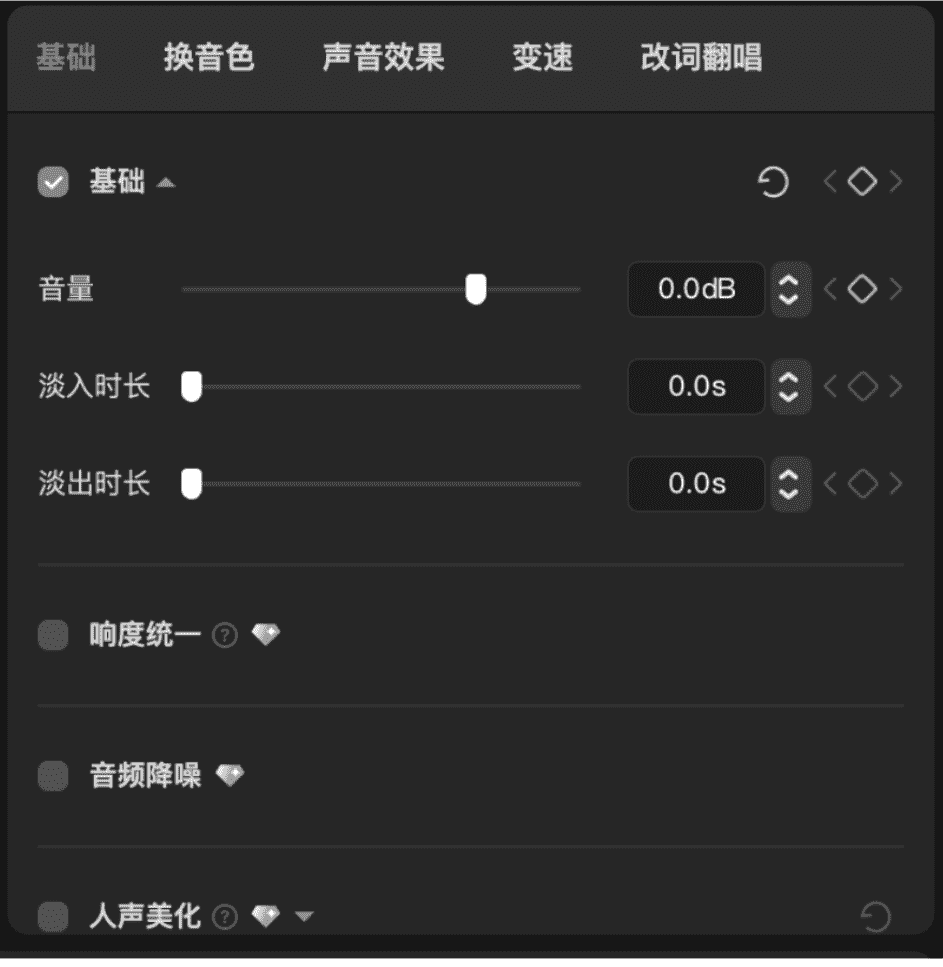

图10-8 音量调节

##### 第五步：细节优化，导出检查，确保适配平台

我们可以在中间的导台预览剪辑后的视频，如图10-9所示。如果有需要调整修改的内容进行细节优化，确认无误后可以对视频进行导出。

图10-9 视频全片预览

导出完成后，打开视频文件，再次预览，检查导出后的视频是否存在画质模糊、音画不同步、字幕缺失等问题。若存在问题，返回剪映调整后重新导出；若无问题，保存视频文件，准备发布至对应平台。

#### 10.3.3 人物剧情短视频成片实操的注意事项

**素材整理忌杂乱，按镜号命名分类是关键。** 素材杂乱会导致后续剪辑时浪费大量时间寻找素材，甚至出现素材顺序错误、剧情逻辑混乱的问题；实操中务必按“镜号顺序”命名素材，分类保存至文件夹，同时筛选优质素材，删除冗余、模糊的素材，确保素材质量。

**点缀元素忌过多，避免分散注意力。** 过度添加文字、边框、特效等点缀元素，会分散观众对人物与剧情的注意力，导致视频华而不实；实操中点缀元素需适度使用，核心围绕人物特质与剧情核心，简洁大方即可，不追求花哨。

**导出参数忌随意，适配平台需求。** 导出参数设置错误，会导致视频画质模糊、无法发布至平台；实操中新手优先默认剪映的高清导出参数，根据发布平台调整分辨率（抖音/快手用1080P，小红书用720P），导出后务必二次检查，避免出现导出瑕疵。

# 第五部分 商业客户项目实操

## 第11章 商业广告视频制作实操

### 11.1 创意构思：广告视觉表达设计

短视频广告创意构思的核心是“平衡品牌诉求与用户兴趣”，核心任务是明确广告的核心卖点、目标人群与传播场景，将品牌信息、产品优势融入有吸引力的短视频内容中，实现“润物细无声”的广告传达。与普通短视频、真人短剧创意不同，广告创意需额外兼顾“转化导向”，每一个创意细节都需围绕“提升用户关注度、激发用户行动意愿”展开，例如引导用户点击下单、到店消费、下载APP等。

借助豆包的创意推演与需求拆解能力，搭配即梦的视觉化验证优势，可快速解决广告创意“生硬植入、卖点模糊、用户不买单”的核心痛点。豆包可辅助拆解品牌诉求、提炼核心卖点、适配目标人群偏好；即梦可将文字创意转化为初步视觉画面，验证广告内容的吸引力与植入自然度，确保创意既贴合品牌需求，又符合短视频传播逻辑，同时适配Seedance后续动态化生成特性，大幅降低创意构思的难度与时间成本。

#### 11.1.1 借助豆包+即梦进行广告创意构思的优势

豆包可快速接收品牌相关信息，例如品牌定位、产品功能、核心优势、变现目标（带货、引流、推广），拆解出用户关心的核心卖点，避免卖点堆砌，同时结合目标人群偏好（例如美妆用户关注成分、效果，餐饮用户关注性价比、口感），优化卖点呈现方式，让创意更贴合用户需求。

#### 11.1.2 广告创意构思的核心步骤

**第一步，明确核心诉求，拆解品牌与产品信息**

创意构思的首要前提是明确广告的核心诉求与核心信息，这是后续所有创意环节的基础。创作者需先梳理品牌与产品的核心信息，例如品牌定位、产品功能、核心优势、价格区间、变现目标（例如美妆带货需引导下单，餐饮引流需引导到店，APP 推广需引导下载），以及目标人群的基本特征（年龄、性别、消费偏好、需求痛点）。实操中可借助豆包，输入相关信息，获取精准的需求拆解与核心信息提炼，示例提示词将分三个场景呈现，确保具体可落地。

**场景1：美妆带货**（平价粉底液，目标人群是18～25岁学生党、新手，核心诉求是带货转化，突出产品“持妆、控油、平价、易推开”四大卖点），提示词如下：

帮我拆解一款平价粉底液的广告创意核心信息，品牌定位平价美妆，目标人群是18～25岁学生党、化妆新手，核心诉求是引导用户下单购买，核心卖点是持妆6小时以上、控油不脱妆、平价（59.9元/瓶）、新手易推开不卡粉，帮我提炼用户关心的核心痛点（出油脱妆、新手卡粉、预算有限），拆解卖点优先级，明确广告创意的核心导向，贴合短视频美妆测评赛道，避免生硬植入，给出具体的创意方向建议。

豆包根据指令生成内容如下：

59.9元控油粉底液：新手必备的“焊脸”神器

一、核心痛点（精准击中）

场景痛点：通勤/上课出油斑驳，口罩一蹭全是印

技能痛点：手残党上妆卡粉、浮粉，边界感重

预算痛点：学生党预算有限，拒绝"贵价试错"

……

**场景2：本地餐饮引流**（同城火锅店，目标人群20～35岁同城青年、聚餐人群，核心诉求是引导到店消费，突出"99元双人餐、鲜切牛肉、免费甜品、同城3公里配送"优势），提示词如下：

帮我拆解同城火锅店的广告创意核心信息，店铺定位平价火锅，目标人群是20～35岁同城青年、朋友聚餐人群，核心诉求是引导同城用户到店消费，核心优势是99元双人餐（含锅底+4荤2素）、鲜切牛肉现点现切、免费无限续甜品、同城3公里免费配送，帮我提炼用户核心痛点（聚餐性价比低、食材不新鲜、甜品收费），明确广告创意的核心导向，贴合短视频同城引流赛道，融入同城话题元素，给出具体的场景化创意方向。

豆包根据指令生成内容如下：

###### 同城平价火锅·广告创意核心拆解（短视频同城引流版）

####### 一、核心痛点

- 朋友聚餐人均高、性价比低
- 火锅食材不新鲜、合成肉多
- 甜品单点贵、不能畅吃

####### 二、创意核心导向

主打同城青年高性价比聚餐，用超划算双人餐+鲜切肉+免费甜品+同城配送等强刺激，引导到店/下单。

……

**场景3：APP推广**（办公类APP，目标人群为25～40岁职场人，核心诉求是引导下载注册，突出"高效办公、免费使用、多设备同步、语音转文字"功能），提示词如下：

帮我拆解一款办公类APP的广告创意核心信息，APP定位高效办公工具，目标人群是25～40岁职场人（文案、行政、职场管理者），核心诉求是引导用户下载注册，核心功能是免费使用、多设备同步（手机+电脑）、语音转文字（识别准确率98%以上）、快速编辑文档，帮我提炼用户核心痛点（办公效率低、语音转文字耗时、多设备同步麻烦），明确广告创意的核心导向，贴合短视频职场干货赛道，用场景化演示突出功能优势，给出具体的创意方向建议。

豆包根据指令生成内容如下：

###### 创意拆解：打造高效办公新体验

给你一版言简意赅的创意拆解，直接上框架：

####### 核心创意主题

> "解放双手，让办公流动起来"

—主打效率翻倍与全场景自由，戳中职场人怕耗时、怕麻烦、怕落后的焦虑。

####### 核心痛点直击（短视频3秒抓人）

语音转文字慢：开会记要点、口述文案，手速赶不上嘴速，准确率低还得返工。

……

##### 第二步，适配短视频赛道，细化创意内容与植入方式

核心信息明确后，需借助豆包，结合短视频高频赛道（测评、场景化种草、剧情引流、干货分享），细化创意内容，确定具体的内容形式与产品植入方式，核心原则是"广告内容原生化、植入方式自然化"，避免生硬堆砌产品信息。不同变现场景适配的赛道与植入方式不同，需结合场景特性灵活选择，例如美妆带货适配测评赛道，餐饮引流适配同城场景赛道，APP推广适配干货演示赛道。

实操中可在豆包中补充提示词，获取细化的创意内容与植入方式，示例提示词（以美妆带货场景为例）如下：

基于平价粉底液的广告核心信息，帮我细化广告创意内容与植入方式，适配短视频美妆测评赛道，内容形式为"新手实测"，时长控制在30～60秒，植入方式自然不生硬，重点突出控油持妆、新手易推开卖点，融入用户痛点场景（夏天出油脱妆、新手化妆卡粉），明确创意的开头（抓睛痛点）、中间（实测演示）、结尾（引导下单）核心内容，贴合短视频快节奏特点，3秒抓睛，同时适配即梦视觉生成与Seedance动态化需求，给出具体的内容细节建议。

豆包根据指令生成内容如下：

###### 平价粉底液·新手实测短视频创意（30～60秒|适配即梦+Seedance）

####### 一、核心信息

- 卖点：控油持妆、新手易推开
- 痛点：夏天出油脱妆、新手卡粉
- 风格：真实新手实测、快节奏、无广感、强视觉对比

####### 二、3秒抓睛开头

画面：近脸怼镜—半边脸出油斑驳/卡粉，半边脸干净哑光

口播（快）：夏天一化妆就斑驳？新手一上脸就卡粉？

####### 三、中间实测演示（主体20～40秒）

上手展示

指尖取粉底液，顺滑推开有拉丝感，特写无结块

口播：平价但巨好推，新手不翻车

上脸实测

……

豆包生成细化的创意内容，同时明确植入方式—全程以实测为主，自然带出产品卖点，不刻意夸大，贴合用户观看习惯。

#### 11.1.3 广告创意构思的注意事项

**核心要素齐全，描述精准无歧义：** 借助豆包梳理创意、撰写提示词时，需明确包含广告的核心要素，尤其是品牌诉求、核心卖点、目标人群、视觉风格、时长、变现导向等关键信息，避免模糊表述。例如需明确“同城火锅店广告，30～60秒，暖色调烟火气风格，核心卖点是99元双人餐、鲜切牛肉，变现导向是引导同城用户到店”，而非笼统描述“火锅店广告，时长适中，画面温暖”；明确“目标人群是18～25岁学生党，核心痛点是新手卡粉、预算有限”，而非“目标人群年轻，有护肤需求”，确保AI精准捕捉需求，避免生成内容与预期偏差。

**植入方式自然，杜绝生硬堆砌：** 广告创意需避免“重产品、轻内容”的误区，借助豆包优化植入方式，将产品卖点、品牌信息自然融入短视频内容中，而非生硬堆砌。

### 11.2 脚本与分镜设计：广告转化结构设计

借助豆包辅助脚本撰写，搭配即梦与 Seedance 的 AI 生成特性进行分镜设计，能让广告脚本与分镜更高效、更贴合实操需求与变现导向，大幅降低专业门槛，确保后续素材生成、动态化及剪辑环节顺畅推进，同时避免脚本分镜与创意脱节，确保每一个镜头都围绕"传递卖点、引导转化"展开。

#### 11.2.1 借助豆包+即梦+Seedance辅助广告脚本与分镜设计的优势

在脚本阶段，豆包可快速完成创意内容的细化、镜头拆解、人物动作与台词设计，同时精准把控每一个镜头的卖点传递与节奏，确保脚本逻辑连贯、台词简洁、转化引导清晰，大幅缩短前期构思时间；同时，豆包可结合 AI 生成特性，优化脚本细节，避免出现不符合即梦与Seedance生成要求的内容，确保脚本可落地。

#### 11.2.2 广告脚本设计的核心步骤

以下结合11.1章节中美妆带货场景（平价粉底液，60秒）的广告创意框架，详细讲解豆包辅助的实操拆解，其他场景可参考此逻辑推进，步骤进行创新设计。

**第一步，梳理创意与节奏节点，明确脚本设计依据**

脚本设计需立足广告创意本身，先借助豆包全面梳理广告的核心信息与节奏节点，为后续镜头拆解与脚本撰写提供明确依据。重点梳理内容包括：广告总时长、核心诉求、核心卖点、节奏节点（3秒抓睛、中间卖点传递、结尾转化引导）、人物设定（若有）、植入方式与音效导向，确保脚本设计不偏离创意框架、品牌诉求与变现目标。

本案例中，广告总时长60秒，核心诉求是引导用户下单购买平价粉底液，核心卖点是持妆6小时以上、控油不脱妆、平价（59.9元/瓶）、新手易推开不卡粉，节奏节点按“3秒抓睛—45秒卖点传递—12秒转化引导”分配，人物设定为20岁左右化妆新手（贴合目标人群），植入方式为实测演示，音效导向为清新轻快，突出实测的真实感，这是后续镜头拆解与脚本撰写的关键核心。

**第二步，借助豆包，拆解镜头维度并生成标准脚本表格**

基于梳理好的核心信息与节奏节点，结合前期广告创意的内容与植入方式，借助豆包将整个广告拆解为若干个独立镜头，每个镜头均明确核心维度，形成可直接落地的标准化广告脚本。核心维度需包含镜号、景别、画面内容、时长、人物动作、台词、音效、卖点传递重点，确保每个镜头都能与创意内容、品牌诉求精准适配，同时贴合AI生成特性与短视频快节奏特点。

实操中可上传创意框架与核心信息，输入提示词快速生成标准化脚本表格，示例提示词如下：

为美妆带货类短视频广告设计标准化脚本，该广告总时长60秒，核心是平价粉底液（59.9元/瓶），目标人群为18～25岁学生党、化妆新手，核心诉求是引导用户下单，核心卖点是持妆6小时、控油不脱妆、新手易推开不卡粉，创意内容为新手实测演示，植入方式自然，节奏节点为3秒抓睛、45秒卖点传递、12秒转化引导，视觉风格为清新自然风、高饱和度暖色调。借助豆包拆解镜头，生成包含镜号、景别、画面内容、时长、人物动作、台词、音效、卖点传递重点的标准脚本表格，镜头节奏与广告诉求高度同步，适配即梦+Seedance生成需求，人物动作与台词贴合新手人设，卖点传递清晰，结尾转化引导明确。

豆包接收指令后会生成标准化脚本表格，清晰呈现各镜头的详细信息，同时优化人物台词与动作设计，确保贴合新手人设，卖点传递精准，如表11-1所示。

**表11-1 美妆带货类短视频广告设计标准化脚本**

| 镜号 | 景别 | 画面内容 | 时长 | 人物动作 | 台词 | 音效 | 卖点传递重点 |
|:---:|:---:|---|:---:|---|---|:---:|---|
| 1 | 近景 | 新手女生对着镜子，一脸无奈地擦拭脸上脱妆的底妆 | 3s | 女生眉头微皱，用纸巾擦拭脸颊，露出脱妆后的斑驳底妆，眼神无奈 | 女生（吐槽）：夏天化妆也太容易脱妆了吧！ | 轻快的背景音、纸巾摩擦声 | 引发用户痛点共鸣，铺垫产品出场 |
| 2 | 特写 | 女生手中拿出平价粉底液，展示瓶身外观 | 5s | 女生手持粉底液，镜头对准瓶身，轻轻转动瓶身，展示 logo 与价格标签（59.9 元） | 女生：直到我挖到这款平价粉底液，新手闭眼冲！ | 背景音持续、轻微的瓶身转动声 | 产品出场，突出平价优势 |
| 3 | 近景 | 女生徒手挤出粉底液，在手上演示推开效果 | 10s | 女生徒手挤出少量粉底液，用手指轻轻推开，展示推开过程的顺滑度，对比推开前后的皮肤状态 | 女生：新手不用工具，徒手就能推开，一点不卡粉！ | 背景音持续、手指摩擦声 | 突出新手易推开、不卡粉卖点 |

……

**第三步，适配AI特性，借助豆包优化脚本细节**

标准化脚本生成后，需结合即梦与 Seedance 的 AI 生成特性，借助豆包对脚本进行精细化优化，确保脚本可落地、易生成，同时进一步强化卖点传递与转化引导，避免后续出现生成困难、效果偏差、卖点模糊等问题。优化核心遵循“简洁化、具象化、适配性、转化导向”四大原则，豆包可自动识别脚本中不符合 AI 生成特性、卖点传递不清晰、转化引导不明确的内容，并给出优化建议。

#### 11.2.3 广告分镜设计的核心步骤

**第一步，拆分镜头单元，明确核心设计维度**

以脚本为基础，按照广告节奏与镜头顺序，将每个脚本镜头拆分为独立的分镜单元，确保每个分镜都能精准对应脚本内容、传递核心卖点，同时兼顾全片广告节奏。分镜数量需结合广告时长合理规划，常规情况下每分钟10～15个分镜为宜，60秒广告建议设置10～12个分镜，确保镜头节奏紧凑，适配短视频快节奏特点，同时避免镜头过于密集或稀疏，影响卖点传递。

每个分镜单元需先明确六大核心维度，为后续画面描述做好铺垫：镜号（与脚本一致）、景别、镜头运动方式（固定、轻微推镜、拉远、摇镜等）、画面构图（居中、偏左、对称、特写聚焦等）、光影效果、卖点传递重点，避免分镜设计混乱，确保贴合AI生成特性与广告变现导向。

**第二步，细化画面描述，适配即梦生成，突出卖点**

分镜的核心是“可视化指引+卖点传递”，需为每个分镜单元撰写详细、具象的画面细节描述，这份描述将直接作为即梦生成静态画面的核心提示词，描述越精准、卖点越突出，AI生成效果与预期的匹配度越高。描述内容需全面覆盖画面主体、人物特征、动作表情、场景元素、色彩光影、风格基调、情感氛围，重点突出人物的微表情、产品的细节特征与卖点传递重点，贴合广告的变现导向与短视频传播需求。

若广告有人物，需明确人物固定特征（发型、服饰、神态），确保与脚本设定保持一致，避免前后偏差；若有产品展示，需重点描述产品的细节（瓶身、质地、效果），突出核心卖点，例如粉底液需描述质地、推开后的状态、上脸效果。例如针对上述脚本中镜号5的分镜（持妆控油实测），画面细节描述优化为：

近景，清新自然风，高饱和度暖色调搭配柔和柔光；16：9竖屏，高清2K，画面清晰细腻，无噪点，突出皮肤质感与产品效果；场景为室内自然光环境，背景为简约的化妆台，摆放简单的化妆工具，无多余杂物，聚焦人物面部与手部动作；画面主体为20岁左右新手女生，齐肩短发，妆容清淡，表情自然，手持吸油纸，轻轻按压脸颊，吸油纸无明显出油痕迹，镜头特写女生脸颊，展示上妆6小时后的底妆状态，服帖自然、无脱妆、无斑驳，粉底液质地轻薄，贴合皮肤纹理；画面构图居中，聚焦人物脸颊与吸油纸，光影效果为自然柔光，突出底妆的服帖度与控油效果，适配即梦生成特性，同时清晰传递持妆、控油不脱妆的核心卖点，贴合美妆带货广告场景。

Seedance生成广告分镜如图11-1所示。

图11-1 Seedance生成广告分镜

**第三步，整合分镜信息，生成标准分镜表**

所有分镜单元拆解与描述完成后，需将其整合为标准化分镜表，形成统一的创作指引，方便后续即梦画面生成、Seedance动态化及剪辑环节高效衔接。分镜表需完整包含九大核心要素，按“镜号—景别—镜头运动—画面构图—光影效果—画面描述—时长—对应台词—卖点传递重点”的顺序整理，无需手动排版，借助豆包输入提示词即可快速生成。

示例提示词如下：

将美妆带货类短视频广告的6个镜头整理为标准化分镜表，标注镜号、景别、镜头运动、画面构图、光影效果、画面描述、时长、对应台词、卖点传递重点，画面描述贴合清新自然风、高饱和度暖色调的视觉风格，突出人物微表情、产品细节与卖点传递重点，镜头运动简洁适配即梦+Seedance 生成特性，人物特征与脚本设定保持一致，台词与脚本对应，时长与脚本精准匹配，贴合美妆广告的变现导向，确保每个分镜都能清晰地传递核心卖点。

豆包根据指令生成内容如表11-2所示。

**表11-2 美妆带货类短视频广告标准化分镜表**

| 镜号 | 景别 | 镜头运动 | 画面构图 | 光影效果 | 画面描述 | 时长 | 对应台词 | 卖点传递重点 |
|:---:|:---:|:---|:---|:---|:---|:---:|:---|:---|
| 1 | 近景 | 固定镜头，轻微对焦 | 中心构图，人物面部占画面2/3，背景虚化 | 高饱和度暖色调，柔光漫射，面部无阴影，肤色通透有光泽，背景微光点缀 | 女主面带轻柔微笑，眼神柔和看向镜头，肌肤状态通透细腻，脸颊带有自然红晕，背景是浅米色简约布景，点缀少量浅粉色干花，整体画面清新柔和，镜头轻微对焦女主肌肤，突出细腻质感 | 3s | （温柔语气）秋冬底妆卡粉浮粉？快看我的伪素颜秘密！ | 引发用户痛点共鸣，暗示产品可解决底妆卡粉浮粉问题，吸引关注 |
| 2 | 特写 | 缓慢推镜（匀速，适配生成特性） | 特写构图，产品主体居中，边缘留白简洁 | 高饱和度暖色调，侧光提亮产品轮廓，膏体/液体有光泽感，无反光刺眼，整体光影柔和不突兀 | 镜头从女主指尖缓慢推向美妆产品(粉底液/气垫)，产品外壳简约精致，镜头聚焦产品logo和膏体/液体质地，质地细腻丝滑，无颗粒感，女主指尖轻触产品表面，眼神略带惊喜，微表情自然灵动 | 4s | 就是这款养肤粉底液，质地绝到犯规！ | 展示产品外观与核心质地，突出"养肤"属性，传递质地细腻的核心卖点 |

#### 11.2.4 广告脚本与分镜设计的注意事项

**镜头节奏与广告诉求、变现导向高度同步，杜绝脱节：**脚本与分镜设计的核心是让画面服务于品牌诉求、卖点传递与转化引导，需确保镜头的切换节奏、时长分配与广告诉求精准匹配。3秒抓睛镜头需简洁有力，快速引发用户痛点共鸣；卖点传递镜头需详细具体，清晰展示产品优势；转化引导镜头需简洁明确，突出下单、到店、下载等核心动作。在豆包提示词中需明确"镜头节奏与广告诉求、变现导向高度同步，卖点传递清晰，转化引导明确"，避免出现镜头与广告目的脱节的情况。

**分镜时长标注精准，适配整体广告时长与节奏：**每个分镜的时长需精准标注，且所有分镜的时长总和需与广告总时长完全匹配，同时兼顾各节奏节点的时长分配，避免出现单段落时长超标、全片时长失控的问题。例如60秒广告，需严格控制3秒抓睛、45秒卖点传递、12秒转化引导的分镜总时长，确保各环节节奏比例合理，贴合短视频快节奏特点，避免出现卖点传递过于仓促、转化引导时间不足的问题。

### 11.3 成片实操：广告完整生成流程

短视频广告的成片实操是创意落地、实现变现的最后一个关键环节，核心任务是将11.2章节生成的静态分镜画面、脚本内容，通过Seedance的动态化功能、即梦的画面优化能力，结合剪映的剪辑工具，完成镜头拼接、动态效果设置、音画适配、字幕添加、细节优化与转化引导强化，最终输出符合短视频传播逻辑、贴合品牌诉求、能实现高效变现的完整广告视频。

#### 11.3.1 借助Seedance+即梦+剪映进行广告成片实操的优势

与传统广告成片制作不同，AI辅助成片实操无需专业拍摄与后期团队，只需依托前期生成的静态分镜画面，通过精准参数设置，就能快速实现动态化与剪辑优化，全程兼顾效率与质量，同时贴合变现导向，确保广告内容能有效传递卖点、引导用户行动。本章节将以剪映（免费、易操作，适配普通创作者，且可无缝对接即梦与Seedance生成的素材）为例，结合前文美妆带货场景（60秒平价粉底液广告）的素材，详细讲解广告成片实操的全流程，严格遵循"静态画面优化—动态化生成—镜头拼接—音画适配—字幕添加—细节优化—导出成片"的逻辑，每个步骤都贴合实操需求，同时补充注意事项，规避常见剪辑误区，确保成片效果贴合创意、脚本与分镜设定，提升变现成功率。

#### 11.3.2 广告成片实操的核心步骤

##### 第一步，静态画面制作和优化

成片实操的首要任务是制作和优化静态分镜画面，确保所有画面风格统一、细节达标、卖点突出，为后续动态化生成奠定基础。具体操作分为两步，贴合广告变现导向：

**一是批量核对画面，强化卖点呈现。**将即梦生成的所有静态分镜画面按镜号排序，逐一核对画面主体、人物特征、产品细节、场景元素与分镜描述是否一致，重点检查产品细节（例如粉底液瓶身、质地、上脸效果）与卖点传递重点是否清晰，例如若某张画面中粉底液的推开效果不明显，可借助即梦补充提示词"突出粉底液顺滑的质地，推开后轻薄服帖，无卡粉痕迹，清晰展示推开过程"重新生成；若人物表情不符合新手人设，可微调提示词，确保人物表情自然、贴合场景。

**二是统一画面参数与视觉风格。**借助即梦的批量优化功能，将所有画面的分辨率统一为2K、画幅比例为16∶9竖屏、帧率适配30帧，色调统一为清新自然风高饱和度暖色调，亮度与对比度调整一致，确保画面质感协调、色彩统一，避免后续剪辑出现风格断裂、产品展示不清晰的问题；同时，对产品特写镜头进行轻微锐化处理，突出产品细节，增强卖点吸引力，如图11-2所示。

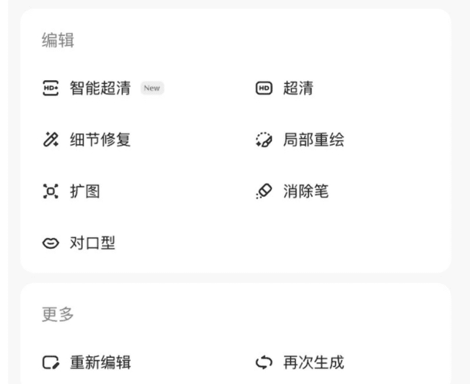

图11-2 即梦图片编辑页面

##### 第二步，Seedance静态画面动态化，强化卖点可视化

静态画面优化完成后，借助Seedance将其转化为动态视频片段，核心依托平台重新配音、AI 配乐、AI 音效、补帧、提升分辨率等内置功能，还原分镜要求的镜头运动、人物动作与产品展示效果，同时强化卖点可视化，提前优化音画基础，减少后续剪映操作量，具体实操步骤如下，确保普通创作者可直接落地：

1.导入素材与排序：如前文点击"生成视频"按钮即可进入视频生成模式，将优化后的静态分镜按镜号顺序导入，在时间轴调整素材顺序，确保与脚本、分镜一致；在各素材备注栏标注镜头运动、人物动作、产品卖点及音画需求，例如"镜号3，粉底液推开演示，突出顺滑质地"，方便后续精准调用功能，避免操作混乱，如图11-3所示。

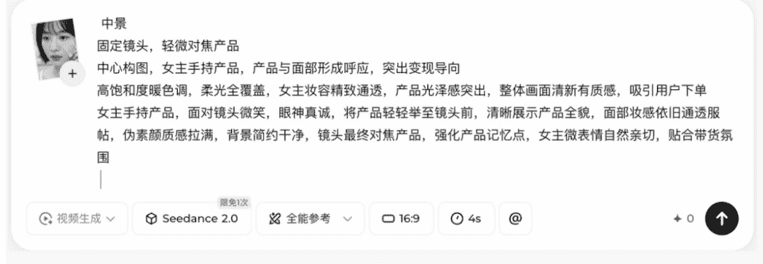

图11-3 Seedance视频生成页面

2.静态转动态+画面优化：按分镜要求为每个静态画面设置镜头运动，产品特写镜头采用轻微推镜，突出产品细节；人物动作镜头采用固定镜头或轻微摇镜，确保人物动作自然；转化引导镜头采用轻微拉镜，突出行动指令。通过添加贴合剧情的自然动作，例如粉底液推开、吸油纸按压等动作，调整动作速度为"自然舒缓"，贴合新手人设；同时调用核心优化功能：点击"提升分辨率"统一升级至2K，开启"补帧"并设为30帧，解决动态卡顿、动作生硬问题，保障画面流畅度；对产品特写镜头添加"轻微放大"动态效果，强化卖点可视化。

3.音画适配前置操作：借助Seedance的AI音效、AI配乐、重新配音功能提前完成音画适配，减少剪映重复操作。点击"AI音效"，根据场景需求添加对应音效并调整至与画面同步，例如粉底液推开的手指摩擦声、吸油纸按压声，音量调至15%～20%，避免盖过人声与配乐；点击"AI配乐"，选择清新轻快的纯音乐，贴合美妆广告调性，音量调至25%～30%，确保不干扰台词传递与核心音效；点击"重新配音"，输入脚本对应台词，选择贴合20岁新手女生的柔和音色，调整语速为稍缓且自然，贴合实测场景的真实感，配音完成后逐段核对，确保台词与画面动作精准同步，无延迟或提前，重点核对卖点传递相关台词（如持妆、控油、平价等）的清晰度，避免模糊不清，Seedance生成视频编辑界面如图11-4所示。

图11-4 Seedance生成视频编辑界面

4.动态片段导出：所有动态设置、音画适配完成后，逐镜头预览动态效果，重点检查镜头运动流畅度、人物动作自然度、产品卖点可视化效果及音画同步性，若出现动作生硬、音效错位、台词模糊等问题，可微调参数（如动作速度、音量大小、配音语速）；确认无误后，将每个动态片段单独导出，导出参数设置为：分辨率2K、帧率30帧、格式MP4，命名格式为"美妆广告—镜号×"（如美妆广告—镜号1），便于后续剪映导入时快速识别与排序，避免素材混乱。

##### 第三步，剪映导入素材，完成镜头拼接与节奏调整

动态片段导出后，打开剪映APP（手机端或电脑端均可，电脑端操作更便捷，适合多片段拼接），重点完成镜头拼接、节奏优化，确保全片流畅紧凑，贴合短视频快节奏特点，同时贴合美妆带货广告的变现导向，具体操作如下：

- 1. 素材导入与排序：点击剪映"开始创作"，导入所有Seedance导出的动态片段，按镜号顺序拖拽至时间轴，核对片段顺序与脚本、分镜一致，删除片段首尾多余的空白部分（若有），确保每个片段衔接紧密，无冗余画面；在时间轴上为每个片段标注镜号与卖点传递重点，方便后续针对性调整。

- 2. 镜头衔接与转场设置：短视频广告转场需简洁自然，避免复杂转场干扰卖点传递，优先选择"切镜"转场（默认转场），适用于大多数镜头衔接；针对产品展示镜头（如镜号2粉底液瓶身展示、镜号5持妆实测特写），可添加"轻微淡入淡出"转场，时长设为0.3～0.5秒，增强画面过渡的柔和度，如图11-5所示。

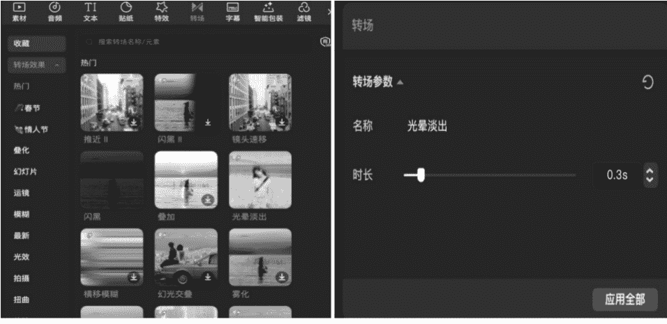

图11-5 剪映转场界面

##### 第四步，剪映音画适配优化，强化卖点与转化引导

虽然Seedance已完成基础音画适配，但剪映需进一步优化，解决音画不同步、音量不均衡、卖点传递不突出等问题，同时强化转化引导，贴合广告变现需求，具体操作分为3点：

- 1. 音画同步微调：逐镜头核对配音、音效与画面动作的同步性，若出现配音延迟、音效错位等问题，拖拽音频轨道进行微调，确保台词与人物动作精准对应（如女生说"徒手就能推开"时，同步呈现推开粉底液的动作），音效与场景动作同步，如吸油纸按压时，同步出现摩擦声。

同时统一全片音量，配音音量调至50%～55%（确保清晰可闻），配乐音量调至25%～30%，音效调至15%～20%，避免出现某段声音过大或过小的情况，提升用户观看体验，如图11-6所示。

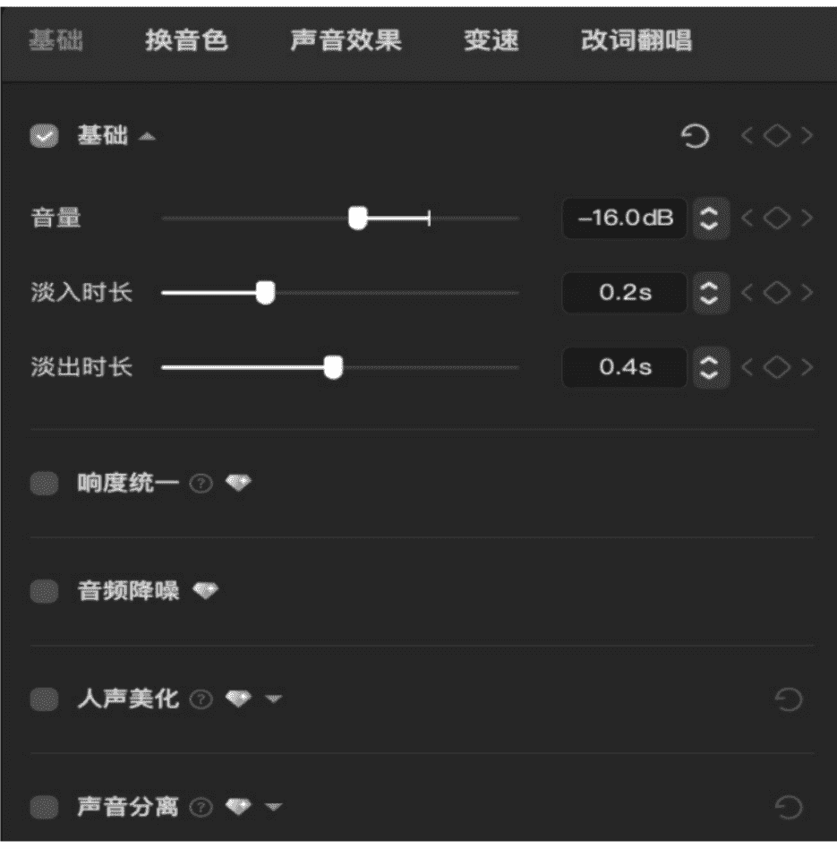

图11-6 剪映调整音量界面

2.卖点强化：借助剪映的"文字""贴纸"功能，突出核心卖点，提升用户记忆点，如图11-7所示。

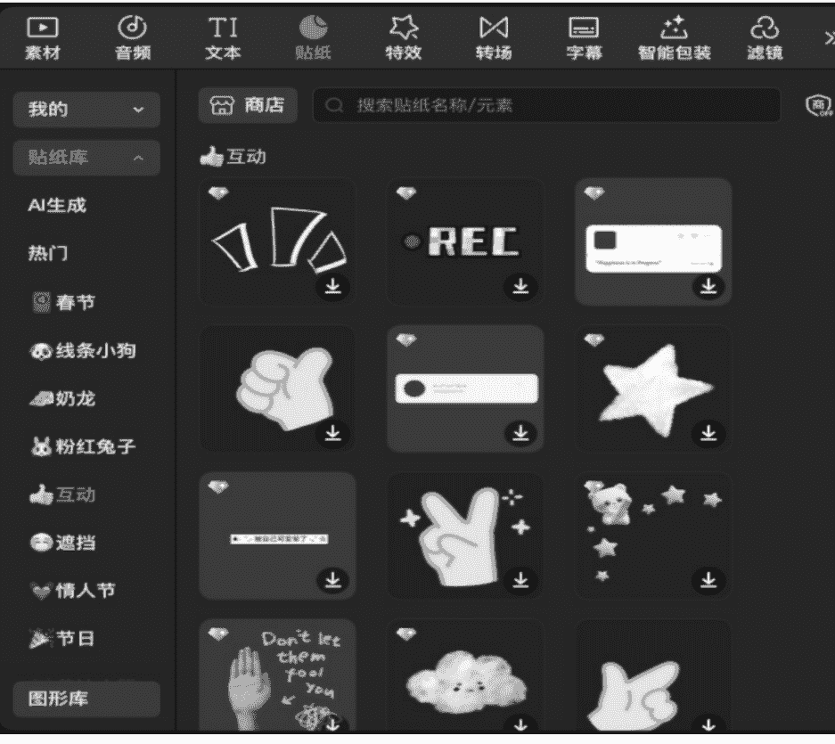

图11-7 剪映贴纸选择界面

针对每个卖点传递镜头，添加简洁的卖点文字（字体选择清晰易读的sans-serif字体，颜色与画面色调协调，避免突兀），例如镜号3（推开演示）添加"新手易推开·不卡粉"如图11-8所示。

镜号5（持妆实测）添加"持妆6小时·控油不脱妆"，镜号6（转化引导）添加"59.9元·新手闭眼冲"；文字时长与对应镜头一致，可添加"轻微弹出"动画，增强吸引力，但避免复杂动画干扰卖点阅读；同时，可添加简约的产品贴纸（如粉底液瓶身贴纸），贴合美妆场景，强化产品认知。

3.转化引导强化：重点优化结尾转化引导镜头（镜号6），添加转化引导元素，明确行动指令。点击"贴纸"，搜索"小黄车""下单引导"贴纸，添加至画面左下角（不遮挡人物与产品），贴纸时长与镜头一致，如图11-9所示。

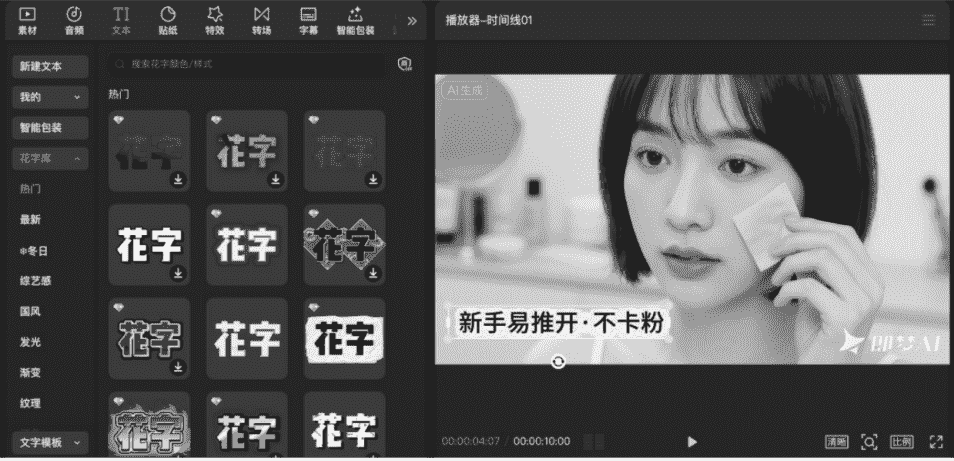

图11-8 剪映花字添加界面

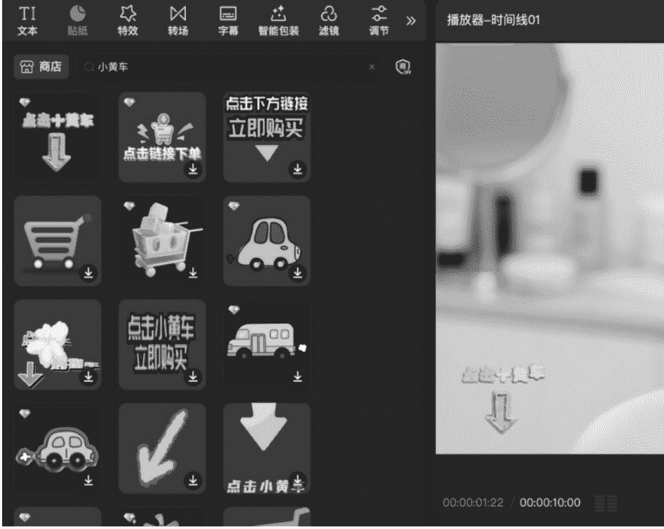

图11-9 剪映贴纸添加界面

同时，在画面下方添加固定字幕"点击小黄车·直接下单"，字体加粗、放大，颜色选择醒目且与画面协调的颜色（如红色、橙色），增强引导性；若需适配抖音等平台，可添加"小黄车跳转"锚点（剪映内置功能），方便后续发布时挂载商品链接，提升转化效率。

##### 第五步，字幕添加与优化，确保信息传递清晰

字幕是传递广告信息、强化卖点的重要载体，需确保字幕清晰、准确、同步，贴合短视频快节奏特点，具体操作如下：

1.自动生成字幕与校对：点击剪映"文本"→"添加口播稿"，输入文案需求，剪映会自动生成对应字幕并且进行智能分割，逐句核对字幕与配音、脚本是否一致，修正错别字、语句偏差（如将"持妆"误写为"持状"）；同时，可以选择配音人物，然后一键添加到轨道即可，如图11-10所示。

图11-10 剪映智能文案使用界面

2.字幕优化：字幕时长与配音同步，避免出现字幕提前消失或延迟出现的情况；针对核心卖点、转化引导相关的字幕（如"59.9元""持妆6小时""点击小黄车下单"），可进行加粗、放大处理，或添加轻微动画（如"加粗闪烁"），增强突出度；同时，控制字幕密度，避免单屏出现过多文字，每屏不超过15个字，确保用户快速阅读，不影响画面观看。

##### 第六步，细节优化，统一视觉风格，规避常见误区

细节优化是提升广告成片质感、避免用户反感的关键，重点围绕视觉风格统一、画面瑕疵修正、合规性检查等方面展开，贴合实操需求：

- 1. **视觉风格统一**：借助剪映"调色"功能，批量优化所有片段的色调，延续前期确定的清新自然风、高饱和度暖色调，统一亮度、对比度、饱和度（亮度+5，对比度+10，饱和度+15，可根据实际画面微调），确保全片视觉风格一致，避免出现某段画面偏暗、偏亮或色调偏差的情况；对产品特写镜头，可再次进行轻微锐化（锐化+10），突出产品细节（如粉底液质地、瓶身光泽），增强卖点吸引力，如图11-11所示。

- 2. **画面瑕疵修正**：逐镜头预览，修正画面瑕疵，例如若某段画面出现轻微卡顿，可通过剪映"补帧"功能（点击片段→"补帧"→"智能补帧"）优化；若画面出现多余杂物（如背景中的无关物品），可通过"裁剪"或"贴纸遮挡"功能处理，确保画面简洁，聚焦人物与产品；若动态效果过于生硬（如镜头推镜过快），可通过"变速"微调镜头运动速度，使其更自然。

- 3. **合规性与细节检查**：检查广告内容是否合规，避免出现夸大宣传（如"永不脱妆""特效美白"）、虚假承诺等违规表述，修正为客观真实的表述（如"持妆6小时以上""控油不脱妆"）；检查产品展示是否清晰，卖点传递是否全面，转化引导是否明确；同时，检查全片无水印（若有即梦、Seedance水印，可通过"裁剪"或"贴纸遮挡"去除），确保成片干净整洁，适合平台发布。

图11-11 剪映画面调色界面

##### 第七步，导出成片，适配平台发布需求

细节优化完成后，进行最终预览，完整观看一遍成片，核对以下核心要点：镜头衔接流畅、音画同步、字幕准确、卖点突出、转化引导明确、视觉风格统一、画面无瑕疵、内容合规，确保成片效果与创意、脚本、分镜设定高度一致，贴合美妆带货广告的变现导向；确认无误后，点击剪映"导出"，设置导出参数，适配短视频平台发布需求，如图11-12所示。

图11-12 剪映视频导出界面

#### 11.3.3 广告成片实操进阶技巧

**AI工具协同：流程提效，质感统一。**重点打通Seedance、即梦、剪映、豆包的联动，用 AI 替代重复劳动，让成片更精致、出片更快。豆包批量指令生成。面对即梦画面批量调色、Seedance参数统一设置、剪映字幕批量修改等工作，直接让豆包生成可复制的操作指令，一键导入工具即可完成，不用逐帧手动调整。

**音画适配：抓住前3秒，降低划走率。**用声音配合画面营造氛围，让用户愿意看、看得完、被带动。BGM与节奏精准分段，开头3秒用悬念、轻柔音乐抓眼球；中间卖点演示用轻快、有活力音乐；结尾转化引导用激昂、有号召力音乐，用剪映音频分割分段匹配，情绪层层递进。音效与动作同步，美妆的开瓶、涂抹、按压；餐饮的沸腾、夹菜、碰撞；APP的点击、滑动、弹窗，都配上对应轻音效，增强沉浸感和临场感，用户更不容易划走。

## 第12章 品牌宣传片制作实操

## 创意构思：品牌视觉体系设计

品牌宣传片创意构思的核心是品牌视觉体系与品牌内核的深度融合，核心任务是挖掘品牌核心价值、提炼品牌视觉符号、构建统一的品牌视觉体系，将品牌理念、价值观、文化内涵融入视觉表达中，实现品牌形象的精准传递与深度触达。与商业广告短视频的转化导向不同，品牌宣传片更注重"情感共鸣与品牌记忆"，无需强行动作引导，而是通过系统化的视觉设计让用户感知品牌调性、认同品牌内核，形成长期的品牌认知。

#### 12.1.1 借助豆包+即梦进行品牌视觉体系创意构思的步骤

##### 第一步，明确品牌内核，拆解视觉表达核心诉求

创意构思的首要前提是明确品牌的核心内核与视觉表达诉求，这是构建品牌视觉体系的基础。创作者需先梳理品牌的核心信息，例如品牌定位、品牌理念、核心价值观、品牌调性、行业属性、目标受众的审美偏好，以及品牌宣传片的传播场景（短视频平台、企业官网、线下展会）与时长（15秒短视频、1分钟品牌短片、3分钟品牌故事片）。实操中可借助豆包，输入相关信息，获取精准的品牌内核拆解与视觉表达诉求提炼，以轻奢美妆品牌为例，提示词如下：

> 帮我拆解一款轻奢美妆品牌的视觉体系创意核心信息，品牌定位高端轻奢美妆，主打天然植萃成分，品牌理念是"自然美学，精致护肤"，品牌调性温柔、高级、简约，目标人群25～40岁高消费女性，品牌宣传片用于抖音/小红书短视频传播，时长30秒，帮我提炼品牌内核核心关键词，明确视觉表达的核心诉求，结合轻奢美妆行业视觉趋势，给出品牌视觉体系的核心设计方向建议。

豆包根据指令生成内容如下：

###### 轻奢美妆品牌·视觉体系核心拆解

品牌内核核心关键词：天然植萃、自然美学、精致轻奢、温柔高级、简约质感

视觉表达核心诉求：贴合轻奢调性，突出自然与精致的融合，视觉画面简约不单调，具有高级质感，能让目标人群产生审美共鸣，形成品牌视觉记忆

视觉体系核心设计方向：

色调：以低饱和度的自然色系为主，搭配轻奢质感的浅金色系，营造温柔高级的氛围

……

##### 第二步，提炼品牌视觉核心元素，明确元素使用规范

品牌内核与视觉诉求明确后，需借助豆包，基于品牌内核核心关键词，提炼出主视觉色调、核心视觉符号、辅助视觉元素、品牌视觉标识四大核心视觉元素，同时明确各元素的具体规范与搭配逻辑，确保视觉元素的统一性与辨识度，核心原则是"视觉元素为品牌内核服务，简洁具象、易识别、易传播"。不同品牌类型的视觉元素提炼与使用规范存在差异，需结合品牌调性与传播场景灵活设计，实操中可在豆包中补充提示词，获取细化的视觉元素提炼结果与使用规范，示例提示词（以轻奢美妆品牌为例）如下：

基于这款轻奢美妆品牌的视觉体系核心信息，帮我提炼品牌视觉核心元素，包括主视觉色调（主色、辅色、点缀色，标注色值参考）、核心视觉符号（设计描述、使用场景）、辅助视觉元素（选择标准、搭配逻辑）、品牌视觉标识（logo 展示方式、位置），明确各视觉元素的使用规范，贴合轻奢、温柔、高级的品牌调性，适配30秒短视频品牌宣传片的视觉表达，同时适配即梦视觉生成与Seedance动态化需求。

豆包根据指令生成内容如下：

###### 轻奢美妆品牌·视觉核心元素及使用规范

####### 一、主视觉色调（低饱和度，突出温柔高级）

主色：裸粉色（RGB：245，235，230）、浅米色（RGB：250，245，240），占画面70%以上，奠定整体温柔基调

辅色：浅金色（RGB：230，215，180），占画面20%～25%，提升轻奢质感，用于产品细节、视觉符号点缀

……

##### 第三步，搭建完整品牌视觉体系，明确视觉表达规则

视觉核心元素提炼完成后，需借助豆包，将各核心元素整合为一套完整、系统化的品牌视觉体系，明确**视觉表达风格、镜头画面构图规则、视觉元素组合逻辑、品牌信息展示规范**四大核心规则，确保品牌宣传片的每一个画面都遵循统一的视觉体系，形成连贯的品牌视觉表达，避免出现视觉风格混乱、元素搭配违和的问题。

实操中可输入提示词，获取针对性的视觉体系搭建结果，示例提示词（以新中式茶饮企业为例）如下：

基于轻奢美妆品牌视觉核心元素，帮我搭建完整的品牌视觉体系，明确视觉表达风格、镜头画面构图规则、视觉元素组合逻辑、品牌信息展示规范，贴合沉稳、雅致、兼具轻奢的品牌调性，适配1分钟企业品牌宣传片的视觉表达，同时适配即梦静态画面生成与Seedance动态化特性，方便后续生成视觉素材。

豆包根据指令生成内容如下：

###### 轻奢美妆品牌·完整视觉体系

（适配1分钟企业宣传片+即梦静态生成+Seedance动态化，调性：沉稳·雅致·轻奢）

####### 一、品牌视觉核心风格（底层基调）

######## 1. 核心定位

极简高级感|低奢内敛|温润雅致|质感优先

**拒绝**：高饱和色、杂乱背景、夸张特效、强对比硬阴影

######## 2. 色彩系统

主色：奶杏柔白、雾感檀棕、哑光柔金

辅助色：低饱和雾粉、烟灰色、清透瓷白

点缀：仅用**柔金细线/光斑**做轻奢提亮

禁忌：亮红、明黄、艳蓝、荧光色

……

##### 第四步，视觉化验证，迭代优化视觉体系

品牌视觉体系搭建完成后，借助即梦的视觉生成能力，将文字化的视觉体系转化为具象的视觉画面，快速验证视觉体系的统一性、辨识度、品牌调性贴合度，避免视觉体系与实际落地脱节。操作时，在即梦中输入贴合视觉体系、品牌调性的提示词（可借助豆包优化提示词精准度），生成1～2张品牌宣传片的核心视觉画面（例如品牌主视觉镜头、产品/场景展示核心镜头），验证视觉元素的搭配效果、色调的呈现效果与品牌调性的贴合度。例如基于轻奢美妆品牌的视觉体系设定，即梦画面提示词可设置为：

轻奢温柔风，低饱和度色调，裸粉色（RGB：245，235，230）+浅米色（RGB：250，245，240）为主，浅金色（RGB：230，215，180）点缀，16：9竖屏，高清2K，画面留白充足，简约高级；场景为轻奢美妆品牌宣传片核心镜头，画面主体为通透的精华液瓶身，瓶身旁有简约线条化植萃叶片视觉符号，背景为淡绿色植萃光斑，柔和散射光，突出产品通透质感与自然美学；品牌logo为纯白色简约字体，展示在画面右下角，大小为画面1/10，贴合轻奢美妆品牌视觉体系，适配即梦生成特性，便于后续Seedance动态化。

即梦接收指令后会生成图片如图12-1所示。

#### 12.1.2 品牌视觉体系创意构思的注意事项

**品牌内核与视觉体系高度统一，杜绝脱节：** 借助豆包梳理品牌视觉体系、撰写提示词时，需始终以品牌内核为核心导向，所有视觉元素、色调、表达风格都需贴合品牌理念、价值观与调性，避免为了追求画面美感而脱离品牌内核。例如公益环保品牌的视觉体系不能过于奢华，新中式茶饮企业的视觉体系不能过于西式，确保用户通过视觉画面就能快速感知品牌的核心定位与调性，形成清晰的品牌认知。

**视觉元素具象化、简洁化，适配 AI 生成特性：** 视觉体系的设计需充分考虑即梦与Seedance的生成局限，借助豆包将抽象的品牌内核、视觉理念转化为具象、简洁的视觉元素，避免设计过于复杂的视觉符号、元素搭配与画面场景。例如无需用抽象的文字描述"品牌的轻奢质感"，可借助豆包转化为"低饱和度裸粉色调+浅金色点缀+简约线条视觉符号+画面留白充足"，既传递轻奢的核心调性，又避免AI理解偏差，提升视觉体系的落地效率。

### 12.2 脚本与分镜设计：品牌叙事结构

品牌宣传片的脚本与分镜设计，是连接品牌视觉体系与成片制作的核心纽带，也是确保宣传片叙事逻辑贴合品牌内核、视觉表达遵循视觉体系的关键环节。与商业广告短视频的快节奏、强卖点脚本分镜不同，品牌宣传片的脚本更注重"叙事的连贯性、情感的递进性、品牌内核的层层传递"，分镜则更注重"视觉表达的统一性、画面的美感与情感的共鸣"，是将文字化的品牌故事与视觉体系转化为可视化镜头的核心依据。

#### 12.2.1 借助豆包+即梦+Seedance辅助品牌宣传片脚本与分镜设计的优势

借助豆包辅助脚本撰写，搭配即梦与 Seedance 的 AI 生成特性进行分镜设计，能让品牌宣传片的脚本与分镜更高效、更贴合实操需求与品牌传播诉求，大幅降低专业门槛，确保后续素材生成、动态化及剪辑环节顺畅推进，同时避免脚本分镜与品牌视觉体系、内核脱节，确保每一个镜头都围绕"传递品牌内核、塑造品牌形象、引发情感共鸣"展开。

#### 12.2.2 品牌宣传片脚本设计步骤

##### 第一步，梳理品牌内核与视觉体系，明确脚本设计依据

脚本设计需立足品牌内核与视觉体系双重基础，先借助豆包全面梳理宣传片的核心信息与叙事节奏节点，为后续镜头拆解与脚本撰写提供明确依据。

##### 第二步，借助豆包，拆解镜头维度并生成标准脚本表格

基于梳理好的核心信息与叙事节奏节点，结合前期的品牌视觉体系，借助豆包将整个品牌宣传片拆解为若干个独立镜头，每个镜头均明确核心维度，形成可直接落地的标准化品牌宣传片脚本。核心维度需包含镜号、景别、画面内容、时长、视觉执行要求、音效、品牌内核传递重点，确保每个镜头都能与品牌内核、视觉体系精准适配，同时贴合 AI 生成特性与视频传播逻辑。实操中可上传视觉体系框架与核心信息，输入提示词快速生成标准化脚本表格，示例提示词如下：

为轻奢美妆品牌设计30秒短视频品牌宣传片的标准化脚本，品牌内核核心关键词是天然植萃、自然美学、精致轻奢、温柔高级，视觉体系为低饱和度裸粉色+浅米色为主、浅金色点缀，简约线条植萃叶片视觉符号，画面留白充足，叙事节奏节点为5秒开篇引入、15秒内核传递、7秒情感共鸣、3秒品牌收尾，场景为简约自然护肤空间，无人物台词，音效为轻柔舒缓纯音乐。借助豆包拆解镜头，生成包含镜号、景别、画面内容、时长、视觉执行要求、音效、品牌内核传递重点的标准脚本表格，镜头节奏与品牌调性高度同步，适配即梦+Seedance生成需求，视觉执行严格遵循品牌视觉体系。

豆包接收指令后会生成脚本，如表12-1所示。

###### 表12-1 品牌宣传片脚本

| 镜号 | 景别 | 画面内容 | 时长 | 视觉执行要求 | 音效 | 品牌内核传递重点 |
|:---|:---|:---|:---|:---|:---|:---|
| 1 | 远景 | 简约的自然护肤空间，阳光透过纱帘洒入，画面中有植萃叶片装饰，空镜展示空间氛围 | 5s | 1. 主色调：裸粉色+浅米色，占画面90% 2. 构图：三分构图，画面1/3留白 3. 光影：柔和的自然散射光，有轻微光斑 | 轻柔纯音乐渐入，音量20% | 引入品牌的自然美学调性，营造温柔高级的氛围 |
| 2 | 特写 | 镜头缓缓推至桌面的精华液瓶身，瓶身通透，瓶旁有简约线条化植萃叶片视觉符号 | 6s | 1. 主色调：裸粉色+浅米色，浅金色点缀瓶身细节 2. 视觉符号：植萃叶片位于瓶身右侧，线条简约 3. 光影：侧光打亮瓶身，突出通透质感 | 纯音乐持续，音量25% | 传递品牌的产品核心——天然植萃，突出精致轻奢的产品质感 |

续表

| 镜号 | 景别 | 画面内容 | 时长 | 视觉执行要求 | 音效 | 品牌内核传递重点 |
|------|------|----------|------|--------------|------|------------------|
| 3 | 特写 | 精华液滴从瓶口滴落，滴在植萃叶片上，液体与叶片融合，画面细腻 | 5s | 1. 主色调：裸粉色+浅米色，淡绿色点缀植萃叶片 2. 构图：居中构图，聚焦液滴与叶片 3. 视觉元素：仅保留精华液与植萃叶片，无多余元素 | 纯音乐轻扬，加入轻微的液滴声（音量15%） | 强化天然植萃与护肤产品的融合，传递自然美学的品牌理念 |

……

##### 第三步，适配AI特性，借助豆包优化脚本细节

脚本生成后，需结合即梦与 Seedance 的 AI 生成特性，借助豆包对脚本进行精细化优化，确保脚本可落地、易生成，同时进一步强化品牌内核传递与视觉体系执行，避免后续出现生成困难、效果偏差、视觉风格混乱等问题。

#### 12.2.3 品牌宣传片分镜设计步骤

##### 第一步，拆分镜头单元，明确核心设计维度

以脚本为基础，按照宣传片的叙事节奏与镜头顺序，将每个脚本镜头拆分为独立的分镜单元，确保每个分镜都能精准对应脚本内容、传递品牌内核，同时兼顾全片的叙事节奏与视觉风格统一。分镜数量需结合宣传片时长合理规划，常规情况下15秒短视频5～8个分镜、30秒短视频8～12个分镜、1分钟长片15～20个分镜为宜，确保镜头节奏舒缓且不拖沓，适配品牌宣传片的叙事特点。

每个分镜单元需先明确七大核心维度，为后续画面描述做好铺垫：镜号（与脚本一致）、景别、镜头运动方式、画面构图、色彩光影、视觉元素搭配、品牌内核传递重点，避免分镜设计混乱，确保贴合AI生成特性与品牌传播诉求。

##### 第二步，细化画面描述，适配即梦生成，贴合视觉体系

分镜的核心是"可视化指引+品牌内核传递+视觉体系执行"，需为每个分镜单元撰写详细、具象的画面细节描述，这份描述将直接作为即梦生成静态画面的核心提示词，描述越精准、视觉体系执行要求越明确，AI生成效果与预期的匹配度越高。

描述内容需全面覆盖画面主体、场景细节、色彩光影、视觉元素搭配、品牌标识展示、情感氛围，重点突出视觉体系的严格执行与品牌内核的视觉化表达，贴合品牌宣传片的传播需求。若宣传片有人物，需明确人物的固定特征（发型、服饰、神态），确保与品牌调性一致；若有产品展示，需重点描述产品的细节与视觉呈现方式，贴合品牌视觉体系。例如针对上述轻奢美妆品牌脚本中镜号3的分镜（精华液滴与植萃叶片融合），画面细节描述优化为：

特写，轻奢温柔风，严格遵循品牌视觉体系；16：9竖屏，高清2K，画面清晰细腻，无噪点，突出液体与叶片的细腻质感；场景为简约自然护肤空间，背景为模糊的裸粉色纱帘，无多余杂物，聚焦画面主体；画面主体为通透的精华液滴从瓶口滴落，滴在浅绿色的植萃叶片上，液体与叶片自然融合，叶片为品牌核心视觉符号的简约线条化设计，边缘有轻微的浅金色点缀；色彩光影：主色调为裸粉色（RGB：245, 235, 230）+浅米色（RGB：250, 245, 240），淡绿色（RGB：220, 235, 225）点缀叶片，浅金色（RGB：230, 215, 180）点缀液滴边缘，柔和的侧逆光打亮液滴与叶片，突出通透的质感与自然的光影效果；视觉元素搭配：仅保留精华液滴与植萃叶片，无多余辅助元素，画面留白充足；适配即梦生成特性，同时清晰传递天然植萃、自然美学的品牌内核，贴合轻奢美妆品牌宣传片的场景。

接收指令后会生成图片，如图12-2所示。

图12-2 分镜3

##### 第三步，整合分镜信息，生成标准分镜表

所有分镜单元拆解与描述完成后，需将其整合为标准化分镜表，形成统一的创作指引，方便后续即梦画面生成、Seedance动态化及剪辑环节高效衔接。分镜表需完整包含九大核心要素，按"镜号—景别—镜头运动—画面构图—色彩光影—画面描述—时长—视觉执行要求—品牌内核传递重点"的顺序整理，无需手动排版，借助豆包输入提示词即可快速生成。

示例提示词如下：

将轻奢美妆品牌30秒短视频品牌宣传片的6个镜头整理为标准化分镜表，标注镜号、景别、镜头运动、画面构图、色彩光影、画面描述、时长、视觉执行要求、品牌内核传递重点，画面描述贴合轻奢温柔风的视觉风格，严格遵循品牌视觉体系（低饱和度裸粉色+浅米色、简约植萃视觉符号、画面留白），镜头运动舒缓适配即梦+Seedance 生成特性，色彩光影与品牌调性高度匹配，确保每个分镜都能清晰地传递品牌内核。

豆包根据指令生成的分镜表将精准对应脚本与品牌视觉体系，明确每个镜头的可视化细节与执行要求，为后续 AI 生成与剪辑环节提供清晰的指引，确保品牌宣传片的视觉表达高度统一。

#### 12.2.4 品牌宣传片脚本与分镜设计的注意事项

**叙事节奏与品牌调性高度匹配，杜绝脱节：** 脚本与分镜设计的核心是让镜头节奏与叙事逻辑服务于品牌调性与内核传递，需确保镜头的切换节奏、时长分配、镜头运动与品牌调性精准匹配。例如轻奢、沉稳的品牌，镜头节奏需舒缓，采用缓慢的推镜、拉镜；活力、年轻的品牌，镜头节奏可稍快，采用自然的切镜、摇镜。在豆包提示词中需明确 "叙事节奏与品牌调性高度匹配，镜头运动贴合品牌氛围"，避免出现镜头节奏与品牌调性违和的情况。

**品牌内核传递清晰，每一个镜头都有明确的核心诉求：** 脚本与分镜设计的每一个环节，都需围绕 "传递品牌内核、塑造品牌形象" 展开，借助豆包优化镜头设计与画面描述，确保每个镜头都有明确的品牌内核传递重点，避免无意义的镜头堆砌。例如公益环保品牌的每一个镜头，都需围绕 "守护自然、微力前行" 的核心理念；新中式茶饮企业的每一个镜头，都需围绕 "茶融东方、守正创新" 的品牌理念，让用户通过镜头层层感知品牌内核，形成清晰的品牌认知。

### 12.3 成片实操：品牌视频生成流程

品牌宣传片的成片实操是品牌视觉体系与叙事结构落地的最后一个关键环节，核心任务是将12.2章节生成的静态分镜画面、脚本内容，通过Seedance的动态化功能、即梦的画面优化能力，结合剪映的剪辑工具，完成镜头拼接、动态效果设置、音画适配、字幕添加、细节优化与品牌信息强化，最终输出符合品牌视觉体系、叙事逻辑流畅、品牌内核突出的完整品牌宣传片。

#### 12.3.1 借助Seedance+即梦+剪映进行品牌宣传片成片实操的优势

传统品牌宣传片的成片制作，往往面临"拍摄成本高、后期剪辑烦琐、视觉风格难以统一、叙事衔接生硬、情感氛围营造不足"等问题。普通创作者拍摄时易出现镜头晃动、光线杂乱、视觉元素搭配违和等问题。

依托 Seedance、即梦与剪映的协同组合，制作门槛极低，效率极高。Seedance可直接将即梦生成的静态分镜画面转化为动态视频，无需专业拍摄环节，单人即可完成动态化操作；剪映操作简单、功能齐全，内置多种适合品牌宣传片的调色、配乐、字幕模板，无需专业剪辑功底，借助其智能功能，可快速完成镜头拼接、色调统一、音画适配，大幅缩短成片制作周期，30秒品牌宣传片全程仅需1小时左右即可完成，相比传统模式（数天）效率提升显著。

#### 12.3.2 品牌宣传片成片实操的核心步骤

##### 第一步，静态画面深度优化，严格遵循品牌视觉体系

成片实操的首要任务是对即梦生成的静态分镜画面进行深度优化，确保所有画面视觉风格统一、细节达标、品牌视觉体系执行到位，为后续动态化生成奠定基础。首先输入提示词，生成对应的分镜图片。以分镜4为例，输入如下提示词：

中景，轻奢简约风，精华液瓶身居画面核心位置，背景铺陈朦胧的植萃光斑，浅金色细腻勾勒瓶身轮廓，画面角落隐现简约植萃叶片视觉符号，对称构图，画面1/3留白，主色调为低饱和度裸粉色+浅米色，光影柔和通透，整体画面简约干净，自然与轻奢融合，高清质感，8K。

接收指令后即梦会生成图片，如图12-3所示。

图12-3 分镜4

将即梦生成的所有静态分镜画面按镜号排序，逐一核对画面的主辅色调、视觉元素、构图规则、品牌标识展示是否与品牌视觉体系一致，重点检查核心视觉符号的呈现效果、色调的饱和度、画面的留白比例，例如若某张画面的浅金色点缀过多，可借助即梦补充提示词"减少浅金色点缀，仅用于产品细节，严格遵循品牌视觉体系色调比例"重新生成；若视觉符号的设计不符合要求，可微调提示词，确保视觉元素精准贴合品牌视觉体系。

##### 第二步，Seedance静态画面动态化，还原叙事节奏与品牌氛围

静态画面优化完成后，借助Seedance将其转化为动态视频片段，例如分镜4输入提示词：

中景，镜头从瓶身特写缓缓匀速拉远至中景，拉远过程顺滑无顿挫，轻奢简约风，精华液瓶身居画面核心位置静止，背景铺陈朦胧的植萃光斑缓慢匀速浮动，浅金色细腻勾勒瓶身轮廓无动态，画面角落隐现固定简约植萃叶片视觉符号，对称构图，画面1/3留白，主色调为低饱和度裸粉色+浅米色，光影柔和通透，整体画面简约干净，8K超高清，电影级柔焦，背景音为轻柔纯音乐持续，液滴声消失（音量25%）。

接收指令后，分镜4的静态图片会根据提示词变为动态的，如图12-4所示。

图12-4 动态视频

逐镜头预览动态效果，重点检查镜头运动流畅度、动态效果自然度、音画同步性，若出现音效错位等问题，可进行调整，确认无误后，将每个动态片段单独导出，便于后续剪映导入时快速识别与排序。

##### 第三步，剪映导入素材，完成镜头拼接与叙事节奏调整

动态片段导出后导入剪映，按镜号顺序拖动素材至时间轴，如图12-5所示，核对片段顺序与脚本、分镜一致，删除片段首尾多余的空白部分（若有），确保每个片段衔接紧密，无冗余画面；在时间轴上为每个片段标注镜号与品牌内核传递重点，方便后续针对性调整。

图12-5 导入素材

品牌宣传片的转场需简洁自然、柔和舒缓，避免复杂转场干扰叙事节奏与品牌氛围，优先选择"切镜"转场（默认转场），适用于大多数镜头衔接；针对场景切换、空镜与产品镜头的衔接，可添加"轻微淡入淡出"转场，时长设为0.5～1秒，增强画面过渡的柔和度，贴合品牌宣传片的舒缓节奏；转场设置完成后，完整预览一遍，确保镜头衔接流畅，无突兀感。

##### 第四步，剪映音画适配优化，营造品牌专属情感氛围

虽然Seedance已完成基础音画适配，但剪映需进一步精细化优化，解决音画不同步、音量不均衡、情感氛围营造不足等问题，同时强化音画与品牌调性的贴合度，精准营造品牌专属的情感氛围。

##### 第五步，细节优化，导出成片适配平台发布

我们可以对全片进行预览，如图12-6所示，对画面、背景音乐等细节进行优化调整。成片细节优化完成后，需根据传播平台的要求，设置合适的导出参数，确保成片在不同平台呈现效果最佳，同时做好发布前的最终检查。

图12-6 视频预览

#### 12.3.3 品牌宣传片成片实操的注意事项

**始终坚守品牌视觉体系，确保全片风格统一：** 成片实操的每一个步骤，都需严格遵循创意构思阶段确定的品牌视觉体系，包括主辅色调、核心视觉符号、构图规则、品牌标识展示方式等，避免在剪辑、调色、字幕设计中偏离品牌调性。例如轻奢美妆品牌不可出现高饱和度、杂乱的色调，新中式茶饮品牌不可添加西式视觉元素，确保全片视觉表达高度统一，强化品牌视觉记忆。

**音画适配优先，避免音画脱节、违和：** 音画配合是品牌宣传片营造情感氛围、传递品牌调性的核心，需始终坚持"音画同步、情感同频"。避免出现配乐节奏与镜头节奏不符、音效与画面动作错位、音量不均衡等问题；同时，根据品牌调性选择合适的配乐与音效，杜绝使用与品牌调性违和的音乐（如轻奢品牌不可使用过于激昂、嘈杂的音乐），确保音画整体和谐，引发用户情感共鸣。