# 豆包 Seedance 2.0：AI 视频变现实操指南

## 内容简介
AI 正在改写影像生产的游戏规则。过去需要一支团队才能完成的工作，现在可以由个人闭环；过去投入重本难以复制的创作方式，如今被压缩成可批量复制的标准作业。

本书围绕豆包与 Seedance 展开，共计五大部分十二章，从认知搭建到商业交付，从内容生产到客户项目落地，串成一条完整的能力链条，帮助读者建立可持续的内容输出与商业转化机制。无论是深耕短视频运营或账号矩阵的从业者，还是想借助智能工具提升效率的小组与个体工作室，都能借此系统性升级。

## 前言
过去十年，流量重塑了个人收入。短视频让个人拥有媒体能力，电商重构了销售能力，自媒体放大了传播能力。如今智能化带来了更深层的能力跃迁，让个人接近专业团队的生产水准。

AI 影像的到来不是工具的平替，而是生产关系的转移。以前一部作品要经历策划、撰稿、拍摄、剪辑、后期、配音等多环节协作；现在熟练使用智能工具的人，可以从创意到成片全流程自营。成本被大幅压低，使用门槛明显下降，效率被显著放大。生产力第一次以如此低的代价向个体开放。

Seedance 等影像系统的意义，不只是输出一段画面，而是重新定义内容产能。你不再被团队规模限制，不再依赖昂贵器材，不再被技术细节拖住。真正决定成败的，是创意架构、镜头掌控力和商业判断力。技术执行的重担，AI 已能承担大头。

这意味着什么？意味着个人可输出工作室级别的影像；意味着小团队能与传统制作公司抗衡；意味着内容创业的天花板被明显抬高。对敏锐者而言这是窗口期。每一次技术浪潮都会造就一批快速积累财富的人。差距不仅来自天赋，也来自是否在早期建立体系化能力。

智能不会取代所有人，却会极大助力懂结构、懂策略、懂商业的人。影像是流量入口、品牌资产、销售媒介、IP 载体。当生产效率大幅提升，真正稀缺的是认知与判断。谁能把智能纳入生产系统，谁就能在相同时间内产出更多作品、测试更多方向、跑通更多商业模型。

本书并非教你点开某个软件就行，而是帮你搭建一套智能影像生产体系。从创意发想，到脚本架构，到分镜控制，再到成片输出与商业落地，阅读后你将掌握制作智能影像的完整路径。你会发现，智能不是炫技手段，而是一项可复制的盈利能力。

我坚定认为智能影像不是昙花一现的泡沫，而是长期趋势。就像当年的电商和短视频，早期质疑者众多，真正行动的人已悄然完成财富积累。机会常出现在技术成熟、认知尚未普及的阶段。

如果你正在阅读这本书，说明你已感受到这一轮变化的意义。接下来要做的，是建立结构化能力而非零散尝试。方法对了，产出会持续放大；系统搭建完成，收益会逐步叠加。

技术红利正在释放，智能影像正在重塑内容产业。现在入场不是追风，而是布局。你要做的，是掌握它，然后让它为你工作。

## 一、全书结构
全书划分为五大模块、十二章，形成递进式能力升级路径：

#### 第一部分：Seedance底层基础
系统介绍 Seedance 在智能影像生态中的定位、能力边界、生成原理与完整工作流，建立创作底层认知与操作框架。同时梳理创意构建、脚本设计、分镜节奏与风格统一的方法，为后续实操奠定基础。

#### 第二部分：商业流量实操
聚焦短视频变现模式，涵盖爆款内容、自媒体矩阵、产品展示三大高频场景。围绕创意、脚本分镜设计与成片实操，拆解高完播与高转化影像的制作方法。

#### 第三部分：影视内容制作实操
深入电影级大场景、MV 音乐影像、真人短剧制作，强化叙事能力、镜头语言与节奏把控，帮助读者突破普通流量影像，进入更具表现力与审美价值的创作层级。

#### 第四部分：内容IP制作实操
系统讲解漫剧与人物剧情短视频的IP搭建逻辑，从角色塑造到故事结构，从分镜设计到成片输出，帮助读者建立可持续的内容资产生产能力。

#### 第五部分：商业客户项目实操
围绕商业广告与品牌宣传片制作，拆解客户项目的创意表达、转化结构与完整交付流程，提升对接企业客户的实战能力。

全书从基础认知到高阶商业项目，形成完整闭环。

## 二、适合读者
本书适合以下人群：

- 1）希望以智能影像实现变现的内容创业者
- 2）从事短视频运营、自媒体矩阵运营的从业者
- 3）需要制作产品影像与品牌宣传片的电商及企业人员
- 4）希望搭建IP并长期运营内容资产的创作者
- 5）想借助智能提升个人生产效率的小团队与个体工作室

无论零基础入门，还是已有影像制作经验的创作者，都可通过本书系统提升。

## 三、本书特点

### 1.结构清晰，路径完整
从工具认知到商业落地，全流程覆盖，不止停留在功能介绍层面。

### 2.方法统一，流程标准化
各实操章节均围绕“创意构思—脚本与分镜设计—成片实操”三步展开，形成可复制模型。

### 3.工具协同，效率最大化
结合 Seedance、豆包、即梦、剪映等工具，构建多工具协作体系，避免单一工具局限。

### 4.强调变现能力
不仅讲解如何生成影像，更讲解如何用影像获取流量、打造IP、服务客户，实现商业转化。

### 5.面向长期能力积累
从流量影像到品牌项目，从单条内容到IP资产，逐步升级创作层级。

智能影像的核心价值，在于让个体具备规模化生产能力。掌握工具只是起点，建立结构化创作力与商业体系才是关键。本书目标是帮助读者在智能影像时代构建属于自己的生产系统，让技术成为持续输出与持续盈利的基础设施。

领取更多资料，请加作者微信：swordqiaoAI。

## 第一部分 Seedance核心基础

### 第1章 Seedance认知框架与创作思路

#### Seedance在影像领域的定位与能力范围
创作的核心竞争力，不在于机械记忆功能，而在于对工具本质、生成逻辑与工作流程的深刻掌握。Seedance是字节跳动自研的专业智能影像生成系统，其价值不仅在快速生成影像，更在于提供一套可落地、可优化、可复用的创作体系。高效使用Seedance，首先要明确其在智能影像生态中的核心定位，清晰认知能力范围，既不高估也不低估，才能实现工具与需求的精准匹配。

Seedance即豆包影像生成模型Seedance 2.0，核心定位是全流程智能影像创作解决方案，聚焦打破创作门槛、提升创作效率、保障内容质感三大目标，衔接创意构思与成片输出，为零基础新手、专业自媒体人、内容团队及企业品牌方提供高效一体化的创作服务。相比传统剪辑工具如PR、剪映，Seedance无需专业拍摄剪辑功底，无需投入大量人力设备；相比同类智能影像工具，其优势在于协同性更强、画面更流畅、场景适配更广。依托字节跳动的智能技术，Seedance持续优化生成效果与操作体验，填补创意落地难、创作效率低的行业痛点。

明确能力边界是避免无效试错的关键。Seedance的核心功能与优势如下。

文本与静态画面转动态影像：可将文字提示词、即梦生成的静态分镜转化为流畅动态镜头，支持单镜头与多镜头串联，适配短视频、剧情片、科普片等多场景。
多场景与多参数适配：可灵活调整画面比例、分辨率、帧率、色调等参数，适配抖音、视频号、B站等多平台，同时支持4K超清输出，保障画面质感。
基础编辑与优化：无需额外剪辑工具即可完成镜头裁剪、音画同步、补帧、画面微调等基础后期，弥补生成细节不足。
多工具协同创作：与豆包、即梦无缝联动，可复用豆包的脚本与提示词优化能力、即梦的静态分镜生成能力，形成一体化创作闭环，提升效率与风格统一性。
低门槛高效产出：无需专业镜头语言与剪辑技巧，仅需掌握基础提示词撰写方法，即可快速生成优质影像，大幅降低准入门槛。

简言之，Seedance的核心价值是让创意快速落地、创作可控高效，适合需要快速产出优质短视频的各类创作者，尤其适配对效率要求高、无需专业后期的场景。

#### 1.2 Seedance影像生成底层逻辑拆解
很多创作者在使用Seedance时陷入盲目试错，反复修改提示词仍得不到预期效果，根源是不理解影像生成的底层逻辑。Seedance生成影像的本质，是将人类创意需求通过标准化指令转化为智能可识别、可执行的表达，最终输出动态画面。其底层可拆解为指令解析、要素还原、动态生成、优化适配四大环节，环环相扣，决定生成效果。

Seedance影像生成的核心逻辑是以提示词为核心指令，以字节跳动先进的智能生成算法为技术支撑，实现需求到画面的精准转化，即智能对人类创作需求的精准解读与可视化呈现，具体包含四个联动环节。

第一步：提示词解析，即核心前提。Seedance会先拆解输入的提示词，提取场景、主体、动作、参数、氛围五大要素，这五大要素是生成依据。例如提示词“15秒职场场景影像，25岁女性，白色衬衫，敲击键盘，16∶9，4K，蓝白冷色调”，智能会拆解为场景职场、主体25岁女性、动作敲击键盘、参数15秒16∶9 4K、氛围蓝白冷色调，确保不遗漏核心需求。

第二步：要素还原，即核心环节。基于解析要素，智能通过图像与动态生成算法还原细节：场景细节如办公桌面背景、主体细节如人物服装表情、动作细节如键盘敲击幅度频率，同时匹配色调、分辨率等参数，确保贴合描述。这一环节依托字节跳动海量视觉素材库与动态训练模型，保障细节真实自然。

第三步：动态生成，即核心动作。在要素还原基础上，智能通过动态衔接算法把静态要素转化为连贯画面，包括人物动作连贯性、镜头平稳性、场景动态适配等，并匹配背景音，生成单个或多个动态镜头。例如将敲击键盘转化为手指起落、键盘轻微晃动的连贯动态，避免卡顿跳镜。

第四步：优化适配，即效果保障。生成基础画面后，智能自动优化画面流畅度、修复瑕疵如模糊或动作违和、同步音画节奏，同时适配设定的分辨率、画面比例，确保符合平台标准与创作者预期。若效果不符，本质是提示词解析不准或算法未能精准捕捉需求，需优化提示词而非盲目重复生成。

除核心指令生成逻辑外，Seedance底层还包含两大关键补充。

协同逻辑：Seedance并非独立工具，其底层设计包含与豆包、即梦的协同接口，实现文案—静态—动态无缝衔接。豆包优化后的提示词可直接同步至Seedance，即梦生成的静态分镜可被识别并转化为动态镜头，确保风格统一，这是其区别于同类工具的核心逻辑之一。

迭代逻辑：智能算法会持续学习用户的创作偏好、提示词风格与生成反馈，不断优化解析精度与生成效果。例如创作者多次使用“简约职场风”，智能会逐步捕捉该风格的细节特征，后续生成无需重复细化即可贴合预期，实现越用越精准的效果。

#### 1.3 Seedance影像生成完整流程
Seedance的核心优势之一是全流程闭环，创作者无需切换多款工具即可完成从创意到导出的全部操作。其流程遵循创意拆解、指令转化、镜头生成、分镜串联、编辑优化、导出分享的逻辑，既适配零基础简化操作，也支持专业精细化调整。

完整流程分为六大环节。

环节一：创意构思，流程起点。核心任务是明确创作内容、面向人群、发布渠道，为后续提示词撰写奠定基础。关键点：明确影像主题、目标受众、发布平台，梳理核心剧情或内容亮点，避免创意模糊。例如创意为抖音职场小技巧短视频，需明确主题桌面整理技巧，受众职场新人，平台抖音竖屏9∶16，核心内容3步整理办公桌面。

环节二：提示词撰写与优化，核心指令。核心任务是将创意转化为智能可识别的提示词，决定生成效果。关键点：遵循要素完整、精准具体、逻辑清晰、语言简洁原则，明确场景、主体、动作、参数、氛围五大要素；必要时借助豆包优化，确保指令清晰。例如对应创意的提示词：15秒抖音职场小技巧短视频，画面比9∶16，分辨率1080P，场景简约办公工位，主体女性手部，动作分类整理文件摆放办公用品，色调明亮，背景音轻快，镜头特写聚焦手部。

环节三：单个镜头生成，核心生成环节。核心任务是通过镜头生成模块将提示词转化为单个或多个连贯动态镜头。关键点：选择适配生成模型如默认Seedream4.5，可选上传参考图提升风格统一性，点击生成并预览效果。若细节不符如动作不流畅细节缺失，优化提示词后重新生成，无需整体返工。

环节四：分镜串联与调整，成片基础。核心任务是将生成的单个镜头按创意逻辑串联成完整片段。关键点：通过分镜模块导入镜头，按开场—核心内容—结尾逻辑拖拽排序，设置转场效果，调整时长确保衔接流畅逻辑连贯，预览后对不自然处微调，避免剧情脱节。

环节五：编辑优化，质感提升。核心任务是对串联影像进行精细调整，弥补生成细节不足。关键点：使用编辑优化模块可完成镜头优化如裁剪多余片段调整节奏、画面优化如微调色调亮度修复模糊、音画优化如同步背景音与画面动作修改字幕，无需额外剪辑工具。

环节六：导出与分享，流程终点。核心任务是把优化后的成片导出或直接分享至目标平台，完成闭环。关键点：选择适配导出格式如MP4、分辨率如抖音1080P或B站4K，点击导出后可直接分享至抖音B站等平台或保存至云盘备份，便于后续复用修改。

### 第2章 Seedance创作方法与镜头语言基础

#### 影像创意构建与视觉表达原则
视觉表达的核心是贴合创意、适配工具、清晰直观、受众友好，结合Seedance的镜头生成与画面优化功能，需遵循四大原则，确保画面精准传递创意核心，提升质感与接受度，降低后期调整成本。

原则一：创意贴合原则。每个元素场景、人物、动作、色调都需围绕主题与核心价值展开，避免无关元素干扰注意力。例如趣味科普类创意，画面需简洁活泼，可加入生活化场景与轻互动元素；专业教程类创意，画面需简洁干净，重点突出实操细节，避免花哨装饰。

原则二：工具适配原则。视觉表达需贴合Seedance镜头生成特性，优先选择简约、可精准还原的画面元素，规避过于复杂的场景布置、人物动作或细节装饰。例如场景设计优先选择简约纯色背景或常见生活化场景，人物动作优先选择简洁连贯动作，确保提示词输入后可快速生成预期画面。

原则三：清晰直观原则。画面需清晰易懂，核心内容如实操步骤、知识点、人物动作需突出呈现，避免杂乱模糊。例如实操教程影像，需通过特写突出手部操作或屏幕细节，搭配简洁字幕提示，确保受众快速捕捉核心信息；剧情类影像，需通过镜头切换清晰呈现逻辑，避免混乱导致看不懂。

原则四：受众适配原则。视觉表达需贴合目标受众审美习惯与认知水平，调整色调、镜头节奏与呈现方式。例如面向青少年内容，可采用明亮活泼色调与轻快节奏；面向职场人群，可采用简约专业色调与平缓节奏，贴合职场氛围。

#### 2.2 脚本结构设计方法
短视频脚本的核心要素包含核心信息、镜头导向、细节补充三大模块，每个模块明确具体内容，确保脚本既具指导性又适配Seedance工具特性，避免冗余表述，贴合短视频快节奏传播特点。

核心信息：明确脚本主题、受众定位、核心价值，简要说明整体逻辑开篇→核心→结尾，确保创作不偏离方向。需简洁凝练，1至2句话即可，例如脚本主题Seedance新手提示词教程，受众20至25岁职场新手，核心价值零门槛掌握提示词撰写，逻辑开篇点题→实操演示→结尾引导。

镜头导向：脚本核心部分，明确每个镜头的时长、镜头类型、运镜方式、核心画面、参数要求，直接适配Seedance镜头生成与分镜制作，减少后续提示词撰写工作量。描述需具体，避免笼统，例如镜头1 5秒，特写镜头快速聚焦，核心画面文字加Seedance图标，参数9∶16 1080P 30fps。

细节补充：包含每个镜头的台词旁白、字幕、背景音、色调风格等细节，确保镜头呈现更完整贴合创意主题。需贴合镜头导向与创意风格，例如实操教程类脚本，旁白需简洁专业重点突出，字幕需提示核心操作步骤，背景音需轻快不干扰讲解。

结合Seedance工具特性与短视频传播规律，本书创新提出核心要素确立、结构框架搭建、镜头导向填充、细节优化完善四步实操法，步骤清晰可落地，适配各类短视频脚本，规避传统脚本设计的冗余环节，重点服务镜头生成。

##### 第一步，核心要素确立，锚定脚本方向

短视频脚本打磨四步法，从定调到可投放

第一步 先把核心钉牢再动笔
开写之前先把主题、受众、价值主张和叙事主线厘清，再提炼关键词，让后续创作始终围绕主轴展开。拿职场互助剧情举例，主题是前辈带新人快速上手，目标人群锁定20到28岁的职场人，传递的是温暖互助的职场氛围，整体逻辑按新人困惑→前辈介入→新人成长推进。

第二步 按短视频节奏搭框架
把主线拆成开篇引入、主体剧情、收尾三段，并按时长配比。15到30秒建议2:5:3，30到60秒建议2:6:2，每段内容要清晰不拖沓。30秒教学的常见做法是6秒点题抓痛点、18秒实操演示加重点讲解、6秒总结并引导行动；30秒剧情常见做法是5秒呈现冲突或困惑、20秒推进情节并解决问题、5秒传递情绪留下记忆点。

第三步 在框架里填入镜头指令
在每个模块内细化镜头参数，明确时长、景别、运镜、主体画面与生成参数，让镜头服务于逻辑并匹配Seedance的生成特性。景别建议在特写、中近景、全景之间轮换，运镜方式合理搭配以保证衔接流畅。

第四步 补齐细节并校验可生成性
补充台词或旁白、字幕、背景音、色调等信息，复核逻辑连贯性与镜头适配性，剔除冗余与无法生成的指令，让脚本完整清晰且能快速适配Seedance的镜头生成与分镜制作。比如让旁白更精炼、调整字幕位置避免遮挡主体、统一色调保证视觉一致。

#### 2.3 分镜节奏与叙事逻辑设计
节奏由时长分配、运镜方式、镜头切换三者共同决定，需要结合主题、受众偏好与Seedance特性把控，避免过快跟不上或过慢导致流失。

核心要素一：时长分配。不同镜头、不同模块要给予合理时间，贴合短视频快节奏。开篇通常5到8秒快速抓住注意力；主体部分占比最高，确保信息完整传递；收尾5到6秒简洁收束。单镜头建议不超过10秒，避免画面呆板，多镜头切换可提升动感。

核心要素二：运镜方式。运镜决定节奏与氛围。固定镜头平稳，适合演示与情感表达；慢推慢拉舒缓，适合细节与氛围营造；快速切换、推拉明快，适合热点、搞笑、短广类内容。运镜要与主题匹配，避免花哨导致节奏混乱。

核心要素三：镜头切换。切换频率与手法影响流畅度，过快杂乱过慢拖沓。同一场景连续动作可用淡入淡出自然衔接；剧情转折处可用快速切换增强冲击。Seedance分镜模块可直接设置转场，适配不同节奏需求。

实操可按四步走。
首步，逻辑拆解，把核心主题拆成核心冲突或需求→核心内容→核心结论或行动，明确各环节内容与衔接点；
次步，镜头排序，按拆解结果排好镜头顺序，确保切换贴合逻辑走向，教程类按操作步骤排，剧情类按时间顺序排；
第三步，逻辑校验，检查顺序是否连贯、重点是否突出、是否符合受众认知，优化断层或冗余环节；
第四步，工具适配，结合Seedance分镜编辑调整顺序与转场，让逻辑通过镜头精准呈现。

#### 2.4 视频风格统一管控方法
风格统一的关键是全程遵循同一标准，结合Seedance特性可从四点落地，无需额外后期即可稳定呈现。

技巧一：制定统一风格标准，贯穿全流程。提前确定色调、镜头语言、字幕样式、背景音、人物形象等要求，后续生成、分镜、配音都严格执行。例如简约专业风：蓝白冷色调光线充足、固定与慢推中近景加特写、微软雅黑白字加粗置于画面下方居中、轻快纯音乐音量适中。

技巧二：统一参数设置，避免突兀。在Seedance参数区建立自定义模板，固定画面比例、分辨率、帧率、色调、音量等，后续镜头一键调用，仅对特殊镜头微调。例如简约专业风模板：9:16、1080P、30fps、蓝白色调、背景音50%、锐化+10突出细节。

技巧三：细节统一，增强辨识度。全片字幕字体、颜色、大小、位置统一；人物服装、场景布置统一；背景音风格与旁白语气统一。例如温暖治愈风，人物着装柔和色系、场景简约居家、背景统一钢琴纯音乐。

技巧四：分镜衔接统一，增强连贯性。按风格选定转场，全片保持一致，避免割裂。例如简约专业风用0.3秒淡入淡出、快节奏风用闪白转场、温暖治愈风用叠化转场；镜头排序亦要贴合风格基调。

## 第二部分 商业流量实操

## 第3章 爆款视频制作实操3.1

### 创意构思：流量型视频选题设计
短视频的流量从选题开始，抖音算法对赛道适配性、用户共鸣度、内容差异化要求很高。传统选题费时易同质化。借助AI协同可快速拆解流量逻辑、匹配用户兴趣，让选题从源头具备爆款潜力。

##### 3.1.1 借助豆包做流量选题的优势
豆包可结合账号定位与目标人群特征即年龄、性别、兴趣、痛点，批量产出贴合赛道趋势、匹配需求的选题方向并规避同质化，每个选题附带核心钩子与内容亮点，降低试错成本。

##### 3.1.2 流量选题构思的核心步骤
###### 第一步：拆解账号与用户需求，明确选题导向
先确定赛道与目标人群，锁定垂直赛道如生活好物、美食教程、职场技巧等，避免泛领域；明确用户画像与需求痛点、消费习惯等，选题需精准匹配。输入提示词获取拆解与导向，示例提示词：帮我拆解抖音生活好物赛道的选题核心导向，我的账号定位是平价懒人好物分享，目标人群是20~35岁租房党女性，核心痛点是租房空间小、时间少、预算有限，请结合该赛道近期流量规律：帮我明确选题方向、钩子类型、话题标签，确定选题核心要求，提炼用户关心核心需求点，为后续选题生成做铺垫。豆包会输出需求拆解，为选题划定范围。

####### 抖音平价懒人租房党好物账号选题核心拆解
######## 一、选题核心导向（核心锚点）
紧扣平价+懒人+租房党女性三大要点，以解决实际痛点、降低决策成本、提供情绪价值为导向，贴合抖音近期场景化种草、痛点直击、高性价比优先、治愈感适配的流量规律，拒绝冗余不切实际推荐，所有选题围绕租房空间小、时间少、预算有限展开，兼顾实用与观赏，让用户感知刚需、划算、省事，同时契合毛茸茸治愈、极简高效等消费趋势，提升共鸣与转化。

######## 二、用户核心需求点（精准提炼，贴合痛点）
######### （一）核心刚性需求（必须满足）
省空间：拒绝笨重款，优先可折叠、可壁挂、可叠加、小巧好收纳，适配10~30㎡小空间，解决杂物堆放、空间拥挤痛点，契合小户型收纳热点。
……

###### 第二步：用豆包批量生成选题并结合赛道规律优化
基于拆解结果再次输入提示词批量生成选题。示例提示词：结合抖音生活好物赛道的流量规律和我的账号选题核心导向，为我生成10个高流量潜力选题，目标人群是20~35岁租房党女性，核心要求：3秒抓睛钩子+懒人痛点解决+平价好物，每个选题包含选题名称+核心钩子+内容主体+互动方向，规避同质化，贴合短视频快节奏。生成后可手动优化，例如把租房厨房收纳技巧优化为租房厨房太小？1个好物搞定所有收纳，懒人必看，强化3秒钩子，最终锁定可用选题。

##### 3.1.3 流量选题构思的注意事项
提示词要素齐全，描述精准无歧义：生成筛选选题时提示词需包含平台、赛道、账号定位、目标人群、核心要求、流量规律等关键要素，避免模糊。例如需明确抖音生活好物赛道、账号定位平价懒人好物分享、目标人群20~35岁租房党女性、核心要求3秒抓睛钩子+懒人痛点解决，而非笼统描述，确保精准捕捉需求。
选题钩子必须前置，贴合快节奏观看：抖音用户碎片化，前3秒决定留存，核心钩子要前置，避免冗长铺垫。钩子类型要符合赛道，生活好物适合吐槽痛点、反差展示，美妆适合颜值冲击、效果对比；钩子需与后续内容强关联，避免标题党导致划走率高、完播率低。

#### 3.2 脚本与分镜设计：高完播率结构设计
完播率是抖音爆款的核心指标，算法据此决定流量分发。脚本与分镜是选题到成片的桥梁，决定节奏、画面与体验，核心逻辑是3秒抓睛—持续吸引—互动引导—简洁收尾。

##### 3.2.1 借助豆包+Seedance做高完播脚本分镜的优势
协同组合可按确定的流量选题，结合抖音高完播结构即3秒抓睛—20秒核心内容—5秒互动引导—2秒收尾，快速生成标准化脚本框架，自动拆解镜头、分配时长、设计台词音效，保证节奏紧凑、每5秒一处小亮点如效果、反转、提问，牢牢抓住注意力。可生成适配9:16竖屏的分镜，明确构图、景别、运动、画面要求，突出核心与产品亮点，避免裁剪与画面杂乱，适配AI生成与剪辑。

##### 3.2.2 高完播脚本与分镜设计的核心步骤
###### 第一步：梳理选题核心信息，明确设计依据
先全面梳理选题信息，为脚本分镜提供依据，避免偏离。需包括视频总时长、核心选题、3秒钩子、内容主体、互动方向、目标人群、视觉风格、音效导向等。以租房党懒人内衣清洗机实测为例：
视频总时长：30秒
核心选题：租房党懒人内衣清洗机实测
3秒钩子：再也不用手搓内衣了！谁懂啊家人们
内容主体：实测操作简单、洗得干净、体积小三大优势
互动方向：提问你们平时怎么洗内衣？评论区说说
目标人群：20~35岁租房党女性
视觉风格：清新自然、真实实测、无过度滤镜
音效导向：轻快亲切，贴合好物分享轻松氛围，搭配实操音效

###### 第二步：借助豆包生成高完播标准化脚本
基于梳理信息生成脚本，明确镜号、景别、时长、画面内容、人物动作、台词、音效、核心亮点八大维度，每个镜头功能清晰、节奏到位。示例提示词：为我生成抖音30秒高完播率短视频脚本，选题是租房党懒人内衣清洗机实测，目标人群为20~35岁租房党女性，视觉风格清新自然真实实测，音效导向轻快亲切，结构遵循3秒抓睛—20秒核心内容—5秒互动引导—2秒收尾，每个镜头5秒左右有一处小亮点，脚本包含镜号、景别、时长、画面内容、人物动作、台词、音效、核心亮点八大维度，台词简洁口语化，贴合女性好物分享人设，避免生硬宣传。豆包会输出表格化脚本，优化台词与动作，亮点密集。

| 镜号 | 景别 | 时长 | 画面内容 | 人物动作 | 台词 | 音效 | 核心亮点 |
|:---|:---|:---|:---|:---|:---|:---|:---|
| 1 | 近景+快速切换 | 0～3秒 | 博主皱眉用手搓内衣，表情疲惫，镜头快速切换到小巧的内衣清洗机 | 博主眉头微皱，双手用力搓内衣，随后镜头切换时，博主眼神露出惊喜 | （吐槽语气）再也不用手搓内衣了！谁懂啊家人们 | 叹气声+轻快背景音乐起 | 3秒痛点吐槽，快速抓睛，引发用户共鸣 |
| 2 | 特写+中景 | 3～10秒 | 特写博主将内衣放入清洗机，按下开关，中景展示清洗机小巧的体积，与桌面其他物品对比 | 博主单手将内衣放入清洗机，轻轻按下开关，用手比画清洗机的大小，展示体积小 | 挖到宝了！这个内衣清洗机也太小了吧，租房党桌面完全放得下，按下开关就不用管了 | 清洗机开机声+背景音乐持续播放 | 展示操作简单、体积小的优势，第一个小亮点 |
……

###### 第三步：根据脚本生成抖音竖屏分镜
基于脚本可用Seedance先生成分镜视频，检查与预期差异。以脚本第1镜头为例，提示词：请帮我根据如下的脚本内容生成分镜视频：景别：近景+快速切换，时长：0～3秒，画面内容：一位30岁左右的女性皱眉用手搓内衣，表情疲惫，镜头快速切换到小巧的内衣清洗机，人物动作：博主眉头微皱，双手用力搓内衣，随后镜头切换时，博主眼神露出惊喜，并用吐槽语气说台词：再也不用手搓内衣了！谁懂啊家人们，背景音乐先响起叹气声再响起轻快背景音乐。输入豆包后选择Seedance 2.0 Fast，比例选择9：16，如图3-1所示。

####### 图片配描述，一键生成视频

图3-1 提示词范例
点击发送后，会生成分镜视频，如图3-2所示。
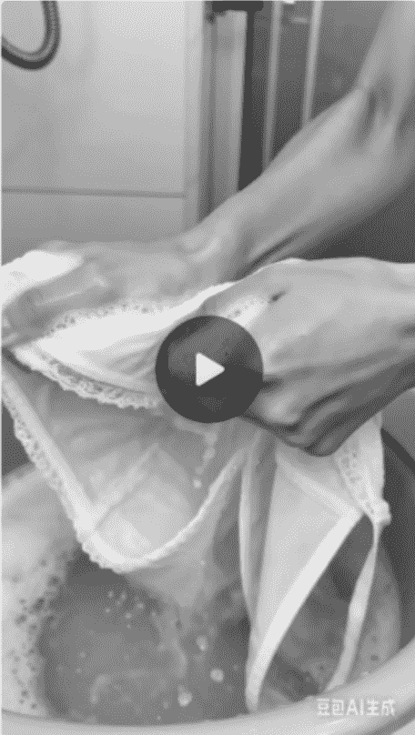
图3-2 分镜视频

###### 第四步：适配抖音特性与AI生成，优化脚本与分镜细节
脚本分镜生成后，结合平台特性与AI生成、剪辑特性做精细化优化，确保可落地且提升完播与互动，遵循节奏紧凑化、画面简洁化、互动明确化、生成适配化四大原则。
节奏优化：镜头时长匹配快节奏，3秒钩子不超过3秒，核心内容每5秒一处亮点，互动引导简洁有力，收尾不超过5秒，避免拖沓；
画面优化：分镜简洁，避免多余场景元素与动作，核心内容与产品亮点用特写/近景呈现，适配9:16竖屏，避免横屏裁剪；
互动优化：强化互动提问的明确性，贴合目标人群痛点，分镜中博主直面镜头提升互动感，画面添加互动文字引导评论；
生成优化：避免复杂镜头运动如快速推拉摇移、复杂人物动作与特效，优先固定镜头、轻微推镜、快速切换，确保AI生成与动态化效果自然，避免失真生硬。

##### 3.2.3 高完播率脚本与分镜设计的注意事项
严格把控总时长，贴合完播习惯：抖音碎片化观看，越短完播越高，新手优先15~30秒，避免超过60秒；若做60秒以上干货，需每10秒一处亮点，强化前3秒钩子；脚本分镜时长总和需与总时长完全匹配，避免单镜头超标或全片失控。
分镜严格适配9:16竖屏，避免构图问题：抖音核心是竖屏，分镜全程遵循该比例，构图、角度、细节均需适配，避免横屏裁剪丢失核心内容；竖屏需注重纵向聚焦，核心内容与亮点尽量置中，提升观看体验。

#### 3.3 成片实操：爆款视频完整生成流程
AI辅助成片无需专业设备与团队，依托前期脚本分镜，通过精准参数设置即可实现画面生成—动态化—剪辑优化全流程，兼顾效率与质量，贴合抖音流量要求。

##### 3.3.1 借助即梦+Seedance+剪映做爆款成片的优势
即梦可快速生成分镜所需的静态画面，无需拍摄；Seedance可把静态画面转为动态片段，还原镜头运动与人物动作；剪映操作简便、功能齐全，内置抖音模板与AI功能，可快速完成拼接、调色、字幕、互动强化，30秒视频约1小时完成，效率远超传统模式。

##### 3.3.2 爆款视频成片实操的核心步骤
以前文内衣清洗机内容为例，操作如下。
###### 第一步：用即梦制作并优化静态画面，贴合分镜要求
打开即梦选图片生成，按分镜表格画面细节描述为每个分镜生成对应静态图，提示词需包含画面内容、视觉风格、画幅比例、光线要求、核心亮点等，确保高度匹配。示例提示词（分镜1）：

抖音 9:16 竖屏构图，采用清新写实的第一人称实测调性。场景为极简租房书桌，自然光充足明亮。画面中心是一位二十多岁身着居家休闲服的女生，眉头紧皱正用手搓洗内衣，神情疲惫。镜头随即快切至桌面中间摆放的淡绿色迷你内衣清洗机，背景干净无杂物，成像细腻，痛点与产品存在感都被放大。

指令提交后，即梦会按此描述生成对应画面，参考效果见图3-3所示。

####### 图3-3 分镜图片

按同样思路，为五个镜头各生成一次静帧并挑选最优版本。将即梦输出的全部静帧按分镜序号归位，逐张对比主体、人物特征、商品细节、环境元素、核心卖点与分镜说明是否一致，重点核查内衣机的外形、体积、操控按键等细节，以及小巧便携、洗净彻底等亮点是否清晰。若画面不达标，比如商品展示模糊或人物表情僵硬，可借助即梦的局部重绘功能如图3-4所示进行修正，或补充关键词重新生成。

####### 图3-4 局部重绘功能

###### 第二步：用Seedance将静态画面转化为动态视频，还原分镜镜头运动

静帧优化完成后，用 Seedance 把它们转为符合分镜要求的动态片段。

点开已生成的分镜图，以分镜 1 为例，点击右侧生成视频入口，在提示框中填写：

景别为近景配合快速切换，时长 0～3 秒，画面内容为女生皱眉手搓内衣、神情疲惫，随后镜头迅速切到迷你洗衣机。人物表演上，博主眉头微蹙双手用力搓洗，切镜瞬间眼神转为惊喜并以吐槽口吻说出台词：再也不用手搓内衣了！谁懂啊家人们。音效先响起叹气声再转为轻快背景音乐。

选择全能参考、9:16 比例，时长设为 4s，如图 3-5 所示。

####### 图3-5 视频生成对话框

发送后即可得到分镜视频，按顺序整理保存，便于后期拼接。

###### 第三步：剪映导入素材，完成镜头拼接与节奏微调

动态片段导出后，打开剪映点击开始创作，如图 3-6 把全部 Seedance 产出的片段一并导入。

####### 图3-6 素材导入

按分镜序号把片段拖入时间轴，核对顺序与脚本、分镜保持一致；去掉每个片段首尾多余空档，保证衔接紧密无冗余；在时间轴上为各片段标注分镜编号与核心卖点，便于后续针对性调整。如图 3-7 所示。

####### 图3-7 素材剪辑

###### 第四步：细节打磨，统一视觉质感

需要补字幕，点击顶部字幕入口，可选择自动识别生成也可手动新建，如图 3-8 所示。

####### 图3-8 字幕生成

###### 第五步：成片导出，适配抖音发布需求

细节调整完成后进行一次全片预览，确认无误后导出视频，如图 3-9 所示。

####### 图3-9 导出视频

##### 3.3.3 爆款成片实操的简易技巧与注意事项

**节奏优化，留住用户：**关键在于把握 3 秒钩子并控制整体节奏，可在剪映中为钩子镜头配上简短文字，全程每 5 秒抛出一个小亮点，结尾 3 秒略微提速，避免拖沓导致划走。

**画面与互动，低成本提效：**借助剪映“AI 画质增强”一键提升清晰度并批量统一色调，产品亮点可用“局部放大”突出；互动避免生硬，结合内容提出简单提问，再添加简洁文字贴纸引导关注、点赞。

### 第4章 自媒体矩阵视频制作实操

#### 4.1 创意构思：账号体系与内容定位设计

矩阵视频创意核心在于搭建分层账号体系并做精准定位。任务是明确矩阵整体运营诉求、各账号的分层定位与差异化方向，结合目标粉丝画像设计匹配内容体系，实现多账号协同引流、素材复用与粉丝精细化运营。与单号创意、商业广告创意不同，矩阵创意更需兼顾账号协同性与内容差异化，每个细节都围绕主号立人设、子号做垂类、全矩阵做复用展开，例如主号输出泛爆款，子号深耕垂类干货，全矩阵共享核心素材。

##### 4.1.1 豆包+即梦助力矩阵创意构思的优势

豆包能快速接收矩阵相关信息，如整体定位、运营目标涨粉带货引流、核心赛道、粉丝画像等，拆解出主号与子号的分层定位、功能分工与差异化方向，避免定位重复，同时结合各垂类粉丝偏好，比如美妆主号粉丝看重人设、底妆子号粉丝看重实测，设计适配的内容方向，让矩阵既各有侧重又协同统一。

即梦可将文字化的账号风格与创意转化为初步视觉画面，检验风格辨识度、内容与定位匹配度，确保创意既满足矩阵协同需求又符合各号差异化，同时适配 Seedance 后续动效化，大幅降低创意构思难度与时间成本。

##### 4.1.2 自媒体矩阵视频创意构思的核心步骤

###### 第一步：厘清矩阵核心诉求，梳理整体运营要素

创意构思的前提是明确矩阵的核心诉求与整体运营信息，这是搭建账号体系与定位设计的基础。创作者需先梳理矩阵核心信息：整体定位、核心赛道、运营目标涨粉带货品牌曝光、目标粉丝画像年龄性别消费偏好需求痛点、计划账号数量与层级、矩阵差异化优势。以如下美妆矩阵为例，主号加 2 个子号，整体定位平价美妆种草，人群 18～25 岁学生党化妆新手，诉求涨粉加带货，主号做平价泛种草立人设，子号 1 做底妆垂类实测测评，子号 2 做眼妆简易教程，设计提示词如下：

帮我拆解平价美妆种草自媒体矩阵的创意核心信息，矩阵整体定位平价美妆，目标人群是18～25岁学生党、化妆新手，核心诉求是涨粉+带货，计划搭建1个主账号+2个子账号的分层体系，主账号做平价美妆泛种草立人设，子账号1做底妆垂类实测测评，子账号2做眼妆简易教程。帮我提炼各账号对应的粉丝核心痛点，拆解各账号的定位、功能分工与差异化方向，明确矩阵创意的核心导向，设计“核心素材复用+垂类内容差异化”的内容框架，给出具体的各账号内容创意方向建议。

豆包生成的输出如下：

####### 平价美妆种草矩阵·创意核心拆解（1主2子）

######## 一、矩阵整体核心导向

主账号立人设引流，子账号做垂类做转化，全矩阵共享平价美妆核心素材，主打18～25岁学生党/化妆新手的高性价比美妆种草，实现“泛粉引流—垂类筛选—带货转化”的闭环。

######## 二、各账号粉丝核心痛点

- 主账号：新手美妆不知道怎么选，怕踩雷，想要一站式平价美妆种草，信任靠谱的美妆人设

- 子账号1（底妆）：新手底妆卡粉、脱妆，不会选粉底液/气垫，想要针对性实测推荐

- 子账号2（眼妆）：新手眼妆步骤复杂，手残画不好，想要3分钟简易眼妆教程，适配日常/上课场景

……

###### 第二步：结合赛道细化账号内容与素材复用方式

矩阵核心信息与账号体系明确后，需借助豆包结合短视频高频赛道美妆种草、本地生活探店、职场干货分享等，细化各账号内容形式、核心素材复用规则与差异化设计，核心原则是核心素材可复用、垂类内容差异化、账号间协同，避免同质化或脱节。不同赛道适配的内容形式与复用方式不同，需灵活选择，例如美妆矩阵适配人设种草+垂类实测+教程，本地生活适配泛种草+区域探店+品类测评。实操中可在豆包补充提示词获取细化建议，示例提示词以美妆矩阵为例如下：

基于平价美妆种草矩阵的广告核心信息，帮我细化矩阵各账号（主账号+底妆子账号+眼妆子账号）的内容形式与素材复用方式，适配短视频美妆种草赛道。主账号内容形式为人设化闺蜜式分享，底妆子账号为实测测评，眼妆子账号为简易教程，时长均控制在30～60秒，明确核心素材的复用范围、复用方式与各账号差异化内容的设计细节，贴合短视频快节奏特点，3秒抓睛，同时适配即梦视觉生成与Seedance动态化需求，给出具体的内容细节建议。

豆包生成的输出如下：

####### 平价美妆种草矩阵·各账号内容与素材复用细节（30～60s|适配即梦+Seedance）

####### 一、核心信息

矩阵赛道：美妆平价种草

内容形式：主账号（人设分享）、底妆子账号（实测测评）、眼妆子账号（简易教程）

核心原则：核心素材复用率≥50%，差异化内容突出各账号定位，3秒抓睛，适配AI生成与动态化

######## 二、核心素材复用规范

######### 1.复用素材范围

- 产品类：平价美妆产品开箱画面、产品瓶身/外观特写、产品质地展示（粉底液推开、眼影盘配色等）

- 通用类：新手化妆通用误区口播、粉丝互动答疑片段、矩阵账号引导口播等

######### 2.复用方式

画面复用：直接复用无字幕/无专属口播的原画面，根据各账号内容调整剪辑节奏

……

豆包生成细化的各账号内容，同时明确素材复用方式与差异化设计细节，确保矩阵内容既协同统一又各有侧重，贴合观看习惯。

###### 第三步：确定矩阵视觉风格，明确各账号视觉传达重点

视觉传达直接影响账号辨识度、粉丝记忆点与矩阵协同性，需借助豆包结合赛道、各账号定位与粉丝偏好，确定整体视觉风格与各账号差异化细节，明确色彩基调、核心视觉元素与画面质感，确保整体统一、各账号细节差异、元素贴合定位。例如美妆矩阵整体走清新自然风、高饱和暖色调，主账号突出人设生活化，底妆子账号突出实测对比，眼妆子账号突出教程步骤。

###### 第四步：视觉化验证，迭代优化创意

各账号内容与视觉风格确定后，借助即梦的视觉生成能力将文字创意转为核心视觉画面，快速验证整体风格统一性、各账号差异辨识度、内容定位匹配度，避免创意与效果脱节。操作时在即梦输入贴合整体风格与账号定位的提示词，为每个账号生成1～2张核心画面以验证统一性与差异化，以及AI对核心元素与定位信息的还原效果。例如基于美妆矩阵创意设定，子账号1底妆品类的即梦提示词可设为：

写实风，暖色调（橘色+红色），自然柔光，9：16竖屏，高清2K，画面清晰细腻，突出底妆自然光泽感、通透服帖度；场景为同城美妆体验店/生活化化妆台（二选一，贴合底妆场景），木质化妆镜、暖黄色补光灯，背景有轻微的美妆体验人群/闺蜜互动模糊身影，营造热闹生动的美妆体验氛围；画面主体为底妆产品（粉底液/气垫，贴合子账号2底妆品类），瓶身质感清晰，搭配美妆蛋、化妆刷，特写美妆蛋上妆瞬间、底妆在肌肤上推开的细腻纹理，突出底妆服帖、自然透亮的妆效，贴合同城美妆底妆种草/体验广告场景，适配即梦生成特性，便于后续Seedance动态化。

输入后即梦生成如图4-1所示图片。

####### 图4-1 即梦生成的图片

##### 4.1.3 自媒体矩阵视频创意构思的注意事项

**矩阵要素齐全，描述精准无歧义：**借助豆包梳理创意、撰写提示词时，需明确矩阵核心要素，尤其是整体定位、运营目标、账号层级数量、各账号定位分工、视觉整体风格与差异化细节、时长、粉丝画像等关键信息，避免模糊表述。

**账号差异协同，杜绝同质化或脱节：**矩阵创意需避免各账号定位重叠内容同质化或各账号内容脱节无协同的两大误区，借助豆包优化定位分工与内容框架，确保整体协同统一、细节差异化。一方面明确各账号功能分工与粉丝定位，避免粉丝重叠过高；另一方面设计可复用核心素材框架，让各账号有连接点，例如所有账号均复用产品核心画面，同时加入专属垂类内容，确保矩阵形成流量闭环，而非各自为战。

#### 4.2 脚本与分镜设计：批量内容结构设计

脚本与分镜设计是连接矩阵创意与批量制作的核心纽带，也是确保各账号内容标准化批量产出、风格统一、差异化突出的关键。

##### 4.2.1 豆包+即梦+Seedance助力脚本与分镜设计的优势

借助豆包批量撰写脚本，搭配即梦与Seedance的AI生成特性做可复用分镜设计，能让脚本与分镜更高效、更贴合实操与运营导向，大幅降低专业门槛，保证素材生成、动态化与剪辑环节顺畅，避免风格混乱与同质化，确保每个镜头围绕矩阵协同、账号定位、粉丝需求展开。

分镜设计环节，创作者只需结合即梦与Seedance生成特性，借助豆包明确整体视觉风格与可复用分镜模板，为各账号设计差异化细节，即梦即可精准还原创意与定位，生成贴合需求的静态分镜。Seedance可无缝对接静态分镜实现动态化，避免复杂镜头运动与场景元素导致的生成失真与效果生硬，保证分镜与批量生成高度适配，同时实现模板复用，大幅提升批量效率。

##### 4.2.2 自媒体矩阵视频脚本设计的核心步骤

**第一步，梳理矩阵创意与节奏节点，明确批量脚本设计依据**

脚本设计需立足矩阵创意，先借助豆包全面梳理矩阵核心信息、各账号定位分工与统一节奏节点，为后续设计可复用脚本框架与差异化内容提供依据。重点梳理矩阵各账号统一视频时长、整体运营目标、各账号核心定位、统一节奏节点3秒抓睛、中间内容传递、结尾矩阵引导、人物设定、核心素材复用范围与各账号差异化内容、音效导向，确保脚本不偏离创意框架与运营目标。

本案例中矩阵各账号视频总时长均为60秒，整体运营目标是涨粉+带货，主账号定位平价美妆人设种草，底妆子账号定位底妆实测，眼妆子账号定位眼妆简易教程，统一节奏按“3秒抓睛—45秒内容传递—12秒矩阵引导”分配，人物设定为20岁左右亲切美妆博主，核心素材复用范围为产品开箱、质地展示画面，各账号差异化内容为人设分享/底妆实测/眼妆教程，音效导向为清新轻快，突出真实种草感。这些是设计可复用脚本框架的关键。

###### 第二步，借助豆包生成标准化可复用批量脚本模板

基于梳理好的核心信息与统一节奏节点，结合前期创意与素材复用方式，借助豆包设计标准化、可复用的批量脚本框架，明确各镜头核心维度与固定内容，预留差异化替换位，形成可直接落地的模板。示例提示词如下：

为平价美妆种草自媒体矩阵设计标准化可复用批量脚本模板，矩阵各账号视频总时长均为60秒，包含1个主账号和2个子账号（底妆实测、眼妆教程），目标人群为18～25岁学生党、化妆新手，矩阵整体运营目标是涨粉+带货，主账号定位平价美妆人设种草，底妆子账号定位底妆实测，眼妆子账号定位眼妆简易教程，核心素材复用范围为产品开箱、质地展示画面，统一节奏节点为3秒抓睛、45秒内容传递、12秒矩阵引导，视觉风格为清新自然风、高饱和度暖色调。设计可复用脚本框架，预留差异化内容替换位，生成包含镜号、景别、画面内容（固定+可替换）、时长、人物动作、台词（固定+可替换）、音效、素材复用范围、账号定位传递重点的标准脚本模板，镜头节奏与各账号定位高度同步，适配即梦+Seedance生成需求。

豆包接收指令后生成如表4-1所示脚本模板。

####### 表4-1 平价美妆种草矩阵·标准化可复用批量脚本模板（60秒）

| 镜号 | 景别 | 画面内容（固定+可替换） | 时长 | 人物动作 | 台词（固定+可替换） | 音效 | 素材复用范围 | 账号定位传递重点 |

|:---|:---|:---|:---|:---|:---|:---|:---|:---|

| 1 | 近景 | 固定：博主面对镜头，手持平价美妆产品 可替换：主账号（种草表情）、底妆子账号（对比表情）、眼妆子账号（教程手势） | 3s | 固定：手持产品，镜头怼脸 可替换：主账号（惊讶挑眉）、底妆子账号（皱眉指脸）、眼妆子账号（比耶手势） | 固定：宝子们！ 可替换：主账号（挖到宝了！这款平价美妆新手闭眼冲！）、底妆子账号（底妆卡粉脱妆？这款实测来了！）、眼妆子账号（手残党看过来！3分钟简易眼妆超简单！） | 轻快的背景音乐、产品拿起时的轻微声音 | 无 | 快速抓睛，传递各账号核心内容方向 |

| 2 | 特写 | 固定：产品瓶身/外观特写，缓慢转动 可替换：主账号（多款产品合集）、底妆子账号（粉底液单款）、眼妆子账号（眼影盘单款） | 5s | 固定：手指轻转产品，展示logo 可替换：无 | 固定：这款就是我一直在用的 可替换：主账号（平价美妆好物，均价50+！）、底妆子账号（平价粉底液，59.9元一瓶！）、眼妆子账号（平价眼影盘，39.9元搞定日常眼妆！） | 背景音乐持续、产品转动的轻微声音 | 产品开箱画面 | 展示产品，突出平价优势 |

……

##### 4.2.3 自媒体矩阵视频分镜设计的核心步骤

###### 第一步，借助豆包生成标准化可复用分镜模板

基于前文生成的标准化可复用脚本模板，借助豆包把每个镜头文字描述转化为可视化分镜细节，明确固定可复用部分与差异化可替换部分，形成标准化分镜模板。模板需包含镜号、景别、镜头运动、画面构图、画面描述（固定+可替换）、色彩光影、视觉焦点、账号定位传递重点8个维度，确保模板可适配矩阵所有账号，仅替换差异化细节即可快速生成各账号分镜，同时贴合AI生成特性，避免复杂镜头设计。结合脚本模板生成分镜模板，示例提示词如下：

基于平价美妆种草矩阵的标准化可复用脚本模板，帮我生成标准化可复用分镜模板，适配即梦静态画面生成与Seedance动态化需求，分镜模板包含镜号、景别、镜头运动、画面构图、画面描述（固定+可替换）、色彩光影、视觉焦点、账号定位传递重点8个维度。固定部分确保矩阵各账号风格统一，可替换部分贴合各账号定位（主账号人设种草、底妆子账号实测、眼妆子账号教程），镜头运动以简单自然为主（推、拉、固定），避免复杂运动，画面构图突出主体（产品、人物），色彩光影遵循清新自然风、高饱和度暖色调，视觉焦点贴合各账号核心内容，账号定位传递清晰，分镜细节可直接用于AI生成，同时标注各镜头的素材复用关联。

豆包接收指令后生成如表4-2所示分镜模板。

####### 表4-2 标准化分镜模板

| 镜号 | 景别 | 镜头运动 | 画面构图 | 画面描述（固定+可替换） | 色彩光影 | 视觉焦点 | 账号定位传递重点 |

|:---:|:---:|:---:|:---|:---|:---|:---|:---|

矩阵短视频批量化制作实战指南

| 1 | 近景 | 固定机位 | 居中构图，人像占画面约2/3 | 固定：博主面向镜头，手持平价彩妆，背景为整洁温馨的梳妆台；可替换：主号博主惊喜微笑眼神灵动、底妆分号博主皱眉指向颊部暗示粉底堆积、眼妆分号博主比出“3”提示教学时长 | 暖色调，自然漫射光，面部光线均匀无明显阴影 | 面部表情与手中产品 | 前三秒抓住注意力，快速传递各账号的内容取向种草/测评/教学 |
| 2 | 特写 | 缓慢推近 | 特写构图，产品居中填满画面 | 固定：瓶身外观近拍，镜头缓缓推向logo，手指轻转；可替换：主号多款平价产品依次特写成合集、底妆分号单支粉底液突出性价比标识、眼妆分号单盘眼影盘突出配色丰富度 | 暖色调，侧逆光勾勒轮廓，强化质感 | 产品外观与品牌logo | 展示商品，强化高性价比好用的核心卖点 |

###### 第二步，优化各账号差异化分镜细节，贴合账号定位
模板搭建完成之后，需要借助豆包结合矩阵账号的人设、粉丝痛点以及即梦 Seedance 的生成规律，对画面细节做差异化细化。目标是整体框架统一，细节可区分、可执行、可落地。优化要点是让差异点更贴合人设，同时规避 AI 难以处理的镜头，具体方向如下。

- 主号平价彩妆人设种草：侧重神态与场景氛围的优化，在分镜中加入生活化物件，如宿舍梳妆台的小装饰、博主自然的互动手势，运镜保持轻快，构图更亲和，契合闺蜜式沟通的人设，避免专业化镜头语言，突出接地气的生活感。
- 底妆分号底妆测评：侧重测评过程的呈现，增加对比画面，如卡粉与持妆的左右分屏、不同肤质的使用对照，镜头紧跟产品使用与效果细节，构图简洁去除冗余元素，突出真实与专业。
- 眼妆分号眼妆简易教学：侧重步骤的可视化，在画面角落加入“步骤1/2”文字提示，镜头聚焦眼部操作特写，动作清晰缓慢，便于新手模仿。示例思路：基于平价彩妆矩阵的标准可复用分镜模板，对各号进行差异化细化，主号强化闺蜜人设与宿舍生活元素与亲切表情与轻盈运镜；底妆分号加入左右对比卡粉vs持妆，突出测评细节与简洁画面；眼妆分号加入步骤提示与眼部特写慢动作。所有细化需贴合即梦 Seedance 的生成特性，避免复杂运镜，确保可批量落地并强化定位传达。

###### 第三步，结合即梦验证分镜可落地性，迭代优化
分镜细化后要用即梦把描述转成静态图，检验是否符合矩阵整体风格、各号差异辨识度以及镜头可生成性，避免设计与实际效果脱节。验证重点有三：整体视觉统一性、各号差异细节是否可辨、镜头是否可生成。以眼妆分号镜号4为例的即梦输入思路：清新自然调性，高饱和暖色，9:16竖屏，2K高清，自然漫射光，画面明亮柔和；场景为温馨宿舍梳妆台，背景有少量小摆件不杂乱；主体为博主眼部特写，眼影刷缓慢晕染，角落有“步骤1：铺底色”白字提示，眼影显色适中，贴合新手教学定位，适配即梦特性便于后续 Seedance 动态化。

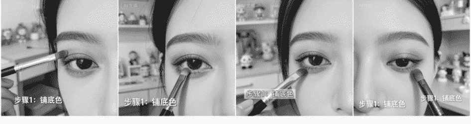
图4-2 眼妆子账号镜号4的分镜画面

若生成的静态图与预期偏差，如焦点错误、差异细节缺失、风格不统一，可用豆包修正分镜描述与即梦提示词，调整构图、补足场景细节、优化光影描述，反复迭代，直至画面精准落地，为后续批量动态化与剪辑打基础。

##### 4.2.4 自媒体矩阵视频脚本与分镜设计的注意事项
分镜模板复用优先，避免过度个性化：矩阵批量制作追求效率，脚本与分镜需保证框架可复用、细节可替换。不要为每个账号单独设计完全独立的模板，否则会失去批量优势并增加成本。用豆包设计时要明确固定复用部分与可替换差异部分，固定部分占比不低于60%，差异部分只聚焦人设、实测、教程等定位相关细节，确保一次模板多账号通用。

适配AI生成边界，规避难点：设计要充分考虑即梦与Seedance的局限，用豆包优化细节，避免快速摇镜、复杂组合运镜、群像或杂乱背景、高难度手势等。镜头运动以固定、慢推拉、简单跟拍为主，场景简洁聚焦，人物动作自然简单，保证分镜可快速批量生成。

#### 4.3 成片实操：自媒体矩阵视频批量生成流程
矩阵成片的核心是批量高效、风格可控、差异精准。借助豆包、即梦、Seedance、剪映协同，将创意脚本分镜转化为可直接发布的成品，围绕批量复用与高效落地展开，解决制作慢、风格乱、差异难控、素材复用率低的问题。

##### 4.3.1 借助豆包+即梦+Seedance+剪映实现自媒体矩阵视频批量成片的优势
即梦可按分镜模板批量生成各号静态素材，无需实拍；Seedance可衔接即梦素材批量动态化，添加过渡、动态文字、简单动画；剪映的批量剪辑模板可复用剪辑、字幕、音效，一次设计批量产出，效率较人工提升80%以上。

##### 4.3.2 自媒体矩阵视频批量成片的核心步骤
以下以美妆矩阵为例，其他赛道可迁移。

###### 第一步：静态素材批量生成
用豆包把各号分镜模板的画面描述、色彩光影、视觉焦点转化为即梦可识别的精准提示词，按账号分类，每个镜头一条提示，提示需包含整体视觉风格、账号差异细节、分镜核心要求，避免模糊。以底妆分号镜号3为例的转化要点：清新自然风，高饱和暖调橘红为主，9:16竖屏，2K高清，画面细腻无噪点，特写构图，画面简洁；顶光均匀打亮手部与粉底质地，光柔和；镜头聚焦双手，左手干皮右手油皮分别蘸取推开，清晰呈现水润服帖与清爽不黏腻的对比，突出丝滑无结块易推开，适配即梦特性，确保与分镜一致。

在即梦无限画布输入提示词生成各号全部镜头的静态素材，生成后按账号镜号归档。如图4-3为底妆分号镜号3画面。

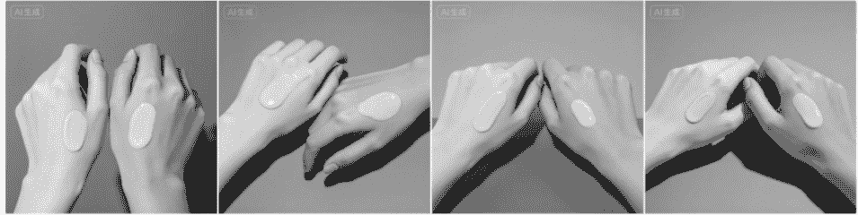
图4-3 底妆子账号镜号3的分镜画面

对照模板校验风格统一性与差异细节准确性，如对比镜头、步骤标识等。如不符，用豆包调整提示词重生成，确保全部素材达标。

###### 第二步：生成动态视频片段
把即梦静态素材通过图生视频转为动态片段，贴合脚本节奏与账号定位，保持动态风格统一。打开无限画布，按分镜顺序排列画面，选择生成视频并按账号镜号分类下载保存。

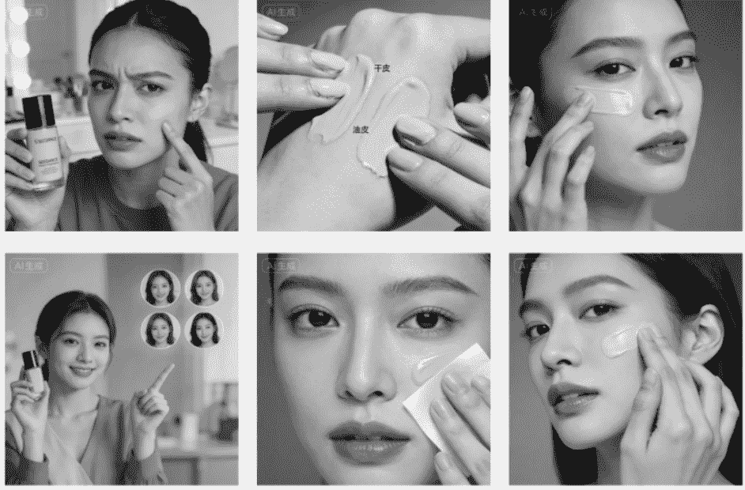
图4-4 无限画布里生成的图片

###### 第三步：剪辑优化
打开剪映，点击开始创作，按脚本逻辑导入分镜视频拼接。

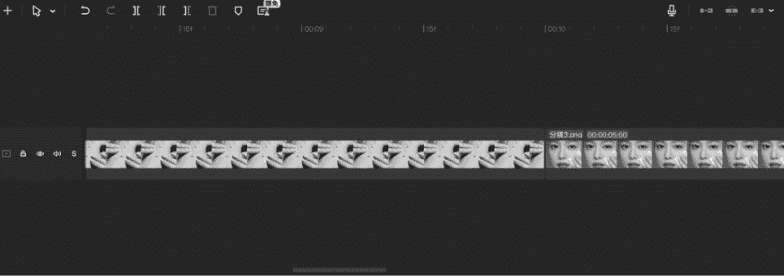
图4-5 视频拼接

编辑时可在左上角选用音乐、贴纸、转场、字幕等，为视频添加背景音乐、字幕等提升吸引力。

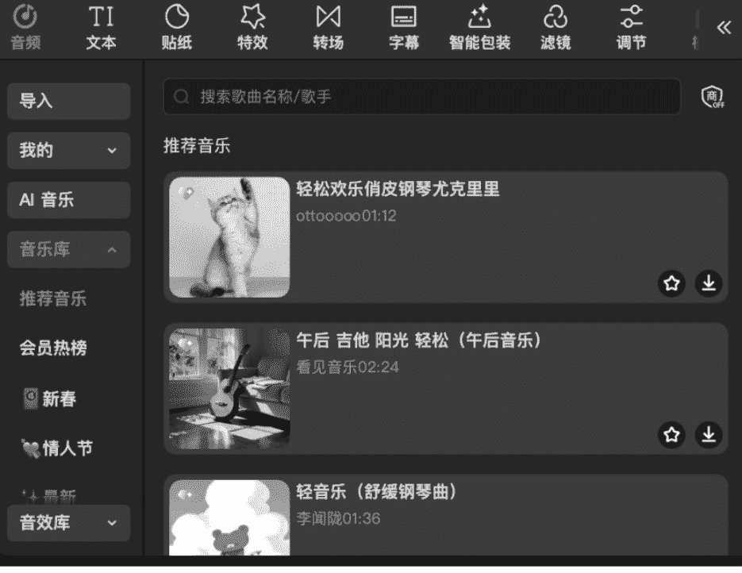
图4-6 剪映的剪辑功能

###### 第四步：成片导出与素材归档
预览检查画面清晰度、声音流畅度、字幕同步、动态自然度，确保无卡顿错误，符合平台发布要求，同时对照创意脚本确认成片精准传递账号定位与矩阵协同理念。通过后导出发布。

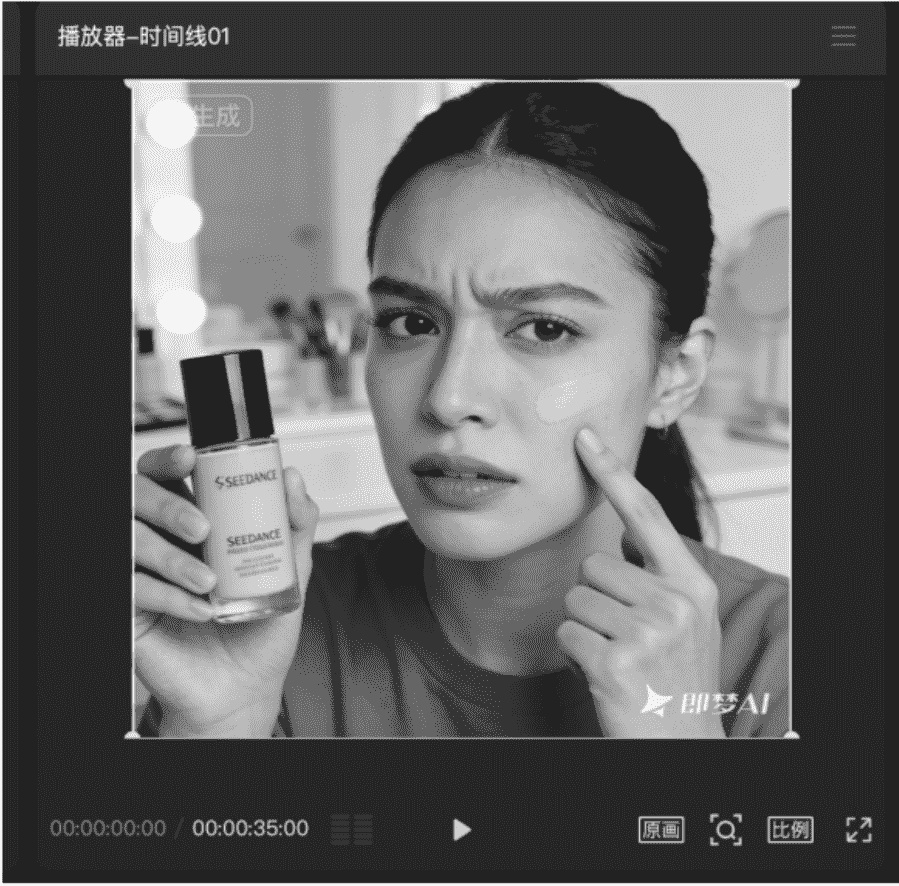
图4-7 视频预览

##### 4.3.3 自媒体矩阵视频批量成片的注意事项
统一参数标准，确保风格一致：即梦生成、Seedance动态化、剪映剪辑导出参数全程统一，包括分辨率2K、比例9:16、帧率30fps、色彩调亮对比度、字幕字体颜色位置、音效音量等，避免参数不一致导致风格混乱。用豆包整理参数清单全程对照。

差异化细节把控，避免同质化：在批量过程中重点检查各号差异点，避免仅换产品不体现定位。每个环节对照账号定位核查差异是否落地，如底妆分号的实测对比、眼妆分号的教学步骤，用豆包逐项校验，确保成片差异清晰，精准吸引垂类粉丝。

### 第5章 商品呈现短视频制作实操
#### 5.1 创意构思：商品核心卖点视觉化表达
商品呈现短视频的核心是把核心功能、差异化优势、使用场景转化为有层次有质感的视觉呈现，让观众直观感知价值。与商业广告不同，呈现视频聚焦商品本身，去掉冗余剧情与营销话术，每个创意都围绕清晰展示、突出卖点、传递质感展开。

##### 5.1.1 借助豆包+即梦进行商品呈现创意构思的优势
豆包可快速接收商品材质、功能、优势、外观、使用场景等信息，拆解用户最关注卖点，避免堆砌，并结合属性梳理展示优先级，如实用型优先功能、颜值型优先外观，优化视觉呈现顺序。即梦可把文字卖点转化为初步视觉画面，验证清晰度、细节还原与风格适配，确保创意贴合商品特征与短视频传播逻辑，并适配Seedance动态化，降低创意难度与成本。

##### 5.1.2 商品呈现短视频创意构思的核心步骤
###### 第一步，明确核心诉求，拆解商品核心信息
先梳理品类、材质、功能优势、外观设计、使用场景及展示导向。用豆包输入信息可获取需求拆解与信息提炼。以便携保温杯为例，提示思路：拆解商品展示创意核心信息，材质316医用不锈钢，卖点12小时保温、350ml便携、马卡龙高颜值，场景通勤户外学生，导向兼顾功能与外观，提炼卖点优先级并排序，给出创意方向。

生成要点：卖点优先级第一为316不锈钢加12小时长效保温，第二为350ml小巧便携，第三为马卡龙高颜值等。

###### 第二步，适配短视频赛道，细化创意内容与展示形式
明确信息后，用豆包结合短视频高频形式细节特写、功能实测、场景演示，细化创意与展示方式，原则是层次化、精准化、多样化，避免信息堆砌。以保温杯为例的细化思路：基于核心信息，细化创意与展示形式，适配细节特写加功能实测，时长30～60秒，突出材质、保温、便携，融入通勤户外场景，明确开头特写、中间实测、结尾场景演示，3秒抓睛，适配即梦与Seedance，给出内容细节建议。

###### 第三步，确定视觉风格，明确视觉传达重点
视觉传达影响细节呈现与感知。用豆包结合品类、外观、卖点、导向确定风格、色彩基调与核心视觉元素，确保风格贴合商品。以保温杯为例的视觉建议思路：基于创意内容确定视觉风格与色彩基调，明确核心元素、画面质感与光影，适配沉浸式体验，突出细节与功能，画质高清细腻，适配即梦静态与Seedance动态，提供具体视觉细节建议。

###### 第四步，视觉化验证，迭代优化创意
创意与风格确定后，用即梦将文字转化为初步画面，验证细节还原、卖点清晰度与风格匹配度，避免脱节。例如提示：16:9竖屏，高清2K，微距特写马卡龙色便携保温杯，烤漆在柔光下显高级质感，杯身清晰呈现316不锈钢标识，极简纯白背景，商业产品摄影，细节锐利，简约轻奢，明亮柔和，无杂物，封面级特写。

即梦生成如图5-1。

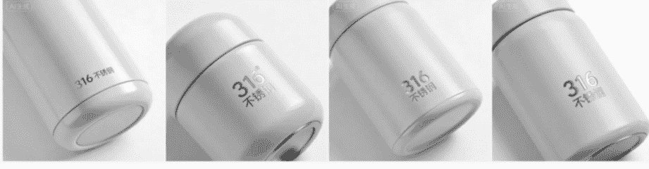
图5-1 便携保温杯图片（即梦生成）

##### 5.1.3 商品呈现短视频创意构思的注意事项
核心要素齐全，描述精准无歧义：用豆包梳理创意与提示词时，需明确包含品类、核心卖点、展示导向、视觉风格、时长、展示形式等关键信息，避免模糊。例如要写明便携保温杯展示，30～60秒，简约清新风，卖点316不锈钢、12小时保温，形式细节特写加功能实测，导向功能加外观，场景通勤户外，而非笼统描述，确保AI精准捕捉需求。

#### 5.2 脚本与分镜设计：商品呈现镜头结构
脚本与分镜是连接创意与成片的关键，确保视频精准展示细节、突出卖点、贴合风格。

##### 5.2.1 借助豆包+即梦+Seedance辅助商品呈现视频脚本与分镜设计的优势
豆包可快速细化创意、拆解镜头，结合即梦与Seedance生成特性明确构图、景别、运动、光影与时长，即梦可精准还原创意与商品细节生成静态分镜，Seedance可无缝动态化，避免复杂运动与场景导致失真与动态生硬，确保分镜与后续环节高度适配。

##### 5.2.2 产品展示脚本与分镜的落地方法

做好产品展示片，关键在细节要准、节奏要有层次、卖点要递进。本节以便携保温杯的创意框架为例说明脚本与分镜落地的具体路径，其他品类可参照此逻辑展开。

###### 第一步 梳理创意要点与节奏锚点，为脚本定基调

脚本起草必须回到创意本身，先借助豆包把产品的核心信息与镜头节奏节点梳理透，为后续镜头拆解与撰写提供明确依据。

#### 第二步 借助豆包拆解镜头维度，输出可执行的分镜

在核心信息与节奏点明确后，结合前期创意的内容形态与呈现方式，借助豆包把整支视频拆成若干独立镜头，每个镜头都落实为可执行的信息，形成可直接使用的标准化脚本。核心维度需包含镜号、景别、画面内容、时长、展示动作、音效、卖点/细节展示重点，确保每个镜头与创意、产品属性精准匹配，且贴合AI生成特性与短视频快节奏。例如提示词如下：

为便携保温杯的60秒产品展示短视频设计标准化脚本，总时长60秒，核心卖点为316不锈钢材质、12小时长效保温、350ml便携容量、马卡龙色系高颜值，展示方向以功能与外观并重，呈现方式为细节特写+功能实测+轻场景化演示，节奏节点为3秒开场抓眼、47秒主体展示、10秒结尾场景，视觉风格为简约清新、明亮柔和色调。输出包含镜号、景别、画面内容、时长、展示动作、音效、卖点/细节展示重点的标准脚本表，要求镜头节奏与产品逻辑同步，适配即梦加Seedance生成，动作符合真实操作，卖点表述清晰。

豆包执行后会给出标准化脚本表，列出各镜头的详细参数，并对动作与音效做优化，保证内容贴合实物、卖点突出，示例如表5-1所示。

####### 表5-1 便携保温杯产品展示短视频标准化脚本

| 镜号 | 景别 | 画面内容 | 时长 | 展示动作 | 音效 | 卖点/细节展示重点 |
|------|------|----------|------|----------|------|-------------------|
| 1 | 微距特写 | 马卡龙色杯身漆面在光影下呈现细腻质感，镜头迅速锁定316不锈钢标识 | 3s | 微距对焦杯身，缓慢推移至标识处 | 轻柔纯音乐起，镜头移动轻微声 | 马卡龙高颜值、316不锈钢材质初现 |
| 2 | 特写 | 杯口密封圈、杯盖旋合结构、杯底防滑垫 | 7s | 镜头依次对焦杯口、杯盖、杯底，指尖轻触密封圈展示弹性 | 纯音乐延续，指尖轻触轻音 | 密封防漏设计、细节质感 |
| 3 | 近景 | 手掌托起保温杯与手掌做大小对比，随后放入帆布包 | 8s | 手持展示尺寸，放入帆布包并轻晃展示稳定 | 纯音乐延续，取放轻响 | 350ml小巧便携 |
| …… | …… | …… | …… | …… | …… | …… |

##### 5.2.3 脚本分镜设计的两大要点

**镜头节奏要服务展示逻辑，避免松散：** 脚本与分镜的核心是让画面服务产品细节与卖点传递，必须保证切换节奏、时长分配与产品展示逻辑精准对应。

**视觉与细节要保持统一，避免偏差：** 分镜需严格遵循创意阶段确定的视觉风格、色彩基调、核心视觉元素与拍摄角度，在提示词与画面描述中反复明确，避免前后不一致。例如便携保温杯全片需保持简约清新风、明亮柔和自然光色调；展示角度统一，避免同一产品在不同镜头中角度差异过大；产品细节如标识、设计需在各镜头中保持一致，降低后期修改成本。

#### 5.3 成片实操：产品展示视频完整生成流程

成片是创意落地的最后环节。与传统拍摄不同，AI辅助制作无需专业团队，只需基于前期静态分镜，通过参数调优即可完成动态化与剪辑优化，既高效又兼顾质量，确保视频能有效呈现细节、传递质感、突出卖点。

##### 5.3.1 借助即梦+Seedance+剪映成片的优势

Seedance可直接把即梦生成的静态分镜转为动态视频，无需实拍，单人即可完成。剪映操作简便、功能完善，内置大量短视频剪辑工具，无需专业基础。借助智能功能可快速完成镜头拼接、调色、字幕添加、细节强化等工作，大幅压缩周期，60秒视频全程约1~2小时即可完成，效率远超传统数天制作。

##### 5.3.2 产品展示视频成片的核心步骤

以60秒便携保温杯为例，具体流程如下。

**第一步，静态画面制作与优化**

首要任务是把静态分镜画面做好并优化，确保风格统一、细节达标、主体突出，为动态化奠定基础。将即梦生成的静态画面按镜号排序，逐一核对主体、产品细节、场景元素与分镜描述是否一致，重点检查316标识、密封胶圈、杯底防滑垫等细节，以及简约桌面、无杂物、明亮柔和自然光是否达标。若出现标识不清、色调偏差、背景杂乱，需在即梦中重生成，补充精准提示词如“优化316不锈钢标识清晰度，保持明亮柔和自然光，背景纯白无杂物，突出杯身漆面质感”，确保每张画面都能精准传递细节与质感，便携保温杯画面合集如图5-2所示。

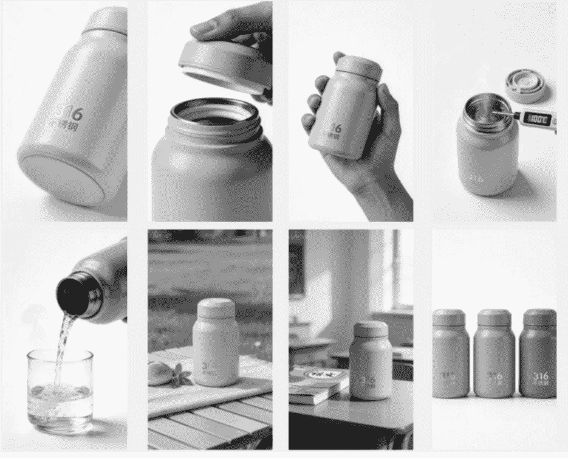

图5-2 便携保温杯画面合集

**第二步，静态画面转动态**

优化完成后，用Seedance将各分镜静态图转为符合设定的动态片段，核心是还原镜头运动与展示动作，强化产品细节的动态表达，保持自然流畅，避免复杂特效，聚焦产品本身。

在即梦中选择图片后点击“生成视频”按钮，如图5-3所示，即可得到动态片段。预览时重点检查镜头运动是否顺滑、时长是否与分镜一致、细节是否清晰、动态是否贴合操作。若出现生硬、速度不匹配、细节模糊，需继续优化直至达标。

图5-3 "生成视频"界面

**第三步，镜头拼接与节奏调整：剪映实操**

把动态片段导入剪映进行拼接、节奏调整与转场，核心是衔接流畅、节奏符合脚本，避免突兀与混乱。

打开剪映开始创作，将分镜片段全部导入，如图5-4所示。

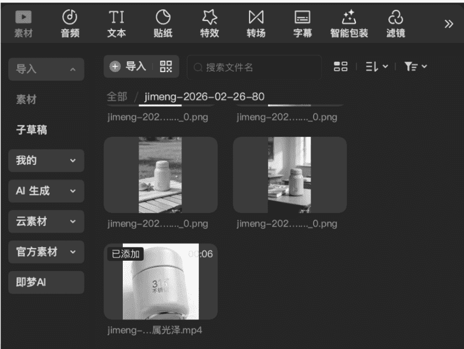

图5-4 "导入素材"界面

按镜号顺序将片段导入时间线，确保顺序与脚本一致，如图5-5所示。

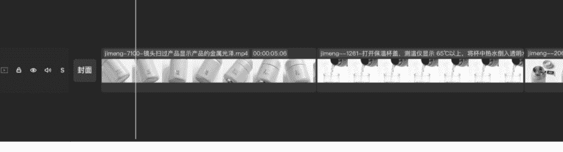

图5-5 拼接分镜片段

根据分镜要求为各镜头衔接处添加简洁转场，如图5-6所示。

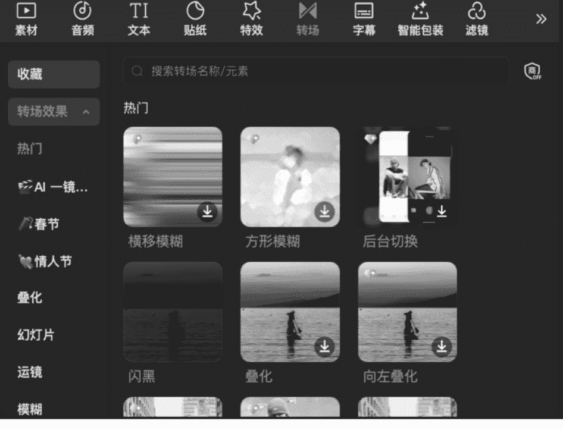

图5-6 添加转场效果

**第四步，音画适配：音效与背景音乐添加**

音画适配是提升质感的关键，需选择贴合风格与节奏的音乐与音效，确保音效与画面同步，音乐不抢戏，强化真实感与沉浸感。点击左上角“音频”按钮，在音乐库或音效库中挑选并添加到视频，也可导入自备音乐，如图5-7所示。

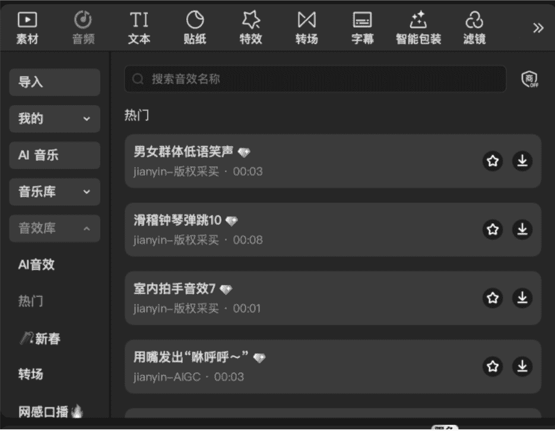

图5-7 添加音效

**第五步，细节优化与导出**

全面排查瑕疵，优化画面、音画、字幕等细节，确保成片贴合创意、脚本与分镜。完成后导出，参数适配抖音、视频号等短视频平台尺寸，保证清晰度。

##### 5.3.3 成片制作的进阶技巧

**始终聚焦产品主体，避免冗余：** 全程让画面、动态、字幕、音效围绕产品展示展开，避免多余特效、场景元素与字幕干扰；背景宜简约如纯白、浅灰，确保注意力集中在细节与卖点上。

**细节清晰优先，杜绝模糊失真：** 无论静态优化、动态化还是剪辑，都要优先保证产品细节清晰如材质标识、工艺设计、功能效果，避免模糊失真。若出现模糊，及时用即梦重生成或剪映锐化优化，确保细节精准呈现。

# 第三部分 影视内容制作实操

## 第6章 电影级大片场景制作实操

依托Seedance的AI生成与动态化能力，结合豆包的创意拆解与细节优化，以及剪映的剪辑适配，创作者可大幅降低好莱坞级大片场景的制作门槛与成本。通过豆包快速拆解大片场景逻辑、优化细节描述并预判AI生成与传播适配性；Seedance将文字转化为高质感画面并实现动态化验证；再根据反馈灵活调整光影、元素与氛围，把控落地质量，让普通创作者也能快速完成高质量大片场景制作。

### 6.1 创意构思：电影级场景设计方法

好莱坞大场面如战争、灾难，核心在于震撼视觉、逼真细节与紧张氛围，抓住用户注意力。制作重点是还原真实感、突出宏大感、兼顾细腻度，避免场景杂乱、元素失真、氛围不足。

#### 6.1.1 借助Seedance+豆包进行电影级场景创意构思的优势

Seedance提供AI场景生成与动态化，豆包负责场景拆解与提示词优化，可快速解决大场面“难度高、还原度低、氛围弱”的痛点。豆包辅助提炼核心元素、关键细节并优化提示词；Seedance将描述转为高质感画面并动态呈现，显著缩短制作时间。

#### 6.1.2 电影级场景创意构思实操步骤

**第一步，明确场景核心需求，拆解关键元素**

大场面生成的先决条件是明确核心需求与关键元素。需梳理场景类型、主题、核心氛围、关键元素与视觉风格，确保构思清晰、重点突出。实操中可借助豆包输入相关信息，获取精准拆解。以下为两个高频场景示例。

**场景1：战争场景** 阵地攻防战，好莱坞写实风格，受众18~40岁，核心需求是呈现战争紧张激烈与震撼感，核心氛围为紧张、激烈、悲壮，核心元素包括士兵、步枪、手榴弹、战壕、爆炸火光、烟尘、残破旗帜等，重点突出爆炸逼真感与作战状态，画面要求高清、光影鲜明。提示词如下：

帮我拆解好莱坞级战争阵地攻防战场景的核心需求与关键元素，明确场景类型为战争场景，主题为阵地攻防战，视觉风格为好莱坞写实风格，目标受众18~40岁，核心需求是呈现战争的紧张激烈与震撼感，核心氛围是紧张、激烈、悲壮。帮我提炼能体现场景质感的关键元素，包括人物、武器、环境、特效，重点突出爆炸效果的逼真感与士兵的作战状态。帮我明确场景的视觉标准，包括画面分辨率、光影效果、色彩基调等，为后续Seedance生成场景画面提供精准指引，优化细节描述，让场景画面与好莱坞战争大片质感高度匹配，避免元素失真与场景杂乱。

豆包根据指令生成内容如下：

###### 好莱坞级战争阵地攻防战场景核心拆解（适配 Seedance生成）

####### 一、核心基础信息

场景类型：战争场景（阵地攻防战）

视觉风格：好莱坞写实风格（无夸张特效，重细节逼真度）

目标受众：18~40岁

核心需求：呈现战争紧张激烈与震撼感

核心氛围：紧张、激烈、悲壮

####### 二、核心关键元素（贴合质感，避免杂乱）

……

**场景2：灾难场景** 地震废墟救援，好莱坞写实风格，受众18~40岁，核心需求是呈现地震后荒芜与救援希望，核心元素包括废墟、救援人员、被困者、救援设备、烟尘、破碎建筑等，核心氛围为压抑绝望中带希望，重点突出废墟真实感与救援忙碌状态，画面要求高清、光影柔和。提示词如下：

帮我拆解好莱坞级地震废墟救援场景的核心需求与关键元素，明确场景类型为灾难场景，主题为地震废墟救援，视觉风格为好莱坞写实风格，目标受众18~40岁，核心需求是呈现地震后的荒芜与救援的希望，核心氛围是压抑、绝望中带着希望。帮我提炼能体现场景质感的关键元素，包括环境、人物、设备、特效，重点突出废墟的真实感与救援人员的忙碌状态。帮我明确场景的视觉标准，包括画面分辨率、光影效果、色彩基调等，为后续Seedance生成场景画面提供精准指引，细化细节描述，让场景画面与好莱坞灾难大片质感高度匹配，突出压抑中带着希望的核心氛围。

豆包根据指令生成内容如下：

###### 好莱坞级地震废墟救援场景 核心拆解（适配Seedance生成）

####### 一、核心基础信息

场景类型：灾难场景

主题：地震废墟救援

视觉风格：好莱坞写实风格（重真实质感、强画面张力）

目标受众：18~40岁

核心需求：呈现废墟荒芜感与救援希望感

####### 二、关键元素（突出质感，适配画面生成）

######## 1.环境（重真实感）

……

豆包会从场景拆解、关键元素、视觉标准、氛围营造四个维度给出建议，例如战争场景会明确“优先突出爆炸火光层次感、士兵动作逼真感，色彩以深灰、土黄为主，搭配橙红火光形成强烈对比，光影为硬光，突出冲击力，分辨率4K确保细节”。

**第二步，借助豆包细化场景细节，优化提示词**

在核心需求与关键元素明确后，借助豆包结合好莱坞视觉质感要求，细化细节描述并优化Seedance提示词，原则是细节具体、质感突出、氛围贴合、有冲击力，避免模糊表述。不同场景需灵活调整细节、光影、色彩基调，例如战争适配硬光高对比、厚重色调，灾难适配柔光低对比、灰暗色调。

实操中可补充提示词获取细化描述与优化提示词，示例以战争阵地攻防战为例：

基于好莱坞级战争阵地攻防战场景的核心需求，帮我细化场景的细节描述，优化Seedance生成场景画面的提示词，要求细节具体、贴合好莱坞写实风格、有震撼力，避免模糊表述。视觉风格为好莱坞战争大片写实风格，画面分辨率4K，高清细腻，细节拉满，无噪点；色彩基调以深灰色、土黄色、褐色为主，搭配爆炸的橙红色火光与黑色烟尘，形成强烈色彩对比，突出战争的悲壮与激烈；环境细节方面，战壕深度约1.5米，墙壁布满大小不一的弹孔，弹孔边缘有黑色灼烧痕迹，地面散落着弹壳、残破的弹药箱、断裂的步枪，战壕上方插着一面残破的军旗，军旗边缘磨损、沾染泥土与血迹，背景是灰蒙蒙的天空，有零星的炮弹划过轨迹；人物细节方面，士兵身着迷彩服，迷彩服沾染泥土与血迹，有的士兵半蹲在战壕中，手持步枪，眼神坚毅，正瞄准射击，手指扣在扳机上，表情紧绷；有的士兵手持手榴弹，手臂前伸，准备投掷，脸上有黑色烟灰；有的士兵腿部受伤，倚靠在战壕墙壁上，眉头紧皱，表情痛苦，手按压着伤口，鲜血从指缝渗出；特效细节方面，爆炸火光有层次感，中心为亮橙红色，外围为暗红色，伴有黑色浓烟，浓烟缓慢上升、飘散，有细小的火星飞溅，子弹轨迹清晰可见，呈白色虚线状，飞溅的泥土颗粒分明；光影效果为硬光，光线从侧上方照射，形成明显的明暗对比，突出人物与场景的立体感，战壕内有阴影，强化场景的厚重感；整体画面构图饱满，聚焦战争核心场景，突出场景的宏大感与震撼力，适配Seedance场景生成特性，便于后续动态化处理，给出具体的提示词优化方案。

豆包生成细化的场景细节描述与优化后的Seedance提示词如下：

###### 好莱坞级战争阵地攻防战Seedance生成提示词（优化版）

4K ultra HD，1080P高清细腻，无噪点，细节拉满，好莱坞战争大片写实风格；色彩基调以深灰色、土黄色、褐色为主，爆炸橙红色火光与黑色浓烟形成强烈对比，凸显战争悲壮激烈

环境：1.5米深战壕，墙壁布满大小不一弹孔，弹孔边缘有黑色灼烧痕迹，地面散落黄铜弹壳、残破弹药箱（锈迹斑斑）、断裂步枪（枪身有划痕、泥土），战壕上方插着残破军旗（边缘磨损、沾染泥土与暗红血迹，轻微飘动），背景为灰蒙蒙天空，有零星炮弹划过的白色轨迹，远处隐约可见被炸坏的装甲车残骸

人物原型设定

士兵着装为沾泥带暗红血迹、衣角破损的迷彩作训服，共三种典型状态。第一种在战壕内半蹲持枪，食指抵在扳机上，眼神坚定直视前方，面部紧绷颊侧渗出细汗。第二种侧身站立、臂膀前伸，手握已拔掉保险的手榴弹，面颊沾黑烟，眼神锐利。第三种倚靠战壕壁，腿部中弹，眉头紧锁面露痛苦，双手压住伤口，鲜血从指缝渗出浸湿裤腿。

……

**第三步，确立场景视觉基准，保持统一规范**

打造好莱坞级大场面，关键在于先把视觉风格统一，贴合大片调性，避免画面细节杂乱、光影冲突、色彩偏差。借助豆包结合场景类型与核心诉求，可以梳理出一套可落地的视觉标准，涵盖分辨率、光影、配色、细节规范等，并明确元素呈现方式。以战争场景为例可统一为4K高清、硬光、高对比、厚重色调；灾难场景则可统一为4K高清、柔光、低对比、灰暗色调。

实操时可让模型给出针对性建议，示例以地震废墟救援为例：

基于好莱坞级地震废墟救援的整体定位，帮我制定一套统一视觉规范，保证风格一致并贴合灾难大片质感。风格为好莱坞写实，分辨率达到4K级别，画面细腻无噪点无模糊；光影采用柔光，柔和无明显硬边阴影，整体偏暗以营造压抑氛围，救援人员手电光束清晰呈暖黄色，照亮废墟与被困者形成明暗对比传递希望感；配色以灰暗、灰白、褐色为主调，整体偏暗避免艳色，只用救援服的橙色点缀提亮；细节上废墟碎块大小不一，有完整墙体块、扭曲钢筋、破碎玻璃，钢筋表面有锈迹，玻璃有反光，地面有积水泥土，积水倒映出废墟影子；救援人员穿橙色制服并带标志，头盔黑色配护目镜，动作规范表情焦急坚定；被困者衣物破旧沾泥，皮肤苍白表情痛苦无助；特效方面淡灰烟尘缓慢均匀飘散，余震带来废墟轻微自然晃动，手电光束带散射；各元素细节统一真实，适配Seedance生成特性，便于批量产出，同时保证风格统一贴合好莱坞灾难大片定位。

豆包据此给出的参考如下：

###### 好莱坞地震废墟救援·视觉统一规范

##### 一、画质基础
基调：好莱坞写实灾难片质感
清晰度：4K超清，细节锐利，无噪点、无模糊

##### 二、光影规则
主光：柔光，无硬边阴影，整体偏暗，营造压抑氛围
重点：救援手电暖黄色光束清晰可见，带散射，明暗对比强烈，突出希望

####### 三、色彩基调
主色：灰暗、灰白、褐色，低饱和整体偏暗
点缀色：救援服橙色，作为画面唯一亮点

####### 四、场景细节
……

**第四步，场景制作与迭代打磨**

当需求、细节描述与视觉标准都确定后，就可以用Seedance的AI场景能力把文字转成高质感好莱坞级画面，快速检验还原度、冲击力与氛围，避免成品与预期脱节。操作时在Seedance中输入豆包优化后的精准指令，生成全景、中景、特写等，以验证视觉风格与需求的契合度，以及模型对细节、色彩、特效的还原表现。

以地震废墟救援设定为例，Seedance场景指令可设为：

好莱坞灾难大片写实风格，4K画面细腻无噪点，构图饱满，凸显地震废墟荒凉与救援希望；色调为灰暗、灰白、褐色整体偏暗，以橙色救援服为亮点过渡自然；场景为地震后城市废墟，高楼坍塌墙体断裂，扭曲钢筋外露带锈迹，地面散落碎玻璃、墙体碎片、家具残骸，少量积水倒映废墟影子，空气中淡灰烟尘缓慢飘散；三名救援人员着橙色救援服配黑色头盔护目镜，一人弯腰用液压钳剪钢筋臂力用力表情焦急，一人蹲于废墟旁轻声呼喊被困者身体前倾眼神关切，一人抬着急救担架快步走向废墟深处；缝隙中被困者露出纤细苍白手臂，手指微动表情痛苦无助；光影柔光整体偏暗，手电暖黄光束照亮废墟与手臂并带散射；烟尘密度均匀缓慢飘散，伴随轻微余震晃动画面稳定无杂乱；细节真实，钢筋玻璃衣物质感逼真，人物动作表情自然贴合救援氛围，适配Seedance生成便于后续动态化，精准还原好莱坞级地震废墟救援的压抑与希望，突出震撼感染力。

生成画面如图6-1所示。

图6-1 即梦生成画面

#### 6.1.3 电影场景创意需注意的要点

**创意方向要清晰，服从叙事逻辑：** 借助豆包梳理创意需求时要锁定场景的核心叙事与情感表达，避免空洞或偏离逻辑。例如悬疑场景应围绕悬念设置、线索递进展开，不可堆砌无关元素；浪漫场景应围绕情感传递设计细节，避免只重视觉而丢情绪，确保创意与叙事高度契合。

**细节贴合电影质感，避免同质化：** 细节设计要符合电影级质感标准，借助豆包优化时应突出场景独特性。例如史诗战争不可照搬现有大片，可通过地域特色战场、独特将领形象等打造记忆点；细节需真实细腻，如武器磨损痕迹、人物战伤等，均需符合现实逻辑以强化真实感。

### 6.2 脚本与分镜设计：电影式镜头架构

脚本与分镜是电影级视频创作的核心环节，连接创意构思与成片输出。区别于普通视频，电影级脚本与分镜需遵循“叙事流畅、镜头有张力、质感有保障”，明确镜头类型、运动、画面内容、时长、音效等核心信息，确保AI生成与剪辑有序推进。传统流程需专业编剧与分镜师协同，耗时耗力，易出现镜头逻辑混乱、画面无张力、脱离创意等问题。

#### 6.2.1 Seedance配合豆包做镜头结构设计的优势

豆包可依据创意快速撰写电影级脚本，明确场景、人物、动作、台词、音效，遵循电影叙事节奏，避免逻辑混乱内容空洞；同时可优化表述使其更贴合镜头语言，为分镜提供精准指引，无需专业编剧功底即可完成高质量脚本。

#### 6.2.2 电影镜头结构设计操作步骤

电影级脚本与分镜核心是“脚本流畅、分镜清晰、镜头有张力”，需遵循“撰写脚本、拆解分镜、优化分镜、预览验证”流程，结合豆包与Seedance协同操作。以下以“暗黑悬疑废弃医院密室”为例。

##### 第一步，撰写电影级脚本，明确叙事逻辑

脚本是分镜基础，核心是明确场景、人物、动作、情感并贴合电影叙事节奏。需梳理开篇、发展、高潮、结尾，避免冗长混乱。可借助豆包输入创意核心与场景信息获取完整脚本。例如输入指令：

“帮我撰写电影级暗黑悬疑场景废弃医院密室的完整脚本，贴合前文创意，场景为废弃医院密室，叙事核心是主角逃生探寻真相，视觉风格好莱坞暗黑写实，氛围压抑悬疑紧张，脚本需含场景描述、人物动作神态、音效，遵循电影节奏开篇铺垫发展推进高潮转折结尾留白，语言简洁精准贴合镜头语言，便于后续分镜拆解，避免冗长空洞。”

豆包据此生成的脚本如下：

###### 电影级暗黑悬疑脚本：废弃医院密室逃生

【场景】废弃医院密室，低光潮湿布满灰尘，墙面斑驳散落废弃病历与医疗设备，中央有一扇上锁铁门，墙面有模糊字迹
【人物】主角，25岁男性，神色慌张持手电筒，身着休闲装带轻微擦伤
【时长】120秒
【脚本内容】
0～20秒（开篇铺垫）：
场景：密室全景光线微弱，手电光束在黑暗中晃动照亮墙面斑驳与散落病历。
人物：主角从昏迷中醒来挣扎站起持手电，眼神慌乱四处张望呼吸急促手部微颤。
音效：轻微呼吸声、手电开关电流声、远处隐约滴水声，环境寂静压抑。
21～60秒（发展推进）：
场景：手电光束依次照亮废弃病床、破损输液架、墙面模糊字迹“救我”“出口在…”，地面有积水倒映身影。
人物：主角缓慢移动脚步小心查看环境，弯腰捡起散落病历快速翻阅神色凝重，手指触摸墙面字迹眼神疑惑恐惧；发现病床下有生锈钥匙，弯腰捡起紧握。
音效：脚步声空旷微弱、病历翻动声、手指摩擦墙面声、滴水声渐清，偶有墙体松动声。
……

##### 第二步，拆解分镜，明确镜头结构

脚本完成后借助豆包拆解为具体分镜，明确镜头序号、类型、运动、画面内容、时长、光影、音效，确保结构合理衔接流畅有张力。例如输入指令：

“帮我将电影级暗黑悬疑密室逃生脚本拆解为具体分镜，明确每个分镜的镜头序号、镜头类型、镜头运动、画面内容、时长、光影、音效，贴合好莱坞暗黑写实风，结构合理衔接流畅突出悬疑紧张，镜头运动与画面贴合叙事节奏，开篇用全景铺垫，高潮用特写突出神态，各分镜时长精准分配便于后续Seedance生成与剪映剪辑。”

豆包据此生成分镜表，如表6-1所示。

表6-1 分镜表

| 镜头序号 | 镜头类型 | 镜头运动 | 画面内容 | 时长 | 光影 | 音效 |
|---------|---------|---------|---------|------|------|------|
| 1 | 全景 | 缓慢推进 | 废弃医院密室全景，黑暗潮湿散落病历与医疗设备，手电光束在黑暗中晃动 | 5秒 | 低光冷色调，手电光束为唯一主光光线微弱 | 轻微电流声、滴水声 |
| 2 | 中景 | 固定 | 主角从昏迷中醒来挣扎站起，持手电眼神慌乱四处张望 | 15秒 | 低光，光束照亮上半身面部有阴影强化压抑感 | 呼吸声、手电开关声 |
| 3 | 特写 | 固定 | 主角颤抖手部，手电光束不稳定照亮指尖擦伤 | 5秒 | 光束聚焦手部细节清晰周围黑暗 | 轻微手部摩擦声 |
……

##### 第三步，优化分镜，强化镜头张力

拆解完成后借助豆包结合电影镜头规范与Seedance特性优化细节，强化张力，确保衔接流畅贴合氛围。优化方向包括调整镜头运动避免杂乱、优化时长贴合节奏、补充细节强化质感、调整光影音效贴合氛围，避免镜头违和衔接生硬无张力。

#### 6.2.3 电影镜头结构设计的注意事项

**镜头搭配合理，贴合叙事节奏：** 拆解分镜时合理搭配全景、中景、特写，遵循“全景铺垫氛围、中景展现动作、特写突出细节”原则。例如开篇用全景铺垫，发展用中景展现动作，高潮用特写突出神态关键细节，避免搭配混乱无逻辑。

**镜头运动简洁，强化画面张力：** 镜头运动应简洁适度，避免频繁推拉摇移导致画面杂乱眩晕。优化时结合场景氛围与叙事需求选择合适运动，如悬疑用慢推固定镜头营造紧张，史诗用跟拍全景展现宏大感。

### 6.3 成片实操：电影级视频生成流程

成片是电影级创作最终环节，核心是把创意、脚本、分镜通过AI工具生成并剪辑优化为高质感成片。传统制作需建模渲染剪辑后期团队协同，流程繁琐成本高昂。

#### 6.3.1 Seedance加豆包加剪映做成片的优势

Seedance可依据豆包优化后的分镜描述快速生成高质感镜头，精准还原视觉风格、细节质感与氛围，无需专业建模渲染，大幅缩短制作周期；豆包可优化生成提示词调整光影色彩元素，确保画面贴合分镜与创意。

#### 6.3.2 电影级视频成片全流程

成片核心是精准还原分镜、强化质感、优化节奏，结合Seedance、豆包、剪映协同。以“暗黑悬疑废弃医院密室”为例。

**第一步，AI镜头生成。** 依据分镜表借助豆包为每个分镜生成适配Seedance的精准提示词，输入Seedance生成对应镜头画面，确保贴合分镜、质感与创意。例如针对分镜1密室全景输入指令：

帮我生成Seedance生成提示词，贴合电影级暗黑悬疑风格，镜头类型全景，画面为废弃医院密室黑暗潮湿布满灰尘墙面斑驳散落废弃病历医疗设备，手电光束在黑暗中晃动，光影低光冷色调手电为唯一主光光线微弱，细节清晰灰尘颗粒墙面斑驳病历纹理可辨，风格好莱坞暗黑写实风无夸张特效，贴合密室压抑悬疑氛围，适配Seedance生成。

豆包生成的分镜提示词如下：

电影级全景镜头，好莱坞暗黑写实悬疑风格，废弃医院密闭密室内部黑暗潮湿阴冷，空间布满悬浮灰尘颗粒，墙面斑驳剥落霉斑划痕清晰，地面零散散落泛黄废弃病历生锈医疗设备破旧病床器械；极低光冷色调青灰暗蓝为主，手电微弱晃动光束为唯一主光，光束散射穿透黑暗光影对比强烈暗部层次丰富；病历纸张纹理墙面斑驳设备锈迹地面水渍细节锐利可辨，无夸张特效，极致压抑静谧沉浸式密室悬疑氛围，4K电影质感写实渲染动态光影自然流畅。

将提示词输入即梦生成对应分镜图，即梦生成画面如图6-2所示。

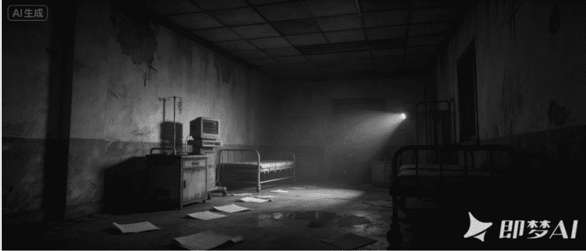

图6-2 即梦生成画面

将所有镜头画面按分镜序号整理，为后续动态化与剪辑做准备。

**第二步，生成分镜视频。** 点击图片后选择生成视频，即可对应生成分镜视频，如图6-3所示。

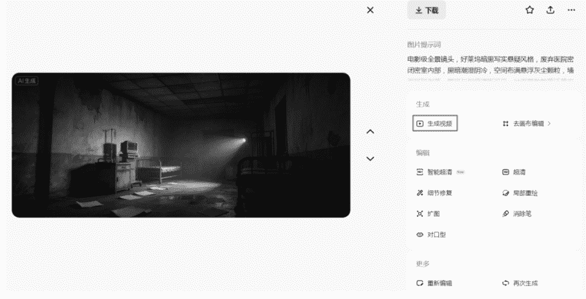

图6-3 即梦生成视频

分镜逐一生成后按顺序整理，便于后期剪辑。

**第三步，完成镜头拼接、节奏优化与音画融合。** 将分镜画面导入剪映并导入音乐，精准对齐音乐与画面，确保音乐开头高潮结尾与画面段落匹配，例如浪漫星空音乐弦乐段与银河镜头对齐，紧张悬疑音乐急促段与黑影闪过镜头快速切换对齐，避免音画错位脱节。

拼接后预览音画效果，若画面动态与音乐节奏有偏差，借助剪映“变速”功能微调画面或音乐时长，如画面略长可适当加快变速1.05～1.1倍，确保时长一致；若卡点不准，可用“分割”功能调整音乐片段位置，确保精准，同时微调镜头切换速度实现音画节奏高度匹配，变速调整如图6-4所示。

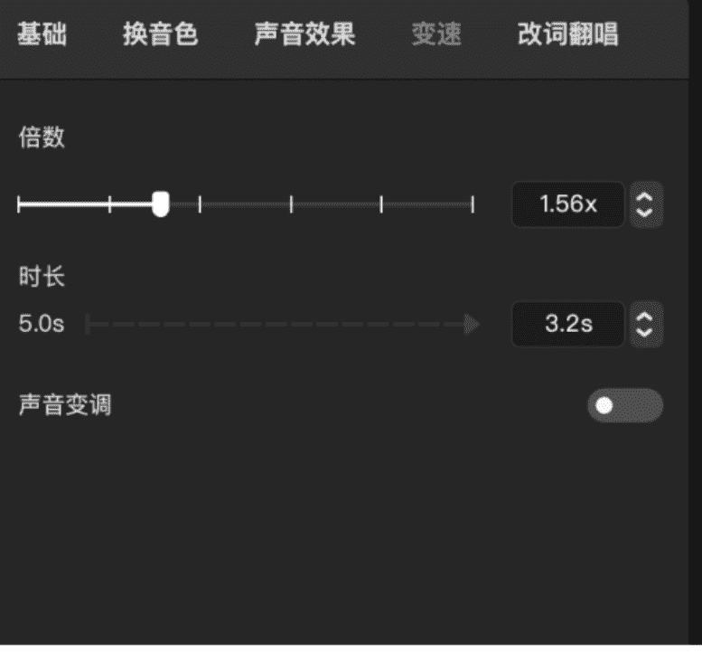

图6-4 剪映音频变速调整界面

按音画适配节奏将音效精准叠加至对应细节，例如紧张悬疑中黑影闪过叠加脚步声，玻璃破碎叠加破碎声，人物惊恐呼吸叠加呼吸声，确保音效与画面细节高度匹配补充氛围。叠加后预览，若音效杂乱音量不均则调整音量与出现时间，删除多余音效保持贴合不干扰融合，音效选择界面如图6-5所示。

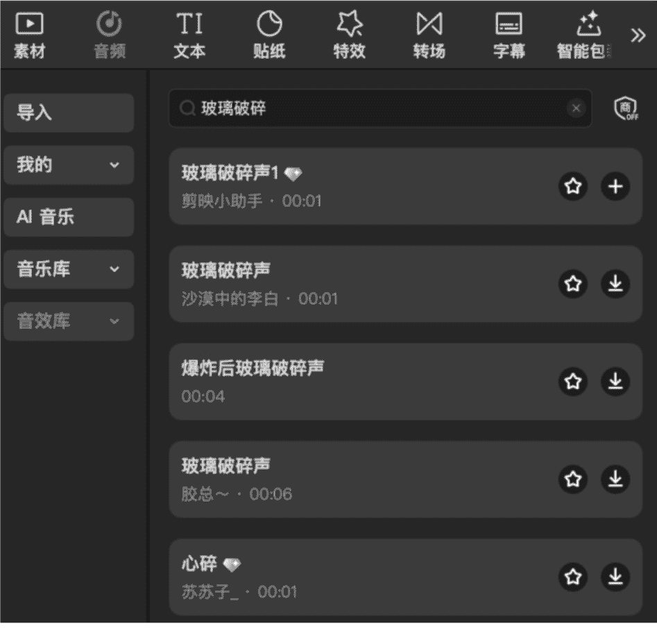

图6-5 剪映音效选择界面

#### 6.3.3 电影级视频成片的注意事项

**把控AI生成精准度，减少后期修改成本：** AI镜头生成是基础，若画面与分镜创意不符会大幅增加剪辑修改成本。实操中需借助豆包优化Seedance生成提示词，确保包含镜头类型、画面细节、光影、风格等核心信息。

**强化音画共生，提升成片沉浸感：** 音画融合是成片关键，脱节或音效杂乱会严重影响沉浸感。实操中借助豆包筛选贴合氛围的音乐与音效，借助剪映“音量淡化”实现音乐音效自然过渡。

## 第7章 MV音乐视频制作实操

### 7.1 创意构思：音乐视觉表达设计

MV核心是“音画共生”，创意关键在于让视觉精准贴合音乐节奏、情感与主题，通过画面强化音乐感染力并打造视觉记忆点。不同于电影宏大叙事，MV需兼顾节奏适配、情感传递、视觉美感，避免画面杂乱与音乐脱节。

#### 7.1.1 Seedance加豆包做MV创意构思的优势

豆包可快速接收MV核心需求，拆解音乐关键元素，包括风格、节奏快慢、情感基调、歌词核心意象，结合元素匹配适配视觉风格、场景类型、色彩基调，避免创意与音乐脱节。例如抒情慢歌匹配唯美浪漫柔和光影，摇滚快歌匹配动感强烈高对比，古风歌曲匹配古色古香诗意场景，确保调性高度契合。

#### 7.1.2 MV创意构思实操步骤

##### 第一步，拆解音乐核心元素，明确创意方向

从音乐内核出发构建影像创意是制作音乐影像的第一步，也是后续对位、指令打磨和画面输出的基础。先把曲风、速度、情绪、歌词意象、核心诉求和画面调性梳理清楚，创意才有锚点。把信息盘一次：曲风偏流行抒情、速度慢旋律轻柔、情绪偏治愈温暖、歌词反复出现的意象有星空、海浪、烛光、牵手、晚风，整支作品想传达陪伴与治愈，画面走向唯美柔和、低饱和暖调，受众集中在18到35岁。信息清晰后方向才稳。

实操上可用豆包辅助拆解，输入音乐要素后能得到更精准的方向建议，下面是一条可落地的示范指令：

帮我拆解流行抒情治愈向MV的音乐核心元素，明确音乐风格为流行抒情，节奏舒缓，情感基调为治愈、温暖，歌词核心意象为星空、海浪、烛光、牵手、晚风，MV核心主题为“陪伴治愈”，视觉风格为唯美柔和、低饱和暖色调，目标受众18～35岁。帮我提炼能贴合音乐情感的关键视觉元素，包括场景、海边日落、星空下的草地、暖光房间、人物年轻男女互动温柔表情舒缓、道具烛光、鲜花、围巾、特效柔和光斑、星光、晚风飘动效果，重点突出画面的治愈感与温柔感，贴合慢节奏音乐的调性。帮我明确场景的视觉标准，包括画面分辨率、光影效果、色彩基调等，为后续Seedance生成场景画面提供精准指引，优化细节描述，让场景画面与流行抒情治愈向MV质感高度匹配，避免元素杂乱、氛围脱节。

豆包根据指令生成内容如下：

###### 流行抒情治愈向MV核心拆解（适配Seedance生成）

####### 一、核心基础信息

音乐风格：流行抒情（慢节奏，旋律舒缓）

情感基调：治愈、温暖、柔和

MV核心主题：陪伴治愈

视觉风格：唯美柔和，低饱和暖色调

目标受众：18～35岁

歌词核心意象：星空、海浪、烛光、牵手、晚风

##### 二、核心关键元素（贴合情感，避免杂乱）

###### 1.场景（重氛围感）

海边日落：夕阳西下，金色余晖洒在海面，海浪缓慢起伏，沙滩细腻，远处有归航的小船；星空下的草地：夜幕降临，满天星光，草地柔软，有微弱的萤火虫光斑；暖光房间：室内灯光柔和，摆放简约家具，桌面有点燃的烛光，窗帘轻轻飘动。

###### 2.人物（重互动感）

年轻男女（20～28岁），穿搭简约温柔（浅色系衣物）；互动自然柔和（牵手漫步、并肩而坐、温柔对视）；表情舒缓放松，眼神温柔，无夸张神态，贴合治愈氛围。

音乐核心与关键元素明确后，第二步借助豆包，结合流行抒情治愈向MV的质感要求，细化场景的细节描述，优化生成所需的提示词，核心原则是“细节具体、情感贴合、节奏适配、质感突出”，避免模糊表述，确保生成的场景画面精准贴合音乐调性与MV预期。不同风格的MV，适配的细节元素、光影效果、色彩基调不同，需结合音乐风格灵活调整，例如摇滚快歌适配硬光、高对比度、鲜艳色调，古风歌曲适配柔光、低饱和、古风色调。实操中可在豆包中补充提示词，获取细化的场景细节描述与优化后的提示词，示例提示词（以流行抒情治愈向MV海边日落场景为例）如下：

基于流行抒情治愈向MV的核心需求，帮我细化海边日落场景的细节描述，优化生成场景画面的提示词，要求细节具体、贴合唯美柔和风格、情感温暖，适配慢节奏音乐，避免模糊表述。视觉风格为流行抒情治愈风，画面分辨率4K，高清细腻，细节拉满，无噪点；色彩基调以低饱和暖色调为主，米白、浅橙、淡粉搭配淡蓝色海面，形成柔和对比，突出温暖治愈感；环境细节方面，海边沙滩细腻柔软，有零星的贝壳散落，夕阳西下，金色余晖洒在海面，海浪缓慢起伏，泛起细腻的泡沫，远处有一艘小小的归航渔船，天空有淡淡的晚霞，呈现出粉紫色渐变，晚风轻轻吹动沙滩上的芦苇，芦苇缓慢摇晃；人物细节方面，年轻男女并肩走在沙滩上，手牵着手，男生穿着浅灰色卫衣，女生穿着米白色连衣裙，头发被晚风轻轻吹动，两人面带微笑，眼神温柔，并肩望向远方的夕阳，女生的裙摆轻轻飘动，男生的手臂自然搭在女生的肩膀上；特效细节方面，柔和的暖黄色光斑缓慢飘动，落在人物身上与海面上，海浪泡沫细腻柔和，夕阳有轻微的光晕效果，晚风飘动有自然的动态感；光影效果为柔光，光线柔和，无硬边阴影，夕阳的光线均匀洒在画面中，形成柔和的明暗过渡，突出画面的温暖治愈感；整体画面构图饱满，节奏舒缓，贴合慢节奏抒情音乐，突出陪伴治愈的核心主题，适配Seedance场景生成特性，便于后续动态化处理，给出具体的提示词优化方案。

豆包生成细化的场景细节描述与优化后的Seedance提示词如下：

###### 流行抒情治愈向MV海边日落场景生成提示词（优化版）

4K ultra HD，高清细腻，无噪点，细节拉满，流行抒情治愈风；色彩基调为低饱和暖色调，以米白、浅橙、淡粉为主，搭配淡蓝色海面，形成柔和对比，凸显温暖治愈感，画面色调统一柔和，无艳丽杂色

环境：细腻柔软的白色沙滩，零星散落着小巧贝壳，夕阳西下，金色余晖均匀洒在海面上，海浪缓慢起伏，泛起细腻洁白的泡沫，远处有一艘小小的归航渔船（轮廓清晰，带轻微船帆），天空布满淡淡的粉紫色晚霞，渐变自然，沙滩边缘有几丛芦苇，被晚风轻轻吹动，缓慢摇晃，空气中有微弱的水汽光斑

人物：20～28岁年轻男女，并肩牵手漫步在沙滩上，男生身着浅灰色宽松卫衣，女生身着米白色连衣裙，女生长发被晚风轻轻吹动，两人面带温柔微笑，眼神柔和，并肩望向远方夕阳，男生手臂自然搭在女生肩膀上，女生裙摆随晚风轻微飘动，脚步缓慢舒缓，姿态放松自然

第三步，确定MV视觉标准，明确统一规范

MV 创意构思需确保整体视觉风格统一，贴合音乐的整体调性，避免出现细节杂乱、光影违和、色彩偏差等问题，确保不同场景的画面衔接流畅，提升MV的整体质感。借助豆包，结合音乐风格与核心需求，确定统一的视觉标准，包括画面分辨率、光影效果、色彩基调、细节规范，明确场景元素的呈现要求，例如流行抒情MV统一为“4K高清、柔光、低饱和暖色调”，摇滚MV统一为“4K高清、硬光、高对比度、鲜艳色调”。

获取针对性的视觉标准统一建议，示例提示词（以流行抒情治愈向MV为例）如下：

基于流行抒情治愈向MV的整体定位，帮我确定MV的统一视觉标准与规范，确保场景风格统一、贴合治愈向质感，适配慢节奏音乐。视觉风格为流行抒情治愈风，画面分辨率4K高清，细节清晰可见，无噪点、无模糊；光影效果为柔光，光线柔和，无明显硬边阴影，整体亮度适中，突出温暖治愈感，不同场景的光影过渡自然，避免光影违和；色彩基调为低饱和暖色调（以米白、浅黄、浅橙、淡粉为主），整体色调统一，不同场景的色彩衔接流畅，海边场景可搭配淡蓝色海面，暖光房间可搭配浅棕色家具，星空场景可搭配深紫色夜空与微弱星光，避免鲜艳杂色；细节规范方面，人物穿搭简约温柔，以浅色系为主，互动自然柔和，无夸张动作；场景元素简洁，无多余杂物，贴合治愈主题；特效柔和自然，以光斑、星光、晚风飘动为主，不夸张、不杂乱；所有元素细节统一，贴合流行抒情治愈向MV的调性，适配Seedance生成特性，便于后续批量生成场景画面，同时确保MV视觉风格统一，贴合音乐情感。

豆包根据指令生成内容如下：

###### 流行抒情治愈向MV·统一视觉规范

##### 一、基础画质

风格：流行抒情治愈风，柔和细腻，无夸张元素

分辨率：4K高清，细节锐利，无噪点、无模糊

##### 二、光影规范

主光：柔光，无硬边阴影，整体亮度适中，温暖柔和

重点：不同场景光影过渡自然，海边场景以夕阳为主要光源，星空场景以星光为辅助光源，暖光房间以烛光、室内灯光为主要光源，避免光影违和

第四步，创意预览与迭代优化

MV 创意、细节描述、视觉标准确定后，借助即梦的AI场景生成能力，将文字描述转化为高质感MV场景画面，结合音乐片段，快速验证创意与音乐节奏、情感的适配度，避免画面与音乐脱节。用即梦生成不同场景的画面（如海边日落、星空草地、暖光房间等），如图7-1所示。验证视觉风格与音乐情感的匹配度，以及AI对场景细节、色彩、特效的还原效果。

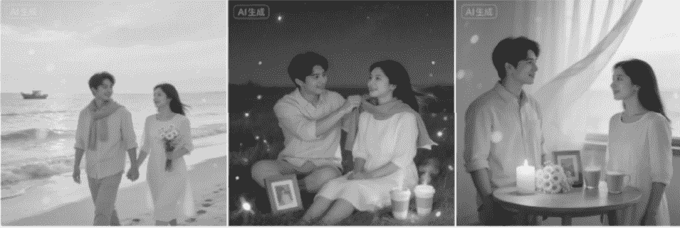

图7-1 MV场景

#### 7.1.3 MV创意构思的注意事项

**创意方向清晰，贴合音乐调性：**借助豆包梳理创意需求时，需明确音乐的节奏、情感与核心意象，避免创意空洞、脱离音乐调性。例如抒情慢歌不可设计过于动感、杂乱的画面，摇滚快歌不可设计过于柔和、舒缓的画面；同时创意需围绕音乐主题展开，确保每一组画面都能呼应歌词或旋律，强化音乐的感染力，避免画面与音乐脱节。

**细节贴合MV质感，避免同质化：**创意细节的设计需贴合MV的整体质感标准，借助豆包优化细节时，需突出MV的独特性，避免同质化。例如同样是抒情MV，可通过独特的场景设定（如小众海边、复古书店）、人物互动细节（如手写书信、并肩看日落）打造记忆点；同时细节需细腻柔和，避免粗糙敷衍，例如人物的表情、动作，场景的光影、特效，需贴合音乐的情感，强化MV的治愈感、氛围感。

### 7.2 脚本与分镜设计：节奏与镜头匹配

脚本与分镜设计是MV制作的核心环节，是连接创意构思与成片输出的桥梁。不同于电影级脚本与分镜的叙事导向，MV的脚本与分镜需遵循“节奏适配、音画同步、视觉流畅”的原则，明确镜头类型、镜头运动、画面内容、时长、音效等核心信息，确保每一个镜头都能贴合音乐的节奏与情感，让视觉画面与旋律、歌词精准呼应，同时确保后续AI生成与剪辑工作有序推进。

#### 7.2.1 借助Seedance+豆包进行MV镜头结构设计的优势

借助豆包的脚本撰写、分镜拆解能力，搭配Seedance的镜头预览优势，可快速解决传统分镜设计的核心痛点，帮助普通创作者快速完成MV脚本与分镜设计，明确镜头结构与节奏，确保分镜贴合创意、镜头有感染力、适配后续AI生成与剪辑，实现音画精准同步。依托Seedance与豆包的协同组合，MV脚本与分镜设计可实现“高效撰写、精准拆解、可视化预览、节奏适配”。

#### 7.2.2 MV镜头结构设计实操步骤

##### 第一步，撰写MV脚本，明确音画对应关系

脚本撰写是分镜设计的基础，核心是“明确画面与音乐的对应关系，贴合音乐节奏与情感”。需结合创意构思与音乐片段，梳理MV的开篇、发展、高潮、结尾，明确每个段落的画面内容、时长，确保画面时长与音乐片段精准匹配，避免出现音画脱节。例如输入提示词：

> “帮我撰写流行抒情治愈向MV的完整脚本，贴合前文创意构思，明确MV主题为陪伴治愈，音乐风格为流行抒情，节奏舒缓，时长180秒，脚本需包含场景描述、人物动作、神态、画面内容、时长，严格遵循音乐节奏（开篇铺垫1～30秒、发展推进31～120秒、高潮121～150秒、结尾留白151～180秒），明确每个段落的画面与音乐的对应关系，语言简洁、精准，贴合镜头语言，便于后续分镜拆解，避免冗长、空洞，突出温暖治愈的情感。”

豆包根据指令生成脚本如下：

流行抒情治愈向MV脚本：陪伴与治愈

【场景】海边日落、星空下的草地、暖光房间

【人物】男主（25岁，温柔内敛）、女主（24岁，温柔治愈）

【时长】180秒

【音乐基调】流行抒情，节奏舒缓，情感温暖治愈，开篇轻柔、发展平缓、高潮饱满、结尾舒缓

0～30秒（开篇铺垫，音乐轻柔）：

场景：海边日落全景，夕阳西下，金色余晖洒在海面，海浪缓慢起伏，沙滩细腻，远处有归航的小船，天空有淡淡的粉紫色晚霞。

人物：女主独自坐在沙滩上，望着远方的夕阳，表情舒缓，双手抱膝，头发被晚风轻轻吹动，身边放着一束白色小雏菊。

画面重点：突出海边日落的唯美与女主的温柔，贴合音乐的轻柔开篇。

31～120秒（发展推进，音乐平缓）：

场景1（31～60秒）：海边日落中景，男主缓缓走向女主，脚步舒缓，手中拿着一杯温热的奶茶，在女主身边坐下，递给女主奶茶，两人相视一笑，温柔对视。

场景2（61～90秒）：海边日落近景，两人并肩而坐，手牵着手，望向远方的夕阳，女主靠在男主肩膀上，男主轻轻抚摸女主的头发，晚风吹动两人的衣角与头发，画面柔和。

##### 第二步，拆解分镜，明确镜头结构与节奏

脚本撰写完成后，借助豆包，将脚本拆解为具体的分镜，明确每个分镜的核心信息，包括镜头序号、镜头类型、镜头运动、画面内容、时长、光影、音效，确保镜头结构合理、衔接流畅、节奏精准，每一个分镜的时长与运动都能贴合音乐的节奏与情感变化。分镜拆解需遵循MV镜头语言规范，结合音乐节奏，合理搭配全景、中景、特写，优化镜头运动，强化画面的感染力与音画同步性。例如输入提示词：

> “帮我将流行抒情治愈向MV脚本拆解为具体分镜，明确每个分镜的镜头序号、镜头类型、镜头运动、画面内容、时长、光影、音效，贴合流行抒情治愈风，镜头结构合理、衔接流畅，节奏精准适配音乐（开篇轻柔、发展平缓、高潮饱满、结尾舒缓），镜头运动与画面内容贴合音乐节奏，例如开篇用全景铺垫氛围，发展阶段用中景、近景展现人物互动，高潮用特写突出细节与情感，结尾用全景留白，每个分镜的时长精准分配，便于后续Seedance生成与剪映剪辑，突出温暖治愈的情感。”

豆包根据指令生成分镜表，如表7-1所示。

###### 表7-1 分镜表

| 镜头序号 | 镜头类型 | 镜头运动 | 画面内容 | 时长 | 光影 | 音效 |

|---|---|---|---|---|---|---|

| 1 | 全景 | 缓慢推进 | 海边日落全景，夕阳、海面、沙滩、归航小船，晚霞渐变，画面柔和 | 10秒 | 柔光，暖黄色余晖，光影过渡自然，无硬边阴影 | 轻柔海浪声、微风声，贴合音乐开篇 |

| 2 | 中景 | 固定 | 女主独自坐在沙滩上，抱膝望着夕阳，头发被晚风吹动，身边有小雏菊 | 20秒 | 柔光，余晖洒在女主身上，面部光影柔和 | 海浪声、微风声，音乐轻柔放大 |

| 3 | 中景 | 慢跟 | 男主缓缓走向女主，手持奶茶，脚步舒缓，面带微笑 | 15秒 | 柔光，余晖均匀洒在画面中，人物光影柔和 | 轻微脚步声、海浪声，音乐平缓 |

| 4 | 近景 | 固定 | 男主在女主身边坐下，递出奶茶，两人相视一笑，温柔对视 | 15秒 | 柔光，聚焦两人面部，光影柔和，突出表情 | 轻微的奶茶杯碰撞声，音乐平缓 |

##### 第三步，优化分镜，强化节奏与音画适配

分镜拆解完成后，需借助豆包，结合MV镜头语言规范、音乐节奏与Seedance生成特性，优化分镜细节，强化镜头节奏与音画适配性，确保分镜衔接流畅、画面有感染力，避免出现“镜头违和、衔接生硬、节奏不匹配”等问题。

#### 7.2.3 MV镜头结构设计的注意事项

**镜头搭配合理，贴合音乐节奏：**借助豆包拆解分镜时，需合理搭配全景、中景、特写，遵循“全景铺垫氛围、中景展现互动、特写突出情感”的原则，贴合音乐节奏。例如开篇用全景铺垫场景氛围，发展阶段用中景、近景展现人物互动，高潮部分用特写突出细节与情感，结尾用全景留白；同时根据音乐节奏调整镜头时长，慢节奏部分镜头时长可稍长，快节奏部分镜头时长可缩短，确保镜头节奏与音乐节奏精准匹配。

**分镜适配AI生成，兼顾细节与落地：**分镜描述需具体、精准，借助豆包优化分镜时，避免抽象表述，将镜头类型、运动、画面内容、光影、音效等细节描述清晰，确保Seedance能精准捕捉分镜核心，生成贴合预期的镜头画面。同时避免设计过于复杂的镜头（如过多特效、复杂场景元素），确保分镜可落地，减少后续生成与剪辑的修改成本；同时分镜设计需兼顾剪映剪辑，确保镜头衔接流畅，便于后续音画同步与节奏优化。

## 7.3 成片实操：MV完整生成流程

成片实操是MV制作的最终环节，核心是“将创意构思、脚本分镜，通过AI工具生成与剪辑优化，转化为高质感、音画同步的MV成片”。

### 7.3.1 借助Seedance+豆包+剪映进行MV成片生成的优势

Seedance可根据豆包优化后的分镜描述，快速生成每个镜头的高质感画面，精准还原MV的视觉风格、细节质感与情感氛围，无需专业拍摄与建模，大幅缩短成片制作时间；同时可借助豆包优化生成提示词，调整画面细节（如光影、色彩、元素、动态效果），确保画面贴合分镜与创意预期，贴合音乐情感。

### 7.3.2 MV完整生成实操全流程

**第一步，AI镜头生成**

根据分镜表，借助豆包，为每个分镜生成精准提示词，生成对应的镜头画面，确保画面贴合分镜描述、MV质感与创意预期，同时贴合音乐情感。例如输入提示词（针对分镜1：海边日落全景）：

> “帮我生成提示词，贴合流行抒情治愈向MV风格，镜头类型为全景，画面内容为海边日落，夕阳西下，金色余晖洒在海面，海浪缓慢起伏，沙滩细腻，远处有归航的小船，天空有淡淡的粉紫色晚霞，光影为柔光，暖黄色余晖，光影过渡自然，无硬边阴影，细节清晰（沙滩纹理、海浪泡沫、晚霞渐变、小船轮廓可辨），风格为唯美柔和，无夸张特效，贴合治愈温暖的氛围，适配Seedance生成，贴合慢节奏抒情音乐的调性。”

豆包接收指令后会生成分镜提示词如下：

流行抒情治愈向MV全景镜头，唯美柔和风格，海边日落场景，夕阳西下，金色余晖均匀洒在海面上，海浪缓慢起伏，泛起细腻洁白的泡沫，细腻柔软的白色沙滩延伸至海面，远处有一艘小小的归航渔船，船帆轻微飘动，轮廓清晰可见；天空布满淡淡的粉紫色晚霞，渐变自然柔和，空气中有微弱的水汽光斑；柔光质感，暖黄色余晖为主要光源，光影过渡自然，无硬边阴影，整体色调为低饱和暖色调（浅橙、淡粉、米白搭配淡蓝色海面）；细节锐利可辨，沙滩纹理、海浪泡沫、晚霞渐变、小船轮廓、水汽光斑清晰可见，无夸张特效，极致温暖治愈，4K电影质感，写实渲染，动态光影自然流畅，贴合慢节奏抒情音乐的轻柔调性。

将提示词输入即梦生成对应的分镜图如图7-2所示，随后将所有生成的镜头画面按分镜序号整理，确保镜头顺序与分镜表一致，为后续动态化调整与剪辑做好准备。

图7-2 海边场景

#### 第二步，镜头动态化调整，贴合音乐节奏

将静态镜头画面转化为动态视频，核心是让画面动态与音乐节奏精准适配，避免动态过快/过慢与MV调性违和。实操中可借助豆包，根据音乐节奏生成动态化调整提示词，在Seedance中完成镜头动态设置，核心原则为“慢节奏抒情音乐匹配舒缓动态，快节奏音乐匹配灵动动态”。

以流行抒情治愈向MV的星空草地镜头为例，输入豆包提示词：

> “帮我生成Seedance动态化调整提示词，适配流行抒情治愈向MV的星空草地镜头，音乐节奏舒缓，要求动态效果柔和自然，突出治愈氛围，镜头动态包括星光缓慢闪烁、萤火虫光斑轻轻飘动、人物脚步舒缓、晚风吹动草地与头发的轻柔效果，无夸张动态，贴合慢节奏音乐，确保动态与画面质感统一，适配后续剪映剪辑。”

豆包生成动态化提示词如下：

4K电影级画面质感，整体走流行抒情治愈风格。星空草地场景的动态细节被精细化处理：星光以低频缓慢明灭，亮度柔和不刺眼；萤火虫光斑轨迹不规则却轻柔飘动，速度缓慢分布均匀；两人牵手漫步时脚步舒缓，肢体自然柔和，没有急促动作；晚风带动草叶轻摇，发丝与衣角缓慢飘动，幅度很小；镜头全程稳定无晃动，动态与慢节奏抒情音乐契合，光影随动态自然过渡，氛围极致温暖治愈，不使用夸张特效。

把动态化提示语与原始镜头提示语合并即可生成动态镜头视频，生成界面参考图7-3所示。

图7-3 视频生成对话框

发送后系统会输出分镜片段视频参考图7-4，逐条校验动态表现与音乐节奏的匹配度。若动态不符合预期，可借助豆包微调提示语后重新生成，确保各镜头动态统一并服务于MV音乐调性。确认后按分镜序号归档所有动态片段并导出高清素材。

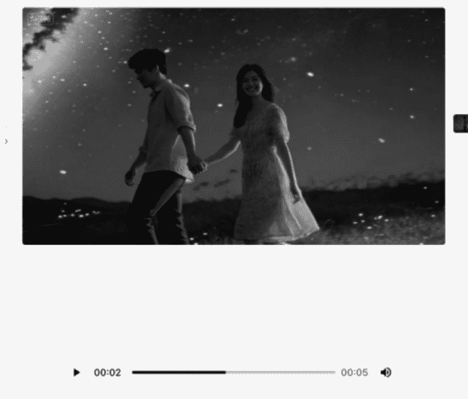

图7-4 分镜视频

#### 第三步，剪映剪辑落地，实现镜头拼接与音画同步

剪映是MV成片落地的核心工具，需完成拼接、节奏优化、音画融合。将整理好的动态镜头视频与音乐导入剪映，按分镜序号依次排到时间轴，裁剪素材多余片段，保证镜头衔接无断层。治愈风格建议少用花哨转场，以硬切或淡入淡出为主，转场时长控制在0.5～1秒，保持画面连贯且契合柔和氛围，如图7-5所示。

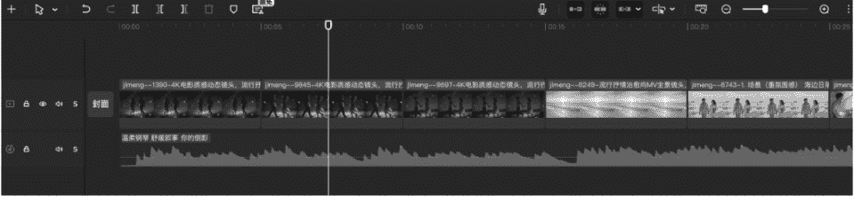

图7-5 分镜视频拼接

#### 第四步，后期细节优化，强化MV质感与情感表达

基础剪辑完成后，用剪映进行细节打磨，结合豆包的专业建议，从调色统一、画面质感提升、字幕添加三个维度优化，确保整体质感达标、情感传达更到位。完成全部优化后进行通片预览，重点核查音画同步、镜头衔接流畅度、色调统一性、音效与字幕的适配度。若与创意预期和音乐情绪吻合即可导出成片；若出现音画错位、色偏、音效杂乱等问题需针对性修正。

### 7.3.3 MV成片制作的注意事项

**严控音画同步精度，避免节奏违和：**音画同步是MV的灵魂。若歌词与字幕错位、画面动态与节拍脱节、音效与画面细节不匹配，观感会大打折扣。操作时需放大时间轴，精准对齐音乐重拍与镜头切换、歌词起唱与字幕出现。音效叠加要细致匹配画面细节，如抬手配微风声、烛光晃动配燃烧声。多次分段预览，结合豆包的节奏分析建议微调偏差，避免音效堆砌盖过主音乐，破坏氛围。

**保证画面质感统一，避免视觉违和：**MV视觉统一体现在色调、光影、动态三个层面，常见问题为镜头间色差、光影冲突、动态不一致。需严格遵循前期确定的视觉标准，先在剪映进行全局调色，再对单镜头做局部微调，防止偏离主风格。AI生成与动态化环节要保证光影与设定一致，治愈向作品全程保持柔光、无生硬阴影。动态按音乐节奏统一设定，避免快慢参差。少用滤镜、贴纸等花哨特效，以免画面喧宾夺主。

## 第8章 真人短剧制作实操

### 8.1 内容构思：剧情短视频结构设计

真人短剧的创意构思决定爆款潜力。与电影短片的完整叙事和抖音短视频的轻量化表达不同，真人短剧更强调冲突密集、情节反转、情感共鸣，需在短时间内建立人物关系、引爆冲突、落下情感。借助豆包做剧情推演和创意优化，结合即梦做视觉验证，能有效避免同质化、冲突薄弱、节奏拖沓，让创意更贴合平台与AI制作需求。

#### 8.1.1 借助豆包+即梦进行真人短剧内容构思的优势

豆包可对接平台爆款逻辑，创作者输入基础创意方向后，系统可结合抖音热门赛道如家庭伦理、都市悬疑、甜宠逆袭等，梳理出高密度冲突线、强反转情节和共情式情感落点，避免同质化，同时满足“3秒抓睛、1分钟破局”的节奏要求。

#### 8.1.2 真人短剧内容构思的核心步骤

##### 第一步，锚定赛道与核心痛点，明确创作方向

构思首要任务是确定赛道类型与核心痛点。家庭伦理聚焦婆媳矛盾、财产争夺等现实痛点；都市悬疑侧重陌生人闯入、秘密曝光；甜宠逆袭围绕弱势主角成长与情感救赎。明确赛道后梳理痛点，可借助豆包输入灵感和诉求快速获得优化建议，示例提示词如下：

> "帮我优化一个抖音真人短剧创意灵感，核心赛道是都市悬疑，时长2分钟，聚焦'独居女孩遭遇陌生跟踪'的核心痛点，要求3秒抓睛、1分钟爆发冲突、结尾有反转，贴合抖音爆款逻辑，明确核心冲突、情节反转点与情感落点，避免俗套桥段，给出具体的剧情方向建议。"

豆包会输出优化版创意，明确赛道、时长规格、核心痛点，并规避俗套，突出熟人伏笔与认知反转，提供节奏拆解、核心要素、优化亮点、拍摄建议和备选方向，为后续框架搭建奠定基础。

##### 第二步，搭建高密度剧情框架，梳理节奏节点

方向明确后，需用豆包搭建符合节奏的高密度框架。以2分钟为例，建议分配为“3秒抓睛—30秒建冲突—50秒强推进—15秒反转—2秒落点”。可补充提示词获取结构化框架，生成的框架会清晰标注每个节点的情节、动作和悬念，确保环环相扣、钩子密集。

##### 第三步，塑造立体人物形象，强化角色张力

人物张力是核心竞争力。借助豆包可快速搭建人物框架，明确性格特质、行为动机、外貌特征，避免扁平化。人物设定应遵循标签化加反差感原则，如看似柔弱的独居女孩实则心思缜密，外表凶狠的跟踪者实为守护者，反差能增强张力。

##### 第四步，确定视觉风格，明确场景与氛围导向

基于剧情与人物，借助豆包确定核心视觉风格。都市悬疑适配冷色调、低光、紧凑构图；家庭伦理适配写实风、暖冷对比；甜宠逆袭适配高饱和暖色、明亮光影。视觉需服务于剧情氛围。

#### 8.1.3 真人短剧内容构思的注意事项

**核心要素明确，冲突密集无冗余：**梳理时需明确赛道类型、时长、核心冲突、节奏节点、人物反差、视觉风格等关键信息，避免模糊。剧情要冲突密集，杜绝铺垫过长，每个节点都有悬念或反转钩子，提升完播。

**贴合短剧时长，节奏精准可控：**抖音真人短剧时长多为1-3分钟，构思时需严格控制各节点时长，确保3秒抓睛、1分钟破局、全程无冷场。提示词中明确各环节时长分配，让框架更具落地性。

### 8.2 脚本与分镜设计：真人短剧镜头设计

脚本与分镜是连接构思与成片的桥梁。真人短剧脚本重在台词精练、动作明确、冲突可视化，分镜重在镜头叙事性、切换紧凑性、氛围精准性。借助豆包撰写标准化脚本，结合Seedance+即梦的AI特性做分镜设计，能提升脚本分镜的平台适配性和生成可行性，降低门槛。

#### 8.2.1 借助豆包+Seedance+即梦进行脚本分镜设计的优势

豆包可把构思转化为含镜号、景别、画面内容、时长、人物动作、台词、音效的标准化脚本，精准控制时长与冲突点。分镜设计时明确镜头运动、构图和光影，即梦可精准还原氛围，Seedance可无缝动态化，避免复杂运动导致失真。

#### 8.2.2 真人短剧脚本设计的核心步骤

##### 第一步，拆解节奏节点，明确脚本设计依据

脚本设计需基于构思的节奏节点，先梳理赛道、总时长、各节点时长、核心剧情、人物动作、冲突点、音效台词导向，确保不偏离爆款逻辑。

##### 第二步，借助豆包，拆解镜头并生成标准化脚本表格

结合核心信息和剧情框架，用豆包将短剧拆解为独立镜头，形成可落地的标准脚本，维度包括镜号、景别、画面内容、时长、人物动作、台词、音效。示例提示词会要求生成标准脚本表格，生成的表格会清晰呈现各镜头信息，如表8-1所示。

###### 表8-1 抖音都市悬疑类真人短剧设计标准化脚本

| 镜号 | 景别 | 画面内容 | 时长 | 人物动作 | 台词 | 音效 |
|:---:|:---|:---|:---:|:---|:---:|:---:|
| 1 | 特写 | 汽车后视镜，陌生男子身影出现 | 3s | 无 | 无 | 急促的心跳声、汽车发动机声 |
| 2 | 中景 | 女孩握紧方向盘，回头张望 | 7s | 女孩眉头紧锁，双手用力攥住方向盘，快速回头看后座方向 | 无 | 轮胎摩擦地面声、心跳声持续 |

##### 第三步，适配AI生成特性，借助豆包优化脚本细节

脚本生成后需结合Seedance+即梦特性做精细化优化，确保可落地易生成，同时保证时长与节奏精准匹配，冲突段落适当缩短镜头，增强张力。

#### 8.2.3 真人短剧分镜设计的核心步骤

##### 第一步，拆分镜头单元，明确核心设计维度

以脚本为基础，按节奏将每个镜头拆分为分镜单元。2分钟作品建议12-15个分镜，确保切换紧凑。每个单元需明确镜号、景别、镜头运动方式、画面构图、光影效果、场景细节，确保适配AI生成。

##### 第二步，细化画面描述，适配即梦生成

画面描述将直接作为即梦生成提示，描述越精准匹配度越高。例如镜号7的分镜画面描述文字如图8-1所示。

图8-1 画面描述文字

##### 第三步，整合分镜信息，生成标准分镜表

整合后形成标准化分镜表，便于后续生成与剪辑。分镜表包含镜号、景别、镜头运动方式、画面构图、光影效果、场景细节、画面描述、时长、对应台词九大要素。示例提示词会要求生成标准分镜表，生成后的表如表8-2所示，需复核画面描述一致性、时长匹配、人物统一性和光影适配性。

###### 表8-2 都市悬疑类真人短剧标准化分镜表

| 镜号 | 景别 | 镜头运动 | 画面构图 | 光影效果 | 场景细节 | 画面描述 | 时长 | 对应台词 |
|:---:|:---:|:---:|:---:|:---:|:---|:---|:---:|:---:|
| 1 | 特写 | 固定镜头 | 居中构图 | 冷色调，低光 | 汽车后视镜，表面有轻微反光 | 写实悬疑风，汽车后视镜特写，镜中清晰呈现深色外套男子的模糊身影，背景为深夜街道的路灯光影，后视镜边缘有轻微磨损痕迹，画面以冷色调为主，强化悬念，高清 2K，16:9 竖屏 | 3s | 无 |

#### 8.2.4 真人短剧脚本与分镜设计的注意事项

**视觉风格与细节保持统一，杜绝前后偏差：**需严格遵循前期确定的视觉风格、色彩基调、人物固定特征，在提示词和描述中反复明确。例如都市悬疑全程冷色调低光，人物发型服饰全程统一，避免前后不一致。

**人物台词与动作贴合性格，增强真实感：**台词和动作需符合人物年龄、身份和情绪，如退伍军人台词简洁动作沉稳，独居女孩台词带警惕动作略慌，避免言行不符。

### 8.3 成片实操：短剧完整制作流程

成片实操是创意落地关键，核心是把分镜转化为动态视频，通过Seedance动态化、即梦画面优化，结合剪映剪辑实现拼接、节奏调整、音效适配、字幕添加和细节优化，最终输出符合抖音爆款标准的完整短剧。AI助力无需专业拍摄团队，只需基于前期静态分镜精准设置参数即可高效完成。

#### 8.3.1 借助Seedance+即梦+剪映进行真人短剧成片实操的优势

传统真人微剧的工业化产出，长期受困于拍摄周期拖长、后期处理繁琐、画风难以统一以及声画不同步。业余创作者现场易出现机位晃动、布光杂乱、表演不自然，后期又要投入大量工时做画面修整、色彩统一以及台词音效对齐，门槛明显偏高。

Seedance 能把即梦已生成的静态分镜直接驱动成动态片段，省去实拍环节；剪映操作直觉、功能覆盖全面，配有多套短剧专用模板，没有专业剪辑基础的人也能快速上手。

#### 8.3.2 真人短剧成片实操关键流程

##### 第一步，画面定调，统一视觉基底
成片的首要工序是对即梦输出的静态分镜做系统梳理，确保整体风格统一、细节达标，为后续动化打下基础。具体做法是：将即梦生成的4张静态分镜按镜号排好序，逐张核对画面主体、人物样貌、场景物件与分镜脚本的吻合度，重点落在人物神情、动作细节、光影氛围是否与剧情情绪匹配，如图8-2所示。

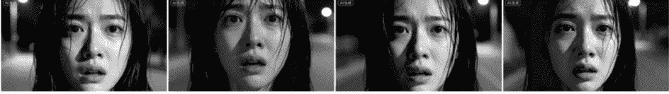

图8-2 生成画面

##### 第二步，Seedance 动态化，还原剧情张力
静态图校对完成后，借助 Seedance 把它们转为动态片段，核心是还原分镜里要求的运镜、人物动作与现场氛围。操作可拆成三步：一是打开之前生成的静态图后点“生成视频”按钮，如图8-3所示。

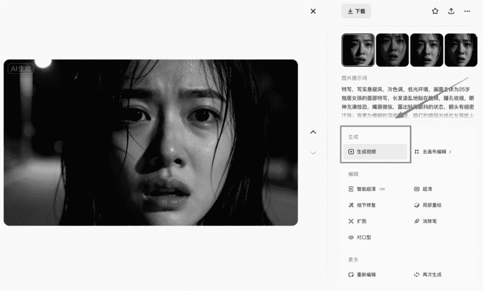

图8-3 Seedance生成视频操作界面

二是完成静到动的转换并做画面微调。按分镜要求直接产出动态分镜，参数可按需匹配。选用 Seedance 2.0 版本，并补上首尾帧作为参考，用于缓解卡顿、动作僵硬的问题，保证播放流畅，如图8-4所示。

三是把音画匹配前置：利用 Seedance 自带的 AI 音效、AI 音乐、重配音功能先行完成音画对齐，减少在剪映里重复调整的时间，如图8-5所示。

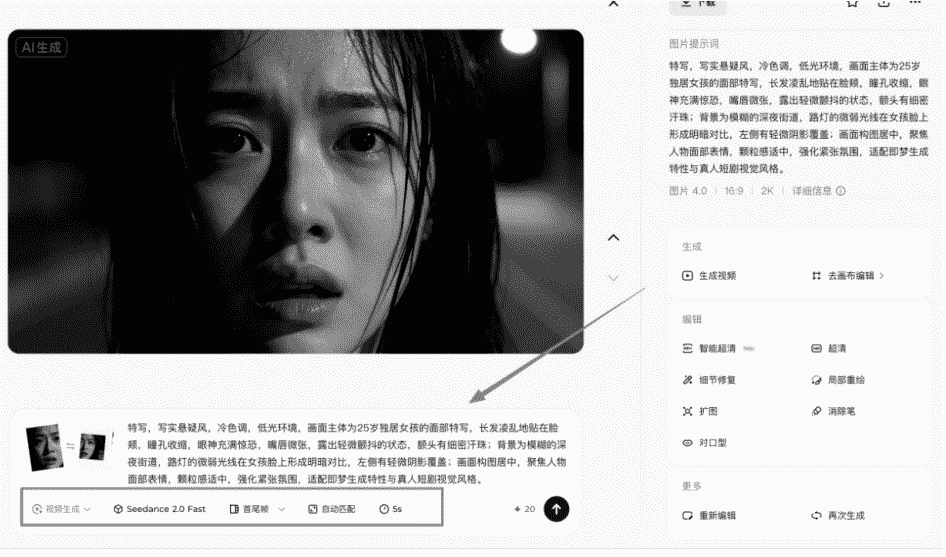

图8-4 Seedance生成视频操作界面

图8-5 Seedance 生成视频编辑界面

##### 第三步，剪映拼接镜头，精准把控节奏
动态素材出来后，用剪映做镜头拼接与节奏优化，让整体更紧凑流畅。具体分三步：一是导入素材搭建框架。打开剪映，项目参数设为 2K 分辨率、16：9 竖屏、30 帧，把 Seedance 输出的动态片段按镜号顺序导入，拖入时间轴视频轨道拼接成完整剧情框架，如图8-6所示。二是做精准变速。选中时间轴片段，对冲突爆发段落如镜号6到7，通过剪映“变速”功能调至1.2倍，强化紧迫感；对反转与情感落点段落如镜号10到12，保持正常1倍速度，营造舒缓氛围，使全片张弛有度。

三是优化衔接。在快切镜头间如镜号3到4设置0.1秒“切镜”过渡，在情绪转折处如镜号7到8设置0.2秒“淡入淡出”过渡，避免生硬跳变，提升观感流畅度，如图8-7所示。

##### 第四步，音画深度适配，强化剧情氛围
音画配合是提升感染力的核心，要结合情绪选配音乐、配音与音效。具体分三步：一是挑选背景音乐。按短剧类型选配纯乐，都市悬疑类可选用节奏紧凑的电子纯乐，在冲突段落镜号6到7把音量提升至80%，在反转与情感段落镜号10到12降至50%，确保音乐不压过对白与音效，如图8-8所示。

二是添加台词配音。借助剪映的“文字转语音”功能输入脚本台词，也可使用添加口播稿功能对文案做润色，如图8-9所示。

三是优化音效层次。将前期导入的环境音、动作音与贴合人物性格的配音音色结合，调整语速并与画面人物口型或动作同步，音量控制在70%左右，如图8-10所示。

##### 第五步，字幕与细节打磨，提升专业质感
字幕与细节是成片的点睛部分，需保证清晰同步、细节无瑕。具体分两步。

一是生成与优化字幕。用剪映“智能字幕”自动识别配音并生成字幕，批量调整样式：字体选用简约易读的黑体，颜色白字配2px黑色描边，字号设为35号，位置放在画面底部中央，避免遮挡人物与核心场景；逐句核对字幕与台词的同步性，修正错别字与时长偏差，如图8-11所示。

二是强化氛围细节。针对悬疑氛围段落如镜号1到7，用剪映“滤镜”功能添加“墨色胶卷”滤镜，强度调至30%，增强紧张感，如图8-12所示。

##### 第六步，导出成片，适配抖音发布
细节完成后即可导出成片，导出参数直接影响质量与平台适配。具体分两步：一是设置导出参数。点击剪映右上角“导出”，分辨率设为2K 3840×2160、帧率30帧、格式MP4，画质选高清，保证成片清晰不模糊；二是导出与预览。确认参数无误后点击导出，2分钟短剧通常需3到5分钟，导出期间不要关闭剪映，如图8-13所示。

#### 8.3.3 真人短剧成片实操的注意事项
动态效果要自然且服务剧情。Seedance 做动态化时需严格遵循分镜的运镜与人物动作，避免添加无意义的摇镜、缩放等冗余效果。冲突段落可适当加大运镜幅度与速度，情感段落则保持平缓，避免生硬或突兀影响代入感。

节奏把控要精准，避免拖沓或过快。剪映变速时需结合剧情合理设定速度，冲突段落紧凑不杂乱，情感段落舒缓不拖沓。2分钟短剧整体节奏建议控制在平均每秒1到2个镜头切换，避免单镜头超过10秒或切换过快导致画面混乱，确保观众能清晰捕捉信息。

# 第四部分 内容IP制作实操

## 第9章 漫剧视频制作实操

### 9.1 创意构思：IP角色设计与故事结构
漫剧IP的核心竞争力在于角色形象，有记忆点、有辨识度的角色是沉淀IP和积累粉丝的基础，也是后续变现的关键。漫剧角色塑造不同于真人短剧的人物设定，需要兼顾漫画的视觉夸张感与性格辨识度，核心任务是明确角色的核心特质、视觉风格与人设标签，通过AI工具实现形象标准化与统一，避免前后偏差、辨识度低的问题。

#### 9.1.1 借助豆包+即梦进行漫剧IP角色塑造的优势
豆包能快速接收角色的核心人物设定信息，如定位、性格、年龄、身份、人设标签，并拆解出体现特质的视觉细节，例如高冷角色的眼神与服饰、软萌角色的发型与神态，避免同质化，让每个角色都有独特记忆点。

#### 9.1.2 借助豆包+即梦进行漫剧IP角色塑造的核心步骤
##### 第一步，明确角色核心人物设定，拆解关键信息
角色形象塑造的前提是明确核心设定与关键信息，为后续视觉呈现和细节优化奠定基础。创作者需先梳理每个核心角色的定位、性格特质、年龄、身份、人设标签、核心反差，以及所属的漫剧场景，确保设定清晰、有辨识度并贴合整体风格。实操中可借助豆包输入相关信息获取精准设定拆解，示例提示词分三类高频场景呈现，便于落地。

场景1：古风言情漫剧，提示词示例为拆解女主核心设定，明确定位为软萌医女等信息，并提炼发型、服饰、神态、标志性动作、配饰等视觉细节，贴合古风场景。豆包生成内容包含定位、色彩基调、发型、服饰等细节描述。

场景2：都市甜宠漫剧，提示词示例为拆解高冷总裁男主的核心设定，明确性格反差、外冷内热等特征，提炼关键视觉细节。豆包生成内容包含基础信息、核心标签、色彩基调、发型、面部神态等。

场景3：悬疑短篇漫剧，提示词示例为拆解伪善律师反派的人设，明确表面温和内心阴暗的反差，提炼视觉细节。豆包生成内容包含人设定位、关键视觉细节、发型等。

##### 第二步，借助豆包，细化角色视觉细节，优化提示词
设定明确后，需借助豆包结合漫剧场景与IP定位细化视觉细节，优化即梦生成所需的提示词，原则是细节具体、风格统一、贴合人物设定、有辨识度，避免模糊表述。不同场景适配的视觉元素不同，需灵活调整，例如古风适配汉服与发簪，都市适配西装与高跟鞋，悬疑适配深色服饰与冷冽眼神。

##### 第三步，确定角色视觉风格，明确统一标准
漫剧IP角色塑造需保证视觉风格统一，贴合整体调性，避免风格杂乱。借助豆包结合场景与核心设定，确定统一的视觉风格、线条质感、色彩基调，建立形象统一标准，例如古风漫剧统一为唯美古风、线条细腻、色彩柔和，都市漫剧统一为简约高端、线条利落、色彩冷调，悬疑漫剧统一为暗黑悬疑、线条硬朗、色彩偏暗。

#### 9.1.3 漫剧IP角色塑造的注意事项
人物设定要清晰具体且无歧义。梳理设定、撰写提示词时需明确包含角色定位、性格特质、年龄、身份、人设标签、核心反差等关键要素，避免笼统表述。

### 9.2 脚本与分镜设计：漫剧叙事结构
漫剧分镜与故事情节是连接角色形象与成片制作的核心纽带，确保剧情有张力、节奏紧凑、贴合IP定位。不同于短视频广告或真人短剧，漫剧分镜需兼顾漫画质感与短视频快节奏，核心是通过视觉呈现传递故事、突出角色与冲突，吸引持续观看。

#### 9.2.1 借助豆包+即梦+Seedance设计漫剧分镜及故事情节的优势
传统漫剧分镜设计对叙事逻辑、镜头语言要求高，且难以直观预判画面落地效果，容易出现节奏脱节、画面生成困难、情节平淡、人物设定崩塌等问题。普通创作者借助豆包、即梦与Seedance协同，可以高效完成脚本与分镜设计。

#### 9.2.2 漫剧故事情节设计的核心步骤
##### 第一步，明确剧情核心与定位，梳理整体框架
故事情节设计需立足IP定位与角色设定，先借助豆包梳理漫剧核心信息与框架。重点包括整体定位、核心主题、单集时长、连载节奏、角色关系、核心冲突与情感共鸣点，确保框架不偏离人物设定与定位，同时适配短视频快节奏。

##### 第二步，借助豆包，细化单集故事情节，设计冲突与共鸣点
在框架与设定基础上，借助豆包细化单集剧情，明确节奏节点如3秒抓睛、45秒推进、12秒悬念，设计核心冲突与情感共鸣点，保证张力与记忆点，避免人物设定崩塌。单集需包含开头抓睛、中间推进、结尾悬念，适配快节奏。

实操示例为为古风言情连载漫剧设计60秒单集，明确主题、角色关系、冲突与共鸣点，借助豆包细化情节与对话动作，确保贴合人物设定并便于后续分镜与动态化。

#### 9.2.3 漫剧分镜设计的核心步骤
##### 第一步，拆分镜头单元，明确核心设计维度
以单集剧情为基础，按节奏与顺序拆分为独立分镜单元，确保每个分镜对应剧情、传递特质与冲突。分镜数量需结合时长规划，常规每分钟10到15个，60秒建议10到12个，保证节奏紧凑。

##### 第二步，细化画面描述，适配即梦生成，突出核心重点
分镜核心是可视化指引加角色塑造加剧情传递，需撰写详细具象的画面描述作为即梦生成提示词。描述需覆盖主体、角色特征、动作表情、场景元素、色彩光影、风格基调、情感氛围，重点突出微表情、动作细节与冲突。漫剧描述需突出漫画质感、线条细腻、色彩符合风格，并明确角色固定特征，确保一致。

##### 第三步，整合分镜信息，生成标准分镜表

古风漫剧分镜标准化与AI成片速成指南

完成单集所有分镜单元的拆解与描述后，关键一步是将这些零散要素归并成一张统一的分镜清单，作为后续制作的共同参照。依托这份清单，即梦负责静态画面产出、Seedance负责动画化、剪映负责剪辑与包装就能实现顺畅衔接。清单需覆盖九项核心字段，按镜号、景别、运镜、画面构图、光影、画面描述、时长、对应台词、核心呈现重点的顺序排列，无需手工排版，可让豆包按提示词批量生成。参考提示词可写成：

把古风言情漫剧的一集十个分镜单元整理成标准化分镜表，输出镜号、景别、镜头运动、画面构图、光影效果、画面描写、时长、台词、核心呈现重点。画面描写要符合唯美古风基调与线条细腻流畅的视觉要求，突出角色微表情、动作细节与剧情冲突，运镜简洁以适配即梦配合Seedance的生成特点，人设与外形保持一致，台词与本集剧情对应，时长与节奏节点精准匹配，贴合古风言情漫剧IP定位，确保每个镜头都能传递人物特质、冲突张力与情感共鸣。

豆包按指令生成的结果如表9-1所示。

###### 表9-1 古风言情漫剧单集标准化分镜表

| 镜号 | 景别 | 镜头运动 | 画面构图 | 光影效果 | 画面描述（唯美古风） | 时长 | 对应对话 | 核心呈现重点 |

|:---:|:---:|:---:|:---|:---|:---|:---:|:---|:---|

| 1 | 全景 | 缓慢推镜 | 对称构图，月洞门为中心，衬梅枝廊影 | 月色柔光，淡银色调，明暗过渡柔和 | 冬夜庭院白梅缀枝，女主月白襦裙立廊下，捻梅垂眸，神色温婉疏离 | 3s | 女主OS：今岁梅开，竟与往年不同了 | 铺垫氛围，展现女主温婉疏离人设与心事 |

| 2 | 中景 | 固定镜头 | 三分构图，女主居右，梅枝宫灯留白 | 月色侧光，宫灯暖光点缀，冷暖中和 | 女主拂过梅瓣，花瓣落袖口，眉眼微抬，神色柔和落寞 | 2s | 无 | 突出女主气质与情绪，展现服饰细节 |

……

表格生成后必须二次复核，重点核查画面描写的统一性、时长与故事线的契合度、人物形象是否连贯、光影是否契合视觉调性，以及核心要点是否清晰，杜绝任何细节偏差，为后面环节筑牢基础，确保即梦产出的静态图与Seedance产出的动态片都能准确传递人设、张力与情感。

#### 9.2.4 漫剧分镜及故事情节设计的注意事项

**分镜设计要服从AI生成边界，避免画面过载，抓住重点。** 用AI做分镜时要充分考虑即梦与Seedance的限制，构图、运镜、场景物件都要简洁明了，不要设计过于复杂的画面。

**剧情推进要坚守人设底线，避免崩塌，增强共情。** 故事与分镜中必须持续沿用角色塑造阶段确定的设定，在提示词与画面描述里反复强调相关信息，防止人设崩塌。

### 9.3 成片实操：漫剧视频生成完整流程

漫剧成片是IP化变现的最后环节，核心任务是把7.2章节产出的静态分镜与故事，通过Seedance的动态化、即梦的画面优化，结合剪映完成镜头拼接、动态微调、音画配合、字幕、细节打磨与悬念强化，最终产出符合短视频传播逻辑、贴合IP定位、能带动粉丝追更的完整视频。

#### 9.3.1 借助Seedance+即梦+剪映进行漫剧视频成片实操的优势

Seedance可以把即梦生成的静态分镜直接转为动态镜头，无需专业动画制作，单人即可完成动态化。剪映操作简单功能齐全，内置古风漫剧字幕模板、悬念文字模板、音效库等，新手也能快速上手，大幅缩短制作周期，从静态到成片最快30分钟可完成。

#### 9.3.2 漫剧视频成片实操全流程

##### 第一步：静态画面统一优化

前期即梦生成的静态分镜需要先统一优化，保证风格、色调、清晰度、线条质感一致，突出漫画质感，为后续动态与剪辑奠定基础，避免画面杂乱、色差、线条生硬。操作要点是统一视觉参数、修复瑕疵、突出重点，具体如下：

- 1. 批量导入分镜画面：打开即梦，导入前期生成的所有静态分镜，按分镜表一一对应，选择“导入无限画布”功能，避免单张调整导致风格不统一。
- 2. 统一视觉参数：按角色塑造与分镜设计的视觉风格【唯美古风、线条细腻、色彩柔和】批量调整亮度、对比度、饱和度，参考值：亮度+3、对比度+8、饱和度+12，令画面清亮、色调统一，同时强化漫画质感与角色配色【女主淡粉襦裙、男主白锦袍等】；局部偏暗偏灰可单独微调，避免失真。
- 3. 修复画面瑕疵：逐张检查，修补AI常见问题【线条僵硬、角色细节失真、背景杂物、色彩溢出】，借助即梦“瑕疵修复”“细节增强”“线条优化”功能，重点处理角色特写【面部表情、动作细节】与剧情冲突画面【男主伤口、女主包扎动作】，确保细节清晰、线条流畅，突出核心情节与人物特质，如图9-1所示。
- 4. 统一画面比例：批量把所有画面调为9:16竖屏，分辨率1080P，避免拉伸黑边，适配Seedance动态与剪映剪辑。
- 5. 导出优化后画面：批量导出，命名规则为“镜号+画面内容”，便于后续与分镜表、剧情对应，提升效率，如图9-2所示。

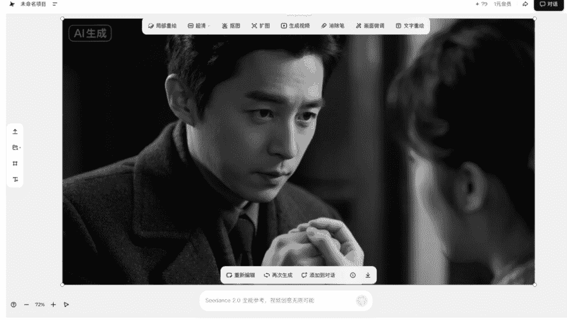

图9-1 即梦无限画布功能

图9-2 即梦优化分镜

##### 第二步：动态化生成【Seedance实操】

动态化是成片核心，把优化后的静态画面转为连贯动态镜头，贴合分镜表中的运镜、角色动作与节奏，强化动画质感，同时保证流畅自然。要严格按分镜表运镜要求操作，重点打磨动作流畅度，具体步骤如下：

- 1. 导入静态画面：点“生成视频”，导入优化后的静态分镜，按分镜表镜号顺序排列，保证镜头顺序与剧情一致，避免错乱。
- 2. 逐镜设定动态效果：结合分镜表运镜要求【固定、轻微推镜、特写聚焦等】逐镜设置动态，贴合角色动作与剧情节奏，突出情感与冲突，如图9-3所示。
示例：镜号1【男主特写】设“轻微摇镜+动态模糊”，镜头缓慢移动并加轻微模糊，突出深情对视，配合雨夜氛围。
- 3. 统一动态参数：批量设定动态速度，常规镜头1倍速，角色特写与冲突镜头【男主眼神、女主皱眉】放慢至0.8倍速，抓睛与结尾悬念镜头保持1倍速，确保节奏与单集【3秒抓睛、45秒推进、12秒悬念】匹配；过渡效果优先“淡入淡出”“切镜”，避免复杂特效导致画面杂乱，贴合漫画质感。

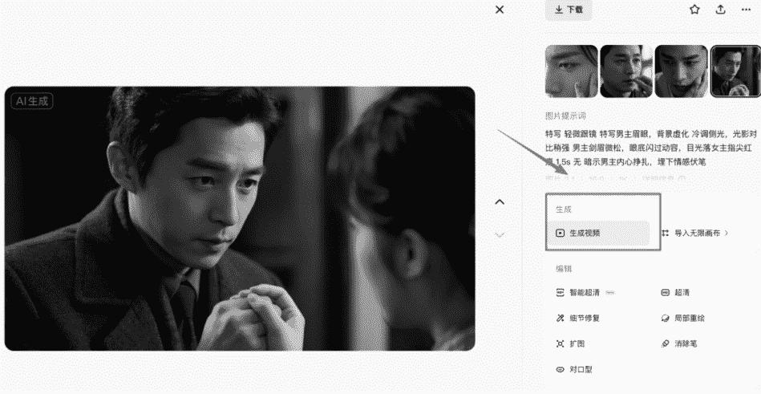

图9-3 Seedance模型使用跳转步骤

##### 第三步：镜头拼接

动态镜头导出后，用剪映拼接，核心是按分镜表镜号顺序把所有镜头无缝衔接，调整衔接节奏，保证剧情流畅连贯，贴合短漫快节奏。具体做法如下：

- 1. 新建项目并导入素材：打开剪映新建项目，导入Seedance导出的动态分镜，按“镜号+画面内容”命名拖入轨道，确保顺序与分镜表、剧情完全一致，避免错位颠倒，如图9-4所示。
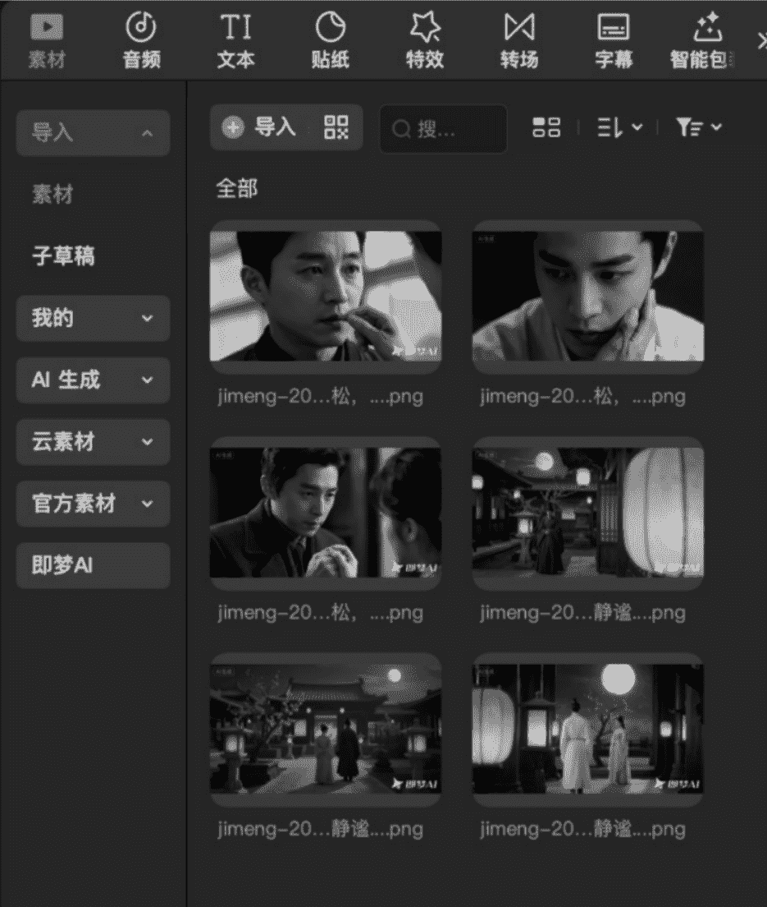

图9-4 剪映整理素材界面
- 2. 无缝衔接镜头：选中相邻两镜，点“转场”，选用适配漫剧风格的简约转场，优先“淡入淡出”“叠化”【时长0.3～0.5秒】，冲突激烈镜头【门外敲门、男主眼神变冷】可用“切镜”，不堆砌特效。检查首尾衔接处，微调时长、删余帧，确保无断层卡顿，如图9-5所示。
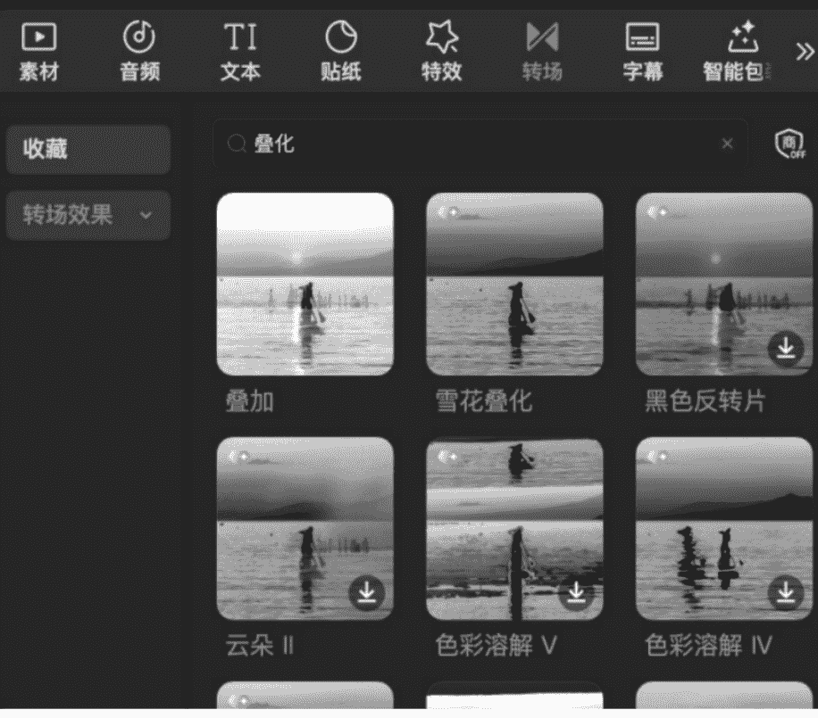

图9-5 剪映转场效果选择界面
- 3. 调整整体节奏：对照单集60秒时长要求，逐镜核对时长，微调至与分镜表标注一致。重点优化3秒抓睛、45秒推进、12秒悬念的分配，冗长的推进镜头可剪减，悬念不足可适当延长，保持张弛有度。
- 4. 初步预览拼接效果：整体预览，检查顺序、流畅度、节奏是否合理，剧情是否连贯、切换是否贴合冲突与情感变化，有问题及时调整。

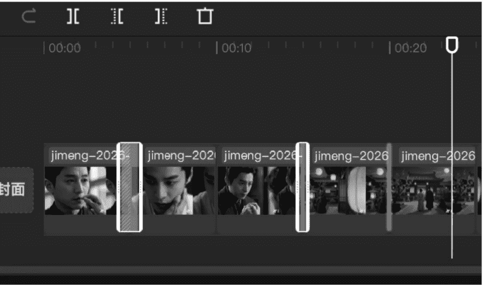

图9-6 剪映镜头调整界面

##### 第四步：音画适配

音画适配是成片关键，要配上贴合氛围与情感的背景音乐与音效，实现音画同步，强化张力与共鸣，避免音效脱节或音乐盖对话。操作要点如下：

- 1. 选择并添加背景音乐：剪映点“音频”-“背景音乐”，搜“古风温柔纯音乐”，挑节奏舒缓旋律柔和的古筝笛子曲目拖入轨道。音量设20%～25%，不盖对话与音效；平缓段落音乐放缓，紧张段落【门外敲门】可提至30%左右，结尾悬念处逐渐淡出，突出悬念感，如图9-7所示。
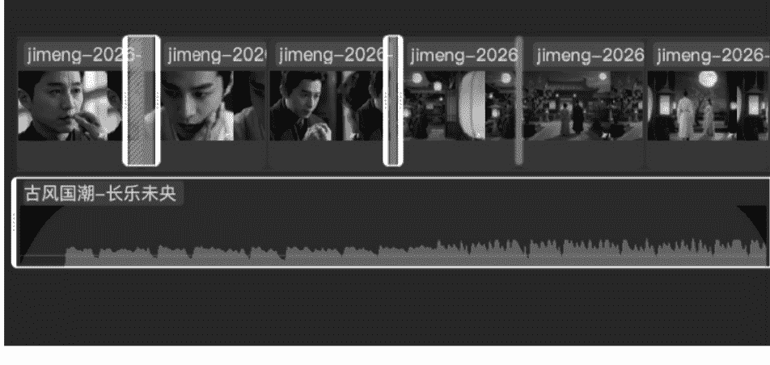

图9-7 剪映背景音乐调节界面
- 2. 添加场景音效与动作音效：按剧情细节补音效增强代入感。示例：雨夜加“轻微雨声”“脚步声”15%～20%；女主推门加“推门声”25%；包扎加“纱布摩擦”“药水倒出”20%；门外加“敲门声”“呼喊声”30%。全部拖入音频轨道并与镜头精准对齐，避免提前滞后，如图9-8所示。
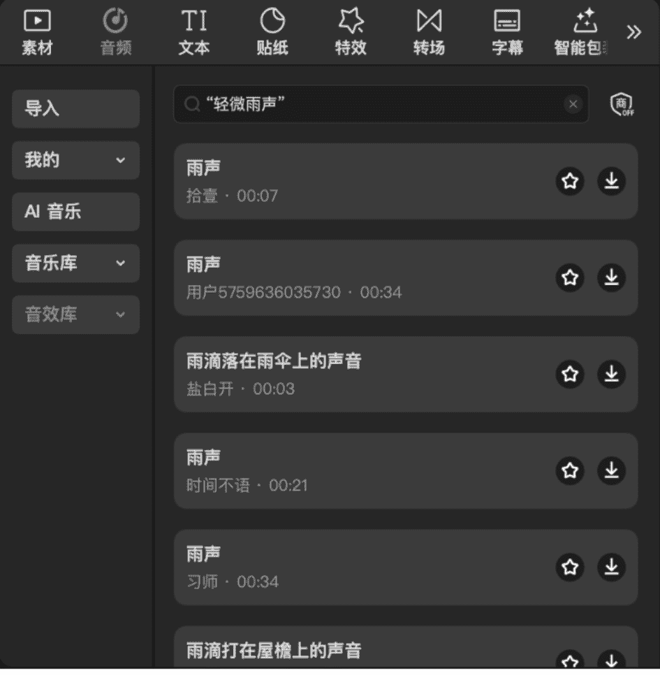

图9-8 剪映音效选择界面
- 3. 预留角色对话音频轨道：若后续配音，先新建音频轨道标注“角色对话”，预留位置，音量35%～40%，保证清晰不冲突。
- 4. 音画同步核对：逐镜预览，核对音效、音乐与画面的同步性，重点看音效是否匹配动作与场景变化，调整时长与音量，确保音画高度统一。

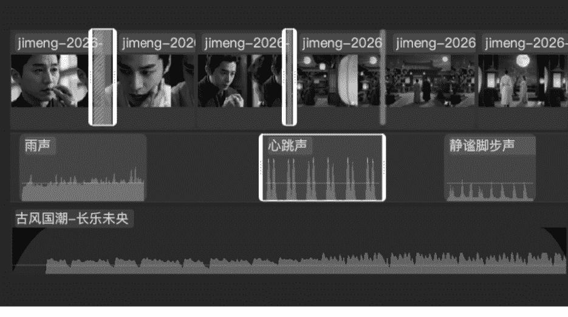

图9-9 剪映音画同步界面

##### 第五步：字幕添加

字幕是传递剧情与情感的重要载体，核心是添加对话字幕与关键提示字幕，保证清晰准确简洁，适配视觉风格。具体步骤：

- 1. 生成并优化对话字幕：剪映“文本”-“自动字幕”，或导入配音音频手动输入，自动生成后逐句校对错别字与通顺度，确保与台词一致，如图9-10所示。
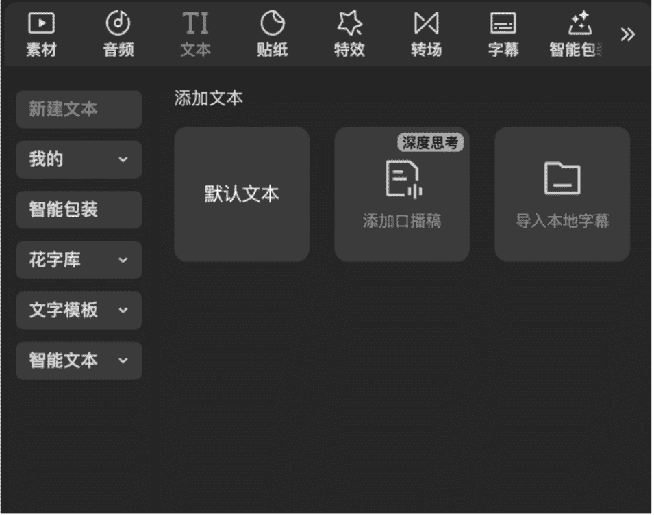

图9-10 剪映添加文本界面
- 2. 添加关键提示字幕：结合剧情重点点出冲突与共鸣，例如女主坚定回应时加“我不会丢下你的”，如图9-11所示。
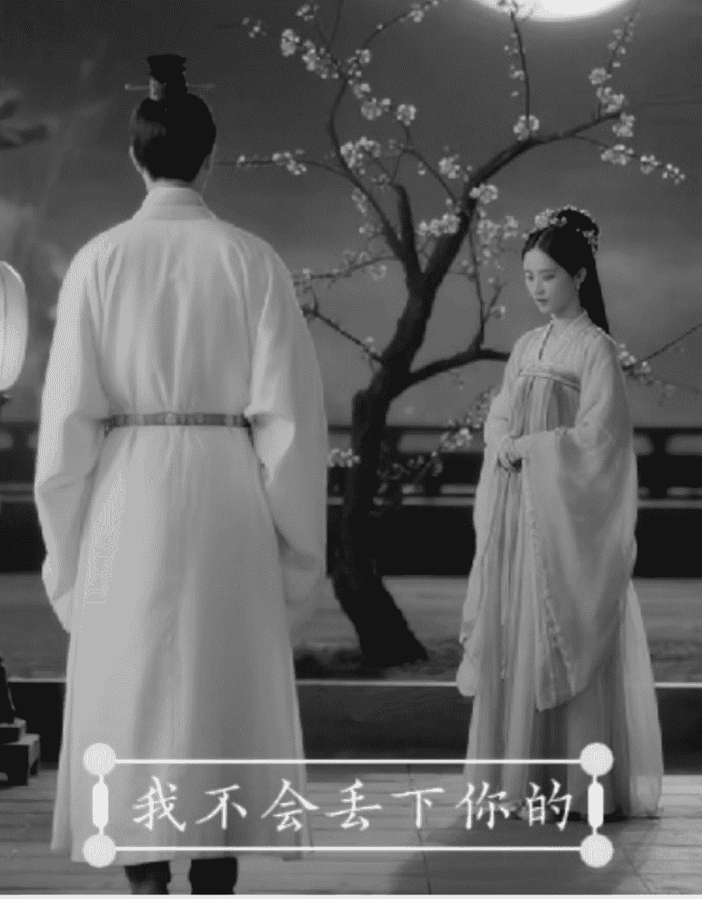

图9-11 剪映添加字幕界面
- 3. 统一字幕格式：批量调整字体大小、行距、位置。对话字幕放在画面下方1/5，关键提示放上方1/5或中间。时长设为对话结束后延迟0.5秒消失，保证可读性。避免字幕堆砌，保持简洁。设置入场出场方式，如图9-12所示。
- 4. 字幕核对预览：整体预览，检查准确性、清晰度、格式统一性及与画面音频的同步，避免遮挡角色、字体违和、同步偏差。

##### 第六步：细节优化

细节优化提升成片质量，核心是统一色调、强化重点、修复瑕疵，保证贴合IP定位、视觉统一、剧情清晰。具体做法：

- 1. 统一画面色调：剪映“滤镜”选用贴合古风言情的“古风”“丹青”等，强度30%～40%，批量应用全片。逐镜微调亮度对比度，解决偏暗偏亮问题，保证角色细节清晰，避免色差失真，如图9-13所示。
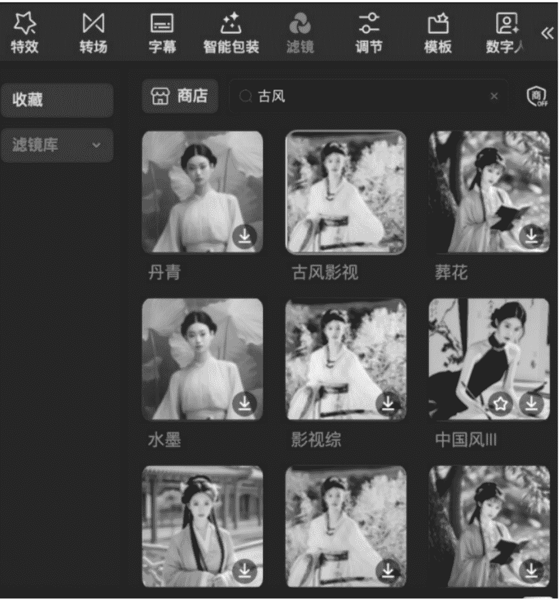

图9-13 剪映古风滤镜选择界面
- 2. 强化剧情重点：针对核心冲突与情感共鸣点【女主包扎、男主眼神变化、敲门声】，用剪映“特效”做轻度强化，特写加“轻微柔焦”突显微表情，紧张镜头加“轻微震动”“边缘模糊”增强氛围，强度控制在20%～30%，避免过度花哨，如图9-14所示。
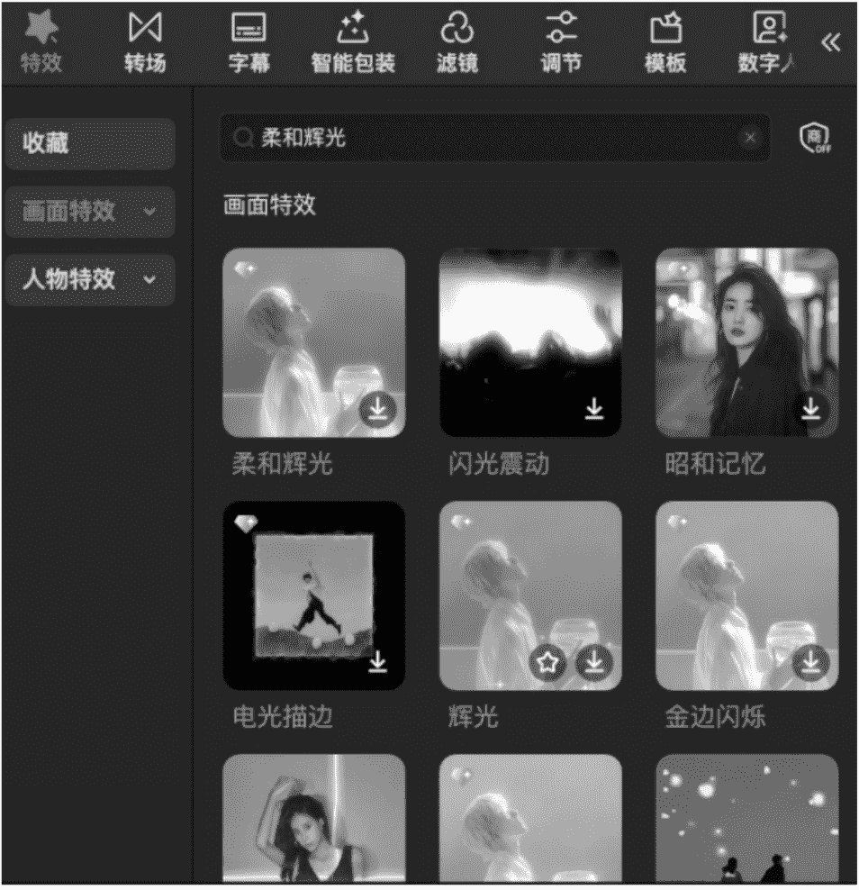

图9-14 剪映特效选择界面
- 3. 修复剪辑瑕疵：逐镜检查，修复衔接突兀、画面卡顿、音频杂音、字幕错位。若有杂音用“降噪”处理，卡顿删余帧调速，确保成片流畅。
- 4. 适配IP定位细节：画面角落可加小型Logo，字体简洁颜色柔和不遮挡；结尾加“未完待续”文字，字体与字幕一致，贴合古风，引导追更。

##### 第七步：导出成片

导出是最后一步，需设置精准参数保证清晰度与平台适配，同时保存工程文件便于后续修改，如图9-15所示。

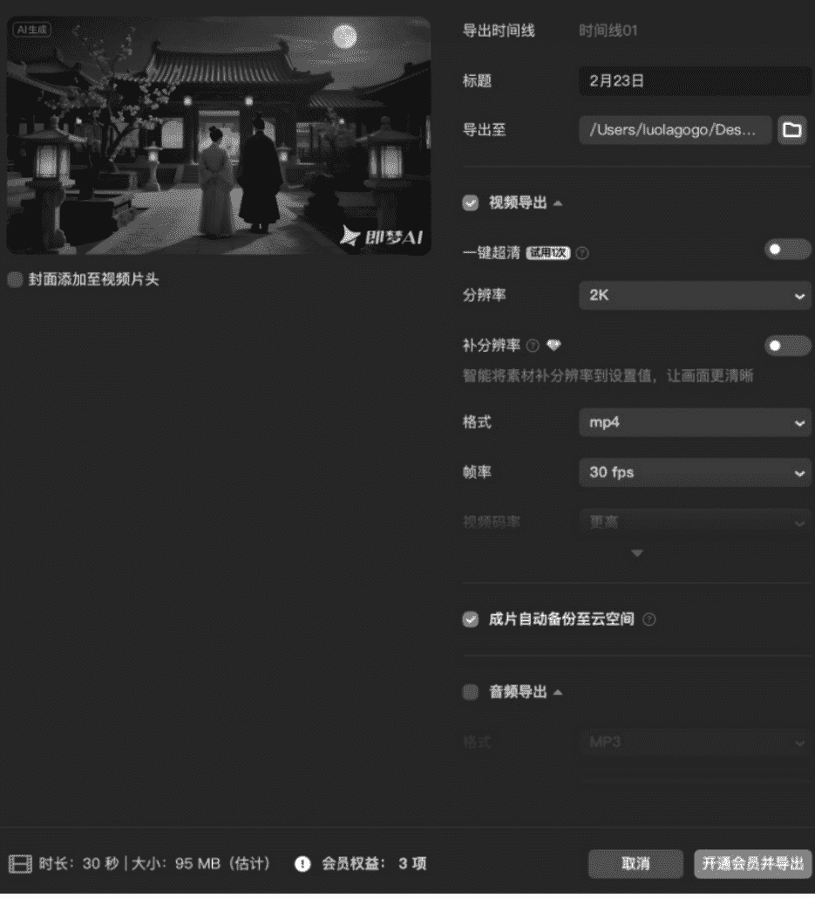

图9-15 剪映画面导出界面

#### 9.3.3 漫剧视频成片实操的注意事项

动态效果要贴合剧情与角色，避免过度炫技。Seedance设置时必须遵循分镜表运镜要求，以流畅自然突出剧情为核心，避免堆砌复杂特效【快速旋转、夸张缩放】，否则喧宾夺主。角色动态要符合人设，软萌医女动作轻柔缓慢，高冷角色利落沉稳，确保动态与性格氛围匹配。

音画同步要精准，音量比例要协调。剪映适配时确保音效与画面精准同步，避免提前滞后或音乐盖对话。音量比例应为对话>音效>背景音乐，保证对话清晰，音效音乐贴合氛围且不干扰。避免音效过多导致杂乱。

## 第10章 人物剧情短视频制作实操

### 10.1 创意构思：人物设定与剧情设计

人物剧情短视频的创意是内容的灵魂，直接决定辨识度与代入感。区别于漫剧的IP角色塑造，人物剧情短视频的人物更贴近现实或轻架空，剧情追求短平快的冲突与反转，适配短视频观看节奏。本节从工具协同优势、分步实操方法、避坑要点三方面详解人物设定与剧情设计的核心逻辑，确保创意落地、贴合平台。

#### 10.1.1 用豆包做人物设定与剧情设计的优势

豆包能按创作者需求提炼人物的身份、性格、核心反差、行为标签，避免同质化，同时把抽象性格转化为具象言行与动作细节，让人物更立体，例如把“内向社恐职场新人”拆解为“说话轻声、开会坐角落、递文件会低头”的具体行为，便于追踪。

#### 10.1.2 人物设定与剧情设计的实操步骤

##### 第一步：明确创作定位，划定构思边界

构思前先明确核心定位，为人物与剧情划清边界，避免偏离。需梳理三项信息：内容赛道【都市职场、古风情感、市井生活、悬疑短篇等】、目标受众【18～25岁职场新人、20～30岁古风爱好者、全年龄治愈系观众等】、制作形式【真人拍摄、AI生成人物画面、真人+AI结合】，并确定短视频核心时长【30秒/60秒，主流30秒】。可整理后输入豆包作为构思基础，示例：> “我要创作30秒的都市职场赛道人物剧情短视频，目标受众是18～25岁的职场新人，制作形式为AI生成人物画面，帮我围绕这个定位构思人物与剧情，要求贴合受众痛点、有辨识度、适配AI生成。”

###### 30秒职场新人AI短剧全案打法

定位：18~25岁职场新人｜AI作画角色｜强共鸣 快节奏 易出片
核心痛点：入职手足无措、惧怕犯错、存在感低、自我怀疑、渴望被肯定
人物设定：极简好辨识，AI上手门槛低

####### 一、全片通用的AI友好主角

主角：小星，22岁应届萌新
视觉：齐肩黑发、淡妆、白底衬衣配浅灰西装裤，零繁复饰品
……

##### 第二步：用豆包拆解高辨识人设内核

以第一步定位为底，用豆包把人物拆到可执行。核心是用3个关键词+1处反差+可感知的行为细节来成型，避免空泛。短视频篇幅有限，主角只放一个，若需配角最多保留一个极简存在，用来烘托主角、推剧情，不加人设负担。实操可让豆包输出完整设定，例如都市职场方向，可输入：

请为都市职场赛道设计一个AI作画面的一号角色，单女主，入职一个月的新媒体运营新人，气质是内向社恐但文字功底扎实，要求提炼三个关键词、一处反差，并细化言行、动作、神态的具象细节，贴合18~25岁新人焦虑，形象有记忆点，同时给出适配即梦的视觉关键词。

豆包输出样例：

###### 都市职场新媒体新人设定

核心关键词：内向社恐、文字敏感、慢热坚韧
核心反差：线下交流磕磕巴巴，线上写文案条理清晰气场在线

####### 具象细节：
言行：跟同事沟通时低头、捏衣角、声线发颤；工作消息回复简练精准；开会爱坐角落，被点名会下意识攥笔，聊到文案会慢慢抬头，眼神变坚定
……

##### 第三步：依托人设用豆包搭紧凑剧情

人设确定后，围绕特质、反差、受众痛点来搭故事，严格卡短视频黄金节奏。30秒按“5秒钩子—15秒主冲突—7秒急转—3秒收束/悬念”分配；60秒按“8秒钩子—30秒冲突—12秒转折—10秒收尾/悬念”分配，保证紧凑、有冲突、有反转，细节必须服从人设。实操可把人设上传豆包，输入：

基于已搭建的都市职场新媒体新人设定，内向社恐、文字强，线下结巴线上在线，请创作30秒剧情框架，AI作画面，按5秒开场钩子—15秒主冲突—7秒快速转折—3秒结尾分配，贴合18~25岁职场新人痛点，有冲突反转与情绪共鸣，并补充具体言行动作，方便后续分镜，避免复杂场景。

豆包输出样例：

###### 30秒职场剧情框架 社恐新媒体新人

5秒钩子 画面+言行：办公场景，主管走到工位旁指着屏幕说话，女主低头、捏衣角、眼神躲闪，支吾“我…我马上改”，主管皱眉，镜头聚焦局促感与不满；
15秒主冲突 画面+言行：女主回工位面对修改意见，眼眶泛红，手指发颤拿笔，同事路过小声说“她是不是做不好”，女主更埋头，随后盯着屏幕眼神从怯到专注，手指飞快敲键盘，画面切手部特写与同事质疑
……

#### 10.1.3 人设与剧情打磨要点

标签别堆，聚焦1~2个核心特质。短视频时长短，标签过多会模糊，观众记不住。比如别同时写社恐、活泼、温柔、果断，只保留社恐+专业强的核心反差，其余作点缀；可让豆包“提炼核心特质、删冗余标签、留一个反差”。

细节别抽象，要落地为可拍动作。抽象描述撑不起镜头，比如不能只写内向社恐，要拆成低头、捏衣角、说话结巴等可见行为，让性格靠动作呈现。

### 10.2 脚本与分镜：强化角色镜头表达

创意是灵魂，脚本分镜是骨架，连接创意与成片。与漫改不同，人物剧情脚本更看重台词精简与行为贴合，分镜更看重镜头语言简洁与表情特写，核心是让性格与冲突直观。

#### 10.2.1 豆包+即梦做脚本分镜的价值

豆包可把剧情框架转成含序号、时长、场景、动作微表情、台词/旁白、音效的标准化表格脚本，避免逻辑乱，并补充微动作。豆包据此可生成含镜号、景别、运镜、画面描述、呈现重点的分镜表，结合即梦特性优化描述，把抽象镜头语言转为即梦可识别的精准提示，普通创作者也能完成可视化分镜。

#### 10.2.2 脚本与分镜实操流程

##### 第一步：用豆包写标准化表格脚本

标准化脚本是分镜基础，采用表格结构清晰。要素包括序号、时长、场景、角色动作/微表情、台词/旁白、音效/背景音乐，其中动作微表情是重点，需贴合人设；台词精练，30秒总字数控制50字内。提示词示例：

基于30秒都市职场社恐新媒体新人的剧情框架与人设，撰写标准化表格脚本，AI作画面，含序号、时长、场景、动作/微表情、台词/旁白、音效/背景音乐，动作贴合内向社恐、专业坚韧，台词简洁，音效贴合氛围，适配即梦，避免复杂场景。

豆包输出如表10-1所示。

**表10-1 标准化表格脚本 30秒职场**

| 序号 | 时长 | 场景 | 角色动作/微表情 | 台词/旁白 | 音效/背景音乐 |
|:---:|:---:|:---|:---|:---|:---:|
| 1 | 0~5秒 | 简约办公室，主角工位 | 主角低头捏衣角目光躲闪手指颤抖下唇轻咬；主管眉头紧锁目光看屏身体微侧 | 主管：这文案不行，立刻重改！主角：我…我马上改，声音发颤 | 紧张钢琴单音，键盘声、翻纸声 |
| 2 | 5~20秒 | 主角工位，同事路过 | 主角坐下眼眶泛红攥笔轻敲桌面，见同事经过更低头；随后凝视屏幕眼神由怯转专注，手指快速敲击；同事侧目小声议论 | 同事小声：她新媒体是不是搞不定？主角无台词 | 音乐节奏加快，敲键盘声由慢变快，议论声 |
……

##### 第二步：基于脚本用豆包设计可视化分镜表

脚本完成后拆分镜。要素包括镜号、景别、运镜、画面构图、光影、画面描述、时长、对应脚本序号、核心呈现重点，其中呈现重点要明确本镜要突出的特质或冲突。提示词示例：

基于上述标准化表格脚本，设计可视化分镜表，AI作画面，含镜号、景别、运镜、画面构图、光影、画面描述、时长、对应脚本序号、核心呈现重点，景别以近景特写为主，运镜简洁，描述适配即梦，色调都市冷调白灰淡蓝，线条利落。

豆包输出如表10-2所示。

**表10-2 可视化分镜表 30秒职场 AI作画**

| 镜号 | 景别 | 运镜 | 画面构图 | 光影 | 画面描述 | 时长 | 对应脚本序号 | 核心呈现重点 |
|:---:|:---:|:---:|:---|:---|:---|:---:|:---:|:---|
| 1 | 中景 | 固定 | 三分构图，主角左、主管右，桌面留白 | 冷调柔光均匀，面部清晰 | 现代简约办公室，主角浅白衬衫黑框眼镜坐工位前，面前笔记本电脑，主管右侧站立身体微侧眉头皱 | 2秒 | 1 | 交代关系，铺垫紧张 |
续表
| 镜号 | 景别 | 运镜 | 画面构图 | 光影 | 画面描述 | 时长 | 对应脚本序号 | 核心呈现重点 |
|:---:|:---:|:---:|:---:|:---:|:---|:---:|:---:|:---|
| 2 | 近景 | 轻微推镜 | 聚焦点部 | 冷调侧光突出怯意 | 主角低头揪衣角目光闪躲下唇微咬眼眶微红手指颤抖 | 3秒 | 1 | 突出社恐与紧张，强化人设 |
……

##### 第三步：结合即梦特性优化画面描述

分镜生成后需按即梦特性优化描述，保证可生成。原则是细节具体、风格统一、去模糊，补充风格关键词、基调、分辨率、画幅，如“漫改风格，都市简约，高清2K，9:16纵向，线条利落，色彩冷调，无杂物”，并把“表情生动”转为“目光躲闪、下唇微咬、手指颤抖”等具体信息。可批量优化，提示词：

优化上述分镜表画面描述，适配即梦AI作画特性，补充视觉关键词、风格基调、分辨率2K、画幅9:16纵向，细节具体风格统一都市简约线条利落色彩冷调，删除抽象表述，突出微表情微动作。

##### 第四步：用即梦预览镜头效果并微调

优化后用即梦选取核心镜头生成预览图，检验视觉与角色表达是否贴合。若不符，可借助豆包微调描述，调整动作、场景细节、光影，直至达标。

#### 10.2.3 脚本与分镜注意事项

台词别冗长，微表情微动作优先。人物剧情短视频核心是视觉而非台词叙述，台词过多拖节奏。遵循能用动作表达就不说的原则，如社恐紧张用揪衣角、目光躲闪、手指发抖表现，不说“我好紧张”。

分镜别过多，节奏要精准。分镜太多切换过快观众抓不住细节，太少则拖沓。30秒控制8~10个镜头，60秒15~18个，冲突场景时长2~3秒，情感升华可延长到3~4秒。

景别别单一，特写强化核心表达。单一景别易视觉疲劳，需近景+特写+中景结合，特写占比不低于40%，重点表现微表情、微动作。

### 10.3 成片实操：人物剧情短视频生成流程

成片是创意与分镜落地的关键。与漫改不同，人物剧情更看重画面真实感、音画同步、节奏适配，核心是把AI作画镜头素材通过剪映、Seedance等工具完成整理、剪辑、适配、优化、导出。

#### 10.3.1 剪映+Seedance+即梦的价值

传统成片易出现剪辑效率低、人物平淡、音画不同步、节奏乱。新手剪辑技巧不足导致逻辑乱；过度特效忽略人物核心；音画不同步、字幕乱、色调不统一影响体验。剪映界面简洁功能全；Seedance可把即梦静态分镜转为动态镜头；即梦可批量统一画面风格，实现一人全流程。

#### 10.3.2 成片实操步骤

##### 第一步：素材准备与分类

核心是分类清晰、筛选优质，确保贴合脚本分镜并突出人设。将分镜表优化后的画面描述批量输入即梦生成静态镜头。以镜号1为例，输入：

中景固定视角三分构图，主角居左主管居右桌面留白，冷调柔光均匀打光面部清晰，现代简约办公室，主角浅白衬衫黑框眼镜坐工位前面前笔记本电脑，主管右侧站立身体微侧眉头微皱，氛围紧张，画面细腻写实风格

即梦生成分镜图片，如图10-1所示。

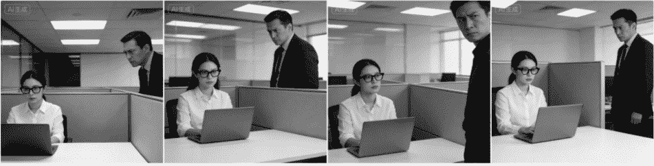

图10-1 分镜图片

##### 第二步：生成分镜视频

整理素材后依次用Seedance生成动态视频。以镜号1为例，输入提示词，如图10-2所示。

图10-2 动态视频生成提示词

发送后Seedance生成分镜动态视频，如图10-3所示。

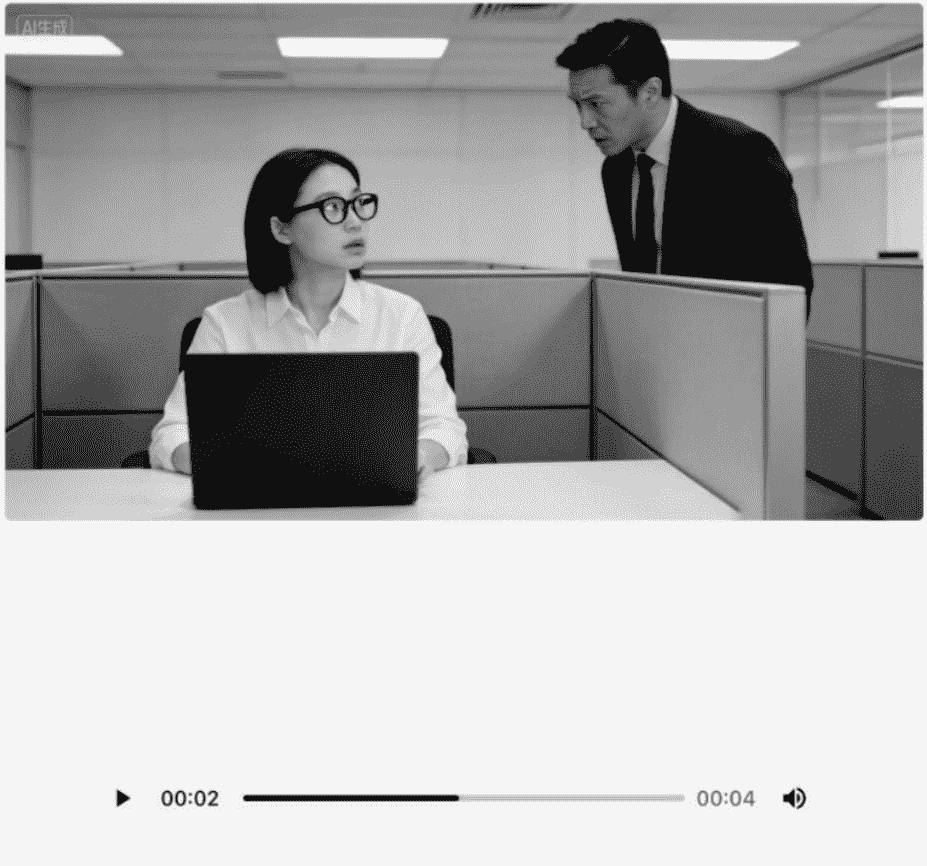

图10-3 分镜视频

按镜号顺序保存所有动态素材至文件夹，便于调用。

##### 第三步：剪辑拼接还原剧情逻辑

核心是按分镜表顺序拼接素材、调整时长，还原剧情逻辑并突出情绪变化。

打开剪映新建项目，按顺序导入素材拖入时间轴，确保顺序与脚本一致，如图10-4所示。

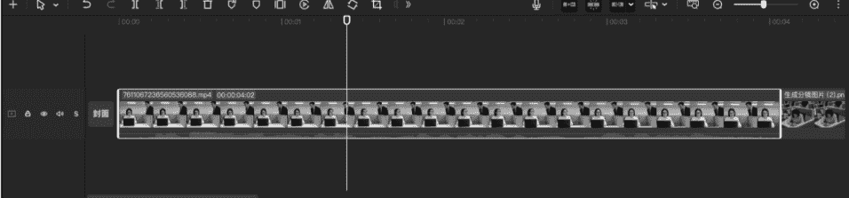

图10-4 时间轴

素材间添加转场，如图10-5所示。

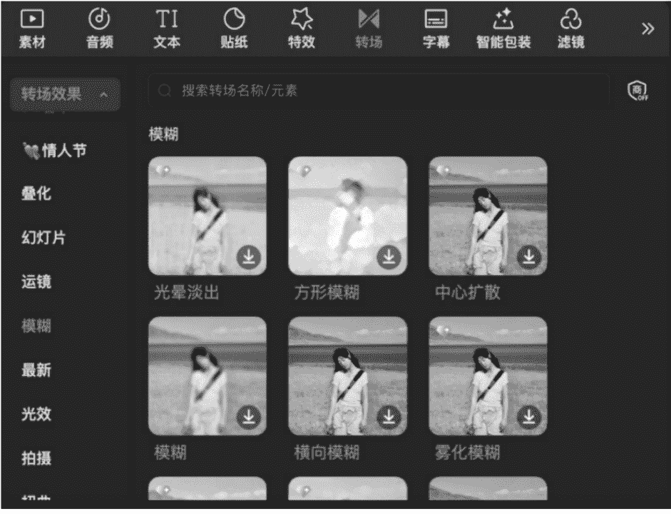

图10-5 转场效果

优先选用淡入淡出、叠化等柔和转场，避免花哨旋转闪屏分散注意力。剧情转折处可加轻微转场强化情绪。

##### 第四步：音画适配强化氛围

音画需同步，音效背景音乐贴合剧情。Seedance生成片段时同步生成台词配音，通过剪映为整体选择背景音乐：点音频进入音乐库和音效库，可选纯音乐、热门、卡点，如图10-6所示。

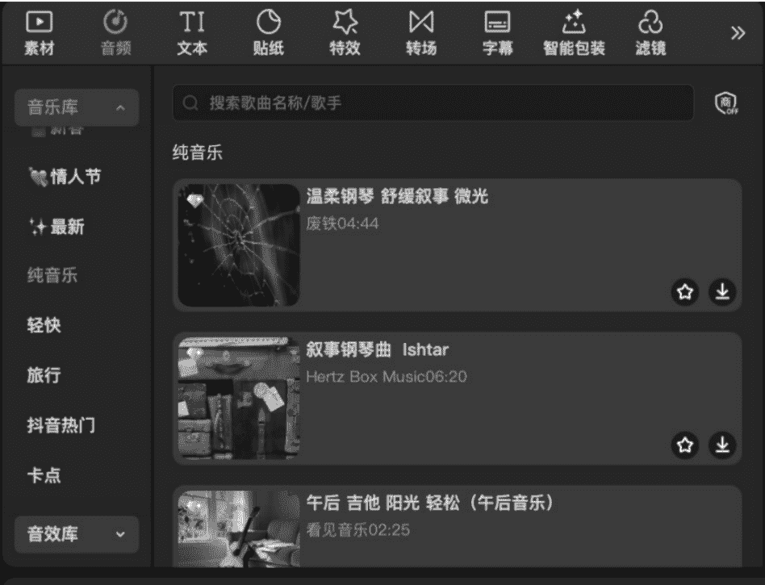

图10-6 音乐库

拖拽音乐到时间轴，如图10-7所示。

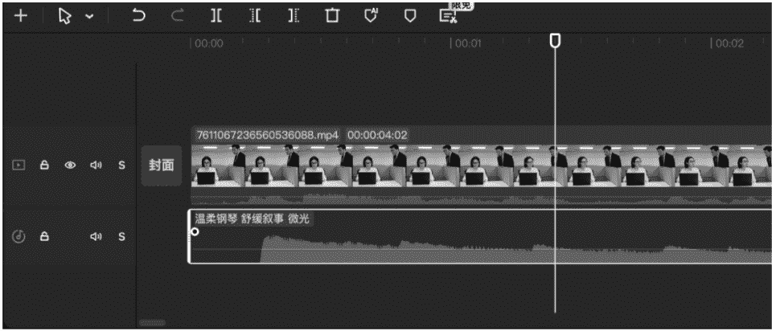

图10-7 添加背景音乐

为避免音乐盖住台词，在右上角调节音量，如图10-8所示。

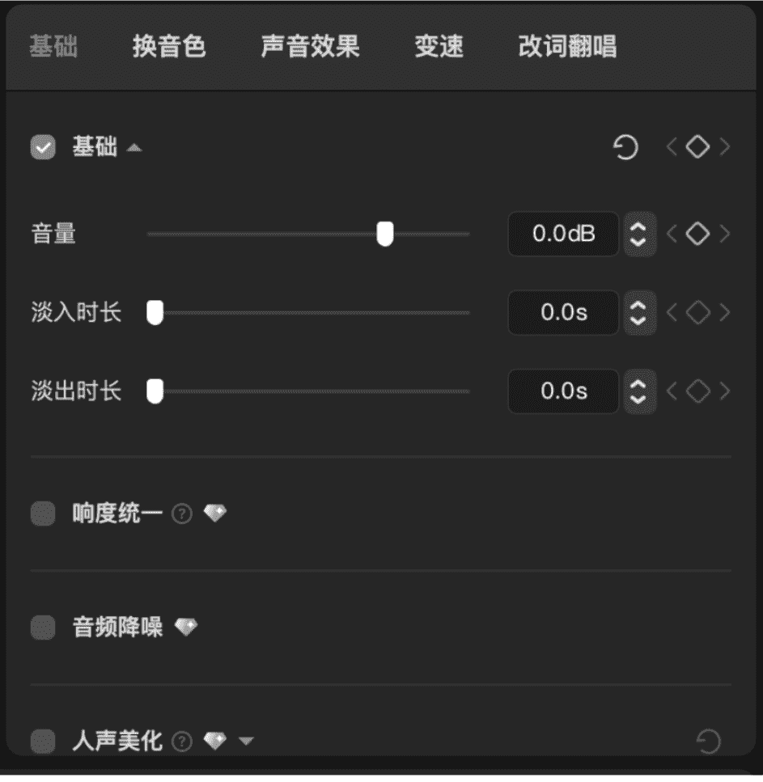

图10-8 音量调节

##### 第五步：细节优化导出检查确保适配平台

在预览区检查剪辑效果，如图10-9所示。需调整时优化细节，确认无误后导出。

图10-9 视频全片预览

导出后再次预览，检查画质、音画同步、字幕等问题，有问题返回剪映调整，确认后保存发布。

#### 10.3.3 成片实操注意事项

**素材整理要讲秩序，统一镜号命名效率最高。** 素材堆砌随意，剪辑时找素材就会耗费大量时间，还容易出现顺序错位、剧情断裂。实操建议严格按镜号顺序命名文件，分文件夹归档，同时挑选可用片段，剔除重复、模糊、低质镜头，保证留存素材的可用性。

**点缀元素宜克制，别让画面喧宾夺主。** 文字、边框、特效过度堆叠，会把观众视线从人物和故事线拉走，画面华丽却空洞。操作时应守住克制，以人物特质和核心剧情为中心，保持简洁大气的质感，不必追求花哨。

**导出参数需合规，匹配平台规范。** 参数设置失误会导致成片模糊、清晰度下降，甚至无法上架。入门阶段可先用剪映自带高清预设，再按平台微调分辨率，抖音/快手建议1080P，小红书建议720P，导出后必须二次复核，避免瑕疵流出。

# 第五部分 商业客户项目实操

## 第11章 商业广告视频制作实操

### 11.1 创意构思：广告视觉表达设计

短视频广告创意落地的要点是调和品牌诉求和用户偏好。核心任务是厘清广告主推卖点、目标人群画像与传播场景，把品牌信息和产品优势自然融入有吸引力的内容里，完成润物无声的传递。相较于普通短视频或真人短剧，广告创意还需额外兼顾转化导向，每个细节都要服务于提升关注度、激发行动意愿，比如引导下单、进店、下载等。

结合豆包做创意推演与需求拆解，配合即梦做视觉化验证，能快速解决创意生硬、卖点不清、用户不买单的痛点。豆包可拆解品牌诉求、提炼核心卖点并匹配人群偏好，即梦能把文字创意快速转为初步视觉，检验吸引力和植入自然度，确保创意既贴合品牌，又符合短视频传播规律，同时适配Seedance后续动态生成，大幅降低构思成本与周期。

#### 11.1.1 利用 豆包+即梦 进行广告创意构思的优势

豆包可快速接收品牌定位、产品功能、核心优势、变现目标等资料，梳理出用户真正关心的卖点，避免卖点堆砌。同时结合目标人群偏好，例如美妆用户关注成分与效果、餐饮用户看重性价比与口感，优化卖点呈现策略，让创意更贴近受众需求。

#### 11.1.2 广告创意构思的核心步骤

**第一步，明确主要诉求，梳理品牌与产品信息**

创意起步的前提是把广告主要诉求与关键信息理清，这是后续环节的基础。创作者需先盘点品牌与产品的核心要素，如品牌定位、功能点、核心优势、价格带、变现目标，例如美妆带货要引导下单、餐饮引流要引导到店、App推广要引导下载，以及目标人群的年龄、性别、消费偏好、痛点。实操中可用豆包输入相关资料，获取精准的需求拆解和信息提炼，下面以三个典型场景为例。

**场景1：美妆带货** 平价粉底液，目标18-25岁学生党和化妆新手，诉求是促进下单，主打持妆、控油、平价、易推开。提示要点为拆解广告关键信息，围绕平价美妆定位、引导购买诉求、持妆6小时以上、控油不脱妆、59.9元/瓶、新手易推不卡粉等卖点，提炼用户痛点如出油脱妆、新手卡粉、预算有限，明确卖点优先级和创意方向，贴合美妆测评赛道，避免硬广感。

豆包示例输出：
59.9元控油底妆：新手抗油稳妆神器
一、核心痛点
场景痛点：通勤上课易出油斑驳，口罩摩擦留印
技能痛点：新手上妆卡粉浮粉，边缘明显
预算痛点：学生预算有限，拒绝贵价试错
……

**场景2：本地餐饮引流** 同城火锅店，目标20-35岁同城青年聚餐群体，诉求是到店消费，优势是99元双人餐、鲜切牛肉、免费甜品、同城3公里配送。提示要点为拆解同城火锅广告关键信息，围绕平价火锅定位、引导到店诉求、99元双人餐含锅底+4荤2素、现切牛肉、免费续甜品、免费配送等优势，提炼痛点如聚餐性价比低、食材不新鲜、甜品收费，明确创意导向，融入同城话题和场景化建议。

豆包示例输出：
###### 同城平价火锅·广告创意核心拆解（短视频同城引流版）
####### 一、核心痛点
- 聚餐人均高、性价比弱
- 食材不新鲜、充斥合成肉
- 甜品单点贵、无法畅吃
####### 二、创意核心导向
主打同城青年高性价比聚餐，以超值双人餐+鲜切肉+免费甜品+同城配送形成强刺激，导向到店或下单。
……

**场景3：APP推广** 办公类App，目标25-40岁职场人，诉求是下载注册，功能为免费使用、多设备同步、语音转文字准确率98%以上、快速编辑文档。提示要点为拆解办公App广告关键信息，围绕高效办公工具定位、引导下载诉求、免费、多设备同步、语音转文字、快速编辑等功能，提炼痛点如效率低、转文字耗时、同步麻烦，明确创意导向，贴合职场干货赛道，用场景演示功能。

豆包示例输出：
###### 创意拆解：打造高效办公新体验
给你一份简洁框架：
####### 核心创意主题
> “解放双手，让办公流动起来”
—主打效率翻倍与全场景自由，直击职场人怕耗时、怕麻烦、怕落后的焦虑。
####### 核心痛点直击（3秒抓人）
语音转文字慢：会议记录、口述文案，手速跟不上嘴速，准确率低需返工。
……

**第二步，匹配短视频赛道，细化内容和植入手法**

关键信息明确后，要借助豆包结合高频赛道如测评、场景种草、剧情引流、干货分享来细化内容，确定形式和植入手法，原则是广告原生化、植入自然化，避免硬堆产品信息。不同场景适配不同赛道，例如美妆带货适合测评，餐饮引流适合同城场景，App推广适合干货演示。

以美妆带货为例的细化提示要点为：基于平价粉底液关键信息，细化创意内容和植入方式，适配美妆测评赛道，形式为“新手实测”，时长30-60秒，植入自然，突出控油持妆与易推开，融入夏天出油脱妆、新手卡粉等痛点场景，明确开头抓睛、中间实测演示、结尾引导下单的结构，契合快节奏和即梦+Seedance生成需求。

豆包示例输出：
###### 平价粉底液·新手实测短视频创意（30～60秒|适配即梦+Seedance）
####### 一、核心信息
- 卖点：控油持妆、新手易推开
- 痛点：夏天出油脱妆、新手卡粉
- 风格：真实新手实测、快节奏、无广告感、强视觉对比
####### 二、3秒抓睛开头
画面：近脸特写—半边脸出油斑驳/卡粉，半边脸干净哑光
口播（快）：夏天一化妆就花了？新手一上脸就卡粉？
####### 三、中间实测演示（主体20～40秒）
上手展示
指尖取粉底，顺滑推开有拉丝感，特写无结块
口播：平价却好推，新手不翻车
上脸实测
……
豆包给出细化内容并明确植入方式，以实测为主自然带出卖点，不刻意夸大，贴合观看习惯。

#### 11.1.3 广告创意构思的注意事项

**要素完整，表述精确无歧义：** 用豆包梳理创意、撰写提示词时，需把品牌诉求、关键卖点、目标人群、视觉风格、时长、变现导向等关键要素全部写清，避免模糊。例如要明确“同城火锅店广告，30-60秒，暖色烟火气风格，卖点99元双人餐、鲜切牛肉，导向同城到店”，而不是笼统说“火锅广告时长适中画面温暖”。目标人群也要具体到“18-25岁学生党，痛点新手卡粉、预算有限”，避免“年轻、有护肤需求”这类泛化描述，确保AI精准理解需求。

**植入自然，杜绝生硬堆砌：** 广告创意要避免重产品轻内容的误区，借助豆包优化植入方式，让卖点和品牌信息自然融入内容，而非硬塞。

### 11.2 脚本与分镜设计：广告转化结构设计

用豆包辅助脚本撰写，配合即梦与Seedance的人工智能生成属性做分镜设计，能让脚本与分镜更高效、更贴合实操和转化目标，降低专业门槛，保证素材生成、动态化、剪辑环节顺畅，避免脚本与创意脱节，确保每个镜头都在传递卖点并引导转化。

#### 11.2.1 利用 豆包+即梦+Seedance 辅助广告脚本与分镜设计的优势

脚本阶段豆包可快速完成创意细化、镜头拆解、人物动作与台词语境设计，同时控制卖点传递与节奏，保证逻辑连贯、台词简洁、转化清晰，缩短前期时间。同时可结合人工智能生成限制优化细节，避免不符合即梦与Seedance要求的内容，确保可落地。

#### 11.2.2 广告脚本设计的核心步骤

以下以11.1中的美妆带货场景为例，平价粉底液60秒广告，其他场景可参照此逻辑。

**第一步，梳理创意与节奏节点，明确脚本设计依据**

脚本要基于创意，先用豆包全面梳理关键信息与节奏节点，为镜头拆解提供依据。主要包括广告总时长、主要诉求、关键卖点、节奏节点如开场3秒吸睛、中间卖点传递、结尾转化引导、人物设定、植入方式与音效导向，确保脚本不偏离创意与变现目标。

本案例总时长60秒，诉求引导下单，卖点持妆6小时以上、控油不脱妆、59.9元/瓶、新手易推不卡粉，节奏按“开场3秒吸睛-45秒卖点传递-12秒转化引导”分配，人物为20岁左右化妆新手，植入方式为实测演示，音效清新轻快，强调真实感，这是后续拆解的关键依据。

**第二步，借助 豆包，拆解镜头维度并生成模板化脚本表**

在梳理信息的基础上，结合创意内容与植入方式，用豆包把广告拆成独立镜头，每个镜头明确镜号、景别、画面内容、时长、人物动作、台词、音效、卖点传递重点，确保和创意、品牌诉求精准匹配，同时符合人工智能生成与短视频快节奏特点。

可上传创意框架，输入提示词快速生成规范化脚本表，例如：
为美妆带货短视频广告设计规范脚本，总时长60秒，主推平价粉底液59.9元/瓶，目标18-25岁学生党和化妆新手，诉求引导下单，卖点持妆6小时、控油不脱妆、新手易推不卡粉，创意为新手实测，植入自然，节奏3秒抓睛、45秒卖点传递、12秒转化引导，视觉清新自然、高饱和暖色。请拆解镜头，生成含镜号、景别、画面内容、时长、人物动作、台词、音效、卖点传递重点的模板脚本表，节奏与诉求同步，适配即梦+Seedance，人物台词贴合新手人设，结尾转化明确。

豆包会输出规范化脚本表，清晰呈现各镜头信息并优化台词与动作，卖点传递精准，如表11-1所示。

**表11-1 美妆带货类短视频广告设计标准化脚本**

| 镜号 | 景别 | 画面内容 | 时长 | 人物动作 | 台词 | 音效 | 卖点传递重点 |
|:---:|:---:|---|:---:|---|---|:---:|---|
| 1 | 近景 | 新手女生对镜无奈擦拭脱妆底妆 | 3s | 眉头微皱，用纸巾擦拭脸颊，露出斑驳底妆，眼神无奈 | 女生（吐槽）：夏天化妆也太容易脱妆了吧！ | 轻快背景音、纸巾摩擦声 | 引发痛点共鸣，铺垫产品出场 |
| 2 | 特写 | 女生展示平价粉底液瓶身 | 5s | 手持粉底液，镜头对准瓶身，轻转展示logo与价格标签59.9元 | 女生：直到我挖到这款平价粉底液，新手闭眼冲！ | 背景音持续、瓶身转动声 | 产品出场，突出平价 |
| 3 | 近景 | 女生徒手挤粉底液在手上推开 | 10s | 徒手挤出少量乳液，指尖推开展示顺滑，对比推开前后皮肤 | 女生：新手不用工具徒手就能推开，一点不卡粉！ | 背景音持续、手指摩擦声 | 突出新手易推开、不卡粉 |
……

**第三步，适配AI特性，借助 豆包 优化脚本细节**

脚本生成后需结合即梦与Seedance属性做精细优化，确保可落地、易生成，同时强化卖点传递与转化引导。优化原则为简洁化、具象化、适配性、转化导向，豆包可识别不符合生成要求、卖点不清、转化弱的内容并给出优化建议。

#### 11.2.3 广告分镜设计的核心步骤

**第一步，拆分镜头单元，明确核心设计维度**

以脚本为基础，按广告节奏与顺序把每个镜头拆成独立分镜，确保精准对应脚本并传递关键卖点。分镜数量结合时长规划，常规每分钟10-15个，60秒建议10-12个，保证节奏紧凑。

每个分镜需先明确镜号、景别、镜头运动方式、画面构图、光影效果、卖点传递重点，为画面描述做准备，避免设计混乱。

**第二步，细化画面描述，适配 即梦 生成，突出卖点**

分镜核心是可视化指引+卖点传递，需撰写详细具象的画面细节描述，直接作为即梦生成静态画面的提示词。描述需覆盖主体、人物特征、动作表情、场景元素、色彩光影、风格基调、情感氛围，重点突出微表情、产品细节与卖点。

若有人物，需固定发型、服饰、神态，保证前后一致；产品展示要重点描写细节与效果。例如镜号5持妆控油实测的分镜描述可优化为：
近景，清新自然风，高饱和暖色搭配柔和柔光；16:9竖屏，高清2K，画面清晰细腻无噪点，突出肤质与产品效果；室内自然光，背景简约化妆台，摆放少量化妆工具，聚焦面部与手部；主体为20岁左右新手女生，齐肩短发，淡妆，表情自然，手持吸油纸轻按脸颊，吸油纸无明显出油，特写上妆6小时后底妆服帖自然无脱妆无斑驳，粉底质地轻薄贴合肤纹；构图居中聚焦脸颊与吸油纸，光影柔和，突出服帖与控油，适配即梦生成并清晰传递持妆、控油不脱妆卖点，贴合美妆带货场景。

Seedance 产出的广告分镜如图11-1所示。

图11-1 Seedance 生成广告分镜

**第三步，整合分镜信息，生成标准分镜表**

所有分镜拆解完成后，整合为标准化分镜表，形成统一指引，便于即梦生成、Seedance动态化与剪辑衔接。分镜表需包含镜号、景别、镜头运动、画面构图、光影效果、画面描述、时长、对应台词、卖点传递重点，按顺序整理，可借助豆包快速生成。

示例提示词：
将美妆带货短视频广告的6个镜头整理为标准化分镜表，标注镜号、景别、镜头运动、画面构图、光影效果、画面描述、时长、对应台词、卖点传递重点，画面描述贴合清新自然风、高饱和暖色风格，突出微表情、产品细节与卖点，镜头运动简洁适配即梦+Seedance，人物特征与脚本一致，台词对应，时长匹配，贴合美妆广告变现导向，确保每个分镜清晰传递关键卖点。

豆包按指令生成内容如表11-2所示。

**表11-2 美妆带货类短视频广告标准化分镜表**

| 镜号 | 景别 | 镜头运动 | 画面构图 | 光影效果 | 画面描述 | 时长 | 对应台词 | 卖点传递重点 |
|:---:|:---:|:---|:---|:---|:---|:---:|:---|:---|
| 1 | 近景 | 固定镜头，轻微对焦 | 中心构图，人物面部占2/3，背景虚化 | 高饱和暖色，柔光漫射，面部无阴影，肤色通透，背景微光点缀 | 女主面带轻柔微笑，眼神柔和看镜头，肌肤通透细腻，脸颊带自然红晕，背景浅米色简约布景，点缀浅粉干花，画面清新柔和，镜头轻微对焦肌肤突出质感 | 3s | （温柔语气）秋冬底妆卡粉浮粉？快看我的伪素颜秘密！ | 引发痛点共鸣，暗示产品可解决卡粉浮粉，吸引关注 |

| 2 | 轻微特写 | 匀速前推，适配AI生成特性 | 简洁构图，主体居中留白 | 高饱和度暖色，侧光勾勒轮廓，液体通透透亮，无眩光，光影柔和 | 镜头沿模特指尖慢慢推向粉底液或气垫，包装简约高级，焦点对准Logo与质感细节，质地顺滑细腻无颗粒感，指尖轻触瓶身，目光带惊喜，表情自然灵动 | 4s | 这款养肤粉底液质感属实上头！ | 展示外观与核心质感，强调养肤属性，突出细腻顺滑卖点 |

#### 11.2.4 广告脚本与分镜设计要点

**节奏需与诉求和转化目标紧密咬合，防止脱节：** 分镜要让画面为品牌主张、卖点说明与行动指引服务，切割频率和时间分配必须精准对应广告意图。开头3秒干脆抓眼，快点燃用户痛点；卖点部分要饱满具体，把优势讲清楚；结尾引导要直截了当，突出下单、进店、下载等核心操作。写豆包指令时务必强调节奏服务诉求、转化明确、卖点清晰，避免画面与商业目的分离。

**时长标记必须精准，服从总片长与节奏：** 每一段镜头都要标明时长，全部镜头加起来等于总时长，同时注意各段落比例，防止单段超标或整片失控。比如60秒广告，可按3秒吸睛、45秒卖点展开、12秒转化引导来配比，严格控制比例，贴合短视频快节奏，避免卖点过急、引导缺位。

### 11.3 成片实操：广告完整生成流程

短视频广告的成片是创意兑现、变现落地的收尾阶段。核心是将11.2阶段生成的静态分镜和脚本，借助Seedance做动态化、即梦做画面精修，再配合剪映完成拼接、动效、声画对齐、字幕添加、细节优化与转化加码，最终产出符合传播逻辑、契合品牌、具备转化能力的完整视频。

#### 11.3.1 借助Seedance+即梦+剪映进行广告成片实操的优势

过去做广告成片往往需要专业团队跟后期，现在用AI协作就能省掉大团队，基于前期静态分镜调几个参数就能快速完成动效和剪辑精修，效率和质感兼顾，全程围绕变现。本节以剪映为例，结合60秒平价粉底液带货案例，把成片全流程拆开讲，遵循“先优化静态—再生成动态—拼接剪辑—声画校对—字幕处理—细节打磨—导出发布”的顺序，每一步都给出实操要点和常见坑，帮助提升转化。

#### 11.3.2 广告成片实操的核心步骤

##### 第一步，静态画面制作与优化

成片的第一步是把静态分镜统一调性、细节到位、卖点突出，为后续动态化奠基。操作分两块，都围绕变现：

**其一，批量核查画面，强化卖点呈现。** 把即梦生成的静态图按镜号排序，逐张比对主体、人物特征、产品细节、场景元素是否符合分镜要求，重点检查粉底液瓶身、质地、上脸效果是否清晰。若推开效果不够明显，可加提示词“突出粉底液顺滑质感，推开后轻薄服帖无卡粉，完整展示推开过程”重新生成；若人物神态不符合新手人设，可微调提示词，让表情更自然贴合场景。

**其二，统一参数与视觉风格。** 用即梦的批量优化把分辨率统一成2K、画幅设为16:9竖屏、帧率固定30帧，色调调成清新自然的高饱和暖调，亮度和对比度保持一致，确保整体质感协调、色彩统一，避免剪辑时出现风格断裂或产品模糊；同时对产品特写做轻度锐化，增强细节吸引力，如图11-2所示。

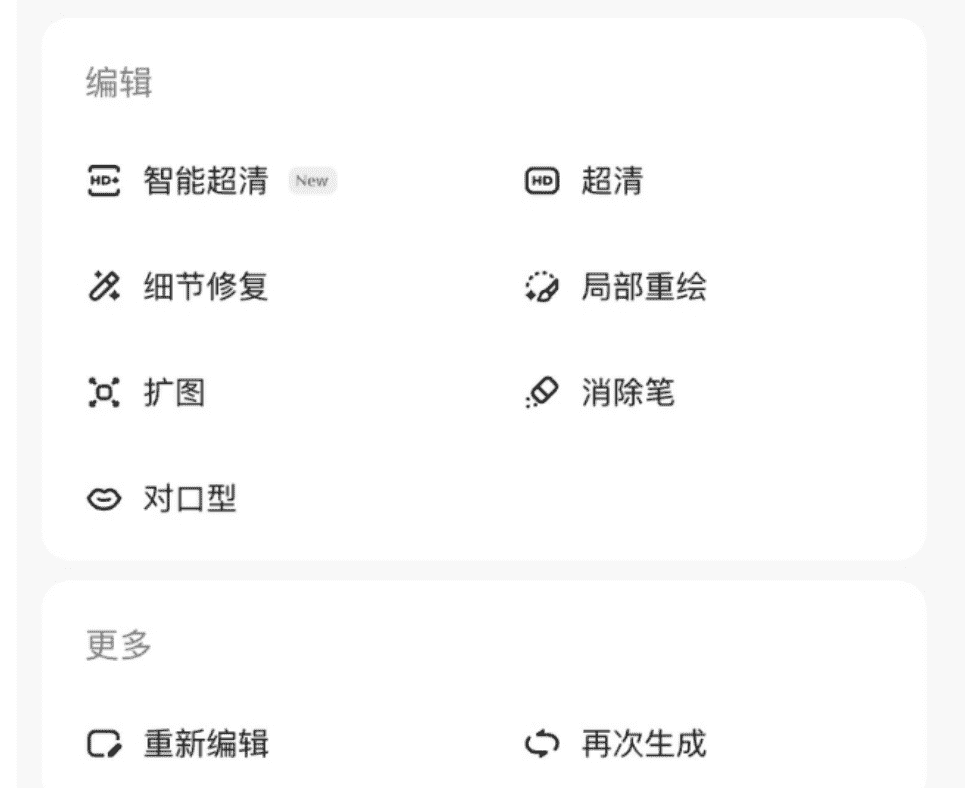

图11-2 即梦图片编辑页面

##### 第二步，Seedance静态画面动态化，强化卖点可视化

静态精修完成后，用Seedance把静态图转为动态片段，调用重新配音、AI配乐、AI音效、补帧、提升分辨率等内置功能，还原分镜要求的运镜、人物动作与产品呈现，提前做好声画基础，减少剪映的重复劳动。具体步骤如下：

1.导入素材并排序：点开“生成视频”模式，把优化后的静态分镜按镜号导入，时间轴上调整顺序，确保与脚本分镜一致；在备注栏写明运镜、动作、卖点及声画需求，比如“镜号3，粉底液推开演示，突出顺滑质感”，便于后续精准调用，避免混乱，如图11-3所示。

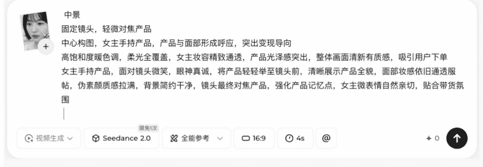

图11-3 Seedance视频生成页面

2.转动态并优化画面：按分镜给每个画面设定运镜，产品特写用轻微推镜突出细节；人物动作镜头用固定机位或轻微摇镜，保持自然；转化引导镜头用轻微拉镜突出指令。加入符合剧情的自然动作，比如推开粉底液、吸油纸按压等，动作速度调成“自然舒缓”，契合新手人设；同时开启核心优化：点“提升分辨率”统一升到2K，打开“补帧”设为30帧，解决卡顿和动作生硬；给产品特写加“轻微放大”动效，增强卖点可视化。

3.提前完成声画适配：用Seedance里的AI音效、AI配乐、重新配音提前匹配声画。点“AI音效”，按场景加对应音效并同步画面，比如推开时的指尖摩擦声、吸油纸按压声，音量控制在15%~20%，不抢人声；点“AI配乐”选清新轻快的纯音乐，音量25%~30%，不干扰台词；点“重新配音”输入脚本台词，选择20岁新手女生柔和音色，语速稍慢自然。配完音逐段核对，确保台词与画面动作精准同步，无延迟提前，重点检查卖点词如持妆、控油、平价是否清晰。编辑界面如图11-4所示。

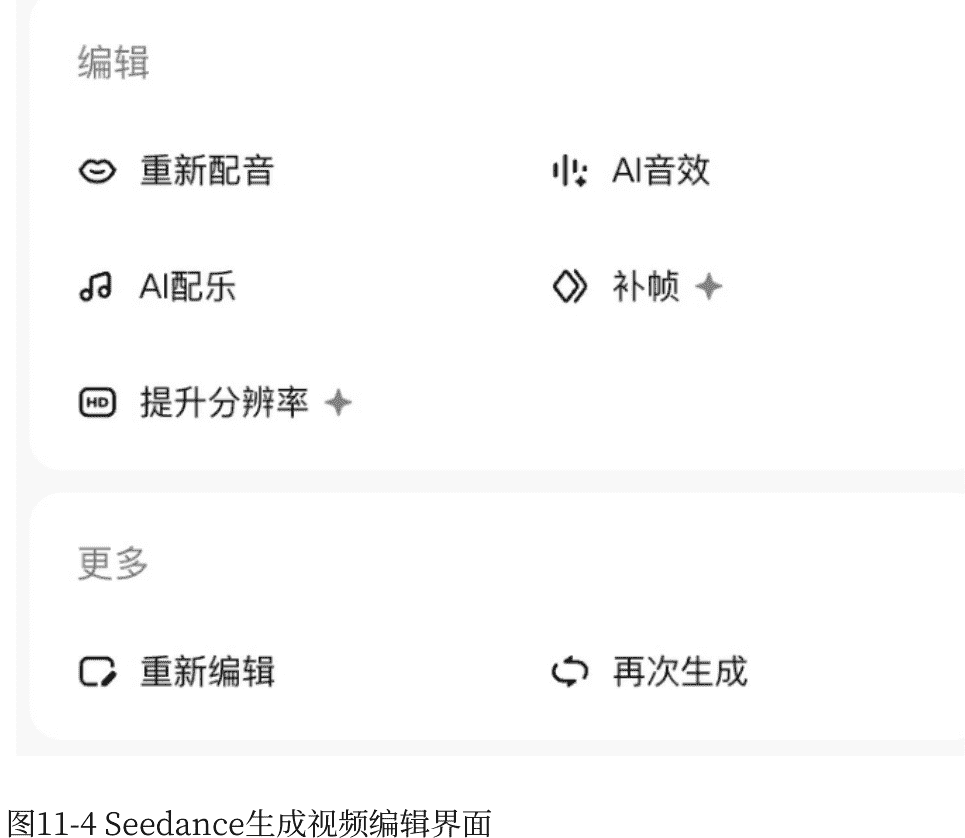

图11-4 Seedance生成视频编辑界面

4.导出动态片段：全部设置好后逐镜头预览，检查运镜流畅、动作自然、卖点呈现和声画同步，有僵硬、错位、模糊就微调参数。确认无误后逐个导出，分辨率2K、帧率30帧、格式MP4，命名为“美妆广告—镜号×”，方便剪映快速识别排序。

##### 第三步，剪映导入素材，完成拼接与节奏调整

导出后打开剪映，重点做拼接和节奏优化，确保全片紧凑流畅，贴合短视频习惯与带货目标：

- 1.导入与排序：点“开始创作”导入所有动态片段，按镜号拖进时间轴，核对顺序与脚本分镜一致，删掉首尾多余空白，保证衔接紧密；在时间轴给每个片段标注镜号和卖点，便于后续调整。

- 2.镜头衔接与转场：短视频转场要简洁自然，默认“切镜”适合大多数衔接；针对产品展示镜头如镜号2瓶身展示、镜号5持妆特写，可加“轻微淡入淡出”，时长0.3~0.5秒，过渡更柔和，如图11-5所示。

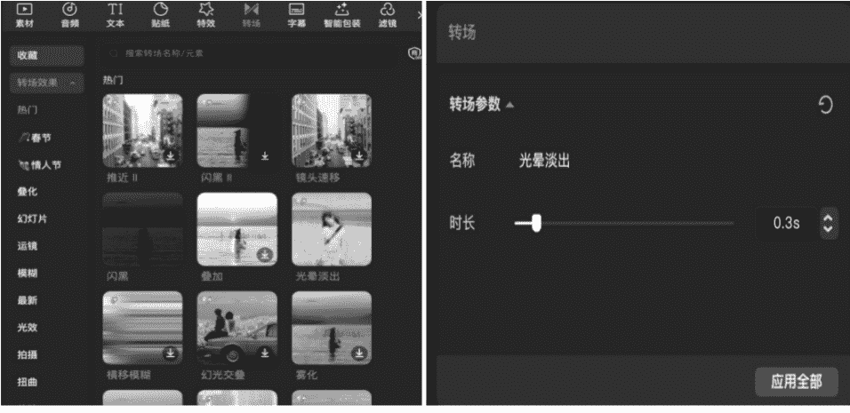

图11-5 剪映转场界面

##### 第四步，剪映声画微调，强化卖点与转化引导

Seedance已完成基础声画，剪映需要二次优化，解决不同步、音量不均衡、卖点不突出等问题，并加强转化：

- 1.声画同步微调：逐镜头核对配音、音效与画面动作，拖拽音频轨道微调，确保台词与动作精准对应，比如说“徒手就能推开”时同步展示推开动作；音效与场景同步，比如吸油纸按压时出现摩擦声。统一音量：配音50%~55%，配乐25%~30%，音效15%~20%，避免忽大忽小，如图11-6所示。

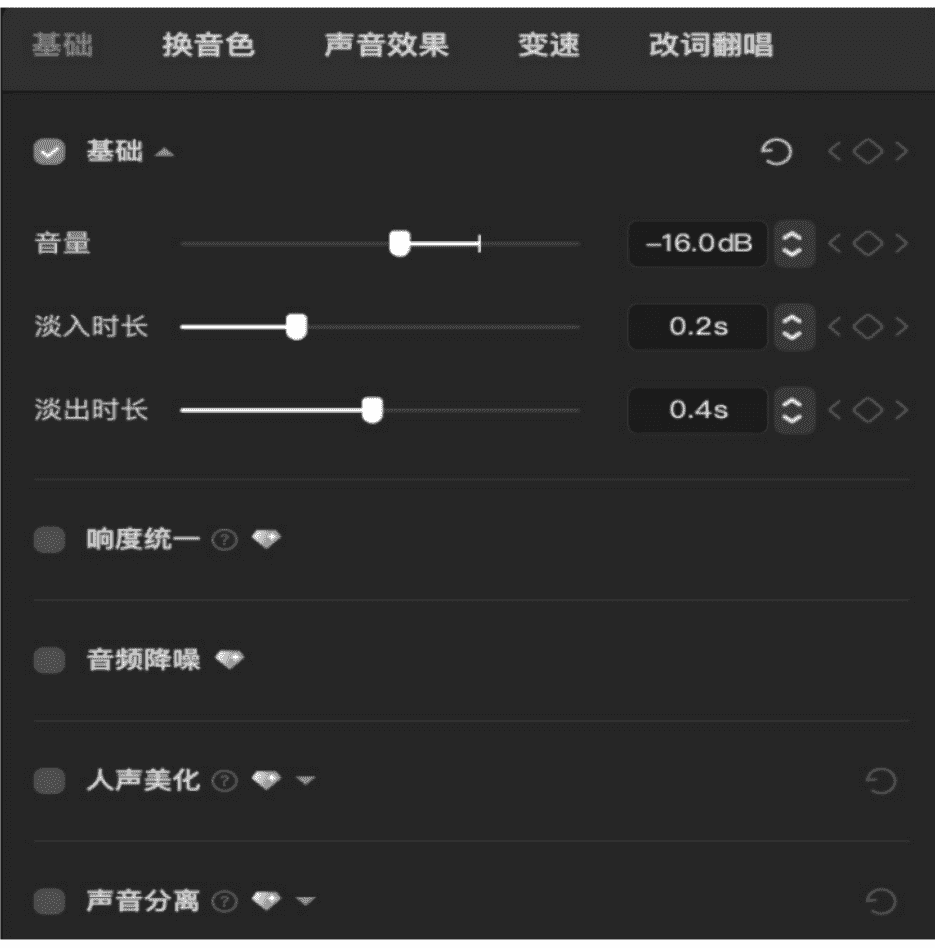

图11-6 剪映调整音量界面

2.强化卖点：用“文字”“贴纸”功能突出核心卖点，提升记忆点，如图11-7所示。

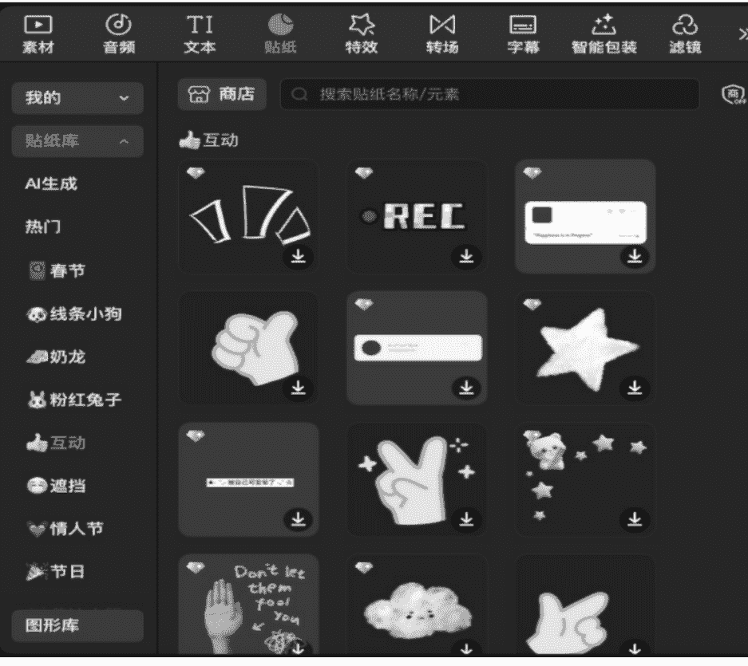

图11-7 剪映贴纸选择界面

针对卖点镜头添加简洁文案，字体选清晰易读的无衬线体，颜色与画面协调。比如镜号3推开演示加“新手易推开·不卡粉”，如图11-8所示。镜号5持妆实测加“持妆6小时·控油不脱妆”，镜号6转化引导加“59.9元·新手闭眼冲”；文字时长与镜头一致，可加“轻微弹出”动画，避免复杂动画干扰阅读；同时可加简约产品贴纸，增强认知。

3.强化转化引导：重点优化结尾转化镜头，增加引导元素。点“贴纸”搜索“小黄车”“下单引导”，放在左下角不遮挡主体，时长与镜头一致，如图11-9所示。

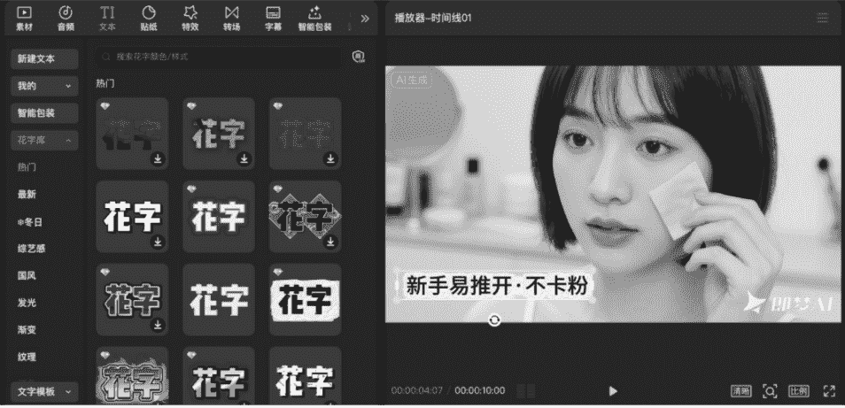

图11-8 剪映花字添加界面

图11-9 剪映贴纸添加界面

同时在画面下方加固定字幕“点击小黄车·直接下单”，字体加粗放大，颜色选醒目且协调的红或橙，增强引导；适配抖音等平台可加“小黄车跳转”锚点，便于挂商品链接，提升转化。

##### 第五步，字幕添加与优化，保证信息传达清晰

字幕是信息传达与卖点强化的重要载体，要清晰准确同步：

1.自动生成并校对：点“文本”→“添加口播稿”，输入文案后自动生成并智能分段，逐句核对字幕与配音脚本是否一致，修正错别字和语句偏差，如“持妆”误写为“持状”；可选择配音人物一键添加轨道，如图11-10所示。

图11-10 剪映智能文案使用界面

2.优化字幕：字幕时长与配音同步，避免提前消失或延迟出现；对核心卖点和转化引导字幕如“59.9元”“持妆6小时”“点击小黄车下单”做加粗放大或轻微动画“加粗闪烁”，突出重点；控制字幕密度，单屏不超过15字，确保阅读快速不影响画面。

##### 第六步，细节优化，统一风格，规避常见误区

细节优化决定质感和用户体验，重点是风格统一、瑕疵修补、合规检查：

- 1.**统一视觉风格**：用剪映“调色”批量优化片段，保持清新自然风和高饱和暖调，统一亮度、对比度、饱和度，亮度+5，对比度+10，饱和度+15，可微调，避免偏暗偏亮或色差；产品特写再次轻微锐化，锐化+10，突出质地和瓶身光泽，如图11-11所示。

- 2.**修补画面瑕疵**：逐镜头预览，卡顿可用剪映“补帧”→“智能补帧”优化；背景杂物用“裁剪”或“贴纸遮挡”处理；镜头运动过快用“变速”微调，让它更自然。

- 3.**合规与细节检查**：避免夸大宣传如“永不脱妆”“特效美白”，改为客观表述如“持妆6小时以上”“控油不脱妆”；检查产品是否清晰、卖点是否全面、引导是否明确；去掉即梦、Seedance水印，确保干净整洁，适合平台发布。

图11-11 剪映画面调色界面

##### 第七步，导出成片，适配平台发布

细节优化后完整预览一遍，核对镜头衔接、声画同步、字幕准确、卖点突出、转化明确、风格统一、无瑕疵、内容合规；确认无误后点“导出”，设置参数适配短视频平台发布需求，如图11-12所示。

图11-12 剪映视频导出界面

#### 11.3.3 成片实操进阶技巧

**AI工具协同，提升效率与质感统一。** 打通Seedance、即梦、剪映、豆包的联动，用人工智能替代重复劳动，提升成片精致度和出片速度。豆包可批量生成操作指令，用于即梦画面批量调色、Seedance参数统一设置、剪映字幕批量修改，一键导入即可完成，无需逐帧手动调。

**声画配合，抓住前3秒降低划走。** 用声音配合画面营造氛围，提升完播率。BGM分段匹配节奏，开头3秒用悬念轻柔音乐抓眼；中间卖点演示用轻快有活力的音乐；结尾转化用激昂有号召力的音乐，剪映音频分割实现情绪递进。音效与动作同步，比如美妆的开瓶、涂抹、按压，餐饮的沸腾、夹菜、碰撞，APP的点击滑动弹窗，配上轻音效，增强沉浸感，降低划走率。

## 第12章 品牌宣传片制作实操

## 创意构思：品牌视觉体系设计

品牌宣传片创意构思的核心是品牌视觉体系与品牌内核深度融合，任务是挖掘核心价值、提炼视觉符号、构建统一视觉体系，把理念、价值观、文化内涵融入视觉表达，实现精准传递与深度触达。与商业广告不同，品牌片更注重“情感共鸣与品牌记忆”，不需要强行引导，而是通过系统化视觉设计让用户感知调性、认同内核，形成长期认知。

#### 12.1.1 借助豆包+即梦进行品牌视觉体系创意构思的步骤

##### 第一步，明确品牌内核，拆解视觉表达核心诉求

创意前提是明确品牌内核与视觉诉求。要梳理品牌定位、理念、核心价值观、调性、行业属性、目标受众审美偏好，以及传播场景与时长，如抖音/小红书、官网、线下展会，15秒/1分钟/3分钟。可借助豆包输入信息获取拆解，以轻奢美妆为例，提示词如下：

> 帮我拆解一款轻奢美妆品牌的视觉体系创意核心信息，品牌定位高端轻奢美妆，主打天然植萃成分，品牌理念是“自然美学，精致护肤”，品牌调性温柔、高级、简约，目标人群25～40岁高消费女性，品牌宣传片用于抖音/小红书短视频传播，时长30秒，帮我提炼品牌内核核心关键词，明确视觉表达的核心诉求，结合轻奢美妆行业视觉趋势，给出品牌视觉体系的核心设计方向建议。

豆包生成内容如下：

###### 轻奢美妆品牌·视觉体系核心拆解

品牌内核核心关键词：天然植萃、自然美学、精致轻奢、温柔高级、简约质感

视觉表达核心诉求：贴合轻奢调性，突出自然与精致的融合，画面简约不单调，具有高级质感，能让目标人群产生审美共鸣，形成品牌视觉记忆

视觉体系核心设计方向：

色调：以低饱和度的自然色系为主，搭配轻奢质感的浅金色系，营造温柔高级的氛围

……

##### 第二步，提炼核心视觉元素，明确使用规范

内核与诉求明确后，借助豆包基于核心关键词提炼主视觉色调、核心视觉符号、辅助视觉元素、品牌视觉标识四大元素，并明确规范与搭配逻辑，原则是“元素服务内核，简洁具象、易识别、易传播”。不同品牌需结合调性与场景灵活设计，可补充提示词获取细化结果，示例（轻奢美妆）：

基于这款轻奢美妆品牌的视觉体系核心信息，帮我提炼品牌视觉核心元素，包括主视觉色调（主色、辅色、点缀色，标注色值参考）、核心视觉符号（设计描述、使用场景）、辅助视觉元素（选择标准、搭配逻辑）、品牌视觉标识（logo展示方式、位置），明确各视觉元素的使用规范，贴合轻奢、温柔、高级的品牌调性，适配30秒短视频品牌宣传片的视觉表达，同时适配即梦视觉生成与Seedance动态化需求。

豆包生成内容如下：

###### 轻奢美妆品牌·视觉核心元素及使用规范

####### 一、主视觉色调（低饱和度，突出温柔高级）

主色：裸粉色（RGB：245，235，230）、浅米色（RGB：250，245，240），占画面70%以上，奠定整体温柔基调

AI 驱动轻奢品牌视觉搭建与成片实操指南

点缀色建议浅金，RGB 230,215,180，在画面中的占比控制在约20%到25%，主要用于点亮产品细节与图形标记，强化轻奢质感。

……

##### 第三步，搭建完整品牌视觉框架，明确表达规范
核心视觉要素提炼完毕后，可让豆包把零散元素整合成一套系统化的品牌视觉框架，将画面基调、镜头构图规范、元素搭配逻辑、信息展示标准这四项规则明确下来，使宣传片每一帧都遵循同一套规范，保持视觉连贯，避免风格紊乱或搭配冲突。

实操上可通过提示词触发生成，示范选取轻奢美妆：

请基于轻奢美妆已确定的视觉核心要素，为我搭建一套完整的品牌视觉系统，明确画面表达风格、镜头构图规则、视觉元素组合逻辑、品牌信息展示规范，整体调性沉稳雅致且具轻奢感，适配1分钟企业品牌宣传片，同时兼容即梦静态画面生成与 Seedance 动态化，便于后续出素材。

豆包生成示意如下：

###### 轻奢美妆品牌·完整视觉体系
适配1分钟企业宣传片+即梦静态生成+Seedance动态化，调性：沉稳·雅致·轻奢

####### 一、品牌视觉核心风格（底层基调）
######## 1. 核心定位
极简高级感|低奢内敛|温润雅致|质感优先

**拒绝**：高饱和色、杂乱背景、夸张特效、强对比硬阴影

######## 2. 色彩系统
主色：奶杏柔白、雾感檀棕、哑光柔金

辅助色：低饱和雾粉、烟灰色、清透瓷白

点缀：仅以**柔金细线/光斑**做轻奢提亮

禁忌：亮红、明黄、艳蓝、荧光色

……

##### 第四步，视觉化验证，迭代优化视觉框架
文字化的视觉方案需要借助即梦转化为具象画面，快速检验体系的统一性、辨识度以及调性贴合度，防止落地失真。操作时在即梦里输入贴合体系的提示词，生成1~2张核心画面，例如主视觉镜头或产品场景代表镜头，检查元素搭配与色调呈现是否符合品牌预期。

以轻奢美妆为例，可用的画面提示词：

轻奢温柔调性，低饱和色感，裸粉色 RGB 245,235,230 加浅米色 RGB 250,245,240 为底，浅金色 RGB 230,215,180 点缀，16:9竖版，高清2K，大面积留白，简约高级；场景为轻奢美妆宣传片核心镜头，主体是通透的精华液瓶身，旁配简约线条化植萃叶片符号，背景为淡绿色植萃光斑，柔和散射光，突出产品通透感与自然美学；Logo采用纯白简约字体置于右下角，约占画面1/10，严格遵循品牌视觉体系，适配即梦生成便于后续 Seedance 动效。

即梦生成效果如图12-1所示。

#### 12.1.2 品牌视觉体系创意构思的注意事项

**品牌内核与视觉方案需高度统一，避免脱节：** 使用豆包梳理体系和撰写提示词时，必须始终以品牌内核为导向，色彩、元素、风格都要服务于品牌理念与调性，不能只为画面好看而偏离。例如公益环保品牌不宜过度奢华，新中式茶饮品牌不宜过于西化，让用户通过画面快速感知品牌定位。

**视觉元素具象化且简洁，适配 AI 生成特性：** 设计要考虑即梦与 Seedance 的生成边界，把抽象理念转化为可执行的视觉语言，避免符号和场景过于复杂。例如不要空谈“轻奢质感”，应转化为“低饱和裸粉色调+浅金色点缀+简约线条符号+充足留白”，既传达调性又降低 AI 理解偏差，提升落地效率。

### 12.2 脚本与分镜设计：品牌叙事结构

脚本与分镜是连接视觉体系与成片制作的桥梁，也是保证叙事贴合内核、视觉遵循体系的关键。相较于商业短视频的快节奏强卖点，品牌宣传片更强调叙事连贯、情感递进、内核层层释放，分镜则更注重视觉统一与画面共鸣，是把品牌故事转化为可拍摄镜头的依据。

#### 12.2.1 借助豆包+即梦+Seedance 辅助品牌宣传片脚本与分镜设计的优势

豆包负责脚本撰写，即梦与 Seedance 负责画面生成，能让脚本分镜更高效、更贴合实操与传播目标，降低专业门槛，确保素材生成、动态化、剪辑环节顺畅，同时避免脚本与视觉体系、品牌内核脱节，让每个镜头都围绕传递内核、塑造形象、引发共鸣展开。

#### 12.2.2 品牌宣传片脚本设计步骤

##### 第一步，梳理品牌内核与视觉体系，明确脚本设计依据
脚本要以品牌内核和视觉体系为双基础，先用豆包梳理宣传片的核心信息与叙事节奏节点，为镜头拆解和脚本撰写提供依据。

##### 第二步，借助豆包，拆解镜头维度并生成标准脚本表格
在核心信息与节奏节点基础上，结合视觉体系，用豆包把整支片子拆成独立镜头，每个镜头明确镜号、景别、画面内容、时长、视觉执行要求、音效、品牌内核传递重点，形成可直接执行的标准化脚本。实操可上传视觉框架和核心信息，输入提示词快速生成表格，示范如下：

为轻奢美妆品牌设计30秒短视频宣传片的标准脚本，核心关键词为天然植萃、自然美学、精致轻奢、温柔高级，视觉体系为低饱和裸粉色+浅米色为主、浅金色点缀、简约线条植萃叶片符号、画面留白充足，叙事节奏为5秒开篇、15秒内核传递、7秒情感共鸣、3秒收尾，场景为简约自然护肤空间，无台词，配轻柔舒缓纯音乐。拆解镜头，输出含镜号、景别、画面内容、时长、视觉执行要求、音效、品牌内核传递重点的标准表格，镜头节奏与调性同步，适配即梦+Seedance，视觉严格遵循体系。

豆包生成脚本示例如表12-1。

###### 表12-1 品牌宣传片脚本

| 镜号 | 景别 | 画面内容 | 时长 | 视觉执行要求 | 音效 | 品牌内核传递重点 |
|:---|:---|:---|:---|:---|:---|:---|

| 1 | 远景 | 简约自然护肤空间，阳光透过纱帘洒入，植萃叶片作装饰，空镜营造氛围 | 5s | 1. 主色调裸粉+浅米，占比90% 2. 三分构图，留白1/3 3. 柔和自然散射光，带轻微光斑 | 轻柔纯音乐渐入，音量20% | 引出自然美学调性，营造温柔高级氛围 |

| 2 | 特写 | 镜头缓缓推近桌面精华液瓶身，瓶身通透，旁有简约线条化植萃叶片符号 | 6s | 1. 主色裸粉+浅米，瓶身细节用浅金点缀 2. 植萃叶片置于瓶身右侧，线条简洁 3. 侧光打亮瓶身，突出通透质感 | 纯音乐持续，音量25% | 传递天然植萃产品核心，体现精致轻奢质感 |

续表

| 镜号 | 景别 | 画面内容 | 时长 | 视觉执行要求 | 音效 | 品牌内核传递重点 |
|------|------|----------|------|--------------|------|------------------|

| 3 | 特写 | 精华液从瓶口滴落，落在植萃叶片上，液体与叶片融合，画面细腻 | 5s | 1. 主色裸粉+浅米，叶片用淡绿色点缀 2. 居中构图，聚焦液滴与叶片 3. 仅保留精华液与叶片，无冗余 | 纯音乐轻扬，加轻微液滴声15% | 强化植萃与护肤融合，传递自然美学理念 |

……

##### 第三步，适配 AI 特性，借助豆包优化脚本细节
脚本初稿后，要结合即梦与 Seedance 的生成特点，用豆包做精细化优化，确保可落地易生成，同时强化内核传递与视觉执行，避免生成困难、效果偏差或风格不统一。

#### 12.2.3 品牌宣传片分镜设计步骤

##### 第一步，拆分镜头单元，明确核心设计维度
以脚本为基准，按叙事节奏与顺序把每个镜头拆为独立分镜，保证每个分镜对应脚本内容、传递内核且全片统一。时长建议：15秒短视频5-8个分镜、30秒8-12个、1分钟15-20个。

每个分镜先明确七个维度：镜号、景别、镜头运动方式、画面构图、色彩光影、视觉元素搭配、品牌内核传递重点，确保设计清晰且适配 AI 生成。

##### 第二步，细化画面描述，适配即梦生成，贴合视觉体系
分镜要做“可视化指引+内核传递+体系执行”，为每个分镜写详细具象的画面描述，直接作为即梦生成提示词。描述需覆盖主体、场景、色彩光影、元素搭配、Logo呈现、情感氛围，突出体系执行与内核可视化。

例如镜号3的分镜描述优化为：

特写，轻奢温柔风，严格遵循品牌视觉体系；16:9竖屏，高清2K，画面细腻无噪点，突出液体与叶片质感；场景为简约自然护肤空间，背景为虚化裸粉色纱帘，无杂物；主体为通透精华液滴自瓶口滴落，落在浅绿色植萃叶片上，自然融合，叶片为简约线条化核心符号，边缘带轻微浅金点缀；色彩主调裸粉色 RGB245,235,230 +浅米色 RGB250,245,240，叶片淡绿 RGB220,235,225，液滴边缘浅金 RGB230,215,180，柔和侧逆光打亮，突出通透与自然光影；仅保留液滴与叶片，留白充足；适配即梦生成，清晰传递天然植萃、自然美学内核。

接收后生成图片，如图12-2所示。

图12-2 分镜3

##### 第三步，整合分镜信息，生成标准分镜表
把所有分镜拆解与描述整合成标准化分镜表，作为创作指引，便于即梦出图、Seedance 动效与剪辑衔接。需包含九要素：镜号—景别—镜头运动—画面构图—色彩光影—画面描述—时长—视觉执行要求—品牌内核传递重点，可用豆包快速生成。

示例提示词：

整理轻奢美妆品牌30秒短视频的6个镜头为标准化分镜表，标注镜号、景别、镜头运动、画面构图、色彩光影、画面描述、时长、视觉执行要求、品牌内核传递重点，画面描述贴合轻奢温柔风，严格遵循低饱和裸粉+浅米、简约植萃符号、充足留白的视觉体系，镜头运动舒缓适配即梦+Seedance，色彩光影与调性匹配，确保每镜清晰传递内核。

生成的分镜表将与脚本和视觉体系精准对应，为后续 AI 生成与剪辑提供清晰指引。

#### 12.2.4 品牌宣传片脚本与分镜设计的注意事项

**叙事节奏与品牌调性要高度匹配，避免违和：** 脚本分镜的核心是让镜头节奏服务于调性与内核，轻奢沉稳品牌需舒缓，采用慢推慢拉；活力年轻品牌可稍快，采用自然切镜摇镜。提示词中要明确“节奏与调性匹配，镜头运动贴合氛围”。

**每个镜头都要有明确的内核诉求，避免堆砌：** 设计须围绕传递内核与塑造形象展开，每个镜头设定明确的传递重点，避免无意义镜头。例如公益环保品牌每镜围绕“守护自然、微力前行”，新中式茶饮围绕“茶融东方、守正创新”，让用户层层感知品牌认知。

### 12.3 成片实操：品牌视频生成流程

成片是视觉体系与叙事落地最后一步，核心是把12.2生成的静态分镜、脚本内容，通过 Seedance 动态化、即梦画面优化，结合剪映剪辑，完成拼接、动效、音画适配、字幕与细节强化，最终输出符合视觉体系、叙事流畅、内核突出的完整宣传片。

#### 12.3.1 借助 Seedance+即梦+剪映进行品牌宣传片成片实操的优势

传统制作成本高、剪辑繁琐、风格易乱、叙事衔接生硬。Seedance可直接把即梦静态图转为动态，无需拍摄；剪映功能齐全，内置调色、配乐、字幕模板，智能完成拼接、色调统一、音画适配。30秒片子约1小时可完成，效率大幅提升。

#### 12.3.2 品牌宣传片成片实操的核心步骤

##### 第一步，静态画面深度优化，严格遵循品牌视觉体系
先对即梦生成的静态分镜做深度优化，确保风格统一、细节达标。以分镜4为例，提示词：

中景，轻奢简约风，精华液瓶身居核心，背景为朦胧植萃光斑，浅金色细腻勾勒瓶身轮廓，角落隐现简约植萃叶片符号，对称构图，留白1/3，主色低饱和裸粉+浅米，光影柔和通透，整体简约干净，自然与轻奢融合，高清8K。

生成后如图12-3所示。

图12-3 分镜4

按镜号排序核对每张图的主辅色、视觉元素、构图、Logo是否符合体系，若浅金点缀过多，可补充提示“减少浅金点缀，仅用于产品细节，严格按色调比例”重生成；符号不准则微调提示词，确保精准贴合体系。

##### 第二步，Seedance 静态画面动态化，还原叙事节奏与品牌氛围
优化后用 Seedance 转动态，例如分镜4提示词：

中景，镜头从瓶身特写匀速缓缓拉远至中景，运动顺滑无顿挫，轻奢简约风，瓶身静止居中，背景植萃光斑缓慢匀速浮动，浅金轮廓无动态，角落植萃叶片符号固定，对称构图留白1/3，主色低饱和裸粉+浅米，光影柔和通透，8K超清，电影级柔焦，背景轻柔纯音乐持续，液滴声关闭音量25%。

生成后如图12-4所示。

图12-4 动态视频

逐镜预览运动流畅度、自然度、音画同步，问题则调整，确认后导出分段素材便于剪映导入。

##### 第三步，剪映导入素材，完成镜头拼接与叙事节奏调整
导入剪映按镜号拖入时间轴，如图12-5所示，核对顺序与脚本分镜一致，去除首尾多余空白，确保衔接紧密；为每段标注镜号与内核传递重点，便于调整。

图12-5 导入素材

转场保持简洁柔和，避免复杂特效干扰。优先用切镜；场景切换或空镜到产品镜时可用轻微淡入淡出，时长0.5-1秒，增强柔和过渡。整体预览确保衔接流畅无突兀。

##### 第四步，剪映音画适配优化，营造品牌专属情感氛围

##### 第五步，精修成片并适配发布

进入收尾阶段，先通看一遍成片，参考图12-6，对画面表现、背景音乐等细节进行微调与补强。细节打磨完毕后，要结合不同传播平台的规范设定导出参数，让视频在各渠道都能发挥最佳观感，同时完成发布前的最后核对。

图12-6 视频预览

#### 12.3.3 成片实操关键注意点

**坚守视觉规范，保持全片调性统一：** 从剪辑到字幕，每个环节都要紧扣前期创意阶段确定的品牌视觉体系，包括主色辅色搭配、核心视觉符号、构图逻辑以及 Logo 呈现方式等，避免在调色、剪辑、字幕设计上跑偏品牌调性。例如轻奢美妆不适合出现高饱和度、杂乱的配色，新中式茶饮也不应混入西式视觉元素，保持全片视觉语言高度一致，才能强化品牌记忆点。

**音画同步为先，防止违和感出现：** 音画配合是营造情绪氛围、传递品牌气质的核心要务，要做到画面与声音节奏一致、情感同频。切忌出现配乐节拍与镜头切换脱节、音效与画面动作错位、音量忽大忽小等问题；配乐和音效的选择必须贴合品牌气质，杜绝使用风格冲突的音乐，如轻奢品牌就不可选用过于激进嘈杂的曲目，确保整體音画和谐自然，才能引发用户共鸣。