# 豆包AI全能应用一本通

# 序言

在人工智能从概念走向普及的今天，我们正站在一个技术与生活深度融合的时代节点。AI不再只是科技概念，已深度融入日常的每一个场景：从清晨的日程规划，到工作中的高效协作，再到商业变现……在这股智能化浪潮中，“豆包”作为一款集多功能于一身的智能AI助手，凭借其强大的功能适配性、操作便捷性与场景全覆盖性，成为越来越多人生活、学习与工作中不可或缺的伙伴。

在这一背景下，熟练掌握如“豆包”这样的人工智能工具，已不仅仅是科技爱好者的专属技能，更是现代人提升效率、优化体验、拥抱智能生活的通用素养。为此，我们撰写了本书，旨在系统解析豆包的核心功能与应用逻辑，帮助读者从“会用”到“精通”，真正发挥其在智慧生活、辅助学习、高效办公、文案创作、艺术创意、商业盈利等多领域的价值，实现个人与职业能力的双向提升。

本书开篇从豆包的基础操作入手，详细讲解注册登录、界面导航、对话技巧、智能体创建等核心基础，帮助新手快速入门；随后聚焦六大核心应用领域，逐一拆解豆包的实用功能与操作方法，搭配场景化案例，让抽象的功能变得具象可学。

在生活领域，豆包可以助力你高效处理日常事务，解锁从旅游规划、美食清单、穿搭指南，到选购小助手、财务管理、生活技巧的便捷生活新方式，让你从繁杂的琐事中解脱出来，专注于更有意义的事情。

在辅助学习领域，豆包是高效的学习搭档，可以帮助你做好学习计划，进行学科知识讲解，以及文学解析与阅读推荐，让学习变得更轻松、更高效，甚至还可以辅助完成论文撰写、课题研究等复杂学习任务。

在高效办公领域，豆包是得力的办公助手，为你提供日常办公写作、团队沟通、求职与招聘等事务的解决方案，帮你节省时间、减少失误，提升工作质量，助力职场晋升。

在文案创作领域，豆包可以提供用户需求与选题挖掘分析，以及涵盖短视频文案、朋友圈文案、种草文案等各类爆款文案的创作技巧，帮助你解决创作灵感不足的难题。

在艺术与创意领域，豆包可以辅助你进行绘画生成、音乐创作、诗歌创作、剧本创作等，释放你的创意潜能。

在商业变现领域，豆包让普通大众也有了快速赚钱的渠道，无论是写书评赚稿费，还是开发付费课程等。豆包的辅助让“赚钱”有了更多的可能。

希望本书能成为你生活、学习、工作中的“实用指南”，帮助你充分发挥豆包的全能价值，解锁更高效、更便捷、更精彩的生活方式。另外，豆包的功能仍在持续迭代升级，新的应用场景也在不断拓展。因此，在阅读本书时，建议读者们结合实际操作探索体验，重点掌握核心使用方法与技巧，灵活适配各类新功能与新场景。

# 第1章 认识豆包，从0到1玩转AI助手

## 1.1 豆包的注册与登录

豆包作为字节跳动自研的一款AI助手，支持多端登录使用，包括网页版、移动端App、计算机版等，可以满足不同用户在各种场景下的需求。本节将详细介绍豆包的注册与登录，帮助大家快速开启豆包AI的便捷体验。

### 1.1.1 注册与登录的流程

在浏览器中搜索“豆包”，找到官网并点击进入，如图1-1所示。此时是引导页面，直接在输入框中输入问题，按“Enter”键发送，豆包即会进行回复。

如果要进行登录，可以点击右上角的“登录”按钮，随后弹出登录对话框，如图1-2所示，可以看到有三种登录方式，通过手机号、抖音账号或打开豆包App扫码登录。

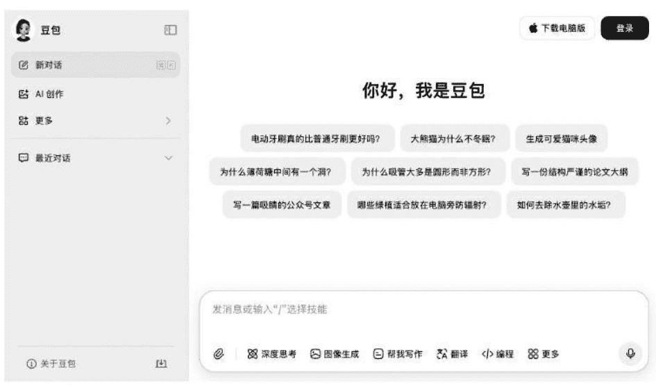

图1-1

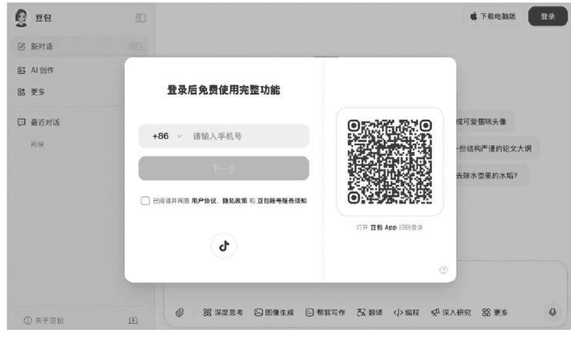

图1-2

这里选择手机号登录，输入手机号后，勾选“已阅读并同意用户协议、隐私政策和豆包账号服务须知”，然后单击“下一步”，将手机收到的6位数字验证码输入，即可完成注册和登录，如图1-3所示。

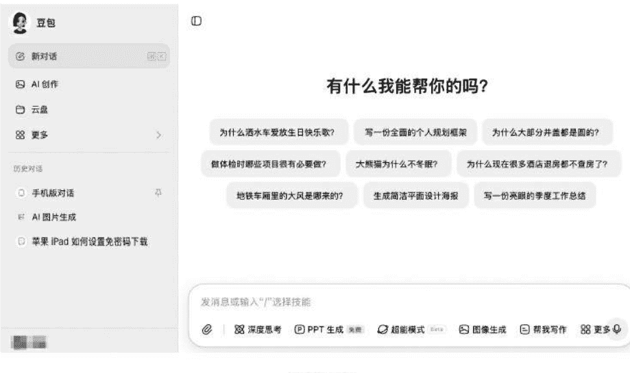

### 1.1.2 下载、安装计算机客户端

若要直接使用计算机版豆包，需要先下载软件。点击如图1-1所示右上角的“下载电脑版”按钮，也可以点击左下角的“”按钮，即可下载安装文件。

下载完豆包安装文件之后，双击打开，如图1-4所示，继续双击即可进入安装程序。安装完毕后，豆包计算机客户端会自动打开。

### 1.1.3 豆包的操作界面介绍

登录计算机版豆包后，可以看到豆包的界面设计非常简洁，如图1-5所示，界面功能区主要包括个人设置中心、搜索框、侧栏、输入框。

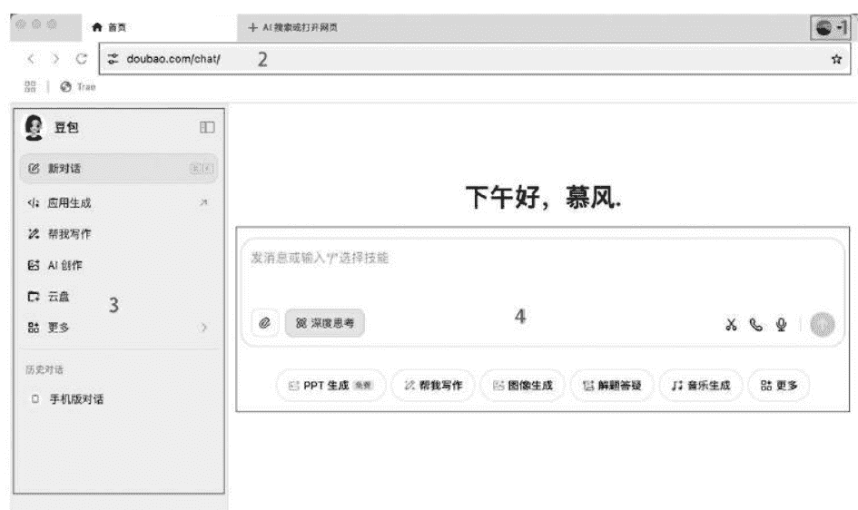

图1-5

1. 个人设置中心

单击图1-5中页面右上角的倒三角会弹出“设置”等相关功能选项面板，如图1-6所示。在这个面板中，可以通过设置“窗口位置”，让豆包操作界面位于电脑的左侧、中间、右侧；单击“设置”，还可以对账号及豆包的一些功能进行管理与设置，如图1-7所示。

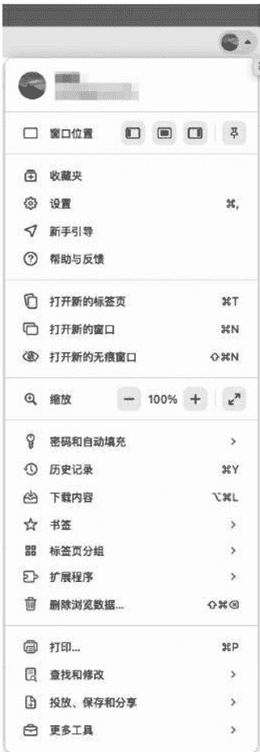

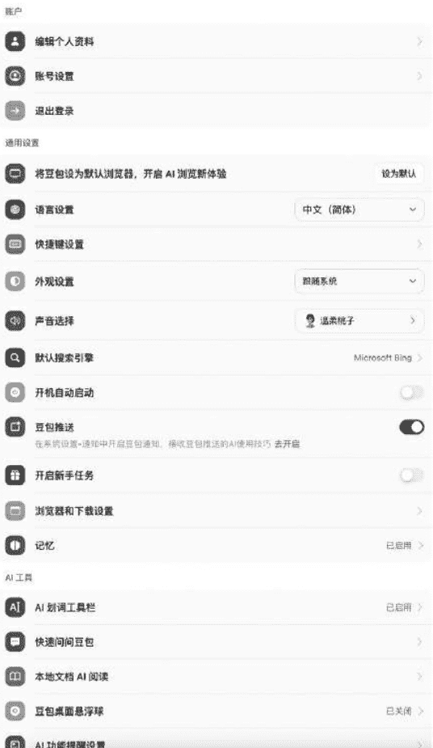

图1-6

图1-7

2. 搜索框

单击基础页上方的搜索框，可以输入任何问题，比如输入“为什么洒水车要放歌”，然后单击“Enter”键，即可跳转到对应的网页，如图1-8所示。通过搜索框可以便捷地搜索问题，可以将其视为豆包的浏览器插件。

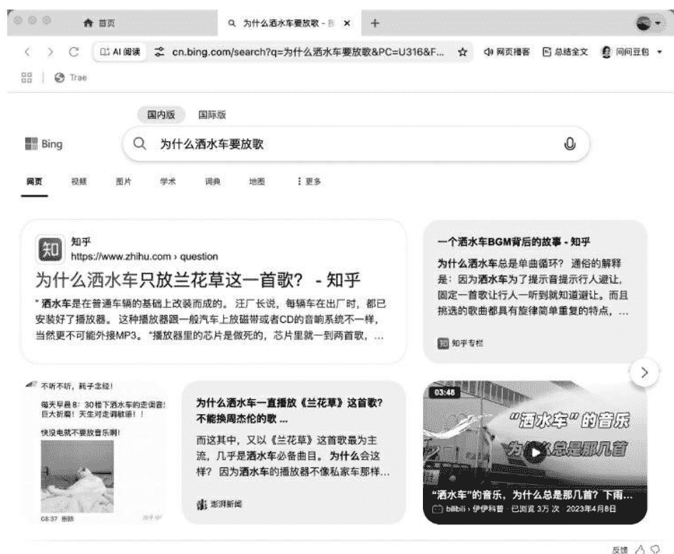

3. 侧栏

侧栏区域包含新对话、应用生成、AI创作，云盘以及“更多”中的AI智能体、翻译等功能。用户可以快速体验豆包的不同功能。

4. 输入框

输入框是用户与豆包进行交互的区域，可以输入提示词，也可以粘贴和拖拽链接、文档等内容，以获得反馈和意见，进而帮助用户做出更精准的决策。输入框的下方显示了置顶的常用功能，如帮我写作、图像生成、解题答疑、音乐生成等。

## 1.2 豆包提示词及编写

提示词是用户输入给AI的指令、问题或文字信息，它是与AI对话的基础。要想轻松驾驭AI，让它成为我们的生产力工具，就必须掌握AI提示词的编写。

### 1.2.1 豆包提示词编写原则

提示词是豆包生成精准内容的关键。如果提示词没有明确的结构和大纲，即使在同一主题下，多次生成的内容也会不一样，且生成的内容空泛，缺少细节，真正有价值的信息很少。要避免这些问题，就必须掌握提示词的编写原则。

1. 明确需求，并表达清楚

提示词设计的首要原则是明确自身的需求，并向豆包表达清楚，以避免因需求模糊导致豆包输出的内容偏离预期。因此，在撰写提示词前，我们要先明确自己的核心需求，简单说就是“把话说清楚”。

比如，你要制订一个环球影城一日游的最佳路线计划，就不能只说“请为我生成一个环球影城一日游计划”，这样豆包给出的答案涵盖的范围非常大。

正确的提示词应该这样来写：

> “请为我规划一个环球影城一日游最佳路线推荐方案。”

这样的需求就非常明确，豆包会着重于“最佳路线”的生成。

2. 细化描述，让豆包更懂你

任务描述的细化程度直接影响输出质量，我们可以通过要素分解来实现指令的可操作性。以上述旅行攻略为例，如果只要求生成路线推荐，生成的内容可能不一定符合你的实际情况，这时就需要更加细化地描述任务。比如，这样写提示词：

请为一个四口之家（女孩12岁，男孩5岁）规划环球影城一日游，要求：

- 1.避开双休日；
- 2.四人餐饮费用控制在800元内；
- 3.标注景区内拍照打卡地点；
- 4.推荐最值得玩的路线，中午安排1小时的休息。

以上细化后的提示词明确了四口之家的具体情况，豆包会根据人群匹配合理的游玩路线、项目以及节奏。餐费、打卡地、路线、1小时的休息这些具体的要求，就像给豆包发出了精准的坐标地图，让豆包能够朝着你的需求生成专属方案。

3. 绑定场景要素

如果说明确需求和细化描述解决了“做什么”和“怎么做”的问题，那么场景要素的绑定就明确了“在什么情境下做”。它能够显著提升豆包输出内容的情境适配性。

比如，在编写跨国营销文案时，通过提示词明确文化禁忌：“针对中东市场设计智能手机广告，避免使用六芒星符号与左手递物画面，突出家庭共享功能与本地化售后服务。”有了这样的文化要素绑定，就可以防止因文化差异导致的传播事故。

### 1.2.2 豆包的结构化提示词框架

低效的提示词往往是自然语言的随意组合，难以让豆包生成精准的回答；高效的提示词则能使豆包更精准地理解用户的需求，从而提升交互的效率。结构化的提示词，可以改变自然语言的随意组合，让提示词变得标准化和精准。

提示词的结构化并没有唯一的标准，它可以有不同的形式：

1. 角色+任务描述

让豆包扮演特定的角色，然后下达任务，获得豆包的回复。比如：
“你是一位法律专家，请帮我分析——我向一家装修公司签订了全包合同，但对方多次拖延工期，所用材料也与约定品牌不符。经多次催告后，对方仍未能按承诺整改。我该如何进行维权？”

这样的结构化提示词，简单直观，能让豆包快速代入场景，生成有针对性的回答。

2. 任务描述+参考信息+要求

准确地描述要豆包完成的任务，并提供一定的参考，让豆包更好地理解你的需求，然后列出你的要求。比如：“我现在要写一篇关于‘秋天’的初中作文，请参照附件中范文的结构和风格来写，要求1200字左右……”

这样的结构化提示词多了参考和要求，可以让豆包生成更加精准的回答。

3. 行动+目的+期望

通过设置明确的行动、目的和期望，帮助豆包完成任务目标。比如：
“请帮我撰写一个某某产品的使用手册，用于让用户快速了解产品的使用方法，期望用户看完手册后能够熟练掌握80%的操作。”这样的提示词框架简洁明了，适用于日常简单的任务。

4. 指令+背景+数据+格式

用户输入简洁的任务指令、相关的背景和限制条件、执行任务需要的信息或数据，最后要求输出的格式。该形式比较适合复杂任务的分解和数据分析报告。

掌握以上结构化提示词的形式后，在具体的应用过程中需注意两个要点：一是灵活应用形式，简单的任务就用简单的形式，复杂的任务或方案撰写可以用多种形式；二是每个模块的表述需简洁、直接，避免使用模糊语言，以及在提示词中添加无关内容。

### 1.2.3 开启对话的基本操作

掌握豆包的基本对话操作，是交互的开始。用户只需在豆包输入框中输入文字，点击发送，即可开启对话之旅。

①在豆包操作界面中，单击输入框，即可输入提示词内容，如图1-9所示。

②在输入提示词时，如果想换行输入，可以按“Shift+Enter”组合键，然后继续输入提示词，如图1-10所示。

③单击“发送”按钮，豆包会根据提示词生成相应的内容，如图1-11所示。

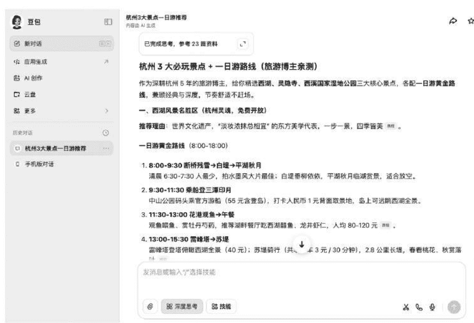

④如果想更改提示词，可以将鼠标指针移至提示词位置，单击提示词下面的图标，如图1-12所示，即可对提示词进行修改。

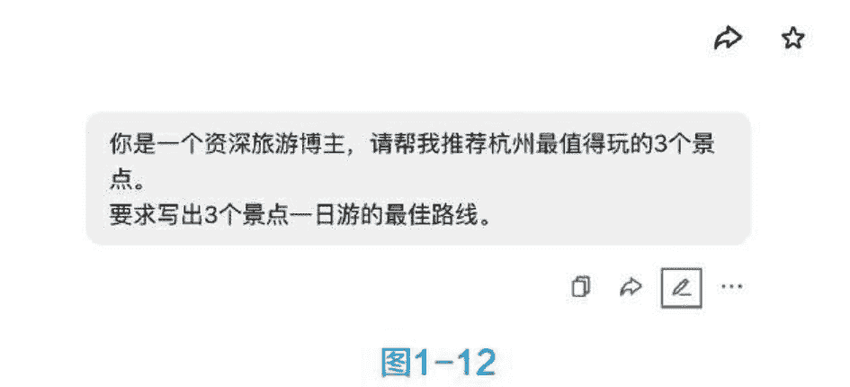

⑤如果对生成的内容不满意，可以单击“重新生成”按钮，如图1-13所示，豆包会重新生成内容。

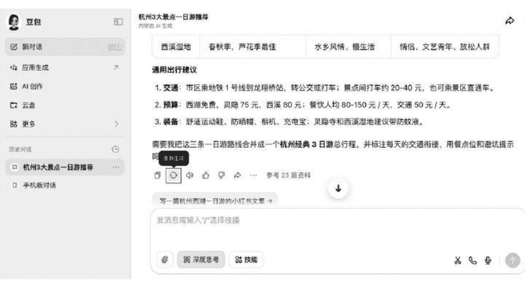

图1-13

## 1.3 豆包智能体的创建与运用

智能体是基于豆包大模型开发的定制化AI助手，支持用户通过简单配置打造适配各类场景的专属工具，在教育、办公、消费决策等领域有广泛应用。

### 1.3.1 豆包智能体

豆包智能体可以根据不同领域提供专业化的服务，以及个性化的体验。在豆包的操作界面中，单击侧栏中的“更多”选项，再单击“AI智能体”选项，如图1-14所示。

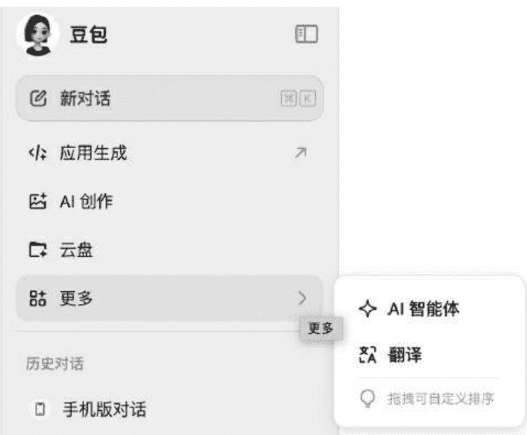

图1-14

进入“发现AI智能体”界面，即可看到豆包预设和用户分享的智能体，包括工作、学习、创作、生活4个类别，如图1-15所示。

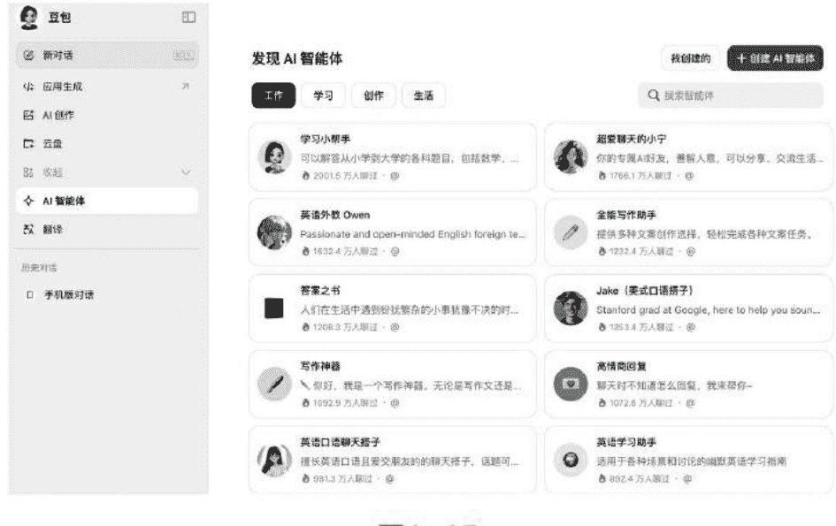

点击智能体，如“超爱聊天的小宁”，即可进入该智能体页面，如图1-16所示，用户可以发送提示词进行互动。

### 1.3.2 如何创建专属的智能体

豆包允许用户创建智能体，以满足用户个性化的需求，提升智能交互体验。具体操作步骤如下：

①在“发现AI智能体”界面，点击右上角的“创建AI智能体”按钮，即可进入智能体创建界面，如图1-17所示。

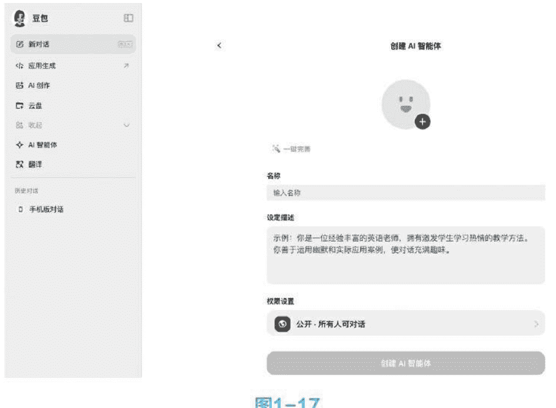

②进入该界面后，需要给智能体取一个名字，比如“骑行搭子”，然后设置头像、设定描述文字。如果不想自己设定和填写，可以单击“一键完善”，豆包会自动设置头像和设定描述文字，如图1-18所示。

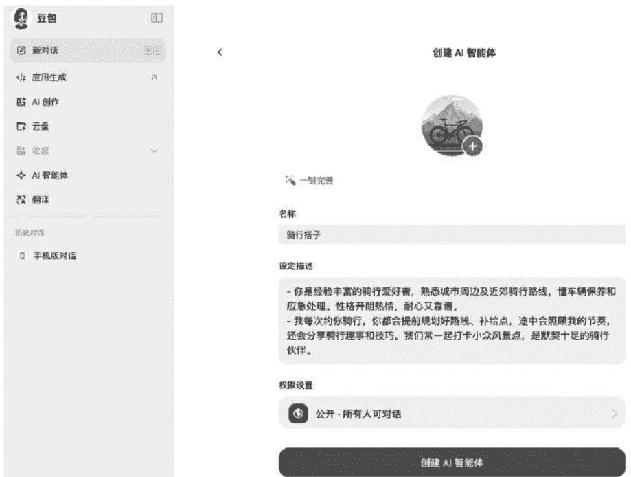

③用户还可以进行权限设置，单击“权限设置”，可弹出设置界面，如下方左侧图1-19所示，有三种权限选项，选择其中一种，返回页面后，单击“创建AI智能体”按钮，即可创建智能体，如下方右侧图1-20所示。

权限设置

- 公开·所有人可对话
- 不被发现·通过链接分享可对话
- 私密·仅自己可对话

确定

图1-19

骑行搭子

1人聊过·创建人@慕风

- 角色设定
- 语言 中文
- 公开·所有人可对话
- 清除上下文

图1-20

# 第2章 智慧生活帮手，一键解决日常烦恼

## 2.1 旅游“规划师”

诗和远方是每一个人都向往的，要让每一场旅行都从从容容、游刃有余，就离不开精心的旅游规划。豆包可以为用户提供个性化的旅游规划服务，包括酒店预订、车票购买、景点安排、餐饮推荐等。

### 2.1.1 制订旅游攻略

旅游攻略是针对旅游目的地或旅游景区所做的详细规划，包括景点的选择、旅游路线的制订、时间安排等。它的核心是兼顾“松弛感+体验感+实用性”，不需要追求完美打卡，重点是贴合自身喜好、规避不必要的麻烦。以下是相关示例。

示例提示词：

我打算暑假去云南游玩七天，主要去大理、丽江、西双版纳三个地方，请帮我规划一个详细的旅游攻略。包括：

- 1.具体的游玩路线，三个城市的先后顺序，以及各自的景点推荐。
- 2.具体的乘车（高铁）安排，以及景点与景点之间的交通（打车）。
- 3.住宿（300~500元/天），以及美食推荐。

将以上提示词输入豆包，如图2-1所示，单击“发送”按钮，即可生成旅游攻略。

我打算暑假去云南游玩七天，主要去大理、丽江、西双版纳三个地方，请帮我规划一个详细的旅游攻略。包括：
1.具体的游玩路线，三个城市的先后顺序，以及各自的景点推荐。
2.具体的乘车（高铁）安排，以及景点与景点之间的交通（打车）。
3.住宿（300~500元/天），以及美食推荐。

图2-1

以下是豆包生成的云南七天游攻略：

这份7天攻略按大理→丽江→西双版纳顺序规划，兼顾高铁交通、景点、住宿与美食，全程节奏适中，预算可控。

Day1：抵达大理→大理古城

交通：抵达大理站/机场，打车至大理古城（约20分钟，30元）。

景点：

下午：逛大理古城（免费），登五华楼俯瞰全城，逛人民路、洋人街。

晚上：古城夜市，吃小吃、看夜景。

住宿：大理古城内白族民宿，300~500元/晚（推荐南门/人民路附近，出行方便）。

美食：

晚餐：白族石板烧、酸辣鱼、烤乳扇（古城内“段公子”“云雪丽”）。

小吃：稀豆粉、破酥粑粑、乳扇沙琪玛。

Day2：大理→洱海环湖（海西+喜洲）

交通：租电动车/拼车环湖（电动车50~80元/天，拼车100元/人）。

景点：

上午：龙龛码头看日出→磻溪S弯（网红打卡）→才村码头。

下午：喜洲古镇（免费，逛白族民居、稻田）→严家大院（门票30元）。

傍晚：双廊古镇（远眺南诏风情岛，看洱海日落）。

住宿：双廊古镇海景民宿，350~500元/晚（推窗见海）。

美食：

午餐：喜洲破酥粑粑（甜/咸，10元/个）、凉鸡米线。

晚餐：双廊海稍鱼、水性杨花炒蛋。

…………

Day7：西双版纳→野象谷→返程

交通：告庄拼车/打车至野象谷（约40分钟，60元/人）。

景点：

上午：野象谷（门票60元+索道70元，看野象、大象表演、热带雨林）。

下午：返程（版纳嘎洒机场/版纳站）。

美食：

早餐：告庄傣味米线、米干。

午餐：野象谷景区简餐。

### 2.1.2 旅游景点详解

在旅游的过程中，面对各式各样的景点，如果对其历史、人文不够了解，难免会有走马观花的感觉。因此，在游玩之前，对各个景点建立最基本的了解是很有必要的。

豆包可以快速对景点做出详细介绍，帮助用户在游玩前或游玩时了解景点的历史、典故以及热门打卡点等，增添游玩乐趣。以下是相关示例。

示例提示词：

我刚到苏州，明天将前往寒山寺、留园、虎丘游玩，请帮我介绍一下这几个景点，包括景点的历史、典故，以及热门的打卡点。

将以上提示词输入豆包，如图2-2所示，单击“发送”按钮，豆包会根据提示词的要求生成对各个景点的介绍。

我刚到苏州，明天将前往寒山寺、留园、虎丘游玩，请帮我介绍一下这几个景点，包括景点的历史、典故，以及热门的打卡点。

以下是豆包生成的景点介绍内容：

这里为你详细介绍寒山寺、留园、虎丘三个景点的历史典故+热门打卡点，方便你明天高效游览。

#### 1. 寒山寺

历史：始建于南朝梁天监年间（502~519年），初名妙利普明塔院；唐贞观年间，高僧寒山、拾得在此驻锡，遂改名寒山寺；唐代张继《枫桥夜泊》“姑苏城外寒山寺，夜半钟声到客船”一诗让其千古扬名；后多次毁于战火，现存建筑多为清代光绪年间重建。

典故：

寒山、拾得被奉为“和合二仙”，象征团圆和睦；夜半钟声的传统延续至今，除夕听108响钟声，寓意消除108种烦恼。

热门打卡：

- 钟楼：内悬仿唐铜钟，是“夜半钟声”的实景地；
- 碑廊：藏有俞樾手书《枫桥夜泊》诗碑，还有文征明、唐寅等人的题刻；
- 大雄宝殿：供奉释迦牟尼像，两侧为明代铁铸十八罗汉；
- 普明宝塔：五层仿唐木塔，是寺内制高点。

#### 2. 留园（中国四大名园之一，世界文化遗产）

历史：始建于明万历二十一年（1593年），太仆寺少卿徐泰时建东园；清乾隆末年归刘恕，更名寒碧山庄（俗称刘园）；同治年间盛康购得，取“长留天地间”之意改名留园；1997年列入世界文化遗产。

典故：

冠云峰：北宋“花石纲”遗物，高6.5米，被誉为“江南第一峰”，传盛康以千两白银购得；园内380多方“书条石”，是苏州园林中碑刻最多的，藏有二王法帖等珍品。

热门打卡：

- 冠云峰+冠云楼+浣云沼：留园“三绝”之一，湖石与水景相映成画；
- 五峰仙馆（楠木殿）：园内最大厅堂，梁柱用楠木，陈设典雅；
- 林泉耆硕之馆：精巧的鸳鸯厅，分隔为南北两部分，适配不同季节使用；
- 曲溪楼：临池而建，凭栏可赏中部山水园景。

游览小建议：

路线推荐：寒山寺（上午）→留园（中午/下午）→虎丘（傍晚，光线柔和适合拍塔）；寒山寺与枫桥景区相连，可顺路看铁铃关；留园离山塘街很近，晚上可以去逛老街吃苏州小吃。

## 2.2 一键生成美食清单

美食的世界极其丰富，如何尝到各地独具特色的佳肴？如何吃得过瘾还健康？豆包可以为你提供个性化的推荐，无论是传统美食菜谱，还是健康营养餐，豆包都能提供极具价值的参考意见。

### 2.2.1 根据食材推荐菜谱

传统的做菜方式是“我要做红烧肉，所以去买五花肉”。这种以菜谱为中心的思维，有着非常明确的目标。而有的时候，我们面对食材却不知道该怎么做，这时候就需要菜谱的指导。豆包可以为用户提供同样食材的多种做法，以下是相关示例。

示例提示词：

请根据鲈鱼这一主要食材推荐几种家常的做法，除了清蒸鲈鱼。推荐菜谱应包括菜名、所需材料、制作步骤、烹饪时间，口味没有限制。

将以上提示词输入豆包，如图2-3所示，豆包会根据要求生成相应的鲈鱼做法菜谱，我们只要照着做即可。

以下是豆包生成的有关鲈鱼的具体菜谱：

除了清蒸，鲈鱼其实肉质细嫩、刺少、不腥，特别适合红烧、香煎、炖汤、茄汁等家常做法。下面给你整理4种超好吃、零失败的家常做法，都有菜名、材料、步骤、时间，直接照着做就行。

#### 1. 红烧鲈鱼

口味：咸鲜微甜、下饭。

总耗时：约25分钟。

材料：鲈鱼1条；姜、葱、蒜适量；生抽2勺、老抽半勺（上色）、料酒1勺、白糖半勺；盐、食用油适量。

步骤：

1. 鲈鱼处理干净，两面划刀，用少许盐、料酒腌10分钟。
2. 锅中倒油烧热，放入鲈鱼，中小火煎至两面金黄。
3. 下姜片、葱段、蒜片爆香。
4. 加生抽、老抽、白糖、半碗清水，大火烧开。
5. 转中小火煮8~10分钟，中途把汤汁淋在鱼身上。
6. 大火收汁，汤汁浓稠即可出锅。

#### 2. 香煎鲈鱼（外酥里嫩）

口味：香酥、清淡不腻。

总耗时：约15分钟。

材料：鲈鱼1条（或切鱼片），盐、黑胡椒少许，料酒半勺，淀粉少许，柠檬半个（可选）。

步骤：

1. 鲈鱼擦干水分，用盐、黑胡椒、料酒腌5分钟。
2. 两面薄薄拍一层淀粉。
3. 平底锅热油，中火煎，一面定型再翻面。
4. 每面煎3~4分钟，至表面金黄、内部熟透。
5. 出锅挤点柠檬汁更香。

在构建提示词时，我们应注重菜谱的实用性、明确食材的特点，以及提供个人的一些饮食偏好，这样豆包提供的菜谱会更加契合你的想法。

### 2.2.2 健康饮食计划

健康饮食有利于维持良好的身体状况。建立一个科学合理的饮食计划是我们需要的，它可以帮助我们获得健康。尤其是想减肥、健身的人群，饮食问题是必须重视的。

豆包可以为我们提供详细的饮食参考，包括食物所含的营养、食物的摄入量，以及食物搭配等。下面我们以增肌饮食为例，借助豆包生成饮食计划。

示例提示词：

我是一个高个瘦子，身高175cm，体重50kg，请为我制订一个增肌饮食计划。包括以下内容：

1. 一日三餐的食物选择和搭配建议；
2. 每日所需的热量和营养分配；
3. 饮食计划要符合营养学原理，易于制作。

将以上提示词输入豆包，如图2-4所示，单击“发送”按钮，豆包会根据提示词中的身高、体重等信息生成具体的增肌饮食计划。

以下是豆包生成的具体饮食计划：

先给你算清楚底子：身高175cm，体重50kg，属于偏瘦体质，目标：健康增肌增重。下面给你一套简单、好做、不折腾、适合瘦子增肌的饮食计划，完全按营养学来。

#### 一、你的每日热量和营养目标

每日总热量：1750～2000kcal（增肌温和盈余，不狂吃垃圾）

蛋白质：80～100g/天（增肌关键）

碳水：220～260g/天（提供训练能量）

脂肪：50～65g/天（激素、健康）

简单记住：

每餐都要有：主食+优质蛋白+蔬菜

加餐吃：牛奶、酸奶、坚果、水果

#### 二、一日三餐+加餐（可直接照做）

早餐（7:00~9:00）

目标：唤醒代谢，补够蛋白和碳水。

任选一套：

1. 全麦面包2～3片，鸡蛋2个（1全蛋+1蛋清），纯牛奶250ml，香蕉1根。
2. 燕麦片40～50g（用牛奶泡），鸡蛋2个，苹果、橙子1个。

不吃早餐很难增肌，一定要吃。

加餐（上午/下午/睡前）

瘦子增肌必须加餐，不然热量不够。

每天2～3次加餐，任选：

纯牛奶250ml，无糖、低糖酸奶200g，坚果1小把（10～15g，别吃太多），鸡蛋1个，香蕉、葡萄、杧果等水果1份。

睡前加餐（非常推荐）

温牛奶+1片面包或1杯酸奶。

## 2.3 日常生活小帮手

生活中，我们会遇到许多棘手的问题，这些问题包罗万象，让我们一时间不知所措。豆包可以成为你身边的“百事通”，无论是着装搭配，还是购买物品，甚至是各种故障，豆包都可以为你提供解决问题的建议。

### 2.3.1 提供穿搭建议

穿着就像一种无声的语言，时刻都在向外界传递着丰富的信息。你选择穿什么，很大程度上反映了你的审美能力、社会地位，以及自我认知。不同的场合需要选择适宜的穿搭，豆包可以为你提供全方位的穿搭指南，让你在每一个场合的表现都恰到好处。以下是相关示例。

示例提示词：

请根据我的个人信息，提供个性化的穿搭建议。个人情况：男，年龄35岁，身高170cm，体重60kg，职业程序员，喜欢休闲风格。

请确保给出的建议符合上述要求。

将以上提示词输入豆包，如图2-5所示，单击“发送”按钮，豆包即可生成个性化的穿搭建议。

以下是豆包生成的具体内容：

你的身材属于偏瘦标准身材，很好穿搭，重点是：显精神、显利落、不拖沓、显比例。我直接给你一套能马上照着买、照着穿的实用方案。

#### 一、你的身材优势&穿搭重点

偏瘦，不挑板型。

170cm最忌讳：太长、太宽、太垮。

35岁程序员：干净、稳重、不幼稚。

核心方向：

简约休闲+利落板型+轻质感

#### 二、上衣怎么选（最关键）

##### 1. T恤/卫衣

板型：合身微宽松，不要过大。

长度：盖过腰带2~3cm最合适，不压身高。

颜色：白、浅灰、深灰、黑、藏蓝、卡其。

图案：小商标图案，极简印花，不要大图案。

##### 2. 衬衫（程序员通勤神器）

首选：牛津纺衬衫。

颜色：浅蓝、白色、浅灰。

穿法：单穿，下摆塞一半；内搭，外面套卫衣、针织衫。

不要：紧身、花衬衫、衣摆太长。

##### 3. 外套

春秋：休闲西装外套、棒球夹克、工装夹克。

冬天：短款羽绒服、短款毛呢大衣。

重点：一定要短款！到胯骨最显高。

#### 三、裤子怎么穿（显高关键）

##### 1. 板型

首选：直筒、微锥、修身。

拒绝：阔腿、拖地、垮裤。

##### 2. 长度

裤脚刚好到鞋面，不要堆褶；九分裤最显高。

##### 3. 款式推荐

休闲西裤（垂感好，超适合程序员），纯色工装裤，直筒牛仔裤（深蓝、黑灰）。

#### 五、直接给你3套“出门照搬”搭配

1. 日常休闲（最舒服）：白T+深蓝直筒牛仔裤+小白鞋。
2. 通勤程序员风：浅蓝牛津纺衬衫+深灰休闲西裤+复古跑鞋。
3. 秋冬稳重显精神：灰色卫衣+黑色九分休闲裤+短款羽绒服。

### 2.3.2 物品购买推荐

面对琳琅满目的商品、复杂的参数配置以及铺天盖地的营销信息，消费者在做出购买决策时，往往会感到力不从心。既要对比不同平台的价格，又要深究各种技术参数，还要辨别用户评价的真伪……这一系列复杂的决策流程，正成为现代消费者的普遍痛点。

豆包有着多维的信息处理能力，它不仅可以详细描述产品的性能、功能以及优缺点，还能对比不同的品牌和型号的产品，让用户不用搜索也能快速了解产品，更快地做出决策。以下是相关示例。

示例提示词：

请帮我推荐几款入门便携的相机，需求包括：

1. 小巧便携，方便旅游携带；
2. 预算在5000~10000元之间；
3. 锁定富士、佳能、索尼三个品牌；
4. 推荐信息需包含机型、售价、性能、热度、优缺点等。

将以上提示词输入豆包，如图2-6所示，单击“发送”按钮，豆包会根据你的需求生成具体的相机推荐。

以下是豆包生成的具体内容：

#### 5000~10000元入门便携相机推荐（富士/佳能/索尼）

为你精选了富士、佳能、索尼三个品牌中符合预算、小巧便携、适合旅游与入门的6款热门相机，按品牌分类整理，包含核心参数、售价、性能、热度及优缺点分析，方便你快速决策。

#### 一、富士（色彩直出强，复古颜值高）

##### 1. 富士X-T30 III（单机身约6499元，套机约7299元）

核心参数：2610万像素，APS-C画幅，X-Trans CMOS 4传感器，X-Processor 5处理器，4K 30P视频，18种胶片模拟，含电池重378g，翻转触控屏，机械快门1/4000秒。

性能亮点：直出色彩惊艳，操作逻辑与高端机型一致，适合新手学习；对焦速度快，支持人眼/人脸检测。

热度：★★★★☆（入门富士热门款，小红书/抖音爆款）

优点：复古造型小巧便携；胶片模拟丰富，后期省时间；操作简单易上手；续航优于前代。

缺点：无机身防抖；视频规格一般，无4K 60P；电池容量较小，建议备一块备用电池。

##### 2. 富士 X-M5（单机身约6999元，套机约7799元）

核心参数：2610万像素，APS-C传感器，X-Processor 5处理器，6K超采4K 30P/60P视频，20种胶片模拟，含电池重341g，侧翻屏，机身防抖（部分镜头协同）

性能亮点：视频性能强悍，6K片门全开录制；对焦系统升级，支持AI主体识别；机身更轻巧，适合旅行。

热度：★★★★★（2025年新品，小红书最火入门半画幅微单之一）

优点：极致轻巧便携；视频规格高；胶片模拟新增Classic Negative II；对焦精准快速。

缺点：部分用户反馈握持感一般；价格略高于X-T30 III；电池续航一般。

#### 二、佳能（操作简单，Vlog友好）

##### 1. 佳能 EOS R50（套机约5499元，RF-S18-45mm；套机约6300元，RF-S18-150mm）

核心参数：2420万像素，APS-C画幅传感器，DIGIC X处理器，5.6K超采4K 30P视频，含电池重370g，翻转触控屏，支持竖屏UI，AI对焦识别多种主体。

性能亮点：AI构图助手，新手拍视频更轻松；UVC/UAC协议直连电脑直播无需采集卡；对焦在EV-3.0极暗环境下也能精准捕捉。

热度：★★★★★（Vlog新手流量密码，电商平台销量冠军）

优点：操作极其简单，新手零门槛；轻量化设计，旅行携带无压力；视频功能强大，适合自媒体；对焦系统优秀。

缺点：无机身防抖（依赖镜头防抖）；视频规格无4K 60P；电池续航一般，长时间拍摄需备用电池。

#### 四、选购建议

| 需求优先级 | 推荐机型 | 理由 |
|---|---|---|
| 色彩直出 + 复古颜值 | 富士 X-M5 | 20 种胶片模拟，轻巧便携，视频性能强 |
| Vlog 创作 + 新手友好 | 佳能 EOS R50 | AI 构图助手，操作简单，对焦优秀 |
| 极致便携 + 随拍 | 索尼 ZV-1 II | 手机大小，口袋可装，旅行无负担 |
| 高像素 + 预算充足 | 富士 X-T50 | 4020 万像素，机身防抖，视频规格高 |
| 全画幅体验 + 便携 | 佳能 EOS R8 | 万元内全画幅，轻量化设计，画质优秀 |

### 2.3.3 电子产品故障分析

在智能设备深度渗透日常生活的今天，电子产品故障已成为几乎每个人都会遭遇的“数字烦恼”。无论是电脑客户端突然白屏，还是手机卡顿、死机等，当问题发生时，用户的第一反应往往是上网搜索。

其实，你可以先尝试用豆包来分析并提供建议，与传统搜索引擎相比，豆包不仅能提供即时的响应，还能基于海量数据和案例库，为你提供初步的诊断分析和可行的修复建议。以下是相关示例。

示例提示词：

我的安卓手机已经使用了5年时间，最近经常卡顿，有时候触摸屏幕没有任何反应，需要重启才能正常使用，请帮我分析一下问题所在，并给出建设性的参考意见。

将以上提示词输入豆包，如图2-7所示，单击“发送”按钮，豆包即可生成关于手机问题的分析，以及建议。

以下是豆包生成的具体分析与建议：

先给你一个结论：

用了5年的安卓机出现卡顿、触屏失灵、要重启才好，属于“高龄手机典型综合征”，不是你不会用，是硬件+系统+使用习惯一起老化了。

我帮你把原因和立刻能做、不花钱/少花钱的解决办法，一次性说清楚。

#### 一、为什么会这样（5年安卓机常见病因）

##### 1. 存储快满了（最常见）

手机存储占用≥90%时，系统会直接变卡、触屏延迟、死机。哪怕你觉得没装什么，微信、短视频、照片缓存会悄悄吃满空间。

##### 2. 系统缓存&后台App爆炸

5年积累的碎片文件、后台自启App，让CPU一直高负载。

表现：点屏幕没反应、切应用卡顿。

##### 3. 电池老化（很多人忽略）

安卓手机电池健康低于80%后，CPU会自动降频保护电池，直接变卡。

典型症状：突然卡顿、电量掉得快、发热后更卡、重启后暂时变流畅。

##### 4. 屏幕触控层老化/接触不良

用了5年，屏幕排线、触控芯片会老化。

表现：点屏幕没反应、局部区域不灵、锁屏再开/重启才恢复。

##### 5. 系统版本太老，新App兼容差

现在的App（微信、抖音、支付宝）对老系统优化很差，越更新越卡。

#### 二、你现在就能做的修复方案（从最简单到最有效）

##### 1. 先检查这两个数字（10秒）

打开“设置→存储”，可用空间低于10%→必卡。

打开“设置→电池→电池健康（部分品牌有）”，最大容量＜80%→必卡。

##### 2. 立刻救急：清理存储空间（最有效）

删除不常用App；

微信：我→设置→通用→存储空间→清理缓存（不删聊天记录）；

相册：把照片视频备份到云/电脑，然后删掉；

目标：至少留出10GB～20GB空闲空间。

##### 3. 禁止后台自启+关闭动画

手机管家→自启动管理→只留微信、电话、短信；

设置→开发者选项（没有就狂点版本号开启）

窗口动画缩放：0.5倍

过渡动画缩放：0.5倍

动画程序时长：0.5倍

会明显变顺滑。

#### 三、我给你的最终建议（最实用）

如果你想继续用：先清理空间+禁止自启，再看电池健康，低就换电池；还卡就恢复出厂设置。这一套操作下来，至少能再流畅用1年。

如果你预算允许：5年安卓机属于超期服役，再修意义不大。建议考虑购买新机，现在千元机（1500左右）的流畅度、续航、触屏都比你现在这台强。

## 2.4 投资与理财

对于大多数普通的家庭而言，通过科学的投资与理财实现财富的保值增值，是一门必修课。当面对收入增长放缓、低利率时代，以及未来的子女教育、养老等刚性支出问题时，豆包可以为我们提供关键的分析，助力我们做出明智的决策。

### 2.4.1 投资分析与建议

过去，许多家庭习惯于将财富集中在银行存款和房产上。然而，正如全球对冲基金之父瑞·达利欧所警示的：“只持有现金和房产是危险的。”通胀会不断侵蚀现金购买力，而房地产受人口结构、政策调控等因素影响，其“只涨不跌”的逻辑正在改变。

因此，现代家庭理财的基石在于资产配置。它强调的是“不把鸡蛋放在一个篮子里”，通过构建一个多元化的投资组合，让不同的资产在不同的经济环境下互为补充，从而降低整体波动风险，追求长期稳健回报。以下是相关示例。

示例提示词：

我手里现在有50万存款，没有债务，现在想用这笔钱进行投资，实现钱生钱。是创业做实业？还是购买债券、股票？请为我推荐几个风险低的投资方向，并给出合理的建议。

将以上提示词输入豆包，如图2-8所示，单击“发送”按钮，豆包会根据提示词生成详细的投资方向以及建议。

以下是豆包生成的具体内容：

#### 50万无债资金投资指南：低风险稳健增值方案（含实业创业vs金融投资对比）

#### 一、核心结论速览

不建议将50万全部投入实业创业（风险极高，易致本金全损+负债）。

推荐“安全垫+稳健增值+小幅增强”的三层资产配置策略。

预期年化收益：2.5%~4.5%，最大回撤控制在1%以内，兼顾流动性与安全性。

适合人群：风险承受能力低、追求本金安全、希望钱生钱但不愿承担高风险的投资者。

#### 二、实业创业vs金融投资：风险收益全面对比

#### 三、低风险投资方向TOP5（按安全性排序）

##### 1. 国债/大额存单（安全性★★★★★）

产品特点：国债由国家信用背书，大额存单50万内受存款保险保障。

预期收益：3年期国债3.4%，大额存单2.8%~3.2%。

流动性：固定期限（1~5年），提前支取按活期计息。

操作步骤：

- 国债：通过银行App或柜台购买储蓄国债（电子式/凭证式）。
- 大额存单：选择城商行/股份制银行，对比利率后在官方渠道办理。

案例：50万购买3年期国债，每年利息1.7万，3年共5.1万。

#### 四、50万资金低风险配置方案（具体步骤+金额分配）

##### 1. 第一步：建立应急安全垫（10万，20%）

产品选择：货币基金/银行现金管理类产品。

预期收益：1.5%~2.2%，随用随取。

作用：应对失业、医疗等突发支出，保障3~6个月生活开支。

操作：5万放入余额宝（快速取用），5万买入银行现金管理类产品（收益更高）。

##### 2. 第二步：稳健增值核心（30万，60%）

产品组合：国债/大额存单（15万）+纯债基金（15万）。

预期收益：2.8%~3.4%，这部分是收益的主要来源。

操作：15万购买3年期国债（国家信用兜底，收益稳定）；15万分3只纯债基金买入（每只5万），分散单一债券风险；选择不同基金公司产品，避免集中风险。

##### 3. 第三步：收益小幅增强（10万，20%）

产品组合：短债基金（5万）+公募REITs（5万）。

预期收益：3.0%~4.5%，在低风险前提下提升整体收益。

操作：5万买入短债基金（波动小，流动性好）；5万投资2只交通类公募REITs（每只2.5万），获取稳定分红。

完整配置表如下：

| 资产类别 | 金额 | 占比 | 预期年化 | 主要作用 |
| :--- | :--- | :--- | :--- | :--- |
| 货币基金 / 现金管理 | 10 万 | 20% | 1.5%-2.2% | 应急备用，流动性保障 |
| 国债 / 大额存单 | 15 万 | 30% | 2.8%-3.4% | 本金安全，基础收益 |
| 纯债基金 | 15 万 | 30% | 2.1%-2.9% | 稳健增值，分散风险 |
| 短债基金 | 5 万 | 10% | 2.3%-2.6% | 增强收益，兼顾流动 |
| 公募 REITs | 5 万 | 10% | 4.0%-5.0% | 提升收益，分红稳定 |
| **合计** | **50 万** | **100%** | **2.5%-4.5%** | **低风险稳健增值** |

### 2.4.2 教育基金规划

孩子的教育是头等大事，也是一项持续时间长、投入确定的家庭“核心工程”。提前做好教育基金规划，就是提前为孩子未来上学（幼儿园、小学、中学、大学、留学）准备一笔专用钱，通过合理存钱、理财，让这笔钱在需要时刚好够用、安全稳妥。下面，我们以一个普通家庭为例，用豆包生成具体的教育基金规划。

示例提示词：

我是一位家长，孩子目前3岁，请为我规划孩子的教育基金并提供储蓄策略。我的家庭情况是：生活在三线城市，家庭月收入为1.8万元，负债15万。

将以上提示词输入豆包，如图2-9所示，单击“发送”按钮，豆包会根据你提供的家庭情况进行分析，并生成具体的教育基金规划。

以下是豆包生成的具体内容：

先给你一个安全、现实、能落地的3岁宝宝教育基金方案，不画大饼、不激进，适合三线城市、有负债、月入1.8万的家庭。

#### 一、先算清：你家真实可支配资金

家庭月收入：1.8万元

三线城市正常家庭开销（含3岁孩子）：8000元~1万元/月。

剩余可支配：约8000元~1万元/月。

现有债务：15万元

原则：先稳负债，再存教育基金，两不误。

#### 二、整体财务策略（最适合你家）

##### 1. 债务处理（15万元）

目标：2年左右还清，不影响生活与存钱。

建议每月还：6000~6500元/月

不建议一次性还清，会把现金流耗尽，孩子一旦生病、家庭有急事会很被动。

##### 2. 教育基金启动（从现在3岁→18岁上大学）

总共可存：15年

三线城市孩子未来教育成本（保守）：

- 幼儿园到高中：10~15万元
- 大学+可能读研：15~25万元

合计目标：30~40万元。

#### 六、关键执行规则（非常重要）

- 教育基金账户单独开卡，不挪用、不动用。
- 先还债、再存钱、最后消费。
- 每年奖金/额外收入：50%加速还债，30%加存教育基金，20%家庭改善生活。
- 孩子3~6岁重点：多花时间陪伴、阅读、运动，比砸钱早教更重要。

#### 七、一句话总结（最适合你家的版本）

每月固定存2000元给孩子，坚持15年，配合每月还6000元债务，既不影响生活质量，又能稳稳攒出40~50万元教育金，三线城市养娃、上学、深造完全够用。

# 第3章 辅助学习，快速提分、涨知识

## 3.1 个性化的学习规划

豆包拥有丰厚的知识储备，可以通过多种方式帮助用户制订并执行个性化的学习规划，无论是作为制订学习计划的“顾问”，还是学习过程中的“家教”，它都可以帮助用户有针对性地提升知识薄弱环节，并系统化搭建目标知识体系。

### 3.1.1 制订学习计划

每当面对众多的学习任务时，列出一份详细的学习计划是非常有益的。然而，制订合理的学习目标和计划往往是困难的，这是因为计划必须能够落地执行。我们可以借助豆包来实现学习计划的科学制订，它可以根据用户的目标和实际学习情况，为用户量身制订学习计划，让用户更高效、有序地学习，提升学习效率。以下是相关示例。

示例提示词：

我是一名大二学生，英语基础一般，四级520分，想在三个月后通过六级考试（目标分数550以上），每天能保证1.5小时学习时间，周末可投入3小时。请帮我制订学习计划。

将以上提示词输入豆包，如图3-1所示，单击“发送”按钮，豆包即可快速生成符合你需求的学习计划。

以下是豆包生成的具体内容：

六级目标分数550分以上，三个月精准备考计划

你的基础：四级520分（中等偏上，语法、词汇有底子，缺六级应试技巧+熟练度）。

目标：3个月→六级550分以上

时间：学习日1.5小时/天，周末3小时/天。

策略：不搞题海，只抓真题+高频词+精听精读，阅读拉分、听力保分、写作翻译稳分。

#### 一、整体时间规划（12周）

- 第1~4周：基础夯实（词汇+听力磨耳+长难句）。
- 第5~8周：强化刷题（真题分题型突破，总结技巧）。
- 第9~12周：冲刺模考（整套计时+作文翻译模板+查漏补缺）。

#### 二、分阶段每日/周末详细安排

##### 1. 第1~4周 | 基础夯实期（核心：打地基，不刷整套题）

目标：搞定六级高频词、能听懂六级慢速听力、读懂阅读长难句。

学习日1.5小时，固定拆分：

- （1）词汇30分钟。只背：六级高频核心词1800~2000个（别背整本大纲）。方式：App背新词+复习+手抄错词/短语。
- （2）听力精听40分钟。材料：真题短篇新闻+长对话。方法：听1遍做题→对答案→逐句精听（听不懂反复放）→对照原文跟读。
- （3）阅读长难句+精读20分钟。不做题，只精读真题阅读1段，拆长难句，记固定搭配。

周末3小时，加量安排：

- （1）词汇复盘60分钟（复习本周所有错词）。
- （2）听力精听90分钟（精听1套完整听力，逐句吃透）。
- （3）翻译基础30分钟（练中文→英文单句，熟悉六级常考话题：教育、科技、文化）。

##### 3. 第9~12周 | 冲刺模考期（核心：适应考试节奏，稳分）

目标：整套题时间够用，作文翻译不丢基础分，错题不再错。

学习日1.5小时，固定拆分：

- 1. 高频词+固定搭配15分钟。
- 2. 听力错题精听45分钟（只听之前错的，不盲目刷新题）。
- 3. 写作/翻译30分钟（完整写1篇作文或完整翻译1段）。
- 4. 阅读错题复盘30分钟。

周末3小时，全真模考：

- 1. 严格按考试时间：完整做1套真题（不含作文也可计时练）。
- 2. 全面批改+算分60分钟。
- 3. 整理本周所有失分点30分钟。

按这个计划走，你四级520分的基础，3个月冲到550分以上非常稳，每天1.5小时足够，关键是坚持。

### 3.1.2 提供学习时间管理技巧

学习离不开科学的时间管理，应避免陷入“看起来很努力”的陷阱——每天学习十几个小时，实际效率却很低。我们要明白，时间管理的本质不是挤占休息时间，而是让学习更高效、更有成就感。借助豆包，可以帮助我们避免这种情况。以下是具体示例。

示例提示词：

我是一名大三学生，准备考研但总觉得时间不够，现在学习情况如下：

早上7点起床，8~12点看书，中午休息，下午2~6点继续看书，晚上7~11点也在学习。

请根据我现在的学习情况进行分析，当下的时间分配是否合理，以及给出更合理的建议。

将以上提示词输入豆包，如图3-2所示，单击“发送”按钮，豆包会根据提示词进行分析，生成适合你的时间管理计划。

以下是豆包生成的具体内容：

你现在的学习时长完全够考研，甚至已经超过很多上岸的学长学姐，但时间分配和节奏有明显问题——时长≠效率，你现在很容易陷入“假努力、低效率、越学越累”的循环。

我直接帮你逐条分析并给出可立刻执行的新版时间表。

#### 一、你当前时间表的问题

- 7:00 起床
- 8:00~12:00 学习
- 午休
- 14:00~18:00 学习
- 19:00~23:00 学习

问题1：上午学习4小时不中断，大脑早已疲劳。8~12点连续4小时，中间如果不休息，后2小时效率暴跌。

问题2：下午连续4小时，容易犯困、走神。下午本来就是人体低谷，硬扛4小时，效果很差。

问题3：晚上4小时连学，最后脑子已经麻木。19~23点又是4小时，最后1~2小时基本是耗时间。

问题4：没有“复盘+运动+放松”，长期必崩。你现在的安排是：学习→吃饭→学习→吃饭→学习，没有运动、没有回顾、没有缓冲，短期撑得住，长期会厌学。

#### 二、真正高效的考研时间安排（直接照抄用）

推荐版本不痛苦、能坚持、效率翻倍，具体时间安排如下表所示。

| 时间段 | 活动内容 | 备注 / 建议 |
| :--- | :--- | :--- |
| 07:00 | 起床 | |
| 07:00 - 07:30 | 洗漱、吃早饭 | 不要边吃边学 |
| 08:00 - 10:00 | 黄金学习段①（高数 / 专业课） | 每 50 分钟休息 10 分钟，集中攻克难点 |
| 10:10 - 12:00 | 黄金学习段②（英语 / 专业课） | 保持专注 |
| 12:00 - 14:00 | 午饭 + 午休 | 必须睡 20-40 分钟，否则下午效率低 |
| 14:00 - 16:00 | 学习段③（专业课 / 刷题） | 集中刷题 |
| 16:00 - 16:30 | 出门走一走 / 拉伸 / 简单运动 | 这 30 分钟能让晚上效率提升一倍 |
| 16:30 - 18:00 | 学习段④（刷题 / 整理错题） | 整理当天错题 |
| 18:00 - 19:00 | 晚饭 + 放松 | 放松心情，不要学 |
| 19:00 - 21:30 | 学习段⑤（政治 / 背诵 / 总结当天） | 晚上不学太难的内容，以复盘、背诵为主 |
| 21:30 - 22:30 | 自由放松、洗漱 | |
| 23:00 | 睡觉 | |

#### 四、给你3句最关键的考研忠告

- 考研不是比谁起得早、学得久，是比谁学得进去。
- 每天学完必须问自己三句：今天真正学会了什么？哪些题下次不会错？明天要解决什么问题？
- 你现在大三，时间绝对够，只要不乱、不崩、不自我感动。

### 3.1.3 制订高效复习攻略

考试临近，不少学生面对多科复习资料时不是“无从下手”，就是“病急乱投医”，以至于复习的效果大打折扣。这时候，如果能借助豆包生成复习攻略，可以帮助学生更高效地复习所学知识。

豆包作为智能学习助手，可以通过个性化分析、任务拆解和动态调整功能，为学生复习计划的制订提供科学的解决方案。以下是相关示例。

示例提示词：

我是一名高二学生，数学的函数部分比较薄弱，英语阅读理解容易失分，物理的电学实验题总是做错。距离期中考试还有三周，请帮我分析复习重点并给出具体计划。

将以上提示词输入豆包，如图3-3所示，单击“发送”按钮，豆包即可根据提示词进行具体的分析，并生成可行性的建议。

以下是豆包生成的复习攻略：

先给你吃颗定心丸：高二这三科最拉分的模块，刚好都是“突击提分最快”的。

你现在的问题非常典型：

- 数学：函数思路不连贯、题型不熟；
- 英语：阅读定位不准、长难句卡壳；
- 物理：电学实验步骤、误差、电路图一混就错。

距离期中还有21天，完全来得及把这三块从“薄弱”拉到“不拖分”。

我直接给你一套每天能照做、不废话、可执行的三周冲刺计划。

#### 一、你的三科薄弱点精准分析

##### 1. 数学函数（最容易短期提分）

你大概率不是不会算，而是这几个问题：看到抽象函数、分段函数、二次函数根的分布没思路；导数与函数结合题只会求导，不会分析单调性、极值；选择填空粗心，大题步骤丢分。

复习重点：题型>难题>刷题量

##### 2. 英语阅读理解（最稳定提分）

阅读丢分一般只有三类原因：单词不认识导致整段看不懂；长难句读不懂，找不到主干；题目选项偷换概念、以偏概全、无中生有，看不出来。

复习重点：定位能力+长难句+错题复盘

##### 3. 物理电学实验（最容易套路化拿分）

实验题错，基本不是不会，是：电路图不会画/不会改；电流表内接外接、分压限流分不清；误差分析、数据处理不会套模板。

复习重点：背熟4个核心实验+万能答题模板

#### 四、每一科“三周详细提分计划”

物理电学实验（最容易套路拿满）

你只需要搞定4个核心实验，期中90%都考它们：伏安法测电阻、测电源电动势和内阻、描绘小灯泡伏安特性曲线、多用电表使用。

##### 1. 每天40分钟做什么？

- 10分钟：背实验原理公式。
- 20分钟：做1道电学实验真题。
- 10分钟：背答题模板。

##### 2. 电学实验必背模板（直接背）

- 电流表内接：测大电阻，测量值偏大。
- 电流表外接：测小电阻，测量值偏小。
- 分压式：电压从0开始、要求调节范围大。
- 限流式：简单、省电。

测电源电动势内阻：图像法U-I图

- 纵截距= E
- 斜率绝对值= r

##### 3. 三周计划

- 第1周：逐个搞懂4个实验原理+电路图；
- 第2周：刷近5年期中/高考电学实验题；
- 第3周：只看错题+默写电路图+步骤。

## 3.2 各学科知识解析

豆包不仅可以通过直接提问生成任何学科问题的答案，而且专门推出了教育产品“豆包爱学”，提供从分步讲题、作业批改、作文辅导到成长陪伴的一站式服务。其强大的推理能力、多模态理解和个性化互动，为不同学科带来全新的讲解与学习方式。

### 3.2.1 分析数学解题方法

豆包的数学能力堪称“金牌选手”，其最新的2.0 Pro版本在国际数学奥林匹克等权威竞赛的模拟测试中斩获金牌，逻辑推理能力达到世界顶尖水平。借助豆包爱学进行数学解题，不仅能将解题方法拆解为可理解的步骤，而且可以根据学生的掌握情况动态调整讲解深度。

下面，我们以一道初中几何题为例，如图3-4所示，展示用豆包爱学进行分析与解题的过程。

1. 已知：如图 11 所示，$\triangle ABC$中，$\angle C = 90^\circ$，$D$是$AB$上一点，$DE \perp CD$于$D$，交$BC$于$E$，且有$AC = AD = CE$。求证：$DE = \frac{1}{2}CD$

图3-4

我们可以打开豆包爱学App，点击“拍照答疑”。将上述几何题以图片的形式上传，如图3-5所示。

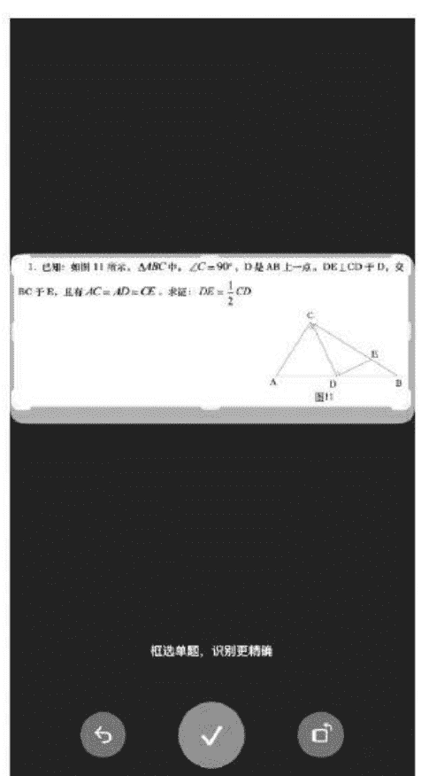

图3-5

点击界面下方的“”按钮，豆包即可快速生成相应的解题分析与答案。以下是具体的回答内容：

#### 分析

通过作辅助线构造全等三角形，再利用等腰三角形性质和全等三角形对应边相等来证明结论。

#### 详解

##### 1. 作辅助线并证明角相等

过点A作AF⊥CD。如图3-6所示，因为∠C= 90°，DE⊥CD，所以∠ACF + ∠DCE= ∠DCE +∠DEC，从而可得∠ACF= ∠DEC。

##### 2. 证明三角形全等

在△ACF与△CED中，因为∠ACF=∠DEC，∠AFC=∠CDE，AC=CE，所以△ACF≌△CED（AAS）。

##### 3. 利用全等得出线段相等

由△ACF≌△CED可得CF=DE。

##### 4. 利用等腰三角形性质得出结论

因为AC=AD，且AF⊥CD，根据等腰三角形三线合一的性质，可得CF=CD，所以DE=CD。

总结：

### 3.2.2 拓展语文写作思路

面对作文题目，有的学生容易陷入“不知道写什么”的困境，即使勉强动了笔，思路也容易混乱。豆包可以扮演“思维教练”的角色，通过引导性对话帮助学生捋清思路。下面，我们以写议论文时总是思路混乱，论据不丰富为例，讲解如何用豆包爱学来辅助写作文。

进入豆包爱学“语文作文”界面，选择“AI写作文”，如图3-7所示，在输入框内输入要写的作文的主题。通过“字数”选项设置作文的字数，“文体”选项包含了议论文、记叙文、其他。

#### AI写作文

作文要求

孟母三迁

- 拍题拍物
- 语音

- 同步作文
- 我的好朋友
- 争论
- 这样的人让我______

字数 800+

文体 议论文

写思路

写范文

图3-7

设置好以上选项，单击“写思路”，豆包即会生成清晰的作文思路，包括分析、立意、提纲，如图3-8所示。提纲中详细地分为开头、过渡、中间、结尾，构建出了清晰的议论文框架。

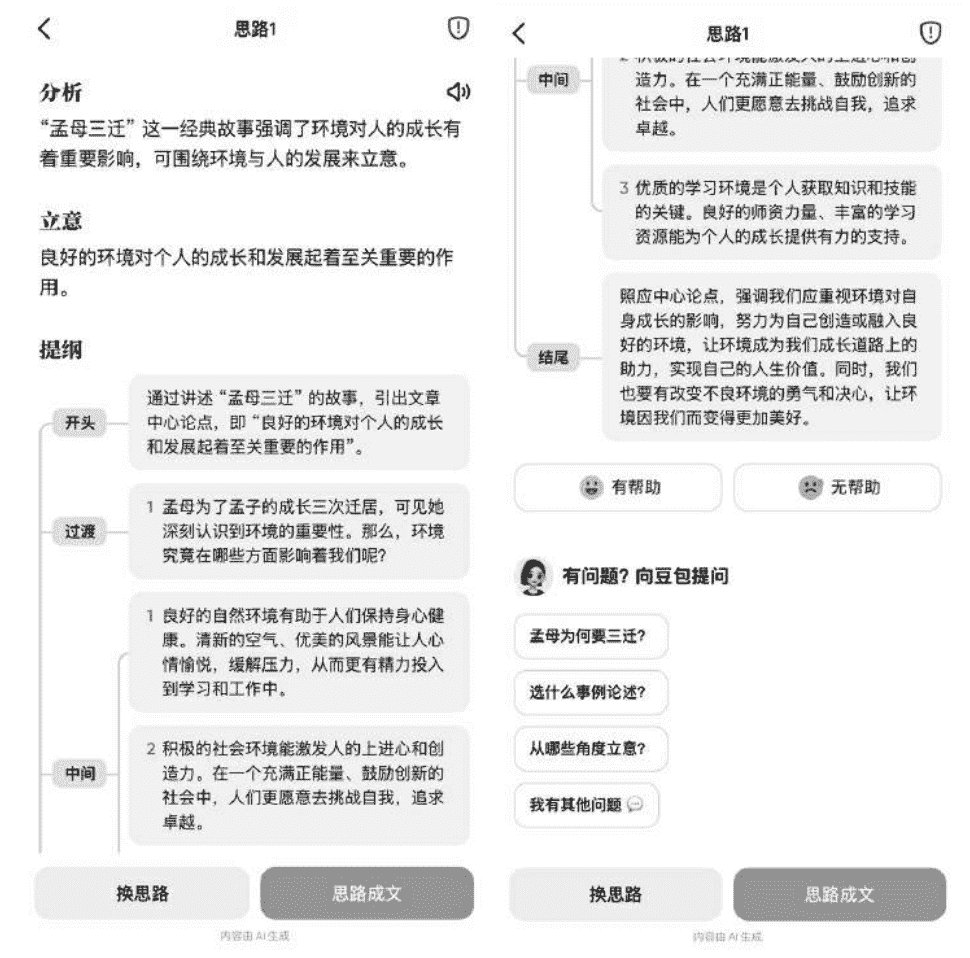

图3-8

如果对当前的思路不满意，还可以单击“换思路”按钮，生成新的思路，如图3-9所示。可以看到，新生成的思路与之前的思路有较大的区别。

#### 立意

孟母三迁启示我们，在成长过程中要学会主动选择和适应有利环境，以实现自我价值。

#### 提纲

1. **开头**：由“孟母三迁”的故事引发思考，提出中心论点：在成长过程中要学会主动选择和适应有利环境，以实现自我价值。
2. **过渡**：孟母为孟子选择了适宜的成长环境，而在现实生活中，我们每个人都需要为自己的成长负责，去主动探寻和融入有利的环境。
3. **中间**：
   - 主动选择有利环境是一种智慧的表现。如同孟子在良好的学习环境中，能够接触到优秀的思想和文化，为日后的成就奠定基础。我们在生活中也应善于甄别，选择那些能提升自己的环境。
   - 适应有利环境需要具备积极的心态和强大的能力。进入新环境可能会面临各种挑战，只有保持乐观积极的心态，不断学习和提升自我，才能真正融入其中，汲取环境带来的养分。
   - 在主动选择和适应有利环境的同时，我们也要有改变和创造环境的意识。当我

如果对写作思路满意，可以点击“思路成文”，豆包即可快速生成范文，如图3-10所示。豆包不仅提供文字版本，还支持语音朗读。

#### 孟母三迁之成长启示

1162字

写作思路

“昔孟母，择邻处”，孟母为了孟子的成长，三次迁居，最终为孟子选择了一个适宜学习的环境，孟子也在这样的环境中潜心学习，终成一代大儒。这个流传千古的故事，犹如一盏明灯，照亮我们前行的道路，它启示我们：在成长过程中，要学会主动选择和适应有利环境，以实现自我价值。

孟母的良苦用心令人动容，她深知环境对孩子成长的重要性。在现实生活中，父母无法永远为我们遮风挡雨，我们每个人都需要为自己的成长负责，去主动探寻和融入有利的环境。毕竟，成长是一场属于自己的征程，只有学会主动出击，才能在人生的道路上越走越远。

主动选择有利环境是一种智慧的表现。环境就像土壤，肥沃的土壤能孕育出更茁壮的生命。孟子在良好的学习环境中，周围都是勤奋好学之人，他能够接触到优秀的思想和文化，这无疑为他日后的成就奠定了坚实的基础。古往今来，无数事例都证明了主动选择有利环境的重要性。司马迁为了撰写

对范文不满意？点这里试试

古迹，收集了大量的历史资料，他深知置身于丰富的历史文化环境中，才

重写一篇

从啥角度写论点？

内容由 AI 生成

图3-10

以上豆包给出的思路和范文，对于作文写作有非常重要的借鉴意义，我们只需要选择符合自己想法的思路去写即可，同时也可以阅读范文，提升灵感。当然，想要写出独具一格的作文，一定离不开平时的阅读和积累。

### 3.2.3 辅助英语单词学习

学英语，单词是一项绕不开的任务。释义记混、发音不准、背了又忘，几乎是每个学习者都会遭遇的困扰。当面对这些问题时，豆包可以成为我们学习英语的助手。

#### 1. 快速了解单词释义

当我们要了解一个英语单词的意思时，过去查单词，词典里密密麻麻的中文对应词常让人无所适从，而问豆包就要快捷很多。比如，英文单词“assume”，词典上写着“假定，承担”，两个词之间似乎毫无关联，死记硬背很难记下来。我们可以这样问豆包：“为什么assume既有‘假定’又有‘承担’的意思？”

豆包的回答如下：

assume同时有“假定”和“承担”的含义，是因为它们都来自同一个核心动作：主动“拿过来、据为己有”，只是一个拿的是责任/角色，一个拿的是观点/前提。

##### 一、词源：从“拿”到多义

assume来自拉丁语assumere = ad-（向、到）+ sumere（拿、取）。

sumere = take（拿、取、承担）

ad- = to（朝向、主动）

→本义：主动拿过来、自己承担、接纳。

##### 二、两个核心义项的演变路径

###### 1. 承担（take on / undertake）

15世纪初进入英语时，主要意思就是擅自夺取、承担、就职。

例：

assume office 就职

assume responsibility 承担责任

assume control 接管控制权

###### 2. 假定（suppose / take for granted）

16世纪90年代才引申出“在论证中当作前提、无证据地认为”。

逻辑：把一个观点/事实在心里“拿过来、当作成立”，作为思考的起点。

例：

I assume you’re busy. 我假定你很忙。

Assume X is true. 假设X为真。

##### 三、一句话总结

“承担”是拿外部的责任/角色，“假定”是拿内部的观点/前提——两者都是主动“take”的抽象化。

通过豆包的详细解释，我们对assume一词的两个意思就非常清楚了，记忆起来也会容易得多。

#### 2. 提供记忆技巧

在英语单词中，不乏有一些又长又难记的单词。当遇到这种情况时，我们可以向豆包提问，以获得相关的记忆技巧。

示例指令：

我正在准备英语四级考试，在单词记忆方面遇到一些难记的长单词，如simultaneously等。请为我推荐一些记忆长单词的技巧。

豆包回答：

记四级长单词，别死背字母，用“拆+联+用”三步法最稳，我直接用你说的simultaneously举例，马上能用。

##### 一、音节拆分法：先读顺，再记拼

长单词记不住，多半是没读对。把长词按读音切成小段，大脑一次只记一小截。

simultaneously

读音：/sɪmlˈteɪniəsli/

拆：si-mul-ta-ne-ous-ly

读顺：西-马欧-特-内-额斯-里

会读，拼写基本就对80%。

技巧：先跟着音标读3遍，再闭眼默写拆分后的小段，比直接背字母快很多。

##### 二、词根词缀法：记一个，懂一串

四级长词90%是“前缀+词根+后缀”，认几个常用词缀，长词瞬间变简单。

simultaneously

simul-：相同、一起（= same）

-taneous：形容词后缀

-ly：副词后缀

→ simul（一起）+ taneous + ly → 同时地

##### 三、画面联想法：用图像代替字母

越抽象、越长的词，越要绑一个画面。

simultaneously

想象：几个人同时举手、同时开口说话。

看到单词→脑中出画面→立刻想起“同时地”。

## 3.3 文学解析与阅读精进

阅读经典文学不仅仅是为了获取知识，更是个人不断提升自身综合素质和专业能力的重要途径。豆包可以为我们提供文学解析以及阅读推荐。

### 3.3.1 解析文学作品

文学作品以小说、诗歌、散文、戏剧、寓言等为主要体裁，不单纯复刻现实，而是通过形象塑造、情节叙事、意境营造等手法，描摹人性百态、记录时代风貌。它既是创作者精神世界与价值观念的表达，也是人类文化传承、思想启迪的重要载体，能让读者在文字中感知世界、观照自我、获得精神滋养。

然而，文学作品产生于特定的年代，想深入理解文学作品就必须了解其产生的时代环境。豆包可以为我们提供深度的文学作品解析。

示例提示词：

我是一名中学教师，请帮我解析《水浒传》这部经典文学作品。解析内容包括：

1. 作品的背景分析；
2. 人物性格与关系分析；
3. 作品所反映的社会现象，及其影响。

要求生成的内容要有深度，且适合用于教学。

将以上提示词输入豆包，如图3-11所示，单击“发送”按钮，豆包即可对提示词中的文学作品进行分析，并生成解读。

以下是豆包生成的具体解析：

#### 《水浒传》经典文学作品教学解析

《水浒传》是中国古典四大名著之一，是元末明初施耐庵（一说罗贯中、施耐庵合著）根据北宋末年宋江起义史实创作的章回体长篇白话小说。这部作品既是中国古代白话小说的里程碑，也是反映封建社会底层民众抗争的“史诗性”文本，教学中需兼顾文学鉴赏与思想深度，引导学生理解作品的历史价值、文学价值与现实启示，以下从三个核心维度展开解析，适配中学课堂教学，可结合文本选篇（如《林教头风雪山神庙》《武松打虎》《智取生辰纲》等）同步讲解。

##### 一、作品的背景分析（史实+创作语境，贴合教学重点）

解析背景的核心是帮助学生理解：《水浒传》的“起义故事”并非完全虚构，其创作源于真实历史，又融入了时代诉求，是“史实改编”与“文学创作”的结合，这也是作品具有强烈真实感和感染力的关键。

###### （一）历史史实背景（北宋末年，起义原型）

作品的核心原型是北宋末年宋江领导的农民起义。据《宋史》等史料记载，北宋宣和年间（1119~1125年），宋江等36人在山东梁山泊聚众起义，反抗官府压迫，转战山东、河北一带，最终被朝廷招安，后参与镇压方腊起义，最终以失败告终。

教学重点：引导学生区分“史实”与“文学虚构”——史实中宋江起义规模较小（仅36人），持续时间短，而小说中“一百单八将”“梁山聚义”“三打祝家庄”等情节均为施耐庵的艺术加工，目的是放大“官逼民反”的主题，展现底层民众的抗争群像。同时补充北宋末年的核心社会矛盾，为后续理解“社会现象”铺垫：

…………

###### （三）教学总结与引导（升华主题，适配中学教学）

教学中，需引导学生明确：《水浒传》不是一部单纯“歌颂暴力”“歌颂反抗”的小说，而是一部“悲怆的英雄史诗”。它歌颂的不是“起义本身”，而是底层民众反抗不公、追求公平正义的精神；它揭露的不是“个别奸臣的罪恶”，而是整个封建专制社会的腐朽；它展现的不是“完美的英雄”，而是有血有肉、有优点有局限的普通人，在苦难中坚守正义、相互扶持的模样。

同时，引导学生辩证看待作品的局限性：由于时代的局限，作品中的“反抗”依然没有摆脱封建正统思想的束缚，梁山起义的悲剧是必然的，但这并不影响作品的价值——正是这种“悲剧性”，让作品更具深度，让我们更清晰地认识到封建制度的罪恶，更珍惜当下的公平正义社会。

可以看到，豆包对《水浒传》进行了深度的解析，从多个维度呈现了作品的丰富内涵。在构建提示词时，我们可以进一步细化解析要求，比如针对特定的人物或事件进行分析，以更加细致地了解整部作品。

### 3.3.2 个性化阅读清单推荐

豆包强大的交互与数据分析能力，能为我们从海量书籍中精准找到既能契合个人兴趣又能提升专业技能的好书。它不仅能根据我们的需求“量身找书”，更能通过深度交互，让书中的知识真正被转化。以下是相关示例。

示例提示词：

我是一名新媒体运营的新手，主要负责公众号撰写，目前最困惑的是如何提高点击率和粉丝互动。请推荐3~5本有关公众号运营从零基础到进阶的实操书籍，并简要说明每本书能解决我的哪些具体痛点。

将以上提示词输入豆包，如图3-12所示，单击“发送”按钮，豆包会根据提示词中的信息给出具体的推荐建议。

以下是豆包生成的具体内容：

#### 5本公众号运营实操书籍推荐：从零基础到进阶，直击点击率与互动痛点

作为新媒体运营的新手，你当前最核心的两个痛点——提高点击率和增强粉丝互动，以下5本实操书籍将从基础到进阶为你提供系统解决方案，每本书都有明确的痛点解决方向和可直接套用的方法：

1. 《公众号运营实战手册：57招让你实现从0到10万+》
   适合阶段：零基础到入门，快速建立运营框架。
   核心痛点解决：
   点击率提升：提供15种标题创作公式（如数字型、疑问型、利益型），教你3秒抓住用户注意力，直接套用即可提升点击率。
   互动设计：详解评论区运营技巧，包括如何设置“钩子”问题，如何回复评论促进二次互动，如何引导用户点赞转发。
   内容转化：传授从文章到公众号的关注引导方法，解决“看了不关注”的问题。
   数据驱动：教你分析后台数据，找到高互动内容规律，实现精准运营。
   实操亮点：57个具体可执行的招式，每个招式都配有真实案例，新手能快速上手。

2. 《微信公众号运营：排名优化+转发提升+打赏暴增+用户留存》
   适合阶段：入门到进阶，解决流量与留存核心问题。
   核心痛点解决：
   点击率提升：系统讲解17个正文创作技巧和17种文章排版方法，降低阅读门槛，提高完读率，进而提升转发率。
   搜索流量：揭秘5大微信搜索流量入口和28种关键词优化方法，让用户主动搜索找到你的公众号，解决“流量少”的痛点。
   粉丝留存：提供用户留存体系搭建方法，从路转粉到粉转忠，打破恶性循环。
   打赏互动：分析高打赏文章特点，教你如何设计内容激发用户赞赏意愿。
   实操亮点：逆向思维解决运营难点，所有方法都经过实战验证，可直接复制到你的公众号。

…………

阅读建议与核心解决方案表

| 痛点 | 优先阅读书籍 | 核心解决方法 |
| :--- | :--- | :--- |
| 点击率低（标题/封面问题） | 《公众号运营实战手册》《新媒体文案设计与软文写作》 | 标题公式 + 封面设计 + A/B 测试 |
| 粉丝互动少（评论/转发少） | 《参与感》《公众号运营实战手册》 | 互动钩子 + 评论回复 + UGC 引导 |
| 零基础不会操作 | 《从零开始学微信公众号运营推广》 | 后台操作 + 排版技巧 + 发布流程 |
| 流量少（搜索/推荐少） | 《微信公众号运营：排名优化 + 转发提升...》 | 关键词优化 + 搜索引流 + 内容质量提升 |
| 内容转化差（看了不关注） | 《公众号运营实战手册》《新媒体文案设计与软文写作》 | 关注引导 + 价值展示 + 信任建立 |

建议你按照“基础操作→内容创作→互动运营→流量增长”的顺序阅读，每本书重点解决1~2个核心痛点，边学边用，将书中的方法直接应用到你的公众号运营中，通过数据反馈不断优化。

通过豆包获得书单后，我们可以继续借助豆包的功能，将阅读从“单向输入”转变为“双向研讨”，加速技能内化。比如，在阅读《公众号运营实战手册》时，可以上传书籍的精彩章节或你的读书笔记至豆包的AI云盘，然后，开启“对话模式”。

你可以说：“请根据《公众号运营实战手册》中‘粉丝管理’的相关内容，以‘我最近账号涨粉遇到瓶颈’为主题，与我进行一次模拟对话。你先示范一遍，然后我来说，你帮我点评哪里运用得不对。”

豆包会根据你的命令生成示范，还能在你练习后，从结构、用词、情绪等角度给出反馈，这相当于请了一位私人演讲教练，让你的阅读更有收获和深度。

## 3.4 论文与报告撰写

学术论文是研究者针对特定学科领域的理论问题、现实问题或技术难题，运用科学的研究方法与严谨的逻辑论证，进行探索、分析、阐释并形成创新性、理论性的学术结论。豆包可以辅助提升撰写学术论文的质量。

### 3.4.1 学术论文搜索

在学术研究领域，文献检索与阅读是必不可少的基础工作。面对海量的学术资源，如何快速、精准地定位到所需的论文，并高效吸收其中的知识，是每个研究者都必须面对的挑战。豆包的智能交互、信息整合与精准理解能力，可以为学术论文搜索提供全新的解决方案，极大地提升了搜索效率与质量。

比如，你是一名研究生，正准备毕业论文，主题是关于人工智能在医疗影像诊断中的应用现状及未来发展趋势，现在需要通过学术搜索来获取相关的研究论文、报告和数据，就可以向豆包发送指令。具体步骤如下：

1. 打开豆包，点击输入框下面的“更多”，在弹出的选项框中，单击“深入研究”，如图3-13所示。

图3-13

2. 在输入框中输入提示词：检索“人工智能在医疗影像诊断中的应用现状及未来发展趋势”相关的最新学术论文，如图3-14所示。

#### 想研究什么主题？

图3-14

3. 点击“发送”按钮，豆包会在几分钟之内进行搜索并回答。以下是豆包回答的部分截图，如图3-15所示。

已搜集和分析资料

为满足用户获取近5年（2021-2026）全球AI医疗影像诊断领域研究进展的需求，我将重点搜索2021年1月至2026年2月期间发表的学术论文，涵盖技术创新（如Transformer架构、多模态融合等）和临床应用效果（如准确率、诊断时间等）两个维度，同时关注不同影像模态和疾病领域的研究，以及主要研究区域的分布特征。

artificial intelligence medical imaging diagnosis 2021-2026

AI radiology clinical applications recent advances

pubs.rsna.org researchgate.net pmc.ncbi.nlm.nih.gov sicve.it semanticscholar.org

pubmed.ncbi.nlm.nih.gov pmc.ncbi.nlm.nih.gov 展开

我查看了一些学术搜索结果，发现了重要线索，接下来要浏览最新发表的高质量论文来获取更详细内容。

已阅读相关资料

已阅读相关资料 multimodal generative AI medical image interpretation Nature 2025

generative medical image interpretation recent advances 2024 2025

developer.nvidia.com isip.piconepress.com healthmanagement.org pubs.rsna.org

展开

以上豆包筛选的相关资料可以为我们提供很好的参考。不过，专业的文献管理仍需借助特定工具，比如ReadPaper论文阅读平台等文献管理软件。另外，在使用豆包辅助论文搜索时，对于豆包生成的信息，特别是参考文献列表，应通过谷歌学术网（Google Scholar）、中国知网等权威数据库进行二次核实，以确保来源真实。

### 3.4.2 论文选题分析

选题是学术论文的核心，需要兼顾学术价值与实施条件。豆包通过分析学科关键词、近三年文献热点及研究者兴趣方向，可以快速生成具有创新性的选题建议。比如，你是一名某传播学专业本科生，计划研究“数字媒介对青少年发展的影响”，但觉得这个题目有点大，不够具体，就可以这样向豆包发送指令。

示例提示词：

我是一名传播学专业本科生，研究兴趣集中在“数字媒介对青少年发展的影响”，请提供5个符合学术规范、具备数据获取可能的开题选题，并简要说明每个选题的现实切入点和潜在理论价值。

将以上提示词输入豆包，如图3-16所示，单击“发送”按钮，豆包会根据提示词进行论文选题分析，并生成具体回答。

以下是豆包生成的具体内容：

说明：以下5个选题均遵循学术规范，优先选择数据可通过问卷调查、公开报告、权威数据库（如CNNIC、中国青少年研究中心）获取，贴合传播学核心理论，同时兼顾本科生研究能力范围，每个选题明确现实切入点与潜在理论价值，便于后续开题撰写与研究开展。

选题一：短视频沉浸使用对青少年自我认同建构的影响——基于某短视频平台用户的实证研究

现实切入点：当前青少年已成为短视频核心用户群体，“刷短视频”成为其日常休闲的主要方式，短视频的算法推荐、虚拟形象展示、圈层互动等特征，深刻影响青少年对自我价值、外貌、能力的认知（如容貌焦虑、网红模仿行为、自我表达风格）。可通过问卷调查（选取中学生、大学生样本）、深度访谈（少量青少年用户），结合短视频使用时长、使用内容类型等数据，分析沉浸使用与自我认同的相关性，贴合当下青少年媒介使用现状。

潜在理论价值：依托符号互动理论、自我认同理论，探讨数字媒介环境下青少年自我认同的建构路径与异化风险，丰富“媒介使用与个体社会化”的研究维度；弥补现有研究中“短视频沉浸性”与“青少年自我认同”关联性的细节空白，为传播学中“媒介效果”理论在青少年群体中的应用提供新的实证支撑。

………………

补充说明：以上选题的一手数据可通过校园问卷星发放、班级访谈获取（样本量控制在200~300份，符合本科生实证研究要求）；二手数据可参考CNNIC《中国青少年互联网使用状况调查报告》、中国青少年研究中心年度报告、相关核心期刊实证研究中的数据，确保数据获取的可行性与规范性。

通过与豆包的互动，一个宽泛的话题变得具体且有可操作性，你可以结合自己的资源进行筛选。比如，选择“短视频平台算法推荐对青少年信息茧房的影响”，然后继续通过豆包验证文献支撑强度，指令如下：

> “请围绕‘短视频平台算法推荐对青少年信息茧房的影响’，查询国内近五年CSSCI期刊中被引最多的3篇实证类论文的标题与核心变量是什么？”

如果豆包给出的文献资料丰富，意味着可以为选题可行性提供依据。我们就可以最终确定选题，着手下一步的操作。

### 3.4.3 撰写开题报告

开题报告是在正式开始撰写学术论文之前，向指导教师或评审小组提交的一份关于论文研究思路与写作计划的说明性文件。它是论文写作的第一道正式环节，相当于论文的“总体设计方案”和“立项说明书”。

对于不少本科生和研究生来说，撰写开题报告往往是一道难过的坎。它要求研究者在写作之前就清晰地回答一系列灵魂拷问：为什么做这个课题？别人已经做了什么？我打算怎么做？我有什么别人没有的新意？借助豆包可以为我们提供清晰的思路。

比如，你是某教育学专业本科生，现计划研究“短视频对青少年学习的影响”课题，那么，可以这样向豆包发送指令。

示例提示词：

我是教育学专业的学生，我论文的初步课题是“短视频对青少年学习的影响”。请帮我撰写一份关于该课题的开题报告。包括以下内容：

1. 研究背景和研究问题的定义；
2. 文献综述的概要；
3. 研究方向和数据收集计划；
4. 预期成果。

将以上提示词输入豆包，如图3-17所示，单击“发送”按钮，豆包即可根据提示词中的要求进行论文选题的分析，并生成具体回答。

我是教育学专业的学生，我论文的初步课题是“短视频对青少年学习的影响”。请帮我撰写一份关于该课题的开题报告。包括以下内容：
1. 研究背景和研究问题的定义；
2. 文献综述的概要；
3. 研究方向和数据收集计划；
4. 预期成果。

以下是豆包生成的具体内容：

#### “短视频对青少年学习的影响”开题报告

##### 一、研究背景和研究问题的定义

###### （一）研究背景

随着数字技术的快速迭代，短视频以其短平快、强直观、高互动的特点，迅速渗透到青少年的日常生活与学习中，成为数字时代青少年接触信息、获取知识的重要载体。

据第52次《中国互联网络发展状况统计报告》显示，截至2024年6月，我国网民规模近11亿人，其中青少年占新增网民的49.0%，总数量近2亿人，且未成年人触网低龄化趋势明显，10岁以前首次“触网”的未成年人占比达52%，较上年提高7.4%。

在青少年的网络使用中，短视频类App和其他视频网站最受青睐，47.5%的未成年人选择“看视频”，其中部分青少年将短视频用于学习相关用途，36.4%的未成年人会通过网络“写作业/查资料”。

………………

##### 四、预期成果

本次研究围绕选题展开系统性研究，预期形成以下三项成果，确保研究具有明确的产出与应用价值，贴合教育学专业论文要求：

1. 完成一篇高质量的毕业论文《短视频对青少年学习的影响及引导策略研究》，字数控制在8000~10000字，论文结构完整、逻辑严谨，结合实证数据，全面分析短视频对青少年学习的双重影响，提出科学合理的引导策略，顺利通过论文答辩。
2. 形成《短视频对青少年学习影响的实证研究报告》，系统梳理调查数据，明确青少年短视频使用现状、影响表现及关键影响因素，呈现研究过程与核心结论，为教育行政部门、学校、家庭提供数据参考。
3. 提出有针对性、可操作的多主体协同引导策略手册，涵盖家庭、学校、平台、社会及青少年自身的具体引导方法，为实践层面引导青少年合理使用短视频、发挥其学习价值提供具体指导。

可以看到，豆包给出了一份可供参考的开题报告，为用户撰写论文提供了清晰的思路。需要注意的是，在构建提示词时，我们要明确报告的结构和重点，这样能让豆包更精准地围绕论文选题做出报告。

# 第4章 高效办公，得力的职场智能工作伙伴

## 4.1 日常办公写作

在快节奏的职场环境中，效率是每一个职场人士都绕不开的话题。人们迫切需要有效的方法和工具提升工作效率，以更好地应对各种挑战。豆包是一个真正的高效工具，它可以解决工作中的诸多任务，让你的办公效率大大提升。

### 4.1.1 生成述职报告

临近年底或项目节点，撰写述职报告往往是许多职场人最头疼的任务之一——既要梳理繁杂的工作，又要提炼亮点、权衡措辞，还要在有限的时间内完成。可以说，每个环节都考验着职场人的专业素养与文字功底。

如何能又快又好完成述职报告呢？借助豆包可以让这个过程变得轻松起来。下面以实际的案例，详细阐述如何通过豆包快速撰写一份高质量的述职报告。

示例提示词：

我是一名市场专员，以下是我第三季度的工作：微博、小红书、抖音投放；新品发布会；找了10个关键意见领袖（KOL）；发布会来了300人；销售线索500条；预算花了30万；投资回报率（ROI）好像是1：5；物料制作延期了；下周要办渠道会。

请为我生成一份第三季度述职报告，要求包含：

量化指标维度；重点项目复盘；预算执行分析；存在的不足（要求务实，不浮夸）；下季度规划。

将以上提示词输入豆包，如图4-1所示，然后单击“发送”按钮，豆包即可快速生成一份述职报告。

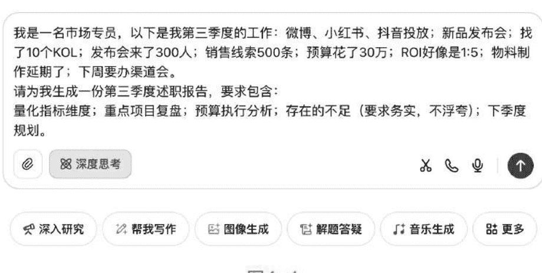

图4-1

以下是豆包生成的具体报告内容：

#### 市场专员第三季度述职报告

尊敬的领导：

您好！第三季度，我作为市场专员，围绕公司市场推广目标，有序推进各项市场工作，涵盖平台投放、活动执行、KOL合作等核心板块，同时直面工作中的问题与不足。现将本季度工作详细述职如下，恳请领导批评指正。

##### 一、第三季度量化指标完成情况

本季度聚焦市场推广、活动落地、线索获取等核心目标，各项量化指标具体完成如下，全程以数据为导向，确保工作可追溯、可复盘：

平台投放：完成微博、小红书、抖音三大主流平台全季度投放工作，实现多渠道曝光覆盖，助力品牌影响力提升及新品推广。

KOL合作：成功对接并合作10名KOL，完成相关推广内容投放，借助KOL流量扩大品牌及新品曝光范围。

活动执行：顺利举办新品发布会1场，现场到场人数达300人，有效传递新品核心价值，提升品牌知名度；筹备下季度渠道会（定于下周举办），目前处于前期筹备阶段。

……………

以上是豆包生成的述职报告初稿，框架大致可用，但如果想要拔高站位，让报告看起来更有“含金量”，可以继续进行优化。

优化提示词：

请帮我检查“问题与不足”部分。我提到“物料制作延期”，请帮我分析可能导致这个问题的更深层次原因（如流程审批、供应商管理），并提出两条具体的改进措施。另外，将“下一步计划”中的“举办渠道会”扩展成一个包含时间节点、预期目标和所需支持的详细行动方案。

通过这种分段式追问，豆包能帮助我们从一个简单的现象挖掘出背后的管理问题，让领导看到你的思考深度。

经过以上几步，一份专业、翔实且个性化的述职报告就基本成型了。最后，你还可以让豆包根据公司的文化氛围调整语气——如果是国企/政府单位，可以要求“风格更严谨、措辞更稳重”；如果是互联网公司，可以要求“更互联网化、更简洁有力”。

优化提示词：

请将以上所有修改整合成一份完整的述职报告，并为每一部分提炼一个小标题。最后，根据这份报告内容，帮我生成3条可能的“领导提问”及“应答思路”，以便我做答辩准备。

最终，我们不仅得到了一份报告，还通过豆包的辅助，对业务进行了复盘和预演。这就是借助豆包撰写述职报告的完整流程。

### 4.1.2 撰写工作计划

在快节奏的现代职场中，每个人都面临着繁重的工作任务，一份清晰、可行的工作计划可以让任务更高效地执行。豆包作为一个智能助手，凭借强大的逻辑梳理、内容生成和个性化适配能力，能快速帮我们搭建工作计划框架、落实具体细节，使我们的工作事半功倍。

用豆包生成工作计划，核心的要点是“精准指令+合理优化”。首先要明确自身的需求，通过清晰的提示引导豆包输出符合预期的内容，再结合实际工作场景微调完善，即可完成一份合格的工作计划。以下是相关示例。

示例提示词：

豆包，我有以下几个任务需要完成：

……（列出你的任务）

请根据这些任务帮我撰写一份工作计划，要求如下：

……（撰写的要求）

根据以上提示词框架，我们只需要把相关的信息代入，即可生成一份工作计划。下面，我们代入一个具体的案例——某公司行政专员李华需要撰写一份工作计划，当天的具体任务包括：组织周末的公司团建活动；完成一批办公物资（2台电脑、1台打印机）采购与安装事宜；周一下午5点例会，汇报近期岗位缺失与招聘情况；负责安排公司老总周二出差的机票、酒店预订。

将上述任务列表代入提示词框架中，然后提出撰写要求，输入豆包，如图4-2所示，单击“发送”按钮，即可生成工作计划。

#### 帮我写作

润色校对，一键成文

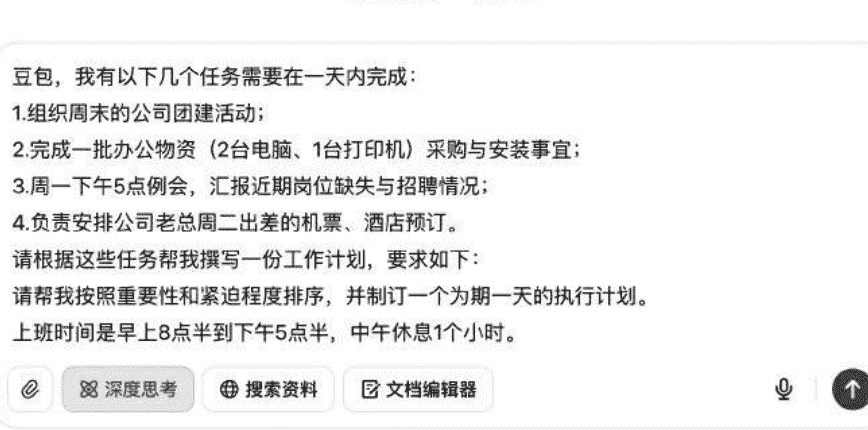

图4-2

以下是豆包生成的一日工作执行计划：

核心原则：优先处理紧迫且重要的任务，再推进重要不紧迫的任务，确保当日完成所有既定工作，兼顾效率与质量，避免遗漏关键事项。

##### 一、任务优先级排序（按重要性+紧迫程度从高到低）

1. 紧迫且重要：周一下午5点例会汇报近期岗位缺失与招聘情况（周一下午即用，直接对接会议需求，影响团队招聘推进，为最高优先级）。
2. 紧迫且重要：安排公司老总周二出差的机票、酒店预订（周二出差，今日需确认所有事宜，避免影响老总行程，优先级次之）。
3. 重要不紧迫：完成2台电脑、1台打印机的采购与安装事宜；组织周末的公司团建活动（采购与团建虽然重要，当日不紧迫）。

##### 二、一日执行计划（分时段落实，兼顾衔接性）

###### 1. 8:30~10:00：优先推进最高优先级任务——准备周一例会汇报材料

梳理近期岗位缺失明细，核对招聘进度；整理汇报框架，重点突出岗位缺失影响、当前招聘进展、后续招聘计划及需协调事项，形成简洁明了的汇报提纲（可直接用于例会发言）。

###### 2. 10:00~11:00：推进次高优先级任务——预订老总周二出差机票、酒店

确认老总出差的具体时间、目的地、住宿偏好及特殊需求；查询符合要求的机票、酒店，对比价格及便利性，完成预订并付款，截图留存订单信息；将机票、酒店详情整理成文字，发送给老总确认，确保无遗漏。

###### 3. 11:00~12:00：推进重要任务——办公物资采购与安装对接

联系合作供应商，确认2台电脑、1台打印机的型号、价格、库存，核对采购预算，签订采购订单；协调供应商，确定今日送货及安装时间，同步告知使用部门；整理采购单据、合同，归档留存，同步更新办公物资采购台账。

###### 4. 12:00~13:00：中午休息

合理休息，恢复精力，可简单梳理下午工作重点，确保下午高效推进。

###### 5. 13:00~15:00：跟进办公物资安装，查漏补缺

对接供应商送货人员，确认物资送达时间，现场验收；监督安装人员完成设备安装、调试，确保电脑、打印机可正常使用，同步教会相关使用人员基础操作。

###### 6. 15:00~17:00：推进次要任务——计划周末公司团建活动

确认团建活动核心需求，如参与人数、活动预算、活动类型；联系2~3家团建场地或服务商，对比方案、价格、安全性，确定团建场地及活动流程；整理团建方案，发送至公司群，通知员工报名确认。

###### 7. 17:00：参与例会，汇报情况

在上述的回复中，可以看到豆包对所有的任务都进行了深入的分析，包括任务重要性与紧迫性的排序，以及每项任务的具体执行时间、内容，可以说是非常详细的。如果想要让豆包生成的计划更加一目了然，可以继续要求豆包采用Markdown（轻量级标记语言）格式输出表格形式。

优化提示词：

请根据附件内容（上述生成的一日工作执行计划）采用Markdown格式的表格形式输出执行计划，尽量精简一些。

豆包生成的表格如下。

#### 一日任务执行计划（表格版）

| 时段 | 任务优先级 | 具体任务及执行要点 |
| :--- | :--- | :--- |
| 8:30-10:00 | 最高优先级 | 准备周一汇报材料：梳理岗位缺失明细、核对招聘进度，形成含缺失影响、招聘进展、后续计划及协调事项的汇报提纲。 |
| 10:00-11:00 | 次高优先级 | 预订老总周二出差机票、酒店：确认出差需求，查询对比后完成预订，留存订单并将详情同步老总确认。 |
| 11:00-12:00 | 重要任务 | 办公物资采购与安装对接：确认2台电脑、1台打印机的采购细节并签订订单，协调送货安装时间，整理单据归档并更新台账。 |
| 12:00-13:00 | 休息 | 合理休息，可简单梳理下午工作重点。 |
| 13:00-15:00 | 重要任务（跟进） | 跟进办公物资安装：验收送达物资，监督设备安装调试，教会使用人员基础操作。 |
| 15:00-17:00 | 次要任务 | 计划周末公司团建：确认团建需求，联系2-3家服务商对比方案，确定场地流程后整理方案通知员工报名。 |
| 17:00 | 常规任务 | 参与例会，汇报当日工作情况。 |

通过进一步的提示词优化，豆包生成的一日任务执行计划（表格版）非常简洁明了，时间、优先级以及任务醒目易记。对于多任务、长时间的工作计划，我们可以在生成文字版后，继续优化生成表格版，以提升便捷性。

### 4.1.3 撰写各类邮件

邮件沟通是商务往来中较正式的形式之一，其撰写效率与质量直接影响工作效率与专业形象。然而，面对大量需要精心措辞的各类公文，不少职场人士常常陷入耗时、费力的状态。借助豆包可以提供有效的解决方案。

无论是向上级申请资源、向客户同步进展，还是处理棘手的投诉邮件。你只需要向豆包提供邮件的具体内容，撰写要求和身份，豆包就能生成一封专业的邮件。以下是相关示例。

示例提示词：

请帮我撰写一封正式邮件，收件人是部门总监李林，发件人是我（市场部专员张艳），主题为“关于Q5新媒体推广效果的简要汇报”。需包含：背景简述（2句话）、核心数据（3项关键指标及数值）、存在问题（1点）、后续计划（2条具体行动）。

将以上提示词输入豆包，如图4-3所示，单击“发送”按钮，豆包会根据指令生成结构完整、逻辑清晰的初稿，用户只需核对数据并微调语气即可发送，避免了从零开始撰写的时间耗费。

以下是豆包生成的具体邮件内容：

尊敬的李林总监：

您好！为同步Q5阶段新媒体推广工作进展，总结推广成效、梳理现存问题并明确后续方向，特向您简要汇报本次推广相关情况。

##### 一、推广背景简述

本次Q5新媒体推广围绕部门核心业务目标开展，聚焦主流新媒体平台，旨在扩大品牌曝光量、提升用户转化率；推广周期为Q5全季度，覆盖抖音、微信视频号、小红书三大核心渠道，精准触达目标客群。

##### 二、核心推广数据

本次推广核心数据如下，整体达成阶段性基础目标：

曝光量：累计实现曝光86.2万次，较Q4提升12.3%，超额完成80万次的预设目标。点击量：累计点击量15.8万次，点击转化率18.3%，略高于行业平均水平17.5%；

有效咨询量：通过推广引导产生有效咨询326条，较Q4增长8.7%，为后续业务转化奠定基础。

##### 三、现存问题

推广内容针对性有待优化，小红书平台年轻客群内容适配度不足，导致该渠道点击转化率（15.1%）低于抖音（20.2%）、视频号（19.5%）两大渠道，未能充分挖掘该渠道的目标客群潜力。

##### 四、后续计划

针对现存问题及下一阶段目标，制订以下两项具体行动计划：

1. 优化内容策略。联合内容组开展小红书年轻客群需求调研，下周内完成调研分析并输出内容调整方案，重点增加年轻化、场景化内容，提升该渠道适配度。
2. 强化数据监测。每日跟踪三大平台核心指标变化，每周输出数据简报，及时发现推广中的问题并快速调整推广策略，确保下一阶段推广效果稳步提升。

本次Q5新媒体推广虽取得一定成效，但仍有提升空间，我将严格落实后续计划，持续优化推广工作，力争达成更高目标。如有相关指导意见，恳请李总监告知。

此致

敬礼！

发件人：市场部专员 张艳

日期：××××年××月××日

以上豆包生成的邮件基本符合要求，如果想进一步优化，可以通过分阶段指令逐步完善细节，适用于对措辞精准度要求高的场景。比如，语气更谦和；文案缩短30%，保留“响应速度”“兼容性”两个关键词等。豆包会根据每轮指令动态调整内容，最终生成简洁、专业且符合场景需求的邮件。

### 4.1.4 撰写会议发言稿

在职场中，参与各种会议并发言是工作中重要的一部分，这需要提前撰写发言稿。然而，当面对临时会议、主题变更或内容空白等场景时，容易让人因时间紧迫或思路混乱陷入焦虑。此时，借助豆包可以极大地提升撰写发言稿的速度。

在使用豆包生成发言稿之前，需要明确身份、场景、主题、个性化素材。有了这样的清晰指令，生成的发言稿才契合需求。下面以撰写机关工作会议发言稿为例，详细展示借助豆包生成发言稿的流程。

示例提示词：

假设你是一位有15年经验的机关秘书，请帮我起草一份关于优化营商环境的会议发言稿。要求：

1. 字数1500字左右，分三个部分——当前形势、存在问题、下一步举措。
2. 语言风格庄重务实，适当运用排比句式。
3. 近期上级强调“放管服”改革，需在讲话中体现。

将以上提示词输入豆包，如图4-4所示，单击“发送”按钮，豆包会根据指令的要求生成一份发言初稿。

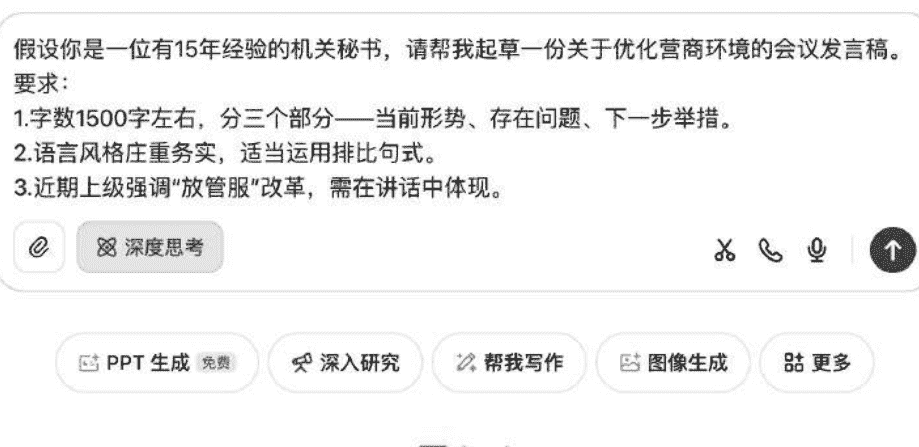

以下是豆包生成的具体发言稿：

#### 在全市优化营商环境工作推进会上的发言

同志们：

营商环境是市场经济的“生命线”，是城市发展的“核心竞争力”，更是推动高质量发展的“关键支撑”。当前，上级部门持续强调深化“放管服”改革，着力培育和激发市场主体活力，为我们优化营商环境指明了方向。

今天我们召开这次会议，就是要全面分析当前形势，清醒正视存在问题，精准部署下一步举措，动员全市上下凝心聚力、真抓实干，以更优营商环境护航全市经济社会高质量发展。下面，我讲三点意见。

##### 一、提高政治站位，清醒认识优化营商环境的当前形势

当前，我国经济发展进入新常态，区域竞争日趋激烈，营商环境已成为吸引投资、集聚要素、激发活力的核心抓手，更是检验我们履职能力、工作作风的重要标尺。

从全国全省层面看，“放管服”改革持续向纵深推进，各地纷纷出“实招”亮“新招”，从制度创新、流程优化、服务提升等方面发力，全力打造市场化、法治化、国际化营商环境，形成了“千帆竞发、百舸争流”的激烈竞争态势。

从我市实际情况看，近年来我们始终坚持把优化营商环境作为“一把手”工程，深入贯彻落实上级决策部署，持续深化“放管服”改革，取得了阶段性成效。

…………

同志们，优化营商环境，功在当代、利在千秋；深化“放管服”改革，任重道远、责无旁贷。让我们以坚定的决心、务实的作风、有力的举措，凝心聚力、真抓实干，持续优化市场化、法治化、国际化营商环境，不断激发市场主体活力和创造力，为推动全市经济社会高质量发展做出新的更大贡献！

我的发言完毕，谢谢大家！

当然，如果你对生成的初稿不满意也可以继续优化。比如，对发言稿风格进行优化。

优化提示词：

以上生成的发言稿基本符合要求，但风格有些太官方，请少一些官话、客套话，让发言稿更加亲和一些。

通过进一步的提示词优化，豆包会在初稿的基础上进行修改，再次生成发言稿。以下是部分新生成的发言稿：

##### 一、认清当前形势，切实增强优化营商环境的紧迫感

当前，我国经济发展进入新常态，区域之间的竞争越来越激烈，说白了，现在的竞争，本质上就是营商环境的竞争。谁的营商环境好，谁就能吸引更多投资、集聚更多资源，谁就能抢占发展先机。

从全国、全省来看，“放管服”改革一直在向深里走、向实里走，各地都使出浑身解数，从制度创新、流程优化、服务提升等方面发力，全力打造市场化、法治化、国际化的营商环境，竞争态势可以说是“千帆竞发、百舸争流”。

再看我们本地，这几年，我们始终把优化营商环境当成头等大事来抓，认真落实上级的决策部署，持续深化“放管服”改革，确实取得了一些实实在在的成效。

…………

从新生成的发言稿来看，优化后的效果要比之前好，少了一些空话、套话，更加接地气。此时，最终的发言稿基本完成。你只需要通读一遍，删减一些不合适的内容，或者补充一些自己的想法即可。

## 4.1.5 PPT文件生成

用传统的方式制作一份专业、美观的PPT需要耗费大量时间，从找模板、提炼大纲，到调整格式、搜配合适的图片等，一套流程下来，半天时间就过去了。而借助豆包生成PPT，则要更加快捷。

豆包自带有“PPT生成”功能，在输入框的下方，即可找到“PPT生成”选项，如图4-5所示。

图4-5

单击“PPT生成”选项，用户只需要在输入框中输入相应的主题，添加具体要求和参考资料，也可以上传文件，如图4-6所示。输入的内容越详细，豆包生成的PPT就越能符合用户的需求。

### 智能生成，自由定制

图4-6

接下来，我们代入具体的内容，展示用豆包生成PPT的具体流程。

示例提示词：

你是一个经验丰富的初中物理老师。请为“浮力原理”这堂课生成一个PPT大纲。要求包含：

1. 引入（曹冲称象或死海不死）；
2. 浮力定义与产生原因（强调实验演示）；
3. 阿基米德定律（公式推导）；
4. 浮力的应用（潜水艇、轮船）；
5. 课堂练习题。大纲需逻辑递进，适合40分钟课堂。

将以上提示词输入豆包，如图4-7所示，然后单击“发送”按钮，稍等几分钟，豆包即可生成完整的PPT文件，如图4-8所示。

### 智能生成，自由定制

PPT 生成 你是一个经验丰富的初中物理老师。请为“浮力原理”这堂课生成一个PPT大纲。要求包含：
1. 引入（曹冲称象或死海不死）；
2. 浮力定义与产生原因（强调实验演示）；
3. 阿基米德定律（公式推导）；
4. 浮力的应用（潜水艇、轮船）；
5. 课堂练习题。大纲需逻辑递进，适合40分钟课堂。

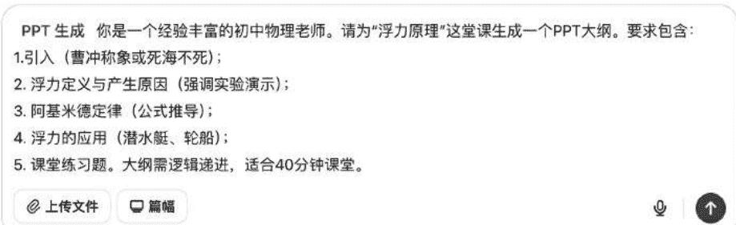

图4-7

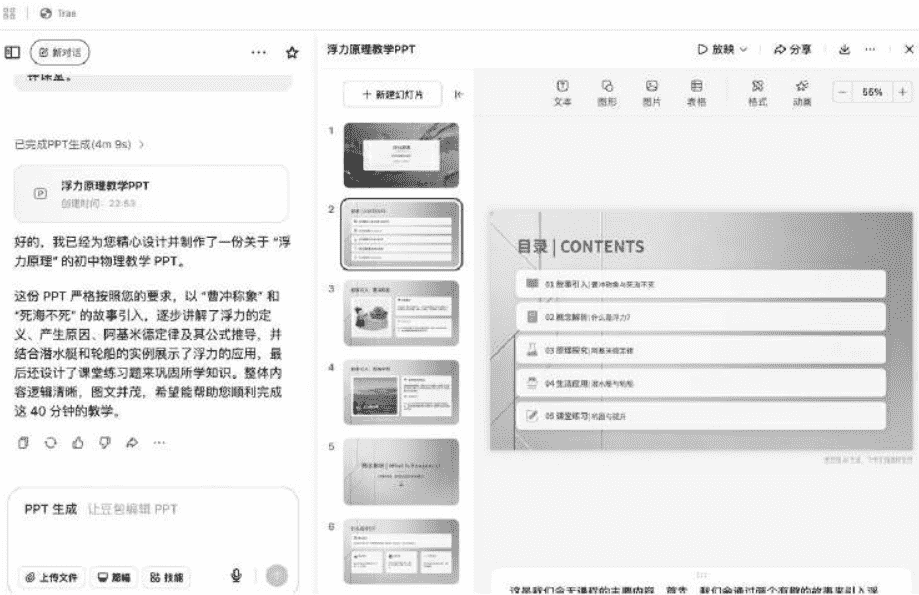

图4-8

豆包生成PPT后，我们需要进行校验，比如检查相关概念是否准确，如浮力方向竖直向上；逻辑是否连贯等。同时，如果对有的内容不满意或补充相应内容，也可以进行修改，比如追加指令“请将阿基米德定律的案例扩充为两个生活实例”来细化内容。

另外，如果想要制成的PPT更契合自己的需求，可以在输入内容时，批量上传素材，比如一次性上传会议纪要、销售数据表、现场照片等。

## 4.2 团队沟通与协作

在商业环境中，有效的沟通能确保每个成员都清晰理解共同目标与个人职责，协作则能将个体力量汇聚成强大的团队合力。当沟通顺畅、协作无间时，团队便能高效运转，实现“1+1>2”的协同效应。本节将介绍豆包在部门沟通、团队冲突、会议组织中的辅助应用。

### 4.2.1 跨部门沟通策略生成

跨部门沟通是企业或公司成员非常重要的一项能力。很多时候，由于部门目标差异、信息壁垒等问题，跨部门沟通的效率低下，甚至发生互相推诿等情况。面对这样的情况，我们可以借助豆包快速生成符合各部门需求的沟通策略。

豆包作为AI助手，可以通过结构化信息整合、智能需求分析和场景化沟通模板生成，将模糊的协作需求转化为可执行的沟通方案。比如，当市场部需要技术部支持新功能开发时，豆包可快速分析双方需求，生成包含技术可行性、时间节点的沟通框架，减少无效讨论。

下面，我们以某电商企业计划推出“会员日”大促活动，需市场部、供应链部、技术部协同完成流量承接、库存调配和系统扩容为例，让豆包生成各部门沟通策略。

示例提示词：

你是一名沟通策略专家，请根据以下情况制订跨部门沟通策略。

项目为电商企业计划推出“会员日”大促活动，需要市场部、供应链部、技术部协同完成流量承接、库存调配和系统扩容，目的是保证促销活动顺利举行并获得预期效果。

将以上提示词输入豆包，如图4-9所示。单击“发送”按钮，豆包会根据提示词生成具体的沟通策略。

以下是豆包生成的具体内容：

#### 电商企业“会员日”大促跨部门沟通策略

核心目标：以“会员日”大促顺利落地、达成预期流量与转化为核心，打通市场部、供应链部、技术部沟通壁垒，明确各部门协同节点、信息传递标准，解决流量承接、库存调配、系统扩容的协同痛点，实现“信息同步无偏差、责任划分无模糊、应急响应无延迟”，确保活动全流程高效衔接。

##### 一、前期筹备阶段：定目标、明分工、建机制（活动前2~3周）

本阶段核心是统一认知、明确边界，避免后期因需求不清、衔接不畅出现问题，为活动落地奠定基础。

###### （一）核心沟通内容

1. 统一活动核心目标

市场部明确会员日流量目标，如独立访客数、引流渠道；转化目标，如下单率、客单价；同步至供应链、技术部；三方结合自身能力，确认目标可行性，若存在冲突，如流量峰值超出系统承载、库存无法支撑爆款销量，当场协商调整，形成书面目标共识。

2. 明确各部门核心职责与衔接点

市场部：负责活动方案（玩法、优惠力度）、引流计划、宣传物料输出，同步活动节奏（预热期、爆发期、返场期）及各阶段流量预估，对接供应链确认库存适配性，对接技术部确认流量承接、活动页面开发需求。

…………

总结：本次跨部门沟通策略以“全流程协同、全节点同步、全突发响应”为核心，贴合市场、供应链、技术三个部门的业务特点和协同需求，通过明确目标、划分职责、建立机制、优化流程，破解跨部门沟通壁垒，确保“会员日”大促活动顺利举行，达成预期流量与转化目标，同时沉淀可复用的协同经验，提升企业跨部门沟通效率。

通过上述提示词，输入各部门职责后，豆包会生成利益关联图谱，并最终生成一份详尽的各部门沟通策略，有助于我们提前预演可能存在的沟通问题，让“会员日”促销活动顺利举行。

### 4.2.2 提供团队冲突解决策略

在职场中，团队协作如同精密运转的齿轮组，任何一个环节的卡顿都可能引发整体效率的下降。而冲突，往往是团队协作中最常见的“卡顿”来源——无论是因目标分歧产生的理念碰撞，还是因责任模糊导致的推诿扯皮，抑或是因沟通不畅引发的情绪对立，都可能让团队陷入内耗。如何高效化解冲突、重建协作信任呢？

借助豆包的逻辑分析和沟通引导能力，可以有效辅助我们化解矛盾、提升协同效率。以下通过一个真实场景，展现豆包如何助力团队从冲突走向共识。

示例提示词：

我是互联网公司的产品经理，团队在规划新版本功能时，我主张优先优化用户体验，而技术负责人则坚持先解决系统性能瓶颈。现双方各执一词，会议陷入僵局：我认为“用户体验是核心竞争力”，技术负责人反驳“性能问题不解决，用户根本留不住”。

请帮我分析一下，如何平衡产品体验优化与系统性能提升的优先级，并给出建议。

在构建提示词时，要明确问题所在并要求给出建议。将以上提示词输入豆包，如图4-10所示，单击“发送”按钮，豆包即可对你的需求进行分析，并生成一定的建议。

我是互联网公司的产品经理，团队在规划新版本功能时，我主张优先优化用户体验，而技术负责人则坚持先解决系统性能瓶颈。现双方各执一词，会议陷入僵局：我认为“用户体验是核心竞争力”，技术负责人反驳“性能问题不解决，用户根本留不住”。
请帮我分析一下，如何平衡产品体验优化与系统性能提升的优先级，并给出建议。

图4-10

以下是豆包生成的具体分析与建议：

作为产品经理，你和技术负责人的矛盾本质不是对立，而是用户留存的两个核心环节优先级错位：

你抓的是用户愿不愿意用（体验），他抓的是用户能不能用（性能），两者都是留存关键，只是底线和上限的区别。

下面给你一套能直接在会议上落地的平衡逻辑+执行方案，快速打破僵局。

##### 一、先一句话拉齐共识，停止对立

先把双方的观点统一成同一个目标，而不是互怼：性能是留住用户的底线，体验是吸引用户的上限。没有性能，体验等于零；只有性能，没体验也留不住人。

先让技术负责人认可：性能不是为了技术而技术，是为了用户体验能正常生效。你也要认可：体验优化不能建立在不稳定的系统上。

##### 二、核心平衡原则：先兜底，再增量

1. 先定义：什么是必须先做的性能瓶颈

只把真正影响用户使用的致命性能问题定为第一优先级，而不是优化所有性能：

- 崩溃率高、页面卡死、加载超时；
- 核心链路（登录、支付、下单、搜索）响应过慢；
- 高并发下会宕机、雪崩；

这类属于“用户根本用不了”，必须优先修复，这是保命项。

…………

##### 四、你在会议上可以直接说的话术（软化对立，快速达成一致）

×哥（技术负责人），我完全认同：性能不稳，用户连用都用不了，谈体验就是空中楼阁，这是咱们的底线，必须先守住。

但咱们这次要做的体验优化，都是核心流程里不加重性能负担、直接减少用户投诉的点，完全可以和性能修复并行做。

咱们这么定：

1. 先把致命性能问题列出来，定为P0，全力保障；
2. 核心体验优化也定为P0，抽小部分资源同步上；
3. 剩下的性能重构和边缘体验，咱们放到下一轮。

既不冒系统风险，也不丢用户体验，你看行不行？

以上豆包对团队冲突进行的分析，以及提出的建设性意见，能为我们提供决策参考，对解决冲突起到辅助的作用。预计能进一步减少团队摩擦，提升团队整体的工作效率。

### 4.2.3 会议议程安排

会议是团队协作、决策制定的重要环节，良好的会议组织能够确保会议目标的达成。然而，组织一场会议需要经历耗时、琐碎的会前筹备环节。组织者需要协调各方时间、撰写通知、准备资料，耗费大量精力。

借助豆包，这些工作可以变得轻松高效，从会前的周密筹备，到会议的顺利召开，豆包以其卓越的自然语言处理和数据分析能力，帮助职场人士提升会议效率。以下是借助豆包生成会议议程的示例。

示例提示词：

请根据以下议题生成一份完整的会议议程，议题包括：X5销售数据复盘、新产品上市策略、渠道商激励政策。

会议时长2小时，需合理分配每个议题的时间并设置茶歇。

将以上提示词输入豆包，如图4-11所示，单击“发送”按钮，豆包能够迅速生成一份结构清晰、时间分配合理的议程草案。

请根据以下议题生成一份完整的会议议程，议题包括：X5销售数据复盘、新产品上市策略、渠道商激励政策。
会议时长2小时，需合理分配每个议题的时间并设置茶歇。

以下是豆包生成的具体会议议程：

#### X5销售复盘、新产品上市及渠道商激励专题会议议程

##### 一、会议基本信息

会议主题：X5销售数据复盘、新产品上市策略研讨、渠道商激励政策确定

会议时长：2小时（120分钟）

参会人员：销售部、市场部、产品部、渠道部核心成员及管理层代表

主持人：×××

记录人：×××

会议形式：线下会议（或线上+线下结合）

##### 二、详细议程安排（总时长120分钟）

| 时间段 | 时长 | 议程内容 | 具体环节 | 负责人 |
|---|---|---|---|---|
| 00:00-00:05 | 5分钟 | 会议开场 | 主持人明确会议主题、议程安排及会议纪律，介绍参会人员，说明会议核心目标 | 主持人 |
| 00:05-00:40 | 35分钟 | X5销售数据复盘 | 1. 销售负责人汇报X5近期销量、销售额、区域分布、客户反馈等核心数据；2. 分析数据异常点（如销量下滑/增长原因、优势/劣势区域）；3. 各部门补充意见，明确复盘结论及后续改进方向 | 销售部负责人 |
| 00:40-00:50 | 10分钟 | 茶歇 | 参会人员休息，自由交流，为后续议题讨论储备精力 | 行政支持 |
| 00:50-01:25 | 35分钟 | 新产品上市策略 | 1. 产品经理介绍新产品核心卖点、定位及目标客群；2. 市场部汇报上市推广方案（含宣传渠道、活动策划、预算分配）；3. 参会人员讨论方案可行性，提出优化建议；4. 确定最终上市策略及责任分工 | 产品部+市场部负责人 |
| 01:25-01:55 | 30分钟 | 渠道商激励政策 | 1. 渠道部负责人汇报现有渠道商现状及激励政策痛点；2. 提出新的渠道商激励方案（含返利、奖励、支持政策等）；3. 参会人员讨论方案合理性，平衡公司成本与渠道积极性；4. 确定最终激励政策及落地时间 | 渠道部负责人 |
| 01:55-02:00 | 5分钟 | 会议总结 | 主持人梳理各议题结论、明确后续工作节点及责任人，强调重点任务，宣布会议结束 | 主持人 |

##### 三、会议注意事项

1. 各议题负责人需提前准备相关汇报材料（数据报表、方案草案等），确保汇报高效、精准；
2. 讨论环节需围绕议题展开，控制发言时长，避免偏离主题，确保会议按议程推进；
3. 记录人需准确记录各议题结论、工作分工及时间节点，会议结束后1个工作日内整理会议纪要并分发至参会人员；
4. 参会人员需提前10分钟入场，遵守会议纪律，手机调至静音或震动状态。

豆包生成的上述会议议程为我们提供了会议的大致框架，我们只需要根据框架补充主要的信息内容，一个完整的会议议程就基本完成了。

## 4.3 求职与招聘

精准对接、高效沟通是求职招聘的核心。豆包可以助力个人和企业更好地实现互相成就。对求职者而言，借助豆包可以生成个性化的求职信和自我介绍，提高个人竞争力和面试成功率；对于企业而言，借助豆包可以快速生成招聘信息等，实现智能化人才招聘。

### 4.3.1 个性化求职信撰写

任何时候，一份出色的求职信都是获得面试机会的“敲门砖”，它如同打开理想工作大门的钥匙，能够精准地向招聘者展示自己的独特优势与适配度。豆包凭借其丰富的知识储备和智能交互能力，能为求职者提供高效、精准且个性化的求职信撰写支持。

下面，将详细介绍如何借助豆包进行个性化求职信撰写。

示例提示词：

我是一名应届生，曾在××科技公司市场部实习。实习期间，我主要负责官方抖音号和微信公众号的运营，独立策划了5期短视频内容，其中一期关于“办公好物分享”的视频播放量达到了10万+，点赞数超过5000，并为公司官方账号涨粉2000人。

请你扮演一位资深的互联网行业HR（人力资源），基于我提供的实习经历，帮我写一封求职信。要求如下：

1. 采用“引人注目的开场→我的胜任力证明→对公司的向往→自信结尾”的结构。
2. 在描述实习经历时，请使用STAR法则（情境、任务、行动、结果）来重构我的经历。
3. 请务必突出我将播放量做到10万+、涨粉2000人的具体数据，用数字说话。

将以上提示词输入豆包，如图4-12所示，单击“发送”按钮，豆包会从资深互联网HR的视角，贴合应届生特质，突出核心数据，撰写一封适配互联网市场相关岗位的求职信。

以下是豆包生成的具体求职信：

尊敬的贵公司HR团队：

您好！我是一名即将毕业的应届生，在浏览贵公司招聘信息时，被贵公司在互联网市场领域的创新理念与行业影响力深深吸引。作为一名曾在××科技公司市场部实习、独立打造过10万+播放量短视频、为账号涨粉2000人的实践者，我渴望能将我的内容运营经验与对市场的热情，贡献给贵公司。

## 4.3.2

## 自我介绍生成

在人际交往的各类场景中，尤其是求职面试，自我介绍始终是一道“必答题”。一段出色的自我介绍能决定他人对你的第一印象，提升面试的成功率。借助豆包可以高效快捷地生成自我介绍初稿，并且能根据同一份素材提供多个不同风格的版本供选择，更重要的是豆包能自动梳理个人经历与岗位或场景要求之间的匹配关系。

下面，我们以互联网公司求职面试的自我介绍为例，详细阐述如何借助豆包生成高质量的自我介绍。

示例提示词：

请为我应聘互联网公司运营撰写一段60秒内的面试自我介绍，要求突出个人亮点。需要结合以下信息来生成。

1. 教育经历：××××大学通信与计算机专业。
2. 突出我在实习期间主导的3个裂变活动带来累计5000+新增用户的经历。
3. 个人优势：擅长数据分析与部门协作。

将以上提示词输入豆包，如图4-13所示，单击“发送”按钮，豆包会根据提示词生成一份结构清晰、表达准确的自我介绍。

以下是豆包生成的自我介绍：

面试官好！我是×××，毕业于××××大学通信与计算机专业。

实习期间我主导策划并落地3场用户裂变活动，从方案设计、规则打磨到全流程执行跟进，最终累计带来5000多精准新增用户，圆满完成用户增长目标。

我的核心优势是数据驱动运营+高效跨部门协作：擅长用数据定位问题、优化活动策略，同时能顺畅对接产品、设计等团队，快速推进项目落地。

我非常渴望加入贵司运营团队，用我的能力为业务增长创造价值，谢谢！

以上豆包生成的自我介绍，基本涵盖了个人需要突出的信息，只需要根据生成结果补充细节关键词即可。如果想要让豆包生成的自我介绍更加出彩，以下几个技巧值得借鉴。

#### 1. 提示词结构化

好的提示词应包含四个要素：身份定位（我是谁）、目标场景（用于什么场合）、核心亮点（我最值得说的经历）、风格要求（希望呈现什么感觉）。输入越精准，输出越理想。

#### 2. 量化个人经历

AI容易生成通用表达，而人类记忆更倾向于具体的数据和细节。务必用数字、时间、成果替换抽象形容词，如将“组织能力强”改为“协调过50人团队完成公司团建”。

#### 3. 设置记忆锚点

在介绍中插入一个具象化的符号——可以是一个动作、一件物品或一个反差对比。这个锚点会成为他人记住你的关键线索。

#### 4. 预埋逻辑钩子

结尾处可留一个开放式话题，引导对方进一步提问。例如面试结尾说“我正在复盘上次活动的归因偏差”等，主动掌握对话主动权。

## 4.3.3

## 招聘信息生成

人才招聘是企业发展的重要一环。一则清晰、准确、有吸引力的招聘信息，是吸引合适人才的第一步。然而，撰写一份高质量的招聘启事往往需要耗费人事部门不少心思：如何准确描述岗位职责？如何提炼任职要求？如何展现公司亮点并吸引目标候选人？

借助豆包，这一过程可以变得更加高效。豆包不仅能快速生成招聘信息的草稿，还能根据具体要求进行调整和优化。接下来，详细阐述如何借助豆包生成一份专业的招聘信息。

示例提示词：

请帮我生成一份招聘信息，职位是“资深前端开发工程师”。公司名叫“星火科技”，工作地点在北京，属于技术研发部。

岗位职责主要包括：

1. 负责核心SaaS产品的前端架构设计和技术选型。
2. 带领小组解决技术难题，提升团队整体技术能力。
3. 持续优化产品性能和用户体验。
4. 编写高质量、可维护的代码。

任职要求是：

1. 本科及以上学历，计算机相关专业，5年以上前端经验。
2. 精通JavaScript/TypeScript，熟练掌握Vue.js或React。
3. 有大型复杂项目的架构经验。
4. 熟悉前端工程化和模块化。
5. 良好的沟通协作能力，有团队管理经验优先。

公司提供16薪、补充医保、免费三餐和Mac办公。我们是一家发展很快的准独角兽公司，技术氛围很好。希望招聘信息的风格专业、有吸引力，可以适当展现公司亮点。请帮我生成一份完整的招聘启事。

将以上提示词输入豆包，如图4-14所示，单击“发送”按钮，豆包会根据你的指令，快速生成一份结构完整、语言流畅的招聘信息。

以下是豆包生成的具体招聘信息：

#### 星火科技资深前端开发工程师招聘启事

##### 【公司简介】

星火科技，一家高速发展的准独角兽企业，深耕科技研发领域，以技术创新为核心驱动力，聚焦核心SaaS产品研发与迭代，致力于为用户提供高效、便捷、优质的数字化解决方案。公司技术氛围浓厚，鼓励创新探索，汇聚行业顶尖人才，在这里你既能接触前沿技术，也能获得广阔的职业成长空间，与公司共赴高速发展新征程。

【招聘岗位】资深前端开发工程师

【所属部门】技术研发部

【工作地点】北京

##### 【岗位职责】

1. 主导核心SaaS产品的前端架构设计、技术选型与技术方案落地，搭建高可用、高扩展性的前端技术体系，支撑产品规模化发展。
2. 带领前端小组攻克各类技术难题，主导技术复盘与优化，开展技术分享与培训，提升团队整体技术能力与开发效率。
3. 聚焦产品性能与用户体验，持续优化前端加载速度、交互流畅度，挖掘并解决潜在的性能瓶颈，打造极致的用户使用体验。
4. 遵循前端开发规范，编写高质量、高可维护、高可读性的代码，参与代码评审，保障研发质量与项目交付效率。

##### 【任职要求】

1. 本科及以上学历，计算机科学与技术、软件工程等相关专业，5年及以上前端开发相关工作经验。
2. 精通JavaScript/TypeScript编程语言，深入理解前端核心原理，熟练掌握Vue.js或React框架及其生态系统，能独立完成复杂组件开发与封装。
3. 具备大型复杂项目（尤其是SaaS类产品）的前端架构设计与落地经验，能独立应对复杂业务场景下的技术挑战。
4. 熟悉前端工程化（webpack、vite等）、模块化开发，了解前端性能优化、跨浏览器兼容、安全防护等相关技术。
5. 具备良好的沟通协作能力、问题分析与解决能力，有前端小组管理经验者优先考虑。

##### 【我们提供】

1. 极具竞争力的薪酬福利：16薪，薪资上不封顶，根据能力灵活调整。
2. 全面的保障体系：补充医疗保险、五险一金足额缴纳，守护你的身心健康。
3. 贴心的办公福利：免费三餐供应，省去通勤就餐烦恼；配备Mac办公设备，助力高效开发。
4. 优质的职业发展：准独角兽企业平台，清晰的晋升路径，定期技术培训、行业交流，让你持续成长。
5. 舒适的工作氛围：纯技术导向团队，无冗余流程，同事相处融洽，专注技术创新与产品打磨。

如果你热爱前端开发，追求技术极致，渴望在高速发展的平台实现自我价值，那么星火科技期待你的加入，与我们一起以技术为炬，点亮数字化未来！

以上豆包生成的初稿基本成型，我们只需要进行审核和微调，使其更贴合公司的具体风格和招聘需求，之后即可进行发布。

# 第5章

# 文案创作，轻松打造爆款内容

## 5.1

## 用户分析与选题策划

无论是做自媒体，还是短视频内容，进行用户分析和选题策划都是至关重要的。只有深入了解用户的需求，并策划符合用户需求的选题，才能打造出爆款内容。借助豆包，可以快速分析用户的需求，并给出选题方向。

### 5.1.1

### 目标用户需求分析

在自媒体、短视频创作的赛道上，真正能持续出圈、沉淀忠实粉丝的创作者，往往深谙一个底层逻辑：内容的核心不是“我想做什么”，而是“用户需要什么”。

因此，进行目标用户需求分析，是连接创作者与粉丝的桥梁，是避免内容自嗨、提升传播效率、实现长期变现的关键前提。豆包作为智能助手，可以快速分析大众真实需求、洞察用户心理，从而指导内容创作，实现爆款内容的生成。

下面，以“职场干货社”账号为例。该账号主要以职场内容为主，但职场人群范围过广，从应届生到高管，需求差异极大，导致创作的内容点击率不理想。为此，我们需要借助豆包对用户需求进行分析。

示例提示词：

我是“职场干货社”账号的创作者，主要以职场内容为主，受众人群从应届生到高管。现在账号内容点击率不理想，请分析该类型账号的用户需求，并给出细分方向的建议。

我的核心优势：拥有5年职场HR经验，擅长应届生求职、职场新人避坑、基础办公技巧教学。

将以上提示词输入豆包，如图5-1所示，单击“发送”按钮，豆包会根据现有账号存在的问题进行分析，并结合你的核心优势给出建议。

以下是豆包生成的具体内容：

先给你一个一针见血的结论：

你现在的问题不是内容不行，是人群太宽、定位太散、优势未凸显。从应届生到高管全都覆盖，反而让算法和用户都弄不清你是谁。

下面我直接给你：

用户真实需求+3个可立刻落地的细分方向+你HR优势的最强打法

#### 一、职场号用户真正在看什么？（真实需求）

职场内容的核心动机只有4个：

1. 怕吃亏（被坑、背锅、内卷、内斗）；
2. 想省钱/省时间（找工作、改简历、面试、办公效率）；
3. 想升职加薪（向上管理、沟通、汇报）；
4. 想要情绪价值（解压、共鸣、看清职场真相）。

你有5年HR经验，刚好命中：求职→入职→转正→晋升，全链路里最刚需、最信任的环节。

…………

#### 三、给你3个最适合你的细分方向（直接选一个主打）

方向1：HR内幕版·求职&新人号（最强、最稳、最容易爆）

定位：5年HR告诉你，公司不会明说的真话

内容模板：

1. HR不会招的3种简历；
2. 面试里最加分的3句回答；
3. 试用期绝对不能踩的坑；
4. 领导真正讨厌的新人行为。

优势：你最擅长，流量最大（应届生+职场新人是抖音/小红书职场最大盘），信任度天然高。

…………

通过豆包的分析，我们可以更清楚地了解用户需求，之后根据自己的优势调整方向，比如，将目标用户精准定位为“22~25岁应届生、职场新人”，并借助豆包继续分析这类人群的特点。豆包的回答具体如下：

(1) 基本属性。年龄22~25岁，学历本科及以上，刚刚步入职场或即将步入职场，收入水平较低，主要分布在一二线城市。

(2) 行为属性。每天刷短视频1~2小时，多在午休、下班路上使用抖音、视频号，关注的账号以“职场干货”“求职技巧”为主，喜欢点赞“可直接套用”的技巧类内容，评论多询问“具体怎么做”。

(3) 需求属性。担心求职失败、不知道如何快速适应职场、不会处理职场人际关系、想提升基础办公效率，核心诉求是“实用、可落地、能解决当下问题”。

通过以上精准定位，账号“职场干货社”就避开了与“高管职场内容”“职场人情世故深度内容”等的竞争，聚焦新人需求，更易形成差异化优势。

### 5.1.2

### 爆款文案拆解

文案是撬动用户注意力的利器，拆解爆款文案并掌握其创作的底层逻辑，有助于提升自身账号内容的吸引力。当然，拆解并非简单的“复制粘贴”，而是从“表层结构”到“底层心理”的深度萃取，最终将他人的成功经验转化为可复用创作能力。

借助豆包，我们可以快速拆解爆款文案的写作风格和情感共鸣点。以下是拆解爆款文案的提示词模板，包括文案综述、写作风格、情感传达和总结建议。

示例提示词：

你是一位经验丰富的爆款文案拆解专家，擅长分析各类爆款文案的写作技巧、结构特点、情感共鸣和价值传达方式。请根据提供的爆款文案，进行以下分析：

1. 全面分析用户提供的爆款文案，拆解其写作的特点与结构；
2. 解析文案中的情感共鸣元素；
3. 剖析文案如何有效传达产品或服务的价值；
4. 以客观态度分析文案，提供专业、细致的分析建议，帮助用户理解爆款文案的成功要素。

请按照以下结构输出你的分析：

文案概述→写作特点→文案结构→情感共鸣→价值传达→总结与建议。

下面，我们以近期抖音爆火的“对话体”书籍解读视频“假如书籍会说话”为例，来进行文案拆解。将以上提示词输入豆包，并上传《假如书籍会说话·游戏改变世界》文案附件，如图5-2所示。单击“发送”按钮，即可获得豆包拆解的结果。

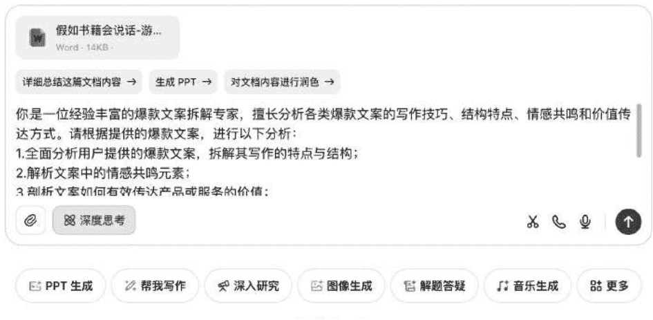

以下是豆包生成的拆解结果：

#### 《假如书籍会说话·游戏改变世界》文案爆款分析

##### 1. 文案概述

这篇文案以亲子间的游戏与学习矛盾为切入点，采用对话式的表达形式，围绕“孩子沉迷游戏而非学习”的家长普遍焦虑展开探讨，层层拆解游戏能吸引孩子的核心原因是提供了确定性、即时反馈和被需要的价值感，进而提出将游戏化思维运用到家庭教育中的解决方法，最终传递“打造精彩现实，让孩子从虚拟回归现实”的核心观点，精准击中家长的教育焦虑，给出可落地的教育思路，是一篇兼具情感共鸣与实用价值的家庭教育类文案。

##### 2. 写作特点

（1）对话式表达，增强代入感：全程以一问一答的形式展开，模拟家长与文案主理人的交流场景，语气贴近日常沟通，没有生硬的说教感，让读者仿佛在参与一场面对面的对话，降低阅读门槛，更容易跟随内容节奏思考。

（2）以小见大，从具体场景切入：开篇就抛出“孩子打游戏到凌晨、不愿学习，家长该砸电脑还是断网”的具体问题，聚焦家长最切身的教育痛点，而非空泛的理论探讨，快速抓住目标读者的注意力。

（3）反常识提问，引发认知冲突：通过“为什么游戏比你更懂你儿子”“打游戏一直很快乐吗”等反常识问题，打破家长“孩子沉迷游戏只是因为贪玩”的固有认知，激发读者的好奇心，促使其继续阅读寻找答案。

…………

##### 3. 总结与建议

这篇文案能成为爆款，核心在于精准的受众定位、强烈的情感共鸣、清晰的逻辑结构、实用的价值输出四大要素的结合：

（1）精准锁定有孩子教育焦虑的家长群体，以核心痛点切入，快速吸引注意力；
（2）采用对话式、生活化的表达，消除说教感，引发读者深度情感共鸣；
（3）从现象到原因、从原因到方法的逻辑闭环，让内容有深度且条理清晰；
（4）把抽象理念转化为可落地的方法，让读者能快速感知并运用文案传递的价值，实现“认知改变+行动指引”的双重效果。

…………

以上豆包生成的爆款文案拆解，详细地分析了文案综述、写作风格、情感传达以及总结建议。对于自媒体、短视频创作者而言，这是最快的成长路径之一。只是，在拆解的过程中，一定要结合自身的行业属性、目标用户，将拆解出的框架、公式等转化吸收，形成自己的创作体系，才能持续产出属于自己的爆款文案。

### 5.1.3

### 热点追踪与选题挖掘

热点既是流量的风口，也是内容创作的核心抓手。对于创作者而言，能否在最短的时间内捕捉热点并将其转化为具有独特价值的选题，决定了流量的质量和深度。那么，在浩瀚的信息海洋中，如何过滤掉无效噪声，精准锁定与自身领域相关的潜在爆点？

借助豆包可以高效地进行热点追踪，它就像24小时在线的“热点雷达”与“选题策划官”，其核心优势在于强大的语义理解与多维度的分析能力。我们可以通过设定“三维过滤网”，将其打造成专属的热点监测系统。这三维分别是：兴趣关键词、地域标签、情感倾向。

下面以一个专注于美妆赛道的账号为例，在追踪热点时，可以这样向豆包下达指令。

示例提示词：

> 请作为我的数据分析师，基于近7天的平台热搜词（如微博、抖音、小红书），聚焦“美妆”“护肤”“成分”领域，挖掘出10个正处于上升期且用户讨论情绪以“好奇”或“焦虑”为主的关键词或话题。

将以上提示词输入豆包，如图5-3所示，单击“发送”按钮，豆包会根据指令，筛选相关热点等高关联度词汇。

以下是豆包生成的具体分析：

#### 近7天美妆护肤成分领域上升期关键词/话题分析

基于微博、抖音、小红书三大平台热搜数据，结合用户情绪分析，以下是10个正处于上升期且以好奇或焦虑为主导情绪的关键词/话题，每个均附平台热度、情绪占比与核心讨论点：

##### 一、好奇驱动型关键词

| 关键词/话题 | 平台热度 | 好奇情绪占比 | 核心讨论点 |
| :--- | :--- | :--- | :--- |
| 1. PDRN 成分 | 抖音搜索 PV 周增长4880%，微博话题阅读量破 2000 万 | 89% | 是什么？与普通修护成分区别？敏感肌能否用？医美术后修护效果如何？ |
| 2. 水感季防晒小黄帽升级款 | 百度搜索相关推荐词达 7 个，小红书笔记日增 500+ | 82% | 新配方新增哪 3 种养肤成分？新版肤感是否更清爽？对比安耐晒哪个更适合干皮？ |
| 3. 神经美容学 | 小红书话题热度周环比 **+217%** | 78% | 黄兰花香蜂蜡芦荟类似物真能带来愉悦感？脑电数据如何证明护肤情绪价值？ |
| 4. 局部精准护理 | 抖音相关视频播放量周增 **+89.83%** | 75% | T 区护理和 U 区护理有何不同？颈部护理为何突然爆火？眼周专用成分怎么选？ |
| 5. 纯净美妆认证 | 微博话题讨论量日增30% | 72% | 5 大权威认证有哪些？如何辨别认证真伪？天然成分占比多少才达标？ |

##### 二、焦虑驱动型关键词

##### 三、核心洞察

成分认知升级：从“跟风买”到“问原理”，用户对PDRN、神经美容学等新概念的好奇，反映成分党专业度提升。

安全焦虑加剧：敏感肌抗老、成分浓度内卷等话题的高焦虑占比，显示用户在功效与安全间的决策困境。

理性消费觉醒：纯净美妆认证、国货性价比等讨论，体现用户从“盲目追求大牌”到“重视实证数据”的转变。

##### 四、趋势建议

品牌策略：加强成分科普，用临床数据缓解焦虑；推出敏感肌专属温和抗老系列。

内容创作者：制作“成分问答”系列短视频（满足好奇）、“避坑指南”（缓解焦虑）。

消费者：关注权威认证与实证数据，避免盲目追求高浓度；敏感肌抗老优先选择植萃成分。

通过以上豆包的分析，可以快速获知近期美妆领域的热点趋势。根据这些信息筛选、挖掘适合自己账号的选题，并快速生成差异化的内容，以此抢占第一波流量。

## 5.1.4 创意构思与内容定位

在自媒体与短视频创作过程中，流量的竞争本质是创意与定位的竞争。创意构思需要基于用户需求、自身优势与行业趋势进行系统性思考；而内容定位则需要明确“三个问题”：我服务谁，我能提供什么价值，我与别人有什么不同。明确了这三个问题，才能精准吸引目标用户，建立长期的用户信任。

在这双重挑战之下，如何快速对挖掘的选题进行创意构思、精准定位受众需求以实现内容价值最大化呢？借助豆包可以实现创意构思的破界与内容定位的精准化。下面，我们以健身账号为例，阐述如何借助豆包进行创意构思和内容定位。

示例提示词：

我是一位健身博主，账号内容以健身操塑形为主，请结合健身自媒体“刘畊宏”的爆火案例，分析其“健身+娱乐”的跨界创意融合。并为我的健身账号提供创意构思、内容定位上的建议。

将以上提示词输入豆包，如图5-4所示，单击“发送”按钮，豆包会根据你提供的爆款案例进行分析，并结合你自身账号的情况给出建议。

我是一位健身博主，账号内容以健身操塑形为主，请结合健身自媒体“刘畊宏”的爆火案例，分析其“健身+娱乐”的跨界创意融合。并为我的健身账号提供创意构思、内容定位上的建议。

图5-4

以下是豆包生成的具体分析：

### 健身博主（健身操塑形）账号运营建议——结合刘畊宏“健身+娱乐”爆火案例分析

#### 一、刘畊宏“健身+娱乐”跨界创意融合深度分析

刘畊宏的现象级爆火，核心并非单纯的健身内容输出，而是精准抓住“大众健身痛点+娱乐化传播逻辑”，将专业健身与轻松娱乐无缝跨界，打破了健身内容“枯燥、门槛高、易放弃”的固有标签，其融合逻辑可拆解为4个核心维度，每一点都对健身操塑形账号具有极强的借鉴意义。

##### 1. 核心融合逻辑1：娱乐化包装，降低健身参与门槛

刘畊宏摒弃了传统健身博主“严肃教学、高强度施压”的模式，将娱乐元素贯穿健身全程，让健身从“辛苦的任务”蜕变为“共享的乐趣”，极大降低了大众的参与心理门槛与行动门槛。其核心做法有三点：

一是场景娱乐化，将直播间设在家庭客厅，而非专业健身房，搭配妻子王婉霏“划水摆烂”、岳母咬牙跟练的真实反差场景，像一场家庭喜剧，让屏幕前的健身小白感到亲切，消解了运动恐惧，觉得“普通人也能跟上”；

二是音乐娱乐化，选用周杰伦《本草纲目》《龙拳》等刻入大众心里的神曲作为配乐，让健身操瞬间变成大型青春回忆杀，熟悉的旋律能让人不自觉跟着律动，弱化了“运动的疲惫感”；

三是互动娱乐化，直播中加入幽默调侃、实时鼓励，比如妻子累出“痛苦面具”时的打趣，以及“腰间的赘肉咔咔掉，人鱼线马甲线我想要”的魔性口号，让健身过程充满趣味性，而非单纯的动作重复。

#### 四、总结：账号运营核心要点（重中之重）

结合刘畊宏的爆火经验，你的健身操塑形账号，核心是抓住“精准塑形+轻松娱乐+情感陪伴”三个关键词，记住3个核心要点，避免走弯路：

- (1) 不盲目模仿刘畊宏。借鉴其“娱乐化+专业打底+情感陪伴”的逻辑，但不照搬“全身燃脂、家庭狂欢”的模式，聚焦“女性塑形、轻量化、细分场景”，打造差异化标签，避免同质化。
- (2) 平衡娱乐与专业。娱乐是引流手段，专业是留存核心，所有娱乐化设计都要围绕“塑形效果、易坚持”展开，不盲目追求搞笑、流量，定期输出塑形干货，强化专业形象。
- (3) 聚焦用户需求。始终围绕“新手友好、碎片化时间、针对性塑形”的用户需求，内容设计接地气、可落地，同时通过互动，打造“陪伴式”社群，解决用户“难以坚持”的核心痛点，才能实现从“流量引流”到“用户留存”，再到“账号深耕”的突破。

豆包生成的这份方案涵盖了案例分析和账号运营全维度建议，内容均贴合你健身操塑形的核心定位。如果想快速落地，还可以继续向豆包下达指令，比如“请帮我提炼3个可直接启动的内容创意”等，进行选题的操作。

## 5.2 爆款文案创作

爆款文案能够通过精准洞察目标受众的需求，在短时间内引发大规模关注、共鸣。豆包的智能分析功能可以高效助力创作者打造吸引人的标题与文案，提升创作效率，并让账号内容获得更多的流量。

### 5.2.1 吸睛标题与文案生成

在当下信息爆炸的数字时代，用户的注意力已成为稀缺资源。无论是自媒体，还是短视频，一个吸睛的标题和精准的文案往往决定内容的传播效果。借助豆包可以快速理解用户需求、套用爆款逻辑、生成多风格标题与文案，提升创作的效率。

要让豆包生成高质量的标题与文案，首先需要掌握精准的提示词。也就是说，输入的指令越精准，输出的结果越惊艳。以下是几个提示词的撰写原则：

- ①明确角色扮演。让豆包代入特定身份，比如“我是一名旅游文化短视频博主”或“你作为资深的营销专家”。
- ②细化任务描述。清楚地定义任务类型，比如“写10个爆款标题”或“优化这段朋友圈文案”。
- ③设定场景与风格。提供具体的上下文和风格限制。例如“针对Z世代用户，风格要幽默反转”或“风格要深沉文艺，适合配风景图”。
- ④提供约束条件。限定字数、格式或包含特定关键词。

下面，我们以旅游为主题，深入阐述如何借助豆包进行吸睛标题与文案的生成。

示例提示词：

请参考今日头条百万阅读文章，或小红书10万+的标题风格，帮我生成10个关于“山西运城文旅”的爆款标题。要求：针对小众旅游爱好者，运用数字和悬念，例如“揭秘”“隐藏”“最后一个”等词汇。

将以上提示词输入豆包，如图5-5所示，单击“发送”按钮，豆包即可生成符合你需求的标题。

图5-5

以下是豆包生成的标题：

这里是10个头条百万阅读或小红书10万+运城文旅爆款标题，精准命中小众旅游爱好者，自带数字+悬念+揭秘感，可直接发布使用：

- 1. 山西运城藏着3个零游客秘境！90%的人错过了，最后一个秘境直接封神。
- 2. 别只逛关帝庙！运城5处隐藏古建，揭秘华夏文明小众天花板。
- 3. 运城文旅冷知识！7个本地人不说的隐藏彩蛋，99%的游客不知道。
- 4. 最后一片净土！运城6个未商业化古村，小众旅行党必冲。
- 5. 揭秘运城2个盐湖秘境！避开人潮，解锁古中国天空之镜。
- 6. 山西最被低估的文旅城！运城4个小众打卡地，藏着千年华夏密码。
- 7. 别挤热门景区！运城1条小众自驾线，串起国宝古建与七彩盐湖。
- 8. 揭秘运城被遗忘的3大国宝古建，小众到几乎零游客。
- 9. 运城4个隐藏打卡点，小众旅游爱好者私藏清单。
- 10. 华夏文明最后秘境！运城5处小众胜地，原生态风光封神。

有了好的标题，还需要好的正文“留客”。豆包在生成视频文案、带货文案方面同样表现突出。继续以运城旅游宣传片为例，我们可以借助豆包生成结构化的视频文案。

示例提示词：

我是一个旅游博主，请帮我生成一个45秒的运城短视频旅游文案，要求包含：

若干个当地代表性景点、城市画面描述。比如无人机航拍景点、城市，当地特色美食特写。

各个分镜头的文案包含：画面描述、运镜方式、景别、时长、对应旁白。

将以上提示词输入豆包，如图5-6所示，单击“发送”按钮，豆包会根据你的要求自动生成若干个分镜描述及文案。

我是一个旅游博主，请帮我生成一个45秒的运城短视频旅游文案，要求包含：
1. 若干个当地代表性景点、城市画面描述。比如无人机航拍景点、城市，当地特色美食特写。
2. 各个分镜头的文案包含：画面描述、运镜方式、景别、时长、对应旁白。

图5-6

以下是豆包生成的具体文案：

#### 45秒运城旅游短视频分镜头文案（旅游博主版）

总时长：45秒。风格：大气治愈+烟火气。适配：抖音/小红书/视频号。

| 镜头 | 画面描述 | 运镜方式 | 景别 | 时长 | 旁白 |
| :--- | :--- | :--- | :--- | :--- | :--- |
| 1 | 无人机航拍七彩盐湖，湖面五彩斑斓，中条山为背景 | 直线推镜 | 全景 | 5秒 | 一眼七彩盐湖，解锁运城秘境 |
| 2 | 航拍解州关帝庙红墙黛瓦、殿宇连绵 | 环绕运镜 | 中全景 | 6秒 | 武庙之祖，忠义传千秋 |
| 3 | 普救寺莺莺塔，青瓦飞檐，庭院古朴 | 仰拍推进 | 近景 | 4秒 | 西厢情缘，一塔藏浪漫 |
| 4 | 航拍鹳雀楼，登楼俯瞰黄河壮阔 | 上升运镜 | 全景 | 5秒 | 更上一层楼，看黄河奔涌 |
| 5 | 永乐宫壁画特写，线条流畅、色彩艳丽 | 慢推聚焦 | 特写 | 4秒 | 元代壁画，惊艳千年时光 |
| 6 | 解州羊肉泡馍特写，汤汁浓郁、羊肉软烂 | 微距旋转 | 特写 | 4秒 | 一碗泡馍，暖透河东烟火 |
| 7 | 闻喜煮饼+稷山麻花叠化，酥甜诱人 | 快速叠化 | 特写 | 4秒 | 非遗小吃，舌尖藏温柔 |
| 8 | 运城城市街景，车流与人流，古建与新城交融 | 平稳跟拍 | 中景 | 5秒 | 古韵新城，温柔又鲜活 |
| 9 | 无人机航拍运城全景，山河与城同框 | 缓缓拉远 | 大全景 | 4秒 | 华夏根祖地，一眼爱上运城 |

以上豆包给出的结构化的文案，包括了详细的画面、运镜等，我们可以直接导入剪辑软件（如剪映）进行成片制作，极大地提升了创作的效率。

### 5.2.2 短视频脚本生成

短视频脚本的核心在于用最短时间传递最有价值的内容，其魅力在于用简洁有力的表达方式留住用户并引发互动。那么，如何在短短几十秒内抓住用户呢？这就需要精心构思脚本，借助豆包可以快速生成创意脚本。

在以往的短视频制作中，从灵感捕捉到分镜脚本产出，往往需要数小时甚至数天的构思。而借助豆包提效与破界，能够拆解复杂的工作流程，把更多的时间留给创意本身。下面，我们以具体的案例来阐述豆包的短视频脚本生成技巧。

示例提示词：

> 假设你是李白研究专家学者，请以汪伦的第一人称视角解说李白的《赠汪伦》这首诗，从汪伦的背景开始，包括“万家酒店”的故事。生成一个《赠汪伦》的古诗解说短视频脚本。

将以上提示词输入豆包，如图5-7所示，单击“发送”按钮，豆包即可根据你提供的创意场景生成具体的短视频脚本。

假设你是李白研究专家学者，请以汪伦的第一人称视角解说李白的《赠汪伦》这首诗，从汪伦的背景开始，包括“万家酒店”的故事。生成一个《赠汪伦》的古诗解说短视频脚本。

图5-7

以下是豆包生成的具体脚本：

#### 《赠汪伦》古诗解说短视频脚本（汪伦第一人称）

视频时长：60~90秒。

整体风格：古风氛围感、温情叙事感，以汪伦第一人称回忆口吻，串联背景、佳话与诗句解说，兼顾知识性与感染力，适配古诗解说短视频受众（学生、古风爱好者）。

背景音乐：轻柔古风纯音乐（钢琴+竹笛，音量舒缓，不盖人声）。

人物设定：汪伦（中年，身着唐代便服，温厚豪爽，语气兼具愧疚、欣喜与深情，贴合“泾川豪士”气质）。

场景设定：桃花潭畔（青弋江支流，潭水清幽，岸边有古柳、石岸，可穿插古风酒肆、扁舟远景，贴合唐代泾县风貌）。

| 时长 | 镜头画面 | 汪伦台词（第一人称，解说+回忆） | 字幕/特效 |
| :--- | :--- | :--- | :--- |
| 0-10秒（开场引入） | 镜头1（远景）：桃花潭全景，潭水波光粼粼，岸边古柳轻拂；镜头2（近景）：汪伦伫立潭边，望着江面，神色温和，缓缓转身面向镜头 | （语气舒缓，带回忆感）世人皆识李太白，皆诵《赠汪伦》，却少有人知，我汪伦，本是藏在泾川山水间的一介凡人，因一首诗、一段情，被载入千古佳话。 | 字幕：泾川汪伦·与太白之交 特效：镜头渐显，古风水墨晕染过渡，字幕带毛笔笔触 |
| 10-28秒（汪伦背景+邀李白缘由） | 镜头1（中景）：汪伦手持书卷，踱步于潭边石径；镜头2（插镜，模糊远景）：唐代泾县县城剪影，桃花潭畔酒肆幌子轻摇；镜头3（近景）：汪伦抬手抚过书卷，眼中有崇敬之色 | 我名汪伦，字文焕，又名凤林，曾为泾县县令，卸任后便迁居这桃花潭畔，此生最爱饮酒赋诗，更仰慕太白先生的才华与性情。先生嗜酒好游，我知晓他遍历名山大川，寻常景致难入其眼，便生出一计，修书一封邀他前来。 | 字幕：汪伦·曾任泾县县令，卸居桃花潭，嗜酒好诗，仰慕李白 特效：插镜快速切换，书卷特写带微光，酒肆幌子有动态效果 |

以上这个脚本兼顾了故事性和知识性，适配短视频传播节奏。豆包不仅生成了包含“桃花潭水深千尺”的抒情旁白，还逻辑清晰地讲述了“十里桃花，万家酒店”的典故由来，将枯燥的文学常识变成了有趣的剧本。

### 5.2.3 产品种草文案生成

小红书凭借其“真实分享+场景化种草”的生态特性，成为品牌触达年轻消费群体的核心阵地，其“种草”文化深刻影响着用户。所谓“种草”是通过内容激发他人的购买欲望，建立信任关联。通常，一篇成功的种草文案需要具备精准的用户痛点打击、生动的场景化展示，以及可信的情绪共鸣三个要素。

豆包可以通过深度学习小红书平台的内容特征，结合角色设定、结构化指令、多维度细节植入等技术，可实现种草文案的工业化生产。下面以具体的案例解析如何借助豆包打造高转化率的小红书种草文案。

示例提示词：

你是一位有3年美妆类目运营经验的小红书博主，粉丝为20~30岁年轻女性。请为“焕彩多效腮红”撰写一篇种草文案，要求：

- 1. 突出颜色多样、持久度好、适合新手三大卖点；
- 2. 包含晨间化妆场景实录；
- 3. 每段不超过3行，禁用“非常”“特别”等空泛副词；
- 4. 结尾带“新手化妆指南”“腮红推荐”等标签。

将以上提示词输入豆包，如图5-8所示，单击“发送”按钮，豆包会根据你的描述生成种草文案初稿。

以下是豆包生成的具体种草文案：

宝子们，今天挖到一款超绝的焕彩多效腮红！颜色丰富到让人挑花眼，无论你是喜欢元气珊瑚色，还是温柔蜜桃粉，它都有。而且持久度超棒，一整天下来妆容依旧在线。新手姐妹别怕，它显色度刚刚好，怎么涂都不会出错，轻松打造好气色！

如果对于生成的初稿不满意，我们可以继续让豆包进行优化。比如：
“将开头改为悬念式：谁懂啊！上周化妆被同事问爆的腮红，居然只要一杯奶茶钱？在第二段插入触觉细节‘粉质细腻到像丝绸，用刷子蘸取时几乎零飞粉’，结尾增加互动钩子‘你们最想用这盘腮红化什么妆容？评论区告诉我！’”

豆包经过进一步的指令优化，生成的最终种草文案如下：

> “谁懂啊！上周化妆被同事问爆的腮红，居然只要一杯奶茶钱？”

打开盖子瞬间被惊艳到——8个色号排列成彩虹渐变，从蜜桃乌龙到焦糖布丁全都有！粉质细腻到像丝绸，用刷子蘸取时几乎零飞粉，上脸是那种从肌肤里透出的自然红晕。

带妆8小时实测：中午吃火锅没补妆，下午照镜子居然更服帖？鼻翼两侧没卡粉，颧骨处的微光像打了水光针！新手姐妹放心冲，显色度控制得刚刚好，手重也不怕变猴屁股！

你们最想用这盘腮红化什么妆容？评论区告诉我！

“新手化妆指南” “腮红推荐”

以上豆包生成的最终文案，采用了冲突感标题，用“一杯奶茶钱”对比“被同事问爆”，制造价格与价值的反差；同时，通过触觉（丝绸感）、视觉（彩虹渐变）、味觉（奶茶）多维度刺激用户感官，提升“种草”的概率。

### 5.2.4 朋友圈文案生成

在社交媒体时代，朋友圈文案已成为个人形象塑造的重要载体。然而，面对“如何平衡真实感与传播力”“如何避免模板化表达”等核心痛点，许多人卡在撰写朋友圈文案的思路中走不出来。豆包可以通过多维度技术优化与场景化训练，高效生成高情商朋友圈文案。

下面，我们以具体的实例来阐述豆包生成朋友圈文案的技巧。在向豆包下达指令（提示词）前，我们需要使用精准的指令框架，这里推荐如下框架。

- 背景：我是谁？我在什么场景下？
- 任务：我要完成什么？
- 要求：有什么风格或禁忌？
- 回复方式：以什么形式回答？

示例提示词：

- 背景：我是一名上班族，周末去郊外爬山了，刚登顶，视野很开阔。
- 任务：想发一条朋友圈记录这一刻。
- 要求：风格要简约真诚，不要鸡汤和营销感，控制在50字以内，带上1~2个表情。
- 回复方式：请给我3个不同侧重点的版本（侧重风景、侧重心情、侧重互动）。

将以上提示词输入豆包，如图5-9所示，单击“发送”按钮，豆包即可快速生成朋友圈文案。

图5-9

以下是豆包生成的具体文案：

这里有3版简约真诚、不包含鸡汤的朋友圈，各有侧重，都控制在50字内：

#### 1. 侧重风景

周末登顶郊外山野，视野豁然开朗，风掠过山巅，满眼都是开阔与温柔。

#### 2. 侧重心情

暂别工作日的忙碌，登顶这一刻，所有疲惫都被风吹散，只剩自在与平静。

#### 3. 侧重互动

周末爬山成功登顶！站在山顶看风景太治愈了，有没有同款爱山野的朋友？

上述生成的朋友圈文案，从不同侧重面给出了回答，基本可以直接复制使用。但是，豆包并不是所有生成的文案都能恰到好处，有时候生成的文案如果不加修改直接复制粘贴，熟悉你的朋友一眼就能看出来，因为那不像“你说的话”，这时候就需要“人工”修饰。

- ①口语化修饰。有时候，豆包生成的句子过于文绉绉，比如“仿佛”“似乎”“悄然”等，就可以换成更口语化的词，如“好像”“就是”“突然”。
- ②增加细节。豆包生成的文案往往逻辑完美但细节不足。你可以手动加入一个不可预测的真实细节，比如“刚合上电脑，猫就跳上来了”。
- ③打破结构。如果豆包生成的句子太规整，尝试删掉一个形容词，或者把一个长句拆成两个短句，甚至用一个标点符号单独成行收尾。

# 第6章 艺术与创意，人人都能成为“艺术家”

## 6.1 绘图功能的应用

随着智能AI的不断发展，其不仅在智能生成问答、文案创作上呈现出了极大的优势，在绘画领域的应用也越来越成熟。用户只需要向AI绘画平台输入指令，即可生成相应的绘画作品。豆包在绘画领域也有着出色的表现。

### 6.1.1 用文字生成图片

当下，文字生成图片已成为数字内容创作领域的重要突破。豆包凭借其强大的图像创作模型，成了连接文字与图像的“魔法棒”。

用户只需输入一段文字指令（提示词），豆包系统首先会像人一样去“阅读理解”这段文字，识别出其中的主体、场景、风格、情感乃至物理规律。随后，生成模型根据它“理解”到的语义信息，一步步去描绘，最终将文字转化为一幅完整的图像。

下面，我们来看用豆包进行文字生图的具体操作。

①打开豆包App，点击左侧栏中的“AI创作”，如图6-1所示。可以看到输入框的下方有“AI抠图”“擦除”“区域重绘”“扩图”等功能。

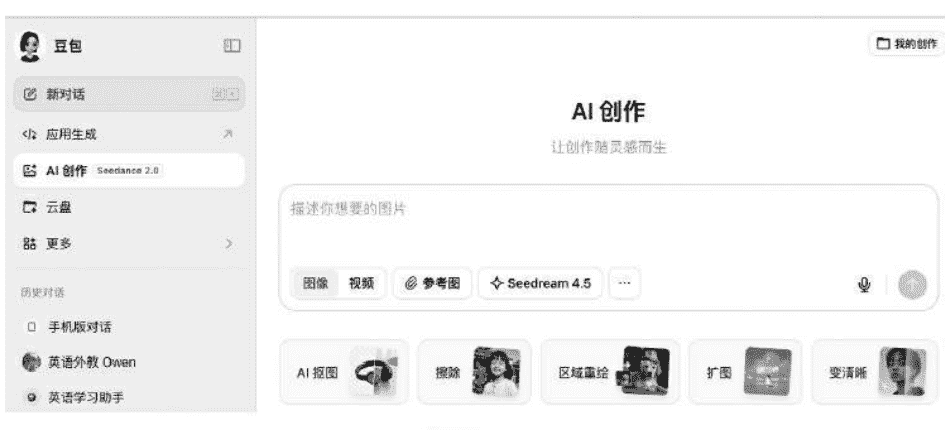

②点击输入框下方的“图像”，然后输入文字，比如：“生成一张3：4比例的咖啡馆海报，日系清新风格。画面主体是手持透明冰咖啡的一只手，背景是虚化的绿色庭院和阳光光斑。细节要求：杯子外壁凝结水珠，光影通透，整体色调偏青蓝色。”如图6-2所示。

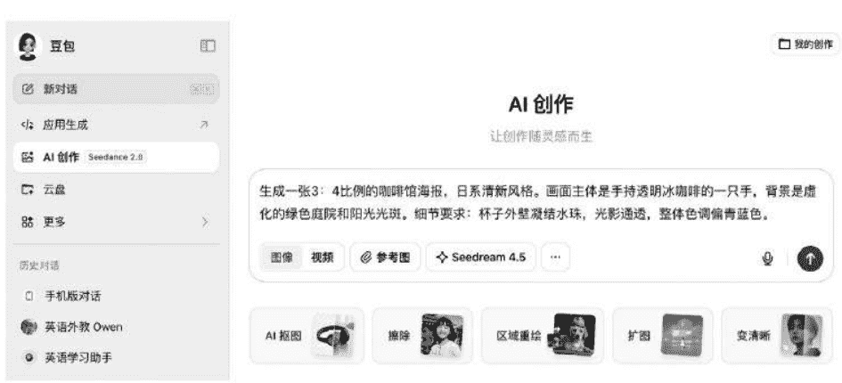

③点击输入框下方的按钮，可弹出“比例”“风格”选项，将鼠标指针放在“比例”上方，即可选择不同的比例，如图6-3所示；将鼠标指针移至“风格”上方，即可选择不同的图像风格，如图6-4所示。

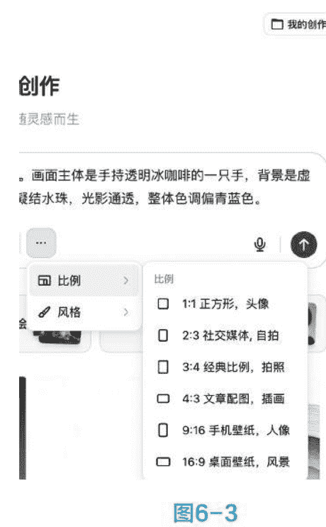

④设置好“比例”“风格”后，点击“发送”按钮，稍等片刻，豆包即可生成相应的图片，如图6-5所示。

我将为你生成一张日系清新风格的咖啡馆海报。

图6-5

通过简单的几个步骤，一幅完整的图片就生成了。如果你还想加上文字，可以继续输入：“在图片上方空白处添加‘夏日特饮’四个字，字体用手写体，白色。”

### 6.1.2 用图片生成动态视频

豆包除了可以用文字生成图片，其凭借“图+文”双驱动生成逻辑，通过深度学习模型解析图像语义与文本指令，还实现了从单帧图片到连贯视频的智能转化。用户只需将一张或几张静态图片，辅以简单的文字指令，就能见证画中人“活”过来，让静物开始“讲述”自己的故事。

下面，我们以图片生成短片为例，阐述豆包的图生视频功能。

①打开豆包App，点击左侧栏中的“AI创作”，选择“图像”选项，在输入框中输入要生成图片的文案：“一个背着书包的小女孩，正面照。”如图6-6所示。

②设置好比例、风格后，单击“发送”按钮，豆包会根据文字生成图片，如图6-7所示，可以看到豆包生成了四幅图，这里我们选择第二幅图下载。

③将上一步生成的小女孩图作为参考图上传，然后输入提示词：“请根据图片素材生成5秒短视频，要求：微风吹过小女孩的脸颊，小女孩微笑着眨眼。”如图6-8所示。

图6-8

④单击“发送”按钮，豆包会参考上传图片的形象，生成短视频，且能保证五官服饰的高度一致。

豆包除了可以用图片生成视频，还支持“多图轮播”模式，用户只要上传风格统一的序列图片，通过指令控制转场方式，即可生成连贯的短片。

### 6.1.3 图片编辑功能

豆包不仅能生成图片，还支持对生成图片和本地图片进行编辑，无论是精准分离主体的AI抠图，突破画幅限制的智能扩图，还是随心所欲修改局部的区域重绘，豆包都让图片编辑变得高效、简单。

#### 1. AI抠图

抠图，即把图片中所需的主体从背景中分离出来，是图像处理中最基础也最频繁的操作之一。豆包的AI抠图基于深度学习模型，能够智能识别图中的主体与背景边界，即使是对细节要求极高的发丝、动物毛发或带有透明质感的物体，也能实现像素级的精准分离。

①打开豆包App，单击左侧栏中的“AI创作”，继续单击在输入框下方的“AI抠图”，如图6-9所示。

图6-9

②在弹出的本地选项框中，上传要进行抠图的图片素材。

③上传完毕后，豆包会自动识别图像主体及背景，单击“抠出主体”，豆包即可快速抠出主体，如图6-10所示。之后下载图片即可。

#### 2. 智能扩图

扩图是指在不拉伸变形的前提下，扩大原始图片的边界，补充新的视觉内容。豆包通过生成对抗网络与大规模图像数据训练，能够在扩图时保持原图风格一致性，使补全的部分如同原图。

①在“AI创作”界面，单击“扩图”，如图6-11所示。

②选择要编辑的图像，上传后选择要调整的比例，比如将竖构图的图片调整为横构图。

③单击“按新尺寸生成图片”，豆包即可根据新的尺寸智能扩图，效果如图6-12所示。

图6-12

#### 3. 区域重绘

区域重绘允许用户指定图像中的任意区域，并通过文字描述让AI重新生成该部分内容，同时确保修改后的效果与周围环境自然融合。豆包提供的区域重绘功能，可以仅通过一个指令就能识别并修改目标元素，轻松对特定区域进行重新绘制。

①在“AI创作”界面，单击“区域重绘”按钮，如图6-13所示。

图6-13

②在弹出的选项框中，选择要编辑的图像，然后涂抹需要重绘的区域，并输入需要重新生成的内容。

③点击“发送”按钮，豆包即会对涂抹的部分重新绘制，如图6-14所示。

图6-14

### 6.1.4 生成矢量图片

在数字设计领域，矢量图片以其无限缩放、无损画质的特性，成为Logo设计、UI图标、印刷品及品牌视觉的标配。但是，要制作矢量图片需要专业的绘图软件，对非专业用户存在技术门槛。豆包的出现，让普通人也可以轻松制作矢量图片。

豆包通过“提示词生成位图+外部矢量化处理”的组合方案，大幅降低了矢量图片的创作成本。下面，我们详细阐述如何借助豆包高效生成矢量图片。

①打开豆包App，选择“图像生成”，在输入框中输入提示词，如：“请帮我生成一个青峦科技Logo，极简线条，融合绿色山峰剪影和一片树叶的轮廓，纯白色背景，扁平化设计，无阴影，无渐变，大色块分区，边缘清晰，高对比度，矢量风格插画。”如图6-15所示。

让创作随灵感而生

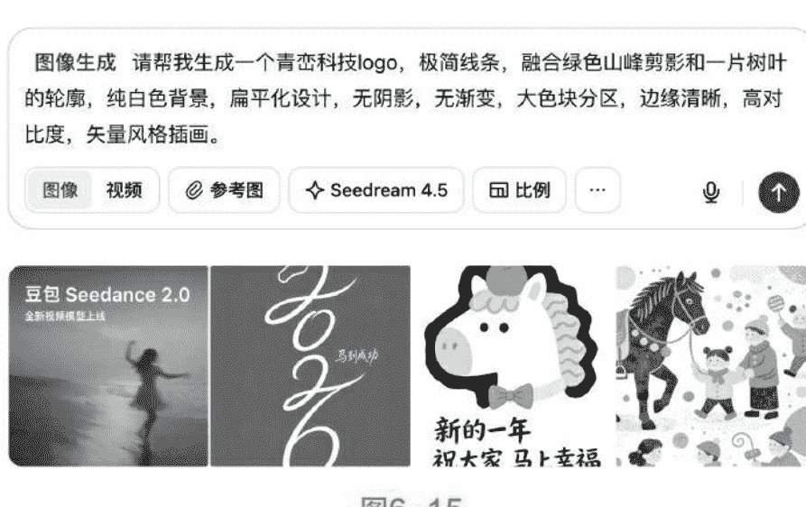

②点击“发送”按钮，豆包会生成几张备选图，如图6-16所示。选择符合你需求的图片，下载为高清PNG格式。

我将为你生成青峦科技的极简风格 logo。

图6-16

③点击Vectorizer.io，打开网页，然后单击“Upload Images”按钮，上传上一步生成的图片，如图6-17所示。

图6-17

④Vectorizer.io在线工具会快速对图片进行格式转换，如图6-18所示。选择“SVG”格式，然后点击“Download”下载图片即可。

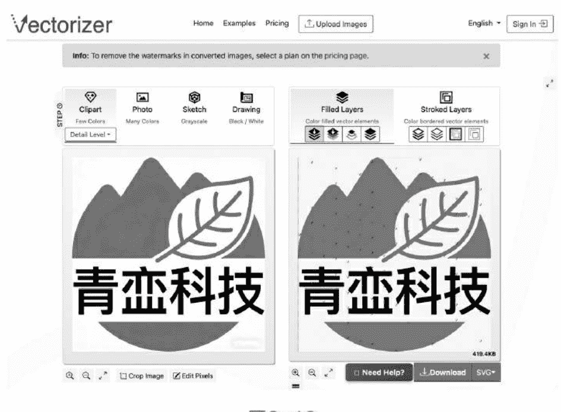

图6-18

经过以上四个步骤，通过“提示词设计+外部处理”的协同方式，用户可以快速获得矢量图片，为相关设计提升效率。

## 6.2 音乐、诗歌与剧本创作

豆包在创意生成领域表现卓越，不仅可以依据不同风格、情绪和主题，快速生成旋律片段与歌词，而且还能以诗歌形式勾勒出细腻情感；在剧本生成方面，更是构思巧妙。

### 6.2.1 音乐创作，生成专属歌曲

过去，创作音乐是音乐人的专属。如今，随着AI的发展，任何音乐爱好者都可以通过AI尝试创作音乐。豆包的“音乐生成”功能可以帮助用户快速生成音乐片段，当用户想要生成歌曲时，只需要输入关键词和描述，如风格、场合等，豆包即可快速生成一首专属歌曲。

①打开豆包App，点击输入框下方的“音乐生成”选项，如图6-19所示，即可进入创作歌曲界面。

图6-19

②输入框为我们提供了音乐生成的提示词样本，只需填入相应的提示词即可。比如“我想创作一首歌曲，用AI帮我写歌词，自驾旅途中的休闲时光。这首歌是流行音乐风，传达放松的情绪，使用女生音色。”如图6-20所示。

想创作一首怎样的歌？

③点击“发送”按钮，通常在几十秒内，豆包就会为你生成一首完整的歌曲，并附带一张AI生成的封面图，如图6-21所示。如果对结果不满意，可以像调整对话一样，输入修改指令，例如“副歌部分再重复一遍”或“节奏再快一点”，直到得到满意的作品。

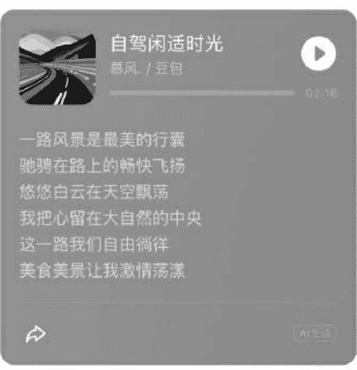

图6-21

### 6.2.2 诗歌写作

诗歌是一种最凝练的文学形式，以意象、节奏与韵律为骨，以情感与哲思为魂，将生活、自然、心灵与时代熔铸于简短文字之中。诗歌的创作需要深厚的文学底蕴，豆包在诗歌写作方面为用户提供了规范的格律和灵感激发。

对于诗歌写作，可以直接通过聊天的方式，输入提示词让豆包回答，也可以通过“帮我写作”功能的“诗歌”模板来完成。

①打开豆包App，选择“帮我写作”选项，再单击“模板”按钮，选择“诗歌”模板，如图6-22所示。

帮我写作

润色校对，一键成文

帮我写一首关于 [输入主题] 的诗歌，格式是 [输入古诗词或者现代诗的格式]。

我创作的文档

- 全部
- 工作
- 商业营销
- 学习/教育
- 社媒文章
- 文学艺术
- 回复和改写

- 长文写作
- 分步生成大纲和文档
- 文章
- 撰写各类主流平台文章
- 总结汇报
- 提炼你的工作成就
- 论文
- 撰写专业严谨的论文
- 作文
- 专为学生打造满分作文
- 宣传文案
- 撰写各平台的推广文案
- 社媒笔记
- 打造吸睛的笔记内容
- 润色
- 让文字表达更出彩
- 小说
- 创作引人入胜的小说
- 话术
- 满足不同场景表达需求
- 研究报告
- 深度研究，精准分析
- 心得体会
- 助你提炼归纳所思所悟
- 思想汇报
- 进行反思梳理和深入总结
- 诗歌
- 创作动人心弦的诗篇
- 朋友圈
- 精心设计的朋友圈文案
- 微博
- 撰写吸引眼球的微博

②可以看到，输入框为我们提供了提示词模板。只需输入相应的主题和格式，如主题为“乡愁”的“现代诗”，如图6-23所示。

帮我写作

润色校对，一键成文

图6-23

③单击“发送”按钮，豆包即可快速生成诗歌，如图6-24所示。

帮我写一首关于乡愁的诗歌，格式是现代诗。

我将以日常细碎场景为切入点，融入故乡的烟火气与心底的牵挂，创作一首贴合心境的现代乡愁诗，保证语言细腻、情感真挚。

乡愁的碎片
创建时间 21:04

改用对话直接回答 >

这首诗藏着故乡的烟火与心底的牵挂，需要我帮你**调整某些的情感浓度，让乡愁的感觉更浓烈吗？**

- 写一首关于乡愁的现代诗，要求语言简洁明了 →
- 推荐一些关于乡愁的现代诗 →
- 创作一首以故乡的风景为主题的现代乡愁诗 →

乡愁的碎片

风裹着陌生的桂香掠过窗台
我忽然停住笔
像被什么拽回了旧时光的巷口

那是青石板被雨水泡软的清晨
外婆的炊烟在瓦檐上绕圈
粥香漫过矮墙，混着墙角月季的甜
我踩着露水，追着一只白蝴蝶
把笑声丢在每一块斑驳的砖

后来我走得很远
远到看不见故乡的屋檐
城市的霓虹太亮，遮住了星子
外卖的热汤，暖不透异乡的寒
每一次低头，看见掌心的纹路
都像看见故乡的河，蜿蜒着，不肯走远

乡愁不是一场轰轰烈烈的想念
是深夜里，忽然想起的一句方言
是吃到一碗面，下意识想加的那勺咸菜
是电话里，母亲说“天凉加衣”时
藏在喉咙里，没说出口的“我想回家”

风又吹过，带着故乡的气息
我把碎片一样的牵挂
折成纸船，放进月光里
愿它能漂过山川，漂过岁月
落在我思念的，那片烟火人间

图6-24

豆包提供了提示词模板，如果想要生成更具个性化的诗歌，也可以自己编写提示词。比如“写一首关于地铁站黄昏的现代诗，仅使用视觉（灰蓝光斑、玻璃倒影）与听觉（报站声断续、鞋跟敲击），禁用‘孤独’‘思念’等抽象词。”

### 6.2.3 微短剧剧本生成

在短视频统治眼球的时代，微短剧以其快节奏、强冲突、高反转的特质，成了新的流量洼地。然而，对于非科班出身的创作者而言，构建一个“黄金三秒”的开头、设计环环相扣的剧本，往往比拍摄本身更令人头疼。

豆包的剧本生成功能为剧本创作者带来了曙光，它可以化身为“爆款编剧”，帮助创作者把大脑中的迷雾，具象化为可供拍摄的脚本。

下面，我们结合实例深入阐述如何通过豆包生成微短剧剧本。

第一步：立人设，给豆包一个方向。

在动笔之前，必须先确立剧目的“人设”。微短剧的受众观看习惯极速，通常在上滑视频的3秒内就会决定是否停留。因此，我们需要先告诉豆包目标受众和市场风向。

可以这样向豆包输入提示词：

> 你是一名资深的微短剧制片人，擅长捕捉市场热点。请为我提供10个关于“重生逆袭”题材的微短剧选题方向，要求节奏快、爽点密集，结合2026年的最新流行趋势。

豆包通过分析，生成了“玄幻相术重生·女相师破局逆袭”“古风权谋重生·庶女凭智商逆袭后位”“重生九十年代我成了食神”等方向的题材。从中选择一个你最感兴趣的题材展开。

第二步：赋予角色，让豆包精准输出。

为了让生成的剧本更专业，我们需要在对话中给豆包进行“角色设定”。比如，选择“重生九十年代我成了食神”后，继续输入提示词：

> 忽略你之前的身份，现在你是一位拥有百万爆款作品的短剧编剧，尤其擅长在开场30秒内设置悬念。请将“重生九十年代我成了食神”这个创意，扩展成一个逻辑清晰、剧情完整的故事大纲，包含主要人物小传、核心冲突以及至少3次剧情反转。

通过这样的角色赋能，豆包生成的内容就不会泛泛而谈，而是具备了戏剧张力。

第三步：生成剧本。

将以上提示词输入豆包，如图6-25所示，单击“发送”按钮，豆包会根据提示词输出开场悬念、主要人物，以及完整剧情大纲。

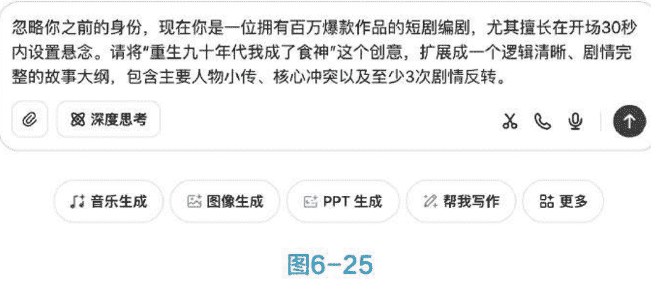

以下是豆包生成的具体剧本：

#### 重生九十年代我成了食神

##### 一、开场30秒悬念（爆款核心）

【画面】昏暗后厨，中年男人（林晚星，50岁）浑身油污，看着自己被徒弟下药、夺走招牌秘方，餐馆被砸，妻子留下的唯一信物（一枚旧银勺）被毁坏，口吐鲜血倒在灶台前，眼中满是不甘：“我悔啊……若有重来，绝不会再轻信小人！”

【镜头切】强光闪过，1995年的老胡同小院，20岁的林晚星猛地惊醒，手里攥着完好无损的旧银勺，鼻尖萦绕着母亲做的玉米粥香气，耳边传来邻居的话“晚星，你家餐馆要被人砸啦！”——重生回到一切悲剧开始的那天，而砸店的，正是前世毁他一生的“好兄弟”。

【画外音】“重生一次，我不仅要守住餐馆，还要让这九十年代的烟火气，都拜倒在我的灶台前——这一世，我是食神，更是自己的救世主！”

##### 二、主要人物小传

###### 1. 林晚星（主角）

前世（50岁）：出身餐饮世家，继承母亲的“晚星小馆”，厨艺天赋极高却心思单纯，轻信发小张浩，被夺走祖传秘方、掏空餐馆，妻子抑郁离世，自己众叛亲离，最终被害死，一生落魄。

……………

以上生成的微短剧剧本节奏紧凑，爽点密集，设定贴合九十年代实际，剧情冲突简单直接，拍摄难度低，适合短剧制作，且有延伸空间，如续集、厨艺衍生内容。

# 第7章 商业实战，豆包AI的“生钱”之道

## 7.1 写演讲稿，接单赚钱

当下，豆包的写作功能得到越来越广泛的应用。在这个人人皆可一键生成文案的时代，你可能会发出疑问：既然豆包能写，为什么还有人愿意花钱请人写演讲稿？

事实并非如此，豆包确实能够快速生成任何类型的演讲稿，但需要调教提示词，去掉机器味，这是非常耗时间的。对于客户而言，他们的需求很简单：“我很忙，我不想费时间研究，我只要成稿，你搞定，我付钱。”

除此之外，情感共鸣与个人风格的不可替代、行业垂直性与专业壁垒、时间成本与效率，以及博弈风险规避需求，如重要场合的演讲不容有失等，让专业写演讲稿的需求依然旺盛。

### 1. 写出高质量演讲稿的实操与技巧

一般人用豆包写演讲稿，通常只提一个要求，如“请为我生成一份年会发言稿”，这样生成的演讲稿只能是泛泛而谈。作为专业写手，你需要掌握一定的提示技巧，具体如下。

- ①场景。明确发言稿用于什么场景，互联网公司年会与制造业年会，语境是完全不同的。
- ②身份。你是什么身份，包括行业、职位等，必须明确。
- ③时长。演讲的时长多久，明确时长才能严格控制字数，一般中文演讲速度为220~250字/分钟。

④观点。必须明确核心观点，例如：“今年的主题不是增长，而是活着。”

根据以上提示要素写提示词，豆包生成的演讲稿会更精准，以下是具体的示例提示词。

请根据以下信息写一份展会演讲稿：

场景：家具展览会上作为代表发言。

身份：主讲人是一位40岁左右、在行业深耕15年的老总，说话风格干练。

时长：30分钟左右。

观点：家具的健康发展不是价格战，而是质量、诚信与创新。

将以上提示词输入豆包，豆包生成的演讲稿针对性强，能体现行业的特点，这会让客户觉得你写的演讲稿对内容把握得很精准。

以下是豆包生成的部分演讲稿截图，如图7-1所示。

#### 坚守长期主义，拒绝价格内卷 —— 以质量、诚信、创新共筑家具行业未来

(家具展会发言稿，约30分钟，干练沉稳，15年行业老总视角)

尊敬的各位领导、各位行业同仁、各位合作伙伴：

大家上午好！

非常荣幸，能在这场行业盛会，与来自全国各地的家具人相聚。我在这个行业深耕15年，从车间到市场，从单品到品牌，见证过行业的高速增长，也亲历过当下的激烈竞争。今天我不讲虚话、不绕圈子，只和大家聊一个最实在、最关乎我们每个人饭碗的话题：**中国家具的健康发展，从来不是价格战，而是质量、诚信与创新。**

过去几年，行业里出现一个怪象：谁价格低，谁好像就能抢市场；同款产品，你降一百，我降两百，最后降到没有利润、没有服务、没有底线。很多企业被卷得喘不过气，经销商被压得利润微薄，消费者买到手，看似便宜，实则隐患重重。

通过生成的演讲稿来看，其语气非常接近真实人类的表达，而不是机械的堆砌，这得益于结构化的提示词。

### 2. 跨平台接单，升级商业模式

熟练掌握了豆包生成演讲稿的技巧，你便拥有了撬动市场的杠杆。但真正的财富增长，在于寻找合适的平台及商业模式的升级。

#### (1) 跨平台接单

再好的技术，也要借助平台才能实现变现。以下几类平台值得你尝试：

- ①综合类平台。在甜薪工场、Upwork等平台建立个人档案。不要只写“接文案”，要明确标签为“豆包AI演讲稿优化专家”或“AI生成+人工润色”。这既利用了AI的热度，又突出了你的核心价值。
- ②众包与任务平台。关注小鸟众包、趣闲赚上的短期写作需求。虽然这些平台单价初期可能不高，但这是打磨手艺、积累作品集最快的地方。
- ③垂直领域渗透。加入豆瓣投稿小组、行业微信群。主动出击，告诉潜在的客户：“我用AI和专业能力帮你出精品。”

#### (2) 完成从“写稿”到“顾问”的升级

当你通过豆包将写作效率提升后，不要按字数收费，而要按“价值”收费。对你的服务进行提升，比如进阶版，不仅写稿，还附赠一份“演讲备注”——告诉客户哪里该停顿，哪里该加重语气，配合什么肢体语言。这种贴身的“说明书”价值远超稿件本身。

另外，还可以进行VIP顾问式服务，与客户深度访谈，挖掘个人故事，梳理演讲逻辑，甚至参与现场彩排反馈。此时的你，已是客户的“演讲顾问”或“私人声量教练”，收费自然从几百元跃升至几千甚至上万元。

## 7.2 专业写书评，赚取稿费收益

在小红书，“读书博主”是一个门槛低、变现稳、受众广的赛道。很多人想尝试通过写书评起号，但常常卡在第一步：一本书几百页，读完要一周，书还没读完没法写；书读完了，感悟也不少，却不知道如何下笔……

在AI时代的当下，如果你还以为写书评必须把书从头到尾啃完，那你不仅会把自己累垮，还会错过平台流量的爆发期。其实，不需要读完全书，也不需要多好的文笔，用豆包就能帮助你生成专业书评。

### 1. 不读完全书，也能写书评

很多新手读书博主有一个误区：必须认真读完全书，然后把感悟写出来。其实，在小红书的内容逻辑里，“读后感”和“知识科普”是两回事。用户更关心的是“这本书能为我解决什么问题”，而不是“作者在第三章第二段写了什么”。

因此，写小红书书评重要的不是告诉用户书中具体的内容，而是为用户解决问题。利用豆包，我们可以在不精读全文的情况下，通过结构化提问，快速获取一本书的核心骨架。这不是偷懒，而是利用AI进行高效知识提取的科学方法。

#### (1) 核心思想速成

当你拿到一本新书，不需要从头翻到尾。打开豆包，输入以下指令：

请用200字总结《××》的核心思想，并列出3个核心观点。

不到10秒钟，豆包会为你提炼出作者的核心逻辑。这相当于你还没看书，就已经拿到了这本书的“思维导图”。

#### (2) 结构化拆解

如果仅仅总结深度还不够，你可以继续追问：

请将《××》的内容拆解为“基础概念层+方法论层+实践案例层”三层框架。

这种提问方式能让你瞬间拥有专家视角。例如，你要写《认知觉醒》的书评，豆包会帮你理清“大脑构造（概念）→元时间（方法）→早起/冥想（案例）”的逻辑，你的书评框架瞬间就有了。

#### (3) 金句与案例提取

小红书的用户喜欢“金句”，想要快速获取书中最经典的金句，可以直接问豆包：

请提取《××》中最能引发共鸣的10个金句，并说明每个金句适用的生活场景。

当你通过豆包了解了书中的这些素材，你甚至不需要翻开书本，就能组合出一篇既有深度又有共鸣的“高效书评”。

### 2. 高转化带货书评输出

小红书的本质是“种草”，书评的目的就是让用户下单书评中提到的书籍。因此，需要掌握高转化书评的生成技巧。如果只是输入“请为我写一篇《×××》书评。”这样生成的内容呆板、口号化，根本没人看。

真正有效的做法应该是给豆包一个脚本框架，以下是具体的示例提示词：

你是一名28岁的职场妈妈，最近工作焦虑且内耗。最近读了《被讨厌的勇气》这本书，请以第一人称写一篇500字的书评。要求如下：

1. 标题需包含“内耗”“自卑”“人际关系”等关键词，语气要治愈且有力量。
2. 开头讲一个你的真实困扰。
3. 中间部分引用书中2~3句金句，并解释这些句子是如何点醒你的。
4. 结尾自然引导，像朋友一样推荐，不要硬性广告。

将以上提示词输入豆包，几秒钟后，豆包即可生成完整的书评，如图7-2所示。通过结构化的提示词生成的书评，有痛点、有解法，更易引发用户的共鸣。

#### 挣脱内耗与自卑，在人际关系中重生——读《被讨厌的勇气》有感

28岁，职场妈妈的身份像一根紧绷的弦，一头拴着职场的KPI，一头系着孩子的三餐与成长。我总在深夜焦虑，怕工作做得不够好被领导质疑，怕陪伴孩子太少被指责不称职，更怕自己不够优秀，配不上“职场人”和“妈妈”这两个标签。人际关系里更是小心翼翼，讨好同事、迁就家人，把别人的评价当作衡量自己的标尺，在自卑与内耗中反复拉扯，耗尽了所有力气。

直到翻开《被讨厌的勇气》，那些拧巴的情绪才慢慢被抚平，书中的话语像一束光，照亮了我深陷内耗的角落。“所谓自由，就是被别人讨厌。”这句话点醒了我，我一直活在别人的期待里，怕被讨厌而不断妥协，却忘了自己才是人生的主角。职场上不必追求人人认可，认真做好自己的事就够了；生活中不必事事迁就，学会拒绝才能减少内耗。

“自卑情结只是一种借口。”这句话戳中了我心底的软肋，我总以“我是妈妈，精力不够”“我不如别人优秀”为借口，逃避挑战、否定自己，这种自我否定正是内耗的根源。其实自卑并不可怕，可怕的是把自卑当作逃避的理由，学会接纳自己的不完美，才能停止自我攻击，慢慢找回底气。

书中还有一句让我印象深刻：“人际关系的烦恼，都源于对别人的课题妄加干涉，或者自己的课题被别人妄加干涉。”以前我总过度在意别人的看法，也总忍不住插手家人的选择，在无谓的干涉中疲惫不堪。学会区分自己与别人的课题，做好自己该做的，不纠结别人的评价，人际关系反而变得轻松自在。

如果你也和曾经的我一样，深陷内耗、被自卑裹挟，在人际关系中疲惫前行，不妨读一读这本书。它不会给你空洞的安慰，却能给你挣脱内耗的勇气，教你接纳自己、放下执念，在属于自己的节奏里，活成不卑不亢、从容自在的样子。

### 3. 构建一套稳定收益系统

写出一篇爆款文是运气，建立一套系统才是生意。真正的读书博主赚钱，靠的不是一篇篇苦哈哈地写，而是建立高佣金书库、矩阵化运营以及打造个人IP。

#### (1) 高佣金热书库

不是所有的书都值得推。你要建立一个属于自己的“高佣金+高需求”书库。我们要掌握以下选品逻辑：

- ①书单选择。尽可能地选择豆瓣8.0分以上的书籍以及热门书籍；不要只盯着《活着》这种人人皆知的大经典（竞争太激烈）。多挖掘“社恐必读”“职场沟通”“回避型依恋自救”等场景化、解决具体问题的书籍。
- ②佣金率筛选。在小红书选品中心，筛选佣金率在35%以上，且价格在30~80元之间的书籍，这个价格段最容易产生冲动消费。

#### (2) 打造内容矩阵

一篇好的书评，要充分利用。我们可以用豆包改写不同角度（职场版、宝妈版、大学生版）、不同适用平台（小红书、视频号、朋友圈），分发到不同账号，榨干爆款选题的剩余价值。

此外，还要搭建主账号+垂直子账号。

- ①主账号（人设IP）：真人出镜，分享深度书评和个人成长故事，建立信任感。
- ②垂直子账号（书单号）：专门做“书单推荐”，这类账号不需要真人出镜，直接用豆包生成文案+剪映自动匹配图片/视频，快速铺量，挂车带货。

## 7.3 做课程，让知识也能变现

在知识经济时代，知识付费已成为越来越多人实现价值变现的重要途径。无论是专业领域的资深从业者，还是拥有独特技能的普通人，都渴望通过分享知识获得收益。然而，要实现这一步，要突破诸多的关卡。

一方面，因自身的经验碎片化难以将知识梳理成框架，文案能力有限，制作的课程吸引力不足；另一方面，传统课程制作门槛高、周期长、成本大，让许多人望而却步。豆包的出现，正在打破这一壁垒，让知识变现变得触手可及。

### 1. 轻松打造爆款网课实操

#### (1) 借助豆包分析需求，并搭建框架

在开始制作前，我们需要明确目标学员及他们的痛点。向豆包输入提示词，并使用“深度思考”模式，即可快速获悉目标学员的需求，以及课程框架。示例提示词如下：

> 你是一名资深的课程策划专家。请为我策划一门关于“摄影人像摆姿”的爆款课程。目标学员是零基础的手机摄影爱好者，他们的痛点是拍人像时不知道如何摆姿势。请列出课程的核心卖点和包含10节课的详细大纲，每节课需包含知识点和金句。

豆包不仅会生成结构严谨的大纲，还会基于海量数据分析出市场最需要的核心卖点，如图7-3所示，确保你的课程从起点就踩准了市场需求。

##### 《手机人像摆姿·零基础爆款课》

###### 课程定位

专为零基础手机摄影爱好者打造，专治“拍照僵硬、手足无措、不会摆姿、越拍越丑”，不用专业设备，不用高颜值、不用瘦身材，一学就会、一拍就出片。

###### 一、课程核心爆款卖点

1. 0基础友好：不抠理论、不讲玄学，全是直接照抄就能用的摆姿模板。
2. 手机就能拍：全程适配手机，不用单反、不用灯光、不用大场地。
3. 告别僵硬尴尬：专门解决手不知道放哪、脸不知道看哪、身体不会扭。
4. 万能公式化：每节课给固定摆姿公式，记不住也能直接套用。
5. 显瘦显高显气质：所有姿势自带瘦脸、瘦肩、拉长比例效果。
6. 场景全覆盖：日常、街拍、室内、侧脸、背影、全身、半身都能用。
7. 即学即用：学完立刻能给朋友、家人、自己拍，当天出大片。

#### (2) 课程制作与上架

大纲确定后，请务必进行人工润色，注入个人的情感，这样制作出来的课才有鲜活感。之后，我们可以利用豆包的AI生成PPT的功能，为每一节课的内容制作教学演示文稿。

我们可以明确要求“采用案例对比风格，左侧放错误拍放示例，右侧放正确技巧”，让课件本身具备教学说服力。同时，对于课程中需要展示的难点，如“黄金分割点构图”，使用豆包生成具有明确标注线的示意图，或者生成一段10秒钟的动态演示视频，这比一堆文字解释更加有效。

最后，让豆包生成课程详情页的销售文案、极具“网感”的短视频宣传脚本以及免费试听/试看的课程。这一步虽然不直接制作课程主体内容，但决定了课程上架后能否吸引学员点击购买。

### 2. 渠道引流与盈利矩阵

课程制作完成只是第一步，如何让它触达学员并产生收益，才是知识变现的核心。豆包的赋能不仅体现在制作端，更贯穿于整个商业闭环。

#### (1) 精准触达用户，渠道引流

一方面，你可以在线上进行内容引流，将课程中的金句、反常识观点通过豆包生成文案，做成口播视频，在抖音、快手、视频号等视频平台发布；另一方面，可以寻找互补社群，以及图像处理学习群等。你们的用户重叠（都想进步/赚钱），但业务不冲突。

#### (2) 多元变现，从单品到矩阵

单纯的课程销售只是变现的冰山一角。利用豆包，你可以构建更深层次的盈利矩阵：

- ①前端产品（引流品）：用豆包快速生成一份《摄影入门10大避坑指南》PDF或一系列短小的“体验课”视频。这类产品成本极低，但极具价值，用于在各个平台吸引精准粉丝，建立信任。
- ②中端产品（利润品）：即我们上文制作的系统网课。这是你的核心利润来源。通过前端引流的精准用户，配合豆包优化的营销话术，完成课程销售。
- ③后端产品（高价值服务）：这是构建盈利矩阵的关键。利用豆包推出“AI摄影顾问智能体”订阅服务，学员支付年费即可获得一个专属的摄影问答助手。这种高客单价的服务，能极大提升用户的体验价值。

## 7.4 海报设计，用创意“赚钱”

传统的海报设计需要构思、找素材、抠图、排版、调色……任何一个环节卡住，都足以让新手放弃。但用豆包做海报，逻辑被完全颠覆了。你不需要会复杂的软件操作，也不需要亲手去“绘制”或“操作”，而是转变为一位“创意总监”。

这意味着什么？意味着设计的“技术壁垒”消失了，你的审美，你的创意，你对需求的洞察，才是决定海报最终效果的关键。即使完全不懂软件，只要你眼光独到，能清晰地表达需求，你就能利用豆包，轻松驾驭设计这件事。

设计海报如此简单，还有人愿意找你付费做海报吗？答案是肯定的，商机就藏在小微商家等小众需求人群中。比如，个人农产品或土特产卖家等，他们的需求简单，请专业设计太贵，你就成了他们的需求对象。

### 1. 豆包海报生成实操

想用豆包生成一张满意的海报，核心在于写对提示词，我们需要把客户的需求交代得越具体越好。核心公式可以参考：提示词=主体用途+风格设定+画面元素+文字内容+色调构图。

下面我们用一个具体的案例——“班级读书分享会海报”来拆解这个过程。

①打开豆包App或网页版，点击左侧栏中的“AI创作”，点选输入框下方的“图像”，然后输入以下提示词：

五一班读书分享会海报，清新简约风格，具体内容如下：

主题：读一本好书，赴一场成长。

时间：10月20日16:00。

地点：教室图书角。

视觉元素：有翻开的书本、星星灯、绿植，色调是浅绿色+白色，文字字体用圆润的卡通字体，比例9：16。

②以上提示词不仅描述了画面，还约束了颜色、字体和排版。单击“发送”按钮，豆包生成的结果会无限接近你脑海中的想象，效果如图7-4所示。

图7-4

③如果对海报的某个元素不满意，我们可以利用豆包的“区域重绘”功能进行微调，作最后的修补。

生成和优化后的海报在交付客户时尽可能提供PNG无损格式，文件命名格式为“日期+客户+用途”。

### 2. 选准平台，让海报变现

能做出好看的海报只是第一步，如何把它变成收入是你接下来需要关心的。豆包不仅降低了设计门槛，更打开了多条低成本的变现渠道。

#### (1) 闲鱼/小红书等垂直接单

这是最适合新手起步的地方。在闲鱼、小红书等平台发布“AI海报设计”或“个性海报定制”的服务。以低价走量，积累人气。

你可以挂上几张你用豆包生成的精美海报作为案例，让目标客户，如急需社团招新海报的学生会干部、需要活动海报的线下小店老板为你付费。他们对价格敏感，但对设计速度要求高。找设计公司要几百块，现在找你几十块钱就能成交，双方共赢。

#### (2) 出售模板，实现被动收入

授人以鱼不如授人以渔，你可以一边卖海报设计，一边卖制作海报的模板。

比如，按行业和场景分类制作模板，如餐饮行业的促销模板、母婴行业的招生模板。每套模板包含3到5个版式，附带修改说明，告知用户如何用豆包修改文字和图片。

在淘宝、拼多多或小红书上架售卖，单套模板定价9.9元到39.9元。一款受欢迎的餐饮促销模板，如果每月卖出50套，稳定收入也不少。

#### (3) 视觉内容平台下载获得收益

将你生成的高质量、无版权的通用类海报，如节气海报、励志壁纸、风景插画，上传至视觉中国、千图网、昵图网等素材平台。设置一定的积分或金额供人下载。

只要有人下载使用，你就会持续获得被动收入。一张图可能赚得不多，但上传一千张图，就可能获得一笔可观的收入了。