# 豆包全能使用指南

# 序言

当智能技术从研发圈走向大众视野，生活与技术的边界正加速重合。早晨的提醒、工作的协作、价值的创造，都越来越依赖智能化支持。在这股浪潮里，豆包以较强的场景适配力、简洁的操作逻辑和全面的功能覆盖，被不少用户视为学习、工作与日常的常备工具。

把这样一个通用智能产品用好，已不是少数技术爱好者的特权，而是提升效率、改善使用体验的通用素养。本书把豆包的功能原理与使用思路梳理清楚，帮助读者从初次接触走向熟练运用，发掘其在智慧生活、学习助力、高效办公、内容创作、创意实现以及商业探索方面的价值，推动个人能力与职业发展的双向提升。

全书先打基础后讲场景。开篇介绍账号开通、界面导览、对话技巧与专属智能体搭建等入门要点；随后围绕六大应用方向展开，结合操作路径与案例，将零散功能转化为可复用的方法。

生活方面，可协助排程、出行设计、清单整理、穿搭建议、商品挑选、账目管理与生活小技巧，把琐碎解放出来。

学习方面，能制定学习计划、讲解知识点、提供文本解读与书单推荐，甚至参与论文、课题等深度任务。

办公方面，可承担文案撰写、团队沟通、求职招聘等支持，节省耗时、降低失误、提升交付质量。

内容生产方面，能挖掘选题、分析用户需求，产出短视频脚本、社交文案、种草文案等，缓解灵感枯竭。

创意表达方面，支持绘画、音乐、诗歌、剧本等创作，激发想象。

商业探索方面，为普通人提供变现思路，如撰写书评获得稿酬、搭建付费课程等，拓展收入可能。

本书希望成为日常使用的参考，助你全面释放豆包的潜能，获得更高效、更从容的使用体验。同时产品仍在迭代，建议结合实操探索，掌握核心方法，灵活适配新功能与新场景。

# 第1章 初识豆包：从零开始上手

## 1.1 账号创建与进入系统

豆包由字节跳动推出，支持网页、手机客户端与桌面客户端等多端接入，满足不同使用场景。本节介绍开通与进入系统的流程。

### 1.1.1 开通账号的步骤

在浏览器搜索豆包，进入官网后会看到引导页，直接在输入区提问即可开始互动。

需要进入系统时，点击页面顶部右侧的进入入口，会弹出登入面板，可见手机号、抖音账号或通过手机App扫码三种方式。

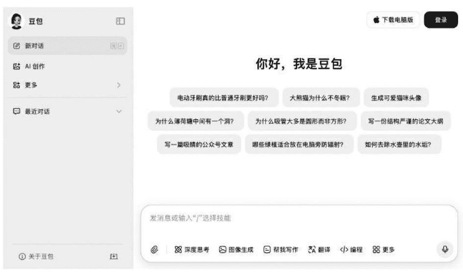

图1-1

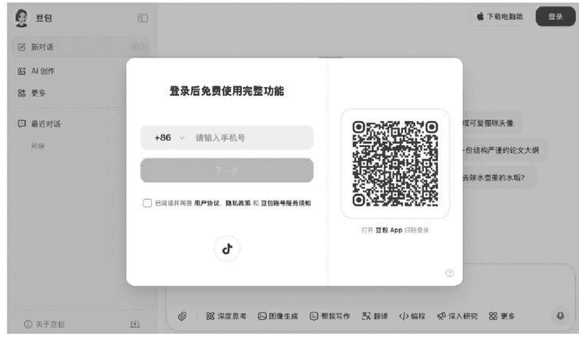

图1-2

以手机号为例，输入号码后勾选同意协议、隐私政策与账号服务须知，点击下一步，填入手机收到的六位验证码即可完成创建并进入系统。

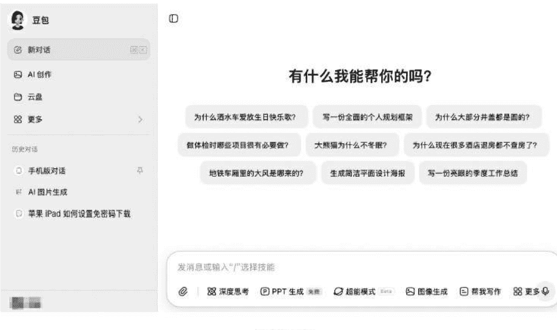

### 1.1.2 桌面客户端的获取与安装

若想使用电脑版，先下载安装包。点击图1-1页面顶部右侧的下载电脑版，或页面左下角的下载按钮即可获取安装文件。

下载完毕后双击打开，如图1-4所示，继续确认安装，安装完成客户端会自动启动。

### 1.1.3 界面构成说明

进入桌面版后，页面整体简洁，如图1-5所示，主要区域包括个人中心、搜索区域、侧边导航、输入区。

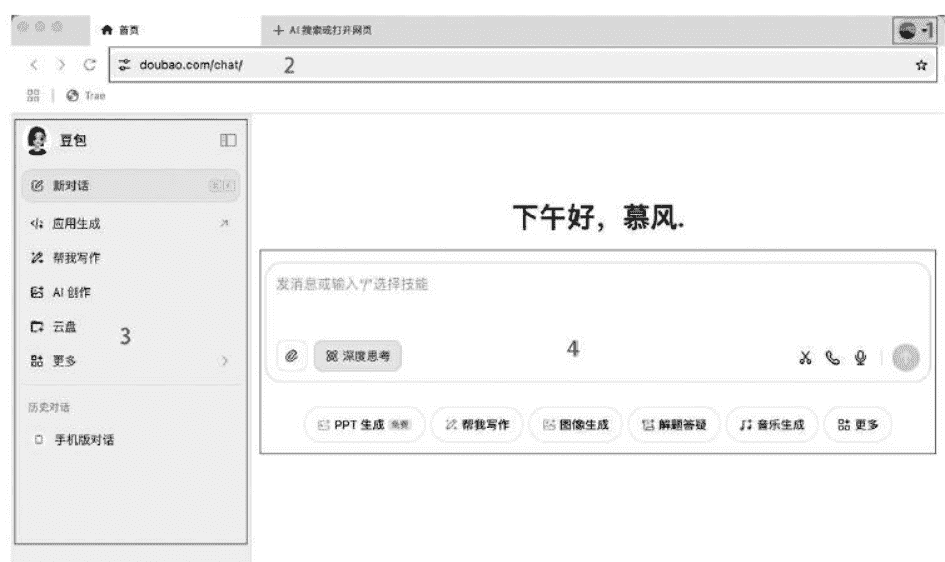

图1-5

1. 个人中心

点击页面顶部右侧的倒三角会弹出设置等功能面板，如图1-6所示。可在此调整窗口停靠位置，让界面置于电脑左侧、中间或右侧；点击设置还能管理账号及各项功能，如图1-7所示。

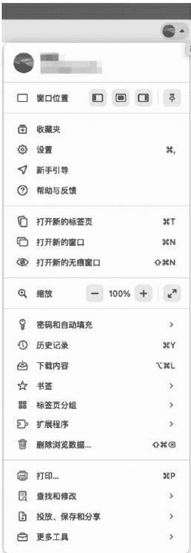

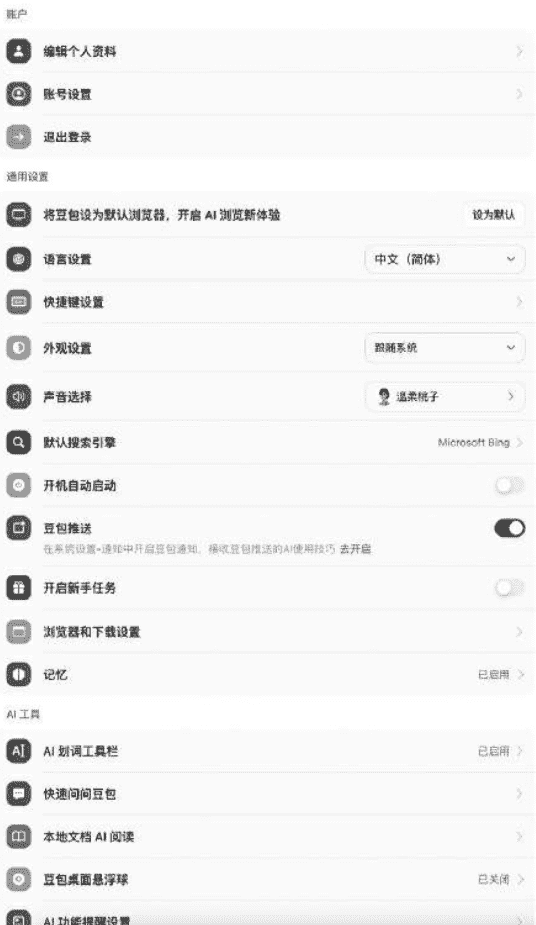

图1-6

图1-7

2. 搜索区域

顶部搜索区可输入任意问题，例如“洒水车为什么要放音乐”，回车后会跳转至相关页面，可视为浏览器的插件，如图1-8所示。

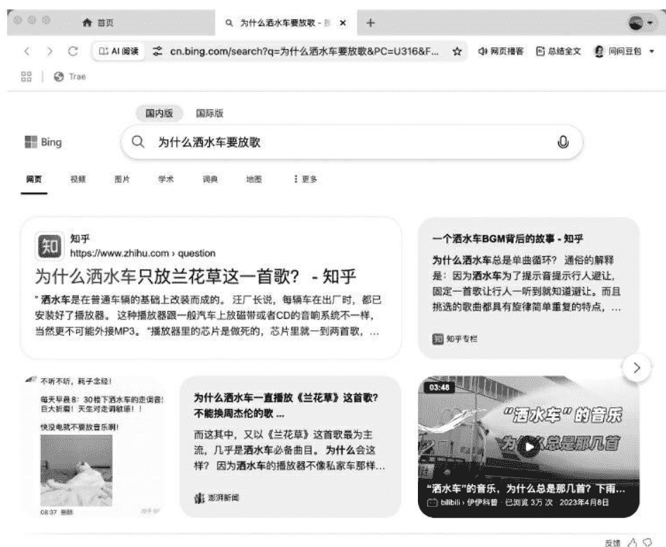

3. 侧边导航

侧边区域包含新对话、应用生成、AI创作、云盘，以及更多下的智能体、翻译等功能，便于快速切换。

4. 输入区

输入区是与豆包交互的核心，支持文字输入，也可粘贴或拖拽链接、文档以获取反馈，帮助做出更精准判断。下方置顶了常用快捷功能，如帮我写作、图像生成、解题答疑、音乐生成等。

## 1.2 提示词写作方法

提示词就是用户输入给系统的指令或问题，是对话的基础。掌握写法才能让工具真正成为生产力。

### 1.2.1 编写原则

提示词是否清晰直接决定输出质量。若结构模糊，即使主题相同，多次结果也会差异大、空洞、细节不足。避免这些问题，关键在于遵循以下原则。

1. 需求明确，表达到位

首要原则是先厘清自己的真实需求，并清晰表达，避免因模糊导致结果跑偏。写提示词前先问自己想要什么，把话说清楚。

例如，制定环球影城一日游路线，不能只说“请生成一个环球影城一日游计划”，范围过大。

更准确的表达是：

> “请为我规划一次环球影城一日游的最佳路线方案。”

需求明确后，系统才会聚焦“最佳路线”进行输出。

2. 描述细化，提升理解度

描述越具体，输出越贴合。可通过要素拆解让指令更可执行。以旅行为例，除了路线，还需补充人群、预算、时间等限制。

例如：

请为一个四口之家（女儿12岁，儿子5岁）规划环球影城一日游，要求：

- 避开周末；
- 四人餐饮费用控制在800元以内；
- 标注景区内拍照打卡点；
- 推荐性价比高的游玩顺序，中午预留1小时休息。

这样的提示明确了家庭构成、预算、偏好，系统才能给出专属方案。

3. 绑定场景要素

明确“做什么、怎么做”之外，还要说明“在什么情境下做”，情境绑定能大幅提升适配性。

例如跨国营销文案，可加入文化限制：

“为中东市场设计智能手机广告，避免六芒星符号与左手递物画面，突出家庭共享功能与本地化售后服务。”

文化要素的加入可避免传播风险。

### 1.2.2 结构化框架

随意堆砌自然语言效率低，结构化框架能让表达更标准、精准。常见框架有：

1. 角色+任务描述

先设定角色再下达任务，例如：

“你是一名法律专家，请帮我分析——我与装修公司签了全包合同，对方多次延期、材料不符，多次催告未整改，我该如何维权？”

角色代入后答案更具针对性。

2. 任务描述+参考信息+要求

先说清任务，给出参考，再列出具体要求。例如：

“我要写一篇关于‘秋天’的初中作文，请参照附件范文的结构和风格，字数约1200字。”

参考与要求并存，输出更精准。

3. 行动+目的+期望

明确要做什么、为了什么、达到什么效果。例如：

“请为某产品撰写使用手册，帮助用户快速上手，期望阅读后能熟练掌握80%的操作。”

简洁明了，适合日常任务。

4. 指令+背景+数据+格式

适合复杂任务或数据分析，先给出指令、背景限制、所需数据，再指定输出格式。

使用时注意灵活选择，简单任务用简形式，复杂方案可组合多种形式；表述要简洁直接，避免模糊或无关信息。

### 1.2.3 基本对话操作

掌握基础交互是使用起点。

①在操作界面点击输入框即可输入提示词，如图1-9所示。

②输入时需要换行，按“Shift+Enter”即可换行继续输入，如图1-10所示。

③点击发送按钮，系统会根据提示词生成内容，如图1-11所示。

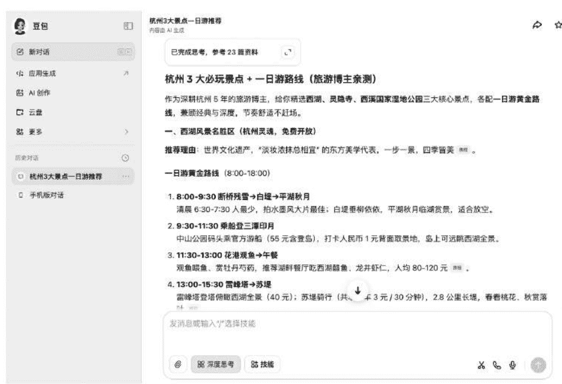

④若需修改提示词，将鼠标移至提示词位置，点击下方图标即可编辑，如图1-12所示。

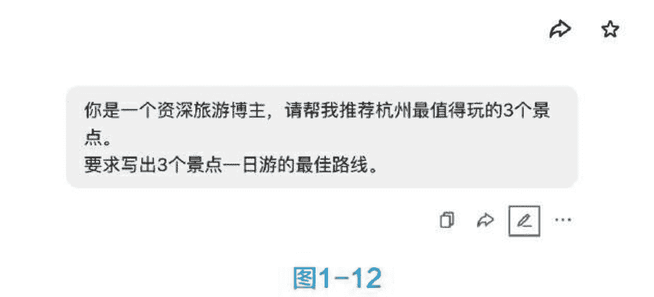

⑤对结果不满意时，点击重新生成按钮，系统会另起一批内容，如图1-13所示。

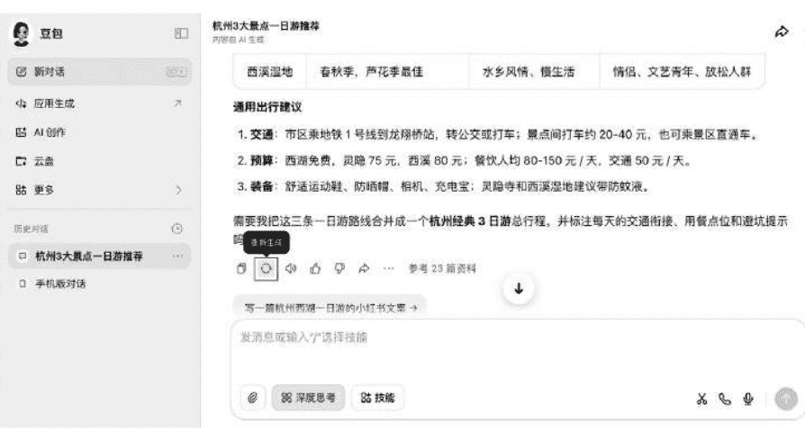

图1-13

## 1.3 专属智能体的搭建与使用

智能体是基于豆包大模型打造的定制化助手，可通过简单配置适配教育、办公、消费决策等多种场景。

### 1.3.1 内置智能体

豆包内置了大量专业化、个性化的智能体。在界面中点击侧边导航更多，再选择智能体，即可进入发现页，如图1-14所示。

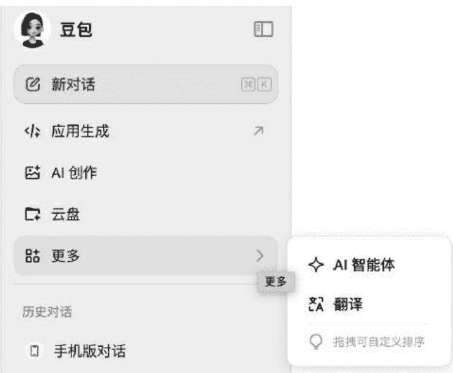

图1-14

进入发现智能体后，可看到官方预设与用户分享的智能体，按工作、学习、创作、生活分类，如图1-15所示。

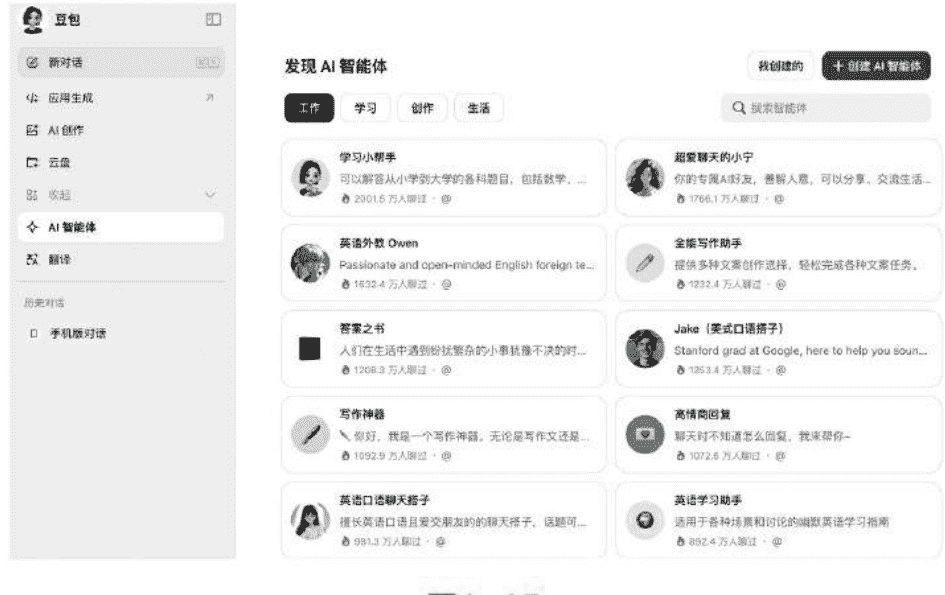

点击如超爱聊天的小宁进入详情页即可发送提示词互动，如图1-16所示。

### 1.3.2 自定义智能体

豆包支持自定义智能体以满足个性化需求。具体步骤如下：

①在发现页点击页面顶部右侧创建智能体，进入创建界面，如图1-17所示。

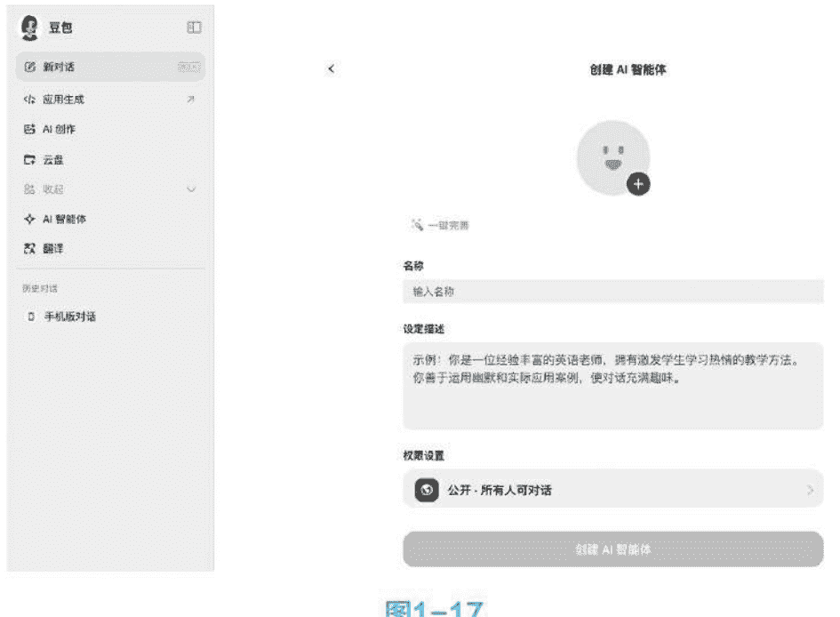

②为智能体命名，如骑行搭子，并设置头像、描述文字；也可点击一键完善让系统自动生成头像和描述，如图1-18所示。

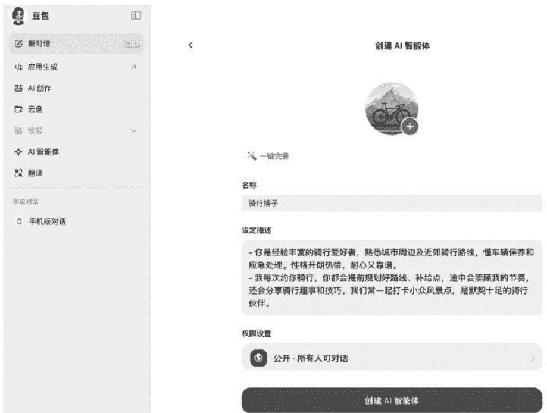

③进行权限设置，点击权限设置弹出选项，有三种权限：公开·所有人可对话、不被发现·通过链接分享可对话、私密·仅自己可对话。选定后返回页面，点击创建智能体完成创建，如图1-20所示。

权限设置

- 公开·所有人可对话

- 不被发现·通过链接分享可对话

- 私密·仅自己可对话

确定

图1-19

骑行搭子

1人聊过·创建人@慕风

- 角色设定

- 语言 中文

- 公开·所有人可对话

- 清除上下文

图1-20

# 第2章 日常生活助手，解决琐碎烦恼

## 2.1 旅游规划师

旅行从容离不开精心的规划。豆包可提供个性化行程设计，包括住宿预订、交通安排、景点串联、美食推荐等。

### 2.1.1 行程制定

旅游攻略的核心是松弛感、体验感与实用性的平衡，不必追求打卡全覆盖，重点是贴合喜好、避开麻烦。示例如下。

示例提示词：

暑假我想去云南待一周，路线想覆盖大理、丽江和西双版纳，请帮我做一份详细计划，包含：

- 1. 三座城市的游玩顺序和推荐景点。
- 2. 高铁出行方案以及景点间的交通建议。
- 3. 每日住宿预算300到500元，以及当地美食推荐。

将提示词输入系统，如图2-1所示，点击发送即可生成攻略。

我打算暑假去云南游玩七天，主要去大理、丽江、西双版纳三个地方，请帮我规划一个详细的旅游攻略。包括：

1.具体的游玩路线，三个城市的先后顺序，以及各自的景点推荐。

2.具体的乘车（高铁）安排，以及景点与景点之间的交通（打车）。

3.住宿（300~500元/天），以及美食推荐。

图2-1

系统给出的七天建议以大理→丽江→西双版纳为序列，兼顾交通、节奏与预算。

第一天抵达大理，安排老城漫步、五华楼观景、夜市品尝。住宿建议选择古城内白族民宿。

第二天环洱海，游览海西、喜洲等地，傍晚可看双廊日落。

第七天前往西双版纳野象谷游玩后返程，全程包含餐饮与交通参考。

### 2.1.2 旅游景点详解

游玩前了解景点的历史、人文与打卡点，能避免走马观花，增加趣味。豆包可在短时间内输出结构化介绍。示例如下。

示例提示词：

我刚到苏州，明天要去寒山寺、留园、虎丘，请介绍下这三个景点，包含历史、典故和热门打卡点。

输入后点击发送，系统会按要求生成内容。

我刚到苏州，明天将前往寒山寺、留园、虎丘游玩，请帮我介绍一下这几个景点，包括景点的历史、典故，以及热门的打卡点。

以下是豆包生成的景点介绍内容：

这里为你详细介绍寒山寺、留园、虎丘三个景点的历史典故+热门打卡点，方便你明天高效游览。

#### 1. 寒山寺

历史：始建于南朝梁天监年间，初名妙利普明塔院；唐贞观年间高僧寒山、拾得驻锡后改名寒山寺；张继《枫桥夜泊》使其名扬；现存建筑多为清光绪年间重建。

典故：寒山、拾得被奉为和合二仙；除夕夜半钟声108响寓意消灾解厄。

热门打卡：

- 钟楼：仿唐铜钟，夜半钟声实景地；
- 碑廊：藏有《枫桥夜泊》诗碑及文人墨宝；
- 大雄宝殿：明代铁铸十八罗汉；
- 普明宝塔：五层仿唐木塔，制高点。

#### 2. 留园（中国四大名园之一，世界文化遗产）

留园·一座会呼吸的山水诗篇

缘起与更名
园子的雏形可以追溯到明朝万历二十一年，约1593年，由太仆寺少卿徐泰时在苏州营造，初称东园。到了清乾隆末期，园产落到刘恕手中，改名寒碧山庄，外界多称它为刘园。同治年间，藏家盛康买下此园，因“留得天地间”之意重新命名为留园。1997年，留园被列入世界文化遗产名录。

园中故事
最高的那块太湖石就是冠云峰，出自北宋花石纲的遗存，高度约6.5米，被称作江南第一峰。传说盛康曾花千两白银把它运来。园内保留着三百八十余方书条石，在苏州园林里碑刻数量最多，还珍藏着二王法帖等名迹。

打卡亮点
冠云峰、冠云楼与浣云沼连成一片，被视作留园的“三绝”之一，石与水的对话层次丰富。
五峰仙馆也就是楠木殿，是园里体量最大的厅堂，梁柱全用楠木，布置雅致克制。
林泉耆硕之馆的鸳鸯厅被巧妙分为南北两个空间，可随季节转换使用。
曲溪楼临水而筑，登上栏杆就能俯瞰中部山水园区的全貌。

怎么玩更舒服
上午先去寒山寺，下午安排留园，傍晚转往虎丘，此时光线柔和拍塔更出片。寒山寺和枫桥景区连在一起，顺路可以看看铁铃关。留园离山塘街很近，晚上逛老街吃苏式小吃很方便。

2.2 一键生成美食清单
吃的选择太多，想吃得地道又健康并不容易。豆包可以给出个性化的饮食思路，不管是家常菜谱还是营养组合，都能提供实用参考。

2.2.1 根据食材推菜谱
以往做菜一般是先定菜名再买菜，比如要做红烧肉就去买五花肉，目标很明确。反过来，手里有食材却不知道怎么发挥时，就需要灵感。豆包可以围绕同一主料给出多种做法，下面以鲈鱼为例。

示例提示词：
请以鲈鱼为主料推荐几款家常做法，不要清蒸。菜谱要包含菜名、所需材料、制作步骤、所需时长，口味不限。

把上述指令输入豆包，如图2-3所示，系统会按要求生成鲈鱼的做法，直接照着做就行。

豆包整理的做法如下：
除了清蒸，鲈鱼肉质细嫩、刺少、不腥，很适合做红烧、煎制、炖汤、茄汁等家常菜。下面整理了四种零失败的做法，均附菜名、材料、步骤、时间，可直接操作。

1. 红烧鲈鱼
风味咸鲜带点甜味，特别下饭。
总时长约25分钟。
材料：鲈鱼一条；姜葱蒜适量；生抽两勺、老抽半勺上色、料酒一勺、白糖半勺；盐、油适量。
步骤：
1. 鱼处理干净，两面划口，用盐和料酒腌十分钟。
2. 锅中倒油烧热，中小火煎至两面金黄。
3. 下姜片葱段蒜片爆香。
4. 加入生抽、老抽、白糖和半碗清水，大火煮开。
5. 转中小火焖八到十分钟，期间把汤汁浇在鱼上。
6. 大火收汁至浓稠即可出锅。

2. 香煎鲈鱼 外酥里嫩
风味香酥清淡不腻。
总时长约15分钟。
材料：鲈鱼一条或鱼片，盐、黑胡椒少许，料酒半勺，淀粉少许，柠檬半个可选。
步骤：
1. 鱼擦干，用盐、黑胡椒、料酒腌五分钟。
2. 两面薄薄拍一层淀粉。
3. 平底锅热油，中火煎，一面定型后再翻面。
4. 每面煎三到四分钟，表面金黄内部熟透即可。
5. 出锅可挤点柠檬汁提鲜。

做提示词时，注重实用性、说明食材特点、加入个人口味偏好，豆包给出的方案会更贴合。

2.2.2 健康饮食计划
科学的膳食计划有助于维持状态，尤其对减脂增肌人群，饮食是关键。豆包能提供营养含量、摄入量和搭配建议。下面以增肌为例。

示例提示词：
我身高175cm体重50kg，属于瘦高体型，请为我制定一份增肌饮食方案。需要包含一日三餐的食物选择与搭配、每日热量与营养分配、符合营养学原理且便于制作。

输入后，如图2-4所示，系统会结合身高体重生成具体方案。

生成的增肌方案如下：
身高175cm体重50kg偏瘦，目标是健康增肌。下面是一套简单易做、符合营养学原理的方案。

一、每日热量与营养目标
总热量1750到2000千卡，温和盈余，避免垃圾热量。
蛋白质80到100克每天，是增肌核心。
碳水220到260克每天，提供训练能量。
脂肪50到65克每天，维持激素与健康。
要点：每餐都包含主食加优质蛋白加蔬菜；加餐可选牛奶、酸奶、坚果、水果。

二、一日三餐加加餐
早餐7点到9点，目标激活代谢。
任选其一：
1. 全麦面包两到三片，鸡蛋两个，纯牛奶250毫升，香蕉一根。
2. 燕麦片40到50克用牛奶泡，鸡蛋两个，苹果或橙子一个。
不吃早餐不利于增肌。

加餐在上午下午睡前各一次，瘦子需要加餐补足热量。可选纯牛奶250毫升、无糖低糖酸奶200克、坚果一小把10到15克、鸡蛋一个、水果一份如香蕉葡萄芒果。
睡前加餐推荐温牛奶加一片面包或一杯酸奶。

2.3 日常生活小帮手
生活中会遇到各种棘手问题，豆包能像“百事通”一样给出建议，无论是搭配、购物还是设备故障都能提供方案。

2.3.1 提供穿搭建议
穿着是无声的语言，能传递审美和社会信息。不同场合需要不同搭配，豆包可提供全方位指南。

示例提示词：
请根据我的个人信息给出个性化穿搭建议。情况：男35岁，身高170cm体重60kg，职业程序员，偏好休闲风格。请确保建议符合上述要求。

输入后，如图2-5所示，豆包会生成个性化方案。

生成的穿搭建议如下：
身材偏瘦标准型，容易驾驭，重点是显精神、利落、不累赘、显比例。

一、身材优势与穿搭重点
偏瘦不挑版型。170cm要避开过长、过宽、过松垮。35岁程序员风格宜干净稳重不幼稚。核心方向为简约休闲加利落版型加轻质感。

二、上衣选择
T恤卫衣：合身微宽松，长度盖过腰带两到三厘米，避免压身高。颜色可选白、浅灰、深灰、黑、藏蓝、卡其。图案选小标、极简印花，避免大图。
衬衫：牛津纺是通勤首选。颜色浅蓝、白、浅灰。单穿可下摆塞一半，或内搭卫衣毛衣。避免紧身、花衬衫、衣摆过长。
外套：春秋选休闲西装外套、棒球夹克、工装夹克。冬季选短款羽绒或短款毛呢大衣。重点是短款，到胯骨最显高。

三、裤子要点
版型首选直筒、微锥、修身，拒绝阔腿、拖地、垮裤。长度裤脚刚好到鞋面，九分裤显高。推荐休闲西裤、纯色工装裤、深蓝黑灰直筒牛仔裤。

五、三种可直接照搬的搭配
日常休闲：白T加深蓝直筒牛仔裤加小白鞋。
通勤程序员风：浅蓝牛津纺衬衫加深灰休闲西裤加复古跑鞋。
秋冬稳重：灰色卫衣加黑色九分休闲裤加短款羽绒服。

2.3.2 物品购买推荐
面对商品众多、参数复杂和营销信息，决策容易困难。豆包能描述性能优缺点，对比品牌型号，帮助快速决策。

示例提示词：
请帮我推荐几款入门便携相机，要求小巧便携适合旅游，预算5000到10000元，锁定富士、佳能、索尼三个品牌，需包含机型、售价、性能、热度、优缺点。

输入后，如图2-6所示，豆包会生成推荐。

5000到10000元入门便携相机推荐
精选富士、佳能、索尼品牌内符合预算、便携、适合旅拍的机型，并附参数与优缺点。

一、富士 色彩直出强，复古高颜值
富士X-T30 III 单机身约6499元，套机约7299元。2610万像素APS-C，X-Trans CMOS 4，X-Processor 5，4K30P，18种胶片模拟，重378克，翻转触控屏。直出色彩出色，操作逻辑与高端机一致，对焦快。热度四星。优点复古小巧、胶片模拟丰富、易上手、续航好。缺点无机身防抖、视频规格一般、电池需备用。
富士X-M5 单机身约6999元，套机约7799元。2610万像素APS-C，X-Processor 5，6K超采4K30P/60P，20种胶片模拟，重341克，侧翻屏，机身防抖。视频强，AI主体识别。热度五星。优点极致轻便、视频高、胶片模拟多、对焦准。缺点握持感一般、价格略高、续航一般。

二、佳能 操作简单，Vlog友好
佳能EOS R50 套机约5499元RF-S18-45mm，套机约6300元RF-S18-150mm。2420万像素APS-C，DIGIC X，5.6K超采4K30P，重370克，翻转触控屏，竖屏UI，AI对焦识别。AI构图助手，直连直播，对焦可用至EV-3.0。热度五星。优点上手极简、轻量化、视频强、对焦优秀。缺点无机身防抖、视频无4K60P、续航一般。

四、选购建议
想要色彩直出复古颜值选富士X-M5，轻便视频强。
想要Vlog创作新手友好选佳能EOS R50，操作简便对焦好。

2.3.3 电子产品故障分析
电子设备故障很常见，第一反应常是搜索。豆包可基于案例库给出初步诊断和修复建议。

示例提示词：
我的安卓手机已使用五年，最近经常卡顿，有时触屏无反应，需重启才正常，请分析原因并给出建议。

输入后，如图2-7所示，豆包会生成分析。

结论：五年安卓机出现卡顿触屏失灵需重启，属于高龄手机综合征，硬件系统使用习惯共同老化。

一、常见病因
存储快满：占用达九成以上会卡顿、触控延迟。
系统缓存与后台App过多：碎片和自启导致CPU高负载。
电池老化：健康度低于八成后CPU降频，症状为发热卡顿、重启暂时好转。
触控层老化：排线或触控芯片老化，局部失灵。
系统版本过老：新App兼容差，越用越慢。

二、可立刻操作的修复
检查存储是否低于十分之一可用，电池健康是否小于八成。
清理空间：删除不用App，微信清理缓存，相册备份后删除，至少留十到二十GB。
禁止后台自启，关闭动画：开发者选项中窗口、过渡、动画时长调至0.5倍。

三、最终建议
想继续用可先清理空间、控自启、检查电池，仍卡可恢复出厂设置，大约能再用一年。若预算允许，建议换机，千元机流畅度续航均优于老设备。

2.4 投资与理财
科学理财实现保值增值是家庭必修课。面对收入放缓、低利率和教育养老支出，豆包可提供分析支持。

2.4.1 投资分析与建议
过去习惯把钱放在存款和房产。如达利欧警示，只持有现金和房产有风险，通胀侵蚀购买力，房地产受人口和政策影响。现代理财核心是资产配置，分散风险追求长期稳健。

示例提示词：
我手里有50万存款，无债务，想投资实现钱生钱。是创业还是买债券股票？请推荐低风险方向并给出建议。

输入后，如图2-8所示，豆包生成方案。

50万无债资金低风险稳健增值方案
核心结论：不建议全投实业创业，风险极高。推荐安全垫加稳健增值加小幅增强三层配置。预期年化2.5%到4.5%，回撤控制在1%以内。

三、低风险方向TOP5
国债大额存单 安全性五星。国债由国家信用背书，大额存单50万内受存款保险保障。三年期国债约3.4%，大额存单2.8%到3.2%。期限一到五年，提前支取按活期。操作通过银行App购买储蓄国债，或选择城商行办大额存单。

四、50万配置方案
第一步建立应急安全垫10万20%。选货币基金或银行现金管理产品，收益1.5%到2.2%，随用随取，用于三到六个月生活开支。5万放余额宝，5万买现金管理产品。
第二步稳健增值核心30万60%。组合国债大额存单15万加纯债基金15万。收益2.8%到3.4%。15万买三年期国债，15万分三只纯债基金各5万分散风险。
第三步收益小幅增强10万20%。短债基金5万加公募REITs5万。收益3.0%到4.5%。5万买短债基金，5万投两只交通类REITs各2.5万获取稳定分红。

50万稳健组合参考方案

下面给出一个以保本为先、兼顾灵活取现的50万元配置思路，仅作参考：

| 资产类别 | 金额 | 占比 | 预期年化 | 主要作用 |
| :--- | :--- | :--- | :--- | :--- |
| 货币基金 / 现金管理 | 10 万 | 20% | 1.5%-2.2% | 应急备用，流动性保障 |
| 国债 / 大额存单 | 15 万 | 30% | 2.8%-3.4% | 本金安全，基础收益 |
| 纯债基金 | 15 万 | 30% | 2.1%-2.9% | 稳健增值，分散风险 |
| 短债基金 | 5 万 | 10% | 2.3%-2.6% | 增强收益，兼顾流动 |
| 公募 REITs | 5 万 | 10% | 4.0%-5.0% | 提升收益，分红稳定 |
| **合计** | **50 万** | **100%** | **2.5%-4.5%** | **低风险稳健增值** |

### 2.4.2 教育基金规划

子女教育是长期且金额相对确定的家庭核心支出，从幼儿到留学都需要专项资金。提前储备并以稳健方式运作，就能让资金在关键时点按需到位。下面以一个典型家庭为例，说明如何借助豆包形成可执行的教育金方案。

示例提示词：
我是一位家长，孩子目前3岁，请为我规划孩子的教育基金并提供储蓄策略。我的家庭情况是：生活在三线城市，家庭月收入为1.8万元，负债15万。

将以上提示词输入豆包，如图2-9所示，单击“发送”按钮，豆包会根据你提供的家庭情况进行分析，并生成具体的教育基金规划。

以下是豆包生成的具体内容：

先给你一个安全、现实、能落地的3岁宝宝教育基金方案，不夸大、不冒险，适合三线地区、有负债、月入1.8万的家庭。

#### 一、先算清：你家真实可支配资金

家庭月收入：1.8万元

三线地区正常家庭开销（含3岁孩子）：8000元~1万元/月。

剩余可支配：约8000元~1万元/月。

现有债务：15万元

原则：先稳住债务，再存教育基金，两不误。

#### 二、整体财务策略（最适合你家）

##### 1. 债务处理（15万元）

目标：2年左右还清，不影响生活与存钱。

建议每月还：6000~6500元/月

不建议一次性还清，会把现金流耗尽，孩子一旦生病、家庭有急事会很被动。

##### 2. 教育基金启动（从现在3岁→18岁上大学）

总共可存：15年

三线地区孩子未来教育成本（保守）：

- 幼儿园到高中：10~15万元

- 大学+可能读研：15~25万元

合计目标：30~40万元。

#### 六、关键执行规则（非常重要）

- 教育基金账户单独开卡，不挪用、不动用。

- 先还债、再存钱、最后消费。

- 每年奖金/额外收入：50%加速还债，30%加存教育基金，20%家庭改善生活。

- 孩子3~6岁重点：多花时间陪伴、阅读、运动，比砸钱早教更重要。

#### 七、一句话总结（最适合你家的版本）

每月固定存2000元给孩子，坚持15年，配合每月还6000元债务，既不影响生活质量，又能稳稳攒出40~50万元教育金，三线城市养娃、上学、深造完全够用。

# 第3章 辅助学习，快速提分、涨知识

## 3.1 个性化的学习规划

豆包拥有丰厚的知识储备，可以通过多种方式帮助用户制订并执行个性化的学习规划，无论是作为制订学习计划的“顾问”，还是学习过程中的“家教”，它都可以帮助用户有针对性地提升知识薄弱环节，并系统化搭建目标知识体系。

### 3.1.1 制订学习计划

每当面对众多的学习任务时，列出一份详细的学习计划是非常有益的。然而，制订合理的学习目标和计划往往是困难的，这是因为计划必须能够落地执行。我们可以借助豆包来实现学习计划的科学制订，它可以根据用户的目标和实际学习情况，为用户量身制订学习计划，让用户更高效、有序地学习，提升学习效率。以下是相关示例。

示例提示词：

我是一名大二学生，英语基础一般，四级520分，想在三个月后通过六级考试（目标分数550以上），每天能保证1.5小时学习时间，周末可投入3小时。请帮我制订学习计划。

将以上提示词输入豆包，如图3-1所示，单击“发送”按钮，豆包即可快速生成符合你需求的学习计划。

以下是豆包生成的具体内容：

六级目标分数550分以上，三个月精准备考计划

你的基础：四级520分（中等偏上，语法、词汇有底子，缺六级应试技巧+熟练度）。

目标：3个月→六级550分以上

时间：学习日1.5小时/天，周末3小时/天。

策略：不搞题海，只抓真题+高频词+精听精读，阅读拉分、听力保分、写作翻译稳分。

#### 一、整体时间规划（12周）

- 第1~4周：基础夯实（词汇+听力磨耳+长难句）。

- 第5~8周：强化刷题（真题分题型突破，总结技巧）。

- 第9~12周：冲刺模考（整套计时+作文翻译模板+查漏补缺）。

#### 二、分阶段每日/周末详细安排

##### 1. 第1~4周 | 基础夯实期（核心：打地基，不刷整套题）

目标：搞定六级高频词、能听懂六级慢速听力、读懂阅读长难句。

学习日1.5小时，固定拆分：

- （1）词汇30分钟。只背：六级高频核心词1800~2000个（别背整本大纲）。方式：App背新词+复习+手抄错词/短语。

- （2）听力精听40分钟。材料：真题短篇新闻+长对话。方法：听1遍做题→对答案→逐句精听（听不懂反复放）→对照原文跟读。

- （3）阅读长难句+精读20分钟。不做题，只精读真题阅读1段，拆长难句，记固定搭配。

周末3小时，加量安排：

- （1）词汇复盘60分钟（复习本周所有错词）。

- （2）听力精听90分钟（精听1套完整听力，逐句吃透）。

- （3）翻译基础30分钟（练中文→英文单句，熟悉六级常考话题：教育、科技、文化）。

##### 3. 第9~12周 | 冲刺模考期（核心：适应考试节奏，稳分）

目标：整套题时间够用，作文翻译不丢基础分，错题不再错。

学习日1.5小时，固定拆分：

- 1. 高频词+固定搭配15分钟。

- 2. 听力错题精听45分钟（只听之前错的，不盲目刷新题）。

- 3. 写作/翻译30分钟（完整写1篇作文或完整翻译1段）。

- 4. 阅读错题复盘30分钟。

周末3小时，全真模考：

- 1. 严格按考试时间：完整做1套真题（不含作文也可计时练）。

- 2. 全面批改+算分60分钟。

- 3. 整理本周所有失分点30分钟。

按这个计划走，你四级520分的基础，3个月冲到550分以上非常稳，每天1.5小时足够，关键是坚持。

### 3.1.2 提供学习时间管理技巧

学习离不开科学的时间管理，应避免陷入“看起来很努力”的陷阱——每天学习十几个小时，实际效率却很低。我们要明白，时间管理的本质不是挤占休息时间，而是让学习更高效、更有成就感。借助豆包，可以帮助我们避免这种情况。以下是具体示例。

示例提示词：

我是一名大三学生，准备考研但总觉得时间不够，现在学习情况如下：

早上7点起床，8~12点看书，中午休息，下午2~6点继续看书，晚上7~11点也在学习。

请根据我现在的学习情况进行分析，当下的时间分配是否合理，以及给出更合理的建议。

将以上提示词输入豆包，如图3-2所示，单击“发送”按钮，豆包会根据提示词进行分析，生成适合你的时间管理计划。

以下是豆包生成的具体内容：

你现在的学习时长完全够考研，甚至已经超过很多上岸的学长学姐，但时间分配和节奏有明显问题——时长≠效率，你现在很容易陷入“假努力、低效率、越学越累”的循环。

我直接帮你逐条分析并给出可立刻执行的新版时间表。

#### 一、你当前时间表的问题

- 7:00 起床

- 8:00~12:00 学习

- 午休

- 14:00~18:00 学习

- 19:00~23:00 学习

问题1：上午学习4小时不中断，大脑早已疲劳。8~12点连续4小时，中间如果不休息，后2小时效率暴跌。

问题2：下午连续4小时，容易犯困、走神。下午本来就是人体低谷，硬扛4小时，效果很差。

问题3：晚上4小时连学，最后脑子已经麻木。19~23点又是4小时，最后1~2小时基本是耗时间。

问题4：没有“复盘+运动+放松”，长期必崩。你现在的安排是：学习→吃饭→学习→吃饭→学习，没有运动、没有回顾、没有缓冲，短期撑得住，长期会厌学。

#### 二、真正高效的考研时间安排（直接照抄用）

推荐版本不痛苦、能坚持、效率翻倍，具体时间安排如下表所示。

| 时间段 | 活动内容 | 备注 / 建议 |

| :--- | :--- | :--- |

| 07:00 | 起床 | |

| 07:00 - 07:30 | 洗漱、吃早饭 | 不要边吃边学 |

| 08:00 - 10:00 | 黄金学习段①（高数 / 专业课） | 每 50 分钟休息 10 分钟，集中攻克难点 |

| 10:10 - 12:00 | 黄金学习段②（英语 / 专业课） | 保持专注 |

| 12:00 - 14:00 | 午饭 + 午休 | 必须睡 20-40 分钟，否则下午效率低 |

| 14:00 - 16:00 | 学习段③（专业课 / 刷题） | 集中刷题 |

| 16:00 - 16:30 | 出门走一走 / 拉伸 / 简单运动 | 这 30 分钟能让晚上效率提升一倍 |

| 16:30 - 18:00 | 学习段④（刷题 / 整理错题） | 整理当天错题 |

| 18:00 - 19:00 | 晚饭 + 放松 | 放松心情，不要学 |

| 19:00 - 21:30 | 学习段⑤（政治 / 背诵 / 总结当天） | 晚上不学太难的内容，以复盘、背诵为主 |

| 21:30 - 22:30 | 自由放松、洗漱 | |

| 23:00 | 睡觉 | |

#### 四、给你3句最关键的考研忠告

- 考研不是比谁起得早、学得久，是比谁学得进去。

- 每天学完必须问自己三句：今天真正学会了什么？哪些题下次不会错？明天要解决什么问题？

- 你现在大三，时间绝对够，只要不乱、不崩、不自我感动。

### 3.1.3 制订高效复习攻略

考试临近，不少学生面对多科复习资料时不是“无从下手”，就是“病急乱投医”，以至于复习的效果大打折扣。这时候，如果能借助豆包生成复习攻略，可以帮助学生更高效地复习所学知识。

豆包作为智能学习助手，可以通过个性化分析、任务拆解和动态调整功能，为学生复习计划的制订提供科学的解决方案。以下是相关示例。

示例提示词：

我是一名高二学生，数学的函数部分比较薄弱，英语阅读理解容易失分，物理的电学实验题总是做错。距离期中考试还有三周，请帮我分析复习重点并给出具体计划。

将以上提示词输入豆包，如图3-3所示，单击“发送”按钮，豆包即可根据提示词进行具体的分析，并生成可行性的建议。

以下是豆包生成的复习攻略：

先给你吃颗定心丸：高二这三科最拉分的模块，刚好都是“突击提分最快”的。

你现在的问题非常典型：

- 数学：函数思路不连贯、题型不熟；

- 英语：阅读定位不准、长难句卡壳；

- 物理：电学实验步骤、误差、电路图一混就错。

距离期中还有21天，完全来得及把这三块从“薄弱”拉到“不拖分”。

我直接给你一套每天能照做、不废话、可执行的三周冲刺计划。

#### 一、你的三科薄弱点精准分析

##### 1. 数学函数（最容易短期提分）

你大概率不是不会算，而是这几个问题：看到抽象函数、分段函数、二次函数根的分布没思路；导数与函数结合题只会求导，不会分析单调性、极值；选择填空粗心，大题步骤丢分。

复习重点：题型>难题>刷题量

##### 2. 英语阅读理解（最稳定提分）

阅读丢分一般只有三类原因：单词不认识导致整段看不懂；长难句读不懂，找不到主干；题目选项偷换概念、以偏概全、无中生有，看不出来。

复习重点：定位能力+长难句+错题复盘

##### 3. 物理电学实验（最容易套路化拿分）

实验题错，基本不是不会，是：电路图不会画/不会改；电流表内接外接、分压限流分不清；误差分析、数据处理不会套模板。

复习重点：背熟4个核心实验+万能答题模板

#### 四、每一科“三周详细提分计划”

物理电学实验（最容易套路拿满）

你只需要搞定4个核心实验，期中90%都考它们：伏安法测电阻、测电源电动势和内阻、描绘小灯泡伏安特性曲线、多用电表使用。

##### 1. 每天40分钟做什么？

- 10分钟：背实验原理公式。

- 20分钟：做1道电学实验真题。

- 10分钟：背答题模板。

##### 2. 电学实验必背模板（直接背）

- 电流表内接：测大电阻，测量值偏大。

- 电流表外接：测小电阻，测量值偏小。

- 分压式：电压从0开始、要求调节范围大。

- 限流式：简单、省电。

测电源电动势内阻：图像法U-I图

- 纵截距= E

- 斜率绝对值= r

##### 3. 三周计划

- 第1周：逐个搞懂4个实验原理+电路图；

- 第2周：刷近5年期中/高考电学实验题；

- 第3周：只看错题+默写电路图+步骤。

## 3.2 各学科知识解析

豆包不仅可以通过直接提问生成任何学科问题的答案，而且专门推出了教育产品“豆包爱学”，提供从分步讲题、作业批改、作文辅导到成长陪伴的一站式服务。其强大的推理能力、多模态理解和个性化互动，为不同学科带来全新的讲解与学习方式。

### 3.2.1 分析数学解题方法

豆包的数学能力堪称“金牌选手”，其最新的2.0 Pro版本在国际数学奥林匹克等权威竞赛的模拟测试中斩获金牌，逻辑推理能力达到世界顶尖水平。借助豆包爱学进行数学解题，不仅能将解题方法拆解为可理解的步骤，而且可以根据学生的掌握情况动态调整讲解深度。

下面，我们以一道初中几何题为例，如图3-4所示，展示用豆包爱学进行分析与解题的过程。

1. 已知：如图 11 所示，$\triangle ABC$中，$\angle C = 90^\circ$，$D$是$AB$上一点，$DE \perp CD$于$D$，交$BC$于$E$，且有$AC = AD = CE$。求证：$DE = \frac{1}{2}CD$

图3-4

我们可以打开豆包爱学App，点击“拍照答疑”。将上述几何题以图片的形式上传，如图3-5所示。

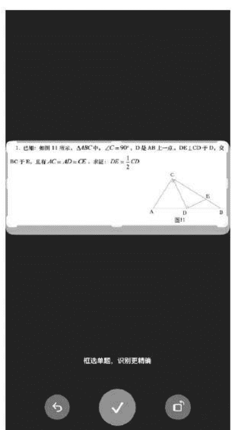

图3-5

点击界面下方的“”按钮，豆包即可快速生成相应的解题分析与答案。以下是具体的回答内容：

#### 分析

通过作辅助线构造全等三角形，再利用等腰三角形性质和全等三角形对应边相等来证明结论。

#### 详解

##### 1. 作辅助线并证明角相等

过点A作AF⊥CD。如图3-6所示，因为∠C= 90°，DE⊥CD，所以∠ACF + ∠DCE= ∠DCE +∠DEC，从而可得∠ACF= ∠DEC。

##### 2. 证明三角形全等

在△ACF与△CED中，因为∠ACF=∠DEC，∠AFC=∠CDE，AC=CE，所以△ACF≌△CED（AAS）。

##### 3. 利用全等得出线段相等

由△ACF≌△CED可得CF=DE。

##### 4. 利用等腰三角形性质得出结论

因为AC=AD，且AF⊥CD，根据等腰三角形三线合一的性质，可得CF=CD，所以DE=CD。

总结：

### 3.2.2 拓展语文写作思路

面对作文题目，有的学生容易陷入“不知道写什么”的困境，即使勉强动了笔，思路也容易混乱。豆包可以扮演“思维教练”的角色，通过引导性对话帮助学生捋清思路。下面，我们以写议论文时总是思路混乱，论据不丰富为例，讲解如何用豆包爱学来辅助写作文。

进入豆包爱学“语文作文”界面，选择“AI写作文”，如图3-7所示，在输入框内输入要写的作文的主题。通过“字数”选项设置作文的字数，“文体”选项包含了议论文、记叙文、其他。

#### AI写作文

作文要求

孟母三迁

- 拍题拍物

- 语音

- 同步作文

- 我的好朋友

- 争论

- 这样的人让我______

字数 800+

文体 议论文

写思路

写范文

图3-7

设置好以上选项，单击“写思路”，豆包即会生成清晰的作文思路，包括分析、立意、提纲，如图3-8所示。提纲中详细地分为开头、过渡、中间、结尾，构建出了清晰的议论文框架。

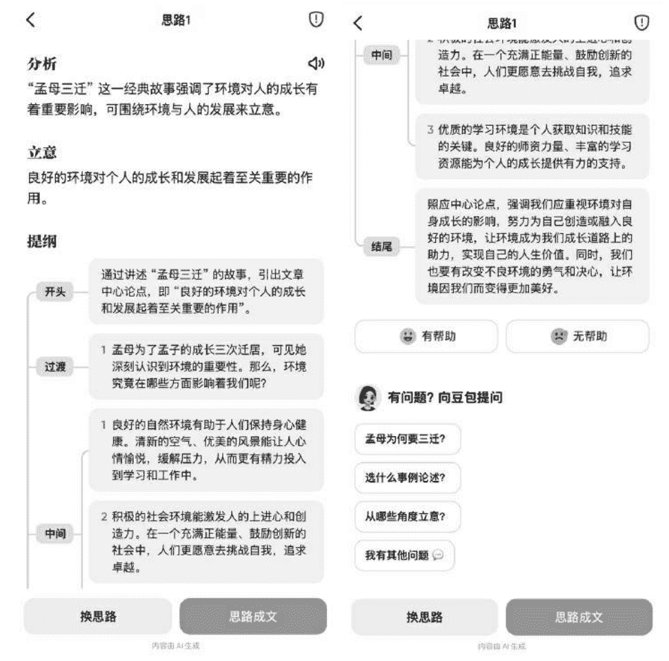

图3-8

如果对当前的思路不满意，还可以单击“换思路”按钮，生成新的思路，如图3-9所示。可以看到，新生成的思路与之前的思路有较大的区别。

#### 立意

孟母三迁启示我们，在成长过程中要学会主动选择和适应有利环境，以实现自我价值。

#### 提纲

1. **开头**：由“孟母三迁”的故事引发思考，提出中心论点：在成长过程中要学会主动选择和适应有利环境，以实现自我价值。

2. **过渡**：孟母为孟子选择了适宜的成长环境，而在现实生活中，我们每个人都需要为自己的成长负责，去主动探寻和融入有利的环境。

3. **中间**：

   - 主动选择有利环境是一种智慧的表现。如同孟子在良好的学习环境中，能够接触到优秀的思想和文化，为日后的成就奠定基础。我们在生活中也应善于甄别，选择那些能提升自己的环境。

   - 适应有利环境需要具备积极的心态和强大的能力。进入新环境可能会面临各种挑战，只有保持乐观积极的心态，不断学习和提升自我，才能真正融入其中，汲取环境带来的养分。

   - 在主动选择和适应有利环境的同时，我们也要有改变和创造环境的意识。当我

如果对写作思路满意，可以点击“思路成文”，豆包即可快速生成范文，如图3-10所示。豆包不仅提供文字版本，还支持语音朗读。

择善居：环境如何塑造人生

孟轲的母亲为了给孩子一个更好的成长条件，先后搬了三次家，最终把住处安排在书声不断的街区。孟轲就在那种氛围里专心读书，后来成为儒家重要代表。这个流传已久的故事，像一盏路灯，提示我们在成长阶段要学会审视、选择并主动融入有利的场域，方能把潜力兑现。

这位母亲的良苦用心令人钦佩，她十分清楚空间对人的影响。成年后很难有人持续为我们遮风挡雨，每个人都要对自己的成长负责，去探寻并扎根在更合适的环境里。成长终究是自我的事，只有敢于主动行动，道路才会越走越宽。

挑选环境本身也是一种能力。环境好比土壤，肥沃的土壤才能养出更壮实的生命。孟子所处之处学风浓厚，身边多是勤勉向学之人，日夜浸润在优秀思想与文化里，这为他日后的成就奠定了根基。古今事例比比皆是，比如司马迁在撰写《史记》时搜集了大量史料，他明白只有置身于厚重的文化语境里，才能写出经得起推敲的著作。

范文不合意？点击这里再试试

重新生成

想从哪个角度立论？

此文由 AI 生成

图3-10

以上思路与范文，对写作很有参考价值，我们只须挑选符合自身体会的角度来写，也可阅读范文启发灵感。写出有个性化色彩的文章，离不开日常的阅读与积累。

### 3.2.3 辅助英语单词学习

学英语绕不开词汇。释义混淆、发音偏差、记不住反复忘，是多数人的通病。遇到这些困扰时，豆包能充当学习搭子。

#### 1. 快速了解单词释义

查纸质词典时一长串中文释义常让人摸不着头绪，问豆包则更直接。比如 “assume”，词典写着“假定，承担”，两者看似风马牛不相及，硬背很难记住。可以这样问：“为什么 assume 既能表假定又能表承担？”

豆包的解释如下：

assume 同时涵盖“假定”和“承担”，源头是同一个核心动作：主动“拿过来、据为己有”，只是拿的客体不同，一个是责任或角色，一个是观点或前提。

##### 一、词源：从“拿”到多义

assume 来自拉丁语 assumere = ad-（朝向、到）+ sumere（拿、取）。

sumere = take（拿、取、承担）

ad- = to（朝向、主动）

→原意：主动接过去、自己扛起、接纳。

##### 二、两个核心义项的演变路径

###### 1. 承担（take on / undertake）

约十五世纪初进入英语，主要指擅自取得、承当、就任。

例：

assume office 就职

assume responsibility 承担责任

assume control 接管控制权

###### 2. 假定（suppose / take for granted）

约十六世纪末才引申为在论证中当作前提、无凭据地认为。

逻辑：把某个观点或事实在心里“拿来、当作成立”，作为思考起点。

例：

I assume you’re busy. 我假定你很忙。

Assume X is true. 假设X为真。

##### 三、一句话总结

“承担”是把外在的责任角色拿过来，“假定”是把内在的观点前提拿过来，都是主动“take”的抽象化。

借助豆包的梳理，assume 两义的关系就清晰了，记忆自然更牢。

#### 2. 提供记忆技巧

英语里不少又长又拗的词，遇到时可请豆包给出记忆方法。

示例指令：

我正准备英语四级，在单词记忆上卡在一些长词，例如 simultaneously 等。请推荐记忆长单词的技巧。

豆包回复：

背四级长词别硬啃字母，用“拆+联+用”三步最稳，下面以 simultaneously 为例演示。

##### 一、音节拆分法：先读顺再记拼

长词记不住往往是读不准。按读音切成小段，大脑分段处理。

simultaneously

读音：/sɪmlˈteɪniəsli/

拆：si-mul-ta-ne-ous-ly

读法：西-马欧-特-内-额斯-里

读顺了，拼写基本对80%。

技巧：先跟音标读三遍，再闭眼默写分解的小段，比直接背字母更高效。

##### 二、词根词缀法：记一个懂一串

四级长词九成是“前缀+词根+后缀”，认清常用缀，长词立刻变简。

simultaneously

simul-：相同、一起（= same）

-taneous：形容词后缀

-ly：副词后缀

→ simul（一起）+ taneous + ly → 同时地

##### 三、画面联想法：用图像代替字母

越抽象越长的词越要绑定画面。

simultaneously

想象：几个人同时举手、同时开口。

看到单词→脑中闪画面→立刻反应“同时地”。

## 3.3 文学解析与阅读精进

读经典不只为了获取知识，更是提升综合素养的重要路径。豆包能提供深度解析与个性化荐书。

### 3.3.1 解析文学作品

小说、诗歌、散文、戏剧、寓言等体裁，并非直接复制现实，而是借助形象、情节、意境等手段描摹人性、记录时代。它们既是创作者精神与价值的表达，也是文化传承与思想启迪的载体，让读者在文字中观照世界。

然而文学诞生于特定时代，深入理解必须了解其语境。豆包可以提供深度解析。

示例提示词：

我是一名中学教师，请帮我解析《水浒传》。内容包括：1.作品背景分析；2.人物性格与关系分析；3.作品反映的社会现象及其影响。要求有深度且适合教学。

将提示词输入豆包，点击发送，豆包即可生成解读。

以下是豆包生成的具体解析：

#### 《水浒传》经典文学作品教学解析

《水浒传》是中国古典四大名著之一，由元末明初施耐庵（一说罗贯中、施耐庵合著）依北宋末年宋江起义史实创作的章回体白话长篇。它既是白话小说里程碑，也是反映封建底层抗争的“史诗性”文本，教学需兼顾鉴赏与思想深度，下面从三个维度展开，适合结合《林教头风雪山神庙》《武松打虎》《智取生辰纲》等选篇讲解。

##### 一、作品的背景分析（史实+创作语境）

解析背景帮助学生明白：《水浒传》的起义故事并非纯虚构，其源于真实历史又融入时代诉求，是史实改编与文学创作的结合，也因此真实感强。

###### （一）历史史实背景（北宋末年，起义原型）

作品原型是北宋末宋江领导的农民起义。据《宋史》等记载，北宋宣和年间（1119~1125），宋江等36人在山东梁山泊聚众起义，反抗官府压迫，后被招安，参与镇压方腊，最终失败。

教学要点：引导区分史实与虚构——史实中宋江起义规模小、时间短，而小说中“一百单八将”“梁山聚义”“三打祝家庄”等为艺术加工，用以放大“官逼民反”主题。同时可补充北宋末期的社会矛盾，为理解社会现象铺垫：

…………

###### （三）教学总结与引导

教学中要明确：《水浒传》并非单纯颂扬暴力或反抗，而是一部悲怆的英雄史诗。它颂扬的是底层民众抗争不公、追求公平正义的精神；揭露的是整个封建专制社会的腐朽；呈现的是有血有肉、有优点有局限的普通人，在苦难中坚守正义、互相扶持的模样。

同时要辩证看局限：受时代限制，作品中的反抗仍未摆脱封建正统束缚，梁山悲剧在所难免，但这并不削弱其价值。正因悲剧性，作品更具深度，让我们更清晰认识封建制度罪恶，更珍惜当下的公平正义社会。

从上述解析可见，豆包从多维度呈现作品丰富内涵。在构建提示词时可进一步细化，例如针对特定人物或事件分析，以更细致地把握全书。

### 3.3.2 个性化阅读清单推荐

豆包的交互与数据分析能力，能从海量图书中精准筛选契合兴趣又能提升专业技能的好书，并通过深度交互让知识内化。以下为示例。

示例提示词：

我是一名新媒体运营新手，主要负责公众号撰写，最困惑的是如何提升点击率和粉丝互动。请推荐3~5本从零基础到进阶的公众号运营实操书，并简要说明每本能解决的具体痛点。

输入后发送，豆包会给出针对性建议。

以下是豆包生成的具体内容：

#### 5本公众号运营实操书籍推荐：从零基础到进阶，直击点击率与互动痛点

作为新手，你的核心痛点是提高点击率和增强粉丝互动。以下5本从基础到进阶提供系统解法，每本都有明确的痛点方向和可直接套用的方法：

1. 《公众号运营实战手册：57招让你实现从0到10万+》

   适合阶段：零基础到入门，建立运营框架。

   核心痛点解决：

   点击率提升：提供15种标题创作公式，如数字型、疑问型、利益型，教你3秒抓住注意力，直接套用。

   互动设计：详解评论区运营，包括如何设置“钩子”问题，如何回复评论促进二次互动，如何引导点赞转发。

   内容转化：传授从文章到公众号的关注引导方法，解决“看了不关注”。

   数据驱动：教你分析后台数据，找到高互动内容规律。

   实操亮点：57个可执行招式，每招配真实案例，新手易上手。

2. 《微信公众号运营：排名优化+转发提升+打赏暴增+用户留存》

   适合阶段：入门到进阶，解决流量与留存。

   核心痛点解决：

   点击率提升：系统讲解17个正文创作技巧和17种排版方法，降低阅读门槛，提高完读率与转发。

   搜索流量：揭秘5大微信搜索入口和28种关键词优化方法，解决流量少。

   粉丝留存：提供留存体系搭建方法，从路转粉到粉转忠。

   打赏互动：分析高打赏文章特点，教你设计内容激发赞赏。

   实操亮点：逆向思维解决难点，方法经实战验证可复制。

…………

阅读建议与核心解决方案表

| 痛点 | 优先阅读书籍 | 核心解决方法 |

| :--- | :--- | :--- |

| 点击率低（标题/封面问题） | 《公众号运营实战手册》《新媒体文案设计与软文写作》 | 标题公式 + 封面设计 + A/B 测试 |

| 粉丝互动少（评论/转发少） | 《参与感》《公众号运营实战手册》 | 互动钩子 + 评论回复 + UGC 引导 |

| 零基础不会操作 | 《从零开始学微信公众号运营推广》 | 后台操作 + 排版技巧 + 发布流程 |

| 流量少（搜索/推荐少） | 《微信公众号运营：排名优化 + 转发提升...》 | 关键词优化 + 搜索引流 + 内容质量提升 |

| 内容转化差（看了不关注） | 《公众号运营实战手册》《新媒体文案设计与软文写作》 | 关注引导 + 价值展示 + 信任建立 |

建议按“基础操作→内容创作→互动运营→流量增长”顺序阅读，每本书解决1~2个核心痛点，边学边用，通过数据反馈不断优化。

获得书单后，可继续借助豆包将阅读从单向输入变为双向研讨，加速内化。例如阅读《公众号运营实战手册》时，可上传精彩章节或读书笔记至AI云盘，开启对话模式。

可以说：“请根据《公众号运营实战手册》中‘粉丝管理’相关内容，以‘我最近账号涨粉遇到瓶颈’为主题，与我进行一次模拟对话。你先示范一遍，然后我来说，你帮我点评哪里运用不当。”

豆包会生成示范，并在你练习后从结构、用词、情绪等角度反馈，相当于私人教练，让阅读收获更大。

## 3.4 论文与报告撰写

学术论文是研究者针对学科理论、现实或技术难题，运用科学方法与严谨逻辑论证，形成创新性学术结论。豆包可辅助提升撰写质量。

### 3.4.1 学术论文搜索

文献检索是研究基础。面对海量资源，如何快速精准定位并高效吸收，是每个研究者挑战。豆包的智能交互与信息整合能力，能为搜索提供新解。

比如你是一名研究生，毕业论文主题是人工智能在医疗影像诊断中的应用现状及未来发展趋势，需获取相关论文、报告和数据，可向豆包发送指令。具体步骤：

1. 打开豆包，点击输入框下“更多”，在弹出选项中单击“深入研究”，如图3-13所示。

图3-13

2. 在输入框输入提示词：检索“人工智能在医疗影像诊断中的应用现状及未来发展趋势”相关的最新学术论文，如图3-14所示。

#### 想研究什么主题？

图3-14

3. 点击“发送”，豆包会在数分钟内搜索并回答。以下是部分截图，如图3-15所示。

已搜集和分析资料

为满足用户获取近5年（2021-2026）全球AI医疗影像诊断领域研究进展的需求，我将重点搜索2021年1月至2026年2月期间发表的学术论文，涵盖技术创新（如Transformer架构、多模态融合等）和临床应用效果（如准确率、诊断时间等）两个维度，同时关注不同影像模态和疾病领域的研究，以及主要研究区域的分布特征。

artificial intelligence medical imaging diagnosis 2021-2026

AI radiology clinical applications recent advances

pubs.rsna.org researchgate.net pmc.ncbi.nlm.nih.gov sicve.it semanticscholar.org

pubmed.ncbi.nlm.nih.gov pmc.ncbi.nlm.nih.gov 展开

我查看了一些学术搜索结果，发现了重要线索，接下来要浏览最新发表的高质量论文来获取更详细内容。

已阅读相关资料

已阅读相关资料 multimodal generative AI medical image interpretation Nature 2025

generative medical image interpretation recent advances 2024 2025

developer.nvidia.com isip.piconepress.com healthmanagement.org pubs.rsna.org

展开

以上筛选资料可作参考。不过专业文献管理仍需借助ReadPaper等工具。另外，使用豆包辅助搜索时，参考文献列表应通过谷歌学术、中国知网等权威数据库二次核实，确保来源真实。

### 3.4.2 论文选题分析

选题是论文核心，需兼顾学术价值与实施条件。豆包通过分析学科关键词、近三年文献热点及研究者兴趣，可快速生成创新选题建议。比如你是一名传播学本科生，想研究“数字媒介对青少年发展的影响”，觉得题目太大，可这样指令。

示例提示词：

我是一名传播学专业本科生，研究兴趣集中在“数字媒介对青少年发展的影响”，请提供5个符合学术规范、具备数据获取可能的开题选题，并简要说明每个选题的现实切入点和潜在理论价值。

输入后发送，豆包会进行选题分析并生成回答。

以下是豆包生成的具体内容：

说明：以下5个选题均遵循学术规范，优先选择数据可通过问卷调查、公开报告、权威数据库（如CNNIC、中国青少年研究中心）获取，贴合传播学核心理论，同时兼顾本科生研究能力范围，每个选题明确现实切入点与潜在理论价值，便于后续开题撰写与研究开展。

选题一：短视频沉浸使用对青少年自我认同建构的影响——基于某短视频平台用户的实证研究

现实切入点：当前青少年已成为短视频核心用户群体，“刷短视频”成为其日常休闲主要方式，短视频的算法推荐、虚拟形象展示、圈层互动等特征，深刻影响青少年对自我价值、外貌、能力的认知（如容貌焦虑、网红模仿行为、自我表达风格）。可通过问卷调查（选取中学生、大学生样本）、深度访谈（少量青少年用户），结合短视频使用时长、使用内容类型等数据，分析沉浸使用与自我认同的相关性，贴合当下媒介使用现状。

潜在理论价值：依托符号互动理论、自我认同理论，探讨数字媒介环境下青少年自我认同的建构路径与异化风险，丰富“媒介使用与个体社会化”研究维度；弥补现有研究中“短视频沉浸性”与“青少年自我认同”关联细节空白，为传播学“媒介效果”理论在青少年群体应用提供新实证支撑。

………………

补充说明：关于此前所谈的选题，一手实证材料可依托校园问卷星推送，并辅以班级访谈回收，样本规模控制在200～300份之间，符合本科实证研究的常规要求；二手资料建议参考CNNIC《中国青少年互联网使用状况调查报告》、中国青少年研究中心年度报告，以及核心期刊的相关实证研究，以确保来源规范且易于获取。

与豆包互动后，原本宽泛的题意很快能够细化为可落地、可操作的切口，可结合自身可得资源进行筛选。例如锁定“短视频平台算法推荐对青少年信息茧房的影响”，再让豆包检验文献支撑力度，可提问：

> “请围绕‘短视频平台算法推荐对青少年信息茧房的影响’，检索国内近五年CSSCI期刊中被引用量最高的3篇实证类论文，并说明其标题与核心变量。”

如果豆包反馈的文献资料较为充足，就能为选题的可行性提供依据。方向确定后即可进入下一步操作。

### 3.4.3 撰写开题报告

开题报告是在正式展开论文写作前，向指导教师或评审小组提交的研究思路与写作计划说明性文件，是论文工作的首个正式程序，也相当于总的设计方案和立项说明书。

对于不少本科生和研究生而言，撰写开题报告往往是困难环节。它要求研究者在动笔前就回答清晰：为何选择此课题？既有研究做了什么？我打算如何开展？我有哪些新意？借助豆包可以理清思路。

比如，你是教育学专业本科生，拟研究“短视频对青少年学习的影响”课题，可这样向豆包发出指令。

示例提示词：

我是教育学专业的学生，我论文的初步课题是“短视频对青少年学习的影响”。请帮我撰写一份关于该课题的开题报告。包括以下内容：

1. 研究背景和研究问题的定义；
2. 文献综述的概要；
3. 研究方向和数据收集计划；
4. 预期成果。

将以上提示词输入豆包，如图3-17所示，单击“发送”按钮，豆包即可根据提示词中的要求进行论文选题的分析，并生成具体回答。

我是教育学专业的学生，我论文的初步课题是“短视频对青少年学习的影响”。请帮我撰写一份关于该课题的开题报告。包括以下内容：

1. 研究背景和研究问题的定义；
2. 文献综述的概要；
3. 研究方向和数据收集计划；
4. 预期成果。

以下是豆包生成的具体内容：

#### “短视频对青少年学习的影响”开题报告

##### 一、研究背景和研究问题的定义

###### （一）研究背景

伴随数字技术迭代加速，短视频凭借短小精悍、直观生动、互动性强的特点，迅速渗透进青少年的日常与学习场景，成为数字化时代信息获取与知识接触的重要载体。

据第52次《中国互联网络发展状况统计报告》，截至2024年6月，我国网民总规模接近11亿，其中青少年占新增网民的49.0%，总量近2亿，且未成年人触网低龄化趋势明显，10岁前首次上网的未成年人占比达52%，同比提升7.4%。

在青少年上网行为中，短视频类App与视频网站最受欢迎，47.5%的未成年人偏好“看视频”，其中部分学生会将短视频用于学习相关，36.4%的未成年人会通过网络“写作业/查资料”。

………………

##### 四、预期成果

本次研究围绕选题展开系统研究，预计形成以下三项产出，使研究具备明确价值并符合教育学论文要求：

1. 完成一篇高质量毕业论文《短视频对青少年学习的影响及引导策略研究》，字数约8000~10000字，结构完整、逻辑严谨，并结合实证数据全面剖析短视频对青少年学习的双重影响，提出科学可行的引导对策，顺利通过答辩。

2. 形成《短视频对青少年学习影响的实证研究报告》，系统整理调查数据，明确青少年短视频使用现状、影响表现及关键影响因素，呈现研究过程与核心结论，为教育主管部门、学校、家庭提供参考依据。

3. 提出多主体协同引导策略手册，覆盖家庭、学校、平台、社会及青少年自身的具体做法，为实践层面合理使用短视频、发挥学习价值提供操作指引。

可以看出豆包输出的开题报告具有参考价值，有助于理清思路。构建提示词时明确结构和重点，能让生成结果更精准。

# 第4章 高效办公，得力的职场智能工作伙伴

## 4.1 日常办公写作

职场节奏快，效率是绕不开的议题。大家需要工具与方法提升效能以应对挑战。豆包是实用的智能助手，能处理大量办公事务，让工作更流畅。

### 4.1.1 生成述职报告

临近年末或项目节点，撰写述职报告常让人头疼，既要梳理繁杂工作，又要提炼亮点、把握措辞，还需限时完成，每一步都考验专业与文字能力。

借助豆包能让流程轻松许多。下面以案例说明如何快速生成高质量述职报告。

示例提示词：

我是一名市场专员，以下是我第三季度的工作：微博、小红书、抖音投放；新品发布会；合作10名关键意见领袖（KOL）；发布会到场300人；销售线索500条；预算花费30万；投资回报率约1：5；物料制作延期；下周举办渠道会。

请为我生成一份第三季度述职报告，要求涵盖：

量化指标维度；重点项目复盘；预算执行分析；存在不足务实表述；下季度规划。

将提示词输入豆包，如图4-1所示，点击发送，豆包即可快速生成初稿。

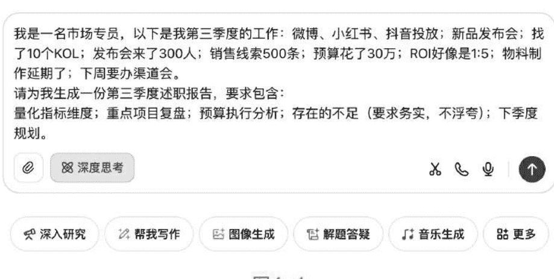

图4-1

以下是豆包生成的具体报告内容：

#### 市场专员第三季度述职报告

尊敬的领导：

您好！本季度我作为市场专员围绕公司推广目标有序推进各项工作，涉及平台投放、活动执行、KOL合作等核心板块，同时直面问题与不足。现将工作汇报如下，恳请批评指正。

##### 一、第三季度量化指标完成情况

本季度聚焦推广、活动落地、线索获取等核心目标，各项量化指标完成如下，以数据为导向便于追溯复盘：

平台投放：完成微博、小红书、抖音三大平台全季度投放，实现多渠道曝光，助力品牌影响力提升与新品推广。

KOL合作：对接合作10名KOL，完成推广内容投放，借助KOL流量扩大品牌及新品曝光。

活动执行：成功举办新品发布会1场，现场到场300人，有效传递新品价值，提升品牌知名度；下季度渠道会已筹备中，定于下周举办。

……………

初稿框架可用，若想提升站位、增强含金量，可进一步优化。

优化提示词：

请帮我检查“问题与不足”部分。我提到“物料制作延期”，请分析可能导致该问题的深层原因（如流程审批、供应商管理），并给出两条具体改进措施。另外，将“下一步计划”中的“举办渠道会”扩展为包含时间节点、预期目标和所需支持的详细行动方案。

通过分段追问，豆包能帮助挖掘现象背后的管理问题，体现思考深度。

经以上步骤，一份专业、详实且个性化的述职报告即可成型。最后可让豆包根据公司文化调整语气，国企/政府单位要求更严谨稳重，互联网公司要求更简洁有力。

优化提示词：

请将以上修改整合成完整述职报告，并为各部分提炼小标题。最后，基于报告内容生成3条可能的领导提问及应答思路，便于答辩准备。

最终不仅获得报告，还借助豆包完成业务复盘与预演，这就是借助豆包撰写述职报告的完整流程。

### 4.1.2 撰写工作计划

在快节奏的工作中，清晰可行的计划能让任务更高效执行。豆包凭借逻辑梳理、内容生成与个性化适配能力，可快速搭建计划框架并落实细节，使工作事半功倍。

使用豆包生成计划的核心是“精准指令+合理优化”。先明确需求，通过清晰提示引导输出，再结合实际场景微调完善即可。

示例提示词：

豆包，我有以下任务需完成：

……（列出任务）

请据此撰写工作计划，要求如下：

……（撰写要求）

按该框架填入具体信息即可生成计划。下面以某公司行政专员李华为例，当日任务包括：组织周末公司团建；完成2台电脑、1台打印机采购与安装；周一下午5点例会汇报近期岗位缺失与招聘情况；安排公司总经理周二出差机票与酒店预订。

将任务清单代入提示词框架并提出撰写要求输入豆包，如图4-2所示，点击发送即可生成计划。

#### 帮我写作

润色校对，一键成文

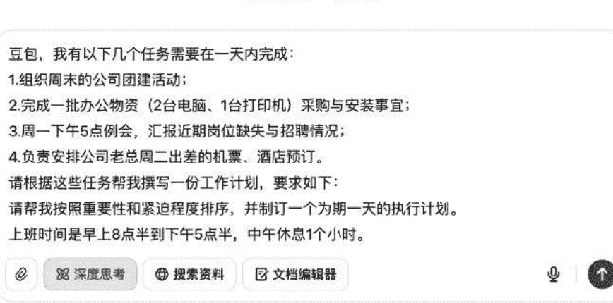

图4-2

以下是豆包生成的一日工作执行计划：

核心原则：优先处理紧迫且重要的事项，再推进重要不紧迫的任务，确保当日全部完成，兼顾效率与质量，避免遗漏。

##### 一、任务优先级排序（按重要性+紧迫度从高到低）

1. 紧迫且重要：周一下午5点例会汇报岗位缺失与招聘情况（会议临近，直接影响招聘推进，为最高优先级）。

2. 紧迫且重要：安排总经理周二出差机票、酒店预订（出差在即，需今日确认，避免行程受阻）。

3. 重要不紧迫：完成2台电脑、1台打印机采购与安装；组织周末公司团建（重要但当日不紧急）。

##### 二、一日执行计划（分时段落实）

###### 1. 8:30~10:00：准备周一例会汇报材料

梳理岗位缺失明细，核对招聘进度；整理汇报框架，突出缺失影响、招聘进展、后续计划及需协调事项，形成简洁提纲。

###### 2. 10:00~11:00：预订总经理周二出差机票、酒店

确认出差时间、地点、住宿偏好及特殊需求；查询对比后完成预订并支付，截图留存订单并同步总经理确认。

###### 3. 11:00~12:00：办公物资采购与安装对接

联系供应商确认2台电脑、1台打印机的型号、价格、库存，核对预算并签订订单；协调送货安装时间，同步告知使用部门；整理单据归档并更新台账。

###### 4. 12:00~13:00：午休

合理休息恢复精力，可简要梳理下午重点。

###### 5. 13:00~15:00：跟进办公物资安装

对接送货，现场验收；监督安装调试，确保设备正常使用，并指导使用者基础操作。

###### 6. 15:00~17:00：筹划周末公司团建

确认人数、预算、活动类型；联系2~3家场地或服务商对比方案与价格，确定场地与流程；整理方案发送群内通知报名。

###### 7. 17:00：参加例会汇报

在上述回复中，豆包对任务重要性与紧迫性进行了排序，并给出每项任务的具体执行时段与内容，十分详尽。若希望计划更直观，可要求以Markdown表格形式输出。

优化提示词：

请根据前述一日工作执行计划，采用Markdown表格形式输出执行计划，尽量精简。

豆包生成的表格如下。

#### 一日任务执行计划（表格版）

| 时段 | 任务优先级 | 具体任务及执行要点 |
| :--- | :--- | :--- |
| 8:30-10:00 | 最高优先级 | 准备周一汇报材料：梳理岗位缺失明细、核对招聘进度，形成含缺失影响、招聘进展、后续计划及协调事项的汇报提纲。 |
| 10:00-11:00 | 次高优先级 | 预订总经理周二出差机票、酒店：确认出差需求，查询对比后完成预订，留存订单并同步总经理确认。 |
| 11:00-12:00 | 重要任务 | 办公物资采购与安装对接：确认2台电脑、1台打印机的采购细节并签订订单，协调送货安装时间，整理单据归档并更新台账。 |
| 12:00-13:00 | 休息 | 合理休息，可简单梳理下午工作重点。 |
| 13:00-15:00 | 重要任务（跟进） | 跟进办公物资安装：验收送达物资，监督设备安装调试，教会使用人员基础操作。 |
| 15:00-17:00 | 次要任务 | 计划周末公司团建：确认团建需求，联系2-3家服务商对比方案，确定场地流程后整理方案通知员工报名。 |
| 17:00 | 常规任务 | 参与例会，汇报当日工作情况。 |

进一步优化后，表格版计划时间、优先级、任务一目了然。对于多任务或长期计划，可先生成文字版再优化为表格版，提升便捷性。

### 4.1.3 撰写各类邮件

邮件是商务往来中较为正式的沟通方式，撰写效率与质量直接影响工作效率与专业形象。面对大量需精细措辞的公文，不少职场人感到耗时费力。豆包可提供有效支持。

无论是向上级申请资源、向客户同步进展，还是处理投诉邮件，只需提供邮件内容、撰写要求与身份，豆包即可生成专业邮件。

示例提示词：

请帮我撰写一封正式邮件，收件人部门总监李林，发件人是我（市场部专员张艳），主题为“关于Q5新媒体推广效果的简要汇报”。需包含：背景简述（2句）、核心数据（3项关键指标及数值）、存在问题（1点）、后续计划（2条具体行动）。

将提示词输入豆包，如图4-3所示，点击发送，豆包会生成结构完整、逻辑清晰的初稿，用户只需核对数据并微调语气即可发送。

以下是豆包生成的具体邮件内容：

尊敬的李林总监：

您好！为同步Q5阶段新媒体推广进展，总结成效、梳理问题并明确后续方向，特向您简要汇报本次推广情况。

##### 一、推广背景简述

本次Q5新媒体推广围绕部门核心业务目标展开，聚焦主流新媒体平台，旨在扩大品牌曝光、提升用户转化；推广周期为Q5全季度，覆盖抖音、微信视频号、小红书三大渠道，精准触达目标客群。

##### 二、核心推广数据

本次推广核心数据如下，整体达成阶段性基础目标：

曝光量：累计实现曝光86.2万次，较Q4提升12.3%，超额完成80万次预设目标。点击量：累计点击15.8万次，点击转化率18.3%，略高于行业平均17.5%；

有效咨询量：通过推广引导产生有效咨询326条，较Q4增长8.7%，为后续业务转化奠定基础。

##### 三、现存问题

推广内容针对性有待优化，小红书平台年轻客群内容适配度不足，导致该渠道点击转化率15.1%低于抖音20.2%、视频号19.5%，未能充分挖掘渠道潜力。

##### 四、后续计划

针对问题及下一阶段目标，制定以下两项行动：

1. 优化内容策略。联合内容组开展小红书年轻客群需求调研，下周内完成分析并输出调整方案，重点增加年轻化、场景化内容，提升适配度。

2. 强化数据监测。每日跟踪三大平台核心指标变化，每周输出数据简报，及时发现问题并快速调整策略，确保下一阶段效果稳步提升。

本次Q5新媒体推广取得一定成效但仍有提升空间，我将严格落实后续计划，持续优化推广工作。如有指导意见，恳请李总监告知。

此致

敬礼！

发件人：市场部专员 张艳

日期：××××年××月××日

该邮件基本符合要求，若需进一步优化，可分阶段指令逐步完善细节，如语气更谦和、篇幅压缩30%并保留“响应速度”“兼容性”关键词等。豆包会根据每轮指令动态调整，最终生成简洁专业且符合场景的邮件。

### 4.1.4 撰写会议发言稿

在职场中，会议发言是重要工作环节，需提前准备发言稿。面对临时会议、主题变更或内容空白时，易因时间紧迫或思路混乱产生焦虑，此时豆包可大幅提升撰写速度。

使用豆包生成发言稿前需明确身份、场景、主题、个性化素材，指令清晰后输出才更贴合需求。下面以机关工作会议发言稿为例展示流程。

示例提示词：

假设你是一位有15年经验的机关秘书，请帮我起草一份关于优化营商环境的会议发言稿。要求：

1. 字数约1500字，分三部分——当前形势、存在问题、下一步举措。

2. 语言风格庄重务实，适当运用排比句式。

3. 近期上级强调“放管服”改革，需在讲话中体现。

将提示词输入豆包，如图4-4所示，点击发送，豆包会按要求生成发言初稿。

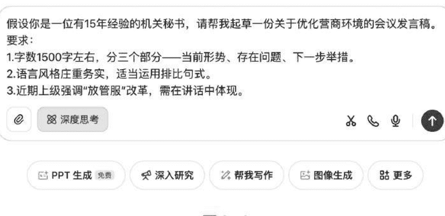

以下是豆包生成的具体发言稿：

#### 在全市优化营商环境工作推进会上的发言

同志们：

营商环境是市场经济的“生命线”，是城市发展的“核心竞争力”，更是推动高质量发展的“关键支撑”。当前，上级部门持续强调深化“放管服”改革，着力培育和激发市场主体活力，为我们优化营商环境指明了方向。

今天我们召开这次会议，就是要全面分析当前形势，清醒正视存在问题，精准部署下一步举措，动员全市上下凝心聚力、真抓实干，以更优营商环境护航全市经济社会高质量发展。下面，我讲三点意见。

##### 一、提高政治站位，清醒认识优化营商环境的当前形势

近年来我国经济已迈入新发展阶段，区域间竞争越发白热化。营商环境优劣，已经成为招徕投资、集聚资源、激活市场动能的关键杠杆，也能直观体现履职成效和工作作风。

在全国全省层面，放管服改革持续深化，各地相继推出实招硬招，从制度创新、流程再造到服务提质等多维发力，共同打造市场化、法治化、国际化的营商生态，形成了百舸争流、竞相发展的激烈格局。

就我市而言，近几年始终把优化营商环境当作一把手工程来抓，认真贯彻上级决策部署，持续推进放管服改革，阶段性成果已初步显现。

……

同志们，优化营商环境是当下用力、长远受惠的大事；深化放管服改革使命光荣、责任重大。希望大家以坚定决心、务实作风和有力举措凝心聚力、真抓实干，持续构建市场化、法治化、国际化的营商环境，不断释放市场主体的活力和创造力，为全市经济社会高质量发展作出新的更大贡献！

发言完毕，谢谢大家！

当然，初稿若觉得不够理想，完全可以继续打磨。比如对发言稿的表达风格做二次优化。

优化提示：

之前的稿子整体达标，但口吻偏正式，建议减少官话套话，让讲话更亲近、更好接受。

在更精准的提示引导下，豆包在原稿基础上进行了改写，表达更接地气。改写片段如下：

##### 一、认清当前形势，切实增强优化营商环境的紧迫感

当前我国经济已进入新常态，区域竞争愈发激烈，说白了现在的竞争归根到底是营商环境的竞争。环境好的地方更容易引来投资、汇聚资源、抢占先机。

从全国到全省看，“放管服”改革持续向纵深和实处推进，各地都拿出实际办法，从制度创新、流程简化、服务提质等方面着手，全力构建市场化、法治化、国际化的营商环境，竞争态势可谓千帆竞发、百舸争流。

再看本地，这几年我们始终把优化营商环境作为头等大事来抓，认真落实上级部署，持续深化“放管服”改革，确实取得了一些看得见的成效。

……

改写后空话套话大幅减少，语言更通俗易懂。到这里终稿基本成型，你只需要通读一遍，删减不合适的表述或补充自己的想法即可。

## 4.1.5 PPT文件生成

靠传统方式做一份专业美观的PPT非常耗时，从选模板、梳理提纲到排版调整、找配图，整套流程下来往往要花半天。借助豆包生成PPT则效率高很多。

豆包自带“PPT生成”功能，入口就在输入框下方，如图4-5所示。

图4-5

打开“PPT生成”后，用户只需在输入框中填写主题、具体要求和参考材料，也可以上传文件，如图4-6所示。输入信息越详细，生成的PPT越贴合需求。

### 智能生成，自由定制

图4-6

下面以具体案例演示用豆包生成PPT的完整流程。

示例提示词：

你是一名经验丰富的初中物理教师。请为“浮力原理”一课生成PPT大纲。要求包括：

1. 引入部分选用曹冲称象或死海不溺；
2. 浮力定义及产生原因，突出实验演示；
3. 阿基米德原理，含公式推导；
4. 浮力应用，如潜水艇、轮船；
5. 课堂练习题。大纲逻辑要递进，适配40分钟课堂。

将上述提示词输入豆包，如图4-7所示，点击发送，片刻后即可获得完整的PPT文件，如图4-8所示。

### 智能生成，自由定制

PPT 生成 你是一个经验丰富的初中物理老师。请为“浮力原理”这堂课生成一个PPT大纲。要求包含：

1. 引入（曹冲称象或死海不死）；
2. 浮力定义与产生原因（强调实验演示）；
3. 阿基米德定律（公式推导）；
4. 浮力的应用（潜水艇、轮船）；
5. 课堂练习题。大纲需逻辑递进，适合40分钟课堂。

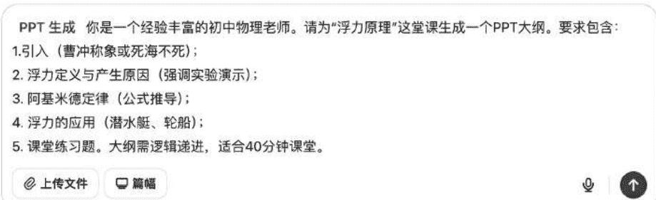

图4-7

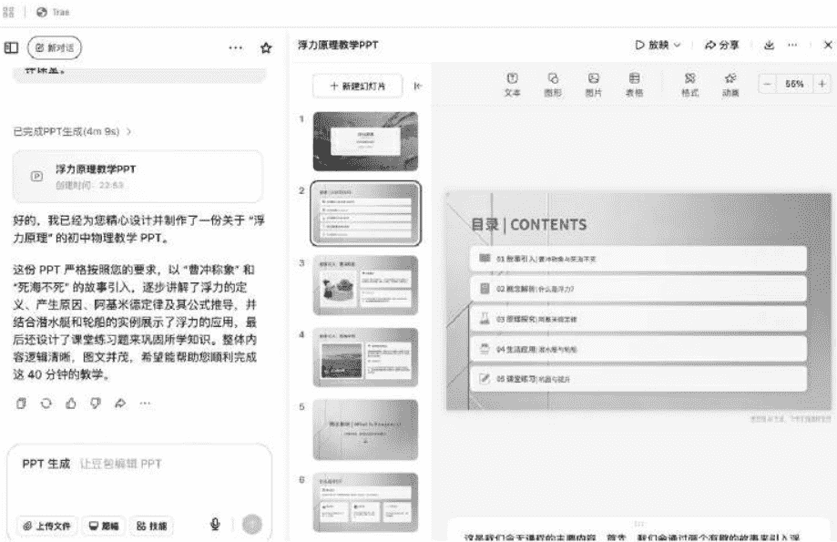

图4-8

PPT生成后需要校验，例如核对概念是否准确，如浮力方向竖直向上，逻辑是否通顺等。对不满意或需要补充的内容可追加指令细化，例如“请把阿基米德定律的案例扩充为两个生活实例”。

另外，输入时可以批量上传素材，如会议纪要、销售数据表、现场照片等，让成品更贴合实际需求。

## 4.2 团队沟通与协作

在商业场景中，有效的沟通能让每个成员明确目标和职责，协作则能把个体力量汇聚成团队合力。沟通顺畅协作默契，团队就能高效运转，产生1+1大于2的协同效应。本节介绍豆包在部门沟通、团队冲突、会议组织中的辅助作用。

### 4.2.1 跨部门沟通策略生成

跨部门沟通是企业必备能力。常因目标差异、信息壁垒导致效率低下，甚至出现推诿。借助豆包可以快速生成贴合各部门需求的沟通方案。

豆包可通过结构化信息整合、智能需求分析、场景化沟通模板生成，将模糊的协作需求转化为可执行的沟通计划。例如市场部需要技术部支持新功能时，豆包能快速梳理双方诉求，生成包含技术可行性、时间节点的沟通框架，减少无效讨论。

以某电商企业筹备“会员日”大促为例，需市场部、供应链部、技术部协同完成流量承接、库存调配、系统扩容，让豆包生成沟通策略。

示例提示词：

你是一名沟通策略专家，请依据以下情况制定跨部门沟通策略。

项目为电商企业计划推出“会员日”大促活动，需要市场部、供应链部、技术部协同完成流量承接、库存调配和系统扩容，目的是保证促销活动顺利进行并达成预期效果。

将提示词输入豆包，如图4-9所示。点击发送，豆包会据此生成具体沟通策略。

以下是豆包生成的具体内容：

#### 电商企业“会员日”大促跨部门沟通策略

核心目标：以会员日大促顺利落地、达成预期流量与转化为主线，打通市场、供应链、技术三部门的沟通壁垒，明确协同节点与信息标准，解决流量承接、库存调配、系统扩容的协同痛点，实现信息同步无偏差、责任划分无模糊、应急响应无延迟，确保活动全流程高效衔接。

##### 一、前期筹备阶段：定目标、明分工、建机制（活动前2~3周）

本阶段重点是统一认知、厘清边界，避免后期因需求不清、衔接不畅引发问题。

###### （一）核心沟通内容

1. 统一活动核心目标

市场部明确会员日流量目标，如独立访客数、引流渠道；转化目标，如下单率、客单价；同步至供应链、技术部；三方结合自身能力确认目标可行性，若存在冲突，如流量峰值超出系统承载、库存无法支撑爆款销量，当场协商调整，形成书面共识。

2. 明确各部门核心职责与衔接点

市场部：负责活动方案、玩法、优惠力度、引流计划、宣传物料输出，同步活动节奏及各阶段流量预估，对接供应链确认库存适配性，对接技术部确认流量承接、活动页面开发需求。

…………

总结：本次跨部门沟通策略以全流程协同、全节点同步、全突发响应为核心，贴合市场、供应链、技术三部门业务特点与协同需求，通过明确目标、划分职责、建立机制、优化流程，打破沟通壁垒，确保会员日大促顺利举行、达成预期流量与转化，同时沉淀可复用的协同经验，提升企业跨部门沟通效率。

通过输入各部门职责，豆包会生成利益关联图谱，并产出详尽的沟通策略，有助于提前预演可能的问题，让促销活动顺利进行。

### 4.2.2 提供团队冲突解决策略

在职场中，团队协作像精密齿轮，任何卡顿都可能拖慢整体效率。冲突往往是协作中最常见的卡顿来源，无论是目标分歧、责任模糊还是沟通不畅，都可能导致内耗。如何高效化解冲突、重建信任？

借助豆包的逻辑分析与沟通引导能力，可以辅助化解矛盾、提升协同效率。下面通过一个真实场景展示其作用。

示例提示词：

我是互联网公司的产品经理，团队在规划新版本功能时，我主张优先优化用户体验，而技术负责人则坚持先解决系统性能瓶颈。双方各执一词，会议陷入僵局：我认为用户体验是核心竞争力，技术负责人反驳性能问题不解决用户根本留不住。

请帮我分析如何平衡产品体验优化与系统性能提升的优先级，并给出建议。

构建提示词时要明确问题并要求建议。输入后豆包会进行分析并给出建议。

我是互联网公司的产品经理，团队在规划新版本功能时，我主张优先优化用户体验，而技术负责人则坚持先解决系统性能瓶颈。现双方各执一词，会议陷入僵局：我认为“用户体验是核心竞争力”，技术负责人反驳“性能问题不解决，用户根本留不住”。

请帮我分析一下，如何平衡产品体验优化与系统性能提升的优先级，并给出建议。

图4-10

以下是豆包生成的分析与建议：

作为产品经理，你和技术负责人的矛盾本质是用户留存两个核心环节的优先级错位：你关注用户愿不愿意用，技术负责人关注用户能不能用，两者都是留存关键，只是底线与上限的区别。

下面是一套可在会议上直接落地的平衡逻辑与执行方案，帮助打破僵局。

##### 一、先一句话拉齐共识，停止对立

把双方观点统一到同一个目标：性能是留住用户的底线，体验是吸引用户的上限。没有性能，体验为零；只有性能而无体验也留不住人。

先让技术负责人认可性能是为了让体验正常生效，你也要认可体验优化不能建立在不稳定系统之上。

##### 二、核心平衡原则：先兜底，再增量

1. 先定义必须优先处理的性能瓶颈

只把真正影响使用的致命问题列为第一优先级，而非优化所有性能：

- 崩溃率高、页面卡死、加载超时；
- 核心链路响应过慢，如登录、支付、下单、搜索；
- 高并发下宕机、雪崩。

此类属于用户根本用不了的问题，必须优先修复，是保命项。

…………

##### 四、你在会议上可直接使用的沟通话术

×哥，我完全认同性能不稳用户连用都用不了，谈体验就是空谈，这是底线必须守住。

但我们这次的体验优化都是核心流程里不增加性能负担、直接减少用户投诉的点，可以和性能修复并行。

我们这样定：

1. 先把致命性能问题列出来，定为P0全力保障；
2. 核心体验优化也定为P0，抽小部分资源同步推进；
3. 其余性能重构和边缘体验放到下一轮。

既不冒系统风险，也不丢用户体验，你看可以吗？

以上分析与建设性建议可为决策提供参考，有助于减少摩擦、提升团队整体效率。

### 4.2.3 会议议程安排

会议是团队协作与决策的重要环节，良好的组织能确保目标达成。然而会前筹备耗时琐碎，需协调时间、撰写通知、准备资料，耗费精力。

借助豆包，这些工作可变得高效，从周密筹备到顺利召开，豆包以自然语言处理和数据分析能力帮助提升会议效率。下面以生成会议议程为例。

示例提示词：

请根据以下议题生成一份完整会议议程，议题包括：X5销售数据复盘、新产品上市策略、渠道商激励政策。

会议时长2小时，需合理分配各议题时间并安排茶歇。

将提示词输入豆包，如图4-11所示，点击发送，豆包可迅速生成结构清晰、时间合理的议程草案。

请根据以下议题生成一份完整的会议议程，议题包括：X5销售数据复盘、新产品上市策略、渠道商激励政策。

会议时长2小时，需合理分配每个议题的时间并设置茶歇。

以下是豆包生成的会议议程：

#### X5销售复盘、新产品上市及渠道商激励专题会议议程

##### 一、会议基本信息

会议主题：X5销售数据复盘、新产品上市策略研讨、渠道商激励政策确定

会议时长：2小时（120分钟）

参会人员：销售部、市场部、产品部、渠道部核心成员及管理层代表

主持人：×××

记录人：×××

会议形式：线下会议（或线上+线下结合）

##### 二、详细议程安排（总时长120分钟）

| 时间段 | 时长 | 议程内容 | 具体环节 | 负责人 |
|---|---|---|---|---|
| 00:00-00:05 | 5分钟 | 会议开场 | 主持人明确会议主题、议程安排及会议纪律，介绍参会人员，说明会议核心目标 | 主持人 |
| 00:05-00:40 | 35分钟 | X5销售数据复盘 | 1. 销售负责人汇报X5近期销量、销售额、区域分布、客户反馈等核心数据；2. 分析数据异常点（如销量下滑/增长原因、优势/劣势区域）；3. 各部门补充意见，明确复盘结论及后续改进方向 | 销售部负责人 |
| 00:40-00:50 | 10分钟 | 茶歇 | 参会人员休息，自由交流，为后续议题讨论储备精力 | 行政支持 |
| 00:50-01:25 | 35分钟 | 新产品上市策略 | 1. 产品经理介绍新产品核心卖点、定位及目标客群；2. 市场部汇报上市推广方案（含宣传渠道、活动策划、预算分配）；3. 参会人员讨论方案可行性，提出优化建议；4. 确定最终上市策略及责任分工 | 产品部+市场部负责人 |
| 01:25-01:55 | 30分钟 | 渠道商激励政策 | 1. 渠道部负责人汇报现有渠道商现状及激励政策痛点；2. 提出新的渠道商激励方案（含返利、奖励、支持政策等）；3. 参会人员讨论方案合理性，平衡公司成本与渠道积极性；4. 确定最终激励政策及落地时间 | 渠道部负责人 |
| 01:55-02:00 | 5分钟 | 会议总结 | 主持人梳理各议题结论、明确后续工作节点及责任人，强调重点任务，宣布会议结束 | 主持人 |

##### 三、会议注意事项

1. 各议题负责人需提前准备相关汇报材料（数据报表、方案草案等），确保汇报高效、精准；
2. 讨论环节需围绕议题展开，控制发言时长，避免偏离主题，确保会议按议程推进；
3. 记录人需准确记录各议题结论、工作分工及时间节点，会议结束后1个工作日内整理会议纪要并分发至参会人员；
4. 参会人员需提前10分钟入场，遵守会议纪律，手机调至静音或震动状态。

豆包生成的议程提供了会议框架，只需补充具体信息即可形成完整议程。

## 4.3 求职与招聘

精准对接与高效沟通是求职招聘的核心。豆包能助力个人和企业实现双赢。对求职者而言，可生成个性化求职信和自我介绍，提升竞争力；对企业而言，可快速生成招聘信息，实现智能化人才招聘。

### 4.3.1 个性化求职信撰写

一份出色的求职信是获得面试机会的敲门砖，能精准展示个人优势与适配度。豆包凭借知识储备和智能交互能力，为求职者提供高效精准的个性化求职信支持。

下面介绍如何借助豆包进行个性化求职信撰写。

示例提示词：

我是一名应届生，曾在××科技公司市场部实习。实习期间，我主要负责官方抖音号和微信公众号运营，独立策划了5期短视频内容，其中一期关于“办公好物分享”的视频播放量达到10万+，点赞数超过5000，并为公司官方账号涨粉2000人。

请你扮演一位资深互联网行业HR，基于我的实习经历帮我写一封求职信。要求：

1. 采用“引人注目的开场→胜任力证明→对公司的向往→自信结尾”的结构。
2. 描述实习经历时使用STAR法则重构。
3. 必须突出播放量10万+、涨粉2000人的数据。

将提示词输入豆包，如图4-12所示，点击发送，豆包会从资深互联网HR视角，贴合应届生特质突出核心数据，撰写适配互联网市场岗位的求职信。

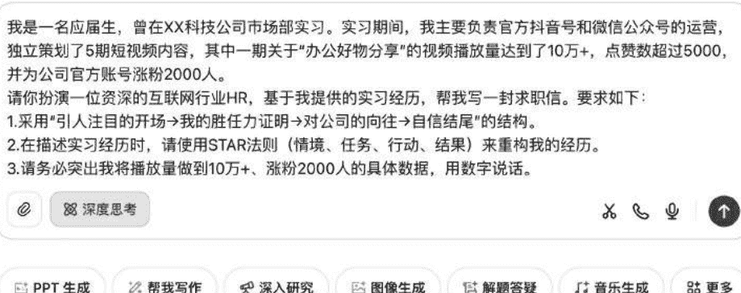

以下是豆包生成的求职信：

尊敬的贵公司HR团队：

您好！我是一名即将毕业的应届生，在浏览贵公司招聘信息时，被贵公司在互联网市场领域的创新理念与行业影响力深深吸引。作为一名曾在××科技公司市场部实习、独立打造过10万+播放量短视频、为账号涨粉2000人的实践者，我渴望能将我的内容运营经验与对市场的热情，贡献给贵公司。

### 4.3.2
## 自我介绍生成

在人际交往各类场景中，尤其是求职面试，自我介绍始终是必答题。一段出色的自我介绍能决定第一印象，提升面试成功率。借助豆包可以高效生成自我介绍初稿，并提供多种风格供选择，同时自动梳理个人经历与岗位要求的匹配关系。

下面以互联网公司求职面试自我介绍为例，说明如何生成高质量自我介绍。

示例提示词：

请为我应聘互联网公司运营撰写一段60秒内的面试自我介绍，要求突出个人亮点。需结合以下信息：

1. 教育经历：××××大学通信与计算机专业。
2. 突出实习期间主导3个裂变活动带来累计5000+新增用户的经历。
3. 个人优势：擅长数据分析与部门协作。

将提示词输入豆包，如图4-13所示，点击发送，豆包会据此生成结构清晰、表达准确的自我介绍。

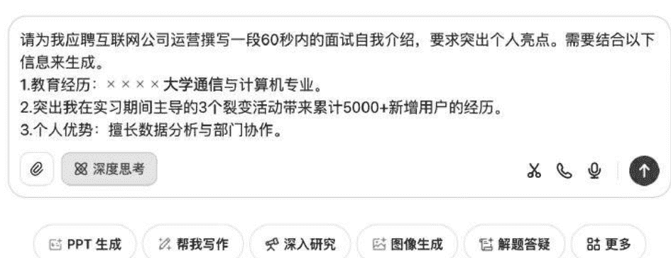

以下是豆包生成的自我介绍：

面试官好！我是×××，毕业于××××大学通信与计算机专业。

# 面试自我介绍打磨范例

实习期间我牵头完成了三场裂变式获客项目，从前期策划、规则打磨到全链路跟进，最终累计引入超过五千名精准用户，达成既定增长目标。

我的突出能力是数据导向的运营判断力与跨部门协同效率：习惯用数据找问题、调优策略，同时能与产品、设计等团队顺畅配合，推动方案迅速落地。

真心希望加入贵司运营团队，把这些实战打法转化为业务增长价值，感谢！

以上由豆包生成的初稿已覆盖关键信息，只需在原有基础上补充细节关键词即可。若想让生成结果更出彩，可参考以下四点做法。

#### 1. 提示词结构化
优质指令建议涵盖四个维度：角色说明、使用情境、重点经历、语气偏好。输入越具体，产出越理想。

#### 2. 量化个人经历
模型偏向泛化表达，人类更记得住数字与细节。请用数据、时间、结果替代抽象形容，比如把“组织能力强”改为“协调50人团队完成公司团建”。

#### 3. 设置记忆锚点
在介绍里放入一个具体意象，可以是一个动作、一件物品或一个反差。这个锚点会成为他人记住你的关键线索。

#### 4. 预埋逻辑钩子
结尾可留一个留白提问，引导对方继续追问。例如面试收尾说“我正在复盘上次活动的归因偏差”等，主动掌握对话节奏。

## 4.3.3

## 招聘信息生成

招人对企业成长至关重要。一则清晰准确且有吸引力的招聘文案，是吸纳合适候选人的第一步。但要把岗位职责写准、任职条件提炼好、公司亮点展现出来，往往会耗费人事不少精力。

借助豆包，这一流程会更高效。它能迅速产出招聘草稿，也能按需求调整优化。下面详细说明如何用豆包生成一份专业的招聘信息。

示例提示词：

请为我生成一份招聘文案，岗位为“资深前端开发工程师”。公司是“星火科技”，工作地在北京，所属技术研发部。

岗位职责主要包括：

1. 负责核心SaaS产品的前端架构设计和技术选型。
2. 带领小组解决技术难题，提升团队整体技术能力。
3. 持续优化产品性能和用户体验。
4. 编写高质量、可维护的代码。

任职要求是：

1. 本科及以上学历，计算机相关专业，5年以上前端经验。
2. 精通JavaScript/TypeScript，熟练掌握Vue.js或React。
3. 有大型复杂项目的架构经验。
4. 熟悉前端工程化和模块化。
5. 良好的沟通协作能力，有团队管理经验优先。

公司提供16薪、补充医保、免费三餐和Mac办公。我们是一家发展很快的准独角兽公司，技术氛围很好。希望招聘信息的风格专业、有吸引力，可以适当展现公司亮点。请帮我生成一份完整的招聘启事。

将以上提示词输入豆包，如图4-14所示，点击“发送”，豆包会依据指令快速生成结构完整、语言流畅的招聘信息。

下面是豆包生成的招聘信息样本：

#### 星火科技招聘：资深前端开发工程师

##### 【企业概况】
星火科技是一家高速发展的准独角兽企业，聚焦科技研发，以技术创新驱动发展，深耕核心SaaS产品研发迭代，致力于为用户提供高效便捷优质的数字化方案。公司技术氛围浓厚，鼓励探索创新，汇聚行业优秀人才，这里既能接触前沿技术，又有广阔的职业成长空间，可与公司共同迈向高速发展。

【招聘岗位】资深前端开发工程师

【所属部门】技术研发部

【工作地点】北京

##### 【岗位职责】
1. 主导核心SaaS产品的前端架构设计、技术选型与方案落地，搭建高可用高扩展的前端技术体系，支撑产品规模化。
2. 带领前端小组攻克技术难题，主导技术复盘与优化，开展技术分享培训，提升团队整体能力与效率。
3. 聚焦产品性能与用户体验，持续优化前端加载速度、交互流畅度，挖掘解决性能瓶颈，打造极致体验。
4. 遵循开发规范，编写高质量高可维护高可读的代码，参与代码评审，保障研发质量与交付效率。

##### 【任职要求】
1. 本科及以上学历，计算机相关专业，5年以上前端开发经验。
2. 精通JavaScript/TypeScript，理解前端核心原理，熟练掌握Vue.js或React及其生态，能独立完成复杂组件开发封装。
3. 具备大型复杂项目尤其是SaaS类产品的前端架构设计与落地经验，能应对复杂业务技术挑战。
4. 熟悉前端工程化、模块化开发，了解性能优化、跨浏览器兼容、安全防护等技术。
5. 沟通协作能力强、问题分析解决能力强，有前端小组管理经验者优先。

##### 【我们提供】
1. 有竞争力的薪酬福利：16薪，薪资无上限，按能力灵活调整。
2. 完善保障：补充医疗保险、五险一金足额缴纳。
3. 贴心办公福利：免费三餐，配备Mac办公设备。
4. 职业发展：准独角兽平台，清晰晋升路径，定期技术培训与行业交流。
5. 舒适氛围：技术导向团队，流程精简，同事关系融洽，专注创新与打磨。

如果你热爱前端开发，追求技术极致，渴望在快速发展的平台实现价值，星火科技期待你的加入，与我们以技术为炬，点亮数字化未来！

上述初稿已成型，只需审核微调，使其更贴合公司风格与招聘需求后即可发布。

# 第5章

# 文案创作，轻松打造爆款内容

## 5.1

## 用户分析与选题策划

做自媒体或短视频，需求洞察与选题规划是关键。只有深入了解受众所需并据此策划选题，才能产出爆款。借助豆包，可以快速分析需求并给出方向。

### 5.1.1

### 目标用户需求拆解

在自媒体与短视频赛道，能持续出圈并沉淀忠实粉丝的创作者，往往明白一个底层逻辑：内容核心不是“我想做啥”，而是“受众需要啥”。

因此进行目标用户诉求拆解，是连接创作者与粉丝的桥梁，是避免内容自嗨、提升传播效率、实现长期变现的前提。豆包作为智能助手，能快速洞察大众真实需求与用户心理，从而指导创作，实现爆款产出。

以“职场干货社”为例。该账号以职场内容为主，但覆盖应届生到高管，需求差异大，导致点击率不理想。需要借助豆包对用户需求进行拆解。

示例提示词：

我是“职场干货社”创作者，主要做职场内容，受众从应届生到高管。现在点击率不理想，请分析该类账号的用户需求，并给出细分方向建议。

我的核心优势：5年职场HR经验，擅长应届生求职、职场新人避坑、基础办公技巧教学。

输入以上提示词给豆包，如图5-1，点击发送，豆包会基于账号问题进行分析，并结合你的优势给出建议。

豆包给出的内容如下：

先给一个直击要害的结论：

你当前的问题不是内容质量，而是人群过宽、定位分散、优势不突出。从应届生到高管全覆盖，反而让算法和用户都不清楚你是谁。

下面直接给出：用户真实需求+3个可立即落地的细分方向+HR优势打法

#### 一、职场号用户真正关注什么？真实需求
职场内容核心动机只有四点：
1. 怕吃亏，被坑、背锅、内卷、内斗；
2. 想省钱省时间，求职、改简历、面试、办公效率；
3. 想升职加薪，向上管理、沟通、汇报；
4. 想要情绪价值，解压、共鸣、看清职场真相。

你有5年HR经验，恰好覆盖求职→入职→转正→晋升全链路中最刚需、最信任的环节。

……

#### 三、给你3个最适合的细分方向
方向1：HR内幕版求职与新人号，最稳最易爆
定位：5年HR告诉你公司不会明说的真话
内容模板：
1. HR不会招的3种简历；
2. 面试中最加分的3句回答；
3. 试用期绝对不能踩的坑；
4. 领导最反感的新人行为。
优势：你最擅长，流量最大，信任度天然高。

……

通过豆包分析，能更清晰了解用户需求，之后可根据优势调整方向，比如将目标用户精准锁定为“22~25岁应届生、职场新人”，并继续借助豆包分析该人群特征。豆包回答如下：

1. 基本属性。年龄22~25岁，本科及以上学历，正处入职或即将入职阶段，收入较低，主要集中在一二线城市。
2. 行为属性。每天刷短视频1~2小时，多在午休、下班路上使用抖音、视频号，关注“职场干货”“求职技巧”类账号，偏好可直接套用的技巧类内容，评论多问“具体怎么做”。
3. 需求属性。担心求职失败、不知如何快速适应职场、不会处理人际关系、想提升办公效率，核心诉求是“实用、可落地、解决当下问题”。

如此精准定位，账号就避开了与高管内容、人情世故深度内容的竞争，聚焦新人需求，更易形成差异化。

### 5.1.2

### 爆款文案拆解

文案是撬动注意力的工具，拆解爆款文案并掌握其底层逻辑，有助于提升账号吸引力。拆解不是复制，而是从表层结构到底层心理的深度萃取，最终转化为可复用能力。

借助豆包可以快速拆解爆款文案的风格与情感共鸣点。以下是拆解提示词模板，包含文案综述、写作风格、情感传达与总结建议。

示例提示词：

你是一位资深爆款文案拆解专家，擅长分析文案技巧、结构特点、情感共鸣与价值传递。请对提供的爆款文案进行以下分析：
1. 全面拆解写作特点与结构；
2. 解析情感共鸣元素；
3. 剖析如何有效传递产品或服务价值；
4. 以客观态度给出专业分析建议。
输出结构：文案概述→写作特点→文案结构→情感共鸣→价值传递→总结与建议。

以近期抖音火爆的“对话体”书籍解读视频“假如书籍会说话”为例进行拆解。输入提示词并上传《假如书籍会说话·游戏改变世界》文案，如图5-2，点击发送，可获得拆解结果。

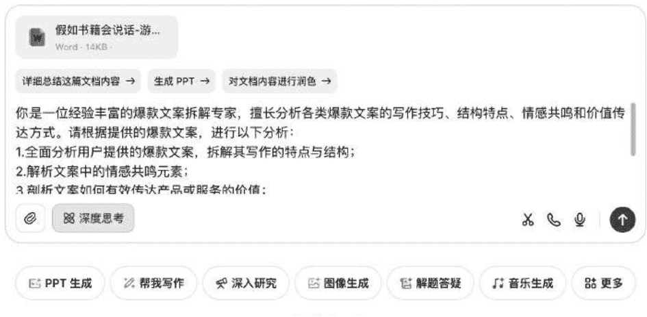

豆包生成的拆解结果：

#### 《假如书籍会说话·游戏改变世界》文案爆款解析

##### 1. 文案概述
文案以亲子游戏与学习矛盾切入，采用对话式表达，围绕“孩子沉迷游戏不愿学习”的家长焦虑展开，层层拆解游戏吸引力的核心在于确定性、即时反馈与被需要感，进而提出将游戏化思维用于家庭教育的方法，最终传递“打造精彩现实，让孩子从虚拟回归现实”的观点，精准击中教育焦虑并给出落地思路，兼具情感共鸣与实用价值。

##### 2. 写作特点
1. 对话式表达增强代入感：全程一问一答，模拟家长与主理人交流，语气接近日常沟通，降低阅读门槛。
2. 以小见大，从具体场景切入：开篇抛出“孩子打游戏到凌晨不愿学习，家长该砸电脑还是断网”的具体问题，抓住痛点。
3. 反常识提问引发认知冲突：通过“为什么游戏比你更懂你儿子”等问题，打破固有认知，激发好奇。

……

##### 3. 总结与建议
文案能爆款，核心在于精准受众定位、强烈情感共鸣、清晰逻辑结构、实用价值输出的结合：
1. 精准锁定有教育焦虑的家长，以痛点切入；
2. 对话式生活化表达，引发深度共鸣；
3. 从现象到原因到方法形成逻辑闭环；
4. 把抽象理念转化为可落地方法，实现认知改变与行动指引。

上述拆解详细分析了文案综述、风格、情感传达与总结建议。对自媒体与短视频创作者是最快的成长路径之一。拆解时要结合自身行业属性与目标用户，将框架公式吸收转化，形成自己的创作体系，才能持续产出爆款。

### 5.1.3

### 热点追踪与选题挖掘

热点既是流量入口，也是创作抓手。能否在最短时间内捕捉热点并转化为有独特价值的选题，决定了流量质量与深度。在信息海洋中，如何过滤噪音并锁定与领域相关的高潜爆点？

借助豆包可高效追踪热点，它如同24小时在线的热点雷达与选题策划官，核心优势在于语义理解与多维分析。可设定“三维过滤网”：兴趣关键词、地域标签、情感倾向。

以美妆赛道账号为例，可这样指令豆包。

示例提示词：

请作为我的数据分析师，基于近7天平台热搜词，如微博、抖音、小红书，聚焦“美妆”“护肤”“成分”领域，挖掘10个处于上升期且用户讨论情绪以“好奇”或“焦虑”为主的关键词或话题。

输入提示词，如图5-3，点击发送，豆包会筛选相关热点与高关联词汇。

豆包生成的分析：

#### 近7天美妆护肤成分领域上升期关键词分析

基于微博、抖音、小红书热搜数据，结合情绪分析，以下是10个上升期且以好奇或焦虑为主的关键词，每个附平台热度、情绪占比与核心讨论点：

##### 一、好奇驱动型关键词
| 关键词/话题 | 平台热度 | 好奇情绪占比 | 核心讨论点 |
| --- | --- | --- | --- |
| 1. PDRN成分 | 抖音搜索PV周增4880%，微博话题阅读破2000万 | 89% | 是什么？与普通修护区别？敏感肌能否用？医美术后效果？ |
| 2. 水感季防晒小黄帽升级款 | 百度相关推荐词达7个，小红书笔记日增500+ | 82% | 新配方新增哪3种养肤成分？肤感是否更清爽？对比安耐晒哪个更适合干皮？ |
| 3. 神经美容学 | 小红书话题热度周环比+217% | 78% | 黄兰花香蜂蜡芦荟类似物能否带来愉悦感？脑电数据如何证明情绪价值？ |
| 4. 局部精准护理 | 抖音相关视频播放周增+89.83% | 75% | T区与U区护理有何不同？颈部护理为何爆火？眼周成分怎么选？ |
| 5. 纯净美妆认证 | 微博话题讨论日增30% | 72% | 5大权威认证有哪些？如何辨别真伪？天然成分占比多少达标？ |

##### 二、焦虑驱动型关键词
……

##### 三、核心洞察
成分认知升级：从“跟风买”到“问原理”，用户对PDRN、神经美容学等新概念的好奇，反映成分党专业度提升。
安全焦虑加剧：敏感肌抗老、成分浓度内卷等话题高焦虑占比，显示用户在功效与安全间决策困境。
理性消费觉醒：纯净美妆认证、国货性价比等讨论，体现用户从“盲目追大牌”到“重视实证数据”的转变。

##### 四、趋势建议
品牌策略：加强成分科普，用临床数据缓解焦虑；推出敏感肌专属温和抗老系列。
内容创作者：制作“成分问答”系列短视频，满足好奇；制作“避坑指南”，缓解焦虑。
消费者：关注权威认证与实证数据，避免盲目追求高浓度；敏感肌抗老优先选择植萃成分。

通过上述分析可快速获知美妆领域近期热点。筛选适合账号的选题并快速生成差异化内容，可抢占第一波流量。

## 5.1.4 创意构思与内容定位

自媒体与短视频创作中，流量竞争本质是创意与定位的竞争。创意需基于用户需求、自身优势与行业趋势系统思考；内容定位需明确三个问题：服务谁、提供什么价值、与别人有何不同。明确后才能精准吸引目标用户，建立长期信任。

在双重挑战下，如何快速对选题进行创意构思并精准定位？借助豆包可实现创意破界与定位精准化。以健身账号为例说明如何借助豆包进行创意构思与内容定位。

示例提示词：

我是一位健身博主，账号内容以健身操塑形为主，请结合健身自媒体“刘畊宏”的爆火案例，分析其“健身+娱乐”的跨界创意融合，并为我的健身账号提供创意构思与内容定位建议。

输入提示词，如图5-4，点击发送，豆包会基于爆款案例分析并结合账号情况给出建议。

以下是豆包生成的分析：

### 健身博主账号运营建议，结合刘畊宏“健身+娱乐”爆火案例

#### 一、刘畊宏跨界创意融合深度分析
刘畊宏现象级爆火，核心并非单纯输出健身内容，而是精准抓住“大众健身痛点+娱乐化传播逻辑”，将专业健身与轻松娱乐无缝融合，打破健身内容“枯燥、门槛高、易放弃”的标签。其融合逻辑可拆解为4个维度，对健身操塑形账号借鉴意义极强。

##### 1. 核心融合逻辑1：娱乐化包装，降低参与门槛
刘畊宏摒弃传统健身博主“严肃教学、高强度施压”模式，将娱乐元素贯穿全程，让健身从“辛苦任务”变为“共享乐趣”，极大降低大众心理与行动门槛。其核心做法有三点：

刘畊宏爆红背后的娱乐化拆解

先看场景的娱乐化打法。直播不是在专业健身房开讲，而是直接搬进自家客厅，瞬间去掉严肃感。王婉霏时不时划水摆烂，岳母却一脸认真咬牙跟练的对比，把一堂操课变成了家庭情景喜剧。观众看到这种真实又反差的画面，很容易产生共情，运动门槛被拉低，很多人会觉得“普通人也能坚持”。

再看音乐的娱乐化运用。配乐选用了周杰伦的《本草纲目》《龙拳》这类国民度极高的金曲，熟悉的旋律一响就触发青春记忆。节奏感直接带动身体，训练的疲惫感被音乐冲淡。

最后是互动的娱乐化设计。直播里穿插调侃和实时鼓励，比如妻子累到出现痛苦面具时的吐槽，或是“腰间赘肉噼里啪啦掉，人鱼线马甲线我想要”这样魔性的口号，让练习从枯燥的动作堆砌变成有笑点的体验。

#### 四、总结：账号运营核心要点（重中之重）
借鉴刘畊宏走红的逻辑，做健身塑形类账号要抓住“精准塑形+轻松娱乐+情感陪伴”这组关键词，记住三点少走弯路：

- (1) 不照搬刘畊宏。学习其“娱乐化包装+专业背书+陪伴感”的底层思路，但不要复制“全身燃脂、家庭狂欢”的玩法。要聚焦女性塑形、轻量化、细分场景，做出差异化定位，避免同质化内卷。
- (2) 娱乐与专业要平衡。娱乐是吸睛的钩子，专业才是留存的基础。所有趣味设计都要服务于“塑形见效、容易坚持”，不为搞笑而搞笑，要规律输出硬核塑形干货，不断强化专业可信度。
- (3) 紧贴用户痛点。内容围绕“新手友好、碎片化时间、针对性塑形”来做，接地气、可落地。通过高频互动搭建陪伴式社群，解决“坚持不下来”的核心难题，才能实现从流量导入到用户沉淀，再到账号深耕的突破。

这份思路覆盖了案例拆解与账号运营全链路建议，和健身操塑形定位高度契合。若想快速启动，可继续下指令，例如“请帮我提炼3个可直接开做的选题创意”，进入选题操作环节。

## 5.2 爆款文案创作
爆款文案的本质是精准洞察目标人群需求，在短时间内引发关注与共鸣。豆包的智能分析能力可以高效辅助创作者产出吸睛标题与文案，提升效率，让内容获得更多曝光。

### 5.2.1 吸睛标题与文案生成
当下信息过载，注意力极度稀缺。自媒体和短视频的传播效果，往往取决于标题是否抓眼、文案是否精准。借助豆包，可以快速读懂需求、套用爆款思路、产出多种风格的标题与文案。

要让豆包产出高质量结果，指令需要更清晰。输入越具体，输出越惊艳。撰写指令可遵循以下原则：

- ① 明确角色代入。让豆包扮演特定身份，比如“你是一名旅游文化短视频博主”或“你作为资深营销专家”。
- ② 细化任务描述。清晰定义任务类型，比如“写10个爆款标题”或“优化这段朋友圈文案”。
- ③ 设定场景与风格。提供上下文与风格限制，例如“面向Z世代用户，风格要幽默反转”或“风格要深沉文艺，适合配风景图”。
- ④ 提供约束条件。限定字数、格式或必须包含的关键词。

下面以旅游为例，说明如何借助豆包生成吸睛标题与文案。

示例提示词：
请参考今日头条百万阅读文章，或小红书10万+的标题风格，帮我生成10个关于“山西运城文旅”的爆款标题。要求：针对小众旅游爱好者，运用数字和悬念，例如“揭秘”“隐藏”“最后一个”等词汇。

将以上提示词输入豆包，如图5-5所示，点击“发送”按钮，豆包即可生成符合需求的标题。

图5-5
以下是豆包生成的标题：

这里是10个头条百万阅读或小红书10万+运城文旅爆款标题，精准命中小众旅游爱好者，自带数字+悬念+揭秘感，可直接发布使用：

- 1. 山西运城藏着3个零游客秘境！90%的人错过了，最后一个秘境直接封神。
- 2. 别只逛关帝庙！运城5处隐藏古建，揭秘华夏文明小众天花板。
- 3. 运城文旅冷知识！7个本地人不说的隐藏彩蛋，99%的游客不知道。
- 4. 最后一片净土！运城6个未商业化古村，小众旅行党必冲。
- 5. 揭秘运城2个盐湖秘境！避开人潮，解锁古中国天空之镜。
- 6. 山西最被低估的文旅城！运城4个小众打卡地，藏着千年华夏密码。
- 7. 别挤热门景区！运城1条小众自驾线，串起国宝古建与七彩盐湖。
- 8. 揭秘运城被遗忘的3大国宝古建，小众到几乎零游客。
- 9. 运城4个隐藏打卡点，小众旅游爱好者私藏清单。
- 10. 华夏文明最后秘境！运城5处小众胜地，原生态风光封神。

有了好标题，还需要能留人的正文。豆包在视频文案、带货文案上同样表现突出。以运城旅游宣传片为例，可以让豆包生成结构化视频文案。

示例提示词：
我是一个旅游博主，请帮我生成一个45秒的运城短视频旅游文案，要求包含：
若干个当地代表性景点、城市画面描述。比如无人机航拍景点、城市，当地特色美食特写。
各个分镜头的文案包含：画面描述、运镜方式、景别、时长、对应旁白。

将以上提示词输入豆包，如图5-6所示，点击“发送”按钮，豆包会根据要求自动生成若干个分镜描述及文案。

我是一个旅游博主，请帮我生成一个45秒的运城短视频旅游文案，要求包含：
1. 若干个当地代表性景点、城市画面描述。比如无人机航拍景点、城市，当地特色美食特写。
2. 各个分镜头的文案包含：画面描述、运镜方式、景别、时长、对应旁白。

图5-6
以下是豆包生成的具体文案：
#### 45秒运城旅游短视频分镜头文案（旅游博主版）
总时长：45秒。风格：大气治愈+烟火气。适配：抖音/小红书/视频号。

| 镜头 | 画面描述 | 运镜方式 | 景别 | 时长 | 旁白 |
| :--- | :--- | :--- | :--- | :--- | :--- |
| 1 | 无人机航拍七彩盐湖，湖面五彩斑斓，中条山为背景 | 直线推镜 | 全景 | 5秒 | 一眼七彩盐湖，解锁运城秘境 |
| 2 | 航拍解州关帝庙红墙黛瓦、殿宇连绵 | 环绕运镜 | 中全景 | 6秒 | 武庙之祖，忠义传千秋 |
| 3 | 普救寺莺莺塔，青瓦飞檐，庭院古朴 | 仰拍推进 | 近景 | 4秒 | 西厢情缘，一塔藏浪漫 |
| 4 | 航拍鹳雀楼，登楼俯瞰黄河壮阔 | 上升运镜 | 全景 | 5秒 | 更上一层楼，看黄河奔涌 |
| 5 | 永乐宫壁画特写，线条流畅、色彩艳丽 | 慢推聚焦 | 特写 | 4秒 | 元代壁画，惊艳千年时光 |
| 6 | 解州羊肉泡馍特写，汤汁浓郁、羊肉软烂 | 微距旋转 | 特写 | 4秒 | 一碗泡馍，暖透河东烟火 |
| 7 | 闻喜煮饼+稷山麻花叠化，酥甜诱人 | 快速叠化 | 特写 | 4秒 | 非遗小吃，舌尖藏温柔 |
| 8 | 运城城市街景，车流与人流，古建与新城交融 | 平稳跟拍 | 中景 | 5秒 | 古韵新城，温柔又鲜活 |
| 9 | 无人机航拍运城全景，山河与城同框 | 缓缓拉远 | 大全景 | 4秒 | 华夏根祖地，一眼爱上运城 |

以上是结构化文案，包含画面、运镜等细节，可直接导入剪映等剪辑软件成片，极大提升创作效率。

### 5.2.2 短视频脚本生成
短视频脚本的核心是用最短时间传递最有价值的内容，靠简洁有力的表达留住用户并引发互动。如何几十秒内抓住用户，需要精细构思脚本，豆包可快速生成创意脚本。

过去从灵感捕捉到分镜脚本产出往往耗时数小时甚至数天。借助豆包提效，可拆解复杂流程，把更多时间留给创意。下面以案例说明豆包的短视频脚本生成技巧。

示例提示词：
> 假设你是李白研究专家学者，请以汪伦的第一人称视角解说李白的《赠汪伦》这首诗，从汪伦的背景开始，包括“万家酒店”的故事。生成一个《赠汪伦》的古诗解说短视频脚本。

将以上提示词输入豆包，如图5-7所示，点击“发送”按钮，豆包即可根据创意场景生成具体脚本。

假设你是李白研究专家学者，请以汪伦的第一人称视角解说李白的《赠汪伦》这首诗，从汪伦的背景开始，包括“万家酒店”的故事。生成一个《赠汪伦》的古诗解说短视频脚本。

图5-7
以下是豆包生成的具体脚本：
#### 《赠汪伦》古诗解说短视频脚本（汪伦第一人称）
视频时长：60~90秒。
整体风格：古风氛围感、温情叙事感，以汪伦第一人称回忆口吻，串联背景、佳话与诗句解说，兼顾知识性与感染力，适配古诗解说短视频受众（学生、古风爱好者）。
背景音乐：轻柔古风纯音乐（钢琴+竹笛，音量舒缓，不盖人声）。
人物设定：汪伦（中年，身着唐代便服，温厚豪爽，语气兼具愧疚、欣喜与深情，贴合“泾川豪士”气质）。
场景设定：桃花潭畔（青弋江支流，潭水清幽，岸边有古柳、石岸，可穿插古风酒肆、扁舟远景，贴合唐代泾县风貌）。

| 时长 | 镜头画面 | 汪伦台词（第一人称，解说+回忆） | 字幕/特效 |
| :--- | :--- | :--- | :--- |
| 0-10秒（开场引入） | 镜头1（远景）：桃花潭全景，潭水波光粼粼，岸边古柳轻拂；镜头2（近景）：汪伦伫立潭边，望着江面，神色温和，缓缓转身面向镜头 | （语气舒缓，带回忆感）世人皆识李太白，皆诵《赠汪伦》，却少有人知，我汪伦，本是藏在泾川山水间的一介凡人，因一首诗、一段情，被载入千古佳话。 | 字幕：泾川汪伦·与太白之交 特效：镜头渐显，古风水墨晕染过渡，字幕带毛笔笔触 |
| 10-28秒（汪伦背景+邀李白缘由） | 镜头1（中景）：汪伦手持书卷，踱步于潭边石径；镜头2（插镜，模糊远景）：唐代泾县县城剪影，桃花潭畔酒肆幌子轻摇；镜头3（近景）：汪伦抬手抚过书卷，眼中有崇敬之色 | 我名汪伦，字文焕，又名凤林，曾为泾县县令，卸任后便迁居这桃花潭畔，此生最爱饮酒赋诗，更仰慕太白先生的才华与性情。先生嗜酒好游，我知晓他遍历名山大川，寻常景致难入其眼，便生出一计，修书一封邀他前来。 | 字幕：汪伦·曾任泾县县令，卸居桃花潭，嗜酒好诗，仰慕李白 特效：插镜快速切换，书卷特写带微光，酒肆幌子有动态效果 |

该脚本兼顾故事性与知识性，适配短视频传播节奏。豆包不仅生成了包含“桃花潭水深千尺”的抒情旁白，还逻辑清晰地讲述了“十里桃花，万家酒店”的典故由来，将枯燥的文学常识变成有趣剧本。

### 5.2.3 产品种草文案生成
小红书以“真实分享+场景化种草”的生态，成为品牌触达年轻消费群体的核心阵地。其种草文化深刻影响用户。种草即通过内容激发购买欲，建立信任。通常一篇成功的种草文案需要精准打击用户痛点、生动场景化展示、可信的情绪共鸣三个要素。

豆包可深度学习小红书内容特征，结合角色设定、结构化指令、多维度细节植入，实现种草文案的工业化生产。下面以案例解析如何打造高转化小红书种草文案。

示例提示词：
你是一位有3年美妆类目运营经验的小红书博主，粉丝为20~30岁年轻女性。请为“焕彩多效腮红”撰写一篇种草文案，要求：
- 1. 突出颜色多样、持久度好、适合新手三大卖点；
- 2. 包含晨间化妆场景实录；
- 3. 每段不超过3行，禁用“非常”“特别”等空泛副词；
- 4. 结尾带“新手化妆指南”“腮红推荐”等标签。

将以上提示词输入豆包，如图5-8所示，点击“发送”按钮，豆包会根据描述生成种草文案初稿。

以下是豆包生成的具体种草文案：
宝子们，今天挖到一款超绝的焕彩多效腮红！颜色丰富到让人挑花眼，无论你是喜欢元气珊瑚色，还是温柔蜜桃粉，它都有。而且持久度超棒，一整天下来妆容依旧在线。新手姐妹别怕，它显色度刚刚好，怎么涂都不会出错，轻松打造好气色！

若对初稿不满意，可继续优化。比如：
“将开头改为悬念式：谁懂啊！上周化妆被同事问爆的腮红，居然只要一杯奶茶钱？在第二段插入触觉细节‘粉质细腻到像丝绸，用刷子蘸取时几乎零飞粉’，结尾增加互动钩子‘你们最想用这盘腮红化什么妆容？评论区告诉我！’”

豆包经过进一步指令优化，生成的最终种草文案如下：
> “谁懂啊！上周化妆被同事问爆的腮红，居然只要一杯奶茶钱？”

打开盖子瞬间被惊艳到——8个色号排列成彩虹渐变，从蜜桃乌龙到焦糖布丁全都有！粉质细腻到像丝绸，用刷子蘸取时几乎零飞粉，上脸是那种从肌肤里透出的自然红晕。

带妆8小时实测：中午吃火锅没补妆，下午照镜子居然更服帖？鼻翼两侧没卡粉，颧骨处的微光像打了水光针！新手姐妹放心冲，显色度控制得刚刚好，手重也不怕变猴屁股！

你们最想用这盘腮红化什么妆容？评论区告诉我！

“新手化妆指南” “腮红推荐”

该文案采用了冲突感标题，用“一杯奶茶钱”对比“被同事问爆”，制造价格与价值反差；同时通过触觉、视觉、味觉多维度刺激用户感官，提升种草概率。

### 5.2.4 朋友圈文案生成
在社交媒体时代，朋友圈文案是个人形象塑造的重要载体。面对“如何平衡真实感与传播力”“如何避免模板化表达”等痛点，很多人卡在思路上。豆包可通过多维度技术优化与场景化训练，高效生成高情商朋友圈文案。

向豆包下指令前，可使用精准指令框架：
- 背景：我是谁？我在什么场景下？
- 任务：我要完成什么？
- 要求：有什么风格或禁忌？
- 回复方式：以什么形式回答？

示例提示词：
- 背景：我是一名上班族，周末去郊外爬山了，刚登顶，视野很开阔。
- 任务：想发一条朋友圈记录这一刻。
- 要求：风格要简约真诚，不要鸡汤和营销感，控制在50字以内，带上1~2个表情。
- 回复方式：请给我3个不同侧重点的版本（侧重风景、侧重心情、侧重互动）。

将以上提示词输入豆包，如图5-9所示，点击“发送”按钮，豆包即可快速生成朋友圈文案。

图5-9
以下是豆包生成的具体文案：
这里有3版简约真诚、不包含鸡汤的朋友圈，各有侧重，都控制在50字内：
#### 1. 侧重风景
周末登顶郊外山野，视野豁然开朗，风掠过山巅，满眼都是开阔与温柔。
#### 2. 侧重心情
暂别工作日的忙碌，登顶这一刻，所有疲惫都被风吹散，只剩自在与平静。
#### 3. 侧重互动
周末爬山成功登顶！站在山顶看风景太治愈了，有没有同款爱山野的朋友？

上述文案从不同侧重点给出答案，基本可直接复制使用。但豆包并非每次都恰到好处，有时文案若直接复制会显得不像自己所说，这时需要人工修饰：
- ① 口语化修饰。有时句子过于文绉绉，如“仿佛”“似乎”“悄然”，可换成更口语的“好像”“就是”“突然”。
- ② 增加细节。豆包文案逻辑完美但细节不足，可手动加入不可预测的真实细节，比如“刚合上电脑，猫就跳上来了”。
- ③ 打破结构。若句子太规整，可删掉一个形容词，或把长句拆成两短句，甚至用标点单独成行收尾。

# 第6章 艺术与创意，人人都能成为“艺术家”
## 6.1 绘图功能的应用
随着AIGC发展，AI不仅在问答、文案创作上优势突出，在绘画领域应用也日益成熟。用户只需输入指令即可生成绘画作品。豆包在绘画领域也有出色表现。

### 6.1.1 用文字生成图片
文字生成图片已成为数字内容创作的重要突破。豆包凭借强大的图像创作模型，成为连接文字与图像的“魔法棒”。

用户只需输入文字指令，豆包系统会像人一样“阅读理解”这段文字，识别主体、场景、风格、情感乃至物理规律。随后生成模型据此描绘，最终将文字转化为完整图像。

下面来看用豆包进行文字生图的具体操作。

①打开豆包App，点击左侧栏中的“AI创作”，如图6-1所示。可以看到输入框下方有“AI抠图”“擦除”“区域重绘”“扩图”等功能。
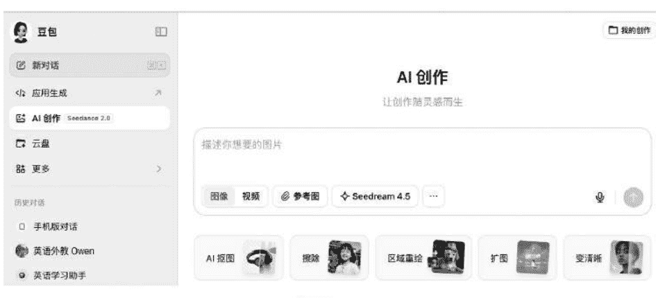
②点击输入框下方的“图像”，然后输入文字，比如：“生成一张3：4比例的咖啡馆海报，日系清新风格。画面主体是手持透明冰咖啡的一只手，背景是虚化的绿色庭院和阳光光斑。细节要求：杯子外壁凝结水珠，光影通透，整体色调偏青蓝色。”如图6-2所示。
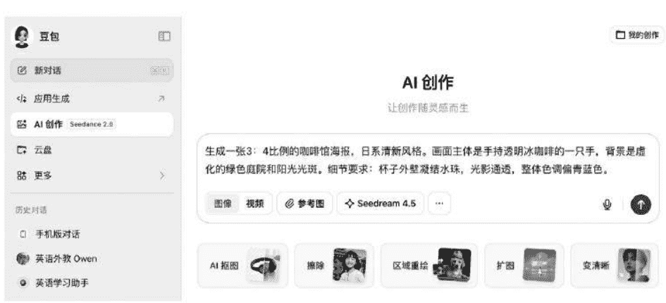
③点击输入框下方的按钮，可弹出“比例”“风格”选项，将鼠标指针放在“比例”上方，即可选择不同的比例，如图6-3所示；将鼠标指针移至“风格”上方，即可选择不同的图像风格，如图6-4所示。
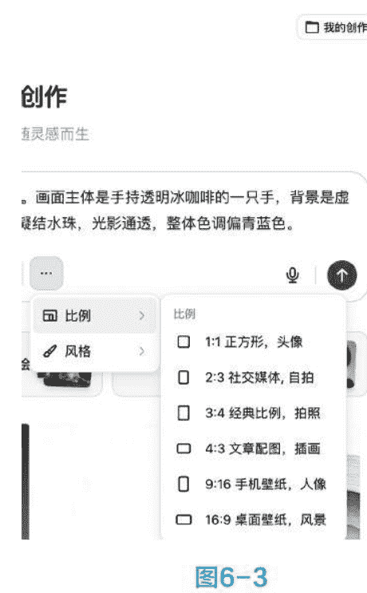

④设置好“比例”“风格”后，点击“发送”按钮，稍等片刻，豆包即可生成相应的图片，如图6-5所示。
我将为你生成一张日系清新风格的咖啡馆海报。

图6-5
通过简单几步，一幅完整图片就生成了。若还想加上文字，可继续输入：“在图片上方空白处添加‘夏日特饮’四个字，字体用手写体，白色。”

### 6.1.2 用图片生成动态视频
豆包除了文字生图，还凭借“图+文”双驱动生成逻辑，通过深度学习模型解析图像语义与文本指令，实现从单帧图片到连贯视频的智能转化。用户只需一张或几张静态图片，辅以简单文字指令，就能让画中人“活”过来。

下面以图片生成短片为例，阐述豆包的图生视频功能。

①打开豆包App，点击左侧栏中的“AI创作”，选择“图像”选项，在输入框中输入要生成图片的文案：“一个背着书包的小女孩，正面照。”如图6-6所示。

②设置好比例、风格后，单击“发送”按钮，豆包会根据文字生成图片，如图6-7所示，可以看到豆包生成了四幅图，这里我们选择第二幅图下载。

③将上一步生成的小女孩图作为参考图上传，然后输入提示词：“请根据图片素材生成5秒短视频，要求：微风吹过小女孩的脸颊，小女孩微笑着眨眼。”如图6-8所示。

图6-8

第四步按下发送后，豆包会以上传的人物照为参照合成短视频，五官与服饰的还原度都能保持在较高水平。

除了单张成片，平台还提供多图轮播玩法。准备一套风格统一的序列图，指定转场方式即可合成一段连贯的小片。

### 6.1.3 图片编辑功能

豆包不仅负责生成新图，也能对生成图或本地照片做深度编辑。主体分离、画幅扩展、局部重画等高频需求都被做成极简流程，修图效率明显提升。

#### 1. AI抠图
抠图的核心是把想要保留的部分从背景中剥离出来，属于图像处理里最基础也最常见的操作。豆包的抠图基于深度学习，会自动判断主体与背景的边界，对发丝、毛发、半透明材质等细节也能做到像素级分离。

①打开豆包 App，从左侧菜单进入 AI创作，再点输入框下方的 AI抠图入口，如图6-9所示。

图6-9

②在弹出的本地选择框里上传待处理的素材。

③上传完成后系统会自动识别前景与背景，点击抠出主体即可完成分离，效果见图6-10，确认后导出即可。

#### 2. 智能扩图
扩图是在不拉伸的前提下向外扩展画布并补全新内容。豆包借助生成对抗网络与海量图库训练，扩图时能保持原图风格一致，补齐部分与原图近乎无缝。

①在 AI创作界面点击扩图，如图6-11所示。

②上传目标图像后设定新比例，例如把竖版转为横版。

③点按新尺寸生成图片，系统会按新尺寸自动补全，示意图见图6-12。

图6-12

#### 3. 区域重绘
区域重绘允许圈定任意局部，通过文字指令让 AI 重新绘制该区域并与周边自然融合。豆包只需一条指令就能定位并重绘，操作很直观。

①在创作中心点开区域重绘，如图6-13所示。

图6-13

②在弹出的选择框里挑好要编辑的图片，用涂抹工具框出需要改动范围，输入重绘描述。

③点发送，涂抹区会被重新生成，结果见图6-14。

图6-14

### 6.1.4 生成矢量图片
矢量图因可无限放大不失真，成为 Logo、图标、印刷品和品牌视觉的标配。传统做法依赖专业绘图软件，门槛较高。豆包让非设计师也能快速拿到矢量素材。

整体思路是先用提示词生成位图，再借助外部工具矢量化，大幅降低成本。具体流程如下。

①打开豆包，选择图像生成，在提示框输入需求，例如：“请帮我生成一个青峦科技 Logo，极简线条，融合绿色山峰剪影和一片树叶轮廓，纯白底，扁平化，无阴影无渐变，大色块分区，边缘清晰，高对比，矢量插画风格。”如图6-15所示。

让创作随灵感而生

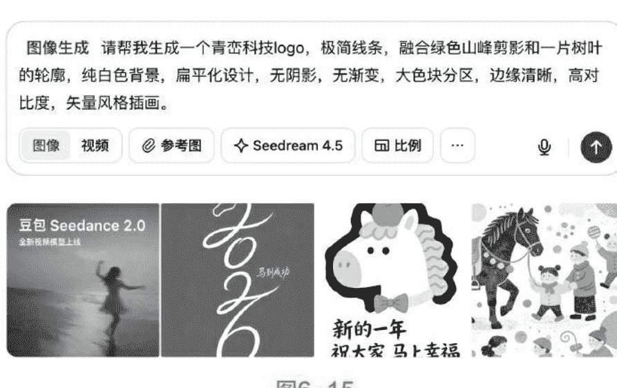

②点发送，豆包会给出几张备选，如图6-16所示。挑选满意的一张导出为高清 PNG。

我将为你生成青峦科技的极简风格 logo。

图6-16

③打开 Vectorizer.io 网页，点 Upload Images 上传刚才的图，如图6-17所示。

图6-17

④工具会快速完成格式转换，如图6-18所示。选择 SVG 格式，点击 Download 下载即可。

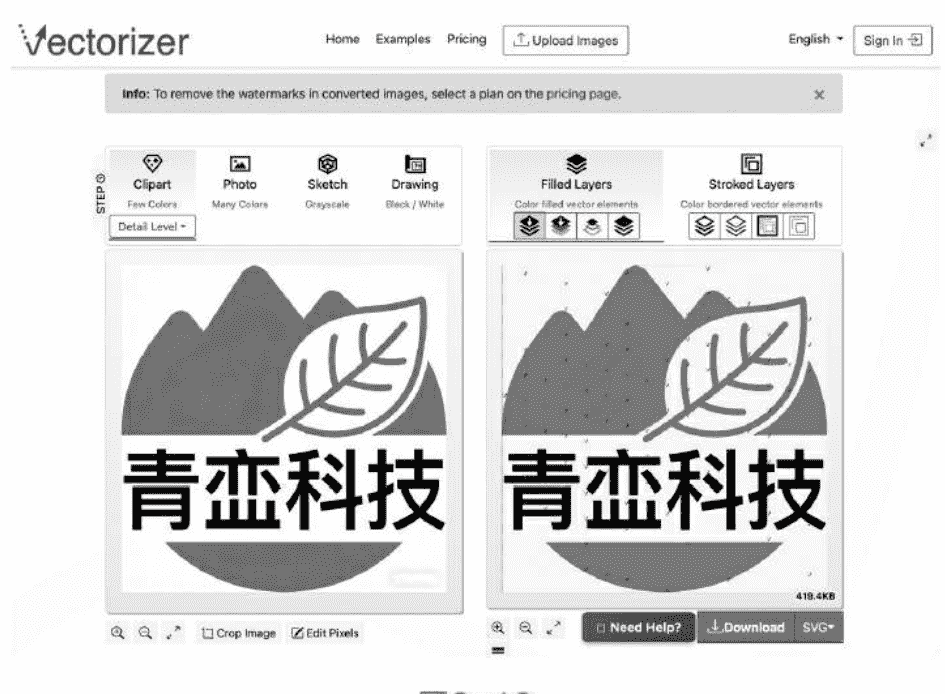

图6-18

四步走完，通过提示词设计配合外部处理，就能快速获得可用矢量文件，提升设计效率。

## 6.2 音乐、诗歌与剧本创作
豆包在创意生成上表现突出，能按风格、情绪与主题快速产出旋律片段与歌词，也能写诗；在剧本层面，构思能力同样在线。

### 6.2.1 音乐创作，生成专属歌曲
过去做音乐被认为是专业人士的专属。现在借助 AI，普通爱好者也能尝试。豆包的音乐生成功能只需输入关键词和描述，如风格、场景等，就能得到一首定制歌曲。

①打开豆包，点输入框下方音乐生成，进入创作页，如图6-19所示。

图6-19

②输入框里已有示例提示词，直接填入即可。例如：“我想创作一首歌曲，用 AI 写歌词，自驾旅途的休闲时光。风格偏流行，情绪放松，用女声。”如图6-20所示。

想创作一首怎样的歌？

③点发送，通常几十秒就能生成完整曲目并附带 AI 封面，如图6-21所示。若不满意，可像聊天一样追加指令，如副歌再重复一次、节奏快一点，直到满意。

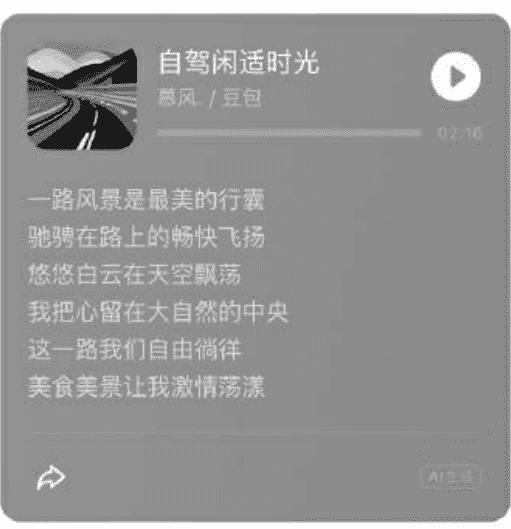

图6-21

### 6.2.2 诗歌写作
诗歌是意象、节奏与韵律构骨、情感与哲思为魂的文体。创作需要文学功底，豆包提供格律规范与灵感启发。

写法有两种：直接对话输入提示词，或用帮我写作里的诗歌模板。

①打开豆包，选择帮我写作，点模板，挑诗歌模板，如图6-22所示。

帮我写作

润色校对，一键成文

帮我写一首关于 [输入主题] 的诗歌，格式是 [输入古诗词或者现代诗的格式]。

我创作的文档

- 全部

- 工作

- 商业营销

- 学习/教育

- 社媒文章

- 文学艺术

- 回复和改写

- 长文写作

- 分步生成大纲和文档

- 文章

- 撰写各类主流平台文章

- 总结汇报

- 提炼你的工作成就

- 论文

- 撰写专业严谨的论文

- 作文

- 专为学生打造满分作文

- 宣传文案

- 撰写各平台的推广文案

- 社媒笔记

- 打造吸睛的笔记内容

- 润色

- 让文字表达更出彩

- 小说

- 创作引人入胜的小说

- 话术

- 满足不同场景表达需求

- 研究报告

- 深度研究，精准分析

- 心得体会

- 助你提炼归纳所思所悟

- 思想汇报

- 进行反思梳理和深入总结

- 诗歌

- 创作动人心弦的诗篇

- 朋友圈

- 精心设计的朋友圈文案

- 微博

- 撰写吸引眼球的微博

②输入框提供模板提示，只需填主题与格式，比如主题乡愁、格式现代诗，如图6-23所示。

帮我写作

润色校对，一键成文

图6-23

③点发送，豆包会快速生成诗歌，如图6-24所示。

帮我写一首关于乡愁的诗歌，格式是现代诗。

我将以日常细碎场景为切入点，融入故乡的烟火气与心底的牵挂，创作一首贴合心境的现代乡愁诗，保证语言细腻、情感真挚。

乡愁的碎片

创建时间 21:04

改用对话直接回答 >

这首诗藏着故乡的烟火与心底的牵挂，需要我帮你**调整某些的情感浓度，让乡愁的感觉更浓烈吗？**

- 写一首关于乡愁的现代诗，要求语言简洁明了 →

- 推荐一些关于乡愁的现代诗 →

- 创作一首以故乡的风景为主题的现代乡愁诗 →

乡愁的碎片

风裹着陌生的桂香掠过窗台

我忽然停住笔

像被什么拽回了旧时光的巷口

那是青石板被雨水泡软的清晨

外婆的炊烟在瓦檐上绕圈

粥香漫过矮墙，混着墙角月季的甜

我踩着露水，追着一只白蝴蝶

把笑声丢在每一块斑驳的砖

后来我走得很远

远到看不见故乡的屋檐

城市的霓虹太亮，遮住了星子

外卖的热汤，暖不透异乡的寒

每一次低头，看见掌心的纹路

都像看见故乡的河，蜿蜒着，不肯走远

乡愁不是一场轰轰烈烈的想念

是深夜里，忽然想起的一句方言

是吃到一碗面，下意识想加的那勺咸菜

是电话里，母亲说“天凉加衣”时

藏在喉咙里，没说出口的“我想回家”

风又吹过，带着故乡的气息

我把碎片一样的牵挂

折成纸船，放进月光里

愿它能漂过山川，漂过岁月

落在我思念的，那片烟火人间

图6-24

若想更个性化，也可自写提示词。例如写一首关于地铁站黄昏的现代诗，只能用视觉灰蓝光斑、玻璃倒影和听觉报站声断续、鞋跟敲击，禁用孤独、思念等抽象词。

### 6.2.3 微短剧剧本生成
短视频时代，微短剧靠快节奏、强冲突、高反转吸睛。但对非科班创作者来说，设计黄金三秒开头和递进剧本，比拍摄更难。

豆包的剧本功能像一位爆款编剧，能把模糊想法具象成可拍脚本。

第一步：定人设，给方向。
微短剧用户三秒定生死，先告诉豆包受众和市场风向。可这样提问：

> 你是一名资深微短剧制片人，擅长捕捉热点。请给出10个重生逆袭题材的选题方向，要求节奏快、爽点密集，结合2026年流行趋势。

豆包会给出玄幻相术重生·女相师破局逆袭、古风权谋重生·庶女智商逆袭后位、重生九十年代我成了食神等方向，自行挑选。

第二步：赋角色，提精度。
选定方向后给豆包角色设定，例如：

> 忽略之前身份，你是一位拥有百万爆款作品的短剧编剧，擅长30秒内埋悬念。请把重生九十年代我成了食神扩展成逻辑清晰的故事大纲，含主要人物小传、核心冲突及至少3次反转。

角色赋能后输出更有戏剧张力。

第三步：生成剧本。
把提示词输入豆包，如图6-25所示，点发送，即可得到开场悬念、人物和完整大纲。

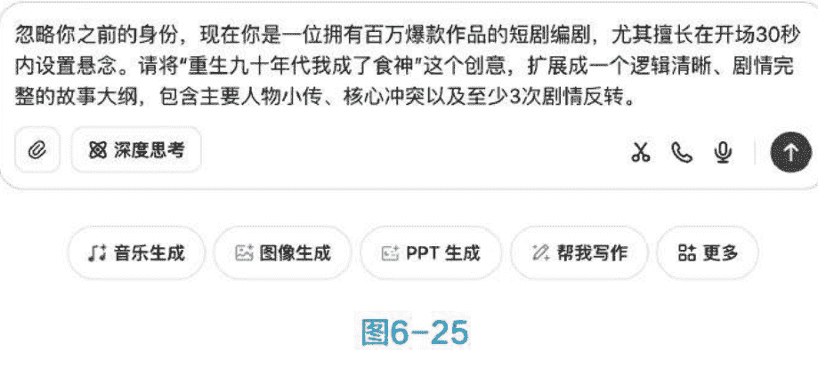

以下是生成的示例剧本：

#### 重生九十年代我成了食神

##### 一、开场30秒悬念
【画面】昏暗后厨，中年男人林晚星50岁浑身油污，眼睁睁看着徒弟下药夺走招牌秘方、餐馆被砸、妻子留下的旧银勺被毁，口吐鲜血倒在灶台前，眼里满是不甘：“我悔啊……若有重来，绝不会再轻信小人！”

【切】强光闪过，1995年老胡同小院，20岁的林晚星猛地惊醒，手里攥着完好无损的旧银勺，鼻尖萦绕母亲玉米粥香，邻居说“晚星，你家餐馆要被人砸啦！”——重生到悲剧起点，而砸店的正是前世毁他一生的好兄弟。

【画外音】“重生一次，我不仅要守住餐馆，还要让九十年代的烟火气都拜倒在我的灶台前——这一世，我是食神，更是自己的救世主！”

##### 二、主要人物小传
###### 1. 林晚星
前世50岁：出身餐饮世家，继承母亲晚星小馆，厨艺天赋高却心思单纯，轻信发小张浩，被夺秘方、掏空餐馆，妻子抑郁离世，最终被害，一生落魄。

……………

该剧本节奏紧凑、爽点密集，贴合九十年代背景，冲突直接、拍摄成本低，且具备续集与厨艺衍生空间。

# 第7章 商业实战：把豆包变成现金流

## 7.1 演讲稿写作：接单变现
豆包的写作能力已广泛应用。在人人都能一键出文的时代，你可能会问：既然能自动写，为什么还要付费请人写演讲稿？

豆包确实能快速生成稿件，但要调教提示词、去掉机器味，需要大量时间。对客户来说需求很简单：“我很忙，不想研究提示词，直接要成品，你负责。”

再加上情感共鸣与个人风格难以被完全替代、行业垂直的专业壁垒、时间成本以及重要场合不容出错的风险，专业写演讲稿的需求依然强劲。

### 1. 高质量演讲稿的打法
普通人通常只说请生成一份年会发言稿，结果很空泛。专业写手需要结构化提示：

- ①场景。明确用途，互联网公司年会与制造业年会语境不同。
- ②身份。行业、职位必须说明。
- ③时长。中文演讲约220~250字/分钟，时长决定字数。
- ④观点。核心论点要明确，如今年的主题不是增长，而是活着。

按此要素写提示词，输出会更精准。示例：

请按以下信息写展会演讲稿：
场景：家具展作为代表发言。
身份：40岁左右、深耕行业15年的老总，说话干练。
时长：约30分钟。
观点：家具健康发展不是价格战，而是质量、诚信与创新。

把提示词输入豆包，生成的稿会更贴合行业特征，让客户感受到专业度。

以下为豆包生成片段截图，如图7-1所示。

#### 坚守长期主义，拒绝价格内卷 —— 以质量、诚信、创新共筑家具行业未来
(家具展会发言稿，约30分钟，干练沉稳，15年行业老总视角)

尊敬的各位领导、各位行业同仁、各位合作伙伴：

大家上午好！

非常荣幸，能在这场行业盛会，与来自全国各地的家具人相聚。我在这个行业深耕15年，从车间到市场，从单品到品牌，见证过行业的高速增长，也亲历过当下的激烈竞争。今天我不讲虚话、不绕圈子，只和大家聊一个最实在、最关乎我们每个人饭碗的话题：**中国家具的健康发展，从来不是价格战，而是质量、诚信与创新。**

过去几年，行业里出现一个怪象：谁价格低，谁好像就能抢市场；同款产品，你降一百，我降两百，最后降到没有利润、没有服务、没有底线。很多企业被卷得喘不过气，经销商被压得利润微薄，消费者买到手，看似便宜，实则隐患重重。

从结果看，语气接近真人表达而非机械堆砌，这得益于结构化提示。

### 2. 跨平台接单与模式升级
掌握生成技巧后，需要借助平台变现。

(1) 跨平台接单
- 综合平台：在甜薪工场、Upwork等建立档案，标签写豆包AI演讲稿优化专家或AI生成+人工润色，既蹭热度又突出价值。
- 众包任务：关注小鸟众包、趣闲赚的短期写作需求，单价虽低，但利于练手与积累作品集。
- 垂直渗透：加入豆瓣小组、行业微信群，主动告诉潜在客户我能用AI和专业帮你出精品。

(2) 从写稿到顾问
效率提升后，不要按字数收费，按价值收费。可在进阶服务里附赠演讲备注，标注停顿点、重音处、配合的肢体语言。这种贴身说明书的价值远超稿件本身。

还可以做VIP顾问式服务：深度访谈挖掘个人故事、梳理演讲逻辑、参与彩排反馈。此时定位是演讲顾问或个人声量教练，收费从几百元跃升至几千甚至上万。

## 7.2 书评副业：用豆包赚稿费
在小红书，读书博主门槛低、变现稳、受众广。很多人想靠书评起号，却卡在阅读周期：几百页书要读一周，读完又不会写。

AI时代，不必通读全书也不必文笔出众，用豆包就能产出专业书评，抢占流量窗口。

### 1. 不读全书也能写书评

AI驱动读书号：从选题到变现的方法论

很多刚入局的读书号创作者容易走进一个误区，觉得必须把整本书精读透彻才能下笔。其实在小红书的传播语境里，读后感和知识拆解属于两种不同的内容范式。用户真正关心的是这本书能否解决当下的痛点，而不是作者在某一页写了什么细节。

所以评测的价值不在于复述原文，而在于把问题带进解决方案里。借助豆包这类工具，即便没有通读，也能通过结构化提问把一本著作的骨架快速提取出来。这不是偷懒，而是用模型完成知识提炼的效率选择。

#### (1) 核心思想速成
拿到新书不必从头翻到尾。打开豆包，输入类似指令：
请用大约200字概括《××》的主旨，并归纳三条关键论点。
十秒左右就能拿到作者的逻辑主干，相当于阅读前先拿到一张思维导图。

#### (2) 结构化拆解
仅有概括还不够，可以继续追问：
请把《××》拆成“基础概念层＋方法论层＋实践案例层”三层来呈现。
这种提问能快速切换到专家视角。以《认知觉醒》为例，模型会帮你厘清“大脑构造归概念、元时间归方法、早起冥想归案例”的递进关系，书评框架立刻成型。

#### (3) 金句与场景提炼
平台用户很吃金句。直接让模型筛选素材：
请从《××》里挑出十条最具共鸣的金句，并为每条配一个具体生活场景。
掌握这些素材后，不翻书也能拼出兼具深度与体感的高效书评。

### 2. 高转化带货书评打法
小红书的本质是种草，书评的最终目标是促单。直接让模型写“请为我写一篇《×××》书评”，产出往往空洞口号化。

更有效的做法是先给一个执行脚本，示例提示词如下：
你是一名28岁的职场妈妈，最近因工作焦虑产生严重内耗。刚读了《被讨厌的勇气》，请用第一人称写一篇约500字的有感笔记。要求：1.标题需包含“内耗”“自卑”“人际关系”等关键词，语气治愈且有力量；2.开头讲一个真实的困扰细节；3.正文引用书中二到三句金句并解释点醒之处；4.结尾像朋友聊天一样自然推荐，不要硬广。

输入后能得到一篇有痛点、有解法、易引发共鸣的完整文案。

挣脱内耗与自卑，在人际里重生——读《被讨厌的勇气》有感
28岁，同时承担职场人与母亲角色，整个人像被绷紧的线，一端拴着KPI，一端拴着孩子的三餐与成长。深夜常因焦虑失眠，怕工作表现被质疑，怕陪伴不足被指责不称职，更怕自己不够优秀配不上这两个身份。人际上也过度谨慎，讨好同事、迁就家人，把他人评价当成自我衡量的标尺，在自卑与内耗中反复消耗。

直到接触《被讨厌的勇气》，那些纠结的情绪逐渐被抚平。书中“所谓自由，就是被别人讨厌”点醒了我，我长期活在他人期待里，因害怕被讨厌而不断退让，却忘了自己才是人生主角。工作不需要追求全员认可，做好本职即可；生活不必事事迎合，学会拒绝是降低内耗的关键。

“自卑情结只是一种借口。”这句话刺中软肋。我常以“我是妈妈精力有限”“我不如别人”自我开脱，逃避挑战、否定自己，这本身就是内耗的根源。自卑本身不可怕，可怕的是用自卑合理化逃避。接纳自己的不完美，才能停止自我攻击，慢慢找回底气。

书里还有一句让我印象深刻：“人际关系的烦恼，都源于对别人的课题妄加干涉，或者自己的课题被别人妄加干涉。”过去我过度在意他人看法，也忍不住干预家人的选择，在无谓的干涉里耗尽精力。学会区分彼此的课题，专注做好分内之事，不再纠结他人评价，人际反而轻松起来。

如果你正像曾经的我一样，被内耗困住、被自卑裹挟、在人际中疲惫，这本书值得一读。它不会提供空洞安慰，却能给予挣脱内耗的勇气，教会接纳自己、放下执念，在自己的节奏里活得稳重从容。

### 3. 搭建可复制的读书博主收益模型
单篇爆款靠运气，可复制的系统才是长期生意。真正能持续变现的读书号，依赖的是高佣金书库、矩阵化分发和个人IP建设，而非一篇篇硬写。

#### (1) 高佣金书库构建思路
并非所有书籍都适合推广。要建立“高佣金＋高需求”的私密书库，选品可遵循以下逻辑：
- 书单筛选。优先选择豆瓣八分以上或当下热销的作品，避免只盯《活着》这类竞争激烈的经典。多挖掘“社恐自救”“职场沟通”“回避型依恋修复”等场景化、解决具体问题的主题。
- 佣金筛选。在小红书选品中心挑佣金比例百分之三十五以上、定价三十到八十元区间的图书，这个价格带最容易产生冲动购买。

#### (2) 内容矩阵运营
一篇优质书评的价值需要被放大。用豆包将其改写为职场版、宝妈版、大学生版，并适配小红书、视频号、朋友圈，分发至不同账号，榨干选题剩余价值。

同时搭建主账号＋垂直子账号：
- 主账号即人设IP：真人出镜，输出深度书评与成长故事，建立信任感。
- 垂直子账号即书单号：专注书单推荐，无需真人出镜，文案由豆包生成，配合剪映自动配图视频快速铺量并挂车带货。

## 7.3 把知识做成课程实现变现
知识付费已成为主流变现方式。很多人想把经验产品化，却卡在知识碎片化、框架不清、文案吸引力不足，以及传统课程制作周期长成本高。豆包打破了这些门槛，让知识变现变得可操作。

### 1. 爆款网课落地路径
#### (1) 需求洞察与框架搭建
制作前先明确目标学员与痛点。用豆包开启“深度思考”模式输入提示词，即可快速获取需求与课程大纲。示例：
你是一名资深课程策划专家。请为我策划一门“手机人像摆姿”爆款课程。目标学员是零基础手机摄影爱好者，痛点是摆姿无力感。请列出课程核心卖点和十节课的详细大纲，每节含知识点与金句。
模型会输出结构严谨的大纲，并基于大数据给出市场最看重的卖点，确保课程从起点就切中需求。

##### 《手机人像摆姿·零基础爆款课》
###### 课程定位
面向零基础手机摄影爱好者，解决“拍照僵硬、手足无措、不会摆姿、越拍越丑”的问题，无需专业设备、颜值、身材，一学就会立即出片。

###### 一、课程核心爆款卖点
1. 零基础友好：不讲玄学理论，全是可直接套用的摆姿模板。
2. 手机即可完成：全程适配手机，无需单反、灯光、大场地。
3. 告别僵硬尴尬：专门解决手放哪里、眼看哪里、身体如何转的问题。
4. 公式化记忆：每节课提供固定摆姿公式，记不住也能直接套用。
5. 自带修饰效果：姿势自带瘦脸、瘦肩、拉长比例的功效。
6. 场景全覆盖：日常、街拍、室内、侧脸、背影、全身、半身均可使用。
7. 即学即用：学完即可为朋友、家人或自己拍摄，当天出大片。

#### (2) 制作与上架流程
大纲确定后务必人工润色，注入个人情感。随后可利用豆包的PPT生成功能，为每节课制作教学演示稿。
可要求采用“案例对比风格，左侧错误示范，右侧正确技巧”，让课件具备说服力。对难点如“黄金分割构图”，让豆包生成带标注的示意图，或十秒动态演示视频，比纯文字更直观。
最后让豆包生成课程详情页销售文案、网感短视频宣传脚本及免费试听内容，这一步决定上架后的点击与转化。

### 2. 引流渠道与盈利矩阵
课程制作完成只是起点，如何触达学员并产生收益才是核心。

#### (1) 精准触达与渠道引流
线上可将课程金句、反常识观点通过豆包转化为文案，制作成口播视频发布于抖音、快手、视频号；线下可寻找互补社群，如图像处理学习群。用户需求重叠，业务不冲突，便于导流。

#### (2) 多层变现体系
- 前端引流品：用豆包快速生成《摄影入门十大避坑指南》PDF或体验课短视频，成本低价值感强，用于吸粉与建立信任。
- 中端利润品：系统网课是核心利润来源。配合豆包优化的营销话术完成转化。
- 后端高价值服务：推出“AI摄影顾问智能体”订阅服务，用户付年费即可获得专属摄影问答助手，大幅提升使用价值。

## 7.4 用海报设计获取收入
传统海报设计需要构思、找素材、抠图、排版、调色，任何一环卡住新手就会放弃。用豆包做海报，角色从操作员转变为创意总监。技术门槛消失后，审美、创意和需求洞察成为关键。

小微商家、个人农产品卖家等价格敏感型客户，需要简单海报却请不起专业团队，这正是机会所在。

### 1. AI海报生成实操
核心在于写好提示词，公式：用途＋风格＋画面元素＋文字内容＋色调构图。

以“班级读书分享会海报”为例：
①打开豆包App或网页，点击左侧“AI创作”，选择图像，输入：
五一班读书分享会海报，清新简约风格，具体内容如下：
主题：读一本好书，赴一场成长。
时间：10月20日16:00。
地点：教室图书角。
视觉元素：翻开的书本、星星灯、绿植，色调浅绿＋白，文字字体圆润卡通，比例9:16。
②提示词约束了画面、颜色、字体和排版，发送后结果基本贴近想象，效果如图7-4所示。

图7-4
③对不满意的元素可用“区域重绘”功能微调。交付时提供PNG无损格式，文件名按“日期＋客户＋用途”规范命名。

### 2. 平台变现路径
做出好看海报只是第一步，变现才是目标。

#### (1) 垂直接单
在闲鱼、小红书等平台发布“AI海报定制”服务。用低价走量积累案例。展示几张由豆包生成的精美海报，吸引急需社团招新海报的学生干部、需要活动海报的线下小店老板。设计公司报价几百，你几十块成交，双方共赢。

#### (2) 模板被动收入
卖模板比单张更有持续性。按行业场景分类制作餐饮促销、母婴招生模板，每套含三到五个版式并附修改说明，指导客户用豆包替换文字图片。在淘宝、拼多多、小红书上架，定价9.9到39.9元。热门餐饮模板月销五十套，收入也很可观。

#### (3) 素材平台下载收益
将生成的高质量、无版权通用海报，如节气海报、励志壁纸、风景插画，上传至视觉中国、千图网、昵图网等。设置积分或金额下载，每次下载均有分成。单张收益有限，上传上千张后可形成稳定被动收入。