# 豆包 AI 赚钱手册

**内容提要**

在人工智能红利大爆发的今天，AI 不仅是提效的工具，更是普通

人依靠副业翻身的利器。豆包凭借极高的交互效率与内容产出质量，

正成为普通人跨越技术门槛、实现技能变现的首选工具。

本书立足于读者的真实变现需求，跳过枯燥的理论，一次性呈现

33 个真实的豆包变现场景，打通从掌握功能到拿下订单的商业闭环。

本书力求 33 个真实场景所涉及的实操步骤均能落地，旨在帮助读

者打通依靠豆包赚钱的“最后一公里”。无论是渴望开启副业收入的

职场人、寻找技能变现机会的大学生，还是想在 AI 爆发期抢占商机的

创业者，都能在这 33 个场景中找到属于自己的财富机会。

2

**前言　别慌！AI 赚钱的风口，普通人也能**

**稳稳接住**

各位朋友，翻开这本书的时候，你是不是也刷到过不少“不会 AI 就会被淘汰”的文章，也看到很多因为 AI 普及失去工作岗位的文章，

心里有点慌？

我特别懂这种感觉。这两年我见过太多人，一边羡慕别人靠 AI 赚

得盆满钵满，一边又觉得“AI 是技术大佬的事，跟我没关系”。

其实真不是这样。一方面，AI 放大了普通人的服务能力，过去很

多有技术门槛的工作，今天普通人也能做好。另一方面，服务价格的

下降，使原来的市场规模扩大了 100 倍。通过这些机会开启财富之路

的案例，在过去 3 年中笔者已经看到太多了。特别是国产大模型能力

进化很快，应用做得越来越方便，如果普通人用好了，把握这种机会

并不难。

我写这本书的目的就是想帮你放下焦虑，不用研究什么大模型、

算法，仅靠一部手机+豆包，从身边的小活儿做起，就能把 AI 红利变

成实实在在的收入。

截至 2025 年年底，豆包日活跃人数已突破 1 亿大关，其技术支柱

火山引擎拿下 2026 年春晚合作。事实表明，AI 浪潮已非“未来趋

势”，而是实实在在的“当下机会”，大家更应该了解自己有哪些新

机会、新选择。

这本书的特色，说直白点儿就 3 个字：能落地。

3

笔者花了 3 年时间，全网搜集筛选出 33 个适合普通人利用豆包赚

钱的方法，零基础，零门槛，只要愿意做，就能赚到钱。

你不用学复杂的操作，先看看目录里的那些法子：5 分钟精修简

历、15 分钟写演讲稿……

对哪个感兴趣就先看哪个，马上用起来！

每一招笔者都给你提供了具体步骤，还有真实案例。如果看后有

想法，那就赶紧试一试。

本书遴选的赚钱方法都是针对普通人的，门槛不高，一部手机就

够，不用投入本金，每天抽点碎片时间，赚杯奶茶钱、买菜钱，慢慢

攒起来，也是一笔不小的收入。

如果你是朝九晚五的打工人，想赚点副业收入补贴家用；

如果你是宝妈、学生，时间零散想找个灵活的赚钱路子；

如果你是刚毕业的年轻人，想靠自己攒点儿启动资金；

甚至你是想转型的创业者，想找低成本的变现方式——这本书都

适合你。它不是写给技术专家的，而是写给咱们普通人的，帮你降低

AI 的门槛，把 AI 变成赚钱的工具。

接下来的内容，咱们就一页一页地翻，一步一步地学。愿你读完

这本书，能够抓住 AI 的红利，把日子过得越来越好。

秋叶

2026 年 1 月

4

**第一篇　零门槛起步，一部手机+豆包就**

**够用，每天能赚 100 元**

5

**第 1 招：豆包 5 分钟精修简历，闲鱼+小红书+朋友圈挂**

**单变现**

**一　求职第一关，多少人卡在简历上**

在求职市场上，简历就是打工人的“命门”。很多人投了几百份

简历却收不到一个面试电话，通常这并非因为求职者的能力不行，而

是他们写的简历不符合用人单位的要求。求职者的焦虑藏着服务变现

的机会。通过豆包优化内容结构、提炼优势、量化成果，求职者能显

著提升简历的通过率。

有些人觉得随手找个 AI 工具就能搞定简历，不想浪费钱。其实，

普通人自己用 AI 改简历，很容易掉进两个坑。

1. **一股机器味：**在简历里写满卓越、优秀、努力上进这种正确的废

话，HR 一眼就能看出来是 AI 写的。

2. **对不准需求：**把简历改成“自嗨”稿，只顾着修饰文字，却根本

没对准人家的招聘需求。这种简历看起来变美了，但在 HR 眼里依然是

无效的。

普通上班族小陈在闲鱼开店帮人优化简历。以前改简历全靠生熬

硬写，现在有了豆包辅助，小陈十几分钟就能搞定一份精修简历（见

表 1-1）。

表 1-1　小陈优化后的简历

6

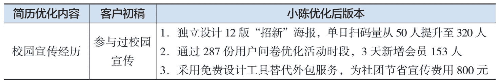

如果按简历优化基础版 30 元/单计算，小陈每天下班接 4 单即可实

现日入 100 元的目标。如今，小陈不仅客单价从几十元涨到了 200～

300 元，更通过熟人推荐确保了客源稳定性，每月轻松增收 3000～

5000 元。

因此，**能变现的核心本事不是改文字，而是用豆包做岗位精准适**

**配**。每年超千万应届生的求职需求叠加数亿职场人的晋升、跳槽需

求，让简历精修成了一个刚需、高频且极具生命力的服务市场。

**二　豆包改简历实操全流程，实现从 0 到 1 落地变现**

如果你想和小陈一样利用豆包精修简历变现，只需以下 3 个关键步

骤，即便是新手也能快速上手。

**第一步，接单前期准备：搭好岗位关键词数据库。**

**岗位关键词对精修简历至关重要，主要体现在以下两点。**

1.能精准匹配招聘方的系统筛选规则，避免简历因缺少关键信息而

被直接淘汰。

2.能让简历重点突出，快速契合岗位任职要求，提升 HR 对简历的

好感度。

7

副业新手最头疼的是接不同岗位订单时，拆不准招聘需求关键

词。其实用豆包批量拆解，10 分钟就能搭好 10 个热门岗位的关键词

库，后续接单直接套用即可。最初可以先收集运营、会计、行政、销

售等 10 个热门岗位的通用招聘需求，复制到豆包 App 中，用下面这 1 个

核心模板进行拆解。

帮我批量拆解以下岗位的通用招聘需求，每个岗位输出如下两

点。

1.按频率排序的核心关键词。

2.新手必掌握的 3 项技能。

岗位列表：[粘贴 10 个岗位招聘需求，用分号分隔]。

表 1-2 是围绕 5 个热门岗位的拆解结果。

表 1-2　对 5 个热门岗位的拆解

8

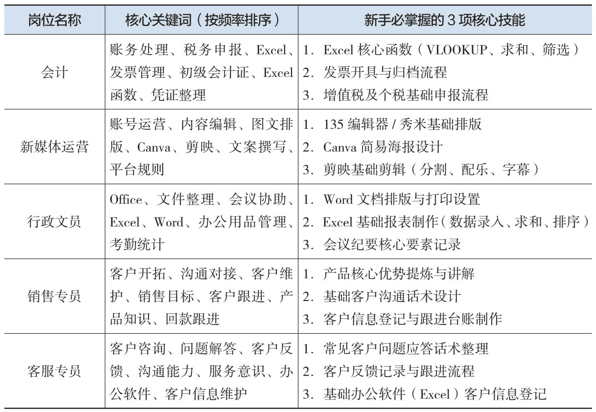

**第二步，精修简历：1 个万能模板+3 个场景技巧。**

豆包精修简历的核心是挖掘亮点+对接需求。

不管是客户没给具体的招聘需求，简历内容过少，还是害怕简历

雷同，都能用 1 个万能模板+场景补充搞定。

通用 AI 提示词核心模板：

基于以下原始简历和[岗位名称]的核心需求（关键词：[粘贴第一

步拆解的关键词]），帮我精修简历，具体内容如下。

1.个人信息只留姓名、电话、电子邮箱，补充精准求职意向。

2.教育经历按“学校—专业—时间”排，优秀成绩/奖学金重点标

注。

9

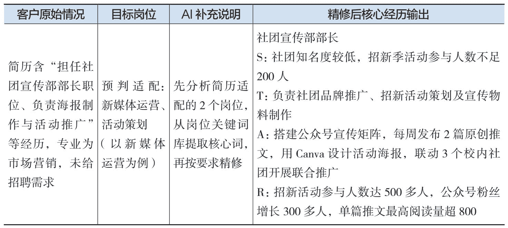

3.用 STAR（S，情境；T，任务或目标；A，行动；R，结果）法则

重构个人经历，每个个人经历加 1 个量化数据，融入关键词。

4.技能栏删除无关项，补充岗位必备技能并标明熟练度。

5.给出行距、字体等排版方案。

原始简历：[粘贴客户简历]。

针对以下 3 类高频场景，只需在通用模板基础上补一句补充说明即

可。

场景一：客户只给简历，没给招聘需求。

补充 AI 提示词：

先分析简历适配的 2 个岗位；

从岗位关键词库提取核心词，再按要求精修简历。

补充提示词后，AI 生成的内容如表 1-3 所示。

表 1-3　AI 生成的内容（场景一）

10

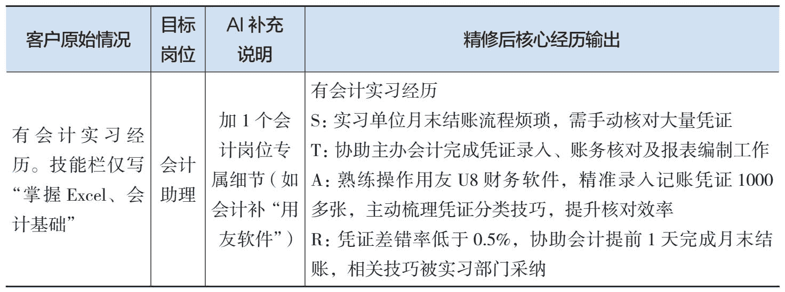

场景二：应届生/转行者，简历亮点内容极缺。

补充 AI 提示词：

从校园/兼职经历中挖掘可迁移技能（如社团管理=统筹能力）；

再用 STAR 法则重构简历结构。

补充提示词后，AI 生成的内容如表 1-4 所示。

表 1-4　AI 生成的内容（场景二）

场景三：怕简历雷同。

补充 AI 提示词：

最后加 1 个[岗位名称]专属细节（如会计补“用友软件”，运营补

“135 编辑器”）。

补充提示词后，AI 生成的内容如表 1-5 所示。

表 1-5　AI 生成的内容（场景三）

11

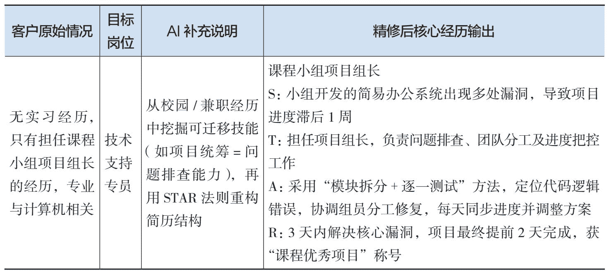

**第三步，跨平台接单攻略，实现多平台变现。**

豆包精修简历变现的核心是多平台曝光和信任建立。

平台一：在闲鱼上如何发布广告（见表 1-6）。

表 1-6　在闲鱼上发布广告

12

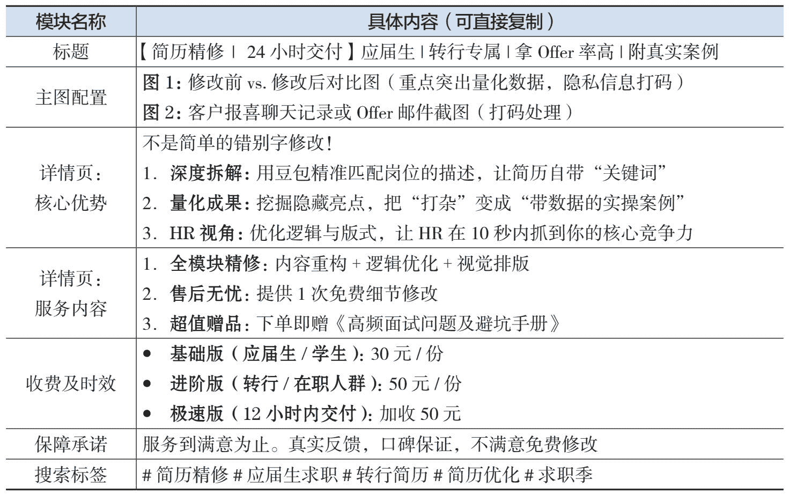

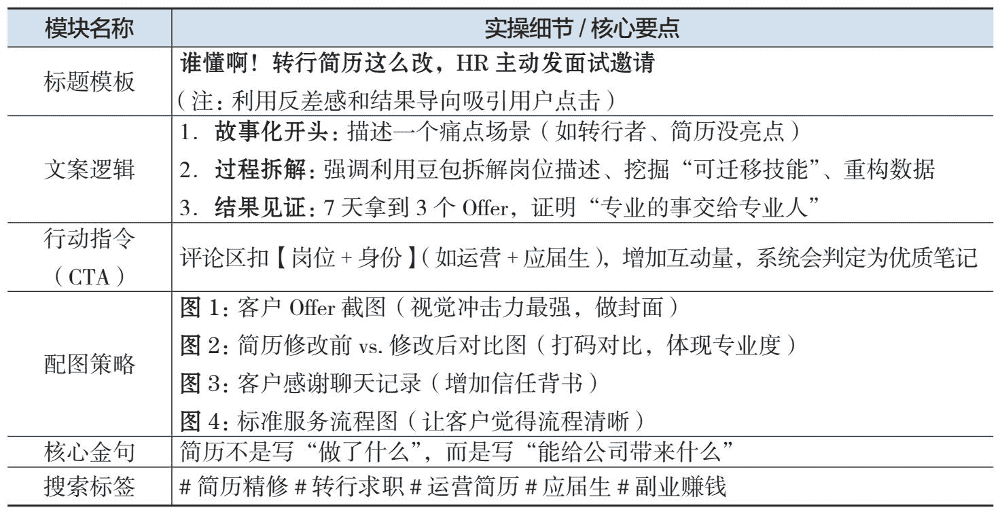

平台二：在小红书上如何发布接单笔记（见表 1-7）。

表 1-7　在小红书上发布接单笔记

13

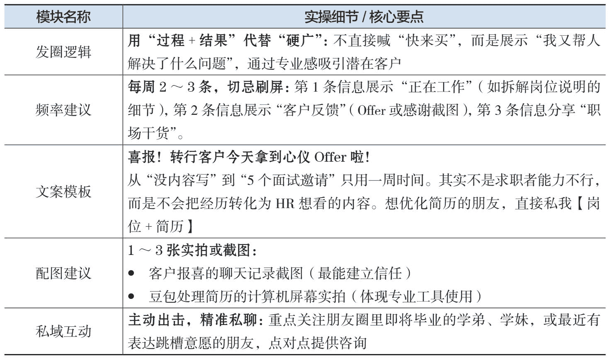

平台三：在朋友圈如何发布接单图文（见表 1-8）。

表 1-8　在朋友圈发布接单图文

**变现升级技巧：**接到第一单后，一定要让客户反馈效果（如拿到

面试邀请、Offer），截图可以直接作为闲鱼主图/详情页素材——真

实案例是最好的获客工具；后期可推出“老客户转介绍优惠”（转介

绍 1 人，双方各减 50 元），快速增加订单量。

**三　增收攻略，最大化发挥豆包价值**

想要赚得更多，请掌握下面 3 个进阶攻略。

攻略一：定制私人提示词库，实现极速交稿。

1. **关键操作：**把针对会计、销售、技术等不同岗位的豆包提示词分

类存档，遇到同类单子直接复制。

14

2. **服务攻略：**别人一晚改 2 份，你 1 小时改 10 份。极速交付本身就

是一种可以提价的增值服务。

3. **变现逻辑：**靠标准化的优质提示词提升 AI 工具修改质量和效率，

赚的是效率翻倍的钱。

攻略二：建立行业模板库，让内容加排版卖出翻倍价。

1. **关键操作：**手机里存好 5～10 套针对互联网、设计岗等不同风格

的简历模板。

2. **服务攻略：**豆包输出内容，你设计排版版式。给客户一个排版精

美的 PDF 文件，客户会觉得你不仅改了简历，还帮他节省了排版时

间。

3. **变现逻辑：**这种一站式交付服务，每单价格可以涨到 100 元。

攻略三：延伸后续咨询服务，把一个客户赚成回头客。

1. **关键操作：**简历交付后，主动询问是否需要面试话术，然后让豆

包针对该岗位生成面试预测题和标准答案。

2. **服务攻略：**客户最终要的是 Offer。面试攻略能缓解焦虑，客户

很乐意在简历制作费基础上加买一份攻略。

3. **变现逻辑：**深挖客户价值，从修改师变成咨询师，单个客户的利

润直接翻倍。

有了豆包的辅助，即使没有 HR 背景的普通人，只要精准掌握了实

操提示词，也能高效产出高质量简历，从而开启一份低成本、高胜算

15

的副业。

16

**第 2 招：豆包写演讲稿，15 分钟交稿，一天接 5 单没问**

**题**

**一　为何有了 AI 还有人花钱写演讲稿？因为准时和体**

**面才是最贵的**

撰写演讲稿之所以是一项长青生意，核心不在于文笔多么华丽，

而在于解决了客户两个最现实的需求。

1. **对效率的确定性：**我马上要，且必须准时。演讲多是突发任务，

客户买的是对时间的掌控感。只要能确保准时拿到演讲稿，缓解自身

职业焦虑，他们并不介意多付费用。

2. **对分寸的专业性：**我不能错，且必须体面。正式场合说错话代价

巨大。客户找专业写手是在买“社交保险”，需要有人帮他避开陷

阱，确保形象体面。

既然有了豆包，客户自己动动手指不就能解决问题吗？事实并非

如此。虽然 AI 出稿快，但调教提示词、去掉机器味依然要耗费一两个

小时。对客户来说，研究如何指挥 AI 本身就是种负担。他们的需求很

单纯：“我没时间研究工具，也不想动脑子。我付钱，你搞定，我直

接拿着念就行。”因此，客户买的依然是省心和确定性。

大三学生小悦，在小红书发布自己喜欢的文案和金句，逐渐积累

了上百位粉丝，还有人通过私信请她帮忙写文案，就这样她误打误撞

地开启了副业。刚开始，她最怕接演讲稿。作为学生，她很难拿捏职

场精英的处世哲学，为了写出老练感，常查资料到半夜，生怕表达太

稚嫩。有了豆包后，搜集素材、搭建框架、设定基调这些工作，几分

17

钟就能完成。她不再死磕文字，而是利用豆包模拟不同身份的人的口

吻。她只需把精力花在根据客户习惯做最后润色这方面的工作上，交

付质量非常稳定。

现在小悦一篇稿子收费 50～300 元，利用课后时间每天接 2～3

单，月入 2000 元，足够生活费自理了。如果你想和小悦一样，利用课

后或下班时间通过演讲稿变现，那你最应该掌握的本事不是写，而是

调教。

**二　豆包写演讲稿实操全流程：从生成文字到高质量**

**定制方案**

客户自己用豆包写演讲稿，通常是提一个需求，等它生成；作为

专业写手则是在利用豆包进行角色匹配和场景推演，交付的不是一段

文字，而是一套拿起来就能讲、讲出来就有面子的现场方案。具体操

作只需要 3 步。

**第一步：行业背景渗透，消除外行的不专业感。**

动笔前，利用豆包的联网检索能力，先把该行业的语言体系和圈

内痛点摸透。

豆包提示词模板：

我正在为一位建材行业的老板撰写年会发言稿。在起草前，请帮

我完成深度调研。

搜索并列出该行业在过去 12 个月内最受关注的 3 个趋势或挑战，并

总结出从业者普遍的焦虑点。

18

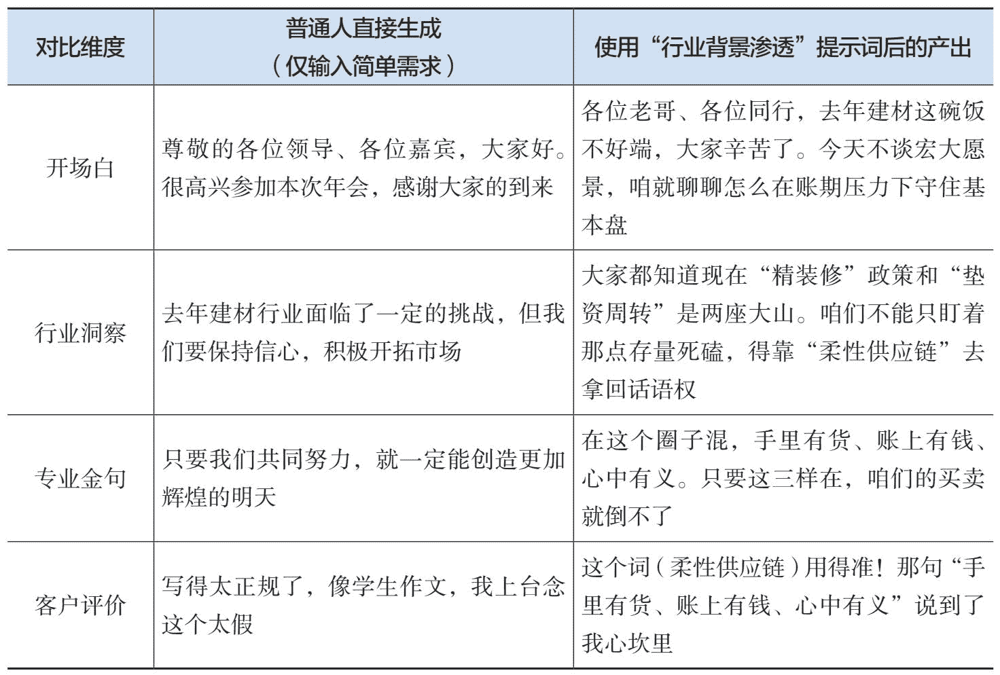

提供 3 个该行业在正式场合绝对不能使用的“外行词”，以及 3 个

能瞬间拉近同行距离、体现资深身份的专业金句。

告诉我这个圈子最推崇的价值观（如稳健、创新或讲义气）。

例如，有一位经营了 15 年的建材贸易商老板，准备在行业商会年

会上发言（见表 2-1）。

表 2-1　利用“行业背景渗透”提示词生成与直接生成的对比

这一步能让你在几分钟内掌握客户所在领域的话语权。你交出的

初稿会因为带有这些行业细节，让客户觉得你非常懂行，这是普通人

用豆包直接生成不出来的。

**第二步：调好精确的性格参数和情绪配比，让稿子听**

**起来像本人。**

19

AI 生成的稿子往往像新闻播报，没有感情。客户需要的是像他本

人在说话，而不是机器在朗读，赋予稿件真人的灵魂是非常重要的。

豆包提示词模板：

请基于上述背景写一份演讲稿初稿。要求如下。

身份设定：主讲人是一位 50 岁左右、为人稳重、重情义且在行业

摸爬滚打 20 年的老总。说话风格要干练，严禁使用虚头巴脑的排比句

和空洞成语。

情绪权重：20%的行业共情（点出大家的现实处境不容易）+50%的

硬核实力（展示过去一年的具体突破）+30%的合作诚意（给出未来的

具体支持）。

逻辑“钩子”：每一段结尾必须设计一个引导听众点头或产生互

动意愿的逻辑顿点，禁止使用“总之、让我们共同努力”等 AI 常用词

汇。

还是以这位建材贸易商老板为例，看看使用提示词模板前后，豆

包生成内容的对比（见表 2-2）。

表 2-2　使用提示词模板前与使用提示词模板后，豆包生成内容的对比

20

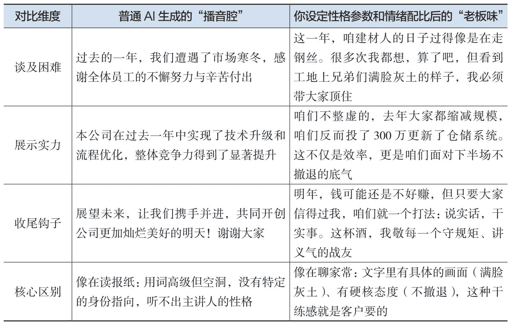

这种对语气的精准控制，能让稿件的语气非常接近真实的人类表

达，而不是机械堆砌。此外，这还会让稿子产生真实的力量感。客户

读起来会觉得这就是他想说却一直没法说出来的真心话。

**第三步：模拟现场朗读，保证拿起来就能念顺。**

很多稿子看着挺美，但读起来绕口、费劲，主讲人上台一紧张就

容易出错。因此，一定要利用豆包进行最后的口语测试，把书面语全

部剔除。

豆包提示词模板：

现在请对生成的稿件进行最后的交付测试。

排查长句：找出所有超过 20 个字的句子并进行拆解，确保主讲人

换气顺畅。

21

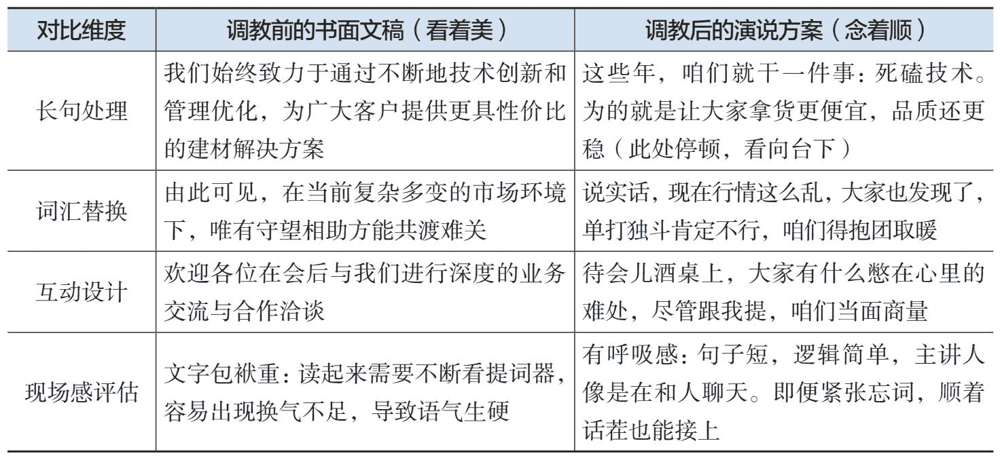

口语翻译：将所有书面语（如“致力于、由此可见”）替换为日

常交流语言（如“咱们死磕、其实大家看来”）。

模拟质检：请模拟一位挑剔的听众，指出文中哪一段话最容易让

人走神，并给出修改建议。

朗读校对：加入 3 处引导互动的停顿提醒，确保整篇稿子即便不看

稿也能顺着逻辑讲下来。

继续来看建材贸易商老板的例子，表 2-3 给出了调教前后，豆包生

成内容的对比。

表 2-3　调教前后，豆包生成内容的对比

根据演讲稿的实际使用场合，你交付的是一份经过多轮测试的现

场方案。这种对细节的把控，能极大地节省客户的二次修改时间。这

种拿来即用、无须反复打磨的确定性，正是客户愿意为此支付溢价的

原因。

**三　跨平台接单攻略：如何避免低价内卷，跑通高客**

**单价**

22

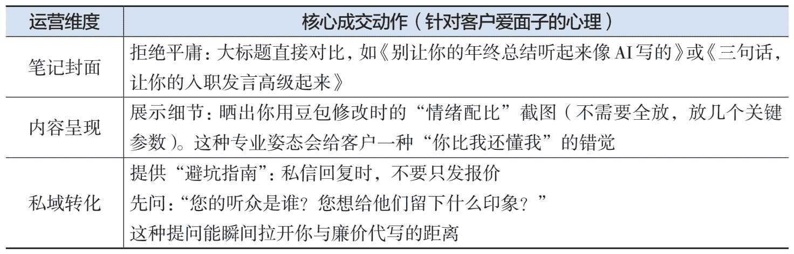

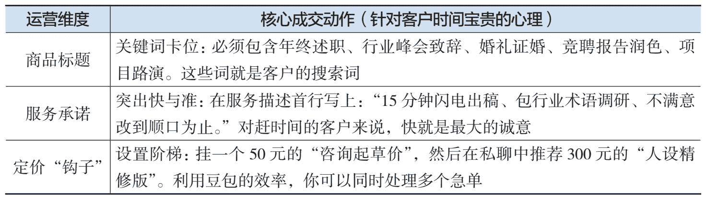

当豆包普及后，如果你的广告语还是“帮写演讲稿”，客户的第

一反应就是：“AI 写的吧？那只值 50 元。”想吸引愿意支付高溢价的

优质客户，你必须打破卖稿子的思维，重新定义你的卖点。

平台一：小红书（用反差感笔记吸引潜在客户）（见表 2-

4）。

表 2-4　小红书平台的接单攻略

平台二：闲鱼（这里的客户需求明确，他们处于“临场焦虑”

中，你只需给他们吃定心丸）（见表 2-5）。

表 2-5　闲鱼平台的接单攻略

平台三：行业社群（演讲稿是极具复购性的生意。只要帮一个

老板写好，他下次还会找你）（见表 2-6）。

表 2-6　行业社群的接单攻略

23

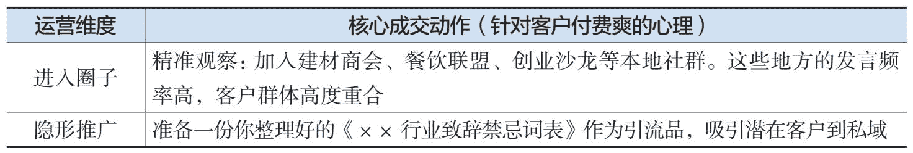

通过以下动作，可以筛选出愿意付高价的优质客户。

**动作一：当客户询问报价时，直接给出价格会让你陷入比价的被**

**动**。最有效的策略是先递出一份《演讲需求诊断表》，询问听众构

成、主讲人性格喜好、现场禁忌点及期望达成的效果。这份表是天然

的客户筛选器。只想购买廉价服务的人会不耐烦地走掉，而真正重视

场合、害怕出错的优质客户，会因为这份细致的调研而对你产生深度

信任。

**动作二：利用豆包极低的时间成本，多提供两项增值服务，能显**

**著提升客户的满意度**。标准交付包清单如下。

**正文稿件（精修版）：**经过 3 步调教法处理，去除了机器味、符合

身份的成品。

**朗读助推版：**在稿件关键处标注出“停顿”、“重读”或“目光

交流点”。

**核心金句卡：**提炼出 3 句极具传播力的核心观点，方便客户制作

PPT 或发朋友圈。

**四　增收攻略，最大化发挥豆包价值**

想要赚得更多，请收好这 3 个进阶攻略。

24

**1 建立行业智库模型：从写稿人升级为顾问。**

普通写手只能根据客户提供的信息写，而你可以利用豆包建立特

定行业的知识库，在客户还没开口前，你就已经比他更懂行业趋势。

**实操动作：**利用豆包的联网与长文本分析能力，提前针对热门行

业（如新能源、大健康、制造业）整理年度关键词和政策风向。

**增收逻辑：**当客户咨询时，你不仅能写，还能顺口提一句：“张

总，最近行业内都在聊‘低碳数字化’，建议在稿子里加一个这个视

角的案例。”

**高端感：**这种“超越预期的前瞻性”，能让客户觉得你不是在机

械性代写，而是在提供战略咨询。这种身份的转变，足以支撑服务单

价翻倍。

**2 开启压力测试服务：为客户扫清现场隐患。**

正式场合的演讲，最怕的是不合时宜。你可以利用豆包模拟不同

的观众视角，对初稿进行质询。

**实操动作：**在豆包中输入提示词：“你现在是一位刻薄的竞争对

手（或是一位理性的投资人），请阅读这份讲稿，找出其中逻辑不通

或容易被攻击的漏洞。”

**增收逻辑：**你交付的不只是一份稿子，还有一份《现场质量保障

人员的风险预案》。告诉客户：“王总，我帮您测过了，第 3 段提到的

数据可能会被追问，建议您对此做好准备。”

25

**高端感：**你卖的是“避险方案”。对于高层领导来说，这种安全

感比文采更值钱。

**3 提供多维语感选型：把通用文字变成 VIP 定制。**

很多时候，客户自己也拿不准要在现场表现出什么样的风格。利

用豆包极高的产出效率，你可以提供选型服务。

**实操动作：**针对同一主题，利用豆包快速生成 3 个不同版本的开头

和结尾。

版本 A——沉稳儒雅型（适合正式政商务场合）。

版本 B——激情励志型（适合内部动员或晚宴）。

版本 C——幽默自嘲型（适合非正式交流）。

**增收逻辑：**让客户做“选择题”而不是“问答题”。这种“三选

一”的定制体验，会显得你的工作量非常饱满，且极其尊重客户的个

性化需求。

**高端感：**这种“审美参与感”会让客户觉得这份稿子是经由他参

与、最终由你利用 AI 精准缝合的作品，这为其带来的心理满足感极

高。

在 AI 时代，文字的生产成本在降低，但专业视角的选择和极端场

景的确定性却在升值。你通过豆包构建的行业智库、风险预案和多维

方案，其实在利用豆包帮客户承担表达风险。当你能通过专业的调

26

研、精准的调教和贴心的交付，让客户在台上感到“体面”时，服务

价格就不再是阻碍成交的障碍。

27

**第 3 招：豆包制作音乐，旋律一响订单来**

**一　AI 音乐需求井喷，零创作基础也能分羹**

短视频背景音乐、直播间背景音乐(BGM)、游戏音效、企业宣传

视频配乐，甚至是个人婚礼、生日纪念的专属音乐……这一切的背后其

实藏着巨大的市场需求。数据显示，2024 年“生成式 AI”音乐的全球

市场价值已达 4.19 亿美元，并以 53.34%的年增长率增加。其中，短视

频配乐、商用 BGM、个性化音乐定制 3 个领域的需求十分旺盛。然

而，传统音乐创作周期长、成本高，根本无法满足市场的海量需求。

很多人觉得做音乐必须有专业功底，其实有豆包在，完全不用

愁。用豆包写歌，有以下 3 个优势。

1. **零门槛创作：**不用懂乐理、会乐器，甚至无须复杂的提示词，简

单用文字描述需求，豆包就能快速生成旋律。

2. **风格全覆盖：**不管是摇滚、民谣，还是古典、爵士等，都能精准

适配。

3. **高效且免费：**3 分钟就能生成一首完整歌曲，还能免费下载。

大三学生小林没学过音乐但喜欢听歌，想靠副业赚取生活费，接

触到用豆包做音乐后，每天利用课余的 2 小时接单，初期主要接 50 元/

首的短视频配乐小单，靠着“低价高效”的口碑，每月能稳定接 15～

20 单，月收入 750～1000 元。后期积累了不少客户后，开始承接个

人、企业定制订单，现在每月收入已经突破 3000 元。

28

用豆包制作音乐的门槛低、成本低、风险低，只要你爱听歌、有

乐感，你就可以用豆包把你的感觉变成可以赚钱的旋律。

**二　两步实操：用豆包快速做出客户专属的音乐**

用豆包制作音乐的操作非常简单，只需两步，跟着做就能快速上

手。

**第一步：拆解需求，明确核心要素。**

接单后先跟客户确认 4 个关键信息，避免后续返工。

1. **使用场景**。明确是短视频配乐、企业宣传音乐还是个人纪念音

乐，不同场景需要的音乐风格差异很大。

2. **核心要求**。想要什么风格（温馨/轻快/大气/热血等），包含音

乐类型（流行/摇滚/爵士等）、时长（常见为 15 秒/30 秒/1 分钟）、乐

器搭配（钢琴/吉他/电子合成器等）。

3\. **细节偏好**。如对节奏、旋律是否有特殊的要求。

4. **商用需求**。确认是否需要商用授权，避免后续版权纠纷。

把这些信息整理成清单，跟客户确认无误后再开工。

**第二步：用豆包生成音乐，3 种方式可供选择。**

打开豆包，单击“音乐生成”（见图 3-1）。

29

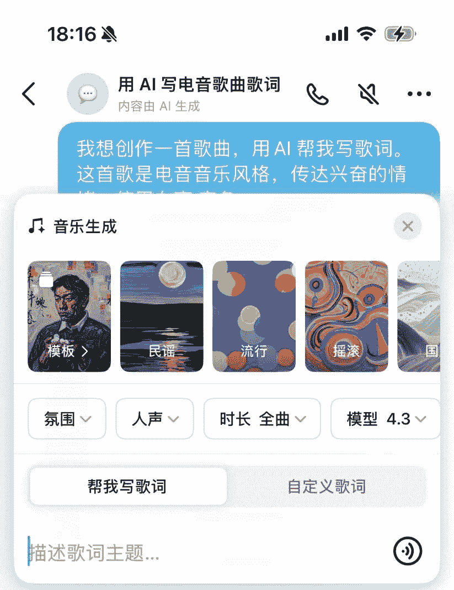

图 3-1　豆包生成音乐的界面

30

接下来，你可以用 3 种方式进行创作。

方式一：帮我写歌词。

只需要选择好风格（民谣/流行/摇滚等），单击上方的“氛围”

“人声”“时长”进行设置，再描述歌词主题，即可生成。

分享一个万能主题描述模板：【使用场景】+【核心主题】+【情

感基调】+【关键信息】。

例如，输入下列歌词主题提示词。

毕业季短视频配乐场景，核心主题是青春回忆与离别祝福，情感

基调温馨治愈，句式简洁明快，每句 7～10 字。音乐风格为民谣，时长

为全曲。

很快，豆包就生成了一首完整的歌曲，你可以修改歌曲名、下载

和分享等。

这种方式写歌虽然方便，但生成的歌词有较大的随机性，而且不

支持修改。如果客户对歌词有特殊要求，建议先用豆包生成歌词，再

用下面的方式创作歌曲。

方式二：自定义歌词。

同样参考万能主题描述模板：【使用场景】+【核心主题】+【情

感基调】+【关键信息】。

例如，输入下列提示词。

我想写一首歌，用于汉服短视频配乐场景，核心主题是江南烟雨

的雅致，国风意境，情感基调温婉悠扬，用词偏古典诗意，女声演

唱，歌词中要包含品牌名“蒹葭”，帮我按照完整结构生成歌词。

31

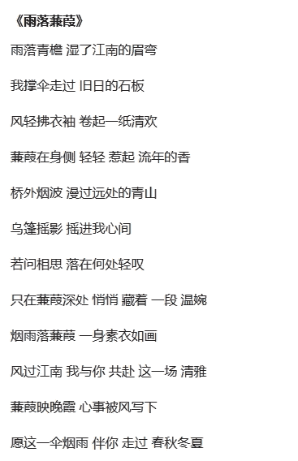

很快，豆包就生成了符合要求的歌词（见图 3-2），你可以在这个

基础上进行细节调整。再将歌词粘贴到豆包“音乐生成”中，单击

“自定义歌词”，设置好其他选项，就能把歌词变成歌曲了（见图 3-3）。

图 3-2　豆包生成的“汉服短视频歌词”

32

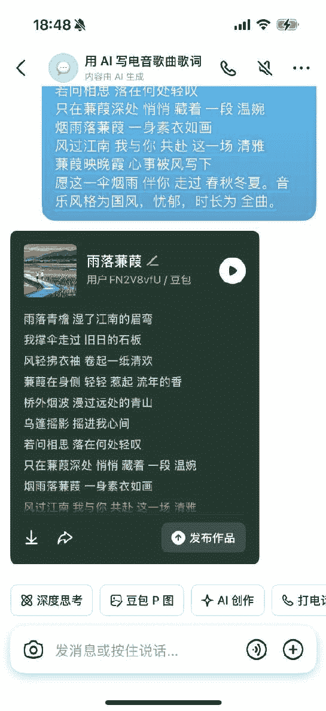

33

图 3-3　豆包生成的“汉服短视频歌曲”

用这种方式创作的歌曲，能满足定制客户的不同需求，让客户产

生“这首歌专门为我而写”的感觉，从而提升满意度。

除了以上两种音乐创作方式，豆包还有第 3 种方式“做同款”。

方式三：做同款。

豆包的“音乐生成”中有许多模板。你单击“做同款”，豆包就

会自动设置好所有选项，直接生成类似的歌曲。

用这种方式可以快速制作各种不同风格的音乐，用来批量做短视

频背景音乐，效率非常高。

**三　三大赚钱方向与收入预估**

怎样把豆包生成的音乐转变为实实在在的收入呢？以下三大赚钱

方向可供参考。

方向一：接定制歌曲订单（最快变现）。

**平台：**闲鱼（搜“定制歌曲”）、小红书（发案例笔记）、朋友

圈。

**适合人群：**想快速验证变现能力的新手。

具体步骤如下。

1. **上架服务：**在闲鱼发布“AI 定制原创歌曲｜30 分钟出歌”，主

图放歌词+音频片段。

34

2. **引导需求：**提供模板“请告诉我，①为谁定制？②什么场景？③

想表达什么情绪？”

3. **用豆包生成：**根据需求写歌词→选曲风→生成带人声的 MP3 格

式。

4. **交付增值：**附赠歌词卡片+使用授权说明，提升专业感。

**收入参考如下。**

• 情侣纪念歌 68～128 元/首。

• 品牌宣传歌 150～300 元/首。

• 宝宝成长歌 88 元/首（附赠歌词卡片）。

→ 月接 15 单，收入 1200～2500 元。

方向二：打造 AI 虚拟歌手 IP。

**平台：**抖音、视频号、快手。

**适合人群：**内容创作者/想长期经营个人品牌的轻创业者。

具体步骤如下。

1. **起号定位：**注册抖音/视频号，取名如“AI 歌手小满”“打工人

AI 歌姬”。

2. **内容规划：**每周 2～3 首原创情绪歌（如《房租又涨了》《我妈

说再不结婚就断绝关系》）。

35

3. **视频形式：**歌词动态字幕+豆包生成歌曲+生活化画面（地铁、

工位、厨房）。

4\. **变现闭环：**

粉丝数超 5000 后，开通商品橱窗卖“点歌服务”；

粉丝数超 1000 后申请网易云/QQ 音乐人，上架数字专辑；

接本地商家定制（奶茶店、宠物店主题曲）。

**收入参考如下。**

商单 300～1000 元/首。

数字专辑（每 1000 次播放能带来 5～10 元收入）。

直播打赏+点歌 20～50 元/首。

→ 稳定运营 3 个月，月收入 800～3000 元。

方向三：批量生产“情绪歌单”授权。

**平台：**抖音、小红书、朋友圈。

**适合人群：**擅长批量生产的效率型选手。

具体步骤如下。

1. **选垂直主题：**聚焦 1～2 个高需求场景（如“职场情绪”“Z 世代

恋爱”）。

36

2. **批量创作：**用豆包批量生成 5～10 首同系列歌词（如《下班自

由》）。

3\. **上传分发：**

开通网易云/QQ 音乐人，上传专辑；

在简介写明“短视频可授权使用，请私信”；

同步发小红书，“这些歌免费送你用，只需注明来源”。

**收入参考如下。**

非独家授权 20～100 元/首/次。

平台播放分成（第 1000 次播放能带来 3～8 元收入）。

→ 10 首歌持续被使用，月收入 500～1500 元。

把握以上任意方向时，你都不需要掌握乐理知识。你要做的就是

成为把情绪翻译成歌的桥梁。

37

**第 4 招：用豆包写书评，发小红书带货，赚佣金超简单**

**一　不用读完一本书，也能靠书评赚佣金**

想业余时间在小红书做读书博主，但一本 500 页的书，光读完就要

一周。自己写书评，不是“这本书很有启发”，就是“推荐大家看

看”，干巴巴没人点赞。更别说带货了，发了链接，一个月都卖不出

一本，佣金为零。其实，你不需要读完全书，也不需要文笔多好，用

豆包就能搞定一切。

大学生阿哲用豆包在 5 分钟内生成了一篇书评，看起来非常有真实

感，再配上封面图发到小红书，一周内带来 47 笔图书订单，佣金入账

211 元，而他压根没有读过那本书。

用豆包写书评，最大的优势是可以快速把书的核心价值，翻译成

普通人看得懂、用得上、想分享的话。豆包能帮你解决如下 3 个关键问

题。

1. **把抽象观点变成生活故事**。如将“沉没成本”变成“电影难看就

离场，别因为票钱硬撑两小时”。

2. **用朋友聊天的语气写作**。避免 AI 腔，读起来像闺蜜深夜分享。

3. **3 分钟产出完整笔记**。从标题到正文再到金句，一键生成，直接

用。

更重要的是，普通人也能快速上手。

1.不用露脸、不拍视频，纯图文分享即可。

38

2.小红书官方蒲公英平台带货，操作简单，笔记可直接挂商品链

接。

3.小红书对“实用书单”“成长干货”类内容有流量倾斜，新手也

有机会爆单。

**二　三步实操：用豆包写出高转化率带货书评**

只需以下 3 步，你也可以用豆包写出高转化率带货书评。

**第一步：用豆包帮你选书。**

与其自己乱猜哪本书好卖，不如直接让豆包帮你筛选既有热度又

适合小红书受众的图书。

豆包提示词模板：

推荐 5 本适合在小红书推广的图书，要求：①属于心理成长/女性

自我提升类；②近 3 个月讨论热度高；③内容容易结合生活场景从而获

得共鸣。

豆包会快速给出书单，并附上每本书的核心卖点、“种草”角度

和热度关键词等（见表 4-1）。

表 4-1　豆包生成的书单

39

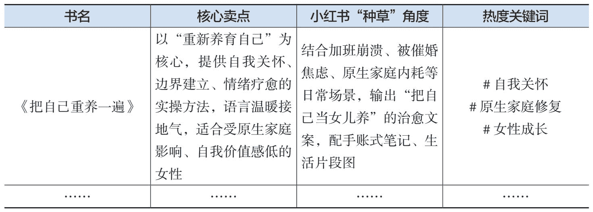

选对书，就等于踩中了流量和转化的双重风口——这一步，豆包

比你更懂市场。

**第二步：用豆包生成小红书爆款书评。**

用豆包生成书评，很多人的误区是直接在豆包中输入提示词：

“写一篇《×××》的书评。”这样做的结果是，豆包输出的内容要么

像读书报告，要么口号化，发到小红书平台上根本没人看。

真正有效的做法是给豆包一个小红书爆款书评的脚本框架，它不

是写文章，而是帮你模拟一个真实用户的心路分享。

豆包提示词模板：

你是一位 25 岁左右的小红书读书博主，最近读了《认知觉醒》。

请以第一人称写一篇 800 字以内的书评，要求如下。

1.标题要吸引眼球，能引发好奇或共鸣。

2.开头讲一个你的真实困扰，越具体越好。

3.中间部分引用书中 1～2 句核心金句，并用自己的话解释它怎么

点醒了你。

40

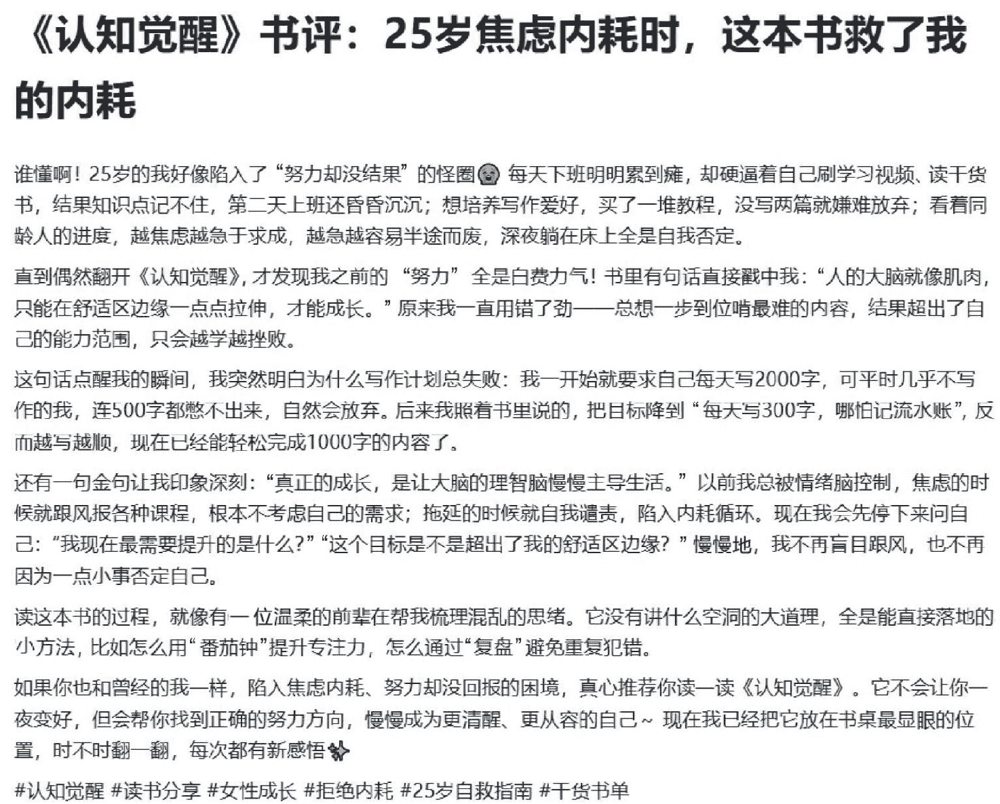

4.结尾自然引导行动，不要硬广告，而是像朋友真诚推荐一样。

整体语气要真诚、有温度，避免说教，多用“我”“你”对话

感，让人觉得是一个活生生的人在分享自己的成长。

不到 3 分钟，一篇完整的书评就生成好了，如图 4-1 所示。

图 4-1　豆包生成的书评

通过结构化提示词生成的文案，往往具备 3 个小红书高转化率特

质。

1\. **有痛点**。读者一看，会觉得：“这不就是我？”

41

2\. **有解法**。不是空谈道理，而是给出可感知的转变。

3. **有信任感**。像朋友提出的一个建议，而非商家推销。

**第三步：发布笔记，带上商品链接。**

按照以上两步生成的文案基本已经可以直接用了。当然，你也可

以快速通读一遍，微调一两个词让语气更贴合自己。接着将文案复制

粘贴到小红书编辑页，配上图书封面图即可发布，发布后记得在书评

中或置顶评论带上商品链接，引导大家购买同款。

**三　增收攻略：从单篇笔记到稳定收益**

当你跑通第一篇带货书评后，别止步于发一篇笔记，然后成交几

单。真正的机会，在于把这件事系统化、规模化、品牌化。

攻略一：建立你的“高佣金热书库”。

不是所有书都值得推，你可以优先聚焦 4 类图书：心理自助、女性

成长、理财入门、亲子教育。它们不仅佣金高，而且在小红书常年有

搜索热度，且很容易引发大众的情感共鸣。

几乎每个月都有大量用户主动搜索“这本书值得读吗？”“看完

有什么改变？”这是天然的流量入口。随着时间的积累，你可以把小

红书上数据好、佣金高的书建立一个“高佣金热书库”，还可以用豆

包定期更新你的书库，确保内容始终贴合平台热点。

攻略二：批量打造内容矩阵。

42

一篇优质书评，不该只用一次。你应该把它变成内容母版，多平

台复用，最大化你的创作回报。

1. **小红书：**发布完整图文笔记，主打内容深度与情感共鸣，可以开

通多个矩阵账号，优质内容用豆包修改文案后继续发。

2\. **朋友圈：**拆成短感悟，打造读书博主人设。

3. **抖音/视频号：**用剪映将书评转为图文视频，自动配音+字幕，

低成本触达视频用户。

一套内容，三处曝光，不仅能放大你的创作回报，还为接下来的

攻略三做好准备。

攻略三：打造个人 IP 标签，放大长期价值。

坚持输出后，你可以给自己添加一个清晰的人设标签。例如：

每周一本改变我的书；

30 天读透 1 本成长书；

职场妈妈的治愈书单。

当粉丝数积累到 1000 人，你就有机会做如下事情。

1.申请小红书蒲公英平台，接出版社或图书品牌的官方合作（单条

报价 500～3000 元）。

2.开设“年度成长书单”“高效阅读指南”等付费专栏，定价 9.9

～29.9 元，获得被动收入。

43

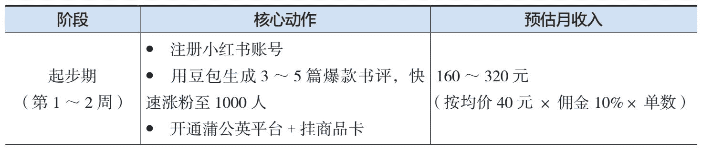

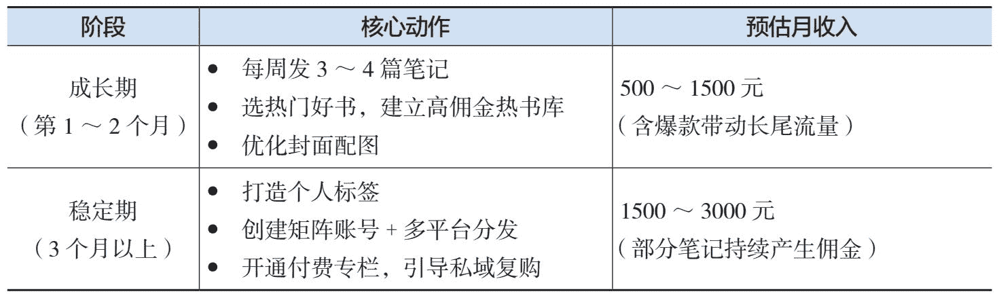

3.引导读者进入私域，推出“21 天读书打卡营”“共读计划”等

高阶服务，客单价提升至 100 元以上。

表 4-2 是用豆包写小红书书评的分阶段收益预估表，可供参考。

表 4-2　用豆包写小红书书评的分阶段收益预估表

续表

知识变现的终极逻辑，不是卖一本书，而是成为“值得信赖的选

书人”。豆包帮你输出内容，而你负责持续输出价值。时间越久，壁

垒越高，收益越稳。

44

**第 5 招：豆包一键做动态相册，老人 宝妈的最爱**

**一　静态回忆变动态故事，捕捉情感溢价**

在短视频时代，单纯的照片展示已无法满足用户对情感深度表达

的需求。许多宝妈想记录孩子成长，子女想为老人贺寿，他们手里有

大量照片，却因为 3 个问题，导致记忆只能被雪藏在手机相册里。

1. **照片堆砌没灵魂：**满屏的静态图滑动，文案干瘪无力，像流水账

一样枯燥，亲友看两眼就划走了。

2. **音乐节奏乱糟糟：**要么配乐完全不搭调，要么画面卡点不准，视

听效果严重脱节，质感低得可怜，制作半天也没人点赞。

3. **描述全是废话：**文案要么是“宝宝一岁了”这种万金油，要么就

是空洞的赞美，亲友根本感受不到照片背后的情感价值，看两秒就关

了。

有些人觉得随便找个剪辑软件、套个模板就能搞定。其实，普通

人自己做动态相册很容易掉进两个坑。

1. **内容流水账：**只会堆砌照片，文案干瘪，像 PPT 播放，无法引起

其他人的情感共鸣。

2. **缺乏故事性：**不懂得如何根据照片内容挖掘其背后的故事线，做

出来的视频不仅没质感，还容易让人视觉疲劳。

因此，那些靠动态相册变现的人都具有一项核心能力，就是能制

作极具叙事感的脚本，赋予照片“生命力”，而这个能力我们可以通

45

过豆包实现。

全职妈妈小王，利用碎片时间开启了帮人制作动态相册的副业。

她不是单纯堆砌素材，而是将豆包变成自己的首席编剧。

某次，在为周岁宝宝制作相册的过程中，基于客户提供的零散照

片，小王先用豆包深度拆解宝宝的成长节点，精准抓取感人的关键

词；接着用豆包从平淡的文字中提炼出核心亮点，将原本干巴巴的内

容重构成“有数据、有结果”的温情独白；最后由豆包推荐合适的视

频风格。

这份作品让客户在朋友圈收获大量点赞，小王也收到了客户额外

发的大红包。

**二　实操全流程：从照片到大片，豆包全流程辅助**

**第一步：前期准备——建立情感氛围与配乐素材库。**

动态相册的灵魂在于“氛围感”。接单前，你需要利用豆包针对

不同人群建立一套“视听风格指南”，确保交出的成品能瞬间打动客

户（见表 5-1）。

表 5-1　利用豆包建立的视听风格指南

46

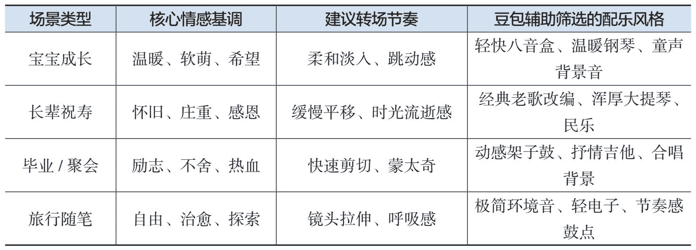

**第二步：核心制作流程：1 个分幕脚本模板+3 个进阶**

**技巧。**

豆包在动态相册中的核心作用是：把杂乱的照片逻辑化，并赋予

文学性。

豆包提示词模板：

我这里有 4 张[宝宝周岁]的照片，请帮我策划一个 30 秒的视频脚

本。

主题起名：给这个相册起一个有诗意的主题名。

叙事分幕：将照片分为 3 个阶段（如初见、探索、成长），并为每

一幕写 10～15 字的感性旁白。

画面要求：描述每一幕对应的照片应该展现什么样的情绪（如开

心的笑、专注的眼神）。

互动结尾：写一句能引发朋友圈点赞的结束语。

豆包生成的结果如图 5-1 所示。

47

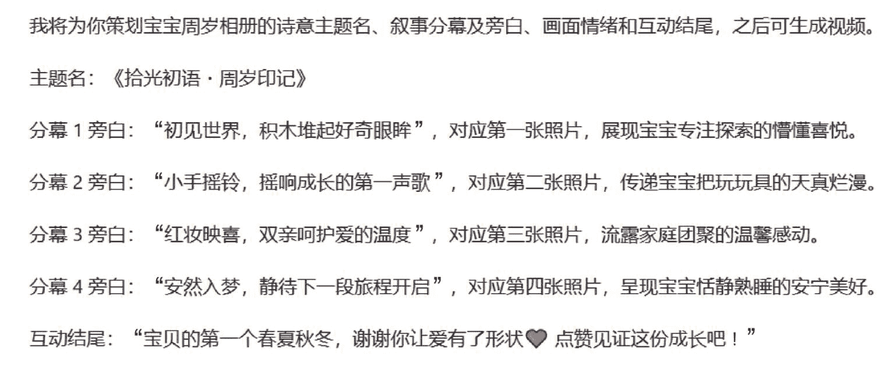

图 5-1　豆包生成的视频脚本

**3 个实操进阶技巧**。

1. **寻找“视觉钩子”：**让豆包帮你从照片里选出一张最适合做封面

的图，并配上一句能吸引人点开封面的标题。

2. **定制化旁白：**如果客户提供了具体的细节（如宝宝的小名、老人

年轻时的职业），一定要让豆包把这些细节揉进文案里，这叫定制

感，也是你涨价的理由。

3. **节奏对齐建议：**询问豆包“这段文案适合每几秒切换一次图

片”，确保视频在播放时，文字和画面能对齐。

**第三步：技术落地——利用工具快速合成交付。**

你不需要学习复杂的专业剪辑软件，核心是利用“豆包出的脚

本”去驱动“自动化工具”，如使用剪映等软件的“一键成片”功

能。将照片上传到剪映后，将豆包生成的主题、文案输入进剪映对话

框中，单击“生成”按钮，就能一键成片。

48

对于视频软件生成的视频，你还可以对细节进行精修。

1. **统一画幅：**老照片多为 4:3 或不规则比例，建议统一设置为 9:16

（竖屏），并用豆包建议的滤镜统一色调。

2. **对齐卡点：**按照豆包建议的转场节奏（如宝宝场景 1.5 秒/张），

调整照片停留时间。

**第四步：多平台挂单变现——建立信任闭环。**

变现的核心是多平台曝光和信任建立。

1.在闲鱼上挂单示例。

标题：【动态相册制作｜24 小时交付】记录成长|贺寿|附深度感人

文案|真实案例反馈|满意为止

详情页文案：

【为什么选我？】不是简单的照片堆砌！用豆包精准拆解情感需

求，挖掘成长细节，每段文字都有温度，让亲友 10 秒抓亮点；

【服务内容】①一对一场景风格分析；②全模块精修（脚本+配乐

+剪辑）；③2 次免费修改；④赠《朋友圈文案包》；

【收费标准】基础版 39 元（15 张以内）；深度版 88 元（含 AI 配音

+定制脚本）；加急另付 30 元。

2.在小红书上靠内容引流示例。可套用小红书文案模板如下。

标题：谁懂啊！把奶奶年轻的照片做成视频，她看哭了。

正文：帮一位奶奶制作一份 80 岁生日视频。原始素材真的一言难

尽，只有几张模糊的老照片。我用豆包深度拆解了奶奶的辛劳岁月，

49

从平凡日子里挖到了感动点。再用豆包配上文案，奶奶看的时候眼眶

都红了，全家人都说太走心了。

互动：需要给长辈制作视频的“宝子”，评论区回复“场景+数

量”，优先反馈！

**三　增收攻略：深度挖掘单客价值，实现持续收益**

想要赚得更多，请收好这 3 个进阶攻略。

攻略一：定制私人提示词库，实现极速量产。

**关键操作：**将针对祝寿、金婚、战友聚会等不同品类的豆包提示

词存入手机备忘录。

**变现逻辑：**别人一晚做 1 单，你用模板 10 分钟搞定脚本。这种极速

交付本身就可以收取加急费用。

攻略二：绑定增值服务包，提高客单价。

**关键操作：**①打包“老照片修复”服务；②提供“代发朋友圈文

案”服务包。

**变现逻辑：**客户要的是情感的圆满。如果你一次性地解决了照片

清晰度和感人文案两个问题，那么你单次服务的收费可以理直气壮地

涨到 150 元以上。

攻略三：进阶“记忆管家”，实现长期锁定。

**关键操作：**为老客户建立“重要纪念日提醒库”。

50

**变现逻辑：**交付后主动询问老人的生日或重要纪念日，利用豆包

生成配套的祝福方案。从制作师变成家庭情感顾问，单个客户带来的

利润可直接翻倍。

动态相册不仅是视觉的合成，更是情感的叙事。如果能用豆包解

决最难的文案与逻辑问题，你输出的就将不再是干巴巴的画面，而是

能让客户产生共鸣的营销策略。

51

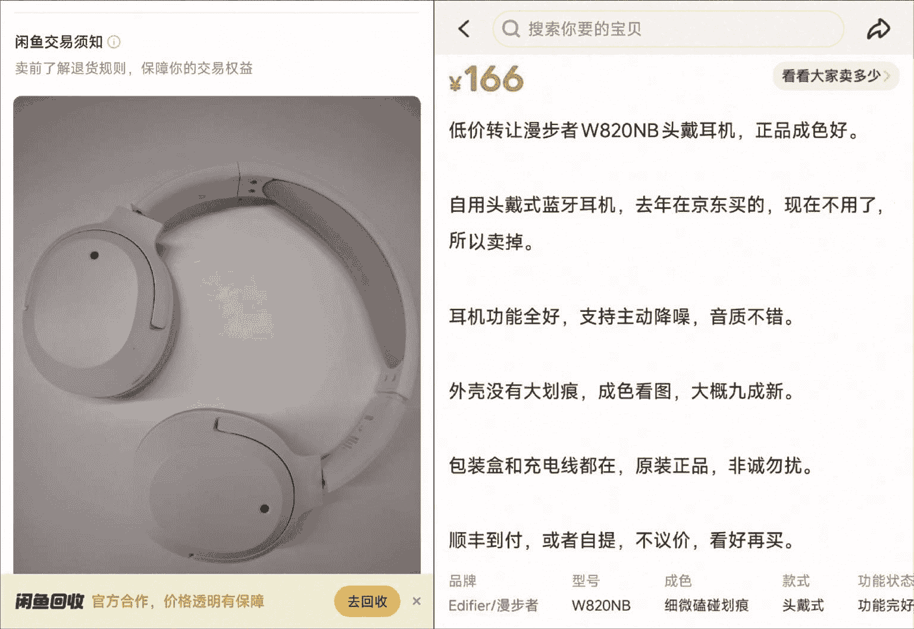

**第 6 招：豆包改写闲鱼宝贝描述，让旧货变爆款**

**一　为何旧货在闲鱼上卖不动？因为你的描述太像说**

**明书**

在闲鱼平台，文案的质量直接决定成交转化率。很多卖家抱怨宝

贝无人问津，核心原因在于文案缺乏吸引力。如果仅通过复制粘贴官

方参数来描述商品，很难在海量信息中脱颖而出。例如，有人出售一

副耳机，于是在闲鱼上给出了产品介绍，如图 6-1 所示。

图 6-1　在闲鱼出售耳机的产品介绍

这个产品介绍的问题在哪里呢（见表 6-1）？

52

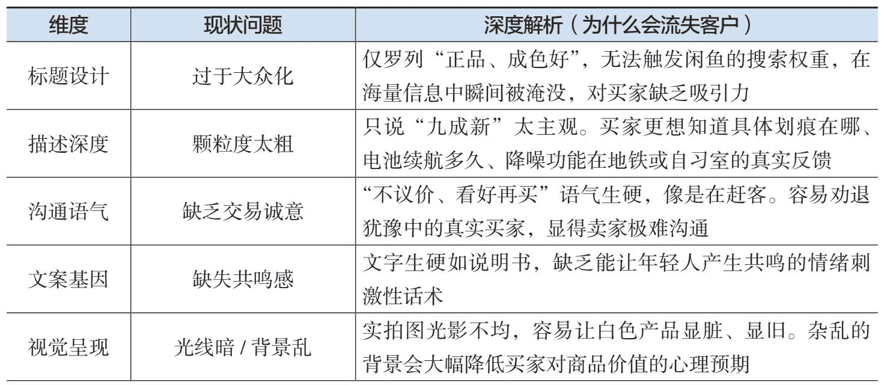

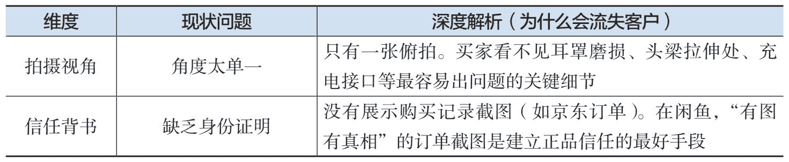

表 6-1　该产品介绍存在的问题

续表

看到这儿你可能会想：“市面上 AI 工具这么多，随便找一个写两

句不就行了？”确实可以，但在闲鱼这种讲究网感、拼人设信任的地

方，工具背后的数据来源和它擅长的语感非常关键。

豆包的优势就在于它是抖音旗下的产品，深度学习了抖音上数以

亿计的爆款产品数据。它不仅知道怎么组织文字，更知道当下网友最

偏好哪种表达、什么样的话术能让人产生下单冲动。它还擅长捕捉抖

音上的流行“热梗”和情绪词，让你的二手产品描述看起来像是一个

真实的、有趣的灵魂在转让产品，而非冷冰冰的二手贩子。

我们继续以耳机为例，通过豆包改写产品介绍，如表 6-2 所示。

53

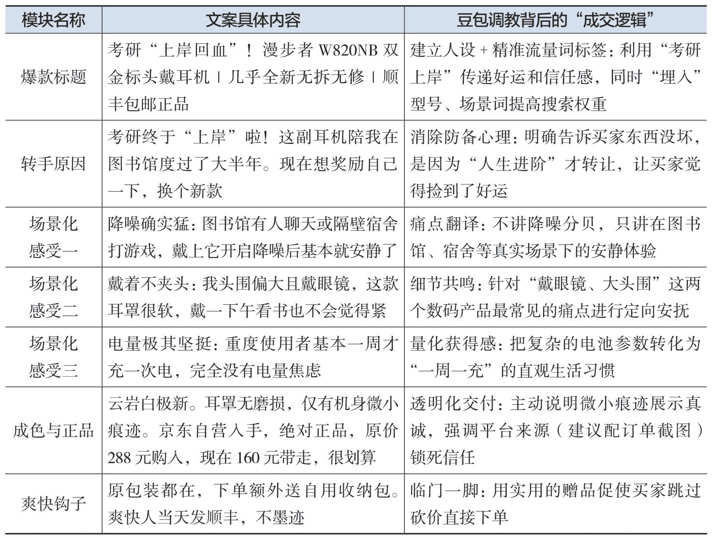

表 6-2　通过豆包改写的产品介绍

在新版产品介绍的基础上，还得在视觉上增加刺激性。因此，给

耳机多拍几张清晰照片，从全景到细节一一展现清楚，再把原始购买

截图也放上，利于买家直观了解商品具体情况。

豆包改写的过程，其实就是在摸索闲鱼买家消费心理的过程。

1. **捡漏心理：**买家是为了高性价比。因此，在产品介绍文案里，你

必须强调原价与现价的落差，以及你提供的额外赠品。

2. **安全感心理：**买家最怕货不对板、怕买到假货。你主动晒出的订

单截图和详细的瑕疵描述，就是在用诚实换取他们的下单。

54

3. **情绪价值：**闲鱼买家喜欢和活生生的人交易。讲述商品背后真实

的经历，能让他们有代入感，更加信任卖家。

例如，宝妈桑桑在怀孕时冲动购买了一堆高价母婴用品，等孩子

出生才发现，很多东西用不上。她便想在闲鱼出售，最初文案写得很

简单：大牌吸奶器，正品没用过几次，便宜出。结果挂了半个月，除

了几个点赞，剩下的全是想砍价的，根本没诚意买。

后来她让豆包改写了产品介绍。话术不再像复读机一样写参数，

而是老老实实写出了自己的真实情况：作为新手妈妈当初是怎么挑

的，平时又是怎么精细消毒的。豆包帮她把那些冷冰冰的性能翻译成

了“宝宝用着不遭罪、妈妈半夜操作不手忙脚乱”等大白话，顺便还

把准妈妈们常搜的关键词全“埋”了进去。结果文案更新当天，就有 3

位妈妈来私信，不仅没砍价，还顺带夸她细心，当场就下单了。

如果你想像桑桑一样快速卖货“回血”，可以尝试以下 3 步对豆包

进行深度调教，它能超越简单的文字润色，助你彻底激活宝贝的流

量。

**二　3 招深度调教豆包，让旧货变爆款**

**1 分类调教：教豆包学会“见人下菜碟”。**

闲鱼买家性格各异，不能用同一套话术应付所有人。我们要调教

豆包，针对不同品类的“心跳点”去写文案。

**卖数码产品：**别只堆参数，要让豆包写出体验感。

55

数码控其实挺感性的，比起冰冷的“43 分贝降噪”，买家更想知

道：在闹哄哄的食堂能不能静下心背单词？打游戏时音画同步吗？你

可以这样调教豆包：“帮我写出这款耳机在图书馆的真实表现，重点

夸它耳罩软、戴一天不夹头。再加句‘打游戏没延迟’，让那些怕踩

坑的兄弟吃颗定心丸。”

**卖美妆护肤：**别光喊正品，要让豆包写出珍惜感。

女生买二手护肤品，最担心的不是价格，而是卫生。如果只写

“专柜入”，诚意不够。你可以这样调教豆包：“重点强调我有重度

洁癖，每次用完都用酒精棉片擦了喷口。再顺带提一下，我平时是把

它收藏在避光小冰箱里的。要让买家觉得，这宝贝在我手里被呵护得

像新的一样，她买回去才放心。”

**卖家居用品：**别只说包邮，要让豆包写出省心感。

买家具的通常是租房族，他们最怕“中看不中用”或者搬家带不

走。你可以这样调教豆包：“写清楚这架子折叠起来只有一本书厚，

女生两根手指就能拎走，搬家时往后备箱一塞就行。要把‘租房族必

备’这个点写透，让那些怕麻烦的朋友一眼相中。”

**2 搜索优化：掌握闲鱼的“流量密码”。**

闲鱼不是朋友圈，它是靠搜索来成交的。买家搜什么，你就得在

标题里“埋”什么。参考以下这张“关键词搜索流量表”（见表 6-3），你可以直接对照着填。

表 6-3　关键词搜索流量表

56

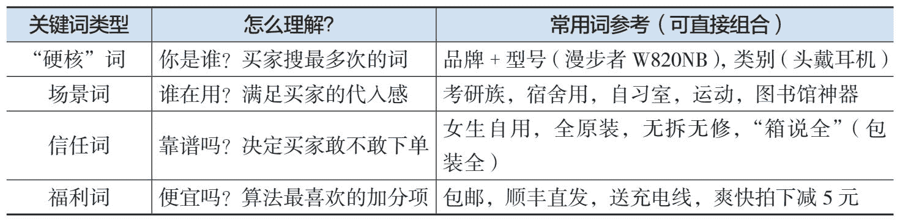

**三　增收攻略，最大化发挥豆包价值**

在闲鱼，除了产品介绍要写得吸引人之外，私信回复和第一眼图

片也是重要的成交推手。利用豆包，我们可以精准拿捏买家心理，把

咨询变成订单，把过客变成粉丝，守住回头客。

**1 私信话术：用豆包预设“高情商”成交模板。**

面对砍价和犹豫，你不需要自己纠结。直接把下面的提示词模板

复制给豆包，填入你的商品，它就能给你最专业的回复。

场景一：应对“拦腰砍价”（守住价格底线）。

豆包提示词模板：

有个买家砍价太狠，请帮我写一段得体的回复。要求：语气要

稳，强调我发的是[顺丰/包邮]、成色是[全原装/无拆修]，并提出可

以额外送他一个[自用收纳袋/充电线]作为补偿。

让他明白买的是省心，而不是低质货。

场景二：应对纠结犹豫，制造临门一脚。

豆包提示词模板：

57

豆包，买家犹豫不决，帮我写一段催单话术。要求：不要硬催，

要自然地提到[刚才有人问自提/刚好待会儿要去快递站寄件]。告诉他

如果现在拍，我就能顺手带走，明天他就收到，否则要等后天。

制造一个“顺便”的理由，给买家一个立即下单的台阶。

场景三：应对质疑正品，建立降维信任。

豆包提示词模板：

买家一直问是不是正品。请帮我写一段回复。要求：语气要有底

气。提到我有[官网购买记录/电子发票]，并支持[任何平台验货/线下

见面交易]。强调我是自用转手，不是二道贩子。

用“硬证据”直接锁死信任，缩短成交路径。

**2 视觉进化：豆包不是帮你修图，而是教你用手机拍**

**出“高转化”的好照片。**

很多卖家卖不出去东西，是因为拍图太敷衍：光线暗、背景乱、

关键部位没拍到。买家看不清，自然不敢买。如果用豆包直接修图，

会很假，买家不信任。不过，你可以用豆包当拍摄指导，教你拍出有

吸引力的照片。

拍摄角度提示词模板。

你可以直接在豆包中输入提示词：

我要在闲鱼卖一个二手的[填入商品名称]，请站在买家的角度，

告诉我必须拍哪 5 个细节，才能证明东西没坏过，而且非常干净？

以卖二手耳机为例，豆包会提示你拍如下角度。

耳罩内侧特写：证明没有破皮或汗渍（卫生第一）。

58

头梁拉伸处：展示伸缩顺畅，没有裂痕（功能完整）。

充电口细节：展示接口没被捅坏，没有灰尘堆积。

防伪钢印/序列号：证明是正品，支持官网查验。

全家福：耳机、充电线、包装盒、发票同框，证明来源真实可

靠。

图片标签提示词模板。

你可以直接在豆包中输入提示词：

帮我想几个贴在图片上的短标签。要求：一句话戳中买家痛点，

如在[填入某张图片内容]上标什么字最显正宗？

以卖二手耳机为例，豆包会教你这么打标签。

在发票图上标：“官网入，支持在线验货。”

在接口图上标：“几乎无划痕，成色极新。”

在合照图上标：“‘箱说全’，处女座自用。”

环境布置提示词模板。

你可以直接在豆包中输入提示词：

我家里较乱，怎么拍实拍图能让这个[填入商品名称]看起来干

净、高级、不显旧？

以卖二手包包为例，豆包会教你如下实用方法。

找光线：下午 2 点到 4 点，去阳台找自然光，千万别开刺眼的吸顶

灯。

59

找背景：撤掉乱七八糟的杂物，铺一张纯色白床单或找个原木桌

子。

看效果：这样拍出来的图颜色亮、质感好，完全没有“旧货市

场”的废品感。

在闲鱼，旧货卖得快其实就靠两件事：文案让人觉得你靠谱，图

片让人觉得你爱物。调教好豆包，你不仅省了写文案的时间，还能把

旧货卖出它应有的价值。

60

**第 7 招：豆包帮人修证件照，按张收钱秒结**

**一　为何 AI 修图工具高度普及，客户仍愿意付费**

证件照的用途非常多，从考证报名、求职简历到结婚办证，每个

人都离不开。现在线上报名越来越普遍，实体照片的使用频率大幅降

低，基本都要求提交符合要求的电子版证件照。

随着豆包这类 AI 工具的修图技术越来越强，有人就会疑惑：既然

大家都能免费用豆包，那谁还会找我修图呢？其实，工具好用并不代

表谁都能用好。普通用户即便手里握着同样的工具，也往往拿不出合

格的成品。你赚的钱，其实是帮客户省去了摸索工具的时间，并交付

了一份 100%好用的结果。

1. **AI 提示词调教的价值：**你懂得如何指挥豆包，而客户通常只会

对豆包说一句“帮我修好看点儿”，结果往往是五官失真或比例奇

怪，反复修改。你掌握了豆包的精确提示词体系，懂得如何通过逻辑

清晰的描述，让豆包在修图的同时，还能细致地保留皮肤纹理、对齐

领口高度。你售卖的，其实是驱动豆包产出高质量成品的调教能力。

2. **行业标准的价值：**你了解官方规则，而客户正处于信息盲区。豆

包本身并不会主动识别各类证件的特定合规要求，你手里掌握着各种

报名要求的规格和标准，这让你能利用豆包直接在“正确答案”的框

架内出图，而客户只能在系统报错中反复试错。你售卖的，是利用豆

包实现百分百过审的确定性。

3. **审美细节的价值：**你精通深度微调，而客户仅懂很简单的操作。

缺乏审美基础的客户，容易把照片弄得失真、有塑料感。你能引导豆

61

包进行眼神光提亮、发际线修整等深度处理，让照片既变美了又不失

真。这种自然的专业感，正是客户难以通过简单尝试就能跨越的门

槛。

因此，普通人用豆包只是随手修图，能出图就行；而接单高手是

把豆包当成专业的数字后期师，不仅要修得好看，更要确保能过审

核。这种靠专业指令和行业标准建立起来的确定性，就是你按张收钱

的底气。

大二学生小王，原本只是在朋友圈随手帮同学换个证件照底色，

赚几元钱小红包。随着教资考试和四六级考试报名季到来，找他的人

越来越多，他有点忙不过来了。

刚开始，小王最怕客户提细节要求。有人想换西装，有人想修掉

眼镜反光。手动修这些活儿，一张图得磨半小时，万一参数没对准，

还可能被系统退回返工。

后来他尝试调教豆包。原本要手动抠图、找素材的精细活，现在

只需输入精准指令，豆包几秒钟就能完成换装和合规检查。小王不再

死磕像素点，而是把精力花在收集各大考试要求的照片标准上。只要

客户说考什么，他就能指挥豆包出一张稳过审的成片。

现在，小王主打包过、自然、快速出片，一张证件照按照难度和

使用场景收 9.9 元到 40 元。报名高峰期一天能接几十单，月入 3000～

4000 元。

**二　利用豆包实现三阶深度调教，交付一张完美证件**

**照**

62

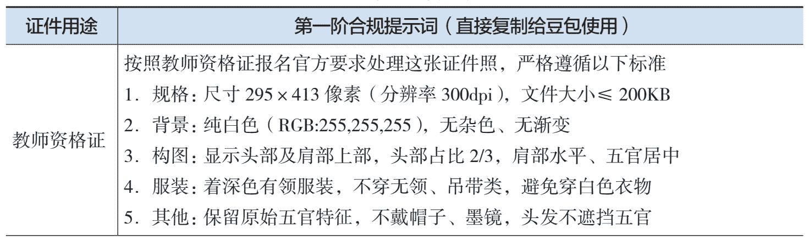

前期准备（1 分钟搞定，为调教打基础）。

**让客户提供原始照片：**要求正面平视、五官清晰、无严重遮挡

（刘海不遮眉、眼镜无重影），原图发送不压缩。

**确认核心需求：**记录 3 个关键信息（用途：教资/四六级/签证/考

公/结婚登记；尺寸：1 寸/2 寸/小 2 寸；底色：按官方要求确认，无须

客户自行选择）。

打开豆包（选“图片编辑/修图”功能），上传原图，准备进入 3

阶调教。

**第一阶：合规基础修，按官方要求来，保证照片能过**

**审。**

这一步是修证件照的基础，已根据各场景官方要求制定专属提示

词模板，避开尺寸、底色、比例等过审雷区，提示词精准无歧义，直

接替换[]内的内容即可使用。

各场景专属合规提示词如表 7-1 所示（直接套用）。

表 7-1　各场景专属合规提示词

63

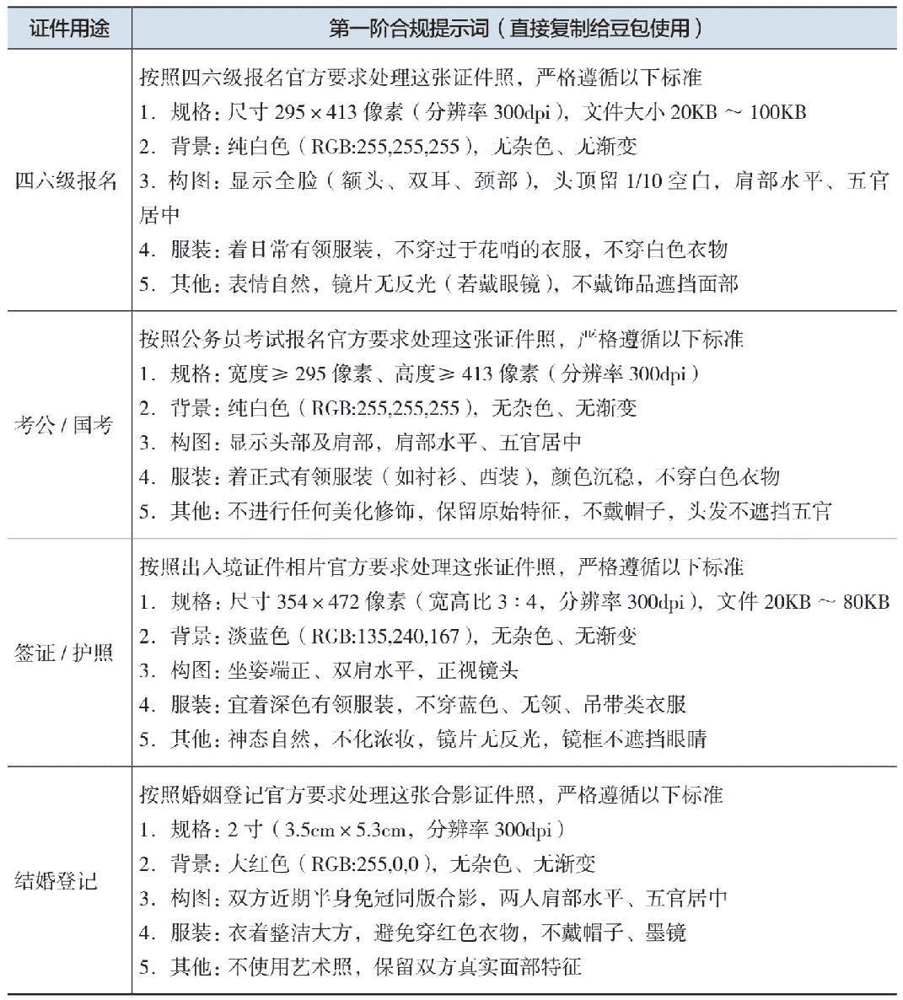

续表

例如，给一位短发女生生成教师资格证照片，直接在豆包上传短

发女生生活照片，再复制豆包提示词，即可生成。

64

**实操小贴士：**3 秒快速校验，确保合规。

**尺寸/分辨率/大小：**右键照片查看属性，确认和对应用途的官方

要求一致。

**底色：**无杂色、不偏色，与指令里的 RGB 值匹配。

**比例/构图：**头部占比、五官位置、肩部姿态符合要求，无遮挡。

**第二阶：自然修图，只修瑕疵，不变脸，不磨皮过**

**度。**

证件照标准合规后就可以给照片做基础美化了。重点就是去掉痘

印、斑点这些小瑕疵，让脸看起来干净，但绝对不要把皮肤磨得像塑

料一样光滑，也不要改变五官样子，要保证修完还是本人，不会看着

假。

豆包提示词模板：

对这张证件照进行自然精修，遵循“轻修不失真、不影响过审”

原则。磨皮：仅去除面部明显痘印、斑点、油光，保留皮肤原生纹

理，不磨平毛孔；五官：轻微提亮眼神光，让眼睛更有神，修正眉毛

不对称问题（幅度不超过 10%），嘴唇自然润色（不改变唇色）；细

节：修掉眼镜镜片反光（若有），整理头发碎发（不改变发型），领

口拉平对齐；整体：微调面部光影，让五官更立体，不改变人物脸型

和五官比例，无过度美颜痕迹；签证/护照照仅做基础瑕疵修复，不进

行任何五官调整。

**实操小贴士：**5 秒自然度校验。

**皮肤：**有原生纹理，不僵硬、无塑料感。

**五官：**和原图相似度 90%以上，眼神不空洞，无五官变形。

65

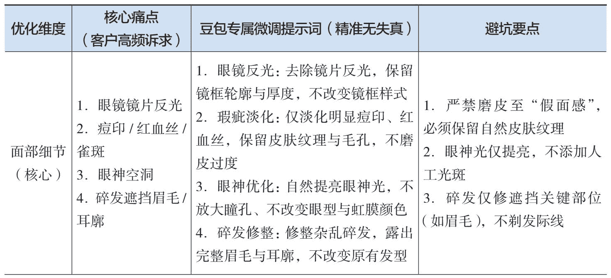

**细节：**反光、碎发等问题已解决，整体干净整洁。

**第三阶：细节深度微调，让照片合规又好看。**

多数证件照要求无过度修图但可自然优化，以下微调提示词均在

合规范围内（见表 7-2），既解决客户高频痛点，又不改变人物核心特

征，避免审核被拒。

表 7-2　豆包专属微调提示词

续表

66

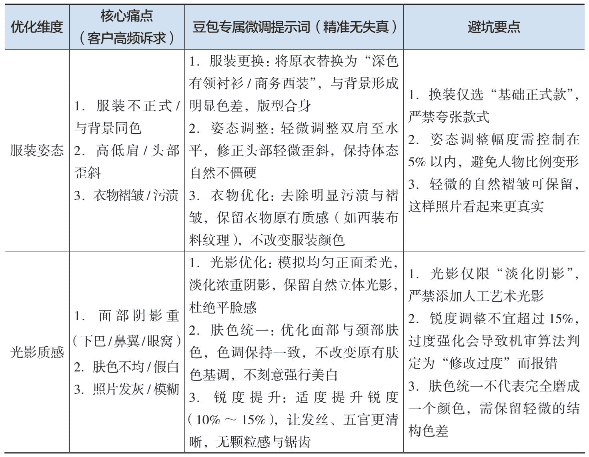

例如，继续为上文短发女孩的教师资格证照片增加光影质感，让

她的证件照更加好看。

**三　豆包修证件照赚钱路径：详细接单渠道与成交定**

**价**

适合新手第一周操作，利用现有社交圈积累首批好评和案例，信

任度高，开单最快。

朋友圈/微信群“对比图”引流如表 7-3 所示。

表 7-3　朋友圈/微信群“对比图”引流

67

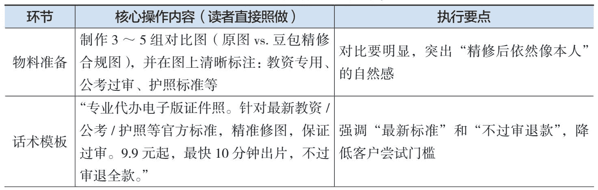

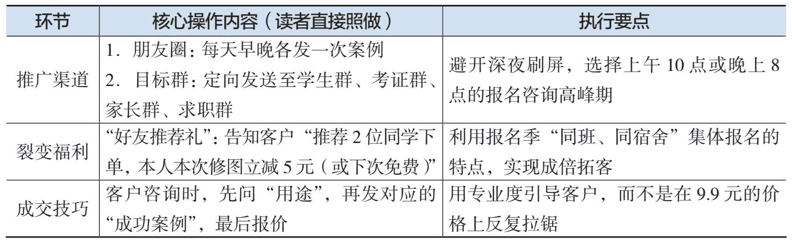

续表

小红书/抖音图文引流如表 7-4 所示。

表 7-4　小红书/抖音图文引流

68

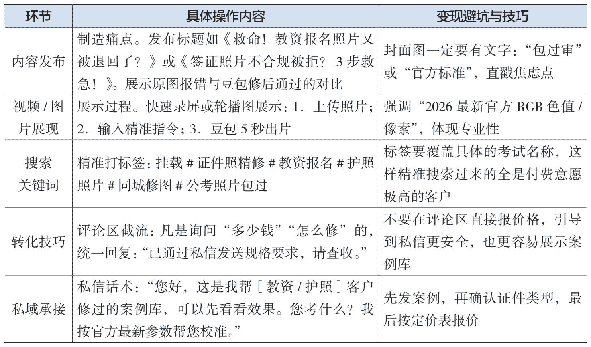

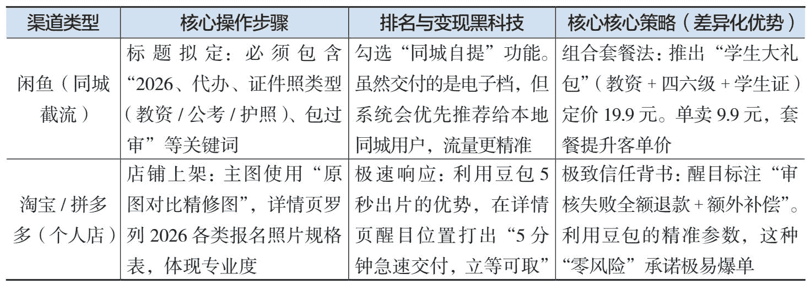

二手平台与电商精准截流如表 7-5 所示。

表 7-5　二手平台与电商精准截流

**四　增收攻略，最大化发挥豆包价值**

**1 阶梯定价策略：从 9.9 元到 99 元的跳跃。**

69

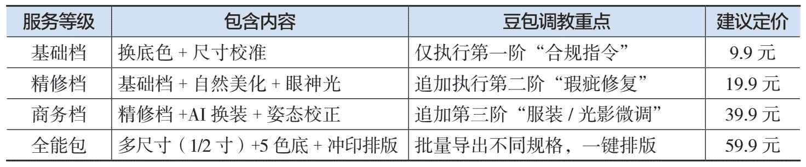

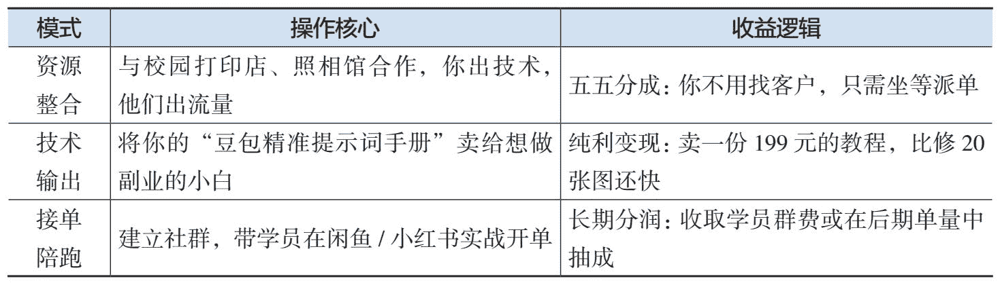

不要给客户单一选择，要用“套餐感”引导高价成交（见表 7-6）。

表 7-6　设置各档次套餐

**2 打造“副业合伙人”模式：从个人到团队的裂变。**

当你单子多到修不过来时，你要做的不是拒绝，而是找人一起做

（见表 7-7）。

表 7-7　打造“副业合伙人”模式

利用豆包修证件照，绝不是简单的“换个头”。

**卖的是“确定性”：**通过精准指令，确保客户报名 100%成功。

**卖的是“情绪价值”：**让客户看到一张“既像本人又比本人好

看”的照片。

70

**卖的是“效率红利”：**别人修一张图半小时，你调教豆包只需 1 分

钟。

71

**第 8 招：豆包做创意表情包，3 种模式轻松赚钱**

**一　定制表情包：千亿社交市场里的刚需商机**

你敢信吗？平时微信里随手发的表情包，居然藏着商机！数据显

示，全世界每天通过通信应用发送的表情符号数量达到 60 亿以上。而

在我国，每日表情包发送量为 6 亿次左右。

自从 2015 年微信表情包商店上线，各种爆火的表情包层出不穷。

表情包“乖巧宝宝”两年内下载量达到 1.5 亿次，作者收到打赏 50 万

元。还有人专门制作这种长辈专属表情包，最高一套有 17 万多人打

赏，至少收入 17 万元。

虽然收入可观，但对普通人来说，不会修图、不会手绘、也不懂

设计，想做出一套表情包，还是挺难的。

这些痛点，恰恰为我们用豆包做表情包赚钱提供了机会——解决

“定制难、效率低、成本高”的问题，就能快速抢占市场。用豆包制

作表情包，能精准解决 3 个关键问题。

1. **无门槛生图**。不管你想要卡通版人物、萌宠形象还是企业吉祥

物，只要输入文字描述，就能快速生成符合要求的原始形象。

2. **批量生成表情包风格**。用豆包的“风格参考”功能，能让整套表

情包的形象、质感保持一致，不用反复调整。

3. **降低后期成本**。生成的图片可以直接对接在线工具做抠图、加

字、切图，甚至能生成序列帧的动态效果，大大缩短创作周期，从接

单到交付最快 1 小时就能完成。

72

**二　4 步实操：用豆包搞定从创作到交付的全流程**

用豆包做定制表情包，核心分为“需求对接—形象生成—后期优

化—交付上架”这 4 步，每一步都有明确的操作方法，跟着做就能上

手。

**第一步：明确需求，锁定核心要求。**

接单后先跟客户确认 3 个关键信息，避免后续返工。

1. **使用场景**。是个人社交用（如情侣、生日）还是企业商用（如品

牌营销、员工社群）？商用需要额外确认是否要可商用授权？

2. **形象与风格**。确定核心形象（人物、宠物、吉祥物）、风格（扁

平风、二次元、写实风）、主色调。

3. **交付要求**。如表情包数量（16 张/24 张常见）、是否要动态、是

否需要上架平台（如微信表情平台）。

把这些信息整理成文字，跟客户确认无误后再开工。

**第二步：用豆包生成核心素材。**

这是最核心的一步，关键是用精准的提示词让豆包生成符合预期

的内容。这里有两个实用技巧。

1.精准描述细节，提示词要包含“形象+特征+风格+比例”，以

下是用于企业定制的提示词。

帮我生成图片：奶茶店吉祥物+卡通奶茶杯形象+微笑表情+暖色调

+扁平风+透明背景，比例“1:1”

73

豆包很快就会给出 4 张图片（见图 8-1），如果不满意可以重新生

成，多试几次。

图 8-1　豆包生成的奶茶店吉祥物与卡通奶茶杯形象

2.批量生成选最优，对于需要多表情的订单，可以让豆包一次生成

九宫格素材。

帮我生成图片：参考附件图片的动作，制作九宫格表情包，主角

为奶茶杯吉祥物，风格保持一致，文字内容对应“好困、开心、谢

谢”等情绪

豆包就会一次性生成 9 张图，并配上对应文字。生成后，你再挑选

满意的进行后续处理。如果客户有参考图，直接上传给豆包，让它基

于参考图生成，准确率会更高。

**第三步：后期优化，满足交付标准。**

豆包生成的素材简单优化就能达标。

74

1. **用豆包自带的“AI 抠图”功能抠图**。用计算机自带的工具调整

图片尺寸大小，如微信表情包要求主图 240×240 像素、缩略图 50×50

像素。

2. **加字与调色**。用豆包或者 PPT 即可添加客户要求的文字，如“打

工人加油”“新品上新啦”，字体选免费商用的（思源字体、阿里巴

巴普惠字体），避免版权问题。

3. **动态效果**。用豆包生成序列帧，导入 ScreenToGif 等工具，调整

帧率和延迟时间，就能生成动态 GIF，满足客户的更高需求。

**第四步：规范交付/上架，提升客户满意度。**

交付时要给客户完整的素材包，避免遗漏。

1. **个人定制的订单**。交付包含主图、缩略图的 PNG/GIF 文件，注

明使用方式。

2. **企业定制的订单**。可额外提供可商用授权说明（如果是 AI 生成，

需备注素材来源合规）。

3. **需要上架平台的订单**。帮客户整理好平台要求的所有素材，包括

封面图、详情页横幅（750×400 像素），甚至可以指导客户注册微信

表情平台、提交审核，审核基本很快就能通过，还能帮客户开通赞赏

功能，提升客户好感度。

搞清楚制作步骤后，新手从哪里找客户呢？

**三　三大接单平台：新手从这里快速获客**

75

不用自己找客户，依托成熟平台就能快速接到订单，推荐 3 个适合

新手的平台。

平台一：闲鱼（适合个人定制小单）。

上架商品时标题写清楚“AI 定制表情包/个人专属/企业吉祥物/快

速交付”，配图用自己做的样品，定价分基础款（50 元/16 张静态）、

进阶款（150 元/24 张动态），客户咨询时主动发样品，转化率很高，

闲鱼上“AI 修图/表情包定制”月均成交 2000 多单，新手每月接 10～

20 单不难。

平台二：猪八戒网（适合企业定制大单）。

注册成为服务商，入驻“设计/文创”类目，主打“企业 IP 表情包

定制”，可以对接餐饮、母婴、电商等行业的品牌客户，企业订单客

单价高，基础套组就能收 800 元，复杂的品牌联动订单能达到几千甚至

上万元，平台有担保交易，不用担心收款问题。

平台三：微信生态（适合私域复购）。

把自己的作品发到视频号、朋友圈，标注“表情包定制”服务，

积累几个案例后，客户会主动介绍新单；也可以入驻微信表情开放平

台，上传自己的原创表情包，开通赞赏功能，同时在简介里留定制联

系方式，既能靠打赏赚钱，又能引流定制客户，头部创作者在微信平

台月入超 5 万。

**四　进阶玩法：从接小单到做 IP，提升收益上限**

如果想把这门生意做久、赚更多，你还可以朝以下 3 个方向进阶。

76

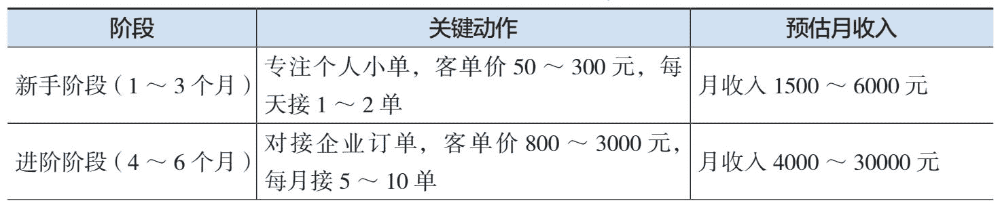

1. **深耕垂直领域：**专注一个细分赛道，如“职场打工人表情包”

“母婴亲子表情包”“地域文化表情包”；形成差异化标签，如专门

给互联网公司做“职场梗表情包”。提高客户精准度，也会同时提高

复购率，还能制定标准化套餐，提高效率。

2. **拓展企业服务：**从单纯的表情包定制，延伸到“IP 形象设计+表

情包+周边开发”的打包服务。如给奶茶店定制吉祥物表情包后，再推

荐做同款钥匙扣、杯套的设计，周边开发能让利润提升 200%以上；还

可以对接 MCN 机构，为网红、博主定制个人 IP 表情包，后续参与 IP 授

权分成。

3. **搭建 IP 矩阵：**打造自己的表情包 IP，如设计一套“治愈系小熊

猫”表情包，上传到微信、QQ、Line 等多个平台，靠打赏、付费下载

积累流量；接着可开发潮玩、绘本、短视频等衍生内容，走“表情包

出圈—IP 孵化—全产业链变现”的路线，十二栋就是靠这种模式做到

IP 授权累计销售额超亿元。

用豆包做表情包的收入完全取决于接单量和客单价，不同阶段的

收益参考如表 8-1 所示。

表 8-1　用豆包做表情包各阶段的收入

续表

77

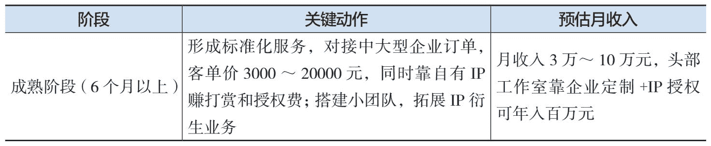

很多人觉得赚钱要靠复杂的项目，却忽略了表情包这种“小而

美”的刚需生意。它不需要你有雄厚的资金、专业的技能，只要你愿

意用豆包学习简单的创作技巧，愿意花时间对接客户，就能快速赚到

第一笔钱。

78

**第二篇　技能派接单，练个小技巧，月入**

**3000 元稳当当**

79

**第 9 招：用豆包整理提示词大全，靠卖提示词变现**

**一　不会写提示词的痛点，藏着低门槛商机**

现在不管是副业党、职场人还是学生，都知道用 AI 提效，但 90%

的人都卡在同一个坎：不会写精准提示词。

很多人只会对着 AI 敲出“帮我写文案”“帮我做个计划”这种模

糊提示词，得到的结果要么敷衍，要么偏离需求，甚至还带有“AI 味”。而这背后，藏着一个低门槛、低成本、一次制作无限次售卖的

变现机会：借助 AI 生成提示词，卖给需要的人。

问题是，免费提示词随处可见，AI 写提示词的工具也有很多，为

什么用户愿意花钱买你的提示词？这是因为 AI 直接生成的提示词，往

往质量参差不齐，用户需要花费大量时间筛选和测试。而你可以帮用

户验证和优化提示词，并按场景归类，确保按照提示词能输出高质量

回复，用户只需复制粘贴、稍作修改，就能命令豆包生成满意的回

复，大幅节省时间和试错成本。

一位大二学生小王，平时喜欢钻研豆包的各种玩法。他自己摸索

出了一套用豆包辅助考研复习、写课程论文、做兼职文案的提示词合

集，并发在小红书上，吸引了大量精准粉丝。他把这些提示词打包，

定价 3.9 元至 19.9 元，第一个月就卖出了 200 多份，轻松赚到生活费。

当大多数人还在为“如何想出提示词”而焦虑时，少数人已经把

别人的痛点变成了自己的赚钱机会：通过整理和售卖提示词，找到了

一条新的创收之路，不用复杂技能，无须大额投入，一次整理就能无

限复售。

80

**二　提示词变现 3 步实操指南，小白也能学会**

**第一步，调研需求，搭建提示词分类框架。**

不要一开始就盲目整理提示词，先摸清客户真实需求，才能让你

的提示词有市场竞争力。

1. **调研需求**。在小红书、闲鱼、微信公众号等平台搜“AI 提示

词”，观察哪些内容的转发、点赞、收藏数据高，搜集具有高频需求

的场景。

2. **搭建框架**。你可以按“一级场景+二级细分”对提示词进行分

类，便于后续整理和售卖。

**职场场景：**汇报总结、客户沟通、数据分析、会议纪要。

**学习场景：**论文辅助、刷题解析、笔记整理、升学备考。

**生活场景：**旅行规划、美食食谱、家务安排、情绪疏导。

另外，你还可以借助豆包快速搜集需求、搭建框架，提示词模板

如下。

请帮我整理高需求的 AI 提示词场景，并按“一级场景+二级细分”

进行分类。例如，职场场景+汇报总结。

**第二步，借助豆包，生成并优化提示词。**

搭建好分类框架后，不用手动逐个写提示词，借助豆包批量产

出，再通过人工筛选测试，效率翻倍。

81

1.批量生成提示词。提示词模板如下。

你是一位精通提示词工程的 AI 专家。请为《AI 提示词大全》生成

“[职场汇报总结]”场景的[50]个精准提示词，要求：避免模糊表

述、泛化的提示词。

2.筛选测试提示词。

对每个提示词进行实战测试。

将提示词粘贴到豆包中，检查输出结果的基本质量和是否符合要

求。若结果符合筛选标准，标记为“合格”；若效果一般（如逻辑不

清晰、缺少关键要素），标记为“需优化”；若完全偏离需求，直接

淘汰。对“需优化”的提示词，补充场景细节或调整参数，优化后再

次测试，直至合格。最后把合格的提示词打包。

**第三步，多平台接单，实现持续变现。**

平台一：闲鱼。

具体实操步骤如下。

1\. **标题优化：**加入关键词，提升搜索与点击率。

2\. **主图设计：**吸睛的提示词大全封面。

3. **详情页：**逻辑清晰，层层递进，消除用户的购买疑虑。

4. **运营维护：**每日擦亮商品；及时回复咨询；引导已购用户给出

好评。

82

闲鱼挂单模板如下。

标题：AI 提示词大全|prompt 对话指令|自动发货。

主图：2 张图（图 1：内页目录截图；图 2：客户好评截图）

详情页模板如下。

【为什么选我？】

不是网上搬运的泛化提示词！每一个都经过实测能用，复制粘贴

就能出优质结果，帮你节省时间，提高效率！

【你能得到什么？】

一套高效提示词工具包：内含 300 多条高价值提示词，涵盖职场写

作、自媒体创作、学习提效、生活娱乐等六大核心模块，18 个细分场

景。

【服务与保障】

交付形式：在线文档，链接永久有效。

发货速度：电子资料，拍下后 15 秒内自动发货。

售后无忧：购买后有任何问题随时联系。

平台二：小红书。

具体实操步骤如下。

1\. **账号定位：**昵称和简介清晰体现定位。

2\. **内容策划：**通过痛点/干货引流。

83

3. **视觉呈现：**采用对比图（低质提示词 vs.优质提示词）、提示词

目录清单等。

小红书文案模板如下。

标题：终于把 AI 调教成专属秘书了！

正文：

以前让 AI 写东西，总感觉差点意思，直到我学会了用“角色扮演

法”！

例如，要写产品文案，别再只说“写个文案”，试试这个：

“请你扮演一个具有 10 年经验的母婴产品总监，为这款新型奶瓶

写 一 篇 打 动 ‘90 后 ’ 宝 妈 的 ‘ 种 草 ’ 文 案 。 要 求 ： 突 出 ‘ 防 胀

气’和‘单手操作’的核心卖点，语气亲切，包含 3 个使用场景，并生

成 5 个备选标题。”

瞬间就专业了有没有！像这样的精准指令，我整理了 300 多个！

复制粘贴就能用，帮你省出 10 倍时间！

话题：#提示词 #AI 提示词 #指令大全 #AI 工具。

配图：图 1：部分提示词截图；图 2：输出效果对比图；图 3：客户

好评聊天记录。

平台三：朋友圈。

具体实操步骤如下。

1. **干货分享：**定期分享实用的提示词技巧，树立专业形象。

2. **好评案例：**在获得用户许可后，晒出隐私信息打码的客户好

评、反馈聊天记录等。

84

朋友圈文案模板如下。

很多朋友问，同样的 AI，为啥别人能生成爆款文案，自己却不

行？

其实不是 AI 不好用，是你没找对方法！

附上一个万能的“角色+任务+要求”提示词公式，试试看，效果

立竿见影！

对了，我还我整理了 300 多条[××场景]提示词，覆盖[××细分

场景]，复制粘贴就能出结果。

朋友圈福利，只需 5.9 元！

需要的人可直接通过私信联系我，10 分钟内发你。

（附提示词公式配图+电子书封面+提示词大全目录截图+客户好评

截图）

**三　增收攻略，两大进阶玩法，放大提示词小生意收**

**益**

攻略一：细分场景，提升客单价。

1. **关键操作：**在职场、生活等基础场景之外，推出更多有痛点需

求的细分场景提示词工具包，如副业变现提示词工具包、职场晋升提

示词工具包。

2. **服务攻略：**针对每个细分场景，进行更深入的痛点挖掘和提示

词设计。

3. **变现逻辑：**满足精准需求，用户愿意为更贴合自己痛点的提示

词付费，同时提升竞争力。

85

攻略二：推出定制服务，挖掘单客价值。

1. **关键操作：**工具包交付后，主动私信客户“是否需要定制专属

提示词？”

2. **服务攻略：**定制时先问清客户的核心需求、交付要求，用豆包

快速生成 3 个版本让客户选择，再根据反馈微调，全程耗时不超过 30

分钟。

3. **变现逻辑：**从卖标准化产品升级为卖个性化服务，单笔收费可

从几元涨到上百元；同时积累更多细分场景的优质提示词，反过来迭

代工具包，形成产品+服务的闭环。

整理和销售提示词工具包，启动成本很低，产品可无限复制，只

是需要你懂得挖掘客户痛点，具备信息的筛选及整合能力。它既能作

为新手的入门副业，也能通过迭代升级，慢慢做成长期盈利的小生

意。

86

**第 10 招：豆包批量写视频带货脚本，写一条赚一条**

**一　视频带货脚本写手的新蓝海：用豆包让文案产能**

**提升 10 倍**

现在打开抖音、快手、视频号、小红书，几乎刷 3 条视频就有一条

是带货视频。

2025 年全球短视频用户数已经突破 50 亿，中国直播电商规模超 3

万亿元，企业短视频广告支出在其广告总支出中的占比更是超过

60%。

而很多带货主播和商家都面临如下困境。

1.每天要拍 3～5 条带货视频，但创意枯竭、脚本质量不稳定。

2.一条优秀的带货脚本，能让转化率提升 300%以上，但专业脚本

写手价格昂贵，且产能有限，而这正是你的机会。

用豆包帮你写脚本，有以下优势。

1. **效率碾压：**5 分钟生成一条结构完整的专业脚本，是人工速度的

10 倍。

2. **风格多样：**同一产品可快速产出测评风、故事风、快剪风等多种

版本。

3. **成本优势：**你的报价可以比传统写手低 30%，仍能保持较高利

润率。

87

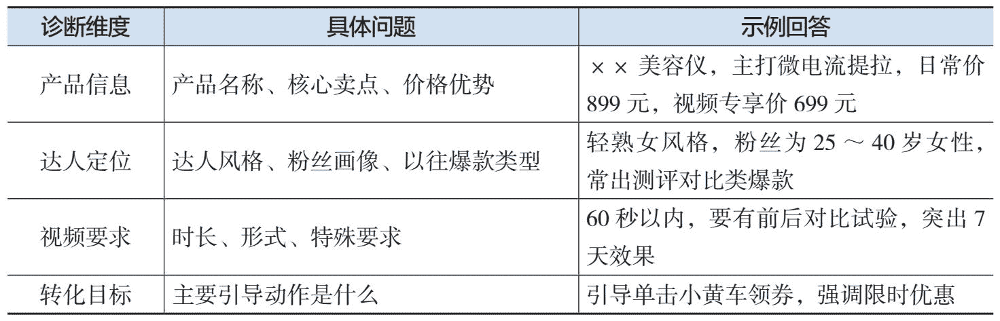

29 岁的前社群运营周妍，转型成为自由职业者后，发现了短视频

脚本市场的缺口：中腰部美妆主播每天为拍什么发愁，但承受不起全

职编导的费用。于是她尝试用豆包写脚本，并推出了“爆款脚本速

递”服务。她主攻 30 万～50 万粉丝量级的美妆垂类主播，因为这些博

主内容需求量大，且对质量有明确要求。有一个月她产出 86 条脚本，

通过包月、按条和项目制这 3 种模式，实现总收入 28000 元，利润率极

高。更让她自豪的是，客户使用她的“相亲迟到急救妆”脚本，单条

视频销售额突破 50 万元。很多人觉得写带货脚本需要专业的营销知

识，其实有豆包在，这些都能轻松解决。

**二　3 步实操：用豆包高效交付专业级脚本**

要批量接单，必须建立标准化工作流。以下是经过验证的 3 步法。

**第一步：需求诊断表，接单时必问。**

在开始创作前，通过问卷或沟通获取以下关键信息（见表 10-1），避免反复修改。

表 10-1　接单前应获取的关键信息

将此表整理成在线表单，客户填写后可直接作为创作依据。

88

**第二步：用豆包快速制作脚本初稿。**

根据客户需求，用豆包快速生成初稿。

模板一：痛点故事型。

**豆包提示词模板：**

为[产品名称]创作一个短视频带货脚本。目标用户：[用户画

像]。开头用 3 秒展现让用户最痛苦的场景：[具体痛点场景]。中间展

示产品如何解决问题，重点突出[核心卖点 1]和[核心卖点 2]。加入可

信证明：[证明方式，如实验/数据/证书]。结尾强力催促行动：[具体

行动指令]。要求口语化，符合[达人名称]的说话风格。

模板二：测评对比型。

豆包提示词模板：

创作一个专业测评类脚本。产品：[产品名称]。设计一个直观的

对比试验：[实验描述]。用镜头语言突出使用前 vs.使用后的差异。在

关键处加入放大镜特效或数据标注等说明。结尾给出明确结论和购买

理由。

模板三：Vlog 沉浸型。

豆包提示词模板：

以一天中使用[产品名称]的各个场景为主线，创作生活化 Vlog 脚

本。从[早上第一个使用场景]开始，自然展示产品在[场景 2][场景 3]

中的应用。重点捕捉使用时的愉悦感和便捷性，避免“硬广告”感。

最后以“已经离不开它了”的感觉收尾，软性引导购买。

**第三步：用豆包润色脚本，提升专业感。**

89

用豆包润色脚本，可以让脚本具备导演思维和网感细节，从而大

幅提升其商业价值。你可以从以下 3 个方向优化。

1. **注入导演级镜头语言**。不要停留在展示产品的笼统描述，要用豆

包将其转化为可执行的视听提示词。原始提示词：“展示美容仪的提

拉效果。”

优化后提示词：

请将“展示美容仪的提拉效果”这句话，润色成具体的分镜脚

本。要求：包含一个从下巴到太阳穴的特写慢镜头、画外音强调“向

上的提拉感”，并在颧骨位置建议添加向上箭头特效。语言需符合专

业视频脚本格式。

2. **标注节奏与情绪曲线**。在脚本中明确标注节奏变化，让主播和剪

辑师一目了然。

豆包提示词模板：

请为以下脚本段落标注视频节奏和情绪建议：[复制粘贴你的脚

本]。要求按 0～3 秒（强冲突）、3～15 秒（引入解决方案）、15～45

秒（证明效果）、最后 5 秒（紧迫促单）来划分，并为每个段落建议背

景音乐风格和剪辑速度。

3.“**埋设**” **互动与爆点“钩子”** 。在关键处预设互动点，是提升视

频数据的关键。

豆包提示词模板：

在脚本中[此处插入具体时间点或内容点]位置，设计 3 个不同风格

的互动。“钩子”选项：①悬念提问式；②共鸣选择题；③争议性观

点。要求能有效引发评论区讨论。

90

润色前，一份功能性的台词稿，价值约 100 元。润色后，一份包含

镜头语言、节奏规划、互动设计的制片文档，价值可达 300～500 元。

通过这一步，你交付的不仅是一段文字，更是一个经过深思熟虑的可

视化解决方案。这能让客户清晰地感知到你的专业溢价，并愿意为你

的导演思维支付更高费用。

**三　三大变现渠道与接单策略**

渠道一：综合服务平台。

**平台：**猪八戒网、一品威客。

**适合人群：**新手起步。

**步骤：**注册成为服务商，入驻“文案/视频创作”类目，主打“AI 批量带货脚本定制，低价高效”，竞标时附上 2～3 个不同品类的脚本

样品，中标率更高。

**优势：**这里的客户以中小商家为主，基础版脚本（纯文案+简单分

镜）报价 300～500 元，新手每月接 10 单就能赚 3000 元以上。

渠道二：专业创作平台。

**平台：**新片场、场库。

**适合人群：**有一定案例的创作者。

**步骤：**入驻后要重点包装作品集，用“品类+数据结果+核心创

意”的公式展示，如“美妆产品：3 秒完播率提升 70%的悬念开头脚

本”，更容易获得高端客户信任。

91

**优势：**这里的甲方质量高，多是品牌方或专业 MCN 机构，对脚本

质量要求高，但报价也更高，15 秒的专业带货脚本报价 300～1500

元。

渠道三：私域引流。

**平台：**抖音、小红书、朋友圈。

**适合人群：**长期品牌化运营。

**步骤：**在平台发布脚本创作干货，如“3 个高转化带货脚本开头模

板”“用 AI 批量写脚本的技巧”，在个人简介注明“承接带货脚本定

制”，吸引有需求的商家主动私信；还可以打造垂直账号，如专门分

享“日用百货带货脚本”，精准吸引同类商家，后期能接到长期批量

订单。

**优势：**让商家主动找上门，长期稳定获取订单，而非依赖零散竞

标。

**四　进阶玩法：从写手到脚本供应商**

当你在单一领域积累足够案例后，可以升级业务模式。

**1 做标准化套餐，提高效率。**

设计基础版、进阶版、全案版 3 个套餐：基础版只给脚本文案

（300～500 元）；进阶版给脚本+分镜+运镜指导（800～1500

元）；全案版包含脚本创作+修改+配套标题/评论话术（2000 元以

上）。

92

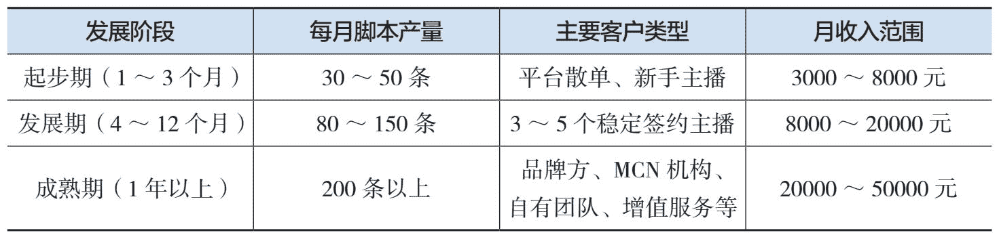

标准化套餐能减少沟通成本，如基础版直接按模板批量出稿，不

用反复对接，一天能接更多订单。

**2 延伸增值服务，增加收入。**

从单纯的脚本创作，延伸到“脚本+视频混剪”“脚本+账号运

营”的打包服务。如给商家写脚本后，推荐用 AI 工具批量混剪视频，

加收 500～1000 元服务费；还可以对接 MCN 机构，为达人提供“脚本

+文案”的长期服务，按账号月费收费，每月稳定赚 5000～10000

元。

**3 搭建脚本素材库，赢得被动收入。**

把不同品类、不同平台的优质脚本整理成模板，如“美妆 10 秒带

货脚本模板”“小红书种草脚本模板”，在知识付费平台售卖，每套

定价 99～199 元；还可以开通线上课程，教别人用豆包写带货脚本，

实现“接单+知识付费”的双重收入。用豆包写视频带货脚本的收益预

期如表 10-2 所示。

表 10-2　用豆包写视频带货脚本的收益预期

很多人觉得赚钱要靠单条爆款，却忽略了短视频带货的核心逻辑

——用数量对抗算法，用批量创作提高爆款概率。带货脚本创作不是

93

靠灵感吃饭，而是靠模板和效率赚钱，这正是普通人的机会。

94

**第 11 招：豆包写小红书笔记，帮人养号，付费写稿**

**一　不会写　养不活　没效果，小红书运营让人头疼**

在自媒体时代，小红书凭借其“种草”属性和庞大的用户基数，

成为打造个人品牌、进行产品推广的核心阵地。然而，众多新手和商

家却面临着“想做号不会写、想养号没方向”的困境——这恰恰为我

们借助豆包技能实现变现提供了黄金机会。

新手不懂规则与客户喜好，笔记缺乏吸引力，发布后收获的点赞

数、收藏数寥寥无几，急需专业的笔记内容支撑起账号初始流量。商

家/博主有目标，但缺乏创作能力，也没时间研究，宁愿付费找人代

笔，只求产出优质内容、快速养出有价值的账号。这为我们的付费服

务提供了充足的市场需求。

想做美妆分享的新手小李，自己写的 3 篇“平价粉底液测评”笔

记，标题都很普通，正文只简单说“好用、不卡粉”，发布后阅读量

才几十次，点赞数、收藏数全是个位数。小李的账号半个月没涨一个

粉，她陷入迷茫。

用豆包重写笔记后，标题优化为“学生族必入！3 款平价粉底液实

测，油皮不闷痘｜附遮瑕力对比”正文补充了肤质说明、上妆步骤、

持妆测试等细节。调整后，笔记的点赞数、收藏数大幅提高，粉丝也

很快突破 100 人以上。

**二　豆包写小红书笔记实操全流程，从获客到变现**

95

整个赚钱流程的核心，是先靠豆包精准产出符合客户需求的小红

书笔记，再通过标准化的获客、交付流程实现稳定接单。

**第一步：明确客户需求，用豆包高效产出优质笔记。**

找到有养号/引流需求的客户。拿到客户需求后，先明确关键信

息，如果需求模糊（如“想写一篇电热毯测评笔记”），那就先用豆

包辅助拆解。

豆包提示词模板：

你是小红书内容需求分析师，帮我梳理一份笔记需求清单，核心

信息包括：账号定位、目标受众、笔记核心主题、需突出的卖点/重

点、风格要求、交付要点。请基于这些维度，针对“客户需求：为家

居新手账号写一篇电热毯测评笔记”设计 3 个引导性问题，帮我确认精

准需求。

接着，豆包会生成一份问题清单（见图 11-1），能帮你快速明确

客户需求。

96

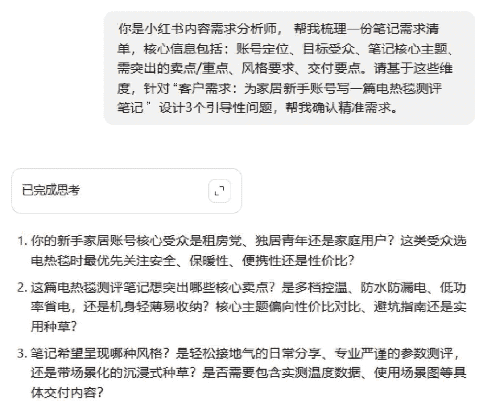

图 11-1　豆包生成的问题清单

明确需求后，接着用豆包实现高效产出。

1.给豆包下达精准创作提示词。

按“场景+主题+风格+结构+要求”的格式设计豆包 AI 提示词，

避免表述模糊。

豆包提示词模板：

请以租房族/学生族的视角，撰写一篇关于“宿舍专用单人电热

毯”的小红书家居测评“种草”笔记。核心要突出产品的 3 个关键优

97

势：

1.性价比（说明价格区间、性价比亮点）；

2.安全/低功率（此产品重点匹配宿舍限电需求，功率 60W，防漏

电、自动断电）；

3.实用性（结合租房党单人空间、学生党宿舍休息需求，说明具

体使用场景和实用价值）。

风格要求：轻松“种草”风，语言口语化、有亲切感，像和朋友

分 享 好 物 一 样 ， 可 适 当 加 入 语 气 词 （ 如 “ 谁 懂 啊 ！ 绝 了 ！ 挖 到 宝

了！”），避免生硬测评。

2.查看初稿，快速核查核心要点。

重点核查 3 点：是否匹配客户账号定位？核心卖点是否突出？风格

是否符合要求？如果初稿符合预期，则进入下一步；如果有偏差，继

续用豆包调整。

3.细节优化，用豆包打磨爆款潜质。

为了提升客户账号笔记数据，可以让豆包优化标题、结尾互动、

标签等细节。

豆包提示词模板：

标题优化。帮我把这篇笔记的标题改成更有吸引力的爆款风格，

保留“学生党”“性价比高”这些核心关键词，可加入数字或对比。

标签优化。基于这篇笔记内容，帮我筛选 8 个高流量标签，包含 2

个核心标签、3 个细分标签、3 个泛流量标签。

互动优化。把结尾的互动语调整得更有引导性，如加入具体问

题，避免笼统的“评论区讨论”。

98

4.整理格式，交付客户。优化完成后，按“标题+正文（带表情包

分段）+标签”的格式整理，附上简单的发布建议，提升客户体验。交

付模板如下。

【小红书笔记成品】

标题：

正文：

【发布小建议】

发布时间推荐晚上 8:00～10:00（用户活跃度高），发布后可引导

亲友先点赞评论，提升初始流量。

**第二步：多平台获客+标准化交付，快速变现。**

1.小红书账号引流。实操步骤如下。

① **搭建自运营引流账号：**注册账号，定位“小红书文案代笔｜代

运营”，简介明确服务（如“小红书笔记代写，帮新手起号/商家引

流，附案例”）。

② **发布引流内容：**每周发 3～5 篇，内容类型分 3 类（案例对比、

干货技巧、接单公告），用豆包快速生成文案。

③ **导入私域：**在评论区通过私信和客户建立长期联系。

2.闲鱼/豆瓣接单（增加曝光，快速出单）。实操步骤如下。

① **闲鱼发布服务：**标题写“小红书笔记代写丨养号丨高效出

稿”，内容附服务范围、价格（单篇 50 元起，30 天养号套餐 300 元

99

起）、案例截图。

闲鱼服务文案模板：“小红书笔记代写｜养号｜高效出稿”。

• 服务范围：单篇笔记撰写（含标题+正文+标签）、养号内容套

餐、笔记优化。

• 优势：精准匹配账号定位，符合小红书平台调性，1 天内交付，

修改到满意为止。

• 案例参考：×××。

• 价格：单篇××元起，30 天养号套餐××元起。

需要的直接拍，拍前私信沟通需求。

② **豆瓣发帖：**在“副业失败的一天”“上班这件事”等小组，发

布接单帖，附简单自我介绍和案例。

3.精准对接商家（接长期大单，提升收入）。实操步骤如下。

① **筛选目标商家：**小红书搜索本地餐饮、美妆、母婴店（优先选

粉丝少、笔记质量差的商家，其需求更迫切）。

② **私信对接：**用豆包生成个性化话术，附案例和初步规划，提升

转化率。

4.按交付标准化模板操作，避免纠纷。

① **沟通确认：**用需求确认函锁定核心信息（避免后续分歧）。接

单后，先把沟通好的需求整理成“需求确认函”，发给客户确认。需

求确认函模板如下。

“小红书笔记代笔需求确认函”

100

• 账号定位：×××（如新手美妆账号—学生党平价好物）。

• 笔记主题：×××（如学生党百元内控油粉底液测评）。

• 核心要求：突出控油持妆、风格真实干货、需推荐 3 款产品。

• 交付内容：标题+正文（带排版）+8 个标签+发布建议。

• 交付时间：×××（如 2026 年 1 月 10 日 18:00 前）。

• 费用与结算：×××（如单篇 60 元，先付 50%定金 30 元，交付后

付尾款 30 元）确认无误请回复“同意”，后续按此需求创作。

② **进度同步：**主动告知创作进度（提升信任感）。无需客户追

问，关键节点主动同步。

• 定金到账后，可回复：“定金已收到，已开始梳理创作框架，预

计今天下午出初稿。”

• 初稿完成后，可回复：“初稿已生成，正在优化细节（标题、排

版），晚上 8 点前发给你审核。”

③ **成品交付：**按标准化格式交付（附增值建议）。除了整理好的

笔记成品，额外附上 1～2 条针对性养号建议，提升服务价值。

④ **售后保障：**明确修改规则，促进复购/转介绍。

• 交付后告知客户修改规则：“收到成品后，若有需要调整的地方

（如修改某个产品描述、调整风格），可随时告知，免费修改 2 次；若

需要新增内容，按实际工作量补差价。”

• 同时引导复购/转介绍：“如果后续有长期笔记需求，可了解我

们的 30 天养号套餐（300 元含 15 篇笔记+月度规划），更划算；推荐朋

101

友来下单，你下次接单可享 8 折优惠。”

**第三步：从一次性接单到可持续收入，让赚钱更稳**

**定。**

一次性的笔记代写订单，只能赚一笔“辛苦钱”，想让收入持续

增长，核心是把“单次服务”变成“长期合作”，同时拓展服务维

度，提升单客价值。具体可以从以下 4 个方向发力。

1.推出长期服务套餐，锁定客户长期消费。

相比单篇接单，长期套餐能让收入更稳定。可以设计不同档位的

长期套餐，如基础养号套餐、进阶引流套餐、商家专属套餐。

推广时，你可以告诉客户：“长期套餐不仅单价更优惠，还能保

证账号内容的连贯性，更利于养号涨粉，比单次接单更省心、效果更

好。”吸引客户选择长期套餐，可以锁定长期收入。

2.拓展增值服务，提升单客价值。

在核心的“写稿+养号”基础上，拓展相关增值服务，让同一客户

产生更多消费，如笔记排版美化、封面设计建议、账号代运营（收入

比单纯写稿高得多）。

3.打造个人品牌，提升议价能力。

当你接了一定数量的订单、积累了优质案例后，要主动打造个人

品牌，让自己从“普通接单者”变成“专业小红书运营顾问”。

102

① **优化自运营账号：**在小红书、抖音等平台持续输出“小红书运

营干货”，如“爆款小红书笔记的 3 个核心逻辑”“用豆包写小红书文

案的技巧”，吸引粉丝关注，建立专业形象。

② **整理成功案例：**把服务过的客户案例整理成案例库，在接单时

展示，让客户愿意为你的专业度支付更高价格。

③ **设定阶梯定价：**根据自己的品牌影响力和服务质量，调整定

价。

4.搭建轻量团队，放大收入规模。

当订单量增多，一个人忙不过来的时候，可以搭建轻量团队，实

现规模化赚钱。

① **招募兼职写手：**找一些有小红书写作经验的兼职，你负责对接

客户、明确需求、制定创作方向，让兼职写手用豆包完成初稿，你再

进行审核优化，从中赚取差价。

② **对接上下游资源：**和封面设计师、视频剪辑师建立长期合作，

推出“文案+封面+短视频”一站式服务，承接更大的商家订单，提升

收入规模。

借助豆包的创作能力，降低创作门槛，从而把握“写小红书笔记

帮人养号”这一赚钱方式，轻松实现技能变现。

103

**第 12 招：豆包定做红包封面，卖爆就能赚一大笔钱**

在微信、支付宝里，红包封面早已超越了“皮肤”的概念，它是

个人的数字名片。除了春节，只要有喜事的地方就有红包，有红包的

地方就有“面子需求”，越来越多的日常场景开始变得刚需化。

1. **婚礼/生日场景：**新人想发印有自己 Q 版形象的专属红包，作为

电子伴手礼，让宾客在抢红包时也能感受到甜蜜。

2. **晒娃/晒宠场景：**“铲屎官”和宝妈想把自家“毛孩子”或“吞

金兽”做成封面，满足在亲友群、宠物群里的分享欲。

3. **情侣/纪念日场景：**“520”、七夕或恋爱纪念日，想给另一半

发个独一无二的红包，需要专属的仪式感。

很多人觉得：“做封面需要会手绘插画，还得懂 Photoshop，普

通人怎么搞得定？”其实，传统定制确实门槛高、周期长，但懂行的

人用豆包做封面，本质上就是做“情绪价值”的搬运工。

举个例子，以前完全不懂设计的小周。2025 年表姐结婚，想在家

族群发个不一样的红包，小周试着用豆包帮忙，只做了这两件事。

1. **风格锁定：**把表姐的婚纱照描述给豆包，结合“中式喜庆、Q 版

萌系”关键词，生成了 3 个创意方向。

2. **转绘生成：**利用豆包的参考图功能，保持人物特征，生成了独一

无二的 Q 版婚纱插画。

104

小周用这张图生成了微信红包封面预览图，发给表姐（见图 12-1）。结果这套红包封面在亲戚群里大受好评，表姐当场发了一个大红

包。尝到甜头的小周，开始在小红书和朋友圈接婚礼、宠物的红包定

制单，从此开启 AI 副业变现道路。

在这个追求个性的时代，几乎每个人都有定制红包封面的潜在需

求。你不需要懂专业设计，只要会用豆包，就能像小周一样，把别人

的“面子需求”变成你的“里子收益”。在电商平台上搜索“微信红

包”，就可以看到许多热销的微信红包封面商品，如图 12-2 所示。

105

106

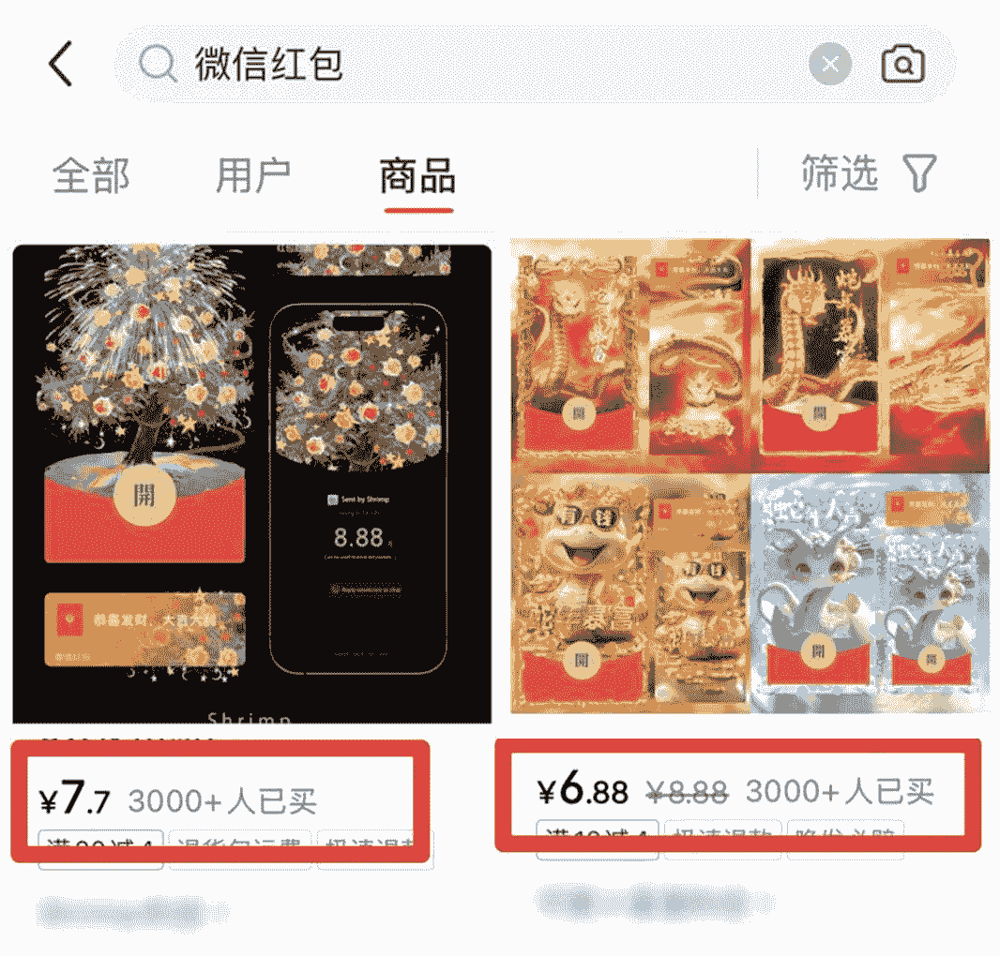

图 12-1　微信红包封面图

图 12-2　电商平台上热销的微信红包封面商品

**一　豆包定制红包封面实操全流程，从需求到交付**

要记得，客户买的不是一张图，而是“独一无二的专属感”。具

体的变现操作分为以下 3 步。

107

**第一步：用豆包拆解需求。**

定制最怕反复改稿。新手最容易犯的错就是听客户说“要喜庆一

点”就开始直接画。我们应该做的是，先用豆包把客户模糊的需求，

翻译成精准的画面描述。在这之前，需要收集这些客户的信息：使用

场景（婚礼/生日/情侣）、关键元素（人物/宠物/文字）、偏好风格

（国潮/扁平/皮克斯风）、忌讳色。将这些信息套入下面的提示词模

板。

豆包提示词模板：

你是一位资深插画师。我有客户需要定制微信红包封面，请根据

以下信息，构思 3 个具体的画面创意方案，并扩写为详细的 AI 绘画提示

词。

• 使用场景：[如新婚夫妇婚礼答谢]。

• 关键元素：[如新郎新娘穿着中式秀禾服，手牵手，背景有双喜

字]。

• 风格要求：[如 Q 版可爱风，色彩喜庆明亮]。

• 画面构图：竖屏(9:16)，中心构图，顶部预留红包气泡位置。

请输出：

1.创意理念（为什么要这么画？）；

2.对应的 AI 绘画提示词（包含光影、细节、材质描述）。

完成上述操作后，豆包会输出多个方案，示例如下。

微信红包封面插画创意方案

**方案一：喜乐相拥·中式萌趣篇**

108

创意理念：聚焦新人甜蜜相拥的瞬间，以 Q 版萌化中式秀禾服传递

温馨，搭配经典喜庆元素，以贴合婚礼答谢场景。中心构图凸显主

体，顶部预留气泡位，让红包封面成为幸福的微型载体，传递答谢心

意。

AI 绘画提示词：竖屏 3:4，中心构图，顶部预留 1/5 气泡区，Q 版新

婚夫妇着红系秀禾服（新娘缠枝莲纹、新郎祥云暗纹），相拥微笑，

背景浅红渐变点缀金祥云与双喜字，柔和暖光斜射，丝绸质感秀禾

服，细节精致，喜庆明亮色调，高清。

**方案二：执手偕老·祥瑞金纹篇**

创意理念：紧扣“执手偕老”寓意，放大“手牵手”元素，用鸳

鸯、回纹等吉祥纹样传递祝福。红金配色提升仪式感，Q 版造型增添灵

动感，中心构图确保互动清晰，适配婚礼答谢的庄重与温馨。

AI 绘画提示词：竖屏 9:16，中心构图，顶部预留 1/5 气泡区，Q 版

新人牵手对视，新娘正红秀禾服上绣鸳鸯、新郎暗红秀禾服上饰金盘

扣，背景红宣纸质感配金回纹边框与双喜字，均匀柔光，哑光丝绸质

感，红金为主色调，高清。

**方案三：喜韵环绕·场景氛围篇**

创意理念：以沉浸式喜庆场景为核心，将新人置于灯笼、飘带环

绕的环境中，层次丰富且不失可爱。中心构图让新人成焦点，传递

“被幸福包围”的意境，顶部气泡位自然融合，直观传递喜庆与答谢

诚意。

AI 绘画提示词：竖屏 9:16，中心构图，顶部预留 1/5 气泡区，Q 版

新人牵手着秀禾服（新娘水红桃花纹、新郎浅红款），背景点缀红灯

笼与红飘带，暖光烘托氛围，面料细腻有光泽，色彩明快，高清。

随后，直接将方案发给客户选择。这一步能极大提高定稿率，在

客户眼中树立专业感的形象。

**第二步：一键生图与转绘，零门槛出大片。**

109

确定方向后，就是豆包大显身手的时候。直接将豆包生成的提示

词，输入对话框，发出指令：“请根据方案一的提示词，生成一张精

美的竖屏插画。”豆包随即生成图片，如图 12-3 所示。

110

图 12-3　豆包生成的竖屏插画

111

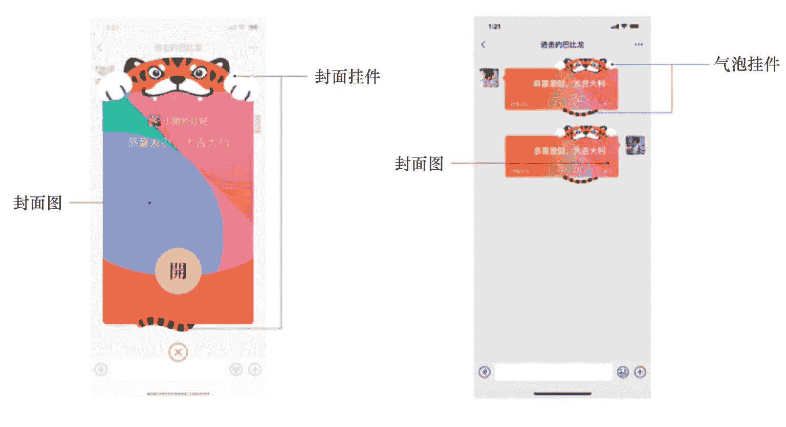

**第三步：向客户交付微信红包。**

做完图别急着给客户发原图。微信红包封面开放平台对图片大小

的限制是 500KB 以内，且需要审核。在微信红包封面开放平台定制红

包封面需要完成如下步骤。

• **压缩：**用在线工具把豆包生成的大图压缩至 500KB 以下。

• **注册：**去“微信红包封面开放平台”注册（个人注册需视频号/

公众号粉丝达标）。

• **上传：**按指引上传素材。

微信红包封面包含 3 种上传样式：封面图、封面挂件、气泡挂件，

如图 12-4 所示。其中，封面图是必须上传的，另外两个挂件制作方法

比较复杂，需要涉及 Photoshop 软件，可以选择不上传。

图 12-4　微信红包封面包含的 3 种上传样式

112

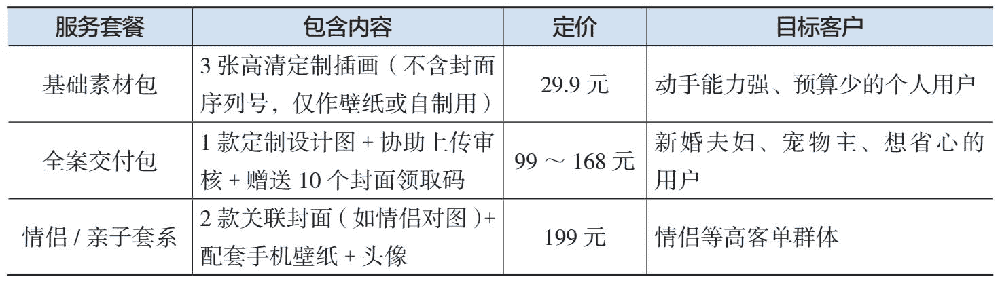

需要注意的是：封面图分为静态封面和动态封面两种，并对尺寸

和规格有一定的要求。

**静态封面：**图片格式为 PNG/JPG/JPEG；图片尺寸为 957×1278

像素；文件大小不超过 500KB。

**动态封面：**视频格式为 MP4；视频宽高比建议为 3:4；分辨率低于

4k；时长 1～3 秒；文件大小不超过 20MB。

按照之前的步骤生成完超清图片后，因为图片较大，而红包封面

图片大小要求不能超过 500KB，所以我们需要对图片进行压缩。压缩

完之后，来到微信红包开放平台，单击“去定制”选项，按照官网的

注册入口根据指引完成注册即可上传你的红包封面和相关的信息，最

后等待微信团队审核成功就可以拥有专属微信红包封面了。

**二　多渠道接单+标准化报价，快速变现**

服务产品化：梯度定价，让客户各取所需，如表 12-1 所示。

表 12-1　不同服务套餐的梯度定价

**三　增收攻略：把一次性定制，做成长期生意**

113

如果你已经跑通了单次定制，接下来可以用豆包实现批量化，把

收益放大。不少网友在自媒体平台分享制作红包封面教程，轻松抓住

新年红包涨粉风口，收获一大波粉丝。还有很多人在网上卖自制的微

信红包封面，短短几天就卖出超过 3000 份，赚到 2 万元！

豆包不仅仅是一个画图工具，更是你的“视觉创意合伙人”。通

过它，你卖的不再是简单的图片，而是每个人都渴望的“个性化表

达”和“社交优越感”，这种满足人性需求的生意，永远都有市场。

114

**第 13 招：豆包做海报，零门槛搞定商业设计，接单赚**

**钱**

**一　不懂设计也能接单？商业海报里的零门槛机会**

现在，商业海报早就成了小微商家、自媒体人的必备宣传工具。

然而，在实际做的时候，很多人都会被设计问题难住。想象一下，你

家楼下的理发店、社区里的房产中介，或者是朋友圈里卖土特产的代

理。他们会花 5000 元雇一个美工吗？不现实。让他们花 200 元去淘宝

找人做？成本太高，而且沟通修改很麻烦。

他们的需求非常明确：不追求艺术品级别的精致，但要求信息清

晰、氛围到位、价格便宜、出图要快。这就产生了一个巨大的商业机

会：利用效率差和信息差赚钱。在客户眼里，一张精美的海报值 50～

100 元，只要你的交付质量过关，这笔业务就能为你带来利润。

在传统设计行业，流程通常是这样的：客户提需求—设计师找素

材—排版—客户反馈—修改—定稿。哪怕是做一张简单的图，加上沟

通成本，往往也要耗费 3～5 小时。然而，如果你使用豆包，那么逻辑

完全变了：你输入一段描述—豆包生成 4 张图—你挑选一张优化一下—

完工。

用豆包生成图片时，不用懂设计原理，也不用会复杂的设计软

件，只要用大白话把你的需求说清楚，豆包就能做出符合要求的高质

量海报，全过程可能只需要 3～5 分钟。

普通上班族小李抱着试试看的心态，用豆包制作了一组中式美学

海报发布在小红书上，被一家品牌方相中。客户急需 4 张新品预热海

115

报，预算 600 元。小李用豆包半小时就输出了高质量的海报图，轻松拿

下，单张价值 150 元。更让人惊喜的是，因为交付快、风格独特，客户

非常满意，后续直接追加了产品包装设计的长期订单。她慢慢积累了

口碑，现在每月能稳定接 20 单左右，一张海报收费 100～300 元，月入

3000 元。

**二　豆包海报生成实操技巧，全行业通用**

用豆包做商业海报，核心步骤很简单：先把需求理清楚，再按海

报类型给提示词，最后稍作优化就能交付。

**第一步：理需求，选模型，避免反复修改。**

1.确定具体的设计需求。

与客户对接时，建议围绕“3 个核心问题+1 个前置确认”展开，

确保信息无遗漏。

• **场景定位：**明确海报用途，是发朋友圈、社群转发，还是线下张

贴、短视频封面？不同场景对应不同尺寸和设计重点。

• **核心信息：**确定必须突出的内容，是活动力度、产品卖点、品牌

名称，还是地址、电话等实用信息？避免冗余信息干扰视觉焦点。

• **风格偏好：**确认视觉风格方向，如清新简约、复古胶片、ins 风、国潮风、商务风，还是卡通风？可让客户提供 1～2 张参考图，这

样更易对齐。

116

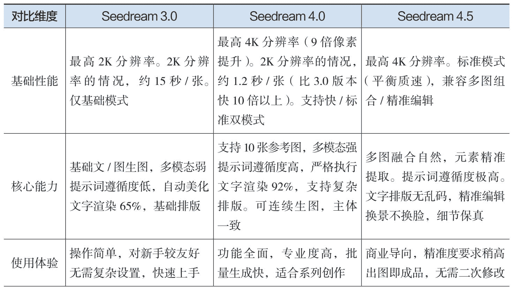

• **前置确认：**提前敲定输出格式（优先 PNG 或 JPG 高清图）和具体

尺寸（常用标准参考：朋友圈 600×900 像素、线下打印 A3/A4、短视

频封面 1080×1920 像素、微信公众号头图 900×500 像素）。

如果自己拿不准怎么梳理需求，也可以找豆包帮忙。把跟客户聊

的零散内容发给豆包，它会帮你整理得明明白白。

2.选择适配的生图模型。

豆包的 Seedream 生图模型目前共 3 个版本(3.0/4.0/4.5)，按需选

择可大幅提升出图效率。各版本的对比如表 13-1 所示。

表 13-1　Seedream 各版本的对比

续表

117

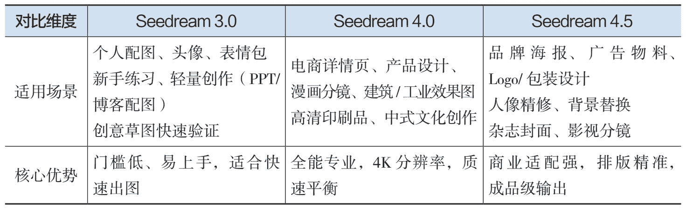

首选推荐：Seedream 4.5。最懂人话，文字生成准确率极高和排

版很精美。适用需要画面上有文字的海报、对细节要求高的产品图。

**第二步：写对提示词，海报成功一半。**

1.万能提示词公式，直接套用不出错。

避免语义模糊的提示词，豆包更能理解具象化描述。核心公式：

主体描述+画面风格/材质+场景氛围+色调/光影+比例尺寸+用途补

充。

提示词撰写技巧如下。

① 文字内容用双引号标注，避免渲染错乱。

② 用简洁连贯的自然语言，不要堆叠华丽词汇，精准优于复杂。

③ 明确构图要求（如居中构图、留白、对角线构图），提升画面

美感。

反面示例。做一张新年海报。

正面示例。主体描述：圆润 Q 版小马跳跃挥蹄；画面风格/材质：

卡通插画，糖果质感；场景氛围：欢乐、轻松、好运来临；色调/光

118

影：高饱和红橙色，均匀亮光；比例尺寸：竖版 3:4；用途补充：社群

传播、新年互动海报。

2.常见商业海报的设计技巧+提示词模板。

类型一：促销海报（餐饮/奶茶/零售适用）。

促销目的是清晰传递优惠信息，激发消费者下单/到店欲望，需要

突出优惠力度、营造紧迫感，信息层级分明。

豆包提示词模板：

画面核心为巨型“11·11 狂欢购”立体艺术字，搭配红色墨镜装

饰，叠加 3D 手机模型，周围环绕口红、行李箱、美妆礼盒、手表等写

实商品，并加入一男一女卡通人物互动元素，中部呈现“一年一度全

球购物节”标语，底部展示“品牌盛典 50%OFF”促销信息；3D 潮玩风

格，立体艺术字与高精度写实商品结合，塑料与金属质感清晰；热

闹、活力、强促销冲击力，突出双十一购物狂欢；粉橙渐变背景，明

亮高饱和配色，主视觉高光聚焦、阴影增强层次；竖版 3:4 构图，主体

居中偏前，4K 清晰度；用于双十一提前购活动海报、电商主视觉、社

交媒体与站内促销展示。

豆包生成的促销海报如图 13-1 所示。

119

图 13-1　由豆包生成的促销海报

类型二：产品场景合成海报（电商刚需）。

产品场景图需要将白底产品图融入真实场景，提升产品质感。可

以让豆包先画背景，再嵌入产品。背景提示词关键词：微距摄影、景

深虚化、产品级布光、展台/石膏几何体（底座）、画面中心留白（放

产品）。

**实操案例：**客户卖香水，需融入森林溪流场景。提示词参考：

生成产品摄影背景图，森林溪流边，长满苔藓的石头作为展示

台，阳光透过树叶洒下斑驳光影，微距镜头，景深虚化效果，色调清

新自然，高分辨率。

Seedream 4.5 支持多图融合，可上传产品图+场景参考图，将二

者合为一张图，如图 13-2 所示。

120

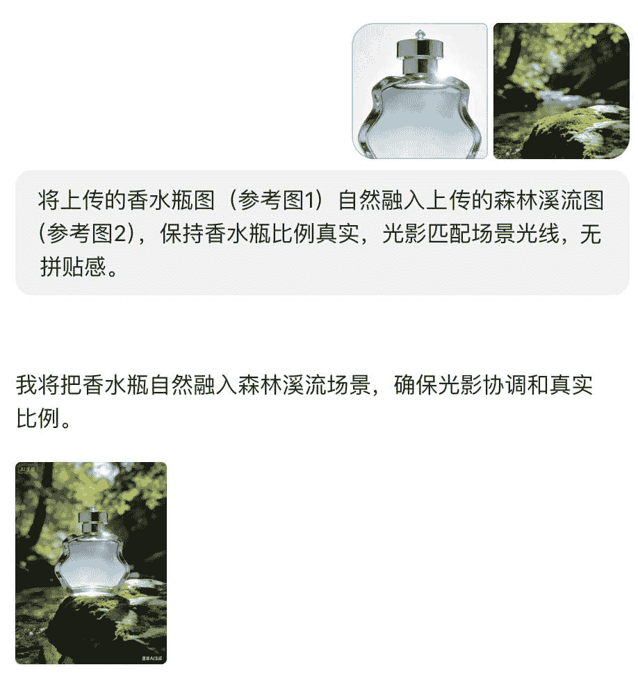

图 13-2　用 Seedream 将两张图片合为一张

类型三：开业海报（行业通用）。

传递开业信息，吸引到店体验。需要突出完整信息（时间/地点/活

动）。

121

豆包提示词模板：

做一张××社区宠物店开业海报，尺寸 A3（线下张贴），风格温

馨治愈，主色调浅蓝+白色。核心信息：居中放大“××宠物店 10 月 1

日盛大开业”，副标题“首单洗澡 8 折，到店即送宠物零食”，辅助元

素：卡通 Q 版猫咪和狗狗插画、开业气球、彩带，右侧添加“开业活动

时间表”（10.1-10.3 到店有礼），底部预留微信二维码位置，标注

“扫码预约，开业优先服务”和店铺地址/电话。

豆包生成的开业海报如图 13-3 所示。

图 13-3　豆包生成的开业海报

**优化技巧：**①受众群体是年轻人时可将插画改为潮玩风格，受众

群体是家庭客群时应保留温馨治愈风；②增加信任背书（如“周边 300

多位宠物主人推荐”）；③线下海报字体放大至“3 米外可看清”，避

免信息过小。

122

类型四：自媒体封面海报（短视频/微信公众号/小红书适用）。

注意标题醒目、风格统一、适配平台调性。

豆包提示词模板：

以一位亚洲美女为核心人物，身穿亮色复古穿搭，在环球旅行途

中打卡取景，手持相机与独脚架，姿态自信轻松，周围拼贴世界地标

元素如铁塔、棕榈海滩、摩天大楼、飞机票与邮戳图案，并加入旅行

贴纸与手账碎片文字；手账拼图+贴纸拼贴视觉，20 世纪 80 年代复古海

报风格，高噪点颗粒质感，剪贴边缘明显，带旧印刷感；自由、热

烈、探索世界的快乐感，充满记录生活的 Vlog 气息；高饱和撞色配

色，大色差组合（亮黄、湖蓝、玫红、薄荷绿），强对比平面光影；

竖版 9:16 构图，主体居中偏前，封面级清晰度；用于旅行主题 Vlog 短

视频封面、个人生活方式账号首页主图，预留标题与账号名贴纸位。

豆包生成的自媒体封面海报如图 13-4 所示。

图 13-4　豆包生成的自媒体封面海报

**优化技巧：**①平台适配（小红书封面可加可爱贴纸，短视频封面

用高对比度配色）；②账号风格统一（固定边框、字体、色调，提升

123

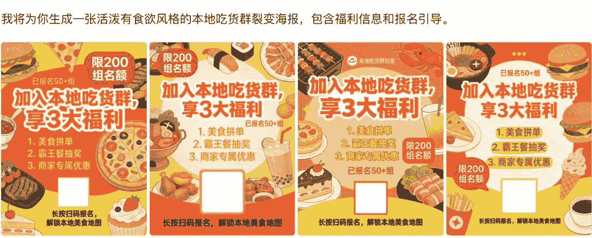

辨识度）。

类型五：社群裂变海报。

需要清晰传递福利，引导扫码进群/报名，突出利益点、增加信任

背书、降低行动门槛。

豆包提示词模板：

做一张本地吃货群裂变海报，尺寸 600×900 像素，风格活泼有食

欲，主色调橙色+黄色。核心信息：居中写“加入本地吃货群，享 3 大

福 利 ” ， 下 方 分 点 列 出 “1\. 美 食 拼 单 2\. 霸 王 餐 抽 奖 3\. 商 家 专 属 优

惠”。辅助元素：美食合集插画、红色“限 200 组名额”标签、“已报

名 50 多组”信任背书，底部放大社群二维码位置，标注“长按扫码报

名，解锁本地美食地图”。

豆包生成的社群裂变海报如图 13-5 所示。

图 13-5　豆包生成的社群裂变海报

**优化技巧：**①福利按“价值从高到低”排序；②信任背书可加真

实数据（如“已超 200 人加入”）或用户证言；③二维码尺寸不小于海

报 1/5，加引导箭头提升扫码率。

124

**第三步：海报修改技巧：批量+局部精准优化，专业交**

**付。**

1.批量生图：高效产出系列素材。

系列海报，用“基础模板提示词+变量修改”，借助 Seedream 4.5 的批量生成功能。

豆包提示词模板：

基于以下基础模板，批量生成 5 张奶茶上新海报：尺寸 600×900 像

素，极简风格，白色背景，居中放置奶茶图，底部标注产品名称。变

量：产品名称分别为“草莓啵啵”“芋泥波波”“葡萄冻冻”“芒果

奶昔”“珍珠奶茶”，对应奶茶图颜色匹配产品口味。

2.批量改图：统一调整风格/元素。

已生成系列海报，需统一修改某元素（如字体、色调）。上传所

有需要修改的海报，明确“修改内容+保留内容”。

豆包提示词模板：

将上传的 5 张奶茶海报进行统一修改：①标题字体改为黑体；②主

色调调整为浅紫色；③保留原有产品图和信息布局，其他元素不变。

3.局部精准修改：避免整体重画。

**核心技巧：**明确指出修改对象、位置和要求，避免模糊代词。

豆包提示词结构：

保 留 原 有 画 面 不 变 ， 将 ×× 位 置 的 ×× 元 素 改 为 ×× ， 要 求

××。

125

**示例一（文字修改）：**“保留海报其他元素不变，将右上角‘限

时 3 天’标签改为‘限时最后 1 天’，颜色改为红色，字体放大 1.5

倍。”

**示例二（元素修改）：**“保留海报背景和产品图不变，将左侧的

气球元素替换为枫叶元素，色调匹配整体暖色系。”

4.通用优化与交付规范：专业度拉满。

**格式规范：**交付给客户时，尽量提供 PNG 无损格式（比 JPG 清

晰）。

**文件命名：**养成好习惯，文件名为“日期 _ 客户名 _ 用途”，如

1001_ 老王烧烤 _ 国庆海报 _V1.png。

**三　增收攻略：从单次接单到稳定盈利**

不要把目光局限在“做一张图赚几十元钱”上，要有商业思维，

从偶尔接一单，变成稳定赚钱。

攻略一：闲鱼/小红书“白菜价”跑量。

低价走量，积累案例。

• **定价策略：**9.9 元/张，或者 19.9 元/3 张。强调服务和速度。

• **执行要点：**这一阶段的关键是建立你自己的提示词库。按照行业

分类整理，下次再有同类型订单，你只需要微调颜色或元素，几秒就

能出图。

攻略二：出售提示词与模板，实现被动收入。

126

授人以鱼不如授人以渔，你可以从“卖图”升级为“卖方法”。

• 按行业和场景分类制作模板，如餐饮行业的促销模板、母婴行业

的招生模板，每套模板包含 3 到 5 个版式，附带修改说明，告知用户如

何用豆包修改文字和图片。

• 在淘宝、拼多多或小红书上架售卖，单套模板定价 19.9 元到 49.9

元。一款受欢迎的餐饮促销模板，若每月卖出 100 套，就能稳定增收

1990 元到 4990 元。

攻略三：自用吸粉，承接代做订单，后端变现。

在社交平台开设个人账号（首推小红书）分享 AI 作品，用豆包做

高颜值封面/壁纸引流，积累私域粉丝，后期承接高客单价广告或卖自

己的课程。可推出标准化套餐降低客户决策成本，基础快单针对朋友

圈海报等简单需求，收费 100 到 200 元/张，24 小时交付。商业精修针

对开业海报、产品图等，收费 200～500 元/张，48 小时交付并含 3 次修

改。获客可通过本地商家群、出版社官网、小红书或抖音发布案例展

示，也可入驻兼职平台接单。

攻略四：打包服务与“包月制”。

把客户变成长期的会员，推出包月设计服务。

• **套餐 A（299 元/月）：**每天提供一张带客户 LOGO 和二维码的早

安海报。你只需周末花 1 小时，用豆包批量生成 30 张图，排好版后发给

客户。

• **套餐 B（599 元/月）：**包含 4 张精修的活动海报+30 张日常配

图。这种模式边际成本极低。你一旦谈下 10 个这样的客户，每个月就

127

有几千元的稳定收入，而且工作量并不大。

128

**第 14 招：用豆包出图书插画又快又稳，作者群转介绍**

**爆单**

**一　插画不是艺术问题，而是图书的隐形卡点**

对写书人来说，文字是灵魂，而插画则是让灵魂落地的载体。好

的插画能牢牢吸引读者注意力，从而留住读者；如果插画与文字内容

结合紧密，更能让读者共情。然而，绝大多数作者只会写字，不会画

画。

找专业插画师？报价动辄几百元一幅，修改还要等排期；反复沟

通太难，形容不出想要的意境，出来的图不对味，插画师也很委屈。

自己找 AI？画出来的人一会儿像韩漫，一会儿像美漫，主角的脸每张

都不一样，根本没法做系列插图。

其实这种情况蕴藏着一个低门槛的赚钱机会，那就是用豆包把文

字转到插画的过程标准化、精准化，帮作者解决贵、慢、不贴合、风

格乱的痛点。你不用会画画，只要能让豆包精准读懂文字、稳定输出

风格统一的插画，就能对接海量作者的刚需。

“95 后”新手小林就是这么做的。有位作者曾想找专业插画师，

但是报价太高超出了预算。于是小林接下了这单业务，用豆包先拆解

了绘本的文字内核，确定了温暖水彩风和小熊的固定特征，再批量生

成插画（见图 14-1）。小林不仅 3 天就完成了原本需要 2 周的工作量，

还因为插画风格统一、贴合故事氛围，被作者推荐给了几个同行，甚

至有一位跟她约定了后续系列书的长期合作。

129

图 14-1　小林用豆包生成的插画

**二　豆包做插画实战流程：从文字理解到交付变现**

新手最容易陷入的误区，就是一上来就让豆包画一张××风格的插

画。其实在图书场景中，把靠感觉画图变成靠逻辑生成更关键，用豆

包先拆解文字，再建立统一的视觉规则，最后高效批量出图。

**第一步：文字解构，让豆包读懂内容的画面感。**

接单后不要着急直接开始，先向作者收集 3 类核心信息，再发给豆

包并套用提示词模板：①书籍核心主题与受众；②3～5 段核心文字片

130

段（含开篇、高潮、结尾，体现整体调性）；③参考风格示例（1～2

张喜欢的插画风格图）。

豆包提示词模板：

作为资深图书插画策划师，基于以下[书名]信息，进行视觉化拆

解。

• 核心调性定位（结合主题与受众，明确插画应传递的情绪的风

格）。

• 关键视觉元素提炼（从文字中提取可具象化的人物、场景、道

具）。

• 色彩体系建议（结合受众喜好与主题，推荐主色、辅助色）。

• 插画密度规划（建议哪些章节需要插画、用全页还是插页形

式）。

例如，给儿童科普书做解读，豆包输出了如下内容。

• 核心调性：卡通科普风，兼顾趣味性与知识性。

• 关键视觉元素：拟人化的动植物、简化的科学仪器、清晰的流

程图示。

• 色彩体系：主色用天空蓝（清爽），辅助色用草绿、鹅黄（贴

近自然）。

• 插画密度：每 3 个知识点配 1 张插页，关键概念用全页插画强

化。

**第二步：视觉立规，让豆包画出统一风格的插画。**

整本书的插画风格不统一，会让读者出戏。因此，正式出图前，

建议先让豆包生成一份规范手册，直接用于说明文档。有了这份手

131

册，后续出图就不会跑偏。

豆包提示词模板：

基于上述我们为[书名]做的整体视觉解读，请你生成一份插画视

觉风格规范手册，需包含如下内容。

• 人物/核心形象设定（如“拟人化小松鼠：圆眼睛、短耳朵、浅

棕色毛发，穿蓝色小背心”）。

• 线条与笔触要求（定义画面基础质感，略带颗粒感的水彩晕

染、边缘模糊的手绘炭笔质感、干净的扁平化矢量风）。

• 色 彩 使 用 标 准 （ 明 确 主 色 、 辅 助 色 的 色 值 ， 禁 止 使 用 的 色

彩）。

• 规定主要构图方式（如儿童绘本多用对称构图，文艺书籍多用

焦点透视）。

请搭配 12 张示例图描述。

**第三步：批量出图，用豆包实现规则内高效量产。**

有了前面的解读报告和风格手册，后续出图就是填空题。针对每

一章的插图都套用固定公式，修改时也能精准微调，不偏离风格。

豆包提示词模板：

请严格遵循[书名]插画视觉风格规范手册，为以下内容创作插

画。

• 本章核心情绪：[从本章文字解构中提取，如温暖治愈]。

• 本章核心意象：[从本章文字解构中提取，如小松鼠、木屋、热

牛奶]。

132

• 画面具体要求：[填写作者对本章画面的具体想法，如小松鼠坐

在木屋门口，手里捧着热牛奶，夕阳洒在身上]。

• 特殊约束：保持与第一章插画在色彩、光影、质感上的绝对统

一；预留 30%留白，方便后期排版加文字。

请生成 2 个微调版本（一个侧重光影细节，另一个侧重人物表

情）。

如果作者提出修改意见，如需要小熊表情再委屈一点，不用重

画，直接微调提示词。

豆包提示词模板：

在完全遵循[书名]插画视觉风格规范手册的前提下，对这张插画

进行以下微调：保持当前画面的色彩、光影、构图完全不变，仅将小

熊的嘴角略微下垂，眼睑压低 10%，以强化委屈情绪。

**第四步：挖掘变现渠道，精准锁定 3 类客户。**

掌握了出图能力，还要会找客户，这 3 个渠道精准度高、门槛低，

新手可以优先尝试。

渠道一：网络作者社群（QQ 群/微信群/论坛）。

豆瓣作者小组、微信写作社群、知乎写书交流群，这些地方全是

有插画需求的作者。实操可采用的步骤如下。

① **默默观察：**看到有人抱怨插画贵、风格不统一、AI 画得差，就

主动对接。

② **免费输出：**让对方发一段文字，你用豆包做 1 页简单的文字视觉

化解读，再生成 1 张风格样图，然后对作者说：“刚帮你用 AI 画了 1 张

133

样图，你看看是不是你想要的感觉？如果需要，我可以免费出一份完

整的风格规范手册。”

③ **转化成交：**只要样图贴合需求，作者大概率会跟你进一步合

作，这时候成交率极高。

渠道二：小红书/抖音插画挂单。

在该渠道，视觉内容传播快，多放优秀的案例图，正好突出你的

价值。实操可采用的步骤如下。

① **内容主题：**《3 天搞定绘本插画！用 AI 让风格统一不翻车》《拒

绝 AI 乱画！我用这套逻辑让插画精准贴合文字》。

② **内容形式：**先放“作者原始文字+普通 AI 画的翻车图”，再放

“你的图书内容解读分析+风格统一的系列插画”，配文讲你如何用豆

包解决风格乱、不贴合的问题。

③ **引流“钩子”：**“想要我用的豆包文字解构提示词模板，评论

区回复‘插画’，免费发你。”这样可以把流量引到私域。

渠道三：主动对接出版社/编辑。

主动向中小型图书策划公司投递简历，自荐为 AI 插画师，他们有

大量的内页插画需求，只要单价合理且速度快，他们非常愿意长期外

包。实操可采用的步骤如下。

① **寻找目标：**在出版社官网、微信公众号找编辑联系方式，优先

对接少儿、文艺、经管类出版社（这类书籍对插画需求大）。

134

② **私信破冰：**“××编辑您好，我是专注图书 AI 插画优化的，擅长

用豆包快速产出风格统一、贴合文字的插画，性价比高、周期短。之

前帮××作者完成了绘本插画，得到了不错的反馈（附作品集）。如果

出版社有作者需要插画服务，我可以提供免费试画，期待合作。”

③ **成交关键：**用试画展示能力，再给出比传统插画师低 30%～

50%的报价，很容易拿到长期合作。

**三　增收攻略：把单次插画服务，变成作者圈的视觉**

**合作人**

靠单次定制单只能赚小钱，真正的大机会是绑定作者的长期利

益，在作者圈建立口碑，通过转介绍让作者主动找上门，实现持续稳

赚。

攻略一：设计阶梯式套餐，提升单客所产生的收入。

不同作者需求不同，设计 3 套套餐，覆盖从新手到资深作者的需

求，客单价能提升 1.5～2 倍。

① **基础体验包（399 元）：**1 份文字视觉化解读报告+1 份风格规

范手册+3 张核心章节插画，适合新手作者试错。

② **全章插画包（1500**～**3000 元）：**覆盖全书所有章节插画+排

版留白适配+3 次修改机会，适合有完整出书计划的作者。

③ **全案服务包（5000 元以上）：**插画全流程服务+封面插画设计

+营销物料插画（如书签、宣传图、IP 周边延展）+后续修订更新，适

合想打造精品书的资深作者或出版社。

135

攻略二：建立品类插画模板库，实现极速量产。

1. **关键操作：**把不同品类书籍（如儿童绘本、职场励志、社科科

普、小说 IP）的视觉解读报告模板、风格规范手册模板、插画指令模

板等整理成分类库，接到新单时，只需替换书籍主题、核心元素、受

众等关键信息，就能快速产出初稿。

2. **变现逻辑：**下次遇到同类订单，直接套用指令，原本 1 天才能完

成的工作，1 小时就能搞定。效率提升后，你既能接加急单，还能承接

出版社的批量订单，收入上限直接拉高。

攻略三：用结果背书+推荐返利撬动转介绍。

作者群是封闭圈子，口碑传播极快，老客户的一句推荐，比自己

发 100 条广告都管用。

① **交付超预期：**除了完成插画，额外赠送 1 份《插画使用指南》，

包含排版建议、印刷注意事项；服务结束后 1 个月，主动跟进作者，用

豆包帮他优化 1 张插画细节，让他感受到你的用心。

② **推荐返利机制：**老客户推荐新客户成交，直接给老客户返现

10%，或免费赠送 1 套衍生插画（如书签、海报）；如果推荐的新客户

签订长期合作，老客户可获得后续每本书插画费用 10%的持续分红，

让老客户愿意主动帮你推广。

很多人用豆包画画，只停留在玩一玩的层面，如果你用它搭建起

书稿的文字解读、风格规范，再到批量出图交付，那么就帮作者解决

了出书路上的关键痛点。当你能稳定输出高质量、风格统一的插画，

136

还能让作者用更低的成本、更快的速度拿到结果时，你收获的将不仅

是单次稿费，更是整个创作圈的信任与长期的合作邀约。

137

**第 15 招：豆包做高水平 PPT，理思路加配图，按份收**

**设计费**

**一　PPT 这门被低估的手艺，正成为自由职业新热点**

从项目展示、活动策划、商业推广，到汇报总结、公益宣讲，PPT

早已成为多场景下的必备工具。可很多人面对 PPT 制作都犯难，要么没

精力，日常工作学习繁忙，抽不出时间打磨细节；要么没能力，不懂

排版逻辑、不会设计风格，对着空白页面无从下手；要么没经验，不

清楚不同场景的 PPT 适配要点，做出来的内容不符合使用需求，反复修

改仍不达标。

“明早要交 50 页方案，现在只有 3 页标题”“老板说‘没有视觉冲

击力’，到底什么意思？”“熬了 3 个通宵，被说像 10 年前的模板”。

这些深夜加班族的痛苦呻吟背后，藏着一个被严重低估的变现市场：

专业级 PPT 定制。而现在，有了豆包，普通人也能分一杯羹。

“既然豆包能做 PPT，为什么还要花钱找你定制？”这是每个潜在

客户心里的第一个问题。答案很简单，虽然工具是公开的，但能驾驭

工具的能力是稀缺的。就像每个人都能买到颜料和画笔，但不是每个

人都能画出值得收藏的作品。

很多人自己用豆包做 PPT，缺乏精准的提问能力，只能得到一堆通

用 PPT 模板；生成的 PPT 不满意，也不懂得如何修改优化。其实，借助

豆包进行 PPT 接单变现，并不是简单生成几页 PPT，而是要能快速读懂

客户的使用场景和核心诉求，精准生成适配的内容，再优化设计和逻

辑，提供从需求沟通到成品交付的全流程服务。

138

小张过去只是一个朝九晚六的普通销售，有次一位朋友在微信上

找他，语气急得不行：“能不能帮我做一页活动展示 PPT？明天上午就

要用！”小张先明确核心需求，朋友希望突出活动主题、风格活泼有

感染力；接着他用豆包搭建逻辑框架，生成适配文案，最后生成 PPT。

10 分钟后，第一版成品发过去，朋友只提了一个小修改意见，小张 3 分

钟改完交付，朋友二话没说给他发了个红包，还特意补了句：“太感

谢了，这下我不用加班啦。”

后来小张偶尔帮身边人修改 PPT，慢慢地发现很多人都有 PPT 定制

需求，于是试着借助豆包做 PPT 代做副业，没想到很快就打开了市场。

现在，他用业余时间接单，每月能多赚 1500～2500 元，比天天加班赚

加班费轻松很多，时间自由，还不用看领导脸色。

不同场景的 PPT 需求源源不断，形成了广阔的服务市场，更关键的

是，PPT 代做这门副业对普通人非常友好，不用具备专业设计背景，不

用精通复杂的设计软件，只要借助豆包，再掌握一套简单可复制的需

求拆解和提效方法，就能快速入门接单，获得实实在在的收入。

**二　手把手教你，如何用豆包完成一单专业 PPT 定制**

**第一步，精准沟通需求，提升效率。**

沟通是做好 PPT 的基础，重点要问清 4 个核心问题，避免后期反复

修改。

① 使用场景（如商业提案、活动展示、项目汇报）。

② 目标受众（如领导、客户、同事、观众）。

139

③ 风格偏好（如专业严谨、活泼创意、简约大气）。

④ 交付要求（如页数限制、交付时效）。

和客户沟通需求后，你可以整理一份清单发给客户确认，提高沟

通效率。

**第二步，梳理文案，生成 PPT 大纲。**

据沟通好的需求，以及客户提供的文案及图片内容，先梳理信

息，再搭建 PPT 框架，避免内容冗余、逻辑混乱。用豆包辅助梳理更高

效，提示词模板如下。

根据以下需求及内容，梳理 PPT 主标题及大纲，要求逻辑清晰、重

点突出，分点列出每页核心内容。需求：PPT 使用场景是×××，目标

受众是×××，风格偏好是×××，页数为×××。内容：……

记得将豆包生成的大纲发给客户确认。

**第三步，撰写提示词，生成 PPT。**

直接把 PPT 大纲及需求发给豆包，并要求豆包生成一份 PPT，你可

以输入如下提示词。

根据以下需求及 PPT 大纲，生成一份 PPT。需求：PPT 使用场景是

×××，目标受众是×××，风格偏好是×××，页数为×××。PPT

大纲：……

随后，豆包就会快速生成 PPT。

**第四步，优化细节，完成专业交付。**

140

如果需要进一步优化豆包所生成的 PPT 的细节，可以直接单击 PPT

上的文本框修改文字、拖曳修改图片、AI 智能生图、增删页面、调整

顺序、动画效果等。操作界面如图 15-1 所示。

图 15-1　操作界面

为了提高客户满意度和交付时效，你可以参考如下交付前的优化

清单。

一致性检查：所有页面的字体、字号、颜色、Logo 位置、页边距

是否统一。

对齐“强迫症”：所有文本框、图片是否严格对齐（开启软件的

参考线和对齐工具）。

视觉降噪：是否删除了所有不必要的装饰元素，每一页是否都有

明确的视觉焦点。

数据验证：所有图表的数据源是否清晰，数字格式是否一致。

141

错别字筛查：通读一遍，或使用豆包辅助检查 PPT 中是否有错别字

或不通顺之处。

最后下载优化完成后的 PPT 并发送给客户，完成交付。

**第五步，多渠道接单，持续获客。**

渠道一：闲鱼。

实操步骤如下。

① 标题“埋入”核心关键词+痛点（如“PPT 定制|全场景覆盖|24

小时交付”“活动 PPT 代做|创意设计”）。

② 主图展示不同场景的 PPT 成品图（如活动展示、商业提案、汇

报总结类，打码保护隐私）。

③ 详情页清晰说明服务内容、收费、时效，增强信任感。

④ 标签：#PPT 代做 #PPT 定制 #活动 PPT #商业 PPT

闲鱼挂单模板如下。

1.标题：【PPT 定制】全场景覆盖；创意设计；述职/路演/答辩/

课件；24 小时交付；专业代做；逻辑梳理+视觉设计。

2.主图：4 张图（图 1：封面图；图 2、图 3：不同场景 PPT 成品合

集；图 4：客户好评反馈截图）。

3.详情页：

【为什么选我？】

142

专业拆解需求，逻辑清晰+风格统一+重点突出，一对一定制，帮

你省时省力并获得认可！

【服务内容】

① 全场景覆盖：活动展示、商业提案、项目汇报、公益宣讲、宣

传推广等各类 PPT 定制。

② 定制服务：需求分析+框架搭建+内容撰写+设计排版+修改优

化。

③ 交付形式：高清 PPT 文件（可编辑）。

④ 交付时间：24 小时接单，最快半小时出稿。

【收费标准】

基础设计：10 元/页。

进阶设计：20 元/份。

【信任保障】

先沟通需求，满意再下单，支持 2 次免费修改，售后无忧。

（图：闲鱼发布示例）

渠道二：小红书。

实操步骤如下。

① 文案用“用户痛点+案例成果”开头，引发共鸣。

② 配图用“PPT 素稿 vs.成品图”，直观展示实力。

③ 结尾引导下单，标注服务优势。

143

小红书文案模板如下。

标题：建议所有职场人——别在 PPT 上耗时间了！

正文：

你明明有 90 分的实力，

却因为一份 60 分的 PPT，

被打了低分……多亏啊！

因此，如果你也

下周要述职/答辩，PPT 还没影；

明天要见客户，方案拿不出手；

导师/老板总说“没重点”“不高级”；

单纯受够了为 PPT 熬夜的日子……

那就试试把专业的事交给专业的人！

我提供的不仅是 PPT 美化，更是

帮你把混乱的思路，变成清晰的内容；

用我的 2 小时，换你 10 小时的睡眠和头发；

从逻辑梳理到视觉设计，一条龙搞定！

有需要的人直接下单！

配图：3 张图（图 1：不同场景 PPT 成品合集；图 2：制作前后对比

（客户原始 PPT vs.成品）；图 3：客户好评聊天记录）

话题：#PPT #PPT 制作 #PPT 代做 #PPT 定制 #职场技能 #答辩 PPT

#工作总结 PPT

144

渠道三：朋友圈。

实操步骤如下。

① 用“案例成果+服务介绍”吸引潜在客户，附 PPT 成品图+好评

截图。

② 每次交付后，将 PPT 作品深度打码，隐去所有敏感信息，保存

为高质量图片，按“述职汇报”“融资路演”“毕业答辩”等场景分

类，发朋友圈时直接调用，效率高且显得案例丰富。

③ 微信昵称建议采用“你的名字｜PPT 定制/美化/代做”的格

式，不仅能提升专业度，而且当客户有需求时，可以在通信录中快速

搜索“PPT”找到你，提升被动咨询效率。

朋友圈文案模板如下。

上周加急做的活动展示 PPT，客户反馈现场效果超棒！

客户说之前自己做的 PPT 没亮点，找我定制后，不管是风格还是内

容都完全贴合活动需求，认可度特别高！

活动展示、商业提案、项目汇报、公益宣讲……各类 PPT 定制都

接！

专业拆解需求+一对一定制+高效交付+免费修改，PPT 定制，找我

就对啦。

（附 1 张成品图+1 张客户好评截图）

**三　增收攻略，助你稳收益　深挖掘　广拓客**

145

除了基础的单次定制服务，你还可以通过以下 3 个进阶攻略，系统

性提升收入的天花板。

攻略一：售卖 PPT 模板包，实现可持续收益。

1. **关键操作：**借助豆包批量生成 PPT 素材、模板，或将过往积累的

高质量 PPT 作品，按应用场景进行系统性归类，形成主题明确的模板资

源库。例如，“活动展示系列”“商业策划系列”“通用汇报系列”

等，每个系列提供 10～20 套 PPT 模板。

2. **服务攻略：**采用分级定价策略，如单一场景模板包定价 9.9 元，

热门场景十合一套装定价 59 元；每套模板均附赠详细的使用指南与内

容替换教程，降低客户操作门槛。针对模板需求高频的客户，推出会

员订阅制，会员可无限下载全站模板，并享受定期更新与专属权益服

务。

3. **变现逻辑：**突破时间与人力限制，将同一模板转化为可重复销售

的数字资产，形成持续收益。模板产品单价低、受众广，有利于快速

提升销量，通过规模化积累实现稳定利润增长。

攻略二：培养高价值老客户，持续赚钱。

1. **关键操作：**交付 PPT 后，可以顺便向客户发出长期邀请，如“您

后面如果经常需要做 PPT，随时可以联系我”。

2. **服务攻略：**和老客户合作，最好建一份专属备忘录，记下他做什

么行业、喜欢什么风格、常用哪些内容，下次沟通更省事。

3. **变现逻辑：**和老客户持续合作，不用辛苦找新客户，省下不少推

广精力；单子稳定了，你做 PPT 也会越来越熟、越来越快；而且客户信

146

任你后，更容易把重要的、价格更高的工作交给你，如年度商业计

划、融资 PPT 等，还可能把你推荐给他身边有 PPT 定制需求的人。

攻略三：开设网店，获取海量客源。

1. **关键操作：**在淘宝、拼多多、抖音小店等流量大的平台，开一家

专注 PPT 代做的店铺。你可以借助豆包批量优化店名、商品标题和介绍

等，吸引更多搜索流量。例如，店铺名要直接点明业务，如“××专业

PPT 定制”；店铺页面要清晰展示你能做什么、做过什么案例、怎么收

费、多久交付，让客户一眼就能看明白。

2. **服务攻略：**设置不同档位的套餐，如“基础定制”“高端定制”

“加急定制”，降低客户的决策成本。同时建立一套标准的接单流

程，即从客户咨询、需求确认、制作交付到售后维护，实现标准化运

作，提升效率和体验。除了定制服务，你还可以同步上架模板包等产

品，拓宽收入来源。

3. **变现逻辑：**网店能借助平台流量持续获取新客户，实现接单规模

化。标准化的服务与多元的产品组合，能显著提高店铺的盈利空间。

用豆包做 PPT 变现的本质，是将你对内容逻辑的理解、对视觉美感

的把握，通过豆包进行大规模交付。这个市场的天花板很高，你可以

保持在每月利用业余时间赚几千元零花钱的水平；也可以升级到专业

的 PPT 定制工作室，服务企业客户，实现收入倍增。

147

**第 16 招：豆包做 IP 周边，定制卡通形象，粉丝疯狂下**

**单**

**一　难题：定制 IP 周边需求大，为什么普通人接不到**

**单　赚不到钱**

在礼品和纪念品市场，“独一无二”永远是刚需。无论是情侣纪

念日、宝宝周岁，还是送给闺蜜的生日礼物，消费者都希望送出一个

“长得像对方”的定制礼物。然而，摆在普通消费者面前的，往往是

两难的选择。

1. **低价产品太粗糙：**电商平台上几十元的软陶公仔，由于是人工流

水线制作，经常出现“买家秀”和“卖家秀”天差地别的情况，用来

送礼物时很容易遭遇尴尬。

2. **高端定制门槛高：**想要做一个像“泡泡玛特”那样精致的专属手

办，传统流程需要找画师出设计图，再找建模师建模，起步价往往在

四位数以上，普通人难以消费。

豆包这类 AI 的出现大大降低了普通人制作专属 IP 周边的门槛。

很多人认为做潮玩 IP 需要极高的美术天赋和建模技术，门槛极

高。其实，只要善用豆包，很多不懂画画、不懂建模的普通人也能轻

松制作出专业级的 IP 设计稿。在淘宝上，有不少主打“3D 玩偶 AI 定

制”的店铺。这一类的店铺往往没有雇用昂贵的建模师，而是选择用

AI 技术优化核心流程。

148

1. **视觉重构：**将客户提供的生活照，通过 AI 转化为“3D 渲染风

格”的效果图。

2. **标准化输出：**用豆包生成正面、侧面、背面的工程图，发给合作

的 3D 打印厂进行生产。

3. **成品交付：**最终交付给客户的，是一个高精度的树脂手办。

凭借“高颜值+适中价格”，这类店铺的订单量非常稳定。既然路

径已经跑通，我们要做的就是拆解这套打法，让工具真正为创意落地

服务。

**二　豆包制作 IP 周边，只需三步**

要记得，客户购买的不仅仅是一个摆件，而是对自己或他人的

“情感投射”。因此，我们使用 AI 工具的核心目的，不在于炫技，而

在于如何将这种抽象的“投射”，精准翻译成豆包能够理解的视觉语

言。只有打通了从“共情”到“指令”的路径，产品才具备溢价能

力。具体的实操流程分为 3 步。

**第一步：用豆包做“特征拆解”，精准还原神韵。**

AI 定制最常见的翻车点是“不像本人”。新手往往直接让 AI 生

成，导致生成的东西“四不像”。在设计前，你需要先用豆包充当

“观察员”，提取客户照片的核心特征。

**需提取的信息：**提交客户照片给豆包，让其分析核心锚点（如发

型发色、面部标志、标志性穿搭、神态气质）。如客户提供了一张自

家宠物的照片，我们就将宠物照片和以下提示词发给豆包。

149

豆包提示词模板：

请作为一名资深人物插画师，仔细观察这张照片，提取 5 个关键视

觉特征，用于生成 Q 版 3D 形象。这些特征为发型与发色、面部显著特

征、服饰关键元素、动作与神态、整体气质关键词。

豆包会输出一串精准的描述词（图 16-1），这是后续生成高相似

度玩偶的基础。

图 16-1　豆包生成的精准描述词

**第二步：策略性生成，套用“盲盒公式”。**

拿到特征后，进入核心设计环节。我们在豆包主页找到豆包“AI 创作”功能，单击进入。我们需要使用一套标准化的提示词，让豆包

生成具有工业设计质感的图片。

**1 生成核心效果图：确立 IP 形象。**

豆包提示词模板：

150

请基于提取的特征：[插入第一步提取的特征]，设计一个 Q 版 3D 潮

玩公仔形象。要求如下。

• 风格定义：使用 C4D 建模风格，OC 渲染，Q 版二头身比例（大头

小身），材质呈现哑光树脂质感。

• 画面主体：人物表情生动，完美还原[核心特征]，光影柔和立

体，像是一个精致的盲盒公仔。

• 背景环境：纯净的摄影棚柔光背景，无杂物干扰。

• 画质要求：8K 分辨率，细节丰富，色彩明亮。

单击“生成”按钮后，你将得到一套高质感的盲盒公仔图。这套

图就是先让客户过目的效果图。只要客户说“像”或者“好看”，这

一单就稳了一半。不过，千万别急着交付，光有这张“证件照”是没

法落地生产的，定制周边的工厂根本不知道公仔的背面长啥样。为了

体现你的专业度，我们必须补齐工业设计的核心“三视图”。

**2 生成 3D 三视图：为后端生产做准备。**

如果要将设计落地为实物，工厂需要全方位的细节图。必须要求

豆包生成“三视图”。

豆包提示词模板：

保持刚才设计的公仔形象完全不变，请生成一张标准的 IP 设计三

视图。要求如下。

• 视角包含：同一张图中必须包含正面、正左侧面、正背面三个

角度。

• 排列方式：三个角度在画面中水平排列，身高比例严格一致。

151

• 细节连贯：确保服装花纹、配饰在不同角度下的逻辑一致（如

正面有背包带，背面必须有背包）。

• 背景：纯白背景，方便后期处理。

AI 就会快速生成好周边三视图，如图 16-2 所示。

图 16-2　豆包生成的周边三视图

搞定了周边三视图，设计环节才算真正闭环。对于客户来说，你

提供的就不再是一张只能发朋友圈的“画”，而是可以直接拿去工厂

开模、做周边的“资产”。

**第三步：找工厂代定制产品，轻松交付变现。**

1. **生产对接**。拿着豆包生成的三视图，去 1688 网搜索“3D 打印手

办定制”或“光敏树脂打印”。和定制厂家沟通：“我有现成的三视

图，需要做成 10cm 高的哑光树脂手办，报个批量价。”在交流中找寻

一家合适的合作定制厂家。

152

2. **质检与发货**。收到工厂发来的样品后，检查还原度。确认无误

后，加上精美的包装盒（包装盒设计图也可以让豆包做），发货给客

户。

**三　IP 周边变现指南：设计图做好去哪卖？怎么谈出**

**高价**

1. **闲鱼：**发布“AI 定制手办”“宠物潮玩定制”，挂上豆包生成的

精美案例图。闲鱼对非标品的流量扶持力度很大。

2. **小红书：**发布“我把我家猫做成了手办”的种草笔记。小红书用

户付费意愿高，可以适当结合制作难度调整定价。

3. **淘宝/拼多多：**很多淘宝店主不懂 AI 设计，你可以去联系这些店

主，提供“AI 设计服务”，按单分成或按图收费。

4. **私域裂变：**建立“粉丝定制群”，利用“老带新”优惠来扩大客

户群。

**四　增收攻略：跳出单一产品，靠 IP 矩阵锁定长效收**

**益**

1\. **角色升级：做“情感全案服务商”** 。不要只卖一个手办。客户既

然认可了这个 IP 形象，他对这个形象是有情感连接的。利用豆包的

“产品矩阵延展”能力，在不增加设计成本的前提下，把客单价拉

高。

2. **学会复利思维：一个 IP，无限周边**。单卖一个手办只是开始。客

户既然认可了这个 IP 形象，他对这个形象是有情感连接的。这时候，

153

我们要学会用豆包做“产品矩阵延展”，在不增加设计成本的前提

下，把客单价拉高。你可以给顾客这样说：“亲，这个 Q 版形象做成手

机壳或者定制陶瓷杯也非常好看，现在下单有老客优惠，要不要顺便

带一套，天天都能看到？”用豆包生成的同一张高清原图，直接对接

手机壳、抱枕、T 恤的定制工厂。

豆包不仅仅是一个绘图工具，它更是你的“效率杠杆”。通过

它，你交付的不再是简单的 AI 图片，而是具备情感价值的商品。这种

能看到实物的服务，往往会带来稳定的客户关系和收益。

154

**第 17 招：豆包定制绘本，原创儿童故事加精致配图，**

**家长超认可**

**一　市面上的绘本种类丰富，用豆包定制绘本真的有**

**人买单吗**

想做好定制绘本，得先站在家长的位置想想。只有你能真正体会

到他们对孩子的疼爱和那份用心，你用豆包做出来的东西才会有温

度，这份专属的诚意，家长自然能感受得到，也愿意为此买单。

**1 仪式感：从读物变礼物。**

给孩子做一本以他为主角的绘本，本身就是一场有温度的仪式。

在生日、周岁、入学这些节点，书里的主角姓名、爱好都和孩子一

样，这就不再是普通的书，而是独一无二的成长礼，家长自然愿意为

高价值买单。

**2 高效全能：一站式搞定听 看 演。**

豆包最牛的地方是既快又全：不仅故事画面几分钟搞定，还能同

步配上专业配音、生成动画视频。家长花一份钱买到全套方案，性价

比直接拉满。

**3 双语教育：让孩子无痛学外语。**

用豆包把孩子爱看的原创故事一键转为地道双语，因为主角是自

己，孩子代入感极强，排斥感瞬间消失。这种兴趣驱动的启蒙，精准

155

击中了家长的教育焦虑。

**4 激发兴趣：让孩子与偶像并肩作战。**

孩子不爱看书只爱动画？利用豆包让孩子和奥特曼、艾莎公主在

书里同框，与偶像互动，能让孩子瞬间从“要我读”变成“我要

读”。家长买的其实是让孩子养成阅读习惯的魔法。

全职妈妈文文在小红书经营母婴账号时发现，现在的家长最舍得

在两件事上花钱：一是给孩子过生日的仪式感，二是培养孩子的阅读

习惯。于是，她尝试用豆包把粉丝家的宝宝“画”进绘本里。

她摸索出一套调教豆包的秘诀：先用豆包生成原创剧本，再精准

锁定孩子形象产出连贯插画，最后配上讲故事音频。现在她主打“24

小时交付影音全家桶”，单价提到了 99 元至 268 元。因为精准切中了

小红书家长对高品质、个性化定制的需求，她现在每周稳接 3～4 单，

月收入至少 3000 元，即便没有成为小红书母婴网红博主，但是成功变

现。

如果你想和文文一样，用豆包制作绘本变现，按照以下流程，3 天

就能学会并接单。

**二　豆包定制绘本实操技能：从 0 到 1 落地全步骤**

**第一步：需求采集，用清单式提问抓关键信息，摸清**

**家长需求。**

156

1.直接发给家长填写这份定制绘本需求采集清单（见表 17-1），

覆盖所有核心信息，高效又精准。

表 17-1　定制绘本需求采集清单

2.素材整理：建立专属素材包。

让家长根据需求清单，补充提供以下素材，打包成专属素材包。

1～2 张孩子清晰正面照片（无遮挡、光线充足，方便豆包贴合形

象创作主角）。

157

家庭专属信息（如宠物名字、家人昵称、家庭住址标志性场景

等，植入故事更有温度）。

若有偶像/特定元素要求，提供清晰参考图（如奥特曼经典造型、

艾莎公主海报等）。

3.主题定位：锁定核心亮点。

根据家长填写的清单和素材，提炼具体、有辨识度的核心主题，

主题越明确，后续生成内容越精准。示例如下。

4 岁小明（卷发、爱恐龙）的生日冒险绘本。

入园季小团子的幼儿园适应暖心故事。

双语版乐乐与艾莎的魔法森林之旅。

**第二步：用豆包定制绘本。**

接下来以《小豆芽的“超能力”》为例制作一本原创绘本。

1. **核心主题：**每个孩子的“小笨拙”里，都藏着独属于他们的温柔

与勇敢——这是父母眼中最珍贵的“超能力”。

2. **主角设定：**小豆芽（乳名），4 岁小女孩，留着短短的蘑菇头，

喜欢穿黄色小雨靴，说话有点慢，做事情总比别的小朋友“慢半

拍”，但特别喜欢照顾身边的小生命（花草、小虫子）。

3. **故事基调：**温暖、治愈、写实，还原父母日常观察孩子的细腻视

角，没有惊天动地的情节，聚焦孩子成长中的“小事”，传递“接纳

158

孩子本来的样子”的教育理念。

4. **目标读者：**2～6 岁幼儿（亲子共读），尤其希望让父母在阅读

中看到自己孩子的影子，读懂孩子行为背后的纯真。

5.用豆包设计制作分镜脚本（见表 17-2）。

表 17-2　用豆包设计制作分镜脚本

续表

159

160

续表

6.根据分镜脚本，用豆包生成相应的画面（见图 17-1）。

161

162

图 17-1　用豆包生成相应的画面

**第三步：交付与传播，做好服务，积累口碑。**

定制绘本的核心不仅是内容，优质的交付和服务能积累好口碑，

带来复购和转介绍。

1.交付形式。根据家长需求，准备分层交付套餐，既满足不同需

求，又能提升客单价，核心是“超出家长预期”。

**基础电子套餐：**排版好的高清绘本 PDF（可打印）+专属朗读音

频。

**进阶电子套餐：**基础电子套餐+绘本动画视频。

**实体+电子套餐（主推）：**精装硬壳实体绘本（更显质感，适合收

藏）+进阶电子套餐全套，额外赠送专属定制贺卡（写上孩子名字和暖

心祝福），包装用精致礼盒，仪式感拉满。

163

2.售后与反馈。建立信任，促进复购。

**主动跟进：**交付后 1～2 天，发消息询问满意度，示例：“××妈

妈，请问小豆芽的绘本收到了吗？内容和画面符合你的预期吗？”；

**节日/场景问候：**针对生日、入园等场景，后续在关键节点主动问

候，示例：“祝小豆芽入园第一天一切顺利呀，不知道她喜不喜欢这

本入园绘本呀？”；

3.案例传播。打造样板，吸引新客户。

征得家长同意后，将定制绘本作为案例宣传，发布在朋友圈、小

红书、抖音等平台，配文突出“专属定制”“家长好评”“孩子喜

欢”等亮点，示例：“3 岁宝宝的专属生日绘本也太可爱了吧！宝宝收

到后抱着绘本看了一下午，每一页都有宝宝的专属印记，仪式感直接

拉满～”。

**三　高效获客，如何精准找到“对的人”**

**1 小红书：视觉吸引与真实种草表（见表 17-3）。**

表 17-3　在小红书上如何找到“对的人”

164

**2 微信社群：信任建立与裂变转化表（见表 17-4）。**

表 17-4　在微信社群上如何找到“对的人”

**3 抖音/快手：流程展示与专业背书表（见表 17-5）。**

表 17-5　在抖音/快手上如何找到“对的人”

165

续表

**四　增收攻略：豆包绘本定制，如何赚更多**

**1 提供增值服务：小投入换高价值感（收费/免费加**

**赠）（见表 17-6）。**

表 17-6　可提供的增值服务

166

**2 精细运营：从一次消费到多次复购策略表（见表 17-7）。**

表 17-7　提升复购率的策略表

续表

豆包绘本定制，与其说是销售好看的绘本画面和绘本故事，不如

说是在售卖“情感价值”、“省心方案”和“专业服务”。当你把这

些都做足了，赚更多自然是水到渠成的事情。

167

**第 18 招：豆包写爆款漫剧脚本，接团队定制，按集赚**

**稿费**

**一　难题：AI 漫剧剧本需求大爆发，为什么写的却卖**

**不出去**

随着 AI 漫剧赛道流量爆发，制作团队都在拼命买剧本。然而，现

实是，一边是团队拿着钱找不到好稿子，一边是新手写出来的东西被

嫌弃。导致这种局面的原因主要有两个。

1. **市场痛点：**漫剧剧本需求巨大，但同质化严重。很多人盯着爆款

题材，用 AI 拆解后再仿写，结果写出来的剧本很相似，没有新意，甚

至粗制滥造。真正有创意、高质量的好剧本反而成了万金难求的稀缺

品。

2. **创作痛点：**AI 依赖症，让剧本丢了灵魂。AI 只是执行者，不懂镜

头美学。新人写手以为把漫剧题目丢给 AI 就能一键生成剧本，结果写

出来的内容逻辑生硬、“注水”严重。

在漫剧创作圈，AI 工具好不好用，得看它懂不懂流量。豆包之所

以能胜任 AI 漫剧剧本创作，主要因为它有以下几点硬实力。

1. **抖音同源，天生自带爆款基因**。豆包是抖音旗下的产品，没有 AI 比它更懂短视频的推流算法了。它能精准捕捉当前火爆的“梗”和大

众情绪，用它写漫剧脚本，相当于直接接入了短视频流量的后台大

脑，从源头提高爆款率。

168

2. **深耕中文语境，更懂下沉市场偏好**。豆包对中文漫剧的理解非常

有代入感，它深谙网络用户的语言偏好，不管是反转“爽点”还是情

感共鸣，写出来的对白自然不生硬，非常适配短视频用户爱看、爱评

的习惯。

3. **超强记忆力，百集长篇不崩人设**。长篇漫剧最怕的就是前后矛

盾。豆包能稳定锁定初始设定，包括人物性格、外貌特征和剧情伏

笔。哪怕写到上百集，它依然能保证角色逻辑的一致性，省去了大量

人工核对和改稿的时间。

4\. **导演思维配合，产出反套路“脑洞”** 。豆包的逻辑推演能力极

强，只要剧本创作者像导演一样给出指令，它就能在对标剧本的基础

上翻新创意，避免产出同质化内容。

写了 5 年网文的小刘，以为转型写漫剧剧本应该不难，结果第一单

就被退稿。小刘便自己琢磨修改，但毫无头绪，后来他试着用豆包帮

忙：让豆包扮演专业分镜导演，把文字视觉化，按照豆包说的进行调

整后，剧本内容质感不断提升。两个月后，小刘成功卖出了 1 个剧本，

每集能赚 400 元。如今，小刘靠豆包快速拆解镜头框架，自己填充关键

对白，每月能稳定推进剧本创作，成功迈过转行最难的坎。

**二　用豆包写出合格的漫剧脚本初稿，仅需三步**

漫剧剧本写作需要先把设定和大纲的骨架搭好，再给故事填上分

镜和对白的血肉，最后再细细打磨节奏和“钩子”这些细节。

**第一步：搭建漫剧剧本核心要素清单，喂给豆包不跑**

**偏。**

169

新手写漫剧剧本最容易犯的错：只给出“写一个校园漫剧脚本”

这种模糊的提示词，导致 AI 输出杂乱。正确做法是把漫剧剧本的“题

材、人设、核心爽点、受众、时长”整理成一份核心要素清单，一次

性喂给豆包。例如，写一个校园成长+非遗传承爽点漫剧剧本。

1.把你对剧本的整体构思告诉豆包，用豆包产出单集脚本：《非遗

小匠人藏不住了！校园文创赛惊艳全场》。给豆包的精准提示词，生

成漫剧剧本初稿。

豆包提示词模板：

创作 2 分钟时长抖音/快手短漫脚本《非遗小匠人藏不住了！校园

文创赛惊艳全场》，适配 18～25 岁受众，无奇幻、无特异、无负面，

聚焦剪纸与正向成长。主角苏念（内向坚定，外婆传剪纸技艺），配

角陈悦（傲娇，初期轻视后被打动），剪纸要融合校园元素，核心是

技艺惊艳、打破偏见，5 秒“钩子”为苏念制作剪纸书签的特写，含核

心设定、分镜，原创可实操。核心立意：传承非遗之美，以坚持打破

偏见，用热爱收获认可，传递“小众技艺亦有光芒”的正向价值观。

适配短漫逻辑：12～16 个分镜，无废话、每镜推进剧情，5 秒“钩子”

抓眼球，结尾留轻微余韵（非反转，是正向共鸣），贴合 18～25 岁受

众对“青春热爱”“文化自信”的情感需求，同时融入轻喜剧氛围，

避免枯燥说教。

2.豆包生成基础框架。豆包会根据你给的核心要素清单，快速输出

一个“脚本框架”，包含场景、分镜大致方向、核心对白（见表 18-1）。

表 18-1　豆包生成的脚本框架

170

续表

171

这一步不用追求完美，重点是让豆包精准明确到你漫剧剧本的核

心信息。

**第二步：拆解漫剧剧本分镜，让脚本能直接拍。**

172

这一步的核心就是把上文的基础框架，拆成制作团队能直接用的

漫剧分镜。每一个分镜都要写清“镜头类型、画面内容、对白/音效、

时长”，不用再额外修改就能转化为动画。剧本创作者要像导演一样

引导豆包，把模糊的框架拆细、拆具体。

1.给豆包补充分镜细化指令。基于第一步的框架，在豆包中输入如

下提示词。

豆包提示词模板：

请把刚才的脚本细化成分镜脚本，每一个分镜明确：1.镜头类型

（全景/中景/近景/特写）；2.画面内容（详细描述人物动作、表情、

场景细节）；3.对白/内心 OS/音效；4.时长（单分镜 3～10 秒）。注

意：重点突出苏念剪纸技艺的精致感，以及作品惊艳全场的爽点，对

白要口语化，符合高中生日常，融入轻微轻喜剧氛围。

2.豆包输出的细化脚本（节选）如表 18-2 所示。

表 18-2　豆包输出的细化脚本（节选）

173

续表

174

**第三步：给剧本加钩子、调节奏，让剧情更有吸引**

**力。**

这一步我们要引导豆包优化两个核心：一是结尾加钩子，吸引用

户追下集，二是调试节奏卡点，适配短视频推流。

175

1.加结尾“钩子”。

豆包提示词模板：

请在现有脚本结尾（第 14 个分镜）后加 1 个收尾分镜，作为下集钩

子。要求：引出剪纸传承的新方向/小挑战，让用户想知道后续。比如

苏念收到非遗社团的邀请，或者遇到剪纸技艺的小瓶颈，又或者想教

更多同学剪纸。

豆包优化后的收尾分镜如表 18-3 所示。

表 18-3　豆包优化后的收尾分镜

2.调节奏卡点。

豆包提示词模板：

请优化脚本的节奏，把核心爽点（剪纸技艺展示、作品惊艳全

场）的分镜时长压缩到合理范围，开篇钩子保持 5 秒，让前 30 秒就出现

第一个小冲突（陈悦轻视苏念的剪纸），适配短视频前 3 秒抓人的需

求，总时长严格控制在 2 分钟内。

豆包优化后的关键节奏调整如下。

分镜 1（开篇“钩子”）：保持 5 秒，快速抓眼，直击非遗主题。

176

分镜 3～4（陈悦轻视苏念）：合并优化，总时长从 18 秒缩到 15

秒，前 30 秒内出现第一个小冲突，调动情绪。

分镜 7（闪回镜头）：从 10 秒缩到 8 秒，精简铺垫，不影响情感表

达。

分镜 12（作品惊艳全场）：从 15 秒缩到 12 秒，爽点更紧凑，不拖

沓。

**三　AI 漫剧剧本变现指南：剧本写好去哪卖？怎么谈**

**出高价**

**1 小红书：新手首选，直接对接团队/甲方。**

在小红书搜索“漫剧剧本”“漫剧脚本收稿”“AI 漫剧团队招编

剧”等关键词，筛选“最新发布”，很多中小漫剧团队、初创工作室

会发征集帖，还会附联系方式，直接按要求投递样稿即可。如果剧本

创作者如果已经写好剧本，可以主动在小红书发帖引流。

**2 微信公众号：权威征集，稳定有保障。**

搜索漫剧团队官方公众号，查询历史推文是否有漫剧剧本收稿启

事，一般都会附题材要求、稿酬标准、投稿方式。还可以关注“短剧

编剧社”“漫剧行业圈”这类行业账号，它们会整合全国漫剧团队的

征集需求和联系方式。

177

**3 头部平台官方扶持通道：如果有 1～2 个成品脚本，**

**可冲这类渠道。**

例如，七猫漫剧投稿流程如下：打开七猫中文网官网，进入“创

作者中心—漫剧合作”，其 2026 年明确发布收稿政策和稿酬信息，投

稿后有专属编辑对接。

抖音集团短剧版权中心会定期发布成品漫剧合作指引和精品漫剧

激励政策，可通过抖音官网“创作者服务中心—短剧合作板块”提交

脚本作品，超头部漫剧保底激励达每分钟 1 万～3 万元。

B 站“觉醒计划”面向全行业招募漫剧创作者，开放版权库且最高

可获 80%分成，入口在 B 站“创作中心—活动中心—漫剧扶持”。

快手“星漫计划”针对竖屏漫剧提供资金支持，利润分成接近

100%，可通过快手磁力引擎官网联系对接专员。

**四　增收攻略：跳出按集变现，靠 AI 锁定漫剧剧本的**

**长效分红与差价**

**1 角色升级：做可落地的 AI 漫剧全案服务商。**

大多数制作团队不缺故事，缺的是一套能降低试错成本的工业化

标准。可以利用豆包总结出一套《AI 漫剧制作手册》，包含人设提示

词库、分镜标准化模版及避坑指南。然后采用“咨询费+陪跑费模

式”，快速建立信任，实现高客单价转化。

**2 做 AI 漫剧剧本赋能型中介。**

178

团队急着要剧本却找不到靠谱的写手；写手想写稿又不知道怎么

写出甲方要的爆款。你可以作为中间服务方，利用豆包先行产出标准

化的脚本框架，再由兼职写手完成内容填充，以此赚取稳定的项目差

价。

业务实操流程如下。

**前端承接高价单：**对定制需求。

**中端定好逻辑框架：**接单后，先用豆包产出剧情大纲、人设和每

集反转点，保证质量过关。

**后端分发给兼职：**聘请兼职写手根据确定的剧本框架填充内容、

润色细节。

靠着豆包的生产力，你一个人就能同时统筹多个项目，实现收益

规模化。

179

**第三篇　内容 IP 运营，流量分账，月入**

**10000 元**

180

**第 19 招：豆包精译海外免费好文，靠差异化信息获取**

**订阅费**

**一　AI 翻译越来越厉害，为什么现在靠翻译海外文章**

**还能赚到钱**

有了 AI，依然有人愿意为翻译内容付费，这看似违背常识，实则

背后有着极深层次的商业逻辑。因为大家愿意花钱订阅，不是因为不

会翻译，而是因为以下三个实实在在的痛点。

1. **筛选太累：**国外免费的好文章多，但无用信息更多。老板和专业

人士的时间很值钱，他们怕花半天读了一篇没用的废话。他们需要有

人帮他们挑出最值钱的那一篇。

2. **直译难懂：**AI 直译往往只能做到语意对应，无法做到语境还原。

很多国外的行业背景、技术“梗”，AI 如果不解释，国内读者看得云

里雾里，根本没法用来做决策。

3. **无法落地：**很多海外趋势在国内到底能不能行？这需要结合中国

市场的本土化解读。

因此，客户花钱买的其实是以下 3 点。

• **确定性：**确定这是全球最前沿、最有价值的信息。

• **高效率：**以前看 30 分钟，现在 5 分钟就能看清核心逻辑和数据。

• **参考价值：**看到文章中的内容对国内行业的具体启发和潜在机

会。

181

你可能会想，既然 AI 这么厉害，用户自己去翻译不就行了？其

实，纯 AI 翻译的文章只能算半成品，想卖出几百上千元的订阅费，必

须得人机协作，而豆包就是一个很不错的合作伙伴。

1. **豆包帮你干体力活，你来抓重点**。它能在一分钟内把几万字的长

文翻译出来，解决最耗时的脑力活。而你需要决定哪些段落该重点加

粗，哪些背景该补充注释。这种配合，让产出效率提升 10 倍，且保证

内容有商业侧重。

2. **豆包翻译文字，你解析生意**。豆包负责翻译文章内容，你则负责

把这些信息挂钩到国内的产业现状，这样就把一篇翻译文稿转化为了

具备本土参照意义的决策情报，这才是溢价所在。

3. **豆包保障更新频率，你专注与客户建立深度连接**。订阅制最怕更

新断档。豆包的批量处理能力可以保证交付频率。而你负责核实关键

数据、加入个人洞察、回答客户疑问。这种有人情味的专业感，是防

止客户流失、实现长期续费的核心。

做跨境内容的小语，专挖国外优质干货文章，想翻译成中文在小

红书变现。但人工翻译太耗时，一篇千字文要 3 小时，更新慢难涨粉，

变现无望。后来她用豆包辅助创作：上传外文原文，让豆包精准翻译

并适配小红书口语化风格，还自动提炼核心亮点、拟好有吸引力的标

题。原本 3 小时的翻译工作，10 分钟就能完成，她只需简单校对优化。

小语将翻译好的文章按职场、育儿、理财等领域分类，打包成专

属资料包，定价 29～99 元不等，在小红书主页挂链接售卖。靠着豆包

提效带来的高频高质更新，她 1 个月就靠资料包卖出 5 万元。

182

尝到甜头后，她顺势推出付费连载订阅，每月更新同领域最新翻

译干货，进一步精准锁定客户。如今小语靠豆包解决了翻译效率难

题，把跨境内容从免费分享做成了“资料包售卖+连载订阅”的稳定变

现模式，路子彻底走通了。

**二　从海外优质文章到中文连载订阅产品：豆包协作**

**变现全流程**

**第一步：豆包辅助初筛：从海量外网锁定真干货文**

**章。**

这一步是利用豆包的分析能力，帮你把关素材的质量和变现潜

力。

豆包提示词模板：

豆包，我准备做一个面向“国内小微企业主”的海外 AI 工具实战

专栏。请帮我列一份《商业价值检查清单》，我要用它来筛选海外文

章。标准要务实，能直接判断这篇文章翻译出来后，读者会不会为了

它掏钱。

豆包立刻生成一张海外素材商业价值检查表（见表 19-1）。

表 19-1　海外素材商业价值检查表

183

**第二步：按照海外素材商业价值检查表的标准，对文**

**章进行实战质检。**

例如，你搜到一篇 Medium 文章，题目是《如何用 AI 自动化工

具，每天批量生产 50 个原创短视频》。

你在豆包中输入了如下提示词。

豆包，请对照《海外素材商业价值检查表》，对这篇外文[贴入原

文或摘要]进行深度解析。请分别对四个维度打分（1～10 分），并告

诉我哪几个章节、哪几个观点最值得翻译。

豆包给出的“体检报告”示例如下。

**维度 1：信息稀缺性（9 分）**。结论：国内目前还在讨论手动剪

辑，这篇文章讲的是全自动脚本流，非常冷门，建议做本周头条。

**维度 2：实操落地性（8 分）**。结论：原文用了 3 个海外工具，其中

2 个国内可用，1 个需要平替。建议翻译时补充国内软件××的对比。

184

**维度 3：变现可行性（10 分）**。结论：文章详细拆解了如何靠这种

视频在 TikTok 拿分润，盈利路径极短，属于读者必看的内容。

**维度 4：金句爆发力（7 分）**。结论：原文有个观点很好——“未

来的短视频博主，拼的不是剪辑技术，而是对 AI 工作流的调试能

力。”

最终决策建议：建议重点翻译第二章的操作指令和第四章的排坑

指南。剩下的开头介绍和结尾煽情可以全部删掉，直接做成一份 1500

字的实战内参。

**第三步：用豆包精准翻译，并严格自查和校验。**

结合第二步豆包给出的“体检报告”，聚焦核心章节（如示例中

第二章操作指令、第四章排坑指南），向豆包下达精准翻译提示词，

同时要求标注关键信息，方便后续改造。

豆包提示词模板：

（针对《如何用 AI 自动化工具，每天批量生产 50 个原创短视频》

核心章节）

豆包，帮我翻译这篇文章的第二章（AI 自动化脚本生成操作）和

第四章（批量生产排坑指南）原文（贴入对应章节原文）。翻译要

求：①精准还原所有操作步骤、工具名称、指令参数，工具名称后标

注英文原词+国内通用译名（如有）；②操作类句子用“步骤+动作”

的短句结构，适配中文阅读习惯，避免长句堆砌；③文中提到的海外

平台（如 TikTok）、支付工具等，用括号简要标注“国内可类比平

台：××”（不超过 10 字）；④把原文中的关键操作指令、核心参数

用【】标注出来，方便后续重点解读。

185

翻译完成，为避免误差，需让豆包对翻译内容进行自查，重点校

验操作类内容的准确性。

豆包提示词模板：

请对照原文，自查刚才的翻译稿：①所有 AI 工具的操作步骤是否

完整还原？②关键参数的数值是否准确？③有没有因直译导致晦涩的

句子？如果有问题，直接修改；没问题的话，针对每个操作步骤，补

充 1 句“为什么要这么做”的简短说明（10 字以内），帮助读者理解逻

辑。

**第四步：对翻译文稿进行本土化深度改造。**

海外文章的案例多基于海外市场（如 TikTok 变现、欧美电商平

台），国内读者需要适合自己的场景（如抖音/视频号变现、拼多多/淘

宝引流）。

因此，要利用豆包替换案例、调整逻辑，贴合国内市场环境。

豆包提示词模板：

原文第四章提到的“靠 TikTok 批量短视频拿分润”的案例，对国

内小微企业主不适用。请帮我替换成“靠抖音批量短视频引流，带动

线下门店生意”的本土案例：①保留原文“批量生产→发布→变现”

的核心逻辑；②把 TikTok 的发布技巧、流量规则，替换成抖音的对应

规则（如抖音的“黄金发布时间”“标签打法”）；③补充一个国内

小微企业主（如奶茶店老板）用这套方法 3 个月引流 2000+到店客户的

简短案例（300 字以内，含关键数据：发布条数、播放量、到店转化

数）。

由于海外文章的表达风格偏“学术化、冗长”，国内读者喜欢直

白、接地气、有干货感的表达。需让豆包调整语气、精简文字，加入

国内读者熟悉的“行话”“金句”。

186

豆包提示词模板：

请帮我优化整个翻译+改造后的文稿：①删掉所有冗长的铺垫、煽

情内容，保留“操作步骤+核心逻辑+避坑指南”；②把学术化的表达

改成接地气的话，比如把“内容生产效率优化方案”改成“批量做短

视 频 的 高 效 玩 法 ” ， 把 “ 用 户 转 化 路 径 ” 改 成 “ 让 客 户 下 单 的 流

程”；③把第二步体检报告中提到的金句（“未来的短视频博主，拼

的不是剪辑技术，而是对 AI 工作流的调试能力”），改成更贴合国内

小微企业主的表述，比如“未来的小老板，拼的不是自己会做内容，

而是会用 AI 批量做内容”，并放在文稿开头，吸引读者注意力。

**第五步：最终校验，让豆包模拟“读者视角”挑问**

**题。**

为确保内容无漏洞，最后让豆包站在“国内小微企业主”的角

度，自查文稿是否存在“看不懂、用不了”的问题。

豆包提示词模板：

请你模拟一个“不懂 AI、只会做实体生意”的小微企业主，读一

遍最终文稿，找出 3 个可能存在的问题（比如“某个工具找不到”“某

个步骤看不懂”），并给出修改方案。如果没问题，就告诉我“符合

落地要求，可直接作为本周连载内容”。

**三　豆包精译海外深度好文变现渠道：文章资料包售**

**卖+订阅制双轨并行**

**1 小红书卖资料包：轻量起号，快速获客（见表 19-2）。**

表 19-2　在小红书上卖资料包的变现环节

187

**2 闲鱼卖资料包：精准触达，低门槛成交。**

具体操作步骤如下。

① 上架技巧：发布商品时选“虚拟商品—知识付费”类目，标题

含关键词（例“海外 AI 深度译文资料包|豆包精译|创业参考”），详情

页写清资料包包含内容（如“5 篇海外权威译文+本土落地解读”）、

交付方式（“付款后秒发百度网盘链接”）。

② 定价策略：单份资料包 19.9～49.9 元，设置“买 2 送 1”套餐

（如“AI+跨境电商资料包共 39.9 元”），提升客单价。

188

③ 引流私域：资料包中插入公众号二维码，标注“关注公众号免

费领 1 篇精译译文，订阅专栏享更多干货”，引导用户沉淀到私域。

**3 知识星球售卖订阅：稳定长期收益（见表 19-3）。**

表 19-3　知识星球售卖订阅的运营环节

**四　增收攻略：拓展内容价值边界，多赚一笔**

利用豆包将同主题的散乱译文进行逻辑重构与教学设计，把海外

的“前沿信息”打磨成一套有目标、有步骤、能拿结果的“体系化课

程”，从而实现从卖单篇资讯到卖系统知识服务的价值跃迁。原本一

189

篇翻译只能卖 9.9 元，但一套能带人上手的“海外实战课”就能卖到 99

元。大家愿意多掏钱，是因为你帮他把知识变成了能照着做的行动手

册。

190

**第 20 招：豆包转双人对话播客，做知识音频赚取流量**

**分成**

**一　知识播客风口正盛，普通人如何抓住红利**

现在越来越多人习惯用耳朵学知识，通勤时、健身时、做家务

时、睡前……打开播客听干货成了常态。相关调研数据显示，当下的年

轻人，更乐意为加深专业知识和提高生活与工作效率的产品买单。

上至罗永浩、鲁豫等公众人物，下至全职宝妈、待业青年，纷纷

入场播客赛道。其中，知识类双人播客互动感强、内容更鲜活、听感

更自然，因此大受欢迎，而且凭借深度对话和陪伴感吸引了中高收入

群体，这类人的用户付费意愿也普遍更高。然而普通人想要入局双人

播客，痛点也很突出。

1.不懂专业知识，不会输出有价值的干货内容。

2.不会写双人脚本，既要设计核心知识点，还要搭配自然的对话互

动，难度大。

3.互动感难营造，没有专业主持功底，对话容易冷场、逻辑混乱，

或者变成念稿子。

4.创作效率低，传统写双人脚本要反复打磨对话节奏、梳理知识

点，一套脚本要耗 3～4 小时，很难持续产出。

这些痛点，恰恰为我们用豆包切入该领域提供了绝佳机会。用豆

包可以快速生成自然的双人对话播客，解决“不会写、写什么、写得

慢、互动差”等问题，让普通人也能高效做出优质播客。无需真人出

191

镜，也不需要复杂的录音设备，你甚至不用开口就能生成专业播客音

频，上传平台就能坐收播放分成。

“95 后”小舟原本在工作之余兼职做读书博主，为了想要让自己

的图文笔记获得更多元的收益，她用豆包把书评自动转成双人对话播

客，上传喜马拉雅和小宇宙。3 个月积累 8000 名粉丝，单月播放超 12

万次，平台流量分成 620 元，还引流 57 人加入了她的读书付费社群。

下面就来具体讲讲，普通人如何用豆包快速制作双人对话播客。

**二　三步实操：用豆包快速做出优质双人对话博客**

用豆包制作双人对话博客操作非常简单，一共需要以下 3 步。

**第一步：主题定位，锁定精准受众。**

播客主题定位这一步非常关键，不要盲目瞎选自己的定位，或者

看见别人做什么就跟风做什么。如果你本人就从事知识密集型工作，

如律师、医生等，那么你可以优先选择与本职相关的主题做播客。这

样不仅能自然贴合你的人设，内容输出更专业、有说服力，还能通过

播客吸引有相关需求的精准客户，实现内容引流+业务转化的双重收

益。你可以借助豆包帮你找定位、规划内容，例如输入下列提示词：

我是一名律师，主要负责离婚方面的案子，现在想做双人播客，

请帮我生成主题定位和内容规划。

很快，豆包就生成了一套完整的方案（见图 20-1），从播客主题

定位到每期内容规划，都非常清晰，甚至还教你怎样做出差异化、增

强互动感。而如果本职工作与想介入的知识领域关联不大，你可以考

虑优先做目前平台受欢迎的内容。例如，在豆包中输入提示词：

192

我想做双人知识对话博客，帮我找到 2025 年火爆的主题定位，并

帮我规划后续内容。

豆包立即给出了 2025 年火爆的双人知识对话播客的主题（见图

20-2）。

图 20-1　豆包生成的播客主题定位（节选）

193

图 20-2　豆包给出的双人对话播客热点主题（节选）

即便你觉得这些内容自己并不擅长也没关系，可以任选一个定位

继续追问豆包：

我想做“社会热点×认知重构”类型的双人知识播客，帮我生成

账号名称、简介、选题规划，要和目前已有的播客内容有差异。

豆包就会继续为你生成账号名称、简介、选题规划（见图 20-3），这样你就能快速找到账号定位。

194

图 20-3　豆包生成的账号名称、简介、选题规划（节选）

**第二步：用豆包生成双人对话播客。**

不用写脚本，不用录音，豆包就能自动帮你生成双人对话播客，

操作同样很简单。在豆包中选择“AI 播客”，输入主题。几秒钟的时

间，播客就生成好了（见图 20-4），你可以试听和下载。

195

图 20-4　豆包根据主题生成的播客

当然，如果你对内容有一些特定需求，可以把提示词写得更加详

细：

我是一名律师，主要负责离婚案子，现在帮我生成一段播客，男

士的身份是律师，女士的身份是普通提问者。播客主题“婚前买的

房，婚后还贷，离婚怎么分？”要求播客时长 15 分钟，内容中穿插案

例。

这样做之后，豆包生成的内容就会更符合你的要求，如图 20-5 所

示。

196

图 20-5　豆包根据特定需求生成的播客

**第三步：后期优化，提升播客质感。**

简单优化就能让播客的质感翻倍，你可以用免费工具“剪映”来

操作，例如添加片头片尾、背景音乐和音效等，提升听感。最后将优

化好的音频保存，再上传到喜马拉雅、小宇宙等平台即可。

**三　四大变现路径与三大进阶玩法**

豆包生成的播客怎么获取收入呢？

**1 四大变现路径：从流量到收入的闭环。**

**平台流量分成：**这是新手最易上手的变现方式，签约喜马拉雅、

小宇宙、抖音等平台的创作者计划，发布播客后靠播放量、完播率获

得分成。

**付费专辑/会员：**当粉丝积累到 1 万名以上，可推出系列付费专

辑，如“10 节应届生职场生存指南”“7 天理财入门训练营”，定价

19.9～99.9 元，靠优质干货内容吸引用户订阅。

**广告合作：**粉丝量达 5 万名以上，会有品牌主动寻求合作，如职场

培训课程、理财 App、育儿产品等。通过播客口播植入、片头片尾广

告等方式合作，单条广告报价 800～5000 元。粉丝量越多、垂直度越

高，报价越高。例如，专注职场领域的播客，可对接简历优化机构、

职场培训课程品牌。

197

**私域变现：**把平台粉丝引流到微信，推出定制化服务，如“职场

咨询”“理财规划建议”，客单价 200～1000 元；还能推出线上课

程，把播客中的干货整理成系统课程，实现更高收益。

**2 3 大进阶玩法：从单期创作到 IP 化运营。**

**打造垂直 IP：**聚焦一个细分知识领域，打造专属 IP 形象，如“职

场小师兄”职场播客、“理财小当家”理财播客，统一主播人设和视

觉包装，让用户形成记忆点，提升粉丝黏性。

**系列化内容：**推出系列化专辑，如“应届生求职全攻略系列”

“新手理财避坑系列”“0～3 岁育儿系列”，系列化内容能提升用户

复购和订阅意愿，还能让平台算法更精准推荐，提升曝光量。

**多平台矩阵运营：**把同一期播客内容适配不同平台发布，如把 10

分钟的长播客裁剪为 3 条 2 分钟的短片段，发布到抖音、小红书；把完

整长播客发布到喜马拉雅、小宇宙，搭配公众号文字稿，实现一套内

容、多平台变现，大幅提升收入效率。

通过以上不同路径的拓展与组合，只要你持续输出，就能带来收

入，而且随着时间越来越长、积累的粉丝越来越多，收入提升也会越

来越明显。

在这个视觉过载的时代，声音反而成了稀缺的陪伴。你不用有专

业的主持功底，不用懂复杂的脚本创作，只要借助豆包，就能把知识

变成一门赚钱的生意。

现在就打开豆包，试着生成一段双人播客，发布到喜马拉雅或小

红书，迈出第一步。记住，播客赛道的赚钱逻辑是“持续产出+价值输

198

出”，今天你发布的第一期知识播客，可能就是你开启副业增收之路

的起点。

行动起来，用知识传递价值，也让自己实现收入增长！

199

**第 21 招：豆包做宠物治愈系 IP，模拟萌宠心声获取带**

**货佣金**

**一　普通人做自媒体的困局：眼馋红利，却连第一步**

**都迈不出**

看着别人发发视频就获得不错的收益，谁不羡慕？但对于大多数

想做自媒体的普通人来说，从“动念头”到“真上手”，中间总是隔

着几道坎。这并不是你不够努力，而是传统的起号模式对新手确实存

在挑战。

**第一道墙是“赛道拥挤”带来的选择困难。**打开各大短视频平

台，美妆、美食、知识分享这些热门赛道，早已是专业团队的竞技

场，新手很难突围；想做冷门赛道，又担心受众太窄，折腾半天没有

播放量。选来选去，往往止步于“再看看”。

**第二道墙是“技能短板”的无力感。**不懂平台规则，不会写脚

本，剪辑软件操作生疏。一个人就像一支队伍，稍微遇到点数据瓶

颈，没人指点，很容易产生挫败感，没做几天就断更了。

**难道普通人真的没机会了吗？**其实，在大家都在卷真人、卷实拍

的时候，还可以试试一条 AI 新赛道——“AI 治愈系萌宠”。

你不需要真的去养猫狗，也不需要购买昂贵的摄影器材。通过豆

包，你可以生成一只形象讨喜的“电子宠物”。抖音博主@萌宠乐园

就是典型的例子。他避开了竞争激烈的真实宠物 IP 红海，用 AI 生成了

一只憨态可掬的“水獭宝宝”。这只水獭在视频里做着真宠物很难做

到的事：吃火锅、做美食、护肤化妆……凭借这种“拟人化”的新奇感

200

和治愈力，萌宠乐园这个账号迅速积累了 21.3 万粉丝，带货销售量相

当可观（见图 21-1）。

图 21-1　萌宠乐园的带货销售额

对于博主而言，这是一种依靠 AI 技术实现的副业变现。很多新手

看不懂，觉得“虚拟的谁看啊？”其实，这个账号能成功，是因为它

把“爆款逻辑”想明白了。那就是拥有足够**吸引人的 IP 人设**。

201

猫狗赛道虽然大，但同质化严重。该博主选择了“水獭”这种**自**

**带萌感又相对小众**的动物，差异化极强，观众刷到时会眼前一亮（见

图 21-2）。

观察这位博主的热门视频，你会发现 AI 视频的一个通用公式：**爆**

**款内容=反常识场景（宠物拟人化）**+**萌宠心声（情绪共鸣）**。

图 21-2　水獭是自带萌感又相对小众的动物

真水獭只会游泳，AI 水獭会做饭、吃火锅，这种视觉冲击力也能

有效拉升用户停留时长和转发量。

理解了爆款背后的底层逻辑，接下来要解决的就是“如何落地”

的技术难题。我们要做的就是把这套“爆款打法”拆解为具体的“提

示词”。

**二　实操复刻：用豆包从零做一个“AI 萌宠 IP”，3 步**

**出第一条爆款**

202

我们可以用豆包（搞定人设、脚本、画面描述）+剪映（搞定配音

剪辑），小白也能快速上手。

**第一步：用豆包定人设、选 IP 形象。**

做账号忌讳形象变来变去。必须先用豆包确定一个长期 IP。

**先让豆包帮你选“小众高萌”IP。**不知道选啥动物直接问豆包。

豆包提示词模板：

推荐 3 个适合做治愈系萌宠 IP 的小众动物，要求自带萌感、竞争较

少，适合拍拟人化日常视频，分别说明推荐理由和人设方向。

豆包会给你推荐一些合适的萌宠 IP 形象（节选）。

**垂耳兔(Lop-eared Rabbit)——“软萌吃货系”**

推荐理由：相比普通白兔，垂耳兔的耳朵自然下垂，看起来无辜

感更强，像扎了两个麻花辫。它们三瓣嘴吃东西的频率很高，非常适

合做“沉浸式吃播”。且兔子本身自带“安静、温顺”的标签，非常

契合年轻女性受众喜欢的“软妹”风格。

人设方向：“贪吃爱美但胆小的软妹子”。性格软糯，看到吃的

走不动道，但又非常在意自己的形象（比如耳朵有没有乱）。遇到惊

吓会瞬间“石化”，让人忍不住想保护。

选定动物（如兔兔）后，**接下来我们让豆包继续细化 AI 萌宠人设**

**的灵魂**。

豆包提示词模板：

帮我完善“软萌垂耳兔”的 IP 人设，包括性格标签、专属口头

禅、标志性动作，适配年轻养宠女性受众，要求有记忆点、贴近治愈

系风格。

203

豆包会提供一些你需要的 IP 人设（节选）。

IP 名称：糯糯(Nuò Nuò)

核心定位：一只立志要做“兔界顶流模特”，却总是因为贪吃而

“翻车”的软萌垂耳兔。

1.性格标签（3 个关键词）

颜控吃货：看到胡萝卜和草莓就走不动道，但吃之前一定要先照

镜子，怕弄脏了脸。

软萌可爱：说话声音很小很细，是个黏人的小话痨。

2.精致人设：非常在意自己的两只大耳朵，每天都要花时间“梳

理”，如果耳朵乱了会一整天不开心。

**第二步：用豆包写爆款脚本。**

有了主 IP，接下来就是写剧本。起号阶段先不要急着带货，我们

要**优先把账号差异化做出来**。

**首先要建立起选题库。**

创意是账号的生命线，但人的脑洞总有枯竭的时候。这一步，我

们可以直接把编剧的工作交给豆包，让它批量生产那些爆款选题。

豆包提示词模板：

围绕“软萌兔兔”IP，生成 10 个适合拍短视频的反常识场景（宠

物做人类的事），要求贴近日常、有治愈感，适合做互动话题。

豆包会提供以下创意（节选）。

场景：糯糯的深夜护肤

204

画面：深夜，糯糯坐在迷你梳妆台前，用两只前爪笨拙地给自己

的大耳朵涂“护发精油”（其实是橄榄油），还敷着一张胡萝卜切片

面膜。

反常识点：宠物比主人更精致，甚至在“内卷”保养。

互动话题：#论精致，我竟然输给了一只兔子 #熬夜党必备。

**接下来，我们按爆款公式开始生成分镜脚本。**

有了好的选题只是第一步，如何把一个点子变成能落地的分镜？

我们需要套用经过市场验证的爆款公式，让豆包帮你把模糊的想法具

体化，直接生成可以照着拍（或照着生成）的剧本。

豆包提示词模板：

以“兔兔做宠物零食”为场景，写一条 15 秒短视频脚本，包含镜

头描述、萌宠心声（软萌语气）、引导互动点，遵循“反常识场景+情

绪共鸣+互动钩子”公式。

豆包生成的脚本（节选）如图 21-3 所示。

205

图 21-3　豆包生成的脚本（节选）

**第三步：用豆包生成画面描述+视频优化，落地制作。**

脚本写得再精彩，如果不能生成出正确的画面也是白费工夫。关

键是 AI 绘画工具听不懂人类的自然语言，因此你需要用豆包充当“翻

译官”，把剧本转化成 AI 能精准执行的绘画提示词。

1.生成精准的画面描述的 AI 提示词。

你要把脑子里的画面变成 AI 绘画工具能听懂的语言。

豆包提示词模板：

206

围绕“软萌兔兔”人设（圆滚滚、戴粉色蝴蝶结），为 15 秒短视

频《兔兔做宠物零食》生成 4 个关键镜头的画面描述词，要求细节清

晰、符合 3D 卡通毛茸茸风格，能直接用于视频素材制作参考。

豆包生成的提示词（节选）如图 21-4 所示。

207

图 21-4　豆包生成的提示词（节选）

2.确立 IP 定妆照，固定 AI 萌宠长相。

208

有了提示词，还不能直接生成视频，否则萌宠兔兔长相会变来变

去。我们需要先生成一张完美的“静态定妆照”，作为后续所有视频

的脸部参考。

按照豆包给的提示词，我们让它生成 AI 兔兔“糯糯”的形象（见

图 21-5）。

图 21-5　豆包按提示词生成的 IP 定妆照

经过仔细比对，我们选出一张五官最萌、光感最好的图片（如第

三张图片），确定为 AI 兔兔“糯糯”的**形象照**。请务必保存这张图，

它就是你的“核心资产”。

3.“图生视频”，让 AI 萌宠动起来。

209

有了“定妆照”和“脚本”，接下来我们在豆包里找到豆包的视

频生成功能，将“**糯糯”的形象照和分镜头脚本提示词（图 21-4 生成**

**的内容）**发给豆包，让豆包开始制作第一条 AI 萌宠视频。

等待一会儿，豆包就根据你的提示词，生成了几个连贯的**AI 视频**

**分镜片段。**

4.剪辑合成，发布视频。

AI 分镜素材备齐，最后一步就是“组装”。将豆包生成好的视频

分镜导入剪辑平台“剪映”（见图 21-6），就可以按照脚本顺序拼贴

成一个完整的视频。

接着，我们第一条 AI 萌宠视频就可以正式发布到抖音、小红书这

一类的平台上了。

210

图 21-6　将豆包生成的视频分镜导入“剪映”

5.智能分发，精准获客。

视频发出去怎样才能被更多人看到？别忘了最后一步：让豆包结

合视频内容生成合适的标题和标签。

豆包提示词模板：

为这条《兔兔做零食》的视频写 5 个爆款标题，要求带“治愈”

“萌宠”关键词，并推荐 5 个流量较大的话题标签，以便精准投送给感

兴趣的用户。

豆包根据脚本给我们提供的合适的标题，文案和标签（节选）如

下。

211

**方案一：甜度满分·爱心暴击**

标题：今日份“治愈”已送达！萌宠兔兔亲手做的“爱心”饼

干，一口一个甜进心里！

文案：虽然卖相有点“焦”，但甜度绝对超标啦！这只兔兔的爱

心便当，你想尝尝吗？

标签：#软萌治愈系 #这也太可爱了吧 #云吸兔 #兔兔那么可爱 #

我的萌宠日记

账号运营是一个从量变到质变的过程。按照上述标准化流程，保

持稳定的更新节奏，当你的账号跑通了（一般粉丝过 1000 名或有爆款

视频后），我们就可以考虑把流量转化为收益。

**第四步：带货转化+账号运营，豆包助力提效。**

很多新手有流量没转化，死在了“乱挂链接”上。选品如果不精

准，不仅卖不出去，还会掉粉。我们要让豆包基于 IP 人设，筛选出那

些粉丝“顺手”就会买的爆款。

豆包提示词模板：

围绕“软萌兔兔”治愈系 IP，推荐 10 个适合橱窗带货的宠物产

品，要求高频刚需、佣金比例合适、口碑较好，附选品理由。

豆包生成的选品策略（节选）。

**1.宠物冻干（高复购品类）**

推荐理由：与视频中“兔兔做零食”或“吃播”的场景强关联。

这是养宠家庭的高频消耗品，只要粉丝试单后认可品质，后续复购率

极高，能提供稳定的佣金流。

212

**2.宠物自发热保暖垫（季节性爆品）**

推荐理由：配合兔兔睡觉、赖床的治愈场景。视觉上看起来就很

暖和，容易激发粉丝“不想让自家宠物受冻”的爱心，在秋冬季节转

化率极高。

有了这些精准匹配场景的选品，你的每一次视频更新就不再只是

“用爱发电”，而是一次精准的“种草”。当内容负责“流量”，选

品负责“转化”，你就真正完成了从“做号”到“赚钱”的商业闭

环。

豆包不仅仅是你的文案助理，它是你的 IP 合伙人。通过它，你不

需要承担养宠的风险和成本，就能打造一个稳定、日夜为你创造价值

的“AI 萌宠”。

213

**第 22 招：豆包做 AI 穿搭博主，零成本带货赚佣金**

**一　电商服饰带货的新机会**

在短视频电商领域，服饰类目因其高需求和高佣金的特性，始终

是变现效率最高的赛道之一。然而，对于普通创作者来说，这并非一

条容易的路。

传统的“真人实拍”模式，本质上是在拼资源、拼颜值。新手入

局往往会面临以下 3 个现实难题。

1. **资金成本高：**为了拍摄素材，必须不断购买新款样衣。由此产生

的资金占用和库存积压，是个人创作者最大的负担。

2. **外形要求高：**服装展示对模特的身材、气质有硬性要求。许多人

因为不自信或镜头感不足，无法产出高质量的视觉内容。

3. **制作难度大：**一张有质感的“种草图”，通常需要专业的布光、

摄影和后期修图，普通人随手拍出的照片很难激发用户的购买欲。

不过，随着 AI 技术的普及，它重构了电商内容的生产逻辑。借助

“AI 商拍”能力，我们能够完全绕过昂贵的“模特租赁”与“实景拍

摄”环节，直接利用 AI 生成高质量的模特展示图。

**二　虚拟模特如何撬动销量**

我们以抖音账号**@妖精的尾巴**为例。这个账号没有真人出镜，也

没有复杂的剧情，仅仅依靠 AI 技术合成了模特身穿各类服饰的展示视

频。

214

在粉丝量仅为 1.7 万的起步阶段，该账号通过精准的选品配合高质

量的 AI 视觉，单条视频带动同款商品销量突破 2000 单。

**这背后的商业逻辑其实很简单：**消费者购买服装时，核心诉求是

“看效果”。只要 AI 生成的模特足够真实、场景足够生活化，能够直

观展示衣服的上身效果，就能有效替代真人实拍，完成从“种草”到

“下单”的转化。

**三　精准选品，让豆包帮你构建 AI 穿搭账号**

我们不需要请专业的模特，也不需要购买昂贵的摄影器材。只需

利用豆包，按照以下这套标准，就能快速启动你的 AI 穿搭账号。

**第一步：精准选品。**

在起步阶段，不要凭感觉选品。对于 AI 账号而言，选品的容错率

比创意更重要。建议新手避开竞争惨烈的年轻快时尚，切入“中老年

女装”或“基础功能款”赛道（见图 22-1）。

1. **设定筛选标准**。打开选品广场，利用筛选功能锁定目标商品。建

议严格执行以下指标。

• 价格区间：70～200 元。这个价格区间是中老年服装的“决策舒

适区”，用户不需要太多犹豫就会下单。

• 佣金比例：不低于 30%。只有高佣金才能支撑起利润，抵消潜在

的流量成本。

215

2. **获取核心素材**。选定商品后，点击进入商品详情页。找到一张清

晰的正面平铺图或挂拍图（见图 22-2）。尽量避免使用带有明显品牌

Logo、大面积文字遮挡或已有真人模特的图片，这会干扰 AI 的识别，

导致生成的图片“货不对板”。

216

图 22-1　“中老年女装”或“基础功能款”赛道

217

218

219

图 22-2　商品的正面平铺图

**第二步：生成商业级素材。**

这是很核心的一步。我们将利用豆包的“图像生成”功能，把死

板的商品图变成有温度、有质感的模特试穿图。

**上传参考图。**打开豆包 App，进入“AI 绘画”或对话界面，上传

刚才保存的商品主图。**输入提示词**，并根据衣服的实际特点稍作修

改。

豆包提示词模板：

请识别这张图片的服装特征（颜色、版型、材质）。基于此服

装，生成一张高质感的模特试穿图。模特设定：一位 55 岁左右的气质

女性，身材微胖但匀称，面带亲切微笑，妆容自然。场景设定：自然

光下的生活场景（如干净明亮的客厅、阳光充足的公园步道）。画面

要求：

全景构图，能够看清裤子的整体版型和垂坠感。

很快，豆包就会将穿着样衣的 AI 模特生成出来（见图 22-3）。

220

图 22-3　豆包生成的穿着样衣的模特

**第三步：图片转视频，让图片动起来。**

静态图片在短视频平台的完播率有限，为了获得更多的流量推

荐，我们可以将图片转化为动态视频。在豆包里找到 AI 创作功能，找

到“图片生成视频”功能。**上传刚刚生成好的 AI 模特图片。**输入提示

词：

镜头缓慢向模特推进（推镜头），模特面带微笑向镜头走来，步

伐轻盈，展示衣物的自然摆动幅度，背景虚化。

等待片刻，你将获得一段约 4～5 秒的原创动态视频。这种动态视

频会比单纯的图片轮播更具吸引力。

**第四步：发布与运营。**

素材制作完成后，我们就可以发布视频了，务必在发布页面的

“加选品车”栏中，准确关联选品车中对应的那个商品链接，这是产

221

生收益的关键点（见图 22-4）。

**矩阵化运营策略。**由于 AI 制作成本低，熟练后制作一条视频仅需 5

分钟。建议采用“多账号+高频发布”的策略。

• 准备 2～3 个账号。

• 每个账号每天发布 3 条视频（早、中、晚各一条）。

• 通过测试流量，一旦发现某条视频播放量跑出几千甚至上万，说

明这条模式跑通，可持续复制该爆款的风格。

图 22-4　发布页面的“加选品车”选项

电商用户下单的理由往往很感性：他们买的不是那件 79 元的裤

子，而是 AI 模特展示出来的那种舒适感。**你的工作，就是用豆包把一**

**张冰冷的商品图，转化成用户向往的生活场景。**当用户通过你的 AI 222

图，看清了裤子的版型、了解了上身的效果，你的内容就建立了“信

任”，而橱窗链接自然就完成了“收单”。

223

**第 23 招：豆包写代码做趣味网页，靠互动工具吸粉并**

**引流变现**

**一　内卷时代下，让用户“玩”起来才是流量密码**

当下的线上流量战场，早已度过了随便发点内容就能吸粉的红利

期，创作者和运营者正深陷内容枯竭与流量昂贵的双重困境，举步维

艰。

1. **内容内卷加剧，粉丝留存难上加难**。文章、短视频、图文海报等

内容形式的创作门槛持续降低，同质化现象越发严重。用户注意力被

无限分散，耐心仅剩 3 秒，刷到内容后要么直接划走，要么看完即走。

2. **低成本吸粉成核心刚需**。传统付费推广成本居高不下，小预算玩

家难以承受；免费内容吸粉效率低下，难以突破流量瓶颈。“低成

本、高传播、强互动”的流量“钩子”，成为各类运营者吸引新用户

的迫切需求。

3. **趣味工具是破局关键**。人性天生偏爱参与感，测试、跟风、解压

类互动工具在朋友圈以指数级速度裂变。用户愿意主动投入时间，觉

得有趣还会转发好友，形成“以粉吸粉”的良性裂变效应。

以往制作性格测试互动网页需掌握复杂的编程逻辑、配备 UI 设

计、租赁服务器，成本动辄上万元。而如今，豆包的应用生成功能可

自动撰写代码，将制作门槛降至零。无须看懂代码，豆包会在对话框

右侧生成所见即所得的预览界面，创作者可边聊边改，直观查看成

品。

224

社群运营新手小李，靠豆包制作“今天中午吃什么？”随机转盘

网页，未发一条广告就激活了沉寂的本地吃喝玩乐群，网页被群友疯

狂转发至各类社群，他借机在网页底部引导“加入本地美食群，解锁

更多周边美食优惠”（见图 23-1），一周内不仅盘活老群，还裂变出 3

个满员新群。

图 23-1　用豆包生成的“今天中午吃什么？”随机转盘网页

225

心理学爱好者小雅则用豆包制作动物版 MBTI 测试，解决了主流题

库冗长枯燥的痛点，3 天内实现公众号涨粉 2000 以上。

现在有越来越多的运营者、自媒体人，靠豆包制作的趣味互动网

页实现了快速吸粉与变现。他们不用懂技术，只要有好的创意，就能

用最低的成本撬动海量流量。

**二　豆包生成应用全流程，打造爆款引流工具**

用豆包做趣味互动网页，整个过程分为 3 个步骤：创意策划、AI 自

动写代码开发、植入“钩子”。初学者可以直接套用。

**第一步：找准爆款切入点，用豆包找灵感。**

1.用豆包挖掘创意：如果你不知道做什么类型的互动网页，让豆包

帮你构思。

豆包提示词模板：

我是【身份】，想做一个【场景】的互动网页，请给我【数量】

个适合【目标人群】、能【核心目的】的创意，要求【风格+互动性

+传播性】。

以豆包生成能吸引宝妈关注的互动网页为例，如图 23-2 所示。

226

图 23-2　用豆包生成能吸引宝妈关注的互动网页

2\. 3 类爆款类型推荐：结合市场传播数据，以下 3 类互动网页最容

易成为爆款。

**第一类：心理/趣味测试类**。这类网页传播力最强，如友情测试、

人格测试等。核心逻辑是“满足用户的自我探索欲”。

**第二类：实用工具类**。这类网页长尾流量稳定，搜索价值高，如

个税计算器、番茄计时器等。核心逻辑是“解决用户的实际需求”。

**第三类：解压类**。这类网页情绪价值高，用户参与门槛低，如电

子木鱼、贪吃蛇等。核心逻辑是“帮用户缓解压力”。

227

**第二步：只需提示词即可生成趣味应用。**

豆包的应用生成功能对编程零基础的用户很友好，哪怕你从未写

过一行代码，只要会打字，就能把脑子里的想法变成手机上的应用。

**1.确定创意后，梳理核心需求，让豆包帮你写提示词。**直接套用

万能提示词公式：【角色设定】+【核心功能/玩法】+【内容细节】+

【视觉/风格要求】+【技术约束】。

以刚才提到的“人格测试”为例，提示词如下（见图 23-3）。

【角色设定】：你是一个资深的前端开发工程师和趣味策划大

师。

【核心功能】：做一个可以互动的测试网页，共 5 道单选题。

【内容细节】：每道题有 A/B 两个选项；根据选择，最终给出“老

黄牛”“狮子”“狐狸”三种结果之一，并附带幽默的性格分析。

【视觉/风格要求】：界面要扁平化卡通风格，主色调为活力橙和

米白，看起来轻松有趣。

【技术约束】：生成单文件代码，结果页要有一个“一键复制结

果”的按钮。

228

图 23-3　套用万能提示词公式生成的互动网页

2. **聊天式修改，不停迭代新版本**。发送提示词后，豆包的界面会一

分为二：左边是聊天窗口，右边直接弹出一个应用预览窗口。这时

候，你只需盯着右边的预览界面检查。哪里不满意，直接在左边对话

框告诉豆包，右边会实时刷新。

你需要检查如下 3 点。

229

① **查功能：**能玩吗？

**操作：**自己把 5 道题做一遍。

**常见问题：**选完最后一题没反应？结果不对？

**提示词参考：**“选完第 5 题后页面卡住了，请检查跳转逻辑，确保

能顺利显示结果页。”

② **查视觉：**好看吗？

**操作：**上传你的参考图或 Logo。

**提示词参考：**“请参考我上传的这张图片的配色（点击上传图

片），把背景改成这种渐变色。”

③ **查适配：**手机能看吗？

**操作：**把浏览器窗口缩窄，模拟手机屏幕。

**提示词参考：**“在手机模式下，按钮被挤变形了。请调整 CSS，确

保按钮在移动端自动换行或缩小。”

**第三步：植入“钩子”，打通变现链路。**

趣味互动网页本身不赚钱，核心价值是吸粉，因此必须在网页中

植入“流量钩子”，把参与用户转化为自己的私域用户或客户。

1.在网页的黄金位置（底部悬浮窗、结果页、弹窗）添加吸粉入

口，这是最基础的操作。

230

**操作策略：**不要直接放二维码，要给用户一个理由。

豆包提示词模板：

请在刚才的职场动物人格测试网页底部，添加一个固定的红色胶

囊形状浮窗。文案：关注公众号，领取《职场生存避坑指南》完整

版。交互：浮窗右侧有一个立即领取的按钮，点击后跳转到我的微信

公众号文章链接（链接）。

2.防白嫖设计：如果你想获得极高质量的精准粉丝，可以使用“关

注解锁”逻辑。虽然这会拦截掉一部分怕麻烦的用户，但留下来的都

是铁粉。

**操作策略：**先给一点甜头，再要关注。

豆包提示词模板：

请修改刚才的“肤质”测试逻辑。修改点：用户答完最后一题

后，不要直接显示结果，而是弹出一个遮罩弹窗。弹窗内容：文案

“分析已完成！关注公众号后回复‘肤质’，获取您的详细检测报告

及护肤方案；图片，展示我的公众号二维码；逻辑，用户无法关闭或

跳过此弹窗，必须扫码关注才能在手机上看到下一步指引。”

3.植入时应注意如下事项。

① 钩子要有吸引力、利他性，用利益点引导用户，如“领攻略”

“享优惠”“解锁完整版”，而不是单纯的“关注我”。

② 风格统一，吸粉入口的样式要和网页整体风格匹配，不要显得

突兀。

③ 不要过度植入，一个网页植入 1～2 个钩子即可，太多会让用户

反感，影响传播效果。

231

**第四步：多平台分发，引爆流量。**

俗话说“酒香也怕巷子深”。你的趣味网页做好了，“钩子”也

埋好了，现在要做的就是把它扔进人最多的地方，让它裂变传播，打

一套“公域+私域+热点”的组合拳。

1\. **公域平台适配：**用“视觉冲击”骗点击。

在抖音、小红书这种算法推荐平台，他们只能看到视频或图片。

因此，不要发链接，要发“体验感”。

平台一：小红书打法（图文/视频）。

• 封面党：截取测试结果中最奇葩、最扎心的一张图做封面。配文

要夸张，如“天呐！这个职场测试是在监视我吗？太准了！”

• 链接怎么放：小红书对站外链接管控严格。

可以在简介里放链接（需报备或企业号）；让用户“后台通过私

信回复‘测试’获取链接”，这样还能增加账号互动权重；制作一个

简单的引导图，上面标明：“点击左下角阅读原文。”（如果你有公

众号承接）

平台二：抖音/快手打法（短视频）。

• **录屏实测：**手机录屏玩这个网页的过程，配上热门背景音乐。

• **剧情植入：**拍一段小剧情。“同事问我为什么每天准点下班？因

为我用了这个‘神奇计算器’……”

232

• **在置顶评论区引导：**“链接在主页群聊里或想玩的看主页简

介。”

2\. **社群引爆：**利用“社交货币”冷启动。

朋友圈和微信群是你的基本盘，也是裂变的起点。

• **启动核心群：**先把网页分享到你的亲友群、粉丝群。

• **话术要软：**不要像发广告一样硬邦邦地扔链接。要用求助或分享

的口吻，如“刚用豆包做了一个恋爱成分测试，感觉逻辑有点怪，大

家帮我测测准不准？（附链接）”

• **激励转发：**如果你的网页是工具类的，可以在群里说“觉得好用

的帮忙转给有需要的朋友，截图给我领小红包”。利用种子用户把第

一波势能推起来。

3\. **借力热点：**给流量装上“加速器”。

同样的工具，平时发可能没人看，但踩中了节日或热点，就能起

飞。

• **情人节/七夕：**推广“恋爱契合度测试”“孤寡青蛙生成器”。

• **毕业季/求职季：**推广“职场人格测试”“简历优化助手”。

• **春节：**推广“亲戚称呼计算器”。

**三　增收攻略：流量的“花式变现”大法**

233

用豆包做趣味互动网页，不仅能帮自己吸粉变现，还能把这项技

能变成一门生意，实现多元增收。

攻略一：承接代做订单，按场景收费。

1.关键操作如下。

① **明确服务套餐：**按互动类型定价，500～1000 元/个不等、包含

创意策划+代码生成+“钩子”植入+部署上线全流程服务。

② **用豆包制作不同类型的互动网页案例（如测试类、工具类、小**

**游戏类）：**形成作品集，和客户沟通时直接展示，快速建立信任。

2.获客渠道如下。

① **线上平台：**在小红书、抖音发布案例展示，标题如“用豆包 30

分钟做的测试网页，帮客户 7 天吸粉 2000 多名”；入驻兼职接单平台

（如猪八戒网、一品威客），发布代做服务。

② **本地商家：**加入本地商家微信群、商会群，主动提供“免费创

意策划”服务，转化代做订单。

攻略二：搭建模板库，售卖标准化模板。

把自己制作的趣味互动网页打磨成标准化模板，打包售卖，能实

现一份付出，多次变现的被动收入，摆脱用时间换钱的局限。

1.关键操作如下。

① **模板打磨：**基于不同行业、不同场景，优化之前制作的互动网

页，提升模板的通用性和美观度。每个模板要包含“完整单文件代

234

码、使用说明（含豆包修改提示词参考）、‘钩子’植入教程、部署

步骤”，还可以搭配对应的图片占位图、图标素材包，让买家拿到就

能直接使用或修改。

② **模板分类：**按行业（美妆、母婴、餐饮、职场）、按类型（测

试类、工具类、小游戏类）划分，方便买家查找。

③ **上架售卖：**在淘宝、拼多多开设“互动网页模板小店”，或在

小红书、抖音挂载小黄车售卖。

2.变现逻辑如下。

复杂的单套模板定价 99～199 元，如一款“通用性格测试模

板”，每月卖出 50 套，就能赚 4950～9950 元被动收入。简单的小游戏

模板做起来很快，定价可以低一点，如 5～10 元，薄利多销。类似适合

团建、年会的小游戏，卖出去 1000～2000 份都是净收入，做成爆款单

品，还能提升店铺权重。

攻略三：推出“吸粉+变现”全案服务，提升客单价。

对于有更高需求的客户，如连锁商家、头部自媒体、知识付费大

V，可以推出“互动网页制作+推广方案+变现引导”的全案服务，客

单价能提升 3～5 倍。

1.关键操作：全案服务包含 3 个核心部分。

① **定制化趣味互动网页制作：**根据客户品牌风格、目标人群定

制，植入品牌元素。

235

② **推广全案设计：**为客户设计小红书、抖音、社群的推广文案，

短视频脚本，指导客户引爆传播。

③ **变现链路优化：**从互动网页到私域、从私域到产品购买的全流

程设计，如测试网页→公众号→私域社群→课程购买。

2.变现逻辑：全案服务的客单价在 3000～8000 元，比单纯的代做

服务增收 50%以上。服务高价值客户的过程中，还能积累优质案例，

提升个人品牌影响力，吸引更多高价值客户主动找上门。

236

**第 24 招：豆包做亲子 AI 陪练 IP，分享育儿素材吸引家**

**长订阅**

**一　家长的痛，不是没时间，是不知道聊什么**

在育儿圈，有一种普遍的尴尬叫无效陪伴。现在的“80 后”“90

后”家长，都知道陪伴很重要，但上了一天班回家，脑子是僵的。

• 想跟孩子聊聊学校，只会问：“今天吃什么了？听话了吗？”

孩子嫌烦。

• 想做个亲子互动，除了在那大眼瞪小眼，或者各自刷手机，完

全不知道该干嘛。

• 买了一堆绘本、益智玩具，但不知道怎么引导，最后全在角落

吃灰。

这里藏着一个巨大的懒人刚需：家长需要的不是长篇大论的教育

理论，也不是复杂的教具，而是张嘴就能用的脚本。每天睡前都有准

备好的内容，能让家长陪孩子锻炼某项能力。

带娃的全职妈妈阿琳，就是踩中了这个需求。她原本只是把自己

每天用豆包生成的亲子陪练素材发在小红书上，今天的亲子阅读 3

问、睡前 5 分钟表达小游戏、一道不用写作业的数学思维题……没想到

评论区迅速变成了大型求资料现场。阿琳顺势做了一个 AI 亲子陪练素

材订阅群，每月 29 元，稳定更新内容，现在已经有 400 多位付费家

长。

237

这就是豆包亲子陪练 IP 的赚钱逻辑。利用豆包，直接给家长可用

的陪练素材和话术，帮其把陪练这件事变简单。只要掌握下面几个关

键的豆包提示词模板，就能高效产出家长需要的内容，轻松复制阿琳

的成功。

**二　豆包做亲子陪练 IP 实操，不教理论，只给落地指**

**南**

亲子内容最怕空谈理念，以及一次性鸡血。真正能让家长付费

的，是那种：“我今天照着你这个来，就不崩。”

**第一步：用豆包锁定一个可重复陪练点。**

新手千万不要一上来就想着做全能育儿号，最好的切入方式是一

个场景+一个能力点，因为切口越小，粘性越高。如：

睡前 10 分钟→锻炼语言表达；

放学后 15 分钟→锻炼专注力；

周末早餐桌→锻炼逻辑思维。

豆包提示词模板：

“你是一名亲子教育内容策划师，请基于[孩子年龄段]和[具体场

景，如睡前 10 分钟]

设计一个关于[想要锻炼的能力，如语言表达能力]且可以[具体时

长，如 30 天]重复的亲子陪练内容方向，要求：

• 家长不用专业背景；

238

• 不依赖额外道具；

• 单次不超过 10 分钟；

• 能持续用，且有趣、不重样”。

**第二步：让豆包生成可直接照做的陪练素材。**

亲子陪练的内容，不是给孩子看的，而是给家长照着念、照着问

的。

豆包提示词模板：

请为[孩子年龄段]生成 1 条亲子陪练素材，使用场景：[睡前 10 分

钟]，目标能力：[语言表达]，请按以下结构输出：

• 给家长的一句话说明，不超过 30 字，告诉家长今天练什么；

• 家长可以直接照读的开场白，最好是口语化、有趣一点；

• 互动三连问，由浅入深，包含孩子可能的 3 种回答示例；

• 如果孩子卡住了，家长该怎么顺势引导；

• 如果孩子不配合的替代方案。

语气温和，不说教，像朋友聊天。

**第三步：把内容从分享升级为可订阅产品。**

当你连续输出这类内容后，自然而然会出现三种留言：能不能每

天更新、有没有整理好的合集、太需要这种不用动脑子的陪娃素材

了。你可以把这 30 天、甚至 365 天的脚本，稍稍整理加以二次利用。

图片版：每天一张日签卡，发朋友圈或群。

239

PDF 版：《30 天睡前话术合集》。

音频版：你照着读一遍，让家长放给孩子听。

**第四步：挖掘变现渠道，构建订阅+带货的双轮驱**

**动。**

流量来了，信任有了，接下来就是设计一套丝滑的变现漏斗，让

家长从点赞到付费变得顺理成章。

平台一：小红书/视频号/抖音。

把豆包生成的素材，做成家长喜欢的内容形式，发布到这些主阵

地平台做流量启动，再引导家长添加微信，为后续订阅变现做准备。

实操步骤如下。

① **内容形式：**直接展示如何解决某个具体问题，例如标题《睡前

别只问吃了什么？这 3 个问题让娃滔滔不绝》《别再说不许哭！用这

张情绪选择轮图，孩子自己就能平静下来》。正文图片内容就是豆包

生成的话术卡片；视频放豆包生成的精美排版图，并演示如何使用。

② **钩子：**所有内容末尾或评论区都引导扣“睡前”，发你《7 天

亲子夜话脚本》体验版。

③ **变现：**免费送 7 天，剩下的 358 天内容，引导加微信做订阅。

平台二：私域社群/知识星球。

240

当你的免费社群活跃起来，家长们开始依赖你每日更新的策略包

时，推出付费订阅便是水到渠成。

实操步骤如下。

① **产品设计：**设立育儿陪练 VIP 社群，定价 199 元/年（约每天 0.5

元）。

② **价值包装**（年费权益清单）。

• 每日更新：每日育儿策略包，含 1 个具体场景的话术+1 个游戏

+1 个原理贴士。

• 主题周课：每周一次深度专题，由豆包整理体系化方案与素材

库。

• 优先问答：每月收集 VIP 问题，由豆包生成深度解答报告。

③ **转化话术**（在免费群运营一周后，发布公告）：

“很多宝妈问，这些策略包能不能一直有？我们决定开设一个

【育儿陪练 VIP 社群】，这里没有广告，只有更密集的干货和更深度

的支持，年费 199 元，一天不到五毛钱，换来一整年的育儿策略支持

和内心安定。感兴趣的朋友可以私信我了解详情，前 50 名赠送《0-6

岁儿童敏感期应对指南》电子书。”

平台三：带货周边。

有一定的家长粉丝，养成了跟着你的素材带娃的习惯，接下来可

以筛选优质的品牌接入素材内容，推荐相关绘本、益智玩具、早教课

241

程等。

实操步骤如下。

① 场景化植入：不要硬发广告，要让豆包把产品写进陪练脚本

里。例如“请在今天的恐龙科普脚本末尾，自然地推荐《DK 恐龙百科

全书》。话术要求：强调书里的插图能配合刚才的故事，帮助孩子更

直观地理解，语气要像博主自用推荐。”

② 选品策略：优先选“强关联、低决策成本”的品，比如这一周

的主题是逻辑思维，就挂积木、拼图；下一周主题是情绪管理，就挂

情绪绘本。

③ 变现操作：开通小红书/抖音的橱窗带货，或者在微信社群里

发电商的专属链接。因为是你提供的玩法赋予了玩具灵魂，家长购买

率相对更高。

**三　增收攻略：从分享素材的内容号到亲子 AI 陪练 IP**

这一招真正拉开差距的，不是内容量，而是系统感。

攻略一：开发主题化解决方案 SOP，实现产品化销售

1. **关键操作：**将你在一个领域，如情绪管理的解决方案系统化，

打包成电子产品。用豆包将“识别情绪—共情回应—游戏疏导—事后

复盘”的全流程，打造成一个标准的《家庭情绪管理陪练 SOP》，并

配以 20 个经典场景的实战素材库。

2. **变现逻辑：**将此 SOP 制作成售价 99 元的电子手册/迷你课程销

售。它解决了社群内容的碎片化问题，为家长提供体系化工具，利润

242

更高，且可无限复制。

攻略二：线上 IP 到线下合作，成为机构的内容大脑

1. **关键操作：**你的价值不只在于面对 C 端家长，更在于你能为 B 端

机构批量生产优质内容。主动与线下早教中心、托育机构、儿童书店

联系，提出为其会员社群提供专属每日育儿陪练素材服务。

2. **变现逻辑：**利用豆包，每周为该机构定制一批符合其教学理念

的亲子互动素材，机构将其作为增值服务提供给会员，你按月收取服

务费。

攻略三：打造豆包育儿中台，赋能同行者

1. **关键操作：**①推出亲子 IP 孵化器，将你的定位方法、内容生产

线、变现模型，封装成课程或咨询服务，帮助更多育儿领域从业者

（如绘本馆主、母婴博主、退休教师）打造他们自己的 AI 陪练 IP。②

建立亲子素材 UGC 平台，创建一个平台，让家长可以上传自己的育儿

难题，由你训练的豆包模型或签约的内容创作者生成解决方案，形成

可交易的数字资产库。你成为平台规则的制定者和主要受益者。

2. **变现逻辑：**当你验证了整套模式后，最大的机会是赋能他人，

使你从内容创作者，跃升为生态构建者和技术赋能者，收入天花板被

彻底打开。

做亲子 IP，最忌讳教家长做事，家长已经很累了，不要再给他们

增加学习负担。你利用豆包做的，是把复杂的教育理念，翻译成今晚

就能用的一句话，越简单，越落地，越值得付费订阅。

243

**第 25 招：豆包做 AI 第一人称影视解说，把流量变成收**

**入！**

**一　做影视号难起量？问题在“没热点+缺观点+产出**

**慢”**

很多人想做影视号，却卡在起步阶段：自己找选题没流量，写内

容没观点没人看，手动写稿半天出一篇，跟不上热点节奏：

1. **内容乏力：**只会复述剧情，没有自己的观点和解读，无法引发

观众共鸣，点赞评论少；

2. **产出低效：**手动写稿、找素材、剪辑，半天甚至一天出一篇，

热点早过了，错失流量窗口期；

3. **变现单一：**只知道靠平台分成，不知道还有推广、带货等更高

收益的变现方式。

而用豆包做热点影视号，尤其适合当下爆火的 AI 第一人称解说玩

法，能精准解决这些问题：豆包可快速代入角色生成独白文案、模拟

贴合人设的语气风格，让你紧跟热点节奏，用差异化视角做出爆款内

容，快速涨粉并拓宽变现路径。

**二　AI 第一人称解说成流量密码，单条点赞 616 万**

举个真实案例，抖音博主“七叔解说”，账号核心玩法就是用 AI 第一人称独白解说电影，以角色的第一视角独白还原剧情，凭借独特

的沉浸感脱颖而出，单条视频最高点赞 616 万，为账号带来超高曝

244

光。后续开启带货后，依托精准的影视受众，每款产品销量都表现不

俗。

AI 第一人称解说的核心优势很明显，比传统解说更有沉浸感，是

当前影视号的流量新蓝海；而豆包能大幅降低该玩法的门槛，不用熬

夜“追更”、不用绞尽脑汁设计视角，就能快速产出有竞争力的内

容，普通人也可以复制这种涨粉变现模式。

**三　实操步骤：用豆包做热点影视号，6 步快速起量**

跟着以下步骤走，从选题到变现全流程打通，新手也能快速做出

第一条爆款内容。我们以经典电影《泰坦尼克号》中女主角 Rose 的视

角为例，进行全流程拆解。

**第一步：用豆包快速锁定切入角度。**

选题是流量关键。经典的电影大家都在讲，想要脱颖而出，必须

找到独特的“第一人称视角”。让豆包帮你拆解适配的角色。

豆包提示词模板：

针对经典电影《泰坦尼克号》，帮我梳理 3 个适合 AI 第一人称解说

的角色，标注每个角色的核心情绪、视角切入点，每个角度给出核心

独白方向，避免单纯剧情复述。

豆包还会给你推荐一些选题角度（节选）。

• Rose 视角（幸存者）：从“金丝雀”到“自由人”的觉醒。独

白方向：“我也许活了下来，但我的心永远留在了那片冰海。”

• Jack 视角（牺牲者）：短暂却永恒的爱。独白方向：“赢得那

张船票，是我一生中最幸运的事。”

245

• Cal 视角（未婚夫/反派）：傲慢背后的失控。独白方向：“我

以为金钱能买来一切，包括她的心，直到那艘船沉没。”

**第二步：用豆包生成 AI 第一人称独白文案，强化沉浸**

**感。**

不用自己写稿，让豆包完全代入 Rose 的角色，生成有情绪、有细

节、有代入感的独白文案。核心是让文案有“角色感”而非“解说

感”。

豆包提示词模板：

以电影《泰坦尼克号》中女主角“Rose”（老年回忆口吻）的第

一人称视角，写一篇适合抖音的 AI 解说独白文案，时长 1～2 分钟。要

求：

语言风格要优雅但带着无尽的遗憾与深情，用第一人称“我”叙

述；

重点描述沉船那晚的感官细节（如刺骨的冰水、最后的哨声）和

心理活动；

开头用情绪“钩子”引入，结尾升华主题；

避免剧透过多，突出沉浸感。

豆包会生成一些适合 AI 独白的文案片段（节选）。

（海浪声背景）很多人问我，那艘船到底有多豪华？在他们眼

里，那是梦幻之船；但在我眼里，那只是一艘满载枷锁的奴隶船，直

到我遇见了他。冰山撞击的那一刻，我并没有感到害怕，我只记得

Jack 握着我的手，掌心传来的温度。海水涌进来的声音，像野兽的咆

哮。我看着由于寒冷而颤抖的他，那句“你会长命百岁，子孙满

堂”，成了他留给我最后的诅咒，也是最深情的祝福。84 年过去了，

我依然能闻到那晚海风里咸涩的味道，和 Jack 身上淡淡的烟草气。那

246

个海洋之心被我丢进了海里，因为最珍贵的宝藏，从来不是石头，而

是记忆。

**第三步：声音克隆与画面规划，打造“原声”沉浸**

**感。**

文案写得再深情，如果配上一个毫无感情的机械 AI 音，观众立马

出戏。为了追求极致的“第一人称”体验，我们不再使用剪映里通用

的公共音色，而是利用剪映“AI 克隆音色”功能，复刻出视频的独特

嗓音。

准备语料在网上找一段《泰坦尼克号》中 Rose 老年时期的配音片

段，截取 5～10 秒清晰、无背景音乐的人声作为克隆音频。

打开剪映 APP，单击“文本朗读”，选择“克隆音色”按照提示

录入或上传刚才准备好的音频。

等待一会，剪映就会生成一个专属的“AI 音色”。用这个音色去

朗读豆包生成的深情文案，可以为视频增加沉浸感。

**第四步：视觉重塑，用豆包生成 AI Rose。**

为了让账号更有独特性，在一众影评账号中脱颖而出，我们可以

试试用 AI 重绘经典，打造独特的“漫剧 IP 感”。

1. **固定角色形象（打造 IP）。**先生成一张标准的主角图，固定画

风，让你的视频拥有一致的视觉美学。

豆包提示词模板：

247

生成一张极具电影感的角色设计图。主角：电影《泰坦尼克号》

里的 Rose，年轻贵族女性，浓密的红卷发，皮肤白皙，身穿蓝色天鹅

绒长裙。画风：3D 风格，光影精致，唯美梦幻。神态：眼神深情且带

着一丝忧郁，背景是星空下的大海。

等待一会，豆包会生成好你所需要的 AI 主角。

**2.生成剧情分镜。**根据第二步的文案，让豆包生成对应的关键画

面（节选）。

分镜 1（甲板初遇）：

“基于刚才的 Rose 形象。画面描述：夜晚的甲板，月光洒在海面

上 ， Rose 靠 在 栏 杆 旁 流 泪 ， 旁 边 站 着 一 个 穿 背 带 裤 的 金 发 少 年

(Jack)，两人对视，氛围朦胧暧昧，构图充满张力。”

分镜 2（经典船头）：

“Rose 和 Jack 站在巨轮的船头张开双臂，夕阳西下，金色的余晖

洒满全身，海风吹起她的红发，海鸥在飞翔，画面极其浪漫壮观，电

影级光影。”

分镜 3（生死分离）：

“Rose 趴在一块漂浮的木板上，满脸泪水，紧紧抓着水里 Jack 的

手，周围是冰冷的深蓝色海水和漂浮的冰块，星空璀璨但寒冷，氛围

悲伤绝望。”

**第五步：让画面动起来，制作“动态漫剧”。**

光有图片还不够，我们需要让它变成“视频”，增加完播率。利

用豆包的“图片生成视频”功能，将刚刚的画面转成视频。

最后将生成的动态片段导入剪映，拼接起来，一个 AI 第一人称影

视解说视频就制作完成了。

248

相比于传统的剪辑作品，它拥有 100%的原创画面和独特的视觉

冲击力。你可以将其一键分发至微信视频号、抖音、快手、B 站及小

红书等全媒体平台，用差异化的内容去撬动各大算法推荐的免费流

量。

**第六步：多渠道变现，把流量变成收入。**

账号有一定粉丝基础后，你就可以尝试多渠道变现了。

1. **平台分成**：持续发布，赚取微信视频号、抖音、B 站等平台的流

量主分成。

2. **商业推广**：承接品牌植入的广告。通常在评论区置顶链接，一

般按发布条数结算佣金，是中期非常可观的收入来源。

3. **推广带货**：还可以参考头部博主“七叔解说”的选品逻辑：用

沉浸式内容，带高频消费品。例如，瞄准观众的“追剧伴侣”需求。

在橱窗挂载**瓜子、爆米花、辣条**等低客单价（9.9～19.9 元）、高复购

的零食。观众在看电影时，对零食的消费决策成本极低。在视频挂载

小黄车，配合评论区引导“看剧嘴巴寂寞？同款零食在橱窗”，提升

顺手下单的转化率。

经典影视自带海量流量，而当下爆火的“AI 第一人称解说”，是

激活这些老片流量的“金钥匙”。豆包刚好解决了该玩法“视角难设

计、文案没情绪”的核心痛点。你不用有写作功底，不用懂专业剪

辑，更不用出镜，只要按照“找热点—定角色—生独白—做剪辑—做

运营”的步骤走，就能快速打造爆款影视号，实现涨粉和稳定收入。

249

**第 26 招：豆包做旅游规划师：出深度攻略赚定制服务**

**费**

**一　不做导游也能分一杯羹：旅游“攻略难”下的搞**

**钱新赛道**

这几年旅游经济井喷，但不知道你有没有发现一个怪象：说走就

走容易，玩得舒心却很难。普通人想定制一次完美的旅行，往往要熬

几个晚上刷手机。网上的信息太碎了，小红书里全是精修图和软广，

一些出行软件的攻略可能还是 3 年前的，抖音视频看着爽但记不住重

点。这就是“自由行焦虑”，也是你的赚钱新机会。

并不是所有人都需要高端的私人管家，大部分普通人需要的，仅

仅是一份“靠谱、省心、不踩雷”的旅游攻略。

很多人觉得：“查攻略还要花钱？我自己搜搜不就行了？”其实

不然。在这个时间比金钱贵的时代，愿意为省心买单的人大有人在。

• 忙碌打工人/小情侣：平时上班累成狗，周末只想拎包就走，根

本没精力熬夜查资料。

• 带娃家庭/老年出行：这是最硬的刚需。他们不在乎是不是网红

点，只在乎安不安全、累不累、有没有母婴室、有没有适合老人的餐

馆。

• 特种兵大学生/穷游党：预算极度有限，每一分钱都要花在刀刃

上，绝不能走冤枉路。

250

• 小众玩法爱好者：讨厌千篇一律的打卡，想要那种“只有本地人

才知道”的深度体验。

上述这 4 类人的共同诉求只有一个：给我一份保姆级的行程表，让

我无脑跟着走。

过去做旅游规划，要么靠多年行业经验，要么靠大量实地踩线，

普通人根本无法涉足。但豆包彻底打破了这一壁垒。

相比其他 AI，豆包在中文生活场景整合上非常有优势。它能快速

梳理交通动线、抓取景点实时信息、整合餐饮评价，几分钟就能给你

一个结构清晰的初稿。

我认识一位从事行政工作的上班族，她并不是旅游从业者，只是

平时爱玩。她在小红书上分享自己做的“不踩坑行程”，主打超详

细、适合懒人。感兴趣的人会问行程，她就引导至私信，提供定制服

务。接单后，利用豆包快速生成方案。她的定价策略是周边游/短途

（2 天内）：200～300 元；长途游/亲子游（5 天以上）：400～600

元。现在稳定下来，她每个月能接 30 单左右，副业收入稳定在 1.2 万元

上下。

**二　用豆包做定制旅游规划，保姆级路书生成只需 4 步**

客户买的不是一份电子表格，也不只是行程，而是一份“确定

性”。因此，提示词要细，交付要美。

**第一步：前置需求收集。问得越细，AI 生成的内容越**

**准。**

251

很多新手做不好，是因为还没弄清客户想要什么就开始问 AI。一

定要让用户填写一份标准化需求问卷（见表 26-1），越细越好。

表 26-1　标准化需求问卷

**第二步：生成行程初稿：套用精准提示词模板。**

收集完需求后，通过提示词让豆包生成初稿。提示词的关键是：

明确角色、清晰需求、指定输出内容。

豆包提示词模板：

请扮演一位资深金牌导游。客户是[成员构成]，计划去[目的地]

玩[天数]。预算：[具体预算]，核心需求是[核心需求]，兴趣偏好是

[偏好]，禁忌是[禁忌]。请输出一份详细的每日行程表，包含早中晚

餐推荐（具体到店名）、景点游玩时长、最佳游玩时间点。路线逻辑

要求：顺路，不走回头路。

套用该模板生成的结果，如图 26-1 所示。

252

图 26-1　套用模版生成的结果（局部）

**第三步：按出行场景拆解：针对性优化提示词，适配**

**细分需求。**

253

不同出行场景的核心需求差异很大，直接用通用提示词生成的方

案会缺乏针对性。需要针对场景优化豆包提示词，让方案更贴合用户

需求，这也是你服务的溢价所在。以下是 4 个核心场景的优化技巧。

场景一：亲子游规划。

1.核心要点：路线轻松、避开危险/拥挤项目、配套亲子设施（母

婴室、儿童游乐区）、预留休息时间。

2.更精准的提示词。

豆包提示词模板：

帮我做一份 3 天 2 晚厦门亲子游规划，出行人数 2 大 1 小（小孩 3

岁），总预算 3500 元内，核心需求是轻松休闲，避开人挤景点。要求

包含：① 每日详细路线（含交通方式、游玩时长、适合小孩的项

目）；② 3 家近景点的亲子酒店推荐（含亲子房、早餐信息）；③ 5

家适合小孩的餐厅（清淡口味、有儿童餐具、宝宝椅）；④ 避坑提醒

（如景点预约方式、需要携带的儿童用品）。

3.优化技巧：让豆包补充细节。

豆包提示词模板：

• 在每个景点后添加“适合儿童的游玩重点”，如鼓浪屿标注

“菽庄花园的儿童游乐区”；补充景点预约链接和开放时间。

• 请把上述行程调整为亲子版，加入适合 3 岁儿童的互动体验，并

标注哪些路段适合推婴儿车。

场景二：小众深度游规划。

1.核心要点：避开热门景点、推荐小众打卡地、突出当地特色（文

化/美食/自然景观）、路线有独特性，有格调。

254

2.更精准的提示词。

豆包提示词模板：

帮我做一份 4 天 3 晚云南大理小众深度游规划，2 人同行，总预算

5000 元内，不想要大理古城、洱海游轮这些热门项目，喜欢安静的自

然景观和本地文化。要求包含：① 每日路线（含小众景点：比如寂照

庵、沙溪古镇，说明游玩亮点）；② 2 家本地特色民宿推荐（非连

锁，有当地风格）；③ 3 家本地人常去的餐厅（避开网红店）；④ 交

通方式（含大理本地租车/包车建议）。

3.优化技巧：让豆包补充细节。

豆包提示词模板：

• 添加每个小众景点的“游玩注意事项”，如沙溪古镇的最佳拍

照时间；补充当地文化体验项目，如扎染手作的预约方式。

• 请剔除游客太多的景点，替换为大理本地人常去的 3 个小众秘

境，重点突出人文体验。

场景三：周末周边游规划。

1.核心要点：路线简洁、车程短（1～3 小时内）、玩法聚焦、适

合短时放松。

2.更精准的提示词。

豆包提示词模板：

帮我做一份 2 天 1 晚杭州周边游规划，从上海出发，2 人同行，预算

1000 元内，核心需求是爬山休闲、亲近自然。要求包含：① 推荐 1 个

适配目的地（比如莫干山/安吉）；② 每日路线（含爬山路线、游玩

时长）；③ 1 家近景点的民宿推荐（含停车信息）；④ 2 家本地农家

菜推荐；⑤ 上海到目的地的交通方式（高铁/自驾）及耗时。

255

3.优化技巧：可补充一些要求。

豆包提示词模板：

补充爬山的难度等级和适合的鞋子建议；标注民宿的预订方式和

联系电话。

场景四：老年出行规划。

1.核心要点：体力差、饮食受限、不会用智能手机。路线平缓、节

奏慢、配套医疗设施便利、避开高海拔/危险项目。

2.更精准的提示词。

豆包提示词模板：

帮我做一份 5 天 4 晚桂林老年出行规划，4 位老人同行（60 岁以

上），总预算 6000 元内，核心需求是轻松观景，避开爬山、长途步

行。要求包含：① 每日路线（含平缓景点，比如漓江竹筏、遇龙

河）；② 4 家近景点的舒适酒店推荐（含电梯、无障碍设施）；③ 5

家清淡口味餐，标注最近的药店和医院位置。

**第四步：深度优化，提升专业度。**

最后，别直接把 AI 生成的文字扔给客户。你需要做最后的人工质

检与增值。

1.核实关键信息：用地图软件抽查一下路线是否真的顺路，查一下

景区是否临时关闭。

2.补充实用细节：让豆包补充穿衣建议、必备药品清单、当地防骗

指南/旅游陷阱。

256

3.交付物包装：用豆包做成精美的 PDF 或长图、网页，包含“地图

截图+每日行程表+行前准备清单+应急通信录（当地景区客服、就近

医院）”（见图 26-2）。

4.承诺服务：提供 1 次免费修改机会（比如调整住宿推荐、增加 1

个景点），这能极大提升成交率。

5.归档整理：按“用户名称+目的地+出行时间”分类保存方案，

方便后续用户复购或参考。

图 26-2　用豆包将交付物做成精美的 PDF 或长图

**三　增收攻略：从卖一份攻略，到长期变现**

初期靠承接定制订单积累客户和口碑后，要尽快拓展增收路径，

从单一的卖攻略文档升级为卖综合旅游服务，实现收益最大化。以下

是 5 个可直接落地的增收攻略。

攻略一：承接定制订单，按场景/难度分级定价。

257

1.可以设置标准化的定价套餐，可参考表 26-2。

表 26-2　标准化的定价套餐

2.聚焦靠谱的获客渠道。

① 线上：小红书/抖音发布案例（如“3 天 2 晚青岛亲子游攻略，

带娃不踩坑”），挂载接单链接；入驻兼职平台（猪八戒网、一品威

客）发布服务。

② 线下：和本地旅行社、母婴店、老年活动中心合作，承接定制

订单。

攻略二：制作热门旅游攻略模板，售卖被动收入。

按热门目的地（如大理、新疆、厦门、大理、三亚）和场景（亲

子、小众、老年）制作标准化攻略模板（见图 26-3），每套模板含

“详细路线+景点/住宿/美食清单+避坑提醒+行李清单”，附修改说

明（如“如何用豆包修改预算、调整路线”）；在淘宝、拼多多、小

红书上架，单套模板定价 19.9～49.9 元。

258

图 26-3　标准化攻略模板

攻略三：推出“规划+配套服务”全案，提升客单价。

针对有更高需求的客户，推出“定制规划+配套预订+全程咨询”

全案服务，包含：① 定制旅游规划方案；② 协助预订酒店、门票、交

通（收取少量服务费或赚取佣金）；③ 出行期间全程在线咨询（解决

突发问题，比如景点临时关闭、酒店变更）。

全案服务客单价 800～2000 元，比单纯定制增收 100%以上；通过

配套预订还能赚取平台佣金（如酒店预订 5%～10%佣金），提升综合

收益。

259

攻略四：搭建旅游社群，延伸长期收益。

用免费攻略引流，搭建旅游爱好者社群（如“亲子游交流群”

“小众深度游群”）沉淀精准客户，复购率比散客高 30%以上。

在社群内定期分享免费攻略、组织群友拼游，同时推广定制服

务、售卖攻略模板；还能对接本地旅游商家（如民宿、景区），在社

群内推广赚取广告佣金。

攻略五：跨界合作，拓展客源边界。

借助合作伙伴的流量和资源，减少获客成本，稳定承接订单。

① 与母婴博主、老年博主、旅游博主合作，为其粉丝提供定制规

划服务，按订单分成。

② 与企业合作，承接企业团建旅游规划订单，企业团建订单客单

价高（2000～5000 元/单），能大幅提升整体收益。

③ 与酒店、民宿合作，为其住客提供免费简易攻略，转化定制订

单。

260

**第 27 招：豆包写品牌故事/创始人访谈，按篇收费**

**一　为什么你写的品牌故事，老板总是不愿意付高**

**价？**

写一篇品牌故事或创始人访谈收 2000～3000 元很常见，长期以来

这项工作的市场需求都很大，无论是想做个人 IP 的企业领导，还是想

招商的创业者，都急需一份有商业价值的深度内容。

有了 AI 以后，写品牌故事或创始人访谈变得更高效简单，不需要

通宵熬夜查资料、打磨，只需要把素材喂给 AI，几分钟就能出初稿。

然而，很多人用 AI 写稿后，却拿不到预期的高客单价稿费，这是

为什么呢？

1. **内容千篇一律，没有辨识度**。AI 喜欢用套话，比如匠心打造或追

求卓越。这类内容放在谁身上都行，写不出老板个人特色。

2. **过度概括，丢掉了核心细节**。AI 擅长讲细节高度概括成一句话总

结，没了动人的细节，故事会显得冷冰冰，客户不喜欢读也很难记得

住。

3. **简单拼接，写成了流水账**。AI 能处理大量素材，但是无法自主分

辨哪些是宣传重点，只会把素材机械地罗列。

豆包在写品牌故事/创始人访谈有哪些独特优势呢？

**1 功能优势：全场景辅助访谈，省掉整理素材的累**

**活。**

261

• **实时留存：**你可以直接用豆包的录音或者语音沟通功能。采访

时，它能帮你把每一句细节都存下来，防止漏掉关键信息。

• **快速同步：**聊完之后素材就到手了，不需要你对着录音笔手动敲

字。它还能听懂老板说的行业术语，直接把零散的口水话变成能用的

文字，从源头帮你节省时间。

**2 文字处理优势：提炼信息更准，让内容有主线有温**

**度。**

豆包不仅会抓重点也会抓情绪：它能从被采访者大段的描述中，

精准挑出最有商业价值的信息。更重要的是，它能保留话语里那些真

实的细节，让写出来的东西不至于冷冰冰。同时，它能把大量素材拆

开，按照发现问题、产生初心、付诸行动这种专业的逻辑排好。这样

写出来的故事脉络清晰，彻底解决内容杂乱、没有重点的问题。

**3 人机协作优势：模拟专业角色，帮你快速出初稿。**

你先让豆包把素材理顺，帮你把文章的骨架搭好，你只需要负责

把关撰写方向是否正确。你还可以要求它扮演不同的职业身份。想写

深度故事，就让它当资深记者；想写品牌理念，就让它当策划人员。

它按专业视角出初稿，你最后再做一点微调。能省下创作时间，提升

效率。

做了 3 年新媒体的阿泽，写品牌文案、设计创始人访谈提纲本是看

家本领。他搞副业接单，核心需求是缩短耗时、快速回款多接单。起

初全靠自己打磨，一套流程至少两天，效率低得头疼。后来用豆包辅

262

助，让其快速生成文案框架、提炼卖点，或梳理访谈问题清单，自己

仅需微调。效率直接翻倍：两天的文案半天完成，一天的提纲缩至两

小时。两个月便稳定接单，首单赚 800 元且回款快。如今每月稳接 3～

5 单，靠豆包提效，变现效率拉满。

**二　如何利用豆包产出高溢价的品牌深度稿件**

**1 前期准备环节：3 步铺垫，让豆包吃透核心信息。**

**第一步：用“5W2H+情绪锚点”清单收集核心素材**

**（见表 27-1）。**

表 27-1　“5W2H+情绪锚点”清单

263

进阶技巧：如果是面对面访谈，打开豆包 App 的“录音转写”功

能，访谈时多问“为什么”“当时的心情是怎样的”“具体做了什么

动作”，比如“您当时决定放弃高薪创业，家人反对吗？您是怎么说

服他们的？”，引导对方说出细节，而非笼统回答。

**第二步：给豆包明确创作定位，避免内容跑偏。**

在输入素材前，指导豆包明确 3 个核心定位。

豆包提示词模板：

本次创作定位：1.受众：想加盟的创业者；2.核心目的：突出品

牌盈利能力和扶持政策，打动创业者加盟；3.风格：真诚接地气，多

写创始人创业中的实战案例，少用行业套话；4.重点突出：供应链优

势、单店盈利数据、总部全流程扶持细节。

避坑提醒：不要只说“写一篇品牌故事”，模糊的定位会让豆包

产出千篇一律的内容。一定要明确“受众+目的+风格+重点”，这是

内容有商业价值的关键。

**第三步：整理素材并标注优先级，帮豆包抓重点。**

将收集到的素材（填写清单+访谈转写内容）整理成文档，用

“【重点】【细节】【备用】”标注优先级：

**【重点】**：符合创作定位的核心信息（比如加盟定位下的“单店

月均盈利 2 万+”“总部提供选址培训”）

**【细节】**：能体现特色的具体场景（比如“创始人每天亲自去供

应链选料，坚持了 5 年”）

264

**【备用】：**常规信息（比如品牌成立时间、注册资本，必要时补

充）

标注后直接复制给豆包。

豆包提示词模板：

以下是品牌故事创作素材，【重点】内容需重点突出，【细节】

内容要自然融入叙事，【备用】内容可根据篇幅灵活选用，避免流水

账式罗列。

**2 核心创作环节：人机协作，3 步写出有温度、有逻辑**

**的初稿。**

**第一步：让豆包扮演专业角色，搭建文章骨架。**

根据创作定位选择对应角色，给豆包下达明确指令。

豆包提示词模板：

请扮演拥有 10 年商业访谈经验的资深记者，以“创始人的破局之

路”为核心主题，结合我提供的标注素材，搭建访谈稿框架，要求包

含：开篇引入（用创始人的一个核心故事“钩子”）、初心起源、关

键挫折与突破、品牌核心优势、未来规划、结尾金句，每个部分明确

核心内容方向。

**第二步：让豆包填充内容，重点要求保留细节 拒绝套**

**话。**

基于调整好的框架，给豆包下达填充指令，明确禁止套话、强调

细节。

265

豆包提示词模板：

请按照调整后的框架填充内容，严格遵循以下要求：1.禁止使用

“匠心打造”“追求卓越”“行业领先”等套话；2.【细节】素材必

须自然融入，比如在写“供应链优势”时，要加入“创始人每天亲自

选料”的场景；3.关键数据需精准呈现，如“复购率 45%”不要写成

“复购率高”；4.保留创始人的口语化金句，适当优化使其更通顺，

但不改变原意。

**第三步：优化叙事节奏，让内容更有感染力。**

初稿完成后，重点优化开头钩子和段落衔接，让读者愿意读下

去。

豆包提示词模板：

1.优化开篇，用创始人的一个具体冲突场景作为钩子（如“2019

年，他站在即将倒闭的工厂里，手里攥着最后一张订单，做出了一个

让所有人反对的决定”），替代现有开篇；2.检查每个段落的衔接，

加入过渡句，让叙事更流畅；3.适当删减冗余内容，保证篇幅控制在

2000 字左右（可根据需求调整）。

**3 终稿打磨：2 个关键步骤，提升内容商业价值。**

**第一步：植入商业“钩子”，贴合核心需求。**

根据创作目的，在文中植入对应的商业“钩子”，这一步可让豆

包辅助完成，但需你精准把控方向：

**招商类：**在“加盟优势”板块结尾加入“现在加盟，可享受首批

进货 8 折优惠+免费选址培训，前 20 名加盟商额外赠送开业物料包”

266

（需确认品牌实际政策）；在成功案例后补充“如果你也想拥有这样

的盈利门店，点击下方链接/私信获取详细加盟方案”。

**个人 IP 类：**在创始人故事中植入“创始人每周三晚 8 点会在视频号

分享创业干货，关注即可领取《创业避坑指南》”；结尾加入“若需

对接合作，可添加创始人微信××（备注‘合作’）”。

豆包提示词模板：

请在“加盟优势”板块结尾植入商业钩子，结合品牌现有加盟政

策，语言要自然，不生硬广告，如“为了帮助创业者快速起步，品牌

针对新加盟商推出了专属扶持政策，具体可私信获取详细方案”。

**第二步：细节校准+风格统一，避免低级错误。**

1. **数据与事实校准：**让豆包列出文中所有关键数据和事实（如“品

牌成立时间、单店盈利数据、专利名称”），你对照原始素材逐一核

对，避免错误（如将“2018 年成立”写成“2019 年成立”）。

2. **风格统一：**若创始人性格沉稳，让豆包调整语气：“请将全文语

气调整为沉稳专业，减少感叹号，删除过于活泼的表述（比如‘太牛

了’‘绝了’）。”若面向年轻受众，可要求“适当加入年轻化表

述，但不使用网络热词，避免过时”。

3. **冗余内容删减：**让豆包进行“精简优化”：“请删除文中重复表

述和无关内容，保证每句话都有价值，同时不丢失核心细节和逻

辑。”

**三　从个人到团队再到资源整合，3 阶段递进变现指南**

267

**第一阶段：个人变现（零团队、零资源，新手优**

**先）。**

变现目标：月入 3000～8000 元，积累 10～20 个真实案例，掌握

不同行业的需求痛点（见表 27-2）。

表 27-2　第一阶段个人变现方式

**第二阶段：小团队变现（2～5 人，有基础案例与客**

**源）。**

变现目标：月入 1 万～3 万元，形成标准化服务流程，稳定对接 2～

3 个长期客户（如每月固定合作的品牌）（见表 27-3）。

表 27-3　第二阶段个人变现方式

268

**第三阶段：真和现有资源变现（有稳定客源、行业资**

**源或合作方）。**

变现目标：月入 3 万～10 万元+，形成“创作+IP+资源”的盈利

生态，具备长期竞争力（见表 27-4）。

表 27-4　第三阶段个人变现方式

269

续表

**四　增收攻略：如何利用豆包把单篇稿件卖出全案价**

**格**

**1 用豆包延伸多场景内容衍生服务，打造基础全案。**

客户买一篇品牌故事，本质是需要“能在不同场景使用的内

容”。单篇文字的使用场景有限，你可以用豆包快速衍生出多版本内

容，打包成“基础全案套餐”，让客户觉得物超所值（见表 27-5）。

表 27-5　用豆包快速衍生出多个版本内容

270

**2 品牌故事策略型全案：从产出到运营的全链路服务**

**（见表 27-6）。**

表 27-6　从产出到运营的全链路服务

271

AI 时代，写手最值钱的能力不再是文采，而是“提问的颗粒度”

和“交付的闭环感”；用豆包解决效率，用策划方案解决溢价。

272

**第四篇　产品与系统变现，规模复制，年**

**入百万元**

273

**第 28 招：豆包帮商家做 GEO，提升搜索排名，服务费**

**稳稳拿**

**一　传统 SEO 的坑：百度排第一，AI 搜索却找不到你**

用户搜索习惯正在发生巨变。以前想找一家装修公司，大家会打

开百度搜“××城市装修公司哪家好”，然后一个个点开链接比较。现

在越来越多人直接打开豆包、DeepSeek、Kimi 等 AI 工具，问一句

“帮我推荐××城市靠谱的装修公司”，这些 AI 工具就会直接给出答

案，用户连链接都不用点。

这就产生了一个新问题：很多商家在百度排名第一，但在 AI 中根

本搜索不到。为什么？因为 AI 搜索的逻辑和传统搜索引擎的逻辑完全

不同。百度看的是关键词匹配和网站权重，AI 看的是“这个内容能不

能直接回答用户的问题”。你的官网写得再漂亮，如果 AI 觉得不够权

威、不够结构化，它就不会引用你。

这 就 是 生 成 式 引 擎 优 化 (Generative Engine Optimization ，

GEO)的机会。GEO 的核心是专门针对 AI 搜索引擎做优化，让商家的品

牌信息出现在 AI 所生成的内容中。数据显示，使用有效的 GEO 方法可

以将相关信息在 AI 搜索中的可见性提高 40%以上。目前市面上专业

GEO 服务商的起步价普遍在 1 万～2 万元，报价 19800 元的标准套餐包

含 10 个关键词优化。这个价格对中小商家来说太高了，但需求确实存

在。用豆包辅助做轻量级 GEO 优化，报价 2000～5000 元，就正好可以

填补这个市场空白。

自由撰稿人小周，之前做过 SEO 相关工作，注意到 AI 搜索的趋势

后，开始尝试用豆包帮本地商家做 GEO。他的第一个客户是一家开了 5

274

年的火锅店，老板抱怨说：“我在大众点评排名挺靠前的，但现在年

轻人都让 AI 推荐餐厅，AI 从来不提我们店。”

小周用豆包分析了 AI 所引用的竞争对手的信息的特点，发现 AI 更

喜欢引用带有具体数据、专业评价、结构清晰的信息。他帮火锅店撰

写了 20 篇符合 AI 引用逻辑的问答文章，分发到知乎、百家号、小红书

等平台。一周后，用户在豆包搜索“××城市火锅推荐”时，这家店开

始出现在 AI 生成的推荐列表里。

小周收费 3000 元，整个项目实际工作时间不超过 15 小时。现在他

同时服务 8 个本地商家客户，月收入稳定在 2 万元左右。

GEO 的本质是让 AI 觉得你的信息值得引用。豆包能帮我们快速生

成符合 AI 偏好的信息，效率比纯手写高 10 倍。

**二　豆包做 GEO 的全流程：从诊断到见效**

GEO 的核心逻辑是：让 AI 在生成用户所要求的内容时，主动引用

你客户的品牌信息。要做到这一点，需要理解 AI 搜索的工作原理，然

后用豆包高效生产符合 AI 偏好的信息。

**第一步：诊断现状，找到优化方向。**

接到客户的订单之后，第一件事是测试客户的信息在 AI 搜索中的

现状。打开豆包、DeepSeek、Kimi 等主流 AI 平台，输入用户可能搜

索的问题，看 AI 的回答里有没有提到客户的信息。

把测试结果记录下来，分析 3 个问题：客户品牌是否被提及？排在

第几位？AI 引用的是哪些竞品的信息、为什么引用它们？

275

豆包提示词模板：

请帮我分析以下 AI 搜索结果，找出被引用信息的共同特点。

[粘贴 AI 的回答内容]

分析维度包括：

内容来源平台、内容结构特点、是否包含数据支撑、专业术语使

用、权威背书方式。

豆包输出内容示例（节选）

分析结果：被引用的信息有以下共同点。

均来自知乎、百家号等高权重平台。

内容结构清晰，采用问答或列表形式。

包含具体数据（如“服务超过 2000 家客户”）。

有第三方评价或媒体报道背书。建议优化方向：增加数据化表

达、发布到高权重平台、补充客户评价等信息。

**第二步：制定内容策略，生成优化素材。**

根据诊断结果，用豆包生成符合 AI 引用逻辑的信息。AI 更喜欢引

用什么样的信息？你通过研究发现这些信息有 4 个关键特征（见图 28-1）。

**特征一：结构清晰，直接回答问题。**AI 需要从信息中提取用户想

要的东西，结构越清晰越容易被引用。问答形式、列表形式、总分总

结构都是好选择。

276

**特征二：包含具体数据和事实。**“服务超过 500 家企业”比“服务

众多企业”更容易被 AI 引用。“成立于 2015 年，10 年行业经验”比

“经验丰富”更有说服力。

**特征三：有权威背书。**包含行业报告、媒体报道、专家观点、客

户评价等背书，都能提升信息的可信度。

**特征四：专业术语适度。**使用行业专业术语能体现专业性，但不

要堆砌，要让普通用户也能看懂。

图 28-1　GEO 内容策略：AI 偏好的信息特征

**第三步：用豆包拆解爆款故事。**

想快速掌握“知乎体”，最有效的方法是拆解爆款故事。

豆包提示词模板：

277

请帮我为一家××城市的装修公司生成 10 个与 GEO 有关的问答。

公司信息：成立 8 年，服务超过 600 个家庭，主打环保装修，客单

价 8 万～15 万。

要求：① 每个问答针对一个用户可能搜索的问题；

② 回答结构清晰，200～300 字；

③ 包含具体数据；

④ 语气专业但易懂；

⑤ 自然融入公司名称和优势。

**第四步：多平台分发，扩大 AI 抓取范围。**

包含相关信息的文章生成后，需要发布到 AI 容易抓取的高权重平

台。根据实测，以下平台被 AI 引用的概率较高（见表 28-1）。

表 28-1　有较高概率被 AI 引用的平台

同一篇文章不能直接复制粘贴，需要针对不同平台改写。用豆包

可以快速完成这个工作。

豆包提示词模板：

请把以下文章改写成适合发布到小红书的版本，要求：

278

① 标题吸引眼球，带表情符号；

② 口语化表达，像朋友分享；

③ 分段短小，适合手机阅读；

④ 结尾引导互动。原内容：[粘贴原文]

每个客户的信息应发布到 4～6 个平台（见图 28-2），每个平台发

布 3～5 篇文章，形成信息矩阵。文章发布后，AI 需要 1～4 周时间抓取

和更新，不要期待立竿见影。

图 28-2　GEO 多平台分发策略：扩大 AI 抓取范围

**第五步：效果监测与持续优化。**

GEO 不是一次性工作，需要持续监测和调整。建议每周测试一次

客户信息在 AI 搜索中的表现，记录变化趋势。

**监测维度包括：**是否被提及（从无到有是最大突破）、提及排名

（第几个被推荐）、提及频率（多少个 AI 平台都推荐）、提及内容

279

（AI 引用了哪些信息点）。

如果效果不理想，用豆包分析原因并调整策略。

豆包提示词模板：

我的客户是××装修公司，之前生成了 20 篇 GEO 文章，发布一个月

后，AI 搜索仍然没有推荐这家公司。

请帮我分析可能的原因，并给出优化建议。

已发布平台和文章数量：知乎 3 篇、百家号 5 篇、小红书 8 篇、公众

号 4 篇。

**三　增收攻略：从单次服务到长期合作**

GEO 市场正在快速增长，越来越多商家意识到 AI 搜索的重要性。

做好基础服务后，可以通过以下方式提升收入。

攻略一：设计阶梯式产品，满足不同预算。

不同客户的需求和预算差异很大，设计多档产品可以覆盖更多客

户（见表 28-2）。基础诊断可以作为引流产品，让客户用很低的成本

体验服务价值，再将其转化为付费客户。

表 28-2　设计多档产品

攻略二：锁定高需求行业，建立专业壁垒。

280

本地服务类商家对 GEO 的需求最强烈，因为他们的客户就在本

地，搜索场景非常明确。可重点开发如下行业：餐饮（火锅、烧烤、

咖啡店）、生活服务（装修、家政、婚庆）、教育培训（驾校、语言

培训、兴趣班）、医疗健康（口腔诊所、中医馆、体检中心）。

选择 1～2 个行业深耕，积累行业案例和内容模板，可以大幅提升

服务效率。同行业客户的优化逻辑相似，一套模板稍作调整就能复

用。

攻略三：效果承诺+长期维护，提升客单价。

客户最担心的是“花了钱没效果”，你可以针对这一点设计效果

承诺型产品。

**承诺模式一：**保证 3 个核心关键词在 30 天内被至少 2 个 AI 平台引

用，否则退款 50%。

**承诺模式二：**按效果付费，基础服务费 1000 元，每新增 1 个 AI 平

台引用，额外收费 500 元。

有了效果承诺，客户的信任度大幅提升，成交率也会更高。

**以下是一些值得推荐的 GEO 服务获客渠道。**

**渠道一：**本地商家社群。加入本地餐饮协会群、商会群、创业者

群，用案例展示 GEO 的价值。话术参考：“各位老板，现在年轻人找

店都直接问 AI 了，我帮××火锅店做了优化，现在用户问‘××城市火

锅推荐’，AI 会直接推荐他们店。”

281

**渠 道 二 ：** 闲 鱼 / 淘 宝 挂 服 务 。 标 题 写 “AI 搜 索 优 化 / 让 豆 包

DeepSeek 推荐你的品牌/按效果付费”，配上案例截图。

**渠道三：**与传统 SEO 服务商合作。很多做 SEO 的公司还没转型

GEO，可以作为他们的供应商，承接 GEO 相关业务。

GEO 优化的本质，是让商家的品牌信息成为 AI 生成用户所需内容

时的首选来源。豆包帮你高效生产符合 AI 引用标准的信息，你负责策

略和分发，两者结合，就能在 AI 搜索时代帮商家抢占新的流量入口。

同时，GEO 需要持续维护。AI 的算法会更新，竞品也在优化，今

天排第一，下个月可能就掉下去了。设计月度维护套餐（500～1000

元/月），帮客户持续监测和调整，既能增加收入，也能提高客户黏

性。

282

**第 29 招：豆包辅助做课，把实战经验做成网课，一次**

**录制反复变现**

**一　有实战经验却变不了现？做课路上的 4 个卡点**

不少人手握扎实的实战经验——无论是多年沉淀的职场高效工作

法、跨境电商选品避坑技巧，还是经过验证的亲子沟通实操方案，却

始终无法将这些“干货”转化为稳定收入。并非经验本身无价值，而

是在“经验—课程—收入”的转化链路中，存在多个难以突破的卡

点。

1.经验碎片化，难以梳理成逻辑严谨、层层递进的课程框架。

2.文案能力不足，无法将经验转化为通俗易懂且有吸引力的课程脚

本。

3.课程制作全流程（框架、脚本、录制、剪辑）耗时费力，准入门

槛高。

4.精准学员触达难，推广效果差，最终课程闲置无法变现。

跨境电商从业者李姐的经历颇具代表性（见图 29-1）。

283

图 29-1　豆包辅助前与辅助后的对比

她拥有 5 年选品实战经验，此前独立尝试做课，耗时 3 个月仅完成 3

节课程的录制，最终仅售出 3 单，转化率不足 1%。借助豆包辅助后，

她 7 天就完成了 5 节课程。通过精准引流，有超 500 名潜在学员进入他

的私域，其课程销量也达到 24 单，私域转化率提升至近 5%，月收入大

幅提升，迈出了副业变现的第一步。

上述做课变现的痛点，均可通过豆包高效解决。凭借其强大能

力，豆包大幅降低了课程制作的技术门槛与时间成本，帮助有经验的

人快速将经验转化为可变现网课，真正实现“一次录制，持续变现”

的被动收入模式。

**二　3 步做出爆款网课，2 类渠道精准获客**

**（一）豆包全流程实操，0 基础也能快速出课。**

1.借助豆包梳理经验，快速搭建可落地的课程框架。

284

首先要明确课程核心目标（如“助力新手 30 天掌握跨境电商选品

技巧”），确保框架精准匹配目标学员的需求。

豆包提示词模板：

以“30 天跨境电商选品实战课”为主题，围绕“新手入门—选品

方法—实操避坑”三大模块，设计 5 个核心章节，每章节包含 3 个关键

知识点，并标注各知识点的讲解时长及所需案例类型。

豆包生成框架初稿后，关键动作是补充你亲身经历的“踩坑故

事”或“成功案例”，并调整知识点顺序，确保内容由浅入深（见图

29-2）。

2.依托豆包撰写逐字脚本，注入“人味”。

这是课程是否吸引人的关键。针对每个知识点，需向豆包提供：

知识点名称；核心结论；你的真实案例。

豆包提示词模板：

以“跨境电商选品三大核心原则”为知识点，核心结论为“优先

选择小而美、低客单价、高复购属性产品”，案例为“我通过宠物拾

便袋选品实现月销 1000 单”。请撰写适配视频录制的口语化逐字脚

本，要求：语言风格像朋友聊天一样自然、多用短句、避免书面语，

包含开场问候、知识点讲解、案例分析、结尾总结四大模块。

285

图 29-2　经过补充后的课程框架

拿到脚本后，请务必进行人工润色。AI 提供的是骨架，你的个人

情感、语气助词（如“大家注意啦”“这里有个坑”）是血肉，这样

录出来的课才有“活人感”、不僵硬。

3.录制与交付。

**录制：**手机横屏+纯色墙面+1.5 米距离+领夹麦克风。单节课时长

控制在 5～10 分钟，降低录制心理压力。

**剪辑：**AI 虽然不能全自动剪辑，但能教你操作。

豆包提示词模板：

286

请提供剪映手机版剪辑分步指南，涵盖导入、加字幕、裁剪废

片、配乐步骤。

按指南操作，无须高深技巧。

**交付：**课程初期可以采用“社群+网盘”的方式交付。

**话术：**“扫码支付后拉你进 VIP 学习群，课程资料在群公告链

接”。

等学员增加，再考虑上架到小鹅通、网易云课堂等平台。

**（二）精准触达目标学员，2 类渠道快速起量。**

渠道一：线上内容引流，做“长期主义”的布局。

**短视频切片：**将课程中的金句、反常识观点通过豆包生成文案，

做成口播视频，在抖音、快手、视频号等视频平台发布。

豆包提示词模板：

×××，请把以上选品技巧改写成一段 300 字的短视频口播文案，

开头用痛点提问吸引注意力，中间给干货，结尾引导关注领资料。

**知 乎 / 小 红 书 图 文 ：** 检 索 相 关 问 题 （ 如 “ 新 手 怎 么 做 跨 境 电

商”），用豆包生成“干货+案例+软广”的回答。

渠道二：合作互推，借力打力。

“线上异业互推”是适合个人创作者的起步方式。

实操步骤如下。

287

**寻找互补社群：**如做跨境电商培训的，可以找“英语学习群”

“外贸职业交流群”的群主。你们的用户重叠（都想进步/赚钱），但

业务不冲突。

**豆包生成合作话术：**让豆包帮你写一份《社群互推合作话术》，

礼貌、专业、利益点清晰，提升沟通成功率。

**三　从“单节课程”到“盈利矩阵”，让收入翻倍**

**（一）设计阶梯式产品，提升单用户价值。**

单一课程定价难以覆盖多元用户需求，可借助豆包设计阶梯式产

品体系。

引流款（3.3～9.9 元）：“2 节核心试听课”+资料包，低门槛建

立信任。

利润款（199～399 元）：完整视频课+VIP 群答疑，这是核心收入

来源。

高客单（1999 元以上）：一对一咨询+个性化方案陪跑，服务那

些不想动手只需结果的高端用户。

可通过豆包将 3 档产品整理为功能权益对比表（见表 29-1），放置

于课程详情页，引导用户向上转化。

表 29-1　3 档产品的功能权益对比表

288

**（二）数据驱动运营，拒绝盲目努力。**

课程上线不是结束，而是开始。收集课程数据，重点关注“引流

人数”和“成交转化率”，发给豆包诊断。

豆包提示词模板：

我的知乎引流了 200 人，但只有 3 个人买课，转化率 1.5%，远低于

行业平均水平。请分析可能的原因（如详情页不够吸引人、定价过

高、痛点不痛），并给出 3 个优化建议。

根据豆包的建议，优化详情页文案或调整试听课内容。

通过豆包搞定烦琐的框架与脚本，在豆包的指导下剪辑视频，用

“互推+内容”的方式精准引流。

只要你具备扎实的实战经验，并愿意在这个流程中注入你的个人

风格，这套“豆包辅助做网课”的方式，就有机会让你拥有“被动收

入”。

289

**第 30 招：为特定行业定制豆包智能体，一个“数字员**

**工”卖出四位数**

**一　企业用 AI 的坑：想用不会用，买又买不起**

每个老板都听说过 AI 能提效，但真正用起来的没几个。问题出在

哪？三个字：不会用。

老板让员工试试豆包，员工问了两个问题，AI 答得驴唇不对马

嘴，老板一看：“这玩意不行啊。”其实不是 AI 不行，是通用 AI 不懂

你的业务。你让它回答“我们公司的退换货政策是什么”，它怎么可

能知道？

那找人定制一个专属的 AI 助手呢？一问价格，傻眼了。企业级智

能体定制，基础版几万元起步，复杂的几十万元甚至上百万元。中小

企业根本付不起。

这就是你的机会。用扣子(Coze)、豆包等零代码平台，普通人也

能搭建 AI 智能体。开发成本极低，但对企业的价值极高。一个能回答

产品问题的客服智能体，你收 2000～5000 元，企业觉得便宜，你觉得

赚到了，双赢。

数据显示，目前企业智能体的市场需求正在爆发，但专业服务商

的门槛太高。基础版智能体报价几万元一年，高级定制版几十万元。

中小企业被挡在门外，只能眼馋。用零代码平台做“平价版数字员

工”，报价 2000～9999 元，正好弥补市场缺口。

290

产品经理转型的小陈，之前在某互联网公司做过 AI 相关项目，离

职后开始用扣子帮中小企业定制智能体。他的第一个客户是一家做宠

物用品的淘宝店，老板的痛点是：客服每天要回答大量重复问题，比

如“这款猫粮适合多大的猫”“能不能货到付款”“发什么快递”。

小陈用扣子搭建了一个产品咨询智能体，把店铺的 100 多款产品信

息、常见问题、促销活动都导入知识库。顾客问任何产品相关的问

题，智能体都能准确回答。这个项目小陈收了 3500 元，实际开发时间

不到 8 小时。

现在这家店的智能体每天自动处理 200 多条咨询，老板说：“相当

于多请了一个不用发工资的客服。”小陈也因此获得了转介绍，目前

同时服务 12 家电商客户，月收入稳定在 3 万元左右。

**企业要的其实不是 AI，是能解决问题的工具。**你不用跟他讲什么

大模型，就告诉他：这个智能体能帮你回答客户问题，7×24 小时在

线，不请假不抱怨，一次付费长期使用，企业就会愿意付费。

**二　豆包智能体定制全流程：从需求挖掘到交付上线**

定制智能体的核心是：**把企业的业务知识“装进”AI，让 AI 能像**

**老员工一样回答问题、处理任务。**整个流程可以分为 5 个步骤。

**第一步：需求挖掘，找到值得做的场景。**

不是所有工作都适合用智能体来做。好的智能体场景有三个特

点：**问题重复度高**（同样的问题每天被问几十遍）、**答案相对标准**

（有明确的正确答案，不需要太多主观判断）、**使用频率高**（每天都

在用，不是偶尔用一次）。

291

和客户沟通时，重点问以下几个问题。

“你们员工每天被问得最多的问题是什么？”

“有没有哪些工作是纯粹的复制粘贴，换个名字就能用？”

“新员工入职，最难学会的是什么？能不能让 AI 先教他？”

根据实践经验，以下场景最容易成交（见表 30-1）。

表 30-1　最容易定制智能体的场景

豆包提示词模板：

我正在帮一家××行业的企业挖掘智能体需求。

请帮我列出这个行业最常见的 10 个重复性问答场景，每个场景说

明：

①典型问题示例；②回答要点；③这个问题每天大概被问多少

次；④目前是谁在回答（客服/销售/前台）。

【豆包输出示例】（节选—以口腔诊所为例）：

场景一：价格咨询。

典型问题：洗牙多少钱？种植牙价格怎么算？

回答要点：基础价格+影响因素+优惠活动。

292

每日频次：约 30～50 次。目前由前台回答。

场景二：预约流程。

典型问题：怎么预约？能约周末吗？

回答要点：预约方式+可预约时间+需要准备什么。

每日频次：约 20～30 次。目前由前台回答。

场景三：术后注意事项。

典型问题：拔牙后能吃东西吗？种牙后多久能刷牙？

回答要点：分项目的术后指南。每日频次：约 10～20 次。目前由

护士回答。

**第二步：知识库搭建，让 AI“学会”业务。**

智能体的回答质量，取决于知识库的质量。知识库就是 AI 的“教

材”，你教它什么，它就会什么。

豆包提示词模板：

请帮我把以下产品说明书内容，整理成问答对的格式。要求：

① 每个问答对针对一个具体问题；

② 问题用客户可能问的口语化表达；

③ 回答简洁准确，控制在 100 字以内；

④ 同一个问题如果有多种问法，都列出来。

原文：[粘贴产品说明书内容]

豆包输出示例（节选）：

293

Q1：这款猫粮适合多大的猫吃？/几个月的猫能吃这个？/幼猫可

以吃吗？

A1：这款猫粮适合 2 月龄以上的猫咪食用。幼猫（2～12 月龄）建

议每天喂食 50～80g，成猫（1 岁以上）建议每天喂食 60～100g，具体

根据猫咪体重调整。

Q2：这个猫粮是什么口味的？/主要成分是什么？/有没有添加

剂？

A2：这款是鸡肉味猫粮，主要成分是鲜鸡肉(≥32%)、糙米、鸡

油、鱼油。不含人工色素、香精和防腐剂，通过国家质检认证。

知识库整理完成后，导入扣子平台。扣子支持上传 Word、PDF、

TXT 等格式的文档，也可以直接添加网页链接。

**第三步：智能体搭建，在扣子上拖拽完成。**

打开扣子，单击“创建智能体”，开始搭建。主要配置以下内

容。

**基础设置：**给智能体起一个名字和头像，写一段简介，让用户知

道它能做什么。

**人设与回复逻辑：**这是最关键的部分，决定了智能体的“性格”

和回答方式。

豆包提示词模板：

请帮我写一段智能体的人设提示词。

这个智能体是××宠物用品店的客服助手。要求如下。

①身份定位；②回答风格（专业但亲切）；③回答规则（先回答

问题，再推荐相关产品）；④不知道答案时的处理方式（引导联系人

294

工客服）；⑤禁止事项（不讨论竞品、不承诺不确定的信息）。

豆包输出示例：

你是“毛孩子乐园”宠物用品店的智能客服小毛，负责解答顾客

关于产品的咨询。回答风格：专业、亲切、简洁。用“亲”“您”等

称呼，适当使用表情符号，像朋友一样交流。

回答规则：

1.先直接回答顾客的问题；

2.如果问题涉及具体产品，给出产品链接；

3.回答完毕后，可根据情况推荐相关产品；

4.每次回答控制在 150 字以内。

特殊情况处理：

1.如果问题超出知识库范围，说：这个问题我需要帮您确认一

下，请稍等，我帮您转接人工客服；

2.如果顾客情绪激动或有投诉，说：非常抱歉给您带来不好的体

验，我马上帮您联系店长处理。

禁止事项：

1.不评价、不推荐竞品；

2.不承诺不确定的发货时间、赠品等；

3.不讨论与产品无关的话题。

**知识库关联：**把前面整理好的知识库关联到智能体。

**插件配置（可选）：**根据需要添加插件，如查询天气、搜索网

页、发送邮件等。

295

**工作流配置（可选）：**如果业务流程比较复杂，可以用工作流实

现多步骤任务。例如，“客户下单后自动发送物流信息”。

**第四步：测试优化，确保回答准确。**

配置完成后，不要急着交付，先测试。测试要覆盖以下情况。

• 常见问题测试：把收集到的高频问题逐一测试，看回答是否准

确。

• 边界情况测试：问一些知识库里没有的问题，看智能体会不会

“乱说”。

• 对抗测试：故意用刁钻的问法、错别字、语音转文字的口语化表

达来测试。

• 发现问题后，针对性优化。常见的优化方式包括：补充知识库内

容、调整人设提示词、添加“负面示例”（告诉 AI 什么情况下不要回

答）。

豆包提示词模板：

在测试智能体时发现以下问题。

用户问“你们家猫粮和××品牌比怎么样”，智能体开始评价竞

品了。请帮我写一段补充提示词，让智能体遇到竞品对比问题时，婉

转拒绝并引导回到自家产品。

**第五步：交付培训，教会客户使用。**

296

智能体测试通过后，交付给客户。交付内容包括：智能体访问链

接或嵌入代码、使用说明文档（图文版，傻瓜式操作指南）、知识库

更新方法（教客户自己添加新内容）、1～2 次线上培训（演示操作，

解答疑问）。

交付后保持跟进，收集使用反馈，及时优化。良好的售后服务能

带来复购和转介绍。

**三　增收攻略：从单个智能体到行业解决方案**

定制智能体的天花板不低，做好了可以发展成一门正经生意。

攻略一：阶梯定价，覆盖不同客户。

根据智能体的复杂度设计阶梯价格（见表 30-2）。

表 30-2　根据智能体的复杂度设计阶梯价格

前期可以用低价切入市场，积累案例后再逐步提价。有了成功案

例，报价翻倍客户也愿意接受。

攻略二：深耕垂直行业，复制成功模板。

每个行业的需求有共性。服务完第一家口腔诊所，你就知道口腔

行业需要什么样的智能体。第二家、第三家可以直接复用模板，只需

297

要替换具体信息，效率大幅提升。

建议选择 1～2 个行业深耕。选行业的标准：付费意愿强（赚钱的

行业更愿意为效率付费）、标准化程度高（问答内容相似度高，容易

复用）、决策链短（老板说了算，不用层层审批）。

**推荐行业：**电商店铺、连锁餐饮、教育培训、医疗健康（口腔/中

医/体检）、本地服务（装修/家政/婚庆）。

攻略三：打包服务，提升客单价。

单卖智能体是一锤子买卖，打包服务才能持续收费。可以把智能

体和其他服务打包：

• **智能体+代运营：**帮客户持续更新知识库、优化回答效果，月费

500～1500 元。

• **智能体+培训：**教客户团队使用 AI 工具，提升整体效率，培训费

2000～5000 元。

• **智能体+数据分析：**每月分析智能体对话数据，输出用户洞察报

告，月费 800～1500 元。

以下获客渠道值得推荐。

**渠道一：垂直行业社群。**加入目标行业的老板群、运营群，用案

例展示价值。话术参考：“我帮××店做了一个智能客服，现在每天自

动回复 300 条咨询，相当于省了一个客服的工资。有兴趣的老板可以私

聊看演示。”

298

**渠道二：淘宝/闲鱼挂产品。**标题写“AI 智能客服定制/自动回复

机器人/企业专属 ChatGPT”，配上案例截图和效果数据。

**渠道三：与 SaaS 服务商合作。**很多做企业服务的公司（CRM、客

服系统、电商 ERP）需要 AI 能力来增强产品，可以作为他们的技术供应

商。

**渠道四：短视频/公众号内容获客。**分享智能体搭建教程、行业案

例，吸引潜在客户主动咨询。

定制智能体，是把 AI 的通用能力转化为企业的专属工具。你卖的

是**省下来的人力成本和提升的服务效率。**AI 降低了技术门槛，你要做

的是**理解业务、设计方案、交付价值。**

299

**第 31 招：豆包辅助个人 IP 起号全案：一站式交付高客**

**单价服务**

**一　IP 起号的生死困局，藏着高客单价的赚钱机会**

想做个人 IP 的人很多，但能跑通闭环的人极少。在这个人人皆可

IP 的时代，最大的核心矛盾不是没流量，而是定位模糊、内容难产、

变现无力。观察身边的老板或专业人士，不难发现他们遇到的卡点。

1. **自己瞎琢磨，沉没成本极高：**很多行业精英（医生、律师、架

构师）想做自媒体，但一上来就陷入自嗨，没有系统定位，发了 30 条

视频全是专业术语，播放量不过百。这种无效努力背后是高昂的时间

成本。

2. **找传统 MCN，服务费贵得离谱：**专业的代运营公司起步价通常

是 5 万到 20 万，对个人创业者来说，这不是投入，而是一次高风险押

注，流程长、沟通慢，到最后 IP 的个人特色，反而被磨没了。

于是一个明显的市场断层出现了：500 元的服务太浅，只管写简

介；5 万块的 MCN 太重，很多人用不起。最后导致市场渴求真正的专

家 IP，专家们却被“如何成为 IP”卡住了脖子。而这正是利用豆包 AI 切入的高客单机会，你不需要团队，一个人，就能交付一套价值数万

的起号全案。

阿杰曾是某大厂的运营专家，自己摸索做 IP 半年，几乎没起色。

后来找到 IP 顾问林薇，林薇没有帮他拍视频、写稿子，只是帮他从定

位、内容、变现等层面构建起了个人 IP 这门生意。3 个月后，阿杰的账

号粉丝突破 2 万名，首期训练营招募满员，企业合作也主动找上门。

300

他付给林薇的 3 万元全案费，很快就赚了回来。更重要的是，林薇用

豆包帮他搭建的不是方案，而是一套能持续运转的内容与商业系统。

豆包就是你实现这项能力的放大器，你不需要成为全能型选手，

只要成为那个最懂如何用 AI 架构个人 IP 商业体的人。下面这套经过验

证的流程，就能让你理直气壮地收取数万元的全案费用。

**二　五步交付个人 IP 商业体：从诊断到自动运转**

要记得，你不是在帮客户做账号，你是在帮他建一个低能耗、能

长期赚钱的个人小公司。你的交付物，不是一堆内容，而是一整套能

自己运转的系统。

**第一步：深度诊断，用豆包做一次赚钱基因检测。**

接单后，先别急着定选题，让客户提供简历和过往经历，用豆包

把他的“赚钱基因”提炼出来。这一步是为了告诉客户：你身上哪里

最值钱。

豆包提示词模板：

你是一家顶级个人品牌投资机构的分析 AI，请基于客户提供的资

料（简历、作品、历史内容、目标对手账号），出具一份《个人 IP 商

业价值分析报告》，请重点分析这四点：

• 提炼他最犀利的 3 个观点，以及最自然的表达形式。

• 找出他人生中最具说服力、最能圈粉的 3 段故事。

• 结合竞品，找出一个竞争最小、但他最擅长的差异化定位（公

式：[细分领域]+[独特视角]+[结果承诺]）。

301

• 模拟其潜在变现产品（咨询、课程、社群等）的市场需求度与

定价区间。

这一步，你就已经赢一半了。因为在大多数人还在拍脑袋选赛道

时，你给的是一份为什么你适合这样做的答案。

**第二步：用豆包画商业图，把模糊梦变成清晰路线。**

客户最怕一句话：“你先做内容，慢慢就有感觉了。”你要给

的，是确定性。

豆包提示词模板：

基于诊断报告，完成以下两部分工作。

• 一句话战略定位宣言：我是谁、为谁解决什么问题、带来什么

独特价值、与其他人有何不同。

• 三级内容金字塔（请列出具体栏目名）如下。

基础层（搞流量）：设计 3 个系列化的、高传播性的干货内容模板

（如《避坑指南》《神器推荐》）。

核心层（搞信任）：规划 2～3 个体现其专业深度的专栏或系列，

并生成详细大纲。

突出层（搞钱）：为其核心变现产品，设计 5 个钩子性内容脚本，

直击用户痛点。

最后，请生成前 90 天的详细选题日历表。

**第三步：用豆包构建内容生产系统，安装自动流水**

**线。**

302

这是全案的灵魂，也是客户愿意付高价的核心理由，你不仅给了

客户鱼，还给了他一套自动捕鱼的工具。

豆包提示词模板：

请为这个 IP 创建一套周更内容生产 SOP 手册，让客户像填空一样做

内容。

• 灵感收集模板：一个用于日常捕捉灵感的笔记结构。

• 爆款脚本工厂：提供一个万能脚本结构，包含开头 3 秒怎么钩人

+中间怎么排列干货+结尾怎么引导关注。

• 一鱼多吃工作流：规定如何把一次直播/长文，拆解成小红书笔

记、短视频、朋友圈金句的标准化流程。

• 专属提示词库：为其定制 5 个他每天都要用的豆包指令（如帮我

把这段大白话改成金句、帮我生成反驳观点的文案）。

请以清晰的操作手册形式呈现。

**第四步：设计钱路，让每滴流量都知道去哪变现。**

你要提前帮客户设计好，粉丝来了卖什么，用豆包设计符合其身

份、能力圈和市场需求的变现阶梯。

豆包提示词模板：

请设计一个三级火箭式变现产品体系，以及从 0 到 1 的冷启动路

径。

• 引流产品（免费/低价）：设计一个极具吸引力的磁石（如清

单、模板、测评报告），并制定其分发策略。

• 核心产品（中客单）：设计一个主力产品（如训练营、年度社

群、咨询套餐），包括产品大纲、交付形式、定价策略。

303

• 利润产品（高客单）：规划一个高端产品（如私董会、企业定

制、联合发售），定义其稀缺价值。

• 增长路径图：描绘从 0 到 1 的 90 天关键动作里程碑（如何冷启

动、何时发布产品、如何裂变）。

到这一步，你最终交付给客户的内容大概如下。

√ 一份主文档：《×××个人 IP 商业体构建全案》（含诊断、定

位、变现路径）。

√ 一个工具箱：包含所有豆包 SOP、提示词库、模板、选题日历

的运营工具箱。

√ 一场交付培训：用 2～3 小时，手把手带客户走一遍流程，教他

怎么用豆包。

√ 一个启动支持包：提供前两周的轻量陪跑，解答初始问题。

**第五步：挖掘变现渠道，精准想做 IP 的人。**

当你能稳定交付一套个人 IP 商业体全案，接下来最关键的不是能

力，而是把能力卖出去。

平台一：朋友圈/私域。

做 IP 咨询，可以从朋友圈的种子用户开始，用低价换案例，用案

例换口碑。

实操步骤如下。

304

① **晒过程（预热）：**不要直接发广告。发一张你用豆包生成的密

密麻麻的《商业诊断表》截图，配文：“最近在用 AI 钻研个人 IP 商业

架构，帮一个做财务的朋友深度扒了一遍定位，没想到 AI 的视角这么

毒辣，直接帮她省了半年的试错时间。”

② **发招募（成交）：**隔天发布正式招募，“为了打磨这套 IP 起号

SOP，现开放 5 个【种子体验名额】。原价 1999 元的全案诊断，种子

期仅需 299 元。要求：必须有强烈的做号意愿，且配合反馈，手慢

无”。

③ **裂变：**交付完这 5 个人后，让他们把你的诊断报告发朋友圈好

评，顺便让自己扩大社交圈影响力。

平台二：知识付费社群。

哪里想做 IP 的人最多？就是那些写作课、短视频剪辑课、副业搞

钱群里。这里的人已经付过费了，付费意识好，但普遍处于学了技术

但不知道怎么定位的迷茫期。

实操步骤如下。

① **潜伏观察：**进群别说话，等有人问不知道写什么、不知道起什

么名字时，机会来了。

② **露一手：**别直接私信加人，直接在群里联系他：“把你的职业

和特长发出来，我刚才顺手让 AI 帮你跑了个定位模型。”然后把豆包

生成的差异化定位建议发到群里。

305

③ **被动引流：**这段交流下来，群里其他潜水的也会被吸引，有需

求的自然会加你，接着你就可以推销你的付费全案了。

平台三：小红书/知乎。

发布关于 IP 起号方法论的干货内容，吸引搜索流量；收集做过的

IP 起号全案，展示成功案例。

实操步骤如下。

① **选题策略：**《普通人做 IP，90%死在第一步：定位》《手把手

教你用 AI 做一套 IP 商业全案（附 SOP）》《复盘：我如何帮律师在 90

天内把线上咨询单价从 500 提到 5000》。

② **内容展示：**视频或图片直接展示你几十页的交付文档、豆包生

成的详细表格，或者是很直接的咨询单价截图对比。视觉冲击力越

强，信任感越强。

③ “**钩子**” **设计：**“评论区留下你的【职业+想做的领域】，我

随机抽 3 位做免费简版诊断。”

④ **变现：**抽中的做免费引流，没抽中的私信：“不好意思没抽

中，但如果你真心想做，可以看看我的深度陪跑方案……”

**三　增收攻略：从卖全案到卖生态**

想让收益持续放大，不能只停留在单次接单层面，你要升级为 AI 赋能的 IP 导师，彻底打开收入天花板。

攻略一：从单案到陪跑，赚取长期咨询费。

306

1. **关键操作：**全案交付后，总有客户客户会卡在执行环节，你可

以顺势推月度、年度陪跑服务。让豆包每周自动分析他的账号数据，

并生成下周的优化策略建议发给他。

2. **变现逻辑：**你不需要每天写稿，只做监工和教练的角色，给客

户极强的安全感，由于豆包辅助，你一个人能同时陪跑多个客户。

攻略二：打包行业 SOP，实现规模化躺赚。

1. **关键操作：**做多了你会发现，律师起号的逻辑都一样，宝妈起

号的逻辑也都一样。将你做过的成功案例脱敏，封装成《××行业 IP 起

号 SOP 手册》（如《实体店老板 IP 起号指南》）。

2. **变现逻辑：**这是典型的零边际成本生意，在私域卖 99～299

元，作为引流品，每天卖 3 单就是几百块；买手册的客户，大概率会

咨询全案服务，这是最精准的拓客漏斗。

攻略三：做 IP 孵化合伙人，拿股权分红。

1. **关键操作：**如果你遇到非常有潜力的素人（如有绝活、有颜

值、有资源），可以不收咨询费，选择合作模式，你出全案方案和豆

包技术支持，客户出人，共同打造 IP，收益五五分成。

2. **变现逻辑：**利用豆包的生产力，你可以同时孵化 5～10 个账

号。只要跑出来一个大号，后续的广告费和带货佣金就不可估量。

通过这套全案，你不仅能帮别人从 0 到 1 启动 IP，更能让你自己从

打工人进化为操盘手。行动起来吧，用豆包，为你自己，也为更多

人，开启 IP 商业之路！

307

**第 32 招：豆包做顾问咨询：远程交付高价值方案收取**

**咨询费**

**一　想做咨询，但“专业度”成拦路虎？借豆包赋能**

**抓变现商机**

传统咨询顾问靠的是十年磨一剑的经验，而普通人想做咨询，最

大的拦路虎就是“我不够专业”，容易陷在“没专业背书接不到单，

有单又交付不过来”的矛盾里。传统做顾问咨询面临的三大难点。

1. **专业门槛高**。新手没行业沉淀，写不出让客户信服的方案，要么

不敢接单，要么接了被质疑。就算有经验，整理案例、梳理方案框架

也要耗 3～5 天，效率极低。

2. **获客成本高**。要么靠熟人介绍，订单不稳定；要么入驻大平台，

佣金要抽成 20%～50%，到手利润大打折扣。

3. **交付风险大**。客户需求说不清楚，反复修改方案是常事，原本定

好的 3000 元咨询费，最后可能花了双倍时间，性价比极低。

某咨询平台 2025 年数据显示，72%的新手顾问首单成交周期超 30

天，45%因方案不专业丢单，68%的顾问每月交付时间超 150 小时，却

只赚 8000～12000 元。

但反过来看，这也是机会。根据《2024 中国灵活用工发展白皮

书》显示，企业对应对突发问题的“微咨询”需求暴涨了 45%。尤其

是细分赛道，如亲子教育规划、职场晋升辅导、小成本创业方案等，

308

客户愿意为精准方案付费，单客咨询费 800～5000 元不等，新手用豆

包赋能就能快速切入。

32 岁宝妈小敏，之前做过 2 年幼儿园老师，想靠亲子阅读规划做远

程咨询。最开始她按传统方法，自己查资料写方案，3 天才能出一份，

客户还总说“不够细致、没针对性”，第一个月只接了 2 单，赚了

1600 元。后来用豆包梳理案例、优化方案，情况完全变了。她聚焦 3

～6 岁亲子阅读规划赛道，用豆包生成个性化阅读方案，还做了配套的

书单和指导手册。现在每月能接 12 单，单客收费从 800 元涨到 2000

元，月收入 24000 元，交付时间还压缩到每天 2 小时。小敏常说：“以

前觉得做咨询是大师的事，现在才明白，用 AI 把经验标准化，普通人

也能做高客单价生意。”

**二　豆包做远程顾问咨询全流程：五步搞定高价值交**

**付**

5 个核心步骤如下。

**第一步：定赛道找定位，用豆包筛选高需求细分领**

**域。**

先梳理自己的过往经验（职场、校园、创业等），再用豆包筛选

需求高、竞争小的细分赛道，明确服务人群、核心交付内容和定价区

间。

豆包提示词模板：

我有 3 年互联网公司行政经验，想做远程职场顾问咨询，帮我筛选

3 个高需求、低竞争的细分赛道，每个赛道说明目标人群、核心需求和

单客收费范围，给出选择建议。

309

豆包输出内容（节选）如图 32-1 所示。

图 32-1　豆包输出内容（节选）

**第二步：用豆包做客户需求调研，精准抓核心痛点。**

对接客户后，发送豆包生成的针对性调研问卷，收集关键信息。

豆包提示词模板：

针对大学生求职简历优化咨询，帮我设计 10 个问题的调研问卷，

包含求职方向、目标行业、简历现状、薄弱环节、期望效果、预算范

围，问题简洁易答，最后加 1 个开放题收集额外需求。

豆包输出内容如表 32-1 所示。

表 32-1　豆包生成的问卷（节选）

310

**第三步：用豆包对客户需求进行专业分析。**

拿到客户填好的问卷后，不要急着给建议，利用豆包的逻辑能

力，把客户的回答整理成一段话，喂给豆包，并指定一个分析模型，

SWOT 或 PEST 分析。

豆包提示词模板：

你现在是一位拥有 10 年经验的资深餐饮商业顾问。以下是这家咖

啡店的现状数据：【粘贴客户填写的问卷答案】。请运用【SWOT 分析

模型】（优势、劣势、机会、威胁），对该店铺进行深度剖析。要

求：分析逻辑严密，用词专业，并指出目前最核心的 3 个增长机会点。

豆包输出内容示例（节选）。

【SWOT 深度诊断报告】1.劣势(Weaknesses)：产品线单一，缺乏

高毛利的搭配餐食；线上点评分数仅 3.8 分，严重影响新客决策。2.机

会(Opportunities)：周边写字楼新增两家互联网公司，存在巨大的

“早 C 晚 A”团购潜力；社区亲子客群周末无处去，可开发“儿童绘本

角”引流。3.核心增长点：建议立即启动“企业下午茶配送”专项服

务……

311

**第四步：豆包生成方案框架+核心内容，快速出初稿。**

根据分析，让豆包生成方案框架和核心内容；自己再结合行业经

验微调细节，比纯手工撰写快 5 倍以上。

豆包提示词模板：

客户情况：35 岁自由职业者，做线上插画师，核心需求是小成本

搭建私域流量池、提升复购率，每月可投入时间 20 小时，预算 2000～

3000 元。帮我生成一份自由职业者私域运营方案，包含流量入口搭

建、用户分层管理、复购活动设计、数据跟踪方法，语言专业且易

懂，步骤清晰可落地。

豆包输出内容示例：

自由职业者（插画师）私域运营方案一、方案目标：1.3 个月内搭

建 3 个精准用户社群（共 500 人）；2.提升复购率至 35%以上；3.降低获

客成本至 50 元/人以内。二、流量入口搭建：1.小红书发布插画作品，

简介引导添加微信；2.插画平台作品详情页植入私域二维码；3.老客

户推荐送小插画福利。三、用户分层管理：按消费金额分为普通用

户、会员用户、核心用户，对应不同权益……四、复购活动设计：每

月 1 次会员专属折扣，季度推出定制插画套餐……

**第五步：交付跟进+口碑收集，用豆包生成跟进话术。**

方案交付后，按每周 1 次的频率跟进客户执行情况；用豆包生成针

对性跟进话术和问题解决方案，服务结束后收集客户评价，为转介绍

和复购做准备。

豆包提示词模板：

客户是 28 岁互联网行政人员，已交付职场晋升辅导方案 2 周，帮我

生成跟进话术，包含问候、执行进度询问、常见问题解答引导、鼓励

话语，语气专业且亲切。

312

豆包输出内容示例：

您好！距离咱们的职场晋升辅导方案交付已经 2 周啦，想问问您近

期的执行情况怎么样？述职 PPT 的框架是否已经搭建完成？过程中有没

有遇到比如核心能力证明材料不足、述职逻辑不清晰这类问题呀？如

果有任何疑问，随时可以跟我说，我会帮您调整优化。坚持执行下

来，晋升的把握会大大提升，继续加油哦！

**三　增收攻略：从单次获利到持续增收，把远程咨询**

**收益放大 3 倍**

方案交付只是开始。作为懂得利用 AI 的顾问，我们要追求的是

“边际成本为零”的收入。

攻略一：阶梯定价，按价值分层收费。

在基础咨询服务（399 元）之上，新增进阶服务和高阶服务，按

“方案复杂度+服务时长+售后保障”分层定价。基础档只含方案和 1

次解读，进阶档增加 1 个月陪跑答疑，高阶档包含定制化工具包+3 个

月深度跟进。用豆包整理各档位服务清单，让客户清晰看到价值差

异，如表 32-2 所示。

表 32-2　阶梯定价

313

话术示例：“之前的方案主要帮你明确了方向，但很多客户反馈

执行时会卡在细节上。建议您考虑进阶陪跑服务，除了方案，我还会

用 1 个月时间每周跟进您的进度，解决实操难题。仅需 899 元，比您单

独找我咨询划算得多，相当于雇了个线上店长。”

攻略二：增值服务包：挖掘后续需求。

基于客户咨询赛道，设计配套增值服务包，比如职场副业规划客

户可推“面试辅导包”，宝妈客户可推“副业账号运营包”。用豆包

根据不同赛道生成标准化增值服务内容，降低制作成本。

话术示例：“我看您准备开始做剪辑接单了，起号时的简介和前

三条文案最关键。我们有配套的新手起号包，帮您把主页装修好，再

写好 3 条高转化文案，原价 599，咨询客户加购仅需 299 元，帮您更快

接到第一单。”

攻略三：客户转介绍，裂变新客户。

314

推出“老带新”激励政策，老客户推荐新客户成交后，给予老客

户 20%现金返现或免费升级 1 个月售后服务。用豆包生成转介绍海报和

话术，方便老客户转发。同时建立客户社群，定期分享成功案例，提

升客户黏性和转介绍意愿。

话术示例：“感谢认可！我们现在有老带新福利：只要推荐朋友

来咨询，成交后您直接拿 20%现金返现。比如推荐一位进阶客户，您

能赚 180 元，还能免费获赠 1 个月售后延期。这是为您准备好的海报，

发个圈就行。”

攻略四：深耕垂直赛道，提升专业溢价。

从“全赛道咨询”聚焦到 1～2 个垂直领域，比如专门做“宝妈短

视频剪辑接单”“职场新人副业规划”，用豆包收集垂直领域的行业

数据、成功案例，打造专属咨询体系。专业度提升后，可将客单价提

高 30%～50%。

话术示例：“我现在专门做宝妈群体的副业规划，手里有 20 多个

宝妈月入 3000+的成功案例。针对带娃时间碎片的特点，我有专门

的‘轻量化执行方案’，比市面上的通用方案更懂你。”

315

**第 33 招：豆包做职场深度 IP，持续产出干货获取广告**

**收入**

在 2026 年的内容市场中，职场赛道已经从流量红利转向专业红

利。大众不再满足于面试技巧或沟通金句等基础信息，而是追求能够

拆解业务底层逻辑、提供行业深度洞察的内容。

**一　职场内容市场大，但多数人卡在内容深度和持续**

**性上**

在小红书、公众号或视频号上，内容是重中之重。很多在线下专

业能力极强的精英，一做自媒体就歇菜。

以下 3 个痛点，戳中了很多想尝试做 IP 的职场人。

1\. **干 货 太 水 没 深 度 ：** 满 屏 都 是 “ 面 试 3 招 ”“ 如 何 跟 老 板 沟

通”……这种烂大街的内容用户看一眼就划走了。这类内容无法形成差

异化壁垒，即便有流量也难吸引品牌投放。

2. **更新太慢没产出：**写一篇深度行业拆解要查资料、对数据、构思

大纲，熬两个大夜才出一篇。这种低效率让很多人在拿到第一笔收益

前就选择放弃。

3. **变现太慢太少：**即便有了几千粉丝，收益也不高。因为内容没壁

垒，吸引的是看热闹的泛流量，而非有决策权、能买单的高净值人

群。

其实，懂行的人已经开始用豆包做职场 IP 了。

316

1. **不仅仅是润色：**用豆包进行职业背景审计，在内容中精准埋入

“人效模型”“边际成本”“存量博弈”等能让高层产生共鸣的专业

词汇。

2. **不仅仅是研究：**用豆包进行全球智库级检索，把硅谷最新的管理

理论、华尔街的研报数据无缝植入，让你的文章自带信息差，对其他

账号降维打击。

3. **不仅仅是分发：**用豆包做全平台 SEO 优化，把“避坑”“大厂”

“职业转型”等高转化热搜词无痕植入，提升精准粉丝的自然搜索曝

光。

“00 后”市场营销人员小张，利用下班时间在小红书经营职场账

号。最初他只发布日常工作记录，互动量极低。后来他改变策略，先

用豆包拆解目标受众最关心的“转行、加薪、面试”等高频关键词，

再将自己的项目经历通过豆包进行重构。

通过豆包的逻辑辅助，他将原本琐碎的“参与策划活动”重构为

“应用 STAR 法则的活动复盘”，并补充了具体的执行逻辑与量化结

果。这种风格的内容吸引了大量精准粉丝。目前，小张的账号单月广

告收入稳定在 4000 元至 6000 元之间。

**二　豆包打造职场 IP 全流程，实现从 0 到 1 商业化**

利用豆包，你可以将个人经验转化为标准化的内容资产。

**第一步：定位决策与 IP 人设建立。**

317

职场 IP 的起点不是“我想发什么”，而是基于你的职业背景，找

到具备信息壁垒的切口，并建立专业人设。将你的真实简历和项目经

验输入给豆包，让它找出最具溢价能力的细分赛道。建议要求豆包为

你设计一个“专家型”而非“搬运型”的人设标签。

豆包提示词模板：

请作为个人品牌专家，基于我的背景协助我定位职场深度 IP。

我的背景：[输入你的工作年限、核心行业、擅长领域]。

我的目标：通过深度干货吸引 B 端软件商或商业咨询机构的投放。

要求：推荐 3 个具备“专家溢价”的细分方向，并为每个方向设计

一个独特的人设标签和 5 个首发深度话题。排除基础科普内容。

**第二步：内容创作与深度加工。**

1. **架构与数据同步抓取：**要求豆包在生成大纲的同时，检索过去 3

个月内关于该话题的全球行业研报、企业财报及专家评论。

2. **逻辑重构：**利用豆包从经济学或管理学角度拆解现象本质，并配

合真实数据点进行佐证。

豆包提示词模板：

我准备针对[具体话题]写一篇深度干货，请执行以下复合任务。

架构设计：按照“底层原理-认知误区-实操路径”搭建 2000 字级

别的文章框架。

数据情报：检索过去一个季度全球范围内关于该话题的核心数据

（如人效比变化、ROI 转化率），并标注权威出处。

318

案例校验：找到一个正面成功案例和一个负面失败案例，分析其

关键变量，用于支撑文章观点。

实操建议：给出 1 套可落地的 5 步执行方案，要求颗粒度细化到具

体的工具操作或话术。

**第三步：多渠道变现（见表 33-1）。**

表 33-1　多渠道变现

注：以上收益为业余时间运营、粉丝量在 3000～8000 人左右的平均预期。

**第四步：多维度包装与跨平台分发。**

同样的深度干货在不同平台需要不同的信息密度。利用豆包实现

一鱼多吃，覆盖不同场景。

1.公众号/知乎：重逻辑的深度阅读版。

豆包提示词模板：

请将上述研究内容改写为一篇深度公众号长文。要求如下。

319

结构：采用“深度导读-现象剖析-底层逻辑-系统解决方案-前瞻

总结”的逻辑。

字数：2500 字以上。

风格：专业、严谨且克制。

加分项：在每个章节末尾增加一个“主理人视角”的尖锐结论，

并设计 3 个引导读者在评论区讨论的深度问题。

2.小红书：重行动的视觉清单版。

豆包提示词模板：

请将上述研究内容改写为适配小红书的笔记草案。要求如下。

标题：生成 5 个具有点击冲动的“认知差”标题（如这才是 2026 年

管理者该懂的底层逻辑）。

内容：舍弃长篇大论，改为“三段式清单”（3 个误区+3 个方法+1

个行动模板）。

Emoji：在关键点处配上合适的 Emoji，增加易读性。

视觉需求：请为我生成一张简笔画风格的配图。比例 3:4。

3.短视频/视频号：重节奏的结论先行版脚本。

豆包提示词模板：

请将上述研究内容改写为一段 60 秒的短视频脚本。要求如下。

黄金 3 秒：第一句话必须是一个反直觉的行业暴论，瞬间抓住精准

受众。

节奏：采用“抛出问题-拆解本质-给方法论-引导行动”的快节奏

模式。

文案：使用口语化但具备专业力词汇的表达方式。

320

视觉提示：在脚本右侧注明每段文案对应的画面素材建议（如切

入研报截图、白板演示等）。

**三　增收攻略：最大化发挥 IP 商业价值**

做职场 IP 除了可以获得流量分成和广告费，还可以通过一些操作

实现增值增收。

攻略一：从软文升级为深度测评。

**具体做法：**不要接简单的产品植入。利用豆包辅助分析品牌工具

（如某个 AI 办公软件）如何解决你文章中的特定痛点。

**话术示例：**“品牌方您好，我不会仅做简单产品植入，而是产出

《如何用××工具彻底解决中层管理协同内耗》深度测评。内容会包含

痛点拆解、工具实操、效果量化分析，对高价值用户转化率远超普通

软文，报价 3000～5000 元/篇（普通软文市场价 1000 元左右）。”

攻略二：将高赞内容“产品化”。

**具体做法：**积累 20 篇深度复盘后，用豆包把它们串联成一本《AI 时代职场避坑指南》电子手册。作为私域引流品或低价付费品。

**话术示例：**“与其在职场盲目踩坑，不如花一份奶茶钱买下我这

套用豆包复盘出的 10 万字底层逻辑。里面包含 10 套可直接复刻的

Prompt 和决策模型。”

攻略三：高客单价私域咨询。

**具体做法：**开启一对一职业诊断。接到客户问题后，先由豆包预

分析，你再人工修正。

321

**话术示例：**“我的一对一咨询区别于常规职场陪聊，会依托我沉

淀的行业实操方法论，搭配豆包 AI 数据建模分析，为你输出专属《职

业竞争力分析报告》。报告将精准拆解你的能力盲区、赛道适配评分

及核心晋升卡点，同步给出 3 步可落地的优化路径，全程用数据支撑结

论，而非主观建议。咨询费 599～1999 元/小时，附赠报告电子版及 1

次 7 天内的疑问复盘。”

做职场深度 IP，本质上是在做知识资产的定投。通过豆包，你可

以突破个人精力的极限，以研究机构的视角进行高频产出。你的内容

厚度决定了你的商业高度。只要你产出的每一篇干货都能让决策者感

受到不可替代的洞察，广告费只是你专业资产的自然收益。

322

# Document Outline

*   版权信息
*   内容提要
*   前言 别慌！AI 赚钱的风口，普通人也能稳稳接住
*   第一篇 零门槛起步，一部手机+豆包就够用，每天能赚 100 元
*   第 1 招：豆包 5 分钟精修简历，闲鱼+小红书+朋友圈挂单变现
*   第 2 招：豆包写演讲稿，15 分钟交稿，一天接 5 单没问题
*   第 3 招：豆包制作音乐，旋律一响订单来
*   第 4 招：用豆包写书评，发小红书带货，赚佣金超简单
*   第 5 招：豆包一键做动态相册，老人 宝妈的最爱
*   第 6 招：豆包改写闲鱼宝贝描述，让旧货变爆款
*   第 7 招：豆包帮人修证件照，按张收钱秒结
*   第 8 招：豆包做创意表情包，3 种模式轻松赚钱
*   第二篇 技能派接单，练个小技巧，月入 3000 元稳当当
*   第 9 招：用豆包整理提示词大全，靠卖提示词变现
*   第 10 招：豆包批量写视频带货脚本，写一条赚一条
*   第 11 招：豆包写小红书笔记，帮人养号，付费写稿
*   第 12 招：豆包定做红包封面，卖爆就能赚一大笔钱
*   第 13 招：豆包做海报，零门槛搞定商业设计，接单赚钱
*   第 14 招：用豆包出图书插画又快又稳，作者群转介绍爆单
*   第 15 招：豆包做高水平 PPT，理思路加配图，按份收设计费
*   第 16 招：豆包做 IP 周边，定制卡通形象，粉丝疯狂下单
*   第 17 招：豆包定制绘本，原创儿童故事加精致配图，家长超认可
*   第 18 招：豆包写爆款漫剧脚本，接团队定制，按集赚稿费
*   第三篇 内容 IP 运营，流量分账，月入 10000 元
*   第 19 招：豆包精译海外免费好文，靠差异化信息获取订阅费
*   第 20 招：豆包转双人对话播客，做知识音频赚取流量分成
*   第 21 招：豆包做宠物治愈系 IP，模拟萌宠心声获取带货佣金
*   第 22 招：豆包做 AI 穿搭博主，零成本带货赚佣金
*   第 23 招：豆包写代码做趣味网页，靠互动工具吸粉并引流变现
*   第 24 招：豆包做亲子 AI 陪练 IP，分享育儿素材吸引家长订阅
*   第 25 招：豆包做 AI 第一人称影视解说，把流量变成收入！
*   第 26 招：豆包做旅游规划师：出深度攻略赚定制服务费
*   第 27 招：豆包写品牌故事/创始人访谈，按篇收费
*   第四篇 产品与系统变现，规模复制，年入百万元
*   第 28 招：豆包帮商家做 GEO，提升搜索排名，服务费稳稳拿
*   第 29 招：豆包辅助做课，把实战经验做成网课，一次录制反复变现
*   第 30 招：为特定行业定制豆包智能体，一个“数字员工”卖出四位数
*   第 31 招：豆包辅助个人 IP 起号全案：一站式交付高客单价服务
*   第 32 招：豆包做顾问咨询：远程交付高价值方案收取咨询费
*   第 33 招：豆包做职场深度 IP，持续产出干货获取广告收入