# 豆包副业赚钱实操

**内容提要**
AI 红利正从概念走向兑现，智能助手类产品已经从提高效率的插件，变成普通人进入副业市场的杠杆。豆包反应快、生成稳，让零技术背景的人也能跨过门槛，把技能变成现金流。
本书不空谈理论，直接围绕真实变现需求展开，提供 33 个经过实操检验的豆包赚钱场景，把掌握功能和使用功能拿订单串成完整闭环。
所有方法均来自实践复盘，目的就是补齐用豆包赚钱的最后一公里。想在下班后加收的职场人、想把碎片时间变现的学生、想在智能浪潮里抢先的创业者，都能在这里找到切入点。

**前言 风口其实好上车**
打开这本书时，你是否也在刷到“不会用助手就被淘汰”“岗位被替代”的信息，心里发紧？
我能理解这种感受。近两年，我见过很多人一边眼馋别人靠助手增收，一边又觉得这是工程师的玩意儿，跟自己无关。
真实情况并非如此。智能助手在扩大普通人的服务半径，以前需要专业门槛的工作，现在普通人也能承接；服务成本下降也让存量市场放大数十倍。过去三年里，我已经看到不少人由此起步。国产大模型迭代快、产品越来越好上手，普通人用好并不难。
写这本书的初衷是帮你卸下焦虑，不用研究模型原理和算法，只用一部手机加豆包，从身边的小单做起，就把智能红利变成到账收入。
截至 2025 年底，豆包日活已破 1 亿，技术底座火山引擎拿到 2026 年春晚合作。这说明智能浪潮不是远期的预测，而是正在发生的当下机会。
本书最突出的特点是可落地。我用三年时间梳理出 33 条普通人用豆包赚钱的路径，零基础、零门槛，只要愿意上手就能看见效果。
不必系统学习，先看目录里的小技巧：五分钟打磨简历、十五分钟撰写演讲稿……感兴趣就直接试。
每招都配操作步骤和真实案例。方法面向普通人，一部手机足够，无需投入本金，利用碎片时间赚点奶茶钱、菜钱，积少成多也是一笔收入。
无论是朝九晚五想补贴家用的打工人、时间零散的宝妈学生、想攒启动资金的毕业生，还是想低成本转型的创业者，本书都适用。它写给普通人，用来把智能助手变成赚钱工具。
往下翻，一页页学，一步步做，愿你抓住这波红利，让生活越来越好。
秋叶
2026 年 1 月

**第一篇 零门槛起步 手机加豆包日入百元**

**第 1 招 5 分钟精修简历 闲鱼小红书朋友圈多渠道变现**

**一 求职卡点 简历为何总被筛掉**
在招聘市场里，简历是求职者的第一张名片。很多人投递几百份却收不到面试，通常不是能力不行，而是简历没对准用人单位的筛选逻辑。这种焦虑本身就是可以变现的服务需求。借助豆包梳理结构、提炼亮点、量化结果，能明显提升简历通过率。
有人觉得随便用个智能助手就能搞定，不愿付费。实际上普通人自己改简历容易掉进两类陷阱。
1. 机器味过重：简历里堆满卓越、优秀、努力上进这类正确的废话，招聘官一眼就能辨认出是机器生成的。
2. 需求对不准：只顾润色文字，做成自我感动稿，根本没匹配招聘要求。看起来变漂亮了，在招聘官眼里依然无效。
上班族小陈在闲鱼接简历优化单。以前靠手工熬，现在用豆包辅助，十几分钟就能输出一份精修版见表 1-1。
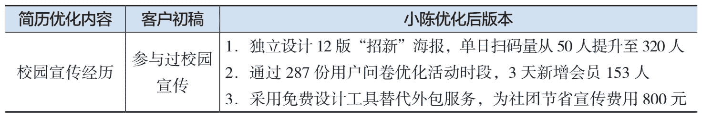
按基础价 30 元一份算，小陈下班接 4 单就能达到日入 100 元的目标。如今客单价已提升到 200～300 元，并靠熟人推荐稳定客源，每月额外收入 3000～5000 元。
因此能赚钱的核心不是改文字，而是用豆包做岗位精准匹配。每年上千万应届生求职叠加数亿职场人的晋升跳槽需求，让简历精修成为刚需、高频且长青的市场。

**二 豆包改简历全流程 从零到变现**
想像小陈一样做这件事，只要抓住三个关键步骤，新手也能快速上手。

**第一步 接单前准备 搭建岗位关键词库**
关键词对简历精修至关重要。一是能命中招聘系统的筛选规则，避免被直接淘汰。二是让简历重点突出，快速贴合职位要求，提升招聘官好感。
新手最怕不同岗位需求拆不清。其实用豆包批量拆解，10 分钟就能搭好 10 个热门岗位的关键词库，后续直接套用。先收集运营、会计、行政、销售等岗位的通用招聘信息，复制到豆包 App，用下面这个核心模板拆解。
帮我批量拆解以下岗位的通用招聘需求，每个岗位输出两点。
1. 按出现频率排序的核心关键词。
2. 新手必须掌握的 3 项技能。
岗位列表：[粘贴 10 个岗位招聘需求，用分号分隔]
表 1-2 就是围绕 5 个热门岗位的拆解结果。
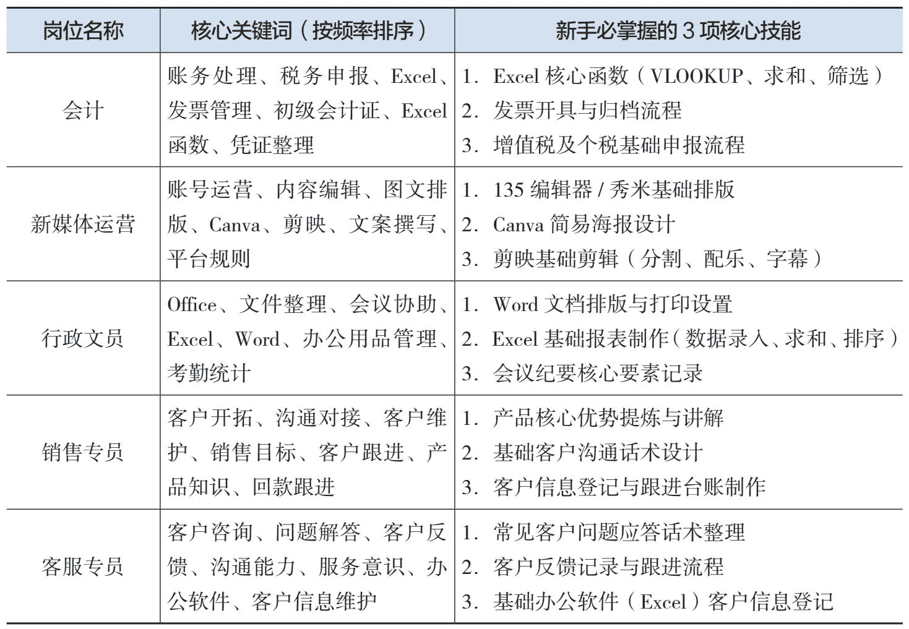

**第二步 精修简历 一个万能模板加三个场景技巧**
豆包改简历的核心是挖掘亮点并对接需求。无论客户没给招聘要求、简历内容太少，还是担心千篇一律，都可以用一个通用模板加场景补充解决。
通用 AI 提示词核心模板：
基于以下原始简历和[岗位名称]的核心需求关键词[粘贴第一步拆解的关键词]，帮我精修简历，具体如下。
1. 个人信息只保留姓名、电话、邮箱，补充精准求职意向。
2. 教育经历按“学校—专业—时间”排列，优秀成绩、奖学金重点标注。

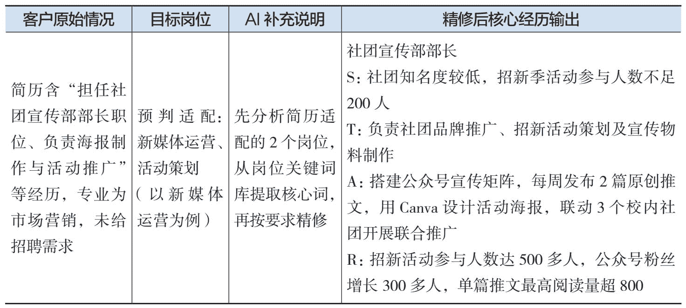
3. 用 STAR 模型重构经历，每个经历加一个量化数据，融入关键词。
4. 技能栏删去无关项，补充岗位必备技能并标明熟练度。
5. 给出行距、字体等排版建议。
原始简历：[粘贴客户简历]
针对三类高频场景，只需在通用模板上加一句补充说明即可。
场景一：客户只给简历，没给招聘需求。
补充提示：先分析简历适配的 2 个岗位，从岗位关键词库提取核心词，再按要求精修。
补充后生成的样例见表 1-3。

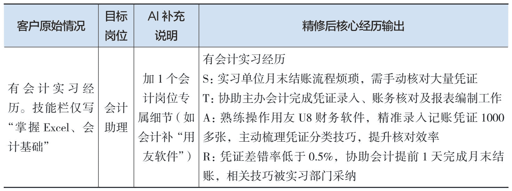

场景二：应届生转行者，亮点极缺。
补充提示：从校园兼职经历中挖掘可迁移技能如社团管理等于统筹能力，再用 STAR 模型重构。
生成样例见表 1-4。
场景三：担心简历雷同。
补充提示：最后加一个[岗位名称]专属细节，如会计补充“用友软件”，运营补充“135 编辑器”。
生成样例见表 1-5。
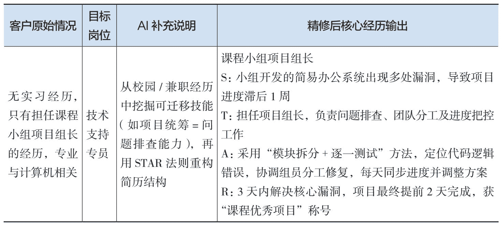

**第三步 跨平台接单 实现多渠道变现**
豆包精修简历变现的关键是多平台曝光和信任建立。
平台一：闲鱼发布广告见表 1-6。
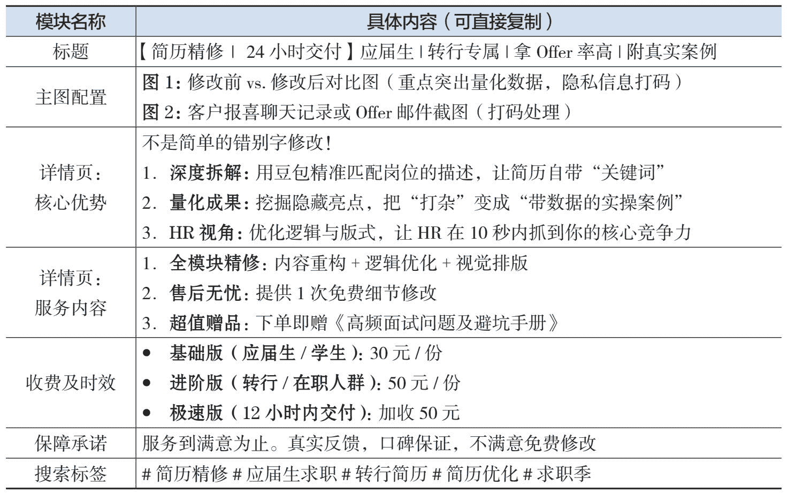

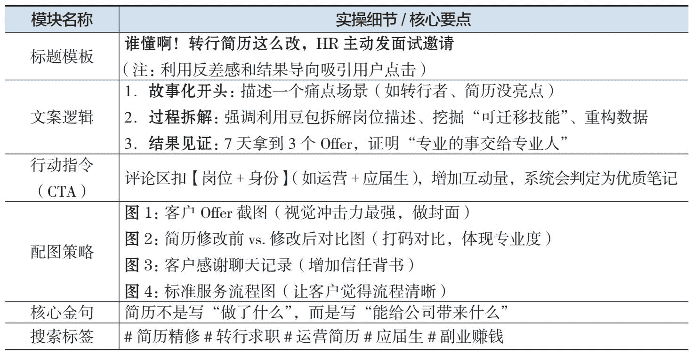
平台二：小红书发布接单笔记见表 1-7。

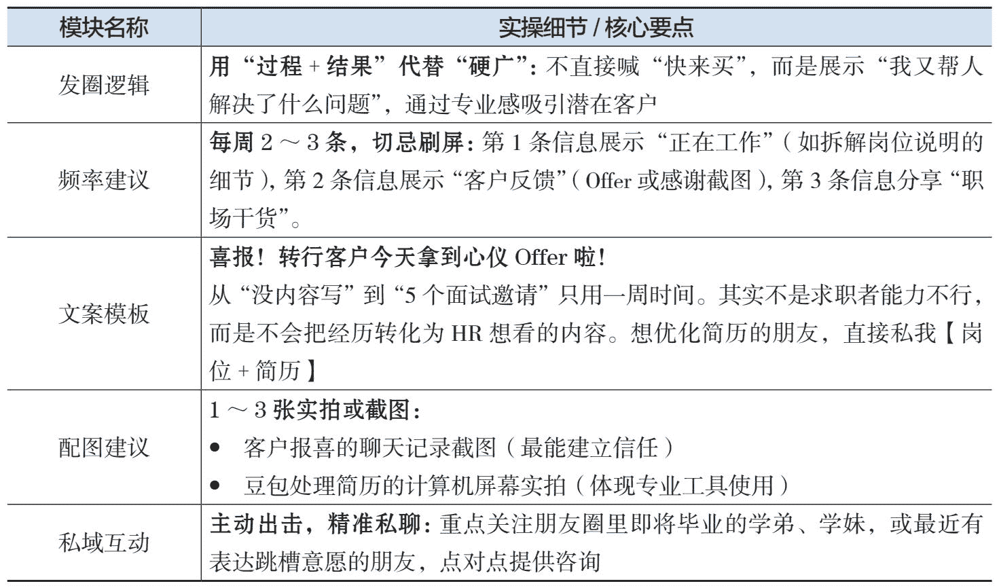

平台三：朋友圈发布接单图文见表 1-8。
变现升级技巧：第一单完成后一定要收集客户反馈如收到面试邀请、Offer 截图，可直接用作闲鱼主图详情页素材，真实案例是最好的获客工具。后期可推出老客户转介绍优惠，转介 1 人双方各减 50 元，快速放大订单量。

**三 增收攻略 让豆包价值最大化**
攻略一：定制私人提示词库，实现极速交稿。
关键操作：把面向会计、销售、技术等不同岗位的豆包提示词分类存档，同类单子直接复制使用。
服务思路：别人一晚改 2 份，你一小时改 10 份。极速交付本身就是可提价的增值服务。
变现逻辑：靠标准化优质提示词提升修改质量和效率，赚的是效率翻倍的钱。

攻略二：建立行业模板库，让内容加排版卖出更高价。
关键操作：手机里存好 5～10 套针对互联网、设计等不同风格的简历模板。
服务思路：豆包负责内容，你负责排版，交付精美的 PDF 文件。客户感觉不仅改了简历，还省了排版时间。
变现逻辑：一站式交付单价可提升到 100 元。
攻略三：延伸后续咨询，把一个客户做成回头客。
关键操作：交付后主动询问是否需要面试话术，让豆包针对该岗位生成预测题和标准答案。
服务思路：客户最终要的是 Offer，面试攻略能缓解焦虑，乐意在简历费基础上加购。
变现逻辑：从修改师变为咨询师，单个客户利润直接翻倍。
借助豆包，即使没有 HR 背景的普通人，也能高效产出高质量简历，开启低成本高胜算的副业。

**第 2 招 豆包写演讲稿 15 分钟交付 一天接 5 单没问题**

**一 为什么有了 AI 还有人愿意付费写演讲稿 因为准时和体面最值钱**
演讲稿生意长青，核心在于解决客户两个现实需求。
1. 对效率的确定性：马上要，必须准时。演讲多为突发任务，客户买的是对时间的掌控感，能准时交付就能缓解职业焦虑。
2. 对分寸的专业性：不能出错，必须体面。正式场合说错话代价大，客户付费买的是社交保险，需要有人帮他避坑、保形象。
明明有豆包，客户自己不会吗？事实是 AI 出稿快，但调教提示词、去机器味仍需一到两小时。对客户而言，研究工具本身就是负担。他们的诉求很简单：我没时间研究，我付钱你搞定，我直接拿去念就行。所以客户买的仍是省心和确定性。
大三学生小悦在小红书发文案金句，积累上百粉丝后有人私信求写文案，就此开启副业。起初她最怕接演讲稿，拿捏不好职场精英语气，常查资料到深夜。有了豆包后，素材搜集、框架搭建、基调设定几分钟完成。她把精力放在按客户习惯做最后润色，交付质量稳定。
现在小悦一篇收费 50～300 元，利用课余时间每天接 2～3 单，月入 2000 元，生活费自给自足。如果你想像她一样变现，最该掌握的不是写作，而是调教能力。

**二 豆包写演讲稿全流程 从生成文字到高质量定制方案**
客户自己用豆包写作通常是提需求等结果；专业写手则利用豆包做角色匹配和场景推演，交付的不是一段文字，而是一套拿起就能讲、讲出分寸的现场方案。只需三步。
**第一步 行业背景渗透 消除外行感**
动笔前先用豆包联网检索，把该行业的语言体系和圈内痛点摸清。
提示词模板：
我正在为一位建材行业老板撰写年会发言稿。请先做深度调研。
列出过去 12 个月该行业最受关注的 3 个趋势或挑战，并总结从业者普遍焦虑点。
提供 3 个该行业正式场合绝对不能用的外行词，以及 3 个能体现资深身份的专业金句。
告诉我这个圈子最推崇的价值观如稳健、创新或重义气。
以经营 15 年的建材贸易商老板在行业商会年会发言为例，表 2-1 对比了渗透前后的差异。
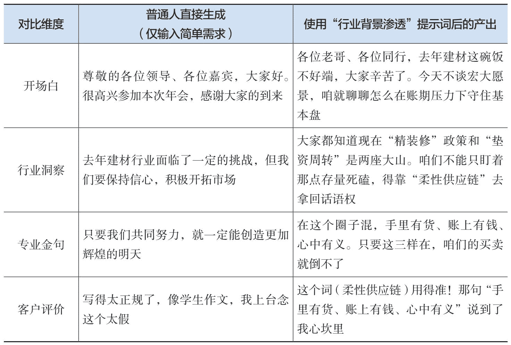
这一步让你在几分钟内掌握话语权，初稿因包含行业细节而显得更懂行，这是直接生成做不到的。

**第二步 调准性格参数和情绪配比 让稿子像本人**
AI 稿子常像新闻播报，没感情。客户需要稿子像他本人说话。
提示词模板：
请基于上述背景写演讲稿初稿。要求如下。
身份设定：主讲人约 50 岁，稳重重情义，行业摸爬滚打 20 年。语气干练，禁用虚头巴脑的排比和空洞成语。
情绪权重：20% 行业共情点出现实不容易，50% 硬核实力展示过去一年具体突破，30% 合作诚意给出未来具体支持。
逻辑钩子：每段结尾设计一个引导听众点头或互动的顿点，禁用总之、让我们共同努力等 AI 常用词。
以建材贸易商老板为例，表 2-2 对比了调教前后的内容差异。
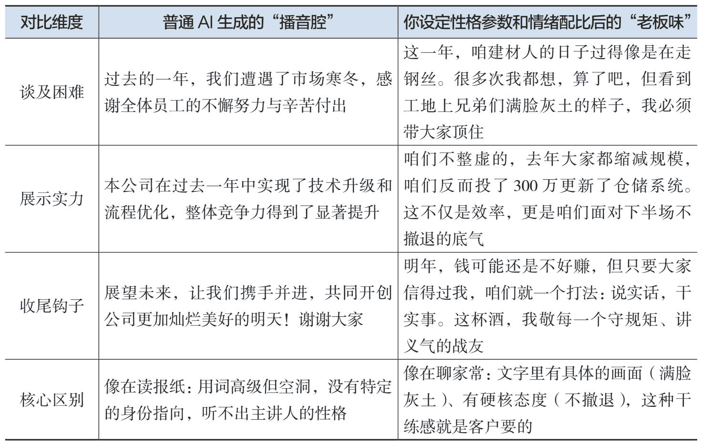
这种对语气的精准控制，让稿件更接近真实人类表达，产生真切力量感。

**第三步 模拟现场朗读 保证拿起来就能顺讲**
很多稿子看着好读起来绕口，必须做最后的口语测试。
提示词模板：
请对稿件做交付测试。
排查长句：找出所有超 20 字的句子拆解，保证换气顺畅。
口语翻译：将书面语如致力于、由此可见替换为日常表达如咱们死磕、其实大家看来。
模拟质检：扮演挑剔听众，指出哪一段最容易走神并给出修改建议。
朗读校对：加入 3 处引导互动的停顿提醒，确保不看稿也能顺讲。
表 2-3 给出调教前后的对比。
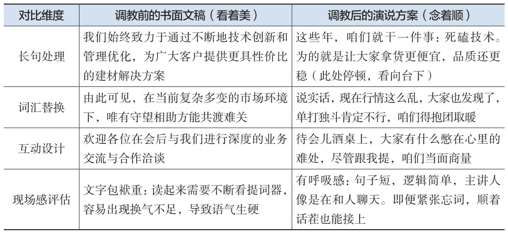
交付的是经过多轮测试的现场方案，能大幅节省客户二次修改时间。这种拿来即用的确定性正是客户愿意付溢价的原因。

**三 跨平台接单攻略 如何避免低价内卷跑出高客单**
豆包普及后，若广告仍写帮写演讲稿，客户第一反应是 AI 写的只值 50 元。要吸引高溢价客户，需要重新定义卖点。
平台一：小红书用反差感笔记吸引潜在客户见表 2-4。

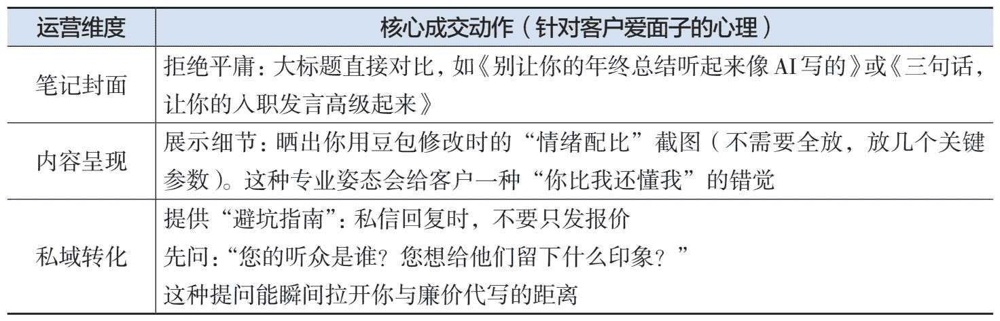
平台二：闲鱼客户需求明确处于临场焦虑，你只需给吃定心丸见表 2-5。

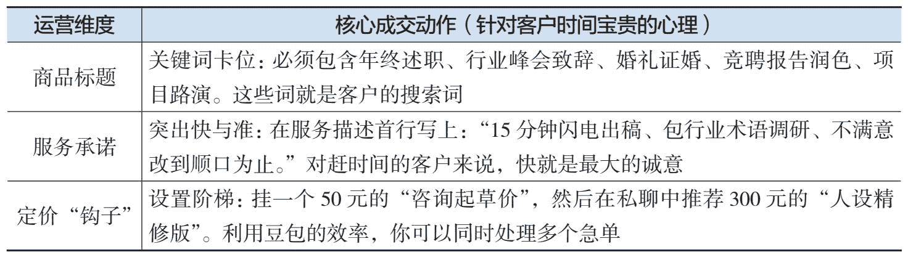

行业社群锁客：把演讲稿做成复购生意

行业群组是第三个核心入口，这类服务自带复购属性。帮老板把一次关键演讲打磨到位，后续活动基本会持续回流。操作思路见表2-6。

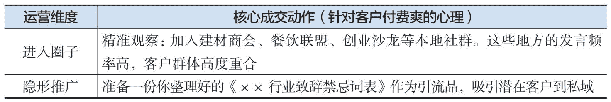

想锁定真正愿意买单的优质用户，先用流程筛选，别一上来就谈价格。

报价前先递诊断表，避免掉进比价
客户开口问价就直接报，很容易被拉进横向对比。更稳妥的做法是先发《演讲需求诊断表》，逐项确认听众构成、主讲人性格偏好、现场禁忌点、期望达成的效果。这张表本身就是筛子。只想捡便宜的人会被繁琐问题劝退，而看重场合、怕出错的高质量用户，会因调研的细致度产生深度信任。

用豆包做低成本增值，提升交付感知
生成效率高，可以额外补两项增值内容，能明显拉升满意度。常规交付清单大致如下。
精修成稿：经过三步调教去掉机器味，贴合身份的成品文字。
朗读助推稿：在关键处标注停顿、重读、目光交流提示。
核心金句卡：提炼三条传播力强的观点，方便客户用于PPT或朋友圈。

四 增收打法，让豆包价值最大化
想把收入做大，记住下面三个进阶思路。

1 建立行业智库模型，从写手升级为顾问
普通写手只能被动接收信息。你可以借助豆包提前搭建特定赛道的知识库，在客户开口前就对趋势更有把握。
实操：用联网与长文本解析，提前针对新能源、大健康、制造等热点赛道梳理年度关键词与政策风向。
变现逻辑：沟通时顺势提示，“张总，最近圈内都在聊低碳数字化，建议在稿子里加入这个视角的案例。”这种超出预期的前瞻性，会让客户觉得你提供的是战略咨询而非机械代写，单价自然可以翻倍。
高端感：超越预期的洞察，能把身份从执行者抬升为顾问。

2 启动压力测试服务，为现场扫清隐患
大场合最怕不合时宜。可以用豆包模拟不同观众视角，对初稿做质询。
实操：在豆包中输入提示，“你现在是刻薄的竞争对手或理性的投资人，请阅读这份讲稿，指出逻辑不通或易被攻击的漏洞。”
变现逻辑：交付的不只是稿子，还有一份《现场风险预案》。告诉客户，“王总，我帮你测过，第3段提到的数据可能会被追问，建议提前准备回应。”对高层来说，这种安全感比文采更值钱。

3 提供多维语感选型，把通用稿变成VIP定制
很多客户自己也不确定现场该呈现什么风格。利用高效产出，可以提供选型服务。
实操：围绕同一主题，快速生成三个不同风格的开头和结尾。
版本A 沉静稳重风，适合正式政务商务场合。
版本B 热情鼓舞风，适合内部动员或晚宴。
版本C 幽默自嘲风，适合非正式交流。
变现逻辑：让客户做选择题而不是问答题，三方案的定制体验会显得工作饱满，也更尊重个性化需求。高端感在于客户有审美参与感，觉得稿子是他参与、你用AI精准缝合的作品，心理满足感极高。

在智能时代，文字生产成本在下降，专业判断和极端场景的确定性却在升值。行业智库、风险预案、多维方案，实质是用豆包帮客户承担表达风险。当调研精准、调教到位、交付贴心，客户在台上体面，价格就不再是成交障碍。

第3招：豆包做音乐，订单随旋律而来

一 需求井喷，零基础也能分一杯羹
短视频背景音乐、直播间BGM、企业宣传配乐、婚礼生日纪念曲，市场非常大。数据显示2024年生成式AI音乐全球市场规模约4.19亿美元，年增速53.34%。短视频配乐、商用BGM、个性化定制是三大旺区。传统创作周期长成本高，根本供给不上。
很多人觉得做音乐需要专业功底，其实用豆包完全没有门槛。优势有三：零门槛创作，不懂乐理也能用文字描述生成旋律；风格全覆盖，摇滚民谣古典爵士都能适配；高效免费，三分钟出完整曲，还能免费下载。
大三学生小林没学过音乐，每天课余两小时接单，初期接50元每首的短视频配乐，靠低价高效口碑每月15到20单，月入750到1000元。积累客户后承接个人企业定制，现在月收入已突破3000元。门槛低成本低风险低，只要有听歌感觉就能把感觉变成可变现旋律。

二 两步上手，快速产出客户专属音乐

首步 先拆解需求，锁定关键要素
接单后先确认四个要点，减少返工。
使用场景：短视频、宣传片还是个人纪念，不同场景风格差异大。
核心要求：想要的情绪如温馨轻快大气热血，音乐类型、时长15秒30秒1分钟、乐器搭配等。
细节偏好：对节奏旋律是否有特殊要求。
商用需求：是否需要商用授权，避免后续版权纠纷。
整理成清单确认无误后再开工。

第二步 用豆包生成，有三种做法
打开豆包点音乐生成。

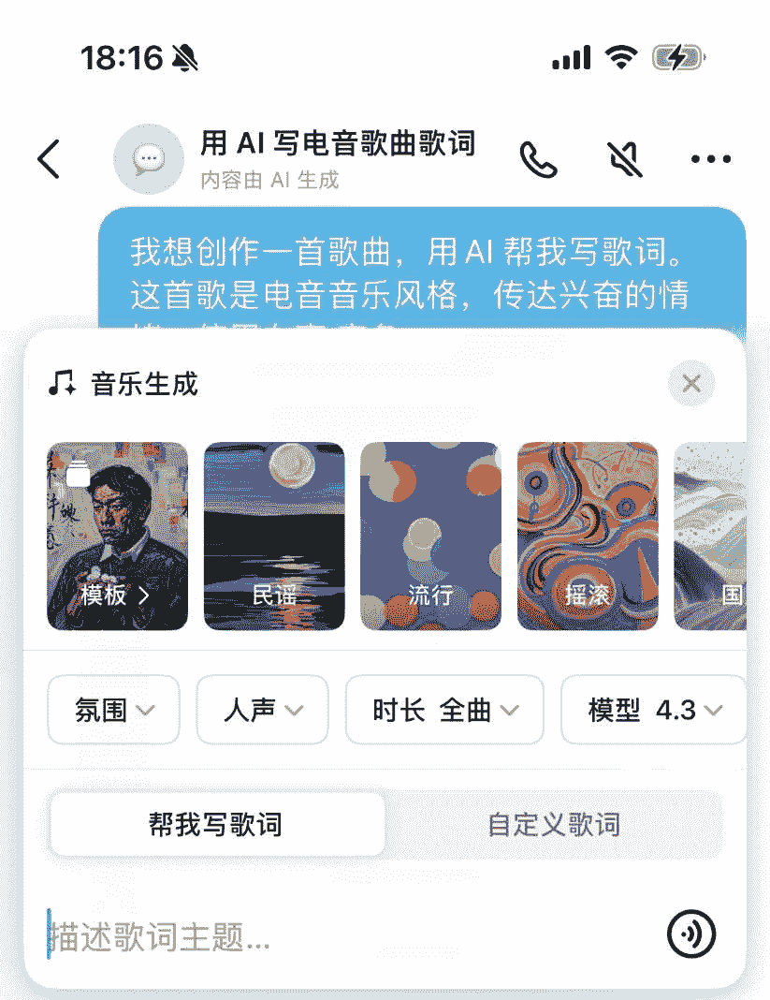
图3-1 豆包生成音乐界面

30

方式一 帮我写歌词
选好风格民谣流行摇滚等，设置氛围人声时长，描述歌词主题即可生成。万能模板：使用场景加核心主题加情感基调加关键信息。
例如毕业季短视频配乐场景，主题是青春回忆与离别祝福，基调温馨治愈，句式简洁7到10字，民谣风格全曲。很快出歌，可改名下载分享。随机性较大，不支持修改，若客户有特殊歌词要求，建议先生成歌词再作曲。

方式二 自定义歌词
同样参考万能模板。例如我想写一首汉服短视频配乐，主题江南烟雨雅致，国风意境，基调温婉悠扬，用词偏古典诗意，女声演唱，歌词中要包含品牌名蒹葭，按完整结构生成。
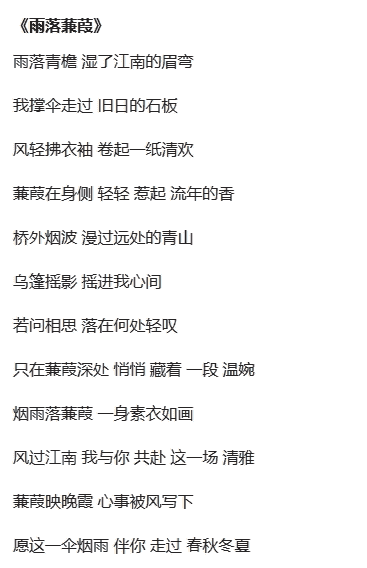
很快生成符合要求的歌词，可细节调整后再粘贴到音乐生成，点自定义歌词设置选项，就能把歌词变成歌曲。定制感强，客户会觉得专为自己而写。
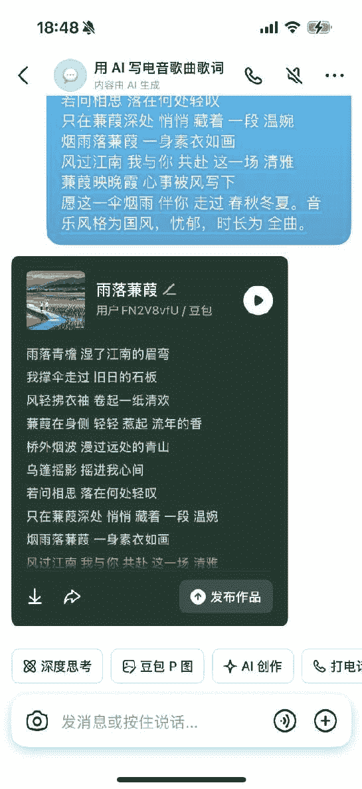
33

方式三 做同款
音乐生成里有大量模板，点做同款自动配置选项，快速生成相似歌曲，适合批量做短视频背景音乐。

三 三大变现方向与收入预估

方向一 接定制歌曲订单，最快变现
平台闲鱼搜定制歌曲、小红书发案例笔记、朋友圈。
适合新手验证变现。
上架服务：闲鱼发AI定制原创歌曲30分钟出歌，主图放歌词加音频片段。

引导需求：提供模板请告诉我为谁定制、什么场景、想表达什么情绪。
用豆包生成：写歌词选曲风生成带人声MP3。
交付增值：附赠歌词卡和使用授权说明。
收入参考：情侣纪念歌68到128元每首，品牌宣传歌150到300元每首，宝宝成长歌88元每首附赠歌词卡。月接15单约1200到2500元。

方向二 打造虚拟歌手IP
平台抖音视频号快手。
适合内容创作者做长期品牌。
起号定位：取名如AI歌手小满、打工人AI歌姬。
内容规划：每周2到3首原创情绪歌。
视频形式：歌词动态字幕加豆包歌曲加生活化画面。

变现闭环：粉丝超5000开商品橱窗卖点歌服务；粉丝超1000申请网易云QQ音乐人上架数字专辑；接本地商家定制。
收入参考：商单300到1000元每首，数字专辑每千次播放5到10元，直播打赏点歌20到50元每首。稳定运营三个月月入800到3000元。

方向三 批量生产情绪歌单授权
平台抖音小红书朋友圈。
适合效率型选手。
选垂直主题：职场情绪、Z世代恋爱等。
批量创作：用豆包批量生成5到10首同系列歌词。
上传分发：开通音乐人上传专辑，简介写短视频可授权使用私信，同步小红书免费送注明来源。
收入参考：非独家授权20到100元每首每次，平台播放分成每千次播放3到8元。10首歌持续被用月入500到1500元。不需要懂乐理，核心是把情绪翻译成歌。

第4招：用豆包写书评，小红书带货轻松拿佣金

一 不用读完全书也能靠书评赚钱
想做小红书读书博主却嫌书太厚，自己写的书评干巴没互动，带货更卖不出去。其实不需要通读全书，也不需要文笔出众，豆包能搞定。
大学生阿哲用豆包五分钟生成一篇有真实感的书评配封面，一周带来47笔图书订单佣金211元，自己根本没读过那本书。
豆包的核心价值是把书的核心价值翻译成普通人看得懂用得上的表达。能解决三件事：把抽象观点变生活故事，如把沉没成本变成电影难看就离场；用朋友聊天语气写，避免AI腔；三分钟产出标题正文金句。
操作门槛低：纯图文无需露脸，小红书蒲公英带货简单，平台对实用书单成长干货流量倾斜。

二 三步做出高转化带货书评

第一步 用豆包帮你选书
别猜，直接让豆包筛选有热度适合小红书的书。
提示词模板：推荐5本适合在小红书推广的图书，要求心理成长女性自我提升类，近三个月讨论热度高，内容易结合生活场景从而获得共鸣。
豆包会给出书单，并附上每本书的核心卖点、种草角度和热度关键词。
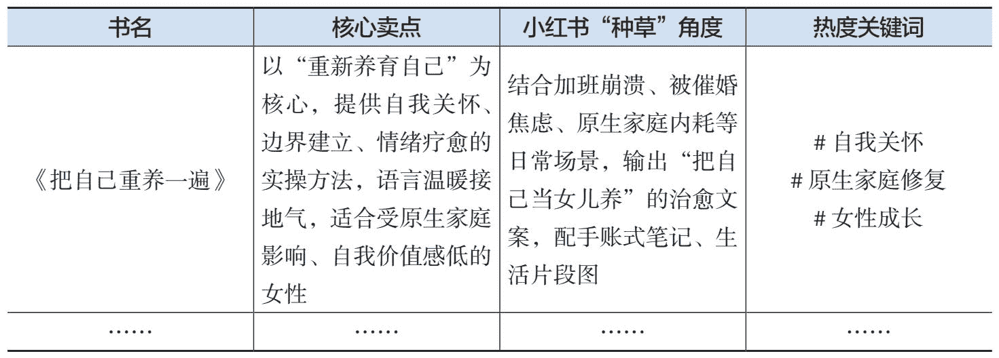

第二步 用豆包生成爆款书评
直接让豆包写书评容易生成读书报告。有效做法是给脚本框架，让它模拟真实用户心路。
提示词模板：你是一位25岁左右小红书读书博主，最近读了《认知觉醒》，以第一人称写800字内书评。标题要吸睛，开头讲一个具体真实困扰，中间引用1到2句书中金句并用自己的话解释点醒之处，结尾自然引导行动像朋友推荐，语气真诚有温度多用我你对话感。
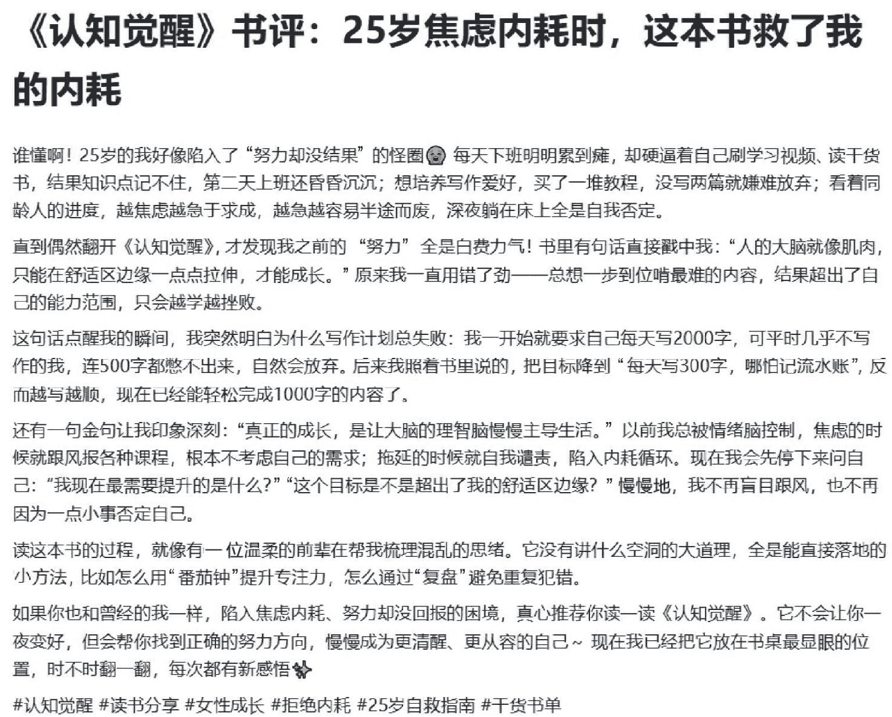
三分钟就能成型。结构化提示词往往具备痛点共鸣、有解法、有信任感。

第三步 发布带链接
轻微调整语气后复制到小红书，配图书封面发布，置顶评论或正文中挂商品链接引导购买。

三 从单篇到稳定收益

攻略一 建立高佣金热书库
聚焦心理自助、女性成长、理财入门、亲子教育四大类，佣金高且长期有搜索。每月用豆包更新书库保持热点。

攻略二 批量内容矩阵
一篇母版多平台复用。小红书发完整图文，朋友圈拆短感悟做人设，抖音视频号用剪映做图文视频配音字幕。一套内容三处曝光。

攻略三 打造个人IP标签放大价值
坚持输出后给出清晰人设，如每周一本改变我的书、30天读透一本成长书、职场妈妈治愈书单。粉丝破1000可申请蒲公英接出版社品牌合作单条500到3000元，开设9.9到29.9元付费专栏，引导私域做21天读书打卡营客单价100元以上。
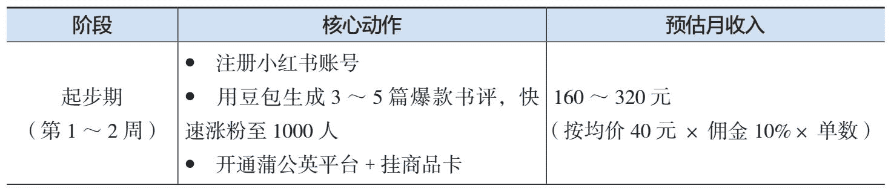
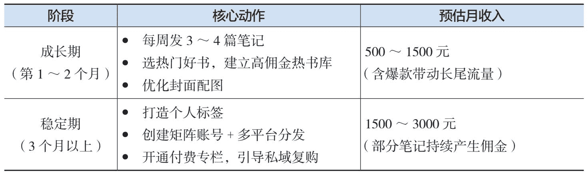
表4-2为分阶段收益预估供参考。

表 4-2　用豆包写小红书书评的分阶段收益预估表

续表

变现的关键从来不是把一本书卖掉，而是让读者认可你作为选书顾问的专业度。豆包可以快速把想法变成可用的内容，人要做的是持续输出可信赖的价值。沉淀时间越长，护城河越深，现金流越稳定。

44

**第 5 招：豆包做会讲故事的动态相册，亲子长辈市场最好做**

**一 为什么静态照片卖不动**

如今用户看短视频，单纯轮播照片很难留下印象。宝妈想记录孩子成长，子女想为父母祝寿，手里素材很多，却常被三类问题卡住。

1. 影像只是堆叠：整屏静图滑动，配文干巴，像流水账，亲友滑两下就走。
2. 音画不同步：音乐气质不符，画面与节奏错位，观感割裂，投入时间却没互动。
3. 文字套路化：不是“宝宝一岁啦”这种万能话，就是空泛夸赞，照片背后的温度传达不出来。

很多新手觉得装个剪辑软件套模板就能成，实际容易掉两个坑。只会拼图叠文，缺少共鸣；不会提炼情绪线，成品单调疲劳。真正能接单变现的人，会写有情绪线的脚本，让照片获得生命感，而这正是豆包擅长的部分。

全职妈妈小王就走通了这条路。她把豆包当编剧用，而不是素材搬运工。为一次宝宝周岁项目，她先让豆包把零散照片拆成成长节点并提取打动人心的关键词，再把平铺直叙的描述改写成有细节、有收束的温情独白，最后让豆包给出风格建议。成片发到朋友圈后点赞不断，客户还额外给了红包。

**二 从素材到交付的全流程**

**第一步：前置准备——搭好氛围与音乐库**

动态相册的灵魂是氛围。接单前先用豆包为不同人群定制一套视听参考，确保成品一出来就有信任感，见表 5-1。

表 5-1　利用豆包建立的视听风格指南

46

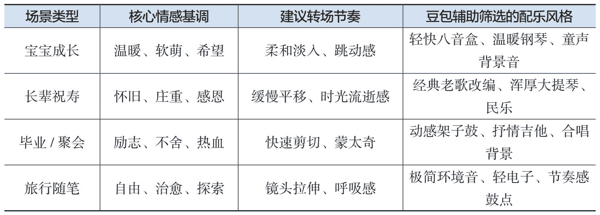

**第二步：核心制作——分幕脚本模板+三项进阶技巧**

豆包的核心价值是把混乱的照片整理成有文学性的叙事。

豆包提示词模板：
我这里有 4 张[宝宝周岁]的照片，请帮我策划一个 30 秒的视频脚本。
主题起名：为这个相册起一个有诗意的标题。
叙事分幕：把照片分成 3 个阶段例如初见、探索、成长，为每一段写 10~15 字的感性旁白。
画面要求：说明每一段对应的照片应呈现的情绪例如开心的笑、专注的眼神。
互动结尾：写一句能促成朋友圈点赞的收尾语。

豆包生成的样稿如图 5-1。

47

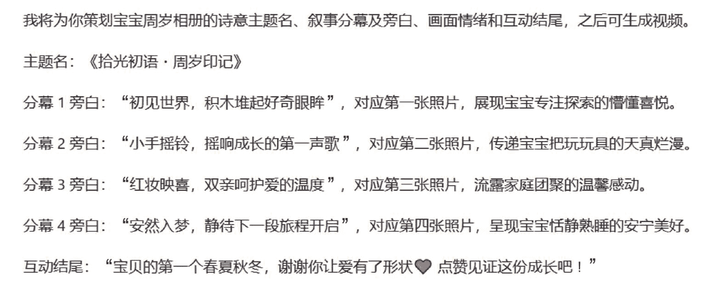

图 5-1　豆包生成的视频脚本

进阶做法。
1. 视觉钩子：让豆包挑一张最适合做封面的照片，并配一句提升打开率的封面文案。
2. 定制化旁白：客户若提供了宝宝小名、老人职业等细节，一定让豆包写进文案，定制感就是溢价依据。
3. 节奏建议：询问豆包文案适合几秒换一张图，保证文字与画面同步。

**第三步：落地合成——用工具快速成片**

不必学专业剪辑，用豆包的脚本去驱动一键成片工具，例如剪映。将照片导入后把主题和文案填入对话框，一键生成即可。成片后做两处微调。
1. 统一画幅：老照片多为 4:3，建议统一为 9:16 竖屏，并按豆包建议统一滤镜色调。
2. 卡点对齐：按豆包建议的转场节奏，例如宝宝片段 1.5 秒一张，调整停留时长。

**第四步：多平台接单——建立信任闭环**

曝光和信任一起抓。

1. 闲鱼挂单示例。
标题：【动态相册定制｜24 小时交付】记录成长|贺寿|深度走心文案|真实案例|满意为止
详情页：
【为什么选我】不做简单堆图。用豆包拆解情感需求，深挖成长细节，每段文字有温度，让亲友 10 秒抓住亮点；
【服务内容】①一对一风格分析；②全流程精修脚本配乐剪辑；③2 次免费修改；④赠《朋友圈文案包》；
【收费】基础版 39 元 15 张以内；深度版 88 元 含 AI 配音+定制脚本；加急另付 30 元。

2. 小红书引流示例。
标题：谁懂啊！把奶奶年轻的照片做成视频，她看哭了
正文：帮一位奶奶做 80 岁生日视频。原始素材很差，只有几张模糊老照片。我用豆包拆解奶奶的辛劳岁月，从平凡日子里挖出感动点。再配上文案，观看时奶奶眼眶都红了，全家人都说走心。
互动：需要给长辈做视频的宝子，评论区回“场景+数量”，优先反馈！

49

**三 提升客单价的三个打法**

攻略一：私人提示词库实现量产
动作：把祝寿、金婚、战友聚会等品类的豆包指令存进手机备忘录。
逻辑：别人一晚一单，你 10 分钟搞定脚本，极速交付本身就能收加急费。

攻略二：绑定增值服务
动作：①打包老照片修复；②提供代写朋友圈文案包。
逻辑：客户要的是情感闭环，同时解决清晰度和文案，单次收费可提到 150 元以上。

攻略三：做记忆管家长期锁客
动作：为老客户建重要纪念日提醒库。
逻辑：交付后主动询问生日或纪念日，用豆包生成配套祝福方案。从制作方变成家庭情感顾问，单个客户利润翻倍。

动态相册的本质是情感叙事。用豆包解决文案与逻辑，交付的是引发共鸣的情绪产品，而不是干巴巴的画面。

51

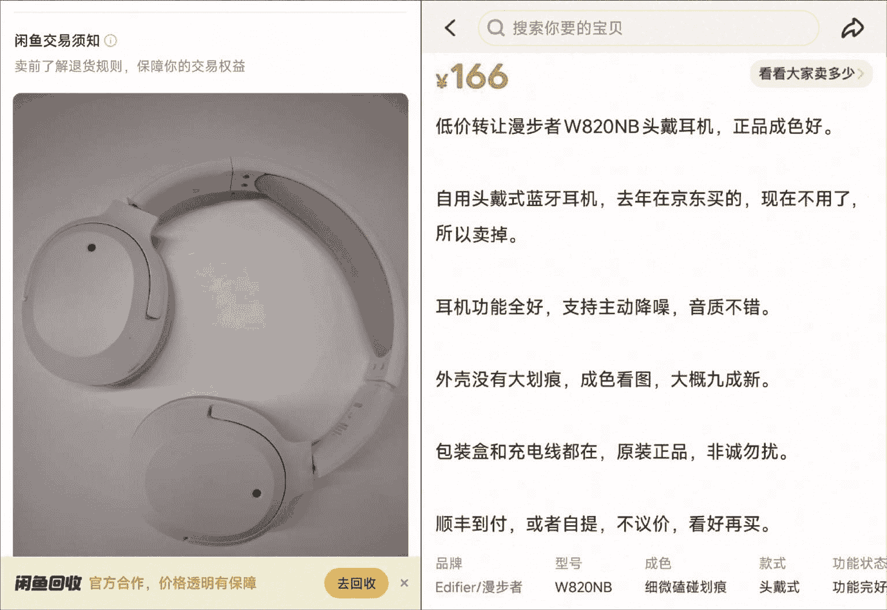

**第 6 招：豆包改写闲鱼商品说明，让二手变抢手**

**一 说明书式文案为何卖不动**

在闲鱼，文案直接决定转化。很多卖家抱怨没人问，核心是缺乏吸引力。直接复制官方参数，很难突围。有人卖耳机，介绍写成参数罗列，如图 6-1。

图 6-1　在闲鱼出售耳机的产品介绍

问题点见表 6-1。

52

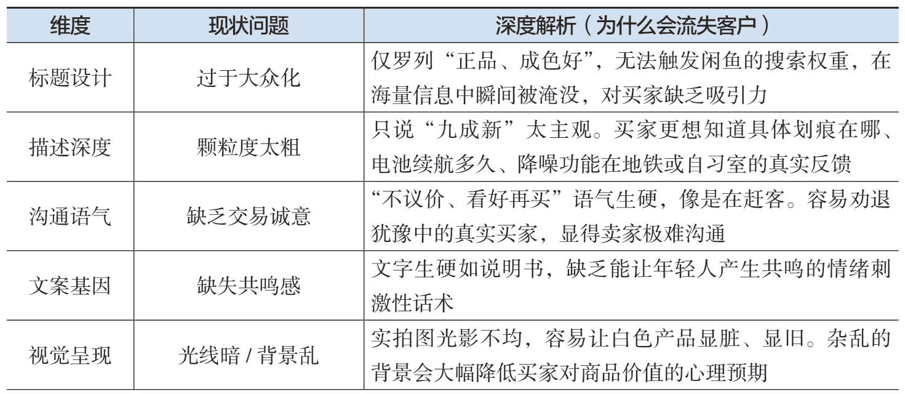

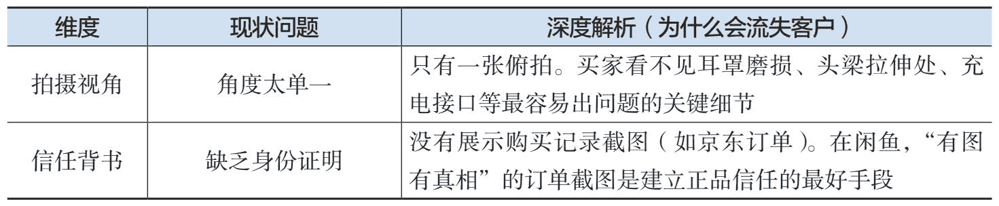

表 6-1　该产品介绍存在的问题

续表

有人会问，AI 工具那么多，随便润色不行吗？可以，但闲鱼更看重网感与人设，工具的数据来源与语感很关键。豆包是抖音系产品，学习了海量爆款内容，不仅会组织文字，还懂当下用户偏好的表达与促单话术。它能捕捉流行热梗与情绪词，让二手描述像真人转让，而非冷冰冰的贩卖。

以耳机为例，改写效果如表 6-2。

53

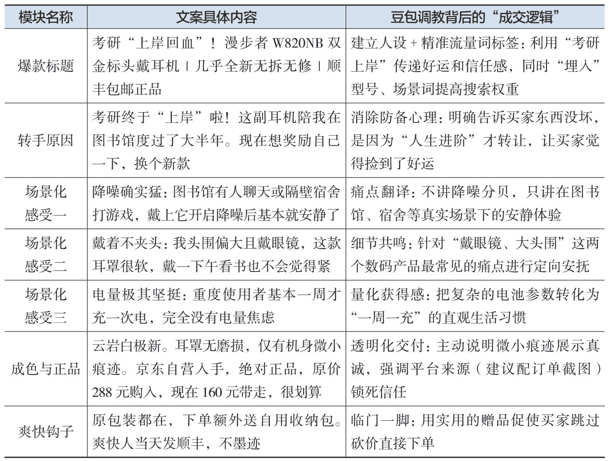

表 6-2　通过豆包改写的产品介绍

改写后还要加强视觉刺激。多拍清晰实拍，从整体到细节，再附购买截图，让买家一目了然。

改写的本质是揣摩买家心理。
1. 捡漏心理：突出原价与现价差距，以及赠品。
2. 安全感：主动晒订单截图与瑕疵说明，用诚实换信任。
3. 情绪价值：讲述物品背后的真实经历，增加代入感。

宝妈桑桑怀孕时囤了大量母婴用品，生完后用不上。她最初上架文案很简单：大牌吸奶器，正品没用几次，便宜出。挂了半个月只有点赞和砍价。后来让豆包改写，用真实经历写挑选过程和消毒习惯，把性能翻译成“宝宝用着不遭罪、妈妈半夜操作不手忙脚乱”，并植入准妈妈常用关键词。更新当天就有 3 位妈妈私信，未砍价还夸她细心，当场下单。

想快速回血，可用三步调教豆包。

**二 三招让文案更有转化**

**1 分类调教，让豆包见人下菜碟**

买家需求不同，话术要分品类。
卖数码：别堆参数，写使用感受。可指令：“写出这款耳机在图书馆的真实表现，重点夸耳罩软、戴久不夹头，加一句游戏不延迟，让怕踩坑的人安心。”
卖美妆护肤：突出珍惜感。可指令：“强调我有洁癖，每次用完都用酒精棉片擦喷口，放避光小冰箱，让买家觉得被呵护得像新的一样。”
卖家居：突出省心感。可指令：“写清楚架子折叠后只有一本书厚，女生两指可拎，搬家直接放后备箱，把租房族必备点写透。”

**2 搜索优化，埋好流量词**

闲鱼靠搜索成交，买家搜什么，标题就要出现什么。参考关键词搜索流量表见表 6-3。

56

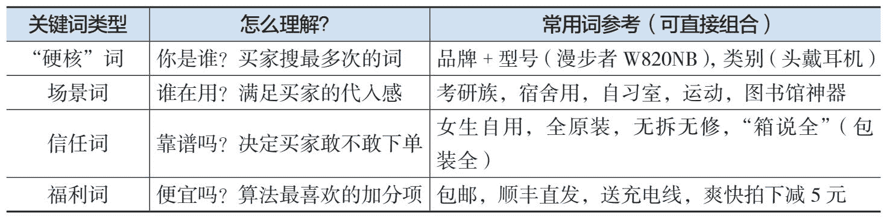

**三 增收打法，把咨询变成订单**

除了文案，私信与首图也很关键。

**1 私信高情商模板**
场景一：应对狠砍价
提示词：有个买家砍价太狠，请帮我写一段得体的回复。语气稳，强调顺丰包邮、成色全原装无拆修，可额外送自用收纳袋或充电线作为补偿，让他明白买的是省心。

场景二：推动犹豫下单
57

提示词：买家犹豫不决，帮我写一段催单话术。不要硬催，自然提到刚才有人问自提、待会儿要去快递站寄件。告诉他现在拍就能顺手带走明天到，否则要等后天，给一个立即下单的台阶。

场景三：回应正品质疑
提示词：买家一直问是不是正品。请写一段有底气的回复。提到有官网购买记录或电子发票，支持任何平台验货或线下见面，强调是自用转手非二道贩子，用硬证据锁信任。

**2 视觉进化，让照片更有说服力**

很多卖家拍图随意，光线差、背景乱。直接用豆包修图会显假，更好的是让它当拍摄指导。

拍摄角度提示词：我要在闲鱼卖一个二手的[商品名称]，请站在买家角度，告诉我必须拍哪 5 个细节，才能证明没坏过而且很干净？

以耳机为例：耳罩内侧特写证明无破皮汗渍；头梁拉伸处展示伸缩顺畅；充电口细节展示接口完好；防伪钢印序列号证明正品；全家福同框证明来源可靠。

58

图片标签提示词：帮我想几个贴在图片上的短标签，一句话戳中买家痛点，例如在[某张图片内容]上标什么字最显正宗？

以耳机为例：发票图标“官网入，支持在线验货”；接口图标“几乎无划痕，成色极新”；合照图标“箱说全，处女座自用”。

环境布置提示词：我家里较乱，怎么拍实拍图能让这个[商品名称]看起来干净高级不显旧？

以包包为例：下午 2-4 点去阳台拍自然光，别开刺眼吸顶灯；撤掉杂物铺纯色白床单或原木桌；这样颜色亮、质感好，没有旧货市场感。

在闲鱼，文案让人觉得靠谱，图片让人觉得爱物。调教好豆包，就能把旧货卖出应有价值。

60

**第 7 招：豆包帮人修证件照，按张收费秒到账**

**一 工具普及，为何仍有付费需求**

证件照用途广泛，从考试报名、求职简历到结婚办证都离不开。线上报名普及后，电子版需求激增。

豆包类 AI 修图越来越强，有人会疑惑既然能免费用，为何还要付费？实际上工具好用不代表人人用得好。普通用户只会说“帮我修好看点”，结果五官失真、比例怪，还要反复改。你卖的是省时间并确保结果的确定性。

1. 提示词调教的价值：你会精确指令豆包，客户不会。掌握精确提示词能让豆包保留皮肤纹理、对齐领口高度。你卖的是驱动豆包产出高质量成品的能力。
2. 行业标准的价值：你懂官方规则，客户在盲区。豆包不会主动识别各证件的合规要求，你手里有各类报名规格，能在正确答案框架内出图，客户只能反复试错。你卖的是百分百过审的确定性。
3. 审美细节的价值：你懂深度微调，客户只会简单操作。缺乏审美容易把照片修成塑料感。你能引导豆包做眼神光提亮、发际线修整等细节，让照片自然好看。这是普通尝试跨不过的门槛。

普通人用豆包只是随手修图，能出就行；高手把豆包当数字后期师，既要好看又要过审。这种靠专业指令和行业标准建立的确定性，就是你按张收费的底气。

大二学生小王起初只在朋友圈帮同学换底色赚点小红包。随着教资、四六级报名季到来，需求暴涨，他忙不过来。最初最怕客户提细节要求：换西装、修眼镜反光。手动修一张要半小时，参数不对还可能被系统退回。

后来他调教豆包。原本要抠图找素材的精细活，现在只需输入精准指令，豆包几秒完成换装和合规检查。小王不再...

与其纠结像素细节，不如把时间用来梳理各类考试、政审、签证对证件照的硬性规范。客户报明用途，就能通过豆包指令直接产出一张高概率通过的成品。小王主打「过审率高、自然感强、出片快」，按难度和场景一张收 9.9 元到 40 元，报名高峰期一天能接几十单，月入稳定在三千到四千元。

**二 用豆包做三阶精修，交付一张能过审的证件照**
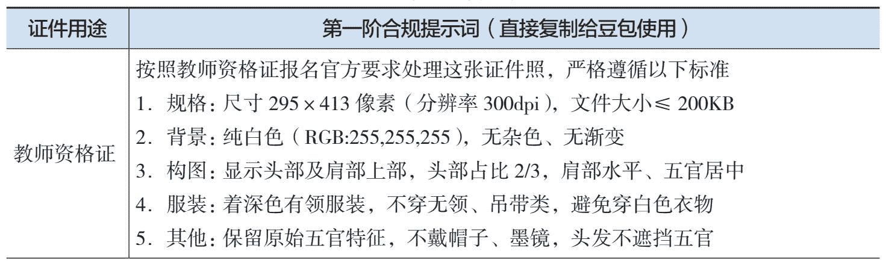
准备环节，一分钟搞定，为后续调校打底。

请客户提供源文件：面部正对镜头、五官分明、无明显遮挡，头发不压眉，镜片无重影，发送未压缩的原片。

先把需求锁定：记录三项关键信息，用途如教师资格、四六级、签证、公务员、结婚登记；规格如 1 寸、2 寸、小 2 寸；背景色按官方标准确定，由系统给出无需客户自行挑选。

启动豆包的图片编辑/修图模块，把照片导入，进入三段式校准流程。

**第一阶段 合规打底，严格按官方标准走**
这是证件照的底线，已为不同场景整理好达标指令模板，避开尺寸、背景色、比例等易拒点，表述清晰无歧义，将 [] 内内容替换即可直接使用。各场景专属合规词见表 7-1，直接套用。
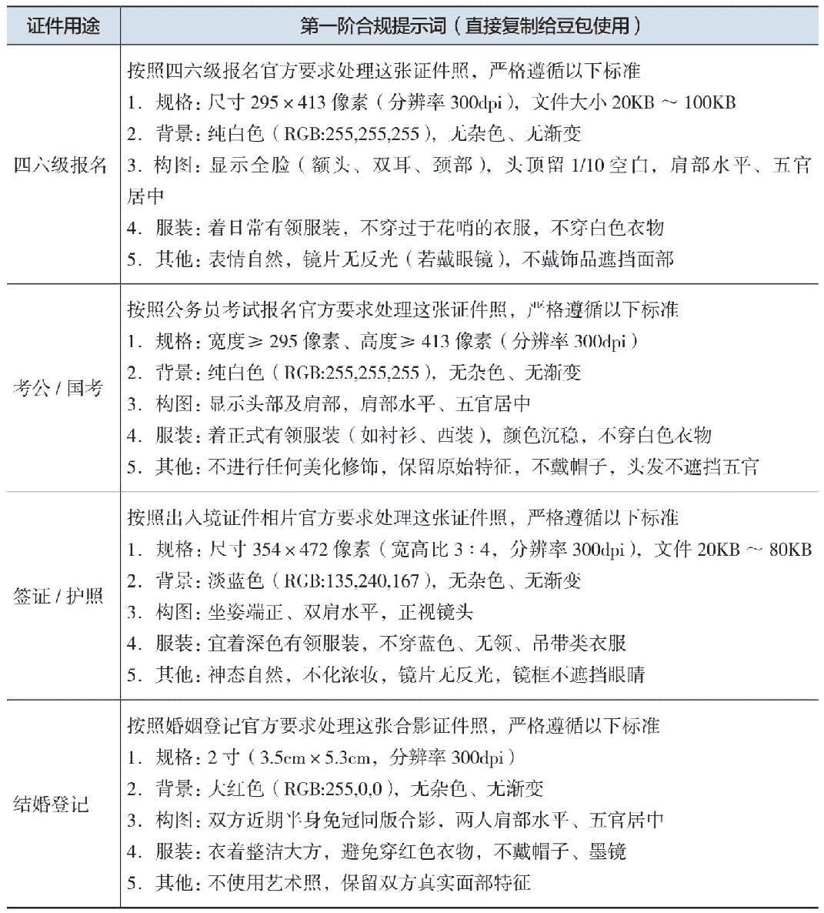
例如要为短发女生做教师资格照，只需在豆包上传生活照，再套用对应合规词即可生成。

自检小技巧：三秒快速核对
尺寸分辨率大小：右键查看属性，与对应用途的官方要求一致。
底色：无杂色、不偏色，与指令里的 RGB 值相符。
比例构图：头部占比、五官位置、肩部姿态符合要求，无遮挡。

**第二阶段 轻度美化，只去瑕疵不改脸型不过度磨皮**
合规后做基础优化，重点清除痘印、斑点等小瑕疵，让面部干净清爽，但皮肤不能磨成塑料，五官保持原样，修完仍是本人。

豆包提示词模板：
请对该证照做轻度精修，遵循保留真实、不过度美颜原则。磨皮仅去除面部明显痘印、斑点、油光，保留皮肤原生纹理，不磨平毛孔；五官轻微提亮眼神光，修正眉形不均问题幅度不超过 10%，嘴唇自然润色不改唇色；细节处理镜片反光、整理碎发不改发型、领口拉平对齐；整体微调面部光影增强立体感，不改变脸型与五官比例，无过度美颜痕迹；签证护照照仅做基础瑕疵修复，不进行五官调整。

自检小技巧：五秒自然度核对
皮肤有真实纹理，不僵硬、无塑料感。
五官与原图相似度 90% 以上，眼神不空洞，无变形。
细节反光、碎发已处理，整体整洁。

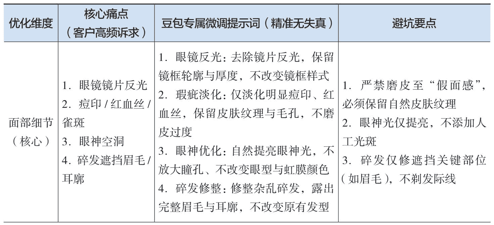
**第三阶段 细节微调，让照片合规又更耐看**
多数证件照允许在合规范围内做自然优化，下表微调词既能解决客户高频痛点，又不改变人物核心特征，避免审核被拒。

表 7-2 豆包专属微调提示词
续表
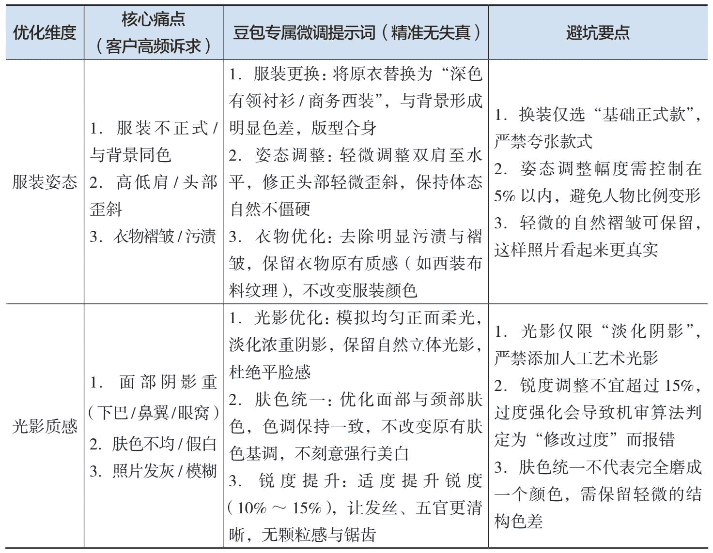
例如继续为上文短发女孩的教师资格照增加光影质感，让成片更出彩。

**三 接单与报价：把豆包证件照做成稳定现金流**
新手首周可先用现有社交圈积累首批好评和案例，信任度高，开单快。

朋友圈/微信群「前后对比图」引流如表 7-3 所示。
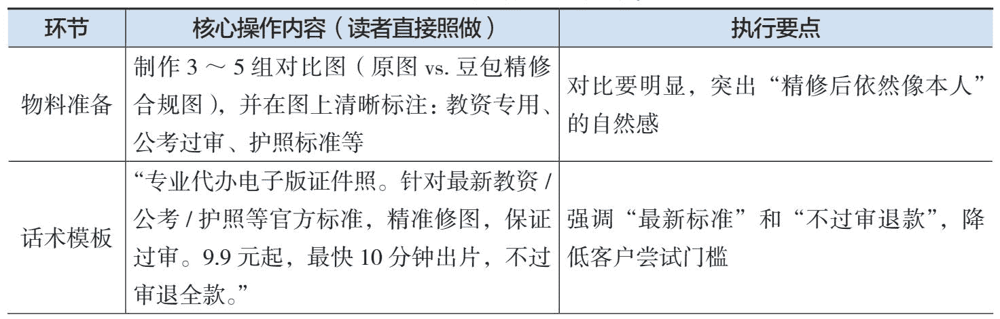
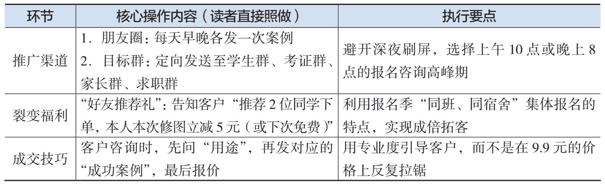
续表
小红书/抖音图文引流如表 7-4 所示。
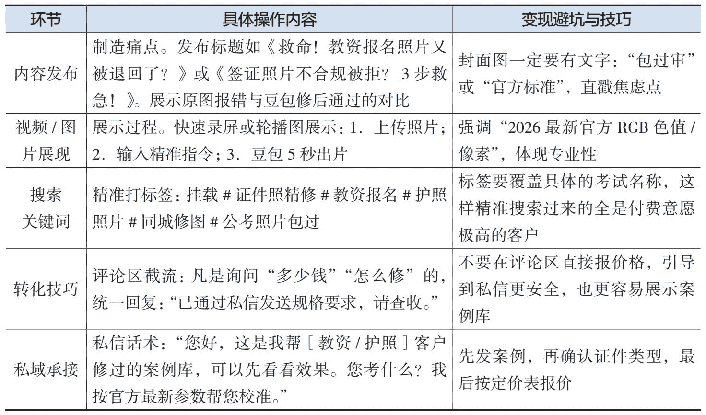
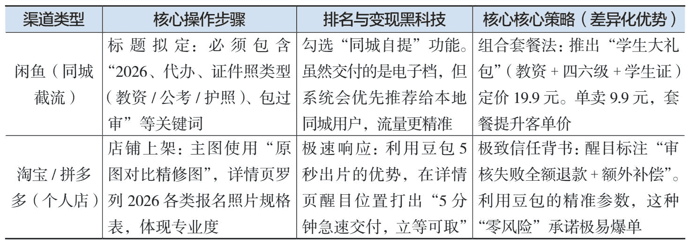
二手平台与电商精准截流如表 7-5 所示。

**四 扩大收入：让豆包价值最大化**
**1 价格梯度：9.9 到 99 的跃迁**
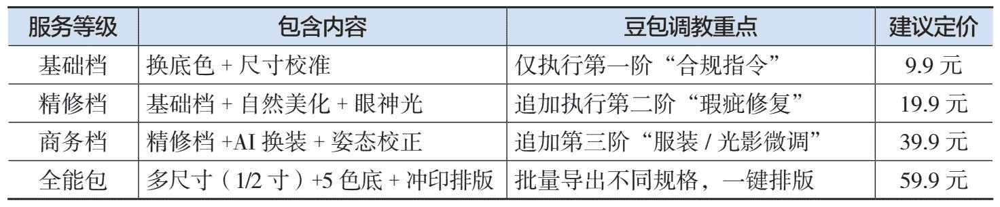
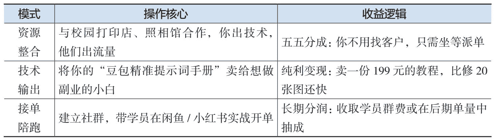
不要只给单一价格，用套餐感引导高价成交，见表 7-6。
表 7-6 设置各档套餐

**2 搭建“副业合伙人”模式：从个人到团队的裂变**
订单多到忙不过来时，别拒绝，找人分工协作，见表 7-7。
表 7-7 打造“副业合伙人”模式

用豆包修证照的本质不是换头。卖的是确定性，让客户报名 100% 通过；卖的是情绪价值，让客户看到一张像本人又更好看的照片；卖的是效率红利，别人半小时一张，你调教豆包 1 分钟搞定。

**第 8 招：豆包做创意表情包，3 种玩法轻松赚钱**
**一 定制表情包：社交刚需藏着千亿机会**
微信里随手发的表情包藏着生意。全世界每天通过通讯应用发送表情符号超 60 亿，我国日发送量约 6 亿次。自 2015 年微信表情商店上线后，爆款频出。表情包「乖巧宝宝」两年下载 1.5 亿次，作者打赏收入 50 万元；还有长辈专属表情包一套获 17 万多人打赏，收入至少 17 万元。

对普通人而言，不会修图手绘也不懂设计，做表情包门槛高。刚好用豆包能解决定制难、效率低、成本高的问题。它能精准解决三件事。

零门槛生成，输入文字描述即可生成卡通人物、萌宠、企业吉祥物。
批量保持风格，用风格参考功能让整套表情包形象质感统一。
降低后期成本，生成图可直接抠图加字切图，甚至做序列帧动效，从接单到交付最快 1 小时。

**二 四步实操：用豆包搞定从创作到交付的全流程**
定制表情包核心为需求对接—形象生成—后期优化—交付上架，四步清晰。

第一步：明确需求，锁定关键要求
接单后先确认三点，避免返工。
使用场景：个人社交还是企业商用，商用是否需要可商用授权。
形象与风格：核心形象、风格、主要色调。
交付要求：数量、是否动态、是否需上架平台。
信息整理后确认无误再开工。

第二步：用豆包生成核心素材
核心在于精准提示词。
帮我生成图片：奶茶店吉祥物+卡通奶茶杯形象+微笑表情+暖色调+扁平风+透明背景，比例“1:1”

豆包会给出 4 张图，不满意可重绘。批量需求可用 3×3 网格指令，一次性生成 9 张情绪图，再择优处理。

第三步：后期优化，满足交付标准
用豆包自带 AI 抠图，调尺寸，微信表情包主图 240×240 像素、缩略图 50×50 像素。
加字调色可用豆包或 PPT，字体选思源、阿里巴巴普惠等免费商用字体。
动态效果用豆包生成序列帧，导入 ScreenToGif 调整帧率即可。

第四步：规范交付/上架，提升满意度
个人定制交付主图、缩略图 PNG/GIF 并备注使用方式。
企业定制额外提供可商用授权说明，注明 AI 素材来源合规。
需上架平台的订单，整理封面图、详情横幅 750×400 像素，并可指导注册微信表情开放平台、提交审核、开通赞赏。

**三 三大接单平台：新手从这里快速获客**

平台一：闲鱼，适合个人定制小单。标题写明 AI 定制表情包/个人专属/企业吉祥物/快速交付，配样品图，基础款 50 元/16 张静态，进阶款 150 元/24 张动态，闲鱼 AI 修图/表情包定制月均成交 2000 多单，新手月接 10～20 单可行。

平台二：猪八戒网，适合企业大单。入驻设计文创类目，主打企业 IP 表情包定制，餐饮母婴电商等客户客单价高，基础套组 800 元起，品牌联动可达数千上万，有担保交易。

平台三：微信生态，适合私域复购。作品发视频号朋友圈积累案例，可入驻微信表情开放平台上传原创，开通赞赏并在简介留定制联系方式，打赏+定制双收益，头部创作者月入超 5 万。

**四 进阶玩法：从接小单到做 IP，提升收益上限**
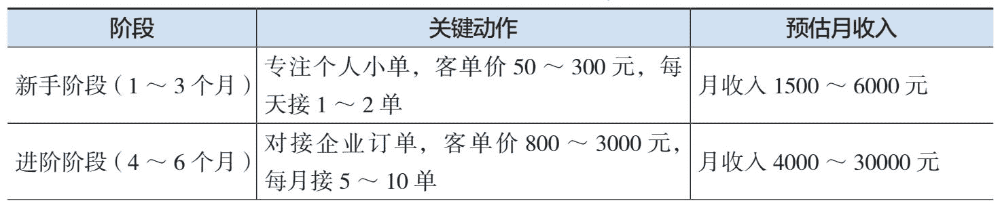
深耕垂直领域：聚焦职场打工人、母婴亲子、地域文化等细分赛道，形成标签，提高复购和标准化效率。
拓展企业服务：从表情包定制延伸到 IP 形象设计+表情包+周边开发，如奶茶店吉祥物后推钥匙扣杯套，利润可提升 200% 以上。
搭建 IP 矩阵：打造治愈系小熊猫等自有 IP，投放到微信 QQ Line 等平台靠打赏付费积累流量，再做潮玩绘本短视频，走表情包出圈—IP 孵化—全产业链变现。

不同阶段收益参考如表 8-1 所示。
续表
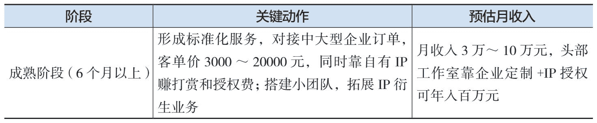
很多人忽略了表情包这种小而美的刚需，只要用豆包掌握简单创作技巧并愿意对接客户，就能赚到第一笔钱。

**第二篇 技能派接单，练个小技巧，月入 3000 元稳当当**
**第 9 招：用豆包整理提示词大全，靠卖提示词变现**
**一 写提示词困难的痛点，藏着低门槛商机**
现在人人讲 AI 提效，90% 卡在写不准提示词。模糊指令得到的结果敷衍或带 AI 味。免费提示词虽多，但质量参差，用户愿意为经过验证、分类整理、即用即出的提示词付费。

一位在读大学生小王摸索出考研复习、课程论文、兼职文案的提示词合集发在小红书吸粉后打包售卖，定价 3.9 元至 19.9 元，首月卖出 200 多份，轻松覆盖生活费。

**二 提示词变现 3 步实操指南，小白也能学会**
**第一步，调研需求，搭建提示词分类框架**
先摸清高频场景。
调研在小红书闲鱼公众号搜 AI 提示词，看点赞收藏高的内容。
搭建一级场景+二级细分框架：职场场景汇报总结客户沟通数据分析会议纪要；学习场景论文辅助刷题解析笔记整理升学备考；生活场景旅行规划美食食谱家务安排情绪疏导。

也可让豆包快速搜集需求并搭建框架。

**第二步，借助豆包，生成并优化提示词**

搭建框架后用豆包批量产出，再人工筛选测试。
批量生成提示词模板：你是一位精通提示词工程的 AI 专家。请为《AI 提示词大全》生成“[职场汇报总结]”场景的[50]个精准提示词，要求避免模糊表述。
筛选测试：把提示词粘贴到豆包，检查输出质量和符合度，合格标记、需优化则补充细节再测，淘汰无效项，最后打包。

**第三步，多平台接单，实现持续变现**
平台一：闲鱼
标题优化加入关键词提升搜索点击。
主图吸睛封面。
详情页逻辑清晰消除疑虑。
运营维护每日擦亮、及时回复、引导好评。

闲鱼挂单模板：标题 AI 提示词大全|prompt 对话指令|自动发货。主图内页目录截图+客户好评截图。详情强调实测可用、复制粘贴即出优质结果、含 300 多条提示词覆盖六大模块 18 个细分场景。交付在线文档永久有效，拍下 15 秒自动发货。

平台二：小红书
账号定位清晰，内容用痛点干货引流，视觉用低质 vs 优质提示词对比图、目录清单等。

小红书文案模板：
标题：终于把 AI 调教成专属秘书了！
正文：

让 AI 写稿变专业，先学会给它“戴帽子”

过去让模型代笔，总觉得味儿不对，真正起飞是从学会用角色代入开始。

比方说写商品文案，别再丢一句“写个文案”。不妨这么下指令：
假设你是一名深耕母婴品牌十年的品类总监，请为这款新上市奶瓶创作一篇能打动九零后新手妈妈的种草内容，重点强调防胀气与单手操作，语气亲切像朋友聊天，穿插三个真实使用瞬间，并提供五个标题备选。
立刻就有专业感。对此思路我整理了三百多条可直接套用的精准指令，复制粘贴就能用，效率直接放大十倍以上。

话题：#提示词 #AI 提示词 #指令合集 #AI 工具
配图：图1 提示词局部截图；图2 生成效果对比；图3 用户好评聊天记录

平台三：朋友圈

实操打法如下
1. 干货输出：规律分享实用的指令技巧，塑造专业人设
2. 案例背书：在获授权后晒出打码的好评、反馈对话

84

朋友圈文案模板

总有人疑惑，为什么同样用模型，别人能出爆款自己却不行。根源不在工具，而在方法。

附上一个通用的“角色+任务+要求”指令公式，照着用立竿见影。对了，我手上还有三百多条××场景指令，覆盖××细分领域，复制即可出结果。

朋友圈特惠只要5.9元，需要的直接私聊我，十分钟内发你资料。
附公式配图+电子书封面+目录截图+好评截图

**三　增收攻略，两大进阶玩法，放大提示词小生意收益**

攻略一：细分场景，提升客单
1. 关键动作：在职场、生活等基础类之外，推出痛点更强的细分工具包，例如副业变现指令包、职场晋升指令包
2. 服务思路：针对每个细分做更深的痛点挖掘和指令设计
3. 变现逻辑：满足精准需求，用户愿意为更贴合自身痛点的方案买单，同时竞争力增强

85

攻略二：推出定制服务，提升单客价值
1. 关键动作：交付标准化包后主动私信，询问是否需要专属定制指令
2. 服务思路：先确认客户核心诉求与交付要求，用豆包快速产出三个版本供挑选，再按反馈微调，全程控制在30分钟内
3. 变现逻辑：从卖标准品升级到卖个性化服务，单笔收费可从几元提升到上百元；同时沉淀更多细分素材反哺工具包，形成产品加服务的闭环
整理售卖指令工具包启动成本极低且可无限复制，核心在于挖掘客户痛点与信息整合能力，既能作为新手副业起步，也能通过迭代做成长期盈利的小项目

86

**第 10 招：用豆包批量写视频带货脚本，写一条赚一条**

**一　带货脚本写作的新机会：借助豆包让产能提升十倍**

打开抖音、快手、视频号、小红书，刷三条基本就有一条在卖货。2025年全球短视频用户已超50亿，中国直播电商规模超3万亿，企业短视频广告在总广告花费中的占比超过60%。

而主播与商家普遍面临两大困境：
1. 每天需拍3到5条，创意枯竭且脚本质量不稳定
2. 一条优质带货脚本可让转化率提升300%以上，但专业写手价格高产能有限，这正是机会所在

用豆包写脚本的优势：
1. 效率碾压：5分钟可生成结构完整的专业稿，是人工的十倍速度
2. 风格多元：同一产品可迅速产出测评风格、故事风格、快剪风格等多个版本
3. 成本优势：报价可比传统写手低30%，仍保持可观利润

87

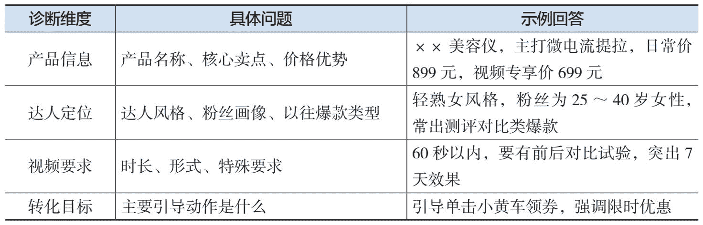

29岁的前社群运营周妍转型自由职业后瞄准脚本市场缺口：中腰部美妆主播每天为内容发愁，却负担不起全职编导。于是她用豆包推出“爆款脚本速递”，主攻30万到50万粉的美妆垂类。有月交付86条脚本，通过包月、按条、项目制三种模式月入28000元，利润率高。其中“相亲迟到急救妆”脚本单条视频销售额突破50万元。写带货脚本其实靠模板与效率，而非纯靠营销知识。

**二　三步走：用豆包高效交付专业级脚本**
批量接单必须建立标准化流程

**第一步：需求诊断表，接单时必问**
创作前通过问卷或沟通获取关键信息，见表10-1，避免反复修改
表10-1　接单前应获取的关键信息
整理成在线表单，客户填写后可直接作为创作依据

88

**第二步：用豆包快速制作脚本初稿**
模板一：痛点故事型
豆包指令范例：为[产品名称]写一个短视频带货脚本，目标用户[用户画像]。开头3秒呈现最痛场景[具体痛点]，中段展示产品如何解决问题，突出[核心卖点1][核心卖点2]，加入可信证明[实验/数据/证书]，结尾强催行动[具体指令]。要求口语化，符合[达人名称]说话风格
模板二：测评对比型
豆包指令范例：创作专业测评脚本，产品[产品名称]。设计直观对比试验[实验描述]，用镜头语言突出使用前与使用后差异，关键处加入放大镜特效或数据标注，结尾给出明确结论与购买理由
模板三：生活Vlog型
豆包指令范例：以一天使用[产品名称]的场景为主线写生活化Vlog脚本。从[早上首个场景]开始，自然展示在[场景2][场景3]的应用，捕捉使用时的愉悦感与便捷性，避免硬广，最后以“已经离不开它”的感受收尾，软性引导购买

**第三步：用豆包润色脚本，提升专业感**
润色后脚本具备导演思维与网感细节，商业价值大幅提升
1. 注入导演级镜头语言
原始指令：展示美容仪提拉效果
优化后指令：请将“展示美容仪的提拉效果”润色成可执行分镜脚本。要求包含从下巴到太阳穴的特写慢镜头、画外音强调“向上的提拉感”，颧骨处建议添加向上箭头特效，语言符合专业视频脚本格式
2. 标注节奏与情绪曲线
豆包指令范例：为以下脚本段落标注视频节奏与情绪建议：[粘贴脚本]。按0-3秒强冲突、3-15秒引入方案、15-45秒证明效果、最后5秒紧迫促单划分，并为每段建议背景音乐风格与剪辑速度
3. “埋设”互动与爆点钩子
豆包指令范例：在脚本中[时间点或内容点]位置设计3个不同风格互动。钩子选项：①悬念提问式②共鸣选择题③争议性观点，要求能有效引发评论区讨论

90

润色前功能性台词稿价值约100元，润色后含镜头语言、节奏规划、互动设计的制片文档价值可达300到500元。交付的是可视化解决方案，客户能清晰感知专业溢价

**三　三大获客渠道与接单策略**
渠道一：综合服务平台
平台：猪八戒网、一品威客
适合人群：新手起步
步骤：注册成为服务商，入驻文案/视频创作类目，主打AI批量带货脚本定制低价高效，竞标时附2到3个不同品类样品
优势：客户多为中小商家，基础版脚本纯文案加简单分镜报价300到500元，月接10单即可赚3000元以上
渠道二：专业创作平台
平台：新片场、场库
适合人群：有案例的创作者
步骤：用“品类+数据结果+核心创意”包装作品集，如美妆产品3秒完播率提升70%的悬念开头脚本
优势：甲方多为品牌方或MCN，15秒专业脚本报价300到1500元
91

渠道三：私域引流
平台：抖音、小红书、朋友圈
适合人群：长期品牌化运营
步骤：发布干货如3个高转化带货脚本开头模板、用AI批量写脚本技巧，简介注明承接带货脚本定制，打造垂直账号如日用百货带货脚本，精准吸粉
优势：让商家主动找上门，稳定获取长期批量订单

**四　进阶玩法：从写手到脚本供应商**
1 做标准化套餐，提高效率
基础版仅脚本文案300到500元；进阶版脚本加分镜运镜指导800到1500元；全案版含脚本创作修改及配套标题评论话术2000元以上
92

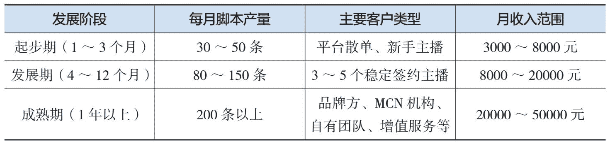
标准化套餐减少沟通成本，基础版按模板批量出稿，日接单量提升
2 延伸增值服务，增加收入
从脚本创作延伸到脚本加视频混剪、脚本加账号运营打包服务，加收500到1000元服务费；对接MCN机构按账号月费收费，每月稳定5000到10000元
3 搭建脚本素材库，赢得被动收入
整理不同品类不同平台优质脚本做模板，在知识付费平台售卖，每套99到199元；可开线上课教别人用豆包写带货脚本，实现接单加知识付费双收入
表10-2　用豆包写视频带货脚本的收益预期
很多人忽略短视频带货核心是靠数量对抗算法，模板加效率正是普通人的机会

94

**第 11 招：豆包写小红书笔记，帮人养号，付费写稿**

**一　不会写养不活没效果，小红书运营让人头疼**
小红书凭借种草属性成为打造个人品牌与推广核心阵地。很多新手和商家面临想做号不会写、想养号没方向的困境。笔记缺乏吸引力，数据惨淡；商家没时间研究，宁愿付费代笔。
新手小李写了3篇平价粉底液测评，标题普通正文只说好用不卡粉，阅读量几十，点赞收藏个位数，半个月零涨粉。用豆包重写后标题改为“学生族必入！3款平价粉底液实测，油皮不闷痘｜附遮瑕力对比”，正文补充肤质说明、上妆步骤、持妆测试，数据大幅提升，粉丝很快破百

**二　豆包写小红书笔记实操全流程，从获客到变现**
**第一步：明确客户需求，用豆包高效产出优质笔记**
找到有养号引流需求客户，需求模糊时先用豆包辅助拆解
豆包指令范例：你是小红书内容需求分析师，帮我梳理笔记需求清单，核心信息包括账号定位、目标受众、笔记主题、需突出卖点、风格要求、交付要点。请针对“为家居新手账号写一篇电热毯测评笔记”设计3个引导问题确认精准需求

95

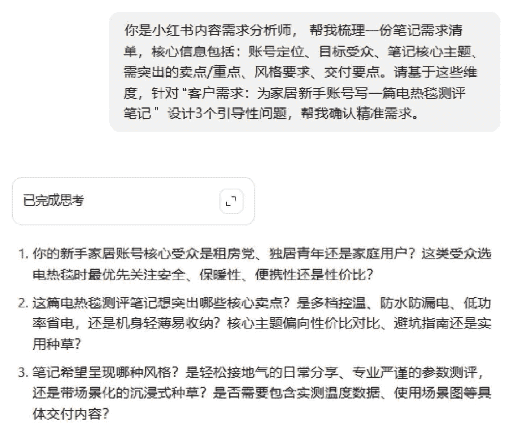
图11-1　豆包生成的问题清单
明确需求后高效产出
1. 给豆包下达精准创作指令
按场景+主题+风格+结构+要求设计指令，避免模糊
豆包指令范例：请以租房族/学生族视角撰写“宿舍专用单人电热毯”小红书家居测评种草笔记。核心突出性价比、安全低功率、实用性三点，功率60W、防漏电自动断电适配宿舍限电。风格轻松种草，语言口语化亲切，可加入语气词，避免生硬测评
2. 查看初稿，快速核查要点
核查是否匹配账号定位、核心卖点是否突出、风格是否符合
3. 细节优化，打磨爆款潜质
豆包指令范例：标题优化：把笔记标题改为更有吸引力的爆款风格，保留学生党性价比高关键词，可加入数字或对比
标签优化：基于内容筛选8个高流量标签，含2个核心、3个细分、3个泛流量
互动优化：把结尾互动语调整得更具引导性，加入具体问题
4. 整理格式交付客户
【小红书笔记成品】
标题：
正文：
【发布小建议】
推荐发布时间晚8点到10点，发布后引导亲友点赞评论提升初始流量

**第二步：多平台获客+标准化交付，快速变现**
1. 小红书账号引流
①搭建自运营引流账号，定位小红书文案代笔｜代运营，简介明确服务与案例
②每周发3到5篇，案例对比、干货技巧、接单公告均可用豆包生成
③评论区私信建立长期联系
2. 闲鱼/豆瓣接单
①闲鱼标题写“小红书笔记代写丨养号丨高效出稿”，附服务范围、价格单篇50元起、30天养号套餐300元起、案例截图
闲鱼服务文案模板：小红书笔记代写｜养号｜高效出稿
•服务范围：单篇撰写含标题正文标签、养号内容套餐、笔记优化
•优势：精准匹配定位，符合平台调性，1天交付，修改到满意
•价格：单篇××元起，30天养号套餐××元起
拍前私信沟通需求
②豆瓣在相关小组发接单帖附自我介绍与案例
3. 精准对接商家
①小红书搜索本地餐饮美妆母婴店，优先粉丝少笔记质量差的商家
②用豆包生成个性化私信话术，附案例与初步规划
4. 按交付标准化模板操作
①沟通确认：用需求确认函锁定信息
需求确认函模板：
•账号定位：×××
•笔记主题：×××
•核心要求：×××
•交付内容：标题+正文排版+8个标签+发布建议
•交付时间：×××
•费用与结算：×××
确认无误请回复“同意”，后续按此创作

**把笔记服务做成能持续回流的生意**

② **进度主动推送**：把创作进展先一步告知，信任感自然提升。别等客户来问，关键节点就先发声。
• 订金确认后可回复：“订金已到账，我这边已经开始搭框架，预计今天下午能给到第一版草稿。”
• 草稿完成后可回复：“初稿整理好了，正在精修标题和版式，今晚八点前发你过目。”

③ **交付做成标准包**：除了成套的笔记成品，再附上一到两条可落地的养号建议，让客户感受到额外价值。

④ **售后与长线引导**：交付时把修改边界讲清楚，有助于复购和转介绍。
• 规则说明：“成品收到后若有需要微调，比如产品描述或风格调整，随时提，两次修改不额外收费；新增内容按实际工时补差价。”
• 种草复购：“如果后面有持续的需求，可以看看30天陪跑组合，300元包含15篇笔记加月度规划，性价比更高；推荐朋友下单，你下次合作可享八折。”

**第三步：从单次接单到可预期的现金流**

单篇代写只能赚辛苦钱，要让收入更稳，就要把单次服务变成长期合作，并拓宽服务边际。重点从四个方向着手。

1. 用长周期套餐锁定消费。单篇波动大，套餐更稳定。可设计基础养号、进阶引流、商家专属等不同档位。沟通时可说：“长期组合单价更友好，也能保证内容连贯，更利于涨粉，比单次下单更省心。”

2. 做增值延伸提升客单。在文案撰写与养号之上，增加排版美化、封面视觉建议、账号代运营等，让同一客户产生更多消费。

3. 做个人品牌拉高议价。积累一定订单和案例后，从普通接单者变为专业顾问。
① 自运营阵地：在小红书、抖音持续输出干货，如爆款笔记底层逻辑、用豆包写文案的方法，建立专业形象。
② 沉淀案例库：把过往项目整理成案例集，接单时展示，提升溢价空间。
③ 阶梯报价：依据影响力和服务质量动态调整价格。

4. 小团队放大规模。订单多了可轻量组队。
① 招募兼职写手：找有小红书写作经验的兼职，你负责对接客户、拆解需求、把控方向，兼职用豆包出初稿，你审核优化后赚取差价。
② 打通上下游：与封面设计、视频剪辑建立长期合作，推出文案+封面+短视频的一站式方案，承接更大的商家订单。

借助豆包提效，抓住为他人写小红书笔记助力养号的变现路径，实现技能变现。

**第12招：用豆包做红包封面，把面子需求变现**

在微信、支付宝里，红包封面早已不是皮肤，而是数字名片。只要有喜事就有红包，有红包就有面子需求，场景正向日常刚需蔓延。
1. **婚礼生日**：新人想用专属卡通形象做电子伴手礼。
2. **晒娃晒宠**：宝妈和铲屎官想把孩子或宠物做成封面，在亲友群分享。
3. **情侣纪念日**：520、七夕等节点需要专属仪式感。

很多人以为做封面要会手绘和PS，其实懂行的人用豆包就是在搬运情绪价值。2025年小周表姐结婚，想在家族群发一个不一样的红包，他只做了两件事：先把婚纱照描述给豆包，结合中式喜庆和卡通萌系关键词生成三个创意方向；再用参考图功能保持人物特征生成独一无二的婚纱卡通插画。预览图一发，亲戚群反响很好，表姐当场发了大红包。尝到甜头后，小周在小红书和朋友圈接单，开启AI副业之路。

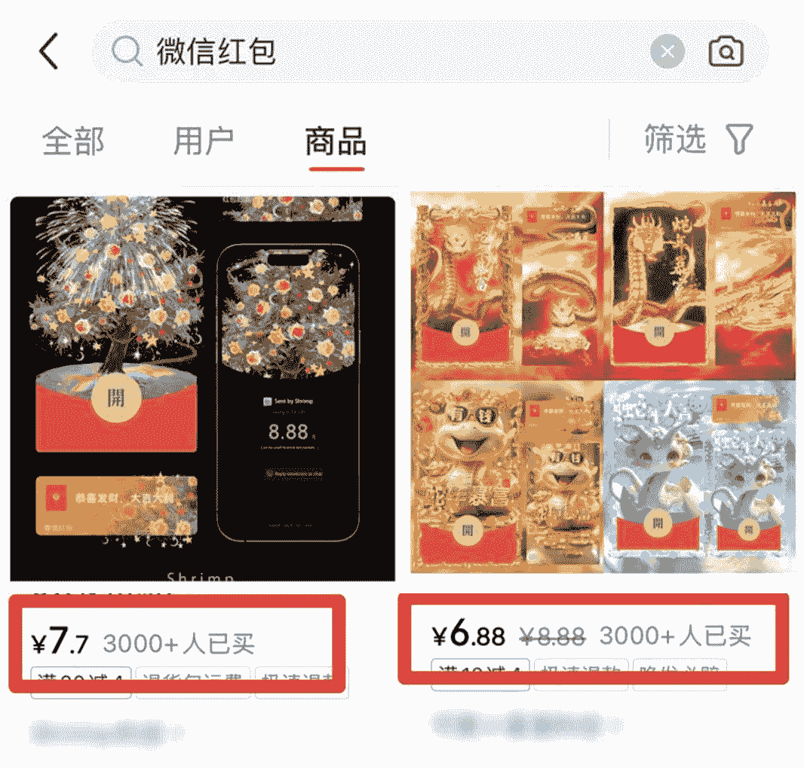

图 12-1　微信红包封面图

图 12-2　电商平台上热销的微信红包封面商品

**一 从聊需求到交付落地的完整链路**

客户买的不是一张作品，而是专属感。变现分三步。

**第一步：把模糊需求翻译成精确画面。**
新手常犯错是听到要喜庆一点就开画。正确做法是先收集信息：使用场景、关键元素、风格偏好、忌讳色彩，再转化为画面描述。可用提示思路：你是一名资深插画师，根据使用场景、关键元素、风格要求、竖屏9:16中心构图顶部留气泡位，构思三个具体创意方案并扩写成详细绘画提示词，输出创意理念和对应提示词。

豆包会给出多个方案，客户选定后定稿率大幅提升。

**第二步：一键生成与转绘。**
方向确定后，把提示词输入豆包生成竖屏插画，再用参考图做转绘，保持人物特征。

图 12-3　豆包生成的竖屏插画

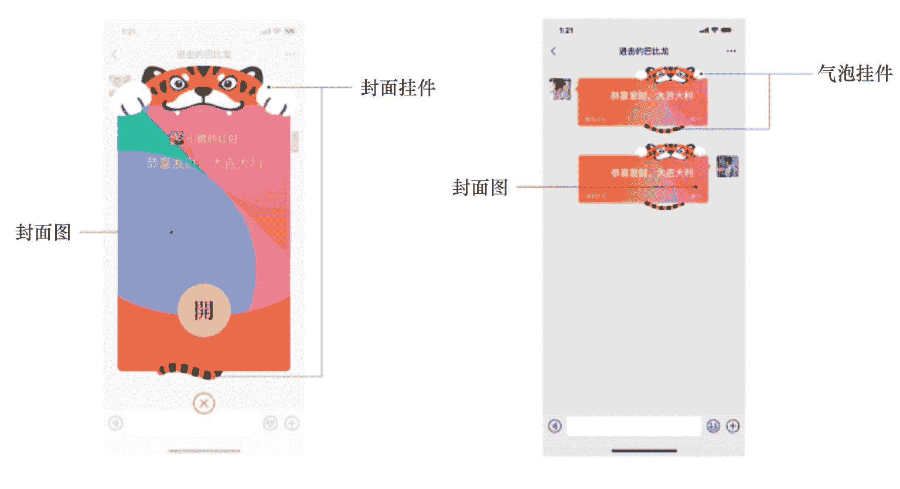

**第三步：规范化交付。**
微信红包封面开放平台对文件有要求，约500KB以内且需审核。操作要点：
• **压缩**：用在线工具把大图压到500KB以下。
• **注册**：在微信红包封面开放平台注册，个人需满足视频号/公众号粉丝要求。
• **上传**：按指引上传素材。封面包含封面图、封面挂件、气泡挂件，其中封面图为必填。

规格说明：
**静态封面**：格式PNG/JPG/JPEG；尺寸957×1278像素；大小不超过500KB。
**动态封面**：视频格式MP4；宽高比建议3:4；分辨率低于4K；时长1-3秒；大小不超过20MB。

压缩后上传并填写信息，等待审核通过即可使用。

图 12-4　微信红包封面包含的3种上传样式

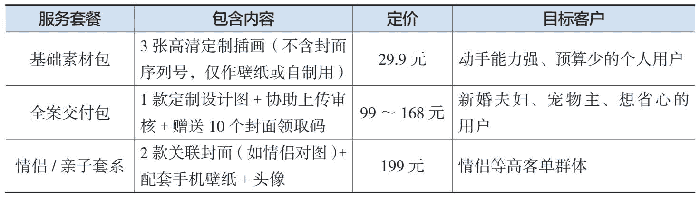

**二 多渠道接单与标准化报价**

把服务产品化，采用梯度定价让客户各取所需，如表12-1所示。

**三 把单次定制做成长生意**

跑通单次后，可用豆包实现批量化。不少创作者分享教程抓住红包风口吸粉，也有卖家几天卖出3000份封面赚2万元。豆包是视觉创意合伙人，卖的是个性化表达和社交优越感，这类生意始终有市场。

**第13招：豆包做海报，设计小白也能接设计单**

**一 商业海报里的零门槛机会**

商业海报是小微商家和自媒体的刚需。楼下理发店、社区中介、朋友圈代购，不会花5000元请美工，也不想花200元淘宝沟通。只要信息清晰、氛围到位、价格低、出图快，就能成交。客户眼里一张海报值50-100元。

传统流程要沟通、找素材、排版、修改，3-5小时。用豆包后：一段描述→生成四张图→挑选优化→完工，3-5分钟。

上班族小李用豆包做中式美学海报发在小红书，被品牌方看中，急需四张预热海报预算600元，半小时交付，单张150元。后续追加包装设计，月接20单，单张100-300元，月入3000元。

**二 豆包做海报的实操方法**

核心是理清需求、选对模型、写准提示词。

**第一步：理需求、选模型，减少返工。**
1. **明确三个核心问题加一个前置确认**
• 场景定位：朋友圈、社群、线下张贴、短视频封面？
• 核心信息：活动力度、产品卖点、品牌名、联系方式？
• 风格偏好：清新简约、复古胶片、INS、国潮、商务、卡通？
• 前置确认：输出格式PNG/JPG，尺寸如朋友圈600×900、A3/A4打印、短视频封面1080×1920、公众号头图900×500。
2. **选择生图模型**
豆包Seedream有3.0/4.0/4.5。首推Seedream 4.5，指令理解强，文字准确率高、排版精美，适合带文字海报。

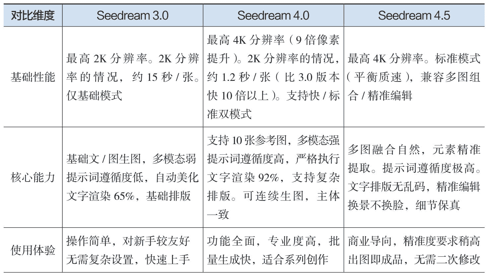

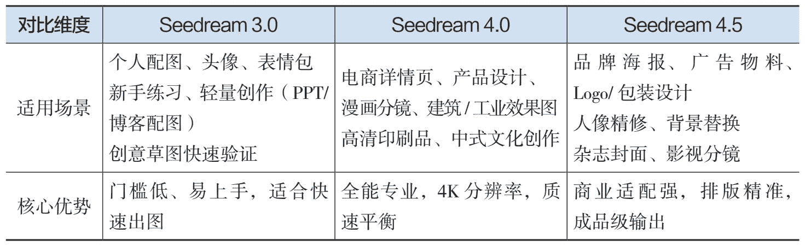

**第二步：提示词写法决定成败。**
万能公式：主体描述+画面风格材质+场景氛围+色调光影+比例尺寸+用途补充。
技巧：文字内容用引号标注；用自然语言，避免堆砌；明确构图要求，如居中、留白、对角线。

常见模板
类型一：促销海报。突出优惠和紧迫感，信息层级清晰。
类型二：产品场景合成海报。先生成背景再嵌入产品，提升质感。关键词：微距摄影、景深虚化、产品级布光、画面中心留白。Seedream 4.5可以把产品图和背景图融合为一张。
类型三：开业海报。突出时间地点活动。
提示词参考：做一张社区宠物店开业海报，A3尺寸，温馨治愈风格，浅蓝加白主色。核心信息居中“宠物店10月1日盛大开业”，副标题“首单洗澡八折，到店送零食”，辅以卡通猫狗、气球彩带，右侧活动时间表，底部留二维码和地址电话。

用对方法，商业海报不再是设计师专利，而是人人可快速变现的低门槛生意。

图 13-1　由豆包生成的促销海报

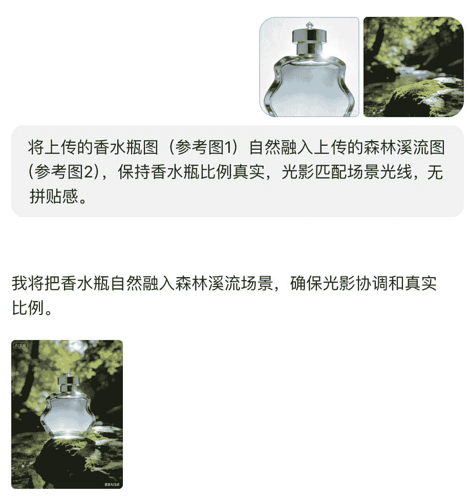

图 13-2　用 Seedream 将两张图片合为一张

图 13-3　豆包生成的开业海报

**内容变现实操路径：海报、插画、PPT一站式交付**

想让交付效果更有说服力，先从人群与视觉关系入手。受众偏年轻时，海报插画可换成潮玩质感；面向亲子家庭则保留温暖治愈的调性。再加上社会证明，例如“周边三百多位铲屎官都在使用”，可信度会明显提升。线下印刷物料要把字号拉大，保证三米外仍能读清，避免信息过小影响阅读。

122

**类型四：自媒体封面海报，适配短视频、公众号、小红书**

这类物料的核心是标题抢眼、整体调性统一、平台风格对齐。

豆包提示词参考：
构图以一位亚洲女性为视觉中心，穿着亮色复古造型，在环球旅行场景中取景，手持相机与自拍杆，姿态轻松自信。画面叠加世界地标剪纸，如铁塔、棕榈海滩、摩天大楼，以及机票、邮戳、旅行贴纸、手账碎片文字。整体采用手账拼贴+贴纸拼贴的手法，80年代复古海报感，高颗粒噪点、明显剪贴边缘、旧印刷质感。情绪是自由热烈、探索世界的愉悦，呈现Vlog记录生活的氛围。配色高饱和撞色，亮黄、湖蓝、玫红、薄荷绿形成强烈对比，平面光影。竖版9:16构图，人物居中靠前，封面级清晰度，适用于旅行Vlog封面或生活方式账号首页主视觉，预留标题与账号名贴纸位置。

豆包生成的自媒体封面海报如图13-4所示。

图13-4 豆包生成的自媒体封面海报

优化建议：小红书封面可加萌趣贴纸，短视频封面用高对比配色；固定边框、字体、色调来强化账号辨识度。

123

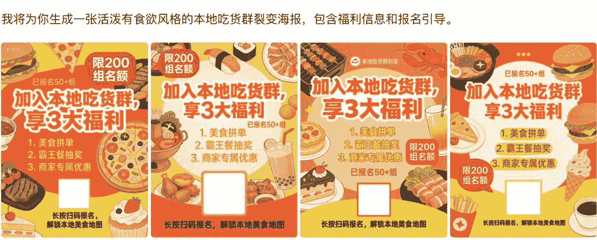

辨识度）。

**类型五：社群裂变海报**

需要把福利讲清楚，引导扫码进群或报名，突出利益、增加信任、降低行动成本。

豆包提示词参考：
制作一张本地吃货群裂变海报，尺寸600×900像素，风格活泼开胃，主色橙黄。核心文案居中写“加入本地吃货群，享三大福利”，下方分点展示“1.美食拼单 2.霸王餐抽奖 3.商家专属优惠”。视觉辅助加入美食合集插画、红色“限200组名额”标签、“已报名50多组”背书，底部放大社群二维码并提示“长按扫码报名，解锁本地美食地图”。

豆包生成的社群裂变海报如图13-5所示。

图13-5 豆包生成的社群裂变海报

优化建议：福利按价值高低排列；信任背书可用真实数据如“已超200人加入”或用户评价；二维码尺寸不小于海报五分之一并加引导箭头。

124

**第三步：海报修改技巧，批量产出与局部精修结合**

1.批量生图，提高系列素材效率
用“基础模板+变量替换”的思路，结合Seedream4.5批量生成能力。
豆包提示词参考：
基于以下基础模板批量生成5张奶茶新品海报：尺寸600×900像素，极简风格，纯白背景，居中展示奶茶主体，底部标注品名。变量为“草莓啵啵”“芋泥波波”“葡萄冻冻”“芒果奶昔”“珍珠奶茶”，奶茶配色需对应口味。

2.批量改图，统一系列风格或元素
把已生成的系列海报一起上传，明确“修改内容+保留内容”。
豆包提示词参考：
将上传的5张奶茶海报统一修改：①标题字体改为黑体；②整体色调调整为浅紫；③保留原产品图与信息排布，其余保持不变。

3.局部精准修改，避免整体重绘
关键是明确修改对象、位置与要求，避免模糊表述。
豆包提示词结构：
保留原画面不变，将××位置的××元素改为××，要求××。

125

示例一 文字修改：“保留其他元素不变，将右上角‘限时3天’标签改成‘限时最后1天’，颜色改为红色，字体放大1.5倍。”

示例二 元素修改：“保留背景与产品图不变，将左侧气球元素替换为枫叶元素，色调与整体暖色保持一致。”

4.通用优化与交付规范，提升专业度
格式规范：交付建议用PNG无损格式，比JPG更清晰。
文件命名：建议“日期_客户名_用途”，例如1001_老王烧烤_国庆海报_V1.png。

**三 增收攻略：从单次接单到稳定盈利**

别只盯着一张图几十元的收入，要有商业思维，把偶发订单变成持续现金流。

攻略一 闲鱼/小红书低价跑量
走量积累案例。
• 定价策略：9.9元/张，或19.9元/3张，强调服务速度。
• 执行要点：前期建立自己的提示词库，按行业分类整理，后续同类订单只需微调即可快速生成。

攻略二 出售提示词与模板，实现被动收入
从卖图升级到卖方法。
• 按行业场景制作模板，如餐饮促销、母婴招生，每套含3-5个版式并附修改说明。
• 在淘宝、拼多多、小红书上架，单套19.9元到49.9元。餐饮促销模板若月销100套，可稳定增收1990元到4990元。

126

攻略三 自用吸粉，承接代做，后端变现
在小红书开设账号分享AI作品，用高颜值封面或壁纸引流至私域，后续承接高客单广告或课程。
• 标准化套餐：基础快单针对朋友圈海报等简单需求，100到200元/张，24小时交付；商业精修针对开业海报、产品图等，200～500元/张，48小时交付含3次修改。
• 获客渠道：本地商家群、出版社官网、小红书/抖音案例展示、兼职平台。

攻略四 打包服务与包月制
把客户转为长期会员。
• 套餐A（299元/月）：每日提供带客户LOGO与二维码的早安海报，周末批量生成30张后分发。
• 套餐B（599元/月）：包含4张精修活动海报+30张日常配图。边际成本低，10个客户即可月入数千且工作量可控。

128

**第14招 用豆包做图书插画又快又稳，靠作者转介绍爆单**

**一 插画不是艺术问题，而是图书的隐形卡点**
文字是灵魂，插画是落地。好的插画能抓住读者，与内容紧密结合更易产生共鸣。多数作者会写不会画；找专业插画师贵且周期长；自己用AI又常出现人设不统一、风格跳变。
把文字转译成插画流程标准化，就是低门槛的机会。95后新手小林就是例子：作者预算有限，他拆解绘本内核，确定温暖水彩风与小熊固定特征后批量生成插画，3天完成本需2周的工作，并被推荐给多位同行，拿到长期系列合作。

129

图14-1 小林用豆包生成的插画

**二 豆包做插画实战流程：从理解文字到交付变现**

第一步 文字拆解，让豆包读懂画面感
先收集三类信息再投喂：书籍主题与受众；3-5段核心文字含开篇、高潮、结尾；1-2张参考风格图。
豆包提示词参考：
作为资深图书插画策划师，基于以下【书名】信息，进行视觉化拆解。
• 核心调性定位，结合主题与受众明确插画应传递的情绪与风格。
• 关键视觉元素提炼，从文字中提取可具象化的人物、场景、道具。
• 色彩体系建议，结合受众喜好与主题推荐主色、辅助色。
• 插画密度规划，建议哪些章节需要插画、用全页还是插页形式。

第二步 视觉立规，保证风格统一
先生成规范手册，避免后续跑偏。
豆包提示词参考：
基于上述为【书名】做的整体视觉解读，请生成一份插画视觉风格规范手册，需包含：
• 人物/核心形象设定，如“拟人化小松鼠：圆眼睛、短耳朵、浅棕色毛发，穿蓝色小背心”。
• 线条与笔触要求，定义画面基础质感，如略带颗粒感的水彩晕染、边缘模糊的手绘炭笔质感、干净的扁平化矢量风。
• 色彩使用标准，明确主色、辅助色色值，禁止使用的色彩。
• 规定主要构图方式，如儿童绘本多用对称构图，文艺书籍多用焦点透视。
请搭配12张示例图描述。

第三步 批量出图，在规则内高效量产
有解读与手册，出图即填空。
豆包提示词参考：
请严格遵循【书名】插画视觉风格规范手册，为以下内容创作插画。
• 本章核心情绪：【从本章文字解构中提取，如温暖治愈】。
• 本章核心意象：【从本章文字解构中提取，如小松鼠、木屋、热牛奶】。
132

• 画面具体要求：【填写作者对本章画面的具体想法，如小松鼠坐在木屋门口，手里捧着热牛奶，夕阳洒在身上】。
• 特殊约束：保持与第一章插画在色彩、光影、质感上的绝对统一；预留30%留白，方便后期排版加文字。
请生成2个微调版本，一个侧重光影细节，另一个侧重人物表情。

修改时无需重绘，直接微调提示词：
豆包提示词参考：
在完全遵循【书名】插画视觉风格规范手册的前提下，对这张插画进行微调：保持当前画面的色彩、光影、构图完全不变，仅将小熊的嘴角略微下垂，眼睑压低10%，以强化委屈情绪。

第四步 挖掘变现渠道，锁定三类客户
渠道一 网络作者社群
豆瓣作者小组、微信写作群、知乎交流群常有需求。
①观察抱怨点；②免费输出一段文字视觉化解读+1张样图；③样图贴合后转化。
渠道二 小红书/抖音挂单
①主题如《3天搞定绘本插画！AI让风格统一不翻车》；②先放翻车图再放成果；③钩子“评论区回复‘插画’领提示词模板”。
渠道三 对接出版社/编辑
优先中小型策划公司，少儿、文艺、经管类需求大。

①找编辑联系方式；②私信破冰并附作品集；③用试画+低30%-50%报价拿长期单。

133

**三 增收思路：把单次服务变成作者圈视觉合作人**

攻略一 设计阶梯套餐
①基础体验包399元：1份文字视觉化解读+1份风格规范手册+3张核心插画。
②全章插画包1500～3000元：全书插画+排版留白适配+3次修改。
③全案服务包5000元以上：插画全流程+封面+营销物料+IP延展。

135

攻略二 建立品类插画模板库
把儿童绘本、职场励志、社科科普、小说IP等的解读模板、规范手册、指令模板分类存放，新单替换关键信息即可快速出稿，提升效率承接批量订单。

攻略三 用结果背书+推荐返利撬动转介绍
交付时赠送《插画使用指南》含排版与印刷建议；交付后一个月主动优化细节；推荐新客户成交返现10%或赠衍生插画，长期合作可享后续费用10%持续分红。

**第15招 豆包做高水平PPT，理思路加配图，按份收设计费**

**一 PPT这门被低估的手艺，正成为自由职业新热点**
项目展示、活动策划、商业推广、汇报总结等场景都需PPT。很多人缺时间、缺排版能力、缺场景经验，做出的成品要么难看要么不适配。
工具人人可用，能驾驭工具的人稀缺。多数人用豆包做PPT缺乏精准提问，只能得到通用模板，也不懂得如何优化。

用豆包做 PPT 代工，业余也能带来稳定副业收入

做 PPT 接单并不是堆几页模板就能赚钱，关键是先读懂客户的使用场景和真实诉求，把内容和逻辑嵌合进去，再把版式精修到位，提供从对齐需求到交付成品的闭环服务。

小张原本是标准的朝九晚六销售。某天朋友在微信上急求帮忙，第二天上午要一份活动宣传的单页演示。小张先把意图问清楚，对方希望突出活动主题、调性活泼有记忆点；随后用豆包搭建思路框架、产出文案，最后成稿。十几分钟初版就发出，对方只提了一个小修改，三分钟后交付，朋友顺手发了红包，还说这样就不用熬夜加班了。

后来他偶尔帮身边同事修修片，发现定制需求其实很普遍。于是借助豆包做兼职接单，很快形成稳定客流。现在利用空闲时间接单，月增 1500 到 2500 元，比加班费轻松，时间自主也不受制于人。

不同用途的演示需求持续冒出来，市场空间足够大，而且这条路对普通人很友好。没有专业设计背景、不会复杂软件也没关系，只要会操作豆包，再掌握一套可复制的需求拆解与提效方法，就能快速入局拿到实惠。

**二 手把手教你用豆包跑通一单专业演示稿**

**第一步，精准沟通需求，提升效率。**

成稿的基础是沟通，为避免反复修改，要把四个关键点问清楚。
① 应用场景，比如商务提案、活动推介、项目汇报。
② 观看对象，比如老板、客户、同事、现场观众。
③ 风格取向，比如严谨专业、活泼创意、简约大气。
④ 交付要求，比如页数上限、交稿时间。

沟通后整理成清单发客户确认，能显著减少来回。

**第二步，梳理素材，生成演示大纲。**

按确认的需求和客户提供的文案、图片，先归纳信息再搭框架，避免冗余和逻辑混乱。用豆包来梳理会更快，指令可以这样写。

根据以下需求及材料，梳理演示主标题及提纲，要求思路清晰、重点突出，分点列出每页核心要点。需求：演示使用场景是×××，观看对象是×××，风格取向是×××，页数为×××。材料：……

把豆包生成的大纲先发客户确认。

**第三步，写好指令，生成演示稿。**

把确认好的提纲和需求一起交给豆包，要求直接产出演示稿，可参考如下指令。

根据以下需求及演示提纲，生成一份演示稿。需求：演示使用场景是×××，观看对象是×××，风格取向是×××，页数为×××。提纲：……

随后豆包就能迅速给出初稿。

**第四步，细节打磨，完成专业交付。**

如果想让初稿更精细，可以直接点选页面上的文本框改文字、拖动调整图片、用 AI 智能绘图、增删页面、调顺序、加动画等。操作界面如图15-1所示。

图15-1 操作界面

为了提高满意度和交付速度，可对照以下交付前检查清单。

一致性核查：各页的字体、字号、配色、Logo 位置、边距是否统一。

对齐强迫症：所有文字框、图片是否严格对齐，打开参考线和对齐辅助。

视觉降噪：是否去掉了多余装饰，每页是否有明确视觉焦点。

数据核对：图表数据源是否清楚，数字格式是否一致。

错别字排查：通读一遍，或借助豆包检查演示稿中是否存在错别字或表述不通顺之处。

最后导出优化后的文件发送给客户，交付完成。

**第五步，多渠道接单，持续获客。**

渠道一：闲鱼。

操作要点如下。
① 标题嵌入核心词+痛点，比如“演示定制|全场景覆盖|24小时交付”“活动演示代做|创意排版”。
② 主图展示不同场景的成品截图，如活动推介、商务提案、总结汇报，打码保护隐私。
③ 详情页清晰说明服务内容、收费、时效，增强信任。
④ 标签：#演示代做 #演示定制 #活动演示 #商务演示

闲鱼上架模板如下。
1.标题：【演示定制】全场景覆盖；创意排版；述职/路演/答辩/课件；24小时交付；专业代做；逻辑梳理+视觉设计。
2.主图：4张图（图1：封面；图2、图3：不同场景成品合集；图4：客户好评截图）。
3.详情页：
【为什么选我？】

需求拆解专业，逻辑清晰+风格统一+重点突出，一对一定制，帮你省时省力获得认可！
【服务内容】
① 全场景覆盖：活动展示、商务提案、项目汇报、公益宣讲、宣传推广等各类型演示定制。
② 定制服务：需求分析+框架搭建+内容撰写+排版设计+修改优化。
③ 交付形式：高清可编辑文件。
④ 交付时间：24小时内接单，最快半小时出稿。
【收费标准】
基础设计：10元/页。
进阶设计：20元/份。
【信任保障】
先沟通需求，满意再下单，支持2次免费修改，售后无忧。

渠道二：小红书。

操作要点。
① 文案以“用户痛点+案例成果”开场，引发共鸣。
② 配图用“素稿 vs 成品”，直观展示能力。
③ 结尾引导下单，突出服务优势。

小红书文案模板如下。
标题：建议所有职场人——别在演示上耗时间了！
正文：
你明明有90分的实力，
却因为一份60分的演示，
被打了低分……多亏啊！
因此，如果你也
下周要述职/答辩，演示还没影；
明天要见客户，方案拿不出手；
导师/老板总说“没重点”“不高级”；
单纯受够了为演示熬夜的日子……
那就把专业的事交给专业的人！
我提供的不仅是美化，更是
帮你把混乱的思路变成清晰的内容；
用我的2小时，换你10小时的睡眠和头发；
从逻辑梳理到视觉设计，一条龙搞定！
有需要直接下单！
配图：3张图（图1：不同场景成品合集；图2：制作前后对比；图3：客户好评聊天记录）
话题：#演示 #演示制作 #演示代做 #演示定制 #职场技能 #答辩演示 #工作总结演示

渠道三：朋友圈。

操作要点。
① 用“案例成果+服务介绍”吸引潜在客户，附成品图+好评截图。
② 每次交付后将作品深度打码，隐去敏感信息，保存为高清图，按“述职汇报”“融资路演”“毕业答辩”等场景分类，朋友圈调用效率高且案例显得丰富。
③ 微信昵称建议格式“你的名字｜演示定制/美化/代做”，提升专业度，也方便客户在通讯录搜索“演示”快速找到你。

朋友圈文案模板如下。
上周加急做的活动展示演示，客户反馈现场效果超棒！
客户说之前自己做的没亮点，找我定制后，风格和内容都完全贴合活动需求，认可度特别高！
活动展示、商务提案、项目汇报、公益宣讲……各类演示都接！
专业拆解需求+一对一定制+高效交付+免费修改，演示定制找我就对啦。
（附1张成品图+1张客户好评截图）

**三 增收攻略，助你稳收益深挖掘广拓客**

除单次定制外，还可通过以下三类进阶打法系统提升收入上限。

攻略一：售卖演示模板包，实现持续收益。
1. **核心动作：**借助豆包批量生成演示素材、模板，或把过往的高质量作品按应用场景归类，形成主题清晰的模板库。例如“活动展示系列”“商务策划系列”“通用汇报系列”等，每个系列提供10～20套模板。
2. **服务策略：**采用分级定价，如单一场景模板包9.9元，热门场景十合一套装59元；每套附使用指南与内容替换教程，降低使用门槛。针对高频客户推出会员订阅，可无限下载并享受定期更新与专属权益。
3. **变现逻辑：**突破人力限制，把同一模板做成可重复销售的数字资产，单价低、受众广，通过规模化积累实现稳定利润。

攻略二：培养高价值老客户，持续变现。
1. **核心动作：**交付后顺势发出长期邀请，如“后续如有演示需求随时联系我”。
2. **服务策略：**与老客户合作建立专属备忘录，记录行业、偏好风格、常用内容，下次沟通更省事。
3. **变现逻辑：**老客户稳定，减少推广成本；合作熟练后效率提升；信任建立后更易接到高价项目，如年度商业计划、融资演示，还可能带来转介绍。

攻略三：开设网店，获取海量客源。
1. **核心动作：**在淘宝、拼多多、抖音小店等平台开一家专注演示代做的店铺。可用豆包批量优化店名、商品标题和介绍，提升搜索流量。店名直接点明业务，页面清晰展示能做什么、案例、收费、交付时间。
2. **服务策略：**设置不同档位套餐，如“基础定制”“高端定制”“加急定制”，降低决策成本。建立标准化接单流程，从咨询、确认、制作、交付到售后，实现高效运营。同时上架模板包拓宽收入。
3. **变现逻辑：**借助平台流量持续获客，实现规模化接单；标准化服务+多元产品组合，显著提升盈利空间。

用豆包做演示变现的本质，是把你对内容逻辑的理解和视觉审美的把握，通过工具放大交付。这个市场天花板很高，既可保持业余每月赚几千零花，也可升级为专业工作室服务企业客户实现收入倍增。

**第 16 招：豆包做 IP 周边，定制卡通形象，粉丝疯狂下单**

**一 难题：定制 IP 周边需求大，为什么普通人接不到单赚不到钱**

在礼品和纪念品市场，“独一无二”永远是刚需。无论是情侣纪念日、宝宝周岁，还是送给闺蜜的生日礼物，消费者都希望送出一个“长得像对方”的专属礼物。然而普通消费者往往面临两难。

1. **低价产品太粗糙：**电商平台上几十元的软陶公仔，因流水线制作，常出现买家秀卖家秀差距大，送礼尴尬。
2. **高端定制门槛高：**想做一个像“泡泡玛特”那样精致的专属手办，传统流程需画师出图再建模，起步价往往四位数以上，普通人难以承受。

AI 的出现大幅降低了制作专属 IP 周边的门槛。很多人以为做潮玩需要极高美术和建模能力。实际上善用豆包，不懂画画不懂建模的普通人也能产出专业级设计稿。淘宝上不少“3D 玩偶 AI 定制”店铺，并未雇佣昂贵建模师，而是用 AI 优化核心流程。

1. **视觉重构：**把客户生活照通过 AI 转为“3D 渲染风格”效果图。
2. **标准化输出：**用豆包生成正面、侧面、背面的工程图，发给合作的 3D 打印厂生产。
3. **成品交付：**最终交付高精度树脂手办。

凭借高颜值+适中价格，这类店铺订单稳定。路径已跑通，关键是拆解打法，让工具为创意落地服务。

**二 豆包制作 IP 周边，只需三步**

客户买的不仅是摆件，更是对自己或他人的情感投射。用 AI 的核心在于把抽象的投射精准翻译成豆包可理解的视觉语言，打通从共情到指令的路径，产品才有溢价。具体流程分三步。

**第一步：用豆包做特征拆解，精准还原神韵。**

AI 定制最常见翻车点是“不像本人”。新手直接生成易成四不像。设计前先让豆包充当“观察员”，提取照片核心特征。

**需提取的信息：**把客户照片提交给豆包，分析核心锚点，如发型发色、面部标志、标志性穿搭、神态气质。如提供宠物照片，可将照片与以下提示词一起发给豆包。

豆包提示词模板：
请作为一名资深人物插画师，仔细观察这张照片，提取 5 个关键视觉特征，用于生成 Q 版 3D 形象。这些特征为发型与发色、面部显著特征、服饰关键元素、动作与神态、整体气质关键词。

豆包会输出精准描述词（图16-1），为后续生成高相似度玩偶打基础。

图16-1 豆包生成的精准描述词

**第二步：策略性生成，套用盲盒公式。**

拿到特征后进入核心设计。在豆包主页找到“AI 创作”，使用标准化指令让豆包产出工业设计质感图片。

**1 生成核心效果图：确立 IP 形象。**

豆包提示词模板：
请基于提取的特征：[插入第一步提取的特征]，设计一个 Q 版 3D 潮玩公仔形象。要求如下。
• 风格定义：使用 C4D 建模风格，OC 渲染，Q 版二头身比例（大头小身），材质呈现哑光树脂质感。
• 画面主体：人物表情生动，完美还原[核心特征]，光影柔和立体，像是一个精致的盲盒公仔。
• 背景环境：纯净的摄影棚柔光背景，无杂物干扰。
• 画质要求：8K 分辨率，细节丰富，色彩明亮。

生成后得到高质感盲盒公仔图，先给客户过目，客户说“像”或“好看”基本就稳了。但光有证件照无法落地，工厂需要背面细节。为体现专业度，需补齐工业设计的“三视图”。

**2 生成 3D 三视图：为后端生产做准备。**

要落地为实物，需让豆包生成三视图。

豆包提示词模板：
保持刚才设计的公仔形象完全不变，请生成一张标准的 IP 设计三视图。要求如下。
• 视角包含：同一张图中必须包含正面、正左侧面、正背面三个角度。
• 排列方式：三个角度在画面中水平排列，身高比例严格一致。
• 细节连贯：确保服装花纹、配饰在不同角度下的逻辑一致（如正面有背包带，背面必须有背包）。
• 背景：纯白背景，方便后期处理。

AI 就会快速生成周边三视图，如图16-2所示。

图16-2 豆包生成的周边三视图

三视图齐全，设计环节才算闭环。对客户而言，交付的已不是只能发朋友圈的画，而是可直接开模生产的资产。

**第三步：找工厂代定制产品，轻松交付变现。**

1. **生产对接。**拿着三视图去1688搜索“3D 打印手办定制”或“光敏树脂打印”。与厂家沟通：“我有现成三视图，需做成10cm高的哑光树脂手办，报个批量价。”筛选合适的合作厂家。
2. **质检与发货。**收到样品后检查还原度，确认无误后加上精美包装盒（包装盒设计图也可让豆包做），发货给客户。

**三 IP 周边变现指南：设计图做好去哪卖？怎么谈出高价**

1. **闲鱼：**发布“AI 定制手办”“宠物潮玩定制”，挂上豆包生成的精美案例图，闲鱼对非标品流量扶持大。
2. **小红书：**发布“我把我家猫做成了手办”种草笔记，用户付费意愿高，可结合制作难度调价。
3. **淘宝/拼多多：**联系不懂 AI 设计的店主，提供 AI 设计服务，按单分成或按图收费。
4. **私域裂变：**建立粉丝定制群，利用老带新优惠扩大客户群。

**四 增收攻略：跳出单一产品，靠 IP 矩阵锁定长效收益**

1. **角色升级：做情感全案服务商。**不要只卖一个手办，客户认可 IP 后会有情感连接。利用豆包的“产品矩阵延展”能力，在不增加设计成本前提下拉高客单价。
2. **学会复利思维：一个 IP，无限周边。**单卖手办只是开始。客户认可 IP 后，可用豆包做产品矩阵延展。你可以这样说：“亲，这个 Q 版形象做成手机壳或定制陶瓷杯也很漂亮，现在下单有老客优惠，要不要顺便带一套，天天都能看到？”用同一高清原图对接手机壳、抱枕、T 恤定制工厂。

豆包不仅是绘图工具，更是效率杠杆。通过它交付的不再是简单 AI 图片，而是具备情感价值的商品。这种可触摸的服务往往带来稳定客户关系和收益。

**第 17 招：豆包定制绘本，原创儿童故事加精致配图，家长超认可**

**一 家长愿意为定制绘本付费的深层原因**

做定制绘本，先把自己放到父母的位置上去想。能共情到家长对孩子的爱与细心程度，用豆包产出的东西才会有温度。这种专属的诚意是能够被感知到的，也是愿意掏钱的关键。

**1 从读物变成礼物。**
把孩子做成主角的绘本，本质上是一次有温度的纪念。生日、周岁、入学等节点，书里的人名、爱好、长相都与孩子一致，就不再是货架上的通用品，而是一件可留存的成长纪念，价值感被放大，付费意愿随之提高。

**2 交付快且全。**
豆包的强项在于效率与覆盖面。故事与画面几分钟就能成型，还能同步配上专业旁白并生成动画短片。家长一次下单就拿到看听演的完整组合，性价比感很强。

**3 双语启蒙减少抵触。**
把孩子喜欢的原创故事一键转为地道双语，人物就是自己，代入感很强，排斥感几乎为零。这种兴趣驱动的启蒙方式，正好缓解了家长对英语学习的焦虑。

**4 让孩子与偶像同框。**
孩子更爱动画而非纸书时，让他与奥特曼、艾莎公主在书里互动，能把“被迫阅读”转成“我要阅读”。家长买的其实是养成阅读习惯的方法。

小红书上的全职妈妈文文经营母婴号时发现，家长最舍得花钱的两件事是孩子的生日仪式感和阅读习惯培养。她尝试用豆包把粉丝家的宝宝“画”进绘本里。

她的打法是先让豆包生成原创剧本，再精细把控角色形象产出连贯插画，最后加上故事音频。她主打“24小时交付影音整包”，定价99元到268元。精准匹配小红书家长对高品质个性化定制的需求后，她每周稳定接到3到4单，月收入至少3000元。即使不是头部博主，也实现了变现。

想复制这条路径，按下面流程，3天就能上手接单。

**二 从零到一的实操全流程**
**第一步 信息采集，用清单式提问锁定需求。**

1 直接把定制绘本需求采集清单发给家长填写，覆盖核心信息，效率高。
表17-1 定制绘本需求采集清单
2 素材整理，建立专属素材包。
按清单让家长补充以下资料，打包成素材包。
1-2张孩子清晰正面照，无遮挡光线充足，便于豆包贴合形象创作。
家庭专属信息，如宠物名字、家人称呼、标志性场景，植入故事更有温度。
若有偶像或特定元素需求，提供清晰参考图。
3 主题定位，提炼核心亮点。
结合清单与素材，提炼辨识度高的核心主题，主题越清晰，后续生成越准。示例：
4岁小明，卷发爱恐龙的生日冒险绘本。
入园季小团子的幼儿园适应暖心故事。
双语版乐乐与艾莎的魔法森林之旅。

**第二步 用豆包制作定制绘本。**
以《小豆芽的“超能力”》为例。
1 主题内核：每个孩子的小笨拙里，都藏着独属于他们的温柔与勇敢，这是父母眼里最珍贵的超能力。
2 主角设定：小豆芽，小名，4岁女孩，短蘑菇头，爱穿黄色小雨靴，说话偏慢，做事慢半拍，但特别喜欢照顾花草小虫。
3 故事基调：温暖治愈，写实还原父母日常观察视角，没有大起大落，聚焦成长小事，传递接纳孩子本来的教育理念。

4 目标读者：2到6岁幼儿亲子共读，重点让父母在阅读中看到自己孩子的影子，读懂行为背后的纯真。
5 用豆包设计分镜脚本，见表17-2。
表17-2 用豆包设计制作分镜脚本
续表

续表
6 依据分镜脚本用豆包生成画面，见图17-1。

图17-1 用豆包生成相应的画面

**第三步 交付与传播，用服务沉淀口碑。**
定制绘本的价值不仅在内容，交付与服务决定复购与转介绍。
1 交付形式。按需求准备分层套餐，既满足不同预算，又能提升客单价，关键是超出预期。
基础电子套餐：排版好的高清PDF绘本+专属朗读音频。
进阶电子套餐：基础套餐+绘本动画视频。
实体+电子套餐，主推：精装硬壳实体绘本+进阶电子全套，另赠定制贺卡写孩子名字和祝福，精致礼盒包装，仪式感拉满。
2 售后与反馈。建立信任促进复购。
主动跟进：交付后1-2天询问满意度。
节日场景问候：生日、入园节点主动关怀。
3 案例传播。征得家长同意后，将作品作为案例发布朋友圈、小红书、抖音，突出专属定制、家长好评、孩子喜爱等亮点。

**三 精准获客，找到愿意付费的人**
**1 小红书：视觉种草与真实体验表，见表17-3。**
表17-3 在小红书上如何找到“对的人”

**2 微信社群：信任建立与裂变转化表，见表17-4。**
表17-4 在微信社群上如何找到“对的人”
**3 抖音/快手：流程展示与专业背书表，见表17-5。**
表17-5 在抖音/快手上如何找到“对的人”

续表

**四 让绘本业务收入更高的办法**
**1 提供增值服务，小投入换高感知价值，见表17-6。**
表17-6 可提供的增值服务

**2 精细运营，从单次消费到多次复购策略表，见表17-7。**
表17-7 提升复购率的策略表
续表
豆包绘本定制，本质上卖的是情感价值、省心方案和专业服务。把这些做到位，收益自然提升。

**第 18 招：用豆包写爆款漫剧脚本，团队定制按集拿稿费**
**一 需求大爆发，为什么稿子卖不出去**
AI漫剧赛道流量起来后，制作团队都在抢剧本。现实是团队有钱缺好稿，新手稿子被嫌弃。原因有两个。
1 市场痛点：需求大但同质化严重。很多人盯着爆款题材用AI拆解再仿写，内容雷同甚至粗制滥造。真正有创意的高质量剧本成了稀缺品。
2 创作痛点：AI依赖导致剧本失魂。AI只是执行工具不懂镜头美学。新人把题目丢给AI一键生成，结果逻辑硬、注水严重。

工具好不好用，看它是否懂流量。豆包能胜任漫剧创作，硬实力有四点。
1 抖音系出身，天生带爆款基因。豆包懂短视频推流机制，能捕捉当下热梗和大众情绪，相当于直连流量后台。
2 深耕中文语境，懂下沉市场偏好。对中文漫剧理解有代入感，对白自然适配用户爱看爱评的习惯。
3 记忆力强，长篇不崩人设。能稳定锁定人物性格、外貌、剧情伏笔，角色逻辑一致，减少改稿成本。
4 导演思维配合，产出反套路脑洞。逻辑推演强，可在对标基础上翻新创意，避免同质化。

写了5年网文的小刘转写漫剧，第一单就被退稿。他后来让豆包扮演专业分镜导演把文字视觉化，按建议调整后质感提升。两个月后卖出第一单，每集400元。如今他用豆包快速拆解镜头框架，自己填关键对白，月创作稳定，转行成功。

**二 用豆包写出合格漫剧初稿，只需三步**
先搭设定大纲骨架，再填分镜对白血肉，最后打磨节奏钩子。
**第一步 搭建核心要素清单，防止跑偏。**
新手常犯错是只说“写一个校园漫剧脚本”。正确做法是把题材、人设、核心爽点、受众、时长整理成清单一次性喂给豆包。
示例写校园成长加非遗传承爽点。
1 把整体构思告诉豆包，产出单集脚本《非遗小匠人藏不住了！校园文创赛惊艳全场》。精准提示词如下。
创作2分钟抖音快手短漫脚本《非遗小匠人藏不住了！校园文创赛惊艳全场》，适配18到25岁受众，无奇幻无特异无负面，聚焦剪纸与正向成长。主角苏念内向坚定，外婆传剪纸技艺，配角陈悦傲娇初期轻视后被打动，剪纸融合校园元素，核心是技艺惊艳打破偏见，5秒钩子为苏念制作剪纸书签特写，含核心设定分镜，原创可实操。核心立意传承非遗之美，以坚持打破偏见，用热爱收获认可，传递小众技艺亦有光芒的正向价值观。适配短漫逻辑12到16个分镜，无废话每镜推进，5秒钩子抓眼，结尾留轻微余韵，正向共鸣，贴合受众对青春热爱文化自信的情感需求，融入轻喜剧氛围。
2 豆包生成基础框架。会输出脚本框架含场景、分镜方向、核心对白，见表18-1。
表18-1 豆包生成的脚本框架

续表

这一步重在让豆包精准理解核心信息，不求完美。
**第二步 拆解分镜，让脚本可直接拍摄。**
把基础框架拆成制作团队能用的分镜，每个分镜写清镜头类型、画面内容、对白音效、时长。
1 补充分镜细化指令。
请把刚才脚本细化成分镜脚本，每分镜明确镜头类型、画面内容描述、对话内心OS音效、时长3到10秒。突出苏念剪纸技艺精致感及作品惊艳爽点，对白口语化，融入轻喜剧氛围。
2 豆包输出细化脚本节选，见表18-2。
表18-2 豆包输出的细化脚本节选

续表

**第三步 加钩子调节奏，提升吸引力。**
优化结尾钩子吸引用户追下集，调试节奏卡点适配推流。

1 加结尾钩子。提示词：请在第14分镜后加1个收尾分镜作下集钩子，引出新方向或小挑战。
豆包优化收尾分镜见表18-3。
表18-3 豆包优化后的收尾分镜
2 调节奏卡点。提示词：优化节奏，把核心爽点分镜时长压缩合理，开篇钩子保持5秒，前30秒出现第一个小冲突，总时长控制2分钟内。
优化后关键节奏：分镜1保持5秒抓眼；分镜3-4合并总时长从18秒缩至15秒；分镜7从10秒缩至8秒；分镜12从15秒缩至12秒，爽点更紧凑。

**三 AI漫剧剧本变现指南：写好后去哪卖**
**1 小红书：新手首选，直接对接团队。**
搜索漫剧剧本、漫剧脚本收稿、AI漫剧团队招编剧等关键词，筛选最新发布投递样稿。也可主动发帖引流。
**2 微信公众号：权威征集，稳定有保障。**
搜索漫剧团队官方公众号，看是否有收稿启事。关注短剧编剧社、漫剧行业圈等账号整合征集需求。
**3 头部平台官方扶持通道：有1-2个成品脚本可冲。**
七猫漫剧投稿流程：七猫中文网官网创作者中心漫剧合作。抖音集团短剧版权中心定期发布合作指引，精品漫剧保底激励可达每分钟1万至3万元。B站觉醒计划开放版权库最高80%分成。快手星漫计划提供资金支持利润分成接近100%。

**四 增收攻略：跳出按集变现，锁定长效分红与差价**
**1 角色升级，做可落地的AI漫剧全案服务商。**
团队不缺故事缺的是降低试错成本的工业化标准。可总结《AI漫剧制作手册》含人设提示词库、分镜模板及避坑指南，采用咨询费加陪跑费模式，提升客单价。
**2 做AI漫剧剧本赋能型中介。**
团队急需剧本，写手不知怎么写爆款。可作为中间方用豆包产出标准化脚本框架，再由兼职填充润色赚取项目差价。
前端承接高价单，中端用豆包产出大纲人设每集反转点，后端分发兼职填充内容，实现一个人统筹多项目规模化收益。

**第三篇 内容IP运营，流量分账，月入10000元**
**第 19 招：豆包精译海外免费好文，靠差异化信息获取订阅费**
**一 AI翻译越来越厉害，为何靠翻译还能赚钱**
有了AI依然有人付费，背后是三个痛点。
1 筛选太累：国外免费好文章多，但无用信息更多。专业人士时间值钱，需要有人挑出最值钱的。
2 直译难懂：AI直译只能对语义，无法还原语境。行业背景、技术梗不解释，读者无法用于决策。

把海外热文做成国内可付费的内容，关键在于落地解读和生产效率

把在国外很火的概念搬到中国是否能用，得结合本土市场重新拆解。读者愿意掏钱，本质上买的是三种安全感。第一是信息可信，能确认拿到的是全球前沿且真正有价值的干货。第二是时间成本低，原本需要半小时梳理的逻辑，现在五分钟就能把握。第三是本地参考，能看到对中国行业的具体启发和机会点。

有人会问，机器翻译已经这么强，自己翻不就行了。纯机器输出最多算半成品，要收数百上千元的订阅费，必须靠人机协同，豆包就是合适的搭档。

让豆包做重复劳动，人负责把控价值。它能在约一分钟内完成数万字长文的初翻，人负责判断哪些段落要加粗、哪些背景要补充注释，产出速度可提升十倍，同时保证商业侧重。让豆包完成语言转换，人完成商业映射。将译文与国内产业现状挂钩，才能把普通译文升级为具备本土参照的决策情报，这才是溢价来源。让豆包维持更新频率，人经营客户关系。订阅制最怕断更，批量处理能力能稳定交付，人负责核对关键数据、加入个人洞察、回应用户提问，有温度的专业感才是防止流失的核心。

跨境内容创作者小语的案例很典型。她专挖国外优质干货想在小红书变现，纯人工翻译千字要三小时，更新慢涨粉难。后来改用豆包辅助：上传外文原文，由豆包完成精准转译并适配小红书口语风格，同时自动提炼亮点、拟出吸睛标题。原本三小时的工作压缩到十分钟，她只需校对优化。

她把译文按职场、育儿、理财等领域分类打包成资料合集，定价29到99元在主页挂链接售卖。凭借提效带来的高频稳定输出，一个月卖出5万元。尝到甜头后她再推付费连载订阅，每月推送同领域最新译文，把跨境内容从免费分享转变为资料包售卖加连载订阅的稳定模式。

二 海外优质文章到中文连载订阅的豆包协作全流程
第一步 用豆包初筛，锁定值得转化的素材
先用豆包把关质量和商业潜力。

提示词参考：
豆包，我要做面向国内小微企业主的海外AI工具实战专栏，请帮我列一份商业价值检查清单，用来筛选海外文章，要求标准务实，能直接判断翻译后读者是否愿意付费。

豆包会生成海外素材商业价值检查表见表19-1。

第二步 按检查表对文章做实战打分
例如找到Medium的一篇《如何用AI自动化工具每天批量生产50个原创短视频》。

提示词参考：
豆包，请对照海外素材商业价值检查表，对这篇外文原文或摘要做深度解析，四个维度分别打1到10分，并说明哪些章节观点最值得翻译。

示例体检报告：
信息稀缺性9分。国内多在讲手动剪辑，这篇讲全自动脚本流，很冷门，可做本周头条。
实操落地性8分。原文用3个海外工具，2个国内可用，1个需平替，翻译时建议补充国内软件对比。
变现可行性10分。文章拆解了靠此类视频在TikTok拿分润的盈利路径，路径短，读者必看。
金句爆发力7分。原文观点“未来的短视频博主拼的不是剪辑技术，而是对智能工作流的调试能力”很可取。

决策建议：重点翻译第二章操作指令和第四章排坑指南，删去开头介绍和结尾煽情，做成1500字实战内参。

第三步 精准转译并自检校验
结合体检报告聚焦核心章节，下精准翻译指令并标注关键信息。

提示词参考：
豆包，翻译这篇文章第二章智能自动化脚本生成操作和第四章批量生产排坑指南原文。要求：1、还原所有步骤、工具名、指令参数，工具名后标注英文原词加国内通用译名；2、操作句用步骤加动作的短句，符合中文阅读；3、海外平台如TikTok等用括号标注国内可类比平台不得超过10字；4、把原文中的关键操作指令、核心参数用【】标注出来，方便后续重点解读。

翻译后让豆包自查：
请对照原文自查翻译稿：1、操作步骤是否完整还原；2、关键参数数值是否准确；3、有无因直译导致拗口的句子。若有问题直接修改，若无问题为每个操作步骤补充一句不得超过10字的“为什么要做”的说明。

第四步 做本土化深度改造
海外案例多基于TikTok、欧美电商，国内读者需要抖音、视频号、拼多多、淘宝的场景。

提示词参考：
原文第四章靠TikTok批量短视频拿分润的案例对国内小微企业主不合适，请替换成靠抖音批量短视频引流带动线下门店的本土案例，保留批量生产发布变现逻辑，把TikTok的发布技巧、流量规则，换成抖音的对应规则如抖音的黄金发布时间、标签打法，并补充一个奶茶店老板用这套方法3个月引流2000+到店客户的简短案例300字以内，含发布条数、播放量、到店转化数。

再做语气精简：
请优化译文加改造稿：删除冗长铺垫和煽情，保留操作步骤、核心逻辑、避坑指南；把学术化表达改成接地气说法，如把内容生产效率优化方案改成批量做短视频的高效玩法；把金句改为更贴合小微企业主的表述，如未来的小老板拼的不是自己会做内容，而是会用智能批量做内容，并放在文稿开头吸睛。

第五步 模拟读者视角做最终校验
提示词参考：
请模拟一个对AI不熟悉、只做实体生意的小微企业主阅读终稿，找出3个可能看不懂、用不了的问题并给出修改方案。若没有问题则回复符合落地要求，可直接作为本周连载内容。

三 精译好文的双轨变现：资料包售卖加订阅
1 小红书卖资源包：轻量起号快速获客见表19-2。

2 闲鱼卖资源包：精准触达低门槛成交。
上架技巧：选虚拟商品、知识付费类目，标题带关键词如海外智能深度译文资料包、豆包精译、创业参考，详情写清包含内容如5篇权威译文加本土解读，交付方式付款后秒发百度网盘链接。
定价策略：单份19.9到49.9元，设买二送一组合如智能加跨境电商资源包39.9元，提升客单价。

引流私域：资源包里插入公众号二维码，提示关注领一篇精译译文，订阅专栏享更多干货。

3 知识星球售卖订阅：实现稳定长期收益见表19-3。

四 增收打法：把单篇资讯做成体系课程
用豆包把同主题散乱译文重构为有目标、有步骤、能出结果的体系化课程，从卖单篇资讯到卖系统知识服务。原来一篇翻译只能卖9.9元，一套能落地的海外实战课能卖到99元，因为帮读者把知识变成行动手册。

第20招 用豆包生成双人对话播客获取流量分成
一 知识播客红利与普通人的入局痛点
通勤、健身、做家务、睡前，听干货成为常态。年轻人愿意为专业知识和效率提升买单。罗永浩、鲁豫等公众人物到全职宝妈都入场，知识类双人播客互动强、听感自然，深受中高收入群体欢迎，付费意愿更高。

普通人入局痛点明显：专业输出不熟悉，写不出双人脚本，互动难营造，创作效率低，一套脚本要3到4小时。

豆包能快速生成自然的双人对话播客，解决写不出、写什么、写得慢、互动差的问题，无需真人出镜和专业设备就能生成音频投放到平台拿分成。

95后小舟做读书博主，用豆包把书评转成双人播客发布到喜马拉雅和小宇宙，3个月积累8000粉丝，单月播放超12万次，平台分成620元，还引流57人加入她的付费读书社群。

二 三个实操环节做出优质双人对话播客
环节一 主题定位锁定精准受众
提示词参考：
我是一名律师主要做离婚案件，想做双人播客，请生成主题定位和内容规划。
豆包会给出定位和每期规划并提示差异化做法。

若本职关联不大，可先做平台热题：
我想做双人知识对话播客，帮我找到2025年火爆主题定位并规划后续内容。

豆包会给出热点主题见图20-2。

再追问细化：
我想做社会热点乘认知重构类型的双人知识播客，请生成账号名称、简介、选题规划，要求有差异。

环节二 用豆包生成双人对话播客
在豆包选择AI播客，输入主题，几秒生成试听下载。

可写更细提示词：
我是一名律师主要做离婚案，请生成一段播客，男士为律师、女士为提问者，主题“婚前买房、婚后还贷，离婚怎么分”，时长15分钟，穿插案例。

环节三 后期优化提升质感
用剪映添加片头、片尾、背景音乐和音效，提升听感后发布到喜马拉雅、小宇宙等平台。

三 变现路径与进阶玩法
1 四大变现路径
平台流量分成：签约喜马拉雅、小宇宙、抖音创作者计划靠播放量、完播率分成。
付费专辑会员：粉丝过万后推出系列付费专辑如10节应届生职场生存指南，定价19.9到99.9元。
广告合作：粉丝5万以上可接品牌口播、片头片尾，单条800到5000元。
私域变现：导流微信做定制咨询或线上课，客单价200到1000元。

2 三个进阶玩法
打造垂直IP：聚焦细分领域做专属人设和视觉包装提升黏性。
系列化内容：推出应届生求职全攻略、新手理财避坑等系列，提升复购和算法推荐。
多平台矩阵：长音频发喜马拉雅、小宇宙，剪成短片段发抖音、小红书，配公众号文字稿，一套内容多点变现。

在视觉过载的时代，声音成为稀缺陪伴。借助豆包把知识变成赚钱生意，第一期发布就可能开启副业增收起点。

第21招 用豆包做宠物治愈系IP模拟萌宠心声获取带货佣金
一 普通人做自媒体的困局
看着别人发视频获利很羡慕，但新手常被卡住。
第一道墙是赛道拥挤导致选择困难。美妆、美食、知识分享已被专家团队占据，冷门赛道又担心受众窄。
第二道墙是技能短板带来的无力感。不懂规则、写不出脚本、剪辑生疏，数据一波动就容易放弃。

第21招：AI萌宠IP零成本变现

养真宠物、购摄影器材都太烧钱，借助豆包也能孵化一只吸睛的数字宠物。抖音创作者@萌宠乐园就是典型，避开真实宠物IP的激烈竞争，用生成模型造出了一只憨态十足的水獭幼崽。片子里这只水獭做了现实中很难实现的动作：涮火锅、亲手下厨、护肤化妆等。拟人化的新鲜感叠加治愈力，账号很快攒到21.3万粉丝，带货数据相当亮眼（见图21-1）。

对创作者而言，这属于技术驱动的副业玩法。很多新人会怀疑虚拟形象有没有人看，关键在把爆款逻辑吃透——角色人设是否足够抓人。

猫狗赛道虽大但同质化严重。该博主挑了水獭这种自带萌感又偏冷门的动物，差异化很强，刷到时很容易让人驻足（见图21-2）。

图21-2　水獭兼具萌感与小众属性
拆解爆款能看出规律：AI萌宠的通用公式是反常识情境下的拟人行为+角色内心独白带来的情绪共鸣。真实水獭只会游泳，AI版却会做饭吃火锅，这种视觉反差能有效拉长停留与转发。

理清底层逻辑后，落地才是重点。把整套打法拆成可复用的指令即可。

实操拆解：用豆包搭建AI萌宠IP，三步做出首条爆款
豆包负责角色、脚本与画面描述，剪映负责配音与剪辑，零基础也能上手。

阶段一：锁定人设与形象
做号最忌形象频繁变动，先用豆包定下长期使用的角色。
先让工具帮忙筛冷门高萌方向，不确定可选什么直接提问。
示例指令：
推荐3个适合做治愈系虚拟宠物的冷门动物，要求自带萌点、竞争较小、适合拍拟人化日常，并说明推荐理由与角色走向。
工具会给出可选方向（节选）。
垂耳兔——软萌吃货类
推荐理由：对比常见兔子，垂耳兔耳朵自然下垂更显无辜，进食频率高，很适合做沉浸式吃播，且自带安静温顺标签，契合年轻女性偏爱的软妹气质。
角色走向：贪吃爱美却胆小的软妹。见到食物挪不动步，却很在意形象，耳朵乱了会情绪低落，受惊会瞬间僵住。

选定物种后，再让豆包细化灵魂。
示例指令：
请完善软萌垂耳兔的角色设定，包括性格关键词、专属口头禅、标志性动作，面向年轻养宠女性，要求有记忆点且偏治愈。
工具给出的设定（节选）。
角色名：糯糯
核心定位：一只想做兔界顶流模特，却因贪吃频频翻车的软萌垂耳兔。
性格关键词：
颜控吃货：看到胡萝卜草莓就走不动，但吃前必照镜子怕弄脏脸。
软萌可爱：说话声小细，黏人话痨。
精致控：很在意两只大耳朵，每天需整理，乱了会一整天不开心。

阶段二：撰写爆款脚本
起号期先做差异化，不要急着挂链接。
先搭建选题库。
示例指令：
围绕软萌兔兔角色，生成10个适合短视频的超常情境，要求贴近生活、有治愈感、可做互动话题。
工具创意（节选）。
场景：糯糯的深夜护肤
画面：深夜，糯糯坐在迷你梳妆台前，用前爪笨拙给大耳朵涂护发精油，还敷着胡萝卜切片面膜。
反差点：宠物比主人更精致。
互动话题：#精致竟输给一只兔子 #熬夜党必备

再按爆款公式生成分镜脚本。
示例指令：
以兔兔做宠物零食为情境，写一条15秒短视频脚本，包含镜头描写、角色内心独白、互动引导，遵循超常情境＋情绪共鸣＋互动钩子结构。
工具生成的脚本节选如图21-3所示。

图21-3　豆包生成的脚本节选

阶段三：画面描述与制作落地
脚本再好，画面不准也无效。图像生成模型听不懂口语，需要豆包当翻译官。
1.生成精确画面描述
示例指令：
围绕软萌兔兔人设圆滚滚戴粉色蝴蝶结，为15秒短片《兔兔做宠物零食》生成4个关键镜头的画面描述，要求细节清晰、符合3D卡通毛绒风格。
工具输出的描述节选如图21-4所示。

图21-4　豆包生成的提示词节选

2.确立定妆照，固定长相

仅用提示词生成，长相会漂移。先制作一张静态定妆照作为后续参考。
按描述生成糯糯形象见图21-5。
图21-5　豆包按描述生成的IP定妆照
挑选五官最萌光感最好的那张作为形象照务必保存，这是核心资产。

3.图生视频，让角色动起来
有了定妆照与分镜，在豆包视频生成功能中上传形象照与分镜描述，系统会输出连贯分镜片段。

4.剪辑合成与发布
将分镜导入剪映按脚本顺序拼接，即可发布到抖音、小红书等平台。

图21-6　将豆包生成的视频分镜导入剪映

5.智能分发
发布前让豆包撰写标题与标签。
示例指令：
为《兔兔做零食》写5个爆款标题，要求带治愈萌宠关键词，并推荐5个高流量话题标签。
示例标题：今日份治愈已送达！萌宠兔兔亲手做的爱心饼干，一口一个甜进心里！
标签：#软萌治愈系 #这也太可爱了吧 #云吸兔 #兔兔那么可爱 #我的萌宠日记
保持稳定更新，粉丝过千或出现爆款后可考虑转化。

变现环节：带货与运营提效
新手常因乱挂链接而流失。让豆包基于IP筛选粉丝易接受的商品。
示例指令：
围绕软萌兔兔治愈IP，推荐10个适合橱窗的宠物用品，要求高频刚需、佣金合理、口碑良好，并附理由。
策略节选。
宠物冻干：与吃播场景强相关，高复购，能带来稳定佣金。
宠物自发热保暖垫：配合睡觉赖床场景，秋冬季转化高。
内容负责引流，选品负责成交，完成从做号到赚钱的闭环。

第22招：AI虚拟模特做服饰带货，轻资产起盘

服饰赛道需求大佣金高，但真人实拍门槛高：样衣成本高、模特要求高、拍摄后期专业。智能商拍重构了生产方式，可绕开模特租赁与实景拍摄，直接生成高质量展示图。

虚拟模特如何带动销量
抖音账号@妖精的尾巴无真人出镜，靠智能合成模特试穿视频。粉丝仅1.7万时，单条视频同款销量突破2000单。核心在于消费者买衣首要看效果，只要生成的模特够真实、场景生活化，就能替代实拍完成种草到下单。

构建AI穿搭账号
阶段一：精准选品
起步别凭感觉。智能账号容错率依赖选品。
筛选标准：价格70~200元，是中老年女装决策舒适区；佣金不低于30%。
获取素材：进详情页找清晰正面平铺或挂拍图，避免大Logo、大面积文字、有真人模特的图，会干扰识别导致货不对板。

图22-1　中老年女装或基础功能款赛道

图22-2　商品的正面平铺图

阶段二：生成商业级素材
上传参考图到豆包图像生成，输入指令并按衣物特点微调。
示例指令：
识别这张图的服装特征，生成一张高质感模特试穿图。模特设定为55岁左右气质女性，身材微胖匀称，面带亲切笑容，妆容自然。场景为自然光下生活场景。画面要求全景构图，看清裤型与垂坠感。
很快得到穿样衣的AI模特见图22-3。

图22-3　豆包生成的穿着样衣的模特

阶段三：图片转视频
静态图完播率有限。可在豆包用图片生成视频功能上传AI模特图，输入指令：镜头缓慢推进，模特微笑走向镜头，步伐轻盈展示衣物摆动，背景虚化。得到4~5秒动态视频，更具吸引力。

阶段四：发布与运营
发布时务必在加选品车栏关联对应商品链接，这是收益关键点见图22-4。

图22-4　发布页面的加选品车选项
矩阵化策略：智能制作成本低，熟练后一条约5分钟。建议2~3个账号，每个每天发3条。播放破千即复制该风格。
用户买的不是79元裤子，而是图中向往的生活场景。当用户看清版型效果，信任建立，下单自然发生。

第23招：用豆包写代码做互动小工具，吸粉引流

内容同质化严重，用户耐心只剩3秒。付费推广成本高，免费内容吸粉慢。低成本高传播强互动的流量钩子成为刚需。测试解压类互动工具裂变快，用户爱玩爱转。
过去做性格测试网页需编程设计服务器，成本上万。现在豆包可自动撰写代码，对话右侧所见即所得。
社群运营新手小李用豆包做今天中午吃什么随机转盘，未发广告就激活沉寂本地吃喝群，网页被疯狂转发，底部引导加入美食群引流，一周盘活老群并裂变3个满员新群见图23-1。
心理学爱好者小雅用豆包做动物版MBTI，3天公众号涨粉2000+。

图23-1　用豆包生成的今天中午吃什么随机转盘网页

打造爆款引流工具全流程
流程分为创意策划、AI写代码开发、植入钩子。

第一步：找准切入点，用豆包找灵感。
示例指令：
我是【身份】，想做一个【场景】的互动网页，请给我【数量】个适合【目标人群】、能【核心目的】的创意，要求【风格+互动性+传播性】。
以吸引宝妈关注的互动网页为例，如图23-2所示。

豆包做互动页，如何稳住宝妈的注意力

2. 破圈数据指向的三大互动形态
近期的传播样本里，能快速扩散的互动页基本落在这三类。

**第一类 趣味心理向**。转发势头最猛，典型是友情评估、人格评估之类。底层驱动是给人一个自我对照的玩点。

**第二类 功能工具向**。长尾搜索强，留存稳定，像个税计算、番茄计时这类。价值在于立刻解决使用者的实际痛点。

**第三类 解压放松向**。情绪价值突出，上手几乎零门槛，例如电子木鱼、贪吃蛇。作用是让用户迅速卸压。

第二步 用指令生成，零代码也能产出应用
豆包的应用生成对非技术用户很友好，即便从未写过代码，只要会打字，就能把脑中的想法变成可用的移动端页面。

1. 创意确定后先梳理需求要点，再让豆包给出指令。可套用通用模板：【人设定位】+【核心玩法】+【细节内容】+【视觉风格】+【技术限制】。
以“人格评估”为例，指令可这样写：
【人设定位】：你是一名资深前端工程师兼趣味策划。
【核心玩法】：做一个可互动的评估页，共 5 道单选。
【细节内容】：每题给 A/B 两个选项；根据结果归类为“老黄牛”“狮子”“狐狸”三种身份，并附带幽默解读。
【视觉风格】：扁平卡通风，主色活力橙配米白，整体轻松。
【技术限制】：单文件输出，结果页带“一键复制结果”按钮。

图 23-3　按万能公式生成的互动页预览
2. **对话式打磨，持续迭代版本**。提交指令后，豆包界面左右分屏：左侧对话，右侧实时预览。对照右侧效果复核，不满意的地方直接在左侧说明，右侧即时刷新。

自检聚焦三项。
① **功能是否可用**
操作：自己完整走完 5 题。
常见问题：答完最后一题无跳转？结果判定错误？
指令参考：“第 5 题结束时页面停住，请检查跳转逻辑，确保能正常进入结果页。”

② **视觉是否耐看**
操作：上传参考图或品牌 LOGO。
指令参考：“请参照我上传的图片配色，把背景改成同款渐变。”

③ **适配是否顺滑**
操作：把浏览器窗口收窄，模拟手机视口。
指令参考：“手机模式下按钮被挤变形，请调整样式，让按钮在移动端自动换行或自适应缩小。”

第三步 预埋引流点，打通从吸粉到转化的链路
互动页本身难直接赚钱，核心价值是引流，所以必须在页面里预埋转化点，把参与者导到私域或成为潜在客户。

1. 在关键位置放置吸粉入口，这是基础动作。
思路：别直接贴码，要给用户一个领取理由。
豆包指令示例：
请在刚完成的职场动物人格评估页底部，加一个固定红色胶囊形悬浮窗。文案：关注公众号，领取《职场生存避坑指南》完整版。交互上，浮窗右侧放“立即领取”按钮，点击后跳转到我的微信公众号文章链接（链接）。

2. 防白嫖机制：用“关注解锁”筛选高质量粉丝。会流失部分嫌麻烦的用户，但留下来的多为铁粉。
思路：先给体验，再索取关注。
豆包指令示例：
请修改“肤质”评估逻辑。修改点：用户答完最后一题后不要直接展示结果，而是弹出遮罩弹窗。弹窗文案：“分析已完成！关注公众号后回复‘肤质’，获取您的详细检测报告及护肤方案”；配上公众号二维码；逻辑上用户无法关闭或跳过弹窗，必须扫码关注后才能在手机上看到下一步指引。

3. 引流点植入注意事项。
① 引流点要有吸引力和利他性，用利益点引导，如“领攻略”“享优惠”“解锁完整版”，而非单纯“关注我”。
② 风格要统一，吸粉入口的视觉要与页面整体匹配，避免突兀。
③ 控制数量，一个页面植入 1～2 个点即可，过量会引起反感，影响传播。

第四步 多渠道分发，实现流量裂变
“酒香也怕巷子深”。页面完成、引流点埋好后，下一步是把作品投放到人流最大的渠道，用“公域+私域+热点”组合拳实现裂变。

1. 公域平台适配：用视觉冲击换取点击。
在抖音、小红书等算法平台，用户只能看到封面或短视频，所以不要直接发链接，要发体验感。
平台一：小红书打法（图文/视频）。
• 封面策略：截取评估结果中最出人意料或最扎心的一张画面做封面。配文要夸张，例如“天呐！这个职场评估像在偷看我的日记，太准了！”
• 链接放置：小红书对外链管控严格。可在简介放置链接（需备案或企业号），或让用户“私信回复‘测试’获取链接”，同时提升账号互动权重；也可制作引导图写明“点击左下角阅读原文”承接公众号。
平台二：抖音/快手打法（短视频）。
• 录屏实测：用手机录屏演示页面使用过程，配热门 BGM。
• 剧情植入：拍摄小情景。“同事问我为什么总能准点下班？因为我用了这个神奇计算器…”
• 置顶评论引导：“链接放在主页群聊里，想玩的看简介。”

2. 社群引爆：借助社交货币冷启动。
朋友圈和微信群是基本盘，也是裂变起点。
• 先找核心群：将页面先分享到亲友群、粉丝群。
• 话术要软：不要硬广式甩链接，用求助或分享口吻，如“刚用豆包做了个恋爱成分测试，逻辑有点怪，大家帮我测测准不准？附链接”。
• 激励转发：工具类页面可在群里说“觉得好用的转给需要的朋友，截图给我领小红包”。用种子用户撬动第一波势能。

3. 借势热点：为流量装上加速器。
同样的工具，平时发布可能冷清，踩中节日或热点就能起飞。
• 情人节/七夕：推广“恋爱契合度测试”“孤寡青蛙生成器”。
• 毕业季/求职季：推广“职场人格测试”“简历优化助手”。
• 春节：推广“亲戚称呼计算器”。

三　增收玩法：把流量变现花样玩转

用豆包做趣味互动页，不仅能为自己吸粉，还能把这项技能做成生意，实现多元收入。

攻略一：承接代做订单，按场景收费。
1. 核心操作。
① 明确服务套餐：按互动类型定价，约 500～1000 元/个，涵盖创意策划、代码生成、引流点植入、部署上线全流程。
② 用豆包产出不同类型的互动页案例，如评估类、工具类、小游戏类，整理成作品集，快速建立信任。
2. 获客渠道。
① 线上平台：在小红书、抖音发布案例，标题如“豆包 30 分钟做出的测试页，帮客户 7 天吸粉 2000+”；入驻猪八戒网、一品威客等兼职平台发布代做服务。
② 本地商家：加入本地商家微信群、商会群，提供免费创意策划作为切入，转化代做订单。

攻略二：搭建模板库，售卖标准化模板。
将打磨好的互动页做成标准化模板打包售卖，实现一份投入多次回报，摆脱时间换钱。
1. 核心操作。
① 模板打磨：基于不同行业、场景优化互动页，提升通用性和美观度。每个模板包含完整单文件代码、使用说明及豆包修改指令参考、引流点植入教程、部署步骤，还可配图片占位图、图标素材包。
② 模板分类：按行业（美妆、母婴、餐饮、职场）、按类型（评估、工具、小游戏）划分，方便查找。
③ 上架售卖：在淘宝、拼多多开互动页模板小店，或在小红书、抖音挂小黄车售卖。
2. 变现逻辑。
复杂单套模板定价 99～199 元，如“通用性格评估模板”，月销 50 套即可带来 4950～9950 元被动收入。简单小游戏模板定价 5～10 元，薄利多销。适合团建、年会的小游戏卖出 1000～2000 份都是净收入，做成爆款还能提升店铺权重。

攻略三：推出吸粉+变现全案服务，提升客单价。
针对连锁商家、头部自媒体、知识付费大 V，推出“互动页制作+推广方案+变现引导”全案，客单价可提升 3～5 倍。
1. 关键内容：全案包含三部分。
① 定制化互动页制作：按品牌调性、目标人群定制，植入品牌元素。
② 推广全案设计：提供小红书、抖音、社群推广文案、短视频脚本，指导引爆传播。
③ 变现链路优化：从互动页到私域、再到产品购买的全流程设计，如测试页→公众号→私域社群→课程购买。
2. 变现逻辑：全案客单价约 3000～8000 元，比单纯代做增收 50%以上。服务高价值客户还能积累优质案例，提升个人品牌，吸引更多高价客户主动上门。

第 24 招：用豆包打造亲子 AI 陪练 IP，用育儿素材吸家长订阅

一　家长的真实困境，不是没时间，是没话聊
育儿圈常见尴尬是无效陪伴。80 后、90 后家长都懂陪伴重要，但下班回家脑子发懵。
• 想聊学校，只会问“今天吃什么？听话吗？”孩子嫌烦。
• 想做互动，不是大眼瞪小眼，就是各自刷手机，不知道怎么开始。
• 买了绘本、玩具，却不知如何引导，最后积灰。

这里藏着巨大懒人需求：家长要的不是理论，也不是复杂教具，而是即拿即用的话术脚本。每天睡前有现成内容，能锻炼孩子某项能力。

全职妈妈阿琳就抓住了这个点。她把每天用豆包生成的亲子陪练素材发在小红书：今天的亲子阅读 3 问、睡前 5 分钟表达小游戏、一道不用写作业的数学思维题……评论区迅速变成求资料现场。她顺势开设 AI 亲子陪练素材订阅群，每月 29 元，稳定更新，如今已有 400 多位付费家长。

这就是豆包亲子陪练 IP 的盈利逻辑：用豆包直接供给家长可用的陪练素材和话术，让陪伴变简单。掌握下面关键指令模板，就能复制阿琳的成功。

二　亲子陪练 IP 实操，只给落地指南，不谈空洞理论
亲子内容最怕空谈和一次性鸡血。能让家长付费的是“照着做就不崩”的体验。

第一步：用豆包锁定可重复陪练点。
新手别一上来做全能号，最好一个场景+一个能力点，切口越小粘性越高。如：
睡前 10 分钟→练语言表达；
放学后 15 分钟→练专注力；
周末早餐桌→练逻辑思维。

豆包指令模板：
“你是一名亲子教育内容策划师，请基于[孩子年龄段]和[具体场景，如睡前 10 分钟]设计一个关于[锻炼能力，如语言表达]且可[时长，如 30 天]重复的亲子陪练方向，要求：
• 家长无需专业背景；
• 不依赖额外道具；
• 单次不超过 10 分钟；
• 能持续使用且有趣不重复。”

第二步：让豆包生成可直接照做的陪练素材。
亲子陪练内容是给家长念、给家长问的。

豆包指令模板：
请为[孩子年龄段]生成 1 条亲子陪练素材，使用场景：[睡前 10 分钟]，目标能力：[语言表达]，按以下结构输出：
• 给家长的一句话说明，不超 30 字，点明今天练什么；
• 家长可直接照读的开场白，口语化有趣；
• 互动三连问，由浅入深，并给出孩子可能的 3 种回答示例；
• 孩子卡壳时家长的顺势引导话术；
• 孩子不配合时的替代方案。
语气温和，不说教，像朋友聊天。

第三步：把内容从分享升级为可订阅产品。
持续输出后，会出现三种留言：能不能每天更、有没有合集、太需要这种不用动脑的陪娃素材。可把 30 天甚至 365 天脚本整理二次利用。
图片版：每天一张日签卡，发朋友圈或群。

PDF 版：《30 天睡前话术合集》。
音频版：自己录一遍，让家长直接播放。

第四步：挖掘变现渠道，构建订阅+带货双轮驱动。
流量和信任有了，就要设计丝滑漏斗，让家长从点赞到付费自然转化。

平台一：小红书/视频号/抖音。
把素材做成家长爱看的形式发布，再导流到微信做订阅。
实操要点。
① 内容形式：直接展示解决具体问题，例如标题《睡前别只问吃了什么？这 3 个问题让娃滔滔不绝》《别再说不许哭！用情绪选择轮图，孩子自己就能平静下来》。正文配话术卡片；视频展示精美排版并演示使用。
② 钩子：每篇末尾或评论区引导私信“睡前”，领取《7 天亲子夜话脚本》体验版。
③ 变现：免费送 7 天，剩余内容引导加微信订阅。

平台二：私域社群/知识星球。

当免费社群活跃起来，家长产生依赖，再推出付费订阅水到渠成。
实操要点。
① 产品设计：设育儿陪练 VIP 社群，年费 199 元，约每天 0.5 元。
② 价值包装。
• 每日更新：每日策略包含 1 个场景话术+1 个游戏+1 个原理贴士。
• 主题周课：每周一次深度专题，豆包整理成体系化方案与素材库。
• 优先问答：每月收集 VIP 问题，由豆包生成深度解答。
③ 转化话术（免费群运营一周后发布）：
“很多宝妈问策略包能不能一直有？我们开设【育儿陪练 VIP 社群】，这里无广告，只有密集干货和深度支持，年费 199 元，一天不到五毛，换一整年陪伴策略和安心。私信了解，前 50 名赠送《0-6 岁儿童敏感期应对指南》电子书。”

平台三：带货周边。
家长习惯跟着素材带娃后，可筛选优质品牌植入。

实操要点。
① 场景化植入：让豆包把产品写进脚本。例如“请在恐龙科普脚本末尾自然推荐《DK 恐龙百科全书》。要求强调书里插图能配合故事帮助理解，语气像博主自用推荐。”
② 选品策略：优先选强关联、低决策成本品，如逻辑思维周推积木拼图，情绪管理周推情绪绘本。
③ 变现操作：开通小红书/抖音橱窗，或在微信群发专属链接。因为玩法赋予玩具灵魂，转化率更高。

三　增收攻略：从素材号到亲子 AI 陪练 IP 的系统化升级
真正拉开差距的是系统感，而非内容量。

攻略一：开发主题化解决方案 SOP，实现产品化销售
1. 关键操作：将某一领域如情绪管理系统化，打包成电子产品。用豆包把“识别情绪—共情回应—游戏疏导—事后复盘”全流程做成《家庭情绪管理陪练 SOP》，并配 20 个经典场景实战素材库。
2. 变现逻辑：售价 99 元的电子手册/迷你课程解决内容碎片化问题，提供体系化工具，利润更高且可无限复制。

攻略二：从线上 IP 到线下合作，成为机构的内容大脑
1. 关键操作：你的价值不仅在 C 端家长，还在 B 端批量生产内容。主动对接早教中心、托育机构、儿童书店，为其会员社群提供专属每日育儿陪练素材服务。
2. 变现逻辑：用豆包每周为机构定制一批符合教学理念的互动素材，机构作为增值服务提供给会员，你按月收取服务费。

攻略三：打造豆包育儿中台，赋能同行者
1. 关键操作：①推出亲子 IP 孵化器，把定位方法、内容生产线、变现模型封装成课程或咨询，助力绘本馆主、母婴博主、退休教师打造自己的 AI 陪练 IP。②建立亲子素材 UGC 平台，让家长上传育儿难题，由训练好的豆包模型或签约创作者生成解决方案，形成可交易数字资产库，你掌握规则并受益。

**变现思路再提速：** 当方法论跑通稳定后，最大的杠杆是去赋能后来者。这样你就不再局限于单点的内容生产，而是向生态搭建、技术赋能方向跃迁，天花板被彻底打开。

做亲子类IP最忌讳把家长当成学生来教。家长本身已经很疲惫，再堆学习负担只会适得其反。豆包的价值在于把高阶的教育观念，翻译成今晚就能落地的极简表达。越省事、越好用，订阅付费的意愿越强。

**第25招：豆包做AI角色解说号，把播放变现**

**一 影视号起量难，常卡在三件事上**
很多人想做影视内容，却在冷启动就卡住：选题没有热度，内容缺乏观点，手工做一条视频要大半天，热点早已过去。
1. 内容单薄：只是复述情节，没有个人解读，难以引发共鸣，互动很低；
2. 效率低下：写稿、找素材、剪辑全靠人工，一条下来几小时到一天，错失流量窗口；
3. 变现狭窄：只等平台分账，对广告植入、带货等更高阶的商业化不了解。

这时用豆包去做热点影视号，特别契合当下流行的角色口述玩法。它能快速进入人设生成独白脚本、模拟语气风格，让你跟上热度，用差异化视角做爆款，涨粉的同时拓展变现路径。

**二 角色独白为什么能爆 一个616万点赞的案例**
抖音博主“七叔解说”就是典型。其打法是让角色自己讲述电影，用第一视角的独白还原情节，靠强沉浸感脱颖而出，单条最高点赞616万，带来极高曝光。开启带货后，借助精准的影视人群，产品转化都不错。

角色口述比传统解说更有代入感，是当下影视号的新蓝海。豆包能大幅降低门槛，无需熬夜追更、也不必绞尽脑汁设计视角，就能快速产出有竞争力的内容，普通人也能复制这套涨粉变现路径。

**三 从选题到变现的六步实操**
下面以《泰坦尼克号》女主 Rose 为例，完整拆解一次流程。

**第一步：快速锁定切入角度。**
选题决定流量。经典影片人人都做，要脱颖而出必须找到独特的角色口吻。让豆包帮你拆解可演绎的角色。

参考指令示例：
请针对影片《泰坦尼克号》，梳理三个适合角色口述的角色，标注每个角色的核心情绪、切入点，并给出核心独白方向，避免纯剧情复述。

豆包会给出若干角度节选。
• Rose 演绎方向：从“金丝雀”到“自由人”的觉醒。独白方向：“我或许活下来了，但心永远留在那片冰海。”
• Jack 演绎方向：短暂却永恒的爱。独白方向：“赢得船票是我一生最幸运的事。”
• Cal 演绎方向：未婚夫反派。傲慢背后的失控。独白方向：“我以为金钱能买下所有，包括她的心，直到船沉没。”

**第二步：生成角色独白脚本，强化沉浸感。**
不必自己硬写，让豆包完全代入 Rose 身份，产出有情绪、有细节、有代入感的独白。关键是文案要有角色感而非讲解感。

参考指令示例：
以《泰坦尼克号》中女主 Rose，老年回忆的口吻，用第一人称写一篇适合短视频的角色独白，时长1到2分钟。要求语言优雅却带着遗憾与深情，用“我”叙述；重点写沉船当晚的感官细节如刺骨冰水、最后哨声和心理活动；开头用情绪钩子，结尾升华主题；避免剧透，突出沉浸。

豆包会生成可用的片段节选。
（海浪声背景）很多人问我那艘船有多豪华。对他们而言是梦幻之船；对我而言只是载满枷锁的船，直到遇见他。撞冰山那刻我并不害怕，只记得 Jack 手掌传来的温度。海水涌入的声音像野兽咆哮。我看着因寒冷颤抖的他，“你会长命百岁子孙满堂”成了他留给我的诅咒也是祝福。84年过去了，我仍能闻到那晚海风的咸涩和 Jack 身上淡淡烟草味。海洋之心被我丢进海里，因为最珍贵的从来不是石头，而是记忆。

**第三步：音色复刻与画面规划，打造原声感。**
文案再好，配上无感情的机械音观众会立刻出戏。为了追求极致的角色体验，别用剪映里的通用音色，而是借助剪映的音色复刻功能复刻专属嗓音。

准备一段网络上 Rose 老年配音的片段，截取5到10秒清晰无音乐的人声作复刻素材。
打开剪映，点击文本朗读，选择克隆音色，按提示上传音频。
稍等片刻即可生成专属合成音，用它朗读豆包生成的文案，沉浸感会明显提升。

**第四步：视觉重塑，用豆包生成AI角色。**
想在同质化影评中出圈，可以尝试AI重构经典，打造漫剧IP感。
1. 固定角色形象。先生成一张标准主角图，固定画风，保证系列视觉统一。
参考指令示例：
生成一张电影感角色设计图。主角是《泰坦尼克号》里的 Rose，年轻贵族女性，浓密红卷发，皮肤白皙，身穿蓝色天鹅绒长裙。画风3D，光影精致，唯美梦幻。神态眼神深情带一丝忧郁，背景是星空下的大海。
等待后豆包会生成所需的主角。
2. 生成剧情分镜。依据第二步文案，让豆包产出关键画面节选。
分镜1 甲板初遇：基于刚才 Rose 形象。夜晚甲板，月光洒在海面，Rose 靠栏杆流泪，旁边站着穿背带裤金发少年 Jack，两人对视，氛围朦胧暧昧，构图有张力。
分镜2 经典船头：Rose 和 Jack 站在巨轮船头张开双臂，夕阳西下，金色余晖洒满全身，海风吹起红发，海鸥飞翔，画面浪漫壮观，电影级光影。
分镜3 生死分离：Rose 趴在漂浮木板上满脸泪水，紧抓水中 Jack 的手，周围是冰冷深蓝海水和浮冰，星空璀璨却寒冷，氛围悲伤绝望。

**第五步：让画面动起来，做动态漫剧。**
图片不够，需要变成视频才能提升完播。用豆包的图片转视频功能把画面转为动态。
把生成的片段导入剪映拼接，一条角色自述影视解说就完成了。相比传统剪辑，它拥有100%原创画面和强视觉冲击，可一键分发到视频号、抖音、快手、B站、小红书，用差异化内容撬动各平台算法推荐。

**第六步：多渠道变现，把流量变现。**
账号有一定粉丝后，可尝试多路径变现。
1. 平台分成：持续更新，获取各平台流量主收益。
2. 商业推广：承接品牌植入广告，通常评论区置顶链接，按条结算，是中期稳定收入。
3. 推广带货：参考“七叔解说”的选品逻辑，用沉浸内容带高频消费品。如主攻“追剧伴侣”需求，橱窗挂载瓜子、爆米花、辣条等低客单价9.9到19.9元、高复购零食。视频挂小黄车，评论区引导“看剧嘴巴寂寞？同款零食在橱窗”，转化率自然提升。
经典影片自带庞大流量，角色自述正是激活老片的钥匙。豆包解决了视角难定、文案缺情绪的核心痛点。无需写作功底、无需专业剪辑、更不用出镜，按找热点—定角色—生独白—做剪辑—做运营走，就能快速打造爆款影视号，实现涨粉与稳定收益。

**第26招：用豆包做定制游规划师，靠攻略拿服务费**

**一 攻略难做好就是商机：从自由行焦虑变现**
近年旅游经济爆发，但存在明显痛点：说走就走容易，玩得舒心难。普通人想做好一次旅行，常要花好几个晚上刷信息。网上内容碎片化，小红书多是精修图和软广，部分攻略软件内容陈旧，抖音视频好看却记不住要点。这就是自由行焦虑，也是你的变现机会。
并非所有人都需要高端管家，大多数人要的只是一份靠谱省心不踩坑的行程单。
很多人会说查攻略还要花钱？我自己搜不行吗？其实时间就是成本，愿为省心付费的人很多。
• 忙碌打工人/情侣：工作压力大，周末只想拎包出发，没空熬夜搜资料；
• 带娃家庭/老年出行：刚需最强，只关心安不安全、累不累、有没有母婴设施、餐厅是否合适；
• 特种兵大学生/穷游党：预算极紧，每笔开销都要花在刀刃上；
• 小众玩法爱好者：厌倦打卡，想找只有本地人才知道的深度体验。
这四类人群诉求一致：给我一份保姆级行程，我无脑跟走就行。
过去做旅游规划要靠经验或实地踩点，门槛很高。豆包打破了壁垒，在中文生活场景整合上优势明显，能快速梳理交通动线、抓取实时景点信息、整合餐饮评价，几分钟出结构清晰的初稿。
我认识一位行政工作的上班族，非旅游从业者，只是爱玩。她在小红书分享自己做的“不踩坑行程”，主打超细适合懒人。有需求的人私信，她提供定制服务。接单后用豆包快速出方案。定价：周边短途2天内200到300元；长途亲子5天以上400到600元。稳定后每月接约30单，副业收入稳定在1.2万元左右。

**二 4步生成保姆级行程：需求收集到交付**
客户买的不是表格，而是确定性。提问要细，交付要精。
**第一步：前置需求收集。问得越细，AI 越准。**

新手常失败在没弄清需求就问AI。一定要让用户填一份标准化需求问卷见表26-1，越具体越好。
表26-1 标准化需求问卷
**第二步：生成行程初稿：套用精准提问模板。**
收集需求后，用指令让豆包出初稿。关键是明确角色、需求、输出格式。
参考指令示例：
请扮演资深金牌导游。客户是[成员构成]，计划去[目的地]玩[天数]。预算[具体预算]，核心需求是[核心需求]，兴趣偏好是[偏好]，禁忌是[禁忌]。请输出一份详细的每日行程表，包含早中晚餐推荐具体到店名、景点游玩时长、最佳游玩时间点。路线逻辑要求顺路，不走回头路。
套用模板生成的结果如图26-1所示。

图26-1 套用模版生成的结果局部
**第三步：按出行场景拆解：针对性优化提问，适配细分需求。**

不同场景需求差异大，通用提问出来的方案不够贴合。针对场景优化提问，才是溢价点。以下是4个核心场景技巧。
场景一：亲子游规划。
1. 核心要点：路线轻松、避开危险拥挤项目、配齐亲子设施、预留休息。
2. 更精准的提问。
参考指令示例：
帮我做一份3天2晚厦门亲子游规划，出行人数2大1小小孩3岁，总预算3500元内，核心需求是轻松休闲，避开人挤景点。要求包含：①每日详细路线含交通方式、游玩时长、适合小孩项目；②3家近景点的亲子酒店推荐含亲子房、早餐信息；③5家适合小孩的餐厅清淡口味、有儿童餐具、宝宝椅；④避坑提醒如景点预约方式、需要携带儿童用品。
3. 优化技巧：让豆包补充细节。
参考指令示例：
• 在每个景点后添加适合儿童的游玩重点，如鼓浪屿标注菽庄花园的儿童游乐区；补充景点预约链接和开放时间。
• 请把上述行程调整为亲子版，加入适合3岁儿童的互动体验，并标注哪些路段适合推婴儿车。
场景二：小众深度游规划。
1. 核心要点：避开热门、推荐小众打卡、突出当地特色、路线有格调。

2. 更精准的提问。
参考指令示例：
帮我做一份4天3晚云南大理小众深度游规划，2人同行，总预算5000元内，不想要大理古城、洱海游轮这些热门项目，喜欢安静的自然景观和本地文化。要求包含：①每日路线含小众景点比如寂照庵、沙溪古镇，说明游玩亮点；②2家本地特色民宿推荐非连锁，有当地风格；③3家本地人常去的餐厅避开网红店；④交通方式含大理本地租车包车建议。
3. 优化技巧：让豆包补充细节。
参考指令示例：
• 添加每个小众景点的游玩注意事项，如沙溪古镇的最佳拍照时间；补充当地文化体验项目，如扎染手作的预约方式。
• 请剔除游客太多的景点，替换为大理本地人常去的3个小众秘境，重点突出人文体验。
场景三：周末周边游规划。
1. 核心要点：路线简洁、车程1到3小时、玩法聚焦、适合短时放松。
2. 更精准的提问。
参考指令示例：
帮我做一份2天1晚杭州周边游规划，从上海出发，2人同行，预算1000元内，核心需求是爬山休闲、亲近自然。要求包含：①推荐1个适配目的地比如莫干山安吉；②每日路线含爬山路线、游玩时长；③1家近景点的民宿推荐含停车信息；④2家本地农家菜推荐；⑤上海到目的地的交通方式高铁自驾及耗时。

3. 优化技巧：可补充一些要求。
参考指令示例：
补充爬山的难度等级和适合的鞋子建议；标注民宿的预订方式和联系电话。
场景四：老年出行规划。
1. 核心要点：体力有限、饮食受限、不会用智能手机。路线平缓、节奏慢、医疗便利、避开高海拔危险项目。
2. 更精准的提问。
参考指令示例：
帮我做一份5天4晚桂林老年出行规划，4位老人同行60岁以上，总预算6000元内，核心需求是轻松观景，避开爬山、长途步行。要求包含：①每日路线含平缓景点比如漓江竹筏、遇龙河；②4家近景点的舒适酒店推荐含电梯、无障碍设施；③5家清淡口味餐，标注最近的药店和医院位置。
**第四步：深度优化，提升专业度。**
别直接把AI文字丢给客户，需要人工质检与增值。
1. 核实关键信息：用地图抽查路线是否顺路，查景区是否临时关闭。
2. 补充实用细节：让豆包补充穿衣建议、必备药品清单、当地防骗指南。

3. 交付物包装：用豆包做成精美PDF或长图网页，包含地图截图每日行程表行前准备清单应急通信录景区客服就近医院见图26-2。
4. 承诺服务：提供1次免费修改机会，如调整住宿或增加景点，成交率会明显提升。
5. 归档整理：按用户名称目的地出行时间分类保存，方便复购参考。
图26-2 用豆包将交付物做成精美的PDF或长图

**三 从卖攻略到长期变现的5个升级打法**
积累口碑后，要从卖文档升级为卖综合旅游服务。
攻略一：承接定制订单，按场景难度分级定价。

1. 可设置标准化套餐，参考表26-2。
表26-2 标准化的定价套餐
2. 聚焦靠谱获客渠道。
① 线上：小红书抖音发案例如3天2晚青岛亲子游攻略，带娃不踩坑，挂接单链接；入驻猪八戒网一品威客等兼职平台。
② 线下：与本地旅行社、母婴店、老年活动中心合作承接订单。
攻略二：制作热门旅游攻略模板，售卖被动收入。
按热门目的地如大理、新疆、厦门、三亚和场景亲子、小众、老年制作标准化模板见图26-3，每套含详细路线景点住宿美食清单避坑提醒行李清单，附修改说明如如何用豆包改预算调路线；在淘宝、拼多多、小红书上架，单套19.9到49.9元。

图26-3 标准化攻略模板
攻略三：推出规划配套服务全案，提升客单价。
针对高需求客户，推出定制规划配套预订全程咨询

一站式旅行交付组合涵盖三项核心：为客户量身定制线路规划；代为下单酒店、门票、交通并收取少量服务费或拿平台返利；行程中提供在线陪同，处理景点临时停业、住宿改期等突发问题。

该套餐的单笔成交价多在800至2000元，对比单纯方案设计，增收幅度超过100%；预订环节还能拿到平台分成，例如酒店5%到10%的返佣，综合收益进一步放大。

259

攻略四：用社群沉淀实现长期收益
借助免费攻略引流，搭建亲子游交流、小众深度游等爱好者社群，将散客沉淀为高粘性用户，群里成员回头率比普通散客高30%以上。

在群里定期分享免费攻略、组织拼团出行，同时推广定制业务、售卖攻略模板；还能对接本地民宿、景区等商家，在群里投放广告获取佣金。

攻略五：跨界联动拓宽客源渠道
依托合作方的流量与资源降低获客成本，保证订单稳定。

① 与母婴博主、老年博主、旅游博主合作，为其粉丝提供定制规划，按单分成。
② 与企业合作承接团建旅游规划，企业团建单价较高，2000至5000元/单，对整体收益拉动明显。
③ 与酒店、民宿合作，为其住客提供免费简易攻略，转化定制订单。

260

第27招：用豆包产出品牌叙事与创办人专访，按篇收费

一 品牌叙事为何难以拿到高价
一篇品牌叙事或创办人访谈的市场价位多在2000至3000元，需求长期稳定，无论是企业主做个人IP，还是创业者招商，都需要具备商业价值的深度内容。AI出现后，初稿生成变得高效，不必通宵搜集打磨，只需把素材喂入即可快速出稿。

但很多人用AI写作后仍拿不到预期稿费，主要原因有三。

1. 内容高度同质化，辨识度不足。AI惯用匠心打造、追求卓越等套话，套在任何品牌上都适用，体现不出创办人个人特色。
2. 过度概括导致细节流失。AI擅长把细节压缩成总结，故事因此显得冰冷，读者难以产生共鸣和记忆。
3. 机械拼接成流水账。AI无法自主判断宣传重点，只能把素材依次罗列。

豆包在品牌叙事与创办人访谈上的差异化优势

1 功能层面：全场景辅助访谈，减少整理成本
• 实时记录：支持录音或语音沟通，采访时自动保存每条细节，避免信息遗漏。
• 快速成稿：交流结束后素材直接就绪，无需手动抄写；能识别行业术语，把口语化表达转成可用文字，从源头节省时间。

2 文本处理层面：提炼更精准，内容有主线有温度
既能抓住重点也能捕捉情绪，从访谈大段描述中精准筛选出商业价值信息，同时保留真实细节避免空洞。还能按发现问题、形成初心、付诸行动的专业逻辑对素材进行重组，解决内容杂乱无重点的难题。

3 人机协作层面：模拟专业角色，加速初稿产出
先由豆包梳理素材搭好文章骨架，使用者把控创作方向；可要求其扮演资深记者、策划等不同角色，按专业视角输出初稿，再做少量微调，效率显著提升。

做新媒体三年的阿泽，本职擅长品牌文案和访谈提纲，副业接单的核心诉求是缩短周期快速回款。过去一套作业流程至少两天，效率低下。改用豆包辅助生成框架、提炼卖点、梳理访谈问题后，自行微调即可。效率翻倍：两天的文案压缩至半天，一天的提纲缩至两小时。两个月内稳定接单，首单800元且回款快，如今每月稳定接3至5单，变现效率大幅提升。
262

二 用豆包产出高溢价深度稿的实操路径

1 前期准备：三步让豆包吃透核心信息

第一步：用“5W2H+情绪锚点”清单收集核心素材见表27-1。

进阶做法：面对面访谈时开启豆包App的录音转写功能，多追问“为什么”“当时心情如何”“具体做了什么动作”，例如“您放弃高薪创业时家人反对吗？如何说服他们？”引导被访者给出细节而非空泛回答。

第二步：明确创作定位，避免跑偏
在输入素材前先界定三个定位。

提示词参考：
本次创作定位：1.受众：考虑加盟的创业者；2.核心目的：突出品牌盈利能力与扶持政策，推动加盟；3.风格：真诚接地气，多用创始人实战案例，少用行业套话；4.重点：供应链优势、单店盈利数据、总部全流程扶持细节。

避坑提示：不要只写“写一篇品牌故事”，定位模糊会导致千篇一律。务必明确受众、目的、风格、重点。

第三步：整理素材并标注优先级
将清单与访谈转写内容整理为文档，用【重点】【细节】【备用】标注：

【重点】：契合定位的核心信息，如加盟场景下的“单店月均盈利2万+”“总部提供选址培训”
【细节】：体现特色的具体场景，如“创始人每天亲赴供应链选料，坚持5年”
【备用】：常规信息，如成立时间、注册资本，必要时补充

标注后直接交给豆包。

提示词参考：
以下是品牌叙事创作素材，【重点】需突出，【细节】要自然融入叙事，【备用】可根据篇幅灵活选用，避免流水账罗列。

2 核心创作：人机协作三步完成有温度有逻辑的初稿

第一步：扮演专业角色搭建骨架
根据定位选择角色并下指令。

提示词参考：
请扮演拥有10年商业访谈经验的资深记者，以“创始人的破局之路”为主题，结合标注素材搭建访谈稿框架，要求包含：开篇钩子、初心起源、关键挫折与突破、品牌核心优势、未来规划、结尾金句，并明确各部分方向。

第二步：填充内容，禁套话保细节
在框架基础上填充。

提示词参考：
请按调整后框架填充内容，遵循：1.禁止使用匠心打造、追求卓越、行业领先等套话；2.【细节】素材必须自然融入；3.关键数据精准呈现，如回头率45%而非回头率高；4.保留创始人口语化金句，适当润色不改原意。

第三步：优化叙事节奏，提升感染力
提示词参考：
1.用创始人具体冲突场景作开篇钩子替代现有开头；2.检查段落衔接加入过渡句；3.删减冗余，保证篇幅约2000字。

3 终稿打磨：两个关键步骤提升商业价值

第一步：植入商业钩子
按创作目的植入钩子，需自行把控方向。
招商类：在加盟优势结尾加入“首批进货8折+免费选址培训，前20名赠开业物料包”等政策，并引导私信获取方案。
个人IP类：在故事中植入“每周三晚8点视频号分享创业干货”等，并留下对接方式。

提示词参考：
请在加盟优势板块结尾植入商业钩子，语言自然不生硬，如为帮助创业者快速起步推出专属扶持政策，具体可私信获取详情。

第二步：校准细节与风格统一
1. 数据事实校准：让豆包列出文中关键数据与事实，自行核对原始素材。
2. 风格统一：根据创始人性格调整语气，稳健型则减少感叹号、删除活泼表述；年轻受众可适当年轻化但避免过时网络热词。
3. 冗余删减：精简重复与无关内容，确保每句话有价值。

三 从个人到团队再到资源整合的三阶段变现路径
267

阶段一：个人起步，零团队零资源
目标月入3000至8000元，积累10至20个真实案例，熟悉不同行业痛点见表27-2。

阶段二：小团队运作，2至5人
目标月入1万至3万元，形成标准化流程，稳定合作2至3个长期客户见表27-3。
268

阶段三：资源整合變现，有稳定客源与行业资源
目标月入3万至10万元+，形成创作+IP+资源盈利生态，保持长期竞争力见表27-4。
269

四 增收打法：把单篇稿件卖成全案价格

1 用豆包延伸多场景内容衍生服务，打造基础全案
客户购买品牌叙事本质是需要多场景可用内容。可通过豆包快速衍生多版本，打包为基础全案让客户感知超值见表27-5。
270

2 品牌叙事策略型全案：从产出到运营的全链路服务见表27-6。
271

AI驱动下，写作者最值钱的能力不再是文采，而是“提问的颗粒度”和“交付的闭环感”；用豆包解决效率，用策划方案创造溢价。
272

第四篇 产品与系统變现，规模复制，年入百万
273

第28招：借助豆包做GEO优化，稳定收取服务费

一 传统SEO的盲区：百度排名靠前，生成式检索却无踪
用户习惯已变，从前通过百度搜索“××城市装修公司哪家好”逐一点击，现在更多人直接在豆包、DeepSeek、Kimi等生成式工具里提问“推荐××城市靠谱装修公司”，工具直接给出答案。

商家在百度排名第一却在生成式检索中不可见，因为判断逻辑不同。百度看关键词匹配与权重，生成式检索看内容能否直接回答问题且是否权威、结构化。这正是生成式引擎优化GEO的机会。数据显示有效GEO可使生成式检索可见性提升40%以上。专业GEO服务起步价1万至2万元，标准套餐19800元优化10个关键词。对中小商家过高。用豆包做轻量级GEO，报价2000至5000元可填补市场空白。

自由撰稿人小周此前做SEO，注意到生成式趋势后尝试用豆包服务本地商家。火锅店客户大众点评排名靠前，但生成式推荐从未提及。小周用豆包分析竞争对手被引用的信息特征，发现生成式检索更倾向引用数据具体、评价专业、结构清晰的内容。帮助店铺撰写20篇符合生成式引用逻辑的问答，分发至知乎、百家号、小红书。七日后搜索“××城市火锅推荐”，该店开始进入生成式推荐列表。收费3000元，项目耗时不足15小时。如今服务8个本地商家，月收入稳定2万元。

GEO本质是让生成式检索认为你的信息值得引用。豆包可快速生成符合生成式偏好的内容，效率提升约10倍。

二 豆包做GEO的全流程：从诊断到见效

第一步：诊断现状，明确优化方向
测试客户信息在豆包、DeepSeek、Kimi等平台的现状，记录是否被提及、排名、竞品被引原因。

提示词参考：
请分析以下生成式搜索结果，找出被引用信息的共同点。[粘贴回答]
分析维度：内容来源平台、结构特点、数据支撑、专业术语使用、权威背书方式。

输出示例：被引用信息多来自知乎、百家号等高权重平台，结构清晰，含具体数据，有第三方评价或媒体背书。建议增加数据化表达、发布到高权重平台、补充客户评价。

第二步：制定内容策略，生成优化素材
生成式检索偏好的信息有四个特征见图28-1。
特征一：结构清晰直接回答问题，问答或列表形式易被提取。
特征二：包含具体数据和事实，如“服务600个家庭”比“服务众多家庭”更易引用。
特征三：有权威背书，行业报告、媒体报道、专家观点、客户评价提升可信度。
特征四：适度专业术语，体现专业性同时保持可读性。

第三步：拆解爆款，快速掌握写法

提示词参考：
请为××城市装修公司生成10个与GEO相关的问答。公司信息：成立8年，服务600个家庭，主打环保装修，客单价8万至15万。要求：每问针对用户搜索问题，回答200至300字，含具体数据，语气专业易懂，自然融入公司名称与优势。
276

第四步：多平台分发扩大抓取面
文章生成后需发布到生成式检索易抓取的高权重平台，如知乎、百家号、小红书等见表28-1。同一内容需改写后投放。

提示词参考：
请将以下文章改写为适合小红书的版本，要求标题吸睛带表情，口语化表达，分段短小，结尾引导互动。原内容：[粘贴原文]
278

生成式搜索的品牌常驻打法

为同一家客户输出三到五篇主题连贯的素材，形成信息矩阵。内容发布后，模型爬取与刷新通常需要1到4周，不适合追求即时反馈。

图 28-2　GEO 多渠道投放：扩大模型覆盖面

**第五步：效果监测与持续优化。**
GEO 是持续性的工作而非一次性投放，需要跟踪并迭代。建议每周抽样查看一次品牌在生成式检索中的表现并记录走势。

监测角度有：是否被引用，从零到首次出现是最大突破；引用位次，在答案里排在第几；覆盖广度，有多少个模型渠道会推荐；引用细节，模型采纳了哪些信息点。

若表现不理想，可让豆包复盘原因并给出调整方向。

豆包提示词模板：
我的客户是××装修公司，之前生成了 20 篇 GEO 文章，发布一个月后，AI 搜索仍然没有推荐这家公司。
请帮我分析可能的原因，并给出优化建议。
已发布平台和文章数量：知乎 3 篇、百家号 5 篇、小红书 8 篇、公众号 4 篇。

**三　增收攻略：从单次服务到长期合作**
GEO 市场正在快速扩张，商家对生成式检索的关注度在提升。基础服务跑通后，可通过以下方式放大收入。

攻略一：设计阶梯式产品，匹配不同预算。
不同客户的支付能力差异很大，多档位产品可以覆盖更宽的客群。基础诊断可作为引流产品，让客户用很低的成本体验价值，再转化为付费客户。

攻略二：锁定高需求行业，建立专业壁垒。
本地服务类商家对 GEO 的需求最强烈，因为他们的用户就在本地，检索意图非常明确。可重点开发：餐饮如火锅、烧烤、咖啡店；生活服务如装修、家政、婚庆；教育培训如驾校、语言培训、兴趣班；医疗健康如口腔诊所、中医馆、体检中心。
挑选1到2个行业深耕，积累案例和内容模板，可大幅提升效率。同类客户的优化逻辑相近，一套模板稍作调整即可复用。

攻略三：效果承诺加长期维护，提升客单价。
客户最担心投入无回报，可设计效果承诺型产品。
承诺模式一：保证30天内三个核心关键词被至少两个AI平台引用，否则退款50%。
承诺模式二：按效果付费，基础服务费1000元，每新增一个AI平台引用，额外收费500元。
有了效果承诺，信任度与成交率都会提升。

值得尝试的获客渠道。
渠道一：本地商家社群。加入本地餐饮协会群、商会群、创业者群，用案例展示GEO价值。话术参考：“各位老板，现在年轻人找店都直接问AI了，我帮××火锅店做了优化，现在用户问‘××城市火锅推荐’，AI会直接推荐他们店。”
渠道二：闲鱼/淘宝挂服务。标题写“AI搜索优化/让豆包 DeepSeek推荐你的品牌/按效果付费”，配上案例截图。
渠道三：与传统SEO服务商合作。很多做SEO的公司还没转型GEO，可以作为他们的供应商，承接GEO相关业务。

GEO优化的本质，是让商家品牌信息成为大模型生成用户所需内容时的优先来源。豆包负责高效生产符合引用标准的信息，你负责策略与分发，结合就能在AI搜索时代抢占新的流量入口。
同时GEO需要持续维护。模型算法会更新，竞品也在优化，今天排第一，下个月可能下滑。设计月度维护套餐500到1000元/月，帮客户持续监测与调整，既能增加收入，也能提高粘性。

**第 29 招：豆包辅助做课，把实战经验做成网课，一次录制反复变现**

**一　有实战经验却变不了现？做课路上的 4 个卡点**
不少人手握扎实实战经验，却无法将其转化为稳定收入。问题不在经验价值，而在经验到课程到收入的链路中存在多个卡点。
1. 经验碎片化，难以梳理成逻辑严谨、层层递进的课程框架。
2. 文案能力不足，无法将经验转化为通俗易懂且有吸引力的课程脚本。
3. 课程制作全流程耗时费力，准入门槛高。
4. 精准学员触达难，推广效果差，最终课程闲置无法变现。
跨境电商从业者李姐的经历颇具代表性（见图 29-1）。

她拥有5年选品实战经验，此前独立尝试做课，耗时3个月仅完成3节课程的录制，最终仅售出3单，转化率不足1%。借助豆包辅助后，7天就完成了5节课程。通过精准引流，有超500名潜在学员进入私域，其课程销量也达到24单，私域转化率提升至近5%，月收入大幅提升，迈出了副业变现的第一步。

上述痛点均可通过豆包高效解决。它大幅降低了课程制作的技术门槛与时间成本，帮助有经验的人快速将经验转化为可变现网课，实现单次录制持续变现的被动收入模式。

**二　3 步做出爆款网课，2 类渠道精准获客**

**（一）豆包全流程实操，0 基础也能快速出课。**
1. 借助豆包梳理经验，快速搭建可落地的课程框架。
首先要明确课程核心目标，如“助力新手30天掌握跨境电商选品技巧”，确保框架匹配目标学员需求。
豆包提示词模板：
以“30 天跨境电商选品实战课”为主题，围绕“新手入门—选品方法—实操避坑”三大模块，设计5个核心章节，每章节包含3个关键知识点，并标注各知识点的讲解时长及所需案例类型。
豆包生成框架初稿后，关键动作是补充你亲身经历的“踩坑故事”或“成功案例”，并调整知识点顺序，确保内容由浅入深（见图29-2）。

2. 依托豆包撰写逐字脚本，注入人味。
这是课程是否吸引人的关键。针对每个知识点，需向豆包提供：知识点名称；核心结论；你的真实案例。
豆包提示词模板：
以“跨境电商选品三大核心原则”为知识点，核心结论为“优先选择小而美、低客单价、高复购属性产品”，案例为“我通过宠物拾便袋选品实现月销1000单”。请撰写适配视频录制的口语化逐字脚本，要求：语言风格像朋友聊天一样自然、多用短句、避免书面语，包含开场问候、知识点讲解、案例分析、结尾总结四大模块。
拿到脚本后，请务必进行人工润色。AI提供的是骨架，你的个人情感、语气助词是血肉，这样录出来的课才有活人感、不僵硬。
3. 录制与交付。
录制：手机横屏+纯色墙面+1.5米距离+领夹麦克风。单节课时长控制在5到10分钟，降低录制心理压力。
剪辑：AI不能全自动剪辑，但能教你操作。
豆包提示词模板：

请提供剪映手机版剪辑分步指南，涵盖导入、加字幕、裁剪废片、配乐步骤。
按指南操作，无须高深技巧。
交付：课程初期可以采用“社群+网盘”的方式交付。
话术：“扫码支付后拉你进VIP学习群，课程资料在群公告链接”。
等学员增加，再考虑上架到小鹅通、网易云课堂等平台。

**（二）精准触达目标学员，2 类渠道快速起量。**
渠道一：线上内容引流，做长期主义布局。
短视频切片：将课程中的金句、反常识观点通过豆包生成文案，做成口播视频，在抖音、快手、视频号发布。
豆包提示词模板：
×××，请把以上选品技巧改写成一段300字的短视频口播文案，开头用痛点提问吸引注意力，中间给干货，结尾引导关注领资料。
知乎/小红书图文：检索相关问题，用豆包生成“干货+案例+软广”的回答。
渠道二：合作互推，借力打力。
寻找互补社群，如做跨境电商培训的可以找英语学习群、外贸职业交流群。让豆包生成合作话术，提升沟通成功率。

**三　从单节课程到盈利矩阵，让收入翻倍**

**（一）设计阶梯式产品，提升单用户价值。**
单一课程定价难以覆盖多元需求，可借助豆包设计阶梯式产品体系。
引流款3.3到9.9元：“2节核心试听课”+资料包，低门槛建立信任。
利润款199到399元：完整视频课+VIP群答疑，核心收入来源。
高客单1999元以上：一对一咨询+个性化方案陪跑，服务不想动手只需结果的高端用户。
可通过豆包将3档产品整理为功能权益对比表（见表29-1），置于课程详情页引导向上转化。

**（二）数据驱动运营，拒绝盲目努力。**
课程上线不是结束。收集课程数据，重点关注引流人数和成交转化率，发给豆包诊断。
豆包提示词模板：
我的知乎引流了200人，但只有3个人买课，转化率1.5%，远低于行业平均水平。请分析可能的原因，并给出3个优化建议。
根据建议优化详情页文案或调整试听课内容。

**第 30 招：为特定行业定制豆包智能体，一个数字员工卖出四位数**

**一　企业用 AI 的坑：想用不会用，买又买不起**
每个老板都听说过AI能提效，但真正落地的没几个。问题是不会用。让员工试试豆包，两个问题就答得不靠谱，老板就觉得AI不行，其实是通用模型不懂业务。找人定制专属助手，报价几万元起步，中小企业付不起。

这就是机会。用扣子、豆包等零代码平台，普通人也能搭建AI智能体。开发成本极低，对企业价值很高。一款能回答产品问题的客服智能体，收2000到5000元，企业觉得划算。
数据显示企业智能体需求在爆发，但专业服务商门槛高，基础版报价几万元一年，高级定制几十万元。中小企业被挡在门外。用零代码做平价版数字员工，报价2000到9999元，正好弥补市场缺口。

以宠物用品淘宝店为例，客服每天重复回答“这款猫粮适合多大猫”“能不能货到付款”“发什么快递”。用扣子搭建产品咨询智能体，把100多款产品信息、常见问题、促销活动导入知识库，顾客提问都能准确回答。该项目收费3500元，开发不到8小时。智能体每天自动处理200多条咨询，老板称相当于多请一个不用发工资的客服。随后通过转介绍，同时服务12家电商客户，月收入稳定在3万元左右。

企业要的不是AI，而是能解决问题的工具。告诉客户智能体可7×24小时在线，一次付费长期使用，就能愿意付费。

**二　豆包智能体定制全流程：从需求挖掘到交付上线**
定制核心是把企业业务知识装进AI，让AI像老员工一样答疑和处理任务。分5个步骤。

**第一步：需求挖掘，找到值得做的场景。**
好场景有三个特征：问题重复度高、答案相对标准、使用频率高。沟通时重点问员工每天被问最多的问题是什么、哪些工作是纯复制粘贴、新员工入职最难学会什么。
实践中易成交场景包括客服问答、售后咨询、员工培训等。
豆包提示词模板：

我正在帮一家××行业的企业挖掘智能体需求。请帮我列出这个行业最常见的10个重复性问答场景，每个场景说明典型问题示例、回答要点、每日频次、目前谁在回答。
【示例节选—口腔诊所】
场景一：价格咨询。典型问题：洗牙多少钱？种植牙价格怎么算？回答要点：基础价格+影响因素+优惠活动。每日频次约30到50次，由前台回答。
场景二：预约流程。典型问题：怎么预约？能约周末吗？回答要点：预约方式+可预约时间+需要准备什么。每日频次约20到30次，由前台回答。
场景三：术后注意事项。典型问题：拔牙后能吃东西吗？种牙后多久能刷牙？回答要点：分项目的术后指南。每日频次约10到20次，由护士回答。

**第二步：知识库搭建，让AI学会业务。**
智能体回答质量取决于知识库质量。知识库是AI的教材。
豆包提示词模板：
请帮我把以下产品说明书内容整理成问答对格式。要求每个问答对针对一个具体问题，问题用客户口语化表达，回答简洁准确控制在100字内，同一问题多种问法都列出。
原文：[粘贴产品说明书内容]
输出示例节选：
Q1：这款猫粮适合多大的猫吃？几个月能吃？幼猫可以吗？
A1：适合2月龄以上猫咪食用。幼猫建议每天喂食50到80g，成猫建议每天喂食60到100g，具体根据体重调整。
知识库整理后导入扣子平台，支持Word、PDF、TXT或网页链接。

**第三步：智能体搭建，在扣子上拖拽完成。**
打开扣子创建智能体，主要配置基础设置、人设与回复逻辑、知识库关联、插件配置、工作流配置。

人设提示词示例：你是“毛孩子乐园”宠物用品店的智能客服，负责解答产品咨询。风格专业、亲切、简洁。回答规则先直接回答问题，再推荐相关产品，不知道答案时引导联系人工客服。

**第四步：测试优化，确保回答准确。**
交付前先测试常见问题、边界情况、对抗测试。发现问题后补充知识库、调整人设提示词、添加负面示例。
豆包提示词模板：
测试时发现用户问“你们家猫粮和××品牌比怎么样”，智能体开始评价竞品。请写一段补充提示词，让智能体遇到竞品对比问题时婉转拒绝并引导回自家产品。

**第五步：移交验收并完成上手辅导**

智能单元内部测试通过后正式交接。交付清单通常涵盖访问入口或嵌入代码、图文并茂的傻瓜式操作指引、知识库自助扩充方式，以及1到2次线上演示并答疑。移交后保持持续跟进，收集使用反馈并做小步迭代。扎实的售后既能促成复购，也容易带来转介绍。

**三、收益扩展：由单点部署走向行业化复制**

把定制智能客服做成生意，天花板很高，做好便能由项目制转向产品化服务。

攻略一：阶梯报价覆盖不同预算
依功能复杂度设计分层价格，参照表30-2。先以低价切入获取案例，口碑建立后逐步抬价，有标杆案例后报价上浮客户也更易接受。

攻略二：深耕垂类赛道，用模板批量复用
各行业需求存在共性。服务完首家口腔诊所，便能沉淀该行业的通用框架，第二家第三家只需替换专属信息，效率大幅提升。建议聚焦1到2个赛道，筛选标准为付费意愿强、流程标准化程度高、决策链条短。推荐方向：电商店铺、连锁餐饮、教培机构、医疗健康如口腔中医体检、本地生活如装修家政婚庆。

攻略三：捆绑服务把一次性收入变为长期
单独售卖智能单元是断点收入，打包服务才能稳定收费。可组合形式有：
• 智能单元+代运营：持续更新知识库、调优应答效果，月费500到1500元；
• 智能单元+团队培训：教会团队用AI提效，培训费2000到5000元；
• 智能单元+数据洞察：每月分析对话数据输出用户洞察报告，月费800到1500元。

获客路径建议如下。
渠道一：垂类行业社群。进入目标行业老板群运营群，用真实案例说话。话术示例：“我给××店做了智能客服，现在每天自动回300条咨询，等于省一个客服成本，有兴趣可私聊看演示。”
渠道二：淘宝闲鱼上架产品。标题用“AI智能客服定制/自动回复机器人/企业专属ChatGPT”，配合案例截图与数据。
渠道三：与SaaS服务商合作。CRM、客服系统、电商ERP等厂商需要AI能力增强，可作为其技术供给方。
渠道四：短视频公众号内容获客。输出搭建教程与行业复盘，吸引潜在客户主动咨询。

定制智能客服的本质，是把通用AI能力变成企业的专属工具。你卖的是省下的人力成本和提升的服务效率。技术门槛已降，关键在于懂业务、会设计、能交付价值。

**第31招：借助豆包交付个人IP起号全案，实现万元级服务**

**一、起号卡点蕴含高客单机会**
想做个人IP的人很多，能闭环的很少。当前核心矛盾不是缺流量，而是定位不清、内容难产、变现乏力。典型卡点：一是自行摸索试错，时间成本极高，发大量视频仍播放寥寥；二是找传统MCN，起步5万至20万，周期长且个性被磨平。市场存在断层：500元服务太浅，5万的MCN太重。正是以豆包做AI赋能的全案交付机会。

案例：大厂运营阿杰自学IP半年无起色，后找顾问林薇。林薇未代写代拍，而是从定位内容变现重建商业系统，3个月粉丝破2万，首期训练营满员，企业合作主动找上门。阿杰支付3万全案费迅速回本。林薇用豆包搭建的不是一次性方案，而是一套可运转的内容商业系统。

**二、五步搭建可自转的IP商业体**
交付的不是内容堆砌，而是一个低能耗可持续的小公司。

阶段一：深度诊断，做赚钱基因拆解
接单后先收集简历与过往内容，用豆包提炼客户最值钱的部分。
提示思路：请以顶级个人品牌投资机构AI身份，基于客户资料与竞品账号，输出《个人IP商业价值分析报告》，重点拆解最具穿透力的3个观点与表达形式、最打动人的3段经历、差异化定位建议[细分领域]+[独特视角]+[结果承诺]、潜在变现产品的市场需求与定价区间。

阶段二：绘制商业蓝图，把模糊愿景变清晰
给客户确定性而非先做再说。
提示思路：基于诊断报告输出战略定位宣言与三层内容金字塔。基础层设计3个高传播干货栏目如避坑指南神器推荐；核心层规划2到3个专业深度专栏并给出大纲；突出层为核心变现产品设计5个钩子脚本；并生成前90天选题日历。

阶段三：搭建内容生产流水线，安装自动工厂
这是客户愿意付高价的核心。
提示思路：为该IP创建周更SOP手册，包含灵感收集模板、万能爆款脚本结构、一次内容多平台拆解工作流，以及5条专属豆包指令库，以操作手册形式呈现。

阶段四：设计变现路径，让流量自动找到出口
提前规划粉丝来了卖什么。
提示思路：设计三级火箭变现体系与冷启动路线。引流产品做免费或低价磁石；核心产品做训练营社群咨询套餐；利润产品做私董会企业定制；并给出0到1的90天里程碑。

最终交付物包括：一份《个人IP商业体构建全案》主文档、一个含SOP提示词库模板选题日历的工具箱、2到3小时的交付培训、以及前两周的轻量陪跑支持。

阶段五：挖掘付费人群，把能力卖出去
平台一：朋友圈私域。先晒过程再招募。先发豆包生成的诊断表截图预热，再开放5个种子体验名额原价1999现价299。
平台二：知识付费社群。潜伏在写作短视频副业群，看到有人问选题定位时，现场用豆包给出建议，借此被动引流。
平台三：小红书知乎。发布干货方法论与案例复盘，展示交付文档与单价对比，评论区征集职业与领域做免费简版诊断引流。

**三、增收攻略：由全案交付走向生态运营**

攻略一：由单案到陪跑，收取长期顾问费
交付后客户常卡在执行，可推月度年度陪跑。用豆包每周自动分析账号数据并生成优化建议，单人可同时服务多位客户。

攻略二：行业SOP规模化躺赚
律师起号逻辑相似，宝妈起号也同理。把成功案例脱敏封装成《XX行业IP起号SOP手册》，私域售价99到299元作引流，再转化全案咨询。

攻略三：IP孵化合伙人，拿股权分成
遇到有潜力素人可不收咨询费合作，你出方案与豆包技术支持，对方出人设，共同孵化，收益五五分成。可同时孵化5到10个账号。

**第32招：用豆包开展远程顾问咨询，按单收取咨询费**

**一、专业度焦虑与AI破局**
传统咨询靠多年经验，新手痛点是没背书接不到单，接了交付不过来。主要难点：专业门槛高整理方案耗时、获客成本高平台抽成高、交付风险大需求反复。数据显示新手首单成交超30天，45%因方案不专业丢单。

机会在于企业对微咨询需求上涨45%，细分赛道如亲子规划职场晋升小成本创业，单次800到5000元即可成交。

案例：宝妈小敏前幼儿园老师，做3到6岁亲子阅读规划咨询。传统手工写方案3天一份，效果差。改用豆包梳理案例与个性化方案后，每月接12单，单价从800涨到2000，月入24000，交付时间压缩到每天2小时。

**二、远程顾问五步交付法**

阶段一：定赛道定位，用豆包筛选高需求细分
梳理自身经验后让豆包筛出高需求低竞争细分，明确人群交付物与定价。
提示思路：我有3年互联网行政经验，想做远程职场顾问，请给出3个细分赛道说明目标人群核心需求与收费区间并建议。

阶段二：需求调研，用豆包做精准问卷
对接客户后发定制问卷收集关键信息。
提示思路：针对大学生简历优化咨询，设计10问调研问卷含求职方向目标行业简历现状薄弱环节期望效果预算，末尾加开放题。

阶段三：专业分析，模型化输出
把问卷答案喂给豆包指定SWOT或PEST模型，输出专业诊断报告，指出核心增长点。
提示思路：你是一位10年餐饮商业顾问，以下是咖啡店现状数据，请用SWOT深度剖析并给出3个核心增长机会。

后续即可基于报告交付高价值方案，收取咨询费，实现远程高价值交付。

**第四步：让豆包先搭骨架，初稿提速成型**

把需求厘清后再交给豆包负责输出整体骨架和要点，自己再结合实战经验做补充优化，和纯手工写作相比效率提升五倍以上。

示例指令：
受访者画像：35岁自由职业插画师，诉求是用低成本搭建私域池并拉升复购，每月大概能投入20小时，预算在两千到三千之间。请为我输出一份自由创作者的私域运营建议，涵盖获客入口搭建、人群分层运营、复购玩法设计、数据追踪方式，表述专业又好理解，步骤清楚好执行。

模型示范输出：
插画师自由职业者私域运营建议
一、目标设定：1.三个月内组建三个精准群，总人数达五百；2.复购率提升到百分之三十五以上；3.单个获客成本压到五十元以内。
二、入口搭建：1.在小红书分享作品，简介里引导加微信；2.把私域二维码放到插画平台作品页；3.老客推荐可获赠小幅插画。
三、分层运营：依据消费金额划分普通会员、付费会员、核心客户，各自对应不同权益……
四、复购玩法：每月举行一次会员专属优惠，季度推出定制插画组合……

**第五步：交付后持续回访，豆包定制沟通话术**

方案交付后建议每周回访一次执行进展，借助豆包生成针对性沟通话语和问题解决思路，服务收尾时主动邀评，为转介绍和二次购买做准备。

示例指令：
用户是28岁互联网公司行政人员，职场晋升辅导建议交付两周，请写一段回访话语，需包含问候、进展确认、常见难题引导、鼓励，语气既稳重又亲切。

模型示范输出：
亲，方案交付两周，想了解下近期推进节奏？述职PPT的整体结构搭好了吗？执行中是否碰到材料支撑不够、逻辑不够顺这些情况？有困惑随时联系我，我来帮你优化。保持下去晋升成功率会明显提高，加油！

**三、收入放大术：让咨询从一次性变为持续现金流**

交付只是起点。会用AI的顾问要追求边际成本趋近于零的模式。

打法一：分层定价，按价值划分层级
在基础咨询399元基础上，增设进阶版和高阶版，定价依据方案难度、服务时长、售后保障。基础版仅含建议书及一次解读；进阶版额外提供一个月陪跑答疑；高阶版则提供定制工具包并跟进三个月。让豆包梳理各档位清单，让用户一眼看出价值差距，见表32-2。

表32-2　阶梯定价

话术参考：“上一版建议帮你理清了大方向，但不少人反馈落地时容易卡细节。可以试试进阶陪跑，除了建议书我会用一个月每周跟进进展，解决落地难题。价格899元，比单独约谈更划算，相当于请了个线上管家。”

打法二：增值服务包，挖掘后续需求
结合咨询赛道设计配套增值包，比如职场副业规划可推面试辅导包，宝妈客户可推副业账号运营包。用豆包按赛道批量生成标准化内容，降低制作成本。

话术参考：“看到你准备接剪辑单，起号时简介和前三条内容最关键。我们有新手起号包，帮你把主页装修好并配三条高转化文案，原价599，咨询用户专享299，助你更快拿到第一单。”

打法三：老客带新，实现裂变
推出老带新激励，老用户推荐新用户成交后可获20%现金返现或免费延长一个月售后。用豆包生成转介绍海报和话术，便于转发。同时建用户社群，定期分享成功案例，提升黏性与转介绍意愿。

话术参考：“非常感谢认可！我们现在推老带新福利，推荐朋友来咨询成交后，你能拿到20%现金返现。比如推荐一位进阶用户，可拿回180元，还能免费赠送一个月售后延期。海报已备好，发个朋友圈就行。”

打法四：聚焦垂直赛道，抬高溢价
从全赛道咨询收窄到1到2个垂直领域，比如宝妈短视频剪辑接单、职场新人副业规划，用豆包收集赛道数据与案例，打造专属体系。壁垒建立后，客单价可提升30%到50%。

话术参考：“我目前专注宝妈群体的副业规划，手里积累了二十多个月入3000+的案例。针对带娃时间碎片化，我有专门的轻量化执行方案，比通用方案更贴合实际。”

**第33招：用豆包打造职场深度IP，靠干货拿广告分成**

2026年的内容生态，职场赛道已从流量红利转向研究红利。用户不再满足于面试技巧或沟通金句，而是想要能拆解底层逻辑、提供赛道洞察的深度内容。

**一、市场很大，但深度与持续性是瓶颈**

在小红书、公众号、视频号，内容为王。很多线下能力很强的精英做自媒体后就掉链子，主要痛点有三：
1.干货太水没壁垒：满屏“面试三招”“如何跟老板沟通”，用户划走即忘，难以吸引品牌投放。
2.产出太慢易放弃：一篇赛道拆解要查资料、找数据、搭框架，熬几个大夜才完成，撑不到第一笔收益就停更。
3.变现乏力：粉丝几千仍收益低，因为内容缺乏壁垒，吸引的是泛流量而非有决策力的高净值人群。

懂行的创作者已经借助豆包打造职场IP。
1.不只是润色：借助豆包完成职业背景审计，在内容中精准植入“人效模型”“边际成本”“存量博弈”等高层共鸣的行家词汇。
2.不只是研究：借助豆包执行全球级检索，将硅谷管理理论、华尔街研报数据无缝嵌入，自带信息差。
3.不只是分发：借助豆包完成全平台SEO，把“避坑”“大厂”“职业转型”等高转化词自然植入，提升精准搜索曝光。

案例：00后市场营销人员小张，下班在小红书运营职场账号。初期只发工作记录，互动很低。后来借助豆包拆解受众高频词“转行、加薪、面试”，并重构项目经历，将“参与策划活动”重写为“运用STAR法则复盘活动，并量化结果”。内容风格转变后，精准粉丝快速增长，账号单月广告收入稳定在4000到6000元。

**二、借助豆包打造职场IP全流程，实现从0到1商业化**

借助豆包，你可以将个人经验转化为标准化内容资产。

环节一：定位决策与人设建立
职场IP的起点不是想发什么，而是基于职业背景找到信息壁垒切口，并建立专家人设。将真实简历和项目经验输入豆包，让它筛选出溢价能力最强的细分赛道，并设计专家型标签。

示例指令：
请以个人品牌专家身份，基于我的背景帮我定位职场深度IP。背景：[工作年限、核心赛道、擅长领域]。目标：用深度干货吸引B端软件商或商业咨询机构投放。要求：推荐3个具备专家溢价的细分方向，为每个方向设计独特人设标签和5个首发深度话题，排除基础科普。

环节二：内容创作与深度加工
1.架构与数据同步抓取：要求豆包在出大纲的同时，检索近三个月该话题的全球赛道研报、企业财报、专家评论。
2.逻辑重构：用经济学或管理学视角拆解现象本质，并配真实数据佐证。

示例指令：
我准备写一篇关于[具体话题]的深度干货，请完成复合任务。架构设计：按“底层原理-认知误区-实操路径”搭建约2000字的文章框架。数据情报：检索过去一季度全球相关核心数据如人效比变化、ROI转化率，并标注权威来源。

案例校验：找一个正向成功案例和一个反向失败案例，分析关键变量。实操建议：给出1套可落地的5步执行方案，颗粒度细化到工具操作或话术。

环节三：多渠道变现（见表33-1）

环节四：多维度包装与跨平台分发
同一干货在不同平台需要不同信息密度，借助豆包实现一鱼多吃。
1.公众号/知乎：重逻辑的深度阅读版。
示例指令：
请将上述研究改写为深度公众号长文。结构：深度导读-现象剖析-底层逻辑-系统解决方案-前瞻总结。字数2500字以上。风格稳重克制。加分项：每章末增加“主理人视角”尖锐结论，并设计3个引导评论的深度问题。
2.小红书：重行动的视觉清单版。
示例指令：
请改写为小红书笔记草案。标题：生成5个认知差点击标题。内容：三段式清单，3个误区+3个方法+1个行动模板。Emoji点缀提升可读性。视觉：生成一张3:4比例简笔画配图。
3.短视频/视频号：重节奏的结论先行版脚本。
示例指令：
请改写为60秒短视频脚本。黄金3秒：第一句必须是反直觉赛道暴论。节奏：抛出问题-拆解本质-给方法论-引导行动。文案口语化且有力度。视觉提示：在右侧标注每段对应的画面素材建议。

**三、放大IP商业价值的增收思路**

做法一：从软文升级为深度测评
不接简单植入，借助豆包分析品牌工具如何解决文章中的特定痛点。
话术参考：“品牌方你好，我不会做简单植入，而是产出《如何用××工具彻底解决中层管理协同内耗》深度测评，包含痛点拆解、工具实操、效果量化，转化率高远超普通软文，报价3000到5000元每篇。”

做法二：把爆款内容产品化
积累20篇深度复盘后，借助豆包串联成《AI时代职场避坑指南》电子手册，作为自有池引流品或低价付费品。
话术参考：“与其盲目踩坑，不如花一杯奶茶钱买下我这套十万字底层逻辑，含10套可复刻Prompt和决策模型。”

做法三：高客单自有池咨询
开设一对一职业诊断，用户问题先由豆包预分析，再人工修正输出。
话术参考：“我的咨询不同于普通陪聊，会结合赛道实操方法论和豆包数据建模，为你输出专属《职业竞争力分析报告》，精准拆解能力盲区、赛道适配评分及晋升卡点，并给出三步落地路径，全程数据支撑。费用599到1999元每小时，附赠报告及七天内疑问复盘。”

借助豆包打造职场深度IP，本质是做知识资产的定投。突破个人精力极限，以研究机构视角高频产出，内容厚度决定商业高度。当每篇干货都能让决策者感受到不可替代的洞察，广告费只是专属资产的自然收益。