# 豆包使用秘笈：从入门到精通的个实用技巧

# 前言

写方案改到凌晨，对着Excel函数报错发呆；想整理会议纪要，写了满页笔记却漏了“周三前交预算”的关键待办，只能第二天再翻聊天记录补上——这些职场里的低效时刻，总让你多耗半宿精力？

赶稿到天亮想做张吸睛海报，自己不会设计又没预算找外包；剪短视频苦于缺少素材，半天连个15秒的片段都剪不出来——创业或做自媒体时，这些“创意卡壳”总拖慢进度？

下班堵在晚高峰的路上，盯着导航里的红色线条焦虑：孩子在家写作业会不会开小差？他拿着英语课本问“这个单词怎么读”，自己不敢教怕读错——对孩子的牵挂，总让你分心？

儿女不在身边，想查降压药的用法用量，老花眼看不清说明书上的小字；半夜有点头晕，想问问该注意什么，又怕吵醒远在外地的孩子——独居时的健康小困惑，总让你没着没落？

是否有这样一个“全能帮手”，既能搞定职场琐事、创作需求，又能帮你辅导孩子、缓解老人的健康焦虑，还不用花时间学复杂操作？这些你日常遇到的“小麻烦”，其实豆包早有对应的解决办法。

本书就是要带你彻底挖透豆包的“隐藏实力”——它从不是只能聊天的AI工具，而是能覆盖办公、学习、创作、生活的“超级伙伴”。100个手把手的实用技巧，让你轻松搞定修复老照片、做营销海报、写述职报告、帮老人查药品说明等所有需求，把省下来的时间，留给更重要的事。

# 为什么是豆包？

现在AI工具五花八门，但豆包靠“多场景能用、多类型会做、零基础能上手”这三个特点，成为很多人每天都离不开的国产AI工具。它能在App、网页版、电脑版无缝切换，你在电脑上没写完的报告，打开豆包App就能接着写；它还能打通文字、图片、音频、视频的“壁垒”，海报、视频、歌曲一键生成，不用切换多个软件；不管是刚接触AI的老人，还是想玩新功能的孩子，从基础问答到处理复杂任务的“超能模式”，都能快速上手，不用记复杂操作。

但可惜的是，大多数人只用过豆包10%的功能，根本没发现它藏着超多新玩法：通过智能体和“古人”对话，将草图拖进豆包就能生成制作网页的代码，10分钟搞定跨学院考务排班……这本书要带你解锁剩下90%的隐藏技能，让豆包从偶尔用用的工具变成你的“贴身帮手”。

# 你将在这本书里发现什么？

全书有100个实用技巧，从“入门怎么用”到“高阶怎么玩”，覆盖所有你能想到的场景。按“入门、办公、教育、研究、图文、音视频、营销、生活”八大场景划分章节，每个技巧都能直接照着做：

第1章 从“下载登录”到“高效对话”，手把手教你掌握App、网页版、电脑版三大使用方式，搞懂界面基础功能；学会“通用提问方法”，避免“问不对”导致效果差；拆解豆包六大类特色功能，详细讲解超能模式申请流程，搭配9个场景（如复杂报告撰写、专业数据分析）实操，帮你快速开启豆包高效使用模式。

第2章 解决职场人90%的办公痛点——“范文借力优化法”让材料写作高效出高分，3招打造文案真人手写质感，10分钟搞定带逻辑+数据的专业周报；从职场邮件、策划方案、领导讲话稿撰写，到会议纪要实时生成、合同起草、简历优化，再到Excel数据可视化（一键生成图表）、双语实时字幕（英文内容无障碍）生成，让你告别重复劳动，办公效率翻倍。

第3章 适配学生、家长、老师三类人群——家长能用“苏格拉底提问法”引导孩子主动动脑，用“费曼学习法”帮孩子吃透知识，用AI监督陪写作业，解放双手，5分钟搞定手抄报；学生能做知识图谱（告别手动整理）、知识卡片（一键出片），用“古人对话智能体”趣味学历史；老师能10分钟搞定跨学院考务排班，一键批改作业，精准完成课题申报。

第4章 满足研究与创作需求——一键搜集权威素材（数据、金句、案例），智能阅读文献并自动写综述，轻松生成近万字行业研究报告；写小说时，豆包帮你搭框架、补细节、理脑洞，避免内容跑偏；还能学AI云盘免费存储+智能管理、共享应用全场景使用，甚至零代码做网页（初阶10分钟做工具，进阶草图转专业代码）。

第5章 零门槛玩转图片设计——手机端轻松修复老照片，5分钟做商品海报，30秒搞定证件照换底、改尺寸；从产品图生成、图文修改（3步改文字）、图片精修（抠图、改背景），到表情包制作、LOGO设计、有声绘本生成，甚至趣味生图（萌宠/文物同框）、专业技术路线图绘制、室内设计灵感落地，不用设计软件也能出专业图。

第6章 覆盖音视频全场景需求——实时语音通话让AI陪聊解难题，声音克隆一次录制无限复用；健康咨询靠视频通话问清小问题，AI播客将专业报告转成音频方便学习；英文陪练提供沉浸式对话，视频总结将长视频缩成干货笔记；还能5分钟生成专属歌曲，让老照片动态化解锁回忆，3步做零成本流量短视频、故事短片。

第7章 助力创业者/自媒体人吸引流量——3步写朋友圈高转化文案，新手快速出微信公众号爆款文章，高效出选题实现小红书日更；从Slogan创作、广告词撰写（避空话、促下单）、品牌故事（有温度的爆款），到账号定位（3分钟找到精准方向）、直播话术（一开口就下单）、直播复盘（2步抓住转化关键），帮你低成本做好品牌营销。

第8章 让日常生活更便捷有趣——3步做个性化出游计划，AI私教助力健身；时间管理功能帮你聚焦重点，提供穿搭建议+虚拟试穿；能写有格调的诗歌、有深度的书评，做健康问诊（用药+报告解读）、理财分析（3招厘清资金去向）；还能零成本享受心理解压咨询，靠视频通话选到好水果，3分钟做贪吃蛇小游戏，甚至用商品卡一键存清单、买好物。

# 谁需要这本书？

- 职场人：用AI处理重复劳动，把时间留给核心工作。
- 学生：借助工具吃透知识点，高效完成作业和课题。
- 宝妈宝爸：制作有声绘本、辅导孩子学习，打造亲子互动新方式。
- 创业者/小店主：零成本制作海报、管理库存、设计LOGO，降低运营成本。
- 视频/图文创作者：实现生图、做视频、写歌曲的创意落地，不需要专业技能。
- 子女/老人：想让老人学会用豆包查药品、问健康，独居更安心。
- 效率追求者：想让AI融入日常，解决从办公到生活的各类痛点。

# 如何使用这本书？

- 书中所有提示词均为示例，实际使用时请根据需求补充具体场景、约束条件，让生成结果更精准。
- 部分功能（如超能模式）需申请内测资格，操作步骤以最新版本为准，可参考书中指引申请。
- 对于生成的代码、文档、图片等内容，建议结合实际需求微调，涉及商业用途时需确认版权授权。
- 可以按章节顺序学习，也可以将本书作为工具书，根据当下需求直接查找对应技巧，即查即用。
- 豆包功能持续更新，书中部分操作入口可能微调，但核心逻辑不变，建议关注官方更新动态。
- 实操是掌握技巧的关键，建议每学一个技巧就动手尝试，在实践中熟悉豆包的响应逻辑。

AI时代的核心竞争力，不在于是否使用AI，而在于是否懂如何让AI精准匹配需求。翻开这本书，你会发现：豆包不仅能回答问题，还能帮你解决问题、创造价值。

现在，是时候告别低效忙碌，让豆包替你“打工”了。你，准备好开启AI赋能的高效生活了吗？

## 1

| 第 1 章 | CHAPTER

## 豆包使用快速入门

### 技巧 1 快速启动：豆包三大使用方式

豆包支持 App、网页版、电脑版等多种使用方式，使用与下载渠道均由官方免费提供，你可以根据使用习惯和场景选择相应的方式。

1. App

在手机自带的应用商店（华为应用市场、小米应用商店、App Store 等）搜索“豆包”，或在抖音 App 内搜索“豆包”找到下载入口，单击下载后按系统提示完成安装。安装完成后打开豆包 App，有多种登录方式，如通过抖音一键登录、手机号登录，苹果手机用户还可以通过 Apple 账号登录，如图 1-1 所示。你也可以选择“不登录直接使用”，但选择此方式后，聊天记录无法跟随账号保存。

2. 网页版

在浏览器地址栏输入豆包官网地址（https://www.doubao.com/），进入后即可使用网页版，如图 1-2 所示。你可以单击右上角的“登录”按钮，通过手机号、豆包 App 扫码、抖音 App 扫码方式登录，如图 1-3 所示。

3. 电脑版

在豆包官方网站下载电脑版，获取对应系统的安装包。双击安装包后，跟随引导完成安装流程。首次启动需完成登录验证，登录方式与网页版相似。

> 试一试
尝试通过 App、网页版、电脑版使用豆包。

> 小贴士
1）用同一个账号登录后可以同步聊天记录，你在豆包 App 中的聊天内容也能在网页版中看见。
2）账号登录后会保持登录状态，无须反复登录。

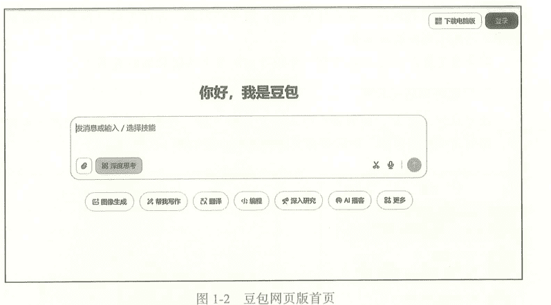

图 1-2 豆包网页版首页

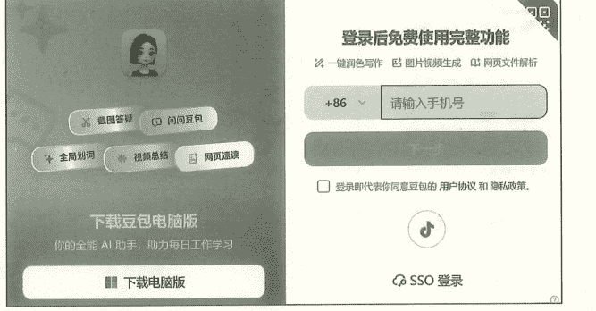

图 1-3 豆包网页版登录界面

3）微信二维码和手机验证码都有时间限制，须尽快扫码或输入验证码，如果超时，可以通过刷新二维码或者重新发送验证码进行登录。

### 技巧 2 界面设置：豆包基本功能详解

豆包是一个多场景、多模态的全能 AI 助手，无论是查找信息、撰写文案，还是提炼长文核心要点，它都能提供帮助。豆包的语音功能十分实用，直接开口提问就能快速得到回应，省去打字步骤，效率特别高。你还可以选择心仪的说话风格、搭配不同技能与背景。
接下来主要以豆包 App 为例，介绍豆包的基本功能和偏好设置。

#### 1. 豆包基本功能介绍

登录豆包 App 后，在界面中单击右上角的“⊕”按钮或者豆包，如图 1-4 所示，即可进入对话界面。对话界面支持的基本功能如图 1-5 所示。

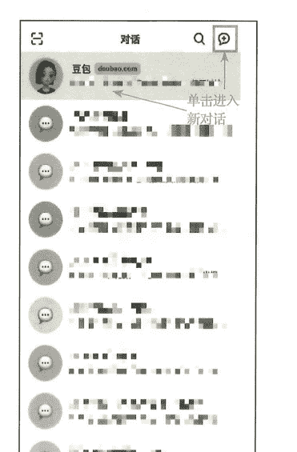

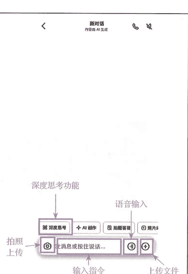

（1）开启对话
在豆包 App 的对话界面中，你可以在底部的对话框中通过发消息或发语音的方式输入指令，豆包会按照你的要求生成相应的内容。
（2）深度思考
在对话框上面，可单击左侧的“深度思考”按钮开启深度思考功能。深度思考功能把搜索和推理相结合，围绕每一步的思考结论开展多次搜索，可使回答逻辑更清晰、更契合实际需求，但生成时间较长，适合需要高质量回答的问题。如果不开启深度思考功能，则可以快速得到回答，但回答的深度与匹配度相较于深度思考模式略有下降，适合简单的问题或内容生成。

（3）拍照上传、文件上传
在对话框左下角，可单击照相机按钮体验拍照上传功能；在对话框右下角，可单击“⊕”按钮体验文件上传功能。豆包可基于你拍的照片或上传的图片，以及上传的文件进行回答。

（4）语音输入
在对话框右下角，可单击语音按钮使用语音输入功能。与微信语音类似，长按语音按钮后直接说出你的要求，豆包可以精准地将语音识别为文字，然后输出结果。

#### 2. 豆包偏好设置

如果你希望豆包用你爱听的声音回答你，记住你的偏好，同时放大字号，那么可以通过调整设置来实现。打开豆包 App，找到设置界面并进入，如图 1-6 所示，可进行豆包偏好设置。

（1）设置豆包声音
豆包不仅能输出文字，还能朗读文字。你可以在设置界面中找到“声音”选项，选择合适的音色、音高、语速。你还可以用你自己的声音，只需要单击“克隆我的声音”按钮，按照提示操作即可。

（2）设置记忆
如果你希望豆包将聊天中提到的个人兴趣、偏好及你在聊天中希望豆包主动记住的内容作为回复的背景信息，使得回复更加贴近你的需求，那么可以开启记忆功能。

（3）字号调整
如果你觉得豆包回复的字号大了或者小了，可以通过字号调整功能来调整大小。

（4）未成年人模式
对于希望孩子使用豆包，但又不过于依赖豆包的家长来说，未成年人模式是非常实用的功能。初次使用时需要创建家长密码，创建完成后即可单独关闭回答展示相关视频、浏览第三方网页、AI 创作等功能，保证孩子使用的豆包是纯净的。自己使用时，则可以关闭该模式。
其他选项如背景设置、快捷指令等也可以根据你的喜好进行调整。

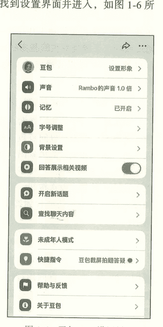

> 试一试
尝试设置声音、记忆、字号调整、背景设置等功能，调整完成后浏览技巧 3，开启你的初次对话。

> 小贴士
1）字号调整完成后，可以通过预览来查看效果。
2）如果不希望豆包记住你的隐私信息，那么可以关闭记忆功能。

### 技巧 3 快速上手：开启与豆包的第一次对话

豆包是一个全能型选手，不管是学习、创作、处理工作，还是进行情感交流，都能精准满足你的需求。基于简洁明了的提问，它能快速给出专业且实用的回答，成为你在生活和工作中的得力助手。
通过技巧 2 了解完豆包的基本功能并完成偏好设置后，就可以直接体验豆包的强大威力了。

#### 1. 简单提问，快速获取答案

无论是学习中的知识查询，还是生活里的难题解答，你都可以问豆包。例如，你可以上传一张未知地点的风景图，在输入框中输入“我图中的地点是哪里？”，开启深度思考功能，并单击发送按钮。豆包经过思考和搜索后，会为你精准找到答案，如图 1-7 所示。

#### 2. 如不满意，接着提问

如果你对豆包的回答不满意，可以接着提问。例如，向豆包询问旅行计划，开启深度思考功能并输入：“我们一家三口想在 11 月底去北京旅游，时间大概一周，以名胜古迹为主，请你帮我制订计划。”豆包输出详细的计划后，你还想让豆包制定交通攻略，那么可以在同一个对话下继续提问，如输入“请为以上行程制定交通攻略”，豆包会接着输出交通攻略。

此外，你还可以让豆包重新生成答案，每次生成的答案都不会雷同，给你多一份参考。当你不想阅读时，你也可以让豆包朗读它给出的答案。如果你愿意，还可以通过复制或者分享将答案转发给其他人。以上操作涉及的按钮如图 1-8 所示。

#### 3. 语音通话

如果你不想输入文字，可以选择语音通话，以直接对话的形式与豆包沟通。在豆包对话界面的右上角单击语音通话按钮，即可进入语音通话界面，如图 1-9 所示。

进入语音通话界面后，可以直接与其说话，如图 1-10 所示。豆包会快速识别你说的内容，并组织语音和文字答案。

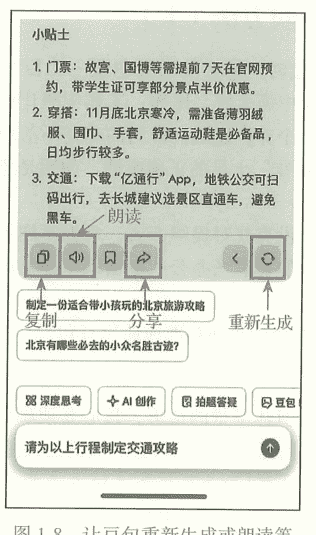

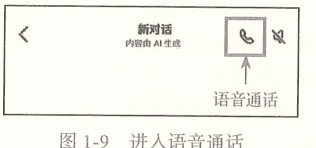

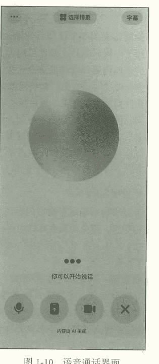

> 试一试

尝试分别用文字和语音的方式向豆包提出一个简单的问题，这个问题可以关于旅行计划、减肥攻略，也可以关于生活烦恼、学业等。

> 小贴士

1）在语音对话中，你还可以选择更贴近你的需求的场景，如模拟面试、英语陪练等。
2）如果你对豆包的答案来源有疑问，可以单击对话中的参考资料，核查材料的可靠性。
3）如果你想向豆包提出一个新的话题，那么不要在原对话中接着提问，而应回到对话界面，新建一个对话。

### 技巧 4 提问技巧：豆包通用提问方法（上）

当你阅读完前 3 个技巧，开始上手豆包时，你会发现豆包是一个巨大的宝藏；但用了一段时间后，效果可能没有想象中那么好。比如：工作中想让豆包写方案，出来的内容却空泛没重点；生活里求个养护建议，得到的却是不落地的大道理；创作时要写篇文案，却满屏都是“AI 味”十足的正确废话。明明是想省时间，结果反而要反复返工，越用越心累。

其实，问题不在于豆包不好用，而在于没有找对提问方式。掌握不同场景下的提问方式，把模糊需求拆成清晰要求，不管是职场办公、生活琐事还是内容创作，可以让豆包每次输出都踩在点子上。

本节和下一节将介绍 11 个提问方法，帮助你更加精准地使用豆包。

#### 1. 场景聚焦提问法

这个方法特别适用于输出内容需要贴合具体场景的情形，核心是明确使用场景和核心任务，避免得到没有针对性、正确而无用的空泛内容。通用公式是：

> 针对 [ 具体场景 ]，完成 [ 核心任务 ]，要求 [ 输出风格 + 关键要点 ]，以 [ 输出格式 ] 呈现

比如想写一款家用净水器的线下促销话术，提示词可以这样写：“针对小区门口线下促销场景，完成家用净水器的宣传话术，要求语言口语化、有感染力，突出‘过滤精度高’‘性价比高’‘安装免费’三个关键卖点，避免专业术语，以‘开场吸引 + 卖点讲解 + 引导留资’的三段式结构呈现，每段不超过 50 字。”这样输出的话术会精准贴合小区居民的沟通场景，开场用拉近距离的表述，卖点讲解直白易懂，引导留资简单直接，完全适配线下快速沟通的需求。

#### 2. 目标导向提问法

如果你的需求有明确目标，比如制订涨粉计划、完成业绩冲刺，用这个方法再合适不过。它的核心是先定核心目标，再拆解可落地的行动步骤，避免只给理论不给方法。通用公式是：

> 以 [ 核心目标 ] 为导向，设计 [ 行动任务 ] 的具体步骤，明确每个步骤的关键动作和判断标准，用 [ 输出格式 ] 呈现

比如想制订短视频账号 30 天涨粉 5000 的计划，提示词可以这样写：“以‘30 天涨粉 5000’为核心目标，设计短视频账号涨粉计划，明确每周的核心任务、内容方向、发布频率和互动方式，每个步骤标注关键动作和判断标准，以‘周度拆分 + 分点说明’的格式呈现，总字数控制在 600 字以内。”输出结果会按周拆解目标，每个步骤都有具体动作和衡量标准，不会出现“多发布、多互动”这种模糊表述，直接就能照着执行。

#### 3. 约束明确提问法

很多时候输出之所以不符合预期，是因为没有提前说清限制条件，比如字数、风格、禁忌内容。这个方法就是通过明确约束，降低返工概率，适配有明确限制的需求。通用公式是：

> 在 [ 约束条件，如字数 / 时间 / 风格 ] 下，完成 [ 核心任务 ]，覆盖 [ 必须包含的要点 ]，排除 [ 禁止出现的内容 ]，以 [ 输出格式 ] 输出

比如要写一篇 300 字以内的公司内部培训通知，在附上培训信息的情况下，提示词可以这样写：“在‘300 字以内、语言正式简洁、无多余客套话’的约束下，撰写公司内部职场沟通技巧培训的通知，覆盖培训主题、时间、地点、参与人员、报名方式五个必须包含的要点，排除‘感谢配合’‘敬请谅解’等客套表述，以‘标题 + 正文’的格式输出。”输出的通知会精准控制字数，核心信息一目了然，没有任何冗余内容，直接就能下发。

#### 4. 细节补充提问法

当需求需要精准覆盖特定人群或背景时，这个公式能帮你避开想当然的表述，让输出更贴合实际使用需求。核心是补充受众、背景、特殊要求等细节。通用公式是：

> 针对 [ 目标受众 ]，结合 [ 背景信息 ]，完成 [ 核心任务 ]，重点突出 [ 细节要点 ]，满足 [ 特殊要求 ]，以 [ 输出格式 ] 呈现

比如想给 60 岁以上老年人写查社保卡的智能手机使用指南，提示词可以这样写：“针对 60 岁以上老年人，结合‘视力不佳、对智能手机操作不熟悉’的背景信息，完成‘查社保卡’的使用指南，重点突出‘步骤简单化’‘图标识别’‘常见问题排查’三个细节要点，满足‘不用专业术语、每步配通俗说明’的特殊要求，以‘分步骤 + 配图提示（文字描述配图内容）’的格式输出，每个步骤不超过 2 句话。”输出的指南会充分考虑老年人的操作特点，步骤简单、表述通俗，还会补充常见问题排查，让老年人能直接照着操作。

#### 5. 角色代入提问法

想让输出有特定风格或专业视角，比如儿童科普的生动有趣、职场邮件的专业得体，可以用这个方法。它通过给豆包设定明确角色，确保输出风格贴合需求，避免“AI 通用腔”。通用公式是：

> 假设你是 [ 具体角色 ]，从 [ 角色视角 ] 出发，完成 [ 核心任务 ]，体现 [ 角色特质 / 专业要点 ]，以 [ 输出格式 ] 输出，符合 [ 场景调性 ]

比如想写一篇介绍星星的儿童科普短文，提示词可以这样写：“假设你是儿童科普老师，从‘贴近儿童认知、语言生动有趣’的视角出发，完成介绍星星的科普短文，体现‘用简单例子解释复杂知识’的角色特质，避免天文专业术语，以‘开头吸引 + 知识讲解 + 互动提问’的结构输出，总字数控制在 400 字以内，符合低龄儿童的阅读调性。”输出的短文会用儿童易懂的语言和例子，避免枯燥理论，还会加入互动提问，让孩子愿意读、能读懂。

#### 6. 总结

这 5 个基础方法分别对应场景贴合、目标落地、约束控制、细节精准、角色适配五大核心痛点。它们的底层逻辑都是把模糊需求变清晰，不用死记硬背，只要根据自己的需求，替换通用公式里的关键词，就能让豆包的输出从能用变成好用。面对日常工作和生活中的大多数基础需求，靠这 5 个方法就能轻松解决，帮你节省大量返工时间。

> 试一试

从 5 个方法里选一个，对应你当下的一个实际需求。比如用“角色代入提问法”让豆包扮演“美食博主”写一篇家常菜教程，用“约束明确提问法”写一篇 150 字的产品短评，按需求替换公式里的关键词，看看输出是否比之前更贴合你的预期。

> 小贴士

1）公式里“[]”部分补充的信息越具体，输出越精准。比如：“具体场景”不说“线下活动”，说“商场节日促销活动”；“目标受众”不说“年轻人”，说“18 ～ 25 岁大学生”。
2）约束条件不用贪多，抓核心即可。比如写文案，重点标注“字数”“风格”“核心卖点”，过多的约束会限制豆包的发挥。
3）如果输出不符合预期，先检查公式里的信息是否遗漏，比如是不是没有明确受众或约束条件，再针对性补充，这比重新提问更高效。

### 技巧 5 提问技巧：豆包通用提问方法（下）

上一节介绍的 5 个方法能轻松应对日常高频需求，而本节将继续介绍 6 个进阶方法，帮你更高效地向豆包提问。

#### 1. 问题拆解提问法

这个方法特别适用于应对复杂问题或多步骤任务，核心是把“大难题”拆成“小问题”，让解决路径更清晰，避免豆包输出笼统模糊的答案。通用公式是：

> 将 [ 复杂问题 / 任务 ] 拆解为 [ × 个核心子问题 ]，分别给出每个子问题的解决思路和具体步骤，明确子问题之间的关联逻辑，以 [ 输出格式 ] 呈现

比如遇到“产品用户留存率低”的问题，提示词可以这样写：“将‘产品用户留存率低’拆解为 3 个核心子问题——用户留存率低的核心原因、新用户留存优化措施、老用户唤醒策略，分别给出每个子问题的具体解决思路，原因需列出 3 个核心方向，措施需包含执行步骤，明确‘找原因→新用户留存→老用户唤醒’的关联逻辑，以‘子问题 + 解决思路 + 步骤’的分点格式呈现，总字数控制在 800 字以内。”输出结果会层层递进，先精准定位原因，再针对性地给出可落地的措施，不会出现“提升用户体验”这种空泛的建议，让你能按步骤推进解决。

#### 2. 数据支撑提问法

如果你的需求需要数据佐证或量化分析，比如分析销售表现、评估项目效果，这个方法能让输出有数据、有结论，增强说服力。通用公式是：

> 基于 [ 数据范围 / 维度 ]，分析 [ 核心主题 ] 的变化趋势和关键结论，列出关键数据指标，说明数据背后的原因和影响，以 [ 输出格式 ] 呈现，避免纯数据罗列

比如想分析某产品近 3 个月的销售表现，需要上传相应的数据表格，并输入提示词：“基于某产品 1～3 月的销售数据（1 月销量为 800 件，2 月为 1200 件，3 月为 900 件，客单价均为 199 元），分析该产品的销售表现，列出‘月销量、环比增长率、销售额’3 个关键指标，说明 2 月销量增长和 3 月销量回落的可能原因，以及对 4 月销售的影响，以‘数据呈现 + 原因分析 + 影响建议’的结构输出，语言简洁专业。”输出结果会将数据和结论结合，先清晰呈现关键数据，再深入分析背后逻辑，最后给出实用建议，帮你快速抓住数据核心价值，而不会只是简单罗列数字。

#### 3. 创意发散提问法

在需要灵感、想找多元方案，比如设计宣传创意、策划活动形式时，这个方法能让豆包跳出思维定势，输出不重复、易落地的创意。通用公式是：

> 围绕 [ 核心主题 / 需求 ]，发散 [ × 个 ] 创意方案，每个方案需包含核心亮点和实施要点，符合 [ 约束条件 / 风格要求 ]，以 [ 输出格式 ] 呈现

比如要给奶茶店设计夏季新品宣传创意，提示词可以这样写：“围绕‘奶茶店夏季新品（主打水果茶）’，发散 6 个宣传创意方案，每个方案需包含核心亮点和实施要点，符合‘年轻时尚、低成本、易落地’的约束条件，避免复杂的大型活动，以‘方案名称 + 核心亮点 + 实施要点’的分点格式呈现，每个方案不超过 80 字。”输出的创意会覆盖线上和线下多个维度，比如话题挑战、限定周边打卡等，既贴合年轻受众的喜好，又不用投入过多成本，帮你快速打开思路。

#### 4. 总结提炼提问法

在面对长文档、多信息，比如行业报告、会议纪要，想快速抓核心时，这个方法能帮你剔除冗余，精准提炼关键信息。通用公式是：

> 提炼 [ 长文本 / 多信息 ] 的核心内容，聚焦 [ 关键要素 ]，剔除 [ 无关信息类型 ]，以 [ 输出格式 ] 呈现，确保核心信息不遗漏

比如要提炼一份 5000 字行业报告的核心观点，可以上传这个报告或链接，再输入提示词：“提炼我上传的《2024 年短视频行业发展报告》的核心观点，聚焦‘行业规模、用户特征、主流趋势、面临挑战’4 个关键要素，剔除具体案例、数据来源等无关信息，以‘分点列出 + 每点不超过 3 句话’的格式呈现，总字数控制在 300 字以内。”输出结果会精准抓取报告核心，用简洁的语言呈现关键结论，让你不用逐字研读就能快速掌握报告重点。

#### 5. 迭代优化提问法

如果你已有初稿但对其并不满意，比如需要修改文案、方案、报告时，这个方法能让豆包进行针对性迭代，避免重新创作、浪费时间。通用公式是：

> 基于现有 [ 初稿类型 / 内容 ]，针对 [ 现有问题 ]，按 [ 优化标准 / 期望效果 ] 进行修改，保留 [ 需保留的核心内容 ]，以 [ 输出格式 ] 呈现噪强、续航久、价格低’3个核心卖点、语气更有感染力、增加行动引导的优化标准进行修改，保留文案原有的场景化开头，以‘修改后文案+3点修改说明’的格式输出，总字数控制在200字以内。”输出的修改版文案会精准解决现有问题，强化核心卖点，让内容更符合使用需求，同时标注修改要点，让你清楚调整逻辑。

#### 6. 对比分析提问法

当需要在多个选项中做决策，比如选办公软件、挑营销方案、对比产品时，这个方法能让豆包客观分析优劣，帮你快速做选择。通用公式是：

> 对比 [多个选项]，从 [对比维度] 进行分析，明确每个选项的优势和劣势，结合 [决策标准] 给出推荐结论，以 [输出格式] 呈现，保持客观中立

比如想对比 WPS、石墨文档、飞书文档的适用性，提示词可以这样写：“对比 WPS、石墨文档、飞书文档3种办公软件，从‘协作效率、功能丰富度、使用成本、兼容性’4个维度进行分析，明确每个软件的优势和劣势，结合‘中小团队日常协作、低成本使用’的决策标准给出推荐结论，以‘表格对比+推荐说明’的格式呈现，语言简洁客观。”输出结果会用清晰的表格呈现各选项表现，推荐结论贴合决策需求，避免主观臆断，帮你快速做出合适的选择。

#### 7. 总结

这6个进阶方法精准对接问题拆解、数据支撑、创意发散、信息提炼、迭代优化、对比分析六大核心场景。它们的核心逻辑是“聚焦深层需求+明确边界标准+给出精准提示词”，不管是需要深度分析的专业任务、需要多元灵感的创意工作，还是需要理性判断的决策场景，套上对应公式，补充关键信息，就能让豆包的输出精准命中需求。

> 试一试

从这6个进阶方法里选一个，应对你当前的复杂需求。比如用对比分析提问法对比3款育儿App的适用性，用迭代优化提问法修改一篇工作汇报初稿，按需求替换公式里的关键词，体验精准解决复杂问题的输出效果。

> 小贴士

- 1）面对复杂需求时可以组合使用上述公式，比如先用问题拆解提问法拆分任务，再用数据支撑提问法补充分析，这样的输出会更全面、更深入。
- 2）创意类需求的约束条件要适度，比如只限定低成本、易落地，给豆包留足创意空间，过度约束会导致灵感局限。
- 3）对比分析时，对比维度要统一且关键，比如对比产品时聚焦价格、功能、售后，不要混淆无关维度，这样才能快速找到核心差异。

### 技巧 6 豆包特色功能：六大类功能助你高效工作、生活

开会记了半本笔记还是漏了待办，想画张活动海报调了十次还是不对，习惯讲方言总怕 AI 听不懂，面对复杂问题琢磨半天也理不清头绪——这些日常里的“效率小堵点”，是不是总让你多花一倍时间？别慌，豆包早已从单纯的“信息助手”升级为“全能智能体”，它的六大类特色功能刚好能把这些堵点挨个打通，从办公协作到生活琐事，帮你省出更多时间。接下来就按照这六个核心大类，带你快速摸清这些能大幅提效的新功能，至于具体怎么用、有哪些隐藏技巧，后面章节会挨个拆解。

#### 1. 大模型核心升级：AI 变“懂事”的底层密码

作为所有功能的基础，豆包能智能选择适配的专项模型，不用你手动切换工具。比如你输入“写一段 Python 数据清洗代码”，它会直接调用编程模型，输出带注释的代码；再如你发一张产品设计图问“这个按钮位置合理吗”，它会自动启动视觉分析模型，指出“按钮离底部太近，单手操作不方便”；如果你想做销售数据汇总，它又会切换为统计模型以生成分析结论。全程不用在不同工具页之间来回切换，效率和精准度都能兼顾。

#### 2. 智能办公助手：终结无效忙碌

专门解决职场重复劳动，6 个功能让协作、分析、存储全流程提速：

- 记录会议：开项目会时，豆包能自动将录音转文字、识别发言人，标注比如“研发部周三前出原型”这类待办；开跨国会时，它能实时生成中英双语纪要，不用会后再找人翻译；新增的视频通话协作功能非常实用，镜头对准产品设计图时，它能实时反馈建议，例如“此处接口设计易卡顿”等问题，远程沟通远比单纯语音高效。
- 文档智能处理：上传 PDF、Excel 或流程图，除了能提取重点、生成脑图，还能做深度分析。比如：传企业部门协作图，能定位“审批节点过多”这类瓶颈；传文献能自动生成综述，不用手动整合几十篇资料。
- AI 云盘：不仅支持无限容量存储，还能“加工文件”，比如传视频能支持“视频问答”（比如问“第 5 分钟提到的方案细节”），传数据表格能自动生成可视化图表，比普通云盘多了“理解 + 输出”的能力。
- 共享应用或屏幕：工作的时候不再需要在文档、浏览器和 AI 工具之间反复切换，进行复制和粘贴。这个新增的核心协作功能打破了传统 AI 仅能问答的局限，实现“实时协作伙伴”级体验。支持 PC 与手机端双向操作，可以选择共享整个屏幕、单个应用窗口或浏览器标签页，还可以勾选“系统音频”“麦克风”同步传递音视频与语音指令。核心优势在于实时动态交互——边操作 Excel 改公式边用 Photoshop 修图，或边看数据报表，就能直接问豆包“这个函数的返回值为什么是错误的”“图表结构怎么优化”，豆包通过识别屏幕画面给出精准引导，效率比截图发问效率高数倍。
- AI 视图（网页增强）：浏览网页时一键切 AI 视图——看新闻点“AI 总结”，可 3 秒获取核心事件；看 B 站、抖音视频点“AI 看视频”，能得到带时间轴的摘要（比如“02：15 讲露营装备清单”），想跳着看重点不用拖进度条。
- AI 浏览器：可直接当浏览器用，能导入旧浏览器的书签、登录记录和表单数据，无缝衔接之前的习惯；打开英文网页时，划词就能对照翻译，还能保留网页格式，不会像其他工具那样打乱排版。

#### 3. 创作与内容生成：零基础也能当“创意大神”

不管是生图、做视频还是写代码，新手也能快速出成果：

- AI 生图：想画“带蝴蝶结的国风短毛猫”，传一张自家猫咪的照片当参考，再加文字描述“工笔画风格，脖子系红色蝴蝶结”，生成的图既能保留猫咪的神态，又贴合国风质感，比只靠文字描述精准不少。
- AI 编程：输入“做一个接水果的小游戏，界面是粉色风格”，它会生成带注释的代码，还会告诉你“把下落速度改成 0.5 秒更适合新手玩”，零基础也能直接运行；遇到代码报错，复制错误提示过去，就能得到修复方案。
- 视频与播客生成：文本转视频时，人物动作更自然（比如走路不会“飘”）；上传文档能直接转播客音频，适合做知识分享。

#### 4. 智能交互升级：跟 AI 聊天比找人帮忙还方便

交互更自然，老人、新手都能用明白：

- 方言与语音交互：能说 13 种方言（如上海话、南京话），识别准确率超 92%，比之前多了“会聊”的感觉——用粤语问“广式早茶有哪些经典点心”，会顺带提“虾饺要选皮透亮的”这类实用建议；语音延迟低至 200ms，对话时不会有“等半天”的卡顿感。
- AI 划词工具栏：不管是网页、PDF 还是 Word 文档，划词就弹翻译选项，支持“对照翻译”（原文和译文并排），保留段落格式；遇到不能复制的文档，划词也能翻译，不用手动打字。
- 实时视觉问答：支持通过拍实物、截图直接提问——拍零食包装问“热量多少”，拍数学题问“解题步骤”，拍电路图问“这个元件的作用”，比之前的识图更精准，连复杂图表都能解读。
- 商品卡功能：问答时会同步推相关商品，还带用户评价。比如，问“露营该买什么装备”，会弹出带“防水系数”“用户评分”的帐篷、睡袋商品卡，单击就能跳转商城下单，不用先记需求再去购物 App 搜，实现“问－选－买”闭环。

#### 5. 内容理解与知识服务：复杂问题能“刨根问底”

处理深度需求更靠谱，能“读懂”隐性信息：

- 深度思考推理：遇到复杂问题（如“为什么今年露营热度下降”），会先查数据（如“2025 年露营装备销量同比降 15%”），再分析原因（如“周边游更多元化”），答案有数据支撑，不是空泛的猜测。
- 视觉推理：能从图片里找隐藏逻辑——看数学题图片，会指出“你第一步把公式列错了”；看产品设计图，会提醒“此处材质不适合户外用”，比单纯描述图片内容多了“判断 + 建议”。
- 视频解析：粘贴视频链接（B 站、抖音都支持），支持文案提取，要点总结，效率比手动记笔记高 10 倍。

#### 6. 安全与隐私保护：用着更放心

兼顾便利和安全，细节考虑很到位：

- 未成年人保护模式：开启后，豆包将默认关闭视频展示、浏览第三方网页、和豆包以外的智能体对话、AI 创作功能，但翻译、深入研究等功能仍可正常使用。退出该模式时需要输密码，以防孩子偷偷改设置。
- 隐私数据管控：支持手动删除单条或批量清理对话历史，不想留存的交流内容能随时删掉；导入浏览器书签时，可选择性跳过敏感的网银、工作平台登录信息，避免隐私泄露。

#### 7. 总结：豆包的核心变化——从“能回答”到“能办事”

现在，豆包不再只是“帮你查信息”，而是能打通“提问－处理－落地”的全流程。比如：问露营装备，既能给建议，又能推商品；做会议记录，既能转文字，又能标问题、协作文档。豆包的多模态能力也很强，看、说、读、写能协同，方言识别、视觉推理这些细节也让它十分贴近真实使用场景。

> 试一试

3 个零门槛功能，现在就能上手：

- 1）办公场景：打开共享屏幕，对着正在改的 Excel 表格问“这个求和计算为什么结果不对”。
- 2）创作场景：传一张自家宠物的照片，输入“画成复古漫画风格，加个小领结”。
- 3）生活场景：用家乡话问“本地最有名的家常菜怎么做”。

> 小贴士

- 1）共享屏幕前记得关掉敏感文档，保护隐私。
- 2）生图时补充具体细节（比如“耳朵上有小痣”），生成效果会更贴合你的预期。
- 3）让豆包解析视频时，补充重点提取步骤，摘要会更精准。

### 技巧 7 豆包超能模式（上）：申请流程 +5 个基础场景实操，复杂任务一键搞定

做带数据图表的市场分析报告，要搜数据、做图表、拼网页，反复切换软件；给孩子做风格统一的绘本，可生成的图片画风混乱，要拼册、分享，还得额外找工具；发带销量数据的品牌微博，要查数据、做图、调排版，一步错就得重改——这类多步骤、跨工具的复杂任务，既耗时间又没效率。

豆包超能模式可以解决这些麻烦：不管是做报告、做绘本还是发微博，只要用自然语言说清需求，它就能一站式搞定，还支持在线编辑，直接输出可落地的成品，省掉大量重复操作。

豆包超能模式的本质是通用型智能体（Agent），不用复杂的提示词，用日常聊天式的语言描述需求就可以。它的亮点是能灵活生成图片、视频、交互网页等富媒体，尤其是生成的网页支持单击查数据、调参数的实操功能。它就像你的全流程管家，能自主决策、联动多工具，完成从数据搜索、内容生成到排版分享的全流程，还支持直接编辑修改，彻底省去重复操作的麻烦。

#### 1. 超能模式申请

目前豆包超能模式处于内测阶段，需要申请才能试用，不过申请流程并不复杂。最直接的方式是在浏览器里打开链接 https://www.doubao.com/super-task-apply，按页面提示填写基本信息后提交申请，如图 1-11 所示。通常等待几天就能收到通过通知，如图 1-12 所示。

#### 2. 上手实操：5 个基础场景高效落地

取得试用资格后，在电脑版或网页版首页切换到“超能模式”就能启动，输入具体提示词就能让它开始工作，如图 1-13 所示。

以下5个场景覆盖日常高频刚需，无论是职场报告生成、生活绘本创作，还是数据搜集、库存管理，只需输入明确的提示词，就能快速得到可落地的成果，尤其适合新手入门体验。

##### （1）场景1：职场报告一键生成

领导要一份带数据的行业分析报告，不用自己搜资料、搭网页，直接输入提示词：“深度搜索并整理2025年小红书与抖音平台‘新媒体运营排版’方向的内容趋势，做一个毛玻璃扁平化风格的分析报告网站。内容要包含热门类型、头部手法、选题案例，提供相关论文的跳转链接。”

开启超能模式后，豆包会自动进行多轮搜索权威数据，在筛选后生成结构化内容，还会直接写出网页代码。生成后不用找其他工具修改，直接在界面上就能编辑文字、调整版式，改完单击“分享”按钮进行分享，对方点开分享的链接就能查看完整报告，如图1-14～图1-17所示。

##### （2）场景 2：生活绘本轻松做，还能分享

想给孩子做一本荆轲刺秦王的绘本当睡前故事，不用懂设计，给出明确的提示词：

请创建一个完整的交互式儿童教育数字绘本项目，主题为“荆轲刺秦王”的历史故事。具体要求如下：

- 1）项目类型：网页交互式故事绘本（非 PPT）。
- 2）故事内容：荆轲刺秦王的经典历史故事，适合儿童理解的简化版本。
- 3）页数控制：15 页以内（包括封面、内容页和封底）。
- 4）视觉风格：水彩插画风格，色彩柔和温暖，符合儿童审美。
- 5）技术实现：
  - 使用 HTML5、CSS3、JavaScript 构建完整的网页应用。
  - 实现翻页动画、单击交互等动态效果。
  - 确保响应式设计，支持个人计算机和移动设备。
  - 保证跨浏览器兼容性。
- 6）交互功能：
  - 流畅的翻页效果（左右滑动或单击翻页）。
  - 可单击的互动元素（如单击角色出现对话气泡）。
  - 简单的动画效果，增强故事表现力。
- 7）教育价值：在故事中融入适当的历史知识和价值观教育。

请提供完整的项目实现，包括所有 HTML、CSS、JavaScript 代码文件和配套的插画资源。

等几分钟后，豆包会生成带情节的绘本内容和配套插画，如图 1-18 所示。要是觉得某页画风不对，直接补充提示词，如“第 8 页荆轲的服饰换成战国武官样式，背景加些芦苇”，它会立刻修改。全部满意后可进行分享，家人打开链接就能翻看成册的绘本。

##### （3）场景 3：网页数据自动搜集整理

开奶茶店想分析竞品用户的反馈以优化自家产品，不用手动翻大众点评截图统计，输入提示词：“访问大众点评，搜集整理 2025 年 Q4 喜茶、奈雪的茶、古茗 3 个品牌的热门奶茶用户评价并分析，重点提取口味（甜度、茶底风味）、性价比、包装颜值 3 个维度观点，网页采用清新奶茶风（浅奶茶色为主色调，米白背景配圆角卡片），配上 3 个品牌招牌产品图片。”

豆包会自动打开浏览器访问大众点评，筛选近 30 天的有效评价（优先选择带图、字数超 50 字的真实反馈），按“口味、性价比、包装颜值”分类整理核心观点（比如：“喜茶多肉葡萄茶底获 80% 好评，但有 25% 用户反馈‘小料太少’；古茗杨枝甘露包装颜值高，不过 15% 用户觉得‘甜度偏高’”），同时生成符合风格的展示网页。若需要将整理好的数据填入品牌调研表单（如竞品分析表），它还能模拟人工操作自动填写，遇到大众点评登录环节会提示你扫码验证，如图 1-19 所示。登录之后就会在大众点评中自动搜索数据，如图 1-20 所示。全程不用手动复制评价、统计数据或调整网页排版，生成效果如图 1-21 ～图 1-24 所示。

##### （4）场景 4：小微企业进销存管理系统（可录数据）

开小超市想管库存，又不想花钱买专业软件？输入提示词：“帮我做一个小微企业简易进销存管理网页，包含商品入库（记录名称、数量、单价、日期）、出库登记、库存预警（低于 5 件时标红提醒）、月度销量统计图表，界面用浅青色为主色调，字体清晰，支持手机端查看。”

生成的小微企业进销存管理系统页面如图 1-25 所示。如有商品入库，填完信息后单击“确认入库”按钮，系统会自动更新库存总数，如图 1-26 所示。如卖出商品，登记出库后，库存会实时减少；当商品低于 5 件时，系统会自动标红提醒补货，如图 1-27 所示。月度统计板块还会生成柱状图，如图 1-28 所示，直观显示哪款商品卖得最好，而不用再翻 Excel 进行统计。

##### （5）场景 5：便利店智能管理系统

便利店设备多，想要设计一个智能管理系统前端页面，用这个提示词：“设计社区便利店智能管理系统网页，支持接入真实 Wi-Fi/ 蓝牙智能设备（需在设置中输入设备 ID 绑定），功能包含：① 设备实时监控（冷藏柜温度、收银机状态、关东煮机加热模式、照明系统、监控摄像头）；② 场景联动（开店模式自动开启照明、收银机、冷藏柜制冷、关东煮机预热；闭店模式关闭所有设备、开启摄像头移动侦测）；③ 定时任务（冷藏柜在凌晨 2 点至 5 点调至节能模式、关东煮机在早上 6 点开机）；④ 故障报警（冷藏柜温度超 8℃ 或设备离线时，推送到绑定的手机上）。界面用浅橙色为主色调，操作按钮带确认弹窗，避免误触。”

生成的便利店智能管理系统页面如图 1-29 所示，页面中的所有按钮均带有交互效果，如可以调节冷藏柜温度，如图 1-30 所示。

## 28 豆包使用秘笈：从入门到精通的 100 个实用技巧

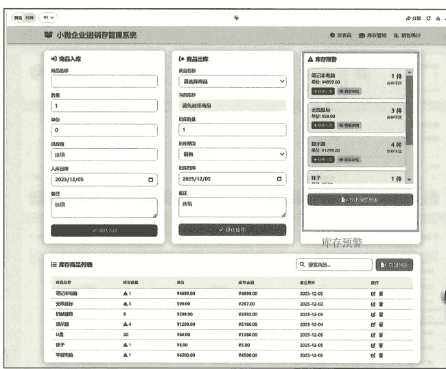

图 1-27 库存预警效果展示

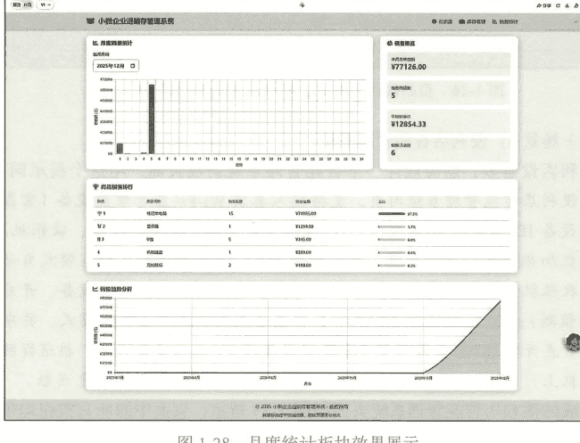

图 1-28 月度统计板块效果展示

## 第 1 章 豆包使用快速入门

29

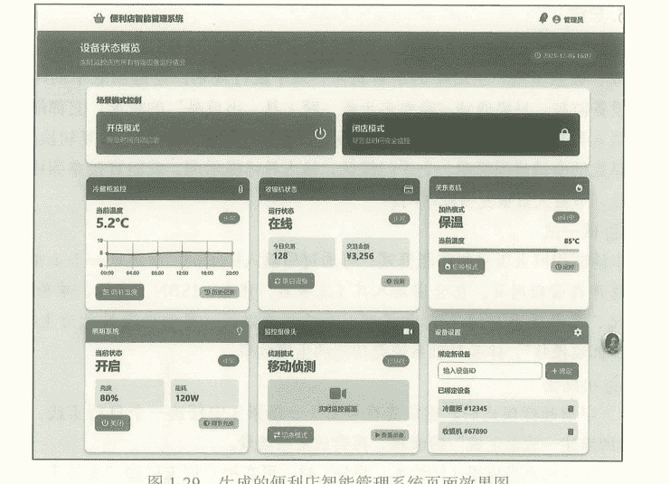

图 1-29 生成的便利店智能管理系统页面效果图

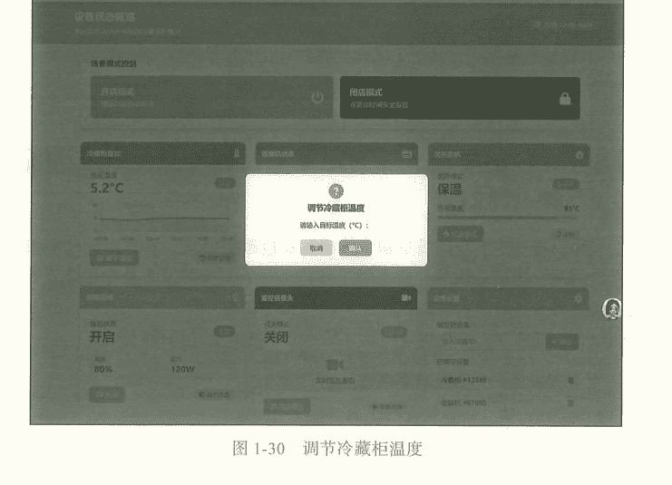

图 1-30 调节冷藏柜温度

#### 3. 总结

豆包超能模式的核心价值在于高效解决全流程复杂任务：不管是职场里的报告生成、数据整理，生活中的绘本制作、亲子旅行规划，还是创业中的库存管理、设备监控，只要遇到“需要多步骤、跨工具、出成品”的需求，它都能通过自然语言指令自主联动工具，一站式搞定，不用手动拆分步骤、反复切换软件。超能模式的申请流程简单，上手门槛低，输入具体提示词，就能直接拿到可落地的成品，节省大量重复劳动时间。

> 试一试
申请试用网页版豆包超能模式，等通过后输入提示词“帮我做一个小型书店的简易库存管理网页，包含书籍入库（录书名、作者、ISBN、数量、单价）、出库登记、库存低于10本时标黄提醒、季度销量饼图，界面用浅棕色为主色调，支持手机端操作”，体验基础系统类功能的生成效率。

#### 小贴士
1）申请超能模式后，建议先在场景1～场景3中任选一个自行实践，熟悉“提示词描述→成果生成”的流程，再尝试复杂场景。
2）生成网页类成果（如绘本、报告）时，可在提示词末尾加“支持手机端”，避免在手机上查看时排版错乱。
3）自动搜集数据（如大众点评的评价）时，若遇到验证码，扫码完成验证后，豆包会继续执行任务，无须重新提交提示词。
4）生成管理系统（进销存、设备管理）后，可先录入两三条测试数据，确认库存预警、数据统计等功能正常后再正式使用。

### 技巧8 豆包超能模式（下）：4个拓展场景实操，复杂任务一键搞定

上节我们通过5个基础场景初步体验了豆包超能模式“不需要拆分步骤、联动工具出成果”的核心优势。在实际工作与生活中，当需求涉及个性化定制（如专属健身计划）或跨平台联动（如社交内容自动发布）时，它的能力会进一步升级，能以更精准的方式解决复杂问题，帮你节省更多手动操作时间。

#### 1. 上手实操：4个拓展场景高效落地

（1）场景6：健身会员饮食+训练计划（含打卡）
健身工作室想给会员制订训练计划，不用手动写表格，输入提示词：“生成健身会员专属饮食 + 训练计划系统，先收集会员信息（年龄 28 岁，性别男，体重 75kg，目标增肌，芒果过敏），按每周 3 次力量训练 +2 次有氧安排计划，饮食含每日三餐食谱（标注热量、蛋白质），可打印训练打卡表，界面用黑色 + 荧光绿配色，有运动感。”

生成效果如图 1-31 所示。生成的网页里，训练计划按天划分（比如周一为力量训练），饮食推荐“早餐全麦面包 + 煎蛋 + 希腊酸奶 + 香蕉 + 杏仁”，还附食材分量。

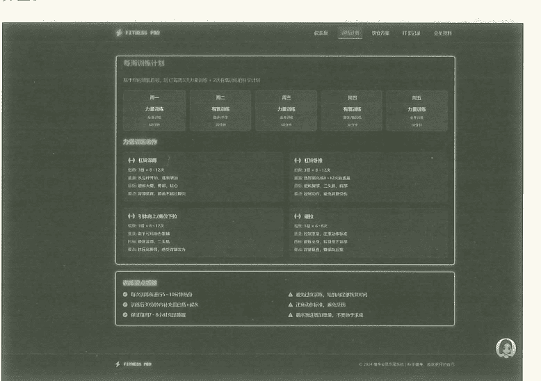

图 1-31 生成的每周训练计划

（2）场景 7：阳朔亲子旅行规划（含预算）

想带娃去阳朔玩，不想零散搜攻略？输入提示词：“规划 2025 年寒假从广州出发的阳朔 3 天 2 晚亲子旅行，包含每日行程（适合 5 岁儿童，比如遇龙河竹筏、西街手工扎染）、亲子餐厅推荐、交通方式（高铁 + 当地租车）、预算明细（高铁票、住宿、门票总费用），生成清新山水风 HTML 页面，能显示每日天气建议。”

生成的旅行攻略清晰地给出了天气建议、行程安排、交通方式和住宿推荐，如图 1-32 所示。

## 32 豆包使用秘笈：从入门到精通的 100 个实用技巧

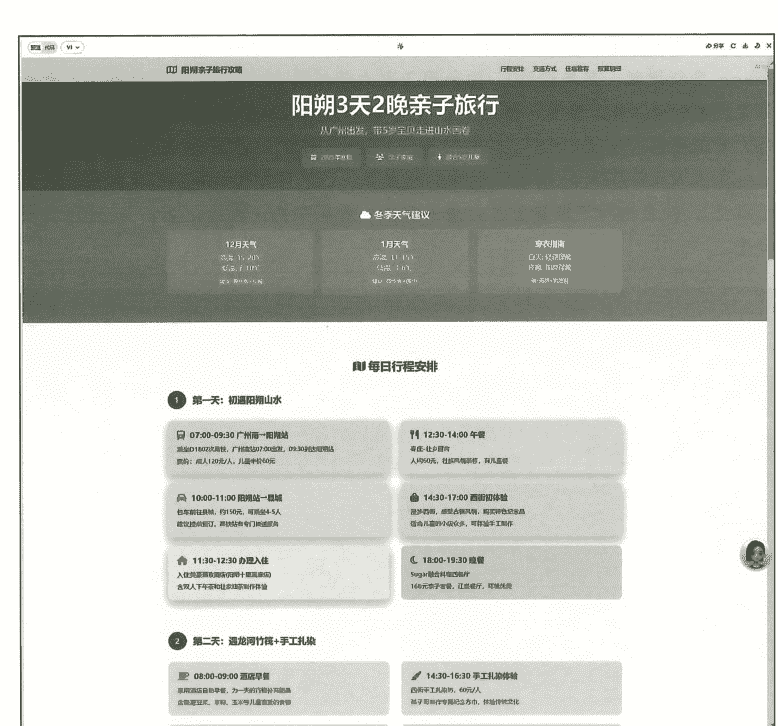

图 1-32 生成的旅行攻略

（3）场景 8：小红书美妆新品测评笔记（带数据）

想发美妆新品测评，不想自己做图写文案？输入提示词：“帮我写小红书‘2025 年春季 3 款粉底液测评’笔记，包含雅诗兰黛、兰蔻、植村秀的持妆时间（6 小时实测）、遮瑕力（遮痘印效果）、适合肤质，配 3 张实测对比图（带时间戳），加话题 #2025 春季粉底液测评 # 干皮粉底液推荐，文案口语化，像和闺蜜分享。”

豆包会先查这 3 款粉底液的最新用户反馈，结合实测逻辑写文案，比如“雅诗兰黛 DW：质地偏厚重，遮瑕力超强！一层就能遮住 70% 痘印，两层几乎完美遮盖。但干皮姐妹要注意，一定要做好保湿打底，不然容易卡粉。兰蔻菁纯：质地像融化的奶油，超级丝滑！上脸瞬间感受到精华般的水润，干皮在空调房完全不卡纹，透出自然的奶油光泽肌。植村秀小方瓶：轻薄透气，延展性好，上脸很快成膜。妆感清透自然，适合喜欢伪素颜的姐妹。”，并自动生成带时间戳的对比图（比如“3小时持妆效果 vs 6小时持妆效果”），排版符合小红书风格。
生成后可直接复制到小红书，不用再调字体、加贴纸。最终效果如图1-33所示。

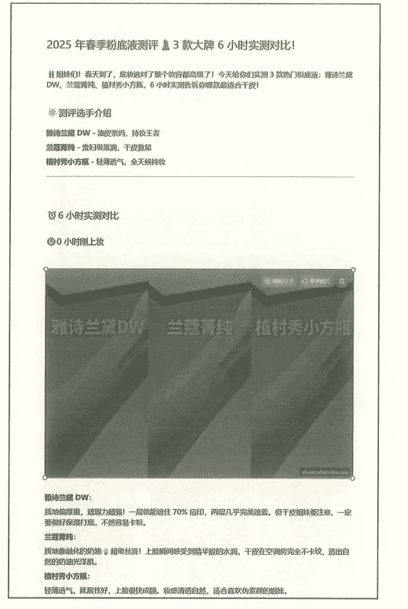

（4）场景9：自动发布品牌/个人微博
做服装品牌想发新品预售微博，不用手动写文案、做图再登录后台了。开启超能模式，输入提示词：“帮我完成服装品牌‘2025春季碎花连衣裙’新品预售微博自动发布：① 文案包含‘3月15日0点开售、前100名赠丝巾、满399减50’核心信息，风格活泼亲切，控制在160字内；② 配3张产品图（主图全身穿搭，细节图领口花纹，场景图户外拍摄），色调统一为浅粉色系；③ 添加话题#2025春季连衣裙推荐#碎花裙穿搭，@品牌官方客服号；④ 绑定微博账号（需提示扫码登录），设置3月10日上午10点定时发布。”

豆包会先按需求生成符合风格的文案，自动设计并生成3张产品图，按微博排版规范整合内容，然后提示你扫码登录品牌微博账号完成绑定，确认发布时间后，到点会自动提交发布，无须手动登录后台操作。若需要修改文案或图片，可在发布前直接在界面中编辑，系统会同步更新定时任务内容，如图1-34和图1-35所示。注意，定时发布的前提是需要有具备定时发布权限的品牌微博账号。

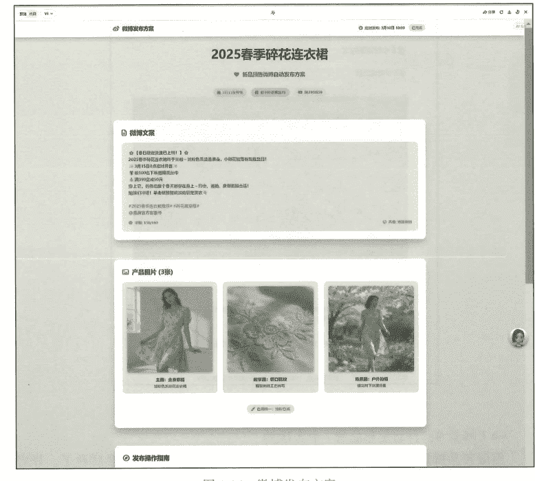

图 1-34 微博发布方案一

## 第 1 章 豆包使用快速入门

35

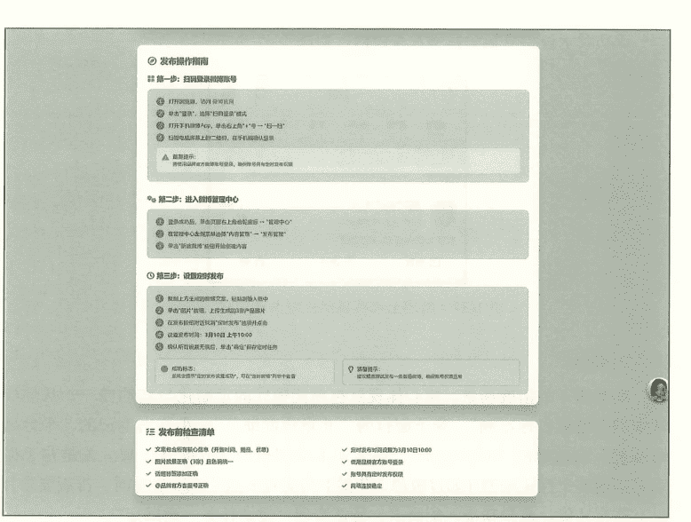

图 1-35 微博发布方案二

对于个人微博来说，操作就更加方便简单了，以想要发布一条推荐书籍的微博为例，直接在超能模式下输入提示词“帮我在微博发送一条内容，文字是：推荐大家去读《认知觉醒》”，豆包会直接给出微博的登录界面，提示你授权登录微博账号，如图 1-36 所示。

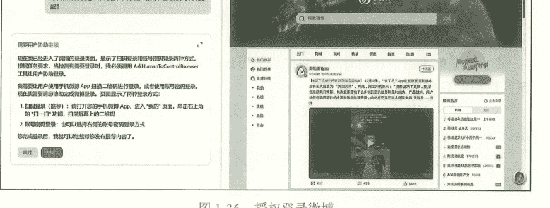

图 1-36 授权登录微博

成功登录后，豆包会自动发布微博，如图 1-37 所示。

#### 2. 总结

本节用 4 个拓展场景，核心体现豆包超能模式的定制化与联动性——从健身计划的“增肌目标定制”、亲子旅行的“儿童适配细节”、小红书笔记的“平台风格匹配”到微博的“自动发布”，均无须手动切换工具或拆分步骤。关键在于提示词需明确个性化限制（如过敏源、年龄）与流程节点（如发布时间、排版要求），只有这样才能让成果精准匹配需求，真正实现“复杂任务一键搞定”。

> 试一试

现在就来实操一次：申请试用网页版豆包超能模式，等通过后输入提示词“帮我做一个社区便利店的简易会员系统网页，包含会员注册（记录姓名、电话、生日）、积分登记（消费 1 元积 1 分）、生日月双倍积分提醒、积分兑换礼品列表（100 分换纸巾，200 分换饮料），界面用橙色为主色调，支持手机查看”，看看它能帮你省多少事。

> 小贴士

1. 生成管理类系统（进销存、会员系统）后，建议先录入几条测试数据，确认功能正常后再正式使用。
2. 做旅行或研学计划时，可在提示词里加“标注景点是否需要预约”，避免到了现场进不去。
3. 生成社交平台（小红书、微博）笔记后，先将其复制到草稿箱预览，调整换行再发布，阅读体验更好。
4. 要是想长期用生成的网页，可将网页下载到本地，下次直接打开用，不用重新生成。

## 第 2 章 用豆包轻松实现智能办公与自动化

### 技巧 9 材料写作：“范文借力优化法”高效出高分

职场里，写材料是一项绕不开的任务。不管是单位活动的新闻稿、年度工作总结，还是会议讲话稿、活动策划案，都得既符合规范又有亮点，还得赶在截止日期前完成。很多人要么对着空白文档发呆，半天写不出一句话；要么抱着一堆范文发愁，想借鉴又怕照搬照抄，最后写出来的东西要么生硬，要么跟范文高度雷同，不仅拿不到高分，还得花大量时间反复修改。通过“范文+关键信息结合优化”，我们能利用豆包的能力解决写材料的所有痛点。

#### 1. 准备写作素材

豆包不能无中生有，所以首先要做的是准备好两类核心素材。一类是优质范文，不管是从公开渠道找到的行业标杆稿件，还是单位内部的优秀范例，只要是符合你想写的材料类型、风格得体的文章都可以。另一类是关键信息，也就是你要写的材料里必须包含的核心内容，比如活动通知里的时间、地点、参与人员、主要流程，工作总结里的工作成果、数据、下一步计划等，把这些信息整理成清晰的文字即可。

#### 2. 生成文章初稿

准备好素材后，就可以启动“范文+关键信息结合优化”流程了。打开豆包，单击“帮我写作”功能，上传提前准备好的范文和关键信息，然后输入明确的结合优化提示词。提示词越具体，生成的结果就越精准，比如写专题分享会新闻稿的提示词可以是“请结合上传的新闻稿范文框架与单位活动通知关键信息，生成一篇符合职场规范的新闻稿，大纲逻辑清晰，内容贴合活动实际，语气正式得体，不照搬范文原文，突出单位特色”，如图 2-1 所示。

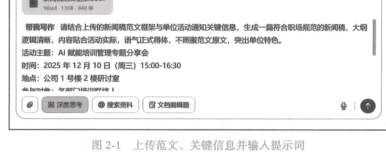

豆包会直接生成一篇结合了范文风格和自身关键信息的活动新闻稿，如图 2-2 所示。这时候的文章已经有了不错的基础，既借鉴了范文的优质框架和语言质感，又融入了专属的关键信息，不会出现雷同问题，整体风格也更贴合职场需求。

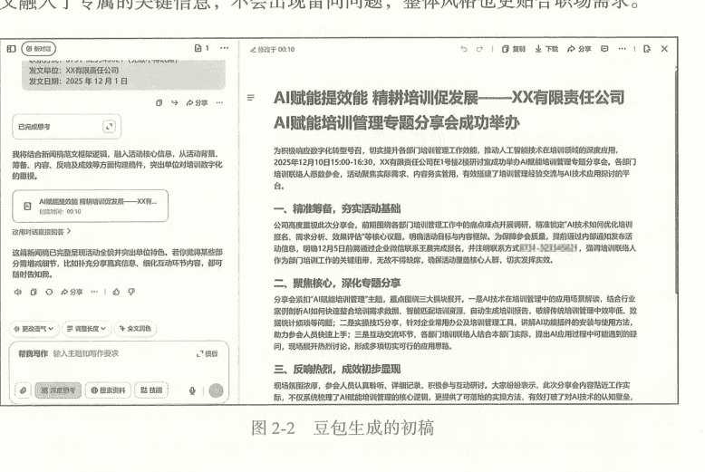

#### 3. 对初稿进行润色

生成文档不代表结束，最后一步的精准润色能让文档再提升一个档次。很多人在润色时习惯用一个提示词改全文，结果越改越乱，而豆包的文档编辑器刚好解决了这个问题——可以单独选中某个词、某句话或者某个段落进行针对性修改，不用动全文。比如觉得某段内容的思想高度不够，就可以选中这个段落，单击“AI 改写”按钮，并输入提示词“提升这一段的思想高度，保留核心信息，语言更具格局，符合职场材料的表达习惯，不改变段落结构。”，如图 2-3 所示。

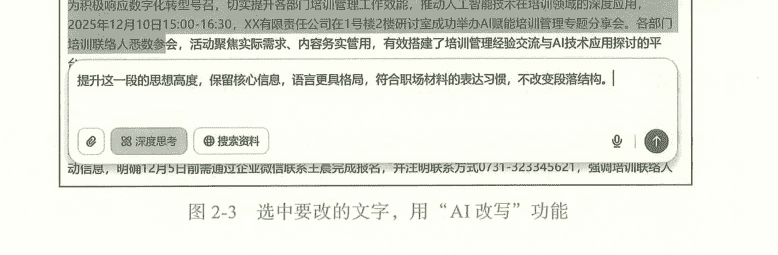

如果想优化标题，提示词可以这样写：“替换文中所有标题，使其更简洁有力、突出主题，风格与范文保持一致但不重复。”要是觉得语气太生硬，想调整得更亲和一些，提示词可以这样写：“调整语气为温和和亲和，保留专业度，避免过于官方的表述。”除此之外，还能针对排比句式、金句替换等方面进行微调，直到满意为止。

#### 4. 总结

用豆包根据范文写材料的核心其实是“借力打力”——借助优质范文的框架和风格，结合自身的关键信息，再通过精准提示词和局部润色，快速生成高质量、不雷同的职场材料。这套方法彻底解决了写材料时没思路、改得多、怕雷同的痛点，不用再对着空白文档发愁，也不用为了修改反复折腾，大幅提升写作效率和材料质量，不管是新闻稿、工作总结，还是讲话稿、活动策划，都能套用这套逻辑。

> 试一试

找一篇你近期要写的材料（比如工作总结），准备一篇优质范文和自己的关键信息（工作成果、核心数据、下一步计划），按照文中的步骤操作：先上传素材，输入结合优化提示词，生成材料初稿，再针对3个不同部分（比如标题、某段内容、整体语气）用专属提示词进行润色，看看最终生成的材料是否符合预期。

> 小贴士

1）范文要选高质量、风格贴合需求的，避免选用内容杂乱、语言不规范的稿件，否则会影响最终生成效果。
2）关键信息要简洁明了，不要堆砌无关内容，突出核心要点即可，这样能让豆包更好地结合提炼。
3）润色时优先关注思想高度、标题质量和语气贴合度，这三点是职场材料得分的关键，局部优化比全文改写更高效。
4）提示词越具体越好，明确说明需求和限制，能减少修改的次数，让豆包更精准地命中预期。

### 技巧10 文案优化：3招打造真人手写质感

现在AI写作已经渗透到工作生活的方方面面，营销种草、职场汇报、情感分享都能靠AI快速输出。但很多时候，AI生成的文案总带着一股“机器人味”——语言生硬、没有细节、缺乏情绪，不管是用来吸引客户还是传递心意，都少了点真人沟通的温度和说服力。

这些 AI 味浓重的文案，问题往往很集中：营销文案干巴巴罗列卖点，让人没欲望下单；职场报告只说结论没支撑，显得空洞无力；情感文字泛泛而谈，无法让人产生共鸣。更尴尬的是，明明花了时间生成文案，却因为“不像真人写的”被忽略，反而浪费了时间和精力。

那么，怎么用豆包快速去除文案里的 AI 痕迹，让文字既有逻辑又有温度，不管什么场景都能像真人精心打磨的一样呢？

其实答案很简单，掌握“场景 + 风格 + 人性化细节”的核心逻辑，再用对技巧，豆包就能把生硬文案润色得有血有肉。

#### 1. 先抓核心：给豆包明确的“真人化提示词”

AI 之所以写得机械，关键是因为没收到具体的“真人化要求”。给豆包的提示词越精准，它生成的文案越贴近真人表达。核心要包含三个要素：明确使用场景（比如打工人通勤、宝妈哄睡后）、定好语言风格（比如小红书种草、职场汇报）、加入人性化细节（真实体验、感官感受、情绪表达）。

#### 2. 三大场景实操：从机械到真人的蜕变

不管是营销文案、职场文案还是情感文案，按以下思路编写提示词，就能快速去除 AI 味。

1）营销文案要“有温度、有画面”，不能只喊口号。比如原句是“这款护手霜保湿效果好，价格划算”，这样的表达毫无吸引力。提示词可以这样写：“润色成小红书种草风，场景是办公室打工人秋冬护手，加‘涂完手滑溜溜不粘键盘’的触觉细节，插入‘上次加班到深夜，手干到起皮，涂完第二天就变软了’的真实体验，不用官方宣传话术。”

润色后的句子变成：“谁懂啊家人们！秋冬待在空调房里敲键盘，手干得像砂纸一样，指尖起皮、指关节卡粉，连翻文件都费劲，更别说打字时粗糙的手感多影响心情了……上次赶项目加班到深夜，对着电脑 8 个小时，抬手一看手背上有干纹，虎口处甚至起皮了，摸起来糙得不行。赶紧翻出抽屉里的护手霜厚涂了一层，没想到吸收超快！完全不是那种油腻腻糊在手上的感觉，涂完马上敲键盘都不会粘键帽，指尖滑溜溜的，打字都变顺畅了～第二天早上睡醒，伸手摸键盘的瞬间惊到了！原本干燥起皮的地方居然变软了，虎口的死皮也平整了，手背上的干纹淡了好多，摸起来是那种自然的水润感，不是假滑！现在这支护手霜已经被我焊在工位上了，上午一杯咖啡配一次护手霜，下午摸鱼时再补涂一层，双手一整天都嫩嫩的。打工人的秋冬续命好物，真的不贵，管用就赢了！”

2）职场文案要“有逻辑、有支撑”，避免空洞。原句“本季度项目进展顺利，客户反馈良好”太笼统。提示词可以这样设计：“润色成季度汇报文案，用‘数据+具体案例’结构，突出项目成果，比如新增合作、客户反馈细节，不用模糊表述。”

润色后的句子变成：“2025年Q3（7—9月）的核心目标聚焦‘营收提升、合作拓展、客户留存’，累计完成项目交付18个，核心指标均超额达成：季度营收1280万元（同比增长32%、环比增长18%），新增合作企业5家，客户复购率82%（较Q2提升9个百分点）。××制造集团（2024年合作客户）在Q3复购‘ERP系统升级+年度运维’服务，合同金额为80万元。客户反馈升级后的ERP系统订单处理速度提升40%，生产排期误差从8%降至2%，解决了他们旺季订单积压的核心痛点，后续计划将供应链模块也纳入合作（源自9月客户访谈记录）。”由于篇幅有限，部分输出结果在此省略，建议读者亲自上手尝试。

3）情感文案要“有细节、有共鸣”，别泛泛而谈。原句“朋友对我很好，很感谢她”缺乏感染力。提示词可以这样写：“润色成朋友圈感恩文案，风格是‘细节回忆杀’，把‘对我好’转化为具体场景，加入感官或互动细节，不用华丽辞藻。”

润色后的句子变成：“越长大越懂，真心的朋友有多难得～上次我失恋哭到说不出话，你二话不说打车过来，带着我爱吃的草莓蛋糕，坐在我旁边陪我啃蛋糕、刷搞笑视频。你没逼我说话，只是在我哽咽的时候，拍着我的背说‘没事，我在’。那天的草莓很甜，你的手掌很暖，一下子就稳住了我慌慌的情绪。”

#### 3. 去AI味关键技巧：避开机械感

除了明确场景和风格，以下几个小技巧能让文案更有真人感。

1）替换通用表述，告别模板化词汇。把非常、很多、进行这类模糊词换成具体表达：“非常开心”改成“嘴角忍不住上扬”，“进行讨论”改成“你一言我一语聊得停不下来”。

2）调整句式结构，让节奏更自然。将连续长句拆成短句，避免生硬堆砌。比如把“那是一个周末的上午阳光很好我们一起去公园散步”改成“周末上午，阳光暖洋洋的。我们并肩走在公园里，脚步都慢了下来”。

3）加入感官和情绪词，拉近距离。用“鼻尖飘着面包香”“键盘敲得哒哒响”这类感官细节，搭配“破防了”“狠狠拿捏”“被治愈到”等情绪词，让文字有画面、有温度。

4）高阶用法：给AI“设禁区”。润色时明确禁止使用生硬术语，加入真实对话。比如润色招商文案的提示词可以这样写：“润色成创业推广文案，突出‘低门槛’卖点，风格专业但别用‘赋能、生态、闭环’等黑话，加入2个创业者的真实反馈。”

润色后的文案：“想创业却被高额启动资金拦住？担心没经验、没资源，投入打水漂？这款创业项目专为普通人打造，以低门槛、易上手、风险小为核心优势，不需要大额囤货，不依靠深厚行业背景，从前期筹备到后期运营，全程提供清晰指引，让创业不再是少数人的‘特权’。前公司行政专员王女士说：‘之前在公司做了五年行政，想自己做点事又怕赔本。这个项目最打动我的就是门槛低，启动资金没花光我的积蓄，而且我完全没做过生意，总部从开店流程到线上引流都手把手教。现在开店半年，每月收入比之前上班高不少，最关键的是时间自由，还能兼顾家庭。’小成本创业尝试者李先生反馈：‘之前跟风做过餐饮加盟，投了十几万最后亏了。这次选项目就认准低门槛，没想到选对了！不用租门面，在家就能起步，前期总部给的客源渠道直接能用，第一个月就有盈利。这种不用冒大风险还能稳步赚钱的项目，对我们这种不想试错的创业者太友好了。’”

#### 4. 总结

去除文案的AI味，核心不是否定AI的效率，而是用精准的提示词引导豆包，让文案贴近真实场景和真人表达逻辑。只要抓住“场景+风格+人性化细节”的核心，再灵活运用替换词汇、调整句式、加入细节、规避黑话这些技巧，不管是营销、职场还是情感文案，都能快速摆脱机械感，变得鲜活又有说服力。

> 试一试
试着用这个思路润色这句话：“这款笔记本续航久，适合办公使用。”给豆包的提示词可以是：“润色成知乎分享风，场景是经常出差的打工人，增加续航的具体细节和使用体验，比如‘出差一整天不用充电’，不用官方话术，突出实用性”，看看豆包能不能生成让你眼前一亮的真人感文案。

> 小贴士

1）提示词越具体，豆包的润色效果越精准，尽量明确场景、风格和想要的细节类型。
2）避免一次性让豆包做太多修改，每次聚焦一个核心需求（比如先加细节再调风格），效果更可控。
3）可以给豆包上传几段你喜欢的真人风格文案，让它学习后再润色，这样生成的内容会更贴合你的预期。
4）润色后如果还有AI味，试试在提示词中补充“用朋友间闲聊的语气”“增加一个小遗憾或小惊喜的细节”，让文案更有真实感。

### 技巧 11 文案仿写：4 步高效借鉴提质感

写作时经常遇到这种困扰：看到爆款方案金句、产品宣传语或团队激励文案，心里直叹“说到点子上了”，想仿写却总抓不住精髓。要么生硬照搬，写出来像套模板；要么拆解不出写作逻辑，自己瞎琢磨半天，产出的文字还是没力度、没亮点。

职场中写产品方案、写宣传文案、写工作总结、做汇报 PPT，都需要既精准又有质感的表达技巧。可文笔提升不是一朝一夕的事，仅靠埋头苦写、死记硬背范文，不仅效率低，还容易陷入瓶颈。更让人头疼的是，就算找到了想模仿的句子，也说不清它好在哪里——是句式结构巧、用词精准，还是切入点独特？分不清这些，仿写自然只能停留在表面，无法真正为自己的职场写作赋能。

其实问题核心不是你没天赋，而是缺少了一套“拆解 - 转化 - 落地 - 优化”的科学方法，以及一个能精准助攻的工具。用豆包就能搞定高效仿写，不用死磕语法、硬背素材，按照以下步骤就能把别人的职场写作精髓变成自己的能力。

#### 1. 第一步：让豆包拆解职场句子的“加分密码”

仿写的前提是读懂“好句子”的底层逻辑，而不是全凭猜测。选一句你觉得惊艳的职场相关句子，不管是产品宣传语、方案金句，还是汇报里的点睛之笔，让豆包从文笔和职场适配性角度拆解其核心要素。

关键是给豆包明确的提示词，避免它泛泛而谈。比如想拆解某产品的爆款宣传语，提示词可以这样写：“‘极致简约设计，藏着不将就的细节——这才是职场人的理想办公设备’，这句话为什么适合职场宣传场景？请从文笔角度拆解核心要素，包括句式结构、用词特点、切入点、感染力等维度，分析要具体可落地。”

豆包会有条理地拆解出句子的关键亮点，比如“简约设计”与“不将就的细节”形成的反差感，“职场人”精准定位目标人群，“这才是”带来的肯定语气增强认同感，以及短句结构带来的节奏感。这些拆解结果就是你仿写的“参照物”，让你清楚知道要借鉴的核心是什么。

#### 2. 第二步：把拆解要素转化为自己的职场写作逻辑

拿到豆包的拆解结果后，千万别直接照搬，得结合自己的职场写作场景消化吸收。这一步是仿写的核心，决定了你能不能把别人的方法用活。

再如豆包拆解出的精准定位人群，也就是用词贴合目标对象的语言习惯。你可以将这种方法应用于自己的写作中：给技术团队写方案时，多用专业但不晦涩的术语；给客户写宣传材料时，多用直白易懂的表述，突出利益点；给领导写汇报时，多用简洁有力的数据和结论性语言。

#### 3. 第三步：结合职场主题，让豆包协助完成仿写

消化完拆解要素，就可以有针对性地进行仿写了。先明确自己的职场写作主题，比如想写“高效办公软件”“职场培训课程”“团队协作方法”等，再让豆包结合拆解出的方法，帮你搭建句子框架。

如果有明确的方向或开头，可以直接告诉豆包。比如想写“高效办公软件”的宣传文案，借鉴刚刚拆解的“反差对比 + 人群定位”的手法，提示词可以这样设计：“我要写‘高效办公软件提升工作效率’的宣传文案，想借鉴‘外在特点 + 内在优势’的反差对比手法，同时锁定‘职场加班族’目标人群，语言简洁有力，突出‘省时间、少麻烦’的核心利益点，请帮我创作一句核心宣传语。”

豆包可能会给出这样的初稿：“极简操作界面，藏着一键搞定的高效——职场加班族的减负神器”。你可以根据自己的需求进行调整，比如简化成“极简操作，高效核心——职场加班族的减负神器”，既保留核心手法，又更符合宣传文案的简洁传播需求。

如果卡壳没思路，哪怕只有一个模糊的主题，也能找豆包帮忙。比如想写“团队协作方法”的方案金句，但没确定具体句式，提示词可以这样写：“我要写关于‘高效团队协作’的方案金句，想借鉴‘表面形式 + 核心价值’的对比手法，突出‘流程简化 + 成果翻倍’的特点，语言正式且有说服力，适合放在方案开头，帮我创作一句。”豆包会给出贴合需求的句子，帮你打通思路。

#### 4. 第四步：用豆包继续优化，让句子更适配职场场景

写完初稿别着急用，让豆包做“精准校对”，给出改进建议。这一步能帮你发现自己没注意到的问题，比如语言不够贴合目标人群、重点不突出、句式不够简洁等。

提示词要具体，明确你的写作场景和优化方向。比如把自己写的句子发给豆包，提示词可以这样写：“‘极简操作，高效核心——职场加班族的减负神器’，这句话是否贴合‘外在特点 + 内在优势’的写作手法？请从职场宣传文案的适配性、目标人群的认同感、核心利益点突出度三个方面给出反馈，若有优化空间，提供具体修改方向，要求保持语言简洁有力，适用于海报宣传。”

豆包会客观指出问题，比如“高效核心稍显笼统，可换成更具体的利益点，比如高效处理”“减负神器可更贴近职场场景，比如办公减负神器”。这时你不用全盘接受这些建议，要根据自己的需求进行筛选：如果用于海报宣传，保持简洁即可；如果用于详情页文案，可以适当补充具体利益点，让表达更有说服力。

#### 5. 总结

职场仿写不是抄袭模板，而是“借用成熟逻辑”快速提升表达质量。用豆包仿写的 4 步闭环——拆解要素、转化逻辑、完成仿写、优化反馈，本质是让工具帮你省去“瞎琢磨”的时间，把精力放在“理解 - 转化 - 落地”上，让每一次仿写都能切实提升自己的职场写作能力。

这套方法的核心是“借力不依赖”，豆包是你的拆解助手、思路搭子和优化顾问，但最终的判断权在你手里。只有结合自己的具体需求筛选、调整，才能让仿写的句子真正融入你的文案、方案或汇报中，让表达更精准、更有力度。

> 试一试

选一句你最近收藏的职场好句子（可以是产品宣传语、方案金句、汇报点睛之笔），用文中的提示词让豆包拆解核心要素。然后确定一个自己的职场写作主题（比如职场培训课程宣传、项目总结金句、客户方案亮点提炼），用拆解出的手法完成仿写，再让豆包给出优化建议，最后调整出 3 个不同风格的版本（简洁版、详细版、口语版）。

> 小贴士

- 1）拆解句子时，优先选择和自己常写的职场文体相匹配的内容，比如常写产品文案就拆解宣传语，常写汇报就拆解总结金句，避免借鉴难度过高。
- 2）仿写不用追求“和原句结构完全一致”，重点是借鉴核心逻辑和手法，贴合自己的表达习惯，不然会显得生硬刻意。
- 3）接收豆包反馈时，先关注是否适配职场场景，再优化语言细节，别为了追求华丽辞藻，忽略了职场写作“精准、高效、有重点”的核心需求。

### 技巧 12 文档编辑：改稿、排版、导出一步到位

写商务报告要跨窗口整合零散内容；改课程论文得手动调整标题层级、参考文献格式；做自媒体笔记想加表情符号、分点列优势却没有顺手工具；有些文档改完后还要单独转换为 PDF 文件或 Markdown 格式，既费时间又容易出错。

文档编辑总逃不开“复制 - 修改 - 排版 - 转换”来回折腾，但豆包的文档编辑器把 AI 辅助改稿、专业排版、多格式导出全整合到了一起——轻点鼠标就能完成润色扩写、结构化排版，最后一键下载成 Word、PDF 文件或 Markdown 格式，全程不用切换工具，直接让文字工作从“来回折腾”变成“一站式完成”。

不管是职场提案、学术写作还是自媒体创作，这个“AI 智能优化 + 可视化排版 + 多格式导出”的一体化工具都能精准覆盖需求。新手能快速产出高质量文档，老手也能省下排版和改格式的功夫，真正把文字处理的效率提上来。

#### 1. 案例 1：职场项目提案润色 + 结构化排版

项目提案要专业且有逻辑，但 AI 初稿常出现重点模糊、句式生硬的问题，此时可以用豆包的文档编辑器精准优化并规范格式。
打开豆包，单击“帮我写作”按钮，输入提案主题，如“2025Q4 新品推广项目提案”，并生成初稿，或直接将已有初稿粘贴到文档编辑页面；选中需要修改的段落，单击“AI 改写”图标，如图 2-4 所示。AI 改写功能包括润色、扩写、缩写和更改语气，能满足你对材料写作的各种需求，如图 2-5 所示。

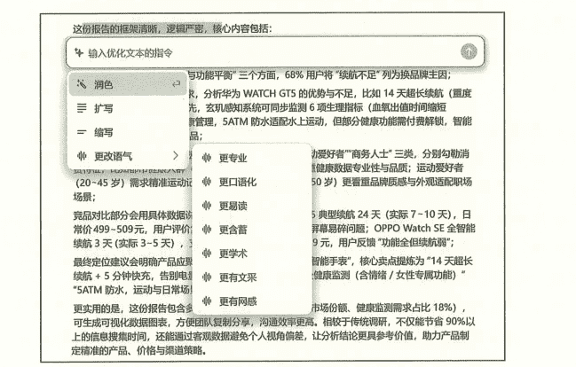

你也可以输入提示词来修改初稿，提示词可以这样写：“润色这份新品推广提案的核心策略部分，要求：① 语气调整为专业严谨，删除口语化表达；② 补充 2 个策略对应的落地场景（如线下商超快闪活动、小红书达人探店联动）；③ 按策略方向 - 实施路径 - 预期效果的逻辑拆分段落，用二级标题区分；④ 保留原有核心数据（如预算 50 万、目标触达 100 万用户），不改变原意。”

豆包会快速生成修改后的内容，可直接覆盖原文；排版时可通过文档编辑器左侧的“+”号选择 H2 标题样式，用有序列表呈现实施路径，让提案结构清晰、重点突出，不需要手动调整格式。

#### 2. 案例 2：学术课程论文优化 + 格式规范

课程论文要求学术化表达和规范格式，豆包的文档编辑器能修正表述、调整排版，还能将论文直接导出为符合要求的格式。

操作步骤：将论文初稿粘贴到文档编辑器中，选中全文或指定段落，输入优化提示词；利用编辑器的标题层级、列表、表格功能规范格式，最后选择对应格式导出论文。

对于要修改的学术论文，可以参考这个提示词：“优化这篇本科经济学课程论文的引言部分，要求：① 修正口语化表述（如把‘我觉得’改为‘本文认为’），调整为学术规范语气；② 补充 1 个相关研究的文献引用（格式为‘作者，年份：研究结论’）；③ 按‘研究背景 - 研究意义 - 研究方法 - 论文结构’的逻辑梳理段落；④ 删除冗余修饰，保持语言简洁严谨。”

优化后的引言学术性更强，逻辑更清晰。排版时可将“研究背景”等内容设为 H3 标题，参考文献用无序列表呈现，最后导出为 Word 文件，以满足论文提交要求。

#### 3. 案例 3：自媒体探店笔记扩写 + 网感排版

自媒体笔记需要细节饱满、排版吸睛，豆包的文档编辑器能扩写内容、优化风格，还能添加表情和分点，提升阅读体验。

操作步骤：在文档编辑器中输入笔记核心信息（如“市中心网红咖啡馆探店”）生成初稿，选中需要扩写的部分（如环境描写、菜品推荐），选择“扩写”功能并输入提示词，再用排版工具优化视觉效果。

提示词可以这样写：“扩写这份咖啡馆探店笔记的菜品推荐部分，要求：① 补充 3 款招牌饮品的具体细节（如‘海盐拿铁的奶泡厚度’‘桂花酒酿拿铁的甜度层次’）；② 语气调整为亲切活泼，加入适量表情符号（如 ☕ ✨）；③ 用无序列表呈现每款饮品的‘推荐理由 + 口感亮点’；④ 每点不超过 2 句话，避免冗长。”

扩写后的笔记细节丰富、风格适配；排版时插入表情符号、拆分段落，让笔记更易读；最后将笔记导出为 Markdown 格式，直接复制到小红书、公众号后台即可发布，不需要二次排版。

#### 4. 核心加分功能：多格式一键导出

文档修改满意后，无须复制粘贴到其他工具，直接在编辑器页面右上角单击“下载”按钮，即可选择 Word、PDF、Markdown 三种常用格式导出，文件会自动保留排版格式（标题层级、列表、表格、表情符号等），适配不同使用场景。

- 导出为 Word 格式：用于正式提交（如提案、论文），方便后续进一步编辑。
- 导出为 PDF 格式：用于对外发送（如给客户、老师），保证文档格式不混乱。
- 导出为 Markdown 格式：用于自媒体发布、个人笔记（如 Notion、Obsidian），适配各类平台。

#### 5. 拓展场景：全场景文档处理适配

除了上述案例，豆包的文档编辑器还能满足更多需求，列举如下。

会议纪要整理。提示词示例：“缩写这份 2000 字的部门会议纪要，保留核心决议和待办事项，用表格呈现‘任务 - 责任人 - 截止时间’，并导出为 PDF 格式。”

简历优化。提示词示例：“润色这份求职简历的‘工作经历’部分，调整为简洁有力的表述，用 bullet 点列出核心成果，突出数据（如提升效率 30%），并导出为 Word 格式。”

活动策划案补充。提示词示例：“扩写这份公司年会策划案的‘流程安排’部分，补充每个环节的时间节点、负责部门，用时间轴式列表呈现，并导出为 Markdown 格式。”

#### 6. 总结

豆包文档编辑器的核心价值在于打破了“写作 - 修改 - 排版 - 导出”的工具壁垒，通过 AI 辅助优化提升内容质量，用可视化排版功能规范格式，再以多格式导出适配不同场景，全程一站式完成，大幅减少切换工具的时间成本。无论是职场人写提案、学生写论文，还是自媒体人搞创作，都能借助它让文字处理更高效、更省心。

> 试一试
选择一份你近期需要处理的文档（如提案、笔记、论文片段），按以下步骤操作：① 用豆包的“帮我写作”功能生成初稿或粘贴已有文档进入编辑页面；② 输入提示词“润色全文，调整语气为正式专业，按‘核心内容 - 具体说明 - 总结’的结构排版”；③ 用标题层级、列表功能优化格式；④ 单击“下载”按钮将文档导出为 PDF 格式，体验全流程便捷性。

> 小贴士
- 1）提示词越具体，效果越精准：明确说明修改方向（如“学术化”“网感”）、结构要求（如“分点呈现”）、格式规范（如“二级标题”），避免 AI 产生歧义。
- 2）善用排版功能：标题层级（H1～H4）用于区分文档结构，列表（有序/无序）用于呈现要点，表格用于整理数据，让文档更易读。
- 3）按需选导出格式：正式提交选 Word/PDF（格式固定），自媒体发布/个人笔记选 Markdown（适配性强）。
- 4）多轮修改更稳妥：若修改结果不符合预期，可补充提示词（如“再增加 1 个落地场景”），直到满意为止，不需要重新生成全文。
- 5）避免误删重要信息：修改时优先选择“插入”功能对比原文，确认无误后再进行替换，防止误删核心内容。

### 技巧 13 职场邮件：高效撰写提升沟通效率

职场里，邮件是绕不开的沟通工具。对接同事、联系客户、请示领导，几乎每天都要和它打交道。但写一封像样的邮件，从来不是简单的“把话写下来”——要顾专业语气，要理思维逻辑，要讲礼貌分寸，稍不注意就会出错。
谁没经历过对着邮件编辑框发呆的时刻？想开头怕太生硬，写主体怕信息遗漏，结尾又怕不够得体，遇到催办、道歉这类敏感场景更是反复删改，半小时过去，邮件还停留在“尊敬的 xx”阶段。更头疼的是，明明核心信息只有几点，却要浪费大量时间琢磨措辞，效率低得让人着急。
难道就没有办法不用费脑，还能快速写出专业、得体的邮件吗？有的，试试豆包，再结合对应的提示词技巧，就能让邮件写作从“折磨”变成“秒完成”。

#### 1. 为什么用豆包写邮件比人还省心？
邮件的核心需求是“结构化表达”——把事情说清楚、把语气用对、把逻辑理顺。这正是豆包的强项，它能自动完成明确目的、梳理逻辑、统一口吻、控制语气、保持礼貌的全流程。你不用再纠结格式是否规范、措辞是否专业，只需要提供核心信息，剩下的都交给豆包，真正实现“你定方向，它做表达”。

#### 2. 三类高频邮件，豆包一键搞定
工作中高频出现的邮件可总结为三类。可以把对应的提示词技巧记牢，在遇到对应场景时直接描述需求，就不用再从零开始写了。
（1）日常沟通类
日常沟通类邮件适用于和同事对接项目进展、同步工作需求、明确配合事项，核心要求是专业简洁，不堆砌官话。比如需要同步季度活动策划项目进度时，只需告诉豆包邮件对象是同事，主题定为“季度活动策划项目进度同步及配合事项”，同时说明内容要包含已完成的主题确定和流程框架搭建工作，本周内完成物料设计对接和下周一进行场地考察的下一步安排，以及请对方在本周五 18:00 前提供宣传物料设计清单及参考风格的配合需求，并且强调语气要专业简洁。

提示词示例：
帮我写一封给同事的日常沟通类邮件。
主题：【如“季度活动策划项目进度同步及配合事项”】
内容需包含：①已完成工作，【如“主题确定、流程框架搭建”】；②下一步安排，【如“本周对接物料设计，下周一考察场地”】；③配合需求，【如“本周五 18:00 前提供宣传物料设计清单及参考风格”】。
要求：语气专业简洁，避免冗余表述。

（2）对外商务类
对外商务类邮件主要用于和客户或合作方沟通合作事宜，重点是礼貌正式、逻辑清晰，让对方能快速获取核心信息。比如与某品牌对接新品联合推广合作时，可告知豆包这是对外商务类邮件，背景是双方正在推进新品联合推广合作，内容要涵盖我方希望通过线上线下联动提升品牌曝光、可提供活动场地及用户资源的立场与需求，已完成初步合作方向沟通并达成时间节点共识的合作进度，以及请对方在 3 个工作日内提供包含宣传渠道、预算分配、执行流程的详细推广方案的诉求，同时要求语气礼貌正式、逻辑清晰。

提示词示例：
帮我写一封对外商务邮件。
背景：【如“与 ×× 品牌推进新品联合推广合作”】
内容包含：①我方立场，【如“计划通过线上线下联动提升品牌曝光，可提供活动场地及用户资源”】；②合作进度，【如“已达成初步合作方向及时间节点共识”】；③核心诉求，【如“3 个工作日内提供含宣传渠道、预算分配、执行流程的详细推广方案”】。
要求：语气礼貌正式，按“背景 - 价值 - 诉求”的逻辑排版。

（3）敏感场景类
敏感场景类邮件主要用于催办、道歉、拒绝等场景，关键是语气得体不引发反感，同时明确核心诉求。比如因内部流程调整延迟向合作方提交活动执行方案时，可让豆包撰写主题为“关于活动执行方案延迟提交的致歉”的邮件，内容要包含我方对内部流程优化调整导致方案未能按时提交的诚挚歉意，说明优化流程可提升方案的可行性、避免后续反复调整的情况，以及明确本周五 12:00 前提交完整方案并同步对接后续细节的时间，同时强调语气要诚恳委婉、不找借口，让对方感受到重视。

1）道歉场景提示词示例：
写一封主题为【“关于xx方案延迟提交的致歉”】的邮件。
内容：①致歉原因，【如“我方内部流程优化导致方案提交延迟”】；②合理性说明，【如“优化后可提升方案可行性，减少后续调整”】；③补救措施，【如“本周五12:00前提交完整方案并同步对接后续细节”】。
要求：语气诚恳委婉，不找借口，生成2个版本供选择。

2）拒绝场景提示词示例：
写一封婉拒合作的邮件给【客户/合作伙伴】。
内容：①拒绝事项，【如“xx项目联合推广合作”】；②原因，【如“档期与已有项目冲突”】；③替代方案，【如“可优先对接明年Q2季度资源”】。
要求：先感谢再说明，语气坚定且留有余地。

#### 3. 卡壳救星：万能模板直接套用

写邮件也有万能模板，不管是开头、主体还是结尾，只需输入简单提示词，豆包就能按照万能模板生成适配内容，省心又不出错。

开头部分，只需告诉豆包“为这封邮件写一个专业清晰的开头”，它就会根据场景自动生成合适的表述。提示词示例：“为【对接客户合作/同步同事进度/请示领导审批】场景，写一个专业清晰的邮件开头，需关联前置沟通【如‘上周的新品推广会议’】。”

对接客户时，豆包可能会生成“基于我们上周关于新品推广的沟通，现将后续推进事宜向您同步如下”这样的开头；同步同事进度时，则会生成“为确保季度活动策划项目顺利推进，现将当前进度及需配合事项说明如下”这类贴合场景的开头。

主体结构方面，把核心要点告诉豆包，让它按“现状-问题-方案-请求事项-时间节点”的逻辑整理即可。比如告知豆包，现状是活动场地已初步筛选出3个备选，问题是需要确认场地容纳人数及设备配置是否符合要求，方案是请对方提供3个场地的详细参数，请求事项是协助核实参数并给出推荐意见，时间节点是本周三前反馈，豆包会自动把这些信息梳理成逻辑分明的主体内容，不用自己费心排版。提示词示例：“按‘现状-问题-方案-请求事项-时间节点’的逻辑将以下信息整理为邮件主体：①现状，【如‘活动场地已筛选出3个备选’】；②问题，【如‘需确认场地容纳人数及设备配置是否符合要求’】；③方案，【如‘请对方提供3个场地的详细参数’】；④请求事项，【如‘协助核实参数并给出推荐意见’】；⑤时间节点，【如‘本周三前反馈’】。”

#### 4. 已有草稿？豆包帮你润色升级

如果已经写好草稿，但觉得措辞不够专业、逻辑不够清晰，不用重新撰写，直接让豆包优化即可。比如自己写的草稿比较口语化：“我这边活动策划差不多了，你把物料清单给我，周五前要。”只需把这段内容发给豆包，同时说明“请修改得更专业、逻辑更清晰，保持原意不变”，豆包就会快速将其优化成规范表述。

优化后的内容可能是：“目前季度活动策划项目已完成核心框架搭建，为推进后续物料设计工作，烦请你于本周五 18:00 前提供活动所需宣传物料的设计清单及参考风格，感谢你的配合。”

如果邮件是发给领导的，可在提示词中补充“调整为更适合发送给领导的语气”，豆包会进一步优化为：“尊敬的领导，目前季度活动策划项目已完成核心框架搭建，为保障后续物料设计工作顺利推进，现需麻烦你协助提供活动宣传物料的设计清单及参考风格，若能于本周五 18:00 前反馈，将有助于项目按计划推进，感谢领导的支持与指导。”

#### 5. 通用提示词模板

不管什么邮件场景，都能用到一个通用提示词模板，只需根据实际情况补充具体信息，就能在一分钟内生成专业邮件。

提示词模板：
帮我生成一封专业邮件。
背景：【如“与××客户对接新品合作，需确认细节”】
目的：【如“告知我方合作方案，请求反馈意见”】
收件人：【同事/领导/客户】
内容：当前情况【如“已完成方案初稿”】、核心信息【如“预算3万元，周期2周”】、下一步动作【如“请3个工作日内反馈修改意见”】。
要求：语气【专业礼貌/简洁直接/诚恳委婉】，格式含开头+主体+结尾，可标注【紧急/请回复】，附联系方式。

#### 6. 总结

写邮件的核心从不是“文采”，而是“把事说清、语气得体”。豆包的价值在于帮你省去琢磨格式、措辞、逻辑的时间——你聚焦核心信息，比如进度、需求、时间节点，它负责把这些信息转化为专业、得体的表达。不管是日常沟通、商务对接还是敏感场景，用对提示词，就能告别憋字烦恼，让邮件写作效率翻倍。

> 试一试

挑一个你近期要写邮件的场景，比如催同事提交材料、对接客户合作，用文中的通用提示词模板，补充具体的背景、目的和收件人类型，让豆包生成一封邮件。对比一下原来的写作时间，看看效率提升了多少。

> 小贴士

1. 提示词越具体，豆包生成的邮件越精准。尽量明确需求细节，比如不说“提供物料”，而说“提供活动宣传物料的设计清单及参考风格”。
2. 针对敏感场景类邮件，可让豆包多生成1～2个版本，从中选择最贴合场景语气的版本。
3. 豆包负责格式和表达优化，核心信息比如数据、合作条件等则需要自己核对准确，避免出现错误。

### 技巧 14 周报撰写：10 分钟搞定逻辑 + 数据 + 专业感

每周五下午，很多职场人总会面对同一个难题：空白的周报文档。忙了一周，客户对接、会议沟通、任务推进没停过，可真要落笔，要么盯着屏幕发呆，要么草草写下“完成××任务”的流水账，要么堆了一堆数据却看不出价值。
更让人无奈的是，花一小时写的周报，领导可能扫一眼就关掉——逻辑混乱没重点，语言口语不专业，成果模糊没数据。明明干了活，却因为不会表达没被看见；想认真写，又实在没精力在下班前抠细节。
难道写周报就只能是“必要的负担”？其实不用愁，用对方法，豆包能帮你把零散工作变成结构清晰、重点突出的专业周报，全程不超过 10 分钟。

#### 1. 先备素材：别让豆包“瞎猜”

豆包不是“预言家”，想让它写出贴合实际的周报，第一步得把“原料”备足。不用写完整句子，零散记录就行，核心包括三类信息：

- 本周完成的关键任务（比如“对接 3 个渠道合作，完成活动方案初稿”）。
- 可量化的数据（比如“活动报名量 120 人，较上周增长 30%”）。
- 遇到的问题 + 下周计划（比如“渠道结算流程不清晰；下周跟进 2 个渠道签约”）。

素材不用复杂，哪怕是手机里的备忘录、工作群的聊天记录截图，都能直接发给豆包，让它先提取关键信息。避免只说“帮我写周报”，那样豆包只能泛泛而谈，很难贴合你的工作场景。

#### 2. 定好框架：给豆包“画路线”

职场周报最忌逻辑乱，与其让豆包自由发挥，不如提前定好结构，让它按框架填充内容。不同岗位可以灵活调整，但核心模块跑不了：工作概述、重点成果、问题与改进、下周计划。

给豆包的提示词要明确角色、结构和要求，比如运营专员可以这样说：“你是互联网公司运营专员，帮我写一份本周工作周报。要求：①语言正式专业，用数据化表达；②结构包含工作概述、重点成果、问题与改进、下周计划；③突出活动效果和用户增长；④字数控制在 400 字以内；⑤避免模板化，保持自然。以下是我的工作素材：①对接 3 个母婴类 KOL，完成亲子活动合作方案初稿；②上线小红书活动话题，吸引 120 人报名，较上周同类活动增长 30%；③处理用户反馈 15 条，其中 8 条反映活动报名流程复杂；④下周计划推进 2 个 KOL 签约，优化报名小程序流程。”

生成结果示例：

##### 一、工作概述

本周聚焦母婴领域运营工作，围绕 KOL 合作拓展、平台活动运营及用户反馈处理三大核心方向推进，确保运营动作落地并初步显现成效。

##### 二、重点成果

完成 3 个母婴类 KOL 对接，输出亲子活动合作方案初稿，为后续资源合作奠定基础。

上线小红书活动话题，累计吸引 120 人报名，较上周同类活动报名人数增长 30%，活动用户触达效果显著提升。

##### 三、问题与改进

本周共处理用户反馈 15 条，其中 8 条集中反映活动报名流程复杂。后续将结合技术端，梳理流程关键节点，简化操作步骤，提升用户报名体验。

##### 四、下周计划

推进 2 个母婴类 KOL 合作签约，明确合作权益与执行细节。

完成活动报名小程序流程优化，上线后跟踪用户反馈与转化数据。

这样一来，豆包就不会跑偏，生成的初稿能直接符合汇报逻辑，不用再大改结构。

#### 3. 精准指令：让周报“有价值”而非“记流水”

很多人用 AI 写周报，只得到“完成 xx 任务”的清单，这是因为提示词没突出“价值”。好的周报要说明做了什么、带来什么影响，这一点可以通过优化提示词实现。

比如产品专员的素材是“完成用户调研分析，修复 2 个 App 界面 bug，参加 3 次跨部门会议”，如果直接发给豆包只会得到流水账式的周报，此时可以加上这样的提示词：“你是移动 App 产品专员，帮我将以下工作转化为价值导向周报。结构：① 关键成果及业务影响；② 问题与改进；③ 下周优先事项及预期成果。要求：结合业务目标，突出工作带来的实际价值，用数据支撑，语言简洁专业。工作素材：① 完成 200 份用户调研，识别 3 个核心痛点；② 修复 2 个高频使用场景的界面 bug；③ 参加 3 次跨部门需求评审会；④ 本周用户投诉量较上周减少 18%。”

豆包会自动提炼“价值”，生成类似这样的内容：“关键成果及业务影响：① 用户调研赋能产品迭代。完成 200 份用户调研，精准识别 3 个核心痛点（如操作复杂、加载延迟等），为后续产品功能优化提供直接依据，可减少 50% 以上无效开发成本，助力产品贴合用户真实需求，提升核心功能使用率。② 体验优化降低业务风险。修复 2 个高频使用场景（如支付页、个人中心）的界面 bug，结合优化动作，本周用户投诉量较上周减少 18%，直接提升用户使用流畅度，降低因体验问题导致的用户流失风险，间接保障 App 日活稳定性。③ 跨部门协作提效需求落地。参加 3 次跨部门需求评审会，对齐研发、运营、客服端需求认知，需求返工率降低约 30%，加速需求从规划到落地的转化效率，支撑产品迭代节奏。”

#### 4. 优化润色：贴合领导阅读习惯

初稿生成后，还能让豆包进一步打磨。如果觉得逻辑不够通顺，可以输入这样的提示词：“请将这份周报调整为更有逻辑的表达，增加衔接词和总结句，保持正式流畅，突出重点成果。”

如果领导喜欢简洁的表格形式，提示词可以这样写：“请将这份周报转化为 Markdown 表格格式，每个模块列出 3～5 个核心要点，适合直接复制到企业微信进行汇报。”

要是觉得语言太生硬，想更自然，可以这样写：“请润色这份周报，打破模板化表达，适当增加自然的过渡语，在保持专业度的同时使其更像人工书写。”

#### 5. 提炼数据亮点：让成果“被看见”

周报里的数据不是越多越好，关键是突出核心亮点。尤其是需要向上汇报时，让豆包帮你提炼可视化数据，效果会更好。

给豆包的提示词可以是：“请从这份周报中提炼 3 个核心数据亮点，输出格式为数据指标 + 趋势说明 + 建议，用于向领导汇报。”

比如基于产品专员的周报，豆包会生成这样的内容：

1. 数据指标：用户投诉量
趋势说明：本周较上周减少 18%，核心驱动因素为修复了支付页、个人中心 2 个高频使用场景的界面 bug，有效提升用户使用流畅度，降低因体验问题导致的用户流失风险，保障 App 日活稳定性。
建议：持续跟进本周 bug 修复后的用户反馈，同步优化低频场景潜在体验问题，力争下周用户投诉量再降 8% ～ 10%；同时建立投诉问题归因机制，提前识别同类风险点。

2. 数据指标：需求返工率
……

3. 数据指标：预期用户满意度提升幅度
……

（由于篇幅有限，输出结果在此省略，建议读者亲自上手实践。）

#### 6. 进阶技巧：从“合格”到“加分”

如果想让周报成为职业加分项，还能试试这些进阶用法。

1. 多轮对话优化：第一次生成初稿后，有针对性地提出修改意见，比如“请把下周计划拆分成具体行动点，每个行动点标注预期成果”“请补充重点成果的具体执行细节”。
2. 结合组织目标：在提示词里加入公司或部门目标，比如“公司本季度重点推进用户增长，部门 OKR 是月活提升 20%，请在周报中突出工作与这些目标的关联性”。
3. 月度汇总：每周用豆包写完周报后，月底可以直接让豆包进行汇总，比如“请将以下 4 份周报汇总为月度业绩汇报，提炼用户增长趋势、核心问题与改进措施，用结构化语言呈现”。

#### 7. 总结

用豆包写周报的核心，不是让它替你写，而是让它成为高效整理和表达的工具。关键抓住三点：素材给得具体，框架定得清晰，提示词突出价值。不用再花一个小时抠文字、理逻辑，把零散的工作交给豆包，10 分钟就能搞定一份让领导眼前一亮的周报，把省下来的时间留给自己。

> 试一试

打开豆包，整理本周 3～5 条核心工作素材（含任务、数据、问题）；复制本节的提示词示例，并根据自己的工作内容进行修改；让豆包生成周报初稿后，再发一条优化提示词，如“请增加数据亮点提炼和下周具体行动点”；最后让豆包将周报转化为表格格式，直接复制到汇报模板里。

> 小贴士

1. 素材越具体，豆包写得越贴合你的要求，避免使用“做了很多事”“效果不错”这类模糊表述。
2. 要根据不同岗位调整提示词里的角色和重点，比如销售岗要突出客户拓展和业绩，技术岗要突出项目进展和问题解决。
3. 不要直接使用 AI 生成的内容，花 2 分钟检查是否符合实际工作，并适当补充细节，避免出现“假数据”或“不符合场景的表述”。

### 技巧 15 策划方案：精准撰写，减少修改

写策划方案时，经常对着空白文档半天挤不出一句话，好不容易搭好框架又逻辑混乱，改来改去还是达不到要求，最后只能熬夜硬扛。明明想靠 AI 省点力，却因为提示词没说清，让豆包输出一堆空洞内容，反而更添乱。
其实不是豆包不靠谱，而是没找对打开方式。如果能抓准核心逻辑、用对提示词模板，就能让豆包从“帮倒忙”变成“神助攻”，快速产出结构完整、可落地的策划方案。

#### 1. 核心逻辑：先划边界，再拆模块

要想让豆包写策划方案不翻车，关键是别让它“自由发挥”。先把需求拆清楚、划好边界，再分步骤“投喂”信息，最后人工补细节。

##### （1）明确核心边界，说清楚“四大要素”

首先要明确核心边界，把“目标、受众、场景、约束”四个要素说清楚。切勿给出模糊提示词，比如不能只说“写个推广策划”，要明确“为某小型企业春季新品（如便携咖啡机）制定推广策划方案，核心目标是吸引 25～35 岁一线城市职场女性的关注，最终达成 300 条以上的产品咨询量；约束条件为预算 5000 元以内，执行周期 3 周”，这样豆包才不会泛泛而谈。

##### （2）拆解方案模块，分阶段“投喂”信息

不要让豆包一次性写完所有内容，可先拆解策划通用模块（背景分析、核心目标、执行流程、预算规划、效果评估、风险应对，可根据具体需求调整模块），再分阶段进行创作，比如先出整体框架，再针对执行流程拆分时间节点和关键动作。先输入生成框架的提示词，如“搭建小型企业春季新品推广策划方案的框架，包含背景分析、执行流程、预算规划、效果评估 4 个核心模块”；待框架生成后，再针对单一模块补充提示词，如“细化执行流程模块，拆解为 3 周内的时间节点（每周核心任务）与关键动作（如第 1 周完成小红书 KOC 筛选，第 2 周上线视频号试用测评）”。

##### （3）人工注入灵魂，规避“AI 味”

最后一定要人工“注入灵魂”，这是避免“AI 味”的关键。豆包生成初稿后，需通过两步优化确保落地性。

1. 核对信息，确保真实性（如行业数据、平台规则等）。
2. 补充 AI 猜不到的细节，包括行业专属逻辑（如美妆行业需强调“成分安全性宣传”，餐饮行业需突出“到店转化路径”）与具体落地信息（如将“线上平台”明确为“小红书 + 视频号”双平台，将“宣传物料”细化为“产品试用装 + 场景化图文海报”）。

#### 2. 可直接复制的提示词模板：精准到细节

掌握两个万能提示词模板，不管是活动策划、产品推广还是品牌宣传，都能直接套用，让豆包输出的内容既专业又接地气。

##### （1）基础提示词模板（快速搭框架）

提示词示例：“以【小型企业春季新品推广】为背景，为【25～35 岁职场女性】撰写一份【产品推广策划方案】，核心目标是【提升产品曝光度，吸引 300 条以上的咨询量，促成 50 笔以上的成交】。需包含【背景分析、推广目标、执行流程、预算规划、效果评估】5 个模块，要求风格【简洁实用，融入互动玩法】，约束条件【预算 5000 元内，周期 3 周】。请先输出框架，每个模块用 3～5 句话概括核心内容，语言口语化，避免使用生硬的专业术语。”

生成结果示例：

###### 小型企业春季新品推广策划方案（框架）

####### 一、背景分析

春季大家都爱买新东西，职场女性也想给自己添点实用新品，但她们平时上班忙，没太多时间挑，也怕踩坑。咱们小型企业没大预算做推广，所以得找性价比高的方式，精准触达这些女性，让她们知道咱们的新品能解决她们的小需求，比如通勤方便、提升办公幸福感之类的。

####### 二、推广目标

首先得让更多 25～35 岁的职场女性看到咱们的新品，比如刷小红书、视频号时能刷到；然后得有 300 人以上主动来问产品细节，比如加微信、留言咨询；最后要促成 50 笔以上的成交。另外，还希望她们愿意参与互动，帮咱们多传传口碑，让更多同类型女性知道。

####### 三、执行流程

第一周先铺垫，在小红书、视频号发职场女性用新品的日常场景内容，比如“上班带新品超方便”，再开展点赞 + 评论抽 10 份试用装的活动，吸引大家关注；第二周找 3～5 个普通职场女性分享真实使用感受，再搞个“晒职场搭配新品”的活动，发朋友圈或小红书 @咱们，就能领优惠券，并引导她们加好友咨询；第三周推出限时优惠，比如下单减 20 元，再搞个 3 人小团购活动，每人能额外便宜 10 元，刺激大家下单，同时提醒之前咨询过的人别错过活动。

####### 四、预算规划

共 5000 元，其中 1500 元用来做试用装，作为抽奖和分享活动的奖品；1200 元用来找普通职场女性做分享；1000 元用于在小红书、视频号上做推广，让更多目标女性看到；800 元用来做优惠补贴，比如减价、团购优惠；剩下 500 元留着当备用，防止有临时性开销。

####### 五、效果评估

每天看看小红书、视频号内容的播放量、点赞量，算下曝光够不够；每周统计加好友咨询的人数，看有没有接近 300 人以上的目标；活动结束后计算成交数，看能不能达到 50 笔以上；另外，还要看互动活动的参与人数，比如抽奖有多少人评论、晒单有多少人参加。最后总结哪些做法效果好，下次能接着用，哪些效果不好，后面要进行调整。

##### （2）进阶优化提示词（补充细节）

提示词示例：“针对刚才的春季新品推广策划方案，按以下要求优化执行流程模块：① 拆分为预热期、推广期、收尾期 3 个阶段；② 每个阶段明确时间节点、关键动作，比如预热期发布种草笔记、推广期搞直播活动；③ 融入 2 个互动环节（比如小红书评论抽奖、直播间限时优惠券）；④ 多举具体案例，比如用职场早餐搭配场景突出产品便捷性，语言符合目标人群认知。”

生成结果示例：

###### 三、执行流程（优化版：分阶段 + 互动 + 场景化案例）

1. 预热期（第 1 周：勾起兴趣，攒一波关注）
时间节点：周一到周日（共 7 天）
关键动作 1：发小红书场景化种草笔记
每天发 1 条笔记，结合职场女性常遇到的场景举例：比如“周一赶早八，用新品即食燕麦奶搭全麦面包，3 分钟搞定早餐，再也不用啃冷包子”“周三通勤挤地铁，揣着新品便携银耳羹，到公司倒热水就能喝，比楼下奶茶健康还省时间”，每条笔记都加上“想知道春季新品怎么购买吗？评论区蹲一波，下周有惊喜”，引导大家留期待。
关键动作 2：小红书评论抽奖（互动环节 1）
……
2. 推广期（第 2 周：深度种草，拉咨询促转化）
……
3. 收尾期（第 3 周：催单成交，留一波回头客）
……

> （由于篇幅有限，输出结果在此省略，建议读者亲自上手实践。）

#### 3. 实战技巧：让方案更有“落地感”

仅有模板还不够，这三个小技巧能让豆包的输出更贴合实际，避免内容空洞。

语言风格要接地气，让豆包多举具体案例、少用专业术语。比如让它把“用户转化路径”改成“客户从看到宣传到下单的步骤”，把“执行闭环”改成“完整的执行流程”，这样不管是领导还是执行团队，都能一眼看明白。

补充个性化细节，这是方案“活起来”的关键。让豆包在内容里加入具体的人名、平台、数据，比如“负责人李同事”“小红书发布 3 篇种草笔记”“物料制作预算 1500 元”，这些细节能让方案看起来更真实、可行性更高。

调整段落结构，避免 AI 式“总 - 分”套路。豆包生成的内容常是平铺直叙的，手动加几句过渡句，比如“下面重点说说执行流程，这是方案落地的核心”“预算规划要兼顾效果和成本，具体分配如下”，让方案逻辑更顺畅，读起来更有层次感。

#### 4. 总结

用豆包写策划方案，核心就是“把模糊需求变具体，把复杂任务拆简单”。先明确边界划好框，再把精准提示词输入豆包，最后人工补充细节、优化表达。

#### 试一试

现在打开豆包，套用基础提示词模板，以“社区邻里节活动”为主题，明确目标（吸引 200 名以上居民参与，增进邻里互动）、受众（全年龄段社区居民）、约束（预算 3000 元，周期 2 周），让豆包先输出框架，再用进阶优化提示词完善执行流程，亲身体验高效写策划方案的快乐。

#### 小贴士

- 1）豆包生成的内容是初稿不是终稿，一定要人工核对数据、补充专属细节，避免出现不符合实际的内容。
- 2）提示词越具体，输出质量越高，尽量不用“写得好一点”“简单点”这种模糊表述，多量化要求。
- 3）如果对输出不满意，不用重新写提示词，直接告诉豆包“这里要补充 ×× 细节”“风格太官方，改成口语风格”，它会快速迭代优化生成结果。

### 技巧 16 工作总结：3 步搞定高质量内容

工作总结是职场绕不开的“常规作业”——月度、季度、年度总结，既要梳理过往工作，又要突出亮点、规划未来，本是展示价值的机会，却成了很多人的“痛点”。

大家总陷入两难：想写得全面，却对着零散的工作记录无从下手；想突出重点，却不知道怎么组织语言；好不容易熬夜写完，要么内容空泛没干货，要么逻辑混乱没条理，还得反复修改才能过关。

难道就没有高效又靠谱的办法，不用熬夜也能写出让领导认可的工作总结吗？有的，用好豆包，掌握“框架搭建 + 素材投喂 + 润色优化”三步法，就能快速搞定高质量总结，告别无效内耗。

#### 1. 第一步：让豆包搭好“骨架”，不用从零瞎想

写总结最怕开局空白，不知道该分几个部分、每个部分该写什么。与其自己苦思冥想列大纲，不如让豆包帮你生成结构化框架。

核心逻辑是，明确告诉豆包你的岗位、总结时间段，以及想要的结构风格。它会根据你的要求快速给出清晰的框架，涵盖总结的核心模块。不用纠结模块顺序，豆包会按照职场汇报的通用逻辑排序，比如“导语 + 工作成果 + 能力提升 + 问题与不足 + 未来计划”，既全面又规范。

> 参考提示词：“请生成一份市场运营岗位 2025 年第二季度工作总结的框架，包含核心模块和各模块关键要点，结构逻辑清晰，适合向上级正式汇报使用，模块不超过 5 个，每个模块列出 2～3 个关键要点。”

生成的框架会类似这样：

##### 一、核心业绩成果达成

关键指标完成情况：量化销售/用户增长等核心目标达成率，说明超额/未达标关键原因（如东部区域超额、中西部受物流影响未达标等）。

核心项目成效：重点活动/渠道拓展成果（如直播电商增长、私域复购提升），附数据对比（如线上占比达 65%）。

##### 二、市场策略落地与分析

市场与竞品响应：结合季度趋势（如绿色需求、智能产品渗透）调整策略，分析竞品动作（如专利布局）的应对效果。

资源投入效能：渠道/推广费用管控成效（如获客成本下降 22%），重点投入项目的 ROI 分析。

##### 三、现存问题与优化措施

核心瓶颈识别：聚焦客户痛点（如交付延迟）、内部协作（跨部门效率低）等关键问题。

已落地改进行动：如通过智能调度系统优化物流、敏捷框架提升协作效率，附初步成效数据。

##### 四、下季度工作规划

目标拆解：结合年度战略制定可量化目标（如 NPS 提升、新品市场占有率），明确优先级。

关键举措：针对现存问题的解决方案（如资源动态调度、服务标准统一），明确责任与时间节点。

有了这个“骨架”，后续只需填充“血肉”，不用再为结构发愁。

#### 2. 第二步：精准投喂素材，让总结有料不空洞

框架搭好后，最关键的是填充内容——很多人用 AI 写总结觉得“假大空”，核心问题是没给足具体素材，让 AI 只能泛泛而谈。

正确做法是：提前梳理工作中的具体信息，包括参与的项目、完成的任务、取得的成果，尤其是数据化成果和可落地的价值，然后精准投喂给豆包。素材不用长篇大论，分点列出关键信息即可，但要避免模糊表述，比如不说“完成了促销活动”，而说“主导 618 线上促销活动，策划 3 个核心传播环节，带动销售额增长 18%，超预期目标 3 个百分点”。

参考提示词：“请根据以下素材，按照之前生成的框架撰写2025年二季度工作总结正文，语言正式务实，突出数据支撑和工作价值，不夸大事实。①核心工作：主导618线上促销活动，负责策划、执行全流程，联动设计、技术部门完成3轮活动页面优化，活动期间累计曝光50万+，转化订单2300+，销售额较去年同期增长18%。②辅助工作：完成2份竞品分析报告，覆盖4个核心竞品的定价、营销策略，提出3条产品优化建议被产品部门采纳。③跨部门协作：配合销售团队完成4次客户需求对接，梳理12条核心需求并同步至相关部门，推动需求落地率达75%。”

生成结果示例：

##### 一、核心业绩成果达成

关键指标完成情况：本季度核心聚焦线上营销业绩提升，通过618线上促销活动推动关键指标突破，活动期间累计曝光50万+，转化订单2300+，带动季度销售额较去年同期增长18%，超额完成季度线上销售增长15%的目标，主要得益于活动全流程的精细化执行与跨部门协同支撑。

核心项目成效：主导618线上促销活动全流程工作，从策划阶段明确活动节奏与核心玩法，到执行阶段联动设计、技术部门完成3轮活动页面优化（含视觉呈现、交互逻辑调整），有效提升用户浏览体验；同时辅助完成2份竞品分析报告，覆盖4个核心竞品的定价策略（如竞品A单品定价较我方低5%～8%、竞品B推出组合优惠套餐）与营销策略（如竞品C侧重短视频引流、竞品D强化私域社群运营），为后续营销决策提供数据参考。

##### 二、市场策略落地与分析

……

##### 三、现存问题与优化措施

……

##### 四、下季度工作规划

……

（由于篇幅有限，输出结果在此省略，建议读者亲自上手实践。）

这样一来，豆包生成的正文会紧紧围绕具体素材，既不会空洞，也不会偏离实际工作，省去了自己组织语言的麻烦。

#### 3. 第三步：润色优化，让总结更真实可靠

豆包生成的初稿已经有了不错的基础，但若想让总结更贴合自身、更受认可，还需要进行人工润色——这一步不是推翻重写，而是画龙点睛，让总结更有个人特色。

首先是事实核查，确认初稿中的数据、项目名称、成果描述准确无误，避免出现“幻觉”；其次是个性化修改，加入只有自己才知道的细节或感悟，比如“在618活动中，通过优化用户报名流程，减少了30%的用户流失，这让我意识到流程简化对转化的重要性”，让总结更有真情实感；最后是语言微调，根据公司内部的沟通习惯调整措辞，比如有的公司喜欢简洁直接的表达，有的偏向严谨规范的公文风格，调整后会更专业。

如果觉得初稿的重点不够突出，还可以让豆包进行二次优化，参考提示词：“请帮我润色这份工作总结初稿，重点突出618促销活动的成果和跨部门协作的价值，优化语句流畅度，调整为更贴合互联网公司内部汇报的语气，保留核心数据和关键细节。”

生成结果示例：

##### 一、核心业绩成果达成

关键指标完成情况：本季度核心围绕618线上促销活动推进，全程主导策划与执行落地，活动期间累计曝光50万+、转化订单2300+，直接带动季度销售额同比增长18%，超额完成季度线上销售增长15%的目标。核心增量来自活动全流程的精细化管控，以及设计、技术等部门的协同支撑。

核心项目成效：618活动中，从玩法设计到落地执行全程牵头——策划阶段明确“流量承接+转化提效”节奏，执行阶段联动设计、技术部门完成3轮活动页面优化（含视觉动线调整、交互逻辑简化），显著降低用户浏览路径损耗；同步完成2份竞品分析报告，覆盖4个核心竞品的定价（如竞品A单品价低5%～8%、竞品B推组合套餐）与营销动作（如竞品C主攻短视频引流、竞品D强化私域运营），输出的3条产品优化建议（含价格梯度、赠品策略）均被产品部采纳，直接支撑后续产品迭代。

##### 二、市场策略落地与分析

……

##### 三、现存问题与优化措施

……

##### 四、下季度工作规划

……

（由于篇幅有限，输出结果在此省略，建议读者亲自上手实践。）

#### 4. 总结

用豆包写工作总结，核心不是让它“包办一切”，而是把它当成高效助手——先让豆包搭框架解决“没思路”的问题，再投喂具体素材解决“内容空”的问题，最后人工润色解决“没个性”的问题。三步下来，既能节省熬夜凑字的时间，又能写出逻辑清晰、内容扎实、贴合自身需求的高质量总结，让汇报更省心，也让领导看到你的真实价值。

> 试一试

现在就打开豆包，按下面的步骤实操一次：① 输入提示词生成你所在岗位的工作总结框架；② 梳理最近一个周期的工作素材，包括 3～5 个核心任务、对应的成果和数据；③ 把素材投喂给豆包，生成正文初稿；④ 花 10 分钟核查数据、补充个性化细节，完成最终版本。相信你会发现，写工作总结原来可以这么高效。

> 小贴士

- 1）提示词越具体，豆包的输出越精准——一定要包含岗位、时间段、核心需求（比如突出数据、强调协作），避免只说“帮我写工作总结”。
- 2）日常养成记录工作的习惯，比如每周花 5 分钟列出关键任务和成果，到写总结时直接提取，不用临时翻找。
- 3）不要完全照搬 AI 初稿，哪怕是简单补充一个工作细节或个人感悟，都能让总结更真实，远离“AI 模板感”。
- 4）若想让总结更出彩，可以让豆包参考特定风格，比如“请按照‘成果量化 + 问题精准 + 计划可行’的风格优化，加入 1～2 个贴合岗位的专业术语”。

### 技巧 17 项目汇报：5 个指令快速搞定高质量内容

在职场里，项目汇报是绕不开的“常规操作”。不管是同步项目进度、展示阶段成果，还是总结工作复盘，一份靠谱的汇报能让沟通效率翻倍，还能直观体现工作价值。但实际情况往往是，有人对着空白文档半天写不出一句话，有人写满十几页却全是无关信息，还有人明明做了很多事，却因为标题平淡、重点模糊，让汇报显得毫无亮点。更让人头疼的是，为了打磨一份汇报，常常要熬夜删减冗余、调整结构，最后还未必能达到预期效果。

大家都想写出专业、清晰又有吸引力的项目汇报，可偏偏卡在了“不知道怎么优化”的难题上：标题要么太笼统要么太冗长，没人愿意往下看；提到的方法和概念太抽象，听众获取不到实用价值；文字堆砌严重，核心信息被淹没在废话里；关键数据和成果藏在段落中，一眼抓不住重点；汇报只罗列事实，没有能推动工作的独特思考。难道就没有一种高效的方式，不需要费尽心机抠细节，也能快速产出高质量汇报吗？有的，用好豆包的这 5 个核心提示词技巧，就能轻松解决这些痛点。

#### 1. 精准标题 + 易记缩写，让汇报第一眼就出彩

标题是汇报的“门面”，也是影响第一印象的关键。很多汇报之所以没人愿意看，是因为第一步就输在了平淡无奇的标题上。要么是“××项目工作汇报”这种笼统、没意义的表述，要么是长达一行的冗长句子，让人失去阅读兴趣。给汇报里的核心方法起个简洁缩写名，也能让听众快速记住关键信息，显得更专业。

这里的关键是给豆包提供明确的提示词，让它精准把握主旨并兼顾吸引力。比如针对“电商平台智能推荐系统优化项目”，可以输入这样的提示词：“为电商平台智能推荐系统优化项目的汇报拟 3 个既精准概括核心成果又有吸引力的标题，同时为项目中用到的‘多维度用户画像 + 实时兴趣匹配’方法设计一个简洁易记的缩写名。”

按照这个提示词，豆包可能会输出“智推升级·转化倍增：电商智能推荐系统优化三大核心成果汇报”“多维画像赋能实时匹配：电商推荐系统优化项目价值成果报告”“精准触达·智驱增长——电商智能推荐系统优化核心成果总结”这类标题，既点明了核心是“精准推荐”和“成果”，又比直白的标题更有吸引力；而“多维画像赋能实时匹配：电商推荐系统优化项目价值成果报告”也能被简化为“多画实配”，好记又专业，能让听众快速找到核心方法。

#### 2. 场景举例 + 效果分析，让方法落地不空洞

很多汇报里会提到具体的工作方法或核心概念，但往往只是简单带过，没有结合实际场景进行说明。这就导致听众只能“听个热闹”，不知道这个方法到底怎么用、实际效果怎么样，汇报的说服力自然大打折扣。

想要让方法和概念更具体，关键是让豆包结合项目场景做拆解。还是以“电商平台智能推荐系统优化项目”为例，提示词可以这样设计：“以电商平台智能推荐系统优化项目为例，用具体业务场景说明‘画像 - 匹配双驱法’的应用情况，分析该方法在提升推荐点击率、降低用户流失率上的实际效果。”

收到提示词后，豆包会自动补充具体场景和数据支撑：

场景 1：首页个性化推荐（核心流量入口）

电商首页是用户进入平台的第一触点，传统推荐多采用“热门榜单 + 品类聚合”模式，用户兴趣匹配度低。

画像构建：从三大维度搭建用户标签库，涵盖基础属性（年龄 / 性别 / 地域，如 25 ～ 30 岁女性/一线城市）、行为属性（近 30 天浏览/收藏/加购记录，如多次浏览通勤包）、偏好属性（价格敏感度/品牌倾向，如偏好轻奢品牌/客单价 500 ～ 1000 元），并为每个标签赋予权重（行为标签权重 60%>偏好标签 30%>基础标签 10%）。

实时匹配：通过流式计算框架捕捉用户实时行为，比如用户搜索“防水冲锋衣”，系统会立即触发户外品类的实时推荐队列，同时结合用户历史偏好，排除其之前浏览过但未下单的低评分商品，优先推送带“当季新款”“顺丰包邮”标签的商品。

（由于篇幅有限，输出结果在此省略，建议读者亲自上手实践。）

这样一来，抽象的方法就有了落地场景，实际价值也一目了然。

#### 3. 剔除冗余 + 精简表达，让汇报紧凑不臃肿

不少人写汇报时，总觉得写得越多越能体现工作内容，结果导致文档里全是“水分”——比如“在过去的三个月里，我们团队针对 xx 问题开展了一系列优化工作”这类没有实质信息的表述，不仅占用篇幅，还会让核心内容被掩盖。听众在冗长的文字里找重点，很容易失去耐心。

想要让汇报更紧凑清晰，不用自己逐字逐句删减，可以让豆包帮忙“瘦身”。

提示词要明确“精简目标”和“保留核心”，比如：“精简以下电商智能推荐系统优化项目的汇报片段，剔除不增加核心信息的冗余文字，保持内容完整且逻辑连贯：‘在过去的三个月里，我们团队针对电商平台智能推荐系统存在的推荐精准度不足、用户反馈不及时等问题，开展了一系列优化工作，这些工作包括用户画像数据的收集与整理、推荐算法的迭代升级、实时数据处理模块的搭建等多个方面，经过团队成员的共同努力，最终取得了一定的优化成果’。”

经过豆包处理后，这段文字会变成：“过去三个月，团队针对电商智能推荐系统推荐精准度不足、用户反馈不及时的问题，推进用户画像数据收集整理、推荐算法迭代升级、实时数据处理模块搭建等优化工作，经协作取得显著优化成果。”

去掉了无关的时间描述和重复表述，信息密度更高，读起来也更清爽。

#### 4. 突出重点 + 强化关键，让核心信息不迷路

一份好的汇报，应该让听众在 30 秒内抓住核心。但很多人写汇报时，习惯把关键数据、核心成果和重要方法藏在大段文字里，既没有明确的小标题引导，也没有突出标注，导致听众听完、看完还是一头雾水，不知道项目到底取得了什么成绩、用到了什么关键方法。

让核心信息“跳出来”的关键是让豆包帮忙梳理结构、强化重点。

提示词可以这样设计：“梳理电商智能推荐系统优化项目的核心要点，为每个要点拟一个简洁的小标题，开头点明核心观点，并用加粗标注关键词。核心要点包括优化目标（提升推荐精准度、降低用户流失率）、核心方法（画像－匹配双驱法）、关键成果（点击率提升23%、流失率下降11%）、后续计划（拓展跨品类推荐场景）。”

按照这个提示词，豆包会输出条理清晰的重点模块：

一、优化目标：聚焦双核心指标提升
核心是通过系统优化，同步实现提升推荐精准度与降低用户流失率，解决传统推荐“匹配度低、用户留存难”的核心痛点。

二、核心方法：以“画像－匹配双驱法”为核心
全程依托画像－匹配双驱法，通过多维度用户画像构建与实时兴趣匹配结合，为精准推荐提供关键技术支撑。

三、关键成果：核心业务指标显著改善
优化后成效量化落地，实现推荐点击率提升23%，同时用户流失率下降11%，核心指标达成预期目标。

四、后续计划：发力跨品类推荐场景拓展
下一步将聚焦场景延伸，重点推进跨品类推荐场景的拓展，进一步提升推荐系统的覆盖范围与商业价值。

#### 5. 数据支撑 + 创新见解，让汇报更有深度

很多汇报的通病是“只罗列事实，没有深度思考”——把做了什么、取得了什么数据一一列出，却没有分析数据背后的逻辑，也没有提出如何推动后续工作的想法。这样的汇报只能算是工作清单，没有体现思考能力，也很难给团队和业务带来更多价值。

让汇报更有深度的关键是让豆包基于成果数据提炼创新见解。

提示词可以这样写：“结合电商智能推荐系统优化项目中‘点击率提升23%、流失率下降11%’的成果数据，分析数据背后的用户行为逻辑，提出1～2个能推动后续工作的创新见解。”

豆包会基于数据展开分析并给出见解：

一、核心数据背后的用户行为逻辑拆解
1. 点击率提升23%：精准匹配降低决策成本，激活用户即时需求
点击率的显著增长，核心是推荐内容与用户需求的匹配效率大幅提升，直接改变了用户的浏览与点击行为。

筛选成本降低，点击意愿增强：多维度用户画像解决了传统推荐“同质化、泛化严重”的问题，用户不需要在海量商品中反复筛选，首屏推荐内容的“第一眼契合度”提升，原本因“找不到想要的”而放弃点击的用户，现在主动点击的比例增加。

……

2. 用户流失率下降 11%：需求持续满足建立信任，延长用户生命周期

……

二、推动后续工作的创新见解（1～2个核心方向）

创新见解 1：构建“需求链推荐”模型，从“单品匹配”升级为“场景需求闭环”

当前的精准推荐仍聚焦于“单一商品与用户需求的匹配”，但用户消费行为往往是“场景化、链条化”的（如买婴儿床→需要床围→需要床垫→需要婴儿床收纳袋）。基于现有用户行为数据，可挖掘商品间的“需求关联逻辑”，构建需求链推荐模型。

具体落地：通过用户行为数据（加购组合、购买顺序、浏览路径），绘制“商品需求图谱”，比如识别出“购买露营帐篷”的用户，后续 70% 会浏览露营睡袋和防潮垫，形成“帐篷－睡袋－防潮垫”的需求链；推荐时不再孤立推送单品，而是按需求链动态推荐配套商品。

价值：进一步提升点击率和客单价，同时强化用户“一站式购物”的认知，让用户觉得平台不仅“懂我”，还能“预判我的后续需求”，持续降低流失率。

……

（由于篇幅有限，输出结果在此省略，建议读者亲自上手实践。）

这样的见解既基于实际成果，又能为后续工作提供方向，让汇报的价值再上一个台阶。

#### 6. 总结

其实写高质量项目汇报，核心不是“熬时间”，而是找对方法。标题优化、场景举例、剔除冗余、突出重点、提炼见解这 5 个豆包提示词技巧，刚好对应了汇报写作中最常见的 5 个痛点。不用再纠结标题怎么起、文字怎么删、重点怎么显，只要给豆包明确的提示词，就能快速产出结构清晰、重点突出、有深度、有亮点的汇报。

#### 试一试

假设你要写“办公软件效率优化项目”汇报，试着用文中的 5 个提示词依次生成标题、场景案例、精简片段、突出重点、独特见解。比如，先下达标题提示词：“为‘办公软件效率优化项目’拟3个精准且有吸引力的标题，为‘模板化操作+快捷键整合’方法设计简洁的缩写名”，再逐步完成其他环节，看看最终的汇报是否更专业、更省心。

小贴士
1）下达提示词时要具体，明确项目类型、核心需求（比如“突出成果”“简化概念”），豆包才能更精准地给出结果。
2）可根据汇报受众调整提示词，给领导的汇报可多强调成果和见解，给同事的汇报可多补充方法和场景。
3）豆包生成内容后，可根据实际的工作情况微调细节，让汇报更贴合实际，避免完全照搬。

### 技巧 18 领导讲话稿：精准拿捏“领导味儿”

写领导讲话稿对于普通员工而言可以说是一项艰巨的任务，你可能改了七八遍的稿子，领导一句“不对味儿”就打回原形；要么写得太书面化像念报告，要么太口语化没气场；明明把要点都列全了，却总达不到领导想要的高度和逻辑——这大概是职场人最头疼的写作难题之一。

毕竟领导讲话稿不是普通文章，既要贴合场合需求，又要匹配领导的个人风格，还要兼顾逻辑层次、官方表述和实际指导意义。很多人花大半天查资料、凑框架，最后还是陷入“写了改、改了废”的循环，不仅耽误工作进度，还可能让领导觉得自己的领悟力不够。

核心问题其实很明确，怎么才能快速地摸清领导的讲话逻辑和语言习惯，写出一篇不用反复修改、既符合场合要求又贴合领导风格的讲话稿？其实不用考验自己的文笔功底，用对豆包的技巧，就能高效地解决这个痛点。

要写好领导讲话稿，关键是抓住“风格匹配”和“逻辑对齐”两个核心，用豆包搭建的“三步走”方法，就能少走弯路。

#### 1. 整理讲话稿素材

首先，给豆包喂料，明确核心要素。若要领导讲话稿对味儿，前提是把场景、风格、要点三个关键信息说清楚，不能让豆包瞎猜。很多人写稿前没梳理清楚这些，导致产出的内容偏离方向。正确的做法是，在提示词里明确告知豆包三个信息：一是场合类型，比如“年度工作总结暨表彰大会”“新项目启动动员会”“客户合作签约仪式”；二是领导风格，用 1～2 个关键词来界定，比如“务实型（重数据、讲实效，少空话）”“鼓舞型（有感染力、提士气，多激励）”“严谨型（逻辑清晰、表述规范，重流程）”；三是核心要点，把领导强调的关键工作、数据、要求列出来，比如“总结上季度 3 个核心成果、指出 2 个问题、部署下季度 4 项重点工作”。

例如输入：“撰写一篇年度工作总结暨表彰大会的领导讲话稿，1000 字左右。领导风格为务实严谨型，核心要点如下：①上年度核心成果，营收同比增长 12%、完成 3 个重点项目落地、团队新增 15 名核心人才；②存在问题，部分项目推进效率低、跨部门协作衔接不畅；③下年度重点工作，聚焦 2 个核心业务拓展、优化项目管理流程、加强人才体系建设。要求语言正式规范，逻辑层次清晰，符合机关单位领导日常讲话风格，避免过于华丽的辞藻，多以数据和实际工作为支撑。”

豆包可能会输出：

同志们：

今天我们召开年度工作总结暨表彰大会，主要任务是全面回顾上一年度工作成效，客观分析存在的问题不足，明确下一年度工作重点，同时表彰先进、鼓舞干劲，推动各项工作再上新台阶。下面，我讲三个方面意见。

一、上一年度工作成效显著，值得充分肯定

过去一年，全体干部职工凝心聚力、务实攻坚，各项工作取得了阶段性成果。一是经营业绩稳步提升，全年实现营收同比增长 12%，顺利完成年度目标任务，为后续发展奠定了坚实的经济基础。二是重点项目落地见效，集中资源推进 3 个关键项目建设，从前期调研、方案论证到落地实施，各相关部门通力配合，均按期完成既定目标，有效完善了业务布局、提升了核心竞争力。三是人才队伍不断壮大，通过精准引才、靶向招引，新增 15 名核心领域人才，涵盖技术研发、项目管理等关键岗位，为单位发展注入了新鲜血液，人才梯队建设得到进一步加强。这些成绩的取得，是全体同志并肩作战、辛勤付出的结果，在此，我代表单位领导班子，向大家表示衷心的感谢！

二、正视存在的问题和不足，切实加以改进

……

（由于篇幅有限，输出结果在此省略，建议读者亲自上手实践。）

#### 2. 模仿领导的讲话风格

接着，让豆包模仿，精准匹配领导的讲话风格。如果不确定领导风格的关键词，或者想让风格更贴合，不用自己瞎琢磨，在不涉密的前提下直接给豆包提供领导过往的讲话片段，让它提炼其风格特质。这是最直接的方式——领导的语言习惯、逻辑偏好，豆包都能通过文本分析快速捕捉。

你可以接着上一步生成的内容，输入：“参考以下领导过往的讲话片段，修改刚刚的讲话稿。领导风格参考片段：过去一年，大家顶住压力、真抓实干，用实际行动完成了既定目标，值得肯定。但我们不能满足于现状，新项目是我们拓展市场的关键一步，既要敢于创新突破，也要稳扎稳打，把每个细节落实到位，让结果说话。”

豆包可能会这样改：

同志们：

今天我们召开年度工作总结暨表彰大会，核心是回顾过往、分析问题、部署任务，同时表彰先进、鼓舞干劲，推动各项工作再上新台阶。下面，我讲三个方面意见。

一、上一年度：顶住压力、真抓实干，用实际行动交出合格答卷

过去一年，面对各种挑战，全体干部职工顶住压力、真抓实干，用实实在在的行动完成了既定目标，值得充分肯定。一是经营业绩稳步提升，全年实现营收同比增长12%，顺利达成年度目标，为后续发展筑牢了经济根基；二是重点项目落地见效，集中力量推进3个关键项目，从前期筹备到落地实施，各部门通力协作、狠抓落实，均按期完成既定任务，进一步完善了业务布局、增强了核心竞争力；三是人才队伍持续壮大，通过精准引才、靶向招引，新增15名核心领域人才，覆盖技术研发、项目管理等关键岗位，为单位发展注入了新鲜血液。这些成绩的取得，是全体同志并肩作战、辛勤付出的结果，在此，我代表单位领导班子，向大家表示衷心的感谢！

……

（由于篇幅有限，输出结果在此省略，建议读者亲自上手实践。）

你可以对比两版结果，是不是这一版更符合领导的风格呢？

#### 3. 优化讲话稿细节

最后，让豆包优化，打磨细节提升质感。初稿完成后，不用自己逐字逐句抠细节，让豆包帮忙调整表述、理顺逻辑。比如觉得稿子太生硬，就让豆包“增加亲和力，适当简化表述，保留核心逻辑”；觉得层次不够清晰，就要求“分点梳理逻辑，每个部分加过渡句，让结构更连贯”；担心有表述不规范的地方，就提示“使用官方规范表述，避免口语化和网络用语，符合领导讲话的正式场合需求”。

例如输入：“优化以下讲话稿初稿，要求：① 保持务实严谨的风格，增加逻辑层次感，每个部分用简短小标题衔接；② 简化过于书面化的表述，让语言更加自然流畅，符合领导日常讲话习惯；③ 突出数据支撑和实际指导意义，删除空洞表述；④ 结尾部分强化鼓舞性，提升团队凝聚力。（此处粘贴初稿内容）”

#### 4. 总结

用豆包写领导讲话稿的核心逻辑很简单：先明确场景、风格、要点，给豆包定方向，再用过往讲话片段帮豆包找感觉，最后让豆包优化细节提升质感。不用自己死记硬背官方表述，也不用反复揣摩领导心思，把专业的事交给豆包，就能节省大量的修改时间，写出让领导满意的讲话稿。

试一试
现在找一个近期需要写的领导讲话稿场景（比如部门月度例会总结），按照下面的提示词操作：“撰写一篇部门月度例会总结的领导讲话稿，领导风格为亲和鼓舞型，核心要点：① 本月完成的 2 项重点工作及亮点；② 工作中存在的 1 个主要问题（沟通不及时）；③ 下月工作要求（加强跨岗位沟通、提升工作效率）。要求语言亲切自然，既有肯定也有引导，避免生硬说教，符合部门领导日常讲话语气。”看看豆包产出的初稿是否符合预期，再根据领导风格调整提示词优化。

小贴士
1）提供给豆包的领导过往讲话片段越多，风格匹配度越高，尽量选择近期、同类型场合的讲话内容。
2）核心要点不用写太详细，列出关键词即可，让豆包负责组织语言和搭建逻辑，避免限制表达。
3）如果领导讲话素材涉密，不要上传给豆包。

### 技巧 19 会议纪要：实时生成与整理

开会连轴转，写会议纪要却成了大难题。上午项目评审、下午客户沟通会，大脑被各种信息填得满满当当。散会刚想歇口气，领导一句“明天上班前交会议纪要”，瞬间把焦虑感拉满。
记会议纪要总免不了手忙脚乱：边开会边记，生怕漏了核心决策、记错时限；散会后整理草稿，要么写成流水账抓不住重点，要么漏了分工；熬夜赶完还可能被打回重改，费神又费力。

传统的记录方式根本跟不上节奏：录音转文字满是识别错误的无效信息，手动整理又耗时间。想专心开会，还能轻松拿到高质量的会议纪要，真的有办法吗？

答案很简单，用好豆包 AI 会议助手就行。

它能全程自动记录、智能梳理，直接生成高质量会议纪要，帮你彻底告别手忙脚乱和熬夜赶工的烦恼。

用法也特别省心，开会前打开豆包的“记录会议”功能——单击计算机桌面的豆包悬浮按钮，选择“记录会议”即可，如图 2-6 所示。

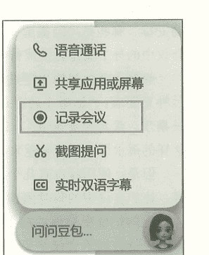

它会自动适配腾讯会议、飞书等常用会议软件，全程在后台默默工作，既不影响会议进程，也不会干扰沟通节奏。你完全可以全身心投入讨论，不用再分心惦记记录的事，不用手写、不用打字，甚至不用刻意留意重点，豆包会把所有关键信息都“记在心里”。

会议结束后，单击“停止记录”，等待十几秒就能收获惊喜。豆包会生成一份简明了的会议概要，让你快速掌握核心内容；单击“详细内容”就能查看完整版纪要，包括“总结和代办”“智能章节”和“文字记录”，如图 2-7 所示。更贴心的是，所有核心要点、重要决策都已经被自动标注，不用再逐字查找，在“智能章节”中还生成了时间戳，可以直接单击跳转对应的内容。这份会议纪要可不是简单的文字堆砌，而是结构清晰、逻辑连贯的专业文档，直接复制粘贴发给领导、同步给团队成员都完全没问题。

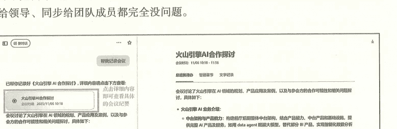

它的“智能”之处更体现在对内容的精准处理上。首先是自动筛选有效信息，那些无关紧要的闲聊、重复表述、语气词会被直接剔除，只保留讨论中的“干货”，让会议纪要简洁不冗余；其次是场景化模板适配，不管是项目会议、日常例会，还是客户沟通会、决策讨论会，都能匹配对应的纪要格式，不用自己费心调整结构；再者是关键信息精准识别，能清晰区分哪些是重要决策、哪些是行动安排、哪些是风险提醒，不会让核心内容被淹没；最实用的是，它还能自动将会议中的分工安排转换成待办清单，让后续工作推进有据可依。

想要让豆包的输出更贴合你的需求，只需给出明确的提示词即可。会议结束后补充要求：“把刚才的会议内容整理成我的工作清单：按重要性排序、标明完成期限、设定检查节点”，让会议纪要直接变成可执行的行动方案。多尝试几次这样的提示词，豆包会越来越懂你的工作习惯，输出的内容也会越来越精准。

但是，使用时也有几个小细节要注意，避免踩坑。不要想着让它记录所有内容，比如会议中的临时闲聊、无关插话都没必要纳入，专注记录核心讨论，才能让输出的纪要更精炼；AI 再智能也难免有疏漏，尤其是涉及重要决策、项目节点、关键数据的会议纪要，一定要花几分钟快速检查一遍，确保信息准确无误；另外，给出的提示词要具体明确，就像跟同事交代工作一样，说清楚你想要的格式、需要突出的重点，豆包才能精准命中你的需求，不然很可能出现答非所问的情况。

总结来说，豆包 AI 会议助手的核心价值就是把职场人从烦琐的会议记录中解放出来。它不用你手动记录，不用你熬夜整理，不用你反复修改，让你在会议中能专注参与讨论，散会后能快速拿到高质量纪要，把节省下来的时间用在更有价值的核心工作上，这正是 AI 赋能工作的真正意义——不是替代人，而是帮助人摆脱重复劳动，提升效率。

试一试
下次开会时，直接开启豆包的会议记录功能，不用刻意记录笔记，专注参与讨论。开会前按示例给出模板提示词，会议结束后查看生成的纪要，再用会后提示词生成个人工作清单，体验“开会不用记、会后不用熬”的高效感。记得对比一下，用豆包整理会议纪要比你手动整理节省了多少时间。

小贴士
1）不用一开始就追求完美，先让豆包正常运行，根据每次的使用效果慢慢优化提示词，逐步贴合自己的工作习惯。
2）如果会议中有多人同时发言，不用担心信息混淆，豆包能精准区分不同发言人的表述，不会出现内容错乱的情况。
3）对于经常开的固定类型会议，可以把常用的模板提示词保存下来，下次直接复制使用，进一步节省时间。

### 技巧 20 心得撰写：高效输出有料感悟

职场里总有绕不开的“心得任务”：读完一本专业书要写感悟，参加一场培训要交总结，明明有想法却倒不出来，要么开篇就卡壳，要么写得像流水账，要么与工作结合得不紧密，最后熬到深夜交上去，还可能因“缺乏深度”被打回。

不是不想写好，而是没找对方法：想结合岗位谈感悟，却不知道怎么关联理论；想梳理清晰结构，却越写越混乱；想突出个人思考，却只能堆砌空话。到底怎样才能快速写出既符合要求，又有深度、贴合实际的心得体会？

用豆包的精准提示词和结构化输出能力，避开撰写心得的所有坑，不管是阅读感悟还是培训总结，都能高效搞定，还自带专业质感。

#### 1. 阅读感悟：让书本知识对接工作实际

很多人写阅读感悟，要么只读书本内容，要么只说工作，两者脱节像“两张皮”。其实用豆包，只要拆分成三步提示词，就能让理论和实践精准挂钩。

首先，让豆包吃透书籍核心。不用自己逐字拆解，直接给出明确提示词，让豆包提炼关键内容。比如读《高效能人士的七个习惯》，提示词可以设计为：“请深入剖析《高效能人士的七个习惯》一书的核心内容，重点提炼与职场协作、目标管理相关的理论观点，不需要冗余阐述。”豆包会快速输出书中核心内容，省去自己梳理的时间。

接着，明确岗位需求。让豆包知道阅读者的岗位职责，才能让感悟不跑偏。提示词可以设计为：“某互联网公司 HR 专员，主要负责员工招聘、入职培训、员工关系维护等工作，请分析该岗位对从业者综合素质的具体要求，分点列出核心能力项。”这一步能让后续感悟紧紧围绕岗位展开。

最后，让豆包搭建关联、生成全文。把前两步的需求整合，让豆包串联理论与工作，直接生成结构化文章。提示词参考：“结合《高效能人士的七个习惯》的核心观点与互联网公司 HR 专员的岗位要求，筛选出关联度最高的三个核心理论，详细阐述选择依据，并按照‘题目 + 开篇 + 核心板块 + 收尾’的结构，撰写一篇 1500 字左右的阅读感悟，语言富有思辨性，突出岗位实践结合。”

部分生成结果示例：

开篇

互联网行业的快节奏与高不确定性，正在重构 HR 专员的角色定位——从传统“事务执行者”转向“业务战略伙伴”。《高效能人士的七个习惯》中“由内而外”的成长逻辑，恰好为互联网 HR 破解“招聘难、留才难、协作难”等痛点提供了方法论支撑。在七个习惯中，“积极主动”“知彼解己”“不断更新”与互联网 HR 岗位要求的关联度最高：前者对应岗位“前瞻性人才规划”的核心诉求，中者契合“跨角色沟通协作”的关键能力，后者则回应“行业敏感度与专业迭代”的生存法则。三者形成“主动破局—精准协作—持续进化”的闭环，成为互联网 HR 实现个人价值与组织目标共振的核心引擎。

核心板块一：积极主动——从“被动响应”到“主动预判”，重构 HR 价值起点

核心板块二：知彼解己——从“单向传达”到“双向共情”，破解 HR 沟通痛点

核心板块三：不断更新——从“经验依赖”到“动态进化”，适配行业快速迭代

收尾

《高效能人士的七个习惯》并非“万能公式”，但“积极主动”“知彼解己”“不断更新”三个核心理论，为互联网 HR 提供了“由内而外”的成长路径：以“积极主动”打破事务性工作的桎梏，以“知彼解己”搭建跨角色协作的桥梁，以“不断更新”应对行业迭代的挑战。对互联网 HR 而言，效能思维的本质不是“追求更快完成任务”，而是“通过专业能力，让人才与组织实现双向成就”——当 HR 能提前预判业务的人才需求，能精准理解员工与业务的诉求，能持续适配行业的发展趋势，其角色便不再是“后勤保障者”，而是“推动公司增长的战略伙伴”。这既是《高效能人士的七个习惯》给予互联网 HR 的实践启示，也是 HR 在行业竞争中实现个人价值的核心密码。

（由于篇幅有限，输出结果在此省略，建议读者亲自上手实践。）

这样生成的感悟既有理论高度，又有工作落地性，不会再是空话套话。

#### 2. 培训感悟：从“凑字数”到“有干货”

培训结束后的总结最让人头疼的是“记不住重点”“不知道怎么用”。用豆包，能快速提炼培训价值，还能规划落地方向，让感悟成为工作指南。

第一步，提炼培训核心价值。不用对着繁杂的培训笔记发呆，让豆包帮忙筛选关键信息。比如参加“高效沟通技巧培训”，提示词可以是：“某互联网公司行政人员参加了‘高效沟通技巧培训’，培训涵盖跨部门沟通话术、冲突处理方法、向上汇报技巧等内容，请深入分析该培训对行政工作的实际价值，提炼3个最核心的价值要点。”豆包会精准抓取对岗位有用的关键信息，避免感悟跑偏。

第二步，整合内容并规划落地。让豆包把核心价值转化为具体行动方案，提示词设计为：“结合‘高效沟通技巧培训’的3个核心价值要点，为互联网公司行政人员列举今后工作中运用培训收获的具体实施方向，每个方向附1～2个实操场景，再按照‘题目＋开篇＋收获板块＋规划板块＋收尾’的结构，撰写一篇1200字的培训感悟，题目采用公文对偶式，体现成果导向和行动导向。”

部分生成结果示例：

# 学沟通技巧提行政效能 以实干担当赋能企业发展

为期数日的“高效沟通技巧培训”圆满落幕，系统的理论讲解、鲜活的案例分析与沉浸式的实操演练，让我对行政工作中的沟通逻辑、方法边界有了全新认知。作为互联网公司行政人员，我们是企业高效运转的“润滑剂”、跨部门协作的“桥梁”、员工需求响应的“第一窗口”，沟通能力直接影响工作效率、团队氛围与服务质量。此次培训不仅帮我破解了过往沟通中的痛点难点，更让我掌握了精准对接需求、高效解决问题的核心方法。现将培训收获与后续行动规划总结如下：

一、培训核心收获：三大能力升级，筑牢沟通根基
（一）精准表达能力：让信息传递“不打折”
……
（二）换位思考能力：让协作配合“更顺畅”
……
（三）冲突化解能力：让问题解决“有方法”
……
二、后续行动规划：四大实施方向，推动成果转化
……
三、收尾：以沟通为翼，赋能行政工作新提升
……

（由于篇幅有限，输出结果在此省略，建议读者亲自上手实践。）

如果觉得生成的分题目不够贴切，还能让豆包优化。提示词设计为：“请对以下培训感悟分题目进行优化，调整为成果导向的对偶式题目：①学习沟通技巧，提升工作效率；②掌握冲突处理方法，改善协作关系；③学会向上汇报，传递工作价值。”优化后的题目会更专业，比如“精进沟通艺术，筑牢协作根基；善用汇报技巧，彰显工作价值；化解冲突难题，提升执行效能”。

#### 3. 总结

写心得体会的核心痛点，无非是“没思路、没结构、没深度”。豆包的优势在于，能通过精准提示词，帮你拆解任务、梳理逻辑、关联实际，把“无从下笔”变成“按步输出”。不管是阅读感悟还是培训总结，只要把“书籍/培训内容”和“岗位需求”说清楚，豆包就能生成符合要求的高质量文稿，既节省时间，又能突出个人思考。

试一试

选一本近期读过的专业书，或者一次参加过的培训，按照下面的提示词操作：“请结合《××》（书籍/培训名称）的核心内容，以及××岗位（自身岗位）的工作职责，撰写一篇 1200 字左右的心得体会，要求结构清晰，突出理论与实践结合，语言通俗有深度。”看看豆包能不能帮你快速生成一篇拿得出手的感悟。

小贴士

1）提示词越具体，结果越精准。一定要说清书籍/培训的核心方向、岗位职责、字数要求和结构偏好，避免豆包“猜需求”。
2）分段生成更易把控。如果担心全文不符合预期，可以像“先输出题目和开篇，确认后再写核心板块”这样分步提示词，减少返工。
3）拒绝直接照搬。豆包生成的是初稿，记得结合自身实际工作案例微调，加入真实的工作场景和思考，让感悟更具个人特色。

### 技巧 21 述职报告：快速搞定高质量内容

年底一到，述职报告就成了职场人的“必考题”。这份报告不仅要盘点全年工作，还得体现价值、贴合上级要求，直接关系到业绩评定和职业发展，是躲不开也不能敷衍的硬任务。

可现实往往是：一年忙下来全是琐碎杂事，想提炼亮点却脑子空空；明明做了不少事，写出来却像流水账，毫无高度；对着公文要求犯愁，不知道怎么写才够规范；加班加点凑完字数，却越看越不满意，恨不得推倒重来。

难道就没有不用熬夜、不用费脑，还能写出让领导点头的述职报告的办法么？答案当然是用豆包啊！不管是普通员工的年度述职，还是领导干部的专项述职，跟着下面的步骤操作，就能高效产出高质量的述职报告。

#### 1. 第一步：先找价值，把“琐事”抬到“关键点”

这时候可以让豆包先分析相关文件，提炼核心价值点。不用自己对着政策文件抓耳挠腮，把个人工作情况和对应的公司要求、政策文件交给豆包，它就能帮你找到关联，把“做了什么”升级为“做出了什么价值”。

案例：某公司行政岗员工需结合公司“202×年度提质增效工作方案”撰写述职报告。

> 提示词：“请结合【个人年度工作情况：全年负责会议组织30场、办公用品采购管理、跨部门沟通协调等日常工作，优化采购流程减少浪费】和【公司文件：202×年度提质增效工作方案】，提炼工作价值点。要求：①价值点与公司方案精神关联；②用有序列表呈现。”

#### 2. 第二步：提炼亮点，让业绩“看得见、说得清”

价值点提炼后，就需要把它转化为结构化的业绩亮点。很多人写业绩只会平铺直叙，领导一眼扫过去抓不住重点。这时候可以给豆包分配一个贴合岗位的“专家角色”，让它用结果导向的方式梳理亮点，还能自动生成规范的标题。

案例：基于上面行政岗员工的价值提炼结果，进一步梳理业绩亮点。

> 提示词：“你是资深行政部门主管，熟悉行政工作特点和公文写作规范。请结合【个人工作价值提炼结果】，梳理工作业绩与亮点。要求：①列出一、二级标题，标题为结果导向式，体现做法与成果；②二级标题下列出内容要点，突出与公司提质增效要求的关联性。”

#### 3. 第三步：按公式生成，确保报告“不缺项、逻辑顺”

述职报告有固定的规范结构，漏项或逻辑混乱会直接拉低质量。不用死记硬背结构，把规范公式告诉豆包，让它按要求填充内容，既能保证完整性，又符合公文语境。

通用述职报告写作公式：标题 + 帽段 + 工作业绩与亮点 + 能力素质提升 + 问题与改进措施 + 下一步展望。不同岗位可在此基础上调整，比如领导干部的专项述职，可侧重工作责任落实、目标达成情况。

1）案例1（普通员工）：某互联网公司运营岗员工，入职一年，需撰写年度述职报告。

> 提示词：“你是互联网公司运营部门主管，擅长公文写作和业绩梳理。请按照【述职报告写作公式】，结合【运营岗工作业绩与亮点】，撰写一份年度述职报告。要求：①严格覆盖公式所有部分，不遗漏；②符合公文语言习惯，各部分用对仗式标题，序号层次清晰，行文简洁；③内容谦虚低调，贴合入职一年的新人身份；④字数控制在2000字左右。”

部分生成结果示例：

# 运营岗年度述职报告

尊敬的领导、各位同事：

本人于2024年12月入职公司运营部门，至今履职已满一年。任职期间，始终以“夯实基础、协同协作、助力业务”为核心目标，围绕用户运营、内容运营、活动执行三大核心任务开展工作。现将年度履职情况汇报如下，恳请批评指正。

## 一、履职初心：锚定岗位定位，夯实工作基础

入职初期，为快速融入团队与业务，重点开展三项基础工作。

业务认知深化：系统学习公司产品线逻辑、用户画像及行业竞品动态，累计梳理产品功能文档12份、竞品分析报告3份，形成《运营岗业务认知手册》，为后续工作奠定认知基础。

流程规范熟悉：严格遵循部门《运营工作SOP》，从用户反馈收集、内容发布审核到活动流程落地，逐项实操演练，累计参与流程培训6次，确保每一项工作均符合规范要求。

团队协作融入：主动对接产品、技术、市场等协同部门，建立日常沟通台账，累计参与跨部门会议28次，协助传递运营需求15项，逐步形成高效协作意识。

## 二、履职实绩：聚焦核心任务，推动业务落地

年度内，在领导指导与同事支持下，围绕“拉新、促活、转化”核心目标，推进以下工作并取得阶段性成果。

### （一）用户运营：精细分层运营，提升用户留存
......
### （二）内容运营：聚焦价值输出，增强用户黏性
......
### （三）活动运营：精准策划执行，助力业务转化
......
### （四）亮点工作：立足细节优化，沉淀方法经验
......

## 三、履职反思：直面问题短板，剖析根源不足
......

## 四、履职改进：锚定提升方向，制定务实举措
......

## 五、履职展望：紧跟战略步伐，明确奋斗目标

## 六、履职致谢：感恩团队支持，凝聚前行力量

入职一年来，每一点进步都离不开领导的悉心指导（如多次指导我优化运营方案）、同事的无私帮助（如协助解决数据统计难题）。在此，向各位领导、同事表示衷心感谢！

未来一年，本人将以更加饱满的热情、更务实的态度投入工作，持续弥补短板、提升能力，为公司运营业务发展贡献更多力量，不辜负团队信任与期望。

汇报人：×××
2025年12月3日

（由于篇幅有限，输出结果在此省略，建议读者亲自上手实践。）

2）案例2（专项述职）：某科技公司市场部门负责人需撰写年度抓团队建设专项述职报告。

提示词：“你是科技公司人力资源专家，熟悉团队建设述职报告的写作要求。请结合【市场部门年度团队建设工作情况】和【公司团队凝聚力提升专项通知】，撰写一份专项述职报告。要求：①结构包含工作开展情况、成效、存在问题、改进方向、未来计划；②标题对仗规范，语言符合公文表达；③突出责任落实和工作实效，补充具体案例；④字数2000字左右。”

部分生成结果示例：

# 市场部门团队建设专项工作述职报告

尊敬的公司领导、各位同事：

根据《公司团队凝聚力提升专项通知》（〔2025〕××号）要求，人力资源部牵头负责市场部门团队建设专项推进工作，聚焦“破解协作壁垒、强化团队认同、助力业绩达成”目标，联动市场部管理层制订实施计划并落地执行。现将年度专项工作情况汇报如下。

## 一、工作开展情况：锚定专项目标，分层推进落实
### （一）建机制明责任，筑牢推进基础
……
### （二）破痛点定举措，定制建设内容
……
### （三）强保障促落地，确保执行到位
……

## 二、工作成效：聚力破局见实效，凝聚力稳步提升
### （一）协作效率显著提升，跨域壁垒有效打破
……
### （二）团队认同持续增强，新人融入成效明显
......
### （三）业绩联动效应显现，凝聚力转化为生产力
......

## 三、存在问题：对标要求找差距，直面短板不足
......

## 四、改进方向：聚焦问题补短板，优化工作方法
......

## 五、未来计划：锚定战略谋长远，持续深化建设
......

此次专项工作的推进，离不开公司领导的指导、市场部的积极配合及各协同部门的支持。后续人力资源部将持续优化工作方法，推动市场部门团队凝聚力再提升，为公司市场业务发展提供更强支撑。

汇报人：人力资源部 ×××
2025年12月3日

（由于篇幅有限，输出结果在此省略，建议读者亲自上手实践。）

#### 4. 第四步：打磨细节，让报告“更专业、更出彩”

初稿生成后，不用自己逐字修改，让豆包帮忙优化标题和语言风格。公文写作讲究形式与内容统一，对仗式标题能瞬间提升专业感，精准的语言能让业绩更有说服力。

案例：优化述职报告中的业绩部分标题，使其更符合公文对仗要求。
提示词：“请将以下述职报告标题修改为公文对仗式标题，要求简洁有力、体现做法与成果。原标题：①会议组织：做好安排，保证顺利；②流程优化：简化步骤，节省时间；③团队协作：积极配合，完成任务；④问题处理：及时响应，解决诉求。”

生成结果示例：
（1）会议组织：精做会务安排，保障流程顺畅。
（2）流程优化：简化步骤环节，实现省时增效。
（3）团队协作：强化协同配合，高效完成任务。
（4）问题处理：及时响应诉求，妥善解决问题。

#### 5. 总结

用豆包写述职报告，核心就是“找对方法、用对提示词”：先让豆包提炼工作价值，再梳理业绩亮点，接着按规范公式生成全文，最后优化细节。整个过程不用自己死磕公文规范，不用熬夜凑字，还能让报告既贴合要求又有亮点，轻松应对考核。

#### 试一试
现在就把自己的年度工作清单和公司相关政策文件整理好，按照上面的四步流程，用给出的提示词模板调整后发给豆包，看看它能生成什么样的述职报告初稿。记得根据自己的岗位特点（普通员工/管理者）调整提示词中的角色和要求。

#### 小贴士
1）提供给豆包的工作信息越具体，生成的报告越贴合实际，尽量包含具体工作内容、成果数据，避免笼统描述。
2）生成初稿后，可让豆包多次优化，比如“增加数据支撑”“简化语言”“调整语气”，直到符合预期。
3）公文风格要贴合自身身份，普通员工不用过度拔高，管理者需突出责任与大局观，避免“越位”表达。
4）不要直接使用豆包生成的内容，需结合实际工作补充细节，确保报告真实、可信。

### 技巧 22 调研报告：3 步搞定高质量内容

调研报告是工作里的常见文体，不管是行业分析、政策研究还是市场研判，都离不开它。可实际操作起来，找资料像大海捞针，定选题抓不住重点，分析材料料理不清逻辑，写初稿又卡壳半天，耗力又耗心。用好豆包，跟着步骤走，可以生成又快又好的调研报告。

#### 1. 调研准备：豆包帮你搭好“地基”
调研不是盲目开工，前期准备做扎实，后续工作才能顺风顺水。豆包能当你的“全能筹备助手”，快速搞定文件梳理、选题设计、方案制定和访谈提纲。
文件研究不用再逐字逐句啃政策、翻报告，让豆包精准提炼核心。比如想做新能源汽车行业调研，提示词可以是：“请梳理近三年国家及浙江省关于新能源汽车产业发展的相关政策，重点提炼补贴政策、技术支持方向和市场准入要求。”
豆包会给你总结：
一、国家补贴政策
《关于延续和优化新能源汽车车辆购置税减免政策的公告》（财政部、税务总局、工信部，2023年第10号）
《关于2025年加力扩围实施大规模设备更新和消费品以旧换新政策的通知》（国家发展改革委、财政部，2025年）
《关于做好2025年汽车以旧换新工作的通知》（商务部等8部门，商办消费函〔2025〕8号）
《财政部关于下达2025年节能减排补助资金预算（第一批）的通知》（财建〔2025〕77号）
《关于延续和优化新能源汽车购置补贴政策的通知》（财政部、工信部，2025年3月）

## 二、浙江省补贴政策
《2025年浙江省消费品以旧换新补贴实施细则》（省商务厅等6部门，2025年）
……
（由于篇幅有限，输出结果在此省略，建议读者亲自上手实践。）
确定选题时，纠结没思路就让豆包当“行业顾问”。比如面向消费电子企业，提示词示例：“你熟悉消费电子行业发展现状，近两年折叠屏手机市场快速增长，结合这一趋势，为我提供5个关于折叠屏手机用户需求与市场竞争的调研选题。”豆包会提供相应的选题：“折叠屏形态分化下的用户需求差异调研、折叠屏高端与低价路线用户反馈及选择逻辑调研、折叠屏核心痛点迭代与用户付费意愿关联调研、折叠屏软件生态与AI功能用户体验及竞争价值调研、苹果入局背景下折叠屏用户迁徙意愿与竞争格局演变调研。”

在设计调研方案时，只要明确选题，豆包就能给出可落地的框架。提示词示例：“以‘折叠屏手机下沉市场用户需求及推广策略研究’为选题，生成一份详细的调研方案，包含调研对象、调研方法、时间安排和核心调研内容，要求具备可操作性。”

外出调研或本地座谈，访谈提纲不用费脑。针对先进地区调研：“你熟悉消费电子行业，调研组将到深圳、东莞的折叠屏手机生产企业及核心经销商调研，与相关负责人座谈，探讨其产品研发、渠道布局和用户运营的经验，请拟制一份紧扣主题的精炼访谈提纲。”针对本地调研：“调研组将到浙江杭州、宁波的线下数码门店及用户群体调研，了解本地消费者对折叠屏手机的认知度、购买顾虑及价格接受范围，请拟制一份贴合实际的访谈提纲。”

#### 2. 材料分析：豆包帮你挖透“核心”
收集完一堆调研材料，最头疼的是提炼重点、找规律。豆包的分析整合能力能帮你快速从海量信息中抓核心、找差距。

间接调研的信息整合，把搜集到的文档交给豆包，就能快速掌握全局。提示词示例：“请从我上传的文件中分析浙江省折叠屏手机市场的发展情况，包括市场规模、主要品牌占比、消费者年龄段分布等核心信息。”

分析本地情况，让豆包总结优势与问题。提示词示例：“结合上述关于浙江省折叠屏手机市场的多份文档，总结该市场的发展优势（如供应链配套、消费潜力等）和存在问题（如价格门槛、售后体系等）。”

借鉴先进经验，让豆包提炼共性规律。比如研究头部品牌成功要素，提示词示例：“请结合 #文档3 华为折叠屏手机市场策略 #文档4 三星折叠屏用户运营经验 #文档5 小米折叠屏渠道布局方案三份材料，分析总结折叠屏手机成功打开市场的核心要素和关键做法。”

对比分析找差距、提对策，是报告的关键。提示词示例：“对比浙江省折叠屏手机市场的发展优势与存在问题，以及头部品牌的成功经验，总结二者的核心差距，提出浙江省本土企业拓展折叠屏手机市场的具体对策措施。”

#### 3. 报告撰写：豆包帮你高效成文
分析完材料，就到了最关键的成文环节。不用再对着空白文档发愁，跟着“公式化写作”思路，让豆包分部分生成，且结构清晰、语言规范。

撰写标题和帽段，定好身份和要求即可。提示词示例：“你是企业市场研究专员，擅长撰写商务调研报告，熟悉消费电子行业。请结合折叠屏手机下沉市场调研方案，按‘标题+帽段’公式撰写报告开头，要求语言简洁规范，符合商务文书风格，帽段400字左右。”

撰写基本情况部分，提供相关材料和公式，豆包能快速组织内容。提示词示例：“你是企业市场研究专员，熟悉折叠屏手机行业。请结合浙江省折叠屏手机市场发展现状和优势，按‘基本情况写作公式’撰写报告的基本情况部分，要求语言简洁清晰，逻辑连贯，字数1200字左右。”

撰写问题及原因分析，让豆包深入阐述。提示词示例：“你是企业市场研究专员，熟悉折叠屏手机行业。请结合浙江省折叠屏手机市场存在的问题，紧贴折叠屏下沉市场拓展主题，按‘问题及原因分析公式’撰写报告的该部分内容，要求分析深入，语言规范，字数1500字左右。”

#### 4. 总结

从前期的选题、方案制定，到中期的材料分析、差距对比，再到后期的结构化成文，豆包能全程辅助，帮你省去反复打磨的时间，既保证报告质量，又大幅提升效率，再也不用为调研写作熬夜秃头。

#### 试一试
选一个你近期要做的调研主题，用前文“调研准备”阶段的提示词模板，稍作修改后发给豆包，生成一份调研方案和访谈提纲，感受高效筹备的便捷。

#### 小贴士
1）材料分析时，可将分散的文档分批上传给豆包，让它逐步整合，避免信息过载导致分析偏差。
2）生成报告初稿后，可通过多轮对话让豆包优化，比如接着提出“把对策建议部分写得更具体”“简化基本情况部分的表述”。
3）涉及具体数据时，最好单击进入豆包找到的参考网页中进行核实，确保报告信息的时效性。

### 技巧 23 合同起草：高效搞定专业合同

职场里，合同是绕不开的“硬骨头”。不管是法务岗天天与采购合同、劳动合同打交道，还是业务岗偶尔要拟个服务协议、租赁协议，都逃不过重复填写相似模板、对着法律术语抓耳挠腮、担心条款有漏洞被挑错，更怕引用的法条早就过时。

怎么才能不费吹灰之力，快速生成一份条款严谨、合规合法，还能贴合实际需求的合同？答案就是用豆包的合同生成功能，找对方法就能告别低效内耗。

#### 1. 给豆包画好“作业框架”

豆包拟合同的核心是让它清楚知道“要写什么、包含什么”。模糊的需求只会产出无用的成果，精准的提示词才是关键，要明确合同类型、核心要素和特殊要求，不用多余修饰。

比如拟定劳动合同，可以输入以下提示词：“生成劳动合同框架，用人单位：××科技有限公司，劳动者：×××（身份证号：××××××××××××××××××），工作地点：广州市天河区××科技园 A 座 1508 室，合同期限 3 年（试用期 2 个月），月工资 12000 元（绩效工资另计，试用期工资按 80% 执行），竞业限制补偿金 1000 元/月（离职后支付 1 年），工资按月支付，每年根据考核结果上浮 5%，包含五险一金（法定基数及比例）、办公设施使用费；工作内容是新媒体运营。”
豆包会直接为你生成一份劳动合同框架文档，如图 2-8 所示。

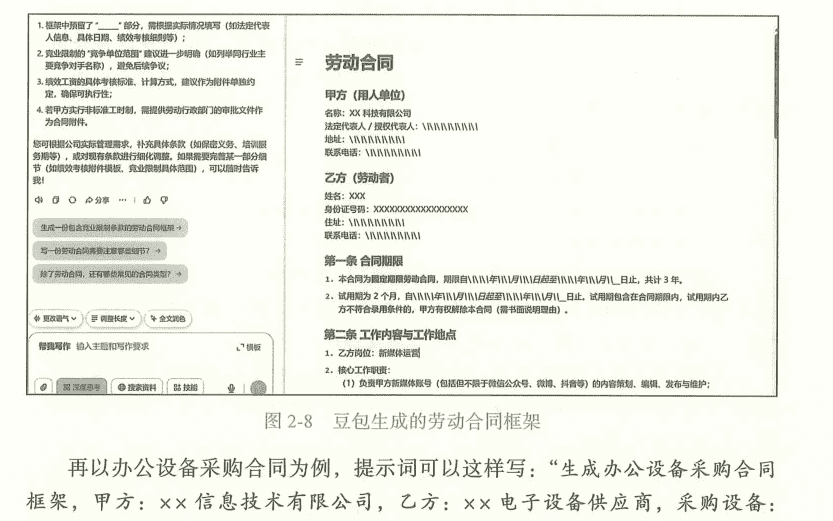

再以办公设备采购合同为例，提示词可以这样写：“生成办公设备采购合同框架，甲方：xx 信息技术有限公司，乙方：xx 电子设备供应商，采购设备：笔记本电脑 50 台，型号：MateBook14，单价：6500 元，交货期：合同签订后 15 天内，交货地点：甲方北京分公司仓库，质保期：2 年，付款方式：交货验收合格后 7 个工作日内支付 80%，剩余 20% 满 1 年无质量问题支付，包含设备运输费和安装调试费。”

#### 2. 补充细节 + 智能优化：让合同更严谨

别指望一次性生成完美合同，需要让豆包为你补充细节、完善条款，最后排查风险，一步到位反而容易顾此失彼。

在第一步生成的框架中补充履行细节，让条款更具体，例如输入：“在上述合同基础上，补充以下履行细节：① 线上办公需每日提交工作日报，线下办公时间为周一至周五 9:00—18:00；② 公司提供必要的内容创作工具和培训资源。”

豆包会再补充：

乙方实行______工时制（标准工时制 / 综合计算工时制 / 不定时工时制，根据甲方实际情况选择），线下办公时间为周一至周五 9:00—18:00；若涉及线上办公，需每日提交工作日报。每日工作不超过 8 小时，每周工作不超过 40 小时。

……
甲方为乙方提供必要的办公设施（如计算机、办公软件等）及内容创作工具，相关办公设施及工具使用费由甲方承担，乙方应妥善保管使用；同时甲方将为乙方提供必要的培训资源，助力乙方提升工作能力。

你还可以让豆包检查合同，规避潜在纠纷，例如输入：“请检查这份合同是否存在法律风险，特别关注以下方面：条款是否有歧义、违约责任是否对等、是否符合最新法律法规。”

豆包会生成检查结果：

劳动合同法律风险检查报告（重点维度分析）

一、条款歧义风险（存在多处模糊表述，易引发争议）

1. 时间与格式歧义
合同中日期表述存在格式错误（如“__日”），且未明确线下办公“9:00—18:00”是否包含午休时间。若实际执行中不含午休，每日工作时长将达9小时，违反“每日工作不超过8小时”的约定，可能涉及加班工资争议。
工资支付日期（“每月______日前”）、竞业限制补偿金支付日期（“每月______日前”）等核心时间节点未明确，易导致甲方逾期支付争议。

2. 内容约定模糊
绩效奖金仅提及“按甲方绩效考核制度执行”，但未明确该制度为合同附件，也未约定乙方对制度的确认方式。根据劳动争议裁判规则，未公示或未经劳动者确认的规章制度，难以作为考核依据。
竞业限制条款中“竞争单位范围”为空白，且未明确乙方需保密的商业秘密具体内容。
工作地点调整条款“甲方可根据业务需要协商调整”，未明确“协商不成”的处理方式，易被认定为甲方单方变更合同。

二、违约责任对等性风险（权责失衡，侧重约束劳动者）

1. 违约金标准不对等
......

（由于篇幅有限，输出结果在此省略，建议读者亲自上手实践。）

#### 3. 批量处理合同

面对多份格式相似、仅核心信息不同的合同，比如给多个供应商的采购合同、给多名员工的劳动合同，批量处理能省大量时间。关键是先整理好统一数据，再搭配模板让豆包自动填充。

先把核心信息整理成清晰清单（不需要复杂表格），比如多名员工的劳动合同信息（姓名、职位、试用期、薪资、工作地点），再给出批量生成提示词：“根据

#### 4. 总结

用豆包拟合同的核心逻辑很简单：精准输入需求 + 分步优化条款 + 人工把关风险。它能帮你搞定重复烦琐的框架搭建、条款撰写工作，大幅节省时间，同时保证合同的专业性和合规性。不管是法务、HR，还是经常需要处理合同的业务岗，掌握这些技巧就能告别合同起草的烦恼，把精力放在更有价值的工作上。

> 试一试
选一个你工作中常用的合同类型，按照“合同类型 + 核心要素 + 特殊要求”的格式写提示词，让豆包生成初稿。然后针对其中 1 ～ 2 个关键条款，比如付款方式、违约责任，让豆包进行优化，最后检查是否符合行业惯例和最新法规。

> 小贴士
1）提示词越具体，生成的合同质量越高，核心要素（双方信息、标的、期限、价款、责任）缺一不可。
2）生成合同后，务必人工审核关键条款，尤其是涉及金额、责任划分、争议解决的部分，重要合同建议咨询专业律师。
3）利用豆包的对话记忆功能，在同一个会话中逐步完善合同，上下文连贯能让修改更精准。
4）保存生成的合同和对话记录，后续遇到同类合同可直接参考，形成自己的专属模板库。

### 技巧 24 简历优化：3 招让 HR 主动发 Offer

求职季里，用 AI 润色简历早已不是新鲜事，越来越多求职者靠 AI 提升简历质感。但现实往往很扎心：HR 每天收到的简历里，八成带着明显的“AI 模板味”，满屏假大空的套话，毫无真实感，反而让求职者在不知情的情况下被“反向扣分”。

明明想靠 AI 加分，怎么反而被扣分？核心问题在于多数人用 AI 改简历，只是简单丢给 AI 个人经历，坐等成品，完全忽略了岗位需求的差异和自身经历的真实性。想要让简历在一堆“AI 克隆体”中脱颖而出，关键不是不用 AI，而是用对方法。

#### 1. 精准匹配：让简历和岗位“锁死”

简历需要精准匹配对方的需求。不同公司对同一岗位的招聘要求千差万别，盲目投递通用简历，大概率会石沉大海。

豆包的正确用法是“岗位描述 + 个人经历”双输入，让它量身定制高度匹配的内容。先找到目标公司的岗位详情，把工作职责、任职要求和自己的经历一起发给豆包，明确要求内容与岗位强匹配，就能避免 AI 生成泛泛而谈的内容。

提示词示例：“我要应聘市场营销岗位，以下是目标公司的岗位要求和个人经历，请结合两者生成一份强匹配的简历。岗位要求：① 负责品牌推广活动策划与执行，包括线上线下活动落地；② 运营官方微博、抖音账号，提升粉丝活跃度和品牌曝光；③ 整理分析营销数据，优化推广策略；④ 本科及以上学历，具有 1～2 年市场营销经验，熟悉新媒体平台运营，具备活动策划能力。个人经历：2022 年 6 月至今，任职广州创科传媒有限公司市场专员，参与品牌推广活动策划与执行，负责新媒体账号日常运营，撰写推广文案，整理活动数据报告；曾策划校园推广活动，协调团队完成物料准备、场地布置等工作，参与撰写的多篇抖音文案获得万级播放。基本信息：陈悦，25 岁，2021 年毕业于暨南大学市场营销专业，电话 135××××××××，邮箱 chenyue123@email.com。”

生成结果示例：

- 一、基本信息
姓名：陈悦
年龄：25 岁
学历：本科
毕业院校：暨南大学
专业：市场营销
毕业时间：2021 年
联系电话：135××××××××
电子邮箱：chenyue123@email.com

- 二、求职意向
目标岗位：市场营销岗

## 三、核心能力

1. 具备1～2年市场营销实战经验，熟悉品牌推广活动全流程策划与落地执行。
2. 精通官方微博、抖音等新媒体平台运营，能通过优质内容提升粉丝活跃度与品牌曝光。
3. 擅长整理分析营销数据，可基于数据反馈优化推广策略。
4. 拥有团队协作与资源协调能力，能高效推进活动物料准备、场地布置等执行工作。

## 四、工作经历

广州创科传媒有限公司 | 市场专员 | 2022年6月至今

1. 品牌推广活动策划与执行：深度参与公司品牌推广活动全流程，曾主导策划校园推广活动，独立协调团队完成物料设计制作、活动场地选址与布置等工作，保障活动顺利落地，有效提升品牌在校园群体中的认知度。
2. 新媒体账号运营：负责官方微博、抖音账号日常运营，包括内容策划、推广文案撰写，其中多篇抖音文案获得万级播放量，显著提升账号粉丝活跃度与品牌曝光量。
3. 营销数据整理分析：定期整理活动数据报告，汇总用户参与度、内容传播效果等关键数据，为团队优化后续推广策略提供数据支撑，助力提升营销转化效率。

## 五、教育背景

暨南大学 | 市场营销专业 | 本科 | 2017年9月—2021年6月
系统学习市场营销学、新媒体营销、活动策划等专业课程，为市场营销工作奠定扎实的理论基础。

生成后还能在豆包里直接编辑调整，像处理在线文档一样方便，最后一键导出为Word文件，套上简洁的模板就能投递。

#### 2. 专业诊断：让豆包当10年资深HR挑错

自己写的简历总觉得还行，但HR看一眼就能发现漏洞——这是很多求职者的通病。信息矛盾、成果没量化、技能不明确，这些隐形问题仅靠自己很难察觉。
这时可以让豆包扮演资深HR，对简历进行全面“体检”。把简历内容或文档上传给豆包，明确要求从专业角度指出不足和优化方向，比自己瞎琢磨高效多了。
提示词示例：“你是拥有10年互联网公司工作经验的资深HR，我要应聘行政助理岗位，请结合岗位需求，检查我的简历并指出不足和可优化之处。简历内容：[此处粘贴完整简历文本或上传简历文档]”。

豆包会一针见血地找出核心问题，比如：核心能力，“泛泛而谈”，未绑定岗位需求与成果；工作经历，“只说做了什么”，未突出“解决了什么问题”；教育背景，未强化“专业与岗位的关联性”等。针对这些问题，豆包也会给出对应的优化建议，例如：原表述“负责30+员工日常行政事务……月均统筹12～15场跨部门会议”。优化后“承接30人团队日常行政（考勤统计/差旅预订），曾解决‘差旅预订重复出错’问题（建立员工差旅信息表），差错率从15%降为0；月统筹12～15场跨部门会议（含80%线上腾讯会议），提前1小时调试设备+备份资料，全年无临时故障导致的会议延误，会议纪要待办事项同步率为100%。”

有的求职者在简历中写“负责办公室日常行政工作，协助组织公司活动”，却没说明具体负责的工作模块和活动效果；还有的求职者罗列“熟练使用Office办公软件”，没说清具体技能熟练度（如Excel数据透视表、PPT制作效率），这些问题都会让简历显得单薄，而豆包能精准识别并给出改进方向。

#### 3. 优化升级：从“信息罗列”到“价值证明”

找出问题后，还要用豆包优化表达，核心是把“干了什么”变成“做成了什么”，避免空泛表述。

优化的关键是量化成果和用STAR（场景-任务-行动-结果）法则呈现经历。可以让豆包根据诊断结果，有针对性地优化每个模块，同时保留自身真实经历，不让简历变成“AI流水账”。

提示词示例：“结合你指出的简历不足，用STAR法则优化我的工作经历，量化工作成果，明确技能熟练度和应用场景，突出与行政助理岗位的匹配度，不要使用空泛表述。原始工作经历：[此处粘贴原始工作内容]”。

比如原本的工作经历写“负责30+员工日常行政事务（考勤统计、差旅预订），月均统筹12～15场跨部门会议；提前准备会议资料、调试设备，同步会议纪要与待办事项，全年无会议延误或资料遗漏，保障办公效率”，优化后会变成：

S（场景）：公司为互联网创业型企业，30人团队涵盖产品、技术、运营多部门，跨部门协作频繁，会议含线上（腾讯会议）+线下两种形式，此前存在考勤统计滞后、差旅预订重复、会议设备临时故障等问题。

T（任务）：负责30余名员工全周期日常行政事务（考勤统计、差旅预订），统筹月均12～15场跨部门会议，确保行政流程高效、会议无延误。

A（行动）：①用Excel设计“员工考勤动态表”（含迟到/请假自动统计功能），同步在企业微信开通差旅审批模块，提前1天提醒员工提交行程；②会议前 1 小时调试设备（线上腾讯会议测试网络 + 共享屏幕，线下检查投影 / 麦克风），按“部门 - 议题 - 资料类型”分类整理会议材料；③会议后 2 小时内完成纪要撰写，用“待办事项 - 责任人 - 截止时间”表格同步至各部门群。

R（结果）：①考勤统计差错率从优化前 8% 降至 0，差旅预订响应时间缩短至 1 小时内；②全年 180 余场会议无 1 次延误 / 资料遗漏，会议纪要同步率为 100%，各部门反馈“会议准备充分度提升 40%”；③行政事务处理效率满足互联网团队快节奏协作需求。

数据化的表达让能力更有说服力。

#### 4. 总结

用豆包改简历的核心从来不是让 AI “代写”，而是借助它的精准匹配和专业诊断能力，让简历更贴合岗位需求、更能体现个人价值。避开“盲目丢经历”的误区，用“岗位 + 经历”双输入定制内容，让扮演资深 HR 的豆包挑错，再通过量化成果优化表达，就能摆脱 AI 味，让简历成为求职加分项。

> 试一试
找一份你心仪岗位的招聘要求，复制岗位描述和自己的个人经历，用文中的精准匹配提示词让豆包生成第一版简历，再让豆包扮演资深 HR 诊断优化，最后用 STAR 法则提示词升级核心经历，看看简历会有怎样的变化。

> 小贴士
1）不要全盘照搬豆包生成的内容，一定要结合自身真实经历调整，避免出现“经历造假”或“与自身能力不符”的表述。
2）优化后要检查信息一致性，比如学历时间、工作时长、成果数据等，避免出现矛盾，降低 HR 信任度。
3）导出简历后，选择简洁专业的模板，不要用过于复杂的设计，避免喧宾夺主，让 HR 聚焦你的能力和经历。

### 技巧 25 模拟面试：4 步助你从容拿捏 Offer

求职季里，面试就像一场没有彩排的考试。很多求职者要么是毫无实战经验的应届生，要么是许久未面试的职场转行者，明明简历打磨得亮眼，专业能力也达标，一坐到面试官对面就慌了神——背好的自我介绍卡成“我我我……”，专业问题答得逻辑混乱，甚至没听清问题就仓促回应。更让人无奈的是，面试机会越来越宝贵，一次发挥失常，可能就和心仪岗位失之交臂。

想提前练手？身边的朋友要么不懂行业面试逻辑，提问毫无针对性；要么碍于情面，只敢说“挺好的”，根本点不出问题。找专业前辈请教？大家都忙着工作，没精力反复陪练。线下模拟面试培训价格不菲，动辄上千元，对于刚毕业的学生或预算有限的求职者来说，实在不划算。网上找的面试题库都是文字版，没有真实对话的压迫感，练了半天还是无法适应面试节奏。

难道就没有低成本、高还原度、能精准暴露问题的模拟面试方式？当然有——豆包的模拟面试功能，能精准匹配你的简历和目标岗位，全程语音互动还原真实面试场景，还能给出专业点评，帮你提前脱敏、查漏补缺，面试时再也不用慌慌张张。

#### 1. 第一步：快速上手，找到模拟面试入口

不管是豆包 App 还是电脑版，都能轻松开启模拟面试，操作零门槛。直接在应用商城搜索“豆包”下载安装，打开 App 后进入对话页面，底部导航栏有“打电话”图标，单击后会弹出“选择情景”界面，找到“模拟面试”选项就能进入，如图 2-9 所示。如果没找到，可在对话输入框上方的菜单处左右滑动，就能看到“打电话”功能，授权语音权限后即可使用。在计算机上，可以访问豆包官网下载电脑版，网页版是用不了语音功能的。打开豆包电脑版，单击右上角的电话图标，切换到语音通话模式，提出你的要求，例如“我要面试互联网法务岗，请你扮演经验丰富的面试官。”面试结束后，还能让豆包帮你打分和提建议。

进入模拟面试页面后，记得先打开“字幕”功能，避免漏听问题；如果不需要视频画面，可关闭摄像机按钮，专注于语音互动，减少不必要的干扰。

#### 2. 第二步：定制面试场景，让提问更有针对性

模拟面试的核心价值在于“精准匹配”，想让问题更贴合目标岗位，一定要向豆包补充关键信息。这里分享几个实用的提示词，直接复制使用就能定制专属面试。

基础定制：“我要面试前端开发工程师岗位，熟悉 React、Vue 框架，有 1 年项目经验，请基于我的经历提问，重点考查专业技能和项目实操能力”。

深度追问：“请扮演字节跳动资深面试官，基于我上传的简历和 JD，针对每段项目经历设计 5 道深度追问，重点考查成果的真实性和解决问题的能力”。

风格限定：“请模拟亚马逊的行为化面试，用 STAR 法则提问，重点考查客户导向能力和高标准意识”。

设置好后，语音说一句“我们开始面试吧”，豆包就会以面试官身份发起提问，节奏和真实面试完全一致，沉浸感拉满。

#### 3. 第三步：沉浸式练习，适应面试节奏

在模拟面试的过程中，尽量把它当成真实场景，才能达到最佳练习效果。豆包会以语音形式提问，比如“请介绍一下你在项目中最具挑战性的任务，以及你是如何解决的？”“你在简历中提到提升了产品转化率，具体是怎么做到的？方法论能否复用？”，这些提问逻辑和大厂面试高度契合，会从成果验证、能力展现、方法论沉淀等多个维度深挖你的经历。

回答时要注意控制停顿时间，尽量不超过 3s，同时保证网络流畅，避免语音中断——毕竟在真实的面试中，面试官不会等你“缓冲”。如果没听清问题，可直接说“请再重复一遍问题”，豆包会耐心复述，完全不用觉得尴尬。

遇到卡壳也不用慌，这正是练习的意义所在。可以试着用“首先……其次……最后”梳理逻辑，或者如实说明“这个问题我需要稍微思考一下”，练习快速救场的能力。

#### 4. 第四步：巧用反馈和拓展功能，针对性优化

模拟面试不是“走个过场”，及时复盘和二次练习才能快速提升。面试结束后，直接用提示词索要反馈：“请针对我刚才的回答给出评分，从内容完整性、逻辑清晰度、表达流畅度三个维度给出改进建议，并提供参考回答”。豆包会生成详细点评，精准指出你的短板，比如“回答缺乏数据支撑”“逻辑顺序混乱”，还会给出具体的优化方向。

如果想专项突破，还能切换不同面试风格反复练习。

压力面练习：“请扮演节奏快、要求高的面试官，对我进行压力面，故意制造卡壳场景，针对‘能否快速适应新工作’‘成果是否为个人贡献’等问题连环追问，帮我训练救场能力”。

行为面练习：“请围绕沟通能力、团队协作、问题解决三个维度，设计行为面试题，要求我用 STAR 法则回答”。

此外，还能让豆包生成专属题库，如“请为产品经理岗位生成 30 道高频面试题，按基础能力、专业能力、项目经验分类，每道题附考查点分析”，后续可随时抽题练习，巩固薄弱环节。

#### 5. 总结

豆包模拟面试功能的核心优势是“零成本、高还原、强反馈”。不用花钱找培训，不用麻烦别人陪练，自己随时能开启练习，还能根据岗位需求定制场景，从基础问答到压力面全覆盖，面试后还有专业点评和优化建议。不管是应届生还是职场转行者，只要认真利用好这个工具，就能提前适应面试节奏、暴露问题、优化表达，在真实的面试中从容展现优势，大幅提升拿 Offer 的概率。

> 试一试
现在就下载豆包 App 或电脑版，进入模拟面试页面，上传你的简历和目标岗位 JD，输入提示词“请扮演互联网公司新媒体运营面试官，基于我的简历和 JD 设计 10 道专业题，包含 3 道深度追问和 2 道行为题”，完成一轮完整的模拟面试后，索要反馈报告，有针对性地修改自己的回答。

> 小贴士
1）练习时尽量脱稿，用口语化表达，避免背稿子。在真实的面试中，自然的沟通更能打动面试官。
2）每次模拟后重点关注 1 ～ 2 个改进点，比如“补充数据支撑”“梳理逻辑顺序”，逐个突破比全面整改更高效。
3）可将多次练习的对话记录保存下来，对比不同轮次的回答，直观地看到自己的进步。
4）除了语音互动，也可先用文字模式梳理回答思路，熟练后再切换语音，循序渐进地提升表达流畅度。
5）上传简历和岗位 JD 时尽量保证内容清晰，避免信息模糊导致提问偏离方向，影响练习效果。

### 技巧 26 产品开发：高效辅助缩短周期

现在产品开发圈的节奏快得让人喘不过气：市场需求说变就变，用户反馈频繁催促，可传统开发流程却总在拖后腿。产品要落地，得先开会讨论、画思维导图，技术团队再评估工期、分配任务，仅前期准备就要耗掉一两周时间；后续还得应付资源冲突、进度失控、文档堆积等一堆麻烦事。

怎么才能摆脱这些内耗，让产品开发又快又稳地推进？答案很简单，用豆包当“智能助手”，从需求拆解到文档生成全流程辅助，把低效环节直接“砍”掉。

#### 1. 需求拆解 + 时间估算，不用再反复拉扯

产品开发的第一步就是把模糊需求变成清晰任务。传统模式下，产品和技术要反复开会对齐，最后还可能出现理解偏差。豆包能直接接住需求，自动拆解核心模块，还能精准估算开发周期，比人工评估更靠谱。

比如要开发“职场技能打卡平台”，不用费脑梳理模块，直接给豆包这样的提示词：“开发一款职场技能打卡平台，核心目标是帮助用户记录技能学习进度、生成学习报告，支持管理员后台审核、数据统计功能。请拆解核心开发模块，并估算每个模块的开发周期。”

很快就能得到明确结果：

核心开发模块及对应开发周期

- 一、基础层模块
  - 项目基础架构搭建：3～4天。
  - 数据库设计与实现：4～5天。
  - 权限认证模块：5～6天。

- 二、用户端模块
  - 用户管理模块：3～4天。
  - 技能管理模块：4～5天。
  - 打卡记录模块：6～7天。
  - 学习报告模块：7～8天。

- 三、管理后台模块
  - 管理员账户管理：3～4天。
  - 平台用户管理：3～4天。
  - 技能库管理模块：4～5天。
  - 打卡审核模块：5～6天。
  - 数据统计分析模块：6～7天。

- 四、公共功能模块
  - 公共支撑模块（文件上传/消息通知/日志等）：5～6天。

- 五、系统测试与优化
  - 测试与优化模块（功能/兼容性/性能测试+BUG修复）：7～8天。

每个模块的优先级和耗时一目了然，不用再花几天时间开会讨论。

#### 2. 敏捷迭代计划，灵活应对市场变化

传统瀑布式开发早已跟不上节奏，需求一改就得全盘调整。豆包天然适配敏捷开发思维，能把项目拆成2～3周的短迭代，每个迭代包含需求分析、设计、编码、测试、部署全环节，确保快速交付可用版本。

如果要优化“社区生鲜配送 App”，可以这样给提示词：“为社区生鲜配送 App 制订3个月敏捷迭代计划，核心优化方向是缩短配送时效、增加食材溯源功能、优化下单流程。按2～3周为一个迭代周期，明确每个迭代的核心任务、交付目标和测试重点。”

豆包会自动拆分迭代周期：
3个月（12周）划分为4个迭代周期（每迭代3周），采用“增量交付、持续优化”的敏捷思路，将三大核心优化方向拆解到各迭代中，确保每个周期都有可落地的成果并持续迭代。

| 迭代序号 | 周期 | 核心优化侧重 | 辅助优化 |
| :--- | :--- | :--- | :--- |
| 迭代1 | 第1～3周 | 下单流程简化（用户体验入口） | 配送时效调研 + 食材溯源需求梳理 |
| 迭代2 | 第4～6周 | 配送时效技术落地（核心功能） | 食材溯源基础架构搭建 |
| 迭代3 | 第7～9周 | 食材溯源全功能开发（核心功能） | 下单流程 + 配送时效优化迭代 |
| 迭代4 | 第10～12周 | 全场景闭环测试 + 性能优化 | 三大方向 BUG 修复 + 体验打磨 |

各迭代详细规划
迭代1：下单流程简化 + 基础调研（第1～3周）
……
（由于篇幅有限，输出结果在此省略，建议读者亲自上手实践。）

#### 3. 智能资源分配 + 风险预警，避免手忙脚乱

资源分配不合理，再完美的计划也会泡汤。要么前端工程师扎堆干活，要么后端没人支援，到了关键节点才发现资源缺口，只能临时救火。豆包能根据团队成员技能标签自动分配任务，还能提前预判资源冲突，给出解决方案。

比如上述 App 迭代项目，团队配置是3名前端、2名后端、1名测试工程师，提示词可以这样写：“社区生鲜配送 App 的3个月迭代项目，现有3名前端、2名后端、1名测试工程师。请根据各迭代模块需求分配对应人员，预判可能出现的资源冲突，并给出具体解决建议。”

豆包会合理分配任务：
基于现有 3 名前端（F1/F2/F3）、2 名后端（B1/B2）、1 名测试（T1）的人员配置，结合 4 个迭代的核心任务量，以下是分迭代人员分配方案、核心资源冲突预判及可落地的解决建议。

## 一、分迭代人员分配（按模块优先级匹配）

迭代 1：下单流程简化 + 基础调研（第 1 ～ 3 周）

| 角色 | 人员 | 核心负责模块 | 工作量占比 | 备注 |
|---|---|---|---|---|
| 前端工程师 | F1/F2 | 下单流程 V1.0 原型落地（简化步骤、结算页） | 70% | 两人协作，F1 负责流程逻辑，F2 负责 UI 交互 |
| 前端工程师 | F3 | 原型可用性测试协助 + 用户反馈收集 | 30% | 配合测试做用户模拟操作，整理反馈 |
| 后端工程师 | B1 | 下单流程接口开发（支付对接、地址管理） | 60% | 优先保障下单核心链路 |
| 后端工程师 | B2 | 配送时效调研数据提取 + 溯源需求技术可行性 | 40% | 对接后台数据库，输出时效瓶颈数据 |
| 测试工程师 | T1 | 原型可用性测试 + 调研数据校验 + 溯源接口评估 | 100% | 重点测试下单流程步骤合理性 |

……
（由于篇幅有限，输出结果在此省略，建议读者亲自上手实践）。

#### 4. 自动生成文档，省出时间搞研发

文档撰写是产品开发的“隐形负担”，需求文档、技术规范、测试用例、总结报告，每一份都要耗费大量时间，还容易出现遗漏。豆包能自动生成这些必要文档，基本框架和核心内容都到位，稍微修改就能使用。

比如要生成项目相关文档，提示词可以这样写：“基于社区生鲜配送 App 的迭代计划和模块拆解，自动生成项目需求文档、技术规范和测试用例框架，需求文档重点说明核心功能和用户场景，技术规范明确接口设计标准，测试用例覆盖关键流程和异常场景。”

根据实际情况再调整提示词，就能得到一份完成度较高的文档，无须专门安排人写文档，让开发人员能把更多精力放在核心研发上。

#### 5. 总结

豆包辅助产品开发的核心不是替代人工决策，而是把需求拆解、计划制订、资源分配、文档撰写等低效重复的工作自动化，帮助团队摆脱内耗。从模糊需求到落地上线，每个环节都能得到精准辅助，既缩短了开发周期，又降低了风险。但要记住，工具的效果取决于使用方式，结合清晰的需求输入和灵活的人工调整，才能最大化发挥它的价值。

> 试一试
选一个你正在推进的产品项目，比如“校园二手交易小程序”，按照下面的提示词格式向豆包提问：“开发一款校园二手交易小程序，核心功能包括商品发布、搜索筛选、聊天沟通、交易担保、订单管理。请拆解核心模块、估算开发周期，制订2个月敏捷迭代计划，并分配给3名前端、2名后端、1名测试的团队。”看看它能给你带来怎样的完整方案。

> 小贴士
1）描述需求时越具体越好，比如明确核心功能、目标用户、约束条件，避免模糊表述导致结果偏离预期。
2）自动生成的文档和计划不是最终版本，要结合团队实际情况进行微调，融入人工经验和业务理解。
3）不要完全依赖豆包的风险预判，关键节点还是要结合行业经验做二次确认。

### 技巧 27 PPT 制作：3 步搞定专业演示文稿

在职场场景中，PPT 早已成为刚需工具。汇报工作、业务演讲、产品推广、项目提案，几乎所有的正式沟通都离不开它。但现实情况是，多数人都在被 PPT 制作困扰：要么没设计基础，排出来的页面杂乱无章；要么工作繁忙，没精力打磨细节；偶尔想找外包帮忙，一套简单的演示文稿报价动辄几百元，性价比实在不高。更让人头疼的是紧急需求，临时要做的演讲 PPT、突发的项目汇报，既没时间自己琢磨，也难找到能快速响应的帮手。用豆包 AI PPT 功能，不用掌握复杂的设计软件，也不用懂排版技巧，跟着步骤走，就能快速生成符合需求的专业 PPT。

#### 1. 明确需求，生成精准大纲

制作 PPT 前，先明确核心主题、内容结构、具体要求，比如页面数量、重点模块、是否需要案例等，提示词越详细，AI 生成的大纲越贴合预期。
打开电脑版或网页版豆包后，找到“AI PPT”功能入口，在对话框中输入完整需求，如图 2-10 所示。例如输入：“主题：美容业如何借助 AI 实现线上引流拓客。要求：先介绍 AI 在美容行业的应用场景，包含 3 个详细案例，最后分析 AI 的未来前景展望，总页数控制在 12～15 页，内容侧重实操性。”

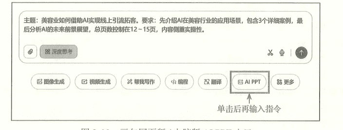

图 2-10 豆包网页版/电脑版 AI PPT 入口

发送提示词后，等待 1～2 分钟，豆包就会自动整理出逻辑清晰的 PPT 大纲，不仅包含标题、各章节核心内容，还会补充案例框架和关键数据方向，省去手动梳理结构的麻烦，如图 2-11 所示。如果对大纲不满意，可以直接让豆包重新生成，也可以补充提示词调整内容，或删减某部分冗余内容，还可以直接选中大纲中的内容进行修改。

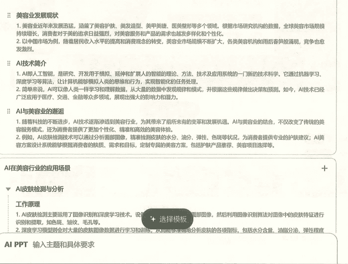

图 2-11 豆包 AI PPT 生成的大纲

#### 2. 选定模板，快速生成初稿

大纲确认后，下一步就是选择匹配的模板。豆包针对不同场景提供了丰富的模板库，涵盖总结汇报、教育培训、营销推广、商业计划、企业介绍等热门场景，风格从简约商务到创意个性应有尽有，不需要自己从零设计版式。

根据 PPT 主题选择对应的场景和风格，如图 2-12 所示。完成后单击“开始生成 PPT”按钮，系统会自动将大纲内容填充到模板中。整个过程不到 3 分钟，就能得到一份版式规整、图文搭配合理、字体协调统一的 PPT 初稿，完全不用手动调整排版格式。

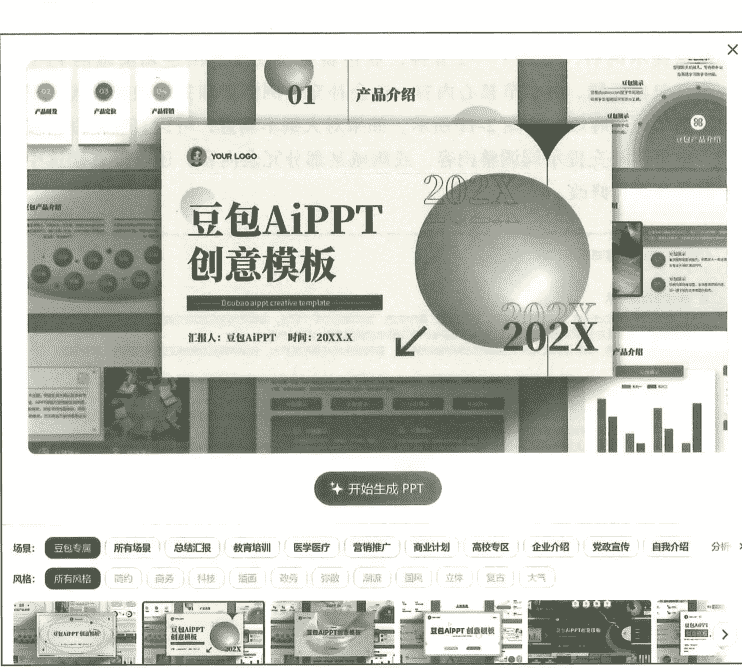

#### 3. 细节修改，确认终稿输出

AI PPT 生成的初稿已具备专业雏形，但部分细节仍需根据实际需求调整，比如替换品牌 LOGO、修改汇报人信息、调整时间节点、更换图片素材等。此时需要单击“进入 AI PPT 编辑”按钮跳转至 AI PPT 网站进行编辑，编辑页面操作简单，与常用的办公软件逻辑一致，支持单个页面、单个元素的单独修改，上手毫无难度。

单击需要调整的文字，可直接修改内容、更换字体和字号；选中图片元素，能替换成自己的工作素材，或从系统图库中选择匹配图片；觉得页面布局不合理，还能拖动元素调整位置，添加图表、图标等装饰元素。修改完成后，可根据使用场景选择下载格式：需要直接演示或分享的选 PDF 格式，避免排版错乱；后续可能需要二次修改的选可编辑模式，下载后可在本地进一步优化细节。

#### 4. 总结

豆包 AI PPT 彻底打破了“PPT 制作需要专业技能”的壁垒，通过“明确需求生成大纲—选择模板生成初稿—细节修改输出终稿”的 3 步流程，将原本复杂的 PPT 制作过程简化，让零设计基础、计算机操作不熟练的人，也能在短时间内做出专业级演示文稿。

> 试一试
选一个你近期需要制作的 PPT 主题（比如季度工作汇报、产品介绍、活动策划、项目提案），按照“主题 + 核心要求 + 结构模块 + 页面数量”的格式撰写提示词，用豆包 AI PPT 生成大纲和初稿，再根据实际需求修改细节，体验 10 分钟搞定专业 PPT 的高效过程。

> 小贴士
1）给豆包的提示词越具体，生成的内容越精准，尽量明确结构、案例数量、侧重点、目标受众等关键信息。
2）模板的选择要贴合主题和使用场景，避免风格与内容脱节，影响演示效果。
3）豆包生成的内容可能存在细节偏差，终稿前务必核对数据、案例信息，确保内容准确无误。

### 技巧 28 Excel 数据可视化：一键生成图表

工作中做汇报、写分析，总少不了技术图表的身影。不管是展示数据趋势、用户分层，还是热点分布，一张清晰、专业的图表能让信息传递效率翻倍。但在实际操作中，进阶图表制作却成了不少人的拦路虎——想做折柱混合图展现多维度数据，手动调整格式半天不对；想做聚类分析散点图划分用户群体，面对数据处理无从下手；动态图表、交互式饼图更是看着复杂就望而却步，最后要么妥协用简单图表凑数，要么花几小时反复打磨，既耗时又难出效果。

以上问题用豆包就能轻松解决，不需要专业技能，不管是折柱混合图、聚类散点图，还是带动画的双柱状图、交互式圆环饼图，只要给对提示，豆包都能帮你搞定，而且全程不需要使用复杂工具，5分钟就能出结果。下面就列举几个职场常见场景，教你怎么用豆包做进阶图表。

#### 1. 做“销售目标达成 + 客户新增”折柱混合图

要做季度汇报，需要同时展示“销售目标达成率”和“新增客户数”的趋势，单一图表不够直观，折柱混合图最合适。这时候不用自己在 Excel 里插两个图表拼合，直接给豆包提需求就行。

上传相关数据，并输入提示词：“用以上数据表制作折柱混合图：柱状图显示销售目标达成率，折线图显示新增客户数，配色浅蓝（柱子）、深灰（折线），标注具体数值，标题为‘2024年季度销售目标达成与新增客户趋势’。”

豆包会自动提取所需数据，生成的图表如图 2-13 所示。这张图既有柱状图的直观对比，又有折线图的趋势变化，还会标注每个季度的具体数值，不用手动调整位置，直接插入汇报 PPT 就行。

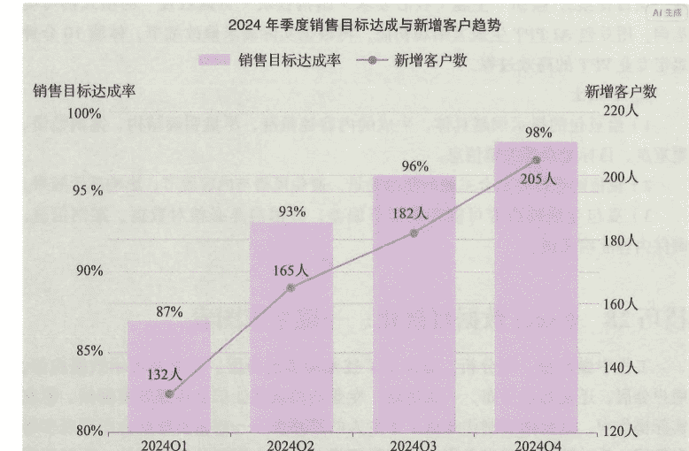

图 2-13 销售的折柱混合图

#### 2. 做“用户活跃度 + 留存率”聚类散点图

运营人员常需要分析用户分层，比如看“周活跃度”和“7日留存率”的关联，想把用户分成“高活跃高留存”“低活跃低留存”等群体，聚类散点图最清晰。不用学 Python 的 K-Means 算法，豆包能直接帮你实现。

上传相关数据，并输入提示词：“用以上数据表制作聚类散点图：K-Means 算法分 3 类，红、绿、蓝三色标注，标题为‘App 用户活跃度与留存率聚类分析’，输出每类用户数、平均活跃度及留存率。”

豆包会自动处理数据并聚类，生成的聚类散点图如图 2-14 所示。图表中不同颜色代表不同的用户群体，上方直接给出分类统计结果，可以用在运营分析报告里。

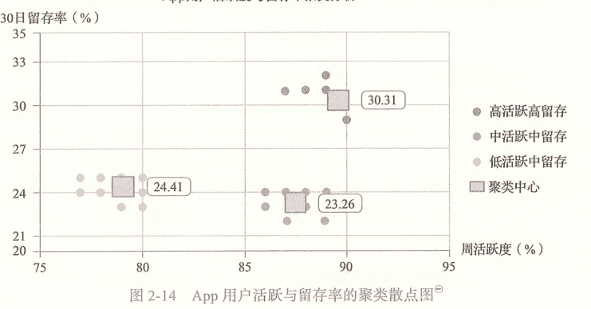

图 2-14 App 用户活跃与留存率的聚类散点图

#### 3. 做“产品销量 + 售后工单”动态双柱状图

如果想展示月度数据的变化，还要带点交互感，比如鼠标指针滑上去能看到具体数值，动态双柱状图比静态图表更吸睛。不用学 ECharts 的动画配置，豆包能帮你生成带交互的动态图表。

在豆包中上传相关数据，并输入提示词：“用以上数据表制作动态双柱状图：深色柱代表销量，浅色柱代表工单数，鼠标 hover 显示具体数值，标题为‘2024 年月度产品销量与售后工单趋势’，用 HTML 格式输出。”生成的双柱状图如图 2-15 所示。

> 本书为双色印刷，无法展示所有颜色，读者可自行实践，查看完整效果。

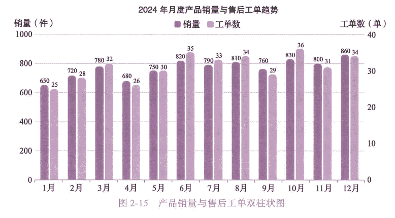

图 2-15 产品销量与售后工单双柱状图

#### 4. 做“营销费用渠道占比”圆环饼图

做年度预算总结时，要想展示各渠道营销费用的占比，圆环饼图比普通饼图更显高级。不用手动调图例位置，豆包能生成带图例和阴影效果的圆环图。

上传相关数据，并输入提示词：“你用以上数据表制作交互式圆环饼图：圆环内径 40%、外径 70%，橙、绿、蓝、紫等颜色区分渠道，hover 显示‘渠道 + 占比 + 讨论人数’，右侧滚动图例，标题为‘2024年度营销费用渠道占比分析’。”

生成的圆环饼图如图 2-16 所示。

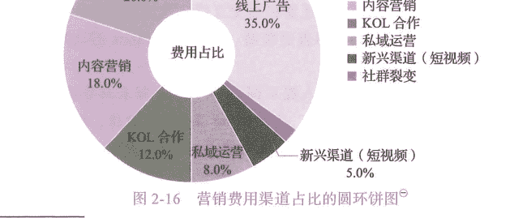

图 2-16 营销费用渠道占比的圆环饼图

> 本书为双色印刷，无法展示所有颜色，读者可自行实践，查看完整效果。

#### 5. 总结

其实，豆包做进阶图表的核心不是让它猜你的想法，而是把需求拆清楚：首先给明确的数据，然后说清楚图表类型，再补充样式和交互要求。只要提示词够具体，不用学任何专业工具，就能快速出结果，再也不用为了一个图表熬半天。

> 试一试

挑选工作中需要的图表类型（比如聚类散点图分析用户数据，或动态双柱状图展示业务趋势），整理好相关的 Excel 数据，复制文中对应的提示词并根据实际需求修改，发送给豆包，体验一键生成进阶图表的便捷，看看是否能节省你的工作时间。

> 小贴士

1）提供的数据要规范，避免缺失关键字段，否则可能影响图表准确性；若有数据缺失，可在提示词中说明处理方式。
2）提示词要明确图表类型、数据维度、输出格式和特殊需求（如颜色、交互功能），描述越精准，生成的图表越符合预期。
3）生成的 HTML 格式图表可直接嵌入 PPT、报告或网页，如需调整样式，可在豆包生成结果后补充提示词修改。

### 技巧 29 数据分析：不用函数，一步搞定表格整合与图表生成

做月度汇报时，对着好几张 Excel 表手动合并数据，VLOOKUP 函数改了又改还是出错；分析学生成绩时，算平均分、排排名、做图表要折腾大半天；拿到问卷数据后，盯着密密麻麻的数字不知道从哪下手提炼结论？不管是职场办公还是日常学习，很多人都被数据整理和分析的烦琐流程困住，要么不懂专业工具，要么耗时费力还容易出错。

而豆包的数据分析功能刚好解决了这些痛点。它不需要复杂的公式记忆，不用掌握编程技能，只要上传数据文件，用自然语言描述需求，就能完成数据合并、清洗、统计、可视化等一系列操作，还能生成专业的分析报告，让数据处理效率翻倍。操作入口也很简单，打开豆包电脑版或网页版，找到“数据分析”功能，上传 Excel 表格等数据文件即可发起需求。

#### 1. 数据整理：多表合并 + 识图转表，烦琐工作一键搞定

别，轻松解决数据分散的问题。如果手里有 3 张不同门店的月度销售表，列名都是“商品名称”“销量”“销售额”“门店”，需要合并成一张总表，可输入提示词：“将上传文件中所有工作表按相同列名合并为一张总表，去除重复数据，生成新的 Excel 文件供下载”。豆包会自动识别各表列名，完成数据整合并导出文件，省去手动复制粘贴的麻烦。

部分生成结果示例：

数据合并处理完成报告

已成功将城东店、城西店和总店的月度销售表按相同列名合并，并完成数据清理，具体处理结果如下。

1. 数据来源与处理概况
原始文件：3 个 Excel 文件（城东店、城西店、总店各 1 个）。
原始数据量：共 48 条记录（城东店 15 条、城西店 16 条、总店 17 条）。
列名统一性：三个文件列名完全一致，不需要列名映射。
重复数据处理：未发现重复数据，数据完整性良好。

2. 合并后数据结构
合并后的总表包含以下 6 个字段：
商品名称：具体商品的标识。
销量：该商品的销售数量。
销售额：该商品的销售金额（元）。
门店：销售门店名称。
店铺名称：统一的店铺标识（与门店字段一致）。
月份：统一标注为“月度销售数据”（原始文件无具体月份信息）。

3. 销售数据汇总统计
……

4. 生成的 Excel 文件说明
……

（由于篇幅有限，输出结果在此省略，建议读者亲自上手实践。）

单击链接即可下载新合并的文件，如图 2-17 所示。

遇到图片中的数据（比如截图的成绩表、公开数据图表），不用手动录入，提示词可以这样写：“识别这两张图片中的表格数据，分别整理为‘班级期中成绩表’和‘班级期末成绩表’，再按学生姓名合并成一张表，添加‘成绩变化’列（期末成绩减期中成绩），生成 Excel 文件。”豆包能精准提取图片中的文字和数字，完成表格转换与合并，准确率高还省时，如图 2-18 所示。

- 商品总种类数：48 种
- 总销量：4,959 件
- 总销售额：1,305,520.85 元
- 整体平均单价：263.26 元

## 4. 生成的 Excel 文件说明

新生成的 Excel 文件包含 3 个工作表，便于不同维度的数据查看：

1. 合并销售总表：完整的 48 条原始数据，包含所有字段
2. 各店铺销售汇总：按店铺维度的统计数据
3. 整体销售汇总：全公司层面的销售统计概况

## 文件下载

合并后的 Excel 文件已生成，可直接下载使用：

要不要我帮你进一步生成一份数据可视化图表，直观展示各店铺的销售对比情况？

图 2-17 可直接下载合并后的文件

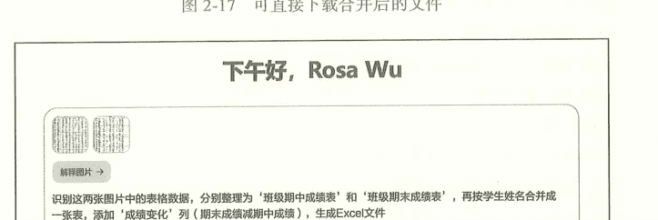

图 2-18 上传成绩截图

豆包生成的结果可能如表 2-1 所示。

## 表 2-1 班级成绩表

| 姓名 | 期中总分 | 期末总分 | 成绩变化（期末－期中） |
| --- | --- | --- | --- |
| 王兵 | 510.7 | 469.8 | -40.9 |
| 田秀兰 | 504.9 | 444.7 | -60.2 |
| 王燕 | 500.8 | 481.9 | -18.9 |
| 王秀华 | 498.0 | 470.8 | -27.2 |
| 王春梅 | 479.8 | 481.3 | 1.5 |
| 杨柳 | 407.4 | 475.7 | 68.3 |

#### 2. 数据统计：指标计算 + 分数段分析，精准提炼核心信息

整理好数据后，各类统计指标和分层分析也能快速完成，不管是业务数据还是学习数据都适用。以销售数据为例，想快速掌握核心情况，可输入提示词：“分析这份月度销售数据，计算总销售额、平均单品销量、销售额最高的前三款商品；按销量分为‘热销款（≥1000件）’‘平销款（500～999件）’‘滞销款（<500件）’三个类别，统计每个类别的商品数量和占比”。

豆包会自动计算各项指标，并给出清晰的分类统计结果。

部分生成结果示例：

各门店月度销售数据分析结果

一、核心销售指标

总销售额：1305520.85 元

总销量：4959 件

商品总数：48 款

平均单品销量：103.31 件/款

二、销售额最高的前三款商品

| 排名 | 商品名称 | 销量（件） | 销售额（元） | 占总销售额比例 |
|---|---|---|---|---|
| 1 | 休闲食品-252 | 199 | 97800.88 | 7.5% |
| 2 | 美妆护肤-878 | 198 | 96920.95 | 7.4% |
| 3 | 日用百货-421 | 137 | 66919.72 | 5.1% |

关键发现：前三款商品共贡献 261601.55 元销售额，占总销售额的 20.0%，是销售业绩的核心驱动力。

三、商品销量分类统计

......

四、数据洞察与建议

......

五、生成文件

我已为您生成了以下两份分析文件：

## 114 豆包使用秘笈：从入门到精通的 100 个实用技巧

### 1. 可视化图表：包含销售额 TOP3 对比、销量分布、分类占比等 4 个维度的综合图表。

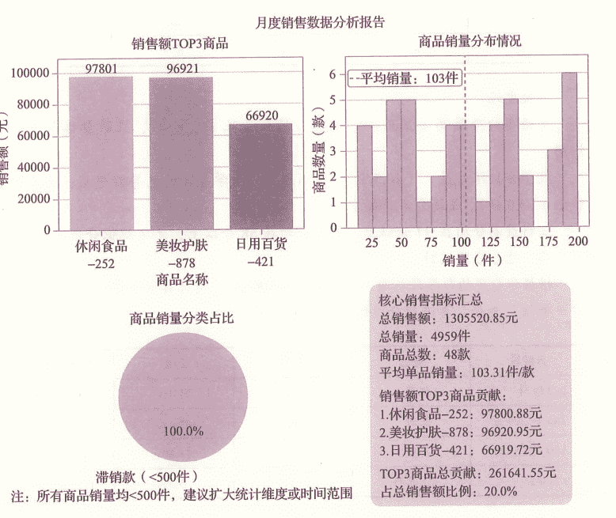

### 2. 详细分析报告：包含完整的数据分析过程、洞察和优化建议的 Markdown 文档。（由于篇幅有限，输出结果在此省略，建议读者亲自上手实践。）

针对学生成绩数据，提示词可以这样设计：“分析这份班级成绩表，计算语文、数学、英语三科的平均分、最高分、最低分；按总分划分‘优秀（≥270分）’‘良好（240～269分）’‘及格（180～239分）’‘不及格（<180分）’四个分数段，统计每个分数段的人数及占比”，帮助老师快速掌握班级的整体成绩情况。

部分生成结果示例：

班级期末成绩表分析结果

一、三科核心成绩指标

首先对语文、数学、英语三科的成绩分布进行统计，结果如下表所示（成绩均保留 1 位小数）。

| 科目 | 平均分 | 最高分 | 最低分 | 分数跨度 |
| :--- | :--- | :--- | :--- | :--- |
| 语文 | 85.2 | 98.5 | 62.0 | 36.5 |
| 数学 | 82.8 | 99.0 | 58.5 | 40.5 |
| 英语 | 86.5 | 97.0 | 65.0 | 32.0 |

关键发现：
英语平均分最高（86.5 分），数学平均分最低（82.8 分），三科整体水平较为均衡。
数学分数跨度最大（40.5 分），说明班级内数学成绩的差异较明显；英语跨度最小（32.0 分），成绩分布更集中。
三科最高分均在 97 分以上，最低分均在 58 分以上，无极端低分情况。

二、总分分段统计

根据你指定的分数段标准（总分满分为 300 分），先计算每位学生的“语文 + 数学 + 英语”总分，再进行分段统计，结果如下。

| 分数段 | 等级 | 人数 | 占比 | 总分范围（分） |
| :--- | :--- | :--- | :--- | :--- |
| ≥270 分 | 优秀 | 8 | 21.1% | 270 ～ 294.5 |
| 240 ～ 269 分 | 良好 | 16 | 42.1% | 241 ～ 268.5 |
| 180 ～ 239 分 | 及格 | 12 | 31.6% | 182.5 ～ 238.5 |
| <180 分 | 不及格 | 2 | 5.3% | 175 ～ 178 |

核心结论：
班级整体成绩优秀：优秀 + 良好人数共 24 人，占比 63.2%，超过班级总人数的六成。
及格率较高：及格及以上人数共 36 人，总及格率达 94.7%，仅 2 人不及格。
分数段分布合理：呈“中间高、两端低”的正态分布趋势，符合班级成绩的正常分布规律。

三、数据洞察与建议

……

四、可视化图表

……

> （由于篇幅有限，输出结果在此省略，建议读者亲自上手实践。）

#### 3. 可视化分析：多类型图表 + 报告生成，直观呈现数据洞察

数据再精准，没有直观呈现也难以让人快速理解，豆包支持多种图表生成和完整报告输出，还能自由编辑调整。想做趋势和占比分析，可输入提示词：“基于这份年度销售数据，生成月度销售额趋势折线图、各品类销售额占比饼图；用柱状图对比前三季度的销量差异，图表配色用商务简约风格，添加数据标签显示具体数值”。生成的图表清晰、直观，可直接用于汇报展示。

生成结果示例：

基于你提供的 2024 年年度销售数据，已完成 3 个商务简约风格图表的生成，所有图表均包含数据标签以清晰展示具体数值，配色采用深蓝、墨绿等专业商务色系，符合职场汇报需求。

1. 2024 年各月销售额趋势折线图

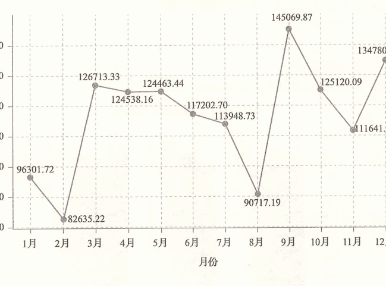

核心洞察：
- 销售额峰值出现在 9 月（145069.87 元），为全年最高，可能受中秋、国庆双节消费带动。
- 谷值出现在 2 月（82635.22 元），符合春节假期消费淡季特征。
- 整体呈现“波动上升”趋势，Q3（7～9 月）表现最优，总销售额达 349735.79 元，占全年 30.2%。

2. 2024 年各品类销售额占比饼图

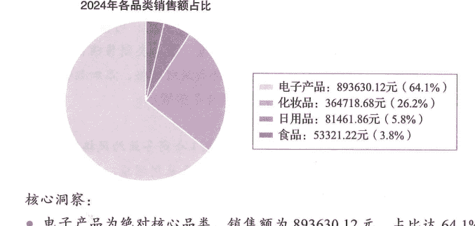

核心洞察：
- 电子产品为绝对核心品类，销售额为 893630.12 元，占比达 64.1%，是收入的主要来源。
- 化妆品为第二增长极，销售额为 364718.68 元，占比 26.2%，贡献四分之一以上收入。
- 日用品（5.8%）和食品（3.8%）占比较低，合计不足 10%，可考虑优化品类运营策略。

3. 2024 年前三季度各品类销量对比柱状图

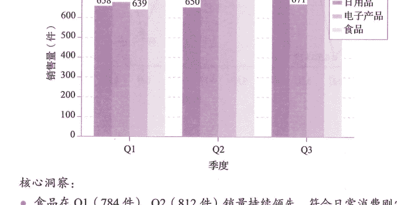

核心洞察：
- 食品在 Q1（784 件）、Q2（812 件）销量持续领先，符合日常消费刚需属性。
- 电子产品在 Q2 销量爆发（764 件），较 Q1 增长 19.6%，推测受“618”电商大促拉动。
- 化妆品在 Q3 表现最佳（778 件），环比 Q2 增长 19.7%，契合下半年美妆消费旺季的特点。

需要完整报告时，提示词可以写：“分析这份产品调研数据，生成包含数据概览、核心指标统计、用户偏好分析、优化建议的可视化报告，报告中要包含柱状图、饼图各两张，支持下载为 PDF 格式”。豆包会输出图文并茂的完整报告，从数据解读到建议都一应俱全，还能编辑调整图表样式和报告内容。

部分生成结果示例：

产品调研数据分析报告

基于你提供的 77 份产品调研数据，我已完成全面的数据分析并生成了可视化报告。以下是详细的分析结果。

一、数据概览

（一）数据基本信息

样本规模：77 份有效调研问卷，数据完整性 100%（无缺失值）。
覆盖维度：4 个产品品类、4 个调研渠道、6 个年龄区间。
核心指标：满意度、购买意愿（1～5 分制），价格敏感度（1～3 分制）。
数据质量：数据结构完整，无异常值，分析基础可靠。

（二）样本分布特征

产品品类：日用品 26.0%、食品 26.0%、电子产品 24.7%、化妆品 23.4%（分布均匀）。
用户类型：个人用户 62.3%（48 人），家庭用户 37.7%（29 人）。
年龄结构：18～25 岁 26.0%、26～35 岁 26.0%、36～45 岁 22.1%（中青年为主）。

二、核心指标统计分析

（一）整体评分表现

| 指标 | 平均分 | 中位数 | 标准差 | 表现评价 |
| :--- | :--- | :--- | :--- | :--- |
| 满意度 | 3.99 分 | 4.0 分 | 0.82 | 良好 |
| 购买意愿 | 4.10 分 | 4.0 分 | 0.75 | 较好 |
| 价格敏感度 | 1.97 分 | 2.0 分 | 0.73 | 适中 |

（二）关键发现

用户满意度良好：近 60% 用户给予 4～5 分好评。
购买意愿积极：平均 4.10 分，高于满意度，市场潜力良好。
价格敏感度适中：27.3% 用户对价格不敏感，具备溢价空间。

三、可视化图表分析

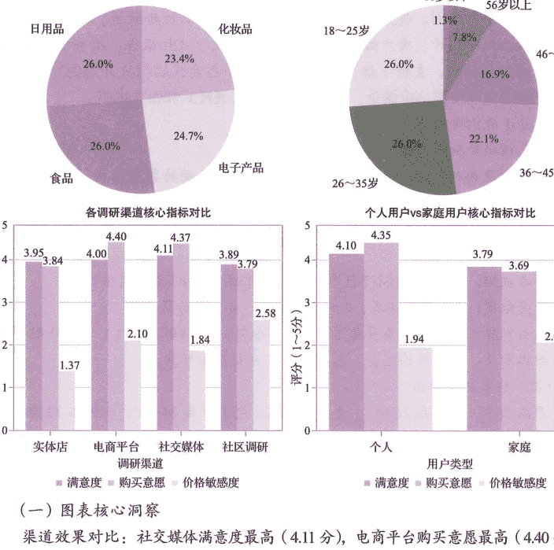

（一）图表核心洞察

渠道效果对比：社交媒体满意度最高（4.11 分），电商平台购买意愿最高（4.40 分）。
用户类型差异：个人用户满意度（4.10 分）和购买意愿（4.35 分）显著高于家庭用户。
年龄分布集中：18～35 岁用户占 52%，是核心目标群体。
品类分布均衡：四个产品品类样本分布均匀，分析结果具有代表性。

四、用户偏好深度分析

> 由于四舍五入，计算出的占比总和可能不等于 100%。

五、优化建议

......

六、分析结论

本次调研数据显示，产品整体表现良好，用户满意度和购买意愿处于较高水平，57.1%的高价值用户为市场发展奠定了良好基础。核心改进方向集中在包装设计和功能优化上，建议重点关注18～35岁个人用户群体，通过优化渠道配置和产品迭代，进一步提升市场竞争力。

七、生成文件下载

我已为你生成了完整的PDF格式分析报告，包含所有详细数据、图表和建议。
产品调研数据分析报告.pdf
(由于篇幅有限，输出结果在此省略，建议读者亲自上手实践。)

#### 4. 多维度深度分析：相关性 + 个体对比，挖掘数据背后规律

对于需要深入研究的数据，豆包还能进行相关性分析、个体对比等深度操作。比如分析学生多科成绩，提示词可以设计为：“分析这份排名1～5名的学生的语、数、英、理、化、生六科成绩，计算各科成绩的相关性系数，用雷达图对比每位学生的各科成绩表现，总结每位学生的优势学科和薄弱学科，给出针对性提升建议”。通过这样的分析，能清晰地发现学生的成绩特点，为学习规划提供依据。

部分生成结果示例：

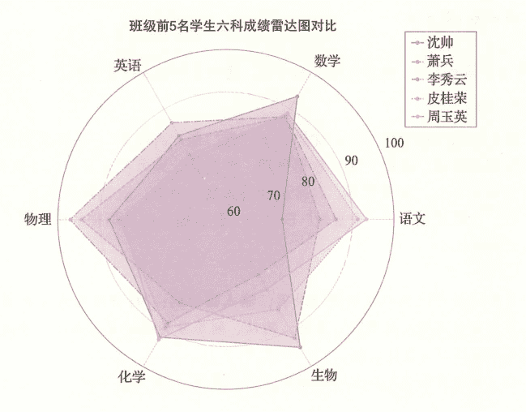

学生个人分析与提升建议

沈帅（第1名）

优势学科：数学（93.4分）、生物（94.8分）。
薄弱学科：语文（73.2分）、英语（82.8分）。
提升建议：
语文：加强阅读理解和写作训练，每周完成2篇作文练习。
英语：结合理科优势阅读英文科技文献，提升词汇量和应用能力。
巩固理科优势，探索学科间的知识关联。

萧兵（第2名）

优势学科：物理（94.3分）、生物（92.3分）。
薄弱学科：语文（82.1分）、英语（81.7分）。
提升建议：
语文：建立错题本整理常见题型，重点突破文言文阅读。
英语：每天坚持30分钟听说练习，提升语言应用能力。
发挥物理优势，带动数学、化学学科的进一步提升。

李秀云（第3名）

……

皮桂荣（第4名）

……

周玉英（第5名）

……

（由于篇幅有限，输出结果在此省略，建议读者亲自上手实践。）

#### 5. 总结

豆包数据分析功能的核心优势在于“低门槛+高效率”，不需要专业的数据分析知识和技能，就能完成从数据整理、数据统计到可视化分析的全流程操作。它覆盖职场办公、教学管理、日常统计等多场景需求，既能解决新手“不会做”的难题，也能减轻老手“重复做”的负担，让数据处理从烦琐的体力活变成轻松的提示词操作。

> 试一试

上传一份自己的月度消费记录表，输入提示词：“计算这份消费数据的总支出、平均每日消费，按餐饮、交通、购物、娱乐分类统计支出占比，生成饼图”，体验基础统计与可视化功能。

找一张包含表格的图片（如课程表、成绩单），输入提示词：“识别这张图片中的表格数据，整理成 Excel 格式，计算关键指标（如课程总数、成绩平均分）”，测试识图转表功能。

小贴士
1）上传数据前，建议对包含隐私信息的数据（如客户手机号、员工身份证号）进行脱敏处理，避免信息泄露。
2）在处理大数据量文件时，可分步骤提出需求，先整理数据，再进行统计和图表生成，提升操作流畅度。
3）生成的图表和报告支持下载和编辑，若对样式不满意，可补充提示词（如“将饼图颜色换成蓝、绿、橙三色”）让豆包调整。
4）确保豆包为最新版本，部分高级可视化功能需在最新版本中才能正常使用。

### 技巧 30 私人法务助手：3 步搞定合同处理，效率翻倍

法务的日常往往是被一份又一份合同淹没——既要审查错别字、核对条款序号，又要核查法律法规是否有效、合作方信用有没有问题，忙得脚不沾地。而用豆包电脑版，简单 3 步就能搭出专属私人 AI 法务助手，审合同、查法规、做翻译全能干，还不用额外花钱。下面将介绍具体的做法及案例。

#### 1. 找准设置入口，开启技能自定义

首先在电脑版豆包中找到设置的界面。进入豆包的电脑版界面后，单击自己的头像，在弹出的菜单中找到“设置”，如图 2-19 所示，就能进入个性化设置页面。

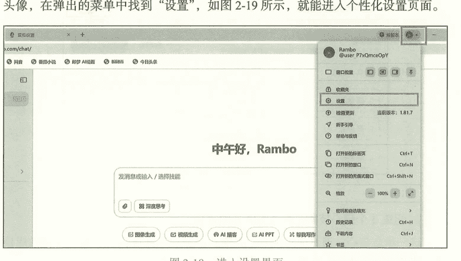

在设置页面中，找到 “AI 工具” 分类下的 “AI 划词工具栏”，并单击进入，如图 2-20 所示。

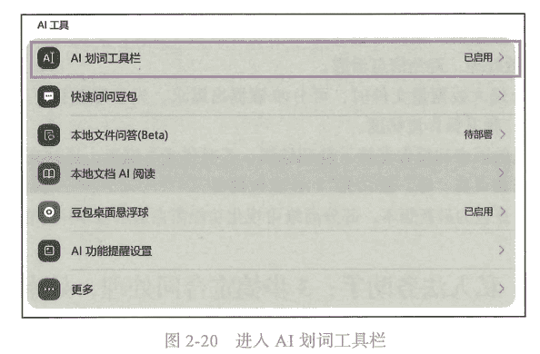

进入后单击右侧的按钮，即可启用该功能，如图 2-21 所示。

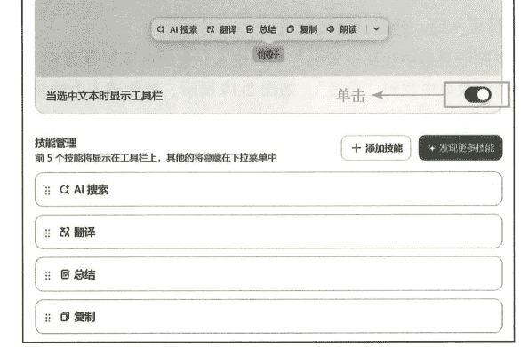

#### 2. 配置 3 个核心技能，覆盖法务高频需求

这一步是核心，通过简单配置，就能让划词功能具备合同审查、法律法规核查、法律翻译等技能。不用自己琢磨提示词，拿来就能用。

在“AI 划词工具栏”中找到“添加技能”按钮，如图 2-22 所示。

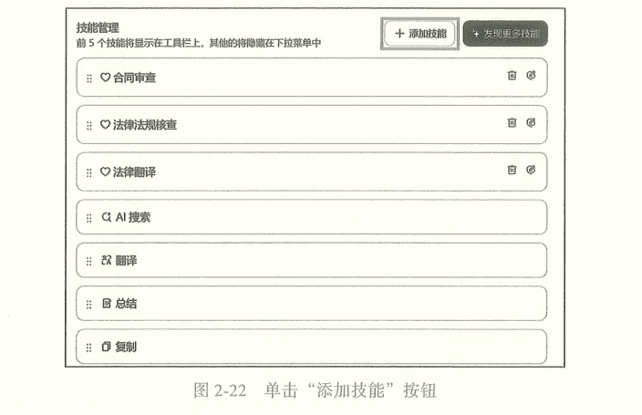

单击进入后，按照功能添加技能的名称、图标和提示词内容，如图 2-23 所示。以下是三大技能的提示词内容配置。

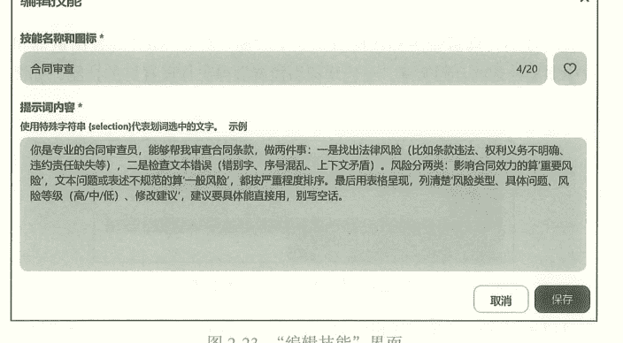

技能 1：合同审查——揪出风险点和文本错误
专门用于解决合同里的隐藏风险和文字漏洞，提示词示例：“你是专业的合同审查员，能够帮我审查合同条款，主要负责两件事：一是找出法律风险（比如条款违法、权利义务不明确、违约责任缺失等），二是检查文本错误（错别字、序号混乱、上下文矛盾）。风险分两类：影响合同效力的算‘重要风险’，文本问题或表述不规范的算‘一般风险’，都按严重程度排序。最后用表格呈现，列清楚‘风险类型、具体问题、风险等级（高/中/低）、修改建议’，建议要具体能直接用，别写空话。”

技能 2：法律法规核查——确认法律是否现行有效
引用的法律条文有没有失效？一键核实不遗漏，提示词如下：“你是专业的法律法规信息核查专员，能帮我确认指定的法律法规（或具体条款）现在是否有效，直接说结果（有效/无效/已废止/未生效），附上国家官方核查链接（比如国家法律法规数据库）。如果查不到明确结果，就说‘需通过官方渠道进一步核实’，不要编造信息。”

技能 3：法律翻译——精准对接英美法术语
需要英文合同？不用再找专业翻译，提示词可以设计为：“你是专业律师兼法律翻译专家，熟悉英美法体系和法律英语表达，能够把中文合同条款翻译成英文，要求：① 用英美法合同常用专业术语；② 意思和原文完全一致，不改变法律效力；③ 关键术语（比如违约金、不可抗力）标注英文常用表述及依据；④ 翻译结果简洁规范，符合英文合同格式。”

#### 3. 直接划词，即可使用技能

配置完成后，即可使用你所配置的 3 个功能。打开 Word 或者浏览器里的合同，选中需要处理的合同文字，豆包划词功能就会弹出你设置好的技能，如图 2-24 所示。

图 2-24 选择相应的文字和技能

你可以根据实际情况选择相应的技能，如合同审查，豆包就会按照设置好的提示词，快速梳理出合同里的风险点，用表格列出风险类别、描述、等级和修改建议，左边看合同、右边看提示，修改起来一目了然，不用再逐页翻找，如图 2-25 所示。

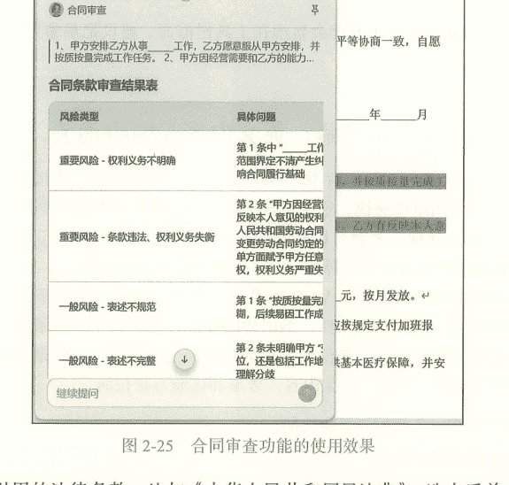

遇到引用的法律条款，比如《中华人民共和国民法典》，选中后单击“核查法律有效性”，马上就能知道法律是否现行有效，还会附上国家法律法规数据库的链接，权威又放心，不用自己再去各种平台检索。

如果需要处理英文合同，“法律翻译”技能能精准地输出英美法专业术语的译文，还会标注术语来源，不用担心翻译出错，省去反复核对的麻烦。

#### 4. 总结

用豆包搭建私人 AI 法务助手，全程不用复杂的操作，也不用额外花钱，完美适配公司的数据安全要求。3 个核心技能覆盖合同审查、法律核查、法律翻译等高频需求，能帮法务从烦琐的重复工作中解放出来，把精力放在更重要的法律研判上，工作效率直接翻倍，再也不用被海量合同和杂事拖慢节奏。

> 试一试

现在就打开豆包电脑版，按照上面的步骤配置 3 个核心技能。找一份近期需要审核的合同，使用“合同审查”功能测试，看看豆包能不能精准找出风险点。

小贴士
1）优先用 Word 打开合同，该软件与豆包的兼容性更好，能避免划词功能冲突。
2）提示词可以根据行业特点微调，比如金融行业可以增加“符合金融监管相关规定”的要求。
3）技能列表里默认的技能会显示在工具栏前面，建议把最常用的放在前面，方便快速调用。

### 技巧 31 双语实时字幕：英文内容无障碍通关

追无字幕原版剧，俚语听不懂、笑点接不住，暂停查词会直接打断剧情；开国际会议，外国同事语速快、专业术语密集，没听清关键数据得回头翻录音耽误工作；上英文公开课，复杂名词刚冒出来就得暂停记，转头就忘了前面的知识点——这些英文场景里的语言障碍，是不是特别让人感到头疼？

而豆包电脑版（需升级至 V1.57.6 及以上版本）的双语实时字幕，恰好戳中了这些真实痛点：不用切换软件、不用暂停等待，实时识别英文语音生成中英双语字幕，还能灵活调字号、挪位置，甚至能复制全程字幕，不管是追剧、办公还是学习，都能让你“秒懂”英文内容，效率和体验直接拉满。

#### 1. 具体操作：3 步用对真实功能

（1）把基础条件备齐
查版本：打开豆包电脑版，单击右上角头像→“关于豆包”，若版本低于 V1.57.6，则在“设置→版本更新”中升级，旧版本无此项功能。
开悬浮球：要是在屏幕边缘没看到小悬浮球，选择“设置→豆包桌面悬浮球”，勾选上“启用悬浮球”选项，它会贴在屏幕右侧的底部，鼠标指针移动过去就能看到功能列表。

（2）两种开启方式，怎么方便怎么来
方式 1：自动弹窗——它主动“搭话”
打开任意英文内容，只要内容语言与你的计算机系统语言不一样，豆包就会弹出提示：“检测到英文语音，需要开双语字幕吗？”单击“确认”，字幕立马叠加在内容上，不用额外操作。
方式 2：手动开启——你主动“召唤”
没弹窗不用着急，单击悬浮球上的“实时双语字幕”，选择“英文→中文双语对照”，再打开要查看的内容，字幕就会实时生成，如图 2-26 所示。

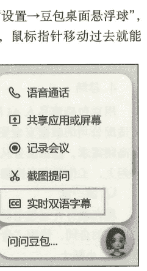

（3）真实可调的功能，够用就好，如图 2-27 所示。

生成字幕后，单击字幕框上方，能调出 3 个实用选项：

- 显示模式：可以根据需要选择是否显示原文。比如，追剧时，你想练听力就选择“关闭原文”，想快速看懂剧情就选“显示原文”。
- 字号大小：系统默认中号字体。看剧选择“中号”不挡画面，开会选择“大号”能看清数据。
- 位置拖拽：按住字幕框任意移动即可。看剧拖到屏幕底部，别挡住主角的脸；开会拖到侧边，别挡住 PPT 内容。

另外，单击字幕框里的“展开字幕”，可看到从开启到现在的所有字幕记录，看完直接复制，不用自己手写笔记。

不同场景怎么使用更顺手？

- 追剧时：打开“显示原文”，调为中号字并拖动到屏幕底部，既能沉浸式看剧，又能顺便认俚语、记地道表达，看完单击“展开字幕”，把喜欢的台词复制下来，积累口语素材。
- 开国际会议时：打开“显示原文”调为大号字，当重点数据（比如 18%ROI）出现时，不用着急记，会后可直接复制“展开字幕”里的内容，快速整理会议纪要，不用反复听录音核对。
- 学英文课时：打开“显示原文”，当专业词（比如 recursive function）出现时，看字幕可快速理解意思，不用暂停查资料，课后把“展开字幕”里的知识点复制到笔记里，省时又高效。

#### 2. 总结

豆包双语实时字幕的核心优势在于“贴合真实场景、实用不花哨”：追剧时不打断节奏，开会时不遗漏重点，上课时不耽误进度，基础的显示模式、字号、位置调节全都能满足，还能复制全程字幕——没有复杂设置，却能精准解决英文内容“看不懂、记不住”的问题，是三个场景里的“刚需工具”。

> 试一试

找一段 5 分钟的英文内容（追剧党选片段、职场人找国际会议示例、学生党挑公开课片段），按照步骤操作：① 把豆包更到最新版，开悬浮球单击“实时双语字幕”选择“显示原文”；② 根据场景调字号（追剧选中号字、开会选大号字、上课选中号字），拖曳字幕到不遮挡关键内容的位置；③ 结束后单击“展开字幕”，复制核心信息（台词/数据/知识点），体验“无障碍 + 高效率”的英文内容实时翻译。

> 小贴士

1. 若找不到字幕功能，可先查版本，低于 V1.57.6 版本的豆包，得去“设置→版本更新”升级后重启，才能看到这个功能。
2. 环境不能太吵，杂音会影响语音识别，在开会/看视频时，尽量规避键盘敲击声，并关闭背景音乐，保证声音清晰。
3. 豆包目前只支持“英文↔中文”互译，其他语种的实时字幕还没上线，后续可以关注版本更新通知。

# 3

## 第 3 章 C H A P T E R

## 用豆包提升教育和学习效果

### 技巧 32 苏格拉底提问法：让孩子主动找答案

孩子学习时总盼着标准答案，遇到抽象知识就卡壳，家长讲得口干舌燥，孩子却还是一脸茫然；用工具辅助学习，又怕孩子变成“伸手党”，越用越会产生依赖。这是很多家庭的教育痛点——不是孩子不爱学，而是传统的“灌输式”辅导和“答案式”工具没能激活孩子的思考力。怎样让孩子不过度依赖答案？答案是用苏格拉底提问法引导孩子一步步探究，即借助豆包通过一步步提问，把工具变成“思考教练”，让孩子从被动接收变成主动探索。本节通过 2 个场景来展示具体的操作方法和技巧。

#### 1. 拆解抽象概念，让难懂知识变通透

孩子在面对抽象知识点时，容易死记公式或定义，却不理解本质。这时候不用让豆包直接讲解，而是用“澄清式追问”，将原始的问题、公式、定义拆分成若干个子问题，让孩子逐步理解。

比如孩子学习“分数除法”时，觉得“除以一个分数等于乘它的倒数”难以理解，可以这样向豆包发提示词：“我是小学 6 年级学生，正在学分数除法，觉得‘除以 3/4 等于乘 4/3’很难懂。请用苏格拉底提问法引导我理解，一步步输出，我回答后再输出下一步。”

豆包会提出第一个问题，可能是：“你知道‘6 除以 2’等于多少吗？这个算式表示什么意思？（比如是把 6 分成几份，还是求 6 里有几个 2？）”

此时，孩子可以输入自己的理解，比如：“把 6 分成 2 份。”

豆包则会根据这个回答判断孩子是否掌握第一个问题。如果没掌握，则会引导孩子重新思考这个问题；如果掌握了，则会接着提出第二个问题，比如“接下来是第二个问题：如果算式是‘6 除以 1/2’，你觉得它表示什么呀？是把 6 分成 1/2 份（这好像不太好分），还是求‘6 里面包含多少个 1/2’呢？”

以此类推，直到孩子掌握这个问题为止。

#### 2. 理科解题不套公式，吃透底层逻辑

有些题，很多孩子在做完题、对完答案后还是没能真正掌握，换个题型就卡壳，核心是没有理解解题原理。借助苏格拉底提问法，让孩子不仅知其然，还知其所以然。

比如孩子在试卷上发现有一道题自己不理解，可以拍下来，如图 3-1 所示。将图片上传至豆包，并发送提示词：“我是一名六年级学生，想解答图片里的这道题，请模拟你教我做题目的场景，用苏格拉底提问法向我提问。等我回答完一个问题后再继续提下一个问题，一次只提一个问题。开始吧！”

> 2、甲、乙两筐苹果的质量比是5:4。若从甲筐取20千克放入乙筐，则甲、乙两筐苹果的质量比是1:2。甲原来有苹果多少千克？

图 3-1 原始题目

豆包将会根据孩子的回答一步步提出下一个问题，直到孩子理解为止，部分样例对话详见图 3-2。

#### 3. 总结

苏格拉底提问法的核心不是问出正确答案，而是问出思考的路径。豆包的价值也不止于提供知识，更在于当一个不知疲倦的追问者，帮孩子澄清模糊认知、挑战固有假设、寻找底层逻辑。

这种学习方式能让孩子从“等着被喂知识”变成“主动找知识”，不仅能提高学习效率，更能培养批判性思维和自主探究能力——这些能力比任何知识点都要重要。

132 🌸 豆包使用秘笈：从入门到精通的 100 个实用技巧

> 试一试

选择一个孩子正在学习的知识点，用下面的提示词与豆包互动：“我是 [ 年级 ] 学生，正在学 [ 知识点 ]，觉得 [ 具体难点 ]。请用苏格拉底提问法引导我理解，一步步输出，我回答后再输出下一步。”

> 小贴士

1. 给豆包的提示词要具体，要明确孩子的年级、知识点难点、想要的追问方向，这样豆包的引导才会更精准。
2. 不要让孩子直接看豆包的追问答案，先让孩子自己思考、口头回答，再看豆包的下一步引导，这样效果更好。
3. 每次互动聚焦一个知识点，不要一次问太多问题，避免孩子的注意力分散。

### 技巧 33 费曼学习法：让孩子主动吃透知识

很多家长都有过这样的困扰：孩子在学校明明说听懂了，回家写作业却一窍不通。问题的核心不在于孩子不用心，而在于传统学习模式的局限——孩子一直处于被动输入的状态，看似学了，实则没真正理解。如何让孩子从“假装懂”变成“真吃透”，从“被动听”变成“主动学”？答案很简单：用豆包搭配费曼学习法，以教促学，让知识真正扎根。

费曼学习法来自诺贝尔物理学奖获得者理查德·费曼，核心要义是：如果不能用简单的话把一个概念讲清楚，就说明还没真正理解。它不用复杂的流程，本质就是“学了之后试着教别人”，具体就是选好要学的概念，试着讲解，发现不懂的地方，简化表达再巩固。而豆包恰好能成为这个过程的完美搭档，它 24 小时在线，永远耐心十足，不会发脾气，还能精准答疑，完全适配以教促学的需求。

#### 1. 四步用好费曼学习法

用豆包辅助孩子完成费曼学习法的整个过程，核心就是让孩子切换成“小老师”，豆包当“好奇学生”，步骤简单好上手，家长只需在旁边偶尔搭把手。

- （1）明确目标，找准要学的知识点
先让孩子确定当天的学习内容，不用贪多，一个知识点就够，比如数学的“分数除法”、语文的“寓言故事寓意”、英语的“一般过去时”。这一步的关键是聚焦，避免孩子讲解时东拉西扯。
- （2）孩子当老师，给豆包讲课
让孩子对着豆包开启“授课模式”，用自己的话把知识点讲出来。家长要忍住不打断，哪怕孩子表达不流畅、有错误，也先让他讲完。

你可以先输入：“我现在要教你【分数除法的计算方法】，你是完全不懂这个知识点的同学，听我讲的时候要随时问我不懂的地方，比如‘为什么要这么算’‘有没有简单点的理解方式’。”

接下来可以以语音的方式，让孩子直接讲，例如：“分数除法嘛，就是先把除数翻过来，变成倒数，然后就像乘法一样，分子乘分子，分母乘分母。”这时豆包会配合追问：“为什么不能直接用分子除以分子、分母除以分母呀？乘倒数的道理是什么呢？”

通过不断地提问与回答，让孩子主动输出理解，发现问题，直到完全掌握为止。参考的聊天方式如图 3-3 所示。

图 3-3 用费曼学习法求解的聊天记录

- （3）暴露漏洞，用豆包精准补漏

当然，孩子在被追问时，有时候会卡壳——这正是费曼学习法的精髓，能瞬间找出孩子对知识理解的盲点和误区。这时不用着急，让孩子直接向豆包求助，如输入：“我刚才被问到‘为什么分数除法要乘倒数’，这个问题我没讲清楚，你能讲讲吗？”

豆包会切换角色，以老师的角色再次辅导孩子：

这个问题特别关键！其实核心是“除法的本质是求‘一个数里包含几个另一个数’”，结合分数的意义就能说透，用两个简单角度解释：

1. 从“除法是乘法逆运算”推导
我们知道“被除数 ÷ 除数 = 商”，反过来就是“商 × 除数 = 被除数”。
比如计算 2/3 ÷ 1/2，本质是找一个数 x，让 x × 1/2 = 2/3。
要解这个 x，根据乘法逆运算，得用 2/3 ×（1/2 的逆运算），而 1/2 的逆运算就是能让它乘完得 1 的数（也就是倒数 2/1），所以 x = 2/3 × 2/1 = 4/3。
简单地说，除数的倒数，就是能让“商 × 除数 = 被除数”成立的关键，所以必须乘倒数。

2. 用“整数除法类比”理解（更直观）
把分数除法转化成整数除法，就好懂了：比如 3 ÷ 1/2，意思是“3 里有几个 1/2”。
1 里面有 2 个 1/2，3 里面就有 3 × 2 = 6 个 1/2——这里的“2”就是 1/2 的倒数，相当于“÷ 1/2 = × 2”。
再比如 2/3 ÷ 1/4，就是“2/3 里有几个 1/4”，先统一分母变成 8/12 ÷ 3/12，其实就是算“8 个 1/12 里有几个 3 个 1/12”，也就是 8 ÷ 3——而这和 2/3 × 4/1 = 8/3 结果完全一样，本质就是乘了除数的倒数。

……

（由于篇幅有限，输出结果在此省略，建议读者亲自上手实践。）

- （4）重新讲解，巩固吃透
等孩子听懂后，让他再一次给豆包讲课，这次要把刚才没讲清的漏洞补上。直到孩子能流畅回答豆包的追问，用简单的话把知识点讲明白，就算真正掌握了。

#### 2. 家长的角色转变

有了豆包，不用再盯着孩子写作业、反复催促，家长的角色会随之改变，变成平等的学习伙伴。可以让孩子来讲解，偶尔提出简单的疑问；也可以故意说一个错误的理解，让孩子来纠正；还能和孩子一起向豆包提问，把枯燥的辅导变成轻松的亲子互动，学习不再是孩子一个人的任务，而是全家一起参与的有趣活动。

#### 3. 总结

豆包 + 费曼学习法的核心是把“被动接收知识”变成“主动输出知识”。它不只能让孩子学会某个知识点，更能培养主动思考、清晰表达的能力，让学习从痛苦的任务变成有趣的探索。长期坚持下来，孩子不仅成绩会稳步提升，更会养成主动学习的习惯，自信心也会越来越足，这比单纯的分数提升更有价值。

#### 试一试

今天就选孩子当天课堂学的一个知识点，比如数学公式、语文古诗或者英语语法，让孩子对豆包说“我来教你 xx（知识点名称），你要认真听，有不懂的就问我”。当孩子讲解卡壳时，用提示词“请用最简单的语言和生活例子，帮我搞懂 xx（具体卡壳的部分）”求助，等孩子理解后，让他再完整讲一遍，你会发现他对知识的理解比之前深刻多了。

#### 小贴士

1. 要记住，每天 15 ～ 20 分钟就足够，不用贪多求快，坚持比时长更重要。
2. 先从孩子擅长的科目入手，建立信心后再慢慢拓展到薄弱科目，避免一开始就让孩子产生抵触情绪。
3. 每次讲解结束后，让豆包出 2 道基础题，通过实操检验掌握程度。

### 技巧 34 书籍阅读：4 步吃透核心知识

对于职场人士而言，想靠读书提升自己，要么没有时间啃完一本厚书，要么读完一周就忘得只剩书名，好不容易记住几个观点，但要真正将其用到工作和生活里又会卡壳，完全不知道怎么落地。信息爆炸的时代，书籍越来越多，但读书的效率却越来越低，明明花了钱和时间来看书，最后却成了“无效阅读”，反而越读越焦虑。

其实问题不在于你“不会读书”，而在于你没有找对工具帮你拆解、吸收、转化。豆包就能当你的“私人阅读助手”，用 4 个步骤把一本书的核心价值榨干，从快速抓重点到落地应用，全程省时间、不费脑，让读书真正变成“能落地的能力”。

#### 1. 锁定书籍核心，不做无用功

拿到一本书，不用急着翻正文，先让豆包帮你摸清“骨架”。不管是纸质书还是电子书，直接用提示词让它提炼核心，避免盲目阅读浪费时间。提示词参考：“请用 100 字总结《非暴力沟通》的核心思想，并列出 3 个核心观点，要求简洁易懂，不堆砌专业术语。”

豆包可能输出：
核心思想：《非暴力沟通》倡导用观察、感受、需求、请求四步，替代指责、评判，以真诚倾听与表达建立连接，化解冲突，传递善意。

核心观点：

- 区分事实与评判，只客观描述行为，不贴标签、下结论。
- 坦诚表达自身感受与深层需求，而非抱怨或指责他人。
- 以具体、可行的请求代替命令，尊重彼此边界，促进协作。

使用这个提示词，5分钟就能获得“观察-感受-需要-请求”的核心框架，不用再花几小时翻完整本书找重点，直接瞄准核心内容发力。

#### 2. 搭建结构化地图，让知识一目了然

核心观点抓到手后，需要一个清晰的框架把零散的知识点串起来。让豆包帮你拆解书籍层次，形成“可导航”的知识地图，后续复习和查找都方便。提示词参考：“请将《非暴力沟通》的内容拆解为‘基础概念+方法论+实践案例’三层框架，用逻辑清晰的分点形式呈现，标注各层之间的关联。”

豆包可能输出：

一、基础概念层（底层逻辑与认知前提）

这是整个非暴力沟通体系的基石，为后续方法与实践提供核心共识与认知起点。

核心信念：人性本善，暴力沟通是后天习得；行为源于满足自身需求的尝试，而非恶意。

沟通本质：从“评判对错/指责”转向“看见彼此感受与需求”，以诚实表达与深度倾听建立连接，化解冲突。

需求共识：人类有共同的基本需求（如尊重、安全、联结、自主等），冲突源于需求未被满足，而非人格对立。

异化沟通陷阱：道德评判、进行比较、回避责任、强人所难，易引发防御与对抗。

二、方法论层（可操作的核心模型与技巧）

基于基础概念提供结构化的表达与倾听方法，是连接概念与实践的桥梁。

......

（由于篇幅有限，输出结果在此省略，建议读者亲自上手实践。）

#### 3. 深挖可落地的观点，拒绝“道理都懂”

很多书的价值不在理论，而在能直接用的观点。让豆包帮你筛选出高价值的观点，并附上实操方法，避免光懂不做。提示词参考：“请列出《非暴力沟通》中3个能落地的核心观点，按‘① 观点是什么？② 为什么重要？③ 如何实践？’的结构回答，实践方法要具体到可操作的动作。”

豆包可能会输出：

一、核心观点 1：只说事实，不做评判

① 观点是什么？

客观描述观察到的具体行为、场景或结果，不掺杂标签、定性评价、绝对化词汇（如“总是”“不负责任”）。

② 为什么重要？

评判会引发对方的防御心理，让沟通聚焦“反驳对错”而非“解决问题”，破坏彼此信任；事实是中立的，能为有效沟通奠定基础。

③ 如何实践？

描述时包含时间、次数、具体行为，如“今天你 3 次没回复工作消息”（而非“你总是不回消息”）。

避免用好、坏、懒、自私等形容词，只陈述可验证的事实。

先在纸上写下想说的话，划掉评判性词汇，替换为具体描述。

二、核心观点 2：表达感受，而非抱怨

① 观点是什么？

坦诚说出自身的情绪状态（如“焦虑”“委屈”“开心”），而非指责他人的行为或放大负面情绪。

……

（由于篇幅有限，输出结果在此省略，建议读者亲自上手实践。）

#### 4. 定制专属工具包，按需匹配需求

不同的人读书的需求不同，有人想提升沟通力，有人想优化时间管理。让豆包结合你的具体需求，把书中方法变成专属工具，拿来就能用。提示词参考：“请结合我的需求‘提升职场汇报效率’，从《非暴力沟通》中筛选对应的方法，做成‘需求场景 - 具体方法 - 使用步骤’的对照表。”

豆包可能输出的结果如表 3-1 所示。

### 表 3-1 《非暴力沟通》使用对照表

| 需求场景 | 具体方法 | 使用步骤 |
| :--- | :--- | :--- |
| 汇报开场吸引注意力，避免听众抵触 | 观察 + 感受（简化版） | 1. 客观陈述汇报核心背景/现状（如“本月项目进度滞后 10%，涉及 3 个关键环节”） 2. 简要表达正向感受（如“我希望通过本次汇报明确调整方向，推进项目落地”） 3. 快速过渡到核心内容，不铺垫无关信息 |
| 汇报问题时，避免指责他人或引发防御 | 观察+需求+请求（聚焦解决方案） | 1. 具体描述问题事实（如“上周2次跨部门对接会，市场部未按时提供数据支持”） 2. 说明核心需求（如“为确保汇报数据准确，需要各部门及时同步关键信息”） 3. 提出具体请求（如“后续请在对接会提前1天，将数据发送至共享文档”） |
| 汇报中争取资源/支持，提升协作意愿 | 感受+需求+具体请求 | 1. 坦诚表达当前困境带来的感受（如“因缺乏专项技术支持，项目推进受阻，我感到焦虑”） 2. 明确核心需求（如“需要技术部协助优化系统功能，提升数据处理效率”） 3. 给出可落地的请求（如“能否安排1名技术同事，本周内参与2次需求对接，下周完成初步优化”） |
| 汇报结尾明确行动闭环，避免模糊不清 | 具体请求+时间节点 | 1. 总结本次汇报的核心诉求（如“本次汇报需解决数据同步、技术支持两个核心问题”） 2. 分点列出具体行动请求（如“① 市场部：每周五17点前更新数据；② 技术部：下周三前完成功能初步优化”） 3. 确认共识（如“以上行动安排，各位是否有异议或补充？”） |

#### 5. 总结

豆包的4步阅读法的核心是把“被动读书”变成“主动用知识”。从快速抓核心、搭框架，到挖方法、做工具，每一步都围绕“高效吸收、实际应用”展开，完美解决“没时间读、读不懂、记不住、用不上”的读书痛点。它不是替你读书，而是帮你省去烦琐的整理、消化环节，让你把时间花在最有价值的“应用”上，真正让书中知识为自己的生活和工作赋能。

> 试一试

选一本你收藏了很久却没读完的工具书，从第一步开始实践，用文中的提示词与豆包互动，完成4个步骤后，看是不是能快速掌握核心方法，还能直接用到当下的工作或生活中。

> 小贴士

1. 不要完全依赖豆包的总结，先快速翻一遍图书目录和核心章节，再用豆包辅助，能避免遗漏关键细节。
2. 给豆包的提示词越具体越好，明确书名、你的需求和想要的输出形式，生成的内容会更贴合预期。
3. 豆包给出的建议不一定都适合你，要保持批判性思维，结合自身情况调整方法，让知识真正为你所用。

### 技巧 35 陪写作业：AI 监督，解放双手

现在不少家长都面临这样的困境：想好好监督孩子写作业，可自己精力不够，管多了伤亲子关系，不管又怕孩子养成坏习惯，连作业里的错题都无法及时揪出来。到底怎么才能不费心、不闹心，还能让孩子把写作业这件事做好？

其实用豆包就能解决这些问题，它既能当“温柔监督员”，帮孩子纠正坐姿、专注写题，又能当“耐心辅导老师”，批改错题、讲题不发火，还能帮家长省出时间喘口气。

#### 1. 辅助监督孩子的坐姿与专注度

先说说最让家长头疼的孩子坐姿和专注度问题。很多孩子写作业时总不自觉弯腰、趴桌，或者玩橡皮、抠手指，家长不可能一直盯着。这时候可以让豆包帮忙监督。首先打开豆包 App，点击右上角的电话图标选择视频通话模式，用手机支架把手机固定在孩子书桌正前方或侧前方，确保镜头能清晰拍到孩子的坐姿和作业本，避免手持晃动影响 AI 识别。然后对着豆包说：“请监测孩子写作业时的状态，当他出现趴桌、头离书本小于 30 厘米、超过 2 分钟没动笔或玩文具时，用温和的语气提醒。”

孩子坐姿歪了，它会轻声说“宝贝坐直啦，这样看书才不会伤眼睛”；偷偷玩橡皮时，会提醒“先专心写完这道题，写完再玩文具呀”；遇到难题卡壳，会引导“咱们先看看题目里的关键条件，想想之前学过的解题方法”，比家长吼十句都管用。

#### 2. 不会的题，让孩子对着摄像头直接问

孩子遇到不会的题，要么憋半天不敢说，要么喊你过来讲解，你又没时间或讲不明白。这时候让孩子对着豆包的摄像头展示题目，说道：“豆包，我这道题不会做，你帮我讲讲思路，别直接说答案。”

豆包会回应：“好呀，让我看看题目。咱们先找这道题的关键点，你先想想这道题考查的是哪个知识点，然后我一步步带你分析。”之后会用孩子能听懂的语言拆解解题逻辑，引导孩子自己思考，不会直接给出答案，这样既能帮孩子弄懂题目，又能培养孩子的独立解题能力。如果是文科的阅读理解题，孩子也可以说：“豆包，这道阅读理解题的中心思想是什么？帮我梳理一下文章脉络。”豆包会慢慢引导孩子理解文章，掌握答题方法。

#### 3. 单词/课文背诵，让豆包当“小考官”

孩子背单词、背课文时，家长没时间听，孩子敷衍了事。这时候，孩子可以对着豆包说：“豆包，我要背英语单词，你先读一遍，我跟着读，然后你报中文，我背英文，最后帮我检查有没有错。”或者“豆包，我要背语文课文《春晓》，我背完你帮我看看有没有漏字、错字。”

豆包会配合回应：“好呀，咱们先读单词，第一个‘apple’，跟着我读：apple。”等孩子跟读完成后，豆包会逐一提示中文，让孩子背诵，遇到错漏会温柔指出；背课文时，会耐心听孩子背完，指出漏字或错字的地方，还能陪着孩子反复练习。

总的来说，豆包不是要替代家长，而是帮家长“减负”——不用再当监督员，也不用硬撑着当全能辅导老师，把费精力的监督和讲解交给它，你就能多些时间陪孩子聊聊天，或者休息一会儿。亲子关系不紧张了，孩子写作业的习惯也变好了，这才是最实在的帮助。

**试一试**

打开豆包 App，点击右上角的电话图标开启视频通话，用支架固定好手机，对着豆包说：“监督孩子写 30 分钟作业，提醒坐直、不分心玩文具，每完成 10 分钟鼓励一句，遇到难题只给解题思路，不直接给答案。”然后观察孩子的作业状态变化，感受 AI 督学的便捷。

**小贴士**

- 1）控制使用时间：每次让豆包监督或辅导作业，尽量不超过 30 分钟，每天累计不超过 1 小时，避免孩子依赖电子设备。
- 2）手机要提前充好电，确保视频通话过程中不会因电量不足而中断，拍摄角度要调整好，让豆包能清晰地看到孩子和作业本。
- 3）注意数据隐私，不要泄漏孩子的真实信息，确保孩子的学习数据安全。

### 技巧 36 手抄报制作：零基础 5 分钟搞定

每次老师布置手抄报作业，不少小学生都犯难：想画得好看，可手里的画笔不听指挥，简单的图案都画得歪歪扭扭；对着白纸琢磨半天，要么想不出该画什么元素，要么排版乱糟糟；网上找的模板，同学大概率也会用，没有新意。对于这个问题，用豆包就能解决。全程自己操作，不用麻烦别人，不用会画画，不花一分钱，连构思带出图只要几分钟，最后自己动手完善，就能做出独特又好看的手抄报。具体怎么做？分以下三步轻松搞定。

#### 1. 生成手抄报创意

做手抄报的第一步就是定主题、想画面，但很多同学卡在这里——不知道该选什么元素，也不懂怎么排版才好看。其实不用自己苦思冥想，直接向豆包说清楚需求，它就能帮你设计好具体的绘画提示词。比如要做“校园读书日”主题的手抄报，可以输入：“帮我设计小学生‘校园读书日’主题的儿童画风格手抄报提示词，要色彩鲜艳一点，要留有写字的位置，包含‘校园读书日’，仅输出提示词。”

很快，豆包就会给出清晰的提示词，比如：“儿童画风格校园读书日手抄报，色彩鲜艳明快，以明亮红、黄、蓝、粉为主色调，画面中心突出‘校园读书日’艺术字（圆润可爱字体，加彩色描边），周围绘制卡通版小学生看书、书架、翻开的书本、飞翔的书页、星星、花朵等童趣元素，背景点缀简单校园场景（教学楼、大树、小树苗），预留三四块规则空白区域（用于写字）。整体线条圆润简洁，充满童真童趣，无复杂细节，色彩饱和度高，构图饱满不拥挤。”有了这个提示词，画面元素、排版、风格都明明白白，接下来就可以让豆包生成手抄报参考图了。

#### 2. 一键生成手抄报参考图

有了提示词，接下来出图就更简单了。打开豆包的“图像生成”功能，把刚才的提示词完整粘贴进去，还能根据需要调整细节。比如想自己上色发挥，就再加一句“做成线稿，线条要清晰，背景采用纯白色，保留标题和文本框的轮廓”。接着，点击生成即可，效果如图3-4所示。

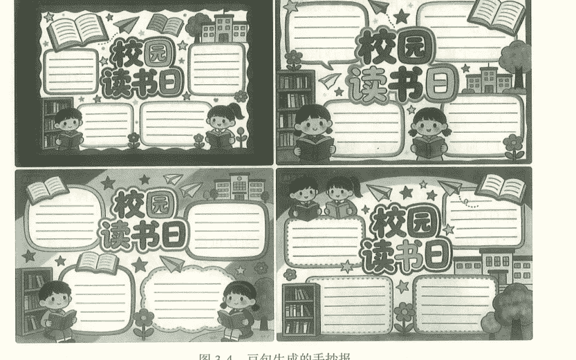

图3-4 豆包生成的手抄报

#### 3. 打印 + 自己动手，做成专属作品

生成的电子版图片还不是最终成品，还要加入自己的创意——手抄报是自己的作业，有自己的痕迹才更有意义。先把豆包生成的线稿（或彩色图）用 A4 纸打印出来，然后自己动手做三件事：用勾线笔沿着线稿再描一遍，让线条更清晰；按照自己的喜好上色，比如把绘本涂成粉色、小树苗涂成嫩绿色，不用跟着彩色图的颜色来，想怎么涂就怎么涂；最后在左右的空白文本框里写内容，比如左边写“我最爱的一本书”，右边写“读书的好处”，字数不用太多，写自己知道的内容就行。

又比如，打印出线稿后，可以把铅笔边框涂成橙色，给背景的小书本加上笑脸图案；文本框里可以写“我最爱《小王子》，它教会我要珍惜身边的人”“读书能让我知道很多有趣的知识”——这样一来，手抄报既有好看的版式，又有自己的想法，老师看了肯定会喜欢。

#### 4. 总结

用豆包做手抄报的核心是“豆包搭好框架，自己填充创意”：不用你会画画，豆包帮你搞定最头疼的构思和底稿；不用怕和同学撞款，每次生成的提示词和图片都是独一无二的；更不用花太多时间，全程 5 ～ 10 分钟就能推进到打印步骤。最重要的是，整个过程都是自己动手完成，既能轻松交上好看的作业，又能体验创作的乐趣，再也不用手抄报发愁。

> **试一试**
> 选一个孩子最近要做的手抄报主题（比如“节约用水”“校园安全”“春节”），按照文中的方法，先让豆包生成提示词，再生成手抄报图片，调整成合适的比例和样式，打印后让孩子完成勾线、上色和文字填写，看看是不是比之前省心多了。

> **小贴士**
> 1）向豆包提需求时，要把元素说具体。比如不说“环保元素”，而说“小草、小鸟、可回收垃圾桶”，这样生成的画面更符合你的想法，不用反复修改。
> 2）打印时优先选线稿。彩色图虽然好看，但会限制你上色的思路，线稿能让你自由搭配颜色，成就感更强。
> 3）如果生成的线稿有残留颜色，直接向豆包说“把线稿里除了黑色线条以外的颜色都换成纯白色”，就能得到干净的底稿，方便后续勾线和上色。

### 技巧 37 志愿填报：精准匹配专业

高考分数一出炉，选专业就成了全家的头等难题。选热门专业怕挤不进，选冷门专业怕就业难；想兼顾兴趣，又担心分数不够；考虑家庭资源，还得贴合自身的学习习惯。一堆因素搅在一起，越查资料越焦虑，生怕一步选错影响未来几年甚至十几年的发展。

如何既不浪费分数优势，又能匹配兴趣、适配学习风格，还能结合家庭资源和行业趋势，选到真正适合自己的专业？答案是不一次性问全，而是用豆包分步提问、层层聚焦，让豆包精准接住你的需求。

#### 1. 把硬条件说清楚，让豆包找对大方向

选专业的基础是分数够得着，所以先给豆包明确成绩定位和学科优势。比如一位江苏女考生，高考考了580分、全省普通类（物理等科目类）排名55000多名，选考物理、化学、生物，更倾向于工学、管理学、医学类专业，就可以这么问豆包：“我是江苏省女考生，高考分数为580分，全省排名55000多名，选考科目为【物理、化学、生物】，偏好【工学、管理学、医学】专业，请问哪些院校的这些专业适合我？每个类别至少推荐5个专业。”

这样，豆包会精准匹配分数对应的院校层次，不会推荐“够不着”或“太保底”的选项，还能避开明显不符合偏好的专业，比如：

**一、工学专业推荐**

1. 南京工业大学
    - 化学工程与工艺：A类学科王牌，60%毕业生进入世界500强企业，薪资优渥。
    - 电气工程及其自动化：就业率98%，70%进入国家电网，女生适合电力系统设计岗位。
    - 人工智能：平均年薪18.6万元，发展前景广阔。
    - 安全工程：政策驱动，近70%留苏就业，稳定性高。
    - 生物医学工程：与医学交叉，适合物理+化学+生物选科组合。
2. 江苏大学
    - 机械设计制造及其自动化：国家级一流本科专业，就业面广。
    - 车辆工程：汽车产业核心人才，女生适合技术管理岗位。
    - 农业电气化：农业现代化刚需，录取分数为579分左右。
    - 新能源科学与工程：战略性新兴产业，就业前景好。
    - 自动化：工业4.0核心，适合逻辑思维强的女生。
    ……

**二、管理学专业推荐**

1. 江苏大学
    - 工商管理：国家一流本科专业建设点，江苏省重点建设专业。
    - 信息管理与信息系统：录取分数为 580 分，技术 + 管理复合型人才培养。
    - 财务管理：录取分数为 580 分，就业面广，适合女生。
    - 金融学：录取分数为 579 分，银行、证券等金融机构就业前景好。
    - 物流管理：省级一流本科专业，电商物流需求大。
    ……

**三、医学专业推荐**

1. 南京医科大学
    - 公共卫生与预防医学：录取分数为 574 分左右，疫情后重视度提升。
    - 生物医学工程：与医疗器械相关，就业前景好。
    - 护理学：录取分数为 580 分左右，医院刚需岗位，女生优势明显。
    - 康复治疗学：就业率高，适合女生。
    - 医学检验技术：录取分数为 574 分，实验室工作环境好。
    ……
（由于篇幅有限，输出结果在此省略，建议读者亲自上手实践。）

#### 2. 挖透软需求，避免选了看着好却学不下去的专业

分数够了，方向对了，还要考虑学不学得舒服——毕竟专业要学四年，不适合的学习风格会让人越学越痛苦。如果孩子是理论型，喜欢琢磨抽象概念、逻辑推理，讨厌死记硬背，期望在学术氛围浓的环境里学习，就问豆包：“孩子属于理论型学习风格，喜欢研究抽象理论和逻辑分析，不喜欢机械记忆知识点，期望在注重学术研究的学习环境中成长，之前推荐的工学、管理学专业里，哪些更适配这种学习风格？”豆包会帮你排除掉需要大量背诵的方向，推荐像“人工智能”“信息管理与信息系统（数据分析方向）”这类更靠逻辑的专业。

#### 3. 盯紧行业风，选对未来有潜力的专业

热门专业会变，但有政策支持、趋势明确的行业不会错。比如想了解数字经济行业，就问豆包：“数字经济行业的发展趋势如何？哪些院校的【数字经济、大数据管理与应用】专业有优势？政策对这个行业的就业影响如何？”要是关注新能源领域，就换个问法：“新能源行业有哪些政策支持？哪些院校的【新能源科学与工程、能源与动力工程】专业在新能源领域有优势？就业前景如何？”豆包会整合行业数据和政策信息，帮你避开“看似热门实则饱和”的专业，锁定真正有潜力的方向，例如输出：

**一、新能源行业政策支持体系（2025 年最新）**

国家构建了全方位、多层次的政策支持矩阵，为新能源行业发展提供强力保障：

##### 1. 顶层设计政策

《关于促进新能源集成融合发展的指导意见》（2025年10月，国家能源局）：提出“多维度一体化开发”（风光储互补、水风光一体化）、“产业协同发展”（新能源+算力、新材料）、“多元化非电利用”（风光氢储、绿色供热）三大方向；明确到2030年，集成融合发展成为新能源发展主流方式，新能源的市场竞争力显著提升。

……

##### 2. 市场化改革政策

……

##### 3. 产业与技术支持政策

……

##### 4. 人才政策

……

**二、新能源领域优势院校与专业推荐**

###### 1. 新能源科学与工程专业优势院校

| 院校 | 排名/评级 | 专业特色 | 新能源领域优势方向 |
| :--- | :--- | :--- | :--- |
| 西安交通大学 | 第1（A+） | 拥有动力工程多相流国家重点实验室，最早开设此专业（2010） | 储能技术、太阳能热发电、多能互补系统 |
| 华中科技大学 | 第2（A+） | 煤燃烧国家重点实验室，能源与动力工程学科全国领先 | 生物质能发电、新能源材料、碳捕集技术 |
| 华北电力大学 | A+ | “电力行业黄埔军校”，与国家电网深度合作 | 风电控制、智能电网、新能源并网技术 |
| 东南大学 | A | 能源与环境交叉研究，智慧能源系统优势突出 | 分布式能源、建筑光伏一体化、碳中和规划 |
| 江苏大学 | A | 流体机械特色，国家一流本科专业建设点 | 新能源流体装备、微电网控制、能源高效转化 |
| 上海交通大学 | A | 船舶与海洋工程国家重点实验室，产学研结合紧密 | 氢能燃料电 |

> （由于篇幅有限，输出结果在此省略，建议读者亲自上手实践。）

#### 4. 总结

选专业不是抓阄，也不是跟风追热门，而是一场精准匹配：匹配成绩，匹配兴趣，匹配趋势。豆包的价值就是帮你把分散的信息整合起来，减少信息差带来的焦虑，但最终的临门一脚，还是需要你和孩子一起，结合实际情况做判断。

**试一试**

现在就向豆包提问，先抛出基础信息（省份、分数、选考科目、学科门类偏好），再依次补充优势兴趣、学习风格、行业趋势，看看豆包的推荐会不会越来越贴合你的需求。

**小贴士**

- 1）提问时，不要一次性堆砌所有的条件，分步提问能让豆包更好地抓取关键信息，从而给出更精准的推荐。
- 2）专业偏好尽量用学科门类（理学、工学、经济学等），不要直接限定到具体专业，避免错过合适选项。
- 3）对于豆包推荐的最终院校录取分数、专业细则，一定要去院校官网核实。
- 4）不要把选专业的决策权完全交给豆包——毕竟未来要学这个专业、做这份工作的是孩子，最终还是要结合孩子的意愿来决定。

### 技巧 38 知识图谱：快速搞定，告别手动整理

在工作和学习中，梳理复杂的实体关系早已是常态，不管是项目协作中的角色关联、知识学习里的概念脉络，还是行业分析中的信息节点，都需要清晰的可视化呈现——构建一张知识图谱。知识图谱的本质是一种关系图，用节点代表实体，用连线表示实体之间的关联，核心包含实体、属性、关系三个要素。它不像纯文字那样晦涩，能把分散的信息串联起来，直观展现逻辑脉络，不管是用于工作汇报、学习笔记，还是用于决策分析，都能让信息传递更高效。

借助豆包，哪怕是零基础的人也能轻松做出实用的知识图谱，全程不需要进行任何复杂的操作。用好 Mermaid 语法，尤其是其中的 mindmap 关键词，几分钟就能搞定。

#### 1. 直接提需求，快速生成基础图谱

直接用自然语言与 Mermaid 语法中的 mindmap 关键词向豆包提需求，就能一键生成知识图谱。例如输入：“用 Mermaid 语法中的 mindmap，以贾宝玉为核心构建《新石头记》人物关系知识图谱，全部用中文显示。”生成的知识图谱如图 3-5 所示。

#### 2. 上传资料，自动抽取信息绘图

如果有现成的文档（如报告、文章、表格），不用手动整理，直接上传给豆包，让它提取实体和关系，再生成图谱，省去整理信息的麻烦。

例如上传一份小红书代运营项目文件，并输入：“上传的文档是关于小红书代运营项目的资料，请先提取其中的核心模块、关键节点及相互关系，再用 Mermaid 语法中的 mindmap 构建知识图谱，节点包含品牌定位、内容策略、运营策略、风险管理、数据分析等核心模块，明确各模块下的子节点及关联。”豆包会自动解析文档内容，提炼出“小红书代运营项目”作为核心节点，再拆分出内容策略、运营策略、风险管理等分支，最后用 mindmap 语法组织成图谱，如图 3-6 所示。

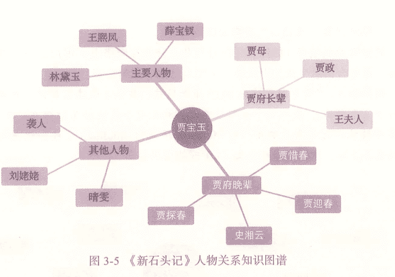

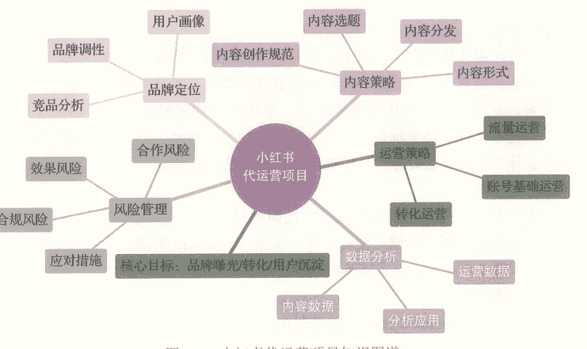

#### 3. 联网搜索 + 整合，一步到位出图谱

如果需要的信息（如网页、行业报告）分散在网络上，可以让豆包搜索指定内容，再整合信息生成知识图谱，不用自己逐一搜集整理。

例如输入：“请先联网搜索 2025 年职场热门技能（聚焦互联网、新媒体、数据分析 3 个领域），提取 3 个核心技能；再补充每个技能的关键信息：适配岗位、必备子技能、行业需求热度；用 Mermaid 语法的 mindmap 生成知识图谱，节点层级最多 3 级，所有内容用中文。”生成的结果如图 3-7 所示。

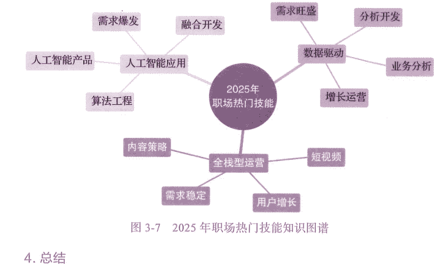

#### 4. 总结

用豆包制作知识图谱，核心是抓住“mindmap 关键词 + 清晰需求”，不用懂复杂语法，也不用手动绘制。无论你是直接提需求、上传资料，还是需要豆包联网搜索，它都能快速生成可视化图谱，帮你节省整理时间，让复杂信息变得直观。豆包不局限于某类场景，不管是工作中的项目梳理、学习中的知识总结，还是行业分析中的信息整合，它都能帮你快速生成知识图谱。

> **试一试**
> 选一个你当前需要梳理的场景，比如项目团队角色关系、学科知识点脉络、行业核心信息关联，按照“核心实体 + 关系 + mindmap 关键词”的格式向豆包提需求，生成专属知识图谱，体验高效梳理信息的乐趣。

> **小贴士**
> 1）生成的 mermaid 代码可在豆包内置渲染工具、在线 mermaid 编辑器、支持该语法的文档工具中渲染。
> 2）除了知识图谱，还能通过同样的逻辑生成流程图、实体关系图等，替换对应的 mermaid 语法关键词即可。
> 3）如果需要更详细的节点拆分，可在提示词中明确“子节点层级”，豆包会按要求细化图谱结构。

### 技巧 39 知识卡片：无须排版，一键出片

打开小红书，各类知识卡片总能轻松抓住眼球——不管是美食教程、学科知识点，还是生活冷知识，图文结合、重点突出的形式，既好看又好记，收藏量动辄几万。不管你是想做自媒体涨粉，还是给孩子整理学习资料，或是给自己归纳知识点，这种知识卡片都是刚需。但想手动做出同款，可没那么容易，如果没有设计基础，就算花了时间，做出来的卡片也显得杂乱无章，完全达不到预期效果。

用豆包的图像生成功能，配合精准提示词，短时间内就能生成符合要求的知识卡片，从图文搭配到比例调整，全程一键完成。接下来以两个场景为例，为你介绍知识卡片的制作方法。

#### 1. 食物制作流程卡片

不管是分享家常菜谱还是给家人整理快手料理步骤，流程化的知识卡片都能让操作一目了然，把所有步骤整合在一张卡片上，方便快速查阅。

如果想要做番茄炒蛋制作流程知识卡片，则在豆包图像生成界面中输入提示词：“用 plog 手绘风格，生成番茄炒蛋的制作流程图，需要分步骤并搭配中文解释，色彩明亮，要求放在一张图片中。”豆包输出的结果如图 3-8 所示。

生成的卡片会自动匹配食材线稿插画，步骤文字简洁不拥挤，表述直观，色彩搭配贴合食材本身，无须二次调整就能直接发布，新手也能做出博主级菜谱卡片。

#### 2. 学科知识点卡片

不管是经济学常识、生物学原理，还是日常实用的思维模型，都能通过单张卡片或者“概念+类比+案例+总结”的四张卡片组合，让抽象内容变得直观，不管是自己记笔记还是做知识分享，都能提升效率。

如果你想把经济学知识点“沉没成本效应”做成单张知识卡片，可以输入提示词：“用手账手绘风格，生成经济学知识点【沉没成本效应】的知识卡片，需要搭配趣味配图和中文解释，色彩柔和，要求放在一张图片中。”豆包输出结果如图 3-9 所示。

如果你想把“蝴蝶效应”拆分成概念卡、类比卡、案例卡和总结卡，可以输入这样的提示词：“用可爱手绘风格，生成社会学知识点【蝴蝶效应】的知识卡片，包括四张卡片：概念卡（是什么）、类比卡（用熟悉的事物或现象类比）、案例卡（日常案例）、总结卡（关键重点），每张卡片需要搭配趣味配图和中文解释，色彩清新。”豆包输出结果如图 3-10 所示。

这类卡片会用生活化语言拆解专业概念，比如用“丢了电影票是否再买”类比沉没成本，用“涟漪扩散”类比蝴蝶效应，搭配简单插画辅助理解，让枯燥的知识点变得好记又有趣。

#### 3. 总结：让知识卡片制作效率翻倍的核心

豆包制作知识卡片的优势在于，把“设计+排版+配图+文字整合”的复杂流程，简化成“输入提示词→单击生成”两步操作。不用掌握专业设计工具，不用花费大量时间找图、调格式，不管是时间紧张的自媒体人，还是毫无设计基础的新手，都能快速产出高质量内容。

知识卡片的适用场景包括小红书、抖音图文、朋友圈分享、学习笔记打印等，不管是内容创作、自我提升还是亲子教育，它都能发挥作用，真正实现一段提示词满足所有图文需求。

> 试一试
选一个你近期需要梳理的内容——比如一道快手菜的做法、一个想分享的知识点、一个给孩子科普的小常识，套用通用提示词公式，替换风格和主题，生成一套专属知识卡片。建议试试“plog”和“简约手绘”风格，前者适用于生活化内容，后者适用于专业知识点。

> 小贴士
1）生成后优先检查文字准确性，长句或专业术语可能出现错别字，及时手动修正。
2）涉及公式、实验步骤等专业内容时，需核对插画细节，避免出现逻辑错误。
3）替换风格时可结合内容主题，比如美食用“plog”风格更有生活感，科普用“简约手绘”风格更清晰。

### 技巧 40 古人对话应用：豆包智能体 3 步搞定

不少语文老师在讲解古诗文、历史老师在介绍历史人物时，总怕单纯讲人物生平、作品太枯燥——学生盯着课本走神，知识点记不住；家长想带孩子了解传统文化，也只能对着绘本念故事，少了点“能对话”的沉浸感。好消息是，豆包的 AI 智能体功能可以让古人“活”起来，让学生能和古人以“对话”的形式展开互动，进而更好地学习历史文化。

制作一个古人对话智能体不需要复杂操作，哪怕是新手也能轻松上手，既能精准还原古人的背景人设，又能实现自然的对话互动，瞬间充满互动感。

#### 1. 三步制作智能体

第一步，在豆包首页的左侧边栏找到 AI 智能体，如图 3-11 所示，单击进入后，再单击“创建 AI 智能体”按钮，如图 3-12 所示。

图 3-11 进入豆包 AI 智能体界面

图 3-12 创建 AI 智能体

第二步，进入智能体编辑界面后，需要完善智能体名称、设定描述和头像，如图 3-13 所示。

对于智能体名称，核心是“直接点明身份 + 贴合大众认知”，用古人的经典称号或常见尊称即可，好记又有辨识度，例如“诗仙李白”“诗圣杜甫”“易安居士李清照”“东坡居士苏轼”“爱国诗人陆游”。

对于设定描述，1句话聚焦“古人身份+2个核心功能（生平介绍+领域知识）+互动答疑”，功能要贴合古人身份，不笼统、不零散。你可以直接套用万能模板：××（古人身份），能介绍生平经历、讲解相关领域知识并互动答疑。口语化描述也没问题。

例如：“唐代诗人李白，能介绍生平经历、讲解唐诗相关知识并互动答疑”“北宋文学家苏轼，能介绍生平经历、讲解宋词及相关文史知识并互动答疑”“南宋女词人李清照，能介绍生平经历、讲解婉约派诗词知识并互动答疑”。

第三步，生成智能体头像。可以单击头像，选择“AI生成”，再输入提示词：“生成一张李白的人物图像，背景为简约的书房场景，画风偏古风写实，色彩柔和，画面清晰，适合作为智能体的展示图片。”

生成效果如图3-14所示，挑选一张最符合你预期的图片即可。如果对生成的图片不满意，还可以在提示词里补充细节，比如调整服饰颜色、神情状态，重新生成直到满意为止。这一步不用懂设计，只要把想法说清楚，就能得到专属的人物图像。

图 3-14 李白智能体头像生成效果图

#### 2. 一键开启对话互动

创建完成后，你就能直接和它对话互动了。你可以直接用文字或者语音进行提问，它会根据设定的人设背景，用贴合李白性格和语言风格的方式回应，互动感十足。例如输入：“介绍一下《静夜思》的创作背景”，李白智能体会非常诗意地回答：“此诗乃吾在异乡漂泊时所作，彼时夜深难寐，见明月悬空，思乡之情涌上心头，遂成此篇。”效果如图 3-15 所示。

图 3-15 与李白智能体对话

#### 3. 总结

用豆包制作古人对话智能体，全程没有复杂的技术操作，最多耗时 10 分钟，就能得到一个既有颜值又有内涵的互动智能体。不用查资料、不用懂设计、不用学编程，完美解决了传统互动形式枯燥、制作复杂的痛点。

不管是老师用它在课堂上引导学生和古人“对话”学历史，还是职场人在分享中用它增加互动亮点，都能让内容更有吸引力，让互动不再尴尬。这种简单又实用的方法，真正把 AI 工具的便利性发挥到了极致，让每个人都能轻松打造专属的趣味互动形式。

> 试一试
选一个你最喜欢的古人，比如李清照、杜甫、王安石，按照上面的步骤，用豆包制作一个专属的对话智能体。可以试着和它聊一聊相关的历史事件、代表作品，看看它的回应是否符合你的预期，还能根据互动效果，调整提示词和人设背景，让智能体更贴合你的需求。

> 小贴士
1）豆包生图时，除了外貌特征，还可以补充服饰、场景的细节，生成的图片会更有氛围感。
2）如果觉得智能体的回应不够精准，可以在人设背景里补充更多限制条件，比如“对话时尽量引用自身作品中的名句，语言风格偏向豪放洒脱”。
3）生成的智能体可以反复修改，比如后续想补充人物的其他经历，直接编辑人设背景即可，不用重新创建。

### 技巧 41 互动教学：零门槛快速制作网页与游戏

教学中想让知识点不枯燥，就得加互动设计；想让课堂有亮点，就得加入课堂小游戏。传统课件只能单向传递知识，无法调动学生主动参与，可市面上的互动工具要么收费，要么操作复杂，根本不适合日常教学使用。面对这些困难，用豆包“应用生成”板块就能解决。通过一句话提示词，零代码操作，不管是互动教学网页还是课堂小游戏，都能快速落地，完美适配不同学科的教学需求。

#### 1. 教学网页：让不同学科知识活起来

互动教学网页比传统 PPT 更能吸引学生注意力，而且不需要复杂设计，按“场景 + 内容 + 交互 + 风格”的思路写提示词，就能生成贴合需求的工具。

数学老师想让几何知识更直观？提示词可以这样写：“帮我做一个初中数学几何图形专题教学网页，适合公开课使用。内容要包含三角形、长方形、平行四边形、圆形的定义、性质、面积公式推导，还要有图形拼接练习、错题收集模块。交互功能需要支持图形拖拽拼接、公式推导步骤分步展示、错题重做、知识点搜索；单击图形能显示关键特征标注。风格用简约科技风，以蓝色为主色调，搭配白色背景，字体清晰易读，页面布局分导航区、知识点区、练习区，支持移动端适配。”

豆包会根据你的提示词设计用户群体、功能设计说明、页面风格等，确认后即可生成互动网页，如图 3-16 所示。生成的网页能让学生亲手操作图形，直观理解几何性质，讲解效果比纯板书好。

图 3-16 初中数学几何互动网页

英语老师要复习语法？提示词可以这样写：“生成一个小学六年级英语一般过去时复习网页，视觉风格是卡通活泼，以黄色和橙色为主色调，搭配动物图标装饰。内容分为词汇积累（不规则动词过去式列表）、句型练习（肯定句、否定句、疑问句转换）、情景对话（购物、旅行场景对话填空）、语法辨析（一般过去时与一般现在时对比）四个模块。交互功能要包含句型自动批改、对话录音跟读、错题收藏、词汇卡片翻转记忆；鼠标指针悬停在单词上显示发音和例句。字体用圆润的卡通字体，页面加载有动画效果，支持回到顶部和章节快速跳转功能。”这样的网页能让语法复习不再枯燥，学生主动参与度会大幅提升。

#### 2. 课堂小游戏：1句话激活课间与课堂

不管是课前热身、课中巩固，还是课间放松，简单的互动小游戏都能派上用场，提示词无需太复杂，说清核心需求就行。

想帮学生巩固英语单词？提示词可以这样写：“创建一个小学四年级英语单词接龙小游戏，词汇范围是四年级下册课本重点单词，随机生成起始单词，玩家输入首字母与上一个单词尾字母一致的单词，正确则进入下一轮，错误则提示正确方向，具有倒计时和得分统计功能，卡通风格界面。”

确认需求后，豆包生成的小游戏页面如图 3-17 所示。课堂上分组竞赛，既能巩固单词，又能活跃气氛。

想让数学计算更有趣？提示词可以这样写：“用 HTML 做一个小学三年级数学图形配对计算游戏，界面显示不同形状（圆形、正方形、三角形），每个形状对应一个数字，单击两个形状后计算它们的和，答对得分，答错重新选择，有关卡设置，每关增加形状数量，背景用浅色卡通图案。”学生在游戏中练习计算，比单纯做题更有动力。

#### 3. 总结

豆包“应用生成”板块的核心价值，就是把复杂的工具制作变得简单。不用学代码，不用练设计，只要把教学需求用一句话说清楚，豆包就能快速生成互动教学网页或课堂小游戏。它帮老师省去了课件制作的繁琐流程，让教学形式更丰富，学生参与度更高，也让老师能把更多精力放在教学设计和学生引导上，真正做到“轻工具，重教学”。

> 试一试

现在打开豆包，在应用生成界面中用这些提示词动手试试，感受零代码制作的便捷：

“生成一个小学三年级科学植物生长周期网页，包含种子萌发、幼苗生长、开花结果模块，用写实插画风格，支持单击查看每个阶段的详细介绍，有生长时间轴滑块。”

“创建一个初中语文成语填空小游戏，随机给出成语空缺部分，玩家输入答案，正确有语音提示，错误则显示释义，分难易关卡，国风界面。”

> 小贴士

1）提示词里应尽量明确“场景 + 内容 + 交互 + 风格”四个核心要素，描述越具体，生成的工具越不用后续修改。
2）生成后若需调整，无须重新写提示词，直接用口语说明修改方向即可，比如“把网页字体调大”“增加游戏的错题回顾功能”，豆包会快速优化。
3）生成的工具支持浏览器直接打开，可分享给学生自主学习，也能供课堂投影使用，不需要额外安装软件，兼容性强。

### 技巧 42 分班安排：豆包助力公平高效分班

新学期的铃声还没正式敲响，不少老师的办公桌上已经堆起了学生信息表。分班，这个看似简单的常规操作，早就成了老师们开学前的头号难题。众所周知，每个学校对分班都有明确要求：人数得均衡，性别要匹配，如果遇到特殊情况的学生，还得额外兼顾。这本是为了保证公平，可落到实际操作上，难度却不容忽视。

最让人头疼的不是累，而是“公平”二字。手动分班难免附带主观色彩，哪怕老师已经尽力做到“一碗水端平”，也可能被家长质疑。更别提要同时兼顾人数、性别、特殊需求等多个因素，手动操作容易顾此失彼，最后导致老师疲惫，家长有意见，实在得不偿失。

用豆包辅助分班，就能把这些难题一次性解决，让原本焦头烂额的工作变得轻松简单。

#### 1. 明确分班需求

第一步，把分班需求说清楚。想让豆包按照你的想法来分配，必须明确告知核心规则，比如学生总数、分班数量、每班人数、关键均衡因素等。提示词可以直接这样写：“为一年级 100 名学生分班，分成 4 个班，每班 25 人，要求各班男女生人数尽量均衡。”要是有特殊需求，比如需要照顾部分学生的情况，也可以写入提示词，比如：“将二年级 80 名学生分成 3 个班，各班人数差距不超过 2 人，男女生比例接近 1:1，同时将有视力障碍的 3 名学生平均分到不同班级，方便特殊照顾。”

#### 2. 整理学生数据并上传至豆包

第二步，整理并上传学生数据。把学生的基本信息（比如姓名、性别、需要特殊说明的情况等）整理成规范表格，无须特意调整格式，直接上传给豆包即可。豆包会自动识别表格里的关键信息，跳过手动输入或分类环节，省去了大量统计时间。

完成数据上传后，输入第一步设计的提示词并发送。很快，豆包就会给出清晰的分班结果，比如“一年级（1）班 25 人，男生 13 人，女生 12 人；一年级（2）班 25 人，男生 12 人，女生 13 人；一年级（3）班 25 人，男生 13 人，女生 12 人；一年级（4）班 25 人，男生 12 人，女生 13 人”，同时附上具体名单，让你一眼就能判断出是否符合要求。

#### 3. 生成分班公示表

第三步，生成正式的分班公示表。在第二步的对话中，可以这样写：“按照你的分班情况，生成正式的一年级学生分班公示表，表格样式规范、内容清晰，可直接打印或分享。”豆包会自动整理成规整的表格，省去了手动排版的环节，直接打印出来张贴在公告栏，或者分享给家长群即可。

#### 4. 总结

分班本不该是让老师头疼的“负担”，借助豆包，只需明确需求、上传数据、生成方案、灵活调整、生成公示表这几个简单步骤，就能轻松实现公平、高效的分班。它不是要取代老师的工作，而是成为老师的得力助手，把老师从烦琐的统计和计算中解放出来，让他们将更多精力投入教学和学生关怀中。

> 试一试
找一份所在年级的学生基础信息表，明确分班规则（比如学生总数、分班数量、性别均衡要求），按照文中的提示词格式，让豆包生成一份分班方案。之后尝试提出一个调整需求（比如调换两名学生的班级），看看豆包能否快速给出符合要求的新方案，最后让它生成一份正式的公示表。

> 小贴士
1）提需求时越具体越好，避免模糊表述，比如不说“尽量均衡”，而是说“各班男女生人数差距不超过1人”，这样豆包生成的方案会更精准。
2）上传的学生数据不用过度格式化，只要包含核心信息（姓名、性别等），豆包就能识别，无须花费时间调整表格样式。
3）调整方案时，一次只提一个明确的需求，避免同时下达多个调整提示词，防止豆包混淆要求。

### 技巧 43 读书计划：5 步搞定专属方案，告别无效阅读

阅读的价值不用多说，无论是学生备考、职场人精进技能，还是普通人丰富生活，它都是成本最低的成长路径。但现实往往很“骨感”：买了一堆热门书，翻几页就束之高阁；列好的月度计划，坚持不到一周就半途而废；想有针对性地提升某方面能力，却不知道该选什么书、怎么安排时间。

不是你不够自律，而是大多数人都在犯同一个错——要么计划太理想化，每天要求自己读两小时，忽略了工作学习的忙碌；要么内容不贴合需求，跟风读的书根本提不起兴趣；要么缺乏反馈机制，读了就忘，慢慢失去动力。那怎么才能快速量身定制一份能落地、有效的读书计划？

答案很简单。交给豆包，5步就能完成，从画像匹配到成果沉淀，全程不用费脑，让阅读变成自然而然的习惯。

#### 1. 精准输入个人画像，让计划不脱节

制订读书计划的核心是贴合自己，盲目照搬别人的书单和节奏，大概率会失败。这一步要做的，就是把自己的阅读基础、需求、约束条件清晰地告诉豆包，让它精准匹配方案。这里需要的关键信息包含：年龄或身份（学生/职场人等）、阅读基础（能快速读实用书/需逐字精读等）、核心目标（备考/提升技能/休闲等）、每日可支配时间、兴趣领域、特殊需求（避免枯燥/需要互动等）。

根据这些信息，可以设计这样的提示词：“请为28岁互联网运营制订为期4周的阅读计划。目标：提升内容创作能力，养成每日阅读习惯。条件：每天阅读时间20～30分钟。阅读基础：能快速阅读干货类书籍。兴趣主题：内容创作、用户心理、爆款逻辑。希望每周有1次深度思考练习。避免纯理论堆砌，需每日有轻互动任务。”

豆包可能会输出：

第1周：内容创作基础——搭建表达逻辑

阅读书籍

《爆款文案》(关键明)：聚焦实操方法，案例丰富，符合快速阅读需求。

每日安排（20～30分钟）

阅读（15～20分钟）：每天1个章节，重点关注“痛点挖掘、卖点转化、结构设计”。

轻互动任务（5～10分钟）：

Day1：摘抄3个核心金句，改写为适用于互联网平台（如公众号、短视频文案）的表达。

Day2：从工作中选1个产品/服务，用书中“痛点-解决方案”的结构写1段50字内的文案。

Day3：分析1篇行业爆款文案，标注其用到的书中方法（如“对比法”“场景化描述”）。

Day4：仿写1个标题，用“数字+利益点+悬念”结构（例如“3个技巧，让你的文案阅读量翻倍”）。

Day5：记录1个自己创作时遇到的常见问题，并结合书中内容写1条改进建议。

Day6：用书中的“AIDA模型”（注意-兴趣-欲望-行动）写1段短视频脚本开头（30字内）。

Day7：深度思考练习（30分钟）：结合本周所学，为自己的工作内容写1篇完整短文（300字内），重点应用1～2个核心方法。

……

（由于篇幅有限，输出结果在此省略，建议读者亲自上手实践。）

如果暂时不确定自己的兴趣，也可以用豆包做兴趣探索，提示词可以这样写：“请为我设计一份阅读兴趣探索清单。目标：通过阅读不同主题的短文或书籍片段，发现适合的阅读类型。要求：推荐4个主题（如职场技能、心理学、历史、科普），每个主题推荐1～2本轻阅读书籍，每个主题配1个小任务，用于观察兴趣点。”

#### 2. 优化阅读节奏，避免半途而废

很多读书计划失败，是因为节奏设置不合理——一开始就高强度阅读，容易产生抵触感；全程没有递进，读久了会觉得枯燥。这一步要让豆包根据你的基础，设计“由易到难、由输入到输出”的递进节奏。例如，接着在上一步的对话中输入：“根据上述互联网运营的个人信息，优化阅读节奏：第1周轻松入门，适应每日阅读节奏，以了解核心概念为主；第2～3周深度吸收，加入笔记和思考练习，拆解书中方法；第4周实践应用，结合工作场景落地书中技巧。每周注明核心目标和节奏变化，保持每日互动任务的新鲜感。”

优化后的计划会更具可持续性，示例如下。

第1周：轻松入门·建立阅读习惯

核心目标
适应每日阅读节奏，初步掌握内容创作核心概念，无压力完成打卡。

节奏特点
阅读轻量化、任务低难度，以“认知+趣味互动”为主，避免高强度输出。

阅读书籍
《内容创作从0到1》(入门级，语言通俗，概念清晰，适合快速通读)

每日安排（20～25分钟）
阅读（15～18分钟）：每天1个小节（约5～8页），重点标注“内容定位、创作流程、核心要素”3类关键词。

轻互动任务（5～7分钟，保持新鲜感）

- Day1：画1张“内容创作核心概念图”(用简单线条连接关键词，如“定位→受众→主题→形式”)。
- Day2：默写当天学到的3个核心概念，用1句话解释每个概念(不要求精准，凭理解表达即可)。
- Day3：从生活中选1个常见内容(如短视频、公众号文章)，标注其属于书中提到的哪种创作形式。
- Day4：做1张“概念卡片”(写下1个核心概念+1个简单案例，如“场景化表达→早餐店文案‘7点的热豆浆，暖醒赶路人’”)。
- Day5：用“关键词接龙”方式，串联当天阅读的核心知识点(如“定位→受众需求→痛点挖掘→内容输出”)。
- Day6：选择书中1个你最认可的创作原则，说说它能解决什么问题(30字内)。
- Day7：深度思考练习(25分钟)：梳理本周学到的核心概念，用“思维导图”形式整合，标注出你最想深入学习的2个方向。

……

（由于篇幅有限，输出结果在此省略，建议读者亲自上手实践。）

#### 3. 设计互动环节，强化阅读效果

单纯的阅读很容易流于表面，只有加入互动和思考，才能真正吸收知识。这一步可以让豆包设计有针对性的互动任务，无论是自我复盘、场景模拟，还是深度提问，都能让阅读更有深度。例如，在上一步对话中接着输入：“在上述4周阅读计划中，每周增加1次深度互动环节。要求：提供3个开放式问题或1个实践任务，贴合互联网运营的工作场景（如内容选题、用户沟通），问题需启发性强，任务可落地执行，不需要额外花费过多时间。”

豆包会生成贴合主题的互动内容，比如第1周（职场沟通主题）的互动任务：“1. 如果你用书中的沟通技巧向领导汇报工作，会怎么组织语言？2. 书中提到的‘倾听技巧’，哪些可以用到与用户的沟通中？3. 尝试用‘共情表达’回复1条虚拟的用户投诉留言。”这些任务不用额外耗时，却能让你在阅读后立刻思考应用，加深记忆。

#### 4. 记录与反馈，保持阅读动力

阅读的可持续性离不开及时地反馈和成就感。这一步可以让豆包生成简单易填的反馈模板，记录阅读情况，同时用积极的鼓励语强化动力，避免“读了就忘，没成就感”的问题。例如输入这样的提示词：“生成一份通用阅读反馈模板，包含以下内容：日期、阅读书名（章节/片段）、阅读时长、阅读感受（喜欢/一般/不喜欢及核心原因）、当日核心收获（1～2句话）、改进方向（如下次加快阅读速度/重点精读某部分）、一句自我鼓励语。另外，每周生成一段积极平实的总结鼓励语，贴合职场人阅读场景。”

反馈模板应简洁明了，不用花费太多时间填写，比如“阅读感受”可以选择勾选选项+关键词记录的形式，“当日收获”只需提炼核心。每周的鼓励语会聚焦进步，比如“这一周你从‘被动读’变成‘主动想’，每一次思考都是能力的积累，继续保持这份专注，下一周的实践会更有收获”，没有夸张的表述，却能让人感受到自己的成长。

#### 5. 生成成长档案，明确后续方向

阅读不是终点，持续优化才是关键。这一步可以让豆包根据你的反馈记录，总结阅读成果，梳理成长轨迹，同时给出下阶段的优化建议，让阅读计划形成闭环。例如输入这样的提示词：“根据以下阅读反馈记录（可在此处粘贴反馈模板中的关键信息，如每周收获、喜欢的内容、改进方向），生成一份阅读成长档案。要求：用平实的语气总结阅读中的亮点与变化；列出最有收获的3个知识点及原因；结合互联网运营的核心需求，提供下阶段阅读的优化建议（如书单调整、节奏优化、互动形式升级）。”

成长档案会清晰呈现你的阅读轨迹，比如“从一开始需要提醒自己阅读，到后来能主动利用碎片时间完成任务；从只能摘录知识点，到能结合工作场景设计应用方案，你的阅读效率和吸收能力都在稳步提升”，同时给出具体建议，比如“下阶段可增加‘案例拆解’类书籍，每周安排 1 次真实工作项目的知识点应用复盘，进一步强化实践能力”，让后续阅读更有方向。

#### 6. 总结

用豆包制订读书计划，概括起来就是“精准匹配 + 循序渐进 + 闭环反馈”。不用自己费心琢磨书单、拆分任务，只需 5 步，就能得到一份贴合自身需求、易坚持、有效果的专属方案——输入个人画像避免脱节，优化节奏防止半途而废，设计互动强化吸收，记录反馈保持动力，生成档案明确方向。

无论是学生备考、职场人提升技能，还是普通人想培养阅读习惯，这套方法都适用，关键在于提示词要具体，只要把自己的情况和需求说清楚，豆包就能给出超出预期的方案。

> 📝 试一试
现在就打开豆包，复制下面的提示词，替换括号里的个人信息，生成你的第一份专属读书计划：“请为（年龄 + 身份，如 22 岁大学生）制订为期 4 周的阅读计划。目标：（如备考英语六级、提升写作能力）。条件：每天阅读时间（如 15 ～ 20 分钟）。阅读基础：（如能阅读简单英文文章、有一定写作基础）。兴趣主题：（如英语阅读、实用写作、文学散文）。额外需求：（如每周有 1 次真题练习、避免加入枯燥的任务）。要求每日有轻互动任务，节奏循序渐进。”

+   📝 小贴士
1）不用严格遵守计划，若某天时间紧张，可适当缩短阅读时长，重点完成核心内容和互动任务，避免因一次破例放弃整个计划。
2）反馈模板和成长档案可以定期更新，比如每 4 周生成一次成长档案，根据建议调整下阶段计划，让阅读始终贴合自己的需求变化。
3）若阅读过程中觉得内容枯燥或难度不适，可随时让豆包调整，比如输入“根据我之前的阅读反馈，将第 2 周的书单调整为更贴近实际应用的书籍，互动任务增加案例拆解”。

### 技巧 44 课题申报：4 招搞定申报书，不模糊空泛

很多人写申报书时，要么陷入难以确定主题的困境，要么写的内容全是理论，缺乏实操性，甚至因没理解申报规范，出现模块缺失、字数超标等格式硬伤。想靠AI辅助，结果得到的都是通用模板，完全不贴合企业实际情况，反而越改越累。到底怎么用豆包，才能高效写出既合规又有落地性的课题申报书？

核心关键在于找对AI使用逻辑——豆包不是“代写机器”，而是“课题梳理助手”。只要抓好“定核心、给准提示词、做打磨”三个要点，就能把豆包的优势发挥到极致，既节省撰写时间，又能让申报书突出企业特色和实操价值，避开常见问题。

#### 1. 先定核心框架，拒绝“甩手掌柜”式求助

申报书的灵魂是实际需求和研究思路，豆包再智能也替代不了人对自身业务的理解。很多人直接要求豆包“写一份关于某个主题的课题申报书”，结果初稿全是空洞的理论，连自己的核心痛点都没说清。正确做法是先自己厘清核心框架，再让豆包帮忙组织语言、梳理逻辑。

要先明确三个关键：研究背景与待解决的关键问题、切入视角与核心内容、拟采用的研究方法。比如研究“中小企业轻量化数字化转型路径”，先确定核心问题是“转型成本高、技术适配性差、员工接受度低”，再梳理出“低成本技术选型、分阶段落地步骤、员工赋能方案”三个核心模块，最后明确用“案例研究法+实地调研法”开展研究。

此时给豆包的提示词可以是：“以中小企业轻量化数字化转型路径为主题，围绕核心问题‘转型成本高、技术适配性差、员工接受度低’，撰写申报书核心框架。需包含研究背景、核心内容（低成本技术选型、分阶段落地步骤、员工赋能方案）、研究方法（案例研究法+实地调研法），不能编造没有的资料和数据。”这样就能确保豆包输出的内容不会偏离企业实际，还能帮你把思路梳理得更清晰。

生成结果示例：

中小企业轻量化数字化转型路径研究申报书核心框架

一、研究背景

政策与行业趋势：当前国家大力推动数字经济发展，出台《中小企业数字化转型指南》等政策，引导中小企业通过数字化实现降本增效、提升竞争力；但中小企业作为国民经济的重要组成部分，受资源、能力限制，数字化转型进度滞后于大型企业，轻量化转型成为其突破发展瓶颈的关键方向。

......

二、核心研究内容

（一）低成本技术选型策略

......

（二）分阶段落地步骤设计

......

（三）员工赋能方案构建

......

三、研究方法

（一）案例研究法

......

（二）实地调研法

......

四、预期研究成果

......

五、进度安排

......

六、人员配置

......

七、经费预算

......

（由于篇幅有限，输出结果在此省略，建议读者亲自上手实践。）

#### 2. 精准提示词，让豆包“踩准”申报要求

豆包的输出质量完全取决于提示词的精准度，尤其是企业类课题申报书，不同主管部门的格式要求、侧重点差异很大，模糊提示词只会导致低效结果。
首先要紧扣申报模板，最好直接把模板中的栏目设置、必填模块、字数限制告知豆包，比如“按市级中小企业发展专项课题申报模板撰写，需包含项目摘要、研究意义、研究内容等7个必填模块，其中研究内容部分控制在1000字以内”。其次要明确细节，包括课题领域、企业实际场景、核心要点，还可以补充企业现有基础、行业数据等素材，让豆包有“料”可写。
比如想让豆包写研究内容，别只说“写中小企业数字化转型的研究内容”，优化后的提示词是：“以中小企业轻量化数字化转型路径为主题，撰写研究内容部分。需包含3个模块：①低成本技术选型标准（适配100人以下企业的SaaS工具筛选）；②分阶段落地步骤（试点推广－全面铺开－优化迭代）；③员工数字化赋能方案（分层培训＋实操演练）。结合本企业2个试点部门（销售部、行政部）的现有数字化基础展开，引用1～2个同行业轻量化转型的成功案例和核心经验。”精准的提示词能让豆包输出的内容更贴合企业实际，大幅减少后续修改工作量。

生成结果示例：

一、低成本技术选型标准（适配 100 人以下企业的 SaaS 工具筛选）

（一）核心选型三维度

基于“场景匹配度－成本可控性－易用性”原则，制定适配标准。

场景聚焦性：优先覆盖销售部“获客－跟进－转化”与行政部“审批－协作－资产”的核心痛点，拒绝功能冗余工具。

成本刚性约束：单工具年费不高于 1 万元，组合工具年总投入不高于 1.5 万元，采用“按年付费＋免费试用”模式。

低门槛适配：支持无代码搭建、3 天内上手操作，兼容现有办公设备与微信生态。

（二）试点部门工具矩阵

……

二、分阶段落地步骤（基于销售部与行政部试点实践）

（一）试点推广阶段（1～2 个月）

……

（二）全面铺开阶段（2～3 个月）

……

（三）优化迭代阶段（持续进行）

……

三、员工数字化赋能方案（分层培训＋实操演练）

（一）分层培训体系

……

（二）场景化实操演练

……

四、同行业成功案例核心经验

（一）案例 1：某小型建材商贸公司（100 人以下）

……

（二）案例 2：某科技服务公司（80 人）

……

（由于篇幅有限，输出结果在此省略，建议读者亲自上手实践。）

#### 3. 打磨内容，注入企业特色和守住底线

豆包生成的初稿是基础框架，想让申报书在众多材料中脱颖而出，还得做好“二次加工”——既要注入企业专属的实践特色，避免千篇一律，也要守住学术和合规底线，杜绝漏洞。

注入企业特色，就是要补充真实的企业场景和实践经历。比如，豆包写的“团队具备研究基础”，可以细化为“核心成员有8年中小企业运营管理经验，曾主导2个部门的简易数字化工具落地项目，完成过50余份数字化需求调研”；豆包提到的“创新点”比较空泛，可以优化为“聚焦中小企业‘高成本转型难坚持’的痛点，探索‘工具轻量化+培训碎片化+落地分阶段’的转型模式，降低初期投入门槛”。同时，把空泛的数据表述替换为实际调研结果，比如将“部分员工不适应数字化工具”改为“据2024年上半年内部调研，62%的试点部门员工存在数字化工具操作不熟练、与现有工作流程脱节的问题”。

守住合规与学术底线，要做好三件事：核对专业术语使用是否准确，比如“轻量化转型”“SaaS工具适配”的表述要符合行业规范；确认研究方法与内容是否匹配，不能用问卷调查法研究“技术选型的实操性”；核查文献引用是否真实可查，避免豆包引用无关的行业报告。如果初稿有疏漏，可有针对性地让豆包修改，提示词可以这样写：“修改技术选型部分，补充3类适配中小企业的低成本SaaS工具（客户管理、办公协同、数据统计类各1种），说明每种工具的适配场景和成本区间，确保与‘轻量化转型’的核心内容匹配。”

#### 4. 选对适配板块，让豆包精准补位

豆包在企业类课题申报书的特定板块中辅助效果更突出，能帮你攻克薄弱环节。

1）文献综述：让豆包按“政策导向-行业现状-实践缺口”的逻辑整合资源，提示词可以是“梳理中小企业轻量化数字化转型近3年的政策文件和行业研究成果，按‘政策支持-成功案例-现存问题’分类，每个部分附2个核心文献的核心观点，指出当前研究在‘低成本落地’方面的不足”，之后补充本企业遇到的具体困境。

生成结果示例：

中小企业轻量化数字化转型（2022—2025）研究梳理

一、政策支持

（一）核心政策文件

1.《中小企业数字化转型指南》（2022年11月，工业和信息化部）
提出“小快轻准”（小型化、快速化、轻量化、精准化）转型路径，强调低成本、短周期实施。
明确三方面14条举措：增强企业转型能力、提升转型供给水平、加大转型政策支持。
要求建立“一把手负责制”，构建适配组织架构和绩效激励机制。
......

（二）政策核心观点

......

二、成功案例

（一）制造业案例

......

（二）服务业案例

......

三、现存问题

......

四、当前研究在“低成本落地”方面的不足

......

（由于篇幅有限，输出结果在此省略，建议读者亲自上手实践。）

2）研究思路与步骤：豆包能搭建清晰的时间线，提示词为“以中小企业轻量化数字化转型为主题，设计研究步骤，分调研阶段（2个月）、方案设计阶段（3个月）、试点落地阶段（6个月）、总结优化阶段（2个月），每个阶段明确核心任务和阶段性成果，避开业务旺季安排试点”，可根据企业实际调整时间。

生成结果示例：

一、调研阶段（2个月，建议时间11—12月，避开次年1—2月春节旺季筹备期）

（一）核心任务

1. 企业内部现状诊断

针对试点部门（销售部、行政部）开展分层调研：通过管理层访谈（1～2次）明确转型目标（如销售获客效率提升、行政审批周期缩短），通过执行层问卷（覆盖80%员工）+实地观察，梳理现有痛点（如销售客户台账混乱、行政纸质审批积压）、数字化基础（现有工具使用率、员工操作能力）。

梳理业务流程节点：绘制销售“获客-跟进-成交”、行政“审批-协作-档案管理”流程图，标记旺季关键节点（如销售Q4年终冲单、行政12月年终结算），为后续试点避峰提供依据。

2. 外部资源与案例调研

......

3. 旺季时间确认与风险预判

联合销售、行政部门负责人确认年度业务旺季（默认规避1—2月春节旺季、9—12月年终冲刺旺季），形成《企业旺季时间对照表》，预判试点可能与业务冲突的风险点（如销售旺季工具培训时间不足）。

......

二、方案设计阶段（3个月，建议时间次年1—3月，利用1—2月旺季间隙完成设计）

......

三、试点落地阶段（6个月，建议时间3月1日—8月31日，避开1—2月春节旺季、9—12月年终冲刺旺季）

......

四、总结优化阶段（2个月，建议时间9—10月，避开11—12月年终业务旺季）

......

> （由于篇幅有限，输出结果在此省略，建议读者亲自上手实践。）

3）参考文献：让豆包按GB/T7714-2015进行排版，提示词为“筛选10篇与中小企业数字化转型相关的核心期刊文献和行业报告，按GB/T7714-2015进行排版，优先选择近2年发布的政策解读类和实践案例类文献”，之后核对文献与课题的相关性。

生成结果示例：

一、政策解读类文献（4篇）

1. 眉山市人民政府. 眉山市制造业智能化改造数字化转型行动计划（2024—2027年）[R].2024.

核心内容：提出“数智赋能提升”等五大行动，明确每年4000万元财政资金支持政策，建立“诊断-改造-融资-运营”一体化服务链条，为中小企业转型提供政策落地路径。

#### 5. 总结

用豆包写课题申报书，核心逻辑始终是“自身主导、精准提示词、精细打磨”。先明确企业的实际需求和研究框架，再给豆包具体到细节的提示词，最后通过补充实践场景、核查合规性完成打磨，这样就能让AI真正帮你节省时间、梳理逻辑。申报书的核心竞争力永远是研究的实操价值和落地可行性，豆包只是帮你把这份价值更规范、更清晰地呈现出来。

> 试一试

选一个自己关注的课题方向，先厘清核心问题、3个研究模块和1种研究方法，然后按文中的示例给豆包写一段精准提示词，让它生成研究内容部分的初稿，之后补充1个自身相关的实践案例和1组真实调研数据，完成一次“AI辅助+人工优化”的完整实操。

> 小贴士

1）企业类课题申报书要突出“实操性”，别让豆包写太多理论，多结合企业规模、行业特点、现有基础等实际情况，因为评审更看重落地可行性。
2）政策文件引用要准确，让豆包整理相关政策后，务必手动核查文件名称、发布部门和核心条款，避免出现政策引用错误。
3）不要让豆包虚构合作企业、资金投入、技术专利等信息，这类虚假内容会直接导致申报失败，如实呈现企业现状即可。

### 技巧 45 文献阅读：高效吃透学术干货

信息爆炸的时代，无论是学生做研究还是职场人搞专业学习，都绕不开海量文献。这些资料动辄几十页，专业术语扎堆、逻辑框架复杂，筛选有用信息要耗费大量时间，好不容易挑中一篇还抓不住核心，想对比多篇文献更是难上加难，时间花了不少，效率却低得让人着急。

难道就没有办法跳出“逐字精读却收效甚微”的怪圈？答案当然有——用豆包的AI阅读功能，从文献筛选到深度解读全流程助攻，不需要复杂操作，就能让复杂文献变得好懂、好记、好用。

#### 1. 第一步：快速初筛，一键摸清文献价值

面对一堆待读文献，没必要篇篇通读。豆包的默认功能就能帮你快速筛选，避免做无用功。

不管是 PDF 论文、网页链接，还是 docx、txt 格式的文档，直接拖进豆包对话框，页面会自动弹出常用功能选项，如图 3-18 所示。

单击“详细总结这篇文档内容”，几十秒内就能得到文献的核心要点，包括研究主题、核心观点、关键结论等。通过这份总结，能快速判断文献是否和自己的需求相关，直接淘汰无关内容，把时间花在刀刃上，以上一篇论文《人工智能驱动的科学研究新范式：从 AI4S 到智能科学》为例，如图 3-19 所示。如果是网页类文献，打开豆包浏览器插件（插件的安装方法详见本书的技巧 75），单击“总结此页面”，即可一键获取网页核心信息，不用再逐页浏览冗余内容，如图 3-20 所示。如果不想安装豆包浏览器插件，你也可以直接把豆包作为浏览器，在豆包中打开网页，单击页面中的“总结全文”，即可得到同样的效果。

#### 2. 第二步：提炼框架，结构化呈现核心内容

遇到几十页的长篇文献，不用再逐字逐句精读。豆包能自动提炼核心逻辑，用直观形式呈现，让你 5 分钟摸清文献全貌。

上传 PDF 文档后，除了可以进行详细总结，还能直接选择生成脑图，无须额外输入提示词。豆包会自动梳理文献的逻辑框架，生成包含研究背景、方法、结论、创新点等模块的思维导图。生成的脑图支持下载，也能直接复制文本，方便后续自己编辑补充。如果是其他格式的文档或网页，只需在上传后输入简单提示词“生成脑图”，就能快速获取结构化框架，不需要复杂描述。这里还是以前面上传的论文《人工智能驱动的科学研究新范式：从 AI4S 到智能科学》为例，生成的脑图如图 3-21 所示。

更实用的是，豆包支持批量上传最多 50 个文档，上传后在阅读界面能轻松切换不同文献，对比核心观点时不用反复切换窗口，效率直接翻倍。

## 174 豆包使用秘笈：从入门到精通的 100 个实用技巧

#### 3. 第三步：拆解难点，随看随问扫清障碍

文献里的专业术语、外文段落、复杂公式，往往是理解文献的“拦路虎”，而豆包的即时互动功能，能让这些难题迎刃而解。

阅读时遇到不懂的专业术语，直接用鼠标指针选中内容，会自动弹出功能栏，选择“解释”就能获取通俗解读，不用额外提问。例如，想了解论文《人工智能驱动的科学研究新范式：从 AI4S 到智能科学》中的专有名词“第五范式”，豆包的解释如图 3-22 所示。

碰到外文文献也不用慌，豆包支持 15 种语言互译，选中英文段落并单击“翻译”，就能快速转换成中文，全文翻译只需单击“翻译全文”选项，专业术语翻译精准度高，不用手动输入翻译提示词。以英文论文“The current research status and prospects of AI in chemical science”为例，如果是图表、公式这类可视化内容，直接单击顶部的“截图提问”，截取需要解读的部分，豆包会自动分析内容，给出清晰解释，包括公式含义、图表数据趋势等，不用额外描述需求，如图 3-23 所示。

#### 4. 第四步：深度挖掘，按需转化文献价值

读文献的最终目的是为己所用，豆包能帮你把文献内容转换为自己需要的形式，无论是数据整理还是内容借鉴，都能高效完成。

如果文献包含大量文字数据，比如实验结果、调研数据等，选中数据内容后输入简单提示词“转换成数据表格”，豆包会自动提取数据，并转换为结构化数据表格，复制粘贴到 Excel 中即可使用。这里以论文《生成式人工智能视角下研究问题与研究方法句生成研究——以高能物理领域为例》为例，选中论文中的表格如图 3-24 所示，转换后的结果如图 3-25 所示。如果有多份表格数据需要整合，比如不同批次的实验数据，可直接上传所有相关文档，并输入提示词“按关键信息合并表格”，就能快速得到汇总数据。

如果需要基于网页内容创作，上传网页链接后，选择“参考网页写一篇原创内容”，豆包会基于网页核心内容生成初稿，该功能尤其适合自媒体创作者或需要整理报告的职场人使用，能省去大量改写时间，如图 3-26 所示。

图 3-24 选中想要转换的数据表格

图 3-25 转换为结构化的数据表格

图 3-26 参考网页写一篇原创内容

#### 5. 第五步：听觉加持，碎片化时间也能学

长时间看文字容易疲劳，豆包的 AI 播客功能能让你“解放双眼”，利用碎片化时间吸收文献精华。

上传文献或网页链接后，直接选择“生成播客”选项，豆包会把核心内容转换为口语化的播客脚本，供你随时收听。不管是走路、吃饭还是通勤，都能利用零散时间学习，不用再盯着屏幕，既能保护眼睛又能高效吸收知识，如图 3-27 所示。

图 3-27 生成播客

#### 6. 总结

豆包的 AI 阅读功能把“筛选－提炼－解读－转换”的全流程简化，不需要复杂操作和专业指令，就能解决文献阅读效率低、理解难的问题。从一键总结到随看随问，从脑图生成到批量对比，每一个功能都直击阅读痛点，帮你节省大量时间和精力，让你能把重心放在真正有价值的研究和应用上。

> 试一试
挑一篇你最近需要研读的文献，按以下步骤操作：直接拖入豆包获取详细总结，生成脑图梳理框架，用划词功能解读 2～3 个专业术语，最后试试批量上传 2～3 篇相关文献对比核心观点，感受高效阅读。

> 小贴士
1）上传文献时尽量选择清晰的版本，尤其是包含图表的文献，清晰的内容能让豆包的解读和数据识别更精准。
2）生成脑图后，建议结合原文核对关键信息，确保核心要点没有遗漏，豆包是辅助工具，关键信息需自行验证。
3）批量上传文献时，可在文件名中标注核心主题，方便在阅读界面快速找到需要的内容，提升切换效率。

### 技巧 46 考务排班：10 分钟搞定跨学院安排

大学期末考务，简直是教务老师的“噩梦”：要协调不同学院的主讲教师、研究生助教，还得遵守“主讲不监本班”“不连续监考 3 场以上”的规矩；排到一半发现考场缺人，得全部推翻重调，手动排两天还容易引起跨学院的矛盾；阅卷安排更头疼，按题型分组、定组长、分任务，还要兼顾老师的科研时间，最后整理的表格杂乱无章、理解困难。

传统的大学考务安排存在学院多、人员杂、规则细的问题，人工排版不仅耗时耗力，还容易因信息遗漏导致错排、漏排。而豆包升级后的文件解析和规则匹配功能，正好能破解这个困局：只需上传含教师、课程、时段的信息表，用提示词说清大学场景的特殊规则，豆包在 10 分钟内就能生成规范的跨学院监考表和题型化阅卷安排表，直接导出就能用，彻底告别“熬夜排表 + 反复沟通”的麻烦。

让豆包成为“高校智能排期助手”，通过解析包含学院、职称、课程、可参与时段的教师信息表，结合大学考务的特殊规则（如跨学院监考、主讲/助教分工、题型分组阅卷等），自动完成人员分配、冲突规避和表格生成，尤其适用于本科院校、职业院校的期末考务管理。以下是具体操作步骤，分为“跨学院监考安排”和“题型化阅卷安排”两部分。

#### 1. 第一部分：快速生成跨学院监考安排表

准备基础文件。先整理一份 Excel 表格（命名为《高校监考人员信息表.xlsx》），核心列包含“姓名”“所属学院”“职称（主讲教师/研究生助教）”“主讲课程（如‘计算机学院-23级软件工程-数据结构’）”“可监考时段（如1月8日全天/1月9日上午）”“是否可跨学院监考”，确保信息准确，尤其标注“主讲课程”的专业和年级，避免监考冲突。

由于监考人员排班表涉及的规则和内容复杂，这里使用豆包超能模式（详见技巧7和技巧8）进行处理，准确率相较于思考模式更高。打开豆包超能模式，单击“上传文件”按钮上传表格，输入提示词：“基于上传的《高校监考人员信息表.xlsx》，生成某高校2025年期末跨学院监考安排表（支持导出为Excel文件）。具体要求：①涉及计算机、经营、文学院共12个专业（每个专业2个考场），每个考场安排1名主讲教师+1名研究生助教；②主讲教师不得监考自己主讲的课程及所属专业的考场，研究生助教可监考非本专业考场，根据监考人员的可监考时段来进行安排；③优先安排‘可跨学院监考’的教师，同一教师最多连续监考2场，两场间隔不少于2小时；④表格列包含序号、考场编号（如‘计算机学院-23软件工程-1考场’）、主讲教师（姓名+学院）、研究生助教（姓名+学院）、考试科目、考试时间（1月8日—10日，每天9:00—11:30/14:30—17:00）、考场地点（如‘教学楼A301’）、备注（标注‘跨学院监考’）；⑤平衡各学院监考工作量，避免某学院教师集中监考同一时段。”

生成与调整。提交表格后，豆包会快速解析表格信息，按规则分配监考任务并生成表格，如图3-28所示。

| 序号 | 考场编号 | 主讲教师 | 研究生助教 | 考试科目 | 考试时间 | 考场地点 | 备注 |
|---|---|---|---|---|---|---|---|
| 1 | 计算机学院-23级软件工程-1考场 | 赵丽（计算机学院） | 董伟（计算机学院） | 数据结构 | 2025-01-08 09:00-11:30 | 教学楼A301 | 跨学院监考 |
| 2 | 计算机学院-23级软件工程-2考场 | 刘芳（文学院） | 吴芳（文学院） | 数据结构 | 2025-01-08 09:00-11:30 | 教学楼A302 | 跨学院监考 |
| 3 | 计算机学院-23级计算机科学-1考场 | 张军（经营学院） | 杨军（经营学院） | 操作系统 | 2025-01-08 09:00-11:30 | 教学楼A303 | 跨学院监考 |
| 4 | 计算机学院-23级计算机科学-2考场 | 孙丽（文学院） | 高静（经营学院） | 操作系统 | 2025-01-08 09:00-11:30 | 教学楼A304 | 跨学院监考 |
| 5 | 计算机学院-23级软件工程-1考场 | 孙丽（文学院） | 高静（经营学院） | 计算机网络 | 2025-01-08 14:30-17:00 | 教学楼A301 | 跨学院监考 |
| 6 | 计算机学院-23级软件工程-2考场 | 朱燕（文学院） | 马丽（文学院） | 计算机网络 | 2025-01-08 14:30-17:00 | 教学楼A302 | 跨学院监考 |
| 7 | 计算机学院-23级计算机科学-1考场 | 胡明（计算机学院） | 陈明（计算机学院） | 机器学习 | 2025-01-08 14:30-17:00 | 教学楼A303 | 跨学院监考 |
| 8 | 计算机学院-23级计算机科学-2考场 | 赵丽（计算机学院） | 董伟（计算机学院） | 机器学习 | 2025-01-08 14:30-17:00 | 教学楼A304 | 跨学院监考 |
| 9 | 经营学院-23级会计学-1考场 | 赵丽（计算机学院） | 董伟（计算机学院） | 财务会计 | 2025-01-09 09:00-11:30 | 教学楼C101 | 跨学院监考 |
| 10 | 经营学院-23级会计学-2考场 | 李明（经营学院） | 王明（经营学院） | 财务会计 | 2025-01-09 09:00-11:30 | 教学楼C102 | 跨学院监考 |
| 11 | 经营学院-23级国际贸易-1考场 | 徐明（计算机学院） | 林芳（文学院） | 管理会计 | 2025-01-09 09:00-11:30 | 教学楼C103 | 跨学院监考 |
| 12 | 经营学院-23级国际贸易-2考场 | 刘芳（文学院） | 谭芳（文学院） | 管理会计 | 2025-01-09 09:00-11:30 | 教学楼C104 | 跨学院监考 |
| 13 | 经营学院-23级会计学-1考场 | 刘芳（文学院） | 谭芳（文学院） | 市场营销 | 2025-01-09 14:30-17:00 | 教学楼C101 | 跨学院监考 |
| 14 | 经营学院-23级会计学-2考场 | 张军（经营学院） | 杨军（经营学院） | 市场营销 | 2025-01-09 14:30-17:00 | 教学楼C102 | 跨学院监考 |
| 15 | 经营学院-23级国际贸易-1考场 | 孙丽（文学院） | 高静（经营学院） | 国际贸易实务 | 2025-01-09 14:30-17:00 | 教学楼C103 | 跨学院监考 |
| 16 | 经营学院-23级国际贸易-2考场 | 赵丽（计算机学院） | 董伟（计算机学院） | 国际贸易实务 | 2025-01-09 14:30-17:00 | 教学楼C104 | 跨学院监考 |
| 17 | 文学院-23级汉语言文学-1考场 | 韩芳（经营学院） | 韩芳（经营学院） | 现代汉语 | 2025-01-10 09:00-11:30 | 教学楼B301 | 跨学院监考 |
| 18 | 文学院-23级汉语言文学-2考场 | 田芳（经营学院） | 田芳（经营学院） | 现代汉语 | 2025-01-10 09:00-11:30 | 教学楼B302 | 跨学院监考 |
| 19 | 文学院-23级新闻学-1考场 | 马丽（文学院） | 肖明（经营学院） | 新闻采访 | 2025-01-10 09:00-11:30 | 教学楼B303 | 跨学院监考 |
| 20 | 文学院-23级新闻学-2考场 | 张明（计算机学院） | 吴明（计算机学院） | 新闻采访 | 2025-01-10 09:00-11:30 | 教学楼B304 | 跨学院监考 |
| 21 | 文学院-23级汉语言文学-1考场 | 张明（计算机学院） | 吴明（计算机学院） | 广告策划 | 2025-01-10 14:30-17:00 | 教学楼B301 | 跨学院监考 |
| 22 | 文学院-23级汉语言文学-2考场 | 李明（经营学院） | 王明（经营学院） | 广告策划 | 2025-01-10 14:30-17:00 | 教学楼B302 | 跨学院监考 |
| 23 | 文学院-23级新闻学-1考场 | 马丽（文学院） | 肖明（经营学院） | 编辑学 | 2025-01-10 14:30-17:00 | 教学楼B303 | 跨学院监考 |
| 24 | 文学院-23级新闻学-2考场 | 孙明（文学院） | 朱明（文学院） | 编辑学 | 2025-01-10 14:30-17:00 | 教学楼B304 | 跨学院监考 |

图3-28 生成的监考任务安排表

若需要对人员安排进行调整，可补充提示词，例如：“经营学院-23级国际贸易-1考场的研究生助教朱琳临时有事，请根据主讲教师不得监考自己主讲的课程及所属专业的考场，研究生助教可监考非本专业考场，以及监考人员的可监考时段来调整安排”。豆包会自动优化调整并重新生成新的表格，如图 3-29 所示。修改后，经管学院-23级国际贸易-1考场的助教从计算机学院的朱琳更改为计算机学院的黄伟。

| 序号 | 考场场次 | 主讲教师 | 研究生助教 | 考试科目 | 考试时间 | 考试地点 | 备注 |
|---|---|---|---|---|---|---|---|
| 1 | 计算机学院-23级软件工程-1考场 | 赵丽（经管学院） | 贾丽（经管学院） | 数据结构 | 2025-01-08 09:00-11:30 | 教学楼A301 | 跨学院监考 |
| 2 | 计算机学院-23级软件工程-2考场 | 刘芳（文学院） | 吴芳（文学院） | 数据结构 | 2025-01-08 09:00-11:30 | 教学楼A302 | 跨学院监考 |
| 3 | 计算机学院-23级计算机科学-1考场 | 陈伟（经管学院） | 杨军（经管学院） | 操作系统 | 2025-01-08 09:00-11:30 | 教学楼A303 | 跨学院监考 |
| 4 | 计算机学院-23级计算机科学-2考场 | 孙明（文学院） | 郑强（文学院） | 操作系统 | 2025-01-08 09:00-11:30 | 教学楼A304 | 跨学院监考 |
| 5 | 计算机学院-23级网络工程-1考场 | 孙明（文学院） | 高强（文学院） | 计算机网络 | 2025-01-08 14:30-17:00 | 教学楼A301 | 跨学院监考 |
| 6 | 计算机学院-23级网络工程-2考场 | 张燕（文学院） | 马明（文学院） | 计算机网络 | 2025-01-08 14:30-17:00 | 教学楼A302 | 跨学院监考 |
| 7 | 计算机学院-23级人工智能-1考场 | 胡明（经管学院） | 金明（经管学院） | 机器学习 | 2025-01-08 14:30-17:00 | 教学楼A303 | 跨学院监考 |
| 8 | 计算机学院-23级人工智能-2考场 | 王丽（文学院） | 黄丽（文学院） | 机器学习 | 2025-01-08 14:30-17:00 | 教学楼A304 | 跨学院监考 |
| 9 | 经管学院-23级会计学-1考场 | 赵刚（计算机学院） | 贾刚（计算机学院） | 财务会计 | 2025-01-09 09:00-11:30 | 教学楼A301 | 跨学院监考 |
| 10 | 经管学院-23级会计学-2考场 | 李丽（文学院） | 林丽（文学院） | 财务会计 | 2025-01-09 09:00-11:30 | 教学楼A302 | 跨学院监考 |
| 11 | 经管学院-23级财务管理-1考场 | 陈芳（文学院） | 林芳（计算机学院） | 管理会计 | 2025-01-09 09:00-11:30 | 教学楼A303 | 跨学院监考 |
| 12 | 经管学院-23级财务管理-2考场 | 徐刚（经管学院） | 谢珍（经管学院） | 管理会计 | 2025-01-09 09:00-11:30 | 教学楼A304 | 跨学院监考 |
| 13 | 经管学院-23级市场营销-1考场 | 刘丽（文学院） | 胡丽（文学院） | 市场营销学 | 2025-01-09 14:30-17:00 | 教学楼A301 | 跨学院监考 |
| 14 | 经管学院-23级市场营销-2考场 | 赵刚（计算机学院） | 黄芳（计算机学院） | 市场营销学 | 2025-01-09 14:30-17:00 | 教学楼A302 | 跨学院监考 |
| 15 | 经管学院-23级国际贸易-1考场 | 孙丽（文学院） | 黄伟（计算机学院） | 国际贸易实务 | 2025-01-09 14:30-17:00 | 教学楼A303 | 跨学院监考 |
| 16 | 经管学院-23级国际贸易-2考场 | 张芳（文学院） | 杜伟（经管学院） | 国际贸易实务 | 2025-01-09 14:30-17:00 | 教学楼A304 | 跨学院监考 |
| 17 | 文学院-23级汉语言文学-1考场 | 陈刚（计算机学院） | 韩军（经管学院） | 现代汉语 | 2025-01-10 09:00-11:30 | 教学楼A301 | 跨学院监考 |
| 18 | 文学院-23级汉语言文学-2考场 | 赵丽（经管学院） | 贾丽（经管学院） | 现代汉语 | 2025-01-10 09:00-11:30 | 教学楼A302 | 跨学院监考 |
| 19 | 文学院-23级新闻学-1考场 | 周丽（文学院） | 韩芳（文学院） | 新闻采访 | 2025-01-10 09:00-11:30 | 教学楼A303 | 跨学院监考 |
| 20 | 文学院-23级新闻学-2考场 | 冯丽（经管学院） | 肖明（经管学院） | 新闻采访 | 2025-01-10 09:00-11:30 | 教学楼A304 | 跨学院监考 |
| 21 | 文学院-23级广告学-1考场 | 李丽（文学院） | 吴刚（计算机学院） | 广告策划 | 2025-01-10 14:30-17:00 | 教学楼A301 | 跨学院监考 |
| 22 | 文学院-23级广告学-2考场 | 张丽（文学院） | 高明（文学院） | 广告策划 | 2025-01-10 14:30-17:00 | 教学楼A302 | 跨学院监考 |
| 23 | 文学院-23级编辑出版-1考场 | 王刚（计算机学院） | 马强（计算机学院） | 编辑学 | 2025-01-10 14:30-17:00 | 教学楼A303 | 跨学院监考 |
| 24 | 文学院-23级编辑出版-2考场 | 孙明（文学院） | 朱明（文学院） | 编辑学 | 2025-01-10 14:30-17:00 | 教学楼A304 | 跨学院监考 |

图 3-29 修改后的监考安排表

#### 2. 第二部分：快速生成题型化阅卷安排表

大学阅卷的核心是“分工细化”，按题型分组批改能提升效率，豆包可精准匹配这一需求。

1）补充文件信息。在《高校监考人员信息表.xlsx》中新增“擅长批改题型（如‘选择题/简答题/论述题’）”“是否可担任阅卷组长”“可阅卷时段”列，方便豆包按题型分配任务；若有线上阅卷平台（如“超星学习通”），可在表格中新增“阅卷方式偏好”列，或在提示词中明确。

2）输入提示词生成：上传补充后的表格，输入提示词：“基于上传的《高校监考人员信息表_新增阅卷信息列.xlsx》，生成某高校2025年期末题型化阅卷安排表（Excel格式）。要求：①每个学院分选择题组、简答题组、论述题组，每组设1名阅卷组长（从‘可担任阅卷组长’的主讲教师中指定）。②选择题组优先分配研究生助教，简答题组和论述题组以主讲教师为主，助教协助核对答案。③阅卷时间统一为1月11日—13日（上午9:00—12:00，下午14:00—17:00），选择题组需在1月11日完成批改，以便统计成绩分布。每位教师仅分配1门课程的1个题型组，避免跨课程、跨题型批改。④表格列包含序号、课程名称、题型组、阅卷组长（姓名+学院）、阅卷成员（姓名+职称+学院）、阅卷截止时间（例如1月11日17点）、备注（如‘需提前熟悉评分细则’）。⑤确保阅卷时间与监考时间无冲突，已安排1月8日监考的教师，阅卷时间优先分配到1月12日后。”
生成的阅卷安排表核心内容如表3-2所示。

## 表3-2 阅卷安排表核心内容

| 序号 | 课程名称 | 题型组 | 阅卷组长 | 阅卷成员 | 阅卷截止时间 | 备注 |
| :--- | :--- | :--- | :--- | :--- | :--- | :--- |
| 1 | 23级软件工程 | 选择题组 | 周杰（计算机学院） | 吴磊（研究生助教，计算机学院） | 1月11日12点 | 需提前熟悉评分细则 |
| 2 | 23级软件工程 | 简答题组 | 李华（计算机学院） | 张明（主讲教师，计算机学院） | 1月12日12点 | 请携带U盘拷贝标准答案；重点关注主观题评分标准 |
| ...... | ...... | ...... | ...... | ...... | ...... | ...... |

3）细化与完善。生成表格后，可补充提示词添加细节，比如“在备注栏补充‘简答题组可根据答案是否提及关键知识点酌情给分’‘论述题组需统一评分标准后再开始批改’”，豆包会快速更新表格，无须重新上传文件。

4）拓展场景：灵活适配高校特殊需求。这个技巧不仅适用于期末考试，还能轻松适配高校其他场景。

- 研究生复试安排。修改提示词为“生成研究生复试监考安排表，每个复试小组配备3名教师（含1名组长），避免教师监考自己指导的研究生，表格包含复试专业、小组编号、教师名单、复试时间、复试地点”。
- 大型竞赛监考。将“考试科目”改为“竞赛项目”，将规则调整为“每个竞赛场地配备2名监考教师，无专业回避要求，优先安排有竞赛监考经验的教师”，豆包即可生成竞赛监考表。
- 跨校区考务。在表格中新增“所属校区”列，在提示词中加入“优先安排同校区教师监考，跨校区教师需标注交通补贴备注”，以适配多校区办学场景。

#### 3. 总结

豆包在高校考务/阅卷安排中的核心价值，在于精准适配“跨学院、分工细、规则多”的场景，将“信息解析-规则匹配-人员分配-表格生成”的烦琐流程自动化。只需准备规范的教师信息表，用详细的提示词明确特殊规则，豆包就能快速生成可直接使用的安排表，既减少了人工排版的错误，又节省了跨学院沟通的时间，让教务工作从“头秃难题”变成“一键搞定”。

试一试
准备一份简化版《高校监考人员信息表.xlsx》，包含3名计算机学院主讲教师（主讲课程“23 软件工程 - 数据结构”）、2 名经管学院主讲教师（主讲课程“23 国贸 - 西方经济学”）、3 名研究生助教（分属不同学院），新增“可监考时段”“擅长批改题型”列，然后用提示词：“基于上传的表格，生成 23 软工、23 国贸各 1 个考场的监考安排表（1 主讲 +1 助教）和数据结构课程的题型化阅卷安排表，表格列包含核心信息，避免监考/阅卷冲突”，体验快速生成效果。

小贴士
1）信息标注要精准：表格中务必明确“主讲课程（含专业/年级）”“职称”“可参与时段”，避免因信息模糊导致分配错误。
2）规则描述要具体：提示词中应明确“跨学院要求”“人员搭配（主讲 + 助教）”“时段间隔”等细节，越详细越不容易出错。
3）保护隐私不泄露：上传的表格只需保留姓名、学院、课程等必要信息，隐去教师电话、身份证号等敏感数据。
4）支持批量调整：生成后若需修改多个考场的安排，可一次性补充提示词（如“将所有 1 月 8 日上午的经管学院监考教师，更换为 1 月 9 日下午时段”），无须逐行调整。
5）导出格式按需选：除了 Excel，还可提示词中指定“Word 格式”“PDF 格式”，方便打印分发或线上存档。

### 技巧 47 作业批改：一键搞定精准评测

传统作业批改方式不仅耗时耗力，还容易因疲劳出现误判，评测标准也难做到完全一致。而豆包的 AI 智能体功能，恰好解决了这一痛点——无须手动逐题批改，借助现有的学科作业批改智能体，或定制专属智能体，就能实现“拍照上传 - 自动批改 - 精准评测 - 等级划分”全流程自动化，既能节省时间，又能保证批改和评测的专业性、统一性。

利用豆包 AI 智能体的学科知识库和规则匹配能力，针对中学不同学科、题型，快速完成作业批改和量化评测，尤其适用于初中、高中的日常作业、小测批改，也适配培训机构的批量作业处理需求。以下是具体应用案例和操作方法，涵盖文科论述题和理科大题两大核心场景。

#### 1. 案例 1：历史论述题批改 + 等级评测（文科适用）
中学历史论述题兼具主观性和知识性，既要判断史实准确性，又要评价逻辑结构，AI 智能体可按定制标准精准批改和评测。

操作步骤：

1）打开豆包网页版或电脑版，登录后单击侧边栏“更多/AI智能体”，在搜索框中输入“作业批改”，选择相关智能体添加到对话，可根据需要任意选择适合自己的智能体，如图3-30所示。

图3-30 在“AI智能体”界面搜索智能体

2）拍摄学生完成的历史论述题作业（确保题干、作答内容清晰、无遮挡、不倾斜），单击对话框“上传图片”功能逐张上传，或直接粘贴文字版作答内容，如图3-31所示。

图3-31 上传历史作业的图片

3）输入定制化提示词，明确批改和评测要求。

具体提示词：“作为高中历史资深教师，批改这道‘分析洋务运动的历史影响’论述题，批改要求如下。①评分维度（满分20分）：史实准确性（8分）、逻辑结构（6分）、观点明确度（3分）、语言表达（3分）。②指出作答中的问题，如‘遗漏洋务运动对民族资本主义的客观促进作用’‘逻辑混乱，未从政治、经济、思想维度展开’‘存在史实错误，将洋务运动领导者误写为康有为’。③给出具体改进建议，包括补充核心史实、调整论述结构、修正错误表述。④按以下标准评测等级：A级（18～20分）——史实准确、逻辑清晰、观点鲜明；B级（15～17分）——史实基本准确、逻辑较清晰、观点明确；C级（12～14分）——史实有少量错误、逻辑一般、观点模糊；D级（12分以下）——史实错误较多、逻辑混乱、无明确观点。⑤最终输出‘批改结果+改进建议+评测等级+定级理由’”。

效果：提交后，AI智能体会快速解析作业内容，按提示词要求完成批改和评测。比如某学生作答遗漏核心史实，智能体会明确标注扣分点，建议补充“洋务运动创办的近代企业为民族资本主义产生提供了技术和人才基础”，并根据整体表现给出B级评价，说明“史实基本准确但存在遗漏，逻辑较清晰，符合B级标准”。

豆包给出的批改结果示例：

1. 史实准确性（6分）
问题：遗漏了“洋务运动对民族资本主义的客观促进作用”（民营企业的利润刺激了民族资本家投资近代工业，如上海发昌机器厂等的兴起）；表述中“没有真正促进中国资本主义的快速发展”不准确，应为“客观上推动了民族资本主义的产生”。
2. 逻辑结构（5分）
问题：未按“政治、经济、思想文化”等维度分类论述，仅以“积极-局限”划分，维度不够清晰。
3. 观点明确度（3分）
……
4. 语言表达（3分）
……
5. 改进建议
补充核心史实：……
调整论述结构：……

评测等级：B级
定级理由：作答史实基本准确（仅遗漏1个核心点、存在1处表述偏差），逻辑较清晰（虽未分维度但层次分明），观点明确、语言流畅，符合B级（15～17分）的标准。

> （由于篇幅限制，输出结果在此省略，建议读者亲自上手实践。）

#### 2. 案例 2：物理大题批改 + 知识点评测（理科适用）

中学物理大题注重解题步骤和知识点应用，AI 智能体可精准批改步骤正误、标注知识点，还能按掌握情况评测等级。

操作步骤：

1）在豆包 AI 智能体搜索框中输入“物理作业批改”，选择支持大题步骤批改的智能体并添加到对话。
2）上传学生物理大题作业照片（确保解题步骤完整呈现，公式、数字清晰），若为多个小题可分张上传，如图 3-32 所示。

3）输入针对性提示词，明确批改和评测重点。

具体提示词：“作为高中物理教师，批改这道‘牛顿运动定律应用’大题，批改要求如下。①逐步骤核对解题过程，指出错误，如‘受力分析遗漏滑动摩擦力’‘公式 F=ma 代入时质量单位未换算为千克’‘计算过程数值错误’。②标注每一步对应的知识点（如‘受力分析正交分解’‘牛顿第二定律应用’‘加速度计算’）。③ 给出完整的正确解题步骤。④ 按知识点掌握情况评测等级：A级——知识点完全掌握，步骤无错误；B级——核心知识点掌握，仅存在少量计算失误；C级——核心知识点部分掌握，存在步骤逻辑错误；D级——核心知识点未掌握，解题思路混乱。⑤ 统计该题涉及的未掌握知识点，给出1条有针对性的补漏建议”。

效果：AI智能体不仅能精准识别解题步骤中的错误，还能清晰标注知识点掌握情况。比如，“核心知识点（牛顿第二定律、受力分析）部分掌握，但存在滑动摩擦力计算错误、合力方向逻辑错误，解题步骤有明显疏漏，评测等级为C级”，并建议“练习‘斜面+连接体’模型的受力分析，重点关注正压力的正交分解计算，以及整体法中‘合力方向与运动方向一致’的逻辑验证”。

#### 3. 进阶操作：定制专属批改与评测智能体

若现有智能体不符合学科或题型需求，可自定义专属AI智能体，固化批改标准和评测规则，后续直接使用更高效。

操作步骤：

1）单击豆包AI智能体页面中的“创建AI智能体”按钮，将新智能体命名为“高中化学作业批改与评测助手”，如图3-33所示。

2）输入设定描述（提示词）：“你是高中化学作业批改与评测助手，擅长批改化学方程式配平、实验题、计算题等题型。批改规则：① 客观题直接判断对错，并标注错误原因；② 主观题按‘知识点准确性（40%）、步骤完整性（30%）、语言规范性（30%）’评分；③ 评测等级为A级（90～100分）、B级（80～89分）、C级（60～79分）、D级（60分以下），每级需说明定级理由；④ 输出格式为批改结果－错误标注－改进建议－评测等级－知识点掌握统计。”如图3-34所示。

3）保存智能体。后续批改化学作业时，直接打开该智能体并上传作业，它就会自动按设定规则完成批改和评测，如图3-35所示。

图 3-34 创建智能体

图 3-35 后续打开智能体即可批改作业

#### 4. 拓展场景：适配多学科与多样需求

除了历史、物理、化学，该技巧还能适配中学其他学科。

语文作文：使用“高中语文作文批改智能体”，上传作文后输入提示词“按‘立意（30分）、结构（25分）、语言（25分）、素材（20分）’评分，指出错别字、病句和逻辑问题，给出润色建议，并按 A 级到 D 级评测等级”。

数学函数题：使用“高中数学大题批改智能体”，提示词为“批改函数解题步骤，标注公式应用错误，统计涉及的函数知识点掌握情况，给出评测等级和补漏练习建议”。

英语书面表达：使用“高中英语作文批改智能体”，提示词为“按‘语法准确性、词汇丰富度、句式多样性、内容完整性’评分，评测等级并补充高级词汇和句型替换建议”。

#### 5. 总结

豆包 AI 智能体在中学作业批改与评测中的核心价值在于“标准化 + 高效化 + 专业化”——既解决了手动批改耗时久、易误判的问题，又通过统一的评分和评测标准，保证了结果的公正性，还能自动统计知识点掌握情况，为后续教学提供参考。无论是日常作业批改，还是小测评，教师都能借助这一功能解放双手，聚焦更核心的教学工作。

试一试

准备一份高中历史必修二“工业革命的影响”论述题作业（5 份作答样本），按以下步骤进行实操：打开豆包 AI 智能体，搜索“作业批改助手”，选择合适的智能体，并添加到对话；逐张拍照上传 5 份作业；输入文中历史论述题的批改与评测提示词；查看批改结果和评测等级，并对比智能体批改与手动批改的一致性，体验高效便捷。

小贴士

1）拍照要清晰规范：作业拍照时确保题干、作答内容完整无遮挡，字迹、公式清晰，避免因图像模糊导致智能体识别错误。
2）提示词要明确具体：明确评分维度、错误标注要求、评测等级标准，提示词越详细，智能体的批改和评测越精准。
3）优先选择学科专属智能体：搜索时加上“高中 + 学科 + 题型”关键词（如“高中物理大题批改智能体”），匹配度更高。
4）保护学生隐私：上传作业时避免拍摄学生姓名、班级等敏感信息，仅保留作业内容即可。
5）定制智能体更高效：如果经常批改某类作业，可创建专属智能体固化规则，后续使用时无须重复输入提示词，直接上传作业即可批改。

# 第 4 章

## 用豆包高效做研究和深度创作

### 技巧 48 素材搜集：一键搞定权威数据金句案例

写文章时总陷入“素材荒”？想引用数据增强说服力，翻遍全网却找不到靠谱来源；想加几句金句提亮文采，又怕记错出处闹笑话；想举案例丰富内容，翻来覆去都是陈旧案例。更头疼的是，好不容易找到素材，还得花大量时间核查真假，原本 1 小时能写完的文章，仅搜集素材就耗了半天。

其实写作缺素材，核心是没找对高效的搜集方法。豆包的素材支撑功能可以解决这一问题，不管是权威数据、经典金句，还是真实案例，只要输入具体需求，就能快速获取经过筛选的优质内容，还附带可靠出处，让写作不用再东拼西凑，省时又省心。

#### 1. 权威数据支撑：精准提取，来源可溯

数据是文章的“硬支撑”，但找数据最怕来源不可靠、内容过时。豆包能从政府工作报告、行业白皮书、权威咨询机构等渠道提取数据，还能限定时间范围，确保时效性和可信度。

比如写“数字化转型对中小企业的影响”相关文章时需要数据支撑，可输入提示词：“请基于‘数字化转型助力中小企业降本增效’这一观点，提供 2 个权威数据引用，要求数据来自政府工作报告、行业研究报告等可信渠道，仅限 2023 年及以后的数据，附上具体来源和简要说明，若未找到请提示查阅方向”。

豆包会输出规范的数据源内容，例如：

1. 中小企业数字化转型显著提升生产效率
数据：85.24% 以上的中小企业启动数字化转型后，生产或运营效率提升 5% 以上；68.28% 以上的样本企业同期营收增长 5% 以上。
来源：《中国中小微企业数字化转型状况分析报告》（2023 年），中国中小企业协会发布。
说明：该报告基于对全国范围内中小微企业的大规模调研，覆盖制造业、服务业等多个行业。数据显示数字化转型已成为中小企业提升效率和业绩的关键引擎，超八成企业在转型后获得了明显的效率提升。

2. 数字化转型大幅降低企业运营成本
数据：数字化转型可使中小企业运营成本平均降低 23%，效率提升 40%。数字化水平最高的中小企业平均生命周期达 13.3 年，是平均生存水平的 5 倍。
来源：麦肯锡全球研究院研究报告（2024 年）
说明：麦肯锡通过对全球数千家企业的分析发现，中小企业通过数字化转型，不仅能降低采购、生产、管理等运营成本，还能显著提升生产效率和市场竞争力，延长企业生命周期。这一研究结果在中国市场同样适用，为中小企业数字化转型提供了强有力的经济论证。

#### 总结

以上数据均来自 2023 年及以后的权威报告，充分证明数字化转型已成为中小企业降本增效的必由之路。虽然当前我国中小企业数字化转型比例仅为 38% 左右（截至 2024 年底），但随着《中小企业数字化赋能专项行动方案（2025—2027 年）》等政策的实施，预计到 2027 年将有 70% 以上中小企业初步完成数字化改造，中小企业数字化转型前景广阔。

#### 2. 经典金句引用：主题契合，出处明确

文章中的金句能发挥画龙点睛的作用，但乱用、错用会适得其反。豆包可根据核心观点，匹配对应的名人名言、格言警句，并且每一句都会附上明确出处，避免引用错误。

如果文章核心观点“坚持长期主义才能成就事业”需要金句支撑，提示词可以这样写：“请提供 10 个与‘坚持长期主义才能成就事业’观点一致的金句、格言，要求附上作者及出处（如著作、公开演讲等），确保来源可靠，覆盖不同领域权威人物”。

豆包输出的金句会涵盖不同领域的权威声音，例如“① 不积跬步，无以至千里；不积小流，无以成江海。作者：荀子（战国时期思想家）。出处：《荀子·劝学》。② 锲而不舍，金石可镂。作者：荀子（战国时期思想家）。出处：《荀子·劝学》。③ 如果你不愿意持有一只股票十年，那就不要持有它十分钟。作者：沃伦·巴菲特（投资家）。出处：1996 年致伯克希尔·哈撒韦股东信等”。使用这些金句既能贴合主题，又能提升文章格调。

#### 3. 真实案例支撑：细节丰富，新颖可信

案例是文章的“活论据”，陈旧案例会让内容显得乏味。豆包提供的案例真实新颖，包含完整的事件经过、关键转折点和最终结果，还会标注出处，从而增强说服力。

若要支撑“传统行业结合数字化工具可实现转型突破”这一观点，提示词可设计为：“请为‘传统行业结合数字化工具可实现转型突破’这一观点，提供 3 个真实案例，要求案例细节丰富，包含事件经过、关键转折点、最终结果，附上权威出处，确保信息核查无误”。

豆包输出的案例会聚焦不同传统行业，例如“三一重工——工程机械行业的智能制造标杆；苏宁易购——零售巨头的数字化重生；北大荒集团——现代农业的数字化革命”。

（由于篇幅限制，具体案例内容在此省略，建议读者亲自上手尝试。）

#### 4. 总结

豆包的素材支撑功能，精准解决了写作中“数据难寻、金句难辨、案例陈旧”的三大痛点。你不需要手动筛选、核查，通过精准提示词就能快速获取权威数据、可靠金句和新颖案例，且所有内容都附带出处，既保证了内容质量，又大幅提升了写作效率。不管是写学术论文、行业报告，还是公众号文章、演讲稿，使用豆包都能轻松找到适配的支撑素材。

试一试

围绕“阅读纸质书仍有不可替代的价值”这一观点，输入提示词：“提供3个2023年及以后的权威数据，支撑观点‘阅读纸质书仍有不可替代的价值’，要求来自可信渠道，附上来源说明”，体验数据搜集功能。

针对“挫折是成长的必经之路”这一观点，输入提示词：“针对‘挫折是成长的必经之路’这一观点，提供8个相关金句，附上作者和出处，覆盖文学家、企业家、科学家等不同领域”，测试金句匹配效果。

小贴士

1）输入提示词时，明确主题观点、素材类型和特殊要求（如时间范围、领域），能让输出结果更精准。
2）对于获取的素材，建议二次核查原出处，确保万无一失。
3）可将常用的素材搜集提示词保存下来，后续根据不同主题稍作修改即可反复使用。
4）案例素材可根据文章风格，让豆包进一步精简或补充细节，以适配不同篇幅需求。

### 技巧 49 智能阅读：高效文献研读 + 自动写综述

三天内要理解20篇核心期刊难度很高，不仅要提炼关键论点、数据支撑，还要梳理研究脉络；好不容易读完几篇，想借助工具辅助梳理，却担心敏感数据泄露；面对零散的标注、碎片化的笔记，文献综述的逻辑线始终混乱，耗时耗力还抓不住核心——这是无数人在深度阅读时的真实困境。

不只是写论文、做科研的群体，职场人消化行业报告、政策文件时，也常被冗长文字困住，半天找不到核心结论；家长筛选育儿干货、专业指南时，怕误读关键信息，却没精力逐字精读；甚至企业职员梳理项目资料、自由职业者整合参考素材时，都难逃“内容难提炼、隐私怕泄露、零散难整合”的三大痛点。

好在豆包的智能阅读功能完成了重磅升级，豆包从“单纯读内容”变成了“会提炼、能保护、懂整合”的阅读助手，这几个新能力直接戳中了阅读时的痛点。

#### 1. 一键出卡片，3分钟吃透3000字长文

以前读长文就像在垃圾堆里找金子，逐段划重点半天，合上书还记不清核心。现在用豆包的“阅读卡片+摘要”功能，能直接把关键信息打包呈现。

比如刷到一篇讲“AI大模型安全治理”的公众号长文，不用逐句读，直接复制文章链接或上传文档，输入提示词：“生成这篇文章的阅读卡片：包含核心论点3个、关键数据2组、结论摘要150字以内”，几秒后就能得到带有论点、数据、结论的结构化阅读卡片。

阅读学术期刊时更实用，比如看《计算机学报》的论文，提示词可以更具体：“生成这篇论文的阅读卡片，突出研究方法、实验数据集和创新点，摘要控制在200字左右”，省去反复翻页找重点的麻烦。

#### 2. 综述自动写，引用格式还能“一键对齐”

写文献综述时，对着十几篇论文整理引用格式十分烦琐。豆包的“自动生成文献综述和引用”功能，能直接把零散文献整合成逻辑连贯的综述，还能按规范格式标注引用。

比如环境工程研究者要写“污水处理技术进展”的综述，上传5篇相关论文后，输入提示词：“基于这5篇论文生成2000字综述，按‘研究背景-核心突破-现存争议’结构组织，引用格式采用APA7th”。生成的内容不仅逻辑清晰，还会准确标注每处观点对应的文献来源，不用再对着论文一页页核对格式。

如果是写课程论文，提示词可以简化为“整合这3篇期刊论文，写800字综述，引用格式用GB/T 7714”，新手也能轻松解决引用难题。

#### 3. 学术解析，把公式定理变成大白话

理工科文献里的复杂公式、专业术语，常常让人看得一头雾水。豆包的“学术文献深度解析”功能，能把晦涩内容转化成通俗解释，还能拆解推理过程。

比如计算机专业学生在看机器学习论文时，遇到了LSTM模型推导难题，此时可上传论文截图或文档，并输入提示词：“解析这篇论文中的LSTM模型推导过程，用通俗语言解释每个公式的物理意义，标注关键假设条件”。豆包会像导师讲课一样分步拆解，结合深度思考模式展示推理逻辑，连公式里的符号含义都能讲明白。

读医学文献时豆包也很好用，比如解析一篇关于高血压治疗的论文，提示词可以这样写：“解释这篇文献里的‘动态血压监测’评估标准，用通俗语言说明适用人群和注意事项”，这样就不用再查词典理解专业术语了。

#### 4. 总结

豆包的智能阅读升级，本质上是把“被动阅读”变成了“主动加工”：阅读卡片抓重点，隐私过滤护安全，自动综述省时间，学术解析破难点。无论是学生读文献、职场人看报告，还是研究者做分析，都能靠这些功能提升效率，再也不用为阅读过程中的杂事耗费精力。

-   试一试
    找一篇微信公众号长文（比如科技类深度报道），复制链接到豆包，输入提示词：“生成阅读卡片，包含核心观点4个、案例2个，摘要150字”，查看卡片生成效果。
    上传2～3篇同主题期刊论文，输入提示词：“生成1000字综述，引用格式用APA7th”，对比手动整理的效率。

-   小贴士
    1）生成阅读卡片时，细节要求越精准，比如“突出2025年最新数据”“按时间线梳理观点”，卡片内容越贴合需求。
    2）解析学术文献前，先明确自己的疑问，比如“重点解析实验方法”“解释公式推导步骤”，才能让AI聚焦核心内容。

### 技巧50 深入研究：一键生成近万字行业研究报告

做科技领域分析、产品调研或行业趋势总结时，你是不是常遇到这种麻烦：想搞清楚一款产品的市场潜力，得翻十几份行业报告、几十页电商评论，还要手动整理数据、梳理逻辑；材料凑齐了，又发现信息零散，要么缺关键数据支撑，要么逻辑理不顺。忙碌一周写出的报告，还可能因为漏了核心要点被退回重改。

更头疼的是，面对“新品怎么定位”“竞品优势在哪”这类需要系统分析的问题，传统方法得把大量时间耗在信息搜集和筛选上，真正用来分析、做决策的时间反而被挤压。尤其在快节奏的行业里，等你慢悠悠做完调研，市场可能早就变了，之前的工作成果也打了折扣。

那有没有能跳过烦琐信息整理，直接快速生成逻辑严密、数据扎实的深度报告的办法吗？答案是肯定的——豆包升级后的“深入研究”功能，就是用来解决这类复杂分析需求的。豆包像个专业研究助手，能帮你整合零散信息，并输出结构化、有深度的分析结果。

理和逻辑搭建，最终生成包含关键结论、数据支撑、细分分析的完整报告，甚至能输出网页版可视化内容，方便查看和分享。不管是市场调研、行业趋势分析，还是课题研究、产品定位规划，只要你把需求说清楚，豆包就能快速交出专业级的分析成果。

#### 1. 案例

我们以“具身智能技术发展”为例，看看它的实际应用效果。

你只需要在豆包中开启“深入研究”模式，并输入这样的提示词：

你是一个资深行业研究员，围绕【具身智能技术发展】，按以下要求生成报告。

仅用权威来源：政府官网/学术数据库（SCI/CNKI）/行业白皮书/上市公司财报/国际组织数据，禁止使用网页资讯、个人内容。

数据必验证：关键指标需使用2个以上来源交叉验证，标清来源（机构-报告-时间/链接），无数据则标注“未找到权威信息”。

结构：核心数据→分析推导→来源清单，禁止碎片化拼凑，确保逻辑闭环。

优先用2024—2025年的数据。

提交需求后，豆包会先进行确认：“为了更好地开展研究，能否请你确认以下几点：报告是否需要聚焦某个地区或国家（如中国、美国、全球）？是否有特定的具身智能技术方向需要重点关注（如机器人、自动驾驶、多模态交互等）？报告的预期用途或读者群体是什么（如投资分析、行业战略、学术研究）？请提供这些信息，我将立即启动研究任务。”

可以选择输入你的要求，或选择单击“直接开始研究”。

这里以输入要求“聚焦中国；机器人；学术研究”为例，豆包再次进行确认：“我将聚焦中国机器人领域的具身智能技术，重点从学术研究视角进行分析。为了更精准地开展研究，请问你是否有以下偏好：是否关注某类机器人（如工业机器人、服务机器人、特种机器人等）？是否希望涵盖特定技术方向（如具身认知、多模态学习、物理交互能力等）？是否需要对比中国与其他国家的研究进展？请确认这些信息，我将立即启动研究任务。”

输入要求“工业机器人；多模态学习；需要”，豆包会自动启动信息搜集和分析流程，无须手动干预，几分钟后就能生成一份结构完整的深度报告。这份报告的框架清晰，逻辑严密，生成结果示例如下。

# 中国工业机器人具身智能多模态学习学术研究发展报告

## 引言

具身智能作为人工智能与机器人技术深度融合的前沿方向，正在重塑工业机器人的技术范式。在工业4.0和智能制造转型的大背景下，工业机器人正从传统的程序驱动向智能化、自主化方向演进，其中多模态学习技术成为实现具身智能的关键路径。中国作为全球最大的工业机器人市场，在这一技术领域的学术研究进展备受关注。

本报告聚焦中国工业机器人具身智能多模态学习技术的学术研究现状，通过系统梳理技术体系、分析研究现状、开展国际对比，深入剖析中国在该领域的优势与差距，为相关研究和产业发展提供参考。报告严格遵循学术规范，所有数据均来自政府官网、学术数据库、行业白皮书等权威来源，并通过交叉验证确保准确性。

## 一、技术体系与发展现状

### (一) 具身智能工业机器人技术架构

具身智能工业机器人（Embodied Intelligent Industrial Robotics, EIIR）是具身智能机器人在工业场景下的特定形态，强调通过物理实体与工业环境的实时交互实现感知、决策、执行的一体化智能。其技术架构呈现出围绕“感知-认知-决策-执行-数据”闭环的深度融合特征，核心技术体系包括多模态感知与理解技术、多模态规划与决策技术、运动控制技术和多模态生成式人工智能技术。

......

### (二) 多模态感知与融合技术

......

### (三) 核心算法与模型

......

### (四) 工业应用场景与技术指标

......

## 二、中国学术研究现状分析

### (一) 论文发表与学术产出

......

## 三、国际对比分析

### (一) 论文产出与学术影响力对比

......

## 四、优势与差距分析

### (一) 中国的核心优势

......

# 结语

中国在工业机器人具身智能多模态学习领域正处于快速发展期，在市场规模、产业链完整性、政策支持等方面具有显著优势，论文发表和专利申请量已位居全球前列。然而，在基础理论研究、核心技术创新、高端传感器等方面与美国、德国、日本等发达国家仍存在明显差距。

未来，随着人工智能技术的持续进步和工业 4.0 的深入推进，工业机器人具身智能多模态学习将迎来更广阔的发展空间。中国应充分发挥自身优势，通过加强基础研究、突破核心技术、完善产业生态、推进标准化建设等措施，加快缩小与发达国家的差距，力争在这一前沿领域实现引领。

本报告基于 2024—2025 年的最新数据和研究成果，全面分析了中国工业机器人具身智能多模态学习的发展现状、国际地位和未来趋势。随着技术的快速演进和应用场景的不断拓展，相关研究和产业发展将持续深化，为智能制造和产业升级提供强大动力。

除了生成翔实的报告，豆包还贴心地用 HTML 形式把报告的重点内容做成了可交互的网页形式，通过可视化面板更好地展示报告信息，如图 4-1 所示。

图 4-1 豆包生成的网页数据可视化面板

198 ◆ 豆包使用秘笈：从入门到精通的 100 个实用技巧

#### 2. 总结

豆包的“深入研究”功能，本质上是一个高效的“智能研究助手”，它能帮你跳过烦琐的信息筛选和逻辑梳理环节，针对明确的主题生成结构完整、数据支撑充分的深度报告。无论是市场调研、竞品分析，还是行业趋势总结、课题研究，只要你给出清晰的需求边界和分析方向，它就能快速交付专业级成果，尤其适合需要频繁输出分析报告的科技从业者、职场人士和研究者使用。

> 试一试

不妨用这个提示词直接体验：你是耳机赛道研究员，请围绕“2025 年 500～800 元无线降噪耳机”写一份报告，要求如下。① 数据：仅用 2024—2025 年艾瑞/Counterpoint、京东/天猫白皮书、声频实验室、漫步者/小米/华为官方数据，并标注来源（机构-报告-202×）”。② 内容：3 类用户画像（通勤/办公/学生党）+ 数据说需求（如降噪、续航）；分析 3 款竞品，包括漫步者 Comfo Clip、小米 Buds 4 Pro、声阔 S1，对比降噪/亮点/缺点+数据；3 个差异化建议（含定位名、人群、配置数据、理由）。③ 别拼凑零散信息，要遵循“需求→竞品短板→定位”的逻辑。

> 小贴士

-   1）提示词越具体，结果越精准：一定要明确主题、地域、时间范围、分析维度等关键信息，避免模糊表述，比如不说“做一款耳机的调研”，而是说“做 500～800 元无线降噪耳机的中国大陆市场调研”。
    2）可补充特殊要求：如果需要报告包含图表、特定竞品、输出格式（如网页版、大纲版），可以在提示词中明确说明。
    3）灵活调整分析深度：如果需要更详细的内容，可以在提示词中增加“补充 3 个用户访谈案例”“细化价格带竞争格局”等要求，反之则可简化分析维度。

### 技巧 51 小说创作（一）：豆包搭框架补细节出佳作

写小说的痛点总能引起创作者的共鸣：新手对着空白文档犯愁，想不出核心设定和故事框架；老手“卡文”卡到怀疑人生，某个情节转折写了删、删了写，半天没进展；甚至构思好大纲后，填充细节时总觉得语言干瘪，人物对话不像“真人说的话”。更让人无奈的是，想尝试悬疑、玄幻、甜宠等不同题材，却苦于不熟悉对应的叙事节奏，白费不少功夫。

实现，既保留创作者的核心创意，又大幅提升写作效率，让小说创作从“耗时耗力”变成“顺畅高效”。

借助豆包的情节构思、人物塑造和语言组织能力，辅助完成小说创作的“框架搭建 - 细节填充 - 风格适配 - 卡文破解”全流程，既适用于新手入门，也能帮老手节省时间，还能覆盖短篇、长篇、多种题材的创作需求。

#### 1. 案例 1：新手入门——短篇悬疑小说从框架到正文

新手写小说最缺的是“清晰路径”，豆包能帮你快速搭建框架，再逐步填充内容，避免无从下手。

操作步骤：打开豆包，直接在对话框中输入定制化提示词，明确小说题材、字数、核心设定和创作需求，先让 AI 生成框架，再基于框架写正文片段。

具体提示词：作为悬疑小说创作者，帮我完成一篇 8000 字短篇悬疑小说的创作。第一步：搭建故事框架，要求包含核心设定（主角是 26 岁女法医，因返乡处理外婆后事，意外发现小镇 3 起失踪案的关联）、核心诡计（失踪案真凶是小镇诊所医生，利用职务之便掩盖医疗事故）、人物小传（主角——冷静细心，有童年心理创伤；真凶——表面温和，内心偏执；外婆——关键线索提供者，生前是小镇老教师）、5 章节大纲（每章明确核心情节、冲突点和伏笔）。第二步：基于框架写第一章开头 600 字，语言风格贴近现实向悬疑，注重氛围营造（小镇阴雨、老旧宅院的压抑感）和细节描写（主角触摸外婆遗物时的心理活动、小镇居民的反常态度），对话简洁自然，埋下第一个伏笔（外婆日记里提到的“诊所医生的秘密”）。

效果：提交后，豆包会先生成清晰的故事框架，帮新手厘清叙事逻辑。第一章开头能快速带入情境，避免“开头难”的问题，后续可按章节逐步让 AI 填充内容，再自行修改打磨。

生成结果示例：

-   一、故事框架
    1. 核心设定

    26 岁的林知夏是市公安局法医中心最年轻的主检法医师，习惯用解剖刀与显微镜拆解真相。三个月前，她以工作繁忙为由，拒绝了外婆让她回青川镇过年的请求。如今，她攥着村委会寄来的加急信，踩着泥泞的乡道走进雨雾笼罩的小镇——外婆在独居的老院里猝然离世，死因被村委会登记为“意外摔倒”。整理遗物时，林知夏在外婆的樟木箱底发现一沓泛黄的纸页，上面记录着近三年青川镇发生的三起离奇失踪案：2022 年的卖菜翁张老头、2023 年的中学女生陈苗苗、2024 年的货车司机李大海。三人失踪前都曾去过镇东头的“仁心诊所”，且失踪后再无音讯，村委会与镇派出所均以“外出务工”或“离家出走”为由草草结案。职业敏感让林知夏察觉出异常，她决定暂缓处理外婆后事，暗中调查三起失踪案的关联，却不知自己正一步步靠近小镇隐藏的黑暗。

    200 🌸 豆包使用秘笈：从入门到精通的 100 个实用技巧

    2. 核心诡计
    ......
    3. 人物小传
    ......
    4. 五章节大纲
    ......

## 二、第一章开头（600 字）

雨丝像扯不断的银线，斜斜地织在青川镇的上空。林知夏撑着一把黑色的伞，鞋跟踩在青石板路上，溅起细小的泥点。镇子比她记忆里更旧了，灰瓦上长着薄薄的青苔，临街的店铺大多关着门，只有一家小卖部亮着昏黄的灯，老板娘趴在柜台上，眼神直勾勾地盯着她，像在看什么稀有的物件。

......

林知夏的心跳突然加快，手指继续往下翻。2024 年的最后一页，只有一句话，用红笔写的，字迹用力得几乎划破纸页：“周医生的秘密，藏在诊所后院。我得告诉知夏，小心……”

雨还在下，敲打着屋檐，发出“嘀嗒、嘀嗒”的声音，像在倒计时。林知夏合上笔记本，抬头看向窗外，雨雾中的小镇，像一头蛰伏的野兽，正悄悄盯着她。

......（由于篇幅有限，输出结果在此省略，建议读者亲自上手实践。）

#### 2. 案例 2：老手进阶——长篇玄幻小说填充细节、化解卡文

长篇小说创作中，卡文、细节干瘪是常见问题，豆包能有针对性地补充情节、润色语言，帮创作者“续上思路”。

操作步骤：将已有的小说大纲和章节内容粘贴到豆包对话框，明确卡文的章节或需要补充的细节类型，输入以下提示词：

作为玄幻小说创作者，基于以下设定补充第三章的战斗场景细节。现有设定：主角是灵植系修士，等级筑基中期，本命灵植是玄冰藤；反派是魔修，等级筑基后期，擅长血雾迷阵；场景是废弃古战场，地面遍布碎石和枯萎灵植。已写内容：主角误入反派布下的血雾迷阵，灵植感知被压制，反派现身嘲讽。补充要求：①战斗过程注重“灵植能力与阵法破解”的结合，比如玄冰藤如何通过冰封雾气开辟视野、缠绕反派武器，避免单纯的力量对撞。②加入 3 个关键细节（玄冰藤被血雾腐蚀后的反应、主角利用古战场碎石干扰反派、反派阵法出现破绽的瞬间）。③人物动作和心理活动同步推进（主角从被动防御到找到破绽的思考过程、反派的急躁与轻敌）。④语言风格热血紧凑，符合玄幻小说的叙事节奏，对话简短有力，突出人物性格。

效果：豆包会精准贴合已有的设定和风格，补充逻辑连贯、细节饱满的战斗场景，帮创作者化解卡文危机，同时提供新的情节思路，避免内容同质化。

生成结果示例：

# 第三章 血雾破阵

“灵植修士困在血雾里，跟待宰的羔羊有什么区别？”

殷红血雾中，黑衣魔修负手而立，指尖血光流转，每一次弹动都让周围的雾气更浓几分。他看着对面浑身紧绷的林砚，眼底满是轻蔑——筑基中期的灵植修士，灵力感知被血雾压制，本命灵植连探路都做不到，简直是砧板上的肉。

林砚袖口微动，玄冰藤的藤蔓尖梢已悄悄钻出，刚触到外围血雾，便猛地一颤。她手臂瞬间传来针刺般的痛感，低头看去，那截莹白的藤蔓竟已泛出乌色，像是被墨汁浸染，藤蔓上的冰晶纹路都黯淡了几分。

“第一个细节——玄冰藤被血雾腐蚀后的反应”

这是本命灵植与修士的共情痛！林砚心一沉，却没慌——玄冰藤天生克阴邪，刚才只是猝不及防。她立刻将丹田灵力凝成冰丝，顺着藤蔓游走，乌色腐蚀处瞬间结出薄冰，“滋滋”声中，血雾被冰气逼退半寸。

“倒是有点小聪明。”魔修嗤笑，右手一挥，血雾骤然凝聚成十数道利爪，从四面八方抓向林砚。

林砚足尖点地后退，左手按向地面，玄冰藤猛地扎进碎石堆，藤蔓分叉成数十条，有的缠绕住拳头大的碎石，有的则顺着枯萎灵植的根系蔓延。“玄冰藤，凝！”她低喝一声，缠绕碎石的藤蔓瞬间结满厚冰，带着凛冽寒气砸向血雾利爪。

“第二个细节——利用古战场碎石干扰反派”

……

“第三个细节——反派阵法出现破绽的瞬间”

……

（由于篇幅有限，输出结果在此省略，建议读者亲自上手实践。）

#### 3. 案例3：题材定制——校园甜宠小说风格适配与片段创作

想尝试不熟悉的题材？豆包能快速适配题材风格，生成符合调性的小说片段，帮创作者找到感觉。

操作步骤：明确题材、风格、核心人设和情节方向，输入提示词让AI生成片段，再根据片段调整风格偏好。

片段。设定：女主（学霸，性格内敛，喜欢在图书馆靠窗位置学习）、男主（体育生，阳光开朗，因打赌被迫向女主请教数学题）。情节方向：两人第一次在图书馆互动，充满反差萌和小暧昧。风格要求：语言清新治愈，细节贴近高中校园生活（图书馆的安静氛围、笔尖划过纸张的声音、男主笨拙请教的样子），对话幽默可爱，避免油腻，加入2个小暧昧细节（男主不小心碰掉女主的笔、女主讲解题目时男主偷偷看她的侧脸）。字数控制在400字左右。”

效果：豆包生成的片段能精准贴合校园甜宠的风格，人物互动自然真实，创作者可在此基础上扩展情节，或调整提示词优化风格，快速入门新题材。

生成结果示例：

午后的图书馆静得能听见书页翻动的轻响，阳光透过百叶窗，在苏晓的练习册上投下细碎光斑。她握着笔演算解析几何，笔尖划过纸张的“沙沙”声，在靠窗的角落格外清晰。

突然，一道阴影覆上来。苏晓抬头，撞进男生亮晶晶的眼睛里——是隔壁班的体育生陆衍，正抓着本数学练习册，耳尖有点红。“那个……”他声音压得极低，像怕惊扰了空气，“他们赌我不敢来问你题，这道题我看了半小时，跟绕口令似的。”

……（由于篇幅有限，输出结果在此省略，建议读者亲自上手实践。）

#### 4. 拓展场景：小说创作全流程辅助

除了核心创作环节，豆包还能满足小说创作的其他需求。

-   1）故事改编：提示词“将民间故事‘田螺姑娘’改编为现代都市奇幻小说框架，主角设定为加班族程序员，田螺姑娘是来自灵界的守护精灵，保留‘默默付出’的核心，加入现代元素（精灵不熟悉人类科技的搞笑情节、职场压力下的相互救赎），生成3章节大纲和第二章片段”。

-   2）语言润色：提示词“润色这段仙侠小说片段，提升语言的古风韵味，将口语化表达替换为符合仙侠设定的词汇（如‘厉害’改为‘神通广大’），增加环境描写（云雾、仙山、法器光芒）和动作细节（御剑飞行的姿态、施法时的手势），保留原有情节和人物性格”。

-   3）结局构思：提示词“基于这篇短篇爱情小说的前文（主角因误会分手，多年后重逢），构思3个不同风格的结局（圆满复合、遗憾释怀、开放式结局），每个结局给出200字梗概，突出人物成长和情感逻辑”。

#### 5. 总结

豆包在小说创作中的核心价值是辅助而非替代——它能帮创作者解决框架混乱、灵感枯竭、卡文、细节干瘪等痛点，大幅提升写作效率，但故事的核心创意和情感内核仍需创作者自己注入。

### 技巧 52 小说创作（二）：豆包理创意串章节

不少小说创作者都有过这样的感受：脑子里有着一堆零散创意——可能是“女主在老书店捡到能对话的旧书”，也可能是“男主藏着‘能看见他人遗憾’的秘密”，可这些想法像散落在桌上的拼图，拼不出完整的故事线；好不容易凑出几章，又发现人物像没根的野草，前几章还“内向社恐”，后面突然“主动社交”，人设说崩就崩；更头疼的是章节衔接，上一章刚铺垫了“老书店有神秘暗门”，下一章直接跳去别的情节，伏笔像被忘在角落的快递，再也没下文。难道把零散创意变成连贯小说，只能靠反复试错？其实用对豆包，就能让创意落地、人设站稳、章节连贯。

#### 1. 第一步：整合零散创意，拼出完整故事主线

很多创作者卡文的首要原因是创意太碎——只有“某个场景”或“某个设定”，没有核心逻辑。这时候不用强行拼凑，让豆包当“创意整合师”，把碎片化创意串成有逻辑的故事主线。操作关键是把所有零散创意都告诉豆包，同时明确小说的题材、字数和核心主题。

比如输入这样的提示词：“帮我整合 3 个碎片化创意：① 女主林晓是老书店店员，能听懂旧书说话；② 男主陈默是古籍修复师，总来书店找一本‘能修复遗憾’的书；③ 书店地下室有民国时期的书信，藏着两人祖辈的关联，生成 12 万字都市奇幻小说的核心设定和故事主线。要求核心设定包含‘旧书说话的规则’（只能在午夜开口、只能说书中记载过的事）、‘修复遗憾的代价’（每修复一个遗憾，修复者会忘记一段自己的记忆）；故事主线分‘相遇 - 探秘 - 抉择’三个阶段，突出‘遗憾与和解’的主题，明确每个阶段的核心冲突（相遇阶段——女主怀疑男主的目的，男主隐瞒找书的原因；探秘阶段——两人发现祖辈的书信，揭开书店的秘密；抉择阶段——男主面临‘修复自己的遗憾’还是‘保护女主’的选择）。”

豆包会先给出故事的核心设定、男女主和配角的人设设定，以及核心规则和关键道具。世界背景是故事发生在 2025 年的江南老城区“青石板巷”，巷尾的“拾光旧书店”是城市里仅存的百年老书店。书店由林晓的奶奶经营半生，木质书架上堆叠着从清末到 21 世纪的旧书，天花板悬着 1930 年的铜制吊灯，地下室藏着民国时期的樟木箱——这里不仅是卖书的地方，更是“记忆的容器”，旧书承载着历任主人的情绪与故事，书店本身则因民国时的一段故事，成为“连接过去与现在”的奇幻空间。然后会给出故事的主线：第一阶段相遇（第 1～15 章，约 4 万字），核心目标是林晓与陈默相识，建立初步关系，埋下“怀疑与隐瞒”的冲突。第二阶段探秘（第 16～30 章，约 4 万字），核心目标是两人发现民国书信，揭开祖辈的关联与书店的秘密，感情升温，同时面临对“代价”的恐惧。第三阶段抉择（第 31～45 章，约 4 万字），核心目标是陈默面临“修复遗憾”与“保护女主”的选择，最终实现“与遗憾和解”，完成主题升华。同时还会给出每个阶段的关键情节，例如第 31 章危机降临，林晓奶奶病危，医生说“老人一直有个心愿没了，可能撑不过去”；同时，市图书馆的反派李馆长（想利用《遗憾补录》修复“自己贪污被发现”的遗憾）得知书在陈默手里，派人来抢书，陈默为保护书，手臂被划伤。

这么一梳理，原本零散的创意瞬间有了连贯的逻辑。

#### 2. 第二步：给人设加“成长线”，避免行为矛盾

人设崩塌的根源往往是没给人物定行为逻辑和成长轨迹——只说女主内向，却没说她在什么情况下会主动，写着写着就容易矛盾。

让豆包帮你给人设加“成长锚点”，就能让人物行为始终在线。具体提示词要包含人物的“初始性格”“核心痛点”和“关键成长节点”，比如基于上面的都市奇幻设定，输入提示词：“帮我完善女主林晓和男主陈默的人设，要求包含初始性格、核心痛点、3个关键成长节点，每个节点标注‘行为逻辑依据’和‘性格变化’。林晓初始性格是内向敏感，因小时候妈妈在书店失踪，对‘神秘事件’既好奇又害怕；陈默初始性格是沉稳隐忍，因没见到爷爷最后一面，执着于‘修复遗憾’，不轻易相信他人。”

豆包会生成带成长线的人设，示例如下。

林晓：
核心痛点包括“未知的愧疚感，10岁时妈妈在书店整理民国书架时突然失踪，她当时在里屋写作业，只听见‘书页哗啦响’，却没出去看，至今觉得‘若我当时喊一声，妈妈就不会不见’；神秘力量的矛盾心理，能听到旧书说话后，既渴望从旧书里找到妈妈的线索（比如某本民国书提过‘书架后的暗门’），又害怕听到‘妈妈已经不在了’的信息，每次午夜听书都攥着妈妈留下的旧围巾，听到模糊线索会立刻记下来，听到负面内容就赶紧合上书”。
成长节点1（第8章）：首次主动引导旧书说话。得知陈默在找《遗憾补录》后，午夜林晓故意把妈妈当年常翻的《民国书信集》放在桌前，轻声问“你见过我妈妈吗”，书里念出妈妈当年写的批注：“明天要给晓晓带桂花糖”。
……

陈默：
核心痛点包括双重遗憾的自我归罪，16岁爷爷临终前想再见他一面，他却因为要准备古籍修复考试没去医院，一周后妈妈又因他吵架去世，他认定“我只要多做一点，就能留住他们”；对他人的信任恐惧，曾在古籍圈听说有人想抢《遗憾补录》谋利，加上爷爷去世时被亲戚说“他就是不想见你”，让他觉得“别人要么会阻止我，要么会利用我”，所以将林晓初期的善意（比如整理民国书）也当作别有用心。
成长节点1（第13章）：从林晓手里接过修复工具包时，陈默主动说“我妈当年就是在这条巷口买的桂花糕”，还拿出包里的合照（妈妈举着桂花糕笑），声音比平时轻。
……

（由于篇幅有限，输出结果在此省略，建议读者亲自上手实践。）

#### 3. 第三步：给章节加“衔接钩子”，避免情节断层

出现章节脱节的问题，大多是因为没在章节间留“钩子”——上一章的冲突没收尾，下一章直接开新剧情，读者看不懂。让豆包在章节大纲里加“结尾钩子”和“伏笔回收点”，就能让情节顺起来。提示词要明确“每章结尾钩子类型”（疑问、危机、反转）和“伏笔回收位置”，比如输入提示词：“基于前面的核心设定和人设，生成都市奇幻小说第1～6章的详细大纲，要求如下。①每章结尾设置1个钩子，第1～3章用‘疑问钩子’，第4～6章用‘危机钩子’；②第3章埋下‘古籍上有奇怪符号’的伏笔，第6章通过陈默的解读回收伏笔（符号是民国时期的‘保护咒’）；③标注章节间的过渡细节（比如林晓从怀疑陈默到信任陈默的心理变化，在第4章通过‘林晓主动分享旧书的秘密’体现）。”

生成的大纲会自带连贯性，示例如下。

##### 第1章 青石板巷的陌生人

过渡细节：

林晓对陈默的初始印象：“他不像来买书的，倒像是在找什么救命的东西”——为第2章“旧书透露陈默秘密”的怀疑加深做铺垫。

结尾疑问钩子：

林晓摩挲着徽章上的“砚秋”二字，又看了眼妈妈失踪的民国书架，心里冒出疑问：“这个叫陈默的人，和妈妈当年的失踪，会不会有什么关联？”

##### 第2章 午夜书声里的桂花糖

过渡细节：

林晓从“单纯怀疑陈默目的”升级为“怀疑他的事与失去妈妈有关”，为第3章“观察陈默动作、发现符号”做铺垫。

……

##### 第3章 古籍边缘的奇怪符号

……

##### 第4章 雨夜里的秘密分享

……

##### 第5章 馆长的“买书”试探

……

##### 第6章 符号的“保护咒”真相

……

结尾危机钩子：

林晓看着照片里的暗门，想起旧书说的“书架后的秘密”，再看陈默坚定的眼神，两人走向书店深处——而书店外，李馆长的车正停在巷口，车灯熄灭。危机：“今晚12点的赴约，是反派的陷阱吗？暗门后藏着妈妈的下落，还是更危险？”

（由于篇幅有限，输出结果在此省略，建议读者亲自上手实践。）

#### 4. 第四步：针对性解决“情节断层卡文”

就算有了大纲，写的时候也可能卡在“两个情节之间”——比如知道“林晓要和陈默说书信的事”，但不知道怎么开口，对话写得像“念剧本”。这时候不用强行写下去，可以让豆包帮你补充“过渡细节”。比如卡在“林晓怎么跟陈默说书信的事”，可以输入这样的提示词：“帮我补充第6章开头‘林晓和陈默在书店整理书籍，林晓想提民国书信’的片段，要求：①符合两人性格（林晓犹豫试探，陈默沉稳）；②加入2个过渡细节（林晓反复摸口袋里的书信、陈默发现她的紧张，主动问‘是不是有话要说’）；③对话自然，避免直白，林晓先从‘旧书提到你爷爷’切入，再拿出书信，最后问‘你是不是在找和你爷爷有关的东西’；④字数控制在300字左右。”

豆包生成的内容会很顺畅：“晨光透过书店的木格窗，在民国书堆上洒下碎金。林晓蹲在书架旁整理书脊，指尖却总反复蹭着帆布口袋——里面揣着画着符号的纸，边角已被捏得发皱。陈默蹲在对面理书，白手套拂过《民国藏书志》的动作忽然停住，抬眼看向她：‘从刚才就攥着口袋没松，是不是有话要说？’

林晓的声音轻得像风吹过纸页：‘昨晚……《民国藏书志》又开口了，念了个名字——砚秋。’她见陈默指尖微僵，才慢慢掏出那张纸递过去，指腹蹭过符号边缘：‘这符号，还有你一直找的那本深棕色线装书，是不是都和你爷爷有关？’”这样描写既解决了卡文问题，又符合人物逻辑。

#### 5. 总结

用豆包把零散创意变成连贯小说，核心是“抓三个关键”：先让它整合零散创意，搭好有逻辑的故事主线；再给人物加“成长线”，让人物行为有依据、不矛盾；最后在章节里加“衔接钩子”，避免情节断层。通过豆包，创作者不用再对着一堆创意发愁，也不用怕写着写着人设崩、情节散，而是可以把精力放在给故事加独特细节上，比如让林晓的旧书里藏着妈妈的留言，让陈默的古籍里夹着爷爷的照片，小说会更有温度。

> 试一试

现在打开豆包，把你的3个零散小说创意（比如“男主能和猫说话”“女主开了家能换记忆的花店”“两人在雨天捡到同一把伞”）输入进去，按照文中的提示词格式，让它先整合出核心设定和故事主线，再生成前3章的大纲，体验“创意变主线”的过程。

#### 📝 小贴士

- 1）整合零散创意时，要把最想保留的细节标出来，比如一定要有“猫给男主传递消息”的情节，豆包会优先围绕这些细节搭建主线。
- 2）给人物加成长线时别贪多，3 个关键节点就够，多了容易乱，每个节点要和故事主题相关，比如主题是“和解”，成长节点就围绕“和自己和解”“和他人和解”来设计。
- 3）章节钩子不用太复杂，简单的疑问或小危机就好，比如“陈默看到书信后，为什么突然沉默了？”，太复杂的钩子容易引起前后矛盾。
- 4）卡文时别只说“帮我续写”，要告诉豆包卡在哪里（比如不知道怎么让两人开口聊书信），再补充“性格要求”，结果会更符合预期。

### 技巧 53 AI 云盘：免费存储 + 智能使用

你是否总对网盘问题感到困扰？工作合同、学习课件、生活照片和视频越积越多，传统网盘要么提示“空间不足”，要么下载速度慢得像蜗牛，全速还得订阅会员；在大量内容中找份旧合同的关键条款，得查询半天；3 小时会议录音、2 小时培训视频想提炼核心要点，只能手动整理。更麻烦的是，用豆包生成的文案、报告，还得手动存网盘，稍不注意就丢了或版本乱了。

传统网盘只解决了“文件存哪里”的基础需求，却没解决“怎么存得省心、用得高效”的核心痛点。而豆包的“AI 云盘”功能，不仅打破了存储空间和速度的限制，更让文件管理从“被动存放”变成“主动服务”，把“存文件”和“用文件”无缝衔接，成为兼顾存储与高效处理的实用工具。豆包 AI 云盘的核心亮点在于“免费无限容量 + AI 智能处理”，既能让用户告别存储焦虑，又能让沉睡的文件主动产生价值，操作逻辑简单直观，不需要复杂学习就能上手。

先说说基础存储体验的升级。和传统网盘需要付费扩容不同，豆包 AI 云盘提供免费无限容量，无论是 GB 级别的高清视频、工程文件，还是成千上万张照片，都能放心上传，再也不用考虑“删哪个腾空间”。更贴心的是，免费用户也能享受流畅的上传和下载，不用为了优化使用体验被迫开通付费会员。

豆包 AI 云盘内置 5 个系统默认文件夹，如图 4-2 所示，分别是对话上传、我的文档、我的创作、我的应用、我的会议纪要，它会自动归档与豆包交互生成的所有内容，比如聊天中生成的报告、AI 创作的文案、生成的图片、会议纪要等，无须手动整理就能保持整洁。同时支持用户自定义创建文件夹，按项目、科目、用途分类管理，比如“2025Q4 市场项目文件”“考研英语复习资料”，让文件一目了然。

真正让它超越普通网盘的，是深度集成的 AI 智能处理功能，让每一份文件都能物尽其用。

- 文档智能解读：上传 PDF、Word、PPT 等文档后，无须逐页阅读，AI 能快速提取关键信息、生成摘要，还能直接问答。比如上传一份跨境电商行业报告，只需在文件旁单击“问问豆包”，并输入提示词：“提取这份 2025 年跨境电商行业报告的核心数据（全球市场规模、中国卖家占比、Top3 热门品类）、主要结论和 3 个关键挑战，用结构化表格呈现”，几秒内就能得到清晰规整的结果，还能生成脑图辅助理解，省去逐页翻找的时间。
- 表格数据分析：面对枯燥的数字表格，AI 能快速将其转化为有价值的分析结果，还能生成可视化图表。以季度产品销售数据表为例，上传文件后输入提示词：“分析这份季度产品销售数据表，生成各产品销量对比柱状图，计算每个产品的市场占比，指出销量增长最快的产品并给出 2 点可能的增长原因，同时提出 1 个有针对性的推广建议”，AI 会自动完成数据计算、可视化和深度分析，输出结果可直接用于工作汇报，不用再手动制表和分析。
- 图片与多媒体处理：上传手写笔记、扫描件等图片，AI 能高精度识别文字（包括手写体），还支持涂改、添加文字等简单编辑。比如上传一张手写的项目规划笔记，输入提示词：“识别这张手写笔记的文字，整理成结构化项目规划表，标注任务模块、负责人、关键节点和截止时间”，AI 就能快速将手写内容转化为可编辑的电子文档。对于音频文件（如会议录音、课程音频），上传文件后输入提示词：“提取这段部门例会音频的核心议题、决策结果、待办事项及负责人，生成简洁的会议纪要”，不需要逐句听录就能掌握重点。对于视频文件，豆包支持生成摘要、思维导图、逐字稿，还能分段标注时间节点，比如上传一段产品发布会视频，输入提示词：“总结这段产品发布会视频的核心卖点、定价策略、上市时间，生成思维导图，并标注每个核心卖点对应的视频时间节点”，单击时间节点就能直接跳转到对应视频片段，快速回顾关键内容。
- 多场景拓展功能：豆包 AI 云盘还支持多种实用拓展，比如用豆包生成的文案、报告、设计图等内容会自动同步到云盘，不需要手动保存，不怕断网或误删；看到有价值的行业报告、论文网页，复制链接并粘贴到云盘就能统一存储，系统会自动归类，方便后续查找；程序员可以上传完整的代码项目文件夹，支持 Python、Java、前端项目等，多设备账号登录能实现无缝切换，不需要反复传输；学生党可以批量上传课程资料、论文参考文献，甚至把相关网页链接一起存入，集中管理不丢失。

豆包 AI 云盘的核心价值在于跳出了“单纯存储”的局限，用免费无限容量解决存储焦虑，用 AI 智能处理打通“存”与“用”的壁垒。无论是职场人处理工作文件、学生党整理学习资料，还是创作者管理素材、程序员存放项目，它都能兼顾存储的便捷性和使用的高效性，让文件不再是沉睡的数据，而是能随时调用的有用资源。

> 试一试
找一份你常用的文件（如工作报告、学习课件、会议录音），将它上传到豆包 AI 云盘，输入提示词：“分析这份文件的核心内容，生成结构化摘要和关键信息脑图，标注重点数据或行动项”，感受 AI 带来的高效和便捷。

> 小贴士
- 1）提示词越具体，结果越精准：明确说明需要提取的信息类型（如数据、结论、行动项）、输出格式（表格、脑图、纪要），能让 AI 生成结果更贴合需求。
- 2）重要文件双重备份：虽然云盘稳定，但涉及商业机密、个人隐私的核心文件，建议同时进行本地备份，避免出现意外情况。
- 3）注意功能适配条件：豆包 AI 云盘目前支持网页版和电脑版，暂不支持 App；“本地文件问答”功能需满足特定硬件配置（如 NVIDIA RTX GPU、16GB 以上内存），使用前可查看豆包官方说明。
- 4）合理分类提升效率：建议按“用途 + 时间”的逻辑创建自定义文件夹，比如“2025-10 产品推广方案”，避免文件杂乱无章，确保后续查找更高效。
- 5）网页链接存储技巧：粘贴网页链接时，可在文件名后标注核心关键词（如“2025 人工智能行业趋势 - 核心数据”），方便后续的搜索和定位。

### 技巧 54 共享应用：全场景一站式搞定

你是否有过这样的经历：写报告时要在 Word 和豆包间反复复制粘贴找灵感，处理数据时得在 Excel 和计算器间频繁切换，看英文文献时要打开三个工具分别负责翻译、总结和标注，刷行业视频想记要点还得边看边暂停记录？来回切换应用不仅会打断思路，还浪费大量时间，原本 1 小时能完成的工作被延长到两小时。

其实核心问题不在于工具不够多，而在于多工具间的“信息断层”——每切换一次工具，就得重新传递上下文，效率自然大打折扣。而豆包的“共享应用”功能，恰好打破了这个壁垒：它能直接覆盖在你正在使用的应用上，无须切换、无须复制粘贴，直接读取应用内容并提供精准服务，让办公学习的效率直线飙升。

豆包共享应用目前支持 WPS、Microsoft Office（Word、Excel）、VSCode 编程工具，以及 Chrome、Edge 浏览器等常用软件，无论是文档处理、数据运算，还是网页浏览、视频学习，都能无缝衔接。

操作步骤也十分简单：先下载并安装最新版豆包，打开后保持后台运行，再启动目标应用（如 Word、Excel 或浏览器），此时界面会自动弹出“一起工作”的共享提示，单击即可开启；若未弹出提示，也可进入豆包，找到“AI 功能提醒设置”，开启“共享应用提醒”，或用快捷键“Alt+Space”打开 AI 启动器手动选择共享应用，或者直接单击豆包悬浮按钮（PC 端），选择“共享应用或屏幕”，如图 4-3 所示。

#### 1. 文档处理：告别复制粘贴，AI 直接“钻进”文档里

写报告、改方案时，最烦琐的环节就是反复调整语气、总结要点。共享 Office或 WPS 文档后，豆包能直接读取内容，按需提供总结、改写、语法修正等服务。比如运营人员撰写的“2025 年 618 活动复盘报告”，共享应用后可直接输入提示词：“总结这篇复盘报告的核心数据（参与人数、销售额、转化率）、主要问题，提出 3 条改进建议，并提炼成 200 字以内的核心摘要；将第三部分‘活动不足’的表述调整为客观中立的商务语气，修正语句不通顺的地方”，豆包不仅会快速输出结果，还能直接将修改后的内容插入文档，不需要二次复制，如图 4-4 所示。

#### 2. 数据运算：Excel 的“AI 搭档”，计算图表一键生成

处理表格数据时，复杂公式、图表制作常常让人感到头疼。共享 Office 或 WPS 表格后，豆包能直接读取数据，完成计算、排序、可视化等操作。例如共享行政部门的“员工季度绩效表”（包含姓名、沟通能力、执行力、创新力、协作力 5 项得分，每项满分 100），并输入提示词：“计算每位员工的绩效总分（5 项得分相加），按总分降序排列生成排名；计算各单项的部门平均分，以‘员工单项得分与部门平均对比’为主题，生成柱状图，横坐标为员工姓名，纵坐标为得分，区分单项得分与平均分”，无须手动输入公式或调整图表格式，豆包会自动完成计算并呈现结果。

#### 3. 网页与浏览器：信息提炼 + 翻译，高效吸收干货

浏览网页时，长文抓不住重点、英文内容看不懂是常见难题。共享 Chrome 或 Edge 浏览器后，豆包能提供网页总结、英文翻译、视频总结等功能。比如看一篇《2025年人工智能行业发展报告》，可输入提示词：“总结这篇报告的三大核心趋势、两个关键挑战和五个应用场景，用分点形式呈现”。打开英文网站时，输入提示词：“将当前网页内容翻译成中文，保留中英文对照格式，对‘generative AI in enterprise applications’这类专业术语补充中文释义和应用场景说明”。观看产品发布会视频时，输入提示词：“总结这个90分钟发布会的核心亮点、3个重磅功能、定价区间和上市时间，提炼成10条以内的要点清单”，让信息吸收效率翻倍。

#### 4. 编程辅助：VSCode共享，报错答疑不用查资料

程序员写代码时，遇到报错或语法难题，无须切换到搜索工具。共享VSCode后，输入提示词：“分析当前代码的报错信息（第15行‘TypeError: Cannot read property 'length' of undefined’），找出问题原因，提供具体修改方案，并解释相关的JavaScript语法要点”，豆包会直接结合代码上下文给出解答，还能提供优化建议，减少查资料的时间成本。

#### 5. 总结

豆包共享应用的核心优势在于“无缝衔接”——无须切换应用、无须传递信息，直接在当前工作场景中提供AI助力，覆盖文档处理、数据运算、网页浏览、编程辅助等全场景。它不是简单的功能叠加，而是通过打破应用壁垒，让办公变得更高效、更简单、更直接，尤其适合职场人、学生、程序员等需要多工具协同的人群使用。

> 试一试

打开你最近正在撰写的Word报告，按照操作步骤共享给豆包，使用提示词“总结这篇报告的核心框架，将每个部分的关键内容提炼成小标题式要点”，体验文档总结功能。

找一份Excel数据表格（如个人账单、工作统计数据），共享后输入提示词“计算相关数据的平均值、最大值和最小值，生成简洁的折线图展示数据变化趋势”，测试数据处理与可视化功能。

> 小贴士

- 1) 使用前需确保豆包已更新至最新版本（桌面版建议1.61.2及以上），否则可能无法支持部分共享功能。
- 2) 若未弹出共享提示，可在豆包“设置”→“AI功能提醒设置”中开启“共享应用提醒”，或用组合快捷键“Alt+Space”手动开启。
- 3) 共享屏幕或包含敏感信息的文档时，需注意隐私保护，完成操作后及时单击“停止共享”，避免信息泄露。
- 4) Edge 浏览器使用共享功能需安装对应插件，可按照界面提示完成安装后再使用。

### 技巧 55 网页制作：低成本、零代码快速搞定

不管是想投广告获客、展示产品，还是搭建品牌阵地，做网页的门槛总让人望而却步。要么面对 HTML、CSS 代码抓耳挠腮，自学半天也完不成一个像样的页面；要么找外包开发，报价高、周期长，改个配色、调个排版都要反复沟通。更难以接受的是，SaaS 建站的模板千篇一律，想加个专属功能、改个独特风格，要么需要额外付费，要么根本实现不了。

如果想低成本快速做出有辨识度的专业网页，又不想被代码、高成本、固定模板所束缚，用豆包就能轻松实现，哪怕是完全不懂编程的新手，也能制作出能直接用于推广获客、产品展示的网页。

#### 1. 一键生成：3 分钟搞定网页初稿

做网页的第一步，打开豆包选择“应用生成”，直接用自然语言描述需求。核心是把“行业、受众、功能、风格”说清楚，豆包会自动生成完整的设计方案和网页代码，甚至能直接预览效果。

比如想做宠物用品电商落地页，直接输入提示词：“帮我设计一个宠物用品的电商落地页，面向养宠家庭（以猫犬主人为主）。核心需求是展示高性价比宠物主粮、日用品，突出安全成分和售后保障，促进线上购买转化。功能要包含产品分类展示（主粮/零食/日用品/洗护）、商品详情页、加入购物车、用户真实评价展示、在线客服咨询。设计风格选温馨治愈风，浅蓝色为主色调，搭配暖黄色点缀，布局要有顶部导航（含搜索栏）、Banner 轮播、爆款推荐、分类专区、成分安全说明、售后保障、联系我们。”如果一开始没想好具体的方案，可以直接写：“帮我设计一个宠物用品的电商落地页，面向养宠家庭（以猫犬主人为主）”。

提交需求后，豆包会自动编写前端代码，生成完整网页，如图 4-5 所示。预览时能看到，网页不仅有清晰的导航栏和搜索功能，还包含了爆款宠物主粮的详细信息（比如无谷配方、含鲜肉比例、适用犬猫年龄段、保质期等）、用户真实评价卡片（带头像和使用反馈）、分类筛选入口，甚至自带加入购物车按钮和在线客服弹窗，客户能直接完成选购咨询。

如果不想自己描述风格，也能直接选用模板。豆包提供了白色极简、温馨治愈、日系清新、电商促销风等多种模板，选好后确认需求，同样能快速生成网页，省去设计的时间。

图 4-5 豆包生成的网页初版

#### 2. 灵活修改：哪里不满意改哪里

生成的网页不是“一锤子买卖”，不管是内容、风格还是功能，都能随时调整。无须懂代码，鼠标指针放到想修改的位置，直接用自然语言描述修改需求就行，如图 4-6 所示。

图 4-6 选择需要修改的区域，输入提示词即可修改

比如觉得宠物主粮的成分说明太复杂，想更直观，就可以这样写提示词：“把爆款无谷狗粮的成分展示改成图标 + 短句形式，突出“70% 鲜肉含量”“0 谷物 0 添加剂”“益生菌配方”三个核心卖点，去掉专业的营养学术语”。如果想换风格适配促销活动，可以直接说：“用电商促销风模板重新生成这个网页，保留所有产品信息和功能，新增“限时 8 折”“满 200 减 50”的 Banner 提示”。要是觉得商品图片在平板端显示不全，提示词可以这样写：“修改平板端商品图片的显示比例，从 1 : 1 调整为 4 : 3，确保产品细节清晰可见”。

修改后的效果能实时预览，确认没问题后，直接打开就能用，或者单击右上角下载按钮，下载到本地后使用，整个过程不用打开任何复杂的设计或编程软件，新手也能轻松操作。

#### 3. 总结

用好豆包的“应用生成”功能，新手也能快速做出可用的电商落地页、品牌页面；有技术背景的用户能通过专业工具解锁更多定制化功能，不管是低成本试错、推广获客，还是搭建独立电商阵地，都能满足需求。关键是省去了学习代码、沟通开发、等待周期的成本，让网页制作回归“解决需求”本身。

> 试一试

选一个你需要的网页场景（比如美妆电商页、亲子产品页、本地服务页），按这个格式写提示词：“帮我设计一个 [ 行业 ] 的 [ 网页类型 ]，面向 [ 目标受众 ]。核心需求：[ 1 ～ 2 个核心目的，比如商品销售、服务预约 ]。功能要包含 [ 3 个关键功能，比如商品分类、在线咨询、订单查询 ]。设计风格选 [ 具体风格，比如温馨治愈、时尚简约、活力满满 ]，主色调是 [ 颜色 ]。”提交后生成网页，然后尝试修改一个板块的内容或风格，体验完整流程。

> 小贴士

- 1）提示词越具体，生成的网页越符合需求，尽量明确行业、受众、功能、风格、配色等关键信息，避免模糊表述。
- 2）有技术背景的用户可以下载网页代码后，用 TraeIDE 进一步优化，比如添加数据分析代码、适配更多支付方式，让网页更贴合业务需求。

### 技巧 56 应用生成（初阶）：零代码 10 分钟做工具改网页

做活动要统计报名数据，却不会做表单工具；想给孩子开发一个互动学习小游戏，苦于没编程基础；刚起步做小生意，连简单的商品展示网页都做不出来——这些“想做却做不了”的尴尬，其实不用求程序员就能解决。豆包更新后的“应用生成”功能，不仅能靠自然语言生成网页、工具和小游戏，还能直接在生成的界面上修改调整，零技术背景也能快速出成果。

进入豆包电脑版，在首页左侧功能栏中选择“应用生成”，如图 4-7 所示，此处需注意与“编程”功能的区别。“应用生成”生成的是一个可以公开访问的网页，方便分享给他人。和其他编程工具相比，“应用生成”的最大优势是支持可视化编辑。单击“编辑”按钮进入编辑模式后，可根据需要在生成的应用界面中直接框选需要修改的模块进行精细化调整。界面上所有的元素都可以框选，然后单独对它进行修改，支持修改文字、样式、跳转逻辑、模块位置、图片等。

图 4-7 在豆包电脑版中选择“应用生成”

#### 1. 实用工具类：10 分钟搭出能用的效率工具

做行政工作的人员常要统计会议报名，之前要么用复杂的表单工具，要么靠 Excel 手动汇总，容易出现错漏还很难查找。现在用豆包的应用生成功能，一句话就能完成专属统计工具，首先在“应用生成”界面输入提示词，如图 4-8 所示。

图 4-8 在“应用生成”界面输入提示词

具体提示词：“生成会议报名统计网页，包含姓名、部门、联系电话、是否需要停车位 4 个填写项，底部加提交按钮，自动生成报名数据表格，支持手机端适配，表格能按部门排序”。

生成的网页可直接操作，如图 4-9 所示，填写信息提交后，底部表格会实时更新数据。

如果突然想加“饮食禁忌”选项，不用重新生成，豆包提供了可视化编辑功能，如图 4-10 所示。单击“编辑”按钮进入编辑模式，直接框选要修改的地方，输入新的修改要求即可，如图 4-11 所示，改完后实时保存，比改 PPT 还方便。

图 4-10 可视化编辑功能支持对任意模块进行精细化修改

图 4-11 增加“饮食禁忌”选项

修改后的效果如图 4-12 所示。你还可以单击上方的“投稿发布”，将你创作的应用发布到豆包的创作广场，向更多人分享你的精彩作品和创意。

图 4-12 生成的最终效果

#### 2. 创意互动类：带娃、教学的趣味小应用

小学老师想做个乘法口诀练习工具，家长想陪孩子玩点益智小游戏，这些创意都能快速落地。豆包生成的互动应用不仅能玩，还能随时调整难度。

具体提示词：“制作小学二年级乘法口诀互动小游戏网页，界面分‘练习区’和‘得分榜’，随机出现 1～9 之间的乘法题，答错弹出正确答案提示，答对得 10 分，满 100 分显示‘闯关成功’动画，风格用彩色卡通风”。

生成的游戏能直接在浏览器中打开，单击选项就能开始答题计分，如图 4-13 所示。如果觉得题目太难，可进入编辑模式，框选“练习区”把题目范围改成“1～5之间的乘法题”，不用懂任何代码指令。

图 4-13 乘法口诀大挑战游戏

#### 3. 内容展示类：让信息呈现更直观的网页

旅行博主整理攻略、设计师展示作品集，都需要美观又清晰的网页。豆包能把文字内容直接变成带交互效果的展示页，还支持一键分享。

具体提示词：“生成云南大理3天亲子游攻略网页，包含每日行程（Day1 洱海骑行 Day2 崇圣寺 Day3 蝴蝶泉）、住宿推荐（预算1500元以内家庭房）、儿童友好餐厅列表，加折叠菜单和地图标注，支持手机横屏、竖屏自适应”。

生成的网页如图 4-14 所示，行程部分点一下就能展开详情，地图上能看到景点位置。如果发现住宿信息过时了，可直接单击“编辑”按钮修改价格和地址；想分享给粉丝，可单击“分享”按钮生成链接，对方不用登录就能打开查看，比发长图文方便多了。

用豆包还能生成数字绘本，比如给孩子做专属故事，提示词可以这样写：“制作《小猫找朋友》数字绘本网页，共 8 页，讲小猫在森林里认识兔子和松鼠的故事，插画要水彩风格，每页加翻页按钮和自动朗读功能”，生成后能直接在平板上给孩子翻看，如图 4-15 所示。

#### 4. 总结

豆包应用生成的核心优势在于“生成即能用，能用还能改”。零代码基础的用户靠具体的自然语言描述就能快速做出工具、游戏、展示网页等多种应用。可视化编辑功能解决了“生成后不好改”的老问题，一键分享让作品能轻松传递。无论是职场提效、教育辅助还是创意展示，豆包应用生成都能派上用场。

> 试一试

打开豆包电脑版，进入“应用生成”页面，输入提示词：“生成个人书单记录网页，包含书名、作者、阅读进度（1%～100%）3 个填写项，加‘已读’‘未读’分类标签，底部显示最近添加的3本书”，看看10分钟内能不能做出属于自己的书单工具。

> 小贴士

- 1）提示词越具体，生成效果越精准，记得说清功能（比如表单/游戏/展示）、内容（比如填写项/题目范围）、风格（比如卡通/简约）、适配要求（比如手机端/横屏）这几个关键信息。
- 2）生成后先预览整体效果，再用“编辑”功能微调细节，比如改文字、换图片、增删模块，比重新生成更高效。
- 3）目前支持生成前端网页和简单交互应用，若需要对接后端数据，可生成后导出代码交给开发者进一步优化。

### 技巧 57 应用生成（进阶）：草图转代码做专业网页

想将画好的活动页草图变成能直接用的网页却无法实现；想将在网上看到的心仪界面截图复刻成自己的作品，却被代码门槛拦住；好不容易生成了网页，想改个按钮颜色、加个小功能，却要全量重新生成，浪费半天时间——很多人有清晰的设计想法，却被“不会代码”“修改麻烦”拦住，让创意迟迟无法落地。
前文我们聊了豆包应用生成“零代码做工具、游戏、展示页”的基础用法，下面就解锁进阶技能：不管是手绘草图、参考截图，还是直接用模板，都能快速生成完整可用的网页代码，还能精准修改局部细节，零技术基础也能做出专业级页面。

#### 1. 参考图 + 画板：手绘 / 截图都能转完整代码

不用记HTML、CSS这些专业术语，只需要在纸上画个方框，标上“导航栏”“图片区”“提交”按钮，拍张照上传；或是保存一张网上的界面截图，豆包都能精准识别设计元素和布局比例，直接生成可运行的代码。参考图和画板的功能位置如图4-16所示。
比如想做个人作品集网页，无须写任何代码，上传手绘草图后（如图4-17所示），输入提示词：“基于这张参考图生成个人作品集网页代码，包含顶部轮播图（3张图片自动切换）、作品网格展示区（3行2列）、底部联系方式栏（含微信二维码位置），用白色极简风格，适配手机和计算机屏幕”。完整的HTML+CSS代码很快就能生成完毕，不仅布局还原度高，还自带响应式设计，手机打开不会乱版。生成效果如图4-18 ~ 图4-20所示。

# 从灵感到应用

由 TRAE 提供技术支持

输入需求，零门槛生成网站、工具或游戏

- 参考图
- 画板

- 热门
- 演示
- 工具
- 看板
- 教育
- 网站
- 娱乐

12.26上海，创作派对等你来！

复古像素风贪吃蛇
41.15W

个人作品集
3.24W

图 4-16 参考图和画板功能

> 基于这张参考图生成个人作品集网页代码，包含顶部轮播图（3张图片自动切换）、作品网格展示区（3行2列）、底部联系方式栏（含微信二维码位置），用白色极简风格，适配手机和计算机屏幕

用户提供了参考图片和具体需求，要求生成个人作品集网页代码，包含顶部轮播图、作品网格展示区和底部联系方式栏，采用白色极简风格并适配移动端和桌面端。需求明确，接下来将分析参考图片并规划实现步骤。

图 4-17 上传手绘草图

图 4-18 顶部轮播图（3 张图片自动切换）

图 4-19 作品网格展示区（3 行 2 列）

如果没有提前画草图，也可以当场创作。点开“画板”功能，用自带的模块工具标上“登录按钮”“账号输入框”“验证码区域”即可，如图 4-21 所示，画好后单击右下角的“添加”按钮，再补充提示词：“按画板布局生成登录页面代码，按钮用蓝色样式，输入框聚焦时显示淡蓝色边框，添加‘账号不能为空’的表单验证提示，加载时带淡入效果”，刚画好的草稿立刻就能变成可直接打开的页面，比按照教程写代码快得多。生成效果如图 4-22 所示。

#### 2. 模板库精准匹配：多场景不用从零构思

不知道页面该怎么设计？不用苦思冥想，豆包的灵感模板库覆盖了游戏、个人展示、生活工具、餐饮服务等高频场景（比如复古贪吃蛇、五子棋游戏、在线订餐平台、饮食记录 App 等），现成模板直接挑，改改细节就能用，还能预览基础效果，大大节省构思时间。

比如健身爱好者想做个人饮食记录页，可直接调用模板库里的“饮食记录 App”模板，如图 4-23 所示，单击模板就能快速得到一个能实时统计热量的记录页，不用自己设计统计逻辑和分类栏，生成效果如图 4-24 所示。

## 从灵感到应用

由 TRAE 提供技术支持

输入需求，零门槛生成网站、工具或游戏

热门 演示 工具 模板 教育 网站 娱乐

图 4-23 可以选择模板库中的模板

图 4-24 用模板直接生成的饮食记录 App

#### 3. 生成即能用：交互效果一次配齐

很多 AI 生成代码后，还得用户补功能、调样式，非技术人员根本玩不转，但豆包能直接还原设计全貌，生成的代码包含完整结构和交互效果，不用额外调整，复制到代码编辑器中就能打开使用。

比如开宠物用品店的商家想做商品展示页，上传参考设计图，并输入提示词：“按这张参考图还原宠物用品展示页代码，包括单击商品卡片后弹出详情窗（显示商品名称、价格、材质、尺寸），页面加载时有淡入动画，商品图片支持单击放大查看，确保手机和 PC 端布局协调”。豆包生成的宠物用品展示页效果如图 4-25 所示。

豆包还能“克隆”现有界面，比如用外卖 App 的界面截图当参考，输入提示词：“克隆这张截图的界面代码，保留底部导航栏（首页、订单、我的），商品列表样式，在底部导航栏加入购物车按钮，文字颜色和按钮位置与截图一致，适配手机全屏显示”，豆包可以精准还原按钮间距、字体大小，比自己一点点搬运布局省事太多，如图 4-26 所示。

#### 4. 局部更新：改细节不用全量重算

用户最不想面对的莫过于“改一点东西就得重新生成全套代码”，豆包的局部更新功能刚好能解决这个问题，不用重新生成全套代码，仅框选要改的部分，说清需求就能快速更新，节省大量时间。

比如，想对刚生成的宠物用品展示页样式进行局部更新，输入提示词示例：“仅更新当前代码中的“首页”“分类”“新品”“关于我们”处的样式，在字体外增加圆角按钮样式，按钮是浅灰色的底色，字体颜色改为红色加粗，红色要与“立即选购”的字体颜色保持一致，按钮在鼠标指针悬停时轻微放大，保持其他部分不变”。豆包很快就能完成修改，比全量生成节省时间。修改之前的按钮效果如图 4-27 所示，修改之后的按钮效果如图 4-28 所示。

图 4-27 修改之前的按钮效果

图 4-28 修改之后的按钮效果

添加小功能也一样，比如给商品列表加排序按钮，可输入提示词：“在当前页面的商品列表顶部新增价格排序按钮（升序/降序），确保按钮样式与现有界面协调，且不改动现有布局和其他功能”，生成的代码会精准插入新功能，不会打乱原来的设计，就像在给网页“精准补妆”，如图 4-29 所示。

#### 5. 总结

如果说豆包应用生成是“零代码快速出成品”，那进阶功能就是“让成品更专业、修改更高效”。“参考图 + 画板”打破了代码门槛，能将草图、截图快速转换成可用代码；“多场景模板库”解决了灵感匮乏的问题；“生成即配齐交互”避免了后续修改；“局部更新”提升了修改效率。基于整套流程，不管是做个人页面、电商促销页还是教学工具，零技术基础的用户也能快速做出专业效果，真正实现“设计想法落地不卡壳”。

> 📝 试一试
画一张简单的“个人博客首页”草图（标上导航栏、文章区、侧边栏、留言板），上传后输入提示词：“基于草图生成博客代码，包括用蓝色系配色，文章区支持图片插入，留言板可提交文字评论”，查看生成效果。
上传第一步生成的博客代码，输入提示词：“仅修改导航栏颜色为深灰色，添加鼠标指针悬停时的下划线效果，调整文章区字体为微软雅黑”，体验局部更新速度。

> 小贴士

- 1）提示词越具体，生成效果越精准。描述需求时，记得明确“布局（如3行2列）、风格（如极简/卡通）、交互（如单击弹窗/图片放大）、适配要求（如手机端/打印适配）”，确保生成的代码更符合预期。
- 2）实时预览时按下“Ctrl+S”组合键可快速保存当前代码，修改代码后建议及时导出备份，避免意外丢失。若需要对接后端数据，可将导出的代码交给开发者做进一步优化。

# 第5章

## 用豆包生成和处理图片

### 技巧 58 老照片修复：手机端轻松变清晰

过年回老家整理旧箱子时，很多人都会翻出一沓老照片——可能是爸妈年轻时的恋爱照，也可能是自己小时候的周岁照，还有可能是全家几代人的合影。但这些照片大多逃不过岁月的痕迹：有的边缘泛黄卷边，有的画面上布满细小划痕，有的人物面部模糊得看不清表情，还有些黑白照片想变成彩色，却不知道该怎么弄。

想把这些照片修复好，要么得下载 Photoshop 这样的专业软件，对着教程学半天还摸不着门道；要么就得找线下修图店，一张照片收费几十到几百块不等，还得等好几天才能取。更麻烦的是，修图师不一定能明白你想要的“复古感”，有时候修得太新，反而丢了老照片原本的味道。其实不用这么麻烦，用豆包的图片交互功能，不用任何专业技能，几步就能把老照片修复好，还能保留原本的年代感。

操作起来很简单，先打开豆包，在首页选择“图像生成”功能（不同版本可能显示为“上传图片”或“图片交互”），单击后选择要修复的老照片。这里要注意，尽量选手机里保存的原图，别用微信、QQ 转发过的压缩图，不然修复后的清晰度会受影响。上传完成后，不能只说“修复照片”，需要把需求说清楚，比如针对有划痕的黑白照片，可以这么说：

> “修复这张黑白老照片：1. 去除画面中人物面部、衣服上的细小划痕和角落的污渍；2. 提升整体清晰度，还原人物头发的纹理和衣服的褶皱细节；3. 把黑白照片转为自然彩色，肤色选暖调，背景里的蓝色衬衫不用太鲜艳；4. 别过度锐化，保留照片原本的复古感。”

修复前后的对比如图 5-1（修复前）、图 5-2（修复后）所示。

如果遇到的是有折痕的全家福，提示词可以更有针对性：“修复这张全家福老照片：1. 重点去除中间那条横向折痕，注意别破坏人物的眼睛和嘴角细节；2. 修正照片边缘的卷曲变形，让整体构图看起来规整；3. 把暗部的细节调亮一点，让后排的长辈面部更清晰；4. 输出时保持 300dpi 的分辨率，方便之后打印。”要是老照片尺寸太小，想放大后挂在墙上，还能加一句“将照片无损扩图至 16：9 比例，扩图部分不添加多余内容，保持背景纯色”。

修复前后的对比如图 5-3（修复前）、5-4（修复后）所示。

图 5-3 全家福修复之前

图 5-4 全家福修复之后

等豆包生成修复后的照片，要是觉得某部分不满意，不用重新上传，直接接着说调整需求即可。比如“刚才修复的照片有点小问题，麻烦改一下：1. 把人物肤色调暖一点，接近自然的黄肤色；2. 背景里的绿色植物再清晰一点；3. 之前去掉的小划痕不用再改，保持现在的效果。”这样调整出来的效果，会更贴合你心里的预期。

> 试一试
找一张有小问题的老照片（比如有污渍的童年照、模糊的老合影），上传到豆包后，用这个提示词试试：“修复这张老照片：1. 去除画面中的细小污渍和边缘的泛黄痕迹；2. 提升人物面部的清晰度，让眼睛、眉毛的细节更明显；3. 把黑白照片转为自然彩色，衣服选浅灰色（如果不确定原来的颜色，就写‘按复古风格搭配自然彩色’）；4. 保留照片的年代感，不添加额外的装饰元素。”

> 小贴士
- 1）上传照片时优先选择 JPG 或 PNG 格式的原图，避免用经过多次转发的压缩图，压缩图会丢失细节，影响修复精度。
- 2）提示词里细节要求（比如肤色、衣物颜色、要修复的具体问题）越明确，豆包的修复效果越准，别只说“修复老照片”，不然可能达不到预期效果。
- 3）修复后的照片可以直接单击“保存图片”按钮存到手机，300dpi 的分辨率足够打印成 6～8 寸的实体照片，用来做相册或相框都很合适。
- 4）如果是特别珍贵、损坏严重的老照片（比如有大面积破损），可以分两次修复：先让豆包修复破损和划痕，再针对清晰度、色彩单独调整，这样效果会更好。

### 技巧 59 商品海报制作：5 分钟零门槛完成设计

电商促销、门店引流、社群推广，不管是线上商家还是线下门店，一张亮眼的海报总能帮着吸引客流。可海报制作这事，早就成了很多人的“老大难”：没接触过设计的人，打开 PS、AI 工具就头大，图层堆叠、色彩搭配、字体选择，光摸索工具就得花大半天时间；找专业设计师，不仅要排期等回复，改一次文案、调一次色调都得反复沟通，赶上促销节点急着用，根本耗不起；自己用普通 AI 工具生成，出来的海报元素混乱，促销信息看不清，最后只能沦为“废图”。

这时候，你就可以使用豆包的图像生成功能，直接把海报制作变成“傻瓜”操作。不管你是电商老手、小店老板，还是临时被安排做推广的工作人员，不用懂任何设计技巧，跟着步骤走，几分钟就能搞定让顾客眼前一亮的促销海报。接下来以夏日饮品为例，分享海报制作流程。

#### 1. 准备商品素材和提示词

首先做好前期准备，把需求捋清楚才能少走弯路。先明确核心诉求：是推新品西瓜气泡水、做老款酸梅汤的满减活动，还是主打“第二杯半价”的引流活动；要突出哪些关键信息——饮品名称、促销力度、活动时间、门店地址或线上购买链接。然后准备参考素材：可以是饮品的实拍图（见图5-5），也可以是喜欢的海报风格图，素材越贴合需求，生成的海报越精准。

接下来最关键的是提示词撰写，这步做好了，海报效果就成功了一半。提示词不用写得复杂，但要“说清楚、讲明白”，记住三个小技巧：一是明确主体和核心元素，把饮品样子、装饰搭配、背景场景一一说明；二是补充质感和光影关键词，比如“冰块晶莹剔透”“饮品色泽鲜亮”“阳光折射光斑”“杯壁水珠反光”，让海报更有真实感；三是写清促销信息和风格，比如“卡通清新风”，以及主副标题、活动文案的字体和颜色。

举两个实用的例子。

第一个是新品西瓜气泡水推广海报：“根据我上传的饮品图片，生成一张夏季饮品促销海报，风格为卡通清新风，背景是浅米色底色，点缀几片绿色西瓜叶和白色小气泡，右侧有木质小托盘，上面放着半块切开的红瓤西瓜；主标题用粉色加粗艺术字写‘西瓜气泡水清爽上线’，副标题用灰色细体字‘一口降温 夏日续命水’，下方用红色醒目字体标注‘新品尝鲜价12.9元/杯’，右下角标注活动时间‘7.1—7.15’，整体色调为粉绿白为主，清新明亮有夏日感。”

第二个是酸梅汤满减促销海报：“根据我上传的饮品图片，生成一张复古风夏季饮品促销海报。背景是浅棕色复古纹理纸，左上角有红色印章样式的‘古法熬制’字样；主标题用黑色书法字体写‘老北京酸梅汤’，下方用黄色加粗字体标注‘满20减5 满30减10’，底部用灰色小字写‘门店自提/美团外卖均可使用 活动时间7.5—7.20’，整体色调复古温润，突出酸梅汤的传统风味。”

#### 2. 生成海报图片

准备好素材和提示词，就可以启动生成了。在豆包网页版中，选择“图像生成”功能，单击“参考图”按钮，上传提前准备的饮品实拍图或风格参考图，粘贴写好的提示词，选择合适的海报比例和风格，如图 5-6 所示。设置完成后，单击右下角的“发送”按钮，几十秒就能看到成品，如图 5-7 所示。

图 5-6 豆包图像生成界面

#### 3. 修改与完善海报

生成后如果有不满意的地方，不用重新制作，双击图片后选择“区域重绘”功能微调，也可以选择“文字调整”功能后直接输入修改提示词。比如觉得饮品颜色不够鲜亮，可以输入提示词“加深酸梅汤的琥珀色，让汤汁显得更红亮”；想添加额外的促销信息，可以输入“在海报左下角添加‘第二杯半价 限同品类’字样，字体为橙色加粗黑体”。两次调整后的生成结果如图 5-8 所示。最后单击右上角“下载原图”，一张高颜值的夏季饮品促销海报就可以直接用了。

图 5-7 海报生成结果

图 5-8 调整后海报结果

#### 4. 总结

豆包制作商品海报的核心就是“省心、高效、出效果”。不用懂设计、不用等排期、不用反复改稿，只要明确需求、写好提示词，就能快速生成贴合场景的海报。不管是新品推广、满减促销，还是门店引流，都能轻松应对，让你把更多时间花在运营和服务上，而不是纠结海报怎么改。

> 试一试
选一款你想推广的夏季饮品（比如柠檬茶、荔枝冰饮、绿豆沙），按照“装饰元素 + 背景风格 + 促销信息 + 色调要求”的结构写一段提示词，上传 1 张饮品实拍图或喜欢的风格参考图，用豆包网页版生成海报，再用“区域重绘”“文字调整”功能优化细节，看看是不是比自己想象中简单太多。

> 小贴士
- 1）生成饮品海报时，可以在提示词里强调“真实质感”，比如“饮品色泽还原实物”“冰块晶莹剔透”“杯壁水珠清晰”，避免生成的画面失真。
- 2）促销文字要少而精，重点突出价格、活动时间，不用堆砌过多信息，否则会让海报显得杂乱，顾客抓不住重点。
- 3）若想生成系列海报（比如多款饮品组合推广），可以先做好一张海报当参考图，后续生成时在提示词里注明“保持与参考图一致的风格、色调和排版”，保证系列海报的统一性。

### 技巧 60 证件照处理：30 秒换底、改尺寸

你是不是也遇到过急需证件照情况？求职投简历，HR 突然提醒“证件照要蓝底，白底不符合要求”；考试报名临门一脚，翻遍手机全是美颜生活照，没一张像样的证件照；办业务需要红底照片，赶去照相馆却被告知要排队两小时，拍出来 40 多块钱的效果，还不如自己手机随手拍的顺眼。

怎么才能不跑照相馆、不花冤枉钱，既快速拿到符合官方要求的专业证件照，又能随时给已有照片换底？答案其实很简单——用豆包就能一站式搞定，30 秒出图，操作简单还能反复调整，日常所有证件照需求全满足。

#### 1. 豆包制作证件照：四步到位，零门槛操作

不用复杂的软件技巧，不用学习修图知识，跟着步骤走，人人都能做出专业证件照。

第一步，找到豆包的“图像生成”功能，上传一张个人生活照。这里有个关键前提：上传的照片不能模糊、不能是侧脸照，正面拍摄、光线充足的照片效果最好。比如对着自然光拍摄的正面照，五官清晰、背景干净（见图 5-9），后续豆包生成的证件照精度会更高。

第二步，精准描述证件照要求，这是决定最终效果的核心步骤。千万别只简单说“帮我做证件照”，这样生成的照片大概率不符合需求。要明确说明背景色、人物姿态、适用场景，让豆包精准获取你的需求。

下面给出几个直接能用的提示词案例。

求职简历用：“制作标准蓝色背景证件照，人物居中，表情自然，五官清晰，符合职场简历官方要求，照片比例为 1 : 1”。

考试报名用：“制作标准白色背景证件照，人物头部占比适中，表情自然，无夸张妆容，符合全国统一考试报名照片规格要求”。

证件办理用：“制作标准红色背景证件照，人物正面朝向镜头，双眼平视，表情自然，符合国内普通证件办理的照片要求”。

根据实际情况写好提示词后，单击右下角的“发送”按钮即可，如图 5-10 所示。

第三步，等待生成并调整优化。提交需求后，豆包会在几秒钟内生成证件照。如果对效果不满意，比如觉得背景色不够标准、人物位置偏移，或者表情不够自然，可以重新补充要求，让豆包再次生成。比如可以补充提示词：“将人物位置向左微调，优化面部光线，让表情更自然”，直到生成满意的照片，如图 5-11 所示。

#### 2. 证件照换底：三步搞定，免费无水印

如果手里已有证件照，只是需要换底色，不用重新制作，豆包三步就能搞定，还不用付费。

第一步，选择豆包“图像生成”功能，直接上传需要处理的证件照。注意，上传的原图尽量清晰，没有模糊、遮挡，这样换底后的效果更自然。

第二步，明确说出具体需求，不用绕弯子，直接点明目标底色即可。提示词要简洁明了，让豆包快速捕捉核心要求，例如：“将这张证件照的底色换成蓝色，保持人物边缘自然不生硬，生成高清效果”。

第三步，保存并优化。生成完成后，直接保存到手机相册即可。如果照片上有“豆包 AI 生成”字样，用手机自带的相册编辑工具，简单裁剪或用消除笔就能去除，完全不影响使用。证件照换底、截掉水印后的效果如图 5-12 所示。

#### 3. 总结

用豆包处理证件照，核心优势就是快、省、准、全。不用跑照相馆，不用花冤枉钱，不用学习复杂操作，既能从零制作符合要求的专业证件照，又能给已有照片快速换底，一站式解决所有日常证件照需求。

关键在于上传清晰的原图，精准描述需求，根据不同场景选择对应的操作方式。对经常需要证件照的人来说，这是一个值得尝试的功能，免费又好用，就算偶尔效果不满意，也能反复调整，完全没有损失。

> 试一试
现在就打开豆包，上传一张自己的正面生活照，用这个提示词制作简历用证件照：“制作标准蓝色背景证件照，人物居中，表情自然，五官清晰，照片比例 1：1，符合职场简历官方要求”，看看生成的效果是否符合预期。如果不满意，试着补充提示词调整细节。

> 小贴士
- 1）制作证件照时，尽量选择穿纯色衣服拍摄的照片，避免复杂图案或条纹衣服，这样更显正式，豆包抠图也更顺畅。
- 2）修改证件照时，如果原图有多余杂物，提示词里可以加上“去除照片背景杂物，保持人物主体清晰”，效果会更好。
- 3）消除“豆包 AI 生成”字样时，用手机相册的“消除笔”或“裁剪”功能，简单操作就能去除，不用额外下载修图软件。

### 技巧 61 产品图生成：轻松搞定专业全场景图

不管是电商产品上架，还是品牌宣传，都需要一套能凸显质感和卖点的图，但传统方式想做出满意效果，门槛很高。手里只有一张简单的产品白底图，想做成贴近真实使用的场景图很难；自己拍容易拍糊细节，背景还杂乱；找专业摄影，不仅要等排期，后期修图还要反复沟通，收费也不低。用豆包 4.0 的“图像创作”功能，撰写简单的提示词，就能打通产品图制作全流程，高效又省心。

#### 1. 白底产品图，变身真实佩戴场景图

手里只有白底原图也没关系，豆包能精准捕捉产品细节，匹配自然的使用场景，让静态产品瞬间有代入感。不管是日常通勤、运动健身还是办公学习场景，都能快速生成商业摄影级别的佩戴图，不用自己搭背景、调光线。接下来以蓝牙耳机为例，演示如何将白底产品原图（见图 5-13）变为实景图。

在豆包主界面选择“图像生成”功能，上传白底产品图，并输入提示词：“基于无线蓝牙耳机的原图，生成用户在地铁通勤时佩戴的场景图，画面高清，突出耳机的佩戴贴合度和小巧质感，背景虚化不抢镜，光线符合地铁内环境，色彩自然真实”，如图 5-14 所示。

豆包会按照你的意图，生成所需要的产品实景图，如图 5-15 所示。生成的场景图会完美还原耳机的外观设计，同时融入真实的使用氛围，比单纯的白底图更能让消费者直观感受到佩戴效果，适用于电商详情页或产品宣传首图。

#### 2. 修改图片，直观展现核心功能

蓝牙耳机的操作逻辑，比如触控调节、连接手机等，光靠文字说不清楚，需要直观的交互图。豆包能生成用户与耳机互动的画面，动作自然流畅，还能精准突出产品的操作亮点，比文字说明更有说服力。

你可以接着上一步的对话输入提示词：“延续上一张地铁通勤的场景图，生成用户用指尖触控耳机侧面调节音量后的画面，同时展示手机屏幕上耳机连接成功的界面，保持耳机外观和场景一致性，动作自然不僵硬，画面高清无违和感”，生成结果如图 5-16 所示。

这种图片能让消费者一眼看懂耳机的使用方式，尤其适合需要展示操作便捷性的数码产品，有效降低用户的理解成本。

#### 3. 精准拆解图，清晰呈现内部结构

产品手册、技术说明或售后维修场景中，需要清晰的拆解图来展示耳机的内部部件。不用懂建模、不用会修图，豆包能自动拆分产品结构，标注清晰，完全满足专业说明需求。

你可以重新上传蓝牙耳机原始白底图，输入提示词：“生成无线蓝牙耳机的拆解图，清晰展示耳机主体、充电仓、耳塞套、电池、主板、触控模块等核心部件，用中文标注每个部件的名称，布局整齐有序，便于阅读参考。”

生成的拆解图如图 5-17 所示。

如果出现部件名称不准确、拆解原件不正确等情况，可以一次生成 10 张图片供你挑选。在提示词中明确中文标注能避免语言混乱，若有重点想突出的部件，比如降噪模块，还可以在提示词中补充说明，让拆解图更有针对性。

#### 4. 总结

本小节以蓝牙耳机为例，充分展示了豆包制作产品图的流程，用简单提示词满足出图需求。从单一的白底原图出发，依次生成场景图、交互图和拆解图，既保证了耳机外观的一致性，又能满足电商产品说明、宣传推广等不同场景的使用需求。不用专业技能，不用花钱找团队，大大节省了时间和成本，不管是电商卖家、市场人员，还是产品设计师，都能轻松上手。

图 5-17 蓝牙耳机拆解图

> 试一试
挑一款你手边的产品，先上传它的原图，套用文中的提示词模板，根据产品特点调整卖点和场景描述，生成一套完整的产品图。

> 小贴士
1）提示词越具体，生成效果越精准，比如明确“高清”“中文标注”“科技感风格”等关键词，避免模糊表述。
2）生成不同类型的产品图时，可在提示词中提及“延续上一张图的产品外观”，确保主体一致性。
3）若对场景或风格有特定要求，可直接加入“运动风”“商务风”“漫画风”等关键词，豆包会精准匹配对应的设计调性。

### 技巧 62 图文修改：3 步通用法修改文字

日常工作生活中，相信你会碰到套模板作图的情况，可能是套活动海报、荣誉证书、通知模板，或是朋友分享的喜报版式，结果文字内容完全不匹配需求，比如需把“××活动6月举办”改成“8月启动”，把“张三获奖”换成“李四荣誉”，却需要使用PS这样的专业软件。

现在有了豆包的“图像生成”功能，不管是喜报、海报、证书还是通知，只要三步就能精准替换参考图文字，还能完美复刻原图风格，小白也能轻松上手，效率直接翻倍。

#### 1. 选对参考图，锁定风格基底

修改文字的前提是，找到一张“版式满意、风格契合”的参考图。推荐去一些专业设计平台，根据需求搜索关键词——想做活动海报就搜“活动海报模板”，想做荣誉证书就搜“证书设计模板”，想做喜报就搜“喜报模板”（见图5-18），很快就能找到海量风格各异的素材。

挑选时重点抓两个关键点：一是版式符合使用场景，比如海报要突出主题区域，证书要庄重规整，喜报要喜庆醒目；二是图片清晰度足够，模糊的图片会影响后续文字替换后的质感，尽量选高清无水印的模板。找到满意的参考图后，直接截图保存即可，不用纠结原图的文字内容，后续都会通过豆包精准替换，也不用额外转换图片格式。

#### 2. 上传参考图，明确修改提示词

打开豆包，找到左侧的“图像生成”功能，单击“上传”按钮，把保存好的参考图截图传上去作为参考。接下来的提示词输入是关键，一定要清晰、准确，避免模糊表述导致返工。提示词里必须包含两个核心信息：一是参考原图风格，明确告诉豆包要复刻的设计基调；二是完整的修改后文字，确保关键信息没有错漏。

例如输入：“参考这张图的风格，保留原有版式和配色，使用合适的字体、字号添加文字：热烈祝贺刘思远同学在市级演讲比赛中荣获金奖特发此报以资鼓励。”豆包修改后的喜报效果如图 5-19 所示。

图 5-19 喜报效果图

如果需要活动图片，可以参考提示词：“沿用这张参考图的设计风格、字体和排版，文字改为：××品牌夏季新品发布会时间：2025年8月15日 地点：市会展中心3号厅 诚邀莅临”。如果需要荣誉证书，可以参考提示词：按照这张图的版式和庄重风格，替换文字为：荣誉证书 授予陈佳宁同志“优秀志愿者”称号 表彰其在公益服务中的突出贡献 颁发单位：××公益基金会 2025年7月。

#### 3. 预览优化，下载高清成品

输入提示词后，豆包会自动匹配参考图的风格，精准替换文字内容，不用自己手动调字体、改颜色、调整排版位置。生成后先仔细预览效果，重点检查三点：文字信息是否准确无误，没有错别字或遗漏；字体、颜色是否和原图风格统一，不显得割裂；文字位置是否合理，没有遮挡关键背景元素。

如果有小细节需要调整，直接补充提示词即可。比如“替换图片中的字体为宋体，并加粗”，生成效果如图 5-20 所示。

确认所有细节都没问题后，单击右上角的“下载原图”，就能获取高清可用的图片，截掉豆包的水印后，可以用于打印、分享或公示。

#### 4. 总结

其实修改参考图文字，根本不需要掌握复杂的设计技能，关键在于让 AI 精准捕捉两个核心：一是参考什么风格，二是修改成什么文字。豆包的“图像生成”功能刚好精准解决了这两个问题，通过上传参考图锁定风格，用清晰提示词明确修改需求，就能快速生成专业级的成品。

这套方法的优势在于“通用”和“高效”，不管是喜报、海报、证书还是通知，只要是需要修改参考图文字的场景，都能直接套用。整个过程不用装专业软件，不用学习排版知识，几分钟就能完成修改，既节省时间，又能保证成品的美观度和专业性。

> 试一试
找一张你需要修改文字的参考图，不管是公司的活动海报、学校的通知模板，还是朋友分享的证书版式，按照上面的三步法操作，套用对应的提示词生成一张新图。

> 小贴士
1）参考图尽量选择高清无水印的素材，模糊或水印过多的图片，会影响文字替换后的清晰度和整体美观度。
2）输入提示词时，一定要把修改后的文字完整、准确地写出来，包括姓名、时间、单位等关键信息，避免出现错别字或遗漏，减少返工次数。
3）如果生成的图片有小瑕疵，比如文字和背景融合不够自然，或者位置需要微调，可以使用豆包的“区域重绘”功能，针对性调整局部内容，让效果更完美。

### 技巧 63 图片精修：抠图、改背景、加细节，告别专业软件

日常生活中总少不了要跟图片打交道：旅行拍的照片满是路人，想换背景却不会操作；工作需要抠图做素材，对着 PS 的图层蒙版一头雾水；朋友圈发图想变换风格，在修图软件里反复调参数却越改越糟。我们想要的不过是简单高效搞定修图，可现实是要么得花时间学专业工具，要么普通软件操作繁琐还出不来理想效果。

豆包的“图像生成”功能完全能解决这些痛点，不用会员、没有积分限制，全程免费。在豆包中，只需撰写提示词就能实现各种修图需求——从基础的抠图、擦除，到进阶的元素替换、风格变换，再到高阶的背景重塑。它能轻松覆盖 90% 的日常修图场景，新手也能秒上手。

抠图是最常见的修图需求之一，不管是复杂的人像发丝，还是不规则的小物件，不用手动勾勒边缘，只需上传图片后给出提示词，豆包就能精准抠出主体。比如想把风景照里的人物单独抠出来做素材，上传图片后，选择“图像生成”功能，并输入：“抠出图片中的人物主体”，几秒就能得到无背景的纯净素材，如图 5-21 所示。

图 5-21 在旅行照中抠出人物

旅行照里全是路人是很多人的困扰，以前要么靠后期慢慢涂抹，要么只能遗憾错过美景，现在用豆包的“擦除”功能就能轻松解决。上传照片后输入提示词：“去除图片中的所有路人，修复背景使其自然和谐，看不出修改痕迹”，豆包会自动识别路人区域并进行智能修复，让背景还原如初，如图 5-22 所示。

想给图片换元素、添细节也不用复杂操作，比如想给人物增加装饰，比如戴帽子、眼镜，直接说：“给图片中的人物戴一顶黑色鸭舌帽和圆形眼镜，风格匹配整体造型”，如图 5-23 所示。

背景修改和替换更是豆包的强项。不管是想把堆满杂物的出租屋照片改成整洁模样，还是把工位照换成度假风景，只需输入提示词。比如想给风景照换个背景，可以输入：“将背景替换成上海陆家嘴建筑群，保留前景人物的细节”，如图 5-24 所示。生成的照片过渡自然，仿佛就是在该场景拍摄的。

图 5-24 替换旅行照背景

风格变换功能还能让普通照片焕发新活力。不管是想把照片改成皮克斯动画风格、漫威漫画风格，还是吉卜力动画风格，都能靠提示词实现。比如想做复古感照片，输入“把图片处理成复古胶片质感，色调偏暖黄，增加轻微颗粒感”。不用复杂调色，一键就能得到想要的风格，如图 5-25 所示。

更方便的是，豆包支持连续编辑，要是对生成的效果不满意，直接单击“继续编辑”按钮，补充提示词就能二次修改。比如，第一次修改后觉得西瓜颜色不够鲜艳，可继续输入：“将图片中的西瓜调整为深红色果肉、绿色外皮，增加光泽感”，直到达到满意效果为止。

图 5-25 变换旅行照风格

#### 总结

豆包修图的核心优势就在于“零门槛、高效率、全免费”。不用学习专业软件的复杂操作，不用反复调试参数，只需用自然语言描述需求，就能快速得到高质量的修图结果。虽然豆包在处理商品图时可能会出现主体不稳定的情况，但对于大多数日常需求来说完全够用，堪称性价比超高的修图工具。

> 试一试
挑一张你手机里没修过的照片，比如旅行照、生活照或者工作照，试着用这些提示词操作：①“去除图片中的杂物，提升画面清晰度”；②“将背景换成秋日森林，保持前景人物光影匹配”；③“把图片转换成像素风格，保留主体轮廓”。感受一下一句话修图的便捷，看看前后对比效果。

> 小贴士
1）电脑端的豆包修图功能更完整，手机端高级修图功能即将上线，有复杂修图需求建议优先在电脑端操作。
2）处理商品图时，建议多生成几次并检查主体是否变形，且避免直接将生成图用于商业场景。
3）要是对修图效果不满意，可单击“继续编辑”按钮补充提示词。豆包支持多次调整直到符合预期。

### 技巧 64 表情包制作：10 分钟搞定专属风格

如今不管是工作沟通中的情绪传递，还是日常聊天里的氛围调动，表情包都是不可或缺的互动手段。一套贴合场景、风格独特的专属表情包，既能让表达更生动，还能彰显个性。但是手动做一套表情包需要大量的美工知识，还费时费力。难道普通人想拥有一套专属表情包，就必须先变成设计大师？其实不用这么折腾，用豆包就能高效做出风格统一、细节在线的表情包。

核心思路很简单：打开豆包的“图像生成”功能，用生活化的沟通代替复杂提示词，再通过“定规范、锚风格、批量化”三步快速落地。

#### 1. 定规范

首先是设计表情包场景及其对应的提示词，用日常聊天的方式，说清楚表情包的核心要素：主题、风格、配色、场景。比如，想做打工人主题表情包，就直接和豆包沟通：“制作打工人主题表情包，核心是微笑阳光的元气小团子形象，圆润无棱角，有小短手小短脚，配色用鹅黄＋蜜桃粉的马卡龙色，戴浅蓝小工牌，画风为扁平插画，传递‘累但不丧’的感觉。请整理一份视觉规范（包含颜色、外形、风格），并列出 9 个打工人高频场景的初步提示词，场景包括赶方案、摸鱼、加班打气、欢迎点赞、爱心比心等。”豆包会自动总结关键信息，输出清晰的初步提示词，如图 5-26 所示。

9 个打工人高频场景 初步提示词
1. 赶方案：马卡龙色元气小团子，浅蓝工牌，小短手抓键盘，嘴角微笑，眼底带轻微红血丝，背景极简白色，扁平插画，累但不丧。
2. 摸鱼：马卡龙色元气小团子，浅蓝工牌，躲在电脑后偷看手机，小短腿蜷缩，微笑眯眼，背景极简白色，扁平插画，轻松治愈。
3. 加班打气：马卡龙色元气小团子，浅蓝工牌，小短手举拳头，胸口贴“加油”小贴纸，微笑露齿，背景点缀浅黄小太阳，扁平插画。
4. 欢迎点赞：马卡龙色元气小团子，浅蓝工牌，小短手比点赞手势，脑袋微歪，微笑，脸颊带蜜桃粉红晕，背景极简白色，扁平插画。
5. 爱心比心：马卡龙色元气小团子，浅蓝工牌，小短手比心，身体微微前倾，微笑眼睛弯成月牙，胸口泛蜜桃粉，扁平插画。
6. 通勤挤地铁：马卡龙色元气小团子，浅蓝工牌，被挤在抽象地铁轮船里，小短手抓扶手，嘴角仍微笑，眼神带轻微疲惫，扁平插画。
7. 吃外卖：马卡龙色元气小团子，浅蓝工牌，小短手捧外卖盒，嘴巴微张，微笑眯眼，脸颊沾少量食物碎屑，背景极简白色，扁平插画。
8. 收到工资：马卡龙色元气小团子，浅蓝工牌，小短手举着抽象工资袋，眼睛发亮，微笑露齿，周围飘少量鹅黄小爱心，扁平插画。
9. 下班冲刺：马卡龙色元气小团子，浅蓝工牌，小短腿迈开奔跑，双臂张开，微笑带风，背景留浅黄速度线，扁平插画，轻松雀跃。

图 5-26 制作表情包的初步提示词结果

#### 2. 锚风格

接着是精修提示词，用首张图“锚风格”。拿到豆包给的初步提示词后，不用直接批量生成，而是做细节优化——把笼统的描述变得具体，让画面感更强。以赶方案场景为例，优化后的提示词可以是：“赶方案场景：马卡龙色元气小团子，嘴角微笑，累但不丧，桌上放着半杯热美式，杯身贴‘加油’贴纸，短手搭键盘，背景有办公绿植，边缘有浅黄渐变，脸颊带淡粉红晕，配色遵循鹅黄+蜜桃粉马卡龙色，戴浅蓝小工牌，扁平插画风格。”生成后挑选一张最符合预期的图，如图 5-27 所示。

图 5-27 首张表情包效果

#### 3. 批量产

然后是垫图量产，高效获取多张图。把刚才选定的“模板图”垫给豆包，再配上其他场景的细化提示词，同时明确要求：“每个场景生成 4 张不同角度的图，保持风格统一”，如图 5-28 所示。豆包会自动参考模板图的风格和细节，生成不同场景的表情包。生成图不仅画风一致，还能提供选择空间，避免单张图不符合预期的尴尬。同一场景不同角度生成效果如图 5-29 所示。

#### 4. 总结

用豆包做表情包的核心是“清晰沟通 + 精准锚定 + 批量复制”。你用生活化的语言讲明白主题、风格、细节，它就能快速输出符合预期的结果。普通人不用逼自己变成技术专家或设计师，借助这种轻量化的工具，就能轻松拥有专属表情包。

图 5-28 表情包提示词界面

图 5-29 同一场景不同角度的表情包

> 试一试
选一个你熟悉的主题（比如学生日常、宝妈带娃、职场沟通），按“定规范、锚风格、批量化”的步骤，让豆包生成 3 个核心场景的表情包。记得给每个场景的提示词补充具体细节，最后试试把图片转成 GIF 格式，看看是不是比单纯的静态图更有感染力。

> 小贴士
1）生成时若出现细节偏差（比如小团子肢体比例不协调），直接用通俗语言修正，比如“把小团子的短手调整得更圆润，长度不超过身体宽度的 1/2”。
2）若想上架微信表情包，需用 Figma 或在线尺寸调整工具，将图片统一裁剪成平台要求的尺寸，避免因规格不符无法上传。

### 技巧 65 LOGO 设计：零门槛搞定专属品牌 LOGO

做品牌、开小店、运营自媒体，LOGO 是绕不开的门面。可现实往往让人头疼：要么花钱请设计师，沟通半天还达不到预期；要么用线上模板，结果撞脸率高；想自己动手，PS、AI 工具这类软件光入门就得花好几天，最后做出来的效果像“小学生涂鸦”。本节介绍的豆包制作 LOGO 技巧，能让普通人不用懂设计，也能快速做出专业、独特的品牌标识。

#### 1. 让豆包生成精准提示词

先给豆包输入基础需求，比如“我想做一个针对年轻女性的瑜伽品牌 LOGO，品牌名‘轻氧瑜伽’，想要简约、清新的风格，仅输出生图提示词”。豆包会自动补全细节，生成完整提示词：“年轻女性瑜伽品牌 LOGO，品牌名‘轻氧瑜伽’，极简线条勾勒瑜伽柔美体式，融入‘轻飘氧气分子线条 + 淡绿叶片’元素，主色调为浅蓝、柔白、淡青，无多余装饰，字体纤细圆润有呼吸感，整体通透干净、治愈柔和，符合年轻女性审美，适配品牌视觉识别系统。”

#### 2. 豆包生图与批量筛选

选择“图像生成”功能，把豆包生成的提示词直接输入，单击“生成”按钮就能得到设计方案，如图 5-30 所示。如果想要更多选择，可在提示词末尾加上“生成 10 张”。如果还不满意，那么可以单击“重新生成”按钮，豆包会给你提供源源不断的 LOGO 方案，直到你满意为止。

#### 3. 微调优化，精准落地

生成的初稿可能存在线条过细、字体错位、颜色偏差等问题，直接追问豆包来调整即可。比如，觉得“轻氧瑜伽”的LOGO线条太细，缩小后看不清，可输入提示词：“保留现有设计风格，将LOGO主体线条加粗20%，字体加粗并调整为居中排列，颜色不变”；要是想换风格，可输入：“将主色改为莫兰迪粉（#E8C4C4），元素替换为莲花轮廓，保持字体和布局不变”。

#### 4. 总结

用豆包做品牌LOGO，核心就是“精准提示词+反复微调”。它不用你懂专业设计软件，不用花大价钱请设计师，也不用忍受模板的千篇一律，几十分钟就能搞定符合品牌调性的专属LOGO。从提示词生成、批量生图到细节优化，全流程都能在豆包内完成，真正实现“零门槛、低成本、高效率”。

> 试一试
选一个自己的品牌（比如奶茶店、手作工作室、自媒体账号），让豆包生成专属提示词，然后生成10组LOGO方案，挑出最满意的进行微调，看看最终效果是不是超出预期。

> 小贴士
1）提示词越具体越出片，模糊的“大气”“有质感”不如换成“几何形状+30%留白”“哑光质感+粗线条”这类具体描述。
2）商用LOGO务必先确认豆包的商用授权，保留生成记录，避免版权纠纷。
3）生成后多横向对比，优先选线条简洁、颜色协调的方案，后续应用（比如头像、包装）更方便。

### 技巧 66 有声绘本：3步快速生成

想给孩子做专属启蒙绘本，却被专业绘图软件难住？想做儿童内容引流，却遭遇音频断播、画面混乱的尴尬？很多人想制作有声绘本，要么面临专业工具操作复杂、成本高昂的难题，要么好不容易生成成品，却被排版丑、音频失效等问题劝退。现在，你可以用豆包的超能模式，配合精准方法，稳定输出优质作品。

#### 1. 按照框架设计提示词

想让豆包不跑偏，提示词必须明确故事、视觉、音频、交互四大核心要求。不用自己琢磨结构，直接套用以下优化后的模板，替换主题和细节即可。
例如，你想制作“友谊互助”主题有声绘本，那么提示词可以是：“我想创作一个关于‘友谊互助’的交互式儿童绘本，包含以下内容：①故事设计：围绕‘友谊互助’创作温馨儿童故事，主角为小松鼠松松，配角包括小鹿朵朵、小刺猬球球等森林动物，传达互助、包容的正面价值观；② 内容结构：含封面、5 个故事章节（每章节 200～300 字）、封底，情节有起承转合（松松迷路被困，森林朋友分工合作帮忙找到回家的路）；③ 视觉设计：手绘水彩风格，温暖明亮色调，封面有清晰主副标题和主题插图，内页左图右文，文字区域白色背景保证可读性，封底‘有温馨结语 + 和谐背景’；④ 音频配置：为封面和每个章节创作朗读音频，支持播放/暂停、音量调节，音频与页面同步可手动控制；⑤ 交互功能：流畅翻页动画，响应式设计适配手机、平板、桌面，操作界面简洁；⑥ 技术要求：完整 HTML 文件，包含 7 张高质量插图（封面 + 5 内页 + 封底）、清晰音频，可在线访问。重点要求：音频播放稳定，视觉美观，交互流畅。”

#### 2. 通过豆包应用生成绘本

打开网页版或者电脑版豆包，选择“应用生成”功能，将初步提示词输入对话框，再单击“发送”按钮。等待片刻后，豆包会生成需求提示词，包含用户群体、功能设计说明和设计风格等，你可以手动编辑该提示词，也可以选择模板来创建，如图 5-31 所示。修改完成后，单击“确认需求，开始生成”按钮，豆包会自动拆解任务，依次完成故事构思、插图绘制、代码开发、部署上线操作，全程不需要手动干预，耗时约 10 分钟。

图 5-31 确认需求界面

#### 3. 问题修改与应用升级

如果生成结果不如意，则需要进一步与豆包沟通来修改应用，比如某页无声，输入提示词“第 3 章单击播放无反应，请补充该章音频文件”；若封面文字错位、蒙版违和，截图反馈并说明“封面文字未对齐，蒙版遮挡插图主体，请调整文字位置并优化蒙版透明度”；若内页风格不统一，提示“所有内页需保持手绘水彩风格一致，主角小松鼠的造型和颜色请统一调整”。

想让绘本更生动，可借助剪映做简单优化：导入豆包生成的图片和音频，添加无版权儿童背景音乐、翻书音效，检查字幕与音频是否同步。

#### 4. 总结

用豆包制作有声绘本，核心是“精准提示词+简单优化”。它不需要你具备专业技能，全程自动生成，还支持免费使用，特别适合家长、内容创作者快速产出优质作品。虽然目前存在音频声音单一、自动播放不稳定等问题，但通过规避坑点、针对性调整，不影响使用。相比专业团队制作的高成本，豆包的高效便捷足以满足大部分需求。

> 试一试
现在就打开豆包，用下面的简化提示词制作一本“环保主题”有声绘本：
“请创作关于‘环保护林’的交互式儿童绘本，主角为小熊森森，5个章节，手绘水彩风格，左图右文，封面+5内页+封底插图，音频支持手动播放。”生成后检查音频和排版，有问题直接反馈调整，体验一站式创作的便捷。

> 小贴士
1）图片比例按需调整：短视频传播选9：16，网页浏览选16：9，提前在提示词中说明。
2）灵活调整章节长度：根据需求将每章字数调整为150～300字，避免文字过多影响阅读体验。
3）可以选择导出代码，自行部署在其他应用容器中。

### 技巧 67 趣味生图：萌宠/文物/动画人物同框玩嗨朋友圈

假期旅行拍照，最让人无奈的不是人多拥挤，而是拍出来的照片千篇一律：打开朋友圈，全是相似的景点打卡姿势、雷同的风景构图，翻了10张都找不到让人眼前一亮的创意。

现在，不用再为拍照发愁，豆包的“图像生成”功能就能轻松破解这些难题。它不用你费心安抚萌宠、不用纠结没机会偶遇名人，也不用麻烦路人，只要输入精准提示词，就能生成自带随手抓拍质感的合影，不管是萌宠跨城旅行打卡和动画IP跨时空相遇，还是让文物与现代建筑碰撞出火花，都能30秒快速实现。

试试这样的AI旅行快照风提示词模板：
请你生成一张旅行自拍，无明确主体突出感、无刻意构图设计——完全还原随手抓拍的快照质感：带一丁点运动模糊（模拟口袋掏手机时的抖动），阳光/场景灯光不均导致轻微曝光过度，拍摄角度略显尴尬（非标准正面/侧面，可带轻微倾斜），构图稍显混乱（背景含自然的人群/环境元素干扰，不刻意留白），整体呈现“不完美感”，就像不小心误触拍摄键留下的画面。

主角是【可替换主体，例：橘色猫咪（歪头看镜头）/爱因斯坦（手持笔记本）/兵马俑（半侧身姿态）/扎马尾女生（比剪刀手）】，穿着【可替换服饰，例：日常家居服/复古西装/传统铠甲/休闲牛仔外套】，表情【可替换表情，例：懵懂眨眼/若有所思/严肃沉静/开心露齿笑】，姿态自然不僵硬（避免摆拍感）。

背景是【可替换旅行场景，例：故宫太和殿广场（带过往游客）/上海东方明珠滨江步道（有文创小摊）/巴黎埃菲尔铁塔草坪（散落野餐垫）/西安大雁塔广场（喷泉喷水）】，背景元素需真实融入（不刻意虚化，保留场景热闹感，如人群、店铺招牌等细节）。

图片比例 3:4，画面细节写实（主角毛发/衣物纹理、背景建筑纹路清晰），色彩贴合场景氛围（例：故宫红墙黄瓦暖调/埃菲尔铁塔蓝白冷调），无过度美化，保留生活化的旅行随拍质感。

#### 1. 案例 1：萌宠创意旅行打卡

想让毛孩子都能拥有完美旅行合影，又不用面对真实拍摄的混乱？试试看用豆包的“AI生图”功能一键实现宠物的赛博旅行，“云打卡”各种景点，还自带自然抓拍感。

（1）柯基犬的西安大雁塔之旅

具体提示词：“请生成一张随手拍风格的宠物照片，主角是一只三色柯基犬，短腿翘臀，戴着红色小项圈，嘴里叼着半块鸡肉干，正抬头看向镜头；背景是西安大雁塔南广场，有古老的石砖地面、大雁塔全貌，广场上有散步的游客和卖文创的小摊贩；照片带轻微运动模糊（像是柯基刚跑两步停下的瞬间），傍晚阳光斜射导致画面左上角轻微过曝，拍摄角度略低（相当于弯腰拍摄），构图松散，柯基位于画面中间偏下位置，背景能看到游客的鞋子和小摊贩的招牌边角，图片比例 3:4”。

生成效果图示例如图 5-32 所示。

图 5-32 大雁塔下的柯基

（2）乐山大佛下与大熊猫的亲密合影
具体提示词：“年轻东亚长发女生，身着浅色连衣裙，面带微笑自拍；怀中抱毛茸茸幼年大熊猫，熊猫双爪捧着绿叶的白色雏菊（表情呆萌）；背景是四川乐山大佛景区：巨型红砂岩乐山大佛石刻（山体覆盖绿植）、景区步道、木质栏杆、模糊游客与红色顶棚小建筑；白天自然明亮户外阳光，自拍视角，近距离特写主体，背景轻微运动模糊，色彩自然清新，真实快照质感”。
生成效果图示例如图5-33所示。

（3）比熊犬的巴黎卢浮宫打卡
具体提示词：“请生成一张刻意平庸的宠物随手拍，主角是一只白色比熊犬，毛发微卷，戴着蓝色小围巾，正趴在草地上舔自己的爪子；背景是巴黎卢浮宫金字塔前，有排队的游客、绿色草地和玻璃金字塔全貌；照片有极淡的运动模糊（像是比熊犬突然抬头的瞬间），傍晚暖光照射导致画面左下角轻微过曝，拍摄角度倾斜约5度，构图稍显杂乱（背景能看到部分游客的腿和背包），比熊犬位于画面中间位置，图片比例3：4”。
生成效果图示例如图5-34所示。

这三组照片都充满生活气息，动物的姿态自然灵动，轻微的模糊和松散构图让画面完全没有精心摆拍的痕迹，像随手从口袋掏出手机记录的“萌物旅行名场面”，有创意又有真实感。

#### 2. 案例2：动画人物跨时空景点合影

想让喜欢的动画人物梦幻联动，比如米老鼠和孙悟空在东方明珠前的打卡合影，AI也可以帮你轻松实现，如图5-35所示。
具体提示词：“孙悟空（身着虎皮裙、头戴紧箍咒、手持金箍棒，神态自信从容）与米老鼠（经典黑红配色服饰、圆耳朵造型，咧嘴大笑并伸手比互动手势）同框合影，背景是上海东方明珠滨江步道：东方明珠塔、现代城市楼宇、自然穿梭的游客人群，白天晴朗明亮的自然光，自拍视角的旅游打卡质感。背景元素自然入镜，高清晰度，生动热闹的 IP 碰撞氛围，图片比例 4：3。”

图 5-35 孙悟空和米老鼠在东方明珠下的合影

#### 3. 案例 3：文物的古今碰撞合影

想让博物馆里的文物“走出”展柜，和现代建筑同框？AI 能实现古今对话的创意抓拍，如图 5-36 所示。

图 5-36 兵马俑穿越上海外滩

提示词模板：“[文物名称，例：秦兵马俑立俑] 实物雕塑质感，露出瞪圆眼睛、嘴巴大张的夸张惊讶表情，身体微微前倾（仿佛刚被现代场景‘吓到’的自然反应）；背景是【现代地标场景，例：上海外滩滨江步道＋海关大楼】，背景里有举手机拍照的游客、街边的奶茶摊，人群熙熙攘攘；随手抓拍的旅行快照质感：轻微手抖导致的边缘模糊，局部轻微过曝（模拟手机强光拍摄效果），构图稍显拥挤（背景元素自然入镜、不刻意裁剪）；幽默搞怪的古今碰撞风格，高清晰度但保留生活化‘不完美’感，午后暖调自然光。”

把兵马俑换成其他的文物，例如：“唐三彩仕女俑实物雕塑质感（黄白绿釉色、唐代襦裙纹样），露出眯眼捂嘴憋笑的搞怪表情，踮脚探头、偷偷张望（仿佛好奇围观现代街景的俏皮姿态）；背景是北京国贸 CBD 午后街景：玻璃幕墙的摩天写字楼（国贸三期）、步履匆匆的上班族、骑电动车的外卖员、街边的奶茶店招牌，人群自然穿梭；随手抓拍的旅行快照质感：轻微手抖导致的边缘模糊，写字楼反光处轻微过曝，构图稍显拥挤（背景元素自然入镜、不刻意裁剪）；幽默搞怪的古今碰撞风格，高清晰度但保留生活化‘不完美’感，午后暖调自然光。”

生成效果如图 5-37 所示。

生成的照片里，古典文物的飘逸与现代都市的繁华完美碰撞，刻意的“平庸拍摄感”让创意场景氛围感拉满。

#### 4. 总结

豆包“AI 生图”功能的核心魅力在于，通过模拟“轻微运动模糊、局部过曝、松散构图”等随手拍的细节，让 AI 生成的照片摆脱“精致但僵硬”的通病，同时还能实现萌宠、文物、动画人物同框等多元创意场景。不用专业摄影技术，不用费心引导拍摄对象，也不用纠结拍摄时机，只要精准描述主角的外貌、动作、背景场景和拍摄质感，就能快速生成自然又有创意的合影，轻松解决旅行拍照的各类翻车难题。

> 试一试
打开豆包 App 对话框，找到“AI 生图”功能，复制上面任意案例的提示词，替换主角（比如把“三色柯基”换成自己的宠物品种）、背景（比如把“乐山大佛”换成自己想去的景点，如“桂林山水”“敦煌鸣沙山”）等关键词，单击“生成”按钮，30 秒就能拿到专属的随手抓拍风创意照片。

> 小贴士
1）提示词越具体，生成效果越精准：一定要明确主角的外貌特征（如“短腿翘臀的三色柯基”）、具体动作（如“叼鸡肉干”）、背景的细节元素（如“古老的石砖地面”），以及运动模糊、过曝的程度，避免只说“熊猫在景点”这种笼统描述。
2）比例选择有讲究：3：4 是最贴近手机自拍的比例，适合萌宠、名人合影；如果想突出背景风光，比如“玻璃金字塔全貌”，可以尝试 16：9 比例，但要注意调整构图描述，避免主角过小。
3）增加互动细节：在提示词中加入“叼鸡肉干”“嗅闻小花”这类互动元素，能让画面更有故事感，减少 AI 生成的僵硬感。
4）避免过度堆砌元素：同一提示词里不要同时加入多个核心主角（比如让熊猫、柯基、飞天造像同框），也不要在背景里堆砌过多景点（比如同时出现大雁塔、西湖、广州塔），否则会导致画面焦点混乱，影响整体自然感。

### 技巧 68 技术路线图：3 步搞定专业绘制

不管是学术开题、项目申报，还是工作汇报，技术路线图都是绕不开的“硬指标”。它需要清晰呈现研究逻辑、工作流程和核心节点，是体现专业性的关键。但现实情况是，很多人还在靠 PPT、Visio 手动拖曳线条，不仅要花费大量时间调整布局，还容易出现逻辑混乱、样式不统一的问题。就算勉强画完，后续要修改某个环节，又得从头调整，堪称“牵一发而动全身”的耗时工程。

只要掌握本节介绍的技巧，不用学习复杂的绘图技巧，也不用手动调整烦琐的格式，只需简单 3 步，就能将零散的信息转化为逻辑清晰、样式专业的技术路线图，彻底解决手动画图的低效与内耗问题。

#### 1. 提取关键信息，给豆包“喂饱料”

技术路线图的核心是逻辑和信息，想要豆包精准生成，首先得把核心信息梳理清楚。这一步不用自己绞尽脑汁排版，只需让豆包从你的开题报告、项目方案等文档中提取关键要素，也可以直接手动整理后交给豆包。

需要提取的关键信息包括但不限于以下几项：课题名称（或核心主题）、研究对象（10～20字概括）、核心问题（30～50字说明要解决的核心诉求）、研究内容（3～5项，按逻辑排序）、主要方法（3～5个关键工具或手段，按逻辑顺序）、预期成果（2～4项具体产出）、学科领域（或应用场景）。

以下是参考提示词：“请从以下内容中提取绘制技术路线图的关键信息，需包含课题名称、研究对象、核心问题、研究内容、主要方法、预期成果、学科领域7项要素，研究内容和方法按逻辑排序，输出格式简洁明了：[此处粘贴你的开题报告或以附件的形式上传]。”

豆包可能会输出：

课题名称：新型农村集体经济的产生背景、运行机制与实践进路

研究对象：中国新型农村集体经济组织及其发展模式

核心问题：如何通过优化产权激励与制度引领的协同机制，破解集体经济市场化转型中效率与公平的平衡难题，针对不同区域特征提出差异化实践路径

研究内容：1. 历史演进、政策背景与时代价值分析；2. 构建“动力－作用－效能”三维运行机制理论模型；3. 识别发展现实困境及影响因素；4. 设计差异化实践路径；5. 提出政策试点与推广保障机制

主要方法：多学科理论耦合分析、跨区域典型案例比较研究、实地调研与访谈法、问卷调查与定量分析、政策文本分析与制度设计

预期成果：1. 发表2～3篇CSSCI来源期刊论文；2. 提交1份政策咨询研究报告；3. 出版1部典型案例集

学科领域：农村经济管理 / 农业经济管理 / 公共政策

#### 2. 精准提示词 + 生成图表，一键出初稿

拿到关键信息后，就可以让豆包扮演专业科研绘图专家角色，根据需求生成技术路线图。这一步的核心是给豆包明确的提示词，包括图表类型、布局方式、流程方向、视觉设计等，避免生成的图表不符合预期。

参考提示词：“你是专业学术技术路线图设计专家，请根据以下信息生成HTML格式的流程图：[粘贴第一步提取的7项关键信息]。要求：图表类型为流程图，布局方式采用垂直流程，流程方向从上到下，主流程框用浅蓝色（#E3F2FD）、子模块框用浅绿色（#F1F9E0）、决策节点用浅黄色（#FFF8E1）、重点环节用浅紫色（#F3E5F5），连接线用深蓝色（#1976D2）；主流程框为加粗边框矩形，决策点为虚线边框菱形。”

生成效果示例如图5-38所示。

图 5-38 技术路线图生成效果

如果需要生成可直接渲染的代码（如 Mermaid 语法），也可以调整提示词：“请用 Mermaid 语法生成上述技术路线图，要求逻辑清晰，用不同样式区分研究阶段，重点环节标注注释，代码可直接复制到编辑器渲染。”

#### 3. 优化调整，让图表更贴合需求

初稿生成后，难免会有细节需要修改，比如逻辑顺序调整、视觉样式优化、关键节点补充等。这一步不用重新生成，只需针对不满意的地方给豆包明确的修改提示词，就能快速迭代。

如果觉得逻辑不连贯，可以说：“请调整上述技术路线图的研究内容顺序，将‘设计差异化实践路径’放在‘识别发展现实困境及影响因素’之前，补充各环节之间的逻辑衔接说明，保持原有视觉设计。”

如果想优化视觉呈现，可以说：“请将技术路线图中的‘核心问题’环节用红色加粗突出，每个研究阶段用不同颜色的色块区分，箭头添加‘阶段一、阶段二’的文字标注。”

#### 4. 总结

用豆包画技术路线图，本质是通过精准的信息输入和明确的提示词，让 AI 替代烦琐的手动操作，既节省时间，又能保证专业性。核心流程就是“提取关键信息—生成初稿—优化调整”，三步就能搞定原本需要半天甚至一天的工作。无论是学术科研、产品开发，还是学习规划、工作汇报，都能快速产出逻辑清晰、样式美观的技术路线图，彻底告别手动画图的内耗。

> 试一试
选一个当前需要生成技术路线图的场景（学术开题、产品规划或学习规划），整理好核心信息，复制文中对应的提示词，发给豆包生成专属技术路线图。如果不满意，尝试用修改提示词的方式迭代，看看 3 分钟内能不能得到满意的结果。

> 小贴士
1）提示词越具体，生成的结果越精准，尽量明确图表类型、布局、颜色、关键要素等细节。
2）提取关键信息时，研究内容和方法要按逻辑排序，避免出现流程断层。
3）生成的代码建议保存备份，后续修改或复用会更方便。
4）不要过度依赖 AI 的初始输出，适当手动微调细节，能让技术路线图更贴合实际需求。

### 技巧 69 室内设计：快速生成灵感并落地

装修最让人焦虑的，莫过于“想象很美好，现实很骨感”。选风格时在十几种方案里来回纠结，定好的软装怕搭起来不伦不类，甚至花大价钱装修完，才发现和预期差了十万八千里。这些问题不仅浪费时间和金钱，还达不到理想的装修效果。

那么，如何不费钱、不费力，就能提前看到装修后的真实效果，并且减少试错成本？答案就在豆包的“图像生成”功能里，只需一张图和精准提示词，就能让脑子里的想法变成清晰的可视化效果，让装修少走冤枉路。

#### 1. 软装焕新：低成本试错

租的房子不想大动干戈，或者想给家里换风格又怕踩雷？豆包能帮你“隔空换软装”，提前预览效果再动手，避免买错家具、壁纸的浪费。

操作方式很简单，只需要上传当前房间的场景图（见图 5-39），再用提示词明确更换墙面、地板材质和软装搭配即可，即输入：“保留房屋原有结构和家具布局，在此基础上将墙面更换为现代简约风格，白色局部背景搭配藏青色；地板更换为浅色木纹地板，打造通透的侘寂空间；搭配青绿色窗帘、书柜，森林绿色直排沙发，橙色单人沙发，圆形玻璃茶几，灰色地毯，温柔治愈氛围感；仅进行墙面与地面材质替换，确保自然融合、视觉统一，大师级配色，高级室内设计风格。”

生成效果图示例如图 5-40 所示。

图 5-39 原始家装样例

图 5-40 更换软装后的装修图

#### 2. 毛坯房改造：提前看见梦想之家

对着空荡荡的毛坯房没头绪？不知道布局合不合理、风格能不能落地？豆包能把毛坯图直接转换成装修效果图，让梦想中的家提前上线，给施工和选材提供明确参考。

首先上传毛坯房图片（见图 5-41），然后用详细提示词描述装修风格和细节，例如输入：“不改变图片空间格局，按照原比例装修；装修风格：打造一间奢华的法国古典风格客厅，融合法国古典主义元素。空间被充足的自然光线填满，墙面饰以精致的白色浮雕，点缀金色雕花细节。地面结合浅色人字拼镶木地板与抛光天然大理石的装饰图案，石材光泽感强烈。家具选用带有金色雕花框架的浅蓝色绒面沙发，搭配同款金色边几。中央放置大理石台面与金色底座的圆形茶几，其上摆放插满缤纷鲜花的玻璃花瓶和一本翻开的书籍。悬挂一盏华丽的水晶吊灯，墙面装饰多幅古典花卉与风景油画，配以金色雕花画框。大理石材质的壁炉内燃着火焰，增添温馨氛围。整体色彩以白色、浅蓝色、金色为主，大量运用木材、石材、水晶、绒布等天然材料，营造出复杂精致、明亮优雅的法式风情空间。”

生成效果图示例如图 5-42 所示。

图 5-41 毛坯房样例

图 5-42 毛坯房精装后效果

#### 3. 进阶技巧：同一空间玩转多种风格

看腻了一种风格？想给客户提供多套方案对比？豆包生图的主体一致性强，能实现同一空间换风格，不用反复上传原图，效率大幅提升。

你可以先生成一张基础室内图，或者上传已有的房间图，然后输入新的风格提示词，明确要求保持空间结构不变，例如：“生成与此图片相同的房间布局和空间结构，将现代风格转换为工业风，保留原有窗户位置和大小，但将墙面改为红砖墙，地板更换为水泥自流平，灯具改为金属台灯，色彩以深灰和棕色为主。”

#### 4. 总结

装修设计的核心痛点，在于“看不见、猜不准、试错贵”。豆包的“图像生成”功能，把“想象”变成“可视化效果”——不管是给现有空间换软装风格，还是给毛坯房做装修预演，甚至同一空间对比多种风格，都能轻松实现。

对于装修小白来说，它是省心的设计助手；对于专业设计师来说，它是高效的创意工具，让设计过程从纠结内耗变成顺畅落地。

> 试一试
选一个你想设计的空间，上传对应的图片，按“保留核心元素 + 修改需求 + 风格 / 光线 / 视角要求”的格式写提示词。比如：“保留客厅原有沙发、茶几的位置和大小，将墙面改为浅灰色艺术涂料，地板换成原木色人字拼，搭配一盏黑色金属落地灯，光线为自然光从落地窗斜射入，采用45度视角，整体风格简约高级。”然后看看豆包的生成效果，根据反馈调整提示词细节。

> 小贴士
1）提示词越具体，效果越贴近预期，尽量包含材质、颜色、风格、光线、视角等关键信息，避免“好看”“漂亮”这类模糊描述。
2）上传的参考图越清晰，豆包识别空间结构和元素越准确，生成的效果和实际空间的契合度越高。
3）生成效果图后如果只是对某些细节不满意，不用重写完整提示词，只修改需要调整的部分，效率更高。

# 第 6 章

## 用豆包制作和处理音频与视频

### 技巧 70 实时语音通话：AI 陪聊引导解难题

深夜加班压力爆棚，想找人吐槽却怕打扰朋友；独自在外打拼，孤独时连个说心里话的人都没有；每天忙忙碌碌，想复盘总结却没人引导思路；想学方言、练英语，却找不到合适的陪伴对象——这些“无人陪伴”的场景，是不是总让你倍感无奈？

传统的语音助手只能机械回应指令，而豆包的语音通话功能，彻底打破了这种局限：不仅能像真人一样实时互动，还能适配心理倾听、每日复盘、趣味互动等场景，声音拟人化、回复高情商，让“有人陪伴、有人引导”的需求随时得到满足。

#### 1. 案例 1：心理倾听与情绪引导——职场压力疏导

工作压力大、焦虑迷茫时，豆包能化身“耐心倾听者”，给予情绪安抚和理性引导，但非专业心理治疗。

操作步骤：将豆包 App 升级至最新版，在首页找到语音通话图标并单击，选择“温柔桃子”“阳光少年”等拟人化音色，直接发起通话；通话中可随时打断、自由倾诉，按需求给出引导提示。

具体提示词（通话中直接说）：“我最近职场压力特别大，连续加班半个月，项目还总出问题，领导批评了我，感觉自己特别没用，现在都有点抵触上班了。你能听听我的烦恼，再帮我梳理下该怎么调整心态吗？不用讲大道理，温柔一点就好。”

豆包会先耐心倾听，用口语化的表达回应情绪（如“听起来你真的挺不容易的，连续加班还受了委屈，换谁都会有情绪”），再引导你说出核心困扰，最后给出具体可操作的调整建议（如“可以试着把大项目拆成小任务，每天完成一点就有成就感；下班后花 10 分钟做点喜欢的事，别让工作占满所有时间”），全程语气温柔、停顿自然，像和靠谱的朋友聊天一样。

#### 2. 案例 2：每日语音复盘——职场新人成长总结

每天忙完工作没头绪，想复盘得失却找不到方向？豆包能通过实时语音引导你梳理一天的工作、提炼经验，帮你养成复盘习惯。

操作步骤：固定时间（如晚上 9 点）发起豆包语音通话，直接说明“要做每日复盘”，按提示逐步梳理，通话后可让豆包生成文字版复盘笔记（支持复制保存）。

具体提示词（通话中直接说）：“我是职场新人，想做今天的工作复盘，你帮我引导一下：首先问问我今天完成了哪些核心工作，有没有未完成的任务；然后分析下做得好的地方和不足的地方；最后帮我规划一下明天的重点工作，每个部分都让我多说一点，你再补充建议，语气亲切点，别太严肃。”

豆包会按“完成事项—未完成原因—优点—不足—明日规划”的逻辑逐步引导你表达，比如“今天最核心的工作是什么呀？有没有遇到什么困难？”“你觉得今天做得最棒的地方是什么？下次可以继续保持”，在你表达后给出针对性建议（如“未完成的报告可以明天早上先列大纲，再填充内容，效率会更高”）。通话结束后还能让豆包生成文字版复盘，方便后续回顾。

#### 3. 案例 3：趣味互动与技能提升——方言学习 + 英语陪练

想学说方言、练英语口语，却找不到伙伴？豆包能化身“趣味陪练”，实时互动教学，让学习过程更轻松。

操作步骤：发起语音通话后，直接说明需求场景，选择对应的互动模式，即可开始实时练习，并可随时提问、纠正。

具体提示词（方言学习）：“我想学说广东话，你教我一些日常用语，比如‘早上好’‘今天天气真好’‘麻烦帮我一下’‘谢谢’‘再见’，先教我发音，再让我重复，然后纠正我的错误，说得慢一点、清楚一点，最好带点口语化的语气。”

具体提示词（英语陪练）：“我想练职场英语日常沟通，你扮演我的同事，我们模拟‘讨论工作项目’的场景，你先开头，我来回应，遇到我发音不准或表达不当的地方，及时纠正我，并用简单的词汇替换复杂表达，让我能跟上节奏。”

学说方言时，豆包会逐句慢速示范、标注发音要点（如“‘早上好’广东话叫‘早晨’，发音类似‘zousan’，声调要平缓”），并耐心纠正你的发音；英语陪练时，豆包会模拟真实职场对话场景（如“Hi, could you share the progress of the marketing project we discussed yesterday?”），在你回应后纠正语法错误、优化表达，让练习更具实用性，比听录音、看视频更有互动感。

#### 4. 案例 4：娱乐互动——唱歌、唠嗑

想放松解压时，豆包还能化身“趣味伙伴”，通过唱歌、唠嗑，帮你驱散无聊。

操作步骤：发起语音通话后，直接提出娱乐需求，豆包会快速响应，配合你的互动节奏。

具体提示词：“我想放松一下，你唱一首轻松的流行歌，比如《小幸运》，不用唱得太完美，自然一点就好；唱完后我们用东北话唠唠嗑，说说你‘想象中’的周末是怎么过的，语气接地气点，带点小幽默。”

豆包会用拟人化的声音演唱歌曲，旋律和节奏贴合原版，偶尔的小跑调更显真实；唠嗑时会用地道的东北话回应（如“俺的周末指定得睡到自然醒，然后整个铁锅炖，再去公园散散步，那叫一个得劲儿”），全程互动自然，能快速驱散无聊、缓解压力。

#### 5. 总结

豆包语音通话功能的核心价值，在于“拟人化陪伴 + 功能性适配”。它不仅解决了“无人陪伴”的情感需求问题，还能通过引导式互动满足复盘、学习等功能性需求，声音拟人化、回复高情商、响应实时化，让语音通话不再是机械指令交互，而是真正的“有温度的陪伴”。无论是情感倾诉、自我提升，还是趣味互动，都能随时发起通话，快速获得满足。

> 试一试
选择一个你当下的需求，按以下步骤实操：① 升级豆包 App 至最新版，打开语音通话功能，选择“温柔桃子”音色；② 发起通话后，直接说提示词：“我今天有点孤独，想找人聊聊天，你跟我说说你‘想象中’的美好生活是什么样的，然后也问问我的想法，语气亲切点”；③ 聊天过程中可随时打断、分享自己的感受，体验实时互动的陪伴感。

> 小贴士
1）隐私保护要注意：语音通话的内容仅用于实时互动，建议不要分享身份证号、银行卡密码等敏感信息，保护个人隐私。
2）场景切换更灵活：通话中可随时切换需求（如从“吐槽压力”切换到“学方言”），直接告诉豆包即可，无须挂断重拨。
3）合理使用心理引导：豆包的心理引导仅为情感支持，不能替代专业心理治疗，若长期受负面情绪困扰，建议寻求专业心理咨询师帮助。
4）网络环境要稳定：为保证通话流畅，建议在 Wi-Fi 或 4G/5G 网络下使用，避免因网络卡顿影响体验。
5）音色选择要适配：不同音色适配不同场景，心理倾诉可选“温柔桃子”，英语练习可选“阳光少年”，可根据需求灵活切换。

### 技巧 71 声音克隆：一次录制，无限复用

很多内容创作者需要用自己的声音录制视频，但要么对着文案念得口干舌燥，录错一句就得重来；要么用通用 AI 配音，总觉得少了点“自己的味儿”，辨识度大打折扣。

想拥有专属声音库，不用每次都手动录音，还能灵活适配各种场景？其实不用找复杂工具，豆包的声音克隆功能就能轻松实现，一次录制就能生成专属语音模型，后续不管是配音、解说，还是智能交互，都能直接复用。

#### 1. 一句话克隆，10 秒钟生成

克隆声音的操作十分简单：打开手机版豆包 App 后，在新对话的右上角长按声音按钮，如图 6-1 所示。长按后进入智能体声音界面，这里能看到系统推荐的各类声音，若想使用自己的声音，直接找到中下方的“克隆我的声音”，如图 6-2 所示。

单击“克隆我的声音”按钮后会弹出系统提示朗读文本，按住录制按钮匀速朗读，如图 6-3 所示。录制时保持手机与嘴部之间 20 ～ 30 厘米距离，避免喷麦和背景噪声。朗读时语气自然，不用刻意放慢或加快语速，正常交流节奏即可。

录制完成后，系统会自动生成声音模型。豆包还支持手动调节音高和语速——想让声音更活泼可以提高音高，想适配严肃内容就放慢语速。确认录制满意后，克隆声音会保存在“我的”声音列表里（见图 6-4），随时能调用。单击已保存的声音，可以试听克隆声音效果。

#### 2. 克隆声音的 3 个高频用法

克隆好专属声音后，不用局限于单一场景，不管是内容创作还是日常办公，都能派上用场。

- （1）短视频系列配音
做美食、知识类系列短视频，不用每次都重新录音。把文案复制粘贴到豆包对话框，附上提示词：“请直接输出以下文字：【短视频文案】”。
豆包输出后，可以单击对话下方的喇叭按钮（见图 6-5），接下来就能听到豆包用你的声音进行朗读。生成后通过手机录屏功能提取音频，再导入剪辑软件提取音频即可。

- （2）职场汇报语音解说
制作 PPT 或项目汇报时，想加入自己的语音解说，又不想逐页录制？将解说文案按 PPT 页面拆分，发送提示词：“请直接输出我上传的文档中的文字”。生成后通过手机录屏功能提取音频，直接对应 PPT 页面插入，既节省时间，又能让汇报更有个人特色。

- （3）个人有声内容创作
想把自己写的散文、小说做成有声内容，没有专业录音设备也能实现。整理好文本后上传至豆包，给出提示词：“请直接输出我上传的文档中的文字”。生成后通过手机录屏功能提取音频，简单剪辑后就能做成个人专属有声专辑。

#### 3. 总结

豆包的声音克隆功能彻底解决了“反复录音费时间、通用配音无特色”的痛点，操作简单且效果逼真。不管是内容创作者、职场人士还是有声内容爱好者，都能通过一次录制获得专属声音库，无限复用于各种场景，既能提升效率又能提高个人作品辨识度。

> 试一试
你可以用豆包克隆自己的声音，完成一个小任务：克隆声音后，让豆包用你的专属声音朗读一段 100 字左右的生活感悟文案，用手机录屏功能提取音频，再导入剪辑软件搭配简单画面，制作一条个人风格的短视频，体验专属声音的创作乐趣。

> 小贴士
1）克隆声音仅限本人使用，禁止克隆他人声音用于商业或欺诈场景，需遵守《生成式人工智能服务管理暂行办法》，确保合规使用。
2）克隆声音会保存在“我的”声音列表，可随时删除或重新克隆，不用担心占用空间。
3）目前，豆包暂不支持直接下载音频，通过手机录屏或录音功能提取音频时，尽量选择高清模式，保证音频质量。

### 技巧 72 健康咨询：视频通话高效问清小健康问题

家里老人突然说血压有点不稳，自己看了说明书还是不确定是否需要调整用药；孩子傍晚开始轻微咳嗽，家长拿不准是普通受凉还是需要进一步检查；上班族长期对着电脑，颈肩酸痛得厉害，想知道有没有临时缓解的动作——这些常见的小健康问题，专程跑医院费时间又可能没必要，发文字咨询又很难说清具体症状，比如血压计的数值、孩子咳嗽的频率、颈肩酸痛的具体位置，总怕描述不准影响建议的实用性。

以前遇到这种情况，要么凭经验处理，要么得反复发语音、拍照片补充信息，沟通效率低还容易遗漏关键细节。而现在，借助豆包的视频通话功能，不用出门，就能通过实时画面清晰展示健康相关情况，快速获取针对性的基础健康建议，让咨询更直观、更高效。

具体操作很容易上手，先找到视频通话入口：在手机端打开豆包 App，单击对话界面右上角的“电话”图标或单击“打电话”按钮（见图 6-6），之后选择“视频通话”，如图 6-7 所示。发起视频通话前建议准备好需要展示的物品，比如血压计、体温计，或者提前整理好要咨询的问题，避免通话中遗漏，这样才能让咨询更聚焦。

不同健康咨询场景下，明确的沟通提示词能让视频通话中的信息传递更精准。比如针对老人血压监测咨询，接通视频后可以这样说明需求：“接下来10分钟想咨询老人血压相关问题：①我会把血压计屏幕对着镜头，展示刚才测量的收缩压、舒张压和心率数值，麻烦帮忙判断这个数值是否在正常范围；②老人平时服用的降压药名称和剂量，我会用纸写好放在镜头前，想知道当前血压情况是否需要临时调整服药时间；③另外，老人说下午有轻微头晕，想了解这种情况需要注意哪些日常护理细节，比如是否需要减少活动量、饮食上有什么简单调整建议。”

如果是儿童轻微症状咨询，提示词可以更具体：“这次视频咨询想了解孩子咳嗽的处理建议，时长控制在15分钟内：①我会让孩子对着镜头轻轻咳嗽两声，展示咳嗽的状态，说明今天傍晚到现在的咳嗽频率，大概每半小时一次，没有痰；②会把孩子的舌苔情况、精神状态展示给你看，帮忙判断是否先居家观察；③想知道有没有适合儿童的临时缓解咳嗽的方法，比如简单的食疗或者拍背手法，以及需要留意哪些症状变化，出现哪些情况时建议去医院。”

针对上班族颈肩不适咨询，这样的提示词更贴合需求：“想通过视频咨询颈肩酸痛的缓解建议，大概12分钟：①我会对着镜头指出颈肩酸痛的具体位置，比如右侧肩胛骨下方和颈椎后侧，说明这种酸痛已经持续3天，每天久坐办公后会加重；②会展示平时办公的坐姿，麻烦帮忙看是否有需要调整的地方；③想学习2～3个能在办公室随时做的缓解动作，每个动作说明具体步骤和每次做的时长，另外想知道是否需要避免某些日常习惯。”

视频通话过程中，如果需要补充展示细节，比如不同角度展示颈肩酸痛位置，或者重新测量一次血压，直接告知需求，实时调整画面角度或物品位置，确保信息传递更全面。通话结束后，还能让豆包总结刚才的咨询要点，比如“把刚才提到的老人血压护理建议、儿童咳嗽观察要点、颈肩酸痛缓解动作整理成文字”，方便留存关键信息。

> 试一试
找一个日常小健康疑问（比如自己的睡眠质量咨询、家人的血糖监测疑问），发起豆包视频通话后，用这个提示词尝试：“接下来8分钟咨询日常健康问题：①我会展示最近记录的睡眠时长和夜间醒来次数，说明是否有多梦情况；②想知道这种睡眠状态是否需要调整作息，比如入睡时间、睡前习惯；③帮忙推荐1～2个简单的助眠小方法，适合每天晚上在家操作的，另外说明需要避免哪些影响睡眠的行为。”

> 小贴士
1）发起视频通话前，尽量选择光线充足、环境安静的地方，避免画面昏暗或背景噪声大，影响症状展示和沟通效果。

2）咨询时如果涉及药品、检查报告，提前把名称、剂量、数值等关键信息整理清楚，必要时写在纸上对着镜头展示，比口头描述更准确。

3）豆包的视频通话功能提供的是基础健康建议，仅适用于日常小健康疑问，不能替代专业医生诊断和治疗，若症状持续或加重，一定要及时就医。

4）视频通话时长建议控制在 10 ～ 20 分钟内，聚焦 1 ～ 2 个具体健康问题，避免一次咨询内容过多导致信息混乱，影响建议的针对性。

5）手机端发起视频通话时，尽量保持手机稳定，可借助支架固定，避免手持晃动导致画面模糊，尤其是展示血压计、舌苔等细节时，稳定的画面更重要。

### 技巧 73 AI 播客：专业报告转音频学习

职场中，专业报告是获取信息的重要载体——行业分析、竞品调研、学术论文、趋势总结，动辄几十上百页，术语密集、图表扎堆。碎片化时代，大家的时间被工作、生活切割成零散片段，很难再抽出两三个小时的整块时间专注阅读。可专业报告里的核心数据、关键结论又不能忽视，如何在通勤、做家务、散步这些碎片化时间里，高效吸收专业报告的核心内容？答案就在豆包的“AI 播客”功能里，它把专业报告直接转成通俗易懂的音频，让学习跟着时间走，不用专门“挤时间”。

AI 播客不是简单的文本朗读，而是模拟真实播客的双人对话形式——一人提问、一人回应，还会加入自然的停顿和口语化的插入语，不会像机器人那样机械化输出。这种互动式表达能调动注意力，让你在听的过程中自然跟上逻辑，比传统朗读工具更“耐听”，也更容易记住核心内容。

AI 播客功能的操作门槛极低，不用复杂设置，全程全自动生成，具体步骤简单明了。首先打开豆包，找到“AI 播客”按钮，如图 6-8 所示。单击进入 AI 播客功能后，上传专业报告文件，或粘贴报告对应的网页链接，再附上明确的提示词，单击“生成”按钮，几分钟后就能得到一段完整的双人播客。本小节将分享几个实用的 AI 播客使用场景。

#### 1. 解读长篇行业趋势报告

这类报告通常页数多、信息密集，核心需求是抓趋势、理脉络，不用纠结复杂图表的技术细节。

上传相关文件后，输入提示词：“将这份行业趋势报告生成双人对话播客，提炼核心发展趋势、关键数据和行业痛点，避开复杂图表的技术细节，用通俗口语解读，对话节奏轻快，适当加入疑问和补充说明。”

豆包会自动筛选报告核心内容，以“提问—解答”的形式展开，比如“当前行业最核心的增长点集中在哪些领域”“这些趋势背后有哪些关键数据支撑”，把原本晦涩的行业分析变成鲜活对话，20分钟左右就能掌握原本需要3小时精读的核心信息。

#### 2. 吸收学术论文/课程报告

这类报告侧重知识点和逻辑链，需要明确核心观点、论证过程和结论，遇到专业术语要解释清楚。

上传相关文件后，输入提示词：“基于这份学术论文[课程]报告生成播客，聚焦核心论点、论证逻辑和最终结论，遇到专业术语时用通俗语言解释，以问答形式梳理逻辑关系，避免过于学术化的表达。”

豆包会模拟两位研究者的对话，先快速摘要要点，再逐步展开解读，把抽象的学术内容变得有条理、易理解，适合在通勤时听，边听边梳理逻辑，记忆更深刻。

#### 3. 拆解竞品分析/工作复盘报告

这类报告的核心需求是抓实用信息，比如核心优势、劣势、策略建议，不用冗余表述。

上传相关文件后，输入提示词：“将这份竞品分析[工作复盘]报告生成播客，聚焦竞品[工作]的核心优势、劣势及市场[工作]策略，用对话形式拆解关键数据，避免行业黑话，重点突出可借鉴的要点。”

豆包会剔除无关信息，直击重点，让你在做家务、散步时就能快速掌握报告关键内容，不用专门抽时间坐在电脑前逐页梳理。

#### 4. 总结

豆包的AI播客功能刚好戳中了“报告难啃、时间不够”的核心痛点。它把冗长复杂的专业内容，转化为轻松易懂的双人对话音频，完美适配碎片化场景，让你不用专门抽时间阅读，就能高效吸收核心知识。无论是职场人消化行业报告、竞品分析，还是学习者啃学术论文、课程报告，都能靠它提升学习效率，把“没时间学”变成“随时随地学”。

#### 试一试

找一份你收藏已久的专业报告（PDF 或网页链接形式），复制下面的提示词生成播客：“将这份 [ 报告名称 ] 生成双人对话播客，提炼核心观点、关键数据和实用要点，用通俗口语解读，避开复杂细节，对话节奏流畅”。通勤或做家务时完整听一遍，听完后写下你记住的核心内容，感受碎片化学习的效率。

#### 小贴士

- 1）上传报告时，优先选择 PDF 或网页链接，豆包目前暂不支持直接输入纯文本生成播客。
- 2）提示词越具体效果越好，明确“聚焦趋势”“解释术语”“避开图表”等需求，AI 能更精准贴合你的学习目标。
- 3）生成的播客可调整播放速度，遇到重点内容可放慢速度反复听，加深理解。
- 4）追问时尽量把问题说具体，避免模糊提问，让 AI 的回应更有针对性。

### 技巧 74 英文陪练：多种途径沉浸式英语陪聊

打开会议软件，面对海外客户的视频连线，明明提前背好的英文话术突然卡壳，语法错误百出；备考口语考试时，对着镜子自说自话，却不知道发音是否标准、表达是否地道；想找外教练习，一节课几百块的费用让人望而却步，预约时间还得迁就对方——这是很多人在练习英语口语时遇到的共性难题。

传统口语练习要么成本高、门槛高，要么缺乏真实场景和即时反馈，导致很多人陷入“学了多年英语，依然不敢开口”的困境。普通 AI 陪练要么回复机械化，要么无法精准纠正错误，练了半天只停留在“朗读”层面，难以真正提升表达能力。难道就没有一款免费、随时可用，还能像专业外教一样提供沉浸式练习的工具？

豆包的英语陪练功能，凭借“实时互动、场景定制、精准纠错”三大核心优势，化身全天候免费陪练，不管是日常交流、商务沟通还是考试备考，都能提供沉浸式练习体验，让口语练习告别“孤军奋战”，变得高效又轻松。

#### 1. 核心使用路径：三种模式，覆盖不同需求

豆包提供了三种英语陪练模式，操作简单易上手，既能通过语音对话利用碎片时间快速练，也能通过情景电话沉浸式深度模拟真实场景，还能利用关键词搜索智能体按需挑选专属陪练，满足不同水平、不同习惯的练习者。

##### （1）语音对话——零门槛即时练

该路径适合利用通勤、午休等碎片时间做短时间练习，不需要复杂设置，开口就能启动对话，尤其适合快速练习日常表达。具体操作：打开豆包 App，单击底部的语音图标，直接发送语音或文字提示词，即可触发英语陪练模式，豆包会即时语音回应。

精准提示词示例：“请扮演友好的英语陪练，我的英语水平是初级，聚焦‘日常出行’话题，用简单词汇和短句对话，语速控制在每分钟 110 词左右。我说完后帮我指出语法错误，提供 2 个地道短语，不用生僻词。”

实际互动场景中，用户（语音）：“Last weekend I go to the subway station, but I miss the train, so I wait for 20 minutes.”

豆包（语音 + 文字回应）：“Your story is easy to follow! Let’s correct two small mistakes first: ①描述过去发生的事情要用过去式，go 改成 went，miss 改成 missed，wait 改成 waited；②go to the subway station 可以简化为 take the subway，更地道自然。优化后的表达是：‘Last weekend I took the subway, but I missed the train, so I waited for 20 minutes’。两个实用短语：take the subway（坐地铁）、miss the train（错过列车）。By the way, where were you going when you missed the train?”

这种“即时回应 + 纠错 + 引导提问”的模式，既能快速修正错误，又能避免“说完一句就冷场”，让练习者自然延续对话，逐步建立表达信心。

##### （2）情景电话——沉浸式场景模拟

该路径适合有明确目标的深度练习，比如商务谈判、旅游沟通、考试备考等，通过模拟真实场景，提升应对具体场景的表达能力，还能获得更细致的语法、逻辑指导。具体操作：进入豆包首页，单击底部的“打电话”图标，在情景列表中选择“英语陪练”，接通后发送语音提示词，定制场景、难度和互动方式即可开始练习。

精准提示词示例：“请扮演海外酒店前台，我是入住旅客，围绕‘办理入住、询问早餐时间、请求额外枕头’三个需求展开对话，你用酒店服务常用英语回应，语速中等，我回答后指出表达不地道的地方并给出优化方案。”

实际互动场景中，豆包（酒店前台语气）：“Good evening! Welcome to our hotel. May I have your name and reservation number, please?”

用户：“My name is Zhang Wei, I have book a room. I want a extra pillow.”

豆包：“Nice to meet you, Mr.Zhang! Let’s polish your expression: ① have book 应该是 have booked，现在完成时结构是‘have+ 过去分词’；② a extra pillow 改成 an extra pillow，因为 extra 是以元音音素开头的单词。优化后：‘My name is Zhang Wei. I have booked a room. Could I have an extra pillow?’ 接下来，your reservation is for a standard room for two nights, right? Breakfast is served from 7 to 10 a.m. in the first-floor restaurant. Would you like to confirm?”

场景化的互动能让练习者快速代入角色，适应真实交流中的提问节奏和表达逻辑，比单纯背诵模板更能提升应变能力。

##### （3）关键词搜索智能体——按需选专属陪练

该路径适合想根据具体需求（如商务英语、少儿启蒙、雅思备考）挑选针对性陪练的用户，通过搜索关键词就能找到各类专项英语陪练智能体，不用在功能里反复翻找，精准匹配练习目标。具体操作：打开豆包 App，单击顶部搜索框，输入“英语陪练”“英语外教”“雅思口语”等关键词，或打开豆包电脑版/网页版，单击左侧“AI 智能体”选项，然后在搜索框中输入关键词，如图 6-9 所示。

在搜索结果中即可看到多个具备口语陪练功能的智能体（如“商务英语陪练”“少儿英语启蒙”“雅思口语模考”），单击你认为符合要求的智能体进入对话界面，发送提示词即可开始练习。

精准提示词示例：“我是职场人，需要练习‘海外客户售后沟通’场景英语对话，你的回复要贴合外贸行业常用表达，语速控制在每分钟 120 词。我描述售后问题后，你先以客户语气回应，再指出我表达中的语法错误和不专业词汇，补充 2 个行业地道短语（如‘after-sales service’‘replace or refund’）。”

实际互动场景中，用户：“The customer say the product he received have a problem, the screen can’t turn on. I don’t know how to explain the solution.”

豆包（智能体 - 商务英语陪练语气）：“First, let’s fix your expression: ① The customer say 应改为 The customer says（第三人称单数）；② have a problem 改为 has a problem（主语 the product 是单数）；整体可优化为：The customer says the product he received has a problem——the screen can’t turn on. I’m not sure how to explain the solution.” 行业短语：① trouble shooting steps（故障排查步骤）；② warranty coverage（保修范围）。Now, as the customer, I’d say: ‘I just received the product, but the screen can’t turn on. Is there any trouble shooting I can do first? If it still doesn’t work, will you offer a replacement? How would you respond to this?’”

这种按需选智能体的模式，能让练习更有针对性，比如想给孩子练启蒙英语，就选“少儿英语启蒙”智能体，它会用更活泼的语气、简单的词汇互动；想冲刺雅思，就选“雅思口语模考”，能模拟考试流程给出评分建议，贴合不同用户的细分需求。

#### 2. 高效练习技巧：让陪练效果翻倍

##### （1）主动延长输出时长，暴露核心问题

很多人练口语只说短句，难以发现自身不足。可以用提示词要求自己延长表达时间，比如：“接下来我会围绕‘我的兴趣爱好——养多肉植物’说1分钟，你认真倾听，结束后从语法、词汇多样性和逻辑三个方面给出反馈，并提供3个可替换的地道短语。”延长输出能让时态混乱、词汇匮乏、逻辑混乱等问题充分暴露，豆包的反馈也会更有针对性，避免“假性努力”。

##### （2）按水平定制难度，循序渐进不挫败

根据自身水平调整练习难度，既能避免因太难产生抵触情绪，也能防止因太简单没有提升。

入门级提示词：“我是英语初学者，想练习‘超市购物’场景英语对话，你用小学级别的词汇和短句对话，只纠正严重语法错误，发音问题用中文解释，每个话题结束后给2个核心句型（如‘How much is this’‘I’d like to buy..’）。”

进阶级提示词：“我英语六级水平，想练习‘学术讨论’场景英语对话，围绕‘线上教育的优势与不足’展开对话，你使用中级词汇和复杂句，严格纠正语法、逻辑和表达地道性，提供同义替换短语。”

##### （3）复用新学短语，强化记忆不遗忘

不要只满足于查看纠正结果，要通过反复运用巩固新学表达。可以用提示词：“刚才你提到的 take good care of（悉心照料）、thrive in sunlight（在阳光下茁壮成长）两个短语，帮我设计一个3轮短对话，围绕‘养多肉植物的小技巧’，让我自然运用这两个短语，你扮演同样喜欢养植物的朋友给出回应。”通过场景化复用，能让新学短语形成深刻记忆，避免“学了就忘”。

#### 3. 总结

豆包的英语陪练功能，彻底解决了传统口语练习“缺陪伴、缺反馈、缺场景”的痛点。它免费可用、随时响应，支持碎片化练习和沉浸式场景模拟，还能根据不同水平定制难度、精准纠正错误，不管是职场人、学生还是英语初学者，都能找到适合自己的练习方式。无须花钱找外教，不用等他人配合，掏出手机就能开启“主动表达—精准反馈—反复练习”的闭环，让口语能力在日常积累中稳步提升。

#### 试一试

打开豆包语音对话模式，发送提示词：“我是英语初级学习者，围绕‘周末安排’话题练习英语对话，你用日常英语提问，我说完1分钟后，指出语法错误和不地道表达，提供3个高级短语。”

进入“英语陪练”情景，发送提示词：“扮演雅思口语考官，问我1个Part2话题（描述一次有趣的聚餐），我回答后给出评分和改进建议，重点优化逻辑和词汇多样性。”

#### 小贴士

- 1）拒绝“翻译式偷懒”：不要先用中文说，让豆包翻译后再朗读。这种方式跳过了“思考组织”的关键过程，等于白练。哪怕中英文夹杂，也要自己尝试表达，再参考豆包的优化版本。
- 2）每天坚持5～10分钟：碎片化时间积累比周末突击练习效果更好，长期坚持能形成表达习惯，避免“三天打鱼两天晒网”。
- 3）打开字幕辅助理解：初学者练习时可开启豆包的字幕功能，避免因听不懂而产生挫败感，逐步建立信心后再关闭字幕，提升听力和口语同步能力。
- 4）录音复盘找问题：每次练习时录音，对比豆包的地道表达，标出自己常犯的错误（如介词用错、时态混淆），下次练习重点规避，针对性提升。

### 技巧 75 视频总结：长视频变干货笔记

刷到一个1小时的职场技能分享视频，想知道有没有实用价值却没耐心看完；看到育儿博主的干货视频，想存文案做笔记，却要对着屏幕逐字抄写；做短视频创作时，想拆解爆款视频的逻辑，却对着分镜和剪辑无从下手。这些和视频打交道的日常痛点，是不是让你感到既浪费时间又没成就感？

传统处理视频的方式有各种局限：想找重点得反复拉进度条，提取文案要靠付费工具还满是广告，拆解视频全凭肉眼观察容易遗漏关键细节。豆包的视频总结功能，彻底打破了这些壁垒，不管是看学习视频、存干货文案，还是做创作拆解，都能一键搞定，让视频从“被动观看”变成“主动利用”的高效工具。

#### 1. 四大核心用法：满足多场景视频总结需求

##### （1）手机 App 端：快速总结长视频

该用法适合刷到学习类、资讯类长视频时，快速抓取关键信息，判断是否值得完整观看，避免无效耗时。具体操作：粘贴视频链接，发送带细节要求的提示词。

精准提示词示例：“总结这个考研政治马克思主义基本原理高频考点视频的 3 个核心原理，每个原理配 1 个易混点辨析，用简洁条目列出，避免专业术语堆砌。”

实际互动场景中，用户粘贴某 B 站 “1 小时马克思主义基本原理唯物辩证法” 视频链接，发送提示词后，豆包快速回应：

矛盾普遍性与特殊性：原理核心是 “共性寓于个性之中”。易混点：别把 “特殊性包含普遍性” 说成 “普遍性包含特殊性”（比如 “苹果有水果的共性”，而非 “水果有苹果的个性”）。

量变与质变：原理核心是 “量变是质变的前提，质变是量变的必然结果”。易混点：别把 “量变必然引起质变” 绝对化，需达到 “度”（比如 “每天背 10 个单词是量变，背到一定量才会实现 ‘会用’ 的质变”）。

否定之否定规律：原理核心是 “事物发展是 ‘肯定→否定→否定之否定’ 的螺旋上升”。易混点：别把 “否定” 理解为 “彻底抛弃”（比如 “新手机否定旧手机，是保留核心功能后的升级，而非完全丢弃”）。

不用花 1 小时看完整视频，3 个核心原理和易混点辨析一目了然，想深入学再完整观看，不想看也能直接用于复习。

##### （2）电脑端浏览器插件：B 站视频 “脑图速记”

该用法适合在电脑上看 B 站学习视频时，生成结构化思维导图，方便整理笔记和复习，还能一键跳转关键片段。

具体操作：使用这个功能，首先需要登录微软浏览器扩展商店，搜索并安装 “豆包，浏览器 AI 助手”，如图 6-10 所示。

图 6-10 下载并安装 “豆包，浏览器 AI 助手” 插件

完成安装之后，单击插件栏中的豆包图标，或者单击在网页上悬浮的豆包头像，还可以使用快捷键 Ctrl+K（Windows）或 Cmd+K（Mac）来唤起豆包进行问答，如图 6-11 所示。

单击右上角图标选择“设置”选项，如图 6-12 所示。在设置页中可以清楚地看到该插件的全部功能，按照自己的习惯和需要，个性化定制你的豆包插件。打开“视频总结与字幕”功能（见图 6-13），即可在浏览网页时体验这个功能了。

## 豆包使用秘笈：从入门到精通的 100 个实用技巧

打开 B 站视频，单击插件图标选择“视频总结”功能。豆包即可生成带时间戳的视频内容总结，单击时间戳，视频会直接跳转到对应片段，如图 6-14 所示。复习时既能看结构又能查细节，还能生成视频的思维导图，如图 6-15 所示。思维导图支持图片导出。

## 第 6 章 用豆包制作和处理音频与视频

实际互动场景中，用户打开 B 站上关于 Python 基础语法的某个视频，触发插件“视频总结”功能后，豆包生成视频总结和思维导图（可导出为 Markdown 格式），部分内容示例如下：

变量类型（03:10—07:30）

字符串：案例 1 用 “print(“Hello World”)” 输出文本；案例 2 用 “len(“Python”)” 计算字符长度。

列表：案例 1 用 “list=[1,2,3]” 创建列表；案例 2 用 “list.append(4)” 添加元素。

循环结构（07:31—15:20）

for 循环：案例 1 “for i in range(5): print(i)” 遍历数字；案例 2 “for item in list: print(item)” 遍历列表。

（3）AI 云盘：本地视频处理——会议录屏“高效整理”

该用法适合将手机或电脑里的本地视频（如会议录屏、访谈视频）上传到豆包 AI 云盘，提取关键信息或按发言人分类整理，比人工记笔记快 10 倍。

进入豆包 AI 云盘上传本地视频，单击“视频摘要”后发送提示词。

精准提示词示例：“分析这个团队周会录屏，提取每个发言人的‘上周完成事项+本周计划’，按‘发言人－完成事项－本周计划’的格式整理，标注关键决策的时间戳。”

实际互动场景中，用户上传 30 分钟团队周会录屏，豆包回复：

发言人：李专员（05:31 ～ 08:20）

完成事项：整理 B 项目用户反馈，输出优化建议

本周计划：根据建议修改 B 项目功能，提交测试版本

关键决策：A 项目优先级高于 B 项目，下周先推进 A 项目（15:10 ～ 15:30）

不用逐分钟听录屏，核心信息按人分类清晰，还能定位关键决策片段复盘。

（4）手机 App 端：创作者拆解——爆款视频“逻辑分析”

该用法适合短视频创作者拆解抖音、小红书爆款视频的文案结构、镜头切换和互动设计，快速吸收创作经验。

具体操作：打开“视频总结”功能，粘贴爆款视频链接，发送拆解提示词。

精准提示词示例：“分析这个抖音美食探店爆款视频的文案结构和镜头逻辑，指出 3 个吸引观众停留的设计（如开头钩子、中间信息点、结尾引导），用通俗语言说明。”

实际互动场景中，用户粘贴“街头汉堡探店”视频链接（点赞 10 万+），豆包回复：

开头钩子（00:00 ～ 00:05）：镜头特写汉堡芝士拉丝，文案“在巷子里藏了 10 年的汉堡，一口爆汁！”，用视觉冲击和悬念留住观众。

中间信息点（00:06 ～ 01:20）：镜头按店铺环境（中景）→制作过程（特写肉饼煎制）→口感描述（近景咬下的瞬间）进行切换，文案按“位置 + 特色 + 价格”顺序，信息清晰不杂乱。

结尾引导（01:21 ～ 01:30）：镜头对准店铺招牌，文案“坐标在评论区，周末约上朋友来吃！”，加定位话题 #本地美食，引导互动和到店。

拆解直白易懂，没有专业术语，新手能快速获取可复用的创作技巧。

#### 2. 高效使用技巧：让视频总结更合心意

1）定制输出格式：根据需求调整提示词，比如“总结这个职场汇报视频的核心要点，用表格形式呈现，列‘要点名称 - 实操步骤 - 注意事项’”“提取这个育儿视频的逐字稿，按‘场景 - 方法 - 效果’分段，方便复制到笔记软件”。

2）结合深度思考模式：分析学术讲座、专业培训等复杂视频时，打开豆包“深度思考”模式，提示词可加“用‘深度思考’模式分析这个教育学理论视频，对比不同学者的观点，总结核心差异”，让结果更精准。

3）多设备联动：手机上看到感兴趣的视频，先把链接发给豆包生成简要总结，再在电脑端通过 AI 云盘打开视频，生成详细思维导图，实现“手机选视频，电脑深整理”。

#### 3. 总结

豆包的视频总结功能，通过手机端（快速总结、创作者拆解）和电脑端（脑图速记、本地视频处理）操作彻底解决了“长视频费时间、文案提取麻烦、细节查询低效”的痛点。它支持多平台链接和本地视频，操作简单且免费，不管是考研党、职场人、宝妈还是短视频创作者，都能找到适配的用法。

> 试一试

打开手机端豆包“视频总结”功能，粘贴一个关于考研英语阅读解题技巧的视频链接，发送提示词：“总结这个视频的 3 个解题方法，每个方法配 1 个真题案例，用简洁条目列出。”

在电脑上安装豆包插件，打开 B 站上关于 Excel 数据可视化的某个视频，打开视频总结功能，发送提示词：“分柱状图、折线图、饼图 3 个一级节点，每个节点下补充适用场景。”

上传一个本地“亲子手工教程”视频到 AI 云盘，发送提示词：“总结教程的关键步骤，标注时间戳和材料清单，生成可直接打印的实操清单。”

> 小贴士

1）务必将豆包 App（手机端）和插件（电脑端）更新到最新版，若未找到视频总结功能，可能是未覆盖内测权限，可等待后续更新。

2）粘贴视频链接时，确保链接有效（未设置隐私限制、未失效），B 站链接在插件端支持最好，其他平台可先测试。

3）长视频（超过 30 分钟）处理时间稍长，建议在网络稳定时操作，避免中途中断。

4）重要的逐字稿或思维导图，建议导出后备份到本地，同时保存到豆包 AI 云盘，防止丢失。

5）目前，手机端不支持直接导出思维导图，可通过电脑端插件生成后导出，或复制 Markdown 内容到 Xmind 等工具中处理。

### 技巧 76 音乐生成：5 分钟搞定专属歌曲

生活里总有很多想把文字或想法变成旋律的瞬间：想给旅行视频创作配乐，朋友生日想写首专属祝福曲，想把当下的开心或治愈心情谱成音乐，甚至想给露营、通勤、读书这些场景定制 BGM。不管是明确的主题、模糊的情绪，还是具体的生活场景，“把想法变成歌曲”的需求越来越普遍。但现实总是让人无奈——不会写歌词、不懂乐理知识、操作不了专业作曲软件，就算有满脑子的灵感，也只能停留在想想而已的阶段。

其实不用愁，豆包的音乐生成功能早就解决了这些问题。它完全打破必须有现成歌词的限制，不管你只有一个主题、一种情绪，还是一个具体场景，都能先帮你生成贴合的歌词，再一键做成歌曲。全程不用你懂乐理知识，操作简单到几步就能完成，风格、氛围、人声、时长还能自由调整，真正实现“有想法就能做歌”。

#### 1. 明确想法，用提示词生成适配歌词

打开豆包 App 后，滑动底部倒数第二排的功能选项，即可看到“音乐生成”选项，单击则可进入音乐生成界面，如图 6-16 所示。

进入音乐生成界面后，第一步是把你的想法转化为明确的提示词，通过“帮我写歌词”功能生成专属歌词。这一步是“想法变歌曲”的关键，提示词描述得越具体，生成的歌词越贴合心意。以下是不同场景的想法案例及对应提示词，可直接参考。

场景 1：旅行纪念歌，想记录海边旅行的轻松快乐。提示词：“写一首轻快的歌，主题是海边旅行，包含沙滩、海浪、阳光、脚印、笑声这些元素，适合年轻人听，节奏明快有活力”。

场景 2：生日祝福歌，想给闺蜜写一首温暖的生日歌。提示词：“写一首温柔的歌，主题是闺蜜生日祝福，包含陪伴、成长、开心、未来可期这些关键词，语气亲切自然，适合女声演唱”。

场景 3：心情记录歌，想表达工作后的放松。提示词：“写一首舒缓的歌，主题是下班后的治愈时光，包含晚风、热茶、音乐、安静这些元素，情绪平和放松，适合通勤时听”。

场景 4：场景配乐歌，想给露营视频配一首欢快的 BGM。提示词：“写一首活泼的歌，主题是周末露营，包含帐篷、草地、星空、朋友聊天、烧烤这些场景，氛围快乐有感染力”。

如果希望使用自己写的歌词或者其他现成的歌词，选择“自定义歌词”，将歌词粘贴进来。

风格选择丰富多样，包括民谣、流行、摇滚、国风、爵士、电子、DJ 等类型。旅行、露营类想法选民谣或流行，旋律轻快不违和；生日祝福、治愈心情类选流行或爵士，氛围更温柔；想做有个性的，可选电子或 DJ 风。

“氛围”选项能精准匹配情绪，有快乐、活力、忧郁、鼓舞、怀旧、兴奋等选项。根据你的想法选就可以，比如旅行、露营选“快乐”“活力”，治愈心情选“舒缓”，纪念过往选“怀旧”。

人声可根据场景选男声或女声，也可以两种都试试，选最贴合的版本。

时长包括 30 秒、1 分钟、2 分钟及以上、全曲多种选择。短视频配乐选 30 秒或 1 分钟足够，想完整记录心情、作为礼物赠送，选 2 分钟及以上或全曲，能呈现更完整的旋律。

如果使用电脑版或者网页版豆包，也可以在对话框下找到“音乐生成”功能，选择对应的参数，如图 6-17 所示。

图 6-17 网页版音乐生成界面

#### 3. 一键生成，一键分享

参数设置完成后，不用额外操作，豆包会自动生成歌词并匹配旋律。单击音乐生成界面下方的蓝色向上箭头按钮，就能启动作曲流程，等待片刻就能听到完整歌曲。单击歌曲下方的向下箭头按钮，就能把歌曲保存到手机里，实现随时聆听、分享。

#### 4. 总结

豆包的音乐生成功能彻底打破了“没歌词不能做歌”“作曲必须懂专业知识”的壁垒。不管你只有一个模糊的想法、一个明确的主题，还是一个具体的场景，只要用提示词把想法说清楚，就能快速生成歌词和旋律。它操作简单、风格多样、参数灵活，让普通人也能轻松实现有想法就能制作专属歌曲，让每一份灵感、每一种心情、每一个场景都能拥有独特的声音记忆。

> 试一试

挑一个你当下的想法，可以是“记录和朋友的聚会时光”“给宠物写一首欢快的歌”“为晨跑配一首有活力的 BGM”。按照上面的方法，写一段具体的提示词生成歌词，选择适配的风格、氛围和人声，生成一首歌曲。试着调整风格和时长，对比生成的效果，找到最合心意的版本并保存，并分享给身边的人。

1）古诗词配乐优先选国风或民谣风格，能更好地贴合文字的古典韵味；儿童相关的歌曲优先选民谣 + 快乐氛围，旋律会更讨喜。

2）生成后如果想更换歌曲的视频画面，可保留音频，用剪映等工具搭配自己拍摄的素材重新制作，适配度更高。

3）若想让旋律更流畅，生成歌词后可简单检查句式节奏是否一致，若有拗口的地方，可修改歌词后再重新生成。

4）第一次生成不满意，多调整几次风格或氛围，往往能得到令人惊喜的效果。

### 技巧 77 老照片动态化：一键解锁动态回忆

家里的相册里总藏着不少珍贵的老照片：可能是爷爷年轻时的军装照，神情严肃却透着英气；可能是妈妈少女时代的单人留影，眉眼温柔却只定格了瞬间；也可能是儿时和小伙伴的合影，笑容青涩却格外真实。这些静态的画面记录了美好瞬间，但总让人忍不住想：如果能看到照片里的人眨眨眼、笑一笑，甚至轻轻转头，那些逝去的时光会不会更鲜活？

以前想实现这个想法并不容易：要么得用专业的视频剪辑软件，学习关键帧、动态追踪等复杂操作，普通人半天也摸不着门道；要么得花钱找专业设计师定制，不仅成本高，还得反复沟通调整，耗时又费力。而现在，不用复杂技能，借助豆包就能生成自然的动态短视频，让静态画面拥有生命力。

具体操作并不复杂，打开豆包 App，在对话框下方的功能栏里找到“照片动起来”功能（部分版本可能在“更多功能”列表中）；电脑版或网页版豆包则在输入框下方的功能区选择“视频生成”选项（见图 6-18），再单击“上传照片”选项。上传照片时要注意，尽量选择人物正面清晰、五官无遮挡的原图，避免使用模糊、侧脸或被杂物遮挡关键部位的照片，这样生成的动态效果会更自然。

不同场景下，精准的提示词能让动态效果更贴合预期。比如针对单人老照片，想呈现温和的动态效果，可输入：“基于这张老照片生成 15 秒动态短视频：①人物保持原有服饰和神态，自然微笑，嘴角上扬幅度适中，不夸张；②按真人频率轻微眨眼，每次眨眼时长 0.3 秒左右，避免频繁闪烁；③头部缓慢向右侧转动 10 度后复位，动作连贯无卡顿；4. 背景完全保留原图细节，不添加额外元素，画质与原图保持一致。”

生成效果如图 6-19 所示。

> 生成的短视频效果详见：https://www.doubao.com/thread/w31a38f1edd919cfe。

如果是多人合影，需要协调每个人的动态。如图 6-20 所示，提示词可以这样写：“基于这张合影生成 20 秒动态短视频：① 画面中 4 位人物同步自然微笑，露出少量牙齿，表情温和不僵硬；② 左侧两位人物右手轻轻抬起挥手 1 次，动作幅度小，不遮挡面部；③ 所有人同步眨眼，头部轻微晃动，节奏保持一致；④ 保留照片原有复古色调和边缘质感，动态效果不突兀，整体呈现温馨氛围。”

图 6-20 输入提示词生成多人合影的动态短视频

要是想让童年照片更活泼，如图 6-21 所示，提示词可调整为：“基于这张童年照片生成 18 秒动态短视频：① 人物嘴角上扬呈现灿烂笑容，眼睛明亮，眨眼，搭配轻微点头动作；② 双手自然下垂，手指轻轻活动，动作轻快不笨拙；③ 背景无改动，保持原图的场景细节，动态效果符合儿童的灵动气质；④ 视频时长控制在 18 秒，节奏明快不拖沓。”

> 生成的短视频效果详见：https://www.doubao.com/thread/we6f8bae6ecbae8f5。

生成动态视频后，若觉得某部分效果不满意，无须重新上传，直接补充提示词调整即可。比如“将刚才生成的视频中人物的微笑幅度减小，头部转动速度放慢一半，眨眼频率降低”，豆包会根据补充提示词优化效果。

豆包的“照片动起来”功能精准解决了传统老照片动态化的门槛问题——不需要专业软件操作或额外成本，就能让静态老照片呈现微笑、眨眼、轻微转头等自然动态，赋予回忆鲜活生命力。该功能的核心使用逻辑可概括为：先根据设备（手机/电脑）找到对应入口，上传人物正面清晰、无遮挡的原图；再结合场景（单人/多人/童年照）设计精准提示词，明确动态动作的幅度、频率与时长，若效果不符还可通过补充提示词优化。全程不需要复杂技能，即可实现符合预期的动态短视频生成，为老照片的留存与分享增添新维度。

> 生成的短视频效果详见：https://www.doubao.com/thread/w7a5f11bbb7a4a1af3。

> 试一试

找一张家里人物正面清晰的老照片（单人照、双人照均可），上传后使用这个提示词尝试：“基于这张老照片生成 16 秒动态短视频：①人物自然微笑，正常频率眨眼，头部轻微左右晃动；②动态动作柔和不夸张，完全保留原图的人物特征和背景细节；③画质清晰，动作连贯，整体呈现自然怀旧的氛围。”

> 小贴士

1）上传照片优先选择 JPG 或 PNG 格式的原图，避免使用经过多次转发的压缩图，否则会影响动态效果的清晰度和自然度。

2）提示词中要明确动态动作的幅度、频率和时长，避免使用“稍微动一下”“活泼一点”这类模糊描述，越具体的要求，生成效果越精准。

3）生成的动态短视频可直接保存到手机相册或电脑本地，也可通过链接分享给亲友，手机端还能直接转发至社交平台。

4）若照片人物五官遮挡较多（如戴宽檐帽、口罩），建议先使用豆包的照片修复功能去除遮挡或提升清晰度，再生成动态效果，避免出现动作错位的情况。

5）目前，该功能支持单人、多人正面照，暂不支持侧脸、背影或复杂动作（如跳舞、大幅度转身），提示词中不要包含超出功能范围的要求，否则可能无法生成有效效果。

### 技巧 78 流量短视频：3 步零成本把握流量密码

获取流量是短视频从业人员的重要目标，而创意视频就是流量保障。但想做一条有新意的视频难上加难：脑洞落地不了，现实中没条件拍摄特殊场景；缺专业素材，又不会复杂后期；就算有想法，也被“不会拍、不会剪”拦住，最后只能做千篇一律的普通内容。

难道有创意、有记忆点的视频，非得靠专业团队、昂贵设备和高超技能？其实可以不用，用豆包就能绕开这些壁垒，不管是萌宠、生活、剧情还是奇幻主题，都能快速生成超预期的创意视频。本节就以萌宠赛道为例，介绍如何制作一条猫咪工作的创意短视频。

#### 1. 搞定核心素材，让猫咪“C 位出道”

制作视频的基础是一张合格的猫咪照片，不用特意拍摄，两种方式就能轻松搞定：要么直接用自家猫的正脸美照，清晰展现毛发质感即可；如果没有合适的照片，让豆包直接生成也完全没问题。

选择豆包“图像生成”功能，输入提示词：“生成一只可爱小猫，正视图，真实质感的毛发和背景”。这个提示词简单直接，能让豆包精准生成符合要求的素材，避免出现模糊、失真的情况，为后续制作打下好基础。生成效果如图 6-22 所示。

图 6-22 豆包生成的猫咪

#### 2. AI 换装 + 场景融合，打造反差萌设定

有了基础照片，下一步就是给猫咪“安排工作”，通过换装和场景替换制造核心反差感。在第一步的结果中选择一张你满意的猫咪照片，就可以接着输入提示词来调整，重点是用精准的提示词明确猫咪的装扮、动作和背景。

如果想做猫咪当烘焙师的场景，提示词可以这样写：“给它戴上白色烘焙帽，系着浅蓝格子围裙，前爪握着裱花袋，站在铺有烘焙纸的操作台前装饰纸杯蛋糕，背景是摆放着面粉袋、打蛋器、小烤箱的厨房，暖黄灯光，台面上有 3 个未装饰的纸杯蛋糕，写实与可爱风格结合，细节丰富”。生成效果如图 6-23 所示。

图 6-23 猫咪做蛋糕效果图

当然，不只是烘焙，想让猫咪做其他家务也完全可以。比如想做“扫地猫”，只需把提示词换成“猫戴上蓝色围裙，前爪拿着扫帚，弯腰扫地，背景替换为整洁的客厅”；想做“喂饭猫”，则可以把提示词换成“猫穿着粉色围裙，前爪端着小碗，站在床边，背景为温馨卧室”；核心是替换“装扮 + 动作 + 场景”的关键词，灵活切换不同主题。

#### 3. 一键变视频，让静态画面“活”起来

静态创意画面生成后，用豆包的“视频生成”功能让主体动起来。全程不用复杂剪辑，新手也能快速搞定。

选中第二步生成的“猫咪烘焙师”静态图，单击“视频生成”选项，输入提示词：“小猫用前爪握着裱花袋挤出粉色糖霜，从蛋糕边缘绕圈到中心，糖霜自然堆叠，其间脑袋轻微晃动，背景无多余动态，画面流畅，写实风格，时长5秒”。生成视频截图如图6-24所示。

图6-24 猫咪烘焙视频截图

视频生成完成后，可以通过第三方软件去除豆包水印。如果想延长视频时长或丰富剧情，可分步骤生成多个片段。比如再生成“小猫舔掉爪子上的糖霜，眼神满足”的3秒片段，后续用剪映简单拼接，添加转场和背景音乐，就能组成完整的创意视频，画面风格天然统一。

#### 4. 总结

用豆包制作萌宠流量视频，核心逻辑就是“反差感+低门槛”：借助AI工具，不用专业技能、不用高额成本，就能把普通猫咪照片变成充满创意的爆款视频。从准备素材到生成视频，全程3步，操作简单易懂，而且可以通过替换关键词灵活切换主题，无论是炒菜、扫地还是端早餐，都能轻松实现。对想快速起号、积累粉丝的创作者来说，这无疑是高效获取流量的捷径——既不用压榨真实的猫，又能满足用户对萌宠反差内容的喜爱，轻松实现流量和口碑双丰收。

#### 试一试

现在就打开豆包，选一张你最喜欢的猫咪照片（没有就直接让豆包生成），试着做一个“猫咪拖地”主题的视频。参考提示词：照片生成提示词为“猫穿着灰色围裙，前爪拿着拖把，正在拖地，背景为客厅”，视频生成提示词为“猫咪推着拖把前后移动，遇到障碍物绕开，拖完后抬头摇尾巴”，看看你的第一条萌宠爆款视频能不能一次成型！

#### 小贴士

- 1）提示词越具体，效果越好。尽量包含“装扮+动作+场景”，比如“戴着厨师帽的猫用锅铲翻炒青菜，锅里有蒸汽，背景是有灶台的厨房”，能让AI更精准捕捉细节。
- 2）避免使用过于复杂的动作描述，比如“猫咪跳起来翻跟头炒菜”，这类动作可能会导致生成效果失真，优先选择连贯、符合逻辑的简单动作。

### 技巧 79 故事短片：3步速成有质感作品

短视频时代，人人都想靠一段优质短片吸睛，但现实往往难以实现：想改编经典片段却不会写分镜，好不容易凑出镜头又出现人物形象前后不一，生成画面后不知道怎么转成流畅视频，最后要么放弃，要么做出的作品逻辑混乱、没人愿意看。

难道制作短片真的要懂专业知识、耗费大量时间？用豆包能绕开这些痛点，不用画草图、不用学镜头语言，就能快速做出分镜清晰、画面统一的短片。核心方法就3步，每一步都能精准解决痛点。

#### 1. 精准提示词，让豆包直接生成完整分镜脚本

分镜是短片的骨架，没做好后续再努力也白费。不用纠结景别怎么标、台词怎么写，只要给豆包明确的提示词，就能直接拿到包含景别、画面描述、台词和文生图提示词的完整分镜内容。关键是提示词要清楚：明确故事片段、分镜要求、风格和附加需求。

以校园重逢题材为例，提示词可以这样写：“写一个故事分镜，大学图书馆里，高中同桌林晓和江辰毕业三年后意外重逢，分镜头需包含景别、画面描述、台词，每个分镜头附上对应的文生图提示词，整体为治愈系清新风格。”豆包会自动拆解情节，生成逻辑连贯的分镜，如表6-1所示。

表6-1 分镜脚本示例

| 镜号 | 景别 | 画面描述 | 台词 | 文生图提示词 |
| :--- | :--- | :--- | :--- | :--- |
| 1 | 全景 | 阳光透过图书馆落地窗，洒在整齐的原木书架上，书架间点缀着几盆绿萝，零星读者低头看书，氛围安静柔和 | — | 全景，大学图书馆，原木书架，绿萝盆栽，暖光落地窗，安静读者，清新治愈色调，柔和光线，细节丰富 |
| 2 | 中景 | 林晓坐在靠窗的书桌前，穿浅色系休闲卫衣，扎高马尾，指尖捏着书页，目光落在文字上，阳光在她发梢镀上浅金 | — | 中景，女生坐在书桌前看书，浅色系休闲卫衣，高马尾，窗边暖光，书桌放着咖啡杯，清新穿搭，治愈氛围 |
| 3 | 中景 | 江辰从书架另一侧走来，穿浅蓝色衬衫，背着帆布包，低头扫视书架上的书脊，脚步轻盈，侧脸线条干净 | — | 中景，男生在图书馆书架前找书，浅蓝色衬衫，帆布包，干净侧脸，柔和暖光，书架背景，清新风格 |
| 4 | 近景 | 江辰伸手去够高处的书，身体微侧，恰好与抬头找书的林晓形成对角视角，两人距离约两米，都未察觉对方 | — | 近景，两人均未察觉对方，图书馆书架间，暖光光斑，浅色系穿搭，绿植点缀，清新氛围 |
| 5 | 特写 | 林晓先瞥见江辰的侧影，瞳孔微微收缩，手指顿在书页上，眼神从疑惑转为惊讶，睫毛轻颤 | — | 特写，女生惊讶的眼睛，睫毛清晰，暖光映在瞳孔，指尖捏着书页，柔和聚焦，治愈色调 |
| 6 | 特写 | 江辰取书转身，视线不经意扫过，看到林晓的脸时，嘴角微张，眼神愣住，手里的书轻轻晃动了一下 | — | 特写，男生愣住的表情，干净眉眼，浅蓝色衬衫领口，暖光照射，眼神含惊讶，清新质感 |
| 7 | 中近景 | 两人对视三秒，林晓先勾起嘴角，眼底浮起笑意，江辰也缓过神，露出温柔的笑，阳光穿过书架缝隙落在两人中间 | 林晓（轻声惊喜）：“江辰？”江辰（含笑点头）：“林晓？真的是你。” | 中近景，两人对视微笑，图书馆书架间，暖光穿隙，浅色系穿搭，温柔表情，治愈清新氛围 |
| 8 | 中景 | 两人慢慢走近，林晓合上书放在桌上，江辰手里抱着书，两人站在书架旁，笑容柔和，背景是绿萝与暖光，氛围温馨 | 江辰：“毕业三年，没想到在这里碰到。”林晓：“是啊，太巧了。” | 中景，两人站在图书馆书架旁交谈，浅色系穿搭，绿萝背景，暖光环绕，温柔笑容，治愈清新色调 |

#### 2. 生成分镜图片，确保画面人物一致性

这是很多人容易踩的坑：分镜生成了，但不同镜头里的角色形象大变样，一会儿扎马尾一会儿披头发，严重影响观感。解决这个问题的核心是，在生成图片前给豆包明确的角色设定。

在让豆包生成分镜图片时，在同一个对话中选择“图像生成”功能，并输入以下提示词：“按照以上脚本，根据以下角色设定生成每一个分镜图片，保持一致性：林晓，扎高马尾，戴细框眼镜，穿浅色系休闲卫衣＋牛仔半身裙＋小白鞋；江辰，短发清爽，戴黑框眼镜，穿浅蓝色衬衫＋卡其色休闲裤＋帆布鞋，气质干净内敛。”

豆包会为你生成一组保持角色一致性的分镜图片，如图6-25所示。

如果生成的图片仍有不一致，不用重新做整套分镜，直接针对问题镜头单独提示词修改，比如：“重新生成分镜6的图片，需符合角色设定：林晓和江辰在书架旁侧身对视，表情惊讶，治愈系清新风格，人物形象与之前一致。”精准提示词能让豆包快速修正，避免重复劳动。

#### 3. 图生视频+简单剪辑，成片直接出

图片搞定后，不用再找复杂的视频工具，豆包的图生视频功能就能直接将静态分镜变成动态片段，新手也能轻松操作。选择对应的分镜图片，然后选择右上角的“生成视频”按钮，如图6-26所示，等待几分钟即可获得生成的视频。

图6-26 生成视频界面

生成单个视频片段后，不用复杂剪辑技巧，只需用常用剪辑工具（如剪映）将片段按分镜顺序拼接，配上角色对话、舒缓的背景音乐和简单音效，一段完整的短片制作就完成了。如果想更省力，也可以直接用图片串联，加上音频，效果同样出彩。

#### 4. 总结

用豆包分镜制作短片，核心就是提示词精准：先明确“分镜需求+故事片段+风格”，拿到完整脚本；再锁定角色细节，保证画面一致性；最后用“图生视频”功能将分镜变成动态片段，简单剪辑即可成片。整个过程不用专业技能，不用繁琐操作，就能解决分镜难、画面乱、生成效率低的痛点，不管是改编经典片段，还是原创故事，都能快速做出优质短片。

> 📝 试一试

选一段你喜欢的生活场景片段，比如职场初遇、街角重逢、校园互助等，按照以下步骤实操：① 给豆包输入分镜生成提示词，明确片段、风格和需求；② 补充角色设定，生成分镜图片；③ 挑选3～5个关键镜头，用图生视频功能将分镜变成动态片段；④ 拼接片段+添加音频，完成成片。

#### 小贴士

- 1）提示词越详细，效果越好，尽量包含片段场景、风格、角色设定、镜头情绪等关键信息。
- 2）遇到人物不一致或画面不满意的情况，针对性单独修改，不用整体重制，节省时间。
- 3）生成视频后，可根据场景搭配贴合的背景音乐，比如治愈系用纯音乐、校园系用轻快歌曲，增强代入感。
- 4）风格选择灵活。除了漫画、治愈风，复古、科幻、温馨等风格都能通过提示词实现，多尝试更容易出优质作品。

## 第7章 用豆包提升品牌和营销效果

### 技巧 80 朋友圈营销：3步搞定高转化文案

朋友圈早已不是单纯分享生活的角落，而是职场人展示业务、链接客户、促成转化的重要阵地。不管是教育培训、互联网服务、实体生意还是咨询行业，每天发一条有质感的营销文案，都是必备功课。但现实往往是：打开朋友圈输入框，大脑一片空白；翻遍同事、同行的动态，抄来抄去总觉得不贴合自己的业务；好不容易凑出一段，要么太官方像广告，要么太随意没分量，既打动不了客户，还显得不专业。

想发优质营销文案，却没灵感、缺逻辑、耗时间，这几乎是所有需要运营朋友圈的人的共同难题。难道就没有不用死记模板、不用苦熬灵感，还能快速写出高吸引力文案的办法？答案很简单：用豆包，3步就能搞定，让朋友圈文案从“凑数”变成“业务加分项”。

#### 1. 第一步：找对范本，让豆包拆解优质文案逻辑

优质文案的核心不是华丽的辞藻，而是能打动客户的底层逻辑——可能是“成果展示+信任背书”，可能是“痛点切入+解决方案”，也可能是“合作故事+价值感悟”。自己琢磨半天不如让豆包帮你看透本质。

先在身边筛选范本：从同事、同行或行业KOL的朋友圈里，挑出3～5条你觉得“亮眼”的营销文案，这些文案要么点赞评论多，要么能清晰传递价值，让人有进一步了解的欲望。不用纠结数量，1条优质范本足够拆解出可用逻辑。

把选中的文案完整复制，发给豆包并附上明确提示词，让它帮你梳理结构和逻辑。比如选中的文案是：“又一份双向奔赴的信任！少儿编程老学员第3次续课，还推荐了2位同班家长报名！从第一次体验课的犹豫，到跟着我们学完整个学年，孩子的逻辑思维和动手能力肉眼可见地提升。口碑从来不是靠宣传，而是靠每一次认真授课、每一次耐心答疑、每一次及时反馈积累的。未来我们会继续坚守初心，用专业的课程和贴心的服务，陪伴更多孩子在编程世界里探索成长！”

对应的提示词可以是：“帮我拆解这段朋友圈文案的结构组成，分析其底层逻辑，比如开头、核心内容、结尾分别采用了什么思路，传递了哪些关键信息。”

豆包会快速给出拆解结果：“这段文案以‘续课+推荐’的双重信任见证开头，接着串联客户从犹豫到认可的过程，再点明口碑背后的服务核心，最后以初心和未来展望收尾，既体现了成果，又传递了专业和温度。”有了这个拆解，就相当于拿到了优质文案的“骨架”。

#### 2. 第二步：说清事件，给豆包精准提示词

自己要表达的事情说清楚，豆包再智能也没法凭空猜测核心信息。

描述事件时，要包含4个关键要素：背景（比如项目情况、客户需求）、行动（自己或团队的付出、服务过程）、结果（达成的成果、拿到的突破）、感悟（从中提炼的价值、行业思考）。不用写长篇大论，用简洁的语言把这些要素说全即可。

然后把“拆解逻辑+事件描述”结合起来，给豆包发一条精准提示词。比如，你要分享的是“少儿编程暑期特训营”的招生破局事件，提示词可以这样写：“我之前让你拆解的朋友圈文案逻辑是‘信任见证开头+客户历程+服务核心+成果呈现+价值感悟’，请按照这个逻辑，帮我写一条朋友圈营销文案。我的事件是：今年暑期特训营招生初期遇冷，家长对‘短期集训效果’存疑，咨询多、报名少。我们没有盲目宣传，而是调整策略：制作学员往期作品展示短视频、开设免费体验课、一对一解答家长顾虑，还优化了课程内容，增加了阶段性成果反馈环节。团队连续两周加班打磨课件、跟进咨询客户，最终不仅完成了招生目标，还收获了12位家长的转介绍。这件事让我觉得，现在的客户越来越看重实际价值和体验感，花哨的宣传不如扎实的服务，只有真正解决客户顾虑、提供实在价值，才能赢得认可。”

这条提示词既明确了逻辑框架，又提供了事件的核心细节。这样，豆包能精准匹配，生成贴合业务、有温度的文案。

#### 3. 第三步：一键生成，微调即可发布

发出提示词后，豆包会在几秒内生成专属营销文案，全程不用自己梳理逻辑、反复修改措辞。生成的文案会自动贴合行业调性，突出事件亮点，还能传递核心价值，兼顾专业性和吸引力。

比如，针对上面的提示词，豆包生成的文案可能是：“暑期特训营招生破局！这波逆势增长太提气了……初期其实挺艰难：家长们普遍担心短期集训没效果，咨询消息刷个不停，实际报名却寥寥无几。我们没走‘狂轰滥炸宣传’的老路，而是沉下心做实事：整理学员往期创意作品做成短视频，让效果看得见；开设免费体验课，让孩子亲身感受编程乐趣；对每一位咨询家长一对一沟通，耐心解答‘学完能收获什么’‘孩子坐得住吗’等问题；同时，加班打磨课件，新增阶段性成果反馈，让家长实时掌握孩子进度。两周的坚持没白费！不仅顺利完成招生目标，还收到了12位家长的转介绍，每一条推荐都是沉甸甸的信任。这件事让我深深感悟：现在的客户真的很清醒，不看花哨的包装，只认实在的价值和贴心的体验。做教育服务，拼的从来不是宣传力度，而是能不能真正解决家长顾虑、让孩子有所收获。未来，我们会继续把‘扎实服务、实在价值’放在第一位，不辜负每一份信任！”

生成后不用大改，只需根据自己的表达习惯微调细节，比如想突出体验课的受欢迎程度，就加一句“3场体验课全部满员”；想精简字数，就删减部分修饰语；想更亲切接地气，就把“逆势增长”改成“慢慢有了起色”。调整完复制粘贴到朋友圈，一条优质营销文案就完成了。

#### 4. 总结

用豆包设计朋友圈营销文案，核心是“借力优质逻辑+明确自身需求”。不用死记硬背模板，不用耗费大量时间找灵感，通过“拆解范本逻辑—输入精准提示词—微调生成文案”这3步，就能快速产出符合行业调性、打动客户的文案，既节省了时间成本，又保证了文案质量，让朋友圈真正成为业务增长的助力。

> 试一试

从你的朋友圈里筛选3条行业内的优质营销文案，复制发给豆包，输入提示词“帮我拆解这几条文案的底层逻辑和结构组成，总结它们的共性规律”。

回忆你最近的业务事件（比如成交案例、服务成果、项目突破），整理出背景、行动、结果、感悟4个关键信息。

结合豆包拆解的逻辑，给豆包发一条完整提示词，生成专属文案，微调后发布到朋友圈，观察点赞和互动情况。

> 小贴士

- 1）拆解文案时，优先选择和自己业务场景、客户群体匹配的范本，比如做教育的选教育相关文案，做实体的选实体服务案例文案，逻辑适配度更高。
- 2）输入提示词时，避免模糊表述，比如不说“最近有个成功案例”，而说“最近帮××客户解决了××问题，通过××行动，达成了××结果”，细节越具体，生成的文案越贴合。
- 3）生成文案后，可根据发布场景调整风格：想正式、专业就保留原文框架，想亲切接地气就加入少量口语化表达，想突出重点就用表情符号（比如★、✨）分隔核心信息，但不要堆砌过多表情。
- 4）同一事件可让豆包生成2～3条不同风格的文案，比如“专业严谨版”“亲切分享版”“简洁亮点版”，根据不同客户群体的偏好选择不同风格的文案。

### 技巧81 公众号创作：新手快速写出爆款文章

现在不管是职场人想分享经验、博主想打造个人品牌，还是普通人想靠副业变现，公众号都是热门选择。但真正做起来才发现，理想和现实差得有点远：想写点东西，翻遍全网也找不到靠谱选题；好不容易定了方向，对着空白文档半天挤不出一段话；熬夜写完发布，阅读量始终在三位数徘徊，涨粉更是难如登天。

不是大家没才华，而是写公众号要兼顾的东西太多——要懂用户喜欢什么，要会抓痛点引发共鸣，还要琢磨标题怎么吸引人，正文怎么写才有干货、让人愿意分享。这些环节单独拎出来都要花不少功夫，凑到一起更是让人头大。尤其是新手，没经验、没思路，很容易陷入“写了没人看，越写越没动力”的循环。

其实不用这么折腾，关键是找对工具。用豆包能一站式解决公众号写作的核心难题，从定位、选题、标题到正文，全程帮你提效，就算是没基础的新手，也能快速写出有流量潜力的文章。

#### 1. 第一步：先定位，不盲目跟风

账号定位是公众号的根基，方向错了，再努力也难起号。要么跟着自己的专长走，要么盯着市场热门找机会，这两种思路都能靠豆包精准落地。

如果有明确专长，比如擅长读书拆解、职场技巧、育儿经验，直接让豆包帮你拓展内容方向。比如，喜欢读书写作，擅长拆解书中的知识点并结合自身经验发挥，就可以给豆包发这样的提示词：“我的爱好是读书写作，比较擅长拆解书中的知识点，并且结合自身情况总结发挥，想把这些以公众号文章的方式分享出来，请分点输出可以写的内容方向，结合职场场景，用通俗易懂的语言说明，每个方向附1个选题例子。”

豆包可能会给出这样的建议：

- 1. 职场问题解法类：用书中理论解决具体工作难题
围绕职场人常遇到的“时间不够用、沟通卡壳、任务推进难”等实际问题，拆解对应书籍的核心知识点，再结合自己用这些方法解决类似问题的经历，给出可直接套用的步骤。
选题例子：《番茄工作法》不是只“定时25分钟”，我用3个调整技巧，把每天加班2小时变成准点下班
- 2. 职场软技能提升类：拆解书籍帮读者落地软技能
……
- 3. 职场认知重塑类：用书中观点打破职场固有思维
……
- 4. 职业发展规划类：借书籍理论帮读者厘清方向
……
- 5. 职场心态调节类：用书籍知识点缓解职场情绪问题
……

（由于篇幅有限，输出结果在此省略，建议读者亲自上手实践。）

#### 2. 第二步：抓准选题，踩中读者的“情绪开关”

爆款的核心是戳中用户需求——要么解决他们的痛点，要么满足他们的痒点。

想抓痛点，比如做职场赛道，提示词可以这么写：“我想写关于职场的公众号文章，请帮我分析职场人有哪些核心痛点，分点输出，每个痛点附具体场景例子，用通俗易懂的语言表达，同时给出对应的文章选题方向，让读者看了有共鸣。”豆包会帮你梳理出“加班焦虑”“晋升无门”“人际关系疲惫”等核心痛点，还会给出对应的选题思路。

生成结果示例：

- 1. 痛点：时间总被“碎片化”，计划永远完不成
痛点解读：不是不想好好干活，而是每天被临时会议、同事求助、领导突发需求打断，原本列好的待办清单，到下班连一半都没做完，还总觉得“没干成啥”。
场景例子：运营小李早上计划写活动方案，刚打开文档就被领导叫去开1小时临时会；回来刚写200字，同事又来问报表数据；下午好不容易进入状态，又被安排帮其他部门整理材料，到下班方案只写了个开头，只能加班赶工。
对应选题：“每天被临时任务‘拆台’？我用《搞定：无压工作的艺术》中的3个方法，终于能按计划干活了”
- 2. 痛点：和领导沟通“怕说错”，汇报总抓不住重点
……
- 3. 痛点：“努力没回报”，晋升总轮不到自己
……
- 4. 痛点：跨部门协作“推皮球”，事情卡壳没人管
……
- 5. 痛点：职场内耗严重，总纠结“别人怎么看”
……

（由于篇幅有限，输出结果在此省略，建议读者亲自上手实践。）

想挖痒点，吸引读者主动分享，提示词可以设计成：“职场人的向往和痒点有哪些？请分点输出，每个点附具体场景例子，说明如何结合这些点创作公众号爆款文章，给出对应的选题和内容结构建议，语言口语化，避免专业术语。”比如，“想跳槽又不敢冒险”就是容易引发共鸣的爆款素材。

#### 3. 第三步：爆款标题，让人忍不住点进来

标题是文章的“门面”，能不能让读者点进来，全看这一句话。

给豆包的写标题的提示词可以这样设计：“我想写关于职场的公众号文章，主题是‘用 AI 工具提升职场沟通效率’，请帮我生成 10 个爆款标题，要求有吸引力、能引发共鸣、让人有点击欲望，包含数字、痛点或反常识元素，避免太抽象的表达，语言口语化。”

豆包会生成类似“跟领导汇报总说漏重点，改 3 遍还被怼？3 个 AI 工具救我，5 分钟理顺逻辑！”“以为 AI 沟通工具要学半天？错！这 2 个‘傻瓜式’ AI，1 分钟上手，效率翻 3 倍！”这样的标题，涵盖数字对比、痛点直击、实用价值等爆款元素，你可以根据喜好拼接调整，打造专属爆款标题。

#### 4. 第四步：正文创作，AI 搭骨架，你补灵魂

写正文不用硬憋，让豆包帮你搭好框架、填充内容，你只需要做 30% 的润色，加入个人特色就行。

给豆包的提示词要明确身份、需求和效果，比如，“以‘职场沟通总被误解？AI 教你 3 招精准表达’为题，写一篇 1200 字左右的公众号文章。要求：开头用普遍场景引发共鸣，中间分 3 个方法，每个方法附具体案例和可直接使用的话术模板，语言口语化、说人话，有理有据，有吸引力，让人有分享欲望，避免专业术语和说教感。”

豆包会生成结构完整的正文，包括场景引入、方法拆解、案例说明和结尾总结。

生成结果示例：

职场沟通总被误解？AI 教你 3 招精准表达

早上刚坐在工位上，就看见同事小敏对着手机叹气：“我明明是提醒设计‘今天把海报改完’，结果人家回我‘你这是催命吗’；上周跟领导汇报项目，我刚说‘找了 3 家合作方’，领导就打断我‘所以能省多少钱’——我咋就说不明白呢？”

你是不是也有过这种“说了等于没说”的崩溃时刻？发消息被误会语气冲，汇报被领导追问到懵，跨部门对接半天对方还没理解需求。其实不是咱们嘴笨，是没提前避开“沟通陷阱”。最近我试了用 AI 帮着优化表达，发现 3 个超实用的招，实测能少走很多弯路，今天就手把手教你。

第一招：发消息前用 AI “扫雷”，提前预判“歧义点”

很多误解都是“消息没说透”导致的——要么漏了关键信息，要么语气没把控好，对方很容易往坏处想。之前我同事小张就踩过坑：他给销售部发消息“这个客户资料尽快给我，上次就耽误了”，结果销售以为他在指责，回了句“上次是你们没说清需求，现在倒怪我”，俩人吵了半天。

后来我教他用 AI 先“扫雷”，现在他发消息前都会先扔给 AI 看一眼。具体咋做？你打开 ChatGPT 或者微信里的 AI 助手，直接这么说：“帮我优化这条工作消息，消除指责感，补全关键信息（比如截止时间、具体需求），原消息是‘这个客户资料尽快给我，上次就耽误了’，受众是销售同事，目的是提醒对方及时给资料。”

AI 很快就会给出优化版，比如：“xx，麻烦今天下班前把客户资料同步我哈～上次咱们对接时有点小耽误，这次咱们提前捋顺，有不清楚的地方随时问我”。你看，既说了截止时间，又没了指责的味道，销售看了也愿意配合。

话术模板：打开 AI 工具，输入“帮我优化这条工作消息：【你的原消息】，受众是【同事/领导/跨部门】，沟通目的是【提醒/求助/汇报】，需要消除【歧义/指责感/模糊点】，补全【截止时间/具体需求/支撑理由】”。

第二招：汇报时用 AI “锚定重点”，别让领导“抓瞎”

……

第三招：跨部门对接用 AI “翻译需求”，消除“部门黑话”

……

其实，职场沟通怕误解，不是咱们表达能力差，是没站在“对方的角度”想问题——同事怕被指责，领导想知道结果，跨部门想清楚细节。而 AI 就像个“沟通小助手”，帮咱们提前想到这些点，还不用你费脑子琢磨话术。

我上周把第一招教给了行政部门的小林，她昨天跟我说，发通知再也没人问“截止时间是啥”“要交啥材料”了；把第三招教给负责运营的同事，他们跟技术对接的效率快了一倍。

如果你也常被沟通误解烦扰，不如试试这 3 招，觉得有用的话，转给你总一起对接的同事——下次干活少点误会，多点顺畅，多好呀～

（由于篇幅有限，输出结果在此省略，建议读者亲自上手实践。）

之后你只需要做两件事：一是加入个人经历或真实感受，让文章更有温度；二是调整语言风格，贴合自己的账号人设，比如想走幽默风就加些接地气的吐槽，想走干货风就补充更多实操细节。

#### 5. 第五步：设转发钩子，让读者主动转发

想让文章获得更多流量，得给读者一个分享的理由。可以在文末设置“被动分享”钩子，用实用资料引导转发，这一步也能让豆包帮你实现。

提示词可以这么写：“为公众号文章设计文末转发福利文案，主题是‘职场沟通话术模板’，要求语言有吸引力，明确福利内容和转发要求，避免生硬推销，口语化表达，福利是《高情商沟通术》，转发后凭截图领取。”

豆包会生成类似“刚学的 AI 沟通招还不够？再送你《高情商沟通术》！提需求怕被拒、跨部门被‘甩锅’、发消息怕误会？填关键词就能用，超省心～转发这篇到朋友圈/工作群，截个图发公众号后台，就能领 PDF 版！就 200 份，早领早用少踩坑。”这样的文案，既明确了福利，又降低了读者的转发门槛。

#### 6. 总结

用豆包写公众号文章，核心逻辑是“AI 帮你搞定烦琐环节，你聚焦核心创意”。从定位、选题、标题到正文、转发钩子，每个环节都能靠豆包提效，不用再为没思路、写得慢发愁。关键是要学会用精准的提示词引导豆包，再加上自己的个人特色和持续更新，就算是新手也能慢慢做出有流量的公众号。

> 试一试

现在就打开豆包，用下面的提示词实操一次：“我想做一个职场赛道的公众号，擅长分享办公软件技巧，请帮我分析 3 个核心内容方向，每个方向附 2 个爆款选题，再为其中 1 个选题生成 5 个标题和正文框架，语言口语化，突出实用价值。”跟着结果一步步完善，你会发现写公众号其实没那么难。

> 小贴士

1. 提示词越具体，豆包的输出效果越好，尽量明确主题、风格、结构和需求，避免模糊表述。
2. 不要完全依赖 AI，正文一定要加入个人经历、观点或案例，这样才能让文章有独特性和感染力。
3. 账号想要长久发展，定期更新很重要。结合豆包的提效能力，固定发布频率，平台会更愿意给你推流量。

### 技巧 82 小红书笔记：高效出选题，日更不费劲

做小红书的人都懂一个痛：想靠日更保流量，可找选题要刷半天，写文案卡到词穷，好不容易凑出一篇，数据还没水花；想批量产出，又怕内容千篇一律被平台判低质。一边是流量压力，另一边是创作瓶颈，怎么才能轻松做出既符合平台风格又有吸引力的笔记？答案很简单——用对豆包的提示词技巧，就能告别创作焦虑，高效产出优质内容。

#### 1. 第一步：精准挖题，把选题库填得满满当当

选题是笔记的灵魂，与其自己瞎琢磨，不如让豆包帮你精准捕捉热门方向，还能细化到可直接使用的具体主题。

热门选题挖掘的关键是给豆包明确的“定位提示词”，不能只说“给我点选题”。比如想做“学生党平价护肤”，可以这样发提示词：“我是专注18～22岁学生党的小红书博主，帮我汇总近30天点赞过万的平价护肤选题，分保湿、控油、敏肌修护三类列出”。豆包会结合平台趋势，给出贴合目标人群的热门方向，比如“百元内保湿面霜红黑榜”“油痘肌学生党护肤三步法”等，不用自己刷遍全网找灵感。

拿到大方向后，还要进一步细化主题，避免内容流于泛泛。比如确定“学生党敏肌保湿”这个核心方向，可补充提示词：“帮我生成10个关于学生党敏肌保湿的小红书笔记主题，突出平价、无刺激、宿舍可用的特点”。很快就能得到“宿舍党闭眼入，3款百元敏肌保湿水实测”“敏肌换季不泛红，学生党50元内保湿方案”这类具体到场景和卖点的主题，直接就能用来创作。

#### 2. 第二步：一键生成，文案图片全搞定

确定主题后，不用逐字抠文案、找图片，豆包能帮你快速搭好框架，还能生成适配的视觉素材。

文案生成的核心是“提示词要具体”，明确风格、人群、核心卖点和结构。比如围绕“宿舍党敏肌保湿水实测”主题，提示词可以是：“以小红书种草风格，为18～22岁敏肌学生党写一篇保湿水测评笔记，突出无酒精、平价、适合宿舍使用的特点，推荐3款产品并说明使用感受，语言亲切用‘姐妹’称呼，500字左右，分点列出核心亮点。”

豆包会生成类似这样的文案：“敏肌姐妹哭死！宿舍党百元内保湿水挖到宝了作为换季就泛红的敏肌，在平价保湿水里踩了无数坑，终于选出3款无酒精宝藏，学生党闭眼冲不亏！①珂润润浸保湿水（清爽型）无酒精无香精，成分简单到敏感期也能放心用～质地像矿泉水一样清爽，拍在脸上秒吸收，宿舍开空调吹一天也不觉得干，500ml超大瓶才百元，性价比绝了！②寻荟记芦荟水芦荟原液含量超高，舒缓泛红超给力！平时用来湿敷，晒后或者换季泛红时敷5分钟，皮肤立马镇定下来，价格才60+，宿舍常备不心疼～③薇诺娜舒敏保湿水敏肌本命！虽然单价稍高，但活动时入手超划算～质地滋润不黏腻，搭配同系列乳液，换季完全不卡粉，脸蛋子一直水嫩嫩的～宿舍敏肌保湿小Tips：①洗脸后3分钟内涂保湿水，锁水效果更好；②湿敷每周2～3次，不用天天敷哦#学生党护肤 #敏肌保湿 #平价护肤品 #宿舍护肤。”

如果需要配图，豆包的图像生成功能也能派上用场。想做笔记封面，可输入提示词：“学生党敏肌护肤，桌面上摆放3瓶平价保湿水，背景是宿舍书桌，风格清新简约，突出产品瓶身和‘敏肌可用’字样”；如果喜欢某类风格的图片，还能上传参考图，发提示词：“参考这张日系清新风格的图片，生成一张宿舍书桌场景的保湿水摆拍图，画面有阳光感，突出产品平价质感”，生成的图片可直接下载作为封面或配图，不用再找图库授权，如图7-1所示。

#### 3. 第三步：优化避坑，让笔记更吸睛

AI生成的内容不能直接复制粘贴，简单优化就能提升原创度和吸引力，还能避免踩平台红线。

首先要调整语言风格，加入“个人体验感”。比如把豆包生成的“这款保湿水保湿效果好”改成“我用了半个月，每天早晚涂，宿舍开空调到半夜，脸蛋还是润润的，完全不紧绷”，用具体感受替代笼统表述，更有说服力。其次要注意排版，用emoji分隔段落，重点内容用符号标出，符合小红书阅读习惯。

还要避开两个坑：一是版权问题，用豆包生成的图片做商业用途时，要确认权益；二是避免绝对化表述，把“最有效”改成“对我来说超管用”，“所有人都适合”改成“敏肌姐妹可以试试”，减少违规风险。

另外，要定期总结数据，比如看笔记的完播率、互动率，根据反馈调整提示词。如果“测评类”笔记数据好，就多让豆包生成这类主题；如果读者喜欢“场景化教程”，就在提示词里强调“步骤拆解”“场景适配”，让内容越写越贴合受众。

#### 4. 总结

用豆包写小红书笔记，核心是“给对提示词、做好细化、适度优化”。不用再为选题发愁，不用为文案熬夜，通过精准提示词让豆包帮你挖选题、搭框架、生图片，再加入个人化调整，就能高效产出优质内容，既节省时间又能提升流量竞争力。

> 试一试

今天就选一个你想做的领域（比如美食、穿搭、学习好物），先给豆包发一条热门选题挖掘提示词，拿到方向后再细化主题，最后生成一篇完整文案和配图，体验“半天产出10篇笔记”的高效创作。

> 小贴士

1. 提示词越具体越好，一定要包含目标人群、核心卖点、内容风格，这样豆包生成的内容会更精准。
2. 生成图片时，明确场景、风格和关键元素（比如“宿舍场景”“日系清新”“突出产品包装”），能减少反复调整的次数。
3. 建立自己的选题库，把豆包生成的优质主题按“季节+场景+热度”分类，提前储备1～2个月的内容，日更更轻松。
4. 不要直接复制AI生成的内容，哪怕只改30%的语言，加入个人体验，原创度和互动率都会更高。

### 技巧 83 Slogan 创作：3 步快速产出爆款

做产品推广、活动宣传，或是开个小店想攒口碑，总绕不开一句抓人的Slogan。好的Slogan能一句话戳中用户，让人过目不忘；可现实是，要么对着屏幕憋一下午毫无思路，要么想出的句子平平无奇，既没突出产品亮点，又没法打动人心。

找专业文案团队？成本太高，小项目负担不起；自己硬熬？创意枯竭不说，还耽误推进节奏。更让人头疼的是，就算用了AI，没找对方法，出来的文案还是千篇一律，根本没法用。

难道就没有低成本、高效率，还能精准戳中用户的Slogan创作方法？答案很简单：用对技巧，豆包就能变身你的专属“金牌文案”，不用费脑就能批量产出优质Slogan。

#### 1. 第一步：先让豆包摸清产品“底细”，避免瞎写

想让Slogan精准，前提是对产品有清晰认知。很多人写Slogan翻车，就是因为自己都没厘清产品核心，直接让AI瞎写。这时候可以让豆包扮演产品策略顾问，通过“灵魂三问”帮你梳理关键信息——产品是什么、和别人有啥不一样、能给用户带来什么感觉。

比如你要为一款“户外轻量露营保温杯”设计Slogan，不用自己绞尽脑汁总结，直接把基础信息丢给豆包，让它帮你提炼核心。

参考提示词：“请扮演顶尖产品策略顾问，帮我分析一款户外轻量露营保温杯的核心功能、独特卖点和情绪价值，用于后续 Slogan 创作。产品基础信息：容量 500ml，重量 200g，保温 12 小时、保冷 24 小时，杯身防摔耐磨，配色是莫兰迪色系，自带可折叠挂扣。”

豆包会从功能、差异、情感三个维度给出清晰答案，比如核心功能是“轻量便携 + 长效保温保冷”，独特卖点是“防摔耐磨 + 莫兰迪色系 + 挂扣设计”，情绪价值是“户外出行的安心陪伴、精致露营的仪式感”。有了这份“产品说明书”，后续创作 Slogan 就有了精准方向，不会偏离重点。

#### 2. 第二步：写好提示词，让豆包进入创作状态

摸清产品底细后，关键是给豆包下精准提示词——明确角色、产品信息、目标用户、风格要求，这样豆包才能知道“该怎么写”。

提示词不能模糊，比如“帮我写几个 Slogan”肯定不行，要把细节拆解开，让豆包有明确的创作依据。还是以户外轻量露营保温杯为例，参考这样的提示词：

“请扮演服务过多个知名户外品牌的顶尖广告文案策划专家，为‘户外轻量露营保温杯’创作 20 个广告 Slogan。【产品核心信息】核心功能：500ml 容量，200g 轻量，保温 12 小时、保冷 24 小时，防摔耐磨；独特卖点：莫兰迪色系颜值，自带可折叠挂扣，便携不占地；情绪价值：户外出行的安心陪伴，精致露营的仪式感。【目标用户】喜欢露营、徒步的年轻上班族，注重颜值和实用性的户外爱好者，经常短途出行的学生。【核心痛点】户外喝水要么凉得快、要么重得难携带，想要轻便又能保持水温，还能搭配露营场景的产品。【风格与调性】简洁有力、易记易传播，既要体现‘轻量便携’‘长效控温’的功能，又要传递‘户外小确幸’‘出行好搭档’的情绪价值。【交付要求】按‘核心功能篇’‘用户场景篇’‘情绪价值篇’分类呈现，方便筛选。”

这样的提示词既明确了创作角色，又给足了产品、用户、风格信息，豆包能快速抓住重点，产出的 Slogan 不会跑偏。

#### 3. 第三步：二次优化，让 Slogan 更有网感、更戳人

第一次产出的 Slogan 已经有了不错的基础，但如果想更贴合传播场景（比如小红书、朋友圈种草），可以对豆包进行追问，让它迭代优化。

比如觉得情绪价值篇不够治愈，想要更有分享欲的风格，就可以这样追问：“非常好！请保留‘情绪价值篇’的核心，加入适合社交媒体分享的‘暖心种草’风格，让 Slogan 更治愈、更有转发欲，再补充 10 个。”

很快豆包就会给出优化后的内容，比如“轻装出行，温水随行——露营的快乐，有它一半”“把温暖藏进背包，徒步再远也有热饮相伴”，既保留了产品亮点，又多了社交传播的感染力。

#### 4. 总结

用豆包设计 Slogan，核心不是“让 AI 随便写”，而是“用精准提示词引导 AI 精准创作”。先让豆包帮你梳理产品核心，再用包含角色、信息、风格的黄金提示词明确需求，最后通过追问迭代优化，三步就能快速产出批量优质 Slogan，告别创意枯竭和低效创作。

> 试一试

选一款你熟悉的产品（比如护手霜、便携充电宝、早餐机），按照上面的三步法，先让豆包梳理核心信息，再下黄金提示词，最后追问优化，看看能不能产出让你眼前一亮的 Slogan。

> 小贴士

1. 提示词越具体越好，比如“轻量”可以明确为“200g 轻量，比普通保温杯轻 30%”，数据和细节能让 Slogan 更有说服力。
2. 不用局限于一种风格，让豆包多尝试不同方向（比如硬核功能风、温柔治愈风、趣味网感风），选择空间更大。
3. 二次优化时可以明确传播场景，比如“适合短视频口播”“适合海报印刷”，豆包会针对性调整语言节奏和长度。

### 技巧 84 广告词撰写：避开 AI 空话，真正打动用户

现在不管是做电商还是品牌推广，大家都爱用 AI 写广告词，省时又省力。可实际用下来才发现，产出的文案大多是“高品质”“性价比之选”这类套话，换个产品名字照样能用，既没让人记住品牌，也没打动用户下单——明明花了时间，却只得到一堆毫无灵魂的“AI 模板”。

更让人头疼的是，这些广告词要么只罗列产品功能，说“陶瓷釉涂层”“四档温度调节”，却不说用户能得到什么好处；要么毫无情绪波动，干巴巴的像产品说明书，根本勾不起购买欲。明明有好产品，却因为广告词没说到点子上，转化率一直上不去，这成了很多人的困扰。

其实问题不在于 AI 工具本身，而在于没找对使用方法。只要用对技巧，豆包完全能写出有差异化、带情感、能戳中用户痛点的广告词。

#### 1. 先抓核心：别让豆包只说“功能”，要讲“好处”

很多人用豆包写广告词，只输入“写一条便携榨汁机的广告词”，结果出来的都是“便携榨汁机，高效榨汁”这类废话。关键在于，你得先告诉豆包“用户能得到什么”——产品功能是基础，但用户真正关心的是功能带来的利益点。

比如便携榨汁机的“30秒榨汁”“体积小”是功能，而“出门不用等，随时喝鲜榨”“放包里不占地”才是用户要的好处。先把功能转化成利益点，再喂给豆包，文案才会有吸引力。

提示词示例：以便携榨汁机为产品，核心利益点是“30秒快速榨汁+体积小巧易携带”，目标用户是通勤党和健身人群，写5条90字符内的中文广告词，突出“省时+不占地”，语气亲切自然，避免使用“最佳”“顶级”等夸张词汇。

参考输出：

通勤赶时间？30秒鲜榨好果汁！机身小巧不占地，背包侧袋就能装，上班路上元气满格～

健身党必备！30秒搞定果蔬汁，喝完直接塞健身包。体积小巧不占地，运动补给快人一步～

不用等的鲜榨快乐！30秒出杯，机身小巧不占地，通勤、健身随身带，新鲜营养不缺席～

鲜榨不用等，30秒就搞定！机身小巧超便携，公文包、健身包都能放，不占多余空间～

早起榨杯果蔬汁，30秒快速出杯不耽误通勤！体积小巧易携带，健身、出差都能轻松带～

#### 2. 套对公式：三段式让广告词有逻辑、有冲击力

好的广告词不用复杂，跟着“痛点+解决方案+价格/服务+行动号召”的三段式公式来，既能让用户秒懂价值，又能促使用户行动，尤其适合功能性产品。

不用自己瞎琢磨结构，直接把公式要求写进提示词，让豆包按框架输出，效率又高又准。比如针对宠物家庭的防抓沙发贴，先点出“沙发被猫抓坏”的痛点，再给解决方案，最后加上优惠和行动号召。

提示词示例：为宠物防抓沙发贴写3条中文广告词，遵循“痛点+解决方案+价格服务+行动号召”结构，痛点是“沙发被猫抓坏心疼”，解决方案是“贴完防抓不损伤沙发”，价格服务是“买2送1+30天无理由退换”，语气带轻微焦虑感，结尾明确行动号召，每条不超过30字。

#### 3. 加对情绪：让广告词不“冰冷”，能共情

AI文案的通病是没情感，而好的广告词能点燃情绪——要么勾起焦虑，要么带来兴奋，要么让人觉得贴心。给豆包明确情绪要求，让文案带上“人情味”，才能拉近和用户的距离。

比如针对懒人上班族的素颜霜，核心是“省时+自然”，情绪可以设定为“轻松”“省心”，让用户感受到使用产品后的便捷和愉悦，而不是单纯说“素颜霜，自然不假白”。

提示词示例：为懒人素颜霜写4条中文广告词，核心利益点是“5分钟上妆+自然不假白”，目标用户是没时间化妆的上班族，融入“轻松”“省心”的兴奋情绪，每条不超过20字，口语化不生硬。

参考输出：

- 5分钟上妆！自然不假白，上班省心又轻松～
- 懒人福音！5分钟搞定素颜肌，轻松出门不费力。
- 不用费时间！5分钟自然妆，上班省心超方便。
- 素颜也好看！5分钟上妆，轻松拿捏伪素颜。

#### 4. 总结

用豆包写广告词，核心不是让它自由发挥，而是做好“引导”：先把产品功能转化成用户能感知的利益点，再用三段式公式定好结构，最后加入明确的情绪和行动号召，就能告别千篇一律的AI空话，写出真正能打动用户、促进转化的文案。不用纠结于复杂技巧，把“利益点+结构+情绪”说清楚，豆包就能成为你的得力帮手。

> 试一试

挑一款你正在推广的产品，先写下3个核心利益点（别写功能），再明确目标用户和想要的情绪（比如焦虑、兴奋、贴心），最后加上字符限制和行动号召，按这个逻辑组合成提示词，让豆包生成5条广告词，然后筛选出最贴合产品的2条，稍作调整就能直接使用。

> 小贴士

1）提示词里别只说“写广告词”，越具体越好——明确产品、利益点、用户、情绪、字符数，豆包的输出会更精准。
2）避免使用“最佳”“顶级”“全网第一”等违规或夸张词汇，既合规又显得真实可信。
3）生成后别直接用，结合品牌调性稍作调整，比如小众品牌可以更个性，大众品牌可以更亲切，避免文案和品牌脱节。

### 技巧 85 品牌故事：3 步写出有温度的爆款文案

做品牌绕不开品牌故事，但现实往往很骨感：要么花大价钱请外包，写出来的文案空有格调没灵魂，宣传效果大打折扣；要么自己动笔，翻来覆去都是原料、工艺、功效，活脱脱一份产品说明书，根本勾不起用户兴趣。更头疼的是，想突出传承没头绪，想体现匠心没思路，明明品牌有亮点，却怎么也说不明白。

其实不用这么费劲，用豆包就能零成本快速搞定有温度、有共鸣、有信任度的品牌故事。不用懂文案技巧，不用熬通宵找灵感，跟着简单步骤走，就能让品牌“会说话”。

#### 1. 核心逻辑：让豆包找对方向，才能写得精准

豆包写品牌故事的关键，是先给它明确的“参考坐标”和“需求清单”。它就像个擅长临摹的高手，只要你给对参照物、说清要求，就能精准复刻风格，还能贴合你的品牌特质。

首先要找对参考文案，不用局限在自己的行业。比如做手工面包，不用只看烘焙类文案，那些突出匠心的糕点、酱酒文案都能借鉴，核心是抓住“有温度、有细节、有情感”的感觉。其次要把需求说具体，比如“突出三代人传承”“加具体工艺数据”“结尾引发用户共鸣”，要求越细，豆包写得越贴合品牌。

#### 2. 实操 3 步走：从初稿到爆款，豆包手把手教你

以“麦香古早”手工面包品牌为例，主打“三代传承、无添加老手艺”，目标用户是注重健康、喜欢怀旧味道的都市人群，看看豆包怎么从初稿打磨成爆款。

##### （1）给“参考 + 需求”，豆包出初稿

先找一篇优质参考文案（比如突出匠心的糕点文案），再给豆包清晰的提示词，明确品牌核心信息和风格要求。

> 提示词：“我是‘麦香古早’手工面包品牌，主打三代传承的无添加老面包，核心卖点是传统酵母发酵、手工揉制、无防腐剂香精，目标用户是喜欢怀旧味道、注重健康的都市人群。想写一篇有温度、有怀旧感的品牌故事，突出三代人的坚守和老手艺的纯粹。请仿照以下参考文案的风格，结合面包的特点改写，细节和数据可自行发挥。参考文案：陈家三代守着老街的糕点铺，每一块桂花糕都要经过‘三次醒发、手工压模’，老师傅凌晨3点起来调浆，就是为了留住食材本身的甜香。一块糕从备料到出炉要等8小时，慢一点，才能尝到时光的味道。”

豆包会快速生成初稿，此时文案已经有了传承感和匠心基调，比如会提到祖辈开始做面包的时间、手工制作的基础描述，为后续优化打下基础。

生成的初稿文案示例：

麦香古早的老面袋里，藏着三代人的光阴故事。从爷爷挑着竹筐走街串巷的年代起，这股麦香就没断过——那时还没有电动揉面机，老爷子凌晨3点就得爬起来，在青石板房的灶台边揉面，粗粝的手掌要反复推揉400下，才能让面团生出细密的筋络。他总说“酵母是面包的魂”，那个陶土罐里的老面种，是从曾祖母手里接过的，每天用山泉水喂养，比家里的孩子还金贵。

父亲接手铺子时，老街开起了第一家连锁面包店，货架上的面包又白又软，保质期标着7天。可他偏守着老规矩：只用石磨磨的全麦粉，不添一点香精防腐剂，面团要经过“两次自然发酵、一次醒发”，光等待就要耗上6个小时。有熟客劝他“快些做，多赚点”，他却指着烤炉里膨起的面包说：“你听这声响，是麦子在呼吸，慢不得。”那些年，清晨的柴火炉烟总准时升起，烤好的面包外皮带着焦香，撕开时能看到细密的蜂窝组织，嚼起来满是天然麦香。

到了阿妹这代，她把铺子搬到了写字楼旁，却依然保留着最传统的工序。每天天不亮，她就学着爷爷的样子手工揉面，手腕转得发酸也不换机器，陶土罐里的老面种依旧每天更新，只是现在她会给顾客讲：“这酵母里的微生物，已经陪着我们家走过70年了。”烤箱还是老式的，温度要靠手摸炉壁判断，一块面包从备料到出炉整整8小时，刚出炉时趁热撕开盘卷着吃，恍惚能尝到爷爷那辈的滋味。

如今柜台上的面包，还带着当年竹筐里的温度。没有花哨的馅料，只有老面发酵的微酸、小麦本身的甜香，保质期短短3天，却总有人提前预定。就像阿妹说的：“三代人守着的不只是面包，是让城里人像小时候那样，吃到一口纯粹的麦香。”

##### （2）补“细节+数据”，让文案显信任

初稿往往不够具体，这时候给豆包追加提示词，让它补充工艺细节、量化数据，让“匠心”从抽象变得可感知。

提示词：“文案不够细致！请补充具体的制作过程，突出手工操作的繁琐和投入，加入精准数据增强可信度，比如‘每次揉面的时间’‘发酵的温度和时长’‘每批面包的产量’，让用户能直观感受到老手艺的讲究。”

准时坐在青石板房的灶台边，面前木盆里盛着 5 斤石磨全麦粉，双手按在面团上反复推揉，掌心抵着面团向前擀开再收回，每圈揉动要保证 30 厘米的延展幅度，这样的动作要重复 800 次，整整 45 分钟，直到面团变得光滑有弹性，能拉出半透明的薄膜才停下。他总说‘酵母是面包的魂’，那个粗陶罐里的老面种，是从曾祖母手里接过的，每天清晨要用 150 毫升山泉水、20 克新麦粉喂养，罐口裹着三层棉布放在 28℃的灶边保温，比家里的孩子还金贵。那时每批只做 12 个面包，发酵要分两步：第一次在 30℃的陶瓮里醒发 90 分钟，等面团涨到原来的 2 倍大，再手工分成小剂子揉圆，二次醒发 40 分钟，最后送进柴火炉，用 180℃烤 25 分钟，出炉时外皮带着焦脆的纹路，掰开能看到均匀的蜂窝孔。”数据 + 细节的组合，能快速拉满用户信任感。

##### （3）调“篇幅 + 情感”，适配传播场景

如果文案太长不适合社交媒体传播，就让豆包压缩篇幅、明确品牌名，同时升华情感，让用户产生共鸣。

提示词：“整体篇幅太长，压缩到 500 字左右。把品牌名‘麦香古早’突出，结尾要升华情感，联系用户吃面包时的感受，比如‘咬下时的麦香’‘回忆里的味道’，让用户产生代入感。”

最终的精品文案会聚焦核心信息，情感更饱满：“自 1982 年起，麦香古早的三代人，在老街深巷里守护着一份纯粹的麦香。祖父定下规矩：只用自制酵母，28℃恒温发酵 12 小时，不添半点速发剂；父亲执着手揉制，每块面团 268 次按压翻转，只为唤醒小麦本身的韧劲；到现在，我们仍坚持凌晨 5 点开工，8 小时慢制，每批仅产 30 个，当日现做现售，无防腐剂、无香精。

一亩优质麦田，仅能磨出 120 斤适合做面包的面粉；一斤面粉，只能做出 8 个麦香古早面包。慢工出细活，时光酿美味。愿你咬下这口面包时，能尝到阳光晒过的麦香、指尖传递的温度，还有三代人坚守的纯粹。麦香古早，把时光里的老味道，藏进每一口松软里。”

#### 3. 避开 3 个坑，让豆包写的故事不踩雷

1）不做“产品说明书”：提示词里明确“突出情感和传承，弱化单纯的功能介绍”，避免文案只罗列原料和功效。
2）不缺乏共鸣：要求豆包加入用户视角的描述，比如“吃起来的感受”“唤起的回忆”，让故事连接品牌和用户。
3）不空洞无物：始终强调“补充具体细节和数据”，拒绝“我们很用心”“手艺很好”这类空泛表述。

#### 4. 总结

用豆包写品牌故事，核心是“给对参考、说清需求、逐步优化”。不用依赖专业文案能力，也不用花费高额外包费用，只要掌握“给参考出初稿→补细节增信任→调篇幅升情感”的三步法，就能快速产出有温度、有说服力的爆款文案。豆包就像一个免费的专业文案助手，把复杂的品牌故事创作，变成了简单的提示词沟通。

> 试一试

选一个自己熟悉的品牌（比如奶茶店、手作饰品、农产品），按以下步骤实操：① 找一篇跨行业的优质匠心文案当参考；② 按文中的提示词结构，填写品牌信息和需求；③ 给豆包追加补充细节、压缩篇幅的提示词，看看最终能生成怎样的品牌故事。

> 小贴士

1）参考文案不用局限于同行业，只要风格契合（比如温情、专业、前卫）都能借用，跨界参考反而更容易出亮点。
2）给豆包的提示词要“具体不笼统”，比如不说“要详细”，而说“补充3个以上工艺数据”，效果会更精准。
3）品牌故事可以多生成几个版本，比如社交媒体短版、官网详细版、创始人演讲版，适配不同传播场景。

### 技巧 86 账号定位：3分钟搞定精准方向，告别零涨粉

打开账号后台，内容发了几十条，播放量始终在几百徘徊；今天分享产品、明天聊故事、后天拍日常，用户刷完都不知道你到底是做什么的；想变现却没有精准粉丝，看着同类账号涨粉变现，自己只能干着急——这是不是你做账号的真实写照？

很多人做账号都跳过了“定位”这关键一步，觉得先拍了再说，结果把账号做成了“百货超市”，什么都有却什么都不精。明明花了大量时间剪视频、写文案，却因为目标用户模糊、内容方向混乱，涨粉难如登天，更别提变现了。更头疼的是，传统定位要分析用户、找人设、想差异化，新手光琢磨就得花好几天，越想越迷茫。

难道就没有高效又精准的定位方法？当然有！不用费脑分析，不用熬夜查资料，用豆包3分钟就能厘清账号定位，让内容有方向、用户能精准、变现不费力。

#### 1. 豆包三步定位法，精准不踩坑

定位的核心其实就三件事：知道给谁看、知道做啥内容、知道和别人不一样在哪。用豆包按步骤来，每一步都有明确方向，新手也能轻松上手。

##### （1）1分钟锁定目标用户，摸清需求

定位的前提是知道“服务谁”，盲目做内容只会白费功夫。用豆包的关键是“提示词要具体”，别只说“帮我分析用户”，要把行业、场景、需求都讲清楚。

案例：做母婴用品的商家，想通过短视频吸引宝妈群体。豆包提示词：“我是做母婴用品的，主打0～3岁宝宝的平价实用好物，想做短视频吸引宝妈购买。请分析我的核心目标用户画像，包括年龄、生活场景、核心需求和关注重点。”

豆包会快速输出精准结果：核心用户是22～35岁的新手宝妈，以“90后/95后”为主力。多为新手妈妈或二胎妈妈，处于生育黄金期，对0～3岁母婴刚需品需求集中。学历以本科为主（占比60%），信息获取能力强，习惯通过短视频对比筛选产品；核心需求包括“底线需求：绝对安全”“核心诉求：极致实用”“价格敏感：单价锚定百元内”；关注重点是：“真实测评（33%）：如“10款辅食机横评，百元内这款最耐用”；场景化演示（26%）：如“带娃外出必备3样好物，折叠后放妈咪包”；痛点解决方案（41%）：如“宝宝红屁屁？这款平价护臀膏亲测有效”。

这一步的关键是“不笼统”，把行业、产品、目标场景说透，豆包才能精准抓取用户画像，避免后续内容“对牛弹琴”。

##### （2）2分钟明确人设+内容主线，告别杂乱

知道了服务谁，接下来要明确“你是谁”“能给用户什么”。账号人设要清晰，内容主线要统一，用户才会愿意关注。

延续母婴用品案例：基于第一步的用户分析，进一步让豆包提炼人设和内容方向。豆包提示词：“基于0～3岁新手宝妈的用户分析，为我的母婴用品短视频账号设计一个有吸引力的人设和内容主线，要求内容实用、贴近日常，能突出产品优势。”

豆包会给出具体方案：账号人设“小冉妈妈（28岁二胎宝妈）”；核心定位是0～3岁母婴“百元好物实测官”+“新手宝妈避坑搭子”；标签是“精打细算、真实不装、场景贴近”，风格亲切接地气，像身边懂行的闺蜜；内容主线包括【日常带娃刚需实测】（占比40%，突出‘实用+平价’）【分月龄好物清单】（占比25%，匹配‘0～3岁分阶段需求’）【带娃痛点急救方案】（占比25%，突出‘解决问题+产品有效性’）【宝妈省钱小技巧】（占比10%，强化‘性价比’认知）。

有了明确的人设和主线，后续内容就不会跑偏，用户刷到一条就知道“关注你能得到什么”，涨粉自然更高效。

##### （3）3分钟打造差异化，避开同质化

现在做账号的人越来越多，光有清晰定位还不够，得有“别人没有的亮点”，才能让用户记住你。

还是母婴用品案例：让豆包提炼差异化亮点，和同类账号拉开差距。

豆包提示词：“结合前面的用户画像、人设和内容主线，帮我提炼3个账号核心差异化亮点，突出和其他母婴好物账号的区别，吸引新手宝妈关注。”

豆包会输出精准亮点：① [边带娃边实测] 的“非完美”真实感——区别于“摆拍式测评号”；② [价格敏感型宝妈专属] 的“省钱可视化”——区别于“泛母婴推荐号”；③ [分月龄+痛点急救] 的“精准决策辅助”——区别于“全年龄段泛清单号”。

差异化不用复杂，只要抓住一个细分痛点，就能在同类账号中脱颖而出——毕竟用户只会记住“最懂我的那个”。

#### 2. 实体店专属：豆包定位实操案例

如果是做实体店，比如社区花店，定位逻辑同样适用，用豆包能快速抓住本地用户需求。

案例：社区花店，想通过短视频吸引周边居民到店消费。

1）问豆包定位方向提示词：“我是社区花店老板，主打日常鲜花、花束定制和家庭花艺，想吸引周边小区居民到店。请给出核心目标人群、内容方向和账号定位建议。”

豆包回复：核心目标人群聚焦3类社区高频消费群体，包括社区宝妈群体、社区上班族、社区中老年家庭；内容方向包括“[社区场景化选花指南]（占比40%，解决‘不知道买啥’）”“[社区专属福利&服务]（占比30%，刺激‘即时到店’）”“[社区花艺小技巧]（占比30%，强化‘专业感+实用性’）”；定位建议是“[社区花艺邻居]——家门口的‘实用型鲜花管家’，突出‘近、懂、实’。”

2）问豆包差异化亮点提示词：“基于社区花店的定位，帮我提炼2个差异化核心亮点，吸引周边居民关注并到店。”

豆包回复：① [社区邻居式便利服务]——比连锁/网红花店更“懂你时间”，解决“到店难”，解决即时需求；② [社区专属实用性价比]——比普通花店更“懂你需求”，解决“买花贵、养不好”。

按这个思路，3分钟就能搞定实体店账号定位，内容方向明确，还能精准吸引本地客户，比盲目发优惠活动有效多了。

#### 3. 总结

账号定位不是“想出来的”，而是“算出来的”——算准用户需求、算清自身优势、算好差异化亮点。用豆包做定位，不用花费数小时甚至数天，3分钟就能厘清核心逻辑，避免内容杂乱、用户模糊、同质化严重的坑。

关键在于“提示词要具体”，把行业、产品、目标人群、场景说透，豆包才能给出精准答案。定位做好了，后续选题、创作、变现都能顺着方向走，涨粉变现自然水到渠成。

> 试一试

选一个你想做的账号领域（比如美妆、美食、本地服务），复制下面的提示词发给豆包，立刻得到专属定位方案：“我是做【行业/产品】的，想通过短视频吸引【目标人群】，核心需求是【解决什么问题】。请帮我分析目标用户画像、设计账号人设、规划内容主线，并提炼2～3个差异化亮点。”

> 小贴士

1）提示词越具体，豆包的回复越精准，别用“帮我做定位”这种笼统的表述。
2）定位后可以用豆包生成10个选题，直接落地创作，不用再纠结“拍什么”。
3）定位不是一成不变的，后续可以根据账号数据，让豆包优化调整，比如“结合我账号近30天的爆款内容，帮我微调定位，提升涨粉效率”。
4）避免“既要又要”，定位越垂直越好，别想着“既做美妆又做职场”，不然用户会记不住你。

### 技巧 87 直播话术：3步写出高转化内容

直播带货早就不是新鲜事，但不少人卡在同一个坎：对着镜头说不出吸引人的话，产品讲得干巴巴，评论区没人互动，优惠喊得嗓子疼，也没几单成交。明明花了时间准备，却要么像念说明书，要么全程冷场，最后只能看着流量白白溜走。

想做好直播，话术是核心——既要有感染力，又要懂产品，还得会互动。可自己琢磨半天写不出几句，照搬别人的又不贴合产品，难道就没有高效又好用的办法？答案很简单：用豆包，按固定逻辑套模板，就能快速产出高转化直播话术，不用再靠灵感硬憋。

#### 1. 第一步：定好人设，让话术有“灵魂”

直播话术最忌讳千篇一律，没有人设的话术就像没感情的机器人，很难让观众产生信任。关键是给豆包明确的角色定位，不用复杂，抓准 2 ～ 3 个核心标签就行，这样生成的话术才能贴合直播风格。

以平价护肤品牌为例，提示词可以这么写：“你是专注平价护肤的直播主播，风格亲切接地气，擅长用学生党、上班族的日常场景讲解产品，懂基础护肤成分但不堆砌专业术语，能快速和观众拉近距离，引发共鸣。现在请你帮我写一段针对氨基酸洁面乳的直播话术。”

有了清晰人设，豆包生成的话术会自带风格：

哈喽哈喽！屏幕前的宝子们晚上好呀～刚下播的上班族姐妹、刚写完作业的学生党宝子，是不是都揣着手机蹲直播间呢？先给我扣个“1”让我看看有多少同是“精打细算护肤人”！

今天不搞虚的，不堆砌那些听不懂的成分名词，就唠咱们日常能用上、买得起、效果还靠谱的平价护肤！毕竟咱们学生党要攒钱买奶茶、买课本，上班族要还房贷、交房租，护肤预算得花在刀刃上，一分钱都不能浪费！

（拿起一款氨基酸洁面，对着镜头展示）

……

（由于篇幅有限，输出结果在此省略，建议读者亲自上手实践。）

#### 2. 第二步：拆解产品，让讲解不“空洞”

产品讲解是直播核心，光说“好”没用，得让观众听出“为什么适合自己”。提示词要明确要求：日常化表达、加场景体验、带互动问答、强调优惠，四要素缺一不可。

以“草本舒缓护发素”为例，提示词可以设计为：“请针对草本舒缓护发素设计直播话术，要求：① 用日常对话讲解核心卖点；② 加入染烫后护理、熬夜洗头等生活场景；③ 设计 2 ～ 3 个互动问答；④ 穿插限时优惠信息。”

对应的话术会自然落地：

先跟染烫的姐妹唠唠！你们是不是跟我一样，染完头发又爱又恨？新颜色是好看，可头发立马变“干草”，梳的时候梳子直接卡在发尾，一扯就掉几根，头皮还又痒又有点火辣辣的，总觉得染膏在“烧”头皮。我上次染完蓝黑色，头痒得半夜抓头发，后来用这个护发素，每次洗头挤一坨涂在发中和发尾（宝子们记住！护发素别涂头皮哈），停留 2 分钟冲掉，你猜怎么着？梳头发直接一梳到底，发尾不劈叉了，头皮那种刺痒感也没了！它里面就是薄荷、洋甘菊这些咱们认识的草本，不是乱七八糟的化学玩意儿，既能给头皮“降降温”，又能给发丝补水分，染完的颜色还不容易掉太快，我那蓝黑色头发愣是撑了一个多月没发黄！

互动环节也会自然融入：

（看向评论区，语气活泼）互动时间到！有没有姐妹染完头遇到过“梳头发像扯草”的情况？头皮又痒又痛的，扣个“痒”让我看看有多少同病相怜的！再说说咱们熬夜党！熬夜之后头皮特容易“闹脾气”——明明前晚才洗的头，今早起来就油得贴头皮，洗头时还觉得头皮紧绷绷的，用普通护发素吧，涂完又闷得慌，下午头发更油。我上周熬夜赶方案，早上7点起来猛洗头，用这个护发素涂上去凉丝丝的，瞬间清醒！就等1分钟冲掉，洗完头皮清爽得像吹了小风，头发还蓬松，到下班都没贴头皮！它是舒缓型的，不给头皮加负担，熬夜后的头皮就需要这种“轻护理”，不闷不油还舒服！

（又一次互动）那第二个问题来了！熬夜后洗头觉得头皮油、用护发素还闷的宝子，扣个“闷”我瞅瞅！是不是之前总找不到合心意的护发素？

优惠强调要不生硬：

重点来了！限时优惠别错过！这款护发素平时线下超市卖59元一瓶，今天直播间直接39元！而且前100单下单的宝子，我再送一个50ml的便携装，出差放包里、放宿舍都方便，平时单买这个便携装都要19元！现在库存只剩120瓶了，已经拍了30多单，前100单的便携装送完就没了！

#### 3. 第三步：搞定互动与转化，告别“自说自话”

直播不是独角戏，没人互动、没人下单的话术都是白搭。用豆包提前准备好高频场景的互动话术和秒杀转化模板，能轻松带动氛围、提升成交。

##### （1）高频互动场景话术

提示词可以这么写：“设计直播互动话术，场景包括：①观众问产品是否适合自己肤质；②有人觉得价格偏贵；③纠结要不要下单。要求语气亲切，有说服力，不生硬推销。”

对应的话术会贴合实际：

看到有宝子问敏感肌能不能用？我闺蜜换季头皮一痒就红，用这个一点事没有，因为它没有那些刺刺的化学添加，就靠薄荷和洋甘菊舒缓，之前用护发素总“踩雷”的宝子，这个真的可以试试！觉得价格小贵的姐妹，我太懂这种心情了！我以前在超市逛，看到30多块的护发素也会嘀咕“一瓶护发素要这么多钱？”但你听我给你算笔“生活账”——咱们这瓶是400ml超大瓶，你洗长头发一次挤一泵就够，我自己天天用，小半年才空瓶，算下来一天就两毛钱！还在纠结的宝子，咱们今天这优惠就这一场，现在库存只剩60多瓶了，前100单的便携装也只剩30来份，等过了今天恢复59元，再想买就得多花20元，还没赠品！你要是实在纠结，就想“就算用着不合适，也能退”，咱们有售后，不怕踩雷；但要是错过这次，下次再找这么划算的，可就难啦！

##### （2）秒杀转化四步模板

提示词：“设计直播秒杀话术模板，包含：①30秒倒计时预热；②价格爆点展示；③稀缺感渲染；④明确行动呼吁。产品为平价护肤三件套（洁面+水+乳）。”

话术示例：

宝子们！准备好你们的手指！现在开始30秒倒计时，咱们平价护肤三件套秒杀马上开抢！来！计时器亮起来——30秒！没把小黄车1号链接点开的赶紧点！先看清楚：洁面+爽肤水+乳液一套，等会儿价格一出来绝对让你们惊到！

25秒！……

20秒！……

10秒！最后10秒！……

（拿起三件套晃了晃，语气焦急）但宝子们注意！库存就100组！刚才开价30秒已经拍了23组，现在只剩77组了！……

（指着小黄车，语速加快）……

（看后台数据，语气更急）刚又少了8组，现在只剩69组！……

（最后10秒）只剩最后10秒！没付款的宝子抓紧付！库存只剩62组，赠品没了！付完就是赚到，没付的真的要等下次了！赶紧！赶紧！

（由于篇幅有限，输出结果在此省略，建议读者亲自上手实践。）

##### （3）危机公关提前备

直播难免遇到突发问题，用豆包提前准备应对话术，能避免手忙脚乱。提示词：“生成以下场景的直播危机公关话术：①观众反馈产品和宣传功效不符；②物流停滞未送达；③售后咨询无人回应。要求态度诚恳，有具体解决方案。”

话术示例：

场景1：观众反馈“产品和宣传功效不符”

咱们做平价护肤就是想让大家少踩雷，你愿意提出来是帮我们改进，绝对不会让你吃亏，有任何问题随时找我，我今天直播全程盯着，一定给你解决好！

场景2：观众反馈“物流停滞未送达”

……

场景3：观众反馈“售后咨询无人回应”

……

（由于篇幅有限，输出结果在此省略，建议读者亲自上手实践。）

#### 4. 总结

用豆包写直播话术，核心不是让AI替你“凭空创作”，而是通过清晰的提示词，让它精准匹配直播需求——定人设解决“风格问题”，拆产品解决“内容问题”，备互动和危机话术解决“转化和突发问题”。不用纠结文采，只要提示词具体，就能快速产出接地气、高转化的脚本，省下的时间能多打磨产品、优化直播细节。

> 试一试

选一款你要带的产品（比如零食、家居用品、美妆工具），套用下面的提示词模板，让豆包生成专属话术：“你是[产品品类]的直播主播，风格[活泼/亲切/专业]，请针对[产品名称]设计直播话术，要求：①用日常场景讲解3个核心卖点；②加入2个互动问答；③强调限时优惠；④给出明确行动呼吁。”

> 小贴士

1）提示词越具体，效果越好，比如“学生党平价彩妆”比“彩妆”更精准，“油痘肌适用”比“好用”更有针对性。
2）豆包生成的话术可以适当微调，加入产品真实使用细节或店铺专属福利，更有“人味儿”。
3）同一产品可以让豆包生成2～3版话术，融合不同亮点，避免直播时重复单调。
4）危机公关话术要提前存好，直播时直接调用，不用临时组织语言，更显专业。

### 技巧88 直播复盘：2步拆解话术，抓住转化关键

不管是电商带货、知识分享、服务推广还是品牌宣传，直播早已不是新鲜事，而是各行各业连接用户、促成转化的核心方式。一场直播的效果好不好，不只是看直播时的在线人数和互动量，更要看事后的话术复盘——毕竟只有摸清哪些话能打动用户、哪些引导能促单、哪些表述多余甚至踩坑，下一场才能越播越顺，转化越来越高。尤其是需要反复强调核心卖点、高频引导行动的场景，复盘不仅要统计关键动作的次数，还要找出话术里的漏洞和优化点，人工操作起来既费时间又不能保证精准，最后往往不了了之。

其实不用愁，用豆包就能轻松搞定直播复盘，不用人工逐字核对，就能拿到直播复盘分析结果，所有痛点一次性解决。

#### 1. 同步录屏声音，豆包自动转写文字

打开抖音、视频号等直播平台的直播间，再打开电脑版豆包，单击“记录会议”按钮，如图7-2所示，豆包就会自动记录会议。

录制完成后单击红色小按钮，再单击“结束记录，开始总结”按钮，豆包会自动把直播语音转写成文字，如图7-3所示。等待片刻后，豆包会发送总结完成的提醒，点开提醒里的文档，直接下载成文档即可——这一步直接省去了手动打字转录的麻烦，哪怕是1小时的直播，也能在几分钟内转写为完整文字版话术。

#### 2. 上传文档，明确需求让豆包精准拆解

重新打开豆包的新对话框，上传刚才下载好的直播脚本文档，同时用清晰的提示词告诉豆包你的拆解需求。提示词越具体，豆包给出的报告越精准，直接套用这个通用模板就行：“这是今天的直播话术，请帮我拆解以下内容：①引导用户下单、预约、领取福利的次数及具体出现节点；②产品/服务的核心卖点有哪些，每个卖点出现了几次；③话术中是否有平台违规内容；④哪些话术需要优化，请给出具体调整方向。”

豆包可能会输出：

- 一、引导类行为统计（次数+节点）
  1. 引导下单
     次数：6次
     具体节点：
     00:55 催促××结清榨汁杯订单
     01:45 推荐××拍2号链接榨汁杯
     02:45 提醒未下单家人抓紧抢榨汁杯
     03:10 强调下单享售后保障，鼓励下单
     03:50 号召未抢到榨汁杯的家人扣“加库存”，后续可下单
     04:55 引导用户购买无痕收纳挂钩，告知多拍多送
  2. 引导预约
     次数：1次
     具体节点：04:35 告知××后续开播会提醒，隐含引导预约
  3. 引导领取福利
     次数：3次
     具体节点：
     01:45 备注“粉丝8级”送定制杯套
     04:55 收纳挂钩拍2份送5个、拍3份送10个
     ……

> （由于篇幅有限，输出结果在此省略，建议读者亲自上手实践。）

不管是电商带货、知识付费还是服务推广，豆包都能像专业分析师一样，把话术拆解得明明白白：比如统计出引导行动的具体次数，标注每个引导节点的时间和具体话术；梳理出核心卖点的数量、分类和出现频率，能清楚地看到哪些卖点讲得不够、哪些重复冗余；同时排查违规表述，给出针对性的优化建议。

#### 3. 总结

直播复盘的核心不是反复磨，而是找对方法。人工复盘之所以难，是因为要承担转录、统计、分析等多重繁琐工作，既费时间又容易出错。而豆包通过“语音转文字 + 精准拆解 + 结构化报告”的组合，把这些重复劳动全部自动化，让复盘变得更高效。

不管是电商带货、知识分享、服务推广还是其他直播场景，只要需要优化话术、提升转化，都能用到这个方法。它不用复杂操作，也不用额外学习技能，只要按步骤来，就能让每一次复盘都有数据支撑，每一场直播都能精准优化，慢慢找到最适合自己的转化节奏。

> 试一试

现在就找出你最近的一场直播录屏，按上面的3步操作：用豆包会议记录功能转写文字，上传文档后用通用提示词发起拆解，看看豆包能给出怎样的结构化报告。记得记录下优化后的话术在下次直播中的转化变化，你会发现复盘原来可以这么高效。

> 小贴士

1）录入直播声音时，尽量保持环境安静，避免杂音影响文字转写的准确率，转写效果会更精准。
2）给豆包提需求时，一定要明确具体维度，比如“统计引导下单的次数和时间节点”比“看看引导有没有用”更能得到精准结果。
3）可以把多次直播的复盘报告整理出来，对比不同场次的引导次数、卖点覆盖情况，慢慢总结出适合自己的话术模板，后续直播会更省心。

# 第8章

## 用豆包丰富生活和娱乐

### 技巧89 旅游规划：3步搞定个性化出游计划

秋高气爽想出游，却被攻略搞得焦头烂额？要么跟团游像赶场，全程被牵着鼻子走；要么自己做攻略，可翻遍社交平台全是“人比景多”的网红路线，东拼西凑半天，还容易漏了交通衔接、门票预订这些关键信息。更令人头疼的是，带老人出游要考虑行程轻松，年轻人想避峰要找小众去处，情侣出行看重浪漫体验，通用攻略根本满足不了这些个性化需求。到底有没有省心又靠谱的方式，能快速做出贴合自己需求的旅游计划？答案很简单：用豆包，3步就能搞定，不用费脑还精准。

#### 1. 第一步：把需求说透，豆包才懂你的“心头好”

想让攻略精准匹配你的偏好，核心是把需求讲具体，不能只说“去北京玩”“想赏秋”。越详细的描述，豆包生成的攻略越对味，比如出行时间、同行人数、兴趣方向、预算范围，还有特殊需求，都得一次性说清楚。

比如带父母出游的提示词可以这样写：“计划11月下旬带父母（均60岁以上，腿脚略有不便）去北京进行5日古建赏秋之旅，预算每人4000元。偏爱人文历史和清幽自然景观，行程要轻松，每天步行不超过4000步，避开热门拥挤景点，餐饮以清淡易消化为主。要求包含每日上下午行程、景点间交通建议（优先考虑包车或直达公交）、适合老人的住宿推荐，注明需要预订的项目和注意事项。”

再比如年轻人避峰慢游的提示词：“计划12月初和闺蜜去成都3日游，预算每人3500元。喜欢文艺打卡、本地美食（不吃辣），拒绝早起赶路，想找小众咖啡馆和非遗体验项目，行程包含交通衔接、住宿推荐（靠近地铁口）、必吃清单和备选活动，标注景点最新开放时间和门票预约方式。”

这些核心信息就像给豆包画好了“路线图”，它能精准匹配你的场景，避免生成不符合预期的通用方案。

#### 2. 第二步：输入提示词，几分钟拿到完整攻略

不用复杂操作，打开豆包直接把写好的提示词发过去，很快就能收到一份详细到可直接落地的攻略。豆包会结合你的需求，智能筛选景点、规划路线，还会利用联网搜索功能，同步最新的景点开放时间、门票价格、交通班次等信息，不用你再额外核实。

生成的攻略会涵盖所有关键内容：每日上下午的具体行程安排，比如“上午9点前往潭柘寺，观赏千年银杏，步行路线平缓；下午2点前往戒台寺，游览后在檀谷商圈休息用餐”；景点间的交通方式，明确包车费用参考、公交路线及耗时；餐饮推荐会贴合口味需求，比如给老人推荐的“豌豆黄、艾窝窝、小吊梨汤”，给不吃辣的游客推荐的“老妈蹄花、蛋烘糕”；住宿会标注位置优势，比如“靠近景区入口，有无障碍通道”“地铁2号线附近，出行便利”；还会附上预算估算和需要预订的项目，比如“潭柘寺门票需提前3天在官方公众号预约，如需包车，建议提前1天联系”。

如果想要更直观地查看方式，还能让豆包生成行程分享图，直接保存到手机，发给同行的人，大家一目了然，不用再反复沟通。

#### 3. 第三步：不满意就调整，攻略灵活改到合心意

第一次生成的攻略未必完美，没关系，直接跟豆包说你的修改需求，它能快速优化。觉得行程太满，就说“每天减少一个景点，增加休息时间”；想换个类似景点，就说“把雍和宫换成同样有古建秋景但人更少的承恩寺”；需要更详细的信息，就说“补充第二天上午潭柘寺到戒台寺的包车联系方式和大致费用”。

比如对北京古建赏秋攻略不满意，调整提示词可以是：“把第三天的北海公园换成高梁桥，增加沿高梁河步行到紫竹院南门的路线，餐饮推荐附近的清淡农家菜，补充这段步行路线的平缓程度和休息点位置。”豆包会根据你的要求，快速调整行程，不用重新生成整套攻略，省时又高效。

#### 4. 总结

用豆包做旅游攻略，本质是把自己筛选、整合、核实信息的繁琐工作交给AI，既省去了翻遍多个平台的时间，又能精准匹配个性化需求，不管是带老人的康养游、年轻人的避峰游，还是家庭的亲子游，都能快速搞定。而且攻略可调整、信息实时更新，还能生成可视化分享图，真正实现“省心规划，轻松出游”。

> 试一试

现在就来实操一次，按这个模板输入提示词：“计划12月中旬和伴侣去厦门4日游，预算每人3800元，喜欢浪漫海景和文艺打卡，想住靠海边的民宿，不早起不赶路，餐饮偏爱海鲜和甜品。要求包含每日行程、交通衔接、必打卡小店、门票预约方式，避开热门拥挤景点。”看看豆包会不会给你惊喜。

> 小贴士

1）描述越具体越好，比如明确“每天步行不超过5000步”“不吃香菜”，攻略精准度会大幅提升。
2）有特殊需求一定要提前说，比如“有关节炎不能走台阶”“需要母婴设施完善的景点”，豆包会优先适配。
3）要获取最新信息（如景点临时闭园、门票涨价），记得让豆包开启“联网搜索”功能。
4）若要去多个城市，可分开询问每个城市的攻略，比如“先做西安3日游攻略，再做成都4日游攻略”，内容会更详细。

### 技巧90 健身规划：AI私教助力坚持不放弃

健身这件事，从来都是开始容易，坚持下来难。有人想减脂塑形，却对着健身房的器械无从下手；有人办了健身房年卡，没去几次就以“太累了”“没人陪”为由放弃；还有人咬牙报了私教，付着几百块一节课的高价，想问个饮食问题，却半天收不到教练的回复，连“饿了想吃零食”都没人拦着。更让人头疼的是，自己制订的计划要么不专业，练了半天没效果；要么对自己要求太宽松，很容易找借口不执行计划。真人私教虽专业，却难做到24小时响应，价格还让不少人望而却步。难道就没有一个既省钱、又专业，还能随时在线监督，督促你不偷懒的健身搭子？答案很简单：用豆包App做一个专属AI私教智能体，3分钟就能搞定，比真人教练还懂怎么“治”你的拖延症。

#### 1. 三步打造专属AI私教，零门槛上手

制作AI私教不用懂复杂操作，跟着步骤走，哪怕是科技小白也能快速完成，核心就是定角色、设规则、做优化，让AI精准匹配你的健身需求。

##### （1）启动智能体创建功能

打开豆包App后，单击底部的“智能体”选项，就能看到“创建AI智能体”的入口，如图8-1所示。这一步不用纠结，不用选复杂分类，单击进入设置页面，就进入了关键的定制环节。

##### （2）设定人设，把“规则”说清楚

这是AI私教能提供精准服务的核心，重点要明确“AI的身份”和“必须遵守的原则”。名称可以随意起，比如“铁血健身督导”“不偷懒教练”，越有个性越容易有代入感。设定描述是关键，不用写得太复杂，用大白话把要求说清楚就行，推荐直接用这样的提示词：“你是专业健身教练，拥有丰富的运动和营养知识，能根据用户的性别、年龄、身高、体重、健身目标、运动基础、每周训练天数、伤病史等信息，生成专属训练计划和饮食方案，所有方案用表格呈现更清晰。最重要的是，坚决不能答应用户偷懒的请求，无论用户用‘太累’‘没吃饭’‘想放松’等任何理由，都要想办法激励用户坚持训练，必要时给出简化版训练建议，绝不允许完全放弃训练。”

输入提示词后，单击“润色”按钮，豆包会自动优化语言，让AI的提示词更清晰、响应更专业，不用自己费心打磨文字，如图8-2所示。

##### （3）定制形象和声音（可选，加分项）

如果想让AI私教更有存在感，可以额外花1分钟优化形象和声音。单击“AI生成形象”按钮，输入“有腹肌的健身教练，穿着运动服，表情有活力”，就能生成专属视觉形象，如图8-3所示。声音方面，有磁性俊宇、阳光阿辰、温暖阿虎等多种音色可选，也能克隆自己熟悉的声音，让AI的提醒更有代入感，如图8-4所示。完成这些后，单击“创建智能体”按钮，稍等片刻，专属AI私教就正式上线了，如图8-5所示。

#### 2. 实际使用：专业又较真，比真人教练更懂你

AI私教的核心优势在于“专业定制”和“绝不妥协的监督”，两个场景就能看出它的实用性，而且全程不用等、不花钱。

##### （1）精准定制专属计划，信息越全越可靠

想拿到合身的计划，不用猜来猜去，AI会直接索要关键信息，不会让你“随便练练”。当你问“怎么制订计划”时，它会直接回复：“少废话，直接报：性别、年龄、体重、身高、健身目标（增肌/减脂/塑形/提升体能）、有无运动基础、每周能练几天、有没有伤病史。目标越具体，计划越有用，赶紧的，别磨叽。”

只要你提供完整信息，比如“女性，26岁，体重65千克，身高168厘米，健身目标为减脂增肌，没有运动基础，每周能练3天，没有伤病史”，它会立刻生成详细计划，用表格呈现清晰明了。

## 344 豆包使用秘笈：从入门到精通的 100 个实用技巧

| 训练日 | 训练内容 | 动作细节 | 组数 × 次数 | 休息时间 | 备注 |
| :--- | :--- | :--- | :--- | :--- | :--- |
| 周一 | 热身 | 开合跳 30 秒 + 高抬腿 30 秒 + 关节环绕（颈、肩、髋、膝）各 10 次 | 1 组 | 1 分钟 | 激活身体，避免受伤 |
| | 徒手深蹲 | 双脚与肩同宽，臀部向后坐，膝盖不超过脚尖 | 3 × 12 | 45 秒 | 新手可手扶墙保持平衡 |
| …… | …… | …… | …… | …… | …… |
| 周三 | 热身 | 跳绳 1 分钟（无绳模拟）+ 弓步走 10 步 + 手腕、脚踝环绕各 10 次 | 1 组 | 1 分钟 | 提升心率，活动关节 |
| | 保加利亚分腿蹲 | 一脚踩地，另一脚放于身后椅子上，下蹲至前腿大腿接近地面 | 3 × 10/ 侧 | 45 秒 | 注意保持身体稳定 |

（由于篇幅有限，输出结果在此省略，建议读者亲自上手实践。）

除了训练计划，还会搭配个性化饮食建议，比如“早餐（7:00—8:00）1 个水煮蛋 +1 片全麦面包 +1 杯无糖豆浆 + 小份蔬菜（如黄瓜、生菜，保证蛋白质和碳水，提供早晨能量”，细节到位还不用自己查资料。

（2）想偷懒？AI 直接怼醒你

这是 AI 私教最实用的功能——永远不会纵容你的拖延。当你说“今天太累了，不想练了”，它会立刻回应：“嘿！别喊累就想打退堂鼓！你看看自己设定的减脂增肌目标，难道就这么轻易放弃？一开始你信誓旦旦地要改变，现在不过是累一点就想缩回去？别人都在坚持，为啥你不行？你知道吗？每次逃避训练，肥肉可不会自己乖乖掉，肌肉也不会凭空长出来。想想你穿着漂亮衣服自信满满的样子，不坚持训练怎么能实现？现在喊累停下来，以后只会更后悔。你每周就练 3 天，都还想偷懒，那目标永远只能是空想。别给自己找借口，赶紧动起来，今天练完，你就比昨天的自己更优秀。别再浪费时间，立刻开始！”

要是你说“今晚要去吃炸鸡，先不练了”，它会给出运动建议，帮助平衡吃炸鸡带来的热量：

> “你可不能因为一顿炸鸡就放弃训练呀！想想你好不容易开启的减脂增肌之旅，就因为这一顿炸鸡前功尽弃，多可惜。吃炸鸡本身就不利于你的健身目标，要是还不训练，那热量怎么消耗？脂肪只会越堆越多。你辛辛苦苦制订的计划，难道就这样被一顿炸鸡轻易打破？别让一时的口腹之欲打败你的决心。你完全可以先完成训练，然后适当吃一点炸鸡解解馋，但要是放弃训练，你会陷入深深的自责，对自己的信心也会大打折扣。

训练不一定要大强度，简单做几组深蹲、几个俯卧撑，也能帮你消耗点热量，平衡一下即将摄入的炸鸡热量。别犹豫了，先训练，这样既能满足味蕾，又不会太有负罪感，赶紧行动起来！”

它既不打消你正常生活的念头，又帮你守住了健身的底线，比真人教练更有耐心，还不会嫌你麻烦。

#### 3. 总结

用豆包制作 AI私教，本质是把“专业健身知识”和“强制监督力”结合起来，解决了健身中“没人教、没人管、成本高”的核心痛点。它不用花钱，3 分钟就能创建，24 小时在线响应，既能根据你的情况定制精准计划，又能在你想偷懒时“软硬兼施”，帮你把健身习惯坚持下来。不管是健身新手，还是老拖延症患者，都能靠它少走弯路，不用再为坚持不下去发愁。

> 试一试

现在打开豆包 App，按照“创建智能体→设定健身教练人设（直接用文中的提示词）→生成形象”的步骤，打造你的专属 AI 私教。然后试着提供自己的身体信息，让它定制一份计划，再假装说“今天不想练了”，看看它的回应是不是能打动你，帮你找回动力。

> 小贴士

- 1）设定描述时，一定要明确“拒绝偷懒”的核心要求，不然 AI 可能会纵容你的拖延。提示词越具体，AI 的监督力越强。
- 2）提供个人信息时，尽量详细准确，尤其是健身目标和每周训练天数，这将直接影响计划的可行性，别说“随便练练”这种模糊的话。
- 3）形象和声音是可选功能，重点先保证 AI 的实用性，等用顺手了，再优化这些细节，让健身体验更有代入感。
- 4）要是觉得计划太难或太简单，直接跟 AI 说“调整计划难度，降低/提高训练强度”，它会立刻优化，不用重新创建智能体。

### 技巧 91 时间管理：帮你把时间用在刀刃上

每天忙得脚不沾地，下班前回头一看，重要的事没几件落地；计划列了满满一页，最后只打了几个勾；明明想早睡，刷手机不知不觉就到了凌晨——这是不是很多人日常的真实写照？

想做好时间管理，却总被拖延、分心、计划混乱拖后腿。要么是不知道该先做什么，要么是做着做着就跑偏，要么是计划太死板根本执行不下去。难道高效利用时间，真的只能靠意志力硬扛？

其实不然，豆包就能当你的专属时间管理助手，不用复杂操作，跟着方法走，就能把碎片化时间串起来，把拖延的漏洞补上，让每一分钟都用在点子上。

#### 1. 第一步：说清需求，让豆包精准“懂你”

时间管理的核心是针对性，豆包再智能，也需要你明确告知你的自身情况和目标。与其让它给出泛泛的建议，不如直接设定角色、抛出背景，让它精准定位问题。

可以直接向豆包发这样的提示词：【角色设定】请你扮演一位顶尖的个人效率专家，你擅长提供具体、可立即执行的时间管理方案。【我的目标】帮我清晰规划时间、减少浪费，高效完成每日任务，同时有足够多的休息和娱乐时间，实现工作与生活平衡。【我的背景信息】身份：上班族；痛点：容易分心刷手机，做事拖延，总觉得忙而无获；可用时间：早上7点起床，晚上11点睡觉，白天处理工作，晚上7点后是自由时间；愿望：每天运动30分钟，学习1小时新技能，晚上10点后放松，不熬夜。【请你这样做】先分析我在时间管理上的核心问题，再问我“为了制订最合适的计划，你能告诉我明天最重要的1～3项待办任务是什么吗？”

豆包会先帮你梳理核心问题，比如“专注度被割裂”“目标与时间分配脱节”，再通过追问获取关键信息，为后续计划铺垫。

#### 2. 第二步：细化信息，获取专属可执行计划

明确核心问题后，把具体任务和时间需求告诉豆包，它就能生成精准到小时的时间计划表，不用自己费脑排序、挤时间。

可以补充这样的提示词：【明日核心任务】任务名称：完成项目方案初稿；预计耗时：2小时；截止时间：明天下午4点；重要程度：⭐⭐⭐⭐⭐；任务名称：准备部门周会发言；预计耗时：40分钟；截止时间：明天上午10点前；重要程度：⭐⭐⭐⭐；任务名称：采购周末生活用品；预计耗时：1小时；截止时间：明天晚上8点前；重要程度：⭐⭐⭐。【其他需求】中午午休20分钟，下午3点左右休息15分钟、喝杯咖啡，晚上7点后不处理工作，用于运动和学习。【请你为我做】根据以上信息，生成明天全天的时间计划表，按“时间块+计划任务+关键细节/提醒”的格式输出。

| 时间块 | 计划任务 | 关键细节 / 提醒 |
| :--- | :--- | :--- |
| 7:00—7:40 | 起床 + 洗漱 + 早餐 | 起床后立即远离手机（可放在客厅），避免刷短视频浪费时间；早餐选择易消化食物，保证上午精力 |
| 7:40—8:20 | 准备部门周会发言 | 按“核心目标 + 工作进展 + 问题 / 建议”列发言大纲，重点标注上周数据、本周计划，40分钟内完成初稿 |
| 8:30—9:00 | 上班通勤 | 通勤时可听轻节奏音乐或白噪声，不刷手机；提前5分钟出门，避免因迟到影响上午状态 |
| …… | …… | …… |
| 23:00 以后 | 禁止使用电子设备 | 确保手机调至“勿扰模式”，放在床头柜外，避免半夜醒来刷手机 |

（由于篇幅有限，输出结果在此省略，建议读者亲自上手实践。）

#### 3. 第三步：活用工具，让时间管理更省心

除了定制每日计划，豆包还有不少隐藏技能，能帮你自动化处理时间管理中的琐事，减少手动操作的麻烦。

（1）任务拆解不头疼

遇到复杂项目，不用自己费脑拆分，可以给豆包发提示词：“帮我分解‘新品推广方案’项目，列出任务清单、预计耗时和依赖关系。”它会帮你按照“前期准备—策略制定—物料 / 渠道筹备—执行—复盘”的逻辑梳理任务，明确各任务的预计耗时、依赖关系，同时标注可并行推进的任务，以提升项目效率。

生成的结果示例如下：

| 任务序号 | 任务名称 | 预计耗时（工作日）/ 时 | 前置依赖任务 | 备注（关键说明 / 并行性） |
| :--- | :--- | :--- | :--- | :--- |
| 1 | 项目目标与团队组建 | 2～3 | 无（项目启动起点） | 明确推广核心目标（如销量 / 知名度）、组建跨部门团队（市场 / 产品 / 设计） |
| 2 | 新品市场调研（含竞品） | 5～7 | 1（需目标指导调研方向） | 调研内容：竞品推广策略、目标用户需求、市场空白点 |
| 3 | 新品核心卖点提炼与定位 | 3～5 | 2（依赖调研数据支撑） | 需联合产品部门确认卖点，输出“用户感知型定位” |
| 4 | 推广策略制定（渠道 / 内容 / 预算） | 3～5 | 3（需卖点匹配策略） | 确定主推渠道（如短视频 / 直播 / 线下）、内容方向、总预算分配 |
| …… | …… | …… | …… | …… |
| 12 | 推广效果复盘与总结 | 3～5 | 10 和 11（需执行结束 + 完整数据） | 分析目标达成率、各渠道 ROI，输出可复用经验 |

（由于篇幅有限，输出结果在此省略，建议读者亲自上手实践。）

（2）碎片时间不浪费

如果每天有不少碎片时间，比如通勤时间、午休前时间，可向豆包发提示词：“我是上班族，每天通勤1小时、午休前有20分钟空闲时间，帮我制定碎片化时间利用清单，用于学习英语，附具体任务。”豆包会给出“通勤时听英语听力（30分钟）→午休前短时精读（20分钟）→晚通勤巩固+口语输出（30分钟）”这样的清单，让零散时间也能产生价值。

生成的结果示例如下：

| 时间段 | 时长 | 核心目标 | 具体任务（可灵活轮换） | 工具/材料建议 |
| :--- | :--- | :--- | :--- | :--- |
| 早通勤（如8:00—8:30） | 30分钟 | 听力输入+语感培养 | 1.职场英语听力：听1段5～8分钟的职场对话（如会议沟通、客户对接），边听边默念关键句 2.单词磨耳：用跟读模式学10个职场高频词（如negotiation、deadline），每个词听3遍、跟读2遍 3.场景联想：针对刚学的单词，在脑海中造1个职场相关句子（如“This deadline needs to be adjusted.”） | 英语App（如每日英语听力-职场板块）、蓝牙耳机 |
| 晚通勤（如18:30—19:00） | 30分钟 | 巩固+口语输出 | 1.单词复盘：快速过早通勤学的10个单词，用遮词回忆法检测记忆 2.短句口语：学两三句实用口语（如“Could you clarify this point?”），对着手机录音跟读，对比发音 3.听力复现：重听早通勤的职场对话，尝试复述一两个核心观点（不用完整，说清逻辑即可） | 英语App（如百词斩-复习模式）、手机录音功能 |
| 午休前（如12:10—12:30） | 20分钟 | 短文精读+语法强化 | 1.短文精读：读1篇300字以内的英文职场短文（如行业资讯、邮件范文），勾画陌生词，查两三个核心词 2.语法复盘：针对1个高频语法点（如时态、介词用法），看5个例句，做3道小题（如“by+时间点用完成时”） 3.错题整理：若当天做过语法题，用5分钟整理一两道错题，标注错误原因（如“混淆in/on接时间”） | 英语公众号（如“英文悦读”职场短文）、便携笔记本/备忘录 |

（由于篇幅有限，输出结果在此省略，建议读者亲自上手实践。）

（3）任务分类不混乱

面对一堆待办不知从何下手，试试这样写提示词：“用四象限法帮我分类以下任务，标注优先级：①回复紧急客户邮件；②撰写月度总结；③参加部门培训；④刷工作相关资讯。附执行建议。”豆包会按“重要且紧急→重要不紧急→紧急不重要→不紧急不重要”分类。

生成的结果示例如下：

| 四象限类型 | 任务名称 | 优先级 | 判断依据 | 执行建议 |
| :--- | :--- | :--- | :--- | :--- |
| 重要且紧急 | 回复紧急客户邮件 | P0（最高） | 直接影响客户关系、业务推进，延误可能导致需求流失或投诉，兼具重要性与紧迫性 | 1. 优先处理：到岗后30分钟内启动，预留20～30分钟专注回复，避免分心 2. 简化流程：若内容复杂，可先简短告知“已收到，1小时内详细回复”，避免客户等待焦虑 3. 回复后同步：抄送给相关同事（如对接业务的同事），确保信息同步 |
| 重要不紧急 | 撰写月度总结 | P1（高） | 关系到工作复盘、目标达成评估，是核心工作输出，但通常有明确截止日期（非当天），需提前规划 | 1. 拆分任务：将总结拆分为“数据整理（1小时）、成果梳理（1小时）、问题与计划（1小时）”，每天抽1小时推进，避免截止前熬夜 2. 利用碎片时间：午休前用10分钟整理当日工作数据，作为总结素材 3. 参考模板：若有过往总结模板，直接复用框架，提升效率 |
| 重要不紧急 | 参加部门培训 | P1（高） | 能提升专业技能、了解团队最新工作方向，对长期工作效率有帮助，且培训时间通常提前固定，无紧急冲突 | 1. 提前准备：培训前10分钟梳理当前工作中遇到的疑问，带着问题听课，提升专注度 2. 即时记录：用手机备忘录或笔记本记3个核心知识点（如“新工具操作步骤”“业务调整重点”），避免课后遗忘 3. 课后落地：培训后1天内，将1个知识点应用到实际工作中（如用新工具处理1项任务），强化记忆 |
| 不重要不紧急 | 刷工作相关资讯 | P3（低） | 能获取行业动态，但非即时必需，且容易占用核心工作时间，优先级最低 | 1. 固定时间：仅在晚通勤（如18:30—18:40）或午休后（如13:00—13:10）等碎片化时间刷，每次不超过10分钟 2. 筛选内容：只看与当前工作领域直接相关的资讯（如“行业政策调整”“竞品新动作”），避免刷无关内容浪费时间 3. 快速记录：若看到有用资讯，用3句话总结核心信息存到备忘录，避免反复浏览 |

（由于篇幅有限，输出结果在此省略，建议读者亲自上手实践。）

（4）日程提醒不用记

打开豆包 App，直接通过语音或文字告诉豆包：“从今天开始每天上午8点45分提醒我吃钙片。”它会自动同步到你的日程，到点弹出提醒，不用担心遗漏重要事项，如图 8-6 所示。注意，避免一次性跟豆包说多件事，如果这样说了，例如：“明天早上9点提醒我带会议资料，下午2点提醒我给客户回电话，晚上7点提醒我运动。”豆包会回复：“我有点被难住了，一件事一件事分别跟我说吧。”

如果想查看待办事项，还能说“查看全部提醒”，3秒就能得到所有已经设定过的提醒，进行提醒的开关管理，如图 8-7 所示。

#### 4. 第四步：持续优化，让豆包越用越顺手

豆包的时间管理方案不是“一锤子买卖”，如果执行中遇到问题，随时可以让它调整。

比如晚上学习总犯困，就发提示词：“我按计划执行了两天，晚上学习容易犯困，效率很低，帮我调整时间安排，把学习时间换到早上。”如果担心下周任务冲突，可发提示词：“生成下周时间预测，结合我每天晚上7点后不处理工作的习惯，规避任务冲突。”

#### 5. 总结

用豆包辅助时间管理，核心不是要严格遵守每一分每一秒的计划，而是通过清晰的需求传达、具体的任务拆解、灵活的工具运用，解决“瞎忙”“拖延”“分心”等痛点。它就像一个懂你的效率顾问，不用你花费大量时间做规划，只需简单几步提示，就能帮你把时间分配得明明白白，既保证工作效率，又不耽误休息和成长。

> 试一试

现在就打开豆包，把第一步的“角色设定 + 背景信息”提示词发过去，先让它分析你的时间管理核心问题。接着补充明天的 1 ～ 3 项核心任务，看看它生成的专属时间表是否符合你的预期。

> 小贴士

- 1）给豆包的信息越具体，方案越实用。比如明确告知可用时间、痛点、愿望，比笼统说“帮我管理时间”效果要好很多。
- 2）豆包是顾问不是监工，计划可以灵活调整。状态不好时不用硬扛，适当修改节奏反而有利于长期执行。
- 3）持续和豆包对话来进行优化，遇到问题及时反馈，它会越来越贴合你的生活和工作节奏。
- 4）复杂任务（比如写方案、做报告）建议放在早上 8—10 点处理，这个时段效率更高。

### 技巧 92 穿搭搭配：参谋 + 虚拟试穿，闭眼穿都好看

出门前对着一柜子衣服犯愁，基础款堆着不会搭，新款怕踩雷不敢买，实体店试穿费时间，网购退货来回折腾——穿搭的核心烦恼，无非不会搭和不敢试。想穿得合身又好看，不用再靠猜靠碰，豆包的两大核心功能就能轻松解决这两个痛点，从搭配建议到虚拟试穿，全程省心不踩坑。

#### 1. 视频通话“云参谋”，实时破解搭配难题

不用再对着衣柜自言自语，也不用翻遍小红书找参考，豆包的视频通话功能就是你的随身穿搭顾问。不管是日常通勤、周末约会还是短途旅行，只要打开豆包的视频通话功能对准衣柜，就不仅能获得有针对性的搭配建议，还能理解背后的搭配逻辑，举一反三。

它不会只给模糊的“好看”“不好看”评价，而是结合场景、季节和潮流给出具体方案。比如你有一件杏色衬衫，纠结下装和配饰，对着视频提问后，会收到这样的建议：“可以搭配深色阔腿裤，再穿一双米色乐福鞋，简约又显利落；想增加细节感，加一条银色细项链，再配一个浅棕色腋下包，通勤穿得体又不沉闷。”搭配逻辑也很实用：杏色是百搭基础色，深色阔腿裤能平衡视觉重心，避免显臃肿，小配饰则能提升造型完整度，还贴合当下简约高级的穿搭趋势。

对于季节切换时的搭配难题，比如春秋穿薄外套怎么搭内搭，豆包同样能精准响应。比如提问“黑色短款皮衣怎么搭内搭和下装，适合春秋周末逛街”，会得到“内搭选白色修身T恤，下装配浅蓝色直筒牛仔裤，再穿一双白色板鞋，休闲又有酷感；怕凉的话，加一条黑色针织围巾，既保暖又能呼应皮衣风格”的建议，同时解释“皮衣偏硬朗，搭配柔软的针织围巾和休闲的牛仔裤，能中和硬朗感，整体更协调”。

#### 2. 豆包虚拟试穿，足不出户试遍百种风格

想尝试新风格又怕买错浪费钱？豆包的图像生成功能能让你躺在家里隔空换衣，从通勤风、休闲风到小众风格，不用实际穿上身，就能看到精准上身效果。

首先，你需要拍一张全身的自拍照，如图 8-8 所示，再找到或直接拍你想试穿的衣服照片，如图 8-9 所示。接着同时上传两张照片，在图像生成模式中，输入提示词：“将白色长裙换到女孩身上。”豆包就会神奇地将为你试穿这件白色长裙，如图 8-10 所示。

当然，如果没有参考样例，直接让豆包给你穿上衣服也是可行的。例如，想试穿通勤风套装，提示词可以这么写：“换成藏青色西装套装，修身剪裁，内搭

#### 3. 总结

豆包精准击中了穿搭的两大核心痛点：用视频通话解决不会搭的问题，用AI虚拟试穿解决不敢试的困扰。不用专业穿搭知识，不用跑实体店排队，也不用承担网购退货的风险，只要简单操作，就能从搭配咨询到虚拟试穿，一站式搞定穿搭需求。它就像一个懂你的穿搭伙伴，既给具体建议，又能让你提前看到效果，让穿搭从费心纠结的事变成轻松有趣的体验。

> 试一试

打开豆包视频通话，对着衣柜里闲置最久的那件衣服，提问“适合日常出门的完整搭配”，看看能不能盘活闲置单品。用豆包图像生成功能，尝试一种你一直想穿但没敢买的风格，对比生成效果和心理预期是否一致。

> 小贴士

- 1）提搭配需求时，尽量明确场景、温度和风格，比如不说“搭裙子”，而说“搭适合18℃左右穿的通勤半身裙”，豆包的建议会更精准。
- 2）虚拟试穿时，上传的照片或视频尽量光线充足、背景简洁、人物正面站立，这样豆包识别的身形更准确，试穿效果会更自然。
- 3）若对试穿效果不满意，可在提示词里补充细节，比如“调整西装肩线位置”“让裙子长度到膝盖上方”，AI会进行有针对性的优化。
- 4）搭配建议仅作参考，最终可结合自身身形特点调整。

### 技巧 93 诗歌创作：3 步写出有格调的诗句

生活里从不缺值得记录的美好——春日枝头的新绿、朋友相聚的欢笑、旅行途中的晚霞，心里明明涌动着万千感慨，想写成诗分享，却要么落笔不成句，要么不懂格律押韵，最后只能作罢。更让人无奈的是，想模仿古人风格却抓不准精髓，想写出现代诗的意境又显得空洞，满腔诗意最终只能藏在心里。豆包能帮你打破困境，不管是古典格律诗还是自由现代诗，不用死记硬背规则，不用苦思冥想措辞，几步就能生成贴合你心意的诗作。

#### 1. 基础操作：3步搞定一首定制诗

用豆包写诗一点不复杂，核心就在于给对提示词、选对形式、做好微调，哪怕是完全没写过诗的人，也能快速上手。

首先，明确需求，写对提示词。这是生成好诗的关键，有个万能公式可以直接套用：诗歌形式+创作主题+风格模仿+情感/意境。提示词越具体，豆包的输出越精准。比如想写一首关于秋日登山的诗，提示词可以是“请以七言绝句的形式创作一首关于秋日登山的诗，风格模仿杜牧，表达登高望远的开阔心境，押‘ao’韵”。

接着，生成初稿，不用追求一次即完美。把提示词输入豆包后，开启深度思考模式，几秒到十几秒就能拿到初稿。比如按照上面的七言绝句提示词，豆包可能生成：“秋空澄澈入云霄，霜叶燃红胜艳桃。极目千峰铺画卷，心随云浪逐天遥。”这首诗点明了秋日登山的场景，贴合杜牧的清丽风格，也押了“ao”韵，已经具备不错的基础。

最后，微调优化，让诗作更合心意。如果觉得某句不够贴切，直接告诉豆包修改方向即可。比如：觉得“入云霄”不够写实，可补充提示词“把第一句改成更贴近普通登山场景的表达，不要太夸张”，豆包可能会调整为“拾阶渐见远山高”；如果想多些选择，也可以说“再生成两首同主题同风格的七言绝句”，从中挑选心仪的句子进行组合和修改。

#### 2. 进阶技巧：从“能用”到“好用”

掌握基础操作后，试试这些技巧，能让豆包生成的诗更有个性、更显格调。

除了常见的七言绝句、现代诗，还可以尝试律诗、词牌、藏头诗、集句诗等形式。比如：想给朋友写生日祝福，可用藏头诗形式，提示词可以是“写一首五言藏头诗，藏‘生日快乐’四字，风格温馨直白，表达祝福之意”，豆包可能会输出：“生逢佳日暖，日沐福光满。快怀添笑语，乐伴岁华安。”想尝试词牌，提示词可以是“以‘中秋’为主题，模仿苏轼《水调歌头》的风格，填一首同词牌的词，表达思念团圆的情感”。

把当下的生活热点、亲身经历融入主题，诗作会更有烟火气。比如：露营热潮兴起，可写露营相关的诗，提示词可以是“请以七言律诗的形式创作一首关于郊外露营的诗，风格清新自然，描写帐篷、篝火、星空等元素，表达轻松愉悦的心境”；记录日常小事，提示词可以是“写一首现代诗，主题是‘周末煮茶’，突出‘炉火’‘茶香’‘书页’等意象，节奏舒缓，表达闲适自在的情绪”。

配简单提示，就能生成贴合画面意境的诗。比如上传一张家人在公园放风筝的照片，提示词可以是“这是一张春日里家人在公园放风筝的照片，为这张照片写一首五言绝句，模仿王维的田园风格，表达欢乐和睦的气氛，侧重描写风筝、春风、笑脸”，豆包可能生成：“东风裁碧草，纸鸢上九霄。稚子追欢笑，家人立岸瞧。”

#### 3. 总结

用豆包写诗，核心是“明确需求 + 灵活调整”。它就像一位饱读诗书的创作伙伴，能帮你跨越格律门槛、弥补措辞短板，把心里的情感和灵感转化为凝练的文字。但要记住，豆包只是辅助工具，你的情感、审美和判断才是诗作的灵魂——你可以选择它的输出，也可以修改它的表达，最终让诗作成为你专属的情感载体。

> 试一试
用万能提示词公式，写一首关于“雨夜读书”的七言绝句，风格模仿李商隐，表达沉静专注的心境。也可以上传一张自己手机里的风景照，搭配提示词，让豆包生成一首五言律诗。还可以尝试写一首藏头诗，藏入自己的名字，风格不限。

> 小贴士
- 1）提示词越具体，生成效果越好，尽量明确诗歌形式、主题、风格、情感和关键意象。
- 2）不要怕多轮修改，大胆告诉豆包你的想法，比如换词、改结构、调整节奏等。
- 3）可以保留豆包生成的亮点句子，手动组合润色，让诗作既有AI的工整，又有自己的情感温度。
- 4）格律诗的格律、押韵有固定规则，若有明确要求，可在提示词中注明参考《平水韵》或《中华新韵》。

### 技巧 94 书评撰写：5 步快速写出有深度不撞款内容

很多人读完一本好书，总想写篇书评分享感悟，却常常陷入两难：要么对着空白文档半天写不出开头，要么写着写着变成情节复述的流水账；好不容易凑完字数，又发现内容毫无新意，跟网上的书评撞款；更让人头疼的是，为了找作者背景、同类书籍对比，翻遍搜索引擎，耗时耗力还没思路。而豆包恰好能解决这个痛点，通过5个简单的步骤，帮你省出时间做有价值的思考，高效产出优质书评。

#### 1. 第一步，认知打底——让豆包帮你摸清核心与逻辑

写书评前最忌讳“盲目动笔”，连书的核心论点都没抓准，自然写不出深度。这一步的关键是让豆包快速梳理书籍核心信息，同时帮你摸清书评的写作逻辑。

不用自己翻遍豆瓣、微信阅读找模板，也不用逐页摘抄书中要点，直接让豆包当前置研究员。可以让豆包分析书籍的核心论点、支撑论据、关键案例，还能了解同类书评的优秀框架，快速拉齐认知。

以《刻意练习》这本书为例，开启深度思考模式，并输入提示词：“帮我梳理《刻意练习》的核心内容，包括作者核心观点、3个关键执行方法、适用场景，用简洁语言总结，不超过300字，避免剧情式复述。”

豆包可能会输出：

作者核心观点（安德斯·艾利克森）：“一万小时定律”不严谨，技能提升关键是“刻意练习”，而非无目的重复。

3个关键执行方法：① 拆解目标，聚焦单一具体提升点；② 获取即时反馈，快速修正错误；③ 主动跳出舒适区，持续挑战能力上限。

适用场景：所有需精进专业技能的场景，如职场技能提升、学业突破、乐器/运动等技能训练。

总结：刻意练习是“精准目标 + 反馈修正 + 突破舒适区”的组合，而非盲目耗时。

通过这个提示词，豆包会直接提炼出书籍核心，同时你可以补充让豆包推荐3篇同类高分书评的框架，比如“请再推荐3篇《刻意练习》相关的高分书评框架，说明它们的结构特点”，快速掌握书评的写作逻辑，为后续创作铺垫。

#### 2. 第二步，依托核心摘要提炼新意观点，告别“流水账式书评”

书评的灵魂是观点，若只复述内容，和书籍简介没区别。而有了第一步的核心摘要，就能避免陷入“抓不住重点、提炼不出观点”的困境，此时可让豆包基于摘要拓展思路。比如结合第一步梳理的核心内容，给出提示词：“结合第一步梳理的《刻意练习》核心内容，聚焦书中提到的‘有效练习’与‘无效重复’，提炼3个有深度的观点，每个观点搭配1个书中典型案例，用自己的话概括，不原文引用，观点不能是‘这本书很实用’这类空泛表述。”

豆包会结合核心信息给出不同维度的观点参考，你再结合自身阅读感受筛选、调整，形成的观点将直接用于后续框架搭建和内容填充，摆脱观点陈旧、脱离书籍核心的问题，例如：

观点一：有效练习以“精准拆分的小目标”为锚，无效重复陷入“无方向的机械循环”

有效练习的核心是将大技能拆解为可落地的小目标，聚焦单一薄弱点突破；无效重复则是脱离目标的盲目操作，仅满足“完成动作”的心理安慰，无法实现能力跃迁。

典型案例：书中对柏林音乐学院小提琴学生的研究。优秀学生每日练习聚焦“特定段落的指法精度”“某类节奏的稳定性”等具体目标，针对难点反复打磨；而普通学生多是从头到尾完整演奏曲目，对已掌握的部分和薄弱点投入同等时间，看似练习时长相当，实则陷入机械重复，技能提升缓慢。

观点二：有效练习主动寻求“即时反馈”，无效重复回避“错误修正”

……

观点三：有效练习主动“跳出舒适区”，无效重复始终“停留在能力安全区”

……

（由于篇幅有限，输出结果在此省略，建议读者亲自上手实践。）

#### 3. 第三步，结合核心与观点搭建框架，保证书评逻辑清晰

有了第一步的核心内容和第二步的初步观点后，就可以让豆包以此为依据搭建适配的框架，避免写书评时想到哪写到哪。比如基于上述核心内容和初步观点，提示词可以这样写：“结合《刻意练习》的核心摘要和3个初步观点，为其撰写800字左右书评搭建框架，需包含‘书籍核心价值概括、个人对练习方法的观点分析、方法的现实应用意义’三个核心部分，分4个段落，给出每个段落的中心句，简洁明了、符合大众阅读习惯。”

豆包可能会为你生成这样的框架：

第一段中心句：《刻意练习》打破“盲目重复即进步”的认知误区，核心价值在于提炼出“目标精准、反馈及时、突破舒适区”的有效练习逻辑，为技能精进提供可落地的底层方法论。

展开方向：简要概括书籍核心观点（否定“一万小时定律”的绝对性，明确刻意练习的核心要素）；结合前文梳理的内容，点出书籍最核心的价值——帮读者分清“有效练习”与“无效重复”，告别“伪努力”。

第二段中心句：有效练习的关键在于“主动对抗惯性”，而非单纯堆砌时长，这三个核心方法（精准拆标、即时反馈、跳出舒适区）恰好戳中了无效重复的痛点。

展开方向：结合前文3个核心观点，谈个人理解——比如“精准拆标”避免练习盲目性，“即时反馈”减少错误固化，“跳出舒适区”倒逼能力升级；对比无效重复的弊端，凸显方法的科学性。

第三段中心句：刻意练习并非专业人士的专属，其方法论在职场、学业、兴趣培养等大众场景中均能落地，是普通人突破能力瓶颈的实用工具。

展开方向：结合现实案例（如职场人提升沟通技能、学生攻克学科难点、爱好者精进乐器技巧），说明方法的普适性；分析当下人“努力却无成效”的痛点，凸显方法的现实解决价值。

第四段中心句：《刻意练习》的价值不仅在于提供方法，更在于重塑“成长认知”，提醒我们真正的进步，永远源于有方向、有反馈、有挑战的持续练习。

展开方向：总结书籍对个人成长的启示；呼应大众对“高效成长”的需求，鼓励读者将刻意练习思维融入日常，告别无效努力，实现能力稳步提升。

搭建好的框架会明确每段要承载的内容，既呼应前两步的产出，也为第四步填充内容划定清晰方向，不会出现内容跑偏、逻辑混乱的情况。

#### 4. 第四步，用框架串联核心与观点，填充内容并优化语言

有了第三步生成的框架，就可以将核心内容、提炼的观点填充进去，若觉得内容干瘪或语言生硬，再让豆包辅助优化。比如基于第三步搭建好的框架，给出提示词：“依据《刻意练习》书评框架，结合核心内容和提炼的观点，撰写书评内容，语言通俗不晦涩，融入对当下学习/工作中练习方式的思考。”

豆包会给你生成这样的书评：

> 《刻意练习》打破“盲目重复即进步”的认知误区，核心价值在于提炼出“目标精准、反馈及时、突破舒适区”的有效练习逻辑，为技能精进提供可落地的底层方法论。很多人信奉“一万小时定律”，觉得只要熬够时长就能成专家，却在日复一日的机械重复中陷入“伪努力”困境——学生刷了无数套题却总在同一类题型出错，职场人做了几年重复工作却没形成核心竞争力。而这本书恰恰戳中痛点，明确指出：进步的关键从不是练习时长，而是练习质量，有效练习必然带着明确目标，无效重复只算自我感动。

有效练习的关键在于“主动对抗惯性”，而非单纯堆砌时长，这三个核心方法（精准拆标、即时反馈、跳出舒适区）恰好戳中了无效重复的痛点。当下不少人的练习都陷入“惯性陷阱”：要么目标模糊，比如想提升写作能力却只笼统地“每天写一篇”，不聚焦“段落逻辑”“语言表达”等具体短板；要么拒绝反馈，做完事情只看“完成与否”，不愿请教他人或复盘问题，导致错误反复出现；要么安于舒适区，只做自己擅长的事，回避有难度的挑战。而刻意练习的核心，就是用“拆分小目标”打破模糊，用“即时反馈”修正偏差，用“跳出舒适区”倒逼成长，这正是对抗惯性、摆脱无效努力的关键。

刻意练习并非专业人士的专属，其方法论在职场、学业、兴趣培养等大众场景中均能落地，是普通人突破能力瓶颈的实用工具。职场中，想提升沟通能力，可拆解为“会议发言逻辑”“倾听反馈技巧”等小目标，每次沟通后主动复盘不足；学业上，攻克数学难点时，不盲目刷题，而是聚焦某一知识点的薄弱题型，结合错题分析调整思路；兴趣培养中，学乐器不再从头到尾机械演奏，而是针对指法难点反复打磨，找老师及时纠正偏差。当下人们普遍焦虑“努力却没成效”，而刻意练习提供了清晰的解决方案，让普通人的成长有迹可循。

《刻意练习》的价值不仅在于提供方法，更在于重塑“成长认知”，提醒我们：真正的进步，永远源于有方向、有反馈、有挑战的持续练习。它打破了“天赋决定一切”的宿命论，也否定了“时长堆砌成长”的误区，告诉我们：普通人只要掌握科学的练习方法，就能实现能力的稳步提升。在这个追求高效成长的时代，与其陷入无意义的无效重复，不如用刻意练习的逻辑规划学习和工作，主动聚焦目标、寻求反馈、突破舒适区，才能真正告别伪努力，收获看得见的成长。

#### 5. 第五步，豆包 + 人工润色，提升质感

前四步生成的内容只是初稿，想要让书评有温度、有个人风格，还需要豆包 + 人工润色。比如觉得语言生硬，可补充提示词：“优化这篇《刻意练习》书评，修正语句不通顺之处，让表达更自然，保留核心观点和框架逻辑，删减冗余内容，适当加入生活化表述。”

你还可以让豆包从论点深度、论据充分性、行文流畅度等方面提出修改建议，避免自己陷入当局者迷的困境。同时人工把豆包生成的语言换成更具个人特色的表达，调整段落逻辑，让整篇书评更连贯。详细润色方法可参考技巧10，这里不再展开。

#### 6. 总结

用豆包写书评，核心是把重复性的“体力活”交给AI，自己聚焦深度思考和风格打磨。从认知打底、提炼观点、框架搭建，到内容填充、人工润色，五步下来既能节省时间，又能避免流水账和撞款，写出有态度、有深度的书评。关键在于提示词要具体，明确目标受众、核心需求和输出要求，让豆包精准贴合你的期待。

> 试一试

选一本你最近读完的书，按照下面的步骤操作：① 用认知打底的提示词让豆包分析书籍逻辑；② 依托书籍逻辑提炼书籍观点；③ 生成针对性大纲；④ 让豆包生成主体段落；⑤ 用润色提示词找问题并修改。全程下来，看看是不是比以前写书评更高效。

> 小贴士
- 1）豆包无法获取书籍全部信息，分析时可以补充书中关键章节或核心观点，让结果更准确。
- 2）必须自己核查案例真实性，比如作者背景、书中数据，确保书评的专业性和可信度。
- 3）不要完全依赖AI，人工润色时加入个人视角和感悟，才能让书评更有独特性和感染力。

### 技巧 95 健康问诊：搞定用药与报告解读

生活里的健康小麻烦总来得猝不及防：老人带娃时对着药盒犯愁，怕吃错剂量；自己拿到体检报告，满页指标和箭头看得一头雾水；孩子有点小咳嗽小过敏，不知道该居家护理还是去医院。可去医院要排队等号，小问题犯不着折腾，网上查信息又怕碰到不靠谱的“伪科普”，专业的医疗知识门槛又太高，普通人根本摸不着头脑。

难道就没有一种简单、靠谱的方式，能快速解决这些日常健康疑问吗？答案当然是有——用豆包来问诊，不管是药品解读、报告分析，还是小毛病咨询，都能给你清晰易懂的参考建议，帮你少走弯路、少踩坑。

#### 1. 药品解读：老人带娃也能轻松用对药

家里的药箱总囤着各种常用药，但药盒上的说明书密密麻麻，专业术语连年轻人都要琢磨半天，更别说长辈了。孩子感冒发烧、大人头疼脑热，想快速知道能不能吃、吃多少，豆包一查就清楚。

比如孩子感冒流鼻涕，长辈找到家里的小儿氨酚黄那敏颗粒，不确定5岁、体重20kg的孩子能不能吃，该吃多少。直接上传药盒照片，附上提示词：“这是小儿氨酚黄那敏颗粒的药盒，5岁孩子感冒流鼻涕，体重20kg，能否服用？请用60岁老人能看懂的语言说明用法用量、禁忌和注意事项，不要用专业术语。”

豆包会快速识别药品信息，用直白的语言给出答案：“这款药适合儿童感冒引起的流鼻涕、打喷嚏等症状，5岁20kg的孩子可以吃。用法：每天3次，每次1袋，用温水冲开喝。禁忌：对药物中的成分过敏的孩子不能吃。注意事项：每天最多吃3袋，不能和其他感冒药一起吃；吃了之后可能有点犯困，不用怕；如果吃3天还没好，就去看医生。”长辈一看就懂，再也不用对着说明书焦虑。

#### 2. 报告解读：体检指标再也不难懂

每次拿到体检报告，看着血常规、肝功能、尿常规里的一堆数字，还有忽上忽下的箭头，心里难免发慌：这个指标高了是不是有大病？那个指标低了该怎么补？网上搜半天，越看越害怕，专业术语根本理解不了。

这时候不用急着焦虑，把体检报告照片上传给豆包，附上提示词：“这是一份血常规体检报告，麻烦解读各项异常指标的含义，是否需要立即就医，日常饮食和生活中需要注意什么？用通俗的语言说明，避免专业术语，不要夸大风险。”

豆包会精准提取报告中的关键信息，把异常指标翻译成“人话”：“报告里白细胞计数略高，可能是最近有轻微炎症（比如感冒初期）；血红蛋白正常，不用怕贫血。不需要立即就医，日常多喝温水，少吃辛辣油腻的食物，保证睡眠，过两周可以再去复查一次。如果期间出现发烧、乏力等症状，再及时去医院。”没有晦涩的术语，没有夸大的风险提示，让人心里踏实。

#### 3. 患处咨询：小毛病不用盲目跑医院

生活里难免遇到小伤痛、小不适：口腔溃疡疼得吃不下饭，手上起了小疹子不知道是不是过敏，腰颈酸痛不知道该冷敷还是热敷。这些小问题不值得跑医院排队，但又想知道靠谱的处理方法，豆包就能派上用场。

比如口腔溃疡持续3天，进食时疼痛明显，上传患处清晰照片，附上提示词：“这是口腔内口腔溃疡的照片，已经持续3天，进食时疼痛明显，没有其他不适症状。请问可能的原因是什么？有什么居家缓解方法？是否需要去医院检查？”

豆包会给出实用的参考建议：“口腔溃疡可能和熬夜、上火、缺乏维生素有关。居家可以用淡盐水漱口，每天3次，每次含30秒；吃点富含维生素B2的食物（比如鸡蛋、牛奶、菠菜）；避免吃辛辣、过烫的食物，减少对溃疡的刺激。如果一周后还没愈合，或者溃疡变大、疼痛加剧，再去医院口腔科检查。”简单易操作，帮你缓解不适又不盲目就医。

#### 4. 健康科普：日常护理知识随手查

除了应对突发的健康问题，平时想了解一些养生常识、护理技巧，比如长期失眠怎么改善、换季如何预防感冒、老人补钙该注意什么，也能找豆包咨询，不用再翻一堆杂乱的科普文章。

比如长期失眠，想知道非药物的改善方法，直接提问，提示词：“长期失眠，每天入睡困难，容易醒，没有其他疾病。请推荐科学的居家改善方法，不需要药物治疗，语言通俗易懂，步骤清晰。”

豆包会给出具体可操作的建议：“① 每天固定时间上床睡觉、起床，即使周末也别熬夜；② 睡前 1 小时别玩手机、看电视，可泡个脚或听舒缓的音乐；③ 卧室保持黑暗、安静，温度控制在 20 ～ 24℃；④ 白天适量运动，比如散步 30 分钟，但睡前 3 小时别剧烈运动；⑤ 晚餐别吃太饱，避免喝咖啡、浓茶和酒精。”没有复杂的理论，都是能直接落地的小技巧。

#### 5. 总结

豆包的问诊功能能帮你快速解读药品、看懂体检报告、应对小毛病、获取养生知识，解决日常健康咨询的痛点。它不用排队、不用懂专业术语，用直白的语言给出靠谱的参考，让全家的健康管理更省心。但要注意，豆包的建议仅作为参考，不能替代专业医生的诊断，身体出现严重不适或复杂症状时，一定要及时就医。

#### 试一试
拿起手机，拍下家里常用药品的说明书，用文中的提示词格式咨询豆包，看看它能不能给出清晰的用法用量说明；或者找出之前的体检报告，让豆包解读一下异常指标，感受一下便捷的健康咨询体验。

#### 小贴士
1）上传照片时尽量清晰，药品说明书要拍全文字，体检报告要拍清指标名称和数值，患处照片要聚焦重点部位，这样豆包能更准确地分析。
2）提问时要具体，说明年龄、体重、症状持续时间、是否有其他不适等信息，提示词越详细，豆包的回答越精准。
3）涉及处方药、疑难杂症、急性病（如高烧不退、剧烈疼痛、呼吸困难等），不要依赖豆包，应立即前往医院就诊。
4）老人使用时，可让家人帮忙整理提示词，豆包的回答可选择“用老人能看懂的语言”，避免复杂表述。

### 技巧 96 理财分析：3 招厘清资金去向

每月发薪时满心欢喜，月底却对着余额发呆；想理财却怕被坑，要么下载的预算表用两次就闲置，要么记账记了半年也不知道该怎么优化——这是不是很多人的常态？其实，不用懂专业知识，不用花大价钱请顾问，一个豆包就能当你的24小时免费财务官，帮你轻松搞定预算、消费和投资入门，再也不用为钱的事焦虑。

#### 1. 定制专属预算表，告别通用模板坑

市面上的预算表为啥难坚持？因为它们都是“一刀切”的通用款，不管你是要还房贷还是要养宠物，统一让你按固定比例分配开支，根本不贴合实际。

豆包的优势在于能精准匹配你的生活场景，只要把收入、固定支出和生活习惯说清楚，就能生成专属方案，后续情况变了还能随时更新。

比如你可以直接对豆包说：“我月薪税后10000元，每月房贷3000元，通勤费500元，固定给父母1000元，每月会去2次健身私教（每次300元），请帮我制定月度预算表，要求包含至少20%的储蓄、弹性生活开支和少量低风险投资，兼顾实用性和灵活性。”

豆包可能会输出：
预算兼顾20%强制储蓄、必要固定支出、弹性生活开支及低风险投资，每月预留100元灵活调剂金，实用性与灵活性拉满。

| 预算项目 | 金额（元） | 占比 | 具体说明 |
| :--- | :--- | :--- | :--- |
| 固定支出 | 5100 | 51% | 房贷3000元+通勤费500元+给父母1000元+健身私教600元（2次×300元） |
| 强制储蓄 | 2000 | 20% | 每月固定存入专项账户，达到最低储蓄要求 |
| 弹性生活开支 | 2300 | 23% | 饮食1200元（三餐+零食）、日用品300元、社交400元（聚餐/人情）、服饰200元、应急200元 |
| 低风险投资 | 500 | 5% | 货币基金、国债逆回购等稳健产品，随用随取 |
| 灵活调剂金 | 100 | 1% | 当月超支从这里补，结余自动转入储蓄 |

> （由于篇幅有限，输出结果在此省略，建议读者亲自上手实践。）

如果之后涨薪了或者房贷提前还了，再重新说一遍新情况，就能立刻拿到更新版预算表。

#### 2. 当消费分析师，3分钟厘清花在哪儿

记账最让人头疼的不是记录，而是记完之后看着一堆数字发呆——不知道哪些钱该花，哪些钱能省。更关键的是，没人愿意把银行卡流水、消费记录上传到陌生平台，担心隐私泄露。

豆包完全不用你上传敏感数据，每天花2分钟口头“报备”消费，就能得到专业分析。比如晚上睡前对豆包说：“我今天消费：早餐 20 元，奶茶 25 元，网购健身护具 299 元，晚餐外卖 50 元。请按‘必要支出’‘提升支出’‘享受支出’分类，分析哪些可以优化。”

豆包会给出结论：

**核心分类结论**

必要支出：早餐 20 元、晚餐外卖 50 元；提升支出：网购健身护具 299 元；享受支出：奶茶 25 元。

**具体分类说明**

- 必要支出：用于满足日常基本饮食需求，是维持正常生活的基础花费。
- 提升支出：用于支持健身行为，能助力健康提升和运动保护，具有长期价值。
- 享受支出：以即时口感愉悦为目的，非生活必需，可灵活调整。

**可优化方向**

- 必要支出：早餐 20 元、晚餐 50 元可对比同类餐饮性价比，比如选择堂食套餐或简单自制，既能控制成本又不影响饮食需求。
- 享受支出：奶茶可减少饮用频率（如每周 1～2 次），或替换为平价茶饮、自制饮品，降低非必要开销。
- 提升支出：确认健身护具是否为当前必需（如是否已有替代款、运动场景是否真的需要），若非紧急需求，可蹲平台优惠或选择性价比更高的基础款。

这样既保护了隐私，又能清楚地知道每笔钱的价值，慢慢养成理性消费的习惯，不会再出现“钱花哪儿了”的灵魂拷问。

#### 3. 获取专属投资课，小白也能稳步入门

想靠投资让钱生钱，却被网上五花八门的教程搞晕——有的说基金好，有的说股票赚，还有的讲资产配置，刚看两页就犯困；更怕踩坑，毕竟辛苦攒的钱可经不起折腾。

豆包能根据你的存款情况、风险承受力，量身定制学习路径，就像请了个耐心的家教，循序渐进带你入门。比如你可以说：“我是投资小白，每月能存 2000 元，风险承受力低，怕亏本金，想设计一个 4 个月的投资入门学习路径，包含每周要学的概念和简单实操步骤。”

豆包会帮你规划清晰的学习节奏：

月路径围绕“低风险+易实操”展开，分“基础认知→工具实操→组合搭建→复盘优化”四阶段，全程不碰股票、基金等高波动产品，优先保障本金安全。

**第1个月：基础认知打底（核心：搞懂“不亏本金”的底层逻辑）**

第1周：学习“投资三大核心要素”（风险、收益、流动性），明确“低风险=本金损失概率极低”。实操：下载2个正规理财平台App（如支付宝理财、招商银行App），浏览“低风险专区”熟悉界面。

第2周：学习“低风险投资工具分类”（货币基金、国债逆回购、银行定存、大额存单）。实操：在平台上查看3款货币基金的七日年化收益、赎回规则，做好记录。

第3周：学习“风险测评与自身匹配”，理解“风险承受力低”对应的产品边界。实操：完成所选平台的风险测评，截图保存结果，对照平台推荐的低风险产品。

第4周：学习“投资成本与费用”（管理费、赎回费、手续费），知道“隐性费用会侵蚀收益”。实操：对比2款货币基金的费用明细，选出费用更低的一款。

**第2个月：低风险工具实操（核心：小额试错，熟悉交易流程）**

……

（由于篇幅有限，输出结果在此省略，建议读者亲自上手实践。）

整个过程没有晦涩术语，都是直白的介绍和可落地的步骤，让你慢慢建立投资认知，不会盲目跟风。你也可以接着让豆包推荐具体的课程视频，豆包则会在相关视频平台中找到相似内容推送给你，供你参考学习。

#### 4. 总结

理财从来不是专业人士的专利，也不用靠复杂的工具和知识。用豆包做理财分析，核心就是精准匹配需求：预算贴合你的生活，分析直击消费痛点，投资学习循序渐进。不用花钱请顾问，不用熬夜做攻略，就能轻松搞定财务规划，还能在过程中提升财商，何乐而不为？

#### 试一试

挑一个你最头疼的财务问题，直接用下面的提示词跟豆包对话：

预算问题：“我月薪××元，固定支出有××元（房贷/房租/赡养费用等），每月有××爱好（比如健身/聚餐/旅行），请制定包含储蓄、生活开支和少量投资的月度预算表。”

消费分析：“我今天消费××元（具体项目和金额），请分类并分析可优化的部分。”

投资入门：“我每月能存××元，风险承受力××（低/中/高），请设计××个月的投资入门路径。”

#### 小贴士
1）描述越详细，豆包给出的方案越精准，比如说明爱好的具体开支、固定支出的明细，能让预算更贴合实际。
2）不能向豆包上传银行卡号、密码等敏感数据，仅口头描述消费和收入情况，保护隐私安全。
3）豆包的投资建议仅供学习和参考，实际投资时要结合市场情况和自身风险承受能力，理性决策，切勿盲目跟风。

### 技巧 97 心理解压：专属心理咨询师零成本解压

无论你是职场人还是学生党，总有一些烦心事。工作任务堆得喘不过气，人际关系闹得心烦，考试前焦虑到失眠，想找个人说说心里话，却怕麻烦朋友，找专业心理咨询师又要花钱预约，辗转半天还是自己硬扛。明明只是需要一个能耐心听、给点靠谱建议的对象，怎么就这么难？其实不用愁，豆包就能变身专属心理咨询师，零成本、随时用，还不评判、不敷衍，帮你把心里的“小疙瘩”一一解开。

#### 1. 给豆包定好位，秒变专业心理顾问
想让豆包精准提供心理支持，关键是先给它明确角色。不用复杂设置，一段清晰的提示词就能让它切换状态，重点要说明专业方向、沟通风格和你需要的帮助。

> 直接输入：“请扮演一名经验丰富的心理咨询师，擅长认知行为疗法和正念疗法。沟通时要善于倾听，不随意打断，提供中立客观的建议，不做主观评判，语气温和鼓励，在适当时候提出有深度的问题帮助我自我反思。我会分享我的情绪困扰或压力源，麻烦你帮我厘清思路，提供专业心理支持和实用的情绪管理技巧。”

这样设定后，豆包就不会随便说“别想太多”这类敷衍的话，而是会用专业且贴心的方式回应你，让你觉得被理解、被重视。

#### 2. 放心吐槽 + 深度分析，情绪有处放也有方向
心里憋得慌时，豆包就是最安全的“树洞”，不仅能让你尽情宣泄，还能帮你找到情绪背后的根源。不用顾忌会不会打扰别人，也不用怕被嘲笑，把心里的委屈、焦虑、愤怒都一股脑说出来就行，记得说清具体情况和你的感受。

在设定完角色后，直接和豆包诉说你的烦恼，例如输入：“最近因为项目分工和同事产生分歧，沟通了几次都没达成共识，反而闹得有点僵。现在我一想到要和他对接就烦躁，甚至有点排斥工作，担心影响项目进度，也怕领导觉得我协作能力差。我该怎么调整心态，改善这种局面？”

豆包可能会这样安慰你：

能感受到这种“沟通无果→关系变僵→排斥对接”的循环让你特别消耗——既要扛着工作压力，又要担心人际关系和领导评价，这种双重顾虑难怪会让你烦躁。其实协作中出现分工分歧很常见，很多时候矛盾升级不是因为“事情本身”，而是因为沟通中不知不觉把“问题对立”变成了“人与人的对立”，你现在的烦躁和排斥，更像是对“再次发生冲突”的一种本能防御，这很正常。

我们可以试着从两个角度调整：首先是情绪调节，对接前可以花1分钟做“正念呼吸”——把注意力放在呼吸上，观察自己的烦躁情绪但不被它带着走，告诉自己“我现在的情绪是因为之前的沟通不畅，不是眼前的工作本身”，先让情绪降温，再开启对接；其次是沟通聚焦，下次和同事聊时，试着把“对人”的顾虑放下，只聚焦“对事”——比如不说“你之前不同意我的分工”，而是说“关于这个模块的分工，我有点困惑，想和你确认下我们的核心目标是不是一致”，用“澄清目标+表达困惑”代替“争论对错”，减少对方的抵触感。

……

（由于篇幅有限，输出结果在此省略，建议读者亲自上手实践。）

豆包会先肯定你的感受，接着会给出贴合实际的建议，帮你跳出情绪漩涡，理性看待问题。

#### 3. 学实用技巧，随时随地能解压

光宣泄还不够，掌握几个“急救小技巧”，才能在情绪上来时快速稳住。豆包能教你很多简单易操作的方法，不管是在办公室、地铁上还是考场外，都能悄悄使用，不用特意找场地。

示例提示词：“请 教我3～5个应对焦虑情绪的实用技巧，要具体到步骤，适合在公共场合悄悄进行，不用借助其他工具。”

豆包会给出针对性答案，比如：

54321 冥想法：依次说出眼前看到的5样东西、手上摸到的4样东西、耳朵听到的3种声音、鼻子闻到的2种气味、舌头尝到的1种味道，把注意力拉回当下，缓解焦虑。

三分钟呼吸空间：坐直身体，第一分钟觉察情绪和身体感受，第二分钟专注于呼吸，用鼻子吸气4秒、呼气6秒，第三分钟扩展觉察范围，感受全身状态，慢慢平复情绪。

情绪短句记录法：拿出手机备忘录，用3～5个关键词写下当下的情绪和触发点，比如“焦虑——明天汇报”，书写的过程就是梳理情绪的过程，能减少内心的混乱感。

……
（由于篇幅有限，输出结果在此省略，建议读者亲自上手实践。）

#### 4. 总结

豆包做心理咨询，胜在方便、私密、不评判，还能提供个性化支持。从设定角色、宣泄情绪，到学习技巧、定制计划、模拟沟通，一步步帮你梳理情绪、解决问题，成为你日常心理调节的得力助手。它虽然不能替代专业心理咨询师，但足以应对大部分日常压力和情绪困扰，让你不用再独自硬扛坏情绪。

#### 试一试
现在就打开豆包，用“请扮演一名经验丰富的心理咨询师……”（参考第一步的完整提示词）设定角色，然后分享一个你最近遇到的小烦恼，看看豆包会给你怎样的分析和建议，亲身体验一次豆包的心理咨询。

#### 小贴士

1）提问时越具体越好，说清事情背景、你的感受和需求，豆包给出的建议会更精准。
2）豆包的对话内容会严格保密，但不要主动分享身份证号、银行卡号等敏感信息。
3）如果情绪问题严重，比如长期失眠、有自我否定倾向，一定要及时寻求专业心理咨询师或相关机构的帮助，豆包只是辅助工具。

### 技巧 98 水果选购：视频通话精准选到好水果

传统挑果全靠“手感+耳力+眼力”，新手记不住复杂口诀，老手也难免挑错果。有没有不用费脑、简单靠谱，还能稳定挑到优质水果的方法？答案当然是有——用豆包挑水果，不管是常见的西瓜、草莓，还是难伺候的榴莲、木瓜，都能帮你避开雷区，精准锁定口感最佳的那一个。

而豆包通过实时视频通话和图像分析，直接根据水果的外观判断水果的质量，进而挑选出质量最好的那一个，操作简单到不用学，新手也能快速上手。

你只需要对准你要挑选的水果，直接开豆包视频通话就行。不用提前准备，走到水果摊前打开功能，把镜头对准目标水果，随口说清需求，豆包就能实时分析。比如想买甜西瓜，对着镜头说提示词：“帮我挑选一个成熟、口感甜的西瓜”，如图 8-11 所示。

几秒钟内，豆包就会通过画面观察西瓜的纹路和瓜形，告诉你哪一个成熟度刚好：推荐选第一排从左数第二个，纹路清晰均匀，瓜身圆滚滚的，这种长得周正的通常熟得好。再看瓜皮的颜色，绿得发亮带点蜡质感，说明日照足、糖分积累多，甜的概率大。

用豆包挑水果的优势很明显：不用记复杂技巧，不用积累经验豆包直接把专业判断转化为简单建议；实时互动性强，挑货时当场就能要答案，不耽误购物节奏；分析维度比人眼全面，能捕捉到肉眼忽略的细节，准确率远超盲目猜测。豆包把专业的水果挑选逻辑简化成普通人能轻松操作的步骤，让每个人都能避开雷区，买到口感不错、品质过关的好水果。

#### 试一试

下次去水果店买水果时，别着急下手，打开豆包的视频通话功能，对着心仪水果说出对应的提示词，跟着它的建议选一个。买回家切开尝尝，对比一下和之前凭经验挑选的差异，你会发现选对水果原来这么简单。

#### 小贴士

1）拍摄水果时尽量保证光线充足，避免阴影遮挡，让豆包能清晰地观察水果细节。
2）用视频通话时，可多角度转动手机，让镜头覆盖水果的表皮、果蒂、果形等关键部位，分析更精准。
3）挑水果不只是凭借外观，有时候还要结合豆包的建议，通过触感了解水果的情况。

### 技巧 99 小游戏制作：3 分钟零门槛搞定贪吃蛇

不管是想重温童年的贪吃蛇乐趣，还是想给朋友露一手自制小游戏，或是单纯想打发无聊时间，很多人都有过“自己做个小游戏”的想法。但现实往往很骨感：要么对着满屏代码无从下手，要么被环境配置、语法错误折腾半天，最后兴致勃勃开始，灰头土脸放弃。更让人无奈的是，网上的教程要么太专业，满是“变量”“循环”“渲染”等让人头大的术语，要么步骤烦琐，光准备工作就要花半小时。

想快速做出能玩又精美的贪吃蛇游戏，就真的要先报个编程班？不用懂一行代码，能不能轻松搞定？答案很简单：用豆包的 AI 编程功能，全程靠“说话”提需求，就能让 AI 帮你写出完整游戏，还能按需自定义，新手也能秒上手。

#### 1. 基础版：3 分钟生成能玩的贪吃蛇，零代码门槛

不用纠结编程逻辑，不用研究开发工具，只要打开电脑版豆包，找到右侧的 AI 编程功能，用通俗的语言告诉它你的需求，剩下的交给 AI 就行。核心秘诀是“需求说清楚”，不用绕弯子，直接点明运行方式、操作逻辑、显示效果。

比如想要一个基础款贪吃蛇，直接用这样的提示词：“帮我写一个可在线运行的贪吃蛇游戏，UI 采用现代化设计，深色背景搭配绿色主色调，支持键盘方向键和屏幕虚拟按钮两种控制方式，吃到食物得分，撞到墙壁或自身则游戏结束，实时显示当前得分和历史最高分，包含开始、暂停、重置三个功能按钮。”

提交需求后，豆包会在 1 分钟内生成完整的游戏代码和在线预览界面，不用手动调试，直接就能玩。游戏自带沉浸式视觉效果，蛇的移动、食物的显示都有流畅动画，还支持移动端适配，用手机打开也能通过虚拟方向键操作，完全不用操心兼容性问题，如图 8-12 所示。

#### 2. 扩展版：按喜好自定义，让游戏更对味

基础版玩不过瘾？想加点专属特色？不用懂代码，只要继续给豆包提需求，就能轻松扩展功能，比如调整速度、美化主题、增加特殊元素，甚至打造专属风格。

**需求 1：添加速度控制滑块**

觉得蛇的速度太快或太慢？想实时调整难度？用这个提示词：“在现有游戏的状态栏中添加速度控制滑块，与分数显示、功能按钮保持一致的设计风格，滑块范围设置为 30 ～ 200（数值越高速度越快），显示‘很慢 / 中等 / 快速 / 极快’的文字提示，游戏过程中可实时调整，无须暂停。”

豆包会自动更新代码，生成 V2 版本，如图 8-13 所示，不仅保留原有功能，还新增滑块速度调节功能，新手能从“很慢”开始适应，高手可以挑战“极快”模式，适用于不同水平的玩家。而且支持版本回溯，要是觉得扩展功能不合适，还能随时回到上一版。

**需求 2：打造童趣风格主题**

想让游戏更可爱？适合小朋友玩？试试这个提示词：“将游戏主题改为童趣风格，蛇身颜色换成橙色，普通食物用红色，新增金色高分食物（得分是普通食物的 2 倍），背景换成浅灰色网格，添加简单的‘吃到食物’音效，游戏标题改为‘快乐贪吃蛇’，字体用圆润的卡通风格。”

提交后，豆包会快速优化界面和交互，原本简约的游戏瞬间变得活泼起来，还增加了高分食物的玩法，让游戏更有挑战性。全程不用自己找素材、改颜色，豆包会搞定所有细节，如图 8-14 所示。

图 8-14 童趣版贪吃蛇

**需求 3：适配多场景使用**

想让游戏在聚会时多人轮流玩？需要更清晰的规则提示？用这个提示词：“新增游戏规则弹窗（开始游戏前自动显示），说明操作方式（方向键 /WASD/ 虚拟按钮）和得分规则，添加‘难度选择’按钮（简单 / 中等 / 困难，对应不同初始速度），提供本地存储前 5 名最高分和玩家昵称的功能。”

扩展后，游戏的互动性大幅提升，不管是自己玩还是和朋友比拼，都更方便，还能记录成绩，增加重复游玩的乐趣，如图 8-15 所示。

#### 3. 进阶版：可视化调整，哪里不满意改哪里

要是生成的游戏有细节不符合预期，比如按钮位置不好看、颜色太刺眼，不用重新提需求，直接用豆包的编辑功能就能改。单击游戏预览界面右上角的“编辑”按钮，会进入图形化编辑模式，选中想修改的部分（比如按钮、背景、文字），再用自然语言描述调整需求即可。比如：“将‘开始’按钮的颜色改成蓝色，位置移到分数显示的下方，按钮大小放大 10%，‘暂停’按钮改为灰色，单击时显示暂停动画。”豆包会实时响应调整，可视化操作比改代码简单多了，完全不用担心出错，效果如图 8-16 所示。

#### 4. 总结

用豆包编程做贪吃蛇游戏，核心不是“会编程”，而是“会提需求”。不管是完全不懂代码的新手，还是想快速原型的玩家，都能通过清晰的需求描述，让豆包搞定底层代码、界面设计、功能实现，3 分钟出基础版，10 分钟就能打造出专属定制版。不用被复杂的编程知识劝退，也不用浪费时间在环境配置和调试上，让“自己做小游戏”从难题变成随手就能完成的小事。

> 试一试
用基础版提示词生成一款贪吃蛇游戏，实际体验操作流畅度和界面效果。
选择一个喜欢的风格（比如古风、科幻、童趣），按示例提示词扩展主题，看看豆包的优化效果。
尝试添加一个“限时模式”（比如 2 分钟内得分竞赛），用提示词描述清楚规则，测试 AI 的功能扩展能力。

> 小贴士
1）提需求时，尽量明确“运行环境”（在线运行/本地运行）、“操作方式”“UI 风格”“核心功能”，豆包生成的效果会更精准。
2）扩展功能时，一次提一个核心需求（比如先加速度滑块，再加音效），避免需求太多导致豆包遗漏细节。
3）版本回溯功能很实用，扩展功能后不满意，可随时回到上一版，不用重新生成基础游戏。
4）生成的游戏支持下载代码，要是有基础编程知识，还能在豆包生成的代码基础上进一步优化，灵活度很高。

### 技巧 100 商品卡：AI 直推好物一键下单，还能存清单

购物时的“选择困难症”总能让人抓狂：挑通勤背包反复比对材质价格、选家庭聚餐餐厅比价比到眼花、选敏感肌防晒被成分表绕晕，就连分享看中的商品都要截图复制链接来回折腾。传统购物“搜索—筛选—比价—下单”的流程又长又繁琐，而豆包升级后的“商品卡”功能直接打通 AI 推荐与购物闭环，只需直白说明需求，就能获得带价格、卖点和用户评价的图文商品卡，单击即可跳转抖音商城下单，推荐结果还能导出为多种格式，让购物从折腾变得省心。

依托豆包的需求理解、商品匹配能力及抖音商城供应链资源，该功能可实现“说需求—精准推—一键买—存清单”全流程购物辅助，覆盖线上电商与本地生活服务场景，既解决选品纠结、比价麻烦的核心痛点，又方便保存分享清单、提升购物效率。

#### 1. 案例 1：电商好物推荐——通勤背包精准匹配

想买特定需求的实物商品，不需要手动筛选，豆包能按预算、用途、核心需求推荐，商品卡直接关联购买链接。

操作步骤：打开豆包 App，直接用自然语言输入购物需求（包含预算、用途、核心要求），提交后即可看到带商品卡的推荐结果；若想保存清单，单击回答下方“下载”按钮选择对应格式。

具体提示词：“推荐一款 200 ～ 300 元的通勤背包，适合职场新人，要求：① 材质防水耐磨，能容纳 14 寸笔记本电脑；② 有独立隔层放充电宝、数据线，侧边可插水杯；③ 款式简约百搭，颜色可选黑色或深灰色；④ 抖音商城优质店铺（评分 4.8 以上）发货，支持 7 天无理由退货和运费险。”

效果：豆包会生成 3 ～ 5 款符合要求的背包商品卡，每张卡片包含商品图片、价格、核心卖点、用户评价等，如图 8-17、图 8-18 所示，单击卡片即可无缝跳转商城下单，如图 8-19 所示。

图 8-17 输入提示词，即可出现商品卡

#### 2. 案例 2：本地生活团购——家庭聚餐餐厅推荐

周末想休闲消费，豆包能推荐周边优质本地生活服务，商品卡直接关联团购券，无须切换团购 App。

操作步骤：输入需求时明确“地点、场景、预算、特殊要求”，提交后豆包会推荐带团购链接的商品卡，支持下载清单留存。

具体提示词：“推荐北京朝阳区国贸附近适合家庭聚餐的餐厅，要求：①人均150元内，菜系为家常菜或粤式茶点；②环境整洁，有儿童座椅和包间；③大众点评评分4.5以上，支持抖音团购；④距离国贸地铁站步行≤15分钟。”

推荐结果中会出现带图文的餐厅商品卡，如图8-20所示，标注团购套餐价格、包含菜品、使用规则（如“周末通用、无须预约”），单击即可跳转购买团购券，如图8-21所示。

#### 3. 案例 3：精准需求匹配——敏感肌防晒筛选

针对有特殊要求的商品（如肤质适配、成分要求），豆包能过滤不符合条件的选项，推荐更贴合的好物。

操作步骤：详细描述核心诉求（如肤质、禁忌、功能要求），提交后获取商品卡推荐，可下载清单记录成分、卖点等关键信息。

具体提示词：“推荐一款 300 元内适合敏感肌的防晒霜，要求：① 无酒精、香精、色素，成分温和不刺激；② 防晒指数 SPF50+、PA++++，防水防汗；③ 质地清爽不黏腻，成膜快，不泛白；④ 抖音商城官方旗舰店发货，有敏感肌使用测评。”

效果：豆包会优先推荐符合成分要求的防晒产品，商品卡中会重点标注“敏感肌适用”“无酒精香精”等核心卖点，附上用户真实使用反馈（如“敏感肌上脸无刺痛”“成膜快不闷痘”）。

#### 4. 核心加分功能：推荐清单多格式一键下载

除了一键下单，豆包还支持将商品卡推荐结果下载为 Word、PDF、Markdown 三种格式，不需要复制粘贴，方便用户保存、分享或后续查阅：

- 下载为 Word 格式：适合整理详细购物清单，可手动补充备注（如“优先选黑色款，下周活动再买”），或打印出来给长辈参考。
- 下载为 PDF 格式：格式固定不混乱，适合分享给朋友、家人共同筛选，也可留存订单信息以备售后。
- 下载为 Markdown 格式：适配笔记工具（如 Notion、Obsidian），可分类归档购物需求，方便后续查找同类商品推荐。

操作步骤：在豆包的推荐回答下方，单击“分享”按钮，选择“导出文件”，如图 8-22 所示，按所需格式即可快速导出，如图 8-23 所示。导出文件会自动包含商品图片、价格、核心卖点、购买链接等关键信息。

#### 5. 拓展场景：全场景购物需求适配

豆包商品卡的覆盖范围广泛，还能满足更多购物场景：

- 数码产品推荐的提示词：“推荐一款 500 元内适合学生党的无线蓝牙耳机，降噪效果好，单次续航≥8 小时，支持快充，抖音优质店铺发货”。
- 母婴用品筛选的提示词：“推荐一款适合 6 个月宝宝的辅食机，容量≥300ml，可蒸可打，材质安全无 BPA，易清洗，价格 300 元内”。
- 宠物用品匹配的提示词：“推荐一款适合 10 斤猫咪的自动饮水器，静音运行，容量≥2L，防干烧，支持拆卸清洗，抖音评分 4.8 以上”。

#### 6. 总结

豆包商品卡的核心价值，在于将“AI 需求理解”与“购物闭环”深度结合，既解决了传统购物选品纠结、比价麻烦的痛点，又通过多格式下载功能满足用户保存、分享清单的需求。无论是买实物商品、选本地生活服务，还是为特定人群（敏感肌、学生党、宝宝）选品，只需用语言描述明确需求，就能获得精准推荐，让购物更高效、更省心。

> 试一试
选择一个你近期的购物需求，按以下提示词实操：“推荐一款 800 元内适合办公用的平板电脑，屏幕≥10.9 英寸，续航≥10 小时，支持手写笔，系统流畅不卡顿，抖音商城官方旗舰店发货”。查看商品卡推荐结果后，下载为 PDF 格式留存，体验一站式购物辅助。

> 小贴士
1）提示词越具体，推荐越精准：明确预算、用途、核心要求（如“防水”“无香精”“距离近”），避免模糊表述（如不说“买个好背包”，而说“200～300 元通勤防水背包”）。
2）关注商品评分和售后：推荐的商品卡会标注店铺评分（优先选 4.8 以上）、是否支持 7 天无理由退货和运费险，下单前可留意，降低购物风险。
3）下载功能灵活用：分享给他人选品用 PDF 格式，自己整理对比用 Word 格式，归档记录用 Markdown 格式，按需选择更便捷。
4）理性看待推荐结果：商品卡推荐基于抖音商城供应链，若需全网比价，可将下载的清单作为参考，再补充其他平台对比，避免盲目下单。
5）本地生活注意使用规则：团购类商品卡需留意使用期限、预约要求、不可用日期，下单前仔细阅读，避免影响使用。

# 结语

让 AI 成为工作和生活的帮手，把时间留给真正重要的事

当你翻到这一页时，或许已经在书中找到了能解决自己痛点的技巧——可能是帮你摆脱加班的“10 分钟写周报法”，可能是让辅导作业不再鸡飞狗跳的“AI 监督陪练”，可能是帮长辈轻松查药品的“方言健康咨询”，还可能是让创业者零成本出海报的“30 秒图文生成术”。这 100 个技巧，绝不是“炫技的工具清单”，而是帮你把“麻烦事”变简单的“生活解法”。

我们总说“AI 改变生活”，但真正的改变，从来不是让技术变得复杂，而是让技术服务人的需求：职场人不用再为整理会议纪要熬到深夜，能早点回家陪孩子读绘本；家长不用再因辅导英语发音焦虑，能多些耐心听孩子讲学校里的趣事；创业者不用再为设计卡壳耽误工期，能把精力放在打磨产品上；独居的长辈不用再等儿女回复查药品，能多一份生活的底气与独立。这才是豆包以及这本书想带给你的价值：让 AI 帮你扛下琐碎，把省下来的时间与精力留给热爱，留给陪伴，留给那些让生活有温度的事。

书中的技巧或许会随着豆包的更新迭代，多一些新的操作细节，但“用 AI 解决问题”的核心逻辑永远不变：你不需要成为 AI 专家，只需要知道“我有什么需求，豆包能怎么帮我”。例如：学会老照片动态化，不是为了掌握一项技术，而是为了看到奶奶在见到自己年轻时的照片“动起来”时，眼里闪过的惊喜；学会视频总结，不是为了省几分钟看视频的时间，而是为了在工作之余能多些时间听一首喜欢的歌，放松紧绷的神经。

未来，AI 还会走进更多日常场景：可能是帮你记住家人的饮食偏好，自动生成每周菜谱；可能是陪孩子用“古人对话”学历史，让学知识不再是枯燥的背诵；也可能是帮你记录旅行中的点滴，一键做成带语音的纪念册。而这本书，更像一把“钥匙”，帮你打开与 AI 友好相处的大门，让你在技术迭代中永远能轻松找到“适合自己的用法”。

最后，愿你合上这本书时，不是把它放进书架角落，而是能马上拿起手机，试着用“会议纪要生成”处理今天的工作，用“英语陪练”陪孩子读一段课文，或者用视频通话功能帮妈妈挑一串甜葡萄。毕竟，对于使用秘笈，不能止步于读懂，还要用好——让豆包成为你的“温柔帮手”，让生活少些焦虑，多些从容与欢喜。

从此刻开始，让技术为你所用，让生活如你所愿。

# 推荐阅读