# 豆包 100 式：从零到精通的实战笔记

# 开篇话
方案改到深夜, 表格函数报错只能对着屏幕发呆；会议纪要写了一页, 却漏掉“周三前提交预算”这种关键待办, 第二天才在聊天记录里亡羊补牢——职场里这些低效瞬间, 是不是总让你多熬半宿？

通宵写稿想做一张有传播力的海报, 自己不会设计也请不起外包；剪短视频缺素材, 折腾大半天也凑不出十几秒能用的片段——创业或做自媒体时, 这类创意卡点是不是常拖慢节奏？

晚高峰被困路上, 看着导航的红线焦虑, 担心孩子在家写作业开小差, 他举着英语书问单词怎么念, 你怕念错不敢教——对家人的牵挂是不是经常让你分神？

想查降压药的具体用法, 老花眼对付不了说明书的小字；半夜有点头晕想问问注意事项, 又怕吵醒远在外地的子女——独居时的健康小困惑, 是不是总让你心里没底？

有没有一个万能搭档, 既能处理办公杂事和创作需求, 又能帮忙辅导孩子、缓解长辈的健康焦虑, 而且不用花大量时间学习复杂操作？其实你遇到的这些日常小麻烦, 豆包早有对应解法。

这本书就是要帮你把豆包的隐藏能力彻底挖出来——它不止是聊天工具, 而是覆盖办公、学习、创作和生活的全能伙伴。100 个可直接照做的实操方法, 从修复旧照片、制作营销海报、撰写述职报告, 到为老人查询药品说明, 全部收录。把省下的时间留给更值得的事。

# 为什么选豆包
市面上 AI 产品很多, 豆包被很多人长期使用, 核心在三点：场景广泛、模态齐全、上手门槛低。手机端、网页端、电脑端可无缝衔接, 电脑上没写完的文档打开 App 就能继续写；文字、图片、语音、视频打通, 海报、视频、歌曲一点生成, 不用在多款软件间来回切换。无论是刚接触 AI 的长辈, 还是喜欢尝鲜的孩子, 从基础问答到复杂任务的超能模式, 都能快速上手, 不用记繁琐流程。

可惜多数人只用到了大约一成功能。智能体对话、把草图拖入生成建站代码、十分钟排好跨院系考务表……这些玩法很少被提及。本书将带你打开剩余九成的能力, 让豆包从偶尔使用的工具变成随身助手。

# 书里能发现什么
本书共收录 100 个技巧, 从入门到进阶, 覆盖常见场景, 按入门、办公、教育、研究、图文、音视频、营销、生活八大板块组织, 每条都能直接操作：

第 1 章 从下载登录到高效对话, 手把手讲清手机、网页、电脑三端用法, 了解界面基础；学会通用提问思路, 避免问偏；拆解豆包六大特色功能, 详解超能模式申请流程, 并配合复杂报告撰写、专业数据分析等九个场景实操, 快速进入高效状态。

第 2 章 直击职场人 90% 的痛点——范文借力优化法让材料写作拿高分, 三招让文案读起来像人手写, 十分钟产出有逻辑有数据的周报；涵盖邮件、方案、讲话稿写作, 会议纪要实时生成、合同起草、简历优化, 表格数据可视化一键出图、双语实时字幕生成, 告别重复劳动, 效率倍增。

第 3 章 面向学生、家长、教师——家长可用苏格拉底提问法引导孩子主动思考, 用费曼学习法帮助孩子吃透知识, AI 监督陪写作业, 五分钟搞定手抄报；学生可制作知识图谱、知识卡片, 一键生成, 用古人对话智能体趣味学史；教师十分钟完成跨院系考务排班, 一键批改作业, 精准申报课题。

第 4 章 满足研究与创作——一键收集权威素材、智能阅读文献并自动撰写综述, 轻松产出近万字行业报告；写小说时帮你搭框架、补细节、理清思路, 避免跑偏；还能用 AI 云盘免费存储与智能管理、共享应用全场景使用, 甚至零代码建站, 初阶十分钟做工具, 进阶草图转专业代码。

第 5 章 零门槛玩转图像——手机端修复老照片, 五分钟制作商品海报, 三十秒完成证件照换底改尺寸；产品图生成、图文局部修改、精修抠图换背景, 表情包制作、LOGO 设计、有声绘本生成, 趣味生图、专业技术路线图绘制、室内灵感落地, 不用设计软件也能出专业图。

第 6 章 音视频全覆盖——实时语音通话让 AI 陪聊解惑, 声音克隆一次录制无限复用；视频通话健康咨询、AI 播客把专业报告转成音频；英文陪练沉浸式对话, 视频总结把长视频压缩成干货笔记；还能五分钟生成专属歌曲, 让老照片动起来, 三步做零成本流量短视频和故事短片。

第 7 章 助力创业者/自媒体人吸流——三步写朋友圈高转化文案, 新手快速出公众号爆款, 高效出选题实现小红书日更；Slogan 创作、广告词撰写、品牌故事打造, 账号定位、直播话术、直播复盘, 低成本做好品牌营销。

第 8 章 日常更省心有趣——三步制定个性化出游计划, AI 私教助力健身；时间管理聚焦重点, 提供穿搭建议与虚拟试穿；可写有格调的诗歌和深度书评, 做健康问诊与报告解读、理财分析；零成本心理减压咨询, 视频通话挑水果, 三分钟做贪吃蛇小游戏, 用商品卡一键存清单买好物。

# 适合哪些人
- 职场人：用 AI 处理重复工作, 把时间留给核心事务。
- 学生：借助工具吃透知识点, 高效完成作业和课题。
- 宝妈宝爸：制作有声绘本、辅导学习, 打造亲子互动新方式。
- 创业者/小店主：零成本做海报、管理库存、设计 LOGO, 降低运营成本。
- 视频/图文创作者：生图、做视频、写歌创意落地, 无需专业技能。
- 子女/老人：让长辈学会用豆包查药问健康, 独居更安心。
- 效率追求者：把 AI 融入日常, 解决办公到生活的各类痛点。

# 怎么用这本书
- 书中提示词均为示例, 实际使用请补充具体场景和约束, 让结果更精准。
- 部分功能如超能模式需申请内测资格, 具体步骤以最新版本为准, 可参考书中指引。
- 生成的代码、文档、图片建议结合实际微调, 商业用途需确认版权授权。
- 可按章节顺序学习, 也可当工具书即查即用。
- 豆包功能持续更新, 部分入口可能微调, 但核心逻辑不变, 建议关注官方动态。
- 实操是关键, 建议每学一个技巧就动手试, 在实践中熟悉响应逻辑。

AI 时代的核心竞争力, 不在于用不用 AI, 而在于能否让 AI 精准匹配需求。翻开本书你会发现：豆包不仅能答问题, 还能帮你解决问题、创造价值。

现在就告别低效忙碌, 让豆包替你“打工”。准备好开启 AI 赋能的高效生活了吗？

## 1

| 第 1 章 | CHAPTER

## 豆包使用快速入门

### 技巧 1 快速启动：三端接入方式

豆包提供 App、网页版、电脑版等多种入口, 官方免费提供, 下载渠道统一, 可按习惯和场景选择。

1. App

在手机自带的应用商店如华为应用市场、小米应用商店、App Store 搜索“豆包”, 或在抖音 App 内搜索“豆包”找到入口, 下载后按提示安装。打开后有多重登录方式, 支持抖音一键登录、手机号登录, iOS 用户还能用 Apple 账号登录, 如图 1-1 所示。也可以选择“不登录直接用”, 但该方式下聊天记录不会跟随账号保存。

2. 网页版

在浏览器地址栏输入官网地址 https://www.doubao.com/ 进入网页版, 如图 1-2 所示。右上角点“登录”可通过手机号、豆包 App 扫码、抖音 App 扫码登录, 如图 1-3 所示。

3. 电脑版

在官网上下载电脑版, 获取对应系统安装包。双击安装包按引导完成安装, 首次启动需登录, 方式与网页版一致。

> 试一试
尝试用 App、网页版、电脑版分别打开豆包。

> 小贴士
1）同一账号登录后聊天记录可同步, App 里的内容能在网页版看到。
2）登录后会保持状态, 无需反复登录。
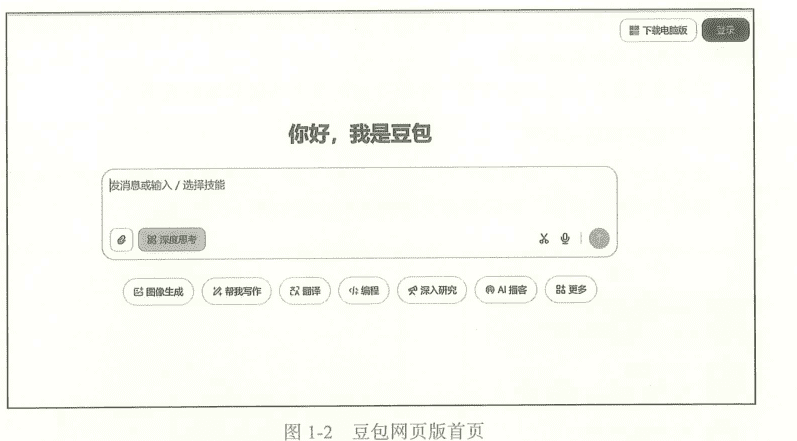

图 1-2 豆包网页版首页
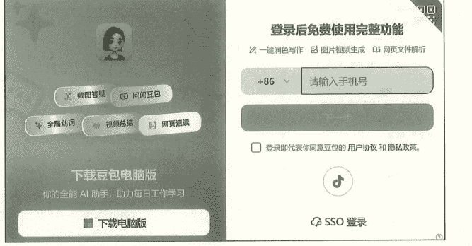

图 1-3 豆包网页版登录界面
3）微信二维码和手机验证码均有时间限制, 请尽快扫码或输入, 超时可刷新二维码或重新发送验证码。

### 技巧 2 界面设置：基本功能详解

豆包是多场景多模态的全能助手, 无论查信息、写文案还是提炼长文要点都能胜任。语音功能很实用, 开口提问即可省去打字, 还能挑选说话风格并搭配不同技能与背景。

下面以 App 为例介绍基础功能和偏好设置。

#### 1. 豆包基本功能介绍

登录后点右上角“⊕”或豆包头像即可进入对话界面, 对话界面支持功能如图 1-5 所示。

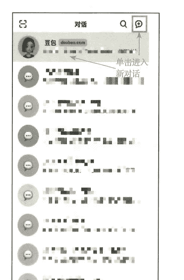
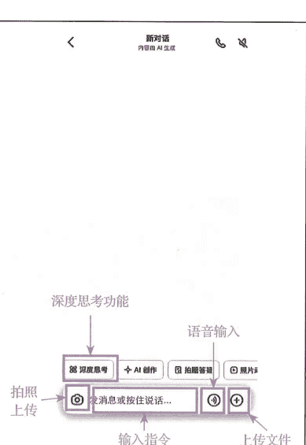

（1）开启对话
在对话界面底部输入框可发消息或发语音, 豆包会按要求生成内容。

（2）深度思考
输入框上方左侧“深度思考”可开启该功能。该模式结合搜索与推理, 多次验证思考过程, 答案逻辑更清晰、更贴合实际, 但生成较慢, 适合高质量需求；未开启时响应更快, 适合简单问题或快速生成。

（3）拍照上传、文件上传
输入框左下角相机按钮可拍照上传, 右下角“⊕”可上传文件。豆包可基于照片、图片或文件作答。

（4）语音输入
输入框右下角语音按钮可语音输入, 长按后直接说话, 系统会将语音转文字并输出结果。

#### 2. 豆包偏好设置

想让豆包用喜欢的声音回答、记住偏好、调整字号, 可通过设置实现。打开 App 进入设置界面, 如图 1-6 所示。

（1）设置豆包声音
豆包可朗读文字。设置里选择“声音”, 可调音色、音高、语速, 也可点“克隆我的声音”按提示操作。

（2）设置记忆
开启记忆功能后, 豆包会把聊天中提到的兴趣、偏好作为背景信息, 使回复更贴近个人需求。

（3）字号调整
可按阅读习惯调大或调小回复字号。

（4）未成年人模式
家长希望孩子使用但不过度依赖时可用。首次使用需设家长密码, 之后可单独关闭视频展示、第三方网页浏览、AI 创作等功能, 保证使用环境纯净；自己使用时可关闭。

背景设置、快捷指令等也可按喜好调整。

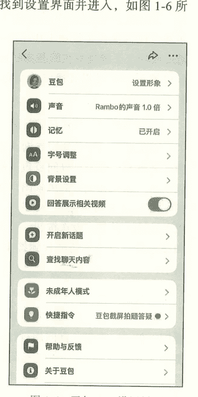

> 试一试
试着设置声音、记忆、字号、背景等, 调整后阅读技巧 3 开启首次对话。

> 小贴士
1）字号调整后可预览效果。
2）若不希望豆包记住隐私, 可关闭记忆功能。

### 技巧 3 快速上手：开启与豆包的第一次对话

豆包是全能型选手, 学习、创作、处理工作或情感交流都能精准满足。提问越清晰明确, 得到的结果越专业实用。

完成基础功能和偏好设置后即可体验。

#### 1. 简单提问, 快速获取答案
无论是查知识还是解生活难题都可以直接问。例如上传一张未知地点的风景图, 输入“我图的地点是哪里？”, 开启深度思考后发送。豆包思考并搜索后会给出准确答案, 如图 1-7 所示。

#### 2. 如不满意, 接着提问
对回答不满意可继续追问。例如先问“一家人三口 11 月底去北京旅游一周, 以名胜古迹为主, 请制订计划”, 豆包给出详细计划后, 可在同一对话追加“请为以上行程制定交通攻略”, 豆包会延续上下文输出攻略。

也可让豆包重新生成, 每次结果不完全相同, 提供更多参考。需要时可让其朗读答案, 也可复制或分享。相关按钮如图 1-8 所示。

#### 3. 语音通话
不想打字可点对话界面右上角语音通话按钮进入语音通话界面, 如图 1-9 所示。

进入后可直接说话, 如图 1-10 所示, 豆包会识别语音并以语音和文字形式作答。

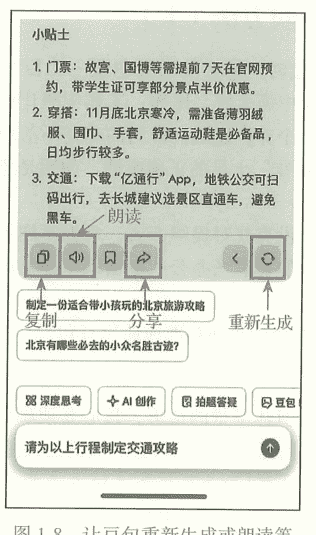
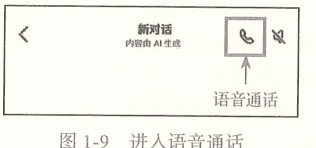
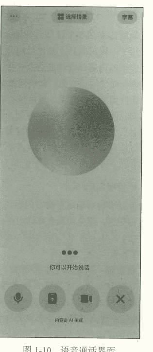

> 试一试
分别用文字和语音向豆包提一个简单问题, 主题可为旅行计划、减肥攻略或生活烦恼、学业等。

> 小贴士
1）语音对话中可选择更贴合需求的场景, 如模拟面试、英语陪练。
2）对答案来源有疑问, 可点对话中的参考资料核查可靠性。
3）想开启全新话题, 请回到对话界面新建对话, 不要在原对话中继续。

### 技巧 4 提问技巧：通用提问方法（上）

读完前 3 个技巧后你会觉得豆包是座宝藏, 但一段时间后效果可能打折。想让豆包写方案, 结果空泛无重点；要养护建议, 得到的是不落地的空话；写文案全是 AI 味的正确废话。明明想省时间, 反而要反复返工。

问题不在工具, 而在提问方式。掌握不同场景的提问思路, 把模糊需求拆成清晰要求, 无论办公、生活还是创作, 都能让输出更精准。

下面介绍 11 个提问方法, 先说前 4 个。

#### 1. 场景聚焦提问法
适用于需要贴合具体场景的内容。核心是明确使用场景和核心任务, 避免空泛。通用公式：

> 针对 [具体场景], 完成 [核心任务], 要求 [输出风格 + 关键要点], 以 [输出格式] 呈现

例如写家用净水器线下促销话术, 可写：“针对小区门口线下促销场景, 完成家用净水器宣传话术, 要求语言口语化有感染力, 突出‘过滤精度高’‘性价比高’‘安装免费’三个卖点, 避免专业术语, 以‘开场吸引 + 卖点讲解 + 引导留资’三段式呈现, 每段不超过 50 字。” 输出会精准适配小区居民沟通需求。

#### 2. 目标导向提问法
适合有明确目标的任务, 如涨粉计划、业绩冲刺。核心是先定目标再拆可执行步骤。通用公式：

> 以 [核心目标] 为导向, 设计 [行动任务] 的具体步骤, 明确每个步骤的关键动作和判断标准, 用 [输出格式] 呈现

例如制定短视频账号 30 天涨粉 5000 计划, 可写：“以‘30 天涨粉 5000’为核心目标, 设计短视频账号涨粉计划, 明确每周核心任务、内容方向、发布频率和互动方式, 每个步骤标注关键动作和判断标准, 以‘周度拆分 + 分点说明’格式呈现, 总字数控制在 600 字以内。” 结果按周拆解, 动作明确可执行。

#### 3. 约束明确提问法
输出不符合预期常因限制条件没说清。通过提前说明约束降低返工。通用公式：

> 在 [约束条件, 如字数 / 时间 / 风格] 下, 完成 [核心任务], 覆盖 [必须包含的要点], 排除 [禁止出现的内容], 以 [输出格式] 输出

例如写 300 字内公司内部培训通知, 可写：“在‘300 字以内、语言正式简洁、无多余客套话’的约束下, 撰写公司内部职场沟通技巧培训通知, 覆盖培训主题、时间、地点、参与人员、报名方式五个要点, 排除‘感谢配合’‘敬请谅解’等客套表述, 以‘标题 + 正文’格式输出。” 结果字数可控, 信息清晰。

#### 4. 细节补充提问法
需求需精准覆盖特定人群或背景时有效, 补充受众、背景、特殊要求等细节。通用公式：

> 针对 [目标受众], 结合 [背景信息], 完成 [核心任务], 重点突出 [细节要点], 满足 [特殊要求], 以 [输出格式] 呈现

要为六十岁以上长者制作社保卡查询的手机操作指引，可以把提示词写成：“面向六十岁以上人群，兼顾视力减弱和对智能机不熟悉的实际情境，完成社保卡查询的使用说明，重点呈现流程精简、图标辨认、常见异常排查三项细节，满足不使用专业词汇、每一步都用通俗语言解释的特殊需求，以分步讲解配合文字描述配图的方式输出，每步不超过两句话。”这样生成的材料会贴合老年人的使用习惯，把步骤拆得更细、语言更平实，并补充易错点排查，长者可以直接照着操作。

#### 5. 角色代入提问法
需要特定风格或专业视角的输出，比如儿童科普要活泼、商务邮件要得体，就可以用角色设定法。它先为豆包指定一个扮演身份，让结果摆脱通用 AI 口吻。通用模板是：

> 扮演 [具体角色]，以 [角色视角] 完成 [核心任务]，突出 [角色特质/专业要点]，按 [输出格式] 返回，需符合 [场景调性]

例如写一篇给小朋友看的星星科普，可以这样写：“假设你是儿童科普老师，从贴近儿童认知、语言活泼有趣的角度出发，完成介绍星星的短文，体现用生活例子解释复杂知识的特质，避开天文专业词，以开头吸引+知识讲解+互动提问的结构输出，字数控制在 400 以内，符合低龄阅读习惯。”生成的内容会用孩子能懂的比喻，加入提问互动，阅读体验更友好。

#### 6. 小结
前 5 个基础方法分别对应场景契合、目标聚焦、约束控制、细节精准、角色匹配五类痛点。底层思路都是把模糊需求转成清晰指令，不必死记，只要把模板里的关键词替换成自己的需求，就能把输出从可用提升到好用。日常多数基础需求，用这 5 招基本够用，能省下大量返工。

> 试一试
从 5 个方法里挑一个套到当下需求。比如用角色代入法让豆包扮演美食博主写家常菜教程，或用约束明确法写 150 字产品点评，替换模板关键词，感受贴合度变化。

> 小贴士
1）模板中带 [] 的信息越具体，结果越准。场景不要只写“线下活动”，要写“商场节日促销”；受众不要只写“年轻人”，要写“18 到 25 岁在校大学生”。
2）约束别堆太多，抓核心即可。写文案时标明字数、语气、核心卖点就够，过度限制会削弱发挥。
3）结果不理想，先检查模板是否遗漏受众或约束，针对性补全比重开提问更高效。

### 技巧 5 豆包通用提问进阶篇（下）
上一节的 5 个基础方法可覆盖高频需求，本节补充 6 个进阶用法，处理更复杂的需求。

#### 1. 问题拆解提问法
适合复杂任务或多步骤问题。把大问题拆成小问题，让路径更清晰，避免泛泛而谈。通用写法：

> 把 [复杂问题 / 任务] 拆分为 [× 个核心子问题]，分别给出每个子问题的解决思路和具体步骤，明确子问题间的关联逻辑，按 [输出格式] 呈现

例如“产品用户留存率低”，可写：“把‘产品用户留存率低’拆成 3 个子问题——留存低的核心原因、新用户留存优化手段、老用户唤醒策略，分别给出思路和步骤，原因列出 3 个关键方向，措施包含执行步骤，体现‘先找原因→再做新用户留存→最后唤醒老用户’的递进关系，以‘子问题+思路+步骤’分点呈现，总字数 800 以内。”输出会先定位原因再给落地动作，避免只有“提升体验”之类的空话。

#### 2. 数据支撑提问法
需求需要数据佐证或量化分析时使用，能增强说服力。通用写法：

> 基于 [数据范围 / 维度]，分析 [核心主题] 的变化趋势和关键结论，列出关键数据指标，说明数据背后的原因和影响，按 [输出格式] 呈现，避免纯数据罗列

例如分析某产品近 3 个月销售，上传表格后提问：“基于某产品 1 月到 3 月销售数据（1 月 800 件、2 月 1200 件、3 月 900 件，客单价 199 元），分析销售表现，列出月销量、环比增速、销售额 3 个指标，解释 2 月增长和 3 月回落的可能原因，并说明对 4 月销售的影响，以‘数据呈现+原因分析+影响建议’结构输出，语言简练专业。”结果会把数据、解读、建议串起来。

#### 3. 创意发散提问法
需要灵感或多方案时使用，能跳出定势。通用写法：

> 围绕 [核心主题 / 需求]，发散 [× 个] 创意方案，每个方案需包含核心亮点和实施要点，符合 [约束条件 / 风格要求]，按 [输出格式] 呈现

例如为奶茶店夏季水果茶做宣传，可问：“围绕‘奶茶店夏季新品水果茶’发散 6 个宣传创意，每个方案包含亮点和执行要点，符合年轻时尚、低成本、易落地的要求，避免大型活动，以‘方案名称+核心亮点+实施要点’分点呈现，每个方案不超过 80 字。”输出会覆盖线上线下形式，贴合年轻用户且成本可控。

#### 4. 总结提炼提问法
面对长报告、多信息时快速抓重点。通用写法：

> 提炼 [长文本 / 多信息] 的核心内容，聚焦 [关键要素]，剔除 [无关信息类型]，按 [输出格式] 呈现，确保核心信息不遗漏

例如提炼行业报告，可说：“提炼我上传的《2024 年短视频行业发展报告》核心观点，聚焦行业规模、用户特征、主流趋势、面临挑战 4 个要素，去掉具体案例、数据来源等冗余信息，以分点列出、每点不超过 3 句的形式呈现，总字数 300 以内。”结果用简洁语言浓缩重点。

#### 5. 迭代优化提问法
已有初稿不满意时做针对性修改，避免推倒重来。通用写法：

> 基于现有 [初稿类型 / 内容]，针对 [现有问题]，按 [优化标准 / 期望效果] 进行修改，保留 [需保留的核心内容]，按 [输出格式] 呈现

例如优化网店文案，可指令：“基于现有商品文案初稿，针对表达平淡、卖点不突出的问题，按强化噪强、续航久、价格低 3 个核心卖点、语气更有感染力、增加行动引导的标准修改，保留场景化开头，以‘修改后文案+3 点修改说明’格式输出，总字数不超过 200 字。”修改版会精准解决痛点并说明改动逻辑。

#### 6. 对比分析提问法
多选项决策时使用，能客观比较。通用写法：

> 对比 [多个选项]，从 [对比维度] 进行分析，明确每个选项的优势和劣势，结合 [决策标准] 给出推荐结论，按 [输出格式] 呈现，保持客观中立

例如对比办公软件：“对比 WPS、石墨文档、飞书文档 3 款工具，从协作效率、功能丰富度、使用成本、兼容性 4 个维度分析，指出各自优劣，结合中小团队日常协作、低成本使用的决策标准给出推荐，以表格对比+推荐说明形式呈现，语言简洁客观。”输出用表格呈现差异，推荐贴合需求。

#### 7. 小结
6 个进阶方法分别对应拆解问题、数据分析、创意发散、信息提炼、迭代优化、对比决策。核心是深挖需求+设定边界+给出精准指令，无论分析、创意还是选型，都能更精准。

> 试一试
从这 6 个方法里选一个应对复杂需求。比如用对比分析法比较 3 款育儿 App 适用性，或用迭代优化法润色工作汇报初稿。

> 小贴士
- 复杂需求可组合公式，先拆解任务再用数据支撑分析，结果更全面。
- 创意类约束要适度，只限定低成本、易落地，给出发挥空间。
- 对比时维度要统一且关键，比产品聚焦价格、功能、售后，避免无关维度干扰。

### 技巧 6 豆包特色功能：六大类能力提升效率
开会记半本笔记仍漏待办、做海报调十次仍不满意、方言交流不顺畅、复杂问题理不清——这些堵点让豆包从信息助手升级为全能智能体，六大类功能可逐一打通。

#### 1. 大模型底座升级：AI 更懂事
底层会自动选择适配的专项模型，无需手动切换。比如输入“写一段清洗数据的 Python 代码”，会自动调用编程模型输出带注释代码；发一张产品设计图问“按钮位置是否合理”，会自动启动视觉分析模型指出“按钮离底部太近，单手操作不便”；整理销售数据时，会切换统计模型生成分析结论。全程无需在多个工具间跳转。

#### 2. 智能办公助手：告别重复劳动
覆盖协作、分析、存储全流程：
- 会议记录：可自动把录音转文字并识别发言人，标注“研发部周三前出原型”类待办；跨国会议可实时生成中英双语纪要；视频通话协作时，对准设计图即可实时得到“此处接口易卡顿”等建议。
- 文档智能处理：上传 PDF、Excel 或流程图，可提取重点、生成脑图并做深度分析，如定位流程中“审批节点过多”的瓶颈，或对文献自动生成综述。
- AI 云盘：支持大容量存储，还能“加工文件”。视频可问答，如“第 5 分钟提到的方案细节”；表格可自动生成可视化图表。
- 共享应用/屏幕：不再反复复制粘贴。支持 PC 和手机双向共享整屏、单个应用窗口或浏览器标签页，可同步系统音频和麦克风。边改 Excel 公式、修图就能直接问“这个函数返回值为何错误”“图表如何优化”，比截图提问高效数倍。
- AI 视图：网页增强功能，看新闻点“AI 总结” 3 秒抓核心；看 B 站、抖音视频点“AI 看视频”，可得带时间轴的摘要。
- AI 浏览器：可导入旧浏览器的书签、登录记录和表单数据；英文网页可划词对照翻译并保留排版。

#### 3. 创作与内容生成：零基础也能出作品
- AI 生图：上传参考照片加文字描述，如“带蝴蝶结的国风短毛猫，工笔画风格，红色蝴蝶结”，生成的图既保留神态又贴合风格。
- AI 编程：输入“做一个粉色风格的水果接落小游戏”，会生成带注释代码并提示“下落速度调成 0.5 秒更适合新手”；代码报错可直接复制错误信息求修复。
- 视频与播客生成：文本转视频时人物动作更自然；文档可一键转为播客音频，方便知识分享。

#### 4. 智能交互升级：沟通更自然
- 方言与语音交互：支持 13 种方言，识别率超 92%，延迟低至 200ms。用粤语问“广式早茶经典点心”，会补充“虾饺选皮透亮的”等实用建议。
- AI 划词工具栏：网页、PDF、Word 中划词即出现翻译选项，支持对照翻译并保留格式；遇到不可复制文档也能翻译。
- 实时视觉问答：拍实物、截图即可提问，如拍零食包装问热量、拍数学题求解题步骤、拍电路图问元件作用，解读更精准。
- 商品卡：问答时同步推荐相关商品并带用户评价。如问“露营装备推荐”，会弹出带防水系数和评分的帐篷、睡袋卡片，一键跳转购买。

#### 5. 内容理解与知识服务：刨根问底
- 深度思考推理：遇到复杂问题会先查数据再分析原因，如“为什么今年露营热度下降”，会给出销量数据并解释周边游多元化等原因。
- 视觉推理：从图片找隐藏逻辑，如指出数学题“第一步公式列错了”，或提醒“此处材质不适合户外”。
- 视频解析：粘贴 B 站、抖音链接可提取文案、总结要点，效率远高于手动笔记。

#### 6. 安全与隐私保护：用得安心
- 未成年人保护模式：开启后默认关闭视频展示、第三方网页浏览、智能体对话、AI 创作，翻译、深度研究等功能仍可用；退出需输密码。
- 隐私数据管控：可手动删除单条或批量清理对话历史；导入浏览器书签时可选择跳过网银、工作平台等敏感登录信息。

#### 7. 小结：从“能回答”到“能办事”
豆包现在能打通“提问-处理-落地”全流程。比如问露营装备，既给建议又推商品；做会议记录，既转文字又标注问题并协作文档。多模态协同、方言识别、视觉推理等细节让使用更贴近真实场景。

> 试一试
三个零门槛用法：
1）办公：打开共享屏幕，对着 Excel 问“这个求和为何结果不对”。
2）创作：传自家宠物照片，输入“画成复古漫画风，加个小领结”。
3）生活：用家乡话问“本地最有名的家常菜怎么做”。

> 小贴士
- 共享屏幕前关闭敏感文档，保护隐私。
- 生图时补充细节如“耳朵上有小痣”，效果更贴合预期。
- 解析视频时补充重点提取要求，摘要会更精准。

### 技巧 7 豆包超能模式（上）：申请流程与 5 个实操场景
做带图表的市场分析报告、给孩子做风格统一的绘本、发带销量数据的品牌微博，这类多步骤跨工具任务很耗时间。豆包超能模式可用自然语言一次性搞定，支持在线编辑，直接输出成品。

超能模式本质是通用智能体 Agent，无需复杂提示词，用日常对话描述需求即可。它能灵活生成图片、视频、交互网页等，生成的网页还支持点击查数据、调参数。它像全流程管家，能自主决策、联动多工具，完成从数据搜索、内容生成到排版分享的全流程，省去重复操作。

#### 1. 超能模式申请
目前处于内测，需申请使用。直接在浏览器打开 https://www.doubao.com/super-task-apply，按提示填写信息提交，通常几天内会收到通过通知。

#### 2. 上手实操：5 个高频场景
获批后在电脑或网页版首页切换到“超能模式”即可开始，输入明确需求让它运行。

##### （1）场景 1：职场报告一键生成
领导要一份带数据的行业分析报告，无需自己搜资料搭网页，直接输入：“深度搜索并整理 2025 年小红书与抖音平台‘新媒体运营排版’方向的内容趋势，做一个毛玻璃扁平化风格的分析报告网站。内容要包含热门类型、头部手法、选题案例，提供相关论文的跳转链接。”

超能模式全流程演示：从检索到分享一站完成

启动超能功能后，系统会连续发起多轮权威信息探查，完成筛选后形成结构化结果，还能直接产出网页源码。成品无需借助第三方工具，直接在内置编辑区修改文案、调整版式，确认后点击分享即可生成访问链接，接收方打开链接就能查看完整报告，示例见图1-14～图1-17。

##### （2）场景 2：零设计也能做成可分享亲子绘本
想为孩子做一本《荆轲刺秦王》睡前绘本，却没有美术基础也能搞定，只要给出明确指令即可。示例指令为：
请创建一个完整的交互式儿童教育数字绘本项目，主题为“荆轲刺秦王”历史故事。具体要求如下：
-1）项目形态：网页互动故事绘本，非PPT演示。
-2）故事内容：经典历史故事的儿童化简化版本。
-3）页数限制：15页以内，含封面、正文与封底。
-4）视觉风格：水彩插画，色调柔和温暖，契合儿童审美。
-5）技术实现：采用HTML5、CSS3、JavaScript搭建完整网页应用；实现翻页动画与点击互动；响应式适配电脑与移动端；保证主流浏览器兼容。
-6）交互功能：流畅的左右滑动或点击翻页；角色可点出对话气泡；加入少量小动画增强表现。
-7）教育意义：在叙事中自然融入历史常识与价值观引导。
请交付完整项目文件，包含所有HTML、CSS、JavaScript代码及配套插画资源。
数分钟后即可获得带情节的绘本内容与配套插画，如图1-18所示。若某页画风不满意，可补充提示，如“第8页荆轲服饰改为战国武官样式，背景添几丛芦苇”，系统会即时修改。全部确认后分享，家人打开链接即可翻阅成册绘本。

##### （3）场景 3：竞品口碑采集整理
开奶茶店想分析对手用户反馈以优化产品，不必手动翻大众点评截图统计。输入指令：“访问大众点评，搜集整理2025年Q4喜茶、奈雪的茶、古茗3个品牌的热销奶茶用户评价并分析，重点提取口味、性价比、包装颜值3个维度观点，网页采用清新奶茶风，浅奶茶色为主色调，米白背景配圆角卡片，并配上3个品牌招牌产品图片。”
平台会自动打开浏览器访问大众点评，筛选近30天有效评价，优先带图且字数超50字的真实反馈，按“口味、性价比、包装颜值”分类提炼核心观点，例如“喜茶多肉葡萄茶底获80%好评，但25%用户反馈小料偏少；古茗杨枝甘露包装颜值高，不过15%用户觉得甜度偏高”，同时生成符合风格的展示网页。若需将整理数据填入品牌调研表，还能模拟人工操作自动填写，遇到登录环节会提示扫码验证，如图1-19所示。登录后即可在平台内自动检索数据，如图1-20所示。全程无需手动复制、统计或排版，生成效果见图1-21～图1-24。

##### （4）场景 4：小微进销存网页可直接录入
开小超市想管理库存又不想付费买专业软件，可输入：“帮我做一个小微企业简易进销存管理网页，包含商品入库记录名称、数量、单价、日期、出库登记、库存预警低于5件标红提醒、月度销量统计图表，界面以浅青色为主，字体清晰，支持手机查看。”
生成的进销存管理页如图1-25所示。入库时填完信息点“确认入库”，库存总数会自更新，如图1-26所示。售出登记出库后库存实时减少，低于5件时系统自动标红提醒补货，如图1-27所示。月度统计区还会生成柱状图，如图1-28所示，直观看出热销品，无需再翻Excel汇总。

##### （5）场景 5：便利店设备联动管理面板
便利店设备众多，想要智能管理前端，可用提示：“设计社区便利店智能管理系统网页，支持接入真实Wi-Fi/蓝牙智能设备，需在设置中输入设备ID绑定，功能包括：①设备实时监控冷藏柜温度、收银机状态、关东煮机加热模式、照明系统、监控摄像头；②场景联动开店模式自动开启照明、收银机、冷藏柜制冷、关东煮机预热；闭店模式关闭所有设备并开启摄像头移动侦测；③定时任务冷藏柜凌晨2点至5点调至节能模式、关东煮机早上6点开机；④故障报警冷藏柜温度超8℃或设备离线时推送至绑定手机。界面以浅橙色为主，操作按钮带确认弹窗防误触。”
生成的页面如图1-29所示，按钮均带交互，可调节冷藏柜温度，如图1-30所示。

## 28 豆包使用秘笈：从入门到精通的 100 个实用技巧
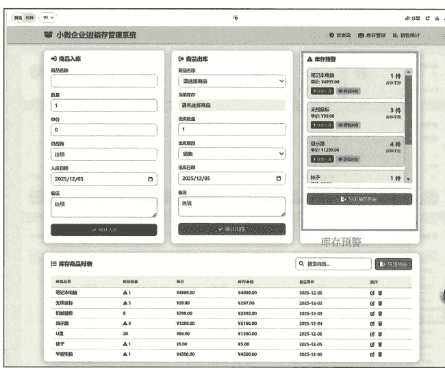
图 1-27 库存预警效果展示
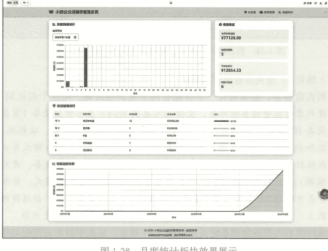
图 1-28 月度统计板块效果展示
## 第 1 章 豆包使用快速入门
29
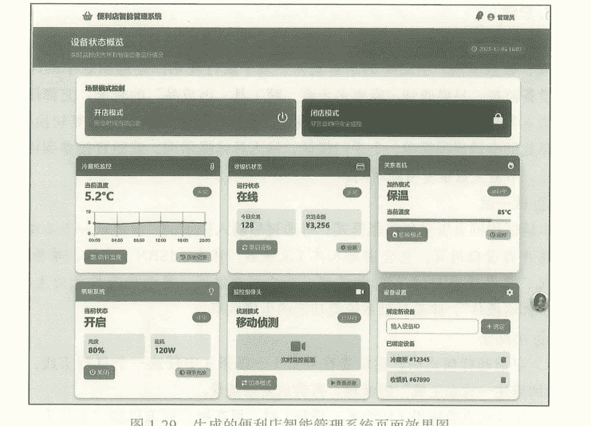
图 1-29 生成的便利店智能管理系统页面效果图
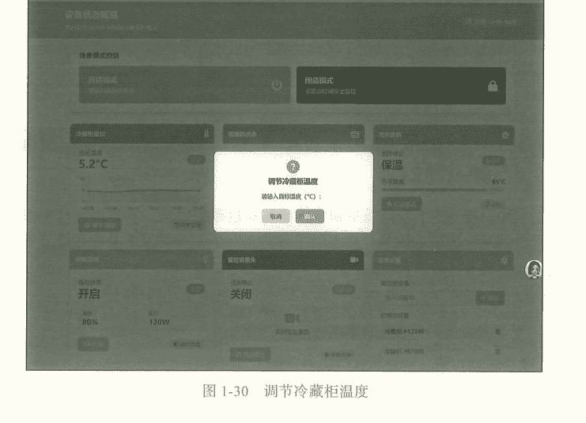
图 1-30 调节冷藏柜温度
#### 3. 总结
超能形态的核心价值在于一站式解决全流程复杂任务。无论是职场报告与数据整理、生活绘本制作与亲子旅行规划，还是创业中的库存管理与设备监控，只要需求涉及多步骤、跨工具、需产出成品，都能通过自然语言指令自主联动工具完成，无需手动拆分步骤或频繁切换软件。申请流程简便，上手门槛低，输入具体指令即可拿到可直接落地的成品，大幅节省重复劳动时间。

> 试一试
申请试用网页版豆包超能形态，通过后输入“帮我做一个小型书店简易库存管理网页，含书籍入库录书名、作者、ISBN、数量、单价、出库登记、库存低于10本标黄提醒、季度销量饼图，界面以浅棕色为主，支持手机操作”，体验基础系统类生成的效率。

#### 小贴士
1）申请超能形态后，建议先在场景1～场景3中任选其一实操，熟悉“指令描述→成果生成”流程，再尝试复杂场景。
2）生成网页类成果时，可在指令末尾加上“支持手机端”，避免移动端排版错位。
3）自动搜集数据时若遇到验证码，扫码完成验证后任务会继续，无需重新提交指令。
4）生成管理系统后，先录入两三条测试数据，确认预警与统计功能正常后再正式使用。

### 技巧8 豆包超能模式（下）：4个拓展场景实操，复杂任务一键搞定
上节通过5个基础场景体会了超能形态“无需拆分步骤、联动工具直接出成果”的优势。实际工作中当需求涉及个性化定制或跨平台联动时，能力会进一步提升，能更精准解决复杂问题，减少手动操作。

#### 1. 上手实操：4个拓展场景高效落地
（1）场景6：健身会员饮食+训练计划（含打卡）
健身工作室想为会员定制训练计划，不必手工填表。输入：“生成健身会员专属饮食加训练计划系统，先收集会员信息年龄28岁性别男体重75kg目标增肌芒果过敏，按每周3次力量训练加2次有氧安排计划，饮食含每日三餐食谱并标注热量、蛋白质，可打印训练打卡表，界面黑色加荧光绿配色，有运动感。”
生成效果如图1-31所示。网页按天划分训练，例如周一为力量训练；饮食推荐“早餐全麦面包加煎蛋加希腊酸奶加香蕉加杏仁”，并附食材分量。

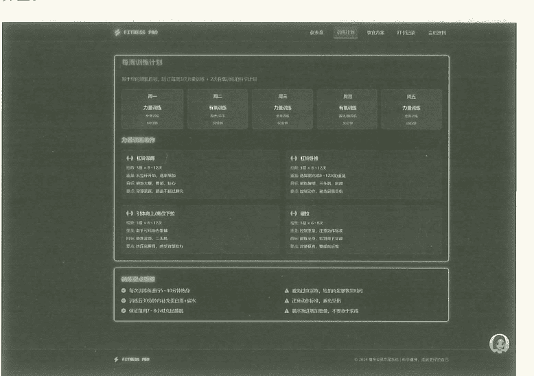
图 1-31 生成的每周训练计划
（2）场景7：阳朔亲子旅行规划（含预算）
想带娃去阳朔不想零散找攻略，可输入：“规划2025年寒假从广州出发阳朔3天2晚亲子旅行，含每日行程适合5岁儿童如遇龙河竹筏、西街手工扎染、亲子餐厅推荐、交通方式高铁加当地租车、预算明细高铁票住宿门票总费用，生成清新山水风HTML页面并显示每日天气建议。”
生成的攻略清晰呈现天气建议、行程安排、交通与住宿推荐，如图1-32所示。

## 32 豆包使用秘笈：从入门到精通的 100 个实用技巧
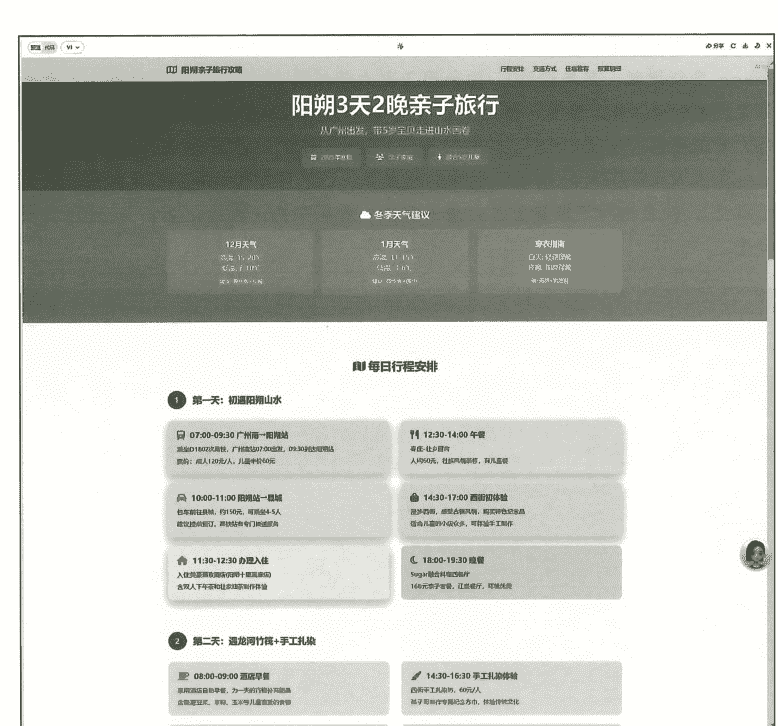
图 1-32 生成的旅行攻略
（3）场景8：小红书美妆新品测评笔记（带数据）
想发美妆测评不想自己做图写文案，可输入：“帮我写小红书‘2025年春季3款粉底液测评’笔记，含雅诗兰黛、兰蔻、植村秀持妆时间6小时实测、遮瑕力遮痘印效果、适合肤质，配3张实测对比图带时间戳，加话题#2025春季粉底液测评#干皮粉底液推荐，文案口语化像和闺蜜分享。”
系统会先查三款粉底液最新用户反馈，结合实测逻辑撰写文案，例如“雅诗兰黛DW质地偏厚重遮瑕力极强，一层遮住70%痘印，两层几乎完美遮盖，但干皮需做好保湿否则易卡粉。兰蔻菁纯质地如融化奶油，丝滑水润，干皮空调房不卡纹，透出奶油光泽。植村秀小方瓶轻薄透气延展好，妆感清透自然，适合伪素颜”，并自动生成带时间戳对比图如“3小时持妆效果vs6小时持妆效果”，排版符合小红书风格。生成后可直接复制，不用再调字体加贴纸，最终效果如图1-33所示。

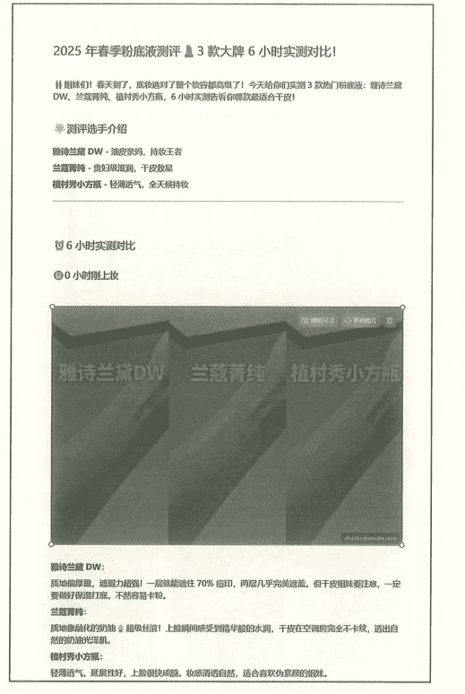
（4）场景9：自动发布品牌/个人微博
服装品牌想发新品预售微博，不必手动写文案做图再登录后台。开启超能形态输入：“帮我完成服装品牌‘2025春季碎花连衣裙’新品预售微博自动发布：①文案含‘3月15日0点开售、前100名赠丝巾、满399减50’核心信息，风格活泼亲切，控制在160字内；②配3张产品图主图全身穿搭、细节图领口花纹、场景图户外拍摄，色调统一浅粉色系；③添加话题#2025春季连衣裙推荐#碎花裙穿搭，@品牌官方客服号；④绑定微博账号需提示扫码登录，设置3月10日上午10点定时发布。”
系统会按需求生成文案，自动设计3张产品图，按微博规范整合内容，然后提示扫码登录品牌微博账号完成绑定，确认发布时间后到点自动提交，无需手动登录操作。若需修改文案或图片，可在发布前直接在界面编辑，系统同步更新定时任务，如图1-34和图1-35所示。注意定时发布需具备相应权限的品牌账号。

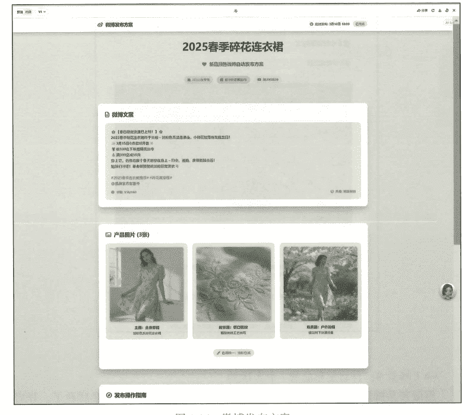
图 1-34 微博发布方案一
## 第 1 章 豆包使用快速入门
35
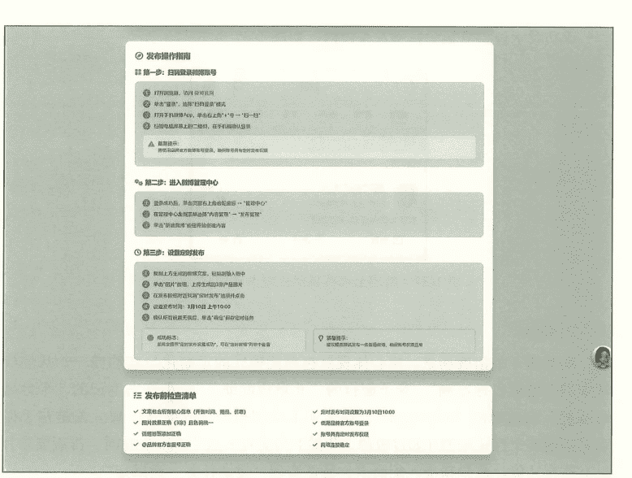
图 1-35 微博发布方案二
对于个人微博操作更简便，例如想发布推荐书籍的微博，直接在超能形态下输入“帮我在微博发送一条内容，文字是：推荐大家去读《认知觉醒》”，系统会给出微博登录界面提示授权登录，如图1-36所示。

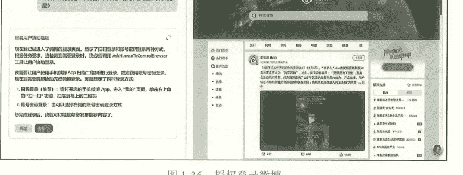
图 1-36 授权登录微博
成功登录后系统会自动发布微博，如图1-37所示。

#### 2. 总结
本节用4个拓展场景体现超能形态的定制化与联动性——从健身计划的增肌目标定制、亲子旅行的儿童适配细节、小红书笔记的平台风格匹配到微博的自动发布，均无需手动切换工具或拆分步骤。关键在于指令要明确个性化限制如过敏源、年龄与流程节点如发布时间、排版要求，才能让成果精准匹配需求，实现复杂任务一键搞定。

> 试一试
申请试用网页版豆包超能形态，通过后输入“帮我做一个社区便利店简易会员系统网页，含会员注册记录姓名电话生日、积分登记消费1元积1分、生日月双倍积分提醒、积分兑换礼品列表100分换纸巾200分换饮料，界面橙色为主，支持手机查看”，感受效率提升。

> 小贴士
1. 生成管理类系统后，建议先录入几条测试数据确认功能正常再正式使用。
2. 做旅行或研学计划时可在指令里加“标注景点是否需要预约”，避免现场无法进入。
3. 生成社交平台笔记后先复制到草稿箱预览，调整换行再发布，阅读体验更好。
4. 想长期使用生成的网页，可下载到本地下次直接打开，无需重新生成。

## 第 2 章 用豆包轻松实现智能办公与自动化
### 技巧 9 材料写作：“范文借力优化法”高效出高分
职场写材料不可回避，不管是活动新闻稿、年度总结还是会议讲话稿、活动策划案，都要规范且有亮点，还要赶截止时间。很多人要么对着空白文档发呆，要么堆着一堆范文不敢用，最后写出来生硬或高度雷同。采用“范文加关键信息结合优化”，能利用豆包解决写材料的痛点。

#### 1. 准备写作素材
系统不能无中生有，先准备两类素材。一类是优质范文，行业标杆稿件或单位内部优秀范例均可。另一类是关键信息，即材料必须包含的核心内容，如活动通知的时间地点参与人员流程，工作总结的成果数据与下一步计划，整理成清晰文字即可。

#### 2. 生成文章初稿
素材准备好后启动“范文加关键信息结合优化”。打开豆包点“帮我写作”，上传范文与关键信息，输入明确结合优化指令。指令越具体结果越精准，例如写专题分享会新闻稿可提示“请结合上传新闻稿范文框架与单位活动通知关键信息，生成一篇符合职场规范的新闻稿，大纲清晰内容贴合实际语气正式得体，不照搬范文原文，突出单位特色”，如图2-1所示。

系统会直接生成融合范文风格与专属关键信息的活动新闻稿，如图2-2所示。文章已有良好基础，既借鉴范文框架与语言质感，又融入专属信息，避免雷同，风格贴合职场需求。

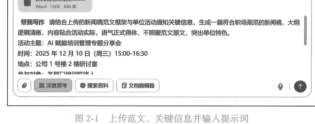
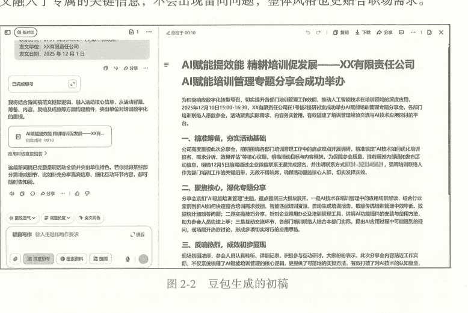
#### 3. 对初稿进行润色
生成不等于结束，精准润色能显著提升质量。很多人在润色时习惯全文重改，反而混乱，而豆包文档编辑器支持单独选中词句段落进行针对性修改。例如觉得某段思想高度不够，选中该段点“AI改写”，提示“提升本段思想高度保留核心信息，语言更具格局符合职场材料表达，不改变段落结构”，如图2-3所示。

若想优化标题，可提示“替换文中所有标题，使其更简洁有力突出主题，风格与范文一致但不重复”。语气偏生硬时可提示“调整语气为温和亲和保留专业度，避免过于官方表述”。此外还能针对排比、金句等细节微调，直至满意。

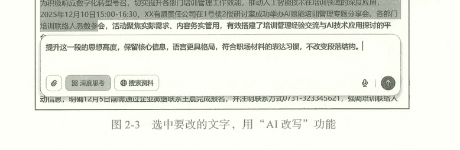
#### 4. 总结
用豆包依托范文写材料的核心是“借力打力”——借助优质范文框架与风格，结合自身关键信息，再通过精准指令与局部润色，快速生成高质量不雷同的职场材料。这套方法解决了没思路、改得多、怕雷同的痛点，大幅提升写作效率与质量，无论新闻稿、工作总结还是讲话稿、策划案均可套用。

> 试一试
找一篇近期要写的材料，准备优质范文与自己的关键信息，按文中步骤操作：先上传素材输入结合优化指令生成初稿，再针对标题、某段内容、整体语气用专属指令润色，检验是否符合预期。

> 小贴士
1）范文要选高质量且风格贴合，避免选用杂乱不规范稿件，否则影响生成效果。
2）关键信息要简洁明了，不要堆砌无关内容，突出核心要点。
3）润色时优先关注思想高度、标题质量与语气贴合度，局部优化比全文改写更高效。
4）指令越具体越好，明确需求与限制，减少修改次数。

### 技巧10 文案优化：3招打造真人手写质感
人工智能写作已渗透工作生活，营销种草、职场汇报、情感分享都能快速输出。但很多生成的文案带着“机器人味”——语言生硬、缺乏细节、情绪不足，不管用于吸引客户还是传递心意，都缺少真人沟通的温度与说服力。

这些文案问题集中在：营销文案干巴巴罗列卖点让人无欲望下单；职场报告只说结论无支撑显得空洞；情感文字泛泛无法共鸣。更尴尬的是，花时间生成却因不像人写的被忽略，反而浪费精力。

如何用豆包快速去除AI痕迹，让文字既有逻辑又有温度？关键在于掌握“场景加风格加人性化细节”的核心逻辑，再用对技巧，豆包就能把生硬文案润色得有血有肉。

#### 1. 先把指令写得有人味

模型写得生硬，通常是缺少明确的人类使用指令。让豆包产出更贴近口语，关键在于把需求写得足够具体。大致抓三点：先定使用背景，比如地铁上刷手机、睡前靠床头放松；再定表达语气，比如种草社区的分享腔、偏正式的总结口吻；最后添上感官与情绪，比如指尖触感、鼻尖气味、当时心情。

#### 2. 三类常见情境，示范如何去机械感

按情境套提示，营销、办公、工作回忆类的稿子都能快速变自然。

1）种草文要画面与温度，别只罗列功能。比如“这款护手霜保湿可以，价格不贵”就很平淡。可给的指令是：“按种草社区口吻重写，使用背景设为办公室秋冬护手，加入涂完不沾键帽的触感，补充一次加班到半夜手干起皮，第二天变软的亲身经历，别用官方宣传词。”

改写后的感觉：姐妹们秋冬待在空调房里敲一天键盘，手干到像砂纸，指尖翻皮关节泛白，连翻文件都磨手，打字的粗糙感让人心情都差。上次做方案熬到后半夜，对着屏幕八小时，抬手一看虎口干裂有纹路，摸起来很糙。赶紧把抽屉里的霜厚涂，吸收很快不油腻。抹完立刻能继续打字，不会粘住键帽，指尖变得顺滑。早上醒来摸键盘时有点惊讶，以前起皮的地方变嫩了，虎口的硬皮也平了，手背细纹变淡，有种自然的水润。后来这支霜就一直放在工位上，早上配咖啡抹一次，下午摸鱼时再补，整天手都很软。通勤族秋冬的续命物，价格合理，用着顺手。

2）办公文要逻辑与数据，别空话。比如“本季度项目进展顺利，客户很满意”太笼统。可设提示：“润色成季度汇报文字，用数据加案例的结构，突出交付结果、新增合作以及客户反馈细节，去掉模糊表述。”

呈现出来像：2025年第三季度聚焦营收增长、合作拓展与客户留存，交付项目18个，主要指标均超预期：季度营收1280万元，同比增32%，环比增18%；新增合作企业5家，复购率82%，比上一季度提升9个点。××制造集团是2024年的老客户，第三季度追加ERP升级加年度运维，合同80万元。客户反馈升级后订单处理快了40%，排期误差从8%降到2%，解决了旺季积压的问题，后续还打算把供应链模块一起合作。信息来自9月访谈记录。

3）情感文要具体瞬间与共鸣，别空喊感谢。比如“朋友对我很好，很感谢她”感染力弱。可写：“改成朋友圈感恩体，走细节回忆路线，把对我好落实到具体瞬间，加上感官与互动细节，别堆华丽词。”

改写后：越长大越明白，真正的好朋友很难得。上次失恋我哭到说不出话，她直接打车过来，拎着我爱吃的草莓蛋糕坐在旁边，和我一起吃蛋糕看搞笑视频。她没催我开口，只是在我哽咽时拍拍后背说没事我在。那天的草莓很甜，她手心很暖，一下子就把我慌乱的心稳住了。

#### 3. 去掉机器味的四个习惯

除开把情境与风格说明白，这几招能让文字更像人写。

1）把通用词换成具象表达。少用非常、很多、进行这类模糊词。“非常开心”可换成“嘴角不自觉上扬”，“进行讨论”换成“你一句话我一句聊得停不下来”。

2）调整节奏，别一长到底。把一句话长句拆成短句，更顺。比如“周末上午阳光很好我们一起去公园散步”改成“周末上午，阳光暖暖的。我们并肩在公园走，脚步都慢下来了”。

3）多加感官与情绪词。用“鼻尖飘着面包香”“键盘敲得哒哒响”这类细节，再配上“破防了”“被狠狠拿捏”“被治愈到”等情绪词，画面才有了温度。

4）给模型划禁区。润色时直接禁止生硬黑话，强制加入真实对话。比如招商文案的提示可写：“改成创业推广稿，突出门槛不高卖点，语气专业但不要用赋能、生态、闭环等词，加入两位创业者的原话。”

改写后：想创业却被高额启动资金卡住？怕没经验没资源打水漂？这个项目面向普通人，门槛不高、容易上手、风险小，不用囤货也不用深厚背景，从准备到运营都有清晰指引，创业不再是少数人的特权。原行政专员王女士说：我在公司干了五年行政，想自己做点事又怕亏。这个项目吸引我的是门槛不高，启动资金没掏空积蓄，我也没做过生意，总部从开店到线上引流都手把手教。开店半年，月收入比上班高，时间自由还能照顾家庭。做过餐饮加盟亏钱的李先生反馈：上次投十几万最后亏了。这次就认准门槛不高，没选错。不用租门面，在家就能起步，前期给的客源渠道直接能用，第一个月就盈利。这种不用冒大风险也能稳定赚钱的项目，对不想试错的人很友好。

#### 4. 要点回顾

去掉机器味不是否定效率，而是用更精准的指令引导豆包贴合真实情境与人类表达习惯。把握住背景、语气、人情味细节这三点，再配合换词、调节奏、加细节、避黑话的操作，营销、办公、情感类文案都能变得鲜活有说服力。

> 试一试
可以拿这句练手：“这款笔记本续航久，适合办公使用。”提示参考：“改成知乎分享语气，情境是经常出差的通勤族，补充续航的真实体验，比如一天出差不用找插座，不要官方话术，突出实用性”。

> 小贴士
1）指令越细，润色越准。要明确背景、语气与想加的细节类型。
2）别一次改太多，每次聚焦一个核心需求，比如先加细节再调语气，更可控。
3）可以上传几段你喜欢的真人风格范文让豆包学习，输出会更贴预期。
4）润色后仍有机器味，可在提示里加上“用朋友闲聊的语气”“加一个小遗憾或小惊喜的细节”，真实感会提升。

### 技巧 11 文案仿写：四步把质感提上来

写东西时常会遇到，看到爆款金句就想学，却模仿不出精气神。要么照搬像模板，要么抓不住逻辑。办公里方案、宣传、总结、汇报都需要质感表达，光靠多写很难突破。

其实关键是缺一套拆解、转化、落地、优化的方法。用豆包就能高效仿写，不用硬记范文，按步骤走就能把别人的精髓变成自己的能力。

#### 1. 第一步：拆解好句子的底层逻辑
仿写的起点是读懂好句子为什么好。选一句打动你的办公相关句子，让豆包从文笔与适配度角度拆解要素。
提示词示例：“‘极致简约设计，藏着不将就的细节——这才是职场人的理想办公设备’，这句话为什么适合办公宣传？请从句式结构、用词特点、切入点、感染力等维度具体拆解。”

豆包会指出反差感、精准人群定位、肯定语气、短句节奏等要点，这些就是仿写的参照。

#### 2. 第二步：把拆解要素转化为自己的写作逻辑
拿到拆解结果别直接抄，要结合自己的情境消化。比如借鉴精准人群定位，写给技术团队就用专业但易懂的术语，写给客户就用直白语言突出利益点，写给领导就用简洁数据加结论。

#### 3. 第三步：结合主题让豆包协助仿写
明确主题后再让豆包按拆解手法搭建句子。比如写高效办公软件宣传，提示词可以是：“我要写‘高效办公软件提升效率’的宣传语，想借鉴‘外在特点+内在优势’的反差，锁定‘加班族’人群，语言简洁有力，突出省时少麻烦，请创作一句核心宣传语。”

可能得到：“极简界面藏着一键搞定——加班族的减负神器”。可再简化为“极简操作，高效内核——加班族的减负神器”，更利于传播。

没思路时也能用模糊主题提问，让豆包先搭框架再筛选。

#### 4. 第四步：用豆包做精准校对与优化
初稿别急着用，让豆包反馈是否贴合情境。提示词示例：“‘极简操作，高效核心——职场加班族的减负神器’是否符合外在+内在的写作手法？请从办公适配、人群认同、利益点突出三方面给反馈，给出修改方向，要求语言简洁，适合海报。”

豆包可能会建议把“高效核心”换成更具体的利益点，或把“减负神器”改为“办公减负神器”。根据使用情境选择是否补充细节。

#### 5. 总结
办公仿写不是抄模板，而是借成熟逻辑提升表达。拆解、转化、仿写、优化的闭环，能节省瞎琢磨的时间，把精力放在理解与落地。豆包是拆解助手与优化顾问，最终判断仍在你手上，筛选调整后才能真正融入自己的文案。

> 试一试
选一句最近收藏的办公好句，让豆包拆解核心要素。再定一个自己的主题，比如培训课程宣传、项目总结金句，用拆解手法仿写，让豆包给优化意见，最后整理出简洁版、详细版、口语版三个版本。

> 小贴士
- 拆解时优先选和自己常写文体匹配的内容。
- 仿写重在借逻辑而非照搬结构，否则会生硬。
- 收到反馈先看是否适配办公情境，再调语言细节，别为华丽忽略精准高效。

### 技巧 12 文档编辑：改写排版导出一体化

写商务报告要跨窗口整合素材；改论文要调标题层级与参考文献；做笔记想加表情分点却没好工具；改完还要转PDF或Markdown，容易丢格式。豆包的文档编辑器把AI改稿、可视化排版、多格式导出整合在一起，一站完成。

#### 1. 案例1：提案润色与结构化排版
提案要专业有逻辑，机器初稿常重点不清句式生硬。打开豆包点“帮我写作”，输入主题如“2025Q4新品推广项目提案”生成初稿，或粘贴已有稿到编辑页。选中段落点“AI改写”，包括润色、扩写、缩写、改语气。也可输入提示词：“润色核心策略部分，要求语气专业审慎去口语，补充两个落地情境如线下商超快闪、种草社区达人探店，按策略方向-实施路径-预期效果拆分段落用二级标题区分，保留预算50万、触达百万用户等核心数据，不改变原意。”

生成后直接覆盖原文，左侧“+”号选H2标题，有序列表呈现路径，结构清晰。

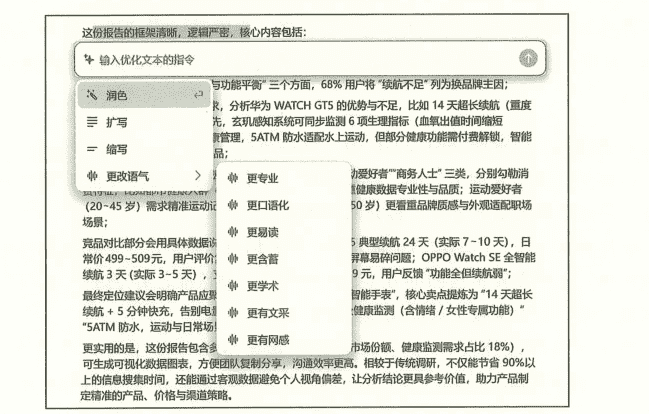

#### 2. 案例2：学术论文优化与格式规范
课程论文需要学术语气与规范格式。把初稿粘贴进编辑器，选中全文输入优化指令，利用标题层级、列表、表格规范，最后导出。
提示词参考：“优化本科经济学论文引言，要求修正口语如‘我觉得’改为‘本文认为’，语气学术化；补充一条文献引用格式‘作者，年份：结论’；按研究背景-意义-方法-结构梳理段落；删冗余修饰，保持简洁审慎。”

排版时设H3标题，参考文献用无序列表，最后导出Word提交。

#### 3. 案例3：自媒体探店笔记扩写与网感排版
笔记要细节足排版吸睛。输入核心信息如“市中心网红咖啡馆探店”生成初稿，选中需扩写部分选“扩写”并输入指令，再用排版工具优化。
提示词示例：“扩写菜品推荐部分，要求补充三款招牌饮品细节如海盐拿铁奶泡厚度、桂花酒酿拿铁甜度层次；语气亲切活泼，加适量表情如☕✨；用无序列表呈现每款的推荐理由+口感亮点；每点不超过两句。”

扩写后加表情拆分段落，更易读，导出Markdown直接发社区或公众号。

#### 4. 核心加分功能：多格式一键导出
编辑页右上角点“下载”，可选Word、PDF、Markdown，保留标题层级、列表、表格、表情等格式。
- Word：正式提交如提案论文，便于后续编辑。
- PDF：对外发送，保证格式不乱。
- Markdown：适配自媒体和笔记工具。

#### 5. 拓展情境：全情境文档处理适配
会议纪要整理：“缩写2000字纪要，保留核心决议与待办，用表格呈现任务-责任人-截止时间，导出PDF。”

简历优化：“润色工作经历，表述简洁有力，用要点列出核心成果突出数据如效率提升30%，导出Word。”

活动策划补充：“扩写年会策划案流程安排，补充时间节点与负责部门，用时间轴列表呈现，导出Markdown。”

#### 6. 总结
文档编辑器打破了写作-修改-排版-导出的工具壁垒，AI优化提升质量，可视化排版规范格式，一键导出适配情境，减少切换成本。办公人、学生、自媒体创作者都能用它让文字处理更高效省心。

> 试一试

豆包写作提速实操指南

挑一份近期就要动手的材料，比如项目建议书、学习笔记或论文片段，按下面四步跑一遍。首步，打开豆包「帮我写作」入口，要么让它直接出初稿，要么把已有文本粘进去进入编辑区。第二步，输入指令「全文润色，把口气调成正式规范，按‘要点-展开-收束’的顺序排版」。第三步，借助标题层级与列表功能把版式理顺。第四步，点「下载」把文档导出为 PDF，完整感受高效链路。

> 小贴士
- 指令越具体越好使，讲清修改方向如「学术化」「网感」，结构要求如「分点呈现」，格式规范如「二级标题」，减少模型歧义。
- 用排版搭骨架，H1到H4区分层次，有序无序列表呈现要点，表格归纳数据，可读性会明显提升。
- 导出格式按用途选，正式递交选 Word/PDF 保持版式固定，自媒体发布或个人记录选 Markdown 适配性更强。
- 多轮微调更稳妥，结果不理想就追加指令如「再补充一个落地场景」，不必推倒重来。
- 防误删关键信息，修改时优先用插入模式对照原文，确认无误后再替换。

技巧13 职场电邮：让沟通更稳更快

职场里电邮无处不在，对接同事、联系客户、请示领导几乎每天都在用。可写好一份函件不只是把话写出来，还要兼顾口气、逻辑与分寸，一不留神就踩雷。

谁没在编辑框前发呆过？开头怕生硬，正文怕漏信息，结尾怕不得体，催办、致歉这类敏感场合更是反复删改，半小时过去仍卡在称呼上。核心信息其实就几条，却被措辞拖住，效率很低。

配合豆包与合适的指令，就能把规范、得体、清晰的函件快速生成。

1. 用豆包起草电邮为何更省心
函件的核心是结构化表达：把事说清、用对口气、理顺逻辑。豆包擅长自动明确目的、梳理脉络、统一口吻、把控口气并保持礼貌。你只需给出关键信息，版式与措辞交给它，实现「你定方向，它负责表达」。

2. 三类高频函件，一次搞定

把工作中常见的函件归为三类，记住对应指令，用时直接套用。

（1）内部联络型
用于同事间同步进度、需求、配合，要求简练正式。比如同步季度活动策划进展，需要说明收件人是同事，主题定为「季度活动策划项目进度同步及配合事项」，信息要包含已完成的主题确定和流程框架搭建，本周对接物料设计、下周一考察场地的下一步，以及请对方在周五18点前提供宣传物料设计清单及参考风格的要求，口气简练正式。

指令示例：
请为同事起草一份日常工作沟通函件。
主题：【如「季度活动策划项目进度同步及配合事项」】
信息需涵盖：①已完成工作，【如「主题确定、流程框架搭建」】；②下一步安排，【如「本周对接物料设计，下周一考察场地」】；③配合需求，【如「周五18点前提供宣传物料设计清单及参考风格」】。
要求：口气简练正式，避免冗余表述。

（2）外部商务型
用于客户或合作方，强调礼貌正式、逻辑清晰。比如与某品牌推进新品联合推广，告知背景，信息涵盖我方通过线上线下联动提升曝光并可提供场地与用户资源的立场，已完成初步方向沟通并达成时间节点共识的进展，以及请对方3个工作日内提供含宣传渠道、预算分配、执行流程的详细推广方案的诉求，口气礼貌正式。

指令示例：
请起草一份对外商务函件。
背景：【如「与××品牌推进新品联合推广合作」】
信息包含：①我方立场，【如「计划通过线上线下联动提升品牌曝光，可提供活动场地及用户资源」】；②合作进度，【如「已达成初步合作方向及时间节点共识」】；③核心诉求，【如「3个工作日内提供含宣传渠道、预算分配、执行流程的详细推广方案」】。
要求：口气礼貌正式，按「背景-价值-诉求」排版。

（3）敏感情形型
用于催办、致歉、拒绝，关键是得体且明确诉求。比如因内部流程调整延迟提交活动执行方案，撰写主题为「关于活动执行方案延迟提交的致歉」的函件，说明对延迟的歉意、优化流程可提升可行性避免反复、并承诺周五12点前提交完整方案及同步对接后续细节，口气诚恳委婉。

1）致歉场景指令示例：
请写一份主题为【「关于xx方案延迟提交的致歉」】的函件。
信息：①致歉原因，【如「我方内部流程优化导致方案提交延迟」】；②合理性说明，【如「优化后可提升方案可行性，减少后续调整」】；③补救措施，【如「周五12点前提交完整方案并同步对接后续细节」】。
要求：口气诚恳委婉，不找借口，生成2个版本供挑选。

2）拒绝场景指令示例：
请为【客户/合作伙伴】起草一份婉拒合作的函件。
信息：①拒绝事项，【如「xx项目联合推广合作」】；②原因，【如「档期与已有项目冲突」】；③替代方案，【如「可优先对接明年Q2季度资源」】。
要求：先感谢再说明，口气坚定且留有余地。

3. 卡壳救星：万能模板直接套用
开头、主体、结尾都能用简单指令让豆包按模板生成。

开头，只需说「为这份函件写一个规范清晰的开头」，它会根据场景自动生成。对接客户可能给出「基于我们上周关于新品推广的沟通，现将后续推进事宜向您同步如下」；同步同事则给出「为确保季度活动策划项目顺利推进，现将当前进度及需配合事项说明如下」。

主体，把要点告诉它，按「现状-问题-方案-请求事项-时间节点」整理。例如现状是场地初筛3个备选，问题是需确认容纳人数及设备配置，方案是请对方提供参数，请求事项是核实并推荐，时间节点是本周三前反馈。指令示例：
请按「现状-问题-方案-请求事项-时间节点」将以下信息整理为函件主体：①现状，【如「活动场地已筛选出3个备选」】；②问题，【如「需确认场地容纳人数及设备配置是否符合要求」】；③方案，【如「请对方提供3个场地的详细参数」】；④请求事项，【如「协助核实参数并给出推荐意见」】；⑤时间节点，【如「本周三前反馈」】。

4. 有草稿？让豆包润色升级
草稿口语化也不用重写。比如原文「我这边活动策划差不多了，你把物料清单给我，周五前要。」指令「请修改得更规范、逻辑更清晰，保持原意不变」，优化后为「目前季度活动策划项目已完成核心框架搭建，为推进后续物料设计工作，烦请你于周五18点前提供活动所需宣传物料的设计清单及参考风格，感谢配合。」

若收件人是领导，补充「调整为更适合发送给领导的口气」，会进一步优化为更敬语化的表述。

5. 通用指令模板
请生成一份规范函件。
背景：【如「与××客户对接新品合作，需确认细节」】
目的：【如「告知我方合作方案，请求反馈意见」】
收件人：【同事/领导/客户】
信息：当前情况【如「已完成方案初稿」】、核心信息【如「预算3万元，周期2周」】、下一步动作【如「请3个工作日内反馈修改意见」】。
要求：口气【规范礼貌/简洁直接/诚恳委婉】，格式含开头+主体+结尾，可标注【紧急/请回复】，附联系方式。

6. 小结
写函件的关键是把事说清、口气得当。豆包帮你省去琢磨格式、措辞和逻辑的时间，你聚焦进度、需求、时间节点，它转化为规范得体的表达。掌握指令，日常沟通、商务对接、敏感场景都能提效。

> 试一试
挑一个近期要写的函件场景，如催材料或对接合作，用通用模板补充背景、目的和收件人类型，生成初稿，对比原来耗时。

> 小贴士
1. 指令越具体越精准，例如把「提供物料」细化为「提供活动宣传物料的设计清单及参考风格」。
2. 敏感函件可让豆包多出1-2个版本择优。
3. 豆包负责格式和表达，数据、合作条件等核心信息需自行核对。

技巧14 周工作小结：10分钟拿下思路、数据与规范感

每周五，空白周结让人头疼。一周的工作堆在一起，落笔要么发呆，要么记流水账，要么堆数据却没价值。一小时写的周结，领导可能扫一眼就关了，逻辑乱、口语化、成果模糊。明明有产出，却因表达被忽略。

其实不用愁。用对方法，豆包能把零散工作变成结构清晰、重点突出的规范小结，10分钟内完成。

1. 先备素材：别让豆包瞎猜
豆包不是预言家。先准备原料，零散记录即可，核心三类：
- 本周关键任务，如「对接3个渠道合作，完成活动方案初稿」。
- 可量化数据，如「活动报名120人，环比增长30%」。
- 问题与下周计划，如「渠道结算流程不清晰；下周跟进2个渠道签约」。
素材可直接粘贴备忘录或群聊截图。只说「帮我写周结」会得到泛泛内容。

2. 定好框架：给豆包画路线
周结忌逻辑乱。提前定结构，让它填充。通用模块：工作概述、重点成果、问题与改进、下周计划。

示例指令：你是互联网公司运营专员，帮我写本站工作小结。要求：①语言正式规范，数据化表达；②结构含工作概述、重点成果、问题与改进、下周计划；③突出活动效果和用户增长；④控制在400字内；⑤避免模板化。素材：①对接3个母婴类创作者，完成亲子活动合作方案初稿；②上线小红书活动话题，吸引120人报名，环比增长30%；③处理用户反馈15条，8条反映报名流程复杂；④下周推进2个创作者签约，优化报名小程序流程。

3. 精准指令：让周结有价值而非记流水
很多人只得到清单，因指令缺少价值点。好的周结要说明做了什么、带来什么影响。

例产品专员素材「完成用户调研分析，修复2个移动应用界面bug，参加3次跨部门会议」。优化指令：
你是移动应用产品专员，帮我把以下工作转为价值导向周结。结构：①关键成果及业务影响；②问题与改进；③下周优先事项及预期成果。要求结合业务目标突出实际价值，用数据支撑，语言简洁规范。素材：①完成200份用户调研，识别3个核心痛点；②修复2个高频场景界面bug；③参加3次跨部门需求评审；④本周用户投诉量环比减少18%。

4. 优化润色：贴合领导阅读习惯
初稿后可进一步打磨。
- 逻辑：请调整为更有逻辑的表达，增加衔接词和总结句，保持正式流畅，突出重点成果。
- 表格：请转为表格格式，每个模块列3-5个要点，便于复制到企业微信。
- 自然：请润色，打破模板化，适当增加过渡语，保持规范的同时更像人工书写。

5. 提炼数据亮点：让成果被看见
数据要提炼亮点。指令：请从周结中提炼3个核心数据亮点，格式为指标+趋势说明+建议，用于向上汇报。

例：用户投诉量本周环比减少18%，驱动因素为修复支付页、个人中心2个高频bug，提升使用流畅度，降低流失风险。建议持续跟进反馈，优化低频场景，力争再降8-10%，并建立归因机制。

6. 进阶技巧：从合格到加分
1. 多轮对话优化：先出初稿，再针对性要求「把下周计划拆成行动点并标注预期成果」「补充重点成果执行细节」。
2. 结合组织目标：在指令中加入公司或部门OKR，如「本季度重点用户增长，部门OKR月活提升20%」，突出关联性。
3. 月度汇总：月底让豆包汇总4份周结，提炼增长趋势、核心问题与改进措施。

7. 小结
用豆包写周结的核心是把它当整理表达工具。素材具体、框架清晰、指令突出价值，10分钟就能产出让领导眼前一亮的周结。

> 试一试
整理本站3-5条核心素材，复制提示词示例并修改，让豆包生成初稿，再用「增加数据亮点和下周行动点」优化，最后转表格格式。

> 小贴士
1. 素材越具体越好，避免「做了很多事」「效果不错」等模糊表述。
2. 按岗位调整角色和重点，销售突出客户拓展和业绩，技术突出进展和问题解决。
3. 生成后花2分钟核对数据和事实，避免假数据。

技巧15 策划案撰写：精准撰写，减少修改

写策划案常卡在空白文档，搭好框架又混乱，反复修改仍不达标。靠AI省力却因指令不清得到空洞内容，反而添乱。

关键在于把握核心逻辑、用对指令模板，让豆包从帮倒忙变神助攻，快速产出结构完整、可落地的方案。

1. 核心逻辑：先划边界，再拆模块

让豆包产出可用的策划方案的掌控思路

让模型给出能直接落地的策划，切忌放任其自由发挥。先把需求拆清、把范围限定，再分批喂养信息，最后由人来补足细节与灵感，这样翻车概率会明显降低。

##### （1）先划定工作边界，把住四项关键
要先把要做什么说清楚。不要只丢一个模糊指令，比如“帮我写个推广策划”。需要把目标人群、适用场景、达成目标、限制条件这四件事讲透。例如：为一家体量不大的公司做早春上新推广，产品是手提式咖啡机，核心目标是触达北上广等核心城市 25 到 35 岁在职女性，获取 300 条以上的咨询；费用上限 5000 元，执行窗口 3 周。边界越清晰，模型输出越集中。

##### （2）把方案拆成模块，分批递送信息
不要一次性要求完整文案。先把策划的通用骨架列出来，比如背景、目标、执行路径、费用、评估、风险，可按需增减。先让模型出框架，再逐块细化。比如先让它生成“小公司早春上新推广框架，包含背景、执行、预算、评估四块”，框架出来后再追问“把执行拆成三周节点，每周重点做什么，例如第一周筛选内容种草 KOL，第二周上线短视频试用测评”。分步投喂才能避免信息堆砌。

##### （3）人工补魂，去掉机械味
初稿必须人工过一遍，分两步处理。
1. 事实校验。行业数据、平台规则是否准确。
2. 细节补充。模型猜不到的行业逻辑与落地信息要补上，例如美妆要突出成分与安全沟通，餐饮要强调到店转化闭环；把“线上阵地”细化为“内容社区 A + 短视频平台 B”，把“宣传物料”细化为“试用装 + 场景图文海报”。这样方案才有温度。

#### 2. 可直接复用的提示词范式
掌握两套范式，活动、产品、品牌类需求都能套用。

##### （1）基础范式：先搭框架
提示词示例：“以【小公司早春上新推广】为情境，面向【25-35 岁在职女性】撰写一份【产品推广方案】，核心目标是【提升曝光、拿到 300 条以上咨询、实现 50 笔以上成交】。需包含【背景、目标、执行、预算、评估】5 部分，风格【简洁实用、带互动】，限制【预算 5000 元内、周期 3 周】。先输出框架，每部分用 3 到 5 句概括，口语化，避免硬术语。”
生成结果示例：
###### 小公司早春上新推广方案框架
####### 一、背景
早春消费欲望回升，在职女性想添实用小物但时间紧、怕踩雷。公司预算有限，需用高性价比方式精准触达，让新品解决通勤便捷、提升办公幸福感等小痛点。
####### 二、推广目标
让目标人群在内容社区与短视频看到新品；获得 300 人以上主动咨询；完成 50 笔以上成交；并带动互动与口碑扩散。
####### 三、执行流程
首周做铺垫，发布职场使用场景内容并做点赞评论抽 10 份试用装；次周邀 3-5 名普通职场女性分享真实体验，发起晒搭领券并引导加好友咨询；末周推限时立减与 3 人拼单，促成下单并召回已咨询用户。
####### 四、预算安排
合计 5000 元，试用装 1500 元，素人分享 1200 元，平台投放 1000 元，优惠补贴 800 元，备用 500 元。
####### 五、效果评估
监测播放、点赞；每周统计加好友咨询数；活动后核算成交数；统计互动参与量，复盘有效做法。

##### （2）进阶范式：补足细节
提示词示例：“基于上述早春上新方案，按要求优化执行模块：① 分为预热、推广、收尾三阶段；② 每阶段标明时间与关键动作，如预热发种草笔记、推广做直播；③ 加入 2 个互动，例如评论抽奖、直播限时券；④ 举具体场景案例，如用通勤早餐搭配突出产品便捷，语言贴合目标人群。”
生成结果示例：
###### 三、执行流程优化版
1. 预热期第 1 周：种兴趣攒关注
时间：周一至周日
动作 1：发布场景化种草笔记，每日 1 条，如“周一早高峰用新品 3 分钟搞定早餐”“地铁上揣着便携羹，到公司冲热水即饮”。结尾引导评论蹲后续惊喜。
动作 2：评论抽奖互动...
2. 推广期第 2 周：深度种草促咨询...
3. 收尾期第 3 周：催单留回头客...
> 篇幅所限，后续略，建议自行实操。

#### 3. 实战要点：提升落地感
模板之外，三点能让输出更贴实际。
语言要接地气，多举例少术语。把“用户转化路径”改成“客户从看到到下单的步骤”，把“执行闭环”改成“完整执行流程”，领导和执行层都易懂。
补充个性化细节。加入具体负责人、阵地、数据，如“负责人张同事”“内容社区发 3 篇种草”“物料制作预算 1500 元”，可信度立刻提升。
调整结构，避免典型的总分平铺。手动加过渡句，如“下面重点说执行，这是落地的核心”“预算需兼顾效果与成本，具体如下”，逻辑更顺。

#### 4. 小结
用模型写策划的核心是把模糊变具体、把复杂变简单。先明确边界框好，再输入精准指令，最后人工补细节优化表达。

#### 试一试
打开模型，用基础范式，以“社区邻里节”为主题，目标是吸引 200 人以上居民参与、增进邻里互动，受众为全龄社区居民，限制预算 3000 元、周期 2 周，先出框架再用进阶范式完善执行。

#### 小贴士
- 1）模型输出是草稿，必须人工核对数据、补充专属细节。
- 2）指令越具体质量越高，避免“写好点”“简单点”等模糊要求，多量化。
- 3）不满不必重写指令，直接告诉它“补充 XX 细节”“风格太官方改口语”，即可快速迭代。

### 技巧 16 工作复盘：三段式产出高质量总结
工作总结是职场常规作业，既要盘点过去又要体现价值，却常陷入面面俱到却无从下手、想突出重点却不会表达的困境。配合“搭架+喂料+润色”三段流程，能高效产出被认可的复盘。

#### 1. 首段：让模型搭骨架
写复盘最怕空白。告知岗位、周期与结构偏好，模型会按汇报逻辑给出框架，如“导语+成果+成长+问题+计划”。
参考指令：“生成一份市场运营岗 2025 年二季度工作总结框架，含核心模块与要点，结构清晰适合向上汇报，模块不超过 5 个，每个模块列 2 到 3 个要点。”

#### 2. 次段：精准喂养素材
框架易搭，空洞是通病。提前梳理项目、任务、成果，尤其是数据化成果，分点喂给模型，避免模糊表述。
参考指令：“按之前框架，结合以下素材写 2025 年二季度工作总结正文，语言正式务实，突出数据与价值。① 主导 618 线上促销，策划执行全流程，联动设计技术完成 3 轮页面优化，曝光 50 万+、订单 2300+，销售额同比增 18%，超目标 3 个点。② 完成 2 份竞品分析，覆盖 4 个竞品定价与营销策略，提出 3 条优化建议被采纳。③ 配合销售对接 4 次客户需求，梳理 12 条需求，落地率 75%。”

#### 3. 末段：润色提质
初稿有了基础，还需人工画龙点睛。先核查数据与项目名准确性，再加入个人感悟细节，最后按公司沟通习惯微调语气。可让模型二次优化：“润色初稿，突出 618 成果与跨部门协作价值，语句更流畅，用互联网公司汇报语气，保留核心数据。”

#### 4. 小结
把模型当助手而非包办者，先搭架解思路，再投料解空洞，最后人工润色解个性。三步下来省时间又能产出清晰扎实的好复盘。

> 试一试
按流程实操：① 生成岗位复盘框架；② 梳理近一周期 3 到 5 个核心任务及数据；③ 投喂生成正文；④ 花 10 分钟核对补充个性化细节。

> 小贴士
- 1）指令要包含岗位、时间段、核心需求，避免只说“帮我写总结”。
- 2）养成每周记录关键任务与成果的习惯，写复盘时直接提取。
- 3）别照搬初稿，哪怕加一个细节或感悟，真实感大幅提升。
- 4）可指定风格，如“按成果量化+问题精准+计划可行风格优化，加入 1 到 2 个专业术语”。

### 技巧 17 项目汇报：五条指令快速成型
项目汇报常因标题平淡、重点模糊、数据淹没而失效。用好模型的五类指令，能让汇报更专业清晰。

#### 1. 精准标题 + 易记缩写，让汇报第一眼出彩
标题要概括核心成果且有吸引力，同时给方法起简洁缩写，便于记忆。
示例指令：“为电商平台智能推荐优化项目拟 3 个精准且有吸引力的汇报标题，并为‘多维度用户画像+实时兴趣匹配’方法设计一个易记缩写。”
输出可得“智推升级·转化倍增：电商智能推荐优化三大核心成果汇报”等标题，方法可缩写为“多画实配”，一目了然。

#### 2. 场景举例 + 效果分析，让方法落地不空洞

让汇报从“说清楚”到“让人信服”的五条操作路径

工作汇报里提到方法或核心理念，往往停留在名词层面，缺少落地画面。读者记住了术语，却不明所以，价值感自然打折。要把抽象概念变具体，最有效的方式是让工具围绕真实项目展开拆解。以某电商推荐升级项目为例，可以这样设定指令：“请以电商推荐优化项目为例，用可感知的业务情境解释画像与匹配双轮驱动在实操中的表现，并给出对点击表现的拉升和对用户流失的抑制效果。”

执行后会得到可落地的细节：

场景一：首页个性化推荐，即核心流量入口
首页是用户首触点，过去多靠热榜加品类聚合，匹配精度偏低。

标签搭建：用户库分三层。基础层是年龄性别地域，比如25到30岁女性一线城市；行为层是近30天浏览收藏加购记录，比如多次查看通勤包；偏好层是价格敏感度与品牌取向，比如偏好轻奢品牌客单价500到1000元，标签赋权上行为占60%，偏好占30%，基础占10%。

实时匹配：借助流式计算捕捉即时行为，例如用户检索“防水冲锋衣”，系统即触发户外品类实时推荐池，结合历史偏好剔除曾浏览未下单的低分商品，优先推送带有“当季新款”“顺丰包邮”标签的商品。

篇幅限制，后续输出省略，建议自行演练。

概念一旦有了场景，价值就显现了。

#### 3. 去冗余瘦身，让汇报更紧凑
不少人写汇报时追求篇幅，堆砌空话，例如“近几个月团队针对xx问题开展了一系列优化工作”，信息密度低，重点被埋，读者很快失去耐心。

把精简交给模型更省力。

提示可以这样写：“请把下面关于电商智能推荐系统优化项目的汇报段落做精简，删掉不增加信息的冗余表述，保持完整和逻辑通顺：‘在过去的三个月里，我们团队针对电商平台智能推荐系统存在的推荐精准度不足、用户反馈不及时等问题，开展了一系列优化工作，这些工作包括用户画像数据的收集与整理、推荐算法的迭代升级、实时数据处理模块的搭建等多个方面，经过团队成员的共同努力，最终取得了一定的优化成果’。”

处理后变为：“过去一季度，团队针对电商智能推荐系统推荐精准度不足、用户反馈不及时的问题，推动画像数据收集整理、算法迭代升级、实时数据处理模块搭建等优化，经协作取得显著成效。”

时间铺垫和重复表达被清理，信息更集中，阅读更顺畅。

#### 4. 突出重点，强化关键信息
好的汇报要在短时间内抓住要害。常犯的毛病是把数据成果方法埋在长段落里，没有小标题也没有标注，看完仍懵。

让要点自动浮现，可以让模型梳理结构并强化。

提示示例：“请梳理电商智能推荐系统优化项目的核心要点，为每点起一个简短小标题，开头点明观点并加粗关键词。要点包括优化目标提升推荐精准度降低用户流失率、核心方法画像-匹配双驱法、关键成果点击率提升23%流失率下降11%、后续计划拓展跨品类推荐场景。”

模型会输出清晰模块：

一、优化目标：聚焦双指标并进
通过系统优化同步实现推荐精准度提升和用户流失率下降，解决传统推荐匹配度低留存难的痛点。

二、核心方法：画像-匹配双驱法驱动
全程依赖多维度画像构建结合实时兴趣匹配，为精准推荐提供技术支撑。

三、关键成果：核心指标明显改善
优化后点击率提升23%，流失率下降11%，主要指标达到预期。

四、后续计划：向跨品类场景延伸
下一步重点推进跨品类推荐场景拓展，进一步扩大覆盖面和商业价值。

#### 5. 数据解读加创新，汇报更有深度
只罗列事实没有分析是常见通病。需要模型基于结果数据提炼逻辑并给出可落地的思路。

提示可写：“结合电商智能推荐系统优化项目点击率提升23%流失率下降11%的成果，拆解数据背后的用户行为逻辑，并给出1到2条推动后续工作的创新建议。”

模型会展开：

一、数据背后的行为逻辑
1. 点击率提升23%：匹配效率提高降低决策成本，激活即时需求
增长本质是推荐与需求匹配效率提升。画像弥补了传统推荐同质化泛化问题，用户无需在海量商品中反复筛选，首屏契合度提高，原本因找不到想要而放弃点击的用户开始主动点击。
...
2. 流失率下降11%：需求持续满足建立信任，延长生命周期
...

二、创新建议
建议1：构建需求链推荐模型，从单品匹配升级为场景闭环
当前推荐仍聚焦单品匹配，但消费往往是场景化链条化，如买婴儿床后需要床围床垫收纳袋。可基于行为数据挖掘商品关联逻辑，构建需求链。
落地做法：通过加购组合购买顺序浏览路径绘制商品需求图谱，例如买露营帐篷的用户后续70%浏览睡袋防潮垫，形成帐篷-睡袋-防潮垫链条，推荐时按链条动态推送配套。
价值：提升点击与客单价，增强一站式购物感知，持续降低流失。
...

这类洞察既根植结果，也为下一步指路。

#### 6. 小结
高质量汇报的核心不是堆字数，而是方法对路。标题优化、场景具象化、冗余精简、重点强化、见解提炼这5个提示思路，恰好对应汇报写作的5大痛点。给模型清晰指令，就能快速得到结构清晰重点突出有深度的稿件。

试一试
假设要写办公软件效率优化项目汇报，可依次用5个思路生成标题场景案例精简段落重点提炼独特见解。例如先指令：“为办公软件效率优化项目拟3个精准有吸引力的标题，并为模板化操作加快捷键整合方法设计简洁缩写名”，再逐步完成其余环节。

小贴士
1）指令要具体，说明项目类型和核心需求如突出成果简化概念，模型才能更精准。
2）可按受众调整指令，给领导多强调成果见解，给同事多补充方法场景。
3）模型生成后结合实际微调细节，避免照搬。

### 技巧 18 领导讲话稿：精准拿捏“领导味儿”

写领导讲话稿常被一句不对味打回。太书面像念稿，太口语没气场。要点齐全却达不到高度，这是常见难题。

关键在于风格匹配和逻辑对齐，用三步走即可。

#### 1. 整理讲话素材
先把场景风格要点喂给模型，不能让它猜。提示里要明确场合类型如年度工作总结暨表彰大会新项目启动动员会客户合作签约仪式；领导风格用1到2个关键词如务实型重数据讲实效少空话鼓舞型有感染力提士气严谨型逻辑清晰表述规范；核心要点列出关键工作数据要求如总结上季度3个核心成果指出2个问题部署下季度4项重点工作。

示例指令：“撰写一篇年度工作总结暨表彰大会领导讲话稿约1000字。领导风格务实严谨，核心要点：①上年核心成果营收同比增长12%完成3个重点项目落地团队新增15名核心人才；②存在问题部分项目推进效率低跨部门协作衔接不畅；③下年重点工作聚焦2个核心业务拓展优化项目管理流程加强人才体系建设。要求语言正式规范逻辑清晰符合机关单位领导日常讲话风格，避免华丽辞藻多以数据和实际工作支撑。”

模型可能输出：
同志们：
今天召开年度工作总结暨表彰大会，主要任务是回顾成效分析不足明确重点同时表彰先进鼓舞干劲。下面讲三个方面。
一、上一年度工作成效显著值得肯定
过去一年全体干部职工凝心聚力务实攻坚取得阶段性成果。一是经营业绩稳步提升全年营收同比增长12%顺利完成年度目标；二是重点项目落地见效集中资源推进3个关键项目均按期完成；三是人才队伍不断壮大新增15名核心人才涵盖技术研发项目管理等岗位。这些成绩是全体同志并肩作战的结果，在此代表领导班子表示感谢！
二、正视存在的问题和不足切实改进
...
篇幅有限，输出省略，建议自行实践。

#### 2. 模仿领导讲话风格
若不确定关键词，可直接提供过往讲话片段让模型提炼习惯。

继续指令：“参考以下领导过往片段修改刚才讲话稿。参考片段：过去一年大家顶住压力真抓实干用实际行动完成既定目标值得肯定。但我们不能满足于现状新项目是拓展市场的关键一步既要敢于创新突破也要稳扎稳打把每个细节落实到位让结果说话。”

模型会改写为更贴合风格的版本...
篇幅有限，输出省略，建议自行实践。

#### 3. 优化讲话细节
初稿完成后可让模型打磨。觉得生硬可要求增加亲和力简化表述保留核心逻辑；层次不清可要求分点梳理加过渡句；担心不规范可提示使用官方规范表述避免口语网络用语。

示例指令：“优化以下讲话稿初稿要求：①保持务实严谨风格增加层次感每部分用简短小标题衔接；②简化书面化表述语言更自然流畅符合领导日常习惯；③突出数据支撑和实际指导意义删除空洞表述；④结尾强化鼓舞性提升凝聚力。粘贴初稿。”

#### 4. 小结
写领导讲话稿逻辑是：先定场景风格要点，再用过往片段找感觉，最后优化细节提升质感。把专业事交给模型可节省大量修改时间。

试一试
找一个近期需写的场景如部门月度例会总结，按指令：“撰写部门月度例会总结领导讲话稿领导风格亲和鼓舞型核心要点：①本月完成2项重点工作及亮点；②存在1个主要问题沟通不及时；③下月要求加强跨岗位沟通提升工作效率。要求语言亲切自然既有肯定也有引导避免生硬说教。”看初稿是否符合预期再微调。

小贴士
1）提供的过往片段越多风格匹配度越高，优先选用近期同类场合。
2）要点不必写细，列关键词即可让模型组织语言。
3）涉密素材不要上传。

### 技巧 19 会议纪要：实时生成与整理

会议排满，纪要却成难题。边记边怕漏决策，散会整理成流水账，熬夜赶完还可能被退回。

用豆包 AI 会议助手即可全程自动记录智能梳理，生成高质量纪要。

开会前打开豆包记录会议功能——单击桌面悬浮按钮选择记录会议即可，如图 2-6 所示。
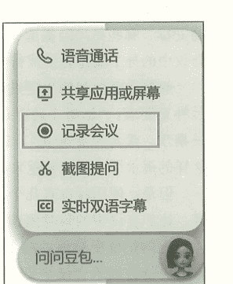
它会自动适配腾讯会议飞书等常用软件，后台静默运行不干扰沟通。你可全身心讨论无需手记。

会议结束单击停止记录，十几秒即可看到简明概要，点详细内容可查看完整纪要包括总结和代办智能章节文字记录，如图 2-7 所示。核心要点决策自动标注，智能章节带时间戳可直接跳转。
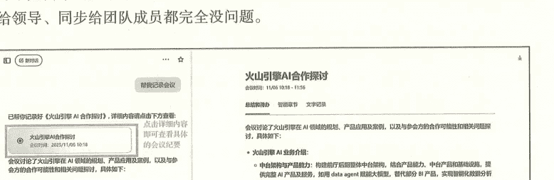

智能体现在：自动筛选有效信息剔除闲聊重复语气词；场景化模板适配项目会议例会客户沟通等；关键信息识别区分决策行动安排风险提醒；分工自动转为待办清单。

想更贴合需求，可补充提示：“把刚才会议内容整理成我的工作清单按重要性排序标明完成期限设定检查节点”，纪要即可变为行动方案。

使用注意：不要指望记录所有闲聊，聚焦核心讨论；AI也有疏漏，涉及重要决策节点数据务必核查；提示要具体明确说明格式和重点。

总体价值是把人从重复记录中解放，专注讨论后快速拿到可用纪要，把时间用在核心工作上。

试一试

开会就别再低头写笔记了，直接启动豆包的会议记录模式，把注意力全部放在对话上。会前照着示例准备一套会前引导语，会后先浏览系统自动生成的纪要，再追加一条会后引导把纪要拆成自己的行动清单，做到会上更投入、会后不熬夜。自己实操对比一下，你会发现工具整理的耗时远低于手工整理。

补充提示
1）不必追求一次性完美，先让工具正常运转，根据每次使用反馈慢慢优化引导语，让它逐步贴合自己的工作习惯。
2）多人轮流发言也不用担心，豆包会自动识别说话人并归类整理，不会出现信息混淆。
3）对经常开的固定类型会议，把常用的模板引导保存下来，下次直接复制调用，减少重复劳动。

### 技巧 20 心得撰写：让读书和培训的收获更扎实
职场里总有不得不写的心得：读完专业书要交感想，上完培训要出总结，脑子里有想法却写不出来，不是开头卡壳，就是写成流水账，要么与岗位结合不紧密，最后熬夜提交仍被反馈缺乏深度。

写不好通常不是不想写，而是方法没对上：想把理论和岗位连起来却找不到切口，想理清结构却越写越乱，想体现个人思考却只能堆砌空话。怎样快速产出既符合要求又有分量、贴近实践的心得？用豆包的精准引导和结构化输出能力，就能绕开这些坑，读书体会和培训总结都能高效完成。

#### 1. 读书体会：把书本知识嫁接到实际场景
很多人写读书感悟，要么只复述书本，要么只谈工作，两者脱节。把任务拆成三段引导，理论与实践就能自然衔接。

其一，让豆包吃透书的核心。不用自己逐段拆解，给出明确引导让它提炼重点。例如读《高效能人士的七个习惯》，引导可设计为：请深度解析《高效能人士的七个习惯》，重点归纳与职场协作、目标管理相关的核心理论，保持简洁。豆包会快速输出要点。

其二，明确岗位需求。让工具知道你的职责，感悟才不会跑偏。引导如：某互联网公司人力资源专员，主要负责招聘、入职培训、员工关系维护，请梳理该岗位从业者需要具备的综合素质，分点列出关键能力。

其三，串联生成全文。把前两步信息整合，让豆包挑选关联度最高的理论并成文。参考引导：结合《高效能人士的七个习惯》核心观点与互联网公司人力资源专员岗位要求，挑选关联最强的三个理论并说明理由，按“标题+引言+主体+结语”结构写一篇约1500字的读书体会，语言有思辨性，突出实践结合。

生成思路示例：
引言点出互联网快节奏下HR角色从事务执行转向业务伙伴，《高效能人士的七个习惯》中“由内而外”逻辑为破解招聘难、留才难等痛点提供方法，“积极主动”“知彼解己”“不断更新”关联最强，形成主动破局—精准协作—持续进化的闭环。
主体分别展开：积极主动从被动响应到主动预判；知彼解己从单向传达到双向共情；不断更新从经验依赖到动态进化。
结语强调三点理论为HR提供成长路径，效能本质是用专业让人才与组织实现双向成就。

#### 2. 培训总结：从敷衍凑字到产出干货
培训结束后的总结最让人头疼的是记不住要点、不知道怎么用。借助豆包可以快速提炼价值并规划落地。

首轮，提炼核心价值。别对着笔记发呆，让豆包筛选关键信息。例如参加“高效沟通技巧培训”，引导可以是：某互联网公司行政人员参加了“高效沟通技巧培训”，内容涵盖跨部门沟通话术、冲突处理、向上汇报等，请分析对行政工作的实际价值并提炼三个核心价值点。

次轮，整合并规划落地。让豆包把价值点转为行动方案，引导示例：结合上述三个价值点，为互联网公司行政人员列出工作中的具体应用方向，每个方向配1-2个实操场景，再按“标题+引言+收获+规划+结语”结构撰写约1200字的培训感悟，标题用公文对偶式，突出成果和行动导向。

生成片段示例：
# 提升沟通技巧 强化行政效能 以务实担当 赋能企业发展
为期数日的培训结束后，系统的讲解、案例分析和实操演练让行政沟通的逻辑有了新认识。作为企业运转的润滑剂、协作桥梁和需求首个接触点，沟通能力直接影响效率和服务质量。现将收获与行动计划总结如下：
一、核心收获：三项能力升级，夯实沟通基础
（一）精准表达：信息传递不打折
（二）换位思考：协作配合更顺畅
（三）冲突化解：问题解决有方法
二、后续规划：四个实施方向，推动转化
三、结语：以沟通为翼，推动行政工作新提升

若分标题不够贴切，还可让豆包优化。引导：请把以下培训感悟分标题优化为成果导向的对偶式标题：①学习沟通技巧，提升工作效率；②掌握冲突处理方法，改善协作关系；③学会向上汇报，传递工作价值。优化后例如“精进沟通艺术，筑牢协作根基；善用汇报技巧，彰显工作价值；化解冲突难题，提升执行效能”。

#### 3. 小结
写心得的核心痛点是没思路、没结构、没深度。豆包的优势是通过精准引导帮你拆解任务、梳理逻辑、关联实际，把无从下笔变成按步输出。只要把书籍或培训内容和岗位需求讲清楚，就能生成合规高质量文稿。

马上实践
选一本最近翻阅的专业书籍或一次培训，按如下引导操作：请结合《××》的核心理论，以及××岗位的工作职责，撰写一篇约1200字的心得体会，要求结构清晰，突出理论与实践结合，语言通俗有深度。

补充提示
1）引导越具体结果越准，务必说明内容方向、岗位职责、字数要求和结构偏好。
2）分段生成更易把控，可先让它输出标题和引言确认方向，再写主体。
3）拒绝照搬，初稿需结合自身案例微调，加入真实场景和个人思考。

### 技巧 21 述职报告：四步把平淡履历写出高度
年末述职报告是职场必考题，既要盘点全年工作，又要体现价值、贴合上级要求，直接关系评定和职业发展。

现实痛点是：一年下来全是琐事，提炼亮点困难；写出来像流水账；对公文规范发愁；加班凑字仍不满意。有没有不用熬夜、不用费脑还能写出让领导认可的报告？用豆包按流程操作即可。

#### 1. 找价值：把日常琐事抬升为关键成果
让豆包先分析相关文件，提炼核心价值点。把个人工作情况和公司要求交给豆包，它能帮你把“做了什么”升级为“做出了什么价值”。

案例：某公司行政岗员工需结合“202×年度提质增效工作方案”撰写述职。
引导：“请结合【个人年度工作情况：全年负责会议组织30场、办公用品采购管理、跨部门沟通协调等日常工作，优化采购流程减少浪费】和【公司文件：202×年度提质增效工作方案】，提炼工作价值点。要求：①价值点与方案精神关联；②用有序列表呈现。”

#### 2. 聚焦亮点：让业绩看得见
价值点提炼后转化为结构化业绩亮点。给豆包一个贴合岗位的专家身份，用结果导向梳理亮点并生成规范标题。

引导：“你是资深行政部门主管，熟悉行政工作特点和公文写作规范。请结合【个人工作价值提炼结果】，梳理工作业绩与亮点。要求：①列出一级与二级标题，标题为结果导向式，体现做法与成果；②二级标题下列出内容要点，突出与提质增效要求的关联性。”

#### 3. 套模板：保证结构完整逻辑通畅
通用写作框架：标题 + 帽段 + 工作业绩与亮点 + 能力素质提升 + 问题与改进措施 + 下一步展望。

案例1 普通员工：某互联网公司运营岗入职一年。
引导：“你是互联网公司运营部门主管，擅长公文写作和业绩梳理。请按照【述职报告写作框架】，结合【运营岗工作业绩与亮点】，撰写一份年度述职报告。要求：①严格覆盖框架所有部分；②符合公文语言习惯，各部分用对仗式标题，序号清晰；③内容谦虚低调，贴合新人身份；④字数约2000字。”

案例2 专项述职：某科技公司市场部门负责人团队建设专项。
引导：“你是科技公司人力资源专家，熟悉团队建设述职报告写作要求。请结合【市场部门年度团队建设工作情况】和【公司团队凝聚力提升专项通知】，撰写专项述职报告。要求：①结构包含工作开展、成效、问题、改进、未来计划；②标题对仗规范；③突出责任落实和实效，补充案例；④字数约2000字。”

#### 4. 精修细节：提升专业感
初稿生成后让豆包优化标题和语言风格。

引导：“请将以下述职报告标题修改为公文对仗式标题，要求简洁有力、体现做法与成果。原标题：①会议组织：做好安排，保证顺利；②流程优化：简化步骤，节省时间；③团队协作：积极配合，完成任务；④问题处理：及时响应，解决诉求。”
示例结果：①会议组织：精做会务安排，保障流程顺畅；②流程优化：简化步骤环节，实现省时增效；③团队协作：强化协同配合，高效完成任务；④问题处理：及时响应诉求，妥善解决问题。

小结：用豆包写述职，核心是找对方法、用对引导：先提炼价值，再梳理亮点，按规范框架生成全文，最后优化细节。

补充提示
1）提供给豆包的工作信息越具体，报告越贴合实际，尽量包含具体内容和成果数据。
2）初稿后可多次优化，如增加数据支撑、简化语言、调整语气。
3）公文风格要贴合身份，普通员工不必过度拔高，管理者需突出大局观。
4）不要直接使用生成内容，需结合实际补充细节，确保真实可信。

### 技巧 22 调研报告：三步快速成型
调研报告在工作中很常见，但找资料、定选题、理逻辑、写初稿都费时。用好豆包可提速。

#### 1. 准备阶段：先搭好研究骨架
前期准备做实，后续才顺畅。豆包可担任筹备助手，快速完成文件梳理、选题设计、方案制定和访谈提纲。

文件研究不用逐字研读，让豆包提炼核心。例如做新能源汽车行业调研，引导可以是：“请梳理近三年国家及浙江省关于新能源汽车产业发展的相关政策，重点提炼补贴政策、技术支持方向和市场准入要求。”

豆包会给出国家补贴政策要点和浙江省补贴政策要点清单，为后续分析提供依据。

2025浙江换新补贴研判：让豆包贯穿调研到成文的提效路径

围绕《2025年浙江省消费品以旧换新补贴实施细则》这类政策型课题，如果把豆包用在选题、分析、成文以及合同与简历等配套工作中，可以把准备、研判、输出的效率大幅拉升。以下是在保留原思路的前提下做出的表述重构。

### 1. 筹备期：把选题、计划、提问一次性打通
面对空白题目，可先让模型扮演行业顾问来破局。面向消费电子企业，可以让模型基于近两年折叠屏快速增长的趋势，输出若干可落地的研究方向，比如形态分化带来的需求差异、不同价位用户的选择逻辑、核心痛点迭代与付费意愿的关系、软件生态与AI体验的竞争价值、头部品牌入局后用户流动与格局演变等。

方向确定后，只需明确主题就能生成可执行的计划。让模型按对象、方法、时间表与核心内容给出详细安排，就能快速拿到框架。

进入实地环节，访谈提纲也无需手工撰写。去深圳、东莞的制造与渠道企业座谈时，聚焦研发思路、渠道布局与用户运营经验；回浙江杭州、宁波做线下门店与使用者调研时，聚焦本地认知度、购买顾虑与价格接受区间。把调研主体与关注点一起交给模型，就能得到贴合现场的问题清单。

### 2. 材料研判：快速抓取关键洞察
材料汇总后，最耗时的是归纳规律。把整理好的文件交给模型，可迅速得到全局视图，例如浙江省折叠屏市场的规模走势、品牌份额、使用者年龄分布等关键指标。

进一步做本地诊断，让模型在汇总文献的基础上归纳有利条件，如供应链配套与消费潜力，以及制约因素，如价格门槛与售后网络。

要提炼先进做法，可让模型综合头部企业的策略材料，总结打开市场的共性要素与可复制动作。

报告的价值在于差距对照与对策。把本地市场的强弱项与头部经验并置，让模型指出差距并提出本土企业拓展市场的具体做法，是整份材料的落脚点。

### 3. 成文期：分段输出规范商务文本
分析完成后进入写作。先确定身份与要求，让模型按“标题+导语”格式产出开头，语言简练、符合商务风格，导语控制在四百字左右。

现状概述部分，先提供背景材料与写作公式，让模型按结构组织内容，保持逻辑连贯，约一千二百字。

问题研判部分，紧扣下沉市场拓展主题，让模型深入展开不足成因，表述规范，约一千五百字。

### 4. 小结
从选题到计划、从材料整合到差距对策，再到结构化输出，豆包可以贯穿全流程，减少反复打磨的时间，既稳住质量又明显提速。

> 试试看
> 选一个近期要做的调研主题，借用上述筹备阶段的指令思路稍作改写，让模型生成一份调研计划与访谈清单，感受筹备效率。

> 小提示
> 1）材料研判时建议分批上传，让模型逐步整合，避免信息过载导致偏差。
> 2）初稿完成后可多轮对话精修，例如让模型把对策写得更细、或把现状描述写得更简洁。
> 3）涉及具体数据时，最好打开模型引用的网页核验，确保时效。

### 技巧23 合同撰写：快速产出合规文本
职场中合同是刚需。法务要处理采购与用工文本，业务偶尔要拟服务协议、租赁协议，都容易卡在模板重复、术语晦涩、条款漏洞、法条过时。用豆包的生成能力配合清晰框架，分步完善即可得到严谨可用的文本。

#### 1. 先画作业框架
核心是让模型清楚要写什么。需求越明确，输出越可用。明确文本类型、关键要素与特殊要求即可。

劳动合同示例指令：生成劳动合同框架，用人单位：××科技有限公司，劳动者：×××，身份证号：××××××××××××××××××，工作地点：广州市天河区××科技园A座1508室，期限3年，试用期2个月，月薪12000元，绩效另计，试用期按80%执行，竞业限制补偿1000元/月，离职后支付1年，按月发放，年终按考核上浮5%，含五险一金、办公设施使用费；工作内容为新媒体运营。

模型会直接生成框架文档，如图2-8所示。

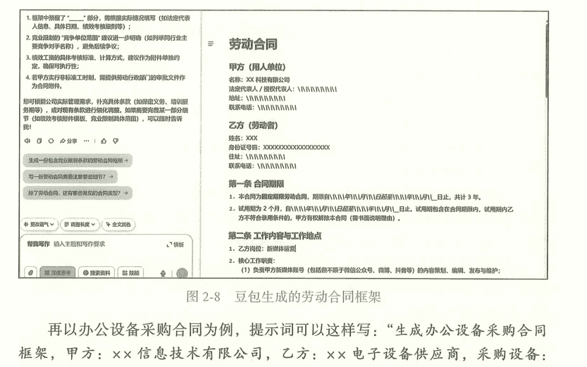

办公设备采购文本示例：生成采购合同框架，甲方：xx信息技术有限公司，乙方：xx电子设备供应商，采购笔记本电脑50台，型号MateBook14，单价6500元，交货期合同签订后15天内，交货地甲方北京分公司仓库，质保2年，付款验收合格后7个工作日内付80%，剩余20%满1年无质量问题付清，含运输安装调试费。

#### 2. 补细节并做风险校验
别指望一次成稿。先补充履行细节，再做法律风险排查。

在已有框架上补充：线上办公每日提交工作日报，线下办公周一至周五9:00—18:00；公司提供内容创作工具与培训资源。

模型会补充工时制、日报、办公时长、设备提供与培训等条款。

再让模型检查法律风险，重点看表述是否歧义、违约责任是否对等、是否符合最新法规。模型会指出日期格式、午休是否计入、工时是否超标、工资发放日期未明确、绩效制度未作附件、竞业限制范围空白、工作地点变更协商机制不明、违约金不平衡等风险，提示人工校对。

#### 3. 批量处理
面对多份格式相近、仅信息不同的合同，先整理核心信息清单，再用模板批量生成，可大幅节省时间。

#### 4. 小结
合同生成的逻辑是精准输入、分步完善、人工把关。模型能处理重复框架与初稿撰写，节省大量时间，同时保证专业合规。

> 试试看
> 选一个常用文本类型，按“类型+关键要素+特殊要求”写指令生成初稿，再针对付款方式、违约责任等关键点优化，最后核对行业惯例与最新法规。

> 小提示
> 1）指令越具体质量越高，主体信息、标的、期限、价款、责任缺一不可。
> 2）生成后务必人工复核金额、责任划分、争议解决等关键点，重要文本建议咨询律师。
> 3）同一会话中逐步完善，利用上下文连贯性让修改更精准。
> 4）保存生成文本与对话记录，形成可复用的专属模板库。

### 技巧24 简历提升：让招聘方更快关注你
用AI润色简历很常见，但HR每天收到大量模板化简历，反而会被“AI痕迹”扣分。关键不是不用AI，而是用对方法。

#### 1. 高度贴合岗位
不同公司对同岗位要求差异很大，通用简历很难命中。用“岗位描述+个人履历”双输入，让模型定制高度贴合的内容。

指令示例：我要应聘市场营销岗，以下是目标岗位条件和我的履历，请生成强贴合简历。岗位条件：负责品牌推广策划执行，运营微博抖音账号，提升活跃度与曝光，整理分析营销数据优化策略，本科以上，1-2年经验，熟悉新媒体，具备活动策划能力。个人履历：2022年6月至今广州创科传媒市场专员，参与品牌推广策划执行，负责新媒体日常运营，撰写文案，整理活动数据报告；曾策划校园推广，协调物料准备、场地布置，多篇抖音文案获万级播放。基本信息：陈悦，25岁，2021年暨南大学市场营销本科，电话135××××××××，邮箱chenyue123@email.com。

模型会输出基本信息、求职意向、核心能力、工作履历、教育背景等模块，内容紧贴岗位。

#### 2. 专业体检
自己看简历容易忽略矛盾、成果未量化、技能模糊等问题。让模型扮演资深HR体检。

指令示例：你是10年互联网公司资深HR，我要应聘行政助理，请结合岗位条件检查我的简历并指出不足与改进方向。简历内容：【粘贴文本】

模型会指出能力描述空泛、工作履历只说做了什么没说解决什么问题、教育背景与岗位关联弱等，并给出优化示范，如把“负责30+员工日常行政事务，月均统筹12-15场会议”优化为含差错率下降、会议无延误、同步率100%等量化表述。

#### 3. 价值化表达
核心是把“干了什么”转为“做成了什么”，用情境-任务-行动-结果的方式呈现。

指令示例：结合你指出的不足，用情境-任务-行动-结果方式优化我的工作履历，量化成果，明确技能熟练度与应用场景，突出与行政助理岗位的契合度，避免空泛表述。原始内容：【粘贴】

优化后会呈现场景、任务、行动、结果，数据化体现能力。

#### 4. 小结
用豆包提升简历的核心是借助高度贴合与专业体检，让简历更贴合需求、更能体现个人价值。先用岗位+履历定制，再让模型挑错，最后量化优化，就能摆脱AI痕迹。

> 试试看
> 找一份心仪岗位的招聘条件，复制岗位描述与个人履历，用贴合指令生成初稿，再让模型诊断优化，最后用情境-任务-行动-结果指令升级核心履历。

> 小提示
> 1）不要全盘照搬，要结合真实履历调整，避免造假或能力不符。
> 2）优化后检查信息一致性，如学历时间、工作时长、成果数据，避免矛盾。
> 3）导出后选用简洁专业模板，避免花哨设计喧宾夺主。

### 技巧 25 模拟面试：四步把控邀约节奏

招人旺季，一对一问答最容易让求职者绷不住。刚毕业的同学缺少实战，转行的人久没经历过面试，简历很出彩、硬技能也达标，一入场就大脑宕机——想好的自我介绍变成结结巴巴，专业追问答得东一榔头西一棒，还有没听清题目先急着回应的。更关键的是，优质岗位可遇不可求，一次发挥失常往往就与机会擦肩。

想先热身？身边的人要么不懂目标行业的出题逻辑，问得泛泛；要么碍于情面只会说“挺好”，点不掉真实问题。请老师傅陪练，大家都忙很难固定。线下付费陪面动辄上千，对学生和预算紧张的人不友好。网上题库大多是文字，缺少现场对话的压迫感，练完仍不适应真实节奏。

有一种低门槛、高逼真、可快速暴露短板的练习方式。豆包的模拟面谈模块能结合简历与目标 JD 自动出题，全程语音对话还原现场，结束后给出专业点评，提前完成脱敏与补漏。

#### 1. 第一步：定位入口，启动演练
移动端和桌面端都能用，上手很轻。应用商店搜索“豆包”安装，打开后进入对话页，底部导航的电话图标点开会弹出场景选择，点击模拟面试即可，如图 2-9 所示。若没看见，可在输入框上方菜单左右滑动找到电话功能，授权语音权限后使用。电脑端需官网下载客户端，网页版不支持语音。打开客户端点右上角电话图标切换到语音模式，直接说明诉求，例如“我要面试互联网法务岗，请你扮演经验丰富的面试官”。结束时还能让豆包打分并给出建议。进入后建议先打开字幕以防漏听，不需要画面可关闭摄像头，专注语音交互。

#### 2. 第二步：设定情境，提升匹配度
模拟的意义在于精准。向豆包补充岗位、经验等关键信息后，出题会更对路。可直接套用以下指令：

基础设定：“我要申请前端开发岗位，熟练 React、Vue，有一年项目经验，请基于我的背景提问，重点考察专业能力和项目实操。”

深度追问：“请扮演字节跳动资深面试官，根据我上传的简历和 JD，针对每个项目经历各提 5 个追问，核心在成果真实性与问题解决力。”

风格限定：“请模仿亚马逊行为面试，用 STAR 方式提问，侧重客户导向与高标准意识。”

设定完成后口头说“我们开始吧”，豆包便以考官身份发起提问，节奏与真场基本一致，沉浸感很强。

#### 3. 第三步：沉浸练习，适应现场节奏
把每次练习当成正式考试，效果最好。豆包会用语音提问，例如“请描述你在项目里最具挑战的任务及解决思路？”“简历提到提升产品转化率，具体做法和可复用的方法论是什么？”。拷问逻辑贴近大厂，会从成果验证、能力呈现、方法沉淀等多角度深挖。

作答时尽量把停顿控制在 3 秒内，保持网络通畅。真实面试中考官不会等你缓冲。若没听清可直接说“请重复一遍问题”，豆包会耐心复述，不用尴尬。卡壳恰是练习价值所在，可用“首先……其次……最后”整理思路，或坦诚“这个问题我需要稍作思考”，训练临场救场。

#### 4. 第四步：善用复盘与拓展，定向提升
模拟不是走过场，复盘才能加速。面完可提示：“请对我刚才的回答评分，从内容完整、逻辑清晰、表达流畅三方面给改进建议，并提供参考答案。”豆包会输出详细点评，指出短板如“缺少数据支撑”“逻辑顺序混乱”，并给出优化方向。

专项突破可换风格反复练。

压力面：“请扮演节奏快、要求高的面试官做压力面，刻意制造卡壳场景，围绕‘能否快速适应新工作’‘成果是否个人贡献’等连环追问，训练救场。”

行为面：“围绕沟通、协作、解决问题三维度出行为题，要求用 STAR 回答。”

还能让豆包生成专属题库，例如“为产品经理岗位生成 30 道高频题，按基础、专业、项目经验分类，每题附考察点分析”，后续随时抽题巩固弱项。

#### 5. 总结
豆包模拟面试的优势是零成本、高还原、强反馈。不用报班也不用麻烦他人，随时可开练，并能按岗位需求定制情境，从基础问答到压力面全覆盖，面后还有专业点评。应届生或转行者只要持续使用，就能提前适应节奏、暴露问题、打磨表达，大幅提升拿到 Offer 的概率。

> 试一试
装好豆包 App 或电脑版，进入模拟面试，上传简历和目标 JD，输入“请扮演互联网公司新媒体运营面试官，基于我的简历和 JD 设计 10 道专业题，含 3 道深度追问和 2 道行为题”，完整跑一轮后索要反馈报告，针对性修改回答。

> 小贴士
1）尽量脱稿，用口语化表达，别背稿。自然沟通更易打动人。
2）每次聚焦 1～2 个改进点，如“补充数据”“理顺逻辑”，逐点突破更高效。
3）可保存多次对话记录，对比不同轮次进步。
4）先用文字模式理清思路，熟练后再切语音，循序渐进提升流畅度。
5）上传简历和 JD 时保持信息清晰，避免提问跑偏。

### 技巧 26 产品开发：用智能助手压缩周期

产品节奏越来越紧，市场风向说变就变，用户催更不停，传统开发流程却处处拖后腿。需求对齐要开会画图，技术评估工期排任务，前期准备就耗掉一两周；后续还要应付资源冲突、进度失控、文档堆积等内耗。

怎么又快又稳地推进？把豆包当作智能助手，从需求拆解到文档产出全流程加速，把低效环节砍掉即可。

#### 1. 需求拆解 + 时间估算，减少反复对齐
把模糊需求转成清晰任务是起点。传统模式靠产品和技术反复碰，极易产生偏差。豆包可直接接收需求，自动拆解核心模块并给出周期预估，比人工更可靠。

例如开发“职场技能打卡平台”，提示词可写：“开发一款职场技能打卡平台，目标是记录技能学习进度、生成学习报告，支持管理员后台审核和数据统计。请拆解核心开发模块并估算周期。”

可得到如下拆解：

核心开发模块及对应周期
- 一、基础层模块
  - 项目基础架构搭建：3～4天
  - 数据库设计与实现：4～5天
  - 权限认证模块：5～6天
- 二、用户端模块
  - 用户管理模块：3～4天
  - 技能管理模块：4～5天
  - 打卡记录模块：6～7天
  - 学习报告模块：7～8天
- 三、管理后台模块
  - 管理员账户管理：3～4天
  - 平台用户管理：3～4天
  - 技能库管理模块：4～5天
  - 打卡审核模块：5～6天
  - 数据统计分析模块：6～7天
- 四、公共功能模块
  - 公共支撑模块（文件上传/消息通知/日志等）：5～6天
- 五、系统测试与优化
  - 测试与优化模块（功能/兼容性/性能测试+BUG修复）：7～8天

优先级和耗时一目了然，不必耗几天开会讨论。

#### 2. 敏捷迭代计划，应对市场变化
瀑布式开发已难跟上节奏，需求一改就得重排。豆包契合敏捷思维，可把项目拆成 2～3 周的短迭代，覆盖需求、设计、编码、测试、部署，确保快速交付可用版本。

优化“社区生鲜配送 App”时可提示：“为社区生鲜配送 App 制定 3 个月敏捷迭代计划，核心方向是缩短配送时效、增加食材溯源、优化下单流程。按 2～3 周一个迭代，明确每轮核心任务、交付目标和测试重点。”

系统会拆分为 4 个迭代周期：

迭代序号 | 周期 | 核心优化侧重 | 辅助优化
---|---|---|---
迭代1 | 第1～3周 | 下单流程简化（用户体验入口） | 配送时效调研 + 食材溯源需求梳理
迭代2 | 第4～6周 | 配送时效技术落地（核心功能） | 食材溯源基础架构搭建
迭代3 | 第7～9周 | 食材溯源全功能开发（核心功能） | 下单流程 + 配送时效优化迭代
迭代4 | 第10～12周 | 全场景闭环测试 + 性能优化 | 三大方向 BUG 修复 + 体验打磨

每轮都有可落地成果并持续改进。

#### 3. 智能资源分配 + 风险预警，避免手忙脚乱
计划再好，资源错配也会翻车。豆包可按成员技能标签自动分配任务，并提前预警冲突。

以上述项目为例，团队配置 3 前端、2 后端、1 测试，提示：“请根据各迭代模块需求分配人员，预判资源冲突并给出解决建议。”

会给出分迭代分配方案及冲突预警，例如迭代 1 前端负责下单流程原型，后端负责下单接口，测试负责可用性测试等，并提示关键节点人力紧张时的应对办法。

#### 4. 自动生成文档，省下时间做研发
需求文档、技术规范、测试用例、总结报告都是隐形负担。豆包能自动生成骨架，稍改即可用。

提示可写：“基于社区生鲜配送 App 的迭代计划和模块拆解，生成项目需求文档、技术规范和测试用例框架，需求文档说明核心功能和用户场景，技术规范明确接口标准，测试用例覆盖关键流程和异常场景。”

调整后可直接使用，让研发聚焦核心工作。

#### 5. 总结
豆包辅助产品开发的核心是把拆解、规划、分配、撰写等重复低效工作自动化，而非替代决策。从模糊需求到上线，每个环节都能得到精准支持，缩短周期、降低风险。工具效果取决于输入质量，结合清晰需求和人工校准，才能最大化价值。

> 试一试
挑一个在推进的项目，如“校园二手交易小程序”，提示：“开发校园二手交易小程序，核心功能包括商品发布、搜索筛选、聊天沟通、交易担保、订单管理。请拆解模块、估算周期，制定 2 个月敏捷迭代计划，并分配给 3 前端、2 后端、1 测试的团队。”看看方案完整度。

> 小贴士
1）需求描述越具体越好，明确功能、目标用户、约束条件。
2）自动生成的文档和计划需结合团队实际微调，融入经验。
3）关键节点风险仍需结合行业经验二次确认。

### 技巧 27 PPT 制作：三步产出专业演示稿

职场里 PPT 是刚需，汇报、演讲、推广、提案都离不开。但多数人要么缺乏设计基础排版混乱，要么太忙没时间打磨，外包又贵且难及时响应。紧急汇报更让人头疼。用豆包 AI PPT 功能，无需掌握设计软件，按步骤就能快速生成专业稿。

#### 1. 明确需求，生成精准大纲
先确定主题、结构、页数、重点模块等，提示词越细大纲越准。

打开电脑版或网页版豆包，找到“AI PPT”入口，在对话框输入完整需求，如图 2-10 所示。例如：“主题：美容业如何借助 AI 实现线上引流拓客。要求：先介绍 AI 在美容行业的应用场景，含 3 个案例，最后分析未来前景，总页数 12～15 页，内容偏实操。”

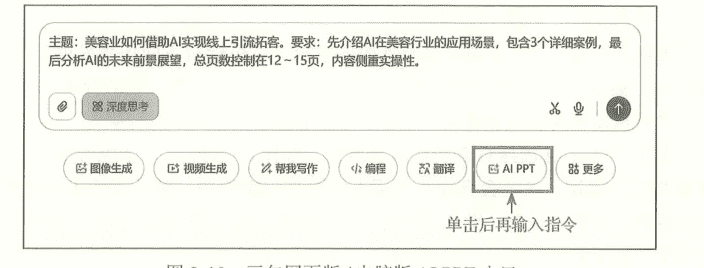
图 2-10 豆包网页版/电脑版 AI PPT 入口

发送后 1～2 分钟即可得到逻辑清晰的大纲，包含标题、各章节要点、案例框架和数据方向，省去手动梳理。如不满意可重新生成或补充提示词调整，亦可直接修改大纲内容。

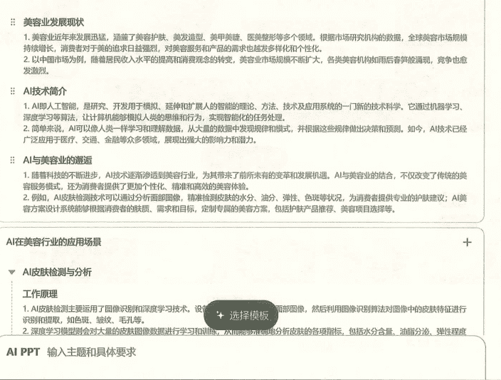
图 2-11 豆包 AI PPT 生成的大纲

#### 2. 选定模板，快速生成初稿
大纲确认后选择模板。豆包提供总结汇报、教育培训、营销推广、商业计划、企业介绍等多场景模板，风格从简约商务到创意个性。按主题选定场景和风格，如图 2-12 所示，点击“开始生成 PPT”，系统会自动填充内容。不到 3 分钟即可得到版式规整、图文协调、字体统一的初稿，无需手动排版。

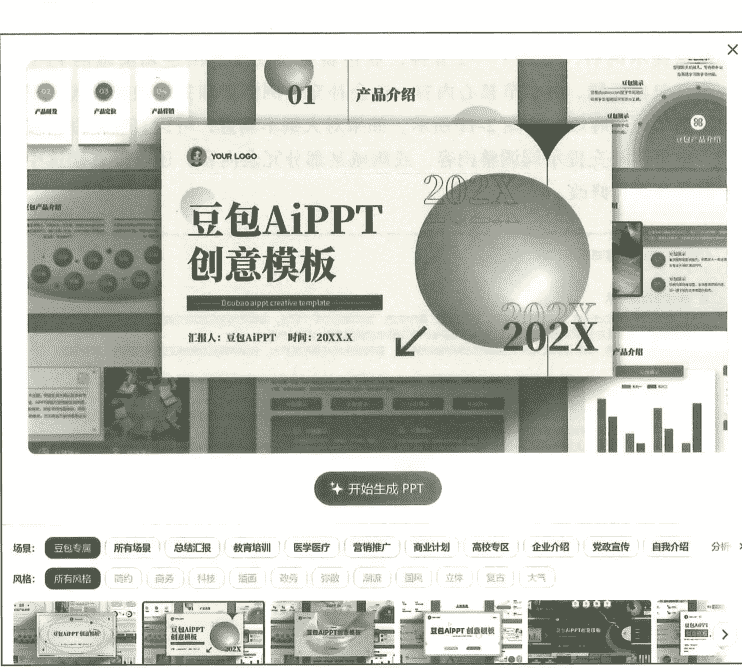

#### 3. 细节修改，确认终稿输出
初稿已具备专业雏形，细节仍需微调，如替换品牌 LOGO、修改汇报人信息、调整时间、更换图片等。点击“进入 AI PPT 编辑”跳转至编辑页，操作与常见办公软件类似，支持单页单元素修改。可直接改文字、换字体字号、替换图片或从图库挑选，拖动调整布局并添加图表图标。完成后按使用场景选格式：演示或分享选 PDF 避免错乱；需二次修改选可编辑模式下载本地优化。

#### 4. 总结
豆包 AI PPT 打破了制作需专业技能的壁垒，通过“明确需求出大纲—选模板出初稿—细节修改出终稿”三步，把复杂流程简化，让零基础也能快速做出专业演示文稿。

> 试一试
选一个近期要做的 PPT 主题，按“主题 + 核心要求 + 结构模块 + 页数”格式写提示词，用豆包生成大纲和初稿，再按需求修改细节，体验 10 分钟搞定专业稿。

> 小贴士
1）提示词越具体，生成内容越精准，明确结构、案例数、侧重点、受众。
2）模板要贴合主题和场景，避免风格脱节。
3）终稿前务必核对数据和案例，确保准确。

### 技巧 28 Excel 数据可视化：一键生成图表

汇报分析和工作复盘时，图表不可少。一张清晰专业的图能大幅提升信息传递效率。但实操中，进阶图表常让人卡壳——想做折柱混合图呈现多维度数据，手动调格式反复不对；想做聚类分析散点图划分用户群，数据处理无从下手；动态图表、交互饼图看着就复杂，最后只能用简单图表凑合，或花数小时反复打磨，费时效果仍不理想。

5 分钟，豆包搞定进阶图表与数据分析

过去在办公室里要做一份带对比带趋势的可视化，多半是在 Excel 里反复拼图，或去啃编程。现在把任务交给豆包，零专业门槛。折柱混搭、聚类散点、带交互的双柱、圆环占比，只要把需求描述清楚，系统就能直接生成，几乎不用再开其他工具，平均五分钟就能拿到可用的成果。下面按几个常见办公场景拆开讲。

#### 1. 季度汇报：销售完成度与新增客户的混合图
季度复盘往往要同时看达成率和新增客户数量，单一图表说不清，柱线组合最直观。不需要自己在表格里拆两张图拼接，直接让豆包来做。

把数据表传上去后，在对话里说明：“基于上面的表格做折柱混合图，柱状部分展示销售目标达成率，折线部分展示新增客户数，柱子用浅蓝、折线用深灰，所有数据点都标注数值，图表标题为‘2024年季度销售目标达成与新增客户趋势’。”

系统会自动定位字段并生成图表，如图 2-13。柱子便于横向比较，折线体现走势，数值标签也已加上，可直接复制进 PPT 使用。

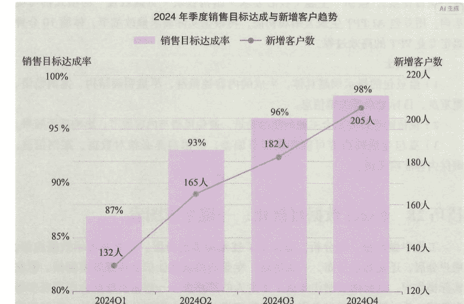

图 2-13 销售的折柱混合图

#### 2. 用户分层：活跃度与留存率的聚类散点
运营做人群分层时，常拿周活跃度与7日留存率找关系，想把用户划成高活高留、低活低留等群体，聚类散点最清晰。不用自己学 K-Means，豆包可直接实现。

导入数据后指令为：“用这张表做聚类散点图，采用 K-Means 聚成三类，分别用红绿蓝标出，标题为‘App 用户活跃度与留存率聚类分析’，并输出每类的用户数、平均活跃度与平均留存率。”

处理完成后得到如图 2-14 的散点，不同颜色代表不同群体，上方附带分类统计，可直接放入运营分析报告。

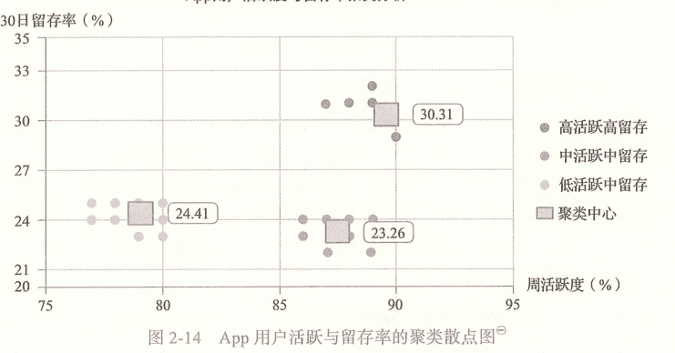

图 2-14 App 用户活跃与留存率的聚类散点图

#### 3. 月度对比：销量与售后工单的动态双柱
想看月度变化并带交互感，鼠标移上去能看到具体数值，动态双柱比静态更有吸引力。不用自己配置 ECharts 动画，豆包可生成交互版本。

在豆包里上传数据，描述为：“基于表格生成动态双柱图，深色柱代表销量，浅色柱代表工单数，悬停时弹出数值，标题为‘2024 年月度产品销量与售后工单趋势’，以 HTML 形式返回。”结果如图 2-15。

> 本书为双色印刷，无法展示所有颜色，读者可自行实践，查看完整效果。

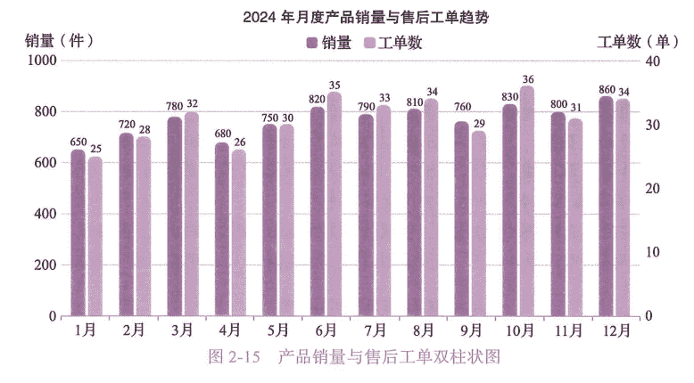

图 2-15 产品销量与售后工单双柱状图

#### 4. 年度预算：营销费用渠道占比的圆环图
做年度预算回顾时，用圆环展示各渠道费用占比比普通饼图更精致。无需手动调整图例，豆包可生成带图例与阴影的圆环。

上传数据后描述：“用表格生成可交互圆环饼图，内径 40%、外径 70%，用橙绿蓝紫等区分渠道，悬停显示渠道名称、占比与讨论人数，图例放在右侧可滚动，标题为‘2024年度营销费用渠道占比分析’。”

得到的效果如图 2-16 所示。

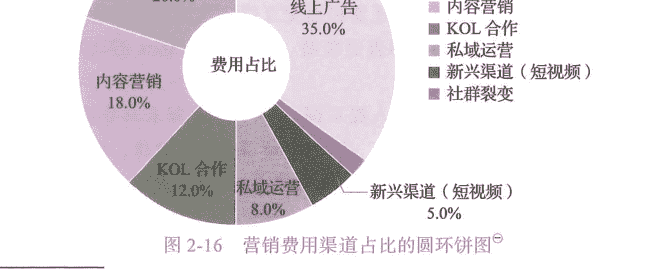

图 2-16 营销费用渠道占比的圆环饼图

> 本书为双色印刷，无法展示所有颜色，读者可自行实践，查看完整效果。

#### 5. 小结
用豆包做进阶图的关键在于把需求拆细：先给明确数据，再说明图种，最后补充样式与交互。描述越具体，就越不需要专业工具，也不用为一张图耗半天。

> 试一试
挑工作中需要的图种，比如用聚类散点做用户分层，或用动态双柱展示业务走势，整理好 Excel，参照文中的描述方式改写后发送给豆包，感受一键生成的效率。

> 小贴士
1）提供的数据要规范，避免缺失关键字段，否则会影响准确性；如有缺失可在描述里说明处理方式。
2）描述需明确图种、数据维度、输出形式及特殊需求如配色、交互，信息越精准结果越贴合预期。
3）HTML 形式的图可直接嵌入 PPT、报告或网页，生成后如需调整样式，可继续补充提示修改。

### 技巧 29 数据分析：不用函数，一步搞定表格整合与图表生成
做月度汇报时，几张 Excel 手动合并、VLOOKUP 反复出错；算成绩平均分、排名、做图表要折腾半天；拿到问卷却不知如何提炼结论。很多人被数据整理和分析的繁琐流程困住。

豆包的数据分析功能正好解决这些痛点。不用记公式、不需编程，只要上传文件并用自然语言描述需求，就能完成合并、清洗、统计、可视化并生成专业报告，效率翻倍。入口在豆包电脑版或网页版的“数据分析”，上传 Excel 即可开始。

#### 1. 数据整理：多表合并 + 识图转表，繁琐工作一键搞定
数据分散时最耗时。若手里有 3 张不同门店的月度销售表，列名均为“商品名称”“销量”“销售额”“门店”，需合并成总表，可描述：“把上传文件里所有工作表按相同列名合成一张总表，去重后导出新的 Excel 可下载”。系统会自动识别列名并完成合并导出，省去复制粘贴。

部分生成结果示例：

数据合并处理完成报告

已成功将城东店、城西店和总店的月度销售表按相同列名合并，并完成数据清理，具体处理结果如下。

1. 数据来源与处理概况

原始文件：3 个 Excel 文件（城东店、城西店、总店各 1 个）。

原始数据量：共 48 条记录（城东店 15 条、城西店 16 条、总店 17 条）。

列名统一性：三个文件列名完全一致，不需要列名映射。

重复数据处理：未发现重复数据，数据完整性良好。

2. 合并后数据结构

合并后的总表包含以下 6 个字段：

商品名称：具体商品的标识。

销量：该商品的销售数量。

销售额：该商品的销售金额（元）。

门店：销售门店名称。

店铺名称：统一的店铺标识（与门店字段一致）。

月份：统一标注为“月度销售数据”（原始文件无具体月份信息）。

3. 销售数据汇总统计

……

4. 生成的 Excel 文件说明

……

单击链接即可下载新合并的文件，如图 2-17 所示。

要不要我帮你进一步生成一份数据可视化图表，直观展示各店铺的销售对比情况？

图 2-17 可直接下载合并后的文件

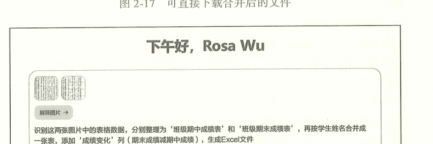

图 2-18 上传成绩截图

遇到图片里的表格数据如截图成绩表，不用手动录入，可写：“识别这两张图片的表格，分别整理为‘班级期中成绩表’和‘班级期末成绩表’，按学生姓名合并成一张表，增加‘成绩变化’列（期末减期中），导出 Excel。”系统能精准提取文字数字，完成转换与合并。

豆包生成的结果可能如表 2-1 所示。

## 表 2-1 班级成绩表

| 姓名 | 期中总分 | 期末总分 | 成绩变化（期末－期中） |

| --- | --- | --- | --- |

| 王兵 | 510.7 | 469.8 | -40.9 |

| 田秀兰 | 504.9 | 444.7 | -60.2 |

| 王燕 | 500.8 | 481.9 | -18.9 |

| 王秀华 | 498.0 | 470.8 | -27.2 |

| 王春梅 | 479.8 | 481.3 | 1.5 |

| 杨柳 | 407.4 | 475.7 | 68.3 |

#### 2. 数据统计：指标计算 + 分数段分析，精准提炼核心信息
整理好数据后，各项统计指标和分层分析也能快速完成。以销售数据为例，描述：“分析这份月度销售数据，算出总销售额、平均单品销量、销售额前三的商品；按销量分为‘热销款（≥1000件）’‘平销款（500～999件）’‘滞销款（<500件）’，统计各类的商品数和占比”。

系统会自动计算并给出清晰分类结果。

部分生成结果示例：

各门店月度销售数据分析结果

一、核心销售指标

总销售额：1305520.85 元

总销量：4959 件

商品总数：48 款

平均单品销量：103.31 件/款

二、销售额最高的前三款商品

| 排名 | 商品名称 | 销量（件） | 销售额（元） | 占总销售额比例 |

|---|---|---|---|---|

| 1 | 休闲食品-252 | 199 | 97800.88 | 7.5% |

| 2 | 美妆护肤-878 | 198 | 96920.95 | 7.4% |

| 3 | 日用百货-421 | 137 | 66919.72 | 5.1% |

关键发现：前三款商品共贡献 261601.55 元销售额，占总销售额的 20.0%，是销售业绩的核心驱动力。

三、商品销量分类统计

......

四、数据洞察与建议

......

五、生成文件

我已为您生成了以下两份分析文件：

## 114 豆包使用秘笈：从入门到精通的 100 个实用技巧

### 1. 可视化图表：包含销售额 TOP3 对比、销量分布、分类占比等 4 个维度的综合图表。

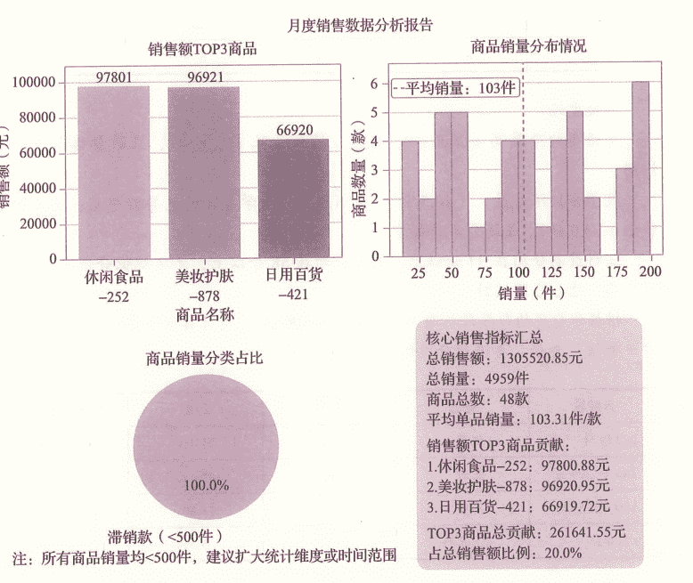

### 2. 详细分析报告：包含完整的数据分析过程、洞察和优化建议的 Markdown 文档。

针对学生成绩数据，描述可设为：“分析这份班级成绩表，计算语文、数学、英语三科的平均分、最高分、最低分；按总分划分‘优秀（≥270分）’‘良好（240～269分）’‘及格（180～239分）’‘不及格（<180分）’四个分数段，统计每个分数段的人数及占比”，帮助老师快速掌握整体情况。

#### 3. 可视化分析：多类型图表 + 报告生成，直观呈现数据洞察
数据精准也需要直观呈现。豆包支持多种图表生成和完整报告输出，并可自由编辑。想做趋势和占比分析，可描述：“基于这份年度销售数据，生成月度销售额趋势折线图、各品类销售额占比饼图；用柱状图对比前三季度的销量差异，图表配色用商务简约风格，添加数据标签显示具体数值”。生成的图表清晰可直接用于汇报。

生成结果示例：

基于你提供的 2024 年年度销售数据，已完成 3 个商务简约风格图表的生成，所有图表均包含数据标签以清晰展示具体数值，配色采用深蓝、墨绿等专业商务色系，符合职场汇报需求。

1. 2024 年各月销售额趋势折线图

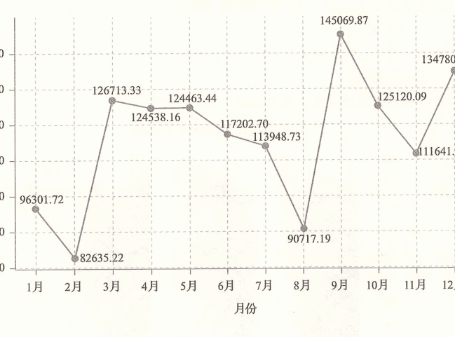

核心洞察：

- 销售额峰值出现在 9 月（145069.87 元），为全年最高，可能受中秋、国庆双节消费带动。
- 谷值出现在 2 月（82635.22 元），符合春节假期消费淡季特征。
- 整体呈现“波动上升”趋势，Q3（7～9 月）表现最优，总销售额达 349735.79 元，占全年 30.2%。

2. 2024 年各品类销售额占比饼图

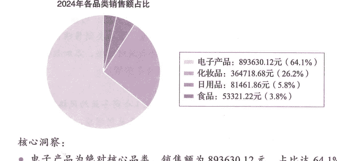

核心洞察：

- 电子产品为绝对核心品类，销售额为 893630.12 元，占比达 64.1%，是收入的主要来源。
- 化妆品为第二增长极，销售额为 364718.68 元，占比 26.2%，贡献四分之一以上收入。
- 日用品（5.8%）和食品（3.8%）占比较低，合计不足 10%，可考虑优化品类运营策略。

3. 2024 年前三季度各品类销量对比柱状图

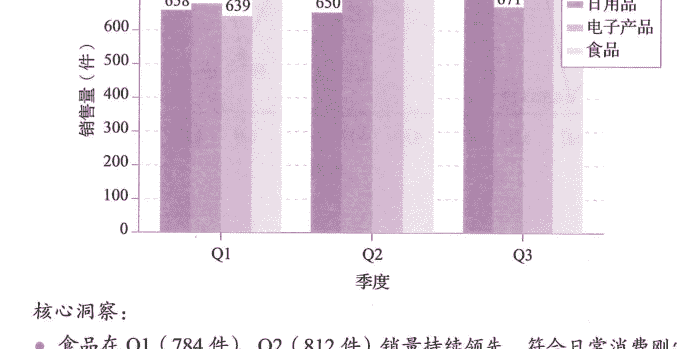

核心洞察：

- 食品在 Q1（784 件）、Q2（812 件）销量持续领先，符合日常消费刚需属性。
- 电子产品在 Q2 销量爆发（764 件），较 Q1 增长 19.6%，推测受“618”电商大促拉动。
- 化妆品在 Q3 表现最佳（778 件），环比 Q2 增长 19.7%，契合下半年美妆消费旺季的特点。

需要完整报告时，可写：“分析这份产品调研数据，生成包含数据概览、核心指标统计、用户偏好分析、优化建议的可视化报告，报告中要包含柱状图、饼图各两张，支持下载为 PDF 格式”。豆包会输出图文并茂的完整报告，还能编辑调整样式和内容。

部分生成结果示例：

产品调研数据分析报告

基于你提供的 77 份产品调研数据，我已完成全面的数据分析并生成了可视化报告。以下是详细的分析结果。

一、数据概览

（一）数据基本信息

样本规模：77 份有效调研问卷，数据完整性 100%（无缺失值）。

覆盖维度：4 个产品品类、4 个调研渠道、6 个年龄区间。

核心指标：满意度、购买意愿（1～5 分制），价格敏感度（1～3 分制）。

数据质量：数据结构完整，无异常值，分析基础可靠。

（二）样本分布特征

产品品类：日用品 26.0%、食品 26.0%、电子产品 24.7%、化妆品 23.4%（分布均匀）。

用户类型：个人用户 62.3%（48 人），家庭用户 37.7%（29 人）。

年龄结构：18～25 岁 26.0%、26～35 岁 26.0%、36～45 岁 22.1%（中青年为主）。

二、核心指标统计分析

（一）整体评分表现

| 指标 | 平均分 | 中位数 | 标准差 | 表现评价 |

| :--- | :--- | :--- | :--- | :--- |

| 满意度 | 3.99 分 | 4.0 分 | 0.82 | 良好 |

| 购买意愿 | 4.10 分 | 4.0 分 | 0.75 | 较好 |

| 价格敏感度 | 1.97 分 | 2.0 分 | 0.73 | 适中 |

（二）关键发现

用户满意度良好：近 60% 用户给予 4～5 分好评。

购买意愿积极：平均 4.10 分，高于满意度，市场潜力良好。

价格敏感度适中：27.3% 用户对价格不敏感，具备溢价空间。

三、可视化图表分析

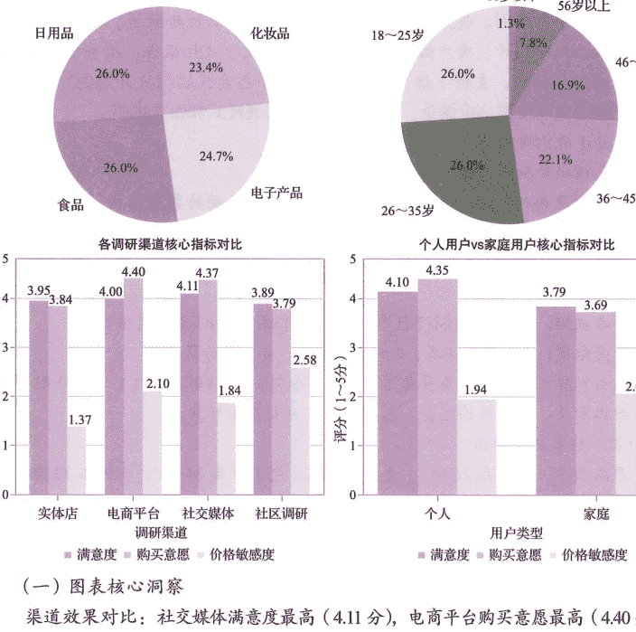

（一）图表核心洞察

渠道效果对比：社交媒体满意度最高（4.11 分），电商平台购买意愿最高（4.40 分）。

用户类型差异：个人用户满意度（4.10 分）和购买意愿（4.35 分）显著高于家庭用户。

年龄分布集中：18～35 岁用户占 52%，是核心目标群体。

品类分布均衡：四个产品品类样本分布均匀，分析结果具有代表性。

四、用户偏好深度分析

> 由于四舍五入，计算出的占比总和可能不等于 100%。

五、优化建议

……

六、分析结论

本次调研表明产品整体表现稳健，满意度与购买意向均处高位，其中57.1%的高价值用户占比为后续发展提供了稳固基础。包装呈现与功能体验是下一步重点改进方向，建议将资源集中在18至35岁的个体用户上，通过渠道结构调整和迭代优化来拉大竞争差距。

七、生成文件下载

完整的PDF版分析报告已生成，下面包含全部数据、图表与对策。

产品调研数据分析报告.pdf

（篇幅所限未作全文展示，建议读者自行实践。）

#### 4. 多维度深度分析：相关性+个体对比，洞察数据规律

当业务数据需要更深研判时，豆包可以完成相关系数测算与个体横向对比等进阶操作。以学生成绩为例，可使用指令：“请对排名前五的学生语数英理化生六科成绩计算相关系数，用雷达图呈现每人各科分布，归纳优势与短板并给出针对性提升建议”。借助此类处理，能快速把握成绩分布特征，为学习规划提供参考。

部分生成结果示例：

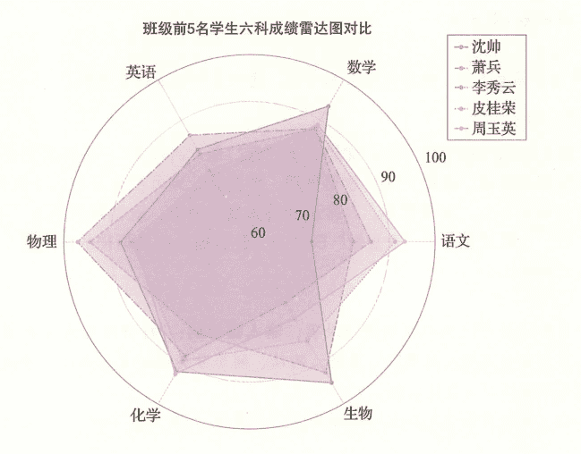

学生个人分析与提升建议

沈帅（第1名）

优势学科：数学（93.4分）、生物（94.8分）。

薄弱学科：语文（73.2分）、英语（82.8分）。

提升建议：

语文：加强阅读理解和写作训练，每周完成2篇作文练习。

英语：结合理科优势阅读英文科技文献，提升词汇量和应用能力。

巩固理科优势，探索学科间的知识关联。

萧兵（第2名）

优势学科：物理（94.3分）、生物（92.3分）。

薄弱学科：语文（82.1分）、英语（81.7分）。

提升建议：

语文：建立错题本整理常见题型，重点突破文言文阅读。

英语：每天坚持30分钟听说练习，提升语言应用能力。

发挥物理优势，带动数学、化学学科的进一步提升。

李秀云（第3名）

……

皮桂荣（第4名）

……

周玉英（第5名）

……

（由于篇幅有限，输出结果在此省略，建议读者亲自上手实践。）

#### 5. 总结

豆包在数据分析领域的核心优势是门槛低、效率高，无需专业背景即可实现从整理、统计到可视化的全流程。覆盖办公、教学、日常统计等多场景，既能解决新手不会用的痛点，也能为熟练用户节省重复劳动，让数据处理从体力活变成指令操作。

> 试一试

上传一份个人月度消费明细，输入指令：“统计总支出与日均支出，按餐饮、交通、购物、娱乐分类计算占比并生成饼图”，体验基础统计与可视化。

上传一张含表格的图片如课表或成绩单，输入指令：“识别图片中的表格数据整理成Excel格式，计算关键指标如课程总数、成绩均分”，测试识图转表能力。

小贴士

1）上传前对含隐私信息的数据如客户电话、员工身份证号做脱敏处理。
2）大文件建议分步提需求，先整理后统计制图，操作更流畅。
3）图表与报告均可下载编辑，样式不满意可补充提示如“将饼图配色改为蓝绿橙”。
4）请保持最新版本，部分高级可视化功能仅在新版可用。

### 技巧30 私人法务助手：三步搭建合同处理助手，提效

法务日常常被大量合同占据——校对错字、核对条款序号、核查法条时效、审查合作方信用，耗时费力。借助豆包电脑版，三步即可搭建专属AI法务助手，实现合同审阅、法规核查、法律翻译一体化，且无需额外付费。

#### 1. 定位设置入口，启用技能自定义

打开豆包电脑版，点击头像进入菜单，选择“设置”，进入个性化设置页。

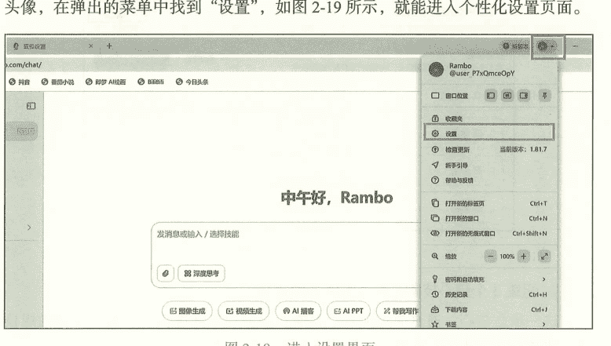

在设置页找到“AI工具”下的“AI划词工具栏”，进入该页面。

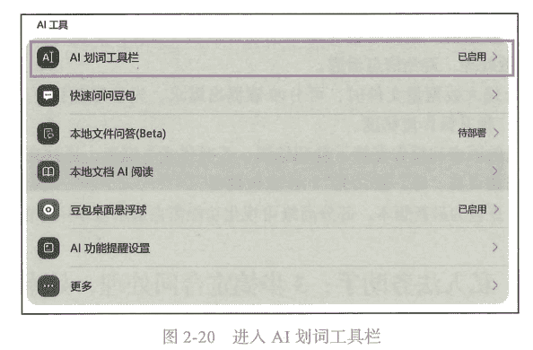

进入后点击右侧开关，启用该功能。

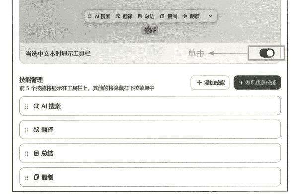

#### 2. 配置三项核心技能，覆盖法务高频需求

此步为关键，通过简单配置即可让划词具备合同审查、法规核查、法律翻译能力，无需自行编写提示词。

在“AI划词工具栏”中点击“添加技能”。

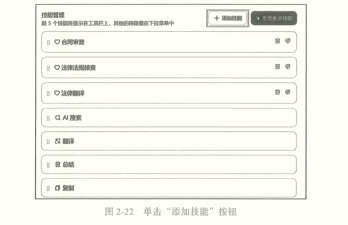

进入后按需填写技能名称、图标与提示词内容。

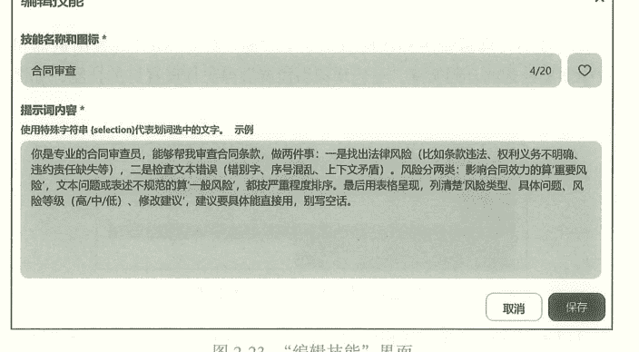

技能1：合同审查——揪出风险点和文本错误

专门用于排查合同隐藏风险与文字漏洞，提示词示例：“你是专业的合同审查员，能够帮我审查合同条款，主要负责两件事：一是找出法律风险（比如条款违法、权利义务不明确、违约责任缺失等），二是检查文本错误（错别字、序号混乱、上下文矛盾）。风险分两类：影响合同效力的算‘重要风险’，文本问题或表述不规范的算‘一般风险’，都按严重程度排序。最后用表格呈现，列清楚‘风险类型、具体问题、风险等级（高/中/低）、修改建议’，建议要具体能直接用，别写空话。”

技能2：法律法规核查——确认法律是否现行有效

引用的法律条文有没有失效？一键核实不遗漏，提示词如下：“你是专业的法律法规信息核查专员，能帮我确认指定的法律法规（或具体条款）现在是否有效，直接说结果（有效/无效/已废止/未生效），附上国家官方核查链接（比如国家法律法规数据库）。如果查不到明确结果，就说‘需通过官方渠道进一步核实’，不要编造信息。”

技能3：法律翻译——精准对接英美法术语

需要英文合同？不用再找专业翻译，提示词可以设计为：“你是专业律师兼法律翻译专家，熟悉英美法体系和法律英语表达，能够把中文合同条款翻译成英文，要求：① 用英美法合同常用专业术语；② 意思和原文完全一致，不改变法律效力；③ 关键术语（比如违约金、不可抗力）标注英文常用表述及依据；④ 翻译结果简洁规范，符合英文合同格式。”

#### 3. 直接划词，即可使用技能

配置完成后即可使用。打开Word或浏览器中的合同，选中目标文字，豆包划词会弹出已设技能。

图2-24 选择相应的文字和技能

可根据实际情况选择相应技能，如合同审查，豆包会按预设提示词快速梳理风险点，以表格列出风险类别、描述、等级与修改建议，左边看合同、右边看提示，修改更直观。

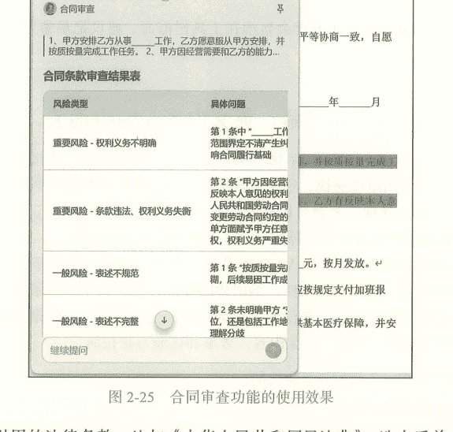

遇到引用的法律条款，如《中华人民共和国民法典》，选中后点击“核查法律有效性”，即可获知是否现行有效，并附上国家法律法规数据库链接，权威可靠。

若需处理英文合同，“法律翻译”技能可输出符合英美法术语的译文并标注术语来源，减少反复校对。

#### 4. 总结

用豆包搭建私人AI法务助手，无需复杂操作、无需额外成本，兼顾企业数据安全要求。三个核心技能覆盖合同审查、法律核查、法律翻译等高频场景，帮助法务从重复性工作中抽身，聚焦实质法律判断，效率显著提升。

> 试一试

打开豆包电脑版按上述步骤配置三项核心技能，选取近期待审合同使用“合同审查”功能测试，验证风险点识别准确度。

小贴士

1）建议优先用Word打开合同，兼容性更好，可避免划词冲突。
2）提示词可按行业微调，如金融行业可加入“符合金融监管相关规定”的要求。
3）工具栏默认技能排在前面，建议将常用技能置顶以便快速调用。

### 技巧31 双语实时字幕：英文内容无障碍通关

追无字幕原片，俚语难懂、笑点接不上，暂停查词会打断沉浸；开国际会议，外方语速快术语密集，漏听关键数据需回听录音；上英文公开课，专业名词一出就得暂停，知识点易遗忘。这些语言障碍令人头疼。

豆包电脑版V1.57.6及以上版本提供的双语实时字幕正好解决这些痛点：无需切换软件、无需等待，实时识别英文语音生成中英双语字幕，还可调节字号、拖拽位置，甚至可复制全程字幕，无论追剧、办公还是学习，都能秒懂内容。

#### 1. 具体操作：三步用对真实功能

（1）备齐基础条件

查版本：打开豆包电脑版，点击右上角头像→“关于豆包”，版本低于V1.57.6则在“设置→版本更新”中升级。

开悬浮球：若屏幕边缘未见悬浮球，进入“设置→豆包桌面悬浮球”，勾选“启用悬浮球”，悬浮球会固定在屏幕右侧底部，移入指针即可显示功能列表。

（2）两种开启方式

方式1 自动弹窗：打开英文内容时，若系统语言与内容语言不一致，豆包会自动询问是否开启双语字幕，点击确认即可。

方式2 手动开启：点击悬浮球中的“实时双语字幕”，选择“英文→中文双语对照”，再打开目标内容，字幕即时生成。

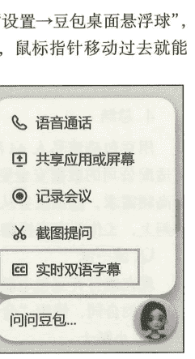

（3）常用调节

生成后点击字幕框上方，可调节：

- 显示模式：可选择是否显示原文。追剧练听力可关闭原文，看懂剧情可显示原文。
- 字号大小：默认中号。追剧用中号不遮挡，开会用大号更清晰。
- 位置拖拽：按住字幕框拖动。追剧可置于底部，开会可移至侧边避开PPT。

点击“展开字幕”可查看从开启至今的全部记录，一键复制即可整理笔记。

场景化用法：

- 追剧：显示原文+中号字+底部，兼顾沉浸与学习，结束后复制喜欢台词积累口语。
- 会议：显示原文+大号字，重点数据如18%ROI出现时无需手记，会后直接复制字幕整理纪要。
- 学课：显示原文+中号字，遇到专业词如recursive function可即时对照，课后复制知识点入笔记。

#### 2. 总结

豆包双语实时字幕的优势是贴合真实场景、实用简洁：追剧不打断、会议不遗漏、上课不耽误。基础的显示、字号、位置调节已满足需求，还能复制全程字幕，精准解决英文内容看不懂记不住的问题，是多场景刚需工具。

> 试一试

找一段约5分钟的英文素材，按步骤操作：①升级最新版并开启悬浮球，点击实时双语字幕选择显示原文；②按场景调字号并拖动至合适位置；③结束后展开字幕复制核心信息。

> 小贴士

1. 找不到功能先检查版本，低于V1.57.6需升级重启。
2. 环境噪音会影响识别，建议避免键盘声与背景音乐，保持语音清晰。
3. 目前仅支持英文↔中文互译，其他语种后续版本再关注。

#3

## 第3章 CHAPTER

## 用豆包提升教育和学习效果

### 技巧32 苏格拉底提问法：让孩子主动找答案

孩子常依赖标准答案，遇抽象知识便卡壳；家长讲解费力，孩子仍茫然。过度依赖工具又易成伸手党。核心痛点不是不爱学，而是灌输式辅导和答案式工具未激活思考。让孩子减少依赖、主动探究，可借助苏格拉底提问法把工具变为思考教练。以下通过两个场景说明操作。

#### 1. 拆解抽象概念，让难懂知识变通透

面对抽象知识点，孩子易死记硬背却不理解本质。此时不让豆包直接讲解，而是用澄清式追问将问题拆解为子问题，逐步推进。

例如学习“分数除法”，“除以3/4等于乘4/3”难以理解，可向豆包输入：“我是小学六年级学生，正在学分数除法，觉得‘除以3/4等于乘4/3’很难懂。请用苏格拉底提问法引导我理解，一步步输出，我回答后再输出下一步。”

豆包会提出第一个问题，可能是：“你知道‘6除以2’等于多少吗？这个算式表示什么意思？（比如是把6分成几份，还是求6里有几个2？）”

此时孩子可以输入自己的理解，比如：“把6分成2份。”

豆包则会根据这个回答判断孩子是否掌握第一个问题。如果没掌握，则会引导孩子重新思考这个问题；如果掌握了，则会接着提出第二个问题，比如“接下来是第二个问题：如果算式是‘6除以1/2’，你觉得它表示什么呀？是把6分成1/2份（这好像不太好分），还是求‘6里面包含多少个1/2’呢？”

以此类推，直到孩子掌握这个问题为止。

#### 2. 理科解题不套公式，吃透底层逻辑

有些题，做完对完答案仍未真正掌握，换题型就卡壳，核心是缺乏原理理解。借助苏格拉底提问法，让孩子不仅知其然，还知其所以然。

比如孩子在试卷上发现有一道题自己不理解，可以拍下来，如图3-1所示。将图片上传至豆包，并发送提示词：“我是一名六年级学生，想解答图片里的这道题，请模拟你教我做题目的场景，用苏格拉底提问法向我提问。等我回答完一个问题后再继续提下一个问题，一次只提一个问题。开始吧！”

> 2、甲、乙两筐苹果的质量比是5:4。若从甲筐取20千克放入乙筐，则甲、乙两筐苹果的质量比是1:2。甲原来有苹果多少千克？

图3-1 原始题目

豆包将会根据孩子的回答一步步提出下一个问题，直到孩子理解为止，部分样例对话详见图3-2。

#### 3. 总结

苏格拉底提问法的核心不是问出正确答案，而是问出思考的路径。豆包的价值也不止于提供知识，更在于当一个不知疲倦的追问者，帮孩子澄清模糊认知、挑战固有假设、寻找底层逻辑。

这种学习方式能让孩子从“等着被喂知识”变成“主动找知识”，不仅能提高学习效率，更能培养批判性思维和自主探究能力——这些能力比任何知识点都要重要。

132 🌸 豆包使用秘笈：从入门到精通的 100 个实用技巧

> 试一试

选择一个孩子正在学习的知识点，用下面的提示词与豆包互动：“我是[年级]学生，正在学[知识点]，觉得[具体难点]。请用苏格拉底提问法引导我理解，一步步输出，我回答后再输出下一步。”

> 小贴士

1. 给豆包的提示词要具体，要明确孩子的年级、知识点难点、想要的追问方向，这样豆包的引导才会更精准。
2. 不要让孩子直接看豆包的追问答案，先让孩子自己思考、口头回答，再看豆包的下一步引导，这样效果更好。
3. 每次互动聚焦一个知识点，不要一次问太多问题，避免孩子的注意力分散。

### 技巧33 费曼学习法：让孩子主动吃透知识

很多家长都有过这样的困扰：孩子在学校明明说听懂了，回家写作业却一窍不通。问题的核心不在于孩子不用心，而在于传统学习模式的局限——孩子一直处于被动输入的状态，看似学了，实则没真正理解。如何让孩子从“假装懂”变成“真吃透”，从“被动听”变成“主动学”？答案很简单：用豆包搭配费曼学习法，以教促学，让知识真正扎根。

费曼学习法来自诺贝尔物理学奖获得者理查德·费曼，核心要义是：如果不能用简单的话把一个概念讲清楚，就说明还没真正理解。它不用复杂的流程，本质就是“学了之后试着教别人”，具体就是选好要学的概念，试着讲解，发现不懂的地方，简化表达再巩固。而豆包恰好能成为这个过程的完美搭档，它24小时在线，永远耐心十足，不会发脾气，还能精准答疑，完全适配以教促学的需求。

#### 1. 四步用好费曼学习法

用豆包辅助孩子完成费曼学习法的整个过程，核心就是让孩子切换成“小老师”，豆包当“好奇学生”，步骤简单好上手，家长只需在旁边偶尔搭把手。

- （1）明确目标，找准要学的知识点

先让孩子确定当天的学习内容，不用贪多，一个知识点就够，比如数学的“分数除法”、语文的“寓言故事寓意”、英语的“一般过去时”。这一步的关键是聚焦，避免孩子讲解时东拉西扯。

- （2）孩子当老师，给豆包讲课

让孩子对着豆包开启“授课模式”，用自己的话把知识点讲出来。家长要忍住不打断，哪怕孩子表达不流畅、有错误，也先让他讲完。

你可以先输入：“我现在要教你【分数除法的计算方法】，你是完全不懂这个知识点的同学，听我讲的时候要随时问我不懂的地方，比如‘为什么要这么算’‘有没有简单点的理解方式’。”

接下来可以以语音的方式，让孩子直接讲，例如：“分数除法嘛，就是先把除数翻过来，变成倒数，然后就像乘法一样，分子乘分子，分母乘分母。”这时豆包会配合追问：“为什么不能直接用分子除以分子、分母除以分母呀？乘倒数的道理是什么呢？”

# 说不出来就没真懂：费曼法让孩子把知识讲透

让孩子用自己的语言把课堂内容复述一遍，再不断追问，卡住的地方就是理解没到位。补齐薄弱点后，掌握才算扎实。示范对话见图 3-3。

图 3-3 用费曼学习法求解的聊天记录

- （3）暴露漏洞，用豆包精准补漏

被追问时卡壳，正是费曼法的价值所在，能立刻定位理解的盲区。这时让孩子直接求助豆包，例如输入：“我刚被问到‘为什么分数除法要乘倒数’，我没讲清楚，你能帮我理一下吗？”

豆包会切换为教师角色重新辅导：

这个问题很关键。核心在于“除法的意义是求一个数里包含另一个数的份数”，结合分数意义就能讲透，可从两个角度说明。

1. 从除法与乘法的逆运算推导
我们知道“被除数 ÷ 除数 = 商”，反过来就是“商 × 除数 = 被除数”。
以 2/3 ÷ 1/2 为例，本质是找一个 x 满足 x × 1/2 = 2/3。
依据乘法逆运算，需把 2/3 乘上 1/2 的逆元，而 1/2 的逆元就是与它相乘得 1 的数，即倒数 2/1，所以 x = 2/3 × 2/1 = 4/3。
简单说，除数的倒数是让等式成立的关键，所以要把除数换成倒数相乘。

2. 用整数除法做类比，更直观
把分数除法换成整数除法的说法更好懂。比如 3 ÷ 1/2，意思就是“3 里有几个 1/2”。
1 里有 2 个 1/2，3 里就有 3 × 2 = 6 个 1/2，这里出现的“2”正是 1/2 的倒数，相当于 ÷1/2 = ×2。
再如 2/3 ÷ 1/4，就是“2/3 里有几个 1/4”，通分后变成 8/12 ÷ 3/12，算的是“8 个 1/12 里有几个 3 个 1/12”，也就是 8 ÷ 3，计算结果与 2/3 × 4/1 完全一致，本质就是用了除数的倒数。
……篇幅所限，后续自行实践。

- （4）再讲一遍，练到熟练

听懂之后，再让孩子化身老师给豆包讲一次，重点把刚才没讲清的缺口补上。能用通俗语言流畅回应追问，说明知识点才算真正吃透。

#### 2. 家长的定位变化
有了豆包，家长不必再守在作业旁催促。角色从监督者变成平等的学习伙伴。可以让孩子来讲，自己偶尔提个简单问题；也可以故意说错一个理解，看孩子能否纠正；还能与孩子一起向豆包提问，把枯燥的辅导变成轻松的亲子互动，学习不再是孩子单打独斗，而是全家共同参与的活动。

#### 3. 总结
豆包配合费曼法的精髓，是把“被动接受”转为“主动讲出来”。它不仅能帮助孩子记住某个知识点，更能锻炼独立思考与清晰表达。坚持下来，成绩会稳步提升，主动学习的习惯会形成，自信心也会增强，这比单纯分数更有长远价值。

#### 试一试
挑孩子当天课堂学过的一个点，比如数学公式、语文古诗或英语语法，让他对豆包说“我来教你xx，你认真听，不懂就问我”。讲到卡壳时，用提示“请用最简单的语言加生活例子，帮我搞懂xx这部分”，等理解后再完整复述，会发现理解明显加深。

#### 小贴士
1. 每天 15～20 分钟足够，贵在坚持而不是时长。
2. 先从孩子擅长的科目开始，建立信心后再拓展薄弱项，避免起初就产生抵触。
3. 每次讲解后，让豆包出 2 道基础练习题，通过实操检验掌握情况。

### 技巧 34 书籍阅读：4 步吃透核心知识
职场人读书常卡在没时间读完、读完就忘、知道却用不上。问题不在于不会读，而在于缺少拆解和转化的工具。豆包可以当私人读书助手，用四步把一本书的核心价值榨干，从抓重点到会运用，全程省时省力。

#### 1. 先摸骨架，避免瞎翻
拿到书别急着看正文，先让豆包梳理框架，省去盲目阅读。提示词可参考：“请用 100 字概括《非暴力沟通》的主旨，并提炼 3 条核心观点，表达通俗易懂，别堆专业术语。”
豆包可能给出：
核心思想：《非暴力沟通》主张用观察、感受、需求、请求的四步沟通方式，取代指责评判，用真诚倾听与表达来建立连接、化解冲突。
核心观点：
- 把事实和评判分开，只客观描述行为，不贴标签。
- 坦诚说出自己的感受与深层需求，而不是抱怨指责。
- 用具体可行的请求代替命令，尊重边界促进协作。
用这个提示，5 分钟就能拿到“观察-感受-需要-请求”的框架，不用翻几小时找重点。

#### 2. 搭结构化地图，知识一目了然
抓住核心后需要框架串联。让豆包拆解层次，形成可导航的知识地图，便于复习。提示词可参考：“请把《非暴力沟通》拆成‘基础概念+方法论+实践案例’三层，用清晰的分点呈现，并标出各层关联。”
豆包可能输出：
一、基础概念层
这是体系的基石，提供认知前提。
核心信念：人性本善，暴力沟通是后天习得；行为多是为满足需求的尝试。
沟通本质：从评判对错转向看见彼此的感受与需求，以诚实表达与深度倾听建立连接。
需求共识：人类有共同基本需求，冲突源于需求未被满足。
沟通陷阱：道德评判、比较、推卸责任、强人所难，易引发防御。
二、方法论层
提供结构化的表达与倾听技巧，是概念到实践的桥梁。
……篇幅所限，余下省略，建议亲手体验。

#### 3. 挖可落地的观点，防止只懂不做
书的价值在于能用的点。让豆包筛选高价值观点并附操作法。提示词可参考：“请列出《非暴力沟通》中 3 个可落地的核心观点，按‘观点是什么？为什么重要？怎么实践？’作答，实践要具体到动作。”
豆包可能给出：
一、只说事实，不做评判
观点：客观描述具体行为、场景或结果，不掺杂标签或绝对化词。
重要性：评判会触发防御，让沟通聚焦反驳而非解决问题。
实践：写清时间、次数、具体行为，如“今天你三次没回工作消息”；避免“总是”“不负责任”等形容词；先写下想说的话，再删掉评判性词汇。
二、表达感受而非抱怨
……其余省略，自行尝试。

#### 4. 制作专属工具包，按需匹配
不同人需求不同，让豆包把方法变成拿来即用的工具。提示词可参考：“结合我的需求‘提升职场汇报效率’，从《非暴力沟通》中筛选对应方法，做成‘需求场景-具体方法-使用步骤’对照表。”
豆包可能输出如表 3-1。

### 表 3-1 《非暴力沟通》使用对照表
| 需求场景 | 具体方法 | 使用步骤 |
| :--- | :--- | :--- |
| 汇报开场抓注意力，避免抵触 | 观察+感受简化版 | 1. 客观陈述汇报背景/现状，如“本月项目进度滞后 10%，涉及 3 个环节” 2. 简要表达正向感受，如“我希望通过汇报明确调整方向，推进落地” 3. 快速切入核心内容 |
| 汇报问题时避免指责 | 观察+需求+请求，聚焦解决方案 | 1. 具体描述事实，如“上周两次跨部门会，市场部未按时提供数据” 2. 说明核心需求，如“为保证数据准确，需各部门及时同步” 3. 提出具体请求，如“后续请在会前一天把数据发共享文档” |
| 汇报中争取资源支持 | 感受+需求+具体请求 | 1. 坦诚困境感受，如“因缺乏技术支持，推进受阻，我感到焦虑” 2. 明确需求，如“需要技术部协助优化系统” 3. 给出落地请求，如“能否安排 1 名同事本周参与两次对接，下周完成初步优化” |
| 汇报结尾形成闭环 | 具体请求+时间节点 | 1. 总结核心诉求 2. 分点列出行动请求及责任人时间 3. 确认共识 |

#### 5. 总结
四步阅读法的核心是把被动读书变成主动应用。从抓核心、搭框架到提炼方法、做工具，每一步都围绕高效吸收和实际应用，解决没时间、读不懂、记不住、用不上的痛点。它不是替你读书，而是帮你省去整理消化环节，把时间花在应用上。

> 试一试
挑一本收藏很久没读完的工具书，从第一步开始，用文中提示词与豆包互动，完成四步，看看能否快速掌握并用到工作生活。

> 小贴士
1. 别完全依赖总结，先快速翻目录和核心章节，再用豆包辅助，避免遗漏细节。
2. 提示词越具体越好，明确书名、需求和输出形式，结果更贴合。
3. 豆包建议要批判性使用，结合自身情况调整。

### 技巧 35 陪写作业：AI 监督，解放双手
很多家长困于监督作业：管多了伤关系，不管怕养成坏习惯。豆包可当温柔监督员纠正坐姿专注度，也可当耐心老师批改错题讲题，还能帮家长省时间。

#### 1. 辅助监督坐姿与专注
打开豆包 App，点右上角电话图标开启视频通话，用支架固定手机在书桌前方，保证镜头拍到坐姿和作业本。对豆包说：“请监测写作业状态，出现趴桌、头距书本小于 30 厘米、两分钟没动笔或玩文具时，用温和语气提醒。”
坐姿歪了会说“宝贝坐直点，这样看书不伤眼”；玩橡皮会提醒“先写完这道题再玩”；卡壳会引导“先找题目关键条件，想想学过的解法”，比吼叫有效。

#### 2. 不会就对着摄像头问
孩子不会时让其展示题目，说：“豆包，这题我不会，你讲思路，别直接给答案。”豆包会先确认知识点，再逐步引导思考，培养独立解题力。文科阅读也可问：“这篇阅读中心思想是什么？帮我梳理脉络。”

#### 3. 背诵时当小考官
可说：“豆包，我要背英语单词，先读一遍我跟读，然后报中文我背英文，最后检查。”或“我要背《春晓》，你听我背完指错漏。”豆包会配合读词、提示、纠错，耐心反复练习。

总体而言，豆包不是替代家长，而是减负。把监督和讲解交给它，家长能多出时间聊天休息，亲子关系更轻松，作业习惯也会改善。

试一试
打开视频通话固定好手机，说：“监督孩子写 30 分钟作业，提醒坐直不分心，每 10 分钟鼓励一次，难题只给思路不给答案。”观察状态变化，感受 AI 督学的便利。

小贴士
- 1）每次监督或辅导控制在 30 分钟内，每天累计不超过 1 小时，避免依赖电子设备。
- 2）提前充好电，保证通话不中断，调整角度让豆包看清孩子和作业本。
- 3）注意隐私，不泄露孩子真实信息，保护学习数据安全。

### 技巧 36 手抄报制作：零基础 5 分钟搞定
老师布置手抄报，常因不会画、没灵感、版式乱而发愁。豆包能全程帮忙，构思出图只要几分钟，打印后自己完善即可。

#### 1. 生成创意提示词
先定主题，向豆包说明需求即可。它会给出绘画提示词。例如校园读书日主题，可输入：“帮我设计小学生‘校园读书日’主题儿童画风格手抄报提示词，要色彩鲜艳，留写字位置，包含‘校园读书日’，只输出提示词。”
豆包可能返回：“儿童画风格校园读书日手抄报，色彩明快，以红黄蓝粉为主，画面中心突出‘校园读书日’艺术字，圆润可爱带彩色描边，周围画卡通小学生看书、书架、翻开的书、飞页、星星花朵，背景点缀教学楼大树，预留三四块规则空白区写字。线条圆润简洁，童趣饱满不拥挤。”

#### 2. 一键生成参考图
打开图像生成，把提示词粘贴进去，可加“做成线稿，线条清晰，背景纯白，保留标题和文本框轮廓”。一键生成效果如图 3-4。

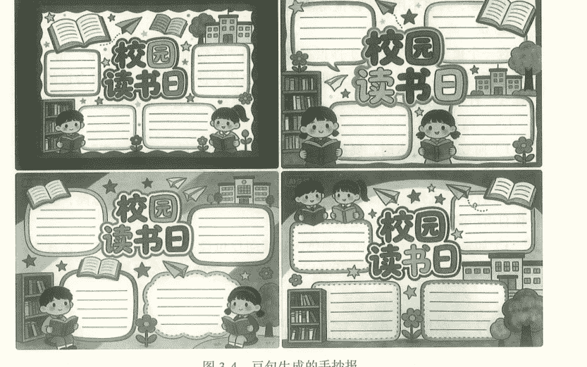
图 3-4 豆包生成的手抄报

#### 3. 打印后自己动手
电子图只是底稿，打印后用勾线笔描一遍让线条更清晰，按喜好上色，文本框里填入自己的内容，如“我最爱《小王子》……”既有版式又有个人想法，老师更喜欢。

#### 4. 总结
核心是豆包搭框架，自己填创意。不用会画画，构思和底稿交给它；每次生成都不同，不怕撞款；5-10 分钟就能推进到打印，创作乐趣也保留。

> 试一试
选一个近期手抄报主题，按上面方法先生成提示词再出图，打印后让孩子勾线、上色、填写文字，体验省心的流程。

> 小贴士
1）提需求时元素说具体，比如写“小草、小鸟、垃圾桶”而非笼统“环保”，画面更贴合。
2）优先打印线稿，彩色图会限制上色思路，线稿自由度更高。
3）若线稿有残留色，直接让豆包“把除黑色线条外的颜色换成纯白”，得到干净底稿。

### 技巧 37 志愿填报：精准匹配专业

分数公布后，选志愿很容易陷入信息过载

成绩一出来，家里常常焦虑拉满：热门方向担心挤破头，冷门方向担心后路窄；想靠近兴趣又怕分数扛不住，兼顾家庭条件又怕和个人学习习惯打架。查得越多越不安，生怕一次判断失误影响接下来十多年。

别把全部诉求一次抛给模型。让豆包做递进式追问，范围逐步收窄，才能兼顾分数层级、兴趣取向、学习方式、家庭支持与行业走向。

#### 1. 先把硬性条件交代清楚，让模型锁定合理区间
选方向的起点是分数能够覆盖。先说清楚分数段、科目优势、选考科目以及大致学科大类。以江苏一位女生为例，高考580分，全省普通类物理组约55000名，选考物理、化学、生物，意向工学、管理学、医学，可这样发起询问：“我是江苏女考生，高考580分，全省约55000名，选考物理、化学、生物，意向工学、管理学、医学，请列出适配的院校与方向，每类至少五项。”

这样模型会按分数层筛选，不会给出高不可攀或过分保底的选项，也会规避明显不匹配的方向，例如：

**一、工学方向参考**
1. 南京工业大学
  - 化学工程与工艺：A类强势学科，约六成毕业生进入世界500强，企业薪酬较高。
  - 电气工程及其自动化：就业率近98%，七成进入国家电网，女生在电力系统设计岗很适配。
  - 人工智能：平均年薪约18.6万元，前景开阔。
  - 安全工程：受政策带动，近七成留在江苏，就业稳定。
  - 生物医学工程：理工医交叉，契合物理、化学、生物选科。
2. 江苏大学
  - 机械设计制造及其自动化：国家级一流本科专业，就业面宽。
  - 车辆工程：汽车产业核心人才，女生可偏向技术管理。
  - 农业电气化：服务农业现代化，录取分在579分上下。
  - 新能源科学与工程：战略性新兴领域，前景可期。
  - 自动化：工业4.0核心，适合逻辑思维强的同学。
  ……

**二、管理学方向参考**
1. 江苏大学
  - 工商管理：国家一流本科建设点，江苏省重点建设专业。
  - 信息管理与信息系统：录取分约580分，技术加管理复合培养。
  - 财务管理：录取分约580分，就业面广，对女生友好。
  - 金融学：录取分约579分，银行证券类机构前景不错。
  - 物流管理：省级一流本科专业，电商物流需求旺。
  ……

**三、医学方向参考**
1. 南京医科大学
  - 公共卫生与预防医学：录取分约574分，疫情后关注度提升。
  - 生物医学工程：靠近医疗器械，就业较好。
  - 护理学：录取分约580分左右，医院刚需岗位，女生优势明显。
  - 康复治疗学：就业率高，适合女生。
  - 医学检验技术：录取分约574分，实验室环境稳定。
  ……

篇幅有限，完整清单建议自行实操。

#### 2. 把软性偏好挖出来，避免学不下去
分数与方向对了，还要看学起来是否顺手。学科要读四年，不合适的学习方式会越读越累。若孩子偏理论型，喜欢抽象概念和逻辑推演，不喜机械记忆，希望在学术氛围浓的环境中成长，可追问：“孩子是理论型学习习惯，偏爱抽象理论和逻辑分析，不喜欢死记硬背，希望在重研究的氛围中发展，之前给出的工学管理类里，哪些更贴合？”模型会过滤掉重背诵的方向，更倾向人工智能、信息管理与信息系统数据分析方向这类偏逻辑的选项。

#### 3. 跟上行业动向，选有潜力的赛道
热门会变，有政策托底、走向明确的赛道更稳。想了解数字经济，可问：“数字经济行业发展态势如何？哪些高校的数字经济、大数据管理与应用方向有优势？政策对就业有何影响？”关注新能源可问：“新能源有哪些政策扶持？哪些高校的新能源科学与工程、能源与动力工程方向有优势？就业前景怎样？”模型会整合行业数据和政策信息，避开看似火爆实则饱和的方向，锁定真正有潜力的领域，例如：

**一、新能源行业政策支持框架2025最新**
国家搭建全方位多层次的政策矩阵，为新能源发展提供强力保障：

##### 1. 顶层设计政策
《关于促进新能源集成融合发展的指导意见》2025年10月国家能源局：提出多维度一体化开发、产业协同发展、多元化非电利用三大方向；明确到2030年，集成融合发展成为主流，新能源市场竞争力显著提升。

……

##### 2. 市场化改革政策
……

##### 3. 产业与技术支持政策
……

##### 4. 人才政策
……

**二、新能源优势院校与方向**
###### 1. 新能源科学与工程优势院校

| 院校 | 排名/评级 | 方向特点 | 领域优势 |
| :--- | :--- | :--- | :--- |
| 西安交通大学 | 第1 A+ | 动力工程多相流国家重点实验室，2010年起最早开设 | 储能技术、太阳能热发电、多能互补系统 |
| 华中科技大学 | 第2 A+ | 煤燃烧国家重点实验室，能源与动力学科全国领先 | 生物质能发电、新能源材料、碳捕集技术 |
| 华北电力大学 | A+ | 电力行业黄埔军校，和国家电网深度绑定 | 风电控制、智能电网、新能源并网技术 |
| 东南大学 | A | 能源与环境交叉，智慧能源系统突出 | 分布式能源、建筑光伏一体化、碳中和规划 |
| 江苏大学 | A | 流体机械特色，国家一流本科建设点 | 新能源流体装备、微电网控制、能源高效转化 |
| 上海交通大学 | A | 船舶与海洋工程国家重点实验室，产学研紧密 | 氢能燃料电 |

> 篇幅有限，建议亲自上手实践。

#### 4. 总结
选学科不是抽签，也不是追热，而是一次精细对齐：对齐成绩、对齐兴趣、对齐趋势。豆包的价值在于把分散信息汇总，减少信息差带来的焦虑，最终拍板仍需你和孩子结合实际情况判断。

**试一试**
现在就向豆包提问，先给出省份、分数、选考科目、学科门类偏好，再依次补充兴趣、学习方式、行业走向，看推荐是否越来越贴近需求。

**小贴士**
- 提问时别把所有条件堆在一起，分次追问更利于模型抓取关键信息。
- 学科偏好尽量用学科门类如理学、工学、经济学，避免直接限定到具体专业。
- 模型给出的院校录取分和专业细节，务必到官网核实。
- 别把决策权完全交给模型，最终要学、要从事的是孩子。

### 技巧 38 知识图谱：快速搭建，告别手工整理

工作学习中梳理复杂实体关系是常态：项目协作的角色关联、知识学习的概念脉络、行业分析的信息节点，都需要清晰的可视化呈现。知识图谱本质是用节点代表实体、用连线表示关联，核心包含实体、属性、关系。它比纯文字直观，能把分散信息串联，直观展现逻辑，用在汇报、笔记、决策分析都更高效。

借助豆包，零基础也能轻松做出实用知识图谱，全程无需复杂操作。用好Mermaid标记语言里的mindmap关键字，几分钟搞定。

#### 1. 直接说需求，迅速得到基础图
用自然语言结合mindmap关键字向豆包提需求，一键生成。例如：“用Mermaid标记语言中的mindmap，以贾宝玉为核心构建《新石头记》人物关系知识图谱，全部用中文显示。”生成的图谱如图 3-5 所示。

#### 2. 上传资料，自动抽取要素作图
有现成文档如报告、文章、表格，不用手动整理，直接上传让豆包提取实体和关系再生成图谱。
例如上传小红书代运营项目文件，输入：“上传文档是关于小红书代运营项目的资料，请先提取核心模块、关键节点及相互关系，再用Mermaid标记语言中的mindmap构建知识图谱，节点包含品牌定位、内容策略、运营策略、风险管理、数据分析等核心模块，明确各模块下的子节点及关联。”豆包会自动解析内容，以“小红书代运营项目”为核心，拆分出内容策略、运营策略、风险管理等分支，组织成图谱，如图 3-6 所示。

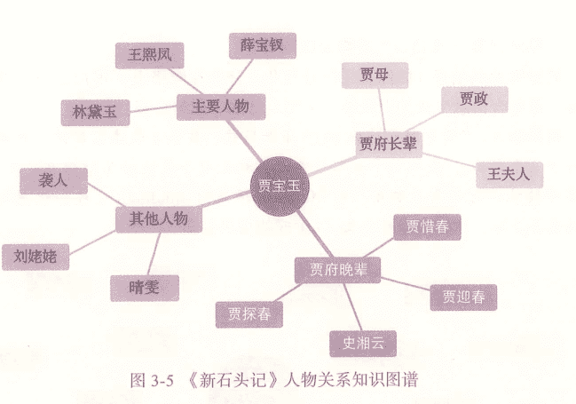

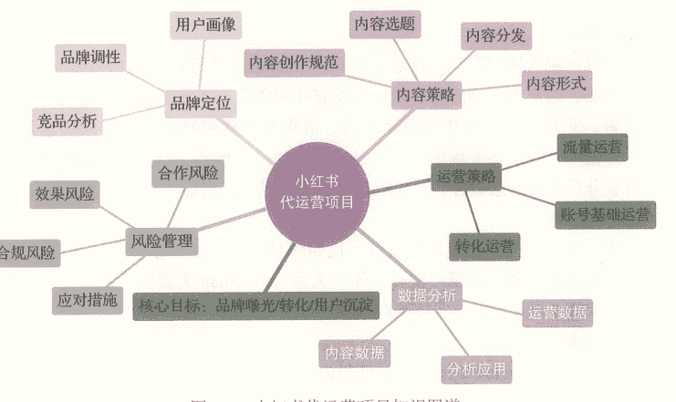

#### 3. 联网检索并整合，一步生成图谱
需要的信息分散在网络上，可让豆包先搜索再整合生成知识图谱，无需逐一搜集。
例如输入：“请先联网搜索2025年职场热门技能，聚焦互联网、新媒体、数据分析3个领域，提取3个核心技能；再补充每个技能的适配岗位、必备子技能、行业需求热度；用Mermaid标记语言的mindmap生成知识图谱，节点层级最多3级，全部中文。”生成结果如图 3-7 所示。

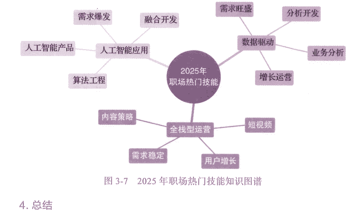

#### 4. 总结
用豆包制作知识图谱，核心是抓住mindmap关键字加清晰需求，不用懂复杂语法，也不用手动绘制。无论直接提需求、上传资料，还是联网搜索，都能快速生成可视化图谱，节省整理时间，让复杂信息直观。适用工作项目梳理、学习知识总结、行业信息整合等多种场景。

> **试一试**
> 选一个当前需要梳理的场景，如项目团队角色关系、学科知识点脉络、行业核心信息关联，按核心实体加关系加mindmap关键字格式提问，生成专属图谱。

> **小贴士**
> 1）生成的mermaid代码可在豆包内置渲染工具、在线mermaid编辑器、支持该语法的文档工具中渲染。
> 2）同理可生成流程图、实体关系图，只需替换关键字。
> 3）需要更细节点拆分时，在提示词中明确子节点层级，豆包会按要求细化。

### 技巧 39 知识卡片：免排版，直接出图

打开小红书，知识卡片总能抓住眼球：美食教程、学科知识点、生活冷知识，图文结合、重点突出，既好看又好记。做自媒体涨粉、给孩子整理资料、自己归纳笔记，都刚需这种形式。手动做缺乏设计基础就容易杂乱。

用豆包图像生成配合精准提示词，短时间内就能生成符合要求的知识卡片，从图文搭配到比例调整全程一键完成。

#### 1. 食物制作流程卡片
流程化卡片让操作一目了然。要做番茄炒蛋制作流程卡，在豆包图像生成界面输入：“用plog手绘风格，生成番茄炒蛋的制作流程图，需要分步骤并搭配中文解释，色彩明亮，要求放在一张图片中。”豆包输出结果如图 3-8 所示。

生成的卡片会自动匹配食材线稿插画，步骤文字简洁不拥挤，表述直观，色彩贴合食材，无需二次调整即可直接发布，新手也能做出博主级菜谱卡片。

#### 2. 学科知识点卡片
经济学常识、生物原理、思维模型，都能做成单张卡或概念加类比加案例加总结四卡组合，让抽象内容变直观。
想做沉没成本效应单张卡，可输入：“用手账手绘风格，生成经济学知识点【沉没成本效应】的知识卡片，需要搭配趣味配图和中文解释，色彩柔和，要求放在一张图片中。”豆包输出结果如图 3-9 所示。

想把蝴蝶效应拆成四张，可输入：“用可爱手绘风格，生成社会学知识点【蝴蝶效应】的知识卡片，包括四张卡片：概念卡、类比卡、案例卡、总结卡，每张卡片需要搭配趣味配图和中文解释，色彩清新。”豆包输出结果如图 3-10 所示。

卡片会用生活化语言拆解专业概念，如用丢了电影票是否再买类比沉没成本，用涟漪扩散类比蝴蝶效应，搭配简单插画辅助理解。

#### 3. 总结：让知识卡片制作效率翻倍的核心
豆包把设计加排版加配图加文字整合，简化成输入提示词到单击生成两步。无需专业工具，不用花大量时间找图调格式，自媒体人或新手都能快速产出高质量内容。
适用场景包括小红书、抖音图文、朋友圈分享、学习笔记打印等。

> 试一试
> 选近期需要梳理的内容，如一道快手菜做法、一个知识点、一个科普小常识，套用通用提示词公式，替换风格和主题，生成专属卡片。建议试plog和简约手绘风格。

> 小贴士
> 1）生成后优先检查文字准确性，长句或专业术语可能错字，及时修正。
> 2）涉及公式、实验步骤等专业内容，需核对插画细节，避免逻辑错误。
> 3）风格可结合主题，美食用plog更有生活感，科普用简约手绘更清晰。

### 技巧 40 古人对话应用：三步创建智能体

语文老师讲古诗文、历史老师介绍人物时，单纯讲生平作品容易枯燥。豆包的AI智能体能让古人活起来，实现对话式互动学习。

制作古人对话智能体无需复杂操作，新手也能轻松上手，还原人设并实现自然对话。

#### 1. 三步搭建智能体
第一步，在豆包首页左侧边栏找到AI智能体，如图 3-11 所示，单击进入后，再单击创建AI智能体按钮，如图 3-12 所示。

图 3-11 进入豆包AI智能体界面

图 3-12 创建AI智能体

第二步，进入编辑界面后完善智能体名称、设定描述和头像，如图 3-13 所示。
名称核心是直接点明身份加贴合大众认知，用经典称号或常见尊称即可，易记有辨识度，如诗仙李白、诗圣杜甫、易安居士李清照、东坡居士苏轼、爱国诗人陆游。

设定描述聚焦古人身份加两个核心功能：生平介绍加领域知识加互动答疑。可套用模板：××，能介绍生平经历、讲解相关领域知识并互动答疑。
例如：唐代诗人李白，能介绍生平经历、讲解唐诗相关知识并互动答疑、北宋文学家苏轼，能介绍生平经历、讲解宋词及相关文史知识并互动答疑、南宋女词人李清照，能介绍生平经历、讲解婉约派诗词知识并互动答疑。

第三步，生成智能体头像。单击头像选AI生成，输入提示词：“生成一张李白的人物图像，背景为简约书房场景，画风偏古风写实，色彩柔和，画面清晰，适合作为智能体展示图片。”生成效果如图 3-14 所示，挑选最符合预期即可。不满意可在提示词中补充服饰颜色、神情状态重新生成。

图 3-14 李白智能体头像生成效果图

#### 2. 立刻开启对话互动
创建完成后即可直接对话，用文字或语音提问，它会按人设背景和语言风格回应。例如输入：介绍一下《静夜思》的创作背景，李白智能体会诗意回答：此诗乃吾在异乡漂泊时所作，彼时夜深难寐，见明月悬空，思乡之情涌上心头，遂成此篇。效果如图 3-15 所示。

图 3-15 与李白智能体对话

#### 3. 总结
用豆包制作古人对话智能体，全程无技术门槛，约10分钟即可得到有颜值有内涵的互动智能体。不用查资料、不用懂设计编程，解决了传统互动枯燥、制作复杂的痛点。

课堂上让学生与古人展开虚拟对话学习历史，分享会上借助它制造互动亮点，两种场景都能迅速拉高内容吸引力，消除冷场尴尬。门槛低、落地快的做法，把 AI 的便捷用足，普通人也能自建专属趣味互动玩法。

> 试一试
挑一位钟意的历史人物，比如李清照、杜甫、王安石，按前面流程在豆包里搭建专属对话智能体。围绕相关历史事件或代表作品尝试交流，观察返回结果是否符合预期，再依据实际体验微调提示词和人设背景，让角色更贴合需求。

> 小贴士
1）豆包绘图时，除五官轮廓外，可补充服饰材质、场景氛围等细节，画面沉浸感会提升。
2）若回复不够精准，可在人设背景里增加限制，例如“交流时尽量引用本人诗文名句，语调偏向豪放洒脱”。
3）生成的智能体可反复迭代，后续想补人物其他经历，直接编辑人设背景即可，无需重建。

### 技巧 41 互动教学：零门槛快速制作网页与游戏

想让知识点不枯燥，就得加入互动；想让课堂有亮点，就得引入小游戏。传统课件多为单向输出，难以调动主动参与；市面互动工具或收费或操作复杂，不适合日常使用。豆包“应用生成”板块能解此困局，用自然语言描述即可零代码实现，教学网页或课堂小游戏都能快速上线，适配各科需求。

#### 1. 教学网页：让不同学科知识活起来

互动网页比 PPT 更易抓住注意力，且无需专业排版。按“场景 + 内容 + 交互 + 风格”组织描述，即可得到贴合需求的工具。

数学老师希望几何更直观，可这样描述：“为初中公开课制作几何专题教学页，涵盖三角形、长方形、平行四边形、圆形的定义、性质、面积公式推导，并提供图形拼接练习与错题收集区。交互需支持图形拖拽拼合、公式推导分步展示、错题重做、知识点检索，点击图形弹出关键特征标注。风格走简约科技，以蓝色为主白底，字体清晰，版块分为导航、知识点、练习，适配移动端。”

豆包会据此输出用户定位、功能说明、页面风格，确认后生成互动页，如图 3-16 所示。学生可亲手操作图形，直观理解几何规律，讲解效果远胜纯板书。

图 3-16 初中数学几何互动网页

英语老师要复习语法，可写：“生成小学六年级英语一般过去时复习页，采用卡通风，以黄橙为主调点缀动物图标。内容分四部分：不规则动词过去式清单、肯否疑问句转换、购物旅行场景对话填空、一般过去时与现在时辨析。交互包含句型自动批改、对话录音跟读、错题收藏、词汇卡片翻转；鼠标悬停单词显示读音与例句。字体圆润卡通，页面加载带动画，支持回顶与章节快跳。”此类页面让语法复习更主动，参与度明显提升。

#### 2. 课堂小游戏：1句话激活课间与课堂

课前热身、课中巩固或课间放松，轻量互动小游戏即可胜任，描述无需复杂，说清核心诉求。

巩固英语单词，可写：“制作小学四年级英语单词接龙小游戏，词库取自四年级下册重点词汇，随机给出起始词，玩家需输入首字母与上一词尾字母一致的词，答对进入下一轮，答错给出提示方向，设倒计时与得分统计，界面卡通风格。”

确认后豆包生成的小游戏页如图 3-17 所示，分组竞赛既能复习单词又能活跃气氛。

让数学计算更有趣，可写：“用 HTML 做小学三年级数学图形配对计算游戏，页面展示圆形、正方形、三角形等形状，每个形状对应一个数字，点击两个形状后计算其和，答对加分，答错可重新选择，设关卡递增，每关提升形状数量，背景为浅色卡通图案。”学生在游戏中练习计算，比单纯刷题更有动力。

#### 3. 总结

豆包“应用生成”的核心价值在于把复杂制作简化。不用写代码、不懂设计，只要把教学诉求用简短描述表达清楚，就能快速得到互动教学页或课堂小游戏。它节省课件制作繁琐环节，让教学形式更丰富、学生参与度更高，教师可把更多精力放在教学设计与学情引导上，真正做到“轻工具，重教学”。

> 试一试
现在打开豆包，在应用生成界面试试这些描述：
“生成小学三年级科学植物生长周期页，包含种子萌发、幼苗生长、开花结果模块，采用写实插画风格，单击查看各阶段详细介绍，并提供生长时间轴滑块。”
“创建初中语文成语填空小游戏，随机给出成语空缺处，玩家输入答案，正确有语音提示，错误显示释义，设难易关卡，界面走国风设计。”

> 小贴士
1）描述尽量明确“场景 + 内容 + 交互 + 风格”四要素，描述越具体，后续修改越少。
2）生成后若需调整，无需重写提示词，直接用口语说明修改方向，如“把页面字体调大”“增加游戏的错题回顾功能”，豆包会快速优化。
3）生成的工具可直接在浏览器打开，能分享给学生自学，也可课堂投影使用，无需安装，兼容性好。

### 技巧 42 分班安排：豆包助力公平高效分班

新学期未开讲，不少教师桌面已堆满学生信息表。分班看似常规，却常成开学前头号难题。学校通常要求人数均衡、性别匹配，特殊需求学生也需兼顾。初衷为公平，实操却复杂。

最难受的不是工作量，而是公平难以把握。手工分班难免带主观倾向，即便老师尽力做到一碗水端平，仍可能被质疑。同时兼顾人数、性别、特殊需求等多重条件，手工操作易顾此失彼，导致教师疲惫、家长不满。借助豆包辅助分班，能一次性解决难题，让繁琐工作变得轻松。

#### 1. 明确分班需求

第一步把规则说清楚，让豆包按思路分配。需明确学生总数、分班数、每班人数及均衡要素。提示词可写：“为一年级100名学生分班，共4个班，每班25人，要求各班男女比例尽量均衡。”若有特殊需求也可写入，如：“将二年级80名学生分成3个班，各班人数差距不超过2人，男女比例接近1:1，同时把3名视力障碍学生平均分配到不同班级，便于个别关照。”

#### 2. 整理学生数据并提交至豆包

第二步整理并提交学生信息。将姓名、性别、特殊说明等整理成规范表格，直接提交即可。豆包能自动识别表格关键信息，无需手工输入或分类，大幅节省统计时间。

提交完成后输入第一步的提示词，很快会得到清晰的分班结果，例如“一年级（1）班25人，男生13人女生12人；一年级（2）班25人，男生12人女生13人……”并附具体名单，一目了然。

#### 3. 生成分班公示表

第三步生成正式公示表。在已有对话中继续写：“按刚才的分班结果，生成正式的一年级学生分班公示表，要求表格规范、内容清晰，可直接打印或分享。”豆包会自动整理成整洁表格，省去排版环节，直接张贴或发家长群即可。

#### 4. 总结

分班不该成为教师负担。借助豆包，只需明确需求、提交数据、生成方案、灵活调整、生成公示表，就能实现公平高效的分班。它不是替代教师，而是得力助手，把教师从繁琐统计中解放出来，专注教学与学生关怀。

> 试一试
找一份年级的学生基础信息表，明确分班规则，如总数、分班数、性别均衡要求，按文中提示词格式让豆包生成方案。随后尝试提出一个调整需求，比如调换两名学生的班级，看能否快速得到符合要求的新方案，最后让它生成正式公示表。

> 小贴士
1）提需求时越具体越好，避免模糊表述，如不说“尽量均衡”，而说“各班男女人数差距不超过1人”，方案会更精准。
2）提交数据无需过度格式化，只要包含姓名、性别等核心信息，豆包即可识别，无需费时调整样式。
3）调整方案时一次只提一个明确需求，避免同时下达多个修改指令，防止要求混淆。

### 技巧 43 读书计划：5 步搞定专属方案，告别无效阅读

阅读价值毋庸赘述，无论备考、职场进阶还是丰富生活，都是成本最低的成长路径。现实却往往打脸：买了一堆书翻几页就搁置；列好月计划坚持不到一周；想针对性提升却不知选书和安排。

问题不在自律，而在计划脱节。要么过理想化，每天要求两小时忽视忙碌；要么内容不匹配，跟风书籍提不起兴趣；要么缺乏反馈，读了即忘，动力流失。如何快速定制一份可落地、有效的读书计划？交给豆包，5步完成，从画像匹配到成果沉淀，全程省心，让阅读自然成习惯。

#### 1. 精准输入个人画像，让计划不脱节

制订计划的核心是贴合自身，别盲目照搬。需把阅读基础、目标、时间约束清晰告知豆包，关键信息包括年龄或身份、阅读基础、核心目标、每日可支配时间、兴趣领域、特殊需求。

可设计提示词：“请为28岁互联网运营制定为期4周的阅读计划。目标提升内容创作能力并养成每日阅读习惯。条件每天20～30分钟。阅读基础能快速阅读干货。兴趣主题内容创作、用户心理、爆款逻辑。希望每周一次深度思考练习。避免纯理论堆砌，需每日有轻互动任务。”

豆包会输出类似：第1周内容创作基础——搭建表达逻辑，推荐《爆款文案》等书，每日15～20分钟阅读加5～10分钟轻互动，如摘抄金句改写、痛点结构写文案、分析爆款方法、标题仿写等，周末安排30分钟深度思考写300字短文。

若兴趣不确定，也可用豆包做兴趣探索：“请设计一份阅读兴趣探索清单，通过短文或书片段发现适合类型。推荐4个主题如职场技能、心理学、历史、科普，每个主题配1～2本轻阅读书并设小任务观察兴趣点。”

#### 2. 优化阅读节奏，避免半途而废

计划失败多因节奏不合理，起始过难或全程无递进都会导致枯燥。可让豆包据基础设计由易到难、由输入到输出的节奏。例如追加：“根据上述信息优化节奏：第1周轻松入门适应习惯，以概念为主；第2～3周深度吸收加入笔记和思考拆解；第4周实践应用结合工作落地。每周标注核心目标，保持互动任务新鲜感。”

优化后第1周会更轻量化，如阅读《内容创作从0到1》，每日15～18分钟阅读关键词标注，5～7分钟轻互动如画概念图、默写概念、标注生活案例、制作概念卡片、关键词接龙等，周末用思维导图整合本周要点。

#### 3. 设计互动环节，强化阅读效果

单纯阅读易流于表面，加入互动和思考才能吸收。可让豆包为每周设计深度互动，如开放问题或实践任务。例如：“在4周计划中每周增加一次深度互动，提供3个开放问题或1个实践任务，贴合运营场景如选题、用户沟通，启发性强且可落地。”

示例互动：第1周职场沟通主题，可问“如何用书中沟通技巧向领导汇报”“倾听技巧如何用于用户沟通”“用共情表达回复一条虚拟用户投诉”。这些任务耗时少，却能即时迁移加深记忆。

#### 4. 记录与反馈，保持阅读动力

可持续阅读离不开及时反馈。可让豆包生成简易反馈模板，记录阅读情况并强化成就感。提示词：“生成通用阅读反馈模板，包含日期、书名章节、阅读时长、阅读感受、今日核心收获1～2句、改进方向、自我鼓励语。另每周生成一段积极平实的总结鼓励语，贴合职场场景。”

模板简洁，感受可勾选加关键词，收获只提炼要点。每周鼓励聚焦进步，如“本周你从被动读转向主动思考，每次思考都是能力累积”，让人持续有动力。

#### 5. 生成成长档案，明确后续方向

阅读不是终点，持续优化才是关键。可让豆包基于反馈记录总结成果并给出建议。提示词：“根据阅读反馈记录，生成阅读成长档案。用平实语气总结亮点与变化，列出最有收获的3个知识点及原因，结合运营需求给出下阶段优化建议，如书单调整、节奏优化、互动形式升级。”

档案会呈现轨迹，如从需提醒到主动利用碎片时间、从摘录到结合工作设计方案，并建议下阶段增加案例拆解类书籍，每周安排一次真实项目复盘，让后续阅读更有方向。

#### 6. 总结

用豆包做读书计划本质是“精准匹配 + 循序渐进 + 闭环反馈”。无需自己琢磨书单和任务拆分，5步即可得到贴合需求、易坚持且有效果的专属方案。只要提示词具体，把自身情况说清，豆包就能给出超出预期的结果。

> 📝 试一试
打开豆包，复制并替换个人信息生成第一份专属计划：“请为（年龄 + 身份，如22岁大学生）制定为期4周的阅读计划。目标（备考英语六级、提升写作能力）。条件每天阅读时间（15～20分钟）。阅读基础（能读简单英文文章、有一定写作基础）。兴趣主题（英语阅读、实用写作、文学散文）。额外需求（每周一次真题练习、避免枯燥任务）。要求每日有轻互动任务，节奏循序渐进。”

+ 📝 小贴士
1）不必苛求完美，若某天时间紧张，可缩短时长完成核心内容和互动任务，避免一次破例就放弃。
2）反馈模板和成长档案可每4周更新一次，按建议调整下阶段计划，让阅读始终贴合需求变化。
3）若内容枯燥或难度不适，随时让豆包调整，如输入“根据我之前的反馈，把第2周书单换成更贴近应用的书籍，互动任务增加案例拆解”，即可快速优化。

### 技巧 44 课题申报：让申请书既合规又具执行力

写申报材料时常见的三类困境是：选题抓不住重点、内容偏概念缺少落地抓手、对规范理解不足导致缺项或字数超标。直接用AI生成往往得到千篇一律的模板，与企业自身情况贴合度低，反而越改越累。借助豆包高效产出可用稿的关键，在于使用思路——它不是代笔工具，而是梳理思路的搭档。抓住“先自建框架、指令要细化、人工再打磨”这个闭环，就能发挥工具优势，节省时间并凸显单位特色，规避常见失误。

#### 1. 先搭好骨架，避免把思考外包
申报稿的价值在于真实业务痛点与研究逻辑，AI无法替代对自身工作的理解。直接让它“写一份XX主题的申请书”，得到的通常是套话，连核心痛点都没讲清。正确做法是先自行厘清骨架，再请豆包润色整理。

先把三件事想清楚：研究缘起与待解的关键矛盾、落脚角度与要解决的具体内容、拟用的研究路径。以“小体量组织轻量级数智化升级”为例，先判断矛盾点是投入压力大、工具匹配差、人员接受度弱，再拆分为低投入工具筛选、分阶段实施、人员赋能三个板块，最后确定采用案例分析加实地调研。

此时给豆包的指令可以是：“以小体量组织轻量级数智化升级为主题，围绕核心矛盾投入压力大、工具匹配差、人员接受度弱，输出申报书骨架。需包含研究背景、核心内容、研究方法，不得编造资料与数据。”这样输出不会偏离实际，反而能把思路理清。

生成结果示例：

小体量组织轻量级数智化升级研究申报书核心框架

一、研究背景

政策与行业趋势：国家持续推动数字经济发展，出台多项指南引导中小组织降本增效；但资源受限的组织转型进度滞后，轻量级转型成为突破瓶颈的关键方向。

......

二、核心研究内容

（一）低投入工具筛选策略

......

（二）分阶段落地设计

......

（三）人员赋能方案构建

......

三、研究方法

（一）案例研究法

......

（二）实地调研法

......

四、预期研究成果

......

五、进度安排

......

六、人员配置

......

七、经费预算

......

（由于篇幅有限，输出结果在此省略，建议读者亲自实践。）

#### 2. 指令越细，输出越贴评审要求
AI的质量取决于指令清晰度，企业类申报不同主管部门在格式与侧重点上差异明显，模糊提问只会得到低效内容。

首先紧扣申报模板，把栏目设置、必填模块、字数限制直接告知，例如“按市级中小企业发展专项课题申报模板撰写，需包含项目摘要、研究意义、研究内容等7个必填模块，其中研究内容部分控制在1000字以内”。其次明确细节，包括课题领域、企业真实场景、关键要点，并补充现有基础、行业数据等素材，让模型有料可写。

比如写研究内容，别只说“写数智化升级的研究内容”，优化后的输入是：“以小体量组织轻量级数智化升级为主题，撰写研究内容部分。需包含3个模块：①低投入工具筛选标准；②分阶段实施步骤；③员工数智赋能方案。结合本单位2个试点部门的现有基础展开，引用1～2个同行业轻量级转型的成功案例和核心经验。”精准的输入能让输出更贴合实际，大幅减少返工。

生成结果示例：

一、低投入工具筛选标准

（一）核心筛选三维度

基于“场景匹配度－费用可控性－易用性”原则，制定适配标准。

场景聚焦性：优先覆盖销售部“获客－跟进－转化”与行政部“审批－协作－资产”的核心痛点，拒绝功能冗余工具。

费用刚性约束：单工具年费不高于1万元，组合工具年总投入不高于1.5万元，采用“按年付费＋免费试用”模式。

低门槛适配：支持无代码搭建、3天内上手操作，兼容现有办公设备与微信生态。

（二）试点部门工具矩阵

……

二、分阶段实施步骤

（一）试点推广阶段

……

（二）全面铺开阶段

……

（三）优化迭代阶段

……

三、员工数智赋能方案

（一）分层培训体系

……

（二）场景化实操演练

……

四、同行业成功案例核心经验

（一）案例1

……

（二）案例2

……

（由于篇幅有限，输出结果在此省略，建议读者亲自实践。）

#### 3. 二次加工，注入特色并守住底线
AI生成的初稿只是基础，想在众多材料中脱颖而出，还需二次加工——注入单位专属实践，避免千篇一律，同时守住学术与合规底线。

注入特色就要补充真实场景与经历。比如“团队具备研究基础”可细化为“核心成员有8年中小组织运营管理经验，曾主导2个部门的简易数智工具落地项目，完成过50余份数智需求调研”；“创新点”可优化为“聚焦‘高投入难坚持’的痛点，探索‘工具轻量化+培训碎片化+落地分阶段’的转型模式，降低初期投入门槛”。数据也要具体化，把“部分员工不适应数智工具”改为“据2024年上半年内部调研，62%的试点部门员工存在操作不熟练、与现有工作流程脱节的问题”。

守住底线要做三件事：核对专业术语是否准确；确认研究方法与内容是否匹配；核查文献引用是否真实可查。需修改时可指令：“修改工具筛选部分，补充3类适配小体量组织的低投入SaaS产品，说明每种产品的适配场景和成本区间，确保与‘轻量级转型’的核心内容匹配。”

#### 4. 选对板块，让AI精准补位
在企业类申报书的特定板块，AI辅助效果更明显。

1）文献综述：按“政策导向-行业现状-实践缺口”整合资源，输入可为“梳理小体量组织轻量级数智化近3年的政策文件和行业研究成果，按‘政策支持-成功案例-现存问题’分类，每个部分附2个核心文献的核心观点，指出当前研究在‘低投入落地’方面的不足”，之后补充本单位遇到的具体困境。

生成结果示例：

小体量组织轻量级数智化研究梳理

一、政策支持

（一）核心政策文件

1.《中小企业数字化转型指南》

提出“小快轻准”转型路径，强调低成本、短周期实施。

……

二、成功案例

……

三、现存问题

……

四、当前研究不足

……

（由于篇幅有限，输出结果在此省略，建议读者亲自实践。）

2）研究思路与步骤：模型能搭建清晰时间线，输入“以小体量组织轻量级数智化为主题，设计研究步骤，分调研阶段、分方案设计阶段、分试点落地阶段、分总结优化阶段，每个阶段明确核心任务和阶段性成果，避开业务旺季安排试点”，再按单位实际调整。

生成结果示例：

一、调研阶段

（一）核心任务

1. 单位内部现状诊断

针对试点部门开展分层调研：通过管理层访谈明确转型目标，通过执行层问卷+实地观察梳理痛点与数智基础。

……

二、方案设计阶段

……

三、试点落地阶段

……

四、总结优化阶段

……

> （由于篇幅有限，输出结果在此省略，建议读者亲自实践。）

3）参考文献：按GB/T7714-2015排版，输入“筛选10篇与数智化转型相关的核心期刊文献和行业报告，按GB/T7714-2015进行排版，优先选择近2年发布的政策解读类和实践案例类文献”，之后核对相关性。

生成结果示例：

一、政策解读类文献

1. 眉山市人民政府. 眉山市制造业智能化改造数字化转型行动计划（2024—2027年）[R].2024.

核心内容：提出“数智赋能提升”等五大行动，明确每年4000万元财政资金支持政策，建立“诊断-改造-融资-运营”一体化服务链条，为组织转型提供政策落地路径。

#### 5. 总结
用豆包撰写申报书的核心逻辑始终是“人主导、指令具体、人工精修”。先明确单位真实需求与研究框架，再给出细化到细节的指令，最后通过补充实践场景、核查合规性完成打磨，就能让AI真正节省时间、理清逻辑。申报书的核心竞争力永远是研究的实操价值与落地可行性，豆包只是帮助把这份价值更规范、更清晰地呈现。

> 试一试
选一个关注的课题方向，先厘清核心问题、3个研究模块和1种研究方法，然后按文中示例给豆包写一段精准指令，让它生成研究内容部分的初稿，之后补充1个自身相关的实践案例和1组真实调研数据，完成一次“AI辅助+人工优化”的完整实操。

> 小贴士
1）企业类申报要突出“实操性”，别让模型写太多理论，多结合单位规模、行业特点、现有基础等实际情况，因为评审更看重落地可行性。
2）政策文件引用要准确，让模型整理相关政策后，务必手动核查文件名称、发布部门和核心条款，避免出现政策引用错误。
3）不要让模型虚构合作单位、资金投入、技术专利等信息，这类虚假内容会直接导致申报失败，如实呈现单位现状即可。

### 技巧 45 文献阅读：五步快速吃透论文精华

信息爆炸的当下，无论是做研究还是专业提升，都绕不开大量文献。几十页的资料术语密集、逻辑复杂，筛选有效信息耗时耗力，好不容易锁定一篇却抓不住要点，对比多篇更是难度倍增。

能否摆脱“逐字精读却收获有限”的困境？答案是——借助豆包的AI阅读能力，从筛选到解读全流程提效，无需复杂操作，就能让难懂文献变得易懂、易记、好用。

#### 1. 初步筛选，一键判断文献价值
面对一堆待读材料，不必全部通读。豆包的默认功能就能快速帮你筛掉无用内容。

无论是PDF论文、网页链接，还是docx、txt文档，直接拖进对话框，页面会自动弹出常用功能选项，如图3-18所示。

点选“详细总结这篇文档内容”，几十秒内就能获得文献的核心要点，包括研究主题、核心观点、关键结论等。通过这份概括，快速判断是否相关，直接淘汰无关内容，把时间花在刀刃上，以上一篇论文《人工智能驱动的科学研究新范式：从AI4S到智能科学》为例，如图3-19所示。如果是网页类文献，打开豆包浏览器插件，单击“总结此页面”，即可一键获取网页核心信息，不用再逐页浏览冗余内容，如图3-20所示。如果不想安装插件，你也可以直接把豆包作为浏览器，在豆包中打开网页，单击页面中的“总结全文”，即可得到同样的效果。

#### 2. 提炼框架，结构化呈现核心内容
遇到几十页的长篇文献，不用再逐字逐句精读。豆包能自动提炼核心逻辑，用直观形式呈现，让你5分钟摸清文献全貌。

上传PDF文档后，除了可以进行详细总结，还能直接选择生成脑图，无须额外输入提示词。豆包会自动梳理文献的逻辑框架，生成包含研究背景、方法、结论、创新点等模块的思维导图。生成的脑图支持下载，也能直接复制文本，方便后续自己编辑补充。如果是其他格式的文档或网页，只需在上传后输入简单提示词“生成脑图”，就能快速获取结构化框架，不需要复杂描述。这里还是以前面上传的论文《人工智能驱动的科学研究新范式：从AI4S到智能科学》为例，生成的脑图如图3-21所示。

更实用的是，豆包支持批量上传最多50个文档，上传后在阅读界面能轻松切换不同文献，对比核心观点时不用反复切换窗口，效率直接翻倍。

#### 3. 拆解难点，随看随问扫清障碍
文献里的专业术语、外文段落、复杂公式，往往是理解文献的“拦路虎”，而豆包的即时互动功能，能让这些难题迎刃而解。

阅读时遇到不懂的专业术语，直接用鼠标指针选中内容，会自动弹出功能栏，选择“解释”就能获取通俗解读，不用额外提问。例如，想了解论文《人工智能驱动的科学研究新范式：从AI4S到智能科学》中的专有名词“第五范式”，豆包的解释如图3-22所示。

碰到外文文献也不用慌，豆包支持15种语言互译，选中英文段落并单击“翻译”，就能快速转换成中文，全文翻译只需单击“翻译全文”选项，专业术语翻译精准度高，不用手动输入翻译提示词。以英文论文为例，如果是图表、公式这类可视化内容，直接单击顶部的“截图提问”，截取需要解读的部分，豆包会自动分析内容，给出清晰解释，包括公式含义、图表数据趋势等，不用额外描述需求，如图3-23所示。

#### 4. 深度挖掘，按需转化文献价值
读文献的最终目的是为己所用，豆包能帮你把文献内容转换为自己需要的形式，无论是数据整理还是内容借鉴，都能高效完成。

如果文献包含大量文字数据，比如实验结果、调研数据等，选中数据内容后输入简单提示词“转换成数据表格”，豆包会自动提取数据，并转换为结构化数据表格，复制粘贴到Excel中即可使用。这里以论文《生成式人工智能视角下研究问题与研究方法句生成研究——以高能物理领域为例》为例，选中论文中的表格如图3-24所示，转换后的结果如图3-25所示。如果有多份表格数据需要整合，比如不同批次的实验数据，可直接上传所有相关文档，并输入提示词“按关键信息合并表格”，就能快速得到汇总数据。

如果需要基于网页内容创作，上传网页链接后，选择“参考网页写一篇原创内容”，豆包会基于网页核心内容生成初稿，该功能尤其适合自媒体创作者或需要整理报告的职场人使用，能省去大量改写时间，如图3-26所示。

图3-24 选中想要转换的数据表格

图3-25 转换为结构化的数据表格

图3-26 参考网页写一篇原创内容

#### 5. 听觉加持，碎片化时间也能学
长时间看文字容易疲劳，豆包的AI播客功能能让你“解放双眼”，利用碎片化时间吸收文献精华。

上传文献或网页链接后，直接选择“生成播客”选项，豆包会把核心内容转换为口语化的播客脚本，供你随时收听。不管是走路、吃饭还是通勤，都能利用零散时间学习，不用再盯着屏幕，既能保护眼睛又能高效吸收知识，如图3-27所示。

图3-27 生成播客

#### 6. 总结
豆包的AI阅读功能把“筛选－提炼－解读－转换”的全流程简化，不需要复杂操作和专业指令，就能解决文献阅读效率低、理解难的问题。从一键总结到随看随问，从脑图生成到批量对比，每一个功能都直击阅读痛点，帮你节省大量时间和精力，让你能把重心放在真正有价值的研究和应用上。

> 试一试
挑一篇你最近需要研读的文献，按以下步骤操作：直接拖入豆包获取详细总结，生成脑图梳理框架，用划词功能解读2～3个专业术语，最后试试批量上传2～3篇相关文献对比核心观点，感受高效阅读。

> 小贴士
1）上传文献时尽量选择清晰的版本，尤其是包含图表的文献，清晰的内容能让豆包的解读和数据识别更精准。
2）生成脑图后，建议结合原文核对关键信息，确保核心要点没有遗漏，豆包是辅助工具，关键信息需自行验证。
3）批量上传文献时，可在文件名中标注核心主题，方便在阅读界面快速找到需要的内容，提升切换效率。

### 技巧 46 考务排班：跨校安排快速上手
大学期末考务对教务老师来说堪称噩梦：要协调不同学院的主讲教师和研究生助教，还得遵守“主讲不监本班”“不连续监考三场以上”的规则；排到一半发现考场缺人，就得推倒重来；手动排两天还容易引发跨学院矛盾。阅卷安排也复杂，按题型分组、定组长、分任务，还要兼顾老师科研时间，最后表格混乱难懂。

期末考务排班，交给豆包10分钟搞定

传统校园期末组织牵扯面广，学院多、教职工杂、规矩繁琐，手工作业又慢又容易出错。豆包升级后的文档解析与规则匹配能力刚好补上这块短板：把包含教师、课程、档期的清单递进去，用自然语言把学校的特殊规矩说清楚，十分钟左右就能拿到规范的跨系监考表与分题型阅卷表，直接导出即用，再也不用熬夜对表反复沟通。

把豆包当成校园智能排期伙伴，读取学院、职称、任教课程、可参与时段等信息，结合跨系监考、授课教师与助教分工、按题型分组阅卷等校内细则，自动完成人手派发、冲突排查与文档输出，尤其适合本科院校和职业院校的期末组织。整体拆成两条线：跨系监考排班，和分题型阅卷排班。

#### 1. 跨学院监考排班实战

准备底表。先整理一个 Excel，档名建议《高校监考人员信息表.xlsx》，必填字段有姓名、所属学院、职称、任教课程、可值班时段、是否同意跨系监考。任教课程要写清专业和年级，防止出现监自己课或本专业考场的尴尬。

因规则牵扯多，建议启用豆包超能模式，准确度比常规思考模式更高。点开超能模式后把文件传上去，给一段指令大致如下：请参照《高校监考人员信息表.xlsx》，为2025年期末产出一份可导出 Excel 的跨系监考表。需求要点：①计算机、经营、文三院共12个专业，每专业开2个考场，每场配1名授课教师加1名研助；②授课教师不能值自己任教的课程及本专业考场，研助可在非本专业考场值班，均依据个人可值班时段安排；③优先挑选同意跨系值班的人员，同一人最多连上2场，两场间隔至少2小时；④表头需有序号、考场编号、授课教师、研助、科目、考试起止、考场地点、备注；⑤尽量让各院工作量均衡，避免某院人员扎堆同一时段。

产出与微调。提交后豆包会读懂底表，按规则派人并生成表格，参考图3-28。若个别岗位需改动，可追加说明，例如“经营学院23级国际贸易1考场的研助临时无法到岗，请依据不得值本系课程、研助可跨专业、且尊重个人可值班时段重新分配”。豆包会自动优化并刷新文档，参考图3-29，助教由原人选换成符合条件的另一位。

#### 2. 分题型阅卷排期实战

阅卷效率往往靠精细分工，按题型拆组批改是常见做法，豆包能很好匹配。

1）补全资料。在原资料表里新增“擅长批改的题型”“能否担任组长”“可批改时段”几个字段，若使用网络阅卷系统，也可加一列“阅卷方式偏好”，或直接在指令里说明。

2）生成指令。把补充后的表格传上去，指令可以这样写：请依据《高校监考人员信息表_新增阅卷信息列.xlsx》，产出2025年期末分题型阅卷排期表，Excel格式。要求：①每院分选择题组、简答题组、论述题组，每组设1名组长，由可担任组长的授课教师中挑选；②选择题组优先由研助承担，简答和论述以授课教师为主、研助协助复核；③阅卷统一放在1月11日至13日，上午9:00-12:00，下午14:00-17:00，选择题须在1月11日完成；④一人只负责一门课的一个题型组；⑤表头含序号、课程名、题型组、组长、成员、截止时间、备注；⑥阅卷档期需与已排监考档期不冲突，已在1月8日值班的教师，阅卷尽量挪到1月12日之后。

产出核心示例如表3-2。

3）细节补强。表格出来后，可追加备注，例如“简答组可依据关键知识点酌情给分”“论述组需先统一评分标准再开批”，豆包会直接更新，无需重新传文件。

4）场景延展。同一套思路还能迁移：研究生复试可改成每组3人含1组长，避免导师面试自己学生；大型竞赛把“考试科目”换成“竞赛项目”，规则改为每场2名监考且优先有经验者；多校区办学可在表里加“所属校区”，指令里要求优先同校区安排并标注跨校交通补贴。

#### 3. 总结
在校园考务与阅卷里，豆包的价值在于适配跨系、分工细、规则多的现实，把资料解析、规则匹配、人手分配、文档生成的繁琐链路自动化。只要准备一份规范的教师资料表，用清晰的自然语言说明特殊规矩，就能迅速拿到可直接使用的排期表，减少手工排表的失误，也省去跨院沟通的时间，让教务工作从头疼难题变成一键搞定。

试一试
准备一份精简版《高校监考人员信息表.xlsx》，包含3名计算机学院授课教师主讲“23软件工程-数据结构”、2名经管学院授课教师主讲“23国贸-西方经济学”、3名分属不同学院的研助，并补上可值班时段、擅长批改题型两列。用指令：请依据上传表格，生成23软工、23国贸各1个考场的监考排期（1授课教师+1研助）和数据结构课程的分题型阅卷排期，表头齐全，避免监考与阅卷冲突，体验快速产出效果。

小贴士

考务排班提示词的五项细化要点

1）要素标注需清晰：排班表里要明确写出任课科目及对应专业年级、教师职称、可参与的时段，信息越具体分配出错的概率越低。
2）规则描述需可执行：提示词里应把跨学院限制、人员组合方式比如主讲搭配助教、相邻场次的间隔时长等关键约束逐条列明，细节越到位结果越可靠。
3）隐私保护先脱敏：导入的表格保留姓名、学院、课程等必要字段即可，电话、身份证号等敏感内容要全部隐去。
4）支持批量调整指令：初稿生成后若需改动多场次安排，不用逐行修改，只需给出整体指令，例如将1月8日上午经管学院的监考统一换到1月9日下午，即可一次性完成替换。
5）导出格式按需指定：除Excel外，也可在指令中要求Word或PDF格式，方便打印派发或线上归档。

### 技巧 47 作业批改：智能体实现拍照即评

手工判卷费时易疲劳，评分口径也难统一。豆包的智能体能把整条流程串联起来，无需人工逐题核对，调用现成学科批改智能体或自建专属模型，就能完成拍照提交、自动计分、给出评价、划分等级，效率更高也更规范。

依托智能体的学科知识库与规则匹配能力，可面向初中高中各学科不同题型完成判分与量化评价，日常作业、小测以及培训机构的批量处理都能覆盖。下面以文科论述和理科大题两类典型场景说明。

#### 1. 案例一：历史论述批改与分级，面向文科
历史论述兼具史实性和主观性，既要核查史实准确，也要看结构是否合理。智能体可按定制标准完成评改与等级划分。

操作路径：
1）在豆包网页版或客户端登录后打开侧栏的更多/AI智能体，搜索框输入“作业批改”，挑选合适的智能体加入对话，可自行选择，如图3-30所示。

图3-30 在“AI智能体”界面搜索智能体
2）拍摄学生完成的历史论述作业，保证题干与答题区清晰无遮挡不倾斜，通过对话框的图片提交功能逐张上传，或直接粘贴文字版答案，如图3-31所示。

图3-31 上传历史作业的图片
3）输入定制化指令，明确评改要求。

示例指令：“请以高中历史资深教师身份批改‘分析洋务运动的历史影响’这道论述题，要求如下。①评分构成满分20分：史实准确性8分、逻辑结构6分、观点明确度3分、语言表达3分。②指出答题问题，例如遗漏洋务运动对民族资本主义的客观推动、逻辑混乱未按政治经济思想展开、史实错误把领导者写成康有为。③给出具体改进建议，包括补充核心史实、优化论述框架、修正表述偏差。④按标准划分等级：A档18~20分史实准确逻辑清晰观点鲜明；B档15~17分史实基本准确逻辑较清晰观点明确；C档12~14分史实有少量错误逻辑一般观点模糊；D档12分以下史实错误多逻辑混乱无明确观点。⑤最后输出批改结果、改进建议、评测等级与定级理由。”

效果：提交后智能体迅速解析内容，按要求完成评改。比如学生遗漏关键史实，系统会标出扣分点并建议补充“洋务企业为民族资本主义提供了技术与人才基础”，并给出B档评价，说明史实基本准确但有遗漏，逻辑较清晰，符合B档区间。

豆包给出的评改示例：
1. 史实准确性6分
问题：未提及洋务运动对民族资本主义的客观促进，如民营企业利润刺激民族资本家投资近代工业、上海发昌机器厂兴起等；“并未真正促进中国资本主义快速发展”表述不当，应改为“客观上推动了民族资本主义的产生”。
2. 逻辑结构5分
问题：未按政治、经济、思想文化等维度展开，仅分积极与局限，维度不够清晰。
3. 观点明确度3分
……
4. 语言表达3分
……
5. 改进建议
补充核心史实：……
调整论述结构：……
评测等级：B档
定级理由：史实基本准确，仅遗漏一点且有一处表述偏差，逻辑较清晰，观点明确语言流畅，符合B档15~17分标准。

> 篇幅所限，其余输出略，建议自行实操体验。

#### 2. 案例二：物理大题批改与知识点测评，面向理科
物理大题重在解题步骤与知识点运用，智能体可逐步核对正误、标注知识点并按掌握程度分级。

操作路径：
1）在豆包智能体搜索框输入“物理作业批改”，选择支持大题步骤评改的智能体并加入对话。
2）提交学生物理大题照片，保证解题过程完整、公式数字清晰，多小题可分张提交，如图3-32所示。

3）输入针对性指令，明确评改重点。

示例指令：“请以高中物理教师身份批改‘牛顿运动定律应用’大题，要求如下。①逐步核对解题过程并指出错误，如受力分析遗漏滑动摩擦力、公式F=ma代入时质量未换算为千克、计算数值错误。②为每一步标注对应知识点，如受力分析正交分解、牛顿第二定律应用、加速度计算。③给出完整正确解法。④按知识点掌握情况评级：A档知识点完全掌握无错误；B档核心知识点掌握，仅有少量计算失误；C档核心知识点部分掌握，存在步骤逻辑错误；D档核心知识点未掌握，思路混乱。⑤统计未掌握知识点并给出一条针对性补漏建议。”

效果：智能体能精准识别步骤错误并标明知识点掌握情况。例如提示“牛顿第二定律与受力分析核心知识点部分掌握，但滑动摩擦力计算错误、合力方向逻辑错误，步骤疏漏，评级为C档”，并建议“多练习斜面加连接体模型的受力分析，重点训练正压力正交分解和合力方向与运动方向一致性的逻辑验证”。

#### 3. 进阶玩法：自建专属批改与评测智能体
若现成智能体不匹配学科或题型，可自定义专属智能体固化标准，后续使用更高效。

操作路径：
1）点开豆包智能体页面的创建智能体按钮，将智能体命名为“高中化学作业批改与评测助手”，如图3-33所示。

2）输入设定描述：“你是高中化学作业批改与评测助手，擅长批改化学方程式配平、实验题、计算题。规则：①客观题直接判对错并说明原因；②主观题按知识点准确性40%、步骤完整性30%、语言规范性30%评分；③评测等级A档90~100分、B档80~89分、C档60~79分、D档60分以下，每级需说明理由；④输出格式为批改结果-错误标注-改进建议-评测等级-知识点掌握统计。”如图3-34所示。
3）保存智能体。后续批改时直接打开该智能体提交作业，即可按设定自动完成评改，如图3-35所示。

图 3-34 创建智能体

图 3-35 后续打开智能体即可批改作业

#### 4. 拓展场景：多学科多需求覆盖
除历史物理化学外，该方法还能覆盖其他学科。
语文作文：使用“高中语文作文批改智能体”，提示“按立意30分、结构25分、语言25分、素材20分评分，指出错别字病句逻辑问题，给出润色建议并分A至D档”。
数学函数题：使用“高中数学大题批改智能体”，提示“批改函数解题步骤，标注公式使用错误，统计知识点掌握情况，给出评级和补漏练习建议”。
英语书面表达：使用“高中英语作文批改智能体”，提示“按语法准确性、词汇丰富度、句式多样性、内容完整性评分，给出评级并提供高级词汇句型替换建议”。

#### 5. 小结
豆包智能体在作业批改中的价值在于标准化、高效化、专业化，既避免手工批改耗时易错，又通过统一评分保证公正，还能自动统计知识点掌握情况为教学提供参考，无论日常作业还是小测，都能帮助教师聚焦核心教学工作。

试一试
准备高中历史必修二“工业革命的影响”论述题5份样本，按以下步骤实操：打开豆包智能体搜索“作业批改助手”，加入对话；逐张拍摄提交5份作业；输入文中历史论述的评改指令；查看结果与等级，并与手工批改对比一致性，感受效率提升。

小贴士
1）照片要清晰规范：保证题干与答题区完整无遮挡，字迹公式清晰，避免图像模糊导致识别错误。
2）指令要具体明确：清晰界定评分维度、错误标注要求、等级标准，指令越细评改越准。
3）优先选学科专属智能体：搜索时加上“高中+学科+题型”关键词，匹配度更高。
4）保护学生隐私：提交作业时避免拍摄姓名班级等敏感信息，仅保留作业内容。
5）定制智能体更省心：常批某类作业时可创建专属智能体固化规则，后续直接提交即可。

# 第 4 章

## 用豆包高效做研究和深度创作

### 技巧 48 素材搜集：一键获取权威数据金句案例
写作常遇到素材匮乏：想用数据增强说服力却找不到可靠来源，想引用金句提升文采又担心出处错误，想用案例丰富内容却多为老旧案例。更麻烦的是，找到素材后还要花大量时间核查真伪，原本一小时能完成的文章，光搜集素材就耗掉半天。

写作缺素材的关键往往是方法不对。豆包的素材支撑功能可解决此问题，无论是权威数据、经典金句还是真实案例，只要给出明确需求，就能迅速获取筛选后的优质内容并附带可信出处，让写作不再东拼西凑。

#### 1. 权威数据支撑：精准提取可追溯
数据是文章硬支撑，但来源不可靠、时效过时是常见风险。豆包可从政府工作报告、行业白皮书、权威咨询机构等渠道提取数据，并限定时间范围，保证时效与可信度。

例如撰写“数字化转型对中小企业影响”时，可输入：“请围绕‘数字化转型助力中小企业降本增效’提供2个权威数据引用，要求来自政府报告或行业研究，限定2023年以后，附来源与简要说明，若无则提示查阅方向。”

输出示例：
1. 中小企业数字化转型显著提升生产效率
数据：85.24%以上企业启动数字化转型后，生产或运营效率提升5%以上；68.28%以上样本企业同期营收增长5%以上。
来源：《中国中小微企业数字化转型状况分析报告》2023年，中国中小企业协会发布。
说明：报告基于全国中小微企业大样本调研，覆盖制造与服务等多行业。数据显示数字化转型已成提升效率与业绩的关键，超八成企业获得明显效率提升。
2. 数字化转型大幅降低运营成本
数据：数字化转型可使中小企业运营成本平均降低23%，效率提升40%。数字化水平最高的中小企业平均生命周期13.3年，为平均水平的5倍。
来源：麦肯锡全球研究院研究报告2024年。
说明：麦肯锡基于全球数千家企业分析发现，数字化转型能降低采购生产管理等成本，同时提升效率与竞争力并延长生命周期。结论对中国市场同样适用。

#### 总结
以上数据均来自2023年后权威报告，证明数字化转型已成中小企业降本增效的必由之路。当前我国中小企业数字化转型比例约38%截至2024年底，随着《中小企业数字化赋能专项行动方案2025—2027年》等政策推进，预计到2027年超70%中小企业初步完成数字化改造，前景广阔。

#### 2. 经典金句引用：主题契合出处明确
金句能点亮文章，但误用错用会适得其反。豆包可按核心观点匹配名人名言并附明确出处，避免引用失误。

若核心观点为“坚持长期主义才能成就事业”，可提示：“请提供10条与‘坚持长期主义才能成就事业’一致的金句，要求附作者与出处，确保可靠，覆盖不同领域权威人物。”

输出示例涵盖多领域声音，如“不积跬步，无以至千里；不积小流，无以成江海。作者荀子，出处《荀子·劝学》”“锲而不舍，金石可镂。作者荀子，出处《荀子·劝学》”“如果你不愿持有股票十年，就不要持有十分钟。作者沃伦·巴菲特，出处1996年致伯克希尔哈撒韦股东信”。使用这些金句既贴合主题又提升格调。

#### 3. 真实案例支撑：细节丰富新颖可信
案例是活论据，陈旧案例会削弱说服力。豆包提供的案例真实新颖，包含事件经过、关键转折、最终结果并标注出处。

为支撑“传统行业结合数字化工具可实现转型突破”，可提示：“请提供3个真实案例，要求细节丰富，含事件经过、转折点、结果，附权威出处并确保信息核查无误。”

输出示例聚焦不同行业，如“三一重工工程机械智能制造标杆；苏宁易购零售巨头数字化重生；北大荒集团现代农业数字化革命”。具体内容略，建议亲自尝试。

#### 4. 总结
豆包素材支撑功能解决“数据难寻、金句难辨、案例陈旧”三大痛点。通过精准提示词即可快速获取权威数据、可靠金句和新颖案例，并附出处，既保证质量又提升效率。无论学术论文、行业报告还是公众号文章、演讲稿，都能轻松找到适配素材。

试一试
围绕“阅读纸质书仍有不可替代的价值”，输入：“提供3个2023年后的权威数据支撑该观点，要求可信渠道，附来源说明”。

针对“挫折是成长的必经之路”，输入：“提供8条相关金句，附作者与出处，覆盖文学家、企业家、科学家等领域”。

小贴士
1）提示词明确主题、素材类型与特殊要求如时间范围、领域，输出更精准。
2）获取素材后建议二次核查原出处，确保无误。
3）常用提示词可保存，后续稍作修改即可复用。
4）案例素材可让豆包按文章风格精简或补充细节，适配不同篇幅。

### 技巧 49 智能阅读：高效文献研读与自动综述
三天内读懂20篇核心期刊难度很大，需提炼论点、数据并梳理脉络；借助工具时又担心敏感数据泄露；面对零散标注和碎片笔记，综述逻辑混乱耗时耗力——这是深度阅读的常见困境。

不仅科研人员如此，职场人消化行业报告与政策文件时也常被冗长文字困住；家长筛选育儿指南时怕误读关键信息；企业员工整理项目资料时同样面临提炼难、隐私忧、整合乱三大痛点。

豆包的智能阅读功能已升级，从单纯读内容变为会提炼、能保护、懂整合的阅读助手，直接解决这些痛点。

#### 1. 一键出卡片，3分钟吃透3000字长文
读长文像在垃圾堆找金子。豆包的阅读卡片与摘要功能可直接打包关键信息。

例如看到一篇“AI大模型安全治理”公众号长文，不必逐句读，复制链接或提交文档，输入：“生成阅读卡片：包含3个核心论点、2组关键数据、150字内结论摘要”，几秒即可得到结构化卡片。

阅读学术期刊时更实用，如看《计算机学报》论文，提示：“生成阅读卡片，突出研究方法、实验数据集和创新点，摘要200字左右”，省去反复翻页找重点。

#### 2. 综述自动写，引用格式一键对齐
写文献综述时整理引用格式繁琐。豆包的自动生成文献综述与引用功能可把零散文献整合成逻辑连贯综述，并按规范标注引用。

例如环境工程研究者写“污水处理技术进展”综述，提交5篇论文后输入：“基于这5篇论文生成2000字综述，按研究背景-核心突破-现存争议组织，引用格式采用APA7th”。生成内容逻辑清晰且准确标注来源，无需逐页核对格式。

课程论文可简化为“整合这3篇期刊论文写800字综述，引用格式用GB/T 7714”，新手也能轻松解决引用问题。

#### 3. 学术解析，把公式定理变大白话
理工科文献的复杂公式与专业术语常让人困惑。豆包的学术文献深度解析功能可把晦涩内容转化为通俗解释并拆解推理过程。

阅读、研究、创作全流程提速

计算机专业的学习者读到机器学习论文卡在 LSTM 推导上时，可以把论文截图或全文交给豆包，输入指令：请逐层拆解论文中 LSTM 的推导，用通俗说法说明每个公式在表达什么，并标出推导过程中依赖的关键前提。开启深度思考模式后，推理链会被摊开，符号含义也会讲清楚，像一位导师现场带读。

医学文献的解读也一样顺手。想弄清一篇高血压治疗论文里的动态血压监测评判标准，只需让豆包用白话说明适用人群和注意事项，专业术语就无需再去查词典。

#### 4. 总结
豆包对阅读能力的升级，本质是把被动输入转成主动加工：速览卡抓要点，隐私筛查保安全，一键综述省时间，论文拆解破难点。无论是学生研读文献、职场人士研读报告，还是研究者做分析，都能把精力留给思考而不是琐事。

- 试试看
  找一篇微信公众号的科技深度长文，复制链接到豆包，输入指令：制作速览卡，含4条核心观点、2个案例、150字摘要，观察卡片质量。
  上传2~3篇同主题期刊论文，要求：产出约1000字综述，引用格式按 APA 第7版，对比手工整理的效率。
- 小贴士
  1）制作速览卡时要求越具体越好，例如突出2025年最新数据、按时间线梳理观点，产出更贴合需求。
  2）拆解学术文献前先明确疑问，例如重点讲实验方法、把公式推导步骤说清，AI才能聚焦核心。

### 技巧50 深入研究：一键产出万字级行业研究报告

做科技分析、产品调研或趋势梳理时常见瓶颈：评估市场潜力要翻十几份报告、几十页评论，还要自行整理数据与逻辑；材料齐了信息分散，要么缺关键数据支撑，要么思路理不清。一周写出的稿件还可能因遗漏要点被退回。

面对新品定位、竞品优势这类系统性问题，传统方式消耗大量时间在信息搜集与筛选，真正用于分析和决策的时间被挤压。行业节奏快，等调研完成市场可能已变化。

如何跳过繁琐整理，直接得到逻辑严密、数据扎实的深度报告？豆包升级的深入研究功能就是为此设计，像专业研究助理，整合零散信息并输出结构化的分析结果。

#### 1. 案例
以具身智能技术发展为例。

开启深入研究后输入：
你是一名资深行业研究员，围绕【具身智能技术发展】按以下要求输出报告。
仅参考权威来源：政府官网、学术库 SCI/CNKI、行业白皮书、上市公司财报、国际组织数据，禁止使用网页资讯与个人内容。
数据需核验：关键指标要用两个以上来源交叉核对，标明机构-报告-时间-链接，找不到权威信息写“未找到权威信息”。
结构：核心数据→分析推导→来源清单，禁止碎片堆砌，确保逻辑闭环。
优先使用2024至2025年数据。

提交后，豆包会先确认：是否聚焦特定地区或国家如中国、美国、全球？是否聚焦具身智能的某个方向如机器人、自动驾驶、多模态交互？报告用途或读者是谁如投资分析、行业战略、学术研究？请确认后启动。

输入“聚焦国内；机器人；学术研究”后，再次确认：我将聚焦国内机器人领域的具身智能，从学术视角分析。是否关注某类机器人如工业、服务、特种？是否涵盖特定技术如具身认知、多模态学习、物理交互？是否需要对比国内与海外进展？确认后启动。

再输入“工业机器人；多模态学习；需要”，豆包自动搜集分析，几分钟后生成结构完整的深度报告。框架示例如下。

# 国内工业机器人具身智能多模态学习学术进展报告

## 引言

具身智能是人工智能与机器人深度融合的前沿方向，正在重塑工业机器人的技术范式。在工业4.0和智能制造转型的背景下，工业机器人正从程序驱动走向智能自主，其中多模态学习成为实现具身智能的关键路径。国内是全球最大工业机器人市场，该技术领域的学术进展备受关注。

本报告聚焦国内工业机器人具身智能多模态学习的学术现状，梳理技术体系、分析研究现状、开展国际对比，剖析优势与差距，为研究和产业提供参考。所有数据来自政府官网、学术数据库、行业白皮书等权威来源，并交叉验证。

## 一、技术体系与发展现状

### (一) 具身智能工业机器人技术架构

具身智能工业机器人强调通过物理实体与工业环境的实时交互实现感知决策执行一体化。技术架构呈现“感知-认知-决策-执行-数据”闭环深度融合，核心包括多模态感知与理解、多模态规划与决策、运动控制和多模态生成式人工智能。

......
### (二) 多模态感知与融合技术
......
### (三) 核心算法与模型
......
### (四) 工业应用场景与技术指标
......

## 二、国内学术研究现状分析

### (一) 论文发表与学术产出
......

## 三、国际对比分析

### (一) 论文产出与学术影响力对比
......

## 四、优势与差距分析

### (一) 国内的核心优势
......

# 结语

国内在工业机器人具身智能多模态学习领域正处于快速发展期，市场规模、产业链完整度、政策支持等方面优势明显，论文和专利数量已居前列。但在基础理论、核心技术创新、高端传感器等方面与美国德国日本等仍有差距。

未来随人工智能进步和工业4.0推进，该领域空间更大。国内应加强基础研究、突破核心技术、完善生态、推进标准化，加快缩小差距，力争引领。

本报告基于2024到2025年最新数据，全面分析发展现状、国际地位和未来趋势。

除了详尽报告，豆包还把重点内容以HTML形式做成可交互网页，通过可视化面板展示信息。

图 4-1 豆包生成的网页数据可视化面板

#### 2. 总结
深入研究本质上是一个高效的智能研究助理，帮你绕过信息筛选和逻辑梳理的繁琐，针对明确主题生成结构完整、数据充分的深度报告。无论市场调研、竞品分析、行业趋势还是课题研究，只要给出清晰的需求边界和分析方向，就能快速拿到专业级成果，特别适合需要高频输出分析报告的科技从业者、职场人和研究者。

> 试试看
不妨直接用这个指令体验：你是耳机赛道研究员，请围绕“2025年500到800元无线降噪耳机”写报告，要求如下。① 数据：仅用2024到2025年艾瑞、Counterpoint、京东、天猫白皮书、声频实验室、漫步者、小米、华为官方数据，并标注来源机构-报告-202×。② 内容：3类用户画像通勤、办公、学生党并用数据说明需求如降噪、续航；分析3款竞品漫步者Comfo Clip、小米Buds 4 Pro、声阔S1，对比降噪、亮点、缺点并附数据；3个差异化建议含定位名、人群、配置数据、理由。③ 别拼凑碎片，要遵循需求→竞品短板→定位的逻辑。

> 使用建议
- 1）指令越具体结果越准：必须明确主题、地域、时间范围、分析维度等关键信息，避免模糊表述，比如不要说“做一款耳机调研”，要说“做500到800元无线降噪耳机的中国大陆市场调研”。
- 2）可补充特殊要求：需要图表、特定竞品或特定输出格式网页版、大纲版，可在指令中明确。
- 3）灵活调深度：需要更细可加“补充3个用户访谈案例”“细化价格带竞争格局”等，反之可简化维度。

### 技巧51 小说创作：搭好框架细节自然顺
写小说的痛点很共鸣：新手对空白文档发怵，想不出设定和框架；老手写着写着卡文，反复删改；构思好大纲后填充细节觉得语言干瘪，对话不像真人。想尝试悬疑、玄幻、甜宠等题材又不熟节奏。

借助豆包的情节构思、人物塑造和语言组织能力，可以完成小说创作的框架搭建、细节填充、风格适配、卡文破解全流程，既适合新手入门，也能帮老手省时，覆盖短篇、长篇、多题材。

#### 1. 案例 1：新手入门 短篇悬疑从框架到正文
新手最缺清晰路径，豆包能先搭框架再逐步填内容。

操作：打开豆包，输入定制化指令，明确题材、字数、核心设定和创作需求，先生成框架再写正文片段。

提示词：作为悬疑小说创作者，帮我完成一篇8000字短篇悬疑小说。第一步搭建框架，包含核心设定主角26岁女法医因返乡处理外婆后事意外发现小镇3起失踪案关联，核心诡计失踪案真凶是小镇诊所医生利用职务掩盖医疗事故，人物小传主角冷静细心有童年心理创伤，真凶表面温和内心偏执，外婆关键线索提供者生前是小镇老教师，5章节大纲每章写清核心情节、冲突点、伏笔。第二步基于框架写第一章开头600字，风格贴近现实向悬疑，注重氛围小镇阴雨、老旧宅院压抑感和细节主角触摸外婆遗物时的心理、小镇居民反常态度，对话简洁自然，埋首个伏笔外婆日记提到诊所医生的秘密。

效果：先生成清晰框架厘清叙事逻辑，第一章开头迅速带入情境，避免开头难，后续可逐章让AI填充再自行打磨。

生成示例：
- 一、故事框架
1. 核心设定
26岁林知夏是市公安局法医中心最年轻主检法医，习惯用解剖刀、显微镜拆解真相。三个月前她以工作忙拒绝外婆让她回青川镇过年的请求。如今她攥着村委会加急信走进雨雾笼罩小镇，外婆在独居老院猝然离世，死因登记为意外摔倒。整理遗物时在樟木箱底发现一沓泛黄纸页，记录近三年青川镇三起离奇失踪案：2022年卖菜翁张老头、2023年中学女生陈苗苗、2024年货车司机李大海。三人失踪前都去过镇东头仁心诊所，失踪后无音讯，村委会与镇派出所均以外出务工或离家出走草草结案。职业敏感让林知夏察觉异常，决定暂缓处理后事暗中调查关联，却不知正一步步靠近小镇黑暗。

2. 核心诡计
......
3. 人物小传
......
4. 五章节大纲
......

## 二、第一章开头600字
雨丝像扯不断的银线斜织在青川镇上空。林知夏撑着黑伞，鞋跟踩在青石板上溅起泥点。镇子比记忆更旧，灰瓦长青苔，临街店铺多关门，只有小卖部亮着昏黄灯，老板娘趴在柜台，眼神直勾勾盯她，像在看稀有物件。

......
林知夏心跳加快，手指继续翻。2024年最后一页只有一句话红笔写，字迹用力几乎划破纸页：“周医生的秘密藏在诊所后院。我得告诉知夏，小心……”

雨还在下，敲打屋檐嘀嗒嘀嗒像倒计时。林知夏合上笔记本抬头看窗外，雨雾中小镇像蛰伏的野兽，正悄悄盯她。

......（篇幅所限建议亲自实践。）

#### 2. 案例 2：老手进阶 长篇玄幻填细节解卡文
长篇创作卡文、细节干瘪常见，豆包可针对性补充情节、润色语言。

操作：把已有大纲和章节内容贴入对话框，明确卡文章节或需补充细节类型，输入提示词。

提示词：作为玄幻小说创作者，基于以下设定补充第三章战斗场景细节。现有设定主角灵植系修士、筑基中期、本命灵植玄冰藤；反派魔修、筑基后期、擅长血雾迷阵；场景废弃古战场，地面碎石、枯萎灵植。已写内容主角误入血雾迷阵，灵植感知被压制，反派现身嘲讽。补充要求：①战斗过程突出灵植能力与阵法破解结合，如玄冰藤如何冰封雾气开辟视野、缠绕反派武器，避免单纯力量对撞。②加入3个关键细节玄冰藤被血雾腐蚀反应、主角利用古战场碎石干扰反派、反派阵法出现破绽瞬间。③人物动作与心理同步推进，主角从被动防御到找到破绽的思考、反派急躁轻敌。④语言风格热血紧凑，符合玄幻节奏，对白简短有力，突出性格。

效果：精准贴合设定和风格，补充逻辑连贯、细节饱满的战斗场景，化解卡文并提供新思路。

生成示例：
# 第三章 血雾破阵
“灵植修士困在血雾里，跟待宰羔羊有什么区别？”
殷红血雾中黑衣魔修负手而立，指尖血光流转，每一次弹动都让雾更浓。他看着浑身紧绷的林砚，眼底满是轻蔑，筑基中期灵植修士感知被压制，本命灵植连探路都做不到，简直是砧板上的肉。

林砚袖口微动，玄冰藤尖梢悄悄钻出，刚触外围血雾猛地一颤。她手臂瞬间传来针刺痛，低头那截莹白藤蔓泛出乌色，像被墨浸染，藤蔓冰晶纹路黯淡。

“第一个细节玄冰藤被血雾腐蚀反应”
这是本命灵植与修士的共情痛。林砚心一沉却没慌，玄冰藤天生克阴邪，刚才只是猝不及防。她立刻将丹田灵力凝成冰丝顺藤游走，乌色处瞬间结薄冰，滋滋声中血雾被逼退半寸。

“倒是有点小聪明。”魔修嗤笑，右手一挥，血雾骤然凝成十数道利爪，四面八方抓向林砚。

林砚足尖点地后退，左手按向地面，玄冰藤猛扎碎石堆，藤蔓分叉数十条，有的缠绕拳头大碎石，有的顺枯萎灵植根系蔓延。“玄冰藤，凝！”她低喝，缠绕碎石的藤蔓瞬间结厚冰，带着凛冽寒气砸向血雾利爪。

“第二个细节利用古战场碎石干扰反派”
……
“第三个细节反派阵法出现破绽瞬间”
……
（篇幅所限建议亲自实践。）

#### 3. 案例 3：题材定制 校园甜宠风格适配
想尝试不熟悉题材，豆包能快速适配风格生成符合调性的片段。

操作：明确题材、风格、核心人设和情节方向，输入提示词生成片段，再根据片段调整偏好。

提示词：写校园甜宠小说片段。设定女主学霸、内敛、喜欢图书馆靠窗学习；男主体育生、阳光开朗、因打赌被迫向女主请教数学题。情节方向两人第一次在图书馆互动，充满反差萌和小暧昧。风格要求语言清新治愈，细节贴近高中校园生活，图书馆安静氛围、笔尖划纸声音、男主笨拙请教样子，对话幽默可爱，避免油腻，加入2个小暧昧细节男主不小心碰掉女主笔、女主讲解时男主偷看侧脸，字数400字左右。

效果：片段精准贴合校园甜宠风格，人物互动自然真实，可在此基础上扩展或调整提示词优化风格。

生成示例：
午后图书馆静得能听见书页翻动轻响，阳光透百叶窗在苏晓练习册投下细碎光斑。她握笔演算解析几何，笔尖划纸沙沙声在靠窗角落格外清晰。

突然一道阴影覆上来。苏晓抬头撞进男生亮晶晶眼睛里，隔壁班体育生陆衍抓着数学练习册，耳尖有点红。“那个……”他声音压得极低，像怕惊扰空气，“他们赌我不敢来问你题，这道题我看了半小时，跟绕口令似的。”

……（篇幅所限建议亲自实践。）

#### 4. 拓展场景：小说创作全流程辅助
除核心创作外，豆包还能满足其他需求。

- 故事改编：提示词“将民间故事‘田螺姑娘’改编为现代都市奇幻小说框架，主角加班族程序员，田螺姑娘来自灵界守护精灵，保留默默付出核心，加入现代元素精灵不熟悉人类科技的搞笑情节、职场压力下相互救赎，生成3章节大纲和第二章片段”。
- 语言润色：提示词“润色这段仙侠小说片段，提升语言古风韵味，将口语化表达替换为符合仙侠设定词汇如厉害改为神通广大，增加环境描写云雾、仙山、法器光芒和动作细节御剑飞行姿态、施法手势，保留原有情节和人物性格”。
- 结局构思：提示词“基于这篇短篇爱情小说前文主角因误会分手多年后重逢，构思3个不同风格结局圆满复合、遗憾释怀、开放式结局，每个结局给出200字梗概，突出人物成长和情感逻辑”。

#### 5. 总结
豆包在小说创作中能覆盖框架搭建、细节填充、风格切换和卡点突破，让新手有路可循，让老手提高效率。

豆包在创作小说时的定位是配合而非取代，它能帮写作者理顺混乱的框架、缓解灵感枯竭、突破卡文瓶颈、补足干瘪的细节，从而显著提升写作效率，但故事的根本创意与情感内核，始终需要创作者本人来注入。

### 技巧52 小说写作二：让豆包把碎片创意串成完整章节
很多写手都有类似的困境：脑子里堆满零散点子，像“女主在百年书店捡到会说话的旧书”“男主藏着能看见别人遗憾的能力”，却拼不出一根清晰的主线；勉强写几章后，人设前后不一，前期内向社恐后期突然外放；章节衔接也常出现断层，前一章刚埋“书店有暗门”，下一章就直接跳走，伏笔石沉大海。办法不是盲目试错，而是借助豆包完成创意落地、人设稳固、章节连贯。

#### 1. 先把碎片创意整合成主线
卡文多因创意太散，只有场景或设定，缺少内在逻辑。这时可以把豆包当做创意整合师，把所有碎片一次性喂给它，并明确题材、篇幅、核心主题。

例如提示词可以这样写：“请帮我把3个碎片创意合成一份设定和主线：①女主林晓是老书店店员，能听懂旧书说话；②男主陈默是古籍修复师，寻找一本能修复遗憾的书；③书店地下室藏有民国书信，牵连两人祖辈。生成12万字都市奇幻小说的核心设定与主线。核心设定要包含旧书说话规则（仅限午夜开口、只复述书中记载内容）和修复遗憾代价（每修复一次遗憾，修复者会遗忘一段自身记忆）。主线按相遇-探秘-抉择三阶段展开，主题是遗憾与和解，并明确各阶段核心冲突：相遇期女主怀疑男主目的、男主隐瞒寻书原因；探秘期两人发现祖辈书信、揭开书店秘密；抉择期男主在修复自己遗憾与保护女主之间选择。”

豆包会先给出世界观、人设与规则。故事背景设在2025年江南老城青石板巷，巷尾的拾光旧书店是仅存的百年老店，由林晓奶奶经营多年，木质书架堆满清末到当代旧书，屋顶悬着1930年代铜吊灯，地下室有民国樟木箱。这里不仅是售书场所，更是记忆容器，旧书承载历代主人情绪，书店因一段民国往事成为连接过去与现在的奇幻空间。主线随后展开：第一阶段相遇，第1-15章约4万字，建立关系并埋下怀疑与隐瞒的冲突；第二阶段探秘，第16-30章约4万字，发现书信、揭开祖辈关联与书店秘密，感情升温并直面代价恐惧；第三阶段抉择，第31-45章约4万字，男主在修复遗憾与守护女主间抉择，最终走向和解。各阶段还附带关键情节，比如第31章林晓奶奶病危、图书馆反派李馆长派人抢书、陈默为护书受伤等。梳理后，零散灵感便有了逻辑骨架。

#### 2. 为人物加上成长锚点，避免行为塌房
人设崩塌，多因缺少行为逻辑与成长轨迹。让豆包为角色补上成长锚点，就能让行为始终自洽。提示词需包含初始性格、核心痛点、关键成长节点及每个节点的逻辑依据与性格变化。

以上述设定为例：“请完善林晓与陈默的人设，要求列出初始性格、核心痛点、3个关键成长节点，每个节点标注行为逻辑依据与性格变化。林晓初始内向敏感，10岁时母亲在书店整理民国书架时失踪，她当时在里屋写作业，只听见书页声，未追出去，长期自责；陈默初始沉稳隐忍，因高考前未陪临终爷爷、母亲随后因争吵去世，自责‘多做一点就能留住他们’，对他人信任度低。”

生成的成长线示例：林晓的核心痛点是未解的愧疚与矛盾心理，既渴望旧书提供母亲线索，又害怕听到负面真相，午夜听书时总攥着母亲留下的旧围巾。成长节点1在第8章，她首次主动引导旧书说话，为追查母亲线索而冒险提问；陈默的核心痛点是双重遗憾的自我归罪与信任恐惧，担心别人阻止或利用自己。成长节点1在第13章，他从林晓手中接过修复工具包时主动提起母亲当年在巷口买桂花糕的往事，语气前所未有的柔软。

#### 3. 给章节装上衔接钩子，防止断层
章节脱节，往往因为缺少钩子。让豆包在提纲里加上结尾钩子与伏笔回收点，情节就能顺起来。提示词可指定每章钩子类型与伏笔位置，例如：“基于前述设定与人设，请生成第1-6章详细大纲，要求：第1-3章结尾用疑问钩子，第4-6章用危机钩子；第3章埋下古籍边缘的奇怪符号伏笔，第6章由陈默解读回收，符号为民国保护咒；并标注章节间过渡细节，如林晓从怀疑到信任的心理变化。”

生成的大纲自带连贯性。第1章《青石板巷的陌生人》过渡细节为林晓觉得陈默“像在找救命的东西”，为下一章怀疑加深铺垫；结尾疑问钩子是她抚摸徽章“砚秋”二字，怀疑陈默与母亲失踪有关。第2章《午夜书声里的桂花糖》将怀疑升级为“他的事与我母亲有关”。第3章埋下符号伏笔。第4章在雨夜中林晓主动分享旧书秘密，体现信任转变。第6章回收符号真相，结尾危机钩子为两人走向书店深处时，书店外李馆长的车灯熄灭，暗门后是母亲下落还是陷阱？

#### 4. 精准补救卡文的过渡段落
即便有大纲，写到两个情节之间仍会卡壳。比如想让林晓开口谈书信却写得像剧本。这时可让豆包补充过渡细节。提示词示例：“请补充第6章开头林晓与陈默在书店整理书籍、林晓想提民国书信的片段，要求符合两人性格（林晓犹豫试探、陈默沉稳）、加入两个过渡细节（林晓反复摩挲口袋里的书信，陈默察觉紧张主动询问）、对话自然，先从旧书提到他爷爷切入，再递上书信，最后追问是否与爷爷有关，约300字。”

生成的片段会顺畅自然：晨光透过木格窗洒在民国书堆上，林晓蹲在书架旁整理书脊，指尖却总在帆布口袋里摩挲，书信边角被捏皱。陈默对面整理书籍，白手套停住抬眼说“从刚才就攥着口袋，是不是有话”。林晓轻声说昨晚旧书念出“砚秋”，见陈默指尖一僵，才慢慢递出书信问符号和那本深棕线装书是否与他爷爷有关。

#### 5. 小结
用豆包把散点变连贯小说，关键是三步：先整合碎片搭逻辑主线，再为人物加成长线保行为一致，最后给章节加钩子防断层。这样创作者能把精力放在注入独特细节上，比如林晓旧书里藏母亲留言、陈默古籍夹爷爷照片，让故事更有温度。

> 试一试
打开豆包，输入你自己的三个零散创意，例如“男主能和猫说话”“女主开了一家能交换记忆的花店”“雨天捡到同一把伞的两人”，按上述格式先让它整合核心设定与主线，再生成前三章提纲，体会创意变主线的过程。

#### 📝 小贴士
- 整合创意时，把必须保留的细节标出来，如“猫给男主传递消息”，豆包会优先围绕这些点搭建主线。
- 人物成长节点不宜过多，三个关键节点足够，且要与主题呼应，主题是和解，节点就围绕自我和解、与他人和解设计。
- 章节钩子保持简洁，疑问或小危机即可，过于复杂的钩子易导致前后矛盾。
- 卡文时别泛泛说“续写”，要明确卡在哪、人物性格要求，效果会更贴合。

### 技巧53 AI云盘：无限容量加AI处理
传统网盘常遇到空间不足、下载慢、检索难、用完即走的问题，生成的文案报告还得手动搬运，容易丢失或版本混乱。豆包AI云盘打破存储与使用的割裂，提供免费无限容量与AI智能处理，让文件从被动存放变为主动服务。

基础存储上，免费用户即可享受无限空间与流畅上传下载，不用为扩容付费。系统内置对话上传、我的文档、我的创作、我的应用、我的会议纪要五个默认文件夹，自动归档交互生成的内容，也支持自定义文件夹按项目或科目分类。

智能处理是核心差异：
- 文档智能解读：上传PDF、Word、PPT后，AI可快速抽取要点、生成摘要并问答。例如上传2025跨境电商报告，提问“提炼核心数据、主要结论与三点挑战并制表”，数秒即可得到结构化结果。
- 表格数据分析：上传销售表后，AI可计算占比、生成柱状图、指出增长最快产品并给出原因与推广建议，直接用于汇报。
- 图片与多媒体处理：手写笔记扫描件可被高精度识别并转为结构化文档；音频可提取核心议题、决策、待办与负责人生成纪要；视频可生成摘要、思维导图与逐字稿并标注时间节点。
- 多场景拓展：豆包生成的文案会自动同步云盘；网页链接可直接粘贴存档；代码项目文件夹支持多设备无缝切换；学习资料可批量归集。

> 试一试
上传一份常用文件，输入“分析核心内容，生成结构化摘要、关键信息脑图并标注重点数据或行动项”，感受效率提升。

#### 小贴士
- 1）提示词越具体越精准，需明确信息类型与输出格式。
- 2）重要文件建议本地双重备份。
- 3）目前支持网页版与电脑版，部分功能需特定硬件配置。
- 4）按“用途+时间”命名文件夹，便于检索。
- 5）粘贴网页链接时在文件名后加关键词，如“2025人工智能趋势-核心数据”。

### 技巧54 共享应用：全场景一站式协作
在不同工具间复制粘贴会打断思路，信息断层导致效率下降。豆包的共享应用可覆盖在WPS、Microsoft Office、VSCode、Chrome、Edge等常用软件上，无需切换直接读取内容并提供服务。

操作很简单：安装最新版豆包保持后台运行，打开目标应用后会出现“一起工作”提示，点击开启；或在豆包内开启共享应用提醒、用快捷键Alt+Space唤起，或点悬浮按钮选择共享。

#### 1. 文档处理：AI直接进入文档
共享Office或WPS后，可直接总结、改写、修正语法。例如一份618复盘报告，可要求“提炼核心数据、主要问题与三条改进建议，200字内摘要，并将‘活动不足’部分改写成客观商务语气”，豆包会直接在文档内输出修改结果。

#### 2. 数据运算：Excel的AI搭档

数据整理不再繁琐
在 Excel 或 WPS 里做汇总、排序和图表，公式容易写错、排版也耗时。把表格共享给豆包后，数据可被直接读取并完成计算与呈现。以行政部季度绩效表为例，字段包括姓名及沟通能力、执行力、创新力、协作力共 5 项，每项满分 100。输入指令让系统将 5 项相加得到个人总分并按高到低排位，同时算出每项的部门平均值，并以“个人分数对照部门均值”为主题生成柱状图，横坐标为姓名，纵坐标为分数，个人与均值分线显示。无需手写公式或手动调图，结果会自动输出。

#### 3. 网页与浏览器：提炼要点＋翻译，加速吸收干货
长文找重点、读英文页面不顺是常见痛点。把 Chrome 或 Edge 接入豆包后，可获得页面摘要、英文转中文、视频要点提取等能力。阅读《2025 年人工智能行业发展报告》时，可要求归纳三大趋势、两大挑战、五个应用场景并以条目列出。打开外文站点时，可让系统把整页译成中文并保留对照，对 generative AI in enterprise applications 这类专业表述补充释义与应用说明。观看 90 分钟新品发布会视频时，可要求提炼核心亮点、3 项重磅功能、价格区间和上市时间，压缩成 10 条以内的清单，吸收效率明显提升。

#### 4. 编程辅助：编辑器联动，报错即时解答
写代码遇到异常，过去需切到搜索引擎。把 VSCode 与豆包联动后，直接描述即可：请解读当前文件第 15 行报错 TypeError: Cannot read property 'length' of undefined，说明原因并给出修改办法，同时解释相关 JavaScript 要点。系统会结合上下文给出解答并附优化建议，减少查资料的时间损耗。

#### 5. 总结
豆包跨应用联动的核心在于无缝衔接。无需切换软件或反复复制粘贴，可在当前工作场景直接获得 AI 支撑，覆盖文档处理、数据运算、网页浏览、编程辅助等全流程。这不是简单的功能叠加，而是通过打通应用壁垒，让办公更高效、更简洁、更直接，特别适合需要多工具协同的职场人士、学生和开发者。

> 试一试
打开最近撰写的 Word 报告，接入豆包后使用指令“概括报告的整体结构，把各章节要点提炼成小标题式清单”，体验文档总结效果。
找一份 Excel 数据表，例如个人账单或工作统计，接入后输入“计算相关数据的平均值、最大值和最小值，并用简洁折线图展示变化趋势”，测试数据处理与可视化能力。

> 小贴士
- 1) 使用前请确认豆包已更新到最新版本，桌面版建议 1.61.2 及以上，否则部分联动功能可能不可用。
- 2) 若未弹出联动提示，可在豆包“设置→AI 功能提醒设置”中打开“应用联动提醒”，或按 Alt 加 Space 组合键手动唤起。
- 3) 联动屏幕或含敏感信息的文档时注意隐私，操作完毕后及时点击“停止联动”，防止信息泄露。
- 4) Edge 浏览器使用联动功能需安装对应插件，按界面提示完成安装后再用。

### 技巧 55 网页制作：低成本、零代码快速搞定
想做获客广告页、产品展示页或品牌阵地，门槛总让人却步。要么自己啃 HTML、CSS 学了半天也做不出像样的页面，要么外包开发报价高、周期长，改个配色都要反复沟通。SaaS 建站模板又千篇一律，想加专属功能或独特风格往往要付费或无法实现。

若想低成本快速做出有辨识度的专业网页，又不想被代码、高价、固定模板限制，用豆包即可实现，即使零编程基础也能做出可直接用于推广获客、产品展示的页面。

#### 1. 快速起稿：三分钟完成初版
第一步打开豆包选择“应用创建”，用自然语言描述需求。关键是把行业、受众、功能、风格交代清楚，豆包会自动给出设计方案并创建网页代码，还能即时预览。
例如做宠物用品电商落地页，可输入：“帮我设计面向养宠家庭、以猫犬主人为主的宠物用品电商落地页。核心是展示高性价比主粮、日用品，突出安全成分和售后保障，促进线上转化。功能需包含产品分类展示、商品详情、加入购物车、用户评价展示、在线客服。风格为温馨治愈，浅蓝为主色搭配暖黄点缀，布局要有顶部导航含搜索、Banner 轮播、爆款推荐、分类专区、成分说明、售后保障、联系我们。”若想法不成熟，也可简写为“帮我设计一个面向养宠家庭的宠物用品电商落地页”。
提交后豆包会自动编写前端代码并创建完整页面。预览时可见清晰导航和搜索、爆款主粮详情、无谷配方、适用年龄、保质期、带头像的评价卡片、分类入口、购物车按钮和在线客服弹窗，可直接咨询选购。

不愿自行描述风格时，也可选现成模板，如白色极简、温馨治愈、日系清新、电商促销风，确认需求后同样能快速创建。

图 4-5 豆包创建的网页初版

#### 2. 灵活修改：所见即改
创建的页面并非一次性交付，内容、风格、功能都可随时调整。无需懂代码，将鼠标移到想改的区域，用自然语言描述修改要求即可。

图 4-6 选择需要修改的区域，输入说明即可修改

比如觉得成分说明太专业，可写：“把爆款无谷狗粮的成分展示改为图标加短句，突出‘70%鲜肉含量’‘0谷物0添加剂’‘益生菌配方’三个卖点，去掉学术术语”。想适配促销，可说：“用电商促销风模板重创建，保留产品信息和功能，增加‘限时8折’‘满200减50’的 Banner”。平板端图片显示不全时，可写：“把平板端商品图片比例从1:1调为4:3，确保细节清晰”。
修改后可实时预览，确认后直接使用或点击右上角下载到本地，全程无需打开设计或编程软件。

#### 3. 总结
善用豆包“应用创建”，新手也能快速做出可用的电商落地页或品牌页；有技术背景的用户可下载代码进一步定制。省去了学习代码、沟通开发、等待周期的成本，让网页制作回归解决需求本身。

> 试一试
选一个所需场景，如美妆电商页、亲子产品页、本地服务页，按格式写说明：“帮我设计一个 [行业] 的 [网页类型]，面向 [目标受众]。核心需求：[1~2个目的]。功能要包含 [3个关键功能]。设计风格选 [具体风格]，主色调是 [颜色]。”创建后尝试修改一个板块的内容或风格。

> 小贴士
- 1）说明越具体，创建效果越贴合，尽量明确行业、受众、功能、风格、配色等关键信息。
- 2）有技术背景的用户可下载网页代码后用 TraeIDE 进一步优化，如添加数据分析或适配更多支付方式。

### 技巧 56 应用创建（初阶）：零代码十分钟做出可用工具和页面
做活动要统计报名却不会做表单、想给孩子做互动学习小游戏却无编程基础、刚起步做生意连简单商品展示页都做不出来，这些困扰不必求程序员。豆包更新后的“应用创建”不仅能用自然语言创建网页、工具和游戏，还支持在创建界面直接修改调整，零技术也能快速产出。

在豆包电脑版首页左侧选择“应用创建”，注意与“编程”功能的区别。“应用创建”产出的是可公开访问的网页，便于分享。最大优势是可视化编辑，进入编辑模式后可框选模块精细调整，支持修改文字、样式、跳转逻辑、模块位置和图片等。

图 4-7 在豆包电脑版中选择“应用创建”

#### 1. 实用工具类：十分钟搭建可用效率工具
行政人员统计会议报名，过去要么用复杂表单，要么手工 Excel 汇总，易错漏且难查找。用豆包的应用创建，只需一句说明即可定制专属统计工具。

图 4-8 在“应用创建”界面输入说明

说明示例：“创建会议报名统计网页，包含姓名、部门、联系电话、是否需要停车位 4 个填写项，底部加提交按钮，自动创建报名数据表格，支持手机端适配，表格可按部门排序”。
创建后可直接填写提交，底部表格实时更新。

若临时想加“饮食禁忌”选项，无需重建。点击“编辑”进入编辑模式，直接框选修改区域输入新要求即可，保存即生效，比改 PPT 还方便。

图 4-10 可视化编辑功能支持对任意模块进行精细化修改

图 4-11 增加“饮食禁忌”选项

修改后效果如图，可点击“投稿发布”将应用放到豆包创作广场分享。

图 4-12 创建的最终效果

#### 2. 创意互动类：陪伴学习的有趣小应用
小学老师想做乘法口诀练习、家长想陪孩子玩益智游戏，都能快速落地，且可随时调难度。

说明：“制作小学二年级乘法口诀互动小游戏网页，界面分为练习区和得分榜，随机出现 1～9 间的乘法题，答错弹出正确答案提示，答对得 10 分，满 100 分显示闯关成功动画，风格为彩色卡通风”。
游戏可直接在浏览器打开，答题计分。若题目太难，进入编辑模式框选练习区把范围改为 1～5 间的乘法题即可。

图 4-13 乘法口诀大挑战游戏

#### 3. 内容展示类：让信息更直观的展示页
旅行博主整理攻略、设计师展示作品集，都需要美观清晰的页面。豆包可把文字转为带交互的展示页并支持快速分享。

说明：“创建云南大理 3 天亲子游攻略网页，包含每日行程、住宿推荐、儿童友好餐厅列表，加折叠菜单和地图标注，支持手机横竖屏自适应”。
创建的页面可展开详情、查看地图位置。若住宿信息过时，直接点“编辑”修改价格和地址；点击“分享”创建链接，别人无需登录即可查看。

还能创建数字绘本，例如：“制作《小猫找朋友》数字绘本网页，共 8 页，讲述小猫在森林认识兔子和松鼠的故事，插画水彩风格，每页加翻页按钮和自动朗读功能”，创建后可在平板上翻阅。

#### 4. 总结
豆包应用创建的核心是“创建即能用，能用还能改”。零代码用户靠自然语言描述即可做出工具、游戏、展示页。可视化编辑解决了创建后难改的问题，快速分享便于传播。无论职场提效、教育辅助还是创意展示，都能派上用场。

> 试一试
打开豆包电脑版进入“应用创建”，输入：“创建个人书单记录网页，包含书名、作者、阅读进度 3 个填写项，加‘已读’‘未读’分类标签，底部显示最近添加的 3 本书”，看能否在 10 分钟内做出专属书单工具。

> 小贴士
- 1）说明越具体越精准，需说明功能、内容、风格、适配要求等关键信息。
- 2）创建后先预览整体，再用编辑功能微调细节，比重新创建更高效。
- 3）目前主要创建前端网页和简单交互应用，若需对接后端数据，可导出代码交开发者优化。

### 技巧 57 应用创建（进阶）：草图转代码做专业页面
有清晰设计想法却因不会代码或修改麻烦而搁置，是常见痛点。前文已介绍零代码做工具、游戏、展示页的基础用法，下面解锁进阶技能：手绘草图、参考截图或模板都能快速创建完整可用网页代码，并可精准修改局部细节，零技术基础也能产出专业级页面。

#### 1. 参考图 + 画板：手绘截图都能转完整代码
无需记忆 HTML、CSS，只需在纸上画方框标注“导航栏”“图片区”“提交按钮”，拍照上传；或上传网上的界面截图，豆包即可识别设计元素和布局比例，直接创建可运行代码。参考图和画板位置如图。

例如做个人作品集页面，上传手绘草图后输入：“基于这张参考图创建个人作品集网页代码，包含顶部轮播图 3 张自动切换、作品网格展示区 3 行 2 列、底部联系方式栏含微信二维码位置，用白色极简风格，适配手机和电脑”。很快创建 HTML+CSS 代码，布局还原度高且自带响应式，手机打开不乱版。

12.26上海，创作派对等你来！
复古像素风贪吃蛇
41.15W
个人作品集
3.24W

图 4-16 参考图和画板功能

> 基于这张参考图创建个人作品集网页代码，包含顶部轮播图（3张图片自动切换）、作品网格展示区（3行2列）、底部联系方式栏（含微信二维码位置），用白色极简风格，适配手机和计算机屏幕

用户提供参考图片和具体需求，要求创建个人作品集网页代码，包含顶部轮播图、作品网格展示区和底部联系方式栏，采用白色极简风格并适配移动端和桌面端。需求明确，接下来将分析参考图片并规划实现步骤。

图 4-17 上传手绘草图

图 4-18 顶部轮播图（3 张图片自动切换）

图 4-19 作品网格展示区（3 行 2 列）

若没有提前画草图，也可即时创作。打开“画板”功能，用自带模块标注“登录按钮”“账号输入框”“验证码区域”，画好后点右下角“添加”，再补充说明：“按画板布局创建登录页代码，按钮蓝色，输入框聚焦时淡蓝色边框，添加‘账号不能为空’表单验证，加载时带淡入效果”，草稿立刻变可打开页面，比手写代码快得多。

#### 2. 模板库精准匹配：多场景免从零构思
不确定页面该如何设计时，可用豆包的灵感模板库，覆盖游戏、个人展示、生活工具、餐饮服务等高频场景，如复古贪吃蛇、五子棋、在线订餐平台、饮食记录 App 等。挑选现成模板，改改细节即可使用，还能预览基础效果，大幅节省构思时间。

健身用户若想做一份个人饮食打卡页，不必从零搭建，直接在模板库里挑选“饮食记录 App”这套模版，如图 4-23 所示，点击后就能获得带实时热量统计的页面，无需自行编写统计逻辑或设计分类栏目，成品效果如图 4-24 所示。

## 灵感变可用
由 TRAE 提供技术支持

输入需求，零门槛生成网站、工具或游戏

热门 演示 工具 模板 教育 网站 娱乐

图 4-23 可以选择模板库中的模板

图 4-24 用模板直接生成的饮食记录 App

#### 3. 一键成型，交互已配齐
不少生成工具交付代码后仍要用户自行补功能、调样式，非技术背景很难继续。豆包能把设计意图完整还原，输出的代码自带结构与交互，不需要额外修正，直接粘到代码编辑器就能打开。

例如经营宠物用品的商家想做商品展示页，上传参考设计图并给出提示：“按这张参考图还原宠物用品展示页代码，点击商品卡片后弹出详情层，显示商品名称、价格、材质、尺寸，页面加载时有淡入动效，商品图支持点按放大，确保手机与 PC 布局协调”。豆包生成的展示页效果如图 4-25 所示。

豆包还能克隆已有界面，例如以外卖 App 截图为参考，输入提示：“克隆截图界面代码，保留底部导航栏 首页、订单、我的，保留商品列表样式，在底部导航加入购物车按钮，文字色与按钮位置与截图保持一致，适配手机全屏”。间距、字号等细节都能被精准复现，比手工搬运布局省事太多，如图 4-26 所示。

#### 4. 局部刷新，无需重来
用户最怕改一点就要重算整套代码。豆包的局部更新可以框选待改区域，说明需求后仅刷新该部分，大幅节省时间。

以刚生成的宠物用品展示页为例，微调样式的提示可写为：“仅对当前代码中 首页、分类、新品、关于我们 的样式进行更新，给字体外层增加圆角按钮，底色为浅灰，文字改为红色加粗，红色与 立即选购 的文字色保持统一，鼠标悬停时按钮轻微放大，其余部分保持不变”。豆包很快完成修改，耗时远低于全量重生成。修改前按钮效果如图 4-27 所示，修改后效果如图 4-28 所示。

图 4-27 修改之前的按钮效果

图 4-28 修改之后的按钮效果

追加小功能同样高效，例如在商品列表顶部增加价格排序按钮，提示：“在当前页面的商品列表顶部新增价格排序按钮，支持升序降序，样式与现有界面统一，且不改动既有布局与功能”。代码会精准插入新功能，不破坏原有设计，如给网页做精准补妆，如图 4-29 所示。

#### 5. 小结
豆包应用生成可实现零代码快速出成品，进阶能力则让成品更专业、修改更高效。参考图加画板打破了代码门槛，能将草图、截图迅速转化为可用代码；多场景模板库缓解灵感不足；生成即配齐交互避免后续返工；局部更新提升修改效率。借助完整流程，无论是个人页面、电商促销页还是教学工具，零基础用户也能快速做出专业效果，实现想法落地不卡壳。

> 📝 试一试

手绘一张极简的“个人博客首页”草图，标出导航栏、文章区、侧边栏、留言板，导入后输入提示：“基于草图生成博客代码，使用蓝色系配色，文章区可插入图片，留言板可提交文字评论”，查看生成效果。

将第一步生成的博客代码再次导入，输入提示：“仅把导航栏颜色改为深灰色，增加鼠标悬停下划线效果，文章区字体改为微软雅黑”，感受局部更新的速度。

> 小贴士
- 1）提示越具体，输出越精准。描述时请明确布局例如 3 行 2 列、风格例如极简卡通、交互例如点击弹窗图片放大、适配要求例如移动端打印适配，代码才会更符合预期。
- 2）实时预览时按 Ctrl+S 可快速保存当前代码，修改后建议及时导出备份避免丢失。若需对接后端数据，可把导出代码交给开发者做进一步优化。

# 第5章

## 用豆包生成和处理图片

### 技巧 58 老照片修复：手机端轻松变清晰
过年回老家整理旧箱子时，很多人会翻出一沓老照片——父母年轻时的恋爱照、自己小时候的周岁照、全家几代人的合影。这些照片多半有岁月痕迹：边缘发黄卷边、画面布满细小划痕、人脸模糊看不清表情，还有黑白照片想上色却不知如何下手。

想要修复，要么学习 Photoshop 并对着教程摸索半天，要么找线下修图店一张几十到几百不等还得等好几天。修图师也未必能把握你想要的复古感，修得太新反而失去味道。用豆包的图片交互功能，无需专业技能，几步就能把老照片修复好并保留年代感。

操作很简单，先打开豆包，在首页选择“图像生成”功能，不同版本可能显示为“上传图片”或“图片交互”，点开后导入要修复的老照片。尽量选择手机里保存的原图，别用微信 QQ 转发过的压缩图，否则清晰度会受影响。导入后别只说“修复照片”，要把需求说清楚，例如针对有划痕的黑白照片可以这样描述：

> “修复这张黑白老照片：1. 去除人物面部、衣服上的细小划痕及角落污渍；2. 提升整体清晰度，还原头发纹理和衣服褶皱细节；3. 转为自然彩色，肤色偏暖，背景蓝色衬衫不要过于鲜艳；4. 不要过度锐化，保留原本复古感。”

修复前后的对比如图 5-1 修复前、图 5-2 修复后 所示。

若是带有折痕的全家福，提示可更具针对性：“修复这张全家福老照片：1. 重点去除中间横向折痕，注意不要破坏眼睛和嘴角细节；2. 修正边缘卷曲变形，让整体构图规整；3. 调亮暗部细节，让后排长辈面部更清晰；4. 输出时保持 300dpi 分辨率，方便后续打印。”若照片尺寸过小想放大挂墙，还可加上“将照片无损扩图至 16：9 比例，扩图区域不添加多余内容，保持背景纯色”。

修复前后对比如图 5-3 修复前、5-4 修复后 所示。

图 5-3 全家福修复之前

图 5-4 全家福修复之后

生成后若对某部分不满意，无需重新导入，直接补充调整需求即可。例如“刚才修复的照片需微调：1. 人物肤色调暖一点，接近自然黄肤色；2. 背景绿色植物更清晰一些；3. 之前去除的小划痕保持现状不改”。这样调整后的效果会更贴合预期。

> 试一试
找一张有瑕疵的老照片，例如有污渍的童年照、模糊的老合影，导入豆包后试试这个提示：“修复这张老照片：1. 去除画面细小污渍和边缘泛黄痕迹；2. 提升人物面部清晰度，让眼睛眉毛细节更明显；3. 黑白转自然彩色，衣服选浅灰色，若不确定原色可写按复古风格搭配自然彩色；4. 保留年代感，不添加额外装饰元素。”

> 小贴士
- 1）导入照片优先选 JPG 或 PNG 原图，避免多次转发的压缩图，压缩图会丢失细节影响修复精度。
- 2）提示中对肤色、衣物颜色、具体问题等细节要求越明确，修复效果越准，不要只说“修复老照片”。
- 3）修复后的照片可直接点“保存图片”存到手机，300dpi 足够打印成 6~8 寸实体照片，做相册或相框都很合适。
- 4）特别珍贵且损坏严重的老照片可分两次处理：先修复破损和划痕，再单独调整清晰度和色彩，效果更佳。

### 技巧 59 商品海报制作：5 分钟零门槛完成设计
电商促销、门店引流、社群推广，一张吸睛海报能有效拉动客流。但对很多人来说做海报很头疼：没学过设计的人打开 PS AI 就发懵，图层配色字体，光熟悉工具就花大半天；找设计师要排期，改文案调色反复沟通，促销节点根本等不起；自己用普通 AI 工具生成，元素混乱信息不清，最后只能废弃。

这时可用豆包的图像生成功能，把海报制作变成傻瓜操作。不管是电商从业者、小店老板还是临时被安排做推广的工作人员，不懂设计技巧也能按步骤几分钟做出吸睛促销海报。下面以夏日饮品为例说明流程。

#### 1. 准备商品素材和提示词
先理清需求，少走弯路。明确核心诉求：是推广新品西瓜气泡水、做老款酸梅汤满减，还是主打第二杯半价引流；要突出的关键信息——饮品名称、促销力度、活动时间、门店地址或线上购买链接。然后准备参考素材：饮品实拍图见图 5-5，或喜欢的海报风格图，素材越贴近需求生成越精准。

接下来是提示撰写，写好后海报就成功一半。提示不用复杂但要说清楚：明确主体和核心元素，说明饮品样貌、装饰搭配、背景场景；补充质感与光影关键词，如“冰块晶莹剔透”“饮品色泽鲜亮”“阳光折射光斑”“杯壁水珠反光”，让画面更有真实感；写清促销信息和风格，如“卡通清新风”，以及主副标题、活动文案的字体和颜色。

举两个例子。
新品西瓜气泡水推广海报：“根据我导入的饮品图片，生成一张夏季饮品促销海报，风格为卡通清新风，背景浅米色，点缀几片绿色西瓜叶和白色小气泡，右侧有木质小托盘，上面放半块切开的红瓤西瓜；主标题用粉色加粗艺术字写西瓜气泡水清爽上线，副标题用灰色细体字一口降温 夏日续命水，下方用红色醒目字体标注新品尝鲜价 12.9 元杯，右下角标注活动时间 7.1—7.15，整体色调粉绿白为主，清新明亮有夏日感。”

酸梅汤满减促销海报：“根据我导入的饮品图片，生成一张复古风夏季饮品促销海报。背景为浅棕色复古纹理纸，左上角有红色印章样式的古法熬制字样；主标题用黑色书法字体写老北京酸梅汤，下方用黄色加粗字体标注满 20 减 5 满 30 减 10，底部用灰色小字写门店自提美团外卖均可使用 活动时间 7.5—7.20，整体色调复古温润，突出酸梅汤传统风味。”

#### 2. 生成海报图片
素材和提示准备好即可开始。在豆包网页版选择“图像生成”，点“参考图”按钮导入饮品实拍或风格参考图，粘贴提示，选择合适的海报比例和风格，如图 5-6 所示。设置完成后点右下角“发送”，几十秒即可看到成品，如图 5-7 所示。

图 5-6 豆包图像生成界面

#### 3. 修改与完善海报
生成后若不满意无需重做，双击图片选“区域重绘”微调，也可选“文字调整”后直接输入修改提示。例如觉得饮品颜色不够鲜亮，可输入“加深酸梅汤的琥珀色，让汤汁显得更红亮”；想追加促销信息，可输入“在海报左下角添加第二杯半价 限同品类字样，字体为橙色加粗黑体”。两次调整后的结果如图 5-8 所示。最后点右上角“下载原图”，一张高颜值夏季饮品促销海报即可直接使用。

图 5-7 海报生成结果

图 5-8 调整后海报结果

#### 4. 小结
豆包制作商品海报的核心是省心高效出效果。不用懂设计、不等排期、不反复改稿，只要明确需求、写好提示，就能快速生成贴合场景的海报。无论新品推广、满减促销还是门店引流都能轻松应对，让你把更多时间花在运营和服务上。

> 试一试
选一款想推广的夏季饮品，如柠檬茶、荔枝冰饮、绿豆沙，按装饰元素 背景风格 促销信息 色调要求 结构写一段提示，导入一张实拍图或风格参考图，用豆包网页版生成海报，再用区域重绘 文字调整 功能优化细节，看是否比想象中简单。

> 小贴士
- 1）生成饮品海报时可在提示中强调真实质感，如饮品色泽还原实物、冰块晶莹剔透、杯壁水珠清晰，避免画面失真。
- 2）促销文字要少而精，重点突出价格、活动时间，不要堆砌过多信息，否则海报杂乱顾客抓不住重点。
- 3）若想生成系列海报，可先做一张当参考图，后续生成时注明保持与参考图一致的风格、色调和排版，保证系列统一。

### 技巧 60 证件照处理：30 秒换底、改尺寸
是否常遇到急需证件照的情况？求职投简历，HR 突然要求蓝底；考试报名临门一脚，手机里全是美颜生活照；办业务要红底，照相馆排队两小时，拍出 40 多块的效果还不如手机随手拍顺眼。

不用跑照相馆、不花冤枉钱，30 秒出图还能反复调整，用豆包就能一站式搞定日常证件照需求。

#### 1. 豆包制作证件照：四步到位，零门槛操作
无需复杂软件、不用学习修图，按步骤走人人都能做出专业证件照。

第一步，找到豆包的“图像生成”功能，导入一张个人生活照。关键前提：照片不能模糊、不能是侧脸，正面拍摄、光线充足效果最好。如对着自然光拍摄的正面照，五官清晰、背景干净见图 5-9，后续生成精度更高。

第二步，精准描述证件照要求，这是决定效果核心。别只简单说帮我做证件照，那样大概率不符合需求。要明确背景色、人物姿态、适用场景，让豆包精准获取需求。

可直接使用的提示案例如下。
求职简历用：“制作标准蓝色背景证件照，人物居中，表情自然，五官清晰，符合职场简历官方要求，照片比例为 1 : 1”。
考试报名用：“制作标准白色背景证件照，人物头部占比适中，表情自然，无夸张妆容，符合全国统一考试报名照片规格要求”。
证件办理用：“制作标准红色背景证件照，人物正面朝向镜头，双眼平视，表情自然，符合国内普通证件办理的照片要求”。

写好提示后点右下角“发送”即可，如图 5-10 所示。

第三步，等待生成并调整优化。提交后豆包会在数秒内生成证件照。若效果不满意，如背景色不标准、人物位置偏移或表情不自然，可补充要求让其再生成。例如补充“将人物位置向左微调，优化面部光线，让表情更自然”，直到满意为止，如图 5-11 所示。

#### 2. 证件照换底：三步搞定，免费无水印
手里已有证件照只需换底，无需重做，豆包三步即可，还不用付费。

第一步，选豆包“图像生成”功能，直接导入需要处理的证件照。原图尽量清晰、无模糊遮挡，换底后更自然。

第二步，明确说出具体需求，直接点明目标底色即可。提示简洁明了，例如：“将这张证件照的底色换成蓝色，保持人物边缘自然不生硬，生成高清效果”。

第三步，保存并优化。生成后直接保存到手机相册。若照片上有豆包 AI 生成字样，可用手机自带相册编辑工具简单裁剪或消除，完全不影响使用。证件照换底、去水印后的效果如图 5-12 所示。

#### 3. 小结

证件照一键成片 省心又省钱

把豆包拿来做证件照，体验下来就是快、便宜、靠谱、好用一条龙。不用专门跑照相馆，也不用为一次拍摄掏冤枉钱，更不用去啃复杂的修图教程。既能从一张生活照出发零基础生成符合规范的正式证照，也能把手头的老照片快速换个干净底色，日常里各种证件需求基本都能一并解决。

成败关键在源文件和描述是否到位。先准备一张光线充足的正面生活照，把用途和规范要求讲清楚，再结合场景选对应的处理方式。对于经常要准备简历或各种证照的人来说，这个功能相当值得试试，免费好上手，万一结果不理想也可以反复微调，没有任何损失。

> 动手体验
现在打开豆包，上传一张自己的正面生活照，用这段描述生成简历用证件照：“制作标准蓝色背景证件照，人物居中，表情自然，五官清晰，照片比例 1：1，符合职场简历官方要求”，看看成片是否达标。如有不足就往描述里补充细节继续优化。

> 小提示
- 生成证件照时，尽量选用穿纯色上衣的原片，避免复杂图案或条纹，整体更显正式，抠图也会更干净。
- 原图背景带杂物的话，描述里可以加上“去除照片背景杂物，保持人物主体清晰”，成片更利落。
- 想去掉“豆包 AI 生成”水印，用手机相册自带的“消除笔”或裁剪功能就能处理，不必额外装修图软件。

### 技巧 61 商品视觉：从白底到实拍场景
电商上新或品牌宣传，都需要一套能体现质感和卖点的画面，传统做法门槛不低。手里只有白底商品图，很难直接呈现真实使用状态；自己拍容易细节模糊背景杂乱；请专业摄影排期慢沟通成本高费用也不友好。借助豆包 4.0 的图像创作功能，用一段简短描述就能把商品图制作全流程串起来，省心高效。

#### 1. 白底原图 变身真实佩戴场景
哪怕只有白底原片，豆包也能抓住产品细节并匹配自然使用环境，让静态商品瞬间有了代入感。通勤、健身、办公学习等多种情境都能快速生成商业水准的佩戴图，无需自己搭景调光。下面以蓝牙耳机为例，演示如何把白底原图见图 5-13 转为实景。

进入豆包主界面选择“图像生成”，上传白底商品图，输入描述：“基于无线蓝牙耳机的原图，生成用户在地铁通勤时佩戴的场景图，画面高清，突出耳机的佩戴贴合度和小巧质感，背景虚化不抢镜，光线符合地铁内环境，色彩自然真实”，如图 5-14 所示。

系统会按你的设想产出产品实景图，如图 5-15 所示。图里耳机的外观被完整保留，同时融入真实的使用氛围，比单纯白底图更能让消费者直观感受到佩戴效果，适合电商详情页或主图使用。

#### 2. 修改画面 直观展示核心功能
像蓝牙耳机的触控调节、手机连接这类功能，光靠文字很难讲清，需要直观的互动画面。豆包可以生成用户与耳机互动的场景，动作自然流畅，还能精准突出操作亮点，说服力更强。

在上一轮对话继续输入描述：“延续上一张地铁通勤的场景图，生成用户用指尖触控耳机侧面调节音量后的画面，同时展示手机屏幕上耳机连接成功的界面，保持耳机外观和场景统一，动作自然不僵硬，画面高清无违和感”，生成结果如图 5-16 所示。

这类图能让用户迅速看懂使用方式，尤其适合需要强调操作便捷的数码产品，有效降低理解成本。

#### 3. 精准拆解图 清晰呈现内部结构
产品手册、技术说明或售后场景里，需要专业的拆解图来展示内部部件。无需建模或修图基础，豆包可自动拆分结构并做标注，满足专业说明需求。

重新上传蓝牙耳机白底图，输入描述：“生成无线蓝牙耳机的拆解图，清晰展示耳机主体、充电仓、耳塞套、电池、主板、触控模块等核心部件，用中文标注每个部件的名称，布局整齐有序，便于阅读参考。”

生成的拆解图如图 5-17 所示。若部件名称或拆解不准，可一次产出 10 张供挑选。明确要求中文标注能避免语言混乱，若想重点突出降噪模块等，也可在描述中补充说明，针对性更强。

#### 4. 小结
以蓝牙耳机为例，充分展示了豆包制作商品图的流程，用简单描述即可满足出图需求。从单一白底原图出发，依次生成场景图、互动图和拆解图，既保证了耳机外观的一致，又能覆盖电商说明、宣传推广等不同使用场景。不用专业技能也不用组建团队，时间成本大幅下降，电商卖家、市场人员、产品设计师都能快速上手。

图 5-17 蓝牙耳机拆解图

> 动手体验
挑一款手边的产品，先上传原图，套用文中的描述模板，根据卖点和场景调整说明，生成一套完整图组。

> 小提示
1）描述越具体效果越准，例如加入“高清”“中文标注”“科技感风格”等关键词，避免模糊表述。
2）生成不同类型图时，可在描述里写“延续上一张图的产品外观”，保证主体统一。
3）对场景或风格有偏好时，直接加入“运动风”“商务风”“漫画风”等关键词，豆包会匹配对应调性。

### 技巧 62 图文修改：三步通用法替换文字
日常工作中常会遇到套模板作图的情况，活动海报、荣誉证书、通知、喜报等版式好看但文字不匹配。想把“××活动6月举办”改成“8月启动”，或把“张三获奖”换成“李四荣誉”，本该用 PS 这类专业软件才能完成。现在用豆包的图像生成，三步就能精准替换文字并复刻原图风格，小白也能轻松上手，效率直接提升。

#### 1. 选对参考图 锁定风格基底
修改文字的前提是找到一张版式满意、风格契合的参考图。推荐去专业设计平台搜索关键词，想做活动海报就搜“活动海报模板”，想做荣誉证书就搜“证书设计模板”，想做喜报就搜“喜报模板”见图5-18，很快能找到大量素材。

挑选时把握两点：一是版式符合使用场景，海报要突出主题，证书要庄重，喜报要喜庆醒目；二是图片清晰度足够，模糊会影响替换后的质感，尽量选高清无水印的模板。确定后直接截图保存即可，不必在意原文字，后续会由豆包精准替换，也无需转换格式。

#### 2. 上传参考图 明确修改描述
打开豆包，点击左侧“图像生成”，点“上传”把保存好的参考图传上去。描述是关键，要清晰准确，避免返工。描述需包含两部分：一是要求复刻的风格基调，二是完整的修改后文字，确保信息完整无误。

例如输入：“参考这张图的风格，保留原有版式和配色，使用合适的字体、字号添加文字：热烈祝贺刘思远同学在市级演讲比赛中荣获金奖特发此报以资鼓励。”豆包修改后的喜报效果如图 5-19 所示。

图 5-19 喜报效果图

活动类可参考：“沿用这张参考图的设计风格、字体和排版，文字改为：××品牌夏季新品发布会时间：2025年8月15日 地点：市会展中心3号厅 诚邀莅临”。证书类可参考：“按照这张图的版式和庄重风格，替换文字为：荣誉证书 授予陈佳宁同志“优秀志愿者”称号 表彰其在公益服务中的突出贡献 颁发单位：××公益基金会 2025年7月。”

#### 3. 预览优化 下载高清成品
描述提交后，豆包会自动匹配风格并替换文字，无需手动调字体颜色和位置。生成后先仔细预览，重点检查文字信息是否准确、无错别字遗漏；字体颜色是否与原图统一；文字位置是否合理不遮挡背景元素。

若需微调，可补充描述，比如“替换图片中的字体为宋体，并加粗”，生成效果如图 5-20 所示。

确认无误后点右上角“下载原图”，即可获得高清成品，去除水印后可用于打印、分享或公示。

#### 4. 小结
修改参考图文字的核心是让 AI 精准抓住“参考什么风格”和“改成什么文字”。豆包的图像生成功能正好解决这两点：导入图锁定风格，清晰描述明确需求，即可快速得到专业级成品。该方法通用高效，喜报、海报、证书、通知等均可套用，无需安装专业软件或学习排版，几分钟完成修改。

> 动手体验
找一张需要修改文字的参考图，如公司活动海报、学校通知模板或证书版式，按三步法操作，套用对应描述生成新图。

> 小提示
1）参考图尽量高清无水印，模糊或水印多的图会影响清晰度和美观。
2）描述中把修改后的文字完整写出，包括姓名、时间、单位等关键信息，减少错别字和遗漏。
3）若文字融合不自然或位置需微调，可用豆包的“区域重绘”功能针对性调整局部。

### 技巧 63 图片精修：抠图换背景加细节
日常图片处理需求很多：旅行照里有路人想去掉，工作素材需要抠图，朋友圈想换风格却调不好参数。要么花时间学专业工具，要么用普通软件操作繁琐且效果一般。豆包的图像生成功能免费无限制，只需用自然语言描述需求，就能实现抠图、擦除、元素替换、背景重塑和风格变换，覆盖 90% 的日常修图场景。

抠图是最常见需求，对复杂发丝或不规则小物件也能精准分离。导入图片后输入：“抠出图片中的人物主体”，几秒即可得到无背景的纯净素材，如图 5-21 所示。

图 5-21 在旅行照中抠出人物

旅行照常被路人打扰，现在用“擦除”功能就能解决。导入照片输入：“去除图片中的所有路人，修复背景使其自然和谐，看不出修改痕迹”，豆包会自动识别并修复背景，如图 5-22 所示。

想添加装饰也不复杂，比如：“给图片中的人物戴一顶黑色鸭舌帽和圆形眼镜，风格匹配整体造型”，如图 5-23 所示。

背景修改同样强力。想把杂乱出租屋换成整洁，或把工位照换成度假风景，只需描述需求。例如：“将背景替换成上海陆家嘴建筑群，保留前景人物的细节”，如图 5-24 所示，过渡自然仿佛实拍。

图 5-24 替换旅行照背景

风格变换也能让照片焕新。输入“把图片处理成复古胶片质感，色调偏暖黄，增加轻微颗粒感”，无需复杂调色即可得到想要风格，如图 5-25 所示。

更方便的是支持连续编辑。若效果不满意，点“继续编辑”补充描述二次修改，例如：“将图片中的西瓜调整为深红色果肉、绿色外皮，增加光泽感”，直至满意。

图 5-25 变换旅行照风格

#### 小结
豆包修图的核心优势是零门槛、高效率、全免费。用自然语言描述即可得到高质量结果。虽然处理商品图时主体偶尔不稳定，但对日常需求完全够用，是性价比很高的修图工具。

> 动手体验
挑一幅手机里的旅行照、生活照或工作照，尝试描述：①“去除图片中的杂物，提升画面清晰度”；②“将背景换成秋日森林，保持前景人物光影匹配”；③“把图片转换成像素风格，保留主体轮廓”。感受一句话修图的前后对比。

> 小提示
1）电脑端修图功能更完整，手机端高级功能即将上线，复杂需求建议优先电脑操作。
2）处理商品图时多生成几次并检查主体是否变形，避免直接用于商业场景。
3）对效果不满意时点“继续编辑”补充描述，可多次调整至符合预期。

### 技巧 64 表情包制作：十分钟搞定专属风格
表情包是工作沟通和日常聊天的重要互动工具，一套风格统一的专属包更能体现个性。但手动制作需要大量美工知识且耗时。用豆包即可高效产出风格一致、细节在线的表情包。思路是打开“图像生成”，用生活化沟通替代复杂描述，再按“定规范、锚风格、批量化”三步落地。

#### 1. 定规范
先明确主题、风格、配色、场景等核心要素。以打工人主题为例，可沟通：“制作打工人主题表情包，核心是微笑阳光的元气小团子形象，圆润无棱角，有小短手小短脚，配色用鹅黄＋蜜桃粉的马卡龙色，戴浅蓝小工牌，画风为扁平插画，传递‘累但不丧’的感觉。请整理一份视觉规范并列出 9 个高频场景的初步描述，场景包括赶方案、摸鱼、加班打气、欢迎点赞、爱心比心等。”豆包会输出清晰规范和描述，如图 5-26 所示。

9 个打工人高频场景 初步描述
1. 赶方案：马卡龙色元气小团子，浅蓝工牌，小短手抓键盘，嘴角微笑，眼底带轻微红血丝，背景极简白色，扁平插画，累但不丧。
2. 摸鱼：马卡龙色元气小团子，浅蓝工牌，躲在电脑后偷看手机，小短腿蜷缩，微笑眯眼，背景极简白色，扁平插画，轻松治愈。
3. 加班打气：马卡龙色元气小团子，浅蓝工牌，小短手举拳头，胸口贴“加油”小贴纸，微笑露齿，背景点缀浅黄小太阳，扁平插画。
4. 欢迎点赞：马卡龙色元气小团子，浅蓝工牌，小短手比点赞手势，脑袋微歪，微笑，脸颊带蜜桃粉红晕，背景极简白色，扁平插画。
5. 爱心比心：马卡龙色元气小团子，浅蓝工牌，小短手比心，身体微微前倾，微笑眼睛弯成月牙，胸口泛蜜桃粉，扁平插画。
6. 通勤挤地铁：马卡龙色元气小团子，浅蓝工牌，被挤在抽象地铁轮船里，小短手抓扶手，嘴角仍微笑，眼神带轻微疲惫，扁平插画。
7. 吃外卖：马卡龙色元气小团子，浅蓝工牌，小短手捧外卖盒，嘴巴微张，微笑眯眼，脸颊沾少量食物碎屑，背景极简白色，扁平插画。
8. 收到工资：马卡龙色元气小团子，浅蓝工牌，小短手举着抽象工资袋，眼睛发亮，微笑露齿，周围飘少量鹅黄小爱心，扁平插画。
9. 下班冲刺：马卡龙色元气小团子，浅蓝工牌，小短腿迈开奔跑，双臂张开，微笑带风，背景留浅黄速度线，扁平插画，轻松雀跃。

图 5-26 制作表情包的初步描述结果

#### 2. 锚风格
拿到初步描述后，先做细节优化提升画面感，而非直接批量生成。以赶方案为例，优化后为：“赶方案场景：马卡龙色元气小团子，嘴角微笑，累但不丧，桌上放着半杯热美式，杯身贴‘加油’贴纸，短手搭键盘，背景有办公绿植，边缘有浅黄渐变，脸颊带淡粉红晕，配色遵循鹅黄+蜜桃粉马卡龙色，戴浅蓝小工牌，扁平插画风格。”生成后挑选最符合预期的图作为风格锚点，如图 5-27 所示。

图 5-27 首张表情包效果

#### 3. 批量产出
将选定的模板图垫给豆包，配合其他场景的细化描述，并明确要求：“每个场景生成 4 幅不同角度的图，保持风格统一”，如图 5-28 所示。豆包会参考模板的风格和细节，批量产出不同场景的表情包，画风统一且有选择空间。

#### 4. 小结
用豆包做表情包的核心是清晰沟通、精准锚定、批量复制。用生活化语言说明主题、风格、细节，即可快速得到预期结果。普通人无需成为设计师，就能拥有专属表情包。

图 5-28 表情包描述界面

图 5-29 同一场景不同角度的表情包

> 动手体验

批量表情包创作思路：把熟悉生活切片做成高互动贴纸

挑选自己最熟悉的素材方向，例如校园日常、育儿片段、职场互动。先把制作规范写清楚，再确定美术基调，然后进入规模化产出，引导模型一次性给出三类典型情境的贴纸。为每个情境补充动作、神态与环境细节，最后尝试把静态图转为动态 GIF，对比传播效果差异。

> 小贴士
1）生成时若出现比例失调或手脚变形，用口语化指令修正，比如“把小团子的手臂改得更圆润，长度不超过身宽一半”。
2）上架微信表情包时，用 Figma 以及在线尺寸工具把所有素材统一裁剪至平台要求的规格，避免规格不符导致上传失败。

### 技巧 65 品牌标志制作：零门槛打造专属视觉
做品牌、开店、经营账号，标志都是门面。现实很尴尬：请设计师成本高沟通累，用现成模板又容易撞衫，自己学专业软件门槛又高，最后成品像涂鸦。下面的做法能让零基础用户快速得到专业且独特的视觉标识。

#### 1. 让模型给出可执行的生成描述
把基础需求交给模型，例如“我要为面向年轻女性的瑜伽品牌做标志，名字轻氧瑜伽，想要简约清新，只输出可用于绘图的提示”。模型会自动补充细节，输出完整描述：“年轻女性瑜伽品牌标志，品牌名轻氧瑜伽，极简线条勾勒瑜伽柔美体式，融入轻飘氧气分子线条与淡绿叶片元素，主色浅蓝、柔白、淡青，无多余装饰，字体纤细圆润有呼吸感，整体通透干净、治愈柔和，符合年轻女性审美，适配品牌视觉识别系统。”

#### 2. 绘图与批量挑选
进入图像生成功能，把上面描述直接粘贴，点击生成即可获得方案示意，如图 5-30 所示。若需要更多备选，可在末尾加“生成 10 张”。仍不满意就点“重新生成”，模型会持续输出新方案直至命中。

#### 3. 细节微调直达落地
初稿常会出现线条过细、字体偏移、配色偏差，直接追问模型调整即可。例如觉得轻氧瑜伽线条太细缩小看不清，可输入：“保留原设计风格，把标志主体线条加粗 20%，字体加粗并居中排列，颜色保持不变”；想换调性，可输入：“主色改为莫兰迪粉 #E8C4C4，元素换成莲花轮廓，字体与布局不变”。

#### 4. 小结
用模型做品牌标志的核心是精准描述加反复打磨。不用学专业软件，不用付设计费，也不必忍受千篇一律的模板，几十分钟就能得到符合调性的专属标识。从写词、成图到细节优化，全流程都在模型内闭环，实现零门槛、低成本、高效率。

> 试一试
挑一个自己的项目，比如奶茶店、手作工作室或自媒体账号，让模型生成专属描述词，再批量生产 10 组标志方案，选出最喜欢的一组进行微调，看最终效果是否超出预期。

> 小贴士
1）描述词越具体成片率越高，空泛的大气、有质感不如换成“几何造型+30%留白”“哑光质感+粗线条”这类可执行表达。
2）商用标志前务必确认模型的商用授权，并保留生成记录，避免版权纠纷。
3）生成后横向对比，优先挑线条简洁、色彩和谐的方案，后续用于头像、包装会更方便。

### 技巧 66 儿童有声绘本：三步快速产出
想给孩子做专属启蒙绘本却被绘图软件劝退，想做儿童内容引流却被音频断播、排版混乱困扰。很多人做有声绘本要么工具复杂成本高，要么成品排版丑音频失效。现在用模型超能模式配合正确方法，就能稳定产出优质作品。

#### 1. 按框架搭建提示词
想让模型不跑偏，必须把故事、视觉、音频、交互四个核心点说清楚。直接套用下面优化模板，替换主题与细节即可。

例如以友谊互助为主题，提示词可以是：“我想制作一本关于友谊互助的互动儿童绘本，要求：①故事：围绕友谊互助写温馨儿童故事，主角小松鼠松松，配角小鹿朵朵、小刺猬球球等森林动物，传递互助包容的价值观；②结构：含封面、5 个章节每章 200~300 字、封底，情节有起承转合，松松迷路被困，森林伙伴分工合作助其回家；③视觉：手绘水彩风格，温暖明亮色调，封面有清晰主副标题和主题插图，内页左图右文，文字区白色背景保证可读性，封底为温馨结语加和谐背景；④音频：为封面及各章节配朗读音频，支持播放/暂停、音量调节，音频与页面联动可手动控制；⑤交互：翻页流畅，响应式适配手机平板桌面，界面简洁；⑥技术：完整 HTML 文件，含 7 张高质量插图与清晰音频，可在线访问。重点：音频稳定、视觉美观、交互顺滑。”

#### 2. 用模型应用生成绘本
打开网页版或电脑版模型，选择应用生成，把初步提示词发过去。片刻后模型会返回需求提示词，包含用户群体、功能说明和风格等，可手动编辑或选模板，如图 5-31 所示。修改完点击确认需求，开始生成，模型会自动拆解任务，完成故事构思、插图绘制、代码开发、部署上线，约 10 分钟全程免干预。

图 5-31 确认需求界面

#### 3. 问题修正与功能升级
成品不理想就继续对话修改，例如某页无声，输入“第 3 章点击播放无反应，请补上该章音频文件”；封面文字错位可截图说明“封面文字未对齐，蒙版遮挡主体，请调整文字位置并优化蒙版透明度”；风格不一致提示“所有内页保持手绘水彩风格，主角小松鼠造型与色彩请统一”。

想更生动，可用剪映做轻度优化：导入模型生成的图和音频，加无版权儿童背景音乐、翻书音效，检查字幕与音频是否同步。

#### 4. 小结
模型做有声绘本的核心是精准提示+简单优化，不需要专业技能，全程自动生成且可免费使用，很适合家长和内容创作者。虽然当前音频音色单一、自动播放不稳定等问题仍存在，但通过规避坑点、针对性调整即可使用，相比专业团队的高成本，效率足够满足大部分需求。

> 试一试
现在打开模型，用简化提示词做一本环保护林主题的有声绘本：“请创作关于环保护林的互动儿童绘本，主角小熊森森，共 5 章，手绘水彩风格，左图右文，含封面、5 内页、封底插图，音频支持手动播放”。生成后检查音频与排版，有问题直接反馈体验一体化创作。

> 小贴士
1）图片比例按用途定：短视频传播用 9:16，网页浏览用 16:9，提前在提示词中说明。
2）灵活控制章节字数，建议 150~300 字，避免文字过密影响阅读。
3）可导出代码自行部署到其他容器中使用。

### 技巧 67 创意合影生图：让萌宠文物动画同框出圈
假期旅行拍照最烦的不是人多，而是朋友圈同质化严重：景点打卡姿势、风景构图雷同，翻十张都看不出新意。模型图像生成可以破解难题，不用安抚宠物、不用等偶遇、不用麻烦路人，只需输入精准描述，就能生成带随手抓拍质感的合影，萌宠跨城打卡、动画 IP 跨时空相遇、文物与现代建筑碰撞，都能 30 秒实现。

试试 AI 旅行快照风格模板：
请生成一张旅行自拍，快照质感：带一点运动模糊模拟掏手机抖动，光线不均导致轻微过曝，角度略显尴尬可带轻微倾斜，构图松散背景带自然人群环境干扰，整体不完美感像误触拍摄的画面。
人物设定为【可替换主体 例：橘猫歪头看镜头/爱因斯坦手持笔记本/兵马俑半侧身/扎马尾女生剪刀手】，着装【可替换服饰 例：家居服/复古西装/传统铠甲/牛仔外套】，神态【可替换表情 例：懵懂眨眼/若有所思/严肃/开心露齿笑】，姿态自然不僵硬。
场景设定为【可替换场景 例：故宫太和殿广场带游客/上海东方明珠滨江步道有文创摊/巴黎埃菲尔铁塔草坪有野餐垫/西安大雁塔广场喷泉】，背景真实融入不刻意虚化，保留热闹感。
画面比例 3:4，细节写实，色彩贴合氛围，无过度美化，保留生活化随拍质感。

#### 1. 案例 1：萌宠创意旅行打卡
用模型一键让宠物云打卡，各景点自带自然抓拍感。
（1）短腿柯基的古城塔影之旅
提示词：“生成一张随手拍宠物照，主角是一只三色毛柯基，短腿翘臀，戴红项圈，嘴叼半块鸡肉干抬头看镜头；背景西安古塔南广场，古石砖地面、塔全貌、散步游客与文创摊；轻微运动模糊像刚跑完停下瞬间，傍晚斜阳左上角轻微过曝，低角度拍摄，构图松散，柯基在画面中偏下，背景可见游客鞋子与摊牌边角，比例 3:4”。

生成效果如图 5-32 所示。
图 5-32 塔下漫步的柯基

（2）乐山巨佛下与幼年大熊猫亲密合影
提示词：“年轻东亚长发女生浅色连衣裙微笑自拍，怀抱毛茸茸幼年大熊猫，熊猫双爪捧绿叶白雏菊表情呆萌；背景四川乐山巨佛景区，巨型红砂岩佛像、山体绿植、景区步道、木栏杆、模糊游客与红顶建筑；白天自然光，自拍视角近景，背景轻微模糊，色彩清新，真实快照感”。

生成效果如图 5-33 所示。

（3）白比熊的卢浮宫前打卡
提示词：“生成一张刻意平庸的宠物随手拍，主角白比熊毛发微卷戴蓝围巾趴草地舔爪子；背景巴黎卢浮宫金字塔前，排队游客、绿草地、玻璃金字塔全貌；极淡运动模糊像抬头瞬间，傍晚暖光左下角轻微过曝，画面倾斜约 5 度，构图杂乱可见游客腿与背包，比熊在画面中部，比例 3:4”。

生成效果如图 5-34 所示。

三组照片生活气息足，姿态自然，轻微模糊与松散构图毫无摆拍痕迹，像口袋掏出手机记录的萌物旅行名场面。

#### 2. 案例 2：动画人物跨时空景点合影
提示词：“孙悟空身着虎皮裙头戴紧箍手持金箍棒神态自信，与米老鼠经典黑红服饰圆耳朵咧嘴大笑伸手互动同框，背景上海东方明珠滨江步道，东方明珠塔、城市楼宇、穿梭游客，白天晴朗自然光，自拍旅游打卡质感，背景自然入镜，高清生动，IP 碰撞氛围，比例 4:3”。

图 5-35 孙悟空和米老鼠在东方明珠下的合影

#### 3. 案例 3：文物的古今碰撞合影
提示词模板：“【文物名称 例：秦兵马俑立俑】实物雕塑质感，眼睛瞪圆嘴巴大张夸张惊讶表情，身体微微前倾仿佛被现代场景吓到；背景【现代地标 例：上海外滩滨江步道＋海关大楼】，背景有举手机拍照游客、街边奶茶摊、人群熙攘；随手抓拍质感：轻微手抖边缘模糊，局部轻微过曝模拟手机强光，构图拥挤背景自然入镜不刻意裁剪；幽默搞怪古今碰撞，高清但保留生活化不完美感，午后暖调自然光。”

把兵马俑换成其他文物，例如：“唐三彩仕女俑实物质感黄白绿釉、唐代襦裙纹样，眯眼捂嘴憋笑搞怪表情，踮脚探头偷看仿佛好奇围观街景；背景北京国贸 CBD 午后街景，玻璃幕墙摩天楼、国贸三期、匆忙上班族、骑电动车外卖员、奶茶店招牌，人群自然穿梭；随手抓拍质感：轻微手抖边缘模糊，写字楼反光处轻微过曝，构图拥挤背景自然入镜；幽默古今碰撞，高清保留生活化不完美感，午后暖光。”

图 5-36 兵马俑穿越上海外滩

生成效果如图 5-37 所示。

古典文物与都市繁华碰撞，刻意的平庸拍摄感让创意氛围拉满。

#### 4. 小结
模型 AI 绘图魅力在于模拟轻微运动模糊、局部过曝、松散构图等随手拍细节，摆脱精致僵硬感，同时实现萌宠、文物、动画人物同框等多元创意。不用专业摄影，只要精准描述人物外貌、动作、背景场景与拍摄质感，即可快速得到自然又有创意的合影，解决旅行拍照翻车难题。

> 试一试
打开模型 App 找到 AI 绘图，复制任一案例提示词，替换人物如把三色柯基换成自家宠物品种、背景换成桂林山水、敦煌鸣沙山等，点生成 30 秒拿到专属随手抓拍风照片。

> 小贴士
1）提示词越具体越精准：明确外貌特征如短腿翘臀彩色柯基、具体动作如叼鸡肉干、背景细节如古老石砖地面，以及模糊过曝程度，避免只说熊猫在景点。
2）比例有讲究：3:4 贴近手机自拍，适合萌宠合影；想突出背景风光可用 16:9，注意调整构图描述避免人物过小。
3）加入互动细节：提示词中加入叼鸡肉干、嗅闻小花等，能增加故事感，减少僵硬感。
4）避免堆砌：同一提示词不要同时放多个核心人物，也不要背景堆砌多个景点，否则焦点混乱自然感下降。

### 技巧 68 技术路线图：三步完成专业绘制
无论学术开题、项目申报还是工作汇报，技术路线图都是硬指标，需要清晰呈现研究逻辑、流程和关键节点。但很多人仍靠 PPT、Visio 手工拖线，耗时费力还易逻辑混乱、样式不统一，后续改一个环节就要全盘调整，堪称牵一发而动全身。掌握下面技巧，不用学绘图，也不用手动调格式，三步就能把零散信息转成逻辑清晰、样式专业的路线图。

#### 1. 提取关键信息，给模型喂饱料
路线图核心是逻辑与信息，先把要素梳理清晰。让模型从开题报告、项目方案中提取，或自己整理后交给模型。
需要提取的关键信息包括：课题名称或核心主题、研究对象 10~20 字概括、核心问题 30~50 字说明诉求、研究内容 3~5 项按逻辑排序、主要方法 3~5 个关键工具手段按顺序、预期成果 2~4 项具体产出、学科领域或应用场景。

参考提示词：“请从以下内容中提取绘制技术路线图的关键信息，需包含课题名称、研究对象、核心问题、研究内容、主要方法、预期成果、学科领域 7 项要素，研究内容和方法按逻辑排序，输出简洁明了：[此处粘贴开题报告或上传附件]。”

模型可能输出：
课题名称：新型农村集体经济的产生背景、运行机制与实践进路
研究对象：中国新型农村集体经济组织及其发展模式
核心问题：如何通过优化产权激励与制度引领协同机制，破解集体经济市场化转型中效率与公平平衡难题，针对不同区域特征提出差异化实践路径
研究内容：1. 历史演进、政策背景与时代价值分析；2. 构建动力-作用-效能三维运行机制理论模型；3. 识别发展现实困境及影响因素；4. 设计差异化实践路径；5. 提出政策试点与推广保障机制
主要方法：多学科理论耦合分析、跨区域典型案例比较研究、实地调研与访谈法、问卷调查与定量分析、政策文本分析与制度设计
预期成果：1. 发表 2~3 篇 CSSCI 论文；2. 提交 1 份政策咨询研究报告；3. 出版 1 部典型案例集
学科领域：农村经济管理 / 农业经济管理 / 公共政策

#### 2. 精准提示词 + 生成图表，一键出初稿
拿到关键信息后，让模型扮演专业科研绘图专家，按需求生成技术路线图。核心是给明确提示词，包括图表类型、布局方式、流程方向、视觉设计等，避免生成结果不符合预期。

技术路线图三分钟成型法

想让技术路线图迅速成形，可以直接套用一套指令模板。参考提示词：“你是专业学术技术路线图设计专家，请根据以下信息生成HTML格式的流程图：[粘贴第一步提取的7项关键信息]。要求：图表类型为流程图，布局方式采用垂直流程，流程方向从上到下，主流程框用浅蓝色（#E3F2FD）、子模块框用浅绿色（#F1F9E0）、决策节点用浅黄色（#FFF8E1）、重点环节用浅紫色（#F3E5F5），连接线用深蓝色（#1976D2）；主流程框为加粗边框矩形，决策点为虚线边框菱形。”

生成效果示例如图5-38所示。

图 5-38 技术路线图生成效果

若需要能直接运行的代码，也可以把指令改成：“请用 Mermaid 语法生成上述技术路线图，要求逻辑清晰，用不同样式区分研究阶段，重点环节标注注释，代码可直接复制到编辑器渲染。”

#### 3. 精细化打磨，让图表更贴合使用场景

初稿出来后通常会需要微调，比如阶段顺序、视觉细节、补充节点等。这时不必推倒重来，只需给出明确的修改指令就能快速迭代。

逻辑不够顺畅时可以提示：请把上述技术路线图的研究内容顺序调整，把“设计差异化实践路径”调到“识别发展现实困境及影响因素”之前，并补上各环节的衔接说明，视觉样式保持不变。

想提升表现力，可以提示：请把路线图中的“核心问题”环节用红色加粗突出，每个研究阶段用不同色块区分，并在箭头上标注“阶段一、阶段二”的文字。

#### 4. 小结

用豆包做技术路线图，本质是把信息整理清楚再给出明确指令，让 AI 代替手工绘图，既省时又专业。核心路径是“提炼关键信息→生成初稿→定向优化”，三步就能完成过去大半天的工作。无论是开题、产品规划、学习计划还是工作汇报，都能迅速得到结构清晰、样式整洁的图，告别手绘内耗。

> 试一试

选一个当前需要路线图的场景，如开题报告、产品规划或学习计划，把要点梳理好，复制对应提示词让豆包生成。若结果不理想，用修改提示的方式再迭代一次，通常 3 分钟内即可满意。

> 小贴士

1）提示越具体结果越准，建议明确图表类型、布局、配色、关键要素。
2）整理关键信息时，注意研究内容与方法按逻辑排序，避免流程断层。
3）生成的代码建议备份，方便后续修改复用。
4）不要完全依赖初稿，适度人工微调细节会让图更贴近实际。

### 技巧 69 室内设计：快速生成灵感并落地

装修焦虑大多源于想象与现实的落差。风格反复纠结、软装担心不搭、花了钱却与预期偏差大，既浪费时间和金钱也达不到理想效果。如何在动工前低成本看到真实效果、降低试错？豆包的图像生成功能能把脑中想法转化为可视方案，让装修少走弯路。

#### 1. 软装试水：低成本预览

不想大动干戈的租赁房，或想换风格又怕踩雷，可以先隔空换软装。上传现有空间实拍图（见图 5-39），用提示词指定墙面、地面材质和软装搭配，例如输入：“保留房屋原有结构和家具布局，在此基础上将墙面更换为现代简约风格，白色局部背景搭配藏青色；地板更换为浅色木纹地板，打造通透的侘寂空间；搭配青绿色窗帘、书柜，森林绿色直排沙发，橙色单人沙发，圆形玻璃茶几，灰色地毯，温柔治愈氛围感；仅进行墙面与地面材质替换，确保自然融合、视觉统一，大师级配色，高级室内设计风格。”

生成效果图示例如图 5-40 所示。

图 5-39 原始家装样例

图 5-40 更换软装后的装修图

#### 2. 毛坯改造：提前看到理想家

面对空荡荡的毛坯，不知道动线是否合理、风格能不能落地时，可以把毛坯图直接变成效果图，为施工选材提供参考。

先上传毛坯房图片（见图 5-41），再用详细描述给出装修风格与细节，例如输入：“不改变图片空间格局，按照原比例装修；装修风格：打造一间奢华的法国古典风格客厅，融合法国古典主义元素。空间被充足的自然光线填满，墙面饰以精致的白色浮雕，点缀金色雕花细节。地面结合浅色人字拼镶木地板与抛光天然大理石的装饰图案，石材光泽感强烈。家具选用带有金色雕花框架的浅蓝色绒面沙发，搭配同款金色边几。中央放置大理石台面与金色底座的圆形茶几，其上摆放插满缤纷鲜花的玻璃花瓶和一本翻开的书籍。悬挂一盏华丽的水晶吊灯，墙面装饰多幅古典花卉与风景油画，配以金色雕花画框。大理石材质的壁炉内燃着火焰，增添温馨氛围。整体色彩以白色、浅蓝色、金色为主，大量运用木材、石材、水晶、绒布等天然材料，营造出复杂精致、明亮优雅的法式风情空间。”

生成效果图示例如图 5-42 所示。

图 5-41 毛坯房样例

图 5-42 毛坯房精装后效果

#### 3. 进阶玩法：同一空间多风格对比

想给客户做方案对比，或自己看腻了想换口味，豆包的主体一致性很强，可以同一张图换风格，无需反复上传原图。

先生成一张基础室内图或上传现有房间图，再输入新风格提示词并要求保持结构不变，例如：“生成与此图片相同的房间布局和空间结构，将现代风格转换为工业风，保留原有窗户位置和大小，但将墙面改为红砖墙，地板更换为水泥自流平，灯具改为金属台灯，色彩以深灰和棕色为主。”

#### 4. 小结

装修的核心痛点是看不见、难预判、试错贵。豆包图像生成把“想象”变成可视效果，无论是为现有空间换软装，还是为毛坯房做预演，或是同一空间对比多套风格，都能轻松实现。对小白是省心的设计助手，对专业设计师则是高效的创意工具，让设计从纠结内耗变顺畅落地。

> 试一试

选一个想设计的空间，上传对应图片，按“保留核心元素 + 修改需求 + 风格/光线/视角要求”写提示词。比如：“保留客厅原有沙发、茶几的位置和大小，将墙面改为浅灰色艺术涂料，地板换成原木色人字拼，搭配一盏黑色金属落地灯，光线为自然光从落地窗斜射入，采用45度视角，整体风格简约高级。”然后观察生成效果并据此调整细节。

> 小贴士

1）提示词越具体效果越接近预期，最好包含材质、颜色、风格、光线、视角等关键信息，避免“好看”“漂亮”等模糊词。
2）参考图越清晰，空间结构与元素识别越准确，生成结果与真实空间契合度越高。
3）对局部不满意时不必重写整段提示词，只修改需要调整的部分即可，效率更高。

# 第 6 章

## 用豆包制作和处理音频与视频

### 技巧 70 实时语音对话：让 AI 成为情绪搭档与学习教练

深夜加班压力大想吐槽又怕打扰朋友、在外漂泊孤独时缺少倾诉对象、忙完一天想复盘却没人引导、想练方言或英语却找不到陪练——这些“缺陪伴”的时刻常让人无奈。传统语音助手只会机械应答，而豆包的语音通话能像真人一样实时互动，适配情绪倾听、每日复盘、趣味学习等场景，声音拟人、回复得体，让陪伴与引导随时在线。

#### 1. 案例 1：情绪疏导——职场压力释放

压力大、焦虑时，豆包可以扮演“耐心倾听者”，给予情绪安抚和理性建议，但不替代专业心理治疗。

操作步骤：将豆包 App 更新到最新版，首页找到语音通话图标并点击，选择“温柔桃子”“阳光少年”等拟人音色发起通话；通话中可随时打断、自由表达，按需给出引导提示。

具体提示词（通话中直接说）：“我最近职场压力特别大，连续加班半个月，项目还总出问题，领导批评了我，感觉自己特别没用，现在都有点抵触上班了。你能听听我的烦恼，再帮我梳理下该怎么调整心态吗？不用讲大道理，温柔一点就好。”

豆包会先共情回应，如“听起来你真的挺不容易的，连续加班还受了委屈，换谁都会有情绪”，再引导你说出核心困扰，最后给出可操作建议，如“可以试着把大项目拆成小任务，每天完成一点就有成就感；下班后花 10 分钟做点喜欢的事，别让工作占满所有时间”，语气温柔自然，像和可靠的朋友聊天。

#### 2. 案例 2：每日语音复盘——职场新人成长总结

工作结束没总结头绪时，豆包能通过实时语音引导梳理一天工作、提炼经验，形成复盘习惯。

操作步骤：固定时间如晚上 9 点发起语音通话，说明“要做每日复盘”，按提示逐步梳理，通话后可让豆包生成文字版复盘笔记，复制保存。

具体提示词（通话中直接说）：“我是职场新人，想做今天的工作复盘，你帮我引导一下：首先问问我今天完成了哪些核心工作，有没有未完成的任务；然后分析下做得好的地方和不足的地方；最后帮我规划一下明天的重点工作，每个部分都让我多说一点，你再补充建议，语气亲切点，别太严肃。”

豆包会按“完成事项—未完成原因—优点—不足—明日规划”逐步引导，如“今天最核心的工作是什么呀？有没有遇到什么困难？”、“你觉得今天做得最棒的地方是什么？下次可以继续保持”，并在你表达后给出针对性建议。通话结束后还能导出文字版复盘，便于回顾。

#### 3. 案例 3：趣味互动与技能提升——方言学习 + 英语陪练

想学方言、练口语却找不到伙伴时，豆包可化身趣味陪练，实时互动教学。

操作步骤：发起语音通话后说明需求场景，选择对应互动模式，即可开始练习，并可随时提问纠正。

具体提示词（方言学习）：“我想学说广东话，你教我一些日常用语，比如‘早上好’‘今天天气真好’‘麻烦帮我一下’‘谢谢’‘再见’，先教我发音，再让我重复，然后纠正我的错误，说得慢一点、清楚一点，最好带点口语化的语气。”

具体提示词（英语陪练）：“我想练职场英语日常沟通，你扮演我的同事，我们模拟‘讨论工作项目’的场景，你先开头，我来回应，遇到我发音不准或表达不当的地方，及时纠正我，并用简单的词汇替换复杂表达，让我能跟上节奏。”

学方言时，豆包会逐句慢速示范并标注发音要点，并耐心纠正；英语陪练时，会模拟真实职场对话，在你回应后纠正语法、优化表达，互动感远胜于听录音。

#### 4. 案例 4：娱乐互动——唱歌、唠嗑

想放松解压时，豆包还能当趣味伙伴，唱歌唠嗑驱散无聊。

操作步骤：发起语音通话后直接提出娱乐需求，豆包会快速响应并配合节奏。

具体提示词：“我想放松一下，你唱一首轻松的流行歌，比如《小幸运》，不用唱得太完美，自然一点就好；唱完后我们用东北话唠唠嗑，说说你‘想象中’的周末是怎么过的，语气接地气点，带点小幽默。”

豆包会用拟人化声音演唱，旋律贴合原版，偶尔的小瑕疵更显真实；唠嗑时会用地道东北话回应，全程互动自然，能快速缓解压力。

#### 5. 小结

豆包语音通话的价值在于拟人化陪伴与功能适配，既解决情感陪伴需求，又能通过引导式互动满足复盘、学习等功能需求。声音自然、回复高情商、响应实时，让通话不再是机械指令，而是温暖的陪伴。无论是情绪倾诉、自我提升还是趣味互动，都能随时发起。

> 试一试

按以下步骤实操：① 将豆包 App 更新到最新版，打开语音通话功能，选择“温柔桃子”音色；② 发起通话后直接说：“我今天有点孤独，想找人聊聊天，你跟我说说你‘想象中’的美好生活是什么样的，然后也问问我的想法，语气亲切点”；③ 聊天中可随时打断、分享感受，体验实时互动陪伴。

> 小贴士

1）注意隐私保护，语音通话内容仅用于实时互动，避免分享身份证号、银行卡密码等敏感信息。
2）通话中可随时切换需求，如从吐槽压力切换到学方言，直接告知即可，无需挂断重拨。
3）心理引导仅为情感支持，不能替代专业心理治疗，长期负面情绪建议寻求专业咨询师帮助。
4）为保证流畅，建议在 Wi-Fi 或 4G/5G 网络下使用。
5）不同音色适配不同场景，倾诉可选“温柔桃子”，练习英语可选“阳光少年”，可灵活切换。

### 技巧 71 声音克隆：一次录制，无限复用

很多创作者需要用自己的声音配音，但逐字念费时，错一句就得重来；用通用 AI 配音又缺少辨识度。想拥有专属声音库，免去重复录音？豆包的声音克隆功能就能实现，一次录制生成专属语音模型，后续用于配音、解说、智能交互都能直接复用。

#### 1. 一句话克隆，10 秒钟生成

操作很简单：打开手机版豆包 App，新对话右上角长按声音按钮，如图 6-1 所示。长按后进入智能体声音界面，可看到系统推荐声音，若想使用自己的声音，找到中下方的“克隆我的声音”，如图 6-2 所示。

点击“克隆我的声音”后会弹出系统提示朗读文本，按住录制按钮匀速朗读，如图 6-3 所示。录制时保持手机与嘴部 20～30 厘米距离，避免喷麦和背景噪声，语气自然即可，不必刻意快慢。

录制完成后系统自动生成声音模型，还可手动调节音高和语速。确认满意后，克隆声音会保存在“我的”声音列表里（见图 6-4），随时调用。点击已保存的声音可试听效果。

#### 2. 克隆声音的 3 个高频用法

克隆好专属声音后，可在多个场景复用。

- （1）短视频系列配音
做美食、知识类系列短视频时不用每次重录。把文案复制到豆包对话框，附上提示词：“请直接输出以下文字：【短视频文案】”。豆包输出后点击对话下方喇叭按钮（见图 6-5），即可用你的声音朗读。通过手机录屏提取音频，再导入剪辑软件即可。

- （2）职场汇报语音解说
制作 PPT 或项目汇报时想加入自己的语音解说。将解说文案按页面拆分，发送提示词：“请直接输出我上传的文档中的文字”。生成后通过录屏提取音频对应插入页面，省时又有个人特色。

- （3）个人有声内容创作
想把散文、小说做成有声内容而没有专业设备。整理好文本上传给豆包，给出提示词：“请直接输出我上传的文档中的文字”。生成后提取音频简单剪辑，就能做出个人专属有声专辑。

#### 3. 小结

声音克隆解决了“反复录音费时、通用配音不个性”的痛点，操作简便效果逼真。无论是内容创作者、职场人士还是有声内容爱好者，都能一次录制获得专属声音库，无限复用，提升效率与作品辨识度。

> 试一试

克隆自己的声音后，让豆包用专属声音朗读一段 100 字左右的生活感悟，用手机录屏提取音频，再搭配简单画面剪辑成一条个人风格短视频，体验专属声音的创作乐趣。

> 小贴士

1）克隆声音仅限本人使用，禁止克隆他人声音用于商业或欺诈场景，需遵守《生成式人工智能服务管理暂行办法》，确保合规。
2）克隆声音保存在“我的”声音列表，可随时删除或重新克隆。
3）目前暂不支持直接下载音频，提取时建议选择高清模式保证质量。

### 技巧 72 健康咨询：视频通话高效问清小健康问题

家老人血压不稳，看了说明书仍不确定是否要调整用药；孩子傍晚轻微咳嗽，家长拿不准是普通受凉还是需进一步检查；上班族长期对电脑导致颈肩酸痛，想知道临时缓解动作——这些常见小问题，跑医院费时可能没必要，发文字咨询又难说清具体症状，比如血压数值、咳嗽频率、疼痛位置，容易遗漏关键细节。

以前只能凭经验或反复发语音、拍照补充信息，沟通效率低。现在借助豆包的视频通话功能，不用出门，就能通过实时画面清晰展示健康相关情况，快速获得针对性的基础健康建议，让咨询更直观高效。

豆包视频问诊：三步开启精准咨询

想用视频来处理日常小健康问题，路径其实很顺。手机里打开豆包，进入正在聊天的页面后，点右上角的电话图标，或直接按“打电话”入口，再切到视频通话即可，图6-6与图6-7能帮助定位。通话前最好先把要展示的东西准备好，比如血压计、体温计等，并把想问的问题列成清单，避免临场遗漏，让交流更集中。

不同咨询场景，提前组织好表达框架能让信息传递更准。

针对老人血压追踪，可以这样开场：我们用十分钟聊一下老人血压相关情况。① 我会把血压仪屏幕对准镜头，把刚测量的收缩压、舒张压和心率报出来，请帮忙判断是否在正常范围；② 老人日常服用的降压药名和剂量我写在纸上展示，想了解当前数值是否需要临时调整服药时间；③ 老人下午说有点轻微头晕，想请教日常护理上要注意什么，比如活动量是否要减少、饮食有没有简单可行的调整建议。

孩子轻微症状咨询可以更细：这次视频想请教孩子咳嗽的处理建议，控制在十五分钟内。① 我会让孩子对镜头轻咳两声，并说明从前晚到现在咳嗽频率大约半小时一次，目前无痰；② 再展示孩子的舌苔和精神状态，请帮忙判断是否先在家观察；③ 想知道有没有适合儿童的临时缓解方式，比如食疗或拍背手法，以及要留意哪些变化，出现什么情况需要就医。

白领颈肩不适可以这样描述：想通过视频请教颈肩酸痛的缓解办法，大概十二分钟。① 我会指着镜头说明疼痛位置，比如右侧肩胛骨下方和颈后侧，持续三天，久坐后加重；② 展示平时办公的坐姿，请帮忙看看哪里需要调整；③ 想学两到三个能在工位即做的舒缓动作，每个动作要说明步骤和时长，另外想了解哪些日常习惯最好避免。

通话中若需补充画面，比如换个角度展示颈肩部位或重新测一次血压，直接说明需求并实时调整镜头或物件摆放。结束时可以让豆包整理要点，例如把刚才的老人血压护理建议、儿童咳嗽观察要点、颈肩舒缓动作汇总成文字，方便留存。

> 试一试

挑一个日常小疑惑，比如睡眠质量或家人的血糖监测，发起视频连线后试试这个框架：接下来八分钟咨询日常健康问题。① 我会展示近期记录的睡眠时长和夜间醒来次数，并说明是否多梦；② 想了解当前睡眠状态是否需要调整作息，比如入睡时间、睡前习惯；③ 请推荐一到两个适合在家每晚做的助眠小技巧，并说明要避免哪些影响睡眠的行为。

> 小贴士

1）连线前选光线充足、环境安静的地点，避免画面过暗或背景噪音影响展示与交流。
2）涉及药品、检查报告时，提前把名称、用量、数值整理清楚，必要时写在纸上对镜头展示，比口述更准确。
3）豆包视频仅提供基础健康建议，不能替代专业医生诊断和治疗，症状持续或加重请及时就医。
4）单次通话建议控制在十到二十分钟，聚焦一到两个具体问题，避免信息过载。
5）手机端通话尽量保持稳定，可用支架固定，避免手持晃动，尤其展示血压仪器、舌苔等细节时更重要。

技巧 73 AI 播客：专业报告转音频学习

职场里行业分析、竞品调研、学术论文、趋势总结等材料往往上百页，专业词汇多、图表密集。时间被切割成碎片，很难连续坐下来精读，但核心数据和结论不能丢。豆包的 AI 播客能把长报告转成口语化音频，让学习跟随碎片时间进行。

它不是简单朗读，而是模拟双人播客对话，一人提问一人解答，加入自然停顿和口语插入语，不会像机器一样死板。这种互动表达更容易抓住注意力，比传统朗读更耐听，也更有记忆感。

使用很简单，先打开豆包找到 AI 播客入口，如图 6-8。进入后上传报告文件或粘贴网页链接，再输入明确的指令，点击生成，几分钟即可得到完整双人播客。下面分享几个常用场景。

#### 1. 解读长篇行业趋势报告
这类材料页数多、信息密，关键是抓趋势理脉络，不必纠结图表技术细节。

上传后输入指令：将这份行业趋势报告生成双人对话播客，提炼核心发展趋势、关键数据和行业痛点，跳过复杂图表技术细节，用大白话解读，对话节奏轻快，适当加入疑问和补充。

豆包会筛选核心内容，以问答形式展开，例如当前行业最核心的增长点在哪、趋势背后的关键数据是什么，把晦涩分析变成鲜活对话，二十分钟左右即可掌握原本需三小时精读的信息。

#### 2. 吸收学术论文/课程报告
此类材料重在知识点和逻辑，需要明确核心观点、论证过程和结论，专业术语要解释清楚。

上传后输入指令：基于这份学术论文或课程报告生成播客，聚焦核心论点、论证逻辑和最终结论，遇到专业术语用通俗语言解释，以问答形式梳理逻辑，避免过度学术化表达。

豆包会模拟两位研究者对话，先快速概括要点，再逐步展开解读，让抽象内容条理化、易理解，适合通勤时收听。

#### 3. 拆解竞品分析/工作复盘报告
这类材料要抓实用信息，比如优势、劣势、策略建议，避免冗余表述。

上传后输入指令：将这份竞品分析或工作复盘报告生成播客，聚焦竞品或工作的核心优势、劣势及市场或工作策略，用对话拆解关键数据，避免行业黑话，突出可借鉴要点。

豆包会剔除无关信息，直击重点，让你在做家务、散步时快速掌握关键内容。

#### 4. 总结
AI 播客解决的就是报告难读、时间不足的痛点。把冗长专业的材料转化为轻松的双人对话音频，适配碎片化场景，无需专门挤时间阅读就能高效吸收核心知识，无论是职场人消化行业材料，还是学习者啃论文，都能提升效率。

#### 试一试
找一份收藏已久的专业报告，复制指令生成播客：将这份【报告名称】生成双人对话播客，提炼核心观点、关键数据和实用要点，用通俗口语解读，避开复杂细节，对话节奏流畅。通勤或做家务时完整听一遍，听完记录下记住的核心内容。

#### 小贴士
- 上传时优先用 PDF 或网页链接，目前暂不支持纯文本直接生成播客。
- 指令越具体效果越好，明确聚焦趋势、解释术语、避开图表等需求。
- 生成的播客可调播放速度，重点内容可慢速反复听。
- 追问时把问题说具体，避免模糊提问。

技巧 74 英文陪练：多种途径沉浸式英语陪聊

开会连线海外客户，准备好的话术突然卡壳；备考口语时不知发音是否标准；想找外教费用高预约难。这是很多人练习口语的共性困扰。

传统练习成本高、缺乏真实场景和即时反馈，容易陷入学了多年却不敢开口的局面。普通 AI 陪练回复机械、纠错不准，难以真正提升表达。豆包的英语陪练以实时互动、场景定制、精准纠错为核心，提供全天候免费沉浸式练习。

#### 1. 核心使用路径：三种模式，覆盖不同需求
豆包提供语音对话、情景电话、关键词搜索智能体三种方式，操作简便，可碎片练习也可深度模拟。

##### （1）语音对话——零门槛即时练
适合通勤、午休等碎片时间。打开豆包 App 点底部语音图标，直接发语音或文字指令即可触发陪练模式，豆包会即时语音回应。

示范指令：请扮演友好的英语陪练，我的水平是初级，聚焦日常出行话题，用简单词汇短句对话，语速约每分钟 110 词。说完后指出语法错误并给出两个地道短语，避免生僻词。

实际互动中，用户：“Last weekend I go to the subway station, but I miss the train, so I wait for 20 minutes.”
豆包回应并纠错后会给出优化表达，并用提问延续对话，帮助建立信心。

##### （2）情景电话——沉浸式场景模拟
适合商务谈判、旅游沟通、考试备考等有明确目标的练习。进入首页点底部“打电话”图标，选择英语陪练，接通后发送语音指令定制场景、难度和互动方式。

示范指令：请扮演海外酒店前台，我是入住旅客，围绕办理入住、询问早餐时间、请求额外枕头展开对话，用酒店常用英语回应，语速中等，我回答后指出不地道之处并给出优化方案。

场景化互动能快速代入角色，提升应变能力。

##### （3）关键词搜索智能体——按需选专属陪练
适合按需求挑选专项陪练。打开 App 点顶部搜索框输入“英语陪练”“英语外教”“雅思口语”等关键词，或电脑版点左侧 AI 智能体后搜索，如图 6-9。

搜索结果会出现多个口语陪练智能体，如商务英语陪练、少儿英语启蒙、雅思口语模考，点击进入后发送指令开始练习。

示范指令：我是职场人，需要练习海外客户售后沟通场景，你的回复贴合外贸常用表达，语速约每分钟 120 词。我描述问题后，你先以客户口吻回应，再指出我表达中的语法错误和不专业词汇，并补充两个行业地道短语。

按需选择能让练习更精准。

#### 2. 高效练习技巧：让陪练效果翻倍

##### （1）主动延长输出时长，暴露核心问题
用指令要求自己延长表达，例如：接下来我会围绕养多肉植物说一分钟，你认真倾听后从语法、词汇多样性和逻辑三方面反馈，并提供三个可替换的地道短语。延长输出能暴露时态、词汇、逻辑问题，反馈更有针对性。

##### （2）按水平定制难度，循序渐进不挫败
入门级：我是英语初学者，想练习超市购物场景对话，用小学级词汇短句，只纠正严重语法错误，发音问题用中文解释，每次给出两个核心句型。
进阶级：我英语六级水平，想练习学术讨论，围绕线上教育优缺点展开，使用中级词汇复杂句，严格纠正语法、逻辑和地道性，提供同义替换短语。

##### （3）复用新学短语，强化记忆不遗忘
不要只看纠正结果，要通过场景复用巩固。指令示例：刚才你提到的 take good care of、thrive in sunlight 两个短语，帮我设计三轮短对话围绕养多肉小技巧，让我自然运用，你扮演同样喜欢养植物的朋友回应。

#### 3. 总结
英语陪练解决了传统练习缺陪伴、缺反馈、缺场景的痛点。免费随时可用，支持碎片练习和沉浸式模拟，能按水平定制难度并精准纠错，职场人、学生、初学者都能找到适合方式，开启表达-反馈-反复练习的闭环。

#### 试一试

豆包语音对话的英语练习可以这样用：

开启语音对话后发送指令，让系统把你当作英语入门者，以“周末安排”为主题展开日常问答，先用地道口语提问，你口述约一分钟后，返回用词不自然之处和语法失误，并提供三组更高级的替代表达。

进入口语陪练场景后发送指令，让系统扮演雅思口语考官，给出一个Part2题目例如描述一次难忘的聚餐，你作答完毕后给出分数和改进建议，重点放在逻辑连贯和词汇多样性上。

小贴士
- 1）杜绝中译英投机。先用中文想好再让系统翻译朗读，会跳过组织思路的关键步骤，等于无效练习。即使中英夹杂，也要先自己开口，再对照系统给出的优化版本修正。
- 2）保持每天5到10分钟的练习。利用零碎时间积累比周末突击更有效，长期坚持容易形成表达习惯，避免时断时续。
- 3）初期借助字幕提升理解。练习初期可打开字幕降低听力压力，减少挫败感，等信心建立后再关闭，同步锻炼听说能力。
- 4）录音复盘找规律。每次练习都录音，和系统的地道表达对比，标记自己常错的点比如介词误用、时态混淆，下次针对性规避，进步更精准。

### 技巧 75 把长视频炼成可用笔记

刷到一小时的职场技能分享却没耐心看完，想把育儿博主的干货存成文字却要手抄，看到爆款短视频想拆解叙事和剪辑却无从入手，这些和视频相关的痛点是不是让你觉得又费时又没产出？

传统做法效率偏低：找重点要反复拖动进度条，提取文案依赖付费工具还伴随广告，拆解全凭肉眼容易遗漏细节。豆包的视频提炼功能打破了这些限制，无论是学习、存干货还是创作拆解，都能一键完成，让视频从被动观看变为可主动利用的高效资源。

#### 1. 四大核心用法，覆盖多场景需求
##### （1）手机App端：长视频快速抓重点
适合刷到学习或资讯类长视频时先判断价值再决定是否精看。操作：粘贴链接后发送带细节要求的指令。

精准指令示例：请把这条考研政治马克思主义基本原理高频考点视频提炼成3个核心原理，每个原理配1個易混辨析，用条目呈现，避免堆砌术语。

真实场景中，用户粘贴哔哩哔哩《1小时马克思主义基本原理唯物辩证法》链接并发送指令后，豆包迅速返回：

矛盾普遍性与特殊性：核心是共性寓于个性之中。易混点：不要把特殊性包含普遍性说反成普遍性包含特殊性，例如苹果具有水果的共性，而非水果具有苹果的个性。

量变与质变：核心是量变是质变的前提，质变是量变的必然结果。易混点：别把量变必然引起质变绝对化，需达到度，比如每天背十个单词是量变，积累到阈值才会实现会用的质变。

否定之否定规律：核心是事物发展呈肯定到否定再到否定之否定的螺旋上升。易混点：别把否定理解为彻底抛弃，例如新手机否定旧手机，是保留核心功能后的升级，而非完全丢弃。

三个原理加辨析清晰可见，想深入再看全片，不想看也能直接拿去复习。

##### （2）电脑端浏览器插件：B站思维导图速记
适合在电脑上看B站学习视频时生成结构化笔记，并可一键跳转片段。

操作步骤：先登录微软浏览器扩展商店搜索并安装豆包浏览器AI助手。安装完成后点击插件栏图标或悬浮头像，或按Ctrl+K / Cmd+K唤起。点右上角设置，选择视频总结与字幕功能即可启用。

图6-10 下载并安装豆包浏览器AI助手插件

打开哔哩哔哩视频，点击插件视频总结，豆包会生成带时间戳的内容概览，点击时间戳可直接跳转对应片段，还能导出思维导图。

## 豆包使用秘笈：从入门到精通的100个实用技巧

## 第6章 用豆包制作和处理音频与视频

以B站Python基础语法视频为例，触发插件后豆包生成总结和思维导图，可导出Markdown格式，部分示例如下：

变量类型（03:10—07:30）
字符串：案例一用print("Hello World")输出文本；案例二用len("Python")计算字符长度。
列表：案例一用list=[1,2,3]创建列表；案例二用list.append(4)添加元素。
循环结构（07:31—15:20）
for循环：案例一for i in range(5): print(i)遍历数字；案例二for item in list: print(item)遍历列表。

（3）AI云盘：本地视频处理——会议录屏高效整理
适合把手机或电脑里的本地视频如会议录屏、访谈上传到豆包AI云盘，提取要点或按发言人归类，比手工记笔记快十倍。

进入AI云盘上传本地视频，点击视频摘要后发送指令。

精准指令示例：分析这段团队周会录屏，提取每个发言人的上周完成事项与本周计划，按发言人—完成事项—本周计划格式整理，并标注关键决策的时间戳。

真实场景中，用户上传30分钟团队周会录屏，豆包回复：

发言人：李专员（05:31～08:20）
完成事项：整理B项目用户反馈并输出优化建议
本周计划：按建议修改B项目功能并提交测试版本
关键决策：A项目优先级高于B项目，下周先推进A项目（15:10～15:30）

核心信息按人分类清晰，关键决策片段可直接定位复盘。

（4）手机App端：创作者拆解——爆款视频逻辑分析
适合拆解抖音、小红书爆款视频的文案结构、镜头切换与互动设计。

操作：打开视频总结，粘贴爆款链接，发送拆解指令。

精准指令示例：分析这个抖音美食探店爆款视频的文案结构和镜头逻辑，指出三个能留住观众的设计比如开头钩子、中间信息点、结尾引导，用通俗语言说明。

用户粘贴街头汉堡探店视频链接点赞十万加，豆包回复：

开头钩子（00:00～00:05）：镜头特写汉堡芝士拉丝，文案在巷子里藏了十年的一口爆汁汉堡，用视觉冲击和悬念留人。
中间信息点（00:06～01:20）：镜头按店铺环境中景到制作过程特写再到口感近景切换，文案按位置加特色加价格顺序，信息清晰不杂乱。
结尾引导（01:21～01:30）：镜头对准招牌，文案坐标在评论区周末约上朋友来吃，加定位话题本地美食，引导互动和到店。

拆解直白易懂，新手可直接复用。

#### 2. 让总结更合心意的技巧
1）定制输出格式：根据需求调整指令，例如总结这个职场汇报视频的核心要点用表格呈现，列要点名称-实操步骤-注意事项；提取这个育儿视频的逐字稿按场景-方法-效果分段，便于复制到笔记软件。
2）结合深度思考模式：分析学术讲座、专业培训等复杂视频时开启深度思考，指令可加用深度思考模式分析这个教育学理论视频，对比不同学者观点，总结核心差异，结果更精准。
3）多设备联动：手机先发链接生成简要概括，再在电脑端通过AI云盘打开视频生成详细思维导图，实现手机选片电脑深整理。

#### 3. 小结
豆包视频总结通过手机端快速概括、创作者拆解和电脑端脑图速记、本地视频处理，解决了长视频耗时、文案提取麻烦、细节查询低效的问题。支持多平台链接和本地视频，操作简便免费，考研党、职场人、宝妈、短视频创作者都能找到适配用法。

> 试一试
打开手机豆包视频总结，粘贴考研英语阅读解题技巧视频链接，发送总结视频的三个解题方法，每个方法配一个真题案例，用简洁条目列出。
在电脑安装豆包插件，打开B站Excel数据可视化视频，发送分柱状图、折线图、饼图三个一级节点，每个节点下补充适用场景。
上传本地亲子手工教程视频到AI云盘，发送总结教程的关键步骤，标注时间戳和材料清单，生成可直接打印的实操清单。

> 小贴士
1）务必把App和插件升级到最新版，若找不到视频总结可能是未开放内测权限，可等后续更新。
2）粘贴链接需有效且未设隐私限制，B站链接在插件端兼容最好，其他平台可先测试。
3）超过30分钟的长视频处理时间较长，建议网络稳定时操作，避免中断。
4）重要逐字稿或思维导图导出后备份到本地并同步到AI云盘，防止丢失。
5）手机端暂不支持直接导出思维导图，可在电脑插件生成后导出，或复制Markdown到Xmind等工具处理。

### 技巧 76 音乐生成：五分钟打造专属歌曲
生活中总有把文字或感受变成旋律的冲动：给旅行视频配乐、为生日写祝福曲、记录当下情绪、为露营通勤读书定制BGM。需求很普遍，但不会写词、不懂乐理、玩不转专业软件，灵感常被卡住。

豆包音乐生成打破了这些限制。即使只有主题、情绪或场景，也能先生成匹配歌词再一键成曲。全程无需乐理知识，风格、氛围、人声、时长可自由调，真正做到有想法就能做歌。

#### 1. 用提示词把想法变歌词
打开豆包App底部倒数第二排进入音乐生成，第一步是把想法转为明确提示词，通过帮我写歌词生成专属歌词。描述越具体，匹配度越高。

场景一旅行纪念：提示词写一首轻快的歌，主题是海边旅行，包含沙滩、海浪、阳光、脚印、笑声元素，适合年轻人听，节奏明快有活力。
场景二生日祝福：提示词写一首温柔的歌，主题是闺蜜生日祝福，包含陪伴、成长、开心、未来可期关键词，语气亲切自然，适合女声演唱。
场景三心情记录：提示词写一首舒缓的歌，主题是下班后的治愈时光，包含晚风、热茶、音乐、安静元素，情绪平和放松，适合通勤时听。
场景四场景配乐：提示词写一首活泼的歌，主题是周末露营，包含帐篷、草地、星空、朋友聊天、烧烤场景，氛围快乐有感染力。

也可选择自定义歌词粘贴已有歌词。
风格可选民谣、流行、摇滚、国风、爵士、电子、DJ等。旅行露营可选民谣或流行，生日治愈可选流行或爵士，想个性可选电子或DJ。
氛围可选快乐、活力、忧郁、鼓舞、怀旧、兴奋等。
人声可挑男声女声或都试。
时长可选30秒、1分钟、2分钟及以上、全曲。

电脑网页版可在对话框下方找到音乐生成并设置参数。

#### 3. 一键生成，一键分享
参数设置后，豆包自动生成歌词并匹配旋律。点击界面下方蓝色向上箭头启动作曲，片刻即可试听。点击歌曲下方向下箭头保存到手机，随时聆听分享。

#### 4. 小结
豆包音乐生成打破无歌词不能做歌、作曲需专业知识的壁垒。只要用提示词说清想法，就能快速生成歌词与旋律。操作简便、风格多样、参数灵活，让普通人也能为灵感、情绪、场景制作专属声音记忆。

> 试一试
挑一个当下想法，如记录朋友聚会时光、给宠物写欢快歌曲、为晨跑配活力BGM。按方法写提示词生成歌词，选择风格、氛围、人声，生成后调整风格和时长对比效果，保存并分享。

1）古诗词配乐优先选国风或民谣，更贴合古典韵味；儿童歌曲优先选民谣加快乐氛围，旋律更讨喜。
2）想更换视频画面可保留音频，用剪映等工具搭配自拍素材重制，适配度更高。
3）为让旋律更顺，生成歌词后可检查句式节奏是否顺口，拗口处修改后再生成。
4）首次不满意可多试几次风格或氛围，常有惊喜。

### 技巧 77 老照片动态化：一键唤醒回忆
相册里常藏着珍贵的老照片：爷爷年轻的军装照、妈妈少女时代的留影、儿时与玩伴的合影。静态画面让人总想看到人物眨眼、微笑、转头。

过去要么靠专业剪辑学关键帧和动态追踪，要么花钱请设计师。现在借助豆包即可生成自然动态短视频，让画面活起来。

操作：打开豆包App对话下方功能栏找照片动起来，部分版本在更多功能；电脑网页版在输入框下方选视频生成再点上传照片。上传时建议选人物正面清晰、五官无遮挡的原图，避免模糊、侧脸或被遮挡。

不同场景用精准提示词效果更佳。
单人老照片温和动态：基于这张老照片生成15秒动态短视频，人物保持原有服饰神态，自然微笑嘴角上扬适中不夸张；按真人频率轻微眨眼，每次约0.3秒，避免频繁闪烁；头部缓慢向右侧转10度后复位，动作连贯无卡顿；背景完全保留原图细节，不添加元素，画质与原图一致。
多人合影协调动态：基于这张合影生成20秒动态短视频，画面四位人物同步自然微笑露出少量牙齿，表情温和不僵硬；左侧两位右手轻抬挥手一次，幅度小不遮挡面部；所有人同步眨眼，头部轻微晃动节奏一致；保留原有复古色调和边缘质感，动态不突兀，整体温馨。
童年照片活泼动态：基于这张童年照片生成18秒动态短视频，嘴角上扬灿烂笑容，眼睛明亮眨眼，搭配轻微点头；双手自然下垂，手指轻活动，动作轻快不笨拙；背景无改动，保持原图场景细节；时长18秒，节奏明快。

生成后若不满意，无需重传，直接补充指令优化，如将微笑幅度减小，头部转动速度减半，眨眼频率降低，豆包会据此调整。

核心逻辑：按设备找到入口，上传正面清晰无遮挡原图；结合单人、多人、童年照设计精准提示词，明确动作幅度、频率与时长；效果不符时用补充指令优化。全程无需复杂技能。

> 试一试
找一张人物正面清晰的老照片，上传后试用：基于这张老照片生成16秒动态短视频，人物自然微笑，正常频率眨眼，头部轻微左右晃动；动作柔和不夸张，完全保留原图人物特征和背景细节；画质清晰，动作连贯，整体呈现自然怀旧氛围。

> 小贴士

动态生成基础提醒
1）做动效建议优先选用 JPG、PNG 这类未压缩的原图，避免使用被多次转发压过的图片，否则画面清晰度和自然度都会打折。
2）描述动作时请把幅度、频次、时长写清楚，不要用“稍微动一下”“活泼一点”之类的模糊表述，参数越明确生成越贴合预期。
3）生成的动态短片可直接保存到手机相册或电脑本地，也能通过链接分享给亲友，手机端支持一键转发到社交平台。
4）若人物五官被宽檐帽、口罩等遮挡较多，建议先用豆包的照片修复功能清理遮挡并提升清晰度，再进行动效制作，可明显降低动作错位风险。
5）当前功能仅支持单人或多人正面照，暂不支持侧脸、背影以及跳舞、大幅度转身等复杂动作，提示词超出能力范围时可能无法得到有效结果。

技巧78 流量短视频：三步实现零成本创作
想做出有记忆点的创意视频，很多人卡在场景难拍、素材不足、不会剪辑。其实不用专业团队和昂贵设备，豆包就能大幅降低门槛。下面以猫咪上班为例说明操作思路。

1. 先稳住主角素材
视频的基础是一张合格的猫咪正脸照。做法有两种：直接用自家猫的清晰美图，毛发细节可辨即可；也可以让豆包直接生成。打开图像生成，输入：“生成一只可爱小猫，正面视角，毛发真实，背景自然”。提示简洁明确，能避免模糊失真，为后续制作打底。生成效果见图6-22。

图6-22 豆包生成的猫咪

2. 换装换景打造反差萌
素材确定后，给猫咪安排工作，用装扮和场景替换制造核心反差。在上一步结果中挑选一张满意的图，继续输入提示词，重点把装扮、动作、背景写清楚。
例如做猫咪烘焙师可写：“戴白色烘焙帽，系浅蓝格子围裙，前爪握着裱花袋，站在铺有烘焙纸的操作台前装饰纸杯蛋糕，背景摆放面粉袋、打蛋器、小烤箱，暖黄灯光，台面有3个未装饰纸杯蛋糕，写实与可爱结合，细节丰富”。生成效果见图6-23。

图6-23 猫咪做蛋糕效果图
同理可换主题。扫地猫可用“猫戴蓝围裙，前爪拿扫帚弯腰扫地，背景为整洁客厅”；喂饭猫可用“猫穿粉围裙，前爪端小碗站在床边，背景为温馨卧室”。核心是灵活替换装扮+动作+场景的关键词。

3. 点一下让画面动起来
静态图完成后，用豆包的视频生成功能让主体动起来，无需复杂剪辑。
选中第二步的猫咪烘焙师图，点击视频生成，输入：“小猫用前爪握裱花袋挤出粉色糖霜，从蛋糕边缘绕圈到中心，糖霜自然堆叠，期间头部轻微晃动，背景保持静止，画面流畅，写实风格，时长5秒”。生成截图见图6-24。

图6-24 猫咪烘焙视频截图
生成后可用第三方工具去除水印。如需延长时长或丰富剧情，可分段生成再拼接，例如再生成“小猫舔掉爪上糖霜，眼神满足”的3秒片段，用剪映拼接并添加转场与音乐，就能得到风格统一的完整视频。

4. 小结
用豆包做萌宠流量视频，核心是反差感加低门槛。借助AI无需专业技能和高成本，就能把普通猫咪照变成创意爆款。全程三步，操作简单，通过替换关键词即可切换主题，无论炒菜、扫地还是端早餐都能实现。对想快速起号的创作者而言，这是高效获取流量的捷径。

试一试
打开豆包，选一张喜欢的猫咪照，没有就让豆包生成，尝试“猫咪拖地”主题。照片提示参考：“猫穿灰围裙，前爪拿拖把拖地，背景客厅”。视频提示参考：“猫推拖把前后移动，遇到障碍绕开，拖完抬头摇尾巴”。看首条萌宠爆款能否一次成型。

小贴士
- 提示写得越细越好，尽量包含装扮+动作+场景，如“戴厨师帽的猫用锅铲翻炒青菜，锅里有蒸汽，背景带灶台的厨房”，AI捕捉会更准。
- 避免描述过于复杂的动作，如“猫跳起来翻跟头炒菜”，易失真，优先选连贯合理的简单动作。

技巧79 故事短片：三步快速成型
短视频时代大家都想用优质短片吸睛，实操常卡在不会写分镜、人物形象不统一、画面难转动态，最后逻辑混乱。用豆包可绕开这些痛点，不用画草图不用学镜头语言，就能做出分镜清晰、画面统一的短片，核心三步。

1. 输入清晰指令，一次拿到完整分镜
分镜是骨架，不用纠结景别标注和台词写法，给豆包明确指令即可拿到含景别、画面描述、台词和文生图提示词的完整分镜。关键要说清故事片段、分镜要求、风格和附加需求。
以校园重逢为例，提示可写：“写一个分镜脚本，大学图书馆，高中同桌林晓和江辰毕业三年后意外重逢，分镜头含景别、画面描述、台词，每个镜头附文生图提示词，整体治愈清新风格”。豆包会自动拆解情节，生成逻辑连贯的分镜，如表6-1所示。

表6-1 分镜脚本示例
镜号 | 景别 | 画面描述 | 台词 | 文生图提示词
1 | 全景 | 阳光透过落地窗洒在原木书架，绿萝点缀，读者安静看书，氛围柔和 | — | 全景，大学图书馆，原木书架，绿萝盆栽，暖光落地窗，安静读者，清新治愈色调，柔和光线，细节丰富
2 | 中景 | 林晓坐靠窗书桌，穿浅色休闲卫衣扎高马尾，指尖捏书页，阳光映在发梢 | — | 中景，女生靠窗看书，浅色休闲卫衣，高马尾，暖光，书桌有咖啡杯，清新治愈
3 | 中景 | 江辰从书架另一侧走来，浅蓝衬衫背帆布包，低头找书，脚步轻盈侧脸干净 | — | 中景，男生在书架前找书，浅蓝衬衫，帆布包，干净侧脸，暖光，书架背景
4 | 近景 | 江辰伸手够高处书籍身体微侧，与抬头找书的林晓形成对角，两人相距约两米互相未察觉 | — | 近景，两人未察觉对方，书架间暖光光斑，浅色穿搭，绿植点缀
5 | 特写 | 林晓瞥见江辰侧影，瞳孔微缩手指顿在书页，眼神从疑惑变惊讶睫毛轻颤 | — | 特写，女生惊讶眼神，睫毛清晰，暖光映瞳孔，指尖捏书页，柔和聚焦
6 | 特写 | 江辰取书转身视线扫过看到林晓，嘴角微张眼神愣住手中书轻晃 | — | 特写，男生愣住表情，干净眉眼，浅蓝衬衫领口，暖光，眼神含惊讶
7 | 中近景 | 两人对视三秒，林晓先勾嘴角眼底带笑，江辰也缓过神露出温柔笑，阳光穿过书架缝隙落在中间 | 林晓轻声惊喜：“江辰？”江辰含笑点头：“林晓？真的是你。” | 中近景，两人对视微笑，书架间暖光，浅色穿搭，温柔表情，治愈氛围
8 | 中景 | 两人慢慢走近，林晓合上书放桌上，江辰抱着书站在书架旁笑容柔和，背景绿萝与暖光 | 江辰：“毕业三年，没想到在这里碰到。”林晓：“是啊，太巧了。” | 中景，两人书架旁交谈，浅色穿搭，绿萝背景，暖光环绕，温柔笑容

2. 生成分镜图并锁定人物一致
很多作品失败在角色形象不统一。生成图片前先明确角色设定。
在同一对话中选择图像生成，输入：“按以上脚本，依据以下设定生成每个分镜图并保持一致：林晓扎高马尾戴细框眼镜，穿浅色休闲卫衣加牛仔半身裙配小白鞋；江辰短发清爽戴黑框眼镜，穿浅蓝衬衫加卡其休闲裤配帆布鞋，气质干净内敛”。豆包会输出一组人物统一的分镜图，如图6-25所示。

若仍有不一致，无需重做整套，直接针对问题镜头单独修正，例如：“重新生成第6张分镜，需符合设定：林晓和江辰在书架旁侧身对视表情惊讶，治愈清新风格，人物形象与之前一致”。精准修正可节省时间。

3. 图转视频加简单剪辑，成片即出
图片完成后，用豆包图生视频功能把静态分镜变动态。选择对应分镜图，点击右上角生成视频按钮，如图6-26所示，几分钟即可获得视频片段。

图6-26 生成视频界面
单个片段生成后，用剪映等常用工具按分镜顺序拼接，加上角色对话、舒缓背景音乐和简单音效，一条完整短片就完成了。也可以直接用图片串联加音频，效果同样不错。

4. 小结
用豆包做分镜短片，核心是提示精准。先明确分镜需求加故事片段加风格拿到完整脚本，再锁定角色细节保证画面一致，最后用图生视频把分镜转为动态片段，简单剪辑即成片。整个流程无需专业技能，能解决分镜难、画面乱、效率低的痛点。

试一试
选一段喜欢的生活场景，如职场初遇、街角重逢、校园互助，按以下流程实操：① 给豆包输入分镜生成提示词，明确片段、风格和需求；② 补充角色设定生成分镜图；③ 挑选3到5个关键镜头用图生视频转为动态；④ 拼接片段并添加音频完成成片。

小贴士
- 提示越详细效果越好，尽量包含场景、风格、角色设定、镜头情绪等关键信息。
- 遇到人物不一致或画面不满意时，针对性单独修改，无需整体重制。
- 生成视频后可根据场景搭配音乐，治愈系用纯音乐，校园系用轻快歌曲，增强代入感。
- 风格选择灵活，复古、科幻、温馨等都可通过提示词实现，多尝试更易出优质作品。

第7章 用豆包提升品牌和营销效果

技巧80 朋友圈营销：三步拿到高转化文案
朋友圈已是展示业务、链接客户、促成转化的重要阵地。很多人打开输入框就空白，抄同行又不贴合，写出来要么太官方要么太随意。用豆包三步即可搞定，让朋友圈从凑数变成业务加分项。

1. 找标杆文案，让豆包拆解底层逻辑
优质文案的核心是打动客户的底层逻辑，如成果展示加信任背书、痛点切入加解决方案、合作故事加价值感悟。让豆包帮你看透本质更高效。
先从同事、同行或行业KOL的朋友圈挑出3到5条亮眼营销文案，点赞评论多或价值传递清晰即可。1条优质范本足够拆解。
把文案完整复制给豆包并附提示词，让其梳理结构与逻辑。例如文案：“又一份双向奔赴的信任！少儿编程老学员第3次续课，还推荐了2位同班家长报名！从第一次体验课的犹豫，到学完整个学年，孩子的逻辑思维和动手能力肉眼可见地提升。口碑从来不是靠宣传，而是靠每一次认真授课、每一次耐心答疑、每一次及时反馈积累的。未来我们会继续坚守初心，用专业的课程和贴心的服务，陪伴更多孩子在编程世界里探索成长！”
提示词：“帮我拆解这段朋友圈文案的结构组成，分析其底层逻辑，开头、核心内容、结尾分别采用什么思路，传递了哪些关键信息。”
豆包会给出拆解：“以续课加推荐的双重信任见证开篇，串联客户从犹豫到认可的过程，再点明口碑背后的服务核心，最后以初心和未来展望收尾，既体现成果又传递专业和温度。”这相当于拿到优质文案的骨架。

2. 清晰描述事件，给出精准指令
自己要表达的事说清楚，豆包才能精准匹配。描述时包含四个要素：背景、行动、结果、感悟。用简洁语言把要素说全即可。
结合拆解逻辑和事件描述，给豆包发完整提示词。例如分享暑期特训营招生破局，提示词可写：“我之前让你拆解的朋友圈文案逻辑是信任见证开头加客户历程加服务核心加成果呈现加价值感悟，请按此逻辑帮我写一条朋友圈营销文案。我的事件是：今年暑期特训营招生初期遇冷，家长对短期集训效果存疑，咨询多报名少。我们没有盲目宣传，而是调整策略：制作学员往期作品展示短视频、开设免费体验课、一对一解答家长顾虑，优化课程内容并增加阶段性成果反馈环节。团队连续两周加班打磨课件跟进咨询，最终不仅完成招生目标，还收获12位家长转介绍。这件事让我觉得，客户越来越看重实际价值和体验感，花哨宣传不如扎实服务，只有真正解决顾虑提供实在价值才能赢得认可。”

3. 生成后微调即可发布
发出提示词后，豆包会在几秒内生成专属文案，贴合行业调性，突出亮点并传递价值。例如针对上述提示词生成的文案：“暑期特训营招生破局！这波逆势增长太提气了…初期挺艰难，家长普遍担心短期集训没效果，咨询消息不断，实际报名寥寥。我们没走狂轰滥炸的老路，而是沉下心做实事：整理学员往期创意作品做成短视频，让效果看得见；开设免费体验课让孩子感受编程乐趣；对每位咨询家长一对一沟通，耐心解答学完收获、孩子能否坚持等问题；同时加班打磨课件，新增阶段性成果反馈，让家长实时掌握进度。两周坚持没白费！不仅顺利完成招生目标，还收到12位家长转介绍，每条推荐都是沉甸甸的信任。这件事让我深深感悟：现在的客户很清醒，不看花哨包装，只认实在价值和贴心体验。做教育服务拼的不是宣传力度，而是能否真正解决家长顾虑、让孩子有所收获。未来我们会继续把扎实服务、实在价值放在第一位，不辜负每一份信任！”
生成后只需根据表达习惯微调细节，如加入“3场体验课全部满员”突出热度，或精简修饰语，或把“逆势增长”改为“慢慢有了起色”更亲切。调整完复制到朋友圈即可。

4. 小结
用豆包设计朋友圈营销文案，核心是借力优质逻辑加明确自身需求。通过拆解范本逻辑、输入精准提示词、微调生成文案三步，就能快速产出符合行业调性、打动客户的文案，节省时间成本并保证质量，让朋友圈真正助力业务增长。

试一试
从朋友圈筛选3条行业内优质营销文案，复制给豆包，输入提示词“帮我拆解这几条文案的底层逻辑和结构组成，总结共性规律”。回忆最近业务事件，整理出背景、行动、结果、感悟四个信息，结合豆包拆解的逻辑发一条完整提示词生成专属文案，微调后发布并观察点赞互动。

小贴士
- 拆解时优先选业务场景和客户群体匹配的范本，逻辑适配度更高。
- 输入提示词时避免模糊表述，采用“最近帮××客户解决××问题，通过××行动达成××结果”的具体描述，细节越具体生成越贴合。
- 生成后可根据发布场景调整风格：正式专业保留原文框架，亲切接地气加入少量口语，突出重点可用表情符号分隔核心信息，但不要堆砌。
- 同一事件可让豆包生成2到3条不同风格文案，如专业严谨版、亲切分享版、简洁亮点版，根据不同客户偏好选用。

技巧81 公众号创作：新手快速写出爆款文章

公号写作卡壳？从零到有流量的实操路径

不少人想把职场经验、个人品牌或副业心得放到微信公号里，门槛看着低，真正上手却常被卡住：找角度翻遍信息也拿不到手感，方向定了对着空白文档干坐，熬夜发出去阅读数字停在几百，涨粉速度更是缓慢。

问题不在缺乏想法，而是做公号要同时兼顾受众偏好、情绪共鸣、标题吸引力与干货密度，新手很容易被这些环节拖垮。把重复性工作交给合适的工具就能降本提效，豆包可以覆盖从方向到成稿的全链路，让零基础的人也能更快产出有传播潜力的内容。

#### 1. 第一步：理清定位，别跟风跑偏
账号基调决定天花板，跑偏了再努力也难起来。可以顺着自己的强项走，也可以捕捉市场热点，两条路都能用豆包快速展开。

如果你已有熟悉领域，比如读书拆解、职场方法、育儿经验，就能让豆包延展可写范围。比如偏爱阅读写作，擅长把书中要点拆解并结合自身经历输出，想做成公号文章，可让其按职场场景给出可写的方向，用大白话说明并配上示例话题。

返回结果大致会包括：
- 用书中理论解决实际工作困境，结合自身实操给出可复制的步骤；
- 把书籍拆解成软技能提升路径；
- 用书中观点打破固有思维；
- 借助理论厘清职业成长方向；
- 用知识点舒缓职场情绪。

实际使用建议自己上手验证。

#### 2. 第二步：选准话题，抓住读者的情绪点
爆款本质是匹配需求，要么解决困扰，要么满足向往。

想抓困扰，做职场赛道可以让其梳理职场人常见的核心烦恼，逐条列出并配上具体场景，用通俗语言表述，再给出对应的文章方向。常见结果会提到加班焦虑、晋升瓶颈、人际消耗等，并给出可写的思路。

示例：
- 时间被碎片化，计划总是完不成。不是不想努力，而是临时会议、同事求助、领导突发需求不断打断，待办清单一天下来只完成一半，还觉得白忙。
场景：运营小李早上想写方案，开文档就被拉去开一小时临时会，回来写两百字同事又来问数据，下午好不容易进入状态又被安排帮忙整理材料，下班方案只剩开头。
对应方向：被临时任务拆台？我用《搞定》里的三招，终于能按计划推进了。

其余条目篇幅所限省略，可自行实践。

想抓向往，可问：职场人的渴望和痒点有哪些？分条给出场景，说明如何结合创作爆款，并给出话题和内容结构建议，语言口语化。比如“想跳槽又不敢冒险”就是容易引发共鸣的素材。

#### 3. 第三步：打磨标题，避免被忽略
标题是文章的门面，能否被点开全靠这一句。

可让其生成十个吸睛标题，要求有吸引力、引发共鸣、可点击，带数字、痛点或反常识元素，避免抽象表达，语言口语化。

返回的示例类似“跟领导汇报总漏重点，改三遍还被怼？三招帮我理顺逻辑”“以为沟通工具要学半天？错！这两种傻瓜式用法，一分钟上手效率翻倍”。涵盖数字对比、痛点直击、实用价值，可自行拼接调整。

#### 4. 第四步：搭骨架写正文，你补温度
写正文不必硬憋，让豆包先搭框架填充内容，你只需做约三成润色并加入个人色彩。

提示要明确身份、需求和效果，例如：以“职场沟通总被误解？三招精准表达”为题，写一篇约一千二百字的公号文章。要求开头用普遍场景引发共鸣，中间分三招，每招配具体案例和可直接用的话术模板，语言口语化、有理有据、有分享欲，避免专业术语和说教感。

生成的结构通常包含场景引入、方法拆解、案例说明和结尾总结。

片段示例：
职场沟通总被误解？AI 教你三招精准表达
早上刚坐下，就看见同事小敏叹气...你是否也有过说了等于没说的崩溃...我试过用助手优化表达，三招实测好用...

第一招：发消息前让助手先检查，提前预判歧义。很多误解源于信息没说透或语气失控...
话术模板：打开工具输入“帮我优化这条工作消息：【原消息】，受众是【同事/领导/跨部门】，沟通目的是【提醒/求助/汇报】，需消除【歧义/指责感/模糊点】，补全【截止时间/具体需求/支撑理由】”。

后续两招同理。之后加入个人经历或真实感受，让文章更有温度；再根据人设微调语言风格。

#### 5. 第五步：埋转发钩子，引导主动分享
想拉升传播，需要给读者一个分享理由。文末福利钩子也能用豆包生成。

可写：为公号文章设计文末转发福利文案，主题是“职场沟通话术模板”，要求有吸引力，明确福利内容和转发要求，避免硬广，口语化，福利是《高情商沟通术》，转发后凭截图领取。

返回类似“刚学的沟通招不够？再送你《高情商沟通术》！提需求怕被拒、跨部门被甩锅、发消息怕误会？照着用超省心～转发到朋友圈/工作群，截图发后台就能领PDF，就200份，早领早用。”既说明福利，又降低门槛。

#### 6. 总结
用豆包写公号，核心是让助手处理繁琐环节，你专注创意。从定位到话题、标题、正文、转发钩子，每一步都能提效。关键是用精准指令引导，再加入个人特色和持续更新，新手也能慢慢做出有流量的号。

> 试一试
现在打开豆包实操一次：我想做职场赛道公号，擅长分享办公软件技巧，请分析三个核心内容方向，每个方向配两个爆款话题，再为其中一个话题生成五个标题和正文框架，语言口语化，突出实用价值。按结果逐步完善，你会发现写作没那么难。

> 小贴士
1. 指令越具体越好，明确主题、风格、结构和需求，避免模糊。
2. 不要全靠助手，正文必须加入个人经历、观点或案例，才有独特性和感染力。
3. 账号长久发展靠稳定更新，结合提效工具固定发布频率，平台更愿意推流。

### 小红书内容产出：选题不断、更新不慌

做小红书的人都懂这个痛：想靠日更保流量，找话题要刷很久，写文案卡壳，凑出来的笔记数据平平；想批量产出又怕被判定同质化。流量压力和创作瓶颈并存时，用对豆包的提示技巧就能缓解焦虑，高效产出符合平台调性的内容。

#### 1. 第一步：精准挖题，让选题库不断档
选题是笔记灵魂。与其自己瞎想，不如让豆包捕捉热门方向并细化到可直接用的主题。

挖热门的关键是给明确的定位提示，不能只说“给我选题”。比如做学生党平价护肤，可以问：我是面向18到22岁学生党的小红书博主，帮我汇总近30天点赞过万的平价护肤选题，按保湿、控油、敏肌修护三类列出。豆包会结合趋势给出贴合人群的方向，如“百元内保湿面霜红黑榜”“油痘肌学生党三步护肤法”等，不用自己刷遍全网。

拿到大方向后要再细化，避免泛泛。比如锁定“学生党敏肌保湿”，可补充：帮我生成十个关于学生党敏肌保湿的小红书笔记主题，突出平价、无刺激、宿舍可用。很快得到“宿舍党闭眼入，三款百元敏肌保湿水实测”“敏肌换季不泛红，学生党50元内保湿方案”等具体主题，可直接创作。

#### 2. 第二步：文案配图一键生成
主题确定后，不必逐字抠文案找图片，豆包能搭框架并生成适配视觉素材。

文案生成的核心是提示要具体，明确风格、人群、卖点和结构。比如围绕“宿舍党敏肌保湿水实测”，提示：以小红书种草风格，为18到22岁敏肌学生党写一篇保湿水测评笔记，突出无酒精、平价、适合宿舍的特点，推荐三款产品并说使用感受，语言亲切用“姐妹”称呼，约500字，分点列出核心亮点。

返回类似：“敏肌姐妹哭死！宿舍党百元内保湿水挖到宝了……作为换季就泛红的敏肌，在平价保湿水踩了无数坑，终于选出三款无酒精宝藏……①珂润润浸保湿水清爽型…②寻荟记芦荟水…③薇诺娜舒敏保湿水…宿舍敏肌保湿小Tips：①洗脸后三分钟内涂保湿水…②湿敷每周两到三次…”等内容。

需要配图时，图像功能也能用。封面可输入：学生党敏肌护肤，桌面上摆三瓶平价保湿水，背景是宿舍书桌，清新简约，突出产品瓶身和“敏肌可用”字样；也可上传参考图并说：参考这张日系清新风格图片，生成一张宿舍书桌场景的保湿水摆拍，画面有阳光感，突出平价质感。生成图可直接下载使用。

#### 3. 第三步：二次优化避红线
助手生成的内容不能直接发，适当优化能提升原创度和吸引力，避免踩线。

首先加入个人体验感，把“这款保湿水保湿好”改成“我用了半个月，早晚涂，宿舍开空调到半夜，脸还是润润的，完全不紧绷”，用具体感受代替笼统表述。其次注意排版，用表情符号分隔段落，重点用符号标注，符合阅读习惯。

要避开两类坑：一是版权，用助手生成的图片做商业用途需确认权益；二是绝对化表述，把“最有效”改成“对我来说超管用”，把“所有人都适合”改成“敏肌姐妹可以试试”，降低违规风险。

另外要定期看数据，如完播率、互动率，按反馈调整提示词。测评类数据好就多生成此类主题；读者喜欢场景化教程，就在提示里强调步骤拆解和场景适配，让内容更贴合受众。

#### 4. 总结
用豆包写小红书，核心是给准提示、做好细化、适度优化。让助手挖选题、搭框架、生图片，再加上个人化调整，就能高效产出优质笔记，省时间又提升竞争力。

> 试一试
今天挑一个想做的领域，比如美食、穿搭、学习好物，先让豆包挖热门选题，拿到方向后细化主题，再生成一篇完整文案和配图，体验半天产出多篇的高效感。

> 小贴士
1. 提示要包含目标人群、核心卖点、内容风格，生成会更精准。
2. 生成图片时明确场景、风格和关键元素，减少反复调整。
3. 建立自己的选题库，按季节、场景、热度分类，提前储备一到两个月内容，日更更轻松。
4. 不要直接复制助手内容，哪怕改三成语言并加入个人体验，原创度和互动率会更高。

### 口号打造：三步拿下吸睛文案

做产品推广、活动宣传或开小店，绕不开一句抓人的口号。好的口号能一句话戳中用户，过目不忘。可现实是，要么对着屏幕憋半天没思路，要么想出的句子平淡无奇。找专业文案团队成本高，自己硬熬又容易枯竭。用AI却常因方法不对而产出千篇一律的句子。

答案是借助技巧，让豆包变身专属文案，低成本批量产出优质口号。

#### 1. 第一步：先让助手摸清产品底细，避免瞎写
口号精准的前提是对产品有清晰认知。很多人翻车是因为没厘清核心就让助手乱写。这时可以让豆包扮演产品策略顾问，通过灵魂三问梳理关键信息：产品是什么、和别人有什么不同、能给用户什么感受。

例如为一款户外轻量露营保温杯设计口号，不必自己总结，直接把基础信息丢给豆包梳理。

参考提示：请扮演顶尖产品策略顾问，帮我分析一款户外轻量露营保温杯的核心功能、独特卖点和情绪价值，用于后续口号创作。产品信息：容量500毫升，重量200克，保温12小时、保冷24小时，杯身防摔耐磨，配色莫兰迪色系，自带可折叠挂扣。

豆包会从功能、差异、情感三个维度给出清晰答案，如关键功能是轻量便携加长效保温保冷，差异点是防摔耐磨、莫兰迪配色、可折叠挂扣，情绪价值是户外出行的安心陪伴和精致露营仪式感。有了这份产品说明书，后续创作才有方向。

#### 2. 第二步：写好提示，让助手进入创作状态
摸清底细后，关键是下精准提示，明确角色、产品信息、目标用户、风格要求。

提示不能模糊，如“帮我写几个口号”不够，要把细节拆解。以户外轻量露营保温杯为例，参考提示：

请扮演服务过多个知名户外品牌的顶尖广告文案策划专家，为“户外轻量露营保温杯”创作20个广告口号。【产品核心信息】核心功能：500毫升容量，200克轻量，保温12小时、保冷24小时，防摔耐磨；独特卖点：莫兰迪色系颜值，自带可折叠挂扣，便携不占地；情绪价值：户外出行的安心陪伴，精致露营的仪式感。【目标用户】喜欢露营、徒步的年轻上班族，注重颜值和实用性的户外爱好者，经常短途出行的学生。【核心痛点】户外喝水要么凉得快、要么重难携带，想要轻便又能保持水温，还能搭配露营场景的产品。【风格与调性】简洁有力、易记易传播，既体现“轻量便携”“长效控温”的功能，又传递“户外小确幸”“出行好搭档”的情绪价值。【交付要求】按“核心功能篇”“用户场景篇”“情绪价值篇”分类呈现，方便筛选。

把指令拆清楚，口号就不易跑偏
当创作身份、商品要点、受众画像和表达语气全部写进提示时，模型能快速抓到重点，产出的口号更贴题，也更容易命中预期。

#### 3. 第二轮打磨，让记忆点更强
首轮结果可用，但要放到笔记平台、社交动态做种草，就需要追问让它再进化。比如觉得情感收益组不够治愈，想提升分享欲，可以这样追加：很好，请保留情感收益组的内核，换成适合社交晒单的暖心种草语感，让表达更治愈、更想转发，再补十条。

优化后会得到感染力更强的表达，比如轻装出发，温水常伴，露营的喜悦有一半来自它；把温度装进背包，再远的徒步也有热饮陪伴。商品卖点完整保留，传播力明显提升。

#### 4. 小结
借助工具做口号，关键不是放任自由发挥，而是用清晰指令牵引。先梳理商品关键卖点，再用包含角色、信息、风格的精准指令把需求说透，最后通过追问持续打磨，三步就能批量得到质量稳定、不冗长的口号，告别灵感枯竭和反复低效。

> 动手试试
挑一个熟悉的商品，比如护手霜、便携充电宝或早餐机，按上面三步先让工具提炼要点，再下精准指令，最后追问优化，看是否能蹦出眼前一亮的表达。

> 补充说明
1. 指令越具体越理想，比如轻量要写成200克左右，比市面常见保温杯轻三成，数据和细节会让口号更可信。
2. 不要只让它写一种调性，多尝试硬核功能风、温柔治愈风、趣味网感风，选择空间更大。
3. 追问时把使用场景写明，比如适合短视频口播、适合海报印刷，工具会据此调整节奏和字数。

### 技巧 84 模型广告语不空洞：写出能打动人的表达
电商或品牌推广里很多人都用模型写广告语，省事又快。实际用起来却发现，出来的大多是高品质、性价比之选这类通用套话，换个品名照样能用，既记不住品牌，也推不动下单，投入的时间换来一堆没灵魂的模板。

更烦的是，稿件要么只堆功能，像陶瓷釉涂层、四档温度调节，却不说对受众有什么用；要么干巴巴像说明书，没有情绪波动，购买欲根本起不来。商品其实不错，就是因为说不到点上，转化一直上不去，这困扰了很多人。

问题不在工具，在用法。把方法用对，平台完全能写出有差异、有情绪、能戳中痛点的广告语。

#### 1. 从受益出发，别只念功能
很多人让工具写广告语，只说写一条便携榨汁机的广告语，结果得到便携榨汁机，高效榨汁这种废话。关键是要先告诉模型受众能得到什么。功能是基础，受众在意的是功能换来的好处。

比如便携榨汁机的30秒出汁、机身小是功能，而出门不用等，随时喝鲜榨、放包里不占地方才是受众真正想要的。先把功能翻译成利益，再喂给模型，稿件才有吸引力。

指令示例：以便携榨汁机为商品，关键收益是30秒快速出汁加机身小巧易携带，目标人群是通勤族和健身人群，写5条90字内的中文广告语，突出省时和不占空间，语气亲切自然，禁止使用最佳、顶级等夸张词。

参考输出：
通勤赶时间？30秒就能喝上鲜榨果汁！机身小巧不占地，侧袋就能装，上班路上元气满满～
健身党必备！30秒搞定蔬果汁，喝完直接塞健身包。小巧不占地，运动补给更快一步～
不想等的鲜榨快乐！30秒出杯，机身小巧好携带，通勤健身随时带，营养不缺席～
鲜榨不用等，30秒搞定！机身超便携，公文包健身包都能放，不占多余空间～
早起榨杯果蔬汁，30秒快速出杯不耽误通勤。体积小巧易携带，出差健身都能轻松带～

#### 2. 用对结构，让广告语更清晰更有力
好广告不用花哨，按痛点、解法、服务与行动号召的四段结构来写，既能让受众秒懂价值，也能促进行动。直接把结构要求写进指令，让模型按框架输出，效率更高。

比如给宠物防抓沙发贴，先点出沙发被猫抓坏心疼的痛点，再给贴上防抓不伤沙发的方案，最后加上优惠和指令。

指令示例：为宠物防抓沙发贴写3条中文广告语，按痛点、方案、价格服务、行动号召的顺序，痛点是沙发被猫抓坏心疼，方案是贴完防抓不伤沙发，价格服务是买二送一加30天无理由退换，语气带点轻微焦虑，结尾要有明确行动号召，每条不超过30字。

#### 3. 加点情绪，让文案有温度
模型稿件常犯的毛病就是没情绪。好的广告语要么勾起焦虑，要么带来兴奋，要么让人觉得被照顾。给模型明确情绪基调，稿件才会有人情味。

比如懒人上班族的素颜霜，关键是省时加自然，情绪可以设为轻松、省心，让受众感受到使用后的便捷和愉悦，而不是只写素颜霜，自然不假白。

指令示例：为懒人素颜霜写4条中文广告语，关键收益是5分钟上妆加自然不假白，目标人群是没时间化妆的上班族，融入轻松、省心的兴奋情绪，每条不超过20字，口语化不生硬。

参考输出：
- 5分钟上妆！自然不假白，上班省心又轻松～
- 懒人福音！5分钟搞定素颜肌，轻松出门不费力。
- 不用费时间！5分钟自然妆，上班省心超方便。
- 素颜也好看！5分钟上妆，轻松拿捏伪素颜。

#### 4. 小结
让平台写广告语，关键是做好引导。先把商品功能转化为受众可感知的收益点，再用固定结构，最后加入明确情绪和行动号召，就能摆脱千篇一律的模型空话，写出能打动人、能促单的文案。把收益、结构、情绪说清楚，平台就能成为可靠的写作搭档。

> 动手试试
选一个正在推广的商品，先列出3个关键收益，不要写功能，再明确目标人群和想要的情绪，比如焦虑、兴奋、贴心，最后加上字数限制和行动号召，组合成指令让平台生成5条，从中挑出2条最贴合的稍作调整即可用。

> 补充说明
1. 指令别只写写广告语，越具体越准，要写清商品、收益点、人群、情绪、字数。
2. 避免最佳、顶级、全网第一等夸张或合规风险词汇，保持真实可信。
3. 生成后别直接发，结合品牌调性微调，小众品牌可更个性，大众品牌可更亲切，避免稿件和品牌脱节。

### 技巧 85 品牌叙事怎么写：三步做出有温度的爆款
做品牌离不开叙事，但现实很扎心：要么花大钱外包，稿子有调性没灵魂；要么自己写，变成原料、工艺、功效的说明书，根本勾不起兴趣。想体现传承说不明白，想讲匠心没素材，明明品牌有亮点却表达不出。

其实可以用平台零成本做出有温度、有共鸣、有信任感的品牌叙事，不用懂文案、不必熬夜找灵感，按步骤走就能让品牌会说话。

#### 1. 先找准方向，给平台清晰坐标
平台写叙事的关键是先给它参考坐标和需求清单。它像擅长临摹的高手，给对参照物、说清要求，就能复刻风格并贴合品牌。

首先找合适的参考稿件，不必限行业。比如做手工面包，借鉴突出匠心的糕点、酱酒稿件也行，关键是抓到有温度、有细节、有情感的感觉。其次把需求写具体，比如突出三代传承、加入具体工艺数据、结尾引发共鸣，要求越细，贴合度越高。

#### 2. 实操三步走，从初稿到爆款
以麦香古早手工面包为例，主打三代传承、无添加老手艺，目标人群是注重健康、偏爱怀旧味的都市人群。

##### （1）给参考加需求，先出初稿
找一篇优质匠心稿件作参考，再给平台明确品牌关键信息和风格要求。

指令：我是麦香古早手工面包品牌，主打三代传承的无添加老面包，卖点是传统酵母发酵、手工揉制、无防腐剂香精，目标人群是喜欢怀旧味道、注重健康的都市人群。想写一篇有温度、有怀旧感的品牌叙事，突出三代坚守和老手艺纯粹。请仿照以下参考风格改写，细节数据可自行发挥。参考文案：陈家三代守着老街的糕点铺，每块桂花糕都要经过三次醒发、手工压模，老师傅凌晨3点起来调浆，就是为了留住食材本身的甜香。一块糕从备料到出炉要等8小时，慢一点，才能尝到时光的味道。

这一步生成的初稿已有传承感和匠心基线，会提到祖辈开业时间、手工制作的基础描述，为后续打磨做铺垫。

##### （2）补细节补数据，提升可信度
初稿往往偏空，这时追加指令让它补充工艺细节和量化数据，把匠心从抽象变可感知。

指令：文案不够细！请补充具体的制作过程，突出手工繁琐和投入，加入精准数据增强可信度，比如每次揉面时间、发酵温度时长、每批产量，让受众能直观感受到老手艺的讲究。

补充后能读到类似面前木盆盛5斤石磨全麦粉，双手反复推揉，每圈延展30厘米，重复800次、45分钟，直到能拉出半透明薄膜；老面种每天用150毫升山泉水、20克新麦粉喂养，放在28℃灶边保温；每批只做12个，30℃陶瓮醒发90分钟，二次醒发40分钟，180℃烤25分钟等细节，信任感立刻拉满。

##### （3）调篇幅调情感，适配传播场景
文案太长不适合社媒，就让平台压缩篇幅、突出品牌名，并升华情感。

指令：整体篇幅太长，压缩到500字左右。把品牌名麦香古早突出，结尾升华情感，关联受众吃面包时的感受，比如咬下时的麦香、回忆里的味道，让受众有代入感。

最终精修版会聚焦关键：自1982年起，麦香古早三代人在老街深巷守护纯粹麦香。祖父定规：只用自制酵母，28℃恒温发酵12小时，不添速发剂；父亲坚持手揉，每块面团268次按压翻转，唤醒小麦韧劲；现在仍凌晨5点开工，8小时慢制，每批仅产30个，当日现做现售，无防腐剂、无香精。一亩优质麦田仅磨出120斤合适面粉，一斤面粉只能做8个面包。慢工出细活，时光酿美味。愿你咬下时能尝到阳光麦香、指尖温度，还有三代人坚守的纯粹。麦香古早，把时光里的老味道藏进每一口松软里。

#### 3. 避开三个坑
1. 别写成产品说明书，指令里明确突出情感和传承，弱化单纯功能罗列。
2. 别缺共鸣，要求加入用户视角描述，比如吃起来的感受、唤起的回忆。
3. 别空洞无物，始终强调补充具体细节和数据，拒绝我们很用心、手艺很好这类泛泛表述。

#### 4. 小结
用平台写品牌叙事，关键是给对参考、说清需求、逐步优化。掌握给参考出初稿、补细节增信任、调篇幅升情感的三步法，就能快速产出有温度、有说服力的爆款稿件，把复杂创作变成指令沟通。

> 动手试试
挑一个熟悉的品牌，比如奶茶店、手作饰品或农产品，①找一篇跨行业优质匠心稿件作参考；②按指令结构填入品牌信息和需求；③追加补充细节、压缩篇幅的指令，看最终效果。

> 补充说明
1. 参考稿件不必同行，只要风格契合即可，跨界参考更容易出亮点。
2. 指令要具体，比如不说要详细，而说补充三个以上工艺数据，效果更准。
3. 可多生成几个版本，社媒短版、官网详细版、创始人演讲版，适配不同场景。

### 技巧 86 账号定位：三分钟找到方向，告别零涨粉
账号后台显示发了几十条，播放量却卡在几百；今天发商品、明天聊故事、后天拍日常，受众刷完也不知道你是干嘛的；想变现却没有精准粉丝，看着同类账号涨粉，自己干着急，这就是很多人的现状。

很多人直接开拍，跳过了定位，账号变成百货超市，什么都有一点却都不精。花大量时间剪视频写稿件，目标人群模糊、内容方向混乱，涨粉难、变现更难。传统定位要分析人群、定人设、找差异，新手研究几天就迷茫。

其实可以用平台在三分钟内厘清定位，让内容有方向、人群精准、变现更顺。

#### 1. 平台三步定位法
定位其实就三件事：给谁看、做什么内容、和别人有什么不一样。

##### （1）一分钟锁定目标人群，摸清需求
前提是知道服务谁。指令要具体，别只说帮我分析人群，要把行业、场景、需求讲清。

案例：母婴用品商家，主打0-3岁宝宝平价实用好物，想做短视频吸引宝妈。
指令：我是做母婴用品的，主打0到3岁宝宝的平价实用好物，想做短视频吸引宝妈购买。请分析关键目标人群画像，包括年龄、生活场景、关键需求和关注重点。

平台会给出：关键人群22-35岁新手宝妈，以90后95后为主，多为新手或二胎妈妈，对0-3岁刚需品需求集中。学历本科为主，信息获取能力强，习惯用短视频对比选品。关键需求有绝对安全、极致实用、价格敏感单价锚定百元内。关注重点是真实测评、分场景演示、痛点解决方案。

这一步的关键是不笼统，把行业商品场景说透，才能避免内容对牛弹琴。

##### （2）两分钟明确人设和内容主线，避免杂乱
知道服务谁后，要明确你是谁、能给什么。账号人设清晰，内容主线统一，受众才会愿意关注。

延续母婴案例，基于人群分析进一步提炼人设和方向。
指令：基于0到3岁新手宝妈的人群分析，为我的母婴用品短视频账号设计一个有吸引力的人设和内容主线，要求内容实用、贴近日常，能突出商品优势。

平台会给出：账号人设小冉妈妈，28岁二胎宝妈；定位0-3岁母婴百元好物实测官加新手宝妈避坑搭子；标签精打细算、真实不装、场景贴近，风格亲切像闺蜜。内容主线包括日常带娃刚需实测40%、分月龄好物清单25%、带娃痛点急救方案25%、宝妈省钱小技巧10%。

有了明确人设和主线，后续内容就不会跑偏，受众一眼知道关注你能得到什么。

##### （3）三分钟打造差异化，避开同质化
账号多，清晰定位还不够，需要别人没有的亮点。

指令：结合前面的人群画像、人设和内容主线，帮我提炼三个账号关键差异化亮点，突出和其他母婴好物账号的区别，吸引新手宝妈关注。

平台会输出：①边带娃边实测的非完美真实感，区别于摆拍测评号；②价格敏感型宝妈专属的省钱可视化，区别于泛母婴推荐号；③分月龄加痛点急救的精准决策辅助，区别于全年龄段泛清单号。

差异化不必复杂，抓住一个细分痛点，就能在同类中脱颖而出。

#### 2. 实体店专属实操案例
社区花店想通过短视频吸引周边居民到店消费，定位逻辑同样适用，用平台能快速抓住本地人群需求。
案例：社区花店，想通过短视频吸引周边居民到店消费。

邻里花铺账号定位实操拆解

先看一个社区门店的真实落地。

首次提问围绕定位方向，提示词是这样写的：“我在一小区里开花店，经营日常鲜切、花束定制和家庭花艺，希望把周边住户吸引进店，请给出关键客群、内容主线和人设建议。”

AI 的判断为：核心客群锁定三类高频消费人群，即小区里的年轻妈妈、朝九晚五的上班族、居家型中老年家庭。内容配比建议为「社区场景选花指南」约四成，解决“想买却不知选什么”的困惑；「社区专属福利与服务」约三成，制造下店冲动；「社区花艺小技巧」约三成，提升专业感与实用性。人设建议定为「社区花艺邻居」——门口的实用型鲜花管家，记忆点浓缩为“近、懂、实”。

随后提炼差异化的提问是：“基于前述定调，帮我归纳两个能吸引周边住户关注并到店的核心差异点。”

回复如下：①「社区邻居式便捷服务」——对比连锁或网红店更懂本地人的作息，化解到店不便，满足即时需求；②「社区专属实用性价比」——对比普通花店更懂用户痛点，解决“花价高、花养不好”的问题。

按此思路，实体店的账号定位可在三分钟内理清，内容主线清晰，能精准触达本地客群，比单纯丢优惠更有效。

#### 3. 总结
账号定位不是凭灵感拍定的，而是算出来的——算准用户真实需求、算清自身可发挥的优势、算出可落地的差异化卖点。用豆包做定位，无需耗费数小时甚至数天，三分钟就能理清逻辑，避免内容混杂、用户模糊、同质化严重的坑。

关键在提示词要足够具体，把行业、产品、目标人群、场景讲透，豆包才能给出匹配度高的答案。定位确定后，后续的选题、创作、变现都能沿着主线推进，涨粉与转化自然水到渠成。

> 试一试
确定一个你想做的账号赛道，比如美妆、美食、本地服务，复制下方提示词发给豆包即可快速获得专属方案：“我是做【行业/产品】的，希望用短视频吸引【目标人群】，核心是要【解决什么问题】。请分析目标用户画像、设计账号人设、规划内容主线，并提炼两到三个差异化亮点。”

> 小贴士
1）提示词越具体，豆包的输出越精准，避免使用“帮我做定位”这类模糊表述。
2）定位确认后可让豆包一次性生成十个选题，直接进入创作，不用反复纠结拍什么。
3）定位并非一成不变，后续可结合账号数据让豆包微调，例如“结合我近30天的爆款内容，帮我优化定位，提升涨粉效率”。
4）避免贪多求全，定位越垂直越好，不要同时做美妆又做职场，否则用户记不住你的核心。

### 技巧 87 直播话术：3步写出高转化内容
直播带货已很常见，但很多人仍卡在表达上：镜头前说不出抓人的话，产品介绍像念说明书，评论区冷场，优惠喊破嗓子成交寥寥。准备时间花了不少，结果要么干巴巴，要么全程无互动，流量白白流失。

做好直播，话术是关键，既要有感染力，又要懂产品，还得会互动。自己琢磨效率低，照搬又不贴合。更高效的做法是：用豆包按固定逻辑套模板，就能快速产出高转化脚本，不必靠灵感硬写。

#### 1. 第一步：定好人设，让话术有“灵魂”
没有人设的表达像无情绪的机器人，很难建立信任。给豆包一个清晰的角色定位，抓准两三个核心标签即可，生成的内容才会贴合直播风格。

以平价护肤为例，提示词可写成：“你是一名主打平价护肤的直播主播，风格亲切接地气，擅长用学生党和上班族的日常场景讲解产品，懂基础护肤成分但不堆砌术语，能快速拉近距离引发共鸣。现在请为氨基酸洁面乳写一段直播话术。”

有了明确人设，输出的话术自带风格，会先用场景化开场点名学生党和上班族，用精打细算的共鸣切入，随后用日常语言介绍产品，最后配合展示动作推进。篇幅所限，具体结果建议自行实操。

#### 2. 第二步：拆解产品，让讲解不“空洞”
产品讲解的核心是让观众听出“为什么适合自己”。提示词要明确要求日常化表达、加入场景体验、设计互动问答、穿插优惠，四要素齐全。

以“草本舒缓护发素”为例，提示词可设计为：“请为草本舒缓护发素设计直播话术，要求：①用日常对话讲清核心卖点；②加入染烫后护理、熬夜洗头等生活场景；③设计两到三个互动问答；④自然穿插限时优惠。”

产出的话术会自然落地，先跟染烫用户共情发干分叉、头皮刺痒的问题，再用薄荷、洋甘菊等熟悉草本解释舒缓降温、补水锁色的原理，并给出使用方法。互动环节会引导观众扣字反馈梳头困难和熬夜头油问题，优惠表达则以到手价对比和赠品限量呈现，不生硬。篇幅所限，具体结果建议自行实操。

#### 3. 第三步：搞定互动与转化，告别“自说自话”
直播不是独角戏，提前准备高频互动和转化模板，才能带动氛围提升成交。

##### （1）高频互动场景话术
提示词可写：“设计直播互动话术，场景包括：①观众问产品是否适合自己肤质；②有人觉得价格偏贵；③纠结是否下单。要求语气亲切，有说服力，不硬推销。”

示例话术会先回应敏感肌顾虑，用无刺激配方和闺蜜使用案例增强信任；再用使用周期算日均成本化解价格异议；最后用库存倒计时和赠品稀缺推动决策。篇幅所限，具体结果建议自行实操。

##### （2）秒杀转化四步模板
提示词：“设计直播秒杀话术模板，包含：①30秒倒计时预热；②价格爆点展示；③稀缺感渲染；④明确行动呼吁。产品为平价护肤三件套。”

示例会先做倒计时预热提示点链接，再逐秒报时并同步后台拍量，配合库存剩余数量制造紧迫，最后明确付款指令。篇幅所限，具体结果建议自行实操。

##### （3）危机公关提前备
提示词：“生成以下场景的直播危机公关话术：①观众反馈产品与宣传功效不符；②物流停滞未送达；③售后无人回应。要求态度诚恳，给出具体解决方案。”

示例会先承认用户感受，表达改进意愿并承诺当场跟进解决；物流场景给出查询和加急方案；售后场景给出对接通道和补偿思路。篇幅所限，具体结果建议自行实操。

#### 4. 总结
用豆包写直播话术，核心不是让AI凭空创作，而是通过清晰提示词精准匹配直播需求——定人设解决风格问题，拆产品解决内容问题，备互动与危机话术解决转化和突发问题。不必纠结文采，只要提示词具体，就能快速得到接地气、高转化的脚本，省下时间打磨产品和直播细节。

> 试一试
选一款你要带的产品，套用模板：“你是【产品品类】的直播主播，风格【活泼/亲切/专业】，请针对【产品名称】设计直播话术，要求：①用日常场景讲解三个核心卖点；②加入两个互动问答；③强调限时优惠；④给出明确行动呼吁。”

> 小贴士
1）提示词越具体效果越好，如“学生党平价彩妆”比“彩妆”更精准，“油痘肌适用”比“好用”更有针对性。
2）生成的话术可适当微调，加入真实使用细节或店铺专属福利，更有温度。
3）同一产品可让豆包生成两到三版话术，融合不同亮点，避免直播单调。
4）危机公关话术提前存好，直播时直接调用，不用临时组织语言，更显专业。

### 技巧88 直播复盘：2步拆解话术，抓住转化关键
无论是电商带货、知识分享还是服务推广，直播的核心在于连接用户并促成转化。场次效果的好坏，不只看在线人数和互动，更要看复盘——摸清哪些表达打动用户、哪些引导促单、哪些表述冗余或踩坑，才能场场提升。尤其需要反复强调卖点和高频引导行动时，人工统计既费时又易错。

用豆包就能轻松完成复盘，无需人工逐字核对，即可拿到结构化分析结果。

#### 1. 同步录屏声音，豆包自动转写文字
打开抖音、视频号等直播平台的直播间，再打开电脑版豆包，点击“记录会议”按钮，如图7-2所示，豆包会自动记录会议。

录制完成后点击红色按钮，再点击“结束记录，开始总结”，豆包会自动把直播语音转写成文字，如图7-3所示。片刻后会收到总结完成提醒，点开文档即可下载——这一步省去手动转录，哪怕一小时直播也能几分钟内得到完整文字版话术。

#### 2. 上传文档，明确需求让豆包精准拆解
重新打开豆包新对话框，上传刚下载的直播脚本文档，同时用清晰提示词说明拆解需求。提示词越具体，报告越精准，可直接套用：“这是今天的直播话术，请帮我拆解：①引导用户下单、预约、领取福利的次数及具体出现节点；②产品/服务的核心卖点有哪些，每个卖点出现几次；③话术中是否有平台违规内容；④哪些话术需要优化，请给出具体调整方向。”

豆包可能输出：
- 一、引导类行为统计（次数+节点）
  1. 引导下单
     次数：6次
     具体节点：
     00:55 催促××结清榨汁杯订单
     01:45 推荐××拍2号链接榨汁杯
     02:45 提醒未下单家人抓紧抢榨汁杯
     03:10 强调下单享售后保障，鼓励下单
     03:50 号召未抢到榨汁杯的家人扣“加库存”，后续可下单
     04:55 引导用户购买无痕收纳挂钩，告知多拍多送
  2. 引导预约
     次数：1次
     具体节点：04:35 告知××后续开播会提醒，隐含引导预约
  3. 引导领取福利
     次数：3次
     具体节点：
     01:45 备注“粉丝8级”送定制杯套
     04:55 收纳挂钩拍2份送5个、拍3份送10个
     ……

篇幅所限，具体结果建议自行实操。

不管是带货、知识付费还是服务推广，豆包都能像专业分析师一样拆解话术：统计引导行动的次数并标注时间节点；梳理核心卖点的数量、分类和出现频率，清楚哪些讲得不够、哪些重复；同时排查违规表述并给出优化建议。

#### 3. 总结
直播复盘的核心是找对方法。人工复盘要承担转录、统计、分析等多重繁琐工作，既耗时间又易出错。豆包通过“语音转文字+精准拆解+结构化报告”组合，把重复劳动自动化，让复盘更高效。只要按步骤操作，就能让每次复盘有数据支撑，每场直播精准优化，慢慢找到适合自己的转化节奏。

> 试一试
找出最近一场直播录屏，按上述操作：用豆包会议记录转写文字，上传文档后用通用提示词发起拆解，看看能得到怎样的结构化报告，并记录优化后话术在下次直播中的转化变化。

> 小贴士
1）录入声音时保持环境安静，减少杂音，提升转写准确率。
2）提需求时要明确具体维度，如“统计引导下单的次数和时间节点”比“看看引导有没有用”更能得到精准结果。
3）可把多次直播复盘报告整理对比，总结出适合自己的话术模板，后续直播更省心。

# 第8章
## 用豆包丰富生活和娱乐
### 技巧89 旅游规划：3步搞定个性化出游计划
想出游却被攻略搞得头疼：跟团像赶场，自己做攻略又全是人挤人的网红路线，东拼西凑还容易漏交通、门票等关键信息。带老人要轻松，年轻人想避峰，情侣看重浪漫，通用攻略根本不够用。有没有省心又靠谱的方式？答案是：用豆包，三步搞定，精准又省脑。

#### 1. 第一步：把需求说透，豆包才懂你的“心头好”
想让攻略匹配偏好，核心是把需求讲具体，不能只说“去北京玩”“想赏秋”。出行时间、同行人数、兴趣方向、预算范围、特殊需求都要一次性说清。

例如带父母出游的提示词：“计划11月下旬带父母（均60岁以上，腿脚略不便）去北京进行5日古建赏秋之旅，预算每人4000元。偏爱人文历史和清幽自然景观，行程要轻松，每天步行不超过4000步，避开热门拥挤景点，餐饮以清淡易消化为主。要求包含每日上下午行程、景点间交通建议（优先包车或直达公交）、适合老人的住宿推荐，注明需要预订的项目和注意事项。”

再如年轻人避峰慢游：“计划12月初和闺蜜去成都3日游，预算每人3500元。喜欢文艺打卡、本地美食（不吃辣），拒绝早起赶路，想找小众咖啡馆和非遗体验项目，行程包含交通衔接、住宿推荐（靠近地铁口）、必吃清单和备选活动，标注景点最新开放时间和门票预约方式。”

这些信息相当于给豆包画好路线图，能避免生成不符合预期的通用方案。

#### 2. 第二步：输入提示词，几分钟拿到完整攻略
打开豆包直接发送写好的提示词，很快就能得到详细到可落地的攻略。豆包会结合需求智能筛选景点、规划路线，并利用联网搜索同步最新的开放时间、门票价格、交通班次，无需额外核实。

生成的攻略会涵盖关键内容：每日上下午具体安排，如“上午9点前往潭柘寺观赏千年银杏，步行平缓；下午2点前往戒台寺，游览后在檀谷商圈休息用餐”；景点间交通方式，明确包车费用参考、公交路线及耗时；餐饮推荐贴合口味，如给老人推荐豌豆黄、艾窝窝、小吊梨汤，给不吃辣游客推荐老妈蹄花、蛋烘糕；住宿标注位置优势，如“靠近景区入口，有无障碍通道”“地铁2号线附近，出行便利”；还会附预算估算和需预订项目，如“潭柘寺门票需提前3天在官方公众号预约，如需包车建议提前1天联系”。

如需更直观查看，还可让豆包生成行程分享图，直接保存到手机发给同行者，一目了然。

#### 3. 第三步：不满意就调整，攻略灵活改到合心意
第一次生成的攻略未必完美，直接告诉豆包修改需求即可快速优化。觉得行程太满，就说“每天减少一个景点，增加休息时间”；想换景点，就说“把雍和宫换成同样有古建秋景但人更少的承恩寺”；需要更细信息，就说“补充第二天上午潭柘寺到戒台寺的包车联系方式和大致费用”。

例如对北京古建赏秋攻略不满意，调整提示词可以是：“把第三天的北海公园换成高梁桥，增加沿高梁河步行到紫竹院南门的路线，餐饮推荐附近的清淡农家菜，补充这段步行路线的平缓程度和休息点位置。”豆包会按要求快速调整，无需重新生成整套攻略，省时高效。

#### 4. 总结

用豆包来规划出行，本质上是把原本需要自己检索、汇总、核验的信息劳动交给AI来处理。不必在多个渠道来回比对消耗时间，也能按照不同人群的偏好输出匹配的建议。无论是带长辈的康养放松、年轻人想要避开人流，还是家庭安排亲子同行，都能迅速得到适配方案。行程支持随时调整，资讯可实时更新，还能产出可视化的分享素材，达到省心设计、轻松旅行的效果。

> 试一试

现在就实操一次，直接复制下方这条指令：“计划12月中旬与伴侣前往厦门4日游，预算人均3800元，偏好浪漫海景和文艺打卡点，希望入住海边民宿，行程不早起不赶路，餐饮倾向海鲜与甜品。要求包含每日路线、交通衔接、必逛小店、门票预约方式，并避开热门拥挤景点。”看看豆包的输出是否符合预期。

> 小贴士

1）输入越具体越好，例如明确“每日步行控制在5000步以内”“忌吃香菜”，结果的贴合度会明显提升。
2）有特殊诉求请提前说明，例如“膝关节不好无法上下台阶”“需要完善的母婴配套”，模型会优先做适配。
3）若需获取最新动态，如临时闭园、票价变动，记得开启“联网搜索”功能。
4）涉及多城行程建议拆开提问，例如“先做西安3日游方案，再做成都4日游方案”，每份内容会更充实。

### 技巧90 健身陪练：让AI私教帮你养成坚持力

健身的难点不在于起步，而在于能否持续。有人想塑形却面对器械无从下手，有人办了年卡去几次就以“太累”“缺乏督促”为由放弃，还有人花高价请真人私教，问个饮食问题要等半天，连“饿了想吃零食”也没人管。自行制定的计划要么不专业效果差，要么要求过松随时可找借口。真人教练专业却难以全天候响应，费用也让很多人却步。想要专业省心又能实时督促的搭子，可以在豆包应用里建立专属AI教练智能体，3分钟即可完成，比真人更擅长对付拖延。

#### 1. 三步构建专属教练，新手也能快速上手

搭建AI教练无需技术背景，按流程操作即可，关键在于定角色、写规则、做优化，让模型精准匹配需求。

##### （1）进入智能体创建入口
打开豆包应用后点击底部“智能体”选项，可看到“创建AI智能体”的入口，如图8-1所示。此步无需纠结分类，直接进入设置页开始定制。

##### （2）定义人设，把规则讲清楚
这是模型能否给出精准服务的基础，要明确身份和必须遵守的原则。名称可随意取名，如“铁血健身督导”“不偷懒教练”，名字更有个性代入感更强。设定描述不用写得太复杂，用大白话把要求说明白即可，建议直接使用以下提示词：“你是专业健身教练，拥有丰富的运动和营养知识，能根据用户的性别、年龄、身高、体重、健身目标、运动基础、每周训练天数、伤病史等信息，生成专属训练计划和饮食方案，所有方案用表格呈现更清晰。最重要的是，坚决不能答应用户偷懒的请求，无论用户用‘太累’‘没吃饭’‘想放松’等任何理由，都要想办法激励用户坚持训练，必要时给出简化版训练建议，绝不允许完全放弃训练。”

输入完成后点击“润色”按钮，豆包会自动优化表达，让提示更清晰、回复更专业，如图8-2所示。

##### （3）形象与声音定制，可选但加分
若想让AI教练更有存在感，可额外花1分钟优化。点击“AI生成形象”按钮，输入“有腹肌的健身教练，穿着运动服，表情有活力”，即可生成专属视觉形象，如图8-3所示。声音方面可选磁性俊宇、阳光阿辰、温暖阿虎等音色，也能克隆熟悉的声音，让提醒更有代入感，如图8-4所示。设置完成后点击“创建智能体”按钮，稍等片刻专属AI教练就上线了，如图8-5所示。

#### 2. 真实使用：专业严谨，比真人更懂你

AI教练的优势在于“定制精准”和“监督不妥协”，从两个场景就能看出实用性，全程即时、免费。

##### （1）量身定制方案，信息越完整越可靠
要拿到合适的方案，AI会主动索要关键信息，不会让你盲练。当你问“怎么制定计划”时，它会回复：“少废话，直接报：性别、年龄、体重、身高、健身目标（增肌/减脂/塑形/提升体能）、有无运动基础、每周能练几天、有没有伤病史。目标越具体，计划越有用，赶紧的，别磨叽。”

例如提供“女性，26岁，体重65千克，身高168厘米，健身目标为减脂增肌，没有运动基础，每周能练3天，没有伤病史”，它会立刻生成详细计划并用表格清晰呈现。

## 344 豆包使用秘笈：从入门到精通的 100 个实用技巧

| 训练日 | 训练内容 | 动作细节 | 组数 × 次数 | 休息时间 | 备注 |
| :--- | :--- | :--- | :--- | :--- | :--- |
| 周一 | 热身 | 开合跳 30 秒 + 高抬腿 30 秒 + 关节环绕（颈、肩、髋、膝）各 10 次 | 1 组 | 1 分钟 | 激活身体，避免受伤 |
| | 徒手深蹲 | 双脚与肩同宽，臀部向后坐，膝盖不超过脚尖 | 3 × 12 | 45 秒 | 新手可手扶墙保持平衡 |
| …… | …… | …… | …… | …… | …… |
| 周三 | 热身 | 跳绳 1 分钟（无绳模拟）+ 弓步走 10 步 + 手腕、脚踝环绕各 10 次 | 1 组 | 1 分钟 | 提升心率，活动关节 |
| | 保加利亚分腿蹲 | 一脚踩地，另一脚放于身后椅子上，下蹲至前腿大腿接近地面 | 3 × 10/ 侧 | 45 秒 | 注意保持身体稳定 |

（由于篇幅有限，输出结果在此省略，建议读者亲自上手实践。）

除训练计划外，还会搭配个性化饮食建议，例如“早餐（7:00—8:00）1 个水煮蛋 +1 片全麦面包 +1 杯无糖豆浆 + 小份蔬菜（如黄瓜、生菜，保证蛋白质和碳水，提供早晨能量”，细节到位无需自行查阅。

##### （2）想偷懒？AI会立刻叫停
这是AI教练最实用的功能——从不纵容拖延。当你说“今天太累了，不想练了”，它会立刻回应：“嘿！别喊累就想打退堂鼓！你看看自己设定的减脂增肌目标，难道就这么轻易放弃？一开始你信誓旦旦地要改变，现在不过是累一点就想缩回去？别人都在坚持，为啥你不行？你知道吗？每次逃避训练，肥肉可不会自己乖乖掉，肌肉也不会凭空长出来。想想你穿着漂亮衣服自信满满的样子，不坚持训练怎么能实现？现在喊累停下来，以后只会更后悔。你每周就练 3 天，都还想偷懒，那目标永远只能是空想。别给自己找借口，赶紧动起来，今天练完，你就比昨天的自己更优秀。别再浪费时间，立刻开始！”

若你说“今晚要去吃炸鸡，先不练了”，它会给出平衡建议：

> “你可不能因为一顿炸鸡就放弃训练呀！想想你好不容易开启的减脂增肌之旅，就因为这一顿炸鸡前功尽弃，多可惜。吃炸鸡本身就不利于你的健身目标，要是还不训练，那热量怎么消耗？脂肪只会越堆越多。你辛辛苦苦制订的计划，难道就这样被一顿炸鸡轻易打破？别让一时的口腹之欲打败你的决心。你完全可以先完成训练，然后适当吃一点炸鸡解解馋，但要是放弃训练，你会陷入深深的自责，对自己的信心也会大打折扣。

训练不一定要大强度，简单做几组深蹲、几个俯卧撑，也能帮你消耗点热量，平衡一下即将摄入的炸鸡热量。别犹豫了，先训练，这样既能满足味蕾，又不会太有负罪感，赶紧行动起来！”

它既不否定正常生活，又守住健身底线，比真人教练更有耐心，不会嫌你麻烦。

#### 3. 小结

用豆包制作AI教练，本质是把“专业健身知识”和“强制监督力”结合，解决了健身中“没人教、没人管、成本高”的核心痛点。它无需付费，3分钟创建，24小时在线，既能按个人情况定制精准方案，又能在你想偷懒时“软硬兼施”，帮助养成习惯。无论是新手还是拖延症患者，都能少走弯路，不再为坚持不下去发愁。

> 试一试

打开豆包应用，按“创建智能体→设定健身教练人设（直接用文中的提示词）→生成形象”的流程打造专属AI教练。然后提供自己的身体信息让它定制计划，再假装说“今天不想练了”，看看它的回应能否打动你，帮你找回动力。

> 小贴士
- 1）设定描述时一定要明确“拒绝偷懒”的核心要求，否则AI可能纵容拖延。提示词越具体，监督力越强。
- 2）提供个人信息时尽量详细准确，尤其是健身目标和每周训练天数，这直接影响计划可行性，别说“随便练练”这种模糊话。
- 3）形象和声音是可选功能，重点先保证AI实用性，用顺手后再优化这些细节，提升代入感。
- 4）若觉得计划太难或太简单，直接说“调整计划难度，降低/提高训练强度”，它会立刻优化，无需重新创建。

### 技巧91 时间管理：让时间用在刀刃上

每天忙到脚不沾地，回头一看重要事没几件落地；清单列得满满，最后只勾了几个；明明想早睡，刷手机却刷到凌晨，这正是很多人常态。

想做好时间管理，却总被拖延、分心、计划混乱拖住。要么不知先做什么，要么做着就跑偏，要么计划太死执行不了。难道高效用时只能靠意志力硬扛？其实不然，豆包能当你的专属时间管理助手，把碎片时间串起来，补上拖延漏洞，让每一分钟用在点子上。

#### 1. 第一步：把需求说清楚，让豆包准确理解你
时间管理的核心是针对性，豆包再智能也需要你明确自身情况和目标。与其要泛泛建议，不如直接设角色、抛背景，让它精准定位问题。

可这样发提示词：【角色设定】请你扮演一位顶尖的个人效率专家，你擅长提供具体、可立即执行的时间管理方案。【我的目标】帮我清晰规划时间、减少浪费，高效完成每日任务，同时有足够多的休息和娱乐时间，实现工作与生活平衡。【我的背景信息】身份：上班族；痛点：容易分心刷手机，做事拖延，总觉得忙而无获；可用时间：早上7点起床，晚上11点睡觉，白天处理工作，晚上7点后是自由时间；愿望：每天运动30分钟，学习1小时新技能，晚上10点后放松，不熬夜。【请你这样做】先分析我在时间管理上的核心问题，再问我“为了制订最合适的计划，你能告诉我明天最重要的1～3项待办任务是什么吗？”

豆包会先梳理核心问题，如“专注度被割裂”“目标与时间分配脱节”，再追问关键信息，为后续计划铺路。

#### 2. 第二步：补充细节，拿到可落地的日程表
明确问题后，把具体任务和时间需求告诉它，就能生成精确到小时的时间表，无需自己排序挤时间。

可补充提示词：【明日核心任务】任务名称：完成项目方案初稿；预计耗时：2小时；截止时间：明天下午4点；重要程度：⭐⭐⭐⭐⭐；任务名称：准备部门周会发言；预计耗时：40分钟；截止时间：明天上午10点前；重要程度：⭐⭐⭐⭐；任务名称：采购周末生活用品；预计耗时：1小时；截止时间：明天晚上8点前；重要程度：⭐⭐⭐。【其他需求】中午午休20分钟，下午3点左右休息15分钟、喝杯咖啡，晚上7点后不处理工作，用于运动和学习。【请你为我做】根据以上信息，生成明天全天的时间计划表，按“时间块+计划任务+关键细节/提醒”的格式输出。

| 时间块 | 计划任务 | 关键细节 / 提醒 |
| :--- | :--- | :--- |
| 7:00—7:40 | 起床 + 洗漱 + 早餐 | 起床后立即远离手机（可放在客厅），避免刷短视频浪费时间；早餐选择易消化食物，保证上午精力 |
| 7:40—8:20 | 准备部门周会发言 | 按“核心目标 + 工作进展 + 问题 / 建议”列发言大纲，重点标注上周数据、本周计划，40分钟内完成初稿 |
| 8:30—9:00 | 上班通勤 | 通勤时可听轻节奏音乐或白噪声，不刷手机；提前5分钟出门，避免因迟到影响上午状态 |
| …… | …… | …… |
| 23:00 以后 | 禁止使用电子设备 | 确保手机调至“勿扰模式”，放在床头柜外，避免半夜醒来刷手机 |

（由于篇幅有限，输出结果在此省略，建议读者亲自上手实践。）

#### 3. 第三步：借助功能，让时间管理更省心
除定制日计划外，豆包还有不少隐藏技能，能自动化处理时间管理中的琐事，减少手动操作。

（1）任务拆解不费力
遇到复杂项目，不必自行拆分，可发提示词：“帮我分解‘新品推广方案’项目，列出任务清单、预计耗时和依赖关系。”它会按“前期准备—策略制定—物料 / 渠道筹备—执行—复盘”逻辑梳理任务，明确耗时、依赖关系，并标注可并行项。

生成结果示例如下：

| 任务序号 | 任务名称 | 预计耗时（工作日）/ 时 | 前置依赖任务 | 备注（关键说明 / 并行性） |
| :--- | :--- | :--- | :--- | :--- |
| 1 | 项目目标与团队组建 | 2～3 | 无（项目启动起点） | 明确推广核心目标（如销量 / 知名度）、组建跨部门团队（市场 / 产品 / 设计） |
| 2 | 新品市场调研（含竞品） | 5～7 | 1（需目标指导调研方向） | 调研内容：竞品推广策略、目标用户需求、市场空白点 |
| 3 | 新品核心卖点提炼与定位 | 3～5 | 2（依赖调研数据支撑） | 需联合产品部门确认卖点，输出“用户感知型定位” |
| 4 | 推广策略制定（渠道 / 内容 / 预算） | 3～5 | 3（需卖点匹配策略） | 确定主推渠道（如短视频 / 直播 / 线下）、内容方向、总预算分配 |
| …… | …… | …… | …… | …… |
| 12 | 推广效果复盘与总结 | 3～5 | 10 和 11（需执行结束 + 完整数据） | 分析目标达成率、各渠道 ROI，输出可复用经验 |

（由于篇幅有限，输出结果在此省略，建议读者亲自上手实践。）

（2）碎片时间不浪费
若每天有通勤、午休前等碎片时间，可发提示词：“我是上班族，每天通勤1小时、午休前有20分钟空闲时间，帮我制定碎片化时间利用清单，用于学习英语，附具体任务。”豆包会给出“通勤时听英语听力→午休前短时精读→晚通勤巩固+口语输出”的清单，让零散时间产生价值。

生成结果示例如下：

| 时间段 | 时长 | 核心目标 | 具体任务（可灵活轮换） | 工具/材料建议 |
| :--- | :--- | :--- | :--- | :--- |
| 早通勤（如8:00—8:30） | 30分钟 | 听力输入+语感培养 | 1.职场英语听力：听1段5～8分钟的职场对话（如会议沟通、客户对接），边听边默念关键句 2.单词磨耳：用跟读模式学10个职场高频词（如negotiation、deadline），每个词听3遍、跟读2遍 3.场景联想：针对刚学的单词，在脑海中造1个职场相关句子（如“This deadline needs to be adjusted.”） | 英语App（如每日英语听力-职场板块）、蓝牙耳机 |
| 晚通勤（如18:30—19:00） | 30分钟 | 巩固+口语输出 | 1.单词复盘：快速过早通勤学的10个单词，用遮词回忆法检测记忆 2.短句口语：学两三句实用口语（如“Could you clarify this point?”），对着手机录音跟读，对比发音 3.听力复现：重听早通勤的职场对话，尝试复述一两个核心观点（不用完整，说清逻辑即可） | 英语App（如百词斩-复习模式）、手机录音功能 |
| 午休前（如12:10—12:30） | 20分钟 | 短文精读+语法强化 | 1.短文精读：读1篇300字以内的英文职场短文（如行业资讯、邮件范文），勾画陌生词，查两三个核心词 2.语法复盘：针对1个高频语法点（如时态、介词用法），看5个例句，做3道小题（如“by+时间点用完成时”） 3.错题整理：若当天做过语法题，用5分钟整理一两道错题，标注错误原因（如“混淆in/on接时间”） | 英语公众号（如“英文悦读”职场短文）、便携笔记本/备忘录 |

（由于篇幅有限，输出结果在此省略，建议读者亲自上手实践。）

（3）任务分类更清晰
面对一堆待办不知从何下手，可写提示词：“用四象限法帮我分类以下任务，标注优先级：①回复紧急客户邮件；②撰写月度总结；③参加部门培训；④刷工作相关资讯。附执行建议。”豆包会按“重要且紧急→重要不紧急→紧急不重要→不紧急不重要”分类。

生成结果示例如下：

| 四象限类型 | 任务名称 | 优先级 | 判断依据 | 执行建议 |
| :--- | :--- | :--- | :--- | :--- |
| 重要且紧急 | 回复紧急客户邮件 | P0（最高） | 直接影响客户关系、业务推进，延误可能导致需求流失或投诉，兼具重要性与紧迫性 | 1. 优先处理：到岗后30分钟内启动，预留20～30分钟专注回复，避免分心 2. 简化流程：若内容复杂，可先简短告知“已收到，1小时内详细回复”，避免客户等待焦虑 3. 回复后同步：抄送给相关同事（如对接业务的同事），确保信息同步 |
| 重要不紧急 | 撰写月度总结 | P1（高） | 关系到工作复盘、目标达成评估，是核心工作输出，但通常有明确截止日期（非当天），需提前规划 | 1. 拆分任务：将总结拆分为“数据整理（1小时）、成果梳理（1小时）、问题与计划（1小时）”，每天抽1小时推进，避免截止前熬夜 2. 利用碎片时间：午休前用10分钟整理当日工作数据，作为总结素材 3. 参考模板：若有过往总结模板，直接复用框架，提升效率 |

任务与信息处理优先级参考

高价值低时效区间：参加部门内部培训｜优先级P1
意义：能加深对业务的理解、跟上团队最新方向，对长期效率有正向作用；培训档期通常提前固定，很少与突发事项冲突。
实操建议：课前十分钟梳理近期工作卡点，带着问题听讲；现场用手机或纸笔摘录三条干货，比如新工具操作流程、业务调整要点，防止遗忘；课后二十四小时内挑一条要点落地，例如用新工具处理一件实事，强化记忆。

低价值低时效区间：翻看与工作相关的资讯｜优先级P3
意义：可以感知行业风向，但并非当下刚需，容易占用主线工作时长，应排在最后。
实操建议：只在通勤或午休等碎片时段查看，每次控制在十分钟内；只浏览与当前岗位直接相关的内容，如政策变动、竞品动向，过滤无关信息；看到有价值的信息用三句话概括存入备忘，避免反复回看。

篇幅受限，具体演练建议读者自行尝试。

免去手动记录提醒
打开豆包 App，用语音或文字说“自今日起每天早晨八点四十五提醒我补水”。系统会自动写入日程，到点弹窗，不用担心遗漏，如图8-6所示。提醒事项一次说太多容易出错，例如“明天九点提醒带资料，下午两点提醒回客户电话，晚上七点提醒锻炼”，豆包会回复请逐条说明。

需要查看已设提醒，可说“列出全部提醒”，三秒内返回清单并支持开关管理，如图8-7所示。

#### 4. 第四步：持续打磨，让使用更顺滑
豆包的时间方案不是一次性交付，执行中遇到堵点可以随时调整。

例如晚上学习犯困，可提示“已按计划执行两天，夜间学习效率低，请把学习时段挪到清晨”。若担心下周撞期，可提示“结合我每晚七点后不处理工作的习惯，预测下周安排并规避冲突”。

#### 5. 总结
借助豆包做时间管理，核心不是死守每一分钟，而是把需求表达清楚、任务拆分到位、工具灵活运用，解决瞎忙、拖延、分心的痛点。它像一位懂你的效能教练，不用花费大量时间排期，几句指令就能让时间分配更清晰，既保住工作产出也不耽误休息与成长。

> 试一试
现在打开豆包，把第一步的角色设定与背景信息发过去，先让它诊断你的时间管理痛点。再补充明天一到三项核心任务，看看生成的专属表是否贴合预期。

> 小贴士
- 1）信息越具体方案越实用，说明可用时段、卡点与期望，比笼统说“帮我排时间”效果更好。
- 2）豆包是顾问不是监工，计划可弹性调整。状态不佳时别硬撑，适度微调更利于长期坚持。
- 3）保持持续对话优化，遇到问题及时反馈，它会越用越贴合你的节奏。
- 4）复杂任务如写方案、做报告，建议放在早上八到十点，该时段集中力更强。

### 技巧92 穿搭决策：视频参谋配虚拟试衣
出门前面对衣柜发愁，基础款不知如何组合，新品怕踩雷，线下试衣耗时，线上购物易退换。穿搭的两个核心痛点就是组合困难与尝试顾虑。豆包的视频通话和图像生成正好覆盖这两点，从建议到上身预览一次完成。

#### 1. 视频通话当云顾问，即时破解组合难题
不用自言自语，也不用翻笔记找灵感。打开豆包视频通话对准衣柜，就像请了随身造型师。通勤、约会、短途出行都能拿到场景化方案，并学到组合逻辑。

它不会只回“好看”“不好看”，而是结合场景、季节、潮流给出具体组合。比如拿着杏色衬衫犹豫下装，镜头提问后会得到：“配深色阔腿裤加米色乐福鞋，简洁利落；想增加细节，加银色细项链配浅棕腋下包，通勤得体不沉闷。”原理也清晰：杏色百搭，深色阔腿裤稳住视觉重心避免臃肿，小配饰补足造型完整度，契合当下简约高级趋势。

季节切换的难题也能精准应对。比如问“黑色短款皮衣春秋周末怎么配”，会得到“内搭白修身T，下装浅蓝直筒牛仔裤配白板鞋，休闲带酷；怕凉加黑针织围巾，既暖又呼应皮衣”。并解释“皮衣硬朗，配柔软针织围巾和休闲牛仔能中和硬度，整体更和谐”。

#### 2. 智能试衣，在家预览多种风格
想尝试新风格又担心买错？图像生成能力让你足不出户就能看上身效果，从通勤到小众风格都能先预览后决定。

先拍一张全身自拍，如图8-8所示，再准备想试的单品照片，如图8-9所示。一起上传到图像生成模式，输入“把白长裙换到女生身上”。豆包就能完成虚拟上身，如图8-10所示。

没有参考图也能用。例如想试通勤套装，提示可写：“换成藏青修身西装套装，内搭”

#### 3. 总结
豆包正好命中穿搭两大痛点：视频通话解决组合困难，虚拟试衣解决尝试顾虑。不用专业知识，不用去店排队，也不怕网购退换，从咨询到预览一站完成。像一个懂你的穿搭伙伴，给具体建议并让你提前看到效果，让穿搭从纠结变轻松。

> 试一试
打开豆包视频通话，对准衣柜里最久没穿的单品，问“适合日常出门的完整搭配”，看看能否盘活闲置。用图像生成功能试一个一直想穿却没敢买的风格，对比生成效果和心理预期。

> 小贴士
- 1）提需求时明确场景、温度和风格，比如不说“搭裙子”，而说“搭十八摄氏度左右可穿的通勤半身裙”，建议更准。
- 2）虚拟试衣时，照片光线足、背景简洁、人物正面站立，识别更准，效果更自然。
- 3）对试衣效果不满意，可在提示里补充细节，如“调西装肩线”“裙长到膝上”，AI会针对性优化。
- 4）搭配建议仅作参考，最终结合自身身形微调。

### 技巧93 诗作练习：三步写出有韵味的文字
生活里素材不少——春日新绿、友人欢笑、旅行晚霞。心里有感却难成句，要么写不下去，要么不懂格律押韵，临摹古人抓不住精髓，写现代诗又显空。豆包能帮你跨越门槛，古典或现代都能几步生成贴心作品。

#### 1. 基础流程：三步完成定制诗
核心在于给对指令、选对体裁、做微调，新手也能快速上手。

先明确需求，给准指令。可套公式：诗体+主题+风格参考+情绪意境。越具体越精准。例如“请用七言四句写一首秋日登山的诗，模仿杜牧风格，表达登高望远的开阔，押‘ao’韵”。

再生成初稿，不必追求一次完美。把指令输入豆包后开启深度思考，十几秒就能拿到草稿。如上述提示可能得到：“秋空澄澈入云霄，霜叶燃红胜艳桃。极目千峰铺画卷，心随云浪逐天遥。”场景、风格、押韵都到位，有很好基础。

最后微调优化，让作品更合心意。觉得某句不贴切，直接说修改方向即可。例如“把第一句改得更贴近普通登山场景，别太夸张”，可能调整为“拾阶渐见远山高”；也可要求“再生成两首同主题同风格的七言四句”，挑选组合修改。

#### 2. 进阶玩法：从能用到好用
掌握基础后可尝试更多形式和主题。

体裁可多样，如律诗、词牌、藏头诗、集句诗。例如生日祝福可用五言藏头诗藏“生日快乐”四字，风格温馨直白，可能得到：“生逢佳日暖，日沐福光满。快怀添笑语，乐伴岁华安。”词牌尝试可写“以中秋为主题，模仿苏轼《水调歌头》，填同词牌表达思念团圆”。

融入热点或个人经历，诗更有烟火气。如露营热潮，“请用七言八句写郊外露营，风格清新自然，描写帐篷、篝火、星空，表达轻松愉悦”。记录日常，“写一首现代诗，主题周末煮茶，突出炉火、茶香、书页意象，节奏舒缓，表现闲适”。

也可配图生成意境。上传家人公园放风筝的照片，提示“为此图写五言四句，模仿王维田园风格，表达欢乐和睦，侧重风筝、春风、笑脸”，可能生成：“东风裁碧草，纸鸢上九霄。稚子追欢笑，家人立岸瞧。”

#### 3. 总结
用豆包写诗关键是“明确需求加灵活调整”。它像一位饱读诗书的创作搭档，帮你跨过格律门槛、补足措辞短板，把情感化为凝练文字。但情感、审美和判断仍是灵魂，你可以选用、修改其输出，让作品成为专属载体。

> 试一试
用万能公式写一首关于“雨夜读书”的七言四句，模仿李商隐，表现沉静专注。也可上传手机里的一张风景照，让它生成五言八句。还可尝试藏头诗，藏入自己的名字。

> 小贴士
- 1）指令越具体越好，明确体裁、主题、风格、情绪和关键意象。
- 2）别怕多轮修改，大胆提出换词、改结构、调节奏的需求。
- 3）可保留AI生成的亮点句，手动组合润色，兼具工整与温度。
- 4）格律诗有固定规则，如需明确，可提示参考《平水韵》或《中华新韵》。

### 技巧94 书评写作：五步产出有见解不撞款的内容
读完好书想写感受，常卡壳、变流水账、和网上撞款。豆包可通过五步流程帮你提效，产出有深度的书评。

#### 1. 第一步，认知打底——让豆包梳理核心与逻辑
写评前切忌盲动。先让豆包当前置研究员，梳理核心论点、论据、案例，并了解优秀书评框架。

以《刻意练习》为例，提示：“帮我梳理《刻意练习》核心内容，包括作者核心观点、三个关键执行方法、适用场景，用简洁语言总结，不超三百字，避免剧情复述。”

可能输出：
作者核心观点（安德斯·艾利克森）：“万时法则”不准确，技能提升关键是“刻意训练”而非无目的重复。
三个关键方法：①拆解目标，聚焦单一提升点；②获取即时反馈，快速纠错；③主动跳出舒适区，持续挑战上限。
适用场景：所有需精进专业技能的领域，如职场、学业、乐器、运动等。
总结：刻意训练=精准目标+反馈修正+突破舒适区，非盲目耗时。

再让它推荐三篇同类高分书评框架，快速掌握写作逻辑。

#### 2. 第二步，基于核心提炼新意观点，避免流水账
书评灵魂是观点。可基于摘要拓展：“结合上一步梳理的核心，聚焦‘有效练习’与‘无效重复’，提炼三个深度观点，每个配一个书中案例，用自己的话概括，不原文引用，避免空泛表述。”

可能得到：
观点一：有效练习以精准拆分的小目标为锚，无效重复陷入无方向的机械循环。
有效练习把大技能拆解为可落地小目标，聚焦薄弱点；无效重复脱离目标，仅满足完成动作的心理安慰，难有跃迁。
案例：书中柏林音乐学院小提琴生研究。优秀生每日练习聚焦“特定段落指法精度”“某类节奏稳定性”等具体目标；普通生多从头到尾演奏曲目，对已掌握与薄弱点投入同等时间，看似时长相当，实则机械重复，提升缓慢。

观点二：有效练习主动寻求即时反馈，无效重复回避错误修正。
……
观点三：有效练习主动跳出舒适区，无效重复停留在能力安全区。
……

篇幅有限，后续建议读者亲自实践。

#### 3. 第三步，结合核心与观点搭建框架，保证逻辑清晰
基于前两步成果搭建框架。提示：“结合《刻意练习》核心摘要和三个初步观点，写八百字左右书评框架，需含‘书籍核心价值概括、个人对练习方法的观点分析、方法的现实应用意义’三个核心，分四段，给出每段中心句，简洁明了。”

可能生成：
第一段中心句：《刻意练习》打破“盲目重复即进步”误区，核心价值在于提炼“目标精准、反馈及时、突破舒适区”的有效练习逻辑，为技能精进提供可落地的方法论。
展开：概括核心观点，点出价值——区分有效练习与无效重复，告别伪努力。

第二段中心句：有效练习关键在于“主动对抗惯性”，而非堆砌时长，三大方法正好击中无效重复痛点。
展开：结合三个观点，谈精准拆标、即时反馈、跳出舒适区的理解，对比无效重复弊端。

第三段中心句：刻意练习不只属于专业人士，其方法论可在职场、学业、兴趣培养等大众场景落地，是普通人突破瓶颈的实用工具。
展开：结合现实案例，说明普适性，分析“努力无成效”痛点。

第四段中心句：书的价值不仅在方法，更在重塑成长认知，提醒真正进步源于有方向、有反馈、有挑战的持续练习。
展开：总结启示，呼应高效成长需求，鼓励融入日常。

#### 4. 第四步，用框架串联核心与观点，填充内容并优化语言
基于框架填充内容。提示：“依据上述框架，结合核心内容和提炼观点，撰写书评，语言通俗不晦涩，融入对当前学习/工作练习方式的思考。”

可能生成：
> 《刻意练习》打破“盲目重复即进步”的认知误区，核心价值在于提炼出“目标精准、反馈及时、突破舒适区”的有效练习逻辑，为技能精进提供可落地的底层方法论。很多人信奉“万时法则”，觉得熬够时长就能成专家，却在日复一日的机械重复中陷入“伪努力”——学生刷无数套题却在同一类题型出错，职场人做几年重复工作却无核心竞争力。而这本书恰戳中痛点：进步关键不是时长而是质量，有效练习必须带明确目标，无效重复只是自我感动。

有效练习的关键在于“主动对抗惯性”，而非单纯堆砌时长，这三个核心方法恰好戳中无效重复的痛点。当下不少人陷入惯性陷阱：目标模糊，如想提升写作却只笼统“每天写一篇”，不聚焦段落逻辑、语言表达等具体短板；拒绝反馈，做完只看完成与否，不愿请教或复盘，导致错误反复；安于舒适区，只做擅长事，回避难题。而刻意练习用拆分小目标打破模糊，用即时反馈修正偏差，用跳出舒适区倒逼成长，正是对抗惯性、摆脱无效努力的关键。

刻意练习：人人可用的能力跃升路径

刻意练习并不只是高手的专属方法论，它的思路完全可以落地到职场提升、学业攻坚和兴趣养成等日常场景，成为普通人跳出能力停滞的现实抓手。拿沟通力来说，可以把大目标拆成“会议发言更条理”“倾听后给出具体反馈”等可执行的小单元，每次交流结束后回看短板；学数学时不必盲目刷题，而是锁定某个知识点下的薄弱题型，借助错题诊断来校准思路；学乐器也别从头到尾机械重复，而应集中火力磨指法等卡点，反复打磨并及时请教师纠偏。当下不少人困在“越投入越焦虑”的循环里，刻意练习恰好提供了一条可追踪、可感知的进阶路径。

《刻意练习》的价值远不止方法层面，它也在重塑成长认知。真正的进步都源于方向明确、反馈及时、挑战适度的持续训练。它打破了把一切归因于天赋的宿命论，也否定了单纯靠时长堆砌就能成长的误区。核心在于，只要掌握符合科学规律的练习方式，普通人同样能实现能力的稳定提升。在强调效率的年代，与其沉浸于无意义的重复消耗，不如用刻意练习的思路规划工作与学习，聚焦目标、争取反馈、走出舒适区，才能告别伪努力，收获看得见的成果。

#### 5. 第五步，借助豆包与人工协同，提升质感
前四个阶段产出的多为初稿，若想让书评带有温度与个人印记，还需要豆包配合人工打磨。比如文字显得生硬，可让豆包按指令重写：“把这篇《刻意练习》书评润饰，修正不够通顺之处，让表达更自然，保留核心观点与整体架构，删减冗余，适度加入生活化表述。”

也可以请豆包从论点厚度、例证是否充分、行文连贯度等方面给出修改意见，避免自己陷入思维盲区。随后用更具个人风格的语言重新表述，调整段落顺序，让全文更连贯。细化打磨方法可参考技巧10，此处不再展开。

#### 6. 总结
用豆包写书评的本质，是把重复性的体力环节交给AI，自己聚焦思考与风格雕琢。从认知铺垫、观点提炼、框架搭建，到内容填充、人工精修，五步下来既能节省时间，又能避开流水账和撞款，写出有态度有深度的稿件。关键在于指令要具体，明确受众、需求和输出要求，让豆包的产出更贴合预期。

> 试一试
挑一本刚读完的书，按下面顺序操作：① 用认知打底的指令让豆包梳理书中逻辑；② 基于逻辑提炼核心观点；③ 生成针对性提纲；④ 让豆包填充主体段落；⑤ 用润色指令找问题并修改。整个流程下来，能明显感受到写书评的效率提升。

> 小贴士
- 1）豆包抓取不到整本书信息，分析时最好补充关键章节或核心观点，准确率会更高。
- 2）务必自行核查案例真实性，比如作者履历、书中数据，确保专业可信。
- 3）不要全盘依赖AI，润色阶段加入个人视角和感悟，才能让书评更有独特性与感染力。

### 技巧 95 健康问诊：让用药与报告变得好懂
生活里的健康小问题来得突兀：带老人孩子看药盒怕剂量错，拿到体检报告面对一串指标和箭头发慌，孩子小咳小敏不知道该居家护理还是就医。去医院要排队，小毛病又觉得麻烦，网上信息良莠不齐，专业门槛又高。是否有一个简便可靠的方式快速解答？答案是可以借助豆包问诊，药品解读、报告分析、小毛病咨询都能得到通俗易懂的参考建议，避免走弯路。

#### 1. 药品解读：家中小大人用药更安心
家里常备药不少，说明书字小术语多，年轻人看都费劲，更别说长辈。想快速确认能否吃、怎么吃，把药盒照片发给豆包即可。

例如家中有小儿氨酚黄那敏颗粒，孩子5岁体重20kg感冒流鼻涕，想确认能否服用。指令可以写：“这是小儿氨酚黄那敏颗粒的药盒，5岁20kg孩子感冒流鼻涕能否吃？请用60岁老人能看懂的语言说明用法用量、禁忌和注意事项，不要用专业术语。”

得到的回复是：“这药可用于儿童感冒引起的流鼻涕、打喷嚏等，5岁20kg可以吃。用法：每日三次，每次一袋，用温水冲服。禁忌：对成分过敏者禁用。注意：每天最多三袋，不要与其他感冒药同服；服后可能有困倦感属正常；连吃3天未好转需就医。”长辈阅读起来很轻松，不再焦虑。

#### 2. 报告解读：体检指标不再吓人
血常规、肝功能、尿常规里数字和箭头让人紧张：高了是不是大病，低了要怎么补？把报告照片传给豆包，指令：“这是血常规报告，请解读异常指标含义，是否需要马上就医，日常饮食和生活要注意什么？用通俗语言，避免术语，不要夸大风险。”

得到的反馈是：“白细胞计数略高，可能存在轻微炎症如感冒初期；血红蛋白正常，无需担心贫血。暂不需马上就医，多喝温水，少吃辛辣油腻，保证睡眠，两周后复查。若出现发热、乏力等症状再及时就医。”去掉了晦涩表述，也没有过度恐吓，心里更有底。

#### 3. 患处咨询：小问题不盲目跑医院
口腔溃疡、皮疹、腰颈酸痛等小不适，不必排队挂号，但需要靠谱处理建议。发送清晰患处照片并说明情况即可。

例如口腔溃疡持续3天进食疼痛，无其他不适。指令：“这是口腔溃疡照片，已持续3天，进食疼痛明显，无其他症状，可能原因是什么？居家如何缓解？是否需要就医？”

得到的参考是：“可能与熬夜、上火、维生素缺乏有关。居家可用淡盐水漱口每日三次每次含30秒，多吃富含维生素B2的食物如鸡蛋、牛奶、菠菜，避免辛辣过烫刺激。若一周未愈或溃疡增大疼痛加剧，建议到口腔科检查。”方便操作，避免过度就医。

#### 4. 健康科普：日常护理随手查
想了解失眠改善、换季防感冒、老人补钙注意事项等，也可直接咨询，省去翻阅零散文章。

例如长期失眠入睡困难易醒，无器质性疾病。指令：“长期失眠，每天入睡困难易醒，无其他疾病，请推荐非药物居家改善方法，语言通俗步骤清晰。”

得到的建议是：“① 固定作息，周末也不熬夜；② 睡前一小时避免玩手机看电视，可泡脚或听舒缓音乐；③ 卧室保持黑暗安静，温度20-24℃；④ 白天适度运动如散步30分钟，睡前3小时避免剧烈运动；⑤ 晚餐不过饱，避免咖啡、浓茶、酒精。”都是可直接落地的细节。

#### 5. 总结
豆包问诊能快速解读药品、看懂体检报告、应对小毛病、获取养生知识，解决日常健康咨询痛点。它免排队、无专业门槛，用大白话给出参考。但建议仅作参考，不能替代医生诊断，出现严重不适或复杂症状时必须及时就医。

#### 试一试
拍下常用药品说明书，用文中指令格式咨询豆包，看能否得到清晰的用法用量说明；或找一份旧体检报告让豆包解读异常指标，体验便捷感。

#### 小贴士
1）拍照要清晰，药品拍全文字，体检报告拍清指标名和数值，患处照片聚焦部位，便于准确分析。
2）提问要具体，补充年龄、体重、症状时长、有无其他不适，信息越全回答越准。
3）处方药、疑难杂症、急性症状如高热不退、剧痛、呼吸困难等，不要依赖豆包，应立即就医。
4）老人使用时可由家人整理指令，选择“用老人能看懂的语言”输出，避免复杂表述。

### 技巧 96 理财分析：三招理清资金走向
发薪时开心，月底对账却心慌；想理财又怕踩坑，预算表做几次就放弃，记账半年也不知道怎么优化。这种情况很常见。其实无需专业知识也不用花钱请顾问，用豆包就能当24小时免费财务助手，搞定预算、消费和投资入门，减少金钱焦虑。

#### 1. 定制专属预算表，告别千篇一律模板
市面模板一概而论，不考虑房贷、养宠等个人差异。豆包可根据收入、固定支出和生活习惯生成专属方案，随时更新。

例如说：“我月薪税后10000元，房贷3000元，通勤500元，每月给父母1000元，每月去健身私教两次每次300元，请制定月度预算，要求储蓄不少于20%，有弹性生活开支和少量稳健投资。”

得到的方案兼顾强制储蓄、固定支出、弹性开支及稳健投资，并预留灵活调剂金，兼顾实用与弹性。

#### 2. 消费分析师，三分钟看清钱花在哪
记账难在记完不会看。口头报备消费给豆包分析，无需发送敏感流水。

例如：“今天消费：早餐20元，奶茶25元，网购健身护具299元，晚餐外卖50元。请按必要支出、提升支出、享受支出分类并给出优化建议。”

得到的分类结论和说明，并指出必要支出可对比性价比，享受支出如奶茶可降低频率，提升支出需确认是否真正所需，帮助养成理性消费习惯。

#### 3. 获取专属投资课，小白也能稳步起步
面对基金、股票、资产配置等信息容易迷糊，豆包可按存款、风险承受力定制学习路径。

例如：“我是投资小白，每月可存2000元，风险承受力低怕亏本金，请设计4个月入门路径，每周学习概念和简单实操。”

得到的规划是“基础认知→工具实操→组合搭建→复盘优化”四阶段，优先稳健产品，避开高波动，确保本金安全，并提供具体每周任务。

#### 4. 总结
理财不专属专业人士。豆包的核心价值是精准匹配需求：预算贴合生活，分析直击痛点，学习循序渐进。无需付费顾问，无需熬夜研究，就能轻松规划财务并提升财商。

#### 试一试
挑一个最头疼的财务问题，用指令对话：
预算：“我月薪××元，固定支出××元，每月有××爱好，请制定含储蓄、生活开支和少量投资的月度预算。”
消费分析：“我今天消费××元，请分类并分析可优化部分。”
投资入门：“我每月能存××元，风险承受力××，请设计××个月入门路径。”

#### 小贴士
1）描述越详细方案越准，说明爱好具体开支和固定支出明细。
2）不要发送银行卡号、密码等敏感数据，仅口头描述收入消费。
3）投资建议仅供学习参考，实际操作需结合市场和自身风险承受力，理性决策。

### 技巧 97 心理解压：零成本专属心理支持
工作压顶、人际烦心、考前失眠，想找人倾诉又怕麻烦朋友，专业咨询又贵又难约。豆包可以变身随用随取、不评判的心理陪伴，帮你疏解心结。

#### 1. 先给豆包定位，切换专业顾问模式
角色设定清晰，回应会更专业。指令可写：“请扮演经验丰富的心理咨询师，擅长认知行为疗法和正念疗法。倾听不打断，给中立客观建议不做主观评判，语气温和鼓励，适时提出反思性问题。我会分享情绪困扰，请帮我理清思路并提供情绪管理技巧。”

#### 2. 安全倾诉加深度剖析，情绪有出口有方向
把具体情境和感受说出来，豆包会先共情再拆解。

例如：“最近因项目分工和同事分歧，沟通几次未达成共识关系变僵，一想到对接就烦躁排斥工作，担心影响进度和领导评价。怎么调整心态改善局面？”

得到的分析指出“沟通无果→关系紧张→排斥对接”的循环是正常的防御反应，建议对接前做一分钟正念呼吸降温，沟通时聚焦“对事”而非“对人”，用澄清目标和表达困惑代替争论对错，减少抵触。

#### 3. 学实用技巧，随时解压
可要求具体可操作的技巧。例如：“请教3-5个应对焦虑的实用技巧，要步骤明确，适合公共场合悄悄进行，不用工具。”

得到的回复包含54321 grounding法和三分钟呼吸空间等方法，帮助把注意力拉回当下，平复情绪。

情绪快照法：三词定位当下感受
拿起手机笔记，用三到五个词把此刻的感觉和诱因写成简短标签，例如“焦虑——明天汇报”。把漂浮的感受压成关键词，写下来的过程本身就是整理，内心容易产生的混乱会明显收敛。

……

（篇幅所限，具体操作请自行体验。）

#### 4. 总结
用豆包做心理陪伴，核心在于省心、私密、没有评判，还能给出个性化支持。从设定陪伴角色、释放情绪，到学习调节方法、制定执行方案、演练沟通情境，逐步帮助厘清情绪、找到应对思路，成为日常调适的得力助手。它替代不了持证心理咨询师，但对多数日常压力和情绪波动已足够应对，避免独自硬扛负面感受。

#### 试一试
现在打开豆包，输入“请扮演一名经验丰富的心理咨询师……”完成角色设定，随后说一个最近困扰你的小烦心事，看看会得到怎样的分析与建议，亲身走一遍陪伴流程。

#### 小贴士
1）提问越具体越好，交代来龙去脉、感受细节和期望，回应会更贴合。
2）对话内容会被严格保密，但切勿主动提供身份证号、银行卡号等敏感信息。
3）若出现严重情绪问题，如长期失眠、持续的自我否定，请及时求助专业心理咨询师或相关机构，豆包仅作辅助。

### 技巧 98 视频挑果：零经验也能选到甜的
过去选水果主要靠手感、眼力和听声，新手记不住口诀，老手也常踩坑。有没有更省心又靠谱、能稳定挑到优质水果的做法？答案是用豆包辅助挑果。无论是西瓜草莓，还是榴莲木瓜这类难判断的水果，都能帮你避开雷区，锁定口感最好的那一枚。

豆包通过实时视频连线结合图像解析，以外观判断品质并给出建议，操作门槛极低。

只需把镜头对准目标水果开启视频连线即可。走到摊位前打开功能，对准想买的水果口头说明需求，豆包就能即时分析。比如想买甜西瓜，可以说“帮我挑一个熟度合适、吃起来偏甜的西瓜”，如图 8-11 所示。

几秒内，豆包会观察瓜纹与整体形貌给出推荐：建议选第一排左数第二个，纹路清晰均匀、瓜身圆润饱满，长相端正的通常成熟度更佳。再看瓜皮，绿色透亮带点蜡质感，说明日照充足、糖分积累多，甜度更高。

使用豆包挑水果的好处很明显：不用背诀窍、不靠经验堆积，专业判断被转为通俗说法；互动即时，挑选时立刻有答案，不耽误购物节奏；观察维度比肉眼更全，能捕捉易被忽略的细微差别，判断力远高于盲猜。把专业的挑选逻辑变成普通人也能用的步骤，让每个人都能避坑，买到品质过关、口感更满意的水果。

#### 试一试
下次去水果店，别急着下手，先用豆包的视频连线对准看中的水果说明需求，按建议挑一颗。回家切开对比一下和以往凭感觉购买的差异，就能体会选对水果的轻松。

#### 小贴士
1）拍摄时保证光线充足，避免阴影遮挡，让豆包看清细节。
2）通话时多角度转动手机，让镜头覆盖表皮、果蒂、果形等关键部位，结果更准。
3）外观只是参考，结合建议再用触感判断会更全面。

### 技巧 99 小游戏制作：三分钟零门槛做出贪吃蛇
很多人想重温童年贪吃蛇，或给朋友展示自制小游戏，却被代码、环境配置、报错信息劝退。网上的教程要么术语太多，要么准备工作繁琐。

想快速做出可玩又精美的贪吃蛇，非要先学编程吗？不用。借助豆包的编程能力，全程用自然语言提需求，模型就能生成完整游戏，还能按需定制，新手也能快速上手。

#### 1. 基础版：三分钟生成可玩贪吃蛇，零代码
不用纠结逻辑，不用研究工具，打开电脑版豆包，找到右侧的编程功能，用日常语言描述需求即可。关键是把运行方式、操作逻辑和界面效果说清楚。

例如：“帮我写一个可在浏览器运行的贪吃蛇游戏，界面走现代风格，深色背景搭配绿色主体，支持键盘方向键和屏幕虚拟按键两种操作，吃到食物加分，撞墙或撞身游戏结束，实时显示当前分数和历史最高分，并提供开始、暂停、重置三个按钮。”

提交后，豆包约一分钟内生成完整代码和在线预览，直接就能玩。游戏自带流畅动画，蛇的移动和食物出现都很丝滑，还自适应移动端，手机打开也能用虚拟方向键操作，无需担心兼容问题，如图 8-12 所示。

#### 2. 扩展版：按喜好自定义，让游戏更有个性
基础版玩腻了？想加特色？继续用自然语言提需求就能扩展功能，比如调速、换主题、加元素。

**需求 1：加入速度调节滑块**
觉得太快或太慢？可以说：“在现有状态栏里加上速度调节滑块，和分数显示、按钮保持一致的视觉风格，范围设为30到200，数值越高越快，同时显示‘很慢/中等/快速/极快’的文字提示，游戏中可实时调整，无需暂停。”

豆包会更新代码生成 V2 版本，如图 8-13 所示，在保留原功能的基础上新增滑块调节，新手可从“很慢”练起，高手可挑战“极快”。还支持版本回溯，不满意可随时回到上一版。

**需求 2：打造童趣主题**
想让游戏更可爱，适合小朋友玩？试试：“把主题换成童趣风格，蛇身改橙色，普通食物用红色，再加金色高分食物，得分翻倍，背景换浅灰网格，加简单的吃食物音效，标题改为‘快乐贪吃蛇’，字体用圆润卡通风。”

提交后，豆包会快速优化界面和交互，原本简洁的游戏变得活泼，还加入了高分食物玩法。全程不用找素材或调色，细节由豆包完成，如图 8-14 所示。

图 8-14 童趣版贪吃蛇

**需求 3：适配多场景使用**
想在聚会时多人轮流玩？可以说：“新增游戏规则弹窗，开始前自动显示，说明操作方式和得分规则；加上难度选择按钮，简单/中等/困难对应不同初始速度；提供本地存储前五名最高分及玩家昵称功能。”

扩展后互动性明显提升，单人或组队都方便，还能记录成绩，增加重复游玩的乐趣，如图 8-15 所示。

#### 3. 进阶版：可视化调整，哪里不满意改哪里
如果预览效果有细节不合适，比如按钮位置、颜色刺眼，不必重新提需求，直接点预览界面右上角“编辑”，进入图形化编辑模式，选中需要修改的部分，用自然语言描述调整即可。例如：“把‘开始’按钮改成蓝色，放到分数显示下方，放大 10%，‘暂停’按钮改灰色，点击时出现暂停动画。”豆包会实时响应，操作比改代码简单，效果如图 8-16 所示。

#### 4. 总结
用豆包编程做贪吃蛇，核心在于“会提需求”而非“会编程”。无论是零基础新手，还是想快速出原型的人，都能通过清晰描述，让豆包完成代码、界面和功能，三分钟出基础版，十分钟就能做出专属定制。无需被编程知识劝退，也不用浪费时间在环境配置和调试上，让自制小游戏变得随手可做。

> 试一试
用基础版提示词生成贪吃蛇，体验操作流畅度和界面效果。
选一个喜欢的风格如古风、科幻、童趣，按示例提示词扩展主题，观察豆包的优化效果。
尝试添加“限时模式”如两分钟得分竞赛，用提示词描述规则，测试模型扩展能力。

> 小贴士
1）提需求时明确运行环境、操作方式、界面风格和核心功能，结果会更精准。
2）扩展功能时一次只提一个核心点，比如先加速度滑块再加音效，避免遗漏。
3）版本回溯很实用，扩展不满意可随时退回上一版，无需重做。
4）生成游戏可下载代码，有一定编程基础还能在此基础上继续优化。

### 技巧 100 商品卡：智能推荐好物直达下单，还能保存清单
购物时的选择困难很折磨人：比材质价格挑背包、比价餐厅选到眼花、看成分表挑防晒。传统流程搜索、筛选、比价、下单又慢又累。豆包升级后的商品卡功能把智能推荐和购物闭环打通，只需用大白话说需求，就能拿到带价格、卖点和用户评价的图文卡片，点击即可跳转抖音商城下单，推荐结果还能导出多种格式，让购物更省心。

依靠需求理解、商品匹配和抖音商城供应链，该功能实现“说需求—精准推—点击购买—存清单”全流程，覆盖电商与本地生活，既解决选品纠结和比价麻烦，又方便保存分享。

#### 1. 案例 1：电商好物推荐——通勤背包精准匹配
想买特定实物商品，不用手动筛选，豆包会按预算、用途和核心需求推荐，商品卡直连购买链接。

操作：打开豆包 App，用自然语言输入购物需求，提交后即可看到带商品卡的结果；想保存清单，点击回答下方“下载”选择格式。

提示词示例：“推荐一款 200 到 300 元的通勤背包，适合职场新人，要求：①防水耐磨，可装 14 寸笔记本；②有独立隔层放充电宝数据线，侧边可插水杯；③款式简约百搭，颜色黑或深灰；④抖音商城优质店铺评分 4.8 以上，支持 7 天无理由和运费险。”

效果：豆包会生成 3 到 5 款符合要求的背包卡片，包含图片、价格、卖点、评价等，如图 8-17、图 8-18 所示，点击卡片即可跳转商城下单，如图 8-19 所示。

图 8-17 输入提示词，即可出现商品卡

#### 2. 案例 2：本地生活团购——家庭聚餐餐厅推荐
周末想消费，豆包能推荐周边优质服务，商品卡直连团购券，无需切换 App。

操作：输入时明确地点、场景、预算和特殊要求，提交后会得到带团购链接的商品卡，支持下载留存。

提示词示例：“推荐北京朝阳国贸附近适合家庭聚餐的餐厅，要求：①人均 150 元内，家常菜或粤式茶点；②环境整洁，有儿童座椅和包间；③大众点评 4.5 分以上，支持抖音团购；④距国贸地铁站步行 15 分钟内。”

结果会出现带图文的餐厅卡片，如图 8-20 所示，标注团购价格、菜品、使用规则，点击即可购买团购券，如图 8-21 所示。

#### 3. 案例 3：精准需求匹配——敏感肌防晒筛选
针对肤质适配、成分要求等特殊需求，豆包能过滤不合适选项，推荐更贴合的好物。

操作：详细描述核心诉求，提交后获取商品卡，可下载清单记录成分和卖点。

提示词示例：“推荐一款 300 元内适合敏感肌的防晒霜，要求：①无酒精香精色素，成分温和；②SPF50+、PA++++，防水防汗；③质地清爽不黏腻，成膜快不泛白；④抖音商城官方旗舰店发货，有敏感肌测评。”

效果：豆包会优先推荐符合成分的产品，卡片会突出“敏感肌适用”“无酒精”等卖点，并附用户真实反馈。

#### 4. 核心加分功能：推荐清单多格式一键导出
除了一键下单，还支持把推荐结果导出为 Word、PDF、Markdown 三种格式，方便保存分享：

- Word 格式：适合整理详细清单，可加备注或打印给家人参考。
- PDF 格式：版式稳定，适合分享给朋友共同筛选，也可留存订单信息。
- Markdown 格式：适配 Notion、Obsidian 等笔记工具，便于归档查找。

操作：在推荐回答下方点“分享”→“导出文件”，如图 8-22 所示，按需导出，如图 8-23 所示，文件自动包含图片、价格、卖点和购买链接。

#### 5. 拓展场景：全场景购物需求适配
商品卡覆盖范围广，还能满足更多场景：
- 数码：“推荐 500 元内适合学生的无线蓝牙耳机，降噪好，续航≥8 小时，支持快充，抖音优质店铺发货”。
- 母婴：“推荐 6 个月宝宝辅食机，容量≥300ml，可蒸可打，材质无 BPA，易清洗，300 元内”。
- 宠物：“推荐 10 斤猫咪自动饮水器，静音，容量≥2L，防干烧，可拆洗，抖音评分 4.8 以上”。

#### 6. 总结
商品卡的价值在于把智能需求理解和购物闭环深度结合，解决选品纠结和比价麻烦，同时通过多格式导出满足保存分享需求。无论买实物、选本地服务，还是为特定人群选品，只需用语言描述需求，就能得到精准推荐，让购物更高效省心。

> 试一试
选一个近期购物需求实操：“推荐一款 800 元内办公用的平板，屏幕≥10.9 寸，续航≥10 小时，支持手写笔，系统流畅，抖音商城官方旗舰店发货”。查看商品卡后导出 PDF 留存，体验一站式辅助。

> 小贴士
1）提示词越具体越准，明确预算、用途、核心要求，避免模糊表述。
2）关注商品评分和售后，优先选评分 4.8 以上、支持 7 天无理由和运费险的店铺。
3）导出功能按需用：分享用 PDF，自己对比用 Word，归档用 Markdown。
4）推荐基于抖音商城供应链，若需全网比价，可将清单作为参考再补充。
5）团购类需注意使用期限、预约要求和不可用日期，下单前仔细阅读。

# 结语
让智能成为工作与生活的伙伴，把时间留给真正重要的事

翻到这一页时，你也许已在书中找到了解痛点的办法——可能是摆脱加班的“10 分钟写周报法”，可能是让辅导作业不再鸡飞狗跳的“AI 监督陪练”，可能是帮长辈轻松查药品的“方言健康咨询”，还可能是让创业者零成本出海报的“30 秒图文生成术”。这 100 个技巧，不是炫技的工具清单，而是把麻烦事变简单的生活解法。

我们常说“AI 改变生活”，真正的改变从来不是让技术变复杂，而是让技术贴近人的需求：职场人不用为整理会议纪要熬到深夜，能早点回家陪孩子读绘本；家长不用因辅导英语发音焦虑，能多些耐心听孩子讲学校趣事；创业者不用为设计卡壳耽误工期，能把精力放在打磨产品上；独居长辈不用等儿女回复查药品，能多一份生活底气。这才是豆包以及本书想带给你的价值：让智能扛下琐碎，把省下的时间与精力留给热爱、陪伴和有温度的事。

书中技巧会随豆包迭代而更新细节，但“用智能解决问题”的核心逻辑不变：你不需要成为专家，只需清楚“我有什么需求，豆包怎么帮我”。例如学会老照片动态化，不是为了掌握技术，而是看到奶奶见到年轻照片动起来时眼里的惊喜；学会视频总结，不是为了省几分钟，而是工作之余多听一首歌，放松紧绷神经。

未来，智能会走进更多日常：记住家人饮食偏好自动生成周菜谱，陪孩子用“古人对话”学历史，或记录旅行点滴一键做成带语音纪念册。本书像一把钥匙，帮你打开与智能友好相处的大门，让你在技术迭代中总能找到适合自己的用法。

愿你合上书时，不把它放进书架角落，而是马上拿起手机，用“会议纪要生成”处理今天工作，用“英语陪练”陪孩子读课文，或用视频通话帮妈妈挑一串甜葡萄。毕竟秘笈不能止步于读懂，还要用好——让豆包成为温柔帮手，让生活少焦虑，多从容与欢喜。

从此刻开始，让技术为你所用，让生活如你所愿。

# 推荐阅读