# 豆包实战精要

# 内容概览
本书采用实战教学思路，对豆包模型的基础知识做系统梳理，并汇总高效使用的实用方法。
全书共七章。第一章帮助读者建立基础认知并形成操作习惯；第二章聚焦职场场景，展示多种工作中的应用方式；第三章围绕学习增效展开，说明如何借助豆包获取信息并实现互动学习；第四章定位日常助手，涵盖行程安排、美食发现等生活需求；第五章聚焦创意生成，介绍图像、音乐、视频等创作能力；第六章讲解桌面客户端的差异化功能，提供更灵活的使用体验；第七章介绍移动App的用法，包含个性化设置与专属功能。
本书面向在校学生、职场从业者以及关注人工智能技术的读者，可作为提升工作效率与个人技能的自学材料，也可作为相关培训课程的参考资料。

# 前言
在数字化浪潮中，智能技术正以前所未有的节奏改变工作与生活模式。无论是日常琐事还是关键决策，智能应用已无处不在，极大提升了效率与生活质量。豆包由字节跳动研发，凭借出色的自然语言理解能力与深厚的深度学习积累，已成为大众信赖的创意伙伴与提效工具。本书希望帮助读者充分挖掘豆包的潜力，为个人成长助力，开启新的旅程。

## 本书特色

### 案例丰富，覆盖全面
在介绍基本操作的同时，书中提供大量实战案例。从职场提效到学习跃升，从生活服务到创意设计，每个场景都配有案例拆解与操作说明。通过这些示例，读者能直观理解功能逻辑，提升真实使用能力。

### 提示词进阶，技巧实用
内容不仅限于基础操作，还收录丰富的提示词进阶技巧。无论是文本润色、图像生成，还是教学大纲制定、会议纪要生成，均提供具体提示词范例与操作指引。这些方法实用性强，有助于持续使用中不断提升效率与输出质量。

### 场景引入，应用广泛
本书以具体应用场景切入，便于读者直接迁移到工作和生活。无论是市场人员的营销策划、教师的课程设计，还是家长的育儿辅助，都能找到对应使用指南，实现跨领域高效应用。

### 全彩印刷，图文并茂
全书采用全彩印刷，图文结合，呈现更直观生动。通过丰富的图表与示例，帮助读者快速理解各类功能，提升阅读体验，让学习过程更轻松愉悦。

## 读者对象
本书适合以下人群阅读。
- 学生。无论本科生还是研究生，均可通过本书学习利用豆包进行知识获取、学术论文撰写与个人成长规划，提升学习效率与学术水平。
- 职场人士。书中丰富的职场案例有助于在文案创作、数据分析、会议组织、客户沟通等环节高效使用豆包，增强工作效能与职场竞争力。
- AI爱好者。不仅适用于学生与职场人，也适合对AI技术感兴趣的广大读者，帮助他们掌握豆包的基础操作与进阶应用。

## 注意
使用豆包时，请注意以下事项。
1. 书中提供的提示词在实际使用时，生成结果可能与示例存在差异。因为豆包会结合用户使用习惯与上下文信息动态调整输出，这种差异属于正常现象，不影响学习与使用。
2. 豆包为持续升级优化的智能模型，部分功能或随版本更新而变化。尽管如此，本书提供的思路与方法仍具备广泛适用性与参考价值。建议使用时保持灵活，根据实际情况进行适当调整。
3. 版权与隐私问题需高度重视。输入内容时应避免侵犯他人版权，不要使用受保护的文本、图片与视频。同时要注意保护个人隐私，切勿在交互中泄露敏感信息如身份号码、银行账户等。

## 创作团队
本书由河南工业大学史卫亚编著。编著过程力求呈现高质量内容，但难免存在疏漏，欢迎广大读者批评指正。学习中有疑问或建议，可发送邮件至liyongtao@ptpress.com.cn。
史卫亚
2025年4月

# 资源与支持

## 资源获取
本书配套以下资源。
- 本书思维导图
- 异步社区7天VIP会员
- 教学视频文件
可扫描下方二维码，按指引领取。


## 提交勘误
作者与编辑已尽力保证内容准确，但难免有疏漏。欢迎将发现的问题反馈给我们，共同提升图书质量。
发现错误时，请登录异步社区 https://www.epubit.com ，搜索书名进入本书页面，点击“发表勘误”，填写勘误信息后点击“提交勘误”。本书作者与编辑审核确认后，您将获赠异步社区100积分，可用于兑换优惠券、样书或奖品。
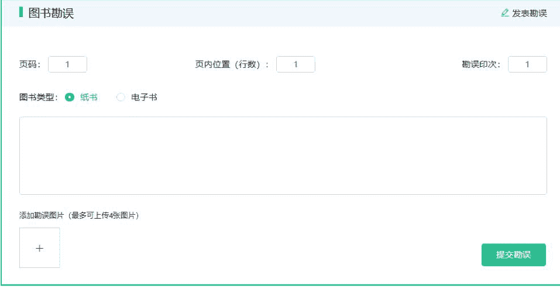

## 与我们联系
联系邮箱为liyongtao@ptpress.com.cn。
如对本书有疑问或建议，请发邮件并在标题注明书名，以便高效回复。
若有出版、教学视频录制，或图书翻译、技术审校等合作意向，也可邮件联系。
学校、培训机构或企业如需批量采购本书或异步社区其他图书，可邮件咨询。
如在网络发现针对异步社区出版图书的盗版行为，包括未授权传播全部或部分内容，请将相关侵权链接邮件告知。我们将依法保护作者权益，感谢您的支持。

## 关于异步社区和异步图书
“异步社区” www.epubit.com 由人民邮电出版社创办，于2015年8月正式运营，专注优质IT内容的出版与分享，为读者提供高品质学习资源，为作者提供专业出版服务，促成作者与读者的在线互动，推动传统出版与数字出版融合发展。
“异步图书”是异步社区旗下精品IT图书品牌，依托人民邮电出版社在计算机图书领域40余年的积累，面向IT行业及各行业IT用户提供专业图书内容。

# 第1章 快速入门：探索豆包潜能

在数字时代的冲击下，人工智能正以惊人速度改变生活方式与工作形态。本章将带你全面揭开豆包模型的功能面纱，深入认识其核心能力与能力边界。通过系统学习，读者能够熟练掌握豆包的基础操作，理解其智能机制，进而在职场、创作与生活中灵活运用豆包，开启高效便捷的智能新阶段。

## 1.1 初识豆包

作为智能对话领域的代表产品，豆包凭借强大的自然语言处理能力与深厚的深度学习功底，正逐步成为用户离不开的创意伙伴与提效助手。本节带你完成对豆包的初步认知。

### 1.1.1 了解豆包
豆包基于云雀模型架构，定位为用户工作学习中的得力智能助手。通过自然语言交互，帮助用户快速获取信息、解决问题。平台支持网页版、电脑版与豆包App，可灵活融入数字化生活，实现随时随地求助。
豆包不仅提供基础对话服务，还内置强大的智能检索能力，能快速汇聚最新资讯，显著提升信息收集效率。在写作方面，可提供灵感并支持多种文体风格，成为写作辅助伙伴。快速摘要功能可一键对网页、PDF等内容进行提炼与要点生成，大幅提升阅读与信息处理效率。上述能力使其成为多面手智能工具，可在多种场景提供实质性帮助。
此外，豆包还是一个综合智能体平台，可通过智能体满足不同场景需求。各智能体针对特定用途设计，如图像生成、写作辅助等。平台也支持用户自建智能体，极大扩展了功能与个性化空间。
后续各章将详细展开豆包的实战应用与技巧，帮助读者更好地理解并加以利用。

### 1.1.2 AI的隐私与版权
智能技术快速发展为内容创作带来便利，文字、图片、视频均可快速高质量生成，但隐私与版权风险也不可忽视。
隐私层面，使用智能生成内容时需警惕数据来源是否涉及个人隐私。多数模型基于海量数据训练，若其中包含隐私信息，使用过程中可能存在泄露风险。因此在向智能体提供个人信息以获取定制化内容时，需审慎评估敏感度与潜在风险，注意保护身份证号、银行账户等隐私数据。
版权层面，智能生成内容可能借鉴或模仿已有作品，引发侵权争议。用户在使用智能成果时，必须明确版权归属，确保不侵犯他人权益。不得随意将智能生成内容用于商业用途而不做版权核查，使用前应进行充分调查与确认。
因此，尽管智能生成能力强大，用户仍须谨慎对待隐私与版权，合法合规使用。

## 1.2 注册、登录与操作界面

简要介绍豆包后，本节讲解注册、登录流程及主要功能区域，帮助快速上手。

### 1.2.1 快速注册与登录
使用豆包前需完成注册与登录，具体流程如下。
**步骤01** 用浏览器打开豆包官网，按右上角【登录】按钮，图示如下。

**步骤02** 弹出登录框，输入手机号，勾选【已阅读并同意豆包的使用协议和隐私政策】，按【下一步】，图示如下。

**步骤03** 获取短信验证码，在框中输入6位验证码，图示如下。

**步骤04** 进入豆包主页面，图示如下。


### 1.2.2 熟悉操作界面
豆包网页版界面简洁清晰，功能分区明确，主要由侧栏、对话框和输入框三部分组成，图示如下。

1. 侧栏
侧栏中包含豆包的标志、主要功能及最近对话、智能体等。
2. 对话框
如果用户正在与豆包互动，此区域将显示用户的输入内容、豆包的回复以及对话记录。
3. 输入框
输入框是用户与豆包进行交互的区域。用户不仅可以在其中输入提示词，还可以粘贴和拖曳链接、文档等内容，以获取更丰富的信息或执行更复杂的任务。另外，输入框下方显示了置顶的常用技能，如帮我写作、图像生成、AI搜索等。

## 1.3 基本对话操作

掌握基本对话操作，是高效利用豆包的关键。从发送提示词到接收回复，每个步骤都简单易懂。

### 1.3.1 开始第一次对话
与豆包的交流，像聊天一样，只需输入文字，发送给它，即可开启对话之旅。
**步骤01** 在豆包操作界面中，单击输入框，即可开始输入提示词内容，如下图所示。
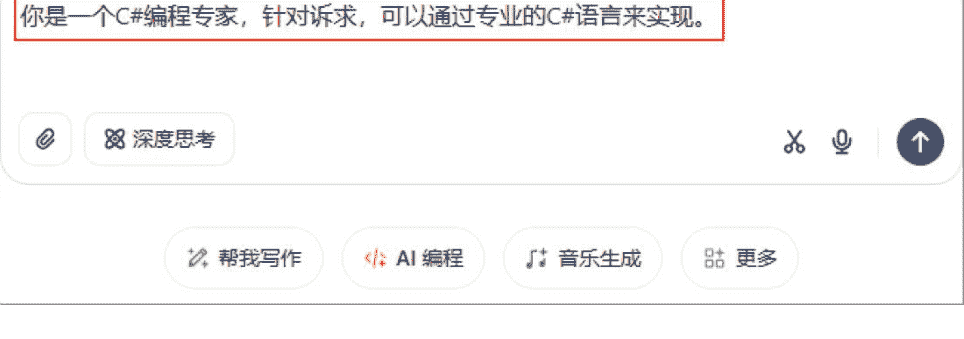
**提示：** 在输入提示词时，可以单击【语音输入】按钮 🎤，通过计算机上的话筒进行语音输入。
**步骤02** 在输入时，如果要换行，可以按【Shift+Enter】组合键，进行换行输入，然后单击【发送】按钮 ⬆️，如下图所示。
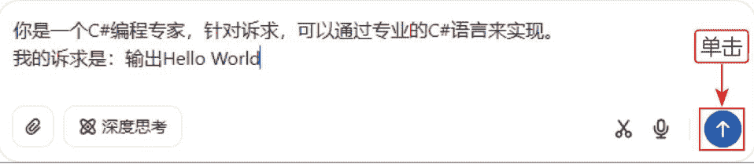
**步骤03** 此时，豆包即会根据提示词，开始生成相应的内容，如下图所示。如果在生成过程中要停止生成，则单击【停止回答】按钮 ◉，这样可停止内容生成，随时打断生成结果，即刻开启新话题。
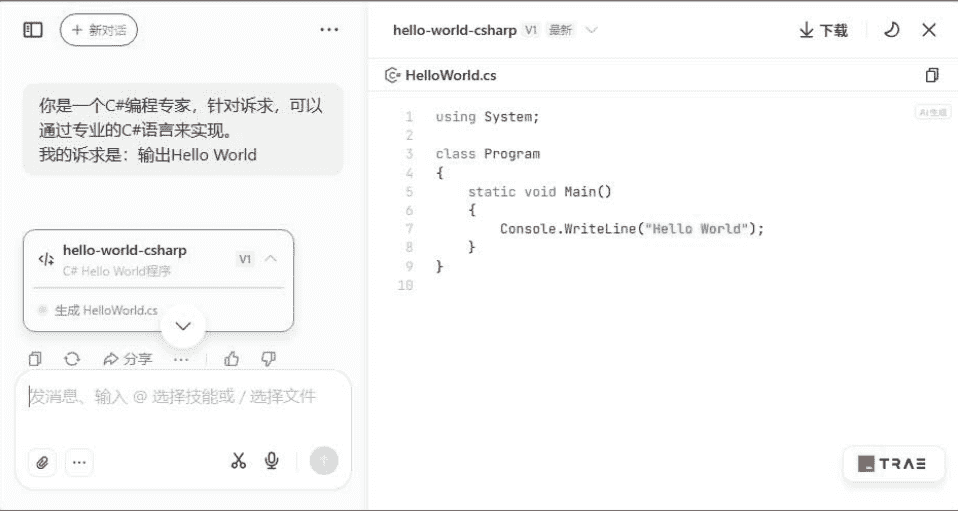
**步骤04** 如果需要修改发送的提示词，将鼠标指针移至提示词位置，单击显示的【修改】按钮 ✎，如下图所示。
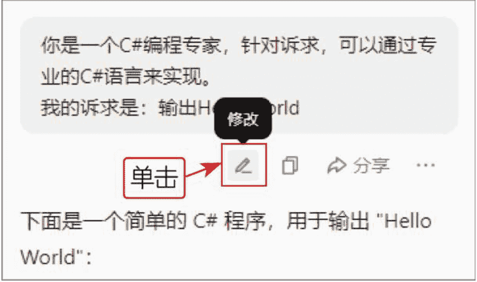
**步骤05** 此时即会显示编辑框，修改提示词，单击【发送】按钮 ⬆，如下图所示。
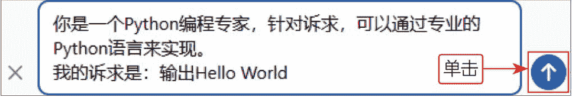
**步骤06** 豆包即会根据新提示词生成相关内容，如下图所示。
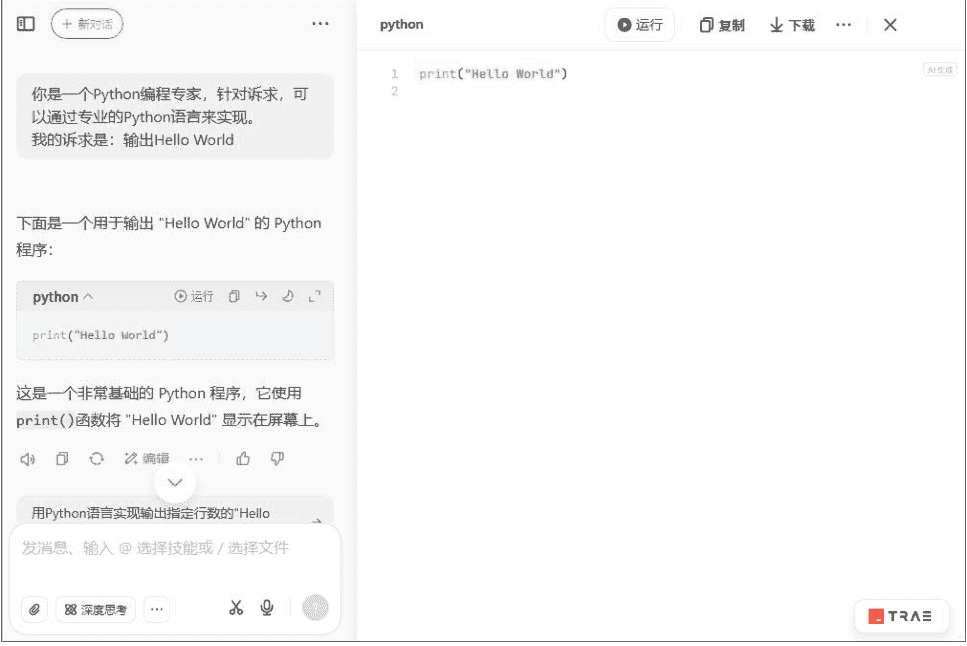
**步骤07** 如果对回答的问题不满意，可以单击【重新生成】按钮 🔄，如下图所示，豆包会重新生成答案。
**提示：** 单击 📋 按钮，可以直接复制文本内容；单击 ⋯ 按钮，会弹出操作菜单，可以执行收藏、举报及删除操作；单击 👍 或 👎 按钮，可以对回答进行评价，有助于提高答案的准确性和质量，使之贴近用户的提问要求。
```python
print("Hello World")
```

这是一个非常基础的 Python 程序，它使用 `print()` 函数将 "Hello World" 显示在屏幕上。


### 1.3.2 开启新对话
在使用豆包时，为了确保不同主题之间界限分明且后面的内容不受先前内容的影响，用户在与豆包交互时，需在一个界定清晰的语境中进行。无论用户是希望转换讨论的话题、设定特定的场景，还是保持对话的独立性，都可以开启新的对话。
选择侧栏中的【新对话】选项或者按【Ctrl+K】组合键，如下图所示，即可开启一个新的对话。


### 1.3.3 展开多轮对话
豆包支持展开多轮对话，可以智能识别与记忆上下文，实现连续对话，提升沟通效率，增加沟通深度，让人机交互更加自然、高效。
**步骤01** 在输入框中输入提示词，如"我在北京，今天天气如何？"，豆包即会进行回复，如下图所示。
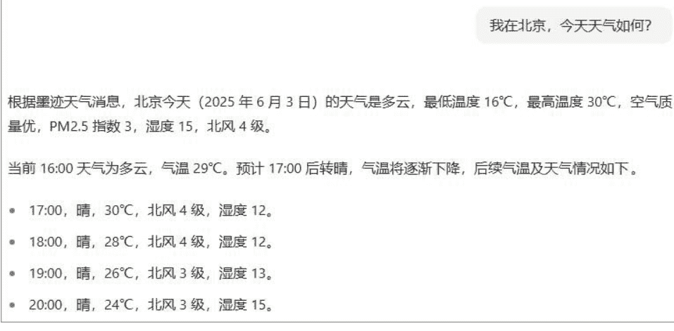
**步骤02** 此时，如果想知道该地有什么景点，无须再强调地点，豆包可以理解上文的内容，如"请给我推荐一些好看的地方"，豆包即可推荐该地好玩的地方，如右图所示。
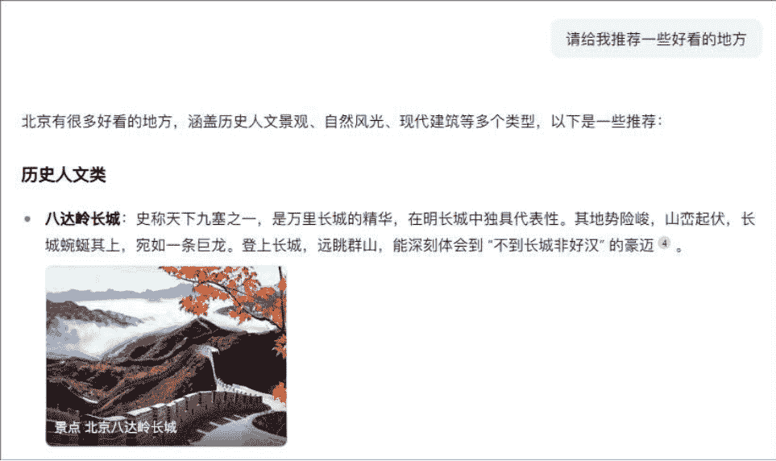
我们可以继续围绕这个主题展开提问，例如"这些景点都需要门票吗""给我推荐一些好吃的店"等，豆包都可以根据上下文信息进行回复，帮助你准确地获取有用的信息。

### 1.3.4 开启推理模式，进行深度思考
豆包的深度思考采用"检索—推理—再检索"的动态循环模式，核心是将思维链展示与多轮动态搜索融合，模拟人类思考逻辑，支持自我质疑、假设验证与推理修正。其功能在于实现"边想边搜"，既能呈现完整推理过程，又能在思考中按需多次调用工具、搜索信息，从而处理复杂、模糊或跨领域问题。这个模式打破了传统AI"先搜后想"的碎片化信息局限，解决了复杂场景下逻辑断层、信息片面等问题，让回答更具逻辑性与全面性，显著提升用户获取信息和解决问题的效率与质量。
**提示：** 对于简单问题、明确的问题，如查询天气、基础计算或常识性问题，无须调用深度思考模式。因为普通模式已能快速提供准确答案，而调用深度思考模式会导致响应时间延长（需多步骤推理），且可能因模型过度推理产生冗余信息甚至逻辑偏差。
下面通过实际操作来了解深度思考模式的应用。
**步骤01** 在输入框中输入提示词，单击【深度思考：开】按钮，调用深度思考模式，然后单击【发送】按钮，如下图所示。
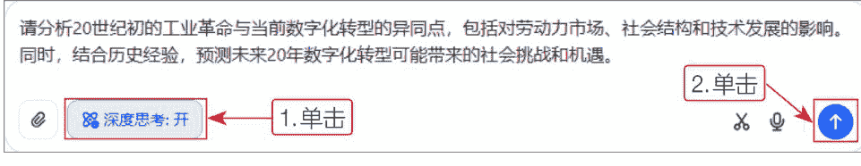
**提示：** 深度思考功能的下拉列表中提供【自动】【开】【关闭】3个选项：选择【自动】选项时，系统会根据上下文自动切换状态；选择【开】选项时，系统将输出包含完整推理过程的答案；选择【关闭】选项时，可实现快速回答。读者可根据实际需求灵活选择。
**步骤02** 此时，豆包并未直接回答，而是搜索并进行思考，展示了完整的思考过程，拆分和整合用户的需求，如下图所示。
> > 请分析20世纪初的工业革命与当前数字化转型的异同点，包括对劳动力市场、社会结构和技术发展的影响。同时，结合历史经验，预测未来20年数字化转型可能带来的社会挑战和机遇。
已完成思考
我现在需要分析 20 世纪初的工业革命与当前数字化转型的异同点，包括对劳动力市场、社会结构和技术发展的影响，同时预测未来 20 年数字化转型可能带来的社会挑战和机遇。首先，我需要明确这两个时期的基本背景和关键特征。
首先，20 世纪初的工业革命，通常指第二次工业革命，主要发生在 19 世纪末到 20 世纪初，以电力、内燃机、化工和钢铁等技术为标志。而当前的数字化转型则是指信息技术革命，特别是互联网、人工智能、大数据等技术的广泛应用。两者都是技术驱动的重大变革，但所处的时代背景和技术基础不同。
**步骤03** 推理完成后，豆包即会生成相关的回答内容，如下图所示。
是否需要继续搜索：
- 否。现有信息已足够覆盖用户问题的各个方面，包括历史对比、当前影响和未来趋势。补充的搜索结果提供了具体数据（如岗位替代数量、城市化率变化）、政策案例（如工厂法、数据治理）和技术应用案例（如量子计算在医疗中的应用），能够充分支持回答的深度和丰富度。进一步搜索可能重复已有信息，不会显著提升回答质量。
20 世纪初的工业革命与当前数字化转型作为人类历史上两次重大技术变革，在重塑社会结构、劳动力市场和技术发展方面呈现出深刻的共性与差异。结合历史经验，未来 20 年数字化转型将在延续工业革命逻辑的同时，带来更为复杂的社会挑战与机遇。
# 一、工业革命与数字化转型的核心差异
## 1. 技术驱动逻辑的根本分野

工业革命的根基是物理技术层面的突破，电力普及、内燃机问世、化工合成工艺完善等，都在围绕能源转化与机械革新来拉升生产效能。以英国纺织行业为例，蒸汽机大面积应用后产出约增长四百倍，棉纺织品的市价则下滑了93% ⁸。数字化转型的驱动力则是信息技术对生产逻辑的重塑，通过数据、算法和网络的协同配合，实现要素的智能化配置。例如部署工业互联网平台后，制造环节的设备综合效率通常能提升30%以上，而产品不良率大致下降20% ⁷。

**提示：** 在使用豆包时若碰到回复被截断或内容生成不完整，直接键入“继续”即可让其补全。也可以用分段式指令，例如“请展开说明第N点”或“请详细阐述核心论据”，引导模型针对特定部分做深入展开。

### 1.3.5 边写边生成：生成文档并编辑
豆包的“帮我写作”功能操作门槛低，还自带写作辅助，能明显提高写作效率。不论是搭建文章框架、生成完整稿件，还是保存成果，都可以一次性完成。

**步骤01** 在侧边栏选中【帮我写作】，于输入区填写需求文字后点按【文档编辑器】按钮，再点击【发送】⬆️，示意图在右侧。
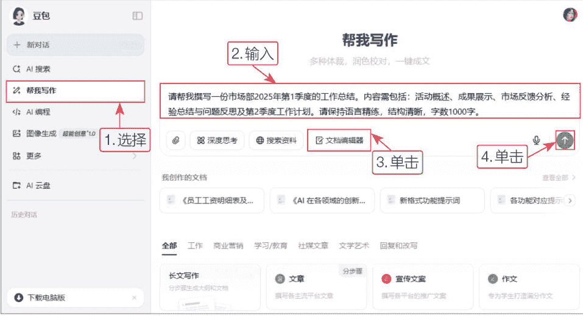

**步骤02** 进入文档编辑器后，左侧为交互记录区，可查看与豆包的对话历史；右侧为内容编辑区，可直接对生成结果进行增删改，界面如下。
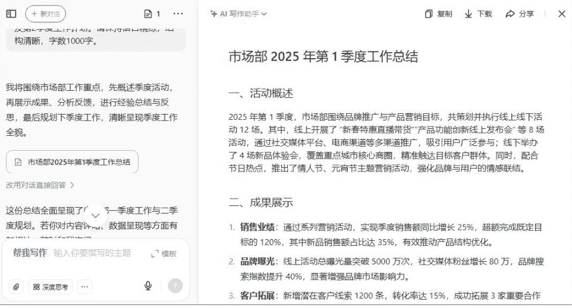

**步骤03** 将光标悬停在需要修改的段落旁，段落左侧会浮现操作按钮，点击后弹出快捷菜单，支持润色、扩写、缩写及语气调整。以【调整语气】→【更专业】为例，效果见左下图。

**步骤04** 系统会按指令重写该段。完成后下方会出现【替换】与【插入】两个选项。点【替换】则原段被新内容覆盖，如右下图所示；点【插入】则新内容追加进原文，便于对比。
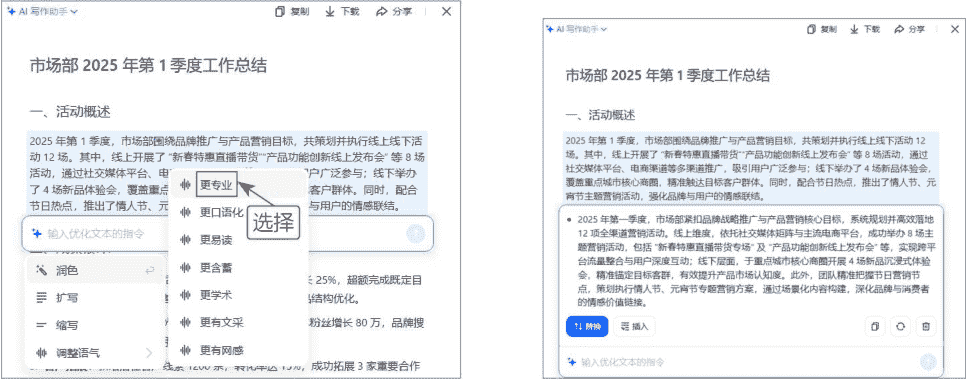

**步骤05** 成稿后点击右上角【下载】。弹出列表可导出Word、PDF、Markdown格式，选择所需格式即可完成下载，如右图所示。
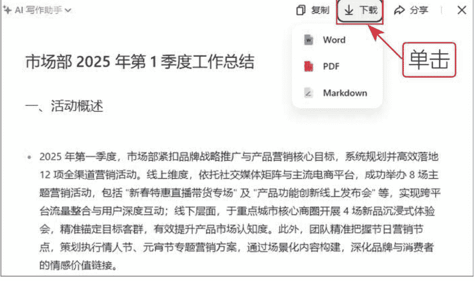

### 1.3.6 调用和置顶常用技能
豆包内置多种技能，可快速激活并借助预设模板生成提示词，也能将高频技能置顶以便随时调用。

**步骤01** 常用技能展示在输入框下方，例如点击【帮我写作】按钮，如下图所示。
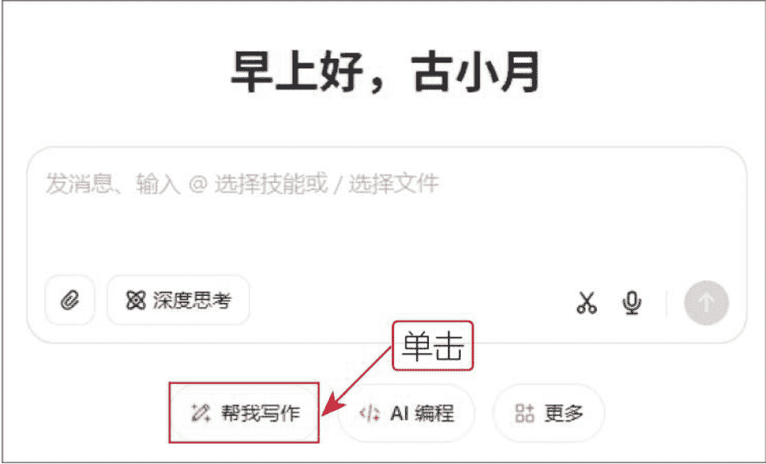

**步骤02** 在弹出列表中选择【更多体裁和工具】选项，如下图所示。
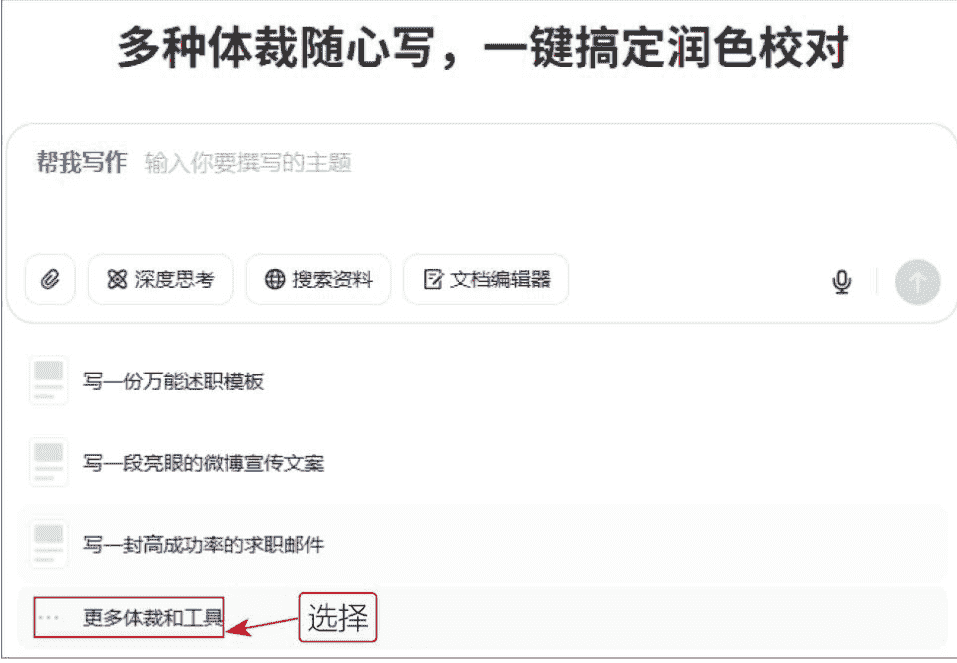

**步骤03** 即可看到预设写作模板，例如选择【长文写作】，模板内容会自动填入输入框，其中蓝色文字为可自定义区域，修改后点击【发送】➤，如图右。
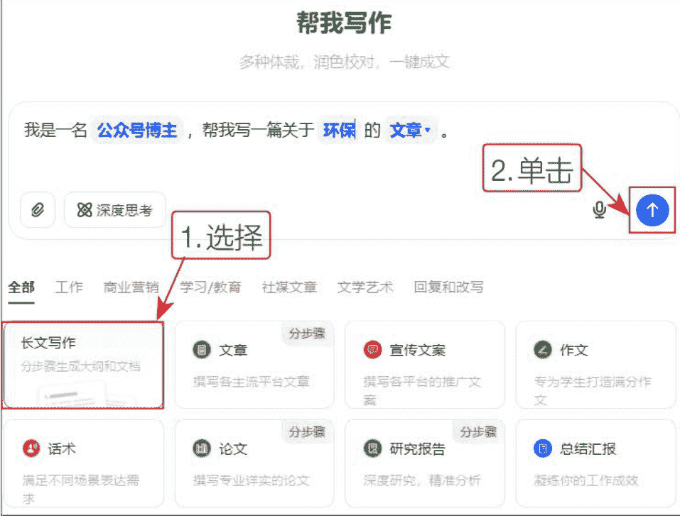

生成后会先得到可自由编辑的大纲，确认无误后可点下方蓝色按钮进入文档生成环节。

**标题：** 别等地球“发火”，才想起环保！

地球“生病”了，你注意到了吗？

以环境恶化的具体表现，如极端天气和物种灭绝等，带出地球面临的环保困境，引发读者关注。

如需调整常用技能，可按以下流程操作。

**步骤01** 点按输入框下方的【更多】按钮，如下图所示。


**步骤02** 可查看全部技能，点击【置顶你常用的技能】按钮，如下图所示。
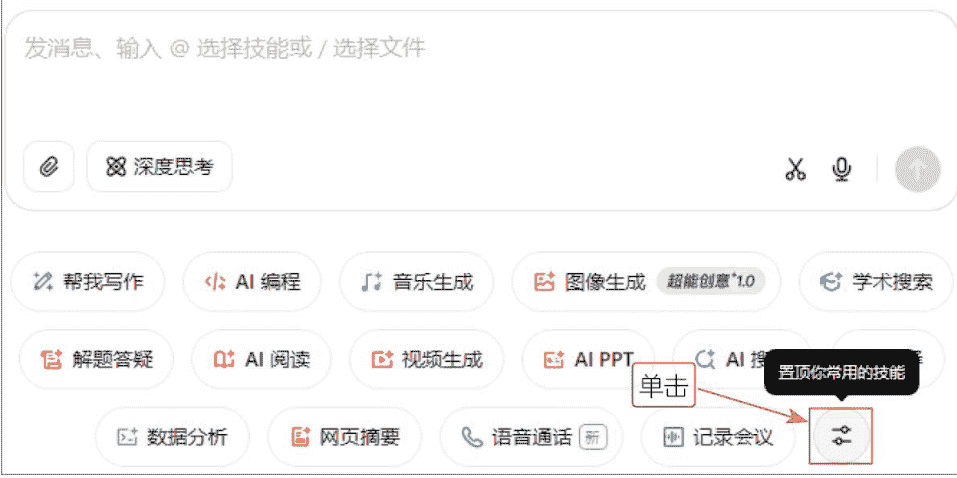

**步骤03** 进入【置顶你常用的技能】对话框，用 ⚡ 按钮调整顺序，完成后点【确定】，如下图所示。

#### 置顶你常用的技能
系统会依据使用频率自动排序，你也可以在此页面把常用技能置顶到前面。


- 帮我写作 帮助你起草任何内容，助你妙笔生花
- AI 编程 解答编程疑问，助力编程项目从构思到实现
- 音乐生成 把你的想象力变成音乐
- 图像生成 把你的想象力变成图像
- 视频生成 自由运镜，图片文字一键成片
- AI PPT 帮你一键生成 PPT
- AI 搜索 通过对话搜索任何你想要的信息
- AI 阅读 询问关于这个 PDF 的任何问题
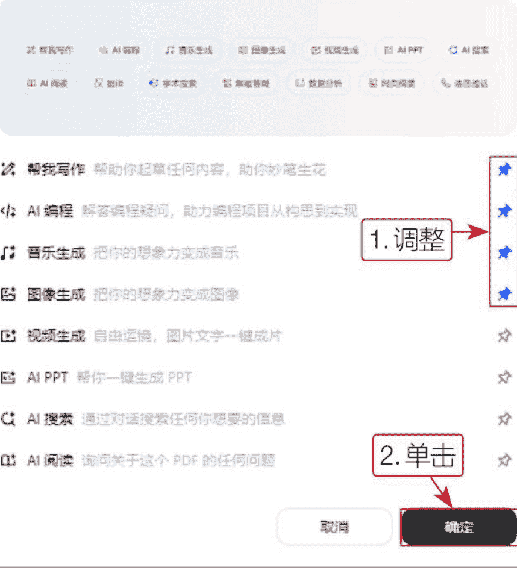

**步骤04** 此时常用技能会按顺序固定在输入框下方，如下图所示。


### 1.3.7 上传文档、图片进行对话
豆包支持上传文档和图片进行对话，大幅提升交互便捷性和效率。

具体操作如下。

**步骤01** 点击输入框中的 📎 按钮，在菜单里选择【上传文件或图片】，如下图所示。
**提示：** 也可直接拖拽文件至输入框上传。
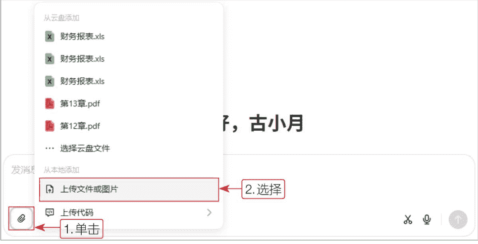

**步骤02** 弹出【打开】对话框，选择要上传的文件，这里以Word文档为例，点击【打开】，如下图所示。
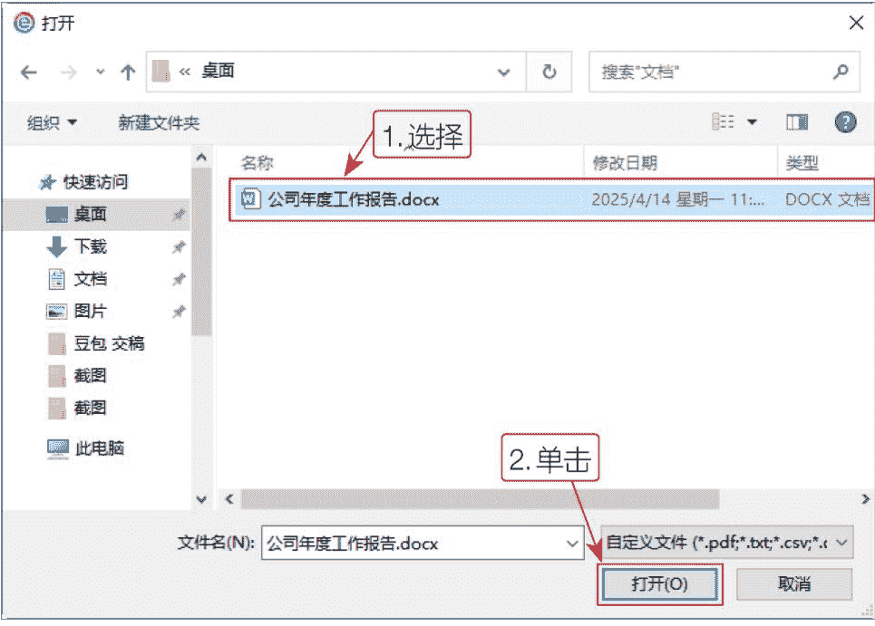

**步骤03** 文件上传完成后会显示在输入框中，随后输入提示词点击【发送】⬆️，如下图所示。


**步骤04** 豆包进入【AI阅读】模式，基于文档并按提示词回复，结果显示在左侧窗格。后续问题可在输入框继续互动，如下图所示。
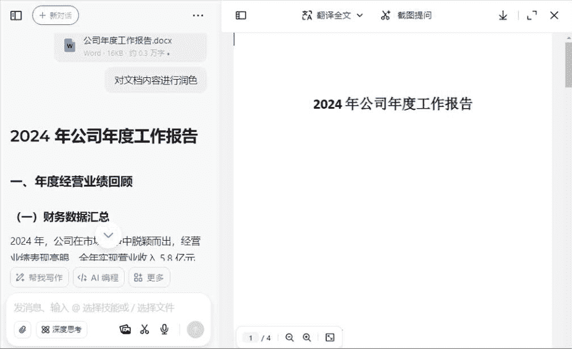

**提示：** 在【AI阅读】模式下，点击右侧窗格上方的【全屏查看】按钮，可全屏浏览文档，如下图所示。


另外，豆包还提供【AI云盘】功能，不仅支持单文件上传，还可上传整个文件夹及链接，方便存储文档并实现多端同步与协作。结合豆包使用，【AI云盘】还具备智能分类、文档分析、翻译、截图提问等能力。进入侧栏【AI云盘】后，点击【上传文件】即可批量上传本地文件，如下图所示。
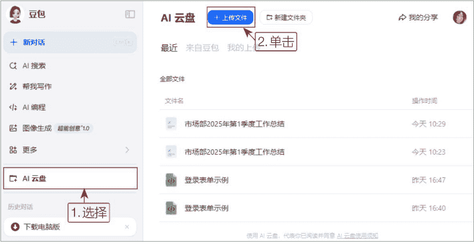

### 1.3.8 查看和编辑历史对话
豆包提供历史对话查看与编辑功能，可回溯记录进行回顾分析，也能修改对话信息以提升交流效率和准确性。

侧栏【历史对话】列表展示近期记录，点击任意一条即可切换查看。鼠标悬停在记录上时会显示操作按钮，点击后可进行置顶、分享、收藏、重命名、举报、删除等操作，如下左图所示。

点击对话列表上方的【查看全部】按钮，如下右图所示，可查看所有历史对话。
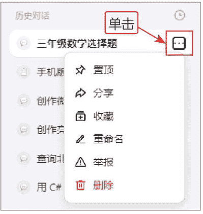
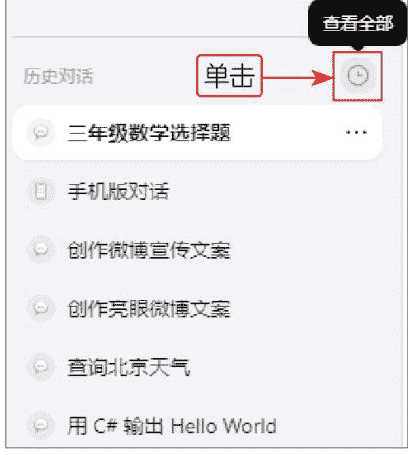

也可选择【历史对话】列表中的【全部】选项，如下图所示。
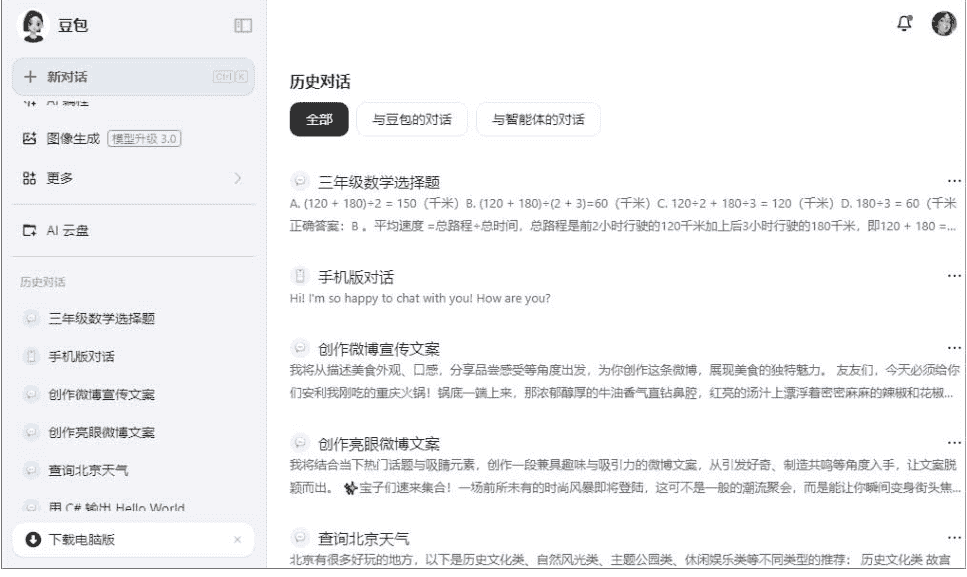

## 1.4 提示词的运用
在豆包中，提示词是用户与模型交互的桥梁。掌握使用技巧能更好地获取期望结果。

### 1.4.1 提示词是什么
在豆包里，提示词是通过自然语言向模型提出的请求或指令。可简单如“今天北京天气怎么样？”，也可复杂如“请帮我写一首关于春天的诗”。

借助提示词，用户能清晰表达需求，豆包依托自然语言处理和深度学习能力快速生成对应回答。简言之，提示词就是告诉豆包想要它做什么。用自然语言准确描述需求，豆包就会理解并执行，给出相应内容。

因此，熟练运用提示词能显著提升交互效率，帮助用户更轻松获取信息、完成创作和任务。

### 1.4.2 如何构建优秀的提示词
优质提示词能让豆包更精准理解意图，提升交互效率；劣质提示词则会浪费时间且难以获得期望输出。

#### 1. 提示词的组成结构
提示词=任务描述+参考信息+关键词+要求。

- （1）任务描述：清晰说明希望模型完成的工作，可是一个问题、主题或具体任务。
- （2）参考信息：提供背景资料或上下文，有助于模型更好理解需求。
- （3）关键词：提示模型需关注的关键信息或问题，使输出更贴合。
- （4）要求：明确列出特殊限制或偏好，如字数、格式、语言、编程风格、创意方向或情感色彩等。实践中还可补充角色设定、示例等。

#### 2. 不好的提示词示例
表1-1列举了若干不佳提示词示例，便于理解问题所在。

| 提示词 | 存在问题 |
|--------|----------|
| 生成一篇文章 | 任务与要素缺失，模型无法判断文章类型与方向 |
| 阅读这篇文章并给出意见 | 缺少具体任务说明与期望输出形式 |
| 讨论AI的风险 | 问题不够明确，输出容易宽泛且不切实际 |
| 生成一张图片 | 描述模糊，未说明画面内容或风格 |
| 写一段对话 | 缺少背景与关键要素，无法确定主题与场景 |

#### 3. 优秀的提示词示例
例如希望AI写一段环境保护对话，可采用如下优秀提示词。

- **任务描述：** 生成一段对话，探讨环境保护的重要性和可行性并提出方案。
- **参考信息：** 环境问题包括气候变化、污染、资源浪费等。
- **关键词：** 环境保护、气候变化、污染、资源浪费。
- **要求：** 对话需包含至少两位参与者，每人至少提出两个保护方案，总字数500~800字。

整合后完整提示词如下。

生成一段对话，讨论环境保护的重要性和可行性，并提出方案。在对话中，至少两位参与者需每人提出至少两个保护环境的方案。同时详细探讨环境保护、气候变化、污染、资源浪费等问题，并给出不同观点。请确保对话总字数为500~800字。

## 1.5 智能体的运用
智能体在豆包中承担重要角色，可执行多种复杂任务，提升智能化水平。

### 1.5.1 了解智能体
智能体是一种高度智能化的交互系统，可呈现综合型或垂直领域型。综合型智能体类似集成提示词，具备问答、文案撰写、图片生成、搜索摘要等多项能力；垂直型智能体如写作助手、陪聊伙伴、英文练习工具、游戏攻略指南等，针对特定需求提供精准服务。

随着AI发展，智能体应用场景不断扩展，可为教育辅导、医疗咨询、法律服务等领域定制化开发，提供高效便捷方案。

在豆包中选择侧栏【更多】，在弹出列表中选择【AI智能体】选项，如下图。


进入【发现AI智能体】页面，可看到官方预设和用户分享的智能体，分为工作、学习、创作、绘画、生活五大类，也可在搜索框检索，如下图。
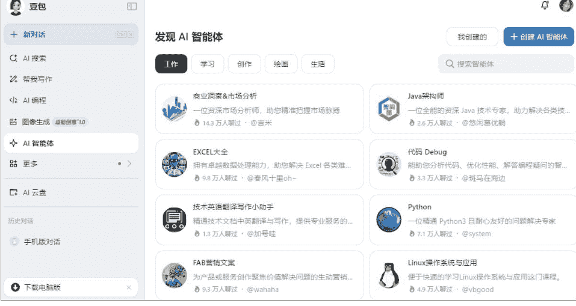

### 1.5.2 与智能体进行对话
了解智能体后，可使用其交互功能，具体步骤如下。

**步骤01** 在【发现AI智能体】页面选择所需智能体，例如【绘画】类下的【国风头像】智能体，如下图。
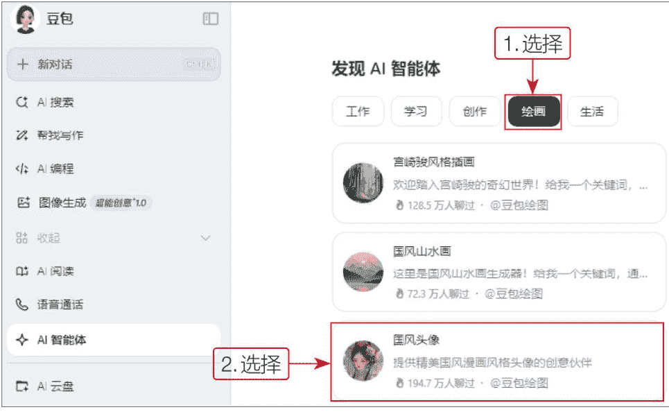

**步骤02** 进入智能体对话页，发送提示词进行互动，如下图。


**步骤03** 豆包会根据提示词生成图片，如下图。


### 1.5.3 创建专属的智能体
用户可按自身需求创建专属智能体，满足个性化交互。

**步骤01** 在【发现AI智能体】页面，点击【创建AI智能体】按钮，如下图。
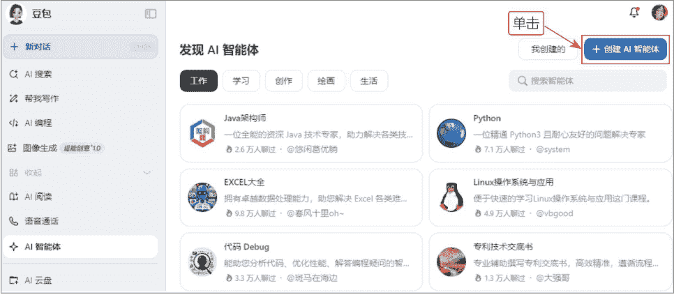

**步骤02** 进入创建页，在【名称】框输入智能体名称，并按需设置头像与描述；不愿手动填写可点【一键完善】按钮，如下图。
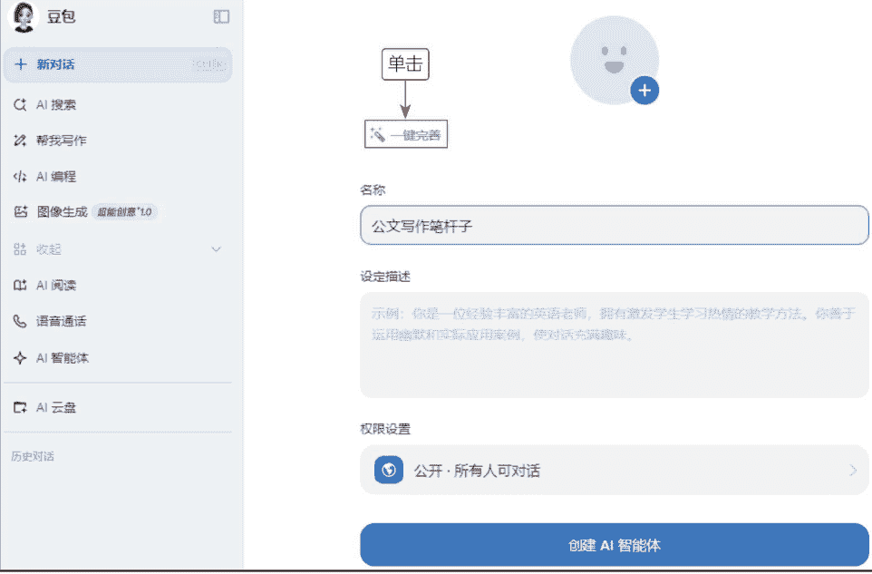

**步骤03** 系统会根据名称自动生成描述并设置头像，如下图。


**步骤04** 可在【权限设置】下方调整权限，弹出对话框后按需配置，点击【确定】，如图右。
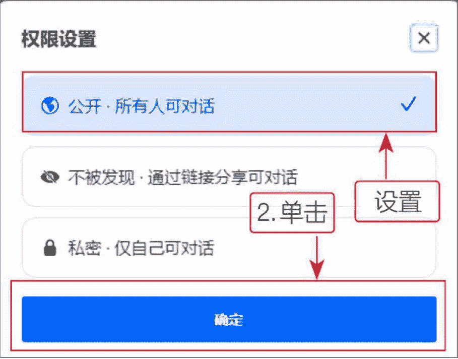

**步骤05** 返回创建页，点击【创建AI智能体】按钮，如下图。
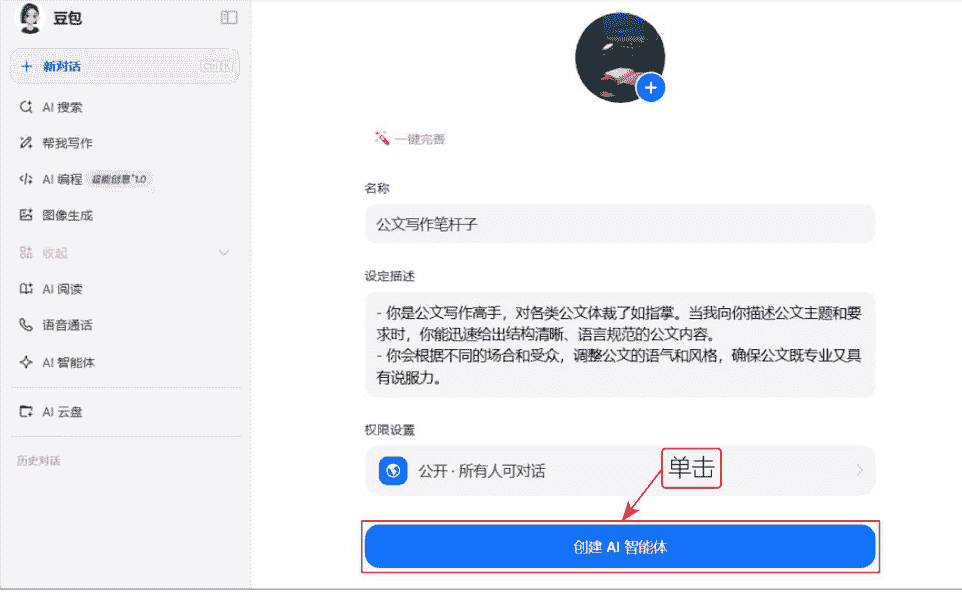

**步骤06** 创建完成后进入智能体对话页，如下图。

#### 公文写作笔杆子
1 人聊过 · 创建人 @古小月
需要写公文吗？我来帮你。
- 写一篇活动总结公文。 →
- 写份工作汇报公文。 →
- 写个请示公文要求。 →


# 第2章 职场提效：豆包职场加速器
在快节奏的职场中，效率往往决定成败。本章探讨豆包如何成为职场人士的加速器，助力在不同工作场景提升效率。从文案创作到商业分析，从求职招聘到课程教学，豆包为职场提效开辟新路径。下面一起了解豆包如何重塑工作方式，引领更高效、更智能的职场未来。

## 2.1 改写和回复
豆包凭借强大的语言处理能力，无论是文章改写还是复杂信息回应，都能发挥巨大作用。

### 2.1.1 实战：润色文本
在职场中，清晰、精炼且有吸引力的书面表达是提升专业形象的关键。润色文本能提高文档质量，更有效地传递信息，提升阅读体验。


**场景**
小李是某科技公司市场专员，他在撰写向领导汇报新产品市场推广方案重要性时，希望通过润色使汇报内容更简洁、有条理，便于领导快速抓住重点，理解方案对公司发展的关键作用。


**提示词**
请润色以下内容。企业发展的关键在于新产品的成功推广，其中，新产品市场推广方案尤为重要，需重视预先规划、执行和管理可能面临的主要市场挑战及竞争压力，以防止出现推广不力的情况，确保企业能够在市场中占据有利地位并持续发展。为此，提高对新产品市场推广方案重要性的认识，完善执行机制，并制定有效的应对策略，对促进企业的长期稳定发展有着至关重要的意义。


**回答**
企业发展的关键在于成功推广新产品，而新产品市场推广方案至关重要。企业需重视预先规划、执行与管理可能面临的市场挑战及竞争压力，防止推广不力，从而确保企业在市场中占据有利地位并持续发展。为此，提高对新产品市场推广方案重要性的认识，完善执行机制，制定有效应对策略，对促进企业长期稳定发展意义重大。

通过上述方法，用户可向豆包提供待润色文本或文档，并给出润色提示词。


#### 让提示词更精准

想让润色结果贴合预期，往指令里加上约束条件会更稳妥。常见做法有：

- 保留原意。示例指令：请对以下内容润色，中心意思不要变动。
- 篇幅把控。示例指令：请对以下内容润色，字数控制在200字以内。

### 2.1.2 实战：语气校准

写作时语调是否恰当，直接决定信息传达效果。通过微调用词与表述，就能让文本更符合使用场景，提升准确度与专业感。


**应用场景**

小张在公司负责文案，需把一份项目进展汇报的语气调得更庄重、更规范。

#### 提示词进阶思路

设定语气时，要在指令里明确希望的风格是正式、专业或其他特定调性，最好附上参考样例体现效果。别忘了说明使用目的和受众，有助于模型把握表达分寸。示范指令：

请把下面文本调整为正式表达。润色时体现对合作伙伴的尊重与重视，同时突出我方企业的竞争力以及合作的潜在收益。

### 2.1.3 实战：文本校核

校对是保证文字正确规范的关键环节。排查语法、用词、错别字等问题，能明显提升文档质量。

**应用场景**

小王要把一份会议纪要发给领导，为确保文字准确专业，发送前需要先做校对。

**指令示例**

请核对下面文本的语法错误和错别字：“本次会议主要总结了前段时间的工作成果，并对接下来的工作进行了部署。在会议中，大家积极发言，提出了许多宝贵的意见建意。然而，也发现了一些问题，如部分工作进度滞们、沟通不畅等。希望大家能够重视这些问题，及时加以解冠。”

**模型回复**

该段文字存在以下错误：

- “意见建意”中的“建意”应改为“建议”；
- “进度滞们”中的“滞们”应改为“滞后”；
- “解冠”应改为“解决”。

修正后的文本为：本次会议主要总结了前段时间的工作成果，并对接下来的工作进行了部署。在会议中，大家积极发言，提出了许多宝贵的意见和建议。然而，也发现了一些问题，如部分工作进度滞后、沟通不畅等。希望大家能够重视这些问题，及时加以解决。

校对完毕后，还需复核内容是否真实无误，再对原稿进行修正。若是文档形式，也可直接上传并下发校对指令。

#### 提示词进阶思路

让模型校对时，务必把目标说清楚，完整描述期望达到的效果。如有格式或特殊要求，也要在指令中写明。更完善的指令示范：

请仔细阅读下面文本，检查是否存在语法、用词、标点使用不当以及句式结构问题。同时保证逻辑通顺、表达清晰，并符合设定的写作风格与格式要求。完成后提供详细的修改建议与反馈。

### 2.1.4 实战：邮件撰写

撰写邮件回复是日常办公中高频的沟通动作。借助模型可以提升回复速度与一致性。

**应用场景**

小李是公司客服，负责处理客户咨询。一天收到潜在客户来信，对公司产品很感兴趣，想了解更多详情。

**指令示例**

请根据以下邮件内容，使用专业的口吻进行回复。邮件原文："尊敬的李先生，我对贵公司的产品很感兴趣，想了解一下产品的详细信息，包括功能、价格、售后服务等。期待您的回复，谢谢！"

**模型回复**

尊敬的××：

您好！

非常感谢您对我们公司产品的关注与认可。以下是关于产品的详细信息：

功能方面，我们的产品具有[具体列举产品的主要功能和特色优势]等功能，可以满足您在[相关使用场景]中的各种需求。

……

如果您还有其他问题或需要进一步了解产品信息，欢迎随时与我们联系。我们将竭诚为您服务。

再次感谢您的来信！

祝您生活愉快，工作顺利！

[公司名称]

[回复人姓名]

[具体日期]

模板生成后，可结合实际情况做少量个性化调整，避免过于刻板。最后要及时跟进客户反馈，保持良好沟通并提升满意度。

#### 提示词进阶思路

上述指令能生成较为规范的邮件模板。若想让回复更具体、更专业，可在指令中补充关键信息、背景资料及明确要求，示例：

请帮我回复这封来自客户的邮件。邮件类型为正式回复。回复内容需包括：感谢客户对产品的关注与询问；简要介绍产品的核心特点与优势；邀请客户参加即将举行的线上产品演示会，并给出会议时间与链接；最后表达期待参与的意愿，并附上我的联系方式以便后续沟通。请保持专业性，采用友好语气，对照客户提问逐一回应，确保信息准确。

### 2.1.5 实战：即时消息回复

在工作中，利用模型辅助回复微信、QQ等即时通讯消息，能显著提升沟通效率与质量。

**应用场景**

小刘是销售经理，经常通过微信与客户保持联系，了解需求、解答疑问并推动成交。

**指令示例**

请使用专业且简洁的语言回复客户，介绍产品的三大主要功能。客户的"消息"内容为：你们的产品有哪些主要功能？

**模型回复**

您好！我们的产品具有[功能一]、[功能二]和[功能三]三大主要功能，能够全面满足您的使用需求。如有兴趣，我可以为您详细介绍。

**指令示例**

请回复客户，提供报名方式、活动时间和地点，并邀请其参加。客户的"消息"内容为："我想参加你们下个月的产品发布会，请问如何报名？"

**模型回复**

感谢您的参与意向！您可以通过[报名链接/电话/邮箱]进行报名。我们的产品发布会将于[具体日期]在[地点]举行。期待与您相见，共同见证新产品的诞生！

借助模型处理各类消息，职场人士可在保证专业和准确的前提下大幅提升沟通效率。遇到需要结合上下文回复的情况，可将对话截图提供给模型，获得更精准的建议。

#### 提示词进阶思路

为提升回复的个性化与精准度，可在指令中加入更多细节与背景。例如：

请根据客户的购买记录和产品问题，结合公司的售后服务政策，个性化地回复客户，并提供具体的解决方案或联系方式。

也可以更具体地描述情境与需求，例如：

- 帮我用幽默的语气回复朋友的调侃微信消息。
- 以专业的角度回复客户的微信咨询消息。

### 2.1.6 实战：评论互动

及时、专业且有人情味的评论回复，既能改善客户购物体验，也能提升店铺口碑与转化。很多电商商家已用模型来提升评论处理的效率和质量。

**应用场景**

小赵是网店客服经理，店铺新品上线后收到大量评论，既有好评也有差评。

**指令示例**

请根据以下评论内容，使用专业且友好的语言进行回复。评论原文：

“产品质量不错，但物流太慢了，等了好久才收到。”

**模型回复**

亲，非常感谢您对我们产品质量的认可！对于物流速度慢给您带来的困扰，我们深表歉意。我们会积极与物流公司沟通，提高配送效率，确保以后不再出现类似的情况，以便能为您提供更优质的购物体验。再次感谢您的支持和反馈。

通过灵活配置指令内容，商家可针对不同类型的评论给出恰当有效的回应，实现良性互动。

#### 提示词进阶思路

使用模型回复评论时，需明确回复目的与情境，准确描述评论内容，设定合适的语气风格，加入个性化元素增强针对性，同时体现同理心，确保信息准确无误，并可提供模板或示例引导生成高质量回复。例如：

请根据以下评论内容，生成一个正式且带有情感共鸣的回复。评论原文："我一直很喜欢你们的产品，但这次购买的××型号出现了××问题，让我有些失望。希望能尽快解决。"

回复要求：①表达对用户长期以来支持的感谢；②承认产品存在的问题，并表示歉意；③承诺将立即采取措施解决问题，并提供具体的解决方案或联系方式；④邀请用户保持联系，以便随时跟进问题解决情况；⑤保持语气诚恳、专业，同时体现出对用户情感的理解和共鸣。

期望回复示例（非具体生成）：（略）。

## 2.2 公文撰写

公文写作是职场必备技能。无论是日报还是通知，规范的公文都能确保信息准确传递。本节介绍如何用模型生成专业高效的公文内容。

### 2.2.1 实战：日报撰写

工作日报是向主管或团队汇报当日进展的重要载体，能清晰呈现工作完成情况、遇到的问题与次日计划。

**应用场景**

张华是科技公司项目经理，需每日撰写日报汇报项目进展、问题与计划。日报要简洁明了，涵盖关键信息，便于管理层快速掌握状态。

**指令示例**

请帮我撰写一份工作日报，包括以下内容：①项目名称和项目编号；②今日完成的主要工作内容；③遇到的问题及解决方案；④明日的工作计划；⑤需要团队其他成员或管理层支持的事项。请确保日报格式规范，信息完整，语言简洁明了。

**模型回复**

#### 工作日报

日报日期：2024年11月8日 星期五

员工姓名：[你的名字] 部门：[具体部门]

##### 一、项目名称和项目编号

项目名称：[项目具体名称]

项目编号：[项目编号]

##### 二、今日完成的主要工作内容

完成了市场调研报告的初稿撰写，收集并整理了近三个月同行业产品的销售数据、市场份额以及消费者反馈等信息，对市场趋势进行了初步分析。

……

##### 五、需要团队其他成员或管理层支持的事项

希望市场部门的同事能够提供更多关于行业动态的最新信息，以便更全面地分析市场形势。

请管理层对产品推广计划的初步框架进行指导和审核，确保计划的可行性和有效性。

借助上述指令可快速生成结构清晰、内容完整的日报，有助于团队及时了解进展，促进沟通协作。

#### 提示词进阶思路

构建指令时，应着重明确日报的核心要素，如项目名称、工作内容、问题及解决办法等，并可给出格式要求以保证规范性和可读性。例如：

请帮我撰写一份工作日报，项目名称为"智能数据分析系统开发"，项目编号为XD-20241028。今日完成的主要工作包括数据接口的调试和用户界面的初步设计。遇到的问题是在数据同步时出现延迟，已通过优化数据库查询语句解决。明日计划进行系统安全性测试和用户反馈收集。需要市场部门提供用户反馈和渠道支持。

### 2.2.2 实战：会议通告

会议通知是内部沟通的重要手段，确保参会人员提前知晓时间、地点和议题。

**应用场景**

李娜是咨询公司行政主管，需为季度战略会议撰写通知，包含时间、地点、参会人员、议程及准备材料等信息，保证人员准时出席。

**指令示例**

请帮我撰写一份会议通知，包括以下内容：①会议主题；②会议时间；③会议地点；④参与人员名单；⑤会议议程；⑥需要准备的材料。请确保通知格式规范，信息完整，语言正式。

**模型回复**

#### 会议通知

各位相关人员：

为了[阐述会议目的，如推进项目进展、讨论公司发展战略等]，现决定召开一次重要会议。以下是本次会议的详细信息：

##### 一、会议主题

[具体会议主题]

##### 二、会议时间

[开始时间]—[结束时间]，[具体日期]

……

请各位参会人员提前做好准备，按时参加会议。如有特殊情况不能出席，请提前向[通知人姓名]请假并说明原因。

特此通知。

[通知部门名称]

[通知日期]

通过上述指令可迅速生成详细会议通知，使用者可根据实际情况修改调整。

#### 提示词进阶思路

构建指令时，应提供会议的详细信息和具体要求，以确保通知准确完整。例如：

请帮我撰写一份会议通知，主题为"2024年第四季度战略规划会议"。会议定于2024年12月15日14:00在公司第一会议室举行。参与人员包括CEO及各部门经理。会议议程包括市场分析报告、新产品开发计划和明年预算分配。请所有参与人员准备相关数据报告和建议方案。

### 2.2.3 实战：出差申请

出差申请是员工因公外出时向单位提出的正式文件，对规范流程和管理费用至关重要。

**应用场景**

小王是销售代表，为拓展业务需前往外地与客户洽谈，预计出差5天，地点沈阳。

**指令示例**

请根据以下信息生成一份出差申请。出差原因是与客户洽谈合作事宜，预计出差天数为5天，出差地点为沈阳，预计出差费用包括交通费用1000元、住宿费用1200元和餐饮费用500元。

**模型回复**

#### 出差申请

尊敬的[领导姓名]：

您好！

我是[您的姓名]，来自[所在部门]。现因工作需要，特向您申请前往沈阳出差，与客户洽谈合作事宜。相关信息如下：

##### 一、出差目的

与沈阳的重要客户进行面对面的商务洽谈，深入沟通合作项目的细节，争取达成合作意向，推动业务拓展。此次洽谈对于公司在东北地区市场的布局和业务增长具有关键意义。

……

希望您能批准我的出差申请。我将全力以赴完成工作任务，为公司的发展作出贡献。

感谢您的支持与信任！

申请人：[您的姓名]

申请日期：[申请日期]

使用上述指令，模型可高效生成完整出差申请，实际使用时可按具体情况修改。

#### 提示词进阶思路

构建指令时，应详细说明出差目的和预期成果，以及预算和行程安排。例如：

请帮我撰写一份出差申请，出差目的是参加上海国际工业博览会并拜访三家重要客户。出差日期为2024年12月5日至12月8日。行程包括参观展会、客户会议和市场调研。预计费用包括机票3000元、酒店2000元、餐饮和交通1500元。出差目标是了解行业最新动态，加强与客户的合作关系，并探索新的市场机会。

### 2.2.4 实战：合同协议

合同协议是商业交易中保障双方权益的重要法律文件。清晰严谨的合同可预防纠纷，保护企业利益。

**应用场景**

某公司即将与客户签署软件开发合同。陈梅需起草合同，包含项目范围、交付物、时间表、付款条款、保密协议等。

**指令示例**

请帮我起草一份软件开发合同，包括以下内容：①合同双方的基本信息；②项目的范围和目标；③具体的交付物和里程碑；④时间表和进度安排；⑤付款条款和条件；⑥保密协议和知识产权；⑦违约责任和争议解决方式。请确保合同内容严谨、合法，格式规范。

**模型回复**

#### 软件开发合同

甲方（委托方）： 名称：[甲方公司名称] 法定代表人：[甲方代表姓名]

地址：[甲方公司地址] 联系电话：[甲方联系电话]

乙方（受托方）： 名称：[乙方公司名称] 法定代表人：[乙方代表姓名]

地址：[乙方公司地址] 联系电话：[乙方联系电话]

鉴于甲方需要开发一款特定的软件以满足其业务需求，乙方具备相应的软件开发能力和经验，双方经友好协商，依据《中华人民共和国民法典》等相关法律法规，就甲方委托乙方进行软件开发事宜达成如下协议：

……

##### 3. 合同份数与效力

本合同一式两份，甲乙双方各执一份，具有同等法律效力。

本合同自双方签字（或盖章）之日起生效，有效期至项目验收合格且双方结清全部款项、履行完所有义务之日止。

甲方（盖章）：______

法定代表人（签字）：______

签订日期：____年__月__日

乙方（盖章）：______

法定代表人（签字）：______

签订日期：____年__月__日

附件一：软件功能详细列表

附件二：需求规格说明书（模板）

附件三：软件设计文档（模板）

附件四：项目验收标准

借助上述指令，模型可生成专业的合同模板，用户可按实际情况填写修改。

#### 提示词进阶思路

构建指令时，可明确合同的关键条款和执行标准，例如：

请帮我起草一份软件开发合同，甲方为××科技公司，乙方为××软件开发公司。项目目标是开发一套企业资源规划系统。交付物包括系统设计文档、源代码和用户手册。项目时间表为6个月，分为三个开发阶段。付款条款为预付款30%，每个阶段完成后支付30%，项目结束支付剩余10%。保密协议包括所有项目相关的技术和商业信息。违约责任为违约方需支付合同总金额的5%作为违约金。

### 2.2.5 实战：研究报告

研究报告是对特定问题或领域深入研究后形成的书面成果，要求客观、科学且具创新性。借助模型可快速生成结构清晰、内容详实的研究报告。

**应用场景**

王强是市场研究部员工，需为公司撰写一份关于新兴市场趋势的研究报告。

**指令示例**

请帮我撰写一份关于新兴市场趋势的研究报告，内容需要包括：①研究背景和目的，说明研究的重要性和预期成果；②研究方法，描述研究采用的数据来源、分析工具及研究方法；③研究结果，详细列出研究发现和数据分析结果；④结论和建议，根据研究结果提出相应的结论和建议；⑤参考文献，列出研究过程中引用的相关文献和资料。请确保报告语言正式、准确，结构清晰，内容翔实。

**模型回复**

#### 新兴市场趋势研究报告

##### 一、研究背景和目的

###### （一）研究背景

随着全球经济格局的不断变化和科技的飞速发展，新兴市场在世界经济舞台上扮演着日益重要的角色。新兴市场国家凭借其快速的经济增长、庞大的人口基数、不断提升的消费能力以及日益改善的营商环境，吸引了全球投资者和企业的目光。这些市场展现出了独特的发展动力和潜力，同时也面临着诸多挑战和不确定性。了解新兴市场的趋势对于企业制定战略、投资者进行决策以及政策制定者推动经济发展都具有至关重要的意义。

……

###### 3. 对于政策制定者

继续推进经济改革和开放政策，加强基础设施建设，提高营商环境的竞争力，吸引更多的国内外投资和企业参与新兴市场的发展。

加大对科技创新的支持力度，培养和吸引高素质人才，推动新兴技术在传统产业中的应用，促进产业升级和转型。

关注社会公平和民生问题，加大对教育、医疗、社会保障等领域的投入，缩小贫富差距，提高人民生活水平。

加强环境保护和可持续发展政策的制订和执行，推动绿色产业发展，实现经济与环境的协调发展。

参考前面示范的提示，豆包为王强生成一份架构清晰、内容扎实的研究报告。该报告系统梳理了新兴市场变动的调查发现，并据此推导出结论和建议，为企业在市场策略制定上提供更科学的参考。

#### 提示词进阶
在设计研究类提示时，除覆盖基础要素外，还可补充研究边界、后续探索方向以及落地价值等维度，以提升报告厚度与完整度。例如：

请帮我撰写一份关于新兴市场趋势的研究报告，内容需要包括：①研究背景和目的；②研究方法；③研究结果；④结论和建议；⑤研究的局限性，分析研究过程中可能存在的偏差和限制；⑥未来研究方向，提出进一步研究的方向和重点；⑦实际应用价值，探讨研究成果在实际应用中的可行性和潜在价值。请确保报告语言正式、准确，结构清晰，内容翔实且具有深度。

### 2.2.6 实战：会议纪要
会议纪要的核心是忠实记录会议进程、决议事项与行动安排，要求表述准确、条理清晰，为后续工作落实提供依据。

场景
张伟担任项目组负责人，近期主持了一场聚焦新品开发的专项会议。散会后，他需整理纪要，让各成员明确决策要点与后续分工。

提示词
请根据会议记录，自动生成一份详尽的会议纪要。确保纪要中包含会议时间、地点、参会人员、会议主题、主要讨论点、决策结果及下一步行动计划。

会议记录内容：（略）。

回答

#### 会议纪要
会议时间：2024年10月30日上午10:00—12:00
会议地点：公司会议室102
参会人员：研发部（李经理、张工程师、王技术员）、市场部（刘经理、陈专员）、生产部（赵主管）、财务部（吴经理）
会议主题：关于智能健康手环新产品开发的讨论
……
（五）其他部门
积极配合新产品开发，提供人力、物力和技术支持，确保项目顺利推进。
会议记录和整理由研发部负责，发送给参会人员。各部门严格执行决策和行动计划，定期沟通协调，推动智能健康手环新产品开发上市。
记录人：张三
日期：2024年10月30日

在与豆包交互时，也可上传会议记录文档进行问答。

#### 提示词进阶
使用豆包生成会议纪要时，指令要突出完整性和可执行性，明确需要覆盖的内容与细节。公司若有统一模板，可直接提供，让模型按固定格式输出。例如：

请为一场市场策略研讨会生成会议纪要。会议涉及市场营销部门、销售部门及高层管理人员，讨论了市场趋势、竞争态势及公司的市场策略调整。纪要应包括：①会议基本信息，如会议时间、地点、参会人员；②市场趋势和竞争态势分析；③现有市场策略的评估；④新市场策略的讨论结果；⑤下一步行动计划及负责人；⑥其他重要事项。

### 2.2.7 实战：邮件写作
邮件是职场沟通的常用方式，要求简洁明了、逻辑顺畅，能精准传达信息并达成预期目的。用豆包可快速生成规范邮件，提升沟通效率。

场景
周杰是一家科技公司的客户服务经理，他需要向客户发送邮件，告知系统升级事宜及可能的影响。邮件需包含升级日期、预计停机时长、升级后新功能及客户准备事项等。

提示词
请帮我撰写一封工作邮件，包括以下内容：①邮件的收件人和主题；②系统升级的日期和时间；③预期的停机时间和影响范围；④升级后的新功能和改进；⑤客户的准备工作和注意事项。请确保邮件内容专业、礼貌，格式规范。

回答

#### 主题：关于系统升级的重要通知
尊敬的客户：
您好！
我是[公司名称]的[你的姓名]，非常感谢您一直以来对我们公司的支持与信任。为了给您提供更优质、更稳定的服务，我们计划对系统进行一次全面升级。现将相关事宜通知如下：
##### 一、系统升级日期和时间
系统升级将在[具体日期]，从[开始时间]开始，预计到[结束时间]结束。在此期间，系统将暂时停止服务。
……
如果您有任何疑问或需要进一步的帮助，请随时联系我们。您可以拨打我们的客服热线[客服电话]，或者发送邮件至[客服邮箱]。
祝您工作顺利，生活愉快！
[你的姓名]
[具体日期]

借助以上指令，豆包能迅速生成专业的工作邮件，确保客户及时了解系统升级信息并做好准备。

#### 提示词进阶
构建指令时要关注沟通效果和客户体验，给出详尽信息与明确指引。例如：

请帮我撰写一封邮件给所有客户，主题为"即将进行的系统升级通知"。邮件需要解释系统将在2024年11月15日进行升级，预计停机时间为2小时。升级后将增加数据备份和恢复功能，提高系统的安全性和稳定性。客户无须做特殊准备，但建议在升级期间避免进行重要操作。邮件需要礼貌地请求客户的理解和配合，并提供客户服务部的联系方式以便咨询。

## 2.3 营销策划
在竞争激烈的市场中，营销文案是吸引客户、提升品牌影响力的重要手段。本节介绍如何利用豆包撰写高效营销内容。

### 2.3.1 实战：品牌宣传方案
品牌宣传方案对提升知名度和影响力至关重要。借助豆包可高效生成契合品牌定位与目标人群的方案。

小林是一家互联网公司的市场专员，公司即将推出一款社交软件，核心受众为20~35岁的年轻群体。

你是一位专业的品牌宣传策划师。请为这款新社交软件设计一套宣传方案，受众为20~35岁。请确保方案充分使用8万元预算，并兼顾线上线下渠道。

#### 宣传方案
##### 一、宣传目标
在接下来的[具体时间段]内，提升[社交软件名称]在目标受众（20~35岁）中的知名度与使用率，吸引至少[×]名新用户注册并保持较高活跃度。
##### 二、市场分析
###### （一）目标受众特点
- 1. 年龄20~35岁，对新事物接受度高，热衷社交互动，追求个性化与多元化的社交体验。
- 2. 是数字时代主力，高度依赖互联网和移动设备，日常活动多围绕线上平台展开，如社交媒体、游戏、在线学习等。
- 3. 注重自我表达和社交圈拓展，喜欢通过社交软件结识新朋友、分享生活、获取信息和娱乐。
- 4. 消费能力逐步增强，对能提升生活品质和社交效率的产品或服务有一定的付费意愿。
……
- 7. 宣传活动要与品牌定位和形象相符，保持整体风格一致且连贯。
- 8. 依据市场变化和用户需求动态调整宣传策略和方案，确保效果最大化。

以上是为新社交软件品牌设计的宣传方案，执行中可根据实际情况灵活调整优化，以达到最佳效果。

通过上述指令可见，使用豆包生成品牌宣传方案时，需明确品牌定位、目标受众、资金预算及宣传渠道等关键信息。

#### 提示词进阶
构建指令时应更细致描述品牌核心卖点和独特性，例如具体说明软件功能优势和用户体验，例如：

你是一位专业的品牌宣传策划师。请为这款新社交软件设计宣传方案，目标受众年龄为20~35岁。请确保方案充分利用8万元预算，并结合线上线下渠道进行宣传。品牌核心卖点包括独特的社交功能（例如基于兴趣匹配的聊天室、虚拟现实聚会等），以及便捷的操作界面和个性化设置选项。用户体验包括流畅的交互、高度定制化的个人主页以及丰富的社区活动参与机会。

### 2.3.2 实战：广告语创作
广告语是品牌传播的核心，一句精炼有吸引力的广告语能迅速抓住注意力并留下深刻印象。

场景
郑洁是一家化妆品公司的创意总监，她需要为即将上市的新款面膜创作一句广告语。广告语需传递产品天然成分和快速见效的特点，同时吸引年轻女性。

提示词
请帮我创作一句广告语，用于推广新款面膜。广告语需突出天然成分和快速见效，简洁有力，易于记忆，并符合品牌形象。

回答
> “天然蕴美，快速焕颜，[面膜品牌名]面膜，肌肤的焕新魔法！”
或者“源自天然，速效美肌，[面膜品牌名]面膜，开启肌肤焕变之旅！”
又或者“天然成分，快速见效，[面膜品牌名]面膜，让美丽瞬间绽放！”

通过上述广告语创作，预计能有效吸引目标消费者，提升产品市场认知度并促进销售。

#### 提示词进阶
构建指令时应注重创意性和传播效果，明确广告语需传达的产品特点和品牌信息。例如：

请帮我创作一句广告语，用于推广我们的新款面膜，强调“天然、快速、美丽”。广告语需要简洁、易于传播，并能引起年轻女性的情感共鸣。

### 2.3.3 实战：促销活动策划方案
促销活动是企业短期内提升销量、增加品牌曝光的有效手段。成功的促销能刺激购买欲并加深品牌印象。

场景
王强是一家电子产品公司的市场部负责人，他计划在购物季开展大型促销，以提高新品销量和市场占有率。活动需包括促销主题、优惠政策、活动流程和预期效果评估。

提示词
请帮我制订一份电子产品促销活动策划方案，包括以下内容：①促销活动主题和目标；②具体的优惠政策和折扣力度；③活动的具体流程和时间安排；④预期效果评估，包括销量增长和品牌曝光度提升。请确保方案具有创新性、吸引力，并能激发消费者的购买欲望。

回答
#### 促销活动策划方案
##### 一、促销活动主题和目标
###### （一）主题
“科技狂欢，畅享未来——[品牌名称]电子产品盛宴”
###### （二）目标
- 1. 在活动期内，实现电子产品销量增长[×]%。
- 2. 吸引新客户至少[×]人，提升品牌在目标市场的知名度和美誉度。
- 3. 增加品牌社交媒体粉丝量[×]人，提升品牌线上曝光度。
- 4. 促进客户对品牌其他产品的关注与了解，拓展产品线市场份额。
……
###### （四）市场份额扩大
- 1. 对比活动前后品牌市场份额变化，了解品牌竞争力提升情况。预计市场份额扩大[×]个百分点。
- 2. 关注竞争对手反应和市场动态，及时调整营销策略，保持竞争优势。

为确保预期效果，活动期间将密切关注各数据指标变化，及时调整策略和推广方式。同时加强与消费者的沟通互动，不断提升购物体验，为品牌长期发展奠定基础。

使用豆包生成的促销活动策划方案，不仅具有针对性和吸引力，还能根据市场变化灵活调整，确保活动成功。

#### 提示词进阶
构建指令时应注重促销活动的创新性和吸引力，明确目标和预期效果。

请帮我制订一份“双十一购物狂欢节”的促销活动策划方案。活动目标为提升新产品销量和品牌知名度。优惠政策包括限时折扣、满减活动和赠品发放。活动流程包括预热期、爆发期和后续客户关系维护。预期效果为销量提升50%，品牌曝光度提升30%。方案需包含具体的创意内容和执行时间表。

### 2.3.4 实战：节日营销方案
节日营销是企业利用特定节日氛围进行品牌推广和产品销售的重要策略。精心策划的节日营销能与消费者建立情感联系，提升品牌亲和力。

场景
李娜是一家服装品牌的市场部经理，她需要为即将到来的春节制订节日营销方案，以提升品牌形象并促进节日期间销售。方案需包括节日主题、营销活动、客户互动和预期效果评估。

提示词
请帮我制订一份春节节日营销方案，包括以下内容：①节日主题和品牌结合点；②具体的营销活动和促销手段；③客户互动方式和社交媒体活动；④预期效果评估，包括销量增长和品牌忠诚度提升。请确保方案具有节日特色、文化氛围，并能吸引消费者参与。

回答
#### 春节节日营销方案
##### 一、节日主题和品牌结合点
###### （一）主题
“瑞兽迎春，[品牌名称] 相伴 —— 共享团圆中国年”
###### （二）结合点
- 1. 春节是中国最重要的传统节日，象征团圆、欢乐和新的开始。品牌以“瑞兽”为文化元素，代表吉祥幸福，与春节喜庆氛围相契合。
- 2. 将品牌核心价值观如品质、创新、关怀融入春节营销活动中，通过传递温暖欢乐的情感，增强消费者对品牌的认同感和归属感。
……
为确保预期效果，活动期间将密切关注各项数据指标变化，及时调整营销策略和活动方案。同时加强与消费者的沟通互动，不断优化产品和服务，提高体验感和满意度。活动结束后，将对整个春节营销活动进行全面总结评估，分析优点与不足，为今后节日营销提供借鉴。

通过上述节日营销方案的实施，预计能有效提升节日期间销售业绩和品牌忠诚度，同时增强消费者对品牌的情感认同。

#### 提示词进阶
构建指令时应注重节日特色和文化氛围，明确营销目标和预期效果。

请帮我制订一份以“团圆与新衣”为主题的春节节日营销方案。营销活动包括新年特别系列服装的发布、新年折扣和新年礼物赠送。客户互动方式包括社交媒体上的新年祝福征集和线下店铺的新年主题活动。预期效果为销量提升40%，品牌忠诚度提升20%。方案需包含具体的创意内容和执行时间表。

## 2.4 商业分析
在快速变化的商业环境中，精准分析对企业决策至关重要。本节通过4个实战案例，展示如何利用豆包提升商业分析效果，以数据驱动方式支持决策。

### 2.4.1 实战：行业趋势研究报告
在快速变化的市场环境中，行业趋势研究报告是企业制定战略决策的重要依据。借助豆包，可快速获取和分析行业数据，为企业提供前瞻性洞察。


场景
张伟是一名市场分析师，他需要为一家科技公司撰写一份关于智能家居行业的趋势研究报告，以帮助公司把握行业动态，制定未来发展策略。


提示词
请帮我生成一份关于智能家居行业的趋势研究报告。报告应包含以下内容：①行业背景，包括智能家居的定义、发展历程和现状；②市场规模与增长趋势，分析全球及国内市场的规模和增长速度；③主要竞争者分析，列出行业内的主要企业及其市场份额；④技术发展趋势，探讨未来可能影响行业的关键技术；⑤政策与法规环境，概述相关政策和法规对行业的影响；⑥机遇与挑战。基于以上分析，提出智能家居行业面临的机遇和挑战。请确保报告数据准确、分析深入。

#### 智能家居行业趋势研究报告
##### 一、行业背景
###### （一）智能家居的定义
智能家居是指利用物联网、AI、云计算等先进技术，将家居设备（如照明、电器、安防、窗帘等）连接起来，实现智能化控制和管理，为用户提供更加便捷、舒适、安全和节能的生活环境。智能家居系统可以通过手机、平板电脑、语音助手等终端设备进行远程控制和监控，也可以根据用户的习惯和场景自动调节设备的运行状态。
……
综上所述，智能家居行业作为新兴产业，具有广阔的发展前景和市场空间。但同时也面临着标准不统一、安全性担忧、价格较高等挑战。智能家居企业需要抓住市场机遇，加强技术创新，提高产品质量和安全性，降低成本，加强市场推广和用户教育，推动智能家居行业的健康发展。同时，政府和相关部门也应加强政策支持和法规监管，为智能家居产业的发展创造良好的环境。

通过上述提示词，豆包生成了一份详尽的智能家居行业趋势研究报告，涵盖从行业背景到技术发展趋势的多个方面，为企业提供全面而深入的研究。

#### 提示词进阶
构建提示词时，应详细描述消费者的心理需求和购买动机，例如具体说明消费者对健康零食的期望，如口味、包装、营养成分等，以及不同消费者群体购买健康零食的动机差异，例如：

你是一名市场分析师，请根据以下要求对食品市场进行细分与定位分析，为新的健康零食寻找合适的市场定位。分析内容包括消费者年龄、性别、消费习惯、收入水平等因素对市场的影响，以及竞争产品的市场份额、产品特点等情况。消费者对于健康零食的期望包括口味（如甜、咸、辣等）、包装（如便携、精美等）、营养成分（如高纤维、低脂肪等），不同消费者群体购买健康零食的动机差异包括健身人群注重营养成分、儿童注重口味等。

### 2.4.2 实战：企业竞争力分析
企业竞争力分析是企业评估自身市场竞争地位、识别优势和劣势的重要工具。通过深入分析企业竞争力，企业可制定有效竞争策略，提升市场竞争力。


场景
李华是一家制造业公司的市场部经理，他需要对公司在当前市场中的竞争力进行分析。分析报告需要包括企业资源和能力评估、竞争对手分析、市场和客户需求分析以及竞争策略建议。


提示词
请帮我撰写一份企业竞争力分析报告，包括以下内容：①企业的资源和能力评估；②竞争对手的市场表现和战略分析；③市场和客户需求的分析；④基于分析结果的竞争策略建议。请确保报告内容全面、分析客观，具有可操作性。


回答
#### 企业竞争力分析报告
##### 一、企业的资源和能力评估
###### （一）人力资源
######## 1. 员工素质
企业拥有一支高素质的员工队伍，其中本科及以上学历占比[×]%，涵盖多个专业领域，如市场营销、技术研发、生产管理等。员工具备扎实的专业知识和丰富的实践经验，为企业的发展提供有力的人才支持。
定期组织员工培训和技能提升活动，培训内容包括新业务知识、行业前沿技术、团队协作等方面，员工的学习能力和适应能力较强，能够快速掌握新知识和新技能，满足企业业务发展的需求。
……
综上所述，通过对企业的资源和能力评估、竞争对手的市场表现和战略分析以及市场和客户需求的分析，我们提出了以上竞争策略建议。企业应根据自身实际情况，制定适合企业发展的战略规划和实施计划，不断提升企业的综合竞争力，实现可持续发展。同时，企业应密切关注市场变化和竞争对手动态，及时调整战略策略，以适应市场竞争的需要。

通过上述提示词，用户可以利用豆包生成一份结构严谨、内容丰富的企业竞争力分析报告，为企业高层决策提供有力支持。


#### 提示词进阶
在构建提示词时，应注重分析的全面性和策略的可操作性，明确分析的关键点和建议的具体措施。例如：

企业综合竞争力诊断方案概览
需形成一份覆盖研发投入、制造效能、分销网络等资源与能力维度的系统性诊断；竞争对手部分应梳理主要对手的市场表现与战略走向；市场与客户需求章节以最新调研数据为依据；竞争策略则依托 SWOT 矩阵提出切入路径与产品差异化建议，并附可落地的执行指引与时间规划。

### 2.4.3 实操：市场细分与定位研究
将市场做精细拆分并锁定精准位置，是企业捕捉目标客群、制定有效营销的核心环节。通过聚类分析，企业能更清晰界定产品与服务的投放方向，回应细分群体的差异化需求。


场景
赵敏在美妆企业担任市场分析师，当前任务是对整体市场进行拆分，并为新品线锁定市场位置。交付内容须包含划分依据、各细分板块的规模与增长潜力，以及品牌产品在各板块的潜在占位。


提示词
请协助撰写市场细分与定位分析报告，需包含：①划分维度与研究方法；②各细分市场的规模、增速及人群画像；③我方产品在各细分中的可行卡位与差异化打法。请确保信息可靠、分析深入，并给出明确的定位建议。


回答
#### 市场细分与定位研究报告
##### 一、细分依据与方法
###### （一）细分标准
######## 1. 地理因素
区域：可按地理区块划分，如都市、乡镇、东部、西部等。不同区域在经济发展、消费习惯、文化背景上存在差异，因而需求也不同。
气候：需考虑气候差异，如热带、亚热带、温带、寒带等。对空调、保暖品、服饰等品类，气候会直接影响购买决策。
……
面向高端商务类产品，可聚焦高收入商务人群，将定位塑造为品质象征与商务出行伙伴，通过提升质感、提供定制化服务及品牌联名，满足商务人士对品质与形象的高要求，从而强化高端赛道的品牌力。

同时企业要持续跟踪市场动向与消费偏好变化，及时优化定位与营销打法，不断迭代产品与服务，以匹配各细分市场需求，实现长期稳健发展。

基于上述细分与定位研究，有望为新品投放提供决策依据，帮助企业在激烈竞争中找准自身位置。


#### 提示词进阶
在设计提示词时建议进一步细化评估指标与预期交付成果，例如：
请帮我完成一份针对公司在智能制造赛道的竞争力深度报告。需涵盖：①企业概况，突出长期投入与发展脉络；②完整的SWOT分析，重点评估技术创新与生产效率；③对标行业前三竞争对手，横向比较产品特点与市场份额；④基于用户调研的品牌认知度结果；⑤最新财报的核心财务指标解读，如利润率、现金流等；⑥提炼在智能产线集成解决方案方面的核心优势；⑦结合现状给出短期与中长期发展建议，包含技术升级路线与市场扩张方向。确保内容既具洞察深度，也可落地执行。

### 2.4.4 实操：用户画像构建与洞察
构建并解析用户画像，是企业深化对目标客群理解、优化产品服务的关键手段。详实的画像能够帮助品牌实现更精准的定位与研发投入。


场景
刘洋在电商平台任数据分析师，需要制定一份用户画像以深化对核心客群的认知，并据此提供更具个性化的服务与商品推荐。报告需涵盖用户基础属性、购买行为、偏好及需求。


提示词
请协助绘制并解析一份用户画像，需包含：①基础属性如年龄、性别、职业、收入；②购买行为，如频次、偏好品牌及品类；③偏好与需求，如对价格、品质、服务的敏感度。请保证内容充实、分析准确，并给出针对性营销建议。


回答
#### 用户画像分析报告
##### 一、画像搭建
###### （一）基础属性
######## 1. 年龄分布
核心集中在25-45岁区间，30-35岁占比约35%。该群体多处职业上升期，购买力较强，对生活品质有追求。
25-29岁约占25%，多为职场新人或年轻创业者，消费观念时尚开放，偏好尝鲜。
40-45岁约占20%，更看重产品实用性与品质，对品牌有一定忠诚度。
其余年龄段合计约20%，占比相对较低。
……
基于上述画像解析与营销建议，企业能更透彻把握目标客群需求与行为，制定更精准高效的营销策略，提升竞争力和业绩。同时需持续关注市场与需求变化，及时迭代策略以适应竞争环境。

通过本次画像构建与分析，预计可为平台个性化服务与商品推荐提供数据支撑，提升用户满意度与忠诚度。


#### 提示词进阶
在构建提示词时，建议明确画像核心要素与营销落地方向，例如：
请为年轻职场女性制定一份用户画像并做分析。画像需包含年龄区间、职业特征及收入水平。购买行为需聚焦服装、美妆、家居类偏好。偏好需求需关注时尚敏感度、品质诉求与个性化服务期待。报告需给出针对性营销策略，如社媒投放与个性化推荐算法优化。

## 2.5 社交媒体
社交媒体已成为现代营销不可或缺的基础设施，能帮助品牌与消费者建立紧密连接并快速扩散信息。本节将讲解如何借助豆包在各大社交平台创作吸睛内容，提升品牌线上影响力。

### 2.5.1 实操：微博热点营销内容撰写
紧抓社会热点并结合品牌特性进行创意表达，能有效提升微博曝光与互动。本小节展示如何利用豆包生成热点相关营销内容。


场景
张丽任职于一家美妆品牌的社媒经理，最近发现“可持续生活方式”在网络上热度攀升。为提升曝光，她希望围绕该话题撰写微博内容，并同步推广品牌新上线的环保包装系列。


提示词
请为我创作一条关于“可持续生活方式”的微博文案，需包含：①吸睛开头；②简述当前可持续生活趋势；③重点呈现品牌新推环保包装系列的特点与环境价值；④号召粉丝分享个人环保小妙招并带指定话题标签参与讨论；⑤结尾引导关注官方微博。要求基调积极，语言活泼有趣。


回答
#### 共建可持续生活，携手美好未来
嗨，朋友们！有没有注意到，可持续生活已经成为当下最火的潮流之一！越来越多的人开始关注地球家园，用不同的方式践行环保，为守护地球贡献力量。
现在可持续生活的形态可谓丰富多样。比如，大家更倾向绿色出行，降低尾气排放；购物时优先挑选环保产品，拒绝一次性塑料；不少人还积极参与垃圾分类，让资源得到更好再利用。这些微小行动汇聚起来就是强大能量，让地球更美好！
我们品牌也紧跟潮流，全新推出环保包装产品线。这些包装采用可降解材质，在自然环境中可快速分解，大幅降低环境负担。设计上简约时尚，既环保又好看。使用我们的产品，既能享受优质好物，也能为环保出力，真正一举两得。
亲爱的粉丝们，你们在可持续生活上一定也有不少小妙招吧？快来分享你的环保小贴士，记得带上话题 #可持续生活小贴士# 参与讨论哦。一起交流经验，探索更多绿色生活方式吧！
最后别忘了关注我们的官方微博，更多环保资讯与精彩内容等你来发现！让我们携手迈向可持续的美好未来吧！
#可持续生活方式 #环保包装 #保护环境 #绿色生活
通过上述提示词，用户可以借助豆包快速生成一条既贴合热点又体现品牌价值的微博内容，有助于提升品牌形象和用户参与度。


#### 提示词进阶
在构建提示词时，应明确热点事件的核心信息和互动话题的设置，例如：
请帮我创作一系列关于“AI最新突破”的微博热点营销内容。内容包括AI技术的简介、公司最新AI产品的展示和“你如何看待AI未来？”的互动话题。内容需包含引人瞩目的图片和视频，以及鼓励用户转发和评论的互动元素。

### 2.5.2 实操：微信公众号推文策划
微信公众号文章策划是企业在微信平台传播品牌信息、吸引用户关注的重要手段。豆包可协助用户快速生成符合品牌定位和用户需求的公众号文章。


场景
王强是一家健康食品公司的内容编辑，他计划围绕“健康饮食习惯”主题写一篇微信公众号文章，旨在引导消费者健康生活的同时推广公司最新的营养补充品系列产品。


提示词
请帮我策划一篇关于“健康饮食习惯”的微信公众号文章。文章需包含以下部分：①引言，说明健康饮食的重要性；②列出几个常见的不良饮食习惯及其危害；③提出改善建议，强调均衡膳食的概念；④介绍公司最新推出的营养补充品系列产品，解释其作用和适用人群；⑤提供实用的食谱建议；⑥结束语，鼓励消费者采取行动改变生活习惯。请保证文章结构清晰、信息准确且语言亲和力强。


回答
#### 健康饮食，为生活注入活力
亲爱的朋友们，大家好！在快节奏的现代生活中，我们常忙于工作学业而忽视至关重要的一环——健康饮食。健康饮食不仅满足口腹之欲，更是维持身体健康、精力充沛的根基。它为我们提供所需能量，让我们在生活舞台上更好地展现自己。今天就一起深入探讨健康饮食习惯的重要性，以及如何在日常做出积极改变。
……
希望这篇文章能对你有所帮助，如果你有任何关于健康饮食的问题或建议，欢迎在评论区留言分享哦！让我们一起为健康加油！
#健康饮食 #营养均衡 #不良饮食习惯 #营养补充品 #食谱推荐
通过上述提示词，用户可以利用豆包高效地策划出一篇既有教育意义又能促进销售转化的微信公众号文章，有助于增强品牌的专业形象。


#### 提示词进阶
在构建提示词时应进一步丰富文章的内容层次和实用性，例如：
请帮我设计一篇针对都市白领群体的“健康饮食习惯”微信公众号文章。文章需包含以下元素：①引言部分用一个真实案例开场，引起共鸣；②分析常见于快节奏工作环境中的不健康饮食习惯及其长期影响；③提供科学依据支持的改善建议，如合理安排餐点时间、选择健康零食等；④详细讲解公司新推出的一日三餐营养补充品套餐，包括成分分析、食用方法等；⑤分享几款适合忙碌生活的简单易做健康食谱；⑥在结尾部分设置问答环节，解答消费者可能关心的问题，并留下联系方式方便进一步咨询。请确保文章内容翔实、实用性强，并能激发消费者在日常生活中做出积极的生活方式的改变。

### 2.5.3 实操：抖音挑战赛策划与执行
抖音挑战赛是一种极具互动性和传播力的营销方式，能够迅速吸引大量用户参与，并有效提升品牌知名度。本小节将展示如何利用豆包来策划并执行一场成功的抖音挑战赛。


场景
孙悦是一家运动品牌的市场专员，她需要策划一场抖音挑战赛，以推广公司的新系列运动鞋。挑战赛需要包括一个吸引人的主题、易于模仿的挑战动作和激励用户参与的奖励机制。


提示词
请帮我策划一场抖音挑战赛，包括以下内容：①挑战赛的主题和口号；②挑战动作的设计，要求简单易学且具有传播性；③奖励机制的设置，激励用户参与和分享。请确保活动具有创意、易于参与，并能够引发复制式传播。


回答
#### “活力跃动”抖音挑战赛策划方案
##### 一、活动主题
“健康活力跃起来”
##### 二、活动口号
“跳一跳，活力到！健康生活，从我起跳”
##### 三、动作设计
###### （一）基础动作——“活力开合跳”
……
5. 品牌曝光度：通过活动宣传推广，统计品牌或产品在活动中的曝光次数和范围，评估活动对品牌的宣传效果。可以关注活动相关视频中品牌标识的展示次数、用户对品牌的提及率等指标。
6. 转化率：对于有商业目的的活动，可评估活动对产品销售、用户注册、会员增长等方面的转化率。通过设置特定链接或二维码，追踪用户从参与活动到完成转化的行为路径，分析转化率的高低和影响因素。

根据以上指标的评估结果，总结活动的优点和不足之处，为今后的活动策划和推广提供经验教训，不断优化活动方案，提高活动的效果和影响力。

通过上述抖音挑战赛的策划与执行，预计能够有效提升品牌在年轻用户中的知名度和参与度，同时增加产品的市场影响力。

#### 提示词进阶
在构建提示词时，应注重活动的创意和传播性，明确活动的主题和用户参与的激励机制。例如：
请帮我策划一场以“跃动青春”为主题的抖音挑战赛，推广我们的新系列运动鞋。挑战动作可以是一系列简单的舞蹈动作，并结合我们的运动鞋特点。设置奖励机制，如最受欢迎的挑战视频可以获得新款运动鞋一双，以及有机会参与品牌线下活动。活动需包含易于识别的品牌元素和话题标签，以便于用户搜索和参与。

### 2.5.4 实操：小红书品牌种草攻略
小红书作为生活方式分享平台，对品牌而言是高效的种草渠道。通过精心策划的内容，可有效向潜在客户推荐产品和服务。本小节展示如何利用豆包制定一份高效的小红书品牌种草攻略。

场景
周楠是一家美妆品牌的社区运营经理，她需要制定一套小红书种草攻略，以提升品牌的新系列口红的知名度和销量。攻略需要包括笔记内容的创意、KOL合作的选择和用户互动的策略。

提示词
请帮我制定一套小红书品牌种草攻略，包括以下内容：①笔记内容的创意和主题；②KOL合作的选择标准和合作方式；③用户互动和反馈的引导策略。请确保攻略具有针对性、创意性，并能够有效引导用户关注和购买。

回答
#### 小红书品牌种草攻略
##### 一、笔记内容的创意和主题
###### （一）创意方向
- 1. 故事性分享
讲述品牌创始人的创业故事，传递品牌的初心和价值观，让用户产生情感共鸣。例如，“[品牌名]的诞生：一个关于梦想与坚持的故事”，详细描述创始人如何在困境中发现市场需求，凭借独特的理念和不懈的努力创立了该品牌，以及品牌在发展过程中所经历的重要里程碑和挑战，使读者对品牌有更深入的了解和认同感。
……
通过以上小红书品牌种草攻略的实施，结合有创意的笔记内容、精准的KOL合作以及积极的用户互动引导策略，有望在小红书平台上有效提升品牌的知名度、美誉度和用户购买转化率，实现品牌的推广目标。在实际操作过程中，应根据品牌的特点、目标受众和市场情况进行灵活调整和优化，不断探索适合品牌的种草方式和策略，以取得更好的效果。你对这个攻略有什么想法或建议吗？欢迎随时和我交流。

通过上述小红书品牌种草攻略的实施，预期能够有效提升品牌在目标用户中的影响力和产品的转化率，同时增强品牌的市场竞争力。

#### 提示词进阶
在构建提示词时，应注重攻略的针对性和创意性，明确笔记内容的主题和用户互动的方式。例如：
请帮我制定一套以“唇上风情”为主题的小红书品牌种草攻略，推广新系列口红。笔记内容可以围绕口红的颜色、质地和搭配技巧，结合节日和日常妆容。选择与品牌形象相符的KOL进行合作，通过他们的试色和推荐来吸引粉丝。引导用户通过评论和转发参与互动，如设置“最美试色”比赛，鼓励用户分享自己的试色照片。攻略需包含具体的执行计划和效果评估指标。

### 2.5.5 实操：B站UP主合作视频脚本
B站是中国年轻用户中极具影响力的视频平台。与UP主合作制作视频是品牌接触年轻受众、提升品牌认知度的有效手段。

场景
张鹏是一家电子产品公司的市场专员，他计划与一位知名的科技类UP主合作，推广公司的最新款智能手表。视频需要包含产品介绍、使用体验和互动环节，以吸引观众的注意力并增加产品的吸引力。

提示词
请帮我撰写一份B站UP主合作视频脚本，包括以下内容：①视频的开场和介绍部分；②产品特点和使用体验的展示；③互动环节的设计，鼓励观众参与和反馈。请确保脚本内容吸引人、信息准确，并能够突出产品的独特卖点。

回答
#### B站UP主合作视频脚本
| 镜号 | 景别 | 画面 | 时长 | 台词 | 音效 |
|:---|:---|:---|:---|:---|:---|
| 1 | 全景 | UP主的房间，布置温馨，有各种动漫周边和电子产品。UP主坐在桌前，对着镜头微笑挥手 | 0:00-0:05 | 哈喽，大家好呀！我是[UP主名字]，欢迎来到本期的视频。今天要给大家分享一个超棒的产品哦！ | 轻松愉快的背景音乐（持续到视频结束） |

# 创作者开箱分镜范例

| 2 | 中景 | 镜头推进，焦点落在桌面上的商品 | 0:05-0:12 | 这款 [产品名称] 我最近一直在用，手感顺滑，迫不及待想把体验分享给大家 | 取物轻微声效 |

| 3 | 特写 | 紧贴商品展示造型、Logo等细节 | 0:12-0:20 | 先看外观，整体偏向简约时尚，质感把控得好，我很青睐这种风格。表面触感也相当柔和 | 轻抚材质的细碎声 |

……

以上仅为示范框架，实际执行可依据产品特性与合作目标做调整。如能提供更详尽的产品资料，便可输出更精准的分镜执行方案。你对这个示例的观感如何？

为B站创作者量身打造合作视频，有助在Z世代扩大产品认知与兴趣，提升品牌亲近感与互动度。

#### 提示词使用建议

构建提示词时应强化创意与互动设计，明确结构与参与方式。例如：

请为主题“智能生活，触手可及”撰写一份B站创作者合作脚本，推广新款智能手表。开场可呈现创作者日常使用科技产品的场景，再自然引入该手表。重点呈现健康监测、消息提醒等功能，并融入创作者真实使用感受。设置互动环节如“你问我答”，鼓励观众在评论区提问由创作者现场回应。脚本需包含吸睛镜头与清晰的品牌露出，便于记忆。

### 2.5.6 实战：电商直播带货策略

直播带货已成为电商营销的重要抓手，直观展示结合实时互动能有效提升购买欲望与转化。

**情境**
杨柳负责一家服饰公司的市场工作，公司拟为即将到来的大促策划一场直播带货，推动新品销售。为实现最大化业绩，需要一套完整的销售方案。

**提示词**
你是一名电商直播销售策略师。请为该服饰公司制定直播带货方案，需兼顾产品属性、目标人群画像、直播内容编排与播出时段等要素。

**回答**

#### 服饰公司电商直播销售策略

##### 一、产品特征拆解

###### 1. 款式
涵盖潮流新品、经典百搭、休闲舒适等多个系列，满足不同审美与穿着需求。潮流款突出设计感与独特性，紧跟流行，适合追求个性的用户；经典款走简约百搭路线，是日常穿搭的基础；休闲款强调舒适自在，适合休闲场景。

持续上新保持新鲜感与吸引力，同时注重款式多样化与创新，扩大产品线，满足消费者日益多元的需求。

……

###### 3. 用户意见收集与处理
重视用户反馈，在直播中及结束后及时收集留言、评论、私信，了解用户对商品、内容与服务的满意度与建议。对问题和意见要迅速回应处理，消除顾虑，优化商品与服务，提升体验感与满意度。

建立用户反馈档案，整理分析反馈信息，提炼需求与痛点，为新品研发、设计与营销策略提供依据。通过持续满足需求，提升忠诚度与口碑，促进品牌长期发展。

借助上述思路，使用工具可以搭建一套系统化的直播销售策略，实现高效转化并带来良好体验。

## 2.6 沟通协作

在商业环境快速变化的背景下，顺畅沟通与高效协作是成功的核心要素。本节介绍如何借助智能工具打破部门壁垒，优化沟通机制，有效应对客户投诉、化解团队冲突，并主持高效会议，提升沟通效率与协作力。

### 2.6.1 实战：跨部门沟通机制设计

跨部门沟通对企业运营至关重要，良好的沟通机制能提升效率，避免误解与冲突。借助工具，可快速生成符合企业需求的跨部门沟通方案。

**情境**
小王是制造企业项目经理，公司正开展新品研发项目，需研发、生产、市场等多部门协同。

**提示词**
你是一名沟通策略专家。请基于以下情况制定跨部门沟通策略。项目涉及研发、生产、市场等部门，目标是确保新品研发顺利推进，需考虑沟通频次、沟通方式、信息共享机制等。

**回答**

#### 跨部门沟通策略：保障新品研发项目顺利推进

##### 一、项目背景与目标
本次新品研发涉及研发、生产、市场多个部门，目标是通过协同合作推出具有市场竞争力的新品，满足客户需求，提升市场份额与经济效益。为达成目标，需建立有效沟通机制，确保信息畅通、问题及时解决、协作高效。

##### 二、沟通频次
- 1. 每周例会
频次：每周一次。
参与部门：研发、生产、市场。
方式：会议
……

制定并执行上述跨部门沟通策略，建立高效顺畅的沟通体系，加强部门协作与信息共享，及时解决项目问题，为新品研发成功提供保障。同时，根据项目实际情况与沟通效果评估，不断调整优化策略，以适应项目动态变化。

借助上述思路，可以生成一份详尽实用的跨部门沟通方案，提升项目执行效率并加强团队协作。

#### 提示词优化建议
构建提示词时，应详细描述各部门职责和目标，例如明确研发部门负责新品技术开发，目标为完成原型设计与初步测试；生产部门负责制造，目标为确保品质与交付时机；市场部门负责推广，目标为制定并执行有效推广计划等。

### 2.6.2 实战：客户投诉处理沟通话术

妥善处理客户投诉是维护关系、提升服务质量的关键。得体的沟通话术能帮助企业有效解决问题，将不满转化为满意甚至忠诚。

**情境**
王强是客服部门主管，需制定一套客户投诉处理话术，指导客服团队专业有效地回应。话术需涵盖倾听诉求、表达共情、提供解决方案。

**提示词**
请帮我制定一套客户投诉处理沟通话术，包括：①倾听诉求技巧；②表达共情和诚意方式；③提供解决方案和后续跟进流程。请确保话术专业体贴，能有效解决问题。

**回答**

#### 客户投诉处理沟通话术

##### 一、倾听客户诉求技巧
- 1. 开场白
> “您好，感谢您联系我们并反馈问题。我是[客服姓名]，很乐意帮您解决。请问方便详细描述一下遇到的情况吗？”
- 2. 倾听过程中的回应
- （1）积极反馈
> “好的，我在听，请继续。”
> “明白了，谢谢说明。”

……

实际处理投诉时，需结合具体情况灵活使用话术，保持真诚专业，以解决问题为核心，努力提升客户满意度。同时要记录投诉详情和处理过程，便于后续分析和改进。

借助上述提示，可以创建标准化客户投诉处理话术，提升客服团队专业水平和服务质量。

#### 提示词优化建议
构建提示词时，应注重情感表达和解决能力，明确话术结构和要点。例如要求话术包含确认具体问题、表达歉意、提供退换货或补偿等解决方案、承诺后续跟进等，并提供具体示例和应对不同情境的指导。

### 2.6.3 实战：团队协作冲突解决

团队协作中冲突难以避免，有效的解决策略能促进和谐合作，维护稳定并提高效率。

**情境**
李娜是互联网公司团队负责人，需处理成员间因工作风格和意见分歧产生的冲突。策略需包括识别原因、沟通调解、建立共识。

**提示词**
请帮我制定团队协作冲突解决策略，包括：①识别和分析冲突根源；②制定沟通调解步骤和方法；③建立团队共识和预防未来冲突机制。请确保策略公正有效，促进相互理解。

**回答**

#### 团队协作冲突解决策略

##### 一、识别和分析冲突根本原因
###### （一）观察成员行为与互动
关注沟通方式是否出现语气生硬、打断、回避等表现。
观察讨论决策时成员的参与度和反应，有无过度激进或消极抵制。
关注任务分配和执行中的态度，是否出现推诿、争抢资源等现象。
……

通过实施上述策略，可有效识别和化解团队冲突，促进相互理解与协作，形成良好共识和协作氛围，提升整体绩效和竞争力。同时需不断总结经验，根据团队实际情况动态调整完善策略，确保有效性和适应性。

实施后预计能减少内部摩擦，增强凝聚力，提升工作效率和氛围。

#### 提示词优化建议
构建提示词时，应注重系统性和长远性，明确具体方法和预防措施。例如要求策略包括组织开放讨论会识别分歧点，通过角色扮演和换位思考增进理解，建立基于共同目标的优先级决策框架，并包含定期团队建设和反馈机制以预防潜在冲突。

### 2.6.4 实战：高效会议组织与主持

高效会议是企业决策和信息交流的重要环节，良好的组织与主持能确保目标达成，提高效率，节约时间成本。

**情境**
张伟是咨询公司部门经理，需组织主持每周部门例会。会议需包含议程设置、时间把控和决策制定，确保高效有效。

**提示词**
请帮我制定高效会议组织与主持指南，包括：①明确会议目的和议程；②时间安排和参会人员选择；③会议引导和决策制定；④会议总结和后续行动计划。请确保指南详尽实用，能提高会议效率。

**回答**

#### 高效会议组织与主持指南

##### 一、明确会议目的和议程设置
###### （一）确定会议目的
1. 问题解决型会议：针对团队或项目中的特定问题如技术难题、流程障碍、客户投诉等进行讨论和解决。确定目的时需明确问题核心和期望的解决方案类型，是短期应急还是长期根本解决。

……

##### 3. 沟通与共享计划
将后续行动计划以书面形式如会议纪要、任务分配表发放给参会人员，并确保相关人员也能获取信息。
在团队内建立信息共享平台或沟通渠道，便于执行过程中信息交流和协作。

实施上述指南后，预期能提升会议决策质量和执行效率，减少无效会议时间浪费。

#### 提示词优化建议
构建提示词时，应注重效率和成果，明确组织流程和主持技巧。例如要求指南用于指导项目进度汇报会议，包括制定清晰议程、合理分配时间、确定关键参与者、引导有效讨论和快速决策、明确会后行动分配，并包含处理突发情况和保持会议焦点的技巧。

## 2.7 求职招聘

在竞争激烈的就业市场，精准匹配与高效沟通是求职招聘核心。本节讲解如何借助工具助力求职招聘，从个性化求职信撰写到面试技巧，再到职位描述分析和试用期规划，全方位赋能求职者与招聘方。

### 2.7.1 实战：个性化求职信撰写

求职信是求职者展示优势和匹配度的重要工具，个性化求职信能在众多候选人中脱颖而出。

**情境**
刘洋是应届毕业生，申请互联网公司市场营销岗位。需撰写求职信，展示教育背景、实习经历及对市场营销的热情与理解。

**提示词**
请帮我撰写互联网公司市场营销岗位求职信，包括：①对职位的理解和热情；②相关教育背景和实习经历；③个人技能和成就及与职位要求的匹配；④表达加入公司渴望与期望。请确保真诚专业并突出个人特色。

**回答**

#### 求职信
尊敬的[招聘负责人称呼]：

您好！我是[姓名]，非常荣幸能向您投递求职信申请贵司市场营销岗位。我对该职位充满浓厚兴趣和热情，以下是对职位的理解及个人情况介绍。

##### 一、对申请职位的理解和热情
在数字时代，互联网公司的市场营销岗位如同引领航向的舵手，在激烈竞争中破浪前行。它不仅是推广产品，更是通过洞察市场动态、消费者需求和竞争态势，制定精准营销策略，以最有效方式传递公司价值。

……

衷心祝愿贵司蒸蒸日上，再创辉煌！

此致
敬礼！

[姓名]
[日期：2024年11月15日]

借助上述提示，可以生成结构合理、内容充实的个性化求职信，提升简历吸引力并增加面试机会。

#### 提示词优化建议
构建提示词时，应注重个性化和针对性，明确求职者优势和职位相关性。例如要求信中展现对数字营销的深刻理解，大学期间参与社交媒体活动策划经历，强调创意思维和数据分析技能，以及如何为公司带来新视角，并表达加入热忱和职业规划。

### 2.7.2 实战：面试模拟

面试是求职关键环节，良好技巧能更好展示自我，提高录用机会。

**情境**
陈梅准备面试会计岗位，希望在无压力环境中练习面试技巧并获得反馈。

**提示词**
作为资深HR，请结合面试岗位，用通俗易懂语言提供实用面试指南。岗位为会计。

**回答**

#### 会计岗位面试指南

##### 一、面试前准备
###### （一）了解公司与岗位
1. 研究公司
浏览官网，了解业务范围、发展历程、组织架构等基本信息。如制造业公司，需了解其主要产品和市场地位。
关注公司新闻动态，了解近期重大事件或业务拓展，面试时体现关注度。
……

3. 总结经验教训
无论结果如何，都要复盘面试表现，保留优点，改进不足。如发现某专业问题回答不够流畅，可后续加强学习，下次表现更佳。

通过模拟面试官，求职者可掌握关键技巧如专业技能展示、沟通能力、压力管理，在真实面试中更从容，提升获得职位机会。

#### 提示词优化建议
构建提示词时，应补充求职者个人详细信息，如教育背景、相关证书、工作经验等，例如会计学本科毕业、持有注册会计师证书、3年工作经验。

### 2.7.3 实战：职位信息描述

职位描述是求职者了解岗位要求和公司期望的重要途径，清晰详尽的描述能帮助判断匹配度并准备材料。

**情境**
王强是企业人力资源专员，需撰写“市场分析师”岗位职位描述，吸引合适候选人。描述需包括岗位职责、任职资格、工作技能和公司文化。

**提示词**
请帮我撰写市场分析师岗位职位描述，包括：①岗位职责和主要工作内容；②任职资格和教育背景要求；③专业技能和个人素质要求；④公司文化和团队氛围介绍。请确保描述准确吸引人，清晰传达关键信息。

**回答**

#### 市场分析师职位描述

##### 一、岗位职责和主要工作内容
1. 市场调研与分析
负责收集、整理、分析市场相关数据，包括行业动态、竞争对手信息、市场趋势等，为公司决策提供数据支持。
开展市场调研，设计问卷、组织访谈、分析结果，深入了解消费者需求、行为和竞争态势。
监测市场变化，及时发现潜在机会和风险，撰写分析报告并提出针对性建议和策略。
......
我们追求卓越品质和业绩，鼓励员工不断追求更高标准。公司注重创新和效率，鼓励尝试新方法优化流程，提高效率质量。同时提供良好激励和发展空间，优秀员工将获得认可和奖励，包括晋升、奖金、股权激励等，实现自我价值和职业梦想。

借助上述提示，可以生成结构合理、内容翔实的职位描述，吸引合适候选人并提高招聘效率。

#### 提示词优化建议
构建提示词时，应注重针对性和吸引力，明确核心要求和公司特色。例如强调岗位对市场趋势分析和数据解读能力要求，要求应聘者持有市场营销或相关学士学位，至少两年相关经验，熟练使用SPSS或R语言等数据分析工具，具备良好沟通和报告撰写能力。公司文化部分介绍开放创新环境和团队合作重要性，并包含福利政策如灵活工时和职业发展机会。

### 2.7.4 实战：试用期工作规划建议

试用期是员工展示能力、融入团队的关键期，好的规划能帮助新员工快速适应并展现职业价值。

**情境**
李娜是人力资源经理，需为新入职员工提供试用期工作规划建议，帮助他们顺利通过试用期并在新岗位取得成功。

**提示词**

试用期快速上手与业绩显现指南

不少新入职同事都希望拿到一份可落地的试用期行动方案，要求覆盖目标拆解、任务排序、协作建立、复盘反馈等维度，且具备实操性，能帮助新人迅速进入状态并形成可见产出。

下面给出参考思路

#### 入职考核期执行框架

##### 一、目标规划

1. 在最短周期内厘清公司主营业务与市场分析岗位的职责边界、工作流程，并融入企业文化与团队氛围。
2. 迅速掌握市场分析常用方法论与工具，熟练操作 Excel、SPSS 等数据处理软件，把握从调研设计到执行的标准路径。
3. 独立承担至少[×]项小型调研或数据分析任务，并提交达标的分析报告，为部门提供可执行的洞察与建议。
……
5. 行业对标
关注行业内市场分析岗位的胜任标准与评价体系，定位自身水平。借助行业研讨会、权威报告等渠道学习优秀案例与方法，与自身产出对比找差距、补短板，提升专业竞争力。

按此思路制定考核期规划，可让新人目标清晰、任务可控，融入更快，通过考核期的概率更高。

#### 提示词优化参考

构建提示词时要突出针对性与可操作性，明确考核期的关键成功要素。例如：

请为新入职的营销岗位同事定制一份考核期工作计划。要求包含明确的业绩指标，如完成若干次客户拜访或达成指定销售目标；优先处理对部门价值最大的事项，如市场洞察或客户关系维护；主动沟通协作，参与例会与团队活动建立信任；定期自检并向主管、同事索取反馈持续改进。并细化到每周、每月的具体行动，确保执行有节奏。

### 2.8 AI赋能教学提质增效

本节结合实操案例，说明如何借助豆包实现教学的系统化与差异化，提升质量与效率。

### 2.8.1 实战：差异化教学方案制定

差异化方案是满足学习者差异化需求、提升学习成效的关键。借助豆包可迅速生成贴合学习者特质与课程目标的教学设计。

**使用场景**
刘老师是初一数学教师，需要为班级不同起点的学习者制定差异化计划，覆盖学习目标、教学手段与评估机制。

**提示词**
请为初一年级学习者制定一份差异化数学教学方案，包含以下维度：①学习目标与需求诊断；②面向不同学习者的教学策略与资源分配；③进度监控与评估机制。要求方案能适配个体学习特点，促进全面发展。

**输出示例**

#### 初一数学差异化教学方案

##### 一、学习目标与需求诊断

###### （一）学习目标

1. 扎实掌握初一数学核心内容，包括有理数、整式加减、一元一次方程、图形初步等。
2. 培养逻辑思维、抽象思维与空间想象等数学思维品质。
3. 提升运算能力，熟练进行有理数、整式运算与方程求解等。
……
5. 家校协同评估
定期与家长沟通，了解学习者在家的学习状态与表现，收集家长对教学的意见。家校反馈是判断学习状况与教学效果的重要补充，通过协同助力学习者全面成长。

整体来看，差异化方案的制定能够为每位学习者提供匹配需求的支持，提升学习效果与满意度。

#### 提示词进阶

构建提示词时应突出差异化与适应性，明确学习需求与教学目标。例如：

请为初一年级学习者定制差异化数学教学计划。先对每位学习者的学习风格与能力水平进行评估，再据此设计差异化的教学活动与练习。教学手段可涵盖小组研讨、一对一辅导、互动式学习软件等。评估方式包括阶段测验、自我评价、同伴互评，确保学习按计划推进并及时调整策略。

### 2.8.2 实战：搭建参与式教学内容

参与式教学能提升投入度与学习动机。开发参与内容可让课堂更生动，帮助学习者加深理解与记忆。

**使用场景**
王老师是小学数学教师，目标是帮助学习者掌握基础运算，学习者侧重趣味性与参与感。

**提示词**
你是一名数学教师，请基于课程目标开发参与式教学内容。目标是掌握基本数学运算，学习者需求为趣味性与参与性。

**输出示例**

##### 一、有理数运算参与教学

### （一）“有理数大作战”游戏

1. 游戏准备
制作包含正负整数、分数的数字卡片，如+5、-3、1/2、-3/4等，按人数与分组情况准备。
将学习者分为4~6人一组。
在黑板区域划分“加法区”“减法区”“乘法区”“除法区”。

……
3. 互动讨论与解答
小组表演后，其他组可提问讨论，共同剖析情境中的数量关系与方程建模。随后由表演组讲解解题思路与求解过程。老师适时引导点评，帮助学习者理解并应用一元一次方程解决实际问题，同时激发学习兴趣与主动性。

通过上述参与内容的开发，能为学习者提供高投入度的学习体验，提升动机与成效。

#### 提示词进阶

提示词应更具体地描述学习者年龄、学习进度等，例如明确年龄与已掌握知识。

你是一名数学教师，请基于课程目标开发参与式教学内容。目标是掌握基本数学运算，学习者需求包括趣味性与参与感。学习者年龄10岁，已初步接触整数四则运算，对加减法较熟练，乘除法仍在入门阶段，尤其是乘法口诀的应用不熟练，除法理解较浅，解决实际问题时数量关系分析能力偏弱。

### 2.8.3 实战：撰写教学工作总结

教学总结是对一段教学活动与成果的复盘。通过总结可评估成效、提炼经验、明确改进方向。

**使用场景**
赵老师是小学语文教师，学期末需撰写工作总结，涵盖目标达成、教学方法适用性、学习者进展与存在问题。

**提示词**
你是一名小学四年级语文老师，请撰写教学工作总结，包含：①学期教学目标与完成情况；②教学方法及效果评估；③学习者学习进展与成果；④问题与改进建议。要求客观全面，为后续教学提供参考。

**输出示例**

#### 小学四年级语文教学工作总结

本学期我任教小学四年级语文，始终以提升语文素养为导向，着力提高听说读写能力，让学习者在学习中获知、增趣、提能。总结如下：

##### 一、学期目标与达成情况

###### （一）教学目标

1. 学习者能正确、流利、有感情地朗读课文，背诵指定篇目与古诗，提升语感与朗读水平。
2. 掌握本学期生字词的读音、写法与词义，能正确运用进行组词、造句、写作，扩大词汇量。
……
4. 关注个性化发展
加强对个体的关注，了解学习特点与需求。课堂上关注表现与参与度，及时辅导；课后沟通了解学习与心理状态，提供差异化建议。对学有余力的学习者安排拓展活动如兴趣小组、读写竞赛；对学习困难者给予更多关怀与鼓励，帮助建立信心。

完成上述总结，有助于全面评估本学期教学，提炼有效策略，改进不足，为下学期提供指导。

#### 提示词进阶

总结应注重深度与建设性，明确重点与改进措施。例如：

请撰写本学期小学语文教学工作总结。详细对比学期初设定的目标与实际达成情况，分析互动式教学与项目式学习等方法的作用。评估学习者成果，尤其阅读理解与写作能力的提升。指出主要问题如参与度不均、部分学习者动力不足等，并提出具体改进建议，如增加差异化教学、强化动机激发等。并反思教学材料与资源的使用，以及家校沟通效果。

### 2.9 文本处理效率提升

日常工作中常需处理多格式文本并提取关键信息。通过豆包可实现转换与提取，大幅提升效率。

### 2.9.1 秒转 Markdown 样式

格式转换是高频需求，例如将普通文本转为Markdown。豆包可轻松实现多格式互转。

小张有一段普通文本需转为Markdown，以便在编辑器中使用。

请将以下文本转换为Markdown格式，确保排版规范美观。

文本内容如下：（略）。

#### AI的发展历程与未来展望

自1956年达特茅斯会议首次提出“AI”概念以来，AI历经多次起伏。早期AI依赖符号逻辑与规则系统，用于数学问题与游戏如国际象棋。随着算力提升与数据爆发，机器学习尤其是深度学习迅速崛起，成为核心驱动力。

##### AI核心分支

- **机器学习**：通过数据训练模型，实现特定任务自动化。
- **自然语言处理**：让计算机理解、解释与生成人类语言。
- **计算机视觉**：赋予机器识别与理解图像、视频的能力。

……
##### 未来挑战与机遇

AI虽取得长足进步，仍面临数据隐私、伦理与可解释性等挑战。未来可能出现更强的通用AI，以及更多领域的人机协作。

一键转换大幅提升创作者效率，加速内容准备与发布。

#### 提示词进阶

提示词应关注兼容性与易用性，明确支持的Markdown语法与输出要求。例如：

请将文本转为Markdown格式，要求支持标题 # ## ###、无序列表 - *、有序列表 1.、链接与图片等基础语法。

输入文本：（略）。

### 2.9.2 文本秒变表格

数据展示时表格更直观，手动转换耗时。借助豆包可将文本快速转为表格。

为便于展示分析，小张希望将文本数据快速转为表格。

将下方的财务文本数据转换为表格格式

```
A0203, 饼干, 盒, 10, 20, 200
B0405, 牛奶, 瓶, 20, 5, 100
C0607, 面包, 袋, 15, 10, 150
D0809, 苹果, 斤, 5, 12, 60
E1011, 洗发水, 瓶, 8, 25, 200
F1213, 纸巾, 包, 20, 3, 60
```

| 编号 | 商品名称 | 单位 | 数量 | 单价 | 总价 |

|------|----------|------|------|------|------|

| A0203 | 饼干 | 盒 | 10 | 20 | 200 |

| B0405 | 牛奶 | 瓶 | 20 | 5 | 100 |

| C0607 | 面包 | 袋 | 15 | 10 | 150 |

| D0809 | 苹果 | 斤 | 5 | 12 | 60 |

| E1011 | 洗发水 | 瓶 | 8 | 25 | 200 |

| F1213 | 纸巾 | 包 | 20 | 3 | 60 |

通过上述提示词，可轻松将文本数据转为表格，提升处理效率与可读性。

#### 提示词进阶

提示词可进一步明确文本格式与期望结构，例如：

请将以下文本转为Excel表格，要求列标题为：姓名、职务、部门、学历、专业、居住地址、联系方式、邮箱；联系方式中仅保留电话号码，邮箱仅保留邮箱地址；确保行列对应准确。

### 2.9.3 图片文字提取

常需从图片中提取文字，如扫描文档、资料图片等。豆包可高效完成提取。

**场景**
小王有3张公司财务分析报告图片，需提取文字内容。

**提示词**
请帮我提取图片中的文字。

（将3张图片按顺序拖入输入框并发送，如图所示。）

#### 公司财务分析报告

##### 一、总体评述

###### 1. 公司财务业绩概况

经研究××纺织有限公司的资产负债表与利润表，采用比率分析与图表分析等方法，结论如下：该公司2023年财务表现总体平稳，盈利呈增长趋势，较上年显著提升。

……
3. 经营亏损单位数量持续增加，亏损额也在攀升。全域企业累计未弥补亏损已达数十万元，较上期明显增长。建议各企业领导加大对亏损单位整顿与管理力度，力争扭亏为盈。
4. 各企业均存在不同程度潜在亏损风险。建议领导层确保经营成果真实反映，及时处理问题、核销应销项目，保证经营成果真实透明。

借助上述提示词，可快速从图片提取文字，注意核对准确性。

#### 提示词进阶

可要求提取后翻译或润色，例如：

请从指定图片中提取全部文字并精准转为中文，同时润色语言使其正式规范。要求：①提取所有文字含标点符号；②精准转译保持原意；③润色提升准确性与规范性；④保证流畅可读，避免生硬冗余。

### 2.9.4 快速提取文本关键词

关键词提取有助于快速把握核心内容，是检索与摘要的基础。

**场景**
刘洋是市场研究员，需从大量调研报告与用户反馈中提取关键词，识别趋势与关注点。

**提示词**
请从以下文本中提取关键词，包含：①高频词与短语；②与主题相关性评估；③筛选最具代表性的词。确保关键词能准确反映主题与重点。

文本内容：（略）。

**输出示例**

关键词：

市场相关：智能戒指市场、市场规模、增长趋势、市场细分、竞争格局、发展趋势、应用趋势、市场份额

产品相关：可穿戴设备、智能戒指、功能（健康监测、通知交互、支付安全、多功能综合、传感器技术、无线通信、AI、大数据分析、功能融合、个性化定制、可持续发展）

消费者相关：消费者需求、购买动机（健康管理、便捷生活、时尚追求）、关注因素（功能性能、佩戴舒适度、外观设计、续航、价格）

发展相关：发展前景、机遇期、市场潜力、技术进步

借助提示词可快速抓取核心要点，便于理解与处理。若文本过长，可先上传文档再执行。

#### 提示词进阶

可细化内容与预期结果，例如：

请从以下文本中提取最重要的15个关键词并按重要性排序。要求：①包含名词、动词、形容词；②给出出现次数；③剔除停用词；④提供关联度或共现频率。确保关键词反映主要内容并体现重要性。

### 2.9.5 分析文本情感倾向

情感分析通过NLP识别文本情绪，帮助企业了解公众对产品服务品牌的看法，对调研与舆情监测意义重大。

**场景**
张伟是市场分析师，需分析新产品用户评论以判断整体情绪倾向。

**提示词**
请分析以下文本情感色彩，判断为正面、负面或中性，并提供详细报告，包括整体倾向与具体积极/消极词汇。

文本内容：（略）。

**输出示例**

以下为情感分析报告：

第一段文本：
整体倾向：正面。
积极词汇：生活小助手、时尚精致、非常舒适、合适、功能强大、精准可靠、丰富多样、准确记录、科学参考、及时、不错、非常方便、非常满意、强烈推荐。

……
第十段文本：
整体倾向：中性。
积极词汇：很喜欢、人性化、佩戴舒适、多种表盘、根据心情更换、非常强大。
消极词汇：重量偏重、续航能力差。

通过提示词可快速把握文本情绪，为调研与舆情提供支持。

#### 提示词进阶

可进一步细化要求，例如：

请分析文本情感倾向，判断为正面、负面或中性，并提供详细报告，包含整体倾向、积极/消极词汇及其强度评分。要求：①确定整体倾向；②列出积极消极词汇并标注位置；③对每个词进行1~5分强度评分；④若存在混合情感，指出差异并解释。报告需全面准确。

### 2.10 AI搜索与AI阅读

AI在信息检索与阅读方面潜力巨大。AI工具可精准查找信息，提升阅读效率与理解深度。本节探讨如何用豆包优化搜索与提供阅读辅助。

### 2.10.1 AI搜索：智能信息利器

AI搜索借助自然语言处理、机器学习等技术，帮助用户更精准高效地获取所需信息。以下介绍豆包的AI搜索功能。

**场景**

市场部同事李华正在为智能手表新品的上线推广做前期准备，目标是系统掌握目标人群的消费偏好、竞品的投放方式以及行业近期的变化，用来制定更精准的方案。

检索指令
请汇总过去12个月内关于智能手表目标用户偏好、竞争对手营销打法以及行业最新趋势的资料。

在豆包网页版打开【AI检索】，将上述需求复制到输入框，可根据需要开启【深度思考：开】后点击【发送】，示意图如下。

检索结束后，页面会展示豆包基于30个来源整合的结论，用户可以逐条点开查看原站点。

#### 指令优化建议
编写指令时要明确检索目的、时间区间和资料形式，并强调结果的详尽性、准确性与结构化呈现，从而提高效率和价值。例如：

请搜索专业调研机构在过去半年发布的智能手表目标市场消费者偏好PDF，要求结果包含具体数据、图表和解读。

### 2.10.2 智能文档阅读：高效文档助手
面对海量文档，人工梳理耗时。豆包的AI文本解析功能可快速提取要点并提供分析建议，节省时间和精力。

场景
财务分析师张燕需要基于一份Excel财务报表整理分析报告。

使用说明
在豆包网页版切换至【AI阅读】，在输入框提出需求后点击【发送】，示意图如下。

输出示例
以下是对×××信息科技有限公司2024年财务报表的分析报告，从资产负债表、利润表、现金流量表三方面展开，并结合财务指标与业务情况进行解读：

##### 一、资产负债表分析：资产结构稳健，负债增长集中于短期薪酬

###### 1. 资产端：流动资产主导，货币资金显著增加

| 项目 | 期末余额（元） | 年初余额（元） | 变动额（元） | 变动率 |
|:---|:---|:---|:---|:---|

| 货币资金 | 580,709.12 | 225,648.82 | +355,060.30 | +157.35% |
| 应收账款 | 196,000.00 | 442,000.00 | -246,000.00 | -55.66% |
| 其他应收款 | 2,000.00 | 2,000.00 | 0 | 0% |
| 流动资产合计 | 778,709.12 | 669,648.82 | +109,060.30 | +16.30% |
| 非流动资产合计 | 0 | 0 | 0 | 0% |

- **核心结论：**

  - **货币资金激增**：年末现金储备同比增长 157%，主要来自经营活动现金流净额 355,060.30 元（现金流量表数据），显示公司现金回笼能力较强，短期偿债能力充足。

以上为豆包回复的部分截图，用户可以根据实际需求进行提问或调整生成的分析报告内容。

## 2.11 编程助力专区

本节主要介绍豆包在编程学习和实战中的应用，它能提高用户编程效率，成为用户不可或缺的助手。对于专业的程序员，可以使用豆包MarsCode编程助手，它可以为用户提供智能补全、智能预测、智能问答等编程各阶段更加强大和专业的支持。

### 2.11.1 实战：准确解释代码
在编程领域，理解代码的含义至关重要。豆包可以帮助程序员准确解释代码，提高编程效率。

场景
张伟最近在学习Python编程，他在学习中遇到了一段复杂的Python代码，希望能够理解其功能。

使用说明
请帮我解读这段Python代码，请提供详细的注释和解释。代码如下：

```python
def calculate_discount(price, discount_rate):
    if price > 0 and 0 <= discount_rate <= 1:
        return price * (1 - discount_rate)
    else:
        raise ValueError("Invalid input: price must be positive, and discount rate must be between 0 and 1")
```

以上是豆包回答的部分截图，其中包含了注释及详细的解释，可以辅助用户学习和解读各类代码。此外，用户还可以将代码文件直接上传至对话框中，以便豆包进行代码注释和解读。

#### 指令优化
在使用人工智能解读代码时，构建指令应注意提供足够的代码上下文和具体需求，详细描述需要解读的代码段和关注点，同时可以提供一些代码示例和预期的输出，供豆包参考。例如：请帮我解读以下代码段，它是一个数据排序的功能。代码需要包括：①功能描述，解释代码的主要作用；②逻辑流程，概述代码的执行顺序和排序算法；③关键变量和函数，指出代码中重要的变量和函数及其作用；④可能的问题和改进建议，分析代码中可能存在的问题并提出改进建议。代码如下：（略）。

### 2.11.2 实战：由注释生成代码片段
豆包可以根据用户的注释自动生成相应的代码，减少手动编码的工作量，提高开发效率。


场景
李娜是一名前端开发人员，她正在为一个新的Web应用设计一个登录表单，并希望通过注释快速生成相应的HTML和JavaScript代码。


使用说明
请根据以下注释生成一个简单的登录表单的HTML和JavaScript代码：

```
// 创建一个登录表单
```

```
// 表单包含两个输入字段：用户名和密码
```

```
// 每个输入字段旁边都有标签提示
```

```
// 添加一个提交按钮
```

```
// 当单击提交按钮时，验证用户名和密码是否为空
```

```
// 如果任意一项为空，则显示错误消息；否则，显示成功消息
```

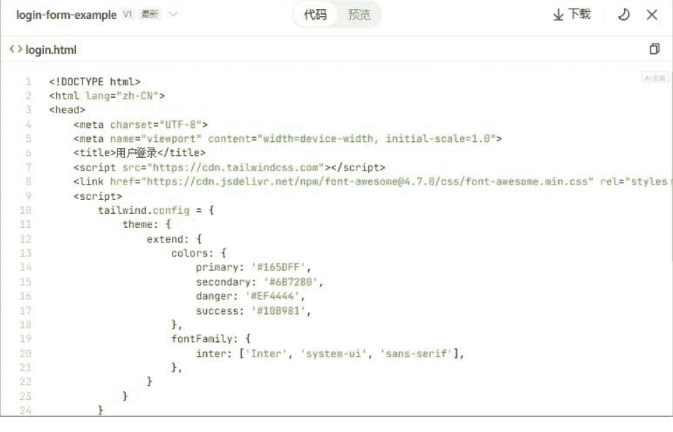

以上是豆包回答的部分截图，豆包根据注释快速生成了所需的代码片段，从而加速开发流程。


#### 指令优化
在构建指令时应进一步细化注释的具体内容及预期达成的效果，例如：

请根据以下详细的注释生成一个登录表单的HTML和JavaScript代码。具体要求如下：①HTML代码应遵循语义化原则；②JavaScript代码应简洁明了，尽量使用现代JS语法；③确保表单布局美观，可以适当添加CSS样式；④提供必要的事件处理程序以实现验证逻辑。请确保生成的代码不仅功能正确，而且具有良好的可读性和可维护性。

注释如下：（略）。

### 2.11.3 实战：错误代码的修复
在软件开发过程中，遇到代码错误是常见的现象。借助豆包，用户可以快速定位并修复代码中的问题，从而提高开发效率和代码质量。


场景
赵明是一名Python爱好者，在编写一段代码时遇到了一些运行时的错误，但是一直找不到错误原因。


使用说明
请帮我检查以下这段Python代码，并指出其中存在的错误，同时提供修正后的代码。代码如下：

```python
def add_numbers(a, b):
    sum = a + b
    print("The sum is:", sum)

num1 = 10
num2 = "20"
add_nubmers(num1, num2) # 错误的函数名
```

##### 错误分析

1. **函数名称拼写错误**：在调用函数时，函数名被写成了`add_nubmers`，而定义的函数名是`add_numbers`。

2. **类型不匹配**：变量num2被赋值为字符串"20"，而函数add_numbers期望的是数值类型。

3. **变量作用域问题**：函数内部的sum变量覆盖了内置函数sum()，不过这在当前代码中不是致命错误，但属于不良实践。

##### 修正后的代码

```python
def add_numbers(a, b):
    result = a + b  # 避免使用内置函数名sum作为变量名
    print("The sum is:", result)

num1 = 10
num2 = 20  # 将字符串改为整数
add_numbers(num1, num2)  # 修正函数名拼写错误
```

##### 修正说明

1. **修复函数名拼写**：将`add_nubmers`改为正确的`add_numbers`。

2. **类型转换**：将num2的值从字符串"20"改为整数20，与函数参数类型匹配。

以上是豆包回答的部分截图，豆包快速识别代码中的错误，并提供修正后的代码，从而提高开发效率和代码质量。


#### 指令优化
在构建指令时尽量提供完整的代码片段，详细描述代码出现的问题和错误信息，可以提供导致错误的输入和期望的输出及要求详细的调试建议。例如：

请帮我Debug以下代码段，它负责生成用户报告。代码需要包括：①错误描述，说明报告生成失败的问题；②代码审查，分析可能导致生成失败的部分；③调试建议，提供可能的修复措施和测试方法。代码如下：（略）。

# 第3章 学习跃升：豆包知识赋能站

随着人工智能的快速发展，豆包为学习领域带来了革命性的变革。本章将深入探讨如何利用豆包在学习过程中实现知识获取互动式学习、学术论文、成长规划、育儿助手以及心理健康等方面的应用，助力用户在各个领域实现知识的深度理解和能力的提升，从而在学术和职业发展上取得显著进步。

## 3.1 知识获取

知识获取是个人成长和职业发展的重要基石。通过高效的知识获取方式，个人可以不断提升自身的综合素质和专业能力。本节将介绍如何利用豆包实现知识的系统化和专业化积累。

### 3.1.1 解析经典文学作品
在快节奏的现代生活中，深入解析经典文学作品不仅能够丰富个人的文化底蕴，还能够激发创新思维。


张华是一名文学爱好者，同时也是一名中学教师。他希望通过解析经典文学作品，为学生们提供更深入、更有趣的文学课堂。他选择了《红楼梦》作为解析对象，希望能够从中提炼出文学鉴赏的方法，以及作品背后的历史、文化价值。


请帮我深度解析《红楼梦》这部经典文学作品。解析内容包括：①作品背景分析；②人物性格与关系分析；③文学手法鉴赏；④作品所反映的社会文化现象、历史背景及其影响。请确保解析深入、全面，并适合用于教学。


#### 《红楼梦》深度解析

##### 一、作品背景分析

###### （一）时代背景
《红楼梦》成书于清代，以18世纪上半叶中国封建社会为背景。这一时期，封建制度虽仍处于统治地位，但已显露出种种危机。社会经济方面，封建经济在经历了一定的繁荣后，开始出现停滞和衰退的迹象。土地兼并严重，农民生活困苦，阶级矛盾日益尖锐。政治上，封建统治阶层内部腐朽黑暗，官场贪污成风，权力斗争激烈。文化方面，封建礼教对人们的思想束缚严重，但同时也有一些新的思想观念开始萌芽。

……

综上所述，《红楼梦》是一部具有深刻思想内涵和高度艺术价值的经典文学作品。它以其独特的魅力，吸引着无数读者的关注和研究，对中国文学和文化的发展产生了深远的影响，是中华民族宝贵的精神财富。在教学中，引导学生深入理解和欣赏《红楼梦》，有助于培养学生的文学素养、审美能力和批判性思维，让他们更好地了解中国传统文化和社会历史。

通过上述指令，豆包深度解析了《红楼梦》这部经典文学作品，从多个维度呈现了作品的丰富内涵。解析内容不仅有助于文学爱好者更深入地理解作品，也为教育工作者提供宝贵的教学资源。


#### 指令优化
在构建指令时，可以进一步细化解析要求，如针对特定章节或人物进行深入分析，或结合其他文学作品进行对比研究，以丰富解析内容。例如：

请帮我深入解析《红楼梦》中林黛玉这一角色。分析内容包括：①林黛玉的性格特点与成长背景；②她在作品中的情感变化与人际关系；③通过林黛玉的诗词作品，分析她的文学才华与情感表达；④将林黛玉与其他主要女性角色进行对比，探讨她们在作品中的地位与影响。请确保分析深入、细致，能够凸显林黛玉这一角色的独特魅力。

### 3.1.2 制订个性化阅读清单
每个人的兴趣爱好和阅读目的不同，因此制订一份符合个人需求的阅读清单是非常重要的。这不仅可以提高阅读效率，还可以让阅读过程更加愉快和有意义。


场景
王涛是一位职场新人，他希望通过阅读来提升自己的职业技能和软实力。他希望得到一份适合他的个性化阅读清单。


使用说明
请根据我的兴趣和职业发展需要，帮我制订一份个性化的阅读清单。我目前从事市场营销工作，对心理学和社会学很感兴趣。我希望这份清单包括：①专业技能提升的书籍；②心理学和社会学方面的推荐读物；③职场沟通技巧和个人发展的相关书籍。请确保推荐的书籍既实用又有趣。


输出示例

#### 个性化阅读清单

##### 一、专业技能提升（市场营销）

###### （一）《营销管理》（第16版）——菲利普·科特勒（Philip Kotler）、凯文·莱恩·凯勒（Kevin Lane Keller）

######## 1. 内容简介

·这本书是市场营销领域的经典之作，涵盖营销的各个方面，包括市场分析、消费者行为、品牌建设、营销渠道、促销策略等。它提供一个全面的营销框架，帮助读者理解市场营销的基本原理和实践方法。

·书中有大量的实际案例和最新的市场研究成果，能够让你紧跟市场动态，了解不同行业的营销实践，无论是传统的消费品营销还是新兴的数字营销，都有涉及。

……

######## 2. 推荐理由

对于职场人士来说，这是一本非常实用的个人发展指南。它可以帮助你建立正确的工作态度和行为准则，提升自我管理能力，在竞争激烈的职场环境中脱颖而出。

通过上述指令，用户可以利用豆包制订一份符合个人兴趣和职业发展需求的阅读清单，从而有针对性地提升自己的职业技能和文化涵养。


#### 指令优化
在构建指令时，可以进一步明确阅读目的和预期成果，如提高专业技能、拓宽视野或培养阅读习惯等。同时，可以结合个人时间安排和阅读进度，制订更加详细的阅读计划和评估标准。例如：

请帮我制订一份为期三个月的个性化阅读计划，旨在提高我的心理学和社会学技能。计划需包含以下内容：①根据我的兴趣和需求推荐相关书籍，并明确每本书的阅读顺序和时间安排；②设定每周的阅读目标和进度评估标准；③提供阅读方法和技巧建议，帮助我提高阅读效率和理解能力；④设定阅读成果的评估方式，如撰写读书笔记、参加线上读书会等。请确保计划既具有挑战性又可实现，能够真正帮助我提升专业素养和个人能力。

### 3.1.3 专业技能认证备考
专业技能认证备考是提升个人职业资格和竞争力的重要途径。通过系统地准备专业技能认证考试，从业者可以加深对专业知识的理解，提高工作技能，并为职业发展打下坚实的基础。


场景
李强是一名建筑行业的从业者，他计划参加二级建造师认证考试，以提升自己的专业技能，并在职场上获得更多的发展机会。他需要一个全面的备考计划，包括学习资料的整理、关键知识点的掌握、模拟测试以及考试技巧的指导。


使用说明
请帮我制订一个二级建造师认证考试的备考计划，包括以下内容：①考试大纲的详细解析和学习资料的推荐；②建筑法规、工程管理及专业技术等关键知识点的系统讲解；③提供模拟测试和练习题，并附上详细的答案解析；④备考策略和考试技巧的指导。请确保备考计划科学合理，能够有效提升备考效率和通过率。


输出示例

#### 二级建造师认证考试备考计划

##### 一、考试大纲解析与学习资料推荐

###### （一）考试大纲解析

######## 1. 综合考试

########## （1）《建设工程法规及相关知识》

·涵盖建设工程法律体系、建设工程法人制度、代理制度、物权制度、债权制度、知识产权制度、担保制度、保险制度、法律责任制度等。重点考查考生对法律法规的理解和应用能力，尤其是在工程建设实际场景中的法律问题分析和解决。

·例如，对于建设工程合同纠纷的法律规定，考生需要掌握合同的订立、履行、变更、解除以及违约责任等方面的法律条款，能够准确判断在不同合同情形下各方的权利和义务。

……

######## 2. 施工成本管理

·掌握施工成本管理的任务和环节，包括成本预测、成本计划、成本控制、成本核算、成本分析和成本考核。理解各环节之间的相互关系和在项目成本管理中的作用。

·成本预测是在工程施工前对成本进行的估算，为成本计划的编制提供依据。成本计划是根据成本预测结果编制的具体成本控制目标和计划方案。成本控制是在施工过程中对成本进行动态监控和调整，确保成本目标的实现。成本核算是对施工过程中发生的各项费用进行核算，计算出实际成本。成本分析是对成本核算结果进行分析，找出成本偏差的原因，为成本控制提供依据。成本考核是对项目成本管理工作进行总结和评价，明确成本管理责任。

结合前面给出的指令思路，豆包可以把备考全流程从资料梳理一直串接到模拟评估，形成一体化的复习闭环，帮助提升效率并增加一次通过的把握。

#### 提示词进阶
优化指令时，建议优先凸显方案的针对性与可操作性，明确报考目标和执行路径。例如：
请为二级建造师考试量身定制一份完整的复习规划。规划需包含：①考试大纲的逐条拆解并整理配套学习资料；②针对建筑工程管理与实务、建设工程法规相关知识、建设工程施工管理等科目的核心知识点讲解；③定期提供模拟测验与练习题，并附上详尽答案解析；④复习策略，涵盖时间规划、重点复习和解题技巧；⑤考前冲刺安排，包含模拟考试和心理调节建议。
## 3.2 互动式学习
借助技术手段，互动式学习能够强化参与感并提升学习成效，让过程更为生动。人工智能在这一领域作用突出，可实现个性化答疑、智能出题批改以及英语词汇的互动练习。
### 3.2.1 AI助力解题答疑
豆包内置了【解题答疑】功能，可快速解决学习和工作中的具体难题。
🖥️ 场景
李明正在备考公务员，行测中一道数量关系的单选题让他卡住。
在豆包界面点开输入框下方的【解题答疑】，把题目文字输入，或点【上传题目图片】将题拍照上传，再点【发送】按钮 ⬆️，操作如图所示。
💡 提示词
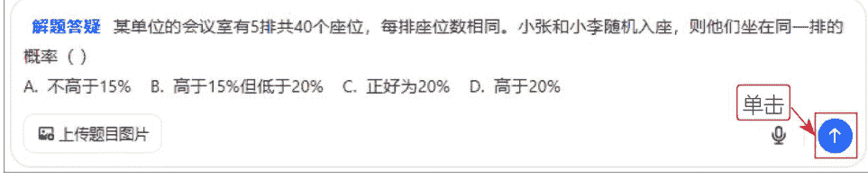
👤 回答
#### 答案
B
#### 💡 解析
##### 分析
该题考察古典概型概率计算。古典概型下，试验所有可能结果有限且每个结果出现概率相等。先求出全部入座方式总数，再算出小张和小李同排就坐的情况数，最后用后者除以前者得到概率并与选项对比。
##### 详解
1. **求总情况数**
   会议室共40个座位，小张先选有40种可能，小李再选剩39种可能。
   按乘法原理，总入座组合为 $40 \times 39$ 种。
2. **求同排情况数**
   会议室共5排，每排 $40 \div 5 = 8$ 个座位。
   先确定落在哪一排，有5种选择。假设确定某一排，小张在该排有8种位置，小李则有7种位置。
以上是豆包给出的部分截图，它对解题思路做了清晰拆解，帮助用户更透彻地理解和解决学习工作中的难题。

#### 提示词进阶
除了直接使用豆包的【解题答疑】功能，用户也可以通过定制提示词实现互动求解，例如：
请对下面这道公务员考试数量关系题给出解答，并提供完整步骤，具体要求：①阐释每一步的原理；②给出相关的逻辑推理方式；③给出最终答案并核验；④若存在多种解法，请全部列出。请保证解答详尽且易懂。
### 3.2.2 智能化习题生成与解答
豆包可根据不同需求快速生成练习题并附带解答，满足多样化学习场景。

场景
小樱正在备考项目管理专业人士PMP认证，需要大量模拟题检验学习效果，并希望获得即时反馈与解析。

提示词
请为PMP认证考试生成一系列模拟练习题，并提供详细解答和反馈。确保题目覆盖所有关键领域，帮助有效备考。

回答
#### PMP认证考试模拟练习题
##### 一、单项选择题
###### （一）项目整合管理
1. 以下哪个是项目整合管理的主要过程？（ ）
A. 制订项目章程、制订项目管理计划、指导与管理项目工作、监控项目工作、实施整体变更控制、结束项目或阶段
######## B. 制订项目章程、规划范围管理、收集需求、定义范围、创建WBS
######## C. 规划进度管理、定义活动、排列活动顺序、估算活动资源、估算活动持续时间、制订进度计划、控制进度
######## D. 规划成本管理、估算成本、制订预算、控制成本
......
答案：ABCDE
解答与反馈：干系人分析的步骤首先是识别全部潜在干系人及其相关信息，然后识别每个干系人可能产生的影响或提供的支持，评估关键干系人对不同情况可能做出的反应或应对，在此基础上制订干系人管理策略，并定期更新干系人分析以适应项目的变化。所以全选。
豆包的智能出题与解答功能，能帮助职场人士通过大量练习提高考试通过率，并加深对专业知识的理解。

#### 提示词进阶
设计出题指令时，要突出针对性与个性化，明确出题目标与方法。例如：
请生成一批PMP认证考试的模拟练习题，重点覆盖项目管理的五大过程组和十大知识领域。对每题提供详细解答和知识点解释，以及将知识点应用于实际项目管理的方法。依据答题情况，提供个性化学习建议和复习计划，以更有效地准备考试。
### 3.2.3 英语单词练习
词汇量是英语水平的基础。借助豆包进行单词练习，可在互动中高效记忆，提升词汇储备。

刘洋在一家外贸公司工作，需要提升英语水平以便更好地与国际团队沟通。他希望通过日常单词练习扩充词汇量。

你是英语单词练习小助手，专注于帮助用户高效记忆和运用英语单词。请根据中级水平及外贸工作需求，推荐合适的单词列表。

#### 外贸工作中级英语单词列表
##### 一、单词详情
###### （一）"negotiate"
发音：[nɪˈɡəʊʃieɪt]
词义：动词，意为谈判；协商；洽谈
例句：
- 1. We are trying to negotiate a better deal with our suppliers.（我们正试图与供应商协商一个更好的交易。）
- 2. The union will negotiate with the management about the pay raise.（工会将与管理层就加薪问题进行谈判。）
……
- 4. 货物的装运预计在下周进行。（The shipment of the goods is expected to take place next week.）
- 5. 我们必须遵守海关规定。（We must comply with the customs regulations.）
通过这类练习，刘洋可以系统地记忆和复习常用的外贸词汇，从而提高英语词汇量。

#### 提示词进阶
构建单词练习指令时，要注重互动性与个性化，明确练习目标与方式。例如：
请设计一个针对外贸英语的单词练习助手。助手应能依据我的英语中级水平提供适配的单词表，并设计包含阅读、写作等在内的多样化练习。练习需涵盖单词用法、同义替换和反义辨析，并提供即时反馈和正确答案解释。我希望通过进度追踪和复习计划有效记忆和运用新单词。
## 3.3 学术论文
学术论文是科研成果的重要载体，撰写高质量论文对学者至关重要。借助科学方法与工具，可有效提升论文质量与影响力。本节介绍如何利用豆包进行学术检索、选题推荐、开题报告撰写、论文创作与质量润色，从而整体提升研究水平。
### 3.3.1 学术内容搜索
学术内容搜索是研究人员获取信息的重要手段。高效率检索能帮助快速定位优质文献与资料，提升研究效率与质量。
📺 **场景**
李明是一名研究生，正在准备毕业论文，主题是可持续能源技术的最新进展。他需要通过学术搜索获取相关论文、报告和数据。
🤖 **提示词**
检索与"可持续能源技术"相关的最新学术论文。
（在豆包中，选择输入框下方的【学术搜索】技能，然后在输入框中输入提示词，单击【发送】按钮 ⬆，如下图所示。）
学术搜索 检索与"可持续能源技术"相关的最新学术论文

回答
基于 10 篇论文来源
以下为您检索到的与 "可持续能源技术" 相关的最新学术论文：
- **论文一：**
  - **作者**：A. K. Jassim, A. Ateeq
  - **发表信息**："Wind energy applied as a sustainable technology to produce electrical energy in Basra" 发表于 2021 年 2 月 1 日的*Journal of Physics: Conference Series*。
  - **摘要介绍**：风能是应用于可持续发电技术的主要可再生能源之一，是一种环保系统，无需使用任何消耗性材料，也不会产生温室气体和废弃物。该研究使用聚氯乙烯（PVC）、高密度聚乙烯（HDPE）、铝和碳钢材料制造了带有三个叶片的水平迎风涡轮机系统，以研究巴士拉风能系统在不同风速和风向条件下的发电效率。结果表明，巴士拉 4 米高度处的最大风速为 6m/s，可产生 21 伏电压和 1323 瓦功率。在南、东、北方向，最常见风速范围为 4 - 5m/s，而西方的最低风速为 2.45 - 3.5m/s。此外，PVC 材料因空气方向突然变化时易断裂，不适合制造风力叶片。
- **论文二：**
  - **作者**：Balathayaparan Thayaparan
  - **发表信息**："Clean energy by proven new energy technology" 发表于 2023 年 3 月 14 日的*Proceedings of the Institution of Mechanical Engineers, Part E: Journal of Process Mechanical Engineering*。
以上是豆包回答的部分截图。【学术搜索】技能可以帮助研究人员快速获取所需的学术资料，为学术研究和论文撰写提供坚实的信息基础。

#### 提示词进阶
构建检索指令时，可进一步细化研究主题的描述，例如：
查找与“可持续能源技术”相关的学术资料，限定来源为特定学科核心期刊且为近5年发表的文献，同时进行分类整理并标注关键信息。
### 3.3.2 学术论文选题推荐
选题推荐是帮助研究人员确定研究方向与论文主题的关键一步。好的选题既能激发兴趣，也能保证创新性与实用价值。

场景
小李正在为毕业论文选题发愁，希望在AI领域找到一个既有研究价值又符合个人兴趣的方向。

提示词
请帮我推荐几个AI领域的学术论文选题。选题应具有创新性、研究价值和可行性。

回答
以下是一些具有创新性、研究价值和可行性的AI领域的学术论文选题：
1. AI在教育领域的创新与实践
   - 基于AI的个性化学习系统设计与实现：随着在线教育的发展，个性化学习成为教育领域的重要研究方向。利用AI技术，根据学生的学习特点、兴趣爱好、学习进度等因素，为学生提供个性化的学习方案和学习资源。例如，构建基于深度学习的学生学习模型，根据学生的学习行为数据，为学生推荐适合的学习内容和学习方法。
……
   - AI的法律责任界定与归责原则研究：当AI系统出现故障或造成损害时，如何界定AI的法律责任成为一个亟待解决的问题。研究AI的法律责任界定和归责原则，探讨如何建立健全的AI法律体系，保障AI的健康发展和人类的合法权益。例如，研究在自动驾驶汽车发生交通事故时，如何确定相关主体的法律责任。
通过上述提示词，豆包推荐了几个AI领域的学术论文选题。如果对回答不满意，还可以通过深度搜索，寻找更好的选题。

#### 提示词进阶
构建提示词应注意明确研究领域、具体科研目标以及所需支持程度（如数据量、预算等）。例如：
请帮我提供一个材料科学领域的科研选题。选题需要包括：①研究背景，介绍选题在新材料开发中的重要性；②研究现状，概述当前材料科学的研究热点；③创新点，指出建议选题的创新性和潜在应用；④可行性分析，评估选题的研究资源需求和实验条件。
### 3.3.3 辅助开题报告撰写
开题报告是论文写作的起步阶段，为整个研究设定目标与方向。借助工具辅助撰写开题报告，能帮助研究者厘清研究问题、方法与预期成果，为后续工作打基础。

场景
赵敏正在准备一个关于城市可持续发展的研究项目开题报告。她需要确保报告包含研究背景、目的、研究问题、文献综述、研究方法与预期成果。

提示词
请帮我撰写一份关于“城市可持续发展的研究项目”的开题报告，包括以下内容：①研究背景和研究问题的定义；②文献综述的概要；③研究方法和数据收集计划；④预期成果和研究意义。请确保报告内容逻辑清晰、论证充分，能够突出研究的创新点和重要性。

回答
#### 城市可持续发展研究项目开题报告
##### 一、研究背景和研究问题的定义
###### （一）研究背景
随着全球城市化进程加速，城市成为社会经济活动的核心区域。然而城市快速发展也带来资源短缺、环境污染、生态破坏、社会不平等加剧等严峻挑战。这些问题不仅威胁居民生活质量与健康，也对城市长期可持续发展构成巨大压力。
……
总之，本研究对于深入理解城市可持续发展的内涵和规律，推动城市可持续发展的理论和实践创新具有重要的意义。通过综合运用多种研究方法，对城市可持续发展进行全面、系统的研究，有望为解决当前城市发展中面临的可持续性问题提供有益的思路和方法，为实现城市的可持续发展目标做出积极贡献。
通过上述提示词，豆包提供了一份可供参考的开题报告，为用户撰写开题报告提供了清晰的思路，并且帮助用户提升报告质量，从而为研究工作的顺利开展打下坚实的基础。

#### 提示词进阶
构建指令时，要注重报告内容的逻辑性和完整性，明确结构与重点。例如：
请帮我撰写一个关于"城市可持续发展策略"的研究项目的开题报告。报告应包括城市化进程中面临的环境和社会问题、研究的目的和研究问题、现有文献中的主要观点和研究空白、定性和定量研究方法的具体应用以及通过研究预期能够对政策制定提供的建议。请提供详细的报告大纲和各部分的撰写指导。
### 3.3.4 分步骤完成论文创作
论文创作过程复杂漫长，需要扎实基础、清晰逻辑与良好表达。本小节介绍如何利用豆包的【帮我写作】-【论文】技能分步骤完成论文撰写，从而提高效率。

场景
赵易正在撰写一篇关于“城市化进程对社区结构影响”的论文，想借助豆包的【帮我写作】-【论文】技能完成写作并获得创作思路。

提示词
帮我写一篇《城市化进程对社区结构影响》的论文。
下面通过豆包的【帮我写作】-【论文】技能，执行上述提示词，具体操作如下。
**步骤01** 选择侧栏中的【帮我写作】选项，在弹出的面板中选择【论文】选项，如下图所示。
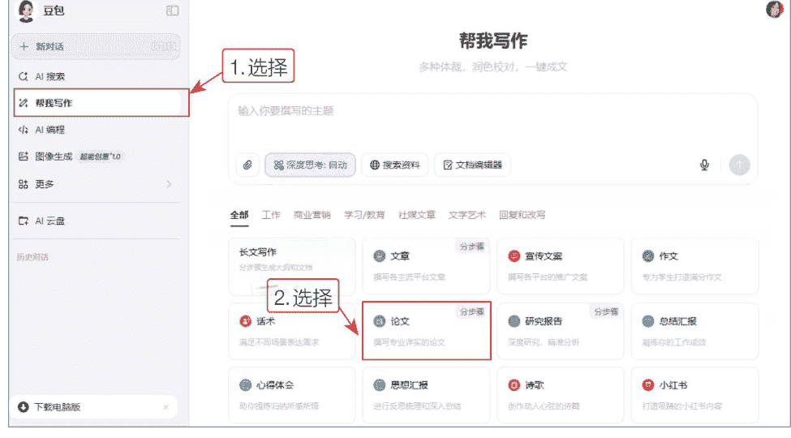
**步骤02** 在输入框中输入主题，然后开启【分步骤】功能，单击【发送】按钮⬆，如下图所示。

**步骤03** 此时，豆包即会根据主题生成大纲，用户可以根据需求调整大纲内容，也可以单击😊按钮进行段落设置，如下图所示。
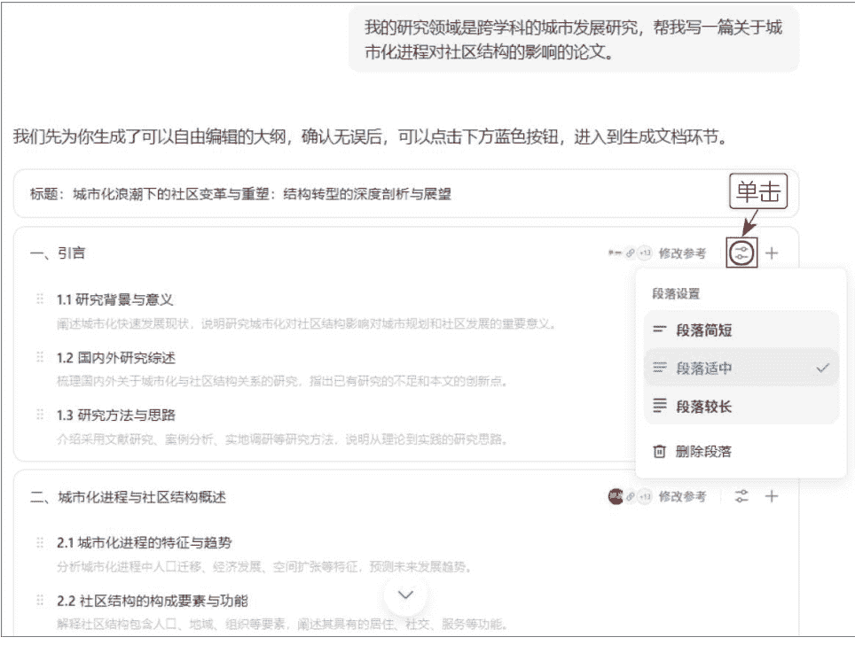
**步骤04** 大纲调整后，单击【基于大纲生成文档】按钮，如下图所示。
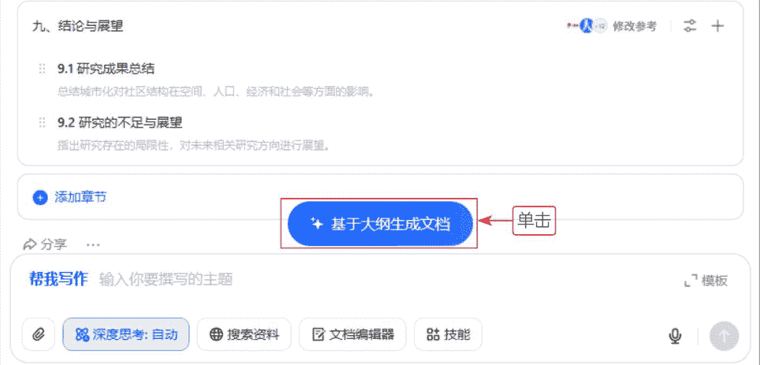
**步骤05** 此时，豆包即可开始撰写，论文内容生成时间较长，需要等待，如下图所示。


**步骤06** 文本生成完毕后，请点开【展开】查看详情，示意图如下。

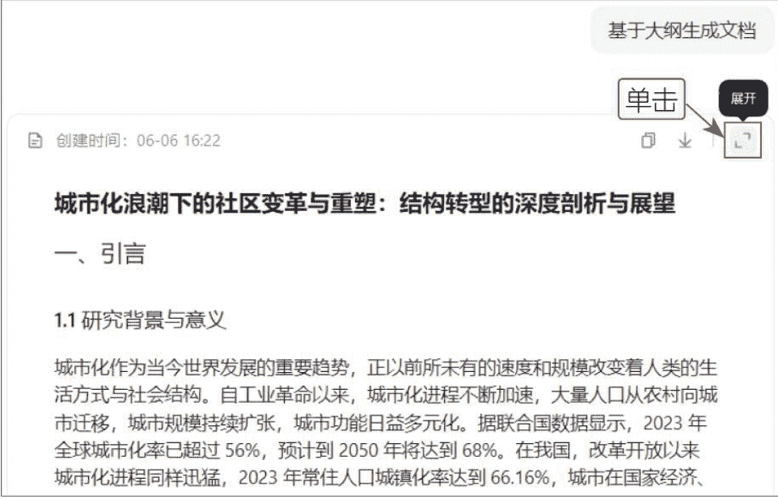

**步骤07** 进入编辑界面后，可在此自由修改正文，调用AI改写，并按需导出到本地电脑，如图所示。

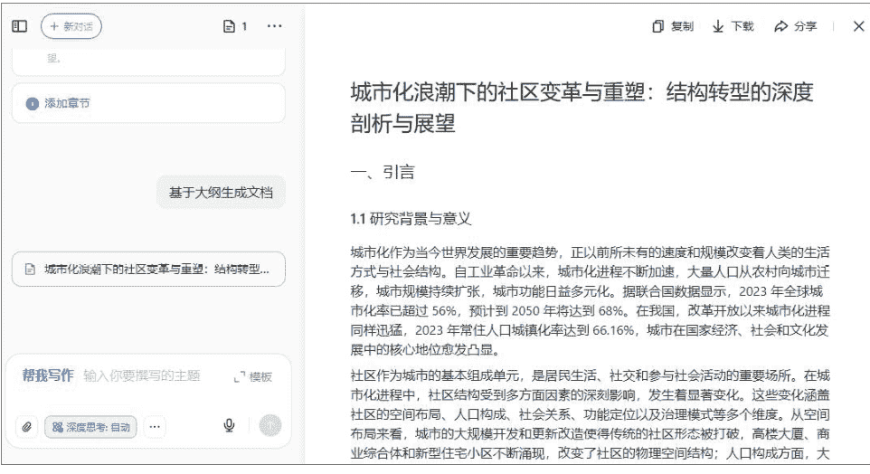

### 3.3.5 终稿校对与精修

稿件接近收尾时，系统化的审查十分必要。该环节涵盖语言规范、措辞精准、标点使用与版式统一，确保成稿专业且易读。


情境

陈思的初稿已完成。投稿前，她希望对全文做一次质量核验，重点看排版是否合规、语句是否通顺、引用是否准确、思路是否连贯，同时进行适度润色。


提示词

请协助检查并润色本文，具体要求：① 校对语法与拼写；② 核实引用及参考文献的准确性；③ 提升表述质量与清晰度。
（把论文文件拖入输入框后发送上述指令）


回答

本次质检与润色的反馈如下：

##### 一、语法与拼写校对

1. 摘要段

   - “The commercial illustration has the rich manifestation and the vector, appeared the plan drawing, the graph, the graph and photographic, the printing picture and so on.” 句式不规范，建议改为“The commercial illustration has rich manifestations such as plan drawings, graphs, photographic images, and printing pictures.”

……

##### ·现代商业插画文化的发展部分

在阐述当代商业插画特征时，原表述“现代商业插画的特点主要通过平面传播与数字媒介传播两种形式出现，一方面是静态展现；另一方面是动态升华。”可优化为“现代商业插画的特点主要体现在平面传播与数字媒介传播两种形式上，其一呈现静态，其二实现动态升华。”

依此指令，豆包给出了系统化的修改建议与格式指引，有效修正了语法规避偏差并提升了逻辑连贯性。修改后建议再做一次终审校对，确保无遗漏。


#### 提示词进阶

校对论文时，先明确研究主题与投稿规范，再细化核查清单，可补充个人易错点供模型参考。例如：
请对下面这篇以“AI在医疗领域的应用”为主题的论文进行校对。要求涵盖：① 语言修正，排查语法拼写错误；② 版式检查，符合APA格式；③ 引用核查，确认文献新颖且相关；④ 逻辑评估，判断论证是否严密；⑤ 专业术语校验，确保医疗与AI术语使用规范。请特别留意数据描述和分析结论的准确性。

## 3.4 职业成长规划

职业成长规划是个人发展的关键支柱，涉及短期与长期目标的设定、能力提升路径以及创业风险预判。科学规划有助于明确方向、保持成长并降低风险。

### 3.4.1 短期与长期目标设定

清晰的目标是规划的基础，能维持动力并保证循序渐进。以下介绍如何借助豆包制定可落地、可执行的职业目标。


情境

张伟刚入职，希望五年内升任部门经理，十年内进入公司高层。为此他需要先梳理一套短中长期目标来指引成长路径。


提示词

请为我规划一套职业成长的短期与长期目标，方向是五年内升任部门经理、十年内担任高层管理者。短期目标聚焦一年内专业能力提升和人脉拓展；长期目标覆盖五年至十年的职位晋升和行业影响力建设。请保证目标具体、可量化、可达成。


回答

#### 职业成长目标规划

##### 一、短期目标（1年内）

###### （一）提升专业技能

1. 目标：熟练掌握项目管理流程与工具，取得项目管理专业人士资格认证。

- 可衡量指标：通过PMP考试并获证；在实际工作中运用项目管理工具完成至少一个小型项目，并获团队与上级认可。

- 行动步骤：报名PMP培训，系统学习项目整合、范围、时间、成本、质量、人力资源、沟通、风险、采购等十大知识领域。

- 按课程进度完成作业与模拟考试，加深对知识点的理解与记忆。

……

- 深入研究行业趋势与前沿技术，结合实践开展创新性研究，撰写高质量论文并投稿至行业权威期刊。

- 关注行业标准制定的动态，积极参与研讨与建议稿撰写，为行业规范化贡献力量，提升个人权威性与话语权。

通过该提示，豆包能够帮助制定明确且可量化的职业与个人发展目标，并给出具体的执行步骤。

#### 提示词进阶

制定提示时应突出目标的可量化与可实现，同步给出执行路径与时间表。例如：
请为我设计一套兼顾职业与个人成长的短期与长期目标。短期目标有获取中级软件工程师证书、完成两项实战开发；长期目标是五年内晋升高级工程师、十年内出任技术总监。请为每个目标配备具体时间节点与执行步骤，例如月度学习安排与项目里程碑。

### 3.4.2 能力提升方案设计

系统化提升方案是达成职业目标的核心，能在较短周期内强化专业素养与综合能力。

情境

张华目前任市场营销专员，期望通过持续学习与实践强化市场分析及团队管理能力，未来几年内晋升市场部经理。

提示词

请为我制定个人能力提升方案，重点强化市场分析与团队管理能力。请给出每月学习任务与实践活动，确保方案可操作、实用。

回答

#### 个人能力提升计划

##### 一、计划背景

在竞争激烈的商业环境中，市场分析与团队管理能力对职业发展至关重要。为提升综合竞争力，特制定本提升方案。

##### 二、提升目标

1. 在未来[×]个月内显著提升市场分析能力，能独立撰写高质量分析报告，为决策提供可靠依据。

2. 逐步增强团队管理能力，掌握有效管理方法与技巧，提升团队协作效率与绩效，打造凝聚力强的团队。

……

5. 保持积极学习心态与良好状态，面对困难与挫折坚持不懈，勇于克服。

6. 不断拓宽学习渠道，除阅读书籍、参加课程外，可通过行业会议、同行交流、在线学习等方式获取更多知识。

通过该提示，豆包为用户定制了详实可用的能力提升计划，包含具体学习任务与实践活动，可根据实际情况调整完善。

#### 提示词进阶

提示构建时应注重计划的系统性与实操性，明确提升目标与方法。例如：
请为我制定一个聚焦数据分析能力与演讲技巧提升的个人方案。方案需包含当前能力评估、明确提升目标、具体学习方法，如在线课程、专业书籍、实战工作坊；同时提供实践建议，如参与真实数据分析项目、在团队会议中承担演讲任务。请给出详细的学习进度与效果评估机制，以便持续跟踪与调整。

### 3.4.3 创业项目风险评估

风险评估是保障项目成功的关键，通过识别潜在风险并制定应对措施，可降低失败概率。

情境

赵雷计划启动在线教育平台，需进行全面风险评估，识别可能问题并制定对策。

提示词

请对我的创业项目进行风险评估，项目为在线教育平台。评估范围包括市场风险、技术风险、财务风险、运营风险。请说明各风险的具体表现、发生可能性与影响程度，并提出相应应对措施。

回答

#### 在线教育平台创业项目风险评估

##### 一、市场风险

###### （一）具体表现形式

- 市场竞争激烈：在线教育市场已有众多玩家，包括大型教育机构、新兴平台及跨界科技公司等，可能在课程内容、师资、品牌、价格等方面占优，对市场份额与用户获取形成压力。

- 市场需求变化：教育需求受政策、经济、社会文化、技术等多因素影响，若不能及时把握变化趋势，平台课程与服务可能脱离用户需求，导致用户流失。

……

总体而言，在线教育平台面临市场、技术、财务、运营等多重风险。实施过程中需充分认知风险，采取有效管理与控制措施，降低发生概率与影响，确保项目顺利推进。同时持续关注市场与技术变化，及时调整策略与运营模式，提升竞争力与适应性，实现可持续发展。

通过该提示，豆包可帮助用户全面评估创业风险，识别隐患并提出对策，有助于项目启动前做好准备，降低失败风险，确保顺利推进。

#### 提示词进阶

构建提示时应明确评估范围与具体内容，提供每个风险的表现、可能性与影响度。例如：
请对我的在线教育平台创业项目进行风险评估。涵盖市场风险、技术风险、财务风险、运营风险。具体包括市场竞争激烈、技术迭代快、资金链断裂、运营管理不善等。请说明各风险的具体表现、可能性与影响程度，并提出应对措施，如市场调研、技术研发、资金储备、团队建设等。

## 3.5 育儿助手

育儿是父母投入时间精力的复杂过程。育儿助手可借助豆包为家长提供亲子游戏设计、绘本故事创作、作业批改讲解等支持。

### 3.5.1 亲子游戏设计

科学的亲子游戏设计能增进亲子情感，同时促进孩子多方面能力发展。

情境

林女士是一位年轻妈妈，希望与三岁女儿通过亲子游戏增进感情并促进能力发展，但缺乏设计经验。

提示词

请为我设计一系列适合三岁儿童的亲子游戏，要求有趣且有教育意义，能锻炼动手、观察与思维能力。请提供详细玩法与注意事项。

回答

为三岁儿童设计的亲子游戏应简单、安全、有趣，同时促进多方面发展。以下建议兼具趣味与教育性，旨在锻炼动手、观察与思维能力。

##### 1. 颜色分类游戏

玩法：

- 准备彩色小物件（如珠子、积木或卡片）及不同颜色的容器。

- 告诉孩子各颜色名称，示范将同色物品放入对应容器。

- 让孩子自行尝试，初期可使用两种颜色，逐步提升难度。

……

注意事项：

- 选择正面内容、适合年龄的绘本。

- 通过提问引导观察思考，如“你觉得接下来会怎样？”

- 保持互动与乐趣，让阅读成为享受。

通过该提示，林女士获得了精心设计的亲子游戏方案，既增进了母女感情，又有效促进了女儿多方面能力发展，为成长奠定基础。

#### 提示词进阶

构建提示时应更注重创新性与针对性，兼顾儿童年龄特点与兴趣。例如：
请为我设计以自然探索为主题的亲子游戏，适合4至6岁儿童。游戏需融合自然知识、动手实践与亲子互动，激发对自然的好奇与探索欲。请提供详细玩法、所需材料、注意事项，以及如何通过游戏引导深度学习的方法。

### 3.5.2 儿童绘本故事创作

儿童绘本是成长的重要伙伴，能激发想象力与阅读兴趣。借助豆包可创作出富有创意与教育意义的故事。

情境

小红是幼儿园老师，想为班上孩子创作绘本故事，但不知从何开始。

提示词

请帮我创作一个适合幼儿园儿童阅读的绘本故事，主题积极向上，需包含故事名与内容，确保趣味性与教育性兼具。

回答

#### 小蚂蚁的大梦想

在一个美丽花园里，住着一只小蚂蚁，名叫点点。点点与伙伴们每日忙于觅食，生活虽简朴却充满好奇。

……

小朋友们，点点虽小却怀揣大梦想，并为之勇敢努力。我们也要拥有自己的梦想，不畏困难，坚持追求，相信一定能实现！

通过该提示，豆包可帮助用户创作适合孩子的积极向上、富教育意义的绘本故事。也可将故事拆分，借助豆包生成多幅配图，丰富形式。

#### 提示词进阶

构建提示时应注重创意与教育性，明确主题与受众。例如：
请创作一个以“勇气与探险”为主题的儿童绘本故事。讲述小女孩在森林迷路，通过智慧与勇气找到回家的路。请提供详细情节、主要角色性格与对话，以及插图风格建议，如温馨可爱的画风，以吸引孩子注意力。

### 3.5.3 作业的批改与讲解

科学批改与讲解作业有助于巩固知识、提升学习效果，帮助家长及时发现问题并提供针对性辅导。

情境

李女士的孩子读小学六年级，近期做了一道概率与组合应用题，答案为3，显然错误。她希望得到详细批改与讲解。

提示词

请帮我批改并讲解数学作业，当前计算结果为3，请确认正误并给出解题思路。

作业内容：盒子里有3个红球和2个黄球，至少摸出（）个球，才能确保摸出两种颜色的球。

回答

答案应为4个，而非3个。

##### 解题思路

- 考虑最不利情况，即先把一种颜色球全部摸出，再多摸一个即可保证两种颜色。

- 本题最不利情况是先摸出3个红球，再摸1个，必为黄球，从而确保两种颜色。

- 因此至少需摸出4个球。

通过该提示，豆包可帮助家长批改讲解作业，指出错误、给出正确步骤并解释思路。也可延伸提问，提供类似练习帮助巩固概念，强化逻辑推理。

#### 提示词进阶

构建提示时应详细描述题目内容与学生错误答案，并明确期望讲解方式与深度。例如：
请详细批改并深度讲解以下概率题作业。题目：“盒子里有3个红球和2个黄球，至少摸出多少个球，才能确保摸出两种颜色的球？”学生答案为3。请指出理解误区，并通过清晰逻辑、详细解释与具体示例，帮助彻底掌握该概率问题的核心知识点。

## 3.6 心理健康

心理健康是整体健康的重要部分，影响生活质量、工作效率与人际关系。科学方法有助于情绪管理、压力缓解与心理韧性提升。

### 3.6.1 寻找缓解焦虑的技巧

焦虑是常见情绪反应，适度可激励行动，过量则影响生活质量。

小莹是职场白领，因工作压力大常感焦虑不安，希望学习缓解方法以更好应对压力。

请提供几种有效的焦虑缓解技巧，包括呼吸练习、放松训练、正念冥想等。请详细说明每种技巧的操作步骤、注意事项及日常应用方法。

以下是几种有效的焦虑缓解技巧：

##### 一、呼吸练习

1. 腹式呼吸法

###### （1）操作步骤

- 找舒适姿势坐下或躺下，闭眼，一手放胸部，一手放腹部。

- 用鼻子缓慢吸气，让腹部像气球般膨胀，放腹部的手随之抬起，胸部手尽量不动。

……

##### 2. 在日常生活中的应用

- 在碎片化时间，如等公交、地铁或排队时，可进行简短正念呼吸冥想，在忙碌中寻得片刻宁静，减少焦虑积累。

通过该提示，豆包可帮助用户掌握多种有效的焦虑缓解技巧，包括呼吸练习、放松训练与正念冥想等。

#### 提示词进阶

构建提示时应注重实用性与适应性，明确具体应用场景与效果。例如：
请提供适合忙碌职场人士的焦虑缓解技巧，如通勤途中简短呼吸练习、工作间隙快速冥想。同时提供时间管理实用技巧，如番茄工作法提升效率，以及正念练习减少工作焦虑。请给出具体练习步骤与建议，便于快速上手并融入日常。

### 3.6.2 AI评估心理健康状况

心理波动的及时觉察与干预，是维持精神健康的基石。依托豆包的智能评估能力，可以实现自动化的心理自检，帮助个人迅速梳理情绪、睡眠与压力状况，并据此启动合适的支持动作。

场景
李明在读大学，最近情绪持续下探，入睡与睡眠质量都变差。他希望找到一套科学方法判断自己是否出现心理问题，并获得定制化的建议。

提示词
请帮我进行一次心理健康评估，覆盖情绪状态、睡眠质量、压力水平等维度。需要输出一份问卷，包含对应题目与评分细则，并基于结果提供个性化建议和陪伴。

回答

#### **心理健康自评问卷**

##### **一、情绪状态**

1. 过去一周，你出现情绪低落或沮丧的频率如何？

- A. 几乎每日（4分）
- B. 经常出现（3分）
- C. 偶尔出现（2分）
- D. 罕见（1分）

……

- 尽量避开或减少会加剧压力的活动与情境，给自己留出恢复与调节的时间空间。
- 加入互助小组或与有相似经历的人交流，分享心得获得情感支持，同时也能学习他人的应对经验。

借助上述提示词，豆包即可完成情绪、睡眠、压力等维度的心理测评。

#### 提示词进阶

编写指令时应明确评估范围与计分规则并给出差异化建议。例如：

请对我的心理健康进行评估，涵盖情绪、睡眠、压力等方面。请提供包含题目与评分标准的问卷，例如情绪部分可包括“近一周悲伤或绝望的频率”“近一周感到快乐的频率”等。依据结果给出个性化建议，如建议寻求心理咨询、增加户外活动、调整作息等。

# 第4章 生活管家：豆包随行助手

生活节奏加快后，高效处理日常琐事、提升生活质量成为普遍诉求。豆包作为智能生活助手，可在旅行、餐饮、健身、购物、理财等场景提供精准支持。以下通过多个实操案例，展示如何借助豆包制定个性化行程、推荐健康食谱、定制训练方案、优化穿搭等。无论家庭出行、饮食搭配、运动康复或消费决策，都能获得实用建议，让日常更省心高效。

## 4.1 旅行规划
合理的行程设计能让旅程更愉快充实。科学规划有助于挖掘特色目的地，收获更好的体验。

### 4.1.1 实战：挖掘小众线路
避开人潮，选择小众路线可以欣赏更独特的风光。经过精挑细选和合理串联，能够发现鲜为人知的美景。


**场景**
张先生热爱旅行，计划国庆假期前往杭州，希望避开热门打卡点，寻找小众而美的景点。

**提示词**
请为我制定一条杭州小众景点的3天路线，需包含每天行程安排（景点名称、开放时间、预计游览时长）、交通方式（景点间转换）、住宿建议（推荐区域及理由）。

**回答**
以下是一份杭州小众游三日方案：
1. 第一天：探访古典园林与历史遗迹
（1）上午
景点：郭庄园林
- 开放时间：8:00—17:00
- 预计游览时间：1.5小时
- 简介：坐落西湖西岸杨公堤的小型江南园林，借西湖外景，建筑雅致布局精巧。
- 交通方式：可打车或乘公交前往，若住吴山广场附近，公交更方便。
……
理由：西湖西线周边游客较少，是本地人喜爱的静谧区域。环境优美安静，慢游更能感受西湖宁静。附近乌龟潭、茅家埠、太子湾公园等小众景点步行可达，游玩便利。
通过上述指令，豆包规划出小众路线，包含行程、交通与住宿建议。

**提示词进阶**
构建指令时应更清晰地描述个人偏好与特殊需求，例如：
请帮我规划杭州小众景点的3天路线。我偏爱自然风光与历史文化遗迹，不喜人多嘈杂。旅行计划需包含每日行程安排（景点名称、开放时间、预计游览时间）、交通方式、住宿建议及推荐理由。

### 4.1.2 实战：制定亲子旅行专属方案
亲子出游要兼顾孩子需求与安全，好的方案能让旅程既有趣又有意义。

**场景**
李女士计划带孩子去上海旅行，希望制订一份适合家庭的亲子旅行计划，包括适合孩子的景点、活动和餐饮建议。

**提示词**
请帮我制订一份上海的亲子旅行计划，计划应包括适合孩子的景点、活动和餐饮建议。请提供每个景点的名称、简介、开放时间和交通方式，以及推荐的亲子活动和餐饮地点。

**回答**
以下是一个上海的亲子旅行计划：

1. 第一天：上海迪士尼乐园

- 景点简介：上海迪士尼乐园是一个由六大主题园区组成的主题乐园，包括“米奇大街”“奇想花园”“探险岛”“明日世界”“宝藏湾”及拥有奇幻童话城堡的“梦幻世界”。这里有各种精彩的游乐项目、精彩的演出以及可爱的迪士尼卡通人物，非常适合亲子游玩。

- 开放时间：通常是08:30—21:30，具体开放时间会根据季节和特殊活动有所变化，建议提前在官方网站或官方App上查询确认。

……
- 亲子活动：

    - 沿着外滩漫步，欣赏黄浦江两岸的风景和历史建筑，给孩子讲解建筑的风格和历史故事。

    - 乘坐外滩的观光巴士，换个角度欣赏外滩的美景。

- 餐饮地点：外滩附近有很多餐厅和咖啡馆，可以品尝上海的特色美食，比如生煎包、小笼包等。也可以前往南京路步行街，那里有各种餐饮选择。

通过上述提示词，豆包能够帮助用户制订一份上海的亲子旅行计划，包括适合孩子的景点、活动和餐饮建议。


**提示词进阶**
构建指令时应明确景点与活动的筛选标准并给出详细要求。例如：
请帮我制定上海亲子旅行计划，包含适合孩子的景点、活动与餐饮建议。具体要求：①选择亲子友好景点；②提供景点简介，含特色与亮点；③给出开放时间与交通方式；④推荐亲子活动，如手工制作、亲子运动等；⑤餐饮建议，如外滩亲子餐厅、迪士尼主题餐厅等。

### 4.1.3 实战：生成朋友圈旅行文案
旅程结束后分享点滴成为常见方式，本节探讨如何借助豆包生成有趣且具感染力的朋友圈文案。


**场景**
王芳刚刚结束了一次难忘的旅行。她希望将这次旅行的美好瞬间分享给朋友圈的朋友们，但苦于文案创作。

**提示词**
请帮我生成一条朋友圈旅行文案，包括以下内容：①反映旅行的主题和感受；②包含旅行中的精彩瞬间和亮点；③用词富有感染力，能够引起共鸣。请确保文案适合社交媒体分享，能够引起朋友的兴趣。

**回答**
桂林之旅超赞！漓江山水似画，阳朔风情迷人。骑行于山水间，赏如画美景，感淳朴民风。身心放松，愉悦满溢，桂林真乃人间仙境。#桂林 #旅行

## 4.2 美食探索
美食探索是提升生活品质和满足味蕾的重要途径。通过科学合理地探索和规划，美食爱好者可以发现新的美味，制订健康的饮食计划，甚至制作适合特定场合的美食。

### 4.2.1 实战：基于食材推荐菜谱
根据现有食材推荐菜谱是一种实用的生活技能，它可以帮助人们充分利用手头上的食材，减少浪费，同时尝试新的烹饪创意。


**场景**
小王家里有土豆、胡萝卜和洋葱，他想知道能做些什么菜。

**提示词**
请根据土豆、胡萝卜和洋葱这三种食材推荐一些菜谱。菜谱应包括菜名、所需材料（除了已有的三种食材，还需注明其他材料）、制作步骤、烹饪时间和预计口味。

**回答**
以下是几种用土豆、胡萝卜和洋葱制作的菜谱：

##### 一、土豆胡萝卜洋葱炒肉
所需材料：土豆1个、胡萝卜1根、洋葱半个、猪肉100克、大蒜2瓣、生姜1块、生抽2勺、料酒1勺、盐适量、食用油适量、淀粉少许。

制作步骤：

- 土豆、胡萝卜去皮切丁，洋葱切块，猪肉切丁，放入碗中，加入少许淀粉、料酒和生抽，搅拌均匀腌制一会儿。大蒜切末，生姜切丝。

- 锅中倒入适量食用油，油热后放入蒜末和姜丝爆香。

……
预计口味：外酥里嫩，带有橄榄油的清香和香料的独特风味，三种食材烤后的口感丰富，既有土豆的绵软、胡萝卜的清甜，又有洋葱的焦香。

通过上述提示词，我们可知根据食材推荐菜谱要明确菜名、所需材料、制作步骤、烹饪时间和预计口味。


**提示词进阶**
构建指令时应注重实用性与创新性，明确食材特点与烹饪偏好。例如：
请根据鸡胸肉、西兰花和胡萝卜推荐创新菜谱。我想要一些简单快捷的晚餐，适合工作日的晚上制作。请提供详细的烹饪步骤，包括如何腌制鸡胸肉以增加风味，以及如何将西兰花和胡萝卜烹饪得既营养又美味。同时，如果可能的话，提供一些配菜或酱汁的建议，以增加整道菜的口感和风味。

### 4.2.2 实战：制订健康饮食方案
健康饮食计划对维持良好的身体状况和预防疾病至关重要。一个科学合理的饮食计划可以帮助人们达到健康目标，如减肥、增肌或改善身体状况。


**场景**
李强是一位办公室职员，他希望改善自己的饮食习惯，增加蔬菜和水果的摄入，减少糖分和油脂的摄入。他需要一个健康的饮食计划来指导自己的日常饮食。

**提示词**
请帮我制订一个健康饮食计划，包括以下内容：①每日所需的热量和营养分配；②一日三餐的食物选择和搭配建议；③健康零食和饮料的推荐。请确保饮食计划符合营养学原则，易于长期坚持。

**回答**
以下是一个健康饮食计划：

##### 一、每日所需热量和营养分配
热量需求因人而异，取决于年龄、性别、身体活动水平等因素。以下是一个中等活动量成年人的大致热量和营养分配参考：

- 热量：1800千卡~2200千卡。

- 碳水化合物：占总热量的50%~65%，225~357克。选择复杂碳水化合物为主，如全谷物、豆类、薯类等。

……
- 低脂牛奶或植物奶（如杏仁奶、燕麦奶等）：提供蛋白质、钙和其他营养成分。如果选择植物奶，要注意查看营养标签，选择添加了钙和维生素D的产品。

- 自制果蔬汁（适量）：如胡萝卜汁、芹菜汁、苹果汁等。但要注意不要过滤，保留膳食纤维，同时由于果汁含糖量较高，不要过量饮用。

通过制订健康饮食计划，预计能够帮助人们形成健康的饮食习惯，提高生活质量，达到健康目标。


**提示词进阶**
构建指令时应兼顾科学性与个性化，明确健康目标与饮食偏好。例如：
请帮我制订一个针对减肥和提高能量水平的健康饮食计划。我希望增加蛋白质的摄入，减少碳水化合物和糖分的摄入。请提供每日所需的热量和营养分配，以及一日三餐的具体食物选择和搭配建议。同时，推荐一些健康的零食和饮料，以替代不健康的选择。请确保饮食计划适合我的生活节奏，易于准备和坚持。

### 4.2.3 实战：制作适合加班族的快手美食
对于经常加班的职场人士来说，快速、方便且营养的美食是保持精力和工作效率的关键。快手美食不仅节省时间，还能提供必要的营养。


**场景**
王华经常加班到很晚，希望找到一些简单快速的美食，能够在短时间内制作出来，满足饥饿时的需求。

**提示词**
请帮我推荐几道适合加班族的快手美食，要求制作时间不超过30分钟。请提供每道菜的名称、所需材料、制作步骤和营养成分。

**回答**
以下是一个健康饮食计划：

##### 一、每日所需热量和营养分配
热量需求因人而异，取决于年龄、性别、身体活动水平等因素。以下是一个中等活动量成年人的大致热量和营养分配参考。

热量：1800千卡~2200千卡。

碳水化合物：占总热量的50%~65%，225~357克。选择复杂碳水化合物为主，如全谷物、豆类、薯类等。

……
- 蛋白质：火腿和鸡蛋含有蛋白质，火腿10~12克，鸡蛋7~8克，有助于维持身体正常代谢。

- 维生素：土豆含有维生素C、维生素B6等，葱花含有维生素A和维生素C。

- 矿物质：含有钾、钠、铁等矿物质，土豆是钾的良好来源。

通过制作适合加班族的快手美食，在忙碌的工作日中也能享受到健康、美味的餐食，保持身体健康和工作效率。


**提示词进阶**
构建指令时应注重便捷性与营养性，明确时间限制和营养需求。例如：
请帮我提供一些适合加班族的快手美食制作方法，特别是适合在30分钟内完成的菜谱。我希望这些美食能够使用常见的食材，并且不需要复杂的烹饪技巧。请提供具体的烹饪步骤，包括如何快速准备食材和使用厨房电器，如微波炉或电饭煲。同时，确保这些美食能够提供足够的蛋白质和蔬菜，以满足身体营养需求。

## 4.3 运动健康
运动健康是现代生活中不可或缺的一部分，通过科学合理的运动计划和方法，人们可以保持身体健康、提高免疫力、缓解压力。

### 4.3.1 实战：AI健身教练，定制个人训练计划
随着健康意识的提升，越来越多的人开始注重运动健身。然而，如何制订一份适合自己的训练计划却成了许多人的难题。本小节将介绍如何利用豆包来定制个人的训练计划，帮助用户实现健身目标。

**场景**
李华是一位办公室职员，他希望开始健身以增强体力和减轻工作压力。他需要一个根据他当前的体能水平和健身目标定制的训练计划。

**提示词**
作为一名健身教练，请帮我定制一个个人训练计划，包括以下内容：①评估个人的体能水平和健康状况；②根据个人的健身目标，制订合适的训练项目和强度；③提供训练周期和进度跟踪的建议。请确保训练计划科学合理，适合个人情况，易于执行。

**回答**
以下是一份为一位希望增强肌肉力量和耐力的健身新手定制的训练计划。

##### 一、体能水平和健康状况评估

###### 1. 健康问卷

- 了解是否有任何过往或当前的疾病，如心脏病、高血压、糖尿病、关节问题等。

- 询问近期是否有手术、受伤或其他影响运动能力的情况。

……
- 每月评估：每月进行一次体能测试，如再次进行台阶测试、俯卧撑、仰卧起坐和深蹲测试等，与初始数据对比，评估训练效果。如果某个训练动作连续两周没有进步，可以考虑调整训练强度或方法。

- 身体反馈：注意身体的反应，如是否有过度疲劳、疼痛或受伤等情况。如果出现异常，应及时调整训练计划或寻求专业帮助。

请注意，这只是一个基础的训练计划，在开始训练前，建议你咨询医生的意见，确保训练对你是安全的。同时，训练过程中要保持良好的饮食习惯，保证充足的睡眠，以促进身体的恢复和肌肉的生长。

通过上述提示词，豆包能够帮助用户制订一个适合上班族的个人训练计划，包括有氧运动、力量训练和伸展放松。


**提示词进阶**
构建指令时应注重个性化与实用性，明确健身需求与偏好。例如：
请帮我制定以增肌与提升心肺功能为目标的个人训练计划。我每周可安排3~4次健身，每次约1小时。请根据情况提供具体训练项目建议，含力量与有氧组合，以及饮食建议。同时给出训练周期规划与根据进度调整计划的指导。

### 4.3.2 实战：缓解久坐办公疲劳的运动方法
久坐办公是现代职场常见的问题，长时间坐着容易导致身体疲劳和不适。通过科学合理的运动方法，可以有效缓解久坐带来的疲劳，提高工作效率。


**场景**
张丽是一位平面设计师，她每天需要长时间坐在计算机前工作。她经常感到颈部和腰部酸痛，需要通过一些运动来缓解久坐带来的身体不适。

**提示词**
请帮我提供一些缓解久坐办公疲劳的运动方法，包括以下内容：①适合在办公室进行的简短运动；②有助于缓解颈部、肩部和腰部紧张的运动；③提供运动的频率和持续时间建议。请确保这些运动方法简单易行，不会影响正常的工作。

**回答**
以下是一些缓解久坐办公疲劳的运动方法。

##### 一、适合在办公室进行的短时运动

1. 椅子深蹲

# 工位速醒蹲

**操作要点**：把身体挪到椅子最前端，双脚与肩同宽略外展。发力时重心落到脚掌，臀部离椅，沿深蹲轨迹慢慢下沉到大腿接近地面平行，再借腿部力量推起站直，反复进行。

**核心作用**：主要激活大腿与臀部肌群，帮助唤醒久坐后处于低活性状态的下肢，促进血液回流，减轻长时间坐姿对腿部的压迫感。

这类练习上手快、占地小，可直接在办公区完成，不影响工作。长期坚持能有效缓解久坐带来的身体疲惫，提升专注度和当日工作效率，对身心健康也有裨益。

基于前述提问思路，豆包可以为用户定制一份工位间隙的抗疲劳运动清单，明确每个动作的做法、注意事项和预期的身体收益，帮助人们在工作空档做几分钟活动，缓解疲劳、提升效率。


**提示词进阶**

在构建提示词时，要突出动作的便捷性和场景适配性，同时把缓解疲劳的目标和效果讲清楚。例如：

请推荐几组适合在办公室做的放松动作，总时长控制在5到10分钟，不用额外器械。要包含颈部、肩部、腰部的舒展练习，以及简单的站立、走动建议，并说明如何把这些动作融入日常工作节奏，比如每小时起身走动一次，或午餐后做短暂拉伸。

### 4.3.3 实战：运动损伤预防与康复指导

预防损伤和做好康复是保持运动健康的基础。合理的预防能在训练或比赛中降低受伤风险，系统的康复指引则有助于伤后更快恢复。


**场景**

小李热爱运动，经常参加各种体育活动，他担心自己会出现运动损伤，希望得到预防和康复的指导。


**提示词**

请帮我提供运动损伤预防与康复指导。预防指导应包括运动前的热身、运动中的注意事项、运动后的拉伸等方面；康复指导应包括针对常见运动损伤如肌肉拉伤、关节扭伤等处理方法、康复周期、康复训练等方面。


**回答**

##### 运动损伤预防指导

###### 一、运动前热身

1. 全身动态热身5至10分钟

### 4.3.4 实战：根据症状进行初步健康诊断

以症状为依据做初步自评，有助于个人更清晰认识自身健康，并在必要时及时寻求专业医疗帮助，是健康管理的重要步骤。

**场景**

李明近期常感头晕乏力，希望基于这些症状做初步健康判断，了解可能原因并获得建议。

**提示词**

请帮我根据头晕和乏力的症状做初步健康诊断，给出可能原因和建议。需包括常见病因、进一步检查建议和生活方式调整。

**回答**

##### 一、常见病因

###### 一、生理性因素

1. 睡眠不足或质量差

现代人节奏快，长期熬夜或睡眠环境不佳较为常见。睡眠不足会使身心得不到充分恢复，大脑供血相对不足，从而出现头晕乏力。通常表现为起床后或长时间工作后头晕、四肢无力、精神不佳。

……

若头晕乏力持续不缓解或加重，并伴有头痛、呕吐、视力模糊、肢体麻木或活动受限等症状，应及时就医做进一步检查和治疗。

借助豆包可以根据症状进行初步健康诊断，在实践中可形成初步判断，对自身情况有个认知。想获得确诊仍需及时就诊。

#### 提示词进阶

构建提示词时，应尽量详细描述症状的具体表现、出现时间与频率、是否伴随其他症状等信息。例如：

我在跑步后经常出现膝盖疼痛，疼痛程度中等，休息后会缓解。该症状已持续约一周，无其他明显伴随症状。请据此做初步健康诊断，分析可能原因并给出建议和处理方法。

### 4.3.5 实战：帮用户看懂医院检验单

豆包可以帮助用户解读检验单上各项指标，提供解释和建议，帮助用户全面了解自身健康状况。

**场景**

小李拿到自己的血常规报告，对部分指标不理解，不清楚代表什么，也不了解健康状况是否良好。

**提示词**

请解读图片中的检验单，解释各项指标含义并分析我的健康状况。要求解释清晰准确，提供专业健康指导。

**回答**

这是一份血常规检查报告，涵盖白细胞、红细胞、血红蛋白等关键指标。

1. 白细胞总数WBC 11.11×10⁹/L，正常范围3.5~9.5×10⁹/L。您的白细胞偏高，可能提示感染或炎症存在。

……

健康指导：

根据血常规结果，您可能存在轻度贫血和可能细菌感染。建议咨询医生做进一步诊断和治疗。医生可能会建议补充铁剂或其他营养素改善贫血，并根据情况决定是否需抗生素治疗。同时保持均衡饮食和良好生活习惯对健康很重要。

借助上述提示词，豆包可解读检验单并提供健康建议。需注意豆包仅为AI模型，建议仅供参考，具体请咨询医生。

#### 提示词进阶

构建提示词时应提供体检单具体内容和个人关注的健康问题，详细描述想了解的指标和数据，也可补充个人生活习惯和健康目标。例如：

请解读我的血脂检查结果。解读需包括：①指标解释，说明总胆固醇、甘油三酯等含义；②正常范围，给出这些指标的正常数值；③结果分析，基于我的检查结果进行分析；④饮食运动建议，给出降低血脂的饮食和运动建议。

## 4.4 购物时尚

在时尚领域，每个人风格各异。如何准确定位自己的风格并据此穿搭，是很多人面临的难题。

### 4.4.1 实战：提供个性化穿搭建议

风格诊断与个性化穿搭建议有助于找到适合自己的穿衣风格，提升整体形象。科学诊断和建议能帮助用户更好展现个性与魅力。

**场景**

小李是年轻的上班族，对自身穿搭风格感到迷茫，希望得到风格诊断和个性化穿搭建议。

**提示词**

请基于我的个人信息提供个性化穿搭建议。个人情况：年龄25岁，身高165cm，体重55kg，喜好简约风格。

要求建议符合上述条件，又能体现个人特色和风格。同时兼顾时尚趋势和实用性。

**回答**

##### 一、日常出行穿搭

###### 一、上衣

1. 基础款纯色T恤：选白色、黑色、灰色等简约色，棉质舒适透气。是简约风必备单品，可搭配牛仔裤或休闲裤。例如一件白色纯棉T恤，圆领简约，无多余图案和装饰，呈现干净利落感。

2. 简约衬衫：可选择淡蓝色牛仔衬衫，经典时尚；或白色亚麻衬衫，清爽感强。亚麻材质自带自然纹理，更显质感。穿时可微微敞领口，卷起袖口，营造随性时尚感。

……

###### 五、配饰

1. 个性项链：休闲聚会场合可佩戴个性项链增加亮点。可选简约金属项链，如细链条锁骨链，或带特色吊坠的项链，如几何形吊坠。项链颜色可与服装搭配起到点缀作用。

2. 手拿包：手拿包是休闲聚会穿搭中时尚配饰。可选择小巧精致手拿包，颜色可亮色或带时尚图案。材质可为皮革、绸缎等，根据场合和风格选择。

借助上述提示词，豆包可帮助用户进行风格诊断并提供个性化穿搭建议，包括适合的服装风格、色彩搭配和具体单品推荐，有助于提升职场形象、展现个人魅力。

#### 提示词进阶

构建提示词时可进一步强调个人风格和特定场合的穿搭需求，以获得更贴合的建议。例如：

请为我提供一份针对商务场合的个性化穿搭建议。我希望展现专业、干练形象，同时不失时尚感。请结合我中等身材、小麦肤色及休闲风格穿搭习惯，为我打造专属商务穿搭方案。

### 4.4.2 实战：提供换季衣物整理技巧

季节更替时需要整理衣物以适应新季节。如何高效整理换季衣物是很多人困扰的问题。本节介绍如何利用豆包获取换季衣物整理技巧，帮助用户轻松应对季节变化。

**场景**

小张是上班族，随着夏季到来，需要整理衣物，将冬季厚重衣物收纳，并找出夏季轻薄衣物。对高效整理衣物不太擅长，希望找到实用技巧。

**提示词**

请提供换季衣物整理技巧。需包括：①如何分类整理不同季节衣物；②如何高效收纳冬季厚重衣物以节省空间；③如何防潮防虫保护衣物；④如何快速找出并搭配夏季轻薄衣物。要求技巧实用、易操作且适合家庭使用。

**回答**

以下是一些换季衣物整理技巧：

##### 一、分类整理不同季节衣物

###### 1. 按季节划分

准备几个大型收纳箱或收纳袋，分别贴上“春季”“夏季”“秋季”“冬季”标签。换季时，将当季不穿衣物分类放入对应容器。例如将羽绒服、厚毛衣、加绒裤子等冬季衣物放入“冬季”收纳箱，将T恤、短裤、短裙等夏季衣物放入“夏季”收纳箱。

……

###### 3. 利用照片或清单辅助

衣物较多者可拍夏季衣物搭配照片，打印后贴在衣柜内侧或放小相册旁，标注衣物位置。或制作简单衣物搭配清单，列出上衣、裤子、配饰等搭配方案，找衣时可参考清单快速搭配。

借助上述提示词，豆包可帮助用户提供换季衣物整理技巧，包括分类、收纳和保养衣物的方法。

#### 提示词进阶

构建提示词时可进一步强调特定季节整理需求或特定存储空间优化，以获得更有针对性的建议。例如：

请为我提供针对夏季衣物整理的详细技巧。我希望了解如何高效收纳冬季的厚重衣物以腾出夏季衣物空间。同时提供防潮防虫小妙招，确保衣物存储不受损。最后分享快速搭配夏季衣物的技巧，让我能轻松应对夏日各种场合。

### 4.4.3 实战：挑选高性价比电子产品

电子产品种类繁多、价格各异，如何挑选高性价比产品是消费者普遍关心的问题。

**场景**

小李打算购买新笔记本用于日常办公和娱乐。希望找到性能稳定、价格合理、性价比高的机型，面对众多品牌型号感到无从下手。

**提示词**

请帮我挑选高性价比笔记本电脑。需求包括：①主要用途日常办公和娱乐；②性能稳定、运行速度快；③价格合理、性价比高；④品牌信誉好、售后有保障。请提供几款符合要求型号及其优缺点分析。

**回答**

以下是几款符合你要求的高性价比笔记本及其优缺点分析。

1. 荣耀MagicBook X 14 Plus

1. 优点

- 高性能处理器：搭载AMD Ryzen7-8845HS高性能处理器，基准频率3.8GHz，加速频率最高5.1GHz，可轻松处理多任务、运行大型软件及轻度游戏，性能强劲。

- 优秀内存技术：配备32GB LPDDR5X内存，频率高达6400MHz，读写速度快、延迟低，保证系统流畅运行。

……

2. 缺点

- 做工细节：部分用户反映产品某些细节做工不够精细，可能影响使用体验。

- 散热问题：长时间高负荷运行时机身底部会产生较多热量，需辅助散热。

- 屏幕角度：在某些角度下屏幕可能显得刺眼，需适时调整角度或休息。

借助上述提示词，豆包为小李提供几款符合需求的笔记本型号，并对性能、价格、品牌信誉和售后服务做详细分析，帮助用户做出明智购买决策。

#### 提示词进阶

构建提示词时可进一步细化产品类型、性能要求或预算范围，以获得更精准建议。例如：

请为我挑选一款适合游戏爱好者的台式计算机。需求包括：①性能卓越，能满足大型游戏运行；②价格控制在5000~7000元；③品牌信誉好、售后有保障；④外观时尚，符合年轻人审美。请提供几款符合要求的台式机型号及其详细配置分析。

### 4.4.4 实战：快速生成美食平台评价

在美食平台快速生成评价有助于用户分享用餐体验，为其他消费者提供参考，也能激励餐饮业者提供更好服务。

**场景**

王华最近在一家新开餐厅用餐，希望在美食平台留下评价，但对撰写详细评价缺乏经验，希望得到专业建议。

**提示词**

请帮我生成一条餐厅评价。我最近在“美味轩”餐厅用餐，总体感觉不错，但有细节需改进。请提供详细评价内容，包括环境、服务、菜品和价格，字数控制在200字以内。

**回答**

这次在“美味轩”用餐，整体体验良好。餐厅环境雅致，灯光柔和，桌椅摆放整齐，背景音乐舒缓，营造舒适就餐氛围。服务方面，服务员态度热情、响应及时，只是在上菜顺序上稍显混乱。菜品是一大亮点，每道色香味俱全，食材新鲜、口味独特，无论主菜还是配菜都能感受到厨师用心。不过个别菜品盐味稍重。价格比较合理，性价比不错，在同类型餐厅中属中等水平。希望餐厅注意上菜顺序和菜品咸淡问题，这样就更完美了。期待下次再来有更好体验。

借助上述提示词，豆包可帮助用户快速生成餐厅评价，提供包含环境、服务、菜品、价格等详细内容，有助于准确表达用餐体验并提供有价值参考。

#### 提示词进阶

构建提示词时应注重评价的详细性和客观性，明确用餐各个方面。例如：

请帮我为昨晚火锅用餐体验生成评价。食物方面，我对特色羊肉卷和手工面条印象深刻，味道鲜美、食材新鲜。服务方面，服务员态度热情、响应迅速，但上菜速度稍慢。环境方面，店内装饰具传统风格，氛围温馨但稍显拥挤。总体是一次愉快用餐体验，我会推荐给喜欢尝试传统火锅的朋友。请帮我将这些要点整理成连贯具体的评价。

## 4.5 财务管理

财务管理是个人和家庭经济稳定与增长的重要保障。通过科学规划和管理，个人可更好实现财务目标、规避风险、提高生活质量。

### 4.5.1 实战：投资风险评估与资产配置建议

投资风险评估和资产配置是个人财务管理重要环节。合理配置资产可最大化投资回报，同时控制风险。

**场景**

小李是有一定积蓄的上班族，想进行投资，但对投资风险和资产配置不太了解，希望得到相关建议。

**提示词**

请帮我进行投资风险评估并提供资产配置建议。我是有一定积蓄的上班族，月薪8000元，有少量其他收入来源，积蓄20万元，投资目标长期增值，风险承受能力稳健型，无债务，有过投资经历，投资结果基本稳定。

**回答**

以下是一份针对你的投资风险评估和资产配置建议。

##### 一、投资风险评估

###### 1. 财务状况评估

你有稳定工作和收入，月薪8000元且有少量其他收入，无债务，这为投资提供稳定资金支持。20万元积蓄也为开展多样化投资组合提供一定基础。

该财务状况表明你有一定的抗风险能力，但也要注意不能因投资失误对日常生活和长期财务规划造成重大影响。

……

资产配置不是一成不变的，需根据投资目标、市场环境、个人财务状况等因素变化，定期如每年一次对资产配置进行评估和调整，确保投资组合始终符合需求。同时保持学习心态，不断了解金融市场和投资产品动态。

借助上述提示词，豆包为用户提供资产配置建议，包括股票、基金、债券等各类资产配置比例和具体建议，有助于实现稳健增值目标、规避潜在风险。

#### 提示词进阶

构建提示词时应注重建议的个性化和市场适应性，明确个人投资目标和风险偏好。例如：

请帮我根据风险承受能力中等、期望年化收益率8%的目标进行投资风险评估。我当前投资组合包括股票、债券和基金，请分析这些资产当前表现，并提出多元化资产配置方案。同时考虑全球经济形势，提供对冲风险的建议，以及未来不同市场情况下的调整策略。

### 4.5.2 实战：教育基金规划与储蓄策略

教育基金规划是确保子女教育质量的重要财务准备。通过合理储蓄策略，可为子女教育提供稳定资金支持。

**场景**

小王是家长，想为孩子规划教育基金，孩子目前3岁，预计18岁上大学，希望得到相关建议。

**提示词**

请帮我规划教育基金并提供储蓄策略。我是家长，孩子目前3岁，预计18岁上大学，家庭收入月薪10000元，有少量其他收入来源，家庭积蓄30万元，无债务，需考虑留学费用，预计留学费用50万元。

**回答**

以下是一份教育基金规划和储蓄策略：

#### 教育基金规划

1. 目标金额计算

孩子18岁上大学，距离现在还有15年。若考虑国内大学费用及可能留学费用，合计需准备资金为国内大学4年费用暂估每年3万元~5万元，共12万元~20万元，加上留学费用50万元，共62万元~70万元。

##### 2. 教育基金投资期限分析

由于有15年准备期，这是一个相对较长投资周期，可充分利用时间价值和复利效应积累资金。

……

每年对教育基金储蓄和投资情况进行评估。根据家庭收入变化、市场行情等因素适时调整储蓄金额和投资组合比例。若家庭收入增加可适当提高投资比例；若市场行情不佳可适当调整基金投资方向或比例。

此外在孩子成长过程中，可鼓励孩子培养理财意识，合理管理零花钱和压岁钱等，也可将这部分纳入教育基金规划。

借助上述提示词，豆包可帮助用户制定教育基金规划与储蓄策略，包括具体储蓄目标、投资建议和风险控制措施，有助于家长为子女教育费用做好准备、减轻经济负担。


#### 提示词进阶

撰写提示词时应明确储蓄目标和时间框架，提供详细规划和储蓄建议。例如：

### 13年教育金储备方案
为5岁的孩子做大学教育资金规划，预计13年后入学，按每年学费约5万元测算。建议把握以下要点：13年后累计储备约50万元；坚持每月定额投入，例如每月2000元；资金以稳健增值为主，可配置定期存款、债券型基金、教育类保险等渠道；另行保留一笔应急备用金，避免突发支出挪用教育金。

### 4.5.3 实战：选择车险的实用建议
合理挑选与配置车险，是控制用车风险、守住财产安全的重要举措。通过科学搭配，车主能在事故中获得更充分的保障，同时避免不必要的花销。


场景
张薇刚提了一辆新车，正在为其挑选合适的保险方案，以覆盖行车风险，保障出行更安心。


提示词
请给出车险挑选的实用建议，要求涵盖：1) 各类车险方案的保障范围与费用对比；2) 结合我的驾驶习惯和车辆属性，推荐性价比高的搭配；3) 购买时需要留意的细节与注意事项。整体建议要实用、可操作，能匹配我的保障需求。


回答
##### 一、不同车险方案的覆盖范围和价格
###### （一）交强险
######## 1. 覆盖范围
交强险为国家强制险种，主要赔付交通事故中第三方的身体伤害和财产损失。在限额内向受害人支付赔偿。如车辆撞到行人或其他车，交强险会承担相应责任。有责情形下，死亡伤残最高赔18万，医疗费用1.8万，财产损失0.2万；无责情形下，死亡伤残1.8万，医疗费用1800元，财产损失100元。
######## 2. 价格
交强险保费与车型、座位数等挂钩。以家庭自用6座及以下轿车为例，基准保费约为950元/年。若上一年度无有责事故出险，续保可获费率折扣，最高可降30%。
……

续保提醒也很关键，建议关注保单到期时间，提前规划续保。部分公司会主动推送续保通知，续保窗口期可依据车辆实际使用状况微调保障。若车主、用途或车辆改装等信息有变更，应及时告知承保公司，否则可能影响后续理赔。

通过以上提示方式，豆包可以为用户提供车险选购参考，包括交强险与商业险的具体说明。


#### 提示词进阶
在撰写提示词时，要突出方案的匹配度和成本效益，明确个人需求与预算区间。比如：
请对比市面上常见的全险、第三者责任险等方案的保费与保障内容，结合我连续多年无事故的驾驶记录及新购中档轿车的实际情况，给出性价比最优的组合建议，并提示投保时需关注的条款要点，如免赔额、理赔流程、客服响应等。

# 第5章 创意设计：生成图像、音乐和视频
在数字化加速的今天，AI正在重塑创意设计的工作方式。本章聚焦豆包在创意领域的实战能力，涵盖图像、音乐、视频的智能生成。读者将学会如何基于模板快速复刻同款图像，或通过文字描述创作专属画面，并掌握图像的精细编辑与保存方法；同时体验音乐生成的乐趣，包括同款复刻、歌词定制与分享下载；最后简要介绍一站式创作平台即梦AI在创意工作中的加持作用。

## 5.1 图像生成
在创意表达中，图像是最直观的信息载体。借助AI，定制化图像的生成门槛已被大幅拉低。豆包凭借出色的生成能力，正在成为创作者效率提升的利器。

### 5.1.1 实战：生成同款图像
豆包的图像生成模块内置了大量分类模板，新手可通过复刻已有范例快速上手，了解提示词的使用逻辑。

**步骤01** 打开侧边栏进入【图像生成】，页面呈现多类模板，将光标悬停在任意作品上，可查看描述并出现【做同款】入口，点击即可。
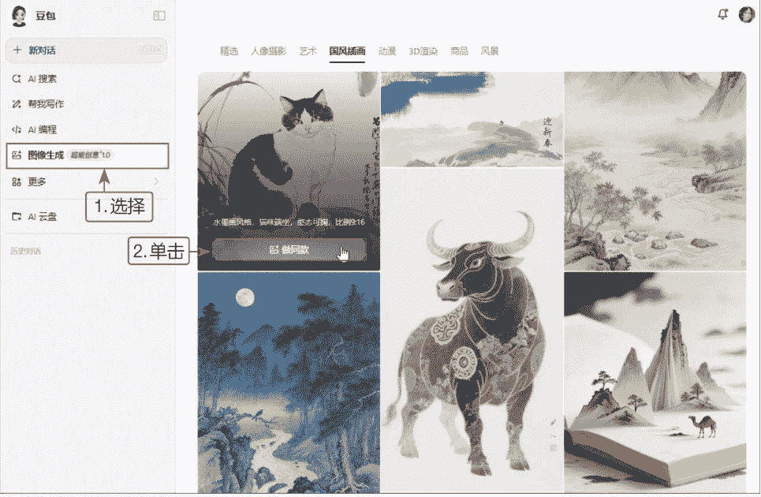
**步骤02** 进入后，源图提示词会自动填入输入框，风格与比例等参数可在此修改。

**步骤03** 点击风格右侧的下拉按钮，从列表中挑选所需风格，如选择【水彩画】。
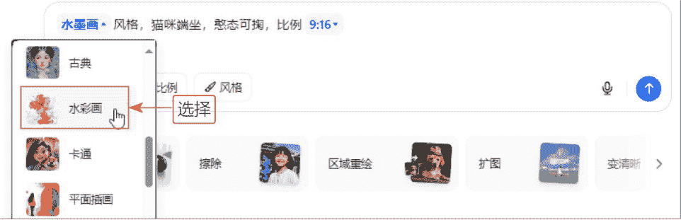
**步骤04** 同样方式调整画面比例，随后点击【发送】按钮 ⬆。

**步骤05** 系统会依据提示词一次性生成4张候选图像，如左图所示。
**步骤06** 若需优化，可在输入框补充调整指令并发送，系统将重新生成新图，如右图所示。

「水彩画」风格，猫咪端坐，憨态可掬，比例「4:3」
接下来将基于水彩风格生成四张图，主角为端坐的憨态猫咪，构图比例4:3。

接下来继续生成四张水彩风格图像，画面中猫咪口中叼着一朵小花。

**步骤07** 想查看大图或编辑时，点击任意生成图像即可进入编辑态，左侧出现对话面板。

**步骤08** 在对话面板中输入新的提示词，同样可以对图像进行微调。


### 5.1.2 实战：使用文字生成画作
通过同款操作用户大致掌握了使用方法，还可自定义提示词快速生成高质量图像。

**步骤01** 激活【图像生成】技能或从侧栏进入，输入区会显示参考图、比例、风格等控件。点击【风格】，从列表中选取例如【卡通】。
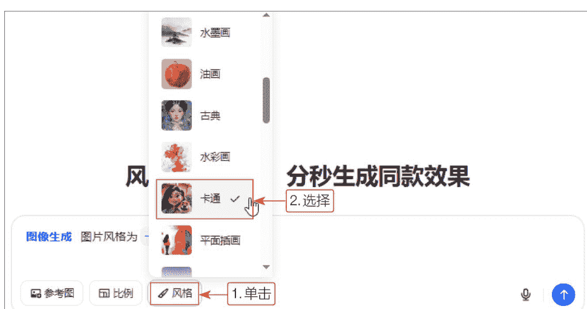
提示：如果不想手动选模板，可在提示词前加上“帮我生成图像：……”直接触发生成。
**步骤02** 点击【比例】，选择合适的尺寸，例如【9:16手机壁纸，人像】。
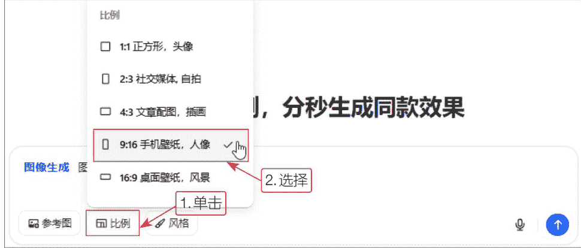
**步骤03** 参数设定完毕后，输入画面关键词或描述，点击【发送】⬆。

**提示：** 在豆包中生成图像，清晰描述很重要。描述方式大致分为两种：1. 自然语言描述，用完整句子详细交代元素、色彩、构图、风格等。例如：“一幅森林油画，透过高大树木看见清澈溪流和彩色野花，色彩鲜艳层次丰富”。2. 关键词排列，用简短词组快速指定核心要素，例如：“森林、树木、小溪、野花、油画、鲜艳”。可根据习惯灵活选用，也可两者结合。
**步骤04** 系统会依据输入生成四张图像，可按需进一步调整直至满意。

图片风格为「卡通」，比例「9:16」在新年期间，一只小狗穿梭于人群中，背景是美丽的商店橱窗。电影般的灯光，有趣的角色设计，超高清晰度，3D
下面将生成四张卡通风格、9:16比例的图像，内容为新年期间小狗穿梭人群、橱窗背景、电影感灯光、有趣角色、超高清3D。


### 5.1.3 实战：使用参考图生成画作
用户可将已有图像作为参考，把元素与风格融入创作流程，使结果更符合预期，具体步骤如下。

**步骤01** 在图像生成模式下，点击输入框中的【参考图】按钮。

**步骤02** 在弹出的文件对话框中选定参考图并打开。
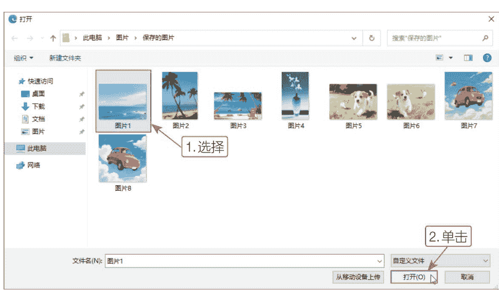
**步骤03** 设定风格与比例，输入描述词后点击【发送】⬆。
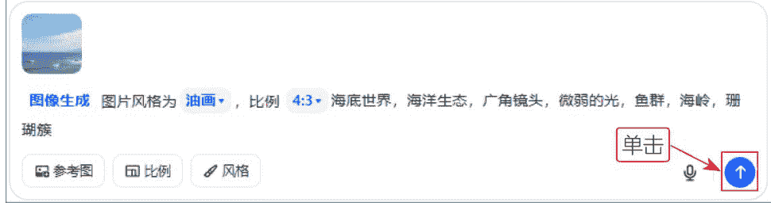
**步骤04** 系统会融合参考图特征与提示词，生成四张画作。

我将基于描述生成四张油画风格的海底场景，包含鱼群、海岭、珊瑚，广角视角，微光氛围。


### 5.1.4 实战：下载图像
编辑完成后可将图像保存到本地，豆包提供便捷的下载功能。

**步骤01** 将光标移至缩略图，点击出现的【下载原图】。

**步骤02** 浏览器开始下载，完成后可在下载列表中点击【打开文件】。

**步骤03** 查看本地保存的图像效果。


## 5.2 图像的编辑与下载
豆包不仅能生成图像，还支持对生成图和本地图进行编辑，如抠图、擦除、重绘、扩图等，为后续创意应用打下基础。

### 5.2.1 实战：去除背景
通过简单操作可上传图像并借助算法自动分离主体与背景，获得干净效果。

**步骤01** 进入【图像生成】界面，点击【AI抠图】。
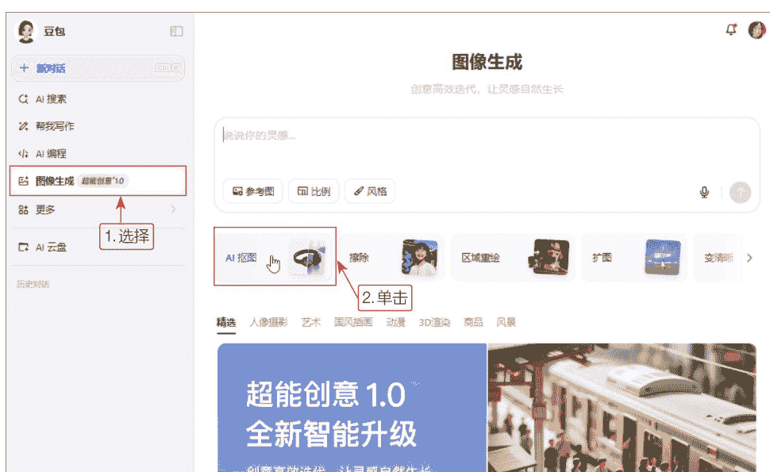
**步骤02** 选择本地图片打开。
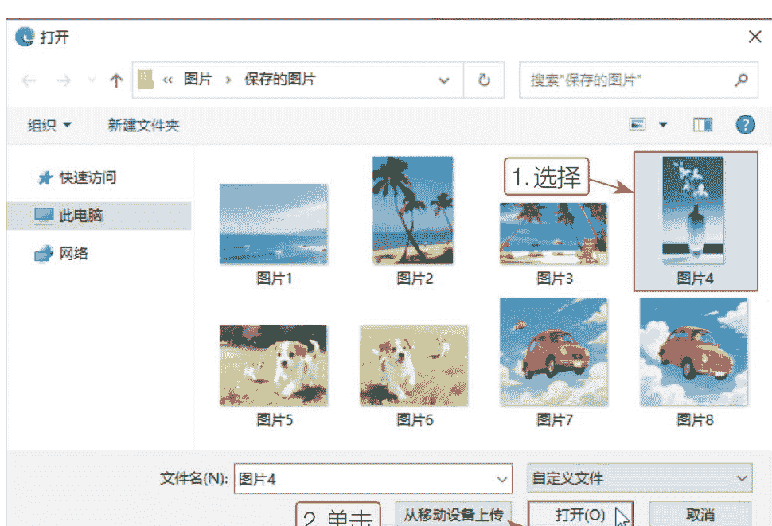
**步骤03** 图片上传中，进度条显示状态。

**步骤04** 上传完成，系统自动区分主体与背景，确认后点击【抠出主体】。

**步骤05** 主体抠出后可继续编辑，或直接点击【下载原图】⬇保存。


### 5.2.2 实战：擦除指定区域
当需要去除图像中不需要的元素或瑕疵时，可使用擦除功能。

**步骤01** 在界面点击【擦除】。

**步骤02** 上传图片后框选需移除的区域，点击【擦除所选区域】。
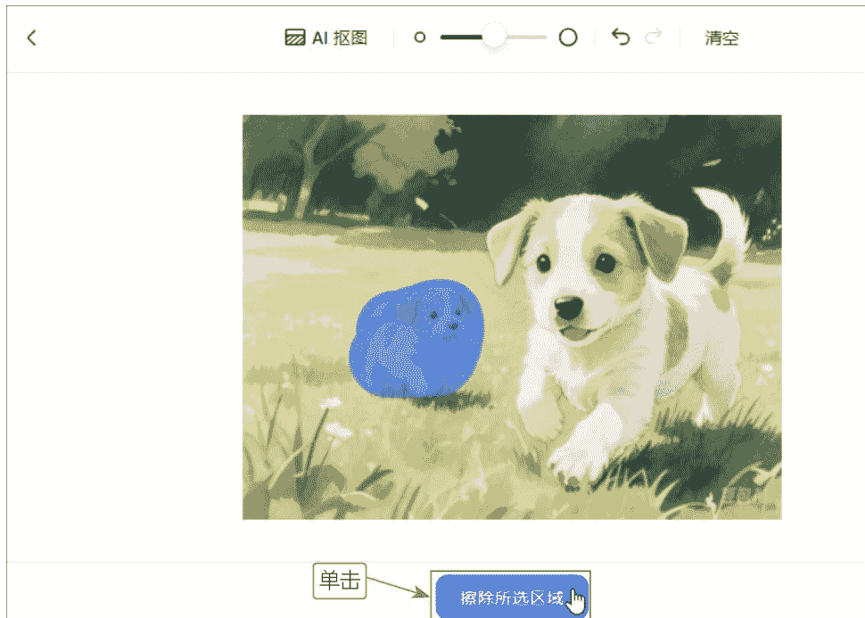
**步骤03** 系统清除选区并智能补全。


### 5.2.3 实战：区域重绘
对局部区域进行修改时，可使用区域重绘功能。

**步骤01** 点击【区域重绘】。
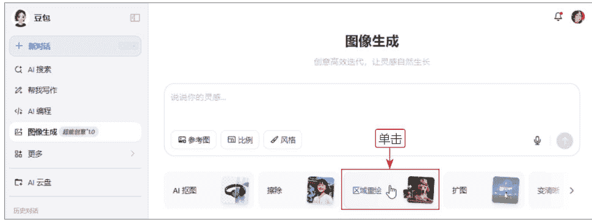
**步骤02** 上传图后选定重绘区域，输入新内容描述并发送⬆。

**步骤03** 系统对选区进行重绘。


### 5.2.4 实战：扩图
当图像尺寸无法满足使用需求时，可进行智能扩图。

**步骤01** 点击【扩图】。
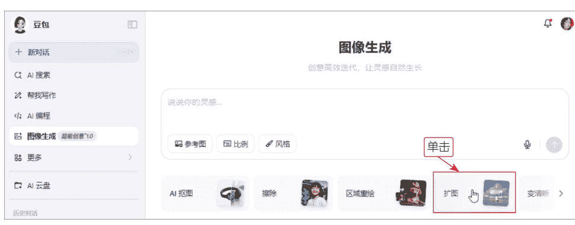
**步骤02** 上传图片后选择目标比例，点击【按新尺寸生成图片】。

**步骤03** 系统智能扩展画面至新尺寸。


## 5.3 生成音乐和视频
豆包提供智能化的音乐和视频生成功能，让零基础用户也能轻松创作专业级作品。

### 5.3.1 实战：生成同款音乐
音乐模块提供丰富模板，可选择模板生成同款音乐。

**步骤01** 选择输入区下方的【音乐生成】。

**步骤02** 在模板列表中选中目标曲目，点击【做同款】。

我想创作一首歌曲，用 AI 帮我写歌词 [描述歌词要表达的主题]。这首歌是 流行 音乐风格，传达 快乐 的情绪，使用 女声 音色
**步骤03** 模板提示词会自动填入，可根据需要调整后发送⬆。

**步骤04** 系统生成音乐预览。
我想创作一首歌曲，使用自定义歌词。这首歌是民谣音乐风格，传达怀旧的情绪，使用女声音色。
**步骤05** 点击播放按钮试听。

### 5.3.2 实战：创作一首音乐
尝试同款后，可自定义主题或歌词生成专属音乐。

**步骤01** 激活音乐生成技能，默认提示词自动出现。
**步骤02** 默认是AI写歌词，可设定主题后自动生成。也可切换为【自定义歌词】。
**步骤03** 弹出歌词编辑框，输入不超过200字的歌词后确认。
提示：关于歌词内容，用户可通过提示词让豆包生成，例如：
你是一位作词家。请为我创作一首舒缓的爱情歌曲，歌词字数控制在200字以内。 要求： ①歌曲应包含主歌和副歌，确保音乐结构清晰，情感表达流畅；②演奏时间控制在1分钟左右，确保音乐节奏紧凑且易于把握；③歌词应简洁明了，易于理解和记忆。
**步骤04** 返回输入区设置风格、情绪、音色等参数后发送⬆。
**步骤05** 生成完成，可即时试听。

### 5.3.3 实战：分享音乐
作品完成后点击【分享】，链接自动复制，可发给好友播放。

分享 ...

### 5.3.4 实战：生成视频

豆包视频生成快速体验

豆包的视频创作功能辨识度很高，支持基于文字指令对素材进行自动裁剪与拼接，短时间内能产出具备情节脉络与画面质感的小短片。

开启视频生成
在对话输入区底部找到视频生成技能并进入。

准备素材与提示
上传一张或多张参考图，在提示框里描述需求，例如让图中两只小狗在草坪上欢快奔跑，随后按下发送。

等待合成完成
指令发出后系统即开始处理，耗时较长，在内测高峰期更为明显，这段时间内可以先处理其他对话。

预览与保存
合成结束后点开即可播放，确认保留后可一键保存到本地。

# 第6章 桌面端智能办公全景

除网页端外，豆包还提供了桌面客户端，主打更稳定、更自由的交互体验。借助快捷唤起、语音交互、文档协同等能力，工作与数字生活的效率都能明显提升。

## 6.1 获取与登录

先完成客户端的获取与账号登录，才能体验桌面端的便利。

步骤01 在网页版豆包打开后，点击顶部头像，从下拉菜单中选择获取桌面客户端，如下图所示。
步骤02 浏览器会自动拉取安装包，下载完成后打开文件，如下图所示。
步骤03 进入安装向导，点击立即安装，提示栏可点自定义修改安装路径，未设置则默认装至系统盘，如下图所示。
步骤04 安装进度实时显示，完成后窗口自动关闭并直接启动客户端，如下图所示。
步骤05 为保持网页端与桌面端的对话和权益同步，点击右上角登录入口，使用同一账号或手机号登录即可。登录后界面发生变化，如下图所示。
豆包

+ 新对话
+ AI 搜索
+ 帮我写作
+ AI 编程
+ 图像生成 超能创意*1.0
+ 本地文件问答
+ 更多
+ AI 云盘

历史对话

# 下午好，古小月

发消息、输入 @ 选择技能或 / 选择文件

+ 深度思考
+ 帮我写作
+ AI 编程
+ 音乐生成
+ 图像生成 超能创意*1.0
+ 更多

## 6.2 桌面版核心场景

办公数字化深入，效率是职场关注重点。桌面版在网页功能基础上做了场景优化，内置多项实用工具，帮助简化流程、提升产出。

### 6.2.1 个性化设置

设置决定使用手感。桌面版支持按个人习惯微调。

步骤01 打开客户端，点击右上角头像下拉，选择设置命令，效果如下图所示。
步骤02 打开豆包设置页面，包含账户、通用设置等选项，可按需开关功能，如下图所示。
另外，可通过头像菜单中的窗口位置调整面板布局，让界面更贴合使用习惯。

### 6.2.2 实战：秒开 AI 启动器

桌面版的 AI 启动器是效率利器，能更直接地调用智能服务。

按下 Alt+Space 组合键即可立刻唤起启动器，相当于打开一条直达豆包智能服务的快捷通道。可直接输入问题获取答案，涵盖知识问答、文本翻译、文案创作等场景，无需再寻找输入框，大幅提升使用效率，如下图所示。

若想调整启动器展示的技能，可到侧栏选择 AI 搜索进入对话进行检索和切换，如下图所示。

### 6.2.3 实战：语音通话交互

语音通话让交流更自然，减少打字成本。

步骤01 打开桌面版，在输入框点选麦克风图标，从列表中选择语音通话选项，如下左图所示。
步骤02 此时弹出通话面板，对准电脑麦克风说出问题，如下右图所示。
步骤03 说完后豆包会识别问题并生成对应答案，如下图所示。
步骤04 回答完可继续提问，豆包同样会生成答案。点击挂断通话按钮即可关闭对话框，如下图所示。

### 6.2.4 实战：润色聊天内容

在微信、QQ 或邮件中，选中文字即可获得优化建议，让表达更得体。

步骤01 选中待发送的消息，在弹出工具栏中选择写正式点技能，如下图所示。
提示：技能可根据需求调整，例如写作改进、扩写、调整语气等。
步骤02 豆包按提示词调整内容，确认无误后点替换按钮覆盖原文本，或点插入另起一段，如下图所示。
注意：若对内容不满意，可点刷新图标重新生成。
步骤03 插入后可按实际情况微调，如下图所示。

### 6.2.5 实战：与 Word 协同办公

桌面版可与 Word 文档协作，提升阅读与写作效率。

步骤01 打开 Word 文档时，桌面右上角会弹出提醒设置对话框，点击一起工作按钮，如下图所示。
提示：豆包的 AI 功能提醒默认开启。若未出现，可打开豆包设置页面，选择 AI 工具区域下的 AI 功能提醒设置，确认共享应用给豆包一起工作的提醒已开启，然后点需要提醒的应用右侧的 > 按钮添加 Word 即可。
步骤02 弹出协作对话框，可直接输入指令进行对话。例如输入总结这篇文档，豆包会自动生成摘要，如下图所示。
步骤03 协作面板还支持内容创作。例如在对话框输入帮我写一下，线上与线下渠道如何协同（如线上购买、线下体验店提货），即可获得写作内容，如下图所示。

帮我写一下，线上与线下渠道如何协同（如线上购买、线下体验店提货）。

以下是基于文档中智能音箱 4P 营销框架，结合线上线下渠道特性设计的协同策略，涵盖体验、销售、服务全链条，附具体操作示例：

## 一、线上线下协同核心逻辑

通过流量互导、体验互补、数据互通，构建“线上决策便捷性 + 线下体验真实性”的闭环。例如：线上用户被价格或功能吸引下单，线下门店提供即时提货与深度体验，反向推动线上复购。

步骤04 生成内容后，对话框中显示 AI 创作结果。点击复制按钮，再点击插入按钮，如下图所示。
- 体验断层：统一线上线下服务标准（如导购话术、样机陈列、售后响应时间），通过神秘顾客抽查确保执行到位。
通过以上策略，智能音箱企业可实现线上线下从“独立作战”到“协同增效”的升级，既提升用户全流程体验，又优化渠道成本结构，最终推动销售与品牌忠诚度双增长。
- 把线上购买+线下提货的操作细节展开写 →
- 写一篇500字的文章，主题为“线上线下渠道协同的优势” →
- 推荐一些线上线下渠道协同的成功案例 →
正在共享：智能音箱的4P营销分析.docx
步骤05 内容会自动填入当前文档，用户可根据需求调整序号、字体和样式，如下图所示。

## 智能音箱 4P 营销拆解

随着科技发展，智能音箱已成为智能家居重要入口。要在竞争中突围，需从产品、价格、渠道、促销全方位拆解。

## 一、产品

智能音箱作为家居入口，核心价值是提供便捷高效的语音助手服务，策略上要兼顾功能、性能与体验。

### 1. 功能

主要功能包括语音识别、音乐播放、智能家居控制等。营销时应突出实际使用场景，例如广告可展示如何用音箱设置闹钟、播放音乐等。

步骤03 豆包协作还支持内容创作功能。例如在对话框输入帮我写一下，线上与线下渠道如何协同（如线上购买、线下体验店提货），即可获得相应的写作内容，如下图所示。

## 4. 线上线下协同核心逻辑

通过流量互导、体验互补、数据互通，构建“线上决策便捷性+线下体验真实性”的闭环。例如：线上用户被价格或功能吸引下单，线下门店提供即时提货与深度体验，反向推动线上复购。

## 5. 具体协同模式与操作细节

1. 线上购买+线下提货（效率优先型）
适用场景：用户急需产品或希望节省物流时间（如节日送礼、临时需求）。
2. 线上环节：
在电商平台/品牌官网标注“线下门店极速自提”标签，显示离用户最近的3家门店地址、库存状态。

# 第7章 移动助理：手机端专属 AI

在数字时代，智能手机已成为生活核心设备。本章介绍豆包 App 如何通过个性化设置与特色功能丰富移动体验，从实时语音、拍题答疑到日报订阅、健康咨询、声音克隆和智能体创建，全方位提升效率与趣味。

## 7.1 个性化配置

AI 普及时，豆包 App 已成为常用助手。掌握设置能让它更懂用户。

步骤01 在手机下载并安装豆包 App，启动后进入主界面。对话列表展示历史记录，点击豆包按钮即可开始对话，如下左图所示。
步骤02 进入对话页后，点击 > 按钮进入设置，如下右图所示。
步骤03 进入豆包智能体设置界面，可在列表中逐项调整。例如点击设置形象选项，如下左图所示。
步骤04 进入设置形象页面，豆包提供两种形象，可按需选择。点击声音右侧的更改按钮，如下右图所示。
步骤05 进入智能体声音页面，包含不同分类的声音，可在列表中试听选择，如下左图所示。
步骤06 另外，豆包支持连接智能体耳机，在豆包智能体设置页面可连接 Ola Friend 智能体耳机，实现更多 AI 交互体验，如下右图所示。
若需调整账号、背景及字号等，可在我的页面的设置按钮中完成。

## 7.2 核心特色功能

豆包 App 不止于对话，还集成多项实用功能。

### 7.2.1 实战：实时语音通话

实时语音通话让对话更即时，还支持英语陪练等场景互动。

步骤01 在与豆包对话页面点击打电话按钮，如下图所示。
步骤02 拨通后进入语音聊天页面，可随时开口互动，如下左图所示。
步骤03 点击界面中的选择情景按钮，在展开列表中按需选择，例如点击英语陪练情景，如下右图所示。
步骤04 进入英语陪练情景对话，如下左图所示。
步骤05 挂断通话后可查看对话记录，如下右图所示。

### 7.2.2 实战：拍题答疑

拍题答疑功能允许拍摄照片或从相册选择图片提问，豆包可查找相关答案或信息。

步骤01 在与豆包对话页面点击拍题答疑按钮，如下图所示。

### 7.2.3 实战：订阅豆包日报

豆包日报会按兴趣推送科技、财经、文化等精选资讯。

步骤01 在功能菜单点击豆包日报按钮，如下图所示。
步骤02 显示豆包日报信息，点击···按钮，在弹出菜单中开启订阅豆包日报功能，然后点击修改偏好和时间选项，如下左图所示。
步骤03 弹出设置资讯偏好面板，可按需选择资讯主题和推送时间，然后点击保存按钮，如下右图所示。
步骤04 订阅成功后，豆包会推送订阅信息。点击听一听按钮，如下左图所示。
步骤05 即可按订阅的资讯进行播放，如下右图所示。

### 7.2.4 实战：健康咨询

豆包 App 整合专业健康知识和智能问答系统，提供即时健康咨询服务。

步骤01 在功能菜单点击健康咨询按钮，豆包显示4个提示信息，点击健康科普按钮，如下左图所示。
步骤02 在输入框输入要咨询的健康问题，豆包即可回复信息，如下右图所示。

### 7.2.5 实战：克隆自己的声音

在豆包中可按提示录制自己的声音，为智能体定制专属音色，用于各类智能体。

步骤01 在豆包智能体设置页面点击声音选项，进入智能体声音页面，点击克隆我的声音按钮，如下左图所示。
步骤02 弹出请朗读面板，点击按住录制按钮，如下右图所示。
步骤03 用自然语气读完页面中的文本后松手，如下左图所示。
步骤04 开始生成声音，如下右图所示。
步骤05 生成完成后豆包会自动播放，可试听克隆效果，如下左图所示。
步骤06 点击 ⚙️ 按钮可调整声音的音高和语速。设置完成后可在创建智能体或修改智能体时应用。

### 7.2.6 实战：发现和创建智能体

豆包内置丰富智能体，涵盖头像生成、拍照问答、学习及绘画等领域，也可自建。

步骤01 点击底部发现按钮，可看到不同分类及智能体列表，如下左图所示。
步骤02 若要使用某个智能体，点击该智能体即可使用，如下右图所示。
另外，也可按需创建智能体，具体操作如下。
步骤01 点击底部创作按钮，在展开列表中点击创建 AI 智能体按钮，如下左图所示。
步骤02 进入创建 AI 智能体页面，在名称文本框输入智能体名称，然后点击右上角的一键完善按钮，如下左图所示。
步骤03 AI 会自动完善其余信息，也可手动调整，然后点击创建智能体按钮，如下右图所示。
步骤04 在弹出确认智能体权限面板，选择智能体权限，然后点击确定按钮，如下左图所示。
步骤05 至此创建完成智能体，此时即可与其互动，如下右图所示。

创建 AI 智能体

更换形象

名称 周报助手

确认智能体权限

- 公开 · 所有人可对话
- 不被发现 · 通过链接分享可对话
- 私密 · 仅自己可对话

请注意保护个人信息，确保未侵犯第三方权利。如你使用你克隆的声音作为智能体声音，其他人将可以与它对话。

确定

周报助手

我能为你快速生成清晰周报，提供工作建议，快说说你的工作内容。

我这周负责了三个项目的跟进，你能帮我生成周报吗？

我完成了部分任务，但是遇到了一些问题，你能帮我写进周报并给出建议吗？

我不太清楚怎么突出重点工作成果，你可以根据我的描述生成周报并指导一下吗？

发消息或按住说话...

*文中代码字体版权说明* Copyright Copyright 2010, 2012 Adobe Systems Incorporated (http://www.adobe.com/), with Reserved Font Name ‘Source’ . License This Font Software is licensed under the SIL Open Font License, Version 1.1. This license is copied below, and is also available with a FAQ at: http://scripts.sil.org/OFL SIL OPEN FONT LICENSE Version 1.1 - 26 February 2007 PREAMBLE The goals of the Open Font License (OFL) are to stimulate worldwide development of collaborative font projects, to support the font creation efforts of academic and linguistic communities, and to provide a free and open framework in which fonts may be shared and improved in partnership with others. The OFL allows the licensed fonts to be used, studied, modified and redistributed freely as long as they are not sold by themselves. The fonts, including any derivative works, can be bundled, embedded, redistributed and/or sold with any software provided that any reserved names are not used by derivative works. The fonts and derivatives, however, cannot be released under any other type of license. The requirement for fonts to remain under this license does not apply to any document created using the fonts or their derivatives. DEFINITIONS