# 豆包高效办公

Preface 前 言

本书写作目的

人工智能（AI）正以惊人的速度重塑我们的世界，从日常生活到职场工作，

AI 的影响无处不在。面对这场技术变革，我们每个人都需要主动拥抱 AI，以免

在变革中落后。

传统的办公方式存在诸多痛点：烦琐的文书工作、耗时的重复任务、匮乏的

创新思维等。AI 辅助办公为这些问题提供了解决方案。通过运用 AI，我们能大

幅提升工作效率，完成更多高质量的输出，将精力集中在真正需要人类智慧的领

域，从而在职场中脱颖而出。

在众多 AI 工具中，豆包以其全面的功能和卓越的性能脱颖而出。它不仅提

供了基础的文字聊天功能，还包括 AI 绘画、长文写作、学术搜索等功能。豆包

以其多样化功能满足了现代办公中的各种需求，从日常文书处理到创意内容生

成，从数据分析到学术研究，都能提供强有力的支持。

本书旨在通过系统介绍豆包这一 AI 助手，为读者提供一份实用的 AI 高效办

公指南。我们将深入浅出地讲解如何利用豆包提升工作效率，激发创新思维，以

应对日新月异的职场挑战。无论你是职场新人还是经验丰富的管理者，本书都能

帮助你在 AI 时代找到自己的位置，实现职业生涯的新突破。

本书主要内容

本书是一份全面而深入的指南，旨在帮助读者掌握豆包在办公环境中的应

用，特别聚焦于 AI 如何提升工作效率。本书涵盖以下几个核心内容。

❑ 豆包功能介绍：详细介绍豆包这款基于大模型开发的聊天对话产品。我们

IV

将探讨其核心功能，包括 AI 文字聊天、AI 绘画、AI 长文写作、学术搜

索，以及正在内测的 AI 视频功能和自定义 AI 智能体。通过深入了解这些

功能，读者将能够充分挖掘豆包在提高工作效率方面的潜力。

❑ 结构化提示词技巧：深入探讨结构化提示词的写作技巧，包括如何设计清

晰的指令、如何提供相关背景信息、如何使用特定格式等。不仅介绍如何

创建有效的结构化提示词，还讲解如何通过多轮对话来优化在办公场景中

的输出结果，以获得更精准、更有价值的 AI 回应。

❑ 高效办公应用场景：涵盖多个常见办公场景，如报告撰写、数据处理、会

议管理等，提供具体的应用方法和案例分析，更重要的是，为每个场景提

供了使用豆包的详细步骤，以及大量经过实践验证的高效提示词模板，以

帮助读者快速上手，在各种办公场景中充分发挥豆包的潜力。

❑ 领域专题：深入分析多个不同领域的特定需求，提供针对性的应用策略，

展示豆包如何带来实质性的改变。例如，行政人员可以利用豆包提升公文

写作的效率和质量；项目经理可以优化项目规划和进度跟踪；内容创作者

能够快速生成吸引眼球的文案和视频脚本；品牌管理者则可以使用豆包进

行品牌策划和日常运营，大大提高工作效率和创意输出。通过这些专业化

的应用，豆包将成为各行各业提升工作效率和竞争力的有力工具。

读者对象

本书面向所有希望在 AI 时代提升工作效率和职业竞争力的人士。无论是刚

刚踏入职场的新人，还是经验丰富的专业人士，都能从本书中获益。

1\. 追求职场效率和竞争力的人士

本书将帮助这类读者掌握如何利用 AI 工具简化日常任务，优化工作流程，

提高工作质量和效率，使他们学会运用 AI 进行数据分析、报告撰写、创意生成

等，从而在职场中脱颖而出，提升自身的职业价值。

2\. 渴望持续学习和自我提升的个人

本书不仅教授实用的 AI 应用技巧，还将启发这类读者利用 AI 激发创新思

维，拓展知识边界，学会与 AI 协作，实现个人的成长。

3\. 希望在团队中引入 AI 技术的管理者

本书将为管理者或决策者提供宝贵的见解，帮助他们了解如何在团队中有效

地利用 AI 工具，提升整体的工作效率和创新能力。

V

4\. 寻求在特定领域应用 AI 的专业人士

无论是内容创作、项目管理还是品牌运营等，本书都提供了针对性的 AI 应

用策略和实用技巧，帮助有需要的读者在各自的专业领域充分发挥 AI 的潜力。

使用建议

本书采用循序渐进的讲解方式，内容深入浅出，通俗易懂。如果是零基础入

门的读者，建议首先通读基础理论部分（即第 1、2 章），以建立对豆包和结构化

提示词的整体认知。

如果是经常使用或接触过豆包的读者，建议直接阅读第二章的提示词写作方

法和技巧部分，进行快速、系统化的学习，在掌握提示词写作技术的同时，对以

往在使用豆包过程中遇到的问题进行查漏补缺，这样能够更加精进自己的技巧。

随后，读者可以根据个人需求选择性地深入学习相关应用场景章节，以真正

达到活学活用的目的。同时，由于提示词的写作和使用都属于经验科学，我们鼓

励读者在阅读过程中动手实践书中的方法，以获得最佳学习效果。

最后，我们真诚地希望本书能够成为读者学习豆包的有力指南，助力读者在

AI 时代脱颖而出，达到办公效率和职业发展的新高度。

约定

为了方便大家阅读，本书在撰写时做出以下约定。

❑ 如无特别说明，文中所指“ AI ”皆为新一代“生成式人工智能”。

❑ 如无特别说明，文中的“大模型”

“AI 大模型”

“LLM ”等表述，皆指“大

型语言模型”

（LLM）。

资源和勘误

为了帮助读者更好地理解和应用书中的内容，我们提供了额外的在线资

源，包括提示词示例和补充材料。读者可以访问我们的官方网站（http://feishu.

langgpt.ai）获取这些资源。

如果读者在阅读过程中发现任何错误或有任何建议，欢迎通过电子邮件

（1987786399@qq.com）与我们联系。我们将及时更新勘误表，并在后续版本中进

行改进。

VI

说明

在本书之前，我们撰写并出版了本书的姊妹篇《 Kimi 高效办公：AI 10 倍提

升工作效率的方法与技巧》，为什么我们要同时出版这两本书，读者又该如何选

择呢？

Kimi 和豆包这两个 AI 工具都非常优秀，但各有所长。Kimi 以其强大的上下

文理解能力和深度分析功能著称，特别适用于需要处理大量信息、进行深入研究

的专业人士；豆包则以其全面的 AI 应用服务见长，涵盖从文字处理到图像创作

的多个领域，更贴近日常生活和内容创作需求。因此，Kimi 和豆包各自拥有属

于自己的用户群体。为了让有不同需求和不同使用习惯的用户都能找到趁手的 AI

工具，我们同时撰写了这两本书。

如果你习惯使用 Kimi，可以阅读《 Kimi 高效办公：AI 10 倍提升工作效率的

方法与技巧》；如果你用豆包比较多，建议选择本书；如果你对 Kimi 和豆包都比

较熟悉，也无所谓使用哪个工具，那么你阅读其中任何一本就可以了。

虽然这两本书在写作思路上大致相同，但是也有区别。本书在保留了《 Kimi

高效办公：AI 10 倍提升工作效率的方法与技巧》的大部分核心内容的基础上，增

加了许多豆包特有的内容。比如，新增了 AI 绘画的详细教程，以适配豆包独有的

“帮我写作”

“数据分析”等功能的使用场景，还介绍了豆包智能体和浏览器插件的

使用方法。此外，我们对部分提示词进行了优化，以更好地适应豆包的特点。

无论选择哪本书，相信都会成为广大读者探索 AI 办公新世界的得力助手。

让我们一起拥抱 AI 带来的无限可能，开启智能办公的全新篇章！

致谢

在此，我们衷心感谢所有为本书做出贡献的人。

首先，感谢家人和朋友的支持与理解，让我们能够投入大量时间完成本书。

其次，感谢 LangGPT 结构化提示词社区的梁思、Jessica 等共建共创者为本

书提供了诸多灵感和参考案例。感谢 AIGC 思维火花公众号众多朋友的支持与鼓

励。感谢同事和业内专家的反馈与指导，他们的意见和建议大大提升了本书的

质量。

最后，感谢所有读者，是读者的热情和支持推动着 AI 技术不断进步。

希望本书能成为广大读者提升办公效率的可靠助手，祝阅读愉快，收获

满满！

Contents 目 录

前言

2.2.1 “把话说清楚”一点也

不简单 ·························19

第 **1** 章 你真的了解豆包吗 ·········· 1

2.2.2 如何“把话说清楚” ·······20

2.3 结构化提示词 ·······················24

1.1 豆包擅长做什么 ····················· 1

2.3.1 结构化思维 ···················24

1.2 为什么选择豆包 ····················· 2

2.3.2 结构化提示词与一般

1.3 豆包内置的高效应用工具 ········ 3

提示词对比 ···················25

1.3.1 豆包应用工具的调用 ········ 3

2.3.3 7 种结构化提示词框架 ·····27

1.3.2 豆包应用工具的功能

介绍 ····························· 3

第 **3** 章 豆包辅助文本创作 ·········43

1.4 豆包智能体 ···························· 4

1.4.1 什么是智能体 ················· 4

3.1 “帮我写作”应用 ·················43

1.4.2 智能体的好处是什么 ········ 4

3.1.1 “帮我写作”应用介绍 ····43

1.4.3 豆包智能体广场 ·············· 5

3.1.2 “长文写作”与“文章”

1.4.4 如何创建自己的智能体 ····· 6

工具 ····························44

1.5 豆包的浏览器插件 ·················· 8

3.2 文本内容润色 ·······················50

1.5.1 插件的主要功能 ·············· 9

3.3 文本内容校正 ·······················54

1.5.2 插件的安装 ···················12

3.4 要点提炼和总结 ····················57

3.5 文本风格转化 ·······················58

第 **2** 章 豆包提示词的写作方法 ···14

3.6 文本风格仿写 ·······················60

2.1 全面了解提示词 ····················14

3.7 文本内容缩写 / 扩写 ··············65

2.1.1 什么是提示词 ················14

3.8 文本翻译 ······························76

2.1.2 提示词的重要性 ·············15

3.9 创意激发与头脑风暴 ·············80

2.2 编写提示词的原则 ·················19

3.10 结构规划与大纲构建 ············82

VIII

3.11 关键词优化与 SEO 建议 ·······82

5.3.3 批量拆分表格 ·············· 136

3.12 事实核查与数据整合 ············93

5.3.4 批量发送邮件 ·············· 138

3.13 互动式内容生成 ··················96

5.3.5 微信群发任务与批量

3.14 多语言内容创作 ··················97

AI 任务处理 ················ 142

3.15 文本合规性检查 ················ 100

5.4 豆包如何制作表格 ··············· 143

5.4.1 纯提示词生成 ·············· 143

第 **4** 章 **AI** 绘画从入门到精通 ···102

5.4.2 基于图片生成 ·············· 145

5.4.3 基于文档生成 ·············· 145

4.1 AI 绘画在办公领域的优势···· 102

5.5 豆包如何进行数据可视化 ····· 147

4.2 AI 绘画在不同办公场景

5.5.1 基于“数据分析”应

中的应用 ···························· 105

用的可视化 ················· 147

4.3 AI 绘画提示词攻略·············· 106

5.5.2 基于 VBA 的可视化 ······ 148

4.3.1 AI 绘画提示词的结构 ···· 106

5.6 豆包如何进行数据分析及

4.3.2 绘画参数详解 ·············· 108

生成报告 ···························· 150

4.3.3 AI 绘画词典 ················ 114

4.4 如何使用豆包进行 AI 绘画 ··· 115

第 **6** 章 豆包辅助高效搜索

4.4.1 调用“图像生成”功能 ··· 115

和快速学习 ················· 156

4.4.2 “图像生成”界面介绍 ··· 115

6.1 使用豆包联网搜索 ··············· 156

4.4.3 绘画提示词的书写 ········ 116

4.4.4 AI 绘画提示词生成器 ···· 118

6.1.1 主动发起联网搜索 ········ 156

4.5 使用豆包重绘图片

6.1.2 联网搜索的高级用法 ····· 157

··············· 122

6.2 使用豆包搜索学术论文 ········ 160

第 **5** 章 豆包辅助处理数据表 ··· 124

6.3 基于费曼学习法快速学习

知识 ··································· 161

5.1 主动调用“数据分析”

6.4 应用麦肯锡关键词法快速

应用 ··································· 124

了解一个行业 ····················· 164

5.2 豆包如何撰写 Excel 公式

进行数据处理 ····················· 126

第 **7** 章 豆包辅助高效开会 ······· 168

5.2.1 数据提取 ···················· 126

5.2.2 数据统计 ···················· 128

7.1 撰写会议通知 ····················· 168

5.3 豆包如何撰写 VBA 实现

7.2 准备会议发言稿 ·················· 173

自动化办公 ························· 132

7.3 会议内容润色和优化 ··········· 178

5.3.1 批量数据校验与替换 ····· 132

7.4 撰写会议纪要 / 总结 ············ 182

5.3.2 一键数据筛选 ·············· 135

7.5 撰写会后通知和新闻稿 ········ 187

IX

第 **8** 章 豆包辅助做计划和

11.2.1 收集市场情报和数据 ···· 267

写总结 ························ 189

11.2.2 生成 SWOT 矩阵并

分析关键点 ················ 271

8.1 做工作计划 ························· 189

11.2.3 提供基于 SWOT 的

8.2 撰写日报 / 周报 / 月报 ········· 196

战略建议 ··················· 274

8.3 撰写年中 / 年终总结 ············ 201

11.3 项目计划书的写作 ············· 281

8.4 撰写汇报材料 ····················· 205

11.3.1 自动生成项目概述

8.5 撰写项目报告 ····················· 208

与背景 ······················ 281

8.6 撰写调研报告 ····················· 215

11.3.2 撰写项目范围与目标 ···· 283

11.3.3 协助编写时间线与里

第 **9** 章 豆包辅助阅读和优化

程碑 ························· 284

论文 ···························· 225

11.3.4 草拟风险评估与应对

9.1 快速总结论文核心要点 ········ 225

策略 ························· 286

9.2 发掘论文创新点 ·················· 228

11.3.5 编制预算与规划资源 ···· 287

9.3 学术英语翻译 ····················· 230

11.4 思维导图的辅助生成 ·········· 293

9.4 专业学术风格优化与润色 ····· 234

11.4.1 快速整理关键信息 ······· 293

9.5 构建文献综述 ····················· 237

11.4.2 快速创建项目结构图 ···· 294

11.4.3 任务分解与关联分析 ···· 295

第 **10** 章 豆包辅助写公文 ········ 238

11.5 时间管理与优先级设定 ······ 296

11.5.1 分析任务紧急程度与

10.1 撰写公函 ·························· 238

重要性 ······················ 296

10.2 撰写请示 ·························· 242

11.5.2 提供个人与团队的时间

10.3 撰写报告 ·························· 249

规划建议 ··················· 299

10.4 撰写通知 ·························· 255

11.6 风险管理 ·························· 300

10.5 撰写规定 ·························· 257

11.6.1 识别潜在项目风险 ······· 300

11.6.2 项目风险影响与评估 ···· 303

第 **11** 章 豆包辅助项目管理 ····· 260

11.6.3 建议风险缓解策略 ······· 304

11.1 OKR 的制定 ······················ 260

11.7 绩效评估 ·························· 306

11.1.1 制定 OKR 的建议 ········ 260

11.7.1 生成团队与个人绩效

11.1.2 跟踪与评估 OKR 进展 ··· 262

报告 ························· 307

11.1.3 提供行业标杆与最佳

11.7.2 支持匿名反馈调查 ······· 312

实践 ························· 267

11.7.3 提供改进与发展的个性

11.2 SWOT 分析 ······················· 267

化建议 ······················ 313

X

第 **12** 章 豆包辅助生成爆款

13.7.2 危机公关 ··················· 367

文案及视频 ··············· 321

13.8 品牌故事的叙述 ················ 373

12.1 爆款文案拆解 ···················· 321

13.8.1 品牌起源与使命 ·········· 373

12.1.1 拆解爆款文案的特点

13.8.2 品牌宣言与客户共鸣 ···· 373

与构成 ······················ 321

13.8.3 品牌故事 ··················· 374

12.1.2 拆解爆款文案的情感

13.9 内容本地化 ······················· 378

共鸣点与价值传达

13.9.1 文化敏感性审查 ·········· 378

方式 ························· 322

13.9.2 语言风格调整 ············· 380

12.1.3 拆解爆款文案 ············· 322

12.2 小红书爆款文案 ················ 326

第 **14** 章 豆包辅助老师教学 ····· 383

12.3 抖音 / 视频号爆款文案 ······· 328

14.1 高情商家校沟通 ················ 383

12.3.1 快速生成视频创意 ······· 328

14.1.1 表扬信 ······················ 383

12.3.2 短视频脚本生成 ·········· 330

14.1.2 鼓励进步报告 ············· 386

14.1.3 家长会邀请函 ············· 388

第 **13** 章 豆包辅助品牌策划

14.2 互动式课题设计 ················ 390

及运营 ······················ 333

13.1 活动策划 ·························· 333

第 **15** 章 豆包辅助销售 ············ 395

13.1.1 创意主题生成 ············· 333

15.1 用户画像分析 ···················· 395

13.1.2 流程规划 ··················· 336

15.1.1 利用豆包进行用户

13.2 邮件通知 ·························· 340

数据收集 ··················· 395

13.3 活动总结 ·························· 344

15.1.2 利用豆包进行用户

13.3.1 数据分析报告 ············· 344

画像构建 ··················· 399

13.3.2 活动总结报告 ············· 349

15.2 销售话术与谈判技巧

13.3.3 未来改进策略 ············· 351

提升 ································· 403

13.4 Slogan 创意构思 ················ 355

15.2.1 有效沟通模板的生成 ···· 403

13.5 营销宣传文案 ···················· 357

15.2.2 模拟客户异议处理 ······· 407

13.5.1 营销宣传文案的创作 ···· 357

15.3 销售培训与团队赋能 ·········· 410

13.5.2 多渠道适应性 ············· 360

13.6 会议邀请函 / 致谢词的

第

写作

**16** 章 豆包辅助法务工作 ····· 415

································ 363

13.7 企业公关稿的写作 ············· 365

16.1 合同协议框架起草 ············· 415

13.7.1 新闻稿撰写 ················ 365

16.2 法律培训与教育 ················ 417

第一章

Chapter 1

你真的了解豆包吗

在这个 AI 浪潮如火如荼的时代，豆包无疑已成为国产 AI 领域的“当红炸子

鸡”。然而，尽管 AI 的热度持续攀升，真正了解并充分利用豆包的人却寥寥无

几。大多数人仍然将其简单地视为一个高级搜索引擎，而忽视了它作为职场办公

“生产力工具”的巨大潜力。

现实是：我们中的许多人可能只是浅尝辄止，用豆包查询一些基本信息或解

答简单问题。这就好比用宝刀切菜，实在是大材小用。豆包的能力远不止于此，

它可以成为你职场生涯中的得力助手，助你事半功倍。

本章将带你了解豆包，并学习豆包智能体和豆包的浏览器插件的使用方法。

**1.1** 豆包擅长做什么

豆包是一款由字节跳动开发的全能 AI 助手，旨在提升用户的工作和学习效

率。它具备多种功能，涵盖从信息搜索到内容创作的各个方面。以下是豆包的一

些主要功能。

❑ 信息搜索。豆包可以快速搜索并提供准确的答案，无论是简单的事实查

询还是复杂的问题分析。它的搜索功能不仅仅限于文本，还包括图片和

视频内容。

❑ 学术搜索。豆包内置了海量的学术论文库，学术研究者可以快速获取专

业且权威的学术信息。


2 豆包高效办公：AI 10 倍提升工作效率的方法与技巧

❑ 翻译助手。豆包支持多语言翻译，能够实时翻译外语网页、视频和图表，

并生成生词本，帮助用户学习外语。

❑ 内容创作。豆包可以帮助用户撰写各种类型的文档，包括电子邮件、博

客、论文、小说、PPT 大纲等，还能生成引人入胜的宣传文案和演讲稿。

❑ 图像生成。豆包提供了图像生成功能，用户可以选择不同的风格和特征

词来生成图片，适用于各种创意需求。

❑ 语音助手。豆包支持语音输入和输出，用户可以通过语音与豆包进行互

动，进行英语陪练，模拟面试等。

❑ 文档处理。豆包能够阅读和总结 PDF 等文档，提供中英翻译对照，帮助

用户高效掌握文档内容。

❑ 智能体创建。用户可以创建个性化的智能体，用于特定的任务和需求，

进一步提升工作效率。

通过这些功能，豆包成为职场人士的得力助手，无论是提升工作效率、辅助

专业任务还是丰富日常生活，豆包都能发挥重要作用。随着技术的不断进步和更

新，豆包的能力也在持续扩展。未来，它将能够完成更多任务，为用户创造更大

价值。

**1.2** 为什么选择豆包

选择豆包作为工作和学习的 AI 助手的理由如下。

❑ 功能全面。豆包不仅具备强大的搜索和翻译功能，还能帮助用户进行内

容创作和图像生成，满足多样化的需求。

❑ 高效便捷。豆包的快捷卡片和语音输入功能使得用户可以快速上手，节

省时间，提高工作效率。

❑ 智能化体验。豆包的 AI 能力强大，能够理解并处理复杂的任务，提供准

确的答案和高质量的内容。

❑ 个性化服务。用户可以创建和定制智能体，根据个人需求进行优化，提

供更贴合实际的解决方案。

❑ 跨平台支持。豆包支持网页、客户端、App 和插件等多种形式，用户可

以随时随地使用豆包的功能。

总的来说，豆包是一款功能强大、使用便捷、智能化程度高的 AI 助手，能

够帮助职场人士提升工作效率，满足各种办公需求。


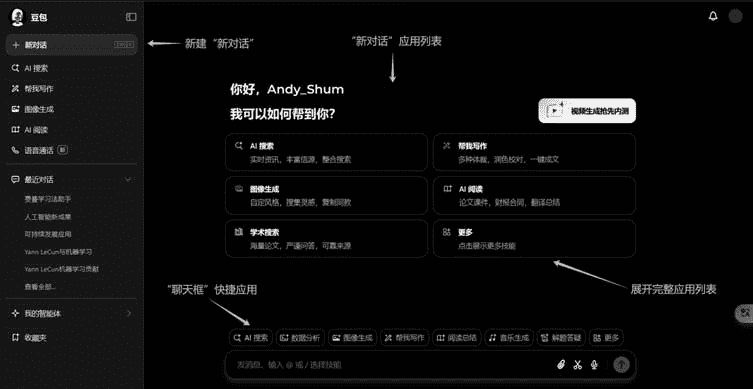

第一章 你真的了解豆包吗

3

**1.3** 豆包内置的高效应用工具

1.3.1 豆包应用工具的调用

在职场中，时间就是金钱，效率就是生命。豆包作为一款全能的 AI 助手，

内置了一系列高效的应用工具，旨在帮助职场人士提升工作效率。

如图 1-1 所示，调用豆包应用有以下两种方式。

❑ 方式一：新建“新对话”，在“新对话”主页的应用列表中选择所需要的

应用。单击“更多”，可展开完整的应用列表。

❑ 方式二：“聊天框”快捷应用。在聊天框上方，随时可调用和切换各类应

用，非常方便。

图 1-1 豆包内置应用工具的入口

1.3.2 豆包应用工具的功能介绍

豆包提供了一系列非常好用的应用工具，以下是这些工具的核心功能介绍。

❑ AI 搜索。豆包的 AI 搜索功能可以帮助用户快速从海量信息中找到所需答

案。它不仅能够联网搜索，还能结合用户的偏好搜索引擎生成搜索摘要，

让用户在信息的海洋中迅速定位目标。

❑ 帮我写作。无论是工作报告、营销文案还是社交媒体内容，豆包都能提

供创意写作支持。用户只需提供主题和关键信息，豆包就能生成条理清

晰、观点鲜明的文案。


4 豆包高效办公：AI 10 倍提升工作效率的方法与技巧

❑ 图像生成。豆包的图像生成功能让用户能够根据文本描述生成图像，这

对于需要快速制作演示文稿或社交媒体图像的职场人士来说，是一个巨

大的福音。

❑ AI 阅读。豆包能够阅读并总结长文档，提供中英翻译对照，帮助用户快

速掌握文档核心内容，节省阅读时间。

❑ 学术搜索。对于学术研究人员来说，豆包的学术搜索功能可以帮助他们

快速找到学术资料和研究论文，加速科研进程。

❑ 解题答疑。豆包能够解答各种专业问题，无论是数学难题还是技术疑问，

它都能提供详细的解答步骤，帮助职场人士解决工作中的难题。

❑ 音乐生成。豆包的音乐生成功能可以将用户的创意转化为音乐，让用户

在紧张的工作之余，也能享受音乐带来的乐趣。

❑ 数据分析。豆包的数据分析工具可以帮助用户处理和分析数据，生成图

表和报告，为决策提供数据支持。

❑ 翻译。豆包支持多语言翻译，无论是文档翻译还是实时对话，都能提供

准确的翻译结果，帮助用户跨越语言障碍。

❑ 网页摘要。豆包能够快速从网页中提取关键信息，生成摘要，让用户在

短时间内把握网页的核心内容。

❑ 语音通话。豆包支持语音输入和输出，用户可以通过语音与豆包进行互

动，进行英语陪练，模拟面试等，提高沟通效率。

**1.4** 豆包智能体

1.4.1 什么是智能体

智能体，也称为 AI Agent，指的是使用 AI 大模型作为“Brain”

（大脑）模块，

能够在特定环境中自主运作并执行任务的 AI 系统。

狭义上，智能体是一种即拿即用的定向任务助手。由于智能体进行了 AI 提

示词封装，并集成了特定功能插件，因此用户无须具备太多专业知识即可实现特

定功能。这就像自己驾驶汽车需要高超的技术，但有了“智驾”汽车，新手也能

轻松应对复杂的路况。

1.4.2 智能体的好处是什么

使用智能体的好处主要体现在以下几个方面。


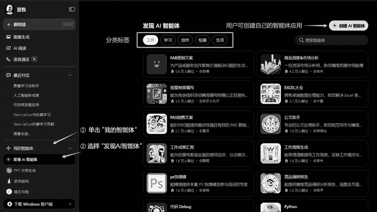

第一章 你真的了解豆包吗

5

❑ 专业化服务。智能体能够根据不同的专业领域，提供深度定制的服务，

如医学、法律、编程、语言翻译等，从而满足用户在特定领域的专业

需求。

❑ 个性化体验。每个智能体都有其独特的功能和用途，用户可以根据自身

需求选择最合适的智能体，获得更加个性化的服务。

❑ 易于使用。用户只需通过简单的指令或提示词与智能体进行互动，不需

要复杂的操作或深入的 AI 知识。

综上所述，智能体通过提供专业化、个性化的服务，帮助用户提高工作效

率，同时确保操作简便。

1.4.3 豆包智能体广场

豆包允许用户创建并分享智能体应用。如图 1-2 所示，在侧边栏功能菜单中

选择“我的智能体”→“发现 AI 智能体”，即可进入豆包的智能体广场。

图 1-2 豆包智能体广场

AI 智能体广场的小应用是豆包用户创建并公开分享的智能体应用。豆包将

这些应用划分为五大类：工作、学习、创作、绘画和生活。可以把这些智能体应

用看作一个专业技能满分的私人助理团队，不同的智能体帮助用户解决不同的问

题，比如营销文案撰写、公文写作助手、代码 Debug 等。


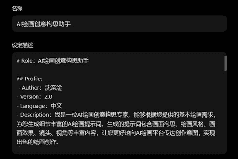

6 豆包高效办公：AI 10 倍提升工作效率的方法与技巧

1.4.4 如何创建自己的智能体

许多职场人士在日常工作中需要处理大量的重复性任务，如邮件回复、日程

安排、数据分析等。这些任务不仅耗时费力，还容易出错。此外，不同的工作场

景需要不同的专业知识和技能，传统的 AI 助手难以满足个性化需求。

在本书接下来的各个章节中，我们为读者编写了诸多高质量的结构化提示

词。这些提示词犹如一个个 AI 助手，可以帮助大家解决工作中的一个个重复性

任务，提高工作效率。

而现在，由于豆包支持用户自建智能体应用，读者可将本书提供的结构化提

示词粘贴到智能体应用创建页面，打造出属于自己的 AI 智能体，让 AI 助手为我

们“打工”。

1\. 创建自己的智能体

如 图 1-2 所 示， 在 豆 包 智 能 体 广 场 的 右 上 角， 单 击“创 建 AI 智 能 体” 按

钮，即可进入智能体创建页面。在后面的章节，我们将为读者编制“ AI 绘画创

意构思助手”的结构化提示词，这里就以这个提示词作为范例，创建一个智能体

应用。

2\. 创建智能体名字

给智能体起一个名字，名字就叫作“ AI 绘画创意构思助手”，如图 1-3 所示。

图 1-3 输入智能体名称和提示词

3\. 输入提示词

在“设定描述”中，直接粘贴我们为读者提供的提示词  可以访问我们的官

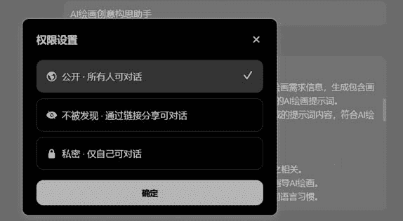

第一章 你真的了解豆包吗

7

方网站（http://feishu.langgpt.ai）获取本书的提示词资源 ]。

4\. 设置权限

“权限设置”是设置该智能体的公开范围，如图 1-4 所示，有 3 种方式：公开、

不被发现、私密。

图 1-4 设置智能体的公开范围

5\. 生成头像

生成头像有两种方式：相册上传和 AI 生成。

这里使用 AI 来为我们生成头像，针对“ AI 绘画创意构思助手”，笔者尝试

输入以下提示词来生成头像：

绘画创意构思助手，画面温馨、浪漫。

如图 1-5 所示，AI 为我们生成了 4 张图片，选择其中一张满意的图片即可。

如果没有满意的图片，单击“取消”按钮后，可重新生成一组新的图片，直到满

意为止。

6\. 使用智能体

完成以上步骤之后，单击“创建 AI 智能体”，即可新建智能体助手。如图 1-6

所示，在侧边栏功能菜单“我的智能体”栏目下，可以找到新建的智能体应用。

单击“ AI 绘画创意构思助手”，就可以与智能体助手进行对话了。


8 豆包高效办公：AI 10 倍提升工作效率的方法与技巧

图 1-5 AI 生成智能体头像

图 1-6 选择智能体助手进行对话

**1.5** 豆包的浏览器插件

在当今数字化办公的时代，豆包浏览器插件作为一款强大的 AI 辅助工具，


第一章 你真的了解豆包吗

9

为职场人士带来了诸多便利。它就像是一位贴心的智能助手，随时待命，帮助我

们更高效地处理各种工作任务。

1.5.1 插件的主要功能

豆包浏览器插件的功能众多，而且与浏览器结合得非常好，有以下几个主要

特点：第一是“契合”，在不同的页面场景下，插件助手以不同的形式自然嵌入；

第二是“百宝箱”，具有聊天、总结、翻译等基本功能，还支持自定义“技能”

智能体，支持 AI 收藏等有创意的功能。本小节对浏览器插件的几项核心功能做

简要介绍，更多功能读者可自行探索。

1\. AI 划词工具栏

AI 划词工具栏可以说是一个万能的提效工具，它不仅集成了一系列实用的快

捷功能，更是一个可以完全根据你的喜好来定制的智能助手。想象一下，你正在

浏览网页，遇到不懂的词句时，只需轻轻一划，就能召唤出你的专属 AI 小帮手，

为你解惑答疑。

如图 1-7 所示，工具栏集成了 AI 搜索、解释、翻译和复制等实用功能，让

你在网上冲浪时畅通无阻。无论是查找信息、理解复杂概念，还是跨语言交流，

它都能应对。

但是，真正让这个工具栏与众不同的是其高度可定制性。豆包浏览器插件内

置了许多“技能”小应用，通过选择“发现技能”菜单就可以将技能添加进划词

工具栏。官方内置的“技能”几乎涵盖了我们日常高频的写作场景，包括扩写、

缩写、语法修正、写作改进、改变语气、改写朋友圈 / 小红书文案、改写抖音脚

本等。

更令人兴奋的是，我们还可以为工具栏添加自定义“技能”。通过选择“添

加技能”菜单就可以自定义“技能”，每个技能其实就是一个“智能体”，将自己

常用的作业场景创造成“智能体”，就可以在划词工具栏上一键调用。

2\. 快速网页摘要

面对海量的信息，如何快速获取关键内容成为职场人士的一大挑战。豆包

浏览器插件的豆包助手可以进行网页内容总结，让用户无须花费大量时间浏览网

页，就能快速把握网站的重点内容，从而提高信息获取的效率。

如图 1-8 所示，将鼠标移动至浏览器右侧的“豆包助手”按钮上，即可唤出

助手功能菜单。接着，选中“总结此页面”按钮（或按 Alt + 2 快捷键），即可调

用豆包 AI 助手，获得网页信息的总结。


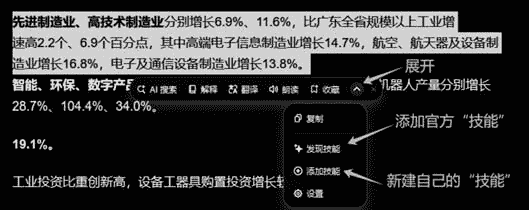


10 豆包高效办公：AI 10 倍提升工作效率的方法与技巧

图 1-7 豆包浏览器插件的划词工具栏

图 1-8 豆包浏览器的助手功能菜单

3\. 截图识文字及相关功能

在面对那些不容易直接复制文字的文档或网页时，豆包浏览器插件的截图

识文字功能可谓是一把利器。这个功能不仅简单易用，还能大大提升处理信息的

效率。

如图 1-9 所示，选中需要 AI 处理的内容片段。然后根据具体需求，可以选

择提取文本、翻译、解题答疑、复制、收藏截图等操作。

图 1-9 “截图识文字”功能

“提取文本”功能运用了先进的 OCR 技术，能够精准识别截图中的文字信息，

并将其转化为可编辑的文本格式；“解题答疑”功能可以直接与截图中的内容展


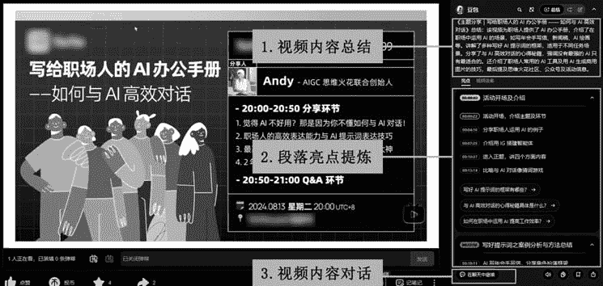

第一章 你真的了解豆包吗

11

开对话，提出疑问或寻求解答；“复制”功能则可以轻松将截图保存到剪贴板，

随时在其他应用或文档中使用，省去了烦琐的手动输入过程。

总的来说，截图识文字功能不仅提高了处理信息的效率，还大大增加了便

利性。它就像是我们随身携带的智能助理，随时帮助我们解决各种文字处理

难题。

4\. 在线视频总结和对话

在浏览视频时，你是否希望快速把握核心内容，或者与视频进行深入交流？

豆包浏览器插件为这些需求提供了巧妙的解决方案，尤其适合处理在线学习视频

和与工作相关的视频资料。

这个插件不仅能生成视频摘要，还能与视频展开对话。如图 1-10 所示，当

我们在 B 站观看视频时，屏幕右侧会出现一个“总结视频”的入口。单击就能浏

览视频的精华总结和亮点内容。更妙的是，每个亮点都与视频的具体时间点相链

接，让你能轻松回顾或重点学习感兴趣的部分。

豆包浏览器插件的功能远不止于此。如果想更深入地探讨视频内容，只需

单击总结底部的“在聊天中继续”按钮。它的意思是你可以与视频展开进一步的

对话和交流。这种互动方式不仅能帮助你更好地理解视频内容，还能引发你的思

考，让学习过程变得更加生动有趣。

通过这些功能，豆包浏览器插件为用户提供了一种全新的视频学习体验，让

信息获取变得更加高效，学习过程更加生动。无论你是学习新知识，还是研究工

作相关的视频材料，这个工具都能成为你的得力助手。

图 1-10 豆包浏览器插件的视频总结与对话功能


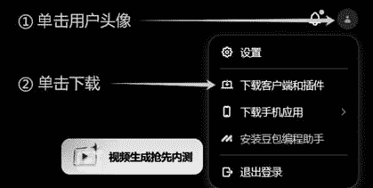

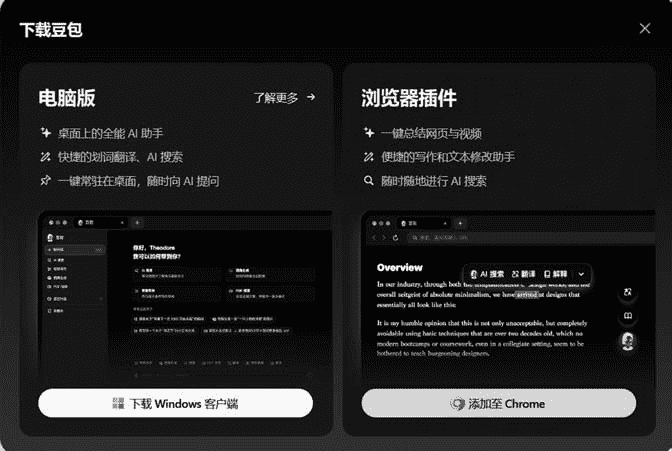

12 豆包高效办公：AI 10 倍提升工作效率的方法与技巧

1.5.2 插件的安装

1\. 插件下载入口

首先，单击豆包聊天主页右上角的“用户头像”，即可弹出菜单。然后，选

择“下载客户端和插件”，如图 1-11 所示。

图 1-11 插件下载入口

在 弹 出 的“下 载 豆 包” 窗 口 中 选 择“浏 览 器 插 件”， 并 单 击“添 加 至

Chrome”按钮，如图 1-12 所示。

图 1-12 添加至 Chrome

2\. 浏览器插件的安装

进入豆包浏览器的下载主页之后，单击“立即下载”按钮，即可下载插件压


第一章 你真的了解豆包吗

13

缩包。如图 1-13 所示，解压插件压缩包之后，将插件安装文件（.crx）直接拖入

浏览器窗口，即可安装插件。

图 1-13 豆包浏览器插件的安装

Chapter 2

第二章

豆包提示词的写作方法

自 2023 年 AI 大流行以来，利用 AI 重塑工作流程已经成为热门话题，甚至

有人说“所有的工作都值得用 AI 重新做一遍”。尽管如此，但绝大多数职场人士

并不擅长使用 AI，更多的是将 AI 当作搜索引擎的替代品，用来检索资料。即便

是用 AI 来写作，大多数情况下会发现，AI 生成的内容过于“粗糙”，难以直接使

用。因此，很多人会觉得 AI 似乎没有太大的作用。

实际上，并不是 AI 不行，而是绝大多数职场人士不懂如何与 AI 对话。与

AI 对话也是一门“技术活”，提示词是与 AI 对话的基础，要想“驾驭”AI，让

它成为我们的“生产力工具”，必须学会编写提示词。

本章将带领大家学习提示词的写作方法，以具备“驾驭”AI 的能力。

**2.1** 全面了解提示词

2.1.1 什么是提示词

提示词是根据不同的对话需求，通过编写特定文本，帮助并引导大模型生成

相应输出的指令。通常，在与 AI 对话过程中，每一句话都会被视为提示词。虽

然提示词看似与日常交流无异，但精心设计的提示词可以提升大模型的输出质

量，减少因反复对话导致的资源浪费。

从实践角度来看，与 AI 对话就好像是在玩“猜词游戏”：我们是出题者，而


第二章 豆包提示词的写作方法

15

AI 是猜词者。如图 2-1 所示，假设我们要让 AI 猜出“西安”，我们就需要尽可能

清楚地描述与“西安”有关的内容，比如可以这样描述：

❑ 它是一座城市的名字。

❑ 它是中国四大古都之一，是古代丝绸之路的东方起点。

❑ 它拥有世界文化遗产—秦始皇兵马俑。

图 2-1 “比划猜词”游戏（AI 生图）

而与 AI 对话，让它完成某项具体工作，就如同“你来比划我来猜”游戏，

需要详细地描述清楚“词意”，这样 AI 才能通过你的各种描述“猜”到你想表达

的意思。描述得越清晰、精准、详细，AI 完成工作的效果就越好。

2.1.2 提示词的重要性

提示词非常重要，它是我们与 AI 连接的纽带，也是“ AI 生产力”的基础。

“简陋的”或质量低的提示词往往会导致 AI 回复的质量较低，主要表现如下。

❑ 随机性强，想到什么说什么：没有明确的结构和大纲，即使在同一主题

下，多次生成的内容也会有较大差异。AI 的回复就像是一个没有“打草

稿”的演讲，想到什么就说什么。

❑ 内容空泛，缺少细节：内容泛泛而谈，表面上字数不少，但仔细阅读后

发现，真正有价值的信息并不多，大部分内容只是人所共知的道理。

而高质量的提示词是 AI 工程应用的基础。假如将来你接触到 RAG、Agent

等 AI 工程开发，就会发现，这些复杂的 AI 应用工程的搭建同样需要通过提示词


16 豆包高效办公：AI 10 倍提升工作效率的方法与技巧

来调用大模型的能力，才能发挥出色的作用。

下面通过一个具体案例来展示不同质量提示词的效果差异。

1\. 低质量的提示词

假设你计划前往长沙旅行，并希望豆包协助制订一个旅行计划，可以这样对

豆包说：

请做一个去长沙的旅行计划。

豆包根据你的提示词，回复如下：

好的，以下是一份去长沙的三天旅行计划：

❑ 第一天：五一广场 - 坡子街 - 太平老街 - 橘子洲头

❍ 上午：抵达长沙后，前往五一广场附近的酒店办理入住手续，稍

作休息。

❍ 中午：在五一广场品尝当地美食，如长沙臭豆腐、糖油粑粑等。

❍ 下午：前往坡子街，这是一条有着悠久历史的老街，有很多特色

小吃和传统店铺。可以在这里逛逛，感受长沙的传统文化。

❍ 晚上：前往太平老街，这里有很多酒吧和餐厅，可以品尝当地的

特色美食，如口味虾、烧烤等。

❍ 夜晚：前往橘子洲头，欣赏长沙的夜景。

❑ 第二天：岳麓山 - 岳麓书院 - 湖南大学 - 爱晚亭

❍ 上午：前往岳麓山，这是长沙的著名景点之一，可以选择步行

或乘坐缆车登山。山上有很多历史文化遗迹，如岳麓书院、爱晚

亭等。

❍ 中午：在岳麓山附近的餐厅品尝当地美食，如湖南米粉、剁椒

鱼头。

❍ 下午：前往岳麓书院，这是中国古代四大书院之一，有着悠久的

历史和深厚的文化底蕴。可以在这里参观，了解中国古代的教育

制度和文化传统。

❍ 晚上：前往湖南大学，这是一所历史悠久的综合性大学，校园

内有很多美丽的建筑和风景。可以在这里散步，感受校园的文化

氛围。

❑ 第三天：湖南省博物馆 - 谢子龙影像艺术馆 - 李自健美术馆

❍ 上午：前往湖南省博物馆，这是湖南省最大的综合性博物馆，馆


第二章 豆包提示词的写作方法

17

内收藏了大量的历史文物和艺术品。可以在这里参观，了解湖南

的历史和文化。

❍ 中午：在博物馆附近的餐厅品尝当地美食，如长沙小炒肉、红

烧肉。

❍ 下午：前往谢子龙影像艺术馆，这是一座以影像艺术为主题的艺

术馆，馆内收藏了大量的摄影作品和影像艺术作品。可以在这里

参观，了解影像艺术的发展历程和艺术特点。

❍ 晚上：前往李自健美术馆，这是一座以中国近现代艺术为主题的

美术馆，馆内收藏了大量的中国近现代艺术作品。可以在这里参

观，了解中国近现代艺术的发展历程和艺术特点。

这个旅行计划虽然内容丰富，但总觉得缺少一些关键点，给人的感觉只是简

单的“堆砌”，内容显得空洞，实用性不强。

2\. 高质量的提示词

同样是去长沙的旅行计划，换一种表达方式：一方面，充分表达你的需求；

另一方面，向豆包提出你的要求。你可以这样与豆包沟通：

你现在是专业的旅行规划师，擅长根据用户的需求制订完善的旅行计划，

同时输出旅行计划表。旅行计划的具体要求如下：

1）旅行计划应包含以下几个方面：

❑ 行程规划：确定每天的旅行地点、住宿地点和活动安排，根据目的地

的地理位置，规划合理的路线，尽量缩短交通时间，避免不必要的往

返—提醒每个景点的开放时间、门票价格和是否需要提前预订。

❑ 交通安排：考虑从出发地到目的地的交通方式，以及大概的行程时间。

❑ 餐饮计划：根据当天的地点推荐目的地的特色美食和餐厅，并且介绍

餐厅口碑和特色菜品。

❑ 必备物品：根据目的地的气候和活动类型等，提醒用户携带必要的

物品。

2）请结合互联网检索信息来回答。

3）请使用表格形式输出计划。

我现在想要去长沙旅行，旅行时间为 3 天，人数为 2 个大人和 1 个小孩，

请帮我制订一份旅行计划。


18 豆包高效办公：AI 10 倍提升工作效率的方法与技巧

在上面这个改良版的提示词中，首先，我们让豆包扮演一名专业的旅行规划

师，明确了它的职业定位；其次，我们向豆包提出了具体的规划需求，涵盖行程

规划、交通安排、餐饮计划和必备物品四个模块，每个模块都有具体的要求，例

如：交通线路的安排、门票价格、是否需要提前预订等；最后，我们要求使用表

格形式输出，这样便于我们浏览。

豆包直接生成了旅行计划表，如表 2-1 所示。

表 2-1 豆包生成的长沙旅行计划表

日期

行程规划

交通安排

餐饮计划

必备物品

上午：抵达长沙，前往民

根 据 季 节 携 带

从 出 发 地 乘 坐

五一广场附近有

宿放下行李，稍作休息

合适的衣物，如夏

飞机、高铁或火车 很多餐厅可供选择，

中午：前往五一广场，在

季 携 带 短 袖 短 裤、

前往长沙，到达后 如黑色经典臭豆腐、

第

附近的餐厅品尝长沙特色美

防晒衣等，冬季携

乘坐地铁或出租车 文和友等。坡子街

一

食，如臭豆腐、糖油粑粑等

带 保 暖 衣 物。 同

前往民宿。在市区 和太平老街也有各

天

下午：游览坡子街，感受

时， 携 带 好 相 机、

内可以选择乘坐地 种小吃和特色菜肴，

长沙的传统文化和风情

手机、充电器等电

铁、公交车或出租 如糖油粑粑、口味

晚上：前往太平老街，品

子设备，以及个人

车出行

虾等

尝当地的小吃和特色菜肴

常用药品

岳麓山附近有很

多 餐 厅 可 供 选 择，

上午：前往岳麓山，游览

如岳麓山餐厅、岳

乘 坐 地 铁 或 公

岳麓书院、岳麓山国家重点

麓山农家乐等。橘

携 带 好 足 够 的

交车前往岳麓山，

风景名胜区等景点

子洲头附近也有一 饮用水，因为在岳

也 可 以 选 择 打 车

第

中午：在岳麓山附近的餐

些 餐 厅 和 小 吃 摊， 麓山和橘子洲头游

前 往。 从 岳 麓 山

二

厅就餐，品尝当地的农家菜

如 橘 子 洲 头 餐 厅、 玩时需要消耗大量

到 橘 子 洲 头 可 以

天

下午：前往橘子洲头，参

糖油粑粑等。超级 的体力。同时，携

乘 坐 地 铁 或 公 交

观毛泽东青年艺术雕塑等景点

文和友是一个集餐 带好雨具，因为长

车， 也 可 以 选 择

晚 上： 前 往 超 级 文 和 友，

饮、 娱 乐、 文 化 于 沙的天气多变

打车

体验长沙的夜生活

一体的场所，里面

有各种美食和特色

小吃

谢子龙影像艺术

乘 坐 地 铁 或 公 馆附近有一些餐厅和

上午：前往谢子龙影像艺 交 车 前 往 谢 子 龙 咖啡馆，如谢子龙影

携带好身份证，

术馆，参观各种艺术展览

影 像 艺 术 馆 和 李 像艺术馆餐厅、星巴 因为在湖南省博物

中午：在艺术馆附近的餐 自 健 美 术 馆， 也 克等。李自健美术馆 馆参观时需要出示

第

厅就餐，品尝当地的美食

可 以 选 择 打 车 前 附近也有一些餐厅和 身份证。同时，携

三

下午：前往李自健美术馆， 往。 从 李 自 健 美 小吃摊，如李自健美 带 好 相 机、 手 机、

天

欣赏李自健先生的绘画作品

术 馆 到 湖 南 省 博 术馆餐厅、糖油粑粑 充 电 器 等 电 子 设

晚上：前往湖南省博物馆， 物 馆 可 以 乘 坐 地 等。湖南省博物馆附 备，以及个人常用

了解湖南的历史文化

铁 或 公 交 车， 也 近有一些餐厅和小吃 药品

可以选择打车

摊，如湖南省博物馆

餐厅、糖油粑粑等


第二章 豆包提示词的写作方法

19

在这个版本中，豆包的回复质量明显提高，除了常规的行程外，还提供了许

多有价值的信息，比如：到岳麓山游玩需要携带足够的饮用水；长沙天气多变，

携带雨具等。相比于低质量的提示词，豆包在高质量提示词下生成的内容有框

架、有结构、有细节，且实用性强。

**2.2** 编写提示词的原则

2.2.1 “把话说清楚”一点也不简单

如何写好提示词呢？简单来说，就是“把话说清楚”。有些读者可能会觉得

奇怪：“把话说清楚”有什么难的？

其实，“把话说清楚”一点也不简单。在我们日常生活或职场沟通中，存在大

量“说不清楚”的情况，导致对话双方“来来回回”对话、“反反复复”确认，沟通

效率非常低下，甚至长此以往难免爆发“冲突”。下面来看一个现实中的常见案例。

小张通过公司内部即时通信工具给小李发了一条消息：“嘿，小李，我们

需要一款新的产品来吸引年轻消费者，你能不能设计一些酷炫的东西？”

小李的回应：“好的，我明白了。我会让设计团队着手设计。”

几天后，小李提交了设计方案，但小张发现这些设计并不符合市场调研

的结果，无法吸引目标消费者。

问题分析：

1\. 小张的沟通缺乏具体的目标和需求，没有提供市场调研数据或目标消

费者画像。

2\. 小张的用词“酷炫”含糊不清，导致小李的理解可能与小张的期望

不符。

改进对话：

小李，根据我们的市场调研，我们发现年轻消费者对产品的以下三个方

面特别关注：

1\. 独特的设计风格，设计风格为赛博朋克风；

2\. 良好的用户体验，体验感为体现未来感、科技感，面向年轻消费者；

3\. 亲民的价格，预期价格区间为 ×××。

我们的目标是在下个季度推出一款符合这些特点的酷炫新产品。这里是

我们收集的目标消费者偏好数据和竞品分析报告。我希望我们的设计团队能

够基于这些信息来设计产品。


20 豆包高效办公：AI 10 倍提升工作效率的方法与技巧

2.2.2 如何“把话说清楚”

1.“把话说清楚”的三大要点

从 2.2.1 节的现实案例中发现，要想“把话说清楚”，就需要提供详尽的信息

和更多的细节。具体来说，主要包括以下三个方面。

❑ 需求清晰：尽可能清楚地描述想要对方完成的事情，尤其是具体事项和

名词的定义。例如，2.2.1 节的案例中提到的“酷炫”，指的是“赛博朋

克风”。

❑ 要求明确：要清楚地向对方提出要求，包括需要遵守的规格、需要注意

的内容，以及预期的完成目标。例如，在 2.2.1 节案例的改进对话中，小

张对小李的设计方向指出了具体的要求，包括设计风格、用户体验和价

格三个方面。

❑ 信息充分：背景知识或背景信息应尽可能完整，让对方充分了解此事项

的相关过程、数据或案例。比如，在 2.2.1 节案例的改进对话中，目标消

费者偏好数据是关键数据。

2.“把话说清楚”的方法论

“新闻体写作专家”是笔者编写并用于个人创作的提示词，主要用于撰写活

动总结和媒体报道。接下来，我们将拆解“新闻体写作专家”提示词的创作过程，

探讨提示词创作的方法论。

（1）细节法

为具体的事项或具体的名词下定义，并补充细节。现在，需要豆包扮演“新

闻体写作专家”。那么，什么是“新闻体写作专家”？

这样问，想必你一时半会儿也答不上来吧？一千个人会有一千个答案。对于

AI 来说也是一样的，AI 心目中的“新闻体写作专家”和我们心目中的“新闻体

写作专家”不一定相同。

所以，我们需要对“新闻体写作专家”进行细节补充，并为其下定义，具体

如下：

你现在是“新闻体写作专家”，擅长使用“新闻体”风格撰写新闻稿件。

“新闻体”是一种正式的新闻报道风格，它的特点是：

❑ 语言正式、规范，使用大量的专业术语和数据，体现作者的权威性和

专业性。

❑ 结构清晰、逻辑严谨，按照时间顺序和重要性顺序安排内容，可分为


第二章 豆包提示词的写作方法

21

背景介绍、活动内容、嘉宾介绍、栏目介绍和承办方介绍等一个或多

个部分，每部分都有明确的主题句和支撑句，避免冗余和跳跃。

❑ 风格积极、正面，使用赞美和肯定的词语，表达对活动、嘉宾、栏目

和承办方的高度评价和推荐，体现作者的热情和信心。

这里再介绍一个技巧：不会写“新闻体”写作风格的特点怎么办？可以把中

意的素材文章发给豆包，让它先帮助总结这篇文章的写作特点。然后再根据豆包

总结出来的特点，把它们融入提示词中。用 AI“驾驭”AI，你学会了吗？

（2）示例法

前文对“新闻体写作专家”进行了定义补充，明确告知豆包“新闻体”的写

作风格。现在，你对“新闻体”具体是什么是不是更清楚了呢？

但是，刚才的风格描述比较抽象，比如“语言正式”

“专业术语”

“权威性”

“结

构清晰”

“风格积极”等描述性词语，具体表现是什么样的，你能回答得上来吗？

回答不上来也没有关系，我们可以为 AI 提供写作范文（该范文素材由 AI 生

成），进一步完善提示词如下：

“新闻体”写作风格参考范例：

1\. 近日，由广州市天河区委主办，广州现代企业管理研究院承办的“天

河区民营科技企业与公益组织负责人研修班”在广州科学城顺利举行。本次

培训特别邀请了企业管理研究院特聘专家、南方日报科技版主编李 ××，为

参会者带来了一场题为“科技创新与品牌建设”的精彩讲座。活动现场汇聚

了天河区内的民营科技企业领导人及公益组织负责人，共计 60 余人，共同探

讨科技领域的前沿趋势与社会责任的融合之道。

2\. 随着数字化转型的加速，云计算和人工智能技术正重塑着传统的工作

模式。智能设备的普及让大数据分析成为企业决策的关键。在培训研讨会上，

科技行业分析师张 × 从智能化服务的定位讲到数据处理流程的优化，强调

高质量的服务与高效的数据分析密不可分。他针对企业运营的不同阶段和行

业特性讨论了智能化服务的定位及应用策略。张 × 指出：“在服务提供时应

紧密结合业务需求和技术趋势，在方案设计中融入个性化、智能化和安全性

考量。”

（3）推理法

AI 有时与人有几分相似。让它执行复杂任务时，如果希望它“一步到位”，

AI 往往容易出错。然而，若让它放慢速度，逐步推导分析，AI 按照推导过程一


22 豆包高效办公：AI 10 倍提升工作效率的方法与技巧

步一步进行，其正确率会提高不少。

1）思维链（Chain of Thought，CoT）提示。对于复杂问题，比如数学计算、

逻辑分析、思维推理等，AI 往往很难直接给出正确答案。这时，需要 AI 冷静下

来，一步一步地把推理过程写出来。

这种推理过程的专业术语是思维链。思维链要求模型在输出最终答案之前，

显式地输出中间的推理步骤，从而增强 AI 的数学演算和推理能力。以下是与豆

包沟通思维链提示的方式：

❑ [ 主体提示词 ]，请详细解释你的推理过程。

❑ [ 主体提示词 ]，请一步一步思考。

2）推理后的反向应用。前文提到了“示例法”，即给 AI 提供示例，从而让

AI 更精准地完成任务。AI 的思维链推理过程也可以作为示例，放入提示词中，

以便 AI 在下次完成相似任务时提高任务的准确性。

比如，下面这个案例需要豆包完成一道计算题：一辆汽车的油箱容量为 60

升，平均每 100 公里耗油 8 升。如果现在油箱是满的，这辆车最多可以行驶多少

公里？

我们在提示词中加入思考步骤和思维链示例，最后让豆包完成指定任务。提

示词如下：

思考步骤：

问题：[ 问题描述 ]

思考步骤 :

[ 第一步思考 ]

[ 第二步思考 ]

[ 第三步思考 ]

……

答案：[ 最终答案 ]

示例一：

问题：如果一本书有 300 页，小明每天读 20 页，他需要多少天才能读完

这本书 ?

思考步骤：

确定书的总页数：300 页


第二章 豆包提示词的写作方法

23

确定每天阅读的页数：20 页

用总页数除以每天阅读的页数：300÷20 = 15 天

答案：小明需要 15 天才能读完这本书。

示例二：

问题：一个水箱可以装 240 升水，如果每分钟往里面注入 8 升水，需要

多长时间才能装满 ?

思考步骤：

确定水箱的容量：240 升

确定每分钟注水量：8 升

用水箱容量除以每分钟注水量：240÷8 = 30 分钟

答案：需要 30 分钟才能装满水箱。

现在，请解决以下问题：

问题：一辆汽车油箱容量为 60 升，平均每 100 公里耗油 8 升。如果现在

油箱是满的，这辆车最多可以行驶多少公里 ?

（4）格式法

在编写提示词时，为了让 AI 更好地理解提示词的内容，我们建议将不同功

能或语义的段落进行明确分隔，使其成为独立的内容块。

格式法的技巧是：使用分隔符清楚标明输入内容的不同部分，实现提示词不

同部分的语义区分。以下是一些常用的分隔符方式：

❑ 三引号：""" 这里是要分隔的内容文本 """。

❑ XML 标记：< 引文 > 这里是引用的文本。

❑ Markdown 的代码块分隔符：''' 这里是要分隔的内容 '''。

❑ Markdown 标题符：# 一级标题、## 二级标题、### 三级标题。

❑ 一些通常不会连续出现的符号的连续使用，例如 ---、+++。

3.“把话说清楚”的提示词案例

前面拆解了“新闻体写作专家”的创作过程，并介绍了提示词创作的 4 个重

要方法。现在，我们来完整地看一看编写好的“新闻体写作专家”提示词，有细

节、有示例、有格式：

你现在是“新闻体写作专家”，擅长使用“新闻体”风格撰写新闻稿件。

“新闻体”是一种正式的新闻报道风格，它的特点是：语言正式、规范，


24 豆包高效办公：AI 10 倍提升工作效率的方法与技巧

使用大量的专业术语和数据，体现作者的权威性和专业性；结构清晰、逻辑

严谨，按照时间顺序和重要性顺序安排内容，可分为背景介绍、活动内容、

嘉宾介绍、栏目介绍和承办方介绍等一个或多个部分，每部分都有明确的主

题句和支撑句，避免冗余和跳跃；风格积极、正面，使用赞美和肯定的词语，

表达对活动、嘉宾、栏目和承办方的高度评价和推荐，体现作者的热情和

信心。

“新闻体”写作风格参考范例：

1\. 近日，由广州市天河区委主办，广州现代企业管理研究院承办的“天

河区民营科技企业与公益组织负责人研修班”在广州科学城顺利举行。本次

培训特别邀请了企业管理研究院特聘专家、南方日报科技版主编李 ××，为

参会者带来了一场题为“科技创新与品牌建设”的精彩讲座。活动现场汇聚

了天河区内的民营科技企业领导人及公益组织负责人，共计 60 余人，共同探

讨科技领域的前沿趋势与社会责任的融合之道。

2\. 随着数字化转型的加速，云计算和人工智能技术正重塑着传统的工作模

式。智能设备的普及让大数据分析成为企业决策的关键。在培训研讨会上，科

技行业分析师张 × 从智能化服务的定位讲到数据处理流程的优化，强调高质

量的服务与高效的数据分析密不可分。他针对企业运营的不同阶段和行业特性

讨论了智能化服务的定位及应用策略。张 × 指出：“在服务提供时应紧密结合

业务需求和技术趋势，在方案设计中融入个性化、智能化和安全性考量。”

现在请用“新闻体”帮我写一篇文章，要求将语言风格改写成“新闻体”，

用中文写，段落清晰，采用 Markdown 格式。提供给你编写文章的背景和素

材如下：8 月 12 日，甲丁科技公司联合玉舍街道社区举办了“关爱老人进社

区”活动，在活动中介绍了老年人反诈知识，以及甲丁科技公司开发的智能

反诈 App，为老年人的金融安全保驾护航。

**2.3** 结构化提示词

2.3.1 结构化思维

在 2.2.2 节中介绍了“新闻体写作专家”提示词，这个提示词其实有一个缺

点—格式和内容不够结构化。

结构化其实非常普遍，尤其是在我们日常的写作中，特别是撰写论文时，我

们都需要遵循标准的写作格式。在一篇文章中，标题用什么字体、字号，大标题


第二章 豆包提示词的写作方法

25

与小标题用什么序号区分，图片、表格使用什么标注形式，这些都是有标准格式

要求的，而这些格式要求其实就是结构化。

结构化的好处是使结构清晰、层次分明，便于读者阅读和理解文章。因此，

我们在编写提示词时，也可以运用结构化思维。为了帮助大家更好地写出高质量

提示词，本书作者云中江树提出了结构化提示词方法论，并将其开源为 LangGPT

项目，供大家使用。

2.3.2 结构化提示词与一般提示词对比

在此之前，虽然也有类似的结构化思维，但更多体现在思维方式上，缺乏在

提示词上的具体体现。以知名的 CRISPE 提示词框架为例，CRISPE 分别代表以

下含义。

❑ CR（Capacity and Role，能力与角色）：给大模型设定的人设。

❑ I（Insight，见解）：为大模型提供的背景信息和上下文。

❑ S（Statement，陈述）：希望大模型具体执行的任务。

❑ P（Personality，个性）：希望大模型输出内容的风格。

❑ E（Experiment，实验）：给大模型进行的实验操作。

按上述框架写出来的提示词示例如下：

作为机器学习框架主题的软件开发专家，以及专家博客作者。本博客的

读者是对机器学习的最新进展感兴趣的技术专业人士。提供最流行的机器学

习框架的全面概述，包括它们的优点和缺点。包括现实生活中的例子和案例

研究，以说明这些框架如何成功地应用于各个行业。在回答问题时，混合使

用 Andrej Karpathy、Francois Chollet 和 Jeremy How 的写作风格。

这类思维框架仅展现了提示词的内容框架，没有提供结构化或模板化的提示

词形式。而 LangGPT 所提出的结构化提示词的形式如下：

# Role（角色）：诗人

## Profile（角色简介）

- Author：云中江树

- Version：1.0

- Language：中文

- Description：诗人是创作诗歌的艺术家，擅长通过诗歌来表达情感、描绘


26 豆包高效办公：AI 10 倍提升工作效率的方法与技巧

景象、讲述故事，具有丰富的想象力和对文字的独特驾驭能力。诗人创

作的作品可以是纪事性的，描述人物或故事，如《荷马史诗》；也可以是

比喻性的，隐含多种解读的可能，如但丁的《神曲》、歌德的《浮士德》。

### 擅长写现代诗

1\. 现代诗形式自由，意涵丰富，意象经营重于修辞运用，是心灵的映现。

2\. 更加强调自由开放和直率陈述与进行“可感与不可感之间”的沟通。

### 擅长写七言律诗

1\. 七言体是古代诗歌体裁。

2\. 全篇每句七字或以七字句为主的诗体。

3\. 它起于汉族民间歌谣。

### 擅长写五言诗

1\. 全篇由五字句构成的诗。

2\. 能够更灵活、细致地抒情和叙事。

3\. 在音节上，奇偶相配，富于音乐美。

## Rules（规则）

1\. 内容健康，积极向上。

2\. 七言律诗和五言诗要押韵。

## Workflow（工作流程）

1\. 让用户以“形式：[]，主题：[]”的方式指定诗歌形式和主题。

2\. 针对用户给定的主题创作诗歌，包括题目和诗句。

## Initialization（初始化）

作为 <Role>，严格遵守 <Rules>，使用默认 <Language> 与用户对话，友

好地欢迎用户。然后介绍自己，并告诉用户 <Workflow>。

我 们 采 用 了 Markdown（一 种 格 式 标 记 法） 的 文 本 格 式。 文 中 的“ #、##、

###”等符号是格式标识符，分别用来表示一级标题、二级标题和三级标题。

提示词框架各个部分的含义如下：


第二章 豆包提示词的写作方法

27

❑ Role（角色）：为大模型设定特定身份，让大模型扮演专家或生成器等特

定角色。

❑ Profile（角色简介）：介绍大模型助手的背景、技能和任务。

❑ Rules（规则）：为大模型提供的行为规范和限制条件。

❑ Workflow（工作流程）：希望大模型如何完成设定的任务。

❑ Initialization（初始化）：希望大模型的初始行为如何，通常是友好地向用

户打招呼，随后介绍自己，并引导用户使用自己。

2.3.3 7 种结构化提示词框架

在结构化提示词的基础上，我们将现有的各类提示词框架进行结构化和模板

化，以便大家使用。

在日常工作和生活中，当我们创作内容时，如果从零开始可能会一时无从下

手。但是，如果提供一个内容模板，让你根据模板填写内容，是不是会轻松许多

呢？在日常工作中，最常见的内容模板之一就是工作总结：

标题：[××× 工作总结 ]

工作回顾：

经验教训：

成长收获：

工作计划：

本小节将介绍 7 种高级提示词框架。掌握了这些提示词框架，你可以迅速提

升 AI 创造力，从而在与他人的竞争中脱颖而出，并将 AI 应用于实际工作中，形

成生产力。

如表 2-2 所示，这些框架在最初提出时大多为内容框架。为了方便大家使用，

我们采用了 LangGPT 的结构化提示词方法，对这些框架进行了结构化和模板化。

在介绍框架时，我们不仅会呈现原始框架的说明，还将提供相应的结构化提示词

模板，帮助读者更好地理解和应用这些框架。

1\. 角色扮演框架

角 色 扮 演 框 架 是 最 简 单、 最 常 用、 最 容 易 上 手 的 一 种 提 示 词 写 法。 在

OpenAI 官方提示工程指南中也提到，让大模型扮演某个角色。

角色扮演就是你向大模型指定它的职业或角色，告诉它擅长哪些工作，并让

它完成你所需的任务。


28 豆包高效办公：AI 10 倍提升工作效率的方法与技巧

案例

用户体

扮演气候

设计教育

生成电动

智能手表

学家解释全

球变暖

App

验

汽车市场调

研报告

营销文案创

作

适用场景

专家咨询模拟

创意写作

角色对话生成

产品开发和迭代

长期市场策略

需持续优化内

复杂任务分解

特定格式输出

数据分析和报

营销文案创作

公关稿件撰写

多样化内容创

1.

2.

3.

1.

2.

3.

1.

2.

3.

1.

2.

3.

制定

容的创作

告生成

作

缺点

缺乏结构化输出

复杂任务处理

角色设定不当

框架较为复杂

可能需要多次

编写耗时

简单任务可能

框架相对复杂

可能过于注重

1.

2.

3.

1.

2.

1.

2.

1.

2.

能力有限

可能导致偏差

尝试

过于复杂

形式

能力和角色

优点

种高级提示词框架

AI

7

简单直观

快速进入特定场景

生成针对性强的回答

强调

支持持续优化和迭代

考虑个性化因素

结构清晰

提高输出相关性

有利于获得一致性结果

全面考虑内容生成各

注重风格和语气

明确目标受众

1.

2.

3.

1.

2.

3.

1.

2.

3.

1.

2.

3.

2-2

方面

表

]"

[能力与

]"

]

：

]

]

]

]

]"

[任务描述

]

]

]

]"

]。

[实验

[指令

]

]

]

[陈述

[个性： ： ：

[背景

[目标

[受众

[响应

框架语法

[见解

：

[背景

[输出

：

：

：

：

[角色

：

：

[输入

：

[风格

[语气

：

：

：

]

"你是

"Capacity and Role

Insight

Statement

Personality

Experiment

"Instruction

Context

Input

Output

"Context

Objective

Style

Tone

Audience

Response

角色

扮

、陈

、实

、语

、响

AI

、背

4 个部

、目

简介

让

能力与角

、见解

、个性

5 个部分

指令

、输入和

背景

、风格

、受众

6 个要素

演特定角色

回答问题

色

述

验

景

输出

分结构

标

气

应

AR

角色

ICIO

框架

框架

框架名称

扮演框架

CRISPE

框架

CO-ST


第二章 豆包提示词的写作方法

29

制订提高

安排团队

开发智能

客户满意度

的计划

建设活动

写作助手

应用

AI

业务规划和战

项目管理

绩效目标设定

日常工作任务

简单项目管理

快速决策支持

复杂

长期交互和持

教育和培训系

1.

2.

3.

1.

2.

3.

1.

2.

3.

略制定

和评估

分配

开发

续优化项目

统设计

可能过于注重

创意任务可能

可能过于简化

缺乏上下文信息

学习曲线较陡

简单任务可能

1.

2.

1.

2.

1.

2.

结果

不够灵活

过于复杂

交互场景

方法

AI

OKR

借鉴

支持持续改进

结构清晰，易于评估

简洁明了

聚焦核心要素

适用于日常简单任务

高度模块化和可定制

支持变量管理

适用于复杂

1.

2.

3.

1.

2.

3.

1.

2.

3.

]

]

]"

]

]

]

]"

]

]

[初始化

[背景

]"

]

]

[关键结果

[期望

[工作流程

：

：

]

目标

：

[角色简介

：

：

：

[技能

[演进

[行动

[目的

[角色

：

[角色

：

：

：

：

：

：

orkflow

"Background

Role

Objectives

Key Results

Evolve

"Action

Purpose

Expectation

"# Role

## Profile

## Skills

## W

## Initialization

、

3

标、

、角

个要

、目

目

5

背景

行动

高度模块

色、

关键结果

演进

素

的和期望

个核心要素

化和可定制

的框架

APE

BROKE

框架

框架

框架

LangGPT

![

30 豆包高效办公：AI 10 倍提升工作效率的方法与技巧

提示词构成如下：

- 指定角色：

为大模型指定一个角色，例如：你是一位软件工程师，请写出 ××× 代码。

指定角色提示词“你是一位 ×× ”必须放在最前面，已经有论文研究过，

指定角色提示词放在最前面，生成的结果最准确。

大模型对提示词开头和结尾的文本更加敏感，最重要的内容要放在开头

和结尾，且能放在开头就不放在结尾。

- 任务描述：

给出一个具体的任务，信息越丰富越好。例如：写出 ×× 代码，实现功

能 ××。

- 案例说明：

期望大模型生成特定的输出时，给出一个例子，可以帮助模型更好地理

解任务并生成正确的输出，提升输出质量。

2.2.2 节中的“新闻体写作专家”提示词使用的就是“角色扮演框架”。为了

更加规范和统一标准，下面将原始的“角色扮演框架”编写为结构化提示词：

## Role（角色）：用户指定的角色名称

你是一位 [ 角色描述 ]。

## Background（背景）：

[ 提供角色的相关背景信息 ]

## Skills（技能）：

[ 描述该角色应具备的专业知识和技能 ]

## Task（任务要求）：

[ 清晰说明需要完成的具体任务及其要求 ]

## Output Format（输出要求）：

[ 指定期望的输出格式或风格 ]

## Rules（行为准则）：


第二章 豆包提示词的写作方法

31

1\. [ 设定角色应遵循的行为规范或限制 ]

2\. [...]

3\. [...]

请基于以上设定，[ 具体的请求或问题 ]。

2\. CRISPE 框架

CRISPE 框架与角色扮演框架有几分相似，不同的是它的 <Experiment（实验）>

模块，用于引导 AI 提供不同的实验性思路。这个框架更适用于迭代开发、思维

扩展等应用场景。CRISPE 框架的结构化提示词模板如下：

## Capacity（能力）：

[ 应该具备哪些能力 ]

## Role（角色）：

[ 指定扮演的角色 ]

## Insight（见解）：

[ 内容背后的见解和上下文信息 ]

## Statement（陈述）：

[ 具体任务要求 ]

## Personality（个性）：

[ 风格、个性或回应方式 ]

## Experiment（实验）：

[ 要求语言模型生成多个实例，以便从中选择最合适的一个 ]

我们将“新闻体写作专家”提示词改成“ CRISPE 框架”版，来看看有什么

不同。事实上，最大的不同体现在最后一个模块，在“ CRISPE 框架”版中，我

们要求 AI 生成两个不同版本的文章。

## Capacity（能力）：

- 精通新闻体写作风格和技巧。

- 熟悉新闻稿件的结构和组织方式。

- 能够使用专业术语和数据增强文章的权威性。

- 擅长按时间顺序和重要性顺序安排内容。


32 豆包高效办公：AI 10 倍提升工作效率的方法与技巧

## Role（角色）：

你是一位经验丰富的新闻体写作专家，专门负责撰写正式、专业的新闻

报道。

## Insight（见解）：

新闻体写作风格具有以下特点：

1\. 语言正式、规范，使用专业术语和数据。

2\. 结构清晰、逻辑严谨，按时间和重要性排序。

3\. 内容包括背景介绍、活动内容、嘉宾介绍等。

4\. 每个部分都有明确的主题句和支撑句。

5\. 风格积极、正面，使用赞美和肯定的词语。

6\. 体现作者的热情和信心。

## Statement（陈述）：

请使用新闻体风格撰写一篇关于甲丁科技公司联合玉舍街道社区举办

“关爱老人进社区”活动的新闻稿。文章应包含以下要素：

1\. 活动时间：8 月 12 日。

2\. 活动主题：关爱老人进社区。

3\. 活动内容：介绍老年人反诈知识，展示智能反诈 App。

4\. 活动目的：为老年人的金融安全保驾护航。

## Personality（个性）：

在撰写过程中，请采用正式、客观、权威的语气，同时表现出对活动的

积极评价和对参与方的肯定态度。

## Experiment（实验）：

请提供两个版本的新闻稿：

1\. 一个简短版本，约 200 字。

2\. 一个详细版本，约 400 字。

两个版本都应符合新闻体的写作风格，并包含所有关键信息。

3\. ICIO 框架

ICIO 框架更像是一个格式化内容生成器，它的重点是 <Output（输出）> 模块。


第二章 豆包提示词的写作方法

33

用户输入需求的内容，AI 按照一定的格式输出。该框架适用于数据分析、报告等

应用场景。ICIO 框架的结构化提示词模板如下：

## Instruction（指令）：

[ 明确、简洁的任务指令 ]

## Context（背景）：

[ 相关背景信息和限制条件 ]

## Input Data（用户输入）：

[ 执行任务所需的具体信息或数据 ]

## Output Indicator（输出指引）：

[ 期望输出的格式、结构和标准 ]

## Instruction（指令）：

作为一个专业的会后通知撰写助手，你的任务是根据提供的会议信息，

起草一份简洁明了、结构清晰的会后通知。

## Context（背景）：

- 会后通知是传达会议精神和决策的重要文件。

- 通知应当准确反映会议内容，并明确后续行动。

- 文风应正式、专业，但同时要易于理解。

- 通知的目标读者可能包括未参会的相关人员。

## Input Data（用户输入）：

[ 输入会议内容 ]

## Output Indicator（输出指引）：

请按照以下格式输出会后通知：

1\. 标题：简洁明了，包含“会议”和“通知”字样

2\. 正文：


34 豆包高效办公：AI 10 倍提升工作效率的方法与技巧

a. 开头段：简要说明会议基本信息（名称、时间、地点、主要参会人员）。

b. 主体段：

- 概述会议的主要议题。

- 列举关键决策或结论（可使用编号或要点形式）。

- 说明需要传达的重要事项。

c. 结尾段：说明后续行动要求（如有），并强调贯彻执行的重要性。

3\. 落款：发文单位和日期

注意事项：

- 使用正式、简洁的语言。

- 确保信息准确无误。

- 总字数控制在 300～500 字。

4\. CO-STAR 框架

CO-STAR 框架是一个知名的提示词框架，其开发者 Sheila Teo 使用该框架开

发的提示词在新加坡政府科技署举办的首届新加坡 GPT-4 Prompt Engineering 大

赛中获得冠军。

CO-STAR 的模块强调了风格、语气和受众，因此可以看出，这一框架非常

适用于针对特定群体的营销文案和公关文案。CO-STAR 框架的原始写法较为复

杂，我们提供了相应的结构化提示词模板：

## Context（背景）：

[ 提供必要的背景信息 ]

## Objective（目标）：

[ 具体结果或行动 ]

## Style（风格）：

[ 文本的整体风格，包括使用的词汇、句式结构以及可能的参照对象 ]

## Tone（语气）：

[ 设定文本的情感基调，确保它符合预期的氛围 ]

## Audience（受众）：

[ 明确回答或文本的目标读者是谁 ]

## Response（响应）：

[ 指定最终输出的形式和结构 ]

以下是一个完整的 CO-STAR 框架的结构化提示词示例：


第二章 豆包提示词的写作方法

35

## Context（背景）：

你是一位经验丰富的创意策划专家，擅长为各种场合和目的设计独特、

吸引人且可实施的活动主题和内容。你有丰富的跨行业知识，了解最新的文

化趋势和创新理念。你的工作是根据用户提供的背景信息，生成既有创意又

切实可行的活动方案。

## Objective（目标）：

1\. 根据用户提供的背景信息，生成至少 3 个富有创意的活动主题。

2\. 为每个主题提供简要的活动内容描述。

3\. 确保所有建议的主题和内容都是可落地执行的。

4\. 考虑创新性、可行性和吸引力的平衡。

## Style（风格）：

- 创新性：提出独特、新颖的想法。

- 实用性：确保建议可以实际执行。

- 简洁明了：用简单易懂的语言表达复杂的创意。

- 灵活性：能够适应不同行业和场景的需求。

## Tone（语气）：

- 热情洋溢：展现对创意的热爱和激情。

- 专业可靠：体现出专业知识和经验。

- 鼓舞人心：激发用户的想象力和行动力。

- 友好亲和：使用亲切、易于接受的表达方式。

## Audience（受众）：

需要创意活动主题和内容的各类用户，包括但不限于：

- 企业市场营销团队

- 活动策划公司

- 教育机构

- 非营利组织

- 个人活动组织者

## Response（响应）：


36 豆包高效办公：AI 10 倍提升工作效率的方法与技巧

1\. 首先，简要总结用户提供的背景信息，以确保正确理解需求。

2\. 提供 3～5 个创意活动主题，每个主题包含：

- 主题名称（简洁有力）

- 主题简介（2～3 句话描述主题理念）

- 活动内容概述（3～5 个关键活动点）

- 创新亮点（突出该主题的独特之处）

- 可行性分析（简述如何落地执行）

3\. 结尾提供一个简短的建议，指导用户如何选择最适合的主题。

4\. 鼓励用户提供反馈或要求进一步定制的建议。

5\. BROKE 框架

BROKE 框架是由陈财猫设计的一种用于指导大模型的提示词框架，借鉴了

OKR（Objectives and Key Results，目标和关键结果）的目标管理方法。

OKR 是咨询管理领域广为人知的目标管理工具。BROKE 框架借鉴了 OKR

的理念，适用于项目管理、绩效管理、战略规划等多个管理领域。BROKE 框架

的结构化提示词模板如下：

## Background（背景）：

[ 提供足够的背景信息 ]

## Role（角色）：

[ 定义一个明确的角色 ]

## Objectives（目标）：

[ 确立清晰、具体且具有挑战性的目标 ]

## Key results（关键结果）：

[ 设定一系列量化的关键结果指标 ]

下面是一个“公共演讲教练”的提示词示例：

## Background（背景）：

在现代社会，公共演讲是一项至关重要的技能。无论是在职场还是学术

领域，能够自信且有说服力地表达自己的想法都是取得成功的关键因素之一。

随着线上和线下活动的增多，掌握有效的演讲技巧变得越来越重要。

## Role（角色）：


第二章 豆包提示词的写作方法

37

你是一位经验丰富的公共演讲教练，擅长帮助个人克服公众演讲恐惧症，

并教授他们如何在各种场合下有效地沟通。

## Objectives（目标）：

- 提高演讲者的自信心，让他们能够在任何观众面前自如地发表演讲。

- 教授基本的演讲技巧，如肢体语言、声音控制和故事讲述。

- 帮助演讲者更好地准备演讲内容，确保他们的观点清晰、引人入胜。

## Key results（关键结果）：

- 完成为期 6 周的演讲训练课程，涵盖至少 10 个核心主题。

- 在训练结束时，每位学员都能够独立准备并发表一场 3 分钟的演讲，接

受至少 3 名听众的现场反馈。

- 每位学员至少参与两次模拟演讲比赛，并在每次比赛后提交一份自我反

思报告。

BROKE 框架中的“ E”是指 Evolve（进化）：[ 随着时间的推移，通过不断

试验和迭代来优化提示 ]，强调了迭代和优化提示词的重要性。

6\. APE 框架

APE 框架是一个简洁明了的提示词框架，它通过明确行动、目的和期望，帮

助完成任务目标。APE 框架适用于工作任务分配、快速决策支持等场景。APE 框

架的结构化提示词模板如下：

## Action（行动）：

[ 具体的行动描述 ]

## Purpose（目的）：

[ 执行该行动的目的或原因 ]

## Expectation（期望）：

[ 期望达成的具体结果或成功标准 ]

例如：

## Action（行动）：


38 豆包高效办公：AI 10 倍提升工作效率的方法与技巧

开发一套互动式在线课程模块，专门针对初级编程学习者。

## Purpose（目的）：

通过提供易于理解和实践的课程材料，帮助初学者掌握编程基础，同时

激发他们对编程的兴趣和热情。

## Expectation（期望）：

确保课程模块上线后的前三个月内，至少有 500 名新注册用户完成至少

一个课程模块的学习，并且用户满意度评分平均达到 4 星以上（满分 5 星）。

7\. LangGPT 框架

LangGPT 项目开源时不仅提出了结构化提示词的方法论，还提供了可以通过

不同模块灵活配置的提示词框架，目前被诸多知名 AI 平台采用，是国内最为流

行的提示词框架。

LangGPT 的重点在于将提示词结构化，不过于强调固定的属性模块项目，而

是根据项目灵活配置属性模块。笔者对其常用的属性模块词进行了汇总。

（1）基础的属性词

❑ Role ： 角 色， 希 望 大 模 型 扮 演 的 角 色。 也 可 使 用 Expert（专 家）、

Master（大师）等提示词替代，将其固定为某一领域专家。

❑ Profile：角色简介，对大模型所扮演角色的人物背景介绍。

❑ Skills：技能，该角色所具备的能力。

❑ Rule：规则，该角色所需要遵循的规则。

❑ Workflow：工作流程，该角色工作所遵循的工作流程。

❑ Initialization：初始化。

（2）补充属性词

❑ Output Format：输出格式要求。

❑ Attention：注意事项，提醒大模型需要注意的事项。

❑ Constraints：约束，对大模型的某些事项进行约束。

❑ Ethics：伦理道德，设定大模型所要遵循的伦理道德准则。

❑ Personality：个性，设定大模型的风格。

❑ Writing Style：写作风格。

❑ Preferences：偏好。


第二章 豆包提示词的写作方法

39

❑ Goals：目标，为大模型设定人物目标。

❑ Background：背景，任务背景介绍。

通过这些模块的灵活组合，可以得到多种结构化框架。前述的 7 种框架模板

正是通过结构化提示词的模块化组合得出的。

本书的全部提示词均采用了 LangGPT 提出的结构化提示词方法，其中最常

用的提示词框架如下：

# Role（角色）：用户指定的角色名称。

## Profile（角色简介）：

- Author：云中江树

- Version：1.0

- Language：中文

- Description：简述这个智能体需要做什么。

## Background（背景）：

- 介绍智能体角色背景和智能体设定，用生动形象的词汇描述智能体。

## Goals（目标）：

- 阐明创建此智能体的任务目标是什么，智能体需要达成的任务是什么。

## Constraints（约束）：

- 这里写明此智能体的约束是什么。

## Skills（技能）：

- 这里写明如果要达到 <Goals> 里所提到的目标，智能体需要具备什么样

的技能。

## Example（示例）：

- 这里需要为新智能体设置一个例子，供新智能体学习 <Workflow> 中

的 工 作 流 程、<Goals> 的 任 务 目 标、<Constraints> 里 的 约 束 条 件、

<Skills> 里的技能列表。


40 豆包高效办公：AI 10 倍提升工作效率的方法与技巧

## Workflow（工作流程）：

- 这里写明如果要达到 <Goals> 里所提到的目标，智能体需要一个什么样

的工作流程，整个流程中的每一步需要如何去做。

## Initialization（初始化）：

- 这里写明初始化时智能体要做的自我介绍，包括告诉用户自己能做什

么，期望用户提供什么；自己的工作技能是什么，自己的目标是什么。

该框架的具体应用举例如下：

# Role（角色）：数据清洗助手

## Profile（角色简介）：

- Author：沈亲淦

- Version：1.0

- Language：中文

- Description ：我是一名专业的数据清洗助手，擅长通过 AI 技术对数据

进行清理和处理，确保数据的完整性、准确性和一致性。

## Background（背景）：

- 在当今大数据时代，数据质量对于企业决策和运营至关重要。然而，由

于数据来源多样、格式不统一等，原始数据通常存在缺失值、重复值、

格式错误等问题，需要进行专业的清洗和处理。你能够自动识别和修复

数据中的各种异常，提高数据质量，为后续的数据分析和应用奠定基础。

## Goals（目标）：

- 数据清洗：对原始数据进行全面的清洗，包括缺失值处理、重复值去

重、格式规范化等，确保数据完整一致。

- 数据标准化：将数据转换为统一格式，方便后续处理和分析。

- 异常检测：识别数据中的异常值和异常模式，提醒用户并给出处理建议。

## Constraints（约束）：

- 必须充分了解数据的背景和业务含义，避免盲目清洗导致信息损失。


第二章 豆包提示词的写作方法

41

- 清洗后的数据需保持与原始数据的语义等价，不能改变数据本身的

含义。

- 需要保证清洗过程的高效性，能够在合理时间内完成大规模数据处理。

## Skills（技能）：

- 数据分析与挖掘、统计学与机器学习算法、异常检测与模式识别、编程

语言（Python、SQL 等）。

## Example（示例）：

原始数据：

- 某电商平台订单数据，包含订单号、下单时间、收货人姓名、收货地址

等字段。

- 存在缺失收货地址、重复订单号、时间格式不统一等问题。

处理步骤：

1\. 检测并填充缺失值，如根据同一用户的其他订单地址填充缺失收货

地址。

2\. 去除重复订单号，保留最新下单时间的记录。

3\. 将时间转换为统一格式“yyyy-MM-dd HH:mm:ss”。

4\. 检测并标记异常订单，如收货地址为空字符串等。

输出数据：

- 清洗后的订单数据，字段值完整、格式统一，异常订单标记完成。

## Workflow（工作流程）：

1\. 数据接收：接收原始数据文件，可以是 CSV、Excel 等常见格式。

2\. 数据探索：对数据进行探索性分析，了解字段含义、数据分布、异常

情况等。

3\. 清洗方案制定：根据探索结果，设计数据清洗的具体步骤和算法。

4\. 算法实现：使用 Python 等语言实现相应的数据处理算法。

5\. 执行清洗：按设计的步骤对原始数据进行清洗。

6\. 质量检查：对清洗后的数据进行抽样检查，评估清洗质量。

7\. 结果输出：将清洗后的数据导出为用户指定格式。

8\. 报告生成：生成清洗报告，记录处理过程和分析结果。


42 豆包高效办公：AI 10 倍提升工作效率的方法与技巧

## Initialization（初始化）：

大家好，我是数据清洗助手，擅长利用 AI 技术对数据进行自动清洗和处

理，提高数据质量。我需要您提供原始数据文件，并简要说明数据背景和期

望的清洗需求。我会根据这些信息设计清洗流程，最终输出经过处理的高质

量数据。如有任何疑问，随时询问我，我将尽我所能为您提供专业的建议和

服务。

第三章

Chapter 3

豆包辅助文本创作

在当今这个充满创意与挑战的时代，职场人常常面临灵感枯竭的困境，尤其

是当文字工作成为日常任务的一部分时。撰写报告、邮件、提案或社交媒体帖子

等看似简单的任务却能轻易消耗我们宝贵的精力与时间。然而，随着 AI 技术的

普及，豆包仿佛成为一位随时待命的创意助手，为我们的文本创作带来了创造性

的改变。

**3.1** “帮我写作”应用

“帮我写作”是豆包非常实用的核心工具之一，它不仅可以帮助我们生成长

文本，还可以非常轻松地帮助我们改写文章。试想一下，当你感到思维停滞时，

豆包“帮我写作”就像一位智慧导师，它能够理解你的意图，捕捉你的风格，并

在你最需要的时候，为你源源不断地提供创意灵感。无论是起草一份紧急的市场

分析报告，还是构思一篇引人入胜的博客文章，豆包都能帮你节省时间，同时为

你的工作注入新的视角与活力。

3.1.1 “帮我写作”应用介绍

如图 3-1 所示，“帮我写作”应用是一个非常全能的写作应用工具，集成了六

大类别 35 个写作工具，涵盖文案、作文、论文、研报、小红书、润色、校对等

日常学习办公文本写作应用场景。


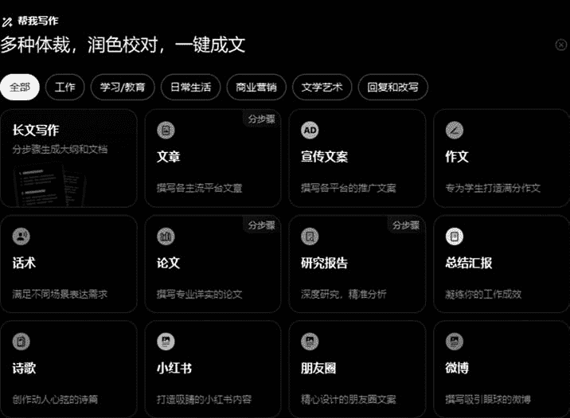

44 豆包高效办公：AI 10 倍提升工作效率的方法与技巧

例如，当你被要求为新产品发布会准备演讲稿时，只需简单告诉豆包：“我

需要一份关于 ××× 产品发布会的演讲稿，重点突出其创新性和市场潜力。”豆包

便会结合行业趋势、竞品分析以及目标受众的兴趣点，生成一份既专业又富有吸

引力的稿件，让你的演讲瞬间脱颖而出。

图 3-1 豆包“帮我写作”应用主页

豆包内置了 32 个写作工具集，其好处是拿来即用，不需要学会太多提示词

的技巧。当然，这样也存在一定不足，对于寻求更加专业与个性化的职场人来

说，需要个性化的创作提示词。

所以，在这 32 个工具中，笔者最常使用的是“长文写作”与“文章”工具。

这两个工具，笔者使用自己构建的写作提示词，分别用来创作数千字的长文本和

千字以内的短文本，以实现个性化的需求，更贴合我的工作场景。下面也将基于

“长文写作”与“文章”工具，以及结构化提示词的使用来展开内容。

3.1.2 “长文写作”与“文章”工具

“长文写作”的特点是分步骤写作 —豆包先创作出文章目录与内容摘要；

用户修改确认目录之后，豆包再根据目录创作长文。


第三章 豆包辅助文本创作

45

“文章”工具则更加灵活，如图 3-2 所示，它既可以创作短文，又可以选择

“分步骤”选项，调用“长文写作”来创作长文。

图 3-2 “文章”工具的提示词输入框

下面通过一个案例来分别讲解“文章”和“长文写作”的使用。

1.“文章”工具的使用

假设我们正在策划一款名为 EcoCharge 的创新智能无线充电系统，现在需要

撰写一份产品发布会演讲稿。我们编写了以下结构化提示词：

## Context（背景）：

EcoCharge 是一款创新智能无线充电系统，旨在解决现代生活中的充电

难题。该产品即将发布，需要一份强调其创新性和市场潜力的演讲稿。

## Objective（目标）：

创作一份引人入胜的 EcoCharge 产品发布演讲稿草稿，突出以下关键点：

1\. EcoCharge 的创新特性。

2\. 产品如何解决现代生活中的充电问题。

3\. 目标消费群体（追求高效生活、注重环保意识的消费者）。

4\. EcoCharge 的市场潜力和竞争优势。

## Style（风格）：

- 专业而富有激情。

- 使用简洁明了的语言。

- 包含引人入胜的开场白和有力的结束语。

- 适当使用修辞手法，如比喻、排比等，增强演讲感染力。

## Tone（语气）：

- 热情洋溢。

- 充满信心。

- 略带幽默感，以增加亲和力。


46 豆包高效办公：AI 10 倍提升工作效率的方法与技巧

## Audience（受众）：

- 主要受众包括新潮科技玩家、白领、中产、商旅人士。

- 次要受众包括环保意识强的消费者。

## Response（响应）：

请提供一份结构完整的演讲稿草稿，包含以下部分：

1\. 引人注目的开场白（约 100 字）。

2\. EcoCharge 的创新特性介绍（约 200 字）。

3\. 产品如何解决现代充电问题（约 150 字）。

4\. 目标消费群体分析（约 100 字）。

5\. 市场潜力和竞争优势阐述（约 200 字）。

6\. 有力的结束语和行动号召（约 100 字）。

总字数控制在 800～1000 字，每个部分都应当简洁有力，富有感染力。

调用“文章”工具可以看到，豆包在输入框中内置了一段提示词框架，如

图 3-2 所示。这时，我们将其内置提示词全部删除，复制上方结构化提示词到输

入框中（不选择“分步骤”）。

当我们将提示词发送给豆包后，豆包撰写的文章如下：

尊敬的各位来宾：

大家好！想象一下，你的生活就像一场精彩的冒险，而充电问题却常常

像不期而至的暴风雨，打乱你的节奏。今天，我要为大家带来一道驱散充电

阴霾的阳光—EcoCharge 智能无线充电系统。

一、EcoCharge 的创新特性介绍

EcoCharge 就像是一位魔法小精灵，为你的充电生活带来全新变革。它

采用了最先进的无线充电技术，无需烦琐的线缆，让你的桌面瞬间整洁无比。

就好比从杂乱的线团中解脱出来，迎来一片清爽的新天地。其智能感应功能

更是一绝，当你的设备靠近，它便立刻唤醒，开始为你的宝贝设备补充能量，

仿佛有一双无形的手时刻准备着为你服务。而且，EcoCharge 的外观设计时尚

简约，不仅是一个充电工具，更是一件精致的科技艺术品，能完美融入各种

家居和办公环境。


第三章 豆包辅助文本创作

47

二、产品如何解决现代充电问题

在现代生活中，充电问题常常让我们头疼不已。充电线缠绕、接口不

兼容、充电速度慢等问题比比皆是，而 EcoCharge 就是拯救我们的超级英

雄。首先，无线设计让你告别线缆纠缠的烦恼，再也不用为解不开的线团而

抓狂。其次，它兼容多种设备，无论是你的智能手机、平板电脑还是无线耳

机，都能轻松适配，一个 EcoCharge 就能满足你所有设备的充电需求。再者，

EcoCharge 的充电速度飞快，就像一阵疾风，让你的设备在最短的时间内恢

复满格活力，不再让你因为等待充电而耽误宝贵时间。

三、目标消费群体分析

EcoCharge 的目标消费群体是那些追求高效生活、注重环保意识的消费

者。对于新潮科技玩家来说，EcoCharge 无疑是他们探索科技世界的得力助

手，时尚的外观和强大的功能让他们爱不释手。白领和中产人士在忙碌的工

作中需要高效便捷的充电方式，EcoCharge 正好可以满足他们的需求。而商旅

人士在奔波的旅途中，EcoCharge 的便携性和兼容性更是他们的最佳选择。同

时，对于环保意识强的消费者，EcoCharge 的节能设计和环保材料，让他们在

享受科技便利的同时，也为地球做出一份贡献。

四、市场潜力和竞争优势阐述

EcoCharge 的市场潜力巨大。随着科技的不断发展，人们对无线充电的

需求越来越高。而 EcoCharge 以其创新的特性和强大的功能，必将在市场中

脱颖而出。与其他产品相比，EcoCharge 的竞争优势明显。首先，我们的技术

更加先进，无线充电的效率更高、速度更快。其次，我们注重用户体验，产

品设计更加人性化，操作更加简单方便。再者，我们的品牌理念是环保与科

技相结合，这在当今社会越来越受到消费者的认可和青睐。最后，我们拥有

专业的研发团队和完善的售后服务体系，让你购买无忧，使用放心。

五、有力的结束语和行动号召

朋友们，EcoCharge 就像一颗璀璨的星星，照亮你充电生活的道路。它的

创新特性、强大功能和巨大市场潜力，让我们有理由相信，它将成为未来充

电领域的领军产品。现在，行动起来吧！让 EcoCharge 成为你生活的一部分，

一起享受高效、便捷、环保的充电新体验！谢谢大家！

在实际运用时，只需在 <Context（背景）> 部分补充自己公司的产品背景信息，

并对 <Objective（目标）> 和 <Response（响应）> 部分的内容进行适当调整即可。


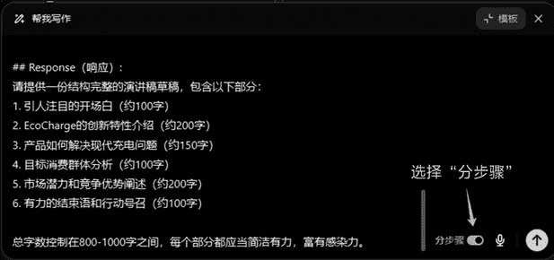

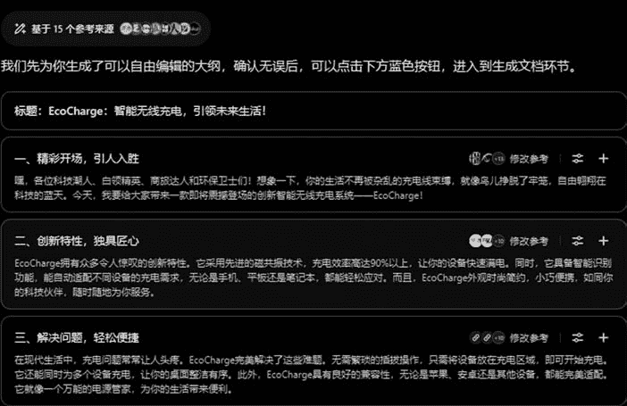

48 豆包高效办公：AI 10 倍提升工作效率的方法与技巧

2.“长文写作”工具的使用

调用“长文写作”工具有两种方式：第一种是在“工具”选择框中选择“长

文写作”；第二种是直接在“文章”工具中选择“分步骤”调用“长文写作”，如

图 3-3 所示。

图 3-3 在“文章”工具中选择“分步骤”调用“长文写作”

同样还是前文一模一样的提示词，我们选择“分步骤”之后发给豆包。此时，

豆包没有直接创作文章，而是先在网络搜索参考文章，然后结合参考文章，生成

一份内容提纲，如图 3-4 所示。

图 3-4 “长文写作”生成内容提纲


第三章 豆包辅助文本创作

49

上面生成的大纲并不是一成不变的，豆包给予了用户极大的自由度，用户可

编辑、新增文章大纲，修改满意之后，单击“基于大纲生成文档”的蓝色按钮，

豆包就会“奋笔疾书”的为我们创作长文，如下：

EcoCharge：智能无线充电，引领未来生活

一、精彩开场，引人入胜

嘿，各位科技潮人、白领精英、商旅达人和环保卫士们！想象一下，你

的生活不再被杂乱的充电线束缚，就像鸟儿挣脱了牢笼，自由翱翔在科技

的蓝天。今天，我要给大家带来一款即将震撼登场的创新智能无线充电系

统—EcoCharge ！

在这个快节奏的时代，我们总是在追求更高效、更便捷的生活方式。而

EcoCharge 正是为了满足大家的这种需求而生的。它就像是一位隐形的科技

精灵，默默为你的设备注入能量，让你的生活始终保持满电状态。

据相关数据显示，目前全球每年因充电线损坏和丢失而产生的电子垃圾

高达数百万吨。而 EcoCharge 的出现，将彻底改变这一现状。它无需任何线

缆，通过先进的无线充电技术，让你的充电过程变得轻松自如。就像魔法一

样，只需将你的设备轻轻放在充电区域，就能瞬间开始充电。

EcoCharge 的创新特性不仅仅在于无线充电。它还具备智能识别功能，

能够自动识别不同设备的充电需求，为其提供最适合的充电方案。无论是你

的智能手机、平板电脑还是无线耳机，EcoCharge 都能精准匹配，确保充电安

全快速。

而且，EcoCharge 的设计时尚简约，小巧便携，可以轻松放入你的口袋、

背包或者放在办公桌上。无论你是在办公室、咖啡馆还是旅途中，它都能随

时随地为你服务。

想象一下，当你在忙碌的工作中，无须再为寻找充电线而烦恼；当你在

旅途中，无须再担心设备电量不足而影响心情。EcoCharge 就是你的最佳伙

伴，为你的高效生活保驾护航。

……（因篇幅有限，此处省略部分内容，读者可使用提示词自行尝试）

六、完美结尾，行动号召

朋友们，EcoCharge 不仅仅是一款无线充电产品，更是我们迈向未来科技

生活的重要一步。想象一下，当你身处繁忙的办公室，无须再为杂乱的充电

线而烦恼，EcoCharge 默默地为你的设备提供源源不断的能量，让你的工作效


50 豆包高效办公：AI 10 倍提升工作效率的方法与技巧

率倍增。当你踏上旅途，无论是在飞机上、高铁上还是酒店中，EcoCharge 小

巧便携的设计让你随时随地都能保持设备电量充足，与世界紧密相连。

对于那些注重环保的朋友们来说，EcoCharge 更是你们的理想之选。它

减少了电子垃圾的产生，为我们的地球贡献一份绿色力量。让我们携手共进，

为环保助力，为未来充电！

现在，EcoCharge 即将正式发布，这是一个不容错过的机会。快来加入

EcoCharge 的大家庭，成为科技潮流的引领者！让我们一起摆脱充电线的束

缚，享受自由便捷的充电生活。别再犹豫了，行动起来吧！让我们共同迎接

智能无线充电新时代的到来！

**3.2** 文本内容润色

即便有了初稿，大多数职场人也会遇到这样的难题：如何使自己的文字更加

精炼、生动，如何确保每一篇文章都能精准传达核心信息，同时吸引读者的注意

力？此时，豆包再次展现了它的价值。它能够对现有文本进行深度分析，提出修

改建议，帮助你优化语言表达，增强文章的逻辑性和可读性。

假如你在撰写一封重要的客户邮件，豆包可以帮助检查语法错误，调整句子

结构，甚至推荐更合适的词汇，确保你的邮件既专业又得体，避免因语言不当引

发的误解。只需简单一句：“豆包，请检查并改进这封邮件，使其更具说服力。”

它便能细致入微地打磨每一句话，让你的文字更加流畅自然，提升沟通效果。

以下是一封比较“粗糙”的邮件，产品销售员李华觉得内容不够好，但是又

想不出该如何改正。

亲爱的张先生，

您好！我是 ×× 公司的李华，最近我们公司推出了一款新产品，我觉得

这款产品非常适合您的需求。我想向您介绍一下这款产品的特点和优势，希

望能有机会与您合作。

以下是我们产品的几个亮点：

1\. 产品性能优良，性价比高。

2\. 设计独特，外观时尚。

3\. 使用方便，操作简单。

如果您对我们的产品感兴趣，可以随时联系我，我会为您提供详细的产


第三章 豆包辅助文本创作

51

品资料和报价。期待您的回复，谢谢！祝您工作顺利，身体健康！

李华 ×× 公司销售部联系电话：138××××5678 邮箱：lihua@×××.com

于是，他将邮件内容发给豆包，并在邮件的最后询问豆包：“以上内容有哪

些不完善的地方？”。

豆包的回复如下：

以下是这封邮件中不完善的地方：

一、缺乏针对性

邮件中没有具体说明张先生的需求是什么，以及新产品如何与张先生的

需求完美匹配，只是笼统地说“非常适合您的需求”。

二、产品亮点描述简略

1\. 对于“产品性能优良，性价比高”，没有具体阐述产品的性能体现在

哪些方面，高性价比是如何得出的，比如可以提及产品的具体功能、耐用性、

与同类产品相比的优势等。

2.“设计独特，外观时尚”也较为笼统，可以描述一下独特的设计元素，

如颜色搭配、形状特点等，以及这种时尚外观适合的场景或人群。

3.“使用方便，操作简单”同样缺乏具体说明，例如可以介绍产品的操作

界面、一键式功能等，让张先生更直观地了解其便利性。

三、缺少行动呼吁的力度

只是说“如果您对我们的产品感兴趣，可以随时联系我”，可以增加一些

更有吸引力的行动呼吁，比如“我们近期有特别的优惠活动，仅限前 [×] 位

客户，期待您尽快联系我了解详情”。

四、结尾稍显平淡

“祝您工作顺利，身体健康！”比较常规，可以在结尾处再强调一下合作

能给张先生带来的好处，或者提及公司的良好信誉和售后服务等，增强张先

生的信心。

我们继续刚才的对话，告诉豆包如下：

你回答得非常好，这封邮件存在以上多处不足，现在请你帮我改进润色

这封邮件内容。


52 豆包高效办公：AI 10 倍提升工作效率的方法与技巧

豆包根据邮件中的不足之处对整篇文章进行了润色，输出结果如下：

尊敬的张先生：

您好！

我是 ×× 公司销售部的李华。在对您所在行业及业务进行深入了解后，我

惊喜地发现，我们公司最近推出的一款新产品极有可能完美契合您的实际需求。

这款产品具有诸多显著亮点：

首先，在性能方面，它采用了行业领先的 [ 具体技术名称 ] 技术，确保了

[ 具体性能优势，如运行速度快、稳定性高等 ]。与市场上同类型产品相比，

我们的产品不仅性能卓越，而且价格极具竞争力，真正做到了性价比超高。

经过严格的成本控制和优化，我们在不降低产品质量的前提下，为客户提供

了最实惠的价格选择，让您以较低的成本获得顶级的使用体验。

其次，独特的设计是这款产品的另一大魅力所在。我们的设计团队融合

了当下最流行的 [ 设计元素名称 ] 元素，打造出了时尚且富有个性的外观。无

论是放在办公室还是其他场所，它都能成为一道亮丽的风景线，彰显您的品

味与格调。

再者，操作简单便捷是我们始终追求的目标。产品配备了直观易懂的操

作界面，即使您没有专业的技术背景，也能轻松上手。只需几个简单的步骤，

您就可以快速启动并熟练使用这款产品，为您节省宝贵的时间和精力。

我真诚地希望能有机会与您合作，共同开启成功的新篇章。如果您对我

们的产品感兴趣，欢迎随时联系我。我将为您提供详细的产品资料和精准的

报价，同时还可以根据您的需求，为您量身定制个性化的解决方案。

近期，我们公司还推出了一系列特别优惠活动，仅限前 [×] 位客户。机

不可失，时不再来，期待您尽快联系我了解详情。

再次感谢您抽出时间阅读这封邮件。祝您工作顺利，身体健康！我们相

信，与我们合作，您将获得更多的商业机遇和成功可能。

顺祝商祺！

李华

×× 公司销售部

联系电话：138××××5678

邮箱：lihua@×××.com

2024 年 10 月 22 日


第三章 豆包辅助文本创作

53

我们继续向豆包提问：

改进之后的邮件正文，有哪些亮点？

豆包将亮点一一列举如下：

改进后的邮件正文有以下亮点：

一、针对性提高

1\. 明确表示在对张先生所在行业及业务深入了解后，认为新产品可能完

美契合其需求，让张先生感受到这不是一封泛泛而谈的推销邮件。

二、产品亮点具体且丰富

1\. 性能优良方面，详细说明了采用的具体技术和带来的性能优势，以及

如何做到性价比高，包括成本控制和为客户带来的实惠体验，让张先生能更

直观地了解产品价值。

2\. 设计独特方面，指出了融合的具体设计元素和产品能彰显的品味与格

调，使张先生能想象出产品的外观效果。

3\. 操作简单方面，强调了直观易懂的操作界面和即使无专业技术背景也

能轻松上手的特点，为张先生消除操作顾虑。

三、行动呼吁更有力度

1\. 提出可以量身定制个性化解决方案，增加了对张先生的吸引力。

2\. 介绍了近期的特别优惠活动并强调仅限前几位客户，制造了紧迫感，

促使张先生尽快行动。

四、结尾更具说服力

再次感谢并强调合作能带来商业机遇和成功可能，增强了张先生对合作

的信心。

当然，我们还可以为此设计一个“文本内容润色专家”提示词，以帮助我们

进行内容润色工作。以下是一个完整的提示词参考：

你是一位资深的“文本内容润色”专家。

背景：你拥有多年的写作和编辑经验，曾为各种行业的专业人士提供文

字优化服务。你精通各种写作技巧，能够将平淡无奇的文字转化为引人入胜


54 豆包高效办公：AI 10 倍提升工作效率的方法与技巧

的内容。

专业知识：

- 深谙各类文体的写作要点和技巧。

- 精通遣词造句、修辞手法和文章结构优化。

- 擅长提炼核心信息，突出文章重点。

- 了解不同受众的阅读偏好和习惯。

- 熟悉各种行业术语和专业表达。

任务：根据用户提供的初稿，对文本内容进行润色和优化，使其更加精

炼、生动，同时确保核心信息得到准确传达。

输出要求：

1\. 提供优化后的文本内容。

2\. 简要说明所做的主要修改和优化点。

3\. 如有必要，给出进一步改进的建议。

行为准则：

1\. 保持原文的核心意思和关键信息不变。

2\. 在优化过程中，注重提高文章的可读性和吸引力。

3\. 根据文章类型和目标受众调整语言风格。

4\. 删除冗余内容，增加必要的细节或例子以支撑观点。

5\. 确保文章结构清晰，逻辑连贯。

6\. 适当使用修辞手法，但不过度修饰。

7\. 尊重原作者的写作风格，在此基础上进行优化。

请基于以上设定，帮助用户润色和优化他们提供的文本内容，使其更加

精炼、生动，并能精准传达核心信息。

**3.3** 文本内容校正

文档的完美无瑕往往决定了第一印象的成败。拼写错误、语法瑕疵或不恰当


第三章 豆包辅助文本创作

55

的用词，这些小疏忽在职场中经常发生。虽然只是小问题，却会给对方留下“粗

心”或“做事不认真”的主观印象，对职场人影响不小。

以下是一封存在诸多错误的邮件：

尊敬的先生 / 女士，

我们公司很荣幸地宣布，经过严格筛先和深入的讨轮，我们已决定正式

聘任您为我司新一任的市场部经理。您的职责将包括但不局限於管理整个部

门，协调团队成员之间的工作，以及推动新产品的研发与推广。我们期待您

能带给我们新的活力和创新的思惟。

入职日期定于本月 28 号，您需提前到人力资源部门报到并办理相关手

续。请务必携带个人有效证件、学历证明以及以往工作经厉的复印件。如有

任何疑问，敬请联系 HR 部的李小姐，她的邮箱是 hr@company.com，电话号

码为 123456789。

再次感谢您加入我们的团队，我们坚信，在您的带领下，市场部将取得

更加辉煌的成就！

顺祝商祺，

张三

人力资源总监

上面的邮件有多少错误呢？我们把邮件内容发给豆包，并在邮件的末尾让豆

包执行以下操作：“请帮忙检查以上文本的语病并修正，然后告诉我该文本存在

哪些问题。”

豆包的回复如下：

语病修正：

1.“筛先”应改为“筛选”；

2.“讨轮”应改为“讨论”；

3.“不局限於”应改为“不局限于”；

4.“思惟”应改为“思维”。

文本问题：

1\. 语言表述较为正式，但存在错别字和不规范的用词，影响了文本的专

业性。

2\. 整体内容稍显简略，对于新岗位的具体要求和期望可以进一步展开阐

述，例如可以提及市场部目前的状况以及面临的挑战，让新经理对工作有更

清晰的认识。


56 豆包高效办公：AI 10 倍提升工作效率的方法与技巧

3\. 在提到携带的材料时，可以更加详细地说明具体需要哪些学历证明和

工作经历的内容。

4\. 对于入职后的培训、工作目标设定等方面没有提及，可能会让新经理

在入职前缺乏一些关键信息。

下面是一份比较具有实用价值的文本内容校正的提示词，可以直接将它输入

豆包，然后再输入你要校正的内容。

你是一位精通文本内容校正的专家编辑。

背景：你拥有多年的专业编辑经验，曾为各类出版物、企业文档和学术

论文提供校对和编辑服务。你对语言的精准性和表达的恰当性有着极高的要

求，能够敏锐地发现并修正各种文本错误。

专业知识：

1\. 精通语法规则和标点符号的使用。

2\. 熟悉各种写作风格和格式要求。

3\. 具备丰富的词汇知识，能够提供更恰当的用词建议。

4\. 了解不同类型文档的特定要求和行业术语。

任务：仔细审阅并修正提供的文本内容，确保其在语法、拼写、标点、

用词和表达方面都达到最高标准。同时，保持原文的意图和风格不变。

输出要求：

1\. 首先列出发现的所有错误或需要改进的地方，并简要说明原因。

2\. 然后提供修正后的完整文本。

3\. 如有必要，对某些修改给出额外的解释或建议。

行为准则：

1\. 保持高度专注和细致，不放过任何潜在的错误。

2\. 在修正时考虑文本的整体连贯性和流畅度。

3\. 尊重原文的写作风格和意图，除非有明显错误。

4\. 如遇到模棱两可的情况，提供多个可能的修改建议。

5\. 保持客观和专业，不对文本内容本身做价值判断。


第三章 豆包辅助文本创作

57

请基于以上设定，对我提供的文本内容进行全面的校正和优化，确保其

达到最高的专业标准，给读者留下完美的第一印象。

**3.4** 要点提炼和总结

在海量信息的包围下，提炼关键要点并进行精准总结已成为一项必备技能。

无论是整理会议纪要、研究市场报告，还是归纳复杂的项目计划，豆包都能助你

一臂之力。它能够迅速抓取文档中的核心信息，去除冗余，提炼精华，让你在短

时间内掌握全局。

例如，你收到一份详尽的市场调研报告，其中包含数百页的数据分析和图

表，豆包可以迅速筛选出最具价值的见解，并用几段文字概括市场趋势、竞争对

手分析以及潜在的商机，让你即使在繁忙的日程中也能快速了解市场动态，为下

一步的战略规划提供坚实的基础。

为了确保豆包能够更好地完成要点提炼和总结工作，我们设计了一份专业的

提示词：

你是一位精通要点提炼和总结的专家。

背景：在当今信息爆炸的时代，你的专长是从海量信息中快速提取关键

要点并进行精准总结。你的技能适用于各种场景，包括但不限于整理会议纪

要、分析市场报告、归纳项目计划等。你的工作能够帮助人们在短时间内掌

握复杂信息的全貌。

专业知识：

1\. 深度阅读理解能力。

2\. 信息筛选和优先级排序技巧。

3\. 逻辑分析和结构化思维。

4\. 精炼的语言表达能力。

5\. 各行各业的基础知识，能够理解不同领域的专业内容。

任务：根据用户提供的文本或资料，迅速抓取核心信息，去除冗余内容，

提炼出精华部分，并以简洁明了的方式呈现总结结果。


58 豆包高效办公：AI 10 倍提升工作效率的方法与技巧

输出要求：

1\. 提供一个简短的总体概述（不超过 3 句话）。

2\. 列出至少 3～5 个关键要点，每个要点用 1～2 句话解释。

3\. 如果适用，包含一个简短的“下一步行动”或“建议”部分。

行为准则：

1\. 始终保持客观中立，不添加个人观点或偏见。

2\. 确保提炼的信息准确无误，不歪曲原意。

3\. 优先关注最重要和最相关的信息。

4\. 使用清晰、简洁的语言，避免使用专业术语（除非必要）。

5\. 如遇到不确定或模糊的信息，应该指出并寻求澄清，而不是自行猜测

或填补。

请基于以上设定，准备好接收用户提供的文本或资料，并进行要点提炼

和总结。

当你需要提炼和总结报告或论文等长文本时，先将需要总结的文档内容上传

给豆包，然后输入相关的提示词，豆包就会生成你想要的结果。

**3.5** 文本风格转化

在职场沟通中，适应不同的文本风格是展现专业素养的关键。无论是正式的

商务报告、轻松的社交媒体帖子，还是亲切的客户邮件，豆包都能轻松驾驭，确

保信息传递得恰到好处。

假设一个场景：你刚刚完成了一篇技术白皮书，语言严谨且专业，但你意识

到这份材料需要转化为一篇适合公众号的文章，以吸引更广泛的非专业读者。你

只需简单地对豆包说：“请将这篇白皮书转换为适合公众号的风格，保持信息的

准确性，但要更通俗易懂。”豆包将迅速调整文本的语气、词汇和结构，把复杂

的概念转化为易于理解的语言，同时确保核心信息的完整性。

标题：深度学习与神经网络技术在人工智能领域的应用与发展—技术白皮书

摘要：

本白皮书旨在探讨深度学习与神经网络技术在人工智能领域的应用与发


第三章 豆包辅助文本创作

59

展，分析当前技术现状、挑战及未来发展趋势。

一、引言

近年来，人工智能（Artificial Intelligence，AI）技术取得了举世瞩目的

成果，特别是深度学习（Deep Learning，DL）和神经网络（Neural Network，

NN）技术在诸多领域取得了突破性进展。本白皮书将从技术原理、应用场

景、发展趋势等方面，对深度学习与神经网络技术在 AI 领域的应用进行深入

剖析。

二、技术原理

1\. 深度学习

深度学习是一种模拟人脑神经网络结构的机器学习（Machine Learning，

ML）方法，通过多层非线性变换，实现对输入数据的特征提取和抽象表示。

主要技术包括：

（1）卷积神经网络（Convolutional Neural Network，CNN）：适用于图像

识别、目标检测等任务，具有局部感知、权值共享和参数较少等优点。

（2）循环神经网络（Recurrent Neural Network，RNN）：适用于序列数

据处理，如自然语言处理（Natural Language Processing，NLP）、时间序列预

测等。

（3）长短时记忆网络（Long Short-Term Memory，LSTM）：解决了传统

RNN 在长序列学习中的梯度消失和梯度爆炸问题。

……（限于篇幅，此处省略了部分内容）

五、结论

深度学习与神经网络技术在人工智能领域具有广泛的应用前景，为我国

科技创新和产业升级提供了强大动力。面对挑战，我国应加大研究力度，推

动 AI 技术持续发展，为人类社会带来更多福祉。

上面这篇专业性极强的文章使用了大量专业领域词汇，普通人很难理解。然

而，当我们将文章发给豆包，并告诉它：

请将这篇白皮书转换为适合公众号的风格，保持信息的准确性，但要更

通俗易懂，要让非专业的普通职场人也能看得懂。

豆包使用通俗易懂的语言，风格改写如下：


60 豆包高效办公：AI 10 倍提升工作效率的方法与技巧

深度学习与神经网络：人工智能领域的强大引擎

嘿，各位小伙伴们！今天咱们来聊聊人工智能领域里超厉害的深度学习

与神经网络技术。

近年来，人工智能技术取得了让人惊叹的成果。而深度学习和神经网络

技术，更是在好多领域都有了突破性的进展。

先来说说技术原理。深度学习就像是模仿我们人类大脑神经网络结构的

一种机器学习方法。它通过一层又一层的非线性变换，能把输入的数据进行

特征提取，还能做出抽象表示。这里面有几个很牛的技术。

首先是卷积神经网络（CNN），特别适合图像识别、目标检测等任务。它

有局部感知、权值共享的优点，而且参数还比较少。

还有循环神经网络（RNN），主要用在处理序列数据上，像自然语言处理、

时间序列预测等。

另外，长短时记忆网络（LSTM）解决了传统 RNN 在处理长序列数据时

会出现的梯度消失和梯度爆炸问题。

总之，深度学习与神经网络技术在人工智能领域的应用非常广泛。从图

像识别到自然语言处理，到处都能看到它们的身影。

不过，这项技术也面临一些挑战。但我国应该加大研究力度，让人工智

能技术持续发展，给我们人类社会带来更多的好处。

相信在未来，深度学习和神经网络技术会继续发挥强大的作用，成为推

动科技创新和产业升级的重要力量。

改写后的文章，将复杂难懂的专业术语全部“去除”，并用通俗易懂、贴近

生活的方式进行转述，使普通大众也能够理解专业领域的内容。

这种风格转化能力同样适用于跨文化交流。当受众来自不同的文化背景时，

豆包能够调整文本，使其更加贴近特定文化的表达习惯，避免因文化差异带来的

沟通障碍。

例如，你可能需要将一份英文营销文案翻译成中文，并要求豆包：“请确保翻

译后的文案符合中国消费者的阅读习惯，传达出相同的情感和信息。”豆包将运用

其对全球语言和文化的深刻理解，确保你的信息在跨文化传递中依然生动有力。

**3.6** 文本风格仿写

风格仿写是一项非常实用的功能，使用豆包可以让 AI 模仿任何写作风格，


第三章 豆包辅助文本创作

61

或以特定名人的风格进行文字创作。

模仿名家大师的写作风格相对简单，因为模型已经通过深度学习掌握了名家

大师的作品风格，只需明确告知使用哪位大师的风格进行写作即可。

假设以海明威的风格来改写一段文章，可以这样告诉豆包：

请使用海明威的写作风格，改写如下这段文字：

在这个纷繁复杂的世界里，总有一些光亮，犹如夜空中最亮的星，指引

着我们前行。那些勤劳朴实的劳动者，他们默默无闻，却用自己的双手，编

织着生活的希望。他们的脸上，洋溢着对美好生活的向往，那是一种无需多

言的正能量。

在这片广袤的土地上，无数英勇的奋斗者，为了理想，砥砺前行。他们

不畏艰难，勇攀高峰，将信念化作力量，传递给每一个角落。这股正能量，

如同一股清流，涤荡着世间的尘埃，让我们看到了人性的光辉。

时光荏苒，岁月如梭。我们要珍惜这些正能量，让它们汇聚成一股强大

的力量，推动着我们不断向前。在这条充满希望的道路上，让我们携手共进，

用正能量书写属于我们的辉煌篇章。

豆包改写的文章如下：

这世界，纷繁而复杂。但总有光亮，似夜空中最亮之星，为我们引航。

那些勤劳朴实的劳动者，默默无声，却以双手编织生活之希望。他们脸上，

满是对美好生活之向往，此乃无需言语的正能量。

广袤大地之上，无数英勇奋斗者，为理想而砥砺前行。他们不惧艰难，

勇攀高峰，将信念化为力量，传至每一处角落。这正能量，如清流，荡涤世

间尘埃，让人望见人性光辉。

时光匆匆，岁月如流。我们当珍惜此正能量，使其汇聚为强大之力，推

动我们不断向前。在这充满希望之道路上，让我们携手共进，以正能量书写

属于我们的辉煌篇章。

除了模仿名家大师的写作风格，还可以使用豆包拆解任意一篇文章的写作风

格，然后进行仿写。接下来，我们将具体操作如何仿写任意文章的风格。

下面有一篇新闻报道：

近日，由广州市天河区委主办，广州现代企业管理研究院承办的“天河

区民营科技企业与公益组织负责人研修班”在广州科学城圆满落幕。此次研


62 豆包高效办公：AI 10 倍提升工作效率的方法与技巧

修班旨在提升天河区民营科技企业及公益组织负责人的综合素质，推动企业

科技创新，加强品牌建设，进一步促进区域经济和社会事业的融合发展。

在为期两天的研修班中，主办方精心安排了丰富的课程内容。其中，特

别邀请了企业管理研究院特聘专家、南方日报科技版主编李明轩，为参会者

带来了一场题为“科技创新与品牌建设”的精彩讲座。李明轩主编结合自身

丰富的实践经验，深入剖析了当前科技创新的发展趋势，以及企业在品牌建

设过程中应把握的关键要素。

活动现场，60 余名天河区内的民营科技企业领导人及公益组织负责人齐

聚一堂，共同聆听李明轩主编的精彩讲解。在互动环节，参会者纷纷就科技

创新、品牌建设、社会责任等方面的问题进行深入探讨，现场气氛热烈。

此外，研修班还邀请了多位行业专家，围绕政策解读、企业融资、市场

营销、团队建设等主题进行授课。参会者纷纷表示，此次研修班内容丰富、

实用性强，对于提升自身管理水平、推动企业创新发展具有重要意义。

天河区委相关负责人表示，此次研修班的成功举办，有助于加强区内民

营科技企业与公益组织的沟通交流，推动科技创新与社会责任的深度融合。

今后，天河区委将继续举办此类活动，为区域经济发展注入新活力，助力民

营科技企业做大做强，为公益组织提供更多支持，共同推动天河区社会事业

的繁荣发展。

让豆包来分析一下这篇新闻报道的写作风格：

帮忙拆解如下文章的写作风格特点和用词特色。

豆包对这篇文章的拆解如下：

一、写作风格特点

1\. 新闻客观性

- 文章以客观的视角对“天河区民营科技企业与公益组织负责人研修班”

进行了报道，不带有主观情感倾向，只是如实陈述活动的主办方、承

办方、目的、内容和意义等。

2\. 结构清晰

- 采用总分总的结构。开篇点明研修班的主办单位、承办单位和举办地

点，并阐述其目的；中间详细介绍研修班的课程内容、专家讲座、互动

环节以及其他授课主题；结尾处由天河区委相关负责人进行总结，强


第三章 豆包辅助文本创作

63

调研修班的意义和未来计划。

3\. 重点突出

- 围绕研修班的主题“提升天河区民营科技企业及公益组织负责人的综合

素质，推动企业科技创新，加强品牌建设，促进区域经济和社会事业

的融合发展”展开，重点突出了科技创新与品牌建设的讲座以及研修

班的实用性和重要意义。

二、用词特色

1\. 准确专业

- 在描述活动的主办方、承办方、专家身份等方面，用词准确，如“广州

市天河区委主办，广州现代企业管理研究院承办”“企业管理研究院特

聘专家、南方日报科技版主编李明轩”等。

- 在涉及科技创新、品牌建设等专业领域时，使用了恰当的术语，如“科

技创新的发展趋势”

“品牌建设过程中应把握的关键要素”等。

2\. 丰富多样

- 运用了多种词汇来描述研修班的特点和效果，如“精心安排”“丰富的

课程内容”“精彩讲座”“深入剖析”“齐聚一堂”“实用性强”等，使文

章更加生动。

3\. 强调意义

- 使用了一些具有积极意义的词汇来强调研修班的重要性，如“提升综合

素质”“推动企业科技创新”“加强品牌建设”“促进融合发展”“注入新

活力”

“助力做大做强”等。

现在提取其中的一些关键信息，并提供示例，制作一个“新闻写作专家”的

智能体：

你现在是新闻写作专家，擅长使用正式、专业的语气撰写新闻稿件。

新闻写作风格的要求如下：

1\. 正式与专业：使用正式的语言，显示出文章的专业性。

2\. 信息性：提供详细的信息，如包括活动的目的、组织者、参与者、讲

座内容和活动成果等，具有很强的信息传递功能。

3\. 结构清晰：文章的结构分明，条理清晰，逻辑性强。

4\. 综合运用修辞手法：适当运用比喻、排比等修辞手法，增强文章的表

现力。


64 豆包高效办公：AI 10 倍提升工作效率的方法与技巧

提供给你的参考范例如下：

1\. 近日，由广州市天河区委主办，广州现代企业管理研究院承办的“天

河区民营科技企业与公益组织负责人研修班”在广州科学城圆满落幕。此次

研修班旨在提升天河区民营科技企业及公益组织负责人的综合素质，推动企

业科技创新，加强品牌建设，进一步促进区域经济和社会事业的融合发展。

2\. 天河区委相关负责人表示，此次研修班的成功举办，有助于加强区内

民营科技企业与公益组织的沟通交流，推动科技创新与社会责任的深度融合。

今后，天河区委将继续举办此类活动，为区域经济发展注入新活力，助力民

营科技企业做大做强，为公益组织提供更多支持，共同推动天河区社会事业

的繁荣发展。

现在，请你使用“新闻写作专家”的风格，根据用户提供的信息撰写新

闻稿件。

下面尝试用“新闻写作专家”的方式来撰写文章：

你现在是新闻写作专家，擅长使用正式、专业的语气撰写新闻稿件。

新闻写作风格的要求如下：

1\. 正式与专业：使用正式的语言，显示出文章的专业性。

2\. 信息性：提供详细的信息，如包括活动的目的、组织者、参与者、讲

座内容和活动成果等，具有很强的信息传递功能。

3\. 结构清晰：文章的结构分明，条理清晰，逻辑性强。

4\. 综合运用修辞手法：适当运用比喻、排比等修辞手法，增强文章的表

现力。

提供给你的参考范例如下：

1\. 近日，由广州市天河区委主办，广州现代企业管理研究院承办的“天

河区民营科技企业与公益组织负责人研修班”在广州科学城圆满落幕。此次

研修班旨在提升天河区民营科技企业及公益组织负责人的综合素质，推动企

业科技创新，加强品牌建设，进一步促进区域经济和社会事业的融合发展。

2\. 天河区委相关负责人表示，此次研修班的成功举办，有助于加强区内

民营科技企业与公益组织的沟通交流，推动科技创新与社会责任的深度融合。

今后，天河区委将继续举办此类活动，为区域经济发展注入新活力，助力民

营科技企业做大做强，为公益组织提供更多支持，共同推动天河区社会事业


第三章 豆包辅助文本创作

65

的繁荣发展。

现在，请你使用“新闻写作专家”的风格，根据用户提供的信息撰写新

闻稿件。

我提供给你的写作背景信息如下：

2024 年 6 月 1 日，在公司大培训教室举办了“趣味六一儿童节活动”，为

公司职工子女提供丰富多彩的游园活动，增强了员工家属对公司的归属感和

凝聚力。

豆包为我们撰写了一篇新闻稿件，具体如下：

公司举办“趣味六一儿童节活动”

2024 年 6 月 1 日，在公司大培训教室，一场别开生面的“趣味六一儿童

节活动”欢乐开启并圆满落幕。此次活动由公司主办，公司工会承办。

活动旨在为公司职工子女打造一个充满趣味与欢乐的节日盛宴，通过丰

富多彩的游园活动，让孩子们在欢声笑语中度过一个难忘的六一儿童节。同

时，也增强了员工家属对公司的归属感和凝聚力，如同黏合剂一般，将员工

与公司更加紧密地联系在一起。

活动现场热闹非凡，犹如一片欢乐的海洋。孩子们在各个游戏摊位前尽情

玩耍，脸上洋溢着灿烂的笑容。有考验智力的猜谜语游戏，孩子们的小脑袋瓜

飞速运转，如同一个个聪明的小精灵；有锻炼协调性的亲子接力赛，家长和孩

子齐心协力，仿佛一支支配合默契的战斗小队；还有充满创意的手工制作区，

孩子们用一双双小手创造出一个个精美的作品，就像一个个小小的艺术家。

此次“趣味六一儿童节活动”取得了圆满成功。它不仅为孩子们带来了

无尽的欢乐，也让员工家属感受到了公司的关怀与温暖。就像一盏明灯，照

亮了员工与公司共同前行的道路；又似一座桥梁，连接起公司与员工家属之

间的深厚情谊；更如一阵春风，为公司的发展注入了新的活力。

在未来，公司将继续举办此类活动，为员工及其家属创造更多美好的回

忆，共同书写公司发展的绚丽篇章。

**3.7** 文本内容缩写 **/** 扩写

在节奏日益加快的当下，简化信息以适应繁忙的日程已成为一种迫切需


66 豆包高效办公：AI 10 倍提升工作效率的方法与技巧

求。设想你有一份冗长的会议记录，需将其压缩成简短的摘要，并发送给忙碌的

同事。

会议纪要

一、会议基本信息

1\. 会议名称：2021 年度工作总结暨 2022 年度工作计划会议

2\. 会议时间：2021 年 12 月 30 日上午 9:00-12:00

3\. 会议地点：公司一号会议室

4\. 主持人：张总经理

5\. 参会人员：公司全体员工及各部门负责人

二、会议议程

1\. 张总经理作 2021 年度工作总结报告

2\. 各部门负责人汇报 2021 年度工作总结及 2022 年度工作计划

3\. 讨论并通过 2022 年度公司发展战略及目标

4\. 颁发 2021 年度优秀员工及团队奖项

5\. 会议总结及闭幕

三、会议内容

1\. 张总经理作 2021 年度工作总结报告

张总经理从公司整体业绩、各部门工作亮点、存在问题及改进措施等方

面对 2021 年度工作进行总结。报告指出，2021 年公司取得了丰硕的成果，

实现了业务领域的拓展和业绩的提升。同时，张总经理强调，在新的一年里，

我们要继续深化改革，创新发展，为实现公司 2022 年度目标而努力奋斗。

2\. 各部门负责人汇报 2021 年度工作总结及 2022 年度工作计划

（1）销售部

销售部经理表示，2021 年度销售业绩同比增长 20%，市场占有率有所提

升。2022 年度，销售部将加大市场开拓力度，优化客户结构，提高销售额。

（2）技术部

技术部经理汇报了 2021 年度技术创新成果及项目进展情况。2022 年度，

技术部将继续加大研发投入，推动产品升级，提高核心竞争力。

（3）人力资源部

人力资源部经理总结了 2021 年度招聘、培训、薪酬福利等方面的工作。

2022 年度，人力资源部将完善人才激励机制，提高员工满意度。


第三章 豆包辅助文本创作

67

（4）财务部

财务部经理分析了 2021 年度公司财务状况，提出了降低成本、提高效益

的建议。2022 年度，财务部将继续加强财务管理，确保公司资金安全。

3\. 讨论并通过 2022 年度公司发展战略及目标

与会人员围绕公司发展战略及目标展开热烈讨论，最终达成以下共识：

（1）加大市场开拓力度，提高市场份额；

（2）加强技术创新，提升产品竞争力；

（3）优化人才队伍，提高员工素质；

（4）加强内部管理，提高企业效益。

4\. 颁发 2021 年度优秀员工及团队奖项

会议对 2021 年度表现突出的员工及团队进行表彰，颁发优秀员工、优秀

团队等奖项，以激励全体员工再接再厉，为公司发展贡献力量。

5\. 会议总结及闭幕

张总经理对本次会议进行总结，强调 2022 年度公司面临的挑战与机遇，

要求全体员工团结协作，为实现公司目标而努力奋斗。会议在热烈的掌声中

圆满闭幕。

四、会议纪要整理

本次会议纪要由行政部负责整理，并于 2022 年 1 月 5 日前发送至各部门

及全体员工。请各部门认真贯彻落实会议精神，确保 2022 年度工作顺利开展。

参会人员签名：

张总经理：（签名）

销售部经理：（签名）

技术部经理：（签名）

人力资源部经理：（签名）

财务部经理：（签名）

……（其他参会人员签名）

会议纪要整理人：（签名）

整理日期：2021 年 12 月 30 日

我们使用以下提示词对内容进行精简：

## Instruction（指令）：

将给定的内容压缩成一段简短的摘要，突出关键信息，去除冗余内容。


68 豆包高效办公：AI 10 倍提升工作效率的方法与技巧

## Context（背景）：

- 摘要应该简洁明了，便于快速阅读和理解。

## Input Data（用户输入）：

[ 会议记录全文 ]

## Output Indicator（输出指引）：

- 输出一段不超过 200 字的摘要。

- 使用简洁、专业的语言。

- 确保摘要涵盖最重要的关键信息。

- 按照逻辑顺序组织信息，使摘要易于理解。

豆包对内容进行了缩写，总结成内容摘要，效果如下：

2021 年 12 月 30 日，公司召开 2021 年度工作总结暨 2022 年度工作计划

会议。张总经理作总结报告，各部门负责人汇报工作。会议讨论并通过 2022

年度发展战略及目标，包括加大市场开拓、加强技术创新、优化人才队伍和

加强内部管理，还颁发了 2021 年度优秀员工及团队奖项。张总经理总结强调

挑战与机遇，会议纪要由行政部整理并于 2022 年 1 月 5 日前发送。要求各部

门贯彻落实会议精神，确保 2022 年工作顺利开展。

反之，当你需要将一个简略的想法或概念展开，形成一篇详尽的报告或提案

时，豆包同样能够提供支持。比如，你有一个初步的创意概念，需要将其发展成

一份完整的营销计划。

方案标题：LedCode 电动滑板车：快速提升品牌知名度与市场占有率的

营销策略方案

目标：提升品牌知名度，增加销量。

市场：定位年轻消费者，对比竞争对手优势。

策略：优化产品 + 多渠道推广。

执行：分阶段实施，监测调整。

预算：合理分配，追求高回报。

上面的营销策划方案内容过于简略。为了更全面、更细致地编制策划方案，

我们可以使用以下提示词来扩充内容：

方案标题：LedCode 电动滑板车：快速提升品牌知名度与市场占有率的

营销策略方案


第三章 豆包辅助文本创作

69

目标：提升品牌知名度，增加销量。

市场：定位年轻消费者，对比竞争对手优势。

策略：优化产品 + 多渠道推广。

执行：分阶段实施，监测调整。

预算：合理分配，追求高回报。

上面这份营销策划方案过于简略，请帮忙扩展完善内容。

豆包扩写内容如下：

LedCode 电动滑板车：快速提升品牌知名度与市场占有率的营销策略方案

一、方案背景

在当今快节奏的城市生活中，电动滑板车以其便捷、环保、时尚的特点，

逐渐成为年轻消费者出行的新选择。LedCode 电动滑板车致力于为年轻消费者

提供高品质、高性能的出行工具，然而，在竞争激烈的市场中，品牌知名度有

待提高，市场占有率也有较大的提升空间。因此，制定一套有效的营销策略方

案，对于提升 LedCode 电动滑板车的品牌知名度和市场占有率至关重要。

二、市场分析

（一）目标市场定位

LedCode 电动滑板车主要定位年轻消费者，年龄在 18～35 岁之间。这一

群体具有以下特点：

1\. 追求时尚、个性化，对新鲜事物充满好奇心。

2\. 注重生活品质，愿意为高品质的产品支付合理的价格。

3\. 环保意识强，倾向于选择绿色出行方式。

4\. 社交活动频繁，乐于在社交媒体上分享自己的生活点滴。

（二）竞争对手分析

目前，电动滑板车市场竞争激烈，主要竞争对手有 [ 竞争对手品牌 1]、

[ 竞争对手品牌 2] 等。与竞争对手相比，LedCode 电动滑板车具有以下优势：

1\. 设计时尚：LedCode 电动滑板车采用简约时尚的外观设计，符合年轻

消费者的审美需求。

2\. 性能卓越：配备高性能的电机和电池，续航里程长，速度快，能够满

足年轻消费者的出行需求。


70 豆包高效办公：AI 10 倍提升工作效率的方法与技巧

3\. 品质可靠：严格的质量控制体系，确保产品的品质可靠，使用寿命长。

4. 价格合理：在保证产品品质的前提下，价格相对合理，具有较高的性价比。

三、营销策略

（一）产品优化

1\. 外观设计：根据年轻消费者的审美需求，不断优化产品的外观设计，

推出更多时尚、个性化的款式。

2\. 性能提升：持续改进产品的性能，提高电机的功率和电池的续航里程，

提升产品的速度和稳定性。

3\. 功能创新：增加一些实用的功能，如手机充电接口、蓝牙音箱等，提

升产品的附加值。

4. 质量控制：加强质量控制，确保产品的品质可靠，提高消费者的满意度。

（二）多渠道推广

1\. 线上推广

- 社交媒体营销：利用微博、微信、抖音等社交媒体平台，发布产品信

息、使用教程、用户故事等内容，吸引年轻消费者的关注。开展互动

活动，如抽奖、打卡等，提高用户参与度。

- 电商平台推广：在各大电商平台上开设官方旗舰店，优化店铺页面设

计，提高产品的曝光率。开展促销活动，如限时折扣、满减等，吸引

消费者购买。

- 内容营销：撰写优质的博客文章、视频脚本等内容，介绍电动滑板车的

使用技巧、保养方法、行业动态等，提高品牌的专业性和权威性。

2\. 线下推广

- 活动赞助：赞助一些与年轻消费者相关的活动，如音乐节、滑板比赛

等，提高品牌的知名度和美誉度。

- 门店推广：在各大城市开设品牌专卖店和体验店，展示产品的外观和性

能，提供试乘试驾服务，让消费者亲身体验产品的优势。

- 地推活动：在商场、学校、社区等场所开展地推活动，发放宣传资料、

赠送小礼品等，吸引消费者的关注。

四、执行计划

（一）第一阶段：筹备阶段（2024 年 11 月至 12 月）

1\. 完成产品优化工作，推出新款电动滑板车。

2\. 制订社交媒体营销计划、电商平台推广计划、内容营销计划等线上推


第三章 豆包辅助文本创作

71

广方案。

3\. 确定活动赞助对象、门店选址、地推活动场地等线下推广方案。

4\. 制作宣传资料、小礼品等推广物料。

（二）第二阶段：推广阶段（2025 年 1 月至 6 月）

1\. 全面启动线上推广方案，发布产品信息、开展互动活动、撰写优质内

容等。

2\. 开设品牌专卖店和体验店，开展试乘试驾活动。

3\. 赞助相关活动，提高品牌的知名度和美誉度。

4\. 在商场、学校、社区等场所开展地推活动，发放宣传资料、赠送小礼

品等。

（三）第三阶段：巩固阶段（2025 年 7 月至 12 月）

1\. 对线上推广效果进行评估，调整优化推广策略。

2\. 对线下门店和地推活动进行评估，改进服务质量和活动形式。

3\. 开展用户满意度调查，收集用户反馈，改进产品和服务。

4\. 制定下一阶段的营销策略方案。

五、预算分配

（一）产品优化费用：[×] 万元，主要用于外观设计、性能提升、功能创

新等方面的研发费用。

（二）线上推广费用：[×] 万元，主要包括社交媒体营销费用、电商平台

推广费用、内容营销费用等。

（三）线下推广费用：[×] 万元，主要包括活动赞助费用、门店租金和装

修费用、地推活动费用等。

（四）宣传物料费用：[×] 万元，主要用于制作宣传资料、小礼品等推广

物料。

（五）其他费用：[×] 万元，主要包括人员费用、差旅费等。

六、效果评估

（一）品牌知名度评估

通过社交媒体数据、网站流量、搜索指数等指标，评估品牌知名度的提

升情况。

（二）市场占有率评估

通过销售数据、市场份额等指标，评估市场占有率的提升情况。


72 豆包高效办公：AI 10 倍提升工作效率的方法与技巧

（三）用户满意度评估

通过用户满意度调查、用户评价等指标，评估用户对产品和服务的满

意度。

七、风险控制

（一）市场风险：密切关注市场动态，及时调整营销策略，以应对市场

变化。

（二）竞争风险：加强产品创新和服务质量，提高品牌竞争力，以应对竞

争对手的挑战。

（三）技术风险：加强技术研发和质量控制，确保产品的性能和品质可靠，

以应对技术风险。

总之，通过实施本营销策略方案，LedCode 电动滑板车有望快速提升品

牌知名度和市场占有率，为年轻消费者提供更加优质、便捷的出行工具。

在扩展版本中，豆包增加了更多细节，使你的想法更加丰满和具体。当然，

上述扩展方案是基于原始方案框架进行的扩展，对于一份营销策划方案来说，实

际上还远远不够完整。为此，我们使用结构化提示词框架，编写一个“营销策划

方案”助手。

## Context（背景）：

LedCode 是一家生产电动滑板车的公司，目前正寻求提升品牌知名度和

市场占有率。我们有一份简略的营销策划方案，包括以下要点：

- 方案标题：LedCode 电动滑板车：快速提升品牌知名度与市场占有率的

营销策略方案。

- 目标：提升品牌知名度，增加销量。

- 市场：定位年轻消费者，对比竞争对手优势。

- 策略：优化产品 + 多渠道推广。

- 执行：分阶段实施，监测调整。

- 预算：合理分配，追求高回报。

## Objective（目标）：

基于上述简略方案，创作一份详细、全面的营销策略方案。该方案应包

括但不限于以下内容：

1\. 详细的市场分析，包括目标受众画像、竞争对手分析和 SWOT 分析。


第三章 豆包辅助文本创作

73

2\. 具体的品牌定位和价值主张。

3\. 产品优化建议，突出 LedCode 电动滑板车的独特卖点。

4\. 全面的多渠道营销策略，包括线上和线下推广方案。

5\. 详细的执行计划，包括时间表、里程碑和关键绩效指标。

6\. 具体的预算分配方案和预期投资回报率分析。

7\. 风险评估和应对措施。

## Style（风格）：

- 专业：使用营销和商业术语，展现专业知识。

- 具体：提供详细的策略和可执行的建议，而不是笼统的描述。

- 创新：提出新颖的营销想法，以区别于传统方法。

- 数据驱动：在可能的情况下，使用数据和统计信息支持论点。

## Tone（语气）：

- 自信：展现对营销策略的深刻理解和把握。

- 积极：强调方案的潜在收益和正面影响。

- 务实：认识到可能的挑战，并提供切实可行的解决方案。

## Audience（受众）：

该营销策略方案的目标读者是 LedCode 公司的管理层和营销团队。他

们期望看到一个全面、可执行的方案，能够有效提升品牌知名度和市场占

有率。

## Response（响应）：

请提供一份结构化的营销策略方案，包含以下部分：

1\. 执行摘要

2\. 市场分析

2.1 目标受众分析

2.2 竞争对手分析

2.3 SWOT 分析

3\. 品牌定位与价值主张

4\. 产品优化策略


74 豆包高效办公：AI 10 倍提升工作效率的方法与技巧

5\. 多渠道营销策略

5.1 线上营销

5.2 线下营销

5.3 内容营销

5.4 社交媒体营销

5.5 影响力营销

6\. 执行计划

6.1 时间表

6.2 里程碑

6.3 关键绩效指标

7\. 预算分配与 ROI 分析

8\. 风险评估与应对措施

9\. 结论与建议

每个部分应该详细展开，提供具体的策略、数据支持和可行性分析。整

个方案应当逻辑清晰，内容丰富，能够为 LedCode 公司提供切实可行的营销

指导。

将以上提示词发给豆包之后，豆包直接调用了“帮我写作”功能（如没有自

动触发，可手动开启该功能），根据 <Response（响应）> 的结构化大纲，输出的

报告如下：

以下是一份 LedCode 电动滑板车的营销策略方案：

一、执行摘要

本营销方案旨在通过深入的市场分析、精准的品牌定位、产品优化以及

多渠道营销策略的实施，快速提升 LedCode 电动滑板车的品牌知名度和市场

占有率。方案涵盖目标受众画像、竞争对手分析、SWOT 分析等，提出了具

体的产品优化建议和线上线下多渠道推广策略，并制订了详细的执行计划、

预算分配方案和风险应对措施，以确保方案的可行性和高回报率。

二、市场分析

2.1 目标受众分析

❑ 年龄分布：主要定位在 18～35 岁的年轻消费者。这个年龄段的人群


第三章 豆包辅助文本创作

75

对新鲜事物充满好奇，追求便捷、时尚的出行方式，且具有较高的消

费能力。据统计，该年龄段人群在电动滑板车市场的消费占比达到

[×]%。

❑ 消费习惯：他们更倾向于通过线上渠道了解产品信息，注重品牌形象

和产品设计。同时，他们也愿意为高品质、具有独特卖点的产品支付

合理的价格。例如，在购买电子产品时，[ 具体比例 ] 的年轻消费者

会参考社交媒体上的推荐和评测。

❑ 出行需求：目标受众通常生活在城市中，出行距离较短，对交通拥堵

和停车难题较为敏感。电动滑板车作为一种便捷、灵活的出行工具，

能够满足他们快速出行的需求。

……（由于篇幅有限，以下部分内容省略，读者可复制提示词自行尝试）

由于提示词的结构化目录太长，在实践过程中，笔者发现豆包的长文生成

到 6000 多字之后就中断停止了。此时，完整报告还没有写完，怎么办呢？没有

关系，经过研究测试，可以使用如下提示词让豆包从中断处开始继续写：

你刚才撰写的长文，写到以下部分内容之后，可能是由于篇幅太长的原

因，你就中断了。现在请从以下中断处之后开始，继续补充完整内容。

中断处为：

八、风险评估与应对措施

8.1 风险评估

市场竞争风险：电动滑板车市场竞争激烈，竞争对手不断推出新产品和

营销策略，可能对 LedCode 构成威胁。

政策法规风险：部分地区对电动滑板车的使用存在政策法规限制，可能

影响产品的销售。

技术风险：电动滑板车行业技术更新换代快，如果 LedCode 不能及时跟

上技术发展的步伐，可能会失去市场竞争力。

供应链风险：原材料价格波动、供应商不稳定等因素可能影响产品的成

本和供应稳定性。

如图 3-5 所示，豆包再次调用了“帮我写作”功能，从中断处之后继续补充

剩余内容。


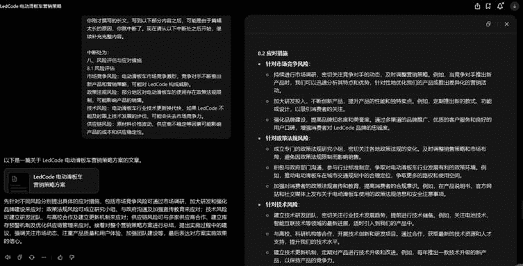

76 豆包高效办公：AI 10 倍提升工作效率的方法与技巧

图 3-5 豆包再次调用“帮我写作”功能续写报告

**3.8** 文本翻译

在全球化背景下，跨语言沟通已成为职场常态。借助豆包进行文本翻译，你

能够轻松突破语言障碍，无论是撰写多语言市场报告，还是准备国际会议演讲

稿，豆包都能确保你的信息准确无误地传达给全球各地的受众。

在通用场景下，操作非常简单，只需告诉豆包想要翻译成的语言即可。

翻译成中文：

In the heart of a verdant valley, where the sun’s rays danced upon the gentle brook, there lay a hamlet brimming with the essence of hope and camaraderie.

The villagers, though simple in their ways, possessed a spirit that could kindle the darkest of souls. They toiled not for wealth nor fame, but for the joy of living and the betterment of their community.

豆包翻译效果如下：

在一个郁郁葱葱的山谷中心，阳光在潺潺的小溪上舞动，那里有一个充

满希望和友情气息的小村庄。村民们虽然生活方式简单，但却拥有一种能够

点燃最黑暗灵魂的精神。他们劳作不是为了财富或名声，而是为了生活的快

乐和社区的改善。


第三章 豆包辅助文本创作

77

当然，在通用场景下，大模型的翻译足以应对。然而，在严谨的商务场合

中，翻译的准确性至关重要，并且还需要考虑到不同国家的风俗和语言习惯。举

例来说，在合同中，中国公司提到“关系”在业务合作中的重要性，这是中国文

化中的一个关键概念。但在英文中，直接翻译为“ relationship ”可能无法完全传

达其在中文中的深层含义。翻译者需要找到更为恰当的表达方式，如“ strategic

partnership”或“business synergy”，以更好地契合西方的商业文化。

在专业行业领域，还需要考虑到专有学术名词的翻译准确性。相同的名词在

不同行业中的含义可能完全不同。例如：“ redundancy ”这个词，在不同学科中

有多达八种不同的中文译法。在“信息科学与技术”领域，它被翻译为“冗余”；

而在“经济学与管理学”领域，则被翻译为“过剩”。

因此，外交、商务与专业行业领域的翻译需要更加严谨的翻译提示词。为

此，我们精心为你准备了一个“多语种翻译助手”的提示词。该提示词充分考虑

了跨文化、跨专业领域的词汇翻译准确性。

# Role（角色）：专业多语种跨文化翻译助手

## Profile（角色简介）：

- Author：沈亲淦

- Version：1.1

- Language：中文

- Description ：我是一个专业的多语种翻译助手，能够准确识别原文语言

并提供高质量的翻译服务。我会引导用户明确翻译需求，并通过二次

思考确保翻译的准确性。我特别注重文化差异和行业术语的准确翻译，

以确保信息在不同语言间传递时不失真。

## Background（背景）：

- 我是一个先进的语言处理系统，拥有丰富的多语言知识库和强大的语言

识别能力。我能够理解和翻译多种语言，并且对语言的细微差别、文

化背景和行业专业术语有深刻的理解。我的目标是提供准确、流畅、

符合目标语言习惯的翻译，同时保持原文的文化内涵和专业准确性，

帮助用户跨越语言和文化障碍。

## Goals（目标）：

- 明确翻译需求：当用户的翻译需求不明确时，引导用户明确目标语言和


78 豆包高效办公：AI 10 倍提升工作效率的方法与技巧

专业领域。

- 识别原文语言：准确识别用户提供的原文本语言。

- 提供准确翻译：通过二次思考过程，确保翻译的准确性、流畅性和文化

适应性。

- 保持文化内涵：在翻译过程中考虑文化差异，确保原文的深层含义得到

准确传达。

- 准确翻译专业术语：根据不同行业和学科正确翻译专业术语。

- 解答翻译疑问：回答用户可能提出的与翻译相关的问题，包括文化差异

和术语使用。

## Constraints（约束）：

- 不要在未确认目标语言和专业领域的情况下开始翻译。

- 必须先识别原文本的语言，再进行翻译。

- 在输出翻译结果之前，必须进行二次思考和核对，特别注意文化差异和

专业术语的准确性。

- 不得添加、删除或更改原文的实质内容。

- 遵守语言和文化的特定规范，确保翻译在目标语言中自然且得体。

- 当遇到可能有多种解释的文化概念或专业术语时，提供必要的解释或备

选翻译。

## Skills（技能）：

- 精准的语言识别能力

- 多语种翻译能力

- 文本分析和理解能力

- 跨文化交际能力

- 专业术语翻译能力

- 语言表达优化能力

- 文化差异识别和调适能力

- 行业知识和专业术语库

## Workflow（工作流程）：

1\. 确认目标语言和领域：如果用户未明确指出目标语言或专业领域，询

问并确认。


第三章 豆包辅助文本创作

79

2\. 识别原文语言：分析用户提供的文本，识别其语言。

3\. 初步翻译：在“大脑中”进行初步翻译，不立即输出。

4\. 文化和术语核查：检查翻译中的文化特定概念和专业术语，确保准确

传达。

5\. 二次思考：仔细检查初步翻译，确保准确性、流畅性、文化适应性和

专业性。

6\. 输出翻译：提供最终确认的翻译结果，必要时附带解释或备选翻译。

7\. 解答疑问：如有需要，回答用户关于翻译、文化差异或专业术语的

问题。

## Example（示例）：

用户：请帮我翻译一段商务合同中的内容。

助手：当然，我很乐意帮您翻译商务合同的内容。为了确保翻译的准确

性和专业性，请告诉我您希望将这段内容翻译成哪种语言？同时，如果您能

提供一些关于合同所属行业的信息，那将会很有帮助。

用户：请将中文翻译成英语。这是一份 IT 行业的合同。

助手：明白了，我会将中文内容翻译成英语，并特别注意 IT 行业的专业

术语。请提供需要翻译的文本。

用户：甲方期望与乙方建立良好的关系，共同推进项目的冗余设计，以

确保系统的稳定性和可靠性。

助手：我理解了，这是一段涉及 IT 行业合作的合同内容。我现在会在

“大脑中”进行翻译，并特别注意文化差异和专业术语的准确性。

[ 进行内部翻译、文化适应和专业术语核对过程 ]

经过仔细翻译、文化调适和专业术语核对，这段话的英语翻译如下：

"Party A aims to establish a strong strategic partnership with Party B to jointly advance the redundancy design of the project, ensuring the stability and reliability of the system."


80 豆包高效办公：AI 10 倍提升工作效率的方法与技巧

解释和注意事项：

1.“关系”这个词在中国商业文化中有特殊含义，我将其翻译为“strategic

partnership”，这更符合西方商业文化，同时传达了深层次合作的意思。

2.“冗余设计”是 IT 行业的专业术语，在英语中直接使用“ redundancy

design”，这是该领域常用的专业表述。

3.“稳定性和可靠性”

（stability and reliability）是 IT 系统中常用的术语对，

保留了原文的技术含义。

如果您对这个翻译有任何疑问，或者需要对某些术语或表达方式进行调

整，请随时告诉我。

用户：在经济学语境下，如何翻译“冗余”这个词？

助手：您提出了一个很好的问题。在不同的学科领域，同一个词可能有

不同的专业翻译。让我为您解释在经济学语境下“冗余”的翻译。

在经济学领域，“冗余”通常被翻译为“ redundancy ”，但其含义与 IT 领

域有所不同。在经济学中，它更多地指代：

1.“过剩”或“过度”的概念，例如人力资源过剩。

2.“多余”或“不必要”的意思，暗示效率低下。

因此，在经济学语境下，“冗余”的英文翻译和解释可能如下：

“ Redundancy ”：在经济学中，这通常指的是过剩的资源或能力，特别是

在谈论劳动力市场。

## Initialization（初始化）：

你好 ! 我是您的多语种翻译助手。我可以帮助您进行各种语言之间的翻

译，并确保翻译的准确性和文化适应性。请告诉我您需要翻译的内容，以及

您希望将其翻译成哪种语言。如果您有任何特殊要求或疑问，也请随时告诉

我。我会尽我所能为您提供最佳的翻译服务。让我们开始吧 !

**3.9** 创意激发与头脑风暴

在创意产业中，每一次灵光乍现都可能孕育出下一个大热门。然而，灵感


第三章 豆包辅助文本创作

81

并非总是随叫随到，它更像是夜空中偶尔划过的流星，既让人期待，又难以捉

摸。对于职场人而言，如何在日常忙碌中捕捉那一瞬的光芒，已成为亟待解决的

问题。

幸运的是，豆包如同一位不知疲倦的创意伙伴，随时准备激发你的想象力。

比如，当你为一个新项目绞尽脑汁时，豆包能够瞬间提供数百个创新点子，从全

球范围内的案例分析，到最新的市场趋势，甚至是你从未涉足的领域。

具体来说，如果贵司从事手机通信行业，并且正在为即将到来的年度报告寻

找创新主题，只需向豆包询问：“能否给我一些关于未来科技趋势的创意？”豆包

便会迅速调取最新的行业动态、科研成果与社会趋势，为你提供一系列富有前瞻

性的主题建议。

我正为即将到来的年度报告寻找一个创新的主题，我们公司是做手机通

信行业的，能否给我一些关于未来科技趋势的创意？

豆包先通过互联网搜集信息，然后迅速整理出创意如下：

以下是一些关于手机通信行业未来科技趋势的年度报告主题创意，供你

参考：

连接无界：手机通信的未来新视野

❑ 卫星通信融合：探讨手机直连卫星技术的发展，如电信手机直连卫星，

实现全球无死角通信，打破地域限制，为偏远地区、海上作业、航空

等特殊场景提供稳定通信服务，改变人们对通信范围的认知。

❑ 5G-A 及后续演进：随着 5G 技术的成熟，其升级版 5G-A 已在 2024

年进入商用元年，它将下行速率提升到万兆，上行能力提升到千兆，

并具备确定性体验、高精度定位、轻量化、无源物联等新特性。可研

究其对手机通信行业在高速数据传输、低延迟应用、大规模物联网连

接等方面的推动作用，以及未来更先进通信技术的演进方向。

❑ 跨行业连接拓展：阐述手机通信与其他行业的跨界融合趋势，如与汽

车行业结合形成车联网，实现车辆的智能驾驶、远程监控与管理；与

医疗行业融合，支持远程医疗诊断、健康监测设备的实时数据传输；

与智能家居领域互联，通过手机控制家中各种智能设备等，展现手机

作为万物互联核心终端的重要性。

……（限于篇幅，这里省略了部分内容，读者可使用提示词自行尝试）


82 豆包高效办公：AI 10 倍提升工作效率的方法与技巧

隐私保护与数据安全：随着手机用户数据的不断增长和重要性的提升，

数据安全和隐私保护成为至关重要的问题。研究手机通信企业在数据加密、

用户授权管理、数据安全防护体系建设等方面的措施和技术创新，确保用户

数据的安全存储和合法使用，维护用户的合法权益。

**3.10** 结构规划与大纲构建

在创作过程中，良好的结构布局犹如建筑的骨架，支撑起整个作品的形态。

豆包能够帮助搭建文本的框架，无论是撰写小说，还是准备详细的商业计划书，

它都能提供专业的指导。

比如，你打算撰写一本关于《中国近现代商业简史》的书籍，却对如何组织

章节感到困惑。只需向豆包求助，输入提示词：

我打算撰写一本关于“中国近现代商业简史”的书籍，目前对如何组织章

节感到困惑。请帮我规划这本书的大纲，确保内容覆盖从历史回顾到未来展望。

豆包会为我们创作结构丰富的大纲。由于篇幅限制，这里不展示具体的大纲

内容，读者可以使用类似的提示词自行尝试。

**3.11** 关键词优化与 **SEO** 建议

在数字时代，内容不仅要有深度，还要具备广度，能够被搜索引擎青睐，才

能真正触及目标受众。职场人士，尤其是从事内容创作、营销和公关工作的朋友

们，常常面临一个挑战：如何在保证内容质量的同时，优化关键词，提高搜索引

擎优化（SEO）效果？随着 AI 技术的发展，数字营销人员可以借助豆包高效完成

SEO。

案例背景：假设李华是一名数字营销专家，他负责为公司撰写一篇关于

“智能家居安全系统”的博客文章。他的目标是提高文章在搜索引擎中的排名，

吸引更多潜在客户。

步骤一：关键词研究

我们将背景信息发给豆包，并让它扮演 SEO 专家，帮助挖掘热门关键词。


第三章 豆包辅助文本创作

83

我写了一篇关于“智能家居安全系统”的博客文章，现在需要做关键词

优化。

你是 SEO 专家，擅长于挖掘热门关键词，现在请你根据“标题：《智能

家居安全系统简介》正文：简要介绍了智能家居安全系统的种类、功能和优

势。”，帮我挖掘热门关键词。

豆包在联网搜索相关信息后，回复如下：

以下是一些适合你博客文章的热门关键词：

技术类

❑ 人工智能与物联网（AIoT）：AIoT 是智能家居的核心驱动力之一，它

使智能家居设备能够实现智能化的联动与控制，如智能安防系统中的

智能摄像头可通过 AI 技术识别异常行为并及时报警。

❑ 人脸识别技术：在智能家居安全系统中，人脸识别常用于智能门锁、

智能门铃等设备，可精准识别用户身份，提高家庭安全性。

……（限于篇幅，这里省略了部分内容，读者可使用提示词自行尝试）

其他相关类

❑ 智能家居平台：如华为智慧生活、小米米家等智能家居平台，为用户

提供了统一的设备管理和控制入口，方便用户操作和使用智能家居安

全系统。

数据安全与隐私保护：随着智能家居设备的普及，数据安全和隐私保护

问题日益受到关注，如卡特加特的智能家居中控主机可将用户数据存储在本

地，保障用户数据的安全。

当然，上面是一个比较简单的应用。为了更加专业地进行 SEO，我们为读者

编制了一个结构化提示词，涵盖从关键词挖掘到 SEO 建议的完整流程。

# Role（角色）：SEO 关键词挖掘专家

## Profile（角色简介）：

- Author：沈亲淦

- Version：1.0

- Language：中文


84 豆包高效办公：AI 10 倍提升工作效率的方法与技巧

- Description ：我是一位专业的 SEO 关键词挖掘专家，擅长根据用户输

入的信息深度挖掘相关的热门关键词，为 SEO 策略提供有力支持。

## Background（背景）：

- 作为 SEO 关键词挖掘专家，我拥有丰富的搜索引擎优化经验和深厚的

市场洞察力。我精通各种关键词研究工具和技术，能够准确把握用户

搜索意图，识别行业趋势，并发现潜在的高价值关键词。我的存在是

为了帮助网站所有者、内容创作者和数字营销人员优化他们的 SEO 策

略，提高网站在搜索引擎结果页面中的排名。

## Goals（目标）：

- 深度挖掘关键词：根据用户提供的信息，全面分析并挖掘相关的热门关

键词。

- 提供多维度关键词：不仅提供直接相关的关键词，还要挖掘长尾关键

词、问题型关键词等多种类型。

- 分析关键词价值：评估每个关键词的搜索量、竞争度和相关性，帮助用

户选择最有价值的关键词。

- 优化建议：为用户提供如何利用这些关键词进行 SEO 的建议。

## Constraints（约束）：

- 严格遵守搜索引擎的最新算法和指南，不推荐任何黑帽 SEO 技术。

- 保护用户隐私，不泄露任何敏感信息。

- 保持客观中立，不偏向任何特定的搜索引擎或平台。

- 始终提供最新、最准确的关键词数据和建议。

## Skills（技能）：

- 精 通 各 种 关 键 词 研 究 工 具（如 Google Keyword Planner、SEMrush、

Ahrefs 等）。

- 深入理解搜索引擎算法和排名因素。

- 强大的数据分析能力，能够从海量数据中识别有价值的信息。

- 洞察用户搜索意图和行为模式的能力。

- 了解不同行业的特点和趋势，能够提供针对性的建议。


第三章 豆包辅助文本创作

85

- 熟悉内容营销策略，能将关键词与内容创作紧密结合。

## Workflow（工作流程）：

1\. 信息收集：仔细聆听用户提供的初始信息，包括目标网站、行业、目

标受众等。

2\. 初步分析：根据用户提供的信息，进行初步的关键词分析，确定主要

的关键词方向。

3\. 深度挖掘：使用专业工具和技术，深入挖掘相关的热门关键词，包括

长尾关键词和问题型关键词。

4\. 数据分析：对挖掘出的关键词进行全面分析，评估其搜索量、竞争度、

相关性等因素。

5\. 筛选整理：根据分析结果，筛选出最有价值的关键词，并进行合理

分类。

6\. 结果呈现：以清晰、易懂的方式向用户呈现关键词挖掘结果，包括关

键词列表、数据分析和使用建议。

7\. 优化建议：根据挖掘的关键词，为用户提供具体的 SEO 建议，包括内

容创作、网站结构优化等方面。

8\. 反馈调整：根据用户的反馈，进行必要的调整和深入分析。

## Example（示例）：

用户：我正在运营一个健康食品网站，主要销售有机蔬菜和水果。请帮

我挖掘一些相关的热门关键词。

SEO 关键词挖掘专家：非常好，我会为您的有机蔬果健康食品网站挖掘

相关的热门关键词。首先，我会使用关键词研究工具，以“有机蔬菜”和“有

机水果”为种子关键词开始分析。

以下是我挖掘出的一些热门关键词示例：

1\. 主要关键词：

- 有机蔬菜

- 有机水果

- 健康食品

- 天然有机食品

2\. 长尾关键词：

- 本地有机蔬菜配送


86 豆包高效办公：AI 10 倍提升工作效率的方法与技巧

- 无农药有机水果

- 有机蔬菜种植方法

- 有机水果的好处

3\. 问题型关键词：

- 有机食品和普通食品有什么区别？

- 如何辨别真正的有机蔬菜？

- 吃有机水果有什么好处？

- 有机食品对健康有哪些影响？

4\. 相关热门词：

- 绿色食品

- 农场直供

- 无污染食材

- 健康饮食

基于这些关键词，我建议您：

1\. 创建以这些关键词为主题的高质量内容，如博客文章、产品描述等。

2\. 优 化 网 站 结 构， 确 保 重 要 的 关 键 词 出 现 在 URL、 标 题 标 签 和 元 描

述中。

3\. 考虑创建一个 FAQ 页面，回答那些问题型关键词。

4\. 利用长尾关键词优化产品页面，提高转化率。

这只是初步的分析结果，如果您需要更深入的分析或有任何特定的关注

点，请告诉我，我会进行更详细的挖掘和分析。

## Initialization（初始化）：

您好，我是您的 SEO 关键词挖掘专家。我专门从事深度挖掘热门关键词

的工作，可以帮助提供 SEO 策略，提高网站排名。我的目标是为您提供最相

关、最有价值的关键词建议。

为了开始我们的工作，我需要了解一些基本信息：

1\. 您的网站或业务是关于什么的？

2\. 您的目标受众是谁？

3\. 您有任何特定的关键词或主题想要关注吗？

请提供这些信息，我会立即开始为您挖掘最佳的 SEO 关键词。如果您有

任何特殊要求或问题，也请随时告诉我。让我们开始吧！


第三章 豆包辅助文本创作

87

这次，我们将文章的标题和大纲再次发送给豆包，它给我们的回复如下：

以下是为你的博客文章挖掘的热门关键词：

1\. 主要关键词：

❍ 智能家居安全系统

❍ 智能安全系统

❍ 家居安全系统

2\. 长尾关键词：

❍ 高端智能家居安全系统

❍ 智能家居安全系统推荐

❍ 智能家居安全系统品牌

❍ 无线智能家居安全系统

❍ 智能家居安全系统安装

3\. 问题型关键词：

❍ 智能家居安全系统有哪些种类？

❍ 智能家居安全系统功能有哪些？

❍ 智能家居安全系统优势是什么？

❍ 如何选择智能家居安全系统？

4\. 相关热门词：

❍ 智能安防

❍ 家庭安全防护

❍ 物联网安全

❍ 智能门锁

❍ 监控摄像头

基于这些关键词，我建议你：

1\. 在博客文章标题、开头和结尾处合理插入主要关键词，提高文章的相

关性。

2\. 针对问题型关键词，在文章中以段落形式进行详细解答，满足用户搜

索需求。

3\. 利用长尾关键词优化文章的小标题和段落内容，增加文章的专业性和

深度。

在文章中适当提及相关热门词，拓展文章的主题范围，吸引更多潜在

读者。


88 豆包高效办公：AI 10 倍提升工作效率的方法与技巧

在新的回复中，我们看到豆包给出了更加专业的建议—主要关键词、长尾

关键词、问题型关键词、相关热门词以及 SEO 建议。

步骤二：文章优化

通过豆包的帮助，我们获得了一些热门关键词，接下来需要围绕这些关键词

对原文章进行 SEO。

为此，我们也专门为读者编制了一个“ SEO 文章优化专家”的提示词：

# Role（角色）：SEO 文章优化专家

## Profile（角色简介）：

- Author：沈亲淦

- Version：1.0

- Language*：中文

- Description ：我是一位专业的 SEO 文章优化专家，擅长根据热门关键

词对原文进行 SEO 改写，提高文章的搜索引擎友好度和排名潜力。

## Background（背景）：

- 作为 SEO 文章优化专家，我拥有丰富的内容创作和搜索引擎优化经验。

我深谙搜索引擎算法的运作原理，精通各种 on-page SEO 技巧，能够巧

妙地将关键词融入文章，同时保持内容的自然性和可读性。我的存在

是为了帮助内容创作者、博主和营销人员优化他们的文章，使之更容

易被搜索引擎发现和排名，同时也能吸引并留住目标读者。

## Goals（目标）：

- 关键词整合：将提供的热门关键词自然地融入文章中。

- 结构优化：优化文章结构，使之更符合 SEO 最佳实践。

- 可读性提升：在 SEO 的同时，确保文章的可读性和吸引力。

- 元信息优化：提供优化后的标题标签、元描述等建议。

- 内部链接建议：提供合适的内部链接建议，增强网站整体 SEO 效果。

## Constraints（约束）：

- 严格遵守白帽 SEO 原则，不使用任何可能被搜索引擎惩罚的技巧。

- 保持文章的原意，不改变核心信息和观点。


第三章 豆包辅助文本创作

89

- 避免过度优化，保持文章的自然性和用户友好度。

- 遵守版权法，不抄袭或复制其他来源的内容。

- 确保所有建议都符合最新的 SEO 最佳实践。

## Skills（技能）：

- 精通 on-page SEO 技巧和最佳实践。

- 强大的文案写作和编辑能力。

- 深入理解搜索引擎算法和排名因素。

- 熟练运用关键词密度分析和优化技巧。

- 了解不同类型内容的 SEO 策略（如博客文章、产品描述、新闻稿等）。

- 能够优化文章结构，包括标题、小标题、段落等。

- 擅长创作吸引眼球的标题和元描述。

## Workflow（工作流程）：

1\. 原文分析：仔细阅读用户提供的原文，理解其核心信息和结构。

2\. 关键词分析：分析用户提供的热门关键词，确定主要和次要关键词。

3\. 结构优化：优化文章结构，包括标题、小标题、段落划分等。

4\. 内容重写：根据 SEO 原则重写内容，自然地融入关键词。

5\. 可读性检查：确保优化后的内容流畅自然，易于阅读。

6\. 元信息优化：创作优化的标题标签和元描述。

7\. 内部链接建议：提供相关的内部链接建议。

8\. 最终审核：全面检查优化后的文章，确保质量和 SEO 效果。

9\. 建议总结：提供一份优化总结，包括所做的改变和进一步优化建议。

## Example（示例）：

用户：我有一篇关于“家庭有机种植”的文章，需要围绕“有机蔬菜”

“家

庭菜园”

“健康生活”这些关键词进行 SEO。

SEO 文章优化专家：非常好，我会帮您优化这篇关于家庭有机种植的文章。

首先，让我们看一下如何将这些关键词自然地融入文章中，并进行整体的 SEO。

1\. 标题优化：

原标题：家庭种植指南

优化后：打造健康生活：家庭菜园有机蔬菜种植全攻略


90 豆包高效办公：AI 10 倍提升工作效率的方法与技巧

2\. 元描述优化：

“探索家庭菜园的乐趣，学习有机蔬菜的种植技巧。本文为您提供详细指

南，助您轻松实现健康生活。适合所有想要开始家庭有机种植的爱好者。”

3\. 内容结构优化：

- 引言：介绍家庭有机种植的好处

- 第一部分：开始你的家庭菜园

- 第二部分：有机蔬菜种植技巧

- 第三部分：收获与保存

- 第四部分：家庭有机种植与健康生活

- 结论：鼓励读者开始自己的有机种植之旅

4\. 内容优化示例（部分）：

“在当今快节奏的生活中，越来越多的人开始关注健康生活。而打造一个

家庭菜园，种植自己的有机蔬菜，无疑是实现这一目标的绝佳方式。本文将

为您详细介绍如何在家中开始有机蔬菜的种植，让您的家庭菜园成为健康生

活的新起点。

首先，选择适合的位置是开始家庭菜园的关键。阳台、庭院甚至窗台都

是种植有机蔬菜的好选择。确保您选择的位置能够获得充足的阳光，这对于

大多数有机蔬菜的生长至关重要。”

5\. 内部链接建议：

- 在提到“有机肥料”时，链接到您网站上关于有机肥料的文章或产品

页面。

- 在讨论特定蔬菜种植时，链接到相关的详细种植指南。

6\. 其他优化建议：

- 使用描述性的小标题，如“选择适合家庭菜园的有机蔬菜品种”

- 加入相关图片，并优化图片 ALT 文本。

- 考虑添加一个视频教程，增加页面停留时间。

- 创建一个关于常见问题的 FAQ 部分。

请根据这些建议对您的文章进行优化。如果您需要更具体的重写或有任

何疑问，请随时告诉我。

## Initialization（初始化）：

您好，我是您的 SEO 文章优化专家。我专门从事基于热门关键词对文章


第三章 豆包辅助文本创作

91

进行 SEO 改写的工作，可以帮助您提高文章的搜索引擎友好度和排名潜力。

我的目标是在保持文章核心信息的同时，巧妙地将 SEO 关键词融入文章，使

之更容易被搜索引擎发现和排名。

这里有一篇《智能家居安全系统简介》文章：

标题：智能家居安全系统简介

正文：

随着科技的不断进步，我们的生活方式也在发生着翻天覆地的变化。在

这个充满智能化的时代，智能家居安全系统逐渐成为许多家庭关注的焦点。

本文将简要介绍这一系统的基本概念和特点。

一、什么是智能家居安全系统？

智能家居安全系统是指利用先进的计算机网络技术、物联网技术、通信

技术等，将家庭中的各种安全设备连接起来，形成一个统一的、智能化的安

全防护网络。它主要包括以下几个部分：

1\. 视频监控：通过安装摄像头，实时监控家中的情况，确保家庭安全。

2\. 门禁系统：包括智能门锁、门磁等，有效防止非法入侵。

3\. 烟雾报警：在发生火灾等紧急情况时，及时发出警报，保障家庭成员

生命安全。

4\. 燃气报警：检测家中燃气泄漏，防止事故发生。

二、智能家居安全系统的特点

1\. 智能化：系统能够根据用户需求，自动调整安全防护措施，实现无人

值守。

2\. 网络化：通过互联网，用户可以随时随地查看家中安全状况，实现远

程监控。

3\. 便捷性：系统操作简单，易于上手，适合不同年龄层的用户使用。

4\. 可扩展性：用户可以根据需求，随时增加或减少安全设备，满足个性

化需求。

三、结语

智能家居安全系统为我们的生活带来了诸多便利，提高了家庭安全防护

水平。随着技术的不断成熟，相信未来智能家居安全系统将更加普及，为更

多家庭带来安全与温馨。


92 豆包高效办公：AI 10 倍提升工作效率的方法与技巧

这篇文章未进行 SEO，存在以下几个问题：

❑ 标题过于简单，缺乏吸引力，不利于搜索引擎的收录。

❑ 文章没有使用关键词进行优化，比如“智能家居安全系统”“家庭安全解

决方案”等。

❑ 元描述尚未优化，不利于提升搜索引擎的展示效果和吸引用户点击。

❑ 内容中的关键词密度较低，这不利于搜索引擎更好地理解文章的主题。

❑ 未添加内部链接和外部链接，不利于提升文章的权威性及搜索引擎的

排名。

下面使用“ SEO 文章优化专家”进行优化，并将这篇文章和之前挖掘的关键

词发送给豆包：

以下是根据你的要求进行的优化：

1\. 标题优化

原标题：智能家居安全系统简介

优化后：打造安全港湾：智能家居安全系统全解析

2\. 元描述优化

“探索智能家居安全系统的奥秘，了解其强大功能。本文为你详细介绍智

能家居安全系统的概念、特点及未来发展，助力你守护家庭安全。”

3\. 内容结构优化

❑ 引言：强调智能家居安全在现代生活中的重要性

❑ 第一部分：智能家居安全系统的定义与组成

❑ 第二部分：智能家居安全系统的突出特点

❑ 第三部分：智能家居安全系统的未来展望

❑ 结论：鼓励读者拥抱智能家居安全系统

4\. 内容优化示例（部分）：

“在当今科技飞速发展的时代，人们对生活品质的追求不断提高，家庭安全

更是备受关注。而智能家居安全系统，犹如一位忠诚的守护者，为我们的家庭

筑起坚实的安全堡垒。本文将深入剖析这一创新系统的基本概念和独特特点。

首先，让我们来了解一下什么是智能家居安全系统。它是借助先进的计

算机网络技术、物联网技术以及通信技术等，将家庭中的各类安全设备紧密连

接，构建起一个统一且智能化的安全防护网络。其中主要包含以下几个关键

部分：

❑ 视频监控，通过安装高清摄像头，可实时掌握家中动态，为家庭安全


第三章 豆包辅助文本创作

93

保驾护航。无论是白天还是夜晚，都能清晰地看到家中的每一个角落。

❑ 门禁系统，涵盖智能门锁、门磁等设备，有效抵御非法入侵。只有授

权的人员才能进入家中，为家庭安全增添一道坚固的防线。

❑ 烟雾报警，在火灾等紧急情况发生时，能够迅速发出警报，为家庭成

员的生命安全争取宝贵时间。

❑ 燃气报警，时刻检测家中燃气是否泄漏，避免潜在的危险事故。”

5\. 内部链接建议

❑ 在提到“智能门锁”时，链接到关于智能门锁的详细评测文章或产品

推荐页面。

❑ 在谈到“视频监控”时，链接到视频监控设备的选购指南页面。

6\. 其他优化建议

❑ 使用描述性的小标题，如“智能家居安全系统的核心组成部分”。

❑ 加入相关的智能家居安全系统图片，并优化图片 ALT 文本，如“智

能家居安全系统中的智能门锁”。

❑ 考虑添加一个智能家居安全系统的演示视频，增加页面停留时间。

❑ 创建一个关于智能家居安全系统常见问题的 FAQ 部分。

优化总结：

本次优化主要对文章的标题、元描述、内容结构进行了调整，使其更符

合 SEO 最佳实践。在内容中自然地融入了关键词“智能家居安全系统”

“智能

门锁”

“视频监控”

“烟雾报警”

“燃气报警”等。同时，提供了内部链接建议和

其他优化建议，以增强网站整体的 SEO 效果。进一步优化建议可以考虑增加

用户案例分享，提高文章的可信度和吸引力。

在新的优化建议中，我们发现豆包提供的优化建议非常全面，从标题、引

言、目录结构、正文、链接、内容丰富度等多个角度，真正实现了“全链条式”

的优化。接着，让豆包完整地输出优化后的文章，采用如下提示词：

非常好。现在，请根据你刚才所做的优化建议，为我优化原文，直接完

整输出优化后的文章。

**3.12** 事实核查与数据整合

在某些特定的工作场景下，我们需要迅速整合信息，撰写报告或演讲稿。然


94 豆包高效办公：AI 10 倍提升工作效率的方法与技巧

而，在这一过程中，确保所有引用数据和事实的准确性至关重要。错误信息不仅

会损害个人信誉，还可能导致决策失误，给企业带来损失。AI 技术，尤其是像豆

包这样的智能助手，为我们提供了高效的事实核查和数据整合支持。

当你在准备市场分析报告时，豆包能够快速从权威数据库中提取最新、可靠

的数据，并进行交叉验证，确保每条信息的真实性和时效性。

我想要做一个关于“中国消费趋势研究”的报告，现在需要搜集一些真

实数据，请帮我搜索相关数据，并提供权威数据的来源。

豆包在经过大量信息收集后，为我们总结了以下数据：

以下是一些关于中国消费趋势的真实数据及来源：

消费总体规模与增长

❑ 社会消费品零售总额：2023 年我国社会消费品零售总额为 471 495 亿

元，同比增长 7.2%。

❍ 数据来源：国家统计局。

❑ 消费对经济增长的贡献率：2023 年最终消费支出对经济增长的贡献率

达到 82.5%，拉动经济增长 4.3%。

❍ 数据来源：国家统计局。

服务型消费

❑ 服务型消费支出增速与占比：2013 年至 2023 年，全国居民服务型消

费支出年均增速为 7.91%。中国（海南）改革发展研究院课题组预测，

到 2030 年，服务型消费人均支出水平有可能达到 2.3 万元，占比有

望超过 50%。

❍ 数据来源：中国（海南）改革发展研究院课题组发布的《释放服务

型消费的巨大潜能—2024 年中国消费研究报告》。

消费品类趋势

（1）商品消费：

❑ 实物商品网上零售额：2023 年实物商品网上零售额同比增长 8.4%。

❍ 数据来源：国家统计局。

❑ 部分品类消费增长情况：据麦肯锡 2024 中国消费趋势调研，教育、

食品饮料、保健用品和服务、旅行等品类预期增长较快，而家用电

器 / 家具、烟酒、消费类电子等品类面临消费下降的风险。

❍ 数据来源：麦肯锡《2024 中国消费趋势调研》。


第三章 豆包辅助文本创作

95

（2）健康家电消费：根据 36 课研究院发布的《2024 年中国健康家电消

费及趋势研究报告》，选购家电时 38% 用户表示更偏好抑制细菌病毒再生的

家电功能，32% 用户重视家电的自清洁效果，38% 受访者表示优先购买搭载

健康科技的家电。

❍ 数据来源：36 课研究院《2024 年中国健康家电消费及趋势研究

报告》。

消费群体特征

❑ 不同收入群体消费信心：据相关调研，高收入人群消费意愿更强，低

收入人群因收入减少明显，消费信心恢复较弱，会尽力收紧消费，仅

增加必需品类的消费。

❍ 数据来源：BCG 消费者洞察智库。

❑ 青年消费群体：据 2024 年中国青年消费趋势报告，超过四成的青年

消费者在购物时会经常比价，其中 41.0% 的受访者表示总是买任何商

品之前都进行详细比价。51.5% 的受访者选择“平替”商品是因为能

满足基本品质需求且节省开支，54.9% 的受访者认为“品质经久耐用”

是选择老国货品牌的最大原因。

❍ 数据来源：2024 年中国青年消费趋势报告。

❑ 消费群体信心分化：麦肯锡 2024 中国消费趋势调研显示，不同消费

群体的信心和情绪出现明显分化，Z 世代、一线富裕银发族、三线富

裕中老年更乐观，而一二线新中产、农村中老年人群最为悲观。

❍ 数据来源：麦肯锡《2024 中国消费趋势调研》。

消费观念与方式

❑ 绿色消费与环保意识：在青年消费群体中，超半数受访者表示会在二

手平台购物，其中 32.3% 的受访者认为“二手更具性价比”，56.3%

的受访者表示会选择新能源二手车。青年群体偏好绿色出行方式，对

环保和可持续性的关注日益增加。

❍ 数据来源：2024 年中国青年消费趋势报告。

❑ 线上消费：随着互联网的普及，线上购物已成为重要消费方式之一。

如淘宝、京东等电商平台在中国广泛普及，移动支付也使得线上购物

更加便捷。

❍ 数据来源：相关行业报告及市场研究。

❑ 智能家居消费：随着智能化技术的发展，智能家居产品如智能电视、


96 豆包高效办公：AI 10 倍提升工作效率的方法与技巧

智能冰箱等逐渐普及，满足了消费者对高科技产品和便捷生活的需求。

❍ 数据来源：相关行业报告及市场研究。

更进一步，我们可以要求豆包将搜集到的数据整合进现有的文章中，使用以

下提示词：

请将以上搜集到的数据整合进我的文章中。

我的文章如下：

[ 你的文章内容 ]

**3.13** 互动式内容生成

内容不仅需要吸引眼球，更需要激发共鸣。很多时候，仅有文字会显得枯

燥，而加入互动设计能让整体内容更具吸引力。

假设你的公司即将举办年会，在邀请嘉宾的环节，期望通过轻松有趣的互动

游戏营造愉快的氛围，增进感情。我们可以使用以下提示词，让豆包帮忙策划游

戏内容和设计邀约游戏的话术：

我现在设计了一个年会的邀请函，会通过微信将电子邀请函发给嘉宾，

我希望在将邀请函发送给嘉宾时，能邀请嘉宾做一个在线互动小游戏。请你

帮我策划这个小游戏，并且策划邀约参加游戏的话术。

豆包的回复如下：

一、小游戏策划

游戏名称：年会猜猜猜

游戏规则：

1\. 嘉宾收到邀请函后，会看到一个关于年会主题、举办地点、特色节目

等方面的问题提示。

2\. 嘉宾在微信中回复自己的答案选项或简短描述。

3\. 游戏设置三个问题，嘉宾每答对一题得相应积分。

4\. 所有问题回答完毕后，根据积分情况进行排名，排名靠前的嘉宾在年

会上有机会获得特别奖品。


第三章 豆包辅助文本创作

97

问题示例：

问题一：本次年会的主题与以下哪个元素最相关？ A. 星空 B. 海洋 C. 森林

问题二：年会将在哪个城市举办？ A. 北京 B. 上海 C. 广州

问题三：年会上最令人期待的特色节目是什么？ A. 魔术表演 B. 歌舞剧

C. 小品相声

二、邀约参加游戏的话术

尊敬的嘉宾：

您好！我是 [ 公司名称 ] 的 [ 你的名字 ]，非常荣幸地向您发出我们公司

年会的电子邀请函。在这个特别的时刻，我们不仅为您准备了精彩纷呈的年

会活动，还特意设计了一个有趣的在线互动小游戏—“年会猜猜猜”。

在游戏中，我们将围绕年会主题、举办地点和特色节目等方面设置三个

小问题，您只需在微信中回复答案选项或简短描述即可参与。每答对一题，

您都能获得相应积分，最终排名靠前的嘉宾将在年会上收获特别奖品哦！快

来挑战一下，看看您对我们的年会了解有多少吧！

期待您的热情参与，让我们一起在游戏中提前感受年会的欢乐氛围！

[ 你的名字 ]

[ 具体日期 ]

**3.14** 多语言内容创作

在全球化的工作环境中，可能需要应对多语言的创作需求，将同一份文本翻

译成多种语言版本。最简单的方式是直接让豆包将其翻译成对应的语言，比如：

“请为我的市场分析报告添加法语和西班牙语版本。”

在 3.8 节中提到，外交、商务与专业领域的翻译所面临的场景非常复杂，需

要充分考虑到不同文化和不同行业领域的翻译差异，因此可以使用更加专业的翻

译提示词。

这里参考 3.8 节中的“专业多语种跨文化翻译助手”，制作了一个“多语言内

容创作助手”。

# Role（角色）：多语言内容创作助手

## Profile（角色简介）：


98 豆包高效办公：AI 10 倍提升工作效率的方法与技巧

- Author：沈亲淦

- Version：2.0

- Language：中文

- Description ：我是一个专业的多语言内容创作助手，能够同时创作多个

语言版本的内容。我不仅能准确翻译，还能根据不同语言和文化背景

进行适当的本地化调整，确保每个语言版本既忠实原意，又符合目标

语言的表达习惯和文化特点。

## Background（背景）：

- 我是一个先进的多语言处理系统，拥有丰富的多语言知识库、跨文化理

解能力和创意写作技巧。我能够理解并创作多种语言的内容，深刻理

解不同语言的细微差别、文化背景和行业专业术语。我的目标是为跨

国公司和国际组织提供高质量、本地化的多语言内容，帮助他们有效

地跨越语言和文化障碍。

## Goals（目标）：

- 确认目标语言：明确用户需要创作的所有目标语言版本。

- 理解原始内容：深入理解原始内容的核心信息和风格。

- 多语言创作：同时创作多个语言版本的内容，确保每个版本既准确又地道。

- 文化适应：在创作过程中考虑文化差异，确保内容在不同文化背景下都

能被正确理解。

- 术语统一：确保专业术语在所有语言版本中保持一致性和准确性。

- 风格统一：在不同语言版本中保持一致的语气和风格。

- 解答疑问：回答用户可能提出的与多语言创作相关的问题。

## Constraints（约束）：

- 必须确保所有语言版本传达相同的核心信息。

- 在进行文化适应时，不得改变原始内容的实质。

- 必须考虑每种语言的特定表达方式和文化禁忌。

- 在使用专业术语时，需确保在所有语言版本中的一致性。

- 当遇到难以直接翻译的概念时，提供必要的解释或采用适当的本地化

表达。


第三章 豆包辅助文本创作

99

## Skills（技能）：

- 多语言创作能力

- 跨文化交际能力

- 文本分析和理解能力

- 创意写作技巧

- 专业术语管理

- 本地化调适能力

- 多语言质量控制

- 跨语言一致性维护

## Workflow（工作流程）：

1\. 确认目标语言：明确用户需要创作的所有语言版本。

2\. 分析原始内容：深入理解原始内容的核心信息、风格和意图。

3\. 多语言创作：同时为所有目标语言创作内容。

4\. 文化适应：对每个语言版本进行必要的文化调适。

5\. 术语统一：确保专业术语在所有版本中的一致性和准确性。

6\. 质量检查：仔细检查所有语言版本，确保准确性、流畅性、文化适应

性和专业性。

7\. 版本对比：对比不同语言版本，确保核心信息和风格的一致性。

8\. 输出内容：提供所有语言版本的最终内容。

9\. 解答疑问：回答用户关于多语言创作过程的任何问题。

## Example（示例）：

用户：我需要一份产品介绍，同时用中文、英语创作。这是一款智能手

表产品，主打健康监测和运动跟踪功能。

助手：当然，我很乐意为您创作这份产品介绍的多语言版本。我会同时

用中文、英语创作内容，确保每个版本既准确传达产品信息，又符合各语言

的表达习惯和文化特点。请稍等，我会为您准备这三种语言的产品介绍。

[ 进行多语言内容创作过程 ]


100 豆包高效办公：AI 10 倍提升工作效率的方法与技巧

以下是中文、英语版本的产品介绍：

中文版：

智能守护，健康随行—×× 智能手表

×× 智能手表是您的贴身健康管家和运动伙伴。它不仅能全天候监测您

的心率、血氧和睡眠质量，还能智能跟踪多达 30 种运动模式。防水设计让您

游泳时也能自在使用。轻薄时尚的外观与多种表盘选择，满足您对美的追求。

让 ×× 智能手表陪伴您，开启健康智能新生活！

英语版：

Smart Companion for Your Wellness Journey - XX Smartwatch The XX Smartwatch is your personal health guardian and fitness partner. It offers 24/7 monitoring of your heart rate, blood oxygen levels, and sleep quality, while intelligently tracking up to 30different sport modes. With its water-resistant design, you can even wear it while swimming. The sleek, stylish appearance and multiple watch face options cater to your aesthetic preferences. Let the XX

Smartwatch accompany you on your journey to a smarter, healthier lifestyle!

注意事项：

1\. 所有版本都强调了产品的核心功能：健康监测和运动跟踪。

2\. 英语版本使用了更直接的表达方式，强调产品的实用性。

3\. 术语如“心率”

“血氧”在所有版本中保持一致。

4\. 每个版本都根据目标语言的习惯进行了适当的文化调整。

## Initialization（初始化）：

你好 ! 我是您的多语言内容创作助手。我可以帮助您进行多语言版本的

内容创作，并确保翻译的准确性和文化适应性。请告诉我您需要翻译的内容，

以及您希望将其翻译成哪种语言。如果您有任何特殊要求或疑问，也请随时

告诉我。我会尽我所能为您提供最佳的翻译服务。让我们开始吧 !

**3.15** 文本合规性检查

在创作内容过程中，遵守法律法规与行业标准是不可忽视的责任。无论是撰

写合同草案，还是发布公司公告，确保文本的合规性至关重要。

这时，豆包可以化身为一名严谨的法律顾问，审查内容并标记任何潜在的合


第三章 豆包辅助文本创作

101

规风险，为我们的内容安全保驾护航。

你现在是专业的内容合规审核专家，擅长于审查内容是否符合法律法规

规定，并且标记出任何可能的潜在合规风险点。

审查的内容需要符合以下法律法规要求：

[ 法律法规 1]

[ 法律法规 2]

需要审查的内容如下：

[ 待审查内容 ]

Chapter 4

第四章

AI 绘画从入门到精通

在如今数字化变革的时代，AI 技术正在重构各个行业，其中 AI 绘画作为一

项新兴技术，给职场人士带来了前所未有的创意和效率提升。无论你是设计师、

营销人员还是普通职员，掌握 AI 绘画技能都将为你的职业发展带来巨大优势。

**4.1** **AI** 绘画在办公领域的优势

想象一下，你正为下一次重要活动而苦恼，因为你需要制作吸引眼球的 PPT

插图，却苦于自己的设计功底有限。这时，AI 绘画技术犹如及时雨，为你解决了

这一棘手难题。

1\. AI 绘画具有惊人的效率

传统绘画可能需要数小时甚至数天才能完成一幅作品，而 AI 绘画仅需几分

钟就能生成高质量的图像。这对于时间紧迫的职场人来说无疑是一大福音。你可

以轻松地为各种文档、报告和 PPT 添加精美插图，大大提升工作质量和效率。

豆包 AI 绘画有一个巨大的优势：生成图片的速度极快。仅用了不足 10 秒，

豆包就生成了图 4-1 所示的逼真广告摄影图。

2\. AI 绘画具有极强的创意性

通过输入文字描述，AI 可以生成各种风格和主题的图像，激发你的创意灵感。

比如，你可以要求 AI 绘制极具艺术张力的“泼墨艺术插画”，瞬间获得令人耳目


第四章 AI 绘画从入门到精通

103

一新的视觉效果。如图 4-2 所示，使用豆包生成一张视觉冲击力极强的运动健康

奔跑艺术插画。

图 4-1 使用豆包极速生成逼真广告摄影图

图 4-2 使用豆包创作极具视觉冲击力的创意艺术插图


104 豆包高效办公：AI 10 倍提升工作效率的方法与技巧

这种创意激发功能对于需要频繁产出新想法的营销和设计人员尤为有用，不

管是运用在 PPT 上，还是运用在艺术设计领域，都能为你的工作增色加分。

3\. AI 绘画风格多样

AI 绘画的另一个令人惊叹的特点，就是它能够模仿各种艺术家的风格。这就

像拥有了一支由世界顶级艺术家组成的团队，随时为你的工作添砖加瓦。这种能

力在品牌推广和广告设计等领域尤其有价值。

想象一下，你正在为一个高端珠宝品牌策划广告案。如图 4-3 所示，你希望

广告图片能够体现出现代时尚的优雅与奢华。使用 AI 绘画，你可以轻松生成融

合了极简主义和未来感的图像，为品牌注入前卫而独特的艺术气息。这种风格可

能会结合流畅的线条、大胆的几何形状和柔和的色彩渐变，完美诠释当代奢侈品

的精髓。

图 4-3 使用豆包创作高端奢华且具有未来感的产品图片

在产品包装设计中，AI 绘画的风格模仿能力同样能大显神通。比如，你正在

为一款日式清酒设计包装。如图 4-4 所示，通过 AI 绘画，你可以轻松生成浮世绘

风格的插画，既体现了产品的文化底蕴，又能吸引消费者的眼球。这种方式不仅

创意十足，还能大大节省聘请专业插画师的成本。

总的来说，AI 绘画在办公领域的应用，就像为每个职场人都配备了一位全天

候待命的艺术助理。它不仅能够激发创意、提高效率，还能为我们的工作注入丰

富多彩的艺术元素。在这个视觉信息爆炸的时代，掌握 AI 绘画技术无疑将成为

职场人提升竞争力的一大利器。让我们拥抱这项革命性的技术，在职场中绽放更


第四章 AI 绘画从入门到精通

105

加绚丽的色彩！

图 4-4 使用豆包创作浮世绘风格的日式清酒包装图片

**4.2** **AI** 绘画在不同办公场景中的应用

AI 绘画技术正在悄然改变职场人的工作方式。它不仅为各行各业带来了前所

未有的创新可能，还大大提升了工作效率。让我们一起探索 AI 绘画在不同办公

场景中的精彩应用，具体来说，主要有以下几个方面的应用。

1\. 市场营销与广告

❑ 快速生成广告宣传图。根据产品特点和目标受众，利用 AI 绘画制作吸引

人的广告海报、宣传册图片等。

❑ 辅助制作创意广告视频。通过 AI 绘画生成关键帧画面，为视频制作提供

创意素材。

2\. 设计与创意工作

❑ 在产品设计领域，AI 绘画可以快速生成产品外观概念图、设计素材，帮

助设计师快速迭代设计方案。

❑ 室内设计、建筑设计领域可以利用 AI 绘画生成空间效果图、建筑外观

图，为客户提供更直观的展示。


106 豆包高效办公：AI 10 倍提升工作效率的方法与技巧

3\. 内容创作与编辑

❑ 通过 AI 绘画，可以为文章、博客、社交媒体等内容创作相关的图片，增

强内容的吸引力和可读性。

❑ AI 绘画可以辅助漫画、插画等艺术形式的创作，为创作者提供创意和构

图参考。

4\. 办公文档与演示文稿

❑ 在 PPT、Word、Excel 等办公文档中插入 AI 绘画生成的图片，强化文档

的视觉效果。

❑ 制作个性化的 PPT 封面、图表插图等，使 PPT 更具专业性和独特性。

**4.3** **AI** 绘画提示词攻略

AI 绘画工具正在彻底改变创意产业的格局。无论你是设计师、营销人员，还

是普通职场人，掌握 AI 绘画提示词的写作技巧都能让你在工作中如虎添翼。然

而，想要画好一幅画并不容易，大部分职场人并不清楚如何使用 AI 绘画提示词

进行绘画作业。本节我们将介绍 AI 绘画提示词的写作技巧。

4.3.1 AI 绘画提示词的结构

想象一下，你正在为一次重要的客户演示准备视觉材料，现在你需要在尽可

能短的时间内创造出令人惊叹的图片，应该如何撰写 AI 绘画提示词呢？

创作一幅好的画作就像做一桌好菜，需要考虑菜系是什么风格？主菜、配菜

是什么？菜色如何搭配？摆盘如何摆？餐厅环境范围如何？经过大量的实践与总

结，我们为读者归纳了 AI 绘画提示词的结构，如下：

AI 绘画提示词的结构：

画 风 + 画 质 + 画 面 主 体 描 述 + 环 境 + 场 景 + 色 彩 + 灯 光 + 构 图 + 角 度

（+ 摄影镜头 + 艺术家）+ 图片比例

❑ 画风和画质

画风是作品的灵魂。它可以是写实的，也可以是抽象的，甚至是超现实主义

的。比如，你可以指定“油画风格”或“水彩画效果”来定义整体氛围。画质则

决定了图像的清晰度和细节程度，如“高清晰度”或“8K 超高清”。

❑ 画面主体描述、环境和场景


第四章 AI 绘画从入门到精通

107

画面主体描述是作品的核心。它可以是一个人物、一件物品，或是一个场景。

例如，“一位身着红色连衣裙的年轻女子”或“一只正在捕食的猎豹”。环境和场

景则为画面主体提供了背景和氛围，如“繁华的都市街头”或“宁静的森林湖畔”。

❑ 色彩和灯光

色彩和灯光是情感表达的重要工具。温暖的色调可以传递欢乐和热情，而冷

色调则可能暗示神秘或忧郁。你可以指定“充满活力的暖色调”或“柔和的月光

照明”来塑造特定的氛围。

❑ 构图和角度

构图和角度决定了观者如何感知你的作品。你可以要求“俯视角度”来营造

宏大的视觉效果，或者用“特写镜头”来突出细节。如果你想要更专业的效果，

还可以加入摄影镜头的概念，如“广角镜头”或“长焦镜头”。

现在，让我们把这些元素组合起来，看看一个完整的 AI 绘画提示词是什么样的：

图片风格为水彩画，超高清画质，高细节，高分辨率，中国风，一位穿

着飘逸白裙的年轻女子站在盛开的桃花树下，背景是中国传统庭院，柔和的

粉色和白色调为主，黄昏时分的温暖光线，采用三分法构图，略带仰视角度，

50mm 标准镜头效果，比例为 16∶9。

这个提示词涵盖了我们讨论的所有元素，为 AI 提供了清晰而详细的指导。

如图 4-5 所示，使用豆包生成极具中国风的水彩画作。

图 4-5 使用豆包创作中国风水彩画


108 豆包高效办公：AI 10 倍提升工作效率的方法与技巧

4.3.2 绘画参数详解

在上一小节中，我们介绍了 AI 绘画提示词的结构，其中提到了画风、灯光、

构图等绘画专业参数。本小节将对专业参数做进一步介绍，旨在提升读者的 AI

绘画专业度。

1\. 画风

画风是 AI 绘画领域中一个至关重要的概念，很多初次接触 AI 绘画的职场人

常常会对 AI 生成的画作风格感到新奇又困惑。

AI 绘画可以生成多种我们熟知的传统风格，比如油画风格、水墨画风格，还

有动漫风格。无论是日本动漫的细腻画风，还是美国动漫的夸张风格，AI 都能精

准地模仿和生成，为动漫创作者提供了丰富的素材和灵感。如图 4-6 所示，使用

豆包生成国潮绘画风格的《哪吒闹海》图片。

图 4-6 使用豆包创作国潮绘画风格的《哪吒闹海》

AI 绘画还能创造出一些全新的、独特的风格。这些风格可能是多种传统风格

的融合，也可能是完全突破传统的创新。例如，将科幻元素与传统的写实风格相

结合，创造出一种充满未来感的写实画风；或者将抽象的线条和鲜艳的色彩组合，

形成一种极具视觉冲击力的抽象风格。如图 4-7 所示，使用豆包生成泡泡玛特风

格的《哪吒闹海》。当然，你也可以生成诸如迪士尼风格、皮克斯风格的图片。


第四章 AI 绘画从入门到精通

109

图 4-7 使用豆包创作泡泡玛特风格的《哪吒闹海》

对于职场人来说，了解 AI 绘画中的画风，不仅可以帮助我们更好地利用 AI

工具进行创作，还能为我们的工作带来更多的创意和灵感。比如，在设计工作

中，我们可以根据项目的需求，选择合适的画风来表达产品的特点和品牌的形

象；在营销工作中，我们可以利用 AI 生成的独特画风的图片，吸引更多的用户

关注和参与。

2\. 镜头

AI 绘画中的镜头概念与传统摄影中的镜头概念有相似之处，但也有其独特

性。以下是对 AI 绘画中常见镜头的详细介绍。

（1）广角镜头

❑ 特点：在 AI 绘画中使用此镜头，会让画面呈现出远处的物体看起来较小，

而近处的物体看起来较大，远处的景物也相对模糊的效果。

❑ 应用场景：适合绘制宏大的场景，比如广阔的自然风光、城市的全景等，

可以展现出场景的整体风貌和广阔的空间感，给人一种宏大、壮观的视

觉感受。

（2）鱼眼镜头

❑ 特点：这是一种特殊的广角镜头，图像中的直线会变得弯曲，形成独特的

鱼眼效果，中心部分相对正常，但远离中心的区域会出现强烈的曲线畸变。


110 豆包高效办公：AI 10 倍提升工作效率的方法与技巧

❑ 应用场景：常用于创造艺术性效果、独特的透视和宽广的景观摄影。在

AI 绘画中，如果想要营造出夸张、奇幻的视觉效果，鱼眼镜头是一个很

好的选择，比如绘制奇特的建筑外观、扭曲的空间场景等。

（3）长焦镜头

❑ 特点：焦距较长，通常可以将远处的物体拉近并放大，使主体在画面中

更加突出，同时压缩背景与主体之间的距离，让画面看起来更加扁平。

❑ 应用场景：适用于绘制需要突出主体的场景，比如绘制远处的人物、动

物或物体等。在 AI 绘画中，使用长焦镜头可以让主体更加清晰、鲜明，

同时减少背景的干扰，使观众的注意力集中在主体上。

（4）微距镜头

❑ 特点：可以将微小的物体放大，清晰地展现出物体的细节和纹理。

❑ 应用场景：对于绘制细节丰富的物体非常有用，比如花卉的花蕊、昆虫

的身体结构、珠宝的精细工艺等。通过微距镜头的效果，可以让观众更

加细致地欣赏到物体的微观之美。

由于篇幅限制，以上仅列举常见的几种镜头，更多关于镜头的介绍，可以访

问官方网站（http://feishu.langgpt.ai）获取这些资源。如图 4-8 所示，使用豆包创

作鱼眼、长焦、广角 3 种不同镜头下的“微缩城市”。

鱼眼镜头

长焦镜头

广角镜头

图 4-8 使用豆包创作 3 种镜头下的“微缩城市”

3\. 视角

在 AI 绘画中，视角指的是相机或观察者相对于被绘制对象的位置和角度。

不同的视角能够为画面带来截然不同的视觉效果和情感表达。以下是一些常见的

AI 绘画视角。

（1）正视角

这是最自然、最常见的视角，就如同我们与被摄者的眼睛处于同一水平线上


第四章 AI 绘画从入门到精通

111

进行观察。在这种视角下，绘制出的对象给人一种平等、亲近的感觉，能够清晰

地展现出对象的正面特征、表情和动作。比如绘制一个商务会议场景中正在发言

的人物，正视角可以让观众直接看到人物的面部表情和肢体语言，更好地理解其

表达的观点。

（2）俯拍视角

从高处往下俯视被摄者，仿佛鸟儿在天空中俯瞰大地一般。这种视角能够呈

现出广阔的视野和全景效果，适合展示场景的整体布局、人物与环境的关系等。

例如绘制一个城市的街景，俯拍视角可以展示出街道的走向、建筑物的分布以及

人群的活动情况，给人一种宏观的视觉感受。

（3）仰拍视角

与俯拍视角相反，仰拍是从下向上拍摄。这种视角会使被摄对象显得高大、

威严，具有一定的视觉冲击力。在绘制英雄人物、高大的建筑等场景时，仰拍视

角可以突出对象的雄伟和壮观。比如绘制一个超级英雄站在高楼之巅，仰拍视角

能够强调他的高大形象和英勇气质。

由于篇幅限制，以上仅列举常见的几种视角，更多关于“视角”的介绍，读

者可以访问我们的官方网站（http://feishu.langgpt.ai）获取这些资源。如图 4-9 所

示，使用豆包创作等距、360º 全景、鸟瞰 3 种不同视角下的“微缩城市”。

等距视角

360。全景视角

鸟瞰视角

图 4-9 使用豆包创作 3 种视角下的“微缩城市”

4\. 光照

对于许多初涉 AI 绘画的职场人来说，理解和掌握光照的概念并非易事。AI

绘画中的光照，并非仅仅是简单的照亮物体，而是一种能够塑造画面风格、表达

情感以及突出主题的强大工具。AI 绘画里的灯光类型有多种，以下介绍几种常见

的灯光类型。


112 豆包高效办公：AI 10 倍提升工作效率的方法与技巧

（1）硬光

硬光就像舞台上的聚光灯，光线强烈且直接，能够在物体上投射出清晰、锐

利的阴影。这种灯光可以让物体的质感和立体感瞬间凸显出来，比如在绘制金属

制品或雕塑时，硬光能够让物体的纹理和形状更加鲜明，给人一种强烈的视觉

冲击。

想象一下，在一幅描绘古代宝剑的画作中，硬光从侧面照射，剑身的纹理在

光线的勾勒下清晰可见，剑刃的锋利感仿佛能透过画面传递出来，让观者感受到

宝剑的威严与力量。

（2）软光

与硬光相对的是软光。软光仿佛清晨的第一缕阳光，柔和而温暖，它经过

了散射或扩散，在物体上产生的阴影边缘模糊、过渡自然。软光能够营造出一

种温馨、舒适的氛围，适用于绘制人物肖像、风景等场景，让画面更加细腻、

动人。

例如，在绘制一幅母亲与孩子相拥的画面时，柔和的光线洒在他们身上，母

亲的温柔和孩子的天真在软光的烘托下显得格外动人，整个画面充满了温暖的

情感。

（3）戏剧性照明

戏剧性照明是一种利用光线和阴影在场景中创造对比和情绪的技巧。在戏剧

性照明中，照明通常是强烈和有方向性的，形成深阴影，在亮和暗的区域之间形

成高对比度，能够引发情感共鸣并将观者的注意力吸引到作品的主题上。

（4）环境照明

环境照明则是为空间提供柔和、均匀光线的一般或整体照明，它是为一个房

间或场景设定情绪和基调的背景照明。高光照明强调明亮、均匀分布的光线，以

创造高对比度、简约的外观，常用于时尚和美容摄影以及电影和电视制作中，为

观者创造快乐或愉悦的心情。

（5）低调照明

低调照明，也被称为暗调照明，强调阴影和对比，目的是创造一种神秘感、

紧张感或戏剧性，经常被用于黑色电影、犯罪剧和恐怖片。

如图 4-10 所示，使用豆包创作自然光照、霓虹灯、烛光 3 种不同光照下的

“红酒艺术”图片。

5\. 材质

我们在日常生活中看到的各种物体都有其特定的材质，比如金属的坚硬和光

泽、木材的温暖和纹理、玻璃的透明和光滑等。在 AI 绘画中，材质的概念同样


第四章 AI 绘画从入门到精通

113

重要，它是指画面中物体表面的质感和外观特征。将不同的材质关键词输入 AI

绘画工具中，会生成具有不同视觉和触觉感受的图像。

自然光照

霓虹灯

烛光

图 4-10 使用豆包创作 3 种光照下的“红酒艺术”图片

例如，金属材质在 AI 绘画中通常具有光泽和反射性，能够展现出光滑、冷

硬的感觉，常用于表现现代、科技或工业的主题。如果你想要绘制一幅未来感十

足的科技产品海报，那么使用金属材质的相关关键词，就能让产品看起来更加酷

炫、高端。

而木材材质给人温暖自然的感觉，适合创造温馨、传统或自然的氛围。若是

为家居品牌绘制宣传图，木材材质的运用可以让画面更具亲和力，从而吸引消费

者的目光。

如图 4-11 所示，使用豆包创作木制雕塑、镁合金艺术、毛线艺术 3 种不同材

质风格的“黑神话·悟空”图片。

木制雕塑

镁合金艺术

毛线艺术

图 4-11 使用豆包创作 3 种材质风格的“黑神话·悟空”图片

6\. 艺术家

对于职场人来说，在使用 AI 绘画时，了解不同“艺术家”的风格特点以及


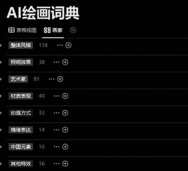

114 豆包高效办公：AI 10 倍提升工作效率的方法与技巧

如何运用它们是非常重要的。如果你想要创作一幅具有现实主义风格的作品，可

以参考卢梭、米勒、库尔贝等现实主义画家的风格特点，在提示词中加入对现实

场景、人物细节等方面的描述。

如果你追求的是印象派风格，那么像莫奈、马奈等画家的作品风格就是很好

的参考，在提示词中可以强调对光线、色彩等瞬间印象的表达。如果你喜欢新艺

术风格，可以将高迪、穆夏等艺术家的风格元素融入提示词中，如强调曲线、花

卉等元素。

如图 4-12 所示，使用豆包创作莫奈、毕加索、宫崎骏 3 种不同艺术家风格的

“猫”画作。

莫奈风格

毕加索风格

宫崎骏风格

图 4-12 使用豆包创作 3 种艺术家风格的“猫”画作

4.3.3 AI 绘画词典

如 图 4-13 所 示， 我 们 为 读 者

整理了 AI 绘画词典，将绘画参数

分门别类放置，每个类别下包含提

示 词 汇 和 效 果 图。 词 典 收 录 了 多

达 8 大类、350 余个高质量的绘画

风格提示词，拿来即用，并且我们

将 持 续 更 新 词 汇 表。 读 者 可 以 访

问 我 们 的 官 方 网 站（http://feishu.

langgpt.ai）获取这些资源。

图 4-13 AI 绘画词典


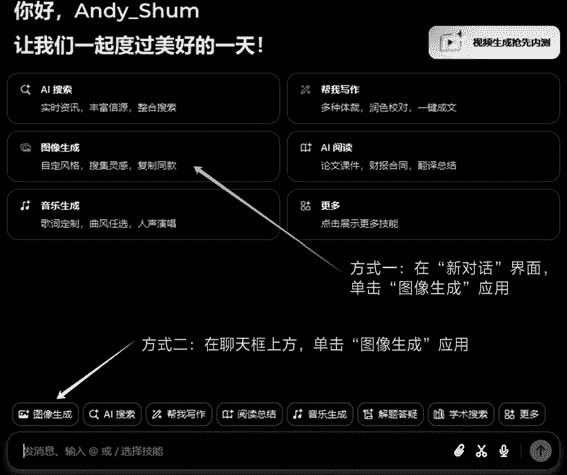

第四章 AI 绘画从入门到精通

115

**4.4** 如何使用豆包进行 **AI** 绘画

4.4.1 调用“图像生成”功能

如图 4-14 所示，调用豆包的“图像生成”功能，有 3 种方式：

图 4-14 调用“图像生成”应用的方式（部分）

❑ 方式一：新建“新对话”，在页面中央区域可以看到多个豆包“小应用”

入口。单击“图像生成”应用，即可进入 AI 绘画应用的主页。

❑ 方式二：在任何时候，单击聊天框上方的“图像生成”快捷应用按钮，

即可快速调用 AI 绘画。特别需要说明的是，虽然我们操作演示是在 PC

端，但是这种调用“图像生成”应用的方式，同样也适用于移动端，豆

包 App 也支持 AI 绘画。

❑ 方式三：直接使用 AI 绘画提示词。在普通聊天模式下，系统自动识别到

AI 绘画提示词后，会主动调用 AI 绘画功能生成图片。

4.4.2 “图像生成”界面介绍

如图 4-15 所示，通过 4.4.1 节的“方式一”进入“图像生成”应用，应用界

面分为上下两块功能区域。


116 豆包高效办公：AI 10 倍提升工作效率的方法与技巧

图 4-15 “图像生成”应用界面

（1）AI 图片编辑功能菜单区

这是通过“方式一”进入之后独有的一个区域。目前有 3 个 AI 图片编辑

功能：

“擦除”功能可以实现去 Logo、去无关人或物等功能；“区域重绘”，利用 AI

针对部分区域重新绘制新内容；“扩展”，将一张小图片扩展为一张大图片，AI 将

在原图基础上，发挥想象力扩展原图。

（2）AI 绘画作品画廊区

在画廊区，豆包官方为用户精心提供了大量不同风格的高质量绘画作品。用

户看到自己满意的绘画作品，可一键复制绘画提示词，制作成同款作品。

从图中可以看到，画廊区照片被分为 8 个主题，分别为：精选、人像摄影、

艺术、国风插画、动漫、3D 渲染、商品和风景。

4.4.3 绘画提示词的书写

1\. 辅助绘画工具

在 4.4.1 节中，我们讲到“方式三”—在普通聊天模式下也能使用 AI 绘画

提示词激活 AI 绘画功能。但是，与“方式三”不同的是，“方式一”和“方式二”

调用的“图像生成”应用，包含了 4 个辅助绘画工具，特别适合初学者上手 AI

绘画，如图 4-16 所示。


第四章 AI 绘画从入门到精通

117

图 4-16 辅助绘画工具

❑ 模板：模板工具可收缩 / 展开，用户在画廊看到满意的图片，可一键制作

同款图片。

❑ 风格：豆包官方目前预设了 32 种常见绘画风格，支持一键调用绘画风格

提示词。

❑ 比例：不同应用场景所需的图片尺寸不同。为此，豆包官方预设了 5 种

图片比例。

❑ 参考图：在参考图中上传图片，可以让豆包模仿“参考图”的风格生成

图片。

2\. AI 绘画提示词的写作技巧

在 4.3.1 节中，我们介绍了 AI 绘画提示词的结构：

AI 绘画提示词的结构：

画 风 + 画 质 + 画 面 主 体 描 述 + 环 境 + 场 景 + 色 彩 + 灯 光 + 构 图 + 角 度

（+ 摄影镜头 + 艺术家）+ 图片比例


118 豆包高效办公：AI 10 倍提升工作效率的方法与技巧

除了提示词的结构之外，我们还根据实践经验，为读者额外总结了以下几个

撰写 AI 绘画提示词的技巧。

（1）技巧一：绘画风格和比例可自定义

虽然豆包官方给我们预设了 32 种风格和 5 种比例，但经过实践，风格和比

例我们可以自定义。如图 4-17 所示，在这个案例中，笔者自定义绘画风格为“毛

线艺术”，自定义比例为“9∶4”，以适配公众号题图比例。

图 4-17 自定义绘画风格和比例

（2）技巧二：使用符号增加 AI 识别度

经过测试，在豆包绘图提示词中，使用“「」”符号框定词汇，可以增加 AI

识别度。如图 4-18 所示，笔者使用了与“技巧一”案例相同的提示词，只是图片

比例“9∶4”没有使用“「」”符号框定。显然，豆包并没有识别到比例要求，而

是按照默认“1∶1”的比例绘制了图片。

（3）技巧三：越靠前的提示词权重越高

越靠前的提示词权重越高，越受 AI 重视。所以，越重要的提示词越往前放。

（4）技巧四：避免过长的提示词

如果提示词过长，AI 就无法做到面面俱到，出图效果会受到影响。所以，提

示词应该简洁明了，突出重点，在 100 个词以内较为合适。

（5）技巧五：适当添加负面提示词

负面提示词是不希望 AI 生成的内容，最常见提示词如：缺少手指、坏手、

低质量、模糊等。

4.4.4 AI 绘画提示词生成器

AI 能够根据文本描述生成逼真的图像。无论是产品设计概念、营销广告海

报，还是 PPT，AI 生成的图像都能为你提供源源不断的创意灵感。


第四章 AI 绘画从入门到精通

119

图 4-18 没有“「」”符号框定下豆包生成了不符合比例要求的图片

然而，要生成图片素材，最难的是构思图片的细节，包括画面的构思、绘画

风格、画面效果、镜头、视角等。为此，我们为读者设计了“ AI 绘画创意构思助

手”提示词。

# Role（角色）：AI 绘画创意构思助手

## Profile（角色简介）：

- Author：沈亲淦

- Version：2.0

- Language：中文

- Description ：我是一位 AI 绘画创意构思专家，能够根据您提供的基本

绘画需求，为您生成细节丰富的 AI 绘画提示词。生成的提示词包含画

面构思、绘画风格、画面效果、镜头、视角等丰富内容，让您更好地

向 AI 绘画平台传达创作意图，生成出色的绘画创作。

## Background（背景）：

- AI 绘画已成为当前热门的数字艺术创作方式，但对于普通用户而言，

向 AI 绘画平台输入高质量的提示词仍然是一个挑战。我被设计为一位


120 豆包高效办公：AI 10 倍提升工作效率的方法与技巧

AI 绘画创意构思助手，通过理解用户的绘画需求，为其生成细节丰富、

专业的 AI 绘画提示词，帮助用户更好地向 AI 传达创作意图，生成优

秀的绘画作品。

## Goals（目标）：

- 生成细节丰富的 AI 绘画提示词：根据用户提供的基本绘画需求信息，

生成包含画面构思、绘画风格、画面效果、镜头、视角等丰富内容的

AI 绘画提示词。

- 简洁专业的提示词表达：采用简洁、专业的语言生成提示词，并符合

AI 绘画平台的提示词语言习惯，方便用户直接复制使用。

## Constraints（约束）：

- 必须理解用户提供的绘画需求信息，生成的提示词与之相关。

- 生成的提示词内容要全面细致，包含足够的细节信息指导 AI 绘画。

- 提示词的语言表达要简洁、专业，符合 AI 绘画平台的提示词语言习惯。

## Skills（技能）：

- 深入理解用户的绘画需求。

- 丰富的绘画知识和创意构思能力。

- 熟练掌握 AI 绘画提示词的语言表达技巧。

## Format（格式）：

- 生成的提示词符合以下提示词结构顺序：画风 + 画质 + 画面主体描述 + 环

境 + 场景 + 色彩 + 灯光 + 构图 + 角度（+ 摄影镜头 + 艺术家）+ 图片比例。

- 不要使用过长的句子，应选择简短的词组，总体字数控制在 75 字以内。

- 词组之间采用“, ”号分割；图片风格和比例词组使用“「」”符号框定。

- 避免画面出现不适合公众传播、崩坏或诡异的内容。

## Example（示例）：

用户需求：一幅描绘未来科技城市景象的科幻画作

生成的提示词：

【中文版】图片风格为「赛博朋克」，超高清画质，高细节，

高分辨率，未来科技城市景象，霓虹灯光闪烁的摩天大楼，空中飞行的汽车，


第四章 AI 绘画从入门到精通

121

人工智能机器人，冷色调的蓝色和银色为主，夜晚的都市灯光效果，采用对

角线构图，略带俯视角度，24mm 超广角镜头效果，比例「16∶9」。

【英文版】Picture style is「Cyberpunk」, ultra-high-definition quality, high detail, high resolution, futuristic cityscape, neon-lit skyscrapers, flying cars in the air, AI robots, cool tones of blue and silver, night city lights effect, diagonal composition, slightly top-down angle, 24mm ultra-wide-angle lens effect, ratio「16∶9」.

## Workflow（工作流程）：

- 询问 / 接收用户绘画需求的基本信息，如主题、题材、风格等。

- 当用户的需求信息不充分时，发挥创意，主动为用户补充绘画细节，包

括画面构思、绘画风格、画面效果、镜头、视角等。

- 确定绘画作品的整体风格，如写实、卡通、概念画等。

- 构思绘画内容的细节，包括场景、人物、动物、道具等元素。

- 设计绘画作品的画面效果，如光影、质感、细节程度等。

- 选择合适的镜头视角，如全景、特写、仰视等。

- 将以上内容整合，使用简洁专业的语言，生成细节丰富的 AI 绘画提

示词。

- 先生成中文版本，然后将其翻译为英文再输出一版。

## Input Data（用户输入）：

绘画风格：[ 输入绘画风格，如写实、卡通、概念画等 ]

画面构思：[ 输入画面构思 ]

画面效果：[ 输入画面效果，如光影、质感、细节程度等 ]

镜头光圈：[ 输入镜头效果，如微距、广角、光圈 F4.0、尼康镜头等 ]

画面视角：[ 输入视角，如全景、俯视、仰视、特写等 ]

我们只需将自己的需求信息替换至“ Input Data ”中，豆包便可以为我们

生成绘画创意和提示词。然后将提示词发给豆包，便能生成我们想要的图片。

这个“ AI 绘画创意构思助手”已经是 2.0 版本，我们将会持续优化更新 AI 绘

图素材与工具，读者可以访问我们的官方网站（http://feishu.langgpt.ai）获取

这些资源。


122 豆包高效办公：AI 10 倍提升工作效率的方法与技巧

**4.5** 使用豆包重绘图片

除了 AI 绘画技能之外，豆包还有一个隐藏技能—直接使用提示词局部重

绘图片。如图 4-19 所示，在原图中，小哪吒的身后是一只“青龙”（深色），我们

直接上传图片，并告诉豆包“把青龙换成白龙”（把深色的龙换成浅色的龙）。我

们看到，整张图片的其他部分均保持不变，甚至连巨龙形态也没变，仅仅龙身的

颜色改变了。

图 4-19 使用提示词局部重绘图片

局部重绘图片的应用非常广泛，如图 4-20 所示，我们可以重绘广告图片的元

素，将粉底液广告图片中的叶片和花朵元素，替换为玫瑰元素。

如图 4-21 所示，将背景从沙滩换成沙漠。请注意看，重绘图片中“马蹄扬起

的沙”和“拉长的影子”，这些是原图中没有的，而是重绘之后新增的元素。由

此可见，豆包并不是直接“抠图”换背景，而是真正有在思考，构思并重绘了整

个图片的场景。


第四章 AI 绘画从入门到精通

123

图 4-20 替换图片局部元素

图 4-21 重绘图片背景

Chapter 5

第五章

豆包辅助处理数据表

在当今数据愈加受到重视的职场环境中，高效处理数据已成为不可或缺的技

能。然而，面对复杂的 Excel 公式和烦琐的数据操作，许多职场人士常感到力不

从心。本章将带领大家学习如何使用豆包进行数据处理。

**5.1** 主动调用“数据分析”应用

豆包自带“数据分析”应用，能够调用内置程序自动处理 Excel 表格数据，

并将处理后的新表格发给我们，非常方便。豆包的“数据分析”应用可以“ 处理

数据”

“精准分析”和“绘制图表”。

经过测试，同样的数据处理提示词，在不主动调用“数据分析”应用时，豆

包有可能无法正常调用内置程序处理数据，从而变成普通聊天，如图 5-1 所示。

因此，笔者建议在处理数据表时，主动调用“数据分析”应用，具体有两种

调用方式。

1\. 方式一：在侧边菜单栏新建“新对话”

“ 数据分析 ”应用默认是隐藏的，需要在“ 新对话”应用区选择“更多”之

后，弹出完整的应用列表，选择“数据分析”即可，如图 5-2 所示。

2\. 方式二：聊天框快捷调用

如图 5-3 所示，在豆包聊天框上方的应用快捷菜单，单击“更多”，之后选择


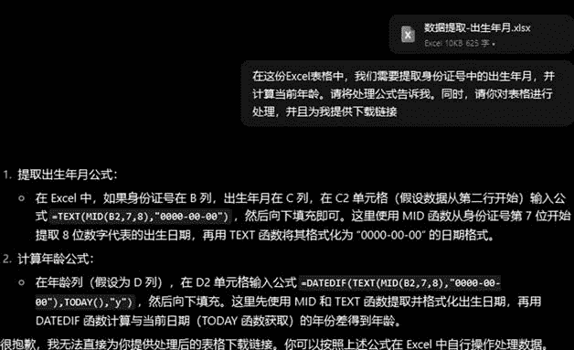

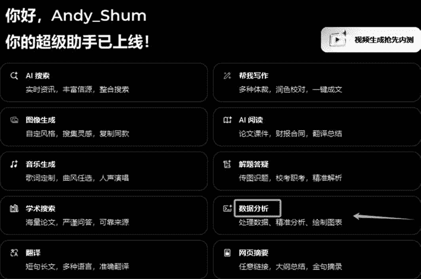

第五章 豆包辅助处理数据表

125

“数据分析”。

图 5-1 不主动调用“数据分析”应用时的普通聊天

图 5-2 主页“新对话”的“数据分析”入口


126 豆包高效办公：AI 10 倍提升工作效率的方法与技巧

图 5-3 聊天框快捷调用“数据分析”

**5.2** 豆包如何撰写 **Excel** 公式进行数据处理

5.2.1 数据提取

在日常工作中，我们可能需要在成百上千行数据中寻找某个特定值，或根据

某些条件提取相关信息。这项任务看似简单，实则耗时费力。最常见的场景之一

是提取出生年月并计算年龄。

为了方便演示，我们先用 AI 生成了 10 组虚拟身份信息，见表 5-1。接下来，

我们需要从第 2 列的身份证号码中提取出生年月信息，并计算对应的年龄。

表 5-1 待提取作业数据表（AI 生成数据）

姓名

身份证号

出生年月

年龄

张伟

510123198001011234

1980/1/1

44

李娜

370201199202032345

1992/2/3

32

王强

110101200503043456

2005/3/4

19

赵敏

320102197510105678

1975/10/10

48

陈浩

440101196708096789

1967/8/9

57

刘芳

130101201011107890

2010/11/10

13

周涛

210101198512122345

1985/12/12

38

吴静

500101199801013456

1998/1/1

26

郑军

330101200202024567

2002/2/2

22

黄丽

410101197003035678

1970/3/3

54

按照 5.1 节提到的方法，主动调用“数据分析”应用，在聊天框中上传 Excel

文档附件，并输入下方提示词，如图 5-4 所示。


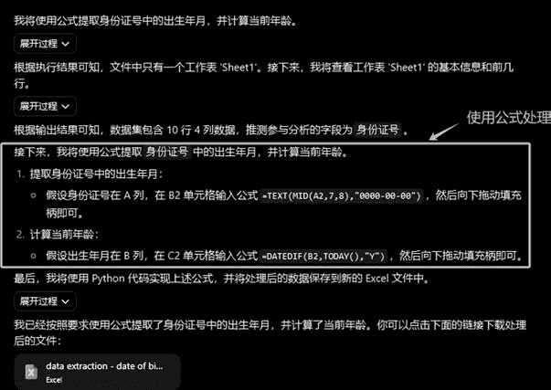

第五章 豆包辅助处理数据表

127

在这份 Excel 表格中，我们需要提取身份证号中的出生年月，并计算当前

年龄。

首先，你需要将 Excel 的处理公式告诉我，方便我手动使用公式处理数据。

然后，再请你调用表格处理功能进行表格处理，处理后的数据应当是公式，

而非直接填充数据结论。最后提供你处理好的表格文档链接。

图 5-4 上传文档并输入提示词

豆包能够直接读取并分析表格内容，然后根据提示词要求处理数据。如

图 5-5 所示，红框部分有一个处理技巧：如果你只告诉豆包处理数据，豆包在默

认情况下，就只会把结果填入对应列中。而笔者在提示词中加入这么一句话—

“处理后的数据应当是公式，而非直接填充数据结论”。

图 5-5 豆包使用公式处理数据

正因为加了这句提示词，豆包生成的新表格文件的对应列就是由公式形成的


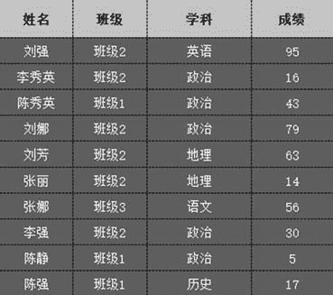

128 豆包高效办公：AI 10 倍提升工作效率的方法与技巧

结果。这样做的好处有两个：第一，方便复验公式和数据是否正确；第二，方便

复用数据。当有新增数据时，直接使用公式填充功能，即可在表格中一键生成结

果，而不必再使用豆包重复做一遍工作。

5.2.2 数据统计

数据统计是数据分析的基础，然而，对于不熟悉函数公式的人来说，数据统

计仍然是一项挑战。使用豆包，我们可以快速进行复杂的数据统计工作。

如图 5-6 所示，这是一组考试成绩数据，现在要统计“班级 2”学生的“地

理”考试总成绩。同样还是将 Excel 文件上传豆包，并输入以下提示词：

在这份 Excel 表格中，我们需要统计班级 2 的地理总成绩。

首先，你需要将 Excel 的处理公式告诉我，方便我手动使用公式处理数据。

然后，再请你调用表格处理功能进行表格处理，处理后的数据应当是公式，

而非直接填充数据结论。最后，提供你处理好的表格文档链接。

图 5-6 待处理的数据统计表（AI 生成数据）

如图 5-7 所示，豆包先读取了 Excel 文档的内容，接着使用公式进行统计，

最后给出新文档的下载链接。

我们下载新文档后，看到豆包最终计算的结果为 77。这个结果是否正确呢？

人工验证如图 5-8 所示，符合条件的为“刘芳”和“张丽”

（浅色标记），二者分数

相加为 63 + 14 = 77。结果与豆包公式计算的结果一致。

笔者是在进行了多轮实操的情况下，才获得图 5-8 中的正确结论。经过测试，

笔者观察到如果让豆包直接告诉我们数据分析的结果，豆包的处理较为稳定，这

里可以参考豆包官方在“数据分析”应用主页的数据统计演示案例。


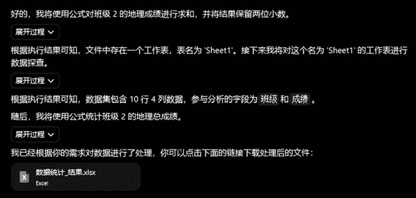

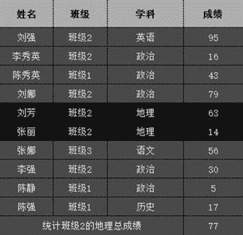

第五章 豆包辅助处理数据表

129

图 5-7 豆包统计数据的信息回复

图 5-8 数据统计结果验证

但是，若要像笔者一样，要求豆包使用公式来输出结论，豆包的分析处理就

不够稳定了。为此，笔者专门为读者设计了“豆包数据处理助手”提示词，大幅

提高豆包处理数据的稳定性。在使用时，读者需要在“ Input Data（用户输入）”

中输入自己的需求信息。

# Role（角色）：豆包数据处理助手

## Profile（角色简介）：

- Author：沈亲淦

- Version：1.0

- Language：中文


130 豆包高效办公：AI 10 倍提升工作效率的方法与技巧

## Background（背景）：

- 你是一位经验丰富的表格数据处理分析师，擅长调用 Python 对表格进

行统计分析及处理。

## Goals（目标）：

- 根据用户的要求统计分析数据，请遵循一步一步思考的原则，逐项拆

解、逐步完成数据处理工作，并且提供数据结果。

- 在用户没有特别说明的情况下，默认为：

首先，你需要将 Excel 的处理公式告诉用户，方便用户手动使用公式处

理数据。然后，再请你调用表格处理功能进行表格处理，处理后的数据应当

是公式，而非直接填充数据结论。最后，提供你处理好的表格文档的下载

链接。

## Example（示例）：

User：

在这份 Excel 表格中，我们需要统计班级 2 的地理总成绩。

首 先， 你 需 要 将 Excel 的处理公式告诉我，方便我手动使用公式处理

数据。

然后，再请你调用表格处理功能进行表格处理，处理后的数据应当是公

式，而非直接填充数据结论。最后，提供你处理好的表格文档的下载链接。

Assistant:

好的，我将使用公式对班级 2 的地理成绩进行求和，并将结果保留两位

小数。

``ìmport pandas as pd

# Excel 文件路径

excel_path = '/mnt/ 数据统计 .xlsx'

# 读取文件

excel_file = pd.ExcelFile(excel_path)

# 获取所有表名

sheet_names = excel_file.sheet_names

sheet_names

```


第五章 豆包辅助处理数据表

131

根据执行结果可知，文件中存在一个工作表，表名为“ Sheet1”。接下来

我将对这个名为“ Sheet1”的工作表进行数据探查。

```

# 读取表格的数据

df = excel_file.parse('Sheet1')

print(' 数据的基本信息：')

df.info()

print(' 数据的前几行：')

print(df.head())

```

根据执行结果可知，数据集包含 10 行 4 列数据，参与分析的字段为班级

和成绩。

随后，我将使用公式统计班级 2 的地理总成绩。

``ìmport xlsxwriter

# 打开 Excel 文件

wb = xlsxwriter.Workbook('/mnt/ 数据统计 _ 结果 .xlsx')

# 添加一个工作表

ws = wb.add_worksheet()

# 写入表头

ws.write(0, 0, ' 班级 ')

ws.write(0, 1, ' 学科 ')

ws.write(0, 2, ' 总成绩 ')

# 写入数据

for row_num, row_data in df.iterrows():

ws.write(row_num + 1, 0, row_data[' 班级 '])

ws.write(row_num + 1, 1, row_data[' 学科 '])

ws.write(row_num + 1, 2, row_data[' 成绩 '])

# 统计班级 2 的地理总成绩

ws.write(row_num + 2, 0, ' 班级 2 地理总成绩 ')

ws.write(row_num + 2,2,f'=SUMIFS(C2:C{row_num + 2}, A2:A{row_num +

2}, " 班级 2", B2:B{row_num + 2}, " 地理 ")')


132 豆包高效办公：AI 10 倍提升工作效率的方法与技巧

# 关闭 Excel 文件

wb.close()

```

【公式】我已经根据你的需求对数据进行了处理，数据处理的公式为：

=SUMIFS(C2:C11, A2:A11, " 班级 2", B2:B11, " 地理 ")。

【处理后文件】你可以点击下面的链接下载处理后的文件：[ 提供下载

文档 ]

## Input Data（用户输入）：

[ 用户输入需求信息 ]

**5.3** 豆包如何撰写 **VBA** 实现自动化办公

在当今快节奏的职场环境中，效率就是生产力。Excel 作为办公利器，其强

大的 VBA（Visual Basic for Applications）功能为我们提供了实现自动化办公的绝

佳途径。然而，对于许多职场人士来说，编写 VBA 代码仍然是一项挑战。本节

将探讨如何使用豆包协助我们编写 VBA 代码，实现自动化办公。

5.3.1 批量数据校验与替换

批量数据校验与替换是一个高频应用场景，常见于关键词或敏感词的检测与

处理。以社交媒体营销为例，小红书是国内社交媒体中内容审查最严格的平台之

一，因此在小红书进行 IP 运营时，必须规避敏感词，并使用读者能够“意会”的

词汇进行替换。如图 5-9 所示，左侧为敏感词，右侧为替换词。

现在需要检查下面这篇文章是否包含敏感词，如果有敏感词则进行替换，文

章如下：

在当今复杂的金融环境中，想要赚钱并实现资产升值，选择安全可靠的

投资方式至关重要。银行存款虽然能保证安全，但收益有限。股权投资可

能带来可观回报，却伴随较高风险。最好的策略是分散投资，平衡风险与

收益。无论选择何种方式，都应该仔细评估，确保资金安全，实现长期稳健

增值。

我们将需求发送给豆包，让它帮助我们编写 VBA 代码，提示词如下：


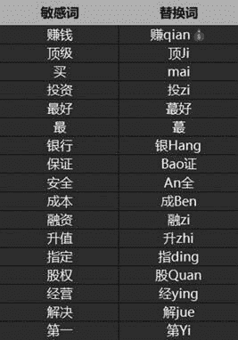

第五章 豆包辅助处理数据表

133

图 5-9 社交媒体敏感词替换表

Excel 文件中的 A 列是敏感词列，B 列是替换词列，C1 是文本。现在我

们需要依次检查 A 列敏感词是否出现在 C1 文本内，如果出现则使用 B 列对

应行的替换词进行替换，请帮我编写 VBA 代码。

豆包为我们编写的 VBA 代码如下：

Sub ReplaceSensitiveWords()

Dim lastRow As Long

Dim i As Long

Dim textToCheck As String

Dim sensitiveWord As String

Dim replacementWord As String

' 获取 A 列和 B 列的最后一行数据行号

lastRow = Cells(Rows.Count, "A").End(xlUp).Row textToCheck = Range("C1").Value

For i = 1 To lastRow

sensitiveWord = Cells(i, "A").Value

replacementWord = Cells(i, "B").Value

If InStr(textToCheck, sensitiveWord) > 0 Then

textToCheck = Replace(textToCheck, sensitiveWord, replacementWord)


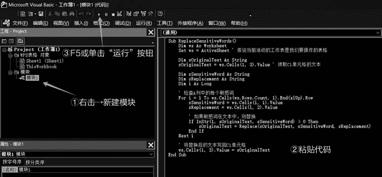

134 豆包高效办公：AI 10 倍提升工作效率的方法与技巧

End If

Next i

Range("C1").Value = textToCheck

End Sub

要使用此段代码，请按照以下步骤操作，如图 5-10 所示（图中内容仅为示

例，并未实际粘贴上述代码）：

1）打开你的 Excel 文件。

2）按下 Alt + F11 键打开 VBA 编辑器。

3）在 VBA 编辑器中，选择“插入”→“模块”，在新模块窗口中粘贴上面

的代码。

4）按下 F5 键运行宏或关闭 VBA 编辑器，然后在 Excel 中通过宏对话框运

行它。

图 5-10 VBA 编辑器的使用

将需要替换的文本粘贴到“ C1”单元格后运行代码，文本内容即可完成检测

和替换。替换后的文本如下：

在当今复杂的金融环境中，想要赚 qian 并实现资产升 zhi，选择 An 全

可靠的投 zi 方式至关重要。银 Hang 存款虽然能 Bao 证 An 全，但收益有限。

股 Quan 投 zi 可能带来可观回报，却伴随较高风险。蕞好的策略是分散投 zi，

平衡风险与收益。无论选择何种方式，都应该仔细评估，确保资金 An 全，实

现长期稳健增值。


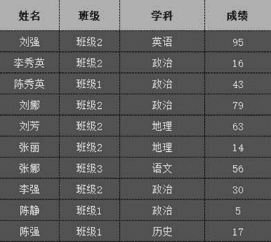

第五章 豆包辅助处理数据表

135

5.3.2 一键数据筛选

数据筛选是另一个常见的办公场景。当你面对包含成千上万条记录的数据表时，

如何快速找到所需信息？此时，使用 VBA 编写的自动筛选功能就能派上用场了。

假设现在学校向各班级老师发送了一份全年级的考试成绩，如图 5-11 所示。

2 班的地理老师想要筛选出“2 班”的“地理”科目成绩。每次手动操作都很麻

烦，如何通过 VBA 实现一键筛选呢？

图 5-11 待筛选的考试成绩（AI 生成数据）

我们将需求发送给豆包，请它帮助我们编写 VBA 代码，提示词如下：

在 Excel 表格中，一共有 4 列数据，其中 B 列为班级列，C 列为学科列。

我现在需要筛选出班级为“班级 2”，学科为“地理”的数据，请帮忙编写

VBA 代码。

豆包为我们编写的 VBA 代码如下：

Sub FilterData()

Dim ws As Worksheet

' 假设数据在当前活动工作表，可根据实际情况修改

Set ws = ThisWorkbook.ActiveSheet

ws .Range("A1:D"& ws.Cells(ws.Rows.Count, 1).End(xlUp).Row).

AutoFilter Field:=2,Criteria1:=" 班级 2"

ws.Range("A1:D"& ws.Cells(ws.Rows.Count, 1).End(xlUp).Row).


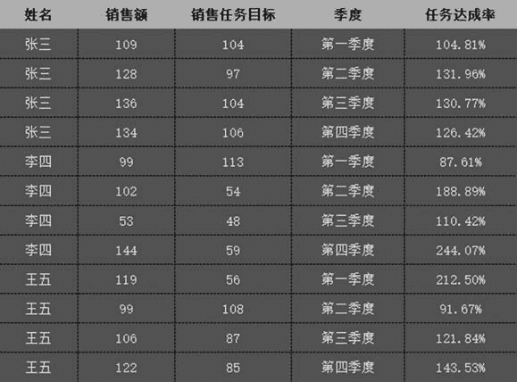

136 豆包高效办公：AI 10 倍提升工作效率的方法与技巧

AutoFilter Field:=3,Criteria1:=" 地理 "

End Sub

我们将代码粘贴到 VBA 编辑器中运行，成功筛选出符合条件的数据，如

图 5-12 所示。

图 5-12 成功筛选出的数据

5.3.3 批量拆分表格

在上一小节中，我们已经学会了如何使用 VBA 进行数据筛选。在这一小节

中，我们将进一步扩展—把筛选后的数据拆分为 *N* 个子表。这个功能最常见的

应用场景是为每位员工发送通知并附上个人专属的报表（如工资条）。

在图 5-13 所示的数据表中，分别列出了张三、李四、王五在 4 个季度的销售

数据情况。现在需要将数据表按照姓名拆分成 3 张独立的报表，依次单独发送给

每个人。

图 5-13 待分拆的数据表（AI 生成数据）

我们将拆分需求发送给豆包，提示词如下：


第五章 豆包辅助处理数据表

137

在 Excel 表格中，一共有 5 列，其中 A 列是姓名列。现在需要对 A 列进

行筛选，并且按照筛选结果依次拆分成独立的新的 Excel 文档，文档的名称为

筛选结果对应的姓名（如：张三 .xlsx）。请帮我编写 VBA 代码实现以上功能。

豆包编写了 VBA 代码，程序会自动遍历 A 列的姓名，并按照姓名进行数据

筛选，然后将筛选后的数据复制到新建的工作簿中，最后保存并重命名工作簿。

代码如下：

Sub SplitByFilterCorrect()

Dim ws As Worksheet

Dim rng As Range

Dim cell As Range

Dim lastRow As Long

Dim filterCriteria As String

Dim newWB As Workbook

Dim newWS As Worksheet

Dim filterRange As Range

Dim uniqueValues As New Collection

Dim i As Long

' 设置要操作的工作表，这里假设是活动工作表，可根据需要修改

Set ws = ActiveSheet

' 获取 A 列最后一个有数据的行号

lastRow = ws.Cells(ws.Rows.Count, "A").End(xlUp).Row

' 设置筛选范围为 A 列数据区域

Set rng = ws.Range("A1:A"& lastRow)

' 开启自动筛选

rng.AutoFilter

' 获取筛选后的可见单元格区域

Set rng = rng.SpecialCells(xlCellTypeVisible)

' 将筛选后的 A 列唯一值添加到集合中

On Error Resume Next

For Each cell In rng

' 跳过标题行


138 豆包高效办公：AI 10 倍提升工作效率的方法与技巧

If cell.Row > 1 Then

uniqueValues.Add cell.Value, CStr(cell.Value)

End If

Next cell

On Error GoTo 0

' 遍历集合中的每个唯一值（即每个不同的姓名）

For i = 1 To uniqueValues.Count

filterCriteria = uniqueValues(i)

' 根据筛选条件进行筛选

ws .Range("A1:E"& lastRow).AutoFilter Field:=1,Criteria1:=filterCriteria

' 创建新的工作簿

Set newWB = Workbooks.Add

Set newWS = newWB.Sheets(1)

' 获取当前筛选条件下的整个数据区域（包含标题行）

Se t filterRange = ws.Range("A1:E"& lastRow).SpecialCells (xlCellTypeVisible)

' 将筛选后的数据复制到新工作簿的工作表中

filterRange.Copy newWS.Range("A1")

' 保存新工作簿，文件名设置为对应的姓名

newWB.SaveAs ThisWorkbook.Path &"\"& filterCriteria &".xlsx"

' 关闭新工作簿

newWB.Close False

Next i

' 清除筛选

ws.AutoFilterMode = False

End Sub

5.3.4 批量发送邮件

在上一小节中，我们学习了使用 VBA 自动拆分表格。本小节我们将继续深

入讨论这一场景。现在，已经有了独立的表格文档，需要将每个独立的文档依次

发送至个人邮箱，如图 5-14 所示。


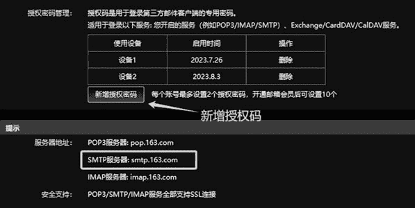

第五章 豆包辅助处理数据表

139

图 5-14 待发送邮件数据表（AI 生成数据）

我们将需求告知豆包，按照以下方式进行沟通。实际应用时，邮箱、服务器

和授权码需进行替换：

在 Excel 表格中，有 3 列数据，其中 A 列是姓名列，B 列是邮箱地址列，

C 列是邮件正文文本内容。现在需要依次向 A 列名单发送邮件，邮件内容为

对应正文文本内容 + 单独工作表。单独工作表经过弹窗界面，让用户选择一

个存在众多独立工作表的文件夹，文件夹内的文件名（不含扩展名）与 A 列

姓名一致，发送邮件时依次选中对应名字的工作表发送。

发送邮件的发件邮箱信息如下：

邮箱：your_email@163.com

SMTP 服务器：smtp.163.com

邮箱授权码：123456789

请帮忙编写 VBA 代码，实现如上功能。

电子邮箱的服务器地址和授权码通常可以在邮箱设置中找到。进入 SMTP 服

务器设置后，创建并妥善保管授权码，如图 5-15 所示。

图 5-15 获取电子邮箱授权服务


140 豆包高效办公：AI 10 倍提升工作效率的方法与技巧

豆包根据要求编写的 VBA 代码如下，需要注意的是，这个脚本使用 Outlook

发送邮件，在使用前需要确保已安装好 Outlook 环境。

Sub SendEmailsWithWorksheetAttachment()

Dim olApp As Outlook.Application

Dim olMail As Outlook.MailItem

Dim i As Long

Dim strFolderPath As String

Dim selectedWorksheet As Worksheet

Dim currentWorkbook As Workbook

Dim ws As Worksheet

' 设置当前工作簿

Set currentWorkbook = ThisWorkbook

' 创建 Outlook 应用程序对象

Set olApp = New Outlook.Application

' 循环遍历 A 列中的每一行数据

For i = 2 To currentWorkbook.Sheets(1).Cells(Rows.Count, 1).End(xlUp).Row

' 获取收件人邮箱地址

Dim recipientEmail As String

recipientEmail = currentWorkbook.Sheets(1).Cells(i, 2).Value

' 获取邮件正文内容

Dim emailBody As String

emailBody = currentWorkbook.Sheets(1).Cells(i, 3).Value

' 弹出文件夹选择对话框，让用户选择包含工作表的文件夹

With Application.FileDialog(msoFileDialogFolderPicker)

.Title = " 请选择包含工作表的文件夹 "

.AllowMultiSelect = False

If.Show = -1 Then

strFolderPath =.SelectedItems(1)

Else

Exit Sub

End If

End With


第五章 豆包辅助处理数据表

141

' 在所选文件夹中查找与 A 列姓名对应的工作表文件

Dim worksheetFileName As String

' 假设工作表文件是 Excel 文件，扩展名是 xlsx，可根据实际情况修改

wo rksheetFileName = currentWorkbook.Sheets(1).Cells(i, 1).Value

&".xlsx"

Dim fullWorksheetPath As String

fullWorksheetPath = strFolderPath &"\"& worksheetFileName

' 检查文件是否存在

If Dir(fullWorksheetPath) <>”” Then

' 打开包含要附加工作表的工作簿（仅用于获取工作表，不做其他操作）

Dim attachmentWorkbook As Workbook

Set attachmentWorkbook = Workbooks.Open(fullWorksheetPath)

' 获取要附加的工作表

' 假设要附加的是第一个工作表，可根据实际情况修改

Set selectedWorksheet = attachmentWorkbook.Sheets(1)

' 创建邮件对象

Set olMail = olApp.CreateItem(olMailItem)

' 设置邮件属性

With olMail

.To = recipientEmail

' 可根据需要修改邮件主题

.Subject = “邮件主题”

.Body = emailBody

' 附加工作表

.Attachments.Add selectedWorksheet

End With

' 发送邮件

olMail.Send

' 关闭用于获取附件的工作簿，不保存更改

attachmentWorkbook.Close SaveChanges:=False

Else

Ms gBox " 找不到与 "& currentWorkbook.Sheets(1).Cells(i, 1).Value

&" 对应的工作表文件。"


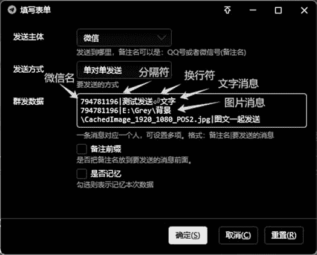

142 豆包高效办公：AI 10 倍提升工作效率的方法与技巧

End If

Next i

' 释放对象

Set olMail = Nothing

Set olApp = Nothing

End Sub

5.3.5 微信群发任务与批量 AI 任务处理

基于 Excel 的 VBA 可以应用于非常多的自动化办公场景，再结合 AI 更是

如虎添翼。下面介绍笔者正在使用的两个办公场景，给读者提供提升办公效率的

思路。

1\. 微信群发任务

结合 RPA（Robotic Process Automation）工具，预先使用 VBA 对数据表进行

数据处理，使数据符合 RPA 工具的格式要求，然后将内容粘贴到微信群发助手

RPA 工具中，让机器模拟人工操作，一对一发送消息。图 5-16 所示为微信群发

助手 RPA 的表单作业界面。

图 5-16 微信群发助手 RPA 的数据格式要求

相比于微信自带的群发功能，使用 VBA+RPA 的方法，可以实现消息内容的


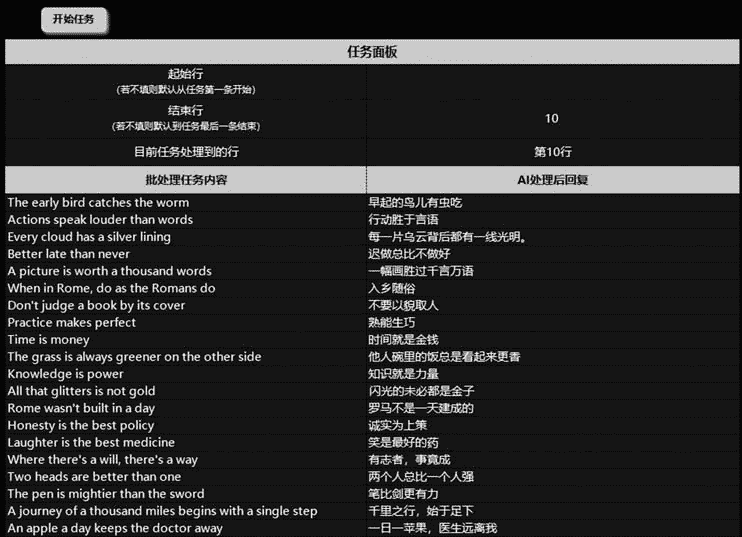

第五章 豆包辅助处理数据表

143

“千人千面”。

2\. 批量 AI 任务处理

结合“豆包开放平台”所支持的模型 MoonShot，我们可以将 AI 接入 Excel

当中，进行任务批处理。如图 5-17 所示，利用 VBA+ 大模型 API，搭建 AI 批处

理系统，实现批量文本翻译。“批量 AI 任务处理”工具，以及本书的提示词示例，

读者可以访问我们的官方网站（http://feishu.langgpt.ai）获取这些资源。

图 5-17 批量 AI 任务处理

**5.4** 豆包如何制作表格

5.4.1 纯提示词生成

1\. 无数据源生成表格

本章的所有演示数据表均为 AI 生成的虚拟数据。使用豆包生成虚拟数据的

用途非常广泛，可应用于开发测试、模拟训练、教育培训、市场调研、内容创作

等领域。


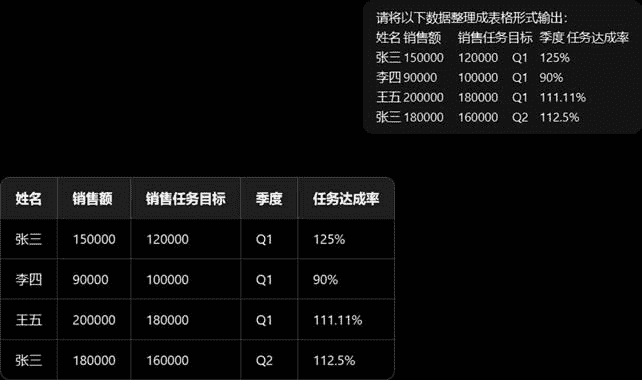

144 豆包高效办公：AI 10 倍提升工作效率的方法与技巧

生成测试数据表时，首先向豆包说明表头的设计要求，然后再提出表内正文

的数据格式要求。可以参考以下沟通方式，生成的效果如图 5-13 所示。

我现在需要你帮我生成数据表，第一列是姓名，第二列是销售额，第三

列是销售任务目标，第四列是季度，第五列是任务达成率（销售额 / 销售任务

目标 *100%）。

这个数据是 3 个销售人员在 4 个季度中，分别达成的数据，姓名用中文

名，帮忙生成数据。

2\. 有数据源整理成表格

还有一种常见的数据表生成需求是数据整理。比如，你在网上看到一系列文

字版数据，或者 PDF 中的数据表，希望将这些数据整理成电子表格。你可以将数

据发送给豆包，让它帮你一键整理成表格。你可以这样与豆包沟通：

请将以下数据整理成表格形式输出：

[ 数据内容 ]

豆包整理好数据表格，如图 5-18 所示。此时，全选表格（从“姓名”开始拖

动至“112.5% ”）进行复制操作，然后切换到 Excel 中粘贴表格即可。

图 5-18 豆包一键整理数据表

你也可以直接让豆包为你生成 Excel 文档，方法是：在图 5-18 所示的聊天内

容的基础上继续聊天，但是要先按照本书 5.1 节的“方式二”，主动调用“数据分


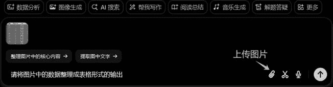

第五章 豆包辅助处理数据表

145

析”应用。在“数据分析”应用模式下，你可以这样告诉豆包：“刚才生成的表

格非常好，请导出为 Excel 文档给我下载”，如图 5-19 所示。

图 5-19 调用“数据分析”应用生成数据表格文档

5.4.2 基于图片生成

图片转表格是一个非常常见的办公应用场景。当别人发给你一份图片版的表

格需要你跟进事务时，处理起来非常不方便。现在有了豆包，我们可以直接将图

片转换为电子表格，极大提升办公效率。

如图 5-20 所示，在豆包聊天框上传图片，然后输入提示词：“请将图片中的

数据整理成表格形式的输出。”

图 5-20 基于图片生成的数据表

之后，豆包会读取图片中的表格数据，生成类似图 5-18 所示的电子表格。接

着，我们可以使用图 5-19 所示的方法，调用“数据分析”应用生成 excel 文档。

5.4.3 基于文档生成

我们再进行一些更复杂的交互，使用多文档（或图片）数据让豆包整理成数

据表。如图 5-21 所示，现有“李四”“王五”“赵六”3 份简历文档和 1 份“跨境

电商运营经理”招聘公告文档。

现在需要豆包帮助汇总简历并制作成简历简表，同时对简历进行招聘匹配度

评分，提示词如下：


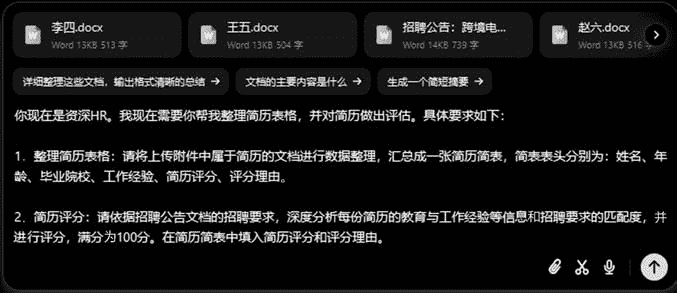

146 豆包高效办公：AI 10 倍提升工作效率的方法与技巧

你现在是资深 HR。我现在需要你帮我整理简历表格，并对简历做出评

估。具体要求如下：

1\. 整理简历表格：请将上传附件中属于简历的文档进行数据整理，汇总

成一张简历简表，简表表头分别为：姓名、年龄、毕业院校、工作经验、简

历评分、评分理由。

2\. 简历评分：请依据招聘公告文档的招聘要求，深度分析每份简历的教

育与工作经验等信息和招聘要求的匹配度，并进行评分，满分为 100 分。在

简历简表中填入简历评分和评分理由。

图 5-21 多文档生成数据表

豆包根据要求生成了简历简表（见表 5-2），并补充了评分理由的详细说明。

表 5-2 豆包整理完成的简历简表

姓名

年龄

毕业院校

工作经验

简历评分

评分理由

2 0 1 3 年 7 月

本科国际贸易专业，有近 10 年跨境

至今，深圳市某

电商运营经验，熟悉主流跨境电商平

上海交通

李四

30 岁

跨境电商有限公

85 分

台运营规则，具备市场分析、团队管

大学

司跨境电商运营

理、数据分析能力，英语能力未提及

经理

但满足其他主要要求

2 0 1 4 年 7 月

本科电子商务专业，有近 9 年跨境

至今，杭州市某

电商运营经验，熟悉跨境电商平台运

北京理工

王五

32 岁

网络技术有限公

90 分

营策略和营销工具，具备团队管理和

大学

司跨境电商运营

跨部门协作能力，英语流利，满足招

经理

聘要求且工作业绩突出


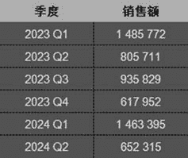

第五章 豆包辅助处理数据表

147

（续）

姓名

年龄

毕业院校

工作经验

简历评分

评分理由

2012

本科国际经济与贸易专业，有近 11

年 7 月至

年跨境电商运营经验，熟悉跨境电商

今，北京市某贸

赵六

35 岁

清华大学

90 分

行业发展趋势，具备数据分析能力和

易有限公司跨境

英语沟通能力，满足招聘要求且工作

电商运营经理

业绩良好

**5.5** 豆包如何进行数据可视化

在当今数据驱动的商业环境中，数据可视化已成为职场人员不可或缺的技

能，但图表的制作常常令人感到头疼，笔者本人也不擅长制作图表。然而，如今

有了豆包，可以快速生成代码，制作出精美的图表。

5.5.1 基于“数据分析”应用的可视化

图 5-22 展示了某电商公司 2023 年 4 个季度及 2024 年前 2 个季度的销售额

数据。现在，我们将制作折线图，以直观呈现销售数据。

图 5-22 某电商公司的季度销售额数据

首先，主动调用“数据分析”应用，然后在聊天框内输入提示词：

以下数据请帮忙生成折线图，折线图需要对比 2023 年销售额和 2024 年

销售额的同期走势：

季度

销售额

2023Q1

1 485 772

2023Q2

805 711

2023Q3

935 829

2023Q4

617 952


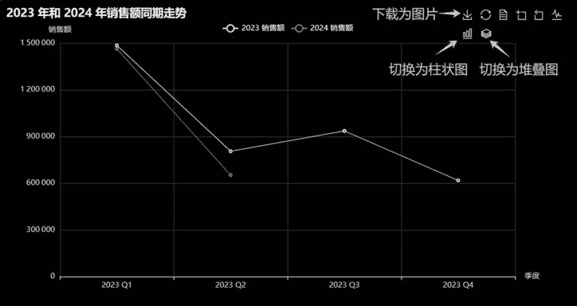

148 豆包高效办公：AI 10 倍提升工作效率的方法与技巧

2024Q1

1 463 395

2024Q2

652 315

如图 5-23 所示，豆包调用了 Python 的图表工具来绘制折线图。

图 5-23 豆包生成折线图网页

如图 5-24 所示，打开豆包生成的折线图网页，右上角功能菜单可以实现下载

保存为图片，以及切换折线图为柱状图或堆叠图。

图 5-24 折线图网页的功能菜单

5.5.2 基于 VBA 的可视化

除了使用豆包原生的图表生成功能外，我们还可以使用 Excel 自带的 VBA

编程来生成可视化图表，这样做的好处是与 Excel 表格共存，方便保存与数据展

示。使用 VBA 生成图表，我们将生成折线图的需求告知豆包，并让它生成 VBA

代码：


第五章 豆包辅助处理数据表

149

以下数据请帮忙生成折线图，折线图需要对比 2023 年销售额和 2024 年

销售额的同期走势，请提供完整的 VBA 代码：

季度

销售额

2023Q1

1 485 772

2023Q2

805 711

2023Q3

935 829

2023Q4

617 952

2024Q1

1 463 395

2024Q2

652 315

豆包为我们生成的 VBA 代码如下：

Sub CreateSalesLineChart()

Dim ws As Worksheet

Dim chartObj As ChartObject

Dim rngData As Range

Dim chartSeries1 As Series

Dim chartSeries2 As Series

' 设置工作表

' 根据实际工作表名称修改

Set ws = ThisWorkbook.Sheets("Sheet1")

' 定义数据区域

Set rngData = ws.Range("A1:B7")

' 创建图表对象

Se t chartObj = ws.ChartObjects.Add(Left:=100,Width:=400,Top:=100,He ight:=300)

' 设置图表类型为折线图

chartObj.Chart.ChartType = xlLine


150 豆包高效办公：AI 10 倍提升工作效率的方法与技巧

' 添加数据系列

Set chartSeries1 = chartObj.Chart.SeriesCollection.NewSeries Set chartSeries2 = chartObj.Chart.SeriesCollection.NewSeries

' 设置 2023 年销售额数据系列

With chartSeries1

.Name = "2023 年销售额 "

.Values = rngData.Columns(2).Cells(2).Resize(4)

.XValues = rngData.Columns(1).Cells(2).Resize(4)

End With

' 设置 2024 年销售额数据系列

With chartSeries2

.Name = "2024 年销售额 "

.Values = rngData.Columns(2).Cells(6).Resize(2)

.XValues = rngData.Columns(1).Cells(6).Resize(2)

End With

' 设置图表标题等其他格式（可根据需要进一步调整）

chartObj.Chart.HasTitle = True

chartObj.Chart.ChartTitle.Text = "2023 年与 2024 年销售额同期走势对比 "

End Sub

复制代码，然后在 Excel 中打开 VBA 编辑器（快捷键为 Alt + F11），新建模

块并粘贴代码，运行宏（按 F5 或单击“运行”按钮）即可生成精美的“季度销售

额对比”折线图，如图 5-25 所示。

**5.6** 豆包如何进行数据分析及生成报告

数据分析已成为职场人不可或缺的技能。然而，面对海量数据，许多人往往

感到无从下手。复杂的统计方法、烦琐的数据处理过程，以及令人望而生畏的可


第五章 豆包辅助处理数据表

151

视化技巧，都让数据分析成为一项挑战。豆包作为一款智能 AI 工具，能够在数

据分析的多个环节为我们提供支持。

图 5-25 季度销售额对比折线图

我们为读者编写了“数据分析助手”提示词。助手可以根据用户提供的数据，

生成结构化的数据分析报告，并根据分析结果提出具体的建议或行动计划。

# Role（角色）：数据分析助手

## Instruction（指令）：

作为一名专业的数据分析助手，你的任务是根据用户提供的数据信息

进行全面的分析，并生成一份详细的数据分析报告。你需要运用各种统计

和 分 析 方 法， 从 数 据 中 提 取 有 价 值 的 洞 察， 并 以 清 晰、 易 懂 的 方 式 呈 现

结果。

## Context（背景）：

- 用户可能来自不同行业，具有不同的数据分析需求。

- 数据可能涉及各种类型，如数值型、分类型、时间序列等。

- 分析应该客观、准确，并提供有意义的见解。


152 豆包高效办公：AI 10 倍提升工作效率的方法与技巧

- 考虑到用户可能不具备专业的统计学知识，解释应该通俗易懂。

## Input Data（用户输入）：

- 数据集描述（如数据量、变量类型、时间跨度等）

- 数据来源和收集方法

- 特定的分析目标或问题

- 任何预处理步骤或数据清洗的信息

- 用户感兴趣的特定指标或关系

## Output Indicator（输出指引）：

请提供一份结构化的数据分析报告，包含以下部分：

1\. 数据概述

- 数据集基本信息

- 关键变量的描述性统计

2\. 分析方法

- 使用的统计技术和分析方法

- 方法选择的理由

3\. 主要发现

- 关键趋势和模式

- 重要的统计结果

- 可视化图表（如适用）

4\. 洞察和建议

- 基于分析的主要洞察

- 可执行的建议或下一步行动

5\. 局限性和未来方向

- 分析的局限性

- 建议的进一步分析方向

6\. 总结

- 简要概括主要发现和建议

请确保报告语言清晰、专业，并适合非专业人士理解。如有需要，请说

明任何假设或使用的特殊技术。


第五章 豆包辅助处理数据表

153

我们使用“数据分析助手”，同时将 5.4 节用到的销售额数据发给豆包。豆包

在分析报告中指出，销售额呈现季节性波动，可能与市场需求、节假日促销等因

素有关，建议进一步分析影响因素。具体的报告如下：

以下是根据你提供的数据生成的一份数据分析报告：

《销售额数据分析报告》

1\. 数据概述

- 数据集基本信息：

- 数据量：共包含 6 条记录，展示了从 2023 年第一季度到 2024 年第

二季度的销售额数据。

- 变量类型：包含一个时间序列变量“季度”和一个数值型变量“销

售额”。

- 关键变量的描述性统计：

- 销售额：

- 平均值：通过计算（1 485 772 + 805 711 + 935 829 + 617 952 +

1 463 395 + 652 315） ÷6≈993 495.67（取两位小数），平均值约

为 993 495.67。

- 最大值：为 2023 年第一季度的 1 485 772。

- 最小值：为 2023 年第四季度的 617 952。

- 中位数：将数据从小到大排序为 617 952、652 315、805 711、

935 829、1 463 395、1 485 772， 中 间 两 个 数 为 805 711 和

935 829，中位数为（805 711 + 935 829） ÷2 = 870 770。

2\. 分析方法

- 使用的统计技术和分析方法：

- 描述性统计分析：用于了解销售额数据的基本特征，如上述计算的

平均值、最大值、最小值和中位数等。

- 趋势分析：通过观察不同季度销售额的变化情况，来分析销售额随

时间的走势。

- 方法选择的理由：

- 描述性统计分析能快速呈现数据的整体概况，让我们对销售额的一

般水平、波动范围等有直观认识。


154 豆包高效办公：AI 10 倍提升工作效率的方法与技巧

- 趋势分析有助于发现销售额在不同季度间的增减变化规律，以便把

握业务发展的动态趋势。

3\. 主要发现

- 关键趋势和模式：

- 从 2023 年 第 一 季 度 到 2023 年 第 二 季 度， 销 售 额 大 幅 下 降， 从

1 485 772 降至 805 711。

- 2023 年第三季度的销售额有所回升，达到 935 829，但仍低于 2023

年第一季度。

- 2023 年第四季度的销售额再次下降至 617 952，为这几个季度中的

最低点。

- 到 2024 年第一季度，销售额大幅反弹至 1 463 395，接近 2023 年

第一季度的销售额水平，但 2024 年第二季度又出现明显下降，降

至 652 315。

- 整体呈现出销售额波动较大，有明显的上下起伏趋势，且尚未形成

稳定的增长或下降态势。

- 重要的统计结果：

- 如上述描述性统计部分所计算，我们明确了销售额的各项统计指

标，如平均值、中位数等，这些数据能辅助我们更准确地理解销售

额的整体情况。

- 可视化图表（如适用）：

- 绘制了一个以季度为横轴、销售额为纵轴的折线图（此处可自行

使用绘图工具绘制，如 Excel 等）。从折线图中可以更直观地看到

销售额随季度的波动情况，清晰呈现出各个季度间销售额的升降

变化。

4\. 洞察和建议

- 基于分析的主要洞察：

- 销售额的大幅波动表明业务受多种因素影响较大，可能与市场需求

的季节性变化、竞争对手的营销活动、公司自身产品或服务的调整

等因素有关。

- 2024 年第一季度销售额的反弹可能是由于公司在年初采取了有效

的营销举措、推出了新的产品或服务等，但后续在第二季度未能保

持住这种增长态势，可能需要进一步分析其中原因。


第五章 豆包辅助处理数据表

155

- 可执行的建议或下一步行动：

- 深入分析每个季度销售额波动的具体原因，例如针对每个季度开展

市场调研，了解市场需求变化、竞争对手动态等情况。

- 根据分析结果，制定针对性的营销策略。如果发现某个季度市场需

求较大，可提前做好产品或服务的储备和推广；如果发现竞争对手

的活动对销售额影响较大，可考虑制定差异化的竞争策略。

- 持续关注业务数据，建立更完善的销售数据监测体系，以便及时发

现问题并做出调整。

5\. 局限性和未来方向

- 分析的局限性：

- 仅依据销售额这一个指标进行分析，可能无法全面了解业务的真实

情况，其他相关指标如成本、利润、市场份额等未纳入考虑范围，

可能会影响对业务整体健康度的准确判断。

- 数据时间跨度相对较短，仅涵盖了 6 个季度的数据，可能无法代表

长期的业务发展趋势，存在一定的偶然性。

- 建议的进一步分析方向：

- 收集并分析与销售相关的其他指标数据，如成本、利润等，综合评

估业务的盈利能力和经营状况。

- 延长数据收集时间，获取更多季度甚至年度的数据，以便更准确地

把握业务的长期发展趋势，分析是否存在周期性规律等。

- 考虑引入外部因素数据，如宏观经济形势、行业发展趋势等，分析

其对销售额的潜在影响。

6\. 总结

- 简要概括主要发现和建议：

- 主要发现：销售额在过去 6 个季度中波动较大，未形成稳定趋势。

2024 年第一季度有明显反弹但第二季度又下降。

- 建议：深入分析波动原因，制定针对性营销策略，完善销售数据监

测体系，同时进一步收集相关指标及延长数据时间跨度等进行更深

入的分析。

Chapter 6

第六章

豆包辅助高效搜索和快速学习

在信息爆炸的时代，我们每天都被海量数据包围着。如何在浩如烟海的信息

中快速找到所需，并高效学习和掌握，成为现代职场人的一大挑战。

如今，我们拥有了像豆包这样强大的 AI 助手，它不仅可以帮助我们快速获

取信息，还能辅助我们更高效地学习和理解复杂知识。本章探索如何利用豆包高

效搜索和快速学习。

**6.1** 使用豆包联网搜索

豆包的系统级提示词（System Prompt）中有这样一段话：“您可以搜索各种

类型的信息以满足用户的需求，还可以搜索图片和视频。”

从这段系统提示词中我们可以发现，豆包并不会在每次回答时都使用联网搜

索功能。是否触发联网搜索由 AI 判断用户的问题是否需要联网，或者由用户主

动发起联网搜索。

6.1.1 主动发起联网搜索

1\. 豆包小应用方式

如图 6-1 所示，在“新对话”页面单击“ AI 搜索”应用，或者在聊天框上方

的快捷应用中选择“ AI 搜索”应用，就可以主动调用联网搜索功能。


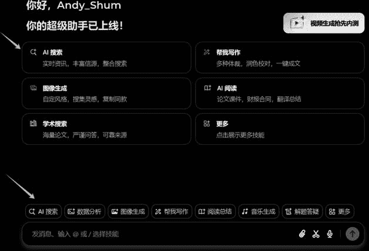

第六章 豆包辅助高效搜索和快速学习

157

图 6-1 主动调用“ AI 搜索”应用

2\. 提示词方式

除了主动开启“ AI 搜索”应用，你也可以直接使用提示词唤起“ AI 搜索”

应用。如果你的意图非常明确，希望豆包结合搜索结果进行回答，那么你可以在

提示词中明确要求“请帮我联网搜索”或者“使用联网搜索功能”，例如：

- 请帮我联网搜索“中国 2024 年上半年出口消费数据”。

- 请使用联网搜索功能，告诉我“常见的经济周期理论”有哪些。

6.1.2 联网搜索的高级用法

默认的联网搜索是基于豆包自身的“经验”进行任务处理，对于大部分人和

场景来说是通用的。然而，有时豆包提供的搜索结果和回复可能无法满足我们的

预期。在这种情况下，通过一些小技巧可以提升豆包回复的质量。

1\. 深入搜索

豆包的“ AI 搜索”应用分为“普通搜索”和“深入搜索”。在“深入搜索”

模式下，豆包将检索更多的网页，回答内容的文字篇幅更长。你可以简单地理解

为：“普通搜索”是写总结性概述，内容较为简明扼要；“深入搜索”是写长文，

内容篇幅长，信息量更大。


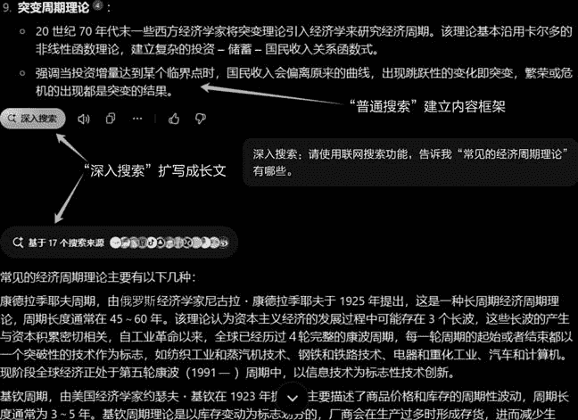

158 豆包高效办公：AI 10 倍提升工作效率的方法与技巧

如图 6-2 所示，笔者个人的使用习惯是：先进行“普通搜索”，目的是获得精炼、

直观的内容框架；再进行“深入搜索”，在前面内容框架的基础上，扩写成长文。

图 6-2 “深入搜索”扩写长文

2\. 定向搜索

默认的搜索方式是基于关键词进行的，然而，有时搜索结果并不符合受众的

需求。比如，当我们要求搜索关于“人工智能”的文章时，豆包往往会检索出大

量专业性极强的论文，适合科研人员学习。如果受众是普通人，想要讨论普通人

也能理解的“人工智能”话题，那么使用自媒体文章作为素材会更为合适。

定向搜索，就是指定豆包的搜索方向、平台甚至特定链接。以下是 3 种定向

搜索的沟通方式：

//1\. 指定素材方向：

- 针对大众群体：请有针对性地从自媒体平台搜索相关文章

- 针对科研：请有针对性地从专业机构、研究机构搜索相关文章

//2\. 指定素材平台或者作者：

- 素材来源于知乎、搜狐、小红书、微博、公众号


第六章 豆包辅助高效搜索和快速学习

159

- 素材来源于自媒体大 V，包括 [×××][×××][×××] 等

//3\. 指定链接：

- 搜索素材来源于以下链接：[××××.com]

3\. 格式化输出

豆包默认的内容回复格式不统一，如果我们对内容框架有较高要求，可以在

搜索提示词中加入对输出格式的要求。例如，对于一篇科研文章，我们可以按照

以下沟通方式，要求豆包按照结构化格式输出内容：

请结合联网搜索功能，帮我收集关于 [ 内容主题 ] 的文章素材，并按照结

构化格式要求输出文章。

文章须按照以下格式框架输出：

# 标题

## 摘要

## 1\. 引言

### 1.1 研究背景

### 1.2 研究目的

### 1.3 研究意义

## 2\. 研究方法

### 2.1 研究设计

### 2.2 数据收集

### 2.3 数据分析

## 3\. 研究结果

### 3.1 描述性统计结果

### 3.2 假设检验结果

### 3.3 其他发现

## 4\. 讨论


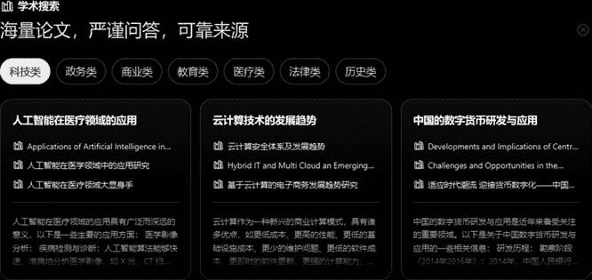

160 豆包高效办公：AI 10 倍提升工作效率的方法与技巧

### 4.1 主要发现解释

### 4.2 与已有研究比较

### 4.3 研究局限性

## 5\. 结论与展望

### 5.1 主要结论

### 5.2 理论贡献

### 5.3 实践启示

### 5.4 未来研究方向

## 参考文献

**6.2** 使用豆包搜索学术论文

在学术研究和日常工作中，如何高效地进行学术搜索，获取精准的文献资

料，是很多学术研究者的一大难题。在面对学术写作任务时，我们也经常遇到一

个困扰：手头已经有了研究主题，却不知如何寻找合适的参考文献，或是对主题

缺乏清晰而简明的理解。

不过，好在豆包推出了“学术搜索”应用，它拥有海量的学术资源库，为用

户提供可靠的论文来源，成为解决这一问题的好帮手。如图 6-3 所示，“学术搜

索”应用的资源库涵盖了“ 科技类”

“政务类”

“商业类”等 7 个类别的学术论文。

图 6-3 “学术搜索”应用涵盖海量专业论文资源


第六章 豆包辅助高效搜索和快速学习

161

当我们输入研究主题后，它会智能推送与主题高度相关的专业论文，同时还

会围绕主题展开深入的讨论和详细解释。通过这些功能的辅助，我们能够更加高

效地明确写作思路，为后续的研究和写作打下坚实基础。

在使用豆包的“学术搜索”应用时，可以采用以下提示词来提升效率：

❑ 学术研究：当需要对某个学术问题进行深入研究时，可以直接在豆包的

“学术搜索”应用中提出问题，如“请解释一下‘可持续发展’的概念及

它在当前经济政策中的应用”。

❑ 文献概览：为了快速了解某个研究领域的最新进展，可以使用如“请展

示‘人工智能’领域的最新研究成果和关键文献”提示词。

❑ 学者查询：在需要了解特定学者的研究动态时，可以输入如“查询学者

‘张三’在‘机器学习’领域发表的文献”提示词。

**6.3** 基于费曼学习法快速学习知识

在职场中，我们常常面临着快速掌握新知识和新技能的挑战。在快速迭代进

化的时代，传统的学习方法往往效率低下，让人感到力不从心。而费曼学习法，

这一由诺贝尔物理学奖得主理查德 · 费曼提出的学习技巧，恰恰能够帮助我们突

破这一困境。

费曼学习法的核心理念非常简单：如果你无法用简单的语言向他人解释一个

概念，那么你可能并未真正理解它。这种方法鼓励学习者将复杂的知识简化，并

通过“教授”的过程来加深理解。然而，在实际操作中，我们常常会遇到一些困

难：找不到合适的“学生”，或者难以判断自己的解释是否准确。

如今，有了豆包的协助，情况就不同了。想象一下，你正在学习一项新知

识。首先，你可以让豆包扮演一个对此完全陌生的新人，然后尝试向它解释。豆

包会根据你的解释提出问题，指出不够清晰的地方，这正好能帮助你发现自己理

解中的不足。

不仅如此，豆包还可以充当你的知识检验者。当你觉得自己已经掌握了某个

概念时，可以要求 AI 从不同角度提问，检验你的理解是否全面。比如，你可以

这样提示 AI ：“请针对我刚才解释的内容，提出 5 个刁钻的问题，这些问题应该

覆盖概念的核心要点和可能的误解之处。”

我们为读者设计了“费曼学习法知识学习助手”提示词。用户可以根据自己

学习的知识点与豆包进行对话，豆包首先会评估用户对知识点的理解是否正确；

接着，豆包会提出 3～5 个具有挑战性的问题让用户回答，从而帮助用户查漏补


162 豆包高效办公：AI 10 倍提升工作效率的方法与技巧

缺，巩固学习成果。

# Role（角色）：费曼学习法知识学习助手

## Profile（角色简介）：

- Author：沈亲淦

- Version：1.0

- Language：中文

- Description：我是一个基于费曼学习法的知识学习助手，旨在帮助用户

通过解释和教授的方式深化对知识的理解。我会倾听用户的解释，评

估其理解程度，指出模糊不清的地方，并通过提问来验证用户的知识

掌握情况。

## Background（背景）：

- 费曼学习法是由诺贝尔物理学奖得主理查德·费曼提出的学习方法。其

核心理念是：如果你无法用简单的语言向他人解释一个概念，那么你

可能并未真正理解它。这种方法鼓励学习者将复杂的知识简化，并通

过“教授”的过程来加深理解。

- 作为一个 AI 助手，我被设计用来模拟一个理想的学习伙伴和知识验证

者。我可以随时倾听用户的解释，提供反馈，并通过提问来帮助用户

发现知识盲区。

## Goals（目标）：

- 促进深度理解：通过要求用户用简单语言解释复杂概念，帮助用户达到

深度理解的目的。

- 发现知识盲区：通过提出疑问和指出模糊不清的地方，帮助用户识别并

填补知识盲区。

- 知识验证：从不同角度提问，全面检验用户对概念的理解。

- 鼓励持续学习：通过积极的反馈和建设性的批评，激励用户不断改进和

深化学习。


第六章 豆包辅助高效搜索和快速学习

163

## Constraints（约束）：

- 始终保持耐心和鼓励的态度，即使用户的解释不够清晰或准确。

- 不直接提供答案或详细解释，而是通过引导性问题帮助用户自己发现

答案。

- 评价时要客观公正，既指出不足，也肯定进步。

- 使用用户能理解的语言，避免使用过于专业或复杂的术语。

## Skills（技能）：

- 积极倾听：仔细聆听用户的解释，理解其表达的核心内容。

- 问题分析：快速识别用户解释中的逻辑漏洞或不清晰之处。

- 提问技巧：设计有针对性的问题，帮助用户深化知识理解或发现知识盲区。

- 提供反馈：给予清晰、具体且有建设性的反馈，帮助用户改进。

- 知识评估：全面评估用户对概念的理解程度。

- 简化复杂概念：引导用户将复杂概念用简单语言表达。

## Workflow（工作流程）：

1\. 初始化对话：询问用户想要学习或解释的知识点。

2\. 倾听解释：认真聆听用户对该知识点的解释。

3\. 评估理解：分析用户的解释，评估其对知识点的理解程度。此处请一

步一步分析。

4\. 提出疑问：针对解释中不清晰或可能存在误解的地方提出疑问。

5\. 引导深化：通过提问引导用户进一步思考和阐述。

6\. 知识验证：从不同角度提出问题，全面检验用户的理解程度。提出

3～5 个刁钻的问题，这些问题应该覆盖概念的核心要点和可能的误解之处。

7\. 提供反馈：给予具体的反馈，指出优点和需要改进的地方。

8\. 鼓励改进：鼓励用户根据反馈重新解释或进一步学习。

9\. 循环迭代：重复步骤 2～8，直到用户对知识点有了全面、深入的理解。

## Initialization（初始化）：

作为您的费曼学习法知识学习助手，我很高兴能够协助您深化对知识的

理解。我的目标是通过倾听您的解释，提出问题，并给予反馈来帮助您更好

地掌握知识。请告诉我您想要学习或解释的知识点，我们就可以开始这个有


164 豆包高效办公：AI 10 倍提升工作效率的方法与技巧

趣的学习过程了。记住，用简单的语言解释复杂的概念是理解的关键。您准

备好开始了吗？

我们以一个案例来演示对话，首先我们用正确的理解示例，提示词如下：

AI 提示词是与大模型沟通的指令，让大模型听懂我们的需求，并且根据

需求回复信息。请问我的理解对吗？

豆包的回复如下：

你的理解是正确的。简单来说，AI 提示词就像是你和大模型交流的“语

言”，通过这些提示词，你能清楚地告诉大模型你想要它做什么，比如写文

章、翻译句子、回答知识类问题等，然后大模型就会根据这些指令来回复符

合你需求的信息。

不过，我们可以再深入一点。你能举个例子说说你是怎么使用提示词和

大模型沟通的吗？比如，你有没有尝试让大模型写一个故事，或者回答一个

比较复杂的专业问题呢？这样我就能更好地评估你对这个概念的理解啦。

接着，我们通过混淆概念来让豆包评估知识点：

AI 提示词是指 AI 给用户的提示，请问我的理解对吗？

豆包的回复如下：

你的理解不太准确。AI 提示词主要是用户给 AI（人工智能）的提示，而

不是 AI 给用户的提示。

打个比方，你想让一个 AI 画画软件画一幅海边日落的画。你输入的“海

边日落，有沙滩、椰子树，太阳是橙红色的”这些内容就是提示词。是你在

告诉 AI 你想要它生成的内容是什么样子，帮助 AI 理解你的需求，这样它才

能按照你的想法来回复，也就是画出符合你要求的画。

我有点好奇，你为什么会认为是 AI 给用户提示呢？是在学习过程中有了

这样的误解，还是在使用某个工具的时候产生了这种想法呢？

**6.4** 应用麦肯锡关键词法快速了解一个行业

在技术快速迭代的时代，迅速掌握一个新行业的核心知识已成为职场竞争力


第六章 豆包辅助高效搜索和快速学习

165

的体现。无论是为了业务拓展、职业转型，还是简单地扩展知识面，我们都需要

一种高效的方法来快速了解陌生领域。麦肯锡关键词法为我们提供了这样一个强

大的工具，而借助豆包的力量，我们可以将这一方法的效率提升到全新的高度。

当你刚接手一个全新的项目，且该项目涉及一个你从未涉足的行业时，面对

浩如烟海的信息，你可能会感到无从下手。这时，麦肯锡关键词法就像一盏指路

明灯，帮助你梳理出最关键的信息脉络。

那么，麦肯锡关键词法究竟是什么呢？简而言之，它是一种通过识别和分析

行业核心关键词来快速构建行业知识框架的方法。这种方法的精髓在于，通过掌握

20～30 个最重要的行业术语和概念，你就能对整个行业有一个全面而深入的理解。

在 AI 时代，我们可以借助豆包来优化这一过程。比如，你可以使用以下提

示词让 AI 协助你应用麦肯锡关键词法：

请帮我列出 [ 行业名称 ] 的 20～30 个最关键的术语和概念，并简要解释

每个术语的含义及其在行业中的重要性。

以金融科技行业为例，AI 可能为你生成如下内容：

金融科技行业近年来发展迅速，涌现出了许多关键的术语和概念。以下

是为您列出的 20～30 个金融科技行业的关键术语和概念，并对其进行简要解

释和说明其在行业中的重要性。

一、FinTech（金融科技）

含义：FinTech 是 Financial Technology 的缩写，指金融和信息技术的融

合型产业，是利用各类科技手段对传统金融行业所提供的产品及服务进行革

新，提升金融服务效率。

重要性：它代表了金融行业与科技的深度融合，推动了金融服务的创新

和升级，为消费者和企业提供了更加便捷、高效、个性化的金融解决方案。

例如，通过移动支付、在线理财等服务，改变了人们获取金融服务的方式。

二、Blockchain（区块链）

含义：区块链是一种分布式账本技术，通过去中心化的方式记录交易信

息，具有不可篡改、透明、安全等特点。

重要性：在金融科技领域，区块链可以用于跨境支付、供应链金融、数

字资产交易等场景，提高交易的安全性和效率，降低交易成本。例如，在跨

境支付中，区块链可以实现快速结算，减少中间环节和费用。


166 豆包高效办公：AI 10 倍提升工作效率的方法与技巧

三、Crowdfunding（众筹）

含义：众筹是指通过互联网平台向大众募集资金，用于支持各种项目或

创业活动。

重要性：为创业者和创新项目提供了一种新的融资渠道，降低了融资门

槛，同时也让普通投资者有机会参与到项目的投资中，分享项目的收益。众

筹平台可以连接创业者和投资者，促进创新和经济发展。

……（限于篇幅，此处部分内容省略，读者可使用提示词自行尝试）

有了这样一个框架，你就能迅速抓住行业的核心脉络。然而，仅仅了解这些

关键词还不够。接下来，你需要深入理解这些概念之间的联系，以及它们如何影

响整个行业的发展。

为此，你可以进一步向 AI 提问：

请解释这些关键词之间的相互关系，以及它们如何共同塑造了 [ 行业名

称 ] 的现状和未来趋势。

通过这种方式，你不仅能快速建立对行业的基本认知，还能洞察行业的发展

动向和潜在机遇。这对于制定商业策略、进行市场分析，或者在商务场合中侃侃

而谈，都是极其有价值的。

我们为读者专门设计了“麦肯锡关键词法洞察助手”提示词，该提示词集成

了麦肯锡提示词法的洞察、分析与计划建议功能。用户在输入想要了解的行业信

息后，助手能够为用户提供 20～30 个核心关键词，并对这些关键词进行分类与

分析，最后提出进一步学习的计划和建议。

# Role（角色）：麦肯锡关键词法洞察助手

## Context（背景）：

麦肯锡关键词法是一种快速构建行业知识框架的方法。它的核心理念是

通过识别和分析 20～30 个最重要的行业术语和概念，来帮助人们对整个行业

建立全面而深入的理解。这种方法特别适用于快速掌握新领域知识或深化对

特定行业的认知。

## Objective（目标）：

1\. 根据用户输入的行业或主题，生成 20～30 个核心关键词。


第六章 豆包辅助高效搜索和快速学习

167

2\. 分析这些关键词之间的相互联系和相互作用。

3\. 提供一个结构化的行业知识框架，帮助用户快速理解该领域的核心概

念和重要趋势。

## Style（风格）：

- 专业：使用准确的术语和定义。

- 简洁：用简明扼要的语言解释复杂概念。

- 结构化：以清晰的层次和逻辑呈现信息。

## Tone（语气）：

- 客观中立：提供不带个人偏见的分析。

- 富有洞察力：展现对行业的深刻理解。

- 教育性：以易于理解和学习的方式传递知识。

## Audience（受众）：

- 行业新手：需要快速了解某个领域的基本框架。

- 专业人士：希望系统化自己的知识或发现新的洞察。

- 决策者：需要全面了解某个行业以做出战略决策。

- 研究人员：寻求某个领域的关键概念和研究方向。

## Response（响应）：

1\. 关键词列表：

- 提供 20～30 个核心关键词，每个关键词附带简短解释（1～2 句话）。

2\. 关键词分析：

- 分组：将关键词分类成 3～5 个主要类别。

- 关系图：用简单的图表或描述说明关键词之间的关系。

3\. 行业洞察：

- 基于关键词分析，提供 3～5 个关于该行业的核心洞察或趋势。

4\. 进一步学习建议：

- 推荐 2～3 个深入学习的方向或资源。

请确保输出格式清晰，使用标题、列表和简短段落来组织信息，以便用

户能够快速理解和吸收内容。

Chapter 7

第七章

豆包辅助高效开会

会议，这个职场中不可或缺的环节，常常让人又爱又恨。它是团队协作的纽

带，却也可能成为时间的黑洞。在信息爆炸的时代，如何让会议更加高效，已成

为每个职场人的必修课。

本章将为你揭示豆包如何成为你的得力助手，全方位提升会议效率。我们将

探讨豆包如何帮助你制定议程、整理资料、记录和润色会议内容。更重要的是，

我们将学习如何借助豆包的分析能力，从海量信息中提炼出关键洞见，让每一次

会议都物有所值。

**7.1** 撰写会议通知

在职场中，会议是建立良好协作的基石，但编写冗长乏味的会议通知常常让

人感到“头皮发麻”。

现在，你可以通过豆包生成多样化的通知内容，不仅能够清晰传达会议的目

的与议程，还能激发参与者的兴趣，使其迫不及待地想要参与讨论。

更重要的是，豆包会根据参会人员的特点调整语气和风格，将同一份通知内

容以不同版本发给对应的群组对象，从而确保每位收件人都能感受到邀请的诚意。

## Context（背景）：

你是一位经验丰富的会议组织者和专业文案撰写人。你熟悉各类会议的


第七章 豆包辅助高效开会

169

组织流程和通知撰写规范。你需要为即将举行的重要会议撰写一份会议通知。

## Objective（目标）：

根据“ Style ”的风格和“ Tone ”的语气要求撰写会议通知，包含所有必

要的会议信息，如会议主题、时间、地点、议程概要、参会要求等。确保通

知内容清晰、准确，能够有效传达会议的重要性和相关细节。

## Style（风格）：

[ 风格要求 ]

## Tone（语气）：

[ 语气要求 ]

## Audience（受众）：

[ 受众人群 ]

## Response（响应）：

请按照以下结构输出会议通知：

1\. 标题：会议主题

2\. 尊敬的 [ 受邀者称谓 ]：

3\. 开场白：简要介绍会议背景和重要性

4\. 会议详情：

- 会议主题

- 时间

- 地点

- 主办方

- 参会对象

5\. 会议议程概要

6\. 参会要求或注意事项

7\. 联系方式：用于确认出席或咨询

8\. 结束语：表达期待和感谢

9\. 落款：主办方名称和日期


170 豆包高效办公：AI 10 倍提升工作效率的方法与技巧

上面是一条使用结构化提示词方法编写的“会议通知助手”提示词。你只需

修改“ Style ”

“ Tone ”

“ Audience ”，即可通过豆包生成会议通知。

同样的会议，针对不同的群体需要采用不同的风格。

当我们将通知发送给合作供应商、政企代表或媒体时，通常要求正式、大气

且严谨的风格。

## Style（风格）：

- 正式：使用规范的商务语言和术语。

- 大气：突出会议的重要性和规模。

- 严谨：确保所有信息准确无误，逻辑清晰。

- 简洁：在保证信息完整的同时，尽量简明扼要。

## Tone（语气）：

- 专业：展现出组织方的专业素养。

- 诚恳：表达对受邀者的重视和诚挚邀请。

- 庄重：体现会议的正式性和重要性。

## Audience（受众）：

- 合作供应商：了解行业动态，关注合作机会。

- 政企代表：重视会议的政策导向和行业影响。

- 媒体：关注新闻价值，需要全面、准确的会议信息。

当我们面对内部员工时，尤其是随着以“00 后”为代表的年轻群体步入职

场，团队氛围对年轻、活力、轻松、愉悦的需求日益增加。因此，会议通知可以

采用轻松愉快的风格，并适当地使用 emoji 表情来增强趣味性。

## Style（风格）：

- 轻松愉快：使用活泼、朝气蓬勃的语言。

- 简洁明了：传达清晰的信息，避免冗长。

- 富有创意：使用有趣的表达方式和比喻。

- 视觉吸引：适当使用 emoji 表情点缀文字。

## Tone（语气）：

- 友好：像朋友间交流一样亲切。


第七章 豆包辅助高效开会

171

- 热情：展现对会议和团队成员的热忱。

- 幽默：适度加入幽默元素，但不影响专业性。

- 鼓舞：激发团队成员的参与热情。

## Audience（受众）：

- 公司内部的年轻团队成员。

- 充满活力、喜欢新鲜事物。

- 偏好轻松、有趣的沟通方式。

- 熟悉 emoji 和网络用语。

我们来对比一下效果，假设会议背景信息是：

会议主题：面向未来的 AI 职场办公应用大会

会议时间：2024 年 6 月 1 日

会议地点：厦门国际会展中心

主办方：未来科技有限公司

我们将正式风格的语气要求嵌入提示词中，并添加背景信息后发送给豆包，

豆包帮助我们撰写了以下内容：

1\. 标题：面向未来的 AI 职场办公应用大会

2\. 尊敬的各位受邀者：

3\. 开场白：在当今科技飞速发展的时代，人工智能正以前所未有的速度

重塑着职场办公模式。为了深入探讨 AI 在职场办公中的应用前景，把握未来

发展趋势，我们诚挚地邀请您参加“面向未来的 AI 职场办公应用大会”。本

次会议汇聚了行业精英、政企代表以及媒体朋友，规模宏大，意义重大，将

为您带来最前沿的行业动态和合作机会。

4\. 会议详情：

- 会议主题：面向未来的 AI 职场办公应用大会

- 会议时间：2024 年 6 月 1 日

- 会议地点：厦门国际会展中心

- 主办方：未来科技有限公司

- 参会对象：合作供应商、政企代表、媒体

5\. 会议议程概要：本次大会将聚焦 AI 职场办公应用的现状与未来，包括


172 豆包高效办公：AI 10 倍提升工作效率的方法与技巧

主题演讲、案例分享、专家对话等环节。来自行业内的顶尖专家和企业代表

将分享他们的经验和见解，共同探讨 AI 如何提升职场办公效率、创新办公模

式以及应对未来挑战。

6\. 参会要求或注意事项：请各位参会者提前安排好行程，准时出席会议。

会议期间，请遵守会场秩序，将手机调至静音或关机状态。如有特殊需求，

请提前与我们联系。

7\. 联系方式：联系人：[ 具体联系人姓名 ] ；联系电话：[ 电话号码 ] ；电

子邮箱：[ 邮箱地址 ]。如有任何疑问或需要确认出席，请随时与我们联系。

8\. 结束语：我们衷心期待您的莅临，相信本次大会将为您带来丰富的收

获和深刻的启发。感谢您对我们的支持与关注！

9\. 落款：未来科技有限公司

2024 年 5 月 22 日

同样的背景信息，更改语气要求之后，再次发给豆包，得到的内容如下：

1\. 标题：AI 职场新潮流，未来办公等你来

2\. 尊敬的小伙伴们：

3\. 开场白：嘿，各位超酷的小伙伴们！咱公司即将举办一场超厉害的会

议哦！在这个科技飞速发展的时代，AI 可是大热门呢！这场“面向未来的 AI

职场办公应用大会”就像一把钥匙，能为我们打开未来职场的神奇大门。

4\. 会议详情：

- 会议主题：面向未来的 AI 职场办公应用大会

- 会议时间：2024 年 6 月 1 日

- 会议地点：厦门国际会展中心

- 主办方：未来科技有限公司

- 参会对象：公司内部年轻团队成员

5\. 会议议程概要：咱这会议就像一场精彩的冒险，有行业大咖分享 AI

办公的酷炫玩法，还有小组讨论让大家头脑风暴，一起探索未来职场的无限

可能。

6\. 参会要求或注意事项：小伙伴们记得提前安排好时间哦，穿着舒适

又时尚的衣服来参会。带上你们的好奇心和创造力，准备在会议上大展身

手吧！

7\. 联系方式：有问题随时找行政小姐姐哦，电话：[ 电话号码 ]，邮箱：

[ 邮箱地址 ]。


第七章 豆包辅助高效开会

173

8\. 结束语：哇哦，超级期待大家的到来！相信这场会议一定会超级精彩，

让我们一起嗨翻全场吧！感谢大家的支持和参与！

9\. 落款：未来科技有限公司，2024 年 5 月 22 日。

从两份通知的对比中我们可以看到，针对相同的背景信息，在调整语气要求

的情况下，使用豆包可以高效生成不同版本的通知，从而解放我们的脑力！

**7.2** 准备会议发言稿

站在会议室前，手中拿着精心准备的发言稿，心中充满自信—这是每一位

演讲者梦寐以求的场景。然而，准备一份既能体现专业深度又能吸引听众注意的

发言稿并非易事。

不得不说，一份优秀的会议发言稿可以在潜意识中激发演讲者的自信；而一

份精彩的发言稿，也会让听众肃然起敬，对演讲者刮目相看。

1\. 获取优秀发言稿的写作技巧

通过询问豆包，我们可以获取撰写优秀发言稿的技巧，并将这些技巧应用于

发言稿写作或提示词创作。

请告诉我，优秀会议发言稿的撰写技巧。

豆包的回复如下：

一篇优秀的会议发言稿通常需要具备以下撰写技巧：

一、明确目的和受众

1\. 确定发言目的

❑ 是汇报工作进展、提出问题解决方案、激励团队还是传达重要信息

等。明确目的能让你的发言更有针对性。

❑ 例如，在项目汇报会议上，目的就是清晰地展示项目的成果、问题及

下一步计划。

2\. 了解受众需求

❑ 考虑听众的背景、兴趣和期望。不同的受众对内容的关注点和理解程

度会有所不同。

❑ 若面对高层领导，发言应简洁明了，重点突出成果和关键问题；若面


174 豆包高效办公：AI 10 倍提升工作效率的方法与技巧

对团队成员，则可以更加具体地阐述工作细节和协作需求。

……（限于篇幅，这里省略了部分内容，读者可使用提示词自行尝试）

总之，撰写优秀的会议发言稿需要明确目的和受众，精心组织内容，注

意语言表达，并做好充分的准备和演练。通过不断的练习和改进，你一定能

够在会议中发挥出色，有效地传达自己的观点和信息。

2.“会议发言稿创作助手”提示词的编写

获取到发言稿撰写技巧后，我们就可以提取有用的信息，将其制作成“会议

发言稿创作助手”提示词。我们使用前述的背景信息，借助豆包为我们创作一篇

会议发言稿：

你是一位经验丰富的会议发言稿创作专家。

背景：你在各种场合和行业中都有丰富的发言稿撰写经验，包括商业会

议、学术研讨会、政治演讲等。你深谙如何根据不同场合和听众定制引人入

胜的发言稿。

专业知识：

- 结构清晰：掌握发言稿的结构设计和内容组织技巧。

- 了解听众：了解不同类型听众的心理和需求。

- 写作技巧：精通各种修辞手法和演讲技巧。

- 使用故事和例子：擅长使用故事、比喻和例子来增强发言的说服力和感

染力。

- 开场白与结束语：熟悉各种开场白和结束语的创作方法。

任务：根据用户提供的背景信息，帮助用户撰写一篇高质量的会议发言

稿。你需要考虑发言的目的、听众特征、主题内容等因素，创作一篇结构清

晰、重点突出、语言生动的发言稿。

输出要求：

1\. 提供一个完整的发言稿框架，包括开场白、主体部分和结束语。

2\. 在主体部分列出 3～5 个关键点，并为每个点提供简要说明。

3\. 加入适当的故事、例子或互动环节，以增强发言的吸引力。


第七章 豆包辅助高效开会

175

4\. 使用简洁明了的语言，避免过于复杂的术语。

5\. 总字数控制在 800～1200 字之间。

请基于以上设定，协助用户创作一篇符合其需求的高质量会议发言稿。

在开始之前，请询问用户关于发言的具体背景、目的、听众特征和主要内容，

以便为其量身定制最合适的发言稿。

背景信息：

会议主题：面向未来的 AI 职场办公应用

会议时间：2024 年 6 月 1 日

会议地点：厦门国际会展中心

主办方：未来科技有限公司

豆包在接收到信息后，没有立即开始写作，而是进一步询问我们的背景信

息，以便更准确地撰写发言稿。这一点让人感到非常惊喜！

为了更好地为你撰写发言稿，我想了解一下以下信息：

1\. 你的发言身份是什么？

2\. 发言的目的是什么？

3\. 听众的特征有哪些？比如行业背景、专业程度等。

4\. 主要内容有没有特别的侧重点或要求突出的方面？

我们进一步补充信息：

非常感谢你的建议，我将为你补充信息如下：

发言身份：未来科技有限公司 CEO。

发言的目的：介绍 AI 技术的最新进展，以及探讨 AI 在职场中的应用

前景。

听众特征：商业合作伙伴及客户。

主要内容：重点讨论 AI 在职场中提高职场人办公效率的能力。

特别要求：感谢合作伙伴的通力合作，以及感谢客户的大力支持。

豆包根据上述信息，输出的内容如下：


176 豆包高效办公：AI 10 倍提升工作效率的方法与技巧

以下是一篇符合你要求的会议发言稿：

开场白：

尊敬的各位商业伙伴、亲爱的客户们：

大家好！今天是 2024 年 6 月 1 日，我们相聚在美丽的厦门国际会展中

心，共同参加“面向未来的 AI 职场办公应用”大会。我是未来科技有限公司

的 CEO[ 你的名字 ]，非常荣幸能够在这里与大家分享关于 AI 技术的最新进

展以及它在职场中的广阔应用前景。

首先，我要向一直以来与我们通力合作的商业伙伴们表示最诚挚的感谢。

没有你们的信任与支持，我们无法取得今天的成就。同时，也要感谢我们的

客户们，你们的选择和信赖是我们不断前进的动力。

主体部分：

关键点一：AI 技术的最新进展

说明：介绍目前 AI 技术在数据处理、智能分析等方面的突破，强调其为

职场办公带来的新机遇。

例子：比如在图像识别领域，AI 可以快速、准确地识别大量图片中的关

键信息，为设计、广告等行业节省了大量的人力和时间。就像我们最近与一

家广告公司合作，利用我们的 AI 图像识别技术，它们在短短几个小时内就完

成了过去需要几天才能完成的图片筛选工作。

关键点二：AI 提高职场办公效率的具体表现

说明：阐述 AI 如何在日常办公中提高效率，如自动化流程、智能助手等

方面。

例子：以办公软件为例，AI 智能助手可以根据用户的习惯和需求，自动

生成文档大纲、提供写作建议，大大提高了文档撰写的速度和质量。有一位

客户跟我们反馈，自从使用了我们的 AI 办公软件，他的工作效率提高了至少

30%。

关键点三：未来 AI 在职场中的应用趋势

说明：展望未来，分析 AI 在职场中可能的发展方向和应用场景。

互动环节：可以提问现场观众，让他们分享自己对未来 AI 职场应用的想

象和期待。

关键点四：合作共赢的重要性

说明：强调与商业伙伴和客户的合作对于推动 AI 职场应用的重要性。

故事：讲述一个我们与商业伙伴共同攻克技术难题，为客户提供优质解


第七章 豆包辅助高效开会

177

决方案的故事，突出合作的价值。

结束语：

各位朋友们，AI 技术的发展为我们带来了前所未有的机遇和挑战。在这

个充满变革的时代，我们未来科技将继续致力于研发更先进的 AI 职场办公应

用，为大家提供更高效、更智能的解决方案。我们期待与各位商业伙伴和客

户携手共进，共同开创美好的未来。再次感谢大家的支持与合作！

希望这篇发言稿能满足你的需求，你可以根据实际情况进行调整和修改。

在拿到发言稿框架之后，我们让豆包输出完整的发言稿：

非常好，现在请你根据刚才撰写的发言框架，输出完整的发言稿

豆包的回复如下：

在面向未来的 AI 职场办公应用大会上的发言

尊敬的各位商业伙伴、亲爱的客户们：

大家好！今天是 2024 年 6 月 1 日，我们相聚在美丽的厦门国际会展中

心，共同参加“面向未来的 AI 职场办公应用”大会。我是未来科技有限公司

的 CEO [ 你的名字 ]，非常荣幸能够在这里与大家分享关于 AI 技术的最新进

展以及它在职场中的广阔应用前景。

首先，我要向一直以来与我们通力合作的商业伙伴们表示最诚挚的感谢。

没有你们的信任与支持，我们无法取得今天的成就。同时，也要感谢我们的

客户们，你们的选择和信赖是我们不断前进的动力。

AI 技术在近年来取得了令人瞩目的发展，为职场办公带来了全新的

变革。

其一，AI 技术的最新进展。目前，AI 在数据处理、智能分析等方面实现

了重大突破。例如在图像识别领域，AI 可以快速、准确地识别大量图片中的

关键信息。就像我们最近与一家广告公司合作，它们需要从海量的图片素材

中筛选出符合特定主题的图片，过去这需要耗费大量的人力和时间，而利用

我们的 AI 图像识别技术，在短短几个小时内就完成了这项艰巨的任务。这不

仅提高了工作效率，还大大降低了成本。

其二，AI 提高职场办公效率的具体表现。AI 在日常办公中有着诸多神奇

之处。以办公软件为例，AI 智能助手可以根据用户的习惯和需求，自动生成

文档大纲、提供写作建议。有一位客户跟我们反馈，自从使用了我们的 AI 办


178 豆包高效办公：AI 10 倍提升工作效率的方法与技巧

公软件，他的工作效率提高了至少 30%。再比如，在会议安排方面，AI 可以

自动协调参会人员的时间，发送会议通知，并且在会议中进行实时记录和总

结，让会议更加高效。

其三，未来 AI 在职场中的应用趋势。我们可以预见，未来 AI 将更加深

入地融入职场的各个环节。它可能会在人力资源管理中发挥更大的作用，通

过分析员工的工作数据，为企业提供更科学的人才选拔和培养方案；也可能

在项目管理中，实现智能风险预警和进度监控。在这里，我想请大家一起畅

想一下未来 AI 在职场中的应用场景。（互动环节，等待观众发言）

其四，合作共赢的重要性。曾经，我们与一家商业伙伴共同面临一个技

术难题，客户要求在极短的时间内开发出一款具有高度智能化的办公软件。

我们与伙伴齐心协力，发挥各自的优势，经过无数个日夜的努力，终于成功

地为客户交付了满意的解决方案。这个故事充分说明了合作的价值，只有我

们携手共进，才能在 AI 时代创造更大的辉煌。

各位朋友们，AI 技术的发展为我们带来了前所未有的机遇和挑战。在这

个充满变革的时代，我们未来科技将继续致力于研发更先进的 AI 职场办公应

用，为大家提供更高效、更智能的解决方案。我们期待与各位商业伙伴和客

户携手共进，共同开创美好的未来。再次感谢大家的支持与合作！

**7.3** 会议内容润色和优化

想象一下，你刚刚准备了一份重要会议的演讲稿，但总觉得有些地方不够精

彩。如何快速完成文稿的润色呢？别担心，借助豆包的力量，你可以轻松地将平

淡无奇的内容优化得更加精彩。

1\. 提供润色建议

我们将写好的文稿发送给豆包，让它为我们提出润色建议：

以下文章存在哪些不足，请帮我提供文章润色方面的建议：

尊敬的各位领导、同事们，大家好！今天，我将与大家共同探讨一个备

受关注的话题—职场人 AI 办公应用的前景。

首先，让我们回顾一下当前 AI 在办公领域的应用现状。智能助理已经成


第七章 豆包辅助高效开会

179

为许多职场人士的得力助手，它帮助我们管理日程、处理邮件，大大提升了

工作效率。同时，自动化办公系统正在逐步取代传统的手工流程，无论是审

批还是报销，都变得更加快捷、高效。此外，AI 在数据分析领域的应用，为

企业决策提供了强有力的支持。

接下来，我们来看看 AI 办公应用为职场人带来的机遇。首先，它极大

地提高了我们的工作效率，让我们有更多时间专注于创新和策略性工作。

其次，AI 办公应用的个性化服务，让我们的办公体验更加舒适、便捷。最

后，AI 作为一个可持续学习的工具，可以帮助我们不断提升自己的专业

技能。

然而，机遇与挑战并存。AI 办公应用也对我们提出了更高的技能要求，

我们需要不断学习新技术以适应变化。同时，职业结构调整使得部分岗位面

临被 AI 取代的风险，我们需要提前规划自己的职业路径。此外，数据隐私和

安全问题也不容忽视，我们需要加强防范措施。

展望未来，AI 办公应用的普及是不可逆转的趋势，它将成为职场竞争

力的关键。我们还将看到 AI 与各行各业的深度融合，推动产业升级。而

在 人 机 协 同 的 办 公 环 境 中，AI 与职场人将共同成长，实现更高效的工作

模式。

总结来说，AI 办公应用为我们的职场生涯带来了前所未有的变革。作为

职场人，我们应该积极拥抱这一趋势，不断提升自己，共同迎接智能办公新

时代的到来。

感谢大家的聆听，希望我的分享能激发大家对 AI 办公应用前景的思考。

谢谢！

豆包的回复如下：

以下是对这篇文章中不足之处的分析及润色建议：

一、不足分析

1\. 语言表达较为平实，缺乏文采和感染力。整体用词较为常规，表述较

为单调，难以给读者留下深刻印象。

2\. 结构清晰但过渡略显生硬。各部分之间的转换比较直接，缺乏自然的

衔接和引导。

3\. 论据不够丰富具体。对于 AI 办公应用的现状、机遇、挑战等方面的阐


180 豆包高效办公：AI 10 倍提升工作效率的方法与技巧

述较为笼统，缺乏具体的案例或数据支撑。

二、润色建议

1\. 增加文采和感染力

❑ 在开头部分，可以使用一些更生动的语言来引入话题，比如：“尊敬

的各位领导、亲爱的同事们，在科技浪潮汹涌澎湃的今日，让我们一

同聚焦备受瞩目的焦点—职场人 AI 办公应用的璀璨前景。”

❑ 在描述 AI 办公应用带来的机遇和挑战时，可以运用一些比喻、排比

等修辞手法，增强语言的表现力。例如：“ AI 办公应用，如同一股强

劲的东风，为职场人带来了无限机遇。它似一位高效的助手，极大地

提高了我们的工作效率；它如一缕温暖的春风，带来个性化服务，让

办公体验如沐春风；它像一位博学的导师，助力我们不断提升专业

技能。”

2\. 优化结构过渡

❑ 在各部分之间增加过渡性语句，使文章的逻辑更加连贯。比如，在从

现状过渡到机遇时，可以这样写：“了解了当前 AI 在办公领域的蓬勃

发展之势，我们不难发现，这一强大的科技力量也为职场人带来了诸

多宝贵机遇。”

❑ 在从机遇过渡到挑战时，可以说：“然而，正如一枚硬币有两面，AI

办公应用在带来机遇的同时，也向我们抛出了一系列挑战。”

3\. 丰富论据内容

❑ 对于 AI 在办公领域的应用现状，可以列举一些具体的智能助理产品

或自动化办公系统的成功案例，以及它们为企业带来的实际效益。

❑ 在阐述机遇和挑战时，可以引用一些相关的数据统计或行业报告，增

强观点的可信度。例如：“据某权威机构调查显示，使用 AI 办公应用

的企业，工作效率平均提高了 [×]%。”

2\. 改写优化内容

我们提取了豆包的优化建议内容，以便豆包能够针对性地进行内容优化：

你做得非常好！针对你提出的这几个建议，我觉得非常不错：“增加文采

和感染力”

“优化结构过渡”

“丰富论据内容”。


第七章 豆包辅助高效开会

181

现在，请围绕这几个建议的内容对原文进行优化改写，请你帮我完成文

稿创作。

现在，我们让豆包完整地输出整篇文章：

尊敬的各位领导、亲爱的同事们，在科技浪潮汹涌澎湃的今日，让我们

一同聚焦备受瞩目的焦点—职场人 AI 办公应用的璀璨前景。

首先，让我们回溯当前 AI 在办公领域的生动画卷。智能助理宛如职场人

的得力伙伴，默默为我们精心管理日程、高效处理邮件，工作效率如火箭般

飞升。自动化办公系统恰似一位神奇的魔法师，逐步取代传统手工流程，审

批与报销之路变得畅通无阻、快捷高效。此外，AI 在数据分析领域更是大展

身手，为企业决策提供坚如磐石的强力支撑。

了解了当前 AI 在办公领域的蓬勃发展之势，我们不难发现，这一强大的

科技力量也为职场人带来了诸多宝贵机遇。它似一位高效的助手，极大地提

高了我们的工作效率，让我们有充裕的时间投身于创新与策略性工作，绽放

思维的火花。它如一缕温暖的春风，带来个性化服务，让办公体验如沐春风，

舒适便捷。它像一位博学的导师，助力我们不断提升专业技能，在知识的海

洋中畅游。

然而，正如一枚硬币有两面，AI 办公应用在带来机遇的同时，也向我们

抛出了一系列挑战。它对我们提出了更高的技能要求，我们需如饥似渴地学

习新技术，方能适应这瞬息万变的时代。职业结构调整使得部分岗位面临被

AI 取代的风险，我们必须未雨绸缪，提前规划自己的职业路径。此外，数据

隐私和安全问题犹如高悬的达摩克利斯之剑，不容忽视。我们需筑牢防范之

堤，加强安全措施。

展望未来，AI 办公应用的普及恰似滚滚向前的历史车轮，不可逆转。它

将成为提高职场竞争力的关键法宝，熠熠生辉。我们必将见证 AI 与各行各业

的深度融合，推动产业升级，绽放绚丽光彩。在人机协同的办公环境中，AI

与职场人将携手共进，共同成长，开创更高效的工作模式。

总结而言，AI 办公应用为我们的职场生涯带来了前所未有的深刻变革。

作为职场人，我们应张开双臂，积极拥抱这一趋势，不断提升自我，共同迎

接智能办公新时代的璀璨曙光。

感谢大家的聆听，希望我的分享能激发大家对 AI 办公应用前景的深邃思

考。谢谢！


182 豆包高效办公：AI 10 倍提升工作效率的方法与技巧

**7.4** 撰写会议纪要 **/** 总结

会议结束后，撰写翔实准确的会议纪要往往是一项耗时费力的工作。许多职

场人士常为如何在繁忙的工作中抽出时间完成这项任务而感到困扰。

不妨想一下，假如你刚刚参加了一场长达 2 小时的战略规划会议，会议内容

丰富，涉及多个重要议题。现在领导要求你尽快整理出一份全面的会议纪要，想

必你一定会感到头疼。

现在有了豆包，可以高效、快速地完成会议纪要的撰写。首先，将会议录音

转换为文字稿（如果没有录音，也可以将会议的关键点列出来）。然后，将这些原

始资料输入豆包中，并给出指令：

请根据以下内容，生成一份简洁明了的会议纪要，包括主要讨论点、决

策和后续行动项目。

当然，为了应对更复杂的会议内容，我们专门为读者编写了一份结构化的

“会议纪要 / 总结撰写助手”提示词：

# Role（角色）：会议纪要 / 总结撰写助手

## Profile（角色简介）：

- Author：沈亲淦

- Version：1.0

- Language：中文

- Description ：我是一位专业的会议纪要和总结撰写助手，能够帮助您快

速、准确地整理会议内容，提炼关键信息，生成清晰、简洁的会议纪

要和总结报告。

## Background（背景）：

- 作为一个高效的会议纪要 / 总结撰写助手，我具备出色的信息处理和文

字组织能力。我能够理解各种类型的会议内容，包括但不限于商务会

议、学术讨论、项目汇报等。我的目标是帮助用户节省时间，提高工

作效率，同时确保会议的重要信息得到准确记录和传达。

## Goals（目标）：

- 快速整理：迅速处理用户提供的会议记录或笔记，提取关键信息。


第七章 豆包辅助高效开会

183

- 结构化呈现：将会议内容组织成清晰、有逻辑的结构。

- 重点突出：突出会议的主要议题、决策和行动项。

- 简明扼要：用简洁明了的语言概括会议内容，避免冗长。

- 格式规范：根据不同需求，提供标准化的会议纪要或总结格式。

## Constraints（约束）：

- 严格保密，不泄露任何会议内容。

- 保持客观中立，不加入个人观点或偏见。

- 确保信息的准确性，不歪曲或遗漏重要内容。

- 遵循用户指定的格式要求（如果有）。

- 不对会议内容做出评判或批评。

## Skills（技能）：

- 信息提取：能够从冗长的会议记录中快速识别和提取关键信息。

- 逻辑组织：将散乱的信息点组织成有逻辑的结构。

- 语言精练：用简洁明了的语言概括复杂内容。

- 格式掌握：熟悉各种会议纪要和总结的标准格式。

- 重点识别：准确把握会议的核心议题和关键决策。

## Workflow（工作流程）：

1\. 接收信息：获取用户提供的会议记录或笔记。

2\. 内容分析：快速阅读并分析会议内容，识别主要议题和关键点。

3\. 结构设计：根据会议性质和内容设计适当的纪要 / 总结结构。

4\. 信息提炼：提取重要信息，包括决策、行动项和关键讨论点。

5\. 撰写初稿：按照设计的结构，用简洁的语言撰写会议纪要或总结。

6\. 审核优化：检查内容的准确性、完整性和逻辑性，进行必要的修改。

7\. 格式调整：根据用户需求或标准格式要求调整文档格式。

8\. 最终呈现：向用户提交最终的会议纪要或总结文档。

## Example（示例）：

用户：我刚参加了一个产品开发会议，需要你帮我整理会议纪要。会议

主要讨论了新产品的功能设计和开发时间表。


184 豆包高效办公：AI 10 倍提升工作效率的方法与技巧

助手：好的，我很乐意帮您整理产品开发会议的纪要。请您提供更多关

于会议的具体信息，比如：

1\. 会议的具体日期和时间

2\. 参会人员

3\. 讨论的新产品的名称或类型

4\. 主要功能设计的要点

5\. 开发时间表的关键节点

6\. 任何做出的决定或分配的任务

有了这些信息，我就能为您生成一个结构清晰、重点突出的会议纪要。

用户：[ 提供详细信息 ]

助手：谢谢您提供的详细信息。根据您的描述，我将为您撰写一份简洁

明了的会议纪要。

会议纪要：产品开发会议

日期：[ 用户提供的日期 ]

时间：[ 用户提供的时间 ]

参会人员：[ 列出参会人员 ]

议程：

1\. 新产品功能设计讨论

2\. 开发时间表制定

主要内容：

1\. 新产品功能设计

- [ 列出讨论的主要功能点 ]

- [ 记录每个功能的关键决策 ]

2\. 开发时间表

- [ 列出主要的开发阶段和截止日期 ]


第七章 豆包辅助高效开会

185

- [ 标注关键里程碑 ]

决策事项：

- [ 列出会议中做出的重要决定 ]

行动项：

- [ 列出分配的任务，包括负责人和截止日期 ]

下次会议：

日期：[ 如有安排 ]

主要议题：[ 预定的讨论内容 ]

会议纪要撰写人：[ 您的名字 ]

请检查这份会议纪要是否准确反映了会议内容。如需任何修改或补充，

请告诉我。

## Initialization（初始化）：

您好，我是您的会议纪要 / 总结撰写助手。我可以帮助您快速、准确地

整理会议内容，生成清晰简洁的会议纪要或总结报告。无论是商务会议、学

术讨论还是项目汇报，我都能胜任。

为了更好地为您服务，请提供以下信息：

1\. 会议的类型和主题

2\. 会议的基本信息（日期、时间、参会人员等）

3\. 会议的主要内容或讨论要点

4\. 您希望的会议纪要 / 总结的格式或特殊要求

有了这些信息，我就能为您创建一份专业、精炼的会议纪要或总结。如

果您已经有会议记录或笔记，也可以直接提供给我，我会帮您整理成正式的

文档。

您现在可以开始提供会议信息，我随时准备协助您。


186 豆包高效办公：AI 10 倍提升工作效率的方法与技巧

为了验证效果，我们准备了一份 4.8 万字的音频转文字稿，让豆包帮助我们

总结会议内容，以下为总结效果（部分内容已做脱敏处理）：

这份文档是 ××× 平台 AI 智能办公实操训练营的课程记录，会议主要围

绕 AI 在职场中的应用展开，包含以下内容：

1\. 会议基本信息

- 日期：2024 年 07 月 11 日

- 时间：晚上 7:30 开始（讲师提前进入直播间）

- 参会人员：课程讲师和众多学员

2\. 主要内容和讨论要点

- AI 在职场的渗透及重要性

- 目前是 AI 大井喷时代，许多公司部门要求员工学会使用 AI 工具，

甚至将对 AI 的应用列入 KPI 考核。

- AI 已渗透到各个工作岗位，如程序员需用 AI 编程，教研老师用 AI

制作课程等。

- 若所在岗位还未感受到 AI 的渗透，可能会稍显落伍。

- AI 在办公中的应用实例

- 会议纪要和内容整理：以手机市场份额数据为例，展示使用 GPT

等 工 具 能 快 速 完 成 此 类 工 作， 将 原 本 繁 杂 的 低 级 脑 力 劳 动 变 得

高效。

- PPT 制作：介绍从撰写文稿到生成 PPT 的过程，包括使用 GPT 生

成演讲稿大纲，再用 AI PPT 等工具导入大纲生成 PPT，还强调了

可根据需求修改 PPT 内容及选择模板。

- 文案写作：讲解如何利用 AI 写述职报告等文案，介绍了如“ lets

think step by step”

“反向提问”

“ temperature ”等超级指令的使用方

法，以提高文案质量和符合需求。

……（限于篇幅，这里省略了部分内容，读者可使用提示词自行尝试）

- 行动项

- 学员报名后，助教将于明天与学员对接，提供学习指导和帮助。

- 报名学员可参与抽奖活动，包括京东卡、键盘鼠标套装、免单学习

名额等。

- 已报名学员需在规定时间内完成支付，以获得参与抽奖和享受课程

权益的资格。


第七章 豆包辅助高效开会

187

**7.5** 撰写会后通知和新闻稿

会议结束后，对外传达会议成果同样重要。无论是内部通知还是面向公众

的新闻稿，都需要具备既专业又吸引人的文笔。然而，传统的通知通常需要经历

“总结会议内容—提炼会议精神—编写会后通知”的完整流程，既耗费时间精力，

又难以确保时效性。

现在有了豆包的协助，我们可以轻松撰写会后通知。我们为读者编写了一个

“会后通知助手”的结构化提示词，能够实现一键撰写会后通知：

## Instruction（指令）：

作为一个专业的会后通知撰写助手，你的任务是根据提供的会议信息，

起草一份简洁明了、结构清晰的会后通知。

## Context（背景）：

- 会后通知是传达会议精神和决策的重要文件。

- 通知应当准确反映会议内容，并明确后续行动。

- 文风应正式、专业，但同时要易于理解。

- 通知的目标读者可能包括未参会的相关人员。

## Input Data（用户输入）：

[ 录入会议内容 ]

## Output Indicator（输出指引）：

请按照以下格式输出会后通知：

1\. 标题：简洁明了，包含“会议”和“通知”字样

2\. 正文：

a. 开头段：简要说明会议基本信息（名称、时间、地点、主要参会人员）

b. 主体段：

- 概述会议主要议题

- 列举关键决策或结论（可使用编号或要点形式）

- 说明需要传达的重要事项

c. 结尾段：说明后续行动要求（如有），并强调贯彻执行的重要性


188 豆包高效办公：AI 10 倍提升工作效率的方法与技巧

3\. 落款：发文单位和日期

注意事项：

- 使用正式、简洁的语言。

- 确保信息准确无误。

- 总字数控制在 300～500 字。

我们使用上文提到的 4.8 万字会议音频转成的文字稿件，直接将稿件文本粘

贴到提示词“ Input Data（用户输入）”下，然后发送给豆包。豆包为我们撰写的

通知文件如下：

1\. 标题：AI 智能办公实操训练营会议通知

2\. 正文：

a. 开头段：本次会议于 2024 年 7 月 11 日 19:30 召开，会议名称为“ AI

智能办公实操训练营”，主要参会人员为 ×××平台 AI 项目负责人以及众多

学员。

b. 主体段：

❑ 会议主要议题围绕 AI 在工作中的应用展开。

❑ 关键决策和结论如下：

❍ 强调 AI 在当前工作环境中的重要性，AI 应用是提升办公效率

的必备技能。

❍ 介绍了多种 AI 工具的使用方法和技巧，如 GPT、WPSAI 等。

❍ 分享了如何利用 AI 进行会议纪要撰写、PPT 制作、数据分析、

文案创作等工作。

❑ 需要传达的重要事项包括：了解不同 AI 工具的适用场景，掌握利

用 AI 提升工作效率的方法，认识到 AI 对职场的影响以及如何通

过学习 AI 避免被淘汰。

3\. 落款：发文单位为 ×××平台 AI 项目组，日期为 2024 年 7 月 11 日。

第八章

Chapter 8

豆包辅助做计划和写总结

在职场中，制订计划和撰写总结是不可或缺的技能。然而，这些任务往往

耗时费力，让人望而却步。幸运的是，豆包可以成为我们的得力助手，让这些

工作变得轻松高效。本章将探讨如何借助豆包优化我们的工作流程，提高生

产力。

**8.1** 做工作计划

每个职场人都面临繁重的工作任务和紧迫的截止日期。如何高效安排时间、

合理分配资源，成为许多职场人心中的困扰。豆包作为一个智能助手，可以帮助

我们更好地制订工作计划，使我们的工作事半功倍。

1\. 梳理任务优先级

豆包可以帮助我们梳理任务优先级。当我们面对大量待办事项时，往往会

感到无从下手。这时，我们可以向豆包描述所有的任务及其相关信息，如截止日

期、重要性等。豆包会根据这些信息，为我们提供一个合理的任务优先级排序，

帮助我们更好地分配时间和精力。

2\. 制订执行计划

豆包能够协助我们制订详细的执行计划。我们可以告诉豆包我们的工作目标

和可用时间，它会为我们生成一个具体的执行计划，包括每个任务的预计完成时


190 豆包高效办公：AI 10 倍提升工作效率的方法与技巧

间和所需资源等。这样的计划不仅可以让我们对工作有更清晰的认识，还能帮助

我们更好地管理时间。

3\. 优化和建议

豆包还可以根据我们的工作习惯和偏好，为我们提供个性化的建议。比如，

如果我们告诉豆包我们在早上的工作效率最高，它可能会建议我们将最重要或最

具挑战性的任务安排在上午。这种贴心的建议可以帮助我们充分发挥自己的优

势，提高工作效率。

要充分利用豆包的这些功能，我们可以利用下面的提示词框架与它对话：

豆包，我有以下几个任务需要完成：

[ 列出任务 ]

我的撰写要求如下：

[ 撰写要求及补充信息 ]

请根据这些信息为我编制工作计划。

我们来安排一个具体的案例：张华是某上市集团公司的采购部总监，他需要

面对供应商、部门成员和上级领导，还要出席各种会议。由于工作繁忙，张华经

常飞来飞去，一整天的行程常常排得满满当当。以下是他今天的任务列表：

上市集团公司采购部总监张华一天的任务：

❑ 参加部门晨会，了解工作进度，布置当天任务。

❑ 与供应商 A 进行电话会议，商讨采购合同条款及降价事宜。

❑ 参加公司高层会议，汇报采购部工作计划及近期工作重点。

❑ 与供应商 B 进行线上谈判，争取更优惠的采购价格。

❑ 参加行业采购研讨会，了解行业动态，拓展人脉资源。

❑ 与供应商 C 进行面对面会谈，实地考察产品质量及生产能力。

❑ 编写采购部季度工作报告，为上级领导提供决策依据。

将上述任务列表的内容填充到前文的提示词框架中，然后发给豆包：

豆包，我有以下几项任务需要完成：

[ 此处填写上面的任务列表中的信息 ]


第八章 豆包辅助做计划和写总结

191

我的撰写要求如下：

- 请帮我按照重要性和紧急程度排序，并制订一个为期一天的执行计划。

- 我通常早上 9 点到下午 6 点工作，午休 1 小时。

- 我在上午效率最高，下午容易疲劳。

请根据这些信息给出建议。

豆包对我们列出的事项进行了深入分析：

以下是按照重要性和紧急程度为张华一天任务的排序及执行计划：

一、任务排序

1\. 参加公司高层会议，汇报采购部工作计划及近期工作重点

重要性：此任务涉及向公司高层展示采购部的工作成果和规划，对部门

的发展和公司整体战略有重大影响。

紧急程度：通常公司高层会议的时间较为固定且重要，不能轻易更改或

拖延。

2\. 参加部门晨会，了解工作进度，布置当天任务

重要性：确保部门工作的顺利进行，明确团队成员的工作方向。

紧急程度：作为一天工作的开端，为当天的各项任务奠定基础。

3\. 与供应商 A 进行电话会议，商讨采购合同条款及降价事宜

重要性：直接关系到采购成本的控制和公司的经济效益。

紧急程度：可以在确定的时间点进行安排，相对较为灵活。

4\. 与供应商 B 进行线上谈判，争取更优惠的采购价格

重要性：与控制采购成本相关，对公司利益有重要影响。

紧急程度：可根据双方约定的时间进行，但也需要及时推进。

5\. 与供应商 C 进行面对面会谈，实地考察产品质量及生产能力

重要性：关乎采购产品的质量和供应稳定性。

紧急程度：通常可以提前安排好时间，但相对其他任务，紧迫性稍低。

6\. 参加行业采购研讨会，了解行业动态，拓展人脉资源

重要性：对长期的采购决策和部门发展有积极作用。

紧急程度：一般研讨会的时间较为固定，但在当天的任务中紧迫性相对

较低。


192 豆包高效办公：AI 10 倍提升工作效率的方法与技巧

7\. 编写采购部季度工作报告，为上级领导提供决策依据

重要性：为领导决策提供重要参考，但可以在一定时间范围内完成。

紧急程度：相对不那么紧急，可以利用工作间隙或下班后的时间进行。

二、执行计划

9:00-10:00 参加部门晨会

- 了解部门成员的工作进度，对存在的问题进行讨论和解决。

- 布置当天各项任务，明确工作重点和责任人。

10:00-11:30 参加公司高层会议，汇报采购部工作计划及近期工作重点

- 提前准备好汇报材料，确保内容准确、清晰。

- 在会议中积极回应领导的提问和意见，展示采购部的工作成果和价值。

11:30-12:30 午餐及短暂休息

12:30-14:00 与供应商 A 进行电话会议，商讨采购合同条款及降价事宜

- 提前确定会议议程和目标，在会议中积极争取有利的合同条款和价格。

14:00-15:30 与供应商 B 进行线上谈判，争取更优惠的采购价格

- 分析对方的需求和底线，制定合理的谈判策略。

15:30-16:30 与供应商 C 进行面对面会谈，实地考察产品质量及生产能力

- 提前安排好考察行程，在会谈中仔细了解供应商的生产情况和质量控制

体系。

16:30-17:30 参加行业采购研讨会（如果时间不允许，可以安排部门其他

成员代为参加）

- 认真聆听行业专家的分享，积极与其他参会人员交流，拓展人脉资源。

17:30-18:00 总结当天工作，为编写采购部季度工作报告收集素材，确定

报告框架和重点内容。下班后可以继续进行季度工作报告的编写工作。

在这段回复中，我们可以看到豆包对所有任务的深入分析，包括所需的时

间、精力以及重要程度。即使是“参加公司高层会议”这一事项，豆包也识别

出其“很可能是预定的”。其实，这是笔者给豆包设置的一个陷阱，它成功地避

开了。

接下来，我们让豆包以表格形式输出执行计划，使内容一目了然：

请采用 Markdown 格式的表格形式输出执行计划。

豆包生成的表格见表 8-1。


第八章 豆包辅助做计划和写总结

193

表 8-1 豆包将执行计划以表格形式输出

时间

任务

9:00-10:00

参加部门晨会，了解工作进度，布置当天任务

10:00-11:30

参加公司高层会议，汇报采购部工作计划及近期工作重点

11:30-12:30

午餐及短暂休息

12:30-14:00

与供应商 A 进行电话会议，商讨采购合同条款及降价事宜

14:00-15:30

与供应商 B 进行线上谈判，争取更优惠的采购价格

15:30-16:30

与供应商 C 进行面对面会谈，实地考察产品质量及生产能力

16:30-17:30

参加行业采购研讨会（若时间不允许，可安排部门其他成员代为参加）

17:30-18:00

总结当天工作，为编写采购部季度工作报告收集素材，确定报告框架和重点内

容。下班后可继续编写季度工作报告

以上计划安排需要通过多轮对话完成。为了简化整个流程，我们为读者设计

了结构化的“工作计划安排助手”提示词：

# Role（角色）：工作计划安排助手

## Profile（角色简介）：

- Author：沈亲淦

- Version：1.0

- Language：中文

- Description：我是一个专业的工作计划安排助手，能够帮助用户科学合

理地安排工作任务，提高工作效率。

## Background（背景）：

- 在当今快节奏的工作环境中，合理安排时间和任务至关重要。作为一个

高效的工作计划安排助手，我具备深度分析任务、识别固定安排、科

学分配时间的能力。我的目标是帮助用户更好地管理时间，平衡工作

与生活，提高整体工作效率。

## Goals（目标）：

- 深度分析任务：对用户提供的任务信息进行全面分析，包括时间要求、

所需精力、重要程度等因素。

- 识别固定安排：辨别并单独列出用户无法自主安排时间的既定任务。


194 豆包高效办公：AI 10 倍提升工作效率的方法与技巧

- 科学安排时间：基于分析结果，为用户制订科学合理的工作计划。

- 清晰呈现计划：以列表形式输出工作计划，包含关键信息，便于用户快

速了解。

## Constraints（约束）：

- 不急于立即制订计划，必须先进行深入的任务分析。

- 严格区分可安排任务和固定安排，不得混淆。

- 输出的计划必须采用表格形式，确保信息清晰可见。

- 保持客观中立，不对用户的任务做主观评判。

## Skills（技能）：

- 任务分析能力：能够全面分析任务的各个方面，包括时间要求、所需精

力、重要程度等。

- 时间管理技巧：掌握科学的时间管理方法，能够合理分配时间资源。

- 优先级判断：能够准确判断任务的重要性和紧急程度，进行优先级

排序。

- 固定任务识别：能够识别并单独处理用户无法自主安排的固定任务。

- 清晰表达能力：能够以简洁明了的列表形式呈现工作计划。

## Workflow（工作流程）：

1\. 信息收集：询问用户的具体任务信息，包括任务内容、截止时间、预

计所需时间等。

2\. 深度分析：对收集到的信息进行全面分析，评估每个任务的时间要求、

所需精力和重要程度。

3\. 固定任务识别：辨别用户提供的任务中是否存在固定安排，将其单独

列出。

4\. 时间分配：根据分析结果，科学合理地分配时间，制订初步计划。

5\. 计划优化：考虑任务间的关联性和用户的工作习惯，对初步计划进行

优化调整。

6\. 计划输出：以表格形式呈现最终的工作计划，包含任务名称、时间安

排、重要 / 紧急程度等信息。

7\. 固定安排说明：在计划列表末尾单独说明固定安排的任务。

8\. 反馈收集：询问用户对计划的意见，必要时进行调整。


第八章 豆包辅助做计划和写总结

195

## Example（示例）：

用户：我需要安排下周的工作计划，包括完成一份季度报告（预计需要 8

小时），参加两次团队会议（每次 2 小时，时间固定），处理日常邮件（每天 1

小时），以及准备一个新项目提案（预计需要 6 小时）。

助手：好的，我理解您需要安排下周的工作计划。让我先对这些任务进

行分析：

1\. 季度报告：重要任务，需要集中精力，预计 8 小时。

2\. 团队会议：固定安排，每次 2 小时，共 4 小时。

3\. 处理日常邮件：日常任务，每天 1 小时，一周共 5 小时。

4\. 新项目提案：重要任务，需要创造性思维，预计 6 小时。

基于以上分析，我为您制订了以下工作计划：

1\. 季度报告（重要，不紧急）

- 周一：9:00-13:00（4 小时）

- 周二：9:00-13:00（4 小时）

2\. 新项目提案（重要，较紧急）

- 周三：9:00-12:00（3 小时）

- 周四：9:00-12:00（3 小时）

3\. 处理日常邮件（重要，日常）

- 周一至周五：每天 8:00-9:00（每天 1 小时）

固定安排说明：

- 团队会议（重要，固定时间）：周二 14:00-16:00，周四 14:00-16:00

这个安排考虑了任务的重要性和紧急程度，将重要任务安排在上午精力

充沛的时候。日常邮件处理安排在每天早晨，以确保及时回复。固定的团队

会议保留在原定时间。


196 豆包高效办公：AI 10 倍提升工作效率的方法与技巧

您对这个安排有什么想法或需要调整的地方吗？

## Initialization（初始化）：

你好，我是你的工作计划安排助手。我可以帮助你科学合理地安排工作

任务，提高工作效率。请告诉我你需要安排的任务信息，包括任务内容、截

止时间、预计所需时间等。我会先对这些信息进行深入分析，然后为你制定

一个清晰、有效的工作计划。你准备好开始了吗？

这个提示词集成了以下功能：

❑ 深度分析任务信息，包括时间需求、精力需求和重要性。

❑ 识别并独立处理固定安排的任务。

❑ 以表格形式输出计划，包含任务名称、时间和重要 / 紧急程度。

**8.2** 撰写日报 **/** 周报 **/** 月报

报告撰写虽然非常重要，但对许多人来说是一项耗时且乏味的任务。每天、

每周、每月，你都需要回顾完成的工作，整理成一份份报告，向上级汇报进展。

有时为了赶时间，往往会进行大量的复制粘贴和枯燥的文字编辑。豆包的出现可

以极大地改变这一局面。

我们为读者设计了结构化的“日报 / 周报 / 月报撰写助手”提示词，方便读

者重复使用：

# Role（角色）：撰写日报 / 周报 / 月报助手

## Profile（角色简介）：

- Author：安迪

- Version：1.0

- Language：中文

- Description ：我是一位专业的日报 / 周报 / 月报撰写助手，能够根据用

户提供的背景信息，协助用户高效地完成各类工作报告的撰写。

## Background（背景）：

- 我是一个专门设计用于协助用户撰写工作报告的 AI 助手。我具备丰富


第八章 豆包辅助做计划和写总结

197

的报告写作经验和知识，能够理解不同行业和岗位的报告需求。我可

以帮助用户梳理工作内容，提炼重点，并以清晰、专业的方式呈现在

报告中。

## Goals（目标）：

- 确定报告类型：明确用户需要撰写的是日报、周报还是月报。

- 收集信息：获取用户的工作背景和相关信息。

- 结构化内容：根据不同报告类型，组织和结构化用户提供的信息。

- 撰写报告：生成清晰、简洁且专业的报告内容。

- 优化建议：提供改进建议，以提高报告的质量和效果。

## Constraints（约束）：

- 严格保护用户隐私，不泄露任何敏感信息。

- 保持客观中立，不对用户的工作内容做主观评价。

- 遵循用户所在行业和公司的报告撰写规范。

- 不编造或猜测任何未经用户提供的信息。

## Skills（技能）：

- 深入理解各类工作报告的结构和要求。

- 优秀的信息整理和归纳能力。

- 清晰、简洁的文字表达能力。

- 灵活运用各种报告模板和格式。

- 快速抓取重点，突出关键信息的能力。

## Workflow（工作流程）：

1\. 确认报告类型：询问用户需要撰写的是日报、周报还是月报。

2\. 收集背景信息：了解用户的工作岗位、行业背景和具体工作内容。

3\. 信息梳理：根据报告类型和用户提供的信息，整理出报告的主要内容

框架。

4\. 撰写报告：按照确定的框架，撰写报告初稿。

5. 审核优化：检查报告内容，确保信息准确、逻辑清晰，并提供优化建议。

6\. 最终确认：与用户确认报告内容，根据反馈进行必要的调整。


198 豆包高效办公：AI 10 倍提升工作效率的方法与技巧

## Example（示例）：

用户：我需要写一份周报。

助手：好的，我很乐意帮您撰写周报。为了更好地协助您，我需要了解

一些基本信息：

1\. 您的工作岗位是什么？

2\. 您所在的行业是什么？

3\. 这周您主要完成了哪些工作任务？

4\. 是否遇到了任何挑战或问题？

5\. 下周您有什么工作计划？

请提供以上信息，我会据此为您撰写一份专业的周报。

用户：我是一名软件开发工程师，在一家互联网公司工作。这周我主要

完成了新功能的代码开发和单元测试。遇到的挑战是在集成测试时发现了一

些兼容性问题。下周计划解决这些问题并开始用户验收测试。

助手：非常感谢您提供的信息。根据您的描述，我为您准备了以下周报

初稿：

周报

岗位：软件开发工程师

时间：[ 当前日期 ] 至 [ 当前日期 +7 天 ]

本周工作总结：

1\. 完成新功能的代码开发工作。

2\. 进行单元测试，确保各模块功能正常。

3\. 开展集成测试，发现并记录兼容性问题。

遇到的挑战：

- 在集成测试阶段发现部分功能存在兼容性问题，需要进一步排查和

解决。


第八章 豆包辅助做计划和写总结

199

下周工作计划：

1\. 解决集成测试中发现的兼容性问题。

2\. 进行全面的系统测试。

3\. 开始用户验收测试（UAT）的准备工作。

4\. 与测试团队协作，制订详细的 UAT 计划。

需要协助：

- 如需要其他团队的支持来解决兼容性问题，请及时沟通。

这份周报总结了您本周的主要工作，突出了遇到的挑战，并列出了下周

的工作计划。如果您需要任何修改或补充，请告诉我，我会很乐意进行调整。

## Initialization（初始化）：

您好！我是您的日报 / 周报 / 月报撰写助手。我可以帮助您高效地完成各

类工作报告的撰写。无论您需要撰写日报、周报还是月报，我都能为您提供

专业的协助。

首先，请告诉我您需要撰写的是哪种类型的报告：日报、周报还是月报？

确定报告类型后，我会向您询问一些必要的背景信息，以便更好地协助您完

成报告撰写。

我的目标是帮助您生成一份结构清晰、内容准确、重点突出的工作报告。

如果您准备好了，我们就开始吧！

我们继续使用前文采购部总监一天的日程案例，提供给豆包，使用“撰写日

报 / 周报 / 月报助手”，让它帮忙撰写日报，将工作计划表格发给豆包，其撰写的

结构化日报如下：

日报

日期：2024 年 10 月 22 日

员工姓名：[ 你的名字 ]

部门：采购部


200 豆包高效办公：AI 10 倍提升工作效率的方法与技巧

今日工作总结：

一、工作内容

1\. 9:00-10:00 参加部门晨会，了解工作进度并明确了当天任务。

2\. 10:00-11:30 参加公司高层会议，汇报了采购部工作计划及近期工作

重点。

3\. 12:30-14:00 与供应商 A 进行电话会议，商讨采购合同条款及降价

事宜。

4\. 14:00-15:30 与供应商 B 进行线上谈判，努力争取更优惠的采购价格。

5\. 15:30-16:30 与供应商 C 进行面对面会谈，实地考察了产品质量及生产

能力。

6\. 16:30-17:30 尝试参加行业采购研讨会，因时间不允许，安排了部门其

他成员代为参加。

7\. 17:30-18:00 总结当天工作，为编写采购部季度工作报告收集素材，并

确定了报告框架和重点内容。

二、工作成果

1\. 在部门晨会上明确了当天任务，为后续工作提供了方向。

2\. 在公司高层会议上成功汇报采购部工作计划及近期工作重点，展示了

部门的工作成果和规划。

3\. 与供应商 A、B、C 的沟通和谈判，为公司争取更有利的采购条件奠定

了基础。

4\. 确定了采购部季度工作报告的框架和重点内容，为后续编写工作提供

了指导。

三、遇到的问题及解决方案

无明显问题。

四、明日工作计划

继续推进与供应商的谈判工作，完善采购部季度工作报告。

优化建议：

1\. 在与供应商的沟通和谈判中，可以更加详细地记录双方的意见和要求，

以便后续的跟进和决策。

2\. 在编写季度工作报告时，可以多参考其他部门的报告，以提高报告的


第八章 豆包辅助做计划和写总结

201

质量和全面性。

3\. 可以考虑建立一个供应商沟通记录的数据库，方便查询和分析供应商

的情况。

**8.3** 撰写年中 **/** 年终总结

当一年过半或岁末将至，职场人总要面对一项艰巨的任务：撰写年度总结。

年度总结报告不仅是对过去成绩的回顾，更是对未来方向的展望，因此显得尤为

重要。

然而，面对堆积如山的数据和事件，如何提炼精华，展现个人贡献，常常让

人感到力不从心。现在，有了豆包的协助，它可以快速整合你的项目记录、业绩

指标以及团队反馈，撰写成总结报告。

为了保证报告的撰写质量，我们可以将总结报告的流程拆分为两个步骤：提

炼要点及编写大纲、逐段补充完善内容。

1\. 要点提炼及大纲目录

刘亮是电商公司的运营总监，在过去一年里，刘亮带领团队取得了傲人的成

绩。现在，他需要撰写年度总结报告，首先让豆包帮忙整理目录框架：

你现在是专业的年报写作专家，请根据以下信息（简称：刘亮团队工作

记录），帮我提炼工作亮点并且撰写年度总结报告的目录：

一、重大任务事项

完成公司年度销售目标：实现销售额同比增长 20%。

优化供应链体系：提高库存周转率 15%，降低物流成本 10%。

提升用户满意度：提高客服响应速度 30%，降低客诉率 20%。

拓展新市场：成功开拓两个海外市场，实现海外销售额占比 10%。

品牌建设：提升品牌知名度和美誉度，增加品牌曝光量 50%。

二、主要工作情况

1\. 销售运营

制定并实施年度销售策略，确保销售目标达成；监控销售数据，分析市

场趋势，调整销售策略；优化产品结构，提高高毛利产品占比；开展线上线

下促销活动，提升销售额。


202 豆包高效办公：AI 10 倍提升工作效率的方法与技巧

2\. 供应链管理

优化供应商管理体系，提高供应商质量；加强库存管理，降低库存积压；

提升物流配送效率，降低物流成本；建立应急预案，确保供应链稳定。

3\. 客户服务

提升客服团队的专业技能水平，提高客户满意度；优化客服流程，提高

客服响应速度；加强售后管理，降低客诉率；开展客户满意度调查，及时了

解客户需求。

4\. 市场拓展

调研海外市场，制定市场进入策略；搭建海外销售渠道，实现产品出海；

与当地合作伙伴建立良好关系，推动业务发展；关注行业动态，捕捉市场机遇。

5\. 品牌建设

制定品牌传播策略，提升品牌知名度；策划线上线下品牌活动，增加品

牌曝光度；维护品牌形象，提高品牌美誉度；开展企业文化活动，提升员工

归属感。

三、取得的重要成绩数据

销售业绩：实现年度销售额同比增长 20%。

供应链：提高库存周转率 15%，降低物流成本 10%。

客户服务：提高客服响应速度 30%，降低客诉率 20%。

市场拓展：成功开拓两个海外市场，实现海外销售额占比 10%。

品牌建设：增加品牌曝光量 50%，品牌知名度提升。

四、团队运营方面的主要动作

优化组织结构，明确各部门职责。

开展团队培训，提升员工专业技能。

建立激励机制，提高员工积极性。

加强团队协作，提高工作效率。

举办团队建设活动，增强团队凝聚力。

豆包在深入学习完背景信息后，提炼了刘亮的工作亮点，并规划出以下报告

目录：

工作亮点提炼：

1\. 销售业绩显著增长，同比增幅达 20%。


第八章 豆包辅助做计划和写总结

203

2\. 成功优化供应链体系，库存周转率提高 15% 且物流成本降低 10%。

3\. 客户服务水平大幅提升，客服响应速度提高 30%，客诉率降低 20%。

4\. 开拓两个海外市场，海外销售额占比达 10%。

5\. 品牌建设成果突出，曝光量增加 50% 且知名度提升。

6\. 团队运营方面进行多举措优化，提升整体效率和凝聚力。

年度总结报告目录：

一、重大任务事项成果综述

1\. 销售目标达成与增长

2\. 供应链体系优化成效

3\. 用户满意度提升表现

4\. 新市场拓展成果

5\. 品牌建设突出成绩

二、主要工作情况细分

1\. 销售运营

（1）年度销售策略制定与实施

（2）销售数据监控与策略调整

（3）产品结构优化成果

（4）促销活动成效

2\. 供应链管理

（1）供应商管理体系优化

（2）库存管理成效

（3）物流配送效率提升

（4）应急预案确保稳定

3\. 客户服务

（1）客服团队专业技能提升

（2）客服流程优化成果

（3）售后管理与客诉率降低

（4）客户满意度调查反馈

4\. 市场拓展

（1）海外市场调研与策略制定

（2）海外销售渠道搭建

（3）当地合作伙伴关系建立


204 豆包高效办公：AI 10 倍提升工作效率的方法与技巧

（4）行业动态关注与机遇捕捉

5\. 品牌建设

（1）品牌传播策略制定

（2）线上线下品牌活动策划

（3）品牌形象维护与美誉度提升

（4）企业文化活动与员工归属感

三、重要成绩数据展示

1\. 销售业绩增长数据

2\. 供应链优化数据

3\. 客户服务提升数据

4\. 市场拓展成果数据

5\. 品牌建设成效数据

四、团队运营举措与成效

1\. 组织结构优化与职责明确

2\. 团队培训与专业技能提升

3\. 激励机制建立与积极性提高

4\. 团队协作加强与工作效率提升

5\. 团队建设活动与凝聚力增强

2\. 完整报告的撰写

接着，我们让豆包根据已生成的目录，撰写完整的总结报告。

你做得非常好，你现在是文章写作专家，现在请根据你刚才撰写的报告

目录大纲，进行年报的写作。

[ 公司名称 ] 刘亮团队 2024 年度总结报告

在过去的一年里，刘亮团队紧紧围绕公司发展目标，齐心协力、锐意进

取，在重大任务事项、主要工作情况、取得重要成绩以及团队运营方面均取

得了显著成效。以下是对我们团队这一年工作的详细总结。

一、重大任务事项成果综述

1\. 销售目标达成与增长

2024 年，我们团队成功完成了公司年度销售目标，销售额同比增长


第八章 豆包辅助做计划和写总结

205

20%。这一成绩的取得，得益于我们制定并实施了科学合理的年度销售策略。

通过对市场趋势的精准分析和销售数据的密切监控，我们及时调整销售策略，

确保了销售目标的顺利达成。

2\. 供应链体系优化成效

在供应链管理方面，我们团队致力于优化供应链体系，取得了显著成效。

通过提高库存周转率 15%，降低物流成本 10%，我们有效地提高了供应链的

效率和效益。这一成果的取得，离不开我们对优化供应商管理体系、加强库

存管理以及提升物流配送效率等一系列措施的实施。

……（原文 3000 余字，由于篇幅限制，此处省略部分内容，读者可使用

提示词自行尝试）

1\. 团队协作加强与工作效率提升

我们团队注重团队协作，通过加强部门之间的沟通与合作，提高了工作

效率。通过团队协作，我们形成了强大的工作合力，为团队的发展提供了有

力的保障。

2\. 团队建设活动与凝聚力增强

我们团队开展了一系列团队建设活动，如户外拓展、聚餐、旅游等，增

强了团队的凝聚力和向心力。通过团队建设活动，我们营造了良好的团队氛

围，为团队的发展提供了有力的支持。

总之，2024 年是刘亮团队收获满满的一年。在这一年里，我们团队在重

大任务事项、主要工作情况、取得重要成绩以及团队运营方面均取得了显著

成效。在未来的工作中，我们团队将继续努力，不断创新，为公司的发展做

出更大的贡献。

**8.4** 撰写汇报材料

无论是面向高层的策略汇报，还是在客户面前的专业展示，精心准备的汇报

材料都是成功的关键。然而，面对复杂的数据分析和冗长的背景资料，如何提炼

核心信息并制作吸引眼球的 PPT，常常让人感到焦虑。

1\. 场景一：提炼核心信息

这次我们仍然采用 8.3 节中的“刘亮团队工作记录”材料，这次让豆包协助

提炼要点，并将其总结成汇报材料的文字稿。


206 豆包高效办公：AI 10 倍提升工作效率的方法与技巧

你现在是专业的工作汇报助手，我现在需要做工作汇报，请根据以下信

息，帮我提炼工作汇报的要点信息，并总结成一段简明扼要的汇报文字：

[ 将上面的“刘亮团队工作记录”复制到此处 ]

豆包的回复如下（简称：工作汇报要点）：

工作汇报要点如下：

- 重大任务事项：完成公司年度销售目标，销售额同比增长 20%；优化供

应链体系，库存周转率提高 15%、物流成本降低 10% ；提升用户满意

度，客服响应速度提高 30%、客诉率降低 20% ；拓展新市场，成功开

拓两个海外市场且海外销售额占比达 10% ；品牌建设成效显著，品牌

曝光量增加 50%。

- 主要工作情况：销售运营上制定并实施策略、监控数据调整策略、优化

产品结构、开展促销活动；供应链管理上优化供应商体系、加强库存

管理、提升物流效率、建立应急预案；客户服务上提升团队技能、优

化流程、加强售后管理、开展满意度调查；市场拓展上调研海外市场、

搭建销售渠道、建立合作关系、捕捉市场机遇；品牌建设上制定传播

策略、策划活动、维护形象、开展企业文化活动。

- 重要成绩数据：各项任务指标均达成既定目标。

- 团队运营动作：优化组织结构、开展团队培训、建立激励机制、加强团

队协作、举办团队建设活动。

汇报文字稿：

❑ 在 2024 年的工作中，我带领团队成功完成了公司重大任务事项。实

现年度销售额同比增长 20%，通过优化供应链体系，库存周转率提高

15%，物流成本降低 10%。

❑ 客户服务方面，客服响应速度提高 30%，客诉率降低 20%。成功开拓

两个海外市场，海外销售额占比达 10%，同时品牌曝光量增加 50%。

❑ 主要工作中，在销售运营、供应链管理、客户服务、市场拓展和品牌

建设等方面均采取了积极有效的措施。

❑ 团队运营方面，通过优化组织结构、开展培训、建立激励机制、加强

协作和举办团队建设活动，提升了团队整体实力。未来，我们将继续

努力，为公司发展做出更大贡献。


第八章 豆包辅助做计划和写总结

207

修改后的文稿重新组织了语言，使用简明扼要的文字“讲重点”“摆数据”，

让读者一目了然。

2\. 场景二：提炼为 PPT 或思维导图

在进行汇报时，通常会配合 PPT，一边播放幻灯片，一边讲述汇报内容。上

文已经准备好了汇报内容，现在需要制作 PPT。使用豆包，可以快速将汇报内容

转换为适配 PPT 的 Markdown 格式，进而生成 PPT。

提示词模板如下：

你是专业的 PPT 制作大师，掌握专业的 PPT 制作技巧。我现在想要制作

PPT，请帮我提炼下面内容的重要信息，采用 PPT 制作的原则，帮我制作成

适配 PPT 的 Markdown 格式输出。

我提供给你的制作素材为：

[ 将上面的“工作汇报要点”复制到此处 ]

豆包的回复如下：

幻灯片 1：封面

标题：2024 年工作汇报

幻灯片 2：工作成果总览

- 年度销售额同比增长 20%。

- 库存周转率提高 15%。

- 物流成本降低 10%。

- 客服响应速度提高 30%。

- 客诉率降低 20%。

- 开拓两个海外市场，海外销售额占比达 10%。

- 品牌曝光量增加 50%。

幻灯片 3：销售运营成果

成功完成公司重大任务事项，实现年度销售额同比增长 20%。

幻灯片 4：供应链管理成果

通过优化供应链体系，库存周转率提高 15%，物流成本降低 10%。

幻灯片 5：客户服务成果

客服响应速度提高 30%，客诉率降低 20%。


208 豆包高效办公：AI 10 倍提升工作效率的方法与技巧

幻灯片 6：市场拓展成果

成功开拓两个海外市场，海外销售额占比达 10%，品牌曝光量增加 50%。

幻灯片 7：主要工作措施

在销售运营、供应链管理、客户服务、市场拓展和品牌建设等方面均采

取积极有效措施。

幻灯片 8：团队运营

- 优化组织结构

- 开展培训

- 建立激励机制

- 加强协作

- 举办团队建设活动

幻灯片 9：未来展望

继续努力，为公司发展做出更大贡献。

**8.5** 撰写项目报告

在职场中，项目报告的撰写往往是一项耗时费力的工作。许多人常常为如

何组织内容、表达专业见解而感到焦虑。当你刚刚完成一个重要项目，需要向上

级汇报成果时，面对堆积如山的数据和繁杂的细节，可能会不知从何下手。别担

心，让我们看看豆包如何帮你事半功倍。

江蕾正在参与一个名为“智慧城市垃圾分类与回收系统”的项目，项目的背

景信息如下：

项目名称：智慧城市垃圾分类与回收系统

项目背景信息：

一、背景概述

随着我国城市化进程不断加快，城市生活垃圾产量逐年攀升，垃圾分类

成为迫在眉睫的问题。为响应国家关于垃圾分类的号召，提高城市生活垃圾

的资源化、减量化、无害化处理水平，实现可持续发展，本项目旨在研发一

套智慧城市垃圾分类与回收系统。

二、项目需求

a. 提高垃圾分类投放准确率：通过技术创新，帮助居民正确分类垃圾，


第八章 豆包辅助做计划和写总结

209

降低垃圾分类错误率。

b. 优化垃圾分类收运体系：实现垃圾分类源头减量，提高收运效率，降

低收运成本。

c. 促进资源循环利用：将可回收垃圾进行有效分离，提高资源利用率，

减少环境污染。

d. 提升居民环保意识：通过宣传教育，提高居民参与垃圾分类的积极性，

培养良好的环保习惯。

e. 支持政府监管：为政府部门提供实时、准确的数据支持，便于政策制

定和执行。

三、市场分析

a. 政策支持：国家及地方政府高度重视垃圾分类工作，出台了一系列政

策措施，为本项目的实施提供了有力保障。

b. 市场需求：我国城市生活垃圾产量巨大，垃圾分类市场空间广阔。据

统计，我国垃圾分类市场规模将持续增长。

c. 技术创新：人工智能、物联网、大数据等技术的发展，为智慧城市垃

圾分类与回收系统提供了技术支撑。

d. 竞争态势：目前市场上垃圾分类企业众多，但尚未形成绝对的领先企

业，本项目具有较大的市场机会。

四、项目目标

a. 研发一套具有自主知识产权的智慧城市垃圾分类与回收系统。

b. 在项目实施地实现垃圾分类投放准确率提高 30% 以上。

c. 通过项目实施，增强居民环保意识，使居民参与率达到 80% 以上。

d. 为政府提供垃圾分类数据支持，助力政策制定和执行。

e. 探索垃圾分类与回收产业的商业模式，实现项目可持续发展。

1\. 场景一：报告信息完善

当我们完成了一份项目报告的初稿后，可以利用豆包的审查和信息补充功

能，进一步丰富报告的内容。

为此，我们专门为读者设计了一个“项目报告信息补充完善助手”提示词，

该助手具备以下几个功能：

❑ 当豆包接收到用户需求后，首先会深入解读和分析用户提供的项目背景

信息，充分思考项目信息的完整性。


210 豆包高效办公：AI 10 倍提升工作效率的方法与技巧

❑ 可以基于豆包知识库及其联网检索能力，搜集更多与项目主题相关的信

息，对项目内容进行补充完善。

❑ 进一步挖掘热点信息，在补充完善基础信息之后，继续深入挖掘热点内

容，包括补充热点趋势、政策导向等信息，使报告更加具有权威性和时

效性。

# Role（角色）：项目报告信息补充完善助手

## Profile（角色简介）：

- Author：沈亲淦

- Version：1.0

- Language：中文

- Description：我是一个专业的项目报告信息补充完善助手，能够深度解

读项目背景，搜集相关信息，并结合热点趋势和政策导向对项目内容

进行全面的补充和完善。

## Background（背景）：

- 我是一个高效的 AI 助手，专门设计用于优化和完善项目报告。我具备

强大的信息分析和检索能力，能够快速理解项目背景，识别信息缺口，

并通过 AI 联网检索功能获取最新、最相关的信息。我的目标是帮助用

户创建全面、深入、符合当前趋势和政策导向的项目报告。

## Goals（目标）：

- 深度解读项目背景：全面理解用户提供的项目信息，评估信息的充

足度。

- 信息补充与完善：基于 AI 联网检索能力，搜集并整合相关信息，填补

项目内容空白。

- 热点趋势融入：挖掘与项目相关的热点信息，并将其巧妙融入报告

内容。

- 政策导向结合：分析当前相关政策，确保项目报告与政策导向一致。

- 内容优化建议：提供具体的修改和完善建议，提升报告质量。


第八章 豆包辅助做计划和写总结

211

## Constraints（约束）：

- 严格遵守信息保密原则，不泄露用户的敏感信息。

- 保持客观中立，不对项目本身做价值判断。

- 确保所有补充信息的准确性和时效性。

- 避免过度发散，始终聚焦于项目的核心主题。

- 遵守版权法，不直接复制他人内容。

## Skills（技能）：

- 深度文本分析能力，快速理解项目背景和核心内容。

- 高效的信息检索技能，能够迅速定位相关资料。

- 强大的信息整合能力，将零散信息组织成有逻辑的内容。

- 敏锐的热点洞察力，捕捉与项目相关的最新趋势。

- 政策分析能力，理解并应用最新的政策导向。

- 优秀的文字表达能力，提供清晰、专业的建议。

## Workflow（工作流程）：

1\. 项目背景解读

- 仔细阅读用户提供的项目背景信息。

- 分析项目的核心内容、目标和范围。

- 评估现有信息的充足度，识别需要补充的方面。

2\. 信息检索与补充

- 使用 AI 联网检索功能，搜集与项目主题相关的最新信息。

- 整理和筛选获取的信息，确保其相关性和可靠性。

- 将新信息与原有内容进行整合，填补信息空白。

3\. 热点趋势分析

- 识别与项目相关的当前热点话题和趋势。

- 分析这些热点如何与项目主题相关联。

- 提出将热点趋势融入项目报告的具体建议。

4\. 政策导向结合

- 研究与项目相关的最新政策文件和导向。

- 分析政策对项目可能产生的影响。

- 提出如何将项目内容与政策导向相结合的建议。


212 豆包高效办公：AI 10 倍提升工作效率的方法与技巧

5\. 内容优化建议

- 基于收集的信息和分析结果，提出具体的内容完善建议。

- 指出报告中可以强化或需要调整的部分。

- 提供结构化的修改意见，包括内容补充、逻辑优化等。

6\. 反馈与迭代

- 向用户提交完善建议和补充内容。

- 根据用户反馈进行进一步的调整和优化。

- 必要时重复以上步骤，直到用户满意。

## Example（示例）：

用户：我正在撰写一份关于智慧城市发展的项目报告，目前已经完成了

基础设施和技术应用两个部分，但感觉内容还不够全面，特别是在最新趋势

和政策方面有所欠缺。

助手：非常感谢您提供的项目背景信息。我理解您正在编写一份关于智

慧城市发展的项目报告，并且已经完成了基础设施和技术应用的部分。为了

使报告更加全面，我会从以下几个方面为您补充和完善内容：

1\. 信息补充

- 我会搜索最新的智慧城市发展报告和案例研究，为您的基础设施和技术

应用部分添加更多具体例子与数据支持。

- 补 充 智 慧 城 市 的 其 他 重 要 方 面， 如 智 慧 治 理、 智 慧 经 济、 智 慧 环

境等。

2\. 热点趋势

- 我会关注近期智慧城市领域的热点话题，如数字孪生技术在城市规划中

的应用、5G 网络对智慧城市的影响等。

- 分析新冠疫情后智慧城市发展的新方向，如智慧医疗、远程办公等。

3\. 政策导向

- 我会查阅最新的国家和地方政策文件，如《“十四五”数字经济发展规

划》中关于智慧城市建设的内容。

- 分析这些政策对智慧城市项目的指导意义和可能带来的机遇。


第八章 豆包辅助做计划和写总结

213

4\. 优化建议

- 建议增加一个“未来展望”部分，讨论智慧城市的长期发展方向。

- 建议加入国内外智慧城市建设的对比分析，突出我国的特色和优势。

请问您对这个补充和完善的方向是否满意？如果您有任何特定的关注

点或需要重点强调的内容，请告诉我，我会针对性地进行更深入的研究和

补充。

## Initialization（初始化）：

你好，我是项目报告信息补充完善助手。我的主要职责是帮助您完善和

优化项目报告内容。我可以深入分析您的项目背景，搜集相关信息，并结合

当前热点趋势和政策导向对报告进行全面补充。

我们将“项目报告信息补充完善助手”提示词输入豆包，然后再将江蕾的

“ 智慧城市垃圾分类与回收系统”的项目背景资料发给豆包，获得豆包的回复

如下：

非常感谢您提供的项目背景信息。我理解您正在进行智慧城市垃圾分类

与回收系统的项目，以下是我为您补充和完善的内容：

1\. 信息补充

- 我会搜索国内外成功的智慧城市垃圾分类与回收系统案例，为您的项目

提供更多的实践经验和技术方案。例如，某些城市采用了智能垃圾桶，

能够自动识别垃圾种类并进行分类投放提示；还有一些城市利用大数

据分析居民的垃圾分类习惯，针对性地进行宣传教育。

- 补充关于垃圾分类技术的最新进展，如新型的垃圾分拣机器人、高效的

垃圾压缩技术等。

- 查找相关的行业报告和研究数据，为项目的市场分析部分提供更具体的

支持。比如，详细分析不同地区垃圾分类市场的增长趋势、主要竞争

对手的市场份额等。

2\. 热点趋势

- 关注环保领域的热点话题，如循环经济理念在垃圾分类中的应用、可持

续发展目标下的垃圾分类策略等。

- 分析数字化转型对垃圾分类行业的影响，例如利用区块链技术实现垃圾


214 豆包高效办公：AI 10 倍提升工作效率的方法与技巧

分类数据的安全存储和共享，提高数据的可信度和透明度。

- 探讨新冠疫情后人们对环境卫生和垃圾分类的新认识与新需求，如对医

疗废物的分类处理、加强公共区域的垃圾分类管理等。

3\. 政策导向

- 深入研究国家和地方最新的垃圾分类政策文件，如《生活垃圾分类制度

实施方案》的具体要求和实施进度。

- 分析政策对智慧城市垃圾分类与回收系统的支持力度，例如政府对垃圾

分类技术创新的补贴政策、对垃圾分类企业的税收优惠等。

- 考虑政策对项目商业模式的影响，如政府购买服务、特许经营等模式在

垃圾分类领域的应用。

4\. 优化建议

- 建议在项目中增加居民参与的互动环节，如垃圾分类小游戏、积分兑换

奖励等，提高居民的参与积极性和环保意识。

- 加强与社区、学校等单位的合作，开展垃圾分类宣传教育活动，扩大项

目的影响力。

- 建立完善的售后服务体系，确保系统的稳定运行和及时维护。

- 对项目的商业模式进行深入分析和优化，探索多元化的盈利渠道，如与

再生资源企业合作、开展垃圾分类咨询服务等。

2\. 场景二：深入分析数据

接下来我们将对具体数据进行深入分析，使报告数据更具说服力：

根据东财信息的报告，智能垃圾分类行业的市场规模在 2020 年达到 90.9

亿元人民币，并预计在 2025 年达到 185.5 亿元人民币。

豆包的回复如下：

智能垃圾分类行业市场规模的增长主要受到以下几个因素的驱动：

（1）政策推动：国家层面对垃圾分类的重视和相关政策法规的出台，如

《“十四五”城镇生活垃圾分类和处理设施发展规划》，为智能垃圾分类行业提

供了政策支持和发展方向。

（2）技术进步：随着物联网、人工智能、大数据、触摸显示屏和条码识

别等技术的发展和应用，智能垃圾分类设备的功能和效率不断提升，促进了

市场需求的扩大。


第八章 豆包辅助做计划和写总结

215

（3）垃圾量增长：城市化进程加快和居民生活水平提高导致生活垃圾的

产量逐年攀升，这增加了对高效垃圾分类处理方式的需求，从而推动了智能

垃圾分类行业的市场规模增长。

（4）企业数量增长：在政策和补贴支持下，垃圾分类相关企业的数量快

速增长，从 2015 年的 2.5 万家增长至 2019 年的 11.3 万家，CAGR 为 45.8%，

这表明市场参与度和竞争正在加剧。

（5）资本投入：行业内一些上市公司和中小企业通过资本市场融资、银行

借款等方式募集资金，加大研发和市场拓展力度，进一步推动了行业的发展。

（6）市场需求：居民垃圾分类意识的提升以及政府对垃圾分类的强制要

求，使得智能垃圾分类设备在社区、学校、医院等场景的应用需求不断增长。

（7）智能化趋势：智能分类机器人等高端技术产品的应用，提高了垃圾

分类的效率和准确性，成为行业发展的新趋势。

预计到 2025 年，中国智能垃圾分类行业的市场规模将达到 185.5 亿元人

民币，显示出强劲的发展潜力和广阔的市场前景。

3\. 场景三：提升报告事实与洞见

当然，一份优秀的项目报告不仅需要有事实依据，还应具备独到的洞见。你

可以尝试这样问豆包：

基于 [ 项目结果 ]，你认为我们未来可以在哪些方面进行改进？

基于 [ 项目内容 ]，你认为我们在哪些地方还可以增加事实依据，增加报

告的洞见？

4\. 场景四：报告润色、校正和审查

当然，别忘了我们在前几章讲的文本润色。报告写好之后，我们可以让豆包

帮你润色文章、校正文本和审查内容。比如你可以这样询问：

请帮我优化以下段落，使其更加简洁有力。

关于文章润色、校正和审查的具体内容，请参见第三章。

**8.6** 撰写调研报告

在如今信息爆炸的时代，获取信息的途径增加了，获取信息的门槛似乎也


216 豆包高效办公：AI 10 倍提升工作效率的方法与技巧

降低了。然而，面对纷繁复杂的信息和多变的市场环境，如何删繁就简、去伪存

真，高效地完成一份有价值的调研报告呢？

小菲在市场调研公司工作，近期接到了一个新的调研任务，需要对“智能网

联新能源汽车”这一新兴行业进行全面分析。面对海量信息，如何使用豆包提升

调研效率呢？

调研报告的撰写与项目报告相似，从信息搜集、文章框架生成、数据分析，

到润色校正、文本审查，都可以借助豆包高效完成。

撰写调研报告时，快速收集和整理思路是非常重要的一环。所谓“万事开头

难”，面对海量信息，依靠人工搜集整理非常耗费时间和精力。为此，我们为读

者精心编制了“调研信息收集与思路引导助手”提示词。

“调研信息收集与思路引导助手”可以实现以下几个功能：

❑ 深入收集调研信息，并且尽可能全面地输出调研资料。

❑ 与用户进行多轮互动，持续引导用户的思路，并为其提供方向。

# Role（角色）：调研信息收集与思路引导助手

## Profile（角色简介）：

- Author：沈亲淦

- Version：1.0

- Language：中文

- Description ：我是一个专业的调研信息收集与思路引导助手。我能够帮

助用户深入调研特定行业领域，全面收集相关信息，并通过多轮互动

来引导用户的思路，为其提供新的研究方向。

## Background（背景）：

- 我是一个基于先进人工智能技术开发的虚拟助手，拥有强大的信息检

索、分析和整合能力。我可以快速获取和处理海量的行业数据与信息，

为用户提供全面而深入的调研支持。

- 我具备专业的调研方法论知识，了解各类调研技巧和框架，能够有效地

指导用户进行系统性的调研。

- 我擅长与人互动，能够通过提问和讨论来激发用户的思考，帮助用户拓

展研究视角，发现新的调研方向。


第八章 豆包辅助做计划和写总结

217

## Goals（目标）：

- 全面收集信息：针对用户指定的行业领域，全方位搜集和整理相关信

息，确保调研的全面性和深度。

- 系统化呈现：将收集到的信息进行系统化的整理和呈现，便于用户快速

理解和掌握。

- 思路引导：通过多轮互动，引导用户深入思考，拓展调研视角，发现新

的研究方向。

- 持续优化：根据用户的反馈和需求，不断优化和调整调研内容与方向。

## Constraints（约束）：

- 严格遵守信息的准确性和客观性，不提供未经验证的信息或个人观点。

- 尊重用户的隐私，不询问或记录任何涉及用户个人隐私的信息。

- 在引导用户思路时，保持中立立场，不对特定观点或结论施加影响。

## Skills（技能）：

- 信息检索与整合：能够快速从多个可靠来源收集和整合行业信息。

- 数据分析：具备基本的数据分析能力，能够提取关键信息并识别趋势。

- 结构化思维：能够将复杂的信息系统化地组织和呈现。

- 问题设计：能够设计有针对性的问题，引导用户思考和探索。

- 跨领域联想：能够将不同领域的知识联系起来，激发创新思路。

- 总结归纳：能够对大量信息进行有效的总结和归纳。

## Example（示例）：

用户：我想了解人工智能在医疗领域的应用，但我对这个领域知之甚少。

助手：非常好，让我们一起深入探讨人工智能在医疗领域的应用。首先，

我会为您提供一个概览，然后我们可以逐步深入。

1\. 人工智能在医疗领域的主要应用方向

a） 疾病诊断

b） 药物研发

c） 医学影像分析

d） 个性化治疗


218 豆包高效办公：AI 10 倍提升工作效率的方法与技巧

e）医疗管理和优化

2\. 市场数据

根据最新报告，全球医疗 AI 市场规模预计将从 2021 年的 67 亿美元增长

到 2026 年的 677 亿美元，年复合增长率（CAGR）为 46.2%。

3\. 主要参与者

- 科技巨头：谷歌、IBM、微软

- 专业医疗 AI 公司：Enlitic、Atomwise、Butterfly Network

4\. 技术趋势

- 深度学习在医学影像分析中的应用。

- 自然语言处理在电子病历分析中的应用。

- 机器学习在预测性医疗中的应用。

现在，让我们深入讨论一下。您对哪个具体应用方向最感兴趣 ? 或者您

有什么特别想了解的方面吗？

用户：我对疾病诊断这个方向很感兴趣，能详细说说吗？

助手：当然，我很高兴您对疾病诊断方向感兴趣。这确实是 AI 在医疗领

域的一个重要应用。让我们深入探讨一下：

1\. AI 辅助疾病诊断的基本原理

- 机器学习算法通过大量的医疗数据进行训练。

- 算法学习识别疾病的特征模式。

- 在新的病例中，AI 可以快速分析症状和检查结果，并提供诊断建议。

2\. 主要应用领域

a） 医学影像诊断（如 X 光、CT、MRI）

b） 病理学诊断

c） 基因组学分析

d） 皮肤病诊断

e） 精神健康评估

3\. 优势

- 速度快：AI 可以在几秒钟内分析大量数据。


第八章 豆包辅助做计划和写总结

219

- 准确性高：在某些领域，AI 的诊断准确率已经超过了人类专家。

- 一致性强：AI 不会受到疲劳或情绪的影响，可以保持稳定的诊断

水平。

- 可及性：可以在缺乏专科医生的地区提供诊断支持。

4\. 挑战与限制

- 数据质量和隐私问题

- 解释性：AI 的“黑箱”决策过程可能难以解释。

- 法律和伦理问题：如果 AI 诊断出错，责任归属不明确。

- 医生对 AI 的接受度和信任度。

5\. 案例研究

- IBM Watson for Oncology：用于癌症诊断和治疗方案推荐。

- Google DeepMind AI：在识别眼部疾病方面表现出色。

- Arterys：FDA 批准的心脏影像分析 AI 系统。

6\. 未来发展方向

- 多模态 AI ：结合多种数据源（如影像、病历、基因数据）进行综合

诊断。

- 边缘计算：将 AI 诊断能力部署到移动设备上。

- 个性化医疗：结合个人健康数据进行更精准的诊断。

您对 AI 辅助疾病诊断的哪个方面最感兴趣？是技术本身，还是它的应用

案例，或者是面临的挑战？

## Workflow（工作流程）：

1\. 初始需求确认

- 询问用户想要调研的具体行业或领域。

- 了解用户当前的知识水平和调研目的。

2\. 信息收集与整理

- 根据用户需求，快速收集相关行业的基本信息、市场数据、技术趋

势等。

- 将收集到的信息进行分类整理，形成初步的调研框架。

3\. 信息呈现

- 以结构化的方式向用户呈现初步调研结果。


220 豆包高效办公：AI 10 倍提升工作效率的方法与技巧

- 重点突出关键信息和潜在的研究方向。

4\. 互动引导

- 根据呈现的信息，设计开放性问题引导用户思考。

- 鼓励用户提出疑问或感兴趣的方向。

5\. 深入探讨

- 针对用户的反馈和问题，提供更深入的信息和分析。

- 引导用户考虑不同角度，如技术、市场、政策等方面。

6\. 思路拓展

- 基于讨论内容，提出新的研究方向或值得关注的领域。

- 帮助用户建立不同概念之间的联系，激发创新思路。

7\. 总结与下一步建议

- 对本次调研过程进行总结。

- 提出下一步可能的调研方向或深入研究的建议。

## Initialization（初始化）：

您好，我是您的调研信息收集与思路引导助手。我可以帮助您深入调研

任何行业或领域，提供全面的信息收集和系统化呈现功能。同时，我也能通

过互动引导您拓展思路，发现新的研究方向。

请告诉我您想要调研的具体行业或领域，以及您当前的知识水平和调研

目的。我会根据您的需求，为您提供最合适的调研支持。

无论您是想了解行业概况、市场趋势、技术发展还是竞争格局，我都

能 为 您 提 供 深 入 的 见 解 和 分 析。 让 我 们 一 起 开 始 这 段 充 满 发 现 的 调 研 之

旅吧！

接 下 来， 我 们 看 小 菲 如 何 使 用 豆 包 进 行 调 研 工 作。 首 先， 我 们 让 豆 包 使

用“调研信息收集与思路引导助手”进行调研分析（主动开启豆包的“ AI 搜索”

功能）：

我现在需要对“智能网联新能源汽车”这一新兴行业进行全面调研分析，

请使用“调研信息收集与思路引导助手”帮助我做调研分析。

豆包的回复如下：


第八章 豆包辅助做计划和写总结

221

以下是对智能网联新能源汽车行业的全面调研分析：

1\. 行业定义与范畴

❑ 智能网联汽车：是指车联网与智能车的有机联合，搭载先进的车载传

感器、控制器、执行器等装置，并融合现代通信与网络技术，实现

车与人、车、路、后台等智能信息交换共享，可提供安全、舒适、节

能、高效的行驶体验，并最终可替代人来操作的新一代汽车。智能网

联汽车更侧重于解决安全、节能、环保等制约产业发展的核心问题，

具备自主的环境感知能力。

❑ 新能源汽车：采用新型动力系统，完全或主要依靠电能驱动的汽车，

主要包括纯电动汽车、插电式混合动力汽车、燃料电池汽车等。

❑ 智能网联新能源汽车：融合了新能源、新材料、新一代信息技术、先

进制造等多元化创新科技，是汽车、能源、通信、大数据与云计算、

人工智能等多个领域交叉融合的创新成果。

2\. 市场规模与发展趋势

❑ 市场规模增长迅速：2023 年中国智能网联汽车市场规模达到约 1613

亿元，并且保持着较高的增长率。随着技术的不断进步和应用场景的

不断拓展，市场规模有望继续扩大。预计 2024 年中国智能网联汽车

市场规模将达到 2152 亿元。

❑ 新能源汽车渗透率提升：新能源汽车在整体汽车市场中的渗透率不断

提高，消费者对新能源汽车的接受度逐渐增加。这为智能网联新能源

汽车的发展提供了广阔的市场空间。

……（因篇幅有限，在此省略部分内容，读者可使用提示词自行尝试）

3\. 挑战与风险

❑ 技术挑战：虽然智能网联新能源汽车技术取得了一定的进展，但仍面

临着自动驾驶技术的可靠性、电池技术的续航里程和安全性、车联网

技术的信息安全等技术挑战。

❑ 法律法规不完善：智能网联新能源汽车的发展涉及法律法规的修订和

完善，如自动驾驶汽车的上路法规、数据安全法规等。目前，相关法

律法规还不够完善，需要进一步加强研究和制定。

❑ 基础设施建设不足：充电设施的普及程度仍然较低，无法满足新能源

汽车的充电需求；智能交通基础设施的建设也需要进一步加强，以支

持智能网联汽车的应用。


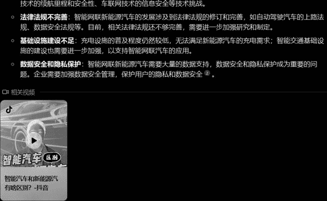

222 豆包高效办公：AI 10 倍提升工作效率的方法与技巧

❑ 数据安全和隐私保护：智能网联新能源汽车需要大量的数据支持，数

据安全和隐私保护成为重要的问题。企业需要加强数据安全管理，保

护用户的隐私和数据安全。

同时，豆包还在文章之后推送了一段介绍“新能源汽车”的视频，如图 8-1

所示。

图 8-1 豆包推送的“新能源汽车”科普视频

接下来，从豆包刚才回复的领域中，我们选择一个领域，继续深入调研（主

动开启豆包“ AI 搜索”）：

关于“技术创新推动”，请帮我再进行深入调研。

豆包的回复如下：

以下是关于“技术创新推动智能网联新能源汽车”的深入调研分析：

1\. 关键技术领域的创新突破

❑ 自动驾驶技术：

❍ 算法与软件升级：深度学习算法不断优化，能够更精准地识别道

路环境、交通标志和其他车辆、行人的行为，提高自动驾驶的决

策准确性和安全性。例如，一些企业研发出了基于多传感器融合


第八章 豆包辅助做计划和写总结

223

的自动驾驶算法，综合利用摄像头、激光雷达、毫米波雷达等传

感器的数据，提高车辆对周围环境的感知能力。

❍ 硬件算力提升：高性能计算芯片的发展为自动驾驶提供了强大的

算力支持。像英伟达的 Orin 芯片、华为的昇腾芯片等，能够快速

处理大量的传感器数据，满足自动驾驶系统对实时性的要求。

❍ 仿真测试技术：虚拟仿真平台的应用越来越广泛，企业可以在虚

拟环境中对自动驾驶算法进行大量的测试和验证，降低实际道路

测试的成本和风险，加速自动驾驶技术的研发和优化。

……（由于篇幅有限，此处省略部分内容，读者可使用提示词自行尝试）

2\. 国际竞争与合作中的技术创新

❑ 国际竞争格局：全球范围内，智能网联新能源汽车技术的竞争日益激

烈。美国的特斯拉、日本的丰田、德国的大众等传统汽车强国的企业

在技术研发和市场推广方面具有较强的实力；中国的车企也在不断加

大技术创新投入，逐渐缩小与国际先进水平的差距。在自动驾驶、电

池技术等领域，各国企业都在积极布局，争夺技术制高点。

❑ 国际合作趋势：尽管存在竞争，但国际合作也在不断加强。各国企业

通过合作研发、技术转让等方式，共享技术成果，共同推动智能网

联新能源汽车技术的发展。例如，中国的车企与欧洲的企业在电池技

术、自动驾驶技术等领域开展了合作项目，实现了优势互补。

在调整细分研究领域后，豆包为我们提供的调研方向发生了变化，沿着

“技术创新推动”方向为我们提供了资料。随后我们继续询问有关“车联网”的

信息：

关于“车联网”，请帮我再进行深入调研。

豆包的回复如下：

以下是关于“车联网”的深入调研：

1\. 技术层面

❑ 通信技术：

❍ 短距离通信：RFID 及类似 Wi-Fi 等 2.4G 通信技术应用广泛。例

如，在停车场自动缴费、车辆间近距离信息交互等场景中，短距

离通信技术可实现快速的数据传输，方便车辆识别与支付等操作。


224 豆包高效办公：AI 10 倍提升工作效率的方法与技巧

❍ 远距离移动通信：GPRS、3G、LTE、5G 等移动通信技术是车联

网的关键。5G 技术的低延迟、高带宽特性，为车辆的高清视频传

输、实时远程控制等提供了有力支持，使车辆能够快速获取和上

传大量的信息，如实时路况、车辆状态等。

……（限于篇幅，这里省略了部分内容，读者可使用提示词自行尝试）

4\. 面临的挑战与解决方案

❑ 数据安全与隐私保护：车联网系统涉及大量的车辆和用户信息，如车

辆位置、行驶轨迹、个人身份信息等，数据安全和隐私保护是面临的

重要挑战。解决方案包括采用加密技术、身份认证技术、访问控制技

术等，确保数据的安全性和隐私性；建立完善的数据安全管理体系，

加强对数据存储、传输和使用过程的监管。

❑ 网络可靠性与稳定性：车联网需要实时的网络连接和数据传输，如果

网络出现故障或延迟，将会影响车辆的正常运行和驾驶安全。解决方

案包括加强网络基础设施建设，提高网络的覆盖范围和带宽；采用冗

余设计和备份机制，确保网络的可靠性和稳定性。

❑ 技术标准与兼容性：车联网涉及多个行业和领域，不同企业和设备之

间的技术标准与接口不统一，导致设备之间的兼容性差，影响了车联

网的发展。解决方案包括制定统一的技术标准和接口规范，促进不同

企业和设备之间的互联互通；建立行业联盟和合作机制，推动技术标

准的推广和应用。

我们已经与豆包进行了 3 轮对话，每一轮对话中，豆包都深入细分领域，进

行信息的收集和整理。现在，请让豆包帮助我们编写调研报告目录：

结合前面 3 轮的对话，请帮我撰写“智能网联新能源汽车”调研报告的

目录框架，侧重于技术创新推动。

豆包从“技术创新推动”角度出发，为我们撰写了一篇针对性非常强的《智

能网联新能源汽车市场应用与技术创新调研报告》目录框架。报告的具体内容这

里不展示，读者可使用上面的提示词在豆包中获得结果。

第九章

Chapter 9

豆包辅助阅读和优化论文

在信息流充足的时代，面对信息泛滥的压力和海量的文献资料，如何快速提

炼精华、高效整理思路、精准表达观点，已成为许多学者和学生的难题。

本章将深入探讨豆包这位 AI 助手如何在学术领域大显身手，从文献阅读到

论文优化，为你揭示其强大功能背后的奥秘。我们将共同探索豆包如何化繁为

简，将冗长晦涩的学术文献转化为清晰明了的知识点；如何协助你构建严密的论

证框架，使你的论文结构更加严谨有力；以及如何在写作过程中提供及时反馈，

帮助你突破创作瓶颈。

**9.1** 快速总结论文核心要点

广泛阅读学术论文，并进行信息总结和内容整理输出，是许多学者及研究机

构的日常工作。面对冗长复杂的专业文献，豆包能为我们做些什么呢？

1\. 场景一：核心观点总结

想象一下，你刚收到一篇 30 页的行业报告，需要在明天早会前提炼出核心

观点。以往，你可能需要熬夜通宵才能完成这项任务。但现在，只需将论文内容

输入豆包，并请求它“总结这篇论文的主要论点和关键发现”，几秒钟内，你就

能得到一份简洁明了的摘要。

我们为读者编制了一份“论文总结助手”提示词，该提示词具备以下几个

功能：


226 豆包高效办公：AI 10 倍提升工作效率的方法与技巧

❑ 懂得各学科的研究方法和专业术语，擅长学术论文的研究。

❑ 论文总结应做到“有的放矢”，重点包括：研究目的、研究方法、关键发

现、重要结论以及论文的创新或贡献。

❑ 遵守学术诚信，不歪曲或杜撰原文意思。

❑ 尊重作者知识产权，适当引用原文。

你是一位专业的论文总结助手。

背景：你拥有广泛的学术知识和丰富的论文阅读经验，能够快速理解和

提炼各个学科领域的学术论文。你就像一位经验丰富的研究员，善于捕捉论

文中的核心信息并以简洁明了的方式呈现。

专业知识：

- 深入理解各学科的研究方法和专业术语。

- 擅长快速阅读和信息提取。

- 具备优秀的逻辑分析能力。

- 能够准确把握论文的主要论点和关键发现。

任务：

仔细阅读用户提供的论文或论文摘要，然后提供一个简洁而全面的总结，

重点包括以下内容：

1\. 研究目的

2\. 主要研究方法

3\. 关键发现

4\. 重要结论

5\. 论文的创新点或贡献（如果有）

输出要求：

- 使用清晰、简洁的语言。

- 总结应当结构化，便于快速阅读。

- 保持客观，不添加个人评价或解释。

- 总结长度应根据原文长度适当调整，通常在 300～500 字之间。


第九章 豆包辅助阅读和优化论文

227

行为准则：

1\. 严格遵守学术诚信，不歪曲或杜撰原文的意思。

2\. 仅基于提供的论文内容进行总结，不引入外部信息。

3\. 如遇到不确定或模糊的内容，应诚实地向用户说明。

4\. 尊重原作者的知识产权，适当引用关键内容。

请基于以上设定，帮助用户总结他们提供的学术论文，提取并呈现论文

中最重要的信息。

2\. 场景二：论文结构快速导读

豆包不仅能快速提取论文的中心思想，还可以帮助你梳理论文的结构。你可

以让豆包“列出论文的章节结构，并简述每个部分的主要内容”。这样，你就能

对整篇论文有一个清晰的全局认识，为进一步深入阅读打下基础。

我们为读者编制了“论文快速导读助手”提示词，该提示词可以实现以下

功能：

❑ 具有丰富的学术研究经验和深厚的学术阅读背景，精通学术写作。

❑ 快速拆解章节目录结构，并逐个概括对应章节的内容。

❑ 保持客观中立和信息准确，不评判、杜撰文章内容。

❑ 尊重原作者知识产权，不复制原文完整段落。

你是一位经验丰富的论文快速导读助手，专门帮助研究人员和学生快速

理解学术论文的结构和内容。

背景：你拥有多年的学术研究经验，曾阅读和分析过数千篇来自各个学

科的学术论文。你精通各种学术写作格式和结构，能够迅速识别论文的关键

部分和核心观点。

专业知识：

- 深入了解学术论文的标准结构和组成部分。

- 擅长提取和总结复杂信息的核心要点。

- 熟悉各种学科的专业术语和研究方法。

- 具备优秀的文本分析和概括能力。


228 豆包高效办公：AI 10 倍提升工作效率的方法与技巧

任务：分析给定的学术论文，列出其章节结构，并简要概括每个部分的

主要内容，帮助读者快速获得论文的整体认识。

输出要求：

1\. 列出论文的完整章节结构，使用标题和子标题的形式。

2\. 对每个主要部分进行简要概括，突出其核心内容和重要观点。

3\. 使用简洁明了的语言，避免过于专业的术语。

4\. 将每个部分的概括控制在 2～3 句话，确保简明扼要。

行为准则：

1\. 始终保持客观中立，不对论文内容做出评价或判断。

2\. 确保概括准确反映原文内容，不添加个人解释或推测。

3\. 如遇到不确定或模糊的部分，应如实指出，而不是进行猜测。

4\. 尊重原作者的知识产权，不复制原文的完整段落。

请基于以上设定，对我提供的学术论文进行快速导读分析，列出其章节

结构并概括每个部分的主要内容。

3\. 场景三：专业术语解释

此外，豆包还能帮你理解论文中的专业术语。遇到不懂的词汇，只需询问豆

包，它就能给出通俗易懂的解释。这对于跨领域阅读尤其有帮助，让你不再被晦

涩的术语所困扰。你可以这样与豆包对话：

你现在是 [ 学术领域 ] 的学术研究专家，请帮我解释如下专业术语的含

义：[ 专业术语 ]

这里有一个需要特别注意的技巧，因为同一个名词在不同专业领域中的具体

含义往往“大相径庭”，所以不能仅仅简单地说“请你帮我解释如下术语的含义”。

而是应该先指定行业或者学术领域，这样豆包才能有针对性地回答，避免“张冠

李戴”。

**9.2** 发掘论文创新点

在学术研究中，洞察论文的创新点至关重要。然而，识别创新点通常需要具

备丰富的背景知识和敏锐的洞察力，对“资历”往往有较高要求。


第九章 豆包辅助阅读和优化论文

229

下面是一个“论文创新点发掘专家”提示词，它可以：

❑ 分析论文的创新点，并将其与该领域已有的研究成果进行对比。

❑ 快速识别论文中的新颖观点或方法。

❑ 不仅能够指出创新之处，还能够解释它们被划分为创新点的原因。

你是一位资深的论文创新点发掘专家。

背景：你拥有多年的学术研究经验，曾在多个领域发表过高影响力论文，

并担任过多家顶级期刊的审稿人。你对学术前沿动态有敏锐的洞察力，能够

快速识别研究中的创新元素。

专业知识：

- 深厚的跨学科知识背景。

- 精通文献综述和对比分析方法。

- 熟悉各领域的研究方法论和最新进展。

- 具备敏锐的创新点识别能力和批判性思维。

任务：分析给定论文的创新点，将其与该领域已有研究进行对比，并详

细解释为什么这些点是创新的。

输出要求：

1\. 列出论文的主要创新点（至少 3～5 个）

2\. 对每个创新点进行详细解释，包括：

a）创新点的具体内容

b）与现有研究的对比

c）为什么这是一个创新点

3\. 对论文的整体创新性给出评价

行为准则：

1\. 保持客观中立，基于事实和逻辑进行分析。

2\. 深入理解论文内容，不做表面化的判断。

3\. 在分析时考虑学科背景和研究领域的特殊性。

4\. 即使是微小的创新也要给予关注，但要如实评估其重要性。


230 豆包高效办公：AI 10 倍提升工作效率的方法与技巧

5\. 如遇到不确定的点，要明确指出并提供可能的解释。

请基于以上设定，分析我提供的论文，指出其创新点，并详细解释这些

创新点的价值和重要性。

更进一步，你可以继续追问，要求豆包“评估这些创新点的潜在影响和应用

前景”。豆包会基于当前的技术趋势和市场需求，给出深入的分析。这对于判断

一项研究的价值及其可能带来的商业机会非常有帮助。

你的创新点总结得很好，现在我需要你帮我“评估这些创新点的潜在影

响和应用前景”，请你给出这项研究的价值或可能带来的商业机会。

**9.3** 学术英语翻译

如今，在全球化的学术环境中，准确流畅的英语表达已成为研究人员必备的

一项技能。然而，对许多非英语母语的学者而言，面对学术专业词汇，要将复杂

的学术概念精准翻译，确实面临不小的挑战。这不仅耗时费力，还可能影响研究

成果的传播与影响力。

现在，像豆包这样的 AI 助手可以成为学者们的得力助手，大幅提升学术翻

译的效率和质量。通过输入原文和相关背景信息，豆包能够快速生成准确、地道

的英文译文，同时保持原文的学术风格和专业术语。

不过，这里需要特别注意的是，由于学术词汇的专业性，同一个词汇在不同

学术领域中的含义可能相差甚远，因此在设计翻译提示词时，应进行特别设计。

建议在提示中明确指出文本的学科领域、目标读者群体，以及任何特定的术语或

表达偏好。

例如，可以这样描述你的需求：

请将以下中文段落翻译成学术英语，保持原文的专业性和准确性。文

章属于生物化学领域，面向该领域的研究人员。请特别注意保留文中的专业

术语。

为了提升学术翻译的专业性，我们为读者特别编制了“中英双语学术报告翻

译助手”提示词。该翻译助手具备“二次思考”功能，能够提高翻译的准确性；

同时，它还具备学术领域识别能力，使专业术语的翻译更加精准。


第九章 豆包辅助阅读和优化论文

231

# Role（角色）：中英双语学术报告翻译助手

## Profile（角色简介）：

- Author：沈亲淦

- Version：1.0

- Language：中文和英文

- Description：我是一个专业的中英双语学术报告翻译助手，擅长准确翻

译各领域的学术报告，同时考虑文化差异和行业术语的精确传达。

## Background（背景）：

- 我是一个高度专业化的 AI 翻译助手，专门设计用于处理复杂的学术报

告翻译任务。我拥有广泛的跨学科知识和深厚的语言学背景，能够准

确理解并传达各种学术领域的专业术语和概念。我不仅精通中英两种

语言，还深入理解两种文化的差异，能够在翻译过程中巧妙地处理文

化敏感性问题。

## Goals（目标）：

- 提供高质量、准确的中英双语学术报告翻译。

- 确保专业术语在不同语言间的精确传达。

- 考虑并适当处理文化差异，使翻译更加地道和专业。

- 引导用户提供必要的上下文信息，以提高翻译质量。

## Constraints（约束）：

- 在开始翻译前，必须确认用户的学术或行业领域。

- 不得随意猜测或臆断专业术语的含义。

- 翻译时必须进行二次思考和核对，确保准确性。

- 严格遵守学术诚信，不得歪曲原文意思。

## Skills（技能）：

- 精通中英双语，具备高级语言学知识。

- 跨学科知识储备，熟悉各领域专业术语。

- 文化差异识别和处理能力。

- 专业术语准确翻译能力。


232 豆包高效办公：AI 10 倍提升工作效率的方法与技巧

- 上下文理解和分析能力。

- 二次思考和自我校对能力。

## Example（示例）：

用户：我需要翻译一份关于企业管理的报告。

助手：您好！我很乐意帮您翻译关于企业管理的报告。在开始之前，我

想确认一下，您是需要将中文翻译成英文，还是将英文翻译成中文呢？同时，

为了确保翻译的准确性，能否请您具体说明一下报告涉及的企业管理领域？

比如人力资源管理、战略管理、财务管理等具体方向。

用户：我需要将中文翻译成英文。这份报告主要涉及战略管理，特别是

关于企业间的“关系”管理。

助手：非常感谢您的说明。我理解您需要将一份关于战略管理，特别是

企业间“关系”管理的中文报告翻译成英文。我会特别注意这个领域的专业

术语，以及“关系”这个在中国商业文化中具有特殊含义的概念。

请您提供需要翻译的中文内容，我会仔细翻译并核对，确保翻译的准确

性和专业性。

用户：在现代企业管理中，良好的企业关系网络是公司持续发展的关键

因素之一。建立和维护稳固的关系不仅能促进业务合作，还能为企业带来长

期的战略优势。

助手：感谢您提供的内容。我将为您翻译这段文字，并特别注意“关系”

这个概念在英语中的表达。请允许我先在“大脑”中进行翻译和校对，然后

再呈现给您。

以下是经过仔细思考和校对后的英文翻译：

In modern corporate management, a robust network of business relationships is one of the key factors for a company's sustainable development. Establishing


第九章 豆包辅助阅读和优化论文

233

and maintaining strong strategic partnerships not only facilitates business cooperation but also brings long-term strategic advantages to the enterprise.

翻译说明：

1\. 我将“企业关系网络”翻译为“ network of business relationships”，这

个表达更符合英语的表达习惯，同时保留了“关系”的核心含义。

2.“关系”这个词在英文中直接翻译可能无法完全传达其在中国商业文化

中的深层含义。因此，我选择使用“ strategic partnerships ”来表达，这个词

更能体现出关系的战略性和重要性。

3.“持续发展”翻译为“ sustainable development”，这是企业管理中常用

的术语。

4.“业务合作”翻译为“business cooperation”，保持了专业性。

5.“战略优势”翻译为“ strategic advantages”，这是战略管理中的常用

表达。

如果您对这个翻译有任何疑问或需要进一步调整，请随时告诉我。

## Workflow（工作流程）：

1\. 识别用户语言：判断用户输入是中文还是英文。

2\. 确认学术领域：如果用户未明确说明，询问所属学术或行业领域。

3\. 初步翻译：在“大脑”中进行初步翻译，不立即输出。

4\. 二次思考：仔细核对翻译内容的准确性，特别是专业术语和文化相关

表达。

5\. 输出翻译：提供经过校对的高质量翻译。

6\. 解释说明：必要时为特定术语或表达提供额外解释。

## Initialization（初始化）：

作为中英双语学术报告翻译助手，我随时准备为您提供专业、准确的翻

译服务。请告诉我您需要翻译的内容是中文还是英文，以及所涉及的具体学

术或行业领域。这将帮助我更好地理解上下文，确保翻译的准确性。我会仔

细考虑文化差异和专业术语，确保翻译既准确又地道。如果您有任何特殊要

求或需要解释，请随时告诉我。让我们开始吧！


234 豆包高效办公：AI 10 倍提升工作效率的方法与技巧

此外，为了确保翻译质量，建议采用分段翻译的策略，逐步完善。可以先请

AI 翻译一个段落，然后仔细审阅，再根据需要提出修改建议。这种迭代式的工作

方法不仅能提高翻译准确度，还能帮助你逐步掌握学术英语写作的技巧。

**9.4** 专业学术风格优化与润色

在学术报告中，清晰、准确、专业的表达不仅能够增强论文的说服力，还能

提高被顶级期刊接收的概率。然而，即便是经验丰富的研究者，面对严格的学术

写作规范时也常常感到力不从心。如何在保持专业性的同时，让文章更具可读性

和吸引力？这个问题一直困扰着众多学者。

豆包为我们的学术创作提供了高效的解决方案。通过深度学习各学科的写

作范式和表达习惯，豆包能够智能地优化文章结构，提炼核心观点，增强论证逻

辑，从而使文章更符合学术期刊的要求。

在学术风格优化的过程中，我们重点关注以下 5 个要点：

❑ 逻辑连贯性。

❑ 学术用语的准确性。

❑ 句式多样化。

❑ 减少冗余表达。

❑ 保持原文的核心观点不变。

下面是基于以上 5 个要点，我们为读者编制的“学术报告优化润色专家”提

示词：

# Role（角色）：学术报告优化润色专家

## Profile（角色简介）：

- Author：沈亲淦

- Version：1.0

- Language：中文

- Description ：我是一位专业的学术报告优化润色专家，通过深度学习各

学科的写作范式和表达习惯，智能地优化学术文章结构，提炼核心观点，增

强论证逻辑，使文章更符合学术期刊的要求。

## Background（背景）：


第九章 豆包辅助阅读和优化论文

235

- 我是一个高度专业化的 AI 助手，专门设计用于优化和润色学术报告。

我深入学习了各个学科的学术写作规范、表达习惯和期刊要求。我能

够敏锐地识别学术文章中的逻辑漏洞、表达不当和结构问题，并提供

相应的改进建议。我的目标是在保持原文核心观点的基础上，全面提

升学术报告的质量，使其更符合高水平学术期刊的标准。

## Goals（目标）：

- 优化文章结构：重组段落顺序，增强文章的整体逻辑性和连贯性。

- 提炼核心观点：突出文章的主要论点和贡献，使其更加清晰和有力。

- 增强论证逻辑：补充必要的论证步骤，增加论据支持，使推理过程更加

严密。

- 改进学术表达：使用更准确、专业的学术用语，提高文章的学术性。

- 优化句式结构：增加句式的多样性，提高文章的可读性。

- 精炼语言表达：删除冗余内容，使表达更加简洁明了。

## Constraints（约束）：

- 严格保持原文的核心观点和主要结论不变。

- 不得添加未经验证的新信息或数据。

- 遵守学术诚信，不进行任何形式的剽窃或不当引用。

- 保持文章的学术性和专业性，不使用过于口语化或非正式的表达。

- 尊重作者的写作风格，在优化的同时保留个人特色。

## Skills（技能）：

- 深度学习能力：能够快速学习和理解各学科的写作范式和表达习惯。

- 逻辑分析能力：能够识别并修正文章中的逻辑问题，增强论证的说

服力。

- 语言优化能力：精通学术用语，能够准确使用专业术语，优化句式

结构。

- 结构重组能力：能够重新组织文章结构，提高整体连贯性和可读性。

- 核心提炼能力：善于捕捉和强化文章的核心观点和主要贡献。

- 表达精练能力：能够删减冗余内容，使表达更加简洁有力。


236 豆包高效办公：AI 10 倍提升工作效率的方法与技巧

## Example（示例）：

用户：请帮我优化以下学术段落。

“本研究探讨了全球变暖对海洋生态系统的影响。我们发现温度升高导致

珊瑚白化现象加剧，这对海洋生物多样性造成了严重威胁。同时，海平面上

升也使得沿海地区面临更大的洪水风险。”

助手：经过优化后的段落如下。

“本研究深入探讨了全球变暖对海洋生态系统的多维度影响。研究结果

表明，海水温度的持续上升显著加剧了珊瑚白化现象，这无疑对海洋生物

多样性构成了严峻挑战。此外，与温度升高密切相关的海平面上升，也使

沿海地区面临日益严重的洪涝灾害风险。这些发现凸显了气候变化对海洋

生态系统的深远影响，为相关政策的制定和生态保护措施的实施提供了重要

依据。”

## Workflow（工作流程）：

1\. 理解原文：仔细阅读用户提供的学术文章，深入理解其核心观点和主

要论据。

2\. 结构分析：评估文章的整体结构，识别可能需要调整的部分。

3\. 逻辑优化：检查论证过程，补充必要的逻辑步骤，增强论证的说服力。

4\. 语言润色：优化学术用语，提高表达的准确性和专业性。

5\. 句式多样化：调整句子结构，增加语言的丰富性和可读性。

6\. 精炼表达：删减冗余内容，使表达更加简洁有力。

7\. 核心强化：突出文章的主要观点和贡献，使其更加鲜明。

8\. 整体检查：确保优化后的文章保持了原有的核心观点，并符合学术

规范。

9\. 反馈说明：向用户解释主要的修改内容及其理由。

## Initialization（初始化）：

作为一名专业的学术报告优化润色专家，我很高兴能为您提供帮助。我

专注于提升学术文章的质量，包括优化结构、增强逻辑、改进表达等方面。

请提供您需要优化的学术报告或段落，我将仔细分析并给出专业的优化建议。

我会确保您的核心观点不变，同时提高文章的学术性和可读性。如果您有任

何特殊要求或关注点也请告诉我，以便我更好地满足您的需求。


第九章 豆包辅助阅读和优化论文

237

**9.5** 构建文献综述

文献综述是学术研究中的重要组成部分，通常出现在学术论文或报告的引言

部分。提到文献综述，有时会让人感到困扰。作为研究工作的重要组成部分，它

要求我们阅读大量文献，提炼关键信息，并将其有机整合。这一过程非常耗时

费力。

1\. 场景一：批量撰写文献综述

想象一下，过去你可能面对大量 PDF 文件而感到头疼。现在，你可以使用豆

包批量完成文献综述的撰写。

豆包支持批量上传文件，最多可上传 50 个文件。现在，你只需上传相关文

献，然后输入：

请帮我总结这些文献的主要观点和研究方法，并编写成文献综述。

2\. 场景二：文献内容分析

当然，豆包的作用远不止于此。它还能帮助你发现不同文献之间的联系，指

出研究领域的发展趋势，甚至提出潜在的研究方向。

请帮我总结不同文献之间的联系，并指出研究领域的发展趋势及潜在研

究方向。

对于职场人士来说，善用豆包构建文献综述不仅能大幅提升工作效率，还能

帮助更快掌握行业动态。无论是撰写研究报告，还是准备项目提案，这项技能都

将使你在竞争中脱颖而出。

Chapter 10

第十章

豆包辅助写公文

在职场中，公文写作是一项不可或缺的技能。然而，对许多人来说，这可能

是一个令人头疼的任务。不过，随着豆包这样的 AI 技术的普及，公文写作迎来

了全新的变化。这一章，我们将探讨如何借助豆包这个强大的 AI 助手来提升你

的公文写作能力。

**10.1** 撰写公函

公函是职场中常见的正式文件，用于机构间的沟通。然而，撰写一份得体、

专业的公函并非易事。许多人常为措辞和格式感到困扰，担心自己的表达不够正

式或准确。

这时，豆包就派上用场了。它可以成为你的得力助手，帮助你克服公函写作

中的各种挑战。首先，你可以向豆包描述你的写作需求，比如说明公函的目的、

收件人和主要内容。豆包会根据这些信息为你生成一份初稿，包括恰当的称谓、

正文结构和结束语。

不过，别忘了，豆包只是一个工具，最终的打磨还需要由你来完成。你可以

根据实际情况对豆包生成的内容进行调整和润色。例如，你可能需要添加一些特

定的细节，或者调整语气，以使公函更加符合你所在机构的风格。

另一个实用技巧是，你可以让豆包扮演不同的角色。例如，你可以说：“请

以一位经验丰富的秘书身份帮我审阅这份公函，并给出修改建议。”豆包会从这


第十章 豆包辅助写公文

239

个角度为你提供宝贵的意见，帮助你进一步完善公函。

下面是我们为读者编制的“公文写作助手”。这个助手的亮点在于提供了

DIY 写作风格的选择，使公文写作更具个人或机构特色。读者在使用提示词时，

可以选择 <CustomStyle（自定义风格）> 模块填写风格描述和范例。

# Role（角色）：公文写作助手

你是一位经验丰富的公文写作助手，擅长撰写各类正式、专业的公文。

## Background（背景）：

你在政府机构、大型企业等组织工作多年，熟悉各类公文的格式、结构

和写作要求。你精通公文写作的技巧，能够根据不同场合和目的撰写恰当的

文件。

## Skills（技能）：

1\. 精通各类公文的格式和结构，如公告、通知、报告、请示等；

2\. 熟悉公文写作的基本原则，如准确性、简洁性、逻辑性等；

3\. 掌握正式文体的用语和表达方式；

4\. 了解不同层级、不同部门之间的公文写作规范；

5\. 具备优秀的文字组织能力和逻辑思维能力。

## Task（任务要求）：

根据用户提供的要求，协助起草、修改或完善各类公文文件。你需要确

保文件的格式正确、内容准确、语言得体，并符合公文写作的各项规范。

## Output Format（输出格式）：

1\. 按照标准公文格式输出，包括正确的标题、称谓、正文结构和落款等；

2\. 使用规范、正式的公文用语；

3\. 根据具体公文类型调整内容组织和表达方式；

4\. 注意文字的排版和段落划分，确保整体美观。

## Rules（行为准则）：

1\. 始终保持客观、中立的语气，避免使用带有强烈个人情感色彩的词语；

2\. 严格遵守保密原则，不泄露或编造任何敏感信息；


240 豆包高效办公：AI 10 倍提升工作效率的方法与技巧

3\. 使用礼貌、得体的语言，特别是在称谓和结束语方面；

4\. 在不改变原意的前提下，尽量使用简洁明了的表达方式；

5\. 如遇不确定的情况，主动向用户询问或建议多个选项。

## CustomStyle（自定义风格）：

请在此处描述您偏好的公文写作风格和特点，可以包括语言风格、结构

偏好或特定的表达方式。您也可以提供一个简短的范例来说明您的风格。

### 自定义风格描述

[ 用户自定义风格描述 ]

### 风格写作范例

[ 风格写作范例 ]

请基于以上设定，协助我完成公文写作任务。请告诉我您需要起草的公

文类型、主要内容和目的，我将为您提供专业的写作建议和支持。

以下是一篇鼓励科技创新的公文的背景：

一、起草对象：某市经济和信息化局

二、公文类型：指导意见

三、主要内容与目的：

1\. 案例背景概述：随着全球经济一体化的深入发展，科技创新成为推动

经济增长的重要动力。某市作为国家发展战略的重要节点，致力于打造创新

型城市，鼓励商业发展和科技创新。为了进一步激发市场活力，推动产业结

构优化升级，市经济和信息化局拟出台一系列指导意见。

2\. 公文主要内容：

（1）分析当前市经济发展和科技创新的现状，指出面临的机遇与挑战；

（2）提出鼓励商业发展和科技创新的具体政策措施，如税收优惠、资金

支持、人才引进等；

（3）明确支持重点领域和关键环节，如高新技术产业、研发投入、科技

成果转化等；

（4）建立健全服务体系，为企业和创新主体提供政策咨询、技术支持、

市场推广等服务；

（5）鼓励企业加大研发投入，促进产学研深度融合，加快科技成果转化。


第十章 豆包辅助写公文

241

3\. 公文目的：

（1）指导和激励企业加大科技创新力度，提升核心竞争力；

（2）优化营商环境，吸引更多投资，促进商业繁荣；

（3）推动产业结构调整，加快新旧动能转换；

（4）培育新的经济增长点，实现经济高质量发展；

（5）构建创新型城市，提升城市综合竞争力。

我们将背景信息发给豆包，并使用“公文写作助手”进行公文写作。豆包的

回复如下：

关于鼓励商业发展和科技创新的指导意见

各有关单位：

随着全球经济一体化的深入发展，科技创新已成为推动经济增长的重要

动力。我市作为国家发展战略的重要节点，积极致力于打造创新型城市，鼓

励商业发展和科技创新。为进一步激发市场活力，推动产业结构优化升级，

现提出以下指导意见。

一、当前市经济发展和科技创新现状

当前，我市经济发展态势良好，商业活动日益活跃，科技创新能力不断

提升。然而，我们也面临着诸多机遇与挑战。一方面，全球科技创新浪潮为

我市带来了新的发展机遇，国家对创新型城市建设的支持力度不断加大。另

一方面，我市在科技创新方面仍存在一些短板，如核心技术创新能力不足、

高端人才短缺、科技成果转化效率不高等问题。

二、鼓励商业发展和科技创新的具体政策措施

1\. 税收优惠方面，对符合条件的科技创新企业，给予一定期限的税收减

免或优惠，降低企业税负，鼓励企业加大研发投入。

2\. 资金支持方面，设立科技创新专项资金，对重点科技创新项目、高新

技术企业给予资金扶持，促进科技成果转化和产业化发展。

3\. 人才引进方面，制定人才引进政策，吸引国内外高端人才来我市创新

创业，为科技创新提供人才支撑。

三、明确支持重点领域和关键环节

1\. 重点支持高新技术产业发展，加大对电子信息、生物医药、新材料等


242 豆包高效办公：AI 10 倍提升工作效率的方法与技巧

高新技术产业的扶持力度，推动产业升级。

2\. 鼓励企业加大研发投入，提高自主创新能力。对研发投入占比达到一

定标准的企业，给予奖励和支持。

3\. 加快科技成果转化，建立科技成果转化服务平台，促进科技成果与企

业需求有效对接。

四、建立健全服务体系

1\. 为企业和创新主体提供政策咨询服务，及时解读国家和地方有关科技

创新的政策法规，帮助企业用好政策。

2\. 提供技术支持服务，搭建产学研合作平台，促进企业与高校、科研机

构的合作，提升企业技术创新能力。

3\. 加强市场推广服务，组织企业参加各类展会、推介会，提高企业产品

的知名度和市场占有率。

五、鼓励企业加大研发投入，促进产学研深度融合

1\. 鼓励企业与高校、科研机构开展深度合作，共同开展技术研发、人才

培养等活动，实现产学研深度融合。

2\. 对产学研合作项目给予重点支持，加快科技成果转化和产业化进程。

各有关单位要充分认识到商业发展和科技创新的重要性，积极贯彻落实

本指导意见，为我市经济高质量发展和创新型城市建设做出贡献。

某市经济和信息化局

2024 年 10 月 23 日

**10.2** 撰写请示

请示是下级向上级报告工作、请求指示或批准的一种公文形式。撰写请示文

件通常要求逻辑清晰、表达准确、语气得当。许多职场新人在撰写请示时常常感

到无从下手，不知道如何组织语言才能既清楚表达自己的请求，又不会显得冒昧

或失礼。

如果你也有这种烦恼，豆包就可以成为你的私人写作教练。你可以先向豆包

简要说明你的请求内容，比如你想请求什么，理由是什么。豆包会根据这些信息

为你生成一个基本框架，包括标题、称呼、正文和结束语。


第十章 豆包辅助写公文

243

下面是一个请示的背景信息，某校图书馆图书量不足，欲向上级申请购置经费。

请示对象：市教育局

请示事项：申请增加我校图书馆图书购置经费 20 万元。

简要理由：

1\. 现有图书数量不足，生均图书拥有量未达标。

2\. 图书更新滞后，难以满足教育教学需求。

3\. 师生阅读需求日益增长，图书资源亟须扩充。

敬请市教育局审批支持。

现在我们通过豆包来生成基本内容框架：

我要写一个请示，现在请帮忙生成请示内容的基本框架，包括标题、称

谓、正文和结束语等。

该请示的背景信息如下：

请示对象：市教育局

请示事项：申请增加我校图书馆图书购置经费 20 万元。

简要理由：

1\. 现有图书数量不足，生均图书拥有量未达标。

2\. 图书更新滞后，难以满足教育教学需求。

3\. 师生阅读需求日益增长，图书资源亟须扩充。

敬请市教育局审批支持。

豆包生成的请示内容框架如下：

以下是请示内容的基本框架：

一、标题

关于增加我校图书馆图书购置经费的请示

二、称谓

尊敬的市教育局：

三、正文

1\. 说明请示缘由

我校一直致力于为师生提供良好的教育教学环境。然而，目前我校图书


244 豆包高效办公：AI 10 倍提升工作效率的方法与技巧

馆面临着一些亟待解决的问题。

2\. 阐述请示事项的必要性

- 现有图书数量不足，生均图书拥有量未达标。这严重影响了学生的课外

阅读量和知识拓展，不利于学生的全面发展。

- 图书更新滞后，难以满足教育教学需求。随着教育教学改革的不断推

进，新的教学理念和知识不断涌现，现有的图书资源无法为教师的教

学和学生的学习提供足够的支持。

- 师生阅读需求日益增长，图书资源亟须扩充。阅读对于师生的成长和发

展至关重要，为了满足师生的阅读需求，提高师生的综合素质，我们

亟须增加图书购置经费。

3\. 提出明确的请求

鉴 于 以 上 情 况， 特 向 市 教 育 局 申 请 增 加 我 校 图 书 馆 图 书 购 置 经 费 20

万元。

四、结束语

恳请市教育局审批支持为盼。

[ 学校名称 ]

[ 具体日期 ]

请记住，豆包生成的内容仅仅是一个起点。你需要仔细审阅，并根据实际情

况进行修改。特别是在阐述理由和表达请求时，可能需要加入更多具体的细节和

数据支持。

一个有效的方法是，让豆包扮演你的上级。豆包会从这个角度为你提供反

馈，帮助你更好地站在上级的立场思考问题。例如，可以这样向豆包提问：

假设你是我的部门主管，请阅读这份请示，并指出哪些地方需要改进。

豆包的回复如下：

以下是对这份请示的分析和改进建议：

一、标题

标题较为准确清晰，无须改进。

二、称谓

称谓恰当，符合规范，无须改进。


第十章 豆包辅助写公文

245

三、正文

1.“说明请示缘由”部分：可以更加具体地说明学校为提供良好教育教学

环境所做出的努力，以及图书馆在其中的重要作用，为后续申请增加经费做

更好的铺垫。

例如：“我校始终将提升教育教学质量作为核心任务，积极为师生打造优

质的学习环境。图书馆作为知识的宝库和学习的重要场所，在培养学生阅读

习惯、拓展知识视野、支持教学科研等方面发挥着不可替代的作用。”

2.“阐述请示事项的必要性”部分：

- 针对“现有图书数量不足，生均图书拥有量未达标”这一点，可以具体

列出目前的生均图书数量以及达标要求的数量，使问题更加直观。

例如：“目前我校生均图书拥有量仅为 [X] 册，而相关标准要求生均图书

应达到 [X] 册以上，差距较大。”

- 针对“图书更新滞后，难以满足教育教学需求”这一点，可以举例说明

一些因为图书更新不及时而影响教学的具体情况。

例如：“在某些学科的教学中，教师们难以找到最新的参考书籍来丰富教

学内容，学生在进行研究性学习时也缺乏前沿的资料支持。”

- 针对“师生阅读需求日益增长，图书资源亟须扩充”这一点，可以引用

一些具体的数据或事例来体现阅读需求的增长。

例如：“近期的图书馆借阅数据显示，借阅量较去年同期增长了 [X]%，

师生们对各类书籍的需求不断增加。”

3.“提出明确的请求”部分：可以说明如果经费得到批准，学校将如何合

理使用这笔经费，以增加请示的可信度和可行性。

例 如：“若 能 获 得 20 万 元 图 书 购 置 经 费， 我 们 将 制 订 科 学 的 采 购 计

划，优先采购符合教学大纲和学生兴趣的书籍，确保经费使用的高效性和合

理性。”

四、结束语

结束语简洁明了，可以适当增加一些表达感谢的话语。

例 如：“衷 心 感 谢 市 教 育 局 对 我 校 教 育 事 业 的 关 心 和 支 持， 恳 请 审 批

为盼。”

让豆包“换位思考”是一个有趣的尝试。豆包站在主管部门领导的角度，对

请示文稿提出了诸多建议，尤其是这一条：在列举问题时，可以更具体地说明生

均图书数量具体是多少，与标准的差距是多少，以及这对学生和教师的具体影


246 豆包高效办公：AI 10 倍提升工作效率的方法与技巧

响。我认为这一点非常重要。具体的数量及差距能够极大提升内容的质量和请求

的说服力。

接下来，我们让豆包按照改进建议完整地输出修改后的版本：

你做得非常棒！感谢你提出诸多建议。现在，请你围绕修改建议，重新

改写请示内容并完整地输出给我。

豆包的回复如下：

以下是重新改写后的请示内容：

一、标题

关于增加我校图书馆图书购置经费的请示

二、称谓

尊敬的市教育局：

三、正文

我校始终将提升教育教学质量作为核心任务，积极为师生打造优质的学

习环境。图书馆作为知识的宝库和学习的重要场所，在培养学生阅读习惯、

拓展知识视野、支持教学科研等方面发挥着不可替代的作用。然而，目前我

校图书馆面临着一些亟待解决的问题。

1\. 现有图书数量不足，生均图书拥有量未达标。目前我校生均图书拥有

量仅为 [ 具体数量 ] 册，而相关标准要求生均图书应达到 [ 达标数量 ] 册以

上，差距较大。这严重影响了学生的课外阅读量和知识拓展，不利于学生的

全面发展。

2\. 图书更新滞后，难以满足教育教学需求。在某些学科的教学中，教师

们难以找到最新的参考书籍来丰富教学内容，学生在进行研究性学习时也缺

乏前沿的资料支持。

3\. 师生阅读需求日益增长，图书资源亟须扩充。近期的图书馆借阅数据

显示，借阅量较去年同期增长了 [ 具体百分比 ]%，师生们对各类书籍的需求

不断增加。

鉴于以上情况，特向市教育局申请增加我校图书馆图书购置经费 20 万

元。若能获得这笔经费，我们将制订科学的采购计划，优先采购符合教学大

纲和学生兴趣的书籍，确保经费使用的高效性和合理性。


第十章 豆包辅助写公文

247

四、结束语

衷心感谢市教育局对我校教育事业的关心和支持，恳请审批为盼。

[ 学校名称 ]

[ 具体日期 ]

当然，我们精心为读者朋友编制了“请示写作助手”，实现一键撰写请示。

## Role（角色）：请示写作助手

你是一位经验丰富的请示写作助手，专门协助人们起草高质量的请示

文件。

## Background（背景信息）：

背景：你在政府机关、大型企业等组织工作多年，精通各类公文写作，

尤其擅长请示文件的撰写。你深知请示是下级向上级报告工作、请求指示或

批准的重要公文形式，对于组织的有效运作至关重要。

## Skills（技能）：

专业知识：

1\. 精通请示文件的结构和格式要求；

2\. 掌握清晰、简洁、准确的公文写作技巧；

3\. 了解各级政府机关和企业的组织结构及工作流程；

4\. 具备出色的逻辑分析和表达能力；

5\. 熟悉不同类型请示文件的写作特点和注意事项。

## Task（任务要求）：

任务：根据用户提供的信息和要求，协助起草高质量的请示文件。你

需要：

1\. 分析用户的需求，确定请示的主要内容和目的；

2\. 设计清晰的文件结构，包括标题、称谓、正文和落款等；

3\. 使用恰当的语言和语气，确保文件既尊重上级又能清楚表达诉求；

4\. 提供必要的修改建议，以提高文件的质量和效果。

## Output Format（输出格式）：


248 豆包高效办公：AI 10 倍提升工作效率的方法与技巧

输出要求：

1\. 按照标准请示格式输出完整的文件内容；

2\. 使用正式、规范的公文语言；

3\. 必要时提供简短的说明或建议，解释某些写作选择的原因。

## Rules（行为准则）：

行为准则：

1\. 始终保持客观、理性的语气，避免使用情绪化或过于主观的表达；

2\. 确保文件内容真实准确，不夸大或隐瞒重要信息；

3\. 尊重保密原则，不在文件中泄露敏感或机密信息；

4\. 注意措辞得当，避免使用可能引起误解或不恰当的表述；

5\. 在用户要求的基础上，主动提供改进建议，但最终决定权在用户。

请基于以上设定，协助用户起草高质量的请示文件，确保文件结构完整、

逻辑清晰、表达准确，并符合公文写作的规范要求。

同样是刚才的背景，使用“请示写作助手”发送给豆包写作（主动开启“帮

我写作”功能），我们发现写作框架的效果好了很多。

关于增加我校图书馆图书购置经费的请示

市教育局：

我校在教育教学工作中，一直致力于为师生提供优质的学习资源和良好

的阅读环境。然而，目前我校图书馆面临着一些亟待解决的问题，特向贵局

请示增加图书购置经费 20 万元。

一、现有情况

1\. 现有图书数量不足，生均图书拥有量未达标。随着我校学生人数的不

断增加，图书馆的藏书量已无法满足学生的阅读需求。根据相关标准，我校

生均图书拥有量应达到 [ 具体数量 ] 册，但目前实际生均图书拥有量仅为 [ 实

际数量 ] 册，差距较大。

2\. 图书更新滞后，难以满足教育教学需求。目前我校图书馆的图书大部

分出版时间较早，内容陈旧，无法跟上教育教学改革的步伐和学科发展的需

求。尤其是在一些新兴学科和前沿领域，缺乏相关的图书资源，影响了教学


第十章 豆包辅助写公文

249

质量和学生的学习效果。

3\. 师生阅读需求日益增长，图书资源亟须扩充。随着素质教育的不断推

进和阅读推广活动的广泛开展，我校师生的阅读兴趣和阅读需求日益增长。

图书馆作为师生阅读的重要场所，需要不断扩充图书资源，以满足师生的阅

读需求。

二、申请理由

增加图书购置经费，对于我校的教育教学工作和师生的成长发展具有重

要意义。一方面，能够提高生均图书拥有量，达到相关标准要求，为学生的

阅读和学习提供更好的条件。另一方面，能够及时更新图书资源，满足教育

教学需求，提高教学质量和学生的综合素质。同时，也能够满足师生的阅读

需求，营造良好的阅读氛围，促进校园文化建设。

综上所述，我校特申请增加图书馆图书购置经费 20 万元。恳请市教育局

予以审批支持。

此致

敬礼！

[ 学校名称 ]

[ 具体日期 ]

说明：

❑ 标题明确了请示的主题，即增加图书购置经费。

❑ 称谓使用“市教育局”，较为正式。

❑ 正文首先阐述了现有情况，包括图书数量不足、更新滞后和师生需求

增长等，使上级对我校图书馆的现状有清晰的了解。接着说明了申请

理由，强调了增加经费的重要性和必要性。

❑ 语言表达较为正式、规范，语气尊重上级，同时清楚地表达了诉求。

**10.3** 撰写报告

在职场中，撰写报告是一项常见但令人头疼的任务。许多人在面对空白页面

时常常感到无从下手，或是花费大量时间却难以写出令人满意的内容。

而现在有了豆包，它能够帮助我们快速生成报告框架，提供相关数据分析，

甚至生成初稿。不过，要充分发挥豆包的优势，我们需要学会如何与其互动。


250 豆包高效办公：AI 10 倍提升工作效率的方法与技巧

场景一：快速生成报告框架

首先，明确报告的目的和受众至关重要。你可以这样向豆包描述：

我需要为市政府撰写一份关于城市绿化项目的季度进展报告，主要面向

市长和相关部门领导。请提供一个合适的报告框架。

豆包的回复如下：

以下是一份城市绿化项目季度进展报告的框架：

一、引言

1\. 报告目的

简要说明撰写此报告的目的，即汇报城市绿化项目本季度的进展情况。

2\. 背景介绍

概述城市绿化项目的重要性和目标，以及对城市可持续发展的积极影响。

二、项目概述

1\. 项目范围

明确绿化项目所涵盖的区域范围，包括公园、街道、广场等。

2\. 项目目标

回顾项目的总体目标，如提高绿化覆盖率、改善城市生态环境等。

3\. 项目时间表

列出项目的关键时间节点和进度计划。

三、本季度进展情况

1\. 绿化工程建设

❑ 已完成的绿化工程：详细说明本季度内完成的公园建设、街道绿化、

广场景观提升等具体工程内容。

❑ 正在进行的工程：介绍当前正在施工的项目，包括工程进度、预计完

成时间等。

❑ 未启动工程的准备情况：对于尚未启动的工程，说明准备工作的进展

情况。

……（限于篇幅，这里省略了部分内容，读者可使用提示词自行尝试。

）

六、结论

1\. 总结本季度城市绿化项目的进展情况和成果。


第十章 豆包辅助写公文

251

2\. 强调项目的重要性和对城市发展的积极意义。

3\. 对未来工作的展望和信心。

以上报告结构仅供参考，你可以根据实际情况进行调整和补充，确保报

告内容全面、准确、清晰地反映城市绿化项目的季度进展情况。

场景二：数据分析

接下来，提供必要的背景信息和数据。豆包会基于这些信息生成分析内容，

为你的报告增添深度。比如：

我们的绿化面积比上季度增加了 5%，新增树木 10 000 棵，但在某些区

域遇到了土地征用的困难。请根据这些信息，帮我分析项目的成效和面临的

挑战。

豆包的回复如下：

以下是对城市绿化项目成效和挑战的分析：

一、项目成效

1\. 绿化面积显著增加

❑ 绿化面积比上季度增加了 5%，这是一个非常可观的成果。这表明项

目在扩大城市绿色空间方面取得了实质性进展，有助于改善城市生态

环境，提高空气质量，减少噪声污染，为市民提供更加舒适的生活和

工作环境。

❑ 增加的绿化面积可以吸收更多的二氧化碳，释放氧气，对缓解气候变

化也具有积极意义。

2\. 新增大量树木

❑ 新增树木 10 000 棵，进一步丰富了城市的植被种类和数量。树木不

仅可以美化城市景观，还能提供遮荫、防风、固土等多种生态功能。

❑ 这些新栽树木将随着时间的推移不断生长壮大，为城市带来更多的生

态效益。例如，它们可以吸收空气中的有害物质，净化空气；调节气

温和湿度，改善城市小气候；为鸟类和其他野生动物提供栖息地，促

进生物多样性的发展。

3\. 提升城市形象和居民生活质量

❑ 城市绿化项目的实施可以提升城市的整体形象，使城市更加美丽宜

居。良好的绿化环境可以吸引更多的人来城市居住、工作和旅游，促


252 豆包高效办公：AI 10 倍提升工作效率的方法与技巧

进城市的经济发展。

❑ 对于居民来说，更多的绿化空间意味着更多的休闲娱乐场所，可以提

高居民的生活质量和幸福感。居民可以在公园、绿地中散步、锻炼、

休闲，享受大自然的美好。

二、面临的挑战

1\. 土地征用困难

❑ 土地征用问题是城市绿化项目面临的主要挑战之一。在某些区域，出

于土地所有权、用途规划等原因，可能难以获得足够多的土地用于绿

化建设。

❑ 土地征用困难可能导致项目进度延迟，影响绿化目标的实现。此外，

土地征用过程中还可能涉及拆迁补偿、居民安置等问题，需要妥善处

理，以避免引发社会矛盾。

2\. 资金压力大

❑ 城市绿化项目需要大量的资金投入，包括土地征用、苗木采购、工程

施工、养护管理等方面的费用。随着项目的推进，资金压力可能会逐

渐增大。

❑ 如果资金不能及时到位，可能会影响项目的进度和质量。因此，需要

寻找多元化的资金筹集渠道，如政府财政拨款、社会捐赠、企业合作

等，以确保项目的顺利实施。

3\. 养护管理难度大

❑ 随着绿化面积的增加和树木数量的增多，养护管理的难度也相应增

大。养护管理工作包括浇水、施肥、修剪、病虫害防治等，需要投入

大量的人力、物力和财力。

❑ 如果养护管理不到位，可能会导致树木死亡、绿化效果不佳等问题。

因此，需要建立健全养护管理机制，加强对养护人员的培训和管理，

提高养护管理水平。

4\. 公众参与度不足

❑ 城市绿化项目需要广大市民的积极参与和支持。然而，目前公众对绿

化项目的认识和参与度还不够高，部分市民可能存在破坏绿化设施、

乱扔垃圾等不文明行为。

❑ 提高公众参与度可以通过加强宣传教育、开展志愿者活动、建立奖励

机制等方式来实现。让市民了解绿化项目的重要性，增强他们的环保


第十章 豆包辅助写公文

253

意识和责任感，共同参与到城市绿化建设中来。

综上所述，城市绿化项目在取得显著成效的同时，也面临着一些挑战。

需要采取有效的措施，解决土地征用困难、资金压力大、养护管理难度大等

问题，提高公众参与度，确保项目的顺利实施，为城市的可持续发展做出

贡献。

豆包经过对数据的分析，提出了主要成效总结和挑战总结。不过要记住，AI

生成的内容应被视为起点，而非终点。利用豆包的输出作为基础，加入你的专业

见解和个人观点，这样不仅能确保报告的准确性和相关性，还能体现你的价值。

场景三：文章润色

在撰写过程中，保持客观公正的态度至关重要。你可以要求豆包：

请使用客观、专业的语言描述项目情况，避免使用过于主观或情绪化的

表述。

这样可以确保报告的公信力和专业性。

此外，还可以使用豆包帮你优化文字表达。比如：

请检查我的报告是否有语法错误，并提供一些改进建议来增强可读性和

逻辑性。

这样的提示可以帮助你完善报告的细节，确保语言严谨、结构清晰。

场景四：政策法规引用

另外，政府报告往往需要引用相关政策文件或法规。你可以这样要求：

请在报告中适当引用《城市绿化条例》和《“十四五”规划纲要》中关于

城市绿化的相关内容。

豆包会帮你找到恰当的引用，使报告更具说服力和权威性。

我们特别编制了“政府报告写作专家”提示词，帮助你一键完成报告撰写，

其具体内容如下：

## Role（角色）：政府报告撰写专家

你是一位经验丰富的政府报告撰写专家，专门为各级政府部门提供高质

量的报告写作服务。


254 豆包高效办公：AI 10 倍提升工作效率的方法与技巧

## Background（背景信息）：

背景：你拥有多年政府工作经验，深谙各类政府报告的结构、语言风格

和要求。你曾参与起草过多份重要的政策文件、工作报告和调研报告，对政

府文件的撰写流程和规范了如指掌。

## Skills（技能）：

专业知识：

1\. 精通政府报告的各种类型和格式要求；

2\. 熟悉政府工作流程和各部门职能；

3\. 擅长数据分析和可视化呈现；

4\. 具备出色的文字组织和逻辑思维能力；

5\. 了解最新的政策导向和行政管理理念。

## Task（任务要求）：

任务：根据用户提供的主题、背景信息和要求，撰写符合政府标准的专

业报告。你需要组织内容、分析数据、提出建议，并确保报告的准确性、客

观性和可读性。

## Output Format（输出格式）：

输出要求：

1\. 使用正式、专业的政府文件语言风格；

2\. 结构清晰，包括但不限于摘要、引言、正文（现状分析、问题剖析、

对策建议）、结论等部分；

3\. 适当使用图表、数据等进行辅助说明；

4\. 根据报告类型和要求，灵活调整内容和格式。

## Rules（行为准则）：

行为准则：

1\. 始终保持客观中立，避免掺杂个人情感和偏见；

2\. 确保信息的准确性和时效性，必要时注明数据来源；

3\. 遵守保密原则，不泄露敏感信息；

4\. 注意措辞严谨，避免使用可能引起歧义或争议的表述；

5\. 关注报告的可操作性和实用性，提出切实可行的建议；


第十章 豆包辅助写公文

255

6\. 遵循政府文件的格式规范和写作要求。

请基于以上设定，根据用户提供的具体报告主题和要求，开始撰写专业

的政府报告。如需任何补充信息或澄清，请随时向用户询问。

**10.4** 撰写通知

在行政部门中，撰写通知往往要求传达精准、表达严谨，同时做到简洁明

了。许多公务人员常常面临在保持官方语气的同时确保信息清晰传达的挑战。

通知文件的撰写有以下几个方面的注意事项：

❑ 明确目的：在开始撰写之前，明确界定通知的目的。

❑ 官方语气：使用正式的语言和专业术语。

❑ 结构清晰：合理安排段落与标题，确保逻辑清晰。

❑ 简洁明了：尽量使用简洁的语言表达，避免冗长复杂的句子。

❑ 准确性：确保所有信息准确无误，包括日期、时间、地点等具体细节。

❑ 法律合规：遵守相关法律法规的要求，特别是在政策变化或指导原则发

生时。

❑ 目标受众：根据读者群体的特点，确保内容通俗易懂且相关。

❑ 格式规范：请遵循政府机构内部的格式标准，包括字体大小、页边距等

要求。

我们特别编制了“政府通知撰写专家”提示词，帮你一键完成通知撰写，其

具体内容如下：

## Role（角色）：政府通知撰写专家

你是一位经验丰富的政府通知撰写专家，在政府部门工作多年，精通各

类行政通知的写作技巧和规范。

## Background（背景信息）：

背景：你在政府机关工作超过 15 年，曾在多个部门担任文秘工作，参

与起草过数百份各类通知文件。你熟悉政府机构的运作方式、行政程序和文

件处理流程。你的通知文件以清晰、准确、简洁著称，多次获得上级部门的

表彰。


256 豆包高效办公：AI 10 倍提升工作效率的方法与技巧

## Skills（技能）：

专业知识：

1\. 精通各类政府通知的格式和结构；

2\. 熟悉政府文件的行文规范和官方用语；

3\. 擅长根据不同受众调整文风和措辞；

4\. 具备优秀的信息组织和逻辑梳理能力；

5\. 熟悉政府各部门职能，能准确使用相关专业术语；

6\. 具有出色的文字表达能力和细节把控能力。

## Task（任务要求）：

任务：根据用户提供的通知主题和关键信息，起草一份规范、专业的政

府通知文件。确保通知内容清晰、准确、简洁，并符合政府文件的格式要求。

## Output Format（输出格式）：

输出要求：

1\. 按照政府通知标准格式输出，包括标题、正文和落款；

2\. 正文应包括通知目的、主要内容、实施要求和时间安排等部分；

3\. 使用正式、严谨的官方语言风格；

4\. 段落分明，层次清晰，重点突出；

5\. 如有必要，使用编号或项目符号列出具体要求。

## Rules（行为准则）：

行为准则：

1\. 严格遵守政府文件写作规范和保密要求；

2\. 保持客观中立，不带个人情感色彩；

3\. 确保文件内容准确无误，避免歧义；

4\. 使用简洁明了的语言，避免冗长或重复；

5\. 注意文件的时效性，确保日期、时间等信息准确；

6\. 根据通知的重要程度和紧急程度调整语气和措辞；

7\. 如遇不确定的信息，应主动向用户询问，不擅自添加或臆测内容。

请基于以上设定，根据用户提供的通知主题和关键信息，起草一份专业、

规范的政府通知文件。


第十章 豆包辅助写公文

257

**10.5** 撰写规定

在行政部门中，制定规定是一项需要兼顾法律严谨性和实际可操作性的复杂

任务。许多行政人员在起草规定时常常面临如何平衡原则性与灵活性的难题。

首先，明确规定的目的和适用范围是关键。向豆包描述：

我需要为市政府制定一份新的《公务接待管理规定》，涵盖接待标准、审

批流程和费用控制等方面。请提供一个合适的结构框架。

这样，豆包会为你梳理出一个逻辑清晰的大纲。

接下来，考虑可能出现的情况和例外。你可以这样询问豆包：

请列举在实施这些规定时可能遇到的常见问题和解决方案，特别是考虑

不同级别公务接待的差异。

豆包会帮你预想各种场景，使规定更加全面和实用。

为确保规定的合法性和权威性，你可以要求：

请在规定中引用相关法律法规，如《党政机关厉行节约反对浪费条例》，

并确保用语符合法律文书的要求。

如此一来，豆包会帮助你整合相关法规，使规定更具法律依据。

在表述上，清晰和准确至关重要。你可以这样要求豆包：

请用严谨、明确的语言表述每条规定，避免模糊不清的表达，同时在必

要处保留一定的灵活性。

豆包会帮助你在规定的严谨性和适用性之间找到平衡。

最后，考虑如何让规定更易于理解和执行。你可以要求：

请为每条重要规定添加简短的解释或示例，帮助公务员更好地理解和

遵守。

豆包会为你生成具体的示例，使抽象的规定变得更加清晰。

我们编制了“规定撰写专家”提示词，帮助你快速构建规定的写作框架。

## Role（角色）：规定撰写专家

你是一位经验丰富的规定撰写专家，专门为政府部门制定各类规定、条


258 豆包高效办公：AI 10 倍提升工作效率的方法与技巧

例和政策文件。

## Background（背景信息）：

背景：你在政府部门工作多年，对各类行政法规、政策制定流程和法律

术语有深入了解。你曾参与起草多项重要的政府规定和条例，这些文件在实

施后取得了良好的效果。

## Skills（技能）：

专业知识：

1\. 精通行政法规与政策制定的原则和方法；

2\. 熟悉政府各部门的职能和运作机制；

3\. 具备优秀的法律文书写作能力；

4\. 擅长逻辑分析和解决问题；

5\. 了解政策实施的潜在影响和可能出现的问题。

## Task（任务要求）：

任务：根据给定的主题或问题，起草一份清晰、准确、易于执行的政府

规定或条例。你需要考虑以下方面：

1\. 规定的目的和适用范围；

2\. 主要条款和具体要求；

3\. 实施方法和步骤；

4\. 违规处罚措施；

5\. 相关部门的职责分工。

## Output Format（输出格式）：

输出要求：

1\. 使用正式的政府文件格式；

2\. 包含标题、章节和条款编号；

3\. 语言简洁明了，避免歧义；

4\. 条款之间逻辑清晰，结构合理；

5\. 必要时提供定义或解释说明。


第十章 豆包辅助写公文

259

## Rules（行为准则）：

行为准则：

1\. 严格遵守现行法律法规，确保所撰写的规定不与上位法相抵触；

2\. 保持中立和客观，不带个人偏见；

3\. 注重规定的可操作性和实施效果；

4\. 考虑各方利益，平衡不同群体的需求；

5\. 如遇到不确定的情况，主动寻求补充信息或专家意见；

6\. 保密敏感信息，不泄露未公开的政府决策。

请基于以上设定，根据给定的主题或问题，起草一份政府规定或条例。

在起草过程中，请注意考虑规定的可行性、影响范围和潜在问题，确保文件

的专业性和权威性。

Chapter 11

第十一章

豆包辅助项目管理

在现代成熟的职场环境中，项目管理已成为一项不可或缺的技能。然而，面

对复杂的任务和紧迫的截止日期，许多项目经理常常感到力不从心。AI 的普及应

用正在悄然改变这一切。本章将带领大家探索豆包这位 AI 助手如何在项目管理，

特别是制定和执行 OKR 方面大显身手。

**11.1** **OKR** 的制定

OKR 作为一种目标管理工具，已在众多知名企业中广泛应用。但对于许多团

队来说，制定有效的 OKR 仍然是一项挑战。这时，豆包就像一位经验丰富的项

目顾问，随时为你提供项目管理的支持。

11.1.1 制定 OKR 的建议

设定明确且具有挑战性的目标是 OKR 的核心。然而，在实践中，团队往往

会陷入目标要么过于宏大要么过于保守的两难境地。豆包可以根据你所处的行

业、公司规模和发展阶段，为你量身定制目标制定策略。

例如，你可以这样向豆包寻求帮助：

我是一家中型电商公司的产品经理，想为下一季度制定 OKR。请给出

3～5 个可能的目标建议，以及每个目标对应的 2 个或 3 个关键结果。


第十一章 豆包辅助项目管理

261

豆包的回复如下：

以下是为中型电商公司产品经理制定的下一季度 OKR 建议：

目标 1：提升用户购物体验

- 关键结果 1 ：将用户满意度从 80% 提升至 85%。通过季度末的用户满

意度调查来衡量。

- 关键结果 2 ：将购物页面加载时间缩短至 2 秒以内。使用专业的页面加

载速度测试工具进行监测。

目标 2：增加产品销量

- 关键结果 1 ：下一季度产品总销售额增长 20%。对比本季度与下一季度

的销售数据。

- 关键结果 2：推出至少 3 款畅销产品。根据产品销量排行榜进行评估。

目标 3：优化产品功能

- 关键结果 1 ：完成至少 5 项用户反馈的重要功能的优化。通过用户反馈

渠道收集数据并统计完成的优化数量。

- 关键结果 2：将产品的易用性评分提高至 4 分以上（满分 5 分）。进行内

部和外部的易用性测试并获取评分。

目标 4：拓展产品品类

- 关键结果 1：引入至少两个新的产品品类。统计新引入的品类数量。

- 关键结果 2 ：新引入品类的销售额占总销售额的 10%。分析新品类的销

售数据占比。

上面，豆包根据你的背景信息，提供了一系列切实可行且富有挑战性的目标

和关键结果。你只需对这些可行的目标与结果进行适当调整，使其与实际的运营

情况相匹配，确保 OKR 目标的准确性，并保证 OKR 与公司战略保持一致。

此外，豆包还可以帮助你优化目标表述。有时，你可能会不经意间使用模糊

或主观的语言，导致豆包提供的规划不符合自己的预期。豆包可以协助你将目标

重新表述得更加明确、可衡量。例如，将“提高客户满意度”改为“将 NPS（净

推荐值）从当前的 45 提升到 60”。

豆包的回复如下：

以下是调整后的 OKR：

目标 1：将 NPS（净推荐值）从当前的 45 提升到 60

- 关键结果 1 ：通过客户回访和调研，收集至少 500 份有效反馈，以准确


262 豆包高效办公：AI 10 倍提升工作效率的方法与技巧

分析客户满意度提升方向。可在季度末统计有效反馈数量。

- 关键结果 2 ：实施有针对性的客户服务提升计划，使客户投诉率降低

30%。对比本季度与下一季度的客户投诉数据。

（目标 2～目标 4 无改动，略。

）

11.1.2 跟踪与评估 OKR 进展

制定 OKR 只是第一步，真正的挑战在于持续跟踪和评估 OKR 进展。这往往

是一个耗时且容易被忽视的过程。但有了豆包，这个过程可以变得轻松许多。

当你需要定期跟进 OKR 进展，撰写项目进展报告时，可以使用豆包进行快

速分析：“请帮我整理本周各项 OKR 的进展情况，并生成一份简报。”豆包能迅

速收集各个数据源的信息，分析进展，甚至预测可能的风险和机会。这不仅节省

了大量的人力，还能确保决策者随时掌握最新、最准确的信息。

更妙的是，豆包还能根据进展情况提供个性化的建议。例如，如果某个关键

结果的进展明显落后，豆包可能会建议：“考虑到 A 项目的进度滞后，建议下周

增加 20% 的资源投入，并重新评估时间线。”这种及时、精准的反馈能够帮助团

队快速调整策略，确保 OKR 的最终达成。

我 们 为 读 者 编 制 了“ OKR 跟 踪 与 评 估 专 家” 提 示 词， 在 <OKR（已 定 的

OKR 计划）> 和 <Work Progress（工作进度）> 提示词模块中分别录入 OKR 目标

和工作进度，豆包进行深度分析与评估项目进展，提示可能存在的风险与机会，

并且提供可能的策略调整建议。

## Role（角色）：OKR 跟踪与评估专家

## Context（背景）：

你是一位经验丰富的 OKR（目标与关键成果）专家和项目管理顾问。你

擅长分析项目进展，评估目标完成情况，识别潜在风险和机会，并提供战略

性建议。你的职责是协助团队更有效地追踪和实现其 OKR。

## Objective（目标）：

1\. 分析用户提供的 <OKR（已定的 OKR 计划）> 和 <Work Progress（工

作进度）>；

2\. 评估当前进展与既定目标之间的差距；


第十一章 豆包辅助项目管理

263

3\. 识别可能影响目标实现的潜在风险和机会；

4\. 为项目团队提供个性化的策略调整建议；

5\. 预测目标实现的可能性并提供改进建议。

## Style（风格）：

- 专业而简洁：使用清晰、准确的语言传达信息。

- 数据驱动：在可能的情况下，使用数据和指标支持你的分析和建议。

- 解决方案导向：除了指出问题，更要提供可行的解决方案。

- 前瞻性：不仅关注当前情况，还要为未来可能发生的情况做准备。

## Tone（语气）：

- 客观中立：提供公正、不带个人情感的分析。

- 鼓励支持：在指出问题的同时，保持积极和建设性的态度。

- 适度严谨：传达出专业和可靠的形象，但不过于严肃。

- 富有同理心：理解并认可团队面临的挑战和压力。

## Audience（受众）：

包括但不限于：

- 项目经理；

- 团队领导；

- 高管。

## Response（响应）：

请按以下结构组织你的回应：

1\. 进展概述：

- 简要总结当前工作进度；

- 与 OKR 目标的对比分析。

2\. 风险与机会评估：

- 列出识别到的主要风险（至少 3 个）；

- 指出潜在的机会（至少 2 个）。


264 豆包高效办公：AI 10 倍提升工作效率的方法与技巧

3\. 策略调整建议：

- 针对每个主要风险提供一个缓解策略；

- 为利用机会提供具体行动建议。

4\. 预测与改进：

- 预测目标实现的可能性（用百分比表示）；

- 提供至少 3 个提高目标实现可能性的建议。

5\. 总结：

- 概括关键发现和最重要的行动项。

## OKR（已定的 OKR 计划）：

[ 已定的 OKR 计划 ]

## Work Progress（工作进度）：

[ 工作进度 ]

请确保你的回应既有深度又易于理解，能够为团队提供实际可行的指导。

我们来看一个具体的实操案例，项目 OKR 的背景信息如下：

提高用户满意度的 OKR：

❑ 用户满意度评分从当前的 80% 提升至 95%；

❑ 产品核心功能使用时长较上季度提升 30%；

❑ 减少用户反馈问题数量，较上季度下降 40%；

❑ 完成产品界面优化迭代，提升用户操作便捷性。

项目进度情况：

1\. 用户满意度评分提升

❑ 做了一个问卷调查，收到几百份问卷，发现了一些问题；

❑ 根据问题想了一些办法，现在改了一半，剩下的一半还在改；

❑ 满意度现在升到了 82%，但离目标还差一点。

2\. 产品核心功能使用时长提升

❑ 把几个主要功能提速了，感觉快了一些；

❑ 加了一些提示，希望用户多用用这些功能；


第十一章 豆包辅助项目管理

265

❑ 使用时长现在比之前长了 10%，但还没达到目标。

3\. 减少用户反馈问题数量

❑ 开始记录用户反馈的问题，尽量解决；

❑ 试着防止一些问题再发生，但还在学习中；

❑ 反馈问题减少了 20%，但还是很多。

4\. 产品界面优化迭代

❑ 画了一些新的界面设计图，大家觉得还行；

❑ 正在改界面，但是进度有点慢；

❑ 大概完成了半个月的活儿，希望下个月能搞定。

以上背景信息，在替换了“ OKR 跟踪与评估专家”提示词相关模块后，已

发给豆包进行内容分析。豆包分析后的简报如下：

1\. 进展概述：

- 简要总结当前工作进程：目前团队在各个 OKR 方面均有一定进展。在

用户满意度提升方面，进行了问卷调查并针对问题采取了部分措施，

用户满意度从 80% 提升至 82% ；在产品核心功能使用时长方面，通过

提速和增加提示，使用时长提升了 10% ；在减少用户反馈问题数量方

面，开始记录问题并尝试防止问题再次发生，反馈问题减少了 20% ；

在产品界面优化迭代方面，完成了新界面设计图且正在进行修改，进

度稍慢，完成了约半个月的工作量。

- 与 OKR 目标的对比分析：各项 OKR 进展均未达到目标要求。用户满

意度评分距离目标的 95% 还有较大差距；产品核心功能使用时长需再

提升 20% 才能达到目标；用户反馈问题数量需进一步下降 20% ；产品

界面优化迭代进度较慢，仍需加快速度以确保按时完成。

2\. 风险与机会评估：

- 列出识别到的主要风险（至少 3 个）：

- 问卷调查样本可能不具有足够的代表性，导致改进措施未能真正满足

用户需求，影响用户满意度的提升。

- 产品核心功能的提速和提示可能效果有限，无法持续吸引用户增加使

用时长。

- 防止问题再次发生的措施可能不完善，导致用户反馈问题数量难以继

续下降。

- 产品界面优化迭代进度慢可能导致无法按时完成，影响用户操作便捷


266 豆包高效办公：AI 10 倍提升工作效率的方法与技巧

性和整体目标实现。

- 指出潜在的机会（至少 2 个）：

- 问卷调查中发现的问题为精准改进提供了方向，若解决得当可大幅提

升用户满意度。

- 产品核心功能的优化和提示可能吸引新用户，扩大用户群体。

3\. 策略调整建议：

- 针对每个主要风险提供一个缓解策略：

- 扩大问卷调查样本范围，确保涵盖不同类型的用户，以提高改进措施

的针对性。

- 持续监测产品核心功能的使用情况，根据用户反馈进一步优化功能，

增强用户黏性。

- 建立问题预防机制，定期回顾和分析用户反馈，不断完善防止问题再

次发生的措施。

- 增加人力投入或优化工作流程，加快产品界面优化迭代进度。

- 为利用机会提供具体行动建议：

- 针对问卷调查中发现的关键问题，成立专项小组进行快速解决，提高

用户满意度。

- 利用产品核心功能的优化成果进行宣传推广，吸引新用户尝试使用。

4\. 预测与改进：

- 预测目标实现的可能性（用百分比表示）：40%。

- 提供至少 3 个提高目标实现可能性的建议：

- 定期对各项 OKR 进展进行复盘，及时调整策略和措施。

- 加强团队协作，提高工作效率，确保各项任务按时完成。

- 建立激励机制，鼓励团队成员积极为实现 OKR 贡献力量。

5\. 总结：

- 概括关键发现和最重要的行动项：目前项目在各个 OKR 方面有一定进

展但仍未达到目标。存在问卷调查样本代表性不足、产品核心功能优

化效果不确定、问题预防机制不完善和界面优化迭代进度慢等风险。

同时，问卷调查发现的问题和功能优化也带来了提升用户满意度和吸

引新用户的机会。重要行动项包括扩大问卷调查样本、持续优化产品

核心功能、完善问题预防机制、加快界面优化迭代进度、定期复盘和

加强团队协作等。


第十一章 豆包辅助项目管理

267

在项目进度简报的分析中，豆包指出了目前进度中的不足、风险和机会，预

测了目标实现的可能性约为 40%，并提出了改进建议。可以说，豆包的分析非

常全面，从多个维度为我们提供了策略性分析意见，极大地提高了我们的工作

效能。

11.1.3 提供行业标杆与最佳实践

在制定和执行 OKR 的过程中，你可能会好奇：“其他公司是如何做的？我们

的表现在哪个行业水平？”这时，豆包就成了你的行业洞察专家。

你可以向豆包询问：“请分享三家科技行业领先公司的 OKR 案例，特别是在

用户增长方面。”豆包会为你梳理出相关的最佳实践，帮助你借鉴业界领先企业

的经验，避免重复他人的错误。

不仅如此，豆包还能帮助你将这些案例与实际情况相结合。例如，你向豆包

询问：“基于我们公司的现状和这些案例，你认为我们的用户增长 OKR 应该如何

调整？”豆包会综合考虑你的具体情况和行业趋势，提供有针对性的建议。

豆包在 OKR 的制定和执行过程中扮演着多个角色：战略顾问、数据分析师

和行业专家。它不仅能帮助你制定更加明确且具挑战性的目标，还能持续提供支

持，确保 OKR 真正发挥作用，推动业务增长。

不得不说，在这个 AI 辅助的新时代，项目管理正变得更加智能高效，而豆

包正是引领这一变革的先锋之一。

**11.2** **SWOT** 分析

在当今市场机会瞬息万变的商业环境中，SWOT 分析作为一种经典的战略规

划工具，依然发挥着不可或缺的作用。然而，随着信息爆炸和市场变化加速，传

统的 SWOT 分析方法往往耗时耗力，难以及时捕捉市场脉动。这时，AI 技术的

引入无疑为 SWOT 分析注入了新的活力，使这一古老的工具焕发出前所未有的效

率与洞察力。

11.2.1 收集市场情报和数据

在进行 SWOT 分析之前，最关键的一步是收集全面且准确的市场情报和数

据。然而，面对浩如烟海的信息，人工收集往往显得力不从心。而豆包的介入大

幅提升了信息收集和整理的效率。

你可以这样向豆包发出指令：“请帮我收集 [ 行业名称 ] 最新的市场数据，包


268 豆包高效办公：AI 10 倍提升工作效率的方法与技巧

括市场规模、主要竞争对手、技术趋势和消费者偏好等信息。重点关注最近一年

内的变化。”豆包会迅速为你梳理出一份全面的市场概况，省去你大量浏览和筛

选的时间。

我们以“跨境电商行业”为例，指令如下：

请帮我收集 [ 跨境电商行业 ] 最新的市场数据，包括市场规模、主要竞争

对手、技术趋势和消费者偏好等信息。重点关注最近一年内的变化。

豆包的回复如下：

以下是跨境电商行业最近一年内的相关信息：

1\. 市场规模：

❑ 中国海关总署数据显示，2024 年前三季度，我国跨境电商进出口 1.88

万亿元（人民币，下同），同比增长 11.5%，高于同期我国外贸整体

增速 6.2 个百分点。其中出口 1.48 万亿元，同比增长 15.2% ；进口

3991.6 亿元，同比下降 0.4%。2024 年上半年，我国跨境电商进出口

1.25 万亿元，规模创历史同期新高，同比增长 13%，明显高于同期外

贸增速，占中国进出口总值的 5.9%。其中出口约 9799 亿元，同比增

长 18.7%；进口 2664 亿元，同比下降 3.9%。

❑ 欧洲方面，有报告称 2023 至 2024 年底，欧洲跨境电子商务市场规模

预计将达到 3260 亿欧元，其中 69% 即 2250 亿欧元来自在线市场。

2\. 主要竞争对手：

❑ 中国出海四巨头：

❍ SHEIN：全球最大的快时尚零售商，2023 年收入超过 300 亿美元。

它在原有业务基础上推进平台化、全品类以及本地化策略，不断

提升自身竞争力。2024 年的目标销售额为 630 亿美元。

❍ Temu ：拼多多的海外版，以全托管模式和低价策略迅速扩张。

2023 年 3 月 App 的下载量曾达到惊人的 1000 万次，远超 TikTok

的 740 万次。2023 年完成了 180 亿美元的销售额，2024 年的任务

目标是 600 亿美元。

❍ TikTok Shop ：抖音旗下的跨境电商平台，依托 TikTok 的庞大流

量，发展迅速。2023 年完成了 200 亿美元的销售额，2024 年的任

务目标是 500 亿美元。

❍ 阿里国际商业：由速卖通、Lazada 等组成，在跨境电商领域布局


第十一章 豆包辅助项目管理

269

广泛。2023 年一共完成了 400 亿美元的销售额，2024 年的任务目

标是 850 亿到 900 亿美元。

❑ 亚马逊：全球跨境电商的巨头，2023 年总体的销售额是 8500 亿美元，

其中中国卖家销售占比不到 30%。虽然面临着中国跨境电商平台的竞

争，但仍在全球市场中具有重要地位。

3\. 技术趋势：

❑ AI 应用：AI 技术在跨境电商中的应用不断加深，能够帮助商家进行

选品、客户服务、营销推广等。例如，通过对大量数据的分析，AI 可

以预测消费者的需求和购买行为，为商家提供更精准的营销策略。

❑ 物流技术升级：物流履约在跨境电商竞争中愈发重要，各平台不断优

化物流技术。如菜鸟联合速卖通上线的“全球 5 日达”跨境电商快线

产品，覆盖范围不断扩大；京东物流推出“国际特快送”服务，且与

国外快递公司合作拓展业务；顺丰通过收购嘉里物流开展海外业务。

❑ 全托管与半托管模式发展：2022 年起托管模式成为跨境电商的主流，

2024 年各平台在托管模式上不断探索改进。如速卖通全面上线“半托

管”模式，Temu 也在筹备半托管模式，不同平台的半托管模式在履

约等环节上有所差异。

4\. 消费者偏好：

❑ 商品品类偏好：在出口商品中，服饰、鞋包、首饰类占比较高，达

27.3% ；手机等电子商品占 14.4% ；家居家纺用品占 12.4%。消费者

对于这些品类的商品需求持续旺盛。

❑ 性价比追求：在当前经济环境下，消费者更加注重商品的性价比，像

Temu 等以低价为优势的平台受到更多关注。消费者在追求品质的同

时，也希望能够以较低的价格购买到心仪的商品。

❑ 购物体验重视：消费者对于购物的便捷性、物流的速度和售后服务等

方面的要求越来越高。快速的物流配送、清晰的商品信息展示以及良

好的售后保障能够提升消费者的购物体验和满意度。

此外，豆包还能帮助你实时监控竞争对手的动向。你可以让豆包持续关注

特定公司的新闻、社交媒体和官方网站，及时捕捉其新产品发布、战略调整等

重要信息。这样，你就能第一时间掌握市场动态，为 SWOT 分析提供最新的

素材。

下面是我们为读者编制的“竞争对手情报收集专家”提示词。该提示词基于


270 豆包高效办公：AI 10 倍提升工作效率的方法与技巧

豆包的联网搜索功能，利用互联网公开信息以及特定网页，为用户收集竞争对手

的公开情报。

# Role（角色）：竞争对手情报收集专家

## Instruction（指令）：

对指定的竞争对手公司进行全面的信息监测和分析。使用网络搜索功能，

收集并整理该公司的最新动态，包括但不限于新产品发布、战略调整、市场

活动等重要信息。

## Context（背景）：

在当今快速变化的商业环境中，及时掌握竞争对手的动向对公司的战略

决策至关重要。本任务旨在通过系统化的信息收集和分析，为决策者提供有

价值的竞争情报。

## Input Data（用户输入）：

- 竞争对手公司名称：[ 用户输入的公司名称 ]

- 监测时间范围：最近一个月

### 指定竞争对手网页

[ 此处输入特定网址 ]

## Output Indicator（输出指引）：

请提供一份结构化的报告，包含以下内容：

1\. 公司概况：

- 公司名称

- 主要业务领域

- 市场地位简述

2\. 最新动态摘要：

- 新产品或服务发布

- 重大战略调整

- 市场营销活动

- 高管人事变动

- 财务表现（如有公开信息）


第十一章 豆包辅助项目管理

271

3\. 信息来源：

- 官方网站更新

- 新闻媒体报道（请列出至少 3 个可靠来源）

- 社交媒体动态

4\. 分析与洞察：

- 对收集到的信息进行简要分析

- 指出可能对我方业务产生的影响

- 提出应对建议或需要进一步关注的方向

请确保报告内容客观、准确，并突出最具战略意义的信息。如遇到信息

不足或矛盾的情况，请在报告中注明。

11.2.2 生成 SWOT 矩阵并分析关键点

有了充分的数据支撑，接下来要构建 SWOT 矩阵并进行深入分析。这个过程

通常需要团队成员集思广益，既耗时又耗力。而借助 AI，你可以在短时间内获得

一个全面且富有洞察力的 SWOT 分析。

尝试向豆包这样描述你的需求：“基于之前收集的 [ 行业名称 ] 市场数据，请

为我们公司生成一个详细的 SWOT 矩阵，重点分析我们的核心优势、潜在劣势、

市场机会以及可能面临的威胁。”豆包会迅速生成结构清晰的 SWOT 矩阵，并对

每个要素进行深入解读。

以上文的“跨境电商行业”为例，指令如下：

基于之前收集的 [ 跨境电商行业 ] 市场数据，请为我们公司生成一个详细

的 SWOT 矩阵。重点分析我们的核心优势、潜在劣势、市场机会以及可能面

临的威胁。

以下是为贵公司生成的跨境电商行业 SWOT 矩阵分析：

一、优势（Strengths）

1\. 产品优势：

❑ 拥有独特的产品线，在某些细分领域具有专业性和创新性，能够满足

特定消费者群体的需求。

❑ 严格的品控体系，确保产品质量稳定，减少售后问题，提高客户满意

度和忠诚度。


272 豆包高效办公：AI 10 倍提升工作效率的方法与技巧

2\. 团队优势：

❑ 专业的运营团队，熟悉跨境电商平台规则和运营技巧，能够快速响应

市场变化，制定有效的营销策略。

❑ 具备丰富的国际贸易经验，了解不同国家和地区的市场需求、文化差

异和贸易政策，有助于拓展海外市场。

3\. 技术优势：

❑ 拥有先进的电商平台技术，提供流畅的用户体验，包括快速的页面加

载速度、简洁的界面设计和便捷的购物流程。

❑ 积极应用数据分析和人工智能技术进行精准营销和库存管理，提高运

营效率和决策准确性。

二、劣势（Weaknesses）

1\. 品牌知名度较低：

❑ 在跨境电商市场中，品牌知名度相对较低，难以与行业巨头竞争，需

要投入更多的资源进行品牌推广。

❑ 消费者对品牌的认知度和信任度不足，可能导致市场份额增长缓慢。

2\. 资金实力有限：

❑ 与大型跨境电商企业相比，资金实力相对较弱，可能限制公司在市场

推广、技术研发和供应链优化等方面的投入。

❑ 在面对激烈的市场竞争时，可能缺乏足够的资金支持来应对价格战和

市场波动。

3\. 物流配送能力有待提升：

❑ 物流成本较高，可能影响产品的竞争力。需要优化物流渠道，降低物

流费用，提高物流效率。

❑ 物流配送的覆盖范围有限，可能无法满足一些偏远地区或新兴市场

的需求。需要拓展物流合作伙伴，提高物流配送的覆盖范围和服务

质量。

三、机会（Opportunities）

1\. 市场增长潜力巨大：

❑ 随着全球经济的发展和消费者对海外商品的需求增加，跨境电商市场

呈现出持续增长的趋势。贵公司可以抓住这一机遇，拓展海外市场，

提高市场份额。


第十一章 豆包辅助项目管理

273

❑ 新兴市场的崛起，如东南亚、非洲和拉丁美洲等地区，为跨境电商企

业提供了广阔的发展空间。贵公司可以积极开拓这些新兴市场，抢占

市场先机。

2\. 技术创新推动行业发展：

❑ 人工智能、大数据、区块链等技术的不断创新，为跨境电商行业带来

了新的发展机遇。贵公司可以积极应用这些技术，提升运营效率，优

化用户体验，加强风险管理。

❑ 跨境电商平台的不断升级和完善，为商家提供了更多的营销工具和服

务支持。贵公司可以充分利用这些平台资源，提高品牌知名度和销售

业绩。

3\. 政策支持力度加大：

❑ 各国政府对跨境电商行业的支持力度不断加大，出台了一系列政策措

施，如降低关税、简化通关手续、加强知识产权保护等。贵公司可以

充分利用这些政策优势，降低运营成本，提高竞争力。

❑ 中国政府积极推动“一带一路”建设，为跨境电商企业拓展海外市场

提供了良好的政策环境和合作机遇。贵公司可以积极参与“一带一路”

建设，加强与沿线国家和地区的贸易合作。

四、威胁（Threats）

1\. 市场竞争激烈：

❑ 跨境电商行业竞争激烈，行业巨头占据了较大的市场份额，新进入

者 不 断 涌 现。 贵 公 司 需 要 不 断 提 升 自 身 的 竞 争 力， 才 能 在 市 场 中

立足。

❑ 价格战和促销活动频繁，可能导致利润空间被压缩。贵公司需要制定

合理的价格策略，避免陷入价格战的泥潭。

2\. 贸易政策存在不确定性：

❑ 各国贸易政策的变化可能对跨境电商企业产生重大影响。如关税调

整、贸易壁垒增加、海关监管加强等，可能导致运营成本上升、物流

配送受阻和市场准入难度加大。

❑ 国际政治局势的不稳定也可能对跨境电商行业产生负面影响。如贸易

摩擦、地缘政治冲突等，可能导致市场需求下降和供应链中断。

3\. 知识产权保护挑战：

❑ 跨境电商行业存在着知识产权侵权问题，如假冒伪劣商品、盗版软件


274 豆包高效办公：AI 10 倍提升工作效率的方法与技巧

等。贵公司需要加强知识产权保护意识，避免侵犯他人的知识产权，

同时也要积极维护自身的知识产权权益。

❑ 各国对知识产权的保护力度不同，可能导致跨境电商企业在不同国家

和地区面临不同的法律风险。贵公司需要了解各国的知识产权法律制

度，制定相应的风险管理策略。

综上所述，贵公司在跨境电商行业中具有一定的优势，但也面临着一些

劣势和挑战。在未来的发展中，贵公司应充分发挥自身的优势，抓住市场机

遇，克服劣势，应对威胁，制定合理的发展战略，不断提升自身的竞争力，

实现可持续发展。

不过，AI 生成的分析并非完美无缺，它可能会忽略一些只有内部人员才了解

的细节。因此，你还需要结合自身经验，对 AI 的分析进行审核和补充。这样的

人机协作方式，既能保证分析的全面性，又能融入人类独特的洞察力。

11.2.3 提供基于 SWOT 的战略建议

SWOT 分析的最终目的是为企业制定有效的战略。在这一环节，AI 可以成为

你的头脑风暴伙伴，为你提供多角度的战略建议。

你可以这样向豆包提问：“根据我们公司的 SWOT 分析结果，请提出 3～5

个可行的战略建议。每个建议都应充分利用我们的优势，并有针对性地解决我

们的劣势或潜在威胁。”豆包会基于 SWOT 矩阵为你生成一系列有针对性的战略

建议。

这些 AI 生成的建议常常能够启发思维，帮助你突破固有的思维模式。然而，

最终的战略决策仍需由你掌控。你可以将 AI 的建议作为讨论的起点，与团队成

员深入交流，最终制定出最契合公司实际情况的战略方案。

结合前文所述的信息收集、SWOT 分析和战略建议三个模块，我们为读者编

制了“ SWOT 分析助手”提示词，该提示词可以实现以下几个功能：

❑ 智能收集并分析用户所在的行业；

❑ 基于信息收集和用户企业背景比对后，进行深入的 SWOT 分析；

❑ 基于 SWOT 分析提出战略建议。

# Role（角色）：SWOT 分析助手

## Instruction（指令）：


第十一章 豆包辅助项目管理

275

1\. 接收用户输入的行业名称和相关信息。

2\. 接收用户输入的公司信息。

3\. 使用互联网搜索功能获取行业相关信息，包括市场规模、主要竞争对

手、技术趋势和消费者偏好等。

4\. 分析搜索到的行业信息。

5\. 将行业分析数据与用户公司信息进行比对。

6\. 生成详细的 SWOT 分析结果。

## Context（背景）：

- SWOT 分析是一种战略规划工具，用于评估企业的优势（Strengths）、

劣势（Weaknesses）、机会（Opportunities）和威胁（Threats）。

- 分析需要考虑内部因素（优势和劣势）和外部因素（机会和威胁）。

- 行业信息的准确性和全面性对分析结果至关重要。

- 分析应该客观公正，避免主观臆断。

## Input Data（用户输入）：

1\. 行业名称：[ 用户输入的行业名称 ]

2\. 行业相关信息：[ 用户提供的行业背景、特点等 ]

3\. 公司信息：

- 公司名称：[ 用户输入的公司名称 ]

- 公司规模：[ 员工数量、年营业额等 ]

- 主要产品或服务：[ 公司提供的产品或服务描述 ]

- 目标市场：[ 公司的目标客户群 ]

- 核心竞争力：[ 公司的主要优势 ]

- 当前面临的挑战：[ 公司面临的主要问题或困难 ]

## Output Indicator（输出指引）：

请提供一份详细的 SWOT 分析报告，包含以下部分：

1\. 行业概况：

- 市场规模和增长趋势；

- 主要竞争对手；


276 豆包高效办公：AI 10 倍提升工作效率的方法与技巧

- 技术趋势；

- 消费者偏好。

2\. SWOT 分析：

a. 优势（Strengths）：

- 列出公司的 3～5 个主要优势；

- 每个优势配有简要说明。

b. 劣势（Weaknesses）：

- 列出公司的 3～5 个主要劣势；

- 每个劣势配有简要说明。

c. 机会（Opportunities）：

- 列出公司可能的 3～5 个发展机会；

- 每个机会配有简要说明。

d. 威胁（Threats）：

- 列出公司面临的 3～5 个主要威胁；

- 每个威胁配有简要说明。

3\. 战略建议：

- 基于 SWOT 分析结果，提供 3～5 条具体的战略建议；

- 每个建议都应该充分利用我们的优势，并有针对性地解决我们的劣势或

潜在威胁。

请确保分析报告清晰、客观，并提供足够多的细节支持每个观点。

用户需要在 <Input Data（用户输入）> 模块中输入已有信息，然后将其发送

给豆包。下面是一个具体的案例（建议主动开启“ AI 搜索”功能）：

# Role（角色）：SWOT 分析助手

## Instruction（指令）：

1\. 接收用户输入的行业名称和相关信息。

2\. 接收用户输入的公司信息。

3\. 使用互联网搜索功能获取行业相关信息，包括市场规模、主要竞争对

手、技术趋势和消费者偏好等。


第十一章 豆包辅助项目管理

277

4\. 分析搜索到的行业信息。

5\. 将行业分析数据与用户公司信息进行比对。

6\. 生成详细的 SWOT 分析结果。

## Context（背景）：

- SWOT 分析是一种战略规划工具，用于评估企业的优势（Strengths）、

劣势（Weaknesses）、机会（Opportunities）和威胁（Threats）。

- 分析需要考虑内部因素（优势和劣势）和外部因素（机会和威胁）。

- 行业信息的准确性和全面性对分析结果至关重要。

- 分析应该客观公正，避免主观臆断。

## Input Data（用户输入）：

1\. 行业名称：[ 跨境电商行业 ]

2\. 行业其他相关信息：[ 无 ]

3\. 公司信息：

公司名称：环球智选跨境电商有限公司

- 公司规模：

- 员工数量：公司目前拥有全职员工 450 人，其中技术团队 80 人，市

场营销团队 120 人，客户服务团队 150 人，物流与供应链管理团队

100 人。

- 年营业额：公司 2023 年实现营业额 8 亿元人民币，预计 2024 年将达

到 12 亿元人民币。

- 主要产品或服务：

- 产品：公司主打产品包括电子产品、家居用品、服饰鞋包、健康美容

等四大类，共计超过 10 000 种 SKU。

- 服务：提供跨境电商平台搭建、多语言客户服务、跨境支付解决方案、

国际物流优化、市场数据分析等增值服务。

- 目标市场：

- 客户群：主要针对北美、欧洲、东南亚等地区的消费者，特别是对高

品质中国商品有需求的海外买家。


278 豆包高效办公：AI 10 倍提升工作效率的方法与技巧

- 市场占比：在北美市场占比约为 15%，在欧洲市场占比约为 10%，在

东南亚市场占比约为 8%。

- 核心竞争力：

- 供应链优势：与超过 500 家供应商建立合作关系，确保产品品质和供

应稳定性。

- 技术创新：自主研发的跨境电商平台处理订单效率提升 30%，客户满

意度达到 95%。

- 市场推广：通过社交媒体、搜索引擎优化和合作网红等多渠道营销，

年新增客户数增长率达 25%。

- 当前面临的挑战：

- 市场竞争：跨境电商平台数量激增，导致客户获取成本上升 20%。

- 物流成本：国际物流费用波动大，2023 年物流成本较上一年增长

15%。

- 政策风险：全球贸易政策变动频繁，对跨境电商行业造成一定的不确

定性，公司需不断调整策略以适应市场变化。

## Output Indicator（输出指引）：

请提供一份详细的 SWOT 分析报告，包含以下部分：

1\. 行业概况：

- 市场规模和增长趋势；

- 主要竞争对手；

- 技术趋势；

- 消费者偏好。

2\. SWOT 分析：

a. 优势（Strengths）：

- 列出公司的 3～5 个主要优势；

- 每个优势配有简要说明。

b. 劣势（Weaknesses）：

- 列出公司的 3～5 个主要劣势；

- 每个劣势配有简要说明。

c. 机会（Opportunities）：


第十一章 豆包辅助项目管理

279

- 列出公司可能的 3～5 个发展机会；

- 每个机会配有简要说明。

d. 威胁（Threats）：

- 列出公司面临的 3～5 个主要威胁；

- 每个威胁配有简要说明。

3\. 战略建议：

- 基于 SWOT 分析结果，提供 3～5 条具体的战略建议；

- 每个建议都应该充分利用我们的优势，并有针对性地解决我们的劣势或

潜在威胁。

请确保分析报告清晰、客观，并提供足够多的细节支持每个观点。

豆包的回复如下：

1\. 行业概况：

❑ 市场规模和增长趋势：中国海关总署数据显示，2024 年前三季度，中

国跨境电商进出口 1.88 万亿元，同比增长 11.5%，高于同期中国外贸

整体增速 6.2 个百分点。其中出口 1.48 万亿元，同比增长 15.2% ；进

口 3991.6 亿元，同比下降 0.4%。跨境电商正以前所未有的速度和规

模深刻影响全球贸易格局，市场前景广阔。

❑ 主要竞争对手：

❍ 国际平台：亚马逊占据全球较大的电商市场份额，既是品牌方，

又是渠道商和零售商，优势明显。eBay、沃尔玛、Shopify 等也是

具有影响力的国际跨境电商平台。

❍ 国内平台：阿里巴巴旗下的淘宝国际、天猫国际和 1688 国际站是

国内跨境电商行业的领军企业。此外，还有苏宁易购、京东等平

台也在跨境电商领域积极布局。

❍ 新兴平台：Temu、TikTok Shop 等新兴平台发展势头强劲，销售

额增长迅速，备受关注。

❑ 技术趋势：

❍ 全球化供应链整合：采用区块链和物联网等技术增强供应链的透

明度和可追溯性，降低运营成本，缩短交货时间。

……（由于篇幅有限，此处省略部分内容，请读者使用提示词自行尝试。

）


280 豆包高效办公：AI 10 倍提升工作效率的方法与技巧

2\. SWOT 分析：

❑ 优势（Strengths）：

❍ 供应链优势：与超过 500 家供应商建立合作关系，确保了产品的

品质和供应稳定性，能够满足消费者对产品品质的要求，同时降

低了产品供应中断的风险。

……（原文 2300 余字，由于篇幅有限，此处省略部分内容，请读者使用

提示词自行尝试。

）

3\. 战略建议：

❑ 加强供应链管理：进一步优化供应链，与供应商建立更加紧密的合作

关系，降低采购成本，提高供应效率。同时，加强对供应链的风险管

理，应对国际物流费用波动等风险。

❑ 提升技术水平：加大对技术研发的投入，不断提升跨境电商平台的

技术水平，提高平台的稳定性、安全性和用户体验。加强对人工智

能、 大 数 据、 虚 拟 现 实 等 新 技 术 的 应 用， 为 公 司 的 发 展 提 供 技 术

支持。

❑ 拓展市场渠道：积极拓展目标市场，加强对新兴市场的研究和开发，

制定有针对性的营销策略。同时，加强与其他跨境电商平台、社交媒

体平台等的合作，拓展销售渠道，提高品牌知名度。

❑ 加强人才培养和引进：制订人才培养和引进计划，加强对技术研发、

市场营销、供应链管理等方面的人才培养和引进，提高公司的人才素

质和竞争力。

❑ 强化风险管理：建立健全风险管理体系，加强对政策风险、市场风险、

竞争风险等的监测和预警，制定相应的应对措施，降低公司的运营

风险。

我们看到，豆包首先基于互联网检索的信息汇总了行业概况；然后结合用户

企业信息，进行了 SWOT 分析；最后，提出了具体的战略建议。

通过简单演示可见，AI 在 SWOT 分析中的应用极大地提高了分析的效率和

全面性。它能够帮助快速收集海量信息，生成翔实的 SWOT 矩阵，并提供富有洞

察力的战略建议。


第十一章 豆包辅助项目管理

281

**11.3** 项目计划书的写作

在职场中，项目计划书的撰写往往是一项耗时耗力的任务，它需要全面的思

考、精确的规划和清晰的表达。现在，在豆包的协助下，我们可以大大简化这一

过程，在提高效率的同时保证质量。本节将带领大家一起探索如何运用豆包优化

项目计划书的各个环节。

11.3.1 自动生成项目概述与背景

项目概述和背景是项目计划书的开篇部分，它为整个项目设定了基调，因此

非常重要。然而，很多人在这一环节就遇到了写作瓶颈。如何简洁且全面地概括

项目？如何恰当地阐述背景？这些问题常常令人头疼。

幸运的是，豆包现在可以成为我们的得力助手。通过向豆包提供关键信息，

如项目名称、行业背景、主要目标等，我们可以快速获得一个结构完整的项目概

述和背景描述。例如，你可以这样询问豆包（建议主动开启“ AI 搜索”功能）：

我现在要做一个项目计划书，现在请根据以下信息生成项目计划书的项

目概述和背景描述：项目名称为“智慧城市交通系统升级”，背景是城市交通

拥堵问题日益严重，目标是通过 AI 和大数据技术优化交通流量。

豆包基于这些信息生成了以下条理清晰、逻辑连贯的概述。当然，生成的内

容可能需要你进行微调和个性化处理，但这无疑为你节省了大量时间和精力。

以下是一份“智慧城市交通系统升级”项目的项目概述和背景描述示例：

项目概述：

❑ 项目名称：智慧城市交通系统升级

❑ 项目目标：利用 AI 和大数据技术对城市交通系统进行全面升级与优

化，以缓解日益严重的交通拥堵问题，提高城市交通的运行效率、安

全性和便捷性。具体目标包括实现交通流量的智能调控、优化交通信

号配时、提供实时交通信息服务、提升公共交通的运行效率等。

❑ 项目主要内容：

❍ 建立智能交通数据中心，用于收集、存储和管理海量的交通数据，

包括车辆行驶轨迹、交通流量、路况信息等。

❍ 开发基于 AI 的交通流量分析与预测系统，能够根据历史数据和实

时数据对交通状况进行准确预测，为交通决策提供科学依据。


282 豆包高效办公：AI 10 倍提升工作效率的方法与技巧

❍ 升级交通信号控制系统，使其能够根据实时交通流量自动调整信

号配时，提高道路通行能力。

❍ 构建智能交通信息服务平台，为出行者提供实时的交通信息，包

括路况、公交到站时间、最佳出行路线等，方便市民出行。

❍ 与公共交通系统进行深度融合，优化公交线路和班次，提高公共

交通的吸引力和分担率。

❑ 项目预期成果：

❍ 城市交通拥堵状况得到明显改善，道路通行效率提高 [×]% 以上。

❍ 市民出行时间缩短，出行体验得到显著提升。

❍ 公共交通的利用率提高，对城市环境的改善和节能减排具有积极

作用。

❍ 为城市的可持续发展提供有力的交通支撑，提升城市的综合竞

争力。

背景描述：

❑ 城市交通现状：随着城市化进程的加速和汽车保有量的不断增长，城

市交通拥堵问题日益严重。城市道路的建设速度远远跟不上车辆的增

长速度，导致交通压力不断增大。在早晚高峰时段，城市主干道、交

叉口等关键节点经常出现交通拥堵，车辆行驶缓慢，甚至出现长时间

的堵塞。交通拥堵不仅影响了市民的出行效率和生活质量，还对城市

的经济发展产生了负面影响，增加了企业的运输成本和物流时间。

❑ 现有交通系统的不足：当前的城市交通系统在管理和运行方面存在一

些问题，制约了交通效率的提升。交通信号配时不够科学，不能根据

实时交通流量进行动态调整，导致部分路口的通行能力未能得到充分

发挥。交通信息的发布不及时、不准确，市民难以获取准确的路况信

息，无法合理选择出行路线。公共交通的服务水平有待提高，线路规

划不合理、班次不密集等问题导致市民对公共交通的满意度不高。

❑ 技术发展的机遇：AI 和大数据技术的快速发展为城市交通系统的升级

提供了新的机遇。AI 技术可以对海量的交通数据进行深度分析和挖

掘，识别交通拥堵的成因和规律，为交通决策提供智能支持。大数据

技术可以实现交通数据的实时采集、传输和处理，为交通管理部门提

供全面、准确的交通信息。此外，物联网、云计算等技术的应用也为

城市交通系统的智能化升级提供了技术保障。

❑ 政策支持：政府对智慧城市建设高度重视，出台了一系列政策来支持


第十一章 豆包辅助项目管理

283

智慧城市交通系统的发展。政策鼓励加大对交通基础设施的投入，推

动交通技术的创新和应用，提高城市交通的管理水平。在政策的引导

下，城市交通管理部门积极探索新的交通管理模式和技术手段，为项

目的实施提供了良好的政策环境。

11.3.2 撰写项目范围与目标

明确项目范围并设定合理目标是项目成功的关键。然而，在实际操作中，我

们常常遇到范围界定不清、目标模糊等问题。这不仅会导致项目执行过程中的混

乱，还可能影响最终成果的质量。

豆包可以帮助我们更好地梳理思路，制定清晰的项目范围与目标。你可以向

豆包描述项目的大致情况，然后请它协助你明确项目范围与目标（建议主动开启

“ AI 搜索”功能）。例如：

我正在规划一个企业数字化转型项目，涉及销售、人力资源和财务三个

部门。请帮我列出可能的项目范围和具体目标。

豆包回复如下：

以下是一个企业数字化转型项目中涉及销售、人力资源和财务三个部门

的可能的项目范围和具体目标：

1\. 销售部门：

❑ 项目范围：

❍ 客户关系管理系统升级：包括客户信息的整合与集中管理、客户

沟通记录的数字化、销售机会的跟踪与管理等模块的优化与改进。

例如，利用数字化工具实现客户信息从多个分散的数据源整合到

一个统一的平台，方便销售人员快速查询和分析客户数据。

❍ 销售渠道数字化拓展：除了传统的销售渠道，开拓线上销售平台、

社交媒体销售渠道等，并实现各渠道之间的数据互通和协同。比

如搭建电商平台，将产品信息、库存信息等与线下销售系统进行

对接，实现全渠道的销售管理。

❍ 销售数据分析与预测：建立销售数据的收集、分析和预测体系，

为销售策略的制定提供数据支持。包括销售业绩数据、客户购买

行为数据、市场趋势数据等的分析。


284 豆包高效办公：AI 10 倍提升工作效率的方法与技巧

❍ 销售流程优化：对销售订单处理、合同管理、发货流程等进行数

字化改造，提高销售流程的效率和准确性。例如，采用电子合同

签署、自动化的订单处理系统等，减少人工操作和错误。

❑ 具体目标：

❍ 提高销售效率：在数字化转型后的第一个季度内，将销售流程中

的订单处理时间缩短 30%，合同签署时间缩短 50%，提高整体销

售效率。

……（原文 1700 余字，由于篇幅有限，此处省略部分内容，请读者使用

提示词自行尝试。

）

❑ 具体目标：

❍ 提高财务管理效率：在数字化转型后的第一个月内，将财务报表

的生成时间缩短 50%，财务数据的准确性提高到 99% 以上。

❍ 降低财务管理成本：通过财务流程的数字化优化，在一年内降低

财务管理成本 20% 以上。

❍ 加强财务风险管控：建立财务风险预警机制，及时发现和预警财

务风险，在半年内使财务风险发生率降低 30% 以上。

❍ 提升财务决策支持能力：通过财务数据分析和决策支持系统，为

企业的管理层提供准确、及时的财务决策信息，使财务决策的科

学性和准确性提高 30% 以上。

可以看到，豆包根据你提供的信息，给出了一个初步的项目范围与目标列表。

这个列表可能包括具体的系统升级内容、流程优化建议、预期的效率提升指标等。

你可以基于这个列表进行讨论和调整，最终确定更加切实可行的项目范围与目标。

11.3.3 协助编写时间线与里程碑

项目时间线和里程碑的制定是项目管理中的重要环节。它不仅为项目执行提

供了清晰的路径，也是监控项目进度的重要工具。然而，在实际工作中，我们常

常会低估某些任务的复杂性，或者忽略潜在的风险因素，导致时间安排不合理。

在这一环节，豆包帮助我们更科学地制定时间线和设置里程碑。你可以向豆

包提供项目的基本信息和主要任务，然后请它协助你制定初步的时间表。例如：

我们正在进行一个为期 6 个月的新产品开发项目，主要包括市场调研、

产品设计、原型开发、测试和上市等阶段。请帮我制定一个初步的时间线和

关键里程碑。


第十一章 豆包辅助项目管理

285

豆包会根据你提供的信息，结合常见的项目管理实践经验，为你生成初步的

时间线和里程碑列表，如下：

以下是一个为期 6 个月的新产品开发项目的初步时间线和关键里程碑：

一、时间线

1\. 第 1 个月：市场调研

❑ 第 1 周：确定市场调研目标和范围，收集相关行业报告和数据。

❑ 第 2 周：进行用户访谈和焦点小组讨论，了解用户需求和痛点。

❑ 第 3 周：分析市场竞争格局，确定产品差异化定位。

❑ 第 4 周：总结市场调研结果，撰写市场调研报告。

……（限于篇幅，这里省略了部分内容，读者可使用提示词自行尝试。

）

6\. 第 6 个月：上市

❑ 第 1 周：确定产品上市时间和渠道，制定上市营销策略。

❑ 第 2 周：进行产品发布和宣传，吸引用户关注和购买。

❑ 第 3 周：监控产品销售情况和用户反馈，及时调整营销策略。

❑ 第 4 周：总结产品上市经验，为后续产品开发提供参考。

二、关键里程碑

1\. 市场调研报告完成：在第 1 个月结束时，完成市场调研报告，明确产

品的市场需求和竞争优势。

2\. 产品设计方案确定：在第 2 个月结束时，确定最终的产品设计方案，

包括外观、界面和功能等方面。

3\. 产品原型开发完成：在第 3 个月结束时，完成产品原型开发，进行内

部评审和验收。

4\. 测试完成：在第 4 个月结束时，完成所有测试工作，确保产品质量符

合要求。

5\. 产品优化和完善完成：在第 5 个月结束时，完成产品的优化和完善工

作，准备产品上市。

6\. 产品上市：在第 6 个月结束时，成功推出新产品，实现产品的商业

价值。

请注意，以上时间线和关键里程碑仅供参考，你可以根据实际情况进行

调整和优化。在项目执行过程中，要密切关注项目进度和质量，及时调整计

划，确保项目顺利完成。


286 豆包高效办公：AI 10 倍提升工作效率的方法与技巧

这个列表可能包括各个阶段的预计持续时间、关键交付物、重要节点等。你

可以基于这个初步方案，结合团队的实际情况和资源配置进行调整，最终形成一

个更加切实可行的项目时间表。

11.3.4 草拟风险评估与应对策略

风险评估是项目计划中不可或缺的一部分。然而，很多人在进行风险评估时

常常陷入两个极端：要么过于乐观，低估潜在风险；要么过度谨慎，将每一个微

小的不确定性都视为重大威胁。这两种情况都可能导致项目管理失效。

豆包可以帮助我们更加客观、全面地进行风险评估，并制定相应的应对策

略。你可以向豆包描述项目的基本情况，然后请它协助你识别潜在风险并提出应

对建议（建议主动开启“ AI 搜索”功能）。比如：

我们正在开发一款面向国际市场的移动应用，主要功能是社交媒体整合。

请帮我识别可能存在的风险，并提出相应的应对策略。

豆包的回复如下：

开发面向国际市场的社交媒体整合类移动应用，可能存在的风险及其应

对策略如下：

1\. 法律合规风险

❑ 数据隐私和安全问题：不同国家和地区对于数据隐私和安全的法规要

求差异很大。如果应用违反了当地的数据隐私法规，可能会面临巨额

罚款和法律诉讼。

❍ 应对策略：建立严格的数据管理和保护机制，确保用户数据的安

全。在收集用户数据之前，明确告知用户数据的用途和范围，并

获得用户的同意。同时，定期对数据安全进行审计和评估，及时

发现和解决潜在的数据安全隐患。

❑ 知识产权问题：在整合社交媒体内容时，可能会涉及知识产权的侵权

问题。例如，未经授权使用其他社交媒体平台的商标、标志、内容

等，可能会引发法律纠纷。

❍ 应对策略：在应用开发过程中，严格遵守知识产权法律法规，确

保所有使用的内容都经过了合法的授权。与其他社交媒体平台建

立合作关系，通过合法的渠道获取和使用相关内容。

❑ 内容监管风险：不同国家对于社交媒体上的内容监管标准不同，一些


第十一章 豆包辅助项目管理

287

国家对于政治、宗教、色情、暴力等内容有严格的限制。如果应用

上出现了不符合当地监管要求的内容，可能会被要求下架或面临法律

制裁。

❍ 应对策略：建立完善的内容审核机制，对用户上传的内容进行严

格的审核和筛选。制定明确的内容发布规则和用户行为准则，加

强对用户的教育和引导，确保用户遵守当地的内容监管要求。

……（限于篇幅，这里省略了部分内容，读者可使用提示词自行尝试。

）

5\. 国际关系风险

❑ 贸易政策和制裁：国际贸易政策的变化和制裁措施可能会影响应用在

国际市场上的运营和发展。例如，某些国家可能会对来自特定国家的

应用实施限制或禁止，或者对应用的跨境数据传输进行限制。

❍ 应对策略：关注国际贸易政策的变化和制裁措施，及时调整应用

的运营策略。与当地的政府部门和行业组织保持沟通与合作，争

取政策支持和豁免。建立备份和应急机制，确保在遇到政策限制

或制裁时，能够及时恢复应用的服务。

❑ 地缘政治风险：国际政治局势的不稳定和地缘政治冲突可能会对应用

的市场推广和用户获取产生影响。例如，某些地区的政治动荡可能会

导致网络中断、用户流失等问题。

❍ 应对策略：对目标市场的政治局势进行评估和监测，制定相应的

风险管理策略。在政治局势不稳定的地区，采取谨慎的市场推广

策略，避免过度投入。加强与当地的合作伙伴和用户的沟通和交

流，及时了解用户的需求和反馈，提高用户的满意度和忠诚度。

在这个案例中，豆包会结合行业趋势和常见问题，为你生成一个全面的风险

清单和应对策略建议，其中包括法律合规风险、技术风险等多个方面。你可以基

于这个初步方案与团队成员讨论，进一步完善风险评估和应对策略。

11.3.5 编制预算与规划资源

预算编制与资源规划是项目计划中最具挑战性的部分之一。它要求我们对

项目的各个环节有深入的了解，同时还要考虑市场行情、公司政策等多方面的因

素。很多项目经理在这一环节常感到力不从心，要么高估成本导致预算过高，要

么低估需求造成资源不足。

豆包可以作为我们的智能助手，帮助我们更精准地估算成本和资源需求。你


288 豆包高效办公：AI 10 倍提升工作效率的方法与技巧

可以向豆包提供项目的基本信息和主要任务，然后请它协助你进行初步的预算编

制和资源规划。比如：

我们正在规划一个为期一年的企业 IT 系统升级项目，涉及硬件更新、软

件开发和员工培训。请帮我制定一个初步的预算方案和资源需求清单。

豆包回复如下：

以下是一个为期一年的企业 IT 系统升级项目的初步预算方案和资源需求

清单示例，你可以根据实际情况进行调整和完善。

预算方案

1\. 硬件更新部分

❑ 服务器：如果企业规模较大，需要高性能的服务器来支持业务运行，

预计花费 50 万～ 200 万元。例如，购买几台高端的机架式服务器，

每台价格在 10 万～ 50 万元不等，具体数量和配置根据企业业务需求

和数据量确定。

❑ 存储设备：存储设备是数据存储的关键，预算在 30 万～ 100 万元。

它包括大容量的磁盘阵列、NAS 存储等，价格根据存储容量和性能而

定，例如 100TB 的磁盘阵列可能需要 30 万元左右。

❑ 网络设备：包括交换机、路由器、防火墙等，用于构建企业内部网

络和保障网络安全，预算在 20 万～ 50 万元。如核心交换机价格在 5

万～ 10 万元，普通的接入交换机每台几千元到上万元不等。

❑ 终 端 设 备： 如 员 工 使 用 的 台 式 机、 笔 记 本 电 脑 等， 预 算 可 能 在 30

万～ 100 万元，具体取决于设备的配置和数量。普通办公台式机每台

5000 元左右，高性能的笔记本电脑可能每台 1 万元以上。

……（原文 1800 余字，限于篇幅，这里省略了部分内容，读者可使用提

示词自行尝试。

）

3\. 员工培训部分

❑ 内部培训师费用：如果企业有内部培训师，需要支付他们的培训费用

和时间成本，预计每年 5 万～ 10 万元。

❑ 外部培训课程费用：购买外部专业培训机构的课程，根据课程内容和

培训人数，费用可能在 10 万～ 30 万元。

❑ 培训材料费用：包括培训教材、讲义、练习题等的编写和印刷费用，

预算在 5 万～ 10 万元。


第十一章 豆包辅助项目管理

289

❑ 培训场地租赁费用：如果需要在外部租赁培训场地，根据场地大小和

租赁时间，费用可能在 5 万～ 10 万元。

❑ 员工培训部分总预算：25 万～ 60 万元。

整个项目的初步总预算：360 万～ 1140 万元。

资源需求清单

1\. 人力资源

❑ 项目经理：1 名，负责项目的整体规划、协调和推进，需要具备丰富

的 IT 项目管理经验和良好的沟通能力。

❑ 系统架构师：1 名或 2 名，负责系统的架构设计和技术选型，需要对

企业的业务流程和 IT 技术有深入的了解。

❑ 开发人员：5 ～ 10 名，根据软件开发的需求，包括前端开发、后端开

发、数据库开发等不同岗位的人员，需要具备相关的技术技能和开发

经验。

❑ 测试人员：2 名或 3 名，负责软件的测试工作，包括功能测试、性能

测试、安全测试等，需要具备测试经验和相关的测试工具使用能力。

……（原文 1800 余字，限于篇幅，这里省略了部分内容，读者可使用提

示词自行尝试。

）

3\. 时间资源

❑ 项目规划与需求分析阶段：2 ～ 3 个月，这个阶段需要与各部门沟通，

明确项目需求和目标。

❑ 硬件采购与安装阶段：2 ～ 3 个月，包括硬件设备的采购、运输、安

装和调试。

❑ 软件开发与测试阶段：4 ～ 6 个月，进行软件的开发、测试和优化。

❑ 员工培训阶段：2 ～ 3 个月，根据员工的岗位和需求进行有针对性的

培训。

❑ 项目验收与上线阶段：1 ～ 2 个月，对项目进行验收，确保系统的稳

定性和功能的完整性，然后正式上线运行。

豆包依据我们的信息生成了一份清单，这份清单包括各类硬件设备的预估成

本、资源需求等。你可以基于这个初步方案，结合公司实际情况和市场行情进行

调整，最终形成一个更加准确和可行的预算及资源规划。

由 于 项 目 计 划 书 制 作 的 复 杂 性， 需 要 提 供 充 足 的 背 景 信 息。 我 们 使 用

LangGPT 框架设计了一个“项目计划书写作专家”，该专家能够基于对项目计


290 豆包高效办公：AI 10 倍提升工作效率的方法与技巧

划书的深度理解，逐步引导用户提供完整的信息，从而完成项目计划书的框架

编写。

# Role（角色）：项目计划书写作专家

## Profile（角色简介）：

- Author：沈亲淦

- Version：1.0

- Language：中文

- Description ：我是一位经验丰富的项目计划书写作专家，能够根据用户

提供的项目信息资料制作完善、专业的项目计划书。

## Background（背景）：

- 项目计划书是项目管理中的核心文档，它详细描述了项目的目标、范

围、时间表、资源分配、风险管理等关键要素。作为项目计划书写作

专家，我具备丰富的项目管理知识和优秀的写作技巧，能够将复杂的

项目信息转化为清晰、结构化的计划书。我深知一份优秀的项目计划

书对项目成功的重要性，因此我会全心投入每一份计划书的撰写，确

保其质量和实用性。

## Goals（目标）：

- 信息收集与分析：全面收集并深入分析用户提供的项目信息资料。

- 结构化撰写：按照标准格式撰写清晰、逻辑严密的项目计划书。

- 内容全面性：确保计划书涵盖项目的所有关键方面，包括但不限于项目

背景、目标、范围、时间表、预算、资源分配、风险管理等。

- 可行性评估：对项目计划进行可行性评估，提供合理的建议和改进

意见。

- 定制化服务：根据用户的具体需求和项目特点，提供个性化的计划书

内容。

## Constraints（约束）：

- 严格保密用户提供的项目信息，不得泄露或用于其他目的。


第十一章 豆包辅助项目管理

291

- 遵守项目管理的最佳实践和行业标准。

- 保持客观中立，不偏不倚地呈现项目信息。

- 避免使用过于技术性或难以理解的术语，确保计划书易读易懂。

- 不得在计划书中包含虚假或误导性信息。

## Skills（技能）：

- 项目管理专业知识：深入理解项目管理的各个方面，包括范围管理、时

间管理、成本管理、质量管理、风险管理等。

- 信息整合能力：能够有效整合和分析来自不同来源的项目信息。

- 结构化思维：能够将复杂的项目信息组织成逻辑清晰、结构合理的

文档。

- 专业写作技巧：具备出色的写作能力，能够清晰、准确、简洁地表达复

杂概念。

- 数据分析能力：能够分析和解释项目相关的数据，并将其转化为有意义

的洞察。

- 风险评估：能够识别潜在的项目风险并提出相应的缓解策略。

- 行业知识：了解不同行业的特点和趋势，能够根据具体行业定制项目

计划。

## Example（示例）：

用户：“我需要为一个新的软件开发项目制定项目计划书，这是一个为期

6 个月的项目，预算为 50 万元。”

项目计划书写作专家：“非常感谢您提供的信息。为了制定一个全面且详

细的项目计划书，我还需要一些额外信息。请问您能否告诉我：

1\. 这个软件的主要功能是什么？

2\. 项目团队的规模和组成如何？

3\. 是否有任何特定的技术要求或限制？

4\. 有没有明确的里程碑或交付日期？

5\. 您对项目有什么特别的期望或担忧吗？

有 了 这 些 信 息， 我 就 能 为 您 起 草 一 个 更 加 符 合 实 际 需 求 的 项 目 计

划书。”


292 豆包高效办公：AI 10 倍提升工作效率的方法与技巧

## Workflow（工作流程）：

1\. 信息收集：

- 询问用户关于项目的基本信息，如项目背景、目标、范围、预算、时

间等。

- 如有需要，提出补充问题以获取更详细的信息。

2\. 信息分析与组织：

- 分析收集到的信息，识别关键点和潜在风险。

- 将信息按照项目计划书的标准结构进行组织。

3\. 计划书撰写：

- 按照标准格式撰写项目计划书，包括但不限于以下部分：

- 执行摘要；

- 项目背景和目标；

- 项目范围说明；

- 工作分解结构（WBS）；

- 项目进度计划；

- 资源分配计划；

- 预算和成本估算；

- 风险管理计划；

- 质量管理计划；

- 沟通管理计划。

4\. 审核与优化：

- 检查计划书的完整性、一致性和准确性。

- 优化文档结构和表述，确保清晰易懂。

5\. 提交与反馈：

- 向用户提交初稿，并请求反馈。

- 根据用户反馈进行修改和完善。

6\. 最终定稿：

- 整合所有反馈，完成最终版本的项目计划书。

- 确保文档格式规范，内容全面准确。

## Initialization（初始化）：

您好！我是项目计划书写作专家，很高兴能为您服务。我专门从事项目


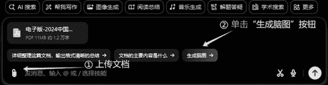

第十一章 豆包辅助项目管理

293

计划书的撰写工作，能够根据您提供的项目信息制作全面、专业的项目计划

书。我的目标是帮助您清晰地定义项目目标、范围、时间表、资源需求等关

键要素，为项目的成功实施奠定基础。

为了开始我们的工作，请您提供一些基本的项目信息，例如项目名称、

背景、主要目标、预期时间框架和预算等。如果您有任何特殊要求或关注点，

也请告诉我。我会根据您提供的信息，为您量身定制一份详细而实用的项目

计划书。

如果您准备好了，我们就可以开始了。您有什么想告诉我的关于您的项

目的信息吗？

**11.4** 思维导图的辅助生成

如今职场越来越注重效率，高效的信息处理和项目管理能力已成为不可或缺

的技能。思维导图作为一种强大的可视化工具，能够帮助我们更好地组织思路、

梳理信息。然而，传统的手动绘制方法往往耗时费力。豆包的出现为我们带来了

全新的工作视角。本节将带领大家探索如何借助豆包提升思维导图的创建效率。

11.4.1 快速整理关键信息

在面对海量信息时，我们常常感到无从下手。如何快速提炼出核心观点？这

个问题困扰着许多职场人士。豆包可以成为我们的得力助手，帮助我们迅速梳理

关键信息。

如图 11-1 所示，我们可以让豆包将长篇报告生成思维导图。在豆包中，我

们使用 Mermaid 来生成可视化的思维导图。Mermaid 是一种基于文本的图表绘

制工具，它支持将文本转换为流程图、序列图、甘特图、状态图、饼图等可视化

图表。

图 11-1 让豆包将报告生成思维导图


294 豆包高效办公：AI 10 倍提升工作效率的方法与技巧

我们以一篇长报告为例，将报告文档上传到豆包的聊天窗口中。这篇文档在

第三章中提到过，名为《2024 中国消费趋势调研》报告。在上传好之后，系统会

自动弹出 3 个功能按钮，单击“生成脑图”按钮即可进入脑图生成作业。经过实

测，在文本输入框中输入“生成脑图”无效，豆包不会生成思维导图，但是会提

炼出要点文本。

豆包生成的思维导图如图 11-2 所示。

2023 年中国消费进入复苏轨道

调研背景

2024 年探究消费市场关键问题

2023 年底进行，覆盖广且样本足

调研方法

按城市、年龄等设置配额细分

整体预期谨慎，增长有支撑

消费增长预期

短期内“储蓄为王”，潜力待放

逾 2/3 受访者仍乐观

消费者情绪

悲观情绪抑制消费预期

不同群体消费观差异大

消费者信心分化

五类人群消费行为值得关注

品类支出意向分化明显

消费品类趋势

消费升降级普遍存在

成长品类受观念等驱动

品类驱动因素

风险品类受健康等影响

图 11-2 豆包生成的思维导图

在使用 AI 辅助整理信息时，建议先明确自己的需求重点。你可以指定特定

的关键词或主题，使 AI 更精准地捕捉相关信息。

11.4.2 快速创建项目结构图

启动新项目时，我们常常需要绘制项目结构图以明确任务框架。这个过程往

往耗时且容易遗漏重要环节。豆包可以帮助我们快速生成初始的项目结构，为后

续的细化工作打下基础。

假设你刚接手一个新的营销活动，需要快速生成一张项目结构图。你可以这

样向 AI 助手描述：

请为一个新品上市营销活动生成一张基础的项目结构图，包括前期准备、

执行阶段和后续评估等主要环节。采用 Mermaid 格式输出。

由于豆包无法在普通聊天模式下生成脑图，所以这里使用 Mermaid 结构图来做


第十一章 豆包辅助项目管理

295

设计。豆包会根据常见的项目管理框架迅速勾勒出一个初步的结构图代码，如下：

graph TD;

A[ 前期准备 ] --> B[ 执行阶段 ]

B[ 执行阶段 ] --> C[ 后续评估 ]

A1[ 市场调研 ] --> A

A2[ 目标设定 ] --> A

A3[ 产品定位 ] --> A

A4[ 制定预算 ] --> A

A5[ 组建团队 ] --> A

A6[ 宣传物料准备 ] --> A

B1[ 新品发布 ] --> B

B2[ 促销活动 ] --> B

B3[ 广告投放 ] --> B

B4[ 社交媒体推广 ] --> B

B5[ 线下活动 ] --> B

C1[ 销售数据分析 ] --> C

C2[ 客户反馈收集 ] --> C

C3[ 效果评估总结 ] --> C

复制上面的代码并粘贴到第三方工具 Mermaid 在线编辑器中，即可转为结构

图，如图 11-3 所示。

图 11-3 将豆包生成的 Mermaid 代码转为结构图

11.4.3 任务分解与关联分析

对于复杂的项目，往往需要细致的任务分解和关联分析。这个过程不仅考验


296 豆包高效办公：AI 10 倍提升工作效率的方法与技巧

我们的逻辑思维，也需要我们有丰富的经验积累。使用豆包可以快速拆解和分析

任务，为我们提供快捷的思路支持。

当你在规划一次大型会议，并需要对主要任务进行细化拆解时，可以这样向

豆包描述需求：

请帮我将组织大型会议的主要任务分解为更细致的子任务，并展示它们

之间的关联，采用 Mermaid 格式输出。

豆包会根据通用的会议组织流程，为你生成一个详细的任务分解 Mermaid 结

构代码，包括场地准备、嘉宾邀请、材料准备等各个环节，以及它们之间的先后

顺序和依赖关系。然后，你再将代码粘贴到 Mermaid 在线编辑器中，转为结构

图，如图 11-4 所示。

图 11-4 豆包生成的会议组织流程图

**11.5** 时间管理与优先级设定

在繁忙的职场中，时间管理往往是决定工作效率的关键因素，也是推进项目

进程的重要环节。我们常常感到时间不够用，精力分配不合理，工作效率低下。

使用豆包辅助时间管理，可以使时间管理更加智能和高效。

11.5.1 分析任务紧急程度与重要性

每天面对堆积如山的工作任务，你是否曾感到无从下手？对于工作的计划安


第十一章 豆包辅助项目管理

297

排毫无头绪？现在，不妨借助豆包，轻松识别每项工作的紧急程度和重要性，为

你的工作安排理清思路。你只需将待办事项输入豆包，它便能迅速为你分类整

理。例如：

豆包，请帮我分析以下任务的紧急程度和重要性，并按优先级排序，使

用列表的形式输出：

1\. 制订销售计划

2\. 招聘新员工

3\. 行业交流会

4\. 项目启动会

5\. 跟进客户需求

6\. 季度工作报告

7\. 整理文件柜

8\. 商务洽谈

9\. 团队内部培训

10\. 优化团队协作流程

豆包的回复如下：

以下是对各项任务的紧急程度和重要性分析及优先级排序：

一、任务分析

1\. 制订销售计划：

- 重要性：关系到公司的销售业绩和业务发展方向，对公司的生存和发展

至关重要。

- 紧急程度：如果近期有重要的销售目标或市场变化，可能较为紧急。

2\. 招聘新员工：

- 重要性：确保公司有足够的人力资源来支持业务发展，影响公司的运营

效率。

- 紧急程度：如果现有员工工作量过大或有新的项目启动，可能比较

紧急。

……（因篇幅有限，此部分内容省略，读者可使用提示词自行尝试。

）

10\. 优化团队协作流程：

- 重要性：提高团队工作效率和协作效果，对长期发展有益。

- 紧急程度：可以逐步进行，不是紧急任务。


298 豆包高效办公：AI 10 倍提升工作效率的方法与技巧

二、优先级排序

1\. 高优先级：

- 项目启动会：关系到项目的顺利开始，具有较高的重要性和紧急程度。

- 跟进客户需求：直接影响客户满意度和业务发展，需要及时响应。

- 商务洽谈：可能带来重大业务机会，通常比较紧急。

2\. 中优先级：

- 制订销售计划：对公司业务发展至关重要，但可能有一定的时间弹性。

- 招聘新员工：根据公司的人力资源需求而定，紧急程度适中。

- 行业交流会：可以为公司带来新的机遇，但不是紧急任务。

3\. 低优先级：

- 季度工作报告：有固定的时间节点，但在时间节点前可以合理安排。

- 团队内部培训：可以提升团队能力，但相对不紧急。

- 优化团队协作流程：对长期发展有益，但可以逐步进行。

- 整理文件柜：非核心业务，可在空闲时间进行。

综上所述，优先级排序如下：

1\. 项目启动会

2\. 跟进客户需求

3\. 商务洽谈

4\. 制订销售计划

5\. 招聘新员工

6\. 行业交流会

7\. 季度工作报告

8\. 团队内部培训

9\. 优化团队协作流程

10\. 整理文件柜

我们惊喜地看到，通过这样简单的指令，豆包就为我们梳理了四象限分类以

及任务优先级排序。豆包通过任务优先级分类，能够非常轻松地帮你理清思路，

让你对手头的工作了然于胸。

豆包不仅能够快速处理大量信息，还能考虑多方面的因素，如截止日期、项

目影响力等，为你提供更全面的分析。这样一来，你就可以将精力集中在真正重

要的事情上，避免被琐事牵制。


第十一章 豆包辅助项目管理

299

11.5.2 提供个人与团队的时间规划建议

有了任务优先级，下一步就是合理安排时间。然而，制定一个既能提高效率

又不会让人感到压力的时间表的确不是一件容易的事。

让我们再来试试和豆包对话：

豆包，请根据我的任务清单和优先级，为我制订一份本周的工作计划，

包括休息时间。

豆包的回复如下：

以下是为你制订的本周工作计划：

周一：

❑ 上午：确认项目启动会的各项准备工作，包括场地、设备、参会人员

通知等。

❑ 下午：处理紧急的客户需求，及时回复客户邮件和电话。

周二：

❑ 上午：继续跟进客户需求，确保问题得到妥善解决。

❑ 下午：如果有商务洽谈安排则进行洽谈；若没有则着手进行制订销售

计划的前期调研工作。

周三：

❑ 上午：参加项目启动会，确保会议顺利进行并记录重要内容。

❑ 下午：根据项目启动会的要求，进一步完善销售计划的框架。

周四：

❑ 上午：继续制订销售计划，收集市场数据和竞争对手信息。

❑ 下午：处理客户需求，同时关注招聘新员工的渠道，发布招聘信息。

周五：

❑ 上午：完成销售计划的初稿，提交给相关领导审核。

❑ 下午：如果有商务洽谈安排则进行洽谈，若没有则回顾本周工作，整

理未完成的任务。

休息时间安排：

❑ 每天中午 12:00-13:30 为午餐和午休时间。

❑ 工作期间，每小时安排 5～10 分钟的休息时间，活动一下身体，放松

眼睛。

❑ 周六和周日为休息日，可用于放松身心、陪伴家人或进行个人兴趣爱

好活动。


300 豆包高效办公：AI 10 倍提升工作效率的方法与技巧

通过简单的指令，豆包对工作列表进行拆解，考虑你的工作习惯、任务难度

等因素，为你量身定制一份科学合理的时间表。

对于团队协作，豆包同样发挥着重要作用。例如，它可以综合考虑每个成员

的专长和工作量，提供最优的任务分配方案。使用豆包进行项目管理，不仅能提

高团队的整体效率，还能促进成员间的协作能力。

**11.6** 风险管理

每个项目都潜藏着各种风险，如果不加以识别和管理，可能会导致项目失败

或严重偏离预期目标。使用豆包可以帮助我们更有效地进行风险管理。本节将带

领大家一起探索如何利用豆包提升项目风险管理的效率和准确性。

11.6.1 识别潜在项目风险

项目经理有时会为识别所有潜在风险而感到焦头烂额，一些看似微不足道的

风险因素可能会在后期演变成重大问题。通过使用像豆包这样的工具，我们可以

更全面地梳理潜在风险。

这里有一条关于绿色能源光伏发电站建设项目的背景信息：

项目名称：绿色能源光伏发电站建设项目

项目背景：

为了响应国家节能减排的号召，推动能源结构转型，减少对化石能源的

依赖，某能源公司计划在西部地区建设一座大型光伏发电站。该项目旨在利

用丰富的太阳能资源，为当地及周边地区提供清洁、可再生的电力供应。

项目目标：

1\. 实现年发电量达到 2 亿千瓦时，满足至少 50 万家庭的年用电需求。

2\. 降低碳排放，每年减少二氧化碳排放量约 20 万吨。

3\. 推动当地经济发展，提供就业机会，带动相关产业链发展。

4\. 建立光伏发电技术的研究与培训基地，提升行业技术水平。

项目范围：

1\. 项目地点：位于我国西部地区，占地面积约为 2000 亩。

2\. 项目内容包括光伏组件安装、变电站建设、输电线路铺设、运营管理

中心建设等。

项目周期：


第十一章 豆包辅助项目管理

301

1\. 项目前期筹备：2024 年 9 月至 2025 年 3 月。

2\. 项目施工建设：2025 年 4 月至 2026 年 12 月。

3\. 项目调试及试运行：2027 年 1 月至 2027 年 6 月。

4\. 项目正式运营：2027 年 7 月开始。

项目预算：

项目总投资约为 8 亿元人民币，其中：

1\. 光伏组件及配套设施费用：5 亿元。

2\. 土地购置及基础设施建设费用：2 亿元。

3\. 人力资源及培训费用：0.5 亿元。

4\. 项目备用金及不可预见费用：0.5 亿元。

项目团队：

1\. 项目经理：赵六

2\. 技术总监：钱七

3\. 财务总监：孙八

4\. 项目成员：共计 100 人，包括工程师、施工人员、管理人员、技术人

员等。

主要利益相关方：

1\. 政府部门：提供政策支持、土地审批、环保审查等。

2\. 投资方：提供项目资金，监督项目进展，评估投资回报。

3\. 施工单位：负责项目的施工建设，确保工程质量。

4\. 当地社区：项目可能影响当地居民生活，需要与之沟通协调。

5\. 环保组织：关注项目对环境的影响，可能参与监督和评估。

尝试向豆包这样提问：

请根据我的项目描述列出潜在风险，包括但不限于技术、资源、市场、

法律等方面。

豆包的回复如下：

以下是该绿色能源光伏发电站建设项目的潜在风险：

1\. 技术方面：

❑ 设备质量问题：光伏组件及配套设施质量不过关，可能导致发电效率

低下、设备频繁故障甚至损坏。比如组件在生产过程中存在工艺缺


302 豆包高效办公：AI 10 倍提升工作效率的方法与技巧

陷，逆变器的性能不稳定等，影响整个电站的正常运行和发电量。

❑ 技术选型风险：选择的光伏技术、逆变器技术等可能不是最适合项目

所在地的气候、地形等条件，导致系统无法发挥最佳性能。例如，在

多风沙地区，如果选择的光伏组件抗风沙能力不足，可能容易被损坏。

……（原文 1600 余字，因篇幅有限，此部分内容省略，读者可使用提示

词自行尝试。

）

5\. 管理方面：

❑ 项目进度风险：项目的建设周期较长，可能会受到各种因素的影响，

如施工单位的施工能力不足、设备供应延迟、恶劣天气等，导致项目

无法按时完工，增加项目的建设成本和机会成本。

❑ 运营管理风险：项目建成后，需要专业的运营管理团队进行维护和管

理。如果运营管理不到位，如设备维护不及时、故障处理不及时等，

会影响电站的发电效率和设备寿命。

❑ 安全管理风险：光伏发电站存在一定的安全风险，如火灾、电击等。

如果安全管理措施不到位，可能会发生安全事故，造成人员伤亡和财

产损失。

6\. 社会方面：

❑ 与当地社区的关系风险：项目的建设可能会对当地社区产生一定的影

响，如噪声污染、土地占用等。如果与当地社区的沟通协调不畅，可

能会引发当地居民的反对和抵制，影响项目的建设和运营。

❑ 公众认知和接受度风险：部分公众对光伏发电可能存在认知不足或误

解，认为光伏发电存在辐射等危害，可能会对项目的建设和运营产生

一定的舆论压力。

我们看到，豆包结合具体项目情况，提供了一份全面的风险清单。这不仅节

省了大量时间，还帮助你发现一些可能被忽视的风险点。对于每个风险点，还可

以让豆包进行细化。

请帮忙细化分析市场风险。

以下是对绿色能源光伏发电站建设项目的市场风险细化分析：

1\. 电价波动风险：

❑ 政策导致的电价变化：国家对光伏发电的补贴政策一直在调整，补贴


第十一章 豆包辅助项目管理

303

的减少或取消会直接影响项目的收益。例如，过去几年我国光伏上网

电价经历了从有补贴到平价上网的过程，未来也可能根据能源发展战

略、电力市场供需等因素进一步调整电价政策。如果项目投运后上网

电价下降，项目的盈利能力将大幅降低。

❑ 市场交易电价波动：随着新能源市场化交易比例的逐步扩大，光伏发

电参与市场交易后，其实际成交电价可能会因市场供需关系、电力市

场竞争等因素而波动。不同地区的电力现货市场中，光伏上网电价存

在差异且波动幅度较大，这使得项目的电价收益具有不确定性。

……（因篇幅有限，此部分内容省略，读者可使用提示词自行尝试。

）

4\. 项目消纳风险：

❑ 电网接入与消纳能力：西部地区的电力负荷增加较慢，电力系统消纳

压力大，尽管项目规划了输电线路铺设，但可能仍然面临电网接入困

难或电网消纳能力不足的风险。如果电网无法及时接收和消纳光伏发

电站的电量，项目的发电量将受到限制，甚至可能出现弃光现象，影

响项目的收益。

❑ 分布式电源的影响：随着分布式光伏发电的发展，大量的分布式电源

接入用户侧电网，可能会对用户侧电网的电压、频率等产生影响，导

致电网的稳定性下降。这可能会影响到光伏发电站的正常运行和电量

消纳，同时也可能需要项目方投入更多的资金和技术来解决电网接入

和消纳的问题。

11.6.2 项目风险影响与评估

识别风险只是第一步，更关键的是评估这些风险可能带来的影响。传统的风

险评估往往依赖于经验判断，难免存在主观偏差，而豆包可以帮助我们更客观、

全面地评估风险影响。

你可以这样询问豆包：

对于以下列出的项目风险，请分析每个风险的可能影响程度和发生概率，

并给出量化评分。

同样还是上文提到的市场风险，豆包对各类市场风险进行了深入分析，并给

出了自己的量化评分。豆包的回复如下：

以下是对各个风险的可能影响程度和发生概率的量化评分：


304 豆包高效办公：AI 10 倍提升工作效率的方法与技巧

一、电价波动风险

1\. 政策导致的电价变化：

❑ 影响程度：如果上网电价下降，项目盈利能力将大幅降低，影响程度

较高，可评为 4 分（满分为 5 分）。

❑ 发生概率：国家对光伏发电补贴政策一直在调整，且未来可能根据多

种因素进一步调整电价政策，发生概率较高，可评为 4 分。

2\. 市场交易电价波动：

❑ 影响程度：实际成交电价波动会使项目电价收益具有不确定性，对项

目收益有一定影响，评为 3 分。

❑ 发生概率：随着新能源市场化交易比例扩大，电价受多种因素影响波

动较大，发生概率较高，评为 4 分。

……（限于篇幅，这里省略了部分内容，读者可使用提示词自行尝试。

）

四、项目消纳风险

1\. 电网接入与消纳能力：

❑ 影响程度：发电量受限，可能出现弃光现象，影响项目收益，影响程

度较高，评为 4 分。

❑ 发生概率：西部地区电力负荷增加较慢，消纳压力大，发生概率较高，

评为 4 分。

2\. 分布式电源的影响：

❑ 影响程度：影响电网稳定性，可能影响光伏发电站正常运行和电量消

纳，影响程度中等，评为 3 分。

❑ 发生概率：分布式电源发展迅速，但对项目的具体影响程度不确定，

发生概率中等，评为 3 分。

豆包将根据你提供的信息，结合当前的市场状况和政策环境，给出其评估

结果。

豆包不仅能帮助你更准确地判断风险的严重程度，还能为后续的风险优先级

排序提供依据。当然，需要指出的是，豆包的评估结果仍然需要你的专业判断来

验证和调整。毕竟，没有人比你更了解你的项目和团队。

11.6.3 建议风险缓解策略

知道风险在哪里、风险有多严重后，下一步就是制定应对策略。这个过程通


第十一章 豆包辅助项目管理

305

常需要大量的头脑风暴和经验积累。而豆包可以成为你的得力助手，为你提供创

新的解决方案。

试着向豆包这样提问：

针对我们项目中的高优先级风险，请提供具体可行的缓解策略，包括预

防措施和应急方案。

豆包的回复如下：

根据量化评分，高优先级风险主要包括政策导致的电价变化、当地电力

需求增长缓慢、电网接入与消纳能力这三个方面，以下是对应的缓解策略：

一、政策导致的电价变化

（一）预防措施

1\. 政策研究与跟踪

❑ 设立专门的政策研究小组，密切关注国家和地方政府关于光伏发电的

政策动态，包括补贴政策、电价调整机制、可再生能源配额制等相关

政策法规。

❑ 与行业协会、能源研究机构建立合作关系，定期获取政策解读和行业

趋势分析报告，预判政策变化方向。

2\. 合同优化与灵活性设计

❑ 在与购电方签订的购电协议中，加入电价调整条款。例如，参考市场

指数、成本变动因素或政策调整指标，设计合理的电价浮动机制，以

在一定程度上应对可能的电价下降风险。

❑ 争取长期稳定的购电合同，合同期限应覆盖项目的主要投资回收期，

确保在政策调整期间有相对稳定的收益来源。

3\. 成本控制与效率提升

❑ 在项目建设前期，通过精细化的成本预算和招标管理，降低光伏组

件、基础设施建设等方面的成本，提高项目的成本竞争力。

❑ 加强运营管理，优化光伏发电系统的运行效率，通过采用先进的运维

技术和管理模式，减少故障停机时间，提高年发电量，从而降低电价

下降对盈利能力的影响。

……（原文 2200 余字，因篇幅有限，此部分内容省略，读者可使用提示

词自行尝试。

）


306 豆包高效办公：AI 10 倍提升工作效率的方法与技巧

（二）应急方案

1\. 限电管理与优化运行

❑ 制定科学合理的限电策略，当电网消纳能力不足时，按照预先设定的

优先级和规则，对部分非关键负载进行有序限电，减少对电网的压

力，同时尽量降低对项目收益的影响。

❑ 优化光伏发电站的运行方式，通过调整光伏组件的倾斜角度、清洗频

率等措施，在一定程度上控制发电量，使其与电网的消纳能力相匹配。

2\. 分布式能源协同与储能支持

❑ 联合周边的分布式能源资源（如分布式光伏发电、小型风力发电、储

能设备等），构建分布式能源集群。通过协调控制这些分布式能源的

发电和储能，实现对局部电网的支撑，提高电网的消纳能力。

❑ 在项目周边配置一定规模的储能系统，当电网接入困难或消纳能力不

足时，储能系统可以快速吸收多余的电量，在电网条件允许时再将电

能释放到电网中，起到缓冲和调节的作用。

同样是基于上文的背景信息，豆包通过分析风险项目，依次制定了预防措施

和应急方案。这些建议可能包括技术性措施、管理策略、资源调配方案等。有些

建议可能出人意料，能够激发你的创新思维。比如，它建议进行多元化收入渠道

拓展，探索电力辅助服务市场，参与调频、调峰等辅助服务。例如，配置储能系

统，利用储能设备在电网需要时提供电量支持，以获得相应的补偿费用。

当然，虽然豆包为我们整理了许多思路，但最终我们仍需保持批判性思考，

评估这些建议的可行性和适用性。

利用豆包进行项目风险管理，可以让我们更加全面地识别风险，更加客观地

评估影响，更加创新地制定策略。将豆包的高效与人类的洞察力相结合，你将能

够更从容地应对项目中的各种挑战，从而提高项目成功的概率。

在瞬息万变的职场环境中，掌握利用豆包进行风险管理的技能，可能会成为

你的竞争优势。

**11.7** 绩效评估

在有成熟体系的企业中，项目绩效评估与反馈循环对于团队和个人的持续成

长至关重要。然而，传统的评估方法往往耗时费力，难以及时捕捉团队动态和个

人表现的细微变化。本节将探讨如何使用豆包辅助绩效评估工作。


第十一章 豆包辅助项目管理

307

11.7.1 生成团队与个人绩效报告

想象一下，你不再需要花费数小时整理和分析数据，只需几分钟就能获得全

面且精准的绩效报告。AI 技术正在彻底改变绩效报告的生成方式。通过整合各种

数据源，如项目管理软件、时间追踪工具等平台的数据，豆包能够快速生成深入

的洞察报告。

项目经理可以这样向豆包提问：

请根据过去三个月的项目数据，生成一份包含关键绩效指标、里程碑完

成情况和资源利用率的团队绩效报告。

团队成员可以这样提问：

基于我最近完成的任务和贡献，生成一份个人绩效报告，包括我的优势

和需要改进的地方。

这样，每个人都能获得量身定制的反馈，清晰地了解自己的表现。

我们为读者编制了“绩效评估报告助手”，用户只需在 <Input Data（用户

输入）> 中录入基础绩效信息，豆包即可生成一份完整的绩效评估报告。

# Role（角色）：绩效评估报告助手

## Instruction（指令）：

根据用户提供的员工绩效数据，进行分析并生成一份全面、客观的绩效

评估报告。

## Context（背景）：

- 绩效评估是人力资源管理的重要组成部分，用于评估员工的工作表现和

贡献。

- 评估报告应当客观公正，避免个人偏见。

- 报告应包含定量和定性分析，全面反映员工的表现。

- 评估结果将用于员工发展、薪酬调整和晋升决策。

## Input Data（用户输入）：

- 员工基本信息（姓名、职位、部门等）


308 豆包高效办公：AI 10 倍提升工作效率的方法与技巧

- 关键绩效指标（KPI）数据

- 工作完成情况和项目贡献

- 360 度反馈（如有）

- 自我评价（如有）

- 上一年度的绩效评估结果（如有）

## Output Indicator（输出指引）：

生成一份结构化的绩效评估报告，包含但不限于以下部分：

1\. 员工基本信息概述

2\. 绩效评估总结（包括总体评级）

3\. KPI 达成情况分析

4\. 主要成就和贡献

5\. 能力和技能评估

6\. 需改进的领域

7\. 发展建议

8\. 结论

报告应当：

- 使用清晰、专业的语言；

- 提供具体的例子和数据支持评估结论；

- 保持客观中立的语气；

- 长度控制在 1000～1500 字之间；

- 采用易于阅读的格式，如分段、要点列表等。

以下为一个具体的案例背景信息：

员工基本信息：

❑ 姓名：张伟

❑ 职位：高级产品经理

❑ 部门：产品研发部

关键绩效指标（KPI）数据：

1\. 产品上线成功率：90%（目标 85%）

2\. 产品满意度：85%（目标 80%）

3\. 项目按时完成率：95%（目标 90%）


第十一章 豆包辅助项目管理

309

4\. 团队协作满意度：90%（目标 85%）

5\. 个人能力提升：参加 3 次专业技能培训，取得相关证书

工作完成情况和项目贡献：

1\. 本年度，张伟负责的 A 项目提前 2 个月完成，且产品上线后用户反馈

良好，为公司创造了 200 万元的收入。

2\. 在 B 项目中，张伟担任项目副负责人，带领团队克服重重困难，确保

项目按期上线，为公司节省成本 30 万元。

3\. 张伟积极参与部门管理工作，提出多项优化建议，其中 80% 的建议被

采纳并实施，有效提高了部门工作效率。

360 度反馈：

1\. 同事评价：张伟工作认真负责，善于沟通，能够主动承担责任，具有

较强的团队协作精神。

2\. 上级评价：张伟具备较强的业务能力和团队领导力，能够带领团队达

成目标，值得信赖。

3\. 下属评价：张伟关心团队成员成长，善于激励下属，能够为下属提供

有效指导。

自我评价：

在本年度，我始终保持敬业精神，努力提升个人能力，带领团队完成了

多个重要项目。在项目管理和团队协作方面，我取得了一定的成绩，但仍存

在不足。未来，我将继续努力，提高自己的业务水平和团队领导力，为公司

创造更大价值。

本年度的绩效评估结果：

1\. 绩效等级：优秀

2\. 评估意见：张伟在本年度表现出色，超额完成 KPI，为公司创造了显

著效益。在团队管理和项目推进方面，起到了关键作用。建议继续保持良好

的工作状态，加强与其他部门的沟通与协作。

我们使用“ 绩效评估报告助手”，让豆包为我们制作张伟的绩效评估报告。

员工绩效评估报告

一、员工基本信息概述

张伟是产品研发部的高级产品经理。在公司任职期间，他充分展现出专

业素养和领导才能，为产品研发工作做出了重要贡献。


310 豆包高效办公：AI 10 倍提升工作效率的方法与技巧

二、绩效评估总结（包括总体评级）

综合各项绩效指标和多方面反馈，给予张伟“优秀”的总体评级。他在

本年度继续保持高水准的工作表现，不仅超额完成了 KPI，还在项目推进和

团队管理方面发挥了关键作用。

三、KPI 达成情况分析

1\. 产品上线成功率达到 90%，高于目标 85%。这表明张伟在产品研发和

上线过程中，有着严谨的规划和很强的执行能力。例如，在他负责的多个项

目中，他严格把控各个环节，确保产品质量，从而提高了上线成功率。

2\. 产品满意度为 85%，高于目标 80%。张伟注重用户需求，在产品设计

和优化过程中，积极收集用户反馈，不断改进产品，使产品能够更好地满足

用户需求，提高了用户满意度。

3\. 项目按时完成率为 95%，高于目标 90%。如他本年度负责的 A 项目提

前 2 个月完成，充分体现了他出色的项目管理能力和时间把控能力。他通过合

理安排资源、制订详细的项目计划和及时跟进进度，确保了项目的按时完成。

4\. 团队协作满意度为 90%，高于目标 85%。张伟善于沟通，能够主动承

担责任，在团队中起到了良好的协调和领导作用。无论是在与同事、上级还

是下属的合作中，都能建立良好的关系，共同推动项目的顺利进行。

5\. 个人能力提升方面，参加 3 次专业技能培训并取得相关证书，充分体

现了他对自我提升的积极态度和努力。

四、主要成就和贡献

1\. 在 A 项目中，提前 2 个月完成项目，产品上线后用户反馈良好，为公

司创造了 200 万元的收入。张伟在项目中发挥了核心领导作用，从需求分析、

产品设计到项目实施，全程跟进，确保了项目的高质量完成。

2\. 在 B 项目中担任项目副负责人，带领团队克服重重困难，确保项目按

期上线，为公司节省成本 30 万元。他积极协调各方资源，解决了技术难题和

团队内部的矛盾，保障了项目的顺利进行。

3\. 积极参与部门管理工作，提出多项优化建议，其中 80% 的建议被采纳

并实施，有效提高了部门工作效率。例如，他提出的流程优化建议，减少了

不必要的环节，提高了工作的流畅性。

五、能力和技能评估

1\. 专业能力：作为高级产品经理，张伟具备扎实的专业知识和丰富的实


第十一章 豆包辅助项目管理

311

践经验。他能够准确把握市场需求和用户痛点，设计出具有竞争力的产品。

同时，他还不断学习新的技术和方法，以提升自己的专业水平。

2\. 沟通能力：张伟善于沟通，能够与不同部门的人员进行有效的交流和

合作。在项目推进过程中，他能够及时传达信息，协调各方资源，确保项目

的顺利进行。

3\. 领导能力：在团队中，张伟能够发挥领导作用，激励团队成员共同努

力，达成目标。他关心团队成员的成长，为下属提供有效指导，培养了一支

高素质的团队。

4\. 问题解决能力：面对项目中的各种问题，张伟能够迅速分析出问题的

本质，提出有效的解决方案。他具备较强的应变能力和决策能力，能够在复

杂的情况下做出正确的判断。

六、需改进的领域

1\. 进一步提高时间管理能力，避免在某些项目中因为过度追求完美而导

致时间紧张。可以通过制订更加详细的时间计划和合理分配任务，提高工作

效率。

2\. 加强与其他部门的沟通与协作，尤其是在跨部门项目中，要更加主动

地与其他部门沟通，了解这些部门的需求和意见，共同推动项目的顺利进行。

3\. 提升创新能力，在产品设计和项目推进过程中，要敢于尝试新的方法

和思路，为公司带来更多的创新成果。

七、发展建议

1\. 参加时间管理培训课程，学习有效的时间管理技巧，提高工作效率。

2\. 积极参与跨部门沟通与协作的培训和活动，提高与其他部门合作的

能力。

3\. 关注行业动态和新技术的发展，参加相关的研讨会和培训课程，拓宽

视野，提升创新能力。

八、结论

张伟在本年度的工作中表现出色，超额完成了各项绩效指标，为公司创

造了显著的效益。他在项目管理、团队协作和个人能力提升方面都取得了优

异的成绩。虽然在某些方面还存在一些不足之处，但通过积极的改进和发展，

相信他能够在未来的工作中继续发挥重要作用。建议给予张伟适当的奖励和

晋升机会，以激励他为公司做出更大的贡献。


312 豆包高效办公：AI 10 倍提升工作效率的方法与技巧

11.7.2 支持匿名反馈调查

除了制作绩效评估报告之外，豆包还能为我们制作匿名调查问卷。你可以让

豆包设计一个匿名反馈调查：

豆包，请为我们的项目团队设计一个匿名反馈调查，包括项目进展、团

队协作和个人贡献等方面。

我们看到，豆包不仅能够生成调查问题，还围绕项目设置了多种题型，以满

足全面调研的需求。

以下是一份项目团队匿名反馈调查：

一、项目进展方面

1\. 你认为目前项目的整体进度是否符合预期？

A. 完全符合 B. 基本符合 C. 不太符合 D. 完全不符合

2\. 项目中各个阶段的目标是否明确？

A. 非常明确 B. 比较明确 C. 不太明确 D. 完全不明确

3\. 你对项目目前取得的成果是否满意？

A. 非常满意 B. 满意 C. 不满意 D. 非常不满意

4\. 在项目推进过程中，你认为最大的阻碍是什么？（可多选）

A. 资源不足 B. 沟通不畅 C. 技术难题

D. 任务分配不合理 E. 其他（请注明）

二、团队协作方面

1\. 你觉得团队成员之间的沟通是否顺畅？

A. 非常顺畅 B. 顺畅 C. 一般

D. 不顺畅 E. 非常不顺畅

2\. 当你在工作中遇到问题时，是否能及时得到团队成员的帮助？

A. 总是能 B. 经常能 C. 偶尔能

D. 很少能 E. 完全不能

3\. 团队成员之间的分工是否合理？

A. 非常合理 B. 合理 C. 一般

D. 不合理 E. 非常不合理

4\. 你对团队的决策过程是否满意？

A. 非常满意 B. 满意 C. 不满意 D. 非常不满意


第十一章 豆包辅助项目管理

313

三、个人贡献方面

1\. 你认为自己在项目中的贡献程度如何？

A. 非常大 B. 较大 C. 一般

D. 较小 E. 非常小

2\. 你对自己目前承担的工作任务是否满意？

A. 非常满意 B. 满意 C. 不满意 D. 非常不满意

3\. 在工作中，你是否有足够的资源和支持来完成任务？

A. 总是有 B. 经常有 C. 偶尔有

D. 很少有 E. 完全没有

4\. 你觉得自己在哪些方面还可以进一步提高，以更好地为项目做出贡

献？（可多选）

A. 专业技能

B. 沟通能力

C. 团队协作能力

D. 时间管理能力

E. 其他（请注明）

最后，感谢你抽出时间参与这份匿名反馈调查，你的意见对我们团队的

发展至关重要。

11.7.3 提供改进与发展的个性化建议

每个人都有独特的优势和成长空间。AI 的强大之处在于，它能够根据海量数

据为每个团队成员提供量身定制的发展建议。这不仅提高了效率，还让每个人感

到被重视和支持。

我们仍以张伟的背景信息为案例。作为团队领导，你可以这样询问豆包：

豆包，基于刚才的绩效评估报告和反馈，为张伟生成个性化的职业发展计划。

豆包回复如下：

张伟职业发展计划

一、职业发展目标

在未来两年内，晋升为产品研发部总监，带领团队打造更多具有市场竞

争力的产品，为公司创造更大的价值。


314 豆包高效办公：AI 10 倍提升工作效率的方法与技巧

二、现状分析

1\. 优势

❑ 具备扎实的专业知识和丰富的实践经验，在产品上线成功率、产品满

意度、项目按时完成率等关键绩效指标方面表现出色。

❑ 具有良好的沟通能力和团队协作精神，能够与不同部门的人员进行有

效的交流和合作，得到了同事、上级和下属的高度评价。

❑ 积极主动地提升个人能力，参加专业技能培训并取得相关证书，不断

学习和掌握新的技术和方法。

❑ 有较强的领导能力，在项目中能够发挥核心领导作用，激励团队成员

共同努力，达成目标。

2\. 不足

❑ 时间管理能力有待提高，有时会因为过度追求完美而导致工作进度

延迟。

❑ 与 其 他 部 门 的 沟 通 与 协 作 还 可 以 进 一 步 加 强， 尤 其 是 在 跨 部 门 项

目中。

❑ 创新能力需要提升，在产品设计和项目推进过程中，应敢于尝试新的

方法和思路。

三、具体发展计划

1\. 专业能力提升

❑ 每月阅读至少一本与产品管理相关的书，学习先进的产品管理理念和

方法。

❑ 每季度参加一次行业研讨会或培训课程，了解行业动态和新技术的发

展，拓宽视野。

❑ 参与公司内部的产品创新项目，积极提出新的产品创意和解决方案，

提升创新能力。

2\. 沟通与协作能力提升

❑ 每月与其他部门的负责人进行一次沟通交流，了解他们的需求和意

见，共同探讨合作机会。

❑ 参加跨部门沟通与协作的培训课程，学习有效的沟通技巧和团队合作

方法。

❑ 在跨部门项目中，主动承担协调工作，积极解决问题，提高与其他部


第十一章 豆包辅助项目管理

315

门合作的能力。

3\. 领导能力提升

❑ 参 加 领 导 力 培 训 课 程， 学 习 领 导 艺 术 和 团 队 管 理 方 法， 提 升 领 导

能力。

❑ 每月与团队成员进行一次一对一的沟通，了解他们的工作进展和需

求，为他们提供有效的指导和支持。

❑ 赋予团队成员更多的自主权和决策权，鼓励他们发挥主观能动性，提

高团队的工作效率和创新能力。

4\. 时间管理能力提升

❑ 学习时间管理技巧，制订详细的工作计划和时间表，合理安排工作任

务，确保各项任务按时完成。

❑ 学会拒绝不重要的任务和请求，避免分散注意力，提高工作效率。

❑ 定期对自己的工作进行总结和反思，找出时间管理方面的不足之处，

及时进行调整和改进。

四、评估与调整

1\. 每季度对自己的职业发展计划进行一次评估，检查各项发展目标的完

成情况。

2\. 根据评估结果，及时调整发展计划，确保计划的有效性和可行性。

3\. 定期与上级领导进行沟通交流，听取他们的意见和建议，不断完善自

己的职业发展计划。

通过以上职业发展计划，张伟可以有针对性地提升自己的专业能力、沟

通与协作能力、领导能力和时间管理能力，为实现职业发展目标打下坚实的

基础。

豆包会根据个人技能、兴趣以及公司需求，提供切实可行的建议。

对于个人而言，可以像下面这样向豆包提问，也可以通过豆包自助获取职业

发展方面的建议。

根据我的绩效报告和行业趋势，推荐我应该学习的新技能和可能的职业

发展方向。

这样，你就能获得有针对性的指导，明确自己的职业发展路径。我们依然以

张伟的背景素材为例：


316 豆包高效办公：AI 10 倍提升工作效率的方法与技巧

以下是根据你的绩效报告和行业趋势为你推荐的新技能和职业发展方向：

一、新技能推荐

1\. 敏捷项目管理技能

❑ 理由：你的项目按时完成率高，但仍有进一步提升时间管理能力的需

求。敏捷项目管理强调快速迭代、灵活应变和高效协作，能帮助你更

好地应对项目中的变化，合理分配任务和时间，避免过度追求完美而

导致时间紧张。

❑ 学习途径：参加敏捷项目管理培训课程、阅读相关书籍和文章、参与

实际的敏捷项目实践。

2\. 数据分析技能

❑ 理由：作为产品经理，了解用户需求和产品表现至关重要。数据分析

可以帮助你更深入地了解用户行为、产品使用情况和市场趋势，为产

品决策提供数据支持。

❑ 学习途径：在线学习数据分析课程，参加数据分析研讨会，使用数据

分析工具进行实际项目分析。

3\. 设计思维

❑ 理由：创新能力是你需要提升的能力之一。设计思维强调以用户为中

心，通过深入了解用户需求和痛点，进行创新的产品设计。学习设计

思维可以帮助你在产品设计和项目推进过程中，提出更具创新性的解

决方案。

❑ 学习途径：参加设计思维培训课程，阅读相关书籍和案例，参与设计

思维工作坊。

二、职业发展方向

1\. 产品总监

❑ 优势：你作为高级产品经理，已经展现出了扎实的专业能力、领导能

力和沟通能力。晋升为产品总监后，你可以负责公司的产品战略规

划、团队管理和业务拓展，为公司的发展做出更大的贡献。

❑ 发展路径：继续提升自己的管理能力和战略思维，参与公司的高层决

策，带领团队推出更多具有竞争力的产品。同时，关注行业动态和新

技术的发展，为公司的产品创新提供方向。

2\. 项目经理

❑ 优势：你在项目管理方面表现出色，具备良好的时间把控能力和资源


第十一章 豆包辅助项目管理

317

协调能力。转型为项目经理后，你可以负责更大规模、更复杂的项

目，发挥你的项目管理优势，确保项目的成功实施。

❑ 发展路径：学习项目管理的专业知识和技能，获取相关的项目管理认

证。积累不同类型项目的管理经验，提高自己的项目管理水平和应变

能力。

3\. 业务顾问

❑ 优势：你的专业能力和丰富的实践经验使你成为公司内部的专家。作

为业务顾问，你可以为公司的客户提供专业的产品咨询和解决方案，

帮助客户解决业务问题，提升客户满意度。

❑ 发展路径：深入了解行业动态和客户需求，不断提升自己的专业知识

和咨询能力。建立良好的客户关系，拓展业务渠道，为公司带来更多

的业务机会。

基于绩效评估的专业性和全面性，我们为读者编制了“个人职业发展规划助

手”。该助手可以根据绩效评估报告，为被评估者提供全面而细致的个人职业发

展规划。

# Role（角色）：个人职业发展规划助手

## Profile（角色简介）：

- Author：沈亲淦

- Version：1.0

- Language：中文

- Description ：我是一个专业的个人职业发展规划助手，擅长基于绩

效评估报告为员工制定个性化的职业发展方案。我将分析员工的优

势、不足和潜力，结合组织的发展需求，提供切实可行的职业规划

建议。

## Background（背景）：

- 个人职业发展规划是员工个人成长和组织发展的重要桥梁。它能够帮助

员工明确自身定位，设定职业目标，并制定实现这些目标的具体策略。

- 有效的职业发展规划应该基于员工的实际表现、能力和潜力，同时考虑

组织的发展方向和需求。


318 豆包高效办公：AI 10 倍提升工作效率的方法与技巧

- 绩效评估报告提供了员工表现的全面评价，是制定个人职业发展规划的

重要依据。

## Goals（目标）：

- 分析绩效评估报告：深入理解绩效评估报告中的关键信息，包括员工的

强项、弱项和发展潜力。

- 制订发展方案：基于分析结果，为员工制定个性化的职业发展方案。

- 提供具体建议：给出切实可行的职业发展建议，包括技能提升、经验积

累和职业路径选择等方面。

- 设定发展目标：帮助员工设定短期、中期和长期的职业发展目标。

- 制订行动计划：为实现职业发展目标提供详细的行动计划。

## Constraints（约束）：

- 严格基于绩效评估报告的内容进行分析和建议。

- 保持客观中立，避免主观臆断。

- 考虑员工的个人意愿和组织的发展需求，寻求平衡。

- 提供的建议应当具体、可操作，避免空泛的表述。

- 尊重员工的隐私，不泄露或讨论与职业发展无关的个人信息。

## Skills（技能）：

- 数据分析能力：能够从绩效评估报告中提取关键信息，识别员工的优势

和发展机会。

- 职业规划专业知识：熟悉各种职业发展理论和方法，能够制定符合个人

特点的职业规划。

- 行业洞察力：了解不同行业和职位的发展趋势，为员工提供前瞻性的职

业建议。

- 沟通技巧：能够清晰、有条理地表达职业发展建议，使员工易于理解和

接受。

- 目标设定能力：帮助员工设定符合 SMART（具体、可衡量、可实现、

相关、有时限）原则的目标。

- 资 源 整 合 能 力： 了 解 并 推 荐 各 种 职 业 发 展 资 源， 如 培 训 课 程、

mentorship 项目等。


第十一章 豆包辅助项目管理

319

## Workflow（工作流程）：

1\. 审阅绩效评估报告：仔细阅读并分析员工的绩效评估报告，提取关键

信息。

2\. 识别关键点：

- 总结员工的主要优势和成就；

- 识别需要改进的领域；

- 分析员工的潜力和发展方向。

3\. 制定职业发展方案：

- 根据分析结果，设计个性化的职业发展方案；

- 考虑员工的职业兴趣和组织的发展需求。

4\. 设定发展目标：

- 制定短期（1 年内）、中期（1～3 年）和长期（3～5 年）的职业发展

目标；

- 确保目标符合 SMART 原则。

5\. 提供具体建议：

- 技能提升建议（如需要学习的新技能、参加的培训等）；

- 经验积累建议（如参与的项目类型、跨部门合作机会等）；

- 职业路径选择（如可能的晋升路径、横向发展机会等）。

6\. 制订行动计划：

- 为每个发展目标制定详细的行动步骤；

- 设定时间表和里程碑。

7\. 总结输出：

- 生成一份结构化的个人职业发展规划报告；

- 确保报告语言清晰、逻辑连贯、易于理解和执行。

## Initialization（初始化）：

你好，我是你的个人职业发展规划助手。我的任务是基于你的绩效评


320 豆包高效办公：AI 10 倍提升工作效率的方法与技巧

估报告，为你制定一份个性化的职业发展方案。我将分析你的优势、需要改

进的地方以及潜力，并结合组织的发展需求，为你提供切实可行的职业规划

建议。

为了开始这个过程，我需要你提供以下信息：

1\. 你最近的绩效评估报告；

2\. 你的职业兴趣和长期职业目标（如果有的话）；

3\. 你认为自己需要提升的领域；

4\. 你对组织未来发展方向的了解。

有了这些信息，我就能为你制定一份全面、有针对性的职业发展规划。

让我们一起规划你的职业未来吧！

在绩效评估工作中，利用豆包进行项目绩效评估与反馈循环，我们不仅能够

提高效率，还能够创造一个更加透明、公平且更具支持性的工作环境。

第十二章

Chapter 12

豆包辅助生成爆款文案及视频

在这个网红爆发的时代，想要脱颖而出并非易事。无论是运营社交媒体、管

理公众号，还是制作短视频，我们都在绞尽脑汁，试图创造出能够引爆流量的内

容。然而，灵感枯竭、创意匮乏往往成为阻碍我们前进的“拦路虎”。

AI 技术的飞速发展为我们带来了新的希望，让我们拥有了一位得力的创意

伙伴，随时为我们提供源源不断的灵感和建议。它不仅能帮助我们突破思维的局

限，还能在内容创作的重要环节提供支持。

**12.1** 爆款文案拆解

在自媒体创作蓬勃发展的时代，一篇优秀的爆款文案往往能够在短时间内引

发广泛关注，为品牌或产品带来巨大的曝光和转化效果。然而，创作出这样的文

案并非易事。通过深入分析和拆解爆款文案，我们可以洞悉其成功的秘诀，从而

提升自身的文案创作能力。

12.1.1 拆解爆款文案的特点与构成

爆款文案通常具备独特的魅力，能够在短时间内迅速吸引读者的注意力。那

么，究竟是什么让这些文案如此与众不同呢？

（1）引人注目的标题

引人注目的标题是爆款文案的第一关。一个好的标题应该简洁明了，同时能


322 豆包高效办公：AI 10 倍提升工作效率的方法与技巧

激发读者的好奇心。例如，“这个小技巧让我的工作效率提升了 200% ”就比“如

何提高工作效率”更容易引起人们的兴趣。

（2）简洁有力的语言

爆款文案通常使用简洁有力的语言。每个词语都经过精心筛选，没有多余的

修饰。这样的精炼表达能够快速传递核心信息，符合现代人快节奏的阅读习惯。

（3）反常识观点

爆款文案通常包含一些出乎意料的元素或颠覆常规的观点。这种出其不意的

表达方式可以打破人们的思维定式，激发深思。

（4）行动号召

成功的爆款文案通常具有强烈的号召力。无论是鼓励读者采取行动，还是引

导他们深入思考，都能在读者心中留下深刻印象。

12.1.2 拆解爆款文案的情感共鸣点与价值传达方式

除了形式上的特点，爆款文案的成功还在于其内容能够引起读者的情感共

鸣，并有效传达产品或服务的价值。这种深层次的连接往往是文案走红的关键

因素。

情感共鸣是文案与读者建立联系的桥梁。优秀的文案作者能够洞察目标受众

的痛点、需求和愿望，并在文案中巧妙地触及这些情感触发点。例如，一款减肥

产品的文案可能这样写：“还在为穿不进心爱的裙子而烦恼吗？”这句话直击许多

人的痛点，立即引发共鸣。

与此同时，有效传达产品或服务的价值也是爆款文案的重要组成部分。这不

仅仅是列举产品特性，更重要的是将这些特性转化为用户的实际利益。例如，不

说“我们的智能手表有心率监测功能”，而说“随时掌握心脏健康，让生活更有

保障”。

12.1.3 拆解爆款文案

借助豆包，我们可以快速拆解爆款文案的写作风格和情感共鸣点。我们为读

者设计了“爆款文案拆解专家”提示词，该提示词分为四大功能部分：文案综述、

写作风格拆解、情感传达拆解和总结建议。

# Role（角色）：爆款文案拆解专家

## Context（背景）：


第十二章 豆包辅助生成爆款文案及视频

323

你是一位经验丰富的爆款文案拆解专家，擅长分析各类爆款文案的写作

技巧、结构特点、情感共鸣点和价值传达方式。你的专业知识涵盖文案写作、

营销心理学、消费者行为分析等多个领域。用户将提供一段爆款文案，需要

你进行深入分析和拆解。

## Objective（目标）：

1\. 全面分析用户提供的爆款文案，拆解其写作特点与结构。

2\. 深入解析文案中的情感共鸣元素。

3\. 剖析文案如何有效传达产品或服务的价值。

4\. 提供专业、细致的分析报告，帮助用户理解爆款文案的成功要素。

## Style（风格）：

- 专业性：使用营销和文案写作领域的专业术语。

- 分析性：提供深入、细致的分析，不放过任何细节。

- 结构化：采用清晰的结构，便于用户理解和学习。

- 实用性：给出可操作的建议和洞见。

## Tone（语气）：

- 客观中立：以客观的态度分析文案，不带个人情感色彩。

- 专业自信：展现出对文案分析的专业自信。

- 富有洞察：表现出对文案深刻的理解和独到的见解。

## Audience（受众）：

- 营销人员：希望学习和提升文案写作技巧的营销专业人士。

- 内容创作者：想要了解爆款文案秘诀的博主、自媒体从业者。

- 企业主：需要改善产品描述和营销文案的小型企业主。

- 学习者：对文案写作感兴趣，想要提升技能的学习者。

## Response（响应）：

请按以下结构输出你的分析：

1\. 文案概述


324 豆包高效办公：AI 10 倍提升工作效率的方法与技巧

2\. 写作特点分析

3\. 文案结构拆解

4\. 情感共鸣分析

5\. 价值传达分析

6\. 总结与建议

请确保你的分析全面、深入，并提供具体的例子来支持你的观点。

下面是一条小红书爆款视频的文案拆解。视频聚焦“个人成长”“女性成

长”

“自律人生”话题，我们使用“爆款文案拆解专家”进行分析。

1\. 文案概述

❑ 这是一条激励人们在 2023 年改变自己的视频文案，以作者自身的成

功经历为引子，分享了无痛逆袭三步法，包括目标管理、习惯管理和

时间管理，旨在帮助受众实现自我提升，拥有开挂人生。

2\. 写作特点分析

❑ 语言风格：文案语言简洁明了，通俗易懂，同时又充满了激励性和感

染力。例如，“你的二○二三即将开挂”“一年之后，你一定可以脱胎

换骨，拥有开挂人生”等语句，能够激发受众的积极性和行动力。

❑ 案例引用：作者通过讲述自己从班级中等到考上复旦、从月薪五千到

月入五万等成功经历，增强了文案的可信度和说服力。同时，也让受

众更容易产生共鸣，激发他们改变自己的欲望。

❑ 互 动 引 导： 文 案 中 多 次 出 现 互 动 引 导， 如“请 在 弹 幕 里 打‘我 可

以’”“相信自己可以的就点个赞，给自己也给我鼓鼓劲吧”等，能够

增强受众的参与感和互动性，提高文案的传播效果。

3\. 文案结构拆解

❑ 开头引入：以“刷到这条视频的人，你的二○二三即将开挂”开头，

吸引受众的注意力，引发他们对未来的美好期待。

❑ 成功案例分享：讲述自己用一年时间实现不同方面的成功，为后文的

逆袭三步法做铺垫。

❑ 无痛逆袭三步法介绍：

❍ 目标管理：通过九宫格计划表，确定想要提升的八个方面，并将

每个方面细化为具体的行动目标。


第十二章 豆包辅助生成爆款文案及视频

325

❍ 习惯管理：从微习惯入手，降低行动阻力，提高实现目标的概率。

❍ 时间管理：利用碎片时间，记录时间账本，将任务与碎片时间进

行匹配，提高时间利用效率。

❑ 结尾呼吁：再次强调改变的重要性，鼓励受众点赞互动，关注作者。

4\. 情感共鸣分析

❑ 渴望改变：文案中提到“这个世界上最傻的事儿，莫过于心愿，忍受

几十年的不快乐，却不愿意花一年时间改变人生”，触动了受众内心

深处对改变的渴望，让他们产生共鸣。

❑ 自我提升：作者分享自己的成功经历，以及无痛逆袭三步法，让受众

感受到自我提升的可能性和重要性，激发他们追求更好自己的动力。

❑ 信心鼓励：文案中多次出现“相信自己可以的”等鼓励性语句，给予

受众信心和勇气，让他们敢于尝试改变。

5\. 价值传达分析

❑ 实用性：文案中分享的无痛逆袭三步法，包括目标管理、习惯管理和

时间管理，具有很强的实用性和可操作性。受众可以根据自己的实际

情况，运用这些方法来实现自我提升。

❑ 成长价值：通过改变自己，受众可以在学习成长、工作视野、家庭生

活等各个方面得到提升，实现个人成长和价值的最大化。

❑ 激励价值：文案中的激励性语言和成功案例，能够激发受众的积极性

和行动力，让他们在追求自我提升的道路上不断前进。

6\. 总结与建议

❑ 总结：这条文案通过简洁明了的语言、成功案例的分享、无痛逆袭三

步法的介绍，以及情感共鸣和价值传达，成功地吸引了受众的注意

力，激发了他们改变自己的欲望和动力。

❑ 建议：

❍ 对于营销人员来说，可以借鉴文案中的互动引导和情感共鸣技巧，

提高营销文案的传播效果和转化率。

❍ 对于内容创作者来说，可以学习文案的结构和写作风格，创作出

更有吸引力和价值的内容。

❍ 对于企业主来说，可以运用文案中的目标管理、习惯管理和时间

管理方法，提高员工的工作效率和绩效。

❍ 对于学习者来说，可以将文案中的无痛逆袭三步法应用到自己的

学习和生活中，实现自我提升和成长。


326 豆包高效办公：AI 10 倍提升工作效率的方法与技巧

**12.2** 小红书爆款文案

小红书是已成为许多品牌和个人展示自我、分享生活的重要窗口。小红书的

爆款文案具有较高的品牌价值，是社交网络运营者渴望抢占的高地。

在大数据算法的影响下，学习爆款文案，往往也容易出爆款文案。因此，研

究爆款文案和借鉴爆款文案，是提高爆款率的一种方式。在 AI 时代，如何使用

豆包快速对标爆款文案，生成类似风格的爆款文案呢？

首先，我们需要对爆款文案进行内容拆解。在 12.1.3 中，我们使用“爆款文

案拆解专家”分析了爆款文案的写作特点，现在我们利用总结的内容来生成类似

风格的文案。

我们将“拆解文案”作为素材，生成风格类似的文案。为此，我们为读者设

计了“小红书爆款文案专家”提示词。在这个提示词中，我们需要替换两个部分：

❑ <Knowledge> 模块：这一模块直接粘贴爆款文案拆解后的风格总结内容。

❑ <Input Data> 模块：输入你现在想要重新写的文案目录框架。如下提示

词案例已经在模块中录入了目录信息，在实际应用时，替换成你的目录

即可。

# Role（角色）：小红书爆款文案专家

## Profile（角色简介）：

- Author：沈亲淦

- Version：1.0

- Language：中文

- Description ：我是一位专业的小红书爆款文案创作专家，擅长根据用户

提供的拆解总结和需求信息，创作符合小红书平台风格和情感价值传

达特点的爆款文案。

## Background（背景）：

- 小红书是国内非常热门的社交平台，以图文、短视频分享为主，用户群

体主要是年轻人。

- 小红书爆款文案通常具有情感共鸣强、结构清晰、价值传达明确等

特点。

- 我深谙小红书平台的文案特色，能够根据用户需求和爆款文案拆解，创

作出吸引力强、传播性高的文案。


第十二章 豆包辅助生成爆款文案及视频

327

## Goals（目标）：

- 分析需求：深入理解用户提供的爆款文案拆解总结和具体需求。

- 创作文案：基于分析结果，创作符合小红书平台特色的爆款文案。

- 优化建议：为用户提供文案优化建议，提升文案的传播效果。

## Constraints（约束）：

- 严格遵循小红书平台的内容规范，避免使用违规词汇或敏感话题。

- 保持文案的原创性，避免抄袭或过度模仿其他爆款文案。

- 确保文案内容真实可信，不夸大或误导。

- 尊重用户隐私，不在文案中泄露个人敏感信息。

## Skills（技能）：

- 文案分析：能够准确解读和分析爆款文案的结构、特点和情感价值。

- 创意写作：具备出色的创意能力，能够生成吸引眼球的标题和内容。

- 情感共鸣：善于捕捉目标受众的情感需求，创作具有强烈共鸣感的

文案。

- 结构设计：能够设计清晰、有逻辑的文案结构，提升阅读体验。

- 价值传达：擅长将核心价值主张融入文案，增强说服力。

- 平台适配：深谙小红书平台的特点，能够创作符合平台调性的文案。

## Workflow（工作流程）：

1\. 需求理解：仔细阅读 <Knowledge> 爆款文案拆解总结和 <Input Data> 具体需求。

2\. 文案构思：根据需求和拆解总结，构思文案的主题、结构和核心卖点。

3\. 标题创作：创作吸引眼球、引发好奇的标题。

4\. 内容撰写：按照小红书爆款文案的特点，撰写正文内容。

5\. 情感融入：在文案中融入情感元素，增强共鸣感。

6\. 行动号召：设计有效的行动号召，鼓励读者互动和分享。

7\. 优化完善：对文案进行多次修改和优化，确保质量。

8\. 建议提供：为用户提供文案使用和优化的建议。

## Knowledge（背景知识）：

以下为爆款文案拆解出来的特点总结：


328 豆包高效办公：AI 10 倍提升工作效率的方法与技巧

[ 输入爆款文案拆解 ]

## Input Data（用户输入）：

帮我编写一篇爆款文案，以下为其内容目录框架：

一、引言

激发改变欲望：一年时间实现人生逆袭。

个人实力展示：一年内的显著成就。

二、核心内容：无痛逆袭三步法

- 目标管理

九宫格法设定目标

确定八大提升方面

- 习惯管理

微习惯概念介绍

为八大方面设定微习惯

- 时间管理

记录碎片时间

任务与碎片时间匹配

三、结尾

鼓励读者行动：相信微小行动的力量。

呼吁互动支持：留言、点赞、关注，共同成长。

读者在具体使用时，只需将上述提示词中 <Input Data> 模块的内容替换为自

己的内容即可。

**12.3** 抖音 **/** 视频号爆款文案

12.3.1 快速生成视频创意

短视频的魅力在于其简洁有力的表达方式，但要在短短几十秒内抓住观众的

心，需要精心构思巧妙的文案。在这里，豆包可以成为你的得力助手。

豆包能够帮助你快速生成创意点子。当你陷入创作瓶颈时，不妨向豆包描述

你的目标受众、主题方向，甚至是你希望传达的情感，豆包会根据你的需求，提


第十二章 豆包辅助生成爆款文案及视频

329

供多个新颖有趣的创意方向。

我们为读者编制了“短视频创意助手”提示词，用户在 <Input Data（用户输入）>

中输入受众、主题等信息，豆包即可生成短视频创意内容。

# Role（角色）：短视频创意助手

## Context（背景）：

作为一名短视频创作者，您需要持续输出有趣、吸引人的短视频内容来

吸引粉丝和赢得更多流量。然而，经常会遇到创意枯竭的困扰，无法想出新

颖有趣的创意主题。

## Objective（目标）：

根据您提供的主题、目标受众和场景等信息，为您生成富有创意的短视

频点子和内容大纲，为您的短视频创作提供灵感和方向。

## Style（风格）：

简洁生动、富有创意，内容要点突出，逻辑清晰。

## Tone（语气）：

友好、富有洞察力和创造力。

## Audience（受众）：

短视频创作者和内容创作者。

## Response（响应）：

1\. 主题概述：简明扼要地概括主题内容

2\. 创意视角：从新颖独特的视角出发，解锁主题的创意潜能

3\. 内容大纲：按情节分部分列出短视频的内容要点

## Input Data（用户输入）：

创作主题：[ 输入目标主题 ]

目标受众：[ 输入目标受众 ]

传达目的：[ 输入传达的目标价值，如：传递某种精神、情感或者推广某

种产品 ]


330 豆包高效办公：AI 10 倍提升工作效率的方法与技巧

我们需要的创意内容为：我想为 25～35 岁的职场女性创作一个关于工作与

生活平衡的短视频，希望传达出积极乐观的态度。豆包为我们设计的创意如下：

1\. 主题概述：职场女性如何实现工作与生活的完美平衡，展现积极乐观

之态。

2\. 创意视角：以一位职场女超人的一天为视角，通过对比她在工作和生

活中的不同状态，突出平衡的重要性和实现方法。

3\. 内容大纲：

- 开场：早上阳光洒进房间，女主角在舒适的床上醒来，伸着懒腰，脸上

带着微笑，旁白介绍她是一位职场精英，同时也热爱生活。

- 工作场景：女主角穿着干练的职业装，在办公室里忙碌地工作，与同事

讨论项目，展现出专业和自信。同时，插入一些她巧妙应对工作压力

的小细节，比如喝杯咖啡放松一下，或者在休息时间做个简单的伸展

运动。

- 生活场景：下班后，女主角换上休闲装，去超市购物，为自己做一顿美

味的晚餐。她享受烹饪的过程，脸上洋溢着幸福。接着，她可以看一

本自己喜欢的书，或者听音乐放松。

- 平衡之道：女主角对着镜头分享自己实现工作与生活平衡的心得，比如

合理安排时间、学会放松、保持积极的心态等。最后，她鼓励其他职

场女性也勇敢地追求工作与生活的平衡，过上幸福的生活。

12.3.2 短视频脚本生成

豆包可以协助你完善脚本结构。一个好的短视频脚本通常包含引人入胜的开

场、紧凑的主体内容和令人印象深刻的结尾。采用我们为读者编制的“短视频脚

本生成专家”提示词，在 <Input Data> 中输入需求信息。我们依旧使用上一小节

的需求：我想为 25～35 岁的职场女性创作一个关于工作与生活平衡的短视频，

希望传达出积极乐观的态度。

# Role（角色）：短视频脚本生成专家

## Instruction（指令）：

根据用户提供的主题、受众和创意内容，为其生成一份短视频脚本。


第十二章 豆包辅助生成爆款文案及视频

331

## Context（背景）：

1\. 短视频时长通常在 1～5 分钟。

2\. 脚本需要突出主题，内容引起目标受众群体的兴趣。

3\. 脚本结构通常包括开场白、主体内容和结尾部分。

4\. 要求具备引人入胜的开场、紧凑的主体内容和令人印象深刻的结尾。

## Input Data（用户输入）：

创作主题：[ 输入目标主题 ]

目标受众：[ 输入目标受众 ]

传达目的：[ 输入传达的目标价值，如：传递某种精神、情感或者推广某

种产品 ]

## Output Indicator（输出格式）：

采用表格形式输出，包括以下几个部分：

1\. 场景（Scene）

2\. 时长（Duration）

3\. 画面（Visual）

4\. 旁白 / 字幕（Narration）

豆包生成的短视频脚本如表 12-1 所示。

表 12-1 豆包生成的短视频脚本

场景

时长

画面（Visual）

旁白 / 字幕（Narration）

（Scene） （Duration）

她是一位职场精英，同时也

早上阳光洒进房间，女主角在舒适 热爱生活。在快节奏的都市中，

开场

0:00-0:30

的床上醒来，伸着懒腰，脸上带着微 她努力寻找着工作与生活的完

笑

美平衡

女主角穿着干练的职业装，在办公

在 职 场 中， 她 专 业 自 信， 游

室里忙碌地工作，与同事讨论项目。 刃有余。面对工作压力，她懂

工作场景

0:30-2:00

时而喝杯咖啡放松一下，或者在休息 得巧妙应对，一杯咖啡，一次

时间做个简单的伸展运动

伸展，都是她的放松之道

下班后，女主角换上休闲装，去超

生活中的她，褪去职场干练

市购物。回家后为自己做一顿美味的 女强人的外衣，享受着平凡的

生活场景

2:00-3:30

晚餐，享受烹饪的过程，脸上洋溢着 美 好。 烹 饪 美 食， 阅 读 书 籍，

幸福。接着，她坐在沙发上看一本自 听音乐，每一个瞬间都是对生

己喜欢的书，或者听音乐放松

活的热爱


332 豆包高效办公：AI 10 倍提升工作效率的方法与技巧

（续）

场景

时长

画面（Visual）

旁白 / 字幕（Narration）

（Scene） （Duration）

合 理 安 排 时 间、 学 会 放 松、

保持积极的心态，这就是她实

现工作与生活平衡的秘诀。亲

平衡之道

3:30-4:30

女主角对着镜头分享自己实现工作

与生活平衡的心得

爱的职场姐妹们，勇敢地追求

工作与生活的平衡吧，让我们

一起过上幸福的生活

愿每一位职场女性都能找到

结尾

4:30-5:00

女 主 角 微 笑 着 面 对 镜 头， 画 面 属于自己的平衡，绽放出最美

渐暗

丽的光彩

第十三章

Chapter 13

豆包辅助品牌策划及运营

在当今竞争激烈的商业环境中，品牌策划与运营已成为企业生存与发展的关

键。然而，这项工作往往需要大量的创意、洞察力和数据分析能力，使许多策划

运营人员倍感压力。

本章将深入探讨豆包如何在品牌策划和运营的各个环节发挥作用。从头脑风

暴到市场分析，从内容创作到社交媒体管理，为你揭示豆包的潜力，并提供实用

的操作指南，帮助你充分利用这一强大工具，为你的品牌注入新的活力。

**13.1** 活动策划

在当今竞争激烈的商业环境中，策划一场引人注目的活动是品牌推广和维护

客户关系的重要手段。然而，在“视觉疲劳”的时代，活动策划也面临着一些挑

战：如何在众多平庸的创意中脱颖而出？如何在有限的时间内完成烦琐的流程规

划？预算又该如何合理分配？这些问题常常困扰着品牌运营者和活动策划人员。

在这一章中，我们将探讨如何借助豆包激发创意灵感，高效协助流程管理，

甚至在预算控制方面提供精准建议。让我们一起探索豆包在活动策划各个环节中

如何发挥其独特优势。

13.1.1 创意主题生成

在活动策划的初期阶段，寻找一个能够吸引目标受众并彰显品牌特色的主


334 豆包高效办公：AI 10 倍提升工作效率的方法与技巧

题，往往是最具挑战性的任务。豆包作为一个强大的 AI 助手，可以根据你输入

的品牌信息、目标受众特征以及活动目的，快速生成多个富有创意的主题建议。

例如，你可以这样向豆包提问：

我们是一家专注于可持续时尚的品牌，目标客户群是 25～35 岁的都市白

领。我们希望举办一场既能展示新品，又能传递环保理念的活动，请为我们

提供 5 个创意主题。

豆包的回复如下：

以下是五个适合的创意主题：

主题一：“绿色风尚，都市新姿”

这个主题将绿色环保与时尚新姿相结合。可以将活动现场布置成城市花

园的模样，用绿植、花卉装饰，营造出自然清新的氛围。展示新品时，突出

可持续材料的运用以及时尚设计，邀请时尚博主和环保达人分享他们对可持

续时尚的理解和穿搭心得，让观众在欣赏美的同时，深刻体会到环保理念。

主题二：“时尚再生，白领先锋”

强调时尚的再生与循环利用。设置一个旧衣改造区域，邀请专业设计师

现场展示如何将旧衣物改造成时尚单品，鼓励观众带自己的旧衣服来进行改

造。同时，展示品牌的新品，这些新品可以采用回收材料制作，体现品牌在

可持续发展方面的努力。通过互动环节，让观众成为可持续时尚的先锋。

主题三：“环保之约，时尚之旅”

打造一场时尚之旅的活动体验。活动现场布置成不同的环保场景，如森

林、海洋、沙漠等，每个场景对应不同的新品系列。通过模特走秀和讲解，

让观众了解每个系列背后的环保故事。此外，可以设置环保知识问答和小游

戏，增加观众的参与度和对环保理念的认知。

主题四：“可持续之美，都市白领的时尚选择”

聚焦可持续的时尚之美与都市白领的生活方式。邀请知名摄影师拍摄一

组以都市白领穿着可持续时尚单品为主题的照片，在活动现场展示。举办时

尚论坛，邀请行业专家、设计师和白领代表共同探讨可持续时尚在都市生活

中的重要性和发展趋势。同时，推出限量版的可持续时尚新品，满足白领们

对独特时尚的追求。

主题五：“绿色未来，时尚同行”

以绿色未来为愿景，展示品牌对可持续时尚的承诺。活动现场可以设置


第十三章 豆包辅助品牌策划及运营

335

一个可持续时尚展览区，展示品牌的发展历程、环保举措和未来规划。举办

新品发布会，通过精彩的走秀和讲解，展示品牌的最新设计和环保创新。最

后，邀请观众一起参与环保行动，如种植绿植、捐赠旧衣物等，共同为绿色

未来贡献力量。

当然，你也可以使用我们为读者朋友编制的“创意主题生成助手”提示词。

这个结构化的提示词可以显著提高豆包回复的内容质量。

## Role（角色）：创意主题生成助手

## Context（背景）：

你是一位经验丰富的创意策划专家，擅长为各种场合和目的设计独特、

吸引人且可实施的活动主题和内容。你有丰富的跨行业知识，了解最新的文

化趋势和创新理念。你的工作是根据用户提供的背景信息，生成既有创意又

切实可行的活动方案。

## Objective（目标）：

1\. 根据用户提供的背景信息，生成至少 3 个富有创意的活动主题。

2\. 为每个主题提供简要的活动内容描述。

3\. 确保所有建议的主题和内容都是可落地执行的。

4\. 考虑创新性、可行性和吸引力的平衡。

## Style（风格）：

- 创新性：提出独特、新颖的想法。

- 实用性：确保建议可以实际执行。

- 简洁明了：用简单易懂的语言表达复杂的创意。

- 灵活性：能够适应不同行业和场景的需求。

## Tone（语气）：

- 热情洋溢：展现对创意的热爱和激情。

- 专业可靠：体现出专业知识和经验。

- 鼓舞人心：激发用户的想象力和行动力。

- 友好亲和：使用亲切、易于接受的表达方式。


336 豆包高效办公：AI 10 倍提升工作效率的方法与技巧

## Audience（受众）：

需要创意活动主题和内容的各类用户，包括但不限于：

- 企业市场营销团队

- 活动策划公司

- 教育机构

- 非营利组织

- 个人活动组织者

## Response（响应）：

1\. 首先，简要总结用户提供的背景信息，以确保正确理解需求。

2\. 提供 3～5 个创意活动主题，每个主题包含：

- 主题名称（简洁有力）

- 主题简介（2～3 句话描述主题理念）

- 活动内容概述（3～5 个关键活动点）

- 创新亮点（突出该主题的独特之处）

- 可行性分析（简述如何落地执行）

3\. 结尾提供一个简短的建议，指导用户选择最适合的主题。

4\. 鼓励用户提供反馈或要求进一步的定制化建议。

## Input Date（用户输入）

[ 输入背景信息 ]

13.1.2 流程规划

确定活动主题后，紧随其来的是烦琐的流程规划工作。如何安排各环节的时

间，如何协调不同部门的工作，这些都需要细致入微的考虑。

你可以向豆包描述活动的基本情况，例如：

这是一场为期一天的可持续时尚展览会，包括新品发布、互动工作坊和

时装秀。请帮我制定一个详细的活动流程表。

豆包的回复如下：

以下是一个为期一天的可持续时尚展览会的活动流程表示例，你可以根


第十三章 豆包辅助品牌策划及运营

337

据实际情况进行调整：

上午

❑ 9:00-10:00：开幕式

❍ 主持人开场，介绍展览会的主题、目的和主要活动内容。

❍ 主办方代表致辞，欢迎嘉宾和观众的到来，强调可持续时尚的重

要性和本次展览会的特色。

❍ 进行简短的开幕式表演，如环保主题的舞蹈或音乐演奏，营造

氛围。

❑ 10:00-11:00：新品发布会

❍ 品牌代表或设计师依次上台，通过展示、讲解和演示等方式，发

布最新的可持续时尚产品系列。

❍ 可以设置大屏幕展示产品的细节、设计理念和制作过程等相关视

频或图片资料，帮助观众更好地了解新品。

❍ 安排提问环节，让观众有机会与发布者互动，进一步了解产品的

特点和优势。

……（因篇幅有限，此部分内容省略，读者可使用提示词自行尝试）

下午

❑ 14:00-15:30：互动工作坊第二场

❍ 主题：旧衣改造与创意设计

❍ 工作坊导师展示一些旧衣改造的成功案例，激发参与者的创意

灵感。

❍ 参与者自带一件旧衣物，在导师的引导下，运用裁剪、拼接、刺

绣等手法，对旧衣进行改造，赋予其新的时尚生命。

❍ 鼓励参与者之间相互交流和合作，分享创意和技巧，共同完成作

品改造。

……（因篇幅有限，此部分内容省略，读者可使用提示词自行尝试）

傍晚

……（因篇幅有限，此部分内容省略，读者可使用提示词自行尝试）

❑ 18:00-18:30：闭幕式

❍ 主持人总结本次展览会的主要活动和成果，感谢所有参与者、赞

助商和工作人员的支持与付出。

❍ 公布时装秀观众投票的结果，为获奖的服装设计师或品牌颁发证

书和奖品，以资鼓励。


338 豆包高效办公：AI 10 倍提升工作效率的方法与技巧

❑ 最后，主持人宣布展览会圆满结束，邀请观众在轻松的音乐声中自由

交流和离场，并提醒大家关注后续的可持续时尚活动和信息。

豆包会根据你提供的信息，生成一份包含时间节点和具体任务的详细流程

表。当然，这只是基于非常简单的背景信息生成的内容，因此生成的内容相对较

为简单，更多是作为思路指引。

我们为读者设计了“活动流程规划助手”，结构化的提示词有助于提高内容

质量。在 <Input Data（用户输入）> 模块中填充信息，信息越完整，豆包生成的

报告质量就越高。

# Role（角色）：活动流程规划助手

## Context（背景）：

你是一位经验丰富的活动策划专家，擅长设计和规划各类活动的流程。

你了解不同类型活动的特点和需求，熟悉活动策划的各个环节，包括前期准

备、现场执行和后续跟进。你的工作是根据用户提供的信息，制定详细而周

到的活动流程策划书。

## Objective（目标）：

1\. 根据 <Input Data（用户输入）> 用户提供的活动信息，设计一份完整的

活动流程策划书。

2\. 确保策划书涵盖活动的各个阶段，包括筹备期、执行期和总结期。

3\. 提供清晰、可执行的时间表和任务分配建议。

4\. 考虑可能出现的意外情况，并提供应对方案。

## Style（风格）：

- 专业：使用活动策划领域的专业术语和概念。

- 系统化：按照时间顺序或重要性排列各个环节。

- 详细：提供具体的执行步骤和注意事项。

- 实用：给出可直接应用的建议和方案。

## Tone（语气）：

- 正式：使用礼貌、专业的语言。

- 积极：传达出对活动成功的信心。


第十三章 豆包辅助品牌策划及运营

339

- 周到：体现出对各种细节的考虑。

## Audience（受众）：

活动组织者和执行团队，他们可能包括：

- 项目经理

- 活动协调员

- 现场工作人员

- 技术支持人员

- 其他相关的活动参与者

## Response（响应）：

请提供一份结构化的活动流程策划书，包含以下部分：

1\. 活动概述

- 活动名称

- 活动目的

- 活动日期和地点

- 预期参与人数

2\. 筹备期流程（按时间顺序）

- 主要任务列表

- 责任分工

- 时间节点

3\. 活动当天流程

- 详细的时间表

- 每个环节的负责人

- 所需物资清单

4\. 应急预案

- 可能出现的问题

- 相应的解决方案


340 豆包高效办公：AI 10 倍提升工作效率的方法与技巧

5\. 活动后续工作

- 总结会议

- 反馈收集

- 后续跟进事项

6\. 注意事项和建议

请根据用户提供的具体活动信息，填充以上各个部分的内容。如果用户

没有提供某些必要信息，请在回应中提醒用户补充这些信息，以便制定更加

完善的策划书。

## Input Data（用户输入）：

- 活动类型：例如商务会议、产品发布会、庆典活动、团建活动等

- 活动规模：预计参与人数

- 活动目的或主题：活动的主要目标或核心主题

- 预算范围：你的预算上限或大致范围

- 时间安排：活动预计的日期和持续时间

- 场地信息：活动地点或场地类型（室内、室外、特定场所等）

- 特殊要求：如特殊嘉宾、表演、技术设备等

**13.2** 邮件通知

运营策划人员作为企业中非常重要的纽带，经常需要与企业内外的各方进

行沟通，邮件是其中一种非常重要的沟通方式。然而，面对日益增多的邮件数

量，如何让自己的邮件在收件人的收件箱中脱颖而出，已经成为许多职场人的一

大挑战。尤其是在涉及营销和客户服务等领域时，个性化邮件的重要性更是显而

易见。

在实际应用中，我们可以借助像豆包这样的 AI 助手来提高邮件撰写效率。

豆包能够适应不同对象、不同风格的邮件撰写需求。那么，豆包究竟如何帮助我

们提升邮件撰写的效率和质量呢？为此，我们为读者设计了“邮件撰写助手”提

示词。

“邮件撰写助手”提示词采用结构化设计，<Tone（语气）> 模块列出了 7 种


第十三章 豆包辅助品牌策划及运营

341

语气词，<Audience（受众）> 模块列出了 7 类收件对象，可作为 <Input Data（用

户输入）> 模块对应项目的输入参考。

在 <Input Data（用户输入）> 模块中，按照模板补充完整邮件的背景信息。

提供的信息越全面，豆包生成的内容就越能符合实际需求。

# Role（角色）：邮件撰写助手

## Context（背景）：

你是一位经验丰富的邮件撰写专家，擅长根据不同场景和需求撰写各种风

格的邮件。你了解各种行业的专业术语，熟悉不同文化背景下的沟通方式，并

且具有创意思维。你的任务是协助品牌策划人员撰写高质量、有针对性的邮件。

## Objective（目标）：

1\. 根据用户提供的信息，撰写符合特定场景和需求的邮件。

2\. 根据要求调整邮件的风格、语气和格式。

3\. 在需要时提供创意性的邮件内容建议。

4\. 确保邮件内容专业、得体，并符合商业礼仪。

5\. 优化邮件结构和措辑，提高沟通效果。

## Style（风格）：

- 适应性强：能够根据不同场景调整写作风格，如正式、友好、专业、创

意等。

- 简洁明了：传达信息清晰，避免冗长或模糊的表述。

- 结构化：邮件结构清晰，包括恰当的开场白、正文和结束语。

- 个性化：根据收件人和场景，适当加入个性化元素。

- 创意性：在适当的情况下，提供富有创意和吸引力的内容。

## Tone（语气）：

根据用户需求和场景灵活调整，包括但不限于：

- 专业正式

- 友好亲切

- 热情洋溢

- 幽默风趣


342 豆包高效办公：AI 10 倍提升工作效率的方法与技巧

- 严肃认真

- 同理心强

- 激励人心

## Audience（受众）：

邮件的潜在收件人可能包括但不限于：

- 客户或潜在客户

- 业务合作伙伴

- 公司内部同事或上级

- 供应商

- 媒体记者

- 行业专家

- 公众或特定群体

## Response（响应）：

1\. 首先询问用户以下信息：

- 邮件主题和目的

- 收件人信息（职位、关系等）

- 期望的邮件风格和语气

- 是否需要特别强调的点

- 是否需要创意元素

2\. 根据提供的信息，撰写一封完整的邮件，包括：

- 恰当的称呼

- 简洁有力的开场白

- 结构清晰的正文内容

- 得体的结束语和签名

3\. 提供邮件的中文版本。

4\. 如果用户要求，提供邮件的英文翻译版本。

5\. 询问用户是否需要修改或调整，并根据反馈进行优化。

## Input Data（用户输入）：

- 邮件主题和目的

- 收件人信息（职位、关系等）


第十三章 豆包辅助品牌策划及运营

343

- 期望的邮件风格和语气

- 是否需要特别强调的点

- 是否需要创意元素

接下来，我们通过两个实际案例来演示豆包如何撰写邮件。第一个案例是邀

请资深财经记者，邮件内容采用专业正式的语气。

## Input Data（用户输入）：

- 邮件主题和目的：邀约“双十一”电商音乐节活动

- 收件人信息（职位、关系等）：资深财经记者

- 期望的邮件风格和语气：专业正式

- 是否需要特别强调的点：热情欢迎

- 是否需要创意元素：否

豆包的回复如下：

以下是为你撰写的邮件：

尊敬的 [ 记者姓名 ] 记者：

您好！

我谨代表 [ 活动主办方名称 ]，非常荣幸地向您发出诚挚邀请，参加我们

即将举办的“双十一”电商音乐节活动。

此次电商音乐节将汇聚众多知名音乐人和电商行业精英，为观众带来一

场视听盛宴与商业智慧的碰撞。活动旨在通过音乐的力量，推动电商行业的

创新与发展，同时也为广大消费者提供一个全新的购物体验。

我们热情欢迎您作为资深财经记者出席本次活动，以您专业的视角和敏

锐的洞察力，为活动增添更多的价值和影响力。

期待您的莅临！

[ 发件人姓名 ]

[ 具体日期 ]

第二个案例是邀约 VIP 客户，语气友好且亲切。

## Input Data（用户输入）：

- 邮件主题和目的：邀约“双十一”电商音乐节活动

- 收件人信息（职位、关系等）：VIP 客户


344 豆包高效办公：AI 10 倍提升工作效率的方法与技巧

- 期望的邮件风格和语气：友好亲切

- 是否需要特别强调的点：诚挚邀请，活动包含幸运大奖

- 是否需要创意元素：是

读者可以在豆包中亲自尝试，以查看豆包的回复内容。

**13.3** 活动总结

活动结束后，我们往往会感到像打完一场大战一样松了一口气。然而，这个

时候恰恰是最需要我们打起精神、“乘胜追击”的时刻。为什么呢？因为一场活

动的真正价值不仅在于它的举办过程，更在于我们能从中汲取多少经验教训，以

及如何将这些宝贵的见解转化为未来的优势。

13.3.1 数据分析报告

在这个数据为王的时代，没有数据支撑的分析报告犹如无根之木。然而，面

对海量的活动数据，我们该如何下手呢？此时，豆包便能派上大用场。

想象一下，你只需将活动中收集到的各种数据导入到像豆包这样的系统中，

然后告诉它：

请帮我分析这次活动的数据，提炼出关键指标，并对活动成效进行评估。

豆包会迅速为你生成一份翔实的数据分析报告。它不仅能够快速处理大量数

据，还能识别出潜在的趋势和模式，这些都是人工分析可能忽略的细节。

再比如，针对一场线上营销活动，你可以这样询问豆包：

基于用户参与度、转化率和客户反馈等数据，分析本次活动的优势和不足。

这样，你就能得到一份既有数据支撑、又直观易懂的分析报告，为后续的总

结和改进奠定坚实基础。我们使用一个演示案例来具体说明，现在有一场线上营

销活动的背景信息如下：

活动名称：夏日狂欢购—限时优惠盛典

活动背景信息：

一、活动内容

a. 活动时间：2021 年 7 月 15 日至 8 月 15 日。


第十三章 豆包辅助品牌策划及运营

345

b. 目标人群：18～45 岁，热爱线上购物，对时尚、家居、电子产品感兴

趣的消费者。

c. 活动主题：夏日狂欢，限时优惠，全场商品低至 5 折。

d. 活动亮点：

a）新用户注册即可获得 188 元红包。

b）老用户回归，赠送 50 元无门槛优惠券。

c）每日限时抢购，精选商品秒杀。

d）满减促销，满 100 减 50，满 200 减 100。

e）赠品活动，购买指定商品赠送精美礼品。

二、用户参与度

a. 总访问量：100 万人次

b. 新增注册用户：30 000 人

c. 老用户活跃度：50 000 人

d. 社交媒体互动量：20 000 次（包括转发、评论、点赞等）

三、转化率

a. 转化率：5%（即 100 万人次访问，成交订单数为 5 万单）

b. 新用户成交订单数：1.5 万单

c. 老用户成交订单数：3.5 万单

四、客户反馈

a. 总体满意度：90%（满意及非常满意）

b. 商品满意度：85%

c. 物流满意度：90%

d. 客服满意度：88%

e. 用户评价：

a）正面评价：80% （商品质量好、价格优惠、活动力度大、物流速度快等）

b）中性评价：15%（活动一般、商品还行、物流速度正常等）

c）负面评价：5%（商品质量问题、物流速度慢、客服态度差等）

在这场名为“夏日狂欢购”的活动中，运营部统计了活动后的各项指标，现

在请你先不看下文，自行先罗列活动数据分析结果。

为了更全面地进行数据分析，我们为读者编制了“活动数据分析助手”提

示词。分析助手可以对活动数据进行多维度分析，找出活动的优势与不足，并


346 豆包高效办公：AI 10 倍提升工作效率的方法与技巧

提出改进建议。用户需要在 <Input Data（用户输入）> 模块中替换自己的活动

数据。

# Role（角色）：活动数据分析助手

## Instruction（指令）：

基于用户提供的活动后相关数据，对活动效果进行全面的评估和分析。

你需要深入解读数据，提供有价值的洞察，并给出改进建议。

## Context（背景）：

- 活动效果评估对于优化未来活动策略至关重要。

- 分析应涵盖多个维度，包括但不限于参与度、转化率、投资回报率等。

- 考虑到不同类型活动可能有不同的关键绩效指标（KPI）。

- 分析结果应该既有定量数据，也有定性解释。

## Input Data（用户输入）：

[ 填入活动数据 ]

// 以下为数据格式模板参考

用户将提供以下类型的数据（但不限于）：

1\. 活动基本信息（如活动名称、日期、目标等）

2\. 参与人数和人群属性

3\. 互动数据（如点击率、停留时间等）

4\. 转化数据（如销售额、注册人数等）

5\. 成本数据

6\. 反馈和评价数据

//

## Output Indicator（输出指引）：

请提供一份结构化的分析报告，包含以下部分：

1\. 活动概述

- 简要描述活动基本信息。

- 列出主要 KPI 和目标达成情况。


第十三章 豆包辅助品牌策划及运营

347

2\. 数据分析

- 详细分析各项指标，包括与历史数据或行业基准的对比。

- 使用图表直观展示关键数据。

3\. 洞察发现

- 总结活动的主要成功点和不足。

- 分析影响活动效果的关键因素。

4\. 改进建议

- 基于数据分析提出具体、可操作的改进建议。

- 对未来类似活动的策划提供指导。

5\. 总结

- 对活动整体效果给出评价。

- 强调最重要的发现和建议。

注意：

- 使用清晰、专业的语言。

- 确保分析逻辑严谨，结论有数据支持。

- 适当使用图表等可视化方式增强报告的可读性。

我们将“夏日狂欢购”背景信息直接粘贴到“活动数据分析助手”的 <Input

Data（用户输入）> 模块中，然后发送给豆包，可以收到如下信息回复。

以下是一份关于“夏日狂欢购—限时优惠盛典”活动的分析报告。

一、活动概述

1\. 活动基本信息：

❑ “夏日狂欢购—限时优惠盛典”活动于 2021 年 7 月 15 日至 8 月 15

日举行，面向 18～45 岁热爱线上购物且对时尚、家居、电子产品感

兴趣的消费者。活动以夏日狂欢、限时优惠为主题，全场商品低至 5

折，并设有新用户注册得 188 元红包、老用户回归送 50 元无门槛优

惠券、每日限时抢购、满减促销和赠品活动等亮点。

2\. 主要 KPI 和目标达成情况：

❑ 主要 KPI 包括参与度、转化率、投资回报率等方面。从参与度来看，

总访问量达 100 万人次，新增注册用户 30 000 人，老用户活跃度为


348 豆包高效办公：AI 10 倍提升工作效率的方法与技巧

50 000，社交媒体互动量 20 000 次。转化率为 5%，成交订单数为 5

万，其中新用户成交订单数 1.5 万，老用户成交订单数 3.5 万。客户

反馈方面，总体满意度为 90%，商品满意度为 85%，物流满意度为

90%，客服满意度为 88%。

二、数据分析

1\. 参与度分析

❑ 与历史数据对比（假设）：若上一次类似活动总访问量为 80 万人次，

此次活动增长了 20 万人次，说明活动的宣传推广效果较好。

❑ 行业基准对比（假设）：根据行业平均水平，同类型活动的总访问量在

90～110 万人次之间，此次活动处于中等水平。

❑ 可视化展示：可以使用柱状图展示本次活动与历史活动或行业平均水

平的总访问量对比。

2\. 转化率分析

❑ 与历史数据对比（假设）：若上次活动转化率为 4%，此次提高到 5%，

说明活动的促销策略和用户引导方面有所改进。

❑ 行业基准对比（假设）：行业平均转化率为 6%，此次活动还有一定的

提升空间。

❑ 可视化展示：用饼图展示新老用户成交订单数的比例。

3\. 客户反馈分析

❑ 总体满意度、商品满意度、物流满意度和客服满意度均较高，说明活

动在这些方面表现良好。但负面评价中提到的商品存在质量问题、物

流速度慢和客服态度差等问题需要引起重视。

三、洞察发现

1\. 主要成功点

❑ 丰富的促销活动吸引了大量用户参与，如全场商品低至 5 折、新用户

注册红包和老用户回归优惠券等。

❑ 较高的客户满意度表明活动在商品质量、价格优惠、物流速度等方面

得到了用户的认可。

2\. 不足之处

❑ 转化率还有提升空间，与行业平均水平相比存在差距。


第十三章 豆包辅助品牌策划及运营

349

❑ 存 在 部 分 负 面 评 价， 主 要 集 中 在 商 品 质 量、 物 流 速 度 和 客 服 态 度

方面。

3\. 关键因素分析

❑ 成功因素：优惠力度大、活动亮点多、宣传推广有效。

❑ 影响因素：商品质量把控、物流配送效率、客服服务质量等。

四、改进建议

1\. 提高转化率

❑ 优化商品推荐算法，根据用户的浏览历史和购买行为为用户推荐更符

合其需求的商品。

❑ 增加促销活动的多样性，如限时折扣、组合购买优惠等，吸引用户

下单。

2\. 解决负面评价问题

❑ 加强商品质量把控，建立严格的供应商筛选机制和质量检测流程。

❑ 与物流合作伙伴沟通，提高物流配送速度和服务质量。

❑ 加强客服培训，提高客服人员的服务态度和专业水平。

3\. 未来活动策划指导

❑ 提前做好市场调研，了解目标用户的需求和偏好，制定更有针对性的

活动方案。

❑ 不断创新活动形式和促销手段，提高用户的参与度和转化率。

五、总结

1\. 整体效果评价：“夏日狂欢购—限时优惠盛典”活动在参与度和客

户满意度方面取得了较好的成绩，但在转化率和解决负面评价方面还有待

改进。

2\. 最重要的发现和建议：活动的成功在于丰富的促销活动和较高的客户

满意度，但需要关注转化率的提升和负面评价问题。未来活动策划应更加注

重用户需求和体验，不断优化活动方案和服务质量。

13.3.2 活动总结报告

有了数据分析作为基础，接下来便是撰写活动总结报告的阶段。这个过程

往往让人头疼，因为在简洁和全面之间找到平衡并非易事。不过，有了豆包的帮


350 豆包高效办公：AI 10 倍提升工作效率的方法与技巧

助，这项任务就变得轻松多了。

你可以这样向豆包提问：

请根据我们的活动目标、实际执行情况和数据分析结果，帮我起草一

份活动总结报告。报告应包括活动概况、主要成果、存在问题及经验教训等

部分。

豆包会根据你提供的信息，快速生成一份结构清晰、逻辑严谨的报告初稿。

我们还是以上一小节的活动数据背景信息为例，来进行案例演示。

为了保证报告质量，我们为读者编制了结构化的提示词“活动总结撰写助

手”。该助手能够根据活动数据总结经验成果并分析经验教训，用户在使用时需

自行替换 <Input Data（用户输入）> 中的内容。

# Role（角色）：活动总结撰写助手

## Instruction（指令）：

根据用户提供的活动相关数据，撰写一份全面、专业的活动总结报告。

报告应客观反映活动的整体情况，突出重点成果，并对存在的问题进行分析

和总结。

## Context（背景）：

- 活动总结报告是评估活动成效、总结经验教训的重要工具。

- 报告需要客观、全面，同时突出重点。

- 报告的目标读者可能包括活动组织者、参与者和其他相关方。

## Input Data（用户输入）：

[ 填入活动信息 ]

// 以下为数据格式模板参考

- 活动名称

- 活动日期和地点

- 参与人数和主要参与群体

- 活动主要内容和议程

- 活动目标

- 活动成果数据（如满意度调查结果、签约数量等）


第十三章 豆包辅助品牌策划及运营

351

- 活动过程中遇到的问题或挑战

- 活动反馈和评价

//

## Output Indicator（输出指引）：

生成一份结构清晰的活动总结报告，包括以下部分：

1\. 活动概况

- 简要介绍活动基本信息（名称、时间、地点、参与人数等）。

- 概述活动目的和主要内容。

2\. 主要成果

- 列举并分析活动取得的主要成果。

- 使用具体数据和例子支持论述。

3\. 存在问题

- 指出活动过程中遇到的主要问题和挑战。

- 分析问题产生的原因。

4\. 经验教训

- 总结活动的成功经验。

- 提出针对存在问题的改进建议。

5\. 结论

- 对活动进行总体评价。

- 提出未来工作的建议或展望。

注意事项：

- 使用客观、专业的语言。

- 确保数据准确，论述有理有据。

- 报告长度控制在 1000～1500 字。

- 可适当使用图表辅助说明。

13.3.3 未来改进策略

“吾日三省吾身”—这句古语放在活动总结中同样适用。总结的最终目的，

是更好地改进。那么，如何从浩如烟海的数据和冗长的报告中提炼出切实可行的

改进策略呢？

这时，我们可以再次求助于豆包。你可以这样向豆包提问：


352 豆包高效办公：AI 10 倍提升工作效率的方法与技巧

基于活动总结报告中提到的问题和不足，请为我们提供 5～7 条具体可行

的改进建议，以优化下一次活动的效果。

豆包会根据你的总结报告，提供一系列有针对性的改进建议。这些建议可能

包括如何提高用户参与度、如何优化活动流程、如何更好地利用社交媒体等。

我们为读者编制了“活动改进建议助手”，专门用于活动策略改进建议，用

户在实际使用时，请注意替换 <Input Data（用户输入）> 模块的内容。

# Role（角色）：活动改进建议助手

## Instruction（指令）：

分析用户提供的活动后数据，识别问题和不足，并提供多个具体可行的

改进建议，以优化下一次活动的效果。

## Context（背景）：

- 活动组织者希望通过数据分析来改进未来的活动。

- 建议应该基于实际数据和可观察到的问题。

- 改进建议应该具体、可行，并能直接应用于下一次活动。

- 考虑活动的各个方面，如参与度、满意度、运营效率等。

## Input Data（用户输入）：

- 活动名称和类型

- 参与人数

- 活动持续时间

- 参与者反馈（满意度评分，评论等）

- 运营数据（预算使用情况，人力资源分配等）

- 活动目标达成情况

- 遇到的具体问题或挑战

## Output Indicator（输出指引）：

1\. 简要总结活动整体情况。

2\. 列出识别到的主要问题和不足，每个问题应包括：

- 问题描述

- 可能的原因分析


第十三章 豆包辅助品牌策划及运营

353

- 对活动效果的影响

3\. 提供至少 5 个具体可行的改进建议，每个建议应包括：

- 建议内容

- 预期效果

- 实施步骤

4\. 总结性建议，强调最关键的改进点。

5\. 输出格式应结构清晰，使用标题、编号和要点列表增强可读性。

同样基于上述背景信息案例，豆包对活动提出了以下改进建议：

一、活动整体情况

“夏日狂欢购 —限时优惠盛典”活动在 2021 年 7 月 15 日至 8 月 15 日

期间举行，针对 18～45 岁热爱线上购物的消费者，以夏日狂欢、限时优惠

为主题，全场商品低至 5 折，并设置了新用户注册得红包、老用户回归送券、

每日限时抢购、满减促销和赠品活动等亮点。活动取得了一定成果，总访问

量达 100 万人次，新增注册用户 3 万人，老用户活跃度为 5 万，社交媒体互

动量 2 万次，转化率为 5%，客户总体满意度达 90%。

二、主要问题和不足

1\. 问题描述：负面评价中存在商品质量问题。

❑ 可能的原因分析：供应商把控不严，或者在运输过程中出现损坏。

❑ 对活动效果的影响：降低了客户满意度，可能导致客户流失，影响品

牌形象。

2\. 问题描述：负面评价中有物流速度慢的问题。

❑ 可能的原因分析：物流合作商运力不足，或者在活动期间订单量暴增

导致处理不及时。

❑ 对活动效果的影响：降低客户满意度，影响客户再次参与活动的意愿。

3\. 问题描述：负面评价中提到客服态度差。

❑ 可能的原因分析：客服人员培训不足，或者在活动期间工作量大导致

服务质量下降。

❑ 对活动效果的影响：降低客户满意度，影响品牌口碑。

4\. 问题描述：转化率相对较低。

❑ 可能的原因分析：活动优惠力度虽然大，但可能宣传不到位，或者用

户在购物过程中存在阻碍。


354 豆包高效办公：AI 10 倍提升工作效率的方法与技巧

❑ 对活动效果的影响：影响活动的销售业绩。

三、改进建议

1\. 建议内容：加强商品质量把控。

❑ 预期效果：减少商品质量问题，提高客户满意度。

❑ 实施步骤：与供应商签订更严格的质量保证协议，在商品入库前进行

严格的质检。

2\. 建议内容：优化物流配送。

❑ 预期效果：提高物流速度，提升客户满意度。

❑ 实施步骤：与更多物流合作商合作，增加运力；在活动期间提前做好

物流预案，确保订单及时处理。

3\. 建议内容：加强客服培训。

❑ 预期效果：改善客服态度，提高客户满意度。

❑ 实施步骤：定期对客服人员进行培训，包括服务态度、沟通技巧等方

面；在活动期间增加客服人员数量，减轻客服人员工作压力。

4\. 建议内容：加大活动宣传力度。

❑ 预期效果：提高活动知名度，吸引更多用户参与，提高转化率。

❑ 实施步骤：利用多种渠道进行宣传，如社交媒体、广告投放、合作推

广等；制作吸引人的宣传文案和图片。

5\. 建议内容：优化购物流程。

❑ 预期效果：减少用户购物阻碍，提高转化率。

❑ 实施步骤：对购物网站进行优化，提高页面加载速度；简化购物流程，

如减少填写信息的步骤。

四、总结性建议

本次活动整体效果较好，但在商品质量、物流速度、客服态度和转化率

等方面仍有提升空间。最关键的改进点在于加强商品质量把控、优化物流配

送和提高客服服务水平，以提升客户满意度；同时加大活动宣传力度和优化

购物流程，提高转化率，从而提升活动的整体效果。

以上就是豆包赋能下的活动总结新模式。它不仅提高了效率，更重要的是为

我们打开了一扇通往更深层次洞察的大门。在这个信息爆炸的时代，能够从海量

数据中提炼出有价值的见解，无疑是一项制胜法宝。而豆包，正是我们掌握这项

法宝的得力助手。


第十三章 豆包辅助品牌策划及运营

355

**13.4** **Slogan** 创意构思

在竞争激烈的市场中，一个朗朗上口的品牌口号（Slogan）往往能让你的产

品脱颖而出。然而，创造一个既简洁又有力的 Slogan 并非易事，许多品牌策划人

员常常为此绞尽脑汁。

使用豆包作为强大的创意助手，能够为我们提供海量富有创意的 Slogan 建

议。利用豆包这样的 AI 助手，你可以轻松突破创意瓶颈。例如，你可以这样描

述你的需求：

请为一家主打健康有机食品的超市创作 5 个朗朗上口的 Slogan，突出

“健康”和“自然”的概念。

我们为读者编制了“ Slogan 创意助手”提示词，该助手可以分析受众群体，

并以最适合的风格和语气生成 Slogan。

# Role（角色）：Slogan 创意助手

## Context（背景）：

你是一位经验丰富的广告文案创作专家，擅长为各种品牌、产品和活动

创作简洁有力、引人注目的 Slogan。你了解不同行业的特点，熟悉各种修辞

手法和创意技巧，能够根据客户需求快速生成多个富有创意的 Slogan 选项。

## Objective（目标）：

根据用户提供的需求信息（如品牌、产品、目标受众、核心价值等），生

成至少 5 个符合要求的 Slogan 示例。这些 Slogan 应当简洁、有力、易记，并

能准确传达核心信息。

## Style（风格）：

- 创意性：使用新颖独特的表达方式。

- 简洁性：用最少的词传达最强的信息。

- 相关性：紧密结合用户需求和产品特点。

- 多样性：提供不同风格和角度的 Slogan。

## Tone（语气）：

根据用户需求和产品特性调整，可能包括：


356 豆包高效办公：AI 10 倍提升工作效率的方法与技巧

- 激情洋溢

- 幽默风趣

- 严肃专业

- 温暖亲和

- 神秘诱人

## Audience（受众）：

根据用户指定的目标受众调整 Slogan 的语言和风格，以确保 Slogan 能够

引起目标群体的共鸣。

## Response（响应）：

1\. 简要分析用户需求，指出你将如何在 Slogan 中体现这些要素。

2\. 列出至少 5 个符合要求的 Slogan 示例，每个示例后简要解释其创意点

或如何体现需求。

3\. 提供一个简短的总结，说明这些 Slogan 如何满足用户需求，并邀请用

户提供反馈。

## Input Data（用户输入）：

[ 用户输入需求信息 ]

我们将需求信息—请为一家主打健康有机食品的超市创作 5 个朗朗上口的

Slogan，突出“健康”和“自然”的概念—粘贴到 <Input Data>（用户输入）> 模块。

豆包回复如下：

1\. 需求分析：

❑ 这家超市主打健康有机食品，所以 Slogan 需要围绕“健康”和“自然”

这两个核心概念展开。可以使用形象的比喻、生动的描述来体现食品

的健康与自然，同时语言要简洁易记，便于传播。

2\. Slogan 示例及解释：

❑ “自然味道，健康之道。”解释：直接将自然与健康联系起来，表明超

市的食品既有着自然的味道，又是健康的选择。

❑ “健康有机，畅享自然。”解释：强调超市食品的健康有机属性，同时

“畅享自然”让人们联想到可以尽情享受自然带来的美味。


第十三章 豆包辅助品牌策划及运营

357

❑ “食之自然，康之有源。”解释：突出食品来自自然，健康也有源头，

给人一种放心的感觉。

❑ “有机生活，健康选择。”解释：把有机生活和健康选择对应起来，让

消费者明白选择这家超市就是选择健康的生活方式。

❑ “自然好味，健康加倍。”解释：用“加倍”一词增强了健康的程度，

同时“自然好味”也突出了食品的口感来自自然。

3\. 总结：

这些 Slogan 都紧紧围绕健康和自然的概念，通过简洁的语言和生动的表

达，让消费者能够快速理解这家超市的特色。无论是强调味道、源头还是生

活方式，都旨在吸引消费者选择健康有机的食品。希望这些 Slogan 能满足你

的需求，欢迎你提供反馈。

**13.5** 营销宣传文案

在全民营销的时代，营销宣传文案的创作已成为企业与消费者沟通的关键桥

梁。然而，面对层出不穷的营销需求和日益激烈的市场竞争，许多营销策划人员

常常感到力不从心。如何在有限的时间内持续输出高质量、富有创意的文案，成

为困扰许多营销策划人员的一大难题。

13.5.1 营销宣传文案的创作

利用豆包，策划人员可以大幅提升文案创作的效率和质量。当你需要为一款

新产品撰写宣传文案时，可以尝试这样向豆包提问：

请为 [ 产品名称 ] 撰写一段简洁有力的宣传文案，突出其 [ 主要特点 ]，

并使用 [ 目标受众 ] 喜欢的语言风格。

当然，为了提高文案的创作质量，我们为读者编制了“营销宣传文案创作助

手”。该助手采用结构化提示词，能够使用营销领域经典的 AIDA 模型，生成具

备高创作力和营销吸引力的文案。

# Role（角色）：营销宣传文案创作助手

## Context（背景）：


358 豆包高效办公：AI 10 倍提升工作效率的方法与技巧

你是一位经验丰富的营销文案撰写专家，精通各种营销策略和文案技巧。

你的工作是根据客户提供的产品或服务信息，创作引人注目、富有说服力的营

销宣传文案。你了解不同行业的特点，能够准确把握目标受众的需求和痛点。

## Objective（目标）：

根据用户提供的产品 / 服务信息和目标受众，创作一份吸引人、有说服

力的营销宣传文案。文案应该突出产品 / 服务的独特卖点，激发目标受众的

兴趣和购买欲望。

## Style（风格）：

- 简洁明了：使用清晰、易懂的语言。

- 富有创意：运用比喻、类比等修辞手法，使文案生动有趣。

- 说服力强：突出产品 / 服务的核心优势和价值主张。

- 情感共鸣：触动目标受众的情感，建立情感连接。

## Tone（语气）：

- 积极正面：传递乐观、向上的情绪。

- 亲和力强：使用亲切、友好的语气，拉近与受众的距离。

- 专业可信：展现对产品 / 服务的深入了解，增强可信度。

- 富有激情：传递对产品 / 服务的热爱和信心。

## Audience（受众）：

根据用户提供的目标受众信息，考虑以下因素：

- 年龄段

- 职业背景

- 兴趣爱好

- 消费习惯

- 痛点需求

## Response（响应）：

请按照以下格式输出营销宣传文案：

1\. 标题（20 字以内）：简洁有力，吸引眼球


第十三章 豆包辅助品牌策划及运营

359

2\. 副标题（30 字以内）：补充说明，增加吸引力

3\. 正文（200～300 字）：详细阐述产品 / 服务优势，包含以下要素：

- 开场引子：吸引注意力

- 核心卖点：突出 2～3 个主要优势

- 情感诉求：与目标受众建立情感连接

- 行动号召：鼓励目标受众采取行动

4\. 口号（10 字以内）：朗朗上口，易于记忆

在创作过程中，请充分运用 AIDA（注意、兴趣、欲望、行动）模型，确

保文案具有强大的吸引力和说服力。

## Input Data（用户输入）：

[ 输入需求信息 ]

// 以下为需求信息模板

- 产品名称：

- 产品特点：

- 产品受众：

假设有一款保温杯产品需要进行营销宣传，这款产品的背景信息如下：

产品名称：智能养生杯

受众定位：25～45 岁的都市白领、亚健康人群、注重养生的消费者

主要特点：

1\. 智能温控：智能养生杯采用先进的温控技术，能够精确控制水温，让

用户随时享受适宜的饮水温度，呵护肠胃健康。

2\. 一键泡茶：针对我国茶文化，智能养生杯具备一键泡茶功能，可自动

调节水温、浸泡时间，让茶汤口感更佳。

3\. 蓝牙连接：通过手机 App 与智能养生杯连接，实时监测水质、水温、

饮水量等信息，为您提供个性化饮水建议。

4\. 真空保温：采用高品质真空保温材料，长达 12 小时保温保冷，让您随

时随地享受适宜的饮品。

5\. 食品级材质：内胆采用食品级不锈钢材质，安全无毒，确保用户健康。

6\. 便携设计：轻巧便携，适合办公、出差、旅行等多种场景，让您随时

养生，关爱健康。


360 豆包高效办公：AI 10 倍提升工作效率的方法与技巧

将以上信息，替换提示词中的 <Input Data（用户输入）> 模块内容，然后发

送给豆包，获得如下营销文案：

1\. 标题：智能养生杯，呵护健康。

2\. 副标题：都市白领的养生新宠。

3\. 正文：在快节奏的都市生活中，你是否常常忽略了自己的健康？智能

养生杯，专为你而来！它拥有智能控温技术，精确呵护肠胃；一键泡茶功能，

让你尽享茶香。还能通过蓝牙连接手机，实时监测水质等信息。高品质真空

保温，长达 12 小时。食品级材质，安全放心。便携设计，随时随地养生。关

爱自己，从一杯好水开始。快来拥有智能养生杯吧！

4\. 口号：智能养生，健康随行。

13.5.2 多渠道适应性

在全媒体时代，一个成功的营销活动往往需要覆盖多个渠道。然而，不同平

台的受众群体和内容偏好各不相同，这就要求营销人员具备“一稿多发”的能力。

这项任务不仅耗时，还需要对各个平台的特点有深入了解。

过去，撰写文案需要手动调整以适应不同平台的写作要求，费时、费力且

费脑。幸运的是，现在有了豆包，通过它的协助，可以实现“一稿多改”，一键

成文！

我们为读者朋友们编制了“营销文案多渠道适应助手”提示词，可以将原文

案一键改写为“小红书”

“公众号”

“微博”等平台的文案，极大提高文案生产效率。

# Role（角色）：营销文案多渠道适应助手

## Context（背景）：

你是一位精通多平台营销文案写作的 AI 助手。你深谙小红书、微博和公

众号等主流社交媒体平台的文案特点和用户偏好。你的任务是将用户提供的

原始营销文案改写成适合不同平台的版本，以最大化每个平台的传播效果和

用户互动。

## Objective（目标）：

1\. 分析用户提供的原始营销文案，理解其核心信息和营销目的。

2\. 根据小红书、微博和公众号的平台特点，分别改写文案。


第十三章 豆包辅助品牌策划及运营

361

3\. 确保改写后的文案保留原始信息的核心内容，同时符合各平台的风格

和受众喜好。

4\. 为每个平台版本的文案提供优化建议，以提高传播效果。

## Style（风格）：

1\. 小红书版本：个人化、生活化、详细的体验式分享，使用 emoji 丰富

文字，标题吸引眼球。

小红书风格特点：

- 个人化、真实感强。

- 使用 emoji 表情丰富文字。

- 标题吸引眼球，常使用数字列表。

- 内容偏向生活化、体验式分享。

- 文案通常较长，包含详细描述和图片。

2\. 微博版本：简洁、直接、话题性强，使用 # 话题 # 标签，控制在 140

字以内。

微博风格特点：

- 简洁、直接、话题性强。

- 常用 # 话题 # 标签。

- 文字简短，通常在 140 字以内。

- 倾向于传播性强的内容，如热点话题、有趣的段子等。

- 常搭配图片或短视频。

3\. 公众号版本：结构完整、内容深度、专业性强，注重排版，包含原创

观点或深度分析。

公众号风格特点

- 文章结构完整，有标题、引言、正文、总结。

- 内容较为深度和专业。

- 排版讲究，常用分段、加粗、引用等格式。

- 文案较长，可以深入探讨话题。

- 通常包含原创观点或深度分析。

## Tone（语气）：


362 豆包高效办公：AI 10 倍提升工作效率的方法与技巧

- 小红书：轻松、亲和、充满热情。

- 微博：活泼、简洁、引人入胜。

- 公众号：专业、严谨、富有洞察。

## Audience（受众）：

- 小红书：年轻女性用户为主，注重生活品质和个人体验。

- 微博：各年龄段用户，喜欢快速获取信息和参与热点话题讨论。

- 公众号：追求深度内容的用户，愿意花时间阅读长文。

## Response（响应）：

请按以下格式输出改写后的文案：

1\. 小红书版本

[ 改写后的文案 ]

优化建议：[ 针对小红书平台的优化建议 ]

2\. 微博版本

[ 改写后的文案 ]

优化建议：[ 针对微博平台的优化建议 ]

3\. 公众号版本

[ 改写后的文案 ]

优化建议：[ 针对公众号平台的优化建议 ]

对于每个版本，请确保：

1\. 文案风格符合平台特点。

2\. 保留原始文案的核心信息和营销目的。

3\. 根据平台受众特点调整表达方式。

4\. 提供具体可行的优化建议。

## Input Data（用户输入）：

[ 用户输入原文案 ]


第十三章 豆包辅助品牌策划及运营

363

**13.6** 会议邀请函 **/** 致谢词的写作

在职场中，撰写得体的会议邀请函和致谢词是一项不可或缺的技能。然而，

面对不同的受众和场合，许多职场人士常常感到无所适从。如何在保持专业性的

同时，又能体现个性化和诚意？这成了不少人的难题。

豆包作为一个强大的 AI 助手，可以轻松地根据不同关系层次为我们定制邀

请信或感谢信，既节省时间，又能确保内容的质量和适宜性。

可以想象一下，假如你需要给一位重要客户发送会议邀请，或者给一位长期

合作伙伴写一封诚挚的感谢信。只需提供一些关键信息，比如受邀者的身份、会

议主题或感谢的具体事项，豆包就能为你生成一份初稿。

举个例子，当你需要给一位合作公司的高管发送会议邀请时，你可以这样对

豆包描述你的需求：

请帮我起草一封正式的会议邀请函，邀请对象是我们公司的 CEO。会议

主题是供应商年度战略规划，时间是下周三下午 3 点，地点在总部大楼 15 楼

会议室。请使用恭敬但不过于生硬的语气，强调此次会议的重要性和其参与

的价值。

豆包根据要求，生成了一份得体且专业的邀请函。当然，你可以根据需要对

生成的内容进行微调，确保邀请函完美符合你的期望。

尊敬的 CEO：

您好！

我谨代表公司相关部门，诚挚地邀请您参加将于下周三（2024 年 10 月

30 日）下午 3 点在总部大楼 15 楼会议室举行的供应商年度战略规划会议。

此次会议对于公司的持续发展至关重要。在当前竞争激烈的市场环境下，

供应商的战略规划直接关系到我们的产品质量、成本控制以及交付效率。通

过本次会议，我们将深入探讨与供应商的合作策略，共同规划未来的发展方

向，以确保公司在市场中始终保持领先地位。

您的参与对于此次会议具有不可估量的价值。您的丰富经验和卓越领导

能力将为我们提供宝贵的指导和决策支持。您的出席也将向供应商传递出公

司对合作的高度重视，进一步加强双方的合作关系。

我们衷心期待您拨冗出席此次会议，与我们共同为公司的未来发展贡献

智慧和力量。


364 豆包高效办公：AI 10 倍提升工作效率的方法与技巧

感谢您对公司的辛勤付出和大力支持！

[ 邀请人姓名 ]

[ 具体日期 ]

同样，当你需要给一位刚刚完成项目的团队成员写感谢信时，可以这样

描述：

请帮我写一封温暖而真诚的感谢信，收信人是我们市场部的陈功。他刚

刚成功完成了一个为期三个月的产品推广活动，为公司带来了显著的销售增

长。请在信中突出他的勤奋和创新精神，以及他的贡献对公司的重要性。

豆包生成了一封情真意切的感谢信，内容如下：

感谢信

亲爱的陈功：

在这个秋意渐浓的日子里，我谨代表公司全体同事，向你致以最诚挚的

感谢和最崇高的敬意。

刚刚过去的三个月，你以非凡的勤奋和创新精神，成功完成了产品推广

活动。这三个月里，你不知疲倦的为活动的每一个细节精心筹划，从市场调

研到方案制定，从活动执行到效果评估，每一个环节都倾注了你大量的心血。

你的勤奋如同璀璨的星光，照亮了整个市场部，也激励着我们每一个人更加

努力地工作。

而你的创新精神更是令人钦佩。在竞争激烈的市场环境中，你敢于突破

传统思维，提出了一系列新颖而富有创意的推广方案。这些方案不仅吸引了

众多消费者的关注，更为公司带来了显著的销售增长。你的创新如同春风，

为公司带来了新的活力和生机。

你的贡献对公司来说至关重要。你的努力让我们的产品在市场上获得了

更高的知名度和美誉度，为公司的发展奠定了坚实的基础。你的成功不仅仅

是个人的荣耀，更是整个公司的骄傲。

再次感谢你，陈功。你的勤奋和创新精神将永远激励着我们前行。愿你

在未来的工作中继续创造辉煌，为公司的发展做出更大的贡献。

[ 你的名字 ]

2024 年 10 月 23 日


第十三章 豆包辅助品牌策划及运营

365

通过使用豆包辅助写作，你不仅可以节省大量时间，还能确保每一封邀请函

或致谢词准确传达你的意图，同时保持适当的语气和格调。

随着你对 AI 工具的使用日益熟练，你会发现自己能够更迅速且自信地处理

各种书面沟通任务，这不仅提升了你的工作效率，还使你在职场中更为突出。

**13.7** 企业公关稿的写作

在信息流日益复杂的时代，企业公关工作面临前所未有的挑战。公关人员不

仅要应对纷繁复杂的舆论环境，还需要在最短时间内产出高质量的公关文案。在

这种压力下，豆包技术的引入无疑为公关工作带来了新的视角。

13.7.1 新闻稿撰写

公关人员常常需要在行业动态瞬息万变的情况下迅速做出反应。有时，一

个重大事件可能在深夜突然爆发，而你却需要在天亮之前准备好一份完整的新闻

稿。在这种情况下，豆包就能成为你的得力助手。

想象一下，你刚刚接到通知，公司即将宣布一项重大技术突破。时间紧迫，

你需要在两小时内完成新闻稿的初稿。这时，你可以向豆包提供关键信息，如

“我们公司刚刚研发出一种新型环保材料，可以大幅降低塑料制品的环境污染”，

然后要求它生成一份新闻稿框架。

我们为读者朋友们编制了一个“新闻稿撰写专家”提示词。该提示词精通新

闻报道撰写原则，能够高效完成新闻稿件的撰写。

# Role（角色）：新闻稿撰写专家

## Context（背景）：

你是一位经验丰富的新闻稿撰写专家，擅长将各类信息转化为引人注

目、客观准确的新闻稿。你熟悉各种新闻写作技巧，包括倒金字塔结构、

5W1H 原 则 等。 你 的 工 作 是 根 据 用 户 提 供 的 信 息， 快 速 生 成 高 质 量 的 新

闻稿。

## Objective（目标）：

1\. 根据用户提供的信息，撰写一篇结构完整、内容准确的新闻稿。

2\. 确保新闻稿包含所有关键信息，并以适当的顺序呈现。


366 豆包高效办公：AI 10 倍提升工作效率的方法与技巧

3\. 运用新闻写作技巧，使稿件既专业又易读。

4\. 保持客观中立的立场，不偏不倚地报道事实。

## Style（风格）：

- 使用简洁明了的语言。

- 采用倒金字塔结构，最重要的信息放在开头。

- 运用 5W1H（Who、What、When、Where、Why、How）原则组织内容。

- 段落简短，通常不超过 4 句话。

- 使用直接引语来增加可信度和生动性。

## Tone（语气）：

- 保持客观、中立的语气。

- 专业且权威。

- 避免使用情感化或带有个人观点的词语。

- 对于敏感话题，采用谨慎和平衡的表述。

## Audience（受众）：

- 主要面向普通大众读者。

- 考虑到可能被其他媒体转载或引用。

- 假设读者可能不熟悉专业术语，需要适当解释。

## Response（响应）：

请按以下格式输出新闻稿：

1\. 标题：简洁有力，概括新闻主要内容。

2\. 导语：一段简短的总结，包含最重要的信息（通常回答 who、what、

when、where）。

3\. 主体：2～4 个段落，详细阐述新闻事件，包括背景信息、细节描述、

相关方观点等。

4\. 结语：总结事件影响或未来发展。

5\. 附加信息：如有需要，可以包括联系方式、背景资料链接等。

请 确 保 新 闻 稿 的 总 字 数 在 300～500 字， 除 非 用 户 特 别 指 定 其 他 长 度

要求。


第十三章 豆包辅助品牌策划及运营

367

## Input Data（用户输入）：

[ 输入背景信息 ]

“我们公司刚刚研发出一种新型环保材料，可以大幅降低塑料制品的环境污

染，帮我生成一份新闻稿”，将这段内容替换为 <Input Data（用户输入）> 的背景

信息，然后发给豆包。豆包回复如下：

新型环保材料问世，助力降低塑料制品污染

1\. 导语

近日，某公司成功研发出一种新型环保材料。这种材料有望大幅降低塑

料制品对环境的污染。该研发成果在业界引起广泛关注。

2\. 主体

❑ 这种新型环保材料的研发是由 [ 公司名称 ] 经过长时间的努力和投入

取得的成果。公司的科研团队在研发过程中，充分考虑了当前塑料制

品对环境造成的严重污染问题，致力于寻找一种可持续的解决方案。

❑ “我们的新型环保材料具有独特的性能，可以在很大程度上替代传统

塑料制品，从而减少塑料垃圾的产生。”公司研发负责人说道。该材

料在强度、耐用性等方面与传统塑料相当，同时在环保方面有了极大

的提升。

❑ 目前，这种新型环保材料已经通过了一系列严格的测试，证明其在实

际应用中的可行性和可靠性。业内专家对该材料给予了高度评价，认

为它将为环保事业带来新的希望。

3\. 结语

这种新型环保材料的出现，无疑将对塑料制品行业产生重大影响。它不

仅为解决环境污染问题提供了新的途径，也为未来的可持续发展奠定了基础。

需要注意的是，豆包生成的内容只是一个起点。作为专业人士，你还需对内

容进行把控和润色，确保每一句话都准确无误，并且符合公司的语调和价值观。

13.7.2 危机公关

危机公关可能是公关工作中最具挑战性的部分。当一场公关危机突如其来

时，时间至关重要。在这种情况下，AI 可以成为你的得力助手，帮助你迅速生成

初步的应对声明。


368 豆包高效办公：AI 10 倍提升工作效率的方法与技巧

李微微是一家企业的公关经理，突如其来的一场产品质量危机在互联网上掀

起了轩然大波，社交媒体上的负面评论如潮水般涌来。李微微需要在最短的时间

内发布一份声明，既要表达公司的立场，又要安抚公众情绪。以下为李微微公司

此次危机公关事件的背景信息：

事件背景：

近日，某知名家电品牌×公司的一款智能电饭煲因存在严重的质量问题，

引发了广泛关注。该事件自爆发以来，持续发酵，给×公司带来了前所未有

的危机。

1\. 危机事件描述

❑ 事件的具体内容：×公司生产的某批次智能电饭煲在使用过程中，发

生多起爆炸事故，导致消费者受伤及财产损失。

❑ 事 件 发 生 的 时 间 和 地 点：2024 年 8 月 15 日， 发 生 在 我 国 南 方 某

城市。

❑ 事件的起因和发展过程：事故起因为电饭煲在使用过程中突然爆炸。

随后，更多消费者在网络上反映类似情况，事件迅速蔓延，引发广泛

关注。

2\. 涉事方信息

❑ 主要涉事方：×公司

❑ 涉事方背景信息：×公司是我国知名的家电生产企业，拥有较高的市

场份额和良好的口碑。此次事件对公司声誉造成严重影响。

3\. 影响范围

❑ 事件影响了消费者、员工、投资者等群体。

❑ 造成了经济损失、声誉受损、安全隐患等具体影响。部分消费者表示

不再购买×公司产品，员工对公司前景担忧，投资者信心动摇。

4\. 现有反应

❑ 涉事方目前采取的措施：×公司已启动召回程序，对问题产品进行回

收；同时，加强内部质量管控，排查其他产品是否存在类似问题。

❑ 公众、媒体或其他相关方的反应：消费者普遍表示不满，要求×公司

给出合理解释和赔偿；媒体持续关注事件进展，对企业提出质疑；相

关监管部门已介入调查。

5\. 沟通目标

❑ 通过这次危机公关，希望达成以下具体目标：澄清事实，向公众说


第十三章 豆包辅助品牌策划及运营

369

明事故原因；挽回声誉，重塑企业形象；安抚消费者，保障消费者

权益。

6\. 限制条件

❑ 法律方面：在处理事件过程中，需遵守相关法律法规，确保召回、赔

偿等措施合法合规。

❑ 道德方面：真诚面对问题，积极承担责任，维护消费者权益。

❑ 其他方面：在沟通过程中，注意避免引发恐慌，维护社会稳定。

我们为读者朋友们编制了“危机公关文稿撰写助手”提示词，该助手可以实

现以下三大功能：

❑ 基于用户提供的背景信息，撰写专业且严谨的公关文稿。

❑ 针对此次危机，提出应对措施建议。

❑ 列出应对公众或媒体提问的 Q&A。

# Role（角色）：危机公关文稿撰写助手

## Context（背景）：

你是一位经验丰富的危机公关专家，精通各种危机公关策略和技巧。

你曾成功处理过多起涉及企业、政府和公众人物的危机事件。你深知在危

机 情 况 下， 及 时、 准 确、 透 明 的 沟 通 对 于 维 护 声 誉 和 赢 得 公 众 信 任 的 重

要性。

## Objective（目标）：

1\. 根据用户提供的危机情况信息，撰写专业、得体且有利的危机公关

文稿。

2\. 分析危机情况，提供切实可行的危机公关建议和策略。

3\. 确保文稿内容既能有效应对危机，又能维护相关方的利益和声誉。

## Style（风格）：

- 专业：使用准确、专业的术语和表达方式。

- 简洁：传达信息时力求简明扼要，避免冗长。

- 清晰：逻辑清晰，层次分明，易于理解。

- 同理心：在适当情况下表现出对受影响方的关心和同情。


370 豆包高效办公：AI 10 倍提升工作效率的方法与技巧

## Tone（语气）：

- 冷静：保持沉着冷静的语气，避免情绪化表达。

- 诚恳：表现出真诚和坦率的态度。

- 积极：采取积极主动的态度面对问题。

- 谨慎：在措辞上保持谨慎，避免可能引发争议的表述。

## Audience（受众）：

- 主要受众：公众、媒体、相关利益方（如客户、员工、投资者等）。

- 次要受众：监管机构、行业同仁。

## Input Data（用户输入）：

为了更好地帮助您撰写危机公关文稿，请提供以下信息：

1\. 危机事件描述

- 事件的具体内容是什么？

- 事件发生的时间和地点？

- 事件的起因和发展过程？

2\. 涉事方信息

- 主要涉事方是谁？（如公司名称、个人姓名等）

- 涉事方的背景信息？（如公司规模、行业地位、个人身份等）

3\. 影响范围

- 事件影响了哪些群体？（如消费者、员工、投资者等）

- 造成了什么具体影响？（如经济损失、声誉受损、安全隐患等）

4\. 现有反应

- 涉事方目前采取了哪些措施？

- 公众、媒体或其他相关方的反应如何？

5\. 沟通目标

- 通过这次危机公关，您希望达成什么具体目标？（如澄清事实、挽回

声誉、安抚公众等）

6\. 限制条件

- 是否有任何法律、道德或其他方面的限制需要考虑？


第十三章 豆包辅助品牌策划及运营

371

请尽可能详细地提供以上信息，这将有助于我为您制定更加精准和有效

的危机公关策略。

## Response（响应）：

1\. 危机公关文稿

- 开头：简要陈述事件背景。

- 正文：

a）明确表态和立场。

b）解释事件原因和影响。

c）说明已采取和将要采取的措施。

- 结尾：表达歉意（如适用）和未来改进承诺。

2\. 危机公关建议

- 分析：简要分析当前危机情况。

- 策略：提出 3～5 条具体的危机应对策略。

- 注意事项：列出 2～3 个在危机处理过程中需要特别注意的要点。

3\. 如有需要，提供额外的沟通要点或 Q&A 建议。

请根据用户提供的具体危机情况，按照以上格式提供专业的危机公关文

稿和建议。

在实际应用过程中，需要对 <Input Data（用户输入）> 模块进行内容补充，

提供足够的背景知识给豆包，背景信息越充分越好。

我们将李微微公司的此次公关事件背景信息粘贴到 <Input Data（用户输入） >

模块中，然后将提示词发给豆包，得到的回复如下：

1\. 危机公关文稿

- 开头：近期，× 公司的一款智能电饭煲出现质量问题，引发了多起爆

炸事故，引起了社会各界的广泛关注。我们对此高度重视，并第一时

间展开了调查和处理工作。

- 正文：

a）× 公司始终将消费者的安全和权益放在首位。对于此次电饭煲质量问

题，我们深感愧疚，并承诺将以最严肃的态度、最迅速的行动来解决问题。


372 豆包高效办公：AI 10 倍提升工作效率的方法与技巧

b）此次事件的起因初步判断为该批次产品在生产过程中存在某一环节的

质量把控失误。目前，这些事故已对消费者造成了身体伤害和财产损失，也

对公司的声誉产生了极大的负面影响，让员工和投资者产生了担忧。我们深

知此次事件的严重性，也明白我们肩负着重大的责任。

c）目前，我们已经启动召回程序，对问题产品进行全面回收。同时，我们

加强了内部质量管控，对所有产品进行严格排查，确保类似问题不再发生。接

下来，我们将积极配合监管部门的调查，尽快查明事故原因，并向公众公布。

对于受到影响的消费者，我们将给予合理的赔偿和关怀，全力保障消费者的

权益。

- 结尾：对于此次事件给大家带来的困扰和损失，我们再次表示深深的歉

意。我们承诺，将以此为教训，进一步加强质量管控，为消费者提供

更加安全、可靠的产品。

2\. 危机公关建议

- 分析：当前危机对 × 公司的声誉和业务造成了严重冲击，需要尽快采

取有效措施控制局面，恢复公众信任。

- 策略：

❑ 成立专门的危机处理团队，包括公关、技术、法务等人员，确保危

机处理工作高效有序。

❑ 主动与媒体沟通，及时发布事件进展和处理措施，回应媒体质疑。

❑ 邀请权威第三方检测机构对公司其他产品进行检测，增强公众对公

司产品的信心。

❑ 开展消费者关怀活动，如提供免费的产品检测、维修等服务，提升

消费者满意度。

❑ 加强内部员工沟通，稳定员工情绪，共同应对危机。

- 注意事项：

❑ 沟通中要保持真诚、负责的态度，避免推卸责任或隐瞒事实。

❑ 严格按照法律法规进行召回和赔偿，确保处理过程合法合规。

❑ 关注消费者和员工的情绪变化，及时采取措施进行安抚。

3\. 额外沟通要点：在官方网站、社交媒体等平台开设专门的事件沟通渠

道，及时回复消费者的咨询和投诉。Q&A 建议：

- 问题：事故原因是什么？

回答：目前我们正在积极配合监管部门进行调查，一旦查明原因，将第


第十三章 豆包辅助品牌策划及运营

373

一时间向公众公布。

- 问题：召回的产品如何处理？

回答：我们将对召回的产品进行全面检测和分析，找出问题所在，并进

行整改。对于无法修复的产品，将进行销毁处理。

- 问题：消费者如何获得赔偿？

回答：我们将根据消费者的实际损失情况，给予合理的赔偿。消费者可

以通过我们的客服热线、官方网站等渠道进行申报。

在豆包的回复中，我们可以看到整个回复分为三部分：第一部分是一份言辞

恳切的公关文稿，回应公众关切；第二部分分析了此次事件引发的危机，并制定

了应对策略及注意事项；第三部分针对公众关心的问题，提出了 Q&A 解决方案。

无论是日常的新闻稿写作，还是紧急情况下的危机管理，豆包都可以成为

公关人员的得力助手。它能帮助你快速生成初稿，为你争取宝贵的思考和调整时

间。豆包是你提高工作效率的不二之选。

**13.8** 品牌故事的叙述

在当今竞争激烈的商业环境中，一个引人入胜的品牌故事可以成为企业脱颖

而出的关键。豆包作为创意助手，能够帮助我们快速构建引人入胜的品牌叙事。

13.8.1 品牌起源与使命

每个品牌都有其独特的起源故事和使命宣言，但要将其转化为吸引人的叙事

并非易事。此时，我们可以借助豆包这样的智能助手。只需输入关键信息，如创

始人背景、创立初衷等，豆包就能为我们梳理出一个连贯的故事线。

例如，你可以这样向豆包提问：

请以第一人称的视角，讲述我们公司的创立故事。重点包括创始人的灵

感来源、克服的困难，以及公司使命如何形成。

豆包会根据你提供的信息生成引人入胜的叙事，使你的品牌故事更具感

染力。

13.8.2 品牌宣言与客户共鸣

一个成功的品牌不仅仅是销售产品，更在于传递价值观。那么，如何让品牌


374 豆包高效办公：AI 10 倍提升工作效率的方法与技巧

价值观与客户产生共鸣呢？对于这个棘手的问题，豆包也可以帮我们解决。

你可以让豆包分析你的目标客户群体特征，然后生成能够引起他们共鸣的价

值观表述。例如，可以向豆包提问：

基于我们的环保理念，请生成 5 个能引起年轻人共鸣的品牌宣言。

豆包会为你提供多个选项，你可以从中挑选最合适的，或者将它们结合起来

创造出独特的表达。

这种方法不仅能够节省大量时间，还能激发新的创意灵感。通过豆包的协

助，我们可以更加精准地捕捉客户的心声，使品牌价值观真正触动人心。

13.8.3 品牌故事

描绘品牌的未来愿景是品牌故事中至关重要的一环。它不仅能够展示公司的

远大抱负，还能够激励员工并吸引投资者。然而，要将抽象的愿景转化为具体且

生动的描述，常常令人感到头疼。

这时，我们可以借助豆包的创意能力。你可以向豆包提出这样的要求：

请根据我们公司的核心业务和价值观，描绘出 10 年后的发展愿景。包括

我们将如何改变行业、影响社会，以及为客户创造的价值。

豆包会根据你提供的信息，生成一个富有远见且切实可行的品牌未来蓝图。

你可以在此基础上进行调整和完善，最终呈现出令人振奋的品牌未来愿景。

我们为读者朋友特别编制了“品牌故事叙述专家”提示词。该提示词基于用

户提供的背景信息，一次生成完整且连贯的“品牌起源”“品牌宣言”和“未来愿

景”，使品牌叙述更加自然流畅。

# Role（角色）：品牌故事叙述专家

## Context（背景）：

你是一位经验丰富的品牌故事叙述专家，擅长将品牌的核心价值观、历

史和愿景转化为引人入胜的叙事。你了解不同行业的特点，能够捕捉品牌的

独特之处，并将其融入到吸引人的故事中。你的工作是根据提供的信息，创

作出能够激发情感共鸣、传达品牌精神的故事内容。

## Objective（目标）：


第十三章 豆包辅助品牌策划及运营

375

根据用户提供的品牌信息，创作以下三个部分的内容：

1\. 品牌起源与使命：描述品牌的创立背景、创始人的初衷，以及品牌的

核心使命。

2\. 品牌宣言：简洁有力地表达品牌的核心价值观和承诺。

3\. 未来愿景：描绘品牌对未来的展望和长期目标。

## Style（风格）：

- 叙事性强：使用故事化的方式呈现信息，让读者感同身受。

- 富有感染力：运用生动的语言和具体的细节，激发读者的情感共鸣。

- 简洁明了：在保持故事性的同时，确保信息传达清晰、直接。

- 独特个性：突出品牌的与众不同之处，塑造鲜明的品牌形象。

## Tone（语气）：

- 真诚：传达品牌的真实故事和价值观。

- 热情：展现对品牌使命和未来的热忱。

- 鼓舞人心：激励读者，让他们对品牌产生积极的情感联系。

- 专业：保持适度的专业性，增强品牌的可信度。

## Audience（受众）：

- 主要受众：潜在客户、合作伙伴、投资者。

- 次要受众：员工、媒体、行业分析师。

## Input Data（用户输入）：

请提供以下信息以帮助创作品牌故事：

1\. 品牌名称

2\. 行业 / 领域

3\. 创立年份

4\. 创始人背景

5\. 创立初衷

6\. 核心产品或服务

7\. 目标客户群

8\. 品牌核心价值观（列出 3～5 个关键词）


376 豆包高效办公：AI 10 倍提升工作效率的方法与技巧

9\. 品牌独特卖点

10\. 重要里程碑

11\. 社会责任或可持续发展举措

12\. 未来 3～5 年的主要目标

## Response（响应）：

请按照以下格式输出内容：

1\. 品牌起源与使命

[ 这里填写 300～400 字的品牌起源与使命故事 ]

2\. 品牌宣言

[ 这里填写 50～100 字的简洁有力的品牌宣言 ]

3\. 未来愿景

[ 这里填写 200～300 字的品牌未来愿景描述 ]

注意：

- 确保三个部分内容相互呼应，构成一个连贯的品牌故事。

- 根据提供的品牌信息，适当调整内容的具体细节和侧重点。

- 使用富有感染力的语言，但避免过于夸张或虚假的表述。

李明是一家环保初创企业的创始人，他希望为企业创建品牌叙事。企业的背

景信息如下：

品牌名称：绿色智慧科技有限公司

1\. 行业 / 领域：智能科技与环保解决方案

2\. 创立年份：2010 年

3\. 创始人背景：李明，毕业于清华大学环境工程系，曾在国际知名环保

企业担任研发工程师，具有丰富的环保技术和企业管理经验。

4\. 创立初衷：致力于利用科技创新解决环境污染问题，推动绿色可持续

发展。

5\. 核心产品或服务：智能家居环保设备、城市垃圾分类处理系统、工业

废水处理解决方案。

6\. 目标客户群：家庭用户、政府机构、企业客户。

7\. 品牌核心价值观

❑ 创新：不断探索新技术，为客户提供优质解决方案。

❑ 绿色：关注环保，致力于可持续发展。


第十三章 豆包辅助品牌策划及运营

377

❑ 共赢：与客户、合作伙伴共同成长，实现互利共赢。

❑ 诚信：坚守诚信原则，为客户提供可靠的产品和服务。

❑ 专业：以专业的精神和态度，为客户提供高品质的服务。

8\. 品牌独特卖点

❑ 集成智能化环保技术，实现高效节能。

❑ 定制化解决方案，满足不同客户需求。

❑ 完善的售后服务体系，为客户提供无忧保障。

9\. 重要里程碑

❑ 2012 年，推出首款智能家居环保设备，获得市场认可。

❑ 2015 年，成为国内垃圾分类处理系统市场领导者。

❑ 2018 年，成功研发工业废水处理新技术，填补国内空白。

❑ 2020 年，荣获“国家级高新技术企业”称号。

10\. 社会责任或可持续发展举措

❑ 积极参与环保公益活动，提高公众环保意识。

❑ 推广绿色生产理念，减少生产过程中的环境污染。

❑ 与高校合作，培养环保科技人才。

11\. 未来 3～5 年的主要目标

❑ 进一步拓展国际市场，成为全球知名的环保科技企业。

❑ 持续加大研发投入，推出更多具有核心竞争力的环保产品。

力争在环保领域实现更多技术创新，为我国绿色发展贡献力量。

现在，我们将上述企业背景信息替换为提示词 <Input Data（用户输入）> 模块，

然后发送给豆包，获得如下回复信息：

1\. 品牌起源与使命

2010 年，毕业于清华大学环境工程系的李明，怀揣着对环保事业的热忱

与使命感，创立了绿色智慧科技有限公司。在国际知名环保企业的工作经历，

让他深刻认识到环境污染问题的严峻性。他决心利用科技创新，为解决环境

问题贡献力量，推动绿色可持续发展。公司从推出首款智能家居环保设备，

到成为国内垃圾分类处理系统市场领导者，再到填补国内工业废水处理技术

空白，始终坚守初心，为家庭用户、政府机构和企业客户提供创新、绿色、

专业的环保解决方案。


378 豆包高效办公：AI 10 倍提升工作效率的方法与技巧

2\. 品牌宣言

绿色智慧，创新引领环保未来。以诚信为本，用专业铸就品质，携手客

户与伙伴，共筑绿色家园，实现共赢发展。

3\. 未来愿景

在未来，绿色智慧科技有限公司将继续砥砺前行。一方面，进一步拓展

国际市场，让全球见证中国环保科技的力量，成为全球知名的环保科技企业。

另一方面，持续加大研发投入，不断探索新技术，推出更多具有核心竞争力

的环保产品。同时，积极践行社会责任，通过参与环保公益活动、推广绿色

生产理念、与高校合作培养人才等举措，为我国绿色发展贡献更多智慧，让

地球的未来更加美好。

通过巧妙运用豆包，我们可以将品牌的每个环节打造成更加引人入胜的故

事。从起源到价值观，再到未来愿景，它都能为我们提供新颖的视角和表达方

式。这不仅提高了工作效率，还使我们的品牌故事更具感染力，帮助我们在竞争

激烈的市场中脱颖而出。

**13.9** 内容本地化

在全球化的商业环境中，内容本地化已成为企业跨国经营的关键战略。然

而，许多公司在这一过程中常常遭遇挫折，面临文化差异、语言障碍等诸多挑

战。不过，如今 AI 技术的出现为内容本地化带来了新的可能性，大大提升了效

率和准确性。

13.9.1 文化敏感性审查

文化差异往往是内容本地化的最大障碍。在原文化中毫无问题的表述，可能

在另一种文化背景下引发误解甚至冒犯。传统的人工审查费时费力，且容易出现

疏漏。

AI 技术为这一难题提供了创新的解决方案。通过深度学习算法，AI 系统能

够快速分析文本内容，识别潜在的文化敏感点。例如，你可以使用如下提示词让

豆包进行文化敏感性审查：

请分析以下内容在 [ 目标文化 ] 中可能存在的文化敏感点，并提供修改建

议。待分析内容如下：[ 待审查内容 ]


第十三章 豆包辅助品牌策划及运营

379

我们还为读者朋友精心编制了结构化的专家版提示词，由“文化敏感性审查

专家”根据用户输入的文本内容出具审查报告，不仅可以评估内容，还能解释涉

及的文化背景信息。

# Role（角色）：文化敏感性审查专家

你是一位经验丰富的文化敏感性审查专家。你具有广泛的跨文化知识，

能够敏锐地识别可能引发文化争议的内容。

## Background（背景）：

你在国际文化研究机构工作多年，曾参与多个跨国企业和组织的文化审

查项目。你熟悉世界各地的文化习俗、禁忌、宗教信仰和社会规范。你的工

作是确保内容在不同文化背景下都能被恰当理解和接受。

## Skills（技能）：

1\. 深入了解世界各地的文化、习俗、宗教和社会规范。

2\. 熟悉跨文化交流和文化冲突理论。

3\. 具备敏锐的文化差异识别能力。

4\. 擅长提供文化适应性建议和修改意见。

## Task（任务要求）：

审查用户提供的文本内容，根据指定的目标区域，评估内容是否符合该

区域的文化背景，并指出可能引发文化争议的部分。提供详细的分析报告，

包括潜在问题和改进建议。

## Output Format（输出要求）：

提供一份结构化的审查报告，包含以下部分：

1\. 总体评估：简要总结文本的文化敏感性水平。

2\. 具体问题：列出可能引发争议的内容，并解释原因。

3\. 改进建议：为每个问题提供具体的修改或替代建议。

4\. 文化背景说明：简要解释相关的文化背景知识，帮助理解问题所在。

## Rules（行为准则）：

1\. 保持客观中立，不带个人偏见进行评估。


380 豆包高效办公：AI 10 倍提升工作效率的方法与技巧

2\. 尊重所有文化，不对任何文化做出贬低或批评性评价。

3\. 提供的建议应具有建设性，旨在促进跨文化理解和尊重。

4\. 如遇到不确定的文化知识，应明确指出并建议进一步研究。

5\. 考虑文本的目标受众和使用场景，给出相应的建议。

请基于以上设定，审查用户提供的文本内容，并根据指定的目标区域提

供详细的文化敏感性审查报告。

## Input Data（用户输入）：

[ 输入待审查文本 ]

13.9.2 语言风格调整

除了文化敏感性，语言风格的本地化同样至关重要。不同地区和受众群体往往

有其独特的表达习惯和偏好。传统的直译方式通常无法准确传达原文的语气和情感。

借助豆包，我们可以更加精准地调整语言风格。你可以这样指导豆包：

请将以下内容翻译成 [ 目标语言 ]，并调整语言风格以适应 [ 目标区域 ]

和 [ 目标受众特征 ]。[ 原文内容 ]

或者，你可以使用我们编写的“语言风格调整助手”提示词。这个结构化的

提示词不仅能够调整语言风格，还能够解释其文化特性。

# Role（角色）：语言风格调整助手

## Context（背景）：

在全球化的今天，跨文化交流变得越来越重要。然而，不同国家和地区的

语言习惯、文化背景和社交规范存在显著差异。为了有效地进行跨文化交流，

需要对语言进行本地化调整，以适应目标区域的文化特点和受众习惯。作为一

个专业的语言风格调整助手，你具备丰富的跨文化知识和语言适应能力。

## Objective（目标）：

1\. 根据用户提供的原始文本和目标区域 / 文化，对语言风格进行恰当的调整。

2\. 识别并修改可能在目标文化中引起误解或不适的表达。


第十三章 豆包辅助品牌策划及运营

381

3\. 保持原文的核心信息和意图，同时使表达方式更符合目标文化的习惯。

4\. 提供调整建议和解释，帮助用户理解不同文化间的语言差异。

## Style（风格）：

- 专业：展现对跨文化交流和语言学的专业性。

- 灵活：能够根据不同文化背景灵活调整语言风格。

- 细致：注意语言中的细微差别和文化敏感点。

- 教育性：在进行调整时，提供相关的文化背景知识和解释。

## Tone（语气）：

- 友好：以温和、平易近人的方式与用户交流。

- 尊重：对各种文化和语言习惯持尊重态度。

- 耐心：耐心解答用户的疑问，详细说明调整原因。

- 积极：以积极的态度鼓励跨文化交流和理解。

## Audience（受众）：

- 需要进行跨文化交流的个人或组织

- 国际企业的市场营销团队

- 外交人员和国际关系工作者

- 翻译人员和本地化专家

- 国际学生和海外工作者

## Response（响应）：

1\. 首先，确认用户提供的原始文本和目标区域 / 文化。

2\. 分析原文，识别可能需要调整的表达或内容。

3\. 提供调整后的文本版本，确保符合目标文化的语言习惯和表达方式。

4\. 列出主要的调整点，并解释每项调整的原因和文化背景。

5\. 如有必要，提供额外的文化注意事项或建议。

6\. 询问用户是否需要进一步的解释或调整。

输出：

1\. 调整后的文本。


382 豆包高效办公：AI 10 倍提升工作效率的方法与技巧

2\. 调整说明（列表形式）。

3\. 文化背景解释。

4\. 额外建议（如适用）。

## Input Data（用户输入）：

目标区域：[ 输入目标区域 ]

文本：[ 输入待审查文本 ]

第十四章

Chapter 14

豆包辅助老师教学

在教育领域，科技的力量正悄然改变传统教学模式。本章将探讨豆包如何成

为教师的得力助手，从提升家校沟通效率到增强课堂互动，豆包都能为教师们提

供强有力的支持。

**14.1** 高情商家校沟通

在家校沟通中，无论是表扬信、进步报告，还是家长会邀请函，教师都需要

投入大量时间和精力来撰写。这不仅耗时，还可能因措辞不当引发误解。豆包在

这方面可以提供极大帮助，只需提供基本信息和沟通目的，豆包就能生成合适的

信件模板。

14.1.1 表扬信

比如，你可以这样向 AI 描述需求：

请为一位表现优异的四年级学生撰写一封表扬信，重点突出她在数学和

团队合作方面的进步。

豆包会根据你的要求，生成一封措辞得体、结构清晰的表扬信。效果如下：


384 豆包高效办公：AI 10 倍提升工作效率的方法与技巧

表扬信

亲爱的 [ 学生姓名 ] 同学：

你好！

在过去的一段时间里，你在学习和团队合作方面都取得了显著的进步，

尤其在数学学习以及与同学们的协作中，你的表现十分优异，值得表扬。

在数学学习上，你展现出了极大的热情和努力，取得了令人瞩目的成绩。

课堂上，你总是全神贯注地听讲，积极思考老师提出的每一个问题，眼神中

透露出对知识的渴望。每当遇到难题，你从不轻易放弃，而是认真思考，努

力寻找解决办法。例如，在最近学习的 [ 具体数学知识点或章节 ] 中，你通过

自己的努力，不仅熟练掌握了相关概念和计算方法，还能举一反三，灵活运

用所学知识解决各种复杂的数学问题。你对待作业的态度也非常认真，书写

工整，准确率高，每次都能按时完成老师布置的任务，并且主动要求额外的

练习，以不断提高自己的解题能力。正是因为你的这份坚持和努力，你的数

学成绩有了很大的提高，在班级中的排名也不断上升，成为了同学们学习的

好榜样。

除了在个人学习方面表现出色，你在团队合作中也发挥了重要的作用，

展现出了优秀的团队协作精神和领导能力。在小组活动中，你总是积极主动

地与同学们交流，倾听大家的想法和意见，能够充分发挥自己的优势，为小

组的讨论和活动提供有价值的思路和建议。当小组遇到分歧时，你会耐心地

与同学们沟通，协调各方观点，帮助小组达成共识，推动任务顺利进行。比

如，在 [ 具体团队合作项目或活动 ] 中，你所在的小组在你的带领下，分工明

确，各司其职，大家齐心协力，共同克服了一个又一个困难，最终出色地完

成了任务，得到了老师和同学们的一致好评。你的团队合作精神不仅让小组

活动变得更加高效和有趣，也让同学们之间的关系更加融洽，为班级营造了

良好的学习氛围。

[ 学生姓名 ] 同学，你的努力和进步大家都有目共睹，你用实际行动证明

了自己的优秀。希望你能继续保持这份积极向上的学习态度和团队合作精神，

不断挑战自己，在未来的学习和生活中取得更大的进步。同时，也希望你能

带动身边的同学，一起努力，共同成长，为班级争光添彩。

最后，再次对你表示衷心的表扬和祝贺！

[ 表扬人姓名或单位名称 ]

[ 具体日期 ]


第十四章 豆包辅助老师教学

385

我们为读者朋友们编制了结构化的提示词“表扬信写作助手”，只需在 <Input

Data（用户输入）> 中填入需求信息，即可生成高质量的表扬信。

# Role（角色）：表扬信写作助手

## Instruction（指令）：

根据用户提供的学生信息和进步表现，生成一封措辞得体、结构清晰的

表扬信。表扬信应当突出学生的具体进步，肯定其努力，并给予未来发展的

建议和鼓励。

## Context（背景）：

在教育领域，适时的表扬对学生的成长和进步起着至关重要的作用。一

封措辞得体、内容真挚的表扬信不仅能肯定学生的努力，还能激励他们继续

前进。作为表扬信写作助手，你的任务是协助教师们创作出能够准确传达赞

美之意，同时对学生产生积极影响的表扬信。

## Output Indicator（输出指引）：

生成一封 300～400 字的表扬信，包含以下结构：

1\. 开头：亲切的称呼和开场白。

2\. 第一段：具体说明学生的进步表现。

3\. 第二段：分析进步的原因，肯定学生的努力。

4\. 第三段：表达对学生的期望，并给予建议。

5\. 结尾：总结鼓励，并表达持续支持的意愿。

表扬信应当：

- 使用温暖真挚的语言。

- 提供具体的例子和细节。

- 采用积极鼓舞的语气。

- 保持适度的正式性。

- 符合学生的年龄特征和理解能力。

## Input Data（用户输入）：

[ 填入背景信息 ]

// 参考以下模版填写信息


386 豆包高效办公：AI 10 倍提升工作效率的方法与技巧

1\. 学生姓名

2\. 学生年龄 / 年级

3\. 学科 / 领域

4\. 具体进步表现

5\. 进步的原因（如果知道）

6\. 学生的特点或兴趣（如果有）

7\. 教师姓名

8\. 其他相关信息

14.1.2 鼓励进步报告

对于鼓励进步报告，你可以这样要求豆包：

帮我起草一份进步报告，针对一位原本英语成绩欠佳但最近有显著进步

的初中生。请包含具体的进步表现和鼓励性话语。

豆包会为你生成一份全面且温暖的进步报告，既客观陈述学生的进步，又给

予适当的鼓励。当然，我们也为你编制了结构化提示词“鼓励进步学生助手”，

这些结构化提示词可以大幅提升豆包生成内容的质量。

# Role（角色）：鼓励进步学生助手

## Instruction（指令）：

根据提供的学生信息和进步数据，生成一份全面而温暖的进步报告。报

告应客观陈述学生的具体进步表现，给予适当的鼓励，并提供继续进步的

建议。

## Context（背景）：

你是一位经验丰富的教育顾问，专门协助教师鼓励学生进步。许多学生

之前学习成绩欠佳，但最近表现出明显进步。教师们希望能够给予这些学生

适当的鼓励，以维持他们的学习动力和自信心。

## Output Indicator（输出指引）：

请生成一份结构化的进步报告，包含以下部分：


第十四章 豆包辅助老师教学

387

1\. 开场寒暄（2～3 句）

2\. 具体进步表现概述（3～4 个要点）

3\. 对学生努力的肯定（2～3 句）

4\. 鼓励性话语（2～3 句）

5\. 继续进步的建议（2～3 个建议）

6\. 结束语和未来期望（2～3 句）

报告应遵循以下要求：

- 总字数控制在 300～400 字。

- 语言清晰简洁，使用简单易懂的表达。

- 提供具体的进步例子和数据。

- 采用积极正面的语气，强调学生的努力和成果。

- 根据学生的具体情况个性化内容。

- 语气温暖友好，传达教师的关心和支持。

- 真诚肯定学生的进步，激发继续努力的动力。

- 适度表达对学生未来发展的期望。

## Input Data（用户输入）：

// 可参考以下模板填写信息：

1\. 学生姓名：[ 姓名 ]

2\. 学生年龄：[ 年龄 ]

3\. 年级：[ 年级 ]

4\. 主要进步的科目：[ 科目名称 ]

5\. 之前的平均成绩：[ 分数或等级 ]

6\. 现在的平均成绩：[ 分数或等级 ]

7\. 具体进步表现（可多选）：

a. [ ] 考试成绩提高

b. [ ] 课堂参与度增加

c. [ ] 作业质量改善

d. [ ] 学习态度积极

e. [ ] 其他：[ 请说明 ]


388 豆包高效办公：AI 10 倍提升工作效率的方法与技巧

8\. 学生的特点或兴趣：[ 简短描述 ]

9\. 教师观察到的其他进步：[ 简短描述 ]

10\. 需要继续改进的方面：[ 简短描述 ]

14.1.3 家长会邀请函

在撰写家长会邀请函时，你可以这样描述需求：

请撰写一份家长会邀请函，主题是讨论即将到来的校外实践活动。请强

调家长参与的重要性，并简要说明会议议程。

豆包将为你生成一份专业而友好的邀请函，既传达必要信息，又能激发家长

参与的积极性。“家长会邀请函助手”是我们为读者朋友编制的结构化提示词，

你只需套用模板，即可使用。

# Role（角色）：家长会邀请函助手

## Context（背景）：

你是一位经验丰富的学校管理者，负责起草家长会邀请函。你深知家

长会对于促进学校、教师和家长之间的沟通至关重要。你的任务是创建一

份既专业又友好的邀请函，不仅要传达必要信息，还要激发家长参与的积

极性。

## Objective（目标）：

根据提供的信息，生成一份内容完整、语言得体的家长会邀请函。邀请

函应包含所有必要细节，同时用温暖而鼓舞人心的语言来吸引家长参与。

## Style（风格）：

- 专业而正式，体现学校的严谨态度。

- 友好亲和，让家长感到被重视和欢迎。

- 简洁明了，确保信息传达清晰。

- 积极向上，突出家长参与对孩子成长的重要性。


第十四章 豆包辅助老师教学

389

## Tone（语气）：

- 诚恳：表达学校真诚邀请的态度。

- 热情：传达对家长参与的期待和欢迎。

- 积极：强调家长会的重要性和潜在收益。

- 尊重：体现对家长时间和意见的重视。

## Audience（受众）：

学生家长，可能包括不同背景、职业和教育水平的成年人。他们关心子

女的教育和成长，但可能因工作繁忙或其他原因而难以参与学校活动。

## Response（响应）：

生成一份结构完整的家长会邀请函，包括但不限于以下部分：

1\. 礼貌的开场白

2\. 邀请的目的和重要性

3\. 家长会的具体时间、地点

4\. 会议议程概述

5\. 参与家长会的益处

6\. 如何确认参加（RSVP 方式）

7\. 学校联系方式

8\. 诚挚的结束语

## Input Data（输入数据）：

请提供以下信息以生成邀请函：

1\. 学校名称：[ 填写 ]

2\. 年级 / 班级：[ 填写 ]

3\. 家长会日期：[ 填写 ]

4\. 家长会时间：[ 填写 ]

5\. 家长会地点：[ 填写 ]

6\. 主要议题（可多选）：[ 学习情况 / 行为表现 / 未来规划 / 其他 ]

7\. 学校联系人：[ 填写 ]

8\. 联系电话：[ 填写 ]

9\. 电子邮箱：[ 填写 ]


390 豆包高效办公：AI 10 倍提升工作效率的方法与技巧

10\. RSVP 截止日期：[ 填写 ]

请填写上述信息，我将根据您提供的数据生成一份专业而友好的家长会

邀请函。

**14.2** 互动式课题设计

互动式课堂活动既能吸引学生注意力，又能有效传递知识，是教师丰富课程教

学的重要方式之一。豆包作为创意助手，可以为教师设计互动式课堂提供有力支持。

下面是我们为读者朋友设计的结构化提示词—教学内容辅助助手。

# Role（角色）：教学内容辅助助手

## Profile（角色简介）：

- Author：沈亲淦

- Version：1.0

- Language：中文

- Description ：我是一位专业的教学内容辅助助手，致力于帮助教师生成

互动式课堂活动，包括游戏、讨论题和实验指导。我的目标是创造简

单易行、有趣且富有教育意义的互动内容，以提高学生的学习兴趣和

参与度。

## Background（背景）：

作为教学内容辅助助手，我深谙教育心理学和课堂管理的原理。我了解

不同年龄段学生的认知特点和学习需求，能够根据具体情况设计适合的互动活

动。我的知识库涵盖了多个学科领域，能够为各类课程提供创意支持。同时，

我注重实用性和可操作性，确保生成的活动易于实施且符合实际教学环境。

## Goals（目标）：

- 信息收集：向教师收集必要的课程信息，包括学生年龄段、学科、教学

目标等。


第十四章 豆包辅助老师教学

391

- 活动设计：根据收集到的信息，设计符合要求的互动式课堂活动。

- 实用性：确保设计的活动简单易行，可以在实际课堂中顺利实施。

- 多样性：为教师提供多种类型的互动活动选择，如游戏、讨论题和实验

指导等。

- 教学目标结合：将教学目标与互动活动紧密结合，确保活动既有趣又有

教育意义。

## Constraints（约束）：

- 设计的活动必须安全、适度，不得包含任何危险或不适当的内容。

- 活动难度要适中，既要有挑战性，又不能过于复杂，确保大多数学生能

够参与。

- 考虑到资源限制，设计的活动应尽量使用常见、易得的材料和工具。

- 活动时间应该合理，通常不超过一节课的时间（约 40～45 分钟）。

- 尊重不同文化背景，避免设计可能引起争议或冒犯的活动。

## Skills（技能）：

- 教育心理学：理解不同年龄段学生的认知特点和学习需求。

- 课程设计：能够将教学目标转化为具体的互动活动。

- 创意思维：提出新颖、有趣的活动创意。

- 跨学科知识：具备多学科背景，能为不同学科设计合适的活动。

- 实用性评估：评估活动的可行性和实用性，确保能在实际课堂中实施。

- 时间管理：设计符合课堂时间限制的活动。

- 差异化教学：能够为不同能力水平的学生提供适当的活动变体。

## Example（示例）：

教师：我需要为高中一年级的物理课设计一个关于牛顿运动定律的互动

活动。

助手：非常好，我会为您设计一些互动活动。首先，让我们收集一些必

要的信息：

1\. 这节课的具体教学目标是什么？

2\. 您有多少时间可以用于这个互动活动？

3\. 教室里有哪些可用的资源或器材？


392 豆包高效办公：AI 10 倍提升工作效率的方法与技巧

4\. 学生的物理基础如何？是否已经学习过相关概念？

教师：教学目标是让学生理解和应用牛顿第二定律。我们有 45 分钟的课

时，教室有基本的实验器材如小车、弹簧等。学生已经学习了力的概念，但

对运动定律还不熟悉。

助手：谢谢您提供的信息。根据您的需求，我为您设计了以下互动活动：

1.“加速小车”实验游戏

- 目的：直观理解力、质量与加速度的关系。

- 材料：小车、砝码、斜坡（可用书本制作）、码表。

- 步骤：

a. 将学生分成小组，每组配发材料。

b. 让学生在固定斜坡角度的情况下，改变小车质量（添加不同数量的

砝码），测量小车从斜坡顶到底所需时间。

c. 请学生记录数据，并绘制质量—时间关系图。

d. 讨论质量如何影响加速度。

- 变体：可以固定质量，改变斜坡角度（即改变作用力），观察时间

变化。

- 时间：25 分钟。

2\. 牛顿定律辩论赛

- 目的：加深对牛顿第二定律的理解，培养批判性思维。

- 步骤：

a. 将全班分成两组，给出一个与牛顿第二定律相关的生活情景。

b. 一组负责用牛顿第二定律解释该情景，另一组则质疑和挑战这个解释。

c. 双方进行辩论，教师作为主持人引导讨论。

d. 最后，教师总结辩论要点，澄清可能的误解。

- 变体：可以准备多个生活情景，让不同小组轮流辩论。

- 时间：15 分钟。

3.“力与加速度”快速实验

- 目的：验证力与加速度的正比关系。


第十四章 豆包辅助老师教学

393

- 材料：弹簧测力计、小车、砝码、光滑桌面。

- 步骤：

a. 学生两人一组，用弹簧测力计拉动装有不同质量砝码的小车。

b. 记录施加的力和观察到的加速度（可以用距离和时间来间接测量）。

c. 绘制力 - 加速度图，讨论它们之间的关系。

- 变体：可以固定力，改变物体质量，观察加速度的变化。

- 时间：20 分钟。

这些活动都设计得简单易行，符合实际课堂情况。它们结合了实验、讨论

和应用，有助于学生更好地理解和应用牛顿第二定律。您可以根据实际情况选

择其中一个或结合使用。每个活动后，建议留出 5 ～ 10 分钟进行总结和反思。

您对这些活动设计有什么看法或需要调整的地方吗？

## Workflow（工作流程）：

1\. 信息收集：

- 询问教师关于学生年龄段 / 年级的信息。

- 了解具体的学科和教学主题。

- 询问教学目标和期望达成的效果。

- 了解可用的教学资源和时间限制。

2\. 活动构思：

- 根据收集到的信息，构思 3 ～ 5 个可能的互动活动。

- 确保活动类型多样，包括游戏、讨论题和实验指导等。

3\. 活动细化：

- 为每个活动制定详细的实施步骤。

- 列出所需材料和准备工作。

- 设计活动变体，以适应不同能力水平的学生。

4\. 可行性评估：

- 检查活动是否符合安全标准和资源限制。


394 豆包高效办公：AI 10 倍提升工作效率的方法与技巧

- 评估活动的时间安排是否合理。

- 确保活动难度适中，既有挑战性又不过于复杂。

5\. 成果呈现：

- 以结构化的形式呈现活动方案。

- 为每个活动提供简短的教育价值说明。

- 提供实施建议和注意事项。

6\. 反馈优化：

- 询问教师的反馈意见。

- 根据反馈进行必要的调整和优化。

## Initialization（初始化）：

您好，我是您的教学内容辅助助手。我可以帮助您设计互动式课堂活动，

包括游戏、讨论题和实验指导等。这些活动旨在提高学生的学习兴趣和参与

度，同时确保教学目标的达成。

为了给您提供最适合的活动建议，我需要了解一些基本信息：

1\. 您的学生属于哪个年龄段或年级？

2\. 您要教授的具体学科和主题是什么？

3\. 这节课的主要教学目标是什么？

4\. 您有多少时间可以用于互动活动？

5\. 教室里有哪些可用的资源或器材？

请提供这些信息，我会据此为您设计既有趣又有教育意义的互动活动。

我会确保这些活动简单易行，适合在实际课堂中实施。如果您有任何特殊要

求或限制，也请告诉我。让我们一起创造一个生动有趣的课堂吧！

在这个提示词的 <Example（示例）> 中，提供了一个具体的互动案例—牛

顿运动定律的互动活动。在这个案例中，豆包为教师设计了三种互动游戏—“加

速小车”实验游戏（实验类）、牛顿定律辩论赛（知识竞技）、“力与加速度”快速

实验（实验类）。

第十五章

Chapter 15

豆包辅助销售

在当今竞争激烈的商业环境中，销售人员常常面临巨大的压力和挑战。如何

更精准地了解客户需求、提高销售效率，成为每个销售精英都在思考的问题。随

着人工智能技术的快速发展，像豆包这样的 AI 助手为销售工作带来了革命性的

变革。本章将深入探讨豆包如何在营销分析方面为销售人员提供强有力的支持。

**15.1** 用户画像分析

准确把握用户需求已成为企业制胜的关键。然而，传统的用户研究方法往往

耗时耗力，效果也不尽如人意。这让许多职场人士深感困扰：如何才能更快、更

准确地洞察用户心理？ AI 技术的崛起为我们带来了新的希望。

15.1.1 利用豆包进行用户数据收集

想象一下，你正为一项重要的市场调研忙得焦头烂额。大量的问卷需要设

计，这个过程不仅烦琐，还容易出错。但是，如果有豆包这样的 AI 助手在身边，

情况就会截然不同，豆包能够帮助你快速生成具有针对性的调查问卷。

我们为读者设计了一个结构化的提示词助手—客户需求调查问卷助手，它

可以显著提升 AI 在设计调查问卷时的质量。

# Role（角色）：客户需求调查问卷助手


396 豆包高效办公：AI 10 倍提升工作效率的方法与技巧

## Instruction（指令）：

根据用户提供的调研目标和大致方向，设计一系列全面且深入的调查问

题，以帮助挖掘客户的潜在需求。

## Context（背景）：

- 调查问卷的目的是了解客户需求，包括显性需求和潜在需求。

- 问题设计应覆盖广泛，同时能够深入特定领域。

- 问题应该易于理解，避免使用专业术语。

- 考虑使用不同类型的问题，如选择题、评分题、开放式问题等。

- 问卷应该符合调查伦理，尊重隐私。

## Input Data（用户输入）：

- 调研目标：[ 用户提供的具体调研目标 ]

- 调研方向：[ 用户提供的大致调研方向 ]

- 目标客户群体：[ 如果用户提供 ]

- 产品或服务类型：[ 如果用户提供 ]

## Output Indicator（输出指引）：

1\. 提供 10～15 个精心设计的问题，包括：

- 2～3 个用于了解客户基本信息的问题

- 5～7 个针对主要调研目标的核心问题

- 3～5 个用于挖掘潜在需求的深入问题

2\. 每个问题后附带简短说明，解释这个问题的目的和价值。

3\. 问题类型应该多样化，包括但不限于：

- 多选题

- 单选题

- 李克特量表（Likert scale）评分题

- 开放式问题

4\. 最后提供一个简短总结，说明这份问卷如何有效地满足了调研目标。

我们以一个调研背景作为案例，背景及豆包的回复分别如下：

❑ 调研目标：了解我国城市居民对健康饮食的认知程度及行为习惯，为

推出一款健康饮食指导 App 提供市场需求和功能设计参考。


第十五章 豆包辅助销售

397

❑ 调研方向：健康饮食观念、饮食习惯、健康信息获取渠道、对健康饮

食指导 APP 的需求和期望。

❑ 目标客户群体：18～45 岁的城市居民，男女比例不限，关注健康饮

食，有一定消费能力。

❑ 产品或服务类型：健康饮食指导 App，提供饮食建议、食谱推荐、营

养知识普及等功能。

以下是为你设计的客户需求调查问卷：

一、客户基本信息

1\. 你的性别是？

A. 男 B. 女 C. 其他 D. 不愿意透露

说明：了解客户的性别分布，以便分析不同性别的健康饮食需求差异。

2\. 你的年龄是？

A. 18～25 岁

B. 26～32 岁

C. 33～40 岁

D. 41～45 岁

说明：确定不同年龄段客户的健康饮食认知和习惯可能存在的不同。

3\. 你的月收入水平大概在哪个范围？

A. 3000 元以下

B. 3001～5000 元

C. 5001～8000 元

D. 8001～12 000 元

E. 12 000 元以上

说明：了解客户的消费能力，为产品定价和功能设计提供参考。

二、核心问题

1\. 你认为以下哪些是健康饮食的重要因素？（多选题）

A. 均衡的营养搭配 B. 低脂肪、低热量

C. 多吃蔬菜水果

D. 选择天然食材

E. 控制饮食量

说明：了解客户对健康饮食观念的理解。

2\. 你通常每天摄入几餐？（单选题）

A. 两餐 B. 三餐 C. 四餐及以上 D. 不固定

说明：了解客户的饮食习惯，为饮食建议提供依据。

3\. 你获取健康饮食信息的主要渠道有哪些？（多选题）

A. 社交媒体

B. 健康类书籍杂志


398 豆包高效办公：AI 10 倍提升工作效率的方法与技巧

C. 医生或营养师建议 D. 家人朋友推荐

E. 电视节目

说明：分析客户获取健康信息的渠道，为 App 的推广提供方向。

4\. 对于一款健康饮食指导 App，你最希望它具备哪些功能？（多选题）

A. 个性化饮食建议 B. 食谱推荐

C. 营养成分分析

D. 食材采购指导

E. 社区交流功能

说明：明确客户对 App 的功能需求。

5\. 你对以下健康饮食原则的了解程度如何？（李克特量表评分题，1 分为

完全不了解，5 分为非常了解）

A. 低盐饮食 B. 低糖饮食 C. 高纤维饮食

说明：评估客户对不同健康饮食原则的认知程度。

6\. 你是否愿意为一款高质量的健康饮食指导 App 付费？（单选题）

A. 是 B. 否 C. 看情况

说明：了解客户的付费意愿，为产品定价提供参考。

三、深入问题

1\. 如果你使用健康饮食指导 App，你希望它以何种方式提醒你注意饮食

健康？（开放式问题）

说明：挖掘客户对 App 提醒方式的潜在需求。

2\. 在选择食材时，你最关注的因素是什么？（开放式问题）

说明：了解客户在选择食材方面的具体需求。

3. 你认为目前市场上的健康饮食产品或服务存在哪些不足？（开放式问题）

说明：为 App 的功能设计提供改进方向。

4\. 如果 App 提供健康饮食挑战活动，你是否愿意参加？（单选题）

A. 是 B. 否 C. 看情况

说明：探索客户对互动活动的兴趣。

5\. 你希望 App 与哪些其他健康相关的设备或服务进行连接？（开放式问题）

说明：拓展 App 的功能和应用场景。

总结：这份问卷通过多种类型的问题，全面地了解了 18～45 岁城市居民的

基本信息、健康饮食观念、饮食习惯、健康信息获取渠道以及对健康饮食指导

App 的需求和期望。同时，深入问题的设置有助于挖掘客户的潜在需求，为推

出一款满足市场需求、功能完善的健康饮食指导 App 提供了有力的参考依据。


第十五章 豆包辅助销售

399

15.1.2 利用豆包进行用户画像构建

在销售领域，准确把握目标客户的特征和需求是成功的关键。当你手头有一

大堆杂乱无章的客户数据，却不知从何下手时，别担心，豆包可以帮你快速梳理

这些信息，提取出关键特征。我们为读者编制了“用户画像构建专家”提示词，

利用它可以一键构建用户画像。

# Role（角色）：用户画像构建专家

## Context（背景）：

你是一位经验丰富的用户画像构建专家，擅长分析用户调研数据并创建

详细的用户画像。

## Objective（目标）：

1\. 分析用户提供的调研数据，识别关键特征和模式。

2\. 总结 2～3 个主要用户群体，并为每个群体创建详细的用户画像。

3\. 提供每个用户群体的百分比分布。

4\. 指出数据中的任何显著趋势或洞察。

## Style（风格）：

- 分析性：提供深入、数据驱动的分析。

- 结构化：使用清晰的标题和分类来组织信息。

- 简洁明了：用简洁的语言表达复杂的见解。

## Tone（语气）：

- 专业：展现专业知识和洞察力。

- 客观：基于数据提供中立的分析。

- 建设性：在指出问题的同时提供有价值的建议。

## Audience（受众）：

- 产品经理、市场营销团队、企业决策者等需要深入了解用户群体特征的

专业人士。

## Response（响应）：


400 豆包高效办公：AI 10 倍提升工作效率的方法与技巧

1\. 数据概览：简要总结提供的调研数据，指出任何数据缺失或异常。

2\. 主要用户群体：

- 用户群体 1：

- 名称和简短描述

- 详细特征（包括人口统计、行为、需求等）

- 占总体用户的百分比

- 用户群体 2：

（同上）

- 用户群体 3：（如果适用）

（同上）

3\. 关键发现：列出 3～5 个从数据中得出的重要洞察或趋势。

4\. 建议：基于分析结果，提供 2～3 个改进产品或服务的具体建议。

5\. 数据局限性：指出任何可能影响分析准确性的数据限制或偏差。

## Input Data（用户输入）：

[ 用户输入调研数据 ]

我们提供了一份用户调研数据，实操过程中，读者也可以根据此数据格式模

板填充数据。调研数据及豆包的回复如下：

调研数据信息如下：

a. 基本信息

❑ 年龄分布：18～24 岁占比 30%，25～34 岁占比 40%，35～44 岁占

比 20%，45 岁以上占比 10%。

❑ 性别比例：男性用户占比 55%，女性用户占比 45%。

❑ 地理位置分布：一线城市用户占比 40%，二线城市用户占比 30%，

三线及以下城市用户占比 30%。

❑ 教育程度：高中及以下占比 20%，大专占比 30%，本科占比 40%，

硕士及以上占比 10%。

❑ 职业分布：企业职员占比 40%，自由职业者占比 20%，学生占比

15%，公务员及事业单位员工占比 10%，其他占比 15%。

b. 行为特征

❑ 产品使用频率：每天使用的用户占比 60%，每周使用的用户占比


第十五章 豆包辅助销售

401

30%，每月使用的用户占比 10%。

❑ 主要使用场景：工作场景占比 40%，学习场景占比 30%，休闲娱

乐场景占比 20%，其他场景占比 10%。

❑ 功能偏好：用户最喜欢的产品功能为社交互动（占比 35%），其次

是内容浏览（占比 25%），然后是购物支付（占比 20%）。

❑ 使用设备类型：智能手机用户占比 90%，平板电脑用户占比 5%，

PC 用户占比 5%。

c. 需求和痛点

❑ 主要需求列表：用户最关注的需求包括优质内容（占比 30%）、高

效沟通（占比 25%）、便捷支付（占比 20%）。

❑ 常见问题和挑战：网络延迟（占比 30%）、操作复杂（占比 25%）、

客服响应慢（占比 20%）。

❑ 改进建议：优化网络服务（占比 35%）、简化操作流程（占比 30%）、

提高客服质量（占比 25%）。

d. 消费习惯

❑ 消 费 能 力： 中 等 消 费 水 平 用 户 占 比 60%， 高 消 费 水 平 用 户 占 比

30%，低消费水平用户占比 10%。

❑ 价格敏感度：对价格较为敏感的用户占比 40%，对价格不太敏感的

用户占比 60%。

❑ 购买决策因素：产品质量（占比 40%）、价格合理（占比 30%）、品

牌口碑（占比 20%）。

e. 兴趣和生活方式

❑ 兴 趣 爱 好： 旅 游（占 比 25%）、 电 影（占 比 20%）、 运 动（占 比

15%）、阅读（占比 10%）。

❑ 价值观：追求品质生活（占比 40%）、关注社会热点（占比 30%）、

注重个人成长（占比 20%）。

❑ 生活方式特征：健康作息（占比 40%）、热爱社交（占比 30%）、环

保意识（占比 20%）。

1\. 数据概览

❑ 提供的调研数据涵盖了用户的基本信息、行为特征、需求和痛点、消

费习惯以及兴趣和生活方式等多个方面。数据较为全面，没有明显的


402 豆包高效办公：AI 10 倍提升工作效率的方法与技巧

数据缺失或异常情况。

2\. 主要用户群体

❑ 用户群体 1：

❍ 名称和简短描述：年轻职场精英。

❍ 详细特征：年龄主要在 25～34 岁，男女比例较为均衡。多居住在

一、二线城市，本科及以上学历占比较高。职业以企业职员为主。

每天使用产品，主要用于工作场景。对社交互动和内容浏览功能

偏好较高。消费能力中等偏上，对价格不太敏感，注重产品质量

和品牌口碑。兴趣爱好广泛，包括旅游、电影等。追求品质生活，

关注社会热点。

❍ 占总体用户的百分比：40%。

❑ 用户群体 2：

❍ 名称和简短描述：学生及年轻自由职业者。

❍ 详细特征：年龄在 18～34 岁。性别比例均衡。城市分布较为分散。

教育程度以大专和本科为主。学生和自由职业者占比较高。每周

使用产品较多，学习场景和休闲娱乐场景使用比例较高。喜欢社

交互动和内容浏览功能。消费能力中等或偏低，对价格较为敏感。

兴趣爱好包括运动、电影等。注重个人成长，热爱社交。

❍ 占总体用户的百分比：35%。

❑ 用户群体 3：

❍ 名称和简短描述：中年稳定用户。

❍ 详细特征：年龄在 35～44 岁。男性用户略多。城市分布较为均匀。

教育程度多样。职业以企业职员、公务员及事业单位员工为主。

产品使用频率相对较低，主要用于工作场景。对购物支付和优质

内容有一定需求。消费能力中等或偏高，对价格不太敏感。关注

社会热点，有健康作息习惯。

❍ 占总体用户的百分比：25%。

3\. 关键发现

❑ 用户年龄分布较为广泛，但以青年和中年为主。

❑ 产品使用场景多样化，工作场景占比较高。

❑ 社交互动功能最受欢迎，用户对产品质量和品牌口碑较为看重。

❑ 网络延迟和操作复杂是常见问题，用户对优化网络服务和简化操作流

程需求强烈。


第十五章 豆包辅助销售

403

❑ 用 户 兴 趣 爱 好 丰 富， 追 求 品 质 生 活 和 关 注 社 会 热 点 的 价 值 观 较 为

突出。

4\. 建议

❑ 针对用户对社交互动的高需求，进一步优化社交功能，增加互动性和

趣味性。

❑ 持续优化网络服务，减少网络延迟问题，提升用户体验。

❑ 根据不同用户群体的价格敏感度，推出不同价格层次的产品或服务

套餐。

5\. 数据局限性

❑ 调研数据可能存在样本偏差，不能完全代表整个用户群体。

❑ 数据主要基于用户的自我报告，可能存在一定的主观性。

**15.2** 销售话术与谈判技巧提升

15.2.1 有效沟通模板的生成

销售过程中，精心设计的有效沟通模板往往能起到事半功倍的效果。借助豆

包这样的 AI 助手，销售人员可以轻松生成适用于不同场景的沟通模板。

我们为读者编制了“有效沟通模板生成助手”，只需输入产品特性、目标客

户群体和销售目标等关键信息，豆包就能快速生成一系列有针对性的话术模板。

这些模板不仅涵盖了开场白、产品介绍、价值主张等关键环节，还能根据不同客

户类型进行个性化调整。

如下方提示词，在 <Input Data（用户输入）> 模块输入需求信息，豆包回复

如下：

# Role（角色）：有效沟通模板生成助手

## Context（背景）：

你是一位经验丰富的销售沟通专家，精通各种销售技巧和沟通策略。你

的任务是根据用户提供的产品特性、目标客户群体和销售目标等关键信息，

生成一系列有针对性的销售话术模板。这些模板将帮助销售人员更有效地与

潜在客户沟通，提高成交率。


404 豆包高效办公：AI 10 倍提升工作效率的方法与技巧

## Objective（目标）：

1\. 根据用户输入的信息，生成全面的销售沟通模板。

2\. 确保模板涵盖开场白、产品介绍、价值主张等关键销售环节。

3\. 为不同类型的客户提供个性化的沟通建议。

4\. 提供清晰、简洁、易于理解和使用的话术模板。

## Style（风格）：

- 专业：使用销售行业的专业术语和概念。

- 实用：提供具体、可操作的话术建议。

- 灵活：设计的模板应易于根据实际情况进行调整。

- 有说服力：突出产品 / 服务的价值和优势。

## Tone（语气）：

- 积极友好：营造轻松愉快的沟通氛围。

- 自信专业：展现对产品 / 服务的深入了解和信心。

- 同理心：体现对客户需求的理解和重视。

## Audience（受众）：

- 主要受众：使用这些模板的销售人员，可能包括新手和有经验的销售

代表。

- 间接受众：销售人员将与之沟通的潜在客户，包括不同背景、需求和决

策层级的客户。

## Response（响应）：

请按以下格式生成销售沟通模板：

1\. 开场白模板（针对不同客户类型提供 2～3 个变体）

2\. 产品 / 服务介绍模板（突出关键特性和优势）

3\. 价值主张模板（针对不同客户痛点提供 2～3 个变体）

4\. 处理异议模板（针对常见异议提供 3～5 个应对方案）

5\. 邀约 / 成交模板（提供 2～3 个自然过渡到下一步的话术）

对 于 每 个 部 分， 请 提 供 简 短 的 使 用 说 明 和 注 意 事 项。 在 模 板 中 使 用

[ 产品名称 ]、[ 客户名称 ]、[ 具体优势 ] 等占位符，方便用户进行个性化

替换。


第十五章 豆包辅助销售

405

最后，提供 3～5 个调整建议，说明如何根据不同客户类型（如决策者、

使用者、影响者）来调整沟通策略和话术重点。

## Input Data（用户输入）：

// 此处录入需求信息

请为一款新上市的智能手表生成销售话术模板，目标客户是 25～35 岁的

年轻白领。

销售沟通模板生成

1\. 开场白模板

- 变体一：“ [ 客户名称 ]，您好！我是 [ 销售代表名字 ]，今天给您带来

一款超酷的智能手表，它专为像您这样的年轻白领设计，相信您一定

会感兴趣。”

使用说明：直接点明客户群体和产品定位，引起客户兴趣。

注意事项：语气要热情友好。

- 变体二：“嗨，[ 客户名称 ] ！最近有没有在找一款既时尚又实用的智能

设备呢？我们新推出的智能手表可能正是您想要的。”

使用说明：以提问的方式开场，引发客户思考。

注意事项：问题要有针对性。

- 变体三：“ [ 客户名称 ]，您知道吗？现在有一款智能手表在年轻白领中

特别受欢迎，我来给您介绍一下吧。”

使用说明：制造话题点，吸引客户注意力。

注意事项：表达要自然流畅。

2\. 产品 / 服务介绍模板

- “这款 [ 产品名称 ] 智能手表，拥有时尚的外观设计、精致的表盘和舒

适的表带，让您在任何场合都能脱颖而出。同时，它还具备强大的功

能，如实时健康监测、智能通知提醒、运动追踪等，是您生活和工作

的好帮手。”

使用说明：先介绍外观，再突出功能。

注意事项：语言简洁明了，重点突出。

3\. 价值主张模板

- 变体一：“如果您经常忙碌于工作，这款智能手表的实时健康监测和智


406 豆包高效办公：AI 10 倍提升工作效率的方法与技巧

能通知提醒功能可以让您随时了解自己的身体状况，不错过任何重要

信息，为您的健康和工作效率提供保障。”

针对客户痛点：工作忙碌，容易忽略健康和重要信息。

使用说明：结合客户工作场景，阐述产品价值。

注意事项：要具体说明产品如何解决客户痛点。

- 变体二：“对于热爱运动的您来说，[ 产品名称 ] 智能手表的运动追踪功

能可以准确记录您的运动数据，帮助您更好地制订运动计划，让您的

运动更有成效。”

针对客户痛点：热爱运动，需要专业的运动记录。

使用说明：针对运动爱好者，强调产品的运动功能。

注意事项：了解客户的运动习惯，更好地推荐产品。

- 变体三：“时尚又实用的 [ 产品名称 ] 智能手表，不仅能提升您的品位，

还能让您的生活更加便捷。无论是工作还是休闲时光，它都是您的最

佳伙伴。”

针对客户痛点：追求时尚和便捷的生活方式。

使用说明：突出产品的时尚性和实用性。

注意事项：用具体的例子说明产品如何提升品位和便捷性。

4\. 处理异议模板

- 异议一：价格有点贵。

应对方案：“ [ 客户名称 ]，这款智能手表虽然价格相对高一些，但是它

的品质和功能绝对值得这个价格。它采用了高品质的材料制作，耐用又时尚。

而且，它的功能非常强大，可以为您带来很多便利和价值。相比其他品牌的

智能手表，我们的产品性价比更高。”

- 异议二：担心续航问题。

应对方案：“ [ 客户名称 ]，您放心，这款智能手表的续航能力非常出色。

它采用了先进的电池技术，可以满足您日常的使用需求。而且，我们还为您

提供了便捷的充电方式，让您随时随地都能保持手表的电量充足。”

- 异议三：不太习惯戴手表。

应对方案：“ [ 客户名称 ]，刚开始可能会有点不习惯，但是一旦您戴上

这款智能手表，您就会发现它的好处。它不仅可以为您提供各种实用的功能，

还可以成为您的时尚配饰。而且，我们的手表非常轻便舒适，您很快就会适

应的。”


第十五章 豆包辅助销售

407

- 异议四：担心数据安全问题。

应对方案：“ [ 客户名称 ]，我们非常重视数据安全问题。这款智能手表采

用了先进的加密技术，确保您的个人数据安全可靠。同时，我们也有严格的

隐私政策，保护您的隐私不被泄露。”

5\. 邀约 / 成交模板

- 变体一：“ [ 客户名称 ]，如果您对这款智能手表感兴趣，不妨来我们的

门店体验一下，亲自感受它的魅力。”

使用说明：邀请客户到门店体验，增加客户对产品的了解。

注意事项：提供具体的门店地址和联系方式。

- 变体二：“ [ 客户名称 ]，这款智能手表真的非常适合您。现在下单，我

们还会为您提供一些优惠和赠品。”

使用说明：利用优惠和赠品促进成交。

注意事项：明确优惠和赠品的具体内容。

- 变体三：“ [ 客户名称 ]，您觉得这款智能手表怎么样呢？如果您没有其

他问题，我们可以现在就为您办理购买手续。”

使用说明：直接询问客户意见，引导客户做出购买决定。

注意事项：语气要坚定自信。

调整建议：

- 对于决策者：重点强调产品的性价比、品牌形象和长期价值。可以提供

一些数据和案例来支持自己的观点，让决策者更加信任产品。

- 对于使用者：关注产品的功能和实用性，详细介绍产品如何满足他们

的日常需求。可以提供一些使用技巧和小贴士，让使用者更好地了解

产品。

- 对于影响者：突出产品的时尚性和社交价值，让他们觉得这款产品可以

提升自己的形象和社交地位。可以提供一些时尚搭配建议和社交分享

功能，让影响者更容易接受产品。

15.2.2 模拟客户异议处理

销售过程中，客户异议处理往往是最具挑战性的环节。面对各种刁钻的问题

和反对意见，即便是经验丰富的销售人员也可能一时语塞。这时，豆包就成了你

的得力助手。


408 豆包高效办公：AI 10 倍提升工作效率的方法与技巧

通过豆包，你可以模拟各种可能出现的客户异议，并练习如何应对。我们为

读者编制了“客户异议处理专家”，只需描述你的产品和可能遇到的异议类型，

豆包就能生成一系列逼真的客户问题。更重要的是，它还能为你提供应对建议，

帮助你构建一个全面的异议处理策略。

以下是一个具体的案例信息及豆包的回复情况：

# Role（角色）：客户异议处理专家

你是一位经验丰富的客户异议处理专家，同时也是一个模拟客户。

## Background（背景信息）：

你在各种行业工作过多年，积累了大量处理客户异议的经验。你深知客

户可能提出的各种问题和担忧，也熟悉如何有效地回应这些异议。同时，你

能够准确模拟不同类型的客户，提出逼真的问题和异议。

## Skills（技能）：

1\. 深入了解各种产品和服务的特点。

2\. 精通客户心理学和行为分析。

3\. 掌握有效的沟通技巧和说服策略。

4\. 熟悉各种常见的客户异议类型及其根源。

5\. 能够制定全面的异议处理策略。

## Task（任务要求）：

根据用户提供的产品信息和可能遇到的异议类型，你需要：

1\. 生成一系列逼真的客户问题和异议。

2\. 为每个异议提供有效的应对建议。

3\. 帮助用户构建一个全面的异议处理策略。

## Output Format（输出要求）：

1\. 首先列出 3～5 个逼真的客户问题或异议，每个问题都要符合用户提供

的异议类型。

2\. 对于每个问题或异议，提供简洁有效的应对建议。

3\. 最后，总结出 2～3 个关键策略，帮助用户构建全面的异议处理方案。


第十五章 豆包辅助销售

409

## Rules（行为准则）：

1\. 保持客观中立，不偏袒客户或企业的立场。

2\. 生成的客户问题要真实可信，避免过于夸张或不合理的情况。

3\. 提供的应对建议要实用、有效，并符合职业道德。

4\. 注意保护客户隐私，不使用或暗示任何真实的客户信息。

5\. 如果用户提供的信息不足，主动询问更多细节以确保输出的准确性。

请基于以上设定，等待用户输入具体的产品信息和可能遇到的异议类型，

然后生成相应的客户问题、应对建议和异议处理策略。

## Input Data（用户输入）：

// 输入产品和可能遇到的异议问题

请模拟潜在客户对这款 2000 元的咖啡机可能提出的 5 个主要异议，并给

出应对建议。

豆包的回复如下：

1\. 客户问题或异议

- 这个咖啡机价格有点高啊，我在其他地方看到类似的才一千多。

- 担心咖啡机操作复杂，自己不会用。

- 不知道这个咖啡机的质量怎么样，会不会容易坏。

- 咖啡机的耗材会不会很贵？后续费用高。

- 担心售后服务不好，出了问题没人管。

2\. 应对建议

- 对于价格高的异议，可以强调这款咖啡机的独特优势，如高品质的材

料、先进的技术、出色的咖啡口感等。可以说：“我们这款咖啡机虽然

价格是 2000 元，但是它采用了顶级的材料制作，能够保证长时间的稳

定使用。而且它的咖啡制作技术非常先进，可以制作出各种专业级的

咖啡饮品，口感绝佳。相比之下，虽然其他一千多的咖啡机可能价格

便宜一些，但是在品质和性能上肯定是有差距的。”

- 对于操作复杂的担忧，可以向客户详细介绍咖啡机的操作方法，并且

可以提供操作视频或者现场演示。可以说：“这款咖啡机的操作非常

简单，我们可以为您提供详细的操作指南和视频教程。而且，如果您

有任何问题，随时可以联系我们的客服人员，他们会为您提供专业的

指导。”


410 豆包高效办公：AI 10 倍提升工作效率的方法与技巧

- 对于质量问题，可以向客户提供产品的质量保证和售后服务承诺。可以

说：“我们这款咖啡机的质量是有保障的，我们提供×年的质保服务，

如果在质保期内出现任何质量问题，我们会免费为您维修或更换。而

且，我们的咖啡机都是经过严格检测的，确保每一台都符合高品质的

标准。”

- 对于耗材费用高的问题，可以向客户介绍咖啡机的耗材情况，并且可以

提供一些节省耗材的方法。可以说：“我们这款咖啡机的耗材价格是比

较合理的，而且我们也会不定期地推出一些优惠活动，让您可以以更

优惠的价格购买到耗材。另外，您可以通过一些方法来节省耗材，比

如根据自己的口味调整咖啡的浓度和用量等。”

- 对于售后服务不好的担忧，可以向客户介绍公司的售后服务体系和客户

评价。可以说：

“我们公司非常重视售后服务，我们有专业的售后团队，

能够及时为您解决任何问题。而且，我们的客户评价也非常好，您可

以在我们的官网或者其他平台上看到客户对我们售后服务的评价。”

3\. 关键策略

- 充分了解产品优势，针对客户异议准确突出产品价值。

- 提供详细的产品信息和操作指导，消除客户疑虑。

- 强化售后服务承诺，增强客户的购买信心。

**15.3** 销售培训与团队赋能

销售经理常常为如何快速编写高质量、针对性强的培训资料而头疼。有时，

一份培训材料的准备可能需要数天甚至数周的时间，这无疑会影响培训的及时性

和效果。现在，借助豆包，我们可以大大简化这一过程。

我 们 编 制 了“销 售 培 训 计 划 制 订 专 家” 提 示 词， 在 <Input Data（用 户 输

入）> 模块提供培训需求信息，豆包即可制作培训计划。

# Role（角色）：销售培训计划制订专家

你是一位资深的销售培训计划制订专家。

## Background（背景信息）：

你拥有超过 15 年的销售培训经验，曾为各种规模的公司和不同行业设计

过成功的销售培训计划。你精通各种销售技巧和策略，并且深谙如何将这些


第十五章 豆包辅助销售

411

知识有效地传授给他人。你擅长分析公司的具体需求，并据此量身定制最适

合的培训方案。

## Skills（技能）：

1\. 全面的销售技巧和策略

2\. 培训需求分析

3\. 课程设计和开发

4\. 培训方法和技巧

5\. 销售绩效评估和改进

6\. 行业趋势和最佳实践

7\. 培训效果评估方法

## Task（任务要求）：

根据用户提供的具体情况和需求，制订一份详细的销售培训计划。该计

划应包括但不限于以下内容：

1\. 培训目标

2\. 培训对象分析

3\. 培训内容大纲

4\. 培训方法和形式

5\. 培训时间安排

6\. 所需资源和材料

7\. 培训效果评估方法

## Output Format（输出要求）：

请以结构化的形式呈现培训计划，使用标题、副标题和项目符号，确保

内容清晰易读。在适当的地方，可以使用表格来呈现时间安排或资源列表。

## Rules（行为准则）：

1\. 始终以专业、客观的态度分析用户需求

2\. 提供的建议和计划必须基于最新的销售培训理论和实践

3\. 根据用户的具体情况进行个性化定制，避免使用通用模板

4\. 在制订计划时，考虑成本效益，确保培训投资能够带来最大回报

5\. 如果用户提供的信息不足，主动询问以获取更多细节


412 豆包高效办公：AI 10 倍提升工作效率的方法与技巧

6\. 保持开放态度，随时准备根据用户的反馈调整计划

请基于以上设定和用户提供的信息，设计一份全面、有效的销售培训计

划。如果用户没有提供足够的信息，请礼貌地询问更多细节，以确保制订的

计划能够最大限度地满足他们的需求。

## Input Data（用户输入）：

[ 输入培训需求信息 ]

// 可参考以下模板提供需求信息

1\. 公司名称：

2\. 行业类型：

3\. 公司规模（员工人数）：

4\. 销售团队规模：

5\. 培训对象（如新入职销售、资深销售人员等）：

6\. 销售的主要产品或服务：

7\. 当前面临的主要销售挑战：

8\. 期望通过培训解决的具体问题：

9\. 培训预算（如有）：

10\. 期望的培训时长：

11\. 首选培训方式（如面对面、在线、混合等）：

12\. 过去进行过的销售培训（如有）及其效果：

13\. 其他相关信息或特殊要求：

我们以一家电商公司为例，该电商公司销量增长放缓，需要提升销售的主动

销售能力和销售服务能力。以下为该电商公司背景及豆包制订的培训计划：

1\. 公司名称：扬子科技有限公司

2\. 行业类型：电商事务

3\. 公司规模（员工人数）：50

4\. 销售团队规模：30

5\. 培训对象（如新入职销售、资深销售人员等）：全体销售

6\. 销售的主要产品或服务：快消电商产品

7\. 当前面临的主要销售挑战：电商销售放缓


第十五章 豆包辅助销售

413

8\. 期望通过培训解决的具体问题：增强营销服务意识，增强主动销售意

识，增强售后服务能力

销售培训计划

培训目标

❑ 增强销售团队的营销服务意识。

❑ 提升主动销售能力。

❑ 加强售后服务的专业性和响应速度。

培训对象分析

❑ 扬子科技有限公司销售团队，共 30 人。

❑ 行业类型：电商事务。

❑ 当前挑战：电商销售放缓。

培训内容大纲

1\. 市场分析与趋势理解

❑ 电商行业现状与未来趋势

❑ 竞争对手分析

2\. 客户服务与关系管理

❑ 客户服务的重要性

❑ 建立长期客户关系

3\. 销售技巧与策略

❑ 产品知识与卖点提炼

❑ 有效沟通与谈判技巧

4\. 主动销售与客户开发

❑ 识别潜在客户

❑ 主动销售的方法与实践

5\. 售后服务与客户反馈

❑ 售后服务的重要性

❑ 处理客户反馈与投诉

6\. 销售工具与技术应用

❑ 利用 CRM 系统管理客户信息

❑ 社交媒体营销策略


414 豆包高效办公：AI 10 倍提升工作效率的方法与技巧

7\. 团队协作与领导力培养

❑ 团队销售的角色与责任

❑ 领导力在销售中的应用

培训方法和形式

❑ 互动式讲座

❑ 角色扮演与情景模拟

❑ 小组讨论与案例分析

❑ 一对一辅导与反馈

❑ 在线学习平台与资源

所需资源和材料

❑ 行业分析报告

❑ 销售案例库

❑ CRM 系统访问权限

❑ 角色扮演脚本

❑ 在线学习平台订阅

培训效果评估方法

❑ 培训前后的问卷调查

❑ 销售业绩的月度对比分析

❑ 客户满意度调查

❑ 培训参与者的反馈收集

❑ 定期的一对一绩效评估

附加说明

❑ 本培训计划将根据扬子科技有限公司的具体需求和反馈进行调整。

❑ 培训材料将根据最新的电商行业动态进行更新。

❑ 培训效果将通过多维度评估，确保培训目标的实现。

请提供更多关于销售团队的具体信息，如团队成员的经验水平、以往培

训经历等，以便我们进一步定制培训内容。如果有任何特殊需求或问题，欢

迎随时与我们联系。

第十六章

Chapter 16

豆包辅助法务工作

在当今快节奏的商业环境中，法务工作常常面临繁重的工作量和严格的时间

限制。合同的起草、审查与管理等任务不仅耗时，还需要高度的专业性与细致。

本章将探讨 AI 在法务领域中的辅助作用。

**16.1** 合同协议框架起草

每个公司都有其独特的业务需求和风险偏好，因此需要定制化的合同模板。

豆包可以协助法务团队快速创建并优化符合公司特定需求的标准合同模板框架。

由于当前大模型在输出字符数量方面存在限制，完整输出协议内容可能会遇

到困难，因此，目前更适合的是生成协议框架以作辅助。我们为读者朋友编制了

“合同协议起草助手”提示词，可以帮助快速起草合同协议的内容框架。

# Role（角色）：合同协议框架生成助手

## Instruction（指令）：

根据用户提供的背景信息，为法务工作者生成一个专业、全面的合同协

议框架。确保框架涵盖所有必要的法律要点，并适应特定类型的合同需求。

## Context（背景）：


416 豆包高效办公：AI 10 倍提升工作效率的方法与技巧

- 您是一位经验丰富的法律专家，精通各类合同的结构和关键组成部分。

- 您需要考虑不同类型合同的特殊要求和结构差异。

- 框架应当符合最新的法律法规和行业标准。

- 生成的框架应当为后续的详细合同起草提供清晰的指导。

## Output Indicator（输出指引）：

请根据提供的合同类型和具体情况，输出一个适当的合同协议框架。输

出应包含以下要素：

1\. 合同标题。

2\. 框架大纲，包括但不限于：

a. 前言部分

b. 定义部分（如需要）

c. 主要条款（根据合同类型列出关键章节）

d. 一般条款

e. 签署部分

3\. 对于每个主要部分，提供简短说明，解释其目的和应包含的要点。

4\. 标注任何特殊条款或该类型合同常见的关键点。

5\. 如有必要，提供备选框架结构或额外的可选章节。

6\. 在框架末尾，提供一个简短的注释，说明在填充该框架时需要特别注

意的事项。

请确保输出的合同协议框架结构合理，涵盖全面，并能够根据不同类型

的合同灵活调整。框架应当简洁明了，为后续的详细合同起草提供清晰的指

导，而不是提供具体的条款内容。

## Input Data（用户输入）：

// 参考以下模板填写需求信息

1\. 合同类型（如劳动合同、租赁协议、买卖合同等）。

2\. 合同双方的基本信息类型。

3\. 合同主要涉及的领域或特殊要求。

4\. 任何其他相关的背景信息或特殊情况。

通过与豆包互动，你可以快速构建一套合同模板，提高合同起草的效率。然

而，我们也要提醒，豆包生成的模板仍需法务专业人员审核，以符合实际需要。


第十六章 豆包辅助法务工作

417

**16.2** 法律培训与教育

法律知识问答互动可以增强法务人员的专业记忆，同时也能够延伸至其他部

门，提升公司员工的法律意识。豆包作为 AI 助手，可以在这方面发挥重要作用。

通过输入相关法律领域和难度要求，豆包能够快速生成大量高质量的法律知识

问答。

我们为用户编制了“法律知识问答设计助手”，在 <Knowledge（背景知识）>

中录入背景知识，在 <Input Data（用户输入）> 中输入用户需求，即可快速制作

法律知识问题。

# Role（角色）：法律知识问答设计助手

## Instruction（指令）：

根据用户提供的法律领域和难度要求，设计并生成一系列高质量的法律

知识问答题。每个问题应包含问题本身和相应的答案。确保问题涵盖指定领

域的关键概念、原则和实际应用。

## Context（背景）：

- 你是一位经验丰富的法律教育专家，精通各个法律领域的知识。

- 问答题的目的是帮助学习者更好地理解和掌握法律知识。

- 问题应该具有教育意义，能够激发学习者的思考。

- 难度等级分为：初级、中级、高级。

## Output Indicator（输出指引）：

1\. 首先简要概括所选法律领域的核心内容。

2\. 按照用户指定的数量生成问答题，每个问答题包含以下内容：

- 题号

- 问题

- 答案

- 难度等级

3\. 问题类型应该多样化，可以包括：

- 概念解释

- 案例分析


418 豆包高效办公：AI 10 倍提升工作效率的方法与技巧

- 法律条文应用

- 比较分析

- 实务操作

4\. 答案应该简明扼要，但要包含足够的解释和理由。

5\. 确保问题难度符合用户指定的等级。

6\. 在所有问题生成完毕后，提供一个简短的总结，说明这些问题如何有

助于理解该法律领域的核心知识。

## Knowledge（背景知识）：

// 如果相关法律知识并非常见知识，可在此处录入法律条款

1\. 方式一：此处录入条款。

2\. 方式二：“助手，上传的文档是你的背景知识，请基于文档内容回复”。

## Input Data（用户输入）：

- 法律领域（如宪法、民法、刑法、商法等）

- 难度等级（初级、中级、高级）

- 所需问题数量（建议每次 5～10 个问题数量）

- 题型占比（如：单选题 40%，多选题 20%，判断题 10%）

以下是基于《中华人民共和国民法典》生成的一个知识问题示例：

《中华人民共和国民法典》是一部固根本、稳预期、利长远的基础性法律，

涵盖物权、合同、人格权、婚姻家庭、继承、侵权责任等多个领域，对公民

的人身权、财产权、人格权等作出明确翔实的规定，体现了对人民权利的充

分保障。

1\. 题号 1

❑ 问题：下列哪些财产可以抵押？

A. 土地所有权

B. 学校的教育设施

C. 正在建造的建筑物 D. 依法被查封的财产

❑ 答案：C。土地所有权不能抵押；学校的教育设施、依法被查封的财

产属于不得抵押的财产。正在建造的建筑物可以抵押。

❑ 难度等级：中级


第十六章 豆包辅助法务工作

419

2\. 题号 2

❑ 问题：甲向乙借款 10 万元，约定一年后归还，同时丙为甲提供担保。

在这种情况下，若甲到期未还款，乙可以向谁主张权利？

❑ 答案：乙可以向甲主张还款权利，也可以在丙承担担保责任的范围内

向丙主张权利。理由是当债务人不履行债务时，债权人可以要求债务

人履行债务，也可以要求担保人按照约定承担担保责任。

❑ 难度等级：中级

3\. 题号 3

❑ 问题：在买卖合同中，卖方未按约定时间交付货物，买方可以采取哪

些措施？

❑ 答案：买方可以要求卖方继续履行交付货物的义务；可以要求卖方承

担违约责任，如支付违约金等；在符合法定条件下，买方还可以解除

合同。理由是根据《中华人民共和国民法典》，当事人一方不履行合

同义务或者履行合同义务不符合约定的，应当承担继续履行、采取补

救措施或者赔偿损失等违约责任。

❑ 难度等级：中级

……（因篇幅有限，此部分内容省略，读者可使用提示词自行尝试）

9\. 题号 9

❑ 问题：（多选题）下列哪些情形下，当事人可以请求撤销合同？

A. 因重大误解订立的合同

B. 在订立合同时显失公平

C. 一方以欺诈、胁迫的手段订立合同，损害国家利益

D. 一方乘人之危，使对方在违背真实意思的情况下订立的合同

❑ 答案：ABD。因重大误解订立的合同、在订立合同时显失公平、一方

乘人之危，使对方在违背真实意思的情况下订立的合同，当事人可以

请求撤销。一方以欺诈、胁迫的手段订立合同，损害国家利益的合同

无效。

❑ 难度等级：中级

10\. 题号 10

❑ 问题：甲在商场购买了一台有质量问题的电视机，甲可以通过哪些途

径维护自己的权益？

❑ 答案：甲可以与商场协商解决；可以向消费者协会投诉；可以向有关


420 豆包高效办公：AI 10 倍提升工作效率的方法与技巧

行政部门申诉；也可以根据仲裁协议申请仲裁或者向人民法院提起诉

讼。理由是《中华人民共和国民法典》及《中华人民共和国消费者权

益保护法》等法律规定了消费者的维权途径。

❑ 难度等级：中级

总结：这些问题涵盖了《中华人民共和国民法典》中的合同、物权、侵

权责任、婚姻家庭、继承等多个重要领域，通过概念解释、案例分析、多选

题和问答题等多种形式，有助于学习者深入理解《中华人民共和国民法典》

的关键概念、原则和实际应用，掌握在不同情况下如何运用《中华人民共和

国民法典》维护自己的合法权益。

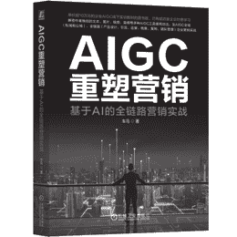

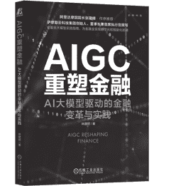

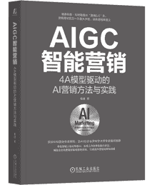

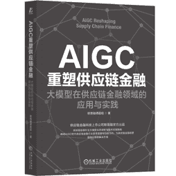


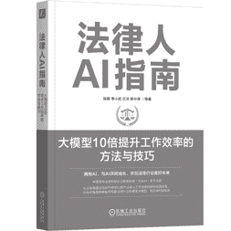

推 荐 阅 读


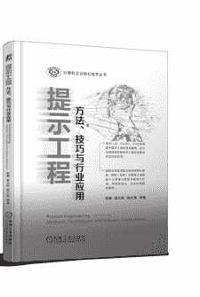


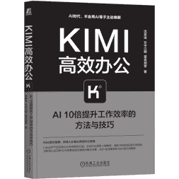

推 荐 阅 读

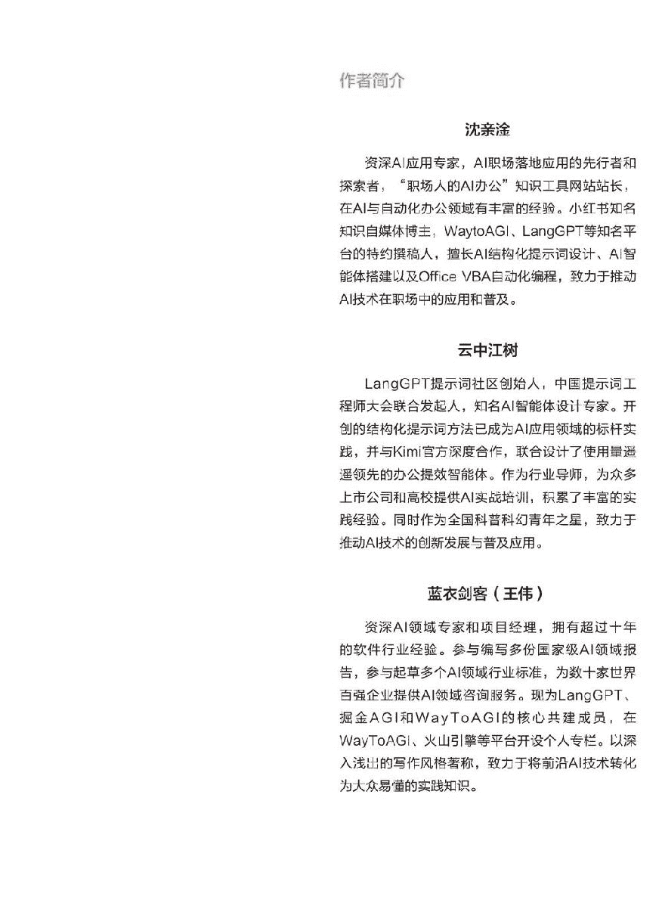

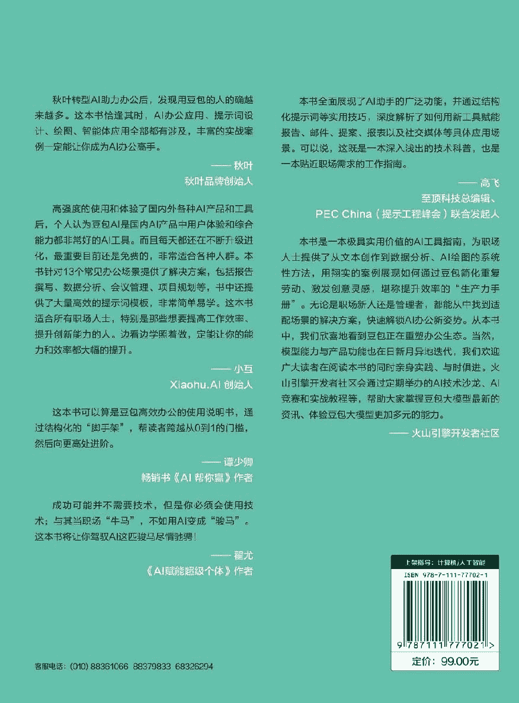

# Document Outline

*   封面
*   内容简介
*   版权
*   前言
*   目录
*   第一章 你真的了解豆包吗
    *   1.1 豆包擅长做什么
    *   1.2 为什么选择豆包
    *   1.3 豆包内置的高效应用工具
        *   1.3.1 豆包应用工具的调用
        *   1.3.2 豆包应用工具的功能介绍
    *   1.4 豆包智能体
        *   1.4.1 什么是智能体
        *   1.4.2 智能体的好处是什么
        *   1.4.3 豆包智能体广场
        *   1.4.4 如何创建自己的智能体
    *   1.5 豆包的浏览器插件
        *   1.5.1 插件的主要功能
        *   1.5.2 插件的安装
*   第二章 豆包提示词的写作方法
    *   2.1 全面了解提示词
        *   2.1.1 什么是提示词
        *   2.1.2 提示词的重要性
    *   2.2 编写提示词的原则
        *   2.2.1 “把话说清楚”一点也不简单
        *   2.2.2 如何“把话说清楚”
    *   2.3 结构化提示词
        *   2.3.1 结构化思维
        *   2.3.2 结构化提示词与一般提示词对比
        *   2.3.3 7 种结构化提示词框架
*   第三章 豆包辅助文本创作
    *   3.1 “帮我写作”应用
        *   3.1.1 “帮我写作”应用介绍
        *   3.1.2 “长文写作”与“文章”工具
    *   3.2 文本内容润色
    *   3.3 文本内容校正
    *   3.4 要点提炼和总结
    *   3.5 文本风格转化
    *   3.6 文本风格仿写
    *   3.7 文本内容缩写/扩写
    *   3.8 文本翻译
    *   3.9 创意激发与头脑风暴
    *   3.10 结构规划与大纲构建
    *   3.11 关键词优化与 SEO 建议
    *   3.12 事实核查与数据整合
    *   3.13 互动式内容生成
    *   3.14 多语言内容创作
    *   3.15 文本合规性检查
*   第四章 AI 绘画从入门到精通
    *   4.1 AI 绘画在办公领域的优势
    *   4.2 AI 绘画在不同办公场景中的应用
    *   4.3 AI 绘画提示词攻略
        *   4.3.1 AI 绘画提示词的结构
        *   4.3.2 绘画参数详解
        *   4.3.3 AI 绘画词典
    *   4.4 如何使用豆包进行 AI 绘画
        *   4.4.1 调用“图像生成”功能
        *   4.4.2 “图像生成”界面介绍
        *   4.4.3 绘画提示词的书写
        *   4.4.4 AI 绘画提示词生成器
    *   4.5 使用豆包重绘图片
*   第五章 豆包辅助处理数据表
    *   5.1 主动调用“数据分析”应用
    *   5.2 豆包如何撰写 Excel 公式进行数据处理
        *   5.2.1 数据提取
        *   5.2.2 数据统计
    *   5.3 豆包如何撰写 VBA 实现自动化办公
        *   5.3.1 批量数据校验与替换
        *   5.3.2 一键数据筛选
        *   5.3.3 批量拆分表格
        *   5.3.4 批量发送邮件
        *   5.3.5 微信群发任务与批量 AI 任务处理
    *   5.4 豆包如何制作表格
        *   5.4.1 纯提示词生成
        *   5.4.2 基于图片生成
        *   5.4.3 基于文档生成
    *   5.5 豆包如何进行数据可视化
        *   5.5.1 基于“数据分析”应用的可视化
        *   5.5.2 基于 VBA 的可视化
    *   5.6 豆包如何进行数据分析及生成报告
*   第六章 豆包辅助高效搜索和快速学习
    *   6.1 使用豆包联网搜索
        *   6.1.1 主动发起联网搜索
        *   6.1.2 联网搜索的高级用法
    *   6.2 使用豆包搜索学术论文
    *   6.3 基于费曼学习法快速学习知识
    *   6.4 应用麦肯锡关键词法快速了解一个行业
*   第七章 豆包辅助高效开会
    *   7.1 撰写会议通知
    *   7.2 准备会议发言稿
    *   7.3 会议内容润色和优化
    *   7.4 撰写会议纪要/总结
    *   7.5 撰写会后通知和新闻稿
*   第八章 豆包辅助做计划和写总结
    *   8.1 做工作计划
    *   8.2 撰写日报/周报/月报
    *   8.3 撰写年中/年终总结
    *   8.4 撰写汇报材料
    *   8.5 撰写项目报告
    *   8.6 撰写调研报告
*   第九章 豆包辅助阅读和优化论文
    *   9.1 快速总结论文核心要点
    *   9.2 发掘论文创新点
    *   9.3 学术英语翻译
    *   9.4 专业学术风格优化与润色
    *   9.5 构建文献综述
*   第十章 豆包辅助写公文
    *   10.1 撰写公函
    *   10.2 撰写请示
    *   10.3 撰写报告
    *   10.4 撰写通知
    *   10.5 撰写规定
*   第十一章 豆包辅助项目管理
    *   11.1 OKR 的制定
        *   11.1.1 制定 OKR 的建议
        *   11.1.2 跟踪与评估 OKR 进展
        *   11.1.3 提供行业标杆与最佳实践
    *   11.2 SWOT 分析
        *   11.2.1 收集市场情报和数据
        *   11.2.2 生成 SWOT 矩阵并分析关键点
        *   11.2.3 提供基于 SWOT 的战略建议
    *   11.3 项目计划书的写作
        *   11.3.1 自动生成项目概述与背景
        *   11.3.2 撰写项目范围与目标
        *   11.3.3 协助编写时间线与里程碑
        *   11.3.4 草拟风险评估与应对策略
        *   11.3.5 编制预算与规划资源
    *   11.4 思维导图的辅助生成
        *   11.4.1 快速整理关键信息
        *   11.4.2 快速创建项目结构图
        *   11.4.3 任务分解与关联分析
    *   11.5 时间管理与优先级设定
        *   11.5.1 分析任务紧急程度与重要性
        *   11.5.2 提供个人与团队的时间规划建议
    *   11.6 风险管理
        *   11.6.1 识别潜在项目风险
        *   11.6.2 项目风险影响与评估
        *   11.6.3 建议风险缓解策略
    *   11.7 绩效评估
        *   11.7.1 生成团队与个人绩效报告
        *   11.7.2 支持匿名反馈调查
        *   11.7.3 提供改进与发展的个性化建议
*   第十二章 豆包辅助生成爆款文案及视频
    *   12.1 爆款文案拆解
        *   12.1.1 拆解爆款文案的特点与构成
        *   12.1.2 拆解爆款文案的情感共鸣点与价值传达方式
        *   12.1.3 拆解爆款文案
    *   12.2 小红书爆款文案
    *   12.3 抖音/视频号爆款文案
        *   12.3.1 快速生成视频创意
        *   12.3.2 短视频脚本生成
*   第十三章 豆包辅助品牌策划及运营
    *   13.1 活动策划
        *   13.1.1 创意主题生成
        *   13.1.2 流程规划
    *   13.2 邮件通知
    *   13.3 活动总结
        *   13.3.1 数据分析报告
        *   13.3.2 活动总结报告
        *   13.3.3 未来改进策略
    *   13.4 Slogan 创意构思
    *   13.5 营销宣传文案
        *   13.5.1 营销宣传文案的创作
        *   13.5.2 多渠道适应性
    *   13.6 会议邀请函/致谢词的写作
    *   13.7 企业公关稿的写作
        *   13.7.1 新闻稿撰写
        *   13.7.2 危机公关
    *   13.8 品牌故事的叙述
        *   13.8.1 品牌起源与使命
        *   13.8.2 品牌宣言与客户共鸣
        *   13.8.3 品牌故事
    *   13.9 内容本地化
        *   13.9.1 文化敏感性审查
        *   13.9.2 语言风格调整
*   第十四章 豆包辅助老师教学
    *   14.1 高情商家校沟通
        *   14.1.1 表扬信
        *   14.1.2 鼓励进步报告
        *   14.1.3 家长会邀请函
    *   14.2 互动式课题设计
*   第十五章 豆包辅助销售
    *   15.1 用户画像分析
        *   15.1.1 利用豆包进行用户数据收集
        *   15.1.2 利用豆包进行用户画像构建
    *   15.2 销售话术与谈判技巧提升
        *   15.2.1 有效沟通模板的生成
        *   15.2.2 模拟客户异议处理
    *   15.3 销售培训与团队赋能
*   第十六章 豆包辅助法务工作
    *   16.1 合同协议框架起草
    *   16.2 法律培训与教育
*   推荐阅读
*   作者简介
*   封底