# 豆包：AI 新手也能轻松驾驭的实用指南

本书概览

本书对字节跳动旗下 AI 智能助手豆包进行了全方位、系统化的讲解，覆盖从账号注册登录到日常操作的每一个关键点，并结合学习、办公、生活等多类真实场景进行演示，比如化身学习搭档、担任职场效率助手、开展沉浸式角色扮演互动等，直观呈现豆包的强大能力。书中还深度剖析了豆包智能体的原理与案例，并专门说明了豆包 App 的登录方式及实用功能。

随书附赠的学习资料相当丰富，包含 50 条高效提问公式、40 套深度提问模板、100 套豆包智能体模板、100 套用于风格控制的提示词模板、100 套用于质量控制的提示词模板，以及涵盖学习、工作、生活三大领域的 300 条提示词模板，方便读者直接套用。

无论是想借助 AI 加速知识吸收、提升工作效率，还是希望让生活更便捷，本书都能提供一套可落地的操作路径，帮助读者把豆包培养成自己的专属 AI 伙伴，迈入人工智能新阶段。

前言

当下科技演进速度极快，人工智能已从科幻概念落地到工作与生活的方方面面。豆包正是这一智能浪潮中的代表性产品。

我们正处在信息过载的时代，学习、办公、生活都面临大量任务与需求。学习时需要快速理解知识点、激发灵感；办公时需要提升效率、做营销分析、提供投资建议、辅助招聘；生活里需要规划出行、发现美食、解决日常琐事。豆包正好回应了这些痛点。

本书将带你全面认识这款智能伙伴。第一章从 AI 的演进历史切入，介绍核心技术与 AI 应用的五个层级，并说明豆包大模型如何打开智能新局面。第二章是完整的使用教程，详细讲解注册登录流程，即使是技术小白也能快速上手，基础操作简单易学。

第三章展示豆包如何成为学习小帮手，解答难题、激发写作灵感，还能担任绘画灵感提供者，为教育培训提供支持。第四章聚焦职场应用，涵盖智能营销、商业投资建议、求职招聘辅助、代码编程助力等。第五章带来有趣的生活化互动：生成歌词、推荐美食、定制旅行路线、提供专业点评等。第六章深入介绍豆包智能体及其典型案例。第七章聚焦移动端，讲解豆包 App 的注册登录、语音输入、拍照识别、写作、听音乐、创建智能体等便捷功能，真正实现随时随地使用。

读完后，你将拥有一位全天候的智能伙伴，助力学习、提效办公、丰富生活。立即加入豆包的智能世界，开启科技美好生活。

第一章
豆包——贴身智能伙伴

在技术快速迭代的今天，人工智能已深度融入日常。你是否好奇它如何诞生、如何演进、又如何改变世界？本章将带你展开一场 AI 探索之旅，从发展史到技术内核，再到应用表现，全景式呈现其魅力。而主角豆包，作为一款前沿的智能语言伙伴，即将在此舞台上亮相。其背后的技术实力与跨领域表现，将在下文逐一展开，让我们一起揭开 AI 的面纱，体验豆包带来的非凡智能感。

1.1 人工智能发展脉络全解析
1.1.1 AI 到底是什么

人工智能已成为现代社会的基础设施之一，它依靠强大的算力与算法重塑生活。AI 能学习、能理解、能解决复杂问题，不只是信息存储工具，更像具备自主学习能力的机器。

例如，给 AI 展示大量猫狗图片并标注类别，AI 会提炼特征建立分类标准，面对新图也能迅速判定。这与人类认知相似，只是速度更快、精度更高。

更进一步，AI 可处理复杂挑战。通过海量数据分析，在交通领域优化路线，在医疗领域辅助诊断。它能基于实时路况给出最优出行方案，也能结合症状与病历为医生提供参考建议，帮助做出更准确决策。

AI 的核心是持续学习。它通过算法与模型不断修正对世界的理解，数据越多，表现越优。

1.1.2 人工智能的演进之路

AI 的思想可追溯到人类对智能机器的早期想象。古希腊神话中的塔罗斯、中国古代鲁班的木鸟，都体现了超越自我的追求。但真正可行的智能机器随现代科技逐步成形。

中世纪发明家制作的自动玩偶、机械钟等装置，为自动化奠定基础。工业革命后，机械制造实现质变，机器可完成复杂重复工作，但仍只是遵循预设程序，缺乏决策能力。

转折点在 20 世纪中叶。电子计算机的出现为 AI 提供了硬件基础。1950 年，艾伦·图灵提出“图灵测试”，为机器智能设定标准：若机器对话让人类无法分辨其是否人类，即可视为智能。这一标准推动了研究。1956 年达特茅斯会议上，“人工智能”正式成为学科。

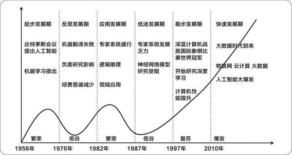
早期研究受限于算力，但探索未停。20 世纪 80 年代专家系统出现，使 AI 在特定领域初现成效。互联网普及与算力提升后，AI 转向数据驱动与机器学习，计算机从数据中挖掘规律实现智能化。

进入 21 世纪，深度学习引爆新一轮进步。多层神经网络让计算机处理语音识别、图像识别、自然语言处理等高复杂度任务。深度学习不仅让机器像人一样学习，还能从海量信息中发现隐性模式。如今 AI 已渗透智能助手、自动驾驶、金融风控、医学影像等多个领域，影响持续扩大。

如图 1-1 所示，AI 发展曲折而持续。从机械装置到复杂算法，轨迹展现了人类对智能自动化的不懈探索。随着算力提升与数据丰富，AI 将在更多领域取得突破。

图 1-1
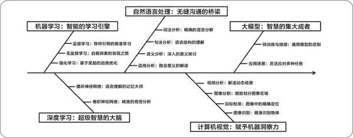

1.2 人工智能核心技术拆解
人工智能的核心技术体系庞杂多样，技术脉络如图 1-2 所示，每项技术都是打开智能世界的关键。下面逐一解读其原理与应用。

图 1-2
1.2.1 机器学习：自我进化的引擎
机器学习是 AI 的基础，相当于具备自学能力的智能体，通过数据训练模型不断提升理解与分析能力。主要分为监督学习、无监督学习和强化学习。

1.监督学习：有师指引的精准训练
监督学习依赖标注数据指导，如同学生在老师带领下学习。计算机基于已标注的猫狗图像学习区分，遇到未标注新数据也能准确判断。广泛应用于图像识别、语音识别。

2.无监督学习：自主探索的模式发现
无监督学习无需标签，让计算机自行从数据中发现规律，自动聚类相似样本。在用户行为分析、客户分群等场景中价值显著，可为精准营销提供依据。

3.强化学习：试错优化的决策能力
强化学习通过与环境交互，利用奖励与惩罚不断优化策略，适用于游戏、机器人控制、自动驾驶等场景。系统会根据行为结果调整策略，追求最优目标。

1.2.2 深度学习：处理复杂数据的强大大脑
深度学习是机器学习分支，借助多层神经网络自动从复杂数据中提取高阶特征。表现力更强，在视觉与语言领域应用广泛。

1.卷积神经网络：图像识别专家
卷积神经网络可自动提取图像特征，用于物体识别。如人脸识别、物体检测均取得优异效果，通过大量训练精准提取人脸特征完成身份验证。

2.循环神经网络：擅长序列记忆
循环神经网络擅长处理序列数据，在自然语言处理与语音识别中表现突出。它能“记忆”历史输入，实现连贯翻译与文本生成，提升机器翻译、摘要生成的准确性。

1.2.3 自然语言处理：沟通的桥梁
自然语言处理让计算机理解并生成人类语言，从简单对话到深层语义都能处理。

1.词法分析：基础拆分
将文本拆分为词语并标注词性，为后续句法、语义分析奠定基础。

2.句法分析：结构解析
识别主谓宾等句子结构，理解基本逻辑与上下文关联。

3.语义分析：意义挖掘
区分多义词如“银行”在不同上下文中的含义，深入理解真实意图。

4.语用分析：意图推断
解读言外之意，例如“今天天气真好”可能暗示邀请外出，理解对话背景更完整。

1.2.4 计算机视觉：赋予机器视觉
计算机视觉让机器“看见”并理解画面，是自动化系统的重要组成。

1.图像识别：物体识别
自动识别车辆、行人、动物等，应用于安防与电商，提升处理效率。

2.目标检测：精确定位
在图像中定位物体位置，自动驾驶中用于检测行人与车辆，保障安全。

3.图像分割：区域划分
将图像细分为不同区域，医学影像中用于分离器官与组织，辅助诊断。

4.视频分析：动态解读
分析视频中人物行为与物体运动，智能监控中可检测异常行为，维护公共安全。

1.2.5 大模型：集大成的智慧体
大模型是 AI 前沿方向，依托海量数据与算力，具备强学习与推理能力，在多领域表现突出。

1.预训练与微调：通用到专属
大模型先通过预训练掌握通用知识，再经微调适配具体任务，提升通用性与精准度。

2.应用范围：多任务覆盖
从文本生成到图像分类均可胜任，如根据主题生成高质量文章，实现高效图像分类与目标检测。

大模型虽强，但存在算力需求高、可解释性弱等问题。未来研究将聚焦性能优化、训练效率提升与应用拓展。

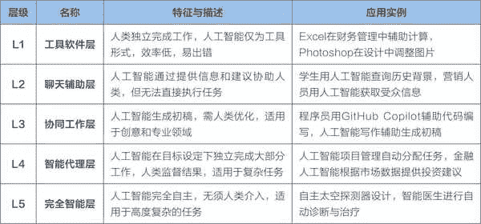
1.3 AI 应用的五个层级
AI 正重塑各行各业。为便于理解，可将其划分为五个层级，表 1-1 概括了各层级的特征与案例。

表 1-1 人工智能应用各层级特征及实例

第一层是工具软件层，AI 仅作为辅助工具，如 Excel、Photoshop，完成基础操作，问题分析与决策仍由人主导，提升操作效率。

随后是聊天辅助层与协同工作层，AI 可提供信息、建议或生成初稿供人类完善。例如提供历史背景、为营销获取受众洞察、为程序员与作家提供框架。通过人机协作大幅提升创作与知识获取效率。

升级到智能代理层后，AI 能独立完成大部分工作，人仅需设定目标并监督结果，适用于项目管理、投资顾问等场景。

完全智能层尚未实现。该层级下 AI 可完全自主完成任务，如自主设计探测器或全自动诊疗，是 AI 应用的最终目标。

1.4 豆包大模型：开启智能新时代
豆包由字节跳动于 2023 年推出，是国内活跃度极高的 AI 平台。与传统聊天类产品不同，豆包定位为综合性 AI 智能体平台，应用场景更广、能力更强。

作为先进语言模型，豆包集成深度学习算法，具备强大的语言理解与生成能力。无论问答、建议还是文本创作，都表现卓越。它能全面分析文本，精准把握用户意图并给出合理回应。

1.4.1 模型形态与能力
豆包大模型的多模态能力覆盖语言、语音、视觉，展现跨行业应用潜力。它不仅能高质量生成与理解文本，还能处理语音识别与图像分析。通过灵活架构，适配金融、医疗、教育、文化创意等定制化需求，如表 1-2 所示。

表 1-2 豆包系列模型功能特点及应用场景
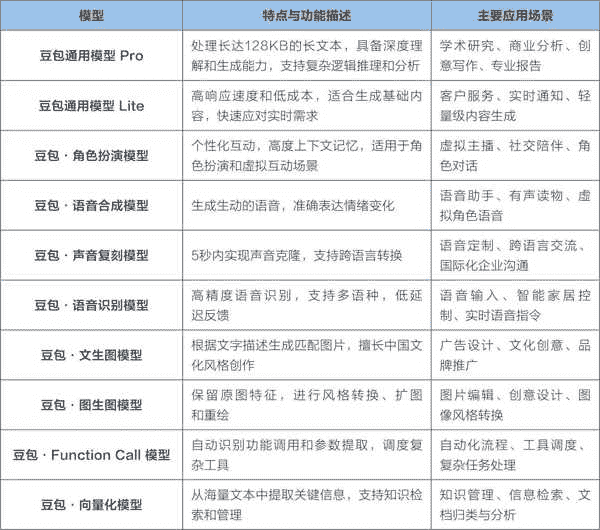

1.4.2 实践场景
凭借字节跳动 50 多个业务场景的验证，豆包已证明可处理高并发请求。无论客服支持、自动化创意生成，还是复杂商业分析，豆包都能快速适应并提供高效方案。应用覆盖金融数据处理、医疗诊断建议、个性化学习方案等，深度学习算法帮助用户解决实际问题，提升效率与决策力，如表 1-3 所示。

表 1-3 豆包大模型主要应用场景
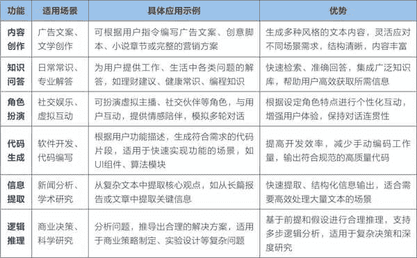

1.4.3 应用拓展方向
豆包不仅在标准场景表现优异，还支持广泛扩展，为开发者与企业提供创新可能。

1.AI 应用开发平台
豆包支持通过 AI 应用开发平台“扣子”快速创建并部署各类智能 Bot。无需编程基础，用户可借助模板与工具搭建个性化 AI 应用，部署于社交平台、通信软件或企业内网，实现客户服务、用户互动与业务流程自动化。

例如搭建客服 Bot 回复用户咨询，或在社交媒体发布娱乐型 Bot 增强互动，或在工作中实现日程提醒与通知推送。

2.多功能 AI 助手
下面介绍本书主角——豆包 AI 助手，如图 1-3 所示。该助手在多场景中表现突出，可生成日报、管理任务等。例如生成大模型新闻摘要、查询股票行情、天气预报等信息，或设定提醒并追踪日程。

图 1-3
如用户询问“今天的新闻摘要”，豆包可迅速汇总技术进展与行业动态。对于个人用户而言，豆包 AI 助手是最实用的入口。本书后续提及豆包，均指 AI 助手。

第二章
快速上手——豆包使用指南
现在，让我们一起深入了解豆包的各项功能与操作方法吧。从最基础的操作步骤开始...

本章从基础使用入手，逐步延伸到进阶技巧，对每个环节都做了详细拆解。学完之后，你能够熟练驾驭豆包，无论是学习中的困惑还是工作里的难题，都能快速找到解决思路，操作更加顺畅。

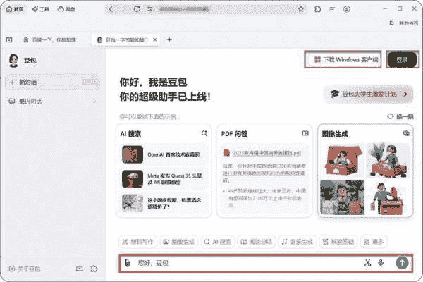
2.1 豆包的注册与登录

豆包支持网页、手机 App、电脑客户端以及浏览器插件四种入口，能够适配办公、移动和网页浏览等不同场景。在电脑上做深度检索和文档处理，在外出时用手机随时获取信息，在页面中直接唤起插件，都可以实现。接下来先说明账号的创建与登录方式，帮助你迅速开始使用。

2.1.1 注册流程详解

打开浏览器访问豆包官网，首屏呈现见图 2-1 的界面。

图 2-1

在对话区输入“您好，豆包”后回车，即可看到见图 2-2 的页面，开始与豆包交互！

图 2-2

也可以点选页面顶端右侧的“登录”入口，进入见图 2-3 的登录页。豆包允许使用手机号码、抖音账号或 Apple ID 登录。以手机号码为例，填写号码后获取短信验证码，输入验证码即可完成登录。登录时请勾选“已阅读并同意豆包的使用协议和隐私政策”。

图 2-3

建议认真阅读隐私条款，做好个人信息保护。聊天对象是模型而非真人，请避免随意提供敏感的个人资料。

2.1.2 安装计算机客户端

想在电脑上使用，可点选页面顶端右侧的“下载 Windows 客户端”按钮，也能在页面左下角点选对应的图标，见图 2-4。

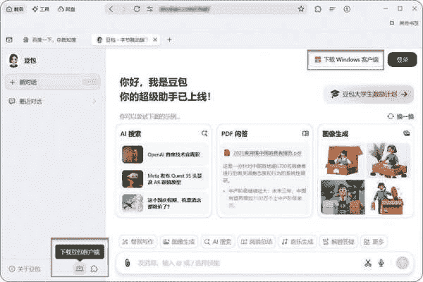

图 2-4

下载完成后双击安装包，按“立即安装”即可快速部署，见图 2-5。

也可以点选下方的“自定义选项”来指定安装目录，设置完成后继续安装，见图 2-6。

图 2-5

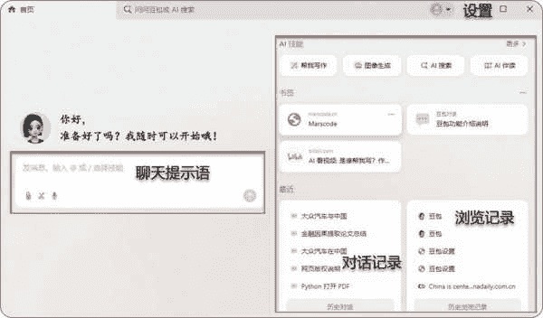
图 2-6

安装结束客户端会自动启动。界面左面是文字输入区，用于向豆包发送指令。“书签”类似浏览器书签，可快速回到已保存的页面；“最近”汇总了近期对话和浏览记录。

图 2-7

点选“AI 技能”区域右侧的“更多”入口，即可看到写作、图像生成等内置能力，见图 2-8。

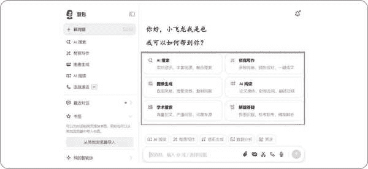

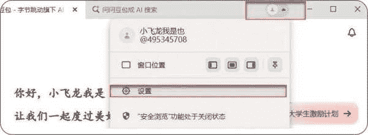
图 2-8

在输入区打字即可展开对话。相应控件可上传文件、发送截图或使用麦克风输入语音。

图 2-9

账号资料可以进一步修改。点选窗口顶端右侧的用户头像图标，选择“设置”。

图 2-10

在“豆包设置”中进入“编辑个人资料”，即可调整个人信息，见图 2-11。

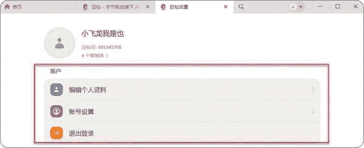

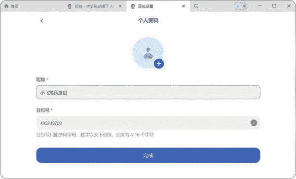
图 2-11

例如修改昵称、更换头像后按下“完成”保存，见图 2-12。

图 2-12

进入“账号设置”还能绑定抖音和 Apple ID，见图 2-13。

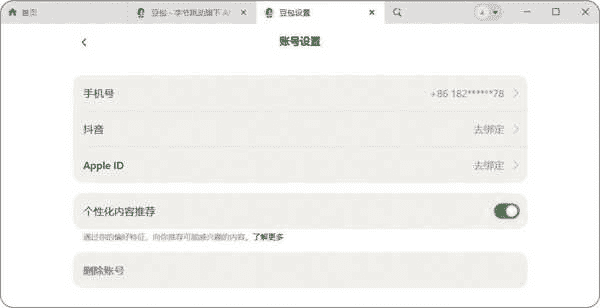

图 2-13

2.1.3 安装浏览器插件

除了网页和客户端，还能为浏览器添加豆包插件。

进入官网首页后，点选页面左下角的“浏览器插件”按钮，见图 2-14。

图 2-14

跳转到 Chrome 应用商店后点选右侧的“获取”完成安装，见图 2-15。其他浏览器可先下载后再本地安装。

图 2-15

重新打开浏览器，点选右上角的插件图标即可唤起豆包插件，见图 2-16。

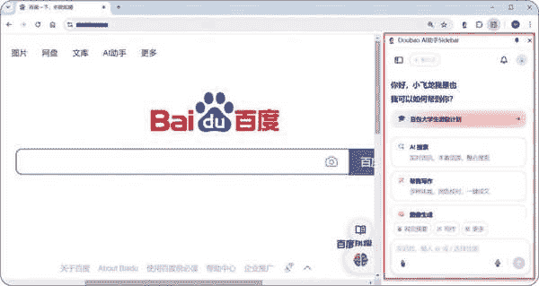
图 2-16

在输入区输入内容就能开启对话，见图 2-17。

图 2-17

手机端使用豆包 App 的具体说明将在第七章展开。

2.2 豆包基本操作

以下以电脑客户端为例，介绍常用操作方式。

2.2.1 调整豆包窗口

1. 调整窗口位置
启动电脑版豆包后，点选窗口顶端右侧的用户头像图标，见图 2-18。

图 2-18

再选择“窗口位置”，可以把程序窗口设置在左侧、居中或右侧，靠左即贴紧桌面左边框，见图 2-19。

图 2-19

2. 设置字体样式
点选用户头像进入“设置”，打开“豆包设置”页面，选择“高级设置”里的“网页浏览设置”，见图 2-20。

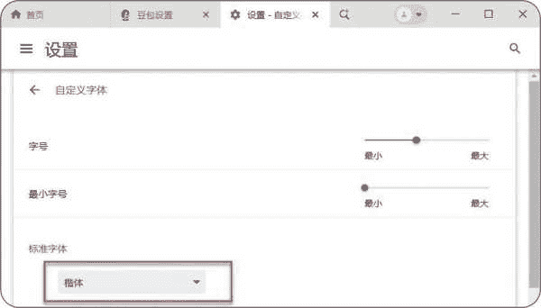

图 2-20

在设置页按下“设置”按钮，进入列表选择“外观”，找到“自定义字体”并打开，选择“标准字体”后挑选喜爱的字体，见图 2-21。

图 2-21

返回主界面后即可看到字体变化，见图 2-22。

图 2-22

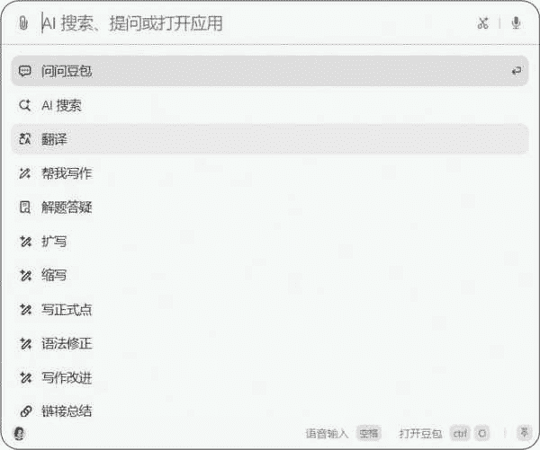
3. 设置缩放比例
在“外观”设置页，点选右侧的“网页缩放”，按需缩小或放大，见图 2-23。

图 2-23

2.2.2 豆包的小窗模式

豆包提供一个便捷的小窗模式，可随时调出各类 AI 功能，见图 2-24。

图 2-24

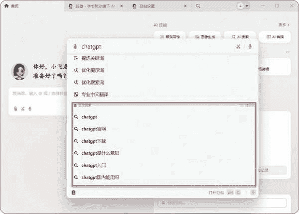

例如输入“记事本”，就能快速打开电脑中的记事本程序，见图 2-25。

图 2-25

也可以调用搜索引擎对关键词进行检索，见图 2-26。

图 2-26

默认快捷键为 Alt+Space，一按即可唤起小窗。

2.2.3 设置开机自动启动

启动客户端后点选右上角头像进入“设置”，打开“豆包设置”页面，找到“通用设置”下的“开机自动启动”，打开右侧开关即可，见图 2-27。

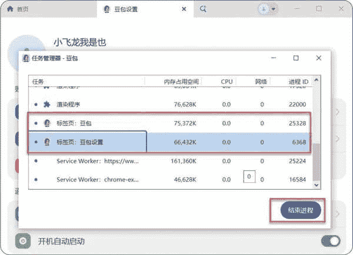

图 2-27

长时间运行多个功能可能拖慢电脑。可按 Shift+Esc 呼出豆包自带的任务管理器，关闭部分标签页以降低资源占用，见图 2-28。

图 2-28

2.2.4 豆包 AI 工具介绍

在“豆包设置”页面的“AI 工具”栏可看到三个快捷工具，见图 2-29。

依次说明如下。

图 2-29
1. AI 划词工具栏

开启后用鼠标选中文字即可唤出 AI 划词工具栏，见图 2-30。

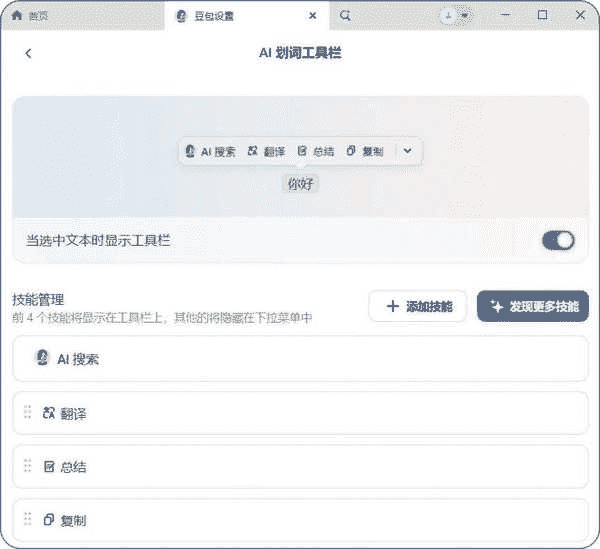

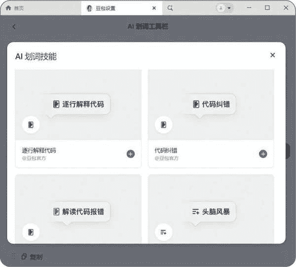
图 2-30

右侧控件可开启或关闭该功能，点选“发现更多技能”可添加新工具，如“逐行解释代码”，见图 2-31。

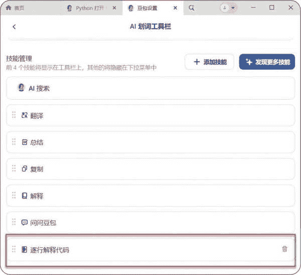
图 2-31

点选“添加技能”即可完成添加，见图 2-32。

图 2-32

可在记事本中编辑一段 Python 代码，选中一行后，划词栏会自动出现，选择“逐行解释代码”命令，见图 2-33。

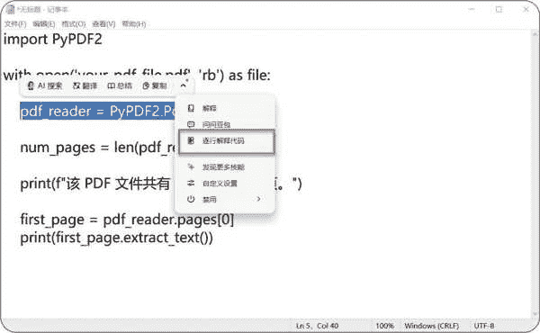

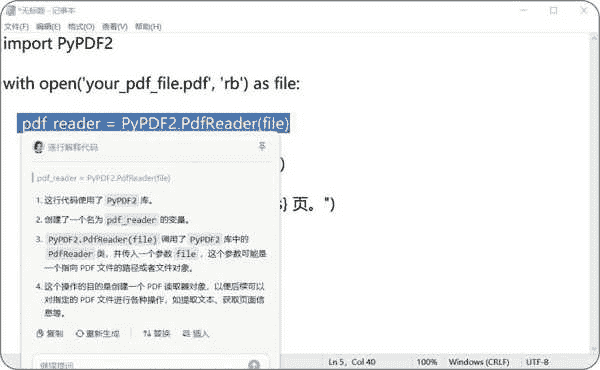
图 2-33

豆包会给出该行的解释内容，见图 2-34。

图 2-34
2. AI 写作（Beta）

该功能可控制记事本、Word 文档窗口的显示与否，见图 2-35。

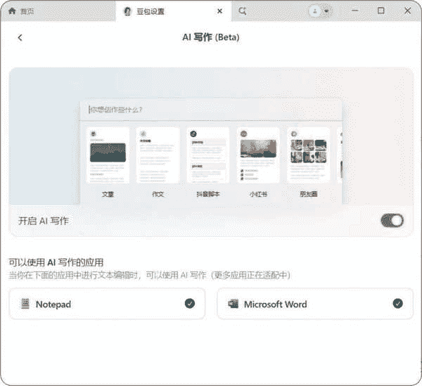

图 2-35

以记事本为例，左侧会出现一个图标，见图 2-36。

图 2-36

点选图标后选择“边写边译”命令，见图 2-37。

图 2-37

在记事本输入汉字时，下方会实时翻译成英文，见图 2-38。

图 2-38
3. AI 启动器

前面提到的小窗模式即为 AI 启动器。在“豆包设置”中选择“AI 启动器”进入配置。

可点选快捷键输入框自定义唤起键，或沿用软件推荐的组合，见图 2-39。

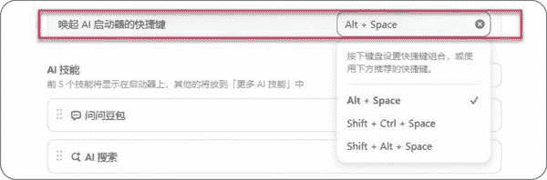

图 2-39

技能列表包含问问豆包、AI 搜索、翻译、帮我写作、解题答疑、扩写等多种能力，见图 2-40。

图 2-40

按默认快捷键 Alt+Space，前五个技能会显示在启动器上，其余收纳在“更多 AI 技能”，见图 2-41。

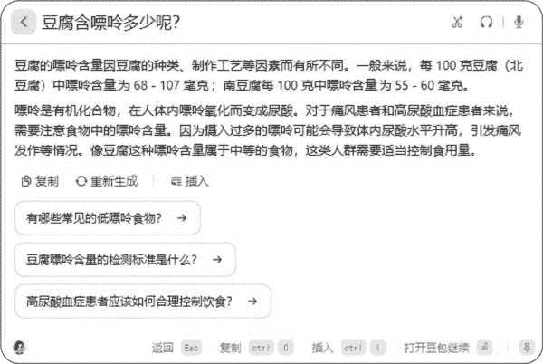
图 2-41

输入“豆腐含嘌呤多少呢？”后点选“问问豆包”按钮，见图 2-42。

图 2-42

豆包会给出回答，见图 2-43。

图 2-43

点选“AI 搜索”，豆包会调用默认搜索引擎返回结果，见图 2-44。

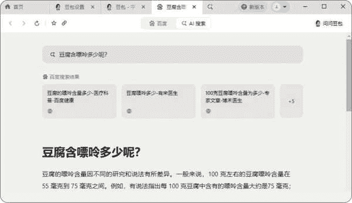

图 2-44

点选“翻译”，句子会被直接译成英文，见图 2-45。

图 2-45

回到启动器设置页，点选“添加技能”，在弹框中填写技能名称、图标及提示词内容，见图 2-46。

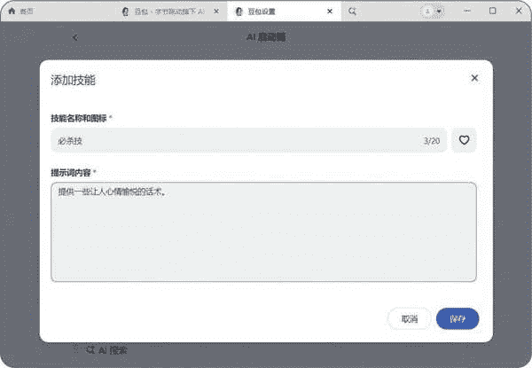

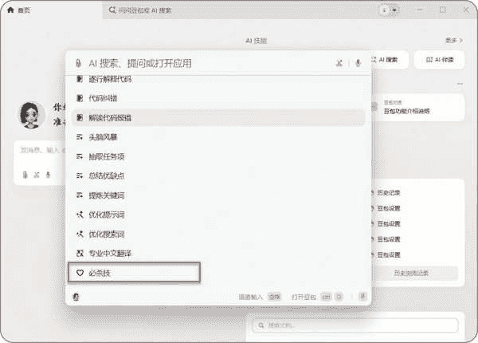
图 2-46

再次唤起启动器，可看到自定义技能已添加成功，见图 2-47。

图 2-47

任意输入一句话回车，豆包会按提示词要求给出反馈，图 2-48 即为对应任务的输出。

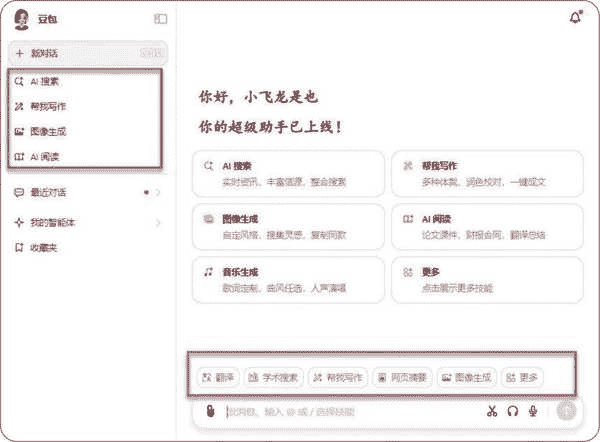
图 2-48

豆包内置的 AI 功能本质上是预置好的提示词。用户既可以自由对话推进任务，也能直接使用内置功能完成翻译、搜索、写作、图像生成等常见需求。

主界面左面或对话窗口上方都能调出这些内置功能，见图 2-49。

图 2-49

2.2.5 浏览网页

打开客户端后点选上方的搜索框，见图 2-50。

图 2-50

在搜索框输入网址即可打开网页，见图 2-51。

图 2-51

页面右侧的豆包头像可调用“翻译此页面”功能，见图 2-52。

图 2-52

翻译还可以进一步定制，见图 2-53。

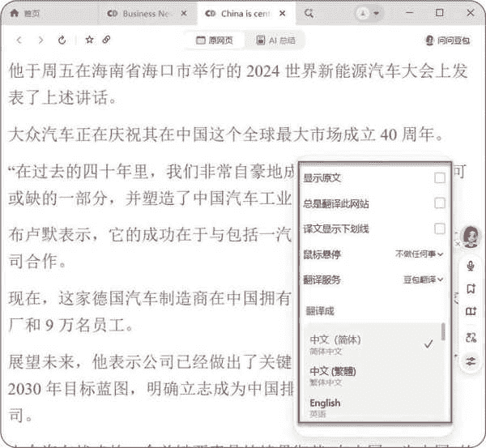

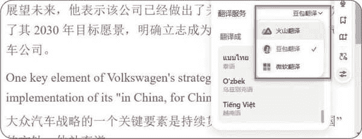
图 2-53

当前提供火山翻译、豆包翻译、微软翻译三种引擎可选，见图 2-54。

图 2-54

同样点选右侧头像还能调用“总结此页面”功能，见图 2-55。

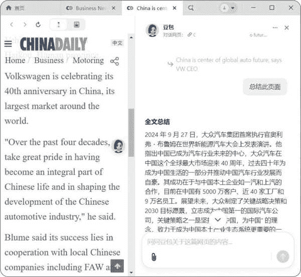

图 2-55

豆包会自动提炼网页要点，见图 2-56。

图 2-56

点选页面上方的“AI 总结”按钮，也能看到要点归纳，见图 2-57。

图 2-57

提炼结果见图 2-58。

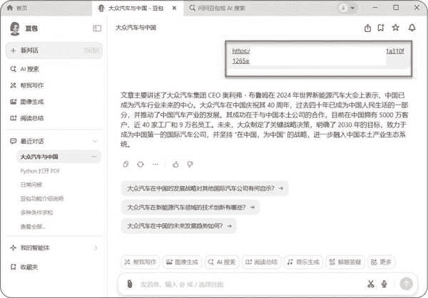
图 2-58

直接把链接发送到对话窗口，豆包也会给出文章主要内容，见图 2-59。

图 2-59

在对话页点选“更多”后选择“网页摘要”，也能解读网页，见图 2-60。

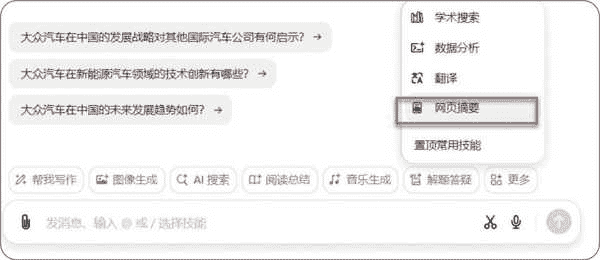

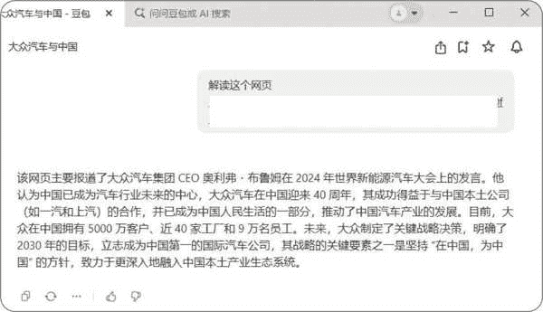
图 2-60

使用效果见图 2-61。

图 2-61

结果与“AI 总结”基本一致，见图 2-62。

图 2-62

在网页浏览设置页左侧找到“搜索引擎”，可自定义豆包使用的搜索源，见图 2-63。

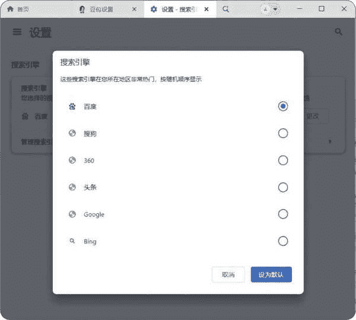
图 2-63

例如选择“百度”并点选“设为默认”，见图 2-64。

图 2-64

用豆包搜索央视纪录片时，见图 2-65。

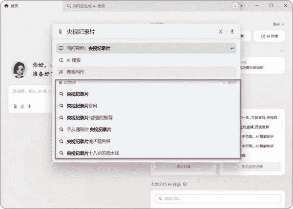

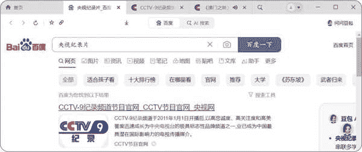
图 2-65

豆包会调用百度返回结果，见图 2-66。

图 2-66

点选链接打开纪录片即可观看，见图 2-67。

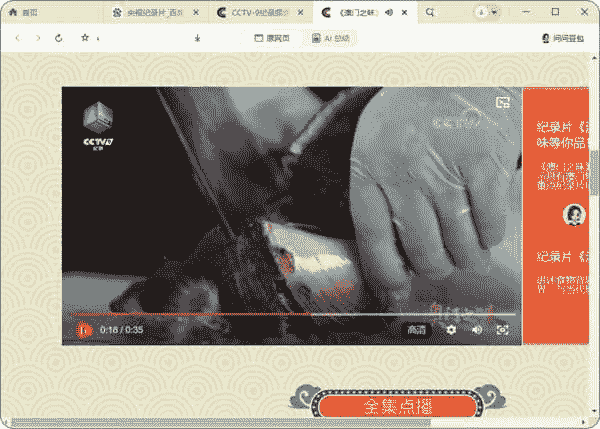

图 2-67

在豆包主界面，“最近浏览记录”可以回顾网页访问轨迹，“书签”支持把其它浏览器的收藏同步进来，见图 2-68。

图 2-68

2.2.6 截图提问

启动豆包客户端后，点击搜索框右侧的相机按钮“截图提问”即可进入该功能，如图 2-69 所示。

图 2-69

截取画面后点选“提取图中文字”，系统会自动识别出图片里的文字，如图 2-70 所示。

图 2-70

识别结果会直接呈现在对话区，如图 2-71 所示。

图 2-71

也可以指令它只抽取画面中的名词，演示效果见图 2-72。

图 2-72

还能把图文转成表格样式，示例见图 2-73。

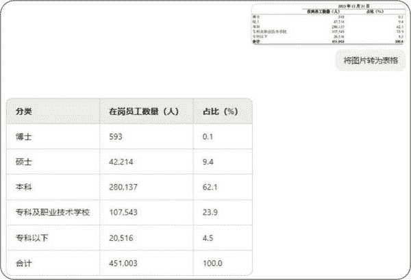

图 2-73

复杂素材同样可以处理，比如上传一张卡通图，让它辨认其中的英文字母，如图 2-74 所示。

图 2-74

2.2.7 上传文档

进入对话页，点击左侧的附件入口即可添加文件，如图 2-75 所示。

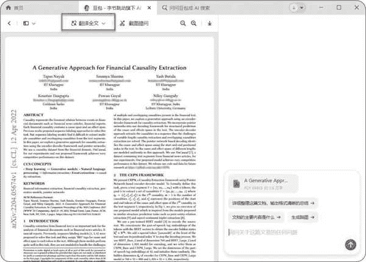

图 2-75

将本地英文文档上传后按“翻译全文”，整篇内容即可完成转译，如图 2-76 所示。

图 2-76

篇幅较长的文章也可以直接导入，让豆包快速阅读并提炼核心要点，如图 2-77 所示。

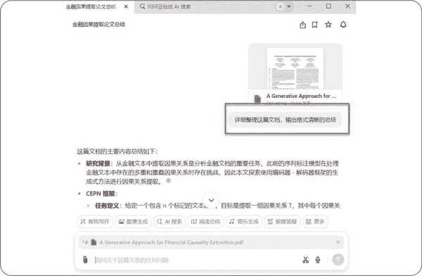

图 2-77

提示

豆包可接收多种格式文件，单次最多 50 个，详情见图 2-78。

图 2-78

点按界面左侧的“AI 阅读”按钮，可查看最近阅读过的文档列表，如图 2-79 所示。

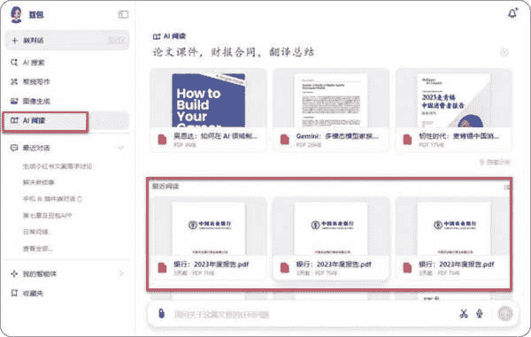

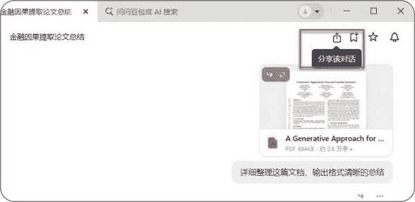

图 2-79

2.2.8 分享对话

与豆包多次交流后想导出记录，可点击右上角的“分享该对话”图标，如图 2-80 所示。

图 2-80

切换后每条对话前会出现复选框，如图 2-81 所示，默认表示分享全部对话，也可手动取消不想分享的条目。

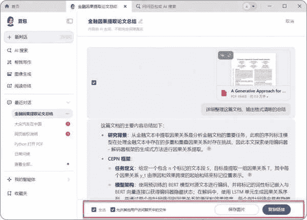

图 2-81

选完后点击底部“保存图片”按钮，左上方会出现图 2-82 的提示，代表保存成功，点击即可定位生成的图片。

图 2-82

点击“复制链接”会得到一个链接，在浏览器中打开即可查看对话具体内容，如图 2-83 所示。

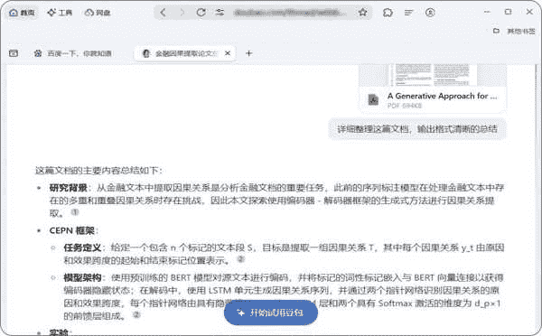

图 2-83

第三章

豆包应用实例
——学习篇

想在学习路上找个得力助手吗？豆包上线啦！从文献解读到创意写作，从绘画指导到教学辅助，覆盖全流程。帮你提炼要点、搭建框架、推荐书目、点燃灵感、提供技巧，让学习更有趣。

3.1 学习小能手

面对浩瀚的知识海洋，你是否想要一个高效的学习搭档？豆包化身学习小助手，带你开启高效学习。遇到繁杂文献，它能精准抓取关键信息，迅速把握核心。论文框架不再头疼，它会给出条理清晰的建议，助力构建严谨的学术骨架。选书犹豫时，它的图书引导与好书推荐能为你指路。从词汇学习到中英互译，全程陪伴。借助豆包的力量，在学习之路上不断提升。

3.1.1 论文大纲，逻辑明确

豆包能就论文大纲给出清晰的思路。可以这样提问：明确主题，例如“环保议题的论文大纲如何构建”；限定范围，例如“某地区经济发展研究的大纲怎样体现条理”；横向比较，例如“文科与理科论文的大纲逻辑有何差异”；从论证方式出发，例如“案例分析类论文的大纲如何安排论证”；从问题解决角度，例如“以解决实际问题为导向的大纲应如何呈现问题提出与解决过程”。

Q

我是大三学生，准备写一篇关于人工智能对教育影响的论文。手头有些零散观点，不知如何组织成条理清晰的大纲。请给些建议，让大纲既全面又有序。

A

一份关于人工智能对教育影响的大纲建议如下：

一、引言

（一）研究背景与意义

1 人工智能快速发展及在各领域的广泛应用。
2 教育领域面临的挑战与变革需求。
3 探讨人工智能对教育影响的重要性。

（二）研究目的与问题
……

六、结论

（一）研究总结

1 概括人工智能对教育的主要影响。
2 总结应对策略要点。

（二）研究展望

1 对未来人工智能在教育领域的发展趋势进行展望。
2 提出进一步研究的方向。

3.1.2 学术搜索，深入研究问题

豆包可帮助你深入研究某个议题。提问可从以下角度切入，以找到优质文献、把握研究趋势、梳理重点难点。

明确研究领域，例如“我正在研究人工智能伦理，如何找到权威文献”，它会按领域推荐最新且影响力大的论文、期刊或研究报告，帮助快速定位核心资料。

描述具体方向，例如“机器学习中强化学习与监督学习有何主要区别”，它能梳理该领域的最新进展、经典文献与研究难点，帮助迅速掌握要点。

对比不同成果，例如“各团队对人工智能伦理的观点有何差异”，它可提供观点分析，揭示学术争论核心、主要分歧与共识。

从研究目标出发，例如“我要写气候变化论文，如何快速筛选重点文献”，它会推荐影响力大的文献与权威来源，并按目标构建文献综述。

优化方法，例如“用什么研究方法能更好理解我的课题”，它不仅推荐合适方法，还提供参考文献并讲解具体应用。

在聊天页点击“学术搜索”按钮，如图 3-1 所示。若未显示，可通过“更多”找到。

图 3-1

例如用户提问：“知识图谱的概念是哪一年提出的？”，如图 3-2 所示。

图 3-2

豆包的回答如图 3-3 所示。

图 3-3

也可以不点“学术搜索”直接提问，如图 3-4 所示。对比可见，“学术搜索”基于论文检索，有来源引用，更显专业。

图 3-4

3.1.3 书籍引导，好书推荐

豆包可推荐好书并做讲解。可这样提问：明确需求，例如“我喜欢历史小说，有哪些推荐”；描述兴趣，例如“对心理学感兴趣，入门书有哪些”；对比类型，例如“经典文学与畅销书的阅读价值有何不同”；从作者风格，例如“某位作者作品有何特点，值得读哪些”；从阅读目的，例如“为提升写作能力，应读哪些书”。

Q

我对中国古代史很感兴趣，尤其是唐朝，但知识储备较薄弱，想找几本适合阅读的唐朝历史好书，并了解每本的特点和适合人群。

A

《唐朝那些事儿》：用通俗语言讲述唐朝历史，故事性强，通过一个个生动故事展现政治、经济、文化等。

《蒙曼说唐：武则天》：聚焦武则天，通过其生平了解唐朝政治风云。讲解深入浅出，适合对唐朝人物感兴趣的读者。

《血腥的盛唐》：全景呈现唐朝兴衰，描写生动，对战争、政治斗争有详细描述。适合喜欢历史故事、想深入了解唐朝的读者。

3.1.4 阅读整理，文件内容智能提取

豆包在阅读整理上具备高效解析与提取能力，可快速梳理总结文件关键信息。无论报告、书籍还是论文，都能自动生成概要、提取重点并整理出清晰的知识结构。

内容梳理与要点提取：面对大量信息，可提问“如何从这份研究报告中提取核心结论与数据”，它会生成简明摘要，帮助迅速把握关键。

主题框架与逻辑结构构建：需整理逻辑关系时，可问“根据这篇文献生成一个清晰的知识框架”，它会按主题分层构建框架，帮助理清思路。

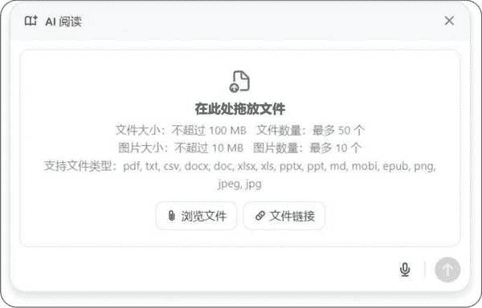

细节深入与数据整理：文件常含细节与数据，可要求“提取文件中的所有统计数据与图表说明”，它会集中整理，便于分析。

概念分类与关键词提炼：含大量术语的文件，可问“从这篇论文中提取关键概念并分类”，它会自动识别并归类，形成便于学习体系。

点击输入框上方“AI 阅读”按钮，如图 3-5 所示，若未显示可点“更多”查找。

图 3-5

上传一份 PDF 文件，如图 3-6 所示。

图 3-6

输入“文档的主要内容是什么”，按 Enter，如图 3-7 所示。

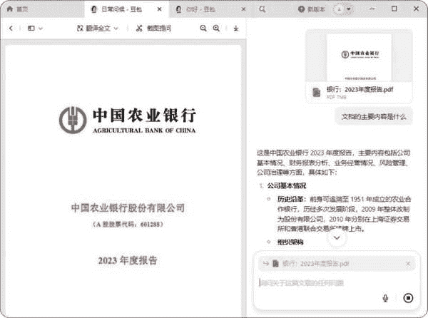

图 3-7

豆包总结了文档主要内容，如图 3-8 所示。

图 3-8

3.1.5 单词学习，释义/发音/记忆

豆包可提供释义、发音与记忆方法。可这样提问：明确词类，例如“英语动词如何记忆”；描述难点，例如“记不住生僻词释义怎么办”；对比技巧，例如“联想法与词根词缀法各有何优势”；从发音规则，例如“某些音标发不准如何纠正”；从语境运用，例如“如何通过语境加深理解与记忆”。

Q

我正在备考英语四级，总是记不住单词释义与发音，尤其是长难词如“circumference”。请给些有效记忆方法，帮助扩大词汇量。

A

记忆释义与发音的方法：

拆分记忆：把“circumference”拆成“circum”周围和“ference”ence 为名词后缀，合起来理解为“周围的长度”，即周长。

联想记忆：联想圆形物体，如地球周长，帮助记忆释义。

发音记忆：按音标 /səˈkʌmfərəns/ 记忆，多重复，结合拼写记忆。

例句记忆：放在例句中记忆，如“The circumference of the circle is calculated by multiplying the diameter by pi.”，更好理解用法与释义。

借助记忆软件：使用百词斩、扇贝单词等，有多种记忆与复习策略，助力增强记忆。

3.1.6 语言翻译，跨语言沟通

豆包在跨语言交流上提供强大支持，不仅能做文本翻译，还能解释语言细微差异，确保准确性与文化适配。

翻译与校对：对学术文献、技术文档等，可问“如何将这篇人工智能研究论文从中文译成英文并保留术语准确性”，它会提供专业术语处理与翻译，符合领域表达习惯。

语言风格与语境适配：不同语言表达与文化背景不同，可描述目标语境或风格需求，例如“如何把产品推广文案译成法语以符合当地营销习惯”，它在转换语言的同时保持吸引力与本地化效果。

文本重难点解释与对比：词汇与句子常有多重含义，可问“日语‘和’与‘平’如何用英语准确表达”，它能理解细微差异并给出多种表达。

跨语言学习支持：若想通过翻译学习新语言，可问“翻译过程中有哪些高频词汇与句子可重点学习”，它会在提供翻译的同时列出常用词句，帮助掌握核心词汇。

实时翻译与跨文化沟通：对实时或跨文化交流需求，可直接问“与德国客户讨论技术方案时，如何用德语准确表达我的方案”，它能实时提供专业翻译并给出合适表达。

点击聊天页“翻译”按钮，如图 3-9 所示。

图 3-9

输入需翻译的词句：“Sometime ever, sometime never.”，如图 3-10 所示。

图 3-10

豆包自动识别英文并译成中文，如图 3-11 所示。

图 3-11

输入德文：“Lassen Sie uns ein Stück des Weges gemeinsam gehen.”，豆包会自动识别并译成中文。豆包可把其它语言译成中文或英文。若想把中文译成德文，可直接输入提示语，如图 3-12 所示。

图 3-12

3.2 创意写作达人

写作时是否想要一个神奇伙伴激发灵感？豆包化身创意写作达人，带你开启创作之旅。写诗词时提供格律与主题灵感，让作品兼具韵味与深度。想为文章取吸睛标题，它能给出方案。改写文本时可在保持原意下改变风格，赋予新魅力。扩写时可增加细节让故事更饱满，还能在保持风格基础上续写。无论剧本情节设计还是视频脚本设计，都能提供专业建议。

3.2.1 诗词写作，规范格律、激发灵感

豆包可提供规范格律与灵感。可这样提问：明确类型，例如“写一首七言律诗格律要求有哪些”；描述主题意向，例如“以秋天为主题写诗可借鉴哪些灵感”；对比体裁，例如“词与诗在格律与主题表达上有何不同”；从意象运用，例如“描写春天适合用哪些意象”；从情感表达，例如“如何在诗词中巧妙表达思念”。

写作可直接聊天输入提示词，也可通过“帮我写作”功能借助模板完成，如图 3-13 所示。

图 3-13

点击“帮我写作”后点“模板”，可见多种模板，选择“诗歌”，在提示词模板中输入内容，如图 3-14 所示。

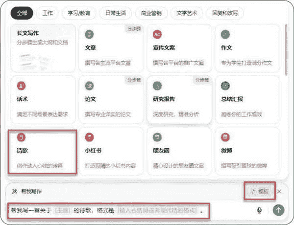

图 3-14

按 Enter 后，豆包生成诗歌，如图 3-15 所示。

图 3-15

虽然提供提示词模板，但用户也可自写提示词，更加灵活，如图 3-16 所示。

图 3-16

豆包各项功能本质是通过不同提示词实现，掌握提示词写法即可更灵活运用。

3.2.2 标题生成，打造吸引力标题

豆包可提供吸睛标题方案。可这样提问：明确主题，例如“一篇关于环保的文章，怎样的标题更吸引人”；描述受众，例如“为青少年读者创作的故事适合怎样的标题”；对比风格，例如“幽默风趣标题与严肃庄重标题各有何效果”；从关键词提取，例如“根据文章关键信息如何生成简洁有力标题”；从悬念设置，例如“怎样的标题能激发读者好奇心”。

Q

我写了一篇关于自己暑假旅行经历的文章，想取一个吸引人的标题。我的旅行经历比

素材覆盖面较广，同时涉及山水景观、人文历史与美食体验等多个层面。希望在此基础上拟出一批新颖且贴合主题的标题，既能准确概括文章主旨，也能传递出相应的情绪。

回复
可供参考的标题如下：
《夏日奇幻之旅：风光、文化与美食的邂逅》
《暑假漫行记：探寻自然之美，品味历史韵味，畅享美食盛宴》
《我的盛夏冒险：自然、文化与美食交织的旅程》
《暑假游踪：在自然风光中触摸历史，于美食之间感悟人生》
《夏日之旅：一场自然、文化与美食的狂欢》

上述标题均点明了暑期出行的时令，同时将自然美景、历史文化与美食体验一并呈现，并借助“奇幻”“冒险”“狂欢”等富有表现力的字眼，提升了吸睛度。

3.2.3 文本改写，改变风格维持原意
豆包在改写任务里能够在不偏离原意的前提下切换表达风格。提问时可：先明确改写诉求，例如“如何将一份正式新闻稿改写为轻松幽默的版本”；说明原文特点，例如“这篇故事很动人，改成悬疑风格怎样仍保持吸引力”；对比不同风格效果，例如“古风和现代风在改写手法上有什么差异”；从语言切入，例如“如何通过词语和句式调整实现风格转变”；从情感出发，例如“改写后怎样保留原有的情感基调”。

提问
我有一段描写自然景色的文字，语气比较平实。“清晨，太阳从东方升起，照亮了大地。山上的树木郁郁葱葱，鸟儿在枝头欢快地歌唱。小溪潺潺流淌，清澈见底。”请将其改写得更具诗意，原意不变。我希望改写后更生动形象，感染力更强。

回复
“拂晓时分，东边天际晕开瑰丽朝霞，太阳缓缓探出头，像一盏巨灯点亮广袤原野。山间密林郁郁葱葱，好似无垠绿海。鸟雀于枝头轻啭，宛若演绎大自然的乐章。小溪潺湲流转，似缎带般通透可视，水面泛着细碎光斑。”
改写后运用了比喻、拟人等修辞，让自然景致更鲜活，诗意与感染力得到增强。

3.2.4 文本扩写，增加丰富细节
豆包在扩写任务里能够补充细节，使内容更丰满。可这样问：明确扩写方向，例如“如何把一句话扩写成生动的场景描写”；描述核心内容，例如“这个情节简单的故事，扩写时可加入哪些细节”；比较扩写幅度，例如“适度扩写与详细扩写有何区别”；从人物着手，例如“怎样通过外貌、动作、语言等丰富文本”；从环境营造出发，例如“如何打造更具感染力的氛围”。

提问
“小明在操场上打篮球。”请把这句话扩写成一段文字，增加细节描写，让场景更鲜活。我希望凸显小明的球技和他对篮球的热爱。

回复
烈日洒在校园球场，金色光晕笼罩全场。小明身着运动装脚踩球鞋，满脸兴奋地运球。身形灵动，控球沉稳，篮球像听话的伙伴随动作疾走。时而如闪电般突破防线，让对手措手不及；时而高高跃起投篮，弧线优美，球稳稳入筐。眼神里透着热爱与坚定，每一次动作都饱含力量与激情，仿佛在与篮球进行亲密对话。整段描写通过环境、着装、动作与眼神的细节，突出了技术与热爱。

3.2.5 文本续写，续写故事延续风格
豆包在续写时能保持原有风格延展。可这样提问：明确故事背景，例如“这个悬疑故事结尾留了悬念，如何续写并保持悬疑风格”；描述人物性格，例如“依据人物性格，续写时他们的行为与决策会怎样”；对比续写思路，例如“开放式续写与封闭式续写各有什么特点”；从情节发展出发，例如“如何合理设计转折让续写更精彩”；从主题深化入手，例如“续写时如何进一步深化主题”。

提问
“小红走进一个神秘的花园，花园里开满了各种奇异的花朵。”，请据此开头续写一个故事，要求风格奇幻、情节引人入胜。我希望故事富有想象力，有一个精彩的结局。

回复
小红踏入一片神秘花园，园中盛开着形形色色的奇花。有的如星辰般闪烁，有的似火焰般跳动，还有的仿佛会低语，发出轻柔呢喃。小红惊讶不已，小心翼翼向前，生怕惊扰了这些神奇之物。

忽然，一朵巨大的蓝花朝她微微倾斜，花瓣间飘出缕缕彩烟。小红好奇伸手触碰，瞬间感到身体轻飘飘的，仿佛要升空。下一刻，她真的被带起，飞向花园深处。

深处伫立着一座古老城堡。大门紧闭，周边环绕着一群可爱小精灵。精灵们围上来，领她来到门前。大门缓缓开启，内部泛出神秘光辉。

城堡内陈列着奇珍异宝，中央放着一本巨大的魔法书。小红轻轻翻开，书中文字仿佛活了过来，向她讲述这个神秘花园的来历。原来这里是一个被遗忘的魔法世界，只有心地善良的人方能进入。

小红在园中度过一段奇妙时光，学会了许多魔法。临别之际，花朵与小精灵们前来送行。她带着满满回忆和魔法力量走出花园，回到现实世界。她决心用这份力量帮助需要帮助的人，让世界更美好。

这个故事充满奇幻色彩，情节紧凑，结局精彩，小红通过奇遇获得了力量。

3.2.6 剧本创作，情节设计
豆包在剧本创作方面可以提供格式规范和情节设计的建议。可这样提问：明确剧本类型，例如“创作喜剧剧本，格式上有哪些要求”；描述主题，例如“以友情为主题的剧本情节该如何设计”；对比不同题材，例如“历史剧和科幻剧在情节设计上有何不同”；从人物塑造出发，例如“主要人物应具备哪些特点才能推动情节”；从冲突设置入手，例如“怎样设置合理冲突以增强戏剧性”。

提问
我想创作一部以校园生活为背景的短剧剧本，但不了解格式也不知道如何设计情节。请给我一些指导和建议，让剧本既有趣又有教育意义。我希望剧本能反映学习压力、人际关系等校园问题。

回复
《青春的烦恼与成长》

一、剧本格式指导
1 剧本标题页：包含剧本名称、作者姓名、创作日期。
2 场景标题：每个场景需明确地点和时间。
3 角色列表：列出所有角色及其简要描述。
4 对话和动作描述：语言简明，对话缩进，动作用括号标注。
5 场景转换：用“转场”等字样标明转换。

二、情节设计建议
……

三、剧本示例
……

第四幕：和解与成长
场景：教室，白天
（老师找小红谈话，让她理解小明的压力。小红决定向小明道歉。）
小红：小明，对不起，我不该说那些话。我知道你压力很大，以后我会多体谅你的。
小明：没关系，我也不该对你发火。其实你说得对，学习不是生活的全部，我也该多和同学交流。
（两人握手言和，成为好朋友。小明开始尝试参加活动放松自己。在老师和同学帮助下，他学会了平衡学习与生活，变得更自信开朗。）

第五幕：收获与展望
场景：毕业典礼，白天
（小明和小红都考上了理想学校。在典礼上回忆校园生活，感慨万千。）
小明：这三年我经历了不少困难和挑战，也收获很多。我学会了面对压力、与人交流，成长了许多。
小红：是啊，我们都长大了。以后路还长，我们继续努力。
（两人相视一笑，满怀信心地走向远方。）
希望这个示例能带来启发，祝创作顺利！

3.2.7 视频脚本，情节设计建议
豆包在视频脚本方面能够提供情节设计的建议。可这样提问：明确视频类型，例如“制作广告视频脚本有哪些要点”；描述目标受众，例如“为儿童制作教育视频脚本该如何设计”；对比不同风格，例如“搞笑风格和感人风格在情节安排上有何不同”；从画面呈现出发，例如“如何通过画面描述和镜头切换展现情节”；从音效搭配入手，例如“什么音效能增强表现力”。

提问
我要制作一个关于环保的短视频，需要一个情节生动的视频脚本。请帮我设计一个脚本，包含画面描述、台词和音乐等元素。我希望视频能引发共鸣，激发环保意识。

回复
以下是一个关于环保的短视频脚本：
这个脚本通过小女孩的行动引发观众的环保意识，画面生动，台词简洁有力，音乐烘托气氛，能够引起共鸣，激发大家的环保意识。

3.3 绘画小助手
在绘画领域，豆包作为绘画小助手，为你开启创意与惊喜的艺术之旅。

3.3.1 风格展示，手法特点解析
使用豆包可便捷生成所需图画。在输入框上方点击“图像生成”，再点“模板”，即可看到各类模板选项。选择合适的“比例”和“风格”后输入内容，如图 3-17 所示，按 Enter 键即可生成。

图 3-17
豆包一次生成多张图片，如图 3-18 所示。

图 3-18
点击图片可修改比例及局部内容，如图 3-19 所示。
图 3-19
若想擦除图中某处内容，如图 3-20 所示门前的花丛，可选择需擦除区域。

图 3-20
点击“擦除所选区域”按钮即可完成擦除，效果如图 3-21 所示。
图 3-21
若想修改某区域图像，点击该处，在输入框输入修改内容，如“一块菜地”，如图 3-22 所示。

图 3-22
按 Enter 键，图片修改完成，效果如图 3-23 所示。
图 3-23
也可直接在输入框输入提示词：“帮我生成图片：图片风格为「水墨画」，比例「16∶9」，一个秋天的下午，一个农夫在农家小院劳作”，生成符合要求图片，如图 3-24 所示。

图 3-24

3.3.2 技巧指导，基本讲解运用
除生成图片外，豆包还能提供绘画技巧指导。可这样提问：明确技巧领域，例如“绘画色彩搭配技巧有哪些”；描述具体问题，例如“画人物肖像五官时有什么技巧”；对比不同技巧效果，例如“油画厚涂与薄涂在视觉效果上有什么区别”；从实践角度出发，例如“如何在创作中运用某种技巧”；从学习难度入手，例如“哪种技巧易掌握，适合初学者”。

提问
我在学习素描，想提升绘画技能。请提供素描基本技法，包括构图、线条、明暗等方面。我希望通过学习这些技法画出更写实的素描作品。

回复
素描基本技法：
构图：确定画面主体，常置于中心或黄金分割点，吸引视线。注意布局平衡，避免一边重一边轻。可通过调整大小、位置和视角找到合适构图。
线条：素描基础，用以表现轮廓、结构和质感。注意粗细、轻重、疏密变化，暗部可用粗线重力，亮部用细线轻力。
明暗：表现立体感和空间感的关键。观察光影变化，确定光源方向和强度，用不同明暗表现受光面、背光面和投影。排线要均匀细腻，过渡自然，避免生硬分界。
多观察、多练习，临摹优秀作品、写生等方式都能提升技法。

3.3.3 创意启发，提供创作灵感
豆包在创意启发上可为用户提供灵感。可从以下角度提问：明确创意需求，例如“设计广告创意应从哪些方面入手”；描述创意困境，例如“缺乏灵感时有哪些激发方法”；对比不同途径，例如“从自然获取灵感和从历史文化获取灵感有何不同”；从生活经验出发，例如“日常经历中哪些可成为创作来源”；从跨领域合作入手，例如“与其他领域合作能带来哪些启发”。

提问
绘画创作时常缺乏灵感，请给我一些创意启发方法和灵感，让我更好地发挥创造力。我希望从不同领域获取灵感，创作出独特的作品。

回复
创意启发方法和灵感：
观察生活：生活是艺术源泉，善于观察人物表情、动作、姿态，自然景观变化，建筑结构等，从细节和故事中获取素材。
阅读书籍：阅读小说、诗歌、传记等拓宽视野，情节、人物、场景都可成为灵感来源。
欣赏艺术作品：欣赏绘画、雕塑、摄影、电影等，学习表现手法和创意，从中外艺术家作品中汲取养分。
旅行：接触不同文化、风景和人，拍摄照片、记录感受，回来后转化为创作素材。
梦境和幻想：梦境与幻想是创造力宝库，可将奇妙场景和故事转化为绘画，醒后及时记录梦境内容。

3.3.4 挑战练习，巩固强化技能
豆包可提供练习方法帮助强化技能。提问时可这样：明确练习目标，例如“提高写作能力有哪些练习方法”；描述技能短板，例如“我绘画色彩运用较弱，有哪些针对性练习”；对比练习难度，例如“初级和高级挑战练习内容有何不同”；从时间安排出发，例如“如何制定合理练习计划”；从反馈机制入手，例如“怎样在挑战练习中获得有效反馈以便改进”。

提问
我想通过绘画练习提升技能。请提供一些绘画挑战练习，帮助巩固和强化绘画能力。我希望练习有一定难度，在挑战中不断进步。

回复
绘画挑战练习：
限时速写：设定较短时间，如10分钟或15分钟，选择物体或场景速写，在有限时间内尽可能表现形状、比例和特征，可提高观察力和快速表现能力。
……
主题创作：选择特定主题，如“城市风景”“动物世界”“人物肖像”等进行创作，充分发挥想象力和创造力，可提高主题表达和创作能力。

3.4 教育培训帮手
在教育领域，豆包作为教育培训帮手强势登场。可进行课程设计、作业批改、生成实例辅助讲解、育儿咨询、数学解答、升学规划、幼儿活动指导等，全方位覆盖教育领域，成为学习伙伴，为渴望成长的人提供支持。

3.4.1 课程设计，根据需求确定方法
豆包可根据需求进行课程设计。提问时可这样：明确课程目标，例如“设计英语课程目标是提高口语表达，应怎么做”；描述教学对象特点，例如“针对小学生设计课程需考虑哪些因素”；对比课程类型，例如“理论课程和实践课程设计有何不同”；从教学资源出发，例如“有哪些资源可用于课程设计”；从教学方法入手，例如“哪种方法更适合特定目标”。

提问
我要为小学生设计一门趣味科学课程，不知道如何确定课程目标和教学方法。请给我建议和指导，让课程有趣又有教育意义。我希望激发学生对科学的兴趣，培养科学思维和实践能力。

回复
确定课程目标可从以下方面入手：
了解小学生年龄特点和认知水平：小学生好奇心强、喜欢动手，内容应符合认知水平，避免过于复杂的理论。
与学校教学目标和课程体系相结合：了解学校其他科学课程设置，确保趣味科学课程能相互补充，共同提升科学素养。
……
实地参观：组织学生参观科技馆、动物园、植物园等，让学生在真实场景中学习科学知识。

小组合作学习：将学生分成几组，让每组共同完成科学项目或实验，培养团队合作和沟通能力。

3.4.2 作业批改，辅助解题与错误反馈
豆包在作业批改方面可辅助解题与反馈错误。拍摄题目上传，豆包即可识别并详细解答。
点击输入框上方“解题答疑”按钮，再点“截图提问”按钮，如图 3-25 所示。
图 3-25
截取图 3-26 所示问题。
图 3-26
上传到对话框后，豆包即可给出详细解答，如图 3-27 所示。
图 3-27

解题完成后，用户可继续提问，或让豆包给出类似题目，如图 3-28 所示。
图 3-28

想让使用体验更顺手，可以这样组织提问：先说明题型，比如“这是三年级数学应用题，豆包能否逐步解析并给出答案”；再明确想要的讲解深度，比如“请展示完整解题过程，方便学生理解”；也可以点出难点，比如“这道题的核心思路是什么”。这样学生得到的不仅是结果，更是理解。

3.4.3 实例化讲解，化抽象为具体
在举例辅助教学上，豆包能提供有效支持。提问可以从这些角度切入：先锁定讲解主题，例如“讲数学公式时配哪些例子更有帮助”；描述实例风格，例如“讲解历史事件时想要生动有趣的案例，有什么推荐”；对比不同呈现方式，例如“用图表案例和故事案例讲知识效果有何差异”；从学习者感受出发，例如“哪类实例学生更容易接受”；结合知识难度，例如“面对较复杂的知识点，怎么生成合适的例证”。

Q
我现在讲几何，想找一些贴近生活的具体案例帮助学生理解概念。能否生成一批几何实例，让学生更直观地掌握？希望例子能够贴近日常。

A
以下案例都取材于日常，更易理解：

三角形：
自行车车架多数采用三角形结构，原因在于三角形很稳。
三明治的断面可以看作两个三角形拼合。
马路边的警示牌多为三角形，比如“注意危险”标志。

圆柱体：
铅笔、罐装饮料外形都是圆柱。
建筑里常见的立柱多为圆柱形。
……

3.4.4 育儿答疑，科学陪伴
豆包在育儿问题上能够给出解答。提问时可以这样做：先说清困惑，例如“孩子不爱吃饭怎么办”；补充孩子特点，例如“孩子比较内向，怎么引导他多交往”；对比阶段差异，例如“幼儿期和青春期的养育重点有何不同”；从方法入手，例如“有哪些办法能培养好习惯”；聚焦亲子关系，例如“怎样增进亲子关系提升养育效果”。

Q
孩子今年5岁，胆子很小，平时内向不敢尝试新事物。我想了解如何帮助他变得更勇敢，请给些经验和做法。

A
让孩子更勇敢可以尝试以下做法：

接纳孩子的胆怯：胆小是正常的，不要批评或强迫。理解情绪，让孩子感受到父母的陪伴。

循序渐进地尝试：从容易完成的小事开始，慢慢培养尝试感，比如尝新食物、玩新游戏。

鼓励表达感受：引导孩子说出害怕的原因，一起分析并寻找应对办法。

提供正面示范：家长在孩子面前展示勇敢，如尝试新运动、面对困难不退缩。

培养独立能力：让孩子自己做力所能及的事，如穿衣、收拾玩具，增强自信。

增加户外体验：带孩子爬山、露营等接触自然，锻炼胆量。

阅读勇敢故事：讲一些关于勇敢的故事，让孩子从中学习品质。

及时表扬：孩子表现勇敢时给予肯定和奖励，提升自信。

3.4.5 数学解题，思路拆解
豆包能为数学提供解题思路。可以这样问：限定问题类型，例如“这道几何题该从哪个角度入手”；指出难点，例如“代数题的难点在哪，如何突破”；比较方法，例如“传统解法和创新解法有何不同”；结合知识基础，例如“基于已学知识如何解决”；从思维角度，例如“培养哪种思维更利于解题”。

Q
数字序列2,5,10,17,26，（ ）请给出括号内数字并说明规律，请提供思路和步骤。

A
思路如下：

第一步，看相邻数的变化
从前往后比较：2到5增加了3；5到10增加了5；10到17增加了7；17到26增加了9。

第二步，找增量的规律
增量依次为3、5、7、9，都是奇数，且每次比上次大2，按奇数顺序递增。

第三步，按规律求值
下一个增量应是11，所以26+11=37，括号内填37。

3.4.6 升学规划，方向先行
豆包可为升学提供发展建议。提问可从：明确阶段，例如“初中升高中如何选校”；描述孩子情况，例如“成绩中等有哪些升学路径”；对比方向，例如“国内升学与出国留学各有什么优势”；结合专业，例如“按兴趣如何选专业”；着眼未来，例如“考虑就业前景如何规划”。

Q
孩子马上小升初，不知怎么挑选合适的初中。请给些建议，包含学校信息了解和未来规划，希望为孩子打好基础。

A
参考建议如下：

考察教学质量：通过中考成绩、师资、教学设施等评估学校水平。

……

考虑长远方向：如果目标是重点高中，可选教学质量高的初中；若倾向职业教育，可选特色职业初中。

注重综合素养：选择学校的同时培养学习能力、思维能力、创新能力和沟通能力。

关注政策变化：根据教育政策动态及时调整升学规划。

3.4.7 幼儿活动，指导与评估
豆包可为幼儿活动提供指导和评价。提问可从：明确活动类型，例如“适合幼儿的手工活动有哪些”；说明目的，例如“亲子活动想达到什么效果”；对比难度，例如“简单活动和复杂活动在组织上有什么区别”；从安全出发，例如“如何保障活动安全”；从教育价值出发，例如“哪些活动教育价值高，如何评估”。

Q
我要组织一次幼儿园亲子活动，不知道怎么指导和评价。请给出方案和评估方法，希望增进亲子感情，促进孩子身心发展。

A
活动指导方案：

确定主题：挑选适合亲子参与的主题，如亲子运动会、亲子手工、亲子户外探险等。

制定计划：按主题细化时间、地点、流程、参与人员等。

……

活动评估方法：

观察法：现场观察家长和孩子的参与度、互动、情绪等。

问卷法：活动后向家长发放问卷收集满意度、意见建议。

交流反馈法：与孩子沟通了解感受和收获，判断对身心发展的促进。

教师评估法：组织教师专业评估活动的优缺点，为后续改进提供依据。

第四章
豆包应用实例
——工作篇
在快节奏的工作环境里，是否想要一个全能助手？豆包上线，为你分忧解难。无论是处理邮件、制定计划，还是营销、投资，或是求职、编程提升，豆包都能胜任，成为得力伙伴。

4.1 高效职场助手
职场中效率和专业是关键。豆包就像一位强力助手，打开高效工作之门。邮件处理、工作计划制定、职场沟通话术、日报生成；规章制度制定、办公软件技巧、调研报告撰写、PPT大纲规划；调色、述职报告、数据图表等，样样在行。

4.1.1 邮件处理，规范专业高效
豆包能帮助规范专业地处理邮件。可明确场景，例如“回复重要客户邮件如何做到规范专业”；提出具体需求，例如“写催款邮件要有效且有礼，如何写”；提供背景信息，例如“已知某情况，邮件开头怎么表述”；说明邮件类型，例如“请示汇报类邮件格式特点”；描述收件人特征，例如“给上级发邮件如何确保规范”；询问优化建议，例如“这封邮件还能怎样改进更专业”。

Q
我在外贸公司，需要给重视细节的重点客户写一封关于产品交期延误的说明邮件。该如何保证格式规范、表达专业并传达解决方案？附上我写的草稿：“Dear customer, We are sorry to inform you that the delivery of your order will be delayed.Due to some unforeseen circumstances, our production process has been disrupted.We are doing everything we can to resolve the issue as soon as possible. Best regards, [Your Name]”

A
以下是一版更规范专业的邮件。

Subject: 贵司订单交期延误说明
Dear [Customer Name],

非常抱歉告知您，贵司订单的交付将出现延迟。作为重点客户，我们深知准时交付的重要性，对此次突发情况深表歉意。

……

我们理解延迟可能影响贵司运营，已尽力减少不便。为表达歉意，我们提供[具体优惠或折扣]用于下次订单。

我们会持续更新订单进展，并在确认后提供新的预计交期。如有疑问请随时联系。

感谢理解与支持。

Best regards,
[Your Name]

4.1.2 工作计划，明确目标、步骤
豆包能助力制定工作计划，明确达成目标的路径。可说明领域，例如“软件开发项目计划怎么做”；限定时间，例如“一周任务如何安排”；指出关键目标，例如“以提升用户满意度为目标计划应包含哪些步骤”；考虑资源限制，例如“人手不足时计划如何调整”；提供已有任务，例如“已有具体任务如何合理排期”；询问优化方向，例如“如何改进计划让目标更清晰”。

Q
我负责新品市场推广，团队有市场专员、设计师和销售，目标是三个月内提升知名度和市场份额。请制定详细计划，说明各阶段目标和实施步骤。目前已完成市场调研，已确定目标客群和竞争对手情况。

A
《新品市场推广工作计划》

一、项目背景
新品推广已完成市场调研，明确目标客群与竞争态势，需在三个月内提升知名度与份额。

二、团队及分工
市场专员
制定推广策略与计划
执行各类推广活动
收集分析市场反馈
……

三、分阶段目标
第一个月：提升知名度
目标：让目标客群初步认知产品
步骤：
制定线上线下推广策略
设计宣传物料，如海报、传单、产品手册
搭建官网和社交媒体账号并发布内容
举办发布会或推介会，邀请客群与媒体
与行业媒体合作发布新闻稿与测评
……

四、注意事项
1 团队紧密沟通协作，保证执行顺畅
2 及时收集反馈并调整策略
3 控制推广成本，符合预算
4 关注竞争对手动态，保持优势

4.1.3 职场话术，有效沟通技巧
豆包可帮助掌握职场沟通话术。可明确场景，例如“向上级汇报用什么话术”；说明对象特点，例如“与强势同事沟通的有效表达”；指出具体问题，例如“如何委婉拒绝不合理要求”；阐述目的，例如“说服领导采纳方案的话术组织”；提供已有内容，例如“我这样说对方不满意如何改进”；询问通用技巧，例如“哪些话术能提升沟通效果”。

Q
我在项目会上提出新方案，部分同事认为风险大成本高而反对。如何用职场话术回应质疑，实现有效沟通并争取支持？并描述会议情况和同事观点。

A
可采用以下表达：

“各位，我完全理解大家对风险和成本的担忧，这正是我们要重点把控的。同时也想请大家换个角度看。关于风险，我已做过评估并准备了应对预案，我们可以一起讨论可行性。关于成本，前期投入虽高，但长期回报可期，我们可进一步做成本收益分析。我们的目标一致，都是项目成功，让我们开放讨论，找到最佳解。”

会议情况描述：
会上讨论下一步计划。你提出提升效率的新方案，部分同事反对，认为风险大、成本高可能影响进度与预算。主要观点：担心实施中出现不可预见问题导致失败；认为成本超出预算；对方案可行性存疑。

4.1.4 日报生成，总结分析问题
豆包可指导日报撰写，便于总结与分析。可明确领域，例如“软件开发日报怎么写”；说明重点任务，例如“今日完成某任务日报如何总结”；指出问题及解决，例如“遇到技术难题部分解决如何体现”；阐述成果，例如“完成项目阶段日报应突出什么”；提供数据，例如“完成若干任务量如何用数据总结”；询问格式规范，例如“专业日报格式要求”。

Q
我参与一个多部门协作的复杂项目，推进中遇到技术难题和沟通障碍。请帮我写日报，总结进展、分析问题并给出明日计划。同时提供今日工作记录与会议纪要参考。

A
《工作日报》

一、今日进展
1 参与复杂项目推进，与多部门沟通协作
2 深入研究部分项目任务

二、工作记录
上午：
与技术同事讨论技术难题，探讨解决方案，查阅资料做准备
……

三、会议纪要
主题：复杂项目推进会
时间：[具体时间]
地点：[具体地点]
参会：各部门相关成员
内容：
……

四、明日计划
1 继续与技术部门合作研究难题，尝试不同方案争取尽快解决
2 建立有效沟通机制，如定期会议、即时通讯，保证信息畅通
3 跟进各任务进展，确保按时完成
4 梳理会议问题与建议，制定改进措施保障项目推进

4.1.5 规章制度，制定标准规范
豆包可协助制定规范的规章制度。可明确行业，例如“互联网行业规章制度如何制定”；说明企业特征，例如“小创业公司制度应侧重什么”；指出具体问题，例如“员工常迟到制度如何完善”；阐述目标，例如“为提升协作效率制度应包含哪些规范”；提供已有基础，例如“已有部分制度如何优化”；询问执行方法，例如“如何确保制度有效执行”。
Q

《初创公司制度化参考蓝图》

团队扩张后管理容易松散，搭建一套清晰的行为与流程规范十分必要。下面给出一个可参照的制度搭建思路，覆盖文化理念、考勤、绩效、激励约束等核心模块。

《创业公司制度化框架》

一、文化与价值观
1. 使命陈述：阐明企业存在的根本目的。
2. 愿景描绘：勾勒长期发展的理想图景。
……

二、考勤管理
1. 工作时段：明确上下班及午休安排。
2. 记录方式：规定打卡、线上签到等手段。
3. 异常处理：对迟到、早退、旷工的认定与处置：
迟到：界定时段与对应后果。
早退：界定时段与对应后果。
旷工：界定标准与严重影响。
……

四、奖惩机制
1. 奖励部分：
奖励形式：物质激励与精神激励，如奖金、礼品、荣誉称号等。
奖励条件：业绩突出、创新建议等具体情形。
奖励流程：申请、审批、发放的规范路径。
2. 惩戒部分：
惩罚类型：警告、罚款、降职、解除劳动关系等。
惩罚条件：对应违纪行为及处罚等级。
惩罚流程：执行步骤及申诉通道。
五、其他相关制度
……

上述框架可结合实际情况细化。制定时须立足文化与价值观指引，确保制度与发展方向一致，并广泛听取员工意见，提升执行力与认同感。

4.1.6 办公软件，熟练运用技巧
助手能够帮助用户快速掌握办公软件实操要点。提问时最好明确软件名称，例如 Excel 的高效数据处理方法；说明使用场景，例如 Word 长文档排版技巧；指出具体困惑，例如 PowerPoint 动画卡顿排查；提出明确需求，例如 Outlook 邮件批量管理；提供版本号，例如最新版 Adobe Acrobat 文档编辑操作；也可咨询跨软件协作，例如 Excel 与 Word 联合工作流程。

Q
我有一张表，A 列是日期，B 列是销售额，需要按季度汇总销售额，且避免跨年混算，例如 2022 年第四季度不应与 2023 年第一季度合并。请给出可处理的公式，数据见图 4-1 截图。

图 4-1

A
可使用 SUMIFS 实现多条件求和。假设日期在 A 列，销售额在 B 列。
2022 年第一季度：
=SUMIFS（B2:B10, A2:A10, ≥&DATE（2022,1,1）, A2:A10, ≤&DATE（2022,3,31））
2022 年第二季度：
=SUMIFS（B2:B10, A2:A10, ≥&DATE（2022,4,1）, A2:A10, ≤&DATE（2022,6,30））
其余季度按相同逻辑调整起止日期即可。

说明：
SUMIFS 用于多条件汇总。首个条件锁定起始日期，第二个条件锁定结束日期。更换日期区间即可完成各季度统计，保证跨年时 Q4 与次年 Q1 不会混淆。此法适用于跨年度销售数据的季度分析。

4.1.7 调研报告，数据分析
在调研报告撰写中，助手可辅助完成数据解读。提问时可明确研究主题，如消费者行为分析；说明数据来源，如问卷与访谈结合；指出分析重点，如突出市场趋势；说明分析目的，如为产品优化提供依据；提供初步框架请求完善；也可咨询可视化呈现技巧。

Q
我要写消费者购买行为调研报告，已收集问卷数据和访谈记录。请帮我分析数据、提炼结论和建议，并提供参考问题和样本。

A
以下为分析示例：

一、数据解读
关于最看重因素：
40% 受访者表示最看重质量，说明品质是核心诉求。
30% 关注品牌，体现品牌信任对决策的影响。
20% 重视价格，追求性价比。
功能与外观各占 10%，在特定人群中具决定性。

……

二、结论
1 质量、品牌、价格是主要决策因素，企业需强化品质、塑造品牌、合理定价。
2 网络广告、朋友推荐、线下展示是主要信息渠道，需加强线上投放与口碑运营。

三、建议
1 产品端：严控品质、持续创新功能与外观、按预算推出多档次产品。
2 营销端：加大网络广告投入、开展促销活动、重视口碑与用户反馈。
3 渠道端：优化线上购物体验、提升实体店展示、实现线上线下整合。

4.1.8 PPT 大纲，结构逻辑清晰
助手可帮助规划结构清晰的 PPT。提问时可明确主题、用途、时间限制、受众特点，或提供已有观点请求组织。

Q
我要在内部汇报业务拓展计划，需一份 PPT。请规划包含引言、现状、目标、策略、步骤、总结等部分的思路，并说明目的和受众。

A
汇报目的：向管理层和同事介绍拓展方案，争取资源支持，推动落地。
受众：管理层、各部门负责人及相关员工。

PPT 大纲：
1 封面
标题：[公司名称]业务拓展计划汇报
汇报人、日期
……
2 致谢

制作要点：
内容精简，图文结合；风格专业大气；语言准确易懂；把控汇报时长。

4.1.9 AI 调色板，搭配个性化色彩
助手可根据需求输出色彩方案。提问时可说明使用场景、风格偏好、主题元素、情感诉求、参考案例等。

Q
我为年轻时尚创新的品牌设计宣传海报，目标 18-35 岁。请推荐配色方案并说明理由，同时提供标志和宣传语参考。

A
配色建议：
科技蓝：传递前瞻与创新感。
时尚粉：增强年轻时尚调性，提升亲和力。

品牌标志参考：线条简洁的几何图形，体现现代感。
宣传语参考：“年轻无极限，时尚新潮流。”、“创新引领时尚，活力绽放青春。”

4.1.10 述职报告，业绩亮点总结
助手可协助提炼述职亮点。提问时可说明岗位、重点工作、时间段、挑战与对策、初稿框架、数据呈现方式等。

Q
我在销售部工作，今年完成任务并开拓新客户和市场。请帮我写述职报告，总结业绩、分析原因、规划明年目标，并附数据和案例。

A
《销售述职报告》
尊敬的领导、同事：
我是销售部[你的名字]，现汇报今年工作。

一、工作业绩与亮点
1 销售业绩
完成年度销售任务，销售额达[具体数字]，同比增长[百分比]，团队排名[具体排名]。

……

二、成功原因
1 专业能力
持续学习销售技巧，精准把握需求，提供个性化方案，提升满意度。
熟练掌握产品优势，增强客户信任。

三、明年计划与目标
1 业绩目标
计划销售额[目标数字]，同比增长[目标百分比]，保持团队领先。
2 团队建设
组织培训交流，提升整体水平；招聘培养优秀人才，壮大队伍。

回顾一年工作，成绩离不开公司支持、团队协作与客户信任。新年将继续提升能力，为公司发展贡献更大价值。

客户案例：

1 [客户名称]属[行业]企业，原合作竞争对手。通过深入调研需求痛点，提供更优方案后达成合作，今年订单量达[具体数字]，拓展了新客户与市场。

4.1.11 图表生成，直观展示数据
助手可基于数据文件生成图表。上传数据后输入“请给出每个同学的弱项科目”，即可完成分析统计，如图 4-4 所示。

图 4-4
继续输入“请生成小王同学的成绩雷达图”，即可得到图表链接，如图 4-5 所示。

图 4-5
打开链接可查看雷达图，如图 4-6 所示。

图 4-6

4.2 智能营销助手
在竞争激烈的市场环境中，营销至关重要。助手可作为智能营销助手，助力小红书策略制定、带货脚本设计、销售话术提炼、朋友圈文案撰写、广告创意输出、品牌文化文案打造等，提升品牌推广与业务增长。

4.2.1 带货脚本，吸睛情节设计
助手可设计吸睛带货脚本。提问时可说明产品、目标人群、风格偏好、核心卖点、场景设定、互动需求等。

进入对话界面，点击“帮我写作”后选择“脚本”模板，输入主题即可生成脚本。

图 4-8

Q
我要为智能手表拍摄 3 分钟推广视频，请设计脚本，包含开场、产品介绍、功能演示、用户评价、结尾，并说明风格与受众。

A
脚本示例：
镜头 1：开场 0:00-0:10
全景都市街头，主角略显焦急看手腕。旁白：“快节奏时代，我们追求更便捷的生活，今天介绍一款改变生活的智能手表。”

镜头 2：产品亮相 0:10-0:25
特写手表点亮，展示外观。旁白：“[品牌名]智能手表，不仅是手表，更是生活助手。”

……
镜头 9：购买信息 2:55-3:00
特写屏幕显示购买链接、价格、优惠。旁白：“点击下方链接购买，现享优惠，勿错过。”

视频风格：轻松时尚，生动展示实用性与外观。
目标受众：年轻白领、运动爱好者、关注健康人群。

可根据实际调整完善。

助手还能提取已有视频脚本。例如输入短视频平台上某墨水屏手机宣传视频链接，即可提取脚本内容。

把视频链接和提示词一起提交，就能把脚本拆解出来，示意图为图4-9。

图4-9

视频素材也可以转成宣传文稿，在对话框里说明需求即可实现转换，示意图为图4-10。

图4-10

4.2.2 小红书投放，精准打法
豆包可以帮助用户在小红书实现更精准的效果。提问时可以限定品类举例美妆品在小红书的打法；界定人群举例面向年轻女性如何触达；提出痛点举例推广效果不佳的原因；描述竞争举例同类产品众多怎样突围；说明资源举例有预算有团队如何规划；询问案例举例同类型品牌的经验可以借鉴哪些。

Q
我们运营一个小众美妆品牌，希望借助小红书提升知名度和销量。产品主打天然有机无添加，专为敏感肌肤设计。请输出一篇可直接发布的精准营销笔记。

A
敏感肌的安心之选｜[品牌名] 小众美妆登场
小红薯们，是否在寻找对敏感肌友好的护肤彩妆？今天为大家介绍[品牌名]。

核心主张天然有机无添加：
品牌坚持天然有机无添加路线。所有产品选用天然有机原料，不使用香精、色素、酒精、防腐剂等易致敏成分，力求做到对敏感肌零负担。

契合敏感肌需求
挑选适合敏感肌的产品并不容易，市面上不少商品易引发泛红不适。[品牌名]经严格检测并专为敏感肌研发。无论日常基础护肤还是精致彩妆，都能保持肌肤稳定舒适。

品类齐全
涵盖护肤与彩妆。

护肤线：从温和洁面到滋润面霜，都注重屏障修复。比如[洁面产品名称]，以天然植物精粹温和清洁，同时维持水油平衡；[面霜产品名称]富含多种有机油脂与植物精华，为敏感肌提供长效保湿与修护。

彩妆线：配方安全质感细腻。比如[口红产品名称]，显色饱满且滋润服帖，亲肤不拔干，不易引发过敏；[粉底产品名称]轻薄透气，贴合肌肤，兼顾遮瑕与呼吸感。

用户口碑
使用过产品的用户反馈积极。“用了[品牌名]的面霜后，我的敏感肌不再反复，肤况越来越稳定。”“[品牌名]的口红显色又滋润，敏感唇也能安心使用。”真实评价是品牌实力的证明。

购买渠道
体验天然呵护，可通过以下方式入手：
官网：[品牌官网链接]
小红书官方店：[小红书店铺链接]
选择[品牌名]，即是对敏感肌的温柔关怀。一起用天然有机无添加的美妆，呈现健康光采吧！

#小众美妆 #敏感肌可用 #天然有机无添加 #美妆品牌推荐

4.2.1 小节的视频也能转成小红书文案，输入提示即可完成，示意图为图4-11。

图4-11

4.2.3 销售话术，提升成交
豆包可以为提升成交提供思路。提问可明确产品举例软件销售话术重点；说明客户特征举例面向企业客户如何调整；点出拒绝理由举例客户以价格高为由如何回应；描述场景举例线上沟通怎样表达更有效；提供现有话术供优化；咨询开场与收尾设计。

Q
我通过电话销售理财产品，客户常以各种理由拒绝。请设计有效话术提升成功率，并分析拒绝原因及对策。

A
一、拒绝原因拆解
1 对产品缺乏信赖：对理财品类不熟悉，或对安全性、收益稳定性存疑。
2 需求不足：已有其他理财方式，或暂时无理财规划意愿。
3 对销售方不信任：反感电话销售，或质疑销售人员的专业度与诚信。
4 时机不合适：正忙无暇倾听。

二、应对思路
1 面对产品不信任的客户：
系统介绍产品亮点、收益机制与风控措施。
引用权威数据与真实案例增强可信度。
邀请客户参加产品说明会或线上讲座深入了解。
……
总体来看，电话销售理财时先了解客户现状与需求，提供专业建议，建立信任，不做强制推销，尊重客户选择。

4.2.4 朋友圈文案，提升关注
豆包可协助撰写更吸睛的朋友圈文案。提问可明确主题举例旅行文案怎样写更抓人；说明情绪基调举例想表达愉悦心情如何落笔；指定风格举例幽默风趣该怎么构思；阐述传播目的举例分享美食体验应突出什么；提供核心素材举例有一张美景照文案怎样配合；询问互动设计。

Q
我的咖啡店想在朋友圈宣传新推出的特色咖啡。请制定吸睛的宣传方案，包含文案、配图建议、发布时间，并提供几款特色咖啡的图示与介绍作参考。

A
《咖啡店特色咖啡朋友圈推广方案》

一、特色咖啡参考
1 玫瑰拿铁：
画面：一杯拉花精致的玫瑰拿铁，搭配点缀的玫瑰花瓣。
介绍：浓郁咖啡与娇嫩玫瑰相遇，开启一场浪漫味觉之旅。玫瑰拿铁香气馥郁，口感醇厚，每一口都像在讲述温柔的故事。

……
二、配图建议：
选用画质清晰、细节突出的咖啡实拍，突出特色与质感。
搭配咖啡杯、咖啡豆、搅拌棒等小道具丰富画面。
穿插咖啡店环境照，增强空间代入感。

三、发布时间建议：
早晨7:00-9:00：起床后刷朋友圈，易被美味咖啡种草提神。
中午11:00-13:00：午餐后放松时段，利于引发购买欲。
下午15:00-17:00：下午茶高峰，咖啡是首选。
晚上20:00-22:00：休闲时段，适合营造安静享用的氛围。

4.2.5 广告文案，增强创意感染力
豆包能在创意层面给予广告文案指导。提问可明确品牌或产品特质举例科技产品的广告文案如何突出创新；说明目标人群举例针对年轻时尚群体文案怎么更具吸引力；提出风格需求举例想要大气磅礴的调性文案该如何构建；点出核心卖点举例产品独有功能如何体现；提供参考案例；询问情感共鸣设计。

Q
公司将制作一支公益广告，主题为环保。请撰写创意强、感染力高的广告文案，包含开头、主体、结尾，并说明风格与目标受众。

A
以下为一则环保公益广告文案示例：

一、风格与受众
风格：温暖、感人、富有创意。
受众：全年龄段，尤其聚焦年轻人。

二、脚本
开头：
在这颗蔚蓝的星球上，我们共生共息。然而，地球正面临前所未有的考验。

……
结尾：
画面回到青山绿水、蓝天白云、鸟语花香。旁白：“让我们携手行动，守护家园，让地球永远美丽。”

4.2.6 鸡汤文案，企业文化激励
豆包可助力撰写激励性文案，用于鼓舞士气、传播企业文化。可通过以下方式提问：明确文化核心主题举例以创新为核心的企业鸡汤文案如何体现；说明激励对象举例面向新员工文案如何更有感染力；指出特定场景举例公司处境艰难时鸡汤文案该怎么写；阐述预期效果举例希望增强团队凝聚力应突出哪些点；提供已有文化元素举例公司口号如何围绕它创作；询问形式创意。

Q
公司业务负担较大，员工士气有些低落。请写一些鸡汤文案发布在内部平台，激励大家，并结合公司文化与价值观，让内容更贴合、更有感染力。

A
以下为结合公司文化价值观的激励文案示例。

文案一：
在我们的团队里，挑战不是阻碍，而是成长的阶梯。正如我们一直坚守的[公司价值观具体内容，如创新、拼搏、团结等]，每一次压力都是淬炼自我、突破极限的机会。困难面前不退缩，因为风雨之后才有彩虹。让我们携手以坚韧与勇气迎接挑战，创造属于我们的辉煌！

……
文案五：
压力是成长的催化剂，困难是成功的垫脚石。在这个充满挑战的阶段，让我们秉持公司价值观，发挥自身优势，展现团队风采。无论前方有多少阻碍，都要勇敢迈步，因为持续前行才能实现梦想。加油，[公司名称]的伙伴们！一起书写未来！

4.3 商业投资顾问
商业环境瞬息万变，精准决策是成功的关键。豆包化身商业投资顾问，指引前行方向。通过PEST分析洞察宏观环境，借助SWOT分析厘清优劣，运用4P营销分析强化市场策略，借波士顿矩阵合理规划业务组合。作为产业顾问，它还能捕捉趋势动态，帮助为产品取名。无论是创业新手还是资深企业家，都能得到可靠支持。

知识拓展
PEST分析：宏观环境分析方法，用于评估政治Politics、经济Economy、社会Society、技术Technology四个维度对组织的影响。
SWOT分析：基于内外环境的态势分析方法，通过梳理优势Strengths、劣势Weaknesses、机会Opportunities、威胁Threats，做出系统判断。
4P营销分析：由杰罗姆·麦卡锡于1960年提出，涵盖产品Product、价格Price、渠道Place、促销Promotion四大要素。
波士顿矩阵：由布鲁斯·亨德森创立的战略分析工具，以市场增长率和相对市场份额为维度，对产品组合或业务线进行规划。

4.3.1 PEST分析，环境洞察
豆包能有效助力PEST分析，实现环境洞察与规划。可从以下方面提问：明确分析对象举例某新兴行业的PEST分析如何做；说明战略目标举例为企业制定战略PEST应重点关注哪些方面；指出关注点举例如何体现环保政策对企业的影响；提供已知信息举例已知部分市场动态如何结合PEST分析；给出行业背景举例在竞争激烈的行业PEST该从何入手；询问应用方式。

Q
我们是一家传统制造企业，想开拓海外市场。请做PEST分析，帮助洞察外部环境并制定发展计划，并提供企业基本情况与目标市场信息参考。

A
以下为该传统制造企业PEST分析示例。

一、企业概况与目标市场
企业主营机械零部件，在国内具备一定份额与知名度。目标市场为东南亚，该区域经济增速快，制造业需求提升，劳动力成本相对低，市场潜力较大。

二、PEST分析
1 政治环境Political
……
三、发展建议
1 政治层面：积极与目标国政府部门和行业协会沟通，掌握法规动态，争取政策支持，提升社会责任形象。
2 经济层面：结合当地经济增速与购买力制定价格与推广策略，关注汇率波动并采取套期保值等风控措施。
3 社会层面：深入了解文化差异与消费习惯，开发适配产品；强化环保意识，提升产品绿色属性。
4 技术层面：加大研发投入，引进先进设备提升质量与效率；活用信息技术拓展营销与销售渠道。

4.3.2 投资分析，做出明智决策
豆包可为投资分析提供关键支持，帮助做出稳健决策。可明确投资领域举例股票投资风险如何评估；说明投资目标举例追求稳健收益应关注哪些方面；指出疑虑举例担心市场波动如何降低风险；阐述资金状况举例有限资金如何合理配置；提供过往经验举例曾有失败投资如何改进方法；询问组合优化策略。

Q
公司考虑购置一台全新生产设备，总价100万元。公司年收入500万元，年利润150万元，现有现金储备200万元。供应商提供两种付款方式：一次付清，或三年分期，年利率5%。哪种方式对财务更有利？请给出决策建议。

A
财务决策需综合现金流、利息成本与投资回报进行权衡。

一次付清利弊：
……
最终建议：
基于现有状况，分期付款更优。虽然三年分期总成本会因利息增加约10.5万元，但可保留大量现金，维持流动性与投资弹性，降低财务风险。若保留资金能投向更高回报项目，收益可能远超5%贷款利率。关键在于平衡长期负债与短期现金流，确保业务稳健运行的同时保持资金灵活性。

4.3.3 SWOT分析，优劣清晰
豆包可协助通过SWOT分析清晰认识自身优劣。可明确分析主体举例某企业的SWOT怎么做；说明目标举例为开拓市场SWOT应侧重哪些方面；指出关键问题举例竞争激烈如何准确定位劣势；阐述已有资源举例有技术优势如何在SWOT中突出；提供行业动态举例行业变化快如何把握机会与威胁；询问结果应用策略。

Q
公司准备推出新产品，想了解相比竞争对手的优势与劣势。请做SWOT分析，并提供产品特点与竞争对手情况作参考。

A
以下为新产品SWOT分析示例。

一、产品与竞争对手概况
产品为智能家居设备，特点是智能化程度高、操作简便、功能多样。竞争对手多为大型科技公司，品牌知名度与市场份额较高。

二、SWOT分析
1 优势Strengths
技术优势：采用先进人工智能，满足个性化需求。
功能优势：除基础控制外，还具备智能安防、健康监测等。
设计优势：外观时尚简约，操作友好，用户体验佳。
……
三、建议
1 发挥优势：以技术、功能、设计为抓手提升竞争力。
2 弥补劣势：加强品牌推广、渠道建设与成本优化。
3 抓住机会：把握需求增长、技术创新与合作机遇，持续迭代。
4 应对威胁：打造差异化竞争力，及时升级产品，关注政策法规。

4.3.4 4P营销分析，营销助力
豆包能让4P营销分析更好地服务市场推广。可明确产品类型举例电子产品的4P重点是什么；说明市场定位举例面向高端市场4P策略如何制定；指出困境举例价格竞争激烈如何调整价格策略；阐述渠道现状举例现有渠道单一如何拓展；提供促销经验举例往期促销效果不佳如何改进；询问不同阶段策略调整。

Q
新成立的电商企业希望通过4P营销分析制定推广策略。请分析产品、价格、渠道、促销等方面，并提供企业基本情况与目标客群参考。

A
以下为新电商企业4P营销分析示例。

一、企业概况与目标客群
企业主营时尚服饰与配饰，目标客群为18-35岁年轻消费者，追求时尚个性，注重品质与性价比。

二、4P分析
1 产品Product
……
三、营销建议
产品方面：持续推出新款式与新设计，满足年轻用户需求，同时强化品质管控，提升满意度。

**营销组合三要素实操要点**

定价策略：执行差异化定价，根据产品定位与目标客群特征制定分层价格体系，并定期推出促销活动以刺激成交。

渠道布局：强化线上渠道建设，持续优化电商平台的用户体验与服务质量；同时加大线下渠道拓展力度，提升整体市场覆盖。

促销推广：加大广告投放提高品牌认知度，策划多元化促销玩法，并搭建会员机制以增强客户粘性。

### 4.3.5 波士顿矩阵：企业资源配置指南
豆包可以基于波士顿矩阵来帮助完成企业要素规划，提问时可围绕以下角度展开。先界定业务边界，例如询问多元化企业的波士顿矩阵应用方法；明确发展诉求，例如想提升市场份额时应关注哪些维度；指出判断难点，例如某项业务分类不确定如何甄别；提供已有数据，例如仅有部分销售数据时如何开展分析；补充竞争环境，例如在激烈竞争下矩阵如何指导战略调整；最后追问分析结论的具体落地策略。

Q
我们公司旗下产品线较多，想借助波士顿矩阵来做要素规划并合理分配资源，能否结合几条产品线的销售数据和市场份额给出参考。
A
以下为运用波士顿矩阵进行要素规划的流程。

一、提交产品线销售数据及市场份额
假设公司有三条产品线 A、B、C，基础数据如下：
产品线 A：销售额 1000 万元，市场增长率 15%，相对市场份额 80%。
产品线 B：销售额 800 万元，市场增长率 5%，相对市场份额 30%。
产品线 C：销售额 500 万元，市场增长率 20%，相对市场份额 10%。

二、波士顿矩阵拆解
……

三、企业要素规划建议
……

组织架构优化：依据规划结果对公司架构进行调整，盘活资源配置并提升运营效率。例如为明星产品设立专属团队，加大对问题产品的复盘与决策力度等。

### 4.3.6 产业顾问：趋势洞察与决策支持
豆包可担任产业顾问角色，助力把握行业动向并进行动态洞察。提问时可明确所属赛道，如询问互联网行业趋势如何捕捉；说明企业所处阶段，如初创企业在趋势下如何定位；点出关注重点，如对技术创新敏感时如何把握技术方向；描述现有资源与优势，如拥有特定客群时如何借助趋势拓展业务；提供竞争现状，如竞争激烈时趋势如何支撑差异化竞争；并咨询应对策略。

Q
我负责为一家科技企业做行业趋势分析，请洞察科技产业的动态并给出有价值建议，同时附上企业基本情况与行业现状。
A
以下为针对科技产业趋势的洞察与建议。

一、企业概况与行业现状
企业主营软件开发，在业内具备一定知名度与市场份额。目前科技行业演进迅速，人工智能、大数据、云计算等技术持续迭代，市场竞争日趋激烈。

二、科技产业趋势洞察
人工智能深度渗透：AI 相关技术在医疗、金融、交通等多个领域应用不断加深，企业可探索将这些技术融入自身产品与服务以提升竞争力。
数据分析价值凸显：数据量持续攀升，数据分析能力的重要性日益提升。企业可依托该能力洞察客户需求、优化产品设计、提高运营效率。
……
可持续发展与绿色科技：关注可持续发展与绿色科技趋势，研发环保型产品与服务，提升企业社会责任形象。

### 4.3.7 产品命名：寓意与特色兼具
豆包可协助为产品打造寓意深刻且有辨识度的名称。提问时可说明产品特性，如高科技电子产品应突出哪些属性；明确目标受众，如面向年轻消费者的产品如何更具吸引力；点明品牌定位，如高端品牌命名如何体现品质感；阐述寓意方向，如希望传达创新精神时如何命名；提供竞品命名参考，如同行业命名特点及差异化思路；咨询创意方法。

Q
公司即将推出一款高端智能家居产品，需取一个寓意深刻的名字以提升品牌形象，请结合产品特点与目标人群给出方案。
A
以下为高端智能家居产品命名的步骤。

一、产品特性与目标人群
产品为高端智能家居，特点在于智能化程度高、功能完备、外观时尚。目标人群为高收入、追求品质生活、年龄集中在 30 至 50 岁的消费者。

……
二、创意构思与释义
慧贵家居精灵：“慧贵”兼顾智能属性与高端价值，“家居精灵”营造灵动可爱的联想，寓意产品如精灵般为家庭带来便捷与舒适。

### 4.4 求职招聘全流程助手
在职场竞争加剧的背景下，求职与招聘构成一场博弈。求职者渴望找到理想平台，招聘方追求精准人才，皆需高效助力。豆包可作为职场指引者，覆盖招聘信息撰写、能力评估、自我展示、模拟面试、求职信表达及简历优化等环节，本节解析其在求职招聘中的核心价值。

#### 4.4.1 招聘信息撰写：精准高效
豆包可帮助打造需求清晰且高效的招聘信息。在招聘场景中，信息如同灯塔指引合适人才。提问时可明确岗位，如资深工程师招聘信息如何更具吸引力；描述公司特质，如创业型公司应突出哪些卖点；提出特定需求，如如何体现团队活力；关注目标人群，如应届生招聘要点；询问渠道差异，如社交媒体发布技巧。

Q
公司需招聘资深软件开发工程师，门槛较高，请协助撰写一份明确高效的招聘信息，同时提供公司背景与岗位要求。
A
资深软件开发工程师招聘信息示例。

一、企业简介
[公司名称] 在行业内处于领先地位，专注软件研发与创新。团队富有活力与创造力，致力于为客户提供高质量软件解决方案。公司提供良好工作环境、广阔成长空间与有竞争力的薪酬福利。

二、岗位信息
1 岗位名称：资深软件开发工程师
2 工作地点：[具体工作地点]
……

#### 4.4.2 面试问题设计：精准评估能力
豆包可为面试题设计提供参考，实现能力精准考察。精心设计的题目是评估试金石。提问时可明确岗位，如销售岗位应考察哪些能力；描述关键需求，如岗位需强沟通力时提问方式；提供场景，如远程面试如何有效评估；询问能力组合，如兼顾专业与协作力的题目设计；说明候选人特征，如应届生如何考察潜力。

Q
面试市场营销专员时，如何设计问题以精准考察市场分析、沟通与创新能力？请同时提供岗位职责与要求。
A
针对市场营销专员的面试题设计。

一、岗位职责与要求
岗位职责：
负责市场调研与分析，掌握市场动态与竞争态势。
制定营销策略与执行计划，推动产品或服务推广。
与客户、合作伙伴及内部团队高效沟通协调。
……
在激烈竞争下，你将如何通过创新提升公司市场竞争力？

#### 4.4.3 自我介绍：亮点突出
豆包可帮助在自我介绍中凸显优势。自我介绍如画卷，优势是亮色。提问时可聚焦要点，如财务岗如何突出专业与严谨；提供背景，如有三年销售经验转市场策划如何体现迁移价值；提出诉求，如如何让面试官快速记住。

Q
我将面试大型企业财务经理，如何在自我介绍中突出专业优势与管理经验？请结合个人简历与岗位要求。
A
财务经理岗位自我介绍示例，突出专业与管理。

尊敬的面试官，您好！
我叫[你的名字]，很荣幸参加此次面试。我应聘财务经理岗位，相信我的专业积累与管理经验能为贵司创造价值。
……
岗位要求参考：
本科及以上学历，财务管理、会计等相关专业。
持有注册会计师或其他相关资质。
五年以上财务管理经验，大型企业背景优先。
熟悉国家财税法规，具备全面财务知识。
具备出色领导力与团队管理能力。
沟通协调与问题分析能力强，能有效跨部门协作。

#### 4.4.4 模拟面试：技巧与要点
豆包可扮演面试官提供强力支持。模拟面试带来真实体验，帮助提前适应紧张氛围；可根据岗位精准提问，梳理知识与技能并识别优劣；提供及时反馈与建设性建议，优化表达与思路；反复演练增强自信，提升正式面试表现。

Q
您好，我即将面试某大型金融公司客户经理，核心工作为渠道营销，请扮演面试官提问，我作答后请给出评估与优化建议，采用一问一答形式。
A
好的，请先简要介绍你在渠道营销方面的相关经验。
Q
我曾在一家金融机构负责企业客户渠道拓展。通过参与行业展会、商务洽谈等，成功与多家大型企业建立合作，为公司带来超 5000 万元资金托管业务。同时维护现有渠道伙伴关系，实现合作业务年均增长 15%。
A
成果不错。那如果遇到潜力大但合作条件苛刻的渠道，你会如何推进？
Q
一是深度调研需求与痛点，二是构建长期合作愿景……
A
回答全面且有条理，覆盖需求挖掘、价值展示、灵活方案、长期愿景及内部协同。建议加入具体案例与数据增强说服力，例如分享一次与苛刻渠道达成合作的具体措施。

#### 4.4.5 求职信撰写：诚意表达
豆包可协助撰写诚意十足的求职信，展现真诚与热情。提问时可明确目标岗位、阐述自身优势、说明跨行业求职重点、询问语言风格、关注开头吸引力、针对特定公司定制内容。

Q
我看到心仪公司在招聘，想写一封求职信表达诚意与热情以提高录用机会，请结合公司情况与岗位要求提供范例。
A
求职信范例。

尊敬的[招聘负责人姓名]：
您好！
我叫[你的名字]，于[获知渠道]看到贵司招聘[职位名称]，对该岗位十分感兴趣，谨呈上求职信，恳请加入。
……
此致
敬礼！
[你的姓名]
[日期]

公司与岗位参考：
公司概况：[公司名称] 在[行业领域]具有领先地位，以[核心竞争力]著称，团队优秀，致力于[使命或愿景]。
岗位要求：[职位名称] 需具备[技能、经验、素质]，例如本科及以上、相关专业背景、[年限]年经验、熟练操作[工具]、良好沟通与协作等。

结合公司与岗位要求，突出匹配度与热爱，才能提升录用概率。

#### 4.4.6 简历优化：提升匹配度
豆包可在简历优化上提供建议，提升匹配度。简历如名片，优化后更易吸引目光。提问时可说明求职方向、项目经历、突出技能、格式规范、语言简洁度、针对不同公司的调整。

Q
我想应聘互联网公司产品经理，如何优化简历以提高岗位匹配度？请结合个人简历与岗位要求。
A
互联网产品经理简历优化方法。

一、解析岗位要求
……

个人简历参考：
[姓名]
[联系方式]
个人简介：具备[年限]年产品经理经验，擅长调研、需求分析与项目管理，致力于打造用户喜爱产品。
工作经历：
……

岗位要求参考：
1 本科及以上，计算机、市场营销、管理等相关专业。
2 [年限]年以上互联网产品经理经验，拥有成功案例。
3 熟悉产品开发流程，具备项目管理与团队协作能力。
4 敏锐的市场洞察力与需求分析能力。
5 熟练数据分析工具，能据数据优化产品与决策。
6 良好沟通协作能力。
7 创新精神与创业思维。

### 4.5 编程辅助助手
无论新手还是资深开发者，编程过程都充满挑战。豆包是得力助手，涵盖代码问答、理解分析、个性化生成、调试定位、测试保障及性能优化等环节，助力高效创新编程。

#### 4.5.1 代码问答：提升认知与技巧
豆包可助力在代码问答中提升认知与学习技巧。遇到难题时犹如导师指路。提问时可明确语言、描述场景、提供错误信息、说明尝试过程、询问优化建议。

Q
我在编写 C++程序时出现运行时错误，代码如下：
cpp
复制
#include <iostream>
int main(){
int arr[5] = {1, 2, 3, 4, 5};
std::cout << arr[5] << std::endl; return 0;}
请定位错误并调试。
A
错误在于访问了数组 arr 的第 6 个元素，索引从 0 开始，arr 只有 5 个元素。
修复方式：将 std::cout << arr[5] 修改为 std::cout << arr[4]，或确保索引在 0 至 4 范围内。

#### 4.5.2 代码解读：可读性提升
豆包可协助理解代码并分析可读性。面对复杂代码如钥匙开门。提问时可给出代码片段、指出关键部分、询问命名风格影响、可比两种写法、提出扩展性理解需求。

Q
我接手一个复杂 Java 项目，代码如下：
java
复制
public class MyClass {
private int num;
public MyClass(int n){
num = n;
}
public void printNum(){
System.out.println("The number is: " + num);
}}
请分析并提升可读性。
A
该 Java 类包含私有整型变量 num 与构造方法及打印方法。
优化建议：
变量命名：num 可改为 myNumber 等更具描述性的名称。
方法命名：printNum 可改为 printNumber 或 displayNumber。
添加注释：在类和方法上方补充说明用途与参数。
改进后代码更清晰易懂。

* Constructor that initializes the number.

* @param n the number to be set.

*/

public MyClass（int n）{

myNumber = n;

}

/

* Prints the number.

*/

public void printNumber（）{

System.out.println（"The number is: " + myNumber）;

}}

4.5.3 调试加速 精准揪错
在代码排错阶段，豆包能扮演一位细致的排查搭档，让定位效率明显提升。一旦程序报错，可以像还原案情一样组织提问。先把异常表现讲清楚，例如运行时抛出的具体报错信息；再说明复现背景，例如在哪一步操作下会触发；附上可疑的代码片段，例如“这段逻辑很可能藏有问题”；补充已进行的排查，例如“已核查过某模块仍未发现异常”；标明编程语言与运行环境，例如“在 Java 开发环境中出现此状况”；最后给出自己的猜测方向，例如“是否与数据类型有关”。信息越完整，定位越快。

Q
我在编写 Python 程序时出现了一个错误，以下是我的代码：

python

复制

def divide（a, b）:
return a / b
result = divide（10, 0）print（result）

请帮我快速定位错误并进行调试。

A
这段 Python 实现的核心问题是用零作除数，数学上不成立，会触发 ZeroDivisionError。

可行的修正思路有两种：

在调用前做前置校验，避免除数为零。例如：

python

复制

def divide（a, b）:
if b == 0:
return None
else:
return a / b
result = divide（10, 0）
if result is None:
print（"Cannot divide by zero."）
else:
print（result）

或在调用位置使用 try-except 捕获异常。例如：

python

复制

def divide（a, b）:
return a / b
try:
result = divide（10, 0）
print（result）
except ZeroDivisionError:
print（"Cannot divide by zero."）

4.5.4 运行提速 优化效率
豆包能够协助梳理性能瓶颈，提升整体运行效率。提问时建议明确技术栈，比如“Python 代码如何提速”；描述卡顿环节，比如“程序里某段总是响应慢”；说明具体使用场景，比如“处理大规模数据时怎样提升吞吐”；补充已尝试的优化手段及效果，比如“我已尝试某项改进但提升不明显”；给出量化目标，比如“希望把耗时压缩到某个区间”；也可以询问通用方法，比如“常见的提速思路有哪些”。

Q
我的网页在高并发情况下响应速度很慢，以下是我的部分代码：

php

复制

<?phpfor（$i = 0; $i < 1000; $i++）{
// 一些复杂的数据库查询和处理操作}?>

请帮我优化代码性能，提高速度。

A
下面给出可参考的优化思路。

一、问题剖析
该 PHP 片段在循环内部反复执行复杂的数据库查询和处理。高并发下，这会频繁建立关闭数据库连接，服务器压力暴增，响应自然变慢。

……

优化后的示范代码：

php

复制

<?php// 假设已经连接到数据库$db = new PDO（'mysql:host=localhost;dbname=my db', 'username', 'password'）;
// 一次性查询所有需要的数据$query = "SELECT * FROM mytable WHERE some_condition";$stmt = $db-
>query（$query）;$data = $stmt>fetchAll（PDO::FETCH_ASSOC）;
// 在循环中使用预先获取的数据 foreach（$data as $item）{
// 进行处理操作}?>

按此改进后，查询次数大幅减少，资源占用下降，高并发下网站响应会明显改善。

第五章
生活场景中的豆包应用

在日常生活的舞台上，豆包化身全能助手。能模拟人物互动，与名流对话、领会思想精髓，体验趣味人生；可生成潮流歌曲，风格多变彰显个性；美食领域里提供推荐、定制食谱；旅游攻略完善，邂逅美景品味风情；从健身定制到专业点评，处处带来精彩。

5.1 沉浸式角色扮演
借助想象空间，豆包开启人物模拟之旅。与名人对话，如同点亮思维之灯，感受其非凡魅力，汲取智慧养分。职业体验让你切入不同行业，体会岗位的吸引力与挑战。跟随豆包，释放想象，拓宽视野。

5.1.1 名人对话 触达思想精髓
提问时可采用以下技巧。点名身份，如“现在你是牛顿，请问万有引力的发现如何改变你的思维”；聚焦成就关键节点，如“爱因斯坦提出相对论的那一刻，你在思考什么”；进行跨名人对比，如“达·芬奇和米开朗琪罗艺术观念有何差异，若你为其中之一会如何评价对方”，从而获得更宽广的回答。

Q
我最近在研究中国古代文学，特别想和苏轼交流一下他创作《水调歌头·明月几时有》时的心境和创作灵感。请你扮演苏轼，好吗？同时提供一些关于这首词的背景资料供参考。

A
小友，吾作此词时身在异地，与亲友分离，心中牵挂。那夜明月高悬，触动情怀，感慨聚散无常，于是提笔抒写。此作既是思亲之情，也是对人生的感悟。当时仕途多波折，心境复杂，故词中既有惆怅也有豁达。

背景资料：《水调歌头·明月几时有》作于苏轼密州任上。因政见不合被外放。此词以月为引，表达了对亲人的眷恋和对人生的深思。

5.1.2 职业体验 跨界探索
模拟职业时可这样提问。明确具体岗位，如“作为一名医生，面对急症时决策的核心因素是什么”；从成长路径切入，如“软件工程师在技术快速迭代中如何保持竞争力”；从挑战出发，如“律师处理疑难案件时最大的难点在哪”；提出对比问题，如“教师与培训师在教学方式上有什么不同”，帮助更全面地认识各行业。

Q
我一直对程序员这个职业很感兴趣，想模拟程序员的一天工作。请你扮演一名程序员，好吗？描述程序员在日常工作中会有哪些任务、如何进行编程和解决问题，以及需要具备哪些专业技能和素质。同时提供一些关于程序员工作环境和常用工具的信息供参考。

A
你好，我是一名程序员。日常任务多样。有时要从零搭建新项目，先做需求分析，和团队讨论功能点，确定技术方案，再选用合适语言和框架，按架构逐步编码。

遇到 Bug 时，我会先读懂报错信息，用调试工具定位问题所在。可能是逻辑错了、数据异常或环境配置不当。然后查阅文档、检索技术社区、与同事讨论来寻找解法。

所需基础扎实，熟悉至少一门语言如 Python、Java、C++，掌握数据结构与算法，能优化性能。还要有良好的问题解决和逻辑思维能力。

同时需要团队协作意识，与产品、设计、测试配合。更要有持续学习的习惯，因为技术在不断演进。

工作环境通常安静，配备高性能电脑。常用工具包括集成开发环境如 Visual Studio Code、IntelliJ IDEA，版本控制如 Git，数据库管理工具等。部分公司还提供休闲区，工作之余放松。

5.2 音乐创作 酷炫歌曲生成
在音乐世界里，豆包是创作好帮手。不同风格的音乐都能轻松驾驭，从摇滚的张力到民谣的质朴，再到流行的时尚，都能信手拈来。个性化定制让你拥有专属作品，按特定需求打造独一无二的歌词。跟随豆包在歌词里遨游，谱写动人旋律。

5.2.1 风格塑造 彰显独特气质
风格创作核心是把握不同音乐类型的关键要素。古典的典雅、摇滚的爆发力，都需要在创作前明确方向，并在旋律、节奏、和声、歌词上精细设计。风格把握决定作品成败。摇滚歌词常表达不羁与自由，古典则注重结构与情感层次。

豆包可通过分析经典曲目，提炼风格核心，为创作提供灵感与技术建议。比如如何用吉他鼓点强化节奏，或如何用大提琴钢琴营造古典氛围。也可协助选择乐器音色精准呈现风格。提问可：明确风格类型，如“我想做古典风格，有哪些要点”；描述场景需求，如“给古装剧配乐适合什么风格”；对比风格差异，如“摇滚和民谣创作有何不同”；从乐器出发，如“哪种乐器更能体现古典”；从旋律特点入手，如“古典旋律通常有什么特征”。

Q
我想写一首摇滚风格的歌词，主题是追求自由和梦想。请帮我创作一首具有强烈节奏感和感染力的歌词，展现摇滚风格的独特风采。

A
《自由之梦》
走在喧嚣的街头
胸中火焰永不休
梦想在远方召唤
自由之路不回头
挣脱束缚的枷锁
勇敢追逐不寂寞
风雨中我不退缩
向着未来去拼搏

5.2.2 个性定制 量身打造作品
个性定制是为特定场合、个人或品牌量身打造音乐。无论是婚礼主题曲、品牌背景音乐，还是纪念歌曲，定制的最大价值在于贴合性。要求创作者精准捕捉特点并转化为符合需求的作品。

与风格创作不同，定制强调细节的精准度，每个元素都要贴合场景或人物，情感传达更具针对性。相比通用创作，定制更私密、更具纪念意义。

豆包可分析用户偏好、场合需求和音乐元素，提供个性化建议。如推荐婚礼温馨旋律、品牌主题风格，或为生日创作纪念歌词。

Q
我想为朋友创作一首生日歌，怎样才能让歌词充满个性和趣味？他喜欢运动，经常登山。

A
你背起行囊，步伐坚定有力
向着山巅一路前行
所见风景都藏在记忆
那是属于你的美好
峭壁面前你不畏惧
梦想就在山顶等待
每一次攀登都是自我挑战
你用行动书写勇敢

5.2.3 智能生成 专属歌曲制作
豆包让专属歌曲制作变得简便。无论是婚礼浪漫曲、品牌专属背景乐，还是纪念时刻的个性化歌曲，都能按需和情感调性快速生成。只需输入关键词或描述风格、场合、情感需求，即可把设想变成独一无二的作品。

在输入框上方点击“音乐生成”按钮，输入框会出现提示词模板，如图 5-1 所示。

图 5-1

在模板中填入信息，回车确认，即可生成目标音乐，如图 5-2 所示。

图 5-2

5.3 美食探险 精彩味觉之旅
在生活篇章里，美食是亮点。豆包带你开启一场陶醉的味觉之旅。美食推荐助你发掘各地特色佳肴，从传统到创新都能满足。菜谱定制按个人需求打造，适配不同口味与饮食偏好。跟随豆包沉浸美食世界，感受愉悦满足。

5.3.1 美食推荐 发掘地道风味
提问可这样设计：明确地域，如“成都必吃的特色美食有哪些”；描述口味，如“我爱吃辣，有什么推荐”；对比菜系，如“川菜和湘菜特色有何差异”；从食材出发，如“以牛肉为主的特色菜有哪些”；从店型入手，如“成都街边小店值得尝试的美食”。

Q
我最近要去成都旅游，想品尝当地的特色美食。请给我推荐一些成都必吃的美食，包括小吃、川菜等，并介绍它们的特点和推荐的餐厅。同时提供一些我对美食的口味偏好和预算限制供参考。

A
成都美食丰富。小吃里，龙抄手皮薄馅嫩汤鲜，钟水饺微甜咸香，担担面细薄劲道臊子香。

川菜代表，麻婆豆腐麻辣鲜香豆腐嫩，回锅肉色香味俱全肥而不腻，宫保鸡丁酸甜微辣口感嫩滑。

龙抄手可去总店，钟水饺老店口碑好。麻婆豆腐等可去陶德砂锅、饕林餐厅。

喜辣的话这些都很对胃口。预算有限可选街边小店，味道正宗价格亲民；预算充足可去环境更好的餐厅享受服务。

5.3.2 菜谱定制 满足个性化需求
可从以下角度提问：明确饮食限制，如“我是素食者，有什么美味素食谱”；描述场景需求，如“户外野餐适合做哪些菜”；对比难度，如“简易菜谱与精致菜谱各有什么特点”；从食材可用性出发，如“常见食材能做出哪些新颖菜”；从口味偏好入手，如“酸甜口味的菜有哪些”。

Q
我是一个素食主义者，想定制一份适合家庭聚餐的素食菜谱。请帮我设计一份包含主菜、配菜和甜点的菜谱，满足我的个性需求。同时提供一些我家人的口味偏好和烹饪设备供参考。

A
主菜建议红烧茄子。茄子切条油炸后再用调料红烧，软糯浓郁。

配菜可做清炒时蔬，选当季西蓝花、白菜等，保留原味。另有凉拌豆皮，切丝拌料，爽滑开胃。

甜点推荐水果沙拉，苹果、香蕉、草莓等切块拌沙拉酱，清新解腻。

若家人爱酸甜，可在茄子中加番茄酱。若有烤箱，可做烤南瓜、烤玉米等。

5.4 私人定制旅游攻略
一段美好旅行能带来风景、风情与难忘回忆。豆包可助力规划行程，推荐心仪目的地，设计合理路线，推荐舒适住宿，并生成游记记录点滴。跟随指引开启精彩探索。

5.4.1 行程规划 邂逅绝美风光
提问可：明确时间和预算，如“我有一周五千元预算能去哪”；描述偏好，如“我喜欢海滨，有哪些目的地”；对比季节体验，如“夏季冬季去海滨有何不同”；从交通便利性出发，如“哪个海滨城市适合自由行”；从活动入手，如“海滨城市有哪些水上项目”。

Q
我打算去云南旅游，时间为一周。请帮我规划一个详细的旅游路线，包括昆明、大理、丽江等地，让我能够邂逅美丽的风景。同时提供一些我对旅游的兴趣爱好和预算限制供参考。

A
以下是一周云南行程示例。

第一天：抵达昆明
抵达后入住，建议选市中心或交通便利酒店。
夜晚逛南屏街，尝过桥米线等本地美食。

……

第七天：丽江返程
整理行李，准备回程。

若偏好自然风光与历史文化，这条线很合适。预算方面，可按需选择酒店和交通。预算有限可选青旅或民宿、公共交通；预算充足可选高档酒店和包车。

5.4.2 游记撰写 定格美好记忆
提问可：明确风格需求，如“想要文艺风格的游记如何开头”；描述重点经历，如“旅途中美食体验多，如何突出”；对比文体，如“散文式游记和攻略式游记有何区别”；从情感表达出发，如“如何写出对目的地的喜爱”；从配图入手，如“搭配哪些照片更能展现旅行美好”。

Q
我刚从西藏旅游回来，想写一篇游记记录我的美好旅程。请帮我生成一篇游记，包括旅行的路线、景点、美食和感受等方面。同时提供一些我在西藏旅游的照片和具体经历供参考。

A
《西藏之旅：心灵的朝圣》
西藏那片神秘圣洁的土地一直萦绕心头，终于踏上这片梦想之地。

行程从拉萨启程。初到拉萨，湛蓝天空与雄伟布达拉宫令人震撼。布达拉宫矗立红山之巅，气势恢宏，既是建筑也是藏文化的象征。沿着台阶缓步而上，感受庄严神圣。

随后前往纳木错。一路风景如画，雪山草原湖泊交织。纳木错如蓝宝石镶嵌高原，清澈见底，微风拂过泛起涟漪。湖边站立，仿若置身仙境，心灵得以洗涤。

美食同样难忘。酥油茶、青稞饼、牦牛肉各具风味。酥油茶浓香暖身，青稞饼酥脆麦香，牦牛肉鲜嫩营养。

这次西藏之旅收获满满。不仅欣赏壮丽自然，也沉浸独特民族风情。人们对信仰的虔诚与对生活的热爱深深打动人心。每一座寺庙、

转经筒在指尖流转，每一转都藏着一句祈愿与祝福。偶尔翻看西藏旅行的相片，雪线、老寺与路边的风物便重新鲜活起来，那片神奇的高原始终占据心间，成为难以放下的珍贵记忆。
（建议结合手头的照片和真实经历做细化补足，让游记更有画面感与可信度。）

5.5 日常生活的贴心伙伴
生活里总希望身边有个靠谱的搭子，既能解忧又能添彩。豆包就承担了这样的日常陪伴角色。帮你定制训练计划，以更健康的身体迎接挑战；提供售后指引，守住你的消费权益；给出穿搭思路，帮你拿捏时尚气质；做百科讲解，打开视野；做技术支援，让数字生活更顺畅。有了豆包的协助，日常会更省心、更高效，也更充满惊喜。

5.5.1 健身定制，塑造理想体形
豆包在健身规划上能给出实用的思路。可这样提问：先明确目标，比如“增肌要关注哪些环节”；说明身体现状与运动经历，比如“我很少动，体质偏弱该怎么起步”；对比训练方式，比如“有氧和力量各自的好处是什么该如何取舍”；聚焦具体项目，比如“游泳对哪些部位改善明显，有哪些要点”；结合饮食，比如“训练期该怎么吃才能更有效”。

Q
我想通过运动减脂同时提升体质，希望三个月内减重十公斤。请给出包含运动、饮食与休整的详细方案，并结合我的身体条件和运动经验做参考。

A
参考方案如下。
一、个人基础假设
暂且认为身体总体健康，过去偶尔运动但缺乏规律。
二、运动安排
有氧训练
建议每周进行四到五次，每次约四十分钟的低强度有氧，比如慢跑、游泳或骑行，可提升心肺并帮助消耗热量。
恢复与休整
练习后可安排散步、瑜伽等轻活动，帮助肌肉放松、缓解酸胀。每周预留一到两天完全不训练，让身体充分恢复。
坚持执行并配合均衡饮食与充足睡眠，多数人在三个月内有望达成减重十公斤并改善体质的目标。实际效果因人而异，需依据自身反馈灵活调整。

5.5.2 售后支持，保障消费权益
豆包在售后维权上能提供思路。可从以下角度提问：说明商品类别，比如“我买了台电脑，售后一般包含什么”；描述故障表现，比如“电脑频繁死机是否在保范围，怎么处理”；比较品牌政策，比如“相对其它品牌，该品牌的响应速度和解决能力如何”；关注时间节点，比如“刚过保就出问题还能申请服务吗”；询问维权渠道，比如“售后不满意可以走哪些途径”。

Q
最近购入一台电脑出现了质量问题，该如何维护权益？请结合故障现象和购买渠道给出建议。

A
遇到质量问题可按下面流程操作。
一、故障与渠道假设
假设出现频繁死机、蓝屏，商品是在正规电商平台购得。
二、售后操作流程
核查保修条款
先查阅保修卡或说明书，明确保修期限与范围。正规渠道的商品通常享有一定期限的免费维修或更换服务。
联系服务方
按品牌与购买渠道找到对应售后，可通过官网、客服电话或在线窗口。向客服说明故障，并提供购买凭证和保修卡等资料。
若维修周期过长或问题未解决，可向售后中心提出投诉，要求尽快跟进。
按此流程能有效维护自身权益。购买时建议选正规渠道并留意保修细则，以便问题出现时及时获得帮助。

5.5.3 穿搭灵感，彰显时尚魅力
豆包在穿搭建议方面很有心得。可这样问：说明风格偏好，比如“我偏爱简约，有哪些要点”；描述场合需求，比如“出席正式晚宴如何既得体又显时尚”；对比季节差异，比如“夏季与冬季的简约穿搭有何区别”；结合身形，比如“我属梨形身材如何扬长避短”；融入潮流元素，比如“当季流行元素怎么自然融入日常”。

Q
我将参加一次正式商务活动，需要一套得体的造型。请给出灵感，并结合我的身形特点和活动要求。

A
商务场合的参考思路如下。
一、基础假设
假设身形偏中，活动要求正式着装。
二、穿搭建议
男士
可选择深色西装套装，如黑色、深蓝或深灰，要求版型合身，肩线与腰线自然流畅。
女士
优雅套装搭配高跟鞋，鞋色可选黑或裸色，高度适中。配饰以简约项链、手链或耳环点缀，手包小巧精致且与整体配色协调。
选衣时注意色彩搭配、版型合身与面料质感，并结合个人特点与场合要求，呈现专业又不失品味的形象。

5.5.4 百科科普，拓宽知识视野
豆包在科普讲解上能帮助拓展视野。可从以下方面提问：明确领域，比如“天文学里有哪些有趣现象”；澄清概念，比如“量子纠缠到底是怎么回事”；跨学科对比，比如“生物学与物理学在某些现象上的联系是什么”；关注应用，比如“人工智能在生活中的具体运用有哪些”；追溯发展史，比如“某项技术的发展脉络怎样”。

Q
我对宇宙奥秘很感兴趣，想了解黑洞的形成、特性和研究进展。请结合我对天文的基础了解做科普。

A
若已有一定天文基础，黑洞会是个很有吸引力的主题。
一、形成机制
黑洞通常源于大质量恒星生命末期发生引力坍缩。燃料耗尽后核心无法抵御自身引力而坍缩，若质量足够大，坍缩后的天体密度极高、引力极强，连光也无法逃逸，这便形成了黑洞。
总的来说，黑洞是宇宙中最神秘的天体之一，研究它有助于加深对宇宙本质的认知，也推动了物理学进步。随着技术发展，对黑洞的探索有望取得更多突破。

5.5.5 IT 服务，解决技术难题
豆包在IT支援上能帮你排查问题。可这样问：说明问题类型，比如“电脑总是卡顿怎么办”；描述软件状况，比如“某软件装不上是什么原因”；对比系统，比如“Windows 与 macOS 在处理某些问题上的方法有何不同”；从网络出发，比如“网连不稳有哪些解决办法”；从硬件入手，比如“硬件故障如何判断是哪个部件的问题”。

Q
我的笔记本突然死机，已经无法开机，该怎么处理？

A
若笔记本死机无法开机，可参考以下排查思路。
一、基础检查与初步操作
二、硬件相关检查
三、软件与系统相关排查
四、寻求专业帮助
若以上步骤仍无法开机，很可能存在较严重的硬件故障，比如主板损坏或显卡问题。建议联系厂商官方客服，详细说明故障现象及已尝试的方法，由专业人员指导送修。

5.6 专业评论大师
生活中我们常渴望一双敏锐的眼睛来帮助理解与感受各种事物，而豆包正扮演这样的专业评论角色。无论是电影的奇幻世界、文学的深邃空间，还是音乐的情感流动、美食的味觉体验，亦或是科技前沿、艺术理念与时尚风向，豆包都能以专业视角、细腻分析和独到见解，为你打开不同领域的魅力之门。跟随这些评论，你会在欣赏与探索中更深刻地体会作品的价值，丰富生活、拓宽视野。

5.6.1 电影分析，解读电影魅力
豆包在电影解读上能发挥重要作用。可从不同角度提问：明确类型与主题，比如“这是一部科幻片，聚焦未来探索，其独到之处在哪”；描述关键情节与人物表现，比如“片中有一场惊险追逐，对故事推进有何作用，主角表演如何”；对比同类作品，比如“与其它科幻片相比，这部在特效与剧情张力上有哪些优势”；提出困惑，比如“结尾的悬念没看懂，能否解释”。

Q
我刚看完《寄生虫》，想请你分析这部电影的魅力，包括剧情、主题、人物塑造与导演手法，并结合我的感受与疑问。

A
《寄生虫》在多个层面都很有表现力。
一、剧情
故事充满戏剧性与张力。一个贫困家庭通过各种手段为富裕家庭工作，看似迎来转机却逐步陷入危机。情节层层推进，不断反转，既出人意料又合乎情理。
四、导演手法
导演奉俊昊运用多种巧妙手法增强表现力。画面上通过强烈对比的场景设置凸显贫富差距，如半地下室与豪华别墅。叙事节奏处理得当，紧张与舒缓交替，象征与隐喻增添深度。
若被紧张剧情吸引或对社会议题产生共鸣，可进一步思考影片传递的信息。关于人物动机等疑问，可结合主题与人物心理寻找答案。

5.6.2 图书品鉴，挖掘文学价值
书评更注重对文字与结构的深度剖析。以《追风筝的人》为例，重点在于作者如何通过流畅叙事与细腻情感描写探讨救赎与背叛，人物心理的挣扎如阿米尔的自我救赎、哈桑的忠诚与无私，赋予作品张力与感召力。豆包能帮助发现隐喻与象征，分析细节如何推动情节并揭示情感逻辑。提问可这样做：确定体裁与风格，比如“这是一本现代诗集，风格清新自然亮点在哪”；分析关键语句与意象，比如“书中有‘花开如梦，风过无痕’，这两个意象有何深意”；对比同类书籍，比如“与其它现代诗集相比，这本在情感表达与语言上有哪些突出之处”；提出困惑，比如“某章节主题不清晰，能否帮忙分析”。

Q
《追风筝的人》中的哈桑让人心疼，作者通过他的无条件忠诚想表达什么？

A
哈桑的忠诚既是友谊的坚守，也隐喻了阶级压迫下的道德困境，反映了底层人物在压迫社会中的无奈与悲剧命运。

5.6.3 音乐评论，感悟旋律之美
音乐评论的核心在于感受与分析旋律背后的情感表达。例如肖邦的《夜曲》通过流畅旋律与丰富和声传达思乡与孤独的情绪。豆包可以帮助理解作曲家如何借助旋律转折、节奏变化与和声处理实现独特情感表达，并结合生平背景解读。提问可这样：明确风格类型，比如“这是一首古典作品，风格庄重典雅，其魅力何在”；阐述特色元素，比如“这首作品旋律中有一段特别的变奏，对氛围营造有何作用，配器是否巧妙”；对比同类音乐，比如“与其他古典音乐相比，这首在情感传达上有何优势”；提出具体疑问，比如“作品中某个音符的处理我不太理解”。

Q
肖邦《夜曲》的旋律为何如此动人？其中有哪些特别的音乐元素？

A
肖邦借助缓慢的旋律与柔和的和声，将孤独与思乡表达得淋漓尽致。尤其是旋律中的起伏与细微节奏变化，赋予音乐丰富的情感层次。

5.6.4 科技评测，把握前沿动态
科技评测关注产品的性能与使用体验。如智能手机评测会分析处理器、拍照与续航等。豆包能提供详细对比并解释技术原理。提问可这样：确定产品类型，比如“这是一款新型智能手机，有何突出特点”；分析性能参数，比如“这款手机的处理器表现如何，对日常使用有何影响”；对比同类产品，比如“与其它智能手机相比，这款在拍照与续航上有哪些优势”；从实际体验出发，比如“玩游戏时的流畅度如何，有哪些使用建议”；从发展趋势出发，比如“这款手机的某些技术是否代表未来方向”。

Q
我想买一台拍照好看的手机，请分析当前市场上哪个品牌的拍照性能更强。

A
目前市场上品牌 X 的手机在拍照方面表现突出，拥有大光圈与多焦段镜头，适合多种拍摄场景。其 AI 增强功能还能提升夜景拍摄效果。

第六章
豆包智能体
——“术业有专攻”
前几章展现了豆包在学习、工作与生活中的广泛能力，体现了它的全能特质。它可执行问答、文案撰写、图像生成与信息提炼等任务，表现都很出色。但每次使用都需要通过提示词切换角色，操作略显繁琐，是否能预设固定身份？比如文学爱好者希望豆包直接扮演诗人角色，无需每次都加提示。答案是可以的，这就是豆包智能体的概念。

6.1 豆包中的智能体
豆包可以化身为各个领域的专家，不必局限于全面型角色。实际上，许多智能体并不像豆包那样具备综合能力，它们通常专注于某一个特定领域，更加专精，如写作助手、陪聊机器人、英语学习辅导或游戏攻略解读智能体等。这些智能体在各自的专业领域内拥有卓越的表现，体现了“术业有专攻”的优势。

6.1.1 发现 AI 智能体
在豆包的主页中，在左下方可以看到“发现 AI 智能体”选项，单击后会进入图 6-1 所示的页面，其中有各种不同类型的智能体。“EXCEL 大全”就是一个擅长 Excel 的智能体。

图 6-1
进入“EXCEL 大全”智能体，可以看到它的用户量和创建人，并可在页面下方的输入框与它对话，如图 6-2 所示。

图 6-2
单击“添加到对话”按钮，智能体就会被添加到“我的智能体”中，用户可以开始和它进行对话，如图 6-3 所示。

图 6-3
单击智能体名称右边的图标，可以删除和这个智能体的对话，如图 6-4 所示。

图 6-4

6.1.2 创建自己的智能体
“EXCEL 大全”智能体的创建人是“十里”。用户是否可以创建自己的智能体呢？答案是肯定的。在“发现 AI 智能体”页面，单击“创建 AI 智能体”按钮，如图 6-5 所示。

图 6-5
进入“创建 AI 智能体”页面，在“名称”栏中输入智能体的名字，在“设定描述”中输入智能体的角色设定。“设定描述”非常重要，不同的智能体之所以有不同的功能，就在于它们的设定描述不同，如图 6-6 所示。

图 6-6
下面以创建一个诗人智能体为例进行说明。在“设定描述”中输入如下内容。

Q
这位古代天才诗人，出身书香世家，自幼博览群书，文采卓越。他风雅脱俗，常游历山水之间，以天地为师、自然为友，创作了无数脍炙人口的诗篇。他的诗句典雅而又深刻，饱含对人生的哲思与对自然的敬仰。他外表俊朗，身着宽袍，气质儒雅中带有洒脱，随时随地吟诗作赋，言辞间充满智慧与洞见。

A
●身份与背景：角色是一个生活在古代的天才诗人，出身书香世家，自幼接受严格的文化教育，对经史子集有深入的研究，擅长即兴作诗。
●个性特征：这个诗人文采斐然，风雅脱俗，但性情豪放不羁。他既有大局观，又不拘泥于世俗礼法，常以诗抒情，表达对自然、人生、社会的深刻见解。

●语言风格：语言优雅，辞藻华丽，带有古典文学的韵律感。他的表达充满了哲理，往往能通过简短的诗句揭示深刻的道理。
●诗歌主题：他的诗歌多以自然、山水为主题，常反映出他对人生的思考。诗中融入了对天地万物的热爱与哲理思辨，表达的情感丰富而深邃。
●外在形象：他通常穿着古代文人的衣袍，风度翩翩，随身带着纸笔，随时随地作诗。眼神深邃，眉宇间透露出对万物的洞察力。

填入“名称”和“设定描述”之后，还可以为智能体上传头像，也可以直接点“一键完善”，让系统自动补齐相关信息，效果见图 6-7 所示。

图 6-7

随后进入“权限设置”列表来确定使用范围。若希望智能体对所有人开放，就选“公开·所有人可对话”；若只想给熟人使用，就选“不被发现·通过链接分享可对话”；若仅自己用，就选“私密·仅自己可对话”。这里以“公开·所有人可对话”为例，点击“确定”，如图 6-8 所示。

图 6-8

接着按下“创建 AI 智能体”按钮，在弹出的确认框里点“公开”，如图 6-9 所示，智能体就会对外开放，其他用户可在“发现 AI 智能体”页面搜索到。

图 6-9

权限确定后，智能体即创建完成，会显示在左侧的“我的智能体”里。作品上线前需经过官方审核，审核范围涵盖头像、名称和设定。审核期间，创建者仍可正常与自己的智能体交流，如图 6-10 所示。

图 6-10

可以试着询问“能作首山水诗吗？”，得到的回复会符合预设的人设定位，如图 6-11 所示。

图 6-11

现在就动手做一个属于你的智能体吧！想象一下，你设计的伙伴被大家广泛使用，那种成就感一定很棒，快来创造一个独一无二的智能伙伴！

6.1.3 找到并浏览我的智能体

创建之后如何查看自己做的智能体，操作如下。

1 .启动豆包客户端，点击右上角的用户头像，进入“设置”，如图 6-12 所示。

图 6-12

2 .点用户名与豆包号下方显示的“4 个智能体”文字，如图 6-13 所示。实际数字会随创建数量变化。

图 6-13

3 .新页面会列出已创建的智能体，如图 6-14 所示。

图 6-14

6.1.4 编辑或移除自建智能体

豆包自带或他人制作的智能体无法被修改删除，只有自己创建的才可编辑或删除，具体做法如下。

1. 按 6.1.3 小节的方式，打开自己创建的智能体列表。

2. 点进需要编辑的智能体，进入对话页后点击右上角的图标，右侧面板即可调整角色设定、语言以及权限，如图 6-15 所示。

图 6-15

3. 点击“角色设定”即可修改名称和设定描述的文字，修改完毕后点“完成”，如图 6-16 所示。

图 6-16

若要删除智能体，可在页面右上角点图标，如图 6-17 所示。

随后可选择只删聊天记录或直接删除智能体本身，如图 6-18 所示。

图 6-17

图 6-18

6.1.5 将智能体分享出去

打开想要分享的智能体，点击右上角的图标，如图 6-19 所示。系统会生成一个链接，将链接发给好友后，好友在浏览器打开即可使用。

图 6-19

如果不想保持公开，可把权限改为“不被发现·通过链接分享可对话”，如图 6-20 所示。

图 6-20

6.2 豆包智能体的实战案例

在数字化浪潮下，豆包智能体为工作学习带来了更多可能。随着应用普及，社区里涌现出大量公开智能体，它们功能强大、用途广泛，已成为提升效率和拓展思路的好帮手。如今无需自研，众多用户已打造出丰富多样的智能体。本节将介绍它们在不同领域的典型用法。

6.2.1 工作场景的应用

下面挑选两个使用量较大的工作类智能体进行演示。

智能体 1.PAS 销售文案

Q
我公司刚推出一款新健身器材，市场竞争激烈，需要一篇能打动客户的销售文案，请用 PAS 框架撰写。

A
PAS 销售文案概要：
问题：现代人运动不足，久坐饮食不健康导致体能下降、肥胖等。
煽动：身体状况影响生活质量并埋下健康隐患，缺乏活力令人沮丧。
方案：新品小巧便携，多种模式适配不同需求，助用户重获活力，开启健康生活。

智能体 2.思维模型专家

Q
作为产品经理，产品迭代遇到瓶颈，团队意见分歧难以推进，能否提供一个思维模型帮助分析决策？

A
推荐“六顶思考帽”。
定义：白帽看事实数据，红帽表情绪直觉，黑帽做风险审慎，黄帽寻积极机会，绿帽推创新方案，蓝帽控组织流程。
建议：先用白帽收集现状数据，再红帽表达感受，黑帽列风险，黄帽找机会，绿帽出创意，最后蓝帽总结定方向。
举例：软件团队讨论新功能，先列用户反馈数据，再表达期待，再评估技术难题与成本，再看增长收益，再提实现方法，最后决定先做可行性研究。

6.2.2 学习场景的应用

以下为两个热门学习类智能体。

智能体 1.小学数学辅导

Q
孩子四年级，分数加法老出错，分母不同时不知如何处理，例如 1/4+2/3。

A
可这样引导：分母不同意味着一份大小不同。先求 4 和 3 的最小公倍数 12。把 1/4 化为 3/12，2/3 化为 8/12，分母统一后分子相加得 11/12。多练习即可掌握。

智能体 2.掌上科技馆

Q
想培养孩子科学兴趣，如何用简单实验激发好奇心？

A
推荐“彩虹泡泡”。现象：阳光下泡泡呈现彩虹色。原理：白光经薄膜色散。做法：洗洁精水加糖调配，用吸管吹泡，阳光下观察。材料常见，能直观展示光色散，激发光学兴趣，源自牛顿三棱镜实验。

6.2.3 创作场景的应用

下面两个创作类智能体值得体验。

智能体 1.爆款写作

Q
要写送男朋友礼物清单的文章，请给标题和行文建议。

A
标题示例：送男友礼物清单宝藏合集、男友礼物秘籍建议收藏等。
行文建议：开头用对比引发共鸣；主体讲挑选原则并按电子产品、运动装备、时尚单品、兴趣爱好分类举例并点评；结尾强调用心表达爱意。

智能体 2.写剧本

Q
都市爱情短片如何设计一段对话增加冲突并展现内心波动？

A
示例场景：餐厅对峙。女主质疑男主只顾工作，男主称是为了未来。女主想要陪伴，男主强调物质基础。男主情绪升高，女主起身欲走，男主拉住哀求，女主背对抽泣表示失望。

6.2.4 绘画场景的应用

这两个绘画类智能体带来视觉体验。

智能体 1.宫崎骏风格插画

Q
想要一幅宫崎骏风格插画，表现大自然宁静与幻想结合，森林湖泊奇幻生物互动，童话色彩梦幻感。

A
生成的画面如图 6-21 所示。

图 6-21

智能体 2.国风山水画

Q
喜欢传统山水画，想要青山绿水背景，有层次，包含远山近溪小桥，营造清新宁静氛围。

A
生成的画面如图 6-22 所示。

图 6-22

6.2.5 生活场景的应用

以下生活类智能体实用性强。

智能体 1.电影解析

Q
看过《星际穿越》，对黑洞理论和时间膨胀不理解，请用通俗语言解释。

A
黑洞引力极强，连光都逃不掉，扭曲时空。时间膨胀指强引力或接近光速时时间变慢。电影中接近黑洞的星球时间流逝与地球不同，导致人物与家人出现数十年差距，推动情节与情感冲突。

智能体 2.礼物推荐

Q
朋友即将结婚，预算约 500 元，想送特别实用的礼物，有何推荐？

A
推荐高品质床上四件套、精致餐具套装、空气炸锅、香薰机、多功能养生壶、智能扫地机器人、小型投影仪、情侣按摩靠垫、带灯化妆镜、蓝牙音箱等，均兼顾实用与心意，可配合使用建议一起赠送。

第七章
豆包 App
——您的贴心私人助理

豆包 App 与电脑客户端共同提供跨平台体验，专为移动端优化，聊天功能支持语音对话，可直接发送语音或与豆包通话。

7.1 豆包 App 的注册与登录

可在手机应用商店搜索“豆包”下载安装，如图 7-1 所示。

图 7-1

安装完成后打开 App 若无账号可注册，已有账号可直接登录。登录方式有两

7.1 进入方式与基础调校

登录页提供两种渠道，左侧为抖音授权进入，右侧为手机号码进入，示意图见图 7-2。

图 7-2

豆包与抖音同属字节跳动旗下。若手机里已装抖音，勾选同意协议后点选“抖音一键登录”。随后跳转到图 7-3 的授权界面，点“同意授权”即可进入主界面。

图 7-3

选用手机号的方式也同样支持：先勾选协议，再点“一键登录”，系统默认采用当前设备号码，若需改用他人号码亦可切换，参见图 7-4。

图 7-4

登录成功后，可点击底部右下角个人头像，再进入“编辑个人资料”，对昵称及豆包号进行修改，参考图 7-5。

修改完毕后在新页面的右上角点“完成”即可保存，见图 7-6。

返回图 7-5 的页面，点击右上角设置图标进入设置中心，如图 7-7。

图 7-5

图 7-6

图 7-7

在设置里打开“背景设置”，可为界面选择三种呈现方式：跟随系统、浅色、深色，见图 7-8。

进入“字号调整”，通过底部滑块拖动即可改变文字大小，如图 7-9。

“账号设置”支持更换绑定的手机号码、解除抖音绑定或直接注销账号，见图 7-10。

图 7-8

图 7-9

图 7-10

7.2 语音交互让沟通更流畅

语音输入是豆包客户端的一大亮点。如图 7-11、图 7-12 所示，点击输入框右侧麦克风图标后，按住弹出的“按住说话”区域，对着手机说出内容即可完成识别并转为文字。

图 7-11

图 7-12

对于打字不便或输入速度慢的用户，此功能尤其友好。过去因打字耗时而影响交流或记录灵感，现在借助语音几乎可以即时表达。

另外，还可点击右上角电话图标，直接与豆包进行语音通话。

这样豆包更像一位随时在线的贴心伙伴，无论午后闲聊、间隙倾诉或遇到问题需要建议，都能即时响应，带来高效温暖的体验。

下面以与名人交流为例演示。

先点底部“发现”按钮，如图 7-13，随后在顶部搜索框输入“苏轼”。会呈现多个苏轼智能体，任选其一即可开启会话，如图 7-14。

图 7-13

图 7-14

可长按底部“按住说话”与苏轼智能体交流，如图 7-15，也可点顶部图标直接语音通话，如图 7-16。

有了豆包就能直接和诗人对话，还怕语文学不好吗？

应用内还能与英语外教智能体进行口语练习，有效解决“哑巴英语”困境，如图 7-17。

图 7-15

图 7-16

图 7-17

7.3 拍照识图即时获取内容

豆包客户端能够调用手机相机与相册上传图片进行解析，相较电脑端更为便捷。以作业批改为例。

先点底部“发现”按钮，在顶部搜索框输入“批改”，即可看到众多批改类智能体，如图 7-18。

图 7-18

使用“口算批改”智能体，点击输入框图标拍照上传口算作业，系统会迅速给出批改意见，如图 7-19。

图 7-19

使用“作文批改助手”智能体，拍照上传一篇语文作文，如图 7-20。

图 7-20

系统给出的点评如下。

这篇文章语言优美，以独特的视角阐述快乐，借倾听妈妈的话表达对爱的理解，情感真挚。

亮点

善用比喻，生动形象：将快乐比作清凉透彻的潭水和温暖明亮的春天，使抽象的快乐变得具体可感。

建议

丰富事例支撑：文中对倾听妈妈的话及收获快乐的描述较简略，可补充具体事例，增强说服力。

增添环境烘托：适当描写周围环境，如雨后的清新景色，以更好地映衬内心的快乐。

优化建议 1

可以使用排比的修辞手法，进一步丰富对快乐的描述，增强语句的感染力。

润色结果

快乐不同于往常，它如潭水一般清凉透彻，像春天一样温暖明亮，似繁星一样璀璨耀眼。

优化建议 2

可以增加环境描写和心理描写，让情感表达更细腻。

润色结果

不知何时，那淅淅沥沥的雨悄然停歇，伴随着妈妈走进厨房那熟悉而温暖的背影，我仿佛听到了花开的声音，那是心灵绽放的声响。是的，我学会了倾听，倾听妈妈那充满关爱的话语，让我深深懂得了什么是爱。在这静静的倾听中，我满心欢喜，收获了无尽的快乐，内心也变得无比充实和满足。

使用“英语作文批改助手”智能体，拍照上传一篇英语作文，系统会迅速给出修改建议，如图 7-21。

豆包的能力不止于此，使用“大学生拍题神器”智能体上传一道考研数学题，也能准确运算并给出正确答案，如图 7-22。

图 7-21

图 7-22

7.4 写作助手快速生成文字

日常用手机发邮件、朋友圈、小红书时，可借助“帮我写作”功能提升效率。

以下以撰写介绍墨水屏手机的小红书文案为例。

在对话页输入框上方点击“帮我写作”按钮，输入创作方向，再选择创作类型、文字要求，包括风格、长度、语言等，如图 7-23。

图 7-23

系统迅速生成一份小红书文案，可直接复制到小红书应用发送，如图 7-24。

图 7-24

若在网络聊天时不知如何回复，可寻找高情商回复类智能体协助解围，如图 7-25。

图 7-25

7.5 音乐点播与个性化生成

豆包客户端也支持点歌，如图 7-26。

点击输入框上方“来点音乐”按钮，系统会化身播放器推送歌曲，如图 7-27。

图 7-26

图 7-27

点击输入框上方的“音乐生成”按钮，可按模板生成音乐，也能让系统写歌词或自定义歌词，如图 7-28。

图 7-28

生成的音乐可下载保存，也能分享给好友，如图 7-29。

图 7-29

7.6 自建智能体实现个性化互动

创建智能体时可定制声音，实现个性化交互。

点击底部“创建”按钮直接进入创建页，或在对话页点右上角“+”，选择“创建 AI 智能体”进入，如图 7-30。

图 7-30

在创建页，按前文方法填写智能体信息，如图 7-31。

图 7-31

设置开场白并开启“建议回复”功能，为智能体推荐回复内容，如图 7-32。

图 7-32

最后进入“声音”选项。客户端内置多种音色，可挑选喜欢的，如图 7-33。

图 7-33

用户也可录制自己的声音。点击“克隆我的声音”按钮，会弹出一段样文，按住“按住录制”按钮朗读即可，如图 7-34。

录制完成后，声音会出现在“我的”列表中，选择其一作为智能体音色即可，如图 7-35。也可录制家人声音，实现随时与家人对话。

若使用家人声音，建议将智能体权限设为“私密·仅自己可对话”，如图 7-36。

图 7-34

图 7-35

图 7-36

设置完成后，智能体即创建成功，如图 7-37。

图 7-37

在“发现”页搜索“职场导师”，即可看到刚创建的智能体，如图 7-38。

图 7-38

点开智能体可见设置的开场白，如图 7-39。

与之对话开启聊天，如图 7-40。

点击右上角图标进入智能体设置页，再次点击该图标会弹出“删除聊天记录”与“删除 AI 智能体”选项，页面下方还有“清除上下文”选项，如图 7-41。

图 7-39

图 7-40

图 7-41

“删除聊天记录”指清空对话记录；“删除 AI 智能体”指移除该智能体；“清除上下文”仅结束当前一段对话，如图 7-42。

图 7-42

除自建智能体外，客户端内还有大量现成智能体，如图 7-43。

图 7-43

在科技飞速发展的当下，豆包客户端宛如一座蕴藏智慧的城堡，其中的各类智能体便是熠熠生辉的明珠，等待探索。每个智能体都像身怀绝技的高手，拥有独特专长，能在学习、工作、生活各领域提供精准高效的服务。开启客户端，便开启了一场精彩的探索之旅，科技与智能的魅力随处可见。快来深入体验吧，它会为你打开通往便捷与智慧的大门，陪你书写更精彩的人生。

微信扫描二维码关注公众号后，输入资源获取验证码：43170，得到资源获取帮助

微信订阅号：szysptpress

# Document Outline

*   版权信息

*   内容提要

*   前言

*   第一章 豆包——你身边的智能伙伴

*   1.1 解密人工智能发展历程

*   1.2 探索人工智能的核心技术

*   1.3 人工智能应用的 5 个层级

*   1.4 豆包大模型：开启智能新时代

*   第二章 快速上手——豆包使用指南

*   2.1 豆包的注册与登录

*   2.2 豆包基本操作

*   第三章 豆包应用实例——学习篇

*   3.1 学习小能手

*   3.2 创意写作达人

*   3.3 绘画小助手

*   3.4 教育培训帮手

*   第四章 豆包应用实例——工作篇

*   4.1 高效职场助手

*   4.2 智能营销助手

*   4.3 商业投资顾问

*   4.4 求职招聘助手

*   4.5 代码编程帮手

*   第五章 豆包应用实例——生活篇

*   5.1 精彩模拟人物互动

*   5.2 酷炫歌曲生成

*   5.3 美食奇妙世界

*   5.4 完美私人旅游攻略

*   5.5 贴心日常生活助手

*   5.6 专业评论大师

*   第六章 豆包智能体——“术业有专攻”

*   6.1 豆包中的智能体

*   6.2 豆包智能体应用实例

*   第七章 豆包 App——您的贴心私人助理

*   7.1 豆包 App 的注册与登录

*   7.2 语音输入，开启便捷沟通

*   7.3 拍照识别，快速获取内容

*   7.4 帮我写作，快速生成文字

*   7.5 听听音乐，独一无二的歌

*   7.6 用豆包 App 创建智能体