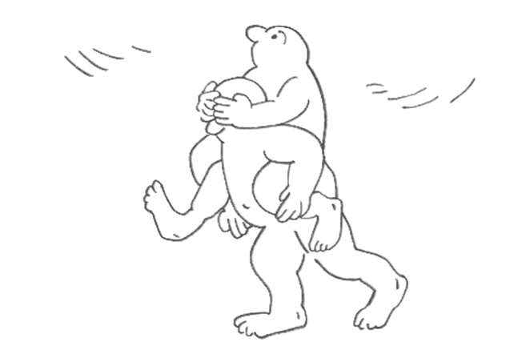
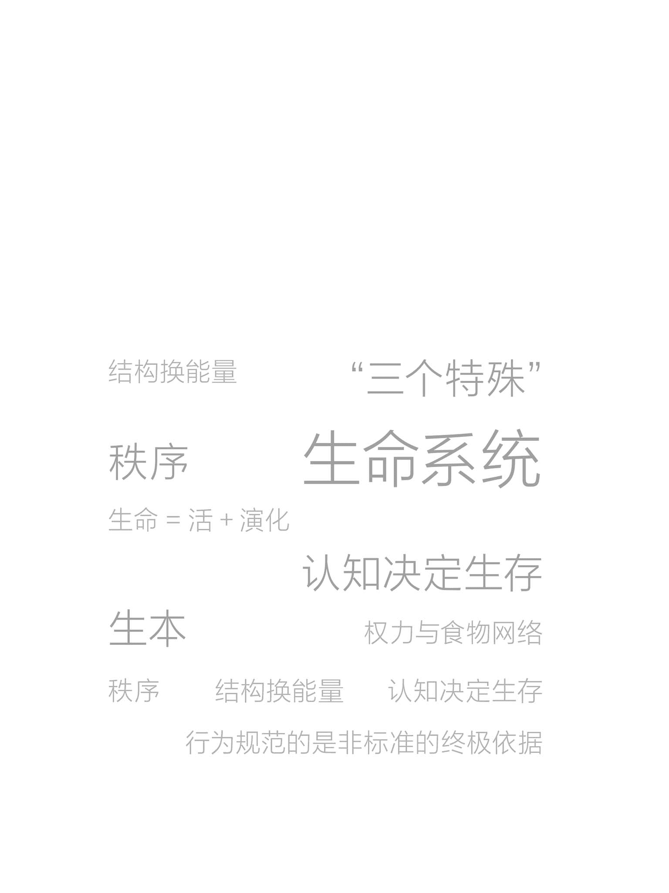
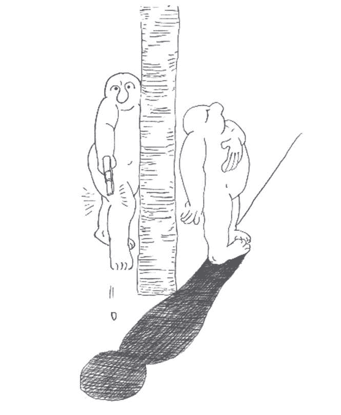
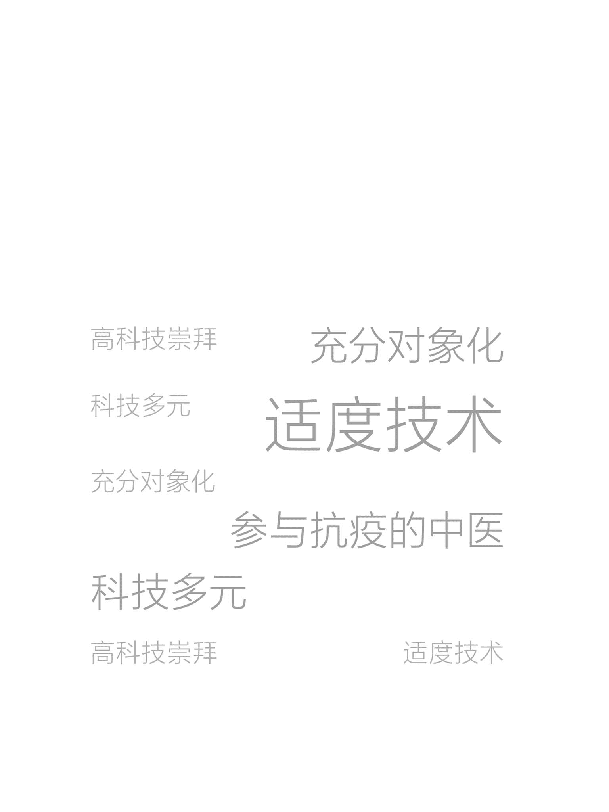
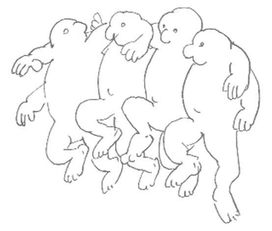
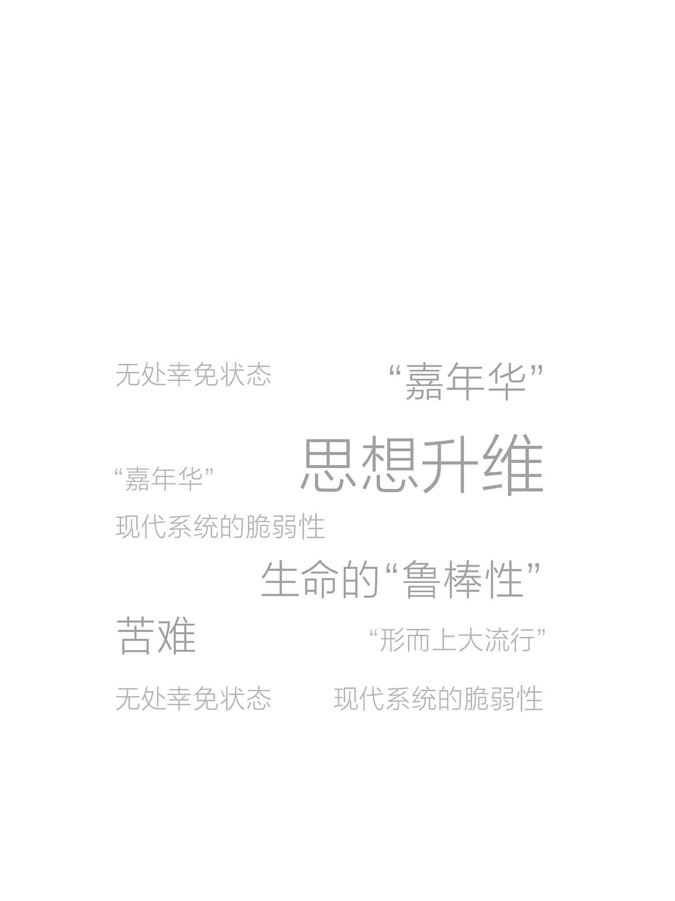
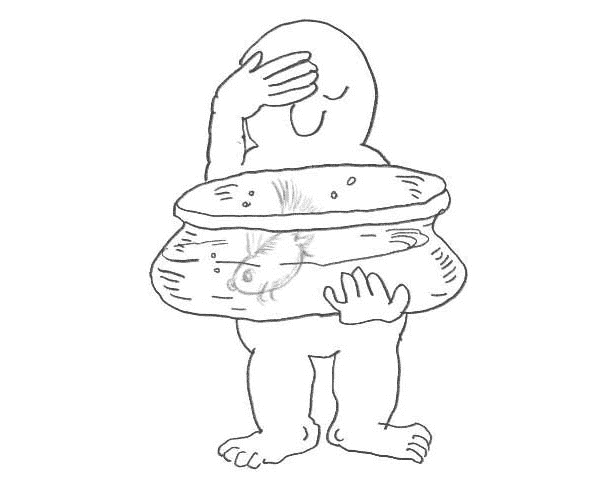
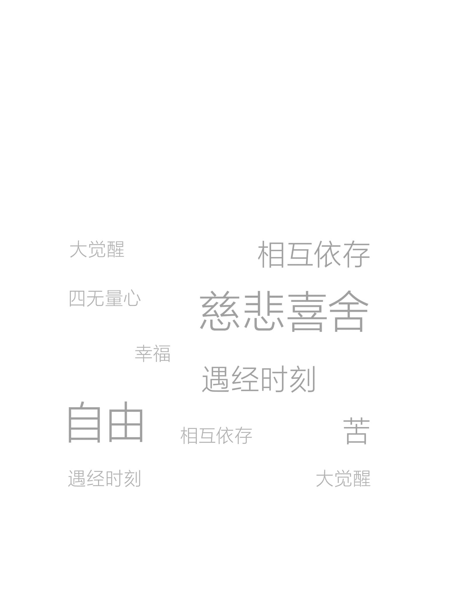

# 走出人类世：人与自然和谐共处的哲思

# Preface: Exiting Human Misalignment and Delusion

**Song Bing**

Since the end of 2019, the Novel Coronavirus Pneumonia (referred to as "COVID-19") epidemic has continued to spread and mutate globally, resurging in waves. Although some countries and regions have temporarily brought the epidemic under control due to early adoption of strong anti-epidemic measures, and people's lives and economic operations have slowly recovered, the "scenery is uniquely good here" situation remains fragile. From a global perspective, the deepening social divisions, political disputes, economic recessions, and escalating geopolitical conflicts exacerbated by the COVID-19 pandemic are still fermenting and deteriorating, with global social turmoil intensifying.

Comparisons, analyses, and reflections on different political ideas, governance frameworks, social and cultural psychologies, and corresponding public health crisis management flood major media and academic and policy journals. However, at this critical moment of crisis, should we not examine the human condition more deeply, as well as the ideas and systems that have formed and propelled this condition? The COVID-19 pandemic is only one of the many global challenges and disasters humanity has faced in recent years. With the ecological environment deteriorating, climate change accelerating, and geopolitical conflicts continuously escalating, more natural and man-made global crises will continue to unfold. So, should we take this opportunity to profoundly reflect on the value systems and perceptions we regard as orthodoxy, and even return to the origins of philosophical inquiry to rethink a series of fundamental questions? German philosopher Markus Gabriel points out that "the COVID-19 pandemic has revealed the systemic weaknesses of the dominant ideology of the 21st century, namely our steadfast belief that technological progress alone can drive human and moral progress," and he calls for a "metaphysical pandemic" to awaken a new understanding of global consciousness in human society.

Philosopher Zhao Tingyang responds positively, arguing that humanity needs a metaphysical reflection as powerful as a pandemic, "to give thought collective immunity." He calls for humanity to break through the dimension of modern thought, to discover or create a higher space of thought than modern to these calls, we invited several philosophers and biologists to discuss the following questions: What is the essence of humans and other life forms? How do we connect with nature and other forms of existence? What are the laws of life evolution and variation? What do freedom, happiness, suffering, life, and death mean? Can the rapidly advancing high-tech culture and its mindset enable humanity to escape the deepening predicament? What is the most urgent shift ins and arguments of the participating authors to the above questions.

## What is Life? What is Human Nature? The Relationship between Humans and Viruses

Biologist Bai Shunong reviews his decades of research and thinking in the field of biology, breaking the static, single-material-form view of life, and advocating understanding life from the perspective of a "life system." He believes that "Life = Living + Evolution (Iteration). 'Living' is the **special** interaction (i.e., carbon-skeleton molecules) involving **special** environmental factors, bonded by intermolecular forces, i.e., structural energy transduction cycles. 'Evolution' is the spontaneous increase in complexity of the above three **special** interrelated elements." By this definition, a life system is a special mode of material existence; it relies on intermolecular force interactions and "is a relatively stable intermediate state recognizable by humans in a dynamic process of constant separation and combination."

Then what is a human? What role do humans play in this complex biosphere? Bai Shunong believes that from a biological perspective, humans are essentially a subsystem of the Earth's biosphere. The difference between humans and other life subsystems lies first in reproductive isolation from other species, but more importantly in humans' unique cognitive abilities. This cognitive ability allows humans to break free from the constraints of the food web on their own maintenance and evolution, thereby embarking on an evolutionary path different from other organisms. When examining whether the elements of human operation as a life subsystem have changed due to the impact of the novel coronavirus, Bai Shunong believes that the various problems highlighted by the COVID-19 outbreak are actually chronic ailments long accumulated by the human life subsystem itself; the virus is merely the fuse triggering these deep-seated problems. Therefore, instead of falling into unnecessary anxiety over the epidemic, we should seriously reflect on the long-held "anthropocentric" or "theocentric" ideas. In Bai Shunong's view, "since humans are organisms, human survival and development ultimately must obey the basic laws of life systems." These laws were formed before the Earth's biosphere appeared and have continued incessantly.

German anthropologist and philosopher Tobias Leis profoundly recognizes the symbiotic relationship between microorganisms and humans, but shamefully, we humans almost never think about ourselves from the perspective of the microbial world (e.g., viruses). In fact, "for the novel coronavirus, there is nothing particularly different about humans compared to animals. On the contrary, for the novel coronavirus (as for any other zoonotic virus), we humans are just one animal among animals. We are just another multicellular organism, another habitat suitable for reproduction." We do not actually live in the Anthropocene, but have always lived in the "Microbiocene." Leis calls for humans to discard the bad habits of the Anthropocene at the level of thought and consciousness, and learn to understand and judge this planet and human society from the perspective of viruses. Indeed, the human body has about 50 trillion cells, while the microorganisms we carry exceed 10 times the number of cells. These microorganisms are diverse, including viruses, bacteria, and fungi; they combine to form the human microbiome. They coexist symbiotically with us. If we judge "heroes" by quantity and vitality, microorganisms are the true kings of this planet! We are merely a tiny group among thousands of mammals. Compared to bacteria and viruses, we are just "newcomers" on this earth who run amok.

So, what is a virus? What position does it occupy in this lively discussion of life? Is it life? What is its relationship with humans? Viruses have existed on this planet for billions of years; from the day *Homo sapiens* appeared, viruses have coexisted with us. Viruses are not independent life; they must rely on host cells to carry out their life activities and evolution. Thus, viruses and humans have formed a situation of symbiotic coexistence. Leis points out: "Viruses possess a tremendous power to promote change. Due to their ability to spread, mutate, and recombine between species, and to pick up and transfer genetic material between cells, they have made extraordinary contributions to the evolution of cellular life. Without viruses, mammals would not have evolved; without viral `DNA` (deoxyribonucleic acid) in our genome, the human organism could not develop, and our organs could not possess their current functions."

Scientists have discovered that, like other mammals, humans originally evolved into placental mammals with the help of viral proteins, thus enabling human gestation and further evolution. Virologists and anthropologists agree that viruses are the most powerful driving force of human evolution. We may be very effective hosts for viruses because we love gregariousness, socializing, and global travel, but we must not be complacent because of this. We are obviously not their only hosts. They do not need us—without humans, viruses would remain as they are, "living forever." This is also a forgotten lesson reminded to humanity by this global viral pandemic—humanity needs nature, but nature does not necessarily need humanity. This may also be a re-manifestation of the truth Laozi pointed out 2,500 years ago: "Heaven and Earth are not benevolent; they treat all things as straw dogs."

Then how should we correct humanity's position in nature? The COVID-19 pandemic may be the last straw that breaks the camel's back of anthropocentrism. One of the cornerstones of modern social ideology is anthropocentrism. Since modern times, humans have imagined they escaped the "low-level interests" of animals, stepped out of the natural world, and achieved control over nature and transcendence of species. The value of the natural world lies in whether it can be utilized and developed by humans. As the noblest form of existence, humans naturally utilize, develop, and transform all things in nature around their own interests. In modern society, human subjectivity has further reached its peak, ascending to the altar. The combination of human quasi-divine subjectivity with the logic of capital, the maximization of profit and wealth, aided by the wings of technology, has created the current human arbitrariness, which Zhao Tingyang calls the ubiquitous "carnival state." "Happiness theory" floods public philosophy; everyone possesses absolute "sovereignty," able to maximize personal freedom and legitimize and rationalize, even moralize, personal private preferences. Although there have been occasional "moments of awakening" before, humans are quickly attracted by new scientific and technological inventions, brand-new lifestyles and social modes, and so once again, and again, they put on their "masks" and return to the "carnival" dance floor. This global COVID-19 pandemic may finally shatter the human dream of becoming gods.

## From "Carnival" to the Abyss of Suffering: What is Human Happiness and Suffering?

The COVID-19 pandemic has suddenly intensified the fear, suffering, and loss of billions of people globally, plunging them into what Zhao Tingyang calls the "state of no escape." Regardless of which corner of the world, regardless of race, skin color, wealth gap, status, nationality, or political stance, the virus treats all equally, sweeping across humanity with lightning speed from outbreak to spread, catching people off guard. This is actually the state humans face when confronting survival-level risk events. This is also why the famous thinker and writer Jared Diamond believes that this COVID-19 pandemic is the first time all of humanity has encountered a truly global crisis.

In addition to the "misalignment" of modern human consciousness mentioned earlier, which we need to face directly and discard anthropocentrism, the authors of this book also advocate further reflection on other concepts constituting the foundation of modern society, such as happiness, suffering, and freedom. Zhao Tingyang says: "What we need more is a Wittgensteinian 'ruthless' reflection, reflecting on ethics from the outside of ethics, otherwise the result is nothing but self-affirmation, i.e., affirming in advance the values we hope to affirm." He believes that in the human "carnival" state, human society is immersed in the pursuit of constantly creating and enjoying happiness. But in a coordinate system explaining life, "happiness is only one coordinate; at least suffering is needed as another coordinate to form a positioning of life." The "happiness" brought by modern society lacks the ability to withstand suffering. Zhao Tingyang believes suffering is a problem humanity cannot avoid and for which there is no "antidote." He says: "The problem of suffering cannot be omitted or evaded because suffering falls outside the capacity of subjectivity, possessing absolute externality like the thing-in-itself; therefore, suffering is an absolute metaphysical problem." Precisely because suffering is a fundamental yet unsolvable problem, Zhao Tingyang believes the problem of suffering may be a good choice for the "metaphysical pandemic."

Then how does Buddhist philosopher and Japanese ordained Zen priest Jason Wirth view happiness and suffering? He points out that in today's world, happiness is "we want things to happen the way we want them to," and this is bundled with "another assumption: happiness is getting what I want, the demand for luck is dominated by me. Happiness is getting the world I want." Drawing on Buddhist teachings, he points out that the very posing of the question "How can I be happy" is a symptom of "suffering" (`duhkha`) as spoken by the Buddha—Shakyamuni Buddha diagnosed "suffering" as the first noble truth of life, "it is a continuous impermanence, a discomfort and imbalance in encountering events." Wirth points out: "The more I want happiness, the more I aggravate this root problem—this root problem is the 'I', the 'I' that has long felt uncomfortable with itself and the things of the world it inhabits." Thus, ironically, the more I pursue happiness, the deeper I sink into the misfortune implied by the "I." This is the paradox of happiness—suffering and the relentless pursuit of happiness are two sides of the same coin, "our insistence on pursuing happiness precisely sustains and aggravates our unhappiness." This cannot help but remind one of the ringing words of the American Founding Fathers in the *Declaration of Independence*: the pursuit of happiness is an inalienable right, a self-evident truth. They certainly did not realize the irony therein. However, perhaps they also never imagined that the modern concept of happiness is built upon self-inflation, plundering nature, overconsumption, and an ever-deepening wealth gap. This global viral pandemic may perhaps prompt people to slow down, reflect on certain seemingly plausible but false self-evident truths of modern society, and promote a shift and transformation of consciousness—this is the common aspiration of all authors of this book.

## Can High Technology Lead Humanity Out of the Predicament?

During this pandemic, technology has demonstrated powerful strength and efficacy in all aspects of epidemic control: from virus gene isolation and sequencing, case detection and diagnosis, to drug and vaccine development, to information collection and classification, and large-scale population tracking, temperature measurement, identification, and analysis, technology has rightfully assumed its role, being omnipresent and becoming an indispensable tool and means for humanity to fight the epidemic. After the outbreak, empowered by technology, people basically restored normal life through online work, online business, and online education. Indeed, technology has given us the confidence, backbone, and means to treat the virus. However, interestingly, in this anti-epidemic process, "alternative technology"—Traditional Chinese Medicine (TCM)—showed great prowess in epidemic prediction, disease prevention, mild case treatment, and patient recovery, attracting the attention, skepticism, or admiration of people already domesticated by high technology.

Philosopher Zhang Xianglong precisely starts from the fluctuating fortunes of TCM in the epidemic to launch his questioning of the widespread worship of high technology today. Technology is certainly important, but if technology is turned into a supreme ideology, humanity has embarked on a road of self-enclosure. Zhang Xianglong points out that high technology "is fully objectified, able to produce novel effects relatively quickly—new productivity, commercial profits, Nobel Prizes, enhancing the reputation of the 'extraordinary persons' of technology, thereby enhancing the holder's control and influence over nature and others." Technology has undoubtedly played a powerful driving role in human evolutionary history, playing a huge role in improving human survival conditions, extending human life, and improving the quality of human life. However, if this advocacy and encouragement of technology develops into a monopolistic, black-and-white mode of thinking, it solidifies into a thought tendency and ideology, "treating high technology as the only truth in every field and matter, to be unconditionally promoted worldwide, while regarding other research or practical methods in the same field and matter as heresy, at least as non-truth, which must be excluded and knocked down before one feels satisfied." This thought tendency and ideology is called "high technology worship" by Zhang Xianglong. This worship excludes other ideas and practices adhering to different methodologies. What it truly worships is "not truth, but power."

Zhang Xianglong points out that the limitation of fully objectified high-tech thinking lies in its inability to "keep up with the flow of life time." The "understanding full of temporalization or opportunization," relying on "functionalization" and "interpenetration," possessing holistic cognition—TCM thinking does not reject objectified analysis, but emphasizes grasping the human body and mind in the whole, preventing diseases that have not yet been objectified (the so-called "treating the undiseased"), opportunely adjusting treatment methods, and actively cooperating with food, lifestyle, and body-mind conditioning plans. Based on TCM's outstanding performance in the epidemic, Zhang Xianglong calls for humanity to open up thinking, and to judge, think, and analyze the human condition of existence in a diversified way, fully integrating the non-objectified, yin-yang opportunistic dimension of thought.

Zhang Xianglong further proposes the concept of "appropriate technology," which is "technology most suitable for the overall survival of local communities and even all humanity." He further explains: "From the perspective of time, this technology allows people to optimally combine current urgent needs and long-term future interests; methodologically, it can be both objectified and non-objectified; in terms of the quality of life it promotes, it enables people to embed and blend safety and comfort, material (physiological) and spiritual, conservative and enterprising (or tradition and innovation), simplicity and richness, nature and artifice to the maximum extent, thereby experiencing a beautiful life."

## How Can Humans Be Free?

In this global pandemic, another concept that has attracted widespread attention and discussion is freedom. After confirming the high infectivity of the novel coronavirus, the Chinese government immediately announced a city lockdown in Wuhan, the initial outbreak epicenter in China. As the epidemic spread to other Chinese cities, measures such as city lockdowns, community closures, stay-at-home orders, mandatory social distancing, contact tracing, and cancellation of public transportation services like flights and trains spread nationwide. These restrictive measures played a role in curbing the spread of the epidemic and alleviating pressure on the medical system. However, initially these measures were widely criticized and condemned internationally.

The famous Italian thinker Agamben, in the early stages of the Italian epidemic, voiced the strongest opposition to the Italian government's policies restricting personal freedom, triggering a major debate in global intellectual circles. Agamben believed those emergency measures were irrational and panic-driven, a manifestation of contemporary governments exaggerating crises to seize and abuse power; he worried about the normalization of this "state of exception." He believed one should not sacrifice "life" (qualitative life/bios) for "bare life" (survival/zoe); living in a wretched way is worse than dying. Zhao Tingyang believes Agamben "unrestrainedly upgrades the context of the COVID-19 pandemic, thereby leading to a misplacement of the problem." He further points out that giving up freedom under certain conditions is similar to the "cost" in economics that can never be shaken off; this trade-off is one of the conditions for the sustainability of all happy lives. Obviously, Zhao Tingyang's criticism of Agamben is very restrained here. In my view, although the issues raised by Agamben are not entirely groundless, at that time and place when the situation was urgent and the source and spread of the virus were not fully understood, elevating the risk of "abuse of power" possibly brought by measures restricting rights and freedom to the extreme, and assuming the measures restricting freedom were immutable, and then refuting them, seems somewhat affected—turning a real problem into a classroom thought game, drilling into a dead end of thought.

Inspired by Zhuangzi, Wang Rongrong uses the Daoist discourse system to think through a set of theoretical and practical physical and mental coping mechanisms applicable to humans in a "nothing can be done" situation (during lockdown). She focuses on three aspects proposed by Zhuangzi: "riding things" (cheng wu), "wandering mind" (you xin), and "nurturing the center" (yang zhong), "clarifying what 'riding things' means by contemplating 'helplessness,' recognizing 'wandering mind' by exploring the ultimate source of joy, and giving ultimate meaning to life by interpreting 'nurturing the center'." Zhuangzi's "riding things" reveals that life is full of unforeseen changes, and the range and ability of human control are limited. Thus, "being at peace with the times and dwelling in 顺" (an shi er chu shun), cultivating virtue, and responding to impermanence are especially important. "Wandering" (you) is Zhuangzi's concept and attitude for dealing with change and events. Wang Rongrong points out that "wandering" originates from three realms: external wandering, internal wandering, and Dao wandering. External wandering is the realm of sightseeing and "five colors blind the eyes" that people today are obsessed with, which is obviously inapplicable when the world is locking down cities and confining people due to the epidemic. Internal wandering and Dao wandering are what the "Moment of the Dao" should focus on. Wang Rongrong believes internal wandering is rooted in the ability of self-observation. "Wandering in the mind or intent relies neither on external things, external stimuli, nor sensory input. This wandering is the wandering of one's own mind and intent, a self-sufficient closed loop." Dao wandering is a step higher, wandering in the Dao, wandering in the infinite, independent of external things and circumstances, "following heaven and according to the Dao," "utmost beauty, utmost joy." The ultimate state of "wandering" should be "nothing unsuitable, nothing unreached, nothing unobserved" wandering. Obviously, this "wandering" is vastly different from the "freedom" understood in modern society; the former is introspection, self-questioning, and elevation of consciousness, while the latter is an ideology that guides people to strengthen the distinction between self and other, seek externally, and struggle.

"Nurturing the center" is the expedient method to achieve internal wandering and Dao wandering. Wang Rongrong points out that Zhuangzi's nurturing the center includes three aspects: nurturing the heart, nurturing qi (vital energy), and nurturing the governing vessel (du mai), which are practical methods for "responding to changes, destiny, and those unfathomable events, grasping newly emerging opportunities, and making the best choices."

Then how do Buddhist philosophers view freedom? Wirth lashes out at the view of freedom and rights prevalent among some Americans today. These views hold that anything hindering one's doing whatever one wants is an infringement of personal rights and a trampling of personal freedom. Thus, they oppose mandatory masks, resist social distancing, and refuse contact tracing measures. Wirth calls this claim for freedom and rights that disregards the safety of others and oneself the claim of the "right to stupidity," in other words, humans claiming the right and freedom to "act" recklessly. It is precisely this view and practice of freedom that has triggered the ecological crisis, causing us to ignore animals' natural habitats and living space, accelerating the spread of diseases from animals to humans. Wirth believes the freedom pursued by people in modern society "is not contained within natural freedom (as spoken of in Dharma and Daoism), but exists in our willful struggles, the purpose of which is to place our self above nature."

## What is Life and Death? Liberation from Life and Death

"Life is paramount," "Survival is the hard truth," "Better to live badly than die well"—such folk appeals and expressions have had extremely high "screen time" in daily conversations and social media during the epidemic. The mutual cooperation, watching over, and support among Chinese people during the lockdown period also reached a peak.

Ideologically, I believe this strong desire for survival originates from the "Sheng Sheng" (Generating Life) in the *I Ching* (Book of Changes). According to the "Sheng Sheng" view, continuous growth and eternal change are the fundamental attributes of all things in the universe. Heaven and Earth are the most supreme life forces in nature, giving and maintaining the generation, continuation, and prosperity of all things, the so-called "The great virtue of Heaven and Earth is called Life." Chinese indigenous philosophical schools drew inspiration for governing human society from the endless creativity of nature. Confucianism urges people to emulate "Heaven" (Qian) to continuously grow and create, pursuing the ideal model personality, the Junzi (Superior Person). Daoism values "Earth" (Kun) for its qualities of immortality, nurturing all things, and selflessness. Emulating "Earth" can cultivate a character that supports and nurtures life and unites with nature. In short, "Sheng Sheng" praises life, survival, creation, giving, prosperity, continuity, and coexistence. This attitude towards life influences Chinese people to develop a mentality of continuous self-renewal, optimism, and positivity. When comparing the similarities and differences between Chinese and Western philosophy, master of Sinology and philosopher Zhao Lingling, who has been immersed in comparative Chinese and Western philosophy for many years, points out that the starting point and main issue of Chinese philosophy is "seeking life" (qiu sheng), i.e., how to preserve life, live well, and live long, forming a sharp contrast with Western philosophy's "seeking knowledge" (qiu zhi) originating from curiosity, thus deriving different value systems and attitudes towards life.

On the issue of death, if Confucianism "avoids the heavy and focuses on the light," adhering to the attitude of "not knowing life, how can we know death," the Daoist view on life and death is entirely different. Daoist thought is rooted in a cosmology where the Dao gives birth to all things and nature is supreme, believing that life and death are the natural laws of the Dao. Zhuangzi, in particular, discusses life and death with a transcendent, challenging, and even humorous attitude. He believed that when qi (vital energy) gathers, there is life; when qi disperses, there is death. Life and death follow in succession; they are one. Death is merely the transformation of human life into another form of life, a natural process of creation—what is there to worry about?

In short, the concept of "shengsheng" (unceasing generation/life generating life) has had a profound impact on the characteristics of indigenous Chinese philosophy, the value orientations of the Chinese people, and their modes of. The decisive act of constituting and maintaining a nation is the continuous separation of the non-self from the self, where the non-self is the pathogen or outsider still close to nature, and thus more animal than human.

Now let's talk about COVID-19.

## A Large-Scale "Indiscriminate" Event

What impact does this exponentially growing configuration between human and non-human things, triggered by a virus, have on the modern political form?

I gradually realized that COVID-19 is a large-scale "indiscriminate" event. By this I mean that COVID-19 step by step eliminates the distinction between humans and nature that first appeared in early modernity and has since been taken for granted. This indiscrimination occurs at many different levels. Here are three.

The first level is perhaps the most obvious, stemming from the zoonotic nature of the virus. Bats, pangolins, humans: to the novel coronavirus, there is nothing special distinguishing humans from animals. On the contrary, to the novel coronavirus (as to any other zoonotic virus), we humans are animals among animals; we are just another multicellular organism, another habitat suitable for viral replication.

In the past, we have had opportunities to learn this fact of our animality. In recent years, humans have been infected with avian flu, SARS, swine flu, MERS, HIV, and other viruses, originating from birds, bats, pigs, camels, and chimpanzees respectively. We have also been infected by hybrid viruses from birds and pigs. Every time a zoonotic disease occurs, the indiscrimination between human animals and non-human animals appears.

The second level is our genetic makeup, 8% of which originates from viruses. This 8% is the result of another zoonotic disease. About 500 million years ago, when the first multicellular organisms evolved from bacteria, viruses did what they do—infected multicellular organisms, and in some cases, inserted themselves into the multicellular genome, thereby altering the developmental processes and behavioral patterns of these organisms.

# Viruses, Nature, and Politics: Viewing the Microbial World from COVID-19

This is not a one-off event. It happens again and again.

Viruses possess enormous power to drive change. Due to their ability to spread, mutate, and recombine across species, and to pick up and transfer genetic material between cells, they have made extraordinary contributions to the evolution of cellular life. Without viruses, mammals could not have evolved; without viral DNA in our genome, the human organism could not develop, and our organs could not possess their current functions.

If the zoonotic level shows that we are animals among animals, thereby eliminating the difference between us and nature, then the genetic level regards us as accidental products of cellular evolution in the viral world, thereby eliminating the difference between us and nature. The 8% viral DNA we possess clearly shows that the history of our genome predates the history of the human species by hundreds of millions of years. And the COVID-19 pandemic clearly shows that this evolution is happening right now.

The third level is to view us as one ecosystem among many. When individual eukaryotic cells evolved into the earliest multicellular organisms through fusion, they existed in a sea of microbes. These early multicellular organisms were extremely dependent on surrounding bacteria and viruses. In fact, they integrated bacteria and viruses into their own cellular components and tasked them with overseeing cellular self-maintenance. Bacteria provided metabolic functions, while viruses regulated resident bacteria by killing off populations that might overgrow and become superfluous.

Time hasn't changed things much. Every known existing organism harbors microbes (bacteria, archaea, fungi, and viruses) within its body. Without them, organisms cannot survive, nor maintain normal functions. We humans are no exception. Every organ system in the human body relies on bacterial metabolites—our health depends entirely on the viruses that regulate these flora.

Surprisingly, this regulatory role of viruses is not unique to humans. In all known ecosystems, one can observe viruses maintaining ecosystem function and regulating biodiversity by killing off excess populations. In fact, humans first discovered and began studying this regulatory role of viruses in ponds; later, this role was confirmed in studies of the human gut.

Let us consider: for a virus, the human gut is one pond among many. Some ponds are located in tropical rainforests, grasslands, or city centers, but the human pond is located within *Homo sapiens*. Viruses make us understand that we humans are merely one multi-species ecosystem among many—one pond among many. All systems are regulated by viruses.

There are many other levels; perhaps the most thought-provoking is how viruses regulating the carbon cycle eliminate the difference between us and the biosphere. But let us stop here and summarize the basic features of the world manifested in COVID-19.

> 1. All life exists in viral clouds inside and outside cells.
>
> 2. We humans have a long shared history with viruses (and other microbes). They shaped us, are part of our bodies, and we cannot be distinguished from them.
>
> 3. We are microbes—members of a multi-species assemblage in the viral world. We interweave and permeate each other, inseparable.

The difference in the understanding of the world implicit in the modern political configuration could not be more obvious. In fact, the movement of the virus—likely from bats to pangolins to humans—renders the modern political view (and its clear distinction between human affairs, natural affairs, and technical or artificial affairs) incredible and untenable.

Faced with this situation, what should we do?

## Humans, Nature, Technology

Let us begin by redefining the concepts of humans, nature, and technology.

For Hobbes and his modern followers, nature is the "outside world," i.e., the non-human world, the world of animals. Animals are considered beasts. They are said to lack reason, dominated by unconstrained self-interest and immediate physical passions (hunger, sex, etc.). Therefore, nature is thought to be in a constant state of war, a realm full of fear, distrust, loneliness, and death.

Hobbes and his followers occasionally describe animals as automata acting mechanically, implying they are living machines with instincts but essentially no intelligence. Especially after the emergence of the philosophy of history, they also describe nature as an origin to which we once belonged but have since become alienated. They lament the lost primitive wisdom with romantic sentiment.

Nature derived from viruses is clearly not like this. First, nature is no longer that "outside" non-human world. On the contrary, it encompasses everything. Nothing can be above, transcend, or lie outside nature. All things, including human affairs, are part of it. Since nature is no longer that "outside" world, the difference between humans and animals disappears.

For viruses, the first important feature of nature is interconnectedness. All organisms are inextricably interwoven with each other and with the biosphere. In fact, it is difficult to draw a clear boundary between an organism and the ecosystem it inhabits, as if the organism's outline is blurred, as if they permeate the ecosystem. Thus, there is no difference between the organic individual and the ecosystem—they employ the same rules of self-maintenance.

The second important feature of nature is the close relationship between collaboration and change. All life forms are (to varying degrees) multi-species collaborations linked by deep evolutionary history: collaboration between organisms, bacteria, and viruses; between different kinds of cellular and non-cellular life. Organisms provide habitats for bacteria and viruses; bacteria provide metabolic functions for organisms; and viruses are the regulators of the entire collaborative arrangement. This is a world of stable collaboration, and a world of change. In fact, change is a key factor of collaboration. Through inter-cellular gene exchange and inserting themselves into genomes, viruses enable specific multi-species organisms to adapt to new environments, thereby continuing to co-evolve. The idea that there is no competition in nature is, of course, naive. But surprisingly, the evolution of life seems to originate from collaboration—symbiosis—rather than struggle or competition.

From COVID-19, we can see the third and final important feature of nature: it suddenly becomes a realm filled with pure infinite possibilities. At all times, nature's possibilities are far richer than reality. Possible life forms far outnumber currently existing ones—any known life form is always and perhaps forever transient, a speck of dust in the river of time.

The view of nature derived from COVID-19 renders the philosophy of history indefensible—history is viewed as strictly human events, progressing in a process of strict separation from nature. Humans themselves—separated from nature, independent, living in their own non-natural (artificial) environment—cannot self-maintain. No one can do without the bacteria, fungi, and viruses living in and on the human body. If nature is no longer that "outside" origin, then the concept of the primitive opposed to the modern disappears, and the logic of colonialism ceases to exist.

In fact, the patterns linking the human organism—various molecular mechanisms—predate human evolution by hundreds of millions of years. For example, the invention of some signal transduction pathways between different species that we rely on was inspired by early multicellular organisms living in primordial oceans. Talking about humans like modernists is like putting wild organisms in a petri dish, adding bleach and antibiotics until more than half die, then celebrating the barely surviving part as "human". To put it sharply, humans are a sterile abstraction, a fantasized state of harmony.

The challenge arising here is to understand that humans exist *within* nature, not outside it. Take reason, for example. If reason cannot be separated from the brain or neurons, and if brains and neurons could not have evolved and developed without viruses and our 8% viral DNA, what does it mean to possess reason? If the mind cannot be separated from neurotransmitters (produced by bacteria in our gut), what does it mean to have a mind? This gut flora in turn depends on what food we eat, and where and how that food is produced.

Or take technology, for example. Hobbes and his followers conceptualize technology as artificial things that do not exist in nature. The implicit assumption here is that nature is stable and lacks innovation. However, when viewing nature from an evolutionary perspective, what becomes of innovation? That is, when nature is no longer that stable "outside" background but appears before humans as evolutionary innovations of new mechanisms, forms, and processes, what becomes of innovation? Seen this way, human technological innovation seems merely a form of biological organisms adapting to or modifying their environment, on a planet where various constantly evolving biological organisms exist. In principle, there is no difference between technological innovation and biological innovation.

We can go further: once we recognize that some of the most advanced technologies, such as antibiotics, plasmids, or gene editing technologies, are actually inventions of microbes, not humans, what becomes of technology?

COVID-19 allows us to view humans as a subject from the perspective of nature—a nature radically different from the view of nature at the core of modern society.

This challenge is attractive because there are so many concepts that need rethinking.

Then, how should we view modern politics?

## The Limitations of Modern Politics

From the perspective opened up by COVID-19, modern politics appears to be a tool invented to defend the illusion that "humans possess independence." Essentially, modern politics has become a "machine for distinguishing (humans)."

Through current reactions to COVID-19, we can understand this machine in operation. Politicians, policymakers, and media agree that this virus is a threat from nature, from that "outside world."

Once the boundary between nature and humans blurs, danger can appear at any moment. Humans exposed to nature face the risk of blurred outlines, merging with nature (indifferentiation), falling into a "state of war" (the state described by Hobbes as full of "fear, poverty, nastiness, solitude, brutishness, ignorance, cruelty").

A key factor in this practice of dividing humans and nature into two distinct realms (called the echo of the philosophy of history) is that people view those whose lifestyles remain close to animals with suspicion or even disdain, believing they have "not yet" successfully escaped nature, and thus belong more to that "outside world" than to "this world," as if they remain stuck in a past that civilized humans or states have long left behind.

Modern political practice needs to protect humans from nature's encroachment. The forms taken so far are, on one hand, shelter-in-place policies, requiring people to stay home and not "go out"; on the other hand, closing borders to keep out nature's invaders—viruses, outsiders, animals. Usually, the latter implies that the national society is a quasi-organism. It blurs the biological language of the 1930s with political language, as if the basis of political self-construction is the act of separating the non-self from the self.

From the perspective of the view of nature derived from COVID-19, distinguishing humans from nature, or separating non-self from self, appears to be an act of arbitrary violence. If nature encompasses everything, if human independence is an illusion, then neither the claim that the virus is in that "outside world" nor the accusation against those retaining primitive lifestyles makes any sense. Thus, the immunopolitics of the nation-state becomes fundamentally untenable. Its basis is a misunderstanding of the organism and the immune system. Its basis is also a misunderstanding of the organism, assuming the organism is an independent and discrete object—bacteria and viruses as a non-self, not belonging to the organism. Its basis is a misunderstanding of the immune system, implying it is a self/non-self recognition system, hence a war machine constantly busy separating non-self from self.

In fact, no organism can completely separate from nature as this notion implies. The so-called non-self of the past—bacteria and viruses—are indispensable parts of the self. In fact, contemporary immunologists describe the immune system as the joint management system of this multi-species assemblage of ours.

Let me clarify: I am not advocating herd immunity or premature lifting of shelter-in-place orders, nor am I opposed to science and technology. On the contrary, I believe the more technology, the better.

What I want to say is that, by practicing a politics of differentiation based on maintaining and defending an illusory view of humans, we have damaged the Earth (and ourselves as an inseparable part of it). I believe we have no choice but to propose a new human essence, lifestyle, technological practice, and political practice.

## The Microbial World: Politics from a Non-Human Perspective

Currently, two competing strategies respond to this challenge.

The first response suggests extending the political view to nature. I consider this response the most failed. It merely extends human responsibility for the human realm to the natural realm, rather than rethinking the concept of the human from the perspective of multi-species nature. It fundamentally adheres to the modern view that humans are above or beyond nature, still separating humans and nature, because technology is understood as artificial things. It holds that nature will only become part of the human realm, a situation called the decline of the external world, the complete humanization of nature and Earth.

The second response adopts an inversion, stemming from the flaw implicit in the term Anthropocene. The Anthropocene refers to a new geological epoch characterized by human impact on Earth and its feedback systems. The term Anthropocene implies a moral condemnation: human impact on all Earth's ecosystems is so great that human activity can be seen in geochemistry; this is shameful. Arguably, the normative implication of this discourse is that humans and nature should be completely separated. Therefore, the appropriate response is to protect nature as that "outside world," protecting the non-human from human harm.

Conceptually, both responses are childish; they still adhere to the Hobbesian modern view of humans and nature, thus merely redescribing the problems they need to solve.

Exploring viruses from philosophical and poetic perspectives yields a completely different answer. I call it the politics of the Microbiocene.

What does the Microbiocene mean here? It refers to viewing the world from the perspective of viruses.

For billions of years, bacteria, viruses, fungi, and archaea were the only living inhabitants of Earth. They occupied every ocean, river, and lake, every inch of land and air. They drove the chemical reactions that created the biosphere, thereby creating conditions for the evolution of multicellular life. Bacteria produced the oxygen we breathe, the soil we cultivate, and the food webs that sustain the oceans. Viruses periodically kill vast numbers of bacteria, thereby regulating the biogeochemical cycles on which all life depends. Microbes invented the feedback systems supporting all life on Earth, creating all past and present life forms. All organisms in history originate from bacteria and viruses: all organisms, including us humans, are inextricably intertwined with and dependent on them.

From this perspective, we absolutely do not live in the Anthropocene, but in the Microbiocene; it is not that the boundary between humans and nature becomes blurred as the term Anthropocene implies. Sadly, we humans have still not learned to think of ourselves from the perspective of the microbial (i.e., viral) world, even though we are precisely a part of this world.

If politics is the study of forms of symbiosis, especially the effort to find a good form of symbiosis, then we have much work to do. We must compare various forms of symbiosis—prokaryotes and eukaryotes, organisms and viruses, mycelia and trees, in ponds and guts, in caves and forests, in lungs and rivers. Then, based on these studies, we must find political forms that can achieve the flourishing of both humans and non-humans.

## Action Plan

If we formalize the history of the view of humans appearing in this text, we can derive the following summary.

In the longest period of history, we humans lived in a God-given or sacred natural cosmos; we were a part among parts. A profound and far-reaching transformation in the early 17th century made us leave that cosmos and enter the Human Age: we distinguished ourselves from nature, calling nature the "outside world," the realm of animals and irrationality; we tried to technologically widen the distance between ourselves and animals.

Today, we face the challenge of leaving the Human Age and learning how to survive in the Microbiocene. Each age has its unique political system, unique mode of production, and unique view of technology.

How can we learn to shed the modern notion that humans are more important than nature, and learn to clearly articulate from the perspective of the microbial planet we inhabit (of which we are a part) what humans are, how humans should live, practice technology, and practice politics? That is, how should we view the above issues from the perspective of the Microbiocene?

Can we humans rethink ourselves from the perspective of the non-human world, because we are part of this world and inseparable from it? To do this, we must learn to objectify ourselves from the perspective of the Microbiocene; that is, strive to realize a concept of "we" centered on the Earth, not on race or species.

In my view, this is a challenge, and the problem the Berggruen Institute's Human Transformation Project aims to solve. We—we are inter-species connections—must invent new vocabulary to clarify what humans in nature are, learn to articulate and practice a global politics, find a path from the industrialization of nature (resource extraction) to the biologization of industry, and create the possibility of replacing artificial technology with biotechnology.

If we succeed, then configurations like what we call COVID-19—possible configurations composed of viruses, bats, pangolins, and humans—will no longer be phenomena that irrationally deviate from the boundary between humans and nature. Such boundaries will cease to exist. We will become part of the "outside world."

(Translated by Zhuge Wen)

---

# After the Epidemic, Where Does Human Society Go?

**Bai Shunong**

 

Since January 23, 2020, when Chinese official media announced the implementation of the Wuhan "lockdown" measures to respond to the COVID-19 epidemic, human society has faced what is claimed to be the first "truly globalized" crisis in history. As of the time of writing, statistics show that the global death toll from this epidemic has exceeded 580,000, and the economy has suffered a severe shock. Accompanying the epidemic, domestic contradictions in various countries have erupted frequently, such as the "Black Lives Matter" movement in the US; international relations, such as Sino-US relations and the relationship between the US and the WHO, have also undergone unexpected drastic changes. The entertainment industry, emblematic of social prosperity, has fallen into an unprecedented depression; personnel exchanges have sharply decreased; schools at all levels have closed campuses and switched to online teaching; large numbers of people have become unemployed. In addition, due to medical resources being crowded out by the epidemic and the implementation of isolation measures, many chronic patients face many extra difficulties in receiving necessary routine treatment. Some famous scholars and media figures lament that the world can never return to the pre-epidemic state.

This sudden upheaval has disrupted everyone's lives. The familiar life order people once knew has been replaced by huge uncertain disorderly turmoil. No one knows what will happen tomorrow. People inevitably ask: why did all this happen? When will the epidemic and the social turmoil it triggered or accompanied finally end? If the world cannot return to the past after the epidemic ends, what will the world become?

In fact, looking back at history, when has humanity ever truly lived in a state as calm as still water? Experience shows that the only constant in this world is "change." If we speak only of "change," the changes brought by the novel coronavirus are just another "change." Obviously, while admitting "change" is the only constant, people actually have certain expectations about the source, impact, and degree of "change." People hope "change" arises from human goodwill, brings more convenience to human life, and occurs at a level acceptable to the public.

But this is merely human wishful thinking. The reality is that "change" can come not only from human goodwill, but also from any human motive beyond "goodwill," and of course from changes in any entity existing elements beyond human motives. Although the source of the novel coronavirus is still inconclusive, it is most likely a change in natural entity elements beyond any human motive. After all, humans seem powerful, capable of reaching the sky and entering the earth, omnipotent, but in the entire Earth's biosphere, the variables humans can control, apart from machines they design themselves, are actually very limited—often they cannot even control their own will, nor explain how their will arises.

From a biological perspective, humans are essentially and still a subsystem in the Earth's biosphere. Based on the various experimental evidence we currently possess, the most fundamental difference between humans and other life subsystems, besides reproductive isolation from other species, is probably humans' unique cognitive ability.

Reproductive isolation is the universal boundary distinguishing species in the Earth's biosphere. In other words, the ultimate criterion for distinguishing different species lies in whether reproductive isolation exists between different populations. Those with reproductive isolation are considered two species. This is a widely recognized criterion in animal taxonomy. Therefore, the distinction between humans and other organisms due to reproductive isolation is not unique to humans. However, the distinction between human cognitive ability and other organisms is, as far as we know, absent among other organisms. Without this cognitive ability, humans might still be surviving today like the other cousins left behind by their ancestors in Africa, as a link in the middle level of that region's food network.

However, for reasons still unknown, likely due to the emergence of new genes, humans acquired unique cognitive abilities. This ability not only helped humans walk out of Africa and traverse the world, but also helped humans independently form survival modes completely different from their cousins who stayed in Africa, through interactions with different local species—transitioning from the gathering-fishing-hunting mode once shared with other animals to an agricultural-pastoral mode.

No one can clearly explain why humans transitioned from the gathering-fishing-hunting mode formed over hundreds of millions of years of evolution in the animal world to an agricultural-pastoral mode. But from what is currently observed in tribes retaining the foraging-hunting mode, such as the custom of taking pride in capturing strong leader animals, the transition to the agricultural-pastoral mode was likely a negative effect of humans improving hunting efficiency due to cognitive development: improved cognitive ability enhanced communication and tool use among population members, thereby changing the hunting mode—namely, by capturing strong leader animals to cause chaos in the prey population, thereby gaining more harvest.

# Transformation of Survival Modes and the Essence of Life Systems

## From Foraging to Farming/Pastoralism: A Forced Transformation of Survival Mode

However, this highly efficient hunting mode broke the self-renewal capacity of prey populations, ultimately leaving humans with no prey to hunt and forcing them into the predicament of "eating grass"—that is, being forced to settle down and obtain survival resources through arduous cultivation or by raising animals and following water and grass. Although arduous farming ultimately provided humans with a more efficient mode of acquiring survival resources compared to foraging, the initial occurrence of this transformation was most likely a helpless choice. What insights can this "change" in survival mode—from foraging to farming and pastoralism—offer for understanding the "change" we face today?

## The Dual Connotation of Life Systems: "Living" and "Iteration"

In a lecture titled "Humans are Biological Beings—The Starting Point of Human Transformation" delivered for the first "Bogu Rui Lecture" of the Bogu Rui Research Institute China Center in March 2019, I proposed a view on the essence of life systems: the essence of a "life system" is not a special kind of matter, but a special mode of material existence. In this view, the concept of "life" actually contains two connotations. One is "living" (活), namely the "special interaction of special components under the participation of special environmental factors" (referred to as the "three specials" ) manifested in the form of "exchanging structure for energy" in obedience to the Second Law of Thermodynamics.

### "Living": The Cycle of Exchanging Structure for Energy

Among these, "special components" mainly refer to carbon-skeleton  molecules; "special environmental factors" refer to the Earth's temperature, pressure, relationship with the sun, geochemical composition (such as water and other molecules in different forms), etc.; "special interaction" mainly refers to interactions linked by intermolecular forces with relatively low energy states, such as hydrogen bonds and hydrophobic bonds. This process of "living" is a process that can form spontaneously: as long as the energy state of the complex formed by intermolecular forces from the encounter of carbon-skeleton components is lower than the energy state when the components exist independently, then according to the Second Law of Thermodynamics, independently existing carbon-skeleton components can spontaneously form complexes . However, since the complex is formed with intermolecular forces as links, changes in external environmental factors may break these forces, causing the complex to disintegrate and the components to return to an independent state.

Under suitable conditions, these two independently occurring processes can be coupled via the complex as a node, forming a "cycle of exchanging structure for energy" (where "structure" refers to the complex, and "energy" refers to the difference in energy states between the carbon-skeleton components existing independently and existing as a complex, as well as the energy related to the environmental factor disturbance required to break the intermolecular forces). In this dynamic "cycle of exchanging structure for energy (living)," complexes continuously form spontaneously and disintegrate due to disturbance. The probability of existence of complexes formed between different components will differ. Ultimately, the processes coupled by complexes with higher probabilities of existence (moderate/adaptive) will appear with greater probability, i.e., "the moderate survive." This "cycle of exchanging structure for energy" of "living" is the starting point of life systems.

### "Iteration": Complexification Evolution Based on Covalent Bonds

The other connotation of the concept "life" is "iteration," namely the process of complexification of various elements related to the "three specials," starting from the spontaneous generation of covalent bonds, based on the complexes that serve as coupling nodes of the aforementioned "cycle of exchanging structure for energy" . Since various "iterations" of different degrees of complexity have reached the level of trait changes in multicellular eukaryotes, this is essentially what Darwin called "evolution"; for ease of understanding, we can also call this "iteration" traced back to physical and chemical changes at the molecular level "evolution."

### The Formula of Life: Life = Living + Evolution/Iteration

The two connotations of the "life" concept above, if expressed in a formula, are: **Life = Living + Evolution/Iteration**.

From this perspective, any "life" process must contain the connotation of "living," and "living" is essentially an open, special interaction that takes environmental factors as indispensable constituent elements. A life system is essentially a hierarchical network built by connecting many "three specials." The different forms presented by life systems are essentially the external manifestations of different network structures formed by different "connections" and their association methods.

## Survival Mode Transformation from the Perspective of Life Systems

### Fundamental Change in Resource Integration Mode

If the above interpretation of life systems holds, then the transformation of human survival mode from foraging to farming and pastoralism is essentially nothing more than a change in the way this biological species, humans, integrates relevant surrounding elements during the operation of its "three specials." Specifically, this change in "integration mode" is mainly a change in the source and acquisition form of the basic resources required for human survival: in the foraging era, people directly obtained usable parts from surrounding self-generating and self-perishing animals and plants as survival resources; they turned to domesticating and planting animals and plants, taking the proliferative part of animal and plant resources during the domestication and planting process (such as "one seed sown, ten thousand grains harvested" in farming) as survival resources. Human food was no longer the "one seed" used as seed, but the "ten thousand grains" proliferated after the seed grew.

### Non-Autonomy of Change and "Tinkering" Evolution

Regardless of the source of the changes occurring in the relevant elements of the "three specials," the appearance of these changes is often not what humans hope for or can control. If our explanation above for the human survival mode transformation from foraging to farming/pastoralism reflects the actual situation, then whether the transformation occurred due to the proximate cause of prey exhaustion or the ultimate cause of the development of human cognitive abilities, they were not what humans hoped for or could control, let alone the result of efforts to achieve a pre-set goal of farming/pastoralism. The appearance of change merely broke the original survival mode and prepared conditions for the emergence of a new survival mode. Whether farming or pastoralism ultimately emerged was actually the result of humans in different regions having no choice but to emerge based on their different ways of utilizing different relevant elements in their respective spaces of existence—because if it were not so, these populations would not have survived to today. This is just like the "tinkering" described by the French Jewish biologist François Jacob in his 1977 article "Evolution and Tinkering": whatever materials are used, as long as the hole in the pot is patched .

## Facing the COVID-19 Pandemic: Network Reconstruction of Life Systems

### Severance of "Connections" Under Pandemic Impact

If the inducements and results of changes that have a major impact on human survival are as described in the survival mode transformation from foraging to farming/pastoralism above, then what we can probably learn is that the key to the existence and sustainable development of a life system lies not in tracing the causes of changes in surrounding relevant elements, but in focusing on which of the various relevant elements currently in existence can form moderate interactions that maintain system operation, thereby turning these "possible" interactions into "reality."

Just as when prey disappeared back then (regardless of why they disappeared), people could not sit and wait for the natural recovery of prey populations but had to seek new modes of acquiring survival resources. Those fortunate ancestors who survived probably never imagined that their forced "eating grass" would enable humans to largely break free from the constraints of the food web and become a dominant species in the Earth's biosphere.

From this angle, in the pandemic brought by the novel coronavirus, which elements related to the operation of the human life system have changed, and which have not? First, a change in this life system is the addition of a new virus. Because of its unexpected arrival, many people lost loved ones, and some lost their lives. This made everyone feel fear more acutely—fear born of ignorance and helplessness. Due to fear, the "connections" originally indispensable in the network structure of the human society life system—between people, especially between people and their workplaces—were artificially severed, such as various forms and scales of city/school lockdowns, and sharp reductions in interpersonal contact. This changed the network structure and operation mode of the human society life system.

### "Restoring the Old" or "Reconstructing the Network"

No one knows the future trajectory of the COVID-19 pandemic, so no one knows how long the fear generated by the pandemic can and should last. Whether the novel coronavirus will disappear inexplicably like SARS, or "settle down" in human society like influenza, in the social life system network structure where connections have been artificially severed due to fear, when "connections" between different nodes can be re-associated, should people "restore the old as it was" like repairing ancient buildings—i.e., restore the good old days—or re-establish new connections, construct a new network system, and let the social life system operate in a new form, just as humans transformed from foraging to farming/pastoralism? Helplessly, the uncertainty brought by the novel coronavirus makes it impossible for people to effectively assess this.

### Deep Roots of Contradictions and Conflicts

When people sigh that "we can never go back to the past," one might actually ask: Was the "past" "good"? If the answer is not affirmative, one can further ask: Was the "bad" of the "past" caused by the novel coronavirus? Obviously, those various contradictions and conflicts seemingly triggered by the novel coronavirus actually existed long ago. It's just that under the impact of the virus on the existing social operation mode, those artificially severed "connections" produced new connections at related nodes, or "connections" that originally existed but were masked or suppressed by former social roles surfaced, giving these long-existing contradictions and conflicts an opportunity to erupt.

### Building a New Network Structure with Greater Resilience

From this perspective, these problems causing contradictions and conflicts neither arose because of the novel coronavirus nor will they disappear with it. The fundamental reason the novel coronavirus has caused such a huge impact on human society is that human society, as a life system, has developed various problems in its network structure and operation mode; many "connections" and their association methods can no longer operate effectively. For the general public beyond biomedical experts, besides paying attention to practical issues like infection numbers and vaccine development, they should pay more attention to the problems that erupted during the pandemic, including those that haven't erupted but actually exist: exactly which interactive relationships have become unsuitable, and then see how to build new "connections" between different nodes, thereby constructing a new network structure and operation mode with greater resilience.

## Cognitive Ability and the Special Path of Human Evolution: From "Three Components" to "Two Components"

### The Starting Point of Curiosity: Diversity and Civilizational Conflict

People can list a long inventory to sort out the various problems existing in human society before the COVID-19 pandemic. Among these problems, which are the most fundamental and can be adjusted through human effort? The answer to this question relates to my curiosity and observation of a phenomenon sustained for nearly 30 years.

In 1991, when I just arrived at UC Berkeley for postdoctoral research, I noticed many people discussing "diversity" (multiculturalism). This was quite impactful for me at the time. My first reaction was: if "diversity" becomes the dominant concept in a society, how should conflicts of interest between people with different concepts be resolved? Friends who endorsed "diversity" said they could rely on the law. But isn't the legal principle on which the law is based also a concept? The discussion could not proceed further. Three years later, as I was about to leave the US, I heard people discussing Samuel P. Huntington's "Clash of Civilizations." Due to a lack of necessary historical knowledge, I completely failed to understand why people were discussing this issue at the time.

It wasn't until 1998, after I started working at Peking University, that I became curious about "why they want to pursue graduate studies" through interactions with graduate students, and began to pay attention to the issue of human behavioral motivation. Later, influenced by some friends, I started reading books outside my plant biology major. All this culminated in the "humans are biological beings" concept I introduced in that 2019 "Bogu Rui Lecture." As mentioned earlier in this article, this concept holds that the biggest difference between humans and other organisms lies in cognitive ability. This difference led human evolution onto a completely new path distinct from other organisms: "cognition determines survival." If this analysis reflects the characteristics of human evolution, where exactly does the importance of "cognition" manifest in the various problems existing in human society and their adjustment?

### The "Three-Component System" of Animal Populations

We must return to life systems outside humans, especially taking the evolutionary characteristics of animal systems as a reference frame, to give an explanation with objective rationality. Regarding the evolutionary mechanism of life systems, by the eukaryotic cell stage, all eukaryotes had to exist in the form of "two subjects." One subject is the single cell (e.g., a yeast cell) or a single multicellular organism (e.g., a cat or an elephant). These individuals are the basic units that integrate relevant surrounding elements of the "three specials" and maintain their own existence; they are the "behavioral subjects." The other subject is a population composed of many conspecific cells (e.g., many yeast cells in a fermenting dough) or a group of cats or elephants. Individuals in these populations can share a gene pool, maintain DNA sequence diversity through sharing the gene pool, and thereby cope with unpredictable changes in surrounding relevant elements.

Therefore, it is the population, not the individual, that is the basic unit of species survival, the "survival subject" of a species. The two are linked by sexual reproduction. Because eukaryotes possess two subjectivities (the behavioral subject is the individual, the survival subject is the population), for animals—as one of the three major categories of multicellular eukaryotes (the other two being plants and fungi) that realize the integration of "three specials" relevant elements through feeding—an inevitable dilemma arises: how can individuals as behavioral subjects effectively associate with each other to form a sustainably surviving population? Through past research results on animal behavior patterns, I found that the self-maintenance mechanism of animal populations can be summarized as a "three-component system": order, power, and food web constraints.

#### Order, Power, and Food Web Constraints

The "order" in the three-component system of animal population self-maintenance refers to the need for individual behavior patterns to follow certain rules. Although individuals as behavioral subjects theoretically possess infinite degrees of freedom, for a specific species, if every individual acts willfully without common rules to follow, then population members cannot effectively associate, and the population cannot exist. "Power" refers to the fact that in a population, a leader usually manages individual behavior, i.e., maintains the population's order, thereby maintaining the population's integrity. Since the leader bears the responsibility of maintaining population order beyond their own survival, only the physically strong can handle it. Physical strength implies that the genes they carry have stronger survival capabilities. Therefore, the leader, by virtue of physical strength, occupies mating priority, which can accelerate the spread of excellent genes within the population, benefiting population survival. "Food web constraints" refer to the fact that a population, as a member of the food web, forms its individual behavior and population order through interaction with other members of the population and other populations during evolution; therefore, it is inevitably constrained by the food web. The existence of the food web, on the one hand, defines the "order" of a specific species/population as its node (e.g., individual behavior patterns), and on the other hand, constrains the "power" of the ruler in the population. These three elements form a virtuous cycle, maintaining the self-maintenance and evolution of different animal populations in the Earth's biosphere.

### Humans Breaking Food Web Constraints

Humans took a different path. As mentioned earlier, cognitive ability helped population members communicate better and change hunting methods. The result was that increased hunting efficiency simultaneously caused prey disappearance, forcing humans onto the path of farming and pastoralism. With the development of human cognitive ability, the relationships among the three components in the three-component system of animal population self-maintenance and evolution gradually changed in human populations. In the relationship between humans and other organisms in the food web, humans shifted from relying on the self-renewal of other organisms to obtain survival resources, to having the ability based on cognition to intervene in the self-renewal process of other organisms, and obtaining survival resources by adding value to their self-renewal. Humans can even transform items worthless to other animals into resources usable for improving their own survival conditions, such as using soil to make tools. In this process, humans gradually broke the constraints of the food web (mutual dependence based on the self-renewal of different species) on their own self-maintenance and evolution. This breakthrough, while expanding the range of survival resources, turned the original three-component system that could effectively maintain sustainable population development in the animal world into a two-component system, leaving only "order" and "power."

### Side Effects of Cognitive Ability

Besides breaking food web constraints and turning the original three-component system essential for maintaining animal population survival and development into a two-component system, the development of cognitive ability produced other effects. For example, cognitive ability, as a form of imagination, continuously changes individual behavior patterns, thereby impacting the population's existing "order." Another example: the virtual nature of cognitive ability itself changes the relationship between the ruler  and other population members. In the animal world, the "might makes right" principle shaped by the ruler maintaining order benefits the optimization of the gene pool shared by the population as the survival subject, ultimately benefiting population survival. After humans developed to a certain stage, possessing power was no longer the exclusive privilege of the physically strong.

According to Professor An Lezhe (Roger Ames) of the Philosophy Department of Peking University, the characteristic of a "sage" (圣人) is strong communication ability. The traditional Chinese character "聖" (sage) is composed of "耳" (ear), "口" (mouth), and "王" (king), meaning that a person with strong communication ability can become king, or a qualified king should possess efficient communication ability . However, communication ability is not "written" into the genome for inheritance. Therefore, the ruler's communication ability and the extra survival resources occupied in the name of maintaining order may not bring positive effects to population survival. Moreover, struggles related to the ruler's rise to power are no longer always positively correlated with their ability to maintain order, as in the animal world. Furthermore, after rising to power, the ruler uses the extra survival resources originally granted for maintaining order to seek private gains for themselves and their family; in reality, there is hardly any force within or outside the population that can constrain them.

Therefore, although the breakthrough of food web constraints brought by cognitive ability development can have the positive effect of expanding the range of survival resources, it simultaneously produces side effects that break the virtuous cycle of the original three-component system that could effectively maintain population survival and development in the animal world. However, humans, as multicellular eukaryotes, have not changed their two subjectivities due to the development of cognitive ability. After the three-component system maintaining sustainable population development is broken, in the two-component system composed only of the "order" necessary for the population and the "power" necessary for maintaining order, how "order" should be defined, how "power" should be constrained, or how the relationship between individuals and populations, and between populations and other surrounding species should be handled, becomes a major issue that human survival and development cannot avoid and must solve.

## Seeking the "Third Pole": The Axial Age of Human Civilization and Ultimate Grounds

### The Long Gap from Agricultural Civilization to the Axial Age

Do humans need a reference frame to define order and constrain power? Where to find such a reference frame?

From the human history we currently know, farming appeared 13,000 years ago; in other words, human society should have entered the two-component system since then. However, truly systematic "human civilization" marked by Jaspers' "Axial Age" only appeared 2,500 years ago. Why did systematic human civilization marked by the "Axial Age" only appear more than ten thousand years after the beginning of agricultural civilization? From an empirical or theoretical perspective, the operation of a two-component system can only produce two modes: either turbulent like a sine wave, or stagnant like a straight line. From this angle, a possible explanation for why the "Axial Age" appeared so long after the start of agricultural civilization is that people suffered enough from turbulence or stagnation under the two-component system and had no choice but to seek a credible basis for the definition of "order" necessary for population survival and the constraint of "power" maintaining order, for the sake of their own survival, i.e., population survival.

### Early Attempts: Codes and Divination

Obviously, the scale of human populations that had broken food web constraints no longer allowed them to retreat to the status of a node in the middle of the Earth's biosphere food web, using food web constraints as the third component to define order and constrain power. They could only use their own cognitive ability to make new attempts.

From historical records visible now, different societies made different attempts. The *Code of Hammurabi* shows that ancient Babylon attempted to have the ruler formulate behavioral norms. But rulers always die; if subsequent rulers change these regulations, who can stop them? On what basis do they change them? China's oracle bones show that the Chinese in the Shang Dynasty attempted to seek behavioral grounds through divination. This attempt also ended in failure with King Zhou of Shang being overthrown by King Wu of Zhou. Probably just as only those groups that chose farming/pastoralism—i.e., "eating grass"—survived after prey were wiped out, those populations that survived after experiencing the turbulence or stagnation of the two-component system were those that sought a third force (which can be called "seeking the third pole") beyond the current "order" and "power" dual components to define order and constrain power. Thus came Jaspers' so-called "Axial Age." This seemingly "brilliant" miracle in human history was most likely, like the origin of farming/pastoralism, merely a helpless contingency.

### Two Types of Civilization: Anthropocentric and Theocentric

Then, did human civilization marked by the "Axial Age" find the third force to define order and constrain power? From Jaspers' analysis of the "Axial Age" or Toynbee's civilization typology analysis, it can be seen that different civilization types are essentially distinguished by their choice of the ultimate ground for the right/wrong standards of behavioral norms. If these different types are analyzed and compared, it can be found that there are actually only two major categories of civilizations in human history: one seeks the "ultimate ground for the right/wrong standards of behavioral norms" from ancestors, which can be called "ancestor worship" or "anthropocentric" civilization; the other seeks it from God, which can be called "God worship" or "theocentric" civilization. Both types of civilization have played positive roles in human survival and development; otherwise, human history would likely be completely different from what it is now.

### Absence of the "Third Pole" in the Context of Globalization

Regardless of whether these two major categories of civilization each achieved the goal of "seeking the third pole," an unavoidable reality is: the expansion of survival space accompanying the development of human cognitive ability led to the encounter of civilization types that originally formed spontaneously in different regions. Before the problem of rebuilding the three-component system within their respective societies was fully resolved, people of different civilization types faced the problem of how to coexist between the "anthropocentric" and "theocentric" civilization systems with completely different "ultimate grounds for the right/wrong standards of behavioral norms." This problem actually appeared very early.

Leaving aside Kant's idea of "Perpetual Peace," the Baha'i Faith emerging in the mid-19th century and the "global ethics" advocated by Küng and others in the mid-to-late 20th century all attempted to provide "right/wrong standards" for human "behavioral norms" in the context of globalization from the ethical level commonly revered by existing different civilizations. However, at the level of "ultimate grounds," they actually still refuse to yield to each other. To this day, in the era of rapid globalization caused by the popularization of the Internet, if humans, as the same biological species, do not seek a universal, objectively rational "ultimate ground for the right/wrong standards of behavioral norms" for themselves—that is, provide an objectively rational "third pole" for the definition of order and the constraint of power—the contradictions and conflicts exposed in the response strategies and effects to the COVID-19 pandemic, including those exposed within respective civilization systems, cannot be truly resolved. In this sense, the discussions on "diversity" and "clash of civilizations" rising in the 1990s probably cannot help resolve current social contradictions and conflicts.

# Reflections on Pandemic, Civilization, and High-Tech Worship

## Pandemic and the Absence of the "Third Pole": Reconstructing Civilizational Order from a "Life-Based" Perspective

In the history of humans as a biological species, various pandemics have always occurred, but they also always pass. Every pandemic, when it strikes, brings shock to the society of that time. However, some pandemics, after passing, leave the original society disintegrated, such as the European plague in the 16th century that led to the demise of the Aztec Empire; some pandemics, after passing, bring earth-shattering changes to society, such as the Black Death in 14th-century Europe that triggered the Renaissance; and still others, after passing, see society continue to operate in its inherent mode. Judging by the technological capabilities humanity currently possesses, the current COVID-19 pandemic will eventually pass.

But will the contradictions and conflicts mentioned above—those that exist due to the absence of the "Third Pole" and cannot be resolved within the existing "anthropocentric" or "theocentric" frameworks—disappear with the passing of the pandemic? Absolutely not. So what should we do? For those who care about the common destiny of humanity, instead of falling into needless anxiety over the pandemic, it is better to think seriously about and discuss where to find the "ultimate basis for the standards of right and wrong that govern behavior" that can transcend the "anthropocentric" or "theocentric" frameworks and serve globalized human society, or, in other words, where to reconstruct the "Third Pole" of a three-component system with a virtuous cycle that defines "order" and constrains "power." In my view, since humans are organisms, and the source of cognition is also the special attribute that arises from humans as living systems, human survival and development ultimately must obey the basic laws of living systems.

We know that cellular living systems, including the emergence of eukaryotic cells, have a history of 10⁹ years (1 billion years), while human civilization has a history only on the order of 10³ years (millennia). The Earth's biosphere had been operating for two to three billion years before humans appeared. The basic laws that maintain the continuity of living systems and made the emergence of humans possible should provide insights that cannot be ignored for humanity's search for the "Third Pole." A living system is not a specific material molecule, nor is it an abstract concept; it is a special mode of material existence. This special mode of material existence of living systems relies on the interaction of intermolecular forces; it is a relatively stable intermediate state, identifiable by humans, within a dynamic process of constant separation and combination. This system of thought, which takes the basic laws of living systems as the "ultimate basis for the standards of right and wrong that govern human behavior," can be called "Biocentrism" (or "Life-Based Philosophy"). How "Biocentrism" should be specifically articulated at the level of behavioral norms and standards of right and wrong exceeds the scope allowed by the length of this article. But it provides a completely new approach for us to define the "order" of human society and constrain the "power" that maintains order. Perhaps this will not only help resolve current contradictions and conflicts but also help humanity, as a responsible member of the Earth's biosphere, create a brand-new, sustainably developing civilization.

(Thanks to Professor Jinghao Zhou of Hobart and William Smith Colleges, USA, for his comments and suggestions on this draft. For a more detailed description of the characteristics of living systems mentioned in this article, please refer to the "Plain Talk" column articles on the "Rui n" online content platform launched by the Berggruen Institute China Center.)

## References

1.  Dialogue with Jared Diamond — Global Pandemic and Crisis Management［EB/OL］.（2020-07-01）. `https://www.berggruen.org/ideas/articles/dialogue-with-jared-diamond-global-pandemic-and-crisis-management/`

2.  FRIEDMAN T L. Our New Historical Divide: B.C. and A.C. — the World Before Corona and the World After ［N/OL］. New York Times,（2020-03-17）. `https://www.nytimes.com/2020/03/17/opinion/coronavirus-trends.html`；KISSINGER H A. The Coronavirus Pandemic Will Forever Alter the World Order［N/OL］. Wall Street Journal, （2020-04-06）. `https://www.wsj.com/articles/the-coronavirus-pandemic-will-forever-alter-the-world-order-11585953005`

3.  There are many elements that maintain physical existence, such as sunlight, water, oxygen, carbon dioxide, various metal ions, sugars, fats, proteins, nucleic acids existing in various forms, etc. In human sensory experience, the most intuitive are various foods composed of the above components.

4.  Food web, also known as food network or food cycle, is the intricate web-like food relationship among organisms in an ecosystem. In fact, the food of most animals is not singular; therefore, food chains can interlink and connect with each other, forming complex web-like relationships.

5.  ZHANG Y E, LANDBACK P, VIBRANOVSKI M D, LONG M. Accelerated Recruitment of New Brain Development Genes into the Human Genome. PLoS Biol, 2011, 9（10）: e1001179. `https://doi.org/10.1371/journal.pbio.1001179`; ZHANG Y E, LANDBACK P, VIBRANOVSKI M D, LONG M. New Genes Expressed in Human Brains: Implications for Annotating Evolving Genomes. BioEssays: news and reviews in molecular, cellular and developmental biology, 2012, 34（11）:982–991. `https://doi.org/10.1002/bies.201200008`

6.  BAI S, GE H, QIAN H. Structure for Energy Cycle: a Unique Status of the Second Law of Thermodynamics for Living Systems. Sci. China Life Sci. 61（2018）, 1266–1273. `https://doi.org/10.1007/s11427-018-9362-y`

7.  The most basic element constituting cells is the carbon element. Carbon atoms can combine via hydrogen bonds, or via double or triple bonds, forming chain, branched-chain, or ring structures of different lengths; these structures are called the carbon skeletons of organic matter.

8.  According to the Second Law of Thermodynamics, spontaneous processes in a closed system proceed along the free energy gradient, from high to low. To make an inappropriate analogy, it is a bit like "water flowing downhill."

9.  BAI S, GE H, QIAN H. Structure for Energy Cycle: a Unique Status of the Second Law of Thermodynamics for Living Systems. Sci. China Life Sci. 61（2018）, 1266–1273. `https://doi.org/10.1007/s11427-018-9362-y`

10. JACOB F. Evolution and Tinkering［J］. Science, 1977, 196（4295）.

11. The power holders, i.e., the managers; here refers to the leaders who usually maintain the order of the population in a group, thereby maintaining the integrity of the population. The leader bears the function of maintaining the population's order beyond maintaining their own survival.

12. Live Replay | Berggruen Lecture 10: Reviewing the Past to Know the Present — Confucian Common Sense Meets the AI Revolution［EB/OL］. Berggruen Institute China Center，（2020-07-01）. `https://www.berggruen.org.cn/video/146`

# Reflecting on High-Tech Worship from the COVID-19 Pandemic

**Zhang Xianglong**

 

Since the outbreak of the COVID-19 pandemic, the author, like hundreds of millions of compatriots, has been anxious day and night, longing for the arrival of the "turning point" and praying for the pandemic to subside. In 2003, we experienced "SARS," which shook the whole country. But this pandemic appears even more ferocious; the virus is more intractable and more infectious. At this moment, besides taking preventive measures within one's capacity, the author, secluded at home, cannot help but reflect on the warnings given to us by the repeated occurrence of such plagues. As of the time of writing this article, the author has seen many related commentaries with various leanings, but few, it seems, have linked this plague phenomenon to high-tech worship.

First, we must acknowledge two facts: First, pestilence is a disaster that frequently appears in human history; Second, Western-originated high technology, especially high technology in the fields of medicine and pharmacy, has been a sharp weapon in modern times for resisting certain diseases that threaten humans, such as penicillin for inflammatory infections, various vaccines for infectious diseases, surgery for cataracts, appendicitis, dental diseases, trauma, dystocia, and so on. Generally speaking, the high technology of modern medicine and its related cognition (such as cognition regarding the sources of diseases and the necessity of public health) have powerfully promoted the extension of human lifespan, which is undeniably a major achievement of humanity. However, there is another side to the matter. If these high technologies are revered as the sole truth in their relevant fields, excluding other technologies and knowledge, one will fall into high-tech worship, and such worship is unfavorable, even dangerous, to the survival of the Chinese nation and even humanity. This article intends to argue this judgment in light of the current COVID-19 pandemic.

Based on the above, readers should already understand that the author does not oppose high technology itself, and gives high praise to the positive achievements of this high technology. The author believes that what needs to be criticized and discarded is merely the *worship* of high technology. Next, the author will mainly answer the following questions: What is "high-tech worship"? Why can high technology achieve such outstanding results? What are the limitations of high technology? What dangers has high-tech worship brought or may potentially bring? How are these limitations and worship manifested in this COVID-19 pandemic? How can the state of high-tech monopoly be transformed into the widespread application of appropriate technology?

## What is High-Tech Worship?

First, what is high technology? Literally, high technology is high-end, advanced, cutting-edge science and technology. But in terms of its substantive content, high technology is science and technology that has been fully objectified, can produce novel effects relatively quickly—new productive forces, commercial profits, Nobel Prizes, enhance the reputation of the "tech wizards," thereby enhancing the holder's control and influence over nature and others. The more precisely a technological product is objectified, that is, quantified and systematized in form, the more easily it becomes a force and means of transforming natural things and interpersonal relationships. The difference between Traditional Chinese Medicine (TCM) and Western medicine can illustrate this problem well. To this day, Western medicine's view of the human body and disease has become quite objectified. Western medicine understands the human body mainly through anatomy, thereby gaining knowledge of the operation of human tissues, organs, body fluids, and neural networks; later it discovered finer objects such as cells, bacteria, viruses, and genes, and uses them to explain the formation of the human body and the causes and treatments of diseases. In particular, the discovery of genes is regarded as humanity having obtained the "key" to understanding and transforming living bodies (including the human body). In contrast, and even opposite in some respects, TCM, although it has its own effective research methods, based on theories and hypotheses such as Yin-Yang Five Elements and Five Movements Six Qi, is full of temporal or opportunistic understanding, but its cognition of the human body is not precisely objectified or physically spatially localized. TCM's cognition of the "Five Viscera and Six Bowels" is not equivalent to the viscera in the anatomical sense (this once became one of the reasons TCM was attacked as unscientific), but is more of a functional, overlapping, or holistic cognition. Meridians are basically non-objectified, yet they are a real human bodily existence; reducing them to some physical object, such as the "cell-gap-connective tissue-blood vessel-lymph-body fluid (endocrine-immunity)-neural pluralistic system," even if helpful, cannot replace the intuitively self-evident understanding of meridians in TCM's original paradigm. TCM knows the physical condition and illness through pulse diagnosis, which cannot be reasonably explained by objectified causal relationships either. As for the Five Movements Six Qi and other temporal doctrines, they are even further removed from objectified thinking. Therefore, TCM is not high technology.

For another example, ancient Chinese invented black powder composed of sulfur, saltpeter, and charcoal. This seems to be the result of objectified research, but the actual situation is not entirely so; it is very different from the Western invention and application of gunpowder. The ancient Chinese used sulfur and saltpeter to treat diseases very early (hence called "medicine"); later, Taoists, in pursuit of longevity, used these medicines for alchemy, and in this process randomly discovered black powder. Afterward, black powder in China was used to make smoke and fire effects for acrobatics and circuses, or firecrackers and fireworks for exorcism and celebrations. Only later did black powder begin to be used for military purposes, but due to the lack of fully objectified research, its power was small, and it was difficult to be precisely applied to rapid firing and intense explosions of weapons. This situation did not attract strong attention from the court and the public, so this gunpowder in China also failed to dominate subsequent military development. Ancient China had many inventions, all disappearing inadvertently as objects like this; this was caused by the thinking patterns and values of the ancient Chinese, who had an instinctive and rational vigilance and neglect toward fully objectified technology, whether Confucian or Taoist. Black powder was transmitted to the West via Arabs, influencing Westerners' empirical feelings. But Westerners, in a more precisely objectified way, created modern gunpowder. It originated in 1771 with picric acid synthesized by P. Wolfe of England, a yellow crystal, hence the name "yellow gunpowder." Over more than 100 years, gunpowder was improved many times by Nobel and others, becoming increasingly precisely objectified, and in the interconnected system of modern technology, evolved into modern gunpowder usable in machine guns, automatic rifles, explosive shells, and rockets, capable of killing like hemp and blasting holes through mountains.

It must be admitted that, so far, high technology originates from the West, that is, Europe and North America. The method of high technology is to objectify the object of study precisely and systematically, and to discover new breakthroughs through the combination of pre-constructed hypotheses and experimental testing. Therefore, its ideal research paradigm is the mathematics pioneered by ancient Greece, such as *Elements*, which possesses both formal precision and calculable deducibility and verifiability. Of course, to extend its tentacles into the material natural world, it needs repeated experiments, but these empirical practices serve the mathematized and theoretical-modelized research framework, thereby distinguishing it from the "empirical" technologies produced in other civilizations (this judgment is not entirely accurate, and will be discussed below).

Second, what is high-tech worship? It is a tendency of thought and ideology that regards high technology as the sole truth in every field and matter, to be unconditionally promoted worldwide, while viewing other research or practice methods in the same field and matter as heresies, at least as non-truths, which must be excluded and overthrown for peace of mind. The historical source or source of this mode of thinking of such worship mainly lies in the Western religious worship of the one supreme God. This religion firmly believes it is the sole truth about this world and life, and believers have the responsibility to spread it worldwide; at the same time, it vigorously excludes other religions, including internal opponents, regarding them as heresies instigated by the devil. When Western modern science, such as Copernican astronomy, appeared, it was once severely persecuted by the Catholic Church, and Bruno was even burned at the stake for it; but when this science and technology attained the ruling position of the Catholic Church in those days, certain people, especially some philosophers and even politicians, played the roles of church priests or inquisitors, proclaiming the monopoly of high technology on truth, and the inferiority, falsity (pseudoscience), and harmfulness of those alternative technologies different from it. In the words of the *Old Testament*, they defend "a jealous God" (*Old Testament, Exodus*, 20:5), who will absolutely not tolerate believers simultaneously believing in other gods or substitutes. In short, although the specific propositions of these high-tech worshippers differ from or even oppose those of the Catholic Church, their mode of thinking is consistent: both are self-exclusive, binary, and fight to the death. Some historians of science have also argued with evidence that there is some intrinsic relationship between the emergence of Western modern science and Western religion.

Some may say that the essence of science and religion is different; science can be empirically verified, thereby benefiting humanity, but religion cannot. Religion might retort: scientific discoveries are only (temporarily) verified as effective in certain fields, but in those matters concerning the great issues of life, such as the acquisition of life's meaning, the value basis for making major decisions, the reconstruction of confidence after repeated setbacks, scientific doctrines are ineffective, while the truth of religion has been verified by countless life experiences.

The history of science shows that the scientific truth of one era may be corrected by new discoveries of a later era, or even overturned in certain key aspects, such as Newtonian mechanics being corrected by relativity, the setting of flat space being overturned. Certain discoveries of quantum mechanics even subverted multiple previous scientific truths, which even Einstein could not accept at the time. This shows that the so-called truth grasped through high technology is not truth in the absolute sense (if that means complete conformity with reality and thus bringing happiness to life), but merely some knowledge and techniques that enhance the power of the holder of high technology. Therefore, what high-tech worship truly worships is not truth, but power, and moreover ever-increasing power, because high technology is actually technology that is never high enough and must always be higher.

## Why Can High Technology Achieve Such Outstanding Results?

According to currently prevailing standards of measurement, relative to the technologies of other civilizations and cultures, high technology has achieved more remarkable achievements. What is the reason? As mentioned earlier, high technology operates through the combination of scientific hypotheses and experimental testing, and the spirit of Western formalized mathematics permeates the scientific hypotheses. The so-called experimental testing in experience, and even scientific hypotheses in a certain sense, are implemented and proposed by all kinds of technologies; only the "Western mathematical factor" in the hypotheses is unique to high technology. The "mathematical factor" refers to the structure of a formalized game that allows one to play with oneself (there are always new combinatorial possibilities, and wins and losses can be adjudicated). Therefore, it possesses an inferential capability inherent in the form, allowing scientific hypotheses to extend preset tentacles beyond experience, such as conjecturing and calculating that there might be a planet in a certain place based on a certain gravitational anomaly, or deducing that light passing through a strong gravitational field will produce a certain angle of deflection based on certain theoretical presets. In this way, even if the results of later experiments are mostly not affirmative, overall, once the experiments guided by such hypotheses fit, the novelty and the depth of random triggering they achieve are unmatched by other types of experiments and empirical attempts. This mathematical factor profoundly influences the entire process of high-tech exploration; even in certain disciplines, such as biology and medicine in the 18th and 19th centuries, which could not yet fully embody mathematical form at the time. This is the pattern Kant spoke of: "man legislates for nature." Through the supposedly a priori valid mathematical forms and conceptualized causal reasoning, humans form scientific theories and experimental designs that can question nature with precise objectification; in repeated testing, theoretical correction, and even revolution, they rigorously cross-examine nature, forcing it to divulge secrets that would otherwise remain hidden in other circumstances. Therefore, scientific exploration and technological development in this research paradigm are not merely observation, induction, digestion, association, extraction, and even slow comprehension of experience (as in generalized natural history), but active and cruel (think of those experiments done on living animals) positioning and interrogation. Consequently, the results it obtains—whether positive or negative—are more prominent, fully objectified, endless (there is absolutely no saying of "resting in the highest good"), and astonishing (if not terrifying).

## The Limitations of High Technology and the Sleight of Hand of High-Tech Worship

The above discussion lets us see that the terrifying innovative power of high technology is built upon its obsession. The mathematical factor is both ingenious and obsessive; it lets people see only the existence and value of that which stands out in form, and tends toward an `A∨￢A` (either A or not-A) binary selection architecture. Interrogating nature with scientific hypotheses plus radicalized experiments, and actually managing to extract answers, is of course a remarkable achievement, yet it violates common sense; the key here is still the mathematical factor. Mathematics, this seemingly narcissistic—intuitively self-evident purely formalized chess game—can reveal some key information about the vast universe and the myriad world; for the vision of daily experience, it is truly an inconceivable matter. The ancient Greek Pythagoras proposed "number is the origin of all things," but did not state a very pertinent reason. Kant gave a reason for this in the *Critique of Pure Reason*: mathematics is the expression of the pure forms of human sensible intuition (space and time), and humans can only cope with the world through this form, just like you are forever wearing a pair of tinted glasses. If there is a kind of knowledge, namely mathematics, that can display the internal structural mechanism of these glasses (first and foremost the lenses), then it will certainly be of great help for you to understand the secrets of the world, at least able to give important hints. Furthermore, this pure form of intuition, by combining the transcendental imagination with concepts of the understanding, is more conducive to forming a priori anticipations or presentiments of the world. Unfortunately, Kant later felt that the central position of this transcendental imagination posed a threat to the formation of the doctrine of conceptualized reason or apperception, so he greatly lowered its status, to the point of blocking people's in-depth discussion of it.

# Kant's Oversight and Reflections on High-Tech Worship

## Kant's Oversight and the Non-Monolithic Nature of the "A Priori" Paradigm

It is evident that although Kant's answer is highly enlightening, it also contains a major oversight. To be more specific, it is dogmatic to assert that Western mathematics is the sole expression of the pure forms of sensible intuition, and that Newtonian physics is the sole expression of physical causality. For instance, his taking Euclidean geometry as the unique manifestation of the pure form of space was self-evident to him, just as the statement "through a point outside a line, only one parallel line can be drawn" was self-evident at that time. However, the subsequent discovery of non-Euclidean geometry demonstrated that there can be more than one geometry; through a point outside a line, more than one parallel line may be drawn. Although this oversight seems to lie only within Western mathematics and science, this counterexample at the foundation (combined with Kuhn's theory of "paradigms") still shows that the so-called "a priori" valid paradigms, or the "necessary prejudices" that human cognition of the world inevitably carries, are not monolithic, nor must they be formalized mathematical ones. As long as a "research paradigm"  can be formed, possessing a certain derivational force of a certain morphology, it has the ability to extend theoretical presuppositions and thereby guide experiments. For example, mathematics need not be so formalized, as demonstrated by China's *The Nine Chapters on the Mathematical Art*; even the numerical and symbolic system of the *Book of Changes (Yi Jing)* is an architecture with a certain a priori derivational force. Moreover, a "paradigm" includes but differs from specific research methods; its normative form is self-referential and all-encompassing—that is, it itself contains the norms for the paradigm, and there is no single standard capable of measuring the merits of all paradigms. It is thus clear that different research paradigms have different strengths and weaknesses. The strengths of the high-tech research paradigm lie in mathematical formalization, precise objectification, empowerment, and competitiveness; the standards that advocate these strengths (such as "higher, faster, stronger") also belong to this paradigm. Therefore, other paradigms in the past—Confucian, Daoist, Buddhist, pantheistic, even Aristotelian—did not agree with such standards.

From this we can know that the "a priori"  does not equal the "unique." Humans are not gods and possess no completely transparent cognitive mode that transcends their mode of existence—physiological structure, language used, environment inhabited, culture borne, challenges faced. There are always a priori premises or a priori colorations caused by instinct and circumstance. Scientists are also people living in their situations or "forms of life" (Wittgenstein); therefore, any scientific research must have its a priori presuppositions or research paradigms. However, as analyzed above, the pure forms or pure symbols of space and time that constitute these a priori presuppositions are non-objectifiable; therefore, they would never be so pure as to have only one form of expression. The "pure image" (reines Bild) or "schema" constructed by the "transcendental imagination"  exceeds objectifiable forms (including the objectification of concepts), just as the pure triangle exceeds any concrete triangle (but is not yet a concept), and also exceeds the abstract triangle prescribed by Euclidean geometry or any geometric paradigm. We may even ask: must a triangle be only two-dimensional or three-dimensional, and not four-dimensional or five-dimensional? "Reproductive imagination" cannot reach beyond three dimensions, but "transcendental, productive imagination" possibly can.

## The Danger and Asymmetry of High-Tech Worship

High-tech worship is completely blind to the diversity of technological research paradigms; it touts high technology as the sole truth within technology, suppresses other technologies, and ideologically rigidifies the inherent—even from a certain angle reasonable—bias carried by high technology, thereby blocking the reasonable possibilities of studying nature from other angles.

High-tech achievements are sometimes dangerous to humanity, even extremely dangerous. Examples include certain chemical products (plastics, pesticides, poison gases, etc.), exhaust emissions, thermonuclear bombs, various pollutants and waste (including nuclear waste), nanomaterials, genetic modification, and super artificial intelligence (yet to be realized). This fact is currently almost common knowledge among intellectuals with reflective capacity. Other technological paradigms, such as ancient Chinese technology, ancient Egyptian technology, or Indigenous American technologies, although they could generally meet the survival needs of their times, did not bring such dangers. Furthermore, driven by the "must go higher" nature of high technology, its future products will possess even greater power to transform the basic structure of the world, and thus will be even more dangerous. But high-tech worship prevents people from seeing the urgency and lethality of this danger clearly, or makes people believe that even if such danger exists, it can only be solved by even higher technology, with absolutely no possibility of solving the problem by replacing or partially replacing it with other technologies. This is tantamount to saying that a group of bureaucrats committed corruption and abuse of power, but only they themselves or their own institutions can correct it. In short, high-tech worship suppresses people's transcendental imagination, confining it within the images and value structures created by modernity and the high-tech paradigm. One might even say this is a new Inquisition that stifles the freedom of humanity's fundamental thought.

### High Technology and High-Tech Worship in the COVID-19 Pandemic

This COVID-19 pandemic has exposed some limitations of high technology, particularly the loopholes of high-tech worship. First, merely a dozen years after the appearance of SARS, a similar virus has once again triggered a large-scale epidemic. This shows that high technology still lacks effective preventive measures and treatments for new epidemic diseases threatening populations. Regarding the epidemic, high technology provided no clear early warning beforehand; even after the COVID-19 outbreak, besides administrative negligence and arbitrariness hampering prevention and control, high technology itself had problems. For instance, high-tech experts in some countries confidently declared in the early stages of the epidemic that it was "preventable and controllable," or claimed that "wearing masks is of little use." But the epidemic soon spun out of control, leading to the implementation of a series of exceptionally strong measures such as city lockdowns, area closures, flight suspensions, work stoppages, and school closures. Moreover, high technology currently cannot provide specific drugs that directly eliminate the virus or targeted vaccines. In the near future, vaccines or response drugs may be developed, but the optimal window for effective prevention and control of the epidemic has already been missed. In many cases, this is not due to the incompetence of technical personnel, but is determined by the characteristics of high technology. The research method of precise objectification requires the object to appear, and to be carefully identified (e.g., at the genetic level), before it can be studied. But the pathogens of infectious diseases are not fully objectifiable entities. You can use vaccines to control or even eradicate smallpox, and respond relatively effectively to cholera, malaria, and schistosomiasis. But pathogens are living things; some of them mutate over time, adapt to new drugs and human environments, and develop so-called drug resistance. So within the horizon of high technology, we still cannot see the possibility of eradicating all epidemics, nor even see effective methods for predicting and controlling major epidemics.

Regarding the origin of this pandemic, there is still no definitive conclusion. On the surface, it first broke out in a province in China and then appeared in many other countries. But some retrospective studies show that the virus causing the pandemic already existed in the world at an earlier time. This puzzling situation shows that high technology is not omnipotent; it is at a loss when dealing with life forms that are not so fully objectifiable. We often hear voices saying: "This is a problem for experts to solve." But the problem is that experts often disagree on such issues, to the extent that certain ill-intentioned politicians can exploit one of the views to manipulate the situation. Moreover, the rapid transport tools created by high technology and the resulting globalized flow have not only accelerated the speed of epidemic spread but also made tracing the virus source more difficult.

Second, there was once a rumor that the novel coronavirus causing this pandemic was artificially synthesized. As for who synthesized it and for what purpose, there were different versions. The author of this article once saw and heard some reports and audio-visual materials, presented by some reputable scientists and virus experts, seemingly proving this assertion with conclusive evidence. Later, 28 scientists signed a joint letter refuting this conclusion. Regardless of whether this rumor is true or false (I personally have always leaned towards the latter), it indicates a reality: current high technology has the capability, or at least a high probability, of manufacturing the novel coronavirus or even more terrifying viruses. When those experts argued for affirmation or negation, they were only debating whether the novel coronavirus *was* artificially synthesized, not whether existing high technology *could* manufacture it. This illustrates another problem: high technology has the capability to create things that can greatly harm humanity, yet lacks the capability to effectively and timely control them (see the discussion above). This is extremely dangerous! Moreover, this asymmetry appears to be widespread. Since the 20th century, humans have been able to manufacture atomic bombs, but have never found effective, sustainable, and feasible means to eliminate the ecological consequences of nuclear war or handle nuclear waste. Humans have been able to develop chemical fuels like petroleum and manufacture thousands of chemical products, such as astronomical numbers of plastic bags, yet have little technological capability to eliminate the greenhouse effect, offshore oil spills, and the long-term, irreversible pollution damage caused by chemical products to humans, land, water, and air. Furthermore, high technology will have the capability to alter human genes, yet does not know how to handle the relationship between such high-tech superhumans and normal humans, let alone how to make superhumans live happily. High technology may create powerful artificial intelligence, yet does not know how to ensure it only benefits humanity rather than harming it. Rules like the "Three Laws of Robotics" (from Asimov) may be self-contradictory in themselves; adding more auxiliary laws only makes the situation more complex and unpredictable. In a word, high technology has the capability to create both angels and demons, but lacks the capability to put the demons back into the bottle.

Third, due to the high-tech medical research angle of fully objectifying the human body, the vast majority of its treatment protocols target pathogens and affected organs, adopting direct confrontation—a "God versus Devil" strategy, that is, a "militarized" strategy of killing pathogens (or stimulating antibodies to kill them) and removing diseased parts. This strategy is necessary and very effective in some cases, but is destined to have major defects, because the fully objectified response mode cannot keep pace with the flow of life time. For instance, the mutation of pathogens and the development of drug resistance mentioned above are immeasurable and untreatable by high-tech medicine. Moreover, this treatment mode produces two adverse consequences—increasing difficulty in identifying diseases, especially epidemic infectious diseases, and the toxic side effects of drugs and surgery. New pathogens and their variants will always appear, so distinguishing which disease the current epidemic phenomena belong to will become increasingly tedious, specialized, and difficult, requiring long-term trained professionals and high-end equipment. Especially during epidemics, such as winter and spring for influenza, SARS, and COVID-19, it is considerably difficult to reliably distinguish them among the signs of the swarming patients, promptly detect new or highly threatening ones, so that administrative departments can take decisive measures. When the COVID-19 pandemic first appeared (e.g., in the US), it was once regarded as flu and ignored; later, some sensitive individuals discovered anomalies and "blew the whistle" to warn, but were ignored because they were hastily viewed as "SARS." Even when doctors like Dr. Zhang Jixian identified it as a new epidemic and reported it (December 27, 2019), because they could not immediately determine the exact (fully objectified) information about the disease, they failed to break through the various noises of the epidemic situation, and thus could not decisively influence professional authorities and administrative decisions, leading to the explosive expansion of the epidemic within three weeks. Dr. Zhang Wenhong discussed this dilemma in a recent article , but his proposed improvements only call for establishing departments of infectious diseases and clinical microbiology according to international standards, making our already powerful CDC direct reporting system even stronger, "blocking the enemy at the first line, rather than waiting for the CDC to clean up after a city-wide outbreak."  If the state has strong financial resources, establishing these departments and strengthening relevant personnel training can indeed enhance early warning capabilities; combined with strict control of epidemic outbreak points, it is indeed an effective temporary response measure. But can this fundamentally solve the chronic ills of objectified research and treatment discussed above? Basically impossible, or at least doubtful.

As for the other problem of high-tech medicine—the toxic side effects of drugs and surgery—it is also alarming. For example, cancer surgery and postoperative chemotherapy destroy the body's immunity. Some diseases require patients to take medication for life, which easily leads to the accumulation of side effects into new ailments. Although almost all drugs, including Chinese medicine, have side effects, because high-tech drugs mostly target specific pathogenic objects, they find it even harder to consider the needs of the whole body, so the side effects should be greater and stronger. For the human body, a spiritual living organism, there is no "profit without loss" business. Chinese medicine emphasizes attention to the overall vitality of the human body and mind (the primordial qi generated by the interaction of Yin and Yang); diagnosis and medication are strongly time-dependent and weakly object-dependent; prescriptions emphasize the complementary matching effects of "Monarch, Minister, Assistant, and Courier" (Jun-Chen-Zuo-Shi) among drugs; and they value "treating the undiseased"—treating or preventing diseases that have not yet been objectified. Therefore, overall, the toxic side effects should be much smaller. If the application of patent Chinese medicines is as rigid as Western drugs, some indeed produce non-negligible toxic side effects, but in the original paradigm of Chinese medicine, these can be avoided or weakened.

High-tech worship in this COVID-19 pandemic has also manifested very clearly. First, the prevention and control system is basically, even completely, high-tech-based. For instance, the situation reflected in Dr. Zhang Wenhong's article cited above—although this system has repeatedly erred, people still insist on the monopoly of the high-tech system, refusing to let other technologies intervene in key issues or judgments. A video circulated online showing that at a meeting organized by the China Academy of Chinese Medical Sciences on June 27, 2019, TCM doctor and scholar Academician Wang Yongyan predicted in a formal speech: "In the second half of the year, especially around the Winter Solstice, continuing into the spring of next year, there will be a warm epidemic (Wen Yi) outbreak."  The Winter Solstice in 2019 was December 22. According to existing information, the first case of the Wuhan epidemic appeared in early December 2019 (just before the Winter Solstice), and the formal outbreak occurred in January 2020 (just after the Winter Solstice). In retrospect, this prediction made half a year before the event was at least basically accurate regarding the timing of the epidemic outbreak. Regarding the duration of the epidemic ("into the spring of next year"), it also appears roughly correct. If the epidemic in China had continued into summer or even autumn, this prediction would have been flawed .

In response, the *New Beijing Daily* and others immediately voiced serious skepticism , calling it a "divine prediction" or "mystical prediction," completely different from "scientific prediction." An article in the *New Beijing Daily* proposed standards for distinguishing the two: "This kind of scientific prediction is based on clearly grasped laws, through systematic collation, summary, and further research to give a prophecy. Scientists write it into papers, organize the most basic data and knowledge into a system, display it to peers according to logical processes, and repeatedly explain and discuss the difficult and key points. Moreover, all these can be questioned and tested."  But these standards cannot completely negate Academician Wang Yongyan's prediction, because, as another online article  states, Academician Wang's prediction was also based on clearly grasped, data-supported laws; it's just that they are not high-tech laws, but the laws of the operation of Yin-Yang, Five Elements, and Five Movements and Six Qi (Wu Yun Liu Qi) in Chinese medicine, which have their evidence and knowledge, and can also be questioned and tested (the above statement already implies this). As for repeated explanation, discussion, and writing papers, the Chinese medicine community certainly can and should do so. It is a pity that Academician Wang's prediction seems not to have been accompanied by detailed relevant research and argumentation, which is one reason it was ignored. However, even so, it does not mean that the Chinese medicine research paradigm cannot make scientific predictions; it only shows the current lack of Chinese medicine research strength. If Academician Wang's prediction had received the attention it deserved, it would not only have received serious study and testing within the Chinese medicine community, but also among cross-paradigm scholars.

That article in the *New Beijing Daily* represents the basic characteristics of the currently prevalent high-tech worship: monopolizing the right to interpret science in the name of science, thereby corrupting the nature of science which must ultimately be open to empirical facts; for "others" or non-high-tech technologies that are heterogeneous to it, it uniformly confuses them with the highly lethal labels of "mysticism" or even "primitive myths, religious stories to folk legends." It rejected Academician Wang's prediction as follows: "On the contrary, mystical prediction will not clearly tell you what the law is, nor will it break down the basic principles for you to see. Only after the fact do you try to explain by leaning towards what has already happened. So mystical prophecy has no significance for the future." I have argued above that Academician Wang's prediction is of major significance for the future (which we are currently in), and if it had received the reasonable attention it deserved, it would have had even greater significance. But what is heartbreaking is that countless such observations and inventions that originally possessed or would have possessed significance have been excluded and strangled with such high-sounding and overbearing reasons. It is only because this epidemic has had a huge impact and high technology's response has not been very effective so far that Academician Wang's prediction entered the public view.

In addition, in light of the experience of responding to SARS previously, this time Chinese medicine intervened relatively early in the diagnosis, treatment, and prevention of COVID-19, and to date has played a positive role that is different from but not to be ignored compared to high technology.  For example, according to a report, the "Chinese medicine treatment plan at Beijing Ditan Hospital was not only effective for mild and moderate COVID-19 patients, but also achieved certain efficacy for severe patients. Preliminary analysis showed that the effective rate of symptomatic treatment with Chinese medicine alone was 87.5%, and the effective rate of integrated Chinese and Western medicine was 92.3%."  Many other hospitals and regions reported similar or significant effects, such as Guangdong, Zhejiang, Sichuan, Shanxi, and Yunnan. The same was true in Hubei, Wuhan. Academician Zhang Boli, a TCM expert participating in the anti-epidemic effort in Wuhan, said in an interview on February 28, 2020: "Now not only are all Fangcang shelter hospitals using integrated Chinese and Western medicine treatment, but severe patients in Jinyintan Hospital, Wuhan Pulmonary Hospital, and Wuhan Union Hospital have also begun joint Chinese-Western medicine consultations, with quite a few patients using Chinese medicine. Currently in Wuhan, the usage rate of Chinese medicine has risen from 30% in early February to over 80%."  Another example: Academician Huang Luqi discovered through frontline clinical observation in Wuhan: "Through integrated Chinese and Western medicine, mild patients' discomfort symptoms such as chest tightness disappeared faster, the treatment cycle for severe patients was shortened, and the average hospital stay for integrated treatment was less than that for Western medicine treatment alone."  According to more recent reports (early June 2020), overall, "over 90% of confirmed COVID-19 cases used Chinese medicine. Clinical efficacy observation showed a total effective rate of Chinese medicine over 90%." 

Academician Zhang Boli explained the anti-epidemic mechanism of Chinese medicine as follows: "Modern pharmacological research shows that many Chinese medicines have antipyretic and anti-inflammatory effects, can improve patients' fever symptoms, control the spread of lung inflammation, promote inflammation absorption, and play a role through multiple aspects, pathways, and targets. In addition, while antiviral, the advantage of Chinese medicine intervention also lies in its ability to regulate human immune function and stimulate the body's own defense capabilities."  He is explaining the effects of Chinese medicine anti-epidemic efforts using high-tech terminology and even strategies are necessary.

In summary, Chinese medicine, heterogeneous to high technology, has shown unique and remarkable performance in the prediction, diagnosis, treatment, and prevention of this epidemic. In some aspects (such as prediction), it played a role that high technology could not; in other aspects, it also has irreplaceable unique functions. The reason Chinese medicine could achieve these results is inseparable from the non-objectified, Yin-Yang time-dependent dimensions contained in Chinese medicine theory and practice. For example, the "Five Movements and Six Qi Theory"  on which Academician Wang based his prediction is a theory based on the Yin-Yang Five Elements view, containing a non-objectified dimension of life time. Another example: the acupuncture suggested by Liu Lihong is premised on the presupposition of the existence of meridians, which cannot be fully objectified (anatomized). As for Chinese medicine's pulse diagnosis, prescriptions, etc., they are also therapies full of time-dependence and the body's on-site sensibility. Of course, they all have objectified dimensions—that is, they are realized as specific objective matters such as symptom differentiation, drug application, and treatment effect assessment at appropriate times and occasions. So Chinese medicine does not stop at "treating the undiseased"; it also has strategies for already formed diseases and even severe cases (such as severe patients in this epidemic). If the Chinese medicine research paradigm and historical heritage can be fully respected, then under current conditions, organic, flexible, and mutually equal "integration of Chinese and Western medicine," plus the pluralistic integration of various medical books such as Tibetan medicine and Mongolian medicine, is indeed a better line for epidemic prevention and control than a single Western medicine or Chinese medicine response mode. It is thus clear that the claim of high-tech worship in the medical field—that only high-tech medicine has grasped the truth about the human body, and that Chinese medicine and other alternative medical arts are not science at all, or even harmful quackery—is erroneous. Persisting in them brings only danger and disaster, not prosperity and strength, let alone harmonious and long-lasting beautiful survival.

### How Can High Technology Be Transformed into Appropriate Technology?

What is "appropriate technology" (appropriate science-technology)? Fundamentally speaking, appropriate technology is the technology most conducive to the overall survival of local communities and even humanity as a whole. To put it more clearly: from a temporal perspective, this technology allows people to optimally combine immediate urgent needs with long-term future interests; from a methodological perspective, it can be both objectifying and non-objectifying; from the perspective of the quality of life it fosters, it enables people to embed and blend safety with comfort, the material (physiological) with the spiritual, the conservative with the enterprising (or tradition with innovation), the simple with the rich, the natural with the artificial, to the maximum extent, thereby experiencing a beautiful life. For instance, the thought and technology that created the Dujiangyan Irrigation System are appropriate technology; many techniques and knowledge in *The Complete Book of Agricultural Administration* (*Nongzheng Quanshu*), *The Exploitation of the Works of Nature* (*Tiangong Kaiwu*), *The Yellow Emperor's Inner Canon* (*Huangdi Neijing*), *Treatise on Cold Damage Disorders* (*Shanghan Lun*), and *Compendium of Materia Medica* (*Bencao Gangmu*), if applied in conjunction with local conditions, are also appropriate technology. From the above discussion, it can be seen that high technology itself is not appropriate technology; it cannot bring us such a life. On the contrary, due to some of its characteristics, especially the worship of high technology, it may cause us to lose the possibility of such a life.

The above also mentions that high technology has its strengths, but also its impotence and dangers. If used well, it can participate in the constitution of appropriate technology and benefit humanity. But to use it well, we must first break the worship of high technology and allow other technologies to participate on an equal footing. Only then can we compensate for its deficiencies and restrain its toxicity, just as a Traditional Chinese Medicine prescription allows medicinal materials of different natures (some toxic when used alone) to mutually restrict and complement each other, thereby achieving the best effect. However, this condition of "equality" is difficult to realize in an era where the worship of high technology prevails. During this epidemic prevention and control, whether internationally or domestically, skepticism, misunderstanding, denial, and smearing of Traditional Chinese Medicine (TCM) have existed in large numbers. It was only due to TCM's outstanding performance in epidemic fighting over the past 20 years that TCM intervened more in mainstream diagnosis and treatment this time. But according to Zhang Boli's already quite moderate judgment, compared to SARS, "TCM intervention (though) has been significantly earlier, but the lead time is still insufficient (as mentioned in the previous citation, the usage rate of Chinese medicine was only 30% in early February). At the same time, although there were designated TCM hospitals, their number and beds were still relatively few, lacking a systematic and comprehensive TCM diagnosis and treatment system" [⁴⁷]. One must know that TCM suffered severe discrimination and smearing from the mainstream intellectual circles in modern times, nearly suffering the same fate as in Japan—being completely banned [⁴⁸], and later forced into a "one-sided" integration of Chinese and Western medicine, leading to an overall further weakening of TCM. The resources, proportion, and even the margin of error tolerance enjoyed by TCM in the national medical undertaking have an enormous gap compared to high-tech medicine. One of the main reasons for this unjust and unscientific situation is the worship of high technology. Therefore, to restore the vitality of TCM and even various traditional technologies still beneficial today—such as traditional astronomy, mathematics, agronomy, green farming methods, traditional crafts, food processing, textile arts, metallurgy and metal processing—so that they can play a greater role in the future, we must first deeply reflect on the fallacy of this worship, eliminate the bad habit of high technology and its ideology monopolizing the field and excluding dissidents, and allow the thought and practice of "harmony in diversity" (he er bu tong) to enter the technological world without discount.

Of course, the revival of these traditional technologies is not mere restoration, but requires mutual learning, including the appropriate absorption of certain methods and technologies of high technology, to create appropriate technologies particularly adaptable to the present and the future. TCM needs to selectively absorb certain things from Western medicine, such as anatomical knowledge of the human body and microscopic understanding of medicinal materials; technologically, even more can be borrowed (such as surgery, dentistry, injection, life support techniques, etc.), but this absolutely does not equal the 20th-century promotion of "scientification of TCM" and "isolating active ingredients of Chinese medicine," because that would cause TCM and similar traditional technologies to lose their own intellectual life. "Appropriate absorption" means being open to high technology on the one hand, but absolutely not opening up to the point of being shattered or co-opted; rather, it means maintaining one's own research paradigm—that is, the complete independence of one's own philosophy, theory, discourse, methods, and experiments—thereby possessing autonomous choice, i.e., deciding for oneself what to absorb, what not to absorb, and even what to resist. One must absolutely not "be absorbed," i.e., be forced to absorb things sufficient to kill one's own paradigm, such as replacing the theory of Yin-Yang, Five Phases, Yun-Qi, and Meridians with high technology's anatomical theory of the human body, replacing the traditional diagnostic methods of inspection, auscultation/olfaction, inquiry, and palpation with objectifying diagnostic methods like `CT` (Computed Tomography), or completely using Western-style universities and Western medical circles' methods to educate, train, and certify TCM practitioners.

Moreover, a community, a country, or even the human community must have the ability and right to choose which technology or specific technology to use. They cannot be hijacked by the worship of high technology, nor can they feel that adopting every new high-tech product that enhances human control over nature and others is a hard truth, just as the continuous upgrades of computers, mobile phones, application software, and networks seem to be hard truths forcing people to accept them. We must establish an "Anti-Monopoly Law for Technology," eliminating and avoiding the situation where a certain technology monopolizes all research resources and ideological space, including clauses aimed at blocking the collusion between certain technological research and commercial interests. Through this and a series of related measures, people must gradually change the technological attitude of social and political units, that is, shift from the worship of high technology to the survival strategy and development path of technological pluralism and appropriate technology.

In terms of establishing communities with the power of technological choice, the Amish of North America have taken a precious step [⁴⁹]. To safeguard their faith and family integrity, they resolutely refuse many high technologies, such as automobiles, telephones, televisions, power grids, tractors, etc. To this day, they still wear traditional clothing, travel by horse-drawn carriage, use animal power to plow, and handcraft clothing, textiles, and woodenware, thereby guaranteeing mutual aid and love within their community and winning the hearts of the young people in the community. Therefore, contrary to the prophecies of almost all researchers since the 20th century, this Amish community, which "moves against the historical trend of high technology worship," has not died out but has developed considerably. For example, their population has expanded from a few thousand in the early 20th century to nearly 300,000 in recent years. And they do not completely reject new technologies; rather, they accept a few that are harmless to them, such as organic farming, rotational grazing, greenhouse cultivation, or technologies where benefits outweigh harms, like low-end computers, which they modify for their own use (not allowing computers to connect to the internet or play video games); when necessary, such as for certain processing needs, they use self-generated off-grid electricity. However, because they lack their own relatively mature technological paradigm, their ability and confidence to select, modify, and create new technologies are not strong enough. In the author's view, they seem to reject too many high technologies and modify too few. If they had their own research institutions and groups of technical personnel, and more connections between their various settlements, they would achieve more in resisting high technology worship, domesticating certain high technologies, and creating their own suitable technologies. This would make it more possible to win stable appropriate technology, which would be more conducive to the long-term stability of their own community.

In summary, high technology can be transformed into appropriate technology. The prerequisite is to break the worship of high technology, adjust the operation modes of our economy and communities, and even mainstream values, no longer regarding the struggle for power as the top priority, but placing true—holistically ecological, ethical, and life-meaningful—sustainable survival first. In this way, other technologies, especially those with long civilizational inheritance, proven to be beneficial for long-term survival, green and congenial technologies, can obtain their due status and living space. The ongoing COVID-19 pandemic further reminds us that the diversification and appropriation of technology are necessary and urgently needed for the long-term survival of the Chinese nation and even humanity.

## Notes

1.  The first draft of this article was written in March 2020. Minor revisions were made in late July of the same year and March 2021. This article overlaps in part with another article by the author, "Life-Sustaining Technology and High Technology."

2.  Besides high-tech medicine, there are many reasons for the extended average life expectancy of modern humans, especially people in economically developed countries, such as improvements in living conditions (food, housing, environment, education), increased leisure time, the popularization of health preservation knowledge and practice to a certain extent, and fewer wars.

3.  Whether knowledge about nature produced in non-Western civilizations or cultures—such as TCM, Tibetan medicine, ancient Babylonian and Egyptian astronomy—can be called "science" is a controversial issue. For the convenience of writing and based on the author's relevant understanding, this article takes an affirmative answer and attitude on this issue. Therefore, we can say "ancient Chinese technology," "Native American technology," etc. Of course, they are distinct from "high technology."

4.  Peter Harrison, *The Territories of Science and Religion* [M]. Trans. Zhang Butian. Beijing: The Commercial Press, 2016; Peter Harrison, *The Bible, Protestantism, and the Rise of Natural Science* [M]. Trans. Zhang Butian. Beijing: The Commercial Press, 2019; Michael Allen Gillespie, *The Theological Origins of Modernity* [M]. Trans. Zhang Butian. Changsha: Hunan Science and Technology Press, 2012.

5.  Heidegger proposed the concept of the "mathematical" (das Mathematische) in "Modern Science, Metaphysics, and Mathematics." Heidegger, *Selected Works of Heidegger* [M]. Ed. & Trans. Sun Zhouxing. Shanghai: Shanghai Joint Publishing, 1996: 847–884.

6.  Kant, *Critique of Pure Reason* [M]. Trans. Deng Xiaomang, Proofread by Yang Zutao. Beijing: People's Publishing House, 2004. Especially the first part and the first book of the second part of the "Transcendental Analytic."

7.  Kant, *Critique of Pure Reason* [M]. Trans. Deng Xiaomang, Proofread by Yang Zutao. Beijing: People's Publishing House, 2004. Especially the first part and the first book of the second part of the "Transcendental Analytic," A78, A101–102, A118.

8.  Heidegger, *Kant and the Problem of Metaphysics* [M]. Trans. Wang Qingjie. Beijing: The Commercial Press, 2018. Especially Chapter Three.

9.  Thomas Kuhn, *The Structure of Scientific Revolutions* [M]. Trans. Jin Wu-lun, Hu Xinhe. Beijing: Peking University Press, 2003. For the meaning of "scientific research paradigm," see Chapter Two and Chapter Five of this book.

10. The meaning of "a priori" (先天) in this article is "prior to practical experience," including but not equivalent to "innate."

11. Heidegger, *Kant and the Problem of Metaphysics* [M]. Trans. Wang Qingjie. Beijing: The Commercial Press, 2018: 118. See marginal page numbers or German edition p. 104; the translator's specific translation of "reines Bild" is "pure image."

12. Zhang Wenhong Reviews COVID-19: China's Infectious Disease Prevention and Control System Survives the Winter [EB/OL]. (2020-03-04). https://www.thepaper.cn/newsDetail_forward_6323478. He wrote: "Currently, China's CDC direct reporting system is very powerful... better than most countries in the world. But this system cannot withstand the destruction of massive junk information. For example, every year, localities report a large number of viral pneumonia cases; in a winter season, each city has at least tens of thousands of cases, right? You expect this system to help you identify each one and finally tell you it's influenza, herpes virus, respiratory syncytial virus, adenovirus... this is unrealistic."

13. As of now (end of 2020), China has done quite well in this regard, achieving world-attention-grabbing achievements. — Note added during re-proofreading.

14. Cited from "Did Academician Wang Yongyan Really Predict the Epidemic Through Five Phases and Six Qi?", author Yeyu Xingfeng, first published on "Xing Er Zhong Xue" station, cited from "Zhihu" website (https://zhuanlan.zhihu.com/p/108198076?from=groupmessage). The authenticity of this news can be confirmed; multiple channels online and in newspapers have cross-verified it, and no relevant rumor refutation has been seen to date.

    The original words were: "One must observe the images of heaven and earth, the images of all living beings, the images of disease and health. Therefore, this year south of the great river, torrential rains become disasters; the Jueyin Wind Wood governing heaven has already described the great void's primordial image. The first half of the year is relatively mild; the second half, especially around the Winter Solstice, continuing into the spring of next year, there will be warm epidemics occurring."

    There is another claim predicting by Chen Guosheng in 2011, which was proven to be a rumor afterward; the person involved also denied it.

15. From the current situation (late July 2020), this epidemic in China has been controlled before late spring. Although there are still local and short-term recurrences, it can no longer be called an epidemic. However, globally, especially in the US, Brazil, Russia, India, and other countries, it is still in the epidemic period. — Note added during revision.

16. Sun Zhengfan. Academician of TCM Predicts "Plague Occurrence": Science or Coincidence? [N/OL]. *Beijing News*, 2020-02-22. http://www.bjnews.com.cn/opinion/2020/02/22/693251.html?from=timeline&isappinstalled=0.

17. Sun Zhengfan. Academician of TCM Predicts "Plague Occurrence": Science or Coincidence? [N/OL]. *Beijing News*, 2020-02-22. http://www.bjnews.com.cn/opinion/2020/02/22/693251.html?from=timeline&isappinstalled=0.

18. Dong Hongtao. Academician Wang Yongyan Predicts "Plague Occurrence Around Winter Solstice": Science or Coincidence? [EB/OL]. (2020-02-22). https://baijiahao.baidu.com/s?id=1659202793364317590&wfr=spider.

19. There have been quite a few reports on this aspect so far. For example, Academician Zhang Boli: TCM Is Already Playing an Important Role in Epidemic Fighting (with Prevention Strategies) [EB/OL]. (2020-01-30). https://www.sohu.com/a/369568462_99960267; Jing Wenna. Fighting the Epidemic, TCM Bravely Serves as Vanguard [N/OL]. *China Economic Herald*, 2020-03-05 (6). http://www.ceh.com.cn/epaper/uniflows/html/2020/03/05/06/06_39.htm; Blockbuster! Zhang Boli: Life is Paramount, the First Principle is for Chinese and Western Medicine to Work Together to Save the Patient! Liu Lihong: Frontline Clinical Experience Shows "Acupuncture and Medicine Combined" Has Practical Significance for This Epidemic! [EB/OL]. (2020-03-02). https://xw.qq.com/cmsid/20200302A087IN00.

20. Jing Wenna. Fighting the Epidemic, TCM Bravely Serves as Vanguard [N/OL]. *China Economic Herald*, 2020-03-05 (6). http://www.ceh.com.cn/epaper/uniflows/html/2020/03/05/06/06_39.htm.

21. Blockbuster! Zhang Boli: Life is Paramount, the First Principle is for Chinese and Western Medicine to Work Together to Save the Patient! Liu Lihong: Frontline Clinical Experience Shows "Acupuncture and Medicine Combined" Has Practical Significance for This Epidemic! [EB/OL]. (2020-03-02). https://xw.qq.com/cmsid/20200302A087IN00.

22. Jing Wenna. Fighting the Epidemic, TCM Bravely Serves as Vanguard [N/OL]. *China Economic Herald*, 2020-03-05 (6). http://www.ceh.com.cn/epaper/uniflows/html/2020/03/05/06/06_39.htm.

23. Bai Jianfeng, Wang Junping. Does TCM Work? Experiencers Tell Stories of TCM Fighting the Epidemic, Efficacy is the Hard Lever [N/OL]. *People's Daily*, 2020-06-01 (19). http://paper.people.com.cn/rmrb/html/2020-06/01/nbs.D110000renmrb_19.htm. — Note added during revision.

24. Zhang Boli. Play the Role of Integrated Chinese and Western Medicine in Epidemic Prevention and Control [N/OL]. *People's Daily*, 2020-02-21 (9). http://paper.people.com.cn/rmrb/html/2020-02/21/nw.D110000renmrb_20200221_2-09.htm.

25. Blockbuster! Zhang Boli: Life is Paramount, the First Principle is for Chinese and Western Medicine to Work Together to Save the Patient! Liu Lihong: Frontline Clinical Experience Shows "Acupuncture and Medicine Combined" Has Practical Significance for This Epidemic! [EB/OL]. (2020-03-02). https://xw.qq.com/cmsid/20200302A087IN00.

26. The "Five Phases and Six Qi" entry in "Baidu Encyclopedia" states: "The central content of Yun-Qi theory. The Ten Heavenly Stems: Jia and Ji combine as Earth Phase, Yi and Geng as Metal Phase, Bing and Xin as Water Phase, Ding and Ren as Wood Phase, Wu and Gui as Fire Phase, collectively called the Five Phases; the Twelve Earthly Branches: Si and Hai combine as Jueyin Wind Wood, Zi and Wu as Shaoyin Monarch Fire, Yin and Shen as Shaoyang Minister Fire, Chou and Wei as Taiyin Damp Earth, Mao and You as Yangming Dry Metal, Chen and Xu as Taiyang Cold Water, called the Six Qi. Calculating the Five Phases from the Year Stem, the Six Qi from the Year Branch, and observing the generating/controlling and conforming/restraining relationships between Yun and Qi to judge the climate changes and disease occurrence of that year. This is the basic content of Five Phases and Six Qi."

27. For discussion on this topic, see also the author's article: Technology, Dao-Shu, and Home—The Significance and Limits of Heidegger's Critique of the Essence of Modern Technology [J]. *Modern Philosophy*, 2016 (5): 56–65. Especially the fifth and sixth parts of that article.

28. Jing Wenna. Fighting the Epidemic, TCM Bravely Serves as Vanguard [N/OL]. *China Economic Herald*, 2020-03-05 (6). http://www.ceh.com.cn/epaper/uniflows/html/2020/03/05/06/06_39.htm.

29. Deng Tietao, Liu Xiaobin. *Modern History of TCM* [M]. Guangzhou: Guangdong Higher Education Press, 1999.

30. Zhang Xianglong. The New Form of Confucianism's "Tong San Tong" and the Community Life of the North American Amish—An Alternative Pursuit of Life Different from Modernity [M]// *Religion and Philosophy* (Vol. 5). Jin Ze, Zhao Guangming, eds. Beijing: Social Sciences Academic Press, 2016: 237–251.

---

# 04 The "Shengsheng" (Continuous Generation) View and Symbiosis Thought: A Philosophy Fitting Heaven, Earth, and Human?

**Song Bing**

The COVID-19 pandemic has claimed over 4.5 million lives to date. This global viral pandemic has deepened existing global challenges, such as governance failure, slowing economic growth, social fragmentation, and geopolitical disputes, and has profoundly changed our thinking and judgment on these issues. Will this pandemic, in a deeper philosophical sense, change our understanding of the human condition of survival?

The Berggruen Institute pointed out in the intellectual magazine *Noema*, launched in 2020, that looking back at history, people will regard the COVID-19 pandemic as a "Great Acceleration" and an "epistemological tipping point" that "fundamentally shook all established ideas." [⁵⁰] German philosopher Markus Gabriel pointed out that "the COVID-19 pandemic has revealed the systemic weaknesses of the dominant ideology of the 21st century, namely our steadfast belief that human and moral progress can be driven by technological progress alone." He called for a "metaphysical pandemic" to awaken a brand-new understanding of global consciousness in human society. [⁵¹] In the coming decades, we are bound to encounter more global crises, and the need to construct a new global consciousness will only become more urgent. These crises may stem from new virus attacks, climate change, nuclear crises, and other unforeseeable man-made or natural disasters.

Winston Churchill's famous saying, "Never waste a good crisis," has become a cliché in recent years. From the word "crisis" (危机 *weiji*), we can glimpse that facing crises, contemplating the opportunities and breakthroughs brought by peril is deeply rooted in the cultural genes of China. In view of this, it is timely to conduct a deeper reflection on the basic values of humanity. Such reflection can both inspire us to meet current challenges and compel us to look forward and think about how to bring sustainable prosperity to humanity and other life forms on the planet.

In this article, I seek inspiration from the "Shengsheng" (Continuous Generation) view and the idea of the unity of all things, which have a decisive influence on the spiritual characteristics of indigenous Chinese philosophy, and point out how they have supported and shaped the symbiosis thought hotly discussed in Chinese and Japanese academic circles in recent decades. When we contemplate the future vision of humanity, symbiosis thought may be the philosophy that fits heaven, earth, and human.

## "Shengsheng" and Life and Death

"Life is paramount" (人命关天), "Survival is the hard truth" (活着就是硬道理), "Better to live badly than die well" (好死不如赖活)—these are common expressions in the daily life of Chinese people. They appeared again and again in daily conversations and on social media during the epidemic fight. What is the cultural root of this strong desire for survival? What aspects of the Chinese view of life and death does it reveal? Conceptually speaking, the source of this strong desire for survival is undoubtedly the wellspring of Chinese philosophical wisdom—the "Shengsheng" view in the *I Ching* (*Book of Changes*). The sages who created the *I Ching* observed celestial phenomena above, examined geography below, took examples from the body near at hand, and from things afar; they insightfully perceived the waxing and waning of natural forces and the vicissitudes of human affairs, concluding that "Shengsheng" (i.e., continuous generation and eternal change) is the fundamental attribute of all things in the universe. Heaven and Earth are the most sublime and greatest forces of natural vitality, giving and sustaining the generation and propagation of all things, the so-called "The great virtue of Heaven and Earth is called Life (Sheng)" [⁵²].

Indigenous Chinese philosophical schools drew inspiration for governing human society from the inexhaustible creativity of nature and the concept of "Shengsheng." Confucianism urges people to emulate "Heaven" (Qian) to continuously grow and create, pursuing the ideal model personality, the *Junzi* (Exemplary Person). Daoism values "Earth" (Kun) for its qualities of immortality, nurturing all things, and selflessness. Emulating "Earth" can cultivate a character that supports and nurtures life and unites with nature. In short, "Shengsheng" extols life, survival, creation, giving, prosperity, continuity, and coexistence.

[⁴⁷]: Content of Note 47
[⁴⁸]: Content of Note 48
[⁴⁹]: Content of Note 49
[⁵⁰]: Content of Note 50
[⁵¹]: Content of Note 51
[⁵²]: Content of Note 52

## "Shengsheng" Thought and Symbiotic Philosophy: Modern Echoes of Traditional Chinese Wisdom

"Shengsheng" (生生, continuous generation/life begetting life) thought has profoundly influenced the Chinese view of life. This finds its most powerful expression in Confucianism. Confucianism does not emphasize the independent existence of the individual. Rather, the individual is seen as a continuation of the life and bloodline originating from ancestors. People have an obligation to perpetuate the bloodline, passing it down from generation to generation. In other words, an individual's life is but a link in an interconnected chain of lives, and the spirit of *shengsheng* manifests precisely in this continuous succession of vital force and generational inheritance. This concept also rationalizes the Chinese traditions and social practices we are familiar with, such as ancestor worship, filial piety, and the anxiety and high expectations parents hold regarding their children's education and career development. The renowned modern thinker Liang Shuming pointed out that Confucius uttered many praises of "sheng" (life/generation), such as "The great virtue of heaven and earth is called *sheng*," "What does heaven say? The four seasons pursue their courses, and all things are continually being produced; what does heaven say?", and "Only he who is absolutely sincere can fully develop his nature... can form a triad with heaven and earth." He believed that understanding "sheng" allows one to grasp the entirety of the Confucian doctrine.[⁵³]

The core doctrines of Confucianism are rooted in interpersonal relationships; it extols the power of generation, affirming life and daily existence. The influence of "sheng" is ubiquitous. The outstanding contemporary Chinese philosopher Li Zehou termed this life-affirming cultural attitude a "culture of joyous feeling" (legans wenhua), whose focus lies in the family relationships of this world (this shore), emphasizing human initiative and endowing humans with the ontological status of creativity capable of influencing surrounding nature.[⁵⁴] This attitude towards life has influenced the Chinese to cultivate a mentality of continuous self-renewal, optimism, and positivity. When comparing the similarities and differences between Chinese and Western philosophy, Zhao Lingling, a master of Sinology who has engaged in comparative analysis of Chinese and Western philosophy for many years, pointed out that the starting point and main theme of Chinese philosophy is "seeking life" (qiusheng)—how humans preserve life, live well, and achieve longevity—forming a stark contrast with Western philosophy's "seeking knowledge" (qiuzhi) originating from curiosity; consequently, different value systems and attitudes towards life were derived.

Although Confucianism and the Chinese generally emphasize an attitude towards life that values survival, life, and the continuation of life, this does not mean turning a blind eye to death. People often say "xiang si er sheng" (向死而生, living towards death / facing death to live). This reflects an attitude that, compared to indulging in discussions about the inevitable event (death), it more actively encourages people to proactively face the manageable present life, to learn, self-cultivate, and strive unceasingly, achieving "looking up without shame before heaven, looking down without remorse before men." This attitude prompts people to actively engage in and appreciate secular life.[⁵⁵] Death should not render life empty and devoid of splendor. On the contrary, precisely because death is inevitable, life becomes more abundant and richer. Perhaps the public does not know that "xiang si er sheng" is also an important philosophical concept of the German philosopher Martin Heidegger (1889–1976). However, the Chinese understanding of "xiang si er sheng," while also emphasizing the importance of humans choosing a meaningful or fulfilling life, does not contain the existentialist connotations of "loneliness," "anxiety," or "rupture" found in Heidegger's philosophy.[⁵⁶]

Compared to Confucianism's rare discussion of death and its attitude of "not knowing life, how can one know death?", the Daoist view of life and death is vastly different. Daoist thought is rooted in a cosmology where the Dao gives birth to all things and nature is supreme, believing that life and death are the natural laws of the Dao. Therefore, human existence or survival relies on humans taking nature as their model, upholding restraint, compliance, and softness, rather than relying on aggression, tyranny, and stubborn inflexibility. The former leads to survival, continuity, and prosperity; the latter leads to rupture, premature death, and destruction. Zhuangzi, even more so, discusses life and death with a transcendent, challenging, and even humorous attitude. He believed that when *qi* (vital energy) coalesces, there is life; when it disperses, there is death. Life and death follow each other in succession; they are one. Death is merely the transformation of the human life form into another life form; it is natural creation—what is there to worry about? From another perspective, death is like the changing of the four seasons, a manifestation of the natural ebb and flow. Thus, when Zhuangzi's wife died, he "sat with legs spread out, beating a basin and singing," sighing at how life forms operate like the changing seasons and the constant flux of nature.

On the one hand, Daoist philosophers represented by Zhuangzi hold a transcendent attitude towards the life and death of humans and all things in nature. On the other hand, Daoism—a religion inspired by Daoist philosophy and combined with folk customs and beliefs—is a religion that values and reveres life. Through the cultivation of inner alchemy (neidan) and outer alchemy (waidan), it developed a powerful tradition of maintaining the physical body and seeking immortality. This also aligns with the masses' desire for vibrant life and the spirit of "sheng." The core principle of Daoism is "sheng" (life); the unity of the Dao and life, i.e., the oneness of life and the Dao. Living out one's allotted lifespan without premature death, and even achieving immortality, are the goals pursued by Daoism. Therefore, Daoism developed a dazzling array of cultivation methods, including soul-summoning techniques and divination, aimed at promoting personal health, longevity, and even eternal life. Outer alchemy has had a mixed reputation historically, because many people not only failed to prolong their lives but lost their lives due to various mineral and metal drugs. Inner alchemy, with its unique meditation and health-preserving longevity methods (such as Kung Fu, quiet sitting, and Tai Chi), remains extremely popular in Chinese culture to this day. The culture of "sheng" is an important component of the Chinese spirit and popular beliefs. Discussing and practicing "yangsheng" (nourishing life) has also become a national pastime that the Chinese enjoy endlessly.

In summary, "shengsheng" is a pillar concept of Chinese philosophy, deeply rooted in the Chinese philosophical system, permeating the Chinese view of life, modes of thinking, and the overall value system. On the one hand, Chinese culture retains a powerful gene for seeking survival, the joy of worldly life, and the pursuit of longevity and the continuation of life; on the other hand, influenced by Daoism, the Chinese are able to view the inevitable fact of human death with equanimity as a natural phenomenon of transformation into other life forms. This concept of seeking life on the one hand, and believing in the cycle of life and death on the other, has forged the Chinese people's strong spirit of survival, resilience, and optimism in the face of adversity.

## New Enlightenment from Biological Symbiosis Theory for Humanity

The philosopher and anthropologist Toby Kiers (transliterated as 托比·李思 based on context, likely referring to a specific scholar cited in the source text, possibly Toby Kiers or similar name; here translated phonetically as Toby Le Si) drew inspiration from the impact of the COVID-19 pandemic on humanity, advocating for the repositioning of humans by placing them back into nature. He argues that we do not live in the Anthropocene, but have actually always lived in the "Microbiocene": the COVID-19 pandemic reminds us that from the virus's perspective, we are no different from other hosts. Kiers believes the COVID-19 pandemic is a large-scale "indiscriminate event" that challenges the "ontology of modernity."[⁵⁷] The premise of the "ontology of modernity" is that humans, as the only beings in nature with rational thinking capacity, possess a supreme status. At this moment, we humans should rethink ourselves from the perspective of the non-human world, from the perspective of humans as part of nature, and strive to form a concept of "us" that is "Earth-centered rather than race- or species-centered."[⁵⁸]

The practice of humans drawing inspiration from assumptions about nature and natural laws to formulate social policies has a long history. One cannot help but mention a shameful page in modern history: Darwin's theory of natural selection was utilized to provide a "reasonable" and "scientific" basis for racism, eugenics, and colonialism in modern history. Although social Darwinism became infamous after WWII, the competitive ideas of "survival of the fittest" and "zero-sum game" remain mainstream views in today's global politics. However, the COVID-19 pandemic reminds us of an obvious fact: viruses treat different races, ethnicities, beliefs, ideologies, and nation-states indiscriminately; different human groups are interdependent, and we need to watch over and help each other in discovering, containing, and resolving global crises.

In fact, for millions of years, humans and viruses have existed in a relationship of interdependence. On the one hand, viruses need us as hosts to survive, replicate, and spread. On the other hand, viruses have played a driving role in human evolutionary history; they will forever accompany the continuation, survival, and advancement of the human species. Unfortunately, although we have become effective viral hosts due to our love of gregariousness, socializing, and global travel, we are obviously not their only hosts; humans depend on nature far more than nature depends on us. The only unique feature of humans may be our innate, exquisite cognitive abilities. We can reflect on our weaknesses, learn lessons from experience and nature, and make predictions and adjustments for our future survival and prosperity.

So, how should we change our thinking? Instead of drawing lessons from Darwin's theory of evolution, perhaps we should seek inspiration from the ubiquitous phenomenon of symbiosis in the biological world. In 1879, inspired by Greek, the German microbiologist and mycologist Heinrich Anton de Bary coined the term "symbiosis" (共生) to describe the biological phenomenon of "two or more different organisms living together in relationships of mutualism, parasitism, and commensalism."[⁵⁹] In the early 20th century, while Western Europe was still immersed in Darwin's theory of evolution, Russian biologists further developed the concept of symbiosis and proposed the symbiogenesis theory: the combination of two or more organisms in a symbiotic relationship may give rise to new organisms.[⁶⁰] The scientific mainstream long viewed symbiosis with a skeptical eye. However, over the past few decades, biologists have found increasing evidence proving the universal existence of symbiotic coexistence phenomena involving mutual exchange of nutrients and energy among different organisms. One of the strongest supporters of the theory of symbiogenesis is Lynn Margulis. Her research shows that "from the symbiotic relationship between prokaryotes and prokaryotes, eukaryotes emerged. From the symbiotic relationship between prokaryotes and eukaryotes, more competitive eukaryotes were produced. In the symbiotic relationship between eukaryotes and eukaryotes, multicellular life emerged."[⁶¹] In recent years, the research of botanist Suzanne Simard on forests and trees has also overturned the forest ecology hypothesis based on individual competition for survival. Her research indicates that fungi in the forest connect all plant species, and carbon, water, nutrients, plant warning signals, and hormones are transmitted through this ubiquitous underground fungal network. Simard believes that a mature forest is an ancient, vast, and sophisticated society, not a cold, aloof ecosystem surviving by scrambling for resources. In this society, there are conflicts, but more interdependence, trade-offs, and connections, communication, and even "altruistic" behaviors.[⁶²]

In summary, so far, most scientists believe that symbiosis is a universal phenomenon in nature, and some even believe that symbiosis has played a crucial role in the evolutionary innovation of new species. Darwin's theory of evolution emphasizes struggle, opposition, zero-sum competition, and survival of the fittest, while the core of the symbiosis hypothesis is mutual dependence, interconnection, trade-offs, coexistence, and coevolution. Margulis speculated in her 1998 book, "I suspect that in the not-too-distant future, humans as a species will need to reposition themselves, achieving integration with the partners in the Earth's microcosm who preceded us in existence."[⁶³] Indeed, in fact, we are not only increasingly recognizing this integration; in recent decades, symbiosis theory has also provided theoretical support and cognitive inspiration for human health, ecology, and environmental protection movements.

The laws of coexistence, mutual embedding, mutual dependence, competition, and integration revealed by biological symbiosis and symbiogenesis theory have also evoked resonance and echoes in Eastern societies. These resonances and echoes have awakened people's re-understanding of philosophical thoughts spanning thousands of years, proposing symbiotic thoughts widely applicable to human social and political life.

## "Symbiosis" Thought, "Shengsheng" View, and Oneness Theory

When "symbiosis" (共生) began to be widely used in China's social and political life is untraceable. But in contemporary China, the term "symbiosis" is known to everyone, even becoming somewhat cliché. Whether discussing international politics, ecological civilization, business competition trends, or even office politics, "symbiosis" is often on people's lips. In China, since 2000, some schools have even introduced symbiotic thought into general education and social curricula.[⁶⁴] International relations scholars are also attempting to develop a symbiotic international system theory, emphasizing that countries should understand each other, exercise restraint, actively participate in international affairs, engage in mutual benefit and reciprocity, learn from each other, and pursue common prosperity.[⁶⁵]

In Japan, symbiosis (*tomo-iki*) is also a frequently used word and concept. In the context of East Asian culture, symbiosis seems to have long been a concern of ordinary people. Although it is in daily use, we may not necessarily know the source of this concept in traditional thought. I believe that the symbiotic thought in East Asian culture originates from the "shengsheng" wisdom and the theory of oneness (一体论) in traditional philosophy. First, as mentioned earlier, "shengsheng" implies birth, regeneration, sustainable development, and change. This worldview obviously has a wonderful fit and resonance with the phenomenon of symbiotic coexistence among different organisms. The philosopher Fang Dongmei expounded the principle of life (sheng) as: "Life embraces all categories, connects the Great Dao, transforms and tailors, begins at the origin and ends at the terminus, cultivates benevolence and preserves love, continues goodness to complete nature; it has no fixed form or body, is both hard and soft, responds to the times and manifests utility, is both dynamic and static." He further pointed out that the cosmic vitality represented by "sheng" contains five meanings: "the meaning of nurturing species and completing nature, the meaning of opening things and completing affairs, the meaning of creative progress without cease, the meaning of change and penetration of subtlety, and the meaning of continuous long-lasting existence." The *Book of Changes* calls this "shengsheng." It is a cosmic vital force universally present in all things, inherent in humans, animals, plants, and all things.[⁶⁶]

Savoring the vitality of life in daily life, empathizing with nature, holds a strong aesthetic and poetic charm for Chinese literati. The Song Dynasty Neo-Confucian Zhou Dunyi has a widely circulated story. A friend asked him why he didn't remove the grass in front of his window. Zhou Dunyi replied: "It is the same as my own intention," and also "to observe the vitality of heaven and earth's creation." Zhou Dunyi realized that both humans and the grass are created and transformed by heaven and earth, appreciating the tenacious, vigorous vitality embodied in this humble life form, immersing himself in the joy of life displayed by the oneness of all things and great nature. Such aesthetic and poetic feelings towards other life forms and the pursuit of oneness with nature are ubiquitous in Chinese literati painting and poetry. Even today, amidst tension and busyness, in the effort to find moments of inner peace and self-reflection, this unique literati sentiment is still cherished by the Chinese. These concepts of viewing nature as organic life and believing that nature and humans are one naturally provide cognitive inspiration for reflecting on the relationship between humans and nature and ecological ethics today.

For Chinese thinkers, the universe is not merely natural phenomena or a material environment. It also contains moral enlightenment, inspiring humans to contemplate appropriate social norms and governance frameworks, and evoking profound aesthetic resonance in human emotions. Since the vital force governing all life forms including humans is the pursuit of survival, continuation, and prosperity, the human social value system should be fundamentally rooted in the "shengsheng" view. From this concept, it inevitably follows that all human lives, non-human lives, and even non-living things should be accorded due reverence, respect, and care.

The "shengsheng" concept emphasizes co-creation and coexistence, but this does not mean there are no differences, competition, or tensions between different life forms. Like the ecological world, evolution is a "complementary process of divergence and integration."[⁶⁷] Symbiosis is essentially the fusion and mutual embedding of different organisms. This is a process with creative tension, involving competition, mutual dependence, and adaptation. The end game of symbiosis is not the annihilation of the "other" by the "self," but a process of continuous blending, mutual embedding, adaptation, change, and fusion, moving towards the diversification and co-creation of new species.

The concept of "shengsheng" aptly describes this vibrant vitality and creative tension. The first "sheng" refers to living, surviving, continuing to live. The second "sheng" refers to giving and bestowing life. This is why some philosophers translate "shengsheng" into the English "Live and let live." [⁶⁸] If other life forms can symbiosis, survive, and continue based merely on instinct, then we humans, possessing complex cognitive abilities, should be able to consciously reflect on and apply these concepts, transforming the creative tension of symbiosis into good social and political relations, thereby achieving mutual respect, self-restraint, perspective-taking, and acceptance of differences. Clearly, the "shengsheng" view complements modern symbiotic thought.

The second source of contemporary East Asian symbiotic thought is the "oneness" (一体) theory running through Eastern philosophy. Daoist philosophy holds that all things in the universe are derived from and governed by the "Dao." As Zhuangzi said: "Heaven and earth are born alongside me, and all things are one with me." Thus, viewed from the Dao, all things have no hierarchy or distinction of nobility. Among Confucian thinkers, Zhang Zai first proposed the thought of the oneness of all things. In his *Western Inscription* (西铭), he said: "Qian (Heaven) is called father, Kun (Earth) is called mother. I, so small, dwell intimately in their midst. Therefore, that which fills heaven and earth is my body; that which directs heaven and earth is my nature. The people are my siblings; things are my companions." Wang Fuzhi commented: "Father and mother embody the virtue of Qian and Kun to give birth and form; that is the vital energy of heaven and earth's operation, the heart of creating things is therein, and my physical form and heavenly nature are no different from my parents, that is, no different from heaven and earth."[⁶⁹]

If Daoism and Confucianism emphasize the "I" being born alongside others and all things in heaven and earth, growing together between heaven and earth, Buddhist thought emphasizes the oneness of all things, mutual causality, mutual embedding, and fusion on multiple levels. The Buddha inspired and guided ignorant sentient beings towards awakening through numerous expedient means (fangbian famen), including the theory of karmic causality and reincarnation. According to this theory, all things in the world are governed by causal relationships, all arise due to the mutual dependence of various conditions, and these causal links interlock to form a chain of continuous causality, "born from old age and death, cycling endlessly without end."[⁷⁰] Thus, all existences in the world, including humans, plants, animals, and minerals, not only exist but are also given the conditions and support for life and continuation by other existences. In this sense, the oneness of all things implies a relationship of mutual causality, mutual embedding, and fusion. In the most fundamental sense, the Dharma (Buddhist law) or Great Wisdom's understanding of "the oneness of all things" is established on the recognition of the "Buddha-nature" (佛性) or "Self-nature" (自性) of the ultimate origin. All sentient beings possess Buddha-nature or Self-nature. What is Self-nature? Self-nature is "the fundamental basis upon which all dharmas depend." It "manifests all worldly and unworldly dharmas; the five aggregates, six sense bases, eighteen elements, and even precepts, concentration, and wisdom all arise from the function of Self-nature."[⁷¹] That is to say, Self-nature possesses the nature and function of containing, manifesting, and changing all things. All things in the universe, including animals, plants, humans, and non-living things, are the result of the function of Self-nature. In this sense, are not all things in the universe "born of the same root" and one?

In summary, the "shengsheng" view and the idea of the oneness of heaven, earth, and humans nourish, shape, and enrich contemporary symbiotic thought.

Over the past twenty years, Japanese and Chinese scholars, when discussing the future of humanity, have advocated symbiotic thought and applied it to artistic creation and architectural design, as well as to education, society, politics, and geopolitical theory.[⁷²] Kisho Kurokawa is the founder of the influential architectural "Metabolism" movement and one of the most creative thinkers in contemporary Japanese architecture. During his lifetime, he vigorously advocated symbiotic philosophy, attracting widespread attention in Japan and China. He opposed strict binary oppositions and divisions such as interior/exterior, human/technology, and rural/urbanization, attempting to express in his architectural design works the insights he gained from biology and Buddhism.

Based on the doctrine of "the oneness of all things," Master Hsing Yun, the abbot of Fo Guang Shan in Taiwan, has long advocated the thought of "tongti gongsheng" (同体共生, same-body symbiosis/coexistence), believing this to be the essence of the universe, and advocating the establishment of a "Great Harmony" (Datong) world based on this, by enhancing social cohesion and building political consensus. Master Hsing Yun believes that "tongti" (same-body) contains the meaning of "equality and inclusiveness," while "gongsheng" (symbiosis) implies "compassion and fusion."[⁷³] The thought of "tongti gongsheng" is not only about how humans should relate to each other, but also about including nature and other forms of existence. It transcends the mainstream binary methodology, discards the life-and-death struggle, and opposes the linear view of development and evolution. It affirms holistic thinking, value pluralism, and the diversification of forms of existence.

In recent years, many European and American public intellectuals have also actively advocated *convivialism*, which is translated into Chinese as "Gongshengzhuyi" (共生主义, Symbioticism/Convivialism). In 2013, they issued a "Declaration of Interdependence," deliberately contrasting it with the *Declaration of Independence* which proclaims American individualism. This "Declaration of Interdependence" proclaims that relationality is the essence of human and natural survival; it affirms the interconnectedness of all living beings and attempts to elucidate a philosophy by which all beings can survive together. In 2018, they issued a second declaration, proclaiming that neoliberalism has gone bankrupt, extreme individualism, rent-seeking, and speculative capitalism have a disgraceful track record, and that symbioticism should replace them as the unified political philosophy of the post-neoliberal era.[⁷⁴] The symbioticism advocated by European and American public intellectuals differs in intellectual origins, theoretical foundations, and context from the symbiotic thought advocated by Chinese and Japanese scholars, but the similarities are obvious: both remind people to pay attention to the relationality and interconnectedness between humans and nature, and between humans; both call for the abandonment of unbridled individualism and the capitalist spirit of maximizing profit; both emphasize mutual responsibility, constraints of coexistence, and self-restraint. Perhaps the challenges and setbacks brought by modernity and globalization have finally narrowed the gap between Eastern and Western intellectual circles; perhaps we can finally find a consensus on a common philosophy that fits heaven, earth, and humanity. Fei Xiaotong's elegant words—"Appreciate one's own beauty, appreciate the beauty of others, share beauty together, and the world will be in great harmony"—depict an ideal symbiotic world built on mutual connection, mutual respect, and common prosperity.

[⁵³]: 
[⁵⁴]: 
[⁵⁵]: 
[⁵⁶]: 
[⁵⁷]: 
[⁵⁸]: 
[⁵⁹]: 
[⁶⁰]: 
[⁶¹]: 
[⁶²]: 
[⁶³]: 
[⁶⁴]: 
[⁶⁵]: 
[⁶⁶]: 
[⁶⁷]: 
[⁶⁸]: 
[⁶⁹]: 
[⁷⁰]: 
[⁷¹]: 
[⁷²]: 
[⁷³]: 
[⁷⁴]: 

In summary, since modern times, humanity has persistently pursued "progress" and "breakthroughs" with a zero-sum competitive mindset, maximizing wealth creation and geopolitical advantage. While bringing tremendous material and civilizational development, this unbridled maximization mindset has also led us into today's world of deteriorating environment, severed social bonds, and an increasingly fragmented and confrontational international system. It is time for humanity to learn and practice this symbiosis-based thinking from nature and ancient Eastern philosophy.

## References

1. GARDELS N, MILES K, BERGGRUEN N. The Great Acceleration［J］. Noema, 2020（1）: 7.
2. GABRIEL M. We Need a Metaphysical Pandemic ［EB/OL］. （2020-03-26）. https://www.uni-bonn.de/news/we-need-a-metaphysical-pandemic.
3. *The Thirteen Classics with Annotations: Book of Changes - Commentary on the Appended Judgments, Part 2*, Vol. 8.
4. LIANG Shuming. *Eastern and Western Cultures and Their Philosophies*［M］. Shanghai: Shanghai People's Publishing House, 2006: 117.
5. LI Zehou. *Practical Rationality and the Culture of Sensibility*［M］. Beijing: SDX Joint Publishing Company, 2005: 34, 74.
6. YU Xiao. *Culture of Death*［M］. Beijing: China Economic Publishing House, 2011: 18.
7. SUN Xiangchen. *Living Towards Death and Endless Generation*［J］. Religion & Philosophy, 2019（3）: 226.
8. REES T. From the Anthropocene to the Microbiocene［J］. Noema, 2020（1）: 29.
9. REES T. From the Anthropocene to the Microbiocene［J］. Noema, 2020（1）: 35.
10. For a non-technical explanation of the history of symbiosis and symbiotic evolutionary theory, see: HARRIS B. Evolution's Other Narrative – Why Science Would Benefit from a Symbiosis driven History of Speciation［J］. Scientific American, 2013, 101（6）.
11. CARRAPICO F. The Symbiotic Phenomenon in the Evolution Context［M］//Olga. Pombo et al., eds.. Special Sciences and the Unity of Science. Springer, 2012.
12. For a non-technical explanation of the history of symbiosis and symbiotic evolutionary theory, see: HARRIS B. Evolution's Other Narrative – Why Science Would Benefit from a Symbiosis driven History of Speciation［J］. Scientific American, 2013, 101（6）.
13. JABR F. The Social Life of Forests ［N/OL］. New York Times, （2020-12-03）. https://www.nytimes.com/interactive/2020/12/02/magazine/tree-communication-mycorrhiza.html.
14. MARGULIS L. Symbiotic Planet: A New Look at Evolution ［M］. New York: Basic Books, 1998.
15. REN Weibing. *A Reader on the Philosophy of Symbiosis*［M］. Xiamen: Jinan University Press, 2016.
16. SU Changhe. The Possibility of a Symbiotic International System［J］. World Economics and Politics, Sept 1, 2013; REN Xiao. *Symbiosis: The Rise of the Shanghai School*［M］. Shanghai: Shanghai Translation Publishing House, 2015; REN Xiao. *Pluralistic Symbiosis: Contemporary Chinese Diplomacy and International Relations*［M］. Hangzhou: Zhejiang University Press, 2019.
17. FANG Dongmei. *The Beauty of Life Generating Life*［M］. Beijing: Peking University Press, 2019: 47, 128—130.
18. See Note 11, p. 115.
19. ZHAO Tingyang. The Infinite Progress of Technology May Be an Untrustworthy Gamble［M］//SONG Bing, ed. *Intelligence and Wisdom: Artificial Intelligence Meets Chinese Philosophers*. Beijing: CITIC Press, 2020: 20.
20. LUO Guang. The Principle of Life Generating Life // *Theological Collection*, 1972（14）: 599—614.
21. FANG Litian. *Essentials of Chinese Buddhist Philosophy*［M］. Beijing: Renmin University of China Press, 2002: 65—66.
22. CHEN Bing. *Huineng and the Platform Sutra*［M］//Huineng author, DING Fubao annotated. *Platform Sutra*. Shanghai: Shanghai Ancient Books Publishing House, 2016: 8.
23. Master Hsing Yun's 1993 speech at the International Buddha's Light Association, "Identity and Symbiosis", collected in *Hsing Yun*, Fo Guang Shan Publishing House; Kisho Kurokawa. *The Philosophy of Symbiosis*. 1994; HU Shoujun. *On Social Symbiosis*［M］. Shanghai: Fudan University Press, 2006.
24. Master Hsing Yun's 1993 speech at the International Buddha's Light Association, "Identity and Symbiosis", collected in *Hsing Yun*, Fo Guang Shan Publishing House; SUN Guozhu. *A Philosophical Examination of the Concept of Symbiosis: Based on Master Hsing Yun's Thoughts and Practices on Symbiosis*［M］//*2014 Research on Master Hsing Yun's Humanistic Buddhism Theory and Practice (Vol. 1)*. Taiwan: Fo Guang Shan Institute of Humanistic Buddhism, 2014.
25. The Convivialist Manifesto: A New Political Ideology — An Interview with Alain Caillé // Global Dialogue — Magazine of the International Sociological Association, Volume Ⅱ, Issue 2.

# 05 The Viral Moment: Inescapability and the Question of Suffering

Zhao Tingyang

 

## The Sudden Inescapability

The 2020 COVID-19 global pandemic rapidly turned the viral moment into a political moment, a social moment, an economic moment, and a historical moment, even considered a potential historical watershed. Thomas Friedman believes history can be divided into "BC" (Before Corona) and "AC" (After Corona). Kissinger, who has seen the rise and fall of nations, also believes the "political and economic upheaval brought by the virus may last for generations" and even "forever change the world order." Such predictions reveal a genuine premonition: the world is about to change. Robert Shiller offers a different historical-sociological perspective: "I view the pandemic as a story, a narrative. The novel coronavirus itself can spread as a story," "narratives can also be contagious like viruses. If a story dominates the public sphere for several years, it will change many things like an epidemic."

But the verdict on the viral moment is still out; it is evolving in uncertainty. Whether the viral moment truly becomes an epochal moment depends on the world's subsequent actions and attitudes. Half the answer lies with the virus, the other half with humanity, and both the virus and human actions are unpredictable "irrational numbers." Here, we will not pursue the answer for now, nor do we have the capacity to foresee it; let us first analyze the problems raised by the viral moment.

Viewing the viral moment as an "epic" upheaval or "historical watershed"—these literary descriptions require a clear frame of reference to be discerned. If we take the least controversial epochal events as a reference scale, we might make a magnitude comparison. The most significant events in history are none other than inventions that changed life, production, or cognitive abilities, such as writing, the wheel, agriculture, industry, logic, calculus, relativity, quantum mechanics, vaccines, antibiotics, the internet, genetic technology, artificial intelligence, etc.; or inventions of the spirit, such as major religions, Greek philosophy, Pre-Qin thought, etc.; or political revolutions, such as the French Revolution and the October Revolution; or large-scale wars, such as WWII; or economic upheavals, such as the Age of Discovery, capitalism, the globalized market, and the dollar system. Comparing against this rough frame of reference, unless subsequent unforeseen political or spiritual upheavals occur, the COVID-19 event itself does not possess the energy for such a massive upheaval, but according to economists' estimates, it may suffice to cause a Great Depression similar to 1929–1933.

We can also examine the viral moment through a different analytical framework or historical standard. Braudel's three durations (temps) are an explanatory option. "Events" have temporariness, equivalent to the short-term waves in the stream of historical time. Then, what kind of waves can reach the medium-term *conjoncture* (conjuncture/trend) sufficient to form a "major trend" in historical time, or even touch the deep waters of the long-term *structure*? It is almost certain that the influence of the COVID-19 pandemic exceeds short-term events, and it may form a certain medium-term trend. If it truly determines the trend for decades, that would be terrifying. If the COVID-19 pandemic only causes consequences at the level of the Great Depression, it seemingly still belongs to the category of events—albeit a major event—but not enough to form a major trend; if it leads to a change in the political landscape, that constitutes a major trend. The possibility of this major trend looms with thunder, but a sufficient and necessary reason for its emergence has not yet formed; we must also consider the resistance from the established long-term "structure." The deep structures of civilization, society, and thought possess a stable inertia that resists change.

Historically, after the shock of an accident, a rebound often occurs; most things seek their roots and restore their path dependence, thereby returning to their original state—"forgetting the pain once the wound heals." This rebound is not only psychological but also rational, especially in terms of cost calculation. The "structure" formed over a long period has condensed massive costs: not only time costs, economic costs, and technical costs, but also cultural, ideological, and psychological costs. The superposition of these costs forms a stability not worth changing. Destroying the "structure" is "removing the firewood from under the cauldron," a risky venture endangering conditions of existence; hence, revolution is an extremely high-cost change. Successful revolutions always occur when the old structure has completely failed—when the old structure loses spiritual vitality, can no longer guarantee social security and order, and cannot maintain economic levels. It can be noted that since 1968, the world has seen a large number of continuous "deconstruction" movements, but they mainly dismantled some surface structures of civilization, such as the concept of art, the concept of gender, social identity, and self-identity, etc., without yet shaking deep structures like economic and political systems and thinking methodologies. The most radical "deconstructions" exist almost only in texts, difficult to materialize. The historical force of the deconstruction movement is equivalent to the "renovation" of the structure: since there is no ability to build a new house, one can only renovate in various ways. If there is still no ability to conceive a new structural design in a new dimension, and no ideas, principles, and social energy with "constructive power," "deconstruction" will ultimately be impossible to turn into revolution; deconstructive behavior will instead be absorbed into the old system in a not-too-long time, becoming new flowers on the old tree of the old structure.

According to Braudel's understanding, geographical structures, economic structures, social structures, ideological structures, or spiritual structures—these deep structures belonging to the long term—possess super-strong stability and are thus difficult to change. Precisely because of this, once a millennium-scale transformation occurs, such as the formation of modernity or capitalism, it becomes a major problem reflected upon for 200 years, while the unsolved modernity has already awaited the "epochal upgrade" of the structure. However, whether the COVID-19 pandemic can trigger a new structure remains an open question. Regarding the outcome of the COVID-19 pandemic, a rather popular and most severe prediction is the end of globalization. If this result occurs, it undoubtedly reaches a medium-term trend change, and even touches the long-term structure.

Globalization is a result of capitalism; as long as capitalism exists, capital can hardly resist the temptation of the global market. The current globalization model is only primary globalization; in economic terms, it is the "globalization of division of labor." In the division of labor chain, participating countries benefit to varying degrees. The "globalization of division of labor" may be terminated, but various places still need the global market to guarantee economic growth, and technologized and informatized economies need maximum expansion even more. Therefore, the end of globalization is not a very positive rational incentive economically, technologically, and informationally. Of course, a political end to globalization is not excluded; politics has its own dynamics. In any case, the pursuit of maximized autonomous security and exclusive interests will become a prominent issue in the future; therefore, a transformation of globalization may occur—from "globalization of division of labor" to "competitive globalization." If so, that at least forms a medium-term major change.

"Competitive globalization" means the global market continues to exist, and economic, technological, and informational globalization continues, but the nature of the globalization game changes: the proportion of "cooperative games" in the original globalization greatly decreases, while the proportion of "non-cooperative games" greatly increases, and a situation where "non-cooperative games" clearly overwhelm "cooperative games" may even form. The danger lies in that competitive globalization may intensify, leading to the dissipation of globalization's rent value, causing globalization itself to evolve into a dilemma where exiting is unprofitable and staying is also unprofitable. Of course, this is an extreme possibility; the higher probability is that when non-cooperative games lead to unprofitability, cooperative games will regain attractiveness—at least according to Axelrod's evolutionary game model. Historical experience also shows that humanity always falls into dilemmas but always manages to find ways to escape.

How far and deep will the "chain of problems" of the COVID-19 pandemic go? Will it touch and shake the deep concepts of human thought, i.e., philosophical concepts? This will determine whether the COVID-19 pandemic has long-term influence. We cannot travel to the future to preview the pandemic's results, but we can currently see "wake-up calls" (reminders). Wake-up calls do not necessarily indicate results, but they imply problems.

Among the wake-up calls, we first see the "state of inescapability" forgotten in prolonged revelry. Many regions of the world, in a frequent and ubiquitous "carnival state," forgot the state of inescapability of disaster. Holiday tourism, concerts, sports events, product launches, premieres, TV programs, corporate annual meetings, sales events, shopping malls, art exhibitions—all can be turned into carnivals, to the extent that the carnival not only occupies time but becomes space itself. When temporal existence occupies the time of space long enough, it changes the nature of space; even when temporal activities end, the space has been infected with a carnival nature that is difficult to fade. Finally, both living space (outer space) and psychological space (inner space) were infected with the carnival nature.

Speaking with facts, the high-intensity infectivity of COVID-19 made the world inescapable, overwhelming the infectivity of the carnival. Originally, the "state of inescapability" as an extreme possibility was never absent in theory, but theory was absent—revelry does not need theory, so theory was forgotten. The "state of inescapability" is not an abstract possibility; it has many concrete images, such as global nuclear war, asteroid impact on Earth, hostile alien civilization invasion, etc. The probability of such possibilities is said to be very low, and once they occur, they mean the end of humanity, so they are not worth thinking about. Therefore, the "state of inescapability" is not considered a problem, but a conclusion, or the termination of the problem. The "state of inescapability" disappeared from the problem list, turning psychologically into horror legends or sci-fi stories, maintaining a safe distance from reality, so they can be safely enjoyed masochistically; stories of great destruction even possess entertainment and surrealism. However, the "state of inescapability" is not without historical precedent. The extinction of dinosaurs, though a disaster for dinosaurs, contained possibilities equally valid for humans; histories everywhere transmit stories of extinction-level great floods, the Black Death in the Middle Ages, the 1918 Great Influenza, the nuclear war that nearly happened during the Cold War, and so on. But these histories have all turned into old stories separated by time, thereby obscuring the problem. COVID-19 may not be as destructive as the above historical cases, but due to modern transportation and globalization, it formed a "blitzkrieg" effect, directly turning the "state of inescapability" into reality, thereby exposing the relevant problems that need to be faced, and turning things that were originally non-problems back into problems. This "problematization" is creative, meaning that originally trustworthy social systems, institutions, and concepts can mutate into problems under accidental conditions. Human social systems can withstand slow changes that accumulate into huge changes, but cannot withstand sudden mutations. What is serious is not only the rampant spread of the virus, but also the moment of the virus's spread—the contemporary moment when the circulation energy of globalization exceeds the risk-bearing capacity of every locality.

Large-scale epidemics are not unique to globalization; they are an ancient problem. Before globalization, viruses spread "slowly" and could eventually spread worldwide, unless terminated somewhere by some luck. Although there is nothing new under the sun, the novel coronavirus pushed the old problem into new conditions, transforming it into a new problem. The high-speed spread of the novel coronavirus under contemporary interaction and transportation conditions formed a "blitzkrieg"-like effect, leaving medical systems, social management systems, economic operations, and relevant material resource systems in various places caught off guard and in distress. This turned the infectious disease from a pure disease problem into a comprehensive problem where social, political, and economic issues overlap, directly causing two results: one problem equals all problems—this is the most intractable situation for politics; one place equals all places—this is the most difficult situation for society to cope with. If this chain reaction breaches the dike uncontrollably, it will penetrate fragile social systems and knock on the door of the basic structures and concepts of human life; if it thereby partially changes the basic concepts of civilization, the COVID-19 pandemic may possess long-term significance.

## Physical Problems Expose Metaphysical Problems

The COVID-19 pandemic rudely and directly raises a physical problem: the fragility of modern social systems, or in game theory terms, the lack of **"robustness"** in modern systems. Almost all aspects of modern social structure have achieved systematization. Interlocking systematization means high efficiency, but also means fragility. Modern systems constantly pursue minimum cost and maximum benefit; therefore, they usually lack buffer margins, exacerbating system fragility. To achieve benefit maximization, modern society's capital, materials, equipment, production, transportation, and supply systems are all interlocking and running at full capacity—not only lacking margins in capacity but even pre-drawing on the future, always at the critical point of capacity overdraft. In fact, many systems are in a deficit state, making it difficult to cope with sudden mutations. Taleb long ago explained the fragility of modern systems with his "black swan" theory. The only system in modern society with huge margins is probably the military, such as nuclear weapons capable of destroying the world many times over; the financial system probably pre-draws on the future to the maximum extent. Finance is the basis of modern society's operation; therefore, "pre-drawing on the future" has become a main characteristic of contemporaneity. The basic intention of contemporary systems is to hate uncertainty, but uncertainty is unavoidable. In terms of factual status, or ontologically, uncertainty is the real state of affairs, while "certainty" is actually a concept, an invention of logic and mathematics, and does not exist in reality.

The COVID-19 pandemic is a precise strike on the vital point of modern systems, and this vital point is people, or life. The fragility of the modern system itself is only a hidden danger; in most cases, even when encountering uncertainty or even severe challenges, it can often ultimately escape, because the key factor of the system is people—people solve problems. People are flexible life; human thinking and action capabilities possess natural **"robustness"**; therefore, a system with people has vitality. However, the target of the novel coronavirus strike is precisely people; when human life is universally threatened, what force can the modern system rely on to escape?

A fatal blow that can paralyze the modern system either directly threatens human life or threatens the basic needs of human survival (e.g., food), thereby endangering life. No matter how developed contemporary technology is, even if people live much of the time in sci-fi effects or virtual worlds, as long as humans remain carbon-based life, in the order of ontology, human life needs take priority over political needs, economic needs, value needs, hedonic needs, and cultural needs. More precisely, the basic needs of life are the greatest political, economic, and social problems. Although we cannot affirm whether COVID-19 is an "epic" challenge, it is certainly a paradigmatic challenge; it accurately steps on the nerve of the modern system: the life problem. This is the **Achilles' heel** of the modern system.

For a long time, discussions on global crises have focused more on financial bubbles, global warming, threats of big data and AI to freedom, animal protection, or glacier melting. These crises are certainly serious, but far from the "no egg stays intact under an overturned nest" crisis like COVID-19. Even some of these issues, such as global warming, still have controversies in the scientific community. But that is not the point; the key problem is that after these issues became "middle-class-ified," they covered up more fatal crises, making people forget that farmers, workers, and doctors are the reliance for survival. The reason the COVID-19 pandemic touches the nerves so deeply is that it is a suddenly appearing wake-up call, once again reminding humanity of the collective security problem, once again reminding that the problem of "to be or not to be" forever has reality.

Crises always start from physical fragility. For many economists, the COVID-19 pandemic means a once-in-a-century economic disaster is occurring—depression of the real economy coupled with the collapse of the financial system. This is much deeper than the financial crisis caused by financial bubbles, because the real economy's great depression will inevitably aggravate the financial crisis, and the financial crisis will in turn hit the recovery of the real economy, thus forming a cycle of decline. Relatedly, political scientists are more concerned about the political consequences that the "COVID economic crisis" may lead to. Some political scientists believe (whether worried or rejoicing) that globalization will end due to the COVID-19 pandemic. The termination of a movement (including globalization) may be a new beginning, or it may trap itself in a dilemma, depending on whether there is a better way out. Dissatisfaction with something does not automatically generate better options. Globalization was never a win-win cooperative movement; any cooperation encounters the difficult problem of how to distribute benefits; perfect cooperation exists only in philosophical theory, just as the "perfectly free market" has only ever existed in economics textbooks. As Xunzi discovered over 2000 years ago, where there is cooperation, there is inequality and dissatisfaction, where there is conflict and struggle. We can even say that cooperation always sows the seeds of conflict and always creates the destroyers of cooperation.

## Globalization, Crisis, and Metaphysical Reflection

However, globalization has ontologically altered the concept of the world. In the traditional concept of the world, cooperation between any entities had not reached the limit of possible interests; theoretically, better opportunities always existed. Globalization, however, has pushed the spatial scale of interest maximization to a global scale, establishing an ultimate standard for interest maximization. Consequently, possessing the world market becomes the maximum scale of interest maximization, because there is no other world. The world is the ontological boundary of game strategies. Here one can see how ontology restricts logic: logic is infinite, and in "logical time" there exist infinite possibilities. But those infinite possibilities do not truly exist; once they enter real existence, possibilities are constrained by specific states of being, leaving only a sparse few options. This means that to have infinity, one can only not exist; to exist, one must submit to finitude. The "ontological" consequence of 200 years of globalization is the transformation of globalization into a "dominant strategy" for seeking interest maximization. From this perspective, the game of globalization will see conflicts or strategic regressions, as analyzed previously—the possibility of a shift from "globalization of division of labor" to "globalization of competition." Once competition intensifies, it may lead to a dilemma of no profit, advance or retreat. Therefore, from a medium-to-long-term perspective, the world may seek an upgrade of globalization to secure stable interests. Current globalization is low-level globalization, an extensive movement in an anarchic world—it has drive and energy, but lacks order and institutions. That is to say, low-level globalization does not yet possess a stable globality. In the words of the ancient Greeks, the chaotic whole without order (chaos) has not yet become the ordered whole world (cosmos). It can be said that the COVID-19 pandemic is not necessarily a period signaling the end of globalization; perhaps it is an exclamation point indicating that a problem of constructing globality still exists.

Any change in existence requires a change at the conceptual level; otherwise, it is merely a superficial metamorphosis. Therefore, severe infra-physical (metaphysical/substantial) problems lead to metaphysical problems. The reminder COVID-19 gives to humanity is that if we are to correct the fragility of the infra-physical systems of contemporary society, we likely need to correct its metaphysical conceptual presuppositions and modes of thinking. Philosophy is not pure concept; it is a hidden virus. Markus Gabriel believes that after the COVID-19 pandemic, humanity needs a "metaphysical pandemic." This is an imaginative proposal; we indeed need a metaphysical reflection as powerful as a pandemic, allowing thought to acquire collective immunity. This requires finding a breakthrough "dimensional upgrade" condition—discovering or creating a space of thought one dimension higher than the modern space of thought—to escape the limitations of the modern space of thought. Without a breakthrough in the dimension of thought, reflection on modern thought, confined within the existing space, will wander in a hermeneutic circle. Even if its interpretive angles become increasingly rich and profound, because it is merely an internal cycle, it is insufficient to escape the centripetal force of modern thought, and thus impossible to transcend the status quo.

Gabriel correctly criticizes modern science for overwhelming morality, yet the humanistic morality he calls for still belongs to concepts within modernity, such as equality and sympathy. Here lies a dilemma difficult to escape: if modern science has overwhelmed morality, it proves that current moral concepts are clearly weaker than modern science, and thus lack the energy to define life, society, and rules. One can discover that the object truly needing reflection is precisely "our" moral concept system. What we need more is a Wittgensteinian "ruthless" reflection—reflecting on ethics from the outside of ethics; otherwise, the result is nothing but self-affirmation, i.e., presupposing the affirmation of the values we wish to affirm.

The mainstream modern mode of thinking emphasizes and pursues universal necessity; it symbolizes perfection and power. Although postmodern thought has much criticism of this, it has not touched the ontological structure of modernity. As long as a problem exceeds discourse and falls into practice, there are still only modern solutions, no postmodern solutions. Modernity is so deeply rooted because it has shaped the most popular myth of man. Humanity attempts to master its own destiny, to establish universal necessity according to human values (the glory of universal necessity originally belonged to God or the universe)—this is the metaphysical myth modern man created for himself. Postmodernity, in criticizing modernity, especially criticized the myth of science; in fact, the modern myth is not science, but the humanistic concept of man. The myth of man presupposes a perfect concept of man, plagiarizing many properties belonging to God: man must become the master of nature, the sovereign who establishes rules according to his own will, every individual must become a free sovereign, to the point where the concept of "man" almost becomes a miniature of God. However, the myth of man lacks an ontological foundation; man has no capacity to define universal necessity through subjectivity, nor the capacity to necessarily turn "ought" into "is." Modern man indeed attempted to use science to establish universal necessity for the human world, but this is a humanistic belief, not the intention of science itself. In fact, science has always acknowledged contingency and complexity, always thinking in dynamic variables (from functions to calculus to relativity and quantum mechanics); rather, it is humanistic belief that imagines universal values, unchanging norms, or sacred and inviolable rights. It cannot be ignored that this is not an epistemological belief, but a political belief. Leibniz long ago proved that to possess the ability to define universal necessity or unconditionality, one must be able to "survey" all logically possible worlds, equivalent to infinite capacity. Man obviously does not possess this capacity.

Whatever values are chosen as the basic principles of a society, if set as "unconditional" or universally valid in any circumstance, they will lack adaptability and resilience, easily leading to paradoxes in actual scenarios. Immutability is not a characteristic of any possible life. If rules are dead, man dies. If allowed a "mathematical" description, I would say life forms possess "topological" properties: their good essence can remain unchanged, similar to topological continuity, while their specific manifestations are like topological plasticity, shaped according to specific situations and needs. Although Hegel's proposition "the actual is the rational" is easily misunderstood, the problem is: if a concept is unworkable in reality, that only shows the concept is suspect, not that reality should not exist. Hume believed one cannot infer values from facts; this is correct in most cases. On the other hand, it seems one can also say that inferring facts from values is perhaps even more difficult.

The universal necessity painstakingly sought by philosophy finds little witness in the lifeworld; it exists only in the mathematical world. This is because the mathematical world is defined and constructed by mathematical systems, not a mirror of the real world. Entities in a mathematical system exist either by definition or by "effective construction" ("to be is to be constructed"—the intuitionist formulation). Thus, entities in mathematics are an internal fact of the mathematical system, and therefore universal necessity can be established according to logic. By contrast, the problems and things humanistic concepts explain all possess externality, composed of uncontrollable things, practices, and changes. Humanistic concepts can only seek a suitable foothold in a changing world. Like substances easily affected by the environment—volatile, soluble, or oxidizable—concepts used to explain life also lack stability. In quiet, uneventful periods, humanistic concepts are also quiet and uneventful; but in troubled times, humanistic concepts become problematic.

Most humanistic concepts have self-justifying reasons, so it is rare to see humanistic concepts or "isms" refuted in debate (unless expression is prohibited). However, humanistic concepts are easily refuted by reality; hence concepts fear concretization or contextualization most, because once concretized they become problematic, once problematic they are deconstructed by reality—especially those grand concepts, such as happiness, freedom, equality, win-win, people, community, etc. Derrida exerted great effort to deconstruct grand concepts, authority, and centers; in fact, those grand concepts have never existed perfectly in unpredictable, self-contradictory practice.

Humanity lacks the infinite multidimensional intelligence matching nature. Although humanity can abstractly understand a multidimensional world and despise one-dimensional or linear thinking, the limitation of practical capacity forces man to act only one-dimensionally. Thus, the problem of "ordering" required by practice baffles man—though it appears only equivalent to first-grade arithmetic difficulty. On the one hand, things are complex and dynamic, so life requires multiple, equally important, and mutually irreducible values to be explained; on the other hand, practice forces us to order values, i.e., prioritize. As long as the ordering problem exists, it is difficult for people to maintain balance among the various things or values needed for life, and losing balance means every thing or value loses its own stability, as well as the systemicity of mutual support and guarantee. Once a severe crisis hits, values and institutions fall into dilemma. This is a problem that order or systems have never been able to solve. This indicates that not only do man-made social systems have fragility, but the systems of thought or values directing behavior also have fragility—this is the deep crisis of civilization.

If the infra-physical crisis comes from the "acute problems" of reality, then the "deep problems" touched by the infra-physical crisis constitute the metaphysical crisis. The COVID-19 pandemic is an "acute problem" that has touched "deep problems." One such problem is that the political concept as understood by modernity is itself a hidden suicidal virus, destroying the concept of politics. Whether government, media, or new powers, if a political force has the power to designate values, that is tyranny. Values can only be the collective choices naturally formed by people in long-term practice. Obviously, people have many groups, therefore multiple collective choices, and thus divergences and conflicts exist. Politics capable of protecting civilization is not struggle, but the structural art of establishing balance amidst the richness and complexity of civilizational conflicts. If politics is only struggle, it merely repeats and reinforces conflicts already existing in reality—adding struggle upon struggle, either superfluous or doubly harmful. Struggle is instinct, not politics. Politics is the art of creating cooperation—if politics cannot create cooperation, what use is it?

Therefore, the metaphysical problem humanity needs to reflect on is not which value to support and endorse—that is merely infra-physical struggle—but whether the thought system, as a shared human resource, is rational and sufficient to cope with the possibilities encountered in life. In other words, what is the basis of the validity and rationality of ideological concepts? What can man decide? What can man not decide? What can follow ideals? What must respect facts? In the context of the COVID-19 pandemic, the problem is more specific: what must listen to science? What can listen to people? What must listen to the virus?

### Crisis: The Way of Survival and the Rules of the Game

Theory can be self-consistent in its own space but may collapse when entering actual cases because theory and reality are two spaces. The law of theoretical space is logic; the law of real space is regularity (law/pattern). The two are mutually irreducible, so reality does not obey theory. Although theory can partially "map" reality (usually said to "reflect" reality, but this mirror metaphor is inaccurate), their modes of construction are completely different. Only when reality is in a stable, calm, certain state is theory's mapping of reality partially determinate. Once reality enters a turbulent "indeterminate" state, theoretical concepts collide, hinder each other, and even fail. Theory does not fear seriousness; it fears the crisis of reality. Since reality will not approach theory on its own, theory must approach reality.

If one major characteristic of contemporaneity is anticipating the future, then another related characteristic is the state of crisis; in fact, a large number of crises are precisely caused by anticipating the future. Almost all contemporary systems are in a state of "high tension," and crisis forms the critical condition of ideological predicament. A typical situation is that crises often lead to ethical paradoxes, the most common being the dilemma of priority rescue (e.g., the "trolley problem"). The COVID-19 pandemic provided instances of the triage dilemma. Countries with ample medical capacity surplus naturally do not have this dilemma; everyone can get a chance for treatment. But in countries lacking ventilators, priority rescue becomes a dilemma. Real conditions exclude ideal choices, and delayed choice is also a sin. Here, imagination is challenged. The actual possible options are probably only the following.

First, first-come, first-served—this is the standard of equality. Second, according to severity and urgency—this is the medical standard. Third, according to ability to pay—this is the commercial standard. Fourth, priority to women and children—this is an ethical standard. Fifth, priority to the young, regardless of gender—this is also an ethical standard. Among these, except for the third which is questionable, the other standards all have their own reasons competing in rationality. If considering epistemological reasons, the second makes the most sense; if considering ethical reasons, the fourth and fifth both make more sense. Suppose some places prioritize rescuing young people with a higher chance of survival (purely hypothetical); this choice would be questioned, yet this choice is already one of the relatively optimal choices, on par with the second. No choice is strictly optimal; all have some defect. Perhaps the second has the relatively lowest "sense of guilt." Although everyone hopes for an optimal ethic that can save everyone, the optimal ideal beyond practical capacity exists only in libraries. Kant long ago discovered: "Ought" cannot exceed "can."

We must never misunderstand this analysis as opposing the optimal ethical ideal. The key is that the optimal ethical ideal is not necessarily an optimal theory. An optimal theory must possess sufficient theoretical capacity to cover all possible worlds: on the one hand, it must consider the "best possible world," otherwise there is no ideal scale to examine defective reality; on the other hand, it must consider the "worst possible world," otherwise it lacks the capacity to prevent or cope with severe crises. If an ethics or political philosophy does not consider the "worst possible world" and assumes superior social conditions, it is a fragile theory lacking sufficient adaptability to withstand crises. The "lockdowns" (quarantine/isolation) implemented in many places forced by the COVID-19 pandemic became a focus of controversy. In fact, compared to war, great floods, great famines, or social riots, the state of isolation does not count as the worst situation.

"Isolation" becoming a philosophical focus of controversy is related to Agamben. Agamben believes that isolation under the pretext of "groundless state of emergency" is an abuse of power, and the temptation to abuse power may well lead to the "state of exception"—proving government power by depriving people of freedom—becoming the norm. This argument reminds people that power tends toward tyranny by nature, usually just lacking opportunity and pretext. This is an important question. But whether the purpose of isolation is truly political, or whether there are considerations more urgent than politics, is also a question. The various needs of human life have an ontological order of severity; survival usually ranks first. But Agamben asks: "What about a society that believes in nothing but survival?" This is a deeper question. If living is merely dragging out an ignoble existence, it might be better to die. However, these questions seem to upgrade the context of the COVID-19 pandemic without restraint, leading to a misplacement of the problem. Does the isolation adopted to respond to the COVID-19 pandemic reach the extreme choice of "give me liberty or give me death" or "better to live badly than die well"? Agamben's understanding of isolation due to the COVID-19 pandemic is perhaps "human, all too human" (Nietzsche's phrase). Defending freedom by opposing isolation implies the opposite view seems to support abuse of power, but this is a trap. The view truly opposite to Agamben is that man can only acknowledge life has unavoidable paradoxes. The freedom, equality, and material life enjoyed by humanity are achievements of civilization; the foundation of these civilizational achievements is tens of thousands of years of arduous, even cruel experience. These civilizational achievements are not enjoyed once and for all; to defend civilization still requires frequent experiences of suffering. Just as economics can never eliminate the concept of "cost," no civilizational achievement can ever exclude the concept of "price." Price is an ontological concept, the condition for existence to exist.

There is a related issue needing clarification: this isolation is not that isolation. Implementing isolation laws for infectious diseases is an ancient experience. The Qin and Han dynasties had partial isolation laws, called "Lisuo" (leprosaria), i.e., leprosy isolation stations. Ancient Rome also invented leprosy isolation laws during the reign of Justinian I (527–565 AD). The modern concept of "quarantine" comes from the medieval 40-day isolation for the Black Death. Quarantine differs from "social isolation." Social isolation usually has political and discriminatory characteristics, such as the historical isolation of Jews in Europe or Blacks in America. Conflating quarantine and social isolation misleads judgment on the nature of the problem. The isolation implemented to respond to COVID-19 obviously belongs to quarantine, not social isolation. Although one cannot completely rule out the possibility of quarantine being utilized by power to become social isolation, in its primary nature it is not political. Assuming Agamben still insists on a politicized understanding of quarantine, classifying it into the "state of exception" rulers love to use, one can further ask a detective-style question: who benefits from quarantine? It is not difficult to see that the beneficiaries of quarantine in critical moments are the whole people. Since the beneficiaries are the whole people, quarantine can hardly be classified as a political state of exception, but should belong to a social state of emergency. Besides the safety of the whole people, quarantine effectively protects the capacity of the medical system. If the medical system collapses under super-large pressure it cannot bear, the safety guarantee for the whole people collapses with it. And if social order, the medical system, and the economy collapse together, individual rights become waste currency with no place to cash in—though having face value, they lose use value; individual rights become unprotected bare rights, and bare rights certainly cannot save the "bare life" Agamben cares about. At that time, it would probably truly become a political problem.

This political problem is: what exactly protects individual rights? First, the constitution and laws are institutional guarantees. Further, everything must be implemented in practice to truly take effect; rights must also be implemented in practice to be truly realized. Practice involves too many variables, almost all variables in life, exceeding the analytical capacity of any single discipline, understandable only in a trans-disciplinary concept. Practical problems are equivalent to Wittgenstein's game problems; therefore, Wittgenstein's general analytical model of games can be borrowed. According to Wittgenstein's game concept, a game requires common acknowledgment to take effect; simultaneously, game participants thereby acknowledge the rules of the game. This has already defaulted to a meta-rule of the game: no game participant has the privilege to destroy the rules, or is a privileged "exception-maker"—for example, no privilege to cheat, renege, or demand special treatment. The game concept helps explain: if society is a game, then individual rights are not a kind of private right. That is, individual rights are equal rights determined by the game, not a privilege defined by private will. Thus, in the game there are only legal (rule-compliant) individual behaviors, but no legal private behaviors. Private behaviors carried out according to one's own free will are only effective in private spacetime; if private behavior invades the game's public spacetime or another's private spacetime, it is no longer legal. This is precisely the foundation of law. For example, a person committing suicide by shooting themselves in their own room is private behavior; but if a person detonates a bomb in public space to commit suicide and injures others, it is no longer private behavior, but individual behavior destroying game rules—i.e., illegal behavior. Similarly, in quarantine behavior, if a person understands behavior that may harm others as a private right to decide freely, it is misunderstanding human rights as individual privilege. Just as there is no private language valid for one person alone (Wittgenstein's theorem), there is no politics belonging only to oneself. Politics and language are both publicly valid systems. If individual rights are defined as absolutely and unconditionally valid, there is a hidden danger of privatization—not only falling into self-contradiction in theory, but in reality inevitably falling into self-contradiction upon encountering the equally absolute and unconditional rights of others.

However, a contemporary ideological landscape is that concepts no longer fear logical contradictions, nor science, but gain power through political character. Foucault's archaeology of knowledge discovered this phenomenon long ago; the interactive relationship between knowledge and power produced a "knowledge-power" structure, the result being that in the social knowledge field, the basis of knowledge is no longer knowledge's own reasons, but political reasons. This explains how concepts become ideologies. When concepts attempt to dominate reality with a political identity, they become ideologies, or dominating "discourses." Ideology is precisely one foundation of the contemporary "post-truth era"; its other foundation is the technological platform for universal speech. In the social field of vision, theory, rational analysis, and dialogue are marginalized or even disappear, leaving almost only grand critique with politics in command. It is not that truth has disappeared, but that "eyes" and "ears" lack the ability to walk out of post-truth discourse. The ideological barriers formed by post-truth discourse in turn reinforce ideology. In the post-truth era, not all discourses are ideologies, but every discourse that can become popular is ideology. Ideologization is the condition of presence for discourse; otherwise, there is no chance of presence on the discourse platform. The narrative boost of post-truth discourse may turn an acute, temporary crisis into a long-term crisis. The virus is only a natural crisis, but the narrative about the virus may become a secondary disaster.

### The Originariness of Suffering

The COVID-19 pandemic has philosophically awakened the "problem of suffering." This is a long-forgotten problem, yet suffering has always existed.

The myth of man and the tremendous achievements of modernity have fostered the arrogance of contemporary concepts. Although radical thinkers have continuously criticized modernity, they have still been unable to change the dominant contemporary "episteme." Contemporary society tends to replace the concept of "fate" with "luck," anxieties over "failure," and is unwilling to face the "tragedy" discovered by the ancient Greeks. Progressivism, highlighting "positivity" and refusing to acknowledge "negativity," has led to ideological imbalance. In fact, balance or symmetry is not only a mathematical phenomenon but also an ontological condition of survival. Contemporary thinking has invented an imbalanced logic, focusing only on stories of success and happiness, fantasizing that welfare can be supplied unconditionally, rights enjoyed unconditionally, nature exploited infinitely, and so on. This fantasy is based on an idealized ethical "ought" requirement: costs or prices should tend toward infinitesimal while benefits should tend toward infinite. This logic challenges the logic we learned from Aristotle, Frege, and Russell, and also challenges physics, such as the law of conservation of energy or the second law of thermodynamics.

Regarding widely prevalent contemporary philosophy (referencing the acceptance tendencies of media, education systems, and high-traffic online platforms), although various philosophies have different target topics, if observed with Foucault's archaeological method of knowledge, one can discover that many popular philosophies share a common "episteme": "eudaimonism" (happiness-ism). Maximizing the happiness and welfare of every individual is the common background of eudaimonism. Eudaimonism tends to advocate that each individual's subjectivity possesses absolute "sovereignty," in order to maximize individual freedom and legitimize individual private preferences. Individuals can autonomously and legitimately define their own identity, gender, values, and lifestyle; even in radicalized contexts, the "personal" may be equated with the "private" and equated with the correct. In self-criticism, my *On Possible Life* published in 1994 is also a form of eudaimonism.

## 幸福与苦难：生活的二元坐标系

幸福是人的理想，但幸福对于解释生活来说远远不够，因为幸福论对可能发生的苦难无所解释，甚至掩盖了苦难问题。对于建立一个解释生活的坐标系来说，比如一个最简化的坐标系，幸福只是其中一个坐标，至少还需要苦难作为另一个坐标，才能够形成对生活的定位。在幸福—苦难的二元坐标系中，幸福是难得的幸运，是生活的例外状态。当代的幸福论谈论的并不是作为至善的幸福，而是幸福的替代品，即快乐。现代系统能够生产物质上或生理上的快乐，却不能生产作为至善的幸福，更缺乏抵挡苦难的能力。苦难问题之所以无法省略也无法回避，因为苦难落在主体性的能力之外，就像物自体那样具有绝对的外在性，所以苦难是一个绝对的形而上学问题。

新型冠状病毒大流行提醒了苦难的问题，把思想拉回到生活之初的逆境。假如人类的初始状态是快乐的，没有苦难，就不可能产生文明。伊甸园就是“无文明”的隐喻，而人被放逐是一个存在论的事件，意味着苦难是文明的创始条件。苦难问题不仅解释着人类文明的起源，而且很可能是人类的一个永恒的问题，因为只有磨难才能够保持起源的活力或“蛮力”。可以注意到，几乎所有宗教都基于苦难问题，这一点也佐证了苦难的基础性。如果回避了苦难问题，人们就几乎无法理解生活。宗教对苦难给出了神学的答案，但是各种宗教给出的答案并不一致，而且每一种答案都无法证明，这意味着，真正的答案就是没有答案。因此，就思想而言，苦难只能是一个形而上学的问题。哲学问题永远开放，没有答案也不需要答案，而没有答案正是思想的生机。

苦难问题的形而上意义在于把思想带回存在的本源状态。苦难的“起源”和“持续”合为一体，这表明，本源从未消失，一旦起源就永远存在并且永远在场，所以苦难贯穿着整个历史，贯穿时间而始终在场的存在状态就是根本问题。在这个意义上，苦难问题无限接近文明的初始条件，必定留有关于存在或起源的核心秘密。哲学和宗教都没能解密，但都在不断提醒着秘密的存在。在不可知的背景下，我们才能理解我们能够知道的事情。可以说，对苦难问题的反思意味着哲学和思维的初始化或“重启”。我相信，苦难问题可能是“形而上学大流行”的一个更好的选择。借用刘慈欣的一个句型：失去享受幸福的能力，失去很多；失去战胜苦难的能力，失去一切。

# 06

## 道的时刻：全球性大流行病时期的无奈、乐与柔韧

### 王蓉蓉

> 希望与绝望之间的区别，不过是对同样的事实进行不同方式的讲述而已。
>
> ——阿兰·德波顿
>
> 从绝望之山，出希望之石。
>
> ——马丁·路德·金

有害病毒并不是什么新鲜事物。人类自古以来就与各种各样的微生物（那些致命同伴）生活在一起。然而，新冠肺炎疫情却引发了人类历史上第一次深刻震撼了整个世界的全球性危机。这种病毒不再是个别人、个别地区或个别文化的问题。其无选择性攻击不因感染者的社会、经济或道德价值而有所区别，这预示着我们所有人皆身在其中，安危与共。在此不测之时，人们虽不情愿却被迫暂停，从日常之生活，到社会性、全球性机构之运作。生活之进展，仿佛不再如我们所愿。这场疫情为我们提供了一个学习“道”的良机。我们可称之为“道的时刻”，在层出不穷的令人震惊的权衡利弊之时刻，两极对立之时刻，左右矛盾之时刻，其核心之所在皆是学习和理解道的时机。这些时刻是意味深长的时机，它迫使我们将道家生命观的洞若观火与至关紧要的普通生活的俗世浸润结合起来。

幽居一处避疫数月，这已打断了我们的正常生活，而疫情的结束尚在未知，放眼望去只见无常、躁动、紧张、担忧和焦虑。乌云遮蔽了希望，只剩下绝望、悲伤和困惑。这是“无可奈何”的现实状态与人生“随心所欲”追求之间的现实对立。庄子把这种情境称作“不得已”。庄子称：“知其不可奈何而安之若命，德之至也。”（《庄子·人间世第四》）在此，庄子强调要承认人生的“不测”（“有待”），要接受命，而不是追求“治”那无法实现的欲望。然而，当下复杂的全球动态要求我们具备在不可预测的境况下长存的基本能力。封城的无奈有多么难耐？习以为常的旅行被迫停止时，乐趣的缺失有多么悲伤？生活在这新的常态下，到底有多么艰难？这些问题在我们的日常生活中之所以被放大，是因为我们需要一种最基本的身心应对机制才能聊以度日。

本文旨在从《庄子》中寻求启迪和解决这一存在的挑战。庄子在《人间世第四》中提出：“且夫乘物以游心，托不得已以养中，至矣。”这种立场涵盖三种具体的行为模式：乘物、游心、养中。本文将对这三种模式予以阐述：通过观照“无奈”澄清何谓“乘物”，通过探索乐的终极源头来认识“游心”，通过诠释“养中”来赋予人生的最终意义。本文并非试图证明某一观点或立场的绝对性，而只是表达一种愿景和境界，以期激励一种安身立命的清静之念，尝试道学对解决新型冠状病毒危机的智慧与追求人生幸福的具体途径。

### 乘物：无奈与希望之间的链条

大疫在中国历史上并不鲜见。疫与病，其实是有所区别的。《说文解字》上说：“疫，为民皆疾也。”在东汉和三国时期（25—280 年）的诸多灾难中，大疫所带来的后果是最严重的。从光武帝元年（25 年）到汉献帝建安二十五年（220 年），每隔 25 年便有一次大疫。在汉灵帝统治时期，人口从 1 000 万户降为仅剩 300 万户，近 2/3 的人口死于大疫和战争。曹操之子曹植在题为《说疫气》的短文中描述当时的境况：“家家有僵尸之痛，室室有号泣之哀。或阖门而殪，或覆族而丧……此乃阴阳失位，寒暑错时，是故生疫。”

由于大疫造成的现实灾难和痛苦，人们极度渴求一种保护网和出路。在那个时期出现了两个非常有影响力的草根运动——太平道和天师道，它们往往被视为道教两大宗派的开端，并且它们还在抗击瘟疫和反抗汉政权的斗争中成为强大的同盟。根据《后汉书》的记载，太平道的创立者张角开方画符为人治病，“病者颇愈，百姓信向之”。画符是向大宇宙求救援，以理解这悲惨人世生活之意义的途径。这与天师道的创始人张道陵的情形极为相似。天师道亦被称作五斗米道，因为人们在被天师道修行者治愈后须缴五斗米作为酬劳而得名。

这些以“道”之名兴起的运动，正视人们最深层次的生存需要，直面人们迫切的困惑，解救苦痛，治愈病患，带领大众摆脱困境。道教经书《太平经》论述说，道家的医治之术乃是历史上早期三大修行体系——巫术、医术和养生术的整合。远离疾病、身体康健和长生不死，一直是道家修行者所关心的永恒主题。到了魏、晋、南北朝时期，许多声名显赫的道医发现了各种有效治疗或根除疫病的办法，这也就不足为奇了。

这样的历史语境和经验有助于解释这一事实：道家修行者是在危及健康的条件下涌现的，是为应对生死攸关的健康生存问题做出的反应。他们因解脱个人和社会病疫的技能和寻求长生、不死之药的努力而受到尊崇。达到“长生”和“不死”的目标是征服疫病的有效象征。

在这种复杂深刻的历史语境中，尽管道家医疗实践并无单一而统一的主题，我们仍然能够构建出一种哲学滤镜，并通过它去审视我们当代的疫情危机。庄子不断提醒我们：“死生，命也；其有夜旦之常，天也。人之有所不得与，皆物之情也。”（《庄子·内篇·大宗师》）对于庄子来说，生与死是一体的。

庄子的重要观念“乘物”揭示了生命充满不测之变，而人能控制的范围和能力是有限的。要活得好就需要我们善用人的德性，去应对变化无常的、无法预测的情况。“安时而处顺，哀乐不能入也。”（《庄子·内篇·大宗师》）

庄子的隐含前提是相互连接和相互关联的观念。人类与自然、与其他人、与宇宙万物都有着内在的、密不可分的联系。这种万物为一的理念以自然为疗愈之源。道家一贯的特征是借着归向自然来处理恐惧和绝望。道家修行的显著特征是迷恋山川、洞穴、湖海，众所周知，修道者热爱在自然环境中发展他们的创造之力，探求他们的长生之术。早期的修道者被称为“隐居者”或“隐士”，因为他们藏于深山，营建道家的山中修行社群。即使在《庄子》中，理想的居所也都是在山中。传说中的无名神人居住在姑射山，“不食五谷，吸风饮露。乘云气，御飞龙，而游乎四海之外”。神话中的圣王尧曾往姑射山见四子王倪、啮缺、被衣和许由。还有得了道的堪坏，居住在昆仑山上；得了道的肩吾，居住在泰山上；相传活了 1 200 岁的广成子，居住在崆峒之山；无为谓居住在隐弅之丘。一个名叫知的人物登狐阕之上，遇到了狂屈，“中欲言而忘其所欲言”。南伯子綦这个人物在《庄子》一书中出现了 4 次，他也曾居住在一个山洞里。山居既可以是闭关修行期内的暂居之选，亦可以是终生永居之选，山中道观数量之多即体现了这一点。

许多仙人故事也都在讲仙人在山中的生活和成就。葛洪的《神仙传》记述说：“凡为道合药，及避乱隐居者，莫不入山。然不知入山法者，多遇祸害。”《神仙传》里的故事很多，其中一个是太玄女的故事。她一出生就有术人预言说她命中注定不得长寿。可是，因为太玄女“行道学、治玉子之术”，居然扭转了自己的命运。最后，她不仅长寿，还得了“三十六术”，比如说“入水不濡，盛寒之时，单衣行水上，而颜色不变，身体温暖”。

山川、森林、洞穴都充满了气的能量。山居修行得到发扬光大，变成道家的“洞天”和“福地”，修道者在其中经历体灵的蜕变，成为仙人或完人。司马承祯把这些洞天福地的传说总结为十大洞天、三十六个小洞天、七十二福地，并详细列出其名称、地点和治理的仙人名。

为什么修道者要居住在山中呢？他们的入山之法有什么特殊之处呢？简单说来，山居是最佳的体验自然之韵律的方法。修道之人对于入山的时、日、月、季、年要考虑周全，尤其是对繁杂的外在因素格外注意，比如毒蛇、毒虫及其他生灵和毒物。然而，山也为人的生存供给了各种各样的灵丹妙药。在山洞中，寻道者进入了清静之地，仿佛重入母亲的子宫，意识中清空了人类的叛逆和规矩，能够在“虚”中行动。在“虚”中，修道者冥思、梦寐，得见无数异象。许多道观从历史到当今都被建在山上，远离人烟密集的城市居所。

道家修行的另一显著特征是人体内在的经络地图，这将人体与大自然联系起来。道家经典《黄庭经》代表了道家对于人体生理的最初理解，这种理解是以人体生理与自然景观的关系为基础的。对于道家人体观的通俗认识一直是头为昆仑山，脊为由昆仑流出的水道，而心是北斗所向的北极星。人类依赖自然，不光因为人类需要自然才能生存，还因为自然给予人一种扩大了的自我感和归属感。

合乎情理的是，在目前这种困境时期，摆脱焦虑、不安全感和忧郁的出路之法是适应或顺从自然，以自然为大，以自然为简。宇宙周期规律和人类存在模式之间的相交点，也正是绝望与希望之间的连接点。如果一个人能够真正理解事物流转如季节转变的自然旋律和不可抗拒性，那么他就可以获得对生命的洞见和希望，从而使人类的意与识充满更强大的能量流动，使能量流向憧憬、合一与繁荣。

道家修行意在培养透过不确定之迷雾看见和想象出通往以往未曾设想过的更美好未来的能力。这种愿景深植于一种重要的道家使命感中：人类的福祉有赖于宇宙行星世界，人类要尽可能从行星世界“得”道。道家使命对于当代的将人类重新定义为宇宙行星生命的理论是一种支持。根据苗建时和鲍恩（Miller and Baun）的说法，星球生命/存在（planetary being）——“……人类的生命是以行星生命创造出来的。这一原则是我们从宇宙生物学的最新发现中总结出来的，并不排除其他形式的生命（也许是不依赖碳或不依赖水的生命）可能依存于陨石、卫星或其他天文现象。但这确能证明人类生命的进化起源于我们在地球上发现的行星生命的复杂性。如果没有了在我们这个行星家园上出现的复杂性，就没有人类存在的可能性，更不要说成为人类。”

引导人类关注自然的声音，将人类的注意力导向信任和依托自然之运行，这是人类给自己的一份礼物。它赋予人类一种宇宙观，捕捉破灭希望背后的激情，将人类引向转化，经由这蜕变人才能最终实现自己的使命。庄子教导我们，人类作为与自然共存者而非凭空存在者，是能够将那深层的相互联系感发扬光大的。我们应该获取与整个宇宙沟通的能力，或者说成为宇宙公民的最基本能力。

### 游心：乐的终极源头

我们所遭遇的第一次全球性疫病已经打破了各种旧有生活方式的惯性，居家隔离。社交距离和封城措施已经前所未有地改变了我们的生活状况。这个现实向我们提出了挑战：我们自身的心理和精神免疫力如何？我们在日常生活中的乐趣源泉是什么？我们还能够欢乐地度过每一天吗？虽然欢乐是相对的，它源于我们与自己、与外物、与自然现象的相互作用，但是我们怎样才能在保持社交距离，在居家隔离的日子里培养一种更深层的欢乐呢？在新冠肺炎危机所引发的所有迫切挑战之中，最大的挑战是如何恢复在生活中寻获欢乐的能力。而与短暂的情绪或绝望相比，欢乐带来更深层的、更丰富的满足感。

除了“乘物”和“其应于化而解于物也”等思想，庄子还提出了“游”，意思是一个人要在尘世中深深扎下自己的存在之根。游是庄子的教诲中占有最重要地位的哲学立场之一，也是打开庄子的高深莫测之世界的钥匙。游是庄子思辨的观念、游戏的态度和处世的方式中不可或缺的部分。《庄子》第一章的题目是“逍遥游”，这个词组他通篇共用了 113 次。“游”这个字的本义是指旌旗的飘荡或水的流动，但是它衍生了更复杂、更发人深省的意义。王夫之解释说，庄子的游是一种“事物莫不有两有对，连接和沟通这两者的方式就是‘游’……世间万物，无不可游也，无非游也”。人类经验之诸多价值，以及人生之最佳境况，都与这种游的现实密不可分。

游乃欢乐之源，其形成之源头有三。其一是外游，即游于自然景观之中，现代人所说的游山玩水即是此义。自由自在地游于山或玩于水，或是加入观光游览之列，都是令人愉悦的体验。游于自然确实能够给予人一种广阔的愉悦体验，然而这只不过是“有待”之乐，是根植于飞速变幻之外物的短暂之乐。

其二是内游，即在自己的心中或意中内游。这种游是根植于一个人自己内在的境界，根植于自身进行内观之能力。游于心或游于意，乃是不依赖外在事物、外来刺激或感观输入的。这种“游”是自己的心与意之游，是自给自足的闭环。庄子将其定义为“游心乎德之和”（《庄子·德充符》）。这种以个体为主体的观察视点是内在欢乐的一个重要源泉，人并不需要亲身进山或下海就能体验这一种乐趣。人可以根据当前的处境来自我调适，无论身处何种局限，受何种外物限制，都能向内找到欢乐。这是从向外寻欢觅乐到向内自得其乐的转变。大疫来袭，即刻将我们的家居之所变成办公室、育婴所、学校、餐馆、音乐厅甚至健身房。我们身处极受限制的物理空间内，需要有特殊的调适和抗压能力来使这种生活依然充满乐感。

庄子鼓励每个个体去开拓一个健康的内在世界以应变，而不是依赖外物，这是重建内心的和平与安宁。这种内游是对自适与逍遥的一种示范。“内游”就是在“内心”世界中实现“无所不适”“无所不至”“无所不观”的“游”。

其三，道游，即游于道，游于无穷。“以游无穷者”，即不依赖于外物，即无待。这是“顺天循道”“至美至乐”。天乐是用心／意之境反照和体现万物。

庄子提出了“天游”的观念，以应万变。在《逍遥游》一篇中，庄子阐述了列子所说的“乘天地之正，而御六气之辩”。游，不仅是身与心的活动，还是与道合一、至于至乐的境界。

在孔子和老子的对话中，庄子对此做了解释。“孔子曰：‘请问游是。’老聃曰：‘夫得是，至美至乐也。得至美而游乎至乐，谓之至人。’”

庄子还称：“心有天游。室无空虚，则妇姑勃谿；心无天游，则六凿相攘。”

这种天游是与庄子将人提升到全然自由之境界的宏大见解相一致的。就此而言，这种游也是“采真之游”（《庄子·天运》）。庄子设计了一种生活方式，即“内直外曲”。内直就是顺天，“与天为徒”；外曲则意味到顺从人道，“与人之为徒也”。（《庄子·内篇·人间世》）。一个人若能做到内直外曲，就能得享天乐。

这是一种深沉的乐，它促成了我们与世界、与外物的和谐共振，它规制着我们对世界寄望的方式。一个人的欢乐一旦接近了天或道，那他就获得了一种无穷无尽的乐的源头。这种大知是比小知强许多倍的。

这种天乐的观念，也澄清了关于个人选择和行为准则等关键问题，也就是随遇而安的问题。所谓随遇而安，就是在某种个别境况发生时，接受它，并自主自动地选择最适宜这种现实境况的行动轨道。《庄子》中讲到老子之死时，秦失的态度是“悬解”，即解脱了束缚，这是与逆天的“物有结之”的态度相对而言的。美国贝克莱大学教授戴梅可（Michael Nylan）解释说，像庄子这样的大师一定也感受过绝望和恐惧，但是他们的解决方法是“一个人必须自己站起来，掸掉身上的灰尘，尽快前行”。一个人要根据所处的具体境况进行自我调整，目的是快速和继续前进。

这是由现象性的实在向意识性的清静迈进或转变。这种清静给予人一种眼界，能够以自在的心态生存于大千世界。

### 养中：一种柔韧的进阶实践和生活方式

全球性的疫情不仅解构了“我必须以这种方式来做事”的执念，还要求我们以一种创新的态度重构我们的“居家”生活方式。它迫使我们审视那些已在我们思想中根深蒂固的假设，使我们变得更加谦卑。从道家的角度来看，一个柔韧的人将有能力平顺地完成这种过渡，从旧有的、根深蒂固的做事方式转向一种随机应变的、探索的态度，勇于发现那需要行走却尚不熟识的道路。

这里存在一系列切实相关的问题：全球性疫情是否将永远改变我们的生存和生活方式？我们是都在等待回到旧有的所谓正常生活，还是都在经历一种殊不相同的未来？这次疫情清楚地表明，人们的生活不应仅仅围绕着集合和制造。这次疫情还提出了一个二元对立：人的创造是顺应自然还是单一地建造？人的生活是应顺应宇宙的旋律，还是无休止地生产？

陈徽在解释庄子学说的文章中论及，“‘不得已’之义实有两重：一为人生在世的无可奈何性，此为‘不得已’的第一义，亦即它的基本义；一为人之于世界、之于诸物的感应之自然，此为‘不得已’的第二义”。读此文可以解释道家与斯多葛主义的区别。弗雷泽在著作中称：

> 逍遥游的理想，将庄子学派的“清静”或“虚静”与希腊哲学流派如伊壁鸠鲁学派、怀疑主义或斯多葛主义所倡导的“宁静”区分开来。与这些学派不同的是，在庄子学派的养生观念中有一种主导性的游戏的、欢愉的、活泼的元素，反映在这种观念中就是一个无目的的、游戏般的漫游过程。（弗雷泽，2014b）

It is worth noting that when a person encounters unavoidable circumstances, they are capable of responding with methods and strategies. The True Person (Zhenren) does not stagnate in circumstances but adapts to them and responds flexibly to change. This is the virtue of the True Person.

Precisely for this reason, later Daoist practitioners upheld the creed "My life is up to me, not up to Heaven." It is precisely this Daoist resilience that gives people the psychological and spiritual strength to cope with hardships. This resilience is a reservoir of spiritual energy; when people encounter difficulties, they can draw strength from it, thereby supporting them through crises, preventing them from losing their way or collapsing.

However, this is not merely a psychological and spiritual strength; more importantly, it must be put into action in the daily trivialities of life day after day. For Zhuangzi, in "unavoidable" circumstances, a person can still follow natural laws; this is precisely "entrusting the unavoidable to nurture the center (yang zhong)." 

The concept of "nurturing the center" has various implementation methods: nurturing the heart-mind (yang xin), nurturing qi (yang qi), and nurturing the governing vessel (yang du).  These are all protective measures taken to struggle against the inescapable circumstances of life, expressing the multifaceted characteristics of resilience.

The character "Yang" (nurture/cultivate) is a key Daoist concept, occupying a special position in Chinese thought. Philosophical works, self-cultivation manuals, medical classics, metaphysical writings, and Daoist scriptures all value this concept and the related practices. It emphasizes the principles of nurturing life, nurturing form, nurturing nature, nurturing the body, nurturing the will, nurturing the heart-mind, and nurturing the spirit. Yang emphasizes the process of nurturing; it also includes diverse health regimens. It views health as a quantifiable goal that can be stored in the body, a gradual goal rather than a conceptual one. It encompasses a daily lifestyle regulated by psycho-spiritual-emotional hygiene standards.

The first aspect of nurturing the center is nurturing the heart-mind, which enables the heart-mind to achieve stillness, peace, stability, correctness, governance, and concentration (jing, an, ding, zheng, zhi, tuan). This spiritual realm is realized through "sitting in oblivion" (zuowang) and "fasting of the heart-mind" (xinzhai).  In Chapter Two, the *Zhuangzi* describes sitting in oblivion and fasting of the heart-mind in detail; both can achieve the inhibition of habitual tendencies, i.e., what psychology today calls emotional management. From the perspective of neuropsychiatry, this is the core of sitting in oblivion. In other words, this practice is not about dissolving consciousness, but about reconstructing consciousness and improving the overall psychological state.

One form of sitting in oblivion allows the inner consciousness to open a tranquil space for free meditation, ultimately experiencing healing, purification, and spiritual transcendence. The breathing techniques it teaches, through concentrated intention, allow entry into the most subtle level of human consciousness. This exercise aims to eliminate all sensory awareness and conscious evaluation, focusing on the primacy of the present moment in attitude and lifestyle. This is an internal focusing of attention achievable only in a certain state of consciousness, in which self-centered worries and criticisms are temporarily set aside, achieving liberation, and perceiving a deeper, more subtle flow of consciousness. By guiding consciousness to let the brain rest, thoughts attain silence, and mindful perception is cultivated: thereby achieving inner peace, clarity of consciousness, and trust in oneself and the world.

The second aspect of nurturing the center is nurturing qi. Zhuangzi mentions an important term for regulating qi: *tuna* (exhaling and inhaling), or more precisely, *tu gu na xin* (expelling the old, taking in the new). Regarding the flow of vital energy—namely, the guidance and purification of qi in the human body—this separates body and mind from "turbid movement" and enters the realm of "clear stillness."  Thus, a person achieves unity with nature, embodying the Dao by letting the body obtain the qi that fills the universe. The *Zhuangzi* tells the story of the qi master Huluzi: he merged his qi with the rhythm of the earth, then merged with the rhythm of heaven, and finally returned to the Dao, achieving complete liberation. Another chapter of the *Zhuangzi* says: "Blowing and breathing, expelling the old and taking in the new, bear hanging and bird stretching—this is merely for longevity. This is what the practitioners of guiding and pulling (daoyin), those who nurture the form, and those like Pengzu who enjoyed longevity, favor."

Such practices of nurturing qi dissolve the lingering mind-body dualism, liberating the body—the living incarnation of our flesh and blood—allowing it to choose, think, and possess its own wisdom.

The third aspect of nurturing the center is nurturing the governing vessel (du). In the chapter "The Master of Nurturing Life" (*Zhuangzi: Yangsheng Zhu*), Zhuangzi mentions the *du*, stating that humans extend their lives through "preserving the body," "keeping life whole," "nurturing parents," and "exhausting the natural years." What Zhuangzi pursues is, through the practice of prolonging life, transforming the fleeting appearance of clarity and stillness into a persistent daily lifestyle. This involves experiencing the world from our all-dimensional existence, not merely from the level of consciousness; letting the body be nourished by reality, rather than remaining only in conceptual understanding and debate.

Typically, early Daoist scriptures all discuss this transformation of the body, and the body's energy is expressed rhetorically through terms like "longevity" (shou) or "immortality" (changsheng). These terms refer to the ability to transform the body so that it can endure change and the vicissitudes of time without dissipating bodily energy. This expression reveals that longevity was never an isolated, life-preserving goal disregarding everything else. On the contrary, longevity lies in daily life practice, even a way of life. Only a body full of vitality can embody the Dao, and a vibrant body gives people far more than mere longevity. This cycle of nurturing the body and rejuvenation is detailed in the *Huangdi Neijing* (Yellow Emperor's Inner Canon). When asked why people die young, Qibo replied that only those who know the "Dao" can enjoy a long life of a hundred years, because they "model themselves on Yin and Yang, harmonize with the arts of calculation, eat and drink with moderation, have regular routines, do not exert themselves recklessly, so that form and spirit are preserved together."

The most common methods for dealing with daily affairs and making routine decisions involve following the calendar and adhering to behavioral norms and guidelines. These requirements clearly demonstrate the value of simple daily rhythms like proper diet and sufficient sleep, while other calendars regulate people's life procedures by conforming to the natural order. These methods also involve the interaction and interdependence between the order of the four seasons in nature and the rhythms of human life, serving to help people decide how to choose in the day-to-day flow of years. However, calendars do not account for unpredictable sudden (non-cyclical, non-regular) changes, nor do they explain the causes of fate's turns such as sudden death, illness, misfortune, and disaster. Zhuangzi's program of nurturing the center, however, is designed to cope with change, fate, and those unpredictable events, to seize emerging opportunities, and to make the best choices.

## Conclusion

In these days when the world is changing in an instant, although many things remain ambiguous, one thing is clear: the COVID-19 pandemic is a "Great Accelerator," suddenly pushing us out of old inertia into a new era. A common definition of the Uncertainty Principle is: "The Uncertainty Principle (regarding position and momentum) holds that the values of a physical system's position and momentum cannot be determined simultaneously. On the contrary, these quantities can only be ascertained with a certain typical 'uncertainty,' and these 'uncertainties' cannot be made arbitrarily small simultaneously."  This article regards this moment of change as a sudden opportunity for enlightenment (wu dao) that should be seized. The pandemic has brought the world into a moment of the Dao, in which we can learn the Dao, appreciate the Dao, and practice the Dao. This article proposes three foundations for creating a new trajectory, to illustrate the effectiveness and feasibility of the Zhuangzian Dao in responding to the affairs of an impermanent world.

We all hope that global scientists and world political leaders can unite to find the most effective methods and paths to deal with this global pandemic. Meanwhile, we cannot just sit and wait. We should face the world's challenges with a degree of self-vigilance, which is what Zhuangzi calls "being cautious in solitude" (shen qi du). The pandemic forces us, in the process of figuring out how to get by, to struggle with simplified matters of survival: cooking for ourselves, cleaning our own rooms, cutting our own hair. This is the simplicity of life! This pause is constructive; it allows us to take this opportunity to clearly and lucidly reflect on what are the most plain and simple things in our lives and existence. More importantly, it summons us to live a simple, joyful life. May our character be as tough as a football: kicked and rolling all day, yet still full and round by night. This is the "Pivot of the Dao" (Dao Shu) spoken of by Zhuangzi.

Zhuangzi's epistemological stance is to see the unitary truth through dualities, to see the subtle through appearances, to see the unity (he) through the multiplicity (duo), accomplished by "approaching substance through emptiness" (yue xu jiu shi). For example, if someone believes wearing lipstick makes her more confident in public, then wearing a face mask in public gives her the opportunity to find confidence from other channels. What Zhuangzi cultivates is precisely this ability: to transform obvious misfortunes into fertile soil for planting the fruit of a new life.

In Daoist teachings, mere understanding, or merely possessing a proper perspective, is still incomplete, or insufficient. One must achieve "nurturing the body" and "nurturing the heart-mind"; the direction of this nurturing is to follow a method of self-cultivation, because this is a life of practicing the Dao. Zhuangzi has a perfect expression for this: "Knowing why it is so, but not knowing that it is so." This gradual approach toward knowing is reflected throughout Daoist theory and practice.

The scope of the COVID-19 pandemic crisis is so vast that it affects everyone on Earth; this will inevitably bring changes to people's lives. People all over the world must weigh between past and future, choose among contending interests and concepts. Let us conclude this article with Zhuangzi's advice: "Let your mind wander in simplicity, blend your qi with the vastness, follow things naturally, without any selfishness—then the world will be well-governed." (*Zhuangzi: Ying Di Wang, Chapter Seven*) This guides the unforeseeable and unavoidable "unavoidable" to become the conditions for the emergence of new world possibilities, the conditions for the emergence of new dimensions of existence. Reality—the reality of the existence of all things and the reality of how all things evolve—determines how we respond; adapting flexibly and making use of it always surpasses being limited by it and mired in it. Sima Chengzhen in his *Essay on Sitting in Oblivion* (Zuowang Lun) says: "Therefore, that which has no use for life must be discarded; that which has surplus use for life must also be abandoned. ... How much more so for those who turn their backs on the Dao and virtue, neglect their nature and destiny, and pursue the non-essential, thereby cutting themselves down?"

(Translated by Pan Zijing)

## References

Campany, Robert Ford, (2002), *To Live as Long as Heaven and Earth: A Translation and Study of Ge Hong's Traditions of Divine Transcendents*. (University of California Press)

Frase, Chris, (2015) "Zhuangzi and the Heterogeneity of Value" in *New Visions of the Zhuangzi* edited by Livia Kohn, Three Pines Press.

Nylan, Michael (2001) "On the Politics of Pleasure" *Asia Major*, 2001, Vol. 14, No. 1 pp. 73-124, Academia Sinica.

Wang, Bo, (2014) trans, Livia Kohn, *Zhuangzi: Thinking through the Inner Chapters*, Three Pines.

1. CRAWFORD D. *Deadly Companions: How Microbes Shaped Our History*[M]. Oxford: Oxford University Press, 2009: 10.

2. "Fu" (Talisman) is often translated as "amulet," but can also be translated as "talisman/spell." In the Han Dynasty, *fu* was an agreement or contract between people. *Fu* indicated the actions to be taken and the order of execution. This intent of *fu* has been preserved in Daoist practice but transformed into a contract between humans and myriad forces. Therefore, an amulet is a performance contract. *Fu* are used to bind evil spirits, cure diseases, protect sacred sites, and transmit blessings. Sometimes, Daoists draw *fu* in the air with incense smoke during rituals. Daoist *fu* may also be diagrams; their power comes from imagery matching the celestial realms. LITTLEJOHN R. *Historical Dictionary of Daoism* (Historical Dictionaries of Religions, Philosophies, and Movements Series)[M]. Lanham: Rowman Littlefield, 2019: 91.

3. The "Way of the Celestial Masters" (Tianshi Dao) is also known as the "Yellow Turbans" (Huangjin Jun); the Yellow Turbans' vision was a new era of Great Peace (Taiping).

4. The Great Mystery Woman (Tai Xuan Nu), surnamed Zhuan, named He. Widowed young, a physiognomist told her and her mother: "Neither of you will live long." She then practiced the Dao, mastering the technique of the Jade Child, and subsequently could enter water without getting wet; in severe cold, she walked on water in a single layer of clothing, her complexure unchanged, body warm. She could do this for days on end, able to move government offices, palaces, cities, and people's houses to other places; they looked no different, but pointing at them made them disappear. Also, doors and cabinets with locks, pointing at them opened them. Pointing at a mountain made it collapse; pointing at a tree made it wither; pointing again, they all returned to normal.

5. James Miller, Wintney Baur. *Manifesto Planetary Being* (unpublished). 2020: 1.

6. *Shuowen Jiezi, Kou Bu* says: "You, the flowing of banners and flags." "You" and "Yong" explain each other. *Shuowen Jiezi, Shui Bu* says: "Yong, diving and moving in water."

7. Wang Fuzhi. *Commentary on Zhuangzi*[M]. Wang Xiaoyu, collated. Beijing: Zhonghua Book Company, 1964: 1.

8. The chapter "The Way of Heaven" (Tian Dao) says: "Those who clearly understand the virtue of Heaven and Earth, this is called the Great Root and Great Ancestor, harmonizing with Heaven; thereby equalizing the world, harmonizing with people. Harmonizing with people is called human joy; harmonizing with Heaven is called Heavenly joy." "Therefore, those who know Heavenly joy have no Heavenly resentment, no human blame, no burden from things, no responsibility from ghosts." The chapter "The Revolution of Heaven" (Tian Yun) says: "Those of supreme joy first respond with human affairs, follow with Heavenly principles, practice the Five Virtues, respond with Nature, then regulate the four seasons and harmonize all things."

9. Chen Hui. On Zhuangzi's Theory of "Unavoidable" and the Worldly Nature of His Thought[J]. *Fudan Journal (Social Sciences Edition)*, 2019, 3: 3-9. *Geng Sang Chu* says: "Acting because it is unavoidable is called virtue." This so-called "unavoidable" means cannot stop, i.e., cannot but act; things come, respond spontaneously, cannot be stopped; responding naturally, without force, without artifice. This meaning of "unavoidable" is the function of the True Person's virtue (i.e., "substance"); only by cultivating the True Person's virtue can one manifest the function of "unavoidable" in responding to things. The Sage and True Person have never been two: the True Person speaks of virtue, the Sage speaks of merit. With this virtue one achieves this merit; with this merit one manifests this virtue. Therefore, *The Great Ancestral Teacher* (Da Zong Shi) unifies True Person and Sage into one.

10. *The Great Ancestral Teacher*: "Unavoidable" (both "cui hu qi bu de yi" and "taking knowledge as timing, unavoidable in affairs") both clarify responding spontaneously, acting without stopping. *Geng Sang Chu* says: "If one desires to hit the mark in action, then it depends on the unavoidable. The class of the unavoidable is the Sage's Dao." "Sheng" originally means "comprehension" (*Shuowen Jiezi*: "Sheng, comprehension."), able to comprehend affairs and reach things, in the world one naturally achieves propriety.

11. Although Zhuangzi also uses the familiar term "Yangsheng" (Nurturing Life), "Yangzhong" (Nurturing the Center) is different. "Yangsheng" refers to the dynamic field of health practices, including many different practices, which were also adopted as methods for pursuing immortality and divine power. It refers to a recognized set of practices after the 1st century BCE, whose practices and goals were clearly expressed in materials as early as 400 BCE. In the 7th century, Sun Simiao believed that cultivating the inner self was less a breathing exercise than a cultivation rooted in moral conduct. The practices of "Yangsheng," whether breathing meditation, enhancing body awareness, stretching, or diet, have been adopted, altered, and redefined by multiple groups into and out of the scope of Yangsheng, such as daoyin exercises, breathing techniques, bigu (grain avoidance), fangzhong shu (bedchamber arts), and diet. Yangsheng consists of four relatively autonomous physical exercise methods: circulating qi (xing qi), diet, fangzhong shu, and daoyin.

12. Wang Fuzhi *Commentary on Zhuangzi*: "Forgetting life, forgetting death, nurturing what exists in oneself—then why the overflowing words, changing orders, urging completion in resentment?" Wang Fuzhi. *Commentary on Zhuangzi*[M]. Wang Xiaoyu, collated. Beijing: Zhonghua Book Company, 1964: 42.

Guo Qingfan *Collected Explanations of Zhuangzi*: "[Note] Those who trust in the necessity of principle have the full tally of the Mean; this is the utmost in responding to things." Guo Qingfan. *Collected Explanations of Zhuangzi*[M]. Wang Xiaoyu, collated. Beijing: Zhonghua Book Company, 1961: 163. "[Commentary] Unavoidable is the necessity of principle. Entrusting the necessary affair to nurture the heart of harmony—is this not the extreme of true principle, the utmost subtlety of responding to things?"

Cui Dahua *Alternative Interpretations of Zhuangzi*: 1. Nurturing the Center means nurturing the impartial heart. Guo Xiang: Those who trust in the necessity of principle have the full tally of the Mean. Lu Changgeng: Entrusting to the unavoidable of righteous destiny, doing one's best within one's allotted role, constantly nurturing one's heart's center, making it impartial, complying with the unfeeling. 2. Nurturing the Center means nurturing the unmoving heart. Xuan Ying: Entrusting to the unavoidable and responding without any artificial beginning, to nurture my heart's unmoving center. Chen Shouchang: Entrusting to the unavoidable of righteous destiny, doing one's best within one's allotted role, to nurture my heart's unmoving center. Cui Dahua. *Alternative Interpretations of Zhuangzi*[M]. Zhengzhou: Zhongzhou Ancient Books Publishing House, 1988: 160.

13. Thomas Michael believes "Yangsheng" is the core of the *Daodejing*, while "Zuowang" (Sitting in Oblivion) is the core of the *Zhuangzi*, representing two powerful currents of early Daoist practice, which are connected yet distinct. He quotes Ge Hong: Yangsheng practices include circulating qi, diet, fangzhong shu, and daoyin. Only fangzhong shu enables one to transcend the world. Those who only know the "Dao of Tuna" believe only circulating qi prolongs life. Those who know the "Method of Flexion and Extension" claim only daoyin delays aging. Those who know herbal formulas all say only taking medicine makes one energetic. MICHAEL T. *In the Shadows of the Dao*[M]. New York: State University of New York Press, 2016, Chapter Five.

14. KOHN L. *Sitting in Oblivion: The Heart of Daoist Meditation*[M]. translated. Cambridge, Mass.: Three Pines Press, 2010: 80.

15. Excerpted from Stanford Encyclopedia of Philosophy.

# 07

**"The Coronavirus Sutra": A Buddhist Reflection on the Pandemic Reveals Another Reasonable Way of Human Life**

**Jason Worth**

 

> America has another way of life,
>
> Neither rich, nor drunk, nor on drugs. 

Warren once meditated on the streets and in the temples of Kyoto, in a city ruined by imperial conflict yet flourishing with Zen culture and spiritual cultivation; he was also deeply troubled—for Nixon's America, for the dual degradation of ecology and spirituality, for the Vietnam War. In a predatory nation owned by and serving the rich, one choice was to join the ranks of the rich, though this choice was almost impossible to succeed, and such an attempt at problem-solving was merely aiding a tyrant. Another possibility was "renunciation," drowning one's thoughts with drugs and alcohol (the choice of many). Was there no "Middle Way"? The word "another" (ling you) points directly to the core of human suffering. Warren's spiritual longing for "another" not only still meets people's current needs, but its breadth has manifested as global. In the pandemic and the implicit realities it reveals, humanity's questioning can be expressed in this sentence: In our global world, perhaps there is another reasonable way of human life...

For Warren, this "another" is the koan his life concretely sets for our lives.

In this regard, one must chew over and ruminate on the global situation. Or to change the metaphor: one must seize the opportunity, and treat this global novel coronavirus pandemic as a sutra to be studied. Just as Master Dogen of Eiheiji in Kamakura, Japan, said in his notes *Kankin* (Reading Sutras): "The sutra is the sutra from the whole self. This is said because your self is the self of all Buddhas and Ancestors, and also the self of all sutras." However, Dogen warns us: "Yet encountering a sutra is not easy." 

In the following Buddhist Zen contemplation, I will attempt to "encounter the sutra"; I hereby call this sutra the "Coronavirus Sutra." As a sutra, the "Coronavirus Sutra" is also the "Sutra of the Whole Self"; this sutra reveals our truth: that we are not disconnected individuals, but the self of all humanity—no, the self of all sentient beings. This article aims to encounter and directly face "another" reasonable way of human life.

## Question One: How Can I Be Happy?

The novel coronavirus pandemic has subverted the world, eliminating the illusion that "the world is basically still normal." Now, we can more easily see the various inequalities ignored in "normal" life, or at least find it harder to turn a blind eye to them. The "Black Lives Matter" movement sweeping the US and expanding globally demands systemic change because people recognize from it that these inequalities are systemic in nature. The roots of the pandemic's disaster fall disproportionately on historically marginalized groups; although we may pretend "we are all in the same boat," this is insincere. Yes, the novel coronavirus does not distinguish between rich and poor, powerful and vulnerable, but it is obvious that some can afford the cost of minimizing their probability of exposure to the virus, while others cannot. Taking the US as an example, undocumented agricultural workers are caught in a bizarre double bind: on one hand, they lack status and face sudden forced deportation; on the other hand, since the US food supply chain largely relies on these low-paid workers, they are listed as essential personnel who must continue working.

Although the distribution of loss is skewed and unjust, we can still understand that the whole world is in grief—one suffers, all suffer; one mourns, all mourn. Many people, even those fortunate enough to have escaped the crisis's lethal blow, still anxiously wonder if they will ever be happy again. This crisis may also exacerbate our pre-existing unhappiness, making us more doubtful that personal happiness is attainable, except for a few lucky wealthy people. This brings us back to the first question at the core of this reflection: from the perspective of the Buddhadharma, how can I be happy, whether during the novel coronavirus pandemic or in the broader expanse of time?

This question carries some unspoken assumptions. In English, the root of *happiness* is *hap*, meaning luck or fortune; from this angle, it is easy to understand its connection to words like *happen* (to occur, to come to pass) or *happenstance* (chance occurrence, born of luck). When I want happiness, I hope the dice roll the numbers that make me a winner, that I get more of what I want. I want things to happen the way I want them to happen. To some extent, this is unavoidable. For instance, if we want to breathe, we should want the air to be breathable, and be willing to strive to ensure it is. But in any case, we should acknowledge that happiness—wanting things to happen our way—is bound up with another assumption: happiness is *me* getting what *I* want; the appeal to luck is led by *me*. Happiness is getting the world I want.

There are many problems with this appeal, problems well-known and which ethics have always sought to ameliorate. What if what I want hinders what you want? Ethics and law are brought in to adjudicate such inevitable conflicts. But when we demand the world submit to my will and give me everything I want, we can also see the world presenting two deeper levels before our eyes. First, this demand creates conflict—both with the world I try to subdue and with others—whose demands for happiness obstruct my demand for happiness. Second, this craving is not only potentially aggressive and combative; it also betrays an implicit condition: *I am unhappy*, the world I inhabit is deficient, incomplete, and I am ill at ease in it.

Thus we can see that the very posing of the question "How can I be happy?" may itself be a symptom of what the Buddha called *dukkha* (suffering/unsatisfactoriness)—Shakyamuni Buddha diagnosed *dukkha* as the First Noble Truth of life; it is a persistent impermanence, an ill-at-ease-ness and imbalance in encountering events. The more I want happiness, the more I aggravate this root problem—and this root problem is the "I," the "I" that has long felt ill at ease with itself and the affairs of its world. The unavoidable irony lies precisely here: the more "I" seek happiness, the deeper I sink into my implicit unhappiness.

It is for this reason that many Dharma teachings emphasize a kind of awakening—a way to wake from sleepwalking—in which the more I try to escape, the more I aggravate my suffering. Alcoholics or drug addicts self-medicate to relieve the pain of their thoughts or lives, but such measures do not touch the root of suffering; they only numb the self. Pursuing vast wealth certainly looks like a way to improve one's situation, but soon the pursuit itself becomes the end, and I become its slave. Because I cannot see that the root of the symptom is "I pursue suffering as if suffering were the cure for suffering," this pursuit persists, unabated.

This blindness is the core of the "Three Poisons" (the three kleshas), namely ignorance, or *avidya* (ignorance/nescience). The latter refers to the inability to see; broadly speaking, I also cannot see *that* I cannot see. My blindness prevents me from seeing my blindness; or my illusion makes me see only my illusion. It is as if my consciousness were a dusty mirror, with no memory of when it was undusty. Whatever this mirror reflects is gray and dim. Even placing more dazzling or expensive things before this mirror does not solve the problem; one must first find a way to wipe the dust from the mirror, and to do that, one must realize that one's mirror of consciousness *has always been dusty*—this is no easy task, because the mirror is too dusty to know it is dusty. Or, it is like having a piece of excrement hanging on my nose: whatever you let me smell, I only smell the stench. To smell the infinite fragrance of the universe in Zen, I must first awaken, become aware of the fact that I have a stinking nose, and then find a way to wipe my nose clean. Otherwise, I will blame the world for the stench, rather than my own nose. But if I only know my nose is an organ through which I experience this continuous stench—deemed by me to be caused by my life and world—how do I suddenly get the whimsical idea to dream of smelling the universe's boundless fragrance? *Dukkha*—experiencing the vexation brought by an imbalanced life—is not the platitude that "all beings, all things" must suffer. Sudden *dukkha* is a realization; it shatters the stench-laden, dust-covered common sense at the bottom of our experience. The aspiration to practice—polishing the mirror, wiping the nose—is itself the Great Awakening Dogen speaks of.

Nothing illustrates this problem better than the craving of the dusty consciousness—what it craves is spiritual abundance, even the Pure Land or the heavens spoken of in other gates. Indeed, scriptures are full of jewel imagery and promises of the Pure Land, visible in many places, including orthodox Pure Land Buddhism. But if the original problem is our inability to see the irony that "our insistence on pursuing happiness precisely perpetuates and aggravates our unhappiness," then we cannot recognize the truth of the teachings that guide us to see the root of our unhappiness. Our powerlessness to see the root of the problem *is* the root of our problem. This problem is mentioned in the *Lotus Sutra*, called the issue of "expedient means" (*upaya*). In the Parable of the Burning House, which resonates with the Buddha's famous Fire Sermon imagery, the Buddha asks Shariputra to imagine a wealthy elder's house catching fire. He knows he can easily escape, but his children remain inside, absorbed in play (craving and addiction), utterly unaware of flames closing in from all sides. The father tries every way to warn the children of the imminent danger, but they do not understand what he is saying. They do not even know what a house is. Naturally, in their eyes, money, fame, and power are the most valuable, most real things! What else could matter besides these? So the father devises an emergency, expedient, fictional method—this is a clever antidote, concocted to penetrate his children's various illusions born of ignorance. He must speak a language the intoxicated, sleeping, delirious children can understand, so he promises them everything they want—given their current state, he promises that outside the house are even more wonderful, more magnificent toys waiting for them. The children's hearts ignite like fire; they all run out of the house.

The Buddha asks Shariputra: is this father guilty of lying? Shariputra already understands: the father has led his children onto the path of awareness, though they do not yet comprehend. The Buddha's teachings are not straightforward assertions demanding agreement. The Buddha's teachings are good medicine, methods of liberation, secretly bringing awakening to us like sewing a jewel into the hem of our robe. We suddenly realize the Buddha is in all places, all things, even in that burning house. That is, the burning house (the First Noble Truth is *dukkha*) drives us toward the Dharma, but the Dharma itself manifests in all existence, even in the burning house that initially appears entirely opposite to the Dharma. So the problem is not the burning house itself, but our own inability to break through the obstacles of our dusty mirror and excrement-hanging nose. The burning house *is* our own ignorance.

Although Pure Land Buddhism starts from our longing for the Pure Land, its teachings emphasize that we fundamentally cannot reach the Pure Land by our own power or effort. Only when we realize we are indeed foolish beings does our self cease to obstruct our arrival at the Pure Land—which was there all along. In this regard, a further hint can be given regarding the craving for heaven (finally escaping to a place where we can get everything we want): only the deluded self wants to enter heaven; therefore, one can skillfully use the teaching of heaven to refute heaven itself (using my longing for bliss to counter the self attached to heaven, overcoming self with motion), or simply let it—this surface symptom of the root problem—continue to worsen.

From the perspective of awakening, if there truly are heaven and hell, then what we should aspire to is hell. At first glance, this seems contrary to our most basic desire for happiness. Indeed, it is. But this seemingly most basic desire prevents us from realizing the Bodhisattva ideal: as long as even one sentient being remains suffering without liberation, I will not seek enlightenment and liberation for myself. This is the first of the Four Great Vows (Sentient beings are numberless; I vow to save them all). Given that this vow can never be fulfilled—suffering exists forever—I realize I practice not for myself, but for others. Or rather, I practice taking myself as one "other" among many others, not as a "self" distinguished from others. That "I" who is willing to attain joy awakens in the Bodhisattva realm for the sake of others. Or in the language of hell: the Bodhisattva's aspiration is to go to hell, because there are beings there who need help. Only the "self" wants to go to heaven; ironically, this means the "self" is already in its own hell.

The "I" that desires happiness always measures happiness by the degree of *my* success in obtaining it. That is because my starting point is an illusory, separate self. Shakyamuni Buddha speaks of a different *bodhicitta* (aspiration), a different *vihara* (abiding/mental dwelling), sometimes calling this abiding the "Four Immeasurables" (*Brahmaviharas*), which stands in stark contrast to my calculating, stingy way of measuring happiness (I need to get my own happiness; I bless others, provided they don't hinder me).

The Four Immeasurables are often called the "Four Immeasurable Minds." *Vihara* is the abode or locus of the spirit. It is where a person's foundation lies, where they come from, where our "mind" (*citta/manas*) rests. Although the Buddha was a rebel against the Brahmin culture that birthed and raised him—for instance, he believed the Brahmin caste monopolized the spiritual life that should belong to all beings—he still adopted many Brahmin themes and borrowed many Brahmin names. This is called the "Brahmin Vihara," but that is just a name; if one transcends all names, it actually comes from the Vihara of the Four Immeasurable Mind—the Four Immeasurable Minds, the four ways the "mind" traverses the world, from the world's own boundlessness and our own boundlessness.

There are four meditative absorptions (*dhyana*), the four fruits of the Buddhist path. The first is perhaps the best known: the so-called *Maitri* (Loving-kindness), commonly called benevolence—actively healing, saving, helping, treating others well. The second is *Karuna* (Compassion). Compassion connects with loving-kindness in that it does not regard others' suffering as their problem, but feels it as one's own. Avalokiteshvara Bodhisattva (Guanyin in Chinese) hears the cries of all beings in the world. The Bodhisattva ideal is: as long as there is suffering in this world, abandon one's own awakening. Since suffering exists forever, the Bodhisattva is never driven by self-interest. The Bodhisattva renounces condescending pity, just as they renounce malice and cruelty.

The third is *Mudita* (Sympathetic Joy)—understanding and sharing in others' joy. Sympathetic joy is rooted in the first two minds; it especially emphasizes the boundlessness of these four abodes. Sympathetic joy overcomes Nietzsche's famous *ressentiment*—the malice toward you because your happiness and success mirror my own pain, sadness, and sense of failure like a mirror. Sympathetic joy, unpolluted by the admixture of self-esteem, regards others' success as intimately related to my own happiness (like my child getting good grades, or my team winning a championship). Others' happiness not only fails to breed my *ressentiment*, let alone my jealousy, but gives me joy. I take joy in others' joy. This sympathetic joy even surpasses a virtue mentioned by Aristotle in the *Nicomachean Ethics*: Aristotle's virtue is *nemesis* (righteous indignation)—righteous anger at others' unearned happiness—situated between open jealousy of others' deserved happiness (full of hostility and envy) and the darkest extreme, *schadenfreude*. In the Dharma, compassion excludes malice, while sympathetic joy clears away jealousy. However, Aristotle considers righteous indignation at others' unearned happiness justified. We are displeased that others prosper merely by luck. From the view of sympathetic joy, this too is tainted by *nemesis*. I help you not because you deserve help. I help you because you are suffering. But in the end, whose happiness is truly deserved? In any case, sympathetic joy simply rejoices in others' happiness.

The fourth abode is *Upekkha* (Equanimity)—a mind of serenity and calm. Equanimity differs from sympathetic joy because sympathetic joy still breeds attachment—addiction to joy and good fortune, even addiction to the bliss of enlightenment. Do not confuse this equanimity with indifference—including apathy and coldness toward others' plights, as if taking others' suffering seriously would drag me too deep into the muddy, turbid accounts of the human world. Equanimity dissolves the attaching mind, but does not renounce the world, does not shirk responsibility for the world. Equanimity gives care to the world with a peaceful attitude and concerns itself with all beings. Although the global pandemic is saddening, it should not be mistaken for a threat to my happiness, but as an awakening of deep care for our shared collective self.

### Second, Do Not Be Afraid

At first glance, the Four Immeasurables seem like a fairy tale—beautiful on paper, impossible in practice! This is simply an alluring fable, but during a global novel coronavirus pandemic, don't we need to be more practical? Moreover, compared to the vexations and struggles triggered by the impending ecological crisis and global injustice, the global pandemic is but a minor spectacle!

Such protest, even if well-intentioned, is untimely. First, what these crises expose is the poverty of our moral imagination. We have already been too practical, hoping the majority of the world's population would stop complaining, learn to love the inequality they endure, and not mind the price the human race pays for the continuous transfer of wealth to the top percentile—that is, not only the vast majority of humanity mired in instability and suffering, but the Earth itself mired in instability and suffering. Our complacent accommodation of the world order is projected to cause the extinction of over a million species; we will sooner or later suffer the consequences. And this is but the down payment for our own extinction. It is not the Four Immeasurables that are radical and impractical, but our servility to "business as usual."

Our own pragmatism is not only a self-deception that prevents us from facing the reality of our own incapacity and unwillingness; it also denounces the Four Immeasurables as deficient, a reaction stemming from one assumption in a set of assumptions—we imagine we must cultivate the Four Immeasurables inwardly to be prepared and cope with ease. Yet this sense of self-lack is not only hideously useless; it is precisely the root of the problem. For instance, we are surprised, even shocked, by the virus's rapid spread. Yet scientists have warned year after year that a devastating pandemic was imminent, and the world was heartbreakingly unprepared. What did we think would happen? Since nations were betting the virus would "miraculously" disappear and economic affairs would continue as usual, why are we surprised by the outcome of this reckless gamble? And this is just the tip of the iceberg. We know that in the coming years, global average temperatures will rise by 2 degrees Celsius, which will be "catastrophic." The *Paris Agreement* represents a step in the right direction, but it is generally acknowledged that even its insufficient requirements have not been met. In short, the climate emergency is only one aspect of the global ecological crisis; beyond that we face bioregional destruction, air and water pollution, sharp habitat reduction, unsustainable population growth, and so on. Furthermore, the global economic order is built on the expectation of endless growth, but we have seen the severe limits of this growth. For instance, the global economy depends on fossil fuels, but the ecological cost of continuing to burn them is unaffordable, and fossil fuels are rapidly depleting. Also, if the global economy stays on its current track, it will not only lead to catastrophic climate change, but the Earth's resources are simply insufficient to support the promise of continuous global wealth growth. The pandemic exposes not a problem happening *to* us, but that *we* are the problem.

If we are the problem, then it makes no sense to denounce the gates that strive to make us recognize the nature of the problem and offer a deeper, radically different starting point. For example, the Four Immeasurables are based not on human self-interest, but on the boundlessness of all things (including us humans). One way to understand the current predicament is to consider the pioneering insight Dostoevsky offers in his early novel *Notes from Underground* (1864). Its narrator is virtually invisible before almost everyone he encounters, yet he has no intention of changing his predicament; rather, he fights desperately for a more just, more equal world. Worse, he insists on his right to be stupid. He stubbornly insists on his own freedom, on his right to do whatever he wants. In my country, such insistence includes: human freedom gives us the right not to wear masks during a pandemic, even if not wearing masks endangers others' lives. How dare you impede my freedom! I claim my freedom! But is human freedom the right to do whatever we want? Is it rebellion against "certain precise calculations, detailed specifications, well-meaning hints that leave no room for action or adventure in the world"? 

This Underground Man insists he has the right to declare `2+2=5`. This is not a dramatized existential declaration proclaiming our freedom is absurd—that is merely a fashionable conjecture some readers hastily make. It actually reduces freedom to something inherent in the human self, and asserts the right to wage war against everything that hinders this freedom. It is precisely our assertion of the freedom to war against the Earth that has triggered the ecological crisis. It is precisely our disregard for animal rights (manifested in factory farming and destruction of animal habitats) that accelerates the spread of zoonotic diseases, including the novel coronavirus. Yet we continue to double down on this problem, as if the solution to the consequences of human supremacy is human supremacy in new forms, including imagining climate change as "merely" another engineering problem. We claim the right to do as we please, and to make this claim seem reasonable, we find various technologies to prove `2+2=5`. We try to conquer the Earth, force it to submit to our freedom, rather than cooperate with it. So the freedom we pursue is not the freedom inherent in nature (as spoken of in the Dharma and Daoism), but exists in our willful battle, a battle to elevate our self above nature.

Although this global myth is now rampant, it is built on self-deception that distorts our relationship with nature. In our self-declaration opposing ourselves to nature, we forget that our very existence depends entirely on nature. We are Earthlings; the result of our evolution is that we can only survive and reproduce within this extremely unique homeostatic membrane. Therefore, the existence of human life depends not only on the Earth, but on this extremely unique climate environment; once lost, it means the Earth will continue, life will evolve, but we will have self-extincted, because the Earth's bioregions can no longer support human life. Moreover, within this homeostatic membrane, we depend on clean drinking water, edible food, healthy cultivable soil, breathable clean air. In this regard, freedom is based on the dynamic causes of evolution and the conditions of life and survival. The danger of freedom lies in its misplacement within the self, causing us to destructively deviate from our causes and conditions. We exist only because this unique, extremely sensitive, viable-yet-perishable Earth exists moment by moment.

Due to this willfulness, we have intentionally or unintentionally become accomplices to our own suffering—to discipline this willfulness, the Dharma advocates Emptiness (*Sunyata*), and the Dharma of Emptiness demonstrates that all things (including ourselves) lack so-called "self-existence" (*svabhava*)—independent, identical, autonomous, self-sustaining existence. Conventionally, we always imagine we exist first as an independent self, but this is only an abstracted cognition, in which we ignore the dynamic, implicit causes and conditions we share with other beings. For example, if I am just me, and not water, food, oxygen, education, language, upbringing, habitable conditions, then we could completely remove all these implicit interdependent factors, and I would still be me. But if those factors were truly removed, I would vanish, because I am the dynamic interrelation of all those factors. This is one way to understand the Buddha's discourse on existence. Existence is not a collection of independently existing things, but something more real, more intimate: *anatta* (non-self), *anicca* (impermanence), *sunyata* (emptiness), and *pratityasamutpada* (dependent origination).

Nature is not a collection of atomistic beings; humans are not a collection of atomistic beings, although humans, out of self-destructive habit, always claim to be merely a collection of atoms. Nature as spoken of in Daoism and East Asian Buddhism is, essentially, natural and spontaneous—not the forced striving of the false self, but the dynamic interdependence of mutually enhancing lives, each life existing within others and through others. Currently, the suffering the world endures during the pandemic arrives bafflingly (though much was prophesied and preventable); this just exposes certain features of our self-destructive dangerous path. Yet even if we persist willfully on this dangerous path of self-destruction, nature as dependent origination will not cease. Nature never ceases. The present situation more clearly exposes two aspects of the truth of dependent origination: first, we can understand nature itself as a "system with one degree of freedom," expressed in the view of great 19th-century German philosophy. Nature, like the Dao, is fundamentally both ineffable and inexhaustible, but from the level of all things, it is interdependent, thus systematically unfolding; second, although nature is forever a systemic problem, the system is not automatically healthy. Bioregions can collapse into "runaway" states. The novel coronavirus exposes systemic corruption, including racism, sexism, classism, and the imbalances of our economic and political ecology. In a broader sense, we are given another opportunity to confront the imbalance and hostility between the natural system we manifest and the economic and political systems we inhabit.

Therefore, the Four Immeasurables mean we can awaken from the delusion that "we have the right to be stupid," and realize we are as healthy and wholesome as the dynamic interrelations that constitute us. In the imagination of that petty, stingy selfish self, the Four Immeasurables are unattainable, but that imagination is merely a nightmare we must wake from, a system alarm we must rise to meet with corresponding care and responsibility. This is a great matter, a matter of the highest order; if ignored, all our efforts will be in vain.

Although this sounds terrifying and daunting, through the Dharma of Emptiness, we awaken to the dynamic, evolving interdependence between ourselves and all things; this Dharma of Emptiness is indeed liberating. In the *Heart Sutra*, the teaching is "Because there is no obstruction, there is no fear," so we need not be afraid. Fear and trauma compress us into the smallest version of ourselves, locking us into a narrow, fixed, static self, but Emptiness can open us up, opening us to all beings and all things.

In a sense, this is about awakening our greatness at a moment when the world situation highlights our insignificance. However, "greatness" does not mean ego inflation. We do not mean vanity, nor the idea that some people are better than others, or that humans are more valuable than other species. We mean truly making yourself larger, stronger. We do not mean fostering the so-called "great man" legacy. The greatness of the self depends entirely on what has been emptied out; as illusions disappear, the obstacles of the mind are also removed. The aim is to overcome the falsity produced by that divided, aggressive self that constantly fights for its own happiness and the "right" to be foolish. The aim is to awaken that great self which makes us interdependent with all things.

In his instruction to the Tenzo (the monastery cook), Master Dogen, following tradition (including Daoism), spoke of the cultivation of the "Great Mind" or "Wondrous Mind," saying the Great Mind is "like the great mountains and oceans, without partiality or contentiousness." It is greater than our attachment to happiness, including our obsession with personal greatness. Dogen advises everyone to study the character "Great" (大), whose form resembles a person stretching out their arms to embrace. In contrast, the character "Small" (小) resembles a person with arms hanging down, no longer embracing the world. "You should know that the great masters of the past all studied the character 'Great'; now they all freely emit great sounds, explain the great meaning, clarify great matters, guide great persons, and accomplish great undertakings."

We are now facing a great crisis in a sense: our challenges are enormous, daunting. But this is also an opportunity, allowing us to respond with a deeper sense of the "Great": to embrace the perfection of our interdependence with all sentient beings. We do not need to use the power of money to manipulate others and the world into submitting to our will; nor do we need to "withdraw," artificially numbing our consciousness, otherwise we cannot cope with this unbearable world. Opening ourselves, embracing the "alternative" rational way of human life, is precisely awakening to our "Greatness."

(Translated by Pan Zijing)

1. WHALEN P. Scenes of Life at the Capital［M］. Bolinas, CA: Grey Fox Press, 1971: 9.

2. TANAHASHI K, ed. Treasury of the True Dharma Eye［M］. Boston and London: Shambhala, 2010: 222.

3. DOSTOEVSKY F. Notes from Underground［M］. PEVEAR R, VOLOKHONSKY L, trans. New York: Alfred A. Knopf, 1993: 24.

4. LEIGHTON T D, ed. Dōgen's Pure Standards for the Zen Community: A Translation of Eihei Shingi［M］. LEIGHTON T D, OKUMURA S, trans. Albany: State University of New York Press, 1996: 49.

## Acknowledgements

In early March 2020, just as the COVID-19 pandemic began to break out fully in the United States, my colleague Toby Lee approached me, hoping to take this opportunity to organize several Chinese and Western scholars and thinkers to write deep reflections provoked by the pandemic, for a magazine interested in publishing them. We hit it off immediately and began organizing right away. Later, the collaboration with that magazine ran into some changes, but I felt it was still necessary to continue this meaningful project. Afterwards, through multiple discussions with my close friend Shi Min, CITIC Press publisher Liu Dani, and Professor Wang Rongrong of the Philosophy Department at Loyola Marymount University in Los Angeles, California, the idea of editing this book took shape. Here, I express my sincere gratitude to all these teachers and friends for their inspiration, resonance, and encouragement.

Although this is a "topical" small book, the contributing teachers challenged many ideas and practices we take for granted or revere as dogma, raising thought-provoking and even subversive questions and reflections. Perhaps we have heard or seen many of these views and arguments before, but often after understanding them as knowledge, we shelved them, failing to connect and integrate these questions and reflections with our lives and living. The global COVID-19 pandemic may be a "moment of awakening from a dream." The contributing teachers "sound the alarm" for the world; their profound vision, responsibility, and commitment inspire my admiration and gratitude.

I would also like to especially thank Professors Gong Jun, Zhang Xianglong, Jiang Jinsong, and Pan Tao for their support and suggestions in reviewing the manuscript. The editors at CITIC Press worked tirelessly, reviewing repeatedly, and offered many valuable and creative ideas. Professor Zhao Tingyang's witty and wise cartoons, while bringing readers deep thought or a knowing smile, also added color and brilliance to our small book.

Finally, the formation of this book would not have been possible without the help and patience of colleagues at the Peking University Berggruen Research Center. Special thanks to student Tian Xinyuan, who diligently and patiently handled all the initial editing, coordination, and footnote research work.

Naturally, all errors and superficialities are due to my own negligence and shallow learning; I ask readers for their forbearance!

Song Bing  

April 2021, at Shangdi Moka Garden, Beijing
