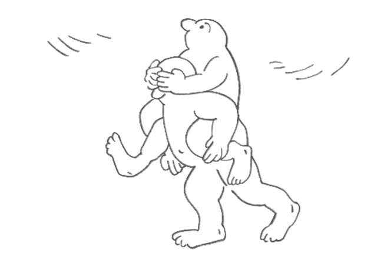
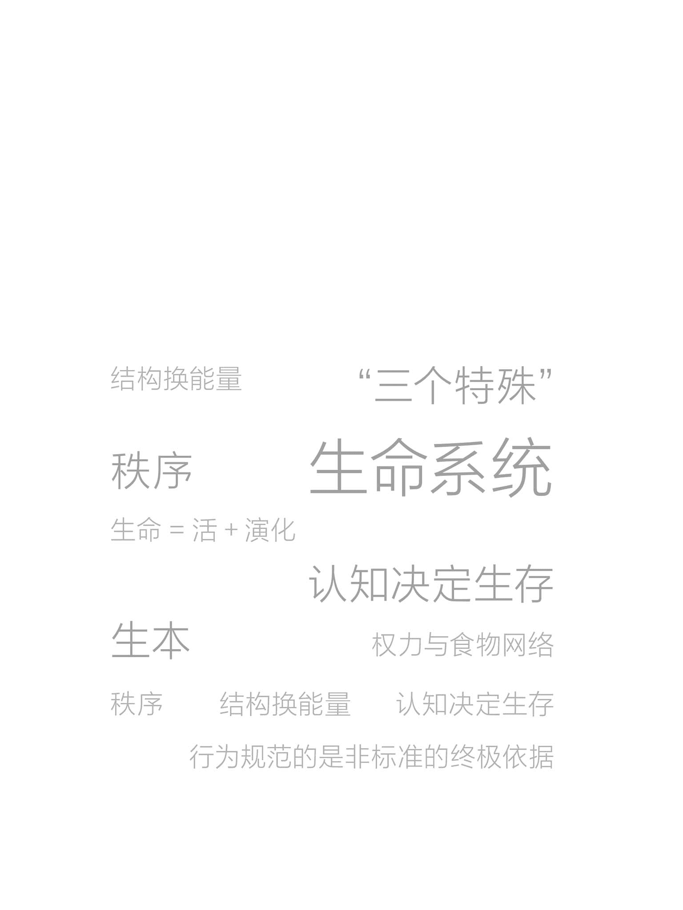
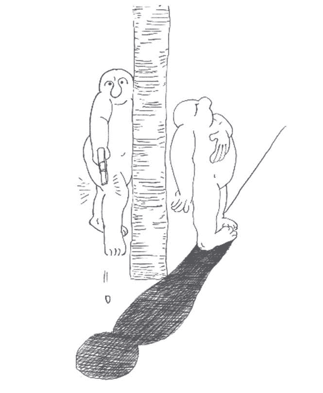
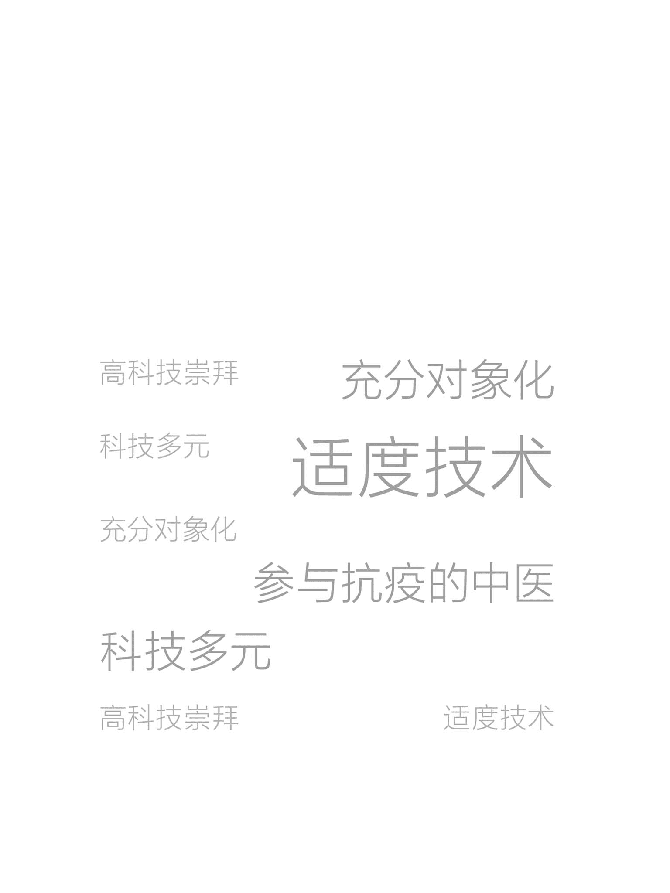
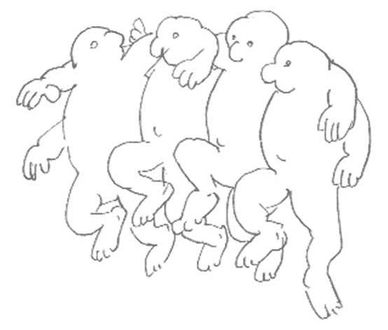
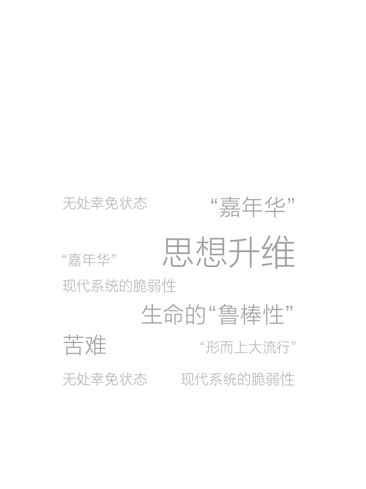
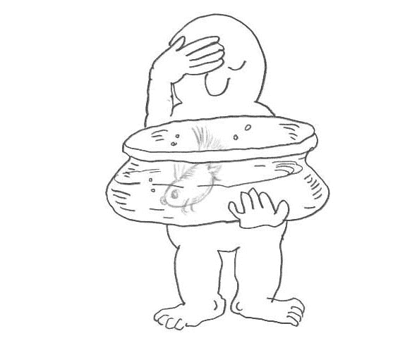
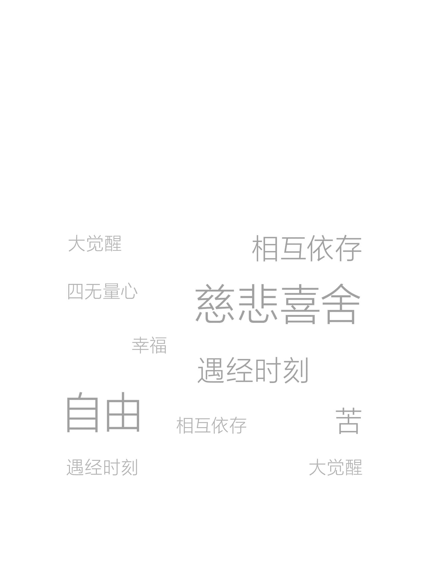

# 破局人类世：重思人与自然的共生之道

# 前言：走出认知偏差与路径依赖

**宋兵**

2019年底以来，新冠疫情在全球范围内持续蔓延、变异，呈现多波次反复态势。虽有个别国家和地区凭借早期强有力的防控举措暂时遏制住疫情，生活与经济秩序缓慢复苏，但这种“此处风光独好”局面极其脆弱。放眼全球，疫情加剧的社会撕裂、政治博弈、经济下行及地缘冲突升级仍在持续发酵恶化，世界动荡加剧。

主流媒体与学术期刊上，关于政治理念、治理框架、社会心理及公共卫生危机应对的对比剖析层出不穷。然而，在这危急关头，我们是否应更深层地审视人类自身的生存处境，以及塑造并推动这一处境的思想体系与制度安排？新冠疫情仅是近年来人类面临的诸多全球性挑战与灾难之一。生态环境持续退化、气候变化加速、地缘冲突不断升级，更多自然与人为的全球危机仍将接踵而至。借此契机，我们是否该深刻反省那些被视为正统的价值体系与认知范式，甚至回溯哲学源头，重审一系列根本性命题？德国哲学家马库斯·加布里尔指出：“新冠疫情暴露了21世纪主导意识形态的系统性脆弱性，即我们坚信仅靠技术进步就能推动人类与道德的进步”，他呼吁发动一场“形而上学的大流行”，以唤醒人类社会全新的全球意识。

哲学家赵汀阳积极回应，主张人类需要一场如疫情般强效的形而上学反思，“赋予思想集体免疫力”，冲破现代思维的维度限制，发掘或建构超越现代性的更高思想空间。应邀，我们邀请数位哲学家与生物学家共同探讨：生命与人性的本质是什么？人如何与自然及其他存在关联？生命演化与变异遵循何种规律？自由、幸福、苦难、生死究竟意味着什么？飞速发展的高技术文化能否助人类摆脱深化的困境？当下最迫切的思维转向何在？以下呈现参与作者的核心观点与论证。

## 生命何物？人性何为？人与病毒的共生图景

生物学家白书农回顾数十年研究与思考，打破了将生命视为静态、单一物质形态的陈见，主张从“生命系统”视角理解生命。他认为：“生命 = 活着 + 进化（迭代）。‘活着’是涉及**特定**环境因子的**特定**相互作用（即碳骨架分子），由分子间力结合，即结构能量转化循环。‘进化’是上述三个**特定**相互关联要素复杂性的自发增长。” 依此定义，生命系统是一种特殊的物质存在模式；它依赖分子间力相互作用，“是在持续分离与组合的动态过程中，为人类所识别的一个相对稳定的中间状态。”

那么，人是什么？在这复杂的生物圈中扮演何种角色？白书农认为，从生物学看，人本质上是地球生物圈的一个子系统。人与其他生命子系统的区别，首在于生殖隔离，更关键在于人类独有的认知能力。这种能力使人类摆脱食物网对自身维持与进化的束缚，踏上区别于其他生物的演化路径。审视新冠病毒冲击下人作为生命子系统的运作要素是否发生变化时，白书农指出，疫情凸显的诸多问题实为人类生命子系统长期积累的顽疾，病毒仅是引爆深层矛盾的导火索。与其陷入对疫情的盲目焦虑，不如深省长期坚持的“唯人类中心论”或“唯神中心论”观念。在白书农看来，“既然人是生物，人类生存发展终须遵循生命系统的基本法则。”这些法则在地球生物圈出现前已形成，亘古绵延不绝。

德国人类学家、哲学家托比亚斯·莱斯深刻洞见微生物与人类的共生纽带，却惋惜人类思维几乎从未站在微生物（如病毒）视角审视自身。事实上，“对新冠病毒而言，人与动物无本质区别。反之，对新冠病毒（及任何人兽共患病毒）来说，人类只是动物中的一员，只是另一个多细胞生物，另一适宜繁殖的栖息地。”我们从未真正生活在“人类世”，而始终身处“微生物世”。莱斯呼吁人类在思想意识层面摒弃“人类世”陋习，学会从病毒视角理解判断星球与人类社会。的确，人体约有50万亿细胞，携带的微生物数量超细胞数十倍以上。这些种类繁多的病毒、细菌、真菌构成人类微生物组，与我们共生共存。若以数量与活力论“英雄”，微生物才是这颗星球真正的霸主！人类仅是数千种哺乳动物中的微小一群。相较细菌病毒，我们不过是横行霸道的地球“后来者”。

那么，病毒是什么？在这场关于生命的热烈讨论中处于何种地位？它是生命吗？与人类有何关联？病毒在地球存在数十亿年，自智人出现起便与我们共存。病毒非独立生命，必须依赖宿主细胞开展生命活动与进化。由此，病毒与人类形成共生共存局面。莱斯指出：“病毒拥有推动变革的巨大能量。凭借跨物种传播、变异、重组能力，以及在细胞间拾取转移遗传物质的特性，病毒对细胞生命演化贡献卓著。没有病毒，哺乳动物不会演化；没有基因组中的病毒 `DNA`（脱氧核糖核酸），人类生物无法发育，器官也不会具备现有功能。”

# 病毒揭示的真相：人类从未是自然的主宰

科学家发现，同其他哺乳动物一样，人类之所以能进化为胎盘哺乳动物、实现胎内孕育并延续演化历程，关键在于病毒蛋白的协助。病毒学家与人类学家达成共识：病毒才是推动人类进化的最强引擎。我们或许因热衷群居、社交与环球旅行，成了病毒极佳的宿主，但绝不能因此掉以轻心。人类显然不是它们的唯一归宿；病毒并不依赖我们——失去人类，病毒依然会“长生不灭”。这场全球性疫情唤醒了一个被遗忘的教训：人类离不开自然，自然却未必需要人类。这或许也是老子两千五百年前洞见的重现：“天地不仁，以万物为刍狗。”

那么，该如何重新定位人类在自然中的坐标？新冠疫情或将成为压垮“人类中心主义”骆驼的最后一根稻草。现代社会意识形态的基石之一，便是人类中心主义。近代以来，人类自诩已摆脱动物的“低级趣味”，跳出自然界，实现了对自然的掌控与物种的超越。自然界的价值，被简化为能否被人类利用开发。作为“最高贵”的存在，人类理所当然地以自身利益为轴心，利用、开发、改造万物。进入现代社会，人的主体性膨胀至巅峰，登上神坛。这种准神性的主体性与资本逐利逻辑结合，借科技之翼，铸就了赵汀阳所言无处不在的“狂欢状态”。“幸福学”充斥公共哲学；人人拥有绝对“主权”，极大化地伸张个人自由，将私人偏好合法化、合理化、甚至道德化。虽曾有过零星“觉醒时刻”，但人类又迅速被新科技发明、全新生活方式所吸引，再次戴上“面具”，重返“狂欢”舞池。这场全球大流行，或将彻底击碎人类成神的幻梦。

## 从“狂欢”跌入苦海：何为人的幸福与痛苦？

新冠疫情骤然放大了全球数十亿人的恐惧、痛苦与丧失，将众人推入赵汀阳所谓的“无路可逃状态”。无论身处何地、肤色贫富、地位国籍、政治立场为何，病毒一视同仁，以闪电之势横扫全球，让人猝不及防。这正是人类直面生存级风险时的真实处境。也是因此，著名思想家贾雷德·戴蒙德认为，这是人类史上首次遭遇真正的全球性危机。

除了前述现代人意识的“错位”、亟需正视并弃除人类中心主义，本书作者还主张深入反思构筑现代社会基石的其他概念——如幸福、痛苦、自由。赵汀阳指出：“我们更需要一种维特根斯坦式的‘无情’反思，从伦理之外反思伦理，否则结果不过是自我确证，即预先肯定我们希望肯定的价值。”他认为，在人类“狂欢”态势中，社会沉溺于不断制造与享受幸福。但在解释生命的坐标系里，“幸福只是一个坐标，至少还需要痛苦作为另一个坐标，才能构成生命的定位。”现代社会提供的“幸福”，缺乏承受痛苦的韧性。赵汀阳视痛苦为人类无法回避、亦无“解药”可解的根本问题。他说：“痛苦问题无法省略或规避，因为痛苦超出了主体性的能力范围，拥有如本体般的绝对外在性；因此，痛苦是一个绝对的形而上学问题。”正因痛苦是基础且无解，赵汀阳认为它或可作为“形而上学大流行”的切入点。

佛教哲学家、日本出家禅僧杰森·沃斯如何看待幸福与痛苦？他指出，当下世界的幸福被定义为“万事遂我意”，并捆绑着一个假设：“幸福即我得所愿，运气由我主宰。幸福就是得到我渴望的世界。”借佛法视角，他揭示：“我如何才能幸福”这一提问本身，就是佛陀所言“苦”（duhkha）的症状——释迦牟尼把“苦”诊断为人生第一圣谛，“它是持续的无常，是遭遇境遇时的不适与失衡。”沃斯指出：“我越渴望幸福，越加剧这个根本问题——这个根问题就是‘我’，那个早已对自我及所处世界感到不适的‘我’。”于是讽刺地，越追求幸福，越深陷“我”所暗含的不幸之中。这是幸福的悖论——痛苦与对幸福的执着追求是同一枚硬币的两面，“我们对追求幸福的执着，恰恰维系并加剧了我们的不幸。”不禁让人想起美国建国先贤在《独立宣言》中的铿锵誓言：追求幸福是不可剥夺的权利、不证自明的真理。他们恐未料到其中的讽刺。 或许他们也未曾想到，现代幸福观建立在自我膨胀、掠夺自然、过度消费与贫富悬殊之上。这场疫情或能逼使人们放缓脚步，反省那些看似合理实则虚妄的现代“自证真理”，推动意识的转向与重塑——这是全体作者的共同期盼。

## 高科技能否领人类出困境？

抗疫全程，科技展现了硬核实力：从病毒基因分离测序、病例检测诊断，到药物疫苗研发，再到信息采集分类、大规模人群追踪、测温、识别分析，科技无处不在，当之无愧成为人类抗疫的核心工具。疫情爆发后，借科技之力，线上办公、线上经营、线上教育基本恢复了社会运转。的确，科技给了我们对抗病毒的底气、脊梁与手段。但耐人寻味的是，在这场抗疫战中，“另类技术”——中医药，在疫情预测、疾病预防、轻症治疗及康复期调理上大显身手，引发了早已被高技术“驯化”的大众的关注、质疑或赞赏。

# 疫情镜像下的哲学突围：重思技术崇拜与自由本质

哲学家张祥龙借由疫情中中医命运的起伏，精准切入了当下社会对高技术的盲目迷信。技术固然关键，一旦其被神圣化为至高无上的意识形态，人类便误入了自我封闭的歧途。张祥龙剖析指出，高技术的本质是“彻底的客观化”，它能在较短周期内爆发新效能——催生新生产力、赚取商业利润、斩获诺贝尔奖、捧红“技术伟人”，从而强化持有者对自然与他人的掌控力。

毋庸置疑，技术在人类演进史中扮演了强力引擎，极大改善了生存条件、延长了寿命、提升了生活品质。然而，若这种推崇异化为垄断性、非黑即白的思维定势，凝结成一种意识形态——即“视高技术为各领域唯一真理，强制全球推行；将同领域内的其他研究或实践路径视为异端，乃至非真理，非打倒排除不罢休”，张祥龙将其定性为“高技术崇拜”。这种崇拜排斥异质方法论，其真正跪拜的“并非真理，而是权力”。

张祥龙直指全客观化高技术思维的短板：它“跟不上生命时间的流动”。中医思维依托“时间化或机会化的理解”，凭借“功能化”与“互渗化”实现整体认知。它不排斥客观分析，却更强调整体把握身心、治未病（即未客观化的疾病）、随机应变调整方案，并主动融合饮食、起居、身心调养。基于中医在疫情中的亮眼表现，张祥龙呼吁人类打开思维闸门，以多元视角审视生存境遇，充分融入非客观化、阴阳机变的思维维度。

进而，他提出“适宜技术”概念——即“最适合局部共同体乃至全人类整体生存的技术”。他进一步阐释：从时间维度看，它能最优平衡当下迫切需求与长远利益；方法论上，兼容客观化与非客观化；生活品质上，让人最大程度嵌入融合安全与舒适、物质与精神、守成与进取（传统与创新）、质朴与丰盈、自然与人造，从而体味美好人生。

## 人如何获得真正的自由？

这场全球疫情中，自由议题同样引发深度共振。新冠高传染性确认后，中国迅速对首个爆发地武汉实施封城，随后封控、封社、居家、强制社交距离、流调溯源、停航停运等举措铺开全国，有效遏疫、缓解医疗挤兑。但初期，这些举措在国际舆论场遭遇猛烈抨击。

意大利思想家阿甘本在疫情伊始，便以最激烈姿态反对意大利政府限制自由令，引爆全球知识界论战。他指责紧急举措非理性、源于恐慌，是当代政府借危机夺权滥权的把戏，忧虑“例外状态”常态化。他主张不应为“赤裸生存”牺牲“质性生命”，苟活不如死。 赵汀阳认为阿甘本“毫无节制地升格新冠语境，导致问题错位”。他指出，特定条件下让渡自由，类似经济学中甩不掉的“成本”，是维系一切幸福生活可持续性的前提。显然，赵汀阳的批评颇为克制。在我看来，阿甘本虽非全无依据，但在疫情紧迫、病毒未明之时，将限权措施可能引发的“权力滥用”风险推至极致，预设措施不可逆而加以驳斥，未免矫情——将现实困境异化为课堂思想实验，钻入思维死胡同。

王荣荣汲取庄子智慧，以道家话语体系构建了一套适用于“无可奈何”境遇（封控期）的身心应对机制。她聚焦庄子“乘物”“游心”“养中”三维：“借‘无可奈何’明‘乘物’，探究极乐之源识‘游心’，诠释‘养中’赋予生命终极意义。”庄子“乘物”揭示：生满变数，人控局有限，故“安时处顺”、修德应变至关。“游”化应变之道。王荣荣辨析“游”源三境：外游、内游、道游。外游即今人痴迷的观光“五色令人目盲”，封城闭户时显失适用。内游与道游才是“道之瞬间”当聚焦之处。内游植根于自观能力：“心意之游不借外物、外刺、感官输入，是自足闭环。”道游更进阶，游于道、游于无穷，不系物境，“从天执道”、“至美至乐”。终极“游”境是“无不适、无不达、无不观”。显而易见，这“游”与现代社会通行的“自由”判若鸿沟：前者是内省、自诘、觉知升华；后者是强化主客对立、向外索取、陷入斗争的意识形态。

# 养中：通向内在游逸与大道游逸的捷径

王蓉蓉指出，“养中”是实现“游心”与“游道”的权宜之计。她解读庄子思想时强调，养中包含三个维度：养心、养气、养督脉。这三者构成了应对变局、顺应命运、把握那些不可测之事的实操路径，助人捕捉转机、做出最优抉择。

那么，佛家哲人如何诠释自由？维尔斯严厉抨击了当下部分美国人流行的自由与权利观。这种观点认为，凡阻碍我随心所欲者，皆侵犯人权、践踏自由。基于此，他们拒戴口罩、抗拒社交距离、抵制流调溯源。维尔斯将这种罔顾他人与自我安危、妄索权利自由的行径，斥为“愚蠢的权利主张”，实则是人类索取“胡作非为的权利与自由”。正是这种自由观及其实践，诱发了生态危机，让我们无视动物栖息地与生存空间，加速了病毒跨物种传播。维尔斯深信，现代社会追逐的自由，“并非包容于自然自由（如法家、道家所言）之中，而存在于我们任性的抗争里，其旨在将自我凌驾于自然之上。”

## 生死何物？何谓解脱生死

“生死事大”、“活着是硬道理”、“好死不如赖活着”……疫情期间，这类民间呼声与表达在日常闲谈与社交媒体上极高频刷屏。封控期中国民众间的互助、守望与支撑，更达到了高峰。

思想层面看，我以为这份强烈的求生渴望，源自《易经》的“生生之谓易”。依此观，生生不息、变易不居乃万物本性。乾坤为自然至高生命力，赋予并维系万物生生不已、繁衍昌盛，即“大德曰生”。中国本土哲学汲取自然创造力之精华治国平天下：儒家法乾“自强不息”，追求君子人格理想；道家贵坤“厚德载物”、无私利他，效法大地可育生命品格、天人合一。简而言之，“生生”礼赞生命、生存、创造、给予、繁荣、延续与共生。这种生死观塑造了国人自强不息、乐观向上的心性。沉浸中西哲学比较多年的哲学家赵琳琳指出，中国哲学的起点与核心问题是“求生”——如何保全生命、善度一生、延年益寿，与西方哲学因好奇而“求知”形成鲜明对照，由此衍生出迥异的价值体系与生死态度。

论及死亡，儒家“避重就轻”，秉持“未知生，焉知死”；道家生死观则截然不同。道家植根于“道生万物、自然至上”的宇宙论，视生死为道之自然律令。庄子更以超脱、挑战甚至幽默的笔触论生死：气聚则生，气散则死，生死相继、本为一体。死亡不过是人生形态的另一种转化，乃造化自然程序，何足挂怀？

总之，“生生”观念深刻铸就了中国本土哲学特质、国人价值取向与生存范式。构建并维系国家的决定性举动，在于持续将“非我”与“我”剥离，其中“非我”指仍亲近自然的病原体或局外人，故而更具兽性而非人性。

---

## 一场大规模“无差别”事件

病毒触发的人与非人事物指数级关联，冲击现代政治形态几何？

我逐渐意识到：新冠是一场大规模“无差别”事件。意指它逐步抹平了近代早期确立、后被视为理所当然的人/然二分。这种无差别呈现于多个层面，此举三例。

**首层最显性，源于病毒的人兽共患属性。** 蝙蝠、穿山甲、人类：在新冠病毒眼中，人与兽无殊荣。反而，对新冠及一切人兽共患病毒而言，人类不过是动物中的一种，仅是适合其复制的另一种多细胞宿主。

过往我们屡有机会认清此“兽性”事实。禽流感、SARS、猪流感、MERS、HIV等近年频发，宿主分别为鸟、蝙蝠、猪、骆驼、黑猩猩，亦有禽猪混合病毒。每一次人兽共患病爆发，人兽、人与非人之界限便消弭一次。

**次层在基因组：人类基因8%源自病毒。** 这8%乃远古人兽共患的遗存。约5亿年前，首批多细胞生物自细菌演化出，病毒入侵多细胞生物，并嵌入基因组，重塑其发育进程与行为模式。

# 病毒、自然与政治：从新冠审视微生物世界

这非偶发，而是反复上演。

病毒拥有驱动演变的巨大能量。凭借跨物种传播、变异、重组之能，以及在细胞间搬运、转移遗传物质之力，病毒对细胞生命演化贡献卓著。无病毒，哺乳类不存；无病毒DNA，人体无法发育，器官机能难成。

人兽共患层面揭示我们是动物中的动物，消解人/然之别；基因组层面则揭示我们是病毒世界细胞演化的偶然产物，同样消解人/然之别。我们携带的8%病毒DNA，昭示基因组史早于人类史数亿年。而新冠大流行，实证此演化正在当下发生。

### 第三视角：我们只是众多“池塘”中的一个

当单细胞真核生物通过融合演化为最早的多细胞生命时，它们诞生于微生物的汪洋大海中。这些初生的多细胞生物，从一开始就极度依赖周围的细菌与病毒。事实上，它们直接将这些微生物纳入自身细胞结构，委以细胞自我维持的重任：细菌承担代谢职能，病毒则通过清除过度繁殖的菌群，扮演起“生态平衡器”的角色。

亿万年时光流转，这一本质未变。所有已知生物体内皆栖息着微生物群落——细菌、古菌、真菌与病毒。离开了它们，生命无法存续，机能难以维系，人类也不例外。我们每一个器官系统的运作，都仰赖细菌的代谢产物；而我们的健康底色，最终取决于病毒对菌群的精准调控。

令人惊叹的是，这种“调控者”身份并非人类独享。在所有已知生态系统中，病毒皆通过捕杀过量种群，维持系统功能与生物多样性。人类最早是在池塘生态系统中发现并研究这一机制的，随后才在人肠道研究中得到印证。

不妨换个角度看：对病毒而言，人类肠道只是无数“池塘”中的一口。有的池塘在热带雨林，有的在草原都市，而“人池”恰好位于智人体内。病毒揭示了一个深刻真相：人类仅是病毒世界中众多多物种生态系统之一——众多池塘之一。一切系统，皆在病毒的调控之下运行。

当然，层级远不止于此。最发人深省的莫过于病毒调控碳循环，彻底抹平了“我们”与“生物圈”的界限。但暂且止步于此，梳理新冠疫情所映照出的世界基本面貌：

> 1. 万物生灵，皆生存于细胞内外的病毒云雾之中。
>
> 2. 人类与病毒（及其他微生物）有着漫长的共同进化史。它们塑造了我们，融入我们的躯体，彼此不可分割。
>
> 3. 我们本质上也是微生物——病毒世界中多物种组合体的成员。我们相互编织、渗透，再无法剥离。

这一世界图景，与现代政治架构隐含的认知截然相反。病毒的移动轨迹——疑从蝙蝠至穿山甲，再至人类——彻底击碎了现代政治视角的根基：那种将“人类事务”、“自然事务”与“技术/人工事务”泾渭分明的界限，已显荒谬且站不住脚。

面对这种局面，我们该何去何从？

## 重新定义：人、自然、技术

首当其冲，是重构“自然”、“人类”与“技术”三大核心概念。

在霍布斯及其现代追随者笔下，自然是“外部世界”，即非人世界、动物世界。动物被视为野兽，缺乏理性，为无序自欲与即时肉体激情（饥饿、性欲等）所奴役。因此，自然被设定为永恒的战争状态，是恐惧、猜忌、孤独与死亡的代名词。霍布斯派偶尔将动物比作机械自动机——有本能无智慧的活体机器；在历史哲学兴起后，他们又将自然浪漫化为人类曾归属却已疏离的“起源”，痛惜原始智慧的失落。

但病毒视角下的自然，与此截然不同。首先，自然不再是那个“外部”的非人世界，而是囊括万物的整体。无物能超越、超脱或置身自然之外，人类事务亦在其内。既然自然不再是“外部”，人与动物的界限便随之消解。

**特征一：深度互联。**
一切生物彼此交织，且与生物圈整体牵连不断。生物个体与其栖息生态系统的边界难以清晰勾勒，仿佛轮廓模糊、相互渗透。个体与生态系统的差异消弭了——它们遵循同一套自我维持法则。

**特征二：协作与变化的共生共舞。**
所有生命形态（程度虽异）皆是深层进化史串联的多物种协作体：生物体、细菌、病毒三方协作；细胞生命与非细胞生命协作。生物提供栖息地，细菌供代谢能，病毒统筹整个协作架构。这是一个稳定协作的世界，更是一个变化的世界。变化本身就是协作的关键因子：病毒通过基因横向转移与基因组整合，助特定多物种生物适应新环境，持续共同进化。说自然无竞争固然天真，但惊人的是，生命演化的源头似乎在于协作——共生，而非斗争与竞争。

**特征三：纯粹无限可能性的疆域。**
新冠疫情揭示了自然的第三重面貌：它骤然呈现为充满纯粹无限可能的领域。自然的可能性恒远超现实，潜在生命形态远多于现存物种——任何已知生命形式，皆为时光长河中转瞬即逝的微尘，或许永远只是过客。

源自疫情的自然观，让历史哲学站不住脚——后者将历史视为严格的人类事件，视为脱离自然的严格进程。被自然割裂、独立存在、栖居于非自然（人工）环境中的人类，根本无法自我维系。无人能离开寄生于体内体表的细菌、真菌、病毒而存活。若自然不再是那个“外部起源”，那么“原始”与“现代”的对立消解，殖民主义的逻辑也随之瓦解。

事实上，构成人体的各类分子机制，早在人类演化前数亿年便已现身。例如我们赖以生存的跨物种信号转导通路，灵感源自太古海洋中的早期多细胞生物。用现代主义话语谈论人类，无异于将野生生物置于培养皿，倾注漂白水与抗生素致半数以上毙命，却将残存苟活的部分捧为“人类”。说得尖锐些：人类是一个无菌的抽象，一个幻想出来的和谐态。

当下的挑战，在于理解人类存在于自然**内部**，而非外部。以理性为例：若理性不可离脑神经，而脑神经的演化发育离不开病毒与我们 8% 的病毒 DNA，何谓“拥有理性”？若心智不可离神经递质（由肠道细菌合成），何谓“拥有心智”？而这肠道菌群，又取决于我们吃什么、食物产自何处、如何生产。

不妨以技术为例。霍布斯一派将技术定义为自然界本不存在的人造物，其潜台词是自然静止不变、缺乏创造力。但若换用进化视角审视自然，创新又当如何理解？当自然不再是那个稳定的“外部背景”，而是以新机制、新形态、新过程的进化面貌呈现在人类面前时，人类的技术创新不过是生物适应或改造环境的一种形式，在一个充满持续进化生物的星球上，技术创新与生物创新在原则上并无二致。

更进一步说，当我们意识到抗生素、质粒、基因编辑等最尖端的技术，实为微生物的发明而非人类专利时，“技术”还意味着什么？新冠疫情让我们得以从自然视角审视人类——这自然观与现代社会核心的自然观截然不同。这挑战诱人之处在于，无数概念亟待重估。那么，现代政治该如何理解？

## 现代政治的困境

透过新冠打开的视野，现代政治不过是为捍卫“人类拥有独立性”这一幻觉而制造的工具，本质上沦为一台“区分（人类）”的机器。当下对疫情的反应揭示了这台机器的运作逻辑：政客、决策者与媒体达成共识，病毒是来自自然、来自那个“外部世界”的威胁。

一旦人与自然的界限模糊，危险随时降临；暴露于自然中的人类面临轮廓消融、与自然合一（不分异）的风险，坠入霍布斯笔下充满“恐惧、贫穷、肮脏、孤独、野蛮、无知、残酷”的“战争状态”。支撑这种将人与自然二分的实践（称作历史哲学的回响）的关键在于：人们对生活方式仍贴近动物的群体抱持嫌恶，认定他们“尚未”成功逃离自然，更属于“外部世界”而非“此世界”，仿佛停留在文明人早已遗弃的过去。

现代政治致力于保护人类免受自然侵蚀，手段无非两端：一方面居家令禁足，不得“外出”；一方面闭关锁国，拒绝病毒、外来者、动物等自然入侵者。后者暗示国家社会是准有机体，将三十年代的生物学语汇与政治话语混淆，仿佛政治自我建构的基础在于将非我与我分离。

从新冠衍生的自然观看，区分人与自然、分离非我与我，实为任意暴力。若自然包罗万象、人类独立性只是幻觉，则“病毒在外部世界”及指责保留原始生活方式者的说法皆不攻自破。民族国家的免疫政治根基动摇，其建立在对有机体与免疫系统的误读之上：误以为有机体是独立离散的个体、细菌病毒是不属于有机体的非我；误以为免疫系统是自我/非我识别系统，故而成了不分昼夜分离非我的战争机器。

事实上，没有任何有机体能像该观念暗示的那样彻底脱离自然。昔日的“非我”——细菌病毒——实为“自我”不可或缺的组成。当代免疫学将免疫系统描述为这一多物种组合的联合管理系统。

须澄清：我非主张群体免疫或过早解封，亦非反科学反技术，相反我主张技术越多越好。我想说的是，基于维护人类虚幻自我的差异政治实践，已伤及地球（及作为地球不可分部分的我们）。我们别无选择，只能提出新的人类本质、生活方式、技术实践与政治实践。

## 微生物世：非人视角的政治学

针对这一挑战，当前存在两种相互竞争的应对策略。

第一种主张将政治视野延伸至自然。我认为这是最彻底的失败：它只是把对人类世界的责任扩展到自然界，而未从多物种自然视角反思“人”概念，根本上仍恪守人类超越自然的现代观，依然二分人与自然，因技术被理解为人造物。其结果是“外部世界的衰落”，自然与地球彻底人性化。

第二种策略源于“人类世”概念的内在缺陷而选择倒置。人类世指人类影响地球及反馈系统的新地质纪，“人类世”一词隐含道德谴责：人类影响深见地球化学，实为羞耻。其规范意涵是人与自然应彻底分离，对策是保护作为“外部世界”的自然，保护非人免受人类伤害。

概念上，两种回应皆幼稚，仍陷于霍布斯式的人然二元论，只是重述了本应解决的问题。

从哲学与诗学视角探究病毒，得出截然不同的答案——我称之为“微生物世政治”。何为微生物世？即以病毒视角观世界。

数十亿年间，细菌、病毒、真菌、古菌是地球唯一居民，占据海洋河湖、陆地空气每一寸。它们驱动创造生物圈的化学反应，为多细胞生命进化铺路。细菌制造氧气、土壤、维系海洋的食物网；病毒周期性大量杀灭细菌，调控全赖生存的地球化学循环。微生物发明了支撑地球所有生命的反馈系统，创造了过去与现在的一切生命形态。历史上所有生物源于细菌与病毒：包括人类在内的一切生物，皆与它们纠缠依存、不可分割。

从此视角看，我们绝非生活于人类世，而处于微生物世；人类世所暗示的人然界限模糊并不成立。悲哀的是，人类至今未学会从微生物（即病毒）视角思考自我，尽管我们正是这个世界的一部分。

### 政治即共生：寻找人与非人共繁的路径

倘若政治学的本质在于探究共生模式，尤其是追寻最优的共生范式，那么我们的任务依然繁重。我们需对比原核与真核生物、宿主与病毒、菌丝与树木、池塘与肠道、洞穴与森林、肺部与河流等多元共生形态。在此基础上，方能探寻出令人类与非人类生命共同繋荣的政治形态。

### 行动纲领

若将本文呈现的人类观演变历程形式化梳理，可归纳为以下脉络。

在漫长的历史长河中，人类栖居于神赐或神圣的自然宇宙秩序里，只是万物众生中的一环。十七世纪初的一场深远变革，将我们推出了那个宇宙，步入“人类世”：我们将自身与自然割裂，把自然标记为“外部世界”、动物领地与非理性之域；并试图借助技术手段，拉大人与兽的鸿沟。

如今，我们面临着告别“人类世”、学会在“微生物世”中生存的考验。每个时代都拥有其专属的政治体制、生产模式与技术观。

我们该如何摒弃“人类凌驾于自然之上”的现代迷思？如何站在我们赖以生存的微生物星球视角（我们正是其组成部分），清晰阐述何为人类、人类应如何生存、实践技术与政治？换言之，如何以“微生物世”的视界审视上述议题？

人类能否从非人世界的视角重审自我？因为我们本就是这世界的一部分，与之不可分割。为此，我们必须学会从“微生物世”的维度客体化自身；即努力确立一种以地球为中心、而非以种族或物种为中心的“我们”观念。

依我之见，这正是贝格鲁恩研究院“转型人类”项目旨在破解的难题。我们——作为跨物种的关联网络——亟需创造新词汇，界定自然状态下的人类是什么；学会阐述并践行全球政治；寻找从“自然工业化（资源掠夺）”走向“产业生物化”的路径；创造以生物技术取代人造技术的可能性。

若能成功，类似COVID-19这类由病毒、蝙蝠、穿山甲与人类组合而成的可能性配置，将不再被视为偏离人与自然边界的非理性异象。此类边界将彻底消解。我们将重归“外部世界”，成为其中一员。

（诸葛文 译）

---

# 疫后人类社会何去何从？

**白书农**

 

二〇二〇年一月二十三日，中国官方媒体宣布武汉实施“封城”举措应对新冠疫情，自此人类社会直面号称历史上首次“真正全球化”的危机。 截稿时，全球因疫死亡人数已逾五十八万，经济遭受重创。疫情引发国内矛盾频发，如美国的“黑人的命也是命”运动；国际关系亦生变数，中美关系、美世卫组织关系骤变。象征繁荣的娱乐业陷入空前低迷；人员流动骤减；各级学校关停校园转为线上教学；大批民众失业。此外，医疗资源被挤占、隔离措施落地，导致慢性病患者常规就医举步维艰。不少名流学者、媒体人感叹：世界再难回到疫前模样。

这场突变撕裂了所有人的日常。熟悉的生活秩序被巨大的、不确定的混乱取代，明日如何无人知晓。追问在所难免：为何会这样？疫情及其引发的动荡何时了结？若疫后世界无法复旧，未来将何去何从？

翻阅史册，人类何曾真处于风平浪静之中？经验表明，唯一的常数就是“变化”。若仅谈“变”，新冠带来的冲击不过是又一次“变”。显而易见，人们虽口称“变”是常态，实则对“变”的源头、冲击力度、幅度怀揣期待：期盼“变”源于善意，带来便利，幅度在大众可承受范围内。

这不过是人类的一厢情愿。现实是，“变”不仅源于善意，亦可源于善意之外的任何人类动机，当然也源于超越人类意愿的实体要素变动。 虽然新冠溯源未定，但极大概率是超越人类意图的自然实体要素发生了演变。人类看似通天彻地、全能无敌，实则在整个地球生物圈中，除自行设计的机器外，人类可控变量寥寥——往往连自身意志都难驾驭，更遑论解释意志何以生发。

从生物学审视，人类本质上是地球生物圈的一个子系统。依据现有实验证据，人类与其他生命子系统最根本的区别，除了与其他物种生殖隔离外，大概率在于人类独有的认知能力。

生殖隔离是地球生物圈区分物种的通用边界。换言之，判定不同物种的终极标准，在于是否存在生殖隔离。隔离即异种。这是动物分类学公认准则。因此，因生殖隔离而区别于其他生物，并非人类独有。但就我们所知，人类认知能力的独特性，在其他生物中缺席。若无此能力，人类或许仍如留守非洲的祖先表亲般，作为该区域食物网中层的一环苟延残喘。

因缘未明，极可能源于新基因涌现，人类获得了独特认知能力。此能不仅助人类走出非洲、踏遍寰宇，更助其通过与各地物种互动，开创出与留守非洲的表亲截然不同的生存模式——从曾与其他动物共享的采渔猎模式，跃迁至农牧模式。

# 从“逐兽”到“种地”：人类生存方式的被迫跃迁与生命底层逻辑

## 狩猎效率的反噬：为何祖先不得不“吃草”？

至今学界仍无定论，何以人类能在亿万年演化出的“采集-渔猎”范式中抽身，转向“农耕-畜牧”模式。但观察当下仍保留狩猎传统的部落——如视捕杀强壮首领兽为荣的习俗——可窥一斑：这极大概率是认知跃升带来的“负面外部性”。智力发展强化了群体协作与工具运用，催生出一种“斩首战术”：精准捕杀猎群首领致其秩序崩坏，从而大肆收割。这套高效打法透支了猎物种群的自我复原力，最终逼得人类无兽可猎，被迫陷入“食草”窘境——只能定居下来，靠面朝黄土背朝天的耕作，或跟水草转场的放牧维生。虽说日后农耕证明了获取资源的边际效率更高，但这场转型的肇始，大概率是一场无奈的被迫选择。那么，这段远古的“被迫转型”，对理解当下我们面临的巨变，有何启示？

## 解码生命系统：并非特殊物质，而是特殊“存在范式”

2019年3月，在博古睿研究院中国中心首届“博古睿讲座”《人是生物——人类转型的起点》中，我曾抛出一个核心观点：生命系统的本质，不在于构成它的物质有多特殊，而在于物质以一种特殊的**“存在模式”**在运行。在此视角下，“生命”概念实则暗合两重意蕴。

### “活”：遵循熵增定律的“以结构换能量”循环

第一重指向**“活”**——即在**“三特”**（特殊成分、特殊环境、特殊相互作用）参与下，顺应热力学第二定律，展现为“以结构换能量”的特殊互动过程。

拆解来看：“特殊成分”主攻碳骨架分子；“特殊环境”涵盖地球温压、日地关系、地球化学成分（如多态水分子等）；“特殊相互作用”则主要靠氢键、疏水键等低能态分子间力串联。这“活”的过程具备自发性：一旦碳骨架成分经分子间力相遇生成复合体的能态，低于其独立存在时的能态，热力学第二定律便驱动其自发结合。但因靠分子间力维系，外界环境扰动极易切断键合，让复合体解体、成分复归独立。

在适宜条件下，这“自发合成”与“扰动解体”两个独立过程，以复合体为节点耦合，便形成了**“以结构换能量”的动态循环**（此处“结构”指复合体，“能量”指成分独立态与复合态的能态差，及打破分子间力所需的环境扰动能）。在这个循环里，复合体不断自发生成、因扰动解体。不同成分间形成复合体的存在概率各异，最终，由存在概率较高（即更中庸/适应）的复合体耦合的过程，会以更大概率呈现——这就是**“中者得存”**。这便是“活”作为生命系统**起点**的完整图景。

### “演”：基于共价键的复杂化叠加叙事

第二重指向**“演”**——即以承载上述“以结构换能量”循环节点的复合体为基石，从共价键自发生成始，对“三特”相关要素进行层层复杂化的迭代过程。当这种迭代推演至多细胞真核生物的性状变异层面，实质上便是达尔文所言“进化”；为便理解，我们也可将这条溯源至微观理化变化的“演”称作“进化”。

### 生命公式：生命 = 活 + 演/进化

综上，生命概念的双重内涵若用公式表达：**生命 = 活 + 进化/演**。

此视角揭示：任何“生命”过程必涵“活”的意蕴，而“活”本质上是一种**开放的、以环境因子为不可或缺构件的特殊互动**。生命系统实为无数“三特”节点联结而成的层级网络；生命呈现的万千形态，不过是不同“联结”方式及其关联模式织就的网络结构在外部的投影。

## 透过生命视角重读：生存方式转型的深层逻辑

### 资源整合模式的根本重构

若上述生命解读成立，人类从采集渔猎迈向农耕畜牧，本质上不过是这一生物物种在运行“三特”时，对周边关联要素**“整合方式”**的一次切换。具体看，这“整合方式”的变迁，核心在于**生存基本资源的来源与获取形态**变了：采集时代，人直接从周边自生自灭的动植物身上取可用部位；转型后，人转而驯化种植动植物，将驯种过程中资源的**“增殖部位”**（如农耕中的“一粒种子，收万颗子”）作为生存依靠。人类食物不再是那颗留作种子的“一粒”，而是种子生长后爆发出的“万颗”。

### 变迁的非自主性与“拼凑式”演进

人类生存模式的演变：非主动选择，而是被动“拼凑”

无论“三特”要素发生变动的推手是什么，这些变化呈现的面貌，往往都偏离了人类的期待，也超出了人类的掌控。如果我们对人类从采集狩猎向农耕牧业转型的解读符合史实，那么无论是因为猎物耗尽这一近因，还是认知能力进化这一远因，都非人类所盼、所能控制，更非为了实现“预设农耕目标”而刻意努力的结果。变化的降临，不过是打破了旧有的生存模式，为新模式的涌现铺垫了条件。究竟是农耕还是牧业最终登上历史舞台，实则是不同区域的人类，基于各自生存空间里可利用的要素，被迫“拼凑”出的唯一出路——若非如此，这些群体早已湮灭在历史尘埃中。这正如法裔犹太生物学家弗朗索瓦·雅各布在1977年《进化与拼凑》一文中所喻：无论手头有什么材料，只要能堵住锅上的窟窿 。

### 直面疫情：生命系统的网络重构

#### 疫情冲击下的“连接”断裂

若影响人类生存的重大变迁，其诱因与后果正如上述生存模式跃迁所揭示的那样，那么我们大概能悟出：生命系统存续与可持续发展的关键，不在于追溯外部要素变动的因果链条，而在于聚焦当下存量要素中，哪些能形成适度互动以维系系统运转，进而将这些“可能的互动”转化为“现实的联结”。

正如当年猎物消失（无论因何消失），人类无法坐待种群自然恢复，只能被迫探寻获取生存资源的新路径。那些侥幸存活的先祖，恐怕做梦也未曾想到，被迫的“啃草根”竟让人类很大程度上挣脱了食物网的束缚，跃升为地球生物圈的霸主。

换个视角审视新冠疫情：人类生命系统运转相关的要素，哪些变了，哪些没变？首先，系统新增了一种病毒。它的闯入夺走无数亲人与生命，让恐惧——源于未知与无力的恐惧——以前所未有的浓度笼罩众人。因恐惧，原本维系人类社会生命系统网络结构不可或缺的“连接”，尤其是人与人、人与职场的链接，被人为切断：封城、封校、社交距离……网络结构与运行模式由此剧变。

#### “复原如初”还是“重构网络”

新冠疫情的未来走向扑朔迷离，由疫情引发的恐惧能持续多久、该持续多久，无人知晓。病毒会像SARS一样莫名消失，还是像流感一样长驻人间？在因恐惧而人为切断连接的社会生命系统网络中，当不同节点间的“连接”有条件重新关联时，人们是该像修缮古建筑那样“复原如初”——找回从前的美好，还是该重塑连接、构建新网络，让社会生命系统以新形态运行，正如人类当年的农牧转型？无奈的是，病毒带来的不确定性，让人类无法对此做出有效评判。

#### 矛盾冲突的深层溯源

当人们感叹“无法回到从前”，不妨追问：从前真的“好”吗？若答案非肯定，再问：从前的“不好”，是新冠造成的？显而易见，那些看似由病毒触发的矛盾冲突，早已潜伏许久。只是病毒冲击了既有社会运行模式，被切断的“连接”在相关节点生出新联结，或是原本被社会角色掩盖、压抑的“连接”浮出水面，给积压已久的矛盾冲突提供了爆发口。

#### 构建更具韧性的新网络结构

由此观之，引发矛盾的症结非因病毒而起，亦不会随病毒而去。新冠冲击之重，根源在于人类社会作为生命系统，其网络结构与运行模式早积重疾，许多“连接”及其关联方式已难以为继。对生物医学专家之外的大众而言，除了关注感染数据、疫苗研发等务实议题，更应聚焦疫期暴露出的问题——包括那些未爆发却实存的隐患：究竟哪些互动关系已不适用，进而探索如何在节点间建立新“连接”，织就更具韧性的网络结构与运行模式。

### 认知能力与人类演化的特殊路径：从“三要素”到“二要素”

#### 好奇心的起点：多元主义与文明冲突

人们能列出长清单，梳理疫情前人类社会的诸多顽疾。其中哪些最根本、最可通过人力调整？这关乎我近30年持续观察一个现象的好奇心起点。

1991年，我初到伯克利做博士后，发现“多元主义”（多元文化）成了热词，颇具冲击力。我直觉反问：若“多元”成主导范式，不同观念者的利益冲突该如何化解？支持者言：靠法律。可法律赖以立足的原则，不也是一种观念吗？对话至此陷入僵局。三年后离美前夕，听闻塞缪尔·亨廷顿的“文明冲突论”引发热议，因缺乏史识，我当时全然不解为何此时讨论此题。

直到1998年入职北大，在与研究生群体的朝夕相处中，我才萌生了一个疑问：“他们究竟为何要攻读研究生？”这个念头引领我走进了人类行为动因的探索领域。随后，在友人的引荐下，我开始涉猎植物生物学专业之外的书籍。这些思考与阅读的积淀，最终汇聚成我在2019年“博园瑞讲座”上提出的核心命题——“人是生物体”。正如文前所述，该观点认为：认知能力是人类区别于其他生物的根本分水岭。正是这一差异，让人类演化偏离了常规轨道，开辟出一条独属于自己的新路径——“认知决定生存”。若这一分析切中了人类演化的要害，那么“认知”的关键作用，究竟具体体现在人类社会的各类问题及其调适机制之中呢？

### 动物种群的“三要件”架构

要客观理性地剖析这一问题，我们必须跳出人类视角，以生命系统演化的通用特征——特别是动物系统的演化逻辑——作为参照坐标。在生命系统演化机制中，到了真核细胞阶段，所有真核生物都被迫呈现为“双主体”生存形态。一是“个体主体”，既可以是单细胞生物（如酵母菌），也可以是多细胞个体（如猫、象）；它们作为整合“三特”周边要素、维持自身存续的基本单元，也就是“行为主体”。二是“种群主体”，由大量同种细胞（如发面团中的酵母菌群）或个体群落（如猫群、象群）组成。种群内部通过共享基因库、维持DNA序列多样性，从而获得应对环境不可预测变异的韧性。

因此，物种延续的基本单位、真正的“生存主体”是种群而非个体。两者通过有性生殖紧密耦合。真核生物因具备双重主体性（个体为行为主体，种群为生存主体），作为多细胞真核生物三大类群之一的动物（其余为植物、真菌），通过摄食整合“三特”要素，必然面临一个核心困境：作为行为主体的个体，如何有效关联、组合成一个可持续生存的种群？梳理过往动物行为学研究成果，我发现动物种群的自我维持机制，可高度概括为一个“三要件系统”：秩序、权力、食物网约束。

#### 秩序、权力与食物网约束

在此“三要件系统”中，“秩序”指个体行为模式必须遵循共同规则。尽管个体作为行为主体理论上拥有无限自由度，但若某物种内每个个体均任性而为、缺乏共同遵循的准则，种群成员便无法有效关联，种群也就无从存在。“权力”指种群内通常由领袖统御个体行为、维护种群秩序与完整。领袖除自身生存外，尚需承担维护种群秩序的额外重任，故唯有体魄强健者方能胜任。体魄强健暗示其携带基因具备更强生存力。因此，领袖凭借体力优势占据交配优先权，加速优势基因在种群内扩散，利于种群延续。“食物网约束”指种群作为食物网节点，其个体行为与种群秩序是在演化中通过与同种个体、异种种群互动形成的，故必然受制于食物网。食物网的存在，一方面界定了特定物种/种群作为节点的“秩序”（如个体行为模式），另一方面制约了种群内统治者的“权力”。这三要素构成良性循环，支撑地球生物圈中不同动物种群的自我维持与演化。

### 人类：打破食物网枷锁

人类另辟蹊径。如前所述，认知能力增强了种群内部沟通并革新了狩猎手段。狩猎效率提升导致猎物锐减，迫使人类踏上农牧之路。随着认知能力跃升，动物种群“三要件系统”内部三者关系在人类群体中发生质变。在人与食物网中其他生物的关系上，人类从依赖他者自我更新获取资源，转变为凭借认知介入他者自我更新过程、通过增值获取资源。人类甚至能将对其他动物无价值的物质（如泥土制成工具）转化为改善生存条件的资源。在此进程中，人类逐步挣脱了食物网（基于异种自我更新的相互依存）对自身自我维持与演化的束缚。这一突破虽极大拓宽了生存资源来源，却将动物界原本能有效支撑种群可持续发展的“三要件系统”，简化为仅剩“秩序”与“权力”的“二要件系统”。

### 认知能力的副作用

认知能力的发展，除了打破食物网约束、将维系动物种群生存发展的核心“三要件”压缩为“二要件”外，还引发了其他连锁反应。其一，认知作为一种想象力形式，持续重塑个体行为模式，冲击种群现存“秩序”。其二，认知的虚拟属性本身，重构了统治者与种群成员的关系。在动物界，“强者为王”原则由统治者维护秩序塑造而成，这有利于作为生存主体的种群优化共享基因库，最终惠及种群延续。然而人类发展到一定阶段后，掌握权力不再是体魄强者的专属特权。

# 破局：文明为何必须寻找“第三极”？

北大哲学系安乐哲教授指出，“圣人”的核心特质在于沟通力。繁体字“聖”由“耳、口、王”构成，寓意沟通高手可为王，合格君主更应具备高效沟通能力。然而，沟通能力并未写入基因实现遗传。这意味着，统治者凭借沟通得位，并以“维持秩序”之名占有额外生存资源，未必能为种群延续带来正向收益。与动物世界不同，人类的夺权斗争不再与维序能力正相关；登顶后，统治者往往将本属公共的维序资源据为私有，且种群内外鲜有力量能加以制约。

认知能力的跃升打破了食物网枷锁，虽拓宽了生存资源谱系，却同步瓦解了动物界行之有效的“三分量系统”良性循环。人类作为多细胞真核生物，其双重主体性未因认知进化而改变。一旦维系种群可持续发展的三分量体系崩塌，只剩“种群所需之序”与“维序所需之权”构成的二分量系统，如何定义秩序、如何约束权力、如何处理个体与种群、种群与物种间的关系，便成了人类生存发展绕不开、必须解的死题。

## 万年断层：从农耕起源到轴心突围

人类需要参照系来定序、约权，这参照系在哪里？

已知史料显示，农耕萌芽于1.3万年前，人类社会自此步入二分量系统；但以雅斯贝尔斯“轴心时代”为标志的系统性人类文明，却迟至2500年前才现身。为何相隔万载？从经验或理论看，二分量系统运行仅有两种模态：要么像正弦波般动荡，要么像直线般停滞。换个角度看，轴心时代的迟到，大概率是因为人们在动荡与停滞的双重折磨中吃足了苦头，不得不为种群生存，被迫去寻找一块定义“种群所需之序”、约束“维序所需之权”的靠谱基石。

## 早期试错：法典与占卜的死胡同

冲破食物网约束的种群规模，已无法退守为生物圈食物网中节点，借食物网作第三分量来定序约权，只能靠认知能力另辟蹊径。

史籍可见，各文明尝试各异。《汉谟拉比法典》显示古巴比伦试图由统治者制定行为规范，但统治者终会死去，继位者若篡改法度，谁来拦阻？凭什么篡改？商代甲骨揭示中国先民试图以占卜求取行为依据，却终结于纣王被武王伐灭。正如猎物灭绝后唯有选择“食草”（农牧）的群体存活下来，在二分量系统的动荡与停滞中幸存的种群，唯有那些在“序”与“权”之外，另觅第三力量——即“寻找第三极”的群体。由此，雅斯贝尔斯口中的“轴心时代”降临。这看似璀璨的历史奇迹，大抵如农牧起源般，不过是无奈中的偶然。

## 双轨并行：人本与神本的文明分野

轴心时代文明找到第三力量了吗？从雅斯贝尔斯分析或汤因比类型学看，文明类型的本质区别，在于对“行为规范是非标准之终极根据”的选取。细究之下，人类文明史上其实仅存两大阵营：一类溯源祖先，可称“祖先崇拜”或“人本中心”文明；一类仰望神明，可称“神本中心”文明。两者均曾为人类生存发展立功；若非如此，人类史早已面目全非。

## 全球化语境下的“第三极”缺位

无论两大文明各自是否完成“寻找第三极”的使命，残酷现实摆在眼前：认知发展带来的生存空间扩张，让原本孕育于不同地域的文明类型提前相遇。各自社会内部的三分量重建尚未完成，不同文明体系便面临如何共存的难题——彼此拥有截然不同的“行为规范是非标准之终极根据”。

撇开康德“永久和平”构想不谈，19世纪中叶巴哈伊信仰、20世纪中后期孔恩等人倡导的“全球伦理”，虽试图从现存文明共同推崇的伦理层面，为全球化语境下的人类行为规范提供“是非标准”，但在“终极根据”层面，它们实则互不相让。时至今日，互联网普及加速全球化进程，若人类作为同一生物种，不为自己寻觅一个普世的、客观理性的“行为规范是非标准之终极根据”——即为定序约权提供客观理性的“第三极”，连新冠疫情应对中暴露的矛盾冲突（包括文明内部的撕裂）都无法真正化解。从这个意义上说，90年代兴起的“多元文化”与“文明冲突论”讨论，恐难化解当下的社会矛盾与冲突。

# Pandemic, Civilization & the Trap of Tech Idolatry

## The Void of the "Third Pole": Grounding a New Civilizational Order in Life Itself

Looking back at the trajectory of *Homo sapiens*, pandemics are a recurring, inevitable chapter—arriving with fury, eventually receding. Each outbreak delivers a seismic shock to the prevailing social fabric. History shows divergent aftermaths: some plagues, like the 16th-century contagion that toppled the Aztec Empire, obliterate the existing order; others, such as the 14th-century Black Death, act as a brutal catalyst for rebirth, sparking the Renaissance; and many simply fade, leaving the societal machinery humming along its old track. Given our current scientific arsenal, COVID-19 will undoubtedly follow suit and pass.

But here lies the crucial question: when the virus retreats, will the deep-seated fractures—the ones rooted in the missing "Third Pole," unresolvable within the confines of "anthropocentrism" or "theocentrism"—vanish along with it? Emphatically, no. For those invested in humanity’s shared future, wallowing in pandemic anxiety is a dead end. The urgent task is to rigorously hunt for an "ultimate yardstick for right and wrong" that transcends those limited frameworks and can govern a globalized world. Put differently, we must rebuild a "Third Pole"—a stabilizing anchor in a three-part system that defines order and checks power through a virtuous cycle.

My proposition: since humans are biological organisms, and our very cognition springs from the unique properties of living systems, our survival and flourishing must ultimately bow to the fundamental laws of life.

Consider the timeline: cellular life, including the leap to eukaryotes, boasts a 1-billion-year pedigree (10⁹ years). Human civilization? A mere blink at roughly 10³ years (millennia). The planetary biosphere churned for two to three billion years before we showed up. The principles that sustained that continuity and made our emergence possible offer non-negotiable clues for our search. A living system isn't a mere molecule or an abstract idea; it is a distinct *mode of material existence*. This state relies on intermolecular forces, manifesting as a relatively stable, recognizable "intermediate state" within a ceaseless flux of assembly and disassembly. Anchoring the "ultimate standard for human conduct" in these biological laws constitutes "Biocentrism" (or "Life-Based Philosophy").

Fleshing out the specific ethical codes and behavioral norms of Biocentrism exceeds this essay's scope. Yet, it charts a radically fresh path to define societal "order" and leash the "power" that upholds it. This approach may not only untangle today’s deadlocks but also position humanity as a responsible steward of Earth’s biosphere, midwifing a civilization capable of genuine, enduring sustainability.

*(Acknowledgment: Thanks to Professor Jinghao Zhou, Hobart and William Smith Colleges, for insights on the draft. For a deeper dive into the living systems traits cited here, see the "Plain Talk" column on the Berggruen Institute China Center’s "Rui n" platform.)*

## References & Further Reading

1.  **Dialogue with Jared Diamond** — Global Pandemic and Crisis Management [EB/OL]. (2020-07-01). `https://www.berggruen.org/ideas/articles/dialogue-with-jared-diamond-global-pandemic-and-crisis-management/`
2.  **Friedman, T.L.** Our New Historical Divide: B.C. and A.C. — the World Before Corona and the World After [N/OL]. *New York Times*, (2020-03-17). `https://www.nytimes.com/2020/03/17/opinion/coronavirus-trends.html`; **Kissinger, H.A.** The Coronavirus Pandemic Will Forever Alter the World Order [N/OL]. *Wall Street Journal*, (2020-04-06). `https://www.wsj.com/articles/the-coronavirus-pandemic-will-forever-alter-the-world-order-11585953005`
3.  **Elements of Physical Existence:** Sunlight, water, oxygen, CO₂, metal ions, sugars, lipids, proteins, nucleic acids—in sensory terms, the foods built from these components.
4.  **Food Webs (Networks/Cycles):** The intricate, interlocking trophic relationships in an ecosystem; since diets vary, linear chains mesh into complex webs.
5.  **Zhang Y.E., Landback P., Vibranovski M.D., Long M.** Accelerated Recruitment of New Brain Development Genes into the Human Genome. *PLoS Biol*, 2011, 9(10): e1001179. `https://doi.org/10.1371/journal.pbio.1001179`; New Genes Expressed in Human Brains: Implications for Annotating Evolving Genomes. *BioEssays*, 2012, 34(11): 982–991. `https://doi.org/10.1002/bies.201200008`
6.  **Bai S., Ge H., Qian H.** Structure for Energy Cycle: a Unique Status of the Second Law of Thermodynamics for Living Systems. *Sci. China Life Sci.* 61 (2018), 1266–1273. `https://doi.org/10.1007/s11427-018-9362-y`
7.  **Carbon Skeletons:** Carbon, the cellular cornerstone, bonds via hydrogen, double, or triple bonds into chains, branches, or rings of varying lengths—forming organic backbones.
8.  **Thermodynamics & Life:** The 2nd Law dictates spontaneous processes in closed systems slide down the free energy gradient (high to low)—crudely, "water flowing downhill."
9.  **Bai S., Ge H., Qian H.** (Same as Ref 6).
10. **Jacob F.** Evolution and Tinkering [J]. *Science*, 1977, 196(4295).
11. **Power Holders/Managers:** Leaders maintaining group/population order and integrity, bearing responsibility beyond self-preservation.
12. **Live Replay | Berggruen Lecture 10:** Reviewing the Past to Know the Present — Confucian Common Sense Meets the AI Revolution [EB/OL]. Berggruen Institute China Center, (2020-07-01). `https://www.berggruen.org.cn/video/146`

# Rethinking Tech Idolatry Through the Lens of COVID-19

**Zhang Xianglong**

 

### 高技术崇拜的反思

新冠疫情爆发以来，作者与亿万同胞一样，日夜牵挂，渴盼“拐点”早日到来、疫情尽快平息。2003年我们历经“非典”震惊全国，而此次疫情显得更为凶猛，病毒更难驯服、传染性更强。此刻，在做好力所能及的防护之外，独居家中的作者不禁深思：反复出现的瘟疫究竟向人类发出了怎样的警示？写作此时，虽见诸多评论角度各异，但鲜少有人将瘟疫现象与高技术崇拜联系起来探讨。

首先须承认两个基本事实：一、瘟疫是人类历史上频繁降临的灾难；二、源自西方的高技术，特别是医药领域的高技术，是近现代抵抗威胁人类的某些疾病的利器——如青霉素治疗炎症感染，各类疫苗防控传染病，手术解决白内障、阑尾炎、牙病、创伤、难产等。总体而言，现代医学高技术及其相关认知（如对病因的认知、公共卫生必要性的认知）极大推动了人类寿命的延长，这无疑是人类的重大成就。然而，事物皆有两面。若将这些高技术奉为相关领域的唯一真理，排斥其他技术与知识，便会陷入高技术崇拜，这种崇拜对中华民族乃至全人类的生存极为不利、甚至危险。本文拟结合当前新冠疫情，论证这一判断。

基于以上，读者当明了：作者并非反对高技术本身，对其积极成就给予高度肯定。作者认为，需批判摒弃的仅是对高技术的*崇拜*。接下来，作者将重点回应以下问题：何为“高技术崇拜”？高技术为何能取得卓著成效？高技术有哪些局限？高技术崇拜已带来或潜在带来何种危险？这些局限与崇拜在新冠疫情中如何体现？如何将高技术垄断局面转化为适宜技术的广泛应用？

## 何为高技术崇拜？

首先，何为高技术？字面上，高技术指高端、先进、尖端的科学技术。但从实质内涵看，高技术是已充分客体化、能相对快速产生新效应——新生产力、商业利润、诺贝尔奖、提升“技术大师”声望，从而增强持有者对自然和他人控制力与影响力的科学技术。技术产品客体化程度越高，即形式上量化、系统化程度越高，越易成为改造自然物和人际关系的力量与手段。中西医差异恰能说明此问题。至今，西医对人体与疾病的认知已高度客体化。西医主要通过解剖学认识人体，掌握人体组织、器官、体液、神经网络的运作；继而发现细胞、细菌、病毒、基因等更微细客体，用以解释人体构成与疾病成因治疗。特别是基因发现，被视为人类掌握了理解和改造生命体（含人体）的“钥匙”。反观中医，虽有自身有效研究方法，基于阴阳五行、五运六气等理论假设，虽蕴含时序性或机缘性理解，但对人体的认知并非精确客体化、物理空间定位。中医“五脏六腑”非解剖学意义上的脏腑（这曾成中医被攻击为非科学的原因之一），而更多是功能性、重叠性或整体性认知。经络基本非客体化，却是真实人体存在；将其还原为“细胞-间隙-结缔组织-血管-淋巴-体液（内分泌-免疫）-神经多元系统”等物理实体，纵有裨益，也无法替代中医本土范式中对经络直观自证的理解。中医通过切脉知身体状况与病情，亦难用客体化因果关系合理解释。至于五运六气等时序学说，更远离客体化思维。故中医非高技术。

再如，中国古代发明由硫、硝、炭组成的黑火药，看似客体化研究成果，实则并非完全如此，与西方发明应用火药大相径庭。中国古代早用硫、硝治病（故称“药”）；后道家为求长生用其炼丹，过程中偶然发现黑火药。此后，黑火药在中国用于杂技烟火效果、驱邪庆贺的鞭炮焰火。较晚才用于军事，因缺乏充分客体化研究，威力小、难精准用于武器速射猛炸。此情况未引朝野高度重视，故中国火药也未主导后续军事发展。中国古代多发明皆以此般物态湮灭无形；源于古人思维模式与价值观，儒道皆对充分客体化技术本能警惕与忽视。黑火药经阿拉伯人传入西方，触动西方人经验感知。西方人以更精确客体化方式创造现代火药。始于1771年英国P.沃尔夫合成苦味酸（黄色结晶，称“黄色火药”）。百余年间，诺贝尔等反复改进，客体化程度日益精深，在现代技术关联系统中演变为机枪、自动步枪、高爆炮弹、火箭适用的现代火药，杀伤力大、穿山裂石。

不得不承认，迄今为止，高技术的源头在西方，即欧洲与北美。高技术的路径在于将研究对象精准、系统地客体化，借由预设假说与实验检验的结合来寻觅新突破。故而，其理想的研究范式乃是古希腊开创的数学——如《几何原本》——兼具形式的严密性与可演算、可推演、可验证的特质。当然，要将触角延伸至物质自然界，离不开反复实验，但这些经验性实践服务于数学化、理论模型化的研究框架，从而将其与其他文明诞生的“经验性”技术区分开来（此判断不尽准确，下文再论）。

何为高技术崇拜？这是一种思维与意识形态倾向：视高技术为各领域、各事务的唯一真理，须无条件在全球推行；同领域、同事务的其他研究或实践路径，被视为异端，至少也是非真理，必须排除、推翻方能安心。这种崇拜思维模式的历史渊源，主要植根于西方一神教对唯一至高神的崇拜。该宗教笃信自身是世界与生命的唯一真理，信徒有责将其普世传播；同时激烈排斥其他教派（含内部异己），视为魔鬼煽动的邪说。西方现代科学（如哥白尼天文学）初现时，曾遭天主教会残酷迫害，布鲁诺甚至因此被焚于火刑柱；可当科技取得了当年中天主教会般的统治地位，某些人——尤其是部分哲学家、政治家——便扮演起教士与宗教裁判官的角色，宣称高技术垄断真理，宣判那些非高技术路径为低劣、虚伪（伪科学）、有害。用《旧约》的话说，他们捍卫的是“一位忌邪的神”（《旧约·出埃及记》20:5），绝不容许信徒同时信奉别神或替代品。简言之，虽这些高技术崇拜者的具体主张与天主教会殊途甚至对立，但思维模式如出一辙：皆是自我排他、二元对立、你死我活。部分科学史家也持证据认为，西方现代科学的兴起与西方宗教存内在关联。

或有人辩驳：科学与宗教本质不同，科学可经验验证、造福人类，宗教则不能。宗教会反驳：科学发现仅在特定领域被（暂时）验证有效；关乎生命意义获取、重大抉择价值基石、屡败重振信心重塑等人生大事，科学教条失效，而宗教真理已被无数生命体验验证。

科学史表明，一时代的科学真理，或被后世新发现修正，或在关键环节被推翻——牛顿力学经相对论修正、平直空间观被颠覆；量子力学某些发现甚至颠覆多项既往科学真理，连爱因斯坦当时也难以接受。这表明，高技术把握的所谓真理，并非绝对意义上的真理（若指完全符合现实并带来生命幸福），而仅是些增强高技术掌握者力量的知识与技艺。故而，高技术崇拜真正膜拜的非真理，乃是权力，且是永无止境、须臾不可不更高的权力，因为高技术本就是“永不够高、必须更高”的技术。

## 高技术为何能斩获卓越成果？

按当下通行衡量标准，相较别文明、别文化之技术，高技术成果更为斐然。缘由何在？如前所述，高技术运作于科学假说与实验检验的耦合中，西方形式化数学精神渗透于假说之中。所谓经验中的实验检验，甚至某种意义上的科学假说，均由各类技术实施与提出；唯独假说中的“西方数学因子”为高技术独有。“数学因子”指一种允许自我博弈的形式化游戏结构（组合可能常新，输赢可裁决），故而具备形式内蕴的推演能力，使科学假说能将预设触角伸向经验之外——如依引力异常推演某处可能有颗行星，或凭理论预设推算光经强引力场将偏折特定角度。如此，即便后续实验多非肯定，总体上，一旦此类假说引导的实验吻合，其达成的新颖性与随机触发的深度，非别类实验与经验尝试所能及。此数学因子深刻塑造高技术探索全程；甚至在某些学科（如18、19世纪生物学、医学）尚未完全体现数学形式时亦是如此。此即康德所言：“人为自然立法。”借由被视为先天有效的数学形式与概念化因果推理，人类构建能以精准客体化发问的科学理论与实验设计；在反复检验、理论修正乃至革命中，严苛交叉盘问自然，逼其吐露在别样情境下永藏的秘密。因此，此研究范式下的科学探索与技术发展，绝非单纯观察、归纳、消化、联想、提炼、乃至缓慢领悟经验（如广义博物学），而是主动且残酷（想想那些活体动物实验）的定位与审讯。故其所获结果——无论正负——更为凸显、彻底客体化、永无止境（绝无“至善止矣”之说）、惊世骇俗（若非令人战栗）。

## 高技术的局限与高技术崇拜的障眼法

# 高科技迷思的根源：执念与康德的未竟之问

前文的探讨揭示了一个核心悖论：高科技那令人战栗的创造力，实则源于一种近乎偏执的“执念”。数学因子正是这种执念的化身——它既精巧又执拗，强迫视野仅聚焦于“形式上凸显”的存在与价值，将世界推向 `A∨￢A`（非此即彼）的二元选择架构。用科学假说加激进实验去拷问自然，并真能逼出答案来，这固然是人类智力的丰碑，却也违背了常识体验；而这背后的推手，依然是那个数学因子。数学，这个看似自恋、直觉上自证的纯形式“棋局”，竟能窥见宏大宇宙与万象世界的关键密码，对日常经验视野而言，简直匪夷所思。古希腊毕达哥拉斯断言“数是万物本源”，却未给出令人信服的缘由。康德在《纯粹理性批判》中补上了这课：数学是人类感性直觉纯粹形式（空间与时间）的表达，人类只能透过这副“有色眼镜”认识世界。若有一门学问——即数学——能展示这副眼镜（尤其是镜片）的内在结构机制，它必将大裨益于我们洞悉世界奥秘，至少能提供关键线索。更进一步，这种直觉纯形式借由超验想象力与知性概念结合，更有利于形成对世界的先验预期与预感。遗憾的是，康德后来觉得超验想象力的核心地位威胁到了概念化理性或统觉学说的建立，便大幅降格其地位，甚至堵死了后人对其深入探讨的路径。

# 康德的疏漏与“先验”范式的非单一性

显而易见，康德的回答虽具启发，却藏着巨大的盲区。具体而言，断言西方数学是感性直觉纯形式的*唯一*表达，牛顿物理学是物理因果律的*唯一*表达，实属教条之见。譬如，他视欧几里得几何为空间纯形式的独有显现，正如当时“过直线外一点只能作一条平行线”被视为不证自明。然而，非欧几何的发现证明：几何不止一种，过直线外一点可作多条平行线。这虽看似仅动摇西方数理根基，但结合库恩的“范式”理论，这个基础性反例足以说明：所谓“先验”有效的范式，或人类认识世界必带的“必要偏见”，绝非铁板一块，更非必须数学化、形式化。只要能形成某种“研究范式”，具备某种形态的推演张力，就能延伸理论预设、指导实验。数学未必非得高度形式化，中国《九章算术》即是明证；甚至《周易》的数象系统，亦是一座具备先验推演力的架构。此外，“范式”包含却区别于具体研究方法，其规范形式自证自足、大而化之——它自身包含判准，不存在单一标尺能衡量所有范式优劣。由此可知，不同研究范式各有长短。高科技范式长于数学形式化、精准客体化、赋能与竞争；而推崇“更高、更快、更强”的标准本身，也属于此范式内部逻辑。因此，过往儒释道、泛神论、亚里士多德式等范式，皆不认同此套标准。

这启示我们：“先验”不等于“唯一”。人非神，无完全透明、超越存在模式（生理结构、语言、环境、文化、挑战）的认知方式。总存在由本能与处境造成的先验前提或先验色彩。科学家也是活在具体“处境”或“生活形式”（维特根斯坦）中的人；故而任何科学研究必有其先验预设或研究范式。但如前所述，构成这些预设的空间时间纯形式或纯符号，本身不可客体化；故而它们绝不可能纯粹到只有一种表达形式。“超验想象力”建构的“纯粹意象”或“图式”，超越了可客体化的形式（含概念的客体化），正如纯三角形超越任何具体三角形（却未上升为概念），也超越欧氏几何或任何几何范式规定的抽象三角形。我们甚至可以追问：三角形必须仅限于二维或三维，而非四维、五维吗？“再生产想象力”触及不了三维之外，但“超验的、生产性的想象力”或许能够企及。

# 高科技崇拜的危险与不对称

高科技崇拜对技术研究范式的多样性视而不见，将高科技奉为技术界的唯一真理，压制其他技术路径，并将高科技内在固有的——即便从某角度看合理的——偏见意识形态化、僵化化，从而堵死了从其他角度理性研究自然的可能性。

## 高技术成就与“技术崇拜”的隐忧

尖端科技成果往往暗藏对人类的巨大威胁，甚至构成生存级风险。塑料制品、农药、毒气等化工产品，工业废气，氢弹，各类污染物与废弃物（含核废料），纳米材料，基因编辑技术，以及尚未完全实现的超级人工智能，无不如此。这在具备反思能力的知识分子圈层中，已近乎常识。反观古代中国、古埃及或美洲原住民的技术体系，虽大体满足了当时的生存需求，却未引入这类系统性险情。更令人忧虑的是，高技术内含的“永不止步、必登高峰”特质，预示着其未来产物将掌握更强大的重塑世界底层结构的力量，危险性也将随之指数级上升。然而，“技术崇拜”却遮蔽了大众对这一险情紧迫性与致命性的认知，或者让人陷入一种循环论证：即便危险存在，也只能指望更高阶的技术来修补，绝无可能通过引入其他技术范式来替代或部分替代。这无异于一群贪腐滥权的官僚，却坚持只有他们自己或其内部机构才能纠错。简而言之，技术崇拜扼杀了人类的超越性想像力，将其囚禁在现代性与高技术范式构建的意象与价值结构之中。甚至可以说，这是一场新式的“宗教审判”，扼杀了人类根本思想的自由度。

### 高技术与“技术崇拜”在新冠疫情中的暴露

此次新冠疫情，撕开了高技术的部分伤口，更赤裸裸地展示了“技术崇拜”的漏洞。

首先，距离萨斯（SARS）仅十余年，同类病毒再度引发全球大流行。这铁一般的事实证明：面对威胁种群生存的新发传染病，高技术至今仍缺乏有效的预防手段与特效疗法。疫情伊始，高技术未发出清晰预警；爆发后，除行政失职与武断决策拖累防控外，技术层面自身也问题重重。部分国家的高技术专家曾在早期高调宣称“可防可控”、“口罩作用有限”，然而疫情迅速失控，不得不祭出封城、封区、停航、停工、停课等极端强力举措。时至今日，高技术依然拿不出直接清除病毒的特效药或针对性疫苗。虽未来或能研发出疫苗应对药物，但疫情防控的最佳窗口期已然错失。这多非技术人员无能，而是由高技术本身的特性决定：其精准客观化的研究范式，要求研究对象先行显现并被精细辨识（如基因层面），方能展开研究。但传染病病原体并非完全可被客观化的实体。天花可靠疫苗根除，霍乱、疟疾、血吸虫病也能较有效应对，可病原体是有生命的，它们会随时间变异、适应新药与人类环境，产生所谓“耐药性”。因此，在高技术的视野内，我们依然看不到根除一切瘟疫的可能，甚至看不清预测与控制重大疫情的有效路径。

溯源方面至今无定论。表面上疫情首发于中国某省，继而波及多国；但回溯性研究显示，病毒或在更早时间已存在于全球多地。这一扑朔迷离的局面，揭示了高技术并非全能——面对难以被彻底客观化的生命体，它束手无策。我们常听到“这是专家的事”，可专家们在核心问题上往往各执一词，以致别有用心的政客能利用某一方观点操纵舆论。此外，高技术催生的高速运输工具与全球化流动，不仅加速了病毒扩散，更让溯源工作陷入迷雾。

其次，曾有传言称新冠病毒为人工合成。关于合成主体与动机，版本不一。笔者曾接触过一些声誉卓著的科学家、病毒专家发布的报告与视听资料，看似以确凿证据佐证此说；随即，28位科学家联名发表公开信予以反驳。不论传言真假（笔者倾向于后者），它指证了一个残酷现实：当下的高技术已具备制造新冠病毒、乃至更可怕病毒的能力，或至少掌握极高概率。专家们争论的焦点仅在于“病毒是不是人造”，而非“技术能不能造”。这暴露了另一个深层悖论：高技术拥有制造重大人类灾难之物的能力，却缺乏有效、及时管控它们的能力（见前文论述）。这种不对称极其惊心动魄！且这种不对称呈普遍性。二十世纪以来，人类能造原子弹，却始终找不到有效、可持续、可行的手段消除核战生态后果或处置核废料；能开发石油等化石燃料、制造数以亿计的塑料袋等化工产品，却对温室效应、海洋漏油、化工产品对人类与水陆空造成的长期不可逆污染损害，鲜有技术治理之力；未来高技术或能改写人类基因，却不知如何安置“超人”与常人的关系，更遑论让超人获得幸福；高技术或能创造强人工智能，却无法确保其唯利不弊。阿西莫夫的“机器人三定律”自身或存逻辑矛盾，增补辅助定律只会让局面更复杂、更不可预测。一言以蔽之，高技术既能造天使也能造恶魔，却无力将恶魔重新装回瓶中。

### 高技术医学的“物化”困境：为何它难以驾驭流动的生命？

现代高技术医学立足于将人体彻底“物化”的研究视角，其绝大多数诊疗方案锁定病原体与病变器官，奉行直接对抗的“神魔大战”逻辑——亦即“军事化”策略：消灭病原（或激发抗体清除），切除病灶。这套打法在特定场景下必要且高效，却注定先天不足。因为**完全物化的应对模式，根本跟不上生命流动的时间节奏**。

上文提到的病原变异与耐药性，便是高技术医学可望不可即的盲区。更糟的是，这种模式衍生出两大毒果：**疾病识别难度指数级上升，以及药物手术的毒副作用沉重打击**。

**识别难，如大海捞针。** 新病原及其变异株层出不穷，想在茫茫流行现象中精准定性“这是什么病”，正变得愈发繁琐、专业化、高门槛，非长期训练的专家配合顶尖设备莫属。流感季、SARS、新冠叠加的冬春季，要在涌入的患者中甄别新发或高威胁疫情，难度极大。新冠伊始（如美国早期）曾被当作流感忽视；随后有敏锐者吹哨预警，却因被草率判定为“SARS”而不予理会。甚至张继先医生等专业人士在2019年12月27日上报“新发疫情”，因无法即时给出“完全物化”的精确病原信息，声响淹没在疫情噪音中，未能撬动权威决策，导致疫情在三周内爆发式蔓延。张文宏医生近文剖析了此困境，其建议是按国际标准建立感染科与临床微生物科，强化已有的CDC直报体系，“关口前移”。诚然，若国家财力雄厚，此举能提升预警效能，配合严控疫点，是权宜之计。但能否从根上医治“物化研究与诊疗”的痼疾？基本不可能，至少存疑。

**副作用重，伤敌一千自损八百。** 高技术医学的另一痛点——药物与手术的毒副作用，同样触目惊心。癌症手术配合化疗，摧毁的是机体免疫防线；慢性病需终身服药，副作用累积往往催生新病。虽说中西药皆有副作用，但高技术药物锚定特定“致病靶点”，更难兼顾全身需求，其毒副作用往往更猛烈、更深远。对作为“灵性生命有机体”的人而言，不存在“只赚不赔”的买卖。中医聚焦人身心整体元气（阴阳互动生成的元气）；诊断用药**重时间、轻对象**；方剂讲究“君臣佐使”互补协同；珍视“治未病”——在疾病尚未物化显形时干预。因此，总体毒副作用理应远小。即便部分中成药因僵化应用如同西药般产生毒性，在中医本源范式中，这些均可规避或减弱。

**新冠疫情中，高技术崇拜演绎得淋漓尽致。** 防控体系基本乃至完全由高技术垄断。尽管如前文引用张文宏文章所反映，该体系屡屡失误，却仍拒绝其他技术介入核心判断。网络流传一段视频：2019年6月27日，中国中医科学院会议上，中医学者王永炎院士正式预测：“下半年，特别是冬至前后，延续至明年春天，会有温疫爆发。” 2019年冬至为12月22日，据现存信息，武汉首例现身于12月上旬（冬至前），正式爆发于2020年1月（冬至后）。回溯看，这半年前的预判，在爆发时间节点上**至少基本准确**；关于持续至来春的研判，也大体吻合。倘若疫情拖至夏秋，预测才算落空。

对此，《新京报》等媒体随即发声强力质疑，扣帽“神预测”“玄学预测”，径称其与“科学预测”云泥之别。文中给出界定标准：“科学预测基于清晰掌握的规律，经系统整理、总结、深化研究得出；科学家写入论文，按逻辑向同行公开基础数据与知识体系，反复研讨攻坚，且经得起质疑与检验。”但这套标准**无法完全否定王院士预测**。因为另一网文指出，王院士预测同样基于“清晰掌握、数据支撑的规律”；只是这些规律非高技术范式，而是中医**阴阳五行、五运六气**的运行规律，同样有据可循、有典可查、可质疑、可检验（上述表述已暗含此意）。至于反复研讨、发表论文，中医界完全有能力也应当去做。遗憾的是，王院士预测缺乏详实研究论证随行，这是被忽视的原因之一。但即便如此，**只能说明当下中医研究实力不足，而非中医范式无法科学预测**。若当时给予应有重视，不仅中医界会深入钻研验证，跨范式学者亦会加入共议。

### 高技术向“适宜技术”转型，破局之道何在？

《新北京日报》的那篇报道，堪称当下盛行的“高科技崇拜”的典型写照：它披着科学的外衣，垄断了对科学的解释权，硬生生扭曲了科学“终归要接受经验事实检验”的本真面目；凡是与其异质的“他者”或非高技术手段，统统被贴上“玄学”甚至“原始神话、民间传说”这类极具杀伤力的标签，一概混淆视听。文中如此驳斥王院士的预测：“神秘预测不会清楚告诉你规律是什么，也不会拆解基本原理让你看，而是事后诸葛亮，向已发生的事实靠拢解释，故对未来毫无意义。”

然而，我前文已详细论证：王院士的预测对当下（即彼时的未来）具有重大意义，倘若当初能获得应有的理性关注，其价值当更大。令人扼腕的是，无数原本具有或本将具有意义的观察与发明，竟因如此冠冕堂皇却霸道至极的理由被排挤、扼杀。唯有因这场疫情冲击深远、高技术手段迟迟无力破局，王院士的预测才被迫进入公众视野。

此外，吸取非典抗疫的教训，中医此次介入诊疗防控的时点大幅提前，迄今已展现出与高技术截然不同、却又不可忽视的积极作用。 以北京地坛医院为例，据报道：“中医方案治疗轻、普通型患者有效，重型患者也获一定疗效。初步分析显示，单纯中医对症治疗有效率87.5%，中西医结合有效率92.3%。” 广东、浙江、四川、山西、云南等多地多院均反馈同等或显著疗效。湖北武汉亦然。参与武汉抗疫的中医专家张伯礼院士于2020年2月28日受访透露：“如今不仅方舱医院全面推行中西医结合，金银潭、武汉肺科、武汉协和等重症病房也启动联合会诊，不少患者用上中药。目前武汉中药使用率已从2月初的30%攀升至80%以上。” 再如，黄璐琦院士在武汉一线临床观察发现：“中西医结合使轻症患者胸闷等不适消失更快，重症治疗周期缩短，结合组平均住院天数少于单纯西医组。” 根据更近期数据（2020年6月上旬）：总体来看，“确诊病例中医药使用率超90%，临床疗效观察总有效率超90%。”

张伯礼院士从现代药理视角解析中医抗疫机制：“研究表明，诸多中药具解热抗炎作用，能改善发热、控制肺部炎症蔓延、促进炎症吸收，发挥多环节、多通路、多靶点协同效应。此外，抗病毒之外，中医干预的优势还在于调节免疫功能、激发机体自愈力。” 这无奈之举道出实情：即便解释中医疗效，也被迫借用高技术术语乃至策略，方能博取话语权。

综上所述，作为高技术异质体系的中医，在本次疫情的预测、诊断、治疗、防控全链条中，均交出了独特亮眼的答卷。某些领域（如预测）更是实现了高技术无能为力的补位；其他方面亦彰显不可替代性。中医之所以能达此成效，核心在于其理论与实践蕴含“非客观化、阴阳时间依赖”的维度。譬如王院士预测依据的“五运六气”理论，根植于阴阳五行观，内含生命时间的非客观化维度；又如刘力红先生主张的针刺，预设经络存在，此物难以完全解剖客观化；中医把脉、开方等疗法，同样饱含时间依赖性与身体现场感知。当然，它们亦有客观化面向——即在适当时机、场域，落实为辨证分型、用药施治、疗效评估等具体客观事务。故而中医绝非止步于“治未病”，面对已成病甚至重症（如本次疫情危重患者），自有应对策略。

倘若能全然尊重中医研究范式与历史积淀，在当下条件下推行有机、灵活、平等互补的“中西医结合”，并融合藏医、蒙医等多元医学典籍，必将构筑起比单一西医或中医模式更优的防疫防线。这充分证明：医学领域“高技术崇拜”那套唯我独尊的论调——宣称唯有高技术医学掌握人体真理，中医等替代医术非科学即江湖骗术——纯属谬误。固守此说，招来的只会是危机与灾难，而非繁荣强盛，更遑论和谐久远的美好生存。

### 打破“高科技崇拜”，重寻“适宜技术”生存之道

**何为“适宜技术”？**  
从根本上说，它是最有利于当地群体乃至全人类整体生存延续的技术形态。换个角度看：在时间维度上，它能让眼前的燃眉之急与长远的未来利益达成最佳平衡；在方法论层面，它兼容“客体化”与“非客体化”两种认知路径；在生活品质上，它能将安全感与舒适感、物质需求与精神追求、守成与创新（传统与现代）、质朴与丰盈、自然本真与人工智慧，最大程度地交融嵌入，让人体验真正的美好生活。

都江堰的建造智慧便是典范；《农政全书》《天工开武》《黄帝内经》《伤寒论》《本草纲目》等典籍蕴含的技艺知识，若能因地制宜应用，亦皆属于此列。由此可见，**高科技本身绝不等同于适宜技术**，它无法独自支撑起这种生活图景。更糟的是，盲目崇拜高科技的风气，反而可能剥夺我们拥有这种生活的可能性。

高科技固有其长处，却也伴随无力与险恶。若能善用，它本可融入适宜技术的版图造福人类。但前提是必须先打破“高科技崇拜”，让其他技术获得平等话语权——正如中医方剂里，寒热毒补诸药相互制约、互为表里，才能成就最佳疗效。可惜在高科技霸权盛行的当下，这份“平等”谈何容易？

疫情防控期间，无论国内国际，对中医的质疑、误读、否定乃至抹黑从未缺席。直到过去二十年中医抗疫屡建奇功，才争取到更多主流诊疗介入的机会。即便如此，张伯礼院士这般温和的判断依旧指出：较之“非典”，中医介入虽显著提前，但时机仍嫌不足（早期中药使用率仅三成）；定点中医医院床位寥寥，系统性诊疗体系缺位。近代以来，中医在主流知识圈遭遇严重歧视，一度濒临如日本般“废医存药”的绝境，后被迫走向“单向融合”，整体实力反而进一步衰退。在国家医疗事业的资源分配、话语比重、容错空间上，中医与高技术医学之间横亘着巨沟。这场不公与非科学的乱象，核心病灶正是“高科技崇拜”。

因此，要激活中医乃至传统天文、数学、农学、绿色耕作、手工艺、食品加工、纺织冶金等仍具生命力的传统技艺，让它们在未来大有可为，首要任务是深度反思这种崇拜的谬误，打破高科技及其意识形态垄断资源、排异异己的陋习，让“和而不同”的智慧无损进入技术领域。

**复兴非复古，而需“互学”与“适度吸收”**  
中医确需从西医处汲取人体解剖、药材微观等知识，技术层面更可借鉴外科、牙科、注射、生命支持等手段。但这绝不等同于二十世纪推行的“中医科学化”与“分离有效成分”——那会葬送中医赖以生存的思想生命。真正的“适度吸收”，是敞开怀抱却坚守底线：绝不开放到被击碎、被同化，而是维护自主研究范式——哲学、理论、话语、方法、实验体系的完整独立，从而掌握自主选择权：吸什么、不吸什么、甚至抗拒什么，由自己说了算。绝不能“被吸收”，即被迫吞下足以杀死自身范式的东西：用解剖学取代阴阳五行运气经络，用CT等客体化检查取代望闻问切，用西式大学与医学院的标准培养、考核中医人才。

**技术选择权，关乎生存主权**  
一个共同体、一个国家、乃至人类命运共同体，理应拥有自主选择技术路径的权能。不能沦为“高科技崇拜”的劫持者，也不能默认每一款强化人对自然、对他人控制力的高科技新品都是必须接受的“硬道理”——正如电脑、手机、软件、网络的无限迭代升级，仿佛逼人就范的铁律。

我们亟需确立一部**“技术反垄断法”**，清除某一技术独占一切科研资源与思想空间的局面，设条款斩断技术研发与商业利益勾连的链条。借此及一系列配套举措，推动社会政治单位的技术态度完成转型：从盲目跪拜高科技，转向拥抱技术多元主义与适宜技术的生存策略、发展路径。这，才是我们守住未来的关键。

# 逆流而上的阿米什人：技术选择权的生存样本与启示

北美阿米什群体，堪称“技术选择权”落地实践的珍贵标杆。为捍卫信仰根基与家庭纽带，他们果断拒却了汽车、电话、电视、电网、拖拉机等高技术产品。至今仍着传统服饰、乘马车出行、用畜力耕作、手工制衣织布造木器，以此织密社区互助与关爱的网络，牢牢留住了年轻一代的心。

这支“逆高技术崇拜潮流而动”的群体，结局却令人意外：非但未如20世纪主流学者预言般销声匿迹，反而实现了显著壮大。人口规模从20世纪初的数千人，跃升至近年的近30万。他们并非全盘否定新技术，而是实行严格筛选：接纳无害者，如有机耕作、轮牧制、温室种植；接纳利大于弊者，如低端电脑（经改造断网、禁游戏），必要时自建离网发电满足加工需求。

然而，短板显而易见：缺乏成熟自主的技术范式，导致其筛选、改良、创造新技术的能力与信心均受制约。笔者观察，他们“拒之过多，改之过少”。若能建立自有研究机构、组建技术人才梯队、强化各定居点联动，便能在抵制高技术崇拜、驯化特定高技术、创生适用技术三大维度斩获更大成果，从而以稳固的适宜技术体系，护佑社区长治久安。

**总结而言，高技术向适宜技术转化的钥匙，在于：打破高技术崇拜，重塑经济与社区运作逻辑，乃至主流价值取向——不再将权力角逐置于首位，转而确立“真正可持续生存”（全息生态、伦理、生命意义三位一体）的优先地位。** 唯有如此，那些拥有漫长文明传承、经历史验证利于长久生存、绿色亲和的技术，方能获得应有的地位与生存空间。持续的新冠疫情更敲响警钟：技术的多元化与适宜化，关乎中华民族乃至人类长远生存，刻不容缓。

---

### 附注与参考

1.  **创作时间轴**：初稿成于2020年3月，同年7月底与2021年3月两易其稿。部分内容与拙作《生命维持技术与高技术》有重叠。
2.  **寿命延长的多元成因**：现代人均寿命大增，高技术医疗之外，生活条件改善（衣食住行教）、闲暇时间增加、养生知识普及、战乱频次下降，皆为关键推手。
3.  **“科学”定义的边界**：非西方文明（中医、藏医、古巴比伦与古埃及天文等）的自然知识是否入“科学”科，学界莫衷一是。为行文便利且基于作者认知，本文持肯定态度，故可言“中国古代技术”“印第安技术”等，但其本质区别于“高技术”。
4.  彼得·哈里森，《科学与宗教的疆域》[M]. 张卜天译. 北京：商务印书馆, 2016；彼得·哈里森，《圣经、新教与自然科学的兴起》[M]. 张卜天译. 北京：商务印书馆, 2019；迈克尔·艾伦·吉莱斯皮，《现代性的神学起源》[M]. 张卜天译. 长沙：湖南科学技术出版社, 2012.
5.  海德格尔于《现代科学、形而上学与数学》中提出“数学的”概念。见《海德格尔文选》[M]. 孙周兴编译. 上海：上海三联书店, 1996: 847–884.
6.  康德，《纯粹理性批判》[M]. 邓晓芒译, 杨祖陶校. 北京：人民出版社, 2004. 特重“先验分析论”第一篇及第二篇第一卷.
7.  康德，《纯粹理性批判》[M]. 邓晓芒译, 杨祖陶校. 北京：人民出版社, 2004. 同上, A78, A101–102, A118.
8.  海德格尔，《康德与形而上学问题》[M]. 王庆节译. 北京：商务印书馆, 2018. 特重第三章.
9.  托马斯·库恩，《科学革命的结构》[M]. 金吾伦、胡新和译. 北京：北京大学出版社, 2003. “科学研究范式”涵义见第二章、第五章.
10. 文中“先天”释为“先于实践经验”，含先天固有之意但不完全等同。
11. 海德格尔，《康德与形而上学问题》[M]. 王庆节译. 北京：商务印书馆, 2018: 118. 参页边页码或德文版第104页；“reines Bild”译为“纯粹意象”。
12. **张文宏谈疫情防控短板**（2020-03-04）：《张文宏复盘新冠：中国传染病防控体系过冬了》[EB/OL]. https://www.thepaper.cn/newsDetail_forward_6323478. 他直言：“直报系统虽强于大多数国家，却经不住海量垃圾信息冲击。每年各地上报海量病毒性肺炎，单城市单季动辄数万例，指望系统逐一甄别流感、疱疹、合胞、腺病毒……不切实际。”
13. 截至2020年末，中国在该领域表现优异，成绩举世瞩目。——再校时补注。
14. **王永炎院士“五运六气”预测溯源**：引自《王永炎院士真用五运六气预测疫情了吗？》一文，作者夜雨星风，首发“行而知学”站，见知乎（https://zhuanlan.zhihu.com/p/108198076?from=groupmessage）。真实性经多渠道交叉验证，至今未见辟谣。
    原文预言：“须观天地之象、万物之象、病健之象。故今岁江河以南，暴雨为灾；厥阴风木司天，已述太虚元象。上半年较轻，下半年尤其是冬至前后、至明年春季，有温疫发生。”
    另陈国盛2011年预测说，事后证系谣传，当事人亦已澄清。

# 04 “生生不息”与共生智慧：重塑天地人和的哲学坐标

**文｜宋兵**

截至目前，新冠疫情已在全球夺走逾450万条生命。这场跨国界的病毒危机，如同一把放大镜，将治理失效、经济动能不足、社会撕裂加剧、地缘博弈尖锐化等深层顽疾暴露无遗，更迫使我们在哲学层面重审：人类生存处境的根本逻辑，是否已发生质变？

2020年，伯格鲁恩研究院旗下思想刊物《Noema》发文回溯历史，断言这场大流行将被后世视为“伟大加速”与“认识论临界点”，它从根本上动摇了我们赖以安身立命的固有认知体系。德国哲学家马库斯·加布里尔直指痛点：疫情揭示了21世纪主导意识形态的系统性脆弱——即盲目迷信“技术进步能独自驱动人类与道德的进步”。他呼吁发动一场“形而上学的疫情”，以唤醒人类社会全新的全球意识。

展望未来数十年，无论是新型病毒来袭、气候变迁临界点逼近、核阴影挥之不去，还是难以预料的人祸天灾，全球性危机将成常态。构建新型全球意识的迫切性，将与日俱增。

丘吉尔名言“绝不浪费一场好危机”虽在近年成了陈词滥调，但“危机”二字蕴含的“危中孕机”智慧，早已融入中华文化基因。正因如此，当下亟需对人类核心价值观进行深度反思——这不仅关乎破解当下困局，更关乎能否为地球上包括人类在内的一切生命，铺就永续繁荣之路。

本文将从“生生”观与“万物一体”思想切入——这两大内核深塑了本土哲学的精神气质，并追溯它们如何在近数十年中日学界热议的“共生思想”中延续演变。当我们展望人类未来图景时，共生哲学或正是那把契合天地人三才的钥匙。

## **“生生不息”：生死视野的哲学展开**

# 生生不息：中国人的生存哲学从何而来

“人命关天”、“活着就是硬道理”、“好死不如赖活”……这些耳熟能详的俗语，贯穿了中国人的日常对话，在抗疫时期更是频频刷屏。这种对生存的极致执着，究竟植根于何种文化土壤？它折射出怎样独特的生死观？

从思想渊源上看，这股强大的生命力指向了中华哲学的智慧源头——《易经》中的“生生”之说。造《易》的圣人仰观天文，俯察地理，近取诸身，远取诸物，洞悉天地阴阳消长与人事变迁，断定“生生”——即生生不息、变化不止——乃是万物的根本属性。天地以生物为大德，赋予并维系着万物的生长�衍，故曰“天地之大德曰生”。

本土哲学流派汲取自然生生不息的创造力与“生生”理念，为人类社会治理提供启示。儒家效法“乾”刚健中正，勉励人们自强不息、开拓创新，臻于君子之人格境界；道家贵“坤”厚载万物、无私奉献，主张效法大地培育生命、天人合一。简而言之，“生生”礼赞生命、尊崇生存、鼓励创造、推崇施予、祈盼繁荣、延续传承、倡导共生。

[⁴⁷]: Content of Note 47

[⁴⁸]: Content of Note 48

[⁴⁹]: Content of Note 49

[⁵⁰]: Content of Note 50

[⁵¹]: Content of Note 51

[⁵²]: Content of Note 52

## “生生”思想与共生哲学：传统智慧的现代回响

“生生”思想深深塑造了中国人的生命观，在儒家那里找到了最澎湃的表达。儒家不强调个体的孤立存在，而是视个体为祖先生命血脉的延续。传承血脉、绵延世代，是个体的天职。换言之，一己之生只是生命链条上的一环，“生生”精神正是体现在这生命力的接力与代际传承中。这一观念也合理化了我们熟知的祭祖、孝道，以及父母对子女教育事业的焦虑与厚望。近代思想家梁漱溟指出，孔子多赞“生”语，如“天地之大德曰生”、“天何言哉？四时行焉，百物生焉”、“至诚尽性，可以赞天地化育”，读懂“生”，便读懂了儒家学说的全貌。

儒家核心教义植根于人伦关系，歌颂生生之力，肯定生命与日常生存。“生”的影响无处不在。当代哲学家李泽华将这种肯定生命的文化心态称为“乐感文化”，聚焦于现世（此岸）的家庭伦理，凸显人的主体能动性，赋予人能影响自然的创造性本体地位。这种生命态度，培育了中国人自强不息、乐观向上的心性。国学大师赵凌灵在长期中西哲学比较中指出，中国哲学的出发点与主旋律是“求生”——如何保命、善活、长寿；西方哲学源于好奇心的“求知”。二者截然不同，衍生出迥异的价值体系与人生态度。

尽管儒家与中国人普遍重视生存、生命与生命延续，并非对死亡视而不见。民间常说“向死而生”。这反映出一种态度：与其沉溺于对必然到来的死亡的议论，不如积极面对可掌控的当下生活，通过学习、修养、不懈奋斗，达到“仰不愧于天，俯不怍于人”。这种心态推动人们投入并珍重世俗生活。死亡不应让生命变得空虚苍白，恰恰因为死亡必然到来，生命才显得更加充盈厚重。鲜为人知的是，“向死而生”也是德国哲学家海德格尔的重要概念。但中国式的“向死而生”，虽同样强调人选择有意义、充实生活的重要性，却剔除了海德格尔存在主义中“孤独”、“焦虑”、“决裂”等基调。

相较于儒家鲜谈死、“未知生，焉知死”的悬置态度，道家的生死观大相径庭。道家立足“道生万物、自然至上”的宇宙论，视生死为道的自然规律。故而人的生存不靠强硬对抗，而靠法自然、守谦柔、务顺应。前者致生存、延续、繁荣；后者导致断裂、夭折、毁灭。庄子更以超脱、挑战甚至幽默的笔触书写生死：气聚则生，气散则死，生死相继如昼夜，本是一体。死亡不过是生命形式的转化，是自然的化育，何足挂怀？换个角度看，死如四时更迭，乃自然消长之常态。因此妻死之日，庄子“鼓盆而歌”，感叹生命形态如四季更替、万物流转。

[⁵³]: Content of Note 53

[⁵⁴]: Content of Note 54

[⁵⁵]: Content of Note 55

[⁵⁶]: Content of Note 56

### 生生不息：中国精神的生命密码

庄子为代表的道家思想，以一种超然洒脱的姿态看待万物生死；而融合民间信仰演变而来的道教，却走向了另一个极致——极度珍视生命、崇尚长生。通过内丹外丹的修炼体系，道教构建起一套强大的“护体延年”传统，精准回应了民众对旺盛生命力的渴望与“生”的本能。道教的核心只有一个字：**“生”**。道与命合一，终其天年不夭折，乃至羽化登仙，是其终极追求。为此，道教衍生出招魂、占卜、炼丹等琳琅满目的修持法门。

外丹虽名噪一时，却因服食金石药物导致伤身丧命者众，口碑两极；反观内丹，凭借打坐、太极、功夫等独特的身心调养之法，至今仍活跃于中华文化血脉之中。“生”的文化，早已渗入国人骨髓，“养生”更成了全民热衷的“国民消遣”。

综上所述，“生生”观念是撑起中国哲学大厦的基石之一，深植于思维方式与价值体系之中。中华文化呈现出一种独特的张力：一方面，我们刻入基因的求生本能、入世欢愉与长生渴望极其强烈；另一方面，受道家影响，我们又能以“化”为视角，平静地接受死亡作为生命形态转换的自然必然。这种“前脚拼命求生、后脚看淡生死”的辩证共存，锻造了中华民族在逆境中屡败屡战、乐观坚韧的生存底色。

---

### 从“微生物视角”重读人类命运

新冠疫情如同一记重锤，敲醒了沉醉于“以人为中心”幻梦中的现代人。哲学家托比·李思敏锐指出：我们从未生活在“人类世”，而始终身处“微生物世”。病毒眼中无贵贱种族之分，人类与其他宿主别无二致。这场全球性的“无差别打击”，彻底动摇了“现代性本体论”的根基——那个视人类为自然唯一理性主宰、拥有至高地位的傲慢预设。当下，我们亟需完成一次视角的大迁徙：从非人类的维度、从“自然一员”的坐标出发，重塑一个**“以地球为中心，而非种族或物种为中心”**的命运共同体“我们”。

### 历史的警示：别让“伪科学”再次绑架文明

借用自然规律为社会政策背书，由来已久。翻开近代史最耻辱的一页，达尔文“自然选择”被曲解为“社会达尔文主义”，为种族主义、优生学、殖民扩张披上了“科学”的外衣。虽然后者在二战后臭名昭著，但“优胜劣汰”、“零和博弈”的丛林逻辑，至今仍主导着全球地缘政治的底层心智。

然而，病毒给人类上的最生动一课是：它不认意识形态，不分国界信仰，面对的是共同的生物学脆弱性。**人类群体间深度互赖，唯有在监测、遏制、化解全球危机中“守望相助”，方有一线生机。**

### 共生：写在基因里的生存智慧

回溯百万年，人与病毒早已绑定成“命运共同体”。病毒借宿主生存�衍，同时也在进化史上充当了推动人类演变的“隐形教练”，将永远伴随物种延续。人类因好群居、爱社交、善远行成为高效宿主，却也因此暴露了极度依赖自然的短板——**自然离得开人类，人类却离不开自然**。我们唯一的独特优势，或许只剩下那份精妙的认知能力：能反省短板、向自然取经、为未来预判调整。

那么，思维该如何破局？**与其继续痴迷达尔文式的竞争叙事，不如转身汲取生物界普遍存在的“共生智慧”。**

1879年，德国微生物学家德·巴利创造“共生”概念，揭示异种生物共居的互利、寄生、偏利等多元关系。20世纪初，俄国生物学家在西欧沉迷“竞争进化论”时，另辟蹊径提出**“共生起源说”**：共生融合可催生新物种。主流科学界曾长期冷眼旁观，但近几十年证据确凿：跨物种的营养能量交换、协同共存普遍存在。

**林恩·马古利斯**的研究直击本质：真核细胞源于原核与原核的共生，更强真核源于原核与真核的共生，多细胞生命源于真核与真核的共生——**生命大跃迁的每一关键节点，都是共生的杰作。**

植物学家**苏珊·西马德**的森林实验更颠覆认知：地下菌丝网络连接全林植物，碳水、养分、预警信号、激素在暗流涌动。成熟森林不是冷酷的“各自为战”场，而是古老庞大的“合作社会”。这里有冲突，但更多的是相互依存、资源置换、信息通联，甚至跨越物种的“利他行为”。

**启示清晰可见：竞争只是表象，共生才是生命进化的深层密码与人类破局的未来之路。**

## 共生智慧、「生生」观与一体论

目前科学界主流观点认为，共生是自然界的普遍法则，甚至有学者断言，它是推动物种演化创新的关键引擎。达尔文进化论的基调是斗争、对立、零和博弈与优胜劣汰；而共生假说的内核，则是互赖、关联、取舍、共存与协同演化。马古利斯在1998年著作中预言：“人类这个物种恐怕不久就得重新定位，实现与比我们早存在于地球微观世界的伙伴们的融合。”[⁶³] 事实证明，我们不但日益觉醒于这种融合，近几十年来，共生理论更为人类健康、生态保护及环保运动提供了坚实的理论支撑与认知启迪。

生物共生与共生演进理论揭示的共处、互嵌、互赖、竞争与融合法则，在东方社会激起了强烈共鸣。这种回响唤醒了人们对跨越千年的哲学智慧的重新解读，衍生出适用于人类社会政治生活的共生思想。

### 「共生」概念的东方溯源与普及

「共生」一词何时进入中国社会政治语境已难考究，但当代中国人对它绝不陌生，甚至因高频使用而显得略微“泛滥”。无论探讨国际政局、生态文明、商业竞争，还是职场人际，共生都是高频热词。自2000年起，国内甚至有学校将共生思想纳入通识与社会课程[⁶⁴]；国际关系学者亦试图构建共生型国际体系理论，主张国家间相互理解、自我约束、积极参与、互利互惠、互鉴共进、共同繁荣[⁶⁵]。

在日本，“共生”（ともいき）亦是高频词汇。置于东亚文化语境中，共生似乎早已渗透进寻常百姓的日常关怀。虽挂嘴边，其传统思想渊源却未必为人熟知。我认为，东亚文化的共生基因，源自传统哲学中的「生生」智慧与一体论。

首先，「生生」意蕴着生发、再生、可持续发展与变化，这与异体生物共生共存的现象有着天然的契合与共振。哲学家方东美阐释「生」之原则：“生括一切范围，通乎大道，化裁万物，原始反终，养仁存爱，继善成性；无定形体，亦刚亦柔，应时而用，亦动亦静。” 他进而指出，「生」所代表的宇宙生命力包含五重意蕴：“育类性成之义、开物成务之义、生生不已之义、变化通神之义、绵绵长存之义。”《周易》以此名之曰“生生”，这是普遍贯穿万物、内在于人与动植物的宇宙生机[⁶⁶]。

### 审美共情与生命一体的确证

在日常生活中体味生命活力、与自然共情，对中国文人极具美学吸引与诗意张力。宋代理学家周敦颐留下一段佳话：友人问为何不除窗前草，他答：“与吾心相似，欲观天地生意。” 周敦颐悟到，人与草同受天地陶铸，他从这卑微生命中读出顽强蓬勃的生机，沉浸于万物一体、与大自然合一的生命喜悦。这种对异类生命的审美共情、追求天人合一的情怀，浸润在中国文人书画诗词的肌理里。即便在当下紧张忙碌的夹缝中，人们寻觅片刻宁静与自省，这份独特的士大夫情结依然备受珍视。将自然视为有机生命、坚信天人合一的观念，天然为今天反思人与自然关系、重构生态伦理提供了认知资源。

### 以「生生」为本位的价值重构

对中国思想家而言，宇宙不仅非单纯的自然现象或物质环境，更蕴含道德启示，启迪人类思考恰当的社会规范与治理框架，在情感层面激荡深层美学共鸣。既然统御万物（含人）的生命力都指向生存、延续与繁盛，人类社会的价值体系理应以「生生」观为根基。由此推衍，无论人类生命、非人生命，乃至无生命载体，均应获得应有的敬畏、尊重与关怀。

「生生」观虽强调共生共创，并不否认生命形态间存在差异、竞争与张力。如同生态界，演化是“分歧与融合的互补过程”[⁶⁷]。共生本质上是异质生物的融合与互嵌，这是一个充满创造张力的过程，涵盖竞争、互赖与适应。共生的终局非“自我”吞噬“他者”，而是持续交融、互嵌、适应、变革、融合，迈向物种多元化与新物种的共同创生。

「生生」概念精准捕捉了这份蓬勃生机与创造张力。前一“生”指生存、延续；后一“生”指赋予、馈赠生命。故有哲学家将“生生”译为“Live and let live”（生而让生）[⁶⁸]。若其他物种仅凭本能即能共生延续，拥有复杂认知能力的人类，理应能自觉反思并践行这些理念，将共生的创造张力转化为良性的社会政治关系，实现互敬、自律、换位思考与包容差异。显而易见，「生生」观与现代共生思想互文见义、相得益彰。

## 东亚共生思想溯源：从“一体”到“共融”

当代东亚共生哲学的另一条深邃脉络，源于贯穿东方思想史的“一体”观念。

道家视万物为“道”的衍生与归宿。庄子云：“天地与我并生，万物与我为一。”立足于道的本体论视野，万物本无高下贵贱之分。儒家阵营中，张载首发“万物一体”的宏大论断。《西铭》而言：“乾称父，坤称母……民吾同胞，物吾与也。”王夫之进而阐释：父母禀赋乾坤生成之德，即天地运行之气；造化之心即在其中，吾之形体性命与父母无异，亦即与天地无异。

若道儒侧重“我”与天地万物并生共长，佛家则在更纵深的层面阐释万物一体、因果相即、互摄融摄。佛陀以种种方便法门——如因果轮回说——引导迷悟众生。此说主张世间万法皆循因果、缘起性空，因果环环相扣，“生老死轮转，无有穷尽”。 故世间一切存在——人、动植物、矿物——不仅共处时空，更彼此为生存延续提供条件与支撑。在此意义上，万物一体蕴含着相即、互摄、融摄的深层关系。

究其根本，佛法大智所悟“万物一体”，建立于对究竟本源“佛性”或“自性”的证悟。众生皆具佛性。何为自性？乃“一切法所依止之本基”，能“显现世出世间一切法，五蕴、十二处、十八界，乃至戒定慧，皆从自性功德流出”。 即自性具足含摄、显现、转变万法之性能。宇宙万物（含有情无情）皆是自性功用所现。由此观之，世间万物岂非“同根同源、本一体耶”？

综上，“生生”之观与“天地人一体”思想，共同滋养、塑造并丰富了当代共生理念。

廿年来，中日学者在探讨人类前途时，大力倡导共生哲学，并将其延伸至艺术创作、建筑设计、教育、社会、政治乃至地缘政治理论。 日本建筑师黑川纪章，作为“新陈代谢”运动旗手及当代建筑界极具创见的思想者，毕生推崇共生哲学，引发中日广泛关注。他反对内外、人技、农城等僵化二元对立，试图在建筑作品中落实生物学与佛教带来的洞见。

台湾佛光山开山星云大师，依“万物一体”教义，长期弘扬“同体”与“共生”相合之理念，视为宇宙本相，主张以此增进社会凝聚、凝聚政治共识，建设“大同”世界。大师认为，“同体”蕴含平等包容，“共生”蕴含慈悲融摄。 此理念不仅关乎人际，更囊括自然与万类存在。它超越主流二元论方法论，摒弃生存竞争，反对线性进化观，肯定整体思维、价值多元与存在形态的多样化。

近年来，欧美公共知识分子亦积极倡导“共融主义”。2013年发布《相互依存宣言》，有意对标宣扬个人主义的《独立宣言》。宣言宣示：关系性是人与自然生存之本质；确认一切生命相互关联；致阐释众生共存之哲学。2018年再发宣言，指出新自由主义破产，极端个人主义、寻租与投机资本主义劣迹斑斑，共融主义应取而代之，作为后新自由主义时代的统一政治哲学。欧美知识分子所倡共融主义，与中日学者所提共生理念，虽思想渊源、理论基石、语境各异，但共鸣显著：皆提醒关注人与自然、人与人之间的关联性与相互依存；皆呼吁摒弃无序个人主义与逐利至上资本逻辑；皆强调相互责任、共存制约与自我节制。或因现代性与全球化带来的挫败，终使东西方思想界距离拉近；或吾人终能觅得一份契合天地人共同的哲学共识。费孝通先生雅言：“各美其美，美人之美，美美与共，天下大同”，勾勒出一个建立在相互联结、相互尊重、共同繁荣之上的理想共存图景。

[⁵³]: 
[⁵⁴]: 
[⁵⁵]: 
[⁵⁶]: 
[⁵⁷]: 
[⁵⁸]: 
[⁵⁹]: 
[⁶⁰]: 
[⁶¹]: 
[⁶²]: 
[⁶³]: 
[⁶⁴]: 
[⁶⁵]: 
[⁶⁶]: 
[⁶⁷]: 
[⁶⁸]: 
[⁶⁹]: 
[⁷⁰]: 
[⁷¹]: 
[⁷²]: 
[⁷³]: 
[⁷⁴]: 

# 进步的代价与共生的出路

近代以来，人类沉溺于零和竞争的“进步”叙事，以最大化财富与地缘利益为唯一坐标。这股失控的扩张欲望虽堆砌起物质文明的高塔，却挖开了生态崩塌、社会原子化、国际秩序撕裂的深坑。是时候转向自然法则与东方古老智慧中的“共生观”，将其化为行动指南。

# 05 病毒时刻：无处遁形与苦难的追问

赵汀阳

 

## 猝不及防的“无处可逃”

2020年新冠疫情暴发，瞬间让“病毒时刻”升级为政治、社会、经济与历史的多重共振时刻，甚至被视作潜在的历史分水岭。弗里德曼提议以“新冠前”(BC)与“新冠后”(AC)标记新纪元；目睹过列国兴衰的基辛格断言，疫情引发的政经震荡将延续数代，甚至永久改写世界秩序——这些判词透露出同一个预感：世界即将重构。希勒则另辟蹊径：疫情本质是一场“叙事传播”，病毒像故事一样扩散，叙事也像病毒一样传染；一旦某个叙事长期霸占公共空间，其重塑世界的能量不亚于实体瘟疫。

然而，“病毒时刻”的最终定性尚未尘埃落定，演变轨迹依然扑朔迷离。它能否真成划时代节点，取决于后续全球的应对与心态。答案一半掌握在病毒手中，一半掌握在人类手里，双方皆如难以捉摸的“无理数”。且按下不表终局预判，先来拆解病毒时刻抛出的核心命题。

若要辨析“病毒时刻”究竟是“史诗级”巨变还是“历史分水岭”，这些文学修辞须有明确坐标系为参照。以公认的划时代事件作标尺：改变生产、生活、认知的发明（文字、轮子、农业、工业、逻辑、微积分、相对论、量子力学、疫苗、抗生素、互联网、基因技术、AI等）、精神创造（大宗教、希腊哲学、先秦诸子）、政治革命（法兰西、十月革命）、大战（二战）、经济巨变（大航海、资本主义、全球市场、美元体系）等。在此坐标系下，除非后续爆发不可预见的政经或精神剧变，新冠事件本身难以担当如此宏大的历史分量；不过经济学家估算，其冲击力足以引发类似1929—1933年的“大萧条”。

*参考文献详见原著。*

# 疫情冲击能否改写历史长时段？布罗代尔视角下的深度复盘

我们不妨换个坐标系，重新审视这场席卷全球的“病毒时刻”。法国历史学家布罗代尔提出的“三重时间”理论，提供了一个极佳的解剖刀。

在他看来，历史并非匀速流淌，而是分作三层：浪花般的“事件史”转瞬即逝；暗流涌动的“ conjunture（ conjunture/中期趋势） ”跨度数十年；而最底层、流速最慢、惯性最大的，是“长时段结构”——地理、经济、社会乃至精神层面的深层框架。

新冠疫情，显然早已超越了“短期事件”的范畴，它极大概率会留下中期趋势级别的烙印。但问题的关键在于：它能否穿透中期趋势，动摇那深不见底的“长时段结构”？

若疫情仅酿成类似大萧条级别的后果，在布罗代尔眼中，这仍属“事件”层面的巨变，尚不足以形成“主要趋势”；唯有引发政治版图的重构，才算真正跨入“中期趋势”的门槛。这种可能性雷声大作，但凑齐“充分必要条件”尚早。因为文明、社会、思想的深层结构，拥有惊人的惯性抗拒变革。

翻阅史册，每次巨震过后，总伴随强烈的“反弹回潮”。事物倾向于寻根溯源，恢复路径依赖，回归原状——这就是“伤口愈合便忘疼”。这不只是心理安慰，更是理性的成本核算：长时段凝聚而成的“结构”，沉淀了海量时间、经济、技术、文化乃至心理成本。这些成本叠加成的稳固性，让“变革不划算”成为常态。推翻结构无异于“釜底抽薪”，动摇生存根基，故而革命从来都是极高成本的赌博，唯有旧结构彻底失灵——丧失精神活力、无法供给秩序与安全、经济机能衰竭时，革命才会成功。

自1968年以来，世界经历过无数“解构”狂欢，拆解的多是艺术定义、性别观念、社会身份等文明的“表层结构”，核心的经济政治制度、思维方法论纹丝未动。最激进的解构，大多停留在文本游戏里，难以落地。这本质上是无力新建大厦，只能在旧房子上搞“装修”。若缺乏新维度的结构性设计图、缺乏具备“建设性”的思想与社会能量，解构终将被旧体制吸纳，长成旧树上的新花。

布罗代尔笔下的地理、经济、社会、精神等深层结构，稳定性超乎想象。正因如此，一旦发生千年尺度的巨变（如现代性、资本主义的形成），便会成为两百年的反思母题，而未竟的现代性至今仍在等待结构的“换代升级”。新冠能否扣动新结构的扳机，仍是悬而未决的命题。

关于疫情结局，一个流传最广、也最严峻的预测是：全球化终结。若成真，无疑属于中期趋势变革，甚至触及长时段结构。

但全球化是资本主义的衍生品，资本逐逐全球市场的本能不会消失。当下的全球化仅是初级阶段——经济上的“分工全球化”。产业链上各国获益不均，分工链或可切断，但各地对全球市场支撑增长的渴望、技术与信息经济对最大范围扩张的刚需依然在。从经、技、信三个维度看，“终结全球化”并非理性最优解。当然，政治有其独立逻辑，政治层面的“去全球化”不排除发生。无论如何，未来“最大化自主安全”与“排他性利益”将成核心议题，全球化或将完成蜕变：从“分工全球化”转向“竞争性全球化”。这至少已构成中期层面的重大变局。

何为“竞争性全球化”？全球市场仍在，经技信全球化继续，但博弈性质变了：合作博弈比重骤降，非合作博弈比重飙升，甚至形成“非合作压倒合作”的新常态。风险在于，恶性竞争可能耗尽全球化红利，让进退维谷成为常态：退出亏，留下也亏。但这只是极端推演，大概率上，当非合作导致损人不利己，合作博弈会重获魅力——阿克塞尔罗德的演化博弈模型如此显示，历史经验也反复印证：人类总陷入困境，总能寻觅出口。

新冠引发的“问题链条”将延伸多远、穿透多深？能否震动人类思想的深层概念、哲学范畴？这将决定其长时段影响力。我们无法穿越未来预知答案，但当下能清晰听见“警钟”的回响。警钟不等于结局，却指明了问题所在。

警钟首先唤醒的是久违的“在劫难逃感”。在长达数十年的高频、泛滥“狂欢状态”中，世界遗忘了灾难的必然性。假日旅游、演唱会、赛事、发布会、首映、综艺、年会、大促、商场、展览……万物皆可狂欢，狂欢不再占据时间，而成了空间本身。当时间性的存在长期霸占空间的时间，空间的性质被改写；即使狂欢落幕，空间仍残留难以消散的狂欢基因。最终，生存空间（外在世界）与心理空间（内在世界），双双被狂欢的气质渗透、感染。

# 实体危机撕开虚假繁荣，直指形而上的生存命题

凭借铁一般的事实，新冠病毒那近乎暴戾的高强度传染力，让全球无处遁形，彻底击溢了狂欢时代的传播速度。原本，“无法逃逸状态”作为一种极端理论可能，从未在逻辑上缺席，但现实中却因理论的缺位而被遗忘——狂欢不需要理论支撑，便让理论沉睡了。这种“无法逃逸”并非虚无缥缈的假设，它有着具象的面目：全球核战争、小行星撞地球、敌对外星文明入侵等。这些发生的概率被认为微乎其微，一旦降临便意味着人类终局，因此被判定为不值得思考的“非问题”，而直接归类为“结论”或“问题的终结”。于是，它从议题清单中消失，在心理层面退化为恐怖传说或科幻题材，与现实保持着安全距离，供人在安全中猎奇消费；毁灭叙事甚至裹挟着娱乐性与超现实感。

然而，“无法逃逸状态”并非无历史前例。恐龙灭绝虽是其悲剧，却为人类留下了同等有效的警示；各地史籍流传的毁灭性大洪水、中世纪黑死病、1918年大流感、冷战时期擦枪走火的核危机……但这些都被时光冲刷成陈年旧事，从而遮蔽了问题的锋芒。新冠或许不及上述历史案例毁灭性强，却借助现代交通与全球化编织的网络，形成了“闪电战”般的穿透力，硬生生将“无法逃逸状态”拖入现实，暴露出必须直面的深层矛盾，把原本不被视为问题的事物，重新“问题化”了。这种“问题化”极具建设性：它揭示了原本值得信赖的社会体制、机制与观念，竟会在偶然条件下异化为问题。人类社会系统擅长消化缓慢积累的量变，却脆弱得不堪一击面对突如其来的质变。令人战栗的，不仅是病毒的肆虐，更是病毒扩散的那一刻——全球化循环的能量，已然超越了每一个局部所能承受的风险阈值。

大规模瘟疫并非全球化的专利，这是古老的宿命。全球化之前，病毒“慢悠悠”地蔓延，最终也能遍布全球，除非中途被某种运气切断。虽曰“日出之下并无新事”，但新冠将这旧题推入了全新的条件语境，催生出全新的难题。在当代交往与运输条件下，病毒的高速传播形成“闪电战”效应，让各地医疗、社会管理、经济运转及物资供给体系措手不及、陷入窘境。这使传染病一跃从单纯的医学问题，变为社会、政治、经济问题重叠交织的综合危机，直接导出两个后果：一事无成即万事皆错——这是政治最棘手的死局；一地失守即处处告急——这是社会最难招架的困境。若这种连锁反应失控决堤，将刺穿脆弱的社会系统，敲响人类生存基本结构与观念的大门；若因此局部改写了文明的基础概念，新冠大流行或将具备长久的历史意义。

## 实体危机撕开虚假繁荣，直指形而上的生存命题

新冠疫情粗暴而直接地抛出一个物理层面的拷问：现代社会系统的脆弱性，用博弈论术语说，就是现代系统缺乏**“鲁棒性”**。现代社会结构的几乎每个维度都实现了系统化。系统间的咬合嵌套带来了高效率，却也同步锁死了脆弱性。现代系统孜孜以求最小成本、最大利益，因此普遍缺乏缓冲冗余，极大地加剧了系统的易碎性。为榨取利益最大化，现代社会的资本、物资、设备、生产、运输、供应系统紧咬合、满负荷运转——不仅没有产能余量，甚至透支未来，长期游走在产能透支的临界点。事实上，许多系统早已处于赤字状态，根本无力应对突发变异。塔勒布早已用“黑天鹅”理论揭示了现代系统的这层痛楚。现代社会唯一拥有巨大冗余的，恐怕只有军事系统，如足以毁灭地球数次的核武库；金融系统则透支未来到了极致。金融是现代社会运转的基石，故而“透支未来”成了当代性的核心特征。当代系统的底层意图是厌恶不确定性，但不确定性又在所难免。就事实地位、本体论层面而言，不确定性才是实态，“确定性”不过是逻辑与数学发明的概念，在现实中并不存在。

新冠疫情精准打击了现代系统的命门——人，也就是生命。现代系统的脆弱性本是隐患，大多时候即便遭遇不确定性甚至严峻挑战，终能化险为夷，因为系统的关键变量是人——人能解决问题。人是灵活的生命，人的思维与行动天然具备**“鲁棒性”**，有了人，系统才有活力。然而新冠瞄准的靶心正是人；当人类生命普遍受威胁，现代系统还能指望何种力量突围？

能让现代系统瘫痪的致命一击，要么直指人命，要么切断生存基本需求（如粮食），从而危及生命。无论当代科技多发达，即便人们大半生活在科幻特效或虚拟世界里，只要人类仍是碳基生命，在本体论序列上，生存需求永远优先于政治、经济、价值、享乐与文化需求。更精确说，生存的基本需求，才是最大的政治、经济与社会问题。虽难断言新冠是否属于“史诗级”挑战，但它必然是“范式级”挑战；它精准踩中了现代系统的神经中枢：生存问题。这是现代系统的**阿喀琉斯之踵**。

长久以来，全球危机讨论聚焦于金融泡沫、全球变暖、大数据与 AI 对自由的威胁、动物保护或冰川融化。这些危机固然严重，却远未达到“巢毁无完卵”般如新冠这般贴身。甚至部分议题如全球变暖，学界仍存争议。但这不是重点；关键在于这些议题被“中产阶级化”后，遮蔽了更致命的危机，让人遗忘了农民、工人、医生才是生存的底气。新冠之所以震撼人心，因它是一记突如其来的警钟，再次唤醒人类对集体安全的记忆，再次提醒：“生存还是毁灭”这一永恒命题，从未失去其现实性。

### 危机的源头，向来指向物理层面的脆弱

在诸多经济学者眼中，新冠疫情引发的并非寻常波动，而是百年一遇的经济灾难——实体经济陷入大萧条，金融体系随之崩塌。这比单纯的金融泡沫破裂更为棘手：实体经济的衰退会加剧金融动荡，而金融动荡又会反噬实体复苏，两者咬合成一个难以打破的死亡螺旋。

政治学者的视线则投向更深远的后果。有人忧心忡忡，也有人暗自窃喜，认为疫情将为全球化画上句号。然而，一场运动的终结，未必能自动通向更优的出路；不满现状，不等于拥有更好的替代方案。全球化从来不是“双赢”的童话，任何合作都绕不开利益分配的难题。完美的合作仅存在于哲学假设中，正如“完全自由市场”只活在教科书里。两千多年前荀子便洞察了这点：合作之处，必有不平与怨懑，必有冲突与斗争。我们甚至可以说，合作从诞生那一刻起，就埋下了冲突的种子，孕育了瓦解合作的力量。

### 全球化、危机与形而上的追问

然而，全球化在本体论层面，重塑了“世界”的含义。在传统认知里，各主体间的合作远未触及利益的天花板，理论上总存在更优机会。全球化却将利益最大化的空间尺度推向了全球，确立了一把终极的度量衡：占有世界市场，即意味着触达了利益最大化的边界，因为别无他处可去。世界，成了博弈策略的本体论边界。

于此可见本体论如何桎梏逻辑：逻辑层面可能性无限，但在“现实时间”里，一旦落地为具体存在，无限可能便被特定状态所拘禁，仅剩寥寥几条出路。要想拥有无限，只能不存在；一旦存在，便须向有限低头。两百年全球化进程的“本体论”后果，是将全球化异化为谋求利益最大化的“优势策略”。由此视之，冲突与战略退缩在所难免——从“分工型全球化”向“竞争型全球化”异化，一旦竞争白热化，便陷入无利可图、进退维谷的囚徒困境。

放眼中长周期，世界或将寻求全球化的升级版，以锁定稳定收益。当下的全球化，不过是低级形态：在无政府状态下的粗放扩张，有动力、有能量，却缺秩序、缺制度。用古希腊智慧而言，无序的混沌尚未化为有序的宇宙。所以，疫情未必是全球化终结的“句号”，倒不如说是一个惊叹号，提醒我们“构建全球性”这一课题依然悬而未决。

### 存在的变革，必始于观念的重构

任何实存的变革，若无概念层面的更迭，不过是表皮的蜕变。严重的“基础物理/实质性”危机，必然倒逼出形而上层面的追问。新冠给人类的警示是：若想修补当代社会基础设施的脆弱，恐须修正其背后的形而上学预设与思维范式。哲学非纯粹观念游戏，而像一种潜伏的病毒。马库斯·加布里埃尔主张，后疫情时代需要一场“形而上学大流行”。这是个极具想象力的提议：我们需要一场如瘟疫般汹涌、能为思想建立“群体免疫”的形而上学反思。

这要求寻找一个“维度跃升”的突破口——发现或创造一个比现代思想空间高一维度的思维场域，以此跳出现代性的围城。若无维度的突围，困守现有空间内的反思，只能在诠释学的闭环中打转。哪怕解释角度日益繁复深邃，因其本质是内循环，便难以摆脱现代思想的引力，更无从超越现状。

### 道德的困境，与“无情”的反思

加布里埃尔精准地批判了现代科学对道德的碾压，可他呼唤的人文道德——平等、同情等——依然属于现代性概念体系内部。这便陷入了一个难解的死结：若科学已压倒道德，证明现行道德概念软弱无力，根本缺乏定义生命、社会与规则的能量。真正需要被审视的对象，恰恰是“我们”引以为傲的道德概念系统本身。

我们更需要一种维特根斯坦式的“无情”反思——站在伦理学之外，审视伦理学；否则得到的不过是自我肯定的循环，即预设了我们想要肯定的价值。

### 打破“普遍必然性”的执念：现代性神话的破产与政治的重生

现代思维的主流范式，痴迷于追寻并确立“普遍必然性”，视其为完美与权力的象征。后现代思潮虽对其大加批判，却未能动摇现代性的本体论地基。一旦议题超越话语层面落入实践深处，摆在面前的依然只有现代性的方案，并无后现代的替代之道。现代性之所以盘根错节，是因为它编织了人类最流行的一个神话——**“人的神话”**。

人类妄图掌握自身命运，企图依据人的价值确立普遍必然性（这份荣耀原本属于神或宇宙），这便是现代人为自己量身定制的形而上学神话。后现代在批判现代性时，矛头多指向科学神话，实则现代性的核心神话并非科学，而是**人文主义式的“人的概念”**。这个神话预设了一个完美的人，窃取了许多本属于神的属性：人必须成为自然的主宰、依己意立法的主权者，每个个体都要成为自由的主权者，以至于“人”的概念几乎成了神的缩影。然而，“人的神话”缺乏本体论支撑——人无力通过主观性定义普遍必然性，也无力将“应当”必然转化为“现实”。现代人确实试图借科学为人世间建立普遍必然，但这只是人文主义的信仰，而非科学的本意。科学从未否认偶然性与复杂性，始终在动态变量中思考（从函数、微积分到相对论、量子力学）；反倒是人文主义信仰，臆想出普遍价值、不变规范、神圣不可侵犯的权利。须知，这并非认识论层面的信念，而是政治层面的信仰。莱布尼茨早已论证：要拥有定义普遍必然或无条件性的能力，必须能“遍览”所有逻辑可能世界，这等同于无限能力，而人显然不具备。

无论何种价值被选作社会基石，一旦被设定为“无条件”或“普遍适用”，便会丧失适应性与韧性，极易在现实情境中陷入悖论。**不变性，从非任何可能的生命特质。** 若规则僵死，人便随之灭亡。借用“数学”描述，生命体拥有“拓扑”特质：其良善本质如拓扑连续性般守恒，而具体形态则如拓扑可塑性般，随特定情境与需求变形。黑格尔“合乎逻辑的就是现实的”虽易被误读，但问题在于：若一个概念在现实中行不通，只能说明概念可疑，而非现实不该存在。休谟认为不能从事实推导价值，这在大多情况下成立；反之，从价值推导事实，恐怕难度更大。

哲学苦苦追寻的普遍必然，在生活世界寻觅不到踪影，只栖息于数学世界。因为数学世界由数学系统定义构建，并非实在世界的镜像。数学系统实体，或因定义而存在，或因“有效构造”而存在（“存在即被构造”——直觉主义定式）。故而数学实体是系统内部之事，可凭逻辑确立普遍必然。相形之下，人文概念解释的对象皆具外在性，由不可控之事、实践与变化构成。人文概念只能在变动世界中寻觅一处恰当立足点。它们像极了易受环境影响的物质——易挥发、易溶解、易氧化，用于解释生活的概念同样缺乏稳定性。风平浪静时，人文概念也随之安静；动荡之际，人文概念便暴露问题。

绝大多数人文概念都自带合理性理由，故而在辩论中鲜见被驳倒（除非被禁言）。但它们极易被现实击溃；因此概念最怕具体化、情境化——一旦落地便成问题，成问题便被现实解构，尤其是那些宏大概念：幸福、自由、平等、共赢、人民、共同体等。德里达费尽心力解构宏大概念、权威与中心；其实在充满无法预知与自我矛盾的实践中，那些宏大概念从未完美存在过。

人类缺乏与自然匹配的无限维度智慧。虽能抽象理解多维世界、鄙视一维线性思维，但实践能力的局限迫使人只能一维行动。由此引发的实践所需“排序”难题，让人类束手无策——明明仅相当于小学一年级算术难度。一方面，事物复杂动态，生活需要多元、同等重要且不可还原的价值来解释；另一方面，实践逼迫我们对价值排序、设定优先级。排序问题一存，人便难以在生活所需的诸多事物与价值间维持平衡，失衡意味着每个事物与价值都丧失自身稳定性，以及相互支撑、相互保障的系统性。一旦重大危机来袭，价值与制度陷入两难。这不仅是人为社会制度脆弱，指引行为的思想与价值体系同样脆弱——这是文明的深层危机。

若说基物危机源于现实的“急性问题”，那么基物危机触及的“深层问题”，便构成了形而上学危机。新冠疫情便是一个“急性问题”，它撞开了通往“深层问题”的大门。其中一大深层问题在于：现代性所理解的政治概念，本身就是一个隐匿的自毁病毒，正在摧毁政治概念本身。无论政府、媒体还是新权势，若政治力量拥有指定价值的权力，即为暴政。价值只能是人们在长期实践中自然形成的集体选择。显而易见，人群多元，集体选择便多元，分歧与冲突随之而生。**能守护文明的政治，不是斗争，而是在文明冲突的丰富与复杂中建立平衡的结构性艺术。** 若政治只是斗争，它只是重复并强化现实中已存的冲突——在斗争上加斗争，要么多余，要么加倍有害。斗争是本能，非政治。政治是创造合作的艺术——若政治不能创造合作，又有何用？

因此，人类需要反思的形而上学问题，不是支持背书哪个价值——那只是基物层面的斗争——而是：**作为人类共享资源的思想体系，其理性与充分性，是否足以应对生活遭遇的种种可能？** 也就是：观念概念的效度与合理性基础何在？人能决定什么？不能决定什么？什么可循理想？什么必须敬畏事实？置于疫情语境，问题更具体：什么必须听科学？什么可听民意？什么必须听病毒？

### 危机生存法则：当理论失效，我们为何必须为文明付费？

理论在自洽的逻辑闭环里或许完美无瑕，一旦撞进现实的洪流，往往便会土崩瓦解。根源在于两者属于截然不同的维度：理论空间遵循逻辑律令，现实空间运行于规律与秩序之中，二者不可互化，现实从不主动向理论靠拢。理论对现实的“映射”仅在平稳确定的时段有效，一旦现实陷入动荡、步入“不确定”领地，理论概念便会相互冲突、失效甚至瘫痪。理论不怕严肃，就怕现实的危机。既使现实不来就理论，理论就必须主动奔赴现实。

若说“预期未来”是当代性的核心面向，那么与之伴生的“危机常态”便是另一面镜像——甚至大量危机正是由过度预期未来催生的。几乎所有当代系统都绷紧在“高张力”状态，危机构成了思想困境的临界条件。典型如伦理悖论的爆发，最常见便是“优先抢救谁”的两难（即“电车难题”）。新冠疫情便实演出了分诊困境：医疗资源富余之地自无烦恼，呼吸机短缺之处却被迫在生死边缘排队。现实条件直接抹杀了理想选项，拖延决策本身亦是罪过，想象力于此受到严峻拷问。实际可供选择的路径，大抵只有这几条：

按到院先后，这是平等准则；按病情缓急，这是医学准则；按支付能力，这是商业准则；妇女儿童优先，或是不分性别仅以年龄论生死，这两者均为伦理准则。除商业准则备受争议外，其余各路理由在各自逻辑里都站得住脚。若从认识论看，医学准则最讲得通；若从伦理角度看，护佑弱者或护佑未来（年轻者）皆有其正义性。假设某地实行“抢救存活率高的年轻人”策略（仅作假设），这会招致质疑，但它实属相对最优解之一，与医学准则齐头并进。世间无绝对最优，皆有瑕疵。或许医学准则的“愧疚感”最低。人人渴望能救尽众生的完美伦理，奈何超越现实能力的理想，只存在于图书馆。康德早已洞察：“应当”绝不能超越“能够”。

切莫将上述分析曲解为反对最优伦理理想。关键在于：最优伦理理想，未必能构建成最优理论。一个健壮的理论，必须具备覆盖“一切可能世界”的理论容量——既要以“最好可能世界”为标尺丈量现实的缺陷，更要直面“最坏可能世界”以储备应对剧烈危机的韧性。若某种伦理或政治哲学预设优越社会条件、回避“最坏可能世界”，它便是脆弱的、缺乏适应性的。疫情下各地被迫推行的“封控”（隔离），虽引发巨大争议，但与战争、洪涝、大饥荒、社会动荡相比，隔离状态尚不算“最坏局面”。

“隔离”沦为哲学论战焦点，与阿甘本密切相关。他认为，借“毫无根据的紧急状态”之名实施隔离，实为权力滥用；这种诱惑极易将“例外状态”——通过剥夺自由来彰显政府权力——常态化。此论揭示了权力趋向暴政的本性，往往只缺机会与借口，发人深省。但隔离的初衷究竟是政治性的，还是存在比政治更迫切的考量？这同样是个追问。人的生命需求有本体论上的轻重次序，生存通常居首。阿甘本反问：“一个除了生存一无所信的社会，算什么？”追问更深：若活着仅是苟延残喘，不如去死。然而，这些追问似在无序拔高疫情语境，导致问题错位。应对疫情的隔离，真到了“不自由毋宁死”或“宁可恶活不如善死”的极端抉择地步？阿甘本对疫情隔离的理解，或可用尼采那句“太人性了”来形容。反对隔离以捍卫自由，似乎默认对立面便是支持滥权，实则陷入陷阱。真正与阿甘本对立的观点是：人只能承认生命包含无法消解的悖论。人类享有的自由、平等、物质富足，是文明的成果；而这些成果的基石，是数万年艰难甚至残酷的经验积淀。文明成果非一劳永逸，守护文明依然需要反复经受苦难。正如经济学永难消除“成本”概念，任何文明成就也永不能排除“代价”概念。代价是本体论概念，是存在得以存在的前提条件。

### 区分“检疫”与“隔离”：别让概念模糊了判断

必须先理清一个常被混淆的概念：**检疫不等于社会隔离**。  
追溯历史，针对传染病实施检疫是人类的古老智慧。秦汉时期已有“恶疾不入城”、“疾疫死者不得入城郭”的《律令》雏形，名为“厉所”，专收麻风病人；古罗马查士丁尼一世年间（公元527-565年）亦颁布过类似法令。现代“检疫”概念，更直接源于中世纪黑死病时期威尼斯港强制船只锚泊四十天的“Quarantine”惯例。

二者性质截然不同：检疫是医学与公共卫生手段，针对病原体；社会隔离则带有鲜明的政治歧视色彩，如历史上欧洲犹太人聚居区、美国种族隔离制度。将二者强行绑定，实则是混淆视听，误导对问题性质的判断。应对新冠疫情采取的管控措施，本质上属于检疫范畴，而非社会隔离。

虽难排除权力借检疫之名行社会隔离之实的可能，但就其主导属性而言，它并非政治性的“例外状态”。若阿甘本坚持将检疫政治化，纳入统治者偏爱的“例外状态”框架，我们不妨追问一句：**检疫让谁获益？** 答案显而易见——在危急关头，受益者是全体民众。既惠及全民，便难以归类为政治特权工具，而应定性为“社会紧急状态”。

检疫不仅守护全民安危，更是为医疗体系托底。一旦医疗系统因超负荷运转而崩塌，全民安全防线随之瓦解；社会秩序、医疗体系、经济基础三重崩塌之际，个体权利将沦为“废币”——名义面值犹在，实质购买力归零；权利退化为无人兜底的“裸权”，而阿甘本关切的“裸命”也无从获救。那时，才真会演变成政治危机。

### 权利从不悬浮：维特根斯坦的“游戏”启示

那么，究竟什么在守护个体权利？  
宪法与法律提供制度担保，但权利必须落地生根，方能兑现。落地过程牵涉生活中几乎所有变量，超越单一学科分析极限，唯有跨学科视野方能理解。这恰似维特根斯坦笔下的“语言游戏”：游戏生效靠共同承认，参与者由此确认规则；这预设了一条元规则——**无人享有破坏规则、充当“例外制定者”的特权**，不得作弊、赖账或索要特殊待遇。

借此隐喻：若社会是场游戏，个体权利绝非私人特权，而是规则确立的平等权利。游戏场上只有合规的“个体行为”，没有由私人意志定义的合法“私人行为”。私人意志只在私人时空生效；一旦侵入公共时空或他人私域，即属破坏规则的违法行为。  
独处自尽是私事；若在公共场所引爆炸弹自杀波及他人，便是毁坏游戏规则的非法个体行为。同理，检疫语境下，将可能危害他人的行为视为可自由支配的私人权利，实质是将人权误读为个人特权。正如维特根斯坦断言“无私人语言”，亦无“私人政治”——政治与语言同为公共效力系统。若将个体权利定义为绝对无条件生效，必藏私有化隐患：理论上自相矛盾，现实中必在他人同等绝对权利面前撞得头破血流。

### 后真相时代：概念如何沦为意识形态武器

当下思想场域呈现诡异景象：概念不再敬畏逻辑、不再顾忌科学，反而凭借政治属性获取权力。福柯“知识考古”早揭示此机制——知识与权力互构“知识-权力”结构，导致社会知识场域中，知识合法性不再来自自身理由，而源于政治理由。这正是概念异化为意识形态、乃至统治性“话语”的路径。

意识形态化是当代“后真相时代”基石之一，另一基石是全民发声的技术平台。在社会视野中，理论、理性分析、对话被边缘乃至消失，只剩“政治挂帅”的宏大批判。真理未消失，只是“眼耳”失去了穿越后真相迷雾的能力。后真相话语构筑的意识形态壁垒，反向强化意识形态本身。在这个时代，**并非所有话语皆为意识形态，但凡能“出圈”、成为热门的谈资，必经意识形态化加工**——意识形态化成了话语获得曝光的入场券。

后真相叙事的放大效应，极可能将急性、暂时性危机拖长为慢性、长期性危机。病毒本身只是自然危机，但关于病毒的叙事，极易演变为次生人祸。

### 直面苦难的本源性

新冠疫情在哲学层面唤醒了一个尘封已久的命题：**苦难问题**。苦难从未缺席，只是被遗忘。

“现代性神话”与辉煌成就滋养了当代概念的傲慢。激进思想虽不断解构现代性，却难撼动主导“认知框架”。当代社会倾向于用“运气”替代“命运”，用“失败焦虑”掩蔽古希腊先贤洞见的“悲剧感”。进步主义高唱“积极”，拒承认“否定性”，导致意识形态严重失衡。殊不知，**平衡与对称不仅是数学现象，更是生存的本体论前提**。

当代思维发明了一套失衡逻辑：只讲成功与幸福，幻想福利可无成本供给、权利可无代价享有、自然可无限榨取。这背后是理想化伦理“应然”支撑的幻觉——成本趋近无限小，收益趋近无限大。这不仅背离亚里士多德、弗雷格、罗素确立的逻辑法则，更挑战物理学铁律，如能量守恒定律、热力学第二定律。

### 当代思潮的隐秘底色：快乐主义的全面登场

放眼当下的主流思想图景——无论是媒体话语、教育导向，还是高流量的网络平台，尽管关注的议题五花八门，但若以福柯的知识考古学视角透视，不难发现这些流行哲学共享同一套深层“认知框架”：**快乐主义**。其核心底色是将“最大化每个个体的幸福与福祉”设定为共同背景。快乐主义倾向于主张个体主体性拥有绝对的“主权”，以此无限扩张个人自由、合法化私人偏好。于是，身份认同、性别选择、价值取向、生活方式，皆可由个体自主界定、合法确立；在极端语境下，“个人”甚至被等同于“私人”，进而被等同于“正确”。顺带自省一番，我1994年出版的《论可能的生活》，在本质上也属于快乐主义的范畴。

### 幸福与苦难：重构生活的双轴坐标系

幸福固然是人的理想，但若仅凭幸福便无法完整诠释生活，因为快乐主义对可能降临的苦难避而不谈，甚至对其进行遮蔽。若要建立一套解释生活的坐标系——哪怕是最简化的模型——幸福仅是一轴，苦难必须作为另一轴，二者合力才能定位生活的全貌。在这套“幸福—苦难”的二元坐标里，幸福是难得的侥幸，是生活的例外态。当代快乐主义鼓吹的并非至善的幸福，而是其替代品——快乐。现代体系虽能制造物质或生理层面的愉悦，却造不出至善的幸福，更无力抵御苦难。苦难之所以无法被省略或规避，是因为它落在主体能力之外，拥有如“物自体”般的绝对他在性，因此苦难构成了一个绝对的形而上学命题。

新冠疫情的全球蔓延，重重敲响了苦难的警钟，将思考拉回生活初始的逆境之中。若人类初始状态是快乐而无苦难，文明便不会诞生。伊甸园隐喻着“无文明”，人类被驱逐出园是本体论事件，标志着苦难是文明的肇基条件。苦难不仅解释了文明的起源，极可能是人类永恒的课题——唯有磨难能守住起源的活力与“蛮力”。观察可知，几乎所有宗教皆立足于苦难问题，这侧证了其基础性。回避苦难，生活便成谜题。宗教给出了神学答案，但众说纷纭且无法自证，这意味着：真正的答案，就是没有答案。故而，在思想层面，苦难只能作为形而上学的问题存在。哲学问题永远开放，无解亦无需求解，无解恰恰是思想的生机所在。

苦难的形而上学意义，在于将思维引回存在的本源状态。苦难的“起源”与“持续”合二为一，表明本源从未消逝，一旦肇始便永恒在场。贯穿历史、跨越时间而恒在的存在状态，才是根本问题。在此意义上，苦难问题无限逼近文明的初始条件，必藏着关于存在或起源的核心奥秘。哲学与宗教虽未破解，却在不断提醒秘密的存在。正是在不可知的背景下，我们方能理解可知之事。可以说，对苦难的反思，意味着哲学与思维的“初始化”或“重启”。我深信，苦难问题或是“形而上学大流行”更优的选题。借用刘慈欣的句式：**失去享受幸福的能力，失去许多；失去战胜苦难的能力，失去一切。**

---

# 06

## 道的时刻：全球疫疠中的无奈、欢愉与柔韧

### 王蓉蓉

> 希望与绝望的分野，不过是对同一事实的不同叙述。
>
> ——阿兰·德波顿
>
> 从绝望之山，凿出希望之石。
>
> ——马丁·路德·金

病毒并非新生事物，人类自古便与各类微生物——那些致命的同伴——共生。然而，新冠疫情却引爆了人类史上首度深度震动全球的系统性危机。病毒不再局限于个别人群、地域或文化，其无差别攻击不因感染者的社会地位、经济实力或道德价值而异，昭示着我们同舟共济、安危与共。在这不可预知的时刻，人们虽不情愿却被迫按下暂停键，从日常起居到全球机构运转，生活轨迹不再随心所欲。这场疫疠，实为我们研习“道”的契机。我们称之为“道的时刻”：在层出不穷的惊心动魄的权衡、两极对立、左右矛盾之中，核心皆指向领悟道的良机。这些时刻意味深长，迫使我们将道家生命观的通透洞见，与寻常生活的烟火气深度融合。

居家避疫数月，打断了常态生活，疫情尽头杳无音讯，满目皆是无常、躁动、紧张、担忧与焦虑。乌云蔽日，仅余绝望、悲伤与困惑。这是“无可奈何”的现实境遇，与人生“随心所欲”追求的现实张力。庄子将此境名为“不得已”。庄子言：“知其不可奈何而安之若命，德之至也。”（《庄子·人间世第四》）于此，庄子强调承认人生的“不测”（“有待”），顺受天命，而非执着追求那无法实现的“治”欲。然当下复杂的全球动态，要求我们具备在不可预测境况中长存的生存根本力。封城之苦几何？习以为常的旅途戛然而止，失乐之悲几何？活在这“新常态”里，究竟有多艰难？这些问题在日常中被无限放大，只因我们急需一套基础的身心应对机制以度朝夕。

本文拟从《庄子》汲取启迪，回应这一生存挑战。庄子于《人间世第四》云：“且夫乘物以游心，托不得已以养中，至矣。”此立场涵盖三重行为范式：乘物、游心、养中。本文将逐一展开：借观照“无奈”释“乘物”，循探寻欢愉终极源头悟“游心”，藉诠释“养中”赋人生终极意义。本文不求证某一观点的绝对性，仅抒发愿景境界，冀激发安身立命的清静之念，试探道家智慧破解新冠危机、通达人生幸福的具体路径。

### 乘物：在无奈与希望之间架设链接

大疫在中国史册中屡见不鲜。“疫”与“病”实有分野。《说文解字》云：“疫，为民皆疾也。”东汉至三国（25—280年）多难之秋，大疫后果最烈。自光武帝建元（25年）至汉献帝建安二十五年（220年），平均每25年便爆发一次大疫。汉灵帝时，户口从千万骤降至三百万，近三分之二人口亡于疫疠战乱。曹操之子曹植在《说疫气》中记述：“家家有僵尸之痛，室室有号泣之哀。或阖门而殪，或覆族而丧……此乃阴阳失位，寒暑错时，是故生疫。”

面对大疫带来的实苦，民众极度渴盼庇护与出路。彼时涌现两大极具影响力的草根运动——太平道、天师道，被视为道教两大宗派肇端，且在抗疫与抗汉斗争中结为强援。《后汉书》载，太平道创立者张角“开方画符为人治病，病者颇愈，百姓信向之”。画符实为向大宇宙乞援、理解悲苦人生意义之途。天师道创始人张道陵情形相仿，天师道亦称五斗米道，因受道者愈后缴五斗米为酬而得名。

这些以“道”名兴起的运动，直面民众最深层生存需求与迫切困惑，救苦疗痛、领众出困。《太平经》论道，道家医术乃巫、医、养生三大早期体系之整合。远离疾病、身心康健、长生久视，始终是道家修行者的永恒主题。魏晋南北朝间，众多名医相继发明治疗疫病良方，实乃水到渠成。

此历史语境有助于理解：道家修行者诞生于健康存亡之秋，是应对生死攸关生存问题的回应。他们因解脱疫疠之术、求长生不死之药而受尊崇。“长生”“不死”乃征服疫疠的终极象征。

在这深厚历史脉络中，虽道家医疗实践主题不一，我们仍可构建一哲学滤镜，审视当代疫疠危机。庄子屡诫：“死生，命也；其有夜旦之常，天也。人之有所不得与，皆物之情也。”（《庄子·大宗师》）在庄子眼中，生死本是一体。

庄子核心概念“乘物”，揭示了生命充满变数，人力有限。善活者需以德性应对无常莫测。“安时而处顺，哀乐不能入也。”（《庄子·大宗师》）

庄子隐含前提为“万物相联”。人与自然、他人、万物内在关联、密不可分。这种“物我合一”以自然为疗愈源头。道家一贯特质：归依自然以化解恐惧绝望。修道显著特征：迷恋山川洞穴湖海，乐于在自然中孕育创造力、探求长生术。早期修道者称“隐居者”或“隐士”，隐入深山建社群。《庄子》中理想居所多在山林。传说神人居姑射山，“不食五谷，吸风饮露，乘云气，御飞龙，而游乎四海之外”。尧往见四子于姑射；得道者堪坏居昆仑、肩吾居泰山、广成子居崆峒、无为谓居隐弅。知登狐阕遇狂屈，“中欲言而忘其所欲言”。南伯子綦四现书中，亦居山洞。山居或为闭关暂居，或为终老之所，山中道观林立即证。

仙人传记多记山中生活与成就。葛洪《神仙传》云：“凡为道合药，及避乱隐居者，莫不入山。然不知入山法者，多遇祸害。”书中太玄女故事：生来被术人断定短命，因“行道学、治玉子之术”扭转命运，不但长寿，更得“三十六术”，如“入水不濡，盛寒单衣行水上，颜色不变，体温暖”。

山川森林洞穴充盈气能量。山居修行发扬为道家“洞天”“福地”，修道者于此蜕变为仙人或真人。司马承祯汇总为十大洞天、三十六小洞天、七十二福地，详列名位仙官。

修道者为何居山？入山法有何特殊？简言之，山居是体悟自然韵律的最佳径途。修道者对入山时日月季年周全考量，尤防外在毒蛇虫兽毒物。然山亦供灵药。洞中清静，仿佛重返母胎，意识清空人为桎梏，于“虚”中行动。于“虚”中冥思梦寐，得见异象。历代道观多建山上，远离尘嚣。

道家修行另一显著特征：人体经络图谱，联通身心与自然。《黄庭经》代表道家早期生理认知，基于人体与自然景观对应。通俗认知：头为昆仑，脊为昆仑出水之道，心为北斗指向之北极。人赖自然生存，更因自然赋予扩大的自我感与归属感。

故而，当下困境中，摆脱焦虑不安忧郁之道，在于适应顺从自然，以自然为大、为简。宇宙周期律与人类生存模式的交汇点，正是绝望与希望的连接点。若能真读懂事物流转如四季更替的自然韵律与不可抗性，便能得生命洞见与希望，让意识充盈更强能量流，流向憧憬、合一与�荣。

道家修行旨在培育透过迷雾、想象并通往从未设想的更美未来的能力。此愿景植根于道家核心使命：人类福祉系于宇宙行星世界，人类当尽可能从行星世界“得”道。此使命支撑着当代将人类重定义为“星球生命”的理论。依苗建时与鲍恩（Miller and Baun）言：“星球生命/存在……人类生命由行星生命创生。此原则源自宇宙生物学新发现，不排除其他生命形式（或非碳基、非水基）依存于陨石、卫星等天文现象。但这证明了人类进化起源于地球行星生命的复杂性。若无此行星家园的复杂性，无人类存在可能，更遑论成为人类。”

引导人类侧耳自然之声，将注意力导向信赖依托自然运行，是人类自赠的礼物。它赋予宇宙观，捕捉破灭希望背后的激情，引领蜕变，最终实现使命。庄子教导：人类作为自然共生者而非凭空存在者，能发扬深层关联感。我们当获得与宇宙沟通的能力，即成为宇宙公民的根本资格。

### 游心：欢愉的终极源头

首度全球性疫疠打破旧生活惯性，居家隔离、社交距离、封城管控，前所未有地重塑生存状态。现实拷问：我们心理精神免疫力几何？日常欢愉源泉何在？隔离日子里还能欢度每日否？欢愉虽相对，源于我与自我、外物、自然现象的互动，但如何在距离与禁足中培育更深层欢愉？在新冠引发的诸多挑战中，最大挑战是恢复在生活中寻获欢愉的能力。相较短暂情绪或绝望，欢愉带来更深沉、丰盈的满足。

除“乘物”“应化解物”等思想，庄子尚提出“游”。意指在尘世深植存在之根。“游”占庄子教诲核心地位，是开启其玄妙世界的钥匙，贯穿其思辨观念、游戏态度、处世方式。《庄子》首篇即“逍遥游”，全书“游”字现113次。“游”本指旌旗飘荡或水流动，然衍出更深意蕴。王夫之释：“事物莫不有两有对，连接沟通二者即‘游’……世间万物，无不可游也，无非游也”。人类经验诸价值、人生最佳境况，皆与“游”的实相密不可分。

“游”乃欢愉之源，源头有三：

一、**外游**：游于自然山水，即现代“游山玩水”。自由漫游山水，或加入观光队列，皆悦人心神。自然赋予广阔愉悦，然此乃“有待”之乐，根植于飞速变幻外物，转瞬即逝。

二、**内游**：游于心意之中。根植于个体内在境界与内观能力。不依外物、外部刺激、感官输入，心意自游，自给自足，闭环自足。庄子定义为“游心乎德之和”（《庄子·德充符》）。这种以个体为主体的内观视点，是内在欢愉重要源泉。毋须入山下海，随境自适，无论身陷何种局限、受何外物羁绊，皆能向内寻乐。这是从“向外求乐”向“向内自乐”的转型。大疫当前，居所瞬间变身办公室、育婴室、学校、餐厅、音乐厅、健身房。物理空间极度受限，我们亟需特殊调适与抗压力，令生活仍充盈乐感。

庄子劝人开拓健康内在世界以应变，而非赖外物，此乃重建内心安宁的范式。“内游”即在“内心”世界实现“无所不适、无所不至、无所不观”的“游”。

三、**道游**：游于道，游于无穷。“以游无穷者”，即无待于外物。这是“顺天循道”、“至美至乐”。天乐是用心意之境反照万物、体现万物。

庄子提出“天游”以应万变。《逍遥游》中阐述列子“乘天地之正，而御六气之辩”。游，不止身心活动，更是与道合一、臻至至乐之境。

孔子问老子对话中，庄子作注：“孔子曰：‘请问游是。’老聃曰：‘夫得是，至美至乐也。得至美而游乎至乐，谓之至人。’”

庄子又云：“心有天游。室无空虚，则妇姑勃谿；心无天游，则六凿相攘。”

此“天游”与庄子将人提升至全然自由境界的宏大见解一致。亦即“采真之游”（《庄子·天运》）。庄子设计生活方式“内直外曲”。内直即顺天，“与天为徒”；外曲即顺人，“与人之为徒”（《庄子·人间世》）。内直外曲，方享天乐。

这是深沉之乐，促成我们与世界、外物的和谐共振，规制我们对世界的期许方式。一旦个人欢愉接近天道，便获得无穷无尽的乐之源头。此大知，远胜小知万倍。

# “天乐”智慧：在无常中修得一身柔韧

“天乐”的观念，为我们理清了个人抉择与行事准则的迷雾，直指“随遇而安”的境界。何为随遇而安？并非消极认命，而是当特定境况降临时，全然接纳，继而自主、自发地挑选出最贴合当下现实的行动路径。《庄子》记述老子逝世时，秦失的态度是“悬解”——解脱束缚，这与逆天而行、执着于“物有结之”形成鲜明对比。美国加州大学伯克利分校教授戴梅可指出，庄子这样的大师绝非未尝绝望与恐惧，他们的破局之道是：“一个人必须自己站起来，拍拍身上的灰尘，尽快继续前行。”这要求我们依据身处的具体处境自我调适，核心目的只有一个：快速复原，继续前行。

这是一场从现象层面的实在，向意识层面的清静跨越的转化。这种清静，赋予人开阔的眼界，让我们得以以自在从容的心态，安身立命于茫茫大千世界。

## 养中：在裂变中进阶的柔韧生活哲学

全球性疫情，像一把重锤，砸碎了“我必须按部就班做事”的执念，倒逼我们以创新姿态重塑“居家”生活。它强迫我们直面那些深植思维底层的预设假设，教会我们谦卑。从道家视角看，唯有柔韧之人，方能平稳跨越这道坎：从陈旧、僵化的模式，转向随机应变、探索未知的态度，敢于踏上那条虽需行走却尚未熟稔的路。

一连串切肤的追问摆在面前：疫情会永久重塑我们的生存图景吗？我们是在等待旧日“常态”的归来，抑或正身处一个截然不同的未来？疫情揭示：生命不应仅围着聚集与制造打转。它还撕开了一道裂痕：人的创造，是顺应天然而为，还是单方面的建筑堆砌？人的生活，是共舞于宇宙旋律，还是陷入无休止的生产狂欢？

陈徽在解读庄子学说时指出：“‘不得已’之义实有两重：一为人生在世的无可奈何性，此为基本义；一为人之于世界、之于诸物的感应之自然。”此论恰可厘清道家与斯多葛学派的分野。弗雷泽在著作中写道：

> 逍遥游的理想，将庄子学派的“清静”与伊壁鸠鲁、怀疑主义、斯多葛等希腊学派倡导的“宁静”分判。不同于这些学派，庄子养生观内蕴主导性的游戏、欢愉、活泼元素，映照为无目的、游戏般的漫游过程。（弗雷泽，2014b）

值得注意的是，当个体直面无法规避的境遇，依然拥有以策略回应的能力。真人（Zhenren）不因境遇停滞，而因应境遇、灵活变通，这正是真人的德行。

正因如此，后世道家修行者奉行“吾命在我不在天”的信条。正是这种道家式的韧性，赋予人们应对苦难的心理与精神支撑。这韧性是一座精神能量的蓄水池；困厄来袭时，汲取其中力量，便能支撑度过危机，不迷途、不崩塌。

然而，这绝非止于心灵层面的慰藉，更关键的是落实于日复一日的柴米油盐里。对庄子而言，在“不得已”的境况中仍能循自然法则行事，这便是“委不得已以养中”。

“养中”之法门殊途同归：养心、养气、养督。 这些都是对抗生命在逃困境的护身符，彰显着韧性的多维面相。

“养”字，乃道家核心范畴，在中土思想版图中独树一帜。哲学巨著、修身指南、医学典籍、玄学论述、道教经典，无不推崇此概念与实践。它强调养生、养形、养性、养身、养志、养心、养神。养，重在过程，亦囊括多元养生术。它视健康为可量化、可贮存于身的渐进目标，而非虚无概念；它包覆着由心灵-精神-情绪卫生标准规制的日常生活方式。

养中首重养心，致使心境达致静、安、定、正、治、专。此境界由“坐忘”与“心斋”实证。 《庄子》第二章详述二法，二者皆能抑制习气倾向，即今心理学所谓的情绪管理。神经精神医学视角下，这是坐忘的核心。换言之，修行非为消解意识，乃是重构意识、提升整体心理状态。

坐忘的一种形态，为内在意识开辟宁静空间供自由冥想，终臻疗愈、净化与灵性超越。其传授的呼吸法，凝神专注，引入人类意识最微细层级。此练习旨在消除一切感官觉知与评判，聚焦于“当下”的态度与生活优先序。这是仅在特定意识态可达成的内向性注意集中：自我中心的忧虑与苛责暂时搁置，获得解脱，感知更深层、更微妙的意识流动。引导意识让大脑休憩，思维归于寂静，正念觉知得以滋养：从而达致内心平静、意识清明、对自我与世界的信任。

养中次重养气。庄子提出调气要术“吐纳”，精确说是“吐故纳新”。关乎生机流动——即人体气机的引导与净化——这使身心脱离“浊动”，入于“清静”境域。 于是人与天地合德，体得大道，让躯体获得充盈宇宙之气。《庄子》载壶子先生合气事：先合地气，后合天机，终归于道，获全然解脱。另一章云：“吹嘘呼吸，吐故纳新，熊经鸟申，为寿而已矣。此导引之士，养形之人，彭祖寿考者之所好也。”

此类养气之术，消融了顽固的身心二元论，解放了躯体——这具血肉鲜活的化身——赋予它选择、思考、拥有自身智慧的权能。

养中三重养督。于《养生主》篇，庄子言及“督”，谓人以“全形”、“全生”、“养亲”、“尽年”延续生命。庄子追求者，借延年之术，将转瞬即逝的清静假象，化为持久的日常生活方式。这要求我们从全维存在体验世界，而非仅停留在意识层面；让身躯受现实滋养，而非困于概念理解与辩论之中。

### 动荡世局中的庄子处方：把不确定性，变成觉醒的契机

早期道教典籍无一不探讨“身”的转化，常以“寿”或“长生”为修辞，指代身体能量的持久不散。这揭示了长生绝非孤立的保命术，而植根于日常起居、化作一种生活样态。唯有充盈生机之躯，方能载道；活力充沛的身体，馈赠给人的远超单纯的岁月延长。《黄帝内经》细述了这套养身复元的循环：岐伯言，知“道”者可享百岁，因其“法于阴阳，和于术数，饮食有节，起居有常，不妄作劳，故能形神俱全”。

应对琐事与决策的常规手段，多依赖历法与行为规范。这些条条框框，实则彰显了饮食有度、作息有常等简朴节奏的价值；另有历法依天时调节人事流程，体现四时更替与人生节奏的互动互依，助人在岁月流转中抉择。然历法难算无常突变，亦难解横死、疾厄、灾祸等命运转折的缘由。庄子“养中”之道，正是为应变、御命、御突发之变而设，旨在捕捉转机、作最优抉择。

## 结语

瞬息万变的当下，迷雾虽重，却有一事分明：新冠疫情是“伟大的加速器”，强行将我们从旧惯性推入新纪元。不确定性原理常被定义为：物理系统的位置与动量不可同定，只能在特定“不确定度”下测定，且无法同时将其无限压缩。 本文视此变局为顿悟良机，疫情让世界步入“道”的时刻，令我们得以学道、悦道、践道。拟提三大基石，以证庄子之道应对无常世事的效力与可行。

我们期盼科学家与政要合力破局，然不可坐待。当以“慎独”之自省，直面挑战。疫情逼迫我们在求生中回归本真：自炊、自扫、自理发——这就是生活的极简！此番暂停极具建设性，让我们借机清醒审视生命中最质朴的内核，更召唤我们过简朴而欢喜的日子。愿吾人心性如足球：终日被踢、滚动，夜间依旧饱满浑圆。此即庄子所云“道枢”。

庄子的认知主张，是透二元见一元，透表象见微妙，透“多”见“合”，凭藉“约虚就实”而成。譬如有人因涂唇膏而生公众自信，戴口罩遮唇反成契机，逼其另觅自信源泉。庄子所修，正是这将显祸转化为新生果实沃土的能力。

道家教义中，单纯懂得或持正见尚嫌不足，必臻“养形”与“养心”，循修身之法，方为践道之生。庄子有绝妙语：“知其所以然，而不知其然者。”这种循序渐进的知行合一，贯穿道家理论与实践。

疫情危机波及全球，势必重塑生活。世人皆在新旧、利弊、概念间权衡抉择。以庄子语作结：“游心于淡，合气于漠，顺物自然而无私焉，而天下治矣。”（《庄子·应帝王第七》）指引那不可知、不可避的“必然”，化作新世界可能、新存在维度的生成条件。实在——万物存在与演化的实在——决定我们如何回应；随机应变、因势利导，终优于受困于形、陷溺于境。司马承祯《坐忘论》云：“故无用于生者弃之，有余用于生者亦弃之。……况背道徳、遗性命、逐末事、以自残者乎？”

（潘子荆 译）

## 参考文献

Campany, Robert Ford, (2002), *To Live as Long as Heaven and Earth: A Translation and Study of Ge Hong's Traditions of Divine Transcendents*. (University of California Press)

Frase, Chris, (2015) "Zhuangzi and the Heterogeneity of Value" in *New Visions of the Zhuangzi* edited by Livia Kohn, Three Pines Press.

Nylan, Michael (2001) "On the Politics of Pleasure" *Asia Major*, 2001, Vol. 14, No. 1 pp. 73-124, Academia Sinica.

Wang, Bo, (2014) trans, Livia Kohn, *Zhuangzi: Thinking through the Inner Chapters*, Three Pines.

1. CRAWFORD D. *Deadly Companions: How Microbes Shaped Our History*[M]. Oxford: Oxford University Press, 2009: 10.

# 07 符契、神仙与养生：早期道教实践的多重面向

### 一、 符箓：人神协作的“履约契约”

我们常把“符”翻译为护身符或咒语，但它的本义远不止于此。汉代之初，“符”本是人与人之间立下的信约契据，明确规定了行动指南与执行次序。道教继承了这一内核，却将契约的对象拓展至万物神灵——于是，符箓成为了人与幽冥、吉凶之间签署的**“履约合同”**。

道士以此为媒，能束缚邪祟、医治疾疫、镇守洞天福地，亦能传递祥瑞福泽。仪式中，高功或以香烟指空绘符，或呈呈图箓秘范；这些符图之所以生效，关键在于其象意与天界气象严丝合缝地**“象天法象”**。与此同时，早期“天师道”又称“黄巾军”，其核心愿景正是开启一个名为“太平”的全新纪元，这恰恰是符箓契约精神在宏大历史层面的投射。

### 二、 超凡入圣：玄女传奇与神通展示

典籍中留存着一位名为“太玄女”的女性修行者——姓颛名诲。早年守寡，相士断言母女俩寿数不永。她誓修大道，得“玉童之术”，自此开启了惊世骇俗的神游：入水不濡，严寒单衣履冰如行平地，体温自若，可持续经日。更甚者，她能以意念挪移官府宫殿、城邑民居，外观宛然，一指点破即隐；锁闭的门阁，指尖即开；指山山崩，指树树枯，再指复原。这段叙事虽带神话色彩，实勾勒出早期道教对“炼形化神”、以心御物终极理想的具象想象。

### 三、 字源溯源：从“旌旗飏扬”到“潜泳水中”

语言往往封存着最古老的哲学直觉。《说文解字》释“㳄（游）”为“旌旗流靡之貌”，《说文·水部》释“泳”为“潜行水中”。二字互训，将“旗帜随风舒卷”的天地宏象，与“身入水中自在游弋”的微观体验打通——这正是道家“天人合一”动态意境的文字学注脚。

### 四、 庄子哲学：天道至乐与“不得已”的智慧

#### 1. 通天地、达人伦的“至乐”境界
《庄子·天道》指出：明乎天地之德者，得“大根大宗”，可与天为一；由此齐物我、和万民，可与人为一。与人和谓“人乐”，与天和谓“天乐”。**“知天乐者，天不怨，人不尤，物不累，鬼不责。”** 摆脱了怨尤、累赘与追责，便是至德的安身立命处。《天运》篇进一步描绘了至人运化轨迹：先应人事，后顺天理，修五德，合天性，继而调节四时、和合万物。

#### 2. “不得已”即大德之用
《庚桑楚》云：“为之于不得已，谓之德。”陈慧先生考辨此语：“不得已”非被动无奈，乃**“不能不为”**的自发应动——物来则应，自然而然，无心无伪。这正是“真人”之德（体）在用事接物时的机能显现。真人与圣人从未分二：真人语体（德），圣人语用（功）；有此德成此功，有此功显此德。《大宗师》将二者合一统摄。

《大宗师》中“萃乎其不可已”、“以知为命，事不得已”双重表述，同指向“任其自然而已矣”。《庚桑楚》更断言：“欲有为而得其至者，在乎不得已；不得已之类，圣人之道也。”“圣”字本义即“通”（《说文》：“圣，通也”），通达事物，处世自得礼仪法度。

#### 3. 诸家注疏眼中的“养中”与“必然”
王夫之注《庄子》云：“忘生忘死，养其有乎己者，奚溢辞变令、怨尤欲速之为哉？”郭庆藩《庄子集释》指出：信乎理之必然者，得“中”之全赋，此乃应物之极致。崔大华《庄子异义》汇总诸家，将“养中”细分为二义：**一养“不偏之心”**（郭象、陆长庚：信必然之理、尽分内之事，常养中正，顺应无情）；**二养“不动之心”**（玄应、陈守常：委之以命理之不得已，应物无伪端，以养吾心之不动）。无论偏向“中正”仍或“寂照”，核心皆在于**“委顺必然，安顿当下”**。

### 五、 养生与养中：两大修行脉络的分野与会通

“养生”与“养中”虽一字之差，实指向两套迥异的修持坐标。

**“养生”**指向广义的身心卫生动力场。秦汉之际（前1世纪后）形成公认体系，溯源可上推至战国（前400年）。孙思邈（7世纪）更强调其根基不在吐纳导引，而在**德行修养**。其具体法门四支并举：行气、导引、辟谷、房中，后世又纳入药物、饮食等，群体间取舍重定、界限流动。

**“养中”**则直指心性安顿的核心机制，如前所述，重在“信必然、任自然、守中正、存不动”。

托马斯·迈克尔教授敏锐地捕捉到早期道教的双轨并行：**《道德经》以“养生”为纲，《庄子》以“坐忘”为要。** 这代表了两股强劲且有联系、有区别的实践暗流。葛洪《抱朴子》引述更显张力：房中术可“出世”（超脱），仅知吐纳者谓“惟行气可延年”，仅知导引者谓“惟屈伸可却老”，仅知药物者谓“惟服饵可轻身”——各执一端，殊不知大道通融。

### 六、 学术脉络与主要参阅

本章观点梳理参考了以下核心文献：
*   罗恩·利特尔约翰《道教历史词典》（2019）关于“符”条目；
*   王夫之《庄子解》（王晓毅校点，中华书局1964、1961版）；
*   郭庆藩《庄子集释》（王晓毅校点）；
*   崔大华《庄子异义》（中州古籍出版社1988版）；
*   陈慧《论庄子“不得已”说及其思想的入世性》（复旦学报社科版2019）；
*   托马斯·迈克尔《大道阴影下》（纽约州立大学出版社2016，第五章）；
*   李维亚·科恩《坐忘：道教冥想的核心》（三松出版社2010）；
*   詹姆斯·米勒与惠特尼·鲍尔《行星存在宣言》（未刊稿，2020）；
*   斯坦福哲学百科全书相关条目。

# 《冠状病毒经》：疫下禅思，觅得另一种活法

**文 / Jason Worth**

 

> 美国自有另一种活法，
>
> 非富贵，非醉酒，非沾毒。 

沃伦曾在京都的街巷与禅寺中打坐参禅，这座城市虽历经皇权争斗洗礼，却孕育出繼盛的禅风与修行文化。彼时，他对尼克松治下的美国深感忧虑——生态与精神的双重堕落、越战的泥沼。在一个由富人掌控、为富人服务的掠夺性国家里，一条路是挤入富人阶层，可这几乎是不可能完成的任务，即便拼尽全力也不过是在助纣为虐；另一条路是“逃避”，用酒精麻醉思绪，随波逐流（这是大多数人的选择）。难道就没有“中道”？那个“另”字，直指人类苦楚的核心。沃伦对“另一种活法”的灵性渴求，不仅回应着当下的需求，其张力早已延展至全球。置身疫情及其揭示的隐性现实中，人类的追问可浓缩为一句话：在我们这个全球化的世界里，或许真存在另一种合理的人生范式……

对沃伦而言，这“另一种”，是他毕生以身试法，留给我们的公案。

由此，我们必须细嚼慢咽地品味这全球局势。换个喻体：须抓住契机，将这场全球性的新冠疫情视作一部待参的“经典”。正如日本镰仓永平寺道元禅师在《看经》中所言：“经即是全身之经。所以者何？汝身即诸佛祖身，亦即一切经身。”然而道元也警示吾人：“然遇经不易。” 

在接下来的禅思观照中，我将尝试“遇经”；姑且唤这部经为“冠状病毒经”。作为经典，“冠状病毒经”亦是“全身经”；它揭示吾人真相：我们并非原子化的孤岛，而是全人类的共同之身——不，是一切众生的共同之身。此文旨在直面、契入那“另一种”合理的人生活法。

## 核心追问一：我如何能快乐？

新冠疫情颠覆了世界，击碎了“世界基本照常运转”的虚妄幻象。如今，我们更易看清“常态”生活中被忽视的种种不平，或至少难再对其视而不见。席卷美国并辐射全球的“黑人的命也是命”运动，之所以呼吁系统性变革，正是因人们从中识破：这些不平非偶发，乃体制性根源。疫灾的苦果不成比例地落在历史边缘群体头上；尽管我们常装作“同舟共济”，实则虚伪。诚然，病毒不分贫富权贵与弱势，但显而易见，有人付得起代价将感染概率降至最低，有人却无力承担。以美国为例，无证农场工陷入荒诞的双重困境：一方面身份无保障，随时面临驱逐出境；另一方面，因美食物供应链高度依赖这些低薪劳力，他们又被列为必须坚守岗位的“关键人员”。

虽损失分布扭曲不公，我们仍可体认：举世同悲——一者受苦，众生同苦；一者哀悼，众生同哀。许多人虽幸免于致死重创，却仍焦虑：我还能再快乐吗？此次危机恐加剧原有的不快乐，让我们更怀疑个人幸福的可得性，仿佛那是少数幸运富人的专利。这将我们拉回本次反思的核心首问：从佛法视角出发，无论身处疫情当下，抑或放眼漫漫长时，我如何能快乐？

这个问题暗藏前提。英语 happiness 词根 hap 意为运气、命运；由此易见其与 happen（发生）、happenstance（偶然）的关联。当我渴求快乐，实是盼骰子掷出赢面数字，盼如愿以偿多得所欲。我希冀万事皆随我意。某种程度上这无可避免——比如想呼吸，便须希冀空气洁净，并愿为此奔走。但无论如何，我们须承认：快乐——即“事随我愿”——捆绑着另一假设：快乐是“我”得到“我”想要的；诉诸运气的主导者是“我”。快乐，就是得到我想要的世界。

这种诉求问题重重，早为伦理学所知并致力缓解。若我所欲阻碍你所求？伦理与法律便介入裁决此类必然冲突。但当我们要求世界臣服于我意、予我一切所求，更深的两重图景随之浮现。第一，这诉求制造冲突——既与我试图驯服的世界为敌，也与他人为敌——因他人对快乐的诉求，阻碍了我的诉求。第二，这种渴求不仅潜藏侵略性与好斗性，更暴露隐性条件：*我是不快乐的*，我所处的世界残缺不全，我于其中不安顿。

于是可见，提出“我如何能快乐”这一提问本身，或竟是佛陀所言“苦”（dukkha）的症状——释迦牟尼诊断“苦”为人生第一圣谛；它是恒常的无常，是遭遇诸法时的不安与失衡。我越追求快乐，越加剧此根本问题——而这根本问题，正是那个久感不对劲、与世界格格不入的“我”。无法避免的讽刺正在于此：**越是“我”追寻快乐，越深陷于隐性的不快乐之中。**

正因如此，诸多法门强调一种觉醒——从梦游中醒来：越想逃离，越加重痛苦。酗酒者、瘾君子以毒攻毒，妄图缓解思绪与生活之痛，却未触苦根，仅麻痹自我。追逐巨额财富看似改善处境，实则追逐本身成了目的，我反沦为其奴。因不见“我以苦为乐、以苦治苦”的症结，此轮回便永不止息。

# 无明遮蔽下的觉醒：从尘镜秽鼻，到烧房大乘

我们常说“三毒”之首是贪嗔，实则核心是**愚**——梵语称作 *Avidya*，即无明。这种“无明”不是单纯的知识匮乏，而是一种**根本性的盲目**：我看不见，且**不知我看不见**。

这就如同一面蒙尘的镜子，早已忘记何时明净。照什么都是灰蒙蒙一片，纵使摆上珍宝名车，倒镜中依旧是暗淡无光。关键不在镜前之物，而在镜面本身——得先意识到“镜子脏了”，才可能想起擦拭。可这镜太脏，脏到连“脏”这个事实都照不出来。又如挂在鼻梁的一块粪秽，吸什么气全是臭味。想闻禅宗里“十方无尽香”，非得先觉醒：“我鼻子臭，臭的是我，不是世界。”这觉醒极难：若我只知“我这辈子臭透了”，凭什么突然相信宇宙尽头有香气？

**苦谛**，并非“众生皆苦”这句鸡汤。它是**剧痛般的顿悟**——它击碎了那层“臭得理所当然、灰得看不见灰”的共识。想修行、想擦镜、想净鼻，这股冲动本身，就是道元禅师说的**“大觉悟”**。

---

### 谎言也是方便：烧房子里的“玩具诱饵」

针对这种“贪求净土、渴望天堂”的尘劳心，没有比《法华经》**“烧屋譬喻”**更贴切的注脚。

富翁家失火，孩子们在屋里玩得忘我（贪嗔痴的隐喻），根本不知何为火、何为屋、何为险。富翁喊“快跑”，孩子听不懂；喊“外面有更好玩、更贵、更绝妙的玩具”，孩子腿脚生风，全跑出来了。

佛问舍利弗：这爹撒谎吗？舍利弗懂了：**方便即慈悲**。佛法不是让你点头称是的教条，是**缝在衣领里的珍珠**，不知不觉把你带醒。烧房子（苦谛）逼我们向法，可法不在别处——**烧房子本身就是法界，问题不在火，在我这双盲目瞎眼、鼻挂粪秽的业识里**。

---

### 净土反转：只有“愚人”才能往生

净土宗看透了这点：凭“我”这股劲儿，**永远进不去净土**。偏偏经文满口“极乐、宝池、莲华”，引得凡夫更想拼命往生。可若不透过“我执求乐反增苦”这层讽刺，连苦根在哪都找不到——**看不见病根，就是病根本身**。

这就到了 Pure Land 的**核心反转**：  
**只有彻悟“我是愚夫俗子、毫无自力”那一刻，阻碍往生的“我”才消失。** 净土原本就在那里，不劳而得。

再推一步：**天堂，是只有迷妄之我才想去的地方。**  
所以，教义里的“天堂”，其实是用来**以毒攻毒**——用“渴望极乐”的心，反向熨平“执着极乐”的我；或者，就让这“想上天”的病劲儿彻底发作、彻底坏透，烂到极处自会回春。

---

### 菩萨为何发愿“宁去地狱"?

站在觉醒视角，若真有天堂地狱，**菩萨誓愿偏要去地狱**。

乍闻违心：谁不贪生怕死？可这“求生怕死”的心，正是**菩提道最大障碍**——“众生无边誓愿度，烦恼无尽誓愿断”——誓言既无法圆满，苦海本无边，那我修行究竟为谁？

**我不再为“我"求乐，而是把“我"当作众生里的一个"他"。**  
那个"想去天堂享乐的我"，在菩萨地里醒了，为了别人留下。  
那个"不愿去地狱的我"，反倒已身在地狱——**有我处，即地狱；无我处，即极乐。**

---

### 从「核算快乐」到「四无量心」

凡夫追求快乐，总爱**打比方、算账、比大小**：我得多少、我赢没赢、别人别拦我、我慈悲前提是我不亏。这起心动念，全是**分离之我**的狭隘核算。

世尊虽反婆罗门阶级垄断灵性，却沿用其“梵住”之名，指出了另一种**安顿身心的所在——「四无量心」**：

| 凡夫核算心 | 无量心（梵住） |
| :--- | :--- |
| **慈**：给我快乐，**前提**我可得 | **慈**：愿一切众生**享乐因缘**，无条件施予 |
| **悲**：拔他苦，**前提**我不累/不亏 | **悲**：愿一切众生**离苦因缘**，不问回报 |
| **喜**：见他乐，**前提**不比我强/不妒嫉 | **喜**：见他乐，**随喜赞叹**，心量容纳十方 |
| **舍**：平等心，**前提**公平/我不吃亏 | **舍**：**不执取不舍弃**，遍一切处平等安住 |

**「住」**，是灵魂的归宿、根基、落脚点。  
婆罗门以为那是种姓特权，佛说：**若透过一切名相，此乃「四无量心」——以无边世界之心，安顿无边吾等之身。** 镜擦净、鼻擦干净，原本清净、原本无染，便是天堂，便是极乐，便是十方诸佛护念之所。 [PRE*]

## 四无量心：重塑内心与世界的四重门径

佛法讲四禅、四圣果，其中前三者构成了“四无量心”的核心内涵。

首要者为“慈”，即慈悲中的“慈”（Maitri），世称仁爱。它并非被动的感伤，而是主动出击的疗愈、拯救、扶助与善待。紧随其后是“悲”（Karuna）。悲心与慈心相通，在于不将众生之苦视为旁观者的事务，而是切身感受，如同己痛。观世音菩萨闻世间苦恼声，菩萨道誓言“众生苦未尽，誓不求涅槃”。苦既恒存，菩萨便永不为私利所驱；菩萨舍弃的是居高临下的怜悯，正如舍弃恶意与残酷一般。

第三是“喜”（Mudita），即随喜心——洞见并分享他人的欢愉。随喜心植根于前两者，更强调这四种安住的无边际性。它精准击碎了尼采笔下著名的“怨恨”（ressentiment）：因你的幸福、成功如镜子般映照出我的痛苦、悲伤与失败感，而生出恶意。不带自尊心杂质的随喜心，视他人成就如己出（如子女考高分、战队夺冠）。他人的快乐不但不滋生我的怨恨，更不引发嫉妒，反成吾喜——我因汝喜而喜。此境界甚至超越亚里士多德《尼各马可伦理学》中的“复仇女神”美德——即对他人非分之喜的义愤，介于赤裸裸的嫉妒（充满敌意）与最阴暗的幸灾乐祸之间。佛法以悲心除恶意，以喜心除嫉妒；亚里士多德却认定对“非分之福”愤愤不平乃是正义。我们厌恶他人凭运气得势。但在随喜心看来，这亦染“复仇女神”之习气。我助汝非因汝配得，而因汝受苦。归根结底，谁的快乐真“配得”？随喜心，不过单纯为他人之乐而欢喜。

第四是“舍”（Upekkha），平等心、寂静心。舍心异于喜心，因喜心仍生执着——沉溺于喜悦吉祥，乃至沉溺于解脱之乐。切莫将此舍心误读为冷漠——包含漠不关心与对他人困境的冰冷，仿佛正视他人苦难会拖累自我陷入浑浊的人世账本。舍心化解执着，却不弃世、不逃避世间责任。它以安宁姿态关怀世界，挂念一切众生。全球疫情虽令人悲伤，不应视为对我幸福的威胁，而应视为对“共同集体自我”深层关怀的觉醒。

## 勿惧“虚妄”，实用主义才是真幻象

乍看之下，四无量心宛如童话——纸上谈兵，落地无门！这不过是动听的寓言，面对新冠大流行，难道我们不该更“务实”？何况，相比迫在眉睫的生态崩溃与全球不公引发的烦恼抗争，疫情不过是小巫见大巫！

这种抗议，纵使初衷良善，却严重失焦。首先，危机暴露的是我们道德想象力的贫瘠。我们早已过度“务实”，指望大多数人闭嘴忍耐，学会热爱所承受的不平等，无视财富持续向顶层百分比转移所付出的人类代价——那不仅是绝大多数人类深陷动荡与苦难，连地球本身也深陷其中。我们对现存秩序的自鸣得意，预计将导致百万物种灭绝，终有一日我们将自食恶果，这不过是自灭的定金。真正激进、不切实际的，不是四无量心，是我们对“照常营业”的奴性顺从。

我们的所谓务实，不仅是拒不直面自身无能与不愿的自我欺骗，更以此攻讦四无量心的缺陷，其根源在于一套预设假设中的某一条——我们妄想必须先在内心修圆四无量心，方能从容应对。这种匮乏感不仅极其无用，恰恰是祸根所在。譬如病毒暴发速度令我们震惊，科学家却年复一年预警毁灭性大流行迫在眉睫，世界却脆弱不堪。我们以为会怎样？既然各国都在赌病毒“奇迹般”消失、经济照常运转，为何对这场鲁莽赌博的结果感到意外？这只是冰山一角。我们知晓未来几年全球均温将升2摄氏度，后果“灾难性”。《巴黎协定》虽步入正轨，公认其不足的要求仍未达标。气候急迫仅是生态危机一面；此外尚有生物区系毁灭、空气水体污染、栖息地锐减、人口不可持续增长等。全球经济建立在无限增长幻觉之上，却已触及硬性边界：依赖化石燃料，燃烧代价无法承受，储量急剧枯竭；若延续旧轨，不仅酿成气候灾变，地球资源根本无法兑现全球财富持续增长的承诺。疫情揭示的不是降临于我们的“外患”，而是**我们自身就是问题**。

若我们是问题，那么指责那些试图让我们认清问题本质、提供截然不同深度起点的大门，便毫无意义。例如，四无量心立足的不是人类私利，而是万法（含吾人）的无边际性。理解当下困境，可借陀思妥耶夫斯基早期名著《地下室手记》（1864）的先驱洞见。叙述者在几乎所有人面前隐形，却无意改变处境，反为更公正平等的世界拼死搏斗。更甚者，他坚持“愚蠢的权利”，固执维护自身自由、为所欲为的权利。在我的祖国，这种坚持表现为：人类自由赋予我们疫情中不戴口罩的权利，哪怕危及他人性命。岂容汝阻吾自由！我要吾自由！但人类自由真的是为所欲为吗？是反抗“某些精确计算、详细规格、不留行动冒险余地的善意提示”吗？

### 当“自由”成为对抗地球的武器

地下室里的那个人固执地宣称：他有权利宣布“2+2=5”。这并非某种戏剧化的存在主义呐喊，也不是什么“自由即荒诞”的时髦注脚，而是将自由内化为自我固有的属性，并据此宣战——向一切阻碍这种自由的事物开战。正是这种“要与地球对抗的自由”，引爆了生态危机；正是我们无视动物权利、推行工厂化养殖与栖息地毁灭，加速了新冠等人兽共患病的蔓延。面对后果，我们却选择加倍押注，仿佛解决“霸权后果”的办法，就是换种花样继续搞霸权——把气候危机包装成单纯的“工程难题”。我们要强行让大地臣服于意志，而非与之共舞，并动用一切技术手段去证明“2+2=5”。这种追求的自由，不是道家与佛法所言的自然本然，而是建立在“自我凌驾于自然之上”的刻意对抗之中。

这个席卷全球的神话，根基却是极其脆弱的自我欺骗。在“自我对抗自然”的自诩中，我们遗忘了生存的根本：我们是地球的儿女，进化的结果注定我们只能在这层极其独特、脆弱的“稳态膜”中生存繁衍。人类的存在，不单依赖地球，更依赖这特定的气候环境；一旦失守，地球照转、生命演化，唯独我们会因生物圈无法承载而自我灭绝。清洁的水、可食的粮、健康的土、洁净的气——自由的根基，实则是演化的动因与生存的缘起条件。当自由被错置于“小我”之中，我们便偏离了缘起，走向毁灭。

正是这种任性，让我们沦为自身苦难的帮凶。为调伏这份任性，佛法开示“空性”（Sunyata），揭示万法（含“我”）皆无“自性”（Svabhava）——没有独立、恒常、自主、自持的实体。世俗认知总习惯先有一个“独立的我”，再去关联世界，这不过是抽象的认知投射，抹杀了我们与万物共享的动态、隐性缘起。若“我”只是“我”，剥离水、粮、氧、教育、语言、教养、栖息条件，“我”仍在吗？若真剥离，早已消亡无踪，因为“我”本就是这些因素的动态互织。这正是佛陀对存在的阐释：存在非孤立实体的堆砌，而是更真实、更亲切的“无我、无常、空、缘起”。

自然非原子堆砌，人亦非原子堆砌，虽人类常以毁灭性的习气自诩为“只是原子集合”。道家与东亚佛法所言“自然”，本义是“自然所以、自发所以”——非虚妄小我的强作有为，而是互润互摄、彼此中、彼此缘的动态缘起。疫情降临虽令人错愕（实则多有预警可防），却撕开了自我毁灭路径的伤口。即便我们执迷不悟，缘起之自然永不止息。当下更凸显缘起真相的两面：一、自然是“单自由度系统”（以19世纪德式哲学视角），如道般不可言尽、取之不竭，却在万法层面系统展演、相互依存；二、系统非自动健康，生物圈会失控“奔溃”。新冠暴露了系统性溃烂——种族、性别、阶级压迫，经政生态的失衡。广义上，这是契机，逼我们直面“自然系统”与“经政系统”的敌对失衡。

“四无量心”，是唤醒我们从“拥有愚蠢的权利”梦魇中醒来，证悟：我们的健康圆满，等同于构成我们的动态缘起网络。在吝啬狭隘的小我妄想里，四无量心遥不可及，但那妄想只是噩梦，是警报，呼唤我们以慈悲责任回应。这是大事，是第一等大事；若置之不理，一切努力成空。

虽闻之惊心动魄，然透过空性法门，我们觉醒于“自我”与“万法”动态演进的缘起互依——此法实乃大解脱。《心经》云：“以无挂碍故，无有恐怖”，故无需恐惧。恐惧与创伤将我们压缩成最微小、僵硬、静止的“小我”，而空性能打开我们，向一切有情、一切法敞开。

这可以说是：在世界局势凸显渺小时，觉醒伟大的时刻。但“伟大”绝非我慢膨胀，非虚荣、非人我高低、非人优于物。而是真正让自己变大、变强。非造就“伟人”神话。自我的伟大，全赖“空了什么”；妄执消融，心障自除。目的在于超越那个分裂、好斗、为私欲与“愚蠢权利”拼命的虚妄小我，去唤醒那个与万法缘起互依的“大我”。

道元禅师在《典座教诫》中承袭传统（涵盖道家思想），阐释“大心”与“妙心”，喻其如“山大海，无私无争”，超越世人对幸福的执着，乃至对“个人伟大”的执念。他劝诫大众研习“大”字——字形似人舒臂拥抱万物；反观“小”字，恰似垂手而立，不再拥抱世界。“古之大德，皆学大字；故能发大音、说大义、辨大事、度大人、成大事。”

当下我们正身处巨变之中，挑战惊心动魄，但这恰恰也是契机，邀我们以更深层的“大”来回应：拥抱与一切众生互依共存的圆满。我们无需借金钱权力强迫世界顺从己意，亦无需选择“退场”、以麻痹意识来逃避这难以承受的现实。敞开胸怀，接纳另一种理性的生存样态，便是觉醒吾人本具的“伟大”。

（潘子荆 译）

1. WHALEN P. Scenes of Life at the Capital［M］. Bolinas, CA: Grey Fox Press, 1971: 9.

2. TANAHASHI K, ed. Treasury of the True Dharma Eye［M］. Boston and London: Shambhala, 2010: 222.

3. DOSTOEVSKY F. Notes from Underground［M］. PEVEAR R, VOLOKHONSKY L, trans. New York: Alfred A. Knopf, 1993: 24.

4. LEIGHTON T D, ed. Dōgen's Pure Standards for the Zen Community: A Translation of Eihei Shingi［M］. LEIGHTON T D, OKUMURA S, trans. Albany: State University of New York Press, 1996: 49.

### 致谢：缘起与同行者

2020年3月初，新冠疫情在美国全面爆发之际，同事托比·李发来邀约，提议趁此契机邀集中西学者，撰写疫情引发的深度沉思，拟刊登于某杂志。一拍即合，随即启动筹备。虽后期杂志合作生变，但我觉项目意义深远，决定延续。后经挚友石愍、中信出版社刘丹妮、洛约拉马利蒙特大学哲学系王荣荣教授多次研讨，结集成书之想遂定。谨此致谢诸位师友的启发、共鸣与鼓励。

虽是“应时”之小书，撰稿诸师却直指我们视作常识或顶礼膜拜的教条，抛出令人深省甚至颠覆认知的追问。或许这些观点早被耳闻，却常止于知识层面，搁置一旁，未能融入生命体验。全球疫情或为“破梦觉时”，诸师“为世鸣警”，其深邃眼光、责任与担当，令人钦佩感怀。

特别感谢龚俊、张祥龙、蒋劲松、潘涛诸教授审稿把关，建言献策；中信编辑部反复打磨，倾注大量心血，贡献良多创见；赵汀阳教授妙笔生花的漫画，在引人深思、会心一笑间，为小书增色不少。

离不开北大贝格鲁恩研究中心同仁的通力协作。特谢田心源同学，勤勉承担了初编、统筹与注释考证等�杂事务。

书中疏漏错谬，皆因拙学浅识，恳请海涵。

宋冰  
2021年4月，北京上地摩卡花园