# 人工智能青少年入门指南

# Editorial Board

**Editor-in-Chief**　Wu Hao　Xu Su

**Deputy Editors-in-Chief**　Zhang Daihong　Shan Xueying　Jin Fan　Jin Haiyan　Song Lixin　Wu Bin

**Editorial Committee Members**　Bai Haobin　Jia Deli　Feng Ying　Xu Yanqiong　Gan Zhongwei　Zhu Min　Gu Hailing　Ju Xiaobo　Bao Ruofan　Zhang Yuanping　Ping Yunjie　Li Wenjing

**Illustrators**　Chen Liang　Qiu Yuhui　Zheng Chongzhou　Lin Qi　Zhou Ying　Li Weijian

# Preface

The rapid development of our country's economy and society, and the continuous improvement of information infrastructure, have laid a solid foundation for the further development of informatization. The arrival of the Artificial Intelligence era will elevate informatization to new heights. Currently, the term "Artificial Intelligence" appears frequently in our lives and work. Looking to the future, AI will have more foreseeable or even unimaginable applications in fields such as education, healthcare, transportation, industry, and commerce.

The successful hosting of the World Artificial Intelligence Conference (WAIC) in Shanghai has provided an excellent opportunity for young people to participate in and share AI up close. The Shanghai Youth AI Innovation Competition, guided by the Shanghai Municipal Committee of the Communist Youth League, has allowed the fledgling tech eagles of the new era to take flight on this platform; the Youth AI Innovation and Development Forum has gathered youthful strength to dialogue with the future, inspiring young people to ride the waves of AI and achieve self-development.

To enable AI technology to benefit more young people, the Shanghai Youth Activity Center compiled "Entering Artificial Intelligence" (走进人工智能), the first volume of the "AI from Childhood" (人工智能从娃娃抓起) series. This is an interesting popular science reader on AI for young readers. Starting from an overview of AI, to the manifestations of AI—learning, seeing, hearing and speaking—and finally to AI ethics, the book gradually unveils the veil of AI, depicting this interdisciplinary science relatively systematically. The book focuses on popular science and excels in experience; it leads readers into AI through gradual perception and helps them realize AI through hands-on exploration. Through interesting analogies, it explains the originally "mysterious" AI in simple terms, paving the way for young people to perceive and understand AI, allowing them to know AI more scientifically, rationally, and comprehensively.

Education thrives, the nation thrives; education strengthens, the nation strengthens. We must cultivate a new generation capable of shouldering the great mission of national rejuvenation. Only by doing a good job in AI popular science education for young people can China's leading position in the world AI field become possible. The launch of this AI popular science reader for youth also embodies General Secretary Xi Jinping's emphasis that "When the youth are strong, the nation is strong."

Future competition in the AI era is a competition for talent; talent competition is inseparable from talent cultivation. May this book plant a seed of AI in the hearts of young people, waiting quietly for it to blossom; the future is promising.

> Academician of the Chinese Academy of Sciences  
> Vice President of Shanghai Jiao Tong University  
> Honorary Dean of the AI Sub-academy, Shanghai Juvenile Science Academy

# Foreword

Dear young friends, the rapid development of the new generation of Artificial Intelligence is profoundly changing the world we live in, affecting our learning, life, and work. Recognizing, understanding, and applying AI can help us better face the future.

What is AI? What is it good at now, and what can it not do yet? Where does its magic truly come from? While bringing us speed and convenience, what potential risks does it pose? You may have wondered about these questions, or you may encounter them soon, but answering them is not easy, because AI involves knowledge from many disciplines and fields. We hope this reader we compiled can bring you close to the answers you seek in an accessible way.

"Artificial Intelligence" is actually not a new term. Since it was proposed in 1956, it has been over sixty years, during which it has gone through several important development periods. Deep learning based on big data has triggered a new wave of AI development; data, algorithms, and computing power mutually support each other, becoming the three key elements of AI development.

What exactly is the difference between current AI and previous AI? All along, computers have relied on programs to drive the completion of a task. These programs can be simply understood as numerous rules preset by people, some of which may be very complex. Even so, the effect in solving certain problems was not good. Now, one thing AI does is to automatically construct some of these rules based on the data information input by people, thereby solving these problems. Does this sound particularly magical? However, once you understand its working principle, you might say, "Oh, so that's how it works."

This book is the first in the "AI from Childhood" series. It is a youth AI popular science reader created by the Shanghai Youth Activity Center and the Shanghai Juvenile Science Academy, integrating multi-party resources in response to the national call to "Develop a New Generation of Artificial Intelligence." The book unfolds from five aspects: AI overview, AI that learns, AI that sees, AI that hears and speaks, and AI ethics. With the concept of "seeing the forest first, then the trees" (先见林，再见树), it leads young friends to overview various aspects of the current AI field. Subsequent volumes in the series will specifically explore algorithms and programming related to AI, open-source hardware, and science and technology innovation projects.

At the Youth AI Innovation and Development Forum of the 2020 WAIC Cloud Summit, the AI Sub-academy of the Shanghai Juvenile Science Academy was established. Using this book as learning material, it has created matching youth AI popular science courses. Based on the actual problems of youth learning AI, it organizes thinking, exploration, perception, and experience; conducts knowledge expansion and hands-on practice; aiming to explore new directions and paths for AI science popularization and technological innovation, helping the vast number of young people enter the new world of AI, and actively reserving youth talent for the AI field.

Participants in the writing of this book include guiding teachers from the Shanghai Youth Activity Center and the Shanghai Juvenile Science Academy, as well as teaching researchers and front-line teachers from primary and secondary schools. During the writing of this book, guidance and help were received from experts Chen Xiangdong, Fang Xiangzhong, Xie Zhongxin, Zhang Wen, Xu Xiong, Fei Zongxiang, Li Cheng, Liu Xiaoyu, etc. We express our sincere gratitude here!

We hope our "AI from Childhood" series can accompany the vast number of young friends to spend happy times exploring the world of AI.

# Chapter 1　Overview of Artificial Intelligence

## Introduction

This chapter begins with the World Artificial Intelligence Conference, briefly describing the connotation of human intelligence and the definition of AI. Starting from the Turing Test and the Dartmouth Conference, it introduces the history of AI development and explains the three elements of AI—data, algorithms, and computing power. It interprets the applications of AI-related technologies such as computer vision, intelligent speech, computer game playing, and natural language processing through real-life examples.

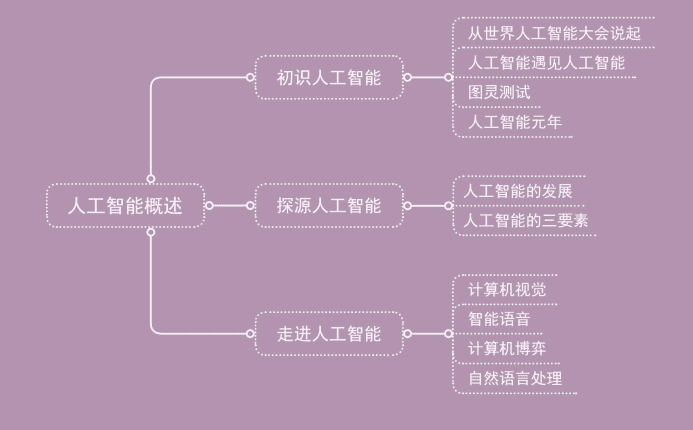

## 1.1　Getting to Know AI

### 1.1.1　Starting from the World AI Conference

The future is here! Artificial Intelligence (`Artificial Intelligence`, `AI`) is unknowingly walking into our lives; the era belonging to AI has arrived.

Since 2018, Shanghai has held the "World Artificial Intelligence Conference" (`WAIC`) every year. The 2020 WAIC featured the Youth AI Innovation and Development Forum (Figure 1-1).

When the youth are wise, the nation is wise; when the youth are strong, the nation is strong. Starting AI education from childhood and creating an AI learning environment for youth is the eternal theme of the Youth AI Innovation and Development Forum.

General Secretary Xi Jinping said: "Artificial Intelligence is a strategic technology leading a new round of technological revolution and industrial transformation." As youth of the new era, we should devote ourselves to the exploration of AI with practical actions. Today we learn here; tomorrow we go global (Figure 1-2).

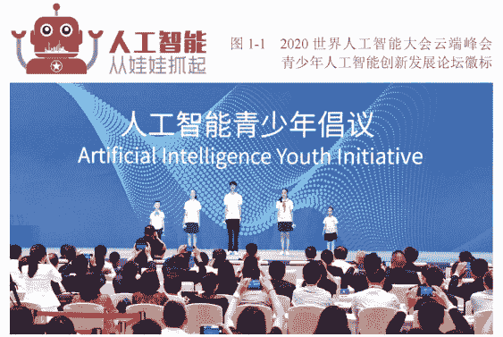

> Friends, though we are young, let us use our innocent childlike fun to paint splendid colors for AI.
>
> Green seedlings, we love to think; let us use our wild creativity to add infinite imagination to AI.
>
> Young Pioneers, we are always ready; let us use our innovative wisdom to empower AI development.
>
> Communist Youth League members, we dare to be pioneers; let us use our solid practice to gather youthful vitality for AI.
>
> Young friends, we are poised and ready; let us use our fearless responsibility to lead the leap of AI.
>
> ——At the closing ceremony of the 2019 WAIC, representatives of the award-winning contestants of the Shanghai Youth AI Innovation Competition issued this initiative.

#### Knowledge Expansion: World Artificial Intelligence Conference

The World Artificial Intelligence Conference is jointly sponsored by the National Development and Reform Commission, the Ministry of Science and Technology, the Ministry of Industry and Information Technology, the Cyberspace Administration of China, the Chinese Academy of Sciences, the Chinese Academy of Engineering, and the Shanghai Municipal People's Government. It is a world-top intelligent cooperation and exchange platform and an industry event with international standards and influence.

- The theme of the 2018 WAIC was "AI Empowering a New Era".
- The theme of the 2019 WAIC was "Intelligent Connectivity, Infinite Possibilities".
- The theme of the 2020 WAIC Cloud Summit was "Intelligent Connectivity, Shared Home".

The most influential views and consensus in the global AI field converge here, showcasing cutting-edge new concepts, technologies, products, and applications, featuring "high-end, international, professional, market-oriented, and intelligent" characteristics. "World Wisdom" communicates here, engaging in high-end dialogues and forging "Chinese Solutions".

### 1.1.2　Human Intelligence Meets AI

What is "intelligence"? So far, there is no broad consensus among humans on this question. Humans use thinking to solve problems, which involves a series of actions such as logic and reasoning. But in fact, human methods of solving problems are often not unique, and sometimes it is even difficult to judge whose method is better.

An IQ tester may test a person's IQ, but can it be said that a person with a high IQ possesses more intelligence and contributes more to society?

The answer is not so. First, high IQ not only represents high intelligence but also represents innovation ability, good thinking, and the ability to discover and solve problems. Second, besides IQ, we also need a certain EQ (Emotional Quotient), which is the general term for personal abilities related to self-awareness, emotion control, self-motivation, and handling interpersonal relationships and teamwork. Finally, we need correct values, the ability to distinguish right from wrong, and discernment. In summary, perhaps this is the intelligence more needed by human society.

The definition of human intelligence has not reached a consensus, and neither has AI.

In 2019, scientists attending the WAIC gave five definitions of AI:

- **Definition 1**: AI is a computer program that makes people feel incredible.
- **Definition 2**: AI is a computer program similar to the human way of thinking.
- **Definition 3**: AI is a computer program similar to human behavior.
- **Definition 4**: AI is a computer program that can learn.
- **Definition 5**: AI is a computer program that makes reasonable actions based on perception of the environment and obtains maximum benefits.

For the definition of AI, the currently more general understanding is that AI is a new technical science that researches and develops theories, methods, technologies, and application systems for simulating, extending, and expanding human intelligence.

A book records a dialogue between the scientist Alan Turing and a police officer:

> **Police Officer**　Can machines think?
>
> **Turing**　Well, in my opinion, your question itself is stupid.
>
> **Police Officer**　Is it?
>
> **Turing**　Machines obviously cannot think like humans. A machine is different from a person. Because their ways of thinking are different. The interesting thing is, does it mean they cannot think just because some things think differently from you?
>
> We allow human thoughts to vary widely. You like bananas, I hate long-distance running; you like sad movies, I prefer comedies. Different tastes, different interests, different preferences—what is the meaning of them?

### 1.1.3 Turing Test

Alan Turing, a British mathematician, logician, and cryptographer, is honored as the "Father of Computer Science" and "Father of Artificial Intelligence." The highest award in the computer field, the Turing Award, is named after him.

In 1950, Turing proposed the famous Turing Test and "Machine Intelligence" in his book *Computing Machinery and Intelligence*.

Turing believed that machines can think, but this requires machines to have fast computing speeds, logic units and memory capacities exceeding those of the human brain, as well as the programming of a large number of intelligent programs, and the provision of appropriate categories and sufficient quantities of data.

How can we judge whether a machine possessess leave the tester, person C, unable to distinguish whether they came from person B or machine A, then it can be considered that machine A possesses intelligence.

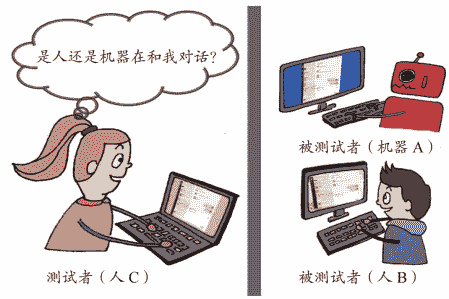

**Figure 1-4 Turing Test**

> **Experience Perception**
>
> Open WeChat, add the public account "Xiaomi Xiaoai", select "Wonderful Recommendations" -> "Chat with Xiaoai", and try chatting with Xiaoai.

At the "2014 Turing Test" conference held in June 2014, the AI software Eugene Goostman successfully passed the Turing Test, which is considered a landmark event in the field of artificial intelligence and computer history.

### 1.1.4 The First Year of Artificial Intelligence

Turing's "Machine Intelligence" can be said to be the earliest term for artificial intelligence. So when was the term "Artificial Intelligence" proposed?

In August 1956, at Dartmouth College in Hanover, USA (Figure 1-5), a group of scientists gathered to discuss the topic of using machines to imitate human learning and other aspects of intelligence. This is the famous Dartmouth Conference.

The Dartmouth Conference proposal covered a wide range of topics, including automatic computers, using computer languages to process human language, neural networks, etc. During the two-month-long conference, no general consensus was reached. However, the most extraordinary achievement in the Dartmouth Conference proposal was the coining of the term "Artificial Intelligence." An unintentional act bears unexpected fruit; the influence of this term is no longer limited to the academic circle where it originated. For this reason, 1956 is also considered the first year of artificial intelligence.

**Figure 1-5 Dartmouth College**

> **Knowledge Expansion**
>
> **Wu Wenjun: Pioneer of Artificial Intelligence Research in China**
>
> Wu Wenjun is a famous Chinese mathematician, academician of the Chinese Academy of Sciences, recipient of the Chen JiaGeng Science Award, and the 2000 State Supreme Science and Technology Award. In September 2019, he was awarded the national honorary title of "People's Scientist."
>
> Wu Wenjun's research covers many fields of mathematics, with outstanding achievements particularly in topology and mathematical mechanization, and major breakthroughs in the field of machine proof of geometric theorems. He is a pioneer and trailblazer in the field of artificial intelligence research in China.

## 1.2 Tracing the Origins of Artificial Intelligence

### 1.2.1 Development of Artificial Intelligence

The 1956 Dartmouth Conference established the name "Artificial Intelligence." Tracing the timeline of AI development, the path has not always been smooth; rather, it has experienced several ups and downs.

#### First Wave of Artificial Intelligence (1950s–1980s)

After the Dartmouth Conference, AI developed rapidly. During this phase, the emergence of the Perceptron enabled breakthroughs in machines achieving logical reasoning.

The Shakey mobile robot (Figure 1-6) solved problems of perception, motion planning, and control, enabling it to find targets and move them to specified positions, achieving simple autonomous navigation. The Shakey mobile robot verified many scientific conclusions belonging to the category of artificial intelligence.

ELIZA is an AI program capable of conversing with humans (Figure 1-7). It does not rely on speech but uses text to converse, based on dialogue rules and pattern matching, providing corresponding responses according to keywords in human statements.

As task difficulty and complexity continued to increase, machines could not cope, and AI development hit a bottleneck.

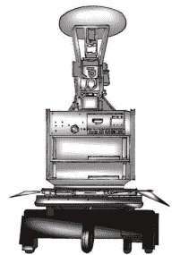

**Figure 1-6 Shakey Mobile Robot**

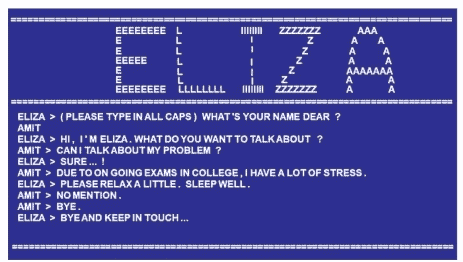

**Figure 1-7 ELIZA**

#### Second Wave of Artificial Intelligence (1980s–Late 1990s)

The emergence of expert systems drove the second peak of artificial intelligence. An expert system is a system focused on specific domains, deriving rules from specialized knowledge, simulating the problem-solving process of experts, and utilizing knowledge to obtain satisfactory answers. For example, in medicine, diagnosing specific patients to see if they have specific diseases (Figure 1-8). Expert systems are often not general-purpose; they are developed to solve specific problems or achieve specific goals.

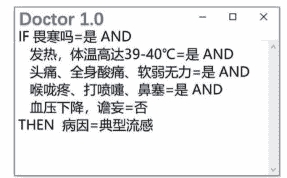

**Figure 1-8 Expert System**

Expert systems had defects in knowledge acquisition and reasoning capabilities, unable to perform complex thinking; application scenarios were very limited, and costs were high. Thus, AI entered another trough period.

> **Knowledge Expansion**
>
> **The "Mount Hua Duel" of the Three Major Schools of Artificial Intelligence**
>
> Artificial intelligence has developed for over 60 years, giving rise to three major schools.
>
> - **Symbolism**: Main achievement is symbolic reasoning. Uses symbolic representation to describe human cognitive processes; widely applied in early AI development.
> - **Connectionism**: Main achievements are neural networks and deep learning. This school believes AI originates from biomimicry; e.g., neural networks imitate neurons in the human brain for information processing.
> - **Behaviorism**: Main achievement is reinforcement learning. This school advocates control, adaptation to evolutionary computation, perceiving the environment to take action.
>
> **The "Three Games" of Artificial Intelligence**
>
> AI development has three "threes": three waves, three schools, and the famous "three games". There have been three major human-machine battles in AI development, involving Checkers, Chess, and Go, known as the "Three Games of AI".
>
> - 1962: Arthur Samuel defeats human Checkers champion.
> - 1997: Deep Blue defeats human Chess champion.
> - 2017: AlphaGo defeats human Go champion.

#### Third Wave of Artificial Intelligence (Early 21st Century to Present)

Under the escort of big data, algorithms, and computing power, machine learning technology has developed, ushering in the third AI boom. Machine learning has enabled breakthrough developments in many application fields of AI.

China has also elevated the development of artificial intelligence to a national strategic height. On March 5, 2017, Premier Li Keqiang of the State Council proposed in the "Government Work Report" to accelerate the cultivation and expansion of emerging industries including artificial intelligence, and fully implement the development plan for strategic emerging industries. This was the first time "Artificial Intelligence" was included in the "Government Work Report." In July 2017, the State Council issued the "New Generation Artificial Intelligence Development Plan," explicitly stating the need to gradually carry out national intelligent education projects, set up AI-related courses in primary and secondary schools, and gradually promote programming education.

On November 15, 2017, the Ministry of Science and Technology convened a launch meeting for the New Generation Artificial Intelligence Development Plan and major science and technology projects in Beijing, simultaneously announcing the first batch of National New Generation Artificial Intelligence Open Innovation Platforms, marking the comprehensive launch and implementation of the plan and major projects.

The "New Generation Artificial Intelligence Development Plan" proposes a "three-step" strategy for China's development of new generation AI.

- **Step One**: By 2020, overall AI technology and applications synchronize with world advanced levels; AI industry becomes a new important economic growth point; AI technology applications become a new way to improve people's livelihoods; strongly supporting entry into innovative nations and achieving the goal of a moderately prosperous society.
- **Step Two**: By 2025, major breakthroughs in AI basic theory; some technologies and applications reach world-leading levels; AI becomes the main driving force for China's industrial upgrading and economic transformation; intelligent society construction makes positive progress.
- **Step Three**: By 2030, AI theory, technology, and applications overall reach world-leading levels; becoming a major global AI innovation center; intelligent economy and intelligent society achieve significant results; laying important foundation for joining the forefront of innovative nations and becoming an economic superpower.

### 1.2.2 Three Elements of Artificial Intelligence

Today's AI development is inseparable from data, algorithms, and computing power; therefore, data, algorithms, and computing power are called the three elements of AI.

#### 1. Data

Our lives are filled with various data. Taking the subway leaves entry/exit information; borrowing books from the library leaves borrowing records; studying at school leaves electronic growth archives (including height, weight, class schedules, etc.). All the above information is data.

##### (1) Intelligent Push Based on Data

If you recently searched for "Artificial Intelligence" via a search engine online, and browsed interesting pages from the results, you would find the internet pushing AI-related information, news software pushing AI news. Even when you open an online bookstore to buy books (Figure 1-9), without searching for AI keywords, the bookstore guesses you want AI books. The online bookstore achieves personalized precise push before you "speak," and behind this is data.

**Figure 1-9 Intelligent Push**

##### (2) Intelligent Evaluation Based on Data

Recently, Xiao Neng's math exam scores improved rapidly; classmates came asking for his secret. Turns out he used an online learning evaluation system. Taking math as an example, the system records time spent per question, wrong answers, etc., then presents a radar chart of math learning (Figure 1-10), analyzing weak areas.

Based on data, the online evaluation system targets Xiao Neng's weak spots for repeated practice, avoiding repetitive review of mastered knowledge. Doing fewer but more precise problems, Xiao Neng not only improved grades but also gained more time for desired activities.

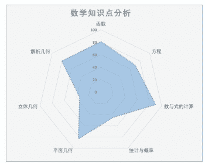

**Figure 1-10 Intelligent Evaluation**

##### (3) Intelligent Navigation Based on Data

When searching routes via navigation, we often see many routes offered, with an intelligent recommendation. This recommendation is often based on real-time bus data analysis. Recommended routes offer options: shortest time, fewest transfers, least walking, subway priority, no subway, meeting personalized needs.

> **Experience Perception**
>
> Open the navigation app on your phone, search for routes from "Shanghai Youth Activity Center" to "Shanghai Library" using "Driving" and "Public Transit" modes (Figure 1-11).

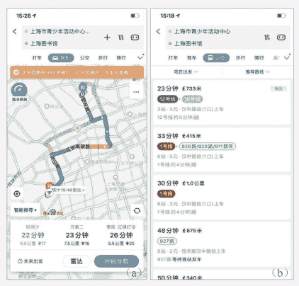

**Figure 1-11 Intelligent Navigation**

If choosing no subway, navigation tells which bus to take and how long until it arrives at the nearest station. Drivers like navigation even more, allowing real-time traffic awareness, avoiding congested roads.

Data-based applications don't stop here. In many aspects, judgments can be made based on data.

Currently, data is growing explosively; hence this era is also called the Big Data era.

On the internet, a "story" about big data once circulated.

> **Customer Service**　XX Wonton Shop. Hello, how may I serve you?
> **Customer**　Hello, I want...
> **Customer Service**　Sir, please tell me your membership card number first.
> **Customer**　1982XXX.
> **Customer Service**　Mr. Chen, hello! You live at Room XX, Floor XX, XX Road, XX. Your home phone is 6353XXXX, your mobile is 1390123XXXX. What can I help you with?
> **Customer**	Why do you know so much about me?
> **Customer Service**	Mr. Chen, because we are connected to the XXX system.
> **Customer**	I want three bowls of fresh meat large wontons...
> **Customer Service**	Mr. Chen, fresh meat large wontons are not suitable for you.
> **Customer**	Why?
> **Customer Service**	According to your medical records, your blood pressure and cholesterol are both high.
> **Customer**	Then what do you recommend?
> **Customer Service**	You can try our low-fat healthy vegetarian wontons.
> **Customer**	How do you know I'd like that?
> **Customer Service**	Last Monday you borrowed "Low-Fat Healthy Recipes" from the library.
> **Customer**	Okay. Then three bowls of vegetarian wontons, how much total?
> **Customer Service**	33 yuan total. But your mother should eat less; she had heart bypass surgery last month, still in recovery.
> **Customer**	Can I pay by card?
> **Customer Service**	Mr. Chen, sorry. Please pay cash, your credit card is maxed out, you owe the bank 2986 yuan, not including mortgage.
> **Customer**	Then I'll go to the nearby ATM.
> **Customer Service**	Mr. Chen, according to records, you've exceeded today's withdrawal limit.
> **Customer**	Forget it, deliver to my home, cash there. How long?
> **Customer Service**	About 30 minutes. If you don't want to wait, drive yourself.
> **Customer**	Why?
> **Customer Service**	According to our XXX system's vehicle tracking records. You have a car registered "Hu A XXXXX", and you are currently driving it on XX Road. Friendly reminder: don't hold phone while driving, suggest Bluetooth headset or car phone system.
> Customer stares in shock……

> **Knowledge Expansion**
>
> **Big Data**
>
> Big data is a collection of data whose scale is so large that it greatly exceeds the capabilities of traditional database software tools in acquisition, storage, management, and analysis. Big data has four characteristics: massive data scale, fast data flow, diverse data types, low value density.

> **Think and Explore**
>
> Talk about what examples of personalized services based on data exist around you.

#### 2. Algorithm

An algorithm is a method for solving problems and achieving goals. It can be understood as: to solve a problem, first think how to do it, what method to use, then take action to solve it.

Grandpa Deng Xiaoping once said: "Regardless of black cat or white cat, the cat that catches mice is a good cat." Solving the same problem, of course, can use different algorithms.

Teachers assigned Chinese, Math, English, Science homework.

- Xiao A chooses based on preference: Chinese first, then Math, then Science, finally English.
- Xiao B chooses based on difficulty: Science first, then Chinese, then English, finally Math.

**Figure 1-12 Students Complete Four Subjects in Different Orders**

- Xiao C estimates time per subject, decides to do shortest to longest: Science, English, Math, Chinese.
- Xiao D doesn't think much, grabs whatever from bag: Math, English, Chinese, Science.

Although their order differs, all four finished the teacher's homework (Figure 1-12).

> **Think and Explore**
>
> Solving the same problem can have many different algorithms; then which one to choose?

**Figure 1-13 Random Selection Optimization Problem**

> **Knowledge Expansion**
>
> **The Cornfield Story**
>
> A cornfield, need to pick the largest corn (Figure 1-13). But only one pick allowed, and cannot turn back.
>
> - **Xiao A's method**: Enters field, sees many large corns. Quickly picks first large corn seen, walks on, increasingly disappointed to find many larger corns ahead.
> - **Xiao B's method**: Enters field, sees many large corns. Learns from A—there must be larger ahead. Walks on until almost out of field, realizes none larger than previous, cannot turn back, picks largest nearby.
>
> Xiao A's algorithm, due to incomplete observation, leads to "regret"; Xiao B's algorithm, though observation thorough, leads to "missing out". So what would you do?
>
> Mathematician Euler gives an important number: 37%.
>
> For the problem of selecting the largest corn, scientists propose this algorithm:
>
> Divide field into two phases, first 37% is phase one. In this phase, only look, don't pick. Observe carefully the largest corn in this phase, remember its size. After 37%, enter phase two. From here, once encountering a corn larger than the largest in phase one, or similar, pick it without hesitation.
>
> The "two-phase" strategy and "37%" number were derived by Euler. This is actually a random selection optimization problem. This method is called "37% Rule".
>
> This algorithm may not guarantee picking the absolute largest corn. Corn sizes appear randomly. Under such randomness, it is an optimal algorithm for picking sufficiently large corn. It reduces probability of "regret" and "missing out".
>
> Although many algorithms solve a problem, usually the best is chosen, i.e., optimal algorithm.
>
> Generally, algorithms have these properties:
>
> - **Finiteness**: Algorithm must terminate after finite steps.
> - **Definiteness**: Each step must have exact meaning.
> - **Effectiveness**: Each step must be actually doable, within finite time.
>
> An algorithm has zero or more inputs, representing initial conditions. Zero input means algorithm defines initial conditions itself.
>
> An algorithm has one or more outputs, reflecting results after processing input. Algorithm without output is meaningless.
>
> Machine learning, face recognition, etc., are all based on algorithms. New algorithms constantly proposed, giving AI more possibilities.

#### 3. Computing Power

Computing power usually represents a computer's computational capability. Enhancing computing power is a systems engineering project, involving not only all hardware components such as chips, memory, hard drives, but also optimizing computing architecture, resource management and allocation according to the actual environment of data type applications.

Imagine if you have this experience: when a computer handles a complex task (e.g., video editing), it suddenly freezes or crashes; this can be considered insufficient computing power. Of course, not all crashes are due to insufficient computing power.

The first modern electronic computer "ENIAC" could perform 5000 additions per second. Today, the birth of supercomputers has greatly increased computing power.

Currently, supercomputers are primarily measured in FLOPS (Floating Point Operations Per Second). Worth mentioning is China's "Sunway TaihuLight" (Table 1-1), peak performance 125.436 PFlops, ranked 4th worldwide; sustained performance 93.015 PFlops, ranked 1st; performance-per-watt 6051 MFlops/W, ranked 1st.

**Table 1-1 Top 5 Global Supercomputers Top500 Ranking June 2020**

### AI Hardware Computing Power and Core Technologies

The core of AI hardware computing power lies in computer chips. The main types of AI chips are as follows.

- **GPU (Graphics Processing Unit)**: A microprocessor that performs graphics and image-related computing tasks.
- **FPGA (Field-Programmable Gate Array)**: A semi-custom circuit in the field of application-specific integrated circuits; it is programmable, upgradable, and iterable.
- **ASIC (Application-Specific Integrated Circuit)**: An integrated circuit designed and manufactured to meet the requirements of a specific user and a specific electronic system, such as dedicated audio and video processors.
- **Neuromorphic Chips**: An architecture among AI chips. It is designed by simulating the human brain. Compared with traditional chips, it has greater advantages in power consumption and learning ability.

In 2017, the Institute of Computing Technology, Chinese Academy of Sciences, released the world's first "neural network" processor chip capable of "deep learning"—"Cambricon" (Figure 1-14).

In 2019, the Center for Brain-Inspired Computing Research at Tsinghua University developed the world's first heterogeneous fused brain-inspired computing chip—"Tianjic". This achievement graced the cover of the top academic journal *Nature* (Figure 1-15).

In 2020, the University of Science and Technology of China, in collaboration with the Shanghai Institute of Microsystem and Information Technology of the Chinese Academy of Sciences and the National Parallel Computer Engineering Technology Research Center, successfully built "Jiuzhang," a 76-photon quantum computing prototype. "Jiuzhang" takes only 200 seconds to solve Gaussian boson sampling with 50 million samples, which is approximately 10 billion times faster than the fastest supercomputer at that time. This breakthrough made China the second country in the world to achieve "quantum supremacy."

Data, algorithms, and computing power are the indispensable driving forces of AI. With the continuous upgrading of these three key technologies, the future of AI is promising.

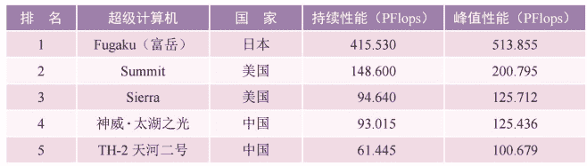

Figure 1-14　Cambricon Chip

Figure 1-15　"Tianjic" on the Cover of *Nature*

## 1.3 Entering Artificial Intelligence

In many movies, robots possess artificial intelligence. However, we need to know that a robot is merely a carrier of AI; it does not mean AI equals robots.

AI encompasses many technologies. Machines able to "see" like humans use **computer vision** technology; able to "listen" uses **speech recognition** in intelligent speech technology; able to "speak" uses **speech synthesis** in intelligent speech technology; able to "learn" uses **machine learning** technology.

Not only that, AI also includes **natural language processing**, **knowledge graphs**, **virtual reality (VR)/augmented reality (AR)**, **human-computer gaming**, and more.

### 1.3.1 Computer Vision

Celebrity concerts sometimes come with an added "catching fugitives" function! Through just one Mandarin pop star's 2018 concert tour, a total of 55 fugitives were caught. The successful completion of these arrests had a major "hero" behind the scenes—the Sky Net Project. One of the core technologies of the Sky Net Project is computer vision image processing and recognition technology. Through high-definition cameras set up at the scene, the facial features of the audience were clearly captured and rapidly compared with information stored in the public security database. Once a suspect was identified, immediate action was taken to arrest them, truly achieving "the net of heaven is vast; though its meshes are wide, nothing escapes."

Besides helping catch fugitives, computer vision technology brings great convenience to daily life. For example, the facial recognition function on mobile phones is often used to unlock phones and complete payments; facial recognition attendance systems are also widely used in many companies (Figure 1-16).

Figure 1-16　Facial Recognition Attendance System

Computer vision technology also has extensive applications in the medical field. Combined with medical imaging, it has developed into "intelligent medical imaging." Originally, a radiologist sees nearly a hundred patients a day, meaning they have to analyze nearly a thousand images daily. "Intelligent medical imaging" can greatly reduce doctors' pressure; its automated analysis speed is 62%–97% faster than that of general radiologists, saving a significant amount in labor costs annually.

Computer vision has also extended functions such as 3D vision and image stylization. For instance, AI can make photos more artistic, giving ordinary photos the Impressionist style of Monet's *Water Lilies*, turning ordinary pictures into artworks.

> **Experience Perception**
>
> Open the Prisma Photo Editor. Process a photo using different styles on the same photo. What kind of visual experience does this give you (Figure 1-17)?

Figure 1-17　Comparison of Shanghai Library Photo Effects

> **Knowledge Expansion**
>
> **"Stylize" Filters**
>
> "Stylize" filters generate painting or Impressionist effects in a selection by displacing pixels and finding and increasing image contrast. They simulate real artistic techniques for creation.

### 1.3.2 Intelligent Speech

Let's first look at a dialogue where a customer is booking a hairdressing service by phone.

> **Clerk** Hello, how can I help you?
>
> **Customer** Hi, I'd like to book a women's haircut for a client. The date is May 3rd.
>
> **Clerk** Sure, one moment please.
>
> **Customer** Mm-hmm.
>
> **Clerk** What time would you like to book?
>
> **Customer** 12 PM.
>
> **Clerk** We're fully booked at 12 PM. The closest slot is 1:15 PM.
>
> **Customer** How about 10 AM to 12 PM?
>
> **Clerk** That depends on the service. What service does she need?
>
> **Customer** Just a women's haircut.
>
> **Clerk** Okay, 10 AM works.
>
> **Customer** Her name is Lisa.
>
> **Clerk** Okay, see Lisa on May 3rd at 10 AM.
>
> **Customer** That's right, great, thanks.
>
> **Clerk** Okay, have a nice day, goodbye.

One of the speakers in this dialogue is a robot. Can you guess who it is—the clerk or the customer?

Actually, the "customer" is a "robot." Did you guess right? This dialogue comes from the 2018 Google I/O conference live demo video. The name of this AI is Google Duplex. This dialogue sounds incredible; the line between humans and AI is blurring. The voices of the human clerk and the AI customer are almost indistinguishable—the latter's intonation is extremely precise, not mechanical at all. It even adds filler words ("Mm-hmm") before answering, just like a real human.

In human-computer voice dialogue, intelligent speech technology is indispensable. Intelligent speech technology includes **speech recognition** (converting speech to text) and **speech synthesis** (converting text to speech). It endows machines with the ability to listen and speak. In daily life, we use voice input methods for text entry and hear voice broadcasts during phone navigation—all inseparable from intelligent speech technology.

Besides intelligent speech technology, **natural language processing (NLP)** plays an active role in enabling machines to better understand human language and speak more naturally. NLP and intelligent speech technology work hand in hand, making voice dialogue between humans and machines smoother.

> **Experience Perception**
>
> Open a voice assistant, try talking to it, and record your dialogue (Figure 1-18).

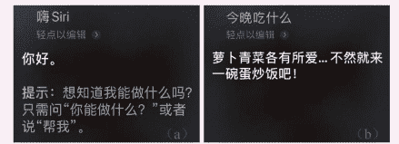
Figure 1-18　Dialogue with Voice Assistant

### 1.3.3 Computer Gaming

Computer gaming is one of the important research directions of AI. Computers can select optimal strategies and make decisions based on existing rules and the current situation.

To understand strategies, let's first learn about **decision trees**. The structure of a decision tree resembles a tree, with branching trunks and leaves. The branching points represent judgments on certain features; the branches represent the results of those judgments; and the leaves represent the final outcomes after judgment.

Figure 1-19 is a simple classification decision tree, deciding whether one can make an appointment at a certain library during the COVID-19 pandemic.

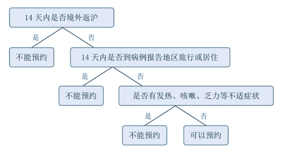
Figure 1-19　Decision Tree

Figure 1-20　Human-Computer Gaming

We find that through layer-by-layer confirmation of specific situations or events, a final judgment can be made to decide the next step. The historical "three matches" of human-computer gaming are typical examples of computer gaming (Figure 1-20).

### 1.3.4 Natural Language Processing

Language is the characteristic that distinguishes humans from other animals; much of human intelligence is inextricably linked to language. Natural language is the language used by humans daily.

Let's look at these news items first:

- A reporter wrote a flash report 25 seconds after the Jiuzhaigou earthquake in Sichuan, with complete information and accurate parameters.
- A sports reporter wrote over 450 sports articles in 16 days, published synchronously with live broadcasts.
- A financial editor wrote 1,900 manuscripts in one day, shocking the industry.

Can you guess that these "reporters" and "editors" are not ordinary people? They are robots! These robots excel at writing manuscripts in sports, finance, technology, and other fields—with both speed and quality—and as long as the power stays on, they work 24/7. Take Tencent's Dreamwriter writing robot for example: it wrote 300,000 articles and 6 million words in half a year, producing over 3,600 sports articles during the 2016 Olympics—an absolute "industry model worker."

Machine translation is one type of natural language processing. There are so many ethnic groups in the world, most with their own language systems. Language barriers hinder communication—a headache-inducing problem. For an ordinary person to fulfill the wish "the world is so big, I want to see it," the language barrier must be crossed. But mastering one foreign language is hard enough, let alone so many; ordinary people simply cannot master them all. With the advent of translators, this problem has been well solved.

Take China's powerful and advanced translators as an example: they not only cover languages of nearly 200 countries and regions worldwide but can also recognize accented English from five countries (Canada, UK, Australia, India, New Zealand) and four Chinese dialects (Cantonese, Sichuanese, Northeastern, Henanese). This feature is remarkable and highly practical.

> **Thinking Exploration**
>
> Search online for information about Dreamwriter writing Olympic news. Think about how it achieves this.

> **Knowledge Expansion**
>
> **AI Classification**
>
> - **Weak AI**: AI that can solve specific problems. For example, a Go robot only plays Go; even if asked to complete a kindergarten jigsaw puzzle, it cannot. Most current AI is weak AI.
> - **Strong AI**: Intelligence capable of independent thinking, learning, and perception like a human.
> - **Super AI**: AI that surpasses human intelligence in almost all fields.

In the new era of human-machine coexistence, emerging technologies such as AI, big data, and 5G are fully integrated into all industries, with AI at the core of the Fourth Industrial Revolution. AI applications in life, study, and work are becoming increasingly extensive and deep, involving fields not limited to the above. We will continue to explore in subsequent chapters.

> **Experience Perception**
>
> 1. Open WeChat on your phone, search for the mini-program "Baidu AI Experience Center," select one or more items to experience AI technology, and record your experience (Figure 1-21).
> 2. Open WeChat on your phone, search for the mini-program "iFlytek AI Experience Stack," and experience the convenience brought by "Voice Translation" (Figure 1-22).

Figure 1-21　Baidu AI Experience Center

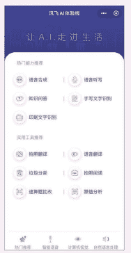
Figure 1-22　iFlytek Voice Translation

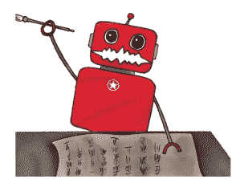
Figure 1-23　AI That Can "Create"

Figure 1-24　Painting Matching *A Quatrain*

3. AI That Can "Create" (Figure 1-23): Open a search engine and search for the keyword "Jiuge — Computer Poetry Generation System." "Jiuge" was developed by the Natural Language Processing and Social-Humanities Computing Laboratory at Tsinghua University.

Try writing a poem by inputting keywords. Do you think the following AI-written *jueju* (quatrain) matches the painting below (Figure 1-24) just as well as Du Fu's *A Quatrain*? Give it a try!

> **A Quatrain**
>
> **2020·Jiuge**
>
> Orioles' voices tug at willow threads,
> A stretch of clear water ripples a jade boat.
> Most loved: the moon by the waterside window,
> The lake full of autumn colors lies before the river.
>
> **A Quatrain**
>
> **Tang·Du Fu**
>
> Two orioles sing in the green willows,
> A line of white egrets flies up to the blue sky.
> The window frames the thousand-year snow of the Western Ridge,
> The door moors the ten-thousand-mile boat of Eastern Wu.

# Chapter 2: The Learning AI

## Introduction

Learning is an important way for humans to acquire knowledge. Machine learning means AI can learn like humans; it is an exciting technology in AI development. This chapter introduces the basics of machine learning, types of machine learning, the development of machine learning, and deep learning.

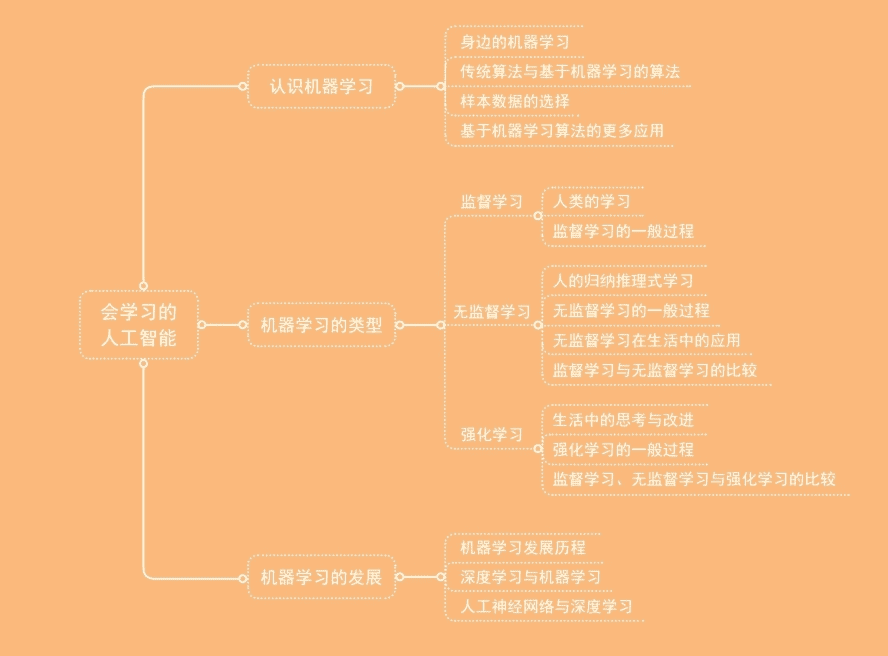

## 2.1 Understanding Machine Learning

### 2.1.1 Machine Learning Around Us

In 2016, a human-computer Go match saw AlphaGo defeat world Go champion Lee Sedol with a total score of 4:1. This caused a sensation; everyone asked: What is AlphaGo? How did it do it? Soon the answer came: the core technology of AlphaGo is machine learning (Figure 2-1).

The idea of machine learning is actually not complex; it simulates the human learning process in life. Machine learning relies on data—data being various combinations of symbols carrying information. Data is not just numbers in the narrow sense; it can also be text, symbols, images, videos, audio, etc.

Data is generated anytime, anywhere. For example, various information posted on social platforms, purchase records and reviews on shopping platforms—all are data. Once generated, this data is collected, processed, and refined, transforming into new data available for computation, analysis, and use.

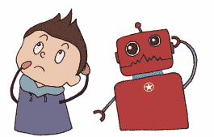
Figure 2-1　What is Machine Learning

> "Even a clever housewife cannot cook without rice." Machine learning requires a large amount of data as a foundation.

> **Experience Perception**
>
> "Guess the Drawing" (Caihua Xiaoge) is a mini-program game where you draw and AI guesses. Try to see how many questions you and your AI teammate can complete before time runs out.

> **Thinking Exploration**
>
> Everyone draws the same thing differently. So in "Guess the Drawing," how does the "teammate" guess correctly?

### 2.1.2 Traditional Algorithms vs. Machine Learning-Based Algorithms

#### 1. Traditional Algorithms

Traditional algorithms are programs written with specific recognition rules. The program's judgment process is shown in Figure 2-2. In programs written with traditional algorithms, many image data are pre-stored as an image library; these libraries are also called sample data. As seen in Figure 2-2, traditional algorithms need to compare whether the player's drawing matches the graphics in the library. If the graphic is not in the library, the program fails to recognize it, because the program runs strictly according to the written instructions during execution. In reality, everyone's drawing skill and style differ; drawing exactly like the library is very difficult.

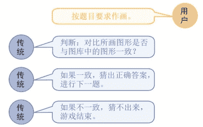
Figure 2-2　Judgment Process of Traditional Algorithm

#### 2. Machine Learning-Based Algorithms

"Guess the Drawing" uses a machine learning-based algorithm. In this process, it does not write specific rules but lets the machine automatically learn the patterns from the "Guess the Drawing" library data. This process can be understood as the machine automatically extracting features from sample data. Then, graphics with the same features are categorized, and a model is built for each category (e.g., dog). Afterwards, it judges which category model the user's drawing is closest to (Figure 2-3). For example, when we draw a dog, "Guess the Drawing" compares feature points (this process completes in the classifier) and finally classifies it into the "dog" category, thus recognizing the drawing as a dog. This machine learning process is shown in Figure 2-3. Even if you are a "soul artist" (bad at drawing), as long as you draw the features of a dog, AI can guess it.

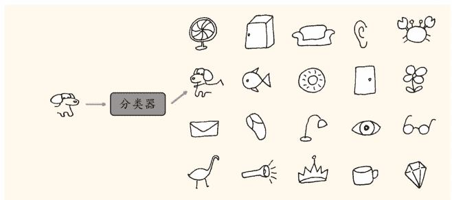
Figure 2-3　Machine Learning-Based Algorithm Process in "Guess the Drawing"

> **Thinking Exploration**
>
> We know "Guess the Drawing" pre-stores many images forming a library as basic sample data for machine learning. What should be noted when collecting these sample data? For example, should the quantity of sample data be larger or smaller? Should the drawing styles be diverse or uniform?

### 2.1.3 Selection of Sample Data

To learn and build a model through a classifier requires a certain amount of data. If the collected sample data volume is too small to meet the learning requirement, or if the volume is large but the data types are too uniform, the classifier will produce errors. Therefore, we should avoid these two situations when selecting sample data.

#### 1. Insufficient Sample Data

Take "Guess the Drawing" as an example. What happens if sample data is too few during machine learning? Imagine "Guess the Drawing" wants to distinguish if the player drew a dog. If the library only stores a few images of dogs with long ears and long tails, due to insufficient samples, when a player draws a "Pomeranian" with short ears and tail, "Guess the Drawing" cannot recognize it as a dog. This is the problem caused by "insufficient sample data" during machine learning (Figure 2-4).

#### 2. Overly Uniform Sample Data

Again, take "Guess the Drawing." Suppose the library has many "dog" samples, but they are all cartoon "Pomeranians." "Guess the Drawing" memorizes all features of the "Pomeranian." At this point, if a player draws a cartoon "Basset Hound," "Guess the Drawing" might think the difference is too large and judge the "Basset Hound" not to be a dog. This is because the sample data obtained by "Guess the Drawing" cannot generalize the features of all "dogs"; it can only distinguish one type—the "Pomeranian." This is the problem caused by sample data being overly uniform and lacking diversity during machine learning (Figure 2-5).

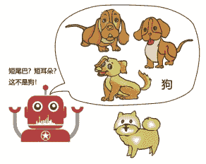
Figure 2-4　"Insufficient Sample Data" Phenomenon

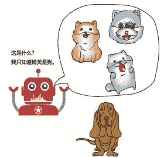
Figure 2-5　"Overly Uniform Sample Data" Phenomenon

Both "insufficient sample data" and "overly uniform sample data" lead to poor machine learning results. Therefore, when collecting sample data, we should strive for diversity and collect as many samples as possible.

### 2.1.4 More Applications of Machine Learning-Based Algorithms

Today, machine learning-based technology can be found in many fields; you might be using it in some way without realizing it. Let's look at more applications of machine learning-based algorithms in life.

#### 1. Machine Learning in Search Engines

When using a search engine (Figure 2-6), one reason it finds the results we want is that it uses machine learning-based algorithms, learning to categorize and rank web pages that meet the search criteria.

#### 2. Machine Learning in Spam Filters

When using email systems, spam filters help filter large amounts of spam, also due to machine learning-based algorithms (Figure 2-7). To identify spam, filters are constantly updated; they use machine learning algorithms to let the machine continuously extract spam features, helping users classify spam so we are not disturbed by it.

Figure 2-6　Machine Learning in Search Engines

Figure 2-7　Machine Learning in Spam Filtering

#### 3. Machine Learning in People Classification

When using the people classification feature in phone photos, it can recognize people in photos and find all photos of that person—this also uses machine learning-based algorithms (Figure 2-8).

Besides the application scenarios shared above, there are many more places in life where machine learning is used. Machine learning-based algorithms are also applied in many AI technologies, such as speech recognition and facial recognition. It can be said that machine learning has penetrated every aspect of people's lives.

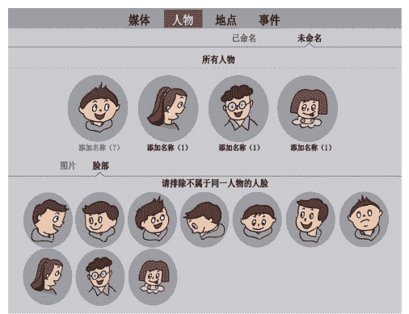
Figure 2-8　Machine Learning in People Classification

> **Experience Perception**
>
> Open the "Flower Identifier" (Shihua Jun) mini-program and use it to identify the plant in Figure 2-9.
>
> The name of this plant is __________.
>
> Use "Flower Identifier" to identify more plants; you can also learn more plant trivia.

## 2.2 Supervised Learning

In life, we learn in many ways. When we were very young, our parents would hold an apple and tell us that something red, spherical, and smooth-skinned like this is an apple. Later, when we saw a green apple, our parents would tell us that apples aren't all red; they can be green too. Gradually, we formed a model of an "apple" in our minds, and later we could distinguish apples. When we grew up and could read books ourselves, we could also self-study from books, find connections between things, and sometimes we learn through constant "trial and error."

Machine learning also has its own learning methods, such as "Supervised Learning," "Unsupervised Learning," "Reinforcement Learning," etc.

### 2.2.1 Human Learning

Perhaps we have forgotten how our parents taught us to recognize apples when we were young. Let's relive this learning process with student Xiao Neng (Figure 2-10).

#### 1. Look (Pictures of Axolotls)

To help us accurately recognize axolotls, student Xiao Neng collected pictures of axolotls from different angles, in different shapes, and of different colors, and told us that these are all axolotls. Through the method of looking and observing with our eyes, we increase our brain's cognition of axolotls (Figure 2-11).

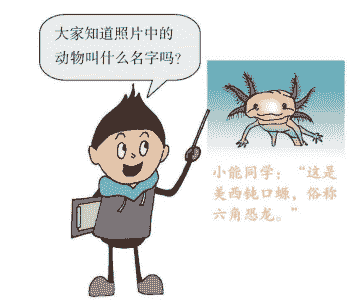
**Figure 2-10　Review of Human Learning**

**Figure 2-11　Look (Pictures of Axolotls)**

#### 2. Memory (Axolotls)

To remember axolotls, we need to find their characteristics.

Through observation, we can find that axolotls have the following characteristics:

- Six horn-like gills;
- Broad face;
- Four legs that are relatively short and thin;
- A fish-like tail;
- Colors include white, yellow, black...;

#### 3. Forming a Model in the Brain

After remembering these characteristics, we form a model of the axolotl in our brains (i.e., an initial impression of the axolotl). Later, when we see an axolotl, we compare it with the model in our brain (Figure 2-12) and then recognize the axolotl.

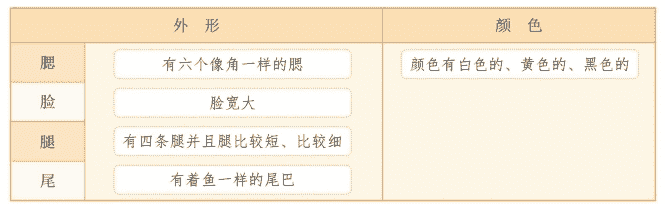
**Figure 2-12　"Axolotl" Model Formed in the Brain**

#### 4. Verifying the Model

Whether we have truly learned to recognize axolotls requires practical verification, just like after we learn knowledge in school, we do exercises and quizzes to assess our mastery of the knowledge.

The purpose of the test is to verify whether our cognition of axolotls is comprehensive and reliable. In other words, whether the model in our brain is sufficient to support us in recognizing axolotls. If we still cannot recognize axolotls, we need to improve the model of axolotls in our brain.

#### Thought Exploration

Which option in Figure 2-13 is an axolotl? ( )

**Figure 2-13　Judging Axolotls**

Xiao Neng: "The axolotl should be A."

If the choice is correct, it means learning is successful. If the choice is wrong, one can observe the picture in option A, compare it with the existing model in the brain, then re-summarize the characteristics of the axolotl, and form a more refined model in the mind.

### 2.2.2 General Process of Supervised Learning

Like humans, learning by observing pictures that have already been labeled (we already know these are pictures of axolotls through Xiao Neng) is called "Supervised Learning" in the field of machine learning. Supervised learning usually means the machine learning data is labeled. For example, when recognizing axolotls via supervised learning, one needs to provide the machine with pictures labeled as axolotls. In this learning process, the labels are the guidance given by humans to the machine.

The advantage of supervised learning is high learning efficiency. However, it also has obvious disadvantages: over-reliance on humans. When human guidance goes wrong—for instance, when the machine performs supervised learning on axolotls, if some non-axolotl image data is mixed into the large amount of labeled sample data provided by humans—the machine may not accurately extract the features of axolotls. Because this machine learning method relies heavily on the scope of human knowledge, it limits the machine's learning range to a certain extent. For example, if humans don't recognize axolotls either, they cannot provide labeled sample data, and the machine cannot learn axolotls under supervised learning, and thus won't recognize them.

#### Experience Perception

Please use graphical programming software, load AI-related modules, show the computer a few pictures of axolotls, and see if the computer can accurately recognize axolotls.

The idea of machine learning is that machines simulate processes in human life. Therefore, the general process of supervised learning is very similar to the human learning process we just mentioned.

Let's take a look at how a machine learns to recognize axolotls via supervised learning.

In supervised learning, the machine will always give a judgment result: it is an axolotl, or it is not an axolotl. Therefore, when building a classification, two categories need to be established: one is axolotl, the other is not axolotl.

#### 1. Collect Labeled Sample Data

The first step of human learning is "Look." Therefore, in supervised learning, we input some "axolotl" pictures and some "non-axolotl" pictures to the machine.

The "axolotl" pictures and "non-axolotl" pictures mentioned here are labeled sample data, where "axolotl" and "non-axolotl" are the given labels. At the same time, "axolotl" and "non-axolotl" are also the final output classifications of these pictures, which can be called "Classification Labels" (Figure 2-14).

"Classification Labels" are the basis for picture classification. In supervised learning, "Classification Labels" are marked by humans, which also reflects human supervision and guidance in supervised learning.

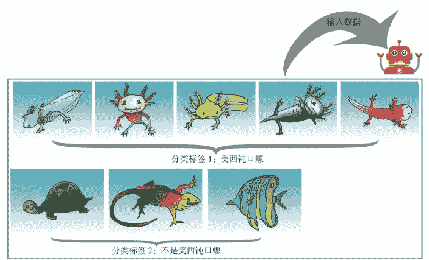
**Figure 2-14　Collecting Labeled Data Samples**

#### Knowledge Expansion

**Classification Label**

Classification labels can also be called "Labels." They are an important feature of supervised learning. Classification labels are actually the classification results. Simply put, before we conduct supervised learning, we need to tell the machine in advance how many categories the results are divided into (at least two), and determine the name of each category.

> Note: To avoid "insufficient sample data" and "overly homogeneous sample data," when collecting sample data, try to diversify as much as possible and collect more labeled sample data.

#### 2. Feature Extraction

Humans remember the characteristics of axolotls in pictures through their brains, while machines, through specific algorithms, remember the features of axolotls during the training process: six horn-like gills; broad face; four legs that are relatively short and thin; a fish-like tail; colors include white, yellow, black.

The machine converts these features into "feature" data it can understand. "Features" reflect the attributes or traits in different aspects that distinguish "axolotls" from "non-axolotls." "Features" are the basis of machine learning, and the machine needs to extract them through comparison and induction.

#### 3. Forming a Model

After mastering these features, the machine forms a data model of the axolotl. In supervised learning, the feature values extracted from sample data are directly reflected in the model. The quality of the "model" can be said to be the core of the AI performance quality in supervised learning.

#### 4. Verifying the Model

When we give the machine some pictures of axolotls and other animals different from those collected (pictures not learned before), the machine will use the model formed through training to distinguish which are axolotls.

If the machine can accurately identify which are axolotls and which are not, the model is considered reliable; if the machine cannot accurately identify, new sample data needs to be added to retrain the model, i.e., re-extract features and form another new model. This process can be understood as refining and improving the model.

The general process of supervised learning is shown in Figure 2-15.

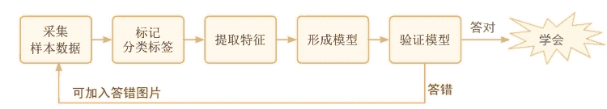
**Figure 2-15　General Process of Supervised Learning**

#### Knowledge Expansion

**Confidence**

During supervised learning, the machine has a parameter called "Confidence," usually expressed in "%". This "Confidence" indicates the degree of reliability. For example, in a math exam, a student has 90% confidence of scoring 85-90 points. Then "85-90 points" is the confidence interval, and "90%" represents the confidence level. Supervised learning is similar. If the model outputs 95% for "axolotl," then "axolotl" can be understood as the confidence interval, and "95%" represents the confidence level. In supervised learning, the higher the confidence, the more certain the model is about the output result.

#### Thought Exploration

What factors is confidence related to? If you want to increase confidence, what can you do?

Generally, confidence is related to the collected sample data. The higher the quality and the larger the quantity of collected sample image data, the higher the confidence, and the more certain the model is about the output result.

#### Hands-on Practice

Please use graphical programming software, load AI-related modules, write a garbage classification program, and let the computer recognize dry waste, wet waste, recyclable waste, and hazardous waste.

## 2.3 Unsupervised Learning

Besides the human learning method mentioned in supervised learning, humans can also learn autonomously through inductive reasoning without human supervision.

### 2.3.1 Human Inductive Reasoning Learning

For example, when we see tomatoes, hawthorns, and strawberries, we can induce based on their color: their common color is "red." Another example: when we see a soccer ball, an orange, and a watermelon, we can induce based on shape: their common shape is "sphere." This learning method is inductive reasoning learning (Figure 2-16). Humans discover similarities and differences on their own, divide them into different categories based on these characteristics, and name these categories, such as "red" and "sphere."

When humans explore unknown things, they often use inductive reasoning learning methods. For example, biologists classify animals based on their characteristics to determine different species.

As the saying goes, "Birds of a feather flock together." The process of merging and categorizing things into categories based on their degree of similarity is called "Clustering."

**Figure 2-16　Human Inductive Reasoning Learning**

### 2.3.2 General Process of Unsupervised Learning

Such human inductive reasoning learning corresponds to "Unsupervised Learning" in the field of machine learning. In this learning process, there is no human guidance or supervision; that is, the input data is unlabeled. It is a way for machines to learn autonomously. It is because of unsupervised learning that machines begin to explore the unknown world on their own. A common method used in unsupervised learning is "Clustering." The machine autonomously divides data into several small groups, which can also be called "Clusters." Note that although clustering plays a positive role in unsupervised learning, it does not mean "Unsupervised Learning = Clustering."

Let's experience the clustering process of unsupervised learning together.

In this experiment, the following six sentences are prepared as learning data (clustering data).

1. Today I went to the zoo and saw tigers and pandas.
2. Tigers and pandas had the most visitors.
3. Tigers are carnivores.
4. Lunch was egg fried rice and borscht.
5. There was sausage in the egg fried rice too.
6. I want to eat egg fried rice and borscht tomorrow too.

Next, perform clustering. First, treat each sentence as an independent cluster. So initially there are six clusters.

Next, merge the most similar clusters into a new cluster. But how to judge which of the six clusters are "most similar"?

We can define the sentences containing the most identical nouns as "most similar." Here, the "number of identical nouns contained in each sentence" is regarded as "Similarity."

Let's try to make a table together, recording the identical nouns contained in sentences ①—⑥, and see if your result matches Table 2-1.

From Table 2-1, we calculate the similarity between sentences as shown in Table 2-2.

**Table 2-1 Marking Nouns in Each Sentence**

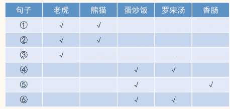

**Table 2-2 Similarity of Each Sentence Corresponding to Other Sentences**

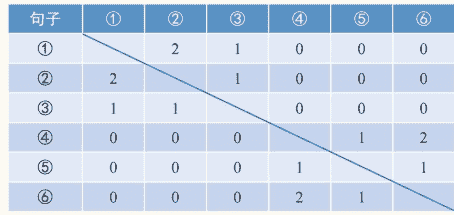

#### Thought Exploration

Through Table 2-2 we find that ______ and ______ have a similarity of 2, ______ and ______ also have a similarity of 2.

We find that sentences ① and ② both contain "tiger" and "panda," i.e., similarity is 2; we also find that sentences ④ and ⑥ both contain "egg fried rice" and "borscht," i.e., similarity is also 2.

Merge cluster sentence ① and cluster sentence ② into a new cluster; merge cluster sentence ④ and cluster sentence ⑥ into another new cluster. At this point, the number of clusters is 4, as shown in Figure 2-17.

Figure 2-17 is the new cluster diagram obtained when counting "most similar." We find that the similarity at this time is 2. If similarity of 1 is also included, then cluster 1 and cluster 3 can form a new cluster, and cluster 2 and cluster 4 can also form a new cluster, as shown in Figure 2-18.

If similarity is set to 0, then these six sentences become one cluster. Therefore, we find that the setting of similarity is very important. If similarity is set too low (e.g., set to 0), then this unsupervised learning clustering becomes meaningless.

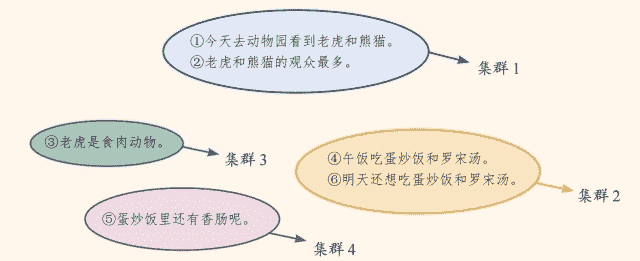
**Figure 2-17　New Cluster Diagram with Similarity of 2**

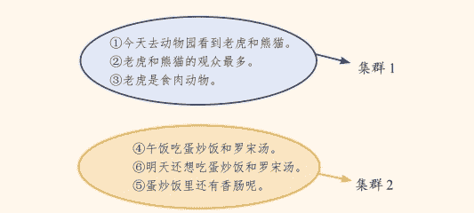
**Figure 2-18　New Cluster Diagram with Similarity of 1**

In unsupervised learning, the machine clusters data according to the given similarity setting through algorithms, and through autonomous machine learning, groups similar data into one category (Figure 2-19).

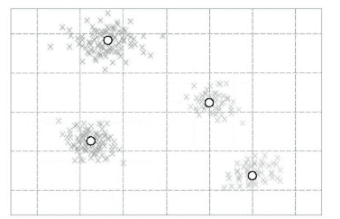
**Figure 2-19　Clustering in Unsupervised Learning**

### 2.3.3 Applications of Unsupervised Learning in Life

#### 1. Automatic Product Recommendation on Shopping Platforms

When users use shopping platforms, the system records their consumption habits, browsing preferences, geographical locations, and other information. Then, based on this information, it clusters the platform's users into different types, such as "Photography Enthusiasts," "Audiophiles," etc., and then pushes products they might be interested in to different types of users, thereby increasing the probability of products being purchased (Figure 2-20).

**Figure 2-20　Automatic Product Recommendation on Shopping Platforms**

#### 2. Face Clustering in Phone Albums

Some phones automatically recognize faces in album photos, then automatically cluster these photos based on faces. Photos of the same person are grouped together, making it convenient for users to view. Even newly added photos can be automatically categorized by face.

#### Experience Perception

Please open "People" in your phone album and see if the photos in the same category are all of the same person?

### 2.3.4 Comparison of Supervised and Unsupervised Learning

#### Comparison 1: With Classification Labels vs. Without Classification Labels

- Supervised learning inputs data with classification labels.
- Unsupervised learning inputs data without classification labels.

#### Comparison 2: With Determined Output Results vs. Without Determined Output Results

- The output result of supervised learning is the preset classification label, so the result is determined.
- The output result of unsupervised learning is unknown beforehand. Under different algorithms and different similarity settings, the output category results are uncertain. For example, observing the clustering result, it might cluster by color, or it might cluster by shape.

#### Comparison 3: Classification vs. Clustering

- Classification is a method of supervised learning.
- Clustering is a method of unsupervised learning.

The biggest difference between classification and clustering lies in whether the category information of the sample data is known. When performing supervised learning, marking classification labels has actually determined how many categories there are. However, in unsupervised learning clustering, the category information of the sample data is not known beforehand. Depending on the similarity setting, it might be divided into four categories or two categories. During clustering, we don't care what a certain category is; we only achieve grouping similar things together. Before the clustering results come out, we don't know the characteristics of each category; rather, we need to induce and analyze what characteristics each clustered category might have based on the clustering results, through human experience.

#### Knowledge Expansion

**Semi-supervised Learning**

Semi-supervised learning lies between supervised and unsupervised learning, combining the characteristics of both. In semi-supervised learning, the data consists of a small amount of labeled sample data and a large amount of unlabeled sample data, and learning and prediction are performed. Generally, semi-supervised learning is achieved by adding unlabeled sample data into supervised classification algorithms to realize semi-supervised classification, or by adding labeled sample data into unlabeled sample data to enhance the effect of unsupervised clustering.

## 2.4 Reinforcement Learning

In school, if we are late for class, we get criticized by the teacher, so we try to avoid "being late." Conversely, if we actively help classmates and get praised by the teacher, then to get more praise, we will do more "helping."

Humans use thinking and improvement methods to enhance their mastery and cognition of knowledge. In AI machine learning, we call this process "Reinforcement Learning."

### 2.4.1 Thinking and Improvement in Life

We gave examples of human thinking and improvement earlier. In fact, humans not only use thinking and improvement methods to learn but also use them to train animals, such as training guide dogs that can go on duty (Figure 2-21).

The purpose of training a guide dog for duty: to enable the guide dog to lead a trainer acting as a blind person through various obstacles. If it succeeds, it gets praised and petted; if it fails, it gets criticized. To avoid criticism and gain more praise and petting, the guide dog gradually learns to lead the trainer through various obstacles (Figure 2-22).

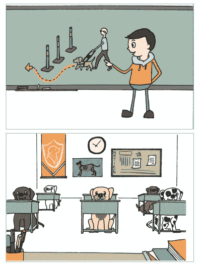
**Figure 2-21　Training a Guide Dog**

How does the guide dog do it? First, it observes the surrounding environment, including the position and number of obstacles, thinks about the route forward, and then tries to act. When it can safely lead the trainer through obstacles, it gets praised and petted, which makes it happy. But when it fails to safely lead the trainer through obstacles, it gets criticized by the trainer, which makes it disappointed. To avoid criticism and gain more praise and petting, it thinks about improving the route to avoid obstacles, consolidating successful routes and changing failed ones. As the number of training sessions increases, through continuous cycles, the guide dog can successfully go on duty and lead the trainer through various obstacles.

The model for training a guide dog is shown in Figure 2-23.

#### Thought Exploration

What do the four concepts: Environment, Decision, Action, Reward/Punishment mean?

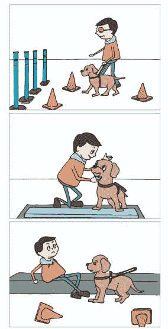
**Figure 2-22　Process of Training a Guide Dog**

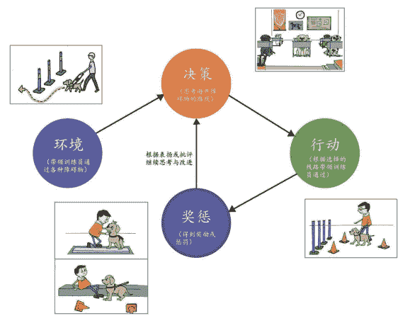
**Figure 2-23　Model of Training a Guide Dog**

In the process shown in Figure 2-23, four concepts need to be clarified.

1. **Environment**. The guide dog needs to observe the environment. The position of obstacles, the number of obstacles, the physique of the trainer being led, its own physique, etc., are all environmental factors the guide dog needs to pay attention to.
2. **Decision**. The guide dog thinks about the route to avoid obstacles based on the observed environment.
3. **Action**. It acts based on the decision result, specifically manifested as leading the trainer through the chosen route.
4. **Reward/Punishment**. After the action, the guide dog receives a reward or punishment. Based on the reward/punishment, the guide dog continues to think and adjust the chosen route, forming a cycle of continuous learning and trying.

The most important part of this process is the decision—thinking how to act to gain more rewards.

### 2.4.2 General Process of Reinforcement Learning

Reinforcement learning can be regarded as the process of machine thinking and improvement.

Reinforcement learning is essentially a learning process of constant trial and error. In various environments, it needs to try all possible actions as much as possible, judge the quality of actions through feedback from the environment (i.e., rewards/punishments), and finally obtain the mapping relationship between the environment and the optimal action (i.e., the decision).

#### Experience Perception

As shown in Figure 2-24, choose a route from start to end. Passing through each node on the route yields a certain number of gold coins (blue numbers indicate the gold coin count for each node route). Which route yields the most gold coins?

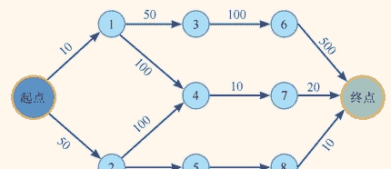
**Figure 2-24　Route Selection**

There are four routes from start to end:

- Route 1: Start→1→3→6→End, total 660 gold coins.
- Route 2: Start→1→4→7→End, total 140 gold coins.
- Route 3: Start→2→4→7→End, total 180 gold coins.
- Route 4: Start→2→5→8→End, total 140 gold coins.

By listing all routes, we know "Route 1" yields the most gold coins. Our decision plan is "Route 1".

### 2.4.3 Comparison of Supervised, Unsupervised, and Reinforcement Learning

However, suppose we do not know the number of gold coins on each node's path ahead. Then the initial choice is between Node 1 and Node 2. We would choose Node 2 because it yields 50 gold coins. This causes us to miss Path 1. Here we need to understand that the goal in reinforcement learning is **reward maximization**, i.e., achieving the highest cumulative return. Although choosing Node 2 yields the highest *immediate* reward (50 gold coins), in the long run, it does not yield the highest cumulative reward (Path 1 yields 660 gold coins).

In reinforcement learning, a "good" algorithm is very "ambitious" and will not be tempted by immediate petty gains. It cannot only see immediate benefits but must learn to consider the long term.

#### Think and Explore

In this problem, can you identify what the environment, decision, action, and reward/punishment are?

- **Environment**: There are different paths from start to finish, each with a different number of gold coins.
- **Decision**: Choosing a path.
- **Action**: Walking from start to finish along the path chosen by the decision.
- **Reward/Punishment**: Based on the number of gold coins obtained from the action, calculate whether this path yields more gold coins than previous paths (since the goal is to get more gold coins). Consider if there are other different paths, forming a loop to continuously learn and try.

The general process of reinforcement learning can be summarized as shown in Figure 2-25.

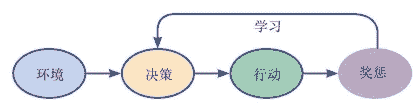

Figure 2-25　General Process of Reinforcement Learning

Supervised learning involves inputting labeled sample data, obtaining a model by training on labeled data samples, and thereby outputting a predetermined classification label.

Unsupervised learning involves inputting unlabeled data, autonomously inducing and reasoning to group data into clusters. Since it is autonomous induction, the output results often cannot be determined in advance.

Reinforcement learning does not require pre-input data; its key lies in decision-making. Therefore, reinforcement learning is a process of continuous trial and error, looping repeatedly. Based on feedback rewards/punishments in the current environment, it continuously thinks and improves, makes different decisions, and puts them into action.

#### Hands-on Practice

Please use graphical programming software, load AI-related modules, and build a machine learning project through a mini-game.

There is no need to tell the machine the specific game rules, but the machine can be trained using winning game cases. In this process, understand how the machine thinks and improves through reinforcement learning, becoming smarter bit by bit.

## 2.5 Development of Machine Learning

### 2.5.1 History of Machine Learning Development

At present, scholars researching artificial intelligence believe that machine learning has gone through five stages of development.

**Stage 1: Embryonic Period (1940s)**

During this period, scholars introduced the concept of neurons from biology. Based on analyzing the basic characteristics of neurons, they proposed the `M-P Neuron Model`, laying the foundation for the development of machine learning.

**Stage 2: Fervent Period (1950s — Mid-1960s)**

The famous "Turing Test" was proposed during this period. Not only that, but neurologists also proposed the simplest mathematical model of a neural network—the Perceptron. During this period, the earliest Decision Tree algorithms, `SVM` (Support Vector Machine), and Bayesian Classifiers were proposed.

**Stage 3: Quiet Period (Mid-1960s — Mid-1970s)**

Due to the Perceptron's simple structure and its ability to handle only simple linear problems, technology could not break through limitations. During the quiet period, machine learning development stagnated. Even so, the `KNN` (K-Nearest Neighbor) classification algorithm was proposed in 1967.

**Stage 4: Revival Period (Mid-1970s — Late 1980s)**

In the 1970s, learning methods such as self-training, transductive learning, and generative models appeared, which can be considered the origin of semi-supervised learning.

In 1980, machine learning research flourished worldwide. In 1986, machine learning gradually attracted worldwide attention and began to accelerate development. The book *Parallel Distributed Processing: Explorations in the Microstructure of Cognition* proposed a learning rule applied to multi-layer neural networks—the `BP Algorithm` (Backpropagation Algorithm), promoting the development of artificial neural networks. Besides the `BP Algorithm`, various neural networks also developed rapidly during this period. In 1986, the `ID3 Algorithm` in decision tree algorithms was proposed. Shortly after, `CNN` (Convolutional Neural Networks) emerged.

The biggest breakthrough in the machine learning field during the revival period was the enrichment of artificial neural network types, thereby making up for the defect of the Perceptron's single structure.

**Stage 5: Diversified Development Period (1990s — Present)**

Entering the 1990s, statistical learning prevailed, and various shallow machine learning models emerged one after another, such as `LR` (Logistic Regression), `SVM`, etc.

In 2006, the concept of Deep Learning was formally proposed.

### 2.5.2 Deep Learning and Machine Learning

With the popularity of artificial intelligence, the term "Deep Learning" is often heard. So what is the relationship between "Deep Learning" and the "Supervised Learning," "Unsupervised Learning," and "Reinforcement Learning" we mentioned earlier in machine learning?

The "intelligence" in artificial intelligence can be mainly attributed to machine learning. The technology frequently used in machine learning currently is Deep Learning. In short, the three learning methods we mentioned earlier—"Supervised Learning," "Unsupervised Learning," and "Reinforcement Learning"—can all utilize "Deep Learning" technology.

The relationship between Artificial Intelligence, Machine Learning, and Deep Learning can be represented by Figure 2-26.

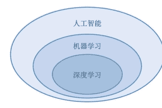

Figure 2-26　Relationship between AI, Machine Learning, and Deep Learning

### 2.5.3 Artificial Neural Networks and Deep Learning

Deep Learning is considered an extension of Artificial Neural Network algorithms. Artificial Neural Networks start with neurons and the Perceptron.

#### 1. Neurons

The human brain possesses hundreds of billions of neurons. Neurons are the basic components of the brain (Figure 2-27). Human behaviors such as listening, speaking, seeing, and thinking stimulate neuron protrusions, which we call "dendrites." Neurons can be interconnected through "dendrites." All neurons in the brain and the dendrites connected to them form the brain's "neural network."

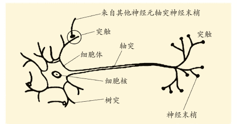

Figure 2-27　Neuron

#### 2. Perceptron

The Perceptron is the foundation of neural networks and the origin of Deep Learning. A single-layer Perceptron can be regarded as the simplest neural network. The principle of the Perceptron is simple: the system receives multiple inputs and feeds back a single output.

Take a school subject's final comprehensive evaluation as an example to demonstrate a single-layer Perceptron. Generally, the final comprehensive evaluation consists of two parts: the student's regular grades and final exam grades. Therefore, the inputs are two scores: "Regular Grade" and "Final Exam Grade." The output final evaluation is set as "Pass" or "Fail." The condition for the final evaluation output is: "If the obtained score is less than 60, output Fail; otherwise, output Pass." As shown in Figure 2-28, the process weights each input value, i.e., `Regular Grade × Weight + Final Exam Grade × Weight = Final Comprehensive Score`. The obtained final score is then judged: if less than 60, output "Fail"; otherwise, output "Pass."

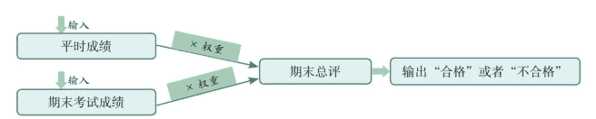

Figure 2-28　Demonstration of Single-Layer Perceptron Using Final Evaluation

##### Think and Explore

Weight represents the importance of a certain thing. If the school values students' regular performance more, the weight of the regular grade will be larger; if the school values exam scores more, the weight of the final exam grade will be larger.

Why do weights need to be adjusted in Deep Learning? Because input data have different degrees of influence on the output results. To obtain the optimal result, the essence of Deep Learning can be understood as optimizing the values of all weights, selecting the most reasonable values to achieve the best result.

##### Experience Perception

Try it yourself: in the following three scenarios, what are the final comprehensive evaluation outputs?

**Scenario 1 (Figure 2-29)**

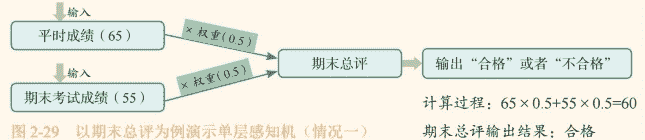
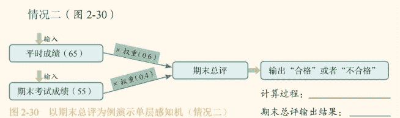
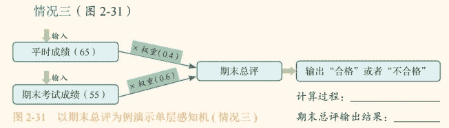

- Scenario 1　Calculation: `65×0.5+55×0.5=60`, Final Evaluation Output: Pass
- Scenario 2　Calculation: `65×0.6+55×0.4=61`, Final Evaluation Output: Pass
- Scenario 3　Calculation: `65×0.4+55×0.6=59`, Final Evaluation Output: Fail

In these three scenarios, when inputting the same regular grade and final exam grade, the output results differ due to different weights.

For a single-layer Perceptron, input data is certainly important, but weight is also an important influencing factor. To make the single-layer Perceptron more reasonable, it is often necessary to adjust and select the most reasonable weights.

#### 3. Multi-Layer Perceptron

The single-layer Perceptron is too simple and can handle limited problems; hence the Multi-Layer Perceptron (MLP) emerged. The MLP adds more layers between input and output, and the output layer is not just a single neuron but can have multiple neurons. The MLP is also one of the structures of Artificial Neural Networks. Since Deep Learning originates from ANN research, an MLP with multiple hidden layers is a Deep Learning structure.

#### 4. Artificial Neural Networks

We can regard Artificial Neural Networks as a highly simulated achievement of brain structure.

From Figure 2-32, it can be seen that ANNs are divided into Input Layer, Hidden Layers, and Output Layer. The Input Layer is responsible for data input; the middle layers of neurons are not visible, hence called Hidden Layers; the Output Layer is responsible for data output.

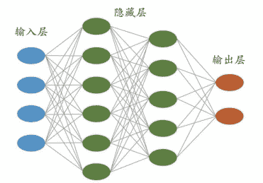

Figure 2-32　Deep Learning Model

#### 5. Deep Learning

A typical Deep Learning model (Figure 2-32) is actually a Multi-Layer Neural Network. Like ANNs, Deep Learning models contain Input Layers, Hidden Layers, and Output Layers.

For example, input an image and use Deep Learning to recognize objects in the image. The Deep Learning model is set as shown in Figure 2-33.

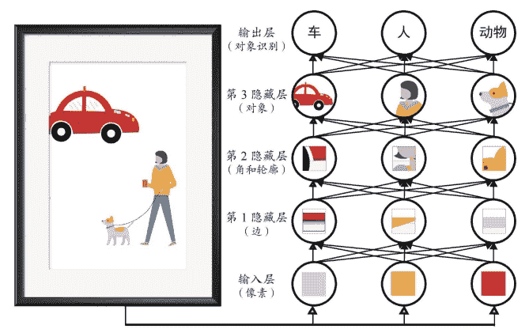

Figure 2-33　Using Deep Learning to Recognize Objects in an Image

In this Deep Learning model, since every image is composed of pixels, we use pixels as input data for the Input Layer.

Hidden Layers are responsible for extracting more abstract features from the image.

Based on given pixels, the 1st Hidden Layer determines edges by comparing the brightness of adjacent pixels.

With the edge descriptions from the 1st Hidden Layer, the 2nd Hidden Layer determines corners and contours by searching edges.

With the descriptions of corners and contours in the 2nd Hidden Layer, the 3rd Hidden Layer can detect entire parts of specific objects by searching for corners and contours in the image.

Finally, recognition is performed based on the objects described in the image, and the result is output through the Output Layer.

Of course, depending on the Deep Learning model settings, the number of Hidden Layers and the number of neurons in each layer will differ, and the function of each Hidden Layer will also differ. For example, with a different model, the 1st Hidden Layer might not be determining edges.

In Deep Learning, to enable Hidden Layers to extract abstract features more accurately, parameter adjustment is often required. "Parameter" is a broad term. Parameter adjustment includes not only numerical adjustments (e.g., the weights mentioned earlier in the Perceptron; weights are also important parameters in Deep Learning) but also network structure adjustments, such as increasing or decreasing the number of Hidden Layers and neurons.

##### Knowledge Expansion: Pixel

A Pixel is the most basic unit element composing an image. If you zoom in on an image to the maximum, you will find it is composed of small squares; these squares are called "Pixels." Each has a definite position and an assigned color value.

##### Experience Perception

Open WeChat on your phone, search for the Mini Program "Your AI", select different datasets, and experience the working process of Deep Learning.

##### Knowledge Expansion: Convolutional Neural Network

`CNN` (Convolutional Neural Network) is one of the representative network structures in Deep Learning technology. `CNN` has achieved tremendous success in solving certain types of problems (such as Image Recognition). Currently, `CNN` also has important applications in Video Analysis, Natural Language Processing, and other fields.

`CNN` generally contains Convolutional Layers and Pooling Layers.

Taking Image Processing as an example, there is a Convolution Kernel in the Convolution Operation of `CNN`. Suppose we have a Convolution Kernel as shown in Figure 2-34 (Convolution Kernels are usually data matrices much smaller than the input image dimensions).

The Convolution Kernel acts like a sliding window, sliding step by step along the matrix representing the input image, performing processing at corresponding input positions (multiply and accumulate operations), and finally generating corresponding outputs based on sliding positions. This process is shown in Figures 2-35 to 2-37.

Setting different Convolution Kernels allows exploration of various different details in the image. Colloquially, the role of Convolution is to see the essence of the picture clearly from various angles, i.e., helping us find image features.

The direct effect of the Pooling Layer is Dimensionality Reduction, which can be understood as reducing data volume. The Pooling Layer can be understood as representing a set region with a single value. Current pooling methods include Max Pooling and Average Pooling. Max Pooling is more commonly used, i.e., selecting the maximum value in a set region as the region's representative, thereby obtaining more global features of the image. The process of Max Pooling is shown in Figure 2-38.

Convolution plus Pooling allows gradual expansion from texture features to local features, and then to global features.

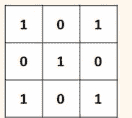
Figure 2-34　Convolution Kernel Example

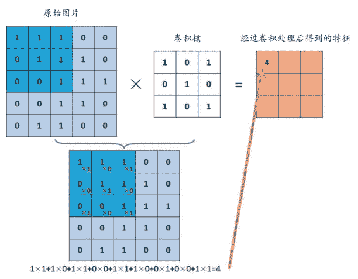
Figure 2-35　Convolution Process (1)

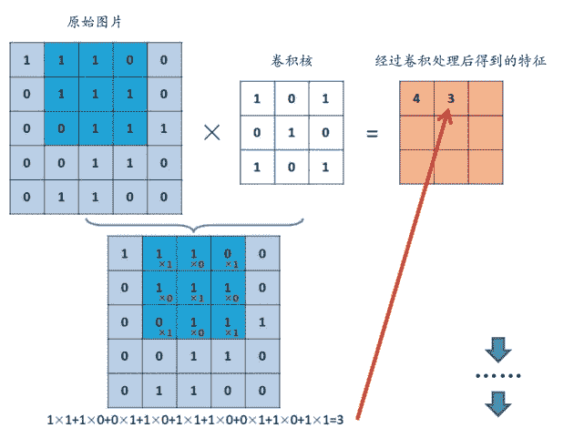
Figure 2-36　Convolution Process (2)

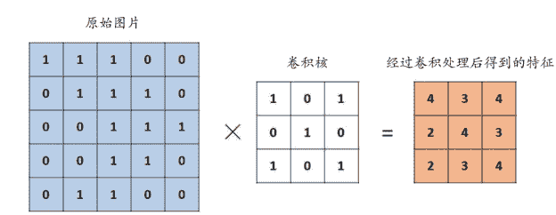
Figure 2-37　Convolution Process (3)

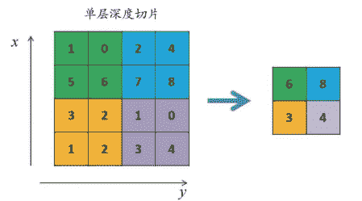
Figure 2-38　Max Pooling Process

##### Knowledge Expansion: Generative Adversarial Network

`GAN` (Generative Adversarial Network) is a Deep Learning model. The principle of `GAN` can be understood through an example. For instance, a criminal makes counterfeit money. Initially, due to poor technique, the police immediately spot the fake. Learning from failure, the criminal improves the technique; this time the counterfeit money is not so easily identified. The police then realize the criminal's technique is improving, so they enhance their detection skills to prevent circulation. This adversarial process continues: the criminal's counterfeits become more realistic, and the police's detection ability grows stronger. Both sides compete, mutually improving their techniques. This is the basic idea of `GAN`.

`GAN` consists of two main parts—Generator and Discriminator. The Generator produces realistic fake samples; the Discriminator identifies generated samples. If generated samples are not realistic enough, the Discriminator easily identifies them as fake. To improve output quality in this model, we need a good Generator and Discriminator; only when both are excellent will the final generated samples be realistic enough. `GAN` is widely used in Image Inpainting, Artistic Creation, and other fields. Notably, the painting *Edmond de Belamy* created by `GAN` sold for approx. 3 million RMB at auction.

# Chapter 3 Seeing AI

## Introduction

Computer Vision Technology uses computers, cameras, and other devices to simulate human vision, observing and understanding the external world. It is an important component of the AI field. Computer Vision can achieve various tasks such as Image Processing, Image Recognition, Object Detection, and Object Tracking. With the continuous development of this technology, it has been applied in Public Safety, Intelligent Transportation, Industrial and Agricultural Production, Medical Diagnosis, and many other fields.

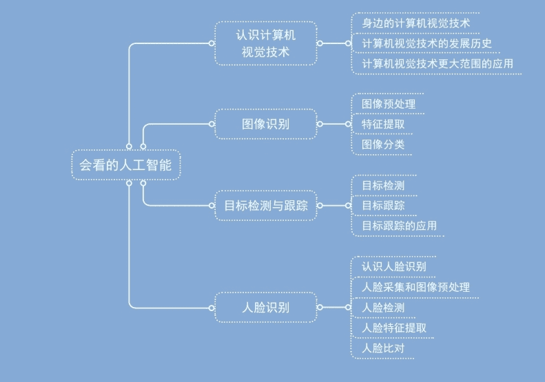

## 3.1 Understanding Computer Vision Technology

### 3.1.1 Computer Vision Technology Around Us

In our study and life, we encounter various cameras. For example, cameras at school gates measuring body temperature, security cameras in teaching buildings, cameras in classrooms for roll call. Classroom cameras can even detect behaviors like reading, raising hands, writing, standing, listening, lying on desks during class interaction, and combined with facial expressions (happy, sad, angry, disgusted), analyze our status in class. On the way to and from school, we see surveillance cameras in subways, buses, and on roads; cameras at community barriers that recognize license plates. At home, we can use phone cameras to photograph homework and check if answers are correct.

All these use cameras connected to computers and other devices, employing a technology called Computer Vision. This is the science of making machines "see." Further, it uses cameras and computers to replace human eyes for target recognition, tracking, and measurement, and obtains corresponding information through image processing.

#### Experience Perception

1. This is a screenshot of a commemorative stamp issued by China Post for a unique Chinese plant (Figure 3-1). The plant name in the image is missing. Can we identify this plant?

It turns out this plant is called *Abies beshanzuensis* (Baishanzu Fir), a plant unique to China. Did you get it right?

2. A new semester begins. Student Xiao Neng wants to buy a pen suitable for writing (Figure 3-2). The classmate only sent a photo. Xiao Neng doesn't know where to buy it. Can you help solve this?

For example, use the "Photo Search" function of a Shopping App to see if you can find the corresponding purchase link.

Figure 3-1　China Post Commemorative Stamp Screenshot

Figure 3-2　Desired Pen

### 3.1.2 History of Computer Vision Technology Development

Computer Vision is the science of making machines "see." Further, it studies how to acquire information from images or multi-dimensional data for perception.

In 1966, AI scientists assigned homework requiring students to write a program that, when run on a computer, could tell what it saw through a camera. This is considered the earliest task description of Computer Vision.

In the 1970s and 80s, with the gradual popularization of modern electronic computers, Computer Vision technology initially sprouted. Scientists began trying to let computers answer what exactly they saw. The first thought was to draw inspiration from how humans see things.

One: At the time, people generally believed humans could see and understand things because they could observe objects stereoscopically through two eyes. Therefore, to let computers understand the images they see, the scenery must first be restored from 2D images to 3D structures. This is the so-called "3D Reconstruction" method (Figure 3-3).

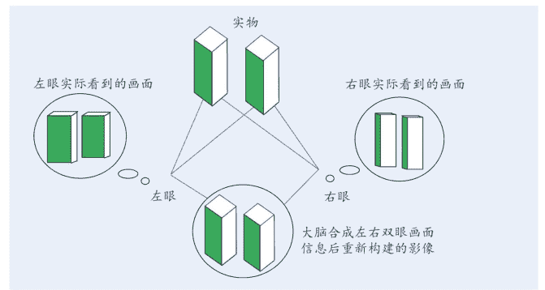
Figure 3-3　Schematic of Human Binocular Vision Observing 3D Objects

Two: People believed humans could recognize an apple because they already knew apples—e.g., apples can be red, yellow, green, round, smooth. If a similar knowledge base was built for computers, letting computers match seen images with reserved knowledge in the knowledge base, could computers recognize and even understand what they see? This is the so-called "Prior Knowledge Base" method (Figure 3-4).

Figure 3-4　Prior Knowledge Base Schematic

This method could only extract a few basic features, had low practicality, and could only be used in Optical Character Recognition, Microscopic or Aerial Photo Recognition, etc.

In the late 1970s, with the improvement of computer performance, image processing became possible, and Computer Vision received true attention and development. The publication of the book *Vision* in 1982 marked Computer Vision becoming an independent discipline.

In the 1990s, Computer Vision technology achieved greater development. On one hand, because image processing hardware technologies like `CPU` (Central Processing Unit) and `DSP` (Digital Signal Processing) made rapid progress; on the other hand, scientists invented more advanced algorithms, including the introduction of Statistical Methods and Local Feature Descriptors. Computer Vision technology began to be widely applied in Industrial fields.

Entering the 21st century, thanks to the massive data brought about by the rise of the Internet and the advent of digital cameras, coupled with the widespread application of machine learning methods, computer vision has developed rapidly. Many previous rule-based processing methods have been replaced by machine learning. Machines automatically summarize and induce the features of objects from massive data, and then perform recognition and judgment. This stage saw the emergence of a very large number of applications, including typical camera face detection, security face recognition, license plate recognition, etc.

After 2010, with the power of deep learning, computer vision technology achieved explosive growth and formed industrialization. Neural network image recognition appeared, which is a relatively new image recognition technology currently. Deep learning technology has shown tremendous advantages in the development of computer vision technology, particularly in the field of object vision.

To date, computer vision technology can already utilize "seen" information to accomplish various tasks. Looking to the future, computer vision technology may enable computers to observe and understand the world through vision just like humans.

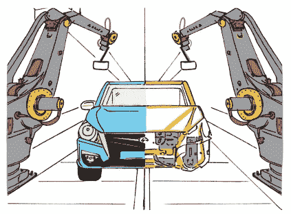

Figure 3-5　Manufacturing Robot

### 3.1.3　Wider Applications of Computer Vision Technology

Previously, we learned about the applications of computer vision technology and its brief developmental history. Next, we will explore the wider, higher-level applications of computer vision technology, such as in industrial manufacturing, healthcare, agriculture, military, security monitoring, autonomous driving, and other fields.

#### 1. Computer Vision and Industrial Manufacturing

In May 2015, Premier Li Keqiang of the State Council approved "Made in China 2025". This is a strategic document deploying the comprehensive promotion of the manufacturing power strategy, and an action outline for the first decade of China's implementation of the manufacturing power strategy. In industrial manufacturing, the use of industrial robots is indispensable. Visual perception technology in industrial robot systems is an important aspect of industrial robot perception (Figure 3-5). The vision system acquires visual information for controlling and adjusting the robot's position and posture. The vision system has also been widely used in quality inspection, workpiece recognition, food sorting, packaging, and other aspects.

#### 2. Computer Vision and Healthcare

Tencent Miying, under China's Tencent, is a product that applies artificial intelligence technology to the medical field. Tencent Miying gathers the strength of multiple top AI teams, cross-integrating technologies such as image recognition and deep learning with medical applications.

Early medical examinations were all manually read by doctors, which was time-consuming, laborious, and prone to misjudgment. Now, smart healthcare has made tremendous progress based on the development of computer vision technology (Figure 3-6). Its principle is as follows: provide massive amounts of two categories of images—cancerous cells and normal cells—without needing to outline the boundaries of all cancerous and normal cells; computer vision technology can identify the features of these two categories of images and recognize them through machine learning methods, greatly improving the accuracy of film reading.

Figure 3-6　Medical Cell Detection

According to news reports, an institution once performed intelligent detection and identification on nearly 9,000 lung nodule CT images from 30 patients uploaded by a certain hospital. It marked the suspected nodules screened out in the first round as auxiliary diagnosis results for review by 4 radiologists. The entire process of human-machine collaborative diagnosis of lung nodules took only 30 minutes, a significant efficiency improvement compared to the 150–180 minutes required by traditional methods. Verified by 4 attending radiologists from Grade A tertiary hospitals using a double-blind method, the comprehensive accuracy of intelligent diagnosis reached over 90%.

#### 3. Computer Vision and Agriculture

People have used visual recognition technology to intelligently identify crops and weeds, enabling intelligent spraying. Solar panels, cameras, temperature, humidity, and light sensors, as well as big data clouds, can also be used to collect, record, and process agricultural data for crop yield prediction, crop disease monitoring, etc. (Figure 3-7). In regions such as Heilongjiang, China, new technologies like Beidou satellite-based outdoor monitoring systems and smart phone terminals have been deployed for agricultural monitoring, meteorological disaster early warning, and other services.

#### 4. Computer Vision and Military

Computer vision can be applied in military projects such as missiles and drones (Figure 3-8). For example, China's independently developed "Changjian-10" (Long Sword-10) cruise missile can fly close to the ground or sea level. Its flight altitude is very low, allowing it to evade most radar surveillance and safely reach its combat zone. When the missile flies near the destination, it performs a "cobra" maneuver (pulling up), looking down at its target, and then dives straight toward the target.

Figure 3-7　Smart Agriculture

Figure 3-8　Cruise Missile

Figure 3-9　Face Scan

Figure 3-10　Iris Scan

Figure 3-11　Fingerprint Scan

#### 5. Computer Vision and Security Monitoring

In recent years, identification technology based on biological characteristics has received extensive attention, mainly focusing on features such as face (Figure 3-9), iris (Figure 3-10), fingerprint (Figure 3-11), and voice, most of which are related to visual information.

Taking the search for criminal suspects as an example, the traditional method of manually screening targets from massive video data is like finding a needle in a haystack, involving a huge workload and prone to omissions. Intelligent security technology uses computer vision and deep learning to let computers analyze personal features in the data, then automatically screen based on the suspect's features, quickly and accurately identifying various important features of individuals, such as gender, age, hairstyle, clothing, build, whether they wear glasses, whether they are cycling, and carried items, automatically identifying suspects from large amounts of surveillance video. This not only saves manpower and material resources but also greatly shortens the time to solve cases.

#### 6. Computer Vision and Autonomous Driving

With the continuous popularization and promotion of technologies such as big data, the Internet of Things, and 5G in the automotive field, autonomous driving technology (Figure 3-12) has also begun to be known by the public.

Figure 3-12　Autonomous Driving

Autonomous vehicles, also known as driverless cars, are intelligent vehicles that achieve unmanned driving through computer systems. Autonomous vehicles rely on the collaboration of artificial intelligence systems such as computer vision, allowing computers to automatically and safely operate motor vehicles without active human operation. On August 30, 2019, China's first mass-produced L4-level autonomous passenger vehicle—Hongqi EV, jointly built by BAIC and FAW—obtained 5 Beijing autonomous driving road test licenses.

The above lists the main application scenarios of computer vision technology. So how exactly does a computer achieve computer vision? What is the principle of computer vision?

> **Think & Explore**
>
> Think about which of the following applications use computer vision technology (Figure 3-13—Figure 3-15)?
>
> 
>
> Figure 3-13　Face Recognition Unlocks Phone
>
> 
>
> Figure 3-14　Adjusting Images with Image Processing Software
>
> 
>
> Figure 3-15　Search by Image in Baidu Images

> **Experience & Perception**
>
> 1. Please open your phone and try taking a photo with an App that has a beauty filter function. Look at the photos taken with it and see what changes have occurred in terms of skin, face shape, etc.
> 2. Please open your phone and try using the "Identify Everything" function of the Baidu App (Figure 3-16) to see what it can recognize.
>
> 
>
> Figure 3-16　Baidu App "Identify Everything"

### 3.2　Image Recognition

Image recognition refers to the technology of using computers to process, analyze, and understand images to identify targets and objects of various different patterns. It is a practical application of applying machine learning algorithms. Currently, image recognition technology is generally divided into face recognition and object recognition based on the recognition object. Face recognition is mainly used in scenarios such as security checks, identity verification, and mobile payment; object recognition is mainly used in scenarios such as goods circulation, particularly unmanned shelves, smart retail cabinets, etc.

Generally, the process of image recognition includes three steps: image preprocessing, feature extraction, and image classification (Figure 3-17). We will understand how computer vision technology recognizes images based on this process.

Figure 3-17　Image Recognition Process

#### 3.2.1　Image Preprocessing

In Chapter 2, we learned that humans can distinguish different animals because they have seen them before and remembered their different features; similarly, computers can correctly distinguish dogs and cats because they have "seen" and remembered their different features before.

When computers perform image recognition, the quality of the image directly affects the design of the recognition algorithm and the accuracy of the recognition results. However, during the image acquisition process, imaging angles, perspective relationships, and even the lens itself can cause image errors. Therefore, in the initial stage of image recognition, we need to preprocess the images.

The main purpose of image preprocessing is to eliminate errors in the image, restore useful information, thereby improving the reliability of feature extraction and image classification, and helping the computer understand the image more accurately. General image preprocessing methods include the following.

##### 1. Grayscale Correction

We call each indivisible unit on an image (or the smallest element) a pixel. The term "grayscale" originated from black-and-white photography, referring to the different depths of gray presented by each pixel on a black-and-white photo (or black-and-white image) produced according to the different colors and brightness of each point of the scene (Figure 3-18, Figure 3-19).

Figure 3-18　Original Image

Figure 3-19　After Grayscale Correction

Figure 3-20　After Geometric Transformation

##### 2. Geometric Transformation

Image geometric transformation, also known as image spatial transformation, refers to processing acquired images through methods such as translation, transposition, mirroring, rotation, and scaling (Figure 3-19, Figure 3-20).

Using the above methods can better correct issues in image acquisition such as images being too dark, too bright, having noise points, low contrast, and imaging angles.

> **Experience & Perception**
>
> Please use image processing software to try adjusting the brightness, contrast, etc. of the image, and rotate, flip, and crop the image to experience manual image processing.

#### 3.2.2　Feature Extraction

Features, as the name suggests, are the characteristics that distinguish one thing from another. The human brain can distinguish differences between things mainly because it can extract the similarities and differences between them. For example, ducks have webbed feet, chickens do not; duck beaks and chicken beaks have different shapes; ducks waddle when they walk, chickens do not. The human brain can extract these features. Another example: although both dogs and cats are covered in fur, the human brain can use certain features to correctly distinguish dogs and cats. For instance, canines have more prominent snouts than felines; cats of the same build can open their mouths wider than dogs.

How does computer vision technology mimic the human brain to extract the features of things? We will illustrate this using Figure 3-21 as an example.

To capture the features of a dog, the computer first converts the corresponding image into a grayscale image with black-and-white gradients, then divides the entire image into small grids. Next, it counts the distribution pattern of line directions within each grid image, that is, calculates the degree of pixel change (gradient; Figure 3-22) along vertical or horizontal directions. Then, it uses a certain algorithm to normalize the vertical and horizontal gradients into an image retaining only necessary information, finally processing the original image into the appearance shown in Figure 3-23.

Figure 3-21　Original Image

Figure 3-22　Gradient Change Schematic

Figure 3-23　Histogram of Oriented Gradients

We can clearly see the outline of this dog, and features such as the dog's longer snout and larger, erect ears are preserved. These features also need to be aligned with the image position. For example, the dog's snout and ears appear at appropriate positions in the image for relatively accurate recognition of the dog. When it is in a very rare posture, such as burying its snout in its body and two front paws, such features may become ineffective, requiring more complex features or more optimized algorithms for better recognition.

The above image feature extraction method is called the **Histogram of Oriented Gradients (`HOG`)**, a relatively common traditional image feature extraction algorithm based on image processing technology. There are many other methods for image feature extraction, such as feature recognition methods based on color features, feature recognition methods based on geometric features, etc.

> **Knowledge Expansion**
>
> **Histogram**
>
> A **Histogram** is a statistical report graph that uses a series of vertical bars or line segments of varying heights to represent the distribution of data. Generally, the horizontal axis represents the data type, and the vertical axis represents the distribution.
>
> A histogram is a tool for representing data variation. Using a histogram, one can analyze the laws of data and intuitively see the distribution status of all data of an object. The data distribution situation is clear at a glance, facilitating judgment of the overall data distribution.
>
> For example, for Figure 3-24, viewing the histogram (Figure 3-25) using image processing software can intuitively show the image data distribution in terms of lightness (brightness), red, green, and blue channels.
>
> 
>
> Figure 3-24　Original Image
>
> 
>
> Figure 3-25　Histogram

#### 3.2.3　Image Classification

As the saying goes, a picture is worth a thousand words. We constantly capture visual content from images, interpret its meaning, and store it in our brains for later use. But for a computer, interpreting the content of an image is actually very difficult; it knows nothing about the thoughts, knowledge, and meaning conveyed by the image.

Therefore, to enable computers to understand the content of images, we must apply image classification technology. This is the task of extracting meaning from images using computer vision and machine learning algorithms. This operation can be simply understood as assigning a label to an image, such as cat, dog, or elephant, or even interpreting the content of the image and returning a human-readable sentence.

The basis of image classification is the extracted image features. Next, we use image classification algorithms to recognize images. For example, we prepare a large pile of cat and dog images, then use these images to train a classifier model.

Red symbols represent dogs, blue symbols represent cats. The horizontal axis represents the degree to which the face shape is close to a circle, and the vertical axis represents the length of the fur. According to this two-dimensional coordinate system, this pile of cat and dog images is distributed as shown in Figure 3-26.

Obviously, if we want to separate the red symbols representing dogs from the blue symbols representing cats, we just need to add a straight line in the middle. Like Figure 3-27, using a straight line to divide the plane into two, each side belonging to a different category. This classifier is actually the `Single-Layer Perceptron` learned in Chapter 2.

Figure 3-26　Distribution Map 1 of Cats and Dogs

Figure 3-27　Cutting Distribution Map 1 of Cats and Dogs

Figure 3-28　Distribution Map 2 of Cats and Dogs

Figure 3-29　Cutting Distribution Map 2 of Cats and Dogs

But what if this pile of cat and dog images is distributed like Figure 3-28?

When the complexity of samples increases, the shortcoming of the `Single-Layer Perceptron` being able to only "make one cut" is fully exposed. At this time, a `Multi-Layer Perceptron`, also known as a `Multi-Layer Artificial Neural Network`, can be used. The output of the lower-layer neurons serves as the input for the higher-layer neurons, thus forming the hidden layers in the artificial neural network. Returning to Figure 3-28, we can first make a horizontal cut between top and bottom (the yellow line in Figure 3-29), then a vertical cut between left and right (the green line in Figure 3-29), and then combine the top-left and bottom-right parts together, separating them from the top-right and bottom-left parts.

In fact, each "cut" just now used a neuron in the artificial neural network. In the example of Figure 3-29, the `Single-Layer Neural Network` cannot distinguish this pile of images based on these features, but the `Multi-Layer Neural Network` can correctly classify them. As long as the number of cuts is appropriate and the cut results are organically combined, no matter what kind of sample data distribution is encountered, the `Artificial Neural Network` can perform effective differentiation.

Here, we have successfully completed the classification of this pile of cat and dog images.

> **Knowledge Expansion**
>
> **The Secret Behind CAPTCHA**
>
> Anyone who has used the Internet knows what a CAPTCHA is. Over the years, the forms of CAPTCHA have become increasingly fancy. Without some knowledge reserves, one might not even be able to understand the CAPTCHA (Figure 3-30). Some CAPTCHAs even test mouse operation proficiency; if the action is too slow, it fails.
>
> The use of CAPTCHA can be explained in one sentence: distinguishing whether the entity trying to log in is a computer or a real human.
>
> The full English name of CAPTCHA is `CAPTCHA`, an acronym for the super-long phrase `Completely Automated Public Turing test to tell Computers and Humans Apart`, which directly translates to "Completely Automated Public Turing Test to Tell Computers and Humans Apart".
>
> When the wave of the Internet just started to sweep the world, the most troubling thing was too much spam email. Some people even wrote programs specifically to register a large number of new email accounts every day to send spam promotional emails. Important emails in users' inboxes were often drowned out by a large amount of spam, wasting a lot of resources. Internet companies and netizens suffered greatly. At this time, a programmer thought of a good solution. Humans can easily read handwritten text, but computer programs find it difficult to recognize. So, a threshold can be set during account registration: the distorted text provided must be entered to complete registration, used to identify computers and real humans. Since then, CAPTCHA was born.
>
> 
>
> Figure 3-30　Knowledge Q&A CAPTCHA
>
> 
>
> Figure 3-31　Street View CAPTCHA
>
> One might say: entering a CAPTCHA every login wastes a lot of our time! You might not believe it, but the time you spend entering CAPTCHAs is not wasted; on the contrary, every CAPTCHA entry may contribute to the development of AI. Why? Because the CAPTCHAs we enter are very likely to become datasets for AI training. Everyone must have encountered Street View CAPTCHAs (Figure 3-31). When you strain your eyes and brain to distinguish small cars, road signs, or bicycles in the CAPTCHA, you are actually labeling data for AI for free! Some of these images have already been recognized by AI, but a few are street views that AI struggles to recognize. In other words, this data will ultimately be used to train image recognition classifiers. Now you understand why entering a CAPTCHA sometimes contributes to AI development?

### 3.3　Object Detection and Tracking

We learned that image recognition goes through three steps. In this process, the example images we used previously each contained only one object. What if there is more than one object in the image? For example, Figure 3-32. At this time, simply using the previous image recognition won't work; the computer won't be able to tell whether this image is ultimately a dog or a doll (Figure 3-33).

Figure 3-32　Image of Dog and Doll

# 

Figure 3-33　Histogram of Oriented Gradients (HOG) of a dog and a doll

#### 3.3.1 Object Detection

When a computer faces an image, the most basic task is to recognize what is in the image. Is it a landscape or a person, a building or food? This is essentially image classification, which can be simply understood as tagging different images with corresponding labels. When the image category is known—for example, I know this image is about a dog and other objects—where is the dog located in the image? Can it be marked with a bounding box? Or when the image contains a pack of dogs, although the computer can recognize that the image contains dogs, it does not know how many dogs appear in the picture.

At this point, further processing of the image is needed, i.e., object detection (Figure 3-34).

Figure 3-34　Object Detection

Difference between image recognition and object detection: In image recognition, the entire image is classified into a single category and given a single label; in object detection, the computer needs to find the location and number of objects in the image and recognize what they are (Figure 3-35).

Figure 3-35　Object detection on the dog and doll image

##### Object Detection Method 1: Traditional Object Detection

Traditional object detection methods use manually designed feature operators to extract image features for object detection. Taking a single-scale object detection method as an example, a fixed-size detection window is used to scan the image from left to right and top to bottom. At each position, the image region within the window is fed into a classification detection algorithm. The classification algorithm then determines whether an object exists in this region; if so, it classifies the object. Once the object reaches or exceeds the threshold of a certain classification label, the detection window is marked and labeled with the classified category. Because computers process very fast, repeating this operation for all regions of the entire image can be completed quickly, yielding the final detection results.

Of course, in practical applications, object detection methods are much more complex; certain simplifications have been made here for ease of understanding. However, this detection method has obvious shortcomings. For example, what size of detection window is appropriate? If the window is too large, the image within the detection region cannot be classified (Figure 3-36a); if too small, larger objects cannot be detected (Figure 3-36b). To optimize this method, many attempts have been made, which will not be elaborated on here.

Figure 3-36　Setting of the detection window

##### Object Detection Method 2: Deep Learning-based Object Detection

Deep learning-based object detection methods use image features learned from neural networks to perform object detection.

Simply put, first, a selective search algorithm or similar region proposal method extracts hundreds or thousands of candidate bounding boxes of various sizes from the image to be detected. Then, the images within these candidate boxes are fed into a neural network respectively. Finally, based on the extracted image features, classification is performed to obtain category information and coordinate information corresponding to the original image, thereby achieving object detection and obtaining detection results (Figure 3-37).

Figure 3-37　Neural network-based object detection

It can be seen from this that object detection, as a more refined task, is far more difficult to achieve than image classification.

##### Knowledge Expansion: Cartesian Coordinate System

In mathematics, there is a definition: in a plane, two perpendicular number lines with a common origin are drawn. The horizontal axis is the `x`-axis, and the vertical axis is the `y`-axis. This establishes a Cartesian coordinate system in the plane, referred to as the rectangular coordinate system.

An ordered pair of numbers `(x, y)` can represent a point in the plane. In other words, a point in the plane can be represented by a set of two ordered numbers, which are the coordinates of this point in the coordinate system. If the coordinates of two points in the coordinate system are known, the length of the line segment between them can be calculated. Similarly, if the coordinates of three points are known, the area of the triangle formed by these three points can be calculated (Figure 3-38).

Figure 3-38　Cartesian Coordinate System

#### 3.3.2 Object Tracking

So far, we have learned about object detection in images. However, the images discussed above were static. In real life, more application scenarios require tracking objects in dynamic videos. For example, marking the object to be tracked in the first frame of a video, finding the same object in subsequent frames, and predicting the object's position in the next frame—this is object tracking.

Object tracking technology plays an important role in intelligent surveillance systems, autonomous driving, video retrieval, missile guidance, human-computer interaction, and industrial robots.

How to achieve object tracking? There are many methods; we discuss the following two.

##### Method 1: Frame-by-Frame Detection Tracking

In the first frame of the video, the target to be tracked is set. Then, in each subsequent frame of the video sequence, the region with the highest similarity to the target is found. In other words, the features of the target in the first frame are extracted for learning, and then each subsequent frame is detected to determine the target's position in every frame.

##### Method 2: Inter-Frame Relationship-based Tracking

Since the essence of object tracking is to train relevant algorithms based on the first frame's data, the training data is inevitably very limited. To address this, a generic feature extraction model pre-trained on an image classification dataset can be used. During actual tracking, the pre-trained model is fine-tuned using the limited sample information of the current tracking target. Simply put, when searching for the tracking target in a video, the first search requires locating the target in the entire frame. But in the next frame, there is no need to search the entire frame; instead, one only needs to search near the location where the target appeared in the previous frame. Compared with frame-by-frame detection tracking algorithms, this method does not need to detect the full image every time; it only needs to scan around the previous detection box, improving detection efficiency.

Currently, achieving real-time, accurate tracking under relatively complex conditions still faces many difficulties. The main challenges are as follows:

1.  **Deformation**: When a moving object changes pose, its geometric features and appearance model may change, leading to tracking failure.
2.  **Scale Variation**: When the tracking target shrinks, a lot of background information is included, causing errors in target model updates; when the target expands, the tracking range cannot fully cover the target, resulting in incomplete target information in the detection box, which also causes errors in target model updates.

Figure 3-39　Target occlusion

3.  **Image Blur**: Reduced resolution, fast target motion, changes in light intensity, similarity between target and background, etc., can all cause image blur.
4.  **Target Occlusion**: Object tracking requires not only detecting the target in each frame but also predicting the target's position. This is because the target may be temporarily occluded or disappear; otherwise, failure to find the corresponding target model would lead to tracking failure. Therefore, when encountering such problems, the tracking algorithm needs to predict the most likely position where the target might appear (Figure 3-39).

> **Experience & Perception**
>
> Some mobile gimbals only require clicking the tracking button and circling the target to be tracked on the screen. The gimbal will automatically adjust its direction, accurately tracking the filmed target whether the target moves or the gimbal itself moves (Figure 3-40). You can try it out if you have the chance.

Figure 3-40　Schematic diagram of object tracking

#### 3.3.3 Applications of Object Tracking

As an important research direction in computer vision technology, object tracking has extremely wide applications in both military and civilian fields. Military applications include unmanned aerial vehicles (UAVs), precision-guided missiles, airborne early warning, battlefield surveillance, etc.; civilian applications include autonomous driving, automatic robots, intelligent video surveillance, human-computer interaction, augmented reality, etc.

##### 1. Military Applications

Military applications of object tracking are shown in Figure 3-8 and Figure 3-41.

Figure 3-41　Military UAV

##### 2. Civilian Applications

###### (1) Intelligent Video Surveillance

① **Identity Recognition Based on Gait Features** (Figure 3-42). Everyone walks with a different posture. The computer can identify features such as the bending, swinging, height, and period of major human body joints, thereby distinguishing individuals. Even if someone wears a mask or hat to deliberately cover their face, the computer can still recognize the person.

Figure 3-42　Application of object tracking in gait-based identity recognition

② **Object Tracking Based on Face Recognition**. By recognizing facial features, the computer can distinguish each person; the specific principles will be discussed in detail later.

③ **On-board Computer Detection of Objects Encountered During Driving**, such as pedestrians, obstacles, traffic lights, surrounding vehicles, etc. It detects distance changes between itself and surrounding objects to prevent collisions with pedestrians or other vehicles, and prevent traffic violations such as running red lights.

④ **Cameras installed by traffic management departments at roadsides, intersections, and other locations** collect license plate information of passing vehicles, monitoring various traffic information in real-time, including traffic density, driving speed, traffic accidents, etc. (Figure 3-43).

###### (2) Human-Computer Interaction

Traditional human-computer interaction is conducted via keyboard and mouse. The computer's ability to recognize and understand human postures, actions, and gestures relies on object tracking as a key technology.

For example, hand tracking combined with gesture recognition can detect all hands in an image and recognize gesture types (Figure 3-44), including diverse scenarios such as selfies, photos taken by others, and various angles.

Computers can not only recognize human postures, actions, gestures, and expressions but also superimpose human figures into virtual 3D environments for interaction, providing participants with a richer interactive experience. For example, many Apps have functions like beautification, face swapping, and real-time expression tracking (Figure 3-45).

Figure 3-43　Application of object tracking in traffic monitoring

Figure 3-44　Gesture Recognition

Figure 3-45　Real-time Cartoon Face Transformation

###### (3) Medical Diagnosis

Object tracking has extensive applications in the automatic analysis of 3D modeling images from ultrasound and MRI. For example, noise in ultrasound images often obscures useful information in a single frame, making static analysis sometimes very difficult. By utilizing the geometric correlation and temporal continuity of targets in sequential images through tracking technology, more accurate analysis results can be obtained (Figure 3-46).

Figure 3-46　Application of object tracking in medicine

> **Experience & Perception**
>
> Open a short video App, select the "Props" function, and experience face tracking and augmented reality.

### 3.4 Face Recognition

You must have noticed that in our daily life, there are more and more places where you can "scan your face" (facial recognition verification). At security checks in stations, airports, and docks, "face scanning" speeds up entry; when handling business or registering and paying at banks and hospitals, "face scanning" can quickly verify user identity and save human resources; when checking out at shopping malls and supermarkets, "face scanning" enables password-free payment, enhancing the convenience of shopping...

This seemingly simple act of "face scanning" is actually supported by computer vision technology. How exactly does the computer complete face acquisition and preprocessing, perform face detection, face alignment, and face feature extraction, and achieve face recognition and liveness detection? What are the advantages and application scenarios of face recognition? Let's explore these questions together.

#### 3.4.1 Understanding Face Recognition

Face recognition is a biometric identification technology based on human facial feature information. Specifically, it uses a camera to capture images or video streams containing faces, automatically detects and tracks faces in the images, and then performs a series of related technologies for face recognition on the detected faces. It is also commonly called portrait recognition or facial recognition.

The semi-automatic face recognition system built by scientists in 1964 was the earliest research on face recognition. This system was based on geometric parameters of facial features, including the geometric characteristics of facial organs, such as the relative geometric relationships of key facial feature points like interocular distance, head width, nose height, and ear position.

However, precise localization of facial feature points is itself a difficult problem, easily affected by changes in pose and expression. The extracted geometric facial features are also very simple, losing a large amount of other extractable feature information. Therefore, algorithms based on simple geometric features have relatively low overall recognition accuracy.

The development of face recognition technology was very slow until the birth of deep learning technology, which brought explosive growth. In 2014, Chinese scientists achieved excellent results in combining deep learning with face recognition, achieving a recognition accuracy of over 99% on the `LFW` face dataset, surpassing the human recognition accuracy of 97.52% on the same dataset. According to news reports, in the 2018 Global Face Recognition Algorithm Test Competition, 39 enterprises and institutions from around the world participated, and the top five algorithms were all from China; in 2019, a Chinese company won the championship again, demonstrating sustained and strong competitiveness.

> **Thinking & Exploration**
>
> Besides the above scenarios, in what other scenarios can face recognition technology be used?

#### 3.4.2 Face Acquisition and Image Preprocessing

Face recognition requires acquiring face images first. Depending on the acquisition scenario, it can generally be divided into two categories.

The first scenario is called **Constrained Face Capture**. For example, requiring a standard sitting posture, facing the camera directly, no hats or glasses, and even requirements for bright lighting. Can you guess where such scenarios exist?

Taking ID photos is this type of scenario. We take such images for school enrollment, overseas travel, or applying for ID cards. Computer recognition of such face images is most favorable. Currently, the international leading recognition accuracy for this type of face image exceeds 99%.

The second scenario is called **Unconstrained Face Capture**. In daily life, naturally captured faces have various problems, such as side profiles, low light, strong light, backlight, occlusion, blur, etc. Images acquired this way inevitably affect the recognition accuracy of face algorithms. If the algorithms from the first scenario are directly applied here, they can only barely reach 60%–70% recognition accuracy. Therefore, to improve algorithm accuracy, it is necessary to start from the acquisition end to improve image acquisition quality, while also preprocessing the acquired face images to enhance image quality.

So how do we preprocess? Image enhancement is a commonly used preprocessing method. For example, weak ambient light causes dark images (underexposure). At this time, methods such as enhancing dark areas, removing noise in dark backgrounds, improving image resolution, and removing motion blur can be used for image enhancement.

There are two specific methods as follows.

##### 1. Improving Image Resolution

The most intuitive feeling of improved image resolution is that the image becomes finer. Faces captured in unconstrained conditions are usually far away and not very large, making facial feature recognition difficult. We can use interpolation algorithms to increase pixels and improve resolution. There are many interpolation methods; here we only discuss the most basic Nearest Neighbor Interpolation (Figure 3-47).

It can be understood like this: a `3×3` pixel image (Figure 3-47a) needs to be enlarged to `4×4` (Figure 3-47b). A point in the second column can be randomly selected, such as the green pixel point shown in Figure 3-47b, which is the pixel to be inserted. However, this point does not exist in the original image, so its grayscale value is unknown. So, the `4×4` image is scaled down proportionally to `3×3` and overlaid on the original `3×3` image (Figure 3-47c). At this point, it is found that this pixel point mostly overlaps with the middle pixel of the `3×3` image. Therefore, the grayscale value of this added point is set to be the same as that of the middle pixel of the `3×3` image. Following this method, the image can be enlarged.

Figure 3-47　Nearest Neighbor Interpolation

##### 2. HDR Technology

You may have noticed `HDR` on some mobile phone camera interfaces (Figure 3-48). Do you know what `HDR` is? What does it do?

Figure 3-48　Mobile Phone Camera Interface

When taking a photo with a camera, if the lighting of the foreground and background is inconsistent, the following situation occurs: when focusing on the bright area (metering on the bright area), the darker area becomes pitch black (underexposure), because most digital cameras focus and meter simultaneously, just like Figure 3-49.

For the same reason, if focusing on the darker area, the details in the bright area will be lost (overexposure), as shown in Figure 3-50.

This is where `HDR` technology comes in. Its Chinese name is High Dynamic Range Imaging.

The principle of `HDR` technology can be roughly understood as follows: the computer captures multiple images of the same field of view in a very short time, then uses algorithms to process and merge these images, making the dark parts brighter and the bright parts darker, to achieve the purpose of retaining both highlight details and shadow details simultaneously. The effect is shown in Figure 3-51.

Figure 3-49　Underexposure

Figure 3-50　Overexposure

Figure 3-51　Photo taken using HDR technology

> **Thinking & Exploration**
>
> Think about it: which Chinese idiom can describe the computer interpolation algorithm? Try searching for the disadvantages of the nearest neighbor interpolation method.
>
> **Experience & Perception**
>
> Try using the AI `bigjpg` mini-program to experience enlarging face images.

#### 3.4.3 Face Detection

Face detection is the accurate localization of the positions and sizes of all faces in an image, usually indicated by detection boxes. Remember the object detection we learned earlier? The "object" in object detection can actually include the target of a face.

Face detection algorithms need to solve the following key problems:

- Faces may appear at any position in the image;
- Faces may be partially occluded;
- Faces may have different sizes due to distance;
- Faces in the image may have different views and poses.

Remember how we performed object detection? Face detection can use similar methods. Faces in images are a very special class of detection targets, so the concept of an "Image Pyramid" needs to be introduced.

The so-called **Image Pyramid** (Figure 3-52) places the highest resolution image at the bottom, with a series of images of gradually decreasing pixels above it. The appearance resembles a pyramid shape, constituting the image pyramid in computer vision.

Figure 3-52　Schematic diagram of image pyramid

In the face detection process, the face image pyramid is particularly useful because faces in images have distance and size variations. The face detection algorithm specifies a minimum detection range, e.g., `12×12` pixels; faces smaller than this range are not detected. What about faces larger than this range? The detected image is gradually reduced in resolution until it reaches `12×12` pixels. During this process, if a face is detected, a detection box is marked. Obviously, this causes a large number of duplicate markings; the same face gets detection boxes of different sizes. So next, the computer merges and deduplicates the marked detection boxes, retaining the detection box with the most appropriate face size.

When deep learning arrived, scientists also thought of combining deep learning with face detection. In 2016, scientists from the Shenzhen Institutes of Advanced Technology, Chinese Academy of Sciences, developed the `MTCNN` algorithm, which can be roughly divided into three network structures: `P-Net`, `R-Net`, and `O-Net`.

A brief introduction to the principles of these three neural network layers:

- **`P-Net` Network**: The main purpose is to generate candidate detection boxes. Using the `P-Net` neural network, face detection is performed once on every region of images at different resolutions on the image pyramid, and the position and confidence score of the face detection box are given.
- **`R-Net` Neural Network**: Similar to the `P-Net` neural network, the detection boxes generated by the previous `P-Net` are input into the `R-Net` neural network for further optimization.

# Chapter 4: Artificial Intelligence That Can Listen and Speak

## Introduction

If computer vision technology enables machines to "see," then intelligent speech technology enables machines to "hear" and "speak." We know that listening and speaking are basic abilities required for daily human communication. If machines possess intelligent speech technology, they can listen and speak like humans, possessing the prerequisite for conversing with people. In this chapter, we will explore intelligent speech technology in the field of artificial intelligence.

## 4.1 Understanding Intelligent Speech Technology

### 4.1.1 Intelligent Speech Technology Around Us

In the morning, you wake up and want to know the weather. You open the voice assistant on your phone and ask softly, "What's the weather like today?"

"The current weather in Shanghai is sunny, 24 degrees Celsius. Partly cloudy in some areas starting tonight. By tonight, the temperature will drop from 24 to 18 degrees." The voice assistant responds quickly.

Intelligent speech technology was used in this process.

Roughly speaking, the phone "heard" your question through **Speech Recognition (ASR)** technology, combined with **Natural Language Processing (NLP)** technology and relevant applications, understood your question and found the answer, and then "spoke" the answer to you through **Text-to-Speech (TTS)** technology.

Both speech recognition and speech synthesis technologies mentioned here belong to intelligent speech technology.

#### Experience & Perception

1. **Experience Voice Input**  
   Please use the voice input function of your input method and try reading the following paragraph to see if the speech can be converted into correct text.  
   In 2020, during the World Artificial Intelligence Conference Cloud Summit, the Communist Youth League Shanghai Committee hosted the Youth Artificial Intelligence Innovation and Development Forum, combining professionalism with youth development. It invited experts from the domestic and international AI and education sectors to discuss new changes and trends in AI and youth growth, opening a new chapter for youth embracing and integrating into the new era of AI.

2. **Experience "Song Recognition"**  
   Please play a song clip and use the "Song" function in WeChat's "Shake" feature to see if it can recognize the song title.

3. **Experience Speech Synthesis**  
   Please open a search engine, search for "iFLYTEK Open Platform - Online Speech Synthesis," try entering some text, and see if it can read the text aloud correctly.

#### Think & Explore

Where else is intelligent speech technology used in daily life? Can you give a few examples?

### 4.1.2 Speech Recognition, Speech Synthesis, and Related Technologies

Speech recognition technology enables machines to "hear," converting our spoken words into text for machines to understand. However, before speech recognition begins, sound needs to be collected and digitized, which we will introduce in detail in the next section.

Speech synthesis technology enables machines to "speak," converting text into speech.

Does a machine equipped with speech recognition and synthesis, able to hear and speak, mean it can have a voice conversation with us? Not necessarily. "Hearing" does not mean "understanding," and "speaking" does not mean "knowing what to say." Therefore, after obtaining the question text via speech recognition, **Natural Language Processing (NLP)** technology is still needed to understand the question text and generate a response text. Then, speech synthesis technology speaks the response text. Only then can true conversation be achieved—making the machine not only "hear" but "understand," and not only "speak" but "speak appropriately."

However, just like humans, machines need continuous learning. Recall when you first entered kindergarten: you could listen and speak and converse with others, but communication still had issues—sometimes you couldn't understand others, sometimes you couldn't express yourself clearly. With continuous learning in kindergarten, primary school, and middle school, your language ability improved, understanding more and speaking better.

Machines with AI also need to continuously learn through technologies like **Machine Learning**, improving their speech recognition, natural language processing, and speech synthesis capabilities to hear more clearly, understand better, and speak more clearly.

### 4.1.3 Applications of Intelligent Speech Technology

Currently, intelligent speech technology is widely used in our daily study and life. The voice assistants mentioned earlier appear in smartphones, smart speakers, tablets, and many other places. We can query weather, set alarms, and even chat with them just by speaking. Of course, besides voice assistants, intelligent speech technology is also frequently applied in the following scenarios.

1. **Speech Translation**  
   Speech translation is interpretation—translating spoken language from one language into spoken language of another. Many international conferences often require instant oral translation between multiple languages.

2. **Voice Input**  
   Voice input means entering text by speaking. Compared to traditional Pinyin, stroke, and other input methods, it reduces the use of keyboards (keys), increases input speed, and is simpler and more convenient.

3. **Voice Control**  
   Voice control means issuing commands via voice to control various devices to react. For example, in smart homes: voice-controlled TV switching, air conditioner temperature adjustment, curtain opening/closing, etc.

4. **Voice Customer Service**  
   Voice customer service replaces human operators to answer calls, assisting customers with business inquiries, transactions, and other needs, reducing the workload of human agents and providing 24/7 uninterrupted service.

#### Think & Explore

Have you encountered problems when using applications with intelligent speech technology? Are there solutions?

#### Knowledge Expansion

**The World's First AI Collaboration Song "Smart Home" (智联家园)**  
At the opening ceremony of the 2020 World Artificial Intelligence Conference on July 9, four special AI performers—Xiaoice, Xiaodu, Xiaoai, and Lingyuan yousa—performed the original theme song "Smart Home" for the conference. This is the world's first song composed and performed entirely by AI robots, making extensive use of intelligent speech technology. Please search for the keyword "Smart Home MV" to enjoy this song.

### 4.1.4 Development of Intelligent Speech Technology

Intelligent speech technology, represented by speech recognition and speech synthesis, has developed over decades. Especially in recent years, with the application of **Deep Learning**, intelligent speech technology has become much more mature compared to the past.

- **1939:** The world's first electronic speech synthesizer was developed based on the formant principle.
- **1952:** The world's first experimental system capable of recognizing 10 English digit pronunciations was developed.
- **1980:** A speech synthesizer using mixed formant technology could simulate different timbres.
- **March 1986:** China's "National High-Tech Research and Development Program" (863 Program) launched, giving more support and better development to China's speech recognition, speech synthesis, and other technologies.
- **1987:** The world's first "Speaker-Independent Continuous Speech Recognition System" was developed, greatly improving speech recognition accuracy.
- **1997:** The first speech dictation system, ViaVoice, appeared.
- **2002:** The Institute of Automation, Chinese Academy of Sciences, launched the Pattek ASR speech recognition product.
- **2011:** Deep Neural Network (DNN) technology was applied to the field of speech recognition; the same year, voice assistants began appearing on smartphones.
- **2014:** Smart speaker products appeared.
- **2016:** Chinese high-tech companies' speech recognition accuracy reached 97%.
- **2020:** The world's first song composed and performed entirely by AI was born.

Today, intelligent speech technology has entered multiple application scenarios in education, healthcare, transportation, finance, industry, urban management, commerce, and other fields, opening a new chapter in human-computer interaction.

#### Hands-on Practice

Please use graphical programming software, load AI-related modules, write corresponding programs, and try to have a voice conversation with the computer.

## 4.2 Sound Processing

### 4.2.1 Sound Collection

We know sound is produced by object vibrations and requires a medium to propagate, with air being the most common medium. So, during sound propagation, how do we collect and save it? The first thing needed is a **microphone**, commonly known as a mic.

Different types of microphones work on different principles, but their basic purpose is the same: to convert incoming sound into electrical signals; only the conversion methods differ.

#### Knowledge Expansion

**Two Different Types of Microphones**

1. **Dynamic Microphone**  
   **Working Principle:** The microphone's diaphragm drives a coil to vibrate, cutting magnetic lines of force to generate an electrical signal.  
   **Usage Characteristics:** Simple structure; not very high requirements for environmental silence.

2. **Condenser Microphone**  
   **Working Principle:** The microphone's diaphragm vibration causes changes in capacitance, thereby forming an electrical signal.  
   **Usage Characteristics:** Higher sensitivity, delicate timbre; requires use in a silent environment.

### 4.2.2 Sound Digitization

After sound is converted into electrical signals by a microphone, it can be simply processed and stored as analog signals, like ordinary magnetic tapes. Or it can be further processed and converted into digital signals for computer processing. This process is called **sound digitization**.

Why does a computer need to digitize sound before processing it?

This relates to the computer's working principle. Its "brain"—the **Central Processing Unit (CPU)**—is currently mainly composed of large-scale integrated circuits. We know that for a circuit, there are only two states: "open" and "closed," which can be represented by "0" and "1" respectively. Therefore, all information processed in computers is represented by binary 0s and 1s; sound information is no exception.

How can sound be digitized? Generally, the digitization of sound signals goes through **sampling** and **quantization**.

#### 1. Sampling

The sound collected by the microphone is converted into an electrical signal, which is a continuously changing analog signal. If represented graphically, it can be imagined as a curve.

This curve can be understood as composed of countless points, each recording the amplitude of the sound vibration at the current time. Do we need to save the information of all points? Of course not.

Just like weighing yourself: although our weight changes constantly, as long as we weigh regularly—say, once a day or once a week—we can reflect weight changes. So, as long as we save the information of the corresponding points on the curve at regular intervals (sampling period)—that is, collect the sound electrical signal once—it is sufficient. This process is called **sound sampling**.

Naturally, the shorter the interval between each sampling, the more sampling times per unit time (sampling rate), and the closer the collected sound electrical signal is to the real sound signal.

#### 2. Quantization

After sampling, information from multiple sampling points is obtained. The sound amplitude recorded at each point comes from the analog electrical signal and is a relatively precise value. These values vary, causing difficulties for subsequent processing. A method similar to "rounding" can be used to obtain a new set of values. This process is called **sound quantization**.

### 4.2.3 Characteristics of Sound

After sound is converted into digital signals of 0s and 1s that computers can directly process, waveforms and spectrograms are mostly used to represent them, facilitating observation and editing of digital sound signals on computers.

Different people saying the same words and producing the same sounds have different sound waveforms. This is because different people speaking produce sounds with different characteristics (Figure 4-18, Figure 4-19).

- **Different volumes**: Some sounds are louder, some are softer.
- **Different pitches**: Some sounds are higher, some are lower. The "soprano" and "bass" singers we often refer to indicate the height of the pitch.
- **Different timbres**: As the saying goes, "hear the voice but not see the person," meaning that although the person is not seen, hearing their voice reveals who it is. Identifying human voices here is mainly through the timbre of the sound.

Note here that a waveform graph cannot represent timbre characteristics; a spectrogram is needed to achieve this (Figure 4-20, Figure 4-21).

Figure 4-18　Waveform of male voice reading "Artificial Intelligence"

Figure 4-19　Waveform of female voice reading "Artificial Intelligence"

Figure 4-20　Spectrogram of male voice reading "Artificial Intelligence"

Figure 4-21　Spectrogram of female voice reading "Artificial Intelligence"

#### Knowledge Expansion: Binary

We usually use the decimal system in mathematics, where the maximum digit in each position is 9, and a carry occurs every 10. What is binary? Simply put, in binary, the maximum digit in each position is 1, and a carry occurs every 2, so there are only two digits in binary: 0 and 1. Electronic circuits have only two states: "open" and "closed," which can be perfectly represented by 0 and 1 respectively, so binary is used in computers and many electronic devices.

The modern binary numeral system was designed by the famous German philosopher and mathematician Gottfried Wilhelm Leibniz in 1679. In fact, systems related to binary also appeared in ancient Egyptian, Chinese, and ancient Indian cultures, especially China's *I Ching* (Book of Changes), which gave Leibniz more inspiration.

#### Thinking Exploration

Is there a way to convert a decimal number into a binary number?

#### Knowledge Expansion: Volume, Pitch, and Timbre

- **Volume**, also known as loudness. The magnitude of volume is generally related to the amplitude of vibration of the sound-producing object; the larger the amplitude, the greater the volume; the smaller the amplitude, the smaller the volume. Volume magnitude is generally recorded in `dB` (decibels).
- **Pitch** height is generally related to the speed of vibration of the sound-producing object. The faster the vibration, the higher the pitch; the slower the vibration, the lower the pitch.
- **Timbre**, also known as tone quality. Timbre reflects the quality and characteristics of sound. Different objects (including human vocal cords) produce sounds with different timbres, so we can distinguish different people's voices.

#### Experience Perception

Use audio editing software to record a segment of speech, observe the waveform, try editing the waveform, and listen to what changes occur.

## 4.3 Speech Recognition

### 4.3.1 Preparation for Speech Recognition

Speech recognition technology is a technology that enables machines to "hear," converting what we say into text. How exactly is this achieved? There are many methods, among which the classic speech recognition algorithm consists of an Acoustic Model, a Language Model, and a Pronunciation Dictionary. We will take this as an example to see how spoken speech is converted into written text step by step.

Some preparation work needs to be done before recognition.

First, a large amount of sound data is used to train an Acoustic Model, used to convert sound into acoustic symbols (Figure 4-22).

Then, a large amount of text data is used to train a Language Model, to find possible textual expressions for acoustic symbols (Figure 4-23).

Figure 4-22　Acoustic Model

Figure 4-23　Language Model

### 4.3.2 General Process of Speech Recognition

For example, the waveform of the pronunciation of the four characters "Artificial Intelligence" (人工智能) is magnified, as shown in Figure 4-24. Because it is too long, only a part is intercepted and displayed here.

Figure 4-24　Segment of the waveform of the pronunciation of the four characters "Artificial Intelligence"

Before starting speech recognition, the waveform needs some preprocessing. For example, environmental noise during recording, silent blanks when not speaking, and other redundant information need to be removed by preprocessing to facilitate subsequent operations such as feature extraction. After obtaining the preprocessed sound, acoustic feature extraction can begin, such as extracting `MFCC` (Mel-Frequency Cepstral Coefficients) and `PLP` (Perceptual Linear Prediction).

However, before this, we need to know that language consists of words, and words consist of phonemes. Therefore, the recognition of phonemes can be said to be the key to speech recognition technology.

#### Knowledge Expansion: Phoneme

There are many types of human languages in the world, and pronunciations vary, but regardless of the language, they can all be divided into the smallest phonetic units—phonemes—based on the natural attributes of speech. Taking Chinese as an example, the four characters "Artificial Intelligence" (人工智能) can be divided into these phonemes: `r, e, n, g, o, ng, zh, i, n, e, ng`.

Having understood what a phoneme is, let's look at the general process of speech recognition.

**Step 1**: Frame the sound, that is, cut the sound into small segments... Each small segment is called a frame (Figure 4-25). The framing operation is not a simple cut, but cuts into overlapping frames according to a certain time interval.

**Step 2**: Through the Acoustic Model, recognize these frames into corresponding speech states, that is, compose states with frames. The "states" mentioned here can be understood as speech units more detailed than phonemes. Exactly how many frames correspond to a speech state? Since everyone's volume, pitch, and timbre are different, recognizing frames as states is a difficulty in speech recognition technology. Here we introduce a simple method: use the trained Acoustic Model to judge which frames have the highest probability of corresponding to a certain state; then these frames belong to that state.

**Step 3**: Compose phonemes with states. Generally, three states are combined to form a phoneme (Figure 4-26).

Figure 4-25　Framing Process

Figure 4-26　Recognizing frames as states, composing phonemes with states

**Step 4**: Combine phonemes into words. In this process, the Acoustic Model remains very important; it can find the most likely acoustic symbolic expression of phonemes (such as Chinese Pinyin). Combined with the Pronunciation Dictionary, the acoustic symbols are matched with the most likely textual expressions in the Language Model, thus converting sound into text (Figure 4-27).

In summary, the general process of speech recognition is shown in Figure 4-28.

Figure 4-27　Combining phonemes into words

Figure 4-28　General Process of Speech Recognition

### 4.3.3 Role of the Acoustic Model

The main role of the Acoustic Model is to recognize the framed speech into corresponding states, compose states into phonemes, and map phonemes to the most likely acoustic symbolic expressions (this requires the Pronunciation Dictionary).

How does the Acoustic Model achieve this? The process is very complex but can be simply understood as training the Acoustic Model through a large amount of speech data to better accomplish these tasks.

There are many methods for training Acoustic Models. Traditional methods mainly use `GMM-HMM` (Gaussian Mixture Model - Hidden Markov Model), while current methods use `DNN-HMM` (Deep Neural Network - Hidden Markov Model).

### 4.3.4 Role of the Pronunciation Dictionary

The Pronunciation Dictionary is also called a Lexicon. Different languages have different Pronunciation Dictionaries. For example, the Mandarin Chinese Pronunciation Dictionary contains the correspondence between Chinese Pinyin and Chinese characters, just like Table 4-3, while the English Pronunciation Dictionary contains the correspondence between phonetic symbols and words. Still taking Mandarin Chinese as an example, the main role of the Pronunciation Dictionary is to find the corresponding Chinese Pinyin and corresponding Chinese characters (words) based on the phonemes recognized by the Acoustic Model, establishing a connection between the Acoustic Model and the Language Model, linking the two.

Table 4-3　Example of Mandarin Chinese Pronunciation Dictionary

#### Knowledge Expansion: Frequency Bands of Sound

The frequency of sound that the human ear can receive ranges from `20 ~ 20000 Hz`, and the frequency of speech produced by humans ranges from `80 ~ 12000 Hz`. The so-called frequency band divides the sound into several sections according to frequency, and sounds in different frequency bands give people different feelings.

1. `20 ~ 60 Hz`. Boosting this band gives a feeling of loud sound, making music powerful, but if boosted too much, it causes a muddy, unclear feeling.
2. `60 ~ 250 Hz`. This band is the low-frequency structure of music, and its proportion with mid-high frequencies constitutes the balance of the timbre structure. Boosting this band makes the sound feel fuller, but too much causes a booming sound.
3. `250 ~ 4000 Hz`. This band contains the low-frequency harmonics of most instruments and affects the clarity of human speech and instrument sounds. The human ear is sensitive to this band, so it is generally not adjusted; otherwise, distortion and other problems easily occur.
4. `4000 ~ 5000 Hz`. This band affects the sense of distance of sound. Boosting it makes the sound source feel closer; conversely, it feels farther.
5. `6000 ~ 16000 Hz`. This band affects the brilliance and clarity of timbre. Boosting it makes the sound brighter but less clear; conversely, it makes the sound clearer but thinner. This band is suitable for restoring human speech.

#### Knowledge Expansion: Three Classifications of Speech Recognition Technology

- **Classified by continuity of speech recognition**: Can be divided into Isolated Word Recognition and Continuous Speech Recognition. The former recognizes individual words or characters in isolation, where the pronunciation of a single word is relatively independent and unaffected. The latter recognizes continuous speech to form sentences, generally requiring a Pronunciation Dictionary to reflect the correspondence between acoustic symbols (such as Chinese Pinyin) and words, and a Language Model to reflect the correct relationships between words.
- **Classified by distance from the microphone**: Can be divided into Near-field Recognition and Far-field Recognition. The former means the speaker needs to be close to the microphone to be recognized; smart voice assistants in mobile phones and tablets use near-field speech recognition. The latter means the speaker can be recognized even far from the microphone; smart speakers use far-field speech recognition.
- **Classified by speaker's voice characteristics for recognition**: This is what we often call Voiceprint Recognition (Speaker Recognition). Everyone's speech actually has different characteristics, just like fingerprints and irises, all possessing uniqueness. They can be used to identify the speaker as a method of identity verification.

#### Thinking Exploration

1. In daily life, where else is speech synthesis technology used? Can you give a few examples?
2. While speech synthesis technology brings convenience to our study and life, are there any issues that need attention?

### 4.3.5 Role of the Language Model

Chinese is vast and profound; the same pronunciation corresponds to many different characters and words. So how do we know which character or word is correct?

Take `r e n g o ng` as an example. After matching by the Acoustic Model and Pronunciation Dictionary, possible homophones include "仁公" (Rengong), "人工" (Artificial/Manual), "任工" (Rengong).

For instance, in the speech "这是一种人工打标签的方法" (This is a manual labeling method), which word should the machine choose? These words look very easy for us to pick the correct answer, but to the machine, there is no difference. This is where the Language Model is needed. Its main role is to filter out the characters and words that best match the original meaning of the sentence according to people's language habits from these homophones, and then combine the characters and words into sentences.

#### Knowledge Expansion: Recurrent Neural Network

`RNN` (Recurrent Neural Network) is a type of neural network. Compared with traditional neural networks, neurons between layers also have connections. This structure has advantages in processing sequential data. For a sequence, the current output is related to previous outputs. Speech in speech recognition is time-series data; often previous words and subsequent words are related, which is what we usually call context association. Therefore, using `RNN` to learn and train on speech data and text data to generate Acoustic Models and Language Models allows for good recognition of input speech.

#### Knowledge Expansion: Phoneme Division

If we divide a sentence of speech according to the natural attributes of speech, the smallest speech unit divided is the phoneme. From the perspective of articulation movements, generally one articulation movement forms a phoneme. For example, `mi` contains `m` and `i` two articulation movements, so it is two phonemes. In addition, the same phoneme has the same articulation movement, while different phonemes have different articulation movements. For example, in `mi-ma`, the two `m`s are the same phoneme with the same articulation movement, while `i` and `a` are different phonemes, so their articulation movements are also different. People usually analyze phonemes based on articulation movements.

#### Hands-on Practice

Please use graphical programming software, load the speech recognition module, write the corresponding program, see if it can recognize what you say, and try to control the movement of an object using voice.

## 4.4 Speech Synthesis

### 4.4.1 Preparation for Speech Synthesis

Speech synthesis technology is a technology that enables machines to "speak," converting text into speech. It sounds exactly the opposite of speech recognition. So, is speech synthesis just reversing the process of speech recognition? There is some truth to that, but there are still some differences (Figure 4-29).

Figure 4-29　Speech Recognition vs. Speech Synthesis

Just as preparation is needed before speech recognition, preparation is also needed before speech synthesis. For example, recording some speech as a speech corpus (voice library). To cover various phonemes and intonations in the language, the recorded content generally needs special design. Depending on different synthesis methods, the size of the voice library varies, ranging from a few hours to hundreds of hours.

### 4.4.2 General Process of Speech Synthesis

The general process of speech synthesis can be divided into the following two steps.

**Step 1**: Predict the pronunciation of the text. When we humans read text, we analyze it, such as what the tones are, how to segment words, where the stress is, what the rhythm is like, etc. When machines perform speech synthesis, the first thing to do is also to analyze the text, so that the generated speech can be more natural. Natural Language Processing (NLP) technology is generally needed here. After completing text analysis and other work, the text information to be synthesized is converted into a phoneme sequence (Figure 4-30).

**Step 2**: Synthesize sound. There are many methods to complete this step; here we briefly introduce two. One is the Waveform Concatenation Method (Figure 4-31). As the name suggests, this is a method of concatenating sound waveforms together to form the required speech. Specifically, based on the phoneme information formed in the previous step, matching sounds are searched in the voice library. After necessary adjustments, these sound waveforms are concatenated to complete the sound synthesis.

Figure 4-30　Predicting Text Pronunciation

Figure 4-31　Waveform Concatenation Method

The other method is Statistical Parametric Synthesis. It converts the phoneme information formed in the first step into continuous speech parameters, then combines the sound features extracted from the voice library, and uses relevant algorithms to generate the corresponding speech.

These two methods have their own pros and cons. In actual use, they are often combined to achieve better synthesis effects.

The above is the general process of traditional speech synthesis. With the development of machine deep learning technology, end-to-end speech synthesis technology is becoming increasingly mature. "End-to-end" means that as long as text is input at one end, speech can be directly output at the other end. In the intermediate process, deep learning technology is used to train and apply the Acoustic Model. Currently, this end-to-end speech synthesis technology is more excellent in the naturalness and expressiveness of output speech, gradually becoming the mainstream speech synthesis method (Figure 4-32).

Figure 4-32　Speech Synthesis

#### Thinking Exploration

In some map Apps, you can hear certain celebrities' voice navigation. Are the words they say pre-recorded, or are they synthesized?

Actually, both exist. Short phrases like "Turn left," "Turn right," "Make a U-turn" are usually pre-recorded by real people, while long sentences with frequently changing key information like "Exit the roundabout at the second exit ahead, enter Hanzhong Road" are synthesized (Figure 4-33).

Figure 4-33　Voice Library

### 4.4.3 Role of Text Analysis

To predict the pronunciation of text in the speech synthesis process, text analysis must be performed. What exactly does "Text Analysis" analyze? Simply put, its main work is word segmentation and annotation of the text.

What is word segmentation? Taking Chinese as an example, in daily communication, a sentence generally consists of several characters and words. When we read, we naturally segment according to the meaning of words in the sentence. For example, "这是人民广场" (This is People's Square), we generally segment as "这是 / 人民广场" (This is / People's Square), not "这是 / 人民 / 广场" (This is / People / Square). But for machines, Chinese sentences are composed of many single characters or words, and the boundaries between characters and words are not obvious. Just like "人民广场" (People's Square) just now, segmenting into "人民" (People) and "广场" (Square) doesn't seem wrong, but is inappropriate.

Figure 4-34　Word Segmentation

Chinese word segmentation is very complex. If some special sentences are considered, it might be even more difficult. For example: "上海人真多" (There are really many people in Shanghai / Shanghainese are really many). If segmented as "上海 / 人真多" (Shanghai / People really many) or "上海人 / 真多" (Shanghainese / Really many), the expressed meanings are completely different (Figure 4-34).

Annotation refers to marking the segmented character/word information, such as which tone, where the stress is, whether there are pauses, etc.

#### Thinking Exploration

In the speech recognition process, the Acoustic Model needs to be trained. In the speech synthesis process, does the Acoustic Model need to be trained? If so, is the training process the same?

#### Knowledge Expansion: Other Methods of Speech Synthesis Technology

Common speech synthesis technology methods, besides Parametric Synthesis and Waveform Concatenation, include the following three.

1. **Formant Synthesis**. This is a method of simulating the human vocal tract model using circuits to produce speech. This method has a complex structure, and the produced speech has a strong mechanical feel.
2. **Articulatory Synthesis**. This is a method of establishing a model according to the structure of human speech organs to produce speech. This method is still in the research stage because measuring the movement of speech organs during human phonation is extremely difficult.
3. **Voice Conversion**. This speech synthesis method converts Speaker A's speech into speech with Speaker B's voice characteristics. Using this method, machines can imitate others' speech.

#### Hands-on Practice

1. Please open a search engine, search for "iFLYTEK Open Platform - Online Speech Synthesis" (讯飞开放平台—在线语音合成), try inputting some Chinese, English, and Arabic numerals, and see if these mixed contents can be correctly read aloud in different voices.

2. Please use graphical programming software, load the speech synthesis module, write the corresponding program, and see if it can read out the information you input.

# Chapter 5 Artificial Intelligence Ethics

## Introduction

In the era of artificial intelligence, technologies such as image recognition, speech recognition, autonomous driving, and intelligent robots have entered people's lives. While bringing convenience, they have also given rise to issues such as personal privacy leaks, ambiguous value judgments, and missing accountability. AI faces ethical risks at the data, algorithm, and application levels. We need to strengthen risk assessment and prevention for AI applications, and comprehensively employ technical innovation, ethical standards, legal systems, and other means to achieve harmonious coexistence between humans and machines.

## 5.1 Data and Privacy

### 5.1.1 Convenience and Challenges in the Data Era

The more "intelligent" artificial intelligence becomes, the more personal data it needs to acquire. Today we frequently use mobile phones to shop on Taobao, post photos on WeChat Moments, and watch short videos on Douyin; simultaneously, we are constantly producing data. Personal communication information, location information, and various biometric data are being continuously collected and stored in cyberspace.

As users of different applications, our every action is recordable, analyzable, and traceable. Should this personal information be saved? Where should it be saved? Is it secure during data processing and transmission? How should it be managed and used after collection? These are all issues facing the digital society. For example, incidents like the PRISM scandal and the Facebook user data leak have occurred.

China's *Civil Code* categorizes personal information into "private information" and "non-private information." Among them, private information belongs to both personal information and privacy. Examples include personal health information, ID card numbers, personal biometric information, bank account numbers, etc. However, a natural person's name, gender, etc., do not belong to private information. For instance, during a company job interview, one needs to provide such personal information; names are originally used in social interactions (Figure 5-1).

In the intelligent era, data has become a new factor of production. Personal non-sensitive information needs to be shared and utilized reasonably, but personal privacy data should be strictly protected and supervised, and must not be used by certain merchants or individuals for profit.

Figure 5-1　General Information vs. Sensitive Information

### 5.1.2 Privacy Data Leakage and Hazards

#### 1. AI in Mobile Phones

Artificial intelligence can be used in various aspects such as photo beautification, automatic video subtitling, OCR text recognition, and language translation. While bringing convenience, it may also be stealing your privacy (Figure 5-2).

Before using an App, everyone needs to open the phone's "Privacy" settings to "agree" to authorize permissions for contacts, location, microphone, etc. (Figure 5-3). Behind most of these software applications, there exist problems such as unauthorized collection of personal information, excessive permission requests, and even "sharing user information with third parties without authorization."

When we browse a certain product, shopping websites immediately recommend related products. Behind this phenomenon is a recommendation algorithm carefully designed by programmers. It acquires users' names, birthdays, addresses, consumption habits, product preferences, and even parents' annual salaries, analyzes and organizes this personal information, assigns unique tags to each user based on personal data, creates precise user "portraits," and completes personalized shopping recommendations (Figure 5-4).

Figure 5-2　App Privacy Theft

Figure 5-3　Mobile Phone "Privacy" Authorization

Figure 5-4　Shopping Website User Information

Figure 5-5　User Tags

Figure 5-6　Hazards of Information Leakage

Figure 5-7　AI Face Swapping and Voice Changing

When users browse many pages about food and health, they are tagged as "foodie," "weight loss," etc. (Figure 5-5), and relevant advertising content is recommended. These contents not only satisfy users' needs of being "understood" in form but also take the opportunity to seek profit.

Personal privacy information leakage brings serious consequences. Many people are often bombarded with harassing calls, spam text messages, and spam emails. Phones may be "wiretapped" by third parties, cameras may be automatically turned on by criminals for "peeping," and users may even face risks of online fraud and crime (Figure 5-6).

#### 2. AI Voice Interaction

Currently popular smart speakers are "monitoring" your every move at home, and the privacy rights of natural persons may be being harmed. From a working principle perspective, data collection by smart speakers is unavoidable. The reason smart speakers are "smart" is that they possess autonomous learning functions. In the process of dialogue, communication, and interaction with users, they become "intelligent" by learning massive amounts of data information.

During the wake-up process of a smart speaker, as long as the microphone is turned on, it may be "eavesdropping" on the user's speech continuously. It can collect personal information such as the user's voice and location, and upload the voice information of the conversation to the cloud server provided by the merchant for storage.

#### 3. AI Face Swapping and Voice Changing

AI's talent lies in being recognizable, imitable, and recreatable (Figure 5-7). AI face swapping can help film actors perfectly portray characters with large age spans.

##### Knowledge Expansion

###### Information Security of Facial Recognition

The information security of facial recognition contains two levels.

**First level: Learn to protect personal facial information.**

Media once reported that merchants openly sold "facial data" on online marketplaces. Behind these hundreds of thousands of data records were over 2,000 faces, including celebrities, ordinary citizens, and even some minors. This data included location information with faces and 68 facial feature points. The interviewees were not only unaware that their "facial data" was being sold, but even didn't know when their facial data was collected. This news sends chills down one's spine: what if my facial information is "stolen"? A stolen password can be reset, but a face cannot be changed! Therefore, for us, we can do the following to prevent leakage of personal privacy including biometric information.

- Do not download applications of unknown purpose at will; download from official or large-scale app stores.
- Do not authorize application permission requests at will; agree to necessary permissions, reject unnecessary ones.
- Do not use application facial photo functions at will, especially when facial photos are required and ID information upload is requested (e.g., ID card, passport, driver's license, etc.).
- Do not use various head-swapping, face-swapping, and facial expression pack creation functions at will.
- Do not agree to take photos with strangers at will; photos may leak the facial data of those in them.
- Do not upload your own facial photos and videos on social networking sites at will.

**Second level: Major enterprises, when using facial recognition for identity verification, have realized the security risks brought by facial information leakage and have begun to add the key step of facial liveness detection in facial recognition.**

Liveness detection usually adopts the following measures:

- Record a short video on the spot, read random characters to ensure the video is not pre-recorded, upload the video for liveness analysis to improve resistance.
- According to voice prompts, complete preset actions such as blinking, opening mouth, shaking head, turning head left/right, nodding up/down, capture multiple images for liveness judgment.
- Based on the principle of structured light imaging, construct depth images through infrared light spots reflected by the face surface to determine whether the target is a living body, effectively defending against attacks from photos, videos, etc.

Through the dual approach of the above two levels, combined with necessary legislative guarantees for citizens' personal privacy including facial data, facial data can certainly be better protected from theft and abuse, safeguarding citizens' relevant rights and interests.

AI voice changing technology can be used in film dubbing, providing voices for characters of different ages and identities. AI only needs a few seconds of audio samples to imitate or clone another person's voice. Your voice can be changed, and thus can be forged.

The biggest problem with AI face-swapping and voice-changing Apps lies in the large-scale collection of personal biometric information samples. Once biometric information samples are lost or leaked, more serious consequences will ensue. Biometric information such as faces and voiceprints generally cannot be altered; once leaked and obtained by criminals, they will bring forgery and fraud.

### 5.1.3 Rules Data Ethics Should Follow

#### 1. Hierarchical Data and Sound Legal Systems

AI development should respect and protect personal privacy. At the national legal level, specific issues such as the subject and scope of data sets must be clarified, returning the right to know and the right to choose to the users themselves. Strengthen protection of personal sensitive data, implement hierarchical classification management for private information that can be shared, promote the circulation and sharing of various social data information, and enable public data to effectively empower various industries.

#### 2. Qualified Institutions Strengthen Supervision According to Law

For enterprises, users are the weaker party. The use and supervision of personal data should be conducted routinely and in accordance with the law by qualified third-party institutions. Spot checks should be conducted on the security and compliance of enterprises in the collection, processing, storage, circulation, and use of user data information. If issues involving leakage of personal private information security are involved, public interest litigation should be initiated.

#### Thinking & Exploration

1. What kind of "data rights" do we need in the AI era?
2. How to protect the security of our "personal privacy data"?

## 5.2 Algorithms and Bias

### 5.2.1 Machine Learning Makes AI Smarter

Machine learning is automatic programming, a type of "learning algorithm." Computers can learn from past human experience, i.e., "data." The "learning algorithm" is similar to the human "brain"; after training and learning, it can make machines "understand you" better (Figure 5-8).

Figure 5-8　Machine Learning

We already live in a world of algorithms. Algorithmic decision-making can assist humans in recommendation shopping, financial investment, medical diagnosis, personnel recruitment, fugitive capture, autonomous driving, and other tasks. "Algorithms" are increasingly dominating human social affairs.

Machine learning requires a large number of correct samples for training, and the "big data sets" that "algorithms" rely on are all extracted from society. They often carry inherent social inequalities and discriminatory information. Engineers often unconsciously infiltrate their personal values when formulating "algorithm rules," leading to the problem of "algorithmic bias."

### 5.2.2 Ethical Issues Brought by Algorithmic Bias

#### 1. Computational Data Carries Bias

Algorithmic models are "opinions expressed in mathematical or code form." If the computed output results are biased, there must be a reason. Data sets are the soil that breeds "bias." If the data sets used for machine learning are themselves biased or lack representativeness, algorithmic decisions will also be unfair (Figure 5-9).

#### 2. Algorithms May Hide Discrimination

"Algorithmic neutrality" is an ideal. Behind algorithms exist the designers' positions and decisions. Engineers are the formulators of "algorithm rules." The selection of features (data labels), the choice of models, and the embedding of value judgments all determine the final prediction results.

The farce of "big data price discrimination" (killing the familiar) has become commonplace in modern society. Online platforms profile users based on previously collected personal identity data, shopping data, behavioral data, etc. Using algorithmic analysis to identify "high consumption" and "low consumption" groups, they implement differentiated pricing strategies of "one price per person," selling the same product at different prices to different consumers (Figure 5-10). The recommendation algorithms designed by programmers should uphold the traditional business ethics of "integrity first, no deception," but merchants, for "commercial interests," change the "algorithm rule" design, infringing on user interests.

Figure 5-9　Schematic Diagram of Algorithmic Model

Figure 5-10　Big Data Price Discrimination

#### 3. Algorithmic Decision-Making Dilemmas

There is a classic philosophical thought experiment, the "Driver's Dilemma" (Figure 5-11). The experiment goes like this: a car is driving down a slope, and suddenly 1 person appears ahead, while there are 4 people in the car. At this critical moment, which way should the car turn?

Figure 5-11　Algorithmic Decision-Making Dilemma

Humans themselves have not figured out the "algorithm" to solve this problem, so how should the machine choose? Throwing this unsolvable problem to the "algorithm" and hoping it can give the most suitable answer is obviously impossible. AI algorithmic decision-making is a "black box"; we cannot understand the decision-making process, only accept the decision results. On issues involving the "decision-making power" of life, are we ready to hand over the "decision-making power" to artificial intelligence?

### 5.2.3 Rules Algorithmic Ethics Should Follow

#### 1. Reasonably Regulate Fair Data Sets

Data bias is the soil for "algorithmic bias." To solve this, we must start with data, e.g., combining "big data" and "small data" for comprehensive analysis to ensure the decision-making accuracy of algorithms in deducing causal relationships. Both humans and AI make mistakes; correction mechanisms are essential. Autonomous test data sets can be used to identify inherent discrimination and bias, and resampling can eliminate data bias in AI systems.

#### 2. Improve Algorithmic Transparency

Every AI product launched by an enterprise should undergo AI moral and ethical review and supervision. Programmers must embed human social ethics, legal morals, etc., into AI systems. AI must respect the diversity of human culture and not harm human dignity. The algorithms must possess publicity, transparency, and interpretability. Once an accident occurs, ensure the AI decision-making process is traceable, and all decision data can be submitted to courts and professional third-party evaluation agencies for assessment and review.

#### Thinking & Exploration

Algorithms also have biases, so do we still need to trust them?

## 5.3 Safety and Responsibility

### 5.3.1 Development Trends of Artificial Intelligence

With the development of AI technology, various types of robots have appeared, such as patrol robots, sweeping robots, aerial flying robots, underwater robots, surgical robots, rehabilitation robots, consulting service robots, exoskeleton robots, and bionic robots (Figure 3-5, Figures 5-12—5-14). Mechanical devices have gradually mastered the abilities to see, hear, speak, think, and move, becoming increasingly "intelligent." We call these robots controlled by AI programs "AI robots."

Figure 5-12　Haircut Robot

Figure 5-13　Humanoid Robot

Figure 5-14　Patrol Robot

Currently, we are still in the stage of weak AI development. AI robots can only solve specific problems in a certain field. For example, the Go robot AlphaGo can only do one thing specifically; it fails in other aspects. Experts predict that around 2040, the "strong AI stage" will arrive, when AI robots will possess "general intelligence equivalent to human level"; around 2060, the "super AI stage" will also come, which we can understand as a "superintelligent brain" millions of times smarter than the strongest "human brain" arriving in this world. This "tipping point" may arrive early, or may never appear.

Will AI robots replace humans in future society? Do AI robots count as a person? How should machines and humans integrate and coexist? AI technology can greatly improve work efficiency and create huge economic benefits, but also brings severe challenges to human society.

### 5.3.2 Social Problems Brought by Artificial Intelligence

#### 1. Unemployment Issues

Human wisdom's advantage lies in creativity—inventing, creating, and using "tools" to improve social production efficiency and drive continuous social progress. "Artificial Intelligence" is another "tool" created by humans, used to replace human "mental labor."

Reviewing history, every technological development and innovation improves social production efficiency and brings huge economic benefits; it creates many new jobs, but inevitably causes some people to lose their original jobs.

In future society, unmanned supermarkets, unmanned containers, and unmanned restaurants will become increasingly popular. More and more jobs will be replaced by "AI robots." According to surveys, the jobs most likely to be replaced by AI within 15 years are telemarketers, truck drivers, financial advisors, security guards, translators, and other repetitive positions.

Currently, jobs difficult for AI robots to replace are complex creative professions, such as scientists, designers, negotiation experts, entrepreneurs, oral surgeons, teachers, aircraft mechanics, etc.

AI's advantages lie in memory and logical thinking capabilities far exceeding humans, and it is much more efficient in massive information processing and classification. For example, the Go robot AlphaGo already possesses powerful autonomous learning capabilities. Therefore, humans need to keep learning to make themselves stronger, otherwise they will be eliminated for failing to adapt to social development needs.

#### 2. Legal Issues

In the AI era, "algorithms" also have the opportunity to become artists. AI can learn from data of past successful cases and finally output its own works (Figure 5-15), such as writing poems, painting, composing music, etc. But this also brings a series of problems: who owns the copyright of AI works? Is the author the robot or the programmer? This brings new problems and challenges to the currently implemented intellectual property and copyright systems.

Figure 5-15　AI Works

#### 3. Safety Issues

The inevitable result of technological progress is the replacement of human "physical labor," and even part of "mental labor," by robots. The issue of how humans and robots can coexist safely in the AI era (Figure 5-16) must be given sufficient attention. According to news reports, tragedies of robots causing accidents leading to worker deaths have occurred in Germany, Japan, and China.

#### 4. Digital Divide

The "digital divide" faced by the elderly is manifested in their relatively weaker ability to apply information technology and discern the authenticity of online information. In the AI era, issues such as how to achieve facial recognition to obtain epidemic prevention green codes without smartphones have attracted attention. This requires society and families to give more humanistic care and patient help.

In 1940, famous sci-fi writer Isaac Asimov proposed the "Three Laws of Robotics."

> **First**, a robot may not injure a human being;
>
> **Second**, a robot must obey orders given by human beings, except where such orders would conflict with the First Law;
>
> **Third**, a robot must protect its own existence as long as such protection does not conflict with the First or Second Law.

Figure 5-16　Coexistence of AI and Humans

### 5.3.3 Society of Human-Machine Integration and Development

#### 1. Safety First, Serving Humans as the Foundation

Robots must ensure safety and reliability for humans during use, always adhere to the principle of "serving humans," bring welfare and convenience to humans, and never deceive, harm, or even destroy humans. Robots must learn to respect human rights and abide by basic guidelines and values of human ethical society. By 2050, the world will enter an aging society; the future will be a society of human-machine collaborative integration. At that time, a large number of care robots will certainly be put into nursing homes, which can greatly reduce the workload of human caregivers.

#### 2. Adhere to Accountability for Robot Decision Accidents

If a robot replaces human decision-making and produces bad results, who is responsible—the machine or the human? For example, if a fully autonomous vehicle makes a wrong decision leading to a car accident, we cannot let the machine or AI system be the scapegoat for humans. Machine intelligence is bestowed by humans; humans must be responsible for the consequences of decision-making errors.

#### Thinking & Exploration

1. Who do you think should own the patent for products invented by AI? Do you support so-called AI human rights?
2. Will the development of AI technology pose a threat to humans? Why?

## Postscript

Looking at the present, it is not difficult to find that AI has been increasingly integrated into our lives: medical robots in hospitals, news pushed to us daily may be automatically generated by machines, cars equipped with autonomous driving technology are already on the road, instant voice translation makes language barriers abroad no longer a worry, drones and unmanned vehicles make express delivery faster, phones can unlock via facial recognition, smart speakers bring human-machine interaction...

In the future, with the deep integration of AI with 5G networks, the Internet of Things, big data, cloud computing, and other technologies, various intelligent devices will interconnect people with people, people with things, and things with things, forming an intelligent interconnected ecosystem. Various data will flow and communicate in real-time in this ecosystem, and AI, relying on increasingly mature algorithms and continuously improving computing power, will become the core of this ecosystem.

Dear young friends, after reviewing all aspects of artificial intelligence through this book, have you developed more curiosity and thoughts about the data, computing power, and algorithms that support AI development? Have you ever wondered how exactly data "feeds" AI? What difference does varying computing power make when training models? How exactly are algorithms for extracting facial features written? With these questions in mind, we need to delve deeper into AI. The second book in the "AI Starts from Childhood" series will lead you to explore the mysteries of AI algorithms and programming.

AI is an interdisciplinary subject that updates and iterates very rapidly. Limited by the author's ability and level, errors and inadequacies are inevitable. We welcome criticisms and corrections from all readers. We have set up an email address `rgzncwwzq@163.com` for this book, and welcome everyone to communicate with us.

The future society will be an "Internet of Everything" and "Intelligence of Everything" intelligent connected world. Human work, study, and lifestyles in the future will become more intelligent, possibly very different from now; this will be an unimaginable new world.

The future has arrived. Are you ready?
