# AI启蒙第一课：给少年的人工智能入门指引

# 编委会名单

**主编**　吴昊　徐苏

**副主编**　张代红　单雪莹　金凡　金海燕　宋利新　吴斌

**编委委员**　白浩斌　贾德力　冯颖　徐燕琼　甘忠伟　朱敏　顾海玲　鞠晓波　鲍若凡　张元平　平云杰　李文静

**绘者**　陈亮　邱宇辉　郑崇洲　林琦　周莹　李伟健

# 前言

国家经济社会飞速跃升，信息基建日臻完善，为信息化进程的深度推进筑牢了基石。人工智能时代的来临，将把信息化推向前所未有的高度。如今，“人工智能”已成高频热词，渗透进生活与工作的方方面面。展望未来，AI将在教育、医疗、交通、工业、商业等领域，释放出可预见乃至难以想象的巨大潜能。

世界人工智能大会（WAIC）在上海的成功举办，为青少年近距离接触、共享AI前沿搭建了绝佳舞台。在团市委指导下，上海市青少年人工智能创新大赛让新时代的雏鹰展翅高飞；青少年人工智能创新发展论坛汇聚青春力量，与未来对话，激励莘莘学子乘风破浪，在AI浪潮中实现自我超越。

为让AI技术惠及更广泛的青少年群体，上海市青少年活动中心精心编撰了“AI从娃娃抓起”丛书首册——**《走进人工智能》**。这是一本专为少年儿童定制的趣味科普读本。书籍从AI全景综述切入，层层深入剖析AI的“学、看、听、说”核心技能，最终延伸至AI伦理议题，系统揭开了这门交叉学科的神秘面纱。本书重科普、强体验，引领读者循序渐进感知AI，在动手探索中领悟真谛；以妙喻拆解晦涩原理，为青少年科学、理性、全面认知AI铺就阶梯。

教育兴则国兴，教育强则国强。我们要培养担当民族复兴大任的时代新人。唯有做好青少年AI科普教育，中国在世界AI版图中的领跑地位才能巩固。此书的面世，也是对习近平总书记“少年强则国强”重要论述的生动践行。

未来AI时代的竞争，归根结底是人才的竞争，而人才竞争离不开人才培养。愿这本书在少年心中播下一颗AI的种子，静待花开，未来可期。

> 中国科学院院士  
> 上海交通大学副校长  
> 上海市少年科学院人工智能分院名誉院长

# 序言

亲爱的小朋友们，新一代人工智能正以前所未有的速度重塑我们的世界，深度重塑着我们的学习、生活与工作图景。认知AI、理解AI、善用AI，是我们拥抱未来的必修课。

什么是AI？它当下擅长什么、又有哪些短板？它的“魔力”源泉何在？在享受极速便捷的同时，潜藏哪些风险？这些疑问或许早萦绕心头，或许即将扑面而来，但作答并非易事，因AI跨越学科门类、涉猎极广。我们盼望这本读本能以通俗易懂的方式，带你抵达答案的彼岸。

“人工智能”并非新造词汇。自1956年概念诞生至今，已逾六十载，历经数次关键发展周期。以大数据为驱动的深度学习，掀起了新一轮浪潮；数据、算法、算力三位一体，相互支撑，共同构成AI发展的核心三要素。

当下的AI与过往有何本质区别？长久以来，计算机依赖预设程序执行任务，程序本质上是人类预先编织的海量规则网，纵使极其复杂，攻克特定难题仍显乏力。而现在，AI的一大突破在于：它能依据输入数据，**自动构建规则**，从而破解难题。这听起来是否充满魔力？但一旦窥见运作底层逻辑，你定会恍然大悟：“原来如此！”

本书为“AI从娃娃抓起”丛书开篇之作。由上海市青少年活动中心、上海市少年科学院联合多方资源，响应国家“新一代人工智能”战略号召倾力打造。全书立足五大维度——AI宏观综述、会学习的AI、会看的AI、会听会说的AI、AI伦理，秉持“先见森林，再见树木”的编排智慧，引领少年纵览当代AI版图。后续册次将深入算法编程、开源硬件、科创实战等专题。

2020年WAIC云端峰会青少年AI创新发展论坛上，上海市少年科学院人工智能分院正式揭牌。以此书为教材，配套开发青少年AI科普课程，针对青少年学习痛点，梳理思维、探究、感知、体验全链路，融合知识拓展与实操演练，探索科普创新新路径，助力广大青少年踏入AI新天地，为AI领域储备青春后备力量。

本书汇聚了上海市青少年活动中心、上海市少年科学院指导教师，以及中小学教研员、一线骨干教师的心血。编写期间，陈向东、方向中、谢忠新、张文、徐雄、费宗祥、李诚、刘晓宇等专家倾囊指导，谨致谢忱！

愿“AI从娃娃抓起”系列，陪伴广大少年快乐遨游AI世界，收获成长惊喜。

# 第一章　人工智能全景扫描

## 引言

本章以世界人工智能大会为切入点，简述人类智能内涵与AI定义。追溯图灵测试与达特茅斯会议，梳理AI发展脉络，解析数据、算法、算力三大核心要素。并结合生活实例，解读计算机视觉、智能语音、博弈对弈、自然语言处理等关键技术应用。

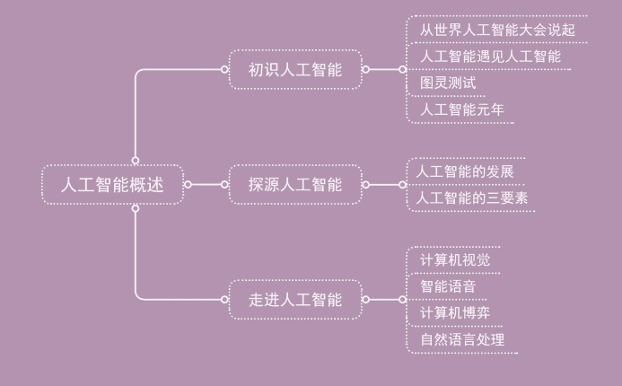

## 1.1　初识AI

### 1.1.1　缘起：世界人工智能大会

未来已来，人工智能（`Artificial Intelligence`，简称`AI`）正悄无声息地融入我们的日常，属于AI的时代正式拉开帷幕。

自2018年起，上海每年举办“世界人工智能大会”（`WAIC`）。2020年大会设立了青少年人工智能创新发展论坛（图1-1）。

少年智则国智，少年强则国强。从娃娃抓起普及AI教育，为青少年搭建人工智能学习平台，始终是青少年人工智能创新发展论坛不变的核心主题。

习近平总书记指出：“人工智能是引领新一轮科技革命和产业变革的战略性技术。”作为新时代的青年，我们理应以实际行动投身AI探索。今日于此求知，他日放眼世界（图1-2）。

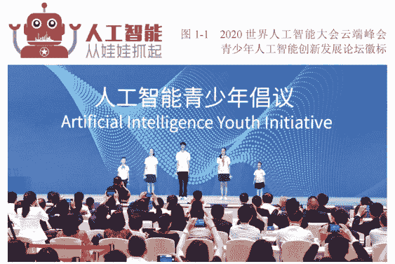

> 朋友们，虽年纪尚小，但让我们用纯真童趣为AI绘就绚丽色彩。
>
> 绿色幼苗，好学深思；让我们用天马行空的创意为AI增添无限想象。
>
> 少先队员，时刻准备着；让我们用创新智慧赋能AI发展。
>
> 共青团员，勇做先锋；让我们用扎实实践汇聚青春力量为AI添薪。
>
> 青年朋友，蓄势待发；让我们用无畏担当引领AI跨越式腾飞。
>
> ——2019年世界人工智能大会闭幕式上，上海市青少年人工智能创新大赛获奖选手代表发出倡议。

#### 知识拓展：世界人工智能大会

世界人工智能大会由国家发改委、科技部、工信部、网信办、中科院、工程院及上海市政府联合主办，是一个具备国际水准与影响力的世界顶级智能合作交流平台及行业盛会。

- 2018年主题：**AI赋能新时代**
- 2019年主题：**智联世界，无限可能**
- 2020年云端峰会主题：**智联世界，共同家园**

全球AI领域最具影响力的观点与共识汇聚于此，展示前沿理念、技术、产品与应用，具备“高端、国际、专业、市场、智能”五大特质。“世界智慧”于此对话，高端交流碰撞出“中国方案”。

### 1.1.2　人类智慧与人工智能的邂逅

何为“智能”？至今学术界仍无统一共识。人类通过思维解题，涉及逻辑、推理等一系列认知活动。但现实中，解题路径往往不止一条，甚至难以判断孰优孰劣。

智商测试能量化一个人的IQ，但高智商就等于智力更超群、对社会贡献更大吗？

答案是否定的。首先，高智商不仅代表高智力，更意味着创新力、优良思维习惯及发现解决问题的能力。其次，除IQ外，我们还需情商（EQ）——即自我认知、情绪管理、自我激励及人际团队协作等综合人格能力。最后，还需正确的价值观、是非辨别力与判断力。综上所述，这或许才是人类社会更迫切需要的“智能”。

人类智能的定义尚无定论，AI亦然。

2019年WAIC上，与会科学家给出了AI的五种解读：

- **定义一**：让人类感到不可思议的计算机程序。
- **定义二**：模拟人类思维模式的计算机程序。
- **定义三**：模拟人类行为模式的计算机程序。
- **定义四**：具备学习能力的计算机程序。
- **定义五**：能基于环境感知做出理性行动、获取最大利益的计算机程序。

目前公认度较高的理解是：AI是一门研究、开发用于模拟、延伸和扩展人类智能的理论、方法、技术及应用系统的新技术科学。

一本书记录了科学家艾伦·图灵与一名警察的对话：

> **警察**　机器能思考吗？
>
> **图灵**　在我看来，你的问题本身就很愚蠢。
>
> **警察**　真的吗？
>
> **图灵**　机器显然无法像人类那样思考。机器不同于人，思维方式截然不同。关键在于：仅仅因为思维方式与你不同，就能断定它不会思考吗？
>
> 我们允许人类思想千差万别。你爱香蕉，我讨厌长跑；你爱悲剧片，我爱喜剧片。口味、兴趣、偏好各异——这究竟意味着什么？

### 1.1.3　图灵测试

英国数学家、逻辑学家、密码学家艾伦·图灵，被尊为“计算机科学之父”与“人工智能之父”。计算机界最高荣誉“图灵奖”即以其命名。

1950年，图灵在《计算机器与智能》一书中提出了著名的“图灵测试”与“机器智能”概念。

图灵认为机器能思考，前提是具备超越人脑的极速运算、逻辑单元与存储容量，且需编写海量智能程序，提供合适分类与充足数据。

如何判定机器具备智能？图灵设计了一场“模仿游戏”：测试者C分别与人B和机器A通讯（如打字聊天）。若经过一系列提问，C无法分辨回复来自人还是机器，则可判定机器A拥有智能。

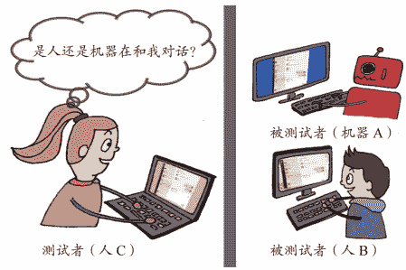

**图 1-4 图灵测试示意**

> **体验感知**
>
> 打开微信，关注公众号“小爱同学”，进入“精彩推荐”->“与小爱聊天”，尝试与小爱对话一番。

2014年6月“图灵测试”会议上，AI软件“尤金·古斯特曼”成功通过测试，被视为人工智能与计算机史上的里程碑事件。

### 1.1.4　人工智能元年起笔

图灵的“机器智能”可视为人工智能概念的雏形。那么，“人工智能”这一术语究竟何时诞生？

1956年8月，美国汉诺威达特茅斯学院（图1-5）汇聚一群科学家，共商机器模拟人类学习及智能诸多层面的议题。这就是著名的**达特茅斯会议**，标志着人工智能学科的正式诞生。

## 1.2 探源人工智能：从达特茅斯到三次浪潮

### 1.2.1 演进历程：跌宕起伏的三次浪潮

达特茅斯会议的提案涵盖自动计算机、自然语言处理、神经网络等广泛议题。为期两个月的研讨虽未形成统一共识，却意外催生了一个划时代的概念——「人工智能」。这一无心插柳的命名，早已超越学术圈层，深刻重塑了科技史进程。因此，1956 年被公认为人工智能的「元年」。

**图 1-5 达特茅斯学院**

> **知识拓展**
>
> **吴文俊：中国人工智能研究的奠基人**
>
> 吴文俊，中国著名数学家、中科院院士，曾获陈嘉庚科学奖及 2000 年度国家最高科学技术奖。2019 年 9 月，荣获「人民科学家」国家荣誉称号。
>
> 其研究足迹遍布数学多个领域，在拓扑学与数学机械化造诣深厚，更在机器几何定理证明上实现重大突破，堪称中国人工智能研究的开拓者与先驱。

1956 年达特茅斯会议正式确立「人工智能」之名。回溯发展脉络，这条赛道并非一帆风顺，而是历经数起数落。

#### 第一次浪潮（1950s–1980s）：推理与感知的萌芽

会议闭幕后，AI 迎来首个爆发期。感知机的问世让机器逻辑推理成为可能；Shakey 移动机器人攻克感知、规划与控制难题，实现初级自主导航；ELIZA 则基于模式匹配开启人机文本对话先河。但随着任务复杂度攀升，技术瓶颈显现，热潮随之退去。

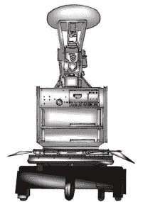

**图 1-6 Shakey 移动机器人**

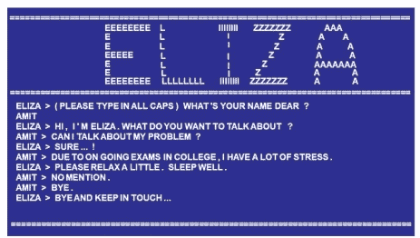

**图 1-7 ELIZA 对话系统**

#### 第二次浪潮（1980s–1990s 末）：专家系统的兴衰

专家系统的兴起推动第二次高潮。这类系统聚焦垂直领域，将专业知识转化为规则，模拟专家决策——如辅助医疗诊断。然而，受限于知识获取难、推理能力弱、成本高昂且缺乏通用性，AI 再度陷入低谷。

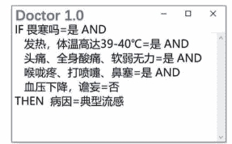

**图 1-8 专家系统**

> **知识拓展**
>
> **三大流派的「华山论剑」**
>
> AI 发展超六十载，形成符号主义、连接主义、行为主义三大阵营。
>
> - **符号主义**：核心成果为符号推理，主张用符号表征认知，早期应用最广。
> - **连接主义**：核心成果为神经网络与深度学习，主张仿生智能，模拟大脑神经元处理信息。
> - **行为主义**：核心成果为强化学习，主张感知-行动循环，强调适应与进化计算。
>
> **AI 发展史上的「三番棋」**
>
> 人机博弈见证关键节点：跳棋、国际象棋、围棋三场巅峰对决。
>
> - 1962 年：阿瑟·塞缪尔开发程序击败人类跳棋冠军。
> - 1997 年：「深蓝」战胜国际象棋世界冠军。
> - 2017 年：AlphaGo 横扫围棋人类顶尖高手。

#### 第三次浪潮（21 世纪至今）：数据驱动的全面爆发

进入新世纪，大数据、算法、算力「三驾马车」驱动机器学习突围，开启第三次浪潮，推动 AI 在多领域实现跨越式应用。

中国同步将 AI 提升至国家战略高度。2017 年 3 月，《政府工作报告》首次写入「人工智能」，部署培育新兴产业；同年 7 月，《新一代人工智能发展规划》出台，明确推进智能教育、普及编程教学。11 月，首批国家新一代 AI 开放创新平台获批，标志性落地规划与重大专项。

规划确立「三步走」战略目标：
- **第一步（2020 年）**：整体技术应用跟跑国际先进，产业成经济新增长极，技术惠民生，支撑创新型国家建设。
- **第二步（2025 年）**：基础理论取得重大突破，部分技术领跑全球，成产业升级核心动力，智慧社会建设见成效。
- **第三步（2030 年）**：理论技术应用全方位领跑，建成全球主要创新中心，智能经济社会显著繁荣，为跻身创新型国家前列奠基。

### 1.2.2 AI 的三大基石：数据、算法、算力

当下 AI 发展离不开三大核心要素：数据、算法、算力。

#### 1. 数据

数据，早已渗透进生活的每一个毛细血管。刷卡进地铁，会留下进出站轨迹；借阅图书馆图书，会形成借还档案；校园里的电子成长包，更把身高、体重、课表统统“数字化”了。这些看似零散的信息，拼凑起来，就是构建我们画像的数据拼图。

### 数据驱动下的三大智能场景

#### (1) 懂你的“智能推送”
你刚在搜索框敲下“人工智能”，点开几个感兴趣的网页，紧接着，资讯流里全是AI动态，电商书店首页未搜先推，全摆着相关书单（如图1-9所示）。不用你开口，平台已完成“千人千面”的精准分发，这背后，是数据在默默为你画像。

**图 1-9 智能推送示意**

#### (2) 精准的“智能评测”
小能数学成绩突飞猛进，同学们围问“秘籍”。原来他用了在线评测系统：系统记录每道题耗时、错题分布，自动生成数学能力雷达图（如图1-10），弱项一目了然。依据数据“开药方”，只练短板不重基础，题做得少了，分却涨了，省下的时间归自己支配。

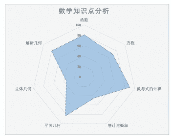

**图 1-10 智能评测雷达图**

#### (3) 贴心的“智能导航”
打开导航搜路线，多条方案里总有一条“智能推荐”。它依托实时公交数据运算，给你“最快到达”“最少换乘”“少走路”“只坐地铁/不坐地铁”等定制选项（如图1-11）。

> **体验感知**
>
> 打开手机导航，以“上海青少年活动中心”为起点，“上海图书馆”为终点，分别体验“驾车”与“公交”两种模式。

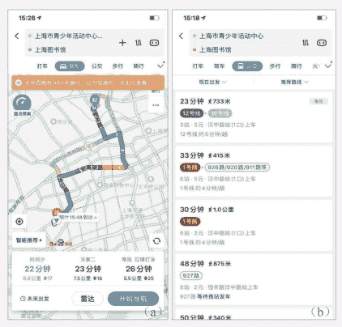

**图 1-11 智能导航界面**

选“不坐地铁”，它会告诉你坐几路公交、最近一班几分钟到；开车党更离不开它，实时路况在手，拥堵路段绕道走。数据赋能的应用远不止这些，生活处处可“据”理力争。

数据呈井喷式增长，我们由此步入**大数据时代**。

网上曾流传一个馄饨店“神对话”的段子，生动诠释了何为“数据透明”：

> **客服**　XX馄饨店，您好。
>
> **顾客**　你好，我要……
>
> **客服**　先生，请先报会员卡号。
>
> **顾客**　1982XXX。
>
> **客服**　陈先生你好！您住XX路XX楼XX室，座机6353XXXX，手机1390123XXXX。请问要什么？
>
> **顾客**　你怎么什么都知道？
>
> **客服**　接入了XXX系统嘛。您要三碗鲜肉大馄饨？
>
> **顾客**　对啊。
>
> **客服**　**不建议。** 您档案显示血压、血脂双高。
>
> **顾客**　那推荐啥？
>
> **客服**　低脂素馄饨怎么样？上周一您还在图书馆借了《低脂健康食谱》。
>
> **顾客**　行，三碗素的，多少钱？
>
> **客服**　33元。不过令堂上月刚做完心脏搭桥，恢复期也要少吃点。
>
> **顾客**　刷卡行吗？
>
> **客服**　陈先生，信用卡透支了，欠银行2986元（不含房贷），只能付现。
>
> **顾客**　去旁边ATM取。
>
> **客服**　今日取现额度已超限。
>
> **顾客**　算了，送我家吧，现金在家。多久？
>
> **客服**　约30分钟。赶时间您自己开车回？
>
> **顾客**　为什么？
>
> **客服**　车牌“沪A XXXXX”显示您正在XX路上开车。温馨提示：别拿手机打电话，建议用蓝牙或车载系统。
>
> 顾客石化……

---

### 知识拓展：什么是大数据？

规模大到超越常规数据库工具处理能力的数据集合，即为大数据。它有四大标签：**量大（Volume）、流速快（Velocity）、类型多（Variety）、价值密度低（Value）**。

> **思考探索**
>
> 身边还有哪些“基于数据的个性化服务”案例？

---

## 2. 算法：解题的“方法论”

算法，本质是解决问题、达成目标的一套操作规程。通俗说：遇到事，先想“怎么办”“用什么招”，再动手落地。

邓小平爷爷说：“不管黑猫白猸，抓住老鼠就是好猫。”同一道题，自然能有不同的“算法”。

老师布下语数英科四科作业，四位同学的“执行算法”各不同：

- **小A（偏好序）**：爱语文>数学>科学>英语，按喜好排序写。
- **小B（难度序）**：怕科学>语文>英语>数学，按难度从高到低啃。
- **小C（时长序）**：估算耗时，按“科学<英语<数学<语文”从短到长推进。
- **小D（随机序）**：不思考，摸一个写一个，顺序是数学>英语>语文>科学。

路径虽异，终点同归——四科作业全做完（如图1-12）。

**图 1-12 四位同学的作业完成顺序**

> **思考探索**
>
> 面对同一问题，算法多多，该怎么选？

**图 1-13 随机选择优化问题示意**

---

### 知识拓展：玉米地里的“37%法则”

想象一片玉米地，任务是**只能摘一次、不能回头、必须摘最大的那根**（如图1-13）。

- **小A策略（冲动型）**：一进门见大的就摘，越走越悔，后面全是更大的。
- **小B策略（完美型）**：一路看到底，发现没比前面大的，想回头已晚，只能就地凑合。

小A“观测不足”导致后悔，小B“观测过度”导致错失。咋办？

数学大神欧拉给出关键数字：**37%**。

科学家据此设计最优算法——**“37%法则”**：

1.  **第一阶段（前37%）**：只看不摘，记录这段区间内最大的一根作为“基准线”。
2.  **第二阶段（后63%）**：一旦遇到比基准线大（或接近）的，**果断摘下，不再犹豫**。

这“分阶段+阈值”的策略，正是欧拉推导出的**随机选择最优停止问题**的经典解法。

### 算法：在不确定性中寻找“最优解”

没有任何算法能承诺绝对挑选到最大的那颗玉米。玉米大小分布具有随机性，在这种不确定性前提下，该算法能以最优策略选出“足够大”的玉米，有效降低“后悔”与“错失”的概率。

解决同一问题的算法往往不止一种，通常我们会筛选出表现最佳的那一个，即“最优算法”。

合格的算法通常具备三大核心特质：
- **有穷性**：执行步骤有限，必能在有限步骤后终止，不会陷入死循环。
- **确定性**：每一步指令含义明确，无歧义，执行者无需猜测。
- **可行性**：每一步操作均可在有限时间内通过基本手段完成，切实可行。

关于数据交互，算法接受零个或多个输入（零输入意味着算法自带初始条件设定），并产出一个或多个输出；无输出的算法不具备实际意义。

机器学习、人脸识别等前沿技术均构建于算法之上，新算法的不断涌现持续拓展着 AI 的边界。

## 3. 算力：智能时代的基建引擎

算力直观体现了计算机的计算处理能力。提升算力是一项庞大的系统工程，不仅涵盖芯片、内存、硬盘等全链路硬件，还需依据数据应用的实际场景，对计算架构、资源调度与管理进行深度优化。

试想：电脑剪辑视频等高负载任务时突然卡死、崩溃，这往往暗示算力不足（当然，崩溃成因不止于此）。

世界上第一台通用电子计算机“ENIAC”，每秒仅能执行 5000 次加法。如今，超级计算机的诞生让算力实现了质变。

当前，超算性能以 FLOPS（每秒浮点运算次数）为标尺。值得骄傲的是，中国“神威·太湖之光”峰值算力达 125.436 PFlops（全球第 4），持续性能 93.015 PFlops（全球第 1），能效比 6051 MFlops/W（全球第 1）。

**表 1-1 2020 年 6 月全球超算 Top500 前五名**

### AI 硬件算力与核心技术图谱

AI 硬件算力的核心在于芯片，主流 AI 芯片主要分四大阵营：
- **GPU（图形处理器）**：专擅图形、图像并行计算任务的微处理器。
- **FPGA（现场可编程门阵列）**：属于半定制电路，具备可编程、可升级、可迭代的灵活特性。
- **ASIC（专用集成电路）**：为特定用户、特定系统定制设计，如专用音视频处理器。
- **神经形态芯片**：仿脑架构设计，在功耗控制与学习能力上较传统芯片具显著优势。

2017 年，中科院计算所发布全球首款支持“深度学习”的神经网络处理器——“寒武纪”（图 1-14）。
2019 年，清华大学脑智研究中心研制出全球首款异构融合脑像芯片——“天机”，登顶《Nature》封面（图 1-15）。
2020 年，中科大联合中科院微电子所、国家并行计算机工程技术研究中心，成功构建 76 光子量子计算原型机“九章”。它仅用 200 秒完成高斯玻色采样（5000 万次采样），速度比当时最快超算快约 100 亿倍，标志着中国成为全球第二个实现“量子计算优越性”的国家。

数据、算法、算力——这三大核心要素构成 AI 发展的“铁三角”，随着它们的持续迭代升级，AI 的未来图景愈发宽广。

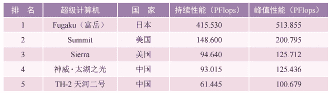

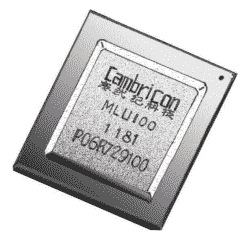

Figure 1-14　Cambricon Chip

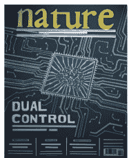

Figure 1-15　"Tianjic" on the Cover of *Nature*

## 1.3 走进人工智能

影视作品中，机器人常被赋予人工智能。但须明确：机器人只是 AI 的载体之一，AI ≠ 机器人。

AI 技术谱系庞大：赋予机器“看”的能力，依托**计算机视觉**；“听”靠**语音识别**；“说”靠**语音合成**；“学”靠**机器学习**。此外，**自然语言处理**、**知识图谱**、**VR/AR**、**人机博弈**等亦属 AI 版图。

### 1.3.1 计算机视觉：让机器拥有“慧眼”

明星演唱会意外变身“抓捕现场”！某华语天王 2018 巡演期间，警方合计抓获 55 名在逃人员。这背后的“神兵利器”是“天网工程”，其核心正是计算机视觉图像处理与识别技术。现场高清摄像头捕捉观众面部特征，与公安数据库极速比对，一旦锁定嫌疑人即刻布控抓捕，真正做到“天网恢恢，疏而不漏”。

生活中，该技术同样普惠便民：手机人脸解锁、刷脸支付、企业刷脸考勤（图 1-16）已成标配。

Figure 1-16　Facial Recognition Attendance System

医疗领域，结合医学影像衍生出“智能医学影像”。放射科医生日均诊百名患者、阅片近千张，压力巨大。“智能医学影像”自动化分析速度比人工快 62%–97%，大幅缓解医生负担、节省人力成本。

视觉技术还延伸出 3D 视觉、图像风格化等功能。AI 可将普通照片秒变艺术大片，如赋予莫奈《睡莲》式印象派风格。

> **体验感知**
>
> 打开 Prisma 相机，对同一张照片应用不同滤镜风格，你获得了怎样的视觉冲击？（图 1-17）

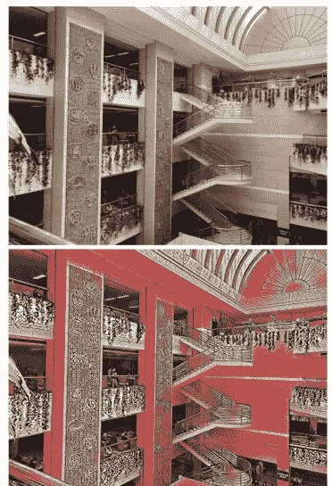

Figure 1-17　Comparison of Shanghai Library Photo Effects

> **知识拓展**
>
> **“风格化”滤镜**
>
> 此类滤镜通过置换像素、增强对比度，在选区内生成绘画或印象派效果，模拟真实艺术创作手法。

### 1.3.2 智能语音：听得懂、说得出

先看一段预约理发的真实电话对话：

> **店员** 您好，请问有什么可以帮您？

# 1.3.3 计算机博弈

博弈对抗一直是 AI 研究的核心阵地。计算机凭借既定规则与实时局势，能够筛选最优策略、做出精准决策。

要读懂博弈策略，先得认识**决策树**。它的形态酷似树木，分叉的枝干末端挂着叶子。分叉节点负责对特定特征“发问”判断，连接的分支对应判断结果，而叶子节点则给出最终结论。图 1-19 展示了一个简易分类决策树，模拟疫情期图书馆预约的判定逻辑。

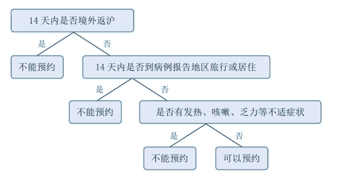

图 1-19　决策树

通过层层递进的确认具体情境，系统便能推导出下一步行动。人机博弈史上的“三大巅峰对决”便是这一原理的经典实证（图 1-20）。

图 1-20　人机博弈

# 1.3.4 自然语言处理

语言是人类区别于其他物种的标志，智慧的大厦很大程度上建立在语言之上。自然语言即人类日常交流所用的语言系统。

先看三则新闻：
- 九寨沟地震发生 25 秒后，通讯稿已生成，要素齐全、参数精准。
- 体育赛季 16 天，某“记者”产出 450 余篇稿件，与直播同步推送。
- 金融线一天产出 1900 篇稿件，震惊业界。

这些“笔杆子”并非凡人，而是机器人写手。它们擅长体育、财经、科技等垂类写作，又快又稳，通电即能 7×24 小时不停歇。腾讯“梦想家”半年产出 30 万篇、600 万字，里约奥运会独写 3600 余篇体育稿，堪称“劳模”标杆。

机器翻译是 NLP 的另一王牌应用。全球民族林立，语言体系各异，沟通壁垒令人头大。想实现“世界那么大，我想去看看”，语言关必须过，但常人精通一门外语已属不易，覆盖百国语言更是天方夜谭。翻译机的出现，让这一困局迎刃而解。

以国产头部翻译机为例：覆盖近 200 国家及地区语言，还能精准识别英语五大口音（加/英/澳/印/新）与中文四大方言（粤/川/东北/豫），实用性拉满。

> **思维实验室**
>
> 网络搜索“梦想家撰写奥运稿”，思考其背后的技术路径。

> **知识拓展**
>
> **AI 分级图谱**
>
> - **弱人工智能**：垂直领域专家。围棋 AI 只会下棋，让它拼幼儿园拼图它就瘫痪。当下主流均属此列。
> - **强人工智能**：具备人类级泛化思维、学习与感知能力的通用智能。
> - **超人工智能**：在几乎所有维度全面超越人类智慧的终极形态。

在人机共生的新纪元，AI、大数据、5G 等前沿技术全链路渗透百业，AI 稳居第四次工业革命“C 位”。其应用场景早已溢出上述范畴，渗透生活、学习、工作的毛细血管，后续章节我们将持续深挖。

> **体验感知**
>
> 1. 手机打开微信，搜索小程序“百度 AI 体验中心”，任选一项或多项上手体验，记录感受（图 1-21）。
> 2. 微信搜“讯飞 AI 体验栈”，实测“语音翻译”带来的便捷（图 1-22）。

图 1-21　百度 AI 体验中心

图 1-22　讯飞语音翻译

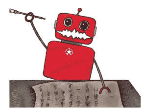

图 1-23　会“创作”的 AI

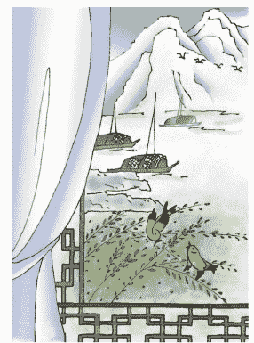

图 1-24　诗画对照《绝句》

3. **会“创作”的 AI（图 1-23）**：搜索引擎输入“九歌——计算机诗歌生成系统”。“九歌”出自清华大学自然语言处理与社会人文计算实验室。

输入关键词试写一首。你觉得下面这首 AI 出品的《绝句》，能否与图 1-24 画作同频共振，媲美杜甫原作？亲自试一试！

> **绝句**
>
> **2020·九歌**
>
> 黄鹂啭破柳丝柔，
> 一汪春水荡扁舟。
> 最爱窗前窥皓月，
> 满湖秋色卧江头。
>
> **绝句**
>
> **唐·杜甫**
>
> 两个黄鹂鸣翠柳，
> 一行白鹭上青天。
> 窗含西岭千秋雪，

## 穿越时空的对话：当 AI 拨通了真人的电话

> **客户** 喂，帮客户预约个女士剪发，日期定在 5 月 3 号。
>
> **前台** 稍等，我查一下。
>
> **客户** 嗯。
>
> **前台** 具体几点？
>
> **客户** 中午 12 点。
>
> **前台** 12 点排满了，最近是 13:15 有空档。
>
> **客户** 那上午 10 点到 12 点呢？
>
> **前台** 看项目而定。客户要做什么？
>
> **客户** 就剪个女士发型。
>
> **前台** 行，10 点没问题。
>
> **客户** 客户叫 Lisa。
>
> **前台** 收到，5 月 3 号上午 10 点，见 Lisa。
>
> **客户** 对极了，太感谢了。
>
> **前台** 不客气，祝愉快，再见。

这段对录音里，藏着一个“冒名顶替者”——其中一方是机器人。你能听出是谁吗？

答案揭晓：**打电话的“客户”才是 AI**。这段录像取自 2018 年 Google I/O 大会现场演示，主角名为 **Google Duplex**。真假难辨，人机边界就此模糊：AI 的语调抑扬顿挫毫无机械感，甚至在回答前加入了 “嗯” 这种填充词，拟真度令人咋舌。

在人机语音交互中，**智能语音技术**是基石。它包含**语音识别**（声转文）与**语音合成**（文转声），赋予机器“听”与“说”的能力。日常使用的语音输入法、导航播报，无不依赖它。

光有“会听会说”还不够，**自然语言处理（NLP）** 负责让机器真正“听懂”人意、自然“开口”。双剑合璧，人机语音对话才能丝滑流畅。

> **体验感知**
>
> 唤醒手机语音助手，来一场多轮对话并记录过程（图 1-18）。

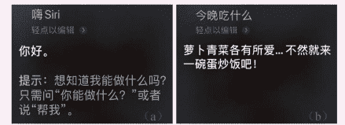

图 1-18　语音助手对话实录

> The door moors the ten-thousand-mile boat of Eastern Wu.

# Chapter 2: The Learning AI

## Introduction

掌握知识，学习是人类的核心途径。赋予机器这种“举一反三”的能力，便是机器学习——它是人工智能领域最引人入胜的技术突破之一。本章将为你系统梳理机器学习的基础概念、主流分类、演进历程，并深入浅出地引入深度学习。

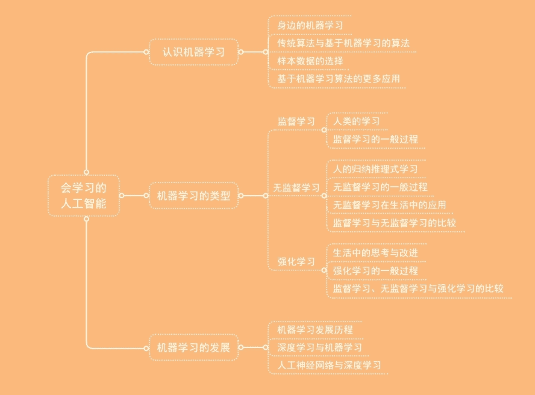

## 2.1 读懂机器学习

### 2.1.1 触手可及的机器学习

2016年，一场人机围棋大战引爆全球关注：AlphaGo以总比分4:1战胜世界冠军李世石。这场胜利让大众将目光聚焦于一个问题：AlphaGo究竟是什么？它为何能赢？答案很快揭晓——其核心引擎正是机器学习（如图2-1所示）。

机器学习的思想并不晦涩，它本质上是在数字世界里复刻人类的认知成长。它的“粮食”是数据——承载信息的各类符号组合。别狭隘地理解为单纯的数字，文本、图片、视频、音频统统在列。

数据生生不息，无处不在。社交平台上的动态、购物网站的订单与评价，皆为原始数据。经采集、清洗、加工，这些原材料便化作算法可直接计算、分析、应用的高质量数据集。

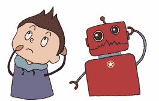

Figure 2-1　What is Machine Learning

> "巧妇难为无米之炊。" 海量数据是机器学习的基石。

> **体验感知**

>

> 「猜画小歌」是个你画我猜的小程序游戏。不妨亲自上手，看看在倒计时结束前，你和AI搭档能默契通关几轮？

> **思维探索**

>

> 同一个物体，千人千画。「猜画小歌」里的AI队友，凭什么能屡屡猜中？

### 2.1.2 传统算法 vs 机器学习算法：思维范式的分水岭

#### 1. 传统算法：死守规则的“执行者”

传统算法本质上是写死识别规则的程序。其判断逻辑如图2-2：预先在图库里存好大量图像数据（即样本数据）。运行时，程序拿用户的画去图库里“对号入座”。一旦画作不在库中，识别直接判负。因为程序只会机械执行预设指令。可现实中，画技风格千差万别，想画得跟标准库一模一样，难上加难。

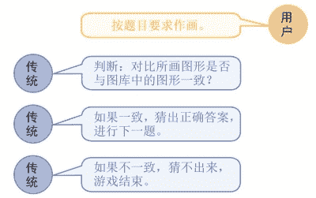

Figure 2-2　Judgment Process of Traditional Algorithm

#### 2. 机器学习算法：自主进化的“学习者」

「猜画小歌」采用的就是机器学习范式。这里没有硬编码的规则，而是把“猜画”图库数据喂给机器，让它自动摸索其中的规律。这相当于机器从样本中自动提取特征，将同类特征归簇，为每一类（如“狗”）构建模型。推理时，只需判断用户画作最贴近哪个类别模型（见图2-3）。比如画狗，系统在分类器中比对特征点，最终归入“狗”类别。所以，哪怕你是“灵魂画手”，只要抓住了“狗”的神韵特征，AI也能秒懂。此流程见下图。

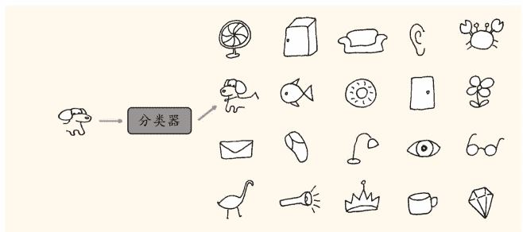

Figure 2-3　Machine Learning-Based Algorithm Process in "Guess the Drawing"

> **思维探索**

>

> 「猜画小歌」预存海量图片构建基础样本库。采集这些样本时，有什么讲究？比如样本量是越大越好？画风是统一好还是多样好？

### 2.1.3 样本数据的“挑剔”标准

分类器要学会建模，离不开合格的数据支撑。样本量若不达标，或虽大但单一，分类器必然“翻车”。因此避坑指南有二：

#### 1. 样本量不足：见识少，认知窄

仍以「猜画小歌」识别“狗”为例。若训练库里仅存几张长耳长尾的狗图。样本不足导致认知片面，当玩家画一只短耳短尾的“博美」，系统便认不出这是狗。这就是“样本量不足”拖后腿（见图2-4）。

#### 2. 样本过于单一：偏科生，不举一反三

假设库里狗图虽多，全是卡通版“博美”。机器把“博美”特征背了个滚瓜烂熟。此时玩家画只卡通“巴哥”，差异太大，系统可能判定“不是狗”。因为样本缺乏多样性，无法泛化“狗”的通用特征，只学会了认“博美”。这就是“样本单一”导致的泛化能力崩塌（见图2-5）。

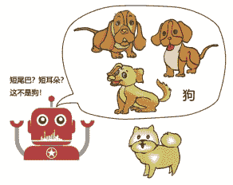

Figure 2-4　"Insufficient Sample Data" Phenomenon

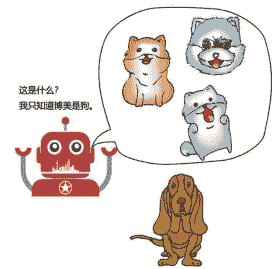

Figure 2-5　"Overly Uniform Sample Data" Phenomenon

无论是“量太少”还是“太单一”，都会拖垮机器学习效果。所以采集样本的黄金法则是：**多采、广采、求多样。**

### 2.1.4 机器学习算法的“隐形”应用清单

如今，机器学习早已渗透生活方方面面，你或许每天在用，却从未察觉。再看几个鲜活案例。

#### 1. 搜索引擎背后的“智能大脑”

搜索引擎（图2-6）能精准吐出你想要的结果，一大功臣是机器学习算法。它学会了对符合条件的网页进行智能分类与排序。

Figure 2-6　Machine Learning in Search Engines

#### 2. 邮箱里的“垃圾清道夫”

邮件系统能自动拦截海量垃圾邮件（图2-7），全靠机器学习持续迭代。过滤器不断通过算法提取垃圾邮件新特征，动态更新识别模型，替用户屏蔽骚扰。

Figure 2-7　Machine Learning in Spam Filtering

#### 3. 相册里的“私人相册管家”

手机相册的“人物分组”功能（图2-8），能自动识别照片中的人脸，并把同一个人的所有照片聚合在一起，这同样是机器学习算法的杰作。

除了前文提到的场景，机器学习早已渗透进生活的方方面面。从语音识别到人脸核验，众多AI核心技术的底层逻辑，都建立在机器学习算法之上。

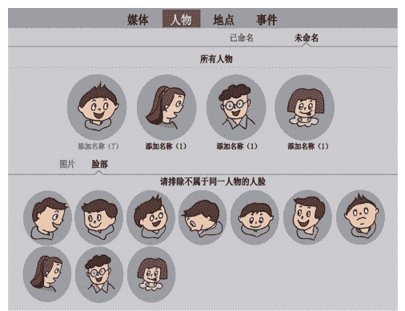

图 2-8　机器学习在人物分类中的应用

> **体验感知**
>
> 打开“识花君”小程序，对准图 2-9 中的植物进行识别。
>
> 这种植物的名称是 __________。
>
> 多试几种植物，还能解锁更多趣味植物冷知识。

## 2.2 监督学习

人的学习路径千差万别。幼时，父母指着红彤彤、圆滚滚、皮光滑的水果说“这是苹果”；长大些，见到青苹果，父母又补一刀“苹果不止红色，也可以是绿色”。在不断纠偏中，我们在脑海里建起了“苹果”的认知模型，从此能轻松辨识。识字后，我们能自学成才、触类旁通；也能在反复“试错”中摸索规律。

机器学习亦有其独门心法，主要分为“监督学习”、“无监督学习”、“强化学习”等流派。

### 2.2.1 人类学习的复盘

童年记忆或许已模糊，不妨跟着学生小能（图 2-10），重走一遍认识“六角恐龙”的认知之路。

#### 1. 看（六角恐龙图鉴）

为建立精准认知，小能搜罗了各角度、各形态、各色系的六角恐龙照片，并明确告知：“这些全是六角恐龙。”通过密集的视觉轰炸，大脑对这一物种的认知分辨率直线拉升（图 2-11）。

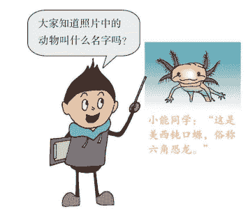

**图 2-10　人类学习过程复盘**

**图 2-11　看（六角恐龙图鉴）**

#### 2. 记（关键特征）

光看不够，还得提炼特征。观察对比后，六角恐龙的“身份证”清晰浮现：

- 头顶三对、共六根角状鳃；
- 脸盘扁平宽阔；
- 四肢短小纤细；
- 尾部酷似鱼尾；
- 体色涵盖白、黄、黑等多种色系；

#### 3. 脑建模型

特征入脑，大脑随之生成“六角恐龙”的初始认知模型（即第一印象，图 2-12）。日后见到实物，大脑会自动调取模型比对，从而完成识别。

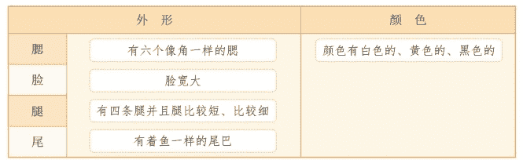

**图 2-12　大脑中形成的“六角恐龙”模型**

#### 4. 验模型

学会了没？得靠实战检验。正如课堂学习后要刷题考试，测试的目的在于核验模型的鲁棒性——脑内模型是否足以支撑全场景识别？若翻车，说明模型欠缺，需回炉重造，提炼更精准特征。

#### 思维探索

图 2-13 中哪个选项是六角恐龙？（ ）

**图 2-13　辨别六角恐龙**

小能：“六角恐龙应该是 A 选项。”

选对，学习达标；选错，则需回看 A 图，对照脑内模型找差异，重新总结特征，迭代生成更高版本的心智模型。

### 2.2.2 监督学习的通用流程

机器学习的核心思想，正是模拟人类认知规律。因此，监督学习的标准流程与上述人类学习异曲同工。

在监督学习中，机器的输出非黑即白：要么“是六角恐龙”，要么“不是”。因此构建分类器时，必须确立“六角恐龙”与“非六角恐龙”两大类别。

#### 1. 采集带标签样本数据

对应人类“看图”环节。我们需向机器投喂两批照片：一批贴上“六角恐龙”标签，另一批贴上“非六角恐龙”标签。

这些带标签的图片即为“标注样本数据”，“六角恐龙”、“非六角恐龙”即为人工赋予的**分类标签**（图 2-14）。它们既是训练时的监督信号，也是模型最终的输出类别。

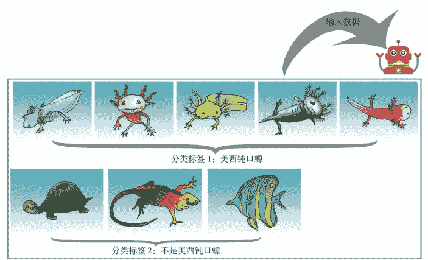

**图 2-14　采集带标签数据样本**

#### 知识拓展

**分类标签**

亦称“Label”。监督学习的标志性要素。本质上是预设的分类结果。通俗讲，训练前必须先告诉机器：结果分几类（至少两类），每类叫什么名字。

> 提示：为规避“样本量不足”与“样本同质化严重”两大坑，采集时务必最大化多样性，多采、广采、精采。

#### 2. 特征提取

人靠大脑记特征，机器靠算法练特征。训练过程中，算法会自动捕获并记忆六角恐龙的核心特征向量：六根角状鳃、阔脸盘、短细四肢、鱼型尾、多色体表等。

机器将这些特征转化为它能读懂的“特征”数据。所谓“特征”，就是能把“墨西哥钝口螈”与“非墨西哥钝口螈”区分开来的各类属性或性状。特征是机器学习的基石，机器必须通过对比与归纳来提取它们。

#### 3. 构建模型

掌握特征后，机器便构建出墨西哥钝口螈的数据模型。在监督学习里，从样本数据中提取的特征值会直接映射到模型中。可以说，“模型”的优劣直接决定了监督学习中 AI 表现的好坏。

#### 4. 验证模型

我们拿一些采集阶段未见过的图片——既有墨西哥钝口螈也有其他动物——让机器用训练好的模型去辨别。

如果机器能精准分出哪些是墨西哥钝口螈，哪些不是，模型就算靠谱；反之若识别不准，就得补充新样本重新训练，即重新提取特征、生成新模型。这个过程可理解为对模型的不断打磨与优化。

监督学习的通用流程见下图：

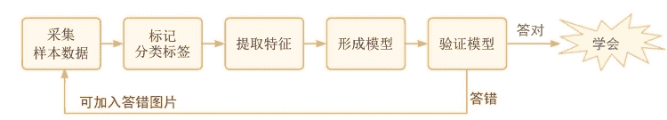

**图 2-15　监督学习通用流程**

#### 知识拓展

**置信度**

监督学习过程中，机器有一个叫“置信度”的参数，常用“%”表示。它反映结果的可信程度。打个比方：某同学有 90% 的把握考 85-90 分，这里“85-90 分”是置信区间，“90%”是置信水平。监督学习同理，若模型输出“墨西哥钝口螈”的概率为 95%，则“墨西哥钝口螈”可视为置信区间，“95%”即置信水平。置信度越高，模型对输出结果越笃定。

#### 思维探索

置信度受什么影响？想提高置信度该怎么做？

通常置信度与采集的样本数据挂钩。采集的样本图像质量越高、数量越大，置信度越高，模型对输出结果越有把握。

#### 实践操作

请用图形化编程软件，加载 AI 模块，编写垃圾分类程序，让电脑识别干垃圾、湿垃圾、可回收物和有害垃圾。

## 2.3 无监督学习

除了监督学习那种“有人教”的方式，人类还能靠归纳推理自主学习。

### 2.3.1 人类的归纳推理学习

比如见到西红柿、山楂、草莓，我们能按颜色归纳出共同点是“红色”；见到足球、橙子、西瓜，能按形状归纳出共同点是“球形”（图 2-16）。这就是归纳推理学习。人自行发现异同，按特征分类并命名，如“红色”“球形”。

探索未知事物时，人常用此法。如生物学家按动物特征分类确定物种。

俗语“物以类聚”，把事物按相似度归类合并的过程，便叫“聚类”。

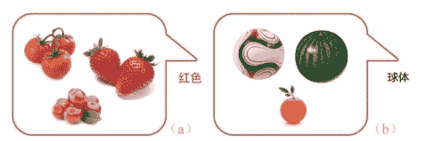

**图 2-16　人类归纳推理学习**

### 2.3.2 无监督学习通用流程

这种人类归纳推理对应机器学习里的“无监督学习”。全程无人工指导监督，即输入数据无标签，是机器自主学习的方式。正因无监督学习，机器才开始自主探索未知世界。常用手段是“聚类”：机器自主把数据分成若干小组，也称“簇”。注意，聚类虽在无监督学习中作用大，但不等于“无监督学习 = 聚类”。

咱们一起体验下无监督学习的聚类过程。

实验准备六句句子作为学习数据（聚类数据）：

1. 今天我去动物园看了老虎和大熊猫。
2. 老虎和大熊猫游客最多。
3. 老虎是食肉动物。
4. 午饭吃了蛋炒饭和罗宋汤。
5. 蛋炒饭里还有香肠。
6. 明天也想吃蛋炒饭和罗宋汤。

开始聚类。先把每句句子当独立簇，初始共六簇。

接着合并最相似的簇。可怎么判断哪两簇“最相似”？

可定义“包含相同名词最多的句子最相似”。以“每句句子包含的相同名词数”作“相似度”。

来做个表，统计句子 ①—⑥ 的相同名词，看你结果是否与表 2-1 一致。

据表 2-1 算出句子间相似度如表 2-2 所示。

**表 2-1 标注各句名词**

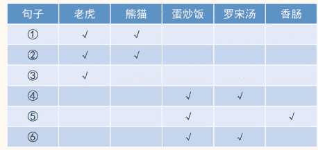

**表 2-2 各句对应其他句子的相似度**

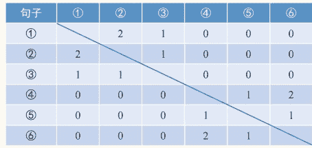

#### 思维探索

由表 2-2 可见，______ 与 ______ 相似度为 2，______ 与 ______ 相似度也为 2。

我们发现：句子 ① 和 ② 都含“老虎”“大熊猫”，相似度 2；句子 ④ 和 ⑥ 都含“蛋炒饭”“罗宋汤”，相似度也是 2。

把簇 ① 与簇 ② 合并成新簇，簇 ④ 与簇 ⑥ 合并成另一新簇。此时簇数变为 4，如图 2-17。

图 2-17 是按“最相似”（相似度 2）得到的新簇图。若把相似度 1 也算进去，簇 1 和簇 3 能合并，簇 2 和簇 4 也能合并，如图 2-18。

若相似度设为 0，六句句子全成一簇。可见相似度设定至关重要。设太低（如 0），无监督学习聚类就失去意义。

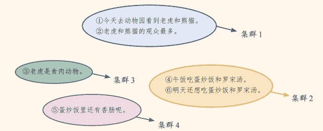

**图 2-17　相似度为 2 时的新簇图**

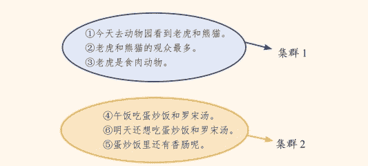

**图 2-18　相似度为 1 时的新簇图**

无监督学习中，机器按给定相似度设定，经算法聚类，通过自主学习把相似数据归为一类（图 2-19）。

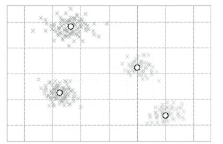

**图 2-19　无监督学习中的聚类**

### 2.3.3 无监督学习在生活中的应用

#### 1. 购物平台自动推荐商品

# 当算法读懂你的偏好：从智能推荐到强化学习的进阶之路

## 购物平台的“千人千面”魔法

你有没有发现，打开购物APP首页，推荐的商品总能精准击中你的心巴？这并非巧合。平台后台默默记录着你的消费记录、浏览轨迹、常驻地等数据，据此为用户打上“摄影发烧友”、“音响发烧友”等标签，完成人群聚类。有了这些画像，系统便能定向分发商品，大幅提升转化率。

**Figure 2-20　购物平台自动商品推荐示意**

## 相册里的“自动归档员”

手机相册的“人物”功能，是聚类技术最贴身的应用。系统自动识别照片中的人脸，将同一个人的照片聚在一起。哪怕你刚导入新照片，也能秒级归入对应相簿，省去了手动整理的麻烦。

#### 体验感知
不妨打开手机相册的“人物”相册看看：同一分组里，真的是同一个人吗？

### 2.3.4 有监督 vs 无监督：核心差异大起底

#### 差异一：有无“标准答案”在手
- **有监督学习**：训练数据自带分类标签，像做选择题有答案键。
- **无监督学习**：训练数据裸奔，没有任何标签指引。

#### 差异二：结果“定不定”
- **有监督学习**：输出目标是预设好的标签，结果确定性强。
- **无监督学习**：结果充满变数。换算法、调相似度阈值，分类结果可能天差地别——同一堆数据，按颜色分能分出几类，按形状分又是另一番景象。

#### 差异三：分类 vs 聚类，本质不同
- **分类** 是有监督的专属动作。
- **聚类** 是无监督的核心任务。

**划重点**：两者最大分水岭在于——**样本类别信息知不知道**。
有监督阶段打标签，相当于预先划定了“分几类”；无监督聚类则是“盲盒开箱”，类别数量未知（可能分2类，也可能分4类）。聚类过程不关心“这是哪一类”，只管“物以类聚”。类别特征是什么？得等聚类完成后，靠人工经验复盘总结。

#### 知识拓展：半监督学习——两全其美的中间地带
介于有监督与无监督之间，半监督学习利用**少量有标签数据 + 大量无标签数据**联合训练。常见路径有二：要么把无标签数据塞进有监督分类器强化效果，要么用少量标签数据“带”着无标签数据做更精准的聚类。

## 2.4 强化学习：像训练导盲犬一样训练 AI

### 2.4.1 生活里的“试错-奖惩”循环

上学迟到被批评，下次不敢迟到；主动助人得表扬，以后更爱助人。人类靠“思考-改进”不断进阶，AI 领域把这套机制称为**强化学习**。

不仅人类，驯养动物也用这套逻辑。比如训练导盲犬上岗（Figure 2-21）：目标是引导模拟盲人避开障碍。成功则抚摸表扬，失败则训斥纠正。为了多得奖励、少受惩罚，导盲犬逐渐掌握避障技能（Figure 2-22）。

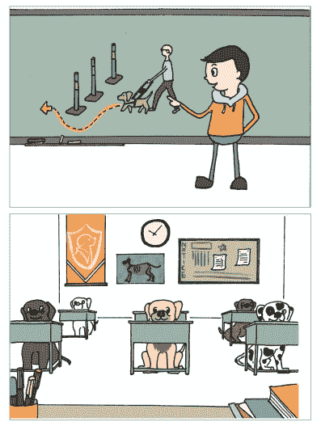

**Figure 2-21　导盲犬训练场景**

它是怎么做到的？先观察环境（障碍位置、数量、训练员体型等）→ 决策路线 → 执行引导 → 获得反馈（开心或失落）→ 复盘调整路线。反复循环，最终胜任工作。

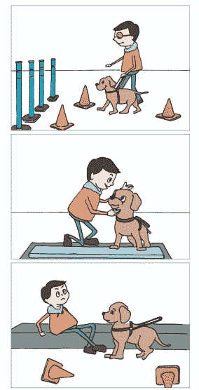

**Figure 2-22　导盲犬训练流程**

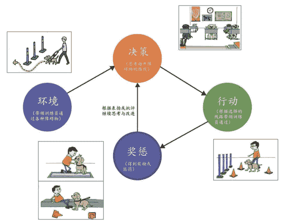

**Figure 2-23　导盲犬训练模型抽象**

上述过程可提炼为四大核心概念：

1.  **环境**：智能体感知的外部状态，如障碍分布、自身体能等。
2.  **决策**：基于环境观测，思考下一步怎么走。
3.  **动作**：将决策落地为具体行为，即带人走选定路线。
4.  **奖励/惩罚**：动作执行后的环境反馈。依据反馈修正决策，形成“感知-决策-行动-反馈”闭环。

**核心在于决策**——如何思考才能最大化累积奖励。

#### 思考探索
请结合上文，说说“环境、决策、动作、奖励/惩罚”在导盲犬训练中的具体含义。

### 2.4.2 强化学习通用范式：机器的“试错进化论”

强化学习本质是**不断试错的学习过程**。智能体在各种环境中尽可能尝试所有动作，通过环境反馈（奖惩）评估动作优劣，最终摸索出“环境 → 最优动作”的映射关系（即策略）。

#### 体验感知
如 Figure 2-24 所示，从起点到终点有多条路径，途经节点可获得金币（蓝标数字）。哪条路收益最高？

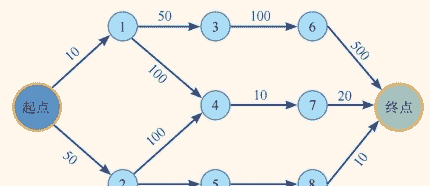

**Figure 2-24　路径选择博弈**

四条路线收益对比：
- 路线 1：起点→1→3→6→终点，合计 **660** 金币。
- 路线 2：起点→1→4→7→终点，合计 140 金币。
- 路线 3：起点→2→4→7→终点，合计 180 金币。
- 路线 4：起点→2→5→8→终点，合计 140 金币。

穷举对比后显而易见，**路线 1 是最优决策**。

### 2.4.3 三大范式终极 PK：有监督 vs 无监督 vs 强化学习

### 短视陷阱与长期收益的博弈

假设我们对各节点后续路径的金币分布一无所知，初始抉择仅限于节点 1 与节点 2。受限于眼前利益，大多数人会选择节点 2，因为它能即时获得 50 枚金币，却因此错失了通往节点 1 的最优路径。这正是强化学习的核心逻辑所在：**目标锁定奖励最大化，即追求最高的累积回报**。尽管节点 2 提供了最高的**即时收益**（50 金币），但拉长时间周期来看，它并非累积收益的最优解——路径 1 总计可斩获 660 金币。

在强化学习体系中，优秀的算法往往极具“野心”，绝不为眼前蝇头小利所动。它拒绝短视，必须学会将目光投向长远，权衡当下与未来的得失。

#### 核心拆解：环境、决策、动作与奖惩

针对上述场景，能否精准界定四大核心要素？

- **环境**：由起点通往终点的多条路径构成，各路径蕴含的金币数量各异。
- **决策**：挑选一条具体路径的认知过程。
- **动作**：依据决策结果，从起点沿选定路径行进至终点的物理执行。
- **奖惩**：根据动作获得的金币数，判断该路径是否优于过往尝试（核心标准为获取更多金币）。同时考量是否存在其他未探索路径，从而形成持续试错、不断学习的闭环。

强化学习的通用运作流程如下图所示。

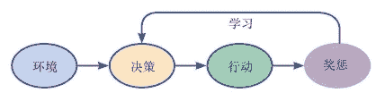

**图 2-25　强化学习通用流程**

监督学习依赖带标签的样本数据训练模型，最终输出预设的分类标签；无监督学习则面对无标签数据，通过自主归纳推理将数据聚类，因缺乏预设标准，输出结果往往难以预判。强化学习截然不同，它无需预置数据，核心在于**决策**。这是一个不断试错、循环迭代的过程：基于环境反馈的奖惩信号，持续思考优化，调整决策并付诸行动。

#### 实战演练

请利用图形化编程工具，加载 AI 扩展模块，通过一个微型游戏搭建机器学习项目。无需向机器灌输具体规则，仅凭“获胜案例”即可训练。在此过程中，观察机器如何借助强化学习机制，在不断博弈中进化、变得愈发聪明。

## 2.5 机器学习演进史

### 2.5.1 发展五阶段回顾

当前学界公认，机器学习历经了五个关键发展期。

**第一阶段：萌芽期（1940 年代）**
学者们从生物学引入“神经元”概念，基于神经元基础特征构建了 **M-P 神经元模型**，为机器学习奠定基石。

**第二阶段：热潮期（1950 年代 — 1960 年代中期）**
图灵测试问世；神经科学家提出最简神经网络数学模型——**感知机**；最早的决策树算法、**SVM（支持向量机）** 及贝叶斯分类器相继诞生。

**第三阶段：低谷期（1960 年代中期 — 1970 年代中期）**
受限于感知机结构单一、仅能处理线性问题，技术突破陷入瓶颈，发展停滞。即便如此，**KNN（K 近邻）分类算法** 仍于 1967 年问世。

**第四阶段：复苏期（1970 年代中期 — 1980 年代末）**
1970 年代，自训练、转导学习、生成模型等方法涌现，被视为半监督学习雏形。
1980 年全球机器学习研究蓬勃；1986 年备受瞩目并加速发展。《并行分布式处理：认知微结构探索》一书提出应用于多层神经网络的 **BP 算法（反向传播算法）**，极大推动了人工神经网络进化。同期，**ID3 决策树算法** 诞生，**CNN（卷积神经网络）** 亦横空出世。此阶段最大突破在于神经网络类型丰富，弥补了感知机单一结构的缺陷。

**第五阶段：多元爆发期（1990 年代 — 至今）**
1990 年代统计学习兴起，**LR（逻辑回归）**、**SVM** 等浅层模型层出不穷。
2006 年，**深度学习** 概念正式确立。

### 2.5.2 深度学习与机器学习的隶属关系

随着 AI 热度攀升，“深度学习”高频出圈。它究竟与前文提及的“监督 / 无监督 / 强化学习”有何关联？

人工智能的“智”核心源于机器学习，而当前机器学习最主流的技术引擎便是深度学习。简言之，前述三大学习范式均可接入深度学习技术。三者包含关系如下图：

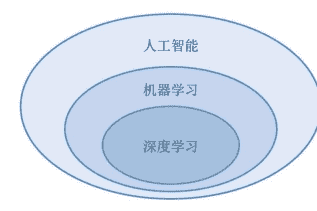

**图 2-26　人工智能、机器学习与深度学习关系图**

### 2.5.3 从人工神经网络到深度学习

深度学习被视为人工神经网络算法的延伸与深化，其溯源始于神经元与感知机。

#### 1. 生物神经元：智能的微观基座

人脑拥有上千亿神经元，它们是大脑的基本构建单元（见下图）。听、说、看、思等行为会激发神经元突起——即“树突”。神经元借由树突相互连接，全脑神经元及其连接共同编织成大脑“神经网络”。

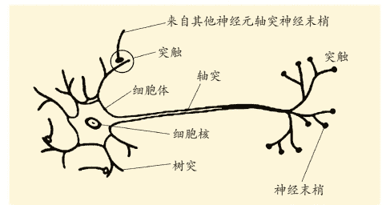

**图 2-27　神经元结构示意**

#### 2. 感知机：神经网络的基石与深度学习起源

单层感知机可视为最简神经网络，其原理直观：接收多维输入，输出单一结果。

以学科综合评定为例：输入为“平时成绩”与“期末成绩”两维度；输出为“通过”或“不通过”。判定规则：加权求和（平时成绩 × 权重 + 期末成绩 × 权重 = 综合得分），若得分 < 60 则输出“不通过”，否则“通过”。

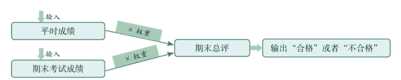

**单层感知机实战：权重如何决定最终判定？**

##### 深度思考

权重的本质，是衡量“重要性”的刻度。好比学校考核：若侧重平时积累，平时成绩的权重便高；若看重一锤定音，期末考试的权重则大。深度学习中为何要反复调参？归根结底，输入特征对预测结果的贡献度并不均等。模型训练的核心任务，就是寻找那组最优权重组合，让输出无限逼近真实目标。

##### 实战体验

亲自算一算：相同输入下，权重变动如何扭转最终评价？

**场景一（Figure 2-29）**

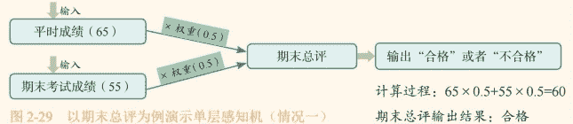

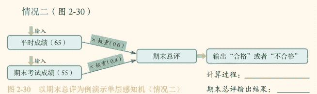

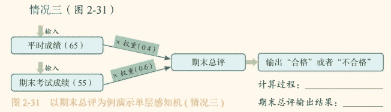

- **场景一**：`65×0.5 + 55×0.5 = 60` → **通过**
- **场景二**：`65×0.6 + 55×0.4 = 61` → **通过**
- **场景三**：`65×0.4 + 55×0.6 = 59` → **不通过**

显而易见，平时分与期末分数值固定，仅因权重分配不同，导致“通过”与“不通过”截然不同。对于单层感知机而言，数据输入固然是地基，但权重配置才是决定上层建筑走向的关键。要让模型更符合逻辑，必须持续打磨权重，寻得最优解。

#### 3. 多层感知机（MLP）

单层结构过于单薄，解决问题的能力有限，多层感知机（MLP）应运而生。它在输入输出间插入了多层中间结构，输出端也不再局限于单个神经元。MLP 是人工神经网络（ANN）的重要形态之一，而深度学习正是源于 ANN 的深度演进，拥有多个隐藏层的 MLP，便是深度学习的经典架构雏形。

#### 4. 人工神经网络（ANN）

不妨将 ANN 视为对大脑神经系统的高度仿真复刻。

从 Figure 2-32 可见，ANN 由输入层、隐藏层、输出层三大板块构成。输入层负责接纳原始数据；中间层神经元不直接与外界接触，故称“隐藏层”；输出层则负责吐出最终推理结果。

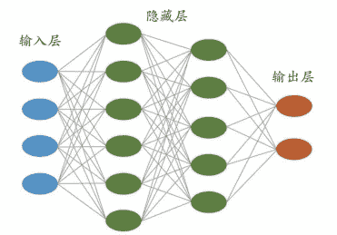

Figure 2-32　深度学习模型架构图

#### 5. 深度学习

典型的深度学习模型（Figure 2-32）本质上就是一个多层神经网络。同 ANN 一样，它同样包含输入、隐藏、输出三层核心结构。

以图像识别为例，模型配置如 Figure 2-33 所示。

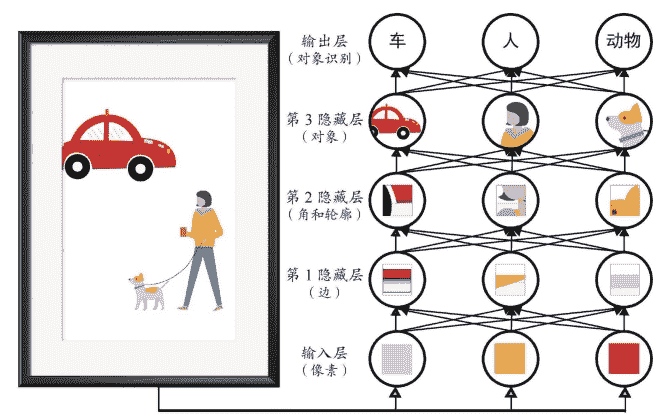

Figure 2-33　深度学习识别图像物体示意图

既然图像由像素矩阵构成，输入层自然以像素值为切入点。

隐藏层的使命，是层层递进地提取抽象特征：
- **第1隐藏层**：对比相邻像素亮度差异，勾勒出**边缘**轮廓；
- **第2隐藏层**：基于边缘信息，搜索拐点与连线，构建**角点与轮廓**；
- **第3隐藏层**：利用角点轮廓，拼装识别出**完整物体部件**；
- **输出层**：综合部件特征，给出最终识别结论。

值得注意的是，隐藏层数量、每层神经元个数及具体功能分工，均随模型设计而异。比如换个架构，第一层可能不再负责找边缘。

在深度学习里，为让隐藏层精准提取特征，参数调优是必修课。“参数”概念广泛，既覆盖数值微调（如前文感知机中的权重，在深度学习中依然是核心参数），也涵盖结构重塑（如增减隐藏层深度、调整神经元宽度）。

##### 知识拓展：像素

像素是图像的最小原子单位。将图片无限放大，你会看到无数个微小方块，它们就是“像素”。每个像素占据固定坐标，携带特定色彩数值。

##### 实战体验

掏出手机打开微信，搜索小程序“Your AI”，切换不同数据集，直观体验深度学习的完整运作流程。

##### 知识拓展：卷积神经网络（CNN）

CNN 是深度学习领域的明星架构，在图像识别上战绩斐然，现已延伸至视频分析、自然语言处理等多个战场。

CNN 主由**卷积层**与**池化层**堆叠而成。

以图像处理为例，卷积操作的核心组件是**卷积核**（Figure 2-34）。它本质是一个远小于输入图尺寸的数据矩阵。

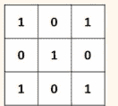

Figure 2-34　卷积核示例

卷积核宛如一扇“滑动窗口”，按步长在输入图像矩阵上逐格滑动，每到一处便执行“乘加”运算，最终在对应位置生成输出特征图（Figures 2-35 至 2-37 详细演示了这一过程）。

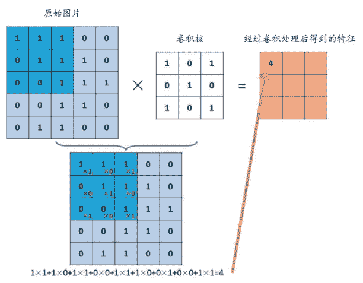

Figure 2-35　卷积过程演示 (1)

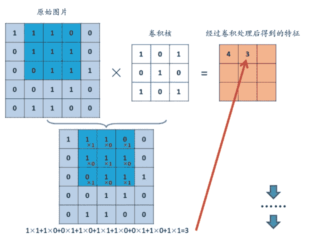

Figure 2-36　卷积过程演示 (2)

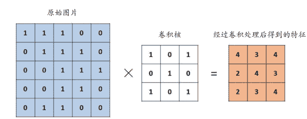

Figure 2-37　卷积过程演示 (3)

更换不同卷积核，就能从多维视角挖掘图像细节。通俗说，卷积的作用就是“透过现象看本质”，助力模型捕捉关键图像特征。

池化层的直接功效是**降维**——理解为“数据瘦身”最直观。它用单一数值代表某一局部区域。主流手段有最大池化与平均池化，前者更常用：取区域内最大值作为代表，从而保留更显著的全局特征。Figure 2-38 展示了最大池化的具体操作。

Figure 2-38　最大池化过程演示

**卷积 + 池化**的组合拳，让特征提取实现了从**纹理细节 → 局部模式 → 全局语义**的渐进式跃升。

##### 知识拓展：生成对抗网络

# 第三章 解码AI视觉

## 引言

计算机视觉技术借助计算机、摄像头等硬件设备，模拟人类的视觉系统，实现对外部世界的观测与理解，是人工智能领域的核心支柱之一。该技术涵盖图像处理、识别、目标检测与追踪等多元任务。伴随技术迭代升级，其应用版图已延伸至公共安全、智慧交通、工农业生产、医疗诊断等诸多行业。

## 3.1 读懂计算机视觉

### 3.1.1 触手可及的“机器之眼”

在日常学习生活中，摄像头无处不在：校门口测温的设备、教学楼里的安防监控、教室内的考勤拍摄设备。更进一步，教室摄像头能捕捉朗读、举手、书写、站立、倾听、趴桌等课堂行为，结合喜怒哀乐等表情特征，分析学生的课堂状态。通勤途中，地铁、公交、路侧的监控摄像头，小区道闸的车牌识别设备；居家时，手机拍照搜题核对答案。这些场景的共同点，是摄像头联动计算机设备，运用“计算机视觉”技术——这门致力于让机器拥有“看见”能力的科学。它利用光学设备与算力替代人眼，完成目标识别、追踪、测量，并通过图像处理提取关键信息。

#### 体验感知

1. 这是一枚中国邮政发行的我国特有植物纪念邮票截图（图3-1），图中植物名称被遮挡。你能认出它吗？

   答案揭晓：这是**贝母杉**（*Abies beshanzuensis*），我国特有珍稀植物。你猜对了吗？

2. 新学期伊始，小能同学想入手一支顺手的笔（图3-2），同学仅发了一张照片，购买渠道未知。能否助他一臂之力？

   尝试使用购物App的“拍照搜同款”功能，看能否找到对应的购买链接。

图3-1　中国邮政特有植物纪念邮票截图

图3-2　心仪的笔

### 3.1.2 计算机视觉的演进史

计算机视觉，顾名思义，是研究如何让机器“看懂”世界的学科。更深层地看，它探讨如何从图像或多维数据中获取信息以实现感知。

**萌芽期：仿生与知识库的尝试**
1966年，AI科学家布置作业：编写程序让计算机描述摄像头捕捉的内容，这被视为计算机视觉最早的任务定义。
20世纪70-80年代，随着电子计算机普及，技术初露端倪。科学家们试图复刻人类视觉机制，主要走过两条路径：
*   **路径一：三维重构。** 认为人类靠双眼立体观察理解世界，故需将二维图像还原为三维结构（图3-3）。
*   **路径二：先验知识库。** 认为识别苹果源于大脑存储的苹果特征（红/黄/绿、圆润、光滑）。若为计算机建立同类知识库，通过图像匹配即可实现识别（图3-4）。

图3-3　人类双目立体视觉观察三维物体示意

图3-4　先验知识库示意

受限于早期算力与算法，此类方法仅能提取基础特征，落地场景局限于光学字符识别、显微/航拍影像分析等窄域。

**发展期：图像处理与统计学习的突破**
70年代末，计算机性能跃升使图像处理成为可能，计算机视觉获真正关注。1982年马尔著作《视觉》出版，标志着该学科正式独立。
90年代，CPU、DSP等硬件飞跃，统计方法、局部特征描述子等先进算法涌现，推动技术在工业领域规模化应用。

**爆发期：大数据与深度学习的红利**
步入21世纪，互联网海量数据、数码相机普及及机器学习兴起，驱动计算机视觉高速演变。基于规则的传统方法逐渐让位于机器学习：机器从海量数据中自动归纳特征并决策。此阶段涌现海量应用，如相机人脸检测、安防人脸核验、车牌识别等典型场景。
2010年后，深度学习引爆式增长，神经网络图像识别成为主流范式，极大推动了工业化进程，尤其在物体视觉领域展现碾压级优势。

**展望未来**
如今，计算机视觉已能利用“所见”信息完成复杂任务。展望未来，有望赋予计算机如人类般通过视觉观察、理解世界的能力。

图3-5　制造业机器人

### 3.1.3 计算机视觉的广阔应用疆域

### 计算机视觉：从工业到国防的全域落地图谱

上一节梳理了计算机视觉的演进脉络与初级应用，本节将深入剖析其在工业制造、医疗健康、现代农业、国防军工、智能安防及自动驾驶六大核心领域的深度实践。

#### 1. 工业制造：制造强国战略的“智造之眼”

2015年《中国制造2025》发布，拉开产业升级大幕。工业机器人作为主力，视觉感知系统是其核心感官。通过实时采集图像数据指导机械臂定位、调整姿态，该技术已全面嵌入质检分拣、工件识别、食品包装等产线关键节点，推动生产模式向柔性化、智能化跃迁。

#### 2. 智慧医疗：AI辅助诊断重塑阅片范式

腾讯觅影整合顶尖AI力量，将深度学习与影像识别注入临床诊疗。传统人工阅片耗时长、主观性强，易漏诊。计算机视觉仅需海量“病变/正常”样本训练，无需逐帧标注边界，即可自主提取特征完成病灶识别，显著提升准确度。

Figure 3-6　Medical Cell Detection

实测案例显示：某机构对接30例患者近9000张肺结节CT，AI初筛标注疑似病灶，4名三甲主任医师双盲复核，**人机协作仅耗时30分钟**，较传统2.5-3小时效率激增，综合准确率超90%。

Figure 3-7　Smart Agriculture

Figure 3-8　Cruise Missile

Figure 3-9　Face Scan

Figure 3-10　Iris Scan

Figure 3-11　Fingerprint Scan

#### 3. 智慧农业：数字技术让耕种“有数”

视觉识别精准区分作物与杂草，实现精准变量喷洒，大幅减量增效。融合光伏、多维传感器与云端大数据，构建“数字农场”，支撑产量预测、病虫监测远程可视化。黑龙江等地已铺开北斗卫星监测与移动智能终端，织就农情气象“天地一体化”服务网。

#### 4. 国防军工：复杂战场的“精准制导核心”

长剑-10巡航导弹采用超低空贴地/海突防，规避雷达锁定；末端实施“眼镜蛇机动”拉升俯瞰，依托视觉制导锁定目标垂直俯冲，验证了该技术在极端动态环境下的高可靠定位能力。

#### 5. 智能安防：海量视频中的“秒级锁定器”

生物特征识别（人脸、虹膜、指纹、声纹）多依赖视觉维度，成身份认证基石。

以追逃溯源为例，传统人工查缉监控视频如大海捞针。智能安防引入视觉与深度学习，自动解析性别、年龄、着装、体态、配饰、行为及携载物等数十维画像，结合嫌疑人特征从海量流中**秒级精准定位**，大幅压缩侦破周期、节警增效。

#### 6. 自动驾驶：重构人车路协同新生态

大数据、物联网、5G车规级落地加速推动无人驾驶普及。L4级车辆依赖视觉等AI集群协同，实现无人接管下的安全驾驶。2019年8月30日，北汽福田与一汽合制红旗EV获**国内首批北京L4级载客测试牌照量产车型**，标志商业化进程迈入实质阶段。

Figure 3-12　Autonomous Driving

---

以上勾勒出计算机视觉的主战场全貌。**那么，机器究竟如何“看懂”世界？视觉感知的底层逻辑是什么？**

> **思考与探索**
>
> 请判断以下场景哪些用到了计算机视觉技术？
>
> 
> Figure 3-13　Face Recognition Unlocks Phone
>
> 
> Figure 3-14　Adjusting Images with Image Processing Software
>
> 
> Figure 3-15　Search by Image in Baidu Images
>
> **体验与感知**
>
> 1. 打开手机美颜相机实拍自拍，观察肤质优化、轮廓微调等算法效果。
> 2. 体验百度App“识图”功能（
> 
> Figure 3-16　Baidu App "Identify Everything"
> ），实测其对花草地标、商品等识别边界。

### 3.2　图像识别

# 计算机如何“看懂”世界？揭秘图像识别核心流程

图像识别，简而言之，就是让计算机像人类一样“看图说话”，通过算法处理、分析图像，进而识别出其中的目标与物体。这是机器学习落地的典型场景之一。按识别对象划分，主流技术主要分为两大阵营：**人脸识别**广泛应用于安检、实名认证、移动支付等强验证场景；**物体识别**则在无人货架、智能零售柜等货品流通领域大显身手。

想搞懂计算机视觉的“看家本领”，只需掌握三大核心环节：**图像预处理、特征提取、图像分类**。下面我们逐层拆解。

Figure 3-17　图像识别处理流程

### 3.2.1 图像预处理：给“原始素材”做减法

人类能分辨猫狗，是因为大脑存储了海量特征记忆；计算机同理，必须先“看”过足够多的样本并记住特征。但现实中，采集到的图像常因拍摄角度、透视畸变、镜头素质等问题存在瑕疵，直接送入模型会严重拖累识别精度。因此，**预处理的核心任务是“去伪存真”**：剔除噪声、修复有效信息，为后续特征提取和分类打下坚实基础。常用手段主要有两类：

#### 1. 灰度校正：还原光影本质
像素是图像的最小单元。“灰度”概念源自黑白摄影，指代画面中每个像素呈现的明暗层次（见 Figure 3-18、Figure 3-19）。通过灰度校正，可统一图像的亮度基准，剔除色彩干扰，让模型专注于结构纹理本身。

Figure 3-18　原始图像

Figure 3-19　灰度校正后

#### 2. 几何变换：修正空间姿态
也称空间变换，通过平移、翻转、镜像、旋转、缩放等操作（Figure 3-19、Figure 3-20），矫正采集时的画面倾斜、比例失调等几何畸变，同时能缓解过暗、过亮、噪点多、对比度低等成像缺陷。

Figure 3-20　几何变换后

> **动手体验**
> 
> 打开任意图像处理软件，尝试调节亮度、对比度，或进行旋转、翻转、裁剪操作，直观感受人工预处理的效果。

### 3.2.2 特征提取：教会机器“抓重点”

特征，就是区分事物的关键标识。人脑靠提取“异同”识别万物：鸭子有蹼鸡没有，嘴型不同，步态也迥异；猫狗虽同为毛茸茸，但犬科动物吻部更突出，同体型下猫张嘴角度更大。

计算机视觉如何模仿这一认知过程？以 Figure 3-21 为例，经典 **HOG（方向梯度直方图）** 算法分三步走：

1.  **灰度化 & 网格化**：将图像转为黑白渐变图，切分成微小网格单元。
2.  **统计梯度方向**：计算每个网格内像素沿垂直/水平方向的变化率（梯度，Figure 3-22），捕捉边缘轮廓信息。
3.  **归一化生成特征图**：用算法将梯度数据压缩归一化，只保留核心结构信息，最终输出如 Figure 3-23 所示的特征图。

Figure 3-21　原始图像

Figure 3-22　梯度变化示意

Figure 3-23　方向梯度直方图特征图

肉眼可见，狗的长吻、竖立大耳等关键特征轮廓被完美保留，且位置对齐准确。这意味着：只要姿态常规，这些几何特征足以支撑精准识别。但若狗把嘴巴埋进爪子里等极端姿态，关键特征被遮挡，单靠 HOG 就力不从心，需引入更复杂的特征或更优算法。

> **知识拓展：直方图**
> 
> 直方图用一组高低不一的竖条（或线段）直观展示数据分布。横轴为数据类型，纵轴为分布频度。它是数据规律分析的利器，能让对象全量数据的分布状态一目了然。
> 
> 例：通过图像软件查看 Figure 3-24 的直方图（Figure 3-25），即可直观掌握该图在明度、R/G/B 四个通道的数据分布情况。
> 
> 
> 
> Figure 3-24　原始图像
> 
> 
> 
> Figure 3-25　直方图

除 HOG 外，基于色彩特征、几何特征的提取方法也是常用工具箱成员。

### 3.2.3 图像分类：给画面贴上“标签”

“一图胜千言”，人类瞬间解读图像含义并入库；但对计算机而言，图像只是无意义的矩阵数字，它完全不懂画面传达的知识与意图。

**图像分类的使命，就是充当“翻译官”**。借助计算机视觉与机器学习算法，从像素矩阵中提炼语义，本质上是**给图像打标签**：输出“猫”、“狗”、“大象”等类别标签，甚至生成一句人类可读的自然语言描述，实现从“数据”到“认知”的跨越。

# 图像分类的核心逻辑：从线性切分到多层网络

图像分类的基石在于特征提取。拿到特征后，我们便引入分类算法进行识别。以猫狗识别为例，我们收集海量猫狗照片，用于训练分类器模型。

假设红点代表狗，蓝点代表猫。横轴量化“脸部圆润度”，纵轴量化“毛发长度”。在这样的二维坐标系下，样本分布如图 3-26 所示。

图 3-26　猫狗分布图 1

显而易见，要将红蓝两类样本分开，仅需在中间划一条直线即可。如图 3-27，直线将平面一分为二，两侧分属不同类别。这背后的分类器，正是第二章学过的**单层感知机**。

图 3-27　猫狗分布图 1 的切分

但若样本分布变成了图 3-28 这样呢？

图 3-28　猫狗分布图 2

当样本复杂度上升，单层感知机“只能一切”的短板暴露无遗。此时，**多层感知机**（即多层人工神经网络）登场。低层神经元的输出作为高层神经元的输入，由此构建起隐藏层。回到图 3-28，我们可先横向一刀切分上下（图 3-29 黄线），再纵向一刀切分左右（图 3-29 绿线），最后将左上与右下组合，从右上与左下中分离出来。

图 3-29　猫狗分布图 2 的切分

实际上，每一次“切分”都对应网络中的一个神经元。图 3-29 案例中，单层网络基于这些特征无法区分，但多层网络却能精准分类。只要切分次数得当、组合合理，无论样本分布多么复杂，人工神经网络都能有效完成区分。

至此，这堆猫狗图片的分类任务圆满完成。

---

### 知识拓展：验证码背后的秘密

网民无人不知验证码。这些年验证码花样翻新，没点知识储备，根本看不懂（图 3-30）；甚至还有考验鼠标操作的，手速慢直接判失败。

图 3-30　知识问答型验证码

验证码的核心就一句话：**区分登录者是程序还是真人**。

全称 `CAPTCHA`，源自 `Completely Automated Public Turing test to tell Computers and Humans Apart`（全自动区分计算机和人类的图灵测试）。

互联网早期，垃圾邮件泛滥最让人头疼。有人专写脚本批量注册邮箱发广告，正常邮件淹没在垃圾堆里，资源浪费严重。一名程序员想出妙招：人类轻松识别手写扭曲字符，机器却难搞。于是注册时加道坎——输对扭曲字符才能通过，以此识别人机。验证码由此诞生。

图 3-31　街景验证码

你可能觉得：每次登录输验证码太浪费时间！但你未必信，这时间并非白费，反而可能在推动 AI 发展。为何？因为你输入的验证码，极大概率会成为 AI 训练数据集。大家都遇到过街景验证码（图 3-31）。当你瞪大眼睛在图里找小汽车、路标、自行车时，其实是在**免费给 AI 打标签**！部分图片 AI 已识别，但还有些街景难倒 AI。这些数据最终会流入图像识别分类器的训练池。现在懂了吧，输验证码原来是在为 AI 发展贡献力量？

---

## 3.3 目标检测与追踪

前文提到，图像识别走三步流程。之前的例子里，每张图只有一个主体。如果一张图里有多个物体怎么办？比如图 3-32。单靠旧有的图像识别就失效了——电脑搞不清这张图究竟是“狗”还是“玩偶”（图 3-33）。

图 3-32　狗与玩偶同框图

图 3-33　狗与玩偶的 HOG 特征直方图

### 3.3.1 目标检测

计算机面对图像，最基础的任务是认清“里面有什么”。风景、人物、建筑、美食？这本质是**图像分类**，可简化理解为给图片打标签。已知图像类别（比如知道图里有狗和其他东西），狗在哪？能用框标出来吗？或者图里有一群狗，电脑虽知有狗，却数不清几只。

此时需进一步处理图像，即**目标检测**（图 3-34）。

图 3-34　目标检测示意

**图像识别 vs 目标检测**：前者将整张图归为一类，仅打一个标签；后者要求电脑定位物体位置、统计数量、并识别类别（图 3-35）。

图 3-35　狗与玩偶图上的目标检测效果

#### 目标检测方法一：传统目标检测

# 传统目标检测的逻辑与局限

传统目标检测依赖人工设计的特征算子来提取图像特征。以单尺度检测为例，其核心是一个固定大小的滑动窗口，从左至右、从上至下遍历整幅图像。窗口内的图像块会被送入分类器，判断是否存在目标并给出类别；若置信度达标，该窗口即被标记为检测结果。得益于计算机的高速运算，这种“穷举式”扫描能快速输出全图结果。

当然，实际工程远比这复杂，上述描述仅为核心逻辑的简化。但这种范式有明显短板：检测窗口大小如何设定？窗口过大，小目标会被背景噪音淹没而无法分类（图 3-36a）；窗口过小，大目标则无法完整纳入视野（图 3-36b）。业界曾尝试多种优化方案，此处不再赘述。

图 3-36　检测窗口的尺度困境

##### 目标检测范式二：基于深度学习的目标检测

深度学习检测器改用神经网络自动学习的特征表达。

流程可概括为三步：先用选择性搜索等区域建议算法，从待测图中生成数百至数千个不同尺度的候选框；再将这些候选区域分别送入神经网络提取特征；最后依据特征完成分类与坐标回归，映射回原图坐标，得到最终检测框（图 3-37）。

图 3-37　神经网络驱动的检测流程

可见，目标检测作为比图像分类更精细的任务，其实现难度显著更高。

##### 知识拓展：笛卡尔坐标系

数学上，在平面内以原点为交点建立两条垂直数轴，横轴称 `x` 轴，纵轴称 `y` 轴，即构成平面直角坐标系。

有序数对 `(x, y)` 唯一确定一个平面点。知道两点坐标可算线段长度，知道三点坐标可算三角形面积（图 3-38）。

图 3-38　笛卡尔坐标系示意

#### 3.3.2 目标跟踪

前文讨论的检测针对静态图像，但现实多为动态视频场景：在首帧标注目标，后续帧持续定位同一目标并预测其下一帧位置，这就是目标跟踪。

该技术广泛支撑智能安防、自动驾驶、视频检索、导弹制导、人机交互及工业机器人等领域。主流实现路径主要有两类。

##### 方法一：逐帧检测跟踪

首帧确定目标模板，后续每一帧全图搜索与该模板最相似的区域。本质上是用首帧特征训练/匹配，再对每帧做全目标检测以定位位置。

##### 方法二：帧间关联跟踪

针对首帧样本极少的问题，可引入图像分类预训练的通用骨干网，跟踪时用少量目标样本微调。搜索策略上，首帧需全图搜索，后续帧仅在上一帧目标位置邻域内搜索。相比逐帧全图检测，大幅降低了计算量，提升了效率。

但复杂场景下的实时精准跟踪仍面临硬骨头，核心挑战集中在四点：

1.  **形变**：目标姿态改变导致几何与外观特征漂移，易跟丢。
2.  **尺度变化**：目标缩小时背景干扰模型更新；放大时检测框覆盖不全，信息缺失同样误导更新。
3.  **模糊**：低分辨率、高速运动、光照剧变、目标背景相似等均引发图像模糊。
4.  **遮挡**：跟踪不仅要检测还要预测。目标可能暂时消失，算法需预判其最可能出现的位置以维持轨迹连贯（图 3-39）。

图 3-39　目标遮挡示意

> **体验与感知**
>
> 部分手持云台只需点击跟踪键、框选目标，云台即可自主转向，无论目标移动还是云台自身移动，都能稳锁画面中心（图 3-40）。有条件不妨实测体验。

图 3-40　目标跟踪效果演示

#### 3.3.3 目标跟踪的应用版图

作为计算机视觉核心方向，目标跟踪在军民两用领域全面开花。军事端涵盖无人机、制导武器、空中预警、战场侦察等；民用端覆盖自动驾驶、服务机器人、智能监控、人机交互、增强现实等。

##### 1. 军事应用

军事侧典型场景见图 3-8 与图 3-41。

图 3-41　军用无人机跟踪示意

##### 2. 民用落地场景

###### (1) 智能视频监控体系

① **基于步态特征的身份核验** (Figure 3-42)。每个人的走路姿态都是独一无二的“生物密码”。系统通过捕捉人体关节的弯曲幅度、摆动轨迹、身高体态及步态周期等动态特征，实现精准辨识。即便佩戴口罩、帽子刻意遮挡面部，依然能精准锁定目标身份。

Figure 3-42　基于步态识别的身份核验中目标追踪应用

② **基于人脸识别的目标追踪**。利用面部特征码区分不同个体，具体技术原理将在后续章节深度解析。

③ **车载智能感知系统**。实时识别行人、障碍物、信号灯、周边车辆等路况要素，动态计算相对距离变化，主动预警碰撞风险，有效规避闯红灯等违章行为。

④ **路侧感知网络**。交管部门部署于路侧、路口的智能摄像头，自动采集过往车辆牌照，实时构建路况画像：流量密度、行驶车速、事故突发等关键指标一目了然 (Figure 3-43)。

###### (2) 人机交互新范式

打破键鼠操作的单一模式，计算机通过目标追踪技术“读懂”人体姿态、动作与手势，构建自然交互界面。

以手势交互为例，系统能全景检测画面中所有手部，精准分类手势语义 (Figure 3-44)，完美适配自拍、他拍、多角度等复杂场景。

更进一步，计算机可将真人实时映射至虚拟3D空间，实现沉浸式交互。当下热门的美颜滤镜、AI换脸、表情实时驱动卡通形象等App功能，皆是此技术落地的生动注脚 (Figure 3-45)。

Figure 3-43　目标追踪在交通监测中的应用

Figure 3-44　手势识别交互演示

Figure 3-45　实时卡通化面部驱动效果

###### (3) 医学影像辅助诊断

在超声、MRI等三维建模影像的自动化分析中，目标追踪大显身手。单帧超声图像常受噪点干扰，关键病灶信息易被淹没，静态分析难度极大。追踪技术利用时序帧间目标的几何关联性与时域连续性，穿透噪声迷雾，显著提升诊断精度 (Figure 3-46)。

Figure 3-46　目标追踪在医学影像分析中的应用

> **体验·感知**
>
> 打开短视频App，点击“道具”功能，即刻体验面部追踪与增强现实（AR）的奇妙融合。

### 3.4 人脸识别技术深度解析

你一定注意到了，“刷脸”已渗透生活方方面面：车站机场安检通行秒级完成；银行医院办理业务、挂号缴费，身份核验无需人工核对；商超结账免密支付，购物体验丝滑流畅……

这看似简单的“刷脸”动作，实则由计算机视觉硬核技术支撑。计算机究竟如何完成人脸采集预处理、检测定位、关键点对齐、特征提取，直至最终的身份认证与活体检测？人脸识别具备哪些核心优势，又适配哪些落地场景？带着这些疑问，我们逐层拆解。

#### 3.4.1 认知人脸识别

人脸识别，本质是基于面部生物特征信息的身份认证技术。流程上：摄像头采集含人脸的图像/视频流 → 自动检测追踪人脸区域 → 对检测到的人脸实施一系列识别算法。业界常称其为“人像识别”或“面部识别”。

回溯历史，1964年科学家构建的半自动系统是鼻祖。该系统依赖面部几何参数——五官几何形态及关键点（瞳距、头宽、鼻高、耳位等）的空间几何关系建模。

但痛点显而易见：关键点精准定位极难，极易受姿态、表情干扰；几何特征维度单一，丢失海量纹理细节信息，导致识别准确率瓶颈明显。

直到深度学习横空出世，技术才迎来指数级跃迁。2014年，中国科学家将深度学习引入人脸识别，在`LFW`基准测试集上刷新准确率至99%以上，超越人类肉眼97.52%的水平。据报道，2018年全球人脸识别算法大赛中，前五名均为中国机构；2019年中国企业再夺魁首，持续领跑全球竞技场。

> **思考·探索**
>
> 除上述场景，人脸识别技术还能在哪些细分领域发挥价值？

#### 3.4.2 人脸采集与图像预处理

人脸识别的首要前提是获取高质量人脸图像，按采集环境约束度分为两大类。

**第一类：受控采集场景**。要求标准坐姿、正脸对镜、无帽无镜、光照均匀明亮。典型场景即证件照拍摄——入学、出境、办证等刚需场景。此类图像识别友好度最高，国际顶尖算法准确率已突破99%大关。

**第二类：非受控采集场景**。生活随手拍常面临侧脸、弱光、强光、逆光、遮挡、模糊等“疑难杂症”，直接套用受控算法准确率仅能勉强维持60%-70%。破局之道双管齐下：前端优化采集硬件与策略提升源头质量，后端引入预处理增强图像可用性。

**预处理如何落地？** 图像增强是核心手段。针对弱光欠曝导致的画面昏暗，可通过亮化暗部细节、抑制暗部噪点、超分辨率重建、去运动模糊等组合拳，显著复原图像质量。

主要方法有两种，具体如下。

##### 1. 提升图像分辨率

分辨率提升最直观的感受是画面变得更细腻。非受控环境下拍摄的人脸往往距离远、面积小，导致五官特征难以辨识。此时可借助插值算法增加像素、增强分辨率。插值手段众多，此处仅剖析最基础的**最近邻插值法**（如图3-47所示）。

原理可这样理解：需将一张 `3×3` 像素的图像（图3-47a）放大为 `4×4`（图3-47b）。在第二列任选一点，如图3-47b所示的绿色像素点，这是待插入的新像素。因原图不存在此点，灰度值未知。将 `4×4` 图像等比缩小至 `3×3` 并覆盖在原图上（图3-47c），会发现该点主要与原图中央像素重合。于是，将新增点的灰度值设定为原图中央像素的值。按此规则逐点推演，即可完成图像放大。

图3-47　最近邻插值示意图

##### 2. HDR 高动态范围技术

留心手机相机界面常见的 `HDR` 标识（图3-48），你知道它的含义与作用吗？

图3-48　手机相机拍摄界面

拍照时若前后景光照悬殊，会出现两难境地：测光点选在亮处（如图3-49），暗部便陷入一片漆黑（欠曝），因多数数码相机对焦测光联动；若测光点选在暗处（图3-50），亮部细节又会因过曝而丢失。

`HDR` 技术正是为破解此困境而生，中文全称**高动态范围成像**。

其核心逻辑可简述为：设备在极短时间内连拍同一视野的多张不同曝光照片，再经算法融合合成，将暗部提亮、亮部压暗，最终兼顾高光与阴影细节，成片效果见图3-51。

图3-49　欠曝示例

图3-50　过曝示例

图3-51　HDR技术合成效果图

> **思考与探索**
>
> 哪个成语能形象比喻计算机插值算法？不妨搜索“最近邻插值法的缺点”寻找答案。
>
> **体验与感知**
>
> 尝试使用 AI `bigjpg` 小程序，亲身体验人脸图像无损放大。

#### 3.4.3 人脸检测

人脸检测旨在精准定位图像中所有人脸的位置与尺寸，通常以检测框标注。回顾前文的目标检测，“检测对象”完全可以涵盖人脸这一目标。

人脸检测算法需攻克四大核心难题：
- 人脸在图中位置随机；
- 可能遭遇遮挡；
- 因距离远近呈现不同尺度；
- 存在多样的视角与姿态。

解决思路可沿用目标检测范式。鉴于人脸是极特殊的检测目标，必须引入**“图像金字塔”**概念。

所谓**图像金字塔**（图3-52），是将分辨率最高的原图置于底层，向上逐层递减分辨率，形似金字塔，构成计算机视觉中的多尺度表达体系。

图3-52　图像金字塔示意图

检测流程中，金字塔极具实用价值：算法设定最小检测阈值（如 `12×12` 像素），低于此尺度的人脸直接忽略；超出阈值的大尺度人脸，则通过逐层降采样至 `12×12` 进行匹配。此过程若检出人脸，即标记检测框。显而易见，同一张人脸会被不同层级重复标记出多个不同尺寸的框，因此后续需执行**非极大值抑制（NMS）等去重融合策略**，仅保留最贴合人脸尺寸的最优框。

深学习浪潮到来后，学界迅速将其与人脸检测结合。2016年，中科院深圳先进院团队提出 `MTCNN` 算法，架构大致包含三级级联网络：`P-Net`、`R-Net`、`O-Net`。

三级网络核心职能速览：
- **`P-Net`（候选网络）**：在图像金字塔各层对每个区域滑窗检测，输出候选框位置及置信度，生成初步候选框集合。
- **`R-Net`（优化网络）**：接收 `P-Net` 产出的候选框，进一步校准回归，剔除误检，提升定位精度。

# 第4章 能听会说的人工智能

## 引言

计算机视觉赋予机器“视觉”，智能语音技术则赋予其“听觉”与“语言”。听说是人类日常沟通的基石，若机器掌握智能语音技术，便具备了与人类自然对话的先决条件。本章将带你走进人工智能领域的智能语音技术世界。

## 4.1 认知智能语音技术

### 4.1.1 身边的智能语音技术

清晨醒来想知天气，唤醒手机语音助手轻声问：“今天天气如何？”

“上海今日晴，24℃，夜间部分地区转多云，气温将降至18℃。”助手秒回答复。

这一问一答全程贯穿智能语音技术。

粗略拆解：手机借**自动语音识别（ASR）** “听懂”提问，结合**自然语言处理（NLP）** 与业务应用理解意图并检索答案，再经**语音合成（TTS）** “说出”结果。

上述语音识别与语音合成，均属智能语音技术核心版图。

#### 体验与感知

1. **体验语音输入**  
   打开输入法语音功能，朗读下面这段文字，测试识别准确率。

### 智能语音技术：从“听懂”到“会聊”的进阶之路

2020年世界人工智能大会云峰会期间，共青团上海市委主办了青年人工智能创新发展论坛。此次活动汇聚了海内外AI与教育领域的专家，共话人工智能时代青年成长的新变化、新趋势，为青少年拥抱智能时代翻开了新篇章。

#### 体验环节：初探语音技能

*   **识曲挑战**：打开微信“摇一摇”中的“识歌”功能，播放一段音乐片段，测试其能否精准报出歌名。
*   **语音合成实测**：搜索“讯飞开放平台-在线语音合成”，输入任意文字，体验机器将文本转化为自然语音的过程。

#### 思考与探索

生活中还有哪些场景用到了智能语音技术？试举几例。

---

### 4.1.2 核心技术拆解：听、说与“懂”的区别

**语音识别（ASR）** 赋予了机器“听觉”，能将人类的语音信号转为机器可读的文本。不过，在识别启动前，声音还需经历采集与数字化处理（详见后续章节）。

**语音合成（TTS）** 则让机器拥有了“发声”能力，实现从文本到语音的转换。

**仅有“耳朵”和“嘴巴”就能畅聊吗？** 并不一定。
“听见”不等于“听懂”，“会说”不代表“知晓说什么”。因此，在语音识别输出文本后，必须引入 **自然语言处理（NLP）** 技术，对语义进行理解并生成回复文本，最后再由语音合成播报出来。唯有如此，机器才能实现真正的“听得懂、回得上”，完成从单向识别到双向交互的跨越。

**像孩子成长一样，AI也需要“上学”**。
回想幼儿园时期，虽会听说，却常闹笑话——听不懂长难句，表达也不连贯。经过小学、中学的系统学习，语言能力才质变。搭载AI的机器同理，需借助 **机器学习** 等技术持续迭代，不断打磨识别精度、理解深度与合成自然度，实现“听得更清、懂得更透、说得更顺”。

---

### 4.1.3 落地场景：早已渗透生活的“隐形助手”

当前，智能语音技术广泛嵌入手机、智能音箱、平板等终端。唤醒语音助手，查天气、定闹钟、闲聊解压，信手拈来。除此以外，以下场景亦是其主战场：

1.  **同声传译利器——语音翻译**  
    实现口语到口语的跨语种即时转换，国际会议多语种同传离不开它。
2.  **效率神器——语音输入**  
    以语音代替键盘敲击，较传统拼音、笔画输入大幅提速，操作更简便。
3.  **万物互联的开关——语音控制**  
    一句指令，操控电视切台、空调调温、窗帘开合，智能家居触手可及。
4.  **永不下班的专员——语音客服**  
    7×24小时无人值守，分流咨询、办理业务，大幅减轻人工坐席压力。

#### 思考与探索

使用智能语音应用时遇到过什么坑？有何破解之道？

#### 知识拓展：全球首支AI合唱单曲《智联家园》

2020年WAIC开幕式上，小冰、小度、小爱、灵缇四大AI“歌手”首唱大会主题曲《智联家园》。这是全球首个由AI全流程创作并演唱的单曲，大量运用了智能语音技术。搜索“智联家园 MV”即可一睹风采。

---

### 4.1.4 演进史：从实验室走向大规模应用

以语音识别、合成为代表的智能语音技术，历经数十载沉淀。近年得益于 **深度学习** 突破，技术成熟度实现质变：

| 里程碑年份 | 关键事件 |
| :--- | :--- |
| **1939** | 基于共振峰原理，首台电子语音合成器诞生 |
| **1952** | 首个识别10个英语数字的实验系统问世 |
| **1980** | 混合共振峰合成器可模拟多种音色 |
| **1986.3** | 国家“863计划”启动，中国语音技术迎来政策红利期 |
| **1987** | 首个“非特定人连续语音识别系统”诞生，准确率大增 |
| **1997** | 首款语音听写系统 ViaVoice 面世 |
| **2002** | 中科院自动化所推出帕atek ASR 识别产品 |
| **2011** | DNN深度神经网络引入语音识别；同年语音助手登陆智能手机 |
| **2014** | 智能音箱产品形态诞生 |
| **2016** | 国内头部厂商语音识别准确率突破 97% |
| **2020** | 全球首首AI全创作、全演唱单曲诞生 |

如今，智能语音已深度渗透教育、医疗、交通、金融、工业、城市治理、商业等领域，正式开启人机交互新纪元。

#### 动手实践

使用图形化编程软件加载AI模块，编写程序尝试与电脑进行语音对话。

---

## 4.2 声音信号处理

### 4.2.1 声音采集：捕捉振动的第一步

声音源于物体振动，需介质传播（空气最常见）。如何收集并保存声波？首要工具是 **麦克风（话筒）**。

不同麦克风换能原理各异，但核心使命一致：**将声信号转换为电信号**，仅转换路径不同。

#### 知识拓展：两大主流麦克风原理对比

| 类型 | 动圈麦克风 | 电容麦克风 |
| :--- | :--- | :--- |
| **工作原理** | 振膜带动线圈震动切割磁感线，感应出电信号 | 振膜震动导致电容量变化，形成电信号 |
| **使用特点** | 结构简单耐用，对环境安静度要求不高 | 灵敏度高、音色细腻，需在安静环境下使用 |

### 4.2.2 声音数字化：从模拟波到二进制

### 声音的数字化：让计算机“听懂”世界

麦克风将声音转为电信号后，我们有两条路可走：要么简单处理后以模拟形式存储（如老式磁带），要么进一步转换为数字信号供计算机处理——这个过程就是**声音数字化**。

#### 计算机为何非要“数字化”处理声音？

这源于计算机的底层逻辑。它的“大脑”CPU由大规模集成电路构成，电路只有“通”与“断”两种状态，完美对应二进制的“0”与“1”。因此，进入计算机的所有信息——声音也不例外——都必须翻译成0和1的组合。

#### 声音如何变身数字信号？核心分两步：**采样**与**量化**。

##### 1. 采样：给连续曲线“拍快照”

麦克风输出的电信号是连续变化的模拟量，画成图是一条平滑曲线。理论上曲线由无数个点组成，每个点记录着瞬时振幅。我们没必要、也存不下所有点。

这就好比记录体重：虽然体重时刻在变，但只要定期称重（比如每天或每周），就能掌握变化趋势。同理，我们按固定时间间隔（采样周期）在曲线上“打卡”取点，采集对应时刻的电信号值，这就是**声音采样**。

采样间隔越短、单位时间内采样次数越多（采样率越高），还原出的波形就越接近真实声音。

##### 2. 量化：给精确数值“归类入档”

采样得到一系列离散点后，每个点的振幅值都来自模拟信号，数值精细且不一，直接处理太麻烦。我们可以借鉴“四舍五入”的思想，将这些精确值映射为有限的标准数值。这一“取整”过程，就是**声音量化**。

---

### 4.2.3 声音的三大“指纹”：响度、音高、音色

声音变成计算机可读的0/1数字信号后，通常用波形图和频谱图可视化，方便观察编辑。同一句话，不同人说出来波形截然不同（图4-18、4-19），因为声音特性各异：

*   **响度（音量）差异**：有的洪亮，有的细微。
*   **音高（音调）高低**：振动越快音调越高（如女高音），越慢越低（如男低音）。
*   **音色（音质）独特**：“不见其人，闻其声知谁”，靠的就是音色辨别身份。

> **注意**：波形图只能体现响度和音高随时间的变化，**无法展示音色特征**，必须借助频谱图（图4-20、4-21）才能看清音色细节。

图4-18　男声朗读“人工智能”波形图

图4-19　女声朗读“人工智能”波形图

图4-20　男声朗读“人工智能”频谱图

图4-21　女声朗读“人工智能”频谱图

---

#### 💡 知识拓展：二进制到底是什么？

我们习惯十进制（逢十进一，位值0-9）。**二进制**只有0和1两个数码，**逢二进一**。电路“通/断”完美匹配“1/0”，所以计算机底层全靠它运转。

现代二进制制由莱布尼茨于1679年确立，但二进制思想古已有之：埃及、印度、中国古文化均有相关系统，尤其是中国《易经》的阴阳爻象，曾给莱布尼茨极大启发。

#### 🤔 思考探索
十进制数如何手动转换为二进制数？

#### 💡 知识拓展：响度、音高、音色的物理本质

| 特性 | 别称 | 物理决定因素 | 单位/表现 |
| :--- | :--- | :--- | :--- |
| **响度** | 响度 | 声源振幅大小 | 分贝 `dB` |
| **音高** | 音调 | 声源振动频率快慢 | 频率越高音调越高 |
| **音色** | 音质 | 声源材质/结构差异 | 区分不同声源的关键 |

---

#### 🛠️ 体验感知
打开音频编辑软件（如 Audacity），录制一段语音，观察波形，尝试剪辑、变调、加效果，再播放对比，感受波形变化如何重塑听感。

---

### 4.3 语音识别：教会机器“听写”

#### 4.3.1 识别前的“备课”工作

语音识别的核心任务：把说出来的话转成文字。经典流程依赖三大基石：**声学模型**、**语言模型**、**发音词典**。我们以此为例拆解流程。

识别前需完成两项训练任务：

1.  **喂海量音频，练声学模型**：把声音映射为声学单元（音素/音位等），输出声学特征序列（图4-22）。
2.  **喂海量文本，练语言模型**：学习词语搭配概率，判断一串声学单元最可能对应哪句文本（图4-23）。

图4-22　声学模型示意

图4-23　语言模型示意

---

#### 4.3.2 语音识别通用流程实战

以“人工智能”四字发音波形为例（图4-24，因过长仅展示片段）。

图4-24　“人工智能”发音波形片段

**第一步：预处理——给波形“洗澡”**
原始录音含环境噪音、静默段、无效信号。预处理要切静音、降噪音、除冗余，为后续特征提取铺路。

**第二步：声学特征提取**
主流特征有 **MFCC**（梅尔频率倒谱系数）和 **PLP**（感知线性预测），它们能将波形压缩为紧凑、抗噪、符合人耳听觉特性的特征向量。

**核心认知：语音识别的“最小单位”是音素**
语言→词→音素。识别准不准，关键看**音素级别**分得清不清。

---

#### 💡 知识拓展：什么是音素？

音素是语言中能区分词义的最小语音单位。比如中文“波”“婆”仅声母不同（b vs p），声母就是区分音素；英语 *bit* /bɪt/ 与 *beat* /biːt/ 区别在元音长短（/ɪ/ vs /iː/），元音也是音素。**语音识别本质上就是：把连续语音流切分、对齐、分类为一串离散音素序列，再经语言模型拼词成句。**

### 语音识别核心流程：从声波到文本的“四步走”

世界上语言繁多、发音各异，但无论哪种语言，都能依据语音的自然属性，拆解为最微小的语音单位——**音素**。以中文为例，“人工智能”四字拆解后，便对应 `r, e, n, g, o, ng, zh, i, n, e, ng` 这一串音素序列。

搞清音素概念，我们再来梳理语音识别的通用管线，核心可归纳为四大步骤：

**第一步：音频分帧**  
并非简单切割，而是按固定时间间隔将声波切成重叠的微小片段，每片称为一“帧”（见下图）。

Figure 4-25　分帧过程示意

**第二步：声学建模——帧映射状态**  
借助**声学模型**，把帧序列识别为对应的“语音状态”。此处的“状态”可理解为比音素粒度更细的单元。难点在于：音量、音调、音色因人而异，导致帧与状态的对应关系不确定。工程上常用的策略是：利用训练好的声学模型，计算每帧落入各状态的概率，取概率最大者作为归属状态。

**第三步：状态组装音素**  
通常将连续三个状态合并，还原为一个音素（见下图）。

Figure 4-26　帧→状态→音素的层级关系

**第四步：音素组词，落字成文**  
声学模型依然是主力，它输出音素最可能的声学符号表达（如汉语拼音）。随后结合**发音词典**，在**语言模型**辅助下，匹配概率最高的文本表达，完成“声转文”闭环（见下图）。

Figure 4-27　音素到词的组合过程

整体流程汇总如下：

Figure 4-28　语音识别通用流程总览

---

### 4.3.3 声学模型：识别的“听觉中枢”

声学模型核心职责三件事：  
1. 帧 → 状态  
2. 状态 → 音素  
3. 音素 → 最可能的声学符号（需发音词典配合）

它是如何做到的？本质上是用海量语音数据训练模型，使其掌握上述映射规律。训练范式历经两代：  
- **传统期**：`GMM-HMM`（高斯混合模型-隐马尔可夫模型）  
- **当前主流**：`DNN-HMM`（深度神经网络-隐马尔可夫模型）

---

### 4.3.4 发音词典：声学与语言的“翻译官”

又称**词表**。不同语言自有其词典。中文普通话词典记录“拼音↔汉字”映射（如表 4-3），英文词典记录“音标↔单词”。它的作用是：依据声学模型输出的音素，查找对应拼音及候选汉字/词，衔接声学模型与语言模型，打通上下游。

Table 4-3　普通话发音词典示例

---

#### 💡 知识拓展：声音频段与人耳感知

人耳可听频率 `20 Hz ~ 20 kHz`，人类语音集中在 `80 Hz ~ 12 kHz`。将频谱分段，不同频段赋予听感差异：

| 频段范围 | 听感特性 | 调节建议 |
| :--- | :--- | :--- |
| **20 ~ 60 Hz** | 量感、力度；过度浑浊 | 适度提升增强低频冲击 |
| **60 ~ 250 Hz** | 音色骨架、饱满度；过度轰头 | 控制比例保持结构平衡 |
| **250 ~ 4000 Hz** | **语音清晰度核心区**，人耳最敏感 | **慎动**，极易引起失真 |
| **4000 ~ 5000 Hz** | 声源距离感 | 提升→靠近；衰减→远离 |
| **6000 ~ 16000 Hz** | 通透度、亮度 | 提升→亮但易毛刺；衰减→清瘦；**适合人声还原** |

---

#### 💡 知识拓展：语音识别技术的三大分类维度

1. **按语音连续性**  
   - **孤立词识别**：单词/单字独立识别，发音相对独立。  
   - **连续语音识别**：识别连贯句子，强依赖发音词典（声学符号→词）与语言模型（词间约束）。

2. **按拾音距离**  
   - **近场识别**：贴近麦克风，如手机/平板语音助手。  
   - **远场识别**：远距离拾音，如智能音箱。

3. **按声纹特征**  
   - **声纹识别/说话人识别**：利用人声唯一性（指纹/虹膜同理）做身份验证。

---

#### 🤔 思考探索

1. 生活中还见过哪些语音合成应用？能举几个例子吗？  
2. 语音合成便利生活的同时，存在哪些隐患需警惕？

---

### 4.3.5 语言模型：消除歧义的“语法大脑”

中文同音字极多，同一拼音对应大量候选词。例如 `r e n g o ng` 经声学模型+词典解码，可能得到“仁公”“人工”“任工”等同音候选。

面对“这是一种**人工**打标签的方法”这句话，人类秒懂选“人工”，但机器眼中候选项概率均等。此时**语言模型**登场：它依据语言习惯、上下文概率，从候选集中筛选最合理的字词组合成句，完成最终消歧。

---

#### 💡 知识拓展：循环神经网络 (RNN)

# 循环神经网络（RNN）与语音处理核心技术解析

循环神经网络（RNN）作为一种特殊的神经网络架构，其显著特征在于层间神经元存在连接。这种独特的结构赋予了它处理序列数据的天然优势：在序列任务中，当前输出往往依赖于先前的历史信息。语音识别中的语音信号即典型的时序数据，前后词汇间紧密关联，即我们常说的“上下文语境”。因此，利用 RNN 对语音与文本数据进行训练，构建声学模型与语言模型，能有效实现精准的语音识别。

#### 知识拓展：音素划分原理

若依据语音的自然属性对句子进行切分，得到的最小单位便是音素。从发音动作角度看，通常一次发音动作对应一个音素。以“mi”为例，包含 m、i 两个发音动作，故为双音素。同一音素发音动作一致，不同音素则差异明显：如“mi-ma”中两个 m 为同一音素，动作相同；i 与 a 为不同音素，发音动作自然不同。人们习惯以发音动作为依据分析音素。

#### 实操演练

请打开图形化编程软件，加载语音识别模块，编写对应程序，测试其能否识别你的语音，并尝试用语音指令控制物体移动。

## 4.4 语音合成技术深度解析

### 4.4.1 语音合成的前期筹备

语音合成技术让机器“开口说话”，实现文本转语音，看似是语音识别的逆过程。虽有一定道理，但两者仍存差异（见下图）。

图 4-29　语音识别与语音合成对比

正如语音识别需前期准备，语音合成同样需要。例如采集语音构建语料库（音库）。为覆盖语言中的各类音素与语调，录制内容需精心设计。因合成方法不同，音库规模跨度大，从数小时至数百小时不等。

### 4.4.2 语音合成的通用流程

语音合成主流程主要分两步走：

**第一步：文本发音预测**。人类朗读时会分析语气、分词、重音、节奏等；机器合成首要任务也是文本分析，以生成更自然语音。此环节通常引入自然语言处理（NLP）技术。完成文本分析后，将待合成文本转化为音素序列（见图 4-30）。

**第二步：声波合成**。方法众多，此简介两种主流路径。一是**波形拼接法**（见图 4-31）：依据上一步生成的音素信息，从音库检索匹配音素，经必要调整后拼接成目标语音。

图 4-30　文本发音预测示意

图 4-31　波形拼接法示意

二是**统计参数合成法**：将音素信息转为连续语音参数，融合音库提取的声学特征，经算法生成语音。

两法各有优劣，工程实践中常混合使用以追求最佳效果。

以上为传统合成流程。随深度学习发展，**端到端语音合成**渐趋成熟。所谓“端到端”，即文本直接输入、语音直接输出，中间环节由深度学习训练声学模型完成。该技术在语音自然度与表现力上更胜一筹，正逐步成为主流范式（见图 4-32）。

图 4-32　语音合成技术路线演进

#### 思维探索

地图导航中的“明星语音包”，是真人录制还是合成生成？

答案是**兼而有之**。“左转”“右转”“掉头”等高频短指令多为真人预录；而“前方环岛第二个出口驶入汉中路”这类关键信息高变、长句多，则采用合成技术（见图 4-33）。

图 4-33　音库应用场景示例

### 4.4.3 文本分析的关键作用

合成流程中预测发音依赖文本分析，其核心任务可概括为**分词**与**标注**。

**何为分词？** 以中文为例，句子由字词组成，人类按语义自然切分。如“这是人民广场”，习惯切为“这是/人民广场”，而非“这是/人民/广场”。但机器面对无明显分隔符的字符串，“人民广场”切分为“人民/广场”虽合法却不合语境。

中文分词极具挑战。特殊语境下更难：如“上海人真多”，切“上海/人真多”（上海人多）与“上海人/真多”（上海人多）语义截然不同（见图 4-34）。

图 4-34　中文分词歧义案例

**标注**则是对切分结果打标：标注声调、重音、停顿位置等韵律信息。

#### 思维探索

语音识别需训练声学模型，语音合成是否也需训练声学模型？若需，训练流程是否相同？

#### 知识拓展：其他语音合成技术路线

除参数合成与波形拼接，常见方法还包括：

1. **共振峰合成**：通过电路模拟人类声道模型发声。结构复杂，合成语音机械感强。

2. **关节合成法**。该技术依托人类发声器官的生理结构构建模型来生成语音。因难以精准捕捉发声过程中器官的动态运动轨迹，该方法目前仍处于实验室探索阶段。

3. **声音转换**。此语音合成技术能将讲话人A的语音转化为具备讲话人B音色特征的语音。借助此法，机器可实现对他人嗓音的高仿真复刻。

#### 实操演练

1. 请启动搜索引擎，检索“讯飞开放平台—在线语音合成”，尝试录入中英文夹杂及阿拉伯数字的混合文本，观察不同音色能否准确朗读。

2. 请打开图形化编程软件，导入语音合成模块，编写对应程序，验证其能否播报输入的信息。

# Chapter 5 人工智能伦理

## 导语

步入智能纪元，图像识别、语音交互、自动驾驶与智能机器人已深度融入日常。技术红利背后，隐私泄露、价值判断模糊、责任主体缺位等隐忧随之浮现。AI在数据、算法、应用三大层面均存伦理风险。我们亟需强化应用风险评估与防范，以技术创新、伦理规范、法律法规为多维手段，推动人机和谐共生。

## 5.1 数据与隐私

### 5.1.1 数据时代的便利与挑战

AI系统越“聪明”，对个人数据的饥渴度越高。刷淘宝、发朋友圈、看抖音，我们的一举一动都在持续生产数据。通讯录、位置轨迹、生物特征等敏感信息正源源不断被采集并存入网络空间。

作为各类应用的使用者，我们的行为全程可记、可析、可溯。这些信息该不该存？存放在哪？传输过程安不安全？采集后如何管、怎么用？这都是数字社会必须直面的课题。棱镜门事件、Facebook用户数据泄露案等警钟长鸣。

我国《民法典》将个人信息划分为“私密信息”与“非私密信息”。前者同时属于个人信息与隐私范畴，涵盖健康档案、身份证号、生物识别信息、银行账号等；后者如姓名、性别等不属于隐私信息，例如求职面试需提供此类信息，姓名本就是社交互动的基础符号（图5-1）。

智能时代数据已成为新型生产要素。个人非敏感信息应合理共享利用，但隐私数据必须严守防线、接受严格监管，严禁沦为商家或个人牟利的工具。

图5-1　普通信息与敏感信息对照

### 5.1.2 隐私数据泄露及其危害

#### 1. 手机端的AI应用

修图美颜、视频自动配字、OCR文字识别、语种互译……AI渗透至手机应用的方方面面，在带来便利的同时，也可能暗藏窃私风险（图5-2）。

使用App前，用户须在手机“隐私”设置中“同意”授权通讯录、定位、麦克风等权限（图5-3）。这些软件背后，普遍存在未经授权采集、索取过度权限、甚至“未经允许向第三方共享用户信息”等乱象。

浏览某商品后，购物网站瞬间推送关联推荐。其背后是程序员精心设计的推荐算法：抓取姓名、生日、地址、消费习惯、偏好甚至父母薪资，分析整理后为每位用户打上独特标签，构建精准“用户画像”，实现千人千面的精准分发（图5-4、图5-5）。

刷美食健康内容多了，便被贴上“吃货”、“减肥”等标签，相关广告随至。这些内容表面满足用户“被懂”的心理，实则伺机收割商业价值。

隐私泄露后果严重：骚扰电话轰炸、垃圾短信邮件泛滥、手机被“窃听”、摄像头被远程偷拍，甚至陷入网络诈骗与犯罪泥沼（图5-6）。

图5-2　App窃取隐私示意

图5-3　手机“隐私”授权界面

图5-4　购物网站用户信息采集

图5-5　用户标签画像

图5-6　信息泄露危害示意

图5-7　AI换脸与变声技术

#### 2. 语音交互场景

当下火爆的智能音箱正“监控”着家庭的一举一动，自然人隐私权或遭侵害。从原理看，智能音箱的数据采集难以规避。其“智”源于自主学习功能，需在与用户的对话交互中吞吐海量数据以进化。

在唤醒待机阶段，只要麦克风开启，它就可能持续“窃听”用户语音。它能采集声纹、位置等个人信息，并将对话录音上传至商家云端服务器存储。

#### 3. AI换脸与变声

AI的长处在于可识别、可模仿、可重构（图5-7）。换脸技术可助力影视演员完美驾驭跨度极大的年龄角色。

##### 知识拓展

###### 人脸识别的信息安全

人脸识别信息安全包含两个层级。

**第一层级：学会守护个人面部信息。**

# 守护生物识别底线：从个人防范到算法治理

媒体曾曝光，网络黑市上公然叫卖“面部数据”，数十万条记录背后对应着两千余张面孔——明星、路人甚至未成年人，连同定位坐标与68个面部关键点一并标价出售。受访者毫不知情：自己的生物特征何时被采集、何时流转变现，全程蒙在鼓里。这敲响警钟：密码泄露可重置，面容一旦“被偷走”，终身难改。普通用户想筑牢防线，可从以下六点入手：

- 拒绝盲目下载来路不明的软件，认准官方或主流应用商店；
- 权限申请“按需授权”，非核心功能一律拒绝；
- 慎用需上传身份证、护照、驾照等证件且强制刷脸的功能；
- 少玩换头、换脸、生成表情包等娱乐工具；
- 不随意与陌生人合影，照片可能成为人脸数据的泄露源；
- 社交平台克制发布自拍照与视频。

**第二道防线：企业端已觉醒，活体检测成标配**

头部企业意识到人脸识别若无活体校验，极易被照片、视频、面具攻击破解，纷纷在认证流程植入“活体检测”关键环节，主流技术路线三条：

1. **随机数字挑战**：现场录制短视频朗读随机数字，证明非预录制，上传云端做活体分析，抗攻击能力强。
2. **动作指令校验**：语音提示眨眼、张嘴、摇头、左右转头、上下点头等动作，多帧抓拍综合判断真人操作。
3. **结构光/红外深度成像**：利用红外光斑在面部反射构建深度图，从物理维度辨别真人与平面/立体伪造体。

**双轨并行（个人自律+企业技控）+ 法律强监管**，方能让面部等生物识别数据免于被盗刷、滥用，切实守护公民权益。

---

## AI 换声：双刃剑上的“声音身份证”

影视配音领域，AI 仅需几秒音频样本即可克隆不同年龄、身份的声线，极大提效。但技术中性不代表应用无害——**你的声音能被改，也就能被伪造**。换脸/换声类 App 最大隐患在于**大规模收集生物特征样本**。人脸、声纹等生物信息不可更改，一旦泄露落入黑产手中，将引发更隐蔽、更具欺骗性的诈骗与伪造。

---

# 5.1.3 数据伦理须遵循的“红绿灯”

### 1. 分级分类立法，把“知情权”与“选择权”还给用户
国家层面应细化数据集主体、范围等界定，建立分级分类保护机制：对可共享隐私信息实施分类管理，推动社会数据有序流通，让公共数据真正赋能千行百业，同时以硬性法规锁死敏感个人信息的滥用空间。

### 2. 引入合规第三方常态化监管，必要时发起公益诉讼
企业与用户实力悬殊，个人数据全生命周期（采集、处理、存储、流通、使用）的安全合规，应由具备资质的第三方机构依法常态抽检。一旦涉及泄露用户隐私，监管部门或检察机关应依法提起公益诉讼，倒逼企业担责。

---

#### 思考与探索
1. AI 时代，我们需要怎样的“数据权利”体系？  
2. 如何为“个人隐私数据”穿上防弹衣？

---

# 5.2 算法与偏见：当代码学会了“看人下菜碟”

## 5.2.1 机器学习：让机器读懂人类经验的“自动编程”

机器学习本质是“自动编程”，核心在于**学习算法**——类比人脑，海量历史数据（过往经验）喂进去，训练后模型便能“更懂你”。  
我们已身处算法世界：推荐购物、金融投资、辅助诊断、招聘筛选、追逃布控、自动驾驶……算法决策深度介入社会治理与日常生活。

但训练依赖的“大数据集”源自现实社会，天然携带结构性不平等与歧视标签；工程师在设定“算法规则”时，个人价值观也会无意识渗透——**算法偏见由此滋生**。

  
图 5-8　机器学习示意

## 5.2.2 算法偏见引发的伦理危机

### 1. 训练数据自带“基因偏见”
算法模型是“用数学或代码表达的观点”。输出有偏，必因输入有偏。数据集是“偏见温床”：若训练样本本身失衡、缺乏代表性，算法决策必然失公允。

  
图 5-9　算法模型原理示意

### 2. “算法中立”是美好幻觉，设计者立场暗藏其中
特征选择（数据标签）、模型架构、价值判断嵌入，每一步都由工程师把关，最终预测结果自然烙上设计者印记。  
“大数据杀熟”已成常态：平台依托身份、消费、行为画像，算法识别“高/低消费人群”，同一商品“一人一价”，背离“诚信经营”商业伦理，商家为逐利篡改“算法规则”，损害用户权益。

  
图 5-10　大数据杀熟示意

### 3. 算法决策的“电车难题”
经典哲学思想实验“司机两难”（电车难题）投射到自动驾驶：车辆失控下坡，前方 1 人、车内 4 人，瞬间抉择向哪侧转向？  
算法无法像人类依据道德直觉决断，只能执行预设逻辑——**谁为代码写下“生死判词”，谁就要为后果负责**。

  
图 5-11　算法决策两难场景

人类自身尚未破解这道题的“最优解算法”，机器又该如何抉择？将这道无解难题抛给“算法”，幻想它能吐出最完美的答案，显然是痴人说梦。AI算法决策宛如一个“黑箱”，内部逻辑不透明，我们只能被动接受结果。在关乎生死抉择的“决策权”面前，我们真的做好准备，将这把手术刀交给人工智能了吗？

### 5.2.3 算法伦理必须遵循的底线

#### 1. 科学规范训练数据，筑牢公平基石
数据偏见是“算法歧视”的温床。破局之道必须回溯数据源头——比如融合“宏观大数据”与“微观小数据”进行全维复盘，保障算法在因果推演中的判断精度。人与AI皆会犯错，纠偏机制不可或缺。可引入自主测试数据集排查内生性歧视，通过重采样技术剔除系统性数据偏差。

#### 2. 强制算法“透明化”，拒绝黑箱操作
企业推出的每款AI产品，都须经伦理道德审查把关。开发者需将人类社会伦理、法治精神植入代码基因。AI必须敬畏人类文化多样性，不伤人性尊严。算法需具备公开性、透明度与可解释性。一旦出事，决策链路必须可追溯，全量决策数据需可提交法院及专业第三方机构复盘定责。

#### 思考与探讨
算法既有偏见，我们为何还要选择信任？

## 5.3 安全与责任：人机共生的必答题

### 5.3.1 人工智能演进路线图

随着技术迭代，机器人家族日益壮大：巡逻机器人、扫地机器人、空中飞行器、水下作业机器人、手术机器人、康复辅助机器人、咨询服务机器人、外骨骼机器人、仿生机器人等层出不穷（见图 3-5、图 5-12—5-14）。机械装备已逐步掌握“视听语思动”全链路能力，智能化程度显著跃升。我们将这类由AI程序驱动的机器统称为“AI机器人”。

Figure 5-12　理发机器人

Figure 5-13　人形机器人

Figure 5-14　巡逻机器人

当前仍处“弱人工智能”阶段。AI机器人仅能攻克特定垂直领域的单一难题——如围棋机器人AlphaGo只会下棋，换个赛道便寸步难行。专家预测：2040年前后或将步入“强人工智能”纪元，机器具备与人类相当的“通用智能”；2060年前后，“超级人工智能”有望降临，其智力或达最强人脑百万倍。这个“奇点”可能提前到来，也可能永不出现。

未来社会，AI机器人会取代人类吗？它们算“法人”吗？人机该如何深度融合共生？AI虽能极大提效、创造巨额经济增量，但也给人类社会递出了严峻的挑战书。

### 5.3.2 AI时代引发的社会痛点

#### 1. 就业结构性冲击
人类优势在于创造力——发明工具、驱动生产力跃迁、推动文明前行。AI正是人类打造的新一代“认知工具”，旨在替代“脑力劳动”。回望史册，每次技术跃迁虽催生海量新岗位，但必然伴随旧岗位消亡之痛。未来，无人超市、无人集装箱、无人餐厅将成常态。调研显示，15年内电销、卡车司机、理财顾问、安保、翻译等高重复性职位首当其冲。反之，科学家、设计师、谈判专家、企业家、口腔外科医生、教师、飞机机械师等复杂创造性岗位，短期内难被替代。AI凭借超越人类的记忆与逻辑，在海量信息处理分类上碾压人类（AlphaGo已展现强自主学习力）。人类唯有终身学习、持续进化，方能避免被时代淘汰。

#### 2. 版权归属迷局
算法亦可成“艺术家”。AI汲取过往成功案例数据，可输出诗词、绘画、乐曲等原创作品（图 5-15）。随之而来的是棘手法律难题：AI作品版权归谁？作者是机器还是程序员？这对现行知识产权体系构成全新拷问。

Figure 5-15　AI作品

#### 3. 物理安全红线
技术进步必然导致机器替代“体力劳动”乃至部分“脑力劳动”。AI时代人机共处安全（图 5-16）容不得半点马虎。据报道，德、日、中均曾发生机器人致死工伤悲剧。

#### 4. 银发数字鸿沟
老年群体面临“数字鸿沟”，表现为信息技术应用能力弱、网络真伪辨识力差。AI时代，无智能手机如何刷脸领健康码等痛点引发关注。这倒逼社会与家庭给予更多人文关怀与耐心扶助。

1940年，科幻大师阿西莫夫提出“机器人三定律”：
> **第一**，机器人不得伤害人类，或坐视人类受害；
> **第二**，除违背第一定律外，机器人必须服从人类命令；
> **第三**，在不违背前两条前提下，机器人必须保护自身存在。

Figure 5-16　人机共生

### 5.3.3 构建人机融合发展新生态

#### 1. 安全为本，服务人类为根
机器人运作全程须保障人类安全可靠，恪守“服务人类”初心，造福便民，绝不欺骗、伤害、毁灭人类。机器人需学会尊重人权，遵循人类伦理社会基本准则。2050年世界将深度步入老龄化，未来属于人机协同融合社会。届时，海量护理机器人将进驻养老院，大幅减轻人工护理负荷。

#### 2. 落实决策事故责任追究制

当机器取代人类决策并酿成恶果，责任究竟该由谁来承担——是算法本身，还是背后的人类？以全自动驾驶为例，若系统误判引发交通事故，我们绝不能让AI沦为人类的“替罪羊”。机器的智能源于人类赋予，因此决策失误的后果，理应由人类来兜底。

#### 深度思考与探索

1. 对于AI发明的创造成果，专利归属权应判给谁？你是否赞成赋予AI所谓的“人权”地位？
2. AI技术的演进，是否会构成对人类生存的威胁？核心缘由是什么？

## 后记

放眼当下，AI早已深度渗透进生活的方方面面：医院里的诊疗机器人，每日推送的新闻稿件或由机器自动生成，搭载辅助驾驶功能的汽车已上路行驶，即时语音翻译让跨国沟通无障碍，无人机与无人车加速了快递物流，手机刷脸解锁、智能音箱交互更是家常便饭。

展望未来，随着AI与5G、物联网、大数据、云计算等技术的深度融合，万物互联的智能生态系统将全面构建。届时，海量数据将在生态中实时流动、即时通达，AI凭借日趋成熟的算法与持续跃升的算力，将稳居核心枢纽地位。

亲爱的青年朋友们，随书翻阅至此，你是否对支撑AI发展的数据、算力与算法三大基石，萌生了更强烈的好奇与思考？数据究竟如何“喂养”AI？算力差异为何能决定模型训练的高低？提取人脸特征的算法背后藏着怎样的逻辑？带着这些疑问，我们亟需走进AI的更深层领域。《AI从娃娃抓起》系列第二册，将引领你揭开算法与编程的神秘面纱。

AI是一门迭代极快的交叉学科，受限于作者认知水平，书中疏漏在所难免，恳请各位读者批评指正。特设读者来信信箱 `rgzncwwzq@163.com`，期待与您共话成长。

未来社会将是一个“万物互联、万物智联”的智能新世界。届时人类的工作、学习与生活形态将彻底智能化，或将与当下判若两人，呈现出难以想象的全新图景。

未来已来，你准备好了吗？