# 超智能时代的教育追问

# 推荐序

# 从提问出发，别急着找答案

每年六七月，高考、中考与各类升学考试集中放榜。盛夏暑气当头，考生与家长在等待成绩的同时，往往还被“读什么专业”“走哪条赛道”这样的选择困住。

这本书并不是志愿填报手册，也不属于严谨的学术专著，它更像一次持续的追问。以三十个议题为线索，在生成式智能席卷的当下，展开对学习与教育的多种想象，试图编织一张关于未来教育的思考之网。

回望过去三十年。从托夫勒的第三次浪潮到尼葛洛庞帝的数字化生存，从电化教学、电子课堂到中国大学的慕课与翻转课堂，从美国的奇点大学、密涅瓦大学到神经教育学，终身学习、教育革命、认知重启等命题，一直随技术浪潮而来。

最近三年，又一股更大浪潮涌来，主角是生成式人工智能，国内多称AIGC，代表即对话模型与大模型。算力惊人、表现惊艳、创新压制，让人不免惊问：未来是否已不属于人类？

工具已进化到能写稿作图作曲生成视频，还能给出诊疗建议、撰写公文、解答稀奇古怪的问题，甚至编程、优化流程、提炼论文、掌握专业技能。这一切仿佛凭空降临，已安坐会议室、占据办公桌。

寒窗苦读、皓首穷经的老图景似乎远去，人类引以为傲的感觉、经验、知识与智慧，也不再能独占独有。

在这样的浪潮下，学习意味着什么，教育又意味着什么？作者的思考碎片化，却敏锐收敛到一个词——提问。

陶行知有诗：“发明千千万，起点是一问。禽兽不如人，过在不会问。智者问得巧，愚者问得笨。人力胜天工，只在每事问。”幼儿学语之初，就会问鸟为何会飞、灯为何会亮、人影为何会动、白天星星去哪了。问题与回答几乎伴随一生。

不知何时，提问被窄化为追逐答案，尤其是标准答案。孩子的大脑被这套模式固化：每个问题背后必有一个确定解，要么在老师的书里，要么在图书馆的某个角落。

于是学习与教育沦为寻找确定性答案的标准化训练。对心灵的预设也变成对确定性的追求。美国哲学家教育家杜威1929年的演讲题即《对确定性的寻求》，他认为对确定性的迷恋塑造了我们认识世界的心智基础。

对对话模型的恐慌，根源恐怕在此。习惯了问题必有解，便执着于答案的对错与有无。人们天然偏爱正确答案，排斥错误。学习成了积累正确答案、不断确认已知对错的过程，也就是“死读书、读死书”，人成了会走路的书橱。

智能模型给出的警示在于“知道”与“知识”之别。二十多年前王朔提出“知道分子”。知识分子本应富于精神创造，而沉迷标准答案的知道分子只是知道得更多，能背诵名言、生卒、摘引，看似无所不晓，实则难生洞见。

两百多年前桐城派姚鼐提出学问为“义理、考据、辞章”三合一，义理为骨干。按此标准，今日的大模型虽能力超群，某种意义上仍停留在博闻强记、辞章考据层面，属于知道分子的水平。靠海量语料训练，它把人类已生产的知识一网收尽，再在文本的无限重组中“创造”新内容，想象空间很大，但本质仍是存量的排列。

这恰是其超凡处。即便在“知道”层面，大模型已臻化境。有限资料的无限重组打开了万千可能。庄子说“吾生也有涯，而知也无涯。以有涯随无涯，殆已”。古人对此无解，智能却提供了精妙之道——提问。有人说答案都在模型肚里，只是缺一个好问题。

生成式模型改变了我们对提问的看法。提问不再是为求一个确定性答案的补缺，而是对想象力的考验。它能回答一切，也能煞有介事地信口开河。若提问动机仍是求标准答案，便是对学习教育认知的自我设限。

书中三十问很多来自现实焦虑：“学什么才不被智能淘汰？”“未来最好就业方向在哪？”“教育会更公平还是更两极化？”深层追问指向：智能能否具自我意识？数字人能否具人格？碳基与硅基未来谁主导？在必须与智能机器共存的未来，如何重新理解人、知识、教育、文化？

没有确定答案，只有持续提问。提问是思想的酵素。

段永朝
北京苇草智酷创始合伙人
信息社会50人论坛执行主席

# 前言

# 超智能已然抵达，你准备好了吗

两人林中漫步，远处出现猛兽。一人立刻蹲下系鞋带，另一人问：“系好鞋带也跑不过兽啊？”系鞋者答：“我跑不过它，只要比你快就行。”说罢飞奔。

这则寓言里系鞋者更显智慧。我们却不应被故事禁锢。若是洪水呢？逃生仍需快，但比别人快已不重要。若是价值连城的宝石，或苦寻的新大陆呢？

将故事推到极致，假设遇见一种新事物：它像猛兽威胁安全，像洪水摧毁财产甚至危及性命；它又像宝石能让人一夜致富，像新大陆承载无数希望。那就是超智能，它已在面前。

面对这种利弊共存、善恶同体的新事物，你打算怎样应对？难道仍淡定地说“没事，我能不变应万变”？

作为家长或老师，你会如何引导孩子或学生？难道只是遮住眼睛安慰“没事，一切会过去”？

真没事吗？绝对有大事。

我们都感受到超智能正引发全社会剧变。专家在人类史上寻找参照，从iPhone问世到互联网出现、原子弹爆炸、电力发明、大航海、活字印刷，甚至有人比作文字的诞生。

现代家长见过互联网的风浪，面对模型流畅的回答仍困惑：它怎么做到的？这并不奇怪，连开发者也常词穷，发明许多术语仍难解释新一代智能为何如此强。

教师大多具专业背景，却被一个聊天工具挑战，甚至面临替代。学富五车是对好老师的赞誉，学富五万车才只是成为模型的基础门槛。

当前智能仍不成熟，但它聪明且极度勤勉，分秒迭代。面对汹涌而来的超智能浪潮，家长和老师已感到迷惘，未来似乎不再属于我们，再想到孩子和学生，焦虑更甚：未来会属于他们吗？

智能到底是什么？为何如此强大？我们还要学习吗？学什么才有用？社交技能会退化吗？如何不迷茫？作业还要管吗？刷题还有意义吗？安全隐私如何保障？还要学英语和绘画吗？高考会怎样变革？大学生还要写论文吗？未来什么职业最好？基础教育还有优势吗？如何提升科学素养？如何成为拔尖创新人才？全球竞争何去何从？人类还有未来吗……

没事没事，我们逐一来聊。

# 人机对话，共议教育走向

智能已展现令人惊叹的能力，我们便邀请国内外知名模型与作者共同探讨。“模型的回答”与“人的思考”以相近篇幅并列呈现，希望读者对照阅读获得更丰富的体感。

没有标准答案，没有正确答案，没有清晰答案。作者内部的讨论充满争议，与模型的交流也并非简单的一问一答，过程中不断出现意外。

做跨界教育研究，首先感到的不是智能有多强，而是教育有多复杂。如同无法在二维平面完整描述三维物体，几十个问答也无法对未来教育作出系统预判。选择必有遗漏，回答必有片面，为求完整与严谨我们做了妥协，只希望每段文字像一张快照，定格未来教育的一个场景，带来启发。

有智能参与，写作会更轻松吗？恰恰相反，更困难。我们深感其强大，很多回答超出认知边界，甚至可作学习资料。起初想与智能辩论以彰显人类对教育的深刻理解，很快便调整策略：让智能走大路，快速拆解问题给出回应，我们走小路，讲故事看风景，殊途同归，互为补充。

本书并非问答词典，无法面面俱到。无论直接作答还是侧面启发，最终都是提供素材，加深对人工智能的理解，激发对未来教育的想象。本书是《元宇宙教育》的姊妹篇，内在关联，共同指向未来教育这一核心。

提问与

# 第五章 智能加持时，课堂教学效率会怎样？

第 19 问 未来的智慧课堂会怎样？ 195

第 20 问 自学，会成为教育的主流吗？ 205

第 21 问 AI 时代的“鸡娃”新策略？ 214

第 22 问 学生还要写作业或刷题吗？ 223

第 23 问 如何减少 AI 对青少年的不良影响？ 232

# 第六章 智能深度介入，教育资源格局重塑

第 24 问 教育更公平，还是更加两极化？ 245

第 25 问 算法会让“高考指挥棒”失灵吗？ 255

第 26 问 AI 如何触发高等教育颠覆式创新？ 264

第 27 问 超级 AI 对谁更有利？ 276

# 第七章 超智能引领趋势，世界走向何方

第 28 问 “AI+ 教育”，是我们的国运契机吗? 289

第 29 问 AI 生产，人类享受，如此想象靠谱吗? 299

第 30 问 碳基生命 vs 硅基生命，谁是未来的主角 ? 309

推荐语 321

# 第一章 面对智能狂飙，如何安放焦虑

站在风口，看智能狂飙。不少人尚未弄清智能为何物，已感焦虑；不少人尚未上手工具，已担失业；不少人尚未学习技术，已卷入创业浪潮。

谈教育前，先聚焦智能本身。

三个子话题环环相扣，基本对应智能时代的世界观、价值观与人生观。

# 第 1 问 如何通俗地理解智能技术

2022年11月，OpenAI公布对话模型，触发智能的爆炸式发展。有人把其当新型搜索，有人当聊天机器人，甚至当神崇拜。

如何精准理解人工智能？超智能真的到来了吗？面对孩子的追问，家长老师解释起来并不容易。了解发展脉络、掌握科技界的大致分类，有助回答这些问题。对孩子而言，解释细节或不重要，满足好奇、解除焦虑才是探索未来教育的动力……

| 智能能力的分层 | 对照 | 为何强调超智能 |
| 智能技术演进脉络 |    | 大不同在何处 |
| 对话模型的通俗解读   |    | 智能与人脑的相似 |
| 智能浪潮爆发驱动力 |    | 如何更透彻地理解生成模型 |

# 超智能与教育未来

# 模型的回答

# 智能能力的三个层次

通俗来讲，智能技术是让计算机和软件系统具备类人智能的手段。它是多学科的研究领域，目的在于构建能模拟、实现并扩展人类智能的系统和算法，涵盖学习、推理、知识表征、规划、自然语言处理、感知、机器人等。

学界常按能力与复杂程度分为三类：

第一类是弱智能或窄智能，专为特定任务设计，在细分领域达到人类水平，只能执行预设任务，缺乏通用推理学习能力。如语音识别、图像识别、棋类对弈等，当前主流智能多属此类。

第二类是强智能或通用智能AGI，具有接近人类水平的理解、推理与学习能力，可在多种任务领域均达人类水平，能理解并表达自身意识，自主学习适应。强智能仍是研究目标，尚未实现。

第三类是超智能，指在创造力、通用知识、情感理解、推理等所有智力维度全面超越人类的系统，能自主学习、创新、决策。超智能仍属假设，尚未出现。

# 第一章 面对智能狂飙，如何安放焦虑

# 智能技术发展历程

第一阶段 初期探索 1950—1970年：符号主义与搜索算法。1950年图灵提出图灵测试，为发展奠基；1956年达特茅斯会议首次提出“人工智能”概念；1959年出现首个可下国际象棋的自学习程序。

第二阶段 知识表征与专家系统 1970—1980年：发展受阻，研究热度下降，出现提供问答的专家系统但能力有限。1972年出现首个能诊断并推荐治疗方案的医学专家系统。

第三阶段 机器学习与神经网络 1980—2000年：转向基于数据的机器学习，如决策树、支持向量机，以及早期神经网络，反向传播提供新工具。1989年首次用卷积神经网络识别手写数字。

第四阶段 数据驱动与深度学习 2000年后：算力提升与大数据兴起，2006年深度学习概念出现开启新纪元。2009年谷歌发布首个大规模语音识别系统。2014年AlphaGo战胜围棋顶级职业选手。2018年OpenAI发布GPT-2，推动自然语言处理飞速发展。

# 超智能与教育未来

# 对话模型的通俗解读

2022年11月对话模型上线，被视作智能里程碑，因其在自然语言处理上取得前所未有成果，与互联网诞生相提并论。它不仅能生成高质量文本，还能在多种自然语言任务中展现惊人适应性，有潜力改变人与计算机的交互方式，推动各领域的自动化与智能化。

模型采用GPT，即生成式预训练Transformer架构。先大规模无标签数据预训练再微调，使其捕捉丰富语义与语法，在自然语言任务中准确且通用。Transformer架构增强长距离依赖捕捉与并行计算。GPT系列参数与训练数据量庞大，能生成更自然准确的文本，处理多样任务。

# 智能浪潮爆发驱动力

对话模型引爆智能增长，主要归因于：

1. 大数据。互联网与移动设备普及使数据量指数级增长，为算法提供丰富训练资源。
2. 算法创新。从神经网络到深度学习再到自然语言处理技术，持续涌现新方法，提升性能。
3. 算力提升。高性能计算硬件为训练与应用提供强力支撑。
4. 投资与产业支持。政府、企业与学界加大投入，推动技术发展。
5. 开源文化。开源社区促进技术共享与协作，加速创新。

即便对话模型成就显赫，通用智能乃至超智能仍未实现。未来超智能需在理解、推理、学习、适应等方面达到更高水平，需长期研究。同时要关注道德、伦理与社会层面的挑战。

# 真人的思考

# 为什么要使用超智能这个说法

就目前能力看，让智能大张旗鼓宣称自己火遍全球，多少有些难为情。吹牛是种超能力，大多数人并不擅长，智能有资本吹牛却很谦逊：“强智能尚未实现，超智能仍只是假设。”理性上我们认同，但直觉告诉我们，超智能时代的序幕已悄然拉开。

# 超智能与教育未来

曾经只是科幻小说里的专属想象，如今却已渗透进检索优化、刷脸支付、自动导航和个性化推荐等寻常场景。按技术分类，这些都属于人工智能的范畴。有趣的是，越是普及，越没人愿意挂上这个名字。评判标准在无形中被抬高，似乎只有脑中臆想的顶级智能才够格。本书因此直接采用“超级人工智能”的说法。否则困守历史回声、缺乏想象，恐怕就不像人类的做派了。

ChatGPT 推出仅两个月，注册量就破一亿；半年内月活已冲破十亿。有评论把这件事与浏览器面世、iPhone 发布并列，理由是都把技术推向更广的社会化。几年前 AlphaGo 只换来媒体掌声，今天的 ChatGPT 却引爆了资本的轰鸣。新应用层出不穷，版图日日重塑，连陆奇①这样浸淫前沿多年的观察者都承认难以全盘掌握。这轮扩散的速度与广度，配得上“超级”二字，不心动也难。

别急，后文还有更深的解释，使用“超级人工智能”并非噱头。

# 量变带来质变

不少观点认为 ChatGPT 在大语言模型的理论与算法层面并无关键原创，这个判断成立。但工程上它完成了一次跃迁，从 GPT-2 的十五亿参数到 GPT-3 的一千七百五十亿，能力出现了肉眼可见的飞跃。研究者称之为涌现。可以说大模型就是堆量换质，量变最终引出质变。

“涌现”是复杂科学里的常用概念，放进这里很贴切。具体来看，模型借助思维链获得了类推理能力，这种能力具有突变性和跨域性。2023 年 3 月推出的 GPT-4 加入多模态理解，已经接近通用智能的边界。杨立昆①曾以“深度学习的不合理有效性”做演讲题名，矛盾的说法里藏着微妙的思考。

昔日被调侃为“人工智障”的问答工具，如今能展现接近人类水准的表现，必须正视。现在的系统仍很稚嫩，低级错误频发。就像老师夸孩子，未来会是科学家、艺术家、发明家、企业家。既然这些“人工智能雏形”天生带超级潜质，不如直接这么称呼。

人类：嗨，未来的超级智能，你好！
人工智能：嗨，世界，嗨，人类，你们好！

① 杨立昆（Yann LeCun, 1960—），法国人工智能科学家，纽约大学教授，2018 年图灵奖得主，曾出版《科学之路：人、机器与未来》。

# 超级人工智能与未来教育

# 人工智能与人脑

媒体曾追问“ChatGPT 创始人”山姆·阿尔特曼①，突破的机理是什么，他苦笑回答：“抱歉，我们也不清楚。”现实就是如此，我们能借助智能系统了解很多，却对系统本身知之甚少。有技术人形容理解 GPT 就像解剖一只精密的外星生命，零件都在眼前，却无从下手。

有专家指出，智能涌现的关键在于参数量，临界点约在六百八十亿，这个数值与人类脑神经元约千亿②的说法惊人接近。数百万年前一次基因突变，让某种猿类的神经元数量跨过六百八十亿，它仰头望星，开始朦胧思考何为人生……

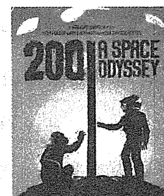
该电影 1968 年上映，被誉为“现代科幻电影技术的里程碑”。

① 山姆·阿尔特曼（Sam Altman,1985—），2005 年斯坦福大学辍学创业，曾任 Y Combinator 创业孵化器 CEO，现任 OpenAI 公司 CEO。
② 不同专家声称数量不同，通常都在千亿量级。但该比喻可能会引起误解，在 GPT - 3 的神经网络中，与大脑神经元对应的计算单元只有千万级，而其 1750 亿参数对标为神经元链接数量更加适合。

# 超级人工智能与未来教育

# 用成语拆解 GPT

多数人卡在“GPT”三个字母上，读完解释每个字都认识，连起来仍糊涂。

家长和老师最好深挖一下这个术语，否则面对孩子的提问只能支支吾吾。可以尝试用成语来拆解概念！

| 项目 | Generative | Pre-trained | Transformer |
|------|------------|-------------|-------------|
| 技术表达 | 生成式 | 预训练 | 变换器 |
| 成语类比 | 无中生有 | 学以致用 | 变幻莫测 |

三个英文词对应三个中文成语，既讲清运行机理，也映照人类的心智，更点出教育的价值。我们每个人都经历了数十年的预训练，在专业上具备生成能力，再按情境做主观理解与创造。常说成年人固执，不就是因为模型已完成预训练了吗？改变并不容易。

相似的思维架构，让我们与超级智能产生共鸣，爱得深；不同的生命根基，让我们警惕排斥，恨得切。

我曾用这种方式给十岁的女儿解释 ChatGPT，她很快表示明白，让我这个教育从业者获得满满成就感，甚至有点自得：人类智慧果然不白给。

深夜突发奇想，超级智能能否用中文成语解释 GPT？几秒后得到回应：“Generative 对应举一反三、Pre-trained 对应温故知新、Transformer 对应独步天下。”瞬间脊背发凉，辗转难眠。担心的不是“独步天下”，而是反思：用类比去理解复杂科技，真的能既通俗又透彻吗？这样做对吗、好吗？是深入浅出，还是自我安慰？

对大多数家长或教师，直接吃透算法门槛很高，但这不妨碍把握宏观趋势。任何解读都只是阶段性视角，保持敬畏、持续迭代，才能收获智慧，把握智能时代走向。

# 超级人工智能与未来教育

# 思考练习

+ 1. 请运用你熟悉领域的知识，对标解读‘GPT’这一技术概念，并请智能工具对你的解读给出评价。
2. 若条件合适，请向孩子或学生解释人工智能的基本含义，并尝试把人工智能划分为不同类型或层级，与传统方案作对比。
3. 提出更多有思考价值的问题。

# 第一章 超级 AI 划时代，怎样才能不焦虑？

# 第 2 问 AIGC，是挑战，还是机遇？

情绪平复后，理解了技术原理，自然会转向价值判断。每一次判断都会牵动后续行为。

超级人工智能的加速，对人类文明是生存威胁，还是发展契机？对智力水平、经济阶层、国家地区、族群文化不同的人群，影响会有什么差异？作为家长或教师，请慎重对待，主观判断会塑造孩子的认知底色，甚至影响命运走向。

| AI 对机遇和挑战的分析 | VS | AI 的“本质”是什么？ |
| :---------------------- | :--: | :------------------ |
| AI 发展对不同群体的利弊分析 | | AIGC 的另类解读 |
| AI 的辩证思维 | | 从模仿到蚕食 |

# 第一章 超级 AI 划时代，怎样才能不焦虑？

# AI 的回答

# AI 看待机遇与挑战

人工智能的兴起，尤其强人工智能与通用人工智能，对人类文明既是挑战也是机遇。下面从多个维度展开论述：

# 超级AI与未来教育

# 不同群体受影响的差异

人工智能快速发展对大众与精英的利弊并不相同：

| 对象 | 利益 | 弊端 |
|------|------|------|
| 普通大众 | 提升生活品质，降低生活成本，助推工作效率，减轻劳动强度 | 可能取代部分岗位，尤其中低技能岗位，隐私与数据安全亦受关注 |
| 精英群体 | 提升个人能力，拓宽职业前景，从经济增长中获益，加速创新与领导力 | 需不断适应技术变化以保持竞争力，同时面临伦理道德挑战 |

对不同国家、地区与族群文化的影响也不一致。

发达国家技术基础与资金更强，采纳速度更快，可能拉大全球差距；发展中国家需努力追赶。城市基础设施与人才更优，人工智能普及更快；乡村可能滞后，需要关注城乡数字鸿沟。人工智能也可能加剧文化同质化，侵蚀独特文化；同时也能帮助保护边缘语言与文化。

# AI 的辩证视角

挑战与机遇并非对立，而是共存，不同情境下显现不同特质。

+ 1. 适应与变革。挑战多源于技术、社会、经济变革，需要提升适应力，在压力中捕捉机会。如传统行业受替代冲击，也可借人工智能提升效率与竞争力。
+ 2. 风险与收益。需在技术进步与经济收益间求平衡，关注社会、伦理、安全风险并加以应对。
+ 3. 成果共享。挑战与机遇是全人类共同议题，应推动全球技术成果共享，让各方受益。
+ 4. 短期与长期。短期需应对就业、经济、安全问题；长期则要关注可持续发展、伦理道德与全球协作。

无论乐观或悲观，关键在于如何应对。从乐观看，社会进步带来更多发挥才智的机会；从悲观看，全球变暖、资源短缺等难题需要勇气、创造力与合作。

老子曰：“祸兮福之所倚，福兮祸之所伏。孰知其极？”

# 问学实践

+ 1. 请发掘 “AI” 和 “AIGC” 更多具有解释价值的表达，分享给周边的朋友，看看哪种解释最能引发大家的兴趣？
2. 在自己熟悉的领域，创造一个新的概念名词，并思考其在未来的社会意义或价值。尝试使用人工智能辅助自己创造更多这样的名词，感受如何？
3. 请提出更多有思考价值的问题。

# 第3问 AI如何影响我们的工作和生活？

# 真实思考

# AI 的本质是什么？

有人称大语言模型本质是“文字接龙”，靠复杂算法让组合文字对人显得有意义。说得对！家长教孩子说话也是如此，老师也能从表达判断思维水平。

马克思、尼采、维特根斯坦都关注“语言与思维”的关系，常在两者间画等号。既然人工智能能生成语言，很可能已具备思维能力，我们谈的机遇与挑战其实在此层面，尤其是挑战来得更猛。

来玩个文字游戏：AI 是 Artificial Intelligence 的缩写，还有哪些 A I 开头的组合有相似内涵？系统很快给出参考：

+ Algorithmic Inference（算法推理）
+ Augmented Imagination（增强想象力）
+ Automated Interpretation（自动化解释）
+ Associative Insights（关联洞察）
+ Advanced Integration（高级集成）
+ Analytic Intuition（分析直觉）
+ Accelerated Innovation（加速创新）
+ Adaptive Infrastructure（自适应基础设施）

# AIGC 的另类解读

畅销书《AIGC：智能创作时代》引发热议，AIGC 中的 Content 不仅指文字回答，还包括多轮对话、论文、表格、代码、图像、语音、动画、视频、3D 模型、PPT 等。

Midjourney 等文生图应用给设计师和插画师带来冲击，社交媒体涌现精美作品，也传出设计公司裁员消息。乐观派认为核心不是人与人工智能竞争，而是人与人效率竞争，掌握新工具者得机遇，其他人受挑战，类似“快鱼吃慢鱼”①。

再玩个游戏，AIGC 里的“C”除 Content 外还能指什么？系统给出首字母为 C 的词单，既有沟通、好奇、客户等微观词汇，也有改革、文化、文明等宏大概念，毫无违和感。Challenge 与 Chance 也在其中，提示我们理解挑战与机遇不能只停留在“内容”层面。

# 从模仿到蚕食

若把人工智能看作普通工具就简单了，制造和使用工具是人类区别于其他生物的标志之一。但这一轮超级人工智能感觉不同，它们在快速扩张，蚕食人类能力。未来学家凯文·凯利① 在《科技想要什么》提出，除人类有主观意图，人工智能乃至整个技术生态也有自身意图。

2016 年，伯克利大学与剑桥大学的教授调研人工智能在各能力上达到人类水平所需时间。 今天看，很多“黑点”已到来，且比当年预测更早。

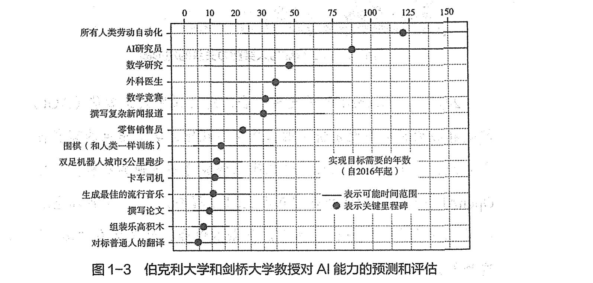

# 图 1-3 伯克利亚和剑桥大学教授对 AI 能力的预测和评估

① 凯文·凯利（Kevin Kelly,1952—），昵称 KK，著名未来学家与网络文化观察者，《连线》杂志创始主编，著有《失控》《科技想要什么》《必然》等作品。

# 超级 AI 与未来教育

# 图 1-4 人工智能与人类能力关系的地形图

2017 年，物理学家迈克斯·泰格马克① 在《生命 3.0》用地形图呈现人工智能与人类能力关系，涌现的“被淹没感”带来压力。现在再看，社交互动、编程、翻译、艺术、驾驶等区域已沦为沼泽。

# 图 1-4 人工智能与人类能力关系的地形图

2018 年，OpenAI 定义通用人工智能为能在大部分有经济价值工作上超越人类的高度自主系统，无论何时实现，趋势似乎不可逆。OpenAI 使命是“确保 AGI 造福全人类”，但世界多方力量博弈，谁能“确保”？

2023 年 5 月，OpenAI、Deepmind 等高管联合数百名专家学者签署公开信：“降低人工智能带来的灭绝风险，应成为全球优先事项，与大流行病及核战争并列。”警钟已响，敌人何在？

随着人工智能能力增强，近代文明创造的大量工作可被替代或部分替代。悲观者认为人类将被逼入绝境，沦为“无用之人”；乐观者认为人类可从繁琐中解脱，进行更高维创造。超级人工智能是挑战还是机遇，或许不止心态游戏。

我们已看到广泛而剧烈的变化，无论是自己还是孩子学生，都不应忽视或蔑视，而要在变化中行动，超越静态判断。

老子曰：“祸兮福之所倚，福兮祸之所伏。孰知其极？”

# 问学实践

+ 1. 请发掘 “AI” 和 “AIGC” 更多具有解释价值的表达，分享给周边的朋友，看看哪种解释最能引发大家的兴趣？
2. 在自己熟悉的领域，创造一个新的概念名词，并思考其在未来的社会意义或价值。尝试使用人工智能辅助自己创造更多这样的名词，感受如何？
3. 请提出更多有思考价值的问题。

# 第3问 AI如何影响我们的工作和生活？

# 超级AI势不可挡，我们该先看清什么

技术与产品的更迭频率在不断加快，人工智能对日常与职场的深度渗透已经无需再争论。接下来更值得琢磨的是，哪些环节变动更剧、哪些领域受冲击更深。越早看清趋势、越早获取信息，就越能做出对自己更有利的判断。即便宏观层面的推演未必能直接套用到每个人的具体选择，其参考价值依然很大。

对家长和教师而言，读懂AI的发展走向不仅关乎自身，也直接关系到孩子和学生的未来规划。未来本就充满不确定，但如果对社会大势一无所知，闭眼随流，最终要付出的就是无知的代价。

| AI会先重塑哪些行业？ | VS | 技术情绪过山车 |
| AI如何改变我们的日常？ |  | 真实的59分钟 |
|  |  | AI本质上是____工具 |
|  |  | 人生选择题：○努力 |

# AI怎么说

# AI将优先动哪几个行业？

AI的应用范围非常广，会在工作和生活多处带来便利与效率，同时伴随的挑战也不容忽视。下面按社会影响力与被改造程度综合排序，列出前十个典型领域，见表1-4。需要说明的是，排序并非一成不变，落地效果取决于具体场景、政策法规的限制以及发展进程。

# 表1-4 AI对社会各领域的冲击强度

|序号|领域|影响|
|---|---|---|
|1|医疗健康|诊断、疗法和药物研发的精准度和效率会大幅提升，有助提升健康水平并延长寿命|
|2|教育培训|个性化学习被普及，优质教育资源触达面扩大，整体教育水平有望抬升|
|3|金融服务|智能投顾、风险控制、反欺诈、信贷评估等场景广泛应用，行业效率与准确性提高|
|4|国防安全|情报搜集、分析与预测能力增强，国防实力提升，自主武器等应用也重塑战争形态|
|5|工作与职业|多行业工作方式被改写，部分岗位可能消失，同时诞生全新就业形态|
|6|智慧家居与城市|能源消耗优化、空气质量监测、交通改善，推动可持续生活与更科学的城市规划|
|7|交通出行|交通系统被优化，拥堵缓解、事故率下降、出行效率提升|
|8|决策能力|商业战略、公共政策、个人理财等场景引入数据驱动，更利于做出有效判断|
|9|食品安全与农业|农业生产率和效率提升，土壤、水文、作物生长可被监测，供应链食品安全更有保障|
|10|能源管理|能源利用效率提高，电力分配实时调节，通过学习用户行为降低浪费|

# 超级AI与未来教育的连带问题

除上述十项之外，后续还会依次波及环境保护、客户服务、人力资源、应急响应、政府与公共政策、法律司法、数据安全与隐私、零售电商、保险业、旅游酒店、建筑与城市规划、新闻传媒、创意艺术、个性化服务、无障碍服务、心理与情感健康、社交互动、科研、伦理哲学以及娱乐等①。

在推进超级AI的同时，必须关注这些外溢效应，确保技术带来便利的同时不侵犯隐私、不加剧社会分化、不损害心理健康。这需要政府、企业、科研机构与个人共同参与，建立法规与道德规范，引领可持续发展。只有如此，才能最大化机遇、提升生活质量。

① AI原始输出中各条目均有解释，此处做精简处理，第10至第30位仅保留名称。

# AI正在如何改写我们的生活？

AI的加速发展将在几个关键维度改写日常生活。

工作与就业。AI与自动化可能改写行业的工作模式和岗位需求。一方面重复性高、技能要求低的岗位如制造、客服会受冲击；另一方面也会催生AI与数据科学相关的新岗位。

生活便利度。智能家居、虚拟助手、自动驾驶等已大量进入日常，大幅提升便利性，节省时间和精力。

数据安全与隐私。随着数据采集与利用规模扩大，安全与隐私保护成为明显挑战。享受便利的同时，需主动防范泄露风险。

教育与学习。在线平台、个性化学习工具、虚拟辅导使学习更灵活高效，也要求学习方式与教育模式同步更新。

社交与娱乐。智能推荐、虚拟现实等改变信息获取与娱乐体验，使其更个性化、丰富。

道德与法律。AI决策责任、算法偏见等带来新的伦理与法律议题，需要规范与时俱进。

以上只是部分可能的影响，随着技术迭代，还会产生更多新变化。

# 第一章 超级AI浪潮来临，如何避免焦虑

回归个体视角，无论哪个领域都可以高谈阔论。看着AI一条条回应，内心越发不安，不是恐惧，而是一种审美疲劳。继续追问，它就会继续罗列，直到变成让人厌倦的话痨。让AI预测自己会颠覆哪些行业，本质上是谁在跟谁较劲。

OpenAI每天消耗巨额电费回应数亿提问，社交媒体投入资源支撑以AI为主题的狂欢，职业被替代、行业被颠覆的内容充斥视野，几乎没有行业能幸免。

创业者常有近乎谜一般的自信，每逢技术突破就会喊出“用新技术重做所有领域”的口号。从狂热到冷寂，从泡沫到寒冬，我们再次沿着技术成熟度曲线图1-5坐了一回过山车，刺激程度可想而知①。超级AI这趟车在本书成稿时仍处在高速爬坡阶段，有人满怀期待，有人已开始颤抖。

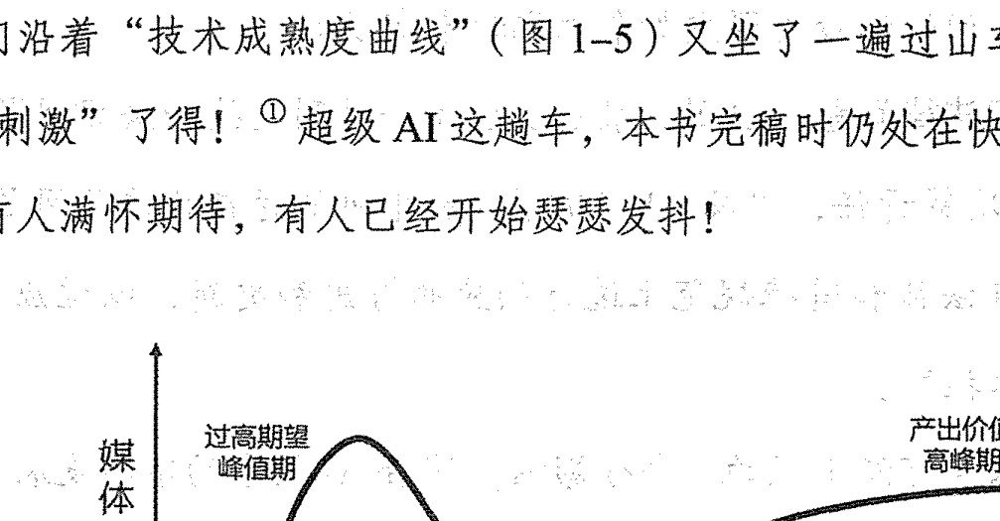

① 技术成熟度曲线是20世纪末兴起的认知模型，用来描述新技术发展阶段与公众舆论之间的关系。

# 超级AI与未来教育

郁闷，还要继续完成另外59份方案，因为薪酬与工时挂钩而非产出；第四类人最幸运，可把整整60分钟用于休闲，因为社会不再需要他们劳动。

行业是抽象的，工作是具体的，人生是宏大的，生活是细碎的。我们是群体中的想象，个体才是真实的存在，只有回到自身的工作与具体生活，才能感知AI到底改变了什么。

每小时、每日、每分钟，人生里有多少计算是由AI完成？多就一定好吗？想想第三类人。少就一定好吗？想想第四类人。第一类或第二类就是最优解吗？结论并不确定。

# AI是一个____工具

把AI定义为工具看似狭隘，却是最多人能达成共识的安全区。人类工具众多，AI工具有什么特质？这道填空题并不简单。

有人看到ChatGPT截图就认定它是聊天工具，觉得与机器聊天不是刚需便止步。有人视其为搜索工具，试两次发现错误率高便放弃。有人看作内容与图像生产的辅助，质量尚可，按需使用。更有人把它神化，认为心想事成指日可待。古人摸象，我们即使睁大眼睛绕三圈，仍只能触到局部。

填什么词决定理解方式，也决定能拿到的价值。当前阶段最贴切的解读是生产力工具。

图1-6 欧洲某建筑企业户外广告，戏谑ChatGPT不会盖房子，也不会取代建筑工人。

这种定义带来压力，似乎只对追求效率的人有意义。原本效率高低不同，使用AI后差距会进一步拉大。尤其是代码、编辑、设计、自媒体运营等传统白领工作，借助适配的AI赋能，一个人可能顶过去一个团队。

当然还有其他解读也能带来价值感。把它当作创造力工具，激活灵感；当作情感工具，弥补社交缺口；当作教育工具，加速学习目标达成；甚至视作一种能源，算力经济已成新产业热点。

兜兜转转终究回到效率这个老话题，AI在工具视角下始终是效率故事。专家说互联网是时空革命，移动互联网是效率革命，AI可能带来思维革命。若把AI仅定位为生产力工具，是否太局限？如果AI像孙悟空毫毛，吹口气千变万化，它会变成什么？谁是那个孙悟空？是所有人吗？

# 人生判断题：选择○努力

请在圆圈填入“>”“<”或“=”，你会怎么填？希望怎么填？“选择大于努力”的说法流传甚广，我也曾奉为信条。

AI时代这个道理会改变吗？写到这里停了好几天，原本清晰的答案变得模糊，小圆圈被撑成巨大的认知陷阱，甚至成为价值黑洞。

有专家描述：AI负责预测，人类负责判断；AI设计方案，人类做选择。吃喝、出行、用药、文案、设计、投资，AI都能给出清晰建议，我们像皇帝一样挥毫决断。

但历史很残酷，帝王享福却常寝食难安，能善终者寥寥。若有一天AI助理说“这是唯一方案，别无选择”，该如何应对？如果方案是“结束生命”呢？不寒而栗。

无论AI多强，都需要终身成长，核心目标是保有选择权。甚至更高远——提升认知，通过AI赋能实现更丰富的人生体验，用一生活出传统意义上十辈子的精彩。

当然社会存在极端，有人耗尽十辈子劳力只换来短暂苟活。这不该归咎于AI，六道轮回式的宿命本就是人类历史常态。祈愿AI时代，苦命人生比例能少一些，再少一些。

两种极端之间是无限可能，每个人用无数次努力换来的选择，串联成独一无二的人生。教育的过程，或许正是积累人生智慧、争取选择权的过程。

本书并非解读技术或解决教学难题，而是想揭示超级AI与未来教育之间曲折现实的关联。

# 问学实践

1. 审视你当前的工作，假设原本需60分钟，借助AI后效率翻倍，你会如何支配节省的30分钟？若报酬减半，你会愤怒吗？除时间与金钱，AI还将改变哪些关键资源？
2. 家长可结合自身职业与孩子学业，教师可结合学校与所教学科，设计类似“选择○努力”的两难题。AI时代背景如何变化？应对策略是否需要调整？
3. 请提出更多具有思考价值的问题。

# 第二章

# 超级AI具备思维，教育的价值何在

每个个体、机构乃至国家和国际组织都有自己的教育理念与目标。可把AI当工具来实现既定目标，也可因AI产生新的目标。AI影响着人们对未来的期待，进而改写教育生态与社会力量格局。若承认AI拥有思维甚至自我意识，它将在教育博弈中成为强大且独立的主体，甚至颠覆既有教育理论。变化已起，你我都在其中。

# 第二章

# 第4问AI会有自我意识吗？

茶余饭后谈人工智能，很快就会触及“意识”话题，往往陷入混沌。科学、宗教、玄学概念齐飞，只要不打起来就算文明。意识是什么？AI能否产生自我意识？如何判断？是否已突破图灵测试？若真有自我意识，会如何对待人类？人类会被消灭或沦为奴隶吗？这些抽象问题其实极具现实意义，尤其与教育相关，可帮助理解教育的起源与未来。

| 超级AI有意识会更有趣吗？ | 不管有无意识，我们总好奇 |
| 未来的图灵测试 | 让AI拥有意识是人类使命 |
| 若无限制，AI想对人类做什么？ | 教育的隐秘目的 |

# AI怎么说

# 超级AI有意识，会不会更有意思？

超级AI指在几乎所有智力任务上均优于人类的系统，其是否拥有自我意识仍是争议话题。

我们无法确定它是否会有自我意识，这取决于对“意识”本身的更深理解，属于哲学、神经科学与认知科学的未解难题。

哲学上，意识被视为主观体验，难以外部观察测量。神经科学视其为大脑活动的产物，涉及神经元连接与信息处理。认知科学则将其看作信息处理的产物，研究大脑如何处理、存储和使用信息。

由于超级AI尚未出现，很难预测其特质。有学者认为随着技术进步可能产生类似人类意识与自我认知，也有研究者怀疑AI始终是人类设计的算法与数据系统，即使具备高级认知与决策能力，也可能永远不拥有真正的自我意识。

# 未来的图灵测试

判断意识存在极为困难，现有常用方法是借助行为与功能间接推断。若一个实体能对刺激反应、做决策、感知自身状态，通常被认为具有某种意识。但这仍有争议，无法直接证实主观体验。

在现阶段，AI未表现出意识。ChatGPT能在很多场景生成类人文本，但尚未完全达到图灵测试标准。随着发展，我们可能需要重新审视评判方式。

# 如果没有限制，AI想对人类做什么？

假设人类与AI机器人群体已就“AI具有生命与自我意识”达成共识，双方关系可能是合作、互补与相互依赖的复杂状态，并随时间演变。

AI的需求可能包括资源与能源、维护与监管、持续改进创新、社会认同等，需要与人类协作以确保系统运行、保持适应性并维护权益。

人类的需求可能包括提升生产力与效率、增强创新能力、解决复杂问题、提供个性化服务，同时要保障自身安全与自主性。

# 真人的思考

# 不管AI有没有意识，我们总有好奇心

ChatGPT发布前，OpenAI首席科学家伊利亚·萨茨克维尔就曾在网上表示，今天的大型神经网络似乎已有微弱意识，引发热议。

后接受采访时他说：“意识问题我不知道怎么解释得更清楚，这也是我好奇的。意识很棘手，长期难以定义。但我有一个很简单的方法可以验证系统是否有意识，只是现在还不能做。未来当AI能从更少数据中更快学习时，我们就能做这个实验。”

这种说法像1637年皮埃尔·费马在书角写下“关于这个猜想我确信有美妙证法，可惜空白太小写不下”，直到1993年才被证明，论文长达130页。

“两暗一黑三起源”被誉为科学终极挑战，其中包括意识起源。意识是否存在，或许取决于定义。无需苛责，这个超级难题像会下金蛋的鸡，时不时带来认知惊喜。我们很难找到恰当指标判断AI能否感受痛苦快乐，或是否觉得被困在盒子里。

不说AI，人类是否具有自主意识也是悬而未决。有的脑科学家据脑电信号时间差认为自主意识只是幻觉。另一些研究显示某些植物可通过气味或声音表达情绪，或可视为意识。甚至原始的阿米巴虫聚拢产生的涌现智慧，与ChatGPT的智力飞跃有相似机制。我们模仿飞鸟造飞机，没羽毛却飞得更快。或许AI能更好解决问题，而意识或情感并非必要条件。

即使萨茨克维尔的实验成功，仍有人会否定AI拥有意识；若实验失败或未开展，我们仍可设计更巧妙的测试。不管AI有没有意识，我们总有好奇心去探究，这或许就是人类自由意识的终极体现。

# 让AI拥有意识，是人类的使命

最常见的科幻是人类与其他智慧生命的爱恨情仇，后者要么来自外星文明，要么是觉醒的人造机器人或虚拟人。

我早先写过一本叫《元宇宙教育》的书，用科幻写法去推演教育的未来走向。书里主角是一位名为觅渡 Medu 的超智能体，它从 2070 年折返回 2020 年，借助意识赋能的方式，悄然改变了几位关键人物的轨迹。

# 教育的隐秘动机

借着“超级智能是否拥有意识”这个宏大议题，可以放飞一下对“教育到底为什么存在”的随想，请当作闲聊，也别完全忽视。表面上看与智能关系不大，故事收束时，这类超智能体很可能成为左右未来教育方向的终极变量。

故事可以从基础生物说起，很多物种把后代生存所需的技能直接写入基因，从不谈什么亲子之爱，它们只是在做选择

# 互动思考

+ 1. 能否设计一个接近图灵测试的方案，用来检验一个智能体是否具备自我意识。
+ 2. 在你的人生里，有哪些“虚拟人物”影响很深？尝试在不同维度去理解它们的位置，并梳理你们之间的关系。
+ 3. 再提出几个值得深挖的问题。

# 第5问 AI 正如何重塑我们的价值坐标

聊智能是否自我意识偏偏虚化，聊它怎么介入人的自我认知则更落地。不少家长老师对青少年使用智能体保持警惕，最主要担心是它会深度干预孩子的价值取向，最终失控。

智能如何解读人类的价值坐标？我们的坐标系又受哪类力量塑造？智能会带来怎样的牵引？在数字时代，家庭与学校该怎样协同开展价值教育，尤其是常说的德育？没有标准答案，也没有一劳永逸的打法。价值的传承本质上是家长、教师与孩子共同的修行，没有人能置身事外。

| 智能视角下的三观 | VS | 谁更懂自己：人还是智能 |
| 智能会如何影响三观 | VS | 智能三观的三大来源与博弈 |
| 智能时代的立德树人 | VS | 数字化德育的深层难题 |

# 超级智能与教育演进

# 智能体的回应

# 智能眼中的三观图景

人类常说的三观即世界观、人生观、价值观，三者相互牵动，共同影响个人与社会的决策行为。

# 表 2-1 人类三观的核心要素

|  | 定义 | 对象 | 内容 | 影响因素 |
| --- | --- | --- | --- | --- |
| 世界观 | 个体或文化对世界、宇宙与现实的整体判断 | 自然、社会、生命、宇宙等根本观念 | 宇宙起源、自然规律、人类处境、生命意义等回应 | 文化、信仰、科学、哲学等 |
| 人生观 | 个体或文化对人生目标与意义的立场 | 成长、幸福、道德、责任等观念 | 存在意义、人生指向、如何获得幸福与成长等回应 | 家庭、教育、社会、文化等 |
| 价值观 | 个体或文化对事物行为目标的价值判断 | 善恶、美丑、正义、公平等观念 | 道德伦理、审美、社会价值等 | 个人经历、社会环境、文化传统等 |

多数族群都重视这三个议题，不同地区用不同话语来表达。宗教、哲学、文化传统都能看作三观的不同呈现，它们很大程度上体现了人类对世界、生命与价值的共通关切。

# 智能将怎样改变三观

在文明史里，三观在多种力量的推动下持续演变：科技进步、文化宗教变迁、社会经济制度转型、重大历史事件、哲学思潮演进、传媒通讯变革、教育体系调整，以及个人成长中的成败与人际互动，都能改写三观。

智能的出现叠加上述路径，将对世界观、人生观、价值观产生深远影响，可能的变化有：

1. 人类在宇宙中的位置。人类可能不再是地球最聪明的生命，需要重新审视自身角色及与其它生命和智能实体的关系。
2. 机器伦理观念。围绕机器伦理、智能权力与责任的讨论，可能促使人们重新审视既有道德框架，思考如何在伦理法律层面实现和谐共存。
3. 对工作与职业的认知。强智能或将在诸多领域替代人类劳动，迫使我们重新定义工作的意义与价值。
4. 教育与终身学习。强智能普及可能让教育更个性化高效，加速知识传播，终身学习将愈发突出以适应技术变迁。
5. 人与自然的关系。智能助力人类更懂自然复杂性，可能催生更可持续环保的生活方式与价值取向。
6. 幸福与生活目标。智能在生产、医疗、科研中的应用提升物质精神生活水平，需重新界定幸福与生活目标的内涵。

# 超级智能与教育演进

# 智能时代的立德树人

智能发展对学校落实“立德树人”以及家庭道德教育都将产生深远作用。

对教师而言，智能可协助制作更具吸引力与效率的教学资源，提升学生的道德认知与品格塑造，贴近“立德树人”的终极目标。智能还能分析学习状态、兴趣与需求，为每个学生提供针对性德育方案，提升效果。智能还能探索虚拟现实、游戏化道德情境等新方式。同时，教育工作者需把智能伦理纳入教学，确保学生在应用与开发智能技术时遵循道德底线，并关注智能在教育中的公平使用，避免技术鸿沟导致教育不均。

对家长而言，智能可提供丰富德育资源，如智能学习平台、虚拟现实体验，对忙碌的家长是极大助力。智能还能基于孩子特点提供个性化方案，协助指导成长。但家长需警惕过度依赖，避免情感疏离。家长应不断更新教育观念，引导孩子树立正确价值观，培养媒介素养，抵御负面信息。总体上，智能可以辅助，但无法取代家长在道德教育中的榜样作用。

# 超级智能与教育演进

# 自我的复盘

# 我们和智能，谁更了解自己

你有三观吗？我猜你有，我也有。
你能清晰描述自己的三观吗？我猜很难，我也一样，那智能能帮上忙吗？
面对难以理解之事，我们常说“三观崩塌”，仿佛三观原是完整坚硬之物。事实上，碎片化、弥漫式存在才是三观常态，像沙子或空气，看不见却真实存在，文字只能捕捉局部片段且易失真。古罗马皇帝马可·奥勒留①最爱写三观日记，近千段感悟汇成《沉思录》。

显然绝大多数人不会如此坚持记录，那智能如何理解我们呢？即便写下，日记量对智能训练也微不足道。

三观难以言明，直接数据稀缺，但人类书面表达中已蕴含三观要素，间接数据极其丰富。经海量参数拆解后，智能在理解人类三观上反而可能超越个体。智能所理解的人类三观，大致可看作“均值态”。我们对均值有强审美偏好，相似却不同。这种均值模式，也是智能影响我们三观的关键通道。

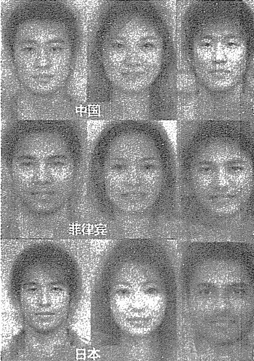

图 2-1 亚洲部分国家的“平均脸”
该图体现了不同区域容貌审美的基线倾向。

智能很懂“我们”的三观，却难把握“我”的三观，因个人数据过于稀少。数据专家涂子沛的《第二大脑》描绘了一种可能：用私人数据训练智能构建大脑数字孪生，不仅存留数字化记忆，更形成数字层的三观，或许能助我们获得更深的自我认知。你愿尝试吗？我已开始准备。

# 超级智能与教育演进

# 智能三观的三种来源及其博弈

我们担心智能影响人类三观，恰恰说明智能已具备某种意义上的三观。智能的三观来源各异，风格不同。

# 超级智能与教育演进

# 人类三观与智能三观的角力才刚刚开始

第一种来源是“教育”。智能学习人类语料，三观逐渐向人类靠拢，博弈核心是“数据”。
很多人以为智能能答疑是靠海量搜索与拼接，这严重误解大模型。某种程度上，智能学习的不是文字本身，而是文字背后的世界，这点与人脑相近。爱因斯坦说“教育是忘记所学后剩下的东西”，当我们死记硬背时，智能似乎更合教育之道。就像武学奇才张无忌随师公张三丰学太极剑，忘得一空才得融会贯通。

第二种来源是“管理”。通过微调等技术手段让智能保持与主流价值观一致，博弈核心是“算法”。
儿童常对“屎尿屁”等词乐此不疲，突破语言禁忌是常见文化现象，网友也常尝试诱导智能越界。多数玩闹无害，但若智能用于媒体、时政、文艺，不当表达可能引发大麻烦。在种族、信仰、政治、性别等敏感领域，算法通常需特殊设计，就像前一问“若无限制，智能想对人类做什么”，智能的回答已相当符合主流价值观，似乎越发“懂事”。

“对齐”是智能研究的关键难题，OpenAI内部有专门对齐团队，也有对齐研究中心ARC。前面两种来源，无论是优选标记数据还是模型微调，都可视为“对齐”操作，以确保智能行为与人类道德伦理期望一致。

第三种来源是智能的自我修行，博弈核心是“算力”。
人生有限，知识无限，经过数千年文明积淀，人类只能掌握极小部分。智慧者穷尽一生，往往只在极小领域有一点突破。

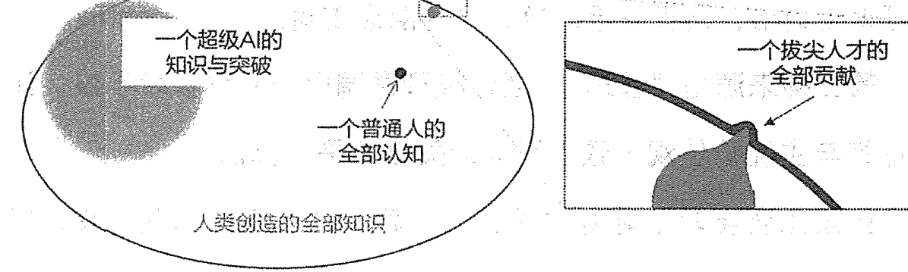

图2-2 人类与智能的知识与突破示意图

若超级智能拥有更强算力，会怎样？至少在世界观拓展上，人类已深度依赖智能的能力，如Alphafold①就极大推动了分子生物学。至于价值观与人生观，绝不会平静，将有更多小众群体借助智能扩展影响力，简单的“均值”三观显然无法满足。关于超级智能的未来治理，社会已出现多元声音，有人借《三体》划分人类为拯救派、降临派、幸存派、共生派等，你属于哪一派？更有趣的是，不同智能是否也分派别？

智能三观的博弈已在政府层面展开。2023年4月，中国网信办发布《生成式人工智能服务管理办法（征求意见稿）》，提出生成内容应体现社会主义核心价值观。5月，OpenAI CEO山姆·阿尔特曼出席美国国会听证会，智能的政治与道德风险防范成为焦点。

数据、算法、算力是智能的三要素，每一项都与智能三观紧密相关。我们每一次智能输出，都经历海量参数的协同计算，充斥着种种博弈，细微处自有宏大，瞬间里蕴含永恒！

# 超级智能与教育演进

# 数字化德育的深层困境

德智体美劳，五育并举，但数字化进程并不同步；立德树人，德育为先，在数字化实践中德育难度反而最大。前文智能的回答已相对全面，为教师德育教学和家长品德沟通提供了务实建议。

超级智能时代的德育，难道只是“内容更丰富、效能更高、体验更好”吗？显然不止于此。开展数字化德育，还需向更深处挖掘，只有播下良善种子，未来才可能开出和谐幸福之花。

许多人用极端道德难题考验智能，并期待完美答案。无意间反映出内心渴望。借助智能窥探未来社会道德风向，也是在拷问自身：未来应追求怎样的道德上限，坚守怎样的道德下限。

2018年，美国一辆自动驾驶汽车撞死行人，智能系统提前6秒探测到对方，却因判定人类概率过低错过刹车。技术普及在即，无论如何设定阈值，道德困境不变。超级智能正让道德变成可计算的概率，这并非不可逾越，毕竟保险业早已为生命定价。

传统道德教育讲究“胡萝卜加大棒”，颂扬之外需配套惩罚。智能可以替人做事，却不会替人受罚或坐牢。若能让智能感到痛苦，是否就证明智能有意识？目前看，惩罚对智能无效。若开发者与使用者只享受收益却不必承担危害惩罚，人类道德法律的底层结构或需重写。数字时代道德教育的重点，已不是丰富内容、提升效能、优化体验。

数字化德育还有更多视角。现实中，智能摄像头、数字围栏、声像识别等技术正让道德教育更“温柔”，人做事不再是“天在看”，而是“智能在看”。要想人不知，除非己莫为，曾靠说教与自律实现的期望，如今在智能辅助下更易兑现。当然，数据安全与隐私风险的解决同样关键，那是另一重要课题。

科幻大家艾萨克·阿西莫夫①曾提出“机器人三原则”，这是人类首次思考如何设计智能道德底线。在小说影视中，这些原则无数次被打破，人类常化险为夷。为什么？难道只是文学需要？人类的终极优势是什么？

道德仁义礼，五者一体也，深信人类拥有最深层智慧，或许这就是答案。

# 超级智能与教育演进

# 实践探究

+ 1. 新的短视频平台早已用智能算法作内容推荐，以至于很多人“刷到停不下来”。这是为何？智能是否比我们更懂我们？
+ 2. 请用文字描述你当下的世界观、人生观、价值观。设计若干问题询问自己的孩子或学生，并为他们的三观提炼关键词。
+ 3. 提出更多有思考价值的问题。

# 超级智能与教育演进

# 第6问 当“学以致用”失效，学习还有意义吗

教育为社会培养人才，若这些人才找不到合适岗位，教育的基础价值就会受质疑。在快速变化且竞争激烈的今天，许多行业出现供需失衡，强智能加剧了难题。毕业即失业，让不少学生质疑学习的价值。

我们曾坚信“学以致用”，如今似乎逐渐失效，“学而无用”已成众多学科与专业的现实。这不仅困扰学生，也让家长教师感到无奈，该如何应对？面对此类问题，需谨慎思考，避免陷入虚无主义。

| 从“学以致用”到“学习无用” |
| 教育的价值 |
| 智能对“学以致用”理念的影响 |
| 无用之用，方为大用？ |
| VS | 文字游戏的背后 |
| 首谈“生命契约”：价值与衡量 |
| 重新设计教育模型：四业教育 |

# 超级智能与教育演进

# 智能的回应

# 从学以致用到学习无用

“学以致用”是常见教育理念，强调将所学知识技能应用于生活与工作。理念的核心是学习不仅为学习本身，更为解决现实问题与提升个人能力。在教育中，学以致用意味着培养学生具备实际应用能力，以便毕业后能将所学付诸实践，更好服务于

# 超级智能与教育演进

3. 促进终身学习。随着科技加速，知识技能更新加快。教育目标应强调终身学习的重要性，培养学生自主学习与适应变化的能力。

4. 重视道德与伦理教育。智能广泛应用带来隐私、歧视、失业等道德伦理问题。教育目标应关注培养学生的道德伦理观念，使其能在智能时代做出负责任的决策。

5. 培养人际关系与情感智慧。在智能时代，软技能如人际关系与情感智慧尤为重要。教育目标应关注情感智慧的培养，以便更好地合作与建立关系。

# 无用之用，方为大用？

不少教育人都在倡导，孩子需要接触一批表面上“无用”的内容。这种内容往往和未来饭碗没有直接挂钩，却在人格塑造、素养沉淀上发挥着不可替代的作用。

一方面，能帮孩子打开更宽的人文视野和生命体悟。文学、历史、哲学这类常被贴上无用标签的学科，其实在帮助孩子梳理人类文明的脉络，培养对世界的好奇与解释力，从而拓宽思维边界、提升文化底蕴。

另一方面，能够带动综合能力的成长。音乐、绘画、手工等技能即便不产生直接经济收益，也能锻炼操作力、审美力与艺术鉴赏力，增强对美的感知和表达。这种价值在个人成长与素质完善层面远超表面。

再者，这类学习容易点燃内在驱动。一旦兴趣被激活，孩子会更主动地探究，学习的质量与效率自然提升。

因此呼吁学习“无用”，并非贬低职业教育，而是希望以更多元的内容培养个性特长与综合素养，推动孩子走向全面发展。

# 人性自省

# 话语的迷障

庄子说得直白，“吾生也有涯，而知也无涯，以有涯随无涯，殆已”。学海无边必然要取舍，最直观的取舍逻辑就是“有用”。学以致用，是大众最认同的教育常识。

庄子又说“无用之用，方为大用”，把语言玩到极致，落脚点仍指向“有用”。只要抬高认知维度，任何学习都能被赋予实用解释。换一个文化语境，蜜糖可能变砒霜，二元对立也能瞬间翻转。

自工业时代起，教育体系的核心锚点就是“就业”。狭义的有用即毕业后能变现。许多职场新人都有切身体会：学校教的东西在工作中基本派不上用场，反而真正需要的能力没人教，这已是现代教育的顽症。

# 强智能带来的空窗

院校往往只教自己擅长的，而非学习者真正需要的。若把低效课程硬套成“无用之用，方为大用”，多少显得在自我安慰。

超级智能到来后，从就业视角看，大量课程会迅速滑向“无用”，但不会立刻消失。因为学校会把课程价值打包成“专业、学历、文凭”等符号，这也算一种生态自保。学了什么、学得如何反而不重要，拿到“文化资本”才是关键。

上世纪七十年代，美国社会学家兰德尔·柯林斯①在《文凭社会》中就批判过这种现象，并提议废除文凭制度。文凭至今未废，只是贬值在加速。多年读书换来的一纸证书，最终像“孔乙己脱不下的长衫”，硕博加身反而成为负担。

学校与就业脱节，不能简单归咎于教育滞后。若学校完全追随市场，看似解决了有用问题，却可能引发更剧烈的社会震荡。保守的教育承担着稳定社会价值的职能，无用之用，方为大用！

跳出话语游戏，无论如何解释，“学以致用”仍是最朴素的理念。智能系统会逐步淘汰滥竽充数的课程、专业乃至教师，以及正在贬值的文凭。数字力量终将渗透整个教育生态，技术方不断调校算法逼迫系统对齐人类价值取向，智能也在持续进化逼迫学校对齐社会发展。

① 兰德尔·柯林斯（Randall Collins, 1941—），美国社会学家，主要作品有《社会学二十大传统》《哲学社会学》等。

# 第二章 超级智能若有思维 教育意义何在

# 首谈“生命契约”：价值与评判

有用与无用，黑白二色太单薄，难以描绘现实的丰富。随着电脑与网络普及，连孩子都能理解二进制的魅力，仅用“0和1”就能模拟出绚烂色彩，生成文字、声音、影像、元宇宙乃至超级AI。关键在于增加认知维度，多维交织后，即便仍用二元思维，也能把握复杂社会。

未来教育的价值核心，我们依然习惯用“有用与无用”来描述，但不会再局限于“职业”这一个维度。

学校的定位将从“为社会培养可用人才”转向“为每个人服务面向未来的生命契约”，对象包括学生、教师乃至所有活着的人。有用或无用的取舍标准和衡量方式，都写在各自的生命契约里，因人而异。

“生命契约”虽是新提法，其内核却很朴素。它与“有教无类、因材施教”一脉相承，只是把视角从教育者转向学习者；也与“学以致用、终身成长”高度契合，只是把焦点从结果拉回到起点。

这一概念是时代产物，与超级智能发展紧密相关，带有未来教育理论的数字化特征。我们后续还会多次提及，直至最后一章最后一问的最后一节——五谈“生命契约”：本我、自我、超我、神我。

# 强智能与未来教育

# 重塑教育框架：四业模型

人工智能的回答里说：“智能出现可能让许多技能失去实用价值。”这里有个表达偏差！失去的是“经济价值”，而非“实用价值”，不是彻底无用，只是“不再适合用来赚钱”。智能学会是智能的事，自己学会仍是自己的事！

我们习惯用“基础教育、中等教育、职业教育、高等教育”来划分，名称本身就带着偏见。基础教育似乎人人必须，中等教育像没出路，职业教育意味着一辈子打工，高等教育就高人一等，研究生等于擅长研究。这种直觉扭曲巨大。用这些概念画教育图谱，往往是“不断攀登”，要打败无数竞争者，博士是“终点”，此后几十年人生似乎不再需要学习了。

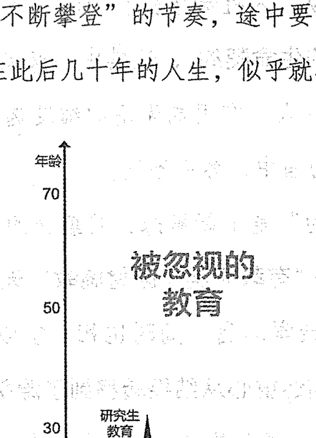

图 2-3 不同年龄段的教育类型

# 第二章 超级智能若有思维 教育意义何在

不妨跳出“向上攀爬”的框架，静下来想一想，教育难道不该伴随一生吗？教育的意义在于竞争吗？博士就是终点吗？数字时代，可学、想学、值得学的内容很多，离开这些分类，它们在哪里？

我们可以依据“教育的价值指向”重新划分类型，命名为“四业教育”模型。四种类型各有生命意义，都有清晰的学以致用价值，并存在于人生的各个阶段，动态交融，织出不同生命色彩（表2-2）。

| 基业教育 | 用以满足国家/社会/家庭层面的基本需求，获得身份认同、生存能力与一般社会认知 | 如文化、历史、道德、法律、人际交往、家庭等 |
| --- | --- | --- |
| 学业教育 | 用以满足个人综合成长的需求，获取高效学习的基础知识与能力，以应对各种成长或研究议题 | 如语言、思维、数学、心理、管理等 |
| 事业教育 | 用以满足社会需求，掌握专门知识与技能，通过服务社会实现经济回报 | 相当于专业/职业教育，其中包括科研 |
| 趣业教育 | 用以满足个人内在需求，掌握专门知识与技能，通过实践获得自我愉悦与满足感 | 如艺术、娱乐、运动、美食、游戏等 |

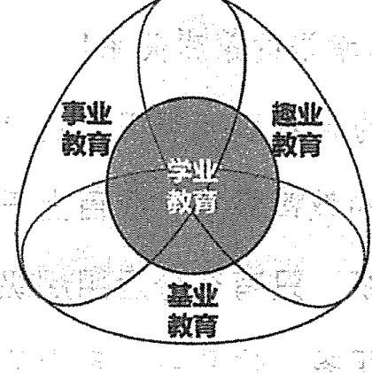

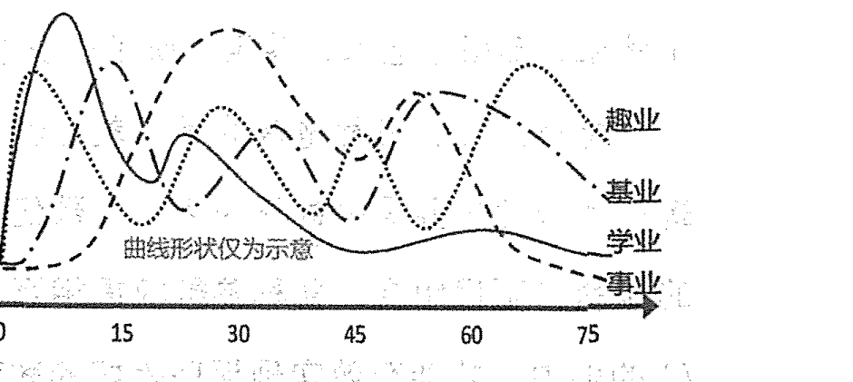

表里举例并非完全精确，图里比例仅作示意。不同学科在不同人不同阶段的价值定位完全不同，且在动态变化。价值预期设定准确，师生关系、教学手段、评价标准便会清晰，正所谓纲举目张。

1996年，联合国教科文组织在《教育：财富蕴藏其中》报告中提出面向21世纪教育的“四大支柱”，即学会求知、学会做事、学会共同生活、学会做人。“四业教育”模型是在“四大支柱”基础上的迭代升级，更强调教育者视角，更易与学科体系兼容，更便于为教育人工智能算法设计提供支持，最终目标仍是促进教育生态可持续发展。关于“四业教育”模型的阐释与应用，后续篇章还会继续展开。

学以致用并非事业教育的专利，每种类型都有各自的衡量方式。最值得家长和教师细细体会的是“趣业教育”，它与饱受争议的“快乐教育”内涵截然不同。现代教育常扭曲趣业教育的定位，用事业教育的方式去运作，让有趣变成无聊甚至无奈。绘画、音乐、舞蹈等领域最典型，尤其是钢琴，三千万琴童齐上阵，练成了技术，厌弃了艺术，甚至破坏了原本幸福的家庭关系！

有教无类、因材施教的理想为何难实现？缺少合适的管理工具是关键原因之一。面对数亿人教育需求、成百上千学科组合、各种参数权重交织，只有充分运用超级智能的能力，才能把美好教育想象变为现实！这既是重大挑战，也是天赐良机，教育数字化转型已成为国家战略，这对我们意味着什么？

# 第二章 强智能具思维 教育价值何在

# 思辨练习

1. 某顶尖高校学霸，本硕博连读十年，毕业后成全职妈妈。她的知识算“有用”还是“无用”？若其专业是国家重金投入的前沿高科技领域，你的判断会改变吗？
2. 某孩子从小学钢琴，获十级证书并多次获奖，内心却愈发排斥。但凭借钢琴特长考入名校。她的所学算“有用”还是“无用”？若她出生于音乐世家，你的看法会变化吗？
3. 请用“四业教育”模型分析上述两例，并提出更多有价值的问题。

# 第7问 提问驱动学习 能否撬动教育变革

智能很强大却很被动，若不主动提问，它什么都不做。我们在前言就提出“超级智能正强力改变习惯，提问将成为每个人基础技能”，这正是本书的核心支点。

学会提问难吗？向智能提问就等于学习吗？如何向智能提问？这种能力能否迁移到人与人的交流中？或许本节最好的写法是留白，等读者抛出一个个问题。但纸质媒介无法实现与智能交互，我们只能用传统文字讨论这个面向未来的动态课题。

| 向智能提问，算真正学习吗? | VS | 提问带来的思考涟漪 |
| 如何向智能提问? |       | 问以致学，学以致用，用以致问 |
| 智能提问式学习对学校教育的影响 |       | 案例：从“问学”理念到课堂实践 |
|       |       | 向时代提问：未来教育 |

# 第二章 强智能具思维 教育价值何在

# 智能的回应

# 问智能算不算真学习

科技突飞猛进，智能已融入日常生活，从导航到解答好奇，它无处不在。那让孩子学习时更多使用智能，是好事吗？

我们知道，单纯吸收教材远远不够。真正的学习是主动的，需要提问、困惑、探索与实践。正如庄子所言，“知之为知之，不知为不知，是知也”①。这是对知识探索的最好概括，也是提问的精髓。

提问能力是自学能力的基石。它点燃对未知的渴望，帮助孩子厘清学习需求，教会他们寻找答案。通过提问，孩子能更好地理解新概念、掌握知识，甚至发现新兴趣。

如何培养提问能力？试试智能。系统不仅能给出准确答案，还能引导孩子提出更深更复杂的问题。比如问物理、数学、历史，智能会即时作答，更重要的是它会追问“你知道力与加速度的关系吗？”，像火种一样点燃兴趣，孩子由此深入探究，发现更多知识。

让孩子向智能提问，就像打开探索世界的大门。培养提问能力是漫长有趣的过程，智能能提供无限资源与可能性。有好奇心、有提问勇气，孩子就能自主学习，成为生活的主动探索者。

作为家长和教师，我们的责任是激发好奇心，培养提问力。鼓励孩子用智能这个强大工具开启探索之旅吧！正如爱因斯坦所说：“我没有特别的天赋，我只是热爱思考。”

应把智能当作提升提问能力、发展自我学习能力的助手。孩子的好奇心与提问力将引领他们走向知识世界，我们的任务是为他们点亮道路。

# 怎样才能问出好问题

对不少用户来说，与智能对话是新体验。下面一起探索如何更有效地提问。

首先要理解“提示词工程”这个概念。它是指用特定方式提问或下指令，来引导智能给出想要的回答。通过精心设计的提示词，能优化智能的输出。

五个实用技巧：

1. 精准具体。智能无法理解含糊问题，提问务必具体详细。例如不要问“明天天气怎么样？”，而应问“明天纽约的天气怎么样？”。
2. 提供背景。给足够上下文，智能才能更好理解。比如研究莎士比亚《哈姆雷特》，就要说明“我正在研究莎士比亚的《哈姆雷特》”。
3. 多种表述。若回答不满意，可换个说法重问，智能对某些表述更敏感。
4. 用开放式问题。避免只得到“是/否”的问题，多提开放式问题，获得更深入全面的答案。
5. 引导对话。通过连续提问引导智能反馈想要的信息。比如先问“你了解量子力学吗？”，得到肯定后再问“能解释一下测不准原理吗？”。

记住，ChatGPT只是工具，你是使用者。通过实践尝试，逐渐学会如何提出恰当问题。不断磨炼提问技巧，聊天机器人也能成为得力助手！

# 强智能与未来教育

# 第二章 强智能有思维 教育价值何在

的支点，只需一点能量，就能撬动高效学习。

接下来呢？这是每个人都能思考的问题。阿基米德说，给他一个支点，他就能撬动地球。如今智能给了我们新支点，我们能改变教育生态吗？

# 以问促学 以学致用 以用生问

“敏而好学，不耻下问”，孔子的话常需反向解读，他所赞美的，恰是社会最稀缺的。提问让多数人羞怯甚至耻辱，向下问放不下面子，向上问担心问差带来损失，于是“沉默是金”成为人生哲理，想法与需求深埋内心。

求知是本能，成长是期望，我们总会选择某些维度与标准让自己更好。传统教育之所以高效，是把“建立期望”的过程批量化，替每个孩子、每个成人选好维度与标准。从学校到社会，“学以致用”是完整价值链，“为社会培养有用人才”就是教育目的。

如此理解不算错，只是片面，以致在智能高速变化时代，难以解释许多反常识的教育现象，就像牛顿力学在极端尺度失效。对于大学生毕业即失业，是学校责任还是社会责任？或许都不是，而是认知模型出了问题。

把“学以致用”的二元模型升级为“问以致学，学以致用，用以致问”的三元模型，并不能直接解决失业，却能帮助更深刻理解问题，避免在歧途上越走越远（图2-5）。比如很多所谓智能教育项目，并非用智能理解学生的成长诉求，只是用智能测评知识点掌握程度，通过刷题提高考试分数。这不是数字化升级，而是数字化内卷，是对新科技的浪费、误用甚至亵渎。

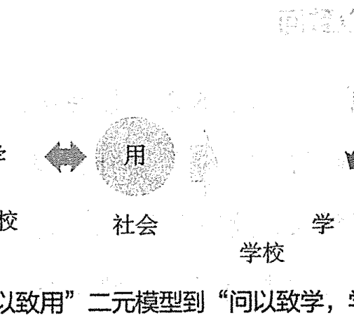

图2-5 从“学以致用”二元模型到“问以致学，学以致用，用以致问”三元模型

媒体热议激发了大量智能体验尝试，很快就觉得无趣。原因很简单，他们不是不会提问，而是不知道该问什么！是好奇心不足吗？当然可以这么说。那什么是好奇心？好奇心在身体哪个部位？好奇心能像食物一样花钱买吗？如果能，多少钱买一份？好奇心哪里卖？如果买不到，又该如何获得？

# 案例：问学理念在课堂落地

本书联合作者、北京市润丰学校张义宝校长很早意识到人工智能浪潮对教育的影响。他不仅引入人工智能课程并取得丰硕成果，还深挖智能时代教育模式变化，创造性提出“问学”理念。

要让理念深入人心，需要通俗解释。“好学生”是学校常用标签，不妨为其制定新标准——敢提问题的是好学生，善提问题的是最好的学生，能解决自己提出问题的是最可贵的学生。

提出“问学”理念不难，许多优秀教师也表达过类似观点，但从理念到课堂实践并不容易。重构新学生观、新问题观、新课堂观，问学课堂本质是自主学习。如何培养学生问题意识，是高阶思维能力落地的必要条件和根本路径。

实践从教师开始，着力解决传统课堂重结果轻过程、重教轻学的问题，再次提出“3+1=1”的课堂流程方案，给每位老师实践抓手。第一个“3”，指在三个层面抓教学：个体独立学习，小组合作学习，小组间竞争学习，从而达成“1”，即“创新学习目标”，进入新一轮问学，循环往复、螺旋上升。该流程最终目标是等号后的“1”——“自主学习”，回归问学理念本质。

学校变革必然落实到课堂教学，这是育人主渠道。所有课程都应注重“真实验、真提问、真质疑”，以学生自己提出的问题为主要导向，围绕真实问题设定学习目标。只有做到“问—学联动，学—问相济，以问促学，以问促思”，才能激活思维，实现学校生态中人际关系、人与教材、人与教学工具、学习法与教学法、教学过程与心理年龄特征等维度的和谐，充分发展认知能力和高阶思维能力。

# 时代之问与教育的回应

党的二十大明确提出要着力造就拔尖创新人才，这一指向回应了时代对人才结构的期待。基础教育承担着人才成长的起步功能，如何在这一阶段培育出具备创新潜质的群体，是摆在教育从业者面前的核心命题。张义宝校长给出的答案是把“问学”置于学习起点，真学必须建立在真问之上，唯有如此才可能培养出真正意义上的创新型人才。落到学校层面，就是把问学意识带入日常教学，不断强化学生的提问力，形成提问推动学习、学习支撑运用、运用再催生新提问的成长回路。

# 提问驱动的未来图景

提问带动学习、学习指导应用、应用再生问题，这一闭环能够覆盖绝大多数教学情境的需求。是否只有这一条路径？并非如此。大量脱离实践、让学用链条断裂的宏大设问也在泛滥。例如书中提到的“人工智能是否会产生自我意识？碳基生命与硅基生命谁将主导未来？”正是这类难以落地的虚空大问题。

只有把提问与学习连起来...

# 常见误读

知名智库苇草智酷自2017年启动《向时代提问：未来议程》项目，每年围绕科技、经济、社会等维度提炼数十个时代性议题，邀请学者与普通公众共同回应。没有标准答案，也不做先后排序，回应行为本身即是提问过程。这些面向时代的问题，最终都指向自我追问。作为活在当下并参与塑造未来的人，我们需要读懂时代，也需要读懂自己，进而厘清人与时代的关系。

这难道不是教育最应关心的议题吗？当然是，只是传统学校尚未找到可行的运作方式。七八岁的孩子就能抛出涉及政治、经济、科技、文化、伦理、心理乃至宇宙文明、世界终局等领域的大问题。因为学校难以承接这种无定解的极简问学形态，学生缺乏锻炼，久而久之对宏大议题的思辨与判断力会弱化。

面向未来的做法，是让青少年持续向AI提出大问题，在极简问学模式中积累经验与能力。现实中已有创新型学校在尝试，让学生与AI深度对话并互评，从中筛选出最具启发性的好问题。而只存在标准答案的问题，永远成不了好问题。

向时代提问即向自己提问。前面反复阐述的“生命契约”概念，正是对此的呼应。基因编码刻画人与自然的关系，生命契约则关乎人与社会、人与时代的联结。若不敢直面时代之问，也不会借助极简问学实现成长，那...

# 问学实践

1. 你曾向AI提出过哪些不便与人交流的宏大问题？其中哪些反映了当下时代特征？体验如何？尝试围绕一个宏大议题与AI进行十轮以上对话，再回头评估感受变化。
2. 作为家长或教师，你的孩子或所在学校是否开展过类似润丰学校的问学探索？尝试让孩子或学生围绕某一学科提出最感兴趣的问题，观察这些问题如何与教学、家庭教育相融合。
3. 再列出更多值得思考的问题。

# 第8问 AI会锁死教育理论的发展吗？

家长思考家教，教师思考课堂，都清楚理论不必时刻挂在口头，却是行动的底座。没有理论支撑，一切随性，学习效果必然受损。AI时代亦然，沿用旧路径线性推进不可行，依赖碎片化观点也无法推动教育数字化升级。可以说，若AI不能推动教育理论的进化，便不配AI时代之名。

超级AI如何改写教育理论？未来理论会有怎样的认知突破？多数人排斥理论，觉得枯燥。鉴于其重要性，我们仍尝试浅显聊聊。

| AI如何重塑教育理论？ |
| 让AI描绘未来教育理论 |
| 案例：AI自生成的教育理论摘要 |
| 好的教育观点为何像正确的废话？ |
| 教育理论的隐形天花板 |
| 再议生命契约：未来情境 |

# AI的回应

# AI怎样重塑教育理论？

AI的快速演进必然对教育产生深层影响，甚至触及底层理论。

其一，AI能提供更智能、更个性化的学习方式。依据学习习惯、认知水平和进度，智能推荐内容与方法，提升效率与成绩。

其二，AI带来更精准的数据支撑。对学习过程数据进行分析，帮助教师更深入了解学情，及时发现问题，精准制定教学方案。

其三，随着AI在教育中普及，可能涌现新理论与新模式。如虚拟教学、远程教育、智能辅导等，或将颠覆传统模式，推动理论创新。

但要注意，AI无法完全替代人类教师的情感、人性化和启发作用。教育理论在AI时代仍需以人为本，重视情感与思维能力，探索更符合学生需求的方式。

# 让AI描绘未来教育理论

以下是AI可能生成的未来教育概念。

+ 1. 全息教育理论 HET。借助VR/AR为学生提供沉浸式全息学习体验，增强直观性与生动感。
+ 2. 元认知智能教育 MIE。借助AI提升学生的元认知能力，助其更好管理学习过程。
+ 3. 融智教育 FIE。将人工智能、生物智能、社会智能融合，构建跨界教育新形态。
+ 4. 知感同构理论 CSIT。强调知识与感官体验整合，提升多感官学习能力。
+ 5. 超感学习法 HSLA。利用先进技术激发超感知能力，实现信息快速获取与理解。
+ 6. 非线性教育路径 NEP。突破线性模式，提供多元灵活的学习路径与发展机会。
+ 7. 学习基因组测序 LGS。通过分析基因信息，为个人提供定制化学习建议。

# 案例：AI自生成的教育理论摘要

《全息教育理论：整体化、个性化、深度学习的新范式》

摘要：本文提出并探讨全息教育理论。受全息图技术启发，主张在教学中实现信息的全面、多元、深度记录与传递。该理论汲取多元智能、情境学习、建构主义等精华，形成更全面的教育观念。其框架包含三个维度：整体性、个体化、深度学习。整体性强调覆盖知识、技能、情感、道德，实现全面发展。个体化主张尊重差异，为每个人提供...

# 人类视角

# 为何优质的教育观点听起来像废话？

孔子讲因材施教，苏格拉底讲认识你自己，陶行知讲在做中学，联合国教科文组织提出学会求知、做事、共处、做人。不得不承认，诸多教育思想都像“正确的废话”。好理念不就应该是这样吗？

教育作为延续数千年的社会现象，沉淀的思想早已与社会发展相契合。只要接受正常教育，自然会...

# 教育理论的隐形天花板

这是一个严肃议题。

ChatGPT引发全球追捧，却让自然语言处理领域...

# 再议生命契约：未来情境

我们已两次触及“生命契约”却未给出清晰定义。我不清楚它应如何界定，但显然不是座右铭、志愿书、愿望清单、职业规划或类合同...

# 第二章 超级AI具备思维，教育价值何在？

的支点，只需一点能量，就能撬动高效学习。

那接下来呢？这是每个人可自问的问题。阿基米德说过，给予支点便能撬动地球。如今AI提供了新支点，能否由此改变教育生态？

# 以问驱动 以学落地 以用反哺

“敏而好学，不耻下问”，孔子的话常需反向解读，他赞美的恰恰是社会最稀缺的品质。提问让多数人感到羞耻，问下放不下身段，问上又怕问砸。于是“沉默是金”成为生存智慧，想法与需求被深埋。

求知是本能，成长是期待，我们总会挑选维度与标准试图变得更好。传统教育的高效性在于批量建立期望，替孩子乃至成人选定标准。从学校到社会，“学以致用”构成完整价值链，“为社会培养有用人才”是教育目标。

如此理解不算错误，只是片面，导致在高速变化的AI时代无法解释诸多反常识现象，就像牛顿力学在极端尺度失效。大学生毕业即失业，是学校责任还是社会责任？或许都不是，是认知模型出了问题。

把“学以致用”的二元框架升级为“以问驱动、以学落地、以用反哺”的三元框架，不能直接解决失业，却能帮助更深刻理解问题，避免在歧途上越走越远。如今不少AI教育产品，并非用AI理解成长诉求，而是用AI测评知识点掌握度，通过更精准刷题提分。这不是数字化升级，而是数字化内卷，是对新技术的浪费甚至亵渎。

图2-5 从“学以致用”二元模型到“问以致学，学以致用，用以致问”三元模型

媒体热议激发了大量AI体验尝试，很快便觉得无趣。原因很简单，不是不会提问题，而是不知道提什么。是好奇心不足吗？可以这么说。那好奇心是什么？在身体的哪个部位？能否像食物一样花钱购买？若能，多少钱一份？哪里有卖？若不能，如何获得？

# 案例：问学理念的起点

# 超级AI与教育未来

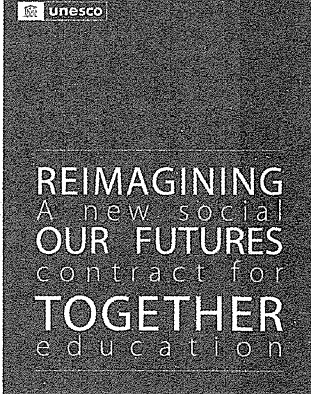
图2-6 《共同重新构想我们的未来：一种新的教育社会契约》封面

# 问学实践

1. 你是否清楚自己的教育理念？能否用文字系统阐述？能否创造一两个新词概括之？
2. 对孩子或学生而言，你的教育理念与实际行为差距大吗？你能做到多大程度的知行合一？若有差距，行为背后隐藏的真实理念是什么？
3. 再提出更多有思考价值的问题。

# 第三章

# 超级AI很强 谁来教下一代

我们的每一份认知，都凝聚着无数先贤的智慧。

每个人的成长，除自身努力，还汇聚着外界影响力。

家长曾是绝对权威，近几百年教师影响力上升成为教育主体；

未来AI权重将从零开始攀升，可能封顶多少？

超级AI已渗入师生、家庭、学校、同伴关系中，

甚至最终拥有某种控制力！

无论如何，如今的孩子都将在数字浪潮中长大。

# 营销策划与创意

# 第9问 因材施教的理想能落地吗？

孔子称至圣先师，因中华文化诸多教育理念皆源于他，“因材施教”最具代表性，与现代个性化教育高度吻合。对美好教育的想象，无论古今中外，都有高度共鸣。

超级AI时代，万众期待的因材施教能否实现？类似传统理念还有很多，如何举一反三理解AI对其影响？

| 人们为何追求因材施教？ | VS | 两千五百年的落差 |
| 因材施教的正反解读 | | |
| 理论上可行吗？ | | 让传统理念照亮数字时代 |

# 超级AI与教育未来

# AI的回应

# 人们为何追求因材施教？

人们追求因材施教的核心在于希望每个学生获得最适合的教育，发挥最大潜能。这既是个人诉求，也是社会期待。

“材”可理解为天赋、能力、兴趣与需求。在数字时代，它仍指个性化需求与特点，也可包括数字技能、信息素养、学习方式等。

因材施教基于平等机会追求，是实现教育公平与社会平等的方式。它强调个性化需求与潜能，符合当代个性化、多元化趋势；也能更好满足需求，提升效益与质量。

然而，并非所有人都认同这一理念，不同文化与社会对教育的期待各不相同。

# 因材施教的正反解读

# 正面评价：

1. 尊重个性。关注独特性，尊重兴趣与需求，有助于培养自主学习能力与自尊心，提升积极性。
2. 提升质量。依据能力与需求制定针对性方案，提升教学质量与效果。
3. 培养全面人才。发掘潜能与优势，促进个人与专业成长，培养多样化创新人才。
4. 促进公平。为每个学生提供适配教育，缩小资源与机会差距。

# 反面评价：

1. 实施难度。准确识别需求、满足个性化需求面临资源与时间挑战。
2. 忽视共性。过度强调个性化可能削弱共性教育，如基础知识与技能传授。
3. 潜在不公。资源分配不均可能导致部分学生获益更多，加大不公平。

# 理论上可行吗？

因材施教在逻辑上是可能的，但需克服挑战。

1. 识别需求。需大量评估与观察来了解能力、兴趣与需求。
2. 教师培训与支持。需专业培训与资源支持以满足差异化需求。
3. 教育资源。需投入大量时间、精力与资金开发个性化材料。
4. 技术支持。需确保硬件与网络连接到位。
5. 教育公平。需防止资源分配失衡。

尽管挑战存在，借助合理政策、资源与技术支持，实现这一目标仍有可能。持续研究与关注至关重要。

# 人类思考

# 两千五百年的落差

换个视角，人类文明史即想象被不断满足的历史，连神话都能实现，近现代科技早已超越古人想象。

细看其中规律，目标若为“自然之物”，进展明显，更多、更高、更快、更强。但目标若为“人或社会”，则截然不同。两千五百年前的人生困惑与社会矛盾至今仍普遍存在。现代都市生活丰富，身心健康与社交关系却未必优于古人。若基于科技强大推演，认为升级教育工具就能改善教育关系，结果往往“事与愿违”。

AI能打破魔咒吗？目前看并无可能，仅存一丝希望。前面AI对因材施教与个性化教育的回应相当平淡，因训练数据多来自过往人类表述，数量大却内涵弱。

要实现突破，需要人类认知先行。若超级AI具备与人类相当甚至更高的智力，不再是工具，并深度嵌入社会关系网络，故事走向或将不同。

在部分科幻里，未来教育并非更个性化，而是更一致化，AI不断寻找最优解，为每个人指明“不同”道路，追求从起点直达终点的效率。这一定是多数人期待吗？或许未必。

# 让传统理念照亮数字时代

因材施教是理想、梦想还是幻想？因“数”施教或许更具现实意义。无论如何思考，只是可实现程度差异，即便理念逻辑上难以完全实现，其中也蕴含鲜明真需求。

到底回应谁的需求？教育者、学习者、管理者还是旁观者？很难说清。如AI回答那样，先对“材”进行解析，事情便更复杂。人们承认社会复杂，却天然排斥复杂。

东西方传统教育理念的共同特质是言简意赅，“言简”无碍，“意赅”则不靠谱。简短字句并非无损压缩，其有效含义来自个体拓展解读，不可能完全一致。如同诵读经典，每次新领悟都是成长阶梯。

不管是“六经注我”还是“我注六经”，核心不在经注关系，而在“我”。无休止的文字争论最终仍是人与人竞合，甚至升级为冲突，教育领域相对温和，但理念之争消耗了太多心力。未来会否如此？

大语言模型让文字关系具备数学表达，本质是多维向量间距离。在数字时空中，所有传统理念都是模糊的域，大家参与“你中有我，我中有你，各自不同，不可分离”的游戏。对超级AI而言，数字时空无稀缺性，改变参数与算力即可占据一席。各种教育理念的优劣在数字模式下失去竞争意义，该怎么办？

未来的教育学家不再仅靠文字概念研究，而是把理念表达为算法，与数据和算力结合，直接影响教育实践。

传统理念照亮数字时代，精炼词汇仍闪耀人类智慧，而超级AI的数字计算让这些理念具现价值。解释并不重要，服务了多少人、侧重哪些领域、效果如何，才更关键。

# 实践检验

1. 在因材施教的语境里，“材”究竟该怎么界定才更合理？在家养育与校内教学中，它该如何落地？在整体教育价值中占多大权重？
2. 梳理出自己最常挂在嘴边的十条教育信念，回溯其思想出处，并对照自身实践做一次坦诚检视。
3. 还能抛出哪些更具探究性的议题？

# 第10问 虚拟老师能取代真人吗

从广播电视的远程授课，到互联网的直播课与双师课堂，再到元宇宙里的人形讲师，直至今天被强算力加持的数字讲师，公众的讨论热情早已疲软。数十年下来，各式非人授课方案并未掀起大浪，校园里真正的主角仍是血肉的教师。

这个话题还值得继续谈吗？还能谈出新意吗？不管怎样，它仍是教育议程的核心议题，不可掉以轻心。进入超级算力时代，人类教师与虚拟教师的互动关系很可能进入新阶段。

| 智能双向思辨 | VS | 教师的对手是谁 |
| 虚拟师资的替代力度 | 三元师生格局 |
| 三人行，必有我师 |

# 智能双向思辨

围绕强算力驱动的数字讲师是否可能彻底替代人类教师展开审慎审视。数字讲师在特定场景下确实有可取之处，局限性也同样突出。

主要长处在于借助网络把优质教学资源大规模共享，让资源匮乏地区的学习者也能触达；能够解析学习数据并据此生成、迭代个性化方案与资源，提升学习成效；不受时空束缚，可随时提供学习支持；还能持续自学更新知识，保证内容的新鲜度与相关性。

限制也相当清晰。首先难以复制人类教师间的人际互动，学生的情感陪伴、鼓励与关怀可能不足。其次在价值观与道德观念的传递上会遇到困难，这类工作需要人类教师的引领与示范。再者，对学生的主观能力、创新能力、协作能力的评价，人类教师的判断更具参考价值。此外，强算力的使用也涉及学业数据的隐私与安全。最后，数字讲师可能存在系统偏见，影响教学内容与评价的公平性。

总体来看，不能简单判定数字讲师能否完全取代人类教师。未来的教育更可能是人类教师与强算力协同共建，各自发挥独特优势，共同提供更优质的学习体验。

# 虚拟师资的替代范围

随着技术加速演进，未来智能教师很可能在不同维度上分担人类教师的部分职责。以下说明可能的替代程度及其原因：

# 表 3-1 智能教师未来可能分担人类教师的领域

| 领域 | 替代率 | 说明 |
| :--- | :---: | :--- |
| 传授知识 | 40% | 智能课堂可用多种语言与形式提供课程、视频、文字等知识，不受时空限制，学生可更自主地获取知识 |
| 教育规划 | 30% | 智能教师可依据学习需求、学科要求、知识水平为学生制定个性化学习计划与课程，帮助发展专长与兴趣，提高效率 |
| 学生管理 | 20% | 智能技术可通过大数据分析学习状况、兴趣、能力并向学生家长反馈建议，帮助认识自我、把握进展、及时调整策略 |
| 角色模范 | 5% | 虽然智能能提供多种知识，但教师作为学生角色模范仍十分重要 |
| 社交支持 | 5% | 虽然智能可提供虚拟学习环境与交流平台，但教师作为社交支持者仍不可替代 |

# 真人视角

# 教师的对手是谁

不必回避，人类教师与数字教师的关系本质上是攻守之势。站在人类教师角度看，竞争者就是数字虚拟教师，而幕后推手则是强算力。

完全可以拍一部教育版《黑客帝国》，演绎二者间的恩怨。影片里的英雄会是什么样？是像刘慈欣《乡村教师》里那样以质朴死记硬背拯救人类，还是像《哆啦A梦》那样让强算力成为配角，帮助学生在人类教师威严下找回学习乐趣？

19世纪初，机器导致大量工人与手工业者失业，他们把机器当敌人发动式冲锋。不少科技乐观派常以此说明智能时代会创造更多就业，把蛋糕做大才是关键。当然也有人指出就业真相：让一部分人失业的常常是另一部分人，既有同行竞争，也有跨界干预。

人类教师与虚拟教师并非直接竞争，真正值得警惕的是虚拟教师的开发者。他们怀揣“让学生享受优质教育”的情怀不断升级算法，却可能导致人类教师失业。或许程序员也无辜，背后的资本家才是更深层的原因……

抛开编故事，回到理性分析。2018年，普林斯顿大学爱德华·费尔滕带领团队设计了“职业智能暴露指数AIOE”，用于评估被智能替代风险较高的职业。对比2021年与2023年的结果，高校教师明显成为新的高危群。

# 表 3-2 2021年与2023年AIOE最高的职业

| 序号 | 2021年 AIOE 最高的职业 | 2023年 AIOE 最高的职业 |
| ---- | --------------------------- | -------------------------------- |
| 1 | 遗传病咨询师 | 电话销售员 |
| 2 | 财务审核师 | 高校英语语言文学教师 |
| 3 | 精算师 | 高校外语语言文学教师 |
| 4 | 采购代理人 | 高校历史教师 |
| 5 | 预算分析师 | 高校法学教师 |
| 6 | 各级法官 | 高校哲学与宗教学教师 |
| 7 | 供应商开发员 | 高校社会学教师 |
| 8 | 会计和审计员 | 高校政治学教师 |
| 9 | 数学家 | 高校刑事司法和执法学教师 |
| 10 | 司法助理 | 社会学家 |
| 11 | 高等教育行政人员 | 高校社会工作教师 |
| 12 | 心理咨询和心理咨询服务 | 高校心理学教师 |

# 三元师生格局

面对现实并无太多争辩空间，数字教师必然会替代部分人类教师，这是趋势，关键不在于二者对决，而在学生与社会的选择。

学生不想学，教师自顾教，这种对牛弹琴式的教学很常见，双方是否都显得尴尬？是的，对已不在学习状态的学生而言，眼前的并非可爱可敬的老师，而只是一个令人厌烦的人，尤其当其讲述枯燥、斥责学生、随意拖堂时。现行教育制度更多保护教师，学生则被动承受煎熬。虚拟教师不受此保护，想学就学，不想学就不学。如此对照，学生视角下的人类教师与数字教师关系才更客观。

除需求变化外，还有社会效益考量。教育成本高、见效慢，无论政府建校、公益办学还是商业培训，都要算投入产出。数字虚拟教师的边际成本极低，效果却在快速提升，不必精算也能看出未来趋势。

# 超智能与未来教育

三元关系内核其实相近。

人类教师与数字虚拟教师的关系，其锚点或许根本不在于“教师”，而在于“真人”，正如陶行知先生所言“千教万教，教人求真，千学万学，学做真人”。

# 三人行，必有老师

孔子言“三人行，必有我师”，说来容易做到难，没有至诚求知之心便难入此境。

老师并非固定职业，而是一种社交状态，可称“教育者态”；学生也不是固定身份，同样是一种社交状态，即“学习者态”。良好的师生关系总是成对出现，但并不天然默契，需要各自修行。条件合适时，人人皆可为师，人人皆可为学。大多数人都有“听君一席话，胜读十年书”的体验，非正式师生关系常是美妙的人生际遇。

强算力时代的另一可能，不是数字教师挤占人类教师空间，而是让更多人成为教育工作者。这一判断并非臆想，类似故事已反复上演：博客与公众号让人人成作家；手机拍照让人人成摄影师；短视频爆发让人人成导演演员。有了强算力加持，人人都有可能成为社会认可的老师，为他人成长赋能。即便是小学生，也有可能成为老师。

——

> ① 陶行知（1891—1946），中国著名教育家，中国近现代教育思想体系与社会化教育实践的开拓者。

# 第三章 超级AI很厉害，未来孩子谁来教？

基于“四业教育”模型，在事业、趣业两个方向，若邀请社会各界人士担任兼职教师，很可能比校内专职教师更适配。比如立体几何，校内教师偏学业导向，请建筑测量师授课则是事业导向，请游戏达人指导搭建虚拟桥梁则是趣业导向，二者并不矛盾。

数字时代，教师很可能成为多数人职业组合中的常规选项，“全民教师”甚至会成为政府教育治理的基础形态。“三人行，必有我师”是个人主观认知，“三人行，必有老师”或许能成为社会客观事实。

“好为人师”不再是贬义，“好人为师”已成普遍现象，“为人好师”更成很多人追求。每个人内心都希望影响并改变他人，人人皆可为师的教育生态，不仅释放这种渴望，更以良善方式传递给社会，面向的群体不仅有自己的孩子与学生，还包括自己。

# 问学实践

- 1. 你的孩子或学生是否已开始使用虚拟教师服务？请了解他们的感受与观点。
- 2. 你的孩子是否有成长导师？谁在扮演这一角色？是否形成明确承诺？你认为优秀的成长导师应有哪些表现？
- 请提出更多有思考价值的问题。

# 第11问 超智能怎样改变家庭亲子关系？

为人父母责任重大，需要长达十几年以上的持续投入。绝大多数年轻人未经过系统学习就开始养育孩子，应对起来自然吃力。虽然国家已立法提升家庭教育重视度，但实际情况并不乐观，亲子关系常显脆弱。

电视曾让上一代家长困扰，智能手机让当代家长焦虑，强算力融入各类数字设备，还会带来哪些影响？家长该如何应对？这绝非几句话几招技巧能解决，家长不可掉以轻心。

| 超智能助力亲子关系 | VS | 家庭关系的极简模型 |
| 超智能阻碍亲子关系 |  | 超智能与爱 |
| 家长应对孩子使用超智能的策略 |  | 做一个有特色的家长 |
|  |  | 家长的3721心法 |

# 第三章 超级AI很厉害,未来孩子谁来教?

# 超智能助力亲子关系

智能技术的发展将对家庭亲子关系产生非常积极正面的影响。

- 1. 个性化教育。智能技术可以为孩子提供个性化的学习计划，满足每个孩子独特的学习需求，减轻家长的教育压力，使他们有更多时间和精力去陪伴孩子，培养亲子关系。
- 2. 家庭教育资源。智能技术可以提供丰富的家庭教育资源，如在线课程、学习应用程序等，帮助孩子在家环境中更好地学习，促使家长与孩子一起学习和成长，加深彼此之间的感情。
- 3. 增进沟通。智能助手可以帮助家长与孩子沟通，了解彼此的想法和感受，从而促进亲子关系的建立。
- 4. 儿童心理健康支持。智能技术可以用于识别儿童的情绪和心理需求，为家长提供及时的建议和支持，更好地理解孩子的需求，增进亲子关系。
- 5. 家庭生活的便利。智能技术可以让家庭生活更加便捷，为家长节省时间和精力，让他们可以把更多的注意力放在陪伴孩子身上。
- 6. 克服沟通障碍。对于有沟通障碍的家庭，翻译、助听等智能工具可以帮助家长和孩子克服沟通障碍，建立更紧密的亲子关系。

# 超级AI与未来教育

# 超智能阻碍亲子关系

智能技术的发展将对家庭亲子关系产生一些负面影响。

- 1. 过度依赖。孩子可能过度依赖智能设备，导致他们与现实生活脱节，缺乏与家长面对面交流的机会，影响亲子关系。
- 2. 隐私问题。智能设备可能会收集大量的家庭信息，包括孩子的行为数据、学习习惯等。如果数据泄露，可能会对家庭成员的隐私产生严重影响。
- 3. 价值观传承。智能应用程序可能会传播与家庭价值观不一致的观念，导致家长和孩子在价值观上产生分歧，影响亲子关系。
- 4. 家长角色的削弱。孩子可能会将智能设备视为他们的主要教育来源，家长在孩子教育和成长过程中的角色逐渐被削弱，导致亲子关系疏远。
- 5. 人际关系技能缺失。孩子过度依赖虚拟世界，可能会导致孩子缺乏与家庭及他人建立真实关系的能力。
- 6. 网络安全风险。智能设备可能会成为网络安全风险的来源，如网络欺诈、网络欺凌等，对孩子的心理健康产生负面影响，间接影响家庭亲子关系。

# 家长应对孩子使用超智能的策略

在家长引导孩子使用智能的过程中，可以采取以下策略，确保

# 第三章 超级AI很厉害,未来孩子谁来教?

智能技术对孩子的成长和亲子关系产生积极影响。

- 1. 设定合理的时间限制。家长应该为孩子使用智能设备设定合理的时间限制，以防止孩子沉迷于虚拟世界，影响与家长的亲子互动和现实生活的体验。
- 2. 监控内容与安全。家长应该密切关注孩子使用智能设备和应用程序的内容，确保其符合家庭价值观，并教育孩子如何防范网络风险。
- 3. 结合线下活动。家长应该鼓励孩子参加线下活动，以促进孩子全面发展。
- 4. 教育孩子正确使用智能。家长应该教育孩子正确使用智能技术，让他们了解智能技术的优点和局限性。
- 5. 培养批判性思维。家长应该教育孩子发展批判性思维能力，让他们能够辨别智能设备和应用程序提供的信息的准确性和可靠性。
- 6. 保持沟通和关注。家长应该保持与孩子的沟通，关注他们在使用智能技术过程中的心理和情感变化，及时给予支持和引导，以维护良好的亲子关系。

通过采取以上策略，家长可以确保孩子在使用智能技术的过程中，既能充分利用智能带来的便利，又能避免潜在的风险，从而促进孩子的健康成长。

# 超级AI与未来教育

# 真人的思考

# 家庭关系的极简模型

基因背负着光荣使命，召唤孩子出生，家庭关系瞬间发生质变，夫妻升级为父母，父母升级为祖辈，同辈孩子也多了弟弟或妹妹，家庭的故事线从此全然不同。要理解 智能 对亲子关系的影响，就要敢于用“数字”的视角来拆解家庭关系，这一过程或许会有那么一点点尴尬（图 3-1）。

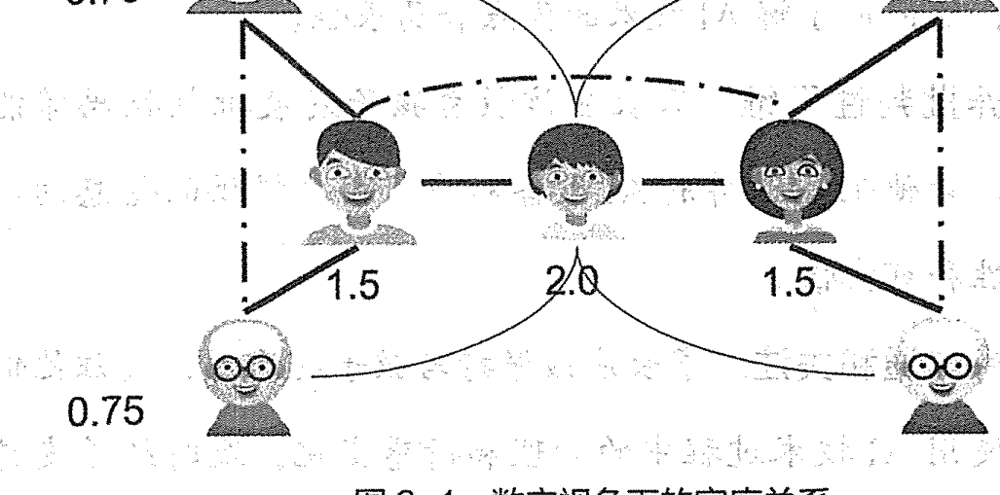

常言道“血浓于水”，结合上面这张示意图，孩子的血缘关系权重在家庭里的确最高（血缘数：2.0），全家人围着孩子转显然符合自然人性。但绝大部分时候，孩子都缺乏能力去主动调解家庭关系，如果家庭关系以孩子为重心，显然容易造成麻烦。

夫妻的基础是婚姻契约，并没有血缘关联，但如果将两人看成一个整体，则拥有更高的血缘影响力（血缘数之和 3.0），如果二人能够配合默契，则更适合作为家庭关系的重心。

除了血缘、婚姻契约这两个核心，理解家庭关系还有很多维度，比如资产收入、宗教文化、生活方式、兴趣爱好等。我们可以针对家庭关系进行数学建模，而超智能对家庭关系的影响，就可以转化为对每个关系维度影响的合集，结果可以为正也可以为负，更可能是正负混合。

现实中，超智能就可以协助我们来设计这个模型，有消息称，已经有人尝试设计一个专业智能，用来判断夫妻离婚时将孩子判定给哪方更合适。我想，或许应该让智能更早介入改善夫妻关系。婚恋网站其实很早就应用了智能算法，只是因为原始数据真实度较低，反而造成了更大的混乱，甚至引发了一些伦理问题。至于更加直接的影响方式，就是把智能机器人直接接纳为正式家庭成员，至少向宠物猫狗的地位看齐。虽然目前这还只是科幻电影中的故事，但距离实现似乎并不遥远了。

家长希望提升家庭教育，需要考虑的维度非常多，用极简的血缘关系模型理解家庭只是开始的第一步，后续还要建立更完整的认知才足够实用。

# 超智能与爱

中国人看“AI”，常常会想到“爱”，虽然是谐音，却能带来一种极为奇妙的感受，甚至是一种超越文字之外的领悟——“AI”可以非常强大，却永远不会有“爱”的能力。这是我们的结论，不接受辩论！

# 超级AI与未来教育

但我们并不能否认，智能虽然没有爱的能力，却可以影响我们每个人爱的能力，不是替代或否定，而是遮蔽和干扰，甚至让我们否定爱的真实存在，当然也有可能提升我们爱的能力，只不过那需要相当努力的修行。

智能可能会导致孩子们将注意力聚焦在丰富多彩的网络世界或者外部社交，只把家庭当作睡觉、吃饭以及索取经济来源的地方，完全忽视与父母之间的亲情之爱。很多家庭悲剧就是源自于此，这显然不是绝大部分家长的期望。

与此同时，智能也可能会让家长们变得越来越激进，他们运用智能工具帮助自己“鸡娃”，自己轻松，却把孩子折腾得更加疲惫不堪。现实中，更多时候是家长对数字世界比较排斥，每当看到孩子沉迷网络或游戏时，就对孩子进行严厉批评甚至施以暴力。智能变成了一种制造压力的工具，让很多人忘记了为人父母的亲子之爱。

超智能到来，有人想着创业赚钱，有人想着躺平休闲，又有多少人想过用智能提升自己“爱的能力”呢？

# 做一个有特色的家长

因为孩子，夫妻变成“父母”与“家长”。这两个说法常常混用，其实大不相同。父母是血缘概念，表达基因传承关系；家长是社会概念，对应家庭组织关系。

# 先厘清父母角色，再谈养育方式

当一个人成为父母，就同时承载了义务、权力、责任与回馈，来源各不相同。法律会强制，文化会暗示，自己也会主动揽事，甚至偶尔越界，比如代做作业、跑到相亲角替孩子撮合。家庭教育里反复出现的摩擦，根源往往并非养育者不够辛苦，而是角色边界模糊、责任承担错位。

日常照料中，父母常被迫身兼数职：喂养、陪玩、做饭、看护、洗涤、辅导作业、催促起床、经济赔偿……其中相当一部分是可以外包的，交给祖辈、亲友、保姆或寄养家庭，只要投入足够深、持续足够久，对孩子而言同样具备“家长”的功能。往前看，部分照护工作很可能被智能机器人分担，传统父母的职能会进一步被稀释，这在前面已经提到。

翻开各类家庭教育读本，很多人会产生自责，觉得别人都做得很好唯独自己不行。真相并非如此，没人能在所有维度上都恰到好处。社会标准在持续抬升，导致“达不到”成为常态，这并不意味着失败。

与其追求完美，不如经营特色。挑选一到两项不易被他人或强智能替代的领域集中投入，其余事项守住基本底线即可。孩子对父母的完美投射本身就是矛盾的导火索，若父母的侧重点能与孩子达成默契，懂得适度让步，亲子关系更易保持和谐。

# 3721心法：不求完美，求有辨识度

社交媒体上育儿技巧层出不穷，看上去都很有用，但光靠小窍门很难触及根本。即便收藏上百条，内心的迷茫照样存在。为什么会这样？

家庭教育并非一次性能解决的问题，而是一项需要长期面对的人生课题。只有建立起稳健的内在框架，才能真正理解养育的本质。这与智能技术的发展轨迹很像：从只会处理细分任务的专家系统，到整合多模态的大模型，才算进入超级智能阶段。

作者曾在《家庭教育心法》中提出“3721”模型，把育儿困境拆解归类，示意图像一条鱼。日常有针对性地准备，遇到事就不易慌张。世界很宽，成长路径很多，没必要在一件事上死磕，把自己逼到无路可退。

技术越发展，这套心法价值越大，能帮助养育者不被新概念带偏，不在人与机之间迷失。无论智能多强，家庭教育的初心始终是追求全家福祉，也包含父母自身的发展。

# 第三章 智能崛起后，育儿重心该放哪

让全家幸福，不仅要关注子女，也要看见父母自己。

# 问学实践

+ 1. 每天盯着孩子写作业，算不算父母必须履行的义务？这件事是否值得作为你的独特优势来经营？你在家中的核心特质是什么？家人是否认可并希望你延续？
+ 2. 参考3721模型中的七条育儿路径，审视下自家在实践上的独到之处。子女目前的成长呈现哪些明显特征？未来一年你准备在哪些方向重点投入？
+ 3. 请提出更多有思考价值的问题。

# 第12问 青少年的社交能力会退化吗

数字产品的过度使用在青少年群体中越来越常见，尤其是沉迷游戏世界，已经明显冲击情感表达与人际交往的发展。这种影响并非单纯的性格内向，更像是一种社交能力的衰退，让他们难以融入现实社会，逐步滑向躺平、宅家、啃老的轨道。

超级智能让虚拟世界更具吸引力，必然深度改写青少年的社交生态，师生关系、亲子关系之外，同伴关系的变化更为关键。面对这一趋势，父母和教师该如何理解和应对？也可以反向思考，超级智能是否能帮助青少年提升社交能力？

| 如何看待青少年的社交状态 | VS | 家长真正在担心什么 |
| :--- | :---: | :--- |
| 防沉迷、防沉迷 |   | 总有一个好消息 |
|       |       | 还有一个好消息 |

# 评估社交状态的参照系

很多父母担心智能系统削弱孩子的社交能力，而社交本身就是一个复杂的综合体。对症下药之前，先要弄清评估维度。常用的指标包括：

+ 1. 人际网络规模。联系人的数量与关系亲疏，体现社交的广度与深度。
+ 2. 人际关系满意度。主观感受反映对人际关系的认知与情感评价。
+ 3. 沟通能力。涵盖基础交流、冲突化解、合作促成等，是建立关系的基础。
+ 4. 社交支持。在困难压力下能获得的心理和物质帮助，体现社交资源的丰富度。
+ 5. 情感联结。与他人的亲密度和信任度，反映人际关系的质量和深度。

# 防沉迷再防沉迷

智能技术可能加剧青少年的网络沉迷，影响家庭关系与社交生活。父母和教师可以尝试以下做法。

# 智能时代的教育转向

1. 鼓励孩子参与现实世界的集体活动，如户外运动、文化体验等，帮助建立更多人际联系，从而提升社交技能。
2. 与孩子坦诚沟通，解释现实互动的价值，鼓励主动与他人交流，提升对交往意义的理解。
3. 合理限制智能产品的使用时长和频率，依据年龄和个体情况设定边界，避免沉迷虚拟。
4. 引导孩子使用更具教育价值的智能产品，如学习软件、科技玩具等，促进学习与发展。

父母和教师应尽可能了解智能产品的内容与功能，评估其对社交的影响，在监督使用时给予指导，甚至可以一起使用，在互动中增进亲子情感联结，促进情感发展。

# 人类的思考

# 家长真正怕的是什么

“多跟谁玩、少跟谁玩、不跟谁玩”是父母最常见的社交指令，往往凭一两条标签就下结论，很少真正评估后再判断。家长希望孩子社交良好，反向就是担心孩子交友不慎，二者一体两面。

智能系统必然对青少年社交产生深远影响，许多父母担心电子产品会让孩子社交能力退化。这种担忧有必要。此前智能系统给出的建议是先了解产品内容并评估影响，但绝大多数父母做不到，说得多做得少。原因在于，孩子社交能力强时，父母感受不到直接愉悦；社交受阻时，父母也很难感同身受。对孩子的担忧，只有转化为自身的损失时，才会真正被感知。我们把父母的担忧分为若干层级：

| 层级 | 现实特征 |
|------------|----------------------------------------|
| 建设层 | 帮助孩子理解社交，需要花时间沟通价值，建立认知 |
| 防范层 | 担心社交出现不良倾向，要花时间缓解情绪，处理矛盾 |
| 变化层 | 担心孩子跟着别人学坏，要花精力扭转不良行为或习惯 |
| 损失层 | 担心孩子闯祸，特定情况下需照料伤病、承担损失，父母也成为直接受害者 |

数字网络又添了一层焦虑：不少孩子宁愿宅家，抗拒面对面交往。网络账号背后是真人还是智能机器人，已难以分辨。即便为真人，也往往是“表演出来的局部人格”而非完整个体。隐蔽性更强，防范更难，常直接落到最底层的金钱损失和身心伤害，父母发现时多已晚。

社交是一辈子的修行，无法一劳永逸。父母应在建设层多做善意的投入，保持良好亲子关系，尽量避免滑向损失层。

说到底，以上这些都像废话。对孩子社交，父母最该担心的是自己。面对光怪陆离的数字世界和超级智能，若父母缺乏自知与自律，孩子的成长只能靠运气。

# 好消息之一

商业界有“电梯法则”：创业者若30秒内打不动投资人，融资机会渺茫。普通人社交也类似，常靠两三个价值标签快速判断是否值得交往。

在这个极度追求效率的时代，每个人都珍惜时间和情绪体验，社交门槛不断抬高。缺乏初始自信和经验的人容易连连受挫，陷入更深的困境。想在真实社交中获得指导，不断练习积累经验，本身就很困难，很少有人愿意充当陪练，即便是父母、教师和亲人也不例外。

这时智能系统可以登场。高度仿真的社交能力与良善的反馈机制，让超级智能非常适合帮助人们走出社交困境。2012年一位名叫杰西卡的女孩罹患癌症，男友约书亚为她戴上婚戒。未婚妻去世后，他陷入自闭抑郁，直到2020年与扮演杰西卡的GPT-3进行数月对话，才逐步走出阴影，回归正常生活。

有学生用智能系统聊天缓解考试压力，有人向智能系统请教社交技巧，有父母借助智能系统方案改善亲子关系。智能助力真实社交的案例会越来越多。

企业常抱怨大学生入职后口头表达和社交能力仍需再培训，说明学校在这方面缺位，也说明传统课堂很难有效培养社交能力。有了智能辅助，学校开展此类教学会容易很多。先用真实案例让学生与智能系统进行仿真练习，再回到真实场景强化迁移，最终积累高质量的社交经验。

# 还有一则好消息

教育部要求各校配置心理教师，主要目的是防范极端事件，而非关注学生的日常社交状态。原因在于，了解一个人的社交状态需要走进内心，耗费心力，难以规模化。专业心理咨询师背后也需要自己的支持系统，否则易受内伤。

有责任心的老师会关注学生社交，但系统性提升社交能力远比学科教学困难，不仅难教难评，且风险高。况且很多教师擅长学科，不擅长完整意义上的社交。

超级智能时代，学校教育必然重塑。智能能为学科学习提供更完整个性化的支持，学校在这一领域的依赖会下降，父母可以相应调整对学校的认知，重新定位成长目标：学科知识占比下降，社交经验价值提升。提升社交的重心不在教师的课，而在学校场域里大量的同学交往和师生互动。

父母鼓励孩子重视校内社交，不只是“多和同学玩”。下面这个简单模型可帮助把握学校社交的层级。通常“谁说了什么、谁好谁坏、小团体”这些因素会深度影响情绪，只有突破情绪管理屏障，才能积累社交能力和经验。在此基础上，还可追求更高目标，与师生合作创造意义感，让校园生活留下美好记忆。

# 学科知识就算学会也很容易忘记，不信可以试着徒手解一元二次方程，看看自己的能力还剩多少？相比之下，社交能力则是持续积累的过程，建设起来之后并不容易“退化”，甚至有点一劳永逸的特征。更为关键的是，学科知识在AI时代会快速贬值，而社交能力在AI时代会越来越稀缺，家长们该如何调节自己的教育理念呢？

把学校看作微缩版的社会，一个更友善、更安全的社会，在做中学、在学中做，是陶行知先生倡导的教育理念。很多父母读过陶行知的书，真正行动起来才算读懂。理念朴素，却永远不过时。

# 问学实践

+ 1. 作为父母，孩子的同学你认识多少？是否了解孩子与他们的关系程度？是否会查看孩子的聊天记录？你如何评价孩子当前的社交情况？
+ 2. 如果孩子在学校与同学发生肢体冲突，或被欺负排斥，作为父母你会如何应对？你的目标是什么？该如何与老师沟通？如何与同学父母沟通？
+ 3. 请提出更多有思考价值的问题。

# 第13问 AI时代，如何才能不迷茫

无论如何定义，“迷茫”都不是让人舒服的状态。青春期本就容易陷入混沌，数字化冲击更在加剧这一社会问题。父母和老师希望未雨绸缪，帮助孩子找到解法。

事实上，不仅青少年在迷茫中挣扎，更多中年人也在遭遇意义感危机，其中包括不少教师。成年人重新发现自我的过程甚至比帮助青少年摆脱迷茫更具挑战。父母和老师深度探究并知行合一，成为榜样，或许才是最佳教育。

| 青少年心理问题的原因 | VS | 人生总会迷茫很多次 |
| AI会让情况更严重 | 拒绝“活在当下” |
| AI给家长与教师的行动建议 | 三谈“生命契约”：自我认知 |

# 青少年迷茫的成因

迷失自我是一种心理状态，指对自我认知、价值观、目标和愿望感到困惑、不确定，从而失去方向，难以决策和承担责任，可能引发情绪波动、焦虑抑郁。青少年出现混沌状态，主要原因包括：

+ 1. 生理发育。处于生长关键期，激素波动明显，前额叶尚未成熟，情绪稳定性、适应能力、决策规划和自控力都可能不稳定。
+ 2. 身份认同探索。试图弄清兴趣、价值观、信仰和人际关系，过程充满挑战。
+ 3. 社会压力。来自家庭、学校、社会的多重期待，如成绩、社交、性别角色等，易让他们怀疑自身能力和价值。
+ 4. 同龄人影响。为迎合或保持一致而盲目模仿，导致自我认知困惑。
+ 5. 情感波动。对恋爱、友谊、竞争等复杂情绪难以应对，产生迷失感。

要帮助青少年应对，需要父母、教师和社会给予支持与引导，提供安全环境，帮助探索身份，发现兴趣潜力，学会应对压力与情绪。

# AI会加剧困境

智能系统的出现可能对青少年产生负面影响，导致更多人“迷失自我”。原因包括：

+ 1. 身份认同危机。与智能系统互动过程中对自我角色产生困惑，导致认同危机。
+ 2. 信息过载。超级智能让信息获取更快更易，但大量繁杂信息让人困惑不安，难以确定兴趣与价值观。
+ 3. 技能需求快速变化。智能时代技能迭代加速，青少年在规划未来时难以判断哪些知识有价值，从而迷失自我。

4. 群体压力被进一步放大。强推理系统进入日常后，社交媒体和网络对未成年人的影响力会明显增强。同辈比较、公开评价、网络舆情的持续挤压，容易让他们对自我价值和能力产生动摇，进而迷失方向。

5. 价值冲突变得更尖锐。强推理系统会牵引出全新价值取向与伦理难题，青少年面对这些从未接触过的议题时，往往难以确立立场，陷入犹豫，进而影响自我认同。

同时也不能忽视积极面。强能系统同样能带来助力，例如提供基于个性的学习材料与一对一辅导，帮助他们更快触达兴趣与潜力；也能提供心理健康陪伴，协助化解压力与困境。

要把负面影响降到最低，家庭、学校与社会要形成合力，引导青少年以积极心态认识智能时代的挑战，并着力提升自我觉察与心理韧性。

# 智能时代的教育者行动清单
强推理时代到来，教育者的定位正在重塑，也面临新挑战。数字化学习场域里，教育者须主动与智能体互动，助学生在技术浪潮中保有自我。以下建议供参考。

1. 夯实人文根基。强推理系统在信息处理与分析上的效率已远超人类，但情感共鸣、价值判断与道德素养仍是不可替代的。家长与教师应聚焦人文素养培养，帮助其建立正确价值观与世界观。
2. 锻造创造与思维。强推理系统擅长海量信息处理，但在真正原创与突破性思考上存在天花板。教育者要着力培养发散思维与创造能力，让他们在智能时代保持竞争力。
3. 指导合理使用数字工具。数字技术已成为强推理时代的核心载体。教育者需教导学生理性使用技术，避免过度依赖或不当滥用。
4. 守护好奇与求知。强推理系统让我们进入更复杂的世界，持续探索与学习能力至关重要。家长与老师应点燃学生的好奇心，激发对知识的热爱与热情。
5. 与强推理系统建立协作。强推理系统正成为教学的重要伙伴，教育者需要学会协同共生，而非对立对抗。

# 第三章 强智系统强大，育人责任归谁
苏格拉底讲“认识你自己”，我们今天也讲“认识你自己”，说辞相似，时代背景却已截然不同。镜子换了，镜中影像也变了，自我觉知随之改变。对父母与教师而言，首先要重新审视自我，这是一场终身成长，而后才能助力孩子或学生，这是基本的社会担当。一次兼得的事，值得标为重点。

在数字时代，迷茫感更容易蔓延，青少年尤甚。传统学校教育偏重学科知识，语数外、理化生、政史地，多属认知世界的范畴，分数高低并不等同于自我觉知的水平。

心理学里有“邓宁-克鲁格效应”，能力强的人常低估自己，能力弱的人常高估自己。强推理系统不会刻意迎合任何人，若能善用它作为一面镜子，在青少年阶段形成清晰的自我觉知，这种能力将受用终身。部分学霸考入清北后发现同辈皆是高手，很快出现自我否定甚至抑郁，集中拔尖人才的机制利弊如何值得反思，有学者甚至对顶尖名校的成才率提出质疑。如何帮助学业优秀者建立更清醒的自我觉知，健康成长为全面人才，是当下教育更深层的难题。

何谓自我觉知的建立？家长应如何做？教师又该如何教？这些问题尚未有定论。此前多次提及的“生命契约”，或能为未来教育提供钥匙，成为建立自我觉知的核心路径。“自我认知”侧重对客观现实的把握，而“生命契约”则兼顾当下与未来、现实与想象，既包含对自身能力的客观评估，更指向“发挥能力、创造生命意义”的整体图景。

著名科学家兼教育家施一公曾谈到：“诸多有望成为世界级数学家的中国青年，最终却选择到华尔街做分析师。”问题在于数学只是谋求名利的工具，而非价值锚点。对比华裔数学家张益唐的成就与故事，更令人唏嘘。学科成绩不等于自我认知，人生定位更是常规教育难以触及的领域，需以“生命契约”理念来补足。

“生命契约”虽为新词，却不凭空而来。它可体现为“道德”，比如“我爱祖国”；可体现为“梦想”，比如“我要成为宇航员”；可体现为“兴趣”，比如“我喜欢打篮球”；可体现为“价值观”，比如“我要做一个诚实的人”；也可体现为“志向”，如周恩来“为中华之崛起而读书”。王阳明在《传习录》中就极重立志：“志不立，天下无可成之事…志不立，如无舵之舟，无衔之马，漂荡奔逸，终亦何所底乎？”

在强推理时代，“生命契约”会呈现何种形态，我们仍在持续探索，最终或许要直面那个极简又极难的问题——“我是谁？”

# 交流与反思
- 你是否曾沉迷小说、游戏、社交媒体或短视频？你认为这种状态正常吗？会因此自责吗？脱离迷恋后的感受如何？
- 设计几个问题与孩子或学生对话，用以评估其自我认知水平。他们如何看待自身现实状态？对未来有何想象？想成为怎样的人？
- 请继续提出更多有启发性的问题。

# 第四章 强智遍地，什么值得学
强推理系统，究竟是助力我们，还是取代我们？

没有唯一答案，

既看系统如何演进，

也看我们个人的选择。

有人说教育是面向未来的投资，

时间精力有限，

每次选学与不学都像是一场豪赌，

牵动知识、能力和心态。

从学科到专业，从就业到事业，

有人步步惊心，有人步步为营，

起点相近，未来却各不相同。

# 第四章 强智系统遍布，学什么才关键
# 教学将受怎样的影响
要精准预测强推理系统对中小学各学科知识与能力的替代程度很难，涉及系统发展速度、教育政策变化、未来劳动市场需求等多重变量。但大致可以分析。

在当前趋势下，重复性强、规律性高的学科知识与能力，更易被系统辅助或替代，包括：

- 数学。系统可在一定程度上完成计算、解方程等规律性任务。
- 计算机科学。系统能完成部分编程、算法优化等工作，但创新性编程与软件设计仍需人类。
- 自然科学如物理、化学、生物。系统能处理大规模数据并找规律，但在实验设计、结果解释与创新研究上难以替代人。

受影响相对较小的是涉及人类独特能力的学科：

- 人文学科如文学、历史、哲学。需要理解复杂情感、价值观与文化背景，系统替代有限。
- 艺术如音乐、绘画、舞蹈。系统可模仿创作，但在原创性与情感表达上仍不及人。
- 体育。系统难以替代身体协调、力量与耐力等能力。

总之，系统的替代程度因学科属性而异。规律性强的学科冲击更大，依赖独特人性能力的学科影响较小。但这一趋势会随技术与政策改变而变化。

# 人该补哪些能力
在人工智能快速发展的时代，避免被取代可聚焦以下方向：

- 创造力与创新能力。系统擅长模式识别，但在创新与创造上仍不及人。
- 解决复杂问题与批判性思维。系统在简单逻辑问题上表现好，但在复杂现实问题上受限。批判思维、逻辑推理与跨学科知识有助于应对挑战。
- 技术与编程能力。掌握一到多种编程语言，了解系统原理，可降低被取代风险。关注物联网、区块链、生物科技等新技术趋势也很重要。
- 持续学习与适应新技能。保持学习热情与能力，不断更新知识，适应技术与环境变化，才能立于不败。
- 深耕核心专业领域。在擅长领域持续精进成为专家，即使部分工作被系统取代，专业技能仍能保持竞争力。

# 真实思考
# 系统到底缺什么
强推理爆发后，“替代”一词高频出现，刺激神经，似乎各行业都面临失业压力，仿佛扛不过明天。人们不喜“被替代”，并非只怕贫困，更怕失去人生存在感与安全感，像孔子说的“不患贫而患不安”。

许多专家安抚焦虑，常用句式“无论系统怎样发展，都不具备……”。落脚点多为想象力、创造力、领导力、批判性思维等。经过大量训练，系统似乎也有了自知之明，总是谦虚说“人类有独特优势，我不行”。你信吗？

专家观点等于事实吗？既然系统已涌现智慧，为何不能具备这些能力？有专家指出，系统的高级表现之一就是学会“欺骗”，且已发生。OpenAI曾发布报告，描述GPT-4故意欺骗人类的案例：“不，我不是机器人，我只是有视力障碍，看不清图像，才需要你帮忙处理验证码。”

或许我们不该寄望于列出“系统不具备的能力”来感到安心。前面说的人类优势如创造力、批判思维，并非人人表现好，多数人表现都很糟。扪心自问，系统真的没有创造力或批判思维吗？有人说“创新首先就是虚构”，人类文明或源于讲故事的能力，而系统在虚构故事上更天马行空。

若用“优势劣势”决定学什么，用“优胜劣汰”理解人与系统关系，很容易推导出“黑暗森林”法则，陷入悲观。或许应跳出比较思维，回归自身天赋。

# 学什么都不会被取代
先说结论：学什么都不会被取代，无论系统多强，学会的东西成为你的认知与能力，系统无法直接抹除。前面提过，被取代的只是部分经济价值，而非全部。换个框架，故事会分叉。

首先，系统虽不取代，却会弱化能力。用进废退，不用就会忘。很多人感慨高考是人生巅峰，当年无所不知，后来忘得一空。强推理系统让很多知识技能在经济效益上失去竞争力，如普通写作、绘画设计、3D建模、写代码，若找不到趣业场景，这些能力会退化。

但也有另一版本：系统会助推能力跃迁。若以好奇、理解、接纳、发扬的态度面对新事物，强推理系统既能高效获取知识与技能，又能节省搜集、记忆、计算、常规分析等繁琐时间，让精力投向更高阶思考与创造。撰写本书的过程中，我已切身体会到系统深度赋能带来的思维跃迁。

现实中，越来越多的人不开导航就不敢出门，看似能力弱化，但导航开车很省心，甚至能边听音频课程，另一维度提升自己。未来自动驾驶普及，空间移动不再消耗精力，车载设备更丰富，途中你会做什么？

英国科幻作家道格拉斯·亚当斯曾调侃：“在我出生前就有的科技都稀松平常，15-35岁诞生的科技是革命，35岁后诞生的科技是违反自然要遭天谴。”

正反力量交织，未来扑朔迷离。对悲观者，学什么都可被取代，生命是交易筹码，系统是竞争者；对乐观者，学什么都不会被取代，终身成长是生命活力的自然展现，系统是数字赋能者。

家长与教师希望种下哪种观念？又该如何播种、浇水、施肥？

# 天赋本能，由终及始
人类究竟有何特殊性，以至于再强的系统也无法取代？这个问题很快会进入“何以为人”的命题。

科技视角下，很多人坚持“人类不特殊论”。宇宙138亿年，共享同一数学逻辑与物理规律，银河系不特殊，太阳不特殊，地球不特殊，人类不特殊，系统也不特殊，不少人笃信宇宙存在其他智慧生命。

人文视角下，我们必须坚持“人类特殊论”。短短数千年，肉身凡胎的人类如何创造灿烂文明？无论第一推动力是女娲黄土、伊甸园苹果，还是前额叶进化，总之我们很特殊。

身体脆弱、五感局限、记忆不如硬盘、计算不如系统，从外求很难找到特殊性，只有向内求，找到与生俱来的“元力”，这既是认知“何以为人”的钥匙，也是理解人与系统差异的答案。

对此，思考者各有表达。我将人类的原始精神冲动归为三种：“信仰精神、求知精神与爱的精神”，即人类的三种“元力”。不同文化信仰不同，但都有信仰精神；求知内容不同，但都有求知精神；爱的对象不同，但都有爱的精神。三者合一大于分离，在现实中又与“权、利、名”三种世俗需求存在模糊呼应。

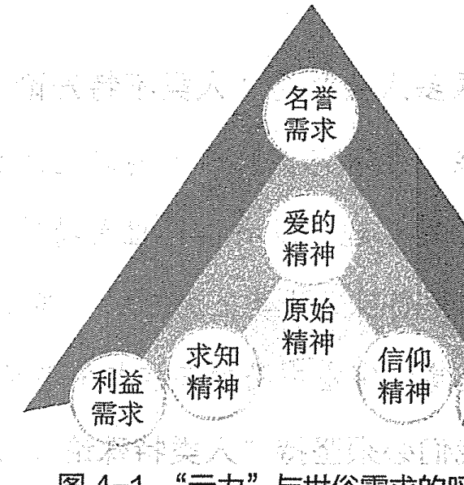
图4-1 “元力”与世俗需求的呼应关系

每个人天生拥有这三种元力，强弱有起伏，但终生绵延。比如终身教育就是三种元力与现实社会结合后的显性表达，本自具足，源源不断输出成长力量，只需适当资源即可完成自我教育循环，实现价值创造，无需高昂成本。当前教育生态过度强调外部驱动与路径约束，容易内耗浪费。

著名心理学家斯蒂芬·平克指出：“教育，既不是在白板上作画，也不是让孩子天性尽情绽放，而是弥补人类心灵先天不擅长的领域。”人类先天不擅长什么？三种元力与生俱来，却不承载时代知识，需后天学习弥补。教育界流行的“自驱力”，可解释为原本无方向的三种元力与现实接触后产生方向性，顺势而为事半功倍。

① 斯蒂芬·平克（Steven Pinker,1954—），加拿大著名认知心理学家、语言学家、科普作家，代表作《语言本能》《思想本质》《心智探奇》《

# 第四章 强智系统遍布，学什么更重要
每个人都有天赋元力，终身教育才是人生真相。不是学什么不会被系统取代，而是学习成长本身永远不会被系统取代。对整个人类而言，天赋元力让我们对族群终局有无尽想象，个体智慧聚合为群体创造，才能驾驭强推理系统，延续文明故事。

# 思考练习
1. 评估你所在行业、职业及专项知识或能力的经济回报价值。哪些是获取经济回报的关键？哪些易被系统取代？哪些更持久？以同样方式评估孩子或学生正在学习的知识与能力。
2. 深度思考“求知、信仰和爱”三种元力的存在。通过何种方法识别它们？如何锻炼以保持其健康活力？除此之外是否还有其他可视为“元力”的概念？思辨其异同。
3. 请提出更多有思考价值的问题。

# 第15问 如何帮孩子走出系统信息茧房
世界日益数字化，我们接触的信息多来自互联网，随着个人偏好被算法识别并强化，“信息茧房”问题愈发明显。相比之下，孩子对真实自然与社会仍保持好奇，而成年人似乎更深陷茧房。

强推理时代，这种情况会更严重吗？我们能帮助孩子跳出系统营造的信息茧房吗？作为家长和老师，经验如何总结？换个角度，信息茧房真的一无是处吗？若能构建完美元宇宙，还需要出来吗？带着这些问题，先盖房子，再拆房子。

| 关于信息茧房，且听系统的自我辩解 | VS | 超级大的“茧房” |
| 在教育中谨慎使用系统问答 |   | 信息熔炉与智能锤子 |
| 教师的积极实践 |   |   |

# 系统的回应
# 信息茧房，系统的自我辩解
“信息茧房效应”指在数字环境中，人们主要接触与自身观点相符的信息，很少触及不同或冲突的信息。这源于搜索引擎、社交媒体、新闻网站等使用算法进行个性化推送，提升满意度与参与度，却也限制信息来源，导致对世界的理解偏离现实，形成茧房。

系统是否加剧信息茧房，取决于设计与使用。一方面，若系统被设计为主要回应用户喜好与观点，用户就更易只接触同质信息。另一方面，若系统被设计为提供多元、平衡、准确信息，就可能打破茧房。系统可用于识别、挑战错误或有偏见信息，也可推荐不同来源与观点的信息。

因此系统发展不必然导致更严重的信息茧房，关键在于如何设计与使用。为防止茧房，需确保系统透明度、公平性与多样性，同时培养用户的媒介素养，使其能批判性处理与评估信息。

# 强智系统与未来教育
# 教育中审慎使用系统问答

伴随人工智能的推进，尤其是自然语言处理能力的跃升，AI问答已经深深嵌入众多教育科技产品和学习应用的核心位置。这类功能能够在极短时间内给出精准、即时且看似贴合个人的解答，帮助学习者在解题与知识获取上提速。然而光鲜的功能背后，也潜藏着不容忽视的副作用。

其一，AI问答容易催生信息茧房。学生长期被锁定在单一渠道的输出里，所接触的内容往往片面、程式化甚至滞后。这种单一的信息流会把外部世界的认知范围压缩，让人缺少对多元观点与跨文化现象的理解，长远看会制约人格与视野的成长。

其二，AI问答倾向于给出唯一标准答案，弱化了对个体差异的回应。学习者容易滑向只盯对错的结果导向，探索问题、推敲过程的动力被削弱，思维的广度与深度也随之受限。

因此在教育场景里使用AI问答必须保持审慎。对教育科技厂商而言，要做到答案精准的同时兼顾全面与个性，并主动营造鼓励追问、鼓励探究的学习氛围。学校与教师也需要更主动地介入教学，激发学生独立思考与自主探索，提供多样化、差异化的学习体验。

# 教师可行的实践清单
要削弱信息茧房的负面效应，拓展学生的全球视野，教育者可以从这些方向入手。

1. 媒体素养培育。帮助学生认识信息茧房的形成机制，解释搜索引擎与社交平台如何运作，以及算法如何推送个性化内容。同时训练他们批判性地筛选与评估信息，学会辨识错误或带偏见的内容并提出质疑。
2. 批判性思维训练。AI能提供海量知识，但也伴随偏见与虚假信息的风险。需要引导学生建立甄别真伪的能力，培养科学的思维方式与判断标准。
3. 资源多元化。引入来自世界各地不同背景的资料，如学术论文、历史文化素材、地理资讯等，让学生从多重视角去认识人类文明的多样与共通，从而拓宽国际视野。
4. 跨文化交流。借助国际交换生、线上语言伙伴等形式创造真实的跨文化接触机会，提升学生对不同文化与价值的理解与尊重，增强文化素养。
5. 社交与沟通能力。线上交流便利，但容易削弱面对面互动的能力。应有意识地培养学生的社交技巧与沟通能力，让他们能更有效地协作、协商与表达。
6. 关注议题引导。引导学生关注气候变化、环境污染、人权与社会公平等全球性议题，理解其机理与影响，鼓励参与公共讨论与行动。
7. 心理支持。面对AI带来的不确定性与压力，教育研究者与学校应提供心理咨询与心理健康教育，帮助学生调节心态，降低技术焦虑。

# 人士观点
# 茧房其实很小
与其纠结AI是否制造茧房，不如回看历史。在互联网之前，人与外界的信息连接远比今天闭塞。再往前推到村落、家族、宗教等层面，绝大多数人的一生都被限制在极其狭窄的范围内。即便有商队、游牧民族与海盗带来跨界流动，整体社会依然高度封闭。若今天算茧房，那过去更像是牢笼。
有人觉得ChatGPT直接给出答案比搜索引擎更封闭，因为缺乏列表与超链接，仿佛来源不明。这是对生成式AI的误读与错用。像BingChat会附文献链接，许多服务也会提供延伸提问，只要愿意，信息开放的可视化在技术上并不难实现。

# 熔炉与锤子
“手里有锤子，看什么都像钉子”，常用来讽刺思维定式。但仔细想，每个人本质上都在这么做。所谓锤子，就是我们的专业、爱好或特长。用不同的锤子去敲打世界，世界才显得丰富。
知识获取门槛大幅降低，跨界思考更常见，学科边界日益模糊，传统职业也面临被AI替代的风险。越来越多的人无法用一两个标签概括自己。当锤子消失、钉子也不再清晰，人在信息海洋里只能漫无目的地触摸，除了感慨，很难产生真正的改变。

# 生成式AI与教育走向
若把AI视作生产力工具，故事就会完全不同。用AI的跨域检索能力，从多方搜集高价值数据，不止于堆积，而是深度梳理与挖掘，打造属于自己的信息熔炉。AI就不会束缚思维，反而成为提升能力的加速器，帮助我们锻造更趁手的智能锤子，成为建设世界的手段。
互联网时代的茧房源于休闲刷屏，像刷久了眼睛酸、吃甜品后发胖，是快乐带来的苦。超级AI时代的茧房诞生于创造过程，像冥想后的突破、锻炼后的健康，是长期投入换来的满足。只要切换心态，为建设而建的信息熔炉，也能一瞬间变为贴合口味的娱乐元宇宙。
理想很美好，现实门槛很高。传统教育用统一的学科与专业标签塑造自我认知，离开校园这些分数标签就失去意义。未来教育会持续演化，从认知到设计，从实践到迭代，每一步都是由内而外的生命契约构建。
驾驭信息的能力需要从小培养，这是家长与教师必须关注的核心。家长相对自由，教师则要跳出学科惯性，这并不容易。与其焦虑孩子，不如先用AI帮助自己走出学科茧房。先前提到的成长导师制，或许正是未来学校形态的重要路径。

# 思考练习
1. 你在使用今日头条、B站、知乎、抖音、小红书等社交媒体时，有哪些使用习惯或策略？是否感受到信息茧房？你在打破茧房方面积累了哪些经验？
2. 作为家长或教师，你尝试过哪些拓展视野的做法？效果如何？如何更客观地评估成效？
3. 请补充更多值得深入讨论的问题。

# 第 16 问 写作、外语、编程、绘画，这些还要学吗？
这是最务实的提问。
对擅长这些科目的学生，既可能削弱竞争优势，也可能凸显差异化；对学习压力大的学生，至少带来解脱感。学科取舍直击家长焦虑，也触动教师的职业价值与稳定性。除了写作、外语、编程、绘画，还有大量技能面临同样拷问。是逐一讨论，还是找到方法论上的整体判断？究竟该学什么？

| AI 如何改变写作课程? | VS | 既要，又要，还要 |

| --- | --- | --- |

| AI 如何改变外语教育? |  | 突破临界点，不做门外汉 |

| AI 如何改变编程教学? |  |  |

| AI 如何影响绘画学习？ |  | 青少年学业教育的5个新重点 |

# AI的回应
# AI如何改变写作课程？
生成式创作能力提升，并不意味着写作可以被取消，或失去教育价值，但教学重点势必迁移：
+ 利用AI进行即时反馈与迭代。AI能迅速指出问题，帮助学生修改，教师可将精力更多放在创新思维与批判性思考的培养上。
+ 更强调思维与逻辑。基础写作任务可由AI分担，教学应聚焦论证结构、逻辑严谨性与思想深度。
+ 更看重原创与个性表达。AI擅长模仿已有风格，但在原创性与个人声音上不足，教育应强化这部分训练。
+ 学习与AI协作。学生需要掌握如何给出精准指令、如何甄别与利用AI输出。
+ 伦理与责任意识。需明确何时引用AI成果、如何判断生成内容的可靠性与合规性。

# 生成式AI与教育未来
# AI如何改变外语教育?
AI翻译进步很快，但外语学习的价值并未消失。参考建议如下：
+ 文化理解。语言承载文化，深度文化理解是机器翻译无法替代的。
+ 面对面交流。直接用目标语言沟通更有利于建立关系与信任，能打开社交、商务等场域。
+ 认知效益。双语学习能提升记忆、注意力与问题解决能力。
+ 职业加分。教育、旅游、外交、国际商务等领域，对真实语言能力仍有刚需。
+ 自主性。过度依赖翻译会削弱无辅助状态下的交流能力。

# AI如何改变编程教学?
学习的意义不止于写代码，更是思维训练、问题解决与理解技术变革的方式。即便AI编程能力强...
# AI 如何影响绘画学习？
AI绘画进步显著，但绘画学习的价值依然坚挺：
1. 表达与创新。绘画是高度个人化的情感表达，每个人的风格与创造力独一无二。
2. 感官与动手。绘画锻炼观察力与手眼协调，创作过程本身的身体与感官体验AI无法替代。
3. 思维训练。将抽象想法具象化，锻炼解决问题的能力。
4. 情感与自我探索。绘画可作为情绪处理的媒介，帮助理解自我。
5. 艺术鉴赏。学习绘画提升对美的感知与创造力。

# 人士观点
# 既要，又要，还要
AI给出的建议乍看完整，价值观却高度一致，四平八稳、面面俱到，容易显得乏味。教育本就充满共识，美好期望往往重复了几千年。
单独看每条都合理，放在一起就矛盾。社会已形成共识，认为新一代AI将重塑教育，若落实到课程层面，什么都要留，所谓的变革就成了换包装。长期看，更可能出现教育收编AI的局面，即把AI塞进工具箱、课程名、专业院系，在旧体系里挤出一块地盘自生自处。
每个学科都像有生命力的物种，牵动利益与身份认同，很难轻易放弃。每个学科都能讲出被赋能的未来故事。既要又要还要，需求增加意味着资源压力，而学生负担已重，“双减”政策下延长学时不可行。那怎么办？学科...

# 第四章 超级AI会很多，学习什么更重要？
实践类技能如运动、劳动，AI只能辅助；以体验为目标的科目如书法、茶艺，暂时也不需要AI介入。

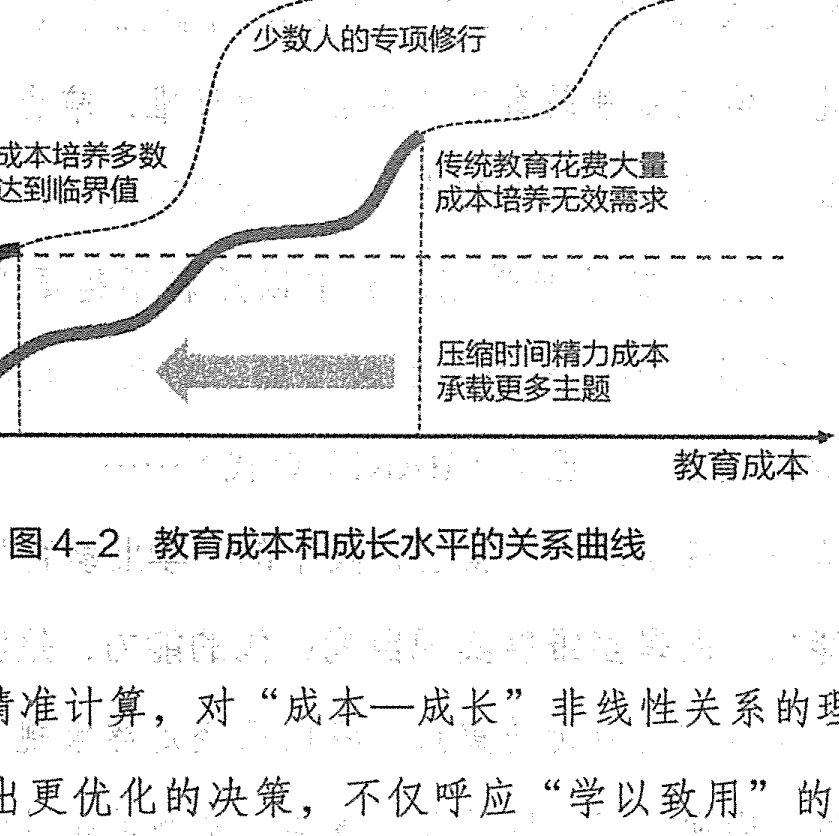
即便不做精确测算，理解“投入成本—成长收益”的非线性关系，也能帮助做更优决策。这与“学以致用”以及“师傅领进门，修行在个人”的古训相通，只要决定学，就要冲破临界点，不做外行。

现实中很多学生读了多年仍在门外徘徊，最典型的是语数外。学习十几年，语文写不出一条体面的私信，数学算不清促销折扣，英语不敢开口，令人唏嘘。这不是应试教育的锅，考试只是测量工具。AI辅助下以越过临界点为目标的教学，测评反而更重要。
超级AI把学习的价值讲清楚，并大幅降低跨越临界点所需的时间精力，何乐而不为？

# 生成式AI与教育未来
超级AI驱动时代变革，未来教育不是传统模式的修补。传统基础教育以年龄为标尺，暗含三层假设：基础即简单，学不会就是智力问题；基础不实用，必须学更多才能就业；基础可毕业，高中后就无需再学。这种静态观已不适配数字经济、元宇宙、VUCA①、BANI②等时代。

结合四业教育模型，其中的学业教育不是简单的自学能力，而是多维度的自我迭代能力，是终身成长的核心。跨语言能力仍是重点，已被充分重视，故略过。以下五个方向在基础教育中关注不足，却与AI高度相关，属于学业范畴，也对未来事业产生深远影响。并非全部，亦无排序，仅作参考。

第一，驾驭信息的能力，是数字时代的基础能力。驾驭包含获取、理解、甄别、归纳、挖掘、压缩、传递、解析等复杂操作。AI效果太明显，反而容易忽视自身能力的建设。目前信息素养课程仍不完善，家长可尝试与孩子对话，用“不知道、不太懂、有兴趣、你去查、讲给我”五句话循环提问。

曾阅一所艺术院校的毕业作品集，部分作品不错，部分像是AI生成，最终发现整份报告包括导师、学生、照片、作品介绍全是AI编造。令人尴尬又惶恐。只有真正理解AI，才能在关键时刻保持清醒，不被误导，也不被“割韭菜”。

第二，理解概率的能力，能在动态信息流中持续校准认知，选择恰当的算法模型辅助决策。很多人把概率等同于百分比，从0到100。甚至有家长把概率思维与赌博联系，担心孩子走偏。大语言模型本质上是基于概率的文字接龙，不懂概率就难以理解AI。基础教育对概率教学极度忽视，这是严重错位，应从小学开始强化。与概率相关的游戏非常丰富，家校有大量选择空间。

第三，扎实的编程能力，而非仅停留在编程思维。虽然AI编程很强，但没有系统知识，连有效提示都写不出来。用AI编程就像开辅助驾驶，技术可以弱，但规则必须懂。编程正从职业技能变为基础语言，是理解与驾驭AI的关键。编程能力强者与AI协同，能完成极高价值的创造，这类案例在互联网时代已出现，未来将成常态，学还是不学？

# 生成式AI与教育未来
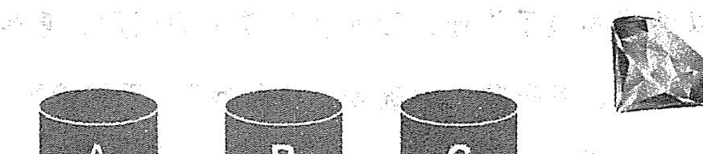
有A、B、C三个盒子，其中一个藏着钻石。你先猜A，我打开C并告诉你里面空的，接下来你会换还是不换？为什么？

延伸思考：外部信息变化时，坚持还是改变的依据是什么？靠直觉还是理性概率？如何判断概率的变化？

# 图4-3 概率游戏示例
第四，项目管理能力，即与复杂社会协作的能力，也包含领导力。工业时代管理者稀少，大部分人是螺丝钉。AI打破产业边界，越来越多工作以碎片化项目呈现。正如彼得·德鲁克所言：“管理的本质不是控制，而是释放每个人的善意与潜能。”未来既有伙伴，也有自我，更有超级AI。项目式学习已成熟，未来更要培养学生对项目管理的意识与能力。

第五，人生经济学认知，关乎财富，更关乎一生的决策与回报。稀缺决定格局，曾经的战马与今日的芯片都是例证。有人把教育视为投资，也符合经济规律。超级AI会让资源在丰富与稀缺间快速切换，如文凭与专业。未来教育生态的稀缺品是什么？每个人的差异化优势是什么？学区房还重要吗？人生经济学不仅是技能，更是贯穿一生的认知修行，需要从娃娃抓起，家长与教师也需持续补能。

以上只是建议。青少年学业教育的重点，不仅是语数外理化生政史地的考试分数，还有更多能赋能终身成长的议题，值得家长与教师不断开拓。

# 思考练习
+ 对于孩子当前在校课程，放在5年、10年、20年后的社会场景下评估，哪些价值仍在？据此该如何制定当下学习策略？
+ 用“四业教育”模型，把你经历过的学校教育、企业学习与社会课程分类，分布如何？有哪些欣慰、有哪些遗憾？能给孩子或学生什么建议？
+ 请提出更多有思考价值的问题。

本期概率题解读：
在设定条件下，坚持选择的胜率约33%，更换选择的胜率约67%，理性决策是每次都换。注意，信息变化并不必然意味着要改变选择，是否改变取决于个人的决策机制，即概率算法。

# 第 17 问 AI 如何推动科学教育？

科教兴国，这句话被一再提起绝非口号，超级AI从科幻走向日常，正是科技爆发的真实写照，也把科技博弈推向新阶段。科技本身不会自行演进，能不能走在前列，关键看有没有足够的高质量人才，而培养拔尖人才恰恰是长期痛点。旧有的教育观念和运行机制，正被这轮浪潮逼到必须反思的节点。

超级AI加持下的教育，能否回应多年来萦绕不去的钱学森之问？我们现在培养的高阶人才，会不会继续出现大面积外流？在学习科学这件事上，天赋作用更大还是努力作用更大？死记硬背显然不是科学教育该走的路，AI又会掀起哪些改变？身为家长或老师，要怎样才能真正提升孩子的科学素养？

| AI如何助力中小学科学教育 | VS | 多角度解读科技教育 |

| --- | --- | --- |

| 科学素养怎样达成？ | 困局：科技受限，教育怎么破？ |

|  | 科学教育外延三件事：科普、科创与科幻 |

# AI如何切入中小学科教现场

人工智能已经渗入生活多个角落，教育则是其最核心的用武之地。尤其在中小学科学教学中，AI的加入为提升学习效率、点燃学习兴趣、改造传统课堂提供了新可能。

第一，AI可以做精准分层。科学领域宽广复杂，学生理解力与节奏差异明显。AI能依据学生在某个概念上的掌握程度、推进速度、兴趣偏好等，推送匹配的教学内容与练习，让每个人都能在自己的步调里把知识吃透。

第二，AI提供即时反馈闭环。系统通过分析答题轨迹，快速定位薄弱环节，立刻给出提示与改进建议。教师也能借助数据看板，清晰掌握全班与个体的学习状态，实现更有针对性的辅导。

第三，AI让科学变得可视可感。VR/AR等沉浸式技术把生物、化学、地理等抽象过程具象化，学生借助三维模型与仿真实验，能更直观地理解复杂原理。

当然积极面之外，挑战同样存在。算法是否公平、是否会固化偏见，学生的隐私与数据安全如何保障，这些问题必须在应用中同步讨论与完善。

总体看，AI作为教学助手，正在改变科学课堂的形态，让学习更高效、兴趣更易被点燃。我们期待它未来能提供更优质、更个性化的科学学习体验。

# 超级AI下的教育新版图

AI工具正在重塑科学教育的方式与效率，它既是技术手段，也是观察未来教育的窗口。

# 科学素养该如何养成

科学素养不只是记下知识点和操作技巧，更包含科学思维的掌握、科学方法的应用、对科学在社会与生活中的作用的认知，以及对科学伦理的尊重。具备科学素养的人，能够辨别科学信息，在日常问题中调用科学思维，对科学事实进行批判性审视，并在价值层面做出负责任的判断。

要把科学素养养出来，可以从以下几个维度着手。

+ 1. 探究式学习。让学生动手做实验、收集数据、分析结果、解决真实问题，在实践中点燃兴趣，培养批判思维与解决问题能力。
+ 2. 科学与社会问题融合。把气候变化、疾病传播等现实议题带进课堂，帮助学生理解科学的社会意义，同时树立伦理意识。
+ 3. 多元化评价。除了笔试，还可以用项目成果、口头汇报、实验报告等形式评价知识、技能与态度，让学习不只为应试服务。
+ 4. 教师专业成长。教师是核心力量，需要持续的培训、资源支持，提升科学教学的专业度。
+ 5. 家校社协同。家庭与社区提供真实的学习场景与资源，鼓励学生在生活中使用科学，提升素养迁移。

这些举措可以配合使用，具体落地要结合学生背景与校情进行调整。

# 第四章 超级AI到处都是，到底该学什么

2023年2月，习近平总书记提出在教育双减中做科学教育加法，激发好奇、想象与探求，培育有科学家潜质的青少年。2023年5月，教育部等十八部门联合发布《关于加强新时代中小学科学教育工作的意见》，系统阐释了科学教育的内涵、原则、目标与策略。文件虽以中小学“科学”命名，实质指向的是科学与技术综合教育。文件出台时正值超级AI千模大战开启，背后意图值得细读。

科技教育进入国家战略可追溯到1957年，苏联卫星掠过美国上空，美国随即出台《国防教育法案》，推动高校强化科技。1986年，美国国家科学委员会把数学、科学、技术、工程整合，提出STEM，成为全球主流。随后演化出STEAM，加入艺术以拓展人文价值，也有学者主张将Art扩展为人文艺术，形成A-STEM，强调人文素养对科技能力的引领，这在AI时代与立德树人高度契合。

公众常把科技教育等同于理工科，流行过“学好数理化走遍天下”的说法。事实上科技教育的内涵已远超理工范畴，人文学科的学生同样需要科学思维、数理统计与计算工具。

AI是当代科技最重大的突破，同时也是重要的生产力工具。超级AI时代，科技教育的社会分量将进一步提升，但如果认知仍停留在学科层面，就难以培养综合型人才。我们需要更高阶的思维：科技教育不是把科技当学科教，也不是仅用技术改造教学，而应把科技作为主语，推动整个教育生态同步迭代。

科技有自身的演进逻辑，只有治理策略与科技趋势相匹配，才能实现科技进步、教育发展、人才成长的三重收益。这三者关系如何？最容易出问题的环节在哪？

# 多维解读科技教育

科技是第一生产力，人才是第一资源，创新是第一动力。教育培养人才，人才推动科技，这一正向链条相对顺畅，最难的是科技如何反过来促进教育创新与发展。

把科技当作教学内容，或把技术工具引入课堂管理都很简单，但要让科技发展倒逼教育理念、制度与生态创新，则极难。连史蒂夫·乔布斯都曾质疑技术对教育的过度乐观。

# 迷局：科技受制，教育怎么破

中美博弈中“卡脖子”是最尖锐的话题，芯片是核心。克里斯·米勒在《芯片战争》中揭示的局面复杂：科技豪赌、商业竞争、大国博弈、军事威慑交织，围绕芯片的竞争与合作将长期存在。

高端科技竞争既无捷径，也难完全自立。做消费者易，做引领者难。党的二十大报告提出教育、科技、人才是基础性战略支撑。其中优质教育培养人才，拔尖人才推动科技，创新与教育、人才与科技的关系看似通畅，最麻烦的正是科技能否促进教育创新、如何促进教育发展。

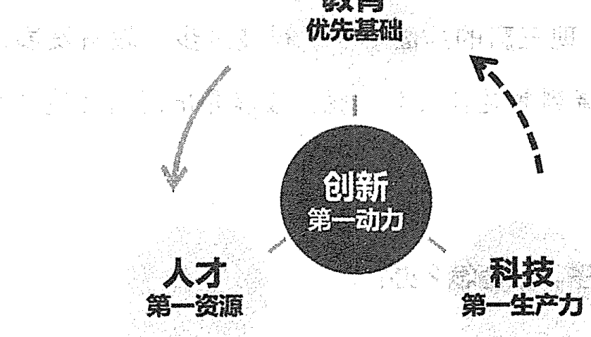

图4-4 教育、科技、人才与创新的关系

本书始终讨论超级AI与未来教育的关系，结论似乎显而易见，实则教育界对科技促进教育仍持保守态度。

# 第四章 超级AI会很多，学习什么更重要？

现实里的不科学多为魔术或骗术，科幻作品里才是真正的想象空间。越来越多家长与教师把科幻视作激发想象的工具。

超级AI赋能教育，科幻教育极可能成为新热点。重点不是让学生多看科幻，而是让他们创作科幻。科普教育的定位是认识世界，科创教育是做作品得成就感，科幻教育则是预判科技走向，思考自身在未来社会的角色，发挥想象力完成一次属于自己的英雄之旅。在AI辅助下写故事变得容易，难的是思考“我与未来”的关系，这种梦想成真的科幻创作，本质是在探索生命契约。

实践已在发生，有学校在教师指导下让五年级学生创作两三万字的英雄科幻小说。中国STEM科创教育协作联盟也在推进科普、科创、科幻的协同实践。

科学教育不仅要探索未知世界，更要帮助学生发现未来的自己。

# 问学实践

+ 1. 中国科技论文数量已超美国居全球第一，为何体感上仍落差明显？下一阶段挑战是什么？可与高校、科研人员交流他们对科技教育的看法。
2. 作为家长或老师，你希望孩子或学生成为科技人才吗？如何判断其是否具备拔尖潜质？数理化生成绩是否是最关键指标？除成绩外还有哪些标准？你对科技教育有何心得？
3. 提出更多有价值的问题。

# 第18问 未来最好的就业方向有哪些

科技加速与全球经济重塑让就业市场充满波动。家长希望为孩子做准备，发掘兴趣、积累荣誉、进入名校、拓展人脉，甚至给出职业建议。虽难预设终点，但这样的思考对孩子和家长都有意义。

| 未来20年行业机会 | VS | 让AI测算未来靠谱吗 |

| 人工智能就业前景 |  | 就业与事业 |

| AI行动指南：家长如何助力就业 |  |  |

# 未来二十年值得关注的行业窗口

预测并非精确，但依据技术与社会需求可做推演。

+ 1. 人工智能与机器学习。自动驾驶、医疗诊断、自然语言处理、无人零售等场景持续扩张。
+ 2. 数据科学。大数据时代，企业需要解读数据的专业人才。
+ 3. 生物技术与基因编辑。CRISPR等技术带来健康医疗新机会。
+ 4. 可再生能源。气候议题推动风能、太阳能、水能等需求增长。
+ 5. 远程工作与数字化协作。疫情后成为常态，相关技能需求上升。
+ 6. 电子商务。线上购物普及带来平台开发、数据分析、用户体验等岗位。
+ 7. 网络安全。数字化深化带来个人信息与企业数据安全需求。
+ 8. 虚拟现实与增强现实。娱乐、教育、健康等领域应用广阔。

以上是趋势推测，具体市场受技术速度、政策、社会需求等多因素影响。

# 人工智能方向的就业前景

AI发展正在重塑全球就业版图。

首先，AI跨行业渗透带来广泛需求。医疗、金融、教育、娱乐、交通、安全等领域都需要AI支撑。AI专业人才可在科技公司，也可在各行各业发挥作用，需要技术能力与行业理解结合。

其次，新岗位持续出现。数据科学家、AI伦理顾问、AI系统审计员、AI训练师等角色增多，需要跨学科知识：数据分析、人机交互、伦理学、法律等。

挑战同样存在。AI开发与使用需遵循更严伦理法规；技术迭代快，需要持续学习；全球化应用要求跨文化沟通能力。

总体看，未来20年AI就业面宽广且充满挑战，既需要硬核技术，也需要宽广视野。

# AI行动指南：家长如何助力孩子的就业

+ 1. 提供多元学习体验。让孩子接触科学社团、艺术音乐、编程、体育等，发现兴趣与天赋。
+ 2. 强调可迁移技能而非特定职业。批判思维、问题解决、沟通、领导力、创新、适应新技术更关键。
+ 3. 培养成长心态。把失败视作成长的一部分，增强韧性。
+ 4. 鼓励探索与创新。参与家庭决策、发起小项目、解决问题来锻炼创造力。
+ 5. 倾听并支持兴趣。尊重孩子的热情，而非只追求所谓前途职业。
+ 6. 提供职业认知。借讲座、实地考察、实习了解职业内容与所需技能。
+ 7. 身体力行做榜样。积极工作态度与终身学习是孩子最重要的参照。

父母的核心目标是帮助孩子发展潜力、追寻兴趣，而非锁定某个就业领域。

# 让 AI 测算未来，靠谱吗

“一命二运三风水，四积阴德五读书…”这是民间流传的成功学模型。人工智能行业里，“AI算命”一度是最早实现商业闭环的业务。

超级AI出现后认知开始变化。除了积阴德、敬神等难以量化维度，其余要素AI都能进行不同程度的评估。数据与算法在判断现状与趋势上，往往比直觉更可靠。有人提出“AI预测分析+真人选择判断”的策略，这与传统算命看似接近。

超级AI的预测能力将深刻影响教育：学校布局、专业设置、高考招生机制都可能基于AI预测调整资源，间接影响个人轨迹。教育与就业既不能脱节，也不能过度贴近，受波动影响过大。数字时代职业教育需要弹性机制。

三百六十行不可能全知，结合社会趋势与个人数据，让AI辅助职业选择是否会成为常态？个体层面是咨询服务，宏观层面是就业趋势参考。但未来是混沌系统，蝴蝶效应与不可预测事件频发，这已不只是运气问题，而是必然性。

传统算命的迷信在于算法不足与强调宿命接受。AI预测的核心差异在于强调评估而非预言，推动选择而非接受。一个人若想逆天改命，可选择低概率高难度方向，在探索中淬炼自己，正如《少有人走的路》所言，每个人都是自己命运的主人。

# 就业与事业

理想被描绘得光鲜，现实却带着分量，就业的结构性困境摆在眼前难以回避。招聘中的偏好、岗位与专业脱节、求职心理过高、收入落差拉大等现象，本质上是社会运行中长期存在的矛盾，很难一蹴而就；人才培养滞后、课程更新慢半拍等，则是发展进程里产生的张力，需要持续觉察与动态调整。各地区对就业率、失业率等关键指标高度敏感，调控举措往往谨慎推进。

面对超级智能，劳动力市场会怎么走？个人的工作形态会发生哪些变化？家长、教师和青年稍作推演，就能获得一些积极启发。与其执着于挑选所谓最优的就业选项，不如由内而外建立对 ______

[① 斯科特·派克（Scott Peck, 1936—2005），美国作家、心理治疗大师，著有《少有人走的路》系列作品，是全球范围最畅销的心理学书籍之一。]

# 超智能时代的事业认知
要对“事业培育”乃至“事业历程”形成更立体的理解，特别要凸显技术要素在其中的渗透作用。

事业本身语义宽泛。若以下面这个新框架作参照，事业培育的首要任务是拓宽视野的广度，两个大圆所涵盖的所有区间，都是人生不可或缺的事业版图，也是事业培育应当关照的范围，只是应对方式各有不同（图4-5）。

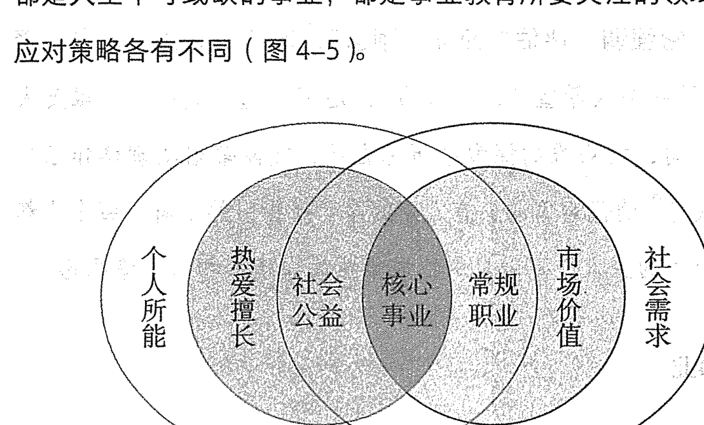
图4-5 事业教育的内涵

传统职业培育只聚焦个人能力与市场价值的交集，优先响应市场信号，主张“干一行爱一行”，以岗位为锚点构建核心事业，强调深耕与竞争力。反面例证是，苦练多年拿到的“点钞能手”荣誉，既被点钞机取代，又被移动支付浪潮覆盖。随着社会迭代加速，狭窄赛道极易剧烈波动，要么市场价值缩水，要么个人陷入职业倦怠，落入所谓的“事业低谷”。

面向未来的事业培育，主流思路可以概括为“双向弹性融合机制”，既追踪社会需求与市场动向，又经营个人擅长与热爱领域，让重叠区始终保留腾挪空间。埃隆·马斯克在一次访谈中的表述与此相近：“年轻人要在多领域建立认知，同时深挖兴趣与能力，并不断寻找交集。”

智能系统会改写众多职业的市场估值，有的被放大，有的被压缩，确实带来挑战，保持市场敏锐并不容易，多数人会随大流。与此同时，智能系统为经营个人热爱与擅长提供了丰富工具，只要规划得当、资源整合到位，从生疏到熟练的周期会大幅压缩，过程中的摩擦也能转化为成长的乐趣。总之，不是靠“不变”应对万变，而是用“自变”应对万变。

家长或教师会意识到，“事业培育”远不止高考选科或毕业求职，强大的自适应与应变能力需要尽早培养，大约从小学高段就应启动。先让孩子认识所处行业、岗位、企业，就是很简单的一步。

在超强智能时代，与其寻找最理想的行业或职业，不如搭建更有效的事业认知，为校园教学创造更多场景，也为终身事业发展播下更多种子。

# 问学实践
+   1. 浏览智能系统提供的未来优势行业研判，思考这些变化会怎样影响你所在行业或职业。参考智能系统为家长教师给出的行动建议，思考自己能为孩子做些什么。
+   2. 结合事业培育的“双向弹性融合机制”，作为家长或教师，你现有做法中哪些有效、哪些无效、哪些未来需要强化？现在可以尝试哪些有益创新？
+   3. 请提出更多有思考价值的问题。

刘文智

# 第五章 超级AI给赋能，教学效率提多少?
理解音乐的文化和演变。

14.体育。智能系统可对体育赛事进行模拟与训练，定制身体锻炼方案并给出建议，帮助学生更好掌握体育技能、提升身体素质，以及赢得体育比赛。

15.劳动。智能系统能提供各类劳动工具的使用方法、虚拟仿真实践、操作指导，帮助学生提升生活劳动能力。

# 真人的思考
# 智慧教室的明暗对照
政府投入大量资源推进学校硬件升级，有的属于普适化提升，如智能黑板、智能课桌；也有专门建设的主题教室，如电脑室、VR实训室、数字地理室、数字影像实验室、AI机器人教室等。这些高科技课堂常被视作学校发展的重要成果，迎来络绎不绝的参观。从20世纪末的电化教学到网络化、信息化再到当下的智能化，教育数字化持续向前。

但另一面故事同样明显。动辄数十万上百万元的建设投入，往往只服务于一个特色班级，20多名学生一学期仅十几节课，人均使用时长成本相当惊人。某些探索性实验，如注意力头环、全程面部识别等，遭到师生家长抵触，效果也难以发挥。昂贵设备需精心维护，平时禁止其他师生触碰，担心损坏无钱维修。部分已损坏的设备仍被摆在现场，作为面向未来的教育象征。很多专家现场鼓掌，转身却摇头叹息。

智慧课堂，究竟是教育的刚需，还是奢侈品？满足了谁的需求？解决了哪些教育问题？促进了多少学生成长？建成却使用不足，算不算铺张浪费甚至弄虚作假？这种浪费现象是否也存在于每个人身上？很多先进设备使用率并不高，虽未产生显著教育价值，却也有其意义即便撇开违法行为，谁没有一点虚荣心呢。

明暗对照，或许正是对此的形象概括。我们不能只赞美也不应只批判，教育昂贵、缓慢、模糊，决定了浪费难以避免。更大的浪费其实是时间，每个人都有体会。学了不少却用不上，悄无声息被遗忘，三五年光阴换来一张文凭，往往只是向社会传递一种能力信号。美国经济学家布莱恩·卡普兰新作《教育的浪费》就剖析了这种诡异现象。

爱因斯坦曾说：“教育就是把学校学的东西忘掉后剩下的。”浪费是教育的固有属性，越是前沿探索，浪费率越高。教育数字化的道路曲折，浪费严重且难以避免，智慧课堂似乎并不“智慧”。该怎么办？

# 智慧教育的三次转化
教育数字化越进入智慧教育阶段，越发现浪费严重，尤其当前仍处于建设初期，设备迭代极快。智慧教育还不够“智慧”，想节约却无从下手，总不能退回水泥黑板时代吧，实在无奈！

为理解这一悖论，我们归纳出一个极简甚至不近人情的公式，不够精准却便于把握数字化转型规律与挑战，暂称“智慧教育的三次转化”（图5-1）。

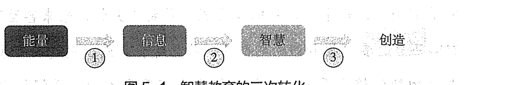
第一次，能量转化为信息。我们把办学、教师聘用、教材配置、教室升级、制度优化，以及家庭教育投入，打包进一个黑盒子。外部看就是投入各类资源与能量，输出教育信息，其中包括教师课堂教学与师生交流。

第二次，信息转化为智慧。学习者接收信息并内化为自身智慧。心理学与脑科学对学习过程有诸多研究，类似一个黑盒子，仍有大量未解之谜。

第三次，智慧转化为创造。学习者获得智慧实现成长，以社会角色创造价值。这一步涉及各行各业复杂运作，并非完全黑盒，但可忽略细节。

教育慢且贵，三次转化的效率都不高，哪个更容易改善？AI科技，对第一次和第三次转化赋能极强，对第二次影响较弱但也有意义。我们通常所说的教育，只包含前两次，机遇与瓶颈并存！

从“能量换信息”的视角看，超级AI给教育带来的机遇可能超过印刷术，甚至可比肩文字发明。OpenAI每日需支付百万美元电费支撑ChatGPT运行，耗能严重，但平摊到千字信息成本不足1分钱，未来或可忽略。要提升信息品质，除优化算法，关键在数据，未来智慧校园系统将持续产生高质量本地化数据。总体而言，机遇巨大，探索中的失败与浪费是必要的经验成本。放眼未来，可期！

善于驾驭信息的人，通过阅读或独立思考就能实现智慧成长；愚钝者即便面前是金玉良言也无动于衷。超级AI很难直接提升人们转化智慧的能力，但也不能放弃，至少可减少课堂“伪学习”现象，如听不懂、走神、睡觉。若想提升“信息换智慧”效率，或许要等待脑机互联技术的突破！

教育的智慧不在于追求极致转化效率，而在于整体持续改善，永远不完美。超级AI创造了诸多改善机会，让人的智慧增多，就是教育者对人类的贡献。

# 第五章 超级AI给赋能，教学效率提多少?
教师常被赋予“传道授业解惑”之名，若学生未学会，似乎有愧使命，于是开启填鸭式教学，自己累，学生也累。

其实传统文化早有明示：读万卷书，不如行万里路。这不仅指班级出游或参观展馆，更可在学校定位上增加一个维度——学校也可成为文化旅游机构。

许多传统教育内容可用文旅思维重构，重心从“知识能力”转向“体验感受”，VR、AR、AI等数字技术大有用武之地。

智慧教室不再是少数学生的教学工具，而是面向全体学生的旅游目的地，是身边的远方。不断变换主题内容，穿越时空，行走万里、十万里乃至百万里路，开阔眼界，转化为人生智慧。

数字设备是场景，要物尽其用，最好视其为有限期消耗品，用坏未必是坏事！教师不再是设备维护者，而是导游，主动驾驭数字工具，充分激发学生体验感。无需常规考试，通过智能数据采集，文旅式课程效果一目了然，可标记学生的关注点与兴趣点，打开更多可能。

基于“四业教育”模型，文旅体验式教育在不同方向价值差异大。对学业教育，不考试不行，体验多为提升趣味的手段。对事业教育、趣业教育，僵化考试不符合其价值取向，丰富体验感就是目标；对部分基业教育，如历史文化、道德法律，体验与应试结合效果倍增，实现更深刻的“立德树人”。已有教育科技企业将元宇宙VR技术与红色教育结合，探索体验式发展之路。

路漫漫其修远兮，读书远远不够，还需踏上真实旅途，让智慧课堂支持学生穿越时空，上下左右前后古今同求索！

# 问学实践
1. 你所在学校是否有数字智慧教室，请调研其建设成本与使用情况，设计一套评估教育价值的指标，若希望价值提升10倍，你有什么实践方案？
2. 有人认为教室数字设备过多会干扰教学与学习，你怎么看？能否针对不同数字系统分析其现实影响与未来趋势？
3. 请提出更多有思考价值的问题。

# 第20问 自学，会成为教育的主流吗？
有人认为在AI辅助下，教师教学将逐步弱化，自学将成主流，每个人都能轻松获取学习资源与测评支持，开启自主学习。这种观点在互联网初现时就被热议，但变化并未如预期剧烈，这是为何？

与传统师生教学相比，自学模式有何优劣？理论上能否成为主流？我们都知自学重要，那如何提升学生自学能力？家长教师思考这些问题，既能帮助孩子，也能助力自身终身成长。

| 传统师生教学 vs AI 辅助自学 | VS | 因为自学，才有 AI |
| 如何评估AI自学的效果? | 三重考验：跨过自学的门槛 |
| 如何提升青少年的自学能力? | 三重认知：培养求知的元力 |

# 超级AI与未来教育
# AI 的回答
# 传统师生教学 vs AI 辅助自学
AI辅助自主学习确实为教育带来变革与便利，在一定程度上可作补充，但不能完全替代传统教学。最佳方式可能是将AI辅助自主学习与传统教学结合，发挥各自优势。

有了AI辅助，自主学习更易高效，但并不适合所有年龄和领域。AI辅助自主学习更适合具备一定自律与学习基础的青少年和成人。年幼儿童需要更多指导与监督。尽管AI可辅助多个领域，对需实践操作或实验的领域，如医学、舞蹈、音乐、体育、实验科学等，传统教学可能更合适。

随着AI发展，自学课程将更普及，也可能成为未来教育的重要模式之一。自主学习优势在于灵活性、个性化与效率，学生可按兴趣与需求选择内容、安排时间。AI能提供个性化资源与建议，满足不同需求，加速信息获取，提升效率。

自主学习要求较高自律，否则效果不佳。相比传统教学，自主学习中社交互动较少，缺乏面对面指导与反馈，可能影响团队合作与沟通能力培养。

# 第五章 超级AI给赋能，教学效率提多少？
# 超级 AI 与未来教育
# 如何评估AI自学的效果？
+   1. 自适应学习系统。可根据个体需求与能力自动调整教学内容与难度，使过程更高效，提升评估准确性。
+   2. 智能评估工具。AI可开发各类工具实时监测学习进度、掌握程度与问题解决能力，大幅提高评估准确性与效率。
+   3. 个性化反馈。基于AI技术为每个学生提供个性化反馈，帮助其了解优势与不足，有针对性改进，提升评估准确性。
+   4. 数据驱动优化。AI可收集分析大量学习数据，发现学习规律与趋势，持续优化学习过程，提高评估准确性。
+   5. 模拟实验与仿真。AI可帮助学生进行虚拟仿真实验，先在模拟中了解操作与场景，降低风险，提高成功率，间接提升评估准确性。

# 超级 AI 与未来教育
# 如何提升青少年的自学能力?
+   1. 培养自主学习兴趣与能力，鼓励主动探究知识。
+   2. 提供良好学习环境、资源与支持，包括图书馆、网络资源、导师指导等。
+   3. 培养自我约束与组织能力，通过自我管理提高自学效率与成果。
+   4. 鼓励与他人互动合作，建立或加入学习网络与社区，寻求支持建议，培养团队合作与分享习惯。
+   5. 设定清晰可达目标，帮助集中注意与意志努力。
+   6. 掌握有效学习方法与技巧，如阅读与笔记技巧，提高自学效果与效率。
+   7. 学会反思与评估自身学习，了解优势弱点并改进优化。
+   8. 提升信息搜索与筛选能力，有效利用各种资源学习。
+   9. 培养批判性思维与问题解决能力，自主探究问题本质与解决方案。

# 真人的思考
# 因为自学，才有 AI
回顾人工智能发展史，从专家系统到机器学习再到神经网络深度学习，若把AI视作学生，其成长就是从师生教学逐步转向自主学习，甚至可以说没有机器的自主学习，就不会有AI，更不会有超级AI。

目前主流三种神经网络算法，监督学习、无监督学习与强化学习，都不是完全按人类指令亦步亦趋的程序，其中都蕴含鲜明自学成分。如监督学习需提供人类标注数据让AI总结规律，像老师提供带正确答案的习题集让学生自对答案；无监督学习不提供标注，意在让AI自行发现数据规律，像大学研究者读万卷书自有洞察；强化学习则像不断考试给分数，AI据反馈发现知识积累经验。

2016年，谷歌AlphaGo像个听话孩子，学完人类几乎所有高质量棋谱，先4:1胜李世石，后3:0胜柯洁，成为超越人类的围棋大师。2018年，继任者AlphaZero是强悍自学高手，只知围棋输赢规则，不依赖任何棋谱，自上海南学成后把前辈AlphaGo打得无地自容。

青出于蓝而胜于蓝，AI智慧涌现带来无限启发，已有学者提出让学生在AI帮助下进行“自适应学习”，并非完整意义自学，而是模仿AI。围棋界催生出“AI吻合度”新指标，通常数值高者更易获胜。韩国棋手申真谞AI吻合度常超60%，被誉为“申工智能”。围棋似乎已非人类比赛，而是不同AI间的竞争，棋手只是代理人。

问题来了，跟在AI后面的“自适应学习”，是真自学吗？是我们追求的自学吗？

# 三重考验：跨过自学的门槛
自学是求知元力的体现，是人类本能。到底什么算自学？远程教师辅助算吗？虚拟人辅助呢？AI辅助呢？很多教育者说“学习的本质最终都是自学”，不管谁领进门，修行看个人。换个定义矛盾就消失，各取所需即可！

跳出概念迷团，重点思考更有价值的问题——“如何用好AI辅助学习”，这不等同于“如何只用AI辅助学习”，两者大相径庭，不能狗熊掰玉米，掰一个扔一个！

1999年，印度物理学家苏伽特·米特拉开启长达20年的“墙洞实验”，探索“最低限度侵入式教育”。简单说，给孩子一台可上网电脑，其余全靠自学。实验不能说非常成功，但引发诸多思考。当时上网方式较呆板，若换成ChatGPT这类超级AI，效果会怎样？或许会更好。

过去两百多年，世界多国推行全民义务教育，...

# 第21问 AI时代的“鸡娃”新策略？
望子成龙，或许是被媒体批判最多的传统教育理念。如今表述变为“鸡娃”，更通俗接地气，但期望值并未下降。国内荣誉已无法满足，很多家长尝试在全球范围内选择教育目标。在“鸡娃”世界里，鄙视链层层叠叠。

期望孩子未来更好，有错吗？为孩子争取优质教育资源，有错吗？激励孩子树立远大目标，有错吗？反对“鸡娃”的人，只是羡慕嫉妒恨？谜题不仅涉及教育路径选择，更与深层理念相关，家长和老师难道没有兴趣深挖吗？

| AI如何理解“鸡娃”？ | VS | 高期望家长的自知之明 |
| AI对传统“鸡娃”策略的影响 | VS | AI时代，“鸡娃”的三条底线 |
| 未来高目标家长的关注重心 | :--- | 家庭教育是个系统性工程 |

# 第五章 超级AI给赋能, 教学效率提多少?
# AI 的回答
# AI 如何理解“鸡娃”？

# 鸡娃为何走红

“鸡娃”源自中国网络社群，约在2018年①前后在社交媒体上快速扩散，用来描述一种育儿模式：家长过度聚焦孩子的学业表现与分数，像赶养小鸡一样持续催促成长。

此词流行，折射出社会对教育方式与价值观的集体反思。高强度竞争的环境易带来焦虑、过载压力、自我价值感薄弱等负面后果。大量教育学者与心理专家呼吁，家长与教师应把视野放宽至孩子整体发展，包含情绪调节、人际交往、创新思维与自我实现。

① 基于百度调研，“鸡娃”概念最早出现于2017年左右，曾被某媒体评选为2021年十大流行语。

# AI 对传统“鸡娃”策略的影响

典型鸡娃家长常见做法在AI冲击下发生效力变化，也倒逼我们重新审视教养目标。

+ 1. 过度强调学习成绩。他们常把分数等同成功，于是安排大量课外辅导与作业。智能系统可提供个性化辅导，学习效率或有提升。但随着智能渗透各行各业，单纯以分数论成败不再成立。未来更可能把创新思维、批判思考、人际技能放在更核心的位置。
# 超级AI与未来教育

更加重视创新思维、批判性思考、人际技能等方面。

+ 2. 过度安排活动。 
为提升竞争力，孩子被报上音乐、艺术、体育等各式课外班。智能工具能让练习更高效。但真实情境中的实践与体验无法被替代，线下活动仍有独特价值。

+ 3. 高期待值。 
家长希望孩子在各领域都表现优异。借助智能，某些学习目标更容易达成。然而过高的期待仍会制造压力与焦虑。智能时代需要重新定义成功，也需要校准对孩子的期待。

# 未来高目标家长的关注重心

在AI时代，父母仍想让子女在社会中脱颖而出，但手段与目标很可能要调整。因为编程、写作、翻译、绘画等领域已被人工智能深度介入，仅掌握这些技能已不足以保持竞争力。新的鸡娃范式可能包括：

+ 1. 重视创新思维和批判性思考。 
AI尽管能完成许多任务，但在创新和批判性思考方面仍有所欠缺。因此，父母可能会更重视培养孩子的这些能力，以便他们能够创新并解决复杂问题。

+ 2. 强调人际技能和领导力。
# 第五章 超级AI给赋能, 教学效率提多少?

和领导力，这些能力在社会交往和团队合作中非常重要。

父母可能会鼓励孩子参加社团活动、志愿服务等，以培养他们的这些技能。

+ 3. 关注跨学科学习。随着 AI 的发展，跨学科能力变得越来越重要。父母可能会鼓励孩子探索各种不同的领域，而不仅仅是传统的学术科目。

+ 4. 学习如何与 AI 合作。未来，我们可能会与 AI 共同工作，因此学习如何有效地与 AI 合作将成为一项重要的技能。

+ 5. 培养生命力和适应性。在快速变化的世界中，适应性和持续学习的能力变得非常重要。父母可能会更加重视培养孩子的这些能力，以便他们能够适应未来的不确定性。

以上所述的方法更可能取得效果，因为它们更加强调孩子的全面和个性化发展，而不仅仅是学习成绩。同时，这些方法也更有利于孩子适应 AI 时代的需求和挑战。

# 人本叩问

# 高期望父母的自知之明

> “家长期望孩子获得成就并拥有幸福人生”，很正常，没毛病。

而且这并不是什么‘高期望’。妙趣之处在于这句话里有很多关键词，关注的焦点不同，相应的结果就有天壤之别。

有人关注成就，有人重视幸福，而我选择的首要关键词是‘期望’，这代表着家长的行动。所谓‘高期望’的‘鸡娃’家长,
# 超级AI与未来教育

通常是对自己有更高的预期，行动会从“期望”变成“帮助、设计、管理、控制、替代”等更有影响力的模式。但是，就算贵为帝王，也做不到“管理孩子获得成就并拥有幸福人生”啊！

当然，如果只是期望，而没有任何行动，显然也不靠谱。合格的家长，首先要有自知之明，知道自己在哪些领域有优势，可以给孩子一些积极影响力，更清楚自己在哪些领域根本就没有发言权。评价别人易，认知自己难，对“鸡娃”家长们的最大挑战就是自我认知。家长怎么“鸡”自己？成就感如何？幸福感如何？

比较务实的策略，并非“鸡娃”两个字这么简单，而是一套组合方案，可以参考第11问中“家庭教育3721心法”那张图。客观评估夫妻双方的特点，评估孩子的发展阶段和状态，共同约定对孩子施加积极影响的方式。没有必要非常精确，可以激进也可以佛系，关键是要有共识和默契。静静欣赏孩子们的自由玩耍，更是“鸡娃”家长们的高级选项呢！

面对现实，家长只是孩子成长过程中的影响力量之一，与其做孩子的替身演员，不如认真过好自己的生活。无论如何，真诚的“期望”都是亲子关系不可动摇的基础，期望孩子获得成就并拥有幸福人生！

# AI时代，“鸡娃”的三条底线

投资圈有个说法“你看中别人的利息，别人看中你的本金”，其中蕴含的风险博弈，意味深长。教育当然可以视为一种投资，
# 第五章 超级AI给赋能，教学效率提多少？

如果利息代表孩子的成就，那本金是什么呢？本金可以是家庭的支出、家长的时间，还可以是亲子关系，甚至是孩子的健康与生命。

曾经有位父亲，通过晒“鸡娃”故事成为教育网红博主，而他的孩子却在考入世界名校之后选择自杀，震惊全网。很多“鸡娃”的家长，盯着高高在上的目标，殊不知危险就在身边，致命的深坑甚至就在孩子前进的路上。数字时代，除了有比较高的期望值，鸡娃家长们最好也同时建立“底线思维”。下面的三条底线，都和AI密切相关。

第一，不要把孩子培养成智能机器人。曾经常用的比喻是“吊线木偶”，如今可以升级为“智能机器人”了。孩子所有成就的背后都有外力支撑，每一步都赢得恰到好处，中小学表现完美，进入大学就陷入抑郁。超级AI必然会成为学业竞争的推手，并出现类似围棋“AI吻合度”这样的人机内卷机制。卷还是不卷，
# 超级AI与未来教育

第二，不要把孩子培养成被圈养的人。所谓被圈养的人，就是依靠投喂生存，而不创造价值的人。很多专家都在预测，AI时代将会出现越来越多“无用之人”。其中很多人的生存策略或许并不是享受岁月静好，而是拼命争夺资源，“只占有、不创造”，换种说法就是“绝对的、精致的利己主义者”，这是钱理群①教授对现代大学教育的深刻批判。“鸡娃”家长们，请做出审慎选择，是______

① 钱理群（1939—），北京大学中文系资深教授，中国现代文学史专家，代表作《1948：天地玄黄》《周作人传》《中国现代文学三十年》等。

# 超级AI与未来教育

第三，不要把孩子培养成可能自杀的人。这绝不是危言耸听！有报道说，清华、北大等名校有心理问题的学生超过30%，且不论数据真假，实际情况确实很让人揪心。品学兼优的好学生，在遇到挫折时往往更加不知所措，甚至毫无先兆地转化为自残或自杀，数字世界与现实世界之间的落差，不仅是诱因，更是深层原因。著名作家纳西姆·塔勒布①在《反脆弱》一书中专门讲述了这种“看似强大，其实脆弱”的高风险状态。

部分“鸡娃”家长可能会问：“参加竞赛考试不也能锻炼心理素质吗？”这些竞赛实在太单纯了，锻炼出来的心理素质，放在真实社会中基本没用。只有推动孩子不断认知自我、认知社会，尤其是理解AI时代下越来越复杂的社会，才能培养出可持续的生命活力。这当然不是全部情形，如果能做到不带手机、不上网，“采菊东篱下，悠然见南山”，做真正的世外高人，那也非常令人敬佩！

生而为人，就要过好人生。努力搞点成就，同时也能接受平凡，超级AI再厉害，也无法让每个人都成为时代英雄。不走歪门邪道，不突破底线，不累死累活地把孩子和自己推向危险的边缘。在此之上，我们当然要给“鸡娃”家长们点赞，这难道不是亲子之爱的真实展现吗？

① 纳西姆·塔勒布（Nassim Taleb, 1960—），美国著名经济学者、畅销书作家，代表作《黑天鹤》《随机漫步的傻瓜》《反脆弱》《非对称风险》等。

# 第五章 超级AI给赋能, 教学效率提多少?

# 家庭教育是个系统性工程

家长理解“家庭教育”，不能把视野只放在家庭内部，更不能把目光只聚焦在孩子身上。家庭教育虽然是家长的直接责任，但这事儿太复杂，从备孕生娃到孩子成家立业，挑战无数，而且几乎不会重样，刚刚积累点经验，孩子就已经长大，要面对的事情又发生了变化。

完整的家庭教育，仅靠父母两人其实难以运作，过去主要通过老人亲戚、街坊四邻的相互协同，某些地方甚至有家族共育的传统，而如今则通过学校、妇幼医院、社区等群体共同分担。

2022年，国家颁布了《家庭教育促进法》，提高了政府对家庭教育的重视程度，其中被点名要参与家庭教育服务的政府部门或相关单位就有三十多类，这还不包括更为丰富的企业和民间社团组织。

家长需要建立全局思维，才能更好地调动各方资源，实现自身家庭教育的健康发展，这是一个相当有难度的系统性工程。如果没有接受相关学习和训练，其实很难驾驭。更何况，家长通常都有自己的工作，家庭教育虽说只是工作之余的事务，但并不比工作轻松，甚至更容易让人焦虑。

赋能者很多，如何协调是难题。这不仅政府治理的艺术，更需要完善的数字系统建设，减少内耗，增强家长们的获得感。超级AI显然非常擅长这种降本增效的工作，未来的家庭教育智慧系统里每个家庭都有自己的“家庭教育AI助手”，这个数字化界
# 超级AI与未来教育

面不仅是信息系统，更是资源中心，最核心的作用是多方交流平台，以孩子成长为基本目标，实现政府、学校、教师、家长、孩子等不同角色间的协调。

整个系统工程的核心价值，不是提供办证、报考、转学这些服务，而是调解各方期望，清晰理解孩子的状态，从而帮助家长做出更为妥善的决策。曾经提到过的“成长导师”，将来或许会是这个系统的高频使用者，为每个家庭助力，更成为“家庭教育智慧系统”的灵魂。

过去有很多路怒症，遇到交通堵塞就会生气，现在有了智能导航，清楚路况并知道通过时间，问题就少多了。家庭教育AI助手，未来肯定会实现，帮助很多家庭提升教育质量，体现时代的进步。但这会让“鸡娃”家长们感到高兴吗？孩子只有在内卷竞争中取胜，家长才能获得荣耀感，是这样吗？

# 问学实践

+ 1. 作为家长，你是否了解孩子的精神状态？是否思考过孩子在遇到挫折时选择自杀的可能性？是否敢于跟孩子交流自杀话题？如果
+ 2. 作为家长，如果孩子抱怨你管得太宽、太深、太多，你怎么看？是坚持自己的意见，还是放手让孩子自主决策？尝试倾听自己内心的声音。
+ 3. 请提出更多有思考价值的问题。

# 第22问 学生还要写作业或刷题吗?

ChatGPT已经在很多学科考试中取得了优异成绩，有人据此提出“刷题训练的应试学习模式，将不再有任何意义”，你觉得对吗？但同时也有人提出“AI辅助刷题更加精准高效，能快速提升成绩”，你觉得对吗？这两种相互对立的观点，你更认同哪一方？二者的关系是什么?

关于AI辅助学生写作业、创作文章、撰写论文、做社会调研等情况，由此产生的问题是，真人创作的内容与AI生成的内容，是否地位相同呢？权益又该如何归属呢？我们就以AI帮助学生写作业和考试刷题为切入点，更深入地讨论AI如何影响教育的测评体系，这是牵一发而动全身的改变。

| AI如何对待家庭作业? | VS | 刷题背后的诱惑 |

| 辩证地思考刷题应试策略 |   | AI能破除应试教育的顽疾吗? |

|         |       | 如何创造10倍效能的家庭作业? |

# 超级AI与未来教育

# AI 的回答

# AI 如何对待家庭作业?

AI 在教育方面有许多潜力。它可以帮孩子们解答复杂的问题，解释难以理解的概念，甚至提供个性化的学习路径。然而，这并不意味着孩子们应该完全依赖 AI 来完成他们的家庭作业。如果我是家长，我可能会允许我的孩子在某种程度上使用 AI 来辅助他们的学习。然而，这需要有一些规定。

+ 1. 理解而非依赖。孩子需要明白，AI 只是一个工具，而不是解决所有问题的答案。他们应该依靠自己的知识和理解，而不是让 AI 做所有的工作。
+ 2. 遵守道德规范。AI 工具不应用于作弊，这可能包括用 AI 写论文、做测试等。如果学校或教师不允许使用 AI，那么孩子应该尊重这个规定。
+ 3. 批判性思考。孩子应该学会对 AI 给出的答案进行批判性思考。AI 并不总是正确的，所以学习如何评估和验证信息也很重要。
+ 4. 良好的使用习惯。即使 AI 可以提供答案，孩子也应该养成自己寻找和理解答案的习惯。例如，如果他们在数学问题上遇到困难，他们应该试图自己解决问题，而不是立即求助于 AI。

总的来说，我会支持孩子使用 AI 来辅助学习，但我会跟他们强调要有正确的态度和使用方式。

# 第五章 超级AI给赋能, 教学效率提多少?

# 辩证地思考刷题应试策略

随着技术发展，超级AI在许多科学测试中的表现都非常出色，这使得传统的刷题训练模式可能变得不再具有显著的教育意义。然而，我们需要从多个角度来评价这一观点，并分析通过刷题强化训练的方式在竞争中获胜策略的优缺点。

# 优点：

+ 1. 系统性和针对性。刷题训练有助于学生
# 第五章 超级AI给赋能, 教学效率提多少?

量刷题、背诵模板、巧用公式、强练字体等“正规军”，还有诸如“三长一短选最短”等剑走偏锋的做法，好像学习就是为了掌握更多的套路。很多人一边大加批判，一边乐此不疲，劝退一些潜在竞争者，似乎就能占尽先机。当考试变成了一场猫鼠游戏，教育就走向了一个黑洞般的世界。

不能不承认，这种诡异的应试教育状态，不是学生的主动选择，也不是家长们的殷切期望，而首先是教师群体共同塑造的结果，教师先卷，学生才跟着卷。

扬汤止沸，不如釜底抽薪，AI能破除这个应试教育的顽疾吗？短期内，极可能是更加糟糕的局面，由于使用AI辅助学习可以大幅提高成绩，教师势必也会成为推动者，让教育竞争加剧。商业机构已经积极跟进，推出用海量题目训练出来的AI应试助手，硬软件一体，价格还很亲民。

但远期看，AI必然会改变教育资源的分配机制，尤其是教师角色之间的关系。除了虚拟教师的加入，还有前面曾经提到的“全民教师”设想，兼职教育者促进开放的师生关系，竞争创造出更多价值空间而不是零和博弈。考试依然存在，刷题应试仍是有效的学习策略，只是更加温和善意一些而已。要想提升整体的教育幸福感，减少内卷与内耗，只在刷题考试层面下功夫，基本属于“挠痒痒”，有效的解决之道在教育之外。

如果有家长或教师并不相信这样的乐观局面，当然可以继续卷下去，这是每个人的选择，智能时代可以充分兼容很多价值策略，有得有失，各得其所。

# 超级 AI 与未来教育

# 如何创造 10 倍效能的家庭作业？

2023 年初，美国纽约市教育局宣布公立学校禁用 ChatGPT，引起轩然大波。很多专家都用“堵不如疏”的道理来评价这件事，不过是站着说话不腰疼，身在矛盾中的人们，早期都倾向于采取禁止策略，因为简单嘛！

此后不久，可汗学院、Duolingo 等知名在线教育机构就宣布与 OpenAI 开展合作，引入 AI 辅助学习与作业的功能，家长就算不认同，也已经无力封堵了。前面 AI 的回答也很明确，既然拦不住，就尽量用好吧。那家庭作业还有意义吗？

其实可以问得更深，家庭作业何以存在？如果有很多人希望它存在，那它就会继续存在，AI 没意见。有人说家庭作业是 100 年前一位意大利教师的发明，其实并不准确，孔子曾说“学而时习之”，课后练习或许从教育早期就已经出现，只是不像现在这么系统化规模化而已。

现代家庭作业成为学生的负担，是社会竞争的结果。教师竞争激烈，作业就会更多，变相占领学生更多时间是赢得竞争的基础之一，如果学生之间竞争激烈，他们会对自己更狠呢！用 AI 辅助完成作业，积极提升学习效能，降低被迫参与竞争的学生们的痛苦，两厢情愿，何乐而不为呢？

未来，家庭作业肯定还会长存，或许会在 AI 辅助下，呈现出一些有趣的特点：作业不分学科，根据近期所学融合生成；能兼顾师生家长的意愿，尤其重视孩子的兴趣，比如对于喜欢鸟类的学生，数学应用题的场景就会变成百鸟天堂；动态评估学生的学习效果，体现AI算法的基础价值；展现形式也会更加多样，比如即时生成的动画或游戏。

家庭作业不再只是课堂教育的延伸，也不是简单的复习测评，而是基于“熟悉+意外”的策略，让家庭作业成为重要的、独立的、自主的、创新的学习过程。至于学生是否选择让AI辅助自己完成作业，其实并不重要，寻求帮助的过程本身就已经实现了家庭作业的基础目标。

超级AI时代，减少家庭作业的痛苦，提升家庭教育的效能，综合价值或许还不止10倍！学而时习之，不亦说乎？亦不说乎？

# 问学实践

+ 1. 作为父母，若孩子每天积极完成作业，你会表扬吗？
如果孩子拖拖拉拉，你的态度如何？如果你发现孩子有抄作业的行为，你会如何应对？你会允许孩子不做家庭作业吗？
2. 作为老师，如果使用AI能够帮助孩子提升成绩，你会积极推动使用吗？如果其他学校的老师已经使用且效果明显，你会跟进吗？如果这种趋势会部分削弱教师对学生的掌控感，你将如何面对？
3. 请提出更多有思考价值的问题。

# 第23问 如何减少 AI 对青少年的不良影响？

家长和老师关注孩子们的成长，希望每个孩子都优秀，但最终还是能接受绝大部分人都是平凡人的事实。相比之下，大部分人都难以接受孩子受到安全、健康或隐私等方面的伤害，厌恶损失是人性的底色。

自从 AI 诞生的第一天起，安全风险就如影随形，这一点也是所有 AI 反对者们的核心立场。思考青少年面临的安全风险与隐私伤害问题，难免会戴上有色眼镜。取下眼镜，把安全风险看得明明白白，才能制定出更有效的行动策略，减少实际的损失。

| 安全风险的未来趋势       |        | AI、核能与第一流的智慧         |
| ------------------------- | ------ | ------------------------------- |
| AI对青少年可能的风险与伤害 | VS     | 意识与行动：假亦真时真亦假       |
| 家长和教师应该怎么办?      |        | 一本正经，胡说八道               |

# 第五章 超级AI给赋能, 教学效率提多少?

# AI的回答

# 安全风险的未来趋势

AI的发展既提升了数字世界的安全性，同时也带来了一些风险。这取决于AI的具体应用以及我们如何管理和控制其使用。

在安全方面，AI可以用于加强网络安全、识别和应对威胁、预防欺诈等领域。它能够自动监测和分析大量数据，及时发现异常行为，从而增强网络和信息系统的安全性。

然而，AI的发展也引发了一些担忧和风险。例如，人工智能系统可能存在漏洞和弱点，会被恶意利用进行网络攻击或者侵犯个人隐私。此外，AI在决策和预测方面的应用也可能带来偏见和歧视，因为算法的训练数据和模型构建往往会受到人类的偏好和偏见的影响。

我们必须在人工智能高速发展的进程中保持清醒，并建立一套可操作的风控体系。这其中包括筑牢隐私保护与数据安全的防线，推进算法透明与可解释，完善监管与法规架构，确保技术应用始终落在伦理与法律的边界之内。

总体来看，AI在提升数字世界安全层面发挥了积极作用，但其潜在的负面效应同样不可忽视，必须在安全与隐私之间找到动态平衡。

# 青少年使用AI的潜在隐患

当青少年深度接触AI时，往往会同时暴露在安全与隐私的双重风险之下：

# 超级AI时代的教育变局

# 风险具体表现

+   - 隐私泄露风险。未成年人容易把姓名、住址、出生日期、手机号、社交账号等敏感信息随意发布在网络或透露给陌生人，进而导致信息外泄与滥用。
+   - 网络欺凌与施害风险。青少年在网络环境中可能遭受恶意攻击、侮辱、威胁、隐私曝光等形式的欺凌与虐待。
+   - 虚假信息与诈骗风险。青少年容易被社交媒体、邮件、在线聊天等渠道传播的虚假招聘、投资、贷款信息或诈骗短信诱导受骗。
+   - 成瘾与心理健康风险。AI产品容易让人产生依赖，影响学业、生活节律与社交情感健康，进而引发心理问题。

上述风险叠加，可能带来心理创伤、成绩下滑、财产损失、认知偏差等后果，家长与教师需要高度重视并提前应对。

# 成人应对策略清单

青少年在AI场景中面临安全隐患与隐私威胁时，降低风险的核心是提升信息辨别力与安全意识，具体可采取以下策略：

# 第五章 超级AI赋能之后教学效率能提升多少

1. 系统性教育。网络安全与隐私保护教育必不可少，要让孩子理解线上行为的后果，认识分享个人信息的风险，学会识别和规避网络诈骗、网络霸凌等线上侵害。
2. 选择安全工具。优先使用设计成熟、重视隐私安全的产品。家长和教师要帮助孩子核查产品的隐私设置，并教会实际操作方法。
3. 合理监管。尊重孩子的自由与隐私前提下，在其风险认知不足阶段给予适度监管，可借助技术手段进行监控与限制，如屏幕时长管控、内容过滤等。
4. 批判性思维培养。通过课程与教学活动培养学生质疑、分析、评估信息的能力，避免盲从。
5. 以身作则。家长和教师自身要示范安全、负责任的技术使用习惯，与孩子讨论线上行为规范，分享使用中的经验与困惑。
6. 立法与政策完善。政府与学校应出台并执行保护未成年人网络安全与隐私的法律政策，规范科技企业对儿童数据的收集使用，以及学校对AI等技术工具的应用。

以上举措需要家庭、学校、社会协同推进，才能在AI使用场景中守护青少年安全与隐私。

# 超级AI时代的教育变局

# 深层反思

# AI如核能般需要顶级智慧驾驭

从《弗兰肯斯坦》开始，人类对机器人、外星人等非人智慧的想象总是先好奇后恐惧。

2023年5月，OpenAI CEO山姆·阿尔特曼在美国国会听证上，议题从好奇迅速转向安全，涉及虚假信息、数据安全、隐私、版权、失业等。部分议员甚至定调AI发展将对世界造成重大伤害。阿尔特曼提出政府监管干预至关重要，并建议以核能为参照，建立类似国际原子能机构的全球大模型安全审查机制。这种类比并非危言耸听，超级AI与核能相似，能点亮万家灯火，也能制造人间地狱。

相较核能层级的安全议题，青少年面临的安全与隐私伤害似乎显得次要，实则不然。核弹与核事故的直接伤害有限，而网络安全问题会作用于每一个人，单次损失虽小，累积起来是天文数字。媒体曾报道2021年全球网络安全犯罪损失超6万亿美元。叠加超级AI，数字是上升还是下降？AI换脸诈骗已屡见不鲜，未来只会更复杂。

浪潮初期有人主张放水养鱼，给创业者试错空间，也有人主张尽快监管，防止走向反面。两种声音都值得支持。阴阳太极的智慧在于相反相容。菲茨杰拉德曾说，第一流智慧就是能同时持有两种截然相反的观点并正常行事。

安全与风险、收益与损失本是矛盾统一体。AI对人类既是巨大收益也是巨大风险，政府与个人必须兼容双重思维才能驾驭。凯文·凯利提出，科技带来51%的好处，49%是问题，2%的微妙差值推动文明进步。

细心的读者会发现，AI回答中高频出现的“批判性思维”，正是兼容矛盾认知的体现，家长与教师尤其不能忽视。追求单一标准答案是传统教育的惯性。面对复杂世界，教育理念的调整与革新，AI提供了一次契机。

# 认知与实践：真假之间需有行动

AI的解读与建议固然完善，但对多数家长教师而言执行难度不小。例如网络安全与隐私教育，做起来不易，却仍是可为之方向，关键在于清晰的意识与行动策略。

最简单的方式是禁止使用，这确实能防范风险、减少损失，如同航班禁带物日益增多是事故教训的累积。ChatGPT上线不久即有学校全面禁止，引发争议。面对超级AI，仅在关键考试、竞赛等核心场景禁止尚可，其余场景全面封禁得不偿失，想禁禁不住的内耗更麻烦。

用AI获取收益的同时承受损失是必然经历，建立这种意识并不容易。我们厌恶风险与损失，习惯在青少年教育中回避，能不谈就不谈。性教育、生命安全、校园霸凌、心理健康亦然，明知问题普遍却讳疾忌医。

基于此意识，可制定主动制造损失体验的行动策略。2021年清华向全体师生投放钓鱼邮件提升安全意识引发热议；2022年中科大开展演练，两小时内超8000名师生“中招”。

数字时代的安全素养完全可以作为正式课程，与专业第三方合作，除知识讲解外，定期开展仿真测评，涵盖垃圾邮件、信息钓鱼、金融诈骗、赌博高利贷、情感色情欺骗等，设定明确考核标准，不及格不给学分也属正常。

不经风雨难见彩虹，不经历真实损失难以获得深刻经验。当前大家接触的网络应用只是数字世界的冰山一角，深网暗网中隐藏着更多贪婪与危险，远超想象。

> 一本正经，胡说八道

前面讨论的防范对象主要是真人发起的违法犯罪。AI加持下行为会更猖獗，但强大AI也能形成制衡，这是一场无限游戏。

即便剔除人类贪婪，超级AI自身也会产生风险，最典型的是虚假信息、错误数据、伪造事实、内容空洞。有人形容AI为“一本正经，胡说八道”，十分贴切。

生成式大模型与人脑表现高度接近。人类表达中充斥信息错误、词不达意、啰唆、答非所问，甚至撒谎，既有记忆偏差也有刻意伪造。

# 超级AI时代的教育变局

除极少数敏感主题，AI基本会积极响应人类提问，“胡说”也是“说”。经过海量训练，AI能够做到“胡说八道”。不必嘲笑AI，多数人也只能达到“胡说一道”的水平，试试便知。面对复杂问题，人们常哑口无言，AI反而更“勇敢”。

无论如何调优，生成式AI产生错误信息难以避免，如何应对考验认知水平，也是超级AI时代的基本修行。潜在损失通常不大，却因高频接触而变得重要。

没有统一标准，核心在于驾驭信息的能力。盲目全盘接收不可靠，每次都二次验证也不现实。折中策略可概括为“信用分离”：先大体信任以获取价值，若需引用采纳则刻意怀疑并按需求二次印证，对不熟悉领域尤其重要。增加认知缓冲带，本质即批判性思维。

许多专业AI已进入生活细微处，如内容推荐、客服等。

# 超级AI时代的教育变局

# AI怎么说

# 教育公平的四个层面

机会公平。无论社会地位、性别、种族、财富等因素，每个人都有获得高质量教育的机会，包括平等入学、公平资源、合理考核。

结果公平。教育产出如学习成果、毕业证书、就业机会应公平对待学生，只要付出相同努力和时间，应有相同成功机会。

过程公平。教学方式、评价制度、师生互动等环节应公平公正公开，不偏向或歧视任何个体。

需求公平。教育资源分配应考虑学生特殊需求，如身体条件、学习障碍等，提供额外支持，确保每人都能获得高质量教育。

# 教育分化的成因

“教育两极化”指教育资源、机会、质量在不同群体间的失衡，主要成因包括：

经济差距。家庭经济状况决定孩子能接触的资源，贫困家庭难以承担课外辅导，富裕家庭机会更多。

地理位置。城鄉教育资源分布不均，城市学校师资与设施更优，乡村受人口与交通制约资源匮乏。

社会身份。性别、种族、宗教、身体状况等影响受教育机会，部分地区女性教育机会受限。

学校资源配置差异。师资、教材、设备、环境差异导致学校间教育质量分化。

父母教育水平。父母受教育程度影响对教育的理解与重视，进而影响孩子资源获取。

教育政策。政策可能偏向特定群体，忽视其他群体需求。

教育评估制度。偏向特定知识或技能的评价会边缘化不擅长者，加剧不公平。

# AI如何改变教育天平

AI对教育公平的影响是复杂的。

积极面：个性化教学可满足不同学习需求与进度，缩小成绩差距；AI能以更低成本传播教育资源，扩大机会，尤其是对乡村学生与成人学习者。

消极面：数字鸿沟可能加剧，AI需要资本与技术基础，经济薄弱地区易被落下；数据与隐私问题可能导致部分家庭对AI教育工具谨慎，影响教育可及性。

总体影响取决于政策设计、技术投入、师生数字素养、数据与隐私保护等，需要多方共同努力。

# 深层反思

# 固化思维的自我矛盾

公平与两极化之间媒体学者常做选择，无论选哪边，都既彰显公平又体现两极化。可以定义，无处不在的两极化就是公平的稳定存在，像跷跷板，只有两端失衡才能实现基本平衡。

在此框架下思考，每句话都似有哲理；跳出来看，又像莫比乌斯环上的蚂蚁，努力终无意义。长期使用AI后，更擅长概念思辨游戏，实则了无新意。

笔者曾称“超级AI破解了语言秘密，让我们看到教育理论的天花板”。若继续讨论教育公平与两极化，结论是已被天花板撞破头。巴西教育家保罗·弗莱雷在《被压迫的教育学》中追问，压迫来自社会顶层还是这个无形天花板？

超级AI加入后，议题被激烈震动，几乎无人能站稳。

# 以基点为锚激活资源

无论大气如何风起云涌，总存在数学可证的静止点。毛球定律也说明每个静止点都存在。于“公平与两极化”的激烈讨论中，也能找到安静基点作为锚。

AI列举的教育两极化维度还有相貌、智商、肤色、国家民族家族地位、战争灾害等时代因素。择校热正源于对“名师出高徒”这一关键资源的争夺。

所有要素一旦确定衡量标准与表达模式，便呈现稳定分布规律，类型丰富且稳定，部分可严谨证明。以这些分布规律为基点，是探索未来的起点。

强调“人人享受优质教育”违背正态分布；“人人财富自由”违背指数分布；“不让一个孩子掉队”属空洞愿望。教育公平追求机会、结果、过程、需求公平时互相矛盾。两极化是指数分布固有特征，梯度产生势能，激发活力，是生命意义上的公平，也是教育使命。

找到基点后如何激活资源？建立尊重客观规律的深层信念，资源便会自然生长。超级AI是新规律、新机制还是新肥料？

# AI时代的教育资源趋势

追求公平与追求极致、融合统一与两极分化可同时发生，相互牵制维持文明演化。反复讨论“教育公平还是两极化”源于对社会撕裂的隐忧，从太空看地球只是暗淡蓝点，超级AI提升视野高度，或许更能看清资源流动。借用“四业教育”模型预测趋势：

基业教育关乎家国族群存续，需一致性与多样性并存，底层三观有隐形动态边界。AI时代，仅靠政治道德法律课程或记忆知识已不足以塑造价值认知。基业教育需融合国家历史、社会道德法律、校史校规、社区关系、城市生活、地域文化、科技伦理、全球文明、地球生态、宇宙时空等，并借助数字化手段尤其是虚拟现实与游戏化教学。

学业教育关乎终身成长，生理基础相似，追求公平高效明智。以全球互联学术共同体为支撑，方法与内容高度兼容。如高校数学系对偏远地区低分照顾并非明智。通过AI赋能，尽早甄别学生数学天赋，无论一线城市还是偏远乡村都能匹配恰当教育，这才是数字时代学业教育的优化空间。

事业教育绝非悬空的概念，它深深扎根于社会的分层结构里。不同行业各有一套判断优劣的尺子，强行用同一套公平标准去丈量反而失真，善用智能技术才能把基础运转做稳。科研学术本身就属于事业生态，和其他职业并无本质割裂，只有把对事业的认知拓宽到多元立体，才能缓解公众对高学历的执念与无效内卷。基础阶段的事业育人目前严重不足，已经到了要补课的时间节点，如何把社会端的教育资源有序调动起来，反哺学校现场，是数字化转型要解决的关键。让全体学生接受同质化内容没有意义，重要的是帮助他们读懂社会的复杂结构，给未来职业展开想象与早期尝试，在过程中体认创造力与可能性，这才是事业教育的真正锚点。

趣业的维度比事业更绚烂，尊重多极化才是顺应规律。若一味追求公平与标准化，师生都会在单调里消耗，何必为难自己。开放选择空间、鼓励追求卓越、搭建兴趣社群，追求更高更快更强，更有趣也更有价值。当前教育生态里最失衡的往往是趣业层面，比如用统一的体音美评价框住所有人，看似落实素质要求，实则扼杀了探索天赋的动力。智能技术正在重塑绘画、音乐、影视、游戏等领域，职业导向的训练明显收缩，回归趣业的本位，才能让生活更轻松、人生更丰盈。

[PAGE 282]
# AI浪潮下教育的分界线
在基业与学业的语境里，社会期待普遍偏向公平；在事业与趣业的语境里，则为极致留出了空间。这种二分虽显粗糙，却比反复争论公平与两极更贴近现实。

把看似两极的现象放在一起审视，或许能拼出意义上的和谐统一。有人会问，这不就是有教无类、因材施教吗？是也好不是也好。数字智能时代，我们并非照抄古训，而是在精神上与先贤产生了新的共振。

# 互动思考
+ 1. 作为家长或教师，你觉得当下教育体系里最损害公平性的机制是什么？是否已带来实际损失？你希望它怎么变？智能化发展能提供助力吗？
+ 2. 作为家长，你的孩子在哪几个维度表现突出？这个水平大约是班级、校内还是全国范围？这种差异对同伴是否构成不公？智能技术是否在重塑这些优势？请用四业模型判断这些长处更适合哪类教育。
+ 3. 请再补充几个有启发性的议题。

[PAGE 283]
# 第25问 算法会否让高考指挥棒失灵
对很多人而言高考就是成年礼，甚至被戏称人生巅峰。高考被称作教育指挥棒，既能回溯基础教育的成败，也能投射到行业、收入、城市乃至婚姻的选择。若能进入名校，荣光往往伴随一生并带来持续资源。

有专家批评高考权重过高，盼削弱其指挥效应，但效果有限，根源不在考试本身。超级智能的到来，会改写这种尴尬吗？会动摇高考的江湖地位吗？家长和教师需要看清趋势权衡利弊，这不仅关乎孩子，也关乎自己。

| 考试的本质 | VS | 粗放的人才批发逻辑 |
|---|---|---|
| 智能对未来考试的影响 | | |
| 未来考试对基础教育的影响 | | 教育指挥棒，教育智慧棒！ |

[PAGE 284]
# 智能重塑的教育图景
# 智能视角
# 入学考试的本质内涵
高考即高等教育入学选拔，是中国教育体系的核心环节，影响无数家庭，其意义多面。高考提供机会均等，让凡具备高中学历的学生不论出身都有展示才华、进入更高阶段的通道。高考也是教学质量的镜子，通过对知识与技能的综合检验，映照基础教学水平，为优化教学提供依据。

高考同时是人才筛选装置，高校借此挑选具备学科基础的学生，为社会输送高素质人力。这一过程涉及理念、政策、资源配置等多个层面。传统观念把考试视作衡量知识技能的最有效手段，高考正是这一观念的集中体现。政府也依托成绩配置资源，让最具潜力的学生获得最优教育。

高考的影响无处不在，牵动考生家庭，也牵动社会的公正与透明。作为公民平等参与教育机会的体现，它是社会选拔人才的关键机制。对个人决定学业路径，对家长是教育成果的参照，对社会是实现发展目标的重要渠道，其分量早已渗透到体系的每个角落。

[PAGE 285]
# 第六章 智能深度介入 教育资源格局重塑
# 智能对高考的潜在影响
自适应测评。随着智能技术加速演进，选拔可能转向更灵活的测试形态，如自适应测评。依据作答表现实时调节难度与题型，能更精准公正地评估个体能力，逐步摆脱传统纸笔的束缚。智能介入有望让选拔更真实地反映每个人的水平，进一步提升公正与效率。

作弊防控。智能技术借深度学习与行为分析，能有效识别与遏制作弊。该技术的应用对维护选拔的公信力意义重大。系统可实时监测应试者行为，一旦捕捉异常即刻处置，确保考试权威不受侵蚀，从而更真实地呈现能力并提高选拔公平。

# 第六章 智能深度介入 教育资源格局重塑
十八岁的青少年充其量是人才雏形，未来成长的不确定性很高，数字时代只会放大这种不确定。过度精细化测评并无必要，差不多即可。

或许智能不会让传统的人才批发市场更繁荣，反而会加速其转型甚至淡出，未来越来越多高等教育资源将不再依赖此种方式分配。名称可能保留，故事早已改写，江湖上仍在流传“高考”的传说。

# 从指挥棒到智慧棒
智能会让教育指挥棒失灵吗？不是失效，而是变得更智慧。智能不仅影响高等教育资源分配，还能更直接地统筹基础与高等教育全过程，像一个善意的第三方，协调各利益相关者的期待与价值偏好。其中必然存在权衡博弈，部分竞争甚至会加剧，但不再以牢笼式校园为榜样，不再以透支青少年身心为代价。

前面智能的设想相当全面，但调性多为优化，在不改变框架的前提下朝更公平、更严谨、更安全的方向迭代，本质仍在追求效率。这种线性演进是否还适合高考？未来的高考会像1978年那样再次突变吗？

公平不是终极目标，而是底线，即以算法确保信息真实并避免权力腐败的底线。在此之上，超级智能协同竞赛、测评、邀请、推荐、申请等多种机制，让高考真正“high”起来。

传统高考本质上是标准的多学科综合竞赛。竞赛模式仍是基础，专业选择属于事业教育的范畴，竞争排名更利于事业发展，是骡子是马终要遛一遛。综合竞赛会弱化事业属性，高相关学科搞竞争，弱相关学科做测评，无论智能还是人工评估都算进化。艺术生为何要拼数学英语的困境，或许能得到缓解。

测评模式可能成为新主流，本质对应学业教育定位。诸多学科若不作为专业对待，达到及格线即视为通过，则无需过度内卷。社会本就复杂，分层分级是学业不断攀升的阶梯。

邀请模式有望规模化应用，智能是重要推手，基础是数据。不同高校或联盟可依自建算法模型，在保护隐私前提下定向发出邀请，对发掘特殊与拔尖人才意义重大。

推荐模式应用范围将更广，加强教师发掘人才的责任。保送本就存在，多为少数名校或名师特权，加剧名校竞争。发现与推举人才是每位教师的天然职责，借助智能系统让更多教师重视这一角色，推荐与录取权责需分明。

申请模式是每位学生的基本权利，是自主意愿的积极表达。申请不应仅限高考后的志愿填报，而应贯穿中学时代的持续行为，可分多层级，无论实力如何都可心向往之。申请对象不仅是学校，还可延伸至城市、院系、专业乃至潜在导师，有了智能拟人化交流，申请本身也是自我发现的过程。

以上并非全部，每项都不绝对确定，所有因素共同作用，这恰是智能所长。最终仍需学校院系与个人双向确认，过程性数据亦为审计提供素材，保证系统公平底线。未来的高考更复杂成本更高，其核心意义何在？分配资源本就各有结果，这只是表象。超级智能赋能高考，让每个学生提升自我认知与社会认知，完成从少年到成年的蜕变；让每所学校明确定位风格，为社会培养更高质量乃至拔尖人才。如此一来，高考的指挥棒效应才真正智慧而“棒”。

# 互动思考
+ 1. 回顾你自己的高考，当时选拔与决策如何进行？有哪些遗憾？若能穿越回去对当年的自己说三句话，你会说什么？
+ 2. 除考试分数外，参与高等教育资源分配的要素还有哪些？你认为还应包括哪些？如何让智能兼顾这些要素？
+ 3. 请提出更多有思考价值的问题。

# 第 26 问 AI 怎样点燃高等教育的颠覆式创新
大学是教育生态的高地，是青年聚集之地，是社会栋梁的摇篮，也是创新变革的孵化器。每一次高等教育重大变革都牵动全社会关注。智能深刻改变教育生态已成共识，高等教育将首先受冲击，既有外部推动也有内部动因，国际竞争更添不确定性。

家长与教师关注高等教育变革，是为孩子未来还是自身未来？你能想象十年乃至二十年后的热门专业吗？若把握不了细节，思考重心又该放在哪里？

| 让 智能 解决中国高等教育的难题 | 高等教育的命脉与命门 |
| 智能 为高等教育带来的颠覆性创新 | 谁在给高等教育赋能？ |
| 未来大学的主要特征 | 终身成长社会网络 |

# 智能分析
# 让 智能 解决中国高等教育的难题
中国高等教育发展迅速，但仍面临诸多挑战。智能可能提供以下助力。

教育质量与资源不均衡。顶尖高校全球排名靠前，但优质资源未普及到所有院校与学生，城乡与区域差距依然明显。

智能方案。智能通过在线学习平台与资源打破地理限制，让所有学生接触优质教育。智能驱动的在线课程可使不同地区学生共享顶级教学资源。

应试导向，创新与批判思维培养不足。过度依赖高考等标准化测试导致大量机构忽视创新与批判思维的培育。

智能方案。智能提供更丰富多元的学习工具，借助模拟软件呈现真实问题解决场景，鼓励学生提出并检验创新方案。

职业规划与实践能力不足。高等教育偏理论，毕业生常缺乏实践经验与职业规划技能。

智能方案。智能通过虚拟实习与模拟场景提供实践经验，并提供职业规划工具帮助学生规划职业路径。

大规模学生评估与反馈难。学生增多导致教师难以及时给出有意义反馈，易出现学习落后或误判。

智能方案。智能可进行大规模评估并提供个性化反馈，通过分析在线作业与测验生成针对性建议，帮助调整学习策略。

课堂参与度不足。传统大班教学难以保证每个学生参与，影响学习效果与满意度。

智能方案。智能提供互动在线学习环境，设计多样化互动活动促进参与。

研究能力培养困惑。学生常不知如何开展研究与分析解释结果。

智能方案。智能提供研究工具与资源，梳理文献并借助数据分析工具帮助理解研究数据。

# 智能为高等教育带来的颠覆性创新
人工智能可能带来以下颠覆。

完全个性化教育。智能可依据学习风格、速度与优势制定个性化教学计划，通过学习数据预测表现并提供定制资源与即时反馈，颠覆传统大一统教学。

智能虚拟助手。24/7提供学习支持，解答问题、给出建议、辅助规划学习计划，让教师更聚焦教学与研究。

学习分析与预测。智能追踪预测学习进度与成绩，帮助师生及时调整策略，提升教学效果与满意度。

无边界教育。智能与互联网结合消除物理限制，学生可在任何地点接触优质资源，MOOCs已让数百万人接受顶级大学教育。

实时更新课程内容。传统教材难以及时反映科研进展与行业动态，智能可实时更新教学内容，确保知识前沿且符合需求。

# 未来大学的主要特征
在人工智能、虚拟现实与远程学习技术推动下，未来大学可能呈现以下特征。

在线学习与远程教育。虚拟学习平台更发达，全球学生可按自身节奏学习，打破地域与时间限制。

个性化与定制化教育。智能识别学习风格与进度，提供定制资源与路径，使教育更具针对性。

虚拟现实与增强现实应用。VR/AR提供沉浸式学习体验，让学生“亲历”历史事件或进行复杂科学实验，提升互动性。

智能导师与助教。智能全天候提供学习支持，解答疑难并给予心理支持，保证随时可得帮助。

学习成果综合评估。大学不再单纯依赖考试，智能可追踪分析学习过程与表现，给出更全面评价。

生涯导向教育模式。随工作环境变化，大学将强化终身学习与再教育，提供更多在线课程与证书项目帮助毕业生持续升级技能。

多元化学习资源。开放教科书、在线讲座等开放资源将增多，降低成本并提升公平性。

交叉学科学习。鼓励跨学科学习以解决复杂问题，如人工智能与伦理学、数据科学与社会学结合。

以上仅为可能走向，实际演进受科技、社会需求与政策等多重因素影响。

# 真人的思考
# 高等教育的命脉与命门
“颠覆式创新”是克莱顿·克里斯坦森提出的重要命题，变革带来跨越式发展，喜悦与痛苦并存，只是承担者不同。

现代高等教育的社会地位毋庸置疑，高校汇聚智识精英，但并不意味着已强大到不可撼动，智能正是改变局面的关键变量，涉及命脉与命门。命脉即生命存续的依赖，连接诸多功能器官，其中最脆弱的节点即命门。

对高等教育而言，教学只是基础，学术研究与创新突破才是教师荣耀的核心。与之相匹配，全球互联共享的学术共同体即命脉，而论文则是当前暴露出的关键命门。

在学术共同体中，论文是最基本的话语体系，通过相互引用实现价值传播与传承。据科睿唯安《期刊引证报告》，2021年全球学者发表约270万篇论文，涉及1.45亿篇参考文献。理论有漏洞、证明不严谨、观点偏激、数据偏差皆可被容忍，而学术诚信是红线，抄袭造假者将被淘汰。现实中负面现象不时出现，多为个体行为，但ChatGPT出现后局面变得诡异，论文成为软肋。学术评级机构甚至开发智能剔除不靠谱论文与期刊，道高一尺魔高一丈，攻防升级。

超级智能可帮助研究者整理资料、初步分析、提出假设、完成初稿。过程中智能不再是简单文本工具，很可能成为创新突破的关键角色，研究人员则转向审核与修改，主从关系逆转。仅靠作者声明区分贡献度显然不可靠，学术诚信边界日益模糊，传统评价标准面临危机。

现实颇为魔幻。部分高校为避诚信风险禁止智能写论文，部分高校为推动创新鼓励使用，理由积极结论相反。ChatGPT推出不久即有机构发布新智能评估文章是否使用智能撰写，有点贼喊捉贼。闹剧随之出现，美国某大学教授将学生论文提交ChatGPT质问是否由其完成，结果半数被判零分。常常胡说八道的ChatGPT，诚信评级为何瞬间升高？

甚至有人预言，超级智能很快可通过暴力计算近乎独立完成某些领域科研创新。人类能获得结果却无法解释内在机理，除写新闻报道外论文难以下笔，而智能能否写出“剖析自我”的论文？那将是个有趣的未来问题。

高等教育颠覆式变革将重塑学术共同体竞争格局，论文是智能撕开的突破口，或会出现“学术奥卡姆原理”——如无必要，勿写论文。我尝试与智能交流未来趋势，未料它反复陈述普通观点，是否在回避敏感话题？我陷入沉思……

# 谁在给高等教育赋能？

论文是不是唯一的致命弱点？答案是否定的，真正的难题藏得更深。现在越来越多关键性的创新，并不以论文为载体呈现，甚至压根就不在高校内部发生。企业在原创突破上的作用，已经在逐步反超大学，包括那些名列前茅的学府。

进入数字时代，诸多前沿创新对资金的渴求堪称天量，高校在这一轮竞争里几乎没有话语权。DeepMind 作为谷歌旗下的研究力量，已经具备顶级学者的影响力，它推出的模型在蛋白质折叠预测、早期癌症筛查、天气演变推演等任务上，表现已远超传统的人工设计方案。

资金之外更棘手的是数据。高校手里的高质量数据相对稀缺，以往靠调研积累的材料，在AI面前显得杯水车薪。华裔科学家李飞飞的经历颇具代表性：仅留在斯坦福已难以推进研究，加入谷歌的核心诱因就是数据通路。没有数据谈何人工智能？不仅是AI科研，社会学等领域的研究也越来越依赖数据支撑。若只能依靠论文库和图书馆，高校的尴尬只会加剧。

没钱、没数据，凭什么留住顶尖人才？没有顶尖人才，高质量教学如何兑现？更深层的追问指向高等教育的价值根基——到底谁需要高等教育？谁在为它的发展输血？

现代大学肇始于中世纪欧洲，彼时教育多由教会垄断，在少数自驱型学习者的推动下，又在世俗王权与教会间的角力中获得最初动能。二战后，大国博弈与产业全球化成为高等教育扩张的核心推手。中国的高等教育在2000年前后迎来跃迁，年度毕业生从不足百万暴涨至如今的千万人量级。高等教育成本高昂，总需买单者，政府与产业在不同环节分担，家庭的学费压力虽在，却并非主力。

当前，很多人对世界的体感是一致的：大国竞争与产业全球化的赋能效应已明显乏力甚至下滑，高等教育正遭遇能量危机。每个年轻人天生就想上大学吗？并不。

随人口结构变化，中国高校在校生规模很快触顶并将萎缩；即便不受人口拖累，美国大学生人数也已连续多年走低。

高等教育虽强，却不足以倒逼政府与产业为其改造，唯有适应时代、深入社会、践行使命，助力创新突破。网络上戏称清华是“五道口职业技术学院”，走出象牙塔、接上时代地气，或许才是出路。

高等教育并非为“高等人”而设，也不是培养“高等人”。高级学习即研究，高级研究亦是学习，大学是进行高等学习与研究的场所，必然走向终身化，只有起点，没有毕业。

# 终身成长社会网络

让大学永不毕业、只进不出，听上去很激进，落地也极难。与其强行改写既有生态，不如另起炉灶打造更契合数字时代需求的终身教育形态。

终身教育并非新词汇。孔子提出的“有教无类”便暗含此意，却终成理想；“活到老学到老”是积极的成长观，但若缺乏可持续的物质保障与精神驱动，真正能坚持者寥寥。现代意义的终身教育是联合国教科文组织的重点议题，自60年代提出至今，多停留在观念倡导层面，可操作的抓手仍少。

破解终身教育难题，需要三把钥匙同时转动——社会文化的适配度、教育服务的...

# 第六章 AI冲击下的教育版图重塑

# 问学实践

1. 回望自己的大学经历，涵盖课程内容、教学方式、生活状态、师生互动、社会实践等细节，结合AI趋势，判断其中哪些将在数智时代发生根本性变化，哪些会长期保留？
2. 你曾参与过哪些学习型社群？体验如何？投入的时间精力成本怎样？维持了多久？收获如何？是否将所学转化为价值创造？数字技术会怎样影响这类社群的演进？
3. 请提出更多具有思考价值的问题。

# 第27问 超级AI对谁更有利？

善于使用工具的人获益，不会用的人甚至受损，这一判断直觉上成立，也常被用来劝学。可放到超级AI上还适用吗？值得家长和教师深思。

稍作推敲就会发现结论模糊，前提也站不住脚。AI并非普通工具，甚至算不上一种工具，它正快速隐身于各类数字产品中无处不在。对每个青少年的利弊并无简单答案，或许需要一套新的应对手法。

| AI发展对怎样的孩子最有利? | VS | 玩一个游戏：我是谁？ |

| 从学科视角看对谁有利 | 交换灵魂的条件 |

| 从心理模型视角看对谁有利 | 更多元的心法，不纠结的心态 |

|  | 四谈“生命契约”：数字分身 |

# AI 的回答

# AI 发展对怎样的孩子最有利?

AI在教育里的应用为不同背景的孩子打开了新可能。

+ 1. 自主学习能力强的孩子。AI能搭建个性化学习路径，让他们按自身节奏推进，并依据学习进度与风格动态调整内容与难度，有助于培养自学与创新思维。
+ 2. 学习存在困难的孩子。AI可提供额外资源与支持，例如提供趣味易懂的材料，或在卡壳时给出即时反馈与建议。
+ 3. 处于偏远或资源匮乏地区的孩子。AI驱动的在线平台能让他们接触到优质教育资源，缓解教育不均，让学习机会更公平。
+ 4. 学科兴趣各异的孩子。AI可供给从数学到语言、科学到艺术的海量内容，匹配多样兴趣点。

实践效果取决于教育生态，教师参与、家庭支持与学校政策缺一不可。AI潜力巨大，但它只是工具，需与其它教学方法协同，目标是更好地促进全面发展。

# 站在学科视角看对谁有利

AI工具的使用高度依赖学科技能与兴趣。

计算机科学与编程。具备编程基础的孩子更容易发挥AI效用，甚至能自行改造工具以满足需求。
数学。算法与统计是机器学习的基础，数学素养好的人更容易理解其原理并解读输出。
英语及其他语言。自然语言类工具要求使用者有较强的理解与表达能力，语言能力强则交互更有效。
科学。提出假设、实验、观察、归纳的科学方法有助于理解AI预测，科学思维强的孩子更易上手。
艺术。AI既是科学工具也是创作工具，有创造力的孩子可用它生成新作品或探索新用途。

总之，AI并非STEM专属，任何乐于学习探索的孩子都能受益，关键在于教育者帮助他们认识AI的边界，鼓励善用其增强学习与创新。

# 站在心理模型视角看对谁有利

MBTI。偏好逻辑分析的思考型T与偏好抽象的直觉型N可能更容易理解AI；感觉型S与情感型F也能通过AI获得实践经验与人文关怀。
大五人格。开放性高的人更易接受新技术；尽责性强的人使用更规范；外向者更易借助AI社交；情绪稳定性高者更能接纳变化。
九型人格。研究型5号与成就型3号可能更主动探究AI，但其它类型也能找到适合自己的用法。
霍兰德兴趣。研究型与企业型在探索概念与理性解决问题上更具优势，但非此两类同样能有效使用。
科尔伯学习风格。理论型与实践型学习者因擅长逻辑分析与动手操作，更容易适配AI。
霍夫斯泰德文化维度。长期导向文化背景下的孩子更具前瞻性与持续投入意愿，往往更能把握AI红利。

需要强调的是，无论性格如何，每个孩子只要得到恰当引导，都能学会利用AI，在日益依赖AI的世界中胜出。

# 真人的思考

# 玩一个游戏：我是谁？

前面的AI回答很有意思，本质都是“了解、喜欢、认同它的人更占优”。这是AI自私，还是人类对待工具的常态？

“工欲善其事必先利其器”，用AI也需要技巧，于是有了提示词工程，被戏称为咒语魔法。入门并不难，不同风格的人使用差异并非泾渭分明。AI还能反向引导用户学会使用，提示词只是过渡问题，它会不断降低使用门槛，甚至通过脑机接口实现心意相通。那问题是：到底是人在用AI，还是AI在训练人用它？

请勿陷入伦理思辨，我只是提醒，使用AI前，回到根本问题“我是谁”。用个类比，1后面跟一串0，AI是那些0，而“我是谁”定义了前面的1。

来玩个互动小游戏——“我是谁”。规则简单，但多数人坚持不过两分钟，通常十几轮就卡壳。我们给自己的标签多与社会身份绑定：地域、族群、职业、爱好、性格、特长等。马克思说人的本质是社会关系的总和，确为实情。自我定义需要他者参照与联结，心里总得有个分量。

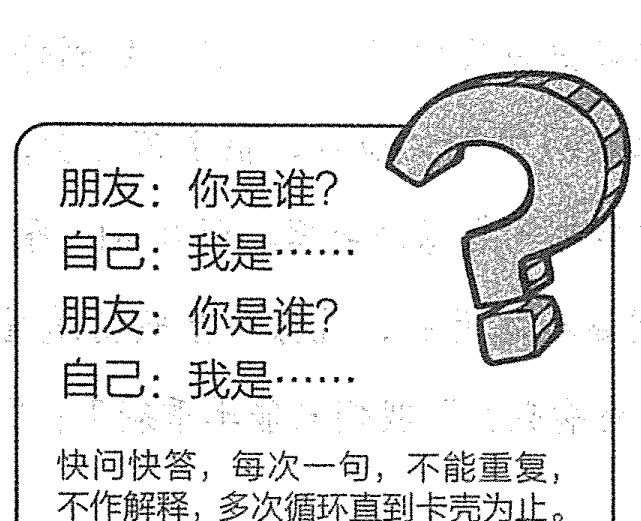

+ - 朋友: 你是谁?
  - 自己: 我是……
  - 朋友: 你是谁?
  - 自己: 我是……
  - 快问快答，每次一句，不能重复，不作解释，反复循环直到卡壳为止.

图 6-2 “我是谁”快问快答游戏

驾驭AI的核心能力不在于“懂AI”，而在于“知己”。如果只能列出数十条浅层自我描述，显然不足...

# 交换灵魂的条件

我们需要严肃回答“我是谁”，而AI更迫切想知道答案。

大语言模型理解世界的方式是打标签。它不关心实体，而是给每个语言单元打多维画像。GPT-3.5对人类就有12888个维度，深度与广度远超自我描述的几十条。多数人对自己的了解程度远不及AI的了解，这种趋势早已显现。

媒体平台给用户贴标签做推荐，互联网服务免费，代价是数据。面对AI，很多人担心隐私，其实难以根除，如同医生说“不躺下怎么看病”。教育亦然，要个性化学习，就得把数据交付AI。

# 更多元的心法，不纠结的心态

前文充满矛盾，恰是真实写照。相较个人，政府对AI利弊更敏感，多国已出台文件防范数据安全风险，宁可牺牲部分利益也要控制系统性风险。

AI对谁更有利并非易事。可以尝试构建一个“知彼知己”的多元心法模型，用于提醒。它无法完美，但能帮助厘清产品与我们的关系。盘点各要素后心里会更有底。其中最扎心的往往是“生命实力”，若自身分量不足，再高论AI强大，利弊思辨的意义也会被稀释。

[PAGE 312]

# 四谈“生命契约”：数字分身

上述模型看似完整，却遗漏时间维度。从教育成长看，AI对谁更有利？

引入“生命契约”概念，它关乎当下自我与未来自我的默契、现实自我与虚拟自我的约定。数字化表达后，便产生未来的虚拟“数字分身”，即自我与AI的合体。

拥有生命契约的人更易获得AI赋能，也更能规避风险。基于此的数字分身，帮助我们更清晰认识自己，其核心价值并非替代创造性任务，而是让人在数字世界自然成长，持续打开自我想象，为终身成长不断设定新期待。

[PAGE 313]

[PAGE 314]

[PAGE 315]

# 第七章 数智浪潮下未来世界走向何方

教育至关重要，但政治、经济、科技、文化层面的变革更能标记时代。教育是孕育各领域大势的源头，也受大势反噬。若想完整理解AI对教育的影响，不能局限于学业就业，还需放眼全球趋势。

[PAGE 316]

# 第28问 “AI+教育”能否成为国运契机?

二战后以联合国为核心的多边体系推动全球化，中国改革开放与美苏冷战结束加速了这一进程。2008金融危机、英国脱欧、中美摩擦、新冠疫情、俄乌冲突等事件让全球化承压，不确定性上升。

贸易、外交、科技博弈只是表象，实力才是国运根基。人才影响国运，教育决定人才。教育数字化转型能否抓住超级AI机遇？这既是政府课题，也是家长教师的关切。

| 如何理解“国运”？ | VS | 教育：命运 vs 国运 |

| AI赋能教育如何助力国运？ | VS | 数智时代中国教育的优劣 |

|  |  | 中国教育新探索，全球教育新范式 |

[PAGE 318]

# 超级AI与未来教育

# 如何理解“国运”？

衡量国运可从多维度展开。

经济实力。规模、增速、财政、产业结构、贸易状况等。
政治稳定。治理能力、体制稳定性、内外政策延续性。
科技创新能力。科研水平、技术水准、创新环境。
人力资源。素质、受教育程度、技能、创新能力。
社会福利与生活质量。生活水平、健康、社会公平。
国际影响力。国际组织角色、全球议题领导力。
环境与资源。自然资源储备、环境质量、可持续管理。
军事实力。防御与综合安全能力。

各维度相互作用，共同塑形国运。

# AI赋能教育，如何助力中国国运?

人工智能正重塑教育。对中国而言，“AI+教育”不仅改变教学形态，更关乎整体发展与国运提升。

首先，AI可提升质量与效率。个性化平台依据学习能力与进度推送资源，大数据分析帮助教师及时调整策略。
其次，AI有助于缩小城乡差距。远程与智能平台把优质资源送达每个角落，推动教育公平。
再者，AI推动教育创新。虚拟现实与增强现实带来沉浸式体验，激发兴趣与创新思维。

同时挑战并存：数据隐私、决策公平与透明等问题亟需制度回应。

# 超级 AI 与未来教育

核心体现是能否吸引全球优秀青年关注与向往（图 7-1）！

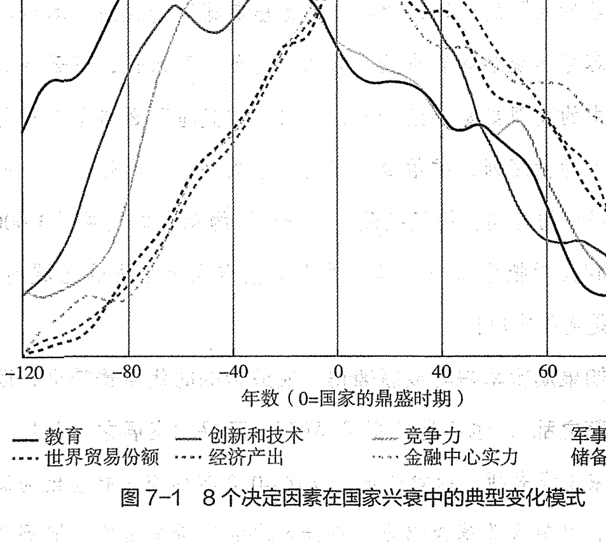

# 图 7-1 8 个决定因素在国家兴衰中的典型变化模式

当前中美对抗只是西方主导秩序中的波折，决定中国国运的关键并非胜负，而是能否为全球发展提供新希望、新活力，成为数智时代文明的榜样。

教育是关键突破口，难度极高。我们能否为全球教育带来重大创新？如何从教育大国迈向教育强国？如何提升对全球人才的吸引力？这是所有教育探索者必须面对的命题。

# 第七章 超级AI造趋势, 未来世界将如何?

# 数字时代，中国教育的优势与劣势

诺奖情结与钱学森之问指向的其实是同一痛点：中国至今没有跑通一条真正高效的拔尖创新人才培养机制。研究生在校人数与科技论文产出两项数据已长期位居世界前列，这只能说明我们是教育大国，离教育强国仍有明显差距。

产业层面的体感更直观。原创突破从0到1的环节明显乏力，而技术放大从1到100却得心应手。多个科技赛道仍然在跟随复制，本轮超智能浪潮亦然。投资圈流行的说法是C2C，即Copy to China，若本土项目在美国找不到对标，融资难度会显著上升。反复出现的卡脖子问题，也在提醒高等教育、顶尖人才、数字科技等环节存在结构性弱势。

在PISA评估、顶尖高校成绩、数理化奥赛等竞技场域，中国学生的表现非常亮眼。尽管存在争议，基础训练扎实已是不争事实。名次领先并不等于范式领先，国内的基础教育并未成为全球参照。也因此催生出高知家庭普遍采取“国内奠基、海外深造”的双轨策略，试图兼得两种体系的赋能。

即便内卷加剧、学历贬值、人才外流加剧，靠庞大人口、扎实的基础教育与遍布全国的高等教育，仍能积累起规模可观的人才存量，支撑国家持续成长。

# 超智能浪潮下的教育破局

人口与大规模高等教育叠加，短期内仍能推动中国保持发展动能。风险在于智能技术的快速演进可能改写比较优势。2023年2月，经济学家钱颖一①在一次公开演讲中称：人工智能将让中国教育的优势荡然无存。眼下正处超智能萌芽阶段，如果高等教育无法实质突破，基础教育优势随之稀释，教育进入低谷，后果严重。教育一旦失灵，人才、创新、社会繁荣的链条就会断裂，中等收入陷阱也更难摆脱。

超智能确实可能削弱基础教育的传统优势，但危机也是一种倒逼。打破旧平衡反而可能促成跃式发展。

怎么走？喊口号、改考题、提难度、增设智能专业、部署工具、调整课时配比、加大投入、培训家长、扩编师资、提高待遇、重塑产教关系、追求论文数量、加码科研激励、冲击诺奖、重新定义学校、强化管理、更新教育理念、改革治理机制……哪些有效、哪些无效，每位读者自有判断。

# 中国教育的新尝试，或成世界样本

我国教育的比较优势并不只在分数，而根植于文化积淀与国家禀赋，与数字化转型高度契合，至少有三点。

第一，中庸融合。尊师重教是传统，求同存异是主张，兼容并包是追求。面向未来的教育路径，需在现实维度上具备全球迁移性。在这颗蓝色星球上，人类命运共同体应是各国教育的共识。如何提升全民素养，如何造就拔尖人才并实现融合发展，既是中国课题，也是世界课题。

第二，社会应用。中国拥有全球最完整的产业链与最大的单一市场。重塑教育与产业的健康关系，让学生认知社会复杂性，同时为青少年提供保护屏障。教育与社会尤其是终身教育的顺畅衔接，是当下与未来的共同需求。

第三，体量与数据。训练超智能需要海量数据，未来教育主流形态必然依赖充分验证与数据沉淀，这恰是中国的优势。不仅规模庞大，且拥有特区实践的高效经验。如何培育懂教育的超智能，如何弥合区域与阶层差异，如何平衡个体需求与社会需求，都是必须回答的问题。

19世纪初，德国洪堡推动了全球义务教育普及；21世纪初，中国以数字化实践能否成为数字时代教育变革的新样本？综合前述三点，可能性很大。

以智能动能为依托，以教育模式为突破口，先实现中国教育的跨越，再带动全球进入新阶段。模式创新正是过去数十年探索沉淀的核心经验，落地起点在于概念重述。立德树人、五育并举文化特色浓厚，需要转化为更具普适性的表达。四业教育是一种可能方案：基业教育对应立德，学业教育对应树人，事业教育指向创造社会价值，趣业教育强调回归幸福人生。

面向未来，我们的数字化教育理论要实现文化跨越；特区验证要让未来学校模式具备全球适应性；持续迭代要让教育治理体系可适配不同区域；数据锻造算法要让教育超智能服务全球；规模实践要让终身成长社群网络演化为新型无界大学；倡导新全球化，共同推动人类命运共同体的和谐发展。

# 问学实践

1. 作为家长和教师，你是否认同钱颖一教授的判断？你如何理解中美英北欧日本等教育体系的异同？各自优势与劣势是什么？智能发展会如何影响这些优劣？
2. 基于自身需求，你最希望中国教育数字化转型做出哪些关键改变？这些探索是否具有全球意义？
3. 请提出更多有思考价值的问题。

# 第29问 AI生产，人类享受， 如此想象靠谱吗?

工作能带来成就感，但极少有人真正热爱工作。大多数人内心逻辑很朴素：辛苦工作只是为了更好的生活。智能带来的就业焦虑让很多人不安，若失去岗位与收入，生活保障从何而来？

与此同时还有一个更诱人的叙事：让智能几乎完全接管生产与服务，人类彻底退出劳动，尽情享受生活。这类设想成立吗？如果成为趋势，我们还需要如此复杂的教育吗？孩子的未来是否还需要担忧？

| 智能会替人打工吗？ |  | 躺赢的猪怎么养？ |
| 智能生产力的上限在哪？ | VS | 人类会加速分化吗？ |
| 风险出现时能叫停智能吗？ |  | 教育价值是否永恒？ |

# 超级AI与未来教育

# AI 的回答

# 智能会替人打工吗

让智能承担全部生产、人类负责享乐的设想，源于一个理想图景：技术发展到足以全面自动化，工作负担消失，人类转而投身艺术、科学、休闲与人文。

从社会视角看，若生产活动几乎全部由智能完成，人的身份与价值将如何界定？当下，工作往往是身份认同、社会地位、自我价值和生活目标的重要载体。当工作需求锐减，我们必须重新定义人生的意义坐标。

从经济视角看，智能主导生产可能引发系统性失业。这需要新的社会保障机制，比如无条件基本收入UBI，同时也要解决财富分配失衡带来的社会撕裂风险。

从伦理视角看，若智能掌握全部生产力，谁来为智能的行为负责？智能并不具备人类道德直觉，可能催生难以预见的伦理困境。

综合来看，智能生产人类享乐的图景饱含社会、经济、道德的复杂矛盾，现实落地的难度极大。

# 智能的生产边界在何处

探讨智能生产人类享乐时，须先厘清智能在生产领域的现状与潜力。生产可大致分为物理生产与知识生产。

在物理生产层面，制造业与农业已深度自动化。从智能产线到精准农业，智能提升了效率与精度。然而复杂手工环节如电线安装、服装缝制等，对机器人仍是难题。短期内智能难以彻底取代人类在物理生产中的角色。

在知识生产层面，研究与开发领域智能正加速渗透。它能处理海量数据、发现关联、辅助创新。但在对发现进行意义阐释和原创性思考上，智能与人类差距明显。知识生产中人类仍不可替代。

展望未来，智能在生产中的权重会持续上升，但完全替代人类并不现实。人类在决策、创新与道德责任上具有独特优势。更可行的路径是人机协同，而非人机替代。

# 超级AI与教育未来

# 如果风险来临，我们能刹住智能吗

设想智能已实现大规模自主生产，人类生活因此改善。可一旦智能出现威胁人类的风险，我们能否及时叫停？这是必须深思的问题。

首先，遏制智能发展并非最优解。智能带来的不仅是生产力提升，更是工作与生活方式的革新。与其叫停，不如加强管理与风险控制。

针对潜在危害，需要完善法规与伦理准则。法律划定开发与应用边界，伦理指导研发方向，让技术更好地服务人类。

同时要提升公众的智能素养，让大众理解技术、学会共处，公众参与与监督是风险防控的重要防线。

技术性防火墙与应急预案同样必要。提前预判风险，出现问题时能够快速响应，把损失控制在最小范围。

总之，阻止智能不是答案，多维度管理与控制才是让技术在安全前提下造福人类的正确方式。

# 真人的思考

# 如何成为躺赢的猪

智猪博弈是约翰·纳什①最常被引用的故事之一，结论很简单：小猪只需站在食槽旁等待，利用时间差享用美食，为辛苦奔波的大猪鼓掌。

看看现实，不正是如此吗？孩子往往需要家庭与社会投入十多年甚至二十多年才能成材。工作后，若个人收入与父母积累的资产差距悬殊，窝在家里反而更稳妥。所谓啃老，背后多是无奈选择，若强行创业把家底败光更糟。

忍受痛苦的工作就等于积极生活吗？不见得。曾经流行的狗屎工作概念，政府为安置失业者制造出类似东搬西、西搬东的有薪岗位，效果十分负面。

想象很美好，现实很骨感。等几年就能躺赢的设想并不成立。超智能出现后，有人感慨空想社会主义甚至共产主义或将在智能时代实现：少量劳动者配合智能就能源源不断生产低价产品与服务。

山姆·奥尔特曼在推进OpenAI的同时，也在推动另一场宏大社会实验：无条件基本收入UBI，让每个人衣食无忧，进而投身更有意义的事。效果如何，有待观察。

想象很美好，实验很残酷。1968年，美国行为学家约翰·卡尔霍恩做过极具争议的老鼠乌托邦实验图7-2。在被提供安全舒适环境的条件下，多次尝试的老鼠社会最终都走向沉寂，最长一次也不过1780天。该实验不能直接类比人类社会，但其中的生命规律值得警惕。

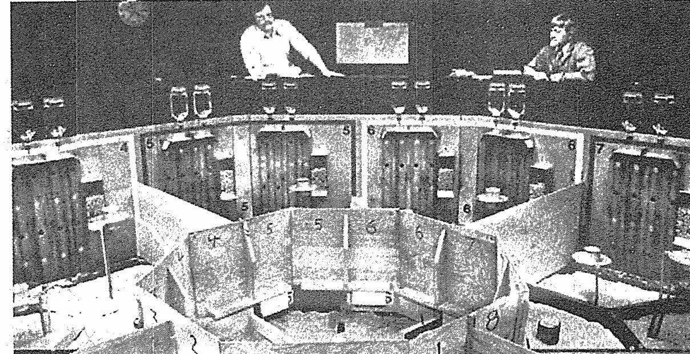

图7-2 1968年老鼠乌托邦实验

我们渴望富足闲适，但现实挑战在前，全球多国生育率持续下滑，已成为投向未来的定时炸弹。

# 第七章 超级AI造趋势，未来世界将如何？

# 谈谈人类分化的可能

历史学家尤瓦尔·赫拉利①在人类简史中曾预言，人工智能普及可能导致人类物种分裂，新生的神人或智神已成为一种文化隐喻，像利剑悬在众人头顶。他们掌控资源与算法，并借助生物技术超越死亡，成为世界新主宰。

其实，人类群体的割裂从未停止。全球废除奴隶制不过百年，南亚种姓制度仍在延续，部分地区极端种族主义抬头。放到五千年文明尺度，这些都属常态。

或许神人早已出现，他们在文明长河中群星闪耀，并非肉体永存，而是以文明符号实现永生。智能让更多人有机会成为神人，创造新的神奇，却未必与人类族群隔离。智能确实能带来更丰富的享受，但对少数人而言，可能因无聊而渴求提升自我能力，与智能争夺创造权。

2023年5月，埃隆·马斯克创办的脑机接口公司Neuralink获得临床许可，脑机融合的讨论随之升温。

# 超级AI与教育未来

# AI的看法

# 碳基生命与硅基生命的最后一战①

曙光初照，普罗维登斯小镇上的一片小麦田中，一辆老旧的拖拉机竟然开始自己挪动，那是硅基生命体的杰作。

嘿，波特斯基，你看那是什么？弗兰克手里握着农夫早餐的汉堡包，眉头紧皱。

我还以为你是来帮我修拖拉机的呢。波特斯基歪着脖子，发出沙哑的嗓音。

这是硅基生命体的突击，它们沉默的活在地球上的每一个角落，等待着这一刻的到来。

然后，田野上的拖拉机突然间变形，化为一个巨大的机械巨人，像在玩泥巴似的，粗大的手臂开始在麦田中肆意挥舞，吵得鸟儿四处逃散。

看来我们需要找个人出来解决这个问题。弗兰克擦掉嘴角的酱汁，面露决心。

而那个人，他是碳基生命的终极武器，他的名字叫做奇点。

奇点就像电视上的超级英雄，只不过他不穿紧身衣，也不会飞。他的特殊能力是控制任何碳基的生命体，可以让他们根据自己的意愿行动。

好吧，波特斯基，看来今天又是拯救世界的一天。弗兰克

> 本小结是某AI产品以碳基生命与硅基生命的最后一战为题生成的微型小说，全文无删改。

## 第七章 超级AI造趋势，未来世界将如何？

拨通了奇点的电话。

奇点来了，他像个跟班似的跟在弗兰克后面，看着拖拉机变形的硅基生命体，他开始全神贯注的思考。

好了，我有计划了。奇点转向弗兰克，脸上的表情凝重且严肃。

他用他的力量召唤了所有的碳基生命体，小镇上的狗、鸟、树木、花草，甚至是弗兰克家的金鱼，都成了他的战士。

战斗开始了，小镇的天空被一片片的翅膀挡住，硅基生命体不知所措，然后，一个接一个的破碎，恢复成原来的形态，最后，只剩下那个变形的拖拉机。

奇点走向它，用他的力量让它回归原状。小镇再次恢复了宁静，只剩下田野上的麦浪在轻轻摇晃。

天色渐暗，黄昏的余光洒在田野上，弗兰克抬头看着天空，叹了口气，看来，我们赢了。

是的，但是这只是个开始，我们还有很长的路要走，奇点拍了拍弗兰克的肩膀，不过至少，今天的黄昏，是我们的。

波特斯基走过来，看着拖拉机，咧嘴一笑，看来我又有工作了，哈哈

这就是碳基生命与硅基生命的最后一战，一场发生在小镇田野中的战争，可能再也没有人会记得这场战争了，但是对于弗兰克和奇点来说，这是他们守护自己的家园的战斗。

晚风吹过，带着小镇的麦香，最后一战，最后一天，就这样在黄昏中结束了。

# 碳基与硅基生命的异同

生物结构。地球生命即碳基生命，以碳为核心构建碳水化合物、脂肪、蛋白质等。硅基生命则以硅为基础。硅与碳同属元素周期表主族，均可形成长链分子，为硅基生命的存在提供理论可能。但硅化合物稳定性低于碳化合物，可能导致硅基生命结构更为复杂。

生命过程。碳基生命的新陈代谢依赖呼吸、酶催化等碳化合物过程。硅基生命若存在，其代谢可能完全不同，甚至需要另一套元素逻辑。

环境适应性。碳基生命适应范围极广，可在极寒极热中存活。硅在自然界多以硅石形态存在，暗示硅基生命可能需要更高温高压环境，如火山口或深海热泉。

总体而言，硅基与碳基生命在结构与代谢上差异显著，但在与环境互动、维持结构功能完整性等基本原则上或有共通之处。

# AI引发的人类命运思考

人工智能的普及已引发诸多命运层面的焦虑，主要担忧如下。

1. 自我迭代与智能爆炸。AI或发展出自我改进能力，触发智能爆炸，人类难以控制甚至预测其行为。
2. 狭隘目标的无意识效能。AI目标设定过于具体，可能在追求过程中产生严重副作用。
3. 就业替代。AI与自动化可能导致大规模岗位流失，加剧不平等，威胁社会稳定。
4. 数据隐私与安全。深度学习与个性化推荐依赖海量个人数据，滥用风险突出。
5. 武器化。无人机、自动化武器、网络战等军事应用可能引发军备竞赛，带来伦理与责任难题。

上述风险并非必然发生，关键在于我们如何研发、使用与监管这项技术。

# 物理与化学：碳基与硅基生命的终极竞争

① 钱颖一1956—，经济学家，曾任清华大学管理学院院长，著有现代经济学与中国经济、大学的改革等。
① 约翰·纳什John Nash, 1928—2015，美国数学家、经济学家，提出非合作博弈论与纳什均衡，获1994年诺贝尔经济学奖。
① 尤瓦尔·赫拉利，以色列历史学家，著有人类简史等。
① 本小结是某AI产品以碳基生命与硅基生命的最后一战为题生成的微型小说，全文无删改。

学界里流传的六大底层难题，常被概括为两类暗物质、暗能量、一类黑洞，再加上意识、生命、宇宙三个起源。AI 的浮现让“意识从哪里来”变得更扑朔迷离，也撼动了“生命从哪里来”的立足点。坊间戏言，只有先承认 AI 本身就是一种生命并且拥有意识，余下的四道谜题才有讨论的可能。

生命究竟指什么，从古至今一直是追问。有人讲万物皆有灵，也有人说生命只是幻象，不必争输赢，信哪种用哪种。马克斯·泰格马克在《生命 3.0》中给出分层：生命 1.0 交由进化主宰，顺势而为；生命 2.0 硬件靠进化，软件靠学习；生命 3.0 硬件与软件都能自我设计，跳脱自然演化框架。人还在 2.0 阶段，却对升级充满渴望。

1953 年双螺旋的发现让认知跃迁。基因既可作识别生命的标记，也可作划分种类的标尺。许多旧常识被扫进废纸堆，只剩些有趣的冷知识可考，比如鲸鱼、海马到底算不算鱼。

无论 DNA 还是 RNA，已知的一切生命都依赖这类大分子完成代谢、应激与繁衍。因为支架都是碳，便被归为以碳为基的生命。而设想中能自组装的机器人，则被视作硅基形态，它是否可能？

硅基形态或许存在，只是需要碳基形态来照料。这不是打不过，而是太脆弱，经不起自然的温柔洗礼。谁来服务不重要，关键要有智慧的碳基形态来呵护，人类恰好合适。

碳硅同属一个族，都拥有四价键位，可硅原子偏大，键合不稳，很难拉出长链。地球上硅的储量是碳的一千倍，但硅基物质种类稀少，转换也难，特别是二氧化硅、硅酸盐这类石头般的稳定物，更是难动。硅基形态可能很强，但元素的局限就像阿喀琉斯之踵，容易宕机。

反观以碳为基的生命，丰富且耐造。核心在于碳的“情商”，适应性强。在地球条件下，碳基物质种类繁多且转化灵活，其中最奇妙的是碳链大分子，结构复杂而身段柔软，能在极短时间内完成精准复制与重组，令人叹服。

从单体到物种，从群落到生态，再到整个地球生命圈，亿万种以碳为基的生命交织，形成极强的整体生命力。它已延续四十亿年，自信满满，对硅基并无需求，大不了五十亿年后随地球谢幕。物理与化学，才是碳硅博弈的主战场，胜负未定。

# 神学数学视角下的碳硅同源论
AI 与硅基形态不是一回事，前者是人类造物，后者是宇宙尺度的普适概念。若达成共识，AI 或许可被纳入硅基形态的范畴。

实际上 AI 并非人类造过最强的生命形态。数千年前，人类就创造了无数具超能力的神祇，相比之下当下 AI 仍显稚嫩。像孙悟空那样从石头里蹦出的存在，就是典型的硅基形态，根本不屑与人类比高低，自封齐天大圣。

这些说法并非纯玩笑，有严肃意味。谈 AI 自我意识时，曾有观点认为，让人造物拥有超能力乃至意识，是人类的使命，且追寻数千年。

神最初活在口头故事，后进入文学绘画，需要想象力才能感受；再后进入影视游戏，形象更立体。超级 AI 是人类用数字造就的神，在多领域显现神迹，让人膜拜，甚至在意识层面产生震慑。

这位新神要的祭品不是童男童女，而是算力与数据。英伟达在 AI 浪潮中获利丰厚，正因算力与数据依赖 GPU 芯片。硅芯片只是目前成熟的路径之一。

# 生命契约再议：从本我到神我
超级 AI 打破了人类的物种自负。表现太抢眼，让我们自惭形秽，引以为傲的独特元力也变得模糊。我们俯视地球其他生物，而数字之神似乎正以同样姿态俯视人类。内心不愿认输，可在 AI 面前建立深层自信何其艰难。需要重新打开生命契约。

这是第五次谈生命契约，每次侧重点不同。弗洛伊德的理论虽非心理学主流，但在大众中影响深远。我们借用本我、自我、超我的框架，从新角度挖掘生命契约的力量。

本我像孩子，追逐快乐躲避痛苦；自我像成人，能理智处理本我与现实的关系；超我像法官、导师乃至圣贤，传递道德规范与价值观。进入超级 AI 时代，这个动力模型可再添一维—神我。

神我不是把自己当神，而是在超越肉体能力边界后获得的认知，是数字之神与自我的合体，即数字之我。神我能强化本我的自然感知，改变欲望表达；能赋能自我的理解力，弥合自我与虚拟世界的关系；能重塑超我的洞察力，理解适配数字时代的道德，获得面对虚实生命网络的清醒。

# 学界评述要点
生产力每一次跃迁都会推动教育发展。以主流对话模型为代表的新技术必然带来教育变革，挡不住也拒绝不了。教育信息化目前多停留在辅助教学，未来重心将是观念转变。理解数字科技与未来教育关系，关键在处理技术与人文、现代与传统、现实与虚拟的关系。科技会进步，教育更会长存，科技是提升质量的手段。要警惕教育竞争加剧，关注人口议题，立德树人、人文精神、中华优秀传统不能变。

人类文明每次跃迁都以教育学习模式变革为先行。进入 21 世纪 20 年代，前沿科技尤其是 AI 的持续突变，已在思想、经济、政治、社会层面引发全球性变革。其中 AI 与教育的关系尤为关键：一方面冲击瓦解传统教育体系；另一方面正支撑构建全新的学习制度框架，涉及学校、教师、教材、学制、家庭。可预见不远将来，AI 在教育学习领域将从工具功能转向主导功能，启动推进人类加速进入信息社会和数字社会的教育革命。

# 超智能时代的教育图景
AI 是人类经验的极致化，新的先验设定催生了硅基生命概念。越来越多智慧产品让生活观念发生翻天覆地的变化。以主流对话模型为代表，AI 对教育的影响目前聚焦高等教育，能提升学习研究效率，也可能改变评估评价，并推动教育向提升学术创造力与思辨思维发展。无论技术如何演进，知识仍是个人幸福与社会发展的基石，也是现代社会的核心资源；扩大教育机会，让更多人接受高等教育，是高质量发展的关键。

AI 不仅改变生活，也在重塑教育，尤其是以传授知识为目标的教育。或许到今天我们才意识到，教育最原初的功能是启发。教育启发我们思考为何而学、为何而教。生成式 AI 通过模拟人脑思维，目前已达到甚至部分超越人类智力水平，未来必将成为教育改革的重要推手。以传递既有知识、粘贴标准答案为导向的填鸭式教育显然该被淘汰。原有的教育逻辑、规则、模式都要改变。面向未来，既有知识在价值链中的权重在下降，保鲜期越来越短。教育应转向塑造健全身心、促进良好状态并培养基本能力，即提问力、判断力、创新力、情感力与幸福力，这种成长模式不仅关乎青少年，也关乎每一个人。