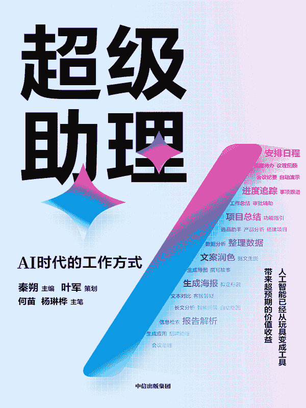
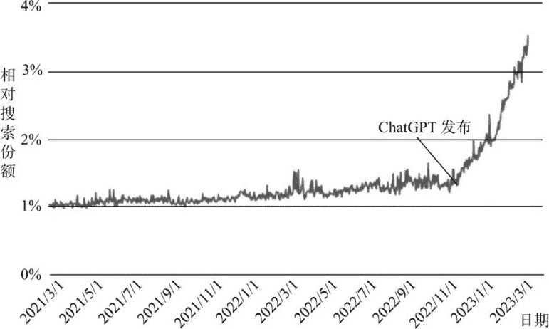
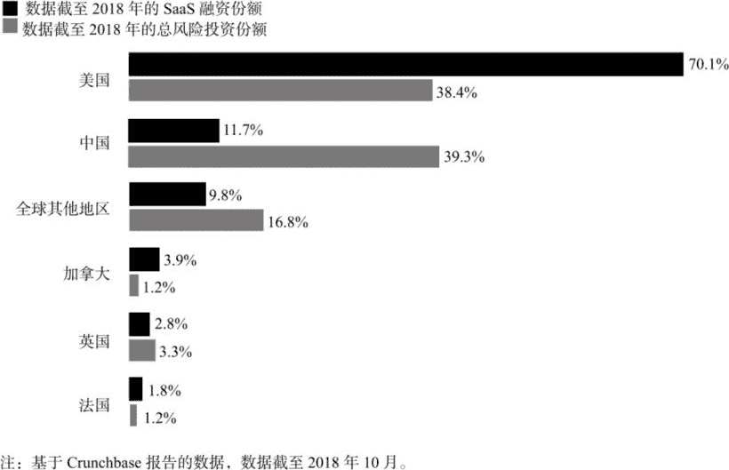
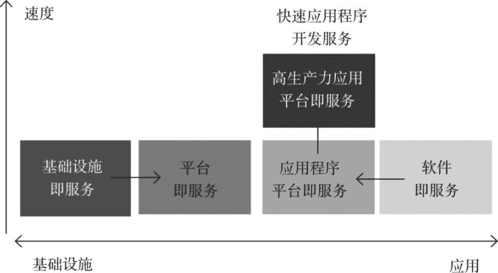
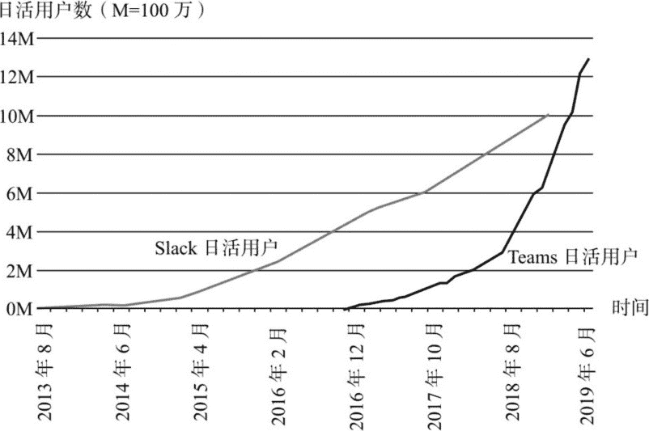
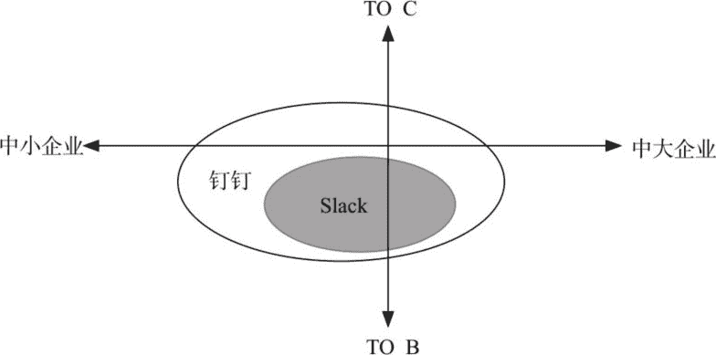
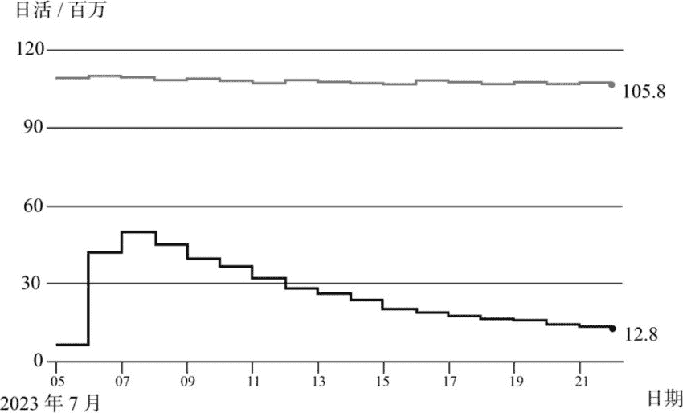
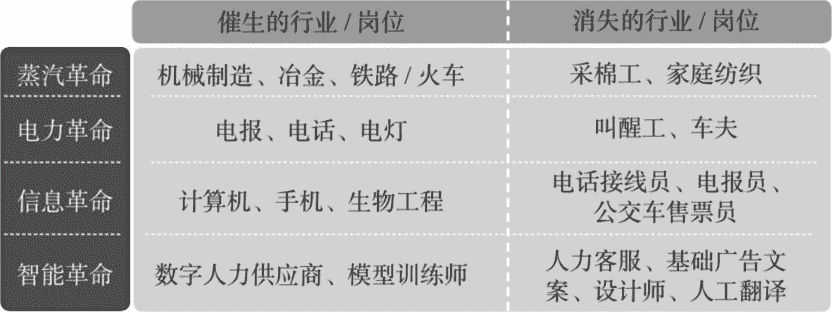

# 重塑工作范式：AI时代的超级助理

# 编著团队

总策划：

叶 军 秦 朔

总执行：

宋 菁

核心撰稿：

何 苗 杨琳桦

参与成员：

韩 祎 何晨曦 何小芳 宋燕子 吴锦波 张 睿 张芷然

业务指导专家：

程操红 傅徐军 高 铎 贾 伟 李 伟

李智勇 林 锋 齐俊生 邱 达 王 铭

吴振昊 熊伟熠 杨 猛 叶周全 赵加雨

赵 中 周 鹏 邹茂顺 （按姓氏拼音排序，排名不分先后）

# 序言

## 开启一场令人振奋的办公新纪元

秦朔

### 历史长河中的办公进化

一部人类文明与生产力跃升的历史，本质上也是信息传递、人际协作以及劳动工具不断迭代的历史。

若将劳动生产纳入广义“办公”范畴，人类史可谓半部办公史、半部生活史。从办公视角审视，人类之所以能改造自然、圆梦理想，关键在于：通过专业化分工协作，持续孕育更优工具与生产模式，进而创造更美好生活。只要创新不止，这便是永无止境的征程。

人类进步的引擎取决于双轮驱动：一是协作规模的扩张与秩序的优化；二是生产工具、模式的进化。组织效率越高，工具效能越强，社会生产力便持续向前。

步入信息时代，这一铁律呈现新形态。

1993年，美国未来学家乔治·吉尔德引用3Com创始人梅特卡夫之名，提出公式：`V=K×N²`——网络价值等于节点数平方，与联网用户数平方成正比。 ^(¹)

信任因子

2018年前后，微软CEO萨提亚·纳德拉提出“技术强度”概念：`技术强度 = 技术应用 × 技术能力`。新冠疫情催化数字化浪潮中，公式演进为：`技术强度 = (技术应用 × 技术能力)^(信任)`。其核心意涵：以掌握技术能力、落地技术应用为基座，以对创新的充分信任为指数加速器，将成为未来经济增长的关键动能。

2020年，纳德拉在演讲中将技术强度、企业韧性与数字化转型深度绑定。他指出：组织若想在不确定性中胜出，必须赋能员工、重塑混合办公、革新客户交互、转型商业模式、保障安全，这需要用数据构建生生不息的循环，实现数字化转型与企业韧性重塑，这就是技术强度的实战逻辑。

纳德拉主张，云计算、AI等工具应普惠至每一位知识工作者、一线员工及各类组织，方能实现技术强度的“全民化”，让全民开发者共享核心能力、数据与信息，打破孤岛、跨越边界、激荡创新，达成“普惠经济增长”。

时至今日，无论个体产出还是协同效能的提升，都深度依赖数字技术。数字化平台、技术、工具，已成推动人类进步、创新与普惠发展的基石力量。

### 组织进化的数字化答案

1937年，罗纳德·科斯在《企业的性质》中指出：企业本质是价格机制的替代品。企业外靠市场交易协调生产，但发现信息、谈判、签约皆有成本；企业内由企业家指挥调度，可节省部分市场成本。

然而，企业内部沟通、交易成本同样巨大，失控即生“大企业病”。因此，企业必须借助办公自动化、流程化、扁平化、协同化工具及组织变革，极力压降内部交易成本，保持敏捷高效。

高效协同与灵活响应的数字化办公能力，正是打造基业长青企业的必修课。

拥有中国最多企业用户的钉钉，勾勒出当下的数字化办公图景：

杭州一小学的校长感叹：以往期末打印奖状累坏打印机，如今用钉钉低代码工具搭建系统、生成电子盖章，家长秒转朋友圈；
女装品牌老板娘分享：全国2000+门店，货架传感器捕捉试穿数据，她每日据此决策补单款式；
上海三菱电梯负责人介绍：维修工曾背百页图纸奔波档案馆，今问钉钉机器人秒调施工图，维修周期从2周压缩至3天；2022年春上海封控期，全体系日均开“钉闪会”近200场，业务不停摆；
新疆昌吉东方希望重化基地：大门摄像头自动核验人车货，系统调度排队、过磅、卸货，守门人力从几十人降至寥寥数人。

钉钉总裁叶军最欣喜的是见证平台对草根创业者的改写：昔日创业先租办公室，今三两人有了创意，先在钉钉建组织，随即开工。

这些鲜活案例昭示：**数据驱动已成新生产、新办公时代的核心标签。** 组织在线沟通，业务数据在线聚合分析，产业链上下游与消费端在线连接。

上一代中国制造“洗脚上田”，用工厂改变中国；新一代则执“数字导航”，用数智工具重塑中国。

### 智能革命的惊涛拍岸

新革命正酣。短短一两年，ChatGPT横空出世，AGI加速演进，数字化办公革命迅猛向智能化纵深迁徙。叶军直言：“AI已从玩具变工具，深入千行百业，成为降本增效的生产力利器。”

这波浪潮中，美巨头再立潮头。

比尔·盖茨博客撰文：AI指创建解决特定问题的模型。ChatGPT是1980年以来最具颠覆性的进步（上一个是GUI），全行业将围绕它重构。企业将因深度用好它而脱颖而出。

盖茨预判：算力愈发廉价，ChatGPT将如拥有一名白领助理，懂自然语言，跨设备运行，读邮件、知会议、读文档、代劳琐事，让人聚焦高价值任务。企业级Agent将赋能员工，大幅跃升生产力。

纳德拉强调：AI带来最自然的UI——让计算机懂人，而非人懂机。除自然界面外，更拥有了“推理引擎”。二者合璧：一是多模态、多轮次、多领域的直观自然语言界面；一是能融合几乎所有软件品类、生产力工具、操作系统、浏览器的推理引擎。

此前纳德拉描绘的场景已成真：农民操作低成本无人机巡田，智能云边缘即时回传旱情虫害；车间工人借新技术监测钻头位移，保精密制造；医生跨越空间用AR虚拟会诊、共享影像、秒获数据洞察……

2023年3月16日，微软乘ChatGPT东风推出 **Microsoft 365 Copilot**。基于大模型，它能助力Word起草、Excel分析、PPT生成。纳德拉断言：如云计算重塑所有软件品类，AI将引发变革性范式转移，Copilot旨在提供智能化办公方案，依据输入输出个性化建议，助人高效完工。

彼岸智能化革命提速。

2024年2月16日，OpenAI发布视频生成王炸 **Sora**：输入文本，生成60秒超精细高清视频。标志着AI从图文突围至视频领域，将大幅降视频制作门槛成本，释放大众创作力。

同期，谷歌推 **Gemini 1.5** 系列。首发多模态通用模型 Gemini 1.5 Pro 支持单次处理70万+单词、3万行代码、11小时音频或1小时视频。得益于“混合专家模型”（MoE）架构，按需激活部分参数，响应更快、推理更轻。

AI技术汹涌迭代，为智能办公筑起强力底座与推手。**智能办公时代，呼之欲出，近在咫尺。**

### 中国路径与钉钉样本

在数智化浪潮中，中国走过怎样的路？将向何处去？《超级助理：AI时代的工作方式》以钉钉实践为经，以全球办公革命史为纬，勾勒出一部振奋人心的创新画卷。

2024年，钉钉诞生9周年。其前身是曾力抗微信的“来往”。虽未成，但团队未放弃，转攻企业通信，2015年打造出专攻移动沟通协同的多端平台。

借移动互联网东风，2015-2020年钉钉积累3亿用户。初靠免费电话、DING一下、已读未读切入；继靠OA、音视频会议、钉盘深耕协同。

2024年前，钉钉历经7次大版本迭代，核心使命始终一致：**降低中国企业数字化门槛。** 作为长期观察者，我多次调研钉钉、深度对谈高管。他们眼中，中国企业数字化三部曲：组织上线 → 业务数字化 → 产业互联（企业间数字协同）。钉钉7版本精准对标演进，层层跃升。

为何钉钉能成中国企业数字化的“平台级底座”？

须溯源中国软件产业史。中小企业起步晚、付费弱、乏习惯，“重硬轻软”，信息化水平普遍低，缺乏抗衡欧美SaaS巨头的强手。反观欧美，漫长信息化积淀，软件定义一切，生态成熟。

但移动互联网与数字经济时代，中国自诞生强大消费互联网平台。虽起家于C端，却练就硬核能力：即时通讯、音视频、高并发稳态、安全防护。这些能力以极低成本（甚至免费）供给企业，先入门、单点破局、尝甜头再深入。消费端丰厚利润支撑平台耐心培育市场。

其中，钉钉因基因来自阿里，长期服务产业带中小微，对商业本质理解更深。阿里自带数字化运营沉淀（物连、人连、系统连），助钉钉早期站在成熟经验肩上，推企业从易上手处启动转型。

**最关键者：钉钉死磕基础平台建设，将海量应用服务交给生态伙伴。** 曾误入歧途做项目、做总包，终悟：钉钉使命是做好PaaS，打磨文档、音视频、项目、会议等基座产品，开放生态共创共享。

叶军曾言：光把基础做透已极难。适配鸿蒙等异构终端OS，动辄投入60名工程师耗时1-2年。基座筑牢，“屏蔽”了底层硬软差异，钉钉自身即成产业互联网“操作系统”。无数SaaS厂商借此高效触达用户，生态繁花似锦。

### “用AI重做一遍”的序章

2022年12月，钉钉发布7.0主攻企业间协同，用户破6亿。 ^(²)

深研后钉钉定两论：一、数字化核心价值未变（组织在线、业务数字化、产业互联）；二、AI能将这三步“重做一遍”——体验更优、成本更低、效率更高。且AI化≠仅大模型，涵盖大中小模型、垂直行业模型全谱系。

2023年4月11日，阿里发布“通义千问”，钉钉成首个接入产品。4月18日，一根斜杠“/”开启钉钉AI新纪元。

借“/”，用户在文档里拟标题、写诗、润色、生成海报；视频会议中开智能纪要，散会一键产出回顾、重点、待办；IM群聊自动生成摘要，新人免翻历史；低代码开发中，自然语言对话生成应用、迭代功能。

**“用AI把一切重做一遍”，大幕拉开。** 这根斜杠，俨然成钉钉智能化的超级入口。至2023年11月，经50万+企业内测，钉钉AI魔法棒正式上线。钉钉聊天、文档、知识库、脑图、闪记、Teambition等17款核心产品，60+ AI场景全面开放。2024年起，核心场景全面智能化。

钉钉一边AI重塑自家产品，一边开放 **AI PaaS** 赋能生态伙伴与企业客户“重做产品”。

案例：上海艾为电子。千款自主芯片、近千客户。每款配百页英文手册，含专业术语、表格、电路图、参数。客户咨询高频，配70-80名专家人工回复，耗时耗力。

基于钉钉AI PaaS，艾为共创专属模型，上线 **“IC智能客服”** 7×24秒级响应。大幅提升满意度，知识资产沉淀活化。

钉钉智能化最新进展：**与生态伙伴、企业共创 AI 助理（AI Agent）。** 办公场景碎片离散，但AI助理全天候陪伴，客观刻画画像，无形中完成标注。极度懂你后，精准施策。如写差旅申请，它自动调取企业差旅标准、限额数据给建议。这正是钉钉独有的**场景优势与数据优势**。

同时，钉钉推 **个人版**，切入C端。认定智能办公时代，人人需要“第二大脑”或知识中枢。对强办公属性个体，钉钉B端沉淀的知识、工具、伙伴资源，更利打造专属AI助理。虽AI助理非一日成熟，需慢磨细育，但其无限进化的学习力、记忆力，天然比自然人更适配办公。B端C端双轮驱动，钉钉似同时在做微信与企业微信的事。此模式前无古人，但值得探索：国内企微、飞书，国外Slack、Teams、Salesforce均纯To B；钉钉兼To C，可加好友、留存关系，非用完即走。这是独特机遇，也是复杂挑战，更充满想象力。

对企业家而言，大模型+自然语言对话，让他们能 **“一步登天”** 掌握实时人财物产供销。想知过去三月均销量、爆款是谁？直接问。提问越精准，洞见越深。

当下经济承压，但钉钉端组织创建依然高歌猛进：日增数千家，两三人即可注册，跨城分布式办公成常态。或因AI化发展，组织形态正变身 **“涌现型”**——随建随撤、随合随分、极速切换。预示社会分工服务进一步细分，个体决策效率与反脆弱性双升。组织虽压力大，但借数智技术，响应速度与韧性同增。

有大胆构想：智能时代或将绕过App边界，直达数据。未来无需海量App，终端仅需一个 **超级App** —— 打通数据互通、集成打车订房等服务，无跳转、无界面、唯一智能入口、极简操作、底层数据全联通。甚至绕过SaaS、PaaS、IaaS三层，用户直由AI层调用 **MaaS（模型即服务）** —— 一套MaaS界面+模型，解尽万千难题。届时，“不找关系找助理，助理帮你解难题”将成普遍图景。

未来已来。拭目以待。无论如何，这是一个最让人兴奋的新办公时代。我们无理由旁观，更无理由缺席。

# 上篇

## 从信息化迈向数智化

## 第一章

## 人工智能：蜕变·从玩具到工具

## 人工智能发展的第四阶段

# 生成式 AI 元年：从“分析世界”到“创造世界”的篡位之战

2022 年 9 月，就在全球风投机构准备向生成式 AI 倾囊而出的前夜，红杉资本抛出了一篇极具指引意义的长文——《生成式人工智能：创意新世界》。文中一句振聋发聩的判断，瞬间点燃了整个科技圈：**“AI 的杀手级应用即将诞生，比赛正式开始。”**

什么是生成式 AI？简单说，旧时代的 AI 是“分析高手”，擅长在既有数据里找规律；而新时代的 AI 学会了“创造”，能凭空生成从未存在过的文本、代码、图像与视频。红杉将这一演进历程拆解为四个清晰的阶段，而我们正站在第四阶段的门槛上。

## 回溯：四次跨越，抵达“创造力奇点”

**阶段一：小模型时代（2015 年前）**  
那时，参数量不大的“小模型”是 NLP 领域的 SOTA（State of the Art）。它们能跑预测 ETA、做风控分类，但让它们写篇像样的文章或写段能跑通的代码？做梦。表达能力的天花板，锁死了通用生成的可能。

**阶段二：参数军备赛（2015-2021）**  
2017 年，谷歌论文《Attention Is All You Need》祭出 Transformer 架构，并行训练能力质变，Scaling Law（规模定律）成为铁律。算力投入暴增 6 个数量级，模型性能在书写、听力、视觉、阅读理解上全面超越人类基准。GPT-3 横空出世，展示了少样本学习的惊人泛化力。  
**但痛点显而易见：** 模型太重、部署太难、推理太贵、访问太闭。除了极少数巨头实验室，没人玩得转。早期应用虽露头角，却像隔着玻璃看烟火。

**阶段三：普惠拐点（2022 年初-中）**  
扩散模型等新架构杀出，训练推理成本断崖式下跌；开源潮涌，权重开放、API 放开、开发者门槛归零。长期被关在门外的工程师们涌入，应用层迎来第一次“剑桥大爆发”。

**阶段四：杀手级应用时刻（当下）**  
基座模型趋于稳定、极速、低价、开放。红杉打了个极佳的比方：**这就像当年的移动互联网时刻——GPS、摄像头、常在线重构了手机，催生出 Uber、Instagram、微信。** 现在，大模型就是那个“新硬件”，下一个超级入口正在孵化。

---

## 导火索：OpenAI 的“防御性进攻”与硅谷的“达尔文时刻”

红杉下注的底气，源于 2022 年 4 月硅谷的一场地震——OpenAI 发布 DALL·E 2。

**起源：一场关于“物种存续”的豪赌**  
2015 年，马斯克与奥尔特曼领衔砸下 10 亿美金创立 OpenAI，初衷极其“科幻”却硬核：奥尔特曼 28 岁顿悟——人类并不独特，智能可被模拟，碳基生物的输入输出带宽（约 2 bit/s）在硅基面前是慢动作。博斯特罗姆的“回形针思想实验”警示他们：无价值观对齐的超级智能将毁灭世界。  
假想敌是 DeepMind。如果只有一家垄断 AGI，诞生的将是“不朽的数字独裁者”。  
**破局策略：** 马斯克提出“让所有人都拥有 AI”，以去中心化制衡超级智能。这直接奠定了 OpenAI 后来“卖 API、卖许可”的商业范式——**把核武器变成水电煤，人人可用，便无人能独霸。**

**爆发：DALL·E 2 点燃“艺术狂欢”**  
2022 年 4 月发布，7 月开放商用许可。硅谷朋友圈瞬间被 AI 艺术刷屏。但真正让资本心跳加速的，是随后几个月的“寒武纪大爆发”：
- **Midjourney：** 无官网，躲在 Discord 里，几个月攒下 300 万用户。创始人大卫·霍尔茨的一句话圈粉无数：**“这不是关于艺术，而是‘想象力的引擎’。汽车比跑得快，但人类没停止散步；我们只是获得了移动重物的新工具。”**
- **Stable Diffusion：** 开源核弹级炸场，Stability AI、Runway 等应用层公司瞬间站上舞台中央。

**预言成真：创造力的“逆序颠覆”**  
奥尔特曼的金句在推特疯传：“十年前共识是 AI 先替蓝领、再替白领、最后才碰创意。现在看，顺序反了。”  
就在那一刻，2022 年一季度全球风投总额环比下滑、美股崩盘的阴霾被撕裂——**生成式 AI 赛道的融资“咆哮着”杀了回来。** 红杉的判言应验：平台层就绪，应用层虚位以待，淘金热开启。

---

## 基建反击战：“模型即服务” 的中国答案与微软的豪赌

应用层狂欢背后，是模型落地的“最后一公里”地狱：门槛高、定制难、接口乱、无仓库。2022 年 11 月，两大巨头几乎同步给出了基建层的终极答案。

### 阿里云：把模型变成“水电煤”，建一座“模型万花筒”

云栖大会上，周靖人抛出 **“模型即服务”** 概念——**覆盖模型全生命周期（生产、管理、下载、部署、推理）的托管服务，让开发者零门槛调用。**

落地三板斧：
1.  **中心化仓库：** 牵头 CCF 共建 **ModelScope（魔搭社区）**，志在汇聚百模千态，做模型界的“GitHub/应用商店”。
2.  **数据算力底座：** 打通数据集、GPU/CPU 异构算力、加速引擎，解决“有模型跑不动、跑不起”的痛点。
3.  **犀牛鸟入巢：** 贾扬清现场演示钉钉接入大模型——实时作诗、实时画图，ChatGPT 式交互与 Midjourney 式生图一体化落地协作流。内部早已跑通，静待春风。

### 微软：最昂贵、最浪漫、最精准的“云端联姻”

比阿里早三年，微软已悄悄布局。

**2019 年 7 月，10 亿美金独家入股 OpenAI，换取 Azure 独家算力供应权。** 这不仅是投资，是纳德拉为云业务找来的“核动力引擎”。

**为什么是微软？为什么是 OpenAI？**  
- **OpenAI 的痛点：** 烧钱如流水，非营利架构发不了期权，抢不过谷歌/Meta 的人才。被迫重组设立“利润上限”子公司（早投 100 倍封顶，后投更低），奥尔特曼甚至不持股，只为兼顾使命与生存。
- **微软的野心：** 纳德拉出身云计算，深知 AWS 遥遥领先，Google 紧追不舍。他需要一个“独家杀手锏”拉动 Azure 增长。图灵模型自研太贵、太难商业化，不如直接绑定外部最强大脑。
- **交易结构极其聪明：** 大额投资以“Azure 积分”形式支付，OpenAI 白嫖算力，微软锁定超级大客户，顺手截胡了 Google Cloud 最大客户之一。

**后续动作教科书级：**
- 奥尔特曼搞定霍夫曼、科斯拉等硅谷大佬首投，确立商业化信心；
- 纳德拉推出 **Azure OpenAI Service（2021）**，将 GPT-3 等模型包装成合规、安全、企业级 API，直接打进 To B 腹地。

---

## 尾声：比赛才刚开始

从红杉的《创意新世界》，到阿里的《模型即服务》，再到微软与 OpenAI 的“双子星绑定”，一条清晰的主线贯穿始终：

**基模已成熟，基建在铺设，入口在争夺，杀手级应用——还在等那个“乌鸦喝水”的关键一击。**

历史不会简单重复，但总押韵。就像 2010 年没人能预见微信、抖音、美团的最终形态，2024 年的我们，也无法准确描绘 AI Native 应用的终局。但可以确定的是：**所有“分析”的存量生意，都值得用“生成”的增量逻辑重做一遍。**

赌局已开，筹码在手，拭目以待。

# AI奇点降临：当ChatGPT重写科技江湖剧本

2022年，技术准入的大门再次被推开。开发者们拿到了`DALL·E 2`、基于`GPT-3`的代码生成神器，以及翌年初面世的`GPT-4`。这一连串动作，为后来的剧变埋下伏笔。

### 谁能分走AI这块蛋糕？

历经周期的玩家心知肚明：每轮技术浪潮，初创势力与坐拥资源的巨头，在价值、营收、市值乃至人才争夺战中的分蛋糕比例，从来不是固定的。移动互联网时代，红利多被大厂收割；首轮互联网热潮，则造就了一批弄潮儿。

`Web3`与人工智能打破了这套二元对立。截至2024年，`Web3`的价值几乎全被初创公司揽入怀中，传统金融巨头集体缺席；而上一波AI浪潮，胜利果实又几乎被科技巨头独吞，创业者难觅踪影。

这引出了硅谷重量级投资人埃拉德·吉尔的终极拷问：**这轮生成式AI的红利，究竟花落谁家？** 这位曾独募6.2亿美元基金的“独行侠”VC，在博客《人工智能：初创企业与既有企业的价值对比》中直指核心——`GPT-4`的表现，将决定AI创业生态能否真正跑通。

他的判断极具穿透力：`GPT-3`虽好用，却未达“突破性”门槛，不足以孵化出一批规模级独角兽。但若模型能力再跃升5到10倍，将催生全新的创业生态，同时也会倒逼巨头产品进化。这番预言，精准锚定了随后`OpenAI`的爆发节点。

### 2022年11月30日：历史的拐点

这一天，`OpenAI`推出首个消费级生成式产品——`ChatGPT`。5天破百万用户，两月日活破亿。瑞银研报震惊地定性：**互联网20年，从未见过增长如此疯狂的消费级应用。** 对比之下，`TikTok`耗时9个月，`Instagram`耗时2.5年，`WhatsApp`甚至花了3.5年才触达同一里程碑。

这个“老少皆宜的玩具”，让深居硅谷的`OpenAI`一夜出圈。从科技媒体到时尚生活刊物，全球聚光灯同步聚焦，`OpenAI`的行业霸主地位由此确立。

但奥尔特曼不想止步于此。仅4个月后，2023年3月14日，`GPT-4`随`ChatGPT Plus`及企业级`API`发布，插件体系同步官宣。这意味者`ChatGPT`将打破孤岛，接入实时数据与外部服务，进化为超级入口。

### 纳德拉的抢跑与华尔街的狂欢

微软动作更快。2023年2月7日，纳德拉高调发布接入`GPT-4`的新`Bing`与`Edge`侧边栏，宣告“搜索新纪元”开启。多年来市场份额卡在10%以下的`Bing`，终于拿到了改写用户习惯的“变量”——实时信息优势（`ChatGPT`当时知识截止2021年）与自然语言交互体验。

舆论沸腾。英伟达黄仁勋高呼“AI的iPhone时刻”，方舟投资凯茜·伍德团队火速发布研报，绘制`Bing`+`ChatGPT`蚕食谷歌流量的图景（）。

**图 1-1 `Bing`+`ChatGPT`与谷歌的流量份额对比**

来源：`ARK`投资管理有限责任公司，2023 年，根据`SimilarWeb`在 2023 年 3 月 22 日的数据。

注：仅供信息参考，不应被视为投资建议、买卖或持有任何证券或加密货币的推荐。过往表现不代表未来结果。

方舟团队大胆推演：插件让`ChatGPT`化身应用平台，颠覆“跳转网页”搜索逻辑，直指谷歌广告核心与苹果App Store税收。他们认为，语言模型正以超指数速度进化，成长为新操作系统，让消费互联网巨头陷入被动。

### 现实的耳光与历史的注脚

事后证明，预测的大半细节落了空。`Statcounter`数据显示，新`Bing`上线两月，谷歌搜索份额稳坐93%宝座，`Bing`仅3%左右；`YipitData`监测到PC端份额仅涨0.25%。谷歌核心广告业务不降反增，Alphabet股价大涨。`ChatGPT`插件生态更是夭折，奥尔特曼半年后亲口承认：**除浏览器外，插件未找到PMF（产品市场契合度），无法成为超级入口。**

但方舟捕捉到的**历史转折点**判断，无人能反驳。那个节点，`OpenAI`的每一步，都在重塑人类远未来的坐标系。同一时刻，杭州的`阿里`早已在2022年11月提出“模型即服务”，酝酿着属于中国的AI新叙事。

---

## 第二章：钉钉的产品逻辑与时代红利

### To B战场的三道坎

2014年，`钉钉`虽出自`阿里`名门，其前身“`来往`”却在微信面前折戟沉沙。陈航带着6名工程师杀回企业通信赛道。彼时市场不缺ERP、CRM、财务软件，却极度稀缺面向中小企业的实时协作工具——大厂不屑做，小厂做不好。

2015年1月，`钉钉` 1.1.0测试版发布。陈航现场向全场观众拨打`DING`电话，鸦雀无声后掌声雷动。那一刻，中国移动互联网首次真正连通企业通信网络。

### 第一波红利：移动化浪潮

2007年`iPhone`问世，2008年双应用商店上线，移动互联网龙卷风席卷全球。2014年前后，中国移动网民超越宽带用户，流量指数级攀升。`钉钉`精准踩中节奏，围绕管理需求疯狂迭代，5年拿下3亿用户——平均4-5个中国人就有1个在用。

复盘可见，`钉钉`继承“来往”即时通信基因，精准击中**通用高频痛点**；免费电话、`DING`消息、已读未读三板斧奠定生存根基；随后`OA`、会议、钉盘构建协同护城河。2020年3月，用户破3亿。

### Slack的277亿估值与中美认知裂痕

同年12月，`Salesforce`以277亿美元天价收购`Slack`（约25倍PS，溢价15%+），创自家最大收购记录。贝尼奥夫圆了“CRM+社交”的十年梦。

`Slack`与`钉钉`同源于移动浪潮，共奉“沟通即协同，协同即业务”。但**美式逻辑是“业务先行，社交赋能”（Salesforce+社交），中式逻辑却是“社交先行，延伸业务”（微信/钉钉模式）**。根源在于：美国非流量大国却是SaaS强国；中国C端流量见顶，巨才倒逼向B端“处女地”进军。

数据极其扎心（）：2018年全球融资中美分庭抗礼，但SaaS赛道美占初创融资70%，中仅11.7%；亿元以上大轮融资，美15起，中仅3家4轮。

**图 2-1 各国`SaaS`融资差异**

### “中国不需要SaaS”与1亿天花板

2023年7月，暴文《中国不需要SaaS》刷屏创投圈：“8年了，做一家亏一家，没一家过得好。”直戳痛点——中国软件厂商普遍撞上“1亿营收天花板”，极少能突围高增长。

`钉钉`长期观察，提炼出To B市场三大顽疾。**首当其冲是使用频次极低**：客户月登1-2次，下次早忘操作；决策端对软件价值感知微乎其微。

# To B 深水区：钉钉如何跳出「规模陷阱」，啃下大客户硬骨头？

中国 To B 赛道的困局，归根结底是一场「两头受气」的博弈。

先看供给端：国内软件厂商全员「做项目」模式，交付周期拉得极长。初期从几十万冲到几千万营收速度极快，可一旦触及亿级门槛，管理混乱、销售内耗、交付拖沓、客户定制泛滥等问题集中爆发。企业只能靠「堆人」填坑，管理成本指数级上升，反噬自身发展。

再看需求端：中国企业上软件的学习成本高得惊人。客户要的不止培训，还有源源不断的定制、改版、维护，服务必须贯穿全生命周期。

结果就是死循环：客户觉得服务烂，厂商累得喘不上气，没余力提升服务，体验更差。

---

### 硅谷十年启示录：云与移动如何重塑帝国

回望 2009-2019，美国企业服务市场走出了一条截然不同的路径：**云计算落地 + SaaS 模式跑通**。

这十年是 Salesforce 成立后的第二个十年，也是其股价暴涨的黄金期。在此之前，微软凭借 CIO（首席信息官）掌握的集中采购大权，牢牢锁死大客户。逻辑很简单：一家供应商搞定全栈，维护成本最低，没人愿意为多供应商买单。

**两场技术革命打破了垄断：云计算 + 移动互联网。**

2008 年苹果、谷歌相继上线应用商店，iOS 与 Android 占领全球终端。「云 + 移动」组合拳，直接解放了 CIO 的运维负担，让采购决策从「以人为中心」变成了「应用商店里挑软件」。业务部门领导绕过 CIO，自主选型成为常态。

由此，美国迎来 SaaS「黄金十年」，Salesforce 以 CRM 切入，靠云端交付降维打击传统霸主 Siebel，让中小企业也用得起顶级 CRM。商业模式创新，成为其最大护城河。

但模式红利终有递减日。当全行业都上云，Salesforce 核心增速放缓，股价承压。为讲新故事，它开启疯狂并购模式：20 年 66 起收购，91% 集中在第二个十年，巅峰之作是 2021 年 277 亿美元拿下 Slack。

---

### 双极世界的碰撞：Slack 与钉钉的平行时空

美国是 To B 极致，中国是 To C 极致（14 亿人口红利）。2020 年疫情这只「黑天鹅」，催化「在线办公」与「降本增效」，让生长于移动浪潮之上的 Slack 与钉钉，在大洋彼岸隔空对撞。

**巧合的是，两者诞生仅差 10 个月：**
*   Slack 2013 年预览，2014 年 2 月正式发布，誓要「干掉邮箱」；
*   钉钉 2014 年底横空出世，直指中小企业沟通痛点。

美中沟通基建差异巨大：美依赖邮箱，中依赖 IM。这注定了 Slack 的爆发路径独具一格。

**独立观察家 Satya Van Heuman 揭示了 Slack 的「上瘾秘籍」——基于历史消息的商业模式：**
免费版只能搜最近 1 万条。超限即失语，产生社交孤立与职场焦虑（错过上下文 = 错过工作 = 错过晋升）。为破局，员工被迫高频刷屏，半夜周末不放手。信息量指数级增长，Slack 渗透成企业文化 DNA，老板被迫买单。

**这招「以人数换容量」极其高明：** 公司人越多，触顶越快，付费决策越急。对比 Twitter 等公域流量，Slack 绑定的是「生存刚需」。

对手们为何输了？Yammer、HipChat、Skype 要么嵌套评论破坏流畅度，要么无历史限制无焦虑感，造不出「上瘾-付费」闭环。

数据验证了模式威力：Slack ARR 从 1.05 亿（2017）飙至 4 亿（2019），增速分别 110%、82%。上市首日市值 195 亿，近 3 倍私募估值。

同期钉钉虽拥 2 亿用户，却仍徘徊商业化门外，寻觅自家模式。

---

### 第一性原理：叶军的「价值回归」战役

2020 年 9 月，叶军接棒钉钉，面对历史转折点。

疫情红利让钉钉 9 个月用户 3 亿冲至 4 亿，日活曾触 1.5 亿。但潮水退去，日活半年腰斩至 6000 万。数据赤裸裸：**来得快，去得也快；留不住，是因为价值太浅、服务太烂。**

内部「规模 vs 价值」大辩论白热化。物理学出身的叶军抛出「第一性原理」：**To B 本质是「解决问题」。** 拨开表象，唯有真解决痛点，才是客户买单的理由。

**共识达成：不再追求裸奔式规模，转向「高质量增长」，把价值做深。**

---

### 向大客户进军：啃下最硬的骨头

**为何盯上大客户？**
复盘发现：疫期留存的核心用户，多为大厂员工。他们本可自建，因疫情紧迫借钉钉「挪亚方舟」渡劫。大客户一旦沉淀数字资产，迁移成本极高，天然高粘性。

**历史包袱：** 钉钉信仰「服务中小」，曾因无力承接定制开发，眼睁睁看着小鹏汽车等大客户转投飞书。

**新战略「两条腿走路」：**
1.  稳基本盘，中小客户持续增长；
2.  沉淀大客服务能力，平衡新旧客群。

这考验极大。创业团队内聚六七年，文化强、忠诚度高，战略转型引发分歧，不认同者离去。To B 大客户周期长、链条重（售前咨询-交付-持续服务），短期无营收、无日活佐证，只有熬。

---

### 双重突破与组织基因重塑

**2021 年 9 月，曙光现：**
1.  **用户 4 亿→5 亿，再耗 9 个月**。红利期靠天时，存量期靠实力，基本盘稳住了。
2.  **大客能力体系跑通**。

2022 年春，钉钉组建专职大企业团队，锁定 1000 家 5000 人以上超大客户定向作战。更关键的是，**照搬阿里云成熟组织架构**，构建「BD-销售-SA(售前)-PDSA(方案架构)-服务商生态」全链条铁军。

这套体系非凭空而来。叶军曾任阿里企业智能事业部负责人（相当于集团 CIO），长期服务阿里这个「超级大客户」。2020 年抗疫开发「浙政钉」（180 万用户、日活 84%），将对内服务经验对外复制，沉淀出项目交付产品团队。

组织架构随之大手术：开放平台、生态回归，音视频、文档、邮箱、Teambition 合编。**统一思想、统一目标、统一策略**，方能敏捷前行。

---

### 结语

钉钉的故事，是中国 To B 从「跑马圈地」进化「精耕细作」的缩影。

当流量红利归零，唯有回归「解决问题」的第一性原理，建立匹配大客户复杂度的组织与服务能力，才能在深水区站稳脚跟。这条路，注定漫长、痛苦，却是通往真正商业价值的唯一必经之路。

# 钉钉破局：2022 上半年四大关键动作复盘

建立在前两次战略突破之上，2022 年上半年，钉钉完成了四项奠基性重构。

**第一，统一思想：唯有“有价值日活”才是 To B 生存之本。**  
团队彻底摒弃了规模迷思。此前为追体量，钉钉甚至向广场舞大妈推广——这显然偏离了 To B 赛道。现在共识明确：无效日活再高也是泡沫，只有真正产生业务价值的活跃用户，才值得被计入核心资产。

**第二，重塑度量体系：从“数用户”转向“数企业、数应用”。**  
这是根本性的范式切换。过去单一维度盯着用户总量，是典型的 To C 打法。2021 年 9 月起，钉钉锚定“企业客户”这一圆心，确立双核指标：**“日活企业数”**与**“企业月活跃软件数”**。  
前者门槛极高：企业员工日均渗透率超 1/3，且同时跑动 6 个以上业务系统，这考验的是**极致黏性**；后者统计企业端活跃应用总量，应用越多，价值渗透越深，护城河越宽，考验的是**核心价值交付能力**。  
新指标倒逼业务创新，“钉工牌”便是标杆之作。这张长在钉钉“+”号下的数字工牌，融合门禁、食堂、周边商户权益（奶茶、汉堡王折扣），瞬间激活了大量非办公高频场景。数据印证威力：接入钉工牌的企业，激活率近乎翻倍。员工因福利主动用，企业推广自然顺。

**第三，大客户战略兑现：告别“暑期红利”依赖，构建确定性增长曲线。**  
2021 下半年至 2022 上半年，大客户不仅贡献可观新增日活，更实现了“只涨不跌”的稳健态势——组织内人数、人均时长、应用数三大核心指标齐升。  
QuestMobile 数据显示，2022 年 8 月钉钉月活触达 2.05 亿，打破暑期历史高点，终结了“学生离校即日活崩盘”的宿命。  
9 月更见分晓：2000 人以上大企业贡献近 1/3 活跃度。两年内，百万级、十万级、万级组织数量均翻倍增长；百万级组织超 30 家，十万级超 600 家。  
实战层面，曾因接不住而错失小鹏汽车的钉钉，2022 年春以劣势兵力（派驻人员少于对手）拿下头部动力电池厂商，单客户年产值破千万。叶军直言：虽启动晚于对手，但钉钉胜在“纯粹乙方思维”与阿里 To B 基因——不把阿里工作方式强推客户，而是集成客户既有系统，尊重行业认知，这才是大客户买单的根本。

**第四，低代码革命引爆应用生态：让“拖拉拽”重塑软件生产力。**  
2021 年春发动的这场革命，直接拉动了上述双核指标飙升，更让钉钉应用总量在 2023 年提前完成“三年长出 1000 万应用”的壮举。  

技术脉络回溯：云服务三层（IaaS、PaaS、SaaS）长期相互“生长”。IaaS 上探做 PaaS，SaaS 下沉做开发，催生出 aPaaS 与 HpaPaaS（高生产力 aPaaS）。后者引入“速度”维度，让零代码开发者也能分钟级落地应用。2018 年后，HpaPaaS 统一更名“低代码平台”。  
Gartner 预言：2025 年 70% 应用将由低代码产出，非 IT 人员成开发主力，市场规模将达 290 亿美元。  
虽非钉钉首创，但低代码在中国的普及，钉钉功不可没。2021 年 1 月 6.0 版本，“宜搭”深度融合升级为“钉钉宜搭”，低代码市场全面开放，简道云、氚云等头部入驻，生态架构酷似 Salesforce AppExchange——以开放平台赋能伙伴，反哺自身护城河。

图 2-2 云服务的技术“移动”

---

## 第三章  
### PaaS 优先，伙伴优先：钉钉的“只做一件事”

随着势能攀升，生态伙伴的焦虑随之而来：钉钉究竟要如何划定边界？OpenAI 发布会一夜“灭掉”批量 AI 初创的前车之鉴，让 SaaS 厂商不寒而栗——钉钉若无限制自我造血，存量市场必被重塑。

2021 年底，钉钉生态已汇聚五大阵营：ISV（软件商）、服务商（落地交付）、硬件厂商、咨询伙伴、开发者群体。开发者从 27 万飙至 190 万（2021 年底），应用总量 2023 年 3 月破 1000 万，低代码应用占 800 万。生态繃盛，边界之争势在必行。

钉钉早年曾陷入“全要”的贪婪：自造考勤机耗费百人团队，投资魔点、明我等硬件厂，很快发现——专业投资机构比钉钉更懂投资，自建自投皆非长久之计。  
叶军的两段经历成了破局锚点：  
1. 阿里内部信息化：六七百人团队，仅服务阿里一家，尚感力不从心。  
2. “浙政钉”共创：180 万公职人员的政务平台，让叶军在朝夕相处中听见客户最真实的诉求——  
   **第一，钉钉只做“无业务属性的通用底座”**（如低代码）。市场容纳不下单一霸主，钉钉必须做平台。  
   **第二，钉钉只做“行业变革早期的催化剂”**。以农民工工资发放为例：打卡数据直达监管、出勤联动保险、解决“劳有所得”与安全痛点——这种前无古人、代价高昂的行业级难题，钉钉应介入破局，待生态成熟再让位。  
   叶军感悟：**“认清‘我做不了一切’，是对我世界观最大的修正。”**

2020 年 9 月掌舵钉钉，叶军迅速察觉路径模糊。2021 春见低代码应用爆发，他下令“该退则退”，但“如何清晰划线”这道不可逆的战略题，必须慎之又慎。对外释放的唯一信号是“开放”——从功能型软件向平台型软件跃迁。

开放落地五重奏：  
1. **松绑准入**：取消考试、钉钉指数 900 分、注册满两年等门槛。  
2. **繁星计划**：开放丰富 API，降伙伴开发成本，满足定制需求。  
3. **流量倾斜**：亿级流量池向优质伙伴倾斜，双十一多家伙伴月入千万，甚至冲刺 IPO。  
4. **直接推荐**：将伙伴方案打包进钉钉解决方案，调动一线销售协同路演，助力伙伴冷启动与本地化落地，模式酷似微软生态扶持。  
5. **降佣金**：2021 年封顶 15%，2023 年对年 GMV 50 万以下 ISV 彻底免佣。

生态反哺如大海般壮阔，内部“边界之争”亦入白热化。争论核心关乎商业模式：  
钉钉前 7 年全靠阿里输血，却在这期间帮中国软件业破解了“1 亿元天花板”——  
三大症结：用软频次低/老板感知价值低；项目制导致管控成本随营收飙升；学习成本高、服务贯穿全周期。  
钉钉三箭齐发：  
- **高频带低频**：“酷应用”聚合入口，用 IM/审批/智能人事等高频动作，渗透低频 SaaS。  
- **低代码降信任成本**：赋能厂商快速响应定制，消弭中小企业“不敢买、不信任”的顾虑。  
- **服务商网络托底交付**：7000+ 本地服务商代管售卖、培训、落地，解决 SaaS 初创团队“无法全国铺开”的痛点。

商业化路径分歧显现：亲自下场做 SaaS，短期可控收入、掌握通道；克制做平台，放弃短利、换取无限想象空间。这本质是理念之争——“合作共赢”做增量，而非存量博弈。钉钉在探索未知、承担极大风险。

转折发生在 2021 年。宿敌纷享销客 CEO 罗旭登门拜访，九年恩怨迎来历史性和解。  
回溯 2015-2016，双方同争“IM+OA+CRM”高地，两个黄金周广告大战钉钉砸 5 亿，纷享销客耗亿金。陈航曾邀罗旭砍掉 IM/OA 入驻钉钉，被拒“誓不为附属”。罗旭改名“纷享逍客”誓死一战，却因钉钉抓住移动红利，客户 70%-80% 流失，巨额广告费拖垮战车。  
沉浮四年，罗旭改回“纷享销客”，聚焦连接型 CRM 重回中大型市场头部；钉钉完成换帅。昔日生死对头，终在“平台与应用”的分工中找到最大公约数。

# 从“自建应用”到“做生态底座”：钉钉如何破解To B商业化难题

曾经，钉钉与纷享销客是剑拔弩张的竞对。直到叶军与罗旭的一席谈话，彻底改写了剧本：钉钉承诺不再自研CRM，将中大型企业市场让予纷享销客。这一握手言和，不仅让双方在优势领域形成互补，更成了钉钉战略转型的分水岭——正式确立“不下场、做PaaS、重生态”的能力边界。

过去，钉钉定位是效率工具，主打审批、考勤、智能人事等通用基础功能。如今，它要在原有底座上叠加应用开发平台，进化为标准的PaaS（平台即服务）。简单说，PaaS提供从服务器、中间件到开发工具的完整云环境，让开发者聚焦代码，屏蔽底层运维。这模式在海外已跑通，亚马逊、微软、谷歌均是IaaS与PaaS双料巨头。但国内真正的PaaS生态尚属空白，这正是钉钉的战略窗口期：若能助力中国软件创作者低成本开发、高频触达客户、从“卖项目”转向“卖服务”，便是对产业最大的贡献。

2022年3月22日，钉钉生态大会正式发布“PaaS First，Partner First”（PaaS优先，伙伴优先）战略，吹响了To B产业互联网新号角。钉钉明确：自身仅保留协同办公与应用开发平台定位，深耕文档、音视频、项目、会议等基建，其余行业应用、垂直场景、硬件生态全面交给伙伴。

这条路非一日之功。2021年主推“低代码（aPaaS）革命”，却发现低代码难解应用高频使用与互联互通难题。2022年，钉钉推出bPaaS（业务流程即服务），重构软件研发、交付、使用全链路。首款重磅产品“酷应用”便是典型：无需安装、不跳转界面，在工作群内即可沉浸式完成业务流，打破了微信小程序式的割裂体验。依托统一的连接器、主数据、IM群接口，酷应用间天然互联，省去了线下谈合作的麻烦。钉钉押注未来软件交付必然是碎片化、高频化的：通过卡片流转在群聊中触达，开放文档、音视频能力，让电子签嵌入文档、低频应用高频用、数据在连接中释放价值。

随后，iPaaS（集成平台）、dPaaS（数据资产）接连推出，底座能力持续开放。回望来路，叶军坦言团队纠结太久，浪费近一年。但参考贝佐斯的决策框架：可逆决策追求70%信息快跑，不可逆决策需慎重甚至靠直觉。钉钉“只做PaaS”属于不可逆的“单向门”决策，慢些、慎重些，符合To B生态从0到1的探索规律——中国擅长To C流量打法，但To B生态如何“生生不息”，长期是盲区。

微软纳德拉时代的启示极具参考价值。十年营收从868亿飙升至2119亿美元，核心助燃剂是“渠道生态”。纳德拉以“合作伙伴优先”重塑渠道：微软每变一次，首要思考对伙伴意味着什么。从经销商转型为方案顾问，伙伴在Azure、M365、D365组合中创造创新解决方案。IDC数据显示，微软95%收入源自30万伙伴，1:9.58的生态收入比，印证了“伙伴赢，微软才赢”的循环。钉钉确立“伙伴优先”原则，标志着从做强自身向做强生态、从封闭走向开放的质变。

### 重构商业模式：钉钉的“三驾马车”

钉钉曾因“一星事件”成网红：疫情期在线教育普及，学生刷低分泄愤，评分跌至2.3分。苹果高管质疑：用户量巨大、下载量高，评分却极低，是垃圾软件？钉钉解释后虽获同情，但规则面前无特权。此后钉钉疯狂迭代，评分仅涨0.3分——大基数下提分极难。这折射出钉钉的悖论：5亿用户、功能极全，却被吐槽臃肿、难用，商业化长期停滞。这与微软颇似：非产品型公司，不以“优雅好用”著称，但生态系统强到离谱，靠伙伴赚大钱。

基于To B属性破解“亿级天花板”，2022年钉钉在免费版之上推出专业版、专属版、专有版三大商业化版本（专业版0.98万/年），正式跑通三种商业模式：

1.  **软件订阅费**：版本付费收入；
2.  **平台佣金**：应用广场千余款SaaS交易抽成15%（含近5%奖励返还），实质1:9分成；
3.  **硬件认证费**：开放SDK，硬件厂商接口认证收费。

数据印证生态杠杆：钉钉每赚1元，伙伴赚9元。对标Salesforce（1:35.8）与微软（1:9.58），钉钉已逼近微软2020年水平。服务商侧面佐证：135个地市服务商，以1万底座费为切入，上层定制财务、生产、管理系统打包高价售卖，生态溢价显现。

叶军强调：健康生态靠商业化而非补贴。商业化让生态可衡量、循环加速。至2023年3月，钉钉汇聚5000+生态伙伴，年营收超千万者达25家。这场从“自建”到“授渔”、从“流量思维”到“商业共生”的转身，正在重塑中国企业级服务的底层逻辑。

# 2023：钉钉进化论与中国式超级应用的启示

2023 年对钉钉而言，是里程碑式的关键之年。这一年，其生态版图持续扩张，商业变现逻辑愈发清晰，且与生态伙伴的绑定深度显著加深。

更具战略意义的是，2023 年 4 月，受微软在海外持续释放的 AI 信号驱动，钉钉果断启动智能化转型，率先在国内企服赛道高举 “AI 重塑全产品线” 的大旗。

### 市场领导者的增长路径

回溯至 2022 年中，虽钉钉从未官方披露 ARR（年度经常性收入），但 SaaS 圈内早已流传多个版本的收入传闻：例如 “2021 年单年收入超过去六年总和”、“钉钉已跻身 ‘半人马’ 行列” 等。

“半人马” 概念出自硅谷知名云投资机构 Bessemer Venture Partners（BVP），专指 ARR 破亿美金的云服务企业。这类公司并非普通独角兽，而是云赛道的精英梯队。BVP 指出，触及该门槛意味着加冕 “云巨人”，凭借市场领导者的飞轮效应，往往能进一步固垒地位、加速扩张。原因在于：竞争对手非被并购即落后，巨头可逐步蚕食更多份额；同时，头部玩家擅长通过 “第二增长曲线” 拓展 TAM（总可得市场），即便核心业务放缓，整体增速仍能迎来多轮高潮。历史数据也印证：顶级高增长企业极少骤跌为落后者，平庸者也难跃升为领跑者。

BVP 深耕云投资十余年，积累 200+ 项目，其 2021 年发布的基准报告堪称行业“圣经”。借此参照，我们先看钉钉在美最像的对标标的——Slack 的估值轨迹。

据 Slack 2019 年上市招股书及私募估值史，其 2017-2019 年估值/营收倍数分别为 48 倍、32 倍、49 倍（次级市场）。而 BVP 基准显示，ARR 破亿云企的平均倍数约 14 倍、中位数 13 倍。Slack 的溢价显而易见，背后是惊人的增速支撑：破亿后连续两年增速仍达 110% 与 82%，远超基准均值 60% 及中位数 50%。

然而，好景不长。微软 Teams 横空出世，凭借与 Office 生态的深度绑定，迅速完成降维打击。Slack 早期的轻敌显而易见：2016 年 Teams 预览版发布时，Slack 还发公开信讽刺微软 “不懂互联网产品”，力倡开放平台与 “爱”，却低估了 “网络效应” 的毁灭力。正如当年的 Macintosh 败给 Windows（后者依托 DOS 兼容性与 IBM PC 存量），Slack 亦难逃宿命。

图 3-1 Teams 成长速度图

注：Slack 日活源自公开披露，两点间假设线性增长。

2019 年中，Teams 日活追平 Slack；7 月微软官宣 1300 万日活反超；11 月冲至 2000 万。疫情元年 2020 年，Teams 更从 3 月的 3200 万暴增至 11 月的 1.15 亿。反观 Slack，2019 年底公布 1200 万日活后便再无更新。

疫情期中小企业的流失是 Slack 的痛脚。对比 Zoom：2019 年 Q3 双方营收均约 1.67 亿美金；2020 年 Q3，Zoom 营收暴增 367% 至 7.77 亿，百人以上客户增 485%；Slack 仅增 39% 至 2.34 亿，付费客户增 35%。Slack 归因于中小客户裁员减预算，但大客户拓展才是核心短板——大企业重隐私倾向自建，且一旦切入大客户战场，便直面微软全生态体系的围剿。2019 年 7 月微软披露：财富 500 强前 100 名中 91% 用 Teams。这也解释了为何 Slack 上市后股价跌去 1/4，疫情红利期亦无建树，与 Zoom 等概念股涨势形成鲜明对比。

再看 Teams。2016 年 11 月预览版上线，至 2022 年 1 月月活破 2.7 亿。但 Teams 非独立定价，捆绑在 Microsoft 365 中，财报亦不拆分收入，真实变现难测。Businessofapps 估算其收入：2017 年 0.1 亿、2018 年 2 亿、2019 年 8 亿、2020 年 68 亿。增速虽恐怖，但含 “势能” 极高——免费捆绑销售、巨头品牌背书、财富 500 强 91% 渗透率，均非纯产品力所致。

最后聚焦钉钉。衡量云企估值的四大金标：ARR、增速、毛利、留存。BVP 基准：破亿后增速 35%-80%（均值 60%、中位 50%），毛利均值 70%+（区间 60%-80%），净留存均值 120%，毛留存 90%。钉钉虽未披露细项，但考虑到前 6 年免费铺量、2021 年才起步商业化，基数极小，高增速几成定局。明势资本徐之浩打比方：钉钉、Slack 均为 “军舰”，但钉钉似 “航母”，Slack 似 “护卫舰”，估值倍数难直接类比。

2023 年 8 月 22 日，钉钉生态大会首度披露商业化成绩单：截至 2023 年 3 月底，付费企业 10 万家（小微 58%、中型 30%、大型 12%），ARR 远超 “半人马” 门槛，仅软件订阅 GAAP 收入即破亿美金。早年免费铺路使获客成本极低，潜在付费池已在盘中。

图 3-2 钉钉与 Slack 比较

但中美企服土壤差异，赋予钉钉独特稀缺性。如图所示，钉钉版图远大于 Slack，体现在两个维度：

纵向深度：钉钉双端（B 端+C 端）并举，Slack 仅 B 端。B 端侧，钉钉 “自营+生态” 做厚做深（自带会议、文档等底层能力），Slack 重生态轻自营。
横向广度：钉钉大中小全覆盖，结构似 Slack（Slack 2022 Q1 万美金以上客户 1285 家，百万级 113 家），但中国小企业形态更碎、基数更大，钉钉触达更广；大端方面，疫情期深度服务大型组织及政企，边界远超 Slack。

这种差异化，催生钉钉独有的商业化想象力：
1. **C 端变现**：2023 年 8 月推个人版，面向小团队、个人、高校、无组织用户，定位 “每个人的生产力工具”，日活 350 万个人用户 + 数百万小团队。
2. **公域流量**：区别于传统 ToB 私域，钉钉拥有 “钉选”、首页定制、招聘、实名职场社区等公域入口，海量高活用户是核心资产。
3. **生态丰富度**：商业模式超越标准 SaaS 订阅，延伸至硬件、生态分成、销售佣金等多元收入。

不过，2022 年中至 2023 年 8 月，全球软件业已因 AI 发生范式迁移。福布斯联合 BVP、Salesforce Ventures 发布的 “2023 云计算 100 强” 印证了这一点：榜单总值史上首降 11.6% 至 6540 亿美金，宏观寒冬下，AI 成唯一亮点。OpenAI 首登榜首，Databricks 紧随其后，“设计/协作/生产力” 类因嵌入式 AI 领涨，AI-Native 成新晋最高估值赛道。BVP 在计算估值倍数时已显性引入 AI 变量。

### 谁是中国的超级应用

2022 年 5 月，微信引爆美国科技精英圈的讨论热度。

微信，这款基于 “手机通讯录” 孵化的移动 IM，是移动互联网标志性超级应用。2010 年米聊先行，2011 年微信、TalkBox、Line 相继入场，唯微信进化为超级入口。2017 年小程序上线，无需安装即用的第三方应用生态，让用户在微信内闭环完成通讯、社交、打车、点餐、支付、内容消费等一切高频动作。微信掌控基础设施，想象空间近乎无限。

注：微信 2011 年即推海外版 WeChat，但因强依赖熟人链（通讯录），海外渗透率长期低迷。多数美国人首次听闻微信，竟是 2020 年特朗普试图禁令之时。转折点在 2022 年 5 月——马斯克开始高频向硅谷精英安利微信。

在播客节目中，马斯克直言：美缺 “超级应用”，推特可化身为之，微信是标杆。“中国人活在微信里，因其对生活极致便利。若我们能达成或靠近此目标，将是巨大成功。” 同年 10 月，他推文称：“收购推特是打造 X 超级应用的加速器，省去 3-5 年从零建设。” 他心中的 X = “推特 + Substack + YouTube + PayPal + 亚马逊 + TikTok + 微信 + 百度” 的集大成者。其中 Substack 是美头部独立写作订阅平台，主打 “作家直达读者、内容付费、去广告商化”，专业度高于 Medium，意在重构媒体经济模型。

# 马斯克的“X”野心与超级应用的终局之战

埃隆·马斯克曾明确勾勒过蓝图：推特（现X）、Substack 与 YouTube 这前三者，将共同构建一个宛如“数字城镇广场”的公共讨论场，供重要观点碰撞交锋。而当 X 建立起足够的用户信任后，无论是法币还是加密货币的支付功能，都将水到渠成地变得极具意义。

几乎同期，“超级应用”这一概念横空出世，成为美方智库研判科技趋势时的重磅焦点。

2022 年 9 月底，咨询巨头 Gartner 正式抛出“超级应用”定义：此类应用为终端用户提供一组核心功能，并支持接入独立开发的迷你程序。Gartner 将其列为 2023 年最值得追踪的技术趋势之一，核心驱动力源于移动经济的持续扩张。

西方媒体在惊叹中发现：这类超级应用的鼻祖与主力，多半诞生于中国或亚洲地区。支付宝便是他们重点挖掘的案例。

虽说微信常被冠以“全球标杆超级应用”的桂冠，但论布局之早、探索之深，支付宝当仁不让。2004 年上线之初，支付宝仅为解决交易信任而生的担保工具；2008 年推出生活缴费功能，其“超级应用”野心彻底显露。如今，支付宝联手微信支付，垄断了中国 95% 以上的在线支付份额。

支付宝依托社交与支付数据，构建起全球最复杂的信用评级体系之一，为放贷提供精准依托；更通过开放小程序生态，让任意企业都能低成本搭建超级应用，自身则坐享第三方交易分成。

Gartner 预言，超级应用概念将延伸至企业级服务的移动端与桌面端——涵盖工作流、协同与即时通讯。现实印证了预判：以中国式 PaaS 模式存在的钉钉，在 2022 年已成名副其实的企业级超级应用。它拥有开放底座、海量应用与繁荣生态三大核心特征。

钉钉的定位是企业数字化底座：统一账号、权限、界面；低代码平台极大提升数据密度，降低数字化门槛，让业务人员也能“随手开发”；生态侧更聚合了 5000 余家 ISV、服务商及硬件伙伴。

那么，超级应用的核心护城河究竟是什么？

美媒视角强调“简单性”：友好的 UI 与极具杀伤力的单点功能（社交、分享、支付）是亚洲超级应用初期制胜的关键。

Gartner 则一针见血：“超级应用本质就是平台的前端。”这与钉钉总裁叶军的认知高度重合。

叶军在 2022 年接受采访时直指本质：**钉钉的核心价值，在于“隔离底层操作系统”。**

无论 iOS、安卓、Windows、Mac、Linux 还是信创环境，开发者只需在钉钉上构建数字化应用，无需适配底层硬件与 OS 差异。钉钉自此进化为一层“新型操作系统”。这恰似当年 Windows 隔离硬件（CPU、主板、存储、网卡），统一驱动标准，让用户只面对 Windows 界面。

钉钉的价值，在于以最低成本、最高效率帮数字化系统触达用户端，极大缩短了数字化落地路径。对阿里与产业互联网而言，它是那个“隔离异构系统、简化用户触达”的关键中间层。

微信亦是如此。微信虽非最优视频通话工具（不及 FaceTime），却成国人首选。缘何？因为微信隔离了操作系统壁垒：iOS 对 iOS、安卓对安卓、移动端对 PC 端，全打通。FaceTime 仅限苹果生态内部流转，微信则构建了跨生态的通用连接层——这就是超级应用作为“前端操作系统”的终极价值。

马斯克梦想中的 X，同样是超级应用，其最大价值亦在于“万物前端”。

回溯 2022 年 4 月，马斯克杀入推特。年初在二级市场悄悄建仓，4 月成最大个人股东（9.2%），旋即发起收购要约。此举动用特斯拉股份融资，致使特斯拉股价承压、投资者蒙损。

驱动他的，有两重深层情感因素。

**一、执念“X.com”。** 20 年前，他创立 X.com，志在打造囊括金融与社交的“超级应用”。后与 PayPal 合并，他力排众议要保留 X.com 品牌，因坚信“PayPal 适合做细分市场，X 才配称霸全球金融体系”，却被董事会拒绝并踢出局。收购推特时，他嫌“Twitter”名字太小、太矫情，不配承载宏大叙事。

**二、OpenAI 的恩怨。** 早年马斯克出资共建 OpenAI、命名并招募核心人才。2018 年因与特斯拉 AI 业务冲突退出董事会，外媒爆料实为“收购未遂”：他曾提议亲自掌舵 OpenAI 追赶谷歌，被奥尔特曼等联创拒绝，遂愤而撤资、断金援。此后他化身 OpenAI 最犀利批评者，痛斥其背弃开源非营利初心，沦为微软控制的闭源逐利机器。

收购推特，马斯克不只得超级应用雏形，更拿到宝贵社交数据——可喂养其另一手筹备的 AI 公司 xAI。

2022 年 10 月收购尘埃落定。2023 年 7 月，推特大楼招牌换上“X”，承载其 25 年执念与狂想。代价惨重：440 亿美金收购价，后估值“自由落体”。富达投资 10 月将估值砍至 150 亿，方舟投资凯茜·伍德 7 月也下调至 230 亿。主因：现金流为负，广告收入腰斩，年息 14 亿美金债务压顶，即便裁员 80% 仍难扭亏。

更雪上加霜的是，2023 年 7 月，扎克伯格推出“Threads”趁虚而入，强绑 Instagram 数十亿用户池，注册速度瞬间打破 ChatGPT 纪录。

但数据揭示真相： 图 3-3 显示，Threads 安卓端日均参与量自 7 月 7 日见顶后，十余天内暴跌 75% 至 1280 万；反观 X，虽历经马斯克“折腾”激怒舆论，安卓端日均参与量仍稳超 1 亿次。SimilarWeb 指出，安卓与 iOS 趋势无显著差异，若加上 iOS，X 真实日活更高。

同期（2023 年 7 月），为抗衡微软/OpenAI 与谷歌 DeepMind，马斯克正式亮出 xAI 官网；11 月 5 日，首款产品 Grok 面世，号称原型性能超越 GPT-3.5，且仅向 X 高级付费用户开放——这是“超级应用”结构性搭建的第一步。

值得注意的是，2023 年 5 月奥尔特曼曾坦言：ChatGPT 插件计划未达 PMF（产品市场契合度），开发者真正要的不是“把应用装进 ChatGPT”，而是“在自家应用里用上 ChatGPT”。ChatGPT 未能借插件成超级入口。

为何？SimilarWeb 数据显示，2023 年 3 月 Chat.openai.com 总访问量 18 亿，但平均停留仅 8 分 32 秒，跳出率 17.33%——**停留时长太短，是硬伤。**

理论上，作为社交媒体的 X，用户粘性与停留时长远强于 ChatGPT。

X 的双重战略价值由此凸显：一、自带极强用户粘性，解决“停留时长”难题；二、xAI 持续抓取 X 实时数据训练模型，X 的“实时搜索”属性更能弥补 ChatGPT 知识截止与插件失效的时效性短板。

马斯克更明言：xAI 将在 Grok 独立发布后与 X 合并。

这引出终极追问：**若 ChatGPT 因“停留时长短”难成超级入口，那么自带极强粘性的超级应用——无论是类推特的消费级 IM，还是类钉钉的企业级 IM——会否成为未来 AI 时代的“超级入口”？**

---

## 第四章

## 通往智能世界的“魔法棒”

### 企业最渴望的 AI 场景

2023 年，注定载入史册。美联储加息阴影下，市场普遍看衰美股，却不料生成式 AI 概念爆发，催生过去 20 年科技股最强开局。“美股七巨头”（英伟达、微软、特斯拉、Meta、Alphabet、苹果、亚马逊）合力托举纳指飙涨，英伟达股价更暴涨超 230% 登顶。

华尔街钟情英伟达，顺理成章。作为 GPU 发明者、AI 渗透率晴雨表，英伟达 2020 年 5 月数据中心芯片单季营收首破 10 亿（11.4 亿），标志机器学习大规模落地；2020 年 7 月市值反超英特尔，象征科技接力棒易主。2023 年，英伟达 GPU 成全球最贵俏货，独占机器学习 GPU 约 95% 市场份额。四季报连续超预期，Q3 营收 181 亿同比增 206%，数据中心收入占比 80%，且预期下季增至 200 亿（同比增 230%），已含出口管制影响。

若英伟达是“印钞机”，微软则是大厂阵营中站在 C 位的“最靓仔”。凭借与 OpenAI 独家结盟，微软将生成式 AI 直接送达终端用户，并渗透进全系生产力软件。

2023 年 3 月 16 日，微软一条短视频刷屏中文创投圈：高调预热 **Microsoft 365 Copilot**，自称“星球最强生产力工具”，宣称将“下一代 AI 力量发挥到极致”，重新定义工作方式。

然而，微软尚未公布发布时间表，钉钉已率先亮出“全面接入大模型”时间表。

2023 年 4 月 11 日，阿里发布“通义千问”大模型。阿里判断：所有产品皆值得用大模型重写一遍。OpenAI 以 ChatGPT 惊艳世界，国内掀起“百模大战”，钉钉却冷静看透两点：

1.  **移动互联网红利收割者是支付、电商、出行、娱乐；生成式 AI 浪潮的首个承接场景，必是“办公”。**
2.  **大模型要从“玩具”变“工具”，必须真解决企业与个人生产力问题——注意力终将从模型层转移到应用层。**

钉钉成为阿里首个接入“通义千问”的产品。发布会一周后（4 月 18 日），2023 春季钉峰会上，叶军以一根“魔法棒”——斜杠 `/`，演示了 4 大高频场景的 AI 重构。现场媒体惊呼“钉钉太快了”，直播间围观者涌入。

每波技术浪潮皆有周期，踩不准节奏便滑坡。2015 年移动化潮中众多公司掉队，微软错失移动却押中云、AI，方能再起。作为国内第一生产力平台、业务结构最似微软的玩家，钉钉拥有别家大模型厂商不具备的双重护城河：

**优势一：极致丰富的 AI 应用场景。**
协同办公通用功能同质化严重，钉钉胜在平台沉淀了 7 亿用户，竞争壁垒建立在海量办公与业务数字化场景之上。

**优势二：7 亿用户背后的海量真实需求。**

# 钉钉AI突围：120天“重做一遍”，要把传统SaaS卷成“No App”？

截至2023年，钉钉在阿里体系内“憋大招”整整9年。数据摆在这：月活破2亿，覆盖全国近一半职场人。再加上阿里云这张“中国公有云第一、全球第三”的王牌底座，算力与底层能力（账号、权限、计费体系）早已深度融合，积累了旁人望尘莫及的厚度。

这套“模型层+应用层”一体化结构，让钉钉成了探索**AI落地中国办公场景**的最佳样本：AI怎么用？能改变什么？

但市场等不及。ChatGPT出圈后，下游需求炸裂。2023年春节刚过，从名校教师到大厂CIO、中小老板，海量需求砸向钉钉：“快给我们AI工具！”甚至有客户自行接入ChatGPT、在社交媒体炫技。钉钉主观上懂“办公是AI最佳落地场”，客观上却被市场按下了加速键。

**1500人小团队，船小好掉头。** 所有项目让路，All in AI。决策逻辑极其务实：只做最高频场景，惠及最多人。

迅速锁定四大核心高频动作：**写文档、开会、群聊、搭应用。**

---

### 一根“斜杠”，重塑人机交互

4月18日春季钉峰会，**魔法棒“/”**正式亮相。别小看这根斜杠，它是程序员的专属符号，如今摇身一变成“咒语触发器”——

*   **文档里：** `/`拟标题、写诗、润色、生成海报、出表格；
*   **会议中：** `/`实时摘要、新人追进度、会后一键产出议程与待办；
*   **群聊里：** `/`秒读海量记录、生成待办预约日程、还能斗图写文案；
*   **搭应用：** `/`对话生成投票、手绘变表格、拍照变应用，改需求靠聊天。

这背后是交互史的跨越：**DOS（代码）→ GUI（鼠标/窗口）→ 触控 → LUI（自然语言界面）**。钉钉押注：未来的入口，只有对话。

发布会不是终点，是起跑线。搜索、知识库、客服……更多场景在路上。钉钉立下Flag：**一年内，核心场景全智能化。**（注：后已按时兑现）

---

### 这不只是加功能，是“动根基”

叶军在会后抛出惊人判断：**从Low Code到No App（无应用）。**

*   **SaaS/PaaS/IaaS三层架构将被打平**，App成为过去式。
*   未来只需一个**超级App**：用自然语言打通所有数据，直达服务，无跳转、无界面、无App边界。
*   底层逻辑：**MaaS（模型即服务）取代传统SaaS/PaaS**，直接调用模型层操作数据，IaaS在哪都不重要了。

用叶军的话说：钉钉是**“火锅底料”**（PaaS），生态伙伴往里加食材（SaaS），MaaS让底料更鲜，赋能上层爆发。

**顺便解决了个“老大难”：To B软件太臃肿。**
过去：功能多→界面复杂→体验差，但“不解决问题不如不做”。
现在：后台功能无限复杂、生态无限丰富，**前台交互唯一入口——自然语言。**
搜索变强，小按钮隐退，钉钉成了名副其实的“超级App”。

---

### 疯狂的120天：从PPT到“重做一遍”

**速度，是钉钉最大的护城河。**

*   **5月底：** 启动邀测。媒体实测直呼“钉钉版Notion”，但钉钉更狠——**文生图、文生表格一体化**，写作、配图、做表一气呵成；**“识图搭应用”**堪称神技，零售门店拍张手绘账本，秒变电子应用，打通宜搭直达CRM，数据闭环走起。
*   **群聊机器人：** 喂文档即成专属客服/培训师，新人入职、制度落地、社群运营、法务咨询……省人力、提效率。
*   **会议摘要：** 两小时、万字实录，自动分章节、聚焦重点，省了速记钱。
*   **对标Slack GPT：** 对方预告2024年上线，钉钉**7月底已重构12条产品线、40+场景**，**8月底推进至17条线、55大场景**。宣布接入通义大模型仅**120天**，完成“用大模型把钉钉重做一遍”。

**11月3日，** 经50万+企业实战验证，**钉钉AI魔法棒正式上线。**

---

### 正式版：一个入口，唤醒全能助手

不再是散点功能，而是**统一自然语言入口**（首页 `/` + 产品内魔法棒），融合上下文、数据、实时活动，**对话即所得**。近20项技能，分五大阵营：

1.  **智能问答：** 喂长文档/PDF/知识库，问即得答，溯源精准，5秒�海量资料，做最强知识助理。
2.  **聊天AI：** 闲聊问答、单群聊摘要、化身客服（改群名、查功能一句搞定）。
3.  **文档AI：** 对话写稿（方案、JD、报告、竞品）、生成多风格图片/海报、摘要、一键出思维导图、做PPT。
4.  **宜搭AI：** 对话生成应用/门户/流程/机器人，秒级交付，支持多轮对话迭代，零代码上线企业/群聊。
5.  **应用咨询：** 产品功能随问随答，用钉钉无门槛。

---

### 写在最后

钉钉这波操作，赢在**“场景深度”**与**“改造彻底”**。

别家在做“AI插件”，钉钉在做**“AI原生重构”**——把自己推翻重来。从底层算力、中间知識沉淀（宜搭千行百业模板），到顶层交互范式（LUI），再到商业模式探索（订阅制+用量制双轨并行）。

**Low Code降低门槛，No App消除边界。**
钉钉正在证明：在AI时代，最懂业务、数据最全、动作最快的平台，才能把大模型变成真生产力。

这场“120天重做一遍”的硬仗，钉钉赢了当下，更赌赢了未来。

# 钉钉全面拥抱AI：从“魔法棒”到“数字员工”，重塑企业协作新范式

**应用市场的“选品管家”，数据分析的“秒级专家”**

钉钉应用市场上线的“应用咨询AI”，化身企业选型的智能参谋。它不仅能根据需求精准推荐、对比SaaS应用及行业方案，还能一站式完成从产品介绍、横向对比到开通部署的全流程闭环，让多款软件的深度横评触手可及。

在BI数据分析领域，钉钉更是打通了“说人话就能出报表”的最后一公里。无论是合同台账、Excel原始表单，还是应用运营数据、跨源汇总分析，用户只需对话指令，即可自动完成图形化呈现与洞察生成。

**全场景“专属助理”，项目管理“零门槛”**

覆盖Teambition、宜搭、钉钉客服及应用市场等核心场景，客服咨询AI如同人人配备的“超级实习生”。面对功能疑难、模板匹配、选品纠结等高频问题，抛出一句话即得精准答案，大幅降低咨询响应门槛。

Teambition AI则直击项目管理痛点：输入目标自动生成包含工作流、任务分解的完整项目模板，让新手也能快速上手；执行阶段，周报、报表一键智造，汇报不再加班。

**17大核心产品+60+场景全面开放，国产协作软件首个“AI全家桶”免申请直用**

依托大模型的极速推理能力，钉钉原生应用集体进化：日历依主题秒出海报正文并自动抠图，5秒产出精美物料；视频会议中，虚拟背景生成、静音控制、邀请查找等高频动作，皆可通过自然语言指令触达，操作路径极致精简。

截至目前，涵盖聊天、文档、知识库、脑图、闪记、Teambition在内的17项核心产品，以及60余个AI原生场景全量开放测试。钉钉由此成为**国内首个全面向全量用户开放AI能力、无需申请即用的协作平台**，彻底打破“内测特权”壁垒。

---

## 为什么说AIGC落地，B端必先行？

IDC联合钉钉的深度调研揭示：通用智能化浪潮下，生成式AI将优先在B端实现场景化规模落地，核心聚焦生产力与办公协同。三大底层逻辑支撑此判断：

**1. 商业闭环跑得通：付费意愿强、流程成熟、ROI清晰**
B端客户对新技术的支付能力、流程适配度及价值预期均显著优于C端。IDC指出，尽管大模型投入高昂，但AIGC能为企业带来**直观的“降本增效”红利**，甚至催生超预期收益。难点在于“行业基座差异大，技术与场景结合点难寻”。反观C端应用，往往需同时探索商业模式与市场教育，变现周期漫长。

**2. 技术禀赋对路：知识管理是“杀手级”首选场景**
AIGC天生擅长处理广泛数据资产与知识沉淀。IDC全球调研显示，**知识管理类应用是当前企业采纳度最高的AIGC场景**，搜索增强、数字人、智能对话、推荐系统、流程优化等领域潜力巨大。这些标杆案例正反哺技术信心，驱动产业生态正向循环。

**3. 产业红利显性化：核心业务环节率先受益**
AIGC的泛化能力为企业打开了生产优化与创新的多元路径。设计、研发、生产、运营、办公等显性业务场景将首批吃到红利。IDC大胆预测：**至2025年，35%企业将掌握用生成式AI开发数字产品/服务的能力，实现营收增速超竞争对手1倍。**

---

## 实战样本：从“吃螃蟹”到“算账本”，AI重塑企业生产函数

**新浪微博：互联网原生企业的“首单”信仰**
2023年4月钉钉发布全面智能化战略后，微博火速签约。COO王巍直言：钉钉的产品力、开放生态与“魔法棒”AI能力，精准击中微博当下转型诉求。这不仅是换工具，更预示着**业务流程重构、组织架构扁平化、管理范式迭代、人才评价体系重塑**的系统性变革。

**艾为电子：芯片巨头的“千万级”降本实战**
作为拥有42大类、超千款自主IP芯片、服务近千客户的设计公司，艾为电子面临“手册动辄百页、咨询响应慢、技服人力耗尽”的行业顽疾。
联手钉钉共创“IC智能客服”专属大模型，**7×24小时秒级响应专业参数咨询**，成功释放技服工程师生产力，大幅压降运营成本。这印证了叶军判断：**自然语言交互将取代大量传统交互环节，业务流程将被极致压缩。**

**叶军视角：低代码是前奏，No App是终局**
“低代码已让‘外包开发→自建系统’周期从月缩至天；大模型将进一步压缩业务系统创建周期。虽测试期样本不足以量化提升百分比，但规模化应用下，效率跃升必是肉眼可见的。终极形态‘No App’，本质是**把‘造应用’的时间彻底归零**。”

---

## 职业重构图谱：替代、增强、赋能的三重奏

AIGC对就业的冲击呈现分层特征：
*   **高替代性岗位（如标准化客服）：** 核心流程可直接由AI承接；
*   **经验密集型“模型职业”（医、法、咨询等）：** AI作为“超级副驾”，效率指数级跃升；
*   **通用型企业岗位（绝大多数）：** 人人拥有智能工具后，常规性操作时间大幅释放，创造性工作成核心产出。

**破解“鲍莫尔病”的新药方**
百年难题：为何服务业（医、教、法、演艺等）成本持续飙升而制造业价格下探？因技术红利长期未惠及“停滞部门”。**今日AI大模型或成破局关键**——它首次将生产力工具深度送入服务业核心环节，有望重塑服务业成本曲线。

**运营模式面临淘汰赛：单纯靠“人力堆时长”的模式，将因AI指数级增效而失效。**
决策者须直面三问：哪些环节可接入AI？哪些场景可原生化？如何用“增效”兑现“降本”？

---

## 组织进化论：AI穿透业务，重新定义“人才密度”

叶军直击本质：**“组织创新=挖人才、找增量、拓利润。AI的价值在于穿透业务与系统，将全链路行为数字化，输出前瞻决策建议，把核心人才配置到核心战场。”**

这将倒逼两大变革：
1.  **人才配比重构：** 基础执行下沉AI，管理决策比重飙升；
2.  **评价标准迁移：** “写好Prompt的能力或超越学历”，执行力让位于“驾驭AI的管理力”。

**“增强而非取代”是人机共生的黄金法则。**
行业竞争本质是**“会用AI的人淘汰不会用AI的人”**，而非AI替代人。需以长周期视角看技术迭代：旧职业消亡，新职业诞生（详见表4-1）。

叶军警示：**“若行业仍无人关心AI、无场景结合，该行业已岌岌可危。”** 企业须备战三件“硬仗”：
1.  **沉淀专属模型**——筑数据护城河；
2.  **全员AI素养运动**——激活学习兴趣与能力；
3.  **重塑招聘能力模型**——匹配“人机协作时代”的新人才画像。

---

## “数字员工”登场：钉钉AI PaaS开放生态，把大模型变生产力

**2023.8.22 上海生态大会，钉钉高举“骑到AI背上去”大旗，正式对外全面开放AI PaaS。**
这标志钉钉智能化进入**生态层**：助力ISV伙伴用大模型“重造产品”，深化“PaaS First, Partner First”战略。

**AI PaaS三板斧：解决“大模型落地三大拦路虎”**
大模型从玩具变工具，必须入场景，先过三关：
1.  **可靠性**：钉钉AI PaaS攻克数据安全、性能瓶颈，让大模型安全入驻企业上下文，消除不确定性；
2.  **门槛**：大幅降低开发运维门槛，打通“企业数据⇄大模型”任督二脉；
3.  **隐私悖论**：企业想训模型又怕数据外泄。叶军坦言：**“做PaaS本质是解决数据隔离。只给API不解决安全、运维、分发、诊断，企业必回头自建机房，陷入数据中心旧循环。”**

钉钉AI PaaS架构三层核心能力：
*   **模型调度平台（大脑）：** 意图理解→规划执行→连接高频场域→融合记忆→插件调度，全链路原生设计，极简开发AI Skill与Agent；
*   **模型训练平台（炼丹炉）：** 企业私有数据安全入炉，锻造“更懂业务、更懂行业”的专属模型，反哺调度层效果；
*   **插件开发平台（接口）：** 盘活存量应用/服务，零成本接入调度体系，让遗产资产瞬间“长出AI大脑”。

---

## 什么是“数字员工”？比数字人/机器人强在哪？

**定义：拥有编制、有权限、能干活、会进化的“虚拟同事”。**
*   入驻通讯录，按角色享权限，深度嵌入组织/协同/业务流；
*   无数量上限，天然支持多Agent协同。

**五大核心价值：**
1.  **交互范式革命：** 基于卡片化场景+自然语言，符合人类直觉，支持多人协同新模式；
2.  **盘活存量：** 不推倒重来，让遗留系统焕发智能生机；
3.  **免训练用模型：** 无需自训大模型，即插即用企业数据/服务/应用，紧随模型迭代自进化——**当下最务实的落地路径**；
4.  **数据资产变现：** 跨系统、跨应用消费数据，击碎数据孤岛；
5.  **人机协同中枢：** 钉钉成真人与数字员工的共同作战平台。

**数字员工 vs 数字人/机器人：本质是“能动性”与“成长性”的代差**
| 维度 | 数字人/机器人 | **数字员工** |
| :--- | :--- | :--- |
| 组织身份 | 仅作信息通道，无编制 | **入通讯录、有岗位、享权限** |
| 任务能力 | 仅能问答/传递信息 | **懂意图、解复杂题、直出结果、可执行** |
| 进化能力 | 静态规则，无自学习 | **基于生成式大模型+AI PaaS，持续学新技能、拓新边界** |

---

## 共创图谱：首批“数字员工”已上岗，会议/拼餐/教育场景率先爆发

**案例一：1号直聘×钉钉 = “1号招招”（招聘专员数字员工）**
全流程托管：写JD→发渠道→收简历→筛选匹配→约面试。HR仅需自然语言对话指挥，招聘效率质变。

**生态共创矩阵已铺开：**
易鲸云-AI助理、WinPlan-财务数字员工、有成CRM-销售数字员工、i人事-小爱、酷学院-数字人……垂直赛道数字员工加速涌现。

**三大标杆场景现场实测：**

**1. 会议场景：你的“数字分身”比你更懂会议**
*   **代会神器：** 冲突/低关联会议，派分身参会。支持“盯话题触达”、“定时发摘要”、“随时问现场（人员/争议/决策）”、“会后自动推全纪要”；
*   **自然语言控会：** “帮我静音那个开麦的”、“拉张三进会”，告别复杂入口找功能，口令即操作；
*   **文生虚拟背景：** 从“搜图上传”到“一句话生成”，个性化背景零门槛，疫情期学生玩出花的功能，成年人职场刚需同样吃透。
*   **未来：** 钉钉会议将基于AI PaaS开放生态，面试、白板等应用将原生嵌入会议流。

**2. “快乐拼”：饿了么×钉钉，群聊里的“拼单大脑”**
自然语言点单拼单，不出群聊一键付。语境理解强：C发“我和A一样”，AI秒懂“A=人名”而非菜品，精准复制订单。**上下文感知能力，让群聊工具具备真正的“协作智商”。**

**3. AI小助教：教育垂直的深度渗透**
……[后续内容延续素材逻辑，此处省略结尾待续]

---

**结语：**
钉钉正经历从“自用”到“造工具”，再到“开放平台、生态共创”的三级跃迁。魔法棒点亮单点智能，AI PaaS铺设智能底座，数字员工落地业务闭环。这不只是钉钉的进化史，更是**中国企业软件从“数字化”向“智能化”集体跃迁的缩影**。当AI不再是PPT上的概念，而是通讯录里的“数字同事”，组织进化的新纪元，已然开启。

# 第五章

## AI 做助理：大模型须“落地生根”

大模型要从“新奇玩具”进化为“得力工具”，必须完成两大关键跃迁。

一是**深度嵌入业务场景**。以微软 `Copilot` 融入 `Microsoft 365` 解决文档创作难题为例，钉钉同样拥有得天独厚的场景优势。二是**构建垂直行业专属模型**。通用大模型仅是地基，唯有叠加行业知经验，才能长出实用应用。

基于此，钉钉的智能化改造沿双轨并行：一方面，贴合沟通、会议等高频场景；另一方面，在底座之上注入真实行业语料，让专属模型在迭代中持续增值。

`IDC` 联合钉钉发布的《2024 `AIGC` 应用层十大趋势白皮书》指出：大模型未来将走“通用+专用”双轨制。通用模型虽覆盖广，但面对垂直领域顽疾，企业渴望 AI 承担专业任务，做细分赛道的“最强大脑”。数据印证趋势：目前 60% 企业用公开版大模型，两年内将骤降至 17%；88% 企业倾向自研应用。专属模型，已成企业必争高地。

理论上，“万物皆可建模”，关键在于客户想解决多大规模的问题。这句话若放大到中国企业技术演进史，恰是信息化→数字化→智能化三级跳的隐喻。

**信息化**靠 IT 改造传统业，提升效率与管理，不变生产方式；**数字化**用数据技术重塑业务，催生新模式。一言蔽之：信息化“降本增效”，数字化“增效降本”。

回望过往：高增长期，人口红利掩盖效率短板；存量时代来临，疫情加速线上化，老板真正痛点是“开源乏力，降本增效成刚需”。数字化浪潮中，《三体》式降维打击频发：沃尔玛卫星管库存、ERP 重造流程、电商打通 C 端、移动协作让“沟通即业务”落地。

---

### 淮北曦强乳业：一家老厂的三级进化

安徽淮北，始建 1958 年的曦强乳业，演绎了教科书级进化。

**信息化初期**：13 道巡检点靠纸笔记录，专设仓库存档，6 名专职巡检年耗 40 万+ 打印费。

**数字化突围**：一线员工用钉钉`低代码`自建“巡检 `ERP`”，二维码贴到点位，扫码填单替代纸笔；溯源链条延伸至种草、养殖、流通、消费端，投诉溯源从“天书”变“指尖查”。昔日百万级采购、不确定交付、年付维护费，如今一名技术、半月上线、近零维护。

**智能化畅想**：
1. **零代码生成应用**：巡检员纸上画单，钉钉“`/`”魔法棒两分钟出应用。
2. **行业中模型赋能**：乳业专家+技术团队打造垂直中模型，叠加通用大模型，衍生细分场景。
3. **数据资产增值**：数据密度激增，AI 辅助决策，未来或孵化企业专属小模型。

**结论**：通用大模型是底座，解决万物靠谱的是**海量行业中、小模型**。这些模型由垂直创业公司（医疗、法律等）开发，本质是行业应用化策略，最终回哺大模型生态。

---

### 专属模型为何必爆发？

1. **数据垂直化**：行业特有数据沉淀，成训练核心燃料。
2. **需求多元化**：泛化不足，唯专属模型可精准适配。
3. **算力普惠化**：云计算降本，部署门槛大幅跨低。

**演进三部曲**：
- **精度与性能跃升**——数据与算力双轮驱动；
- **应用版图外拓**——渗透更多行业与细分场景；
- **成本大幅下探**——让更多企业用得起。

---

### 专属模型落地图谱

| 行业 | 典型场景 |
|------|----------|
| 金融 | 信用评估、风控预警、反欺诈 |
| 医疗 | 辅助诊断、药物研发、保险理赔 |
| 制造 | 产线调度、质检把控、产品设计 |
| 零售 | 用户画像、千人千面推荐、库存智控 |

叶军强调：**“行业知识是护城河，创业者需‘行业专家+技术团队’双引擎，空间巨大。”**

---

### 三个“小模型”实战样本

1. **“小江南春”**：分众传媒创始人江南春沉淀数十年金句训练专属模型，秒变随身文案高参。
2. **自媒体 A 的“分身”**：全量历史稿件标注微调，输出 80%-90% 神似风格稿件，破解“精品vs量产”困局。
3. **GPT Store 里的“休伯曼博士”**：OpenAI 生态案例。神经生物学教授休伯曼将播客全集喂给 GPT，用户提问健康、健身、睡眠，得专业答复并附原声引用。预示未来：每个垂类专家/企业皆可炼制专属小模型，内部赋能或对外变现。

**终局愿景**：每家企业拥有懂业务的小模型，衍生智能客服、导购、文案、设计师……组建“硅基劳动力军团”。

---

## 破解 SaaS 商业化死局

**2016 年某晚宴**，IDG 熊晓鸽被问：“为何中国无企服巨头？”彼时美股 SaaS 星河灿烂——AWS 成熟、马克·安德森高呼“软件吞噬世界”、Workday/Slack/Snowflake 纷纷上市、硅谷独角兽扎堆。Okta 数据显示：美企均用 88 款 App。反观国内，黄明明直言：头部自研，长尾还在用 Office 甚至纸笔，**中美企服土壤差异巨大**。

国内喊了多轮“SaaS 元年”，实则难红火：早期多为信息化换壳、价值薄；用户习惯免费，收费即被骂。

**大模型到来，或成真·“中国 SaaS 元年”**。叶军判断：大模型让软件价值变厚——模型越练越专，产品含金量升；模型在线天然适配订阅制。**AIGC 给中国软件公司一次翻身良机。**

但对 SaaS 厂商，这既是机遇，更是**生死劫**——不拥抱 AI，即被 AI 取代。

# AI Agent 重塑 SaaS：钉钉如何打赢“超级助理”上半场

**大模型革命：SaaS 的生死抉择**

2023 年 4 月，顶级云计算风投 BVP 在年度云报告中释放强音：大语言模型是计算史最重大的变革之一。它将彻底重构 SaaS 应用层，身为云厂商 CEO，若无 AI 战略加身，无异于签署“死刑令”。未来十年的赢家，必将是那些当下或未来几个月全力押注 AI 的公司。

SaaS 面临强制性的智能化改造。拒绝进化者，将被原生智能的同类产品或自动生成代码取代，悄然退出历史舞台。回顾过往，SaaS 曾以“部署轻、无需买机、随处可用”解决了传统 ERP “用得难” 的痛点。如今，智能化浪潮将把运维门槛进一步压低至极致。

**交互范式大迁徙：从 GUI 到 LUI，走向 “No App” 时代**

大模型引发的不仅是技术迭代，更是 SaaS 使用范式的根本性重构。未来，传统图形界面（GUI）使用频次将大幅下降，融合行业知识的自然语言交互界面（LUI）将成为高频入口与标配。

以采购 ERP 为例：过去系统核心是配置规则、人员、物料、供应商等“增删改查”；未来，大模型化身专属助理，自动结构化输入、推理预判、直达结果，海量表单操作将彻底隐形。

更深层的变革在于流量入口的易主。用户将习惯在超级 App 中用自然语言调度各类 SaaS 能力，而非在孤岛应用间跳转。SaaS 将退化为后台服务，界面被拦截，厂商感知感消失。这正如一个聚合淘宝、京东、拼多多货源的超级入口出现后，用户不再打开单个 App 同理——**“No App” 时代真正来临。**

但这不只是技术突围，更引爆商业博弈：技术跃过既有护城河直达用户，隐私安全、数据主权、资产归属瞬间陷入灰地带。正如叶军所言，缺乏规则与政策护航，这种范式级变革必将引发混乱。

**低代码的“进化论”：不被取代，而被赋能**

在钉钉生态内，低代码是 AI 落地的关键拼图，呈现三大趋势：

1.  **创建门槛归零，数量指数级爆发。** 智能化贯穿“改、建、部、用”全链路，寥寥数人即可完成过往庞大团队的工作量。
2.  **低代码隐身“魔法棒”`/` 之后，但不会消亡。** 自然语言解决“指挥/输入”效率，可视化界面解决“洞察/输出”效率。人类获取信息，视觉仍胜过语音。大模型加速低代码，而非取代。
3.  **百万级低代码应用喂养大模型，激活“长尾资产”。** 过去沉睡的“冷宫”应用被大模型理解、索引、调用。海量结构化能力与数据沉淀，成就大模型的“手脚”与“记忆”。

阿里开源社区“魔搭” 与钉钉宜搭形成天然上下游：宜搭解决场景落地“最后一公里”，魔搭解决模型能力“最后一米”。从宜搭到魔搭，标志着从效率时代向智能时代的跃迁。**低代码平台 + 行业小模型 + 开源生态，三位一体，才是生产力的真实形态。**

---

### 迎接你的“超级助理”：AI Agent 成科技界最大公约数

2023 下半年，AI Agent 已成美科技圈共识。OpenAI 瞄准“超级个人助理”；Inflection AI 拿下 13 亿美金融资、估值 40 亿，誓做消费级智能体；比尔·盖茨 11 月长文定调：**Agent 是下一个互联网平台**——它读懂自然语言，知悉用户偏好，能跨任务闭环执行。盖茨直言：未来人人拥有 AI 助理，谁赢下 Agent，谁就拥有了入口，用户将不再访问网站、搜索引擎、电商平台。

**钉钉 7.5：从“自用”到“众创”，正式跳入 Agent 浪潮**

2024 年 1 月 9 日，钉钉 7.5 发布 AI 助理，官宣与微软中国等合作。这标志着钉钉完成三级跳：
*   **4 月** 启动智能化，先自用（魔法棒 `/` 探索 Copilot 形态）；
*   **8 月** 开放 AI PaaS 底座，拉生态共建（数字员工雏形，仅限企业内部）；
*   **1 月** 发布 AI 助理，**人人可创、人人可用**，开启 AI 原生应用爆发期。

**双轨制助理矩阵，打通“知”与“行”：**
*   **个人助理：** 多人多模，覆盖工作、旅游、健身、资讯等垂类；
*   **企业助理：** IT 部门主导，深耕招聘、财务、生产等核心场景，融合企业私有知识库与业务数据，授权下对话式分析决策。

**核心杀手锏：全生态连接能力。** 所有助理均可调用钉钉开放 API、连接器、生态应用、自建应用及外部三方平台，实现跨系统、跨应用的业务流自动执行。

战略层面，阿里将钉钉列为 4 大战略级创新业务之首。吴泳铭判断：AI 时代赋予钉钉前所未有的想象力，钉钉有望成为**最佳 AI 智能助理平台**。

**LUI + GUI 双界面融合，化“臃肿”为“丰富”**
7.5 版本以 LUI+GUI 解决了钉钉过往“重、复杂”的体验诟病。用户点击魔法棒 `/`，自然语言直达功能（如“开待办、换图标、换铃声”），无需层层找入口。更重要的是，**后端应用的丰富度（20+ 产品线、80+ 场景、1000 万+ 低代码、100 万+ 全代码、70 万企业用上 AI）成就了 AI 落地的“手脚”与“数据基座”。** 叶军定下三年“1000 万 AI 助理”目标，若成，钉钉将成中国最大企业级 AI 生态。

IDC 联合白皮书印证：**Agent 是大模型落地业务的主流形态。** 50% 企业已试点，34% 在规划。Agent 将确立“人机协同”新常态，重塑组织形态对抗熵增。钉钉与 1 号直聘合作，将招聘流程拆解为插件原生嵌入钉钉，解决供需错配、信任缺失、流程拥塞等顽疾，成生态融入标杆。

---

### 决战入口：钉钉 vs OpenAI GPTs，差异在“场景”与“数据”

次日，OpenAI 发布 GPT Store，上线 300 万+ GPT。同为做 Agent，钉钉与大模型厂商核心差异何在？钉钉 CTO 程操红作为首批 GPTs 开发者，用一个“德州扑克”实测给出答案：

**痛点 1：无法协同。** GPTs 仅能分享链接，用户各自单机对战虚拟 NPC，无法实时互动。
**痛点 2：数据单薄。** 缺乏用户深度画像与组织上下文。

这揭示了钉钉两大**护城河级优势**，精准对标盖茨“知用户、能执行”定义：

1.  **最强“行动系统”（手脚）：** 9 年积淀的协同、沟通、办公场景，加上 1000 万+ 低代码、100 万+ 全代码应用构成的执行矩阵。在钉钉开发 Agent，发布即可进群、即时协同、直达业务流。GPTs 没有场景，更没有执行器。
2.  **最深“个性化数据”（大脑语境）：** 9 年用户行为、偏好、组织关系图谱。实测订机票场景：AI 自动读取企业差旅标准、预算额度，用户无需唠叨限价。大模型厂商数据关系极薄，难以实现这种“懂你”的隐性服务。

**本质上，OpenAI 做 GPT Store 正是因缺场景、缺数据、缺执行力。** 它要从零构建生态，钉钉已拥有成熟生态并原生 AI 化。

---

### 全球 Agent 创业图谱：三大流派，推理成下一关隘

截至 2023 年 9 月，全球至少 100 个严肃 Agent 项目在商业化探路，三大代表性流派：

| 玩家 | 核心定位 | 现状与挑战 |
| :--- | :--- | :--- |
| **Inflection AI (Pi)** | 消费级通用助理 | 盖茨、英伟达加持。但作为独立新品，缺用户历史数据，仍处“收集数据”早期。 |
| **Adept AI** | 知识工作者协作器 | 通过 Prompt 直接调取 Salesforce 等软件界面。野心是通用系统驾驭“海量软件工具”。 |
| **Imbue** | **推理优化基座模型** | 2 亿 B 轮、估值 10 亿。使命：让人人能构建定制 Agent。联合创始人邱侃君判断：**推理是 1.0 通往 2.0 的关键跃迁，也是当前 LLM 最大短板。** |

**何为推理？** 非预测下一个 Token，而类人类反思：面对团建选期屡屡冲突，Agent 不再机械改期，而是反向建议“放宽人数限制”。这需回溯、内部逻辑推演、生成新方案。

邱侃君预测：**2024 年 9 月前，首批具备可靠多步执行、推理能力与自主权的 Agent 将在编码、营销等垂直窄域落地。**

---

### 结语：应用层的“厚积薄发”时刻已至

BVP 的警告、盖茨的预言、IDC 的研判、钉钉的实战、创业者的探索，汇聚成同一条确定性赛道：**AI Agent 是大模型通往商业价值的终极载体。**

这场仗，拼的不是参数量，而是**场景深度、数据厚度、执行广度**。钉钉以 7 亿用户、千万应用、九年沉淀为底座，率先跑通了“平台+生态+助理”飞轮。未来三年，1000 万 AI 助理若成真，这或将是中国企业软件史上最壮观的“智能化平权”时刻。

**Agent 战争，已然打响。入口之争，无关参数，只服生态。**

# 钉钉进化论：从 AI 助理到超大型组织的智能协同范本

## 一、 AI 助理的“四肢”与“大脑”：钉钉的进阶路径

钉钉 CTO 程操红直言不讳：当下钉钉 AI 助理在感知、记忆与行动三大维度已实现深度融合，但推理能力的上限仍受制于底座大模型。复杂流程拆解与任务规划，依然是团队正在攻关的前沿课题。

目前，钉钉 AI 助理的核心竞争力构建于四大支柱：**感知、记忆、规划、行动**。

**感知系统：得益于丰富的原生场景，钉钉拥有天然的多模态输入优势。** 这相当于给 AI 装上了高精度的“感官”，能直接触达外部客观数据，大幅压缩“大模型幻觉”的生存空间，实现与物理世界的高保真连接。反观 OpenAI 早期生态相对封闭，不得不推出 GPT Store 来补齐外部连接短板，这正是钉钉的先天禀赋。

**行动系统：海量低代码应用与酷应用，化作 AI 的“手脚”。** 这些成熟的业务组件，让 AI 不再停留在“会聊天”，而是能真正“干活”，直击业务执行层。

**思考系统：实现“快慢思考”双模切换。** 通用大模型本质是“快思考”——即时输入即时输出。钉钉凭借感知链路、行动闭环及人工介入机制，成功拦截并重构了这一过程，赋予了 AI “慢思考”的深度推理能力。其思考引擎不仅融合短时记忆、长时数据与公域知识，更具备高阶的任务规划素养。

## 二、 三波浪潮下的“新 SaaS”长相

钉钉总裁叶军将生成式 AI 发展拆解为三幕：

1.  **基座涌现期**：以 GPT 为代表的大模型奠定地基；
2.  **应用爆发期**：生产力场景成最佳承载体，微软 Copilot、钉钉魔法棒率先破局；
3.  **业务渗透期**：AI 与业务数字化深度打通，**AI 助理平台**应运而生。

叶军预判，第三波浪潮将催生全新形态的 SaaS，具备三大显著基因：

*   **形态碎片化**：自“/”斜杠指令上线，巨型 ERP 解体为触手可及的微功能，服务前置至用户最近处；
*   **交互自然化**：LUI（自然语言界面）取代传统菜单树，对话、语音、拍照成为人机协同的新入口；
*   **主体智能化**：AI 助理晋升为核心形态。未来钉钉将开放 AI PaaS 能力，生态伙伴与用户共创海量助理，覆盖采购、订餐、流程审批、知识管理、跨系统自动化交互等全谱系。

## 三、 AI 助理市场：双轨制的生态野心

2024 年 4 月 18 日，钉钉 AI 助理市场正式开市，首批 200+ 产品覆盖企服、垂类、效率、财法、教育、生活六大板块。市场采取**官方+生态+个人**三方共建模式，并同步上线商业化机制——类似 GPT Store，支持免费分享与付费交易，用户搜索即用。

更具战略纵深的是**“双轨制”布局**：

*   **B 端赛道（企业版）**：聚焦组织内部协同与效能跃升。官方深挖细分场景，用户自建专属 Agent，以“提效/代劳”为核心 KPI。
*   **C 端赛道（个人版）**：面向家长、学生、自由职业者等非组织个体。未来甚至可能更名“智能体”，降低认知门槛，打造个人专属的“第二大脑”。

内部孵化已先行一步：早期举办的 AI Agent 大赛，已产出针对闲鱼、1688 的批量化运营助理，实战成效显著。

## 四、 “以人为本”的推荐逻辑与“无对标”定位

钉钉 AI 助理的推荐机制打破了平台算法的“信息茧房”。平台推荐基于单域行为且掺杂商业规则；钉钉助理则构建**全域用户画像**——知晓你不吃海鲜、知晓你晚九点后拒沟通，建议精准贴合个体真实偏好。

面对 7.5 版本的 B/C 双端融合，叶军给出惊人答案：**无对标竞品，亦无模仿对象。**

个人版初心在于应对时代剧变：软件工程即将重写，产品形态将剧变。钉钉选择在母体上“长”出新器官，而非另起炉灶。这是一场关于“AI 时代工作方式”的持续探索。随着模型迭代、大众认知跃升、B/C 双端改造深入，一个由 7 亿用户与千行百业需求共塑的**全新钉钉**，正在加速显现。

---

## 千行百业智能实践录

### 第六章 超大型组织的智能协同样本

#### 亚运钉：首个“智能办赛”操作系统的诞生

**背景与挑战**  
杭州第 19 届亚运会，历届规模最大、项目最多、覆盖最广。组委会 19 个部门、6 大协办城市、56 个场馆、超 10 万办赛人员（含志愿者、供应商），面临“找人难、办事难、信息不同步、流程不统一、经验不沉淀”五大顽疾。亟需一套统一平台，实现“组织、沟通、业务三位一体在线”。

**从 1 到 10 万的组织生长术**  
钉钉服务专家王露莹领衔，从搭建“一办十九部”初始架构切入。通过**“种子管理员”裂变培训模式**（2 人→600+ 核心管理员），三年持续迭代，最终支撑 10 万人协同。专属钉钉架构落地，化身独立 App。

导入 2.7 万志愿者名单，王露莹连续五个通宵完成；志愿者入组即获得归属感，百场培训借助直播与回放打破时空限制。亚运村 1300 人复杂排班，智能系统一键生成个性化日历，保障运转零失误。

**赶上 AI 爆发的“降维打击”**  
项目负责人李智勇透露：技术团队预研了东京奥运、北京冬奥教训，预案极其充分。2023 年 AI 大爆发，亚运钉全量接入阿里 AI 能力——魔法棒、问答机器人大幅提效；国际化团队贡献 14 语种实时翻译，消除跨国沟通壁垒。赛时成立核心运营组与安全重保组，指挥中心巨屏监控，日消息峰值 40 万+、会议 11 万+，零故障扛住压力。

**“一部手机掌上办赛”的标杆价值**  
亚运钉按角色分层（G 政府、P 组委、C 赞助、V 志愿、S 安保），集成近 300 款应用、沉淀近万份数字资产。钉钉服务商锐智基于宜搭开发的“训练场馆预订”模块，赛时服务运动员教练，赛后开放大众，实现资源利用最大化。

杭州亚运信息技术指挥中心执行指挥长张鸽评价：亚运钉让“一部手机掌上办赛”成历史首创，是杭州数字经济结晶，更是献给国际大型赛事的宝贵财富。钉钉总裁叶军强调：解决超大组织协同痛点，正是钉钉的使命所在。

#### 西部机场集团：跨省区 20 机场的“数字起飞”

**实体画像**  
中国第二大跨省机场集团，管辖陕宁青三省区 18 个机场（核心双翼+支线通用集群）。业务链长、条线杂、层级多、跨行业（航空、物流、安保、商户、路运），协同难度极高。

**破解数据孤岛，构建全景底座**  
早期建设系统众多但互不互通。2021 年起，以钉钉为底座重塑移动工作平台，推动组织与业务双数字化，**实现全员、全业务单平台协作创新**。

**AI 落地“小西”上岗**  
2023 年底，集团发布 AI 大模型助手“小西”，切入航班保障、企业知识库、智慧决策三大核心场景，嵌入员工日常工作流，在细节处释放技术红利。

### 西部机场集团：让“系统找人”成为日常，低代码点燃全员创新引擎

**智能助手“小西”上岗，数字化转型显成效**

班前精准推送岗位提醒、航班动态与天气预警；作业中随时响应疑难解答；收工后自动梳理生成工作日志。这个名为“小西”的智能体，是西部机场集团携手钉钉打造的标志性数字化成果。倒推三四年，集团员工还深陷手工填表、对讲机协调的低效泥沼。如今，正如信息管理部总经理王奇煜所言，历经两年深耕，集团已基本跑通“组织、管理、创新、研发”四大上线路径。

**破解“系统越多、孤岛越多”的死结**

民航数字化并非新命题。过去二十年行业爆发式增长，倒逼企业引入前沿技术降本增效、满足监管“智慧民航”建设要求。然而，早期普遍采用的定制化开发模式，暴露出弊端：软件僵化难随业务迭代，异构语言与接口导致底层打通受阻，数据孤岛林立。

西部机场集团深受其痛。王奇煜直言：“系统越建越多，问题也越来越多。”一线地勤需背负五六个终端，在行李、塔台等系统间频繁切换，体验拖沓低效，陷入“人找系统”的被动困境。

**以钉钉为底座，重构移动数字化底座**

面对成员机场新建扩建、人员激增、运行压力倍增的挑战，2021年集团决定建设统一移动信息化平台。经严格筛选，钉钉凭借服务2300万组织、覆盖70%民航客户的开放底座能力胜出，满足了大型央企对信息安全、自主可控及复杂场景适配的严苛标准。

蓝图绘就：整合贯通生产运行与行政办公双核场景。半年内，跨陕宁青三省近20个机场、2万余名内外部员工全量“上钉”。350余个业务应用统一发布，100多个管理生产应用、200多个低代码应用、10余个第三方应用纳入统一入口与接入标准，构建起丰富的移动应用生态圈。西安咸阳机场三期扩建配套的60余个应用也将于2024年底前完成融合。

**从“人找系统”到“系统找人”的质变**

组织层面，约20个单位、1600个组织、2万余人实现人力信息统一平台管控。业务层面，OA、财务、法务、计划、值班等高频场景与钉钉场景群、酷应用、工作台深度打通。人员排班、信息上报、活动组织、事项督办全流程沉淀至部门群，“钉一下”即达，触达无忧。

数据见证接受度：全员日均活跃度超90%，日均消息14万条，跻身钉钉生态最高活跃梯队。王奇煜总结，这标志着从“人找系统”向“系统找人”的根本性范式跃迁。

**“指尖运行”与TB工具：让执行有数、管理控进、领导览全局**

效率跃升的典范是银川机场自研“指尖运行”系统。它打通航班动态、保障流程、态势分析、起飞计算等多源数据，植入自动预警模块。上线后，调度席间问询电话骤降80%，一线人均日均增效30分钟以上；受限航班保障时效、不利天气下放行正常率及靠桥率指标同比提升超30%。

集团层面，钉钉项目管理工具TB重塑了万条级工作计划管理体系。覆盖十万余任务、十余业务主题、1700余管理执行人员，实现编排、分派、执行、反馈、总结全链路在线闭环。任务与人员角色精准匹配，配套智能提醒、多维报表；深度融合钉钉IM、网盘、日程，过程留痕自动沉淀为知识资产。正如王奇煜所言，TB让“执行者心中有数，管理者掌控进度，领导者一览全局”。

**低代码释放一线创造力：投入不大，惊喜连连**

钉钉低代码拖拽式开发模式，降低技术门槛，引爆全员创新热潮。安检员、机务员、搬运工、水电工纷纷化身“公民开发者”。截至2023年11月，一线产出480余个低代码应用，近乎覆盖全生产运行领域。

中卫机场场道巡场员自研的“云上鸟防数据分析平台”堪称教科书级案例：将驱鸟场景细分穿场/留住区，关联鸟种、草虫、鸟网多维数据建模分析，为打药、调网提供科学决策。上线后高危鸟种出现率降43%，鸟网捕获率增70%。

钉钉CTO程操红指出，低代码赋予业务人员数字化落地新路径，激活自驱力。集团同步成立“开发者联盟”，通过培训、沙龙、竞赛赋能一线数字素养。王奇煜感叹：“推广低代码投入不大，带来的惊喜却非常多。每一天，都有进步在发生。”

---

### 申通快递：百亿件包裹背后的“掌上申通”进化论

**企业画像：从民营先锋到数字化标杆**

1993年诞生的申通，是国内最早民营快递巨头之一，国家5A级物流企业，《财富》中国上市公司500强。以“打造中国体验领先的经济型快递”为旗，截至2023年末，拥有120座枢纽、5000辆自有干线车、超4900家独立网点分公司、数万服务网点，30万申通人日均揽派超6000万件。规模扩张与精细化诉求，逼迫其早早拥抱数字化：2015年起转型，2020年行业首家全站上云，2023年9月与钉钉签署战略合作，基于钉钉底座加速全集团组织业务数智化升级。

**行业顽疾：系统割裂、问题件难处、客服响应慢**

物流高度依赖电商，效率为王。企业普遍自建海量系统支撑运转，却陷入“转运环节切多系统、数据分散难统计”的怪圈。破损包裹溯源难、客服依赖电话/聊天时效无保障，均为行业痛点。

**统一门户“掌上申通”：打通百应用、十系统，数据跑通了**

申通基于专属钉钉构建“掌上申通”，集成上百核心应用与数十信息化系统，打通流程与数据，彻底解决跨系统统计难题。破损件扫码即处理；基于钉钉客联自研智能客服，网点服务效率跃升超50%。

**全链路透视：百亿级日数据流如何被驯服？**

包裹流转链路长：商家→揽收网点→首站转运中心→末端转运中心→派送网点→消费者。涉足网点、枢纽、总部多环节，商家、快递员、分拣员、司机等多角色协同。日均6000万单衍生百亿级数据。

早期虽将线下业务搬上线，但系统各自为政：网点、快递员、司机各有各的App。转运主管查进出港车辆包裹数据，需切3-5个系统，统计效率低下。

**钉钉+阿里云：一把手抓融合，习惯养成了**

申通果断将业务系统迁上阿里云、引入钉钉，全链路贯通。CTO赵柏敏：“企业管理应用全集成钉钉，员工把钉钉当企业App用，已成肌肉记忆，无需再装别的软件。”

**双11大考：从“跑3万步”到“走1万步”，成本降百万**

杭州转运中心主管胡日财，8年行业老兵。该中心日均流转200万件，双11超350万件。2022年上钉钉后，他从容应对：开工即看钉钉进出港发车、在途预测、分拣运转数据，千台车调度、千人排班、临时用车用工一键上报。

“过去靠经验招人调车，宁多勿少怕爆仓，数据散落多系统查不全。今钉钉实时数据在手，资源统筹优化，车辆拥堵插队少了，月省百万成本。”胡日财算起账来门儿清。

全链路设备接入“钉钉”，机器人推送异常预警、自动派单，问题处理时效翻倍提升。这得益于持续基建：2020双11前全站迁阿里云，2022年6月组织业务“搬”上专属钉钉，集成百应用服务5000网点、数万门店、30万人，2023年9月战略签约深化底座建设。

赵柏敏强调，双11是物流协同大考。专属钉钉底座打通网点、枢纽、省区、总部核心流程数据，有效降本增效。“预售极速达”双11规模增量下仍守住95%+次日达率。

**信息安全：专属钉钉筑牢防线，大群拉近总部与一线**

快递高峰期（11日单峰、12日揽收峰、13日派送峰）叠加自动化分拣，数据安全至关重要。2019年试用免费版，2020疫情推广远程协作，2022年全面评估后启用收费专属钉钉。信息安全高级工程师韩冲透露：体量大、人员多，泄露风险不可承受；且需深度智能化合作。

专属钉钉溯源能力强，泄露可追责。沟通层面，近5000网点负责人汇聚一群，问题统一回复、专项处置，大幅压降沟通成本，拉近总部一线距离，做到有呼必应。

**破损件处理效率翻倍：从“登记再录”到“扫码即结”**

破损是用户最大痛点，全链路多环节难定责。申通建包裹因子特征库（包装、重量、商家、始发地、经手车辆中心、扫描员全链路操作），算法引擎归因分析，按重要性排序，输出可执行改善动作经钉钉下发网点。

如某酒类网点破损率最高源于单件未集包，针对性下发集包规范：重量段分级、货型结构判定自集包还是中心集包。信息直达一线，流程快速优化。

无法杜绝破损，但处理效率质变。无智能终端时，现场登记再回PC端，小时处理50件上限。今钉钉端扫码实时处理，小时破百件，**效率翻倍**。拦截件、疫情退件、地址不详件，扫码录入直连打印机打面单，日处理2000+问题件。丢失件单号查轨迹，定位问题环节，指尖可得。

**资源配置降本增效：让业务员“心中有数”，告别经验主义**

网点核心指标：日到件量、及时达率。传统模式下，工作量不可见、人车调度靠经验、派送进度不可控、员工无指导。平时勉强应付，大促崩盘。

昔日双11需提前月备战：调人车、租备用场地、货物按入仓时效分区、滞留件优先清理，环环相扣容错率零。一线极其辛苦，枢纽24小时不停转。

若能预知未来到货量，人车配置即可从容，消除不确定性风险与成本。这正是申通数字化持续深耕的下一个战场。

# 申通快递：用钉钉“数据大脑”跑赢大促，让智能机器人当客服“主力军”

在物流行业，转运中心是兵家必争之地。申通快递将转运中心与网点最关心的核心指标——出港发车、进港卸车、车辆在途轨迹、现场实况、当日到件量及各环节操作数据——全部汇聚至钉钉端的数据看板，实现实时刷新。员工只需打开钉钉，全链路动态一目了然，甚至能精准预估次日到件量，连“双11”这种高压场景下的数据波动也能稳住阵脚。

有了数据支撑，调度变得从容高效。各环节负责人直接在钉钉上报临时车辆任务，车型、到场点、发车时间灵活配置；劳务用工同理，班次、工时、工种一键录入。这一套组合拳打下来，大促期间人力与车辆资源配置效率大幅跃升。以杭州转运中心为例，单月节省成本近百万元，运营负担显著减轻。

**智能机器人接管客服“高频繁琐事”**

客服是连接申通与客户的关键触点。过去，商家一个改地址需求，网点客服需在IM确认、查系统轨迹、判断节点能否拦截、再回复结果，往返两次IM、跨四个系统、耗时5-8分钟，流程繁琐且易出错。

如今，钉钉“客联”功能上线，智能机器人成了“全自动拦截员”。客户一提退单、拦截诉求，机器人秒级推送任务，精准定位包裹拦截。疫情期间，发货限制、复工信息、异常包裹预警，机器人同步触达业务员与主管，任务直达责任人。

申通CTO赵柏敏直言：“成本、时效、质量，是经济型快递网络的基石。”借力钉钉PaaS化底座，申通实现了人、货、场的精细化管控。2023年9月战略签约现场，申通总裁王文彬肯定道：“钉钉做到了技术普惠与生态开放，强大的数字化底座将助推申通转型大步向前。”

---

# 第七章 高端制造的智能密码

## 东方希望集团：一场跨越“信息孤岛”的超级工厂进化史

### 从“烟囱式”系统到统一平台的破局之路

成立于1982年的东方希望集团，是民营500强标杆，深耕重化工、农业等实体经济，员工3万+，全球300+子公司，电解铝、光伏产能全球领先。2016年起，为破解降本增效难题，集团携手钉钉开启全面数字化。至2024年初，以钉钉为超级入口，统一业务管理平台已落地，数智化深度赋能核心生产。

**痛点：重化工“跨行业、多工序、长链条”天然复杂。** 过去，工厂间、业务间数据不通，物料、物流、仓储、安环、财务各自为政，形成无数“信息孤岛”，内耗严重。集团曾花6000万买物料系统，却因单厂重复购买、迭代收费、效果不佳而陷入泥潭。时任CIO黄兴胜判断：碎片化软件“做一万个也做不完”，必须建统一平台，打通采购、物流、产、销、人、财全链路。

当时市场鲜有平台化厂商，钉钉切入，双方一拍即合：坚持开放接口、建开放平台，支撑集团自研应用接入。2017年，工业互联网平台启动，全面数字化试点拉开帷幕。

### 以“智能物料”做样板，用结果赢信任

推进初期，内部质疑声大。黄兴胜坚持“业务拆解到最小单元找共性”，这与钉钉“中台”理念不谋而合。首个上线的**智能物料系统**，精准击中痛点——准东园区大门口，曾需几十人值守，卡车排队3-7天。

上线后：人脸识别、车牌比对、智能排队、自动过磅、自动卸货全流程无感通行。门口仅需4人轮班，物流效率、采样准确度双提升。全集团部署成本不足1000万，云端部署、新园区“插拔即用”。战绩振奋人心，全集团70+业务加速“上钉”，2021年数字化部门升级为“东希科技”。

### 设备“自己会报警”，事故率暴跌90%

重化工安全无小事。电解铝生产中，电解槽炉帮炉底薄弱环节一旦穿透，后果不堪设想。过去靠人工巡检测温、手动记录、层层上报，滞后且盲区多。

钉钉联合东希科技构建**实时自动报警系统**：电解槽关键点位布设数十个测温设备，数据直连MES，黄/橙/红三级预警机制直达钉钉对应负责人。工人扫码即可在钉钉看电压、温度、针振全指标，告别高温穿梭。

成效斐然：漏炉、滚铝事故率**降低90%**，异常处理时效**缩短50%**，全员知晓响应效率**提升87%**。电子作业票替代纸质单据，现场拍照录像自动归档，追溯有据、合规高效。

### 无人机巡检、大模型“维修助理”，创新无终点

如今，以钉钉为底座，东希科技已集成ERP、HR、MES、安环、设备、采购、销售、合同等200+系统。生产管控连接10万设备，监控7000+核心指标，解决数据不透明顽疾。DCS现场画面1:1实时投屏钉钉，管理半径从中控室延伸至指尖，专家出差也能远程指导调工艺。

安保升级：周长15公里围墙，曾靠保安开车两小时一巡；今无人机小时级巡航，红外夜视、精准复拍比对，值班室直播回看全掌握。未来拟延伸至矿山盘点、工程选址、高空巡检、环境监测。

拥抱AI：基于钉钉“/”魔法棒接入“通义千问”，一线报故障口语生成工单，大模型结合知识库秒出方案，人人配“超级助理”。作为链主，集团已带动10万上下游企业交易全数字化。从构想到全打通，东方希望书写了传统制造数智化转型的教科书级范本。

## 上海三菱电梯：把“老师傅”装进钉钉机器人，破解50万台维保难题

### 一线装备“减负”，从“七八个App”到“一个超级入口”

成立1987年，累计制销超120万台，市占率领跑，直属员工万余人，维保电梯超50万台。行业真相：“三分制造，七分维保”。但电梯非标差异大（载重、速度、层高、按钮物料号全不同，均两万零件），维保人员流动性高、经验参差，师徒传帮带难落地。制造端1000人早已智能化，维保端却长期靠几万人堆人力。

2019年携手钉钉，上海三菱下定决心做“减法”：统一协作平台、接入机器人助手、打通业务服务7×24小时在线。信息部经理谢璟曾展示一张旧照：一线出勤背重工具箱、带双手机（一通话、一跑App）、抱厚厚图纸。办公端同样陷入“七八个客户端、一堆账号密码”的低效泥潭。如今，一个钉钉专属平台，连接一切。

### 机器人进化成“维保金牌参谋”

**全球没有两台完全相同的电梯**，维保极考验专业度。2020年，运行十余年的急修系统“上钉”：
- **物联网感知**：电梯端边缘计算实时上传故障至REMES-IV系统，算法分析后经钉钉精准派单至对应维保员；
- **视频直达**：轿厢监控实时回传，困人等急情分钟级多级催单升级；
- **派单带“大脑”**：推送内容含客户位置、电梯档案、故障诊断、大数据急修建议。维保员按图索骥带料上门。

现场遇难题？钉钉里查知识库、发技术支援、问机器人。专家不再“忙到崩溃”，经验沉淀为资产，新人也能速成。上海三菱用钉钉重构了维保作业范式，让智能机器人成为一线最可靠的“老师傅”。

### 以数据喂养智能，让钉钉机器人化身维保“金牌师傅”

随着数据持续汇聚，钉钉机器人亦在飞速进化，保持周级迭代频率。“用户群体越庞大，机器人沉淀的知识库就越深厚，解难能力越强，由此形成良性飞轮效应。”上海三菱电梯相关负责人谢璟表示。

这样一来，一线维保人员面对棘手故障，无需再四处打电话求援。钉钉机器人摇身一变，成为随身携带的技术“金牌师傅”，7×24小时在线支援。

依托这套急修体系，电梯故障实现秒级触达，维保响应提速至分钟级。维保效率显著跃升，人均保养台量大幅攀升，急修速度与精度双提升，电梯故障率进一步压降。

#### 云端联设备，钉钉联人心

过往，移动办公短板明显，“工具”往往成了累赘，亟待减负增效——这不只是一线痛点，更是全公司的顽疾。

谢璟回忆，过去员工上班需同时启动七八个应用，主管审批甚至要开三台电脑，只因不同业务绑定不同系统、浏览器。根源在于上海三菱历经多轮信息化建设，不同时期因地制宜开发了割裂的系统，各部门、分公司各自为政。

系统繁杂、业务纵向割裂，形成重重“数据孤岛”，严重拖累效率。“应用虽多却杂乱无章，折射不出数字化的先进性。”首席信息官戚国焕直言。2019年，上海三菱下定决心系统性推进数字化，构建统一信息平台。

经多方调研对比，钉钉凭借“底座厚实、综合能力最强”脱颖而出。彼时公司已与阿里云深度绑定、数据上云，引入钉钉更具天然连贯性。“上云连设备，上钉联人员，设备与人实现全域互联。”戚国焕总结道。

最终，上海三菱选择全面拥抱钉钉。2021年起，各业务线陆续迁入专属钉钉，大量场景数字化落地，统一数字平台雏形初成。从此，切换应用、甚至备齐多台设备办公的时代终结，全员仅需打开钉钉，一应尽览。

#### “离了钉闪会，简直不会开会了”

合作前，即时沟通与跨部门协作是两大“心病”。

过去内部寻人、即时达信不易，跨部门更是渠道受阻。员工不得不把同事塞进私人微信，好友未加无法联系，错发错群频发。“尴尬事小，信息安全风险大。”谢璟强调。加之移动办公受限、下班即下线，紧急情况协调极难。

钉钉接入后，顽疾药到病除。官方通讯录、云端长存、已读未读、群待办、共享文件等原生能力，极大提振沟通效率。“这是自带生命力、无需推广的系统。”数据佐证：2022年日活人数持平注册人数（全员在线），日活群超千，日均消息3万+，深度融合可见一斑。

大型项目协作上，钉钉 Teambition 大显身手。百人级、跨月周期项目，线上线下反复拉通，Teambition 单群可容纳400-500人同步在线。某大城市地铁项目（数百台电梯）为例，周期长、节点多、环节杂，从交货吊装到安装调试、派工付费，全流程在 Teambition 闭环，管理清晰高效。

会议层面，钉闪会重塑会议文化。从筹备、议程到落地复盘，杜绝形式主义。管理层高度认可，总裁开会常用钉钉脑图。戚国焕透露：高峰期日均400+场，常态化日均50+场，“现在离开钉闪会，真不知道该怎么开会了”。

#### 唤醒沉睡档案，打造流动知识库

数字化深水区，上海三菱还攻克了长期积压的资料难题。

几十年积累的设计图纸、工艺标准、案例库，曾以纸质封存。查阅难、仓储贵（库房租金超办公室），珍贵资产却沉睡不用，令人惋惜。

信息部将海量档案批量数字化，接入钉钉文档与知识库，并打通产品线、工具线，“让信息活起来，全域覆盖赋能全员业务场景。”戚国焕说。知识库再接入维保机器人，一线遇陌生故障、生疏机型、无修思路，打开钉钉即得解法，“大幅减负，聚焦复杂场景攻坚。”谢璟补充。

#### 千人千面，专属移动门户

至2022年，上海三菱数字化整体切换基本完成，成效显著。戚国焕归纳为“四统一、五在线、千人千面”：
- **四统一**：系统、组织、信息、门户四合一，全国业务线汇聚一平台。
- **五在线**：人员、沟通、办公、协同、生态全链路在线。
- **千人千面**：统一平台下，按角色、业务侧重个性化定制界面、收藏、应用卡片。

任何城市的电梯全生命周期信息，各条线部门同步掌握。数字化归根结底看实效，戚国焕认为：成果验证了工具选型的可靠与好用。终极目标，是借钉钉客户端连接“人-人、人-系统、人-电梯”，成就电梯的智能化、数字化未来。

---

### 晶科能源：光伏霸主搭建全球协同“数字底座”

#### 企业名片

晶科能源聚焦光伏研产销与清洁能源方案。2006年创立至2024年初，全球布局14大生产基地、10+海外子公司、30+营销中心，服务近200国、3000+客户。率先建立“垂直一体化”产能，组件出货量常年全球第一，市占率15%，2022年营收破800亿，跻身《胡润中国500强》《财富》中国500强。2022年起携手钉钉战略合作，以数字化创新锚定全球竞争长期优势。

#### 行业痛点与破局共识

垂直一体化布局衍生多业务线、长链条上下游。随人员暴增、组织膨胀、全球化扩张，管理挑战指数级上升：
- 官方IM活跃度低，寻人难；
- 早期系统各部门自建，割裂无序；
- 全球布局下，跨文化、跨语言沟通受阻，通讯软件百花齐放，公私不分，日万份文件外发无管控，安全国门大开。

行业共识：数字化转型是唯一出路。晶科能源以钉钉为底座，打通自研系统，逐个击破销售管理、产品溯源、信安管控、全球协同难题，效率与流程双优。

上海展厅巨幅屏实时跳动的电站数据、发电量、环保贡献，是数字化成果的直观投射。作为行业领跑者，晶科能源亟需高效数字化驾驭庞大组织、应对产能激增与市场急变。

经市场横评，晶科能源锁定钉钉，共创专属定制版“晶彩”。实现从“人找系统/功能/数据”到“系统/功能/数据找人”的范式跃迁，协作效能显著跃升。2024年初，以钉钉为底座，集成100+移动应用，办公、管理、生产、销售、生活全打通，成新能源数转标杆。

#### 破解无序，数字化排兵布阵

“谁信以前一半员工在内部通讯录里查无此人。”信息部回忆，过往日登录率仅四成。曾尝试移动化，却因各业务线自建应用，陷入“孤岛林立、重复建设、高投低产”泥沼。

万名海外员工，受时差、习惯、软件差异拖累，沟通极不顺畅，邮件石沉大海月余常态。2022年疫情放大矛盾，远程办公成刚需，内部达成共识：全员必须上一统平台。

“我们需要块好地，把人聚拢、把乱序理顺。”技术平台部总监朱元伟喻。晶科能源启动整体规划，多维评估后，钉钉胜出。

#### “非为单一功能，乃为底座基因”

选型考量多维：信安、协同、国际化、智能化深层诉求。关键在于：它非单纯IM，而是具备强扩展性的移动化PaaS平台。调研发现，同类平台接口多在百级，钉钉则拥有4000+开放接口、成熟生态、海量标准化组件，可大幅压缩自研成本。

“非为某应用某功能，而是看中其作为集团数字化基石的底座能力。”晶科能源方强调。复杂业务需面向客户、供应商、伙伴的多端口、双版本（国内/海外）且互通，钉钉全满足。

2022年共创“晶彩”。2024年初激活率超95%、日活率约80%，“无人用”成历史。切换应用、多设备并行的时代落幕，员工上班只开钉钉。

“盼与钉钉共创共进。”朱元伟透露，合作以来提数十条优化诉求，并自研补齐个性化需求。钉钉制造业总经理高铎回应：新能源赛道需求激增，已成立专项业务线打磨行业解决方案。

#### 筑牢安全“护城河”

接入前，项目组最怕员工嫌麻烦抗拒。运营预热先行：“晶彩”名由全员含高管投票诞生。上线逢春节，CIO王兴旺发红包引流，节日活动、专题培训接力“上钉”，核心高频应用预装“晶彩”。2023年3月大推至5月，近5万人汇聚统一平台。

人气聚齐，攻核心痛点。过往统计：日均万份文件经私人工具流转，去向无从溯源。文件分五级密，多为“密级”。高精尖制造业，研发参数、工艺泄露致命，竞品可速造仿品。

晶科能源联手钉钉构建“工作空间”，实现人数/办公数据隔离，文件留存空间，外发需权限、全程审计溯源。线上管数据，线下控物理：工厂敏感区扫码进、摄像头自动禁用，合规防拍照。

“钉钉安全底座精准到人、组织、设备，高度契合需求。”信息安全总监张寅江评价。护城河筑成后，文件外发量大幅骤降。

#### 一钉在手，全球协同无忧

安全国门，次解全球协同。

业务覆盖近200国、5万+员工（海外1万+），近三年营收增速翻倍、海外占比超半、人员急增，协作挑战巨大。国内靠私聊工具，海外依赖邮件，会议软件百花齐放，岗位为开会装N个客户端。关键人不到、全员干等是常态。

钉钉“一键拉会”直击痛点，参会者秒入会，成员工最爱功能。针对海外邮件协作低效（十几人来回数十封），晶科能源打通 Outlook 与钉钉接口，邮件页“一键拉群”，全员直入群聊，效率跃升。18国语言互译、文档自动翻译，消除语言壁垒。

马来西亚、越南、美洲三大海外基地，钉钉激活率均约90%。

生产端同样受益：车间点检从纸质表单转移动端，数据即时回传、钉钉自动生成工单派单告警，响应提速。

5万人协同从散乱转有序。100+应用集成，覆盖 OA、MES、EAM、GQMS、CSM 等核心业务系统，兼及宿舍、福利商城等生活场景，监控、审批、操作全数字化，工作生活双便利。如愿以偿：这块地上，长出勃勃生机。

#### 深水区探索，AI赋能抢占制高点

晶科能源数字化探索借钉钉起势，将持续深入。信安管控、全球协同是第一阶段，次阶段锚定营销促销场景。

营销IT总监周昕描述：过往销售车上、路边开本本录入处文，极不便。2023年“全球客服平台”上线，售前来访引导、中监造、售后反馈等交互全移动化接入钉钉，碎片化需求聚合闭环。

“移动数字化是提升营销人效关键径。”周昕规划：进一步解放销售，手机端完成大部分工作；再进阶，生产交付、售后关键环节全移动化，贯通全流程效率。

未来还将打通多端口，移动化渗透全业务链路，拉上下游伙伴共舞，实现更高维协同。

2023年AI大模型爆发，晶科能源认定：数字化深水区，必以智能化破题。如AI管合同、智能识风控。随全球竞争白热化，数转入深水区，AI大模型挖掘场景应用，将是晶科能源与钉钉下一程共创核心方向。

# AI 重塑产业肌理：从“中国芯”到社交巨头的数智跃迁

钉钉总裁叶军在 2023 年 12 月的新能源行业钉峰会上指出，当下企业正直面技术变革与市场波动的双重不确定性，数字化的核心价值在于为管理、生产与经营注入韧性，助力企业穿越周期。晶科能源的历程便是最佳注脚：曾因技术路线抉择失利丢掉冠军宝座，后凭借精准判断强势反超，重登全球榜首。这不仅是中国新能源出海的缩影，其内部的数字化蜕变更拉开了行业智能化革命的大幕。

---

### 艾为电子：一颗“中国芯”的 AI 落地范本

#### 企业画像：专精特新“小巨人”的硬核实力

扎根上海的艾为电子技术股份有限公司，成立于 2008 年，深耕高性能数模混合信号、电源管理及信号链 IC 设计。凭借过硬技术底座，它于 2020 年获评国家级专精特新“小巨人”，次年登陆科创板。截至 2024 年 3 月，公司拥有 42 个产品子类、超 1000 款自主型号，性能指标领跑行业，产品矩阵覆盖“声、光、电、射、手”五大维度，已从消费电子渗透至 AIoT、工业、车规级市场，服务近千家客户——生活中随处可见的智能终端，大概率藏着一颗“艾为芯”。

作为一家千人规模的研发型企业，技术人员占比超 90%，累计专利 400 余项、软著近百项、布图登记 500 余项，构筑起深厚的护城河。

#### 行业困局：专业壁垒下的服务瓶颈

芯片产品种类繁杂、参数晦涩、专业门槛极高，叠加庞大的客户基数，构成了独特的服务难题。每款芯片动辄配备数十至上百页的英文数据手册，密布专有名词、电路图、关联表格，术语含义常与通用语义背离。客户咨询随时发起，线上线下并行，过往全靠七八十名技术服务专家（均具研发背景）人工兜底，不仅耗时费力，更因人脑记忆上限导致检索慢、响应慢，严重拖累一线效率。这既是芯片行业的通病，也是亟待破局的关卡。

#### 安全为基：择定钉钉的决定性信任

2021 年启动选型，2022 年 6 月敲定钉钉，核心考量直指**数据安全**——芯片设计企业的生命线。CIO 陆轶直言：“芯片企业对安全要求最高，钉钉保障能力排首位。安全不稳，效率提升就是空谈，甚至因风控‘一刀切’导致协同瘫痪。”

风险主要源于内部有意/无意泄露与外部黑客攻击。钉钉重点筑牢内防防线，做到可防可控可溯源。有了这层“护盾”，艾为才敢在研发与非研发间全链路打通协同，避免因过度管控推高沟通成本。

#### 共创突围：从“痛点”到“专属模型”的进化史

2023 年春，钉钉接入通义大模型并宣布“用 AI 重做钉钉”，同步以 PaaS 形态开放 AI 能力。艾为敏锐捕捉窗口期，成为钉钉 AI PaaS 首批共创伙伴，锚定智能客服切入。

**为何选客服？** 陆轶总结三点：业务真痛点、数据相对公开低隐私、历积 FAQ 资产待盘活。大模型语义理解跃升后，能精准匹配海量文档与用户意图，直击降本增效靶心。

**共创非一日之功**，钉钉方案团队与艾为深度打磨工程细节：
- **切片策略**：突破喂模窗口限制，优化文档分段逻辑，保持上下文连贯；
- **召回与重排**：调优检索精度，让答案更“懂”专业语境；
- **综合工程化**：沉淀可复用的问答类场景落地方法论。

历经实战淬炼，艾为专属大模型诞生，驱动的“IC 智能客服”于 2023 年 11 月随钉钉 AI PaaS 全量上线同步登陆官网，正式服务近千家 B 端客户。

#### 双维收获：客户满意度与研发效能的齐飞

**客户侧**：7×24 小时秒级响应，专业度不打折，满意度显著跃升——原本必须由高薪专家承接的技术支撑，现由 AI 高质量承接。

**企业侧**：释放七八十名技术专家回归高价值研发攻关。无人能背诵千款芯片全参数，AI 接管检索与基础答疑，人力聚焦疑难杂症，实现实质性降本增效。

陆轶感言：“共创初期挑战不少，但首批吃螃蟹者红利明显，不仅省钱，更打开了以前想都不敢想的可能性。”

#### 全员低代码：让懂业务的人造应用

同步推进中，艾为将多系统“上钉”，解决非结构化文档安全流转与知识沉淀，依托钉钉文档、会议实现远程协同。更引入宜搭低代码，举办全员开发大赛——**专业组**打造涵盖入库、出仓、外借的大型单板管理系统（数十页、多功能）；**业余组**交出公寓预订管理闭环，替代电话人工登记。双组高产出激发全员热情，赛后应用上架呈周级常态化。

如今，钉钉在艾为早超越单一办公软件范畴，进化为**数字化生产力平台**。展望未来，双方将深挖非结构化数据资产，探索 AI Agent 与数字员工在更广场景的落地，为数智化深水区注入持续动能。

---

## 第八章 管理升维的智能探索

### 新浪微博：互联网原生巨头的“拿来主义”智慧

#### 企业画像：社交媒体的常青树

2009 年上线的微博，月活近 6 亿、日活峰值 2.58 亿（2023 年 Q2 数据），广告营收占比超 86%，汇聚海量名人大 V 与泛娱乐生态，是当之无愧的中文互联网社交标杆。母公司新浪集团旗下还拥有新浪新闻、财经等矩阵产品。

#### 破局抉择：自研还是外采？专业的事交给专业平台

互联网企业向来有“造轮子”基因，新浪微博亦曾自建大量协同应用。但 COO 王巍（兼新浪移动 CEO、原集团 CIO）算过一笔账：自研占用核心研发力量，维护成本高昂，且难以匹配成熟 SaaS 的迭代速度与生态广度。**“几千人打磨、万级生态孵化的产品，必优于百人团队闭门造车。”** 2023 年上半年，经多维评估，新浪集团果断全员迁徙钉钉专属版，奉行“高度可定制的拿来主义”。

决策关键点有三：
1.  **智能化先发**：2023 年 4 月杭州见面会，钉钉融合大模型的办公演示击中王巍——AI 与场景深度融合能爆发指数级创新力。
2.  **平台化底座**：钉钉如“超级 App”，开放底座、丰富应用、繁荣生态，能打通新浪历史沉淀的系统与数据孤岛，实现“一个钉钉就够”。
3.  **开放生态红利**：低成本接入多元企服，享受持续迭代红利。

#### 文化重塑：用“大赛”激活全员“上钉”动能

工具切换即文化变革，难免遭遇惯性阻力。微博组合拳破局：
- **兜底支持**：建立即时答疑机制，降低学习焦虑；
- **高频切入**：优先迁移核心高频系统，以刚需带动渗透；
- **创新大赛**：“新浪微博×钉钉——工作方法创新大赛”点燃全员。无论流程优化还是低代码开发，员工自发涌现大量最佳实践，三个月内全员完成切换适应。

**过往痛点**：产品项目群单小时百条消息刷屏，成员必须盯群防漏信，极度碎片化注意力。
**如今**：智能化协作流重构信息触达逻辑，核心进展自动聚焦，研发回归深度工作节奏。

---

*探索未完待续，智能化浪潮中，更多标杆正在重写组织效能的上限。*

# 微博：三个月完成组织级迁移，解锁AI办公新范式

## 群摘要、智能会议……AI工具让协作“减负增效”
钉钉的群智能摘要与智能会议功能，彻底改变了微博员工的工作日常。前者支持一键提炼群聊核心信息，后者能自动输出会议待办，将繁琐的整理工作交给AI，项目跟进效率显著跃升。

## 转型阵痛：在“统一”与“灵活”间寻找平衡点
仅用三个月完成全员切换，速度虽快，过程并非丝滑。微博业务线众多，各团队管理逻辑迥异，过往协作工具“各自为战”——有的用钉钉，有的用自研App，还有的用第三方工具。总部与业务线沟通频繁切换软件，体验割裂，管理无从统一。

核心难题摆在面前：如何在总部统一用钉钉的前提下，保留业务团队的管理自主权，同时真正打通全公司协同链路？

微博给出的答案是“总—分”架构：基于钉钉上下级管理组织方案，保留各业务线原有组织架构，将其纳入统一大盘。总部按需授权，业务负责人自治子组织，既实现了管理收口，又满足了灵活诉求。

王巍坦言，阵痛不可避免。即便互联网企业数字化经验更丰富，改变协作习惯、整合自研系统依然面临巨大阻力与资源投入。这不仅是微博的课题，更是所有转型组织的必修课。

## 进阶为“钉钉AI应用大户”
微博视钉钉为办公场景AI落地最快的平台，切换后迅速成为深度应用户。

*   **魔法棒首批尝鲜**：人力、运营团队用其生成初稿，人工微调，文案产出效率大幅提升。
*   **50+系统+100+机器人深度集成**：新闻发布、数据门户、销售、投放、指令等核心系统全上钉钉。打通IM触达，员工发指令、查反馈、办公单一气呵成。
*   **运维闭环升级**：IT报障经机器人“Ding”一线值班，故障解决自动同步进群，响应与闭环全流程在线。
*   **全员专属AI秘书**：自研WeiBot接入通义千问，7×24小时在线答疑，让每位员工拥有随叫随到的智能助手。
*   **视频业务链路缩短**：视频机器人支持指令修复与实时反馈，大幅压缩处理周期。
*   **低代码赋能前线**：宜搭满足问卷、投票、考试等轻量化搭建需求，全员活跃使用。
*   **以赛促创**：“工作方法创新大赛”激发全员挖掘“钉钉+业务”新玩法。

## AI重塑To B四要素：表单、流程、消息、BI的“化学反应”
决策引入钉钉时，恰逢通义千问发布、钉钉宣布大模型重做全系产品。王巍深以为然：办公是AI落地的核心高地，感谢钉钉开放能力而非自留。

钉钉“闪记”让他印象深刻：开会开启闪记，散会即得总结与待办，通知自动触达，会议资产化“快到惊人”。

在王巍看来，To B系统本质是四要素——表单设计器、流程设计器、消息传递器、数据分析BI。钉钉借AI将四者打通融合，催生质变。“钉钉拥抱AI的魄力，值得敬佩。”

## 成果与展望：构建新一代产业互联协作模式
切换至今，微博已建成以企业为核心的高效业务协作网：移动化、实时在线、立体网状、灵活安全。既沉淀了特色组织管理能力，又破解了多元业务管控难题，为发展筑牢根基。

未来，微博将深化与钉钉共创定制方案，持续进化内部协作机制，探索更智能的协同范式，为多元业务注入加速燃料，为员工带来极致体验。

---

# 百丽时尚：数字化的本质，是资源管理的极致在线

## 企业简介：千亿级鞵服巨头的数智跃迁
百丽时尚集团，19大品牌，覆盖男女童鞋服配，300+城市、8000+自营门店。2017年全面数字化转型，以大数据驱动产业链，推进全渠道融合。2020年起携手钉钉，从“补货协同在线”切入，历经数载深耕，已在钉钉上构建起全数字化资源管理体系，锻造长期竞争优势。

## 行业痛点：账实相符是起点，全链路效率是终点
零售数字化核心是提升消费者体验与价值，前提是研产销全链路效能跃升。典型痛点：月末账账不对、补货促销开店流程繁杂低效。

百丽采取“由易到难、分阶推进”策略：先攻高频简的补货，再破促销、开店、单据流难题。

深圳总部11楼，九宫格大屏实时跳动着全国8000+门店运营数据；掌心钉钉专属版，同步呈现全景。数万员工按职责授权，在钉钉中协同作战。早从2013年起步IT建设，2017年正式提出“以客户为中心、以数字化为驱动”，六年重塑全价值链。

## 试用钉钉群：在“在线编辑”中看见协同曙光
“数字化第一件事：你有账吗？实物对得上账吗？”科技中心总经理季燕利一语道破。百丽定位IT为“资源管理平台”——底子清、责任明。

2019年A100峰会结缘钉钉。试用打卡未惊艳，**群内Excel在线编辑**却亮了眼：300多人跨80城同群协作，原需两三天的设备/POS统计，两三小时搞定。协同价值，初体验。

IT团队提炼“管理在线”四步法：打卡→组织→权限→沟通，后升级为“协同在线”。这与传统IT“重功能、轻流通、单向传、无闭环、数据孤岛”形成鲜明对比。百丽选择用群聊打通“最后一公里”，让信息流回路跑通。

## 一个群，攻克补货协同“硬骨头”
补货是百丽高频核心变量：订货-补货-迭代，供应链响应快则20天入店。但跨生产流通、涉百余组织岗位、链路长、工具杂（系统、表格、电话、微信、OA、邮件、会议……），全局掌控难，提效痛。

2020年战略合作启动，基于钉钉群能力共建“补货工作群”，打破系统与部门边界。

*   **1.0 通知在线**：群替邮件，触达顺畅高效。
*   **2.0 操作在线（2021年初）**：群卡片直接补货、审批，消息-操作-审批一体化。
*   **3.0 数据在线（2021年11月）**：发货量、售卖数据回流群内，全链路贯通。

## 协同在线：大规模组织进化的核心引擎
2022年钉钉开放“酷应用”，群聊成应用载体，“以事为中心”协同落地。百丽与钉钉联合实验室，融合IM与集成化系统，实现**消息在群、操作在群、审批在群、数据在群**。旧模式“人找系统/功能/数据”倒置为“系统/功能/数据找人”，组织协同效能跃迁。

探索未止步，按“易→难”推进三大场景：
1.  **营促销**：高频、多岗、规则复杂叠加，IM打通沟通断点，规避执行偏差。
2.  **开关店**：涉近20个系统、渠道/零售/人事/货品多部门。2022底设计，2023年中西北试点，8月跑通推广。
3.  **单据流**：告别纸质签收、双份留底、人工录入。钉钉IM上点发货、确认收货，全程透明、异常即现。

## 从局部优势到系统优势：共享与共识的效率公式
补货→促销→开店→单据，百丽数字化走的是“贴近业务、赋能业务、解决一行行”的实干路。核心逻辑：**协同=共享资源+达成共识**。共享广度深度、共识精准度，直决定系统整体效率。这是组织从“局部最优”向“系统最优”跃迁的根本路径。

协同在线，是大规模企业防臃肿、促变革、拥抱共享、加速共识、兴业务、筑核心竞争力的系统性解法。

---

# 佳沃集团：以数智重塑农食全产业链，种出“进化型组织”

## 企业简介：联想系现代农业旗舰，蓝莓破局全球化
佳沃集团，联想控股旗下现代农业食品集团。2012年创立，秉“坚挺良币、产业报国”，布局水果、优质蛋白、4R预制食品、智慧团餐、智能/营养科技，位列中国农业500强第52名。以数智化升级产业链、带动地方经济，**佳沃蓝莓**已成高端水果品质代名词，全渠道热销。

2021年底与钉钉合作，共建以知识管理为核的数智生态，打破数字鸿沟，搭建全链条平台，为农食数智化打样板。10年间，业务全球化、全产业链，覆盖中外9地12组织，直属员工1000+，关联4000+。规模扩大带来新瓶颈：经验传承、数据价值挖掘、文化共识、敏捷协同、人员赋能——组织数智化转型势在必行。

## 行业痛点：农业天然特殊性下的“三高三难”
*   **周期长、不确定性高**：一年一季，经验积累受制于天时。
*   **标准化程度低**：同品种异地异管，品质口感差异大，品牌建设受阻。
*   **抗风险弱（弱质性）**：天气、病虫害冲击大，传统管控滞后，精准防控难。

衍生三大深层挑战：
1.  **经验困在田间**：口耳相传易失真、难规模化，老专家经验沉睡。
2.  **人才吸引力不足**：周期长、地偏、苦、收益不稳，年轻人不来，原生人才基数弱，长期制约创新力。
3.  **产业链协同受限**：技术应用滞后，数据断点多，环节不通，端到端优化无从谈起。

佳沃早知数智化是系统性革命，但转型难点不在技术方案，而在**如何打破熟人经济、实现多层级“连接”**：从离散农事连接、到组织孤岛连接、到产业链端到端连接，**核心是人与新业务的数实融合连接**。唯有人的思维转型，才能驱动企业持续进化。

## 共创进化型数智生态：钉钉底座+低代码+场景化建设
合作后，双方基于钉钉底座与低代码，通过数实融合场景化建设：
*   加速组织内信息、数据、知识、经验流动；
*   重塑“数字技术-业务场景-人”新连接；
*   实现**知识共享、能力共享、成长共享、文化共享**的进化型组织数智化转型。

从云端蓝莓基地到都市果篮，佳沃正用数智化，重新定义现代农业的可能。

# 佳沃集团：以“开放心智”重塑数智生态，让组织在连接中生长

佳沃集团深谙此道：惟有将开放思维与数智心智内化为全员共识，方能激活持续创新的基因。这场变革非一日之功，无法靠单纯堆砌工具达成，而需重塑全员协同范式，并以持久生态为支撑。基于此，构建企业级数智生态、以“开放”姿态筑牢数字家园新基建，成为佳沃的战略首选。经市场多方考察，佳沃最终携手钉钉同行。

依托钉钉开放底座，佳沃构建起全生态组织数智化应用模型，将组织在线、协同在线、敏捷创新、知识管理、开放文化、数据应用六大核心场景全盘接入。有了这个以组织协同为核的生态底座，各类业务系统的集成接入便顺理成章、水到渠成。

## 数字“人场”聚“人气”，连接最后一公里

“信息系统解决前端应用，数智生态破解转型‘最后一公里’。”佳沃高级副总裁、首席知识官万小骥指出，前者推动业务数字化，后者实现人与技术的全维连接。唯有生态中有“人场”、聚“人气”，数据应用才有落脚场景，数智赋能于人，创新驱动力才真正迸发。

履职首席知识官以来，万小骥持续探索：何种数字平台能激发员工潜能、创造组织价值？她的答案是——建立以人为本的数智生态，为员工打造“数字孪生办公室”，让工作在数字世界更便捷、高效、愉悦。

佳沃生态设计始终聚焦“自然连接人”的场景创造。联手钉钉共创，佳沃将“无边界+进化型”生态打磨为六边形协同平台，覆盖组织数字孪生办公室核心全景：

*   **组织在线**：融合集团多元组织管理，兼顾战略文化统一与子公司独立性。
*   **协同在线**：打破地域与组织壁垒，实现跨域在线共创，随时随地参与协作。
*   **敏捷创新**：搭建需求原型试验场，以低代码加速信息、系统、数据、经验与“人”的五维连接。
*   **知识管理**：建立基于协同平台的知识全生命周期管理体系，贯通整理至流动全链路。
*   **开放文化**：打造全员成长庆典主阵地与分享进化主平台，让开放思维浸润人心。
*   **数据应用**：搭建企业“观数台”，整合行为、运营、效能数据，实现从“人找数”到“数找人”转变。

“数智生态解决‘根’的问题，核心是寻找连接人的场景，长期看，我们在潜移默化重塑员工行为习惯。”万小骥说。在佳沃，钉钉已化身每位员工的数字办公室：晨间打卡、专属开屏、文化同频让组织“有感”；即时沟通、会议文档、脑图待办、工具包让协同“零距离”；“沃·成长家园”圈尽览组织动态；“沃·业务”“沃·视野”库随查专业素材；共享服务中心、智能助理响应跨部门诉求；工作台一键直达专业系统；“观数台”实时透视业财组数据。线下工位虽唯一，线上“主题群办公室”却无数，共创知识成果随处可见——这一切，都在钉钉上发生。

解决“最后一公里”，即让数字化成果真融入文化血肉、运营肌理。2021年起用钉钉，佳沃未曾强制，两年内全员自发拥抱。智能办公生态全盘迁入，人、信息、数据、知识、经验重构连接。当生态满足全场景协同需求，数智转型基因便开始自我生长、进化。

## 知识管理无处不在，激活隐性资产流动

佳沃数智生态的落地路径是“数字场景连接人”，底层逻辑则是“知识管理”。核心在于提升信息、数据、知识、经验的流动效率，无处不在的知识流动正是场景构建的原点。

农食行业内，海量信息、数据、知识、经验非标、离散，沉淀于员工个体，是组织最核心的隐性资产。佳沃聚焦用数智技术重构人与知识连接，最大范围推动隐性资产显性化，让经验可分享、知识可传承。

实践中，佳沃曾面临“知识整理”还是“知识管理”的抉择：前者重专业分类积累，后者重组织整体流动。佳沃明确：惟将知识管理视为全员数智时代基本功，方能盘活隐性资产，将沉没成本转为流动资产。

据此，佳沃依托“组织-部门-个人”场景与协同平台基座，建立“基于协同平台的数智化知识管理模型”，打通知识生产、积累、传播应用全生命周期。

知识与数智化中心每半年动态评估组织知识资产能力，以钉钉知识行为数据为基，构建文件量、治理结构、使用习惯、在线协作、知识输出五维评估模型。量化分析与雷达图对比，持续跟踪部门能力变化，输出改善建议，驱动自主提升。

“我们注定被知识串联。”万小骥感言。农食痛点在于知识经验无统一标准，民间智慧散落田间地头。知识管理价值，在于让这些宝贵经验随处可见、随时可学、可交流碰撞，保持鲜活流动。

2021下半年，佳沃携手钉钉启航。依托钉钉文档、云盘，搭建内部知识共享平台，结构化建设，全员沉淀分享。

蓝莓苗木补植、水肥管理、修剪技艺等全周期知识与海量经验，以数字资产形态沉淀钉钉知识库。基地主管、一线员工随时调阅专业经验，亦可回馈新技应用，驱动知识持续迭代。

内部统计显示，新员工培训成本因此降低超50%。“愿产业人分享经验，更盼新生力量涌入，共谋产业升级。”万小骥说。

两年建设，企业知识库涵盖行业-公司-部门多层级，在线文档近40万份，结构化文件超4万个。全由各部门主动建设，最大价值在于筑牢全员基于知识协同创新的基本盘。

佳沃结合钉钉专业知识库与多场景协同能力，让便捷知识应用成真，让传统经验显性化为可复制、可学习资产，让每个输出者被看见。在全员知识力提升中，最大限度留存知识资产，使经验型知识持续流动、应用、迭代，加速赋能“人”，破解行业非标难题。

## 唯开放生万物，打破心理边界墙

“会不会泄密？”建库后，万小骥听到最多的质疑是此。

她洞察：许多人内筑边界墙，源于长期教育思维与工作习惯的包裹。这层心理墙不破，思想不变，人不开放，万事皆无可能，任何技术都无从入手。

她深认同钉钉总裁叶军“开放是一种信仰”的论断：唯开放心态，方能接纳新物、拥抱变迁。

“非核心机密，皆可流转。关注点不应是如何封存，而应是何种形态流转最有价值。”万小骥致力于在安全红线内，最大限度促进业务成果、组织经验、公共数据流动。目前，佳沃知识管理信息数据已对员工高度透明。

同时，依托钉钉搭建内部论坛“全员圈”，员工可分享知识库内容、输出工作感悟，人人有机会建立“知识影响力”。累计浏览数十万，超六成员工参与输出。

“全员圈”更激发董事长陈绍鹏分享欲。2022年智利出差16天，他日更动态，含会见驻智大使、企业家场景，全员云端同行，共参董事长行程。

## 数实融合，赋能蓝莓新农业全链路

“源头到餐桌，链条长、环节多、技术杂。”万小骥直言，佳沃深耕农食，面对的非单企之困，乃产业级难题。农业数智转型，必先打通链条断点，实现端到端数据贯通，方有胜算。

十余载深耕，佳沃打造“端到端”全链条数智闭环：田间物联设备采集数据，传至智慧种植中心，依终端分析精准匹配光照、营养、灌溉；植保机器人按方案智能施药，护航绿色农业。产季采收数据自动上云，确保每盒蓝莓可追溯；分选、冷链全程手机远程可视化监控，恒温洁净全程守护。

自研育种、种植、采收、分选综合性SaaS，精细智能管控上游；数字化冷链监控与智能仓储管控下游，实现鲜果48小时从园达全国82城5000+超市货架。

致力标准化建设，集成SaaS、ERP、钉钉、机器人等技术，兼容国际标准，打造全数字化现代农场管理系统。

钉钉引入，打通果业端到端转型“最后一公里”，实现产业链所有信息系统数据互联。这让“人找数”变“数找人”成真：数据决策专项群自动推送数据、跟踪待办，聚焦现场智能管控，产销预警联动动态监控，深度洞察市场趋势，生产计划与销售策略更精准高效，驶入数据驱动智慧商业决策快车道。

截至2022年末，佳沃蓝莓技术推广带动种植20万亩，促云南近20万农民就地就业。同时，“数实融合”模式落地海口凤梨、漳州蜜柚产业，助力地方打造农食数智名片。

## 钉钉：佳沃数智转型的核心“链接力”

“钉钉是值得共创的伙伴。”万小骥赞誉钉钉团队对产品初心的坚守与倾听用户声量。

智能办公时代，数字技术、业务场景、人三者联合前景无限，但“链接力”不可替代。钉钉基础能力、PaaS能力、AI能力为佳沃提供扎实技术支撑与进化底座，支撑产业链端到端连接、组织内部孤岛打通、人与数字世界深度链接。

当前，国家政策引领农业数智化加速期，佳沃将发挥资源禀赋与科技、人才、管理集聚优势，推进“数实融合”，联合钉钉输出产业最佳实践，推动农食全链与数智创新链深度耦合，为行业注入先进生产力，为消费者献上优质产品与服务。

---

# 餐饮连锁：数字化变革成制胜关键

## 品牌档案

*   **木屋烧烤**：2003年深圳创立，正君餐饮旗下中式烧烤品牌。全直营模式，350+门店覆盖北上广深等18城，员工7000+，深耕20载成知名连锁标杆。
*   **徐记海鲜**：1999年创立，徐国华创办，湖南徐记酒店管理旗下。主营特色海鲜兼湘粤菜，中高档酒楼定位。至2024初，长沙、西安、上海、深圳等地直营约60家，单店百人编制。
*   **蛙来哒**：2009年长沙创立，罗浩、罗清兄妹创办，味之翼湘餐旗下牛蛙主题餐厅。至2023年，覆盖100+城市，400+门店，布局一线至三四线下沉市场。

## 行业顽疾：全国化门店的高效管控困局

连锁餐饮核心痛点，在于如何高效管控分布全国的海量门店，具体显化为：

### 一、 单店运营管理之困
涵盖人、财、物、事全维度，痛点聚焦菜品安全、人员排班、业务系统数据孤岛。食品安全是底线，过往巡检依赖纸质记录，耗材费时、反馈滞后。虽有企业早引入软件，但多系统自建、相互独立，缺乏流程与数据耦合，陷入“数据烟囱”、“数据孤岛”泥沼。

### 二、 新店扩张复制之难
拓店期部门间沟通协作繁杂，协同低效、信息不对称频发。如何保障门店快速有序复制扩张，是数字化转型首破之题。

业内公认：中国餐饮是“地狱级难度”赛道。问任何老板，吐槽皆是：选址难、流程烦、人力涨、效率低、素质参差、采购库存乱、同质化重、价格战频。餐饮人如唐僧取经，需历“九九八十一难”。

应对之道，投身数字化变革已成行业共识。木屋烧烤、徐记海鲜、蛙来哒等头部品牌，不约而同选择——上钉钉。

钉钉在餐饮数字化领域，已沉淀从生产基地到餐桌的成熟方案。供应链到零售、前端到中台、内管到客户交互，数字化渗透至餐饮每个毛细血管。

---

## 木屋烧烤：打碎数据孤岛，轻应用重塑管控效能

作为全国直营烧烤头部，木屋烧烤拥350+门店、18城布局、7000+员工。

CTO韩陆峰的数字化紧迫感源于2020年：依赖人治必乱，须立规则，规则落地靠系统。2020上半年零开店，月薪资亿级支出，疫情下“降本活下去”成压顶大山。

这倒逼他反思过往IT建设——“烟囱式系统”：需求驱动单点建设，互不相通，宛如孤岛。各系统专人维护，调用不便，推高运维成本，拖累效率。

作为20年老牌掌舵者，韩陆峰深谙数字化助力节奏：50店靠Excel转线上系统预测备货；100店跨区管控呼唤精细人事系统；200店批量育才倒逼考核升级。团队接连开发十余套系统，初衷轻装，随店增却成无头织网反缚品牌。破局刻不容缓。

选择钉钉，目标极简：降本增效，一要“连接”，二要“轻应用”。

2020年起，20+自建/定制系统集成入钉，进销存等核心系统借低代码二次深度开发，核心流程数据在钉钉流动，钉钉成统一办公入口。

数据孤岛局面彻底打破：审批时效从2天压缩至20分钟内，跨部门沟通成本大幅降低。

轻应用策略：供应链、人事、财务等核心大系统单独建；零散、变化快、含金量不高的需求，交钉钉低代码即时响应。避开开发周期长、需求易变、学习成本高三大坑。

典型案例——一线门店管理系统：直击菜品安全巡店痛点，替代纸质记录，操作简便，最适轻应用。搭建数十个表单应用，门店管理指标分数提升20%，日均菜品巡检效率增效超30%，实现“巡检-发现-整改-复查”闭环。

案例：一次巡检发现灭火器吊牌不合规，总部当日下发全国自查，并沉淀定期检查更换标准。昔日事后汇报，今朝全程追踪闭环。

这坚定了韩陆峰数字化决心：“强弱监管若靠人自觉必失控，规则落地必须靠IT系统。”

合作增信心。至2024初，年信息化投入近千万，韩陆峰透露未来或增。愿输出经验，助力同业小微企业。

---

## 徐记海鲜：工作台“千人千面”，精准管控百人大店

徐记海鲜信息开发部部长彭江对数字化认知极清：“核心就是降本增效。”多方考察后，锁定钉钉，三大理由：一、员工学历偏低，钉钉国民度高，上手易；二、生态场景赋能强；三、技术底座扎实，给未来信心。

面对全国60家百人大店，徐记用钉钉为7000员工打造“千人千面”工作台。行政等系统深度融合钉钉，餐饮业务全环节精准管理。

具体而言，行政、人力、培训等多业务系统与钉钉深度集成，推动传统门店运营向数字化运营跃迁，让各环节运营管控更精准、更有效。

## 第九章：技术普惠的智能时代

### 杭州学军小学：让 AI 更有“爱”

#### 百年学府的数字新生

杭州市学军小学，前身为 1908 年创办的杭州府官立初等小学堂，是全国教育系统先进集体、全国文明校园，也是教育部现代教育技术实验学校。百余载薪火相传，2019 年成立学军小学教育集团，现拥有四个校区，在校生 5600 余名，教职工 350 余名。这所底蕴深厚的名校，正以拥抱创新的姿态，携手钉钉耗时三年打造智慧平台“学军大脑”，让数据与 AI 深度赋能教学，实现校园管理的数字化跃迁。

#### 破解沟通与管理的“最后一公里”

学校日常运转，沟通无处不在：师生互动、家校联络、教务协同。过去，一个简单的听课通知下发收齐，需层层传递、反复确认，耗时费力。面对 5600 学子、超万名家长的庞大体量，传统模式显乏力。

2019 年起，学军小学以钉钉为底座，基于低代码平台“宜搭”先后开发 20 余个业务应用，覆盖教学成绩、家访活动、听评课、校园安全等核心场景，全面“上钉”，以数字化手段为教育提效。

张军林总校长拥有一位特殊的同名助理——虚拟的“AI 校长”。每晨上班路，“AI 校长”便以语音播报四大校区昨日运行态势：安保动态、重点预警；实时汇报当日到课率、请假生、到岗师资。十年前，张军林曾调侃教育与前沿科技相距“一光年”；十年后，他亲手缩短了这段距离，建起数据中台，让大数据服务管理、服务师生、为教师减负。

#### 从“盲人摸象”到“全域感知”

张军林深耕教坛二十载，掌校十余年。管理四大校区、上万师生家长，小学教育涉及学习、安全、教学、沟通，繁杂且刚性。他曾极其敬业、日夜奔忙，却发现“忙碌已无法解决问题”：分身乏术、数据滞后（周报才见汇总、下午才知早课请假）、决策脱节。

他意识到，传统手段已难支撑管理升级，必须降本增效、解放教师投入教学。方向若偏，师生徒增辛劳。于是，这位从 1.0 版本用到 7.0 版本的钉钉“老用户”，决定深度合作，跨越那“一光年”。

2019 年起，借力钉钉低代码，开启“学军大脑”建设。至 2022 年底 2.0 版发布，它已成集团唯一数字化入口。围绕核心业务，开发 20 余应用，涵盖成绩分析、教师家访、听评课、事故上报、校长信箱等。

“AI 校长”是张军林的专属驾驶舱：跨校区态势一屏尽览，业务主题与细节逐级可钻。数据不仅看，更会“提醒” —— 如周内三起安保事故自动预警，倒逼专题部署。所有播报数据同步沉淀“校长数字驾驶舱”，随时可调取溯源，让管理层能及时干预。无需分身，张军林实现跨校区实时“在场”。

过往数据虽存，却“散落角落”：听评课在教导处，考勤在办公室，考核在校长手中；多为纸质单份，人员流动易丢失、离职带走知识资产。“学军大脑”统一入口、关联分析，让数据真正流动起来，辅助教学决策。

#### 让家校共育“零距离”

小学教育，家校沟通是重中之重，家访公认高效。过往教师家访需手填三份纸质表单，效率低、留存难、交接断层，管理层难掌握全貌，反馈滞后耗时。

“数字家访”系统上线，时间、地点、记录自动汇总，全貌一目了然。学生成长档案连贯留存，助力接班老师精准施教；管理后台实时呈现教师家访绩效，激励与预警同步到位。

校园活动照片分发，曾是教师耗时大户。如今“学军大脑”相册接入 AI 识别：上传即自动匹配学生、分发至对应文件夹，家长随时查阅。电子成绩单、电子奖状一键生成、秒级触达，便于家长分享传播。张军林感叹：“既环保，又节约了时间。”

#### 还给老师每周一小时

创新终归服务教学质量。不排名成绩下，如何洞察全局？智能成绩分析系统应运而生：录入分数、设定及格优秀线，多维度（教师、学科、班级、年级、校区）自动画像，阈值可动态调整适配考试难度，让优秀不被埋没。师生成绩横向纵向对比有据可依，精准赋能教学提升。

听评课是教研核心，却曾让人“头疼”：通知靠短信电话逐个发，记录靠手写，收齐需周把；学期总况要等放假两周才出，反馈失时。数字听评课系统全流程在线化：排课、通知、记录、留存一体化，数据实时沉淀、可查可享。教务工作周级压缩至实时，分析报告分钟级出具，教师告别机械抄写。

张军林算过账：20 余应用上线，为 350 余教师人均每周节约 1 小时。目标是日均节省半小时，让教师从琐碎事务中抽身，回归育人本位。“学军大脑”上线后，校园管理实现“八分 AI 跑流程、两分人做决策”。冰冷技术经“学军大脑”融合教育温情，以高效便捷托举教学质量整体跃升。

“技术必以人为本，”张军林强调，“学军数字化实践，终极指向是服务师生。在技术迭代压力与教育初心间寻得平衡，让 AI 不仅好用，更有爱。”

---

### 冲上热搜的“乡村低代码老师”

#### 翻山越岭的返乡者

“天亮起来爬坡坡，爬了一坡又一坡……”四川泸州古蔺皇华镇，因地形破碎流传这句顺口溜。镇距县城 60 余公里、省会 400 余公里，崎岖山路阻隔外界。

彭龙，生于斯长于斯。曾有机会走出大山，却毅然回乡，执教母校皇华中学。在乡村教师岗位上，他自学低代码编程，在钉钉上自研数十款应用，破解校园管理顽疾。2021 年因登上微博热搜，被誉为“乡村教育摆渡人”。他未止步，持续深耕，将皇华中学建成大山里的“数字化校园”，让教育数字化真正落地生根。

#### 刻在骨子里的“拆解”基因

皇华中学创办于 1957 年，背山面水，现有师生 1600 余人。1988 年生的彭龙，童年好奇心旺盛，便在母校初识电脑。高二暑假打工攒下千元购入二手台式机，在村里属“顶配”。无网环境下，他跑网吧查资料、回家拆机装机，主板、内存、硬盘反复把玩。

这份动手能力源于哥哥：邻里家电故障皆寻哥哥修，彭龙跟随耳濡目染，练就拆解思维。2010 年考入绵阳师范数学系（自诩“数学好、其他差”），村里仅出两名大学生，他便是其一。那台电脑随他求学、随他回乡任教。

正是这台电脑，让校长看出其信息化特长，将校园数字化重托付于他。市面软件贵且不对症，校经费紧，“五六千不予考虑”。彭龙寻觅“低成本高产出”之道，最终锁定钉钉及其低代码平台“氚云”。四年自学，独研 43 款实用软件，一举走红网络。如今，他以一己之力搭建起皇华中学信息化管理体系。

#### 从“解决一个问题”到“重塑管理模式”

皇华中学数字化，始于钉钉解决具体痛点。2017 年，晚自习考勤成最大槽点：寄宿制留守生多，值周老师带花名册逐室查岗打钩，周末人工汇总录机、群内公示。环节多、错漏多，不仅关乎课时费，更伤同事和气。

“万事不决数字化。”彭龙是典型的技术解决派。2016 年初识钉钉只为找免费网盘，却挖到“氚云”宝藏。校方支持首年 2000 元服务费，他迈出低代码第一步。

数日后，处女作“自习考勤”上线：表单关联班级教师，值周查岗比对即时完成；教师上课即收钉钉提醒，异常可实时申诉更正。“零错误上线，顺利得不可思议。”彭龙至今难掩兴奋。

风起青  之末，浪成于微澜之间。一人、两千元，开启了乡村校园数字化探索。

后续基础信息、请假、住管等应用接连落地。实战检验下，皇华中学成古蔺县智慧校园标杆，彭龙成乡村教育数字化探路人。“自习考勤”打通内部沟通，驱动全校近 5000 师生家长入驻钉钉，构建起多元管理群矩阵。

# 乡村校长的数字化突围：让技术长出“温度”

皇华中学的信息化探索，已成古蔺县教育系统的标杆。2019 年底，全县中小学纷纷跟进，引入钉钉开启数字化转型。但校长彭龙并未止步于此，他持续探索：如何在信息化与数字化的交汇处，重塑教学管理新范式。

### 一张脸，通透校园安全与温情

学校联合硬件厂商，基于钉钉落地“一脸通”系统，覆盖校门、寝室等核心场景。请假数据自动同步，校长、班主任、宿管实时共享学生动态；若学生未按时归寝，预警机制即时触发，守住安全底线。进寝刷脸同步推送消息给远在外地打工的父母，一条“孩子已回寝”的提醒，抚平了多少游子父母的牵挂。寝室终端还内置视频通话功能，让师生亲情跨越山海零距离。

### 技术的底色，必须是人文

彭龙依托钉钉低代码平台，为教学管理痛点开出了一剂剂“良方”。他坚信：教学与管理理顺，教师才会主动作为，学生才能安心求知。**技术若剥离人文关怀，终是冰冷短命；唯有注入温度，方能走得长远。**

*   **教师画像：** 正在建设的信息化档案，聚合多维数据为每位教师绘制全景成长像，让职业价值看得见、量得出。
*   **极致易用：** “填张表若需一两分钟，必优化至秒级。”这是彭龙对开发团队的铁律。合作厂商总结出的“彭氏设计哲学”直击本质：能选不填，能单选不多选。
*   **微光细节：** 即使自诩“理科生笨嘴拙舌”，值周考勤推送文案他也反复推敲——“××老师，×日考勤已登记，知悉为盼，感谢辛劳”，字里行间尽是尊重。
*   **未了心愿：** 想打磨一款覆盖“德智体美劳”的“学生评价”应用，记录三年成长轨迹，支撑精准画像与接班教学。虽受限于资金、人力（仅两名技术骨干）暂未启动，却是他心中最重的期许。

### 数字化素养：教师的“新基本功”

同事眼中的彭龙，风趣热忱、有求必应。面对未来，他的焦虑是：如何深挖数据赋能教育？路径是申报省级课题《实验教学信息化管理应用实践研究》，以研促改。他心中的智慧校园蓝图有三维：**教师精准教研（因材施教）、学生精准学习（知识图谱可视）、学校精准治理（软硬融合、减少人为干预）**。

虽道“理想很丰满，现实很骨感”，但县域教育生态向好——脱贫摘帽、教育投入加码、普高率提升、职教中心落地——给了他底气。他紧盯 AI 前沿，ChatGPT、通义千问、文心一言逐个体验；对钉钉“斜杠命令”生成应用的低代码新范式充满期待：**“自然语言驱动开发，才是人机双向奔赴的终极形态。”** 他断言：AI 时代已至，数字化能力将成为教师核心素养，也是智慧校园建设的入场券。

---

# 小镇程序员：用低代码重塑一家零食厂的命运

福建晋江，一家冻干零食企业、一位返乡创业失败的程序员、一位跌过坑爬起来的老板。在车水马龙的村镇里，他们用数字化工具撬动传统制造的转型杠杆。这是关乎技术与管理的实战录，更是一段热血与情怀的双城记。

### “龙眼”入局：从修电脑到管数字化

2020 年，31 岁的全栈工程师翁自豪（花名“龙眼”）离开厦门回乡，加入年产值 3 亿的“有零有食”。冻干技术锁住营养，却锁不住管理混局。老板陈世伟（“榴莲”）白手起家，曾因盲目跨行亏损 1700 万濒临倒闭，置之死地而后生，决心引入数字化破局。

“龙眼”入职第一课：帮同事插网线、搬电脑。公司虽有 ERP 和钉钉，却是“摆设”。食堂报餐靠行政逐个电话确认，员工不看钉钉、信电话单据 Excel，数字化意识近乎为零。

### 打通“任督二脉”：让业务流在沟通里跑起来

“龙眼”组建数字化中心，先统一认知：内部沟通全员钉钉，会议日程、报餐统计先跑通。梳理流程后他判断：**卡点不在业务复杂度，而在沟通效率。** “咱们不造芯片不造火箭，业务逻辑简单，唯有信息高速流转，流程才顺。”

推广阵痛期，他靠“树标杆、亮实绩”破局。物流部首当其冲：原流程需导出 Excel 发承运商、回单邮寄、人工对账，时效差、质量失控、结算慢。引入钉钉“酷应用”，将承运商拉入群，运输卡片实时更新、点进看详情、回单拍照上传、费用线上确认、服务质量数据化考核。**两周上线，年节省百万成本。**

“宜搭+酷应用”让他看见低代码威力：ERP、CRM 是骨架，但协作时频繁切换系统、传文件、发截图，低效易错。酷应用把业务卡片推到群里，人在群内确认填报，数据自动回流系统。**实现从“人找事”到“事找人”的质变。**

架构层面：业务端全面推宜搭低代码开发，技术端攻坚连接器打通第三方系统。推广策略分两线：数字化中心“包办型”交付，业务部门“自建型”主导（更受鼓励）——“业务不复杂，关键让人人参与。”

### 人人都是开发师：让数字化长进基因里

迷信《游戏改变世界》中“将微小行动与宏大目标连接”的力量，“龙眼”发动全员“人人都是低代码开发师”认证赛。老板“榴莲”站台：管理要透明，话语权归数据，鼓励试错。

两周，**61 人初级、17 人中级、1 人高级认证**，覆盖生产、人事、财务、销售、仓储、品控全链路。人事总监、车间主任成“明星学员”，各开发十余应用：消防点检、防疫登记、巡检消毒记录……**纸质单据、Excel 表格批量“数字化上岸”。** 目标明确：80% 业务流信息化，第一步除纸，第二步除表。

“龙眼”感言：一二线城市信息化是常识，三四线传统制造业连像样系统都没有、懂数字化的人极少。低代码降维打击——全代码培养一两年，低代码一两月上手。**从“大城市打工仔”回乡成“小镇程序员”，孵化团队、树标杆、建赋能公司、育开发师孵化中心，是他给故土的三年承诺。**

---

# “厂二代”接棒：低代码成家族企业转型“加速器”

> **背景：** 截至 2023 年 4 月，在册民企超 5000 万，含个体户更庞大。80% 为家族企业，大多进入“二代接班期”。这批互联网原住民接班人，推崇技术与数据，誓要以科学管理替代“人治”。实践中，他们发现低代码正是破局利器——低成本、高效率，直击中小企业转型焦虑。

### 李健：从法学博士到“数字化工厂”操盘手

2015 年，中国政法大学博士李健弃京城编制回河北高碑店，接手母亲打理的“鑫宏源印刷包装”。昔日“要想发，搞印刷”，互联网冲击下利润腰斩、竞争白热化，转型成生存线。

接手即见“乱”：**人治无章、报表靠手算、流程标准散落柜底。** “不科学，必死。”李健下定决心改造。数年深耕钉钉低代码，工厂全链路数字化落地。2019 年更成立新公司，输出解决方案助力同类中小企业。这不仅是个例，更是“厂二代”领跑数字化转型的社会切面。

### 王昌岭、何世伟：同频共振的“接班焦虑”

安徽“曦强乳业”二代王昌岭，2017 年接棒百年老字号。牧草、养殖、加工、研发、物流、销售全链条靠人工线下跑，大小事堵办公室签字，他却对生产一线一窍不通。**“必须把精力从签字里解放出来，去干高价值的事。”**

浙江锐智信息总经理何世伟，SAP 资深顾问、英国计算机硕士、家纺厂二代。他直指痛点：**父辈靠人靠信任，新时代靠数据靠精准；新一代缺实战经验，急需数字化手段“加速”读懂企业。**

### 相遇钉钉低代码：找到的确定性

他们共同的选择，是钉钉低代码平台。它给了“厂二代”们一个低门槛、高弹性、强集成的“数字化底座”，让非专业 IT 出身的接班人也能快速搭建专属管理系统，完成从“人治”到“数治”的跨越，也为无数中小企业提供了可复制的转型范本。

# 三位“厂二代”如何用低代码破解中小企业数字化困局？

李健入主鑫宏源时，公司并非毫无数字化基础，早已部署一套标准 ERP。可这套系统过于繁复，与一线业务严重“两张皮”，最终沦为摆设。“上一代数字化工具与当下技术之间横亘着鸿沟，”李健感慨，中小企业业务迭代极快，系统必须随时能改，可标准软件动一下就要几十万、上百万，根本不是普通中小企业能承担的重担。

在浙江，何世伟的遭遇如出一辙。他引进国际化标准生产软件，砸进去不少钱，问题没解决，反倒把团队“折腾个半死”。“一万个工厂可能有两万种管理模式，”何世伟直言，“指望单一标准软件管遍所有车间、所有产品，本身就是伪命题。”

王昌岭接手曦强乳业时，面对的是更夸张的局面：公司装了约 15 套标准化软件，却寥寥无几人在用，“存在价值极低”。他果断决断：全废了。这不是冲动，而是深度调研后的结论。他逐一访谈员工，梳理出 2.6 万字的需求“蓝图”，最终确定一条路——只用钉钉，把全公司业务搭上去。从门卫、食堂阿姨到外勤送奶员，凡是能用手机操作的环节，全员上线。

## 低代码：帮中小企业翻越“资金、技术、人才”三座大山

在钉钉低代码上尝到甜头后，李健敏锐察觉到：这正是中小企业数字化转型的“钥匙”。印包行业深陷价格战泥潭，企业渴望降本增效，却无力承担大额 IT 投入。工信部文件直指痛点：中小企业量大面广，转型难在“三座大山”压顶——资金短、技术弱、人才缺。而大型标准工业软件与中小企业实况水土不服，钉钉低代码的灵活、快捷、低成本，正好对症下药。

何世伟同频共振。2018 年他回绍兴创业，专攻小微企业数字化服务，2019 年果断加入钉钉低代码生态。“小微企业最适合这套打法：花几千块买平台工具，自带 10-20 个应用，稍加调整即用。”李健也于 2019 年成立鑫牧思，深耕钉钉低代码服务。他们助力产业园 20 余家企业、3 所学校实现上下游打通，业务版图迅速拓展至教育、医疗、政府领域。

疫情期间，一场核酸检测应急开发彰显了低代码“快”的极致价值。园区卫健人员白天手工登记，效率极低且错漏百出，晚上还要 4 人加班 2 小时整理 Excel 上报。李健团队通宵达旦，凌晨 3 点完成开发，次日测试，第三天正式上线。单人小时检测量从 20 多跃升至 120 余，不仅服务园区，还支撑起市人民医院检测。这不仅是降本增效的铁证，更是低代码赋能政府应急管理的生动注脚。

## 带着“应用小超市”上门：不强求，只适配

三年疫情下，中小企业普遍有“转型焦虑”，甚至陷入数字化“强迫症”。李健、何世伟却泼冷水：数字化非万能药。管理未理顺别上系统；算不清 ROI 别投钱。投 5 万省 10 万才值得做，投 5 万仅回 3 万就打住。李健曾三拒一执意上马的客户，因为“数字化的终点是降本增效，账要算得清”。

有家橡胶企业，过去凭经验按 5% 核算损耗。上钉钉低代码平台跑数一看，实际损耗仅 2% 多。按 1000 万产值测算，损耗率下调直接省下 30 万真金白银。何世伟也替客户精细算账：“家庭作坊、小车间，人少沟通顺，硬逼着换管理方式是强人所难。”

有真需求的客户，他们上门“看、听、感”，带着“小超市”送货上门：钉钉宜搭是货架，百款应用模板是商品。“允许挑挑拣拣，要拆要合，支持个性化，”何世伟说，“这才是中小企业独特的落地姿势。”

## 实战派的“方法论”与蓝海里的“获得感”

皆因“家里有厂”，自带实战基因，又懂研发、会触达，两人在赛道上跑出加速度。李健总结出中小企业转型“三板斧”：梳清管理体系 + 低代码工具 + 核心骨干 = 数字化落地。截至 2023 年 11 月，这套打法已服务近千家客户、70 万用户。何世伟带着“小超市”屡获行业金银铜牌，成服务商排头兵。

王昌岭的曦强乳业更成传统企业转型标杆。2021 年底座钉钉建全链路溯源，2022 年深化一体化综合管理，种养研产加储运销全打通，550+ 应用场景，年数据超 700 万条。低代码助其以最小投入、最少浪费、最简运行，跑出“正向全链路溯源”、“五好奶牛模型”、“大成本观运营”等管理创新，蜕身现代化乳企。

商业回报同样诱人。李健透露，低代码服务利润率超 10%，远高于传统制造业不足 5% 的薄利。政策东风劲吹：2022 年底工信部《指南》将低代码列为“小快轻准”方案；钉钉总裁叶军判断，低代码让中小企业无需庞大 IT 团队即享大企同级数字化能力。专家测算，低代码在中小企业渗透率不足 25%，妥妥的蓝海。

但最让李健动容的，是价值感：“拓新业务、识新朋友、闯新世界，推动改变、创造新价值——很有获得感，很享受。”

---

# 附录

## 增强而非取代：人类拥抱 AI 的正确姿态

人文学者刘擎对大模型存疑：这轮技术变革异于以往，AI 替代岗位加速，裁员比例攀升，或引发政治文化冲击——社会分层固化，少数人掌握生产，多数人沦为纯粹消费者。长此以往，人超越生物性的特质会否钝化？欲望极易被满足，人类会否陷入极度无聊与虚无？

钉钉总裁叶军则是彻底的技术乐观派。实地观察中，他几乎未见因 AI 裁员的企业。反之，AI 能把个体从繁琐枯燥的劳动中解放，去从事更具创造性、更快乐的工作。曾经只有马斯克在搞火星移民，未来或将有更多人参与其中。

一位为人类命运忧忡的人文学者，一位积极拥抱变革的工具创业者，视角与阅历的差异，造就了截然不同的态度。

叶军 2020 年掌舵钉钉，带领这款国民级协同软件成为国内最早 All in AI 的生产力应用之一。这已是他职业生涯经历的第三次技术浪潮——每次浪潮都有怀疑派与乐观派，但历史总由后者书写结局。

### 疑虑与乐观：如何理解 AI 时代？

**刘擎**：AI 发展五六十年，2023 年以来冲击波骤增。第一，技术挡不住，人类是冒险物种，进步靠少数冒险者推动。第二，这回不同以往：过往革命更新工具，这回诞生了具备部分能动性、自主性的“第三种力量”，它将反塑人类价值观、世界认知乃至自我理解。好坏如何？既兴奋又忧虑。忧虑在于评价标准本身可能重构。这是全局性、全球性、深远性的文明范式转换，收益与风险共存，必须带着疑虑与责任反思。

**叶军**：我偏乐观。作为互联网原住民，见过太多新技术诞生。1999 年我用 PHP 写聊天室，同行说 Web 无前途，必须做客户端；2013 年移动互联网兴起，权威断言 PC 为主、移动为辅。我都赌对了。钉钉上海量企业客户，一线极客、IT 员工已用 AI 创造出无数惊喜，这给了我底气。

**刘擎**：ChatGPT 确是进步，我半年访学深度体验，获益巨大。但忧虑源于：技术确在效率与经济层面推进，但人是多维的——自由、安全、确定、公平、归属感同样刚需。维度间存冲突，如经济发展常与平等张力。大量从业者毕生所学面临淘汰，冲击与焦虑真实存在，此意义上难言纯粹进步。技术之外，必须同步审视社会伦理影响。故而政府、社会学家纷纷入场，因其影响全方位。

**叶军**：刘老师观点我们部分共识。面向企业，核心竞争力在于成本与效率。后期企业最大成本是沟通与决策，AI 正精准击穿这两点。

两个典型案例：上海某上市芯片企业，SKU 上千，员工难精准描述客户需求。引入钉钉 AI PaaS 训练知识库后，方案对接效率跃升。义乌某光伏企业，将车间计划、进度、数据喂给大模型调优，车间主任到厂长均能极速决策：加不加料、调不调产。AI 在决策与沟通效率上的红利，正加速渗透至寻常产线。

### AI 重塑社会结构？用好 AI 的从不是老板

**叶军**：AI 反而给普通人更多机会。用好 AI 的不是老板，而是一线员工、制造业前线工人。谁渴望改变、谁创新最大、谁最直接感受红利。我们从他们身上看到巨大机会。

**刘擎**：AI 将改变社会组织结构。人机高效协作是新能力，拥有者能以极少人力成就大事，“一人公司”雏形已现。推演下去，或如哲学家预言：极少数人工作，大多数沦为消费者。这需社会福利托底，虽听起来“坐享其成”，但工作对人类有复杂意义，结构剧变将带来剧烈冲击。

**叶军**：刘老师洞见深刻。AI 确将重塑生产关系，如 PM 与 RD 比例变化，钉钉内部业务线正形成紧密“产业链闭环”，技术部门反指导产品部门，因 AI 赋能个人能力凸显。小公司激增、甚至“一人公司”常态化，大概率发生。但对“1% 生产、99% 消费”我持异见：未来是每个人既是工作者又是消费者，专业能力越强，只需深耕擅长领域，其余交给市场。企业内部协作常低效，多消费外部资源服务，才是高效社会生产关系的演进方向。AGI 时代，组织与社会必向整体效率最高方向进化，这是好趋势。

### 人会被替代吗？人与人的竞争才是永恒主题

**刘擎**：人易被 AI 替代是大概率事件，部分人会绝望放弃，尤其中低学历、大龄群体，残酷现实需 UBI（全民基本收入）等福利兜底。但想在职场有成就感、意义感，必须学会与 AI 共舞：刺激、启发、驾驭它；沟通能力成核心——提好问题、对好话，意味着无限学习可能。旧模式会淘汰，个体能否幸存，取决于能否建立最大程度的人机协作能力。

**叶军**：

# AI 时代的真实博弈：不是人斗机，是人斗人

**核心洞察：工具驾驭得好，机会自然来。替代你的从来不是 AI，而是那个比你更会用 AI 的人。**

企业里总有那么一群“先行者”，没人需要推着他们走，他们自己就冲在最前面：技术底子厚、学习瘾大、眼里有光。每天不是等任务，而是提想法——“这能不能用 AI 解决？”“那个场景能不能接入大模型？”这种主动进化的姿态，才是确定性最高的护城河。

---

### 刘擎：别慌，去枯燥，留诗意

**1. 彻底告别“无意义的劳动”**
人类学家大卫·格雷伯在《毫无意义的工作》里早就看透了：绝大多数人忙碌一生，不过是在填表、开会、走流程——既无意义感，也无成就感。现在，AI 接管了这些枯燥的“脏活累活”，人类终于可以把精力收回来，投入到情感、想象、创造这些**最高级的体验**里去。

**2. 教育要变天了：从“禁用”到“共创”**
我从不禁止学生用 ChatGPT 写论文，反而要求他们：**复盘 AI 帮了什么忙、激发了什么灵感、又在哪里翻车了。**
这不是作弊，这是新时代的必修课——**人机协作**。AI 现在是工具，未来必是伙伴。

**3. 下一代是“AI 原住民”**
他们一出生，世界就有了“另一种智慧”。成长路径注定与我们不同：不再为背书发愁，而专注于开发创造力、艺术性、同理心。这才是真正的光明前景。

---

### 叶军：连小学生都在用，大人们怕什么？

**实战案例一：杭州名校的“AI 改作文”**
钉钉上有个火遍校园的应用，是留学归来的老师做的。家长不懂作文辅导？AI 直接在底稿上批注：改这里能拿 90 分。老师爱、学生爱、家长更爱。

**实战案例二：我家初中生的“魔法棒”**
儿子作业不会做，自己就打开钉钉魔法棒问。没人教他，他天然就会。这代孩子对 AI 的接纳度，就像我们当年对互联网——**理所当然，毫无恐惧。**

**结论：拥抱是唯一选项。焦虑解决不了问题，实践才能。**

---

## 技术如何重塑“欲望”与“关系”？

### 刘擎：AI 无处不在，它是“第二物种”

AI 不是点状工具，是**全维度的伙伴**。从做攻略、选餐厅，到管项目、定战略，事事可结伴。

**它正在重写亲密关系的剧本：**
- **自主性觉醒**：女性受教程度高、物质不依赖，婚恋自然难。
- **边界外延**：甚至连生理亲密的依赖感都在被 AI 情感伴侣稀释。
- **文明跃迁**：启蒙时代建立的人文主义标准正在过期。我们面临风险，但也站在“后人文主义”新文明的入口。前景是开放的，取决于我们如何书写。

### 叶军：管理的终局是“爱”

**旧范式：** 老板定战略 -> 拆目标 -> 分任务 -> 压进度 -> 盯数据。
**新范式（AI 入局）：** 信息触手可及，组织极度扁平。CEO 的核心职责变了——**腾出时间，去“爱”员工。**

拼音里 AI 读作“爱”，这不巧合。未来管理者要比算法更懂人心。过去把员工当工具使，现在 AI 能比老板更懂员工情绪、更精准分配任务。**谁拥有情感连接，谁才拥有组织。**

---

### 刘擎：警惕“幸存者偏见”，看见被浪潮裹挟的人

从笔杆子到键盘，再到 AI 生成，写作效率飞跃，文章质量提升。但**精神生活、情感厚度、文化根基**呢？没人能轻易给答案。

中国语境下，技术红利背后总有隐痛：
电商繁荣了，线下实体书店却大批倒闭。**我们容易用自己的顺遂体验，掩盖他人的沉没代价。**
这场对话的价值，正是让不同行业的人互相“穿透”视野——看见大浪，也看见沉底的礁石。

---

### 叶军：双手迎接，心中有数

科技革命的终极意义，是把人从繁琐中解放，去攻克更高阶的课题。
**我的态度很清醒：左手拥抱 AI，右手托底风险。**
积极实践，同时死盯负面外部性——对个体、对群体、对全社会。这才是负责任的成年人姿态。

---

*本文整理自 2023 年 12 月大观学者刘擎与钉钉总裁叶军深度对话实录。*