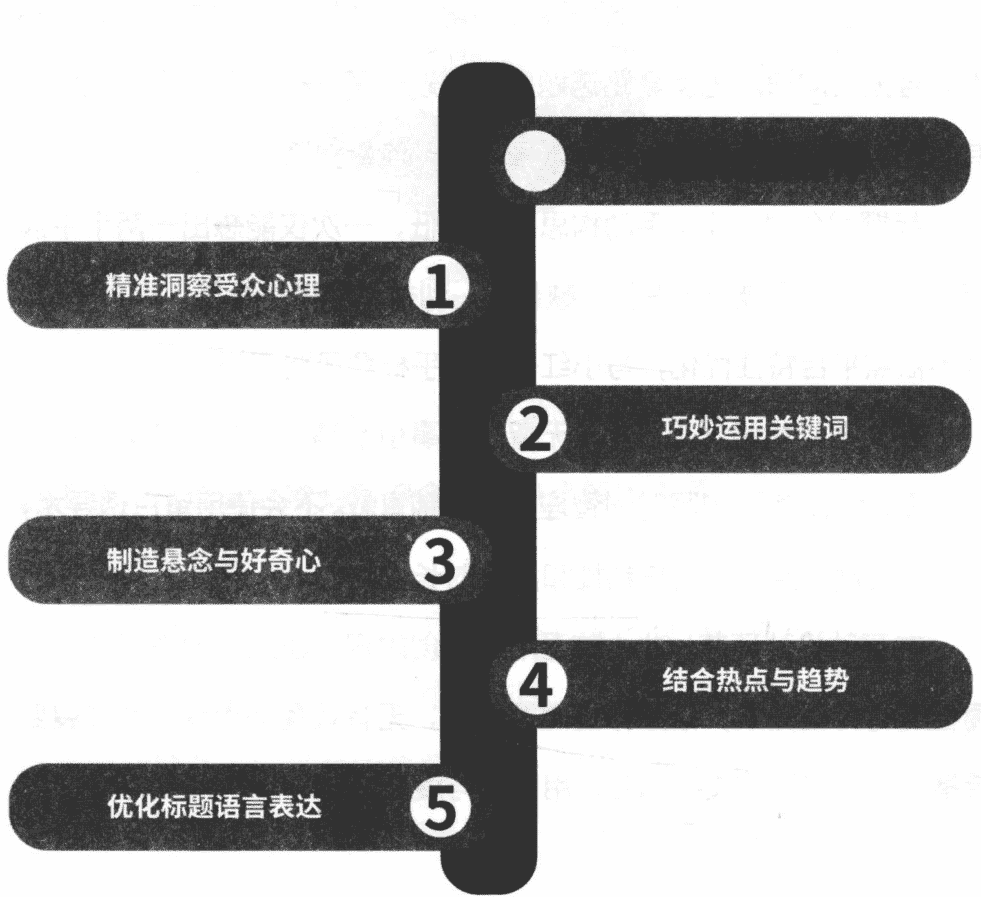
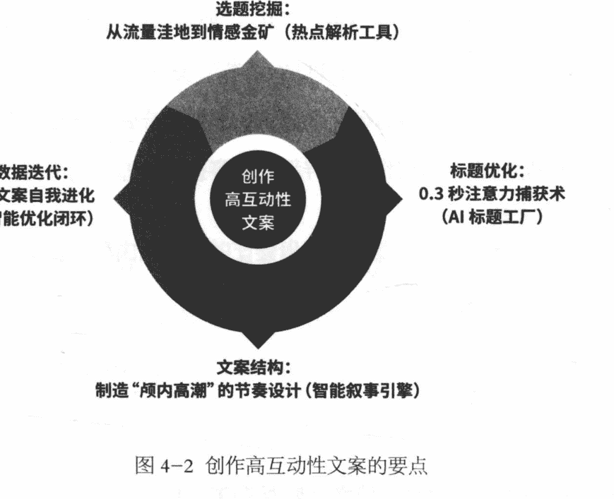
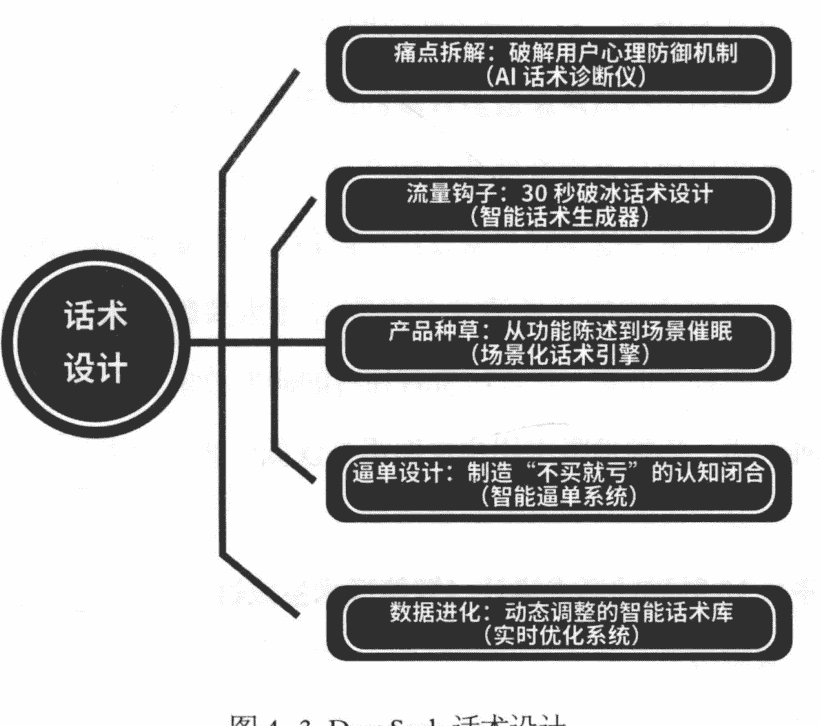

# DeepSeek 智能助手全场景攻略

## 前言
技术迭代的速度正在刷新认知边界，智能化正在把过去的科幻设想搬进日常使用场景。DeepSeek 便是这一轮变革中的突出代表，以强劲的性能和多元的落地形态，重新塑造了人与信息的交互方式。

深度求索由杭州深度求索人工智能基础技术研究有限公司孵化，公司成立时间为 2023 年 7 月 17 日，聚焦大语言模型及相关基础研究。项目根源可追溯至幻方量化对人工智能的长期探索，继承了扎实的研发底蕴，致力于通过海量数据的深度挖掘与分析，构建能够理解自然语言、生成自然语言并具备较强推理能力的通用模型，为各行业智能化转型提供底座。

## 超级助理
信息获取层面，过去需要翻阅大量书本、文件与网页才能定位答案，如今借助强大的检索与智能筛选能力，海量资源能在瞬间被归纳提炼，直接呈现关键结论。无论学术资料查询还是日常知识求助，都能充当高效的信息助推器。

在工作场景，效率提升十分明显。企业可借助其完成数据分析、市场研判、项目管控等复杂任务，从庞大数据中提取决策依据，把握市场动向并制定更合理的战略。个人端则可用于起草文案、规划日程、处理邮件等重复性事务，释放创造性精力。

休闲娱乐也因此更丰富。音乐、影视、游戏等领域可获得基于兴趣偏好与历史行为的个性化推荐，帮助更快发现契合口味的内容。同时在智能家居场景，可与各类设备联动，实现远程操控，让居家体验更舒适便捷。

## 前言
教学体验同样得到刷新。对学习者而言，可作为个性化学习伙伴，根据进度与薄弱点制定方案、推送资料与练习，助力效率提升。对授课者而言，可辅助教学管理、课程设计与学情评估，减轻工作负担。

除教育外，医疗、交通、金融等多个社会领域也在探索其价值，为复杂问题提供新思路。可以说，这套系统正逐步成为个人专属的智能伙伴，潜移默化地影响思维习惯与生活方式。

本书将从技术原理、典型应用及社会影响三条线展开，通过案例解析与技术解读，帮助读者更清晰地认识该体系，理解智能技术在当下时代的价值与潜力。也将探讨发展进程中的挑战，思考如何更好地发挥技术效用，为人类进步与福祉贡献力量。

让我们一起进入这套体系的世界，感受智能技术带来的无限可能，共赴更智能、更美好的未来。

## 第1章
开启智能新旅程，初识 DeepSeek

在大模型浪潮席卷各行各业的背景下，对数据处理与分析的需求持续攀升。正是基于这一现实，该体系在全球竞争加剧、国内技术突围的氛围中诞生，成为推动本土 AI 进步、提升国际话语权的重要力量。

### 1.1 起源脉络：本土自主研发的智能火种
在技术高速演进与全球竞争加剧的语境下，该体系应运而生，肩负推动本土 AI 发展、增强国际影响力的使命，成为自主研发浪潮的代表。

### 核心定义
大语言模型以 Transformer 为底座，是自主研发的深度神经网络。依托注意力机制，先以海量语料进行预训练，再经监督微调与人类反馈强化学习进行对齐，最终形成具备深度理解能力的网络。

### 能力边界
对话式问答：从日常天气、菜谱制作到专业领域知识，均可像朋友交流一样快速给出准确回应。
内容创作：报告、邮件、营销文案、活动方案等均可代笔，并能自检语法、润色表达。
代码能力：可理解与生成多种编程语言代码，遇到瓶颈时提供思路，加速开发。
图像处理：识别图片内容、解析视频信息，设计海报或制作视频时提供创意参考。
学习辅助：快速从大量资料中提炼核心内容，用通俗方式讲解复杂知识点，并制定个性化学习计划。

### 幕后团队
该体系由北京深度求索人工智能基础技术研究有限公司推出，该公司由杭州深度求索人工智能基础技术研究有限公司全资控股，背后为量化资管巨头幻方量化。研发团队汇聚众多顶尖人才，如浙江大学毕业的梁文锋等。

### 1.2 架构拆解：底层技术如何支撑能力
强大表现建立在核心架构之上。

### Transformer 架构底层
采用基于注意力机制的 Transformer 体系。相比传统循环神经网络的顺序处理局限，注意力机制可同时关注序列各元素，更好捕捉长距离依赖，提升长文本理解能力。

### 大规模预训练
模型在海量文本上进行预训练，学习语言通用规律。训练过程中阅读大量书籍、文章、网页，掌握语法、语义、词汇等知识。预训练完成后可针对具体任务微调，快速适配文本生成、问答等场景。

### 多模态处理
为处理多模态数据，设计了融合模块，可整合文本、图像、语音等信息。例如在图像描述生成中，先提取视觉特征，再与文本特征融合，最后输出描述文本。通过多模态融合，实现更全面的信息理解与更丰富的服务。

#### 1. 视觉语言语音联合编码
采用动态权重分配，将图像、文本、语音特征对齐，提升跨模态任务准确率约 12.6%。

#### 2. 时空注意力模块
引入光流估计，实现视频细粒度动作识别，支持最长 10 秒连续场景理解，促进动态视觉与其他模态融合。

#### 3. 全模态对齐框架
提出 Align-Anything 框架，支持任意模态输入输出，模块化程度高，提升多模态任务处理能力，使大模型与人类意图更好对齐。

#### 4. 基于 Transformer 的统一编码器
将文本、图像、音频映射到同一语义空间，通过自注意力实现跨模态特征融合，捕捉长距离依赖与复杂语义关联。

#### 5. 动态路由网络
根据任务需求自适应分配计算资源，如图像为主的任务会倾斜资源至图像特征处理，提升效率与灵活性。

#### 6. 对比学习增强算法
提出 Contrastive Learning+，借助海量多模态数据预训练，缓解语义鸿沟，实现如“肺部 CT 图像”与“医学诊断报告文本”的精准关联。

#### 7. 双流特征融合模块
在 DeepSeek-Vision 中体现，实现文本描述与视觉风格动态适配，让文本与视觉特征相互作用。

#### 8. 三通道特征提取架构
在 DeepSeek-Multimodal 中体现，支持文本加草图加参考图的多模态输入，对三种模态分别提取并融合特征。

#### 9. 神经辐射场融合
构建三维语义空间理解能力，结合 NeRF 与其他模态数据，实现真实三维场景构建，可用于数字孪生、虚拟现实等。

### 强化学习与人类反馈
为持续优化性能与输出质量，引入强化学习与人类反馈。训练中模型根据任务目标与奖励机制调整行为决策，并由人类专家评估输出、提供反馈，进一步优化参数与策略。

### 高效推理引擎
配备高效推理引擎，针对模型结构与算法优化，提升计算效率与响应速度。大规模数据与复杂任务下仍能充分利用硬件资源，及时返回结果。

### 分布式训练与存储
采用分布式训练与存储以应对海量数据。将训练任务分发至多个计算节点并行执行，提升速度；分布式存储保障数据安全可靠，支持模型快速迭代升级。

### 1.3 横向对比：差异化优势
与同类产品相比，具备明显差异化优势。

表 1-1 与其他人工智能对比表

| 项目 | DeepSeek | 其他人工智能 |
| :--- | :--- | :--- |
| 训练成本 | 约 557.6 万美元完成千亿参数模型并开源，推理单价约每百万 Token 1 元，经济性突出 | 通常训练成本高昂，如 GPT-4 训练成本极高；其他模型训练与推理成本普遍较高 |
| 数学与推理能力 | MATH 测试准确率达 77.5%，擅长高等数学微积分、线性代数，逻辑严谨 | GPT-4 等在复杂推理有优势，但在数学推理上该体系表现突出，部分模型数学能力不及 |
| 代码生成 | 可生成高质量代码，支持多语言，处理复杂项目结构，Codeforces 竞赛得分 2441 分，高于 96.3% 人类参与者 | GPT-4 等具备一定编程能力，但在专业代码生成上该体系更优，部分国产模型较弱 |
| 中文处理 | 政务服务场景政策术语理解运用准确率高达 98.6%，较 GPT-4 中文版提升 21 个百分点，古诗词创作把握韵律意境 | 在古诗词创作上精准拿捏韵律，营造意境，诠释文化内涵，底蕴更深 |
| 垂直领域优化 | 针对金融、科研等场景优化，可做数据清洗、统计分析、可视化建议 | 部分模型通用性强，但在垂直专业化程度不如该体系 |
| 开源性 | 部分开源，降低使用门槛，利好开发者与研究者 | GPT-4 等不开源，部分国产模型开源不一，开源优势明显 |
| 计算效率 | MLA 架构优化下 671B 参数仅需激活 37B，高效运行 | 部分大规模模型资源需求高，部署运行成本高，资源受限环境表现弱 |

### 创新架构优势
提出 MLA 新型注意力机制，优化计算方式，减少长序列处理成本，聚焦关键信息，在长篇论文、技术文档处理中提取关键信息更快更准。MoE 结构从 V2 起将专家数由传统 8 或 16 扩展至 160 个，V3 达 256 个，使模型覆盖更广任务与知识，每个专家专注特定技能，提升专业性与泛化能力。

### 模型性能优势
数学能力上 MATH 测试达 77.5% 准确率，能准确理解并求解微积分、线性代数等难题。编程上 Codeforces 竞赛达 2441 分，高于 96.3% 人类参与者，代码准确性与业务逻辑处理能力突出。

### 成本优势
训练成本约 557.6 万美元，远低于 ChatGPT 约 5 亿美元的训练成本。开源特性进一步降低企业与开发者的二次开发成本。

### 推理能力优势
融合冷启动数据与多阶段训练，具备强逻辑推理与深度思考能力，可处理复杂查询与任务，在数学问题求解、代码开发难题上表现优异。

### 自然语言处理优势
对中文语境深度优化，能捕捉语言细微差别，在诗歌、文案创意生成上表现突出，同时可进行高质量文本分析、翻译、摘要生成。

### 多模态能力优势
Janus-Pro 多模态大模型在 GenEval 与 DPG-Bench 基准测试中超越 Stable Diffusion 与 OpenAI DALL-E 3，文生图表现突出，支持文本、图像、语音融合学习。

### 开源优势
Janus 系列 4 款模型已在 GitHub 开源，开发者可自由获取代码与数据进行二次开发，推动 AI 技术交流。

### 硬件适配优势
能高效利用英伟达 H800 GPU，实现硬件不足软件补的技术突破，在资源受限环境下仍保持良好性能。

## 1.4 多平台适配，随时随地使用
以便捷性著称，可在多种场景无缝使用。

### 移动端接入
可在手机应用商店搜索获取安装包，通过验证码登录使用。华为手机小艺助手 App 11.2.10.310 及以上版本已接入，鸿蒙用户唤醒小艺即可调用。也可通过 Chatbox AI 客户端使用，支持 Android、iOS，配置对应信息后即可运行。

### 桌面端接入
访问官方网站用手机号验证码登录即可使用。也可安装 Chatbox AI 客户端，支持 Windows、Mac、Linux。对于本地化部署需求，可通过 Ollama 实现模型本地部署。

### 云端部署
天翼云“息壤”智算平台、科研助手、魔乐社区等已上线 R1 与 V3。金山云星流训推平台完成满血版部署，支持多机分布式推理。华为云、阿里云、京东云、腾讯云、火山引擎等云厂商均已接入，用户可一键部署调用。

### 其他渠道
硅基流动提供网页在线使用与 API 调用两种方式。纳米搜索提供 R1-360 专线与 R1 满血版。秘塔 AI 搜索上线 R1 模型，可在搜索框直接使用。Quora 旗下 AI 聊天平台 Poe 注册后即可使用。

该体系不仅是工具，更是在重塑生活方式，以卓越性能、友好交互与便捷体验打开智能未来之门。

## 1.5 注册与登录

### DeepSeek 的详细步骤

当数字身份逐渐演变为线上世界的第二重通行凭证时，登录的顺畅程度与账号的安全水位共同构成了用户信任的底层支点。DeepSeek 依托通过 ISO 27001 认证的身份管理体系，将注册完成率稳定在 99.98% 的水平，同时把登录鉴权的平均耗时压到 100 毫秒以内，在效率与防护两个维度实现同步提升。

#### 多场景接入：构建无缝入口
1. **技术底座**
核心枢纽是自适应入口网关 AEG。该网关兼容性强，可同时承载网页、移动应用、API 等八种接入形态。用户通过桌面浏览器访问网页服务、在手机平板使用客户端，或企业内部系统以接口方式对接，AEG 都能自动适配并完成接入。
2. **网页入口**
打开浏览器输入 https://deepseek.com 后，点击页面右上角的“立即体验”即可进入服务界面。流程简洁直观，新手也能快速上手。
3. **移动入口**
在 iOS 与 Android 应用商店搜索 DeepSeek 即可找到官方应用。两个平台版本保持同步迭代，苹果与安卓用户都能第一时间获得功能更新与性能优化。安装完成后即可直接使用。
4. **企业入口**
企业客户可借助 SCIM 2.0 标准与 Azure AD 等主流企业身份源打通，实现员工账号统一管理与单点登录。管理员可在熟悉的企业身份后台配置权限策略，显著提升内部信息化管理的效率与可控性。

#### 跨端会话协同：实现身份无缝漫游
1. **核心能力**
分布式会话令牌 DST 以分布式方式签发，支持多终端并发在线。配合先进的同步机制，跨设备延迟可保持在 0.2 秒以内。用户在手机上阅读到一半的文档，切换到电脑后能从同一位置继续。
2. **设备信任链**
基于 ECDSA 算法为设备间建立加密通道，保证跨终端传输安全。同一账号在不同设备登录时，设备间通过加密通道交互并校验可信度，为跨平台会话提供安全基础。
3. **设备管理面板**
登录后可在系统内实时查看全部在线设备的明细，包括地理位置、IP地址与最近活跃时间。发现异常设备可一键执行远程注销，指令生效时间小于 0.5 秒，及时守住账号安全边界。
4. **状态同步引擎**
工作台布局、快捷方式等个性化配置均支持云端同步，并采用增量同步策略，相较传统全量同步可节省约 78% 流量。例如在手机端调整文档排版后，网页端登录即可自动更新样式，且传输量大幅降低，使用体验更流畅。

## 第 2 章 精准提问，激活 DeepSeek 潜能
在知识探索与问题求解中，提问的清晰度直接决定能否调动 DeepSeek 的能力。需求描述越具体，结合多模态交互与智能算法，就能得到更专业、全面且深入的答案，推动认知与实践同步跃升。

### 2.1 明确表达需求，是获得可用答案的前提
小 Z 想撰写人工智能在医疗领域应用的论文，最初只问“讲讲人工智能在医疗上的应用”。目标不明、受众未定、形式不清、背景缺失，得到的回复空泛无法直接使用。若改为“为医学本科生撰写一篇 2000 字论文，聚焦人工智能在疾病诊断中的应用，重点分析深度学习算法优势并列举三个真实案例”，针对性会完全不同。

日常使用中要避免“提升业绩的办法”这类模糊指令。可借助 SMART 规范细化为“作为销售，在下一季度内把销售额提升 15%，每天额外投入不超过半小时，并形成客户跟进与销售策略报告”。配合 5W2H 补齐关键信息，杜绝模糊指令，同时对模型回应进行验证与迭代，才能让模型成为可靠助手。

**明确问题的核心目标**
1. **聚焦单一主题**
模糊表述：“帮我写一篇关于气候变化的文章。”
明确表述：“请用通俗语言为中学生写 800 字科普，解释温室效应与全球变暖的关系，并给出三条日常环保建议。”
2. **定义输出形式**
明确需要列表、分析、代码或故事等。例如：“用步骤列表说明如何配置虚拟环境。”“用比喻解释量子力学中的叠加态。”

**提供结构化背景信息**
1. **补充上下文**
“如何改进这个程序？”→“我用 Python 处理 CSV，读取时出现 ‘Unicode Decode Error’，系统是 Windows，请给出解决办法。”
2. **设定约束条件**
技术类：“请用 Java 8 实现快速排序，且不使用递归。”
创作类：“写一首五言绝句，主题秋天，押平声韵。”

**使用分步拆解法**
1. 先确认理解 “量子计算机的基本原理是什么？请用生活案例类比。”
2. 再深入细节 “基于上述解释，量子比特与传统二进制比特的核心区别在哪？”
3. 最后实践验证 “假设用 Qiskit 创建量子纠缠态，请给出示例代码并注释关键步骤。”

**利用工具特性**
1. 多模态输入 “分析这张电路图，指出哪个元件可能导致输出电压不稳。”
2. 角色扮演指令 “你是一位经验丰富的儿科医生，请列出五个缓解婴儿肠绞痛的实用方法。”
3. 反馈修正机制
初次：“生成一段面向健身爱好者的产品推广文案。”
优化：“加入‘环保材料’与‘30 天无理由退货’卖点，语气更激昂。”

### 2.2 善用限定词，收窄答案范围
电商新手小 X 问：“怎么优化商品展示？” 未说明品类、痛点、预期效果与预算，得到的是泛泛建议。若改为“我经营时尚女装店，商品图点击率低，预算有限且不换拍摄设备，如何通过图片排版与简短文案提升吸引力，目标年轻女性”，答案才具落地价值。

添加范围、条件、场景、格式等限制，可大幅降低模糊度，让输出更具针对性。

**限定词的核心作用**
通过范围、条件、场景、格式等限制减少答案的模糊空间。

**限定词的分类与应用**
1. 范围限定
模糊：“推荐学习 Python 的资源。”
限定：“推荐给零基础成年人的编程入门课程，排除付费内容，优先实践项目导向的资源。”
2. 排除与聚焦
模糊：“如何修复电脑蓝屏？”
限定：“电脑为 Windows11，更新显卡驱动后频繁蓝屏，错误代码 0x00000116，请提供不重装系统的方案。”
3. 输出格式限定
模糊：“总结气候变化的影响。”
限定：“用 Markdown 表格分三列总结气候变化对‘农业’‘沿海城市’‘生物多样性’的具体影响，每列含三个案例。”
4. 角色或视角限定
模糊：“如何设计用户问卷？”
限定：“假设你是用户体验研究员，为‘老年人健康管理 App’设计 10 道问卷，包含李克特量表与开放性问题。”
5. 时间或空间限定
模糊：“分析经济危机的原因。”
限定：“以 2008 年全球金融危机为例，对比美国次贷危机与欧洲主权债务危机的成因差异，用时间线图展示关键事件。”
6. 条件约束
模糊：“写一个排序算法。”
限定：“用 Python 实现非递归归并排序，时间复杂度 O(n log n)，并注释合并过程。”

**进阶技巧：动态调整限定词**
1. 分阶段提问
首轮：“什么是 Transformer 结构？”
优化：“在自然语言处理中，Transformer 的 Self-Attention 如何解决长距离依赖？请用矩阵运算示意图解释。”
2. 反向验证
追加提问：“请检查我的限定条件是否矛盾，例如是否同时要求‘低功耗’与‘高性能’？”

**关键原则总结**
1. 明确性 限定词要有具体指向，如“Java 8”而非“新版 Java”。
2. 必要性 避免冗余限定，如同时要求“简短”与“2000 字”。
3. 可验证性 使用模型能识别的关键术语，如“PCA 降维”而非“那个统计方法”。

### 2.3 追问技巧：把单轮问答变为深度对话
小 F 制定新业务拓展方案，初始问“怎么制定新业务拓展方案”，模型给出框架后他连续追问“为啥要这么做？接着咋办？具体措施有哪些？”沟通陷入僵局。若改用结构化追问，如“方案中市场调研部分需调研哪些关键数据，如何保证数据准确性”，效率会大幅提升。

在信息深水区，追问如同认知潜望镜。卡内基梅隆大学的研究显示，优化后的追问策略可使信息价值密度提升 340%。DeepSeek 依托动态对话状态跟踪 DST 与知识图谱导航 KGN，构建了五阶追问增强体系，经测试可使问题解决深度提升 4.7 倍。

**追问的核心逻辑**
目标是将单次问答升级为深度对话，通过迭代逼近最佳答案。原理是借助模型的上下文记忆，逐步缩小信息差、修正偏差、扩展细节。

**六大追问技巧与案例**
1. 任务拆解追问法
初始：“如何制定有效的客户拓展方案？”
追问：“针对 B2B 企业客户，拓展的关键 KPI 应聚焦哪些？”“如何通过 A/B 测试优化销售邮件打开率？列出三个关键测试变量。”“‘邮件个性化测试’如何避免过度个性化引发隐私担忧？”
2. 方案验证追问法
初次回复：“采用云计算可降低 IT 成本。”
追问：“数据处理高峰时，云服务的资源弹性扩展如何保障业务连续性？”“按量计费相比固定套餐在成本控制上的优势是什么？请用数据对比费用构成。”
3. 项目时间轴追问法
初始：“如何筹备大型商务会议？”
追问：“项目启动前一周需准备哪些审批文件？”“会议前三天场地布置阶段，如何用 Trello 实现团队高效协作？”“会议结束后一天提交总结，哪些问题易让上级不满意？”
4. 方案对比追问法
初始：“内部培训还是外部培训更适合提升专业技能？”
追问：“预算有限且任务繁忙时，哪种方式时间成本更低？”“从长期人才发展看，内部培训的知识传承体系…”
5. 假设情境追问法
初始：“如何制定公司危机公关预案？”
追问：“若负面舆情在社交媒体短时间内超过 10 万条，基于现有资源应如何执行？”“跨地区业务下，文化与舆论环境差异是否需针对性调整预案？”
6. 结果反思追问法
初次回复：“实施新绩效考核后，员工绩效预计提升 15%。”
追问：“在何种情况下该指标无法真实反映工作改进？”“若数据收集存在人为干扰，应如何重新设计评估流程？”

**避坑指南**
1. 规避无效追问循环，避免“为啥这样？接着呢？到底指啥？”等模糊追问。每次追问应有明确目标。
2. 防范盲目跟从共识，遇到“一般大家都觉得…”时应追问：“行业内有哪些专家观点或企业实践不认可这一共识？”
3. 重置沟通情境，对话混乱时可“硬重启”：“先暂停，重新梳理。从项目启动阶段开始再分析。”

**关键原则**
1. 螺旋式深入 从宏观到微观，每次追问增加 20%~30% 细节密度。
2. 逻辑闭环检查 定期要求总结，如：“请用三步概括我们已讨论的方案框架。”
3. 工具协同 先让模型生成思维导图大纲，再逐点追问。

### 2.4 复杂问题的分步提问策略
小 W 想优化线上销售流程，直接问“怎么优化线上销售流程？” 未先确认概念、拆解要素，也未考虑风险与验证，导致方案无法落地。若按正确步骤提问，可高效获得实用方案。

在 VUCA 环境下，复杂问题如多维魔方。斯坦福复杂系统研究中心的研究表明，结构化分步策略可使解决效率提升 4.8 倍。DeepSeek 借助分层任务网络 HTN 与动态规划算法 DPA，构建五阶分步提问体系，经测试可使认知负荷降低 62%。

**确认理解**
先厘清问题范畴。例如“如何优化公司供应链管理”前，先问“供应链管理包含哪些主要环节”，确保双方对基础概念一致。

**拆解关键要素**
将复杂问题拆分为子问题链。继续前例，可问“供应商选择环节有哪些关键评估指标”“库存管理中如何平衡成本与供应及时性”，引导模型逐步给出针对性信息。

**探索细节与策略**

在把核心要素确认下来之后，提问的重点就要转向落地细节与可操作的方法。比如可以追问“之前聊到的供方考核维度，能否落成一套可量化的打分表”“在库存支出与交付时效之间做权衡时，EOQ 订货模型在实际业务里该怎么推行”。这类问题能逼着模型给出更贴近一线、拿来就能用的处置建议。

### 考虑特殊情况与风险
有意识地设定极端或高风险的情境进行盘问，可以检验方案的完备度与抗压能力。仍以供应链为例，可问“如果上游厂商遭遇不可抗拒事件导致原材料断供，有哪些应急预案可以立即启动”“当市场需求出现剧烈波动时，原有的库存优化思路需要怎样动态调整”。通过这类追问，能让模型暴露复杂情境下的隐性风险并给出应对思路。

### 总结与验证
在阶段性讨论收尾时，可请模型做回顾归纳并检验可行性。例如“请把我们目前围绕供应链优化的要点梳理一遍”“这些做法在体量相近的同行企业里落地成功率如何，常见坑点有哪些”。总结有助于理清脉络，验证则能判断方案是否符合现实。

### 2.5 提问中的常见误区及避免方法
市场部的小 T 近期负责新品推广方案的制定。他向助手抛问：“怎么做好产品推广？”问题过大过空，返回的都是泛泛之谈，难以执行。进入代码测试环节，他又问：“代码报错了，怎么办？”却未附环境、报错日志等关键信息，只能被反复追问，沟通效率极低。拿到 AI 初步给出的推广方案后，小 T 直接上报，未做追问、溯源或实测，结果漏洞明显被领导驳回。

在追求高效提问的过程中，除了掌握正确技巧，更要识别常见陷阱，才能真正发挥 DeepSeek 的价值。下面拆解典型误区与规避办法。

### 目标模糊笼统
1. 不当提问范例
> “怎么提升工作效率？”
> “解释一下市场策略。”
2. 后果
模型回复面面俱到却空洞，与实际需求贴合度低，难以落地。
3. 解决思路：套用 SMART 原则
把问题改写得更具体、可度量、可达成、相关且有时限。例如：“作为项目执行人，未来两个月内，如何通过合理安排每日任务，将项目推进效率提升 20%？每日额外投入不超过一小时，并最终交付一份含任务分配与进度跟踪的报告。”

### 关键信息缺失
1. 不当提问范例
> “我做的方案不行，帮我看看。”
> “我的脚本运行报错，怎么解决？”
2. 后果
模型因背景不足无法定位，需反复补信息，沟通成本激增，解决周期可能延长 60% 以上。
3. 解决思路：借助 5W2H 方法补齐上下文
例如：“在 Win10 环境、Excel 2019 下运行 VBA 脚本（已贴代码），提示‘运行时错误 1004’，数据格式已核对无误，请指导排查路径。”

### 需求不清晰与不明确
1. 不当提问范例
> “用那个方法优化下工作流程。”
> “按行业标准调整这份报告。”
2. 后果
模型容易误读指令，采用不当方法或标准，产出偏离预期。
3. 解决思路：将模糊表述具体化，明确参照系
例如：“采用六西格玛方法优化现有的产品组装流程，附图为各环节及耗时，请输出优化后的步骤、预计节省工时及成本降幅。”

### 轻信结果与缺乏核验
1. 不当提问范例
直接照搬 AI 给出的方案、数据或结论，不做核验。
2. 后果
模型存在约 15%~20% 的“幻觉率”，错误信息一旦进入实务可能带来严重后果。
3. 解决思路：采取三方交叉校验
- 反向提问：“该方案有哪些潜在风险和反对观点？”
- 数据溯源：“请给出支撑结论的三份权威行业研究报告出处。”
- 实践检验：“用真实业务数据跑一遍该方案，出具效果评估报告。”

### 沟通单一与缺乏互动
1. 不当提问范例
拿到一次回答就结束，不再追问或迭代。
2. 后果
浪费 AI 的深度价值，约 70% 的潜在帮助被闲置。
3. 解决思路：采用对话螺旋式推进
初版提问：“用波特五力模型分析所在行业竞争态势。”
优化追问：“针对‘供应商议价能力’，结合近期原材料价格波动，详细说明对公司成本控制的影响。”
验证深化：“若因政策调整‘新进入者威胁’显著上升，模型结论应如何修正，对战略布局有何启示？”

# 第3章 办公提效，借助 DeepSeek 脱颖而出
职场竞争激烈，提升效率是突围关键。借助 DeepSeek，可自动处理繁琐文档、快速产出精准报告、智能规划会议安排。依托技术重塑办公流程，告别重复低效，轻松应对复杂任务，工作表现持续攀升，成为团队里的亮点。

## 3.1 商务合同撰写：条款规范与风险提醒
小 A 耗费数天查阅资料，结合经验完成合同初稿。对商品品类、数量、价格等基础条款做了约定，但在细节上疏漏明显。

交货时间只写“三十天内交付”，未标明起算日和逾期违约责任，留给供应商操作空间，一旦延期，公司可能面临断货、业绩受损却缺乏约束依据。质量标准仅笼统写“符合行业标准”，未指明具体标准及不合格时的处理与赔偿，潜在的质量问题可能引发投诉、退货和声誉损失。

商务合同是经营核心，但人工起草效率低、漏洞多。统计显示人工审大约用 8 小时/份，且 23% 的合同因表述不清引发纠纷。DeepSeek 可通过智能模板生成、实时风险预警、条款逻辑校验，实现效率与合规双提升。

### 结构规范：自动搭建框架
标题与主体自动匹配：输入合同类型如《技术保密协议》，系统即生成标准标题，并同步提供签约主体模板，含统一社会信用代码提示，避免因标题不规范或主体信息缺失带来的后续风险。

风险提示：为避免“合作协议”等宽泛名称带来的风险，框架会关联企业数据库核验签约方资质，降低主体风险，保障合同效力。

### 模块化条款自动填充
涉外合同专属模块：一键生成争议解决、法律适用等模块。例如争议解决可按需填充香港国际仲裁等常见方式，为跨境纠纷提供依据。

高频条款库嵌入：采购合同会自动植入“不可抗力”“知识产权归属”等常用条款，节省时间并保证完整性。

### 核心条款优化：AI 精准助力
标的与金额智能化：输入“工业机器人”等描述后，系统关联技术参数库生成量化指标，并支持税率计算及多币种汇率联动更新。

履行期限动态管理：设置交付节点后自动生成履约看板，实时监控进度，逾期即触发预警，降低违约风险。

违约条款风险平衡：输入合同金额后，AI 按《民法典》建议违约金合理区间如 10%~30%，并附司法判例参考，兼顾权益与合规。

### 风险识别：实时扫描与修正
歧义表述纠偏：检测到“尽快处理”“合理期限”等模糊用语时，自动推荐“5个工作日内”“自通知送达后15日”等具体表述，避免纠纷。

法律冲突预警：涉外合同会比对签约地法律差异并提示风险，如“担保条款需遵守《跨境担保外汇管理规定》”。

隐性责任标记：对“口头补充有效”等高风险表述标红，并建议改为“需双方盖章确认的书面补充协议”。

### 表述严谨：语言逻辑双校验
术语智能替换：将“违约罚款”等口语化表达修正为“违约金”，并标注《民法典》第五百八十五条依据。

逻辑冲突检测：发现“保密期限二年”与“知识产权永久归属”矛盾时，提示联动修改建议。

兜底条款增强：在“其他约定”中自动嵌入“需符合主合同目的”“不得违反强制性法规”等限制性表述。

### 智能审核：多维度风控闭环
三阶审核流程：业务端填写基础信息→法务 AI 合规审核→管理层在线批注，全程留痕可追溯。

案例库联动：自动匹配历史相似合同，推送过往纠纷案例及改进建议。

风险评分报告：生成合同风险雷达图，按主体资质 20%、违约金 15%、管辖条款 30% 等权重直观呈现风险等级。

## 3.2 数据报告生成：从采集到呈现
电商分析师小 B 受传统流程制约，报告工作困难重重。

数据采集需手动从 ERP、CRM 导出，并从官网、平台复制信息，PDF 报告需逐页提取，上月竞品数据收集耗时两天且反复。借助 DeepSeek，可在十来分钟内跨平台聚合数据。

清洗环节靠经验和简单函数找异常，曾漏掉第三季度销售额异常飙升，手工核对修正耗时且易错。借助 DeepSeek，箱线图算法自动扫描异常，统一格式、自动换算货币，清洗万条数据人工需 3 小时，AI 仅 8 分钟。

智能建模时，基础软件绘图繁琐，自研预测模型需写代码且参数易错。借助 DeepSeek，可按业务目标推荐最优算法并给出准确率评估与关键变量权重。某零售企业借此将备货准确率从 68% 提升至 89%。且报告语言可通俗化，便于决策。

可视化呈现需多软件切换，手动调格式，不支持 3D 交互，复杂看板需数天，借助 DeepSeek 十五分钟即可完成，且可遵循企业视觉规范。

协作方面缺乏云端协同，需求通过邮件易遗漏，版本管理混乱，源数据变动难追踪，移动端适配差。

数据报告是决策依据，但人工采集耗时占比超 50%，数据偏差导致 32% 结论失准。借助 DeepSeek 通过自动化抓取、智能清洗校准、AI 建模、动态可视化、多端协作五大能力，重塑报告生产链路。

### 智能数据收集：打破信息孤岛
1. 多源数据自动抓取
企业数据库对接：系统可无缝连接 ERP、CRM 等内部数据库，实时自动抓取结构化数据，如生产进度、库存、客户订单等。
公开平台整合：连接统计局、行业报告平台等公开数据源，自动采集宏观经济、行业趋势信息。支持 PDF、图片的 OCR 识别，准确率超 98%。以竞品数据收集为例，跨平台聚合仅需十来分钟。

2. 实时数据监控
阈值预设：用户可设定更新阈值，如库存低于警戒值时自动触发采集上下游数据。
预警推送：采集完成后即刻推送至指定人员，便于及时决策。

### 数据清洗与预处理：AI 纠偏提效
1. 异常值智能检测
算法驱动识别：箱线图算法自动扫描海量数据，标记离群值。如第三季度销售额突增 200% 会被标注并提示疑似录入错误。
处理灵活：支持一键修复或人工复核，兼顾效率与准确。

2. 数据标准化处理
格式统一：自动将“2024/6/1”转为“2024-06-01”等标准格式，适配多语言多区域数据。
货币智能转换：实时获取汇率，将 USD 自动转为 CNY 等。人工清洗万条数据约 3 小时，AI 约 8 分钟。

### 智能分析建模：从描述到预测
1. 自动化基础分析
描述性统计生成：输入字段后自动输出均值、方差、分布等。例如快速呈现薪资结构。
相关性热力图：直观展示变量间正负相关，为营销策略提供依据。

2. 预测模型构建
业务目标导向：选择“下季度销量预测”等目标后，AI 按历史特征推荐 ARIMA、XGBoost 等最优算法。
模型评估：输出准确率及关键变量权重。例如零售案例中备货准确率从 68% 提升至 89%。

3. 结论语义化解读
专业术语转化：将“R²=0.85”转化为“价格波动可解释 85% 的销量变化”，降低理解门槛，助力跨部门决策。

### 动态可视化呈现：零代码专业设计
1. 智能图表推荐

可视化驱动的办公提效

智能选图
系统会读懂数据特征并给出最合适的呈现建议。具备时间属性的数据，比如股价曲线、月度营收走势，优先推荐折线图，变化趋势清晰；需要体现结构占比的数据，比如各品类市场份额、部门预算分配，饼图更能直观展示比例关系。表现层面还支持加入3D动态渲染，让数据更具画面感，更易吸引关注。

可操作体验
确定样式后，图形可进行多方式互动。把光标移到数据点上即可查看明细数值，通过缩放平移可聚焦局部波动。交互感强的设计让使用者主动挖掘数据背后的逻辑，提升分析乐趣与有效性。

### 2. 可交互看板搭建
多维过滤器快速搭建
平台支持拖拽方式生成多维度筛选条件。以销售分析为例，可一次性创建区域、时间、产品线等多个过滤维度。借助这些条件，可快速对数据进行分片，深入了解不同区域、不同时段、不同品类的表现。锁定某地区与某季度后，就能查看该区在特定周期内某条产品线的业绩，为营销策略提供依据。

图表联动机制
看板内图表具备联动能力。点击任一图表的数据单元，关联模块会同步刷新。例如在销售看板中点选某地区柱状图，对应的明细表与趋势折线图会即时更新，展示该地区的详细数据与走势。相较传统BI，搭建效率大幅提升，传统工具完成一个复杂看板往往需两天，借助本系统约15分钟即可完成，显著压缩了可视化决策的时间成本。

### 3. 企业级视觉规范
品牌视觉统一
为保证报告视觉一致专业，系统内置企业品牌VI库，涵盖标准字体、配色方案、Logo摆放等要素。生成图表、看板或各类报告时，系统会自动套用VI设置，确保所有输出符合品牌形象标准。无论内部汇报还是对外展示，都能以统一的视觉风格增强专业度与品牌影响力。

## 3.3 工作总结优化：突出成果与亮点提炼
小A在某互联网广告公司担任策划专员，每月需提交工作总结。他的文本大致是：
“这个月我依旧在努力工作，做了很多与广告策划相关的事情。参与了几个项目，和团队一起讨论方案，还跟客户进行了沟通。在工作中遇到了一些困难，但最后也都解决了。我觉得自己这个月表现还可以。对于下个月的工作，我打算继续努力，做好策划工作，争取有更好的表现。”
领导阅读后眉头紧锁，第二天把他叫到办公室：
“小A，这份总结太笼统，完全看不出你本月具体做了什么。参与了几个项目，到底是哪几个？你在项目里承担了什么具体任务？方案讨论有什么产出？客户提出了哪些需求，你是如何处理的？困难是什么，解决方法是什么？这些关键信息一个都没有。说表现还可以，有何依据？没有数据和事例支撑就只是主观感受。下个月的计划也很模糊，没有明确目标和执行步骤。”
在信息密集、节奏加快的职场环境下，高质量的工作总结是对过往工作的系统复盘，也是能力与价值的体现，更为下一步规划指引方向。该工具在撰写总结时能提供关键支持。

工作信息的高效汇集与整理
撰写总结的前提是全面准确地掌握工作信息。该工具能够迅速扫描工作文档、邮件、会议纪要等材料，捕捉项目进度、客户反馈、日常任务等细节，并借助智能算法按工作板块、时间轴或重要程度进行归类，确保关键信息不遗漏，形成清晰完整的资料脉络。例如在大型长期项目中，可迅速整合各阶段成果、问题及对策。

工作亮点的深度挖掘
亮点提炼是让总结脱颖而出的核心。数据分析能力可对工作数据进行对比和趋势分析，挖掘高价值成果。以销售为例，可分析销售额增长的驱动因素，如爆款产品或新客拓展；在市场推广中，可评估各渠道投入产出比，找出最优策略。这些亮点既丰富总结，也为后续工作提供参考。

工作总结结构的优化
清晰的逻辑是好总结的骨架。该工具可根据收集的信息自动生成提纲，按重要性、时间或因果关系组织内容，并对语言进行润色，使表达更简洁准确、流畅易读，避免冗长句式，提升可读性。

行业资讯与案例的提供
该工具还能提供行业前沿信息和优秀实践案例。对比自身工作与行业标准，可以发现差距与不足，进而提出针对性改进措施和发展方向，既提升总结质量，也展现对行业的理解和进取心。
总体来看，从信息搜集、亮点挖掘、结构优化到行业参考，为撰写高质量工作总结提供全流程支持，帮助职场人更好地展示自我。

## 3.4 市场调研分析：挖掘潜在用户需求
小D负责公司新智能家居产品的调研，却一团糟。问卷设计凭经验随意出题，问题宽泛不聚焦；样本选择不科学，在公司附近小区随机发放并依赖亲友填写，代表性不足；数据收集无系统，重要信息丢失，且未审核数据，混入大量无效回复。进入分析阶段，数据杂乱难以处理，核心需求无法判断，甚至忽略竞品研究，最终调研失败，产品上市销量低迷。
在竞争激烈市场中，精准把握潜在需求至关重要。该工具为市场调研带来新方式。

问卷设计与访谈提纲优化
问卷和访谈是信息采集的重要手段。该工具能基于行业调研数据智能生成问卷。例如在化妆品调研中，可把简单的“A醇”问题细化为更贴近消费者关切的“A醇认知程度（刺激性/见效慢/价格高）”。访谈提纲也能借助社交媒体数据优化，通过分析不同年龄层的关注点，使问题更具针对性，避免泛泛而谈。

表 3-1 DeepSeek 应用于市场调研分析

| 应用方面 | 传统方式问题 | 解决方案 | 示例 / 效果 |
| :--- | :--- | :--- | :--- |
| 问卷设计与访谈提纲优化 | 跟不上社媒热点，问卷缺乏针对性，访谈流于表面，难以按人群定制问题 | 在化妆品调研中把“A醇”基础提问细化为对刺激性、见效速度、价格的认知；结合各年龄层关注点重塑访谈提纲 | 依托行业数据自动生成问卷；借助社交数据打磨提纲 |
| 调研后的数据整理与洞察提炼 | 海量资料处理慢，跨源验证困难，洞察提取不及时 | 解析A醇品类数据，提炼出应推出低浓度入门款并附护肤指引的判断 | 自动归纳问卷趋势输出可视化；语音转写并语义抽取高频词；多源交叉校验 |
| 精准刻画消费者画像 | 行为数据分析不深，难以从多渠道推断群体属性，画像不全 | 通过内容特征构建细致的消费者画像 | 深入分析行为数据，清洗去噪，推断群体属性，跨维度交叉分析 |
| 发现消费者痛点与市场空白点 | 评价收集不全，情感与竞品分析效率低，难以精准定位痛点 | 情感分析收集各平台评价进行分类与关键词提取，竞品分析爬取电商数据 | 分析即食燕麦竞品评论发现口感与口味抱怨，找到空白点 |

调研后的资料整理与洞察提炼
调研后往往面临海量数据和文本。该工具可自动识别问卷答案趋势并生成可视化报告，帮助快速把握消费者主要观点；访谈录音可自动转文字并做语义分析，提取高频词，挖掘关注焦点。结合访谈、社交评论、电商评价等多源数据交叉验证，能提供更全面准确的洞察。例如对A醇产品数据的分析显示消费者关注“耐受”“温和”“新手友好”，据此建议推出低浓度入门产品并配护肤指南。

消费者画像的精准构建
准确画像是挖掘需求的基础。该工具深入分析用户行为数据，对社交评论、电商评价、搜索数据等进行清洗去噪，识别关键词真实意图，并通过内容特征推测群体属性如年龄层、兴趣偏好。跨维度交叉分析可构建更全面细致的画像，为产品研发和营销提供依据。

消费者痛点与市场空白的发现
痛点背后藏着潜在需求。情感分析可抓取各平台用户评价、社交讨论和论坛帖子，进行情感分类和关键词提取，找出高频负面词并做趋势分析。例如分析即食燕麦竞品评论发现用户对口感和口味的抱怨，可据此调整策略。此外，通过竞品分析爬取电商销售数据、价格变动和评价，归纳优劣势，结合用户讨论发现市场空白，为企业创造新机会。

## 3.5 项目计划制定：任务分解与进度把控
小G负责为大型企业定制CRM系统，因任务分解和进度把控不当导致项目失败。启动时仅粗分为开发、测试、上线，未细分功能模块，人员分配也不合理，如让擅长前端的程序员做后端算法，效率低下；职责不清，衔接问题到后期才暴露。进度上无详细计划和里程碑，前期松散，上线前才发现功能未完、测试未开。为赶工盲目加班，质量下降，测试出现大故障，最终系统因功能缺失和不稳定被客户拒收，造成人力财力损失和声誉受损。
传统项目管理常出现计划赶不上变化：人工拆解任务平均耗时12小时/项目，延期率超42%，且60%团队因沟通不同步而返工。该工具通过智能拆解、动态推演、资源优化、风险预警和多端协同重塑计划全流程，使用企业按时交付率可提升至91%，管理耗时减少55%。

任务分解
1. 明确项目范围与目标
先确定项目需完成的工作，设定符合SMART原则的具体目标。例如电商平台计划三个月内上线促销模块，目标为新用户注册提升20%、销售额增长15%，范围即为搭建模块及达成预期成果。

2. 采用合适的分解方法
使用工作分解结构WBS，将项目按系统或子系统层级拆分，使每个子任务有明确输入、输出和交付物。如汽车新车型开发可分解为设计研发、零部件采购、生产线改造、车辆组装、质量检测等，设计研发再细分为外观、内饰、动力系统设计等。

3. 明确任务细节
每个任务需明确负责人、资源需求和预计完成时间，避免职责不清和重复。以软件开发中“用户界面设计”为例，指定设计师小李负责，提供设计软件和参考资料，预计两周完成，使任务清晰可执行。

进度把控
1. 制定详细进度安排
借助甘特图直观展示任务起止时间、持续周期及依赖关系。例如房地产项目中，可呈现土地平整、基础建设、主体施工、装修等各阶段节点，并体现基础完成后才能主体施工的依赖。

2. 持续监控进展
运用关键路径法CPM识别关键任务，通过实际与计划偏差分析及时发现问题。如桥梁建设中，桥墩浇筑、桥梁架设为关键路径，施工中定期检查，发现浇筑延迟即查明原因并纠偏。

3. 及时调整计划
出现偏差时重新分配资源、调整优先级以保证整体进度。例如广告策划中创意团队突发状况导致文案延迟，可从其他小组调配人力，调整顺序优先完成关键文案。

4. 加强沟通协作
定期召开状态会议，建立协作机制，确保信息顺畅。在跨国项目中，通过定期线上会议和即时通讯群组克服地域和时差障碍，保持沟通高效。

## 3.6 团队协作沟通：利用 DeepSeek 提升协作效率
小H负责一家互联网创业公司的社交应用开发项目，因传统管理观念导致失败。筹备阶段他集权决策，否决了团队提出的结合元宇宙增加虚拟场景社交的创新想法，坚持保守设计。执行阶段部门间不共享信息，技术团队闭门写代码，市场团队自行制定推广计划，直到临近发布才发现产品与用户期待差距大。后期出现问题时团队互相推诿，技术指责测试把关不严，测试怪开发代码质量差，最终产品上线后用户流失，公司资金耗尽。

超级助理
数字经济时代协作效率是核心竞争力。麦肯锡研究显示，世界500强企业每年因协同低效隐性损失高达4.3万亿美元。智能协作系统构建“数据—流程—知识”三位一体认知中枢，重塑组织协同。

优化信息共享
传统沟通中信息分散在文档、邮件和聊天记录，查找困难。该工具可快速收集、整理和分析内外信息，跨部门团队成员上传资料后系统自动分类索引，输入关键词即可获取所需文件和知识，节省搜索时间，确保全局信息同步。

促进沟通协调
系统支持即时通讯、视频会议等实时沟通，其智能翻译功能可消除跨国或多语言协作障碍。成员可用母语交流，实时翻译，提升理解与配合。

智能任务管理
可依据成员技能和工作负荷智能分配任务并实时跟踪进度。成员可在平台查看任务清单、截止日期及关联关系，合理安排工作，系统及时提醒进展和潜在风险，帮助团队动态调整策略。

强化知识整合
系统可记录和分类协作过程中产生的经验、案例和解决方案。新成员可快速获取历史知识缩短学习曲线，老成员通过回顾持续总结优化协作效果。

表 3-2 DeepSeek 推动团队协作

| 操作 | 具体描述 | 作用 | 示例 |
| :--- | :--- | :--- | :--- |
| 优化信息共享 | 整合内外信息，自动分类索引成员上传资料 | 节省搜索时间，帮助成员了解项目进展 | 跨部门团队通过关键词搜索获取资料 |
| 促进沟通协调 | 支持即时通讯与视频会议，具备智能翻译 | 助力成员交流，消除跨国语言障碍 | 跨国团队母语交流，实时翻译 |
| 智能任务管理 | 按技能与负荷分配任务，跟踪进度并提示风险 | 成员清晰掌握任务信息，保障项目推进 | 平台查看任务清单，系统提示风险 |
| 强化知识整合 | 记录并分类协作经验与案例 | 缩短新成员适应期，助力老成员提升 | 新成员获取过往案例与解决方法 |

## 第 3 章 办公提效，借助 DeepSeek 脱颖而出

## 第 4 章 创意营销为个人 IP 注入能量

当信息环境日益拥挤，个人品牌能否被记住取决于差异化表达。DeepSeek 能够深入研判市场走向与受众心理，为创作者一站式定制从吸睛标题到主题活动的方案，贯穿曝光、信任、转化全链路，帮助个人 IP 在激烈竞争中建立独特性与影响力。

### 4.1 爆款标题创作：抓住注意力的第一关

小 J 在一家主营创意家居的电商负责文案，最近上新了一款随温湿度自动调香的智能香薰机，还带助眠白噪音，外观与功能都具卖点。

小 J 初版主推语写成“新款香薰机，功能还不错”。表述平淡，既没有点出智能属性，也未提炼差异化优势。在信息密集的电商页面里，这类描述很容易被淹没。上线初期因缺少钩子，展示量很低，消费者划过时难以产生探究欲，点击表现疲软。即便进入详情页，标题也没有预埋购买动机，转化意愿明显受损。

同期竞品的写法是“智能黑科技香薰机，自动调浓度，陪你一夜安眠”。卖点清晰、利益明确，关注与成交迅速攀升。

无论是图文、短视频还是社媒动态，标题都是进入内容的门把手。好的标题能在瞬间锁住注意力，激发点击冲动。DeepSeek 是一套生产力工具，能够帮助创作者掌握抓眼球的方法论，产出令人眼前一亮的文案。

人群心理洞察
系统具备多源数据融合与挖掘能力，能够深挖目标人群的兴趣点、痛点、需求和情绪偏好。融合用户行为、搜索轨迹与社交互动，画像会变得清晰。比如做健康养生选题时，工具会提示“改善睡眠”“缓解焦虑”相关关注在上升。基于此可生成“摆脱失眠困扰，这几招提升睡眠质量很管用”这类直指痛点、满足诉求的表述。

关键词布局
关键词是标题的搜索入口，选对词能带来排名与曝光。DeepSeek 可筛选出与主题相关的高热高转词。做旅游内容时，系统可能提示“热门目的地”“小众路线推荐”搜索量走高。把这些词融入标题，如“2024 年不能错过的热门目的地盘点”，既提升吸引力，也增加搜索引擎可见度。

悬念与好奇心的制造
好奇是点击的天然驱动。DeepSeek 通过大量爆款案例总结出制造悬念的技巧。如“这座神秘小岛上，竟藏着怎样惊人的秘密”，读者会忍不住想探真相。工具还能把握悬念尺度，避免夸大造假，保证标题与内容一致，提升信任与满意。

热点与趋势的借势
热点自带流量红利。将时事与内容结合，能大幅提升吸引力。系统可实时追踪各领域热点与流行话题。热门影片上映时，可迅速产出“从《哪吒之魔童闹海》看当下电影行业的新动向”这类标题，借势引流。

语言表达的打磨
自然语言处理能力让标题更生动。DeepSeek 能替换平淡用词、调整句式，使表达更流畅。如把“减肥的方法”优化为“轻松减掉十斤，这些方法很有效务必看看”，通过更有感染力的表达强化吸引。

从人群洞察、关键词布局、悬念设置、热点借势到语言打磨，DeepSeek 在爆款标题的全流程提供支撑，助力在信息洪流中脱颖而出。

图 4-1 爆款标题创作流程

### 4.2 社交媒体文案：把互动率拉起来

小型互联网公司的新媒体专员小 I 沿用传统流程，创作卡点明显。

选题上缺乏热点解析工具，手搜“考证”热度很难关联到“中年群体考证”“三十五岁焦虑”等深层议题，凭主观判断赛道，常踩进红海，如常规考证技巧内容无人问津。没有反套路选题库，选题高度同质化，且缺少风险预警，曾因触及敏感政策导致账号受限、流量骤降。

标题优化靠手工，效率低，产出“职场技能分享”这类寡淡标题，缺悬念、利益点与情绪标签，点击表现差，且未按平台调性调整，小红书和知乎的风格不匹配。

结构设计缺少智能叙事辅助，知识类稿件难以植入认知反转点，时间管理内容平铺直叙。不会用留白诱导设置互动卡点，用户粘性与阅读时长不足。

互动环节缺乏用户原创内容激励系统，无法识别可传播元素，话题标签宽泛随意，互动指令无效，难以裂变，且内容多为纯文字，参与度低。

据 Socialbakers 数据，2023 年社交媒体平均互动率已跌破 0.98%，用户正用指尖投票淘汰平庸内容。DeepSeek 文案系统通过“情绪共鸣预测 + 互动行为预判”双引擎，把创作升级为精准的用户心理博弈。

#### 选题挖掘：从流量洼地到情感富矿（热点解析工具）

1. 立体定位模型
输入行业关键词后，系统输出“平台热度 × 情绪张力 × 竞争强度”三轴图。例如教育培训账号输入“考证”，可清晰看到“中年群体考证”在各平台的热度，并结合“35 岁危机”带来的集体焦虑，判断情绪张力。竞争强度指标帮助避开红海，发掘潜力洼地，如“中年考证如何破解 35 岁职业瓶颈”。

2. 逆向选题库
系统调用百万级爆款模板，生成对抗性角度。如职场领域产出“职场锦鲤”“反 PUA 话术”等选题，打破传统奋斗叙事，引发强烈兴趣，开辟新赛道。

3. 风险预警机制
选题过程中自动标注敏感词与争议点，规避流量反噬风险。例如涉及敏感话题时及时提醒，确保创作合规安全。

#### 标题优化：0.3 秒注意力捕获术（智能标题工厂）

1. 点击倾向预估
智能标题工厂一次生成 20 个备选，并用神经模型给出点击通过率估值，同时标注悬念值、利益点、情绪标签。如“30 岁总监被裁当天：这 3 个保命技能 HR 不愿透露”，以数字对比 + 身份标签 + 情绪钩子构成黄金结构，极大提升点击意愿。

2. 平台适配引擎
系统识别平台特性，小红书偏“种草体”，知乎偏“解构体”。据此生成适配标题矩阵。小红书可出“必看！30 岁职场人逆袭必备的 3 个技能”，知乎则出“30 岁总监被裁后，哪些技能能助力职场重生”，提高跨平台适配度。

#### 文案结构：制造“颅内高潮”的节奏设计（智能叙事引擎）

1. 峰值体验模型
借助多巴胺释放曲线可视化工具，确保每 50 字出现一个刺激节点，并在知识文案中植入认知颠覆点。如“你以为时间管理要精确到分钟？华为高管的日程表竟有两个小时空白”，打破常规认知，保持阅读兴奋。

2. 留白诱导术
在关键段落自动插入互动卡点，如“这个问题 99%的人会答错，评论区敢晒答案吗”。悬念密度检测仪优化提问节奏，提升粘性与时长。

3. 互动设计
用户原创内容激励系统把单向传播转为社交游戏，鼓励用户创作分享，放大参与热情与传播效率。

4. 裂变因子植入
社交货币分析器检测文案中的猎奇、炫耀、挑战等传播元素，自动生成“话题标签 + 互动指令”组合包。如“#职场坦白局 + @ 三位同事传递勇气”，扩大传播并促使用户分享。

5. 多模态互动
关联图文素材库，一键插入投票组件、结果生成器等互动元素，并测试不同形式的转化率，挑选最优方案提升参与度。

#### 数据迭代：让文案自我进化（智能优化闭环）

1. 实时战情室
发布后 30 分钟内监测点赞收藏比、评论情感值等关键指标，发现异常自动触发紧急补丁包，修改争议表述、强化利益点。

2. 跨平台移植系统
分析平台用户行为差异，自动调整结构与关键词密度。如将知乎高赞回答改编为抖音口播稿，精简结构、突出重点，使留存率提升 220%。

### 4.3 短视频脚本创作：兼顾故事性与趣味性

自媒体工作室的脚本创作者小 K 想打造爆款。工作室策划“城市角落的奇妙故事”系列，他负责旧书店一期。因未借助工具，资料收集有限，仅从店主处获表面信息，对背后的故事挖掘不足。

脚本框架平淡：顾客进店翻书，与老板简单聊书后离开。想增加趣味却因不了解观众喜好与流行趋势，笑点生硬，如老板突兀的搞笑独白破坏氛围。拍摄后内容空洞、表演僵硬，上线数据惨淡。

在平均停留仅 3 秒的短视频战场，脚本如同戴镣铐跳舞：15 秒内讲清故事，还要让观众笑着停留。传统创作易陷入“有趣无脑”或“有深度却枯燥”的困境，DeepSeek 创作工具正是破解之钥。

#### 选题策略：冲突点 × 趣味点 = 传播爆点

1. 黄金公式验证
系统基于 10 万条爆款视频提炼出“反常识常识化”模型。如“会计转行殡葬师”，职业反差制造冲突，神秘色彩带来趣味，极易引发好奇与讨论。

2. 智能生成器实操
输入行业关键词即可生成反差选题矩阵。如输入“美妆”，可得“理工科博士成为美妆博主”“老年美妆达人的逆袭之路”等。系统还能按用户情绪共鸣值排序，帮助快速锁定优质方向。

3. 避坑指南
情绪热力图直观展示选题在不同人群中的情绪反应，避免强蹭热点导致故事失真，保护内容质量。

#### 结构设计：三幕剧框架的趣味变形

1. 反传统节奏设计
声画同步工具可生成“悬疑开场 + 特效字幕”组合包，如黑暗中闪烁灯光配字幕“今晚，将揭开一道失传已久的美食秘方”，瞬间抓睛。内容发展阶段 AI 压缩故事线，确保每 8 秒出现一个记忆锚点。结尾前用互动预测模型测试三种结局的完播率，选择最优方案。

2. 彩蛋植入技巧
在剧本关键帧自动提示意外转折，如严肃会议场景插入卡通音效，打破氛围制造惊喜。

#### 角色塑造：人格化 IP 的速成法则

1. 六大人设标签库
职场人格模型可快速匹配权威专家、热血小白、毒舌前辈等六大标签。如塑造导师形象时调用“权威专家”，迅速建立专业沉稳特质。

2. 反差萌生成器
将不相关元素组合制造反差萌，如“程序员说单口相声”，反差增强趣味与记忆点。

3. 台词优化工具
把专业术语转化为梗言梗语。如将“KPI”转为“老板给的爱情砒霜”，生动且易传播。

#### 互动设计：让观众成为共谋者

1. 埋梗监测系统
自动标注可植入弹幕梗的台词位置，如吐槽金句处提示“杀伤力不大，侮辱性极强”，提升互动感。

2. 分支剧情测试
上传脚本后生成多版本互动节点，并预览用户选择偏好。如冒险故事中“向左走还是向右走”，根据目标受众喜好优化走向。

3. 悬念留存工具
在视频 85% 进度处自动插入下集剧透彩蛋，如“下集主角将面临前所未有的危机，他能否成功化解？敬请期待”，提高留存与复看率。

#### 数据迭代：让好故事自我进化

1. 热点嫁接系统
实时抓取热点事件并与既有剧本匹配，生成改编建议。如环保话题热时，建议在生活类剧本中加入社区环保情节，紧跟趋势。

2. 用户画像校准
完播热力图显示观众停留时长，据此智能调整节奏，快则放缓增细节，慢则精简加速，更贴合观看习惯。

3. A/B 试验工厂
同时生成五个差异化脚本，追踪 72 小时播放量、互动量等数据，输出优化图谱，指导迭代。

### 4.4 直播带货话术设计：激发购买冲动

初入直播带货行业的主播小 M 签约美妆电商公司，推广新护肤套装。

直播开始紧张，介绍干巴巴：“大家好，今天给大家带来这套护肤套装，里面有爽肤水、乳液和面霜。”成分功效轻描淡写：“这套护肤品有补水保湿的作用，成分还挺安全的。”未说明成分具体好处，也未突出对比优势。

使用方法表述混乱，时而说“先用水再乳液最后面霜”，有时又说“顺序可按自己习惯”，让观众无所适从。

观众询问价格与优惠时，回答模糊：“价格嘛，肯定是很划算的，比平时要便宜一些，而且还有赠品。”具体折扣与赠品不明。对敏感肌能否使用，仅简单回复“应该可以”，缺乏专业定论。

# 七秒流失线，直播话术的AI逆袭

从头到尾看下来，主播小M的表达干瘪乏味，既没把直播间气氛带起来，也没让观众产生立刻下单的念头。

实测显示，直播间观众的平均决策窗口只有七秒，旧有的话术模具正在失效：约三成观众在遇到密集报价后直接划走，约四分之一被层层叠加的功能讲解弄得不耐烦。DeepSeek 的话术体系依托神经网络对转化概率的推演和多模态情绪触达，对大脑决策路径进行了重构，提炼出一套欲望唤醒的模型。

## 痛点拆解：瓦解用户心理防御壁垒

### 1. 防御热力图谱
把过往直播录像上传后，诊断系统会立刻启动解析。它捕捉直播期间观众的行为轨迹并自动标注流失时点。基于海量样本的规律，用户流失集中在价格敏感、信任动摇、注意力涣散这三大心理屏障。某美妆间在第八分钟时流失率冲高，复盘发现主播在成分科普上耗时过长，造成认知过载。借助热力图谱，销售方可直观看见观众心理波动的轨迹，准确定位话术症结。

### 2. 黄金七秒验证
输入品类关键词，诊断系统可一次性产出20个开场样例，并基于模型预测停留意愿。前七秒决定用户是否继续了解。系统会自动规避“全网最低价”这类容易触发戒备的表述。例如卖面霜时，模型给出的开场可以是“今天想跟大家讲一款能让肌肤发亮的面霜，它背后的研发故事挺有意思，值得花一分钟听听”，用故事先行降低防备。

## 流量钩子：30 秒破冰话术构建

### 1. 五感唤醒框架
话术生成器围绕五感唤醒思路设计破冰。视觉层面调用色彩联想库，产出画面感强的描述，如“这支腮红刷触到脸颊的瞬间，像把一抹晚霞揉进皮肤里”；听觉层面关联ASMR素材库，用“开盖的咔嗒声像打开珠宝盒”之类的描写强化质感联想。

### 2. 悬念阶梯法
系统借助悬念监测面板，保证每约30秒埋入一个未解之谜，保持好奇。例如“为什么专业化妆师很少公开这个上妆顺序”。同时自动插入价格锚点图，配合原价划除动效与倒计时，营造稀缺感，提升购买冲动。

## 产品种草：从功能罗列到场景催眠

### 1. 多维痛点穿透
场景化引擎对接消费者评论库，提炼隐性需求话术包。以电动牙刷为例，不只强调清洁，而是包装成“避免同事闻到午餐味”的社交刚需。再生成“痛点—场景—解法”的三段式脚本，例如午休后口气问题→办公室尴尬→电动牙刷解决，功能自然嵌套。

### 2. 跨品类类比法
输入产品参数后，系统提供跨品类的类比方案，把专业指标通俗化。护肤品成分浓度可比作“高考数学压轴题，少一步就拿不到满分”。系统同时监测观众认知负荷，一旦术语理解困难就自动简化表述。

## 逼单设计：制造“不买就亏”的闭环

### 1. 损失厌恶触发器
模块输出对比话术矩阵，例如“现在下单省300元”对比“错过今天等于多花半个月奶茶钱”。结合神经经济学模型，优先选用能刺激多巴胺的表达，让用户更倾向即时成交。

### 2. 社交认证瀑布
系统实时抓取用户评价，自动拼出信任飞轮话术，如“刚截到第832位顾客的反馈，她说……”，用真实用户声音叠加可信度。

## 数据进化：动态自适应的话术库

### 1. 话术心电图追踪
优化系统会显示每句话的转化脉冲，快速识别高光片段。某家电直播发现“妈妈省下的时间价值”这句话使转化提升37%，帮助团队明确优化方向。

### 2. 智能A/B测试坊
系统同时运行三套策略，每五分钟生成效果热力图。基于反馈自动组合最优模块，形成个性化话术基因库。如电子产品销售中，场景加痛点的组合效果最好，便被收录为后续参考。

## 4.5 品牌故事撰写：传递差异化价值
小Z在一家新创运动饮料公司负责“劲能速”的品牌叙事，希望提升辨识度。他起笔写道“在充满活力与挑战的时代，人们对健康和能量需求增强，‘劲能速’应运而生”。表述过于宽泛，未点明诞生的具体契机，读者难以形成清晰印象。

后文写“我们致力于提供优质能量补充，帮助大家释放活力”，却未说明成分研发的独特性，如特殊电解质、维生素配比及对竞品的优势，空泛无力。

理念阐述前后矛盾：先说秉持“天然健康”，介绍工艺时却提及人工添加剂，让人困惑。发展历程也一笔带过，仅称“经过努力逐渐被市场认可”，未描述新品牌冷启动、竞品压制等真实困境及突破路径。

在信息过载时代，75%的消费者更偏好有情感共鸣的品牌。传统文案耗时且同质化严重，DeepSeek写作系统通过AI深度解析与创意生成，帮助企业打造兼具专业度与感染力的品牌叙事。

## 精准定位核心价值

### 1. 痛点突破
传统定位多靠主观判断，容易遗漏关键价值点。团队常基于自我认知提炼主张，却忽视消费者真实关注的痛点，导致传播难以触达目标人群。

### 2. 智能解法
系统可自动解析官网、产品资料及海量用户评价，提取高频关键词。某科技公司案例中，系统提取出“极简”“美学”“人性”“科技”等词，通过语义网络构建品牌价值坐标系，并生成价值主张雷达图，直观呈现差异化定位，为传播策略提供依据。

## 多维数据故事化重构

### 1. 行业洞察
平台整合超5000个行业数据库，并搭载舆情监测系统，实现对市场规模、竞争格局、技术趋势及消费者态度的实时捕捉。

### 2. 实操路径
市场数据被转化为成长曲线故事，如“品牌创立以来，借助持续创新与优质服务，用户三年内增长300%”。技术专利采用时间轴叙事，突出创新里程碑。用户评价则被提炼为戏剧化场景故事，增强共鸣。

## 智能生成故事框架

### 1. 结构化创作
遵循“冲突构建—品牌介入—价值实现”叙事弧。先描绘行业痛点引发共情，再展示品牌解决方案，最后用用户受益故事收尾。

### 2. 模板示例
以“行业痛点场景+品牌突破方案+用户获益故事+未来愿景召唤”为例。医疗美容行业痛点为“传统方式效果差恢复期长”，品牌方案为“无创技术精准改善”，用户故事为“短期实现肌肤焕新重拾自信”，愿景为“引领安全高效美容新趋势”。

## 多风格智能适配

### 1. 场景化输出矩阵
官网传播采用专业权威风格，情感浓度三星；社交媒体采用轻松网感风格，情感浓度四星，匹配平台调性。

### 2. 实测案例
某母婴品牌借助风格迁移技术，将广告文案转为网感表达，转化率提升27%，验证了多风格适配的有效性。

## 动态优化故事版本

### 1. 数据驱动迭代
系统埋点监测阅读完成率、转发量、转化率等指标，并用情感分析引擎评估共鸣度。基于数据自动生成AB测试优化建议，指导迭代方向。

### 2. 知识沉淀
构建企业专属故事素材库，收录用户案例、品牌事件，支持语义检索与智能复用，提升创作效率与质量。

## 4.6 营销活动策划：从创意到执行的全流程
小L负责“夏日新风尚”活动策划，却因多处失误导致效果不佳。筹备期未做受众调研，主观认为年轻人只爱简约风，忽视复古、街头等多元偏好，定位出现偏差。

推广仅限官网及少量社媒，文案平淡、配图普通，未借助明星网红扩散，曝光严重不足。活动机制也不合理，满减门槛高达2000元，赠品质量与搭配度低。现场缺乏时尚搭配讲座、走秀等互动，留不住人。门店陈列混乱，工作人员不熟悉活动，服务体验差。

Gartner调研指出，76%的CMO认为传统策划已无法应对市场变化。DeepSeek策划平台以“数据洞察—智能生成—数字孪生测试—执行监控”为全链路，将活动准备周期从28天压缩至7天，实现精准与效率双提升。

表 4-1 DeepSeek 营销策划助理

| 功能板块 | 功能描述 | 操作方式 | 应用示例 |
|---|---|---|---|
| 智能策略生成引擎 | 实时抓取多源信息，生成机会点热力图与风险预警矩阵，输出差异化策略提案 | 抓取200多个数据源，分析搜索趋势、社交舆情、竞品动态 | 某美妆品牌借“多巴胺穿搭”热度推出活动，曝光超预期143% |
| 创意资产自动化工厂 | 构建三维创意矩阵，生成创意资产并智能合规检测 | 视觉结合文生图与智能排版；文案依托场景化话术库；互动玩法生成H5剧情树 | 快速生成30套主视觉、200条传播标语，审核效率提升90% |
| 数字孪生沙盘推演 | 构建用户行为预测模型，模拟不同营销场景与极端情况 | 采用LSTM神经网络模拟渠道组合与极端场景 | 某3C首发前测试，确定最优渠道，转化率预测误差小于2.7% |
| 智能执行指挥官 | 自动拆解任务节点、分配资源、风险预警、跨部门协作 | WBS拆解任务，资源调度优化算法分配人力预算 | 实时同步200人协作，自动报警进度偏差超15%的任务 |
| 动态优化知识库 | 复盘系统做GAP分析与归因定位，沉淀可复用策略模块 | 数据仪表盘对比KPI，归因模型定位关键因子 | 节日活动复盘形成SOP模板库，提升后续策略准确度 |

## 智能策略生成引擎
传统头脑风暴效率低、易脱离市场。DeepSeek引擎实时抓取200多个数据源，洞察热点与需求变化，生成机会点热力图与风险预警矩阵，输出三套差异化策略并附预算与ROI预测。

## 超级助理
基于搜索趋势、社交舆情、竞品动态的分析，系统可提前识别政策变动、新进入者等风险。例如某美妆品牌依托引擎策略借势“多巴胺穿搭”，活动曝光超出预期143%。

## 创意资产自动化工厂
三维创意矩阵支持文生图+智能排版快速产出主视觉，场景化话术库生成大量传播标语，游戏化脚本产出H5交互剧情树。配备智能合规检测，审核效率较人工提升90%。

## 数字孪生沙盘推演
借助LSTM神经网络预测不同渠道组合效果，并模拟舆情危机、流量过载等极端场景。某3C产品首发前通过沙盘确定推广策略，转化率与预测误差小于2.7%。

### 智能执行指挥官
运用WBS自动拆解节点，资源调度算法按难度与紧急程度分配人力，按渠道效果投放预算。风险预警系统自动报警进度偏差超15%的任务，并支持跨部门虚拟作战室实时协作。

### 动态优化知识库
智慧复盘系统对比KPI生成GAP分析，利用归因模型与SHAP值排序确定成功因子。复盘数据沉淀为可复用策略模块，形成节日营销SOP模板库。

## 第4章 创意营销，DeepSeek助力个人品牌塑造

## 第5章 学术科研，DeepSeek成为得力助手
学术研究挑战重重，DeepSeek可智能解析复杂文献，提供精准翻译，辅助跨语言交流。在实验设计上提供创新思路、优化参数并预测风险，全流程提升效率与成果质量。

### 5.1 文献综述撰写：快速梳理研究脉络

小 N 写文献综述时完全是“人肉模式”。没有借助任何智能工具，他只能在常用的学术网站里一页页点开文献、手动抄录信息。检索渠道单一、耗时惊人，重要资料反而被筛掉了。面对堆积如山的论文，他不会用自然语言处理做批量分析，只能从头读到尾，很难快速抓住重点。知识图谱更是没摸到门路，研究脉络理得乱七八糟。写作时没有智能推荐帮忙，语法问题不断冒出来，结构也很松散。最后交出来的综述既慢又不到位，精力全打了水漂。

文献综述是科研的底座，核心是把领域成果系统梳理清楚、把脉络理顺、把研究空白找准。过去的研究者要靠人力检索、筛选、整合，效率低还容易漏掉关键内容。DeepSeek 用一套智能工具链把“信息整合、逻辑分析、内容生成”这条链路打通，让综述的做事方式和质量都上了一个台阶。关键能力主要体现在这五方面。

#### 智能检索
借助像 Semantic Scholar 这类 AI 学术搜索引擎，只需输入关键词或研究主题，就能迅速拉出大量相关论文。还能按引用量、相关度等指标自动排序，配合智能筛选功能，检索速度和精准度都大幅提升。

#### 文本解析
依靠词向量、主题模型等 NLP 技术对文献做批量解析，自动抽取出核心概念、研究方法、关键结论等要素。看文献不再是逐字读，而是直接把握每篇论文在讲什么、贡献在哪。

#### 知识图谱搭建
通过算法把文献中的概念、实体和关系抽出来，以可视化网络呈现。研究领域的骨架、演进路线、不同分支的关联一下子变清晰，梳理发展脉络和趋势变得直观。

#### 自动摘要
运用基于深度学习的序列到序列摘要模型，给单篇或多篇文献快速生成精炼摘要。作者可以迅速浏览要点，减少阅读负担，也为综述写作提供素材骨架。

#### 智能推荐与写作辅助
系统会根据已梳理的文献和脉络，推荐合适的引用来源、表述方式和框架结构。同时做语法检查和逻辑校对，帮作者把初稿打磨成结构清晰、表达规范的成品。

5.2 论文润色，让表达更专业
研究生小 O 写毕业论文时忽视了语言表达，没有用 DeepSeek 辅助润色。文稿里主谓不一致、时态混用，句子又臭又长难懂，口语化词汇过多拉低了学术感。段落之间缺少衔接，论点也不突出。没有借助工具迭代，初稿质量很差。导师批改后问题一大堆，不得不返工重改，既耽误进度也打击信心。

论文语言直接影响研究的说服力和传播效果。传统润色靠人一句句改，费时费力，还受个人经验限制，逻辑断层、术语偏差、句式冗余这类深层问题很难系统解决。DeepSeek 依托 NLP 与领域知识图谱，搭建了语法纠错、逻辑增强、风格优化的全流程润色体系，帮助研究者跨越语言门槛。

#### 语法纠错
把全文上传后，平台会自动揪出主谓不一致、时态错误、冠词缺失等问题并修正，为高质量表达打好基础。

表 5-1 DeepSeek 在论文润色中的用法

| 核心功能 | 具体操作 | 示例 | 传统做法的短板 |
| :--- | :--- | :--- | :--- |
| 语法错误修正 | 上传文本自动检测并修正主谓不一致、时态、冠词等错误 | “he go to school” 改为 “he goes to school” | 人工逐句排查慢且易漏，受个人水平限制 |
| 句式优化 | 简化冗长句子，调整语态如被动转主动 | “The experiment was carried out by us” 改为 “We carried out the experiment” | 思维定式导致优化不系统，流畅度提升有限 |
| 词汇替换 | 把口语或通用词换成学术内刊用词 | “show” 换成 “demonstrate”“indicate” | 替换范围小，易受知识储备制约 |
| 逻辑衔接强化 | 自动分析段落逻辑，补加连接词、过渡句 | 不同观点间插入 “moreover”“however” 等 | 人工易出现断层，连贯性把握不足 |
| 反馈迭代 | 按建议修改后再次上传润色，需人工复核 | 多轮迭代后语言更精准 | 传统迭代成本高，效率低 |

#### 句式优化
能把拗口冗长的句子压缩成简洁明了的表达，按需调整语态和结构，让行文更流畅。

#### 词汇升级
把日常口语或普通词替换为专业学术用词，比如把 “show” 换成 “demonstrate”“indicate”，语言风格立刻贴合学术规范。

#### 逻辑衔接
自动识别段落之间的逻辑关系，补充合适的衔接词、过渡句或小结，让论点突出、层次分明。

#### 反馈迭代
按系统建议修改后可再次提交润色，持续优化至满意。整个过程中仍需作者人工复核，确保内容准确且符合研究主题。

5.3 科研启发，挖掘新方向
科研人员小 P 想在生物制药领域有所突破，却没有借助 DeepSeek 做文献挖掘。他只靠经验判断热点，忽略了不少关键问题和空白区。研究时固守传统制药路径，对 AI 与制药的交叉机会一无所知，对新趋势也迟钝，错失布局时机。缺乏假设生成工具，实验设计显得盲目，跨学科融合也没有灵感，研究进展缓慢，成果平平。

科研的价值在于发现未知，传统上很依赖个人积累和灵感，容易陷入思维定式或跟风。DeepSeek 融合知识图谱、语义网络和深度学习，构建了知识关联、趋势预测、创新评估的智能启发体系，帮助研究者系统性地找到创新且可行的方向。

#### 文献挖掘与分析
输入领域关键词，系统对海量文献做深度学习，梳理出热点、前沿成果和未解问题，让研究者快速把握整体态势，发现可深挖的空白。

#### 关联主题发现
基于语义理解，识别输入主题的相关交叉领域。比如研究 AI 与医疗结合时，会提示医学影像分析、疾病预测模型等潜在应用，拓宽思考角度。

#### 趋势预测
结合历史文献和当前动态，预测某些方向的发展走向，例如某项技术在未来几年在特定领域的渗透情况，助力提前布局。

#### 假设生成
依据已有成果和数据，自动生成合理研究假设。在生物学中，可根据基因表达数据和文献提出基因功能或疾病机制假说，为实验设计提供依据。

#### 跨学科融合启发
整合多学科知识，输入跨领域问题时，系统会解析不同学科的研究方法与成果，启发将他学科理论和方法引入本领域，形成新思路。

表 5-2 DeepSeek 在科学研究中的应用

| 功能名称 | 具体操作 | 达成效果 | 示例 |
| :--- | :--- | :--- | :--- |
| 文献挖掘与分析 | 输入关键词对大量文献深度分析 | 梳理热点、前沿和未解决问题，发现研究空白 | 输入领域词呈现热点与空白 |
| 关联主题发现 | 利用语义理解识别相关主题和交叉领域 | 多角度思考，拓展思路 | AI 与医疗结合时发现医学影像分析潜在应用 |
| 趋势预测 | 基于历史文献和当前动态分析 | 预测发展趋势，提前布局 | 预测某技术未来几年在特定领域的应用趋势 |
| 假设生成 | 依据已有成果和数据 | 生成合理假设，指导实验设计 | 根据基因表达数据提出基因功能假设 |
| 跨学科融合启发 | 整合多学科知识 | 促成跨学科思路，引入新方法 | 输入多学科问题，启发跨学科研究思路 |

5.4 实验设计，提供创新思路
生物制药研究员小 Q 设计新型药物实验时，只靠多年经验沿用传统模式，没有借助 DeepSeek。他没做系统文献挖掘，对当前热点和空白毫无感知，研究同质化严重。探索过程局限于本专业，没发现关联主题，也没考虑跨学科融合，对行业趋势缺乏预判，错过采用新技术的窗口。最后方案缺乏创新，进展慢且风险高。

实验方案设计是科研落地的核心，创新性决定突破潜力。传统设计依赖经验试错，容易同质化、优化低效、风险预判不足。DeepSeek 基于海量实验数据库和强化学习，帮助研究者跳出惯性，快速生成兼具创新性和可行性的方案。

#### 找空白定方向
通过快速检索分析大量文献，了解领域前沿和热点。比如肿瘤治疗中，传统手术化疗放疗副作用大、易复发。DeepSeek 分析后提示肠道微生物群与肿瘤免疫治疗关联研究仍属空白，于是确定以特定肠道菌群对免疫治疗效果的影响为创新方向。

#### 跨领域借方法
具备跨领域知识整合能力。以土壤重金属修复为例，传统方法成本高效果有限。系统提示可借鉴生物工程基因编辑技术，提出改造植物增强吸收富集重金属的思路，形成跨学科实验方案。

#### 模拟优化
在方案阶段基于已有知识和数据做过程模拟预测。材料科学中制备新型合金时，输入不同成分比例和工艺参数，系统可预测硬度、韧性、耐腐蚀性等指标，指导调整铜镁比例和热处理工艺，减少无效尝试。

#### 结果分析做决策
对可能结果进行分析评估，提供决策依据。心理学实验研究新型干预对青少年焦虑的改善，系统基于历史数据预测不同时长频率方案的效果显著性和持久性，帮助选择最优方案并提前做好结果解释准备。

5.5 专利辅助，撰写高质量文案
科技公司研发人员小 R 研发了新型智能手环，却对 DeepSeek 一无所知，全靠自己写专利。他没把技术细节输入系统梳理，文案中技术要点混乱、逻辑不清。检索时只用普通搜索引擎，没全面分析同类专利，无法判断新颖性，文稿也充斥常见错误。权利要求书和说明书缺乏专业指导，表述不精准且晦涩。最终申请文件因不规范被驳回，严重拖延进度。

专利文案是成果转化的桥梁，质量影响保护范围和商业价值。传统撰写依赖人工经验，易出现权利要求薄弱、创新点模糊等问题。DeepSeek 通过深度解析和智能分析，把核心创新转化为高价值专利资产，提升授权率和保护力度。

#### 技术特征梳理
把发明的技术细节全面输入，系统通过语义分析提炼核心特征，梳理原理、结构、流程等关键信息。比如某公司便携式心脏监测设备，输入资料后快速提炼出高精度生物电信号采集传感器、实时心率异常分析算法、模块化结构等要点，并厘清信号采集-处理-预警的工作原理，为撰写奠定基础。

#### 专利检索与借鉴
输入所属领域和关键技术词，快速检索大量相关专利。通过分析同类专利明确自身发明的新颖性和创造性，借鉴优质表述，规避常见错误。例如节能灯具发明者输入“节能灯具”“LED 光学结构”“智能控制”，系统呈现大量现有专利，发现其微棱镜阵列和环境光自适应调节具备创新点，并借鉴他人的技术效果描述方式，优化文案竞争力。

#### 权利要求书撰写辅助
描述发明创新点后，系统可参考海量专利数据给出合理权利要求范围建议，并提供符合规范的句式和表述，帮助清晰界定保护边界，使权利要求既覆盖核心发明，又具备法律有效性和可操作性。

专利权利要求起草提效
某个研究机构在开发功能纳米颗粒的新工艺时，关键在于独创的化学合成路线和对反应环境的精细控制。进入权利要求起草阶段，团队把技术亮点完整告诉 DeepSeek，包括特有的原料配比、温度与时间的协同调控方式以及后处理的核心操作。系统调取海量的在案专利进行比对，给出可执行的保护布局建议，提示把原料比例的区间、反应温度与时间的可调范围、后处理的关键工艺参数一并纳入保护主张，并示范符合规范的表述范式，例如“一种制备纳米材料的工艺，其特征在于包括以下步骤……”。在协作下，最终形成的权利要求清晰划定了保护边界，完整覆盖发明要义，同时兼具法律上的稳健性与可操作性，为后续审查与维权打下基础。

说明书表达优化
面对发明背景、技术方案、实施路径等章节，DeepSeek 能对语言进行打磨，使结构紧凑、表述专业，并把高度技术化的原理转译为便于理解的内容，提升可读性。
以一家研发复杂人工智能图像识别系统的企业为例，系统融合深度学习、大数据处理与图像特征提取等多个专业领域。撰写说明书时，企业借助 DeepSeek 对背景、技术方案和实施方式进行润色。平台将工作原理作通俗化解释，例如把深度学习算法比作人脑对图像的学习与认知过程，通过大量图像训练，系统可识别出图像中的特征与物体。同时对语言进行优化，使逻辑顺畅、表达准确。优化后的说明书帮助审查员快速把握发明实质，也便于公众理解技术价值，有效提升申请竞争力。

合规性审查把关
DeepSeek 可依专利法规对已撰写的申请文件作初步合规核查，审视格式是否合规、权利要求是否恰当、是否存在侵权隐患，并及时提示问题与修改方向。
一名机械工程师发明新型传动装置，完成初稿后请 DeepSeek 审查。平台依据相关法规对文件进行细致检查，发现附图标注格式不规范，部分权利要求表述不够清晰，可能导致保护范围不明；同时通过与现有专利对比，指出若干技术特征与现有技术接近，存在潜在风险。DeepSeek 给出具体修改建议，如规范附图标注、厘清权利要求表述，对高风险特征进行改进与区分。工程师据此完善文件，确保符合法律要求，降低后续审查阻力，提升申请质量。

# 第6章 生活服务 DeepSeek 全程相伴
日常琐事层出不穷，有了 DeepSeek 协助会更省心。它可按需推荐靠谱的家政、维修等服务；出行规划时可生成最优路线并预订性价比高的住宿；遇到生活小困惑也能给出实用建议。依靠智能算法满足多元需求，让生活更便捷舒心。

## 6.1 法律咨询 提问清晰答案才准
小 S 因房屋租赁纠纷想寻求帮助，听闻 DeepSeek 可辅助却并未重视。向平台描述时语焉不详，只说房子出问题，未提供合同签订时间、租金约定，也未说明房东不当行为的具体情节和时间点。检索环节因信息不足无法准确定位条款，案例匹配也因问题模糊受阻。最终得到的答复泛泛而谈，毫无针对性，纠纷仍未解决。
生活中法律风险无处不在，从知识产权归属到合同纠纷，都需谨慎应对。传统人工咨询响应慢、成本高、场景覆盖有限。DeepSeek 可提供全天候、场景化的法律解决方案，帮助人们更从容应对挑战。

### 问题描述要详尽
咨询时需完整说明事件时间、地点、人物关系及具体行为。例如某团队与企业合作产生知识产权归属争议，咨询时应告知合同签订日期、合同中关于知识产权归属的具体条款、项目执行中产生知识产权的具体行为，以及争议发生的时间节点。信息越完整，核心问题把握越准确，后续分析才有依据。

### 快速检索法规依据
DeepSeek 具备强大检索能力，可根据输入内容在庞大法律数据库中迅速定位相关法律法规、司法解释和政策文件。如某人因岗位调整与单位产生劳动争议，平台能快速找到《劳动合同法》及实施条例，并检索到当地劳动部门针对类似岗位调整的相应规定，梳理出适用条款和解读，为咨询者提供明确指引。

### 相似案例分析
依托数据分析能力，可检索往期相似案例。如房产买卖中因房屋质量问题产生纠纷，系统能找到交易条件、纠纷情形相似的案例，通过分析法院判决思路、依据和结果，帮助咨询者预判案件走向，了解实践中常见处理方式，为后续行动做准备。

### 专业解答生成
基于法规检索和案例分析，可生成条理清晰的法律解答。例如咨询成果被他人擅自使用涉及侵权责任，会先明确侵权认定标准，结合具体使用情境说明判断依据；再清晰阐述责任承担方式，包括赔偿范围与方式；最后结合咨询者情况给出责任归属判断并附法律依据。

### 风险提示与应对建议
在提供解答的同时，会敏锐提示潜在法律风险并给出应对策略。如某机构进行合作项目合规咨询，会指出可能面临的行政处罚、民事赔偿等违规风险，并据具体情况建议完善内部合规制度、加强员工法务培训等实用措施。

## 6.2 心理健康疏导 缓解压力 调节情绪
小 T 工作压力大，时常焦虑低落。听说 DeepSeek 可做心理疏导后尝试使用，但在描述情况时含糊其辞，只说工作累、心情不好，未说明项目截止压力、同事关系紧张等具体压力源，导致无法做精准评估，生成的疏导方案空泛无用。再次倾诉时仍无有效回应，情绪问题加剧，甚至对心理辅助工具失去信心。
快节奏生活带来工作、生活、人际等多重压力，易引发焦虑、抑郁、烦躁等情绪问题。传统疏导方式时效性差、针对性弱、资源有限。DeepSeek 以先进技术和专业心理知识构建高效个性化疏导方案，为压力缓解和情绪调节提供支持。

### 压力情绪精准洞察
用户求助时，会引导其全面描述生活状况、情绪表现和压力来源。32 岁的小李在互联网公司负责重要项目，因任务繁重加班四五小时，团队竞争激烈，人际压力大，产生焦虑烦躁并怀疑自身能力。DeepSeek 运用心理测评工具和数据分析模型，评估其处于高度压力状态、焦虑严重，并挖掘出对职业发展的担忧和工作竞争压力源，为后续疏导奠基。

### 个性化方案定制
基于精准洞察，结合心理学理论、临床经验和成功案例，为用户量身定制方案。对工作压力导致焦虑的小李，方案包括工作任务合理规划，采用优先级排序和时间管理，将任务拆解为小目标，避免堆积；在情绪调节方面，建议晨起冥想 15 分钟、睡前深呼吸 10 分钟；周末参加绘画兴趣班以艺术创作转移注意力、释放压力。方案兼顾个体差异和实际需求，针对性强、可操作性高。

### 多元应对策略
针对不同情绪问题提供多样化策略。28 岁小张与同事争吵后愤怒难平，建议暂时离开现场到楼下花园散步 20 分钟，通过运动释放负面情绪，并建议回家后写日记梳理愤怒原因。长期工作压力导致睡眠问题 40 岁赵女士，建议调整卧室灯光为暖色调、温度调至 22 摄氏度左右、更换舒适床品，并提供睡前听舒缓古典音乐、做渐进性肌肉松弛训练等技巧，帮助改善睡眠质量。

### 实时互动陪伴
在执行方案过程中，提供实时互动陪伴。35 岁刘先生因工作失误情绪崩溃倾诉后，以温暖理解的语言倾听，分析失误原因，指出并非完全个人责任，并调整方案增加自信训练。陪伴下他逐步平复情绪，重拾信心。

### 长期跟踪与优化
为用户建立长期心理健康档案，定期回访了解进展并据反馈调整方案。小李后续工作量减少但出现新的人际沟通问题，据此调整方案，增加人际交往技巧学习和沟通中情绪管理训练，持续提供精准支持，帮助其实现情绪稳定和压力缓解。

## 6.3 投资理财规划 量身定制方案
小 M 有一定储蓄，想让资金增值。看到他人在股市获利，便未评估风险就投入大部分储蓄。初期上涨让他信心膨胀，未设止盈止损，后市急转直下，资产大幅缩水却不知所措。随后为回本冲入虚拟货币，不懂原理和规则，最终血本无归。
根源在于缺乏个性化理财方案，未考虑风险承受力，盲目追逐高风险投资，目标不明确，资产配置失衡。投资理财需理性规划。
借助金融工程算法与个人收入特征模型，构建“场景适配—动态风控—目标驱动”智能理财体系，将个人能力有效转化为可持续财富增长，实现财务健康与生活理想。

| 功能 | 痛点 | 解决办法 | 价值 |
|---|---|---|---|
| 财务全景诊断 | 难以精准评估复杂收入结构，基础不牢 | 用户提供收入支出资产负债明细，平台用专业模型评估 | 分析科研人员项目经费、版税等复杂收入，给出资产负债率、收支结余率等指标 |
| 理财目标分层梳理 | 目标设定不合理，缺乏操作性 | 沟通明确短中长期目标，结合生活阶段与风险偏好分析可行性 | 确定短期旅游资金、中期子女教育金、长期养老目标的金额与期限 |
| 产品智能匹配 | 投资选择单一，难以个性化配置 | 基于财务状况与目标在产品库筛选匹配 | 为低风险承受者增加债券、大额定期存款；高风险偏好者配置优质股票型基金与成长股 |
| 风险应对策略 | 风险应对手段单一 | 全面评估市场、信用、流动性风险并制定对策 | 防范市场波动采用分散与定期定额投资；信用风险提示评级查询；规划现金储备应对流动性 |
| 方案动态调整 | 难以及时响应变化 | 建立跟踪档案，定期监测市场、产品及财务变化并调整 | 科研项目结题收入提升或家庭结构变化时优化方案 |

### 财务全景诊断
用户提供收入来源、支出项目、资产和负债情况，平台运用专业财务模型量化分析，呈现资产负债率、收支结余率等关键指标，为规划奠基。

### 理财目标分层梳理
深入沟通明确 1-2 年短期、3-5 年中期、5 年以上长期目标，如旅游储备、子女教育、养老无忧等，结合生活阶段与风险偏好进行可行性分析，合理设定金额与期限。

### 产品智能匹配
基于财务状况与目标，在金融产品数据库中筛选股票、债券、基金、保险、银行理财等工具的匹配组合，定制个性化投资方案。

### 风险应对策略
全面评估市场、信用、流动性等风险，提出分散投资、定期定额投资等防范市场波动的建议，以及评级查询、现金储备等应对手段。

### 方案动态调整
建立理财跟踪档案，定期监测市场走势、产品表现及个人财务变化，及时调整方案以适应动态需求。

## 6.4 健康饮食建议 定制个性化食谱
小 V 希望通过健康饮食改善身体状况，尝试 DeepSeek 定制食谱。评估身体状况时，她只报身高体重，对体脂率、基础疾病等关键信息不提，身体变化描述也含糊不清。沟通饮食偏好时只说不爱吃香菜，对口味、过敏史、饮食文化或宗教限制等未作说明。因信息缺失严重，生成的食谱既不贴合真实营养需求，口味也不合意。她执行一段时间后身体无改善且难以接受食物，却归咎于平台，而非自身信息提供不认真。

**吃出脑力续航**

快节奏与不规律的生活很容易让饮食失衡，进而出现代谢紊乱、免疫力走低等连锁问题。市面上的常规饮食建议，往往忽视了夜班、跨时差协作等具体生活场景，也难以跟上脑力负荷和健康目标的动态变化。DeepSeek 结合代谢组学解读和行为感知能力，搭建起“需求诊断—场景适配—动态追踪”的智能饮食管理体系，把营养学原理转化为可落地的生活习惯，兼顾脑力持久与身体抗衰。

### 健康画像评估
用户输入年龄、性别、身高、体重、体脂率、既往病史及近期身体变化。DeepSeek 以专业模型进行解读，厘清健康状况、营养需求与饮食风险，为个性化方案奠定基础。

### 饮食偏好与限制梳理
通过沟通了解食材喜好、烹饪方式、口味倾向，同时收集过敏史、宗教禁忌等限制条件。DeepSeek 据此在满足营养的前提下兼顾口味与特殊需求。

### 营养需求精准测算
结合评估结果与不同年龄、性别、活动水平的营养基准，精确计算每日热量、蛋白质、碳水、脂肪、维生素及矿物质的摄入目标，明确食谱制定的营养锚点。

### 食谱智能生成
在食材与食谱库中组合匹配，输出一日三餐均衡方案，并附食材分量、制作步骤与营养成分说明。

### 动态调整优化
为用户建立饮食追踪档案，定期回访身体感受、体重变化等新信息，按需调整。譬如冬季适当提高热量、体重偏高时控减热量、运动量上升时增加蛋白与碳水供给，让方案始终贴合健康目标。

### 6.5 亲子教育：科学陪伴破解育儿困局

小 Q 小学阶段活泼好动。妈妈育儿全凭个人经验，从未参考科学方法。生活习惯上过度纵容，小 Q 沉迷电子游戏数小时且不认真写作业，妈妈觉得放松一下无妨，也不设限，最终成绩滑落、上课走神注意力涣散。

兴趣培养上妈妈强行安排，觉得钢琴高雅就硬报钢琴班，忽略孩子更爱绘画。小 Q 上课心不在焉敷衍了事，妈妈却责备他不努力。

人际冲突时缺乏引导。一次因抢玩具推了同学，妈妈没弄清缘由便指责孩子调皮，要求道歉。小 Q 委屈难受，与妈妈的沟通日益疏远。

朋友建议学习专业育儿知识，妈妈认为自己本意是为孩子好，理论没用。孩子愈发叛逆，亲子关系紧张，妈妈仍未意识到问题根源。

在事业与育儿的双重压力下，家长常陷于时间碎片化、方法冲突、情绪失衡。DeepSeek 基于发展心理学理论与多模态感知技术，构建“场景适配—科学引导—情感联结”的智能育儿支持体系，把高效做事的方法论迁移到家庭教育，助力高质量陪伴与事业发展双赢。

#### 精准定位育儿痛点
家长详细描述孩子在学习、情绪、社交方面的表现，并提供年龄、性格、成长环境等信息。DeepSeek 借助发展心理学与大量案例解析问题成因，判断归属并指明解决方向。

例如赵女士反映八岁儿子明明常与同学冲突、抗拒写作业、在家情绪易激动，并说明孩子性格倔强、家中老人偏溺爱。DeepSeek 分析后认为溺爱导致孩子自我中心、规则意识弱，学习习惯缺失进而引发情绪不稳，为后续干预指明路径。

#### 定制专属成长方案
依据诊断结果，结合孩子个性、学习风格与家庭状况生成专属方案。例如为好动注意力分散的孩子设计专注力小游戏、规划作息；为内向孩子建议亲子户外活动促进社交。

孙先生六岁女儿悦悦性格内向，在园不敢与小朋友互动，父母工作忙陪伴少。DeepSeek 建议每周安排两次亲子户外活动如公园野餐、爬山，鼓励悦悦主动打招呼交流，并设计角色扮演等社交小游戏以提升自信与交往能力。

#### 提供亲子互动方法
为改善亲子关系，DeepSeek 给出多种互动策略。对不爱阅读的孩子推荐亲子共读并指导选书与互动方式；对逆反行为指导家长使用积极倾听与共情沟通缓解矛盾。

李先生九岁儿子浩浩抗拒阅读。DeepSeek 建议亲子共读，并按浩浩喜欢恐龙的兴趣挑选科普绘本，教他在阅读中提问引导思考、共同讨论情节。实施后浩浩阅读兴趣提升，亲子关系也更融洽。

#### 科普育儿发展规律
针对家长因知识盲区产生的困惑，DeepSeek 系统讲解儿童生理心理发展规律，分享科学教育理念与做法，帮助建立正确育儿观。

周女士对三岁左右孩子出现的易发脾气、不听话困惑，DeepSeek 解释这是自我意识萌发的正常表现，此时孩子有想法却缺乏表达与情绪调控能力，并建议给予适度选择权、转移注意力等科学应对方式，提升家长育儿信心。

#### 持续跟进动态优化
育儿具有动态性，DeepSeek 为家庭建立育儿档案，定期回访，根据孩子变化与方案执行效果适时调整策略，保持方案与成长节奏同步。

钱先生的孩子执行方案后学习兴趣有所改善，后出现畏难情绪。回访后查看档案分析原方案的鼓励方式与学习计划已不适配难度提升的情况，遂调整为分阶段挑战的学习计划并加入更具体的奖励机制，帮助孩子克服畏难情绪。

### 第7章 语言无界：DeepSeek助攻高效习得

语言学习中，DeepSeek 是突破瓶颈的利器。它融合多模态预训练机制，整合文本、语音、视觉资源，让学习更立体。可提供精准语法讲解、定制学习路径，还能模拟真实语境进行对话练习，无论基础夯实还是高阶提升，都能高效打破语言障碍。

### 7.1 语法攻克：从死记硬背到活学活用

小 X 备考雅思却低估语法价值。借助 DeepSeek 学习时态度消极，从不系统整理语法知识，看到内容仅匆匆扫过，例句也不深入剖析句式与逻辑。遇到虚拟语气等难点直接跳过，个性化练习也嫌麻烦不做，疑问不愿追问。最终语法漏洞累积，写作与听力频现错误，成绩不理想。

传统语法教学常陷入机械记忆与语境脱节，导致知识点碎片化、应用僵化。DeepSeek 基于认知语言学与多模态交互技术，构建“语境拆解—规则推演—动态纠偏”的智能语法学习体系，将抽象规则转化为可感知的思维框架，实现理解、内化到创造的深度学习闭环。

#### 语法全景梳理
输入具体语法范畴如“英语一般现在时构成与用法”，DeepSeek 依专业知识库呈现完整规则，涵盖句式结构、动词变化及使用场景，帮助建立清晰认知。

#### 例句深度拆解
提供贴合规则的地道例句，覆盖多元场景。如法语直陈式现在时的例句，通过分析成分与语义增强感性理解。

#### 重难点可视化突破
针对德语格变化、日语敬语体系等复杂点，用图表与案例直观呈现。制作格位关系图说明德语各格功能及搭配介词，对比语境讲解日语敬语差异，帮助攻克难点。

#### 个性化练习定制
根据学习进度与薄弱环节生成练习。若定语从句薄弱，可产出题型多样、难度递进的题目并附答案解析，巩固知识并强化运用。

#### 即时答疑解惑
遇到疑问如西班牙语虚拟式用法，可即时提问，DeepSeek 快速给出解答并附背景知识与常见误区，消除障碍保持学习连贯。

表 7-1 DeepSeek 在外语语法学习中的应用

| 功能 | 操作方式 | 作用说明 | 典型示例 |
| :--- | :--- | :--- | :--- |
| 语法全景梳理 | 输入语法主题如英语一般现在时 | 基于专业库展示规则全貌含结构、变化、场景 | 输入一般现在时，展示完整规则 |
| 例句深度拆解 | 获取贴合规则的地道例句 | 通过成分语义分析增强感性理解 | 提供法语直陈式现在时例句辅助理解 |
| 重难点可视化突破 | 面对复杂知识点请求图解说明 | 以图表案例直观讲清难点 | 格位关系图解释德语格及介词搭配 |
| 个性化练习定制 | 按薄弱点请求定制练习 | 生成多题型递进题目并解析 | 定语从句薄弱时定制专项练习 |
| 即时答疑解惑 | 对疑难语法点提问 | 快速解答并附背景与常见错误 | 询问西班牙语虚拟式用法 |

### 7.2 口语陪练：打破“哑巴”困境

小 X 长期依赖传统口语练习，伙伴反馈延迟严重，交流中出现中式直译也难以当场察觉，如讨论旅行计划时习惯中式表达。开始使用 DeepSeek 后仍未充分利用，跳过发音指导，跟读时机械模仿不体会语调，错误分析报告不看，个性化提升方案也不执行。“听得懂说不出”的困局持续，表达仍卡顿、词不达意，热情逐渐消退。

传统口语训练受限于反馈滞后、场景单一、纠错肤浅，易导致自我对话或中式表达。DeepSeek 基于语音计算与自然语言生成技术，构建“实时诊断—多维纠偏—情境强化”的智能口语教练体系，将重复练习升级为认知重塑，突破哑巴外语瓶颈。

#### 发音基础精准指导
告知目标语言后，DeepSeek 依据发音规律与音素特点，以音频视频展示发音部位与口型，并针对母语干扰给出调整建议，打牢基础。

#### 高效跟读模仿练习
提供丰富跟读素材，跟读时利用语音识别实时比对，一旦发现元音不足、辅音吞音等问题立即暂停指出并示范正确发音，提升准确度与流利度。

#### 真实对话模拟训练
设置购物、旅游等常见场景，按场景需求与学习者水平生成回应，并在对话中纠正发音与表达的准确性及地道性，提升实际交流能力。

#### 详细错误分析反馈
练习结束后汇总发音与表达错误，形成报告呈现错误类型、频次与改进建议，对音素偏差进行标注并提供绕口令等强化素材。

#### 定制个性化提升方案
基于练习历史与错误分析制定方案。表达逻辑弱时安排连接词训练与论述指导；发音有难点时聚焦音素强化并推荐训练资源。

表 7-2 DeepSeek 在外语口语练习中的应用

| 功能 | 操作方式 | 作用说明 | 典型示例 |
| :--- | :--- | :--- | :--- |
| 发音基础精准指导 | 告知练习语言 | 用音视频展示发音部位口型并纠正母语干扰 | 学习英语时纠正发音偏差 |
| 高效跟读模仿练习 | 跟读提供的素材 | 语音识别实时纠错提升准度与流利度 | 跟读英语文章即时反馈 |
| 真实对话模拟训练 | 设置日常场景对话 | 按场景生成回应并纠正发音语法表达 | 旅游场景中纠正不地道表达 |
| 详细错误分析反馈 | 练习后查看报告 | 汇总错误类型频率与改进建议提供强化素材 | 生成报告并附绕口令练习 |
| 定制个性化提升方案 | 基于历史记录分析 | 针对逻辑或发音难点安排训练或推荐课程 | 逻辑欠佳时安排连接词训练 |

### 7.3 翻译精进：精准传意的进阶路径

小 Z 是一名译者，却轻视工具助力。解读源文时草率，不剖析语法结构也不结合上下文选词，多凭主观判断。DeepSeek 给出的译文从不对比分析，专业文本也不参考其专业译法，如翻译法律合同时仍固执使用不规范表达。校对马虎，语法错误与不自然表达放任不管，也不总结规律、反思错误，水平长期停滞。

在全球化与多元文化交融的背景下，精准翻译是沟通的罗盘。DeepSeek 语言模型融合神经机器翻译的高效与语言学智慧的细腻，重塑翻译质量评估标准，为译者提供全新支持。

#### 深入理解源语言文本
**拆解语法**：借助语法分析功能厘清句子成分、词性、时态语态，明确长难句的核心与修饰关系，避免误读。
**吃透词汇**：查询释义、同反义词及搭配，注意多义词与文化内涵，结合语境择义。
**把握背景**：了解源语国家的历史、地理、习俗、宗教等文化背景，准确处理文化负载词。

#### 善用 DeepSeek 翻译功能
**对比译文**：输入原文获取多种译文，分析词汇、句式差异，选择更符合目标语习惯的版本。
**参考专业译法**：医学、法律等专业文本可获取权威术语与固定表达，确保专业度。
**灵活调整策略**：依文本特点与翻译目的，对文化特色内容采用意译、音译或加注等策略。

#### 翻译后校对优化
**查错**：核对译文中语法错误、用词不当及表达拗口之处，确保语言流畅自然、符合目标语规范。

**让翻译更精准的三项功课**

**语法与拼写把关**
调动 DeepSeek 的语法校验能力，对译文进行全篇扫描，揪出用词失误和拼写问题，让表达更合规范。

**语言润色**
通过同义词置换提高词汇贴切度与灵动感，修正生硬句式，提升阅读顺畅度。

**原文译文对照审校**
逐句核对原文与译出内容，杜绝遗漏或偏差，确保核心信息翻译准确。

### 洞悉 DeepSeek 的翻译套路
**规律归纳**
留意模型在处理相似素材时的偏好，总结其常用句型、搭配习惯与语法转换方式，形成可复用的操作经验。

**错误拆解**
对偏差译例进行复盘，找出成因并吸取教训，加深对难点环节的理解。

**特殊表达探究**
关注习语、隐喻等特殊用法的处理策略，学习其转换思路。

### 持续练习与沉淀
**针对性训练**
围绕薄弱环节，请 DeepSeek 生成练习，如长难句改写，逐步提升水准。

**搭建译文库**
把自己与 DeepSeek 协作的优质译文分类归档，定期回顾，充实知识储备。

**研读优秀译本**
利用 DeepSeek 检索高水平译作，借鉴方法，锻炼语感与审美。

## 7.4 外语写作精进：结构与用词的系统打磨

小 S 满怀信心参赛，却没意识到可借助工具，坚持单打独斗，最终被淘汰。

英语议论文写作时，他的整体框架松散，论点与论据联系薄弱，像拼凑而成，段落划分随意生硬，阅读体验很差。

词汇使用上错误频出，拼写问题不断，且反复使用基础词，文章空洞乏味。

句式几乎全是简单句堆砌，缺乏变化，层次平淡，读来枯燥。

风格与语气也把握失准，本该严谨的学术文被写成抒情散文，语气忽强忽弱，专业感不足。

作品因硬伤太多未达标。这次经历让他认识到，合理借力工具对提升写作至关重要。

跨文化写作难度很高，犹如组装精密的瑞士钟表，既要整体架构逻辑严密、咬合精准，也要微观措辞精确、每个词像零件般适配。DeepSeek 智能写作系统将认知语言学与生成式 AI 融合，以新思路重塑外语写作质量评估，为行业带来变革。

### 整体结构剖析
#### 1. 框架判定
判断文章是否契合总分总、问题解决等常见框架，能识别议论文的中心论点、支撑材料、结论并梳理逻辑链。

#### 2. 段落评估
审视段落划分是否合理，过渡词运用是否恰当，对衔接薄弱处建议补充过渡句。

### 逻辑关系梳理
#### 1. 论点论据关联
衡量观点与材料的支撑力度，例如环保议题中案例能否有力佐证论点。

#### 2. 论证合理性
分析论证是否严谨，指出以偏概全、因果倒置等逻辑问题并给出改进方向。

### 词汇优化
#### 1. 准确性核查
核查用词是否准确，辨析 Effect、Affect 等易混词，纠正误用。

#### 2. 丰富度提升
评估词汇多样性，对高频词推荐近义词替换，如把 Good 换成 Excellent。

### 句式改进
#### 1. 结构分析
分析句式是否单一，建议在简单句过多时加入复合句，合并句子，理清逻辑。

#### 2. 复杂性增强
针对过于简短的句子，提供非谓语动词、定语从句等改写方案。

### 风格与语气调适
#### 1. 风格统一
依据文体与受众检查风格是否一致，不一致时提出调整建议，学术论文应严谨，推广文案可活泼。

#### 2. 语气连贯
保证全文语气一致，商务信函需礼貌专业，演讲稿应富有感染力，语气突变时提示修正。

## 7.5 文化视野拓展：用深度学习开阔认知

小 L 期待拓宽文化视野，却没充分发挥 DeepSeek 的价值，收效甚微。

阅读时流于表面，只翻阅几篇文章，既不深挖内涵，也缺少文本对比，错失多角度理解文化的机会。

看视频时目标不明确，盲目挑选不做思考，也不做专题研究，资源浪费。

在文化论坛里参与度低，不愿讨论也不分享，无法在思想碰撞中深化认知。

分析文化现象时停留在表层，不探究历史社会根源，创作也仅凭有限知识摸索。

付出时间却仍一知半解，视野未见拓宽。经验提醒我们，必须高效利用工具与资源。

## 超级助理

在全球化 3.0 时代，语言能力已从沟通手段升华为文化认知力的体现。语言是洞察文化深层的窗口。DeepSeek 文化认知系统融合认知语言学与文化维度模型，以前沿技术重塑跨文化学习的底层逻辑，带来新机遇。

### 阅读相关文本
**多元文本涉猎**
依托 DeepSeek 阅读文学、历史传记等，从不同维度感受文化，借文学体察社会风貌，借传记了解人物与文化关联。

**文化元素解析**
阅读时剖析宗教、习俗等文化要素，如中世纪文学中的基督教文化与骑士精神及其社会地位。

**跨文化文本比对**
对比不同文化背景文本，如中国古典诗词与西方十四行诗，厘清价值观与审美差异。

### 观看主题视频
**优质资源筛选**
用 DeepSeek 搜索文化纪录片、历史电影等，纪录片呈现景观，电影传递氛围，语言节目融合文化知识。

**信息提炼**
观看时提取文化信息，如日本茶道片中体现的价值观及与宗教艺术的联系。

**专题研究**
围绕兴趣主题收集视频做研究，如以美国牛仔文化探究其起源与演变。

### 参与语言文化交流论坛
**平台搜寻**
用 DeepSeek 找到学习论坛和社群，汇聚多元学习者，分享经验与见解。

**积极互动**
参与讨论并借助 DeepSeek 整理观点，例如讨论春节文化，获取国内外不同视角。

**成果分享**
把学到的文化知识发到论坛，通过反馈完善认知，促进交流。

### 分析文化现象背后的原因
**深挖历史根源**
追溯现象的历史背景，如欧洲爵位制度与中世纪封建制度关联。

**探讨社会因素**
分析政治、经济对文化的影响，如美国多元文化与移民政策关系。

**考量地理环境**
探究地理对文化的塑造，如沿海海洋文化与内陆山区民俗的差异。

### 创作与文化相关内容
**文化主题写作**
围绕主题写作时借助 DeepSeek 梳理思路、查资料、规范表达并校验观点，如中印文化交流文章。

**文化展示制作**
辅助制作 PPT 等展示，如法国卢浮宫主题，提升文化认知与整合能力。

**文化创意实践**
结合知识开展创意，如编写古希腊神话剧本，深化文化内涵理解。

## 第 8 章 前沿纵深，DeepSeek 应用版图拓展

在探索前沿的进程中，DeepSeek 正不断拓展未来版图。它将融入医疗健康助力精准诊疗，优化智能交通出行规划，在太空探索中辅助数据分析。其前景广阔，必将重塑生活与科研。

## 8.1 行业融合展望：AI 渗透带来的结构性跃迁

小 B 在医疗行业工作，却排斥人工智能。诊断时不借助深度学习分析影像，靠经验导致效率低易出错；研发时不用大数据筛选靶点，进展缓慢。同行借助 AI 快速诊疗、高效研发，小 B 因固守旧法逐渐落后，患者满意度下降。

当 AI 渗透率跨越关键阈值，行业变革从线性增长转向跃迁式重塑，底层逻辑发生根本改变。

由 DeepSeek 构建的行业智能体打造技术-场景-价值三位一体融合模型，打破传统环节割裂，重塑产业升级逻辑。

### 医疗行业：迈向精准医疗
AI 深度学习医学影像，助医生快速精准诊断；药物研发借助大数据模拟筛选靶点，加速进程、降低成本。

### 金融领域：智能服务与风控进阶
智能客服用自然语言处理快速响应并个性化服务；机器学习实时监测市场，评估风险；智能投顾定制投资组合。

### 教育行业：个性化学习与智能教育拓展
智能平台依学生数据定制学习方案；VR/AR 创造沉浸环境，提升参与度。

### 制造业：智能制造推动产业升级
融合工业互联网与物联网，智能工厂实现自动化生产，提质降本；算法分析数据预测设备故障，防停机。

### 服务业：智能服务优化用户体验
智能客服提升满意度；个性化推送增强营销；智能运营系统监测业务数据优化流程。

## 8.2 DeepSeek 在新兴领域的潜力

金融公司小 G 对 DeepSeek 革新持怀疑态度，投资时不分析全球数据靠经验，组合收益不佳；风控时忽视交易行为分析，错失风险，公司受损。同事借助 DeepSeek 精准评估风险、规划投资，他却掉队。

当技术革命与产业变革共振，语言智能从沟通工具演变为重塑认知的关键要素。DeepSeek 通过多模态认知架构推动新兴领域范式突破。

### 智能医疗创新突破
深度学习影像助力癌症早筛；大数据筛选靶点缩短研发周期；基于患者数据构建个性化诊疗助手。

### 金融科技深度赋能
实时监测全球金融数据评估风险；分析交易行为识别欺诈；为投资者定制组合并提供建议。

### 智慧教育全面革新
分析学习数据定制计划，攻克薄弱点；VR/AR 打造真实场景；在线智能辅导实现个性化高效学习。

### 智能制造业转型升级
分析设备与生产数据预测故障、优化流程；图像识别检测质量，辅助设计，提升效率与竞争力。

### 智慧城市建设优化
整合交通数据优化信号配时缓解拥堵；分析能源消耗预测需求合理分配；视频监控预警安全问题，打造便捷安全环境。

## 8.3 自定义功能开发：满足个性化需求

职场人小 B 忽视 DeepSeek 的自定义功能，不按习惯分类任务、设优先级，导致混乱滞后；文档处理不设偏好，效率低；休闲时不标记兴趣，错过内容。同事善用功能高效惬意，他却疲惫错失提升机会。

在技术普惠时代，个性化需求成为推动技术演进的核心驱动。DeepSeek 构建用户需求-技术能力-场景价值的动态响应体系，重塑 AI 适应边界。

### 语言学习定制
设学习目标后生成路径，如雅思备考；按兴趣筛选资料并设复习提醒。

### 创意内容创作辅助
输入风格偏好获取词汇与思路；自定义故事元素得灵感；标记进度节点获多维度反馈。

### 健康管理个性化
自定义健康指标实时追踪分析；输入身体信息与偏好定制运动饮食计划；设置提醒与预警。

### 工作效率优化
按习惯自定义任务分类与优先级，直观展示进度；定制文档处理偏好与模板，选协作工具与提醒规则。

### 娱乐内容推荐个性化
添加兴趣标签精准推送；设定筛选条件如年代评分；创建个性化播放列表适配场景。

## 第 8 章 前沿纵深，DeepSeek 应用版图拓展

### 8.4 与物联网设备的协同应用

养老院院长 C 老起初抵触 DeepSeek 与物联网协同，未引入智能床垫、穿戴设备与环境监测，导致健康监测不足、环境调节滞后。看到其他机构实现全方位守护后，他引入设备，借助 DeepSeek 分析数据实时监测，提升服务质量与入住率。

万物互联进入认知增强时代，AI 与 IoT 协同成为环境智能核心。DeepSeek 构建多模态感知与决策闭环系统，拓展智能终端认知维度。

#### 智能养老全方位守护
智能床垫监测睡眠健康并预警异常；穿戴设备实时定位并跌倒报警；环境监测设备自动调节温湿度。

#### 智能零售个性化服务
连接店内设备分析顾客行为实现精准推荐；库存传感器自动补货优化供应链。

#### 智能环保实时监测治理
协同传感器采集数据精准判断污染并预警；智能调控环保设备实现高效治理。

#### 智能教育沉浸式学习体验
结合智能手环数据调整教学节奏；智能课桌监测课堂表现，提升教学效果。

#### 智能物流高效配送
借助车载与仓库设备追踪货物与库存；智能算法规划路线，依货物情况调整仓储，实现高效配送。

### 8.5 与 Manus 等新兴软件的交互与集成

设计公司设计师小 D 对 DeepSeek 与 Manus 协同了解不足，设计时仅凭经验草图，元素陈旧色彩不佳；不借助分析论证合理性，作品频出问题。同事协作高效产出优质方案，他的方案常被驳回，竞争劣势加剧。

当数字化工具已成为日常协作的基础设施，软件之间的配合方式正经历根本性转变。过去更多是接口层面的简单对接，现在则走向一种更高级的智能生态共生形态。在这一趋势里，DeepSeek 的作用十分关键，它以开放式的认知框架为底座，重塑了企业级应用的智能根基，也为各行业应用的演进提供了新的方向和想象空间。

#### 诊疗模拟与远程会诊
医疗场景里，DeepSeek 与 Manus 正形成协同工作流。Manus 负责生成患者的立体化三维身体模型，DeepSeek 则调动海量的医学文献与病例数据，对疾病进行仿真推演，实现病灶的精准锁定，例如脑部疾病的判断。二者联动后，远程医疗变得更可操作，医生能够基于模型与分析结果展开讨论，诊断的准确度与医患沟通效率都得到明显提升。

#### 设计创作的AI搭档
在创意设计领域，DeepSeek 与 Manus 一起推动从被动辅助到主动共创。设计师先在 Manus 中完成草图落笔，DeepSeek 捕捉其创作意图，随后给出元素建议、配色方案以及参考案例。在迭代过程中，DeepSeek 会实时评估方案的合理性，并通过 Manus 回馈交互提示，让设计的质量和完成速度同步提高。

#### 因材施教的智能课堂
教育应用上，DeepSeek 与 Manus 的整合正在落地。Manus 搭建沉浸式的虚拟学习环境，DeepSeek 根据每个学生的学习轨迹与行为数据，动态调整场景中的内容难度与推进节奏。举例来说，当系统感知到学生对古代战争话题更感兴趣时，就会自动增加相关互动模块，实现真正的因材施教，从而提升学习成效。

#### 数据驱动的商业决策
商业运营层面，DeepSeek 和 Manus 构建了智能决策闭环。Manus 将企业内外部的多源数据整合并呈现为可视化模型，DeepSeek 在此基础上挖掘规律并预测市场走向。比如对销售数据进行解析，预估未来产品需求，帮助管理层制定策略、优化库存管理，进而增强市场竞争力。

#### 娱乐体验的沉浸式进化
娱乐产业中，双方合作带来体验感的升级。Manus 负责打造 VR、AR 等沉浸式娱乐空间，DeepSeek 则依据用户实时行为数据进行内容动态调优。以 VR 游戏为例，二者可以共同分析玩家的战斗习惯与偏好，生成更匹配的趣味关卡与任务，使娱乐互动更具个性与新鲜感。