# 超级小团队：智能时代的精兵打法

# 推荐语

推荐者按姓氏排序，不分先后。

《超级小团队》把智能时代下微型组织的运作方式拆解得很透彻：先把盈利逻辑厘清再谈规模，先让内部体系稳固再靠工具放大产出。智能不是噱头，而是用来简化结构、提升协同、加快试错的抓手。这本书值得一线团队仔细研读。

**陈志强** 万店盈利智库创始人，蜜雪集团战略顾问

随着国内制造能力不断增强，部分赛道出现产能过剩，智能浪潮已成定局，它必将重塑生产方式与生产力关系。从2025年起，我反复强调，伴随智能应用加速普及，将迎来消费者话语权上移的超级消费者时代，以及小组织撬动大事业的超级创业者时代。作者同样敏锐捕捉到这一拐点，并结合理论与实操，搭建起超级创业小团队的理论底座与商业框架。本书既是洞察未来商业走向的参考，也是创业者落地的行动指南与投资者把握新逻辑的关键读物。

**董广阳** 华创证券副总裁兼研究所所长，新财富白金分析师

不确定性加剧时，企业更需要清晰判断而非更多选项。《超级小团队》以微型组织为切口，深入探讨技术、组织与商业模式的结构性关联。它并非泛泛谈创新，而是解释创新如何被组织真正承载。对正处转型重构的企业颇具启发。

**黄震** 豫园股份董事长

在智能高速演进的阶段，小组织的竞争力不在于更拼，而在于更高效的组织形态。传统层级正沦为效率枷锁，小团队善于借数字化杠杆，把几个人打造成感知灵敏、反应迅速的特种部队。持续自我迭代的企业才有源源不断的生命力。本书是一份迭代手册，助你在不靠人海战术的情况下实现业绩跃升。在效率至上的时代，这已不是技巧，而是生存本能。

**李振宇** 寿仙谷总经理

告别规模崇拜，回归价值创造。本书根植中国实际，以智能为刃、专业为基，帮助微型团队挣脱规模束缚，在熟悉市场中精准发力，从专精强到独角兽的跨越，是新时代创业者的实战宝典。

**石伟光** 厚生投资合伙人

数字化和智能化的价值不在于工具本身，而在于重塑组织运行方式。《超级小团队》并未止于智能能做什么，而是进一步回答组织该如何改变。它把小团队、商业模式与技术能力置于同一系统讨论，提供一套可长期复用的思考框架。对所有以技术驱动增长的企业都值得细读。

**孙涛勇** 微盟集团董事会主席兼首席执行官

《超级小团队》前瞻性地描绘了智能时代小而强的组织逻辑，既是智能赋能微型组织驾驭复杂商战的指南，也是管理者在新质生产力时代重构组织操作系统的纲领。

**万国华** 上海交通大学特聘教授、博士生导师，国家杰出青年科学基金获得者

企业成长的本质是组织能力与时代条件的匹配。《超级小团队》从智能这一关键变量出发，重新审视组织规模、效率与长期竞争力之间的关系，给出极具现实意义的判断。它提醒我们，可持续发展不一定依赖规模扩张，关键在于构建清晰有效的运行系统。

**汪力成** 华立集团董事会主席

我在伟事达私董会认识晟磊，一直佩服他对商业本质的深度思考。我们正处转折点。《超级小团队》来得正是时候。智能不是简单的工具升级，而是在重新定义能力本身——过去需上百人完成的工作，现在三五人即可。这不仅是效率提升，更是组织逻辑的根本改变。本书的价值不在于教你追风口或快速扩张，而在于帮你看清更深层的趋势：小不再是局限，而是一种选择。当智能重构能力边界，小团队反而获得前所未有的自由度，既能保持敏捷，又能借技术获得大型组织才有的整合力。更难得的是，本书没有停留在方法论，而是以商业模式、企业边界、竞争战略等经典理论构建系统化思考框架。它不是速成指南，而是帮助你在不确定中建立判断力的操作系统。愿它成为你在智能时代找到节奏的那束光。

**吴强** 伟事达（中国）首席执行官，企业家教练，《跟道德经学领导力》作者

智能重塑商业规则的时代，《超级小团队》堪称创业者的实战指南。作者从实战与学术双视角搭建适合微型团队落地的成长体系，深度拆解智能赋能团队、改变价值创造的路径，帮助团队跳出资源困局。无论是初创者还是团队掌舵人，都能找到更清晰的成长路径，在不确定中稳住节奏、抢占先机。

**竺昱祺** 民生医药控股集团总裁

规模不再天然等同组织能力，而是开始成为是否必要的判断标准。正因如此，小团队在新时代的价值愈发显著。它不是退而求其次，不是资源不足的替代方案，而是越来越多创业者主动选择的形态。它意味着轻盈、敏捷、边界清晰、节奏可控，也意味着在资源有限的情况下创造高密度价值。我们见过太多小团队在智能加持下跑得比过去的大公司更快，也见过创业者通过主动维持小规模获得前所未有的自由与稳固。小团队不是弱小，而是精准；不是局限，而是聚焦；不是起点，而是路径。它是一种读懂时代后的成熟选择，也是一种愿意以自我方式参与商业世界的姿态。

要真正理解这种姿态，不能仅靠经验直觉。让创业者找到方向、建立判断、保持自洽并持续创造价值的，是更深层的商业模式理解能力。商业模式常被误解为模板或公式，许多创业者依赖经验与速成。但真正解决问题的是能否拥有一套解释现实的思维框架。传统商业理论并未过时，在越复杂越快变的环境中越珍贵。商业模式画布、科斯企业边界理论、波特竞争战略、爱迪生生命周期模型，不是教科书知识，而是理解世界的语言。只要掌握，你会发现商业世界有迹可循、市场现象自有逻辑、偶然成功背后有结构性原因。

与这一代年轻创业者接触，我们更感受到他们愿意思考文化、结构、意义、责任与未来。他们眼界开阔，对国与家有情怀，也会追问我为何做这件事、是否与我想成为的人一致、创造的价值是否有意义。因此他们不仅需要方法，更需要结构与框架，需要现象—问题—理论—结论的思考方式，通过理论理解现实，再以现实验证理论，稳稳立于时代洪流。

本书并未把商业、技术、组织割裂，而是试图构建完整理解空间：智能如何改变价值创造路径？小团队如何借助技术构建最小有效组织？商业模式如何帮助创业者在不确定中保持清晰？个人能力与团队边界在未来十年会怎样变化？创业者如何在规模、自由与意义间找到位置？这些问题真实存在于每个认真创业者的脑海。我们希望以系统呈现，用理论解释现象，用现象验证理论，让读者获得知识之外的判断力与理解力。

写到这里回到最初起点：在曼彻斯特大学图书馆与咖啡馆，我们讨论商业模式演化、技术变革如何影响企业边界，讨论组织为何走向复杂又如何回归简单。因缘际会，十多年后我们以更成熟的方式延续这段对话，把商业世界奔跑者与学术世界提问者之间的鸿沟消融，把两种理解方式汇成一本书。这不是巧合，而是一种必然：当代创业者真正需要兼具理论深度与实践洞察的视角。

如果你在某一刻理解了过往困惑，如果你在某段文字里看到久违清晰，如果你在某个系统里找到可长期依靠的结构，如果你因本书理解到保持小团队是一种选择而非局限，如果智能的力量让你重新燃起对未来的信心，如果你在混乱世界里找到持续行动的理由——那么本书就抵达了它想抵达的地方。

愿它陪你穿越时代噪声，在不确定中保持从容；愿它助你找到节奏、边界与意义；愿它在你最需要时成为让你继续走下去的那束光。

让我们以小团队的姿态，以理解世界的方式，踏入智能时代的全新旅程。

钱晟磊 刘冠宇

2025年11月

# 01 以小博大

## 在智能时代搭建可行的商业模式

传统观念里，微型团队创业难是因为缺人缺钱缺技术缺品牌。但在智能时代，资源稀缺反而倒逼组织聚焦价值密度更高的业务，并通过技术提升资源利用效率。

智能正在拉低原本属于资本密集型项目的技术门槛，也在改写必须先融资再试市场的旧逻辑。先做小规模验证、再逐步放大的新路径，让微型团队不必再陷入不做就死、做就烧钱的两难，从而拥有更可持续的成长方式。

每个在探索事业之路的人，都值得问自己：在追逐扩张之外，是否更应关注企业的长期生命力和可持续竞争优势？或许小而强、小而稳才是更适合多数人的正确道路。

接下来我们将从基础理论入手，先理解创业起点的商业模式，再厘清企业边界，最后学会用好智能这一理想工具来支撑小团队创业。

## 小团队创业：小而强、小而稳的新范式

在这个创业故事层出不穷的时代，人们默认创业目标一定是做大做强。但创业真的只有规模扩张一条路吗？微型组织只能是过渡阶段吗？

长期以来，传统创业观念强调做大做强，企业家似乎只有扩大规模、占领市场后才算成功。然而随数字经济与智能技术变革，小而强、小而稳正被越来越多创业者实践并验证。

近几年数字平台普及大幅降低创业门槛，一个精简团队甚至个人就能触达巨大市场。国家市场监督管理总局2024年数据显示，到2023年末中国登记在册经营主体达1.84亿户，占总量67.4%。这说明小规模创业形态不仅合理，而且正成为主流趋势。

### 契合当前经济环境的趋势

过去几十年中国经济高速增长，企业习惯拼速度抢地盘。如今经济转向高质量发展，大水漫灌式扩张已不可行。以小而美、小而专为特征的精简团队创业，正展现战略优势。他们聚焦细分领域，不求面面俱到，而是在一两个核心价值环节深耕，构建稳固优势。

从实践看，长期维持精简规模的创业者通常有典型特征。有人是手握独特创意或硬核技能的专家型创业者，如独立设计师、资深内容创作者、技术工程师，他们乐于以极小组织将个人专长商业化，追求稳健成长。也有人受精益创业影响，强调快速试错与盈利，不盲目扩张、不烧钱，用最少资源实现最高效运营。还有生活方式型创业者，刻意保持小规模以兼顾事业与生活品质。

正是这些多元需求，让精简模式展现出丰富而成功的形态。比如不少自媒体账号由不足5人的团队甚至个人运营，通过持续产出高质量内容在细分领域积累忠实粉丝并实现商业化。电商平台上也遍布夫妻店或好友小店，他们靠精准定位与周到服务在淘宝、抖音积累数万甚至十万粉丝，获得稳定收益。

过去这或许被视作过渡，如今在智能与数字技术加持下，精简模式焕发更强生命力。智能降低规模门槛，让精简团队也能实现大企业才有的数据分析、客户管理、精准营销等能力。以智能驱动的智能客服、数据分析工具、自动化营销平台为例，这些技术让精简团队以极低成本高效处理过去需多人完成的任务。比如一个几人的电商小团队，借助智能客服机器人与营销自动化工具，就能轻松管理数十万粉丝互动，大幅降低运营成本、提升满意度，实现小团队、大业务的效果。

### 聚焦带来的更高适应性

精简团队在业务边界管理上的优势，也让他们在复杂市场中更具适应性。相比大企业为扩张被迫投入多领域资源，精简团队更倾向于严格划定企业边界，聚焦最擅长环节，将制造、物流、客服等非核心环节外包。

这种清晰边界让他们轻装上阵，灵活高效地适应变化，在经济波动或需求萎缩时迅速调整战略、保存实力。全球范围内，越来越多的知名企业以小而美为战略，甚至主动控制规模，而非盲目扩张。欧洲一些高端制造企业数十年保持精巧规模，却在细分产品成为全球领导者。这些隐形冠军证明：规模小而精不是限制，反而是获得长期竞争优势的关键。

选择精简团队创业并非拒绝增长，而是对增长采取更审慎的态度。团队仍可通过合作网络或资源整合实现拓展，比如项目制或合作伙伴模式完成更大交付。网络化组织让精简团队突破必须自己干所有事的思维，构建灵活生态合作网络，实现以小博大。

回看当下，数字经济兴起、智能普及、个性化需求崛起，都为小规模企业创造了施展空间。在未来经济环境中，小而强、小而稳不仅合理，可能成为更普遍的主流模式。因此创业者在思考未来时，不妨重新审视成功标准与路径：规模不是唯一指标，长期保持小规模却在细分市场取得卓越表现的企业同样值得尊敬。尤其在快速变化、不确定性高的时代，精简团队的高效决策、灵活调整、低成本精益运营和对新技术的快速响应，恰恰是持续成功与稳健成长的关键。

## 商业模式：创业的起点

商业模式是一切创业实践的起点。它决定企业如何创造、传递与获取价值，也深刻影响市场竞争中的生存发展。对资源有限的个人或精简团队而言，设计精妙且富弹性的商业模式是成败关键。

现实中人们常把商业模式简单理解为如何赚钱，但远不止于此。《哈佛商业评论》经典论文《重塑你的商业模式》指出，任何成功商业模式都需明确四个核心逻辑：为谁创造价值、如何盈利、拥有何种资源、如何高效组织运营。

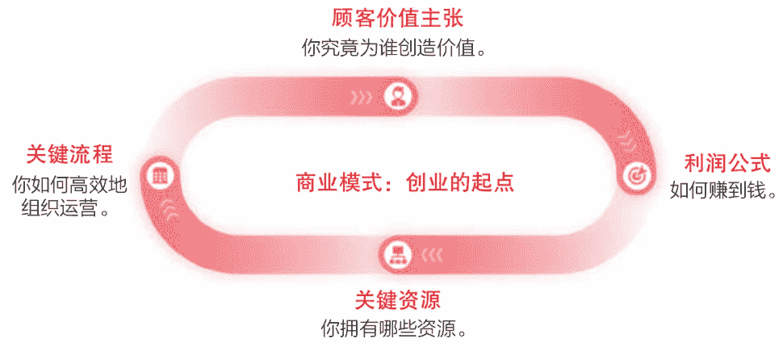

图1-1 商业模式的核心逻辑

## 价值主张：商业模式的核心

当下每一天都有无数新品牌涌现，能真正突围的却很少。对资源与资金都有限的精简团队而言，首要问题是如何快速打开市场并实现盈利。很多人以为资金与人脉是关键，但深入探究成功的小组织会发现，真正的秘密往往是清晰且精准的顾客价值主张。

顾客价值主张是商业模式的核心，回答企业以何种独特方式满足客户需求或提供不可替代价值。其本质是：为什么客户要选你而不是替代方案？答案直接决定客户是否付费、复购、成为拥护者，是企业与客户建立长期价值交换的基石。

精简团队要精准构建价值主张，可借助黄金三角模型，拆解为三个要素。

首先是目标客户，这是起点。画像必须具体，如28到35岁一线城市互联网从业者，单程通勤约1.5小时，习惯在地铁利用碎片时间学习，并包含高频行为，如每周打开在线学习应用四次以上，每次20到30分钟。

锁定客户后，核心工作是挖掘未被满足的需求，这些需求常藏在抱怨、犹豫与无奈中，可分为功能需求与情感需求。功能需求多关乎效率、成本、效果，例如上述人群希望快速筛选与工作相关精简课程，避免在海量内容中浪费时间；担心付费课程质量参差、性价比低；情感需求关乎安全、归属与自我实现，比如通过学习提升技能获得职场安全感，渴望加入同领域学习社群，避免独自学习的孤独感。

即便明确客户与需求，若无法提供超越竞争对手的解决方案，客户仍会流失。因此差异化价值是第三关键。

差异化不是我有别人没有的小众功能，而是客户在意的点上我比别人更好。它可以是核心功能性能优势，如课程由行业资深专家打磨，每节课聚焦一个核心知识点，学完即可应用；也可以是使用流程或情感共鸣的体验优化，如应用支持课程离线缓存，适配地铁弱网环境，学习进度自动同步多设备。

黄金三角模型的核心作用，是把模糊的价值创造想法，变成可落地、可执行的资源投放策略。它逼着小团队像用显微镜一样，死死盯住一个能撬动市场的尖锐切口，而不是摊大饼式地到处撒网，把有限的人、钱、时间全部砸向目标人群最迫切、非解决不可的痛点上。

顾客价值主张不是写一次就封存的固定答案。它会随用户需求迁移而改写，会随竞争格局变化而迭代，但内核始终不变：你凭什么被选中。只要把这个问题回答得足够清晰，哪怕团队只有几个人，也能在混战中站稳脚跟。

## 利润公式：把价值变成持续现金流

找到市场突破口靠价值主张，能否活下来靠利润公式。它是小团队把价值主张兑现为稳定利润的运行机制。

利润公式由收入模型、成本结构、利润空间、周转效率四块组成。小团队做设计时都要围绕轻量化与可控来展开，避免重资产带来的负担。

收入模型回答的是钱从哪里来、怎么定价。因为资源有限，多品类多渠道的重模式玩不转，得选轻的路径。3人企业管理咨询团队不做长期雇佣，而是项目制收费，聚焦中小企业组织架构优化，单项目5万到8万元，按阶段结算。门槛降低，团队也不被长期人力绑定。另一类是本地生活服务团队，为社区超市做供应链对接，按月收服务费，现金流稳定，抗波动。

成本结构要回答钱花在哪、能不能更省。小团队不必追求全盘降本，而是锁定对利润影响最大的关键项，优化流程、集中资源。某做家居用品的跨境电商，广告多平台投放，单客获客成本约200元，和物流一起占总支出六成以上。后来集中到亚马逊精准关键词投放，并和区域物流商签季度协议单价降15%，总运营成本降了22%。这是锁定关键成本后集中谈判的典型。

利润空间看每单赚多少、安全边际多少。没有统一标准，受行业成本、竞争、附加值影响很大。判断是否健康看两点匹配：横向对标行业均值，不低于中位数；纵向对标自身运营需求，能覆盖固定成本、抵御风险并留钱发展。杭州一家社区生鲜小店起初按30%毛利定价，青菜3.5元/斤，比周边高0.8元，客流暴跌月亏超5000元。调研后发现同行均值只有12%到15%，调整为2.8元/斤，并与本地基地每日直采成本降8%，推晚间折扣把损耗从12%降到7%，毛利稳定在14%。既能覆盖成本，每月还能留5000元做品类扩展，并有2%缓冲。

周转效率关注资金和库存跑多快。杭州一家小商品零售团队做文具家居饰品，以前大批量备货，库存90天周转，资金被绑死。改为小批量高频次采购，按月度销量调备货，周转天数降到45天，年周转从4次提到8次，积压减少，资金能试更多品类。

四者形成闭环。收入模型提供源头活水，成本结构负责节流，利润空间是平衡标尺反向校准收入与成本，周转效率是加速器。收入稳定增长、成本可控、利润达标、资金快流转，才是良性循环。

## 关键资源：小团队的竞争底座

资源紧、竞争烈时，精准掌控关键资源就是生存题。关键资源既是交付价值的底座，也是难以复制的壁垒。

跳出资源等于实物的误区。对小团队而言，关键资源是支撑价值主张与利润公式的核心资产，回答两个问题：靠什么持续兑现承诺？哪些东西对手短时间抄不走？

可分为四类。

实体资产是有形资源，如设备、仓储、库存。深圳一家小型3D打印工作室，核心是两台工业级SLA打印机。0.1毫米精度的定制零件、模型都靠这两台机器完成，精度和稳定性决定客户满意度，每月带来20到30单，在小批量定制市场形成差异。运营时要平衡投入与现金流，盲目扩产能会占用资金。建议按订单动态调整，优先按需采购或租赁。

知识资产是无形的智慧沉淀，如专利、配方、算法、方法论。上海一家家庭烘焙工作室创始人研发的低温慢发酵配方，让面包无添加保质期延长三天且更松软，客户愿付溢价50%。若不保护，易被拆解模仿；若只在个人脑中，也会因流动流失。申请专利版权、建立内部文档库能固化。

人力资产是掌握核心技能的人和专家网络。杭州一家小型企业咨询，核心是一位有15年制造业经验的合伙人，他提供流程优化方案并能对接供应链，客户就是冲他来的。运营要注意能力分布均衡，避免单点依赖或技能重叠。可通过互补招聘、师徒制、定期培训分散风险。

关系资产是长期积累的客户、供应链和社区连接。成都一位独立图书策划人，5年运营积累10万订阅邮件列表，粉丝多为资深文学爱好者，每次预售信息一发就能带来至少2000册首销。活性比数量重要，要通过定期互动、个性化服务把沉睡资源激活。

资源组合也很关键。Instagram早期十几人团队，核心不是硬件，而是滤镜算法的知识资产和摄影圈KOL的关系资产，二者结合支撑产品体验与用户增长，上线一年实现千万级用户。

## 关键流程：让价值稳定交付

资源是必要非充分条件。没有稳定流程，资源会失效。看似资源不足的小团队，只要流程规范灵活，就能实现跳跃式成长。

关键流程是一套驱动日常运转的机制，从产品设计、获客到供应链、客服、绩效和协作。它是一种结构化效率，用最少资源做最多事。

星巴克全球扩张的底气不是豆子，而是极度标准化的流程。无论北京还是旧金山，拿铁的制作、设备使用、服务语言都高度一致。可复制、可量化、可追踪的流程，才是品质一致的根源。

对小团队，关键流程是把关键资源转化为客户可感知价值的重复动作系统，要回答：怎么把资源变成价值？如何不依赖个人经验也能稳定交付？

具备三个特征。

重复性。流程要高频发生。用户需求小团队会把每周用户访谈固定下来，固定时间、人数、提纲，持续积累数据。社区电商团队的每日社群运营，从早安互动到种草到订单统计，节奏固定保证活跃和转化。

标准性。输入输出明确，可量化。有SOP的客服团队，输入是客户咨询，输出是问题解决率≥95%、响应≤5分钟，中间有话术模板、转接机制、售后跟进节点。新人也能迅速上手。

价值锚点。流程必须直接支撑顾客价值主张。CVP是24小时内发货，那么极速供应链流程就是核心：下单到物流单号生成之间，审核、库存核对、打包复核、物流对接各有时间上限，比如库存核对≤1小时、打包复核≤2小时。

小团队的流程不需要覆盖所有环节，只需打磨直接影响交付的核心动作。社区团购不必做复杂财务流程，但团长汇总、供应商备货、次日达配送必须做到极致。流程优势累积成客户信任和团队效率。

## 企业边界：科斯理论下的规模与选择

诺贝尔奖得主科斯提出的交易成本与企业边界理论，解释了什么生意适合小团队，以及规模该怎么守。

很多创业者问做什么生意，更该问哪种生意适合小团队。答案在于边界的精准界定。

### 为什么有些生意天生适合小团队

科斯1937年《企业的性质》指出，交易成本是达成交易所需的信息搜集、谈判、签约执行等隐性成本。它是判断生意适配性的标尺。

小团队优势是交易成本低。设计工作室可直接和客户沟通细节快速响应，避免反复改合同；小型创意餐厅可随时按反馈调菜单；电商小团队直接和顾客互动捕捉细微需求。大型企业则需层层审批、大量调研，成本高。

AI时代放大了这一优势。AI数据分析工具让小团队实时把握偏好，AI算法快速识别需求趋势，小型电商用AI自动生成营销方案，也能完成过去大部门的工作。

### 企业存在的边界条件：成本均衡点

企业存在是因为内部协调成本低于市场交易成本。企业边界就在两者相等处。内部管理成本<市场交易成本时扩张，>时应收缩或外包。

手工艺品团队若从制料到零售全包，成本高效率低。专注设计和品牌，将生产物流交给专业伙伴，就能控成本做大品牌。

天然适合小团队的生意，交易成本结构友好：内部协调成本极低、外部交易可控、可被AI工具降本，无需大规模人力资金。

### 如何控制企业规模、精准界定业务边界

守住边界要围绕适度规模和边际分析。

可参考四个判断：

管理成本与交易成本比较。若沟通效率下降、决策变慢，说明超界。小型咖啡品牌开店后人力、物流管理复杂度激增，就需收缩或外包物流。

现金流状况。扩张后现金流紧张，说明增速过快。某手工艺品初创因大批量生产占用原材料资金导致断裂，就需缩减规模优先回款。

客户体验水平。若规模扩张导致品质下降、投诉上升，就需回归核心。定制服装品牌扩产忽视品控，退货率上升后就需收缩，重新聚焦定制服务体验。

需求端一旦出现明显震荡，完全依赖创始人主观经验来把握扩张节奏风险很高。更稳妥的路径是引入智能分析对经营规模进行精细调节。进入可量化阶段，市场信号可以被拆解为可读指标，数据驱动的决策支撑让资源受限的精简组织在保持克制的前提下，获得更为平稳且可持续的增长。

## 边际分析：确定合理的扩张边界

梳理出适配轻量组织的商业形态以及规模判断标准之后，如何把体量卡住、避免管理成本失控，就需要调用科斯在交易成本理论中提出的边际分析思路。该方法的底层逻辑是，企业扩张到内部管理成本与外部交易成本基本相当的拐点时即应止步。它帮助轻量组织跳出增长即等于成功的惯性，用理性评估新增业务或扩大体量是否真正带来盈余，而不是陷入短期繁荣的幻觉。

在创业实践中，边际分析的价值十分直观。扩张看似是成长的必然，但大量初创公司倒在增速超出组织与资源承载能力的区间，成本飙升、效率下滑，最终连基本盘都受冲击。经营者必须清醒，扩张不是终点，盈利才是根本。边际分析提供了一个科学的扩张可行性标尺，结合机器学习来测算边际成本与边际收益，能让决策更客观。以服务自由职业者的SaaS工具为例，该公司在考虑推出收费订阅时借助人工智能做了深度测算，结果显示不到两成活跃用户愿意为高级功能买单，开发成本远超预期，转化也不足以支撑长期投入。团队最终放弃盲目叠加付费模块，转而打磨现有免费功能，通过提升留存与广告变现来实现更健康的收入增长。

扩张常被贴上成功的标签，真正的分水岭却是增长的质量。精简组织必须学会用边际分析去评估每一次业务延伸的可行性，确保扩张能够带来实际回报，而不是把自己拖进资源消耗与管理失控的泥潭。

把科斯理论与智能技术结合起来，轻量组织的企业边界管理便形成闭环：先选择交易成本结构对自己有利的生意类型，再守住规模边界，用边际分析防止管理成本失控，最后在小而精的区间内实现可持续发展。

## 超级武器：人工智能驱动的商业模式设计

对资金人力吃紧的微型团队而言，智能技术正在拉低进入门槛，削弱对资本、人力和固定设施的传统依赖，还能承接大量标准化、重复性工作，让团队把精力集中在核心创意与策略上。智能正在催生一种新型组织形态，让超级个体或精干小队迎来繁荣。

商业模式的核心构成我们已梳理过，包括价值主张、盈利公式、关键资源与关键流程。创业者更关心的是，如何以体系化、系统化的方式借助人工智能整体设计并动态优化适配轻量团队的商业模式，人工智能具体能在哪些环节产生增益。

下面从更深的层面讲讲怎样用人工智能的思维和方法，快速搭建具备竞争优势的商业模式，并持续迭代升级。

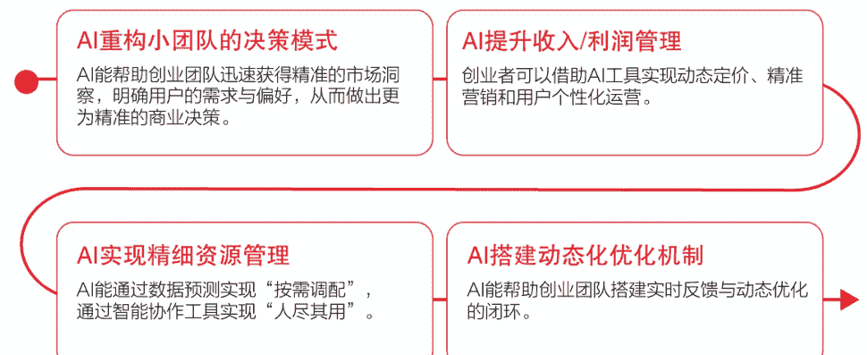
### 人工智能重塑团队决策：奠定精准基础

对轻量创业而言，决策的准确性是活下去的前提。资源有限、抗风险能力弱，一次关键失误就可能让前期投入归零。创业的本质是围绕用户需求和市场机会不断做决策并落地：服务谁、提供什么价值、如何盈利、人力资金如何分配，每一步都取决于判断的准确度。基础的精准度决定起点是否扎实，人工智能对决策模式的重构正是从源头解决判断不准、风险高的核心问题。

传统路径里，创始人的经验、直觉和主观判断占据主导，有时能快速反应，更多时候伴随高昂的试错成本和决策风险，因为缺乏数据支撑和可量化过程。如今人工智能带来的最大变化是数据驱动决策，显著降低不确定性。

人工智能不只是工具，而是一种以数据驱动为核心的决策思维。它能自动收集、分析、预测海量数据，帮助团队快速获得精准的市场洞察，明确用户需求偏好，从而做出更靠谱的商业判断。

以找准用户核心需求为例，过去轻量团队多靠有限调研或创始人洞察，效率低准确性差。通过人工智能驱动的市场分析工具，比如国内创业者常用的百度指数、巨量算数、飞瓜数据等，团队可以全网抓取实时数据，迅速把握趋势和真实需求，甚至是用户自己尚未意识到的潜在需求。

小红书的早期爆发就是人工智能赋能决策的典型案例。平台用人工智能深度分析年轻女性在美妆、生活方式、旅游、穿搭等领域的消费习惯和偏好，实时捕捉热点。比如某一阶段“平价国货美妆”讨论热度猛升，人工智能迅速量化需求强度。基于此，平台调整内容推荐策略，加大国货美妆权重，并发起相关话题互动，最终在激烈竞争中脱颖而出。

人工智能让轻量团队无需大团队，也能拥有过去只有大公司才有的精准洞察力，为后续盈利模式设计、资源分配打下决策不跑偏的基础。

## 人工智能提升收入利润管理：打通盈利核心

方向找准后，最关键的问题是如何把精准洞察转化为持续的收入与利润。对轻量团队，存活的核心就是能赚钱、有利润。人工智能对收入利润的优化，本质是解决可持续性的问题，让前期决策落地为造血能力。

传统轻量团队常面临收入模式僵化、利润空间受限，根源在于策略静态难调整。比如固定定价、长期沿用同一营销方案，市场需求、用户偏好、竞争策略在变，静态模式无法匹配不同用户的付费意愿，也错失短期热点，最终导致能赚的钱赚不到，想赚的钱在缩水。对资源紧张的团队，这种低效会让前期成果付诸东流。

人工智能可以帮助实现收入模式的智能化与动态化，提升整体盈利能力。

具体做法是借助人工智能实现动态定价、精准营销和用户个性化运营，这是对前期洞察的落地。摸清用户消费习惯和价格敏感度后，就能用人工智能转化为针对性的盈利动作。比如腾讯云、阿里云提供的智能预测与营销工具，可实时追踪用户消费习惯、支付数据、价格敏感度，预测最佳定价区间，并根据行为动态调价与营销，最大化付费转化。

拼多多的发展路径极具参考性。早期服务价格敏感的下沉用户，几年内成长为电商巨头，核心在于用人工智能把洞察转化为极致盈利效率。拼多多利用算法实时捕捉用户购物兴趣和价格敏感度，对不同人群做个性化促销：同一商品，学生看到“拼团9.9元”，宝妈看到“买二送一”，高频复购用户看到“会员专属折扣”。这种精细化运营既让用户感觉到专属优惠，又在控本的前提下最大化每笔订单利润。即使没有庞大运营团队，轻量团队也能靠人工智能实现千人千面的盈利管理，打通造血通道。

## 人工智能实现精细资源管理：夯实效率支撑

打通决策到增收的路径后，决定能否走稳的是资源管理：赚来的钱守得住、有限资源用得值。轻量团队的盈利不仅靠多赚钱，更靠少花钱、花对钱。资金、人力、物资都是稀缺品，一旦浪费或错配，再高的收入也会被侵蚀，甚至因现金流断裂而倒闭。人工智能对成本与资源管理的精细化赋能，为轻量团队搭建起效率保障，让增收与节支形成合力。

传统成本管理与资源分配往往粗放。做实体或生鲜的轻量团队可能凭经验采购，旺季缺货、淡季积压；在资源端，创始人身兼数职，团队被琐事缠住，真正创造价值的核心工作被挤压。

人工智能能实现成本与资源管理的精细化、实时化、智能化。

成本控制上，人工智能可通过数据预测实现按需调配。盒马鲜生通过阿里云的人工智能库存管理系统，结合历史销售、实时消费趋势与季节变化，动态调整采购与供应，显著降低损耗与积压，提升资金使用效率和利润率。

团队管理上，人工智能可通过智能协作工具实现人尽其用、聚焦核心价值。飞书、钉钉等人工智能办公协作平台能实时跟踪任务进展与人员效率，根据技能自动分配任务并监测项目进度，实现资源优化，整体运作效率明显提升。

无论是成本端的“少花钱”，还是资源端的“高效用”，人工智能都在帮助轻量团队把每一分资源用在刀刃上。

## 人工智能搭建动态优化机制：形成迭代闭环

实现精准决策、高效增收、精细管理后，还要解决如何跟上市场变化的问题。市场、竞争、环境都在变，传统轻量团队缺乏有效的反馈优化系统，很难实时响应。人工智能搭建的实时反馈与动态优化机制，为轻量团队打造持续迭代的闭环，确保能不断适配变化。

华为云智能运营平台、字节跳动的火山引擎等可实时监控销量、留存率、用户评价与竞争对手动态，一旦指标异常或出现风险信号，人工智能就能预警并给出针对性调整建议，帮助团队快速响应。

这种机制让轻量团队“即时感知、快速行动”。例如一家知识付费团队通过人工智能监测发现“职场技能类课程”完课率从80%降到60%，人工智能分析原因是章节过长用户难以坚持，建议拆分为10分钟一节的短课。调整后3天内完课率回升到75%，避免了用户流失和收入下滑。

人工智能驱动的持续反馈与动态优化，不仅提升商业模式的敏捷性和市场适应性，还让轻量团队能以极低成本实现高效迭代，无需大量人力分析数据，也无需漫长决策周期，就能快速适应市场。

总体看，智能技术正以前所未有的方式改变轻量创业规则。从精准决策到高效增收，再到精细管理和实时迭代，四层能力逐层递进，为轻量团队构建低成本、高效率、抗风险的方法论。拥抱人工智能的思维与工具，轻量团队才能在激烈竞争中脱颖而出，抓住历史机遇实现飞跃式成长。

站在人工智能重塑商业规则的历史节点回望，核心命题清晰：人工智能带来的不仅是工具革新，更是商业权力的平权，让轻量团队突破资源、能力、规模的桎梏，在碎片化市场中找到精准创造价值的路径。但这只是起点。人工智能平权带来的机遇伴随竞争维度的升级，当所有人都能用人工智能提升效率时，构建差异化壁垒成为新课题。人工智能不仅能提升效率，也能为战略设计、产品设计提供关键赋能。品牌建设的精准触达、运营扩张的成本控制与体验保障、团队架构的适配等议题，将在后续章节继续深入探讨。

# 02 从0到N

## 小团队的生存与扩张法则

当下商业世界竞争激烈、技术迭代快速，轻量创业者始终在资源与生存之间博弈。智能时代的到来为轻量团队带来前所未有的机遇，竞争已不只是人力对人力，更是算法对组织、系统对个体的较量。

借助人工智能普及，轻量团队拥有了超常杠杆。人工智能不再是巨头的专属，而是轻量团队实现轻资产高效运营的加速器。在正确使用技术的前提下，轻量团队完全有能力构建过去需要几十人才能完成的运营闭环。

这意味着技术正在重新定义规模与竞争力的边界。资源有限不代表机会稀缺，关键在于是否拥有正确的竞争策略、增长路径和组织进化能力。

本章从三个维度展开：竞争策略帮你找到合适的战场和打法；增长策略帮你从点突破到飞轮加速；进化策略则帮助你适应生命周期挑战，不断调优管理结构。三者共同帮助轻量团队在复杂环境中构建清晰战略，提升执行效率，以进化视角塑造长久生命力。对轻量团队而言，这不仅是工具，更是从战术到战略的认知跃迁。

## 竞争策略：选择作战模式

商业竞争本质是战略较量，而非资源堆砌。虽然轻量团队资源处于劣势，仍可通过精准选择竞争策略在市场中站稳脚跟。

杰克·特劳特与艾·里斯在《商战》中提出经典框架：防御战、进攻战、侧翼战与游击战。结合轻量团队特点，它们天然更适合侧翼战与游击战。无论是进入细分市场，还是深耕特定领域，都能通过灵活应变和创新实现长足发展。

商场如战场，轻量团队不需要正面硬刚。竞争不是对抗，而是如何定位自己与他人的关系，从而选择最合适的作战方式。

### 市场中的角色认知

对轻量创业者，理解自身在市场中的角色是制定竞争策略的第一步。特劳特和里斯将企业角色分为四种：领导者、挑战者、跟随者、游击者（见图2—1）。

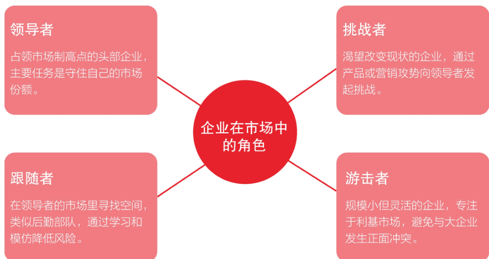
领导者指市场头部企业，通常在资源、认知度、市场份额上具备绝对优势，类似防守方高地。其主要任务是守住份额，强化品牌认知，构建难以逾越的壁垒。

挑战者渴望改变现状，通过瞄准领导者的薄弱环节发起进攻以获取份额，类似进攻部队，必须依赖精准定位、差异化产品和强力营销撼动领导者地位。

跟随者通常不直接竞争，而是专注在领导者策略下寻找生存空间，通过学习模仿降低风险并优化资源配置，类似后勤部队。

游击者通常是规模较小、资源有限但极具灵活性的玩家，聚焦利基市场，迅速调整策略并高效利用资源，避免与大企业正面冲突。这一角色对轻量团队尤为重要，代表了通过快速应变和精准执行在市场中生存并持续发展的路径。

### 基于竞争策略的作战选择

基于不同市场角色，企业该如何选择作战策略？特劳特和里斯将市场竞争策略归纳为四种主要作战方式：防御战、进攻战、侧翼战和游击战（见图2—2）。这四种策略并非孤立，而是基于企业地位、资源禀赋和目标受众设计的战术框架。

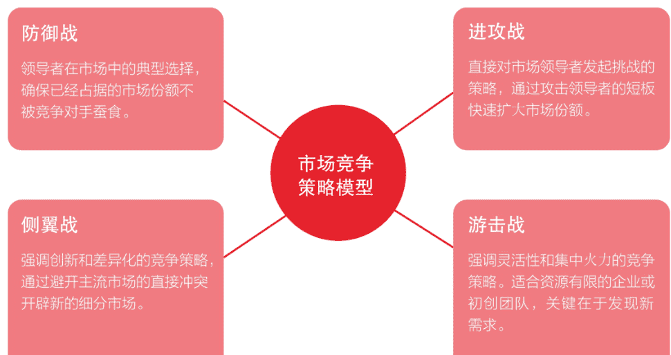
### 防御战：巩固既有的市场地位

防御战是市场领导者的典型选择，核心目标是确保现有市场份额不被蚕食。其本质是通过强化竞争壁垒和快速响应变化，避免竞争者在关键领域渗透。

以咖啡馆市场为例，星巴克作为领导者，需要确保份额不被蚕食。打防御战的铁律是不能犯错，宁可自我革新也别让对手找到突破口。星巴克在核心商圈密集开店，用位置垄断筑防线；推出爆火的猫爪杯，看似与咖啡无关，实则用网红属性巩固年轻人认知：喝星巴克等于潮流。

对轻量团队，防御战并不常见，因其需要雄厚资源和市场基础。但当初创企业在细分领域已成领导者时，防御战就很关键。比如强化品牌认知、提升客户忠诚度、通过创新提高进入壁垒，都可帮助保护市场地位。

### 进攻战：挑战领导者的权威

进攻战是直接对市场领导者发起挑战的策略，核心是通过攻击其短板快速扩大份额，通常适合资源相对充足的挑战者。

瑞幸作为咖啡市场新进入者，是典型的挑战者，打的是进攻战。它并没有与星巴克比内力、比装修和豆品质，而是专攻软肋。星巴克一杯拿铁售价33元，瑞幸喊出9.9元低价，并用外卖加闪店模式砍掉大空间租金成本，直击价格痛点。

进攻战需要强力资源支撑。例如瑞幸从成立到上市获得多轮融资，这对轻量团队很难做到。

## 侧翼战：开辟全新领域

# 绕开正面战场做细分

竞争白热化时硬碰头部成本极高。更实际的做法是寻找被忽略的缝隙，用不一样的形态和服务方式点亮未被满足的需求，进而重塑细分赛道的规则。归根结底是重新定义市场。

Manner 给自己定位成跟随者，既不追求领导者位置也不想取代挑战者，只求在连锁咖啡里占稳一角。星巴克与瑞幸共同定义了主流格局。Manner 捕捉到中间落差：价格约为星巴克的一半，体验接近独立精品馆，靠小体量门店、精细萃取与环保主张，把精品咖啡做成高性价比替代品。这正是侧翼思路的典型：差异化卡位、避开正面消耗、切入覆盖不足的空白。星巴克靠空间溢价，瑞幸靠效率规模，恰好为品质与性价比兼顾的定位腾出空间。巨头间的缝隙催生新赛道，也让精品咖啡大众化变得可感。对资源有限的小团队而言，这类打法更友好，餐饮等高竞争赛道里不少初创正是靠它获得喘息空间。

## 游击思维：以灵活性换取局部优势

游击更强调灵活与火力集中，适合人少本薄的创业组织。它不求全盘击败对手，而是挑选对手不屑或顾及不到的小众区域集中经营，在局部建立难以复制的优势。关键在于高度专注与快速调动。

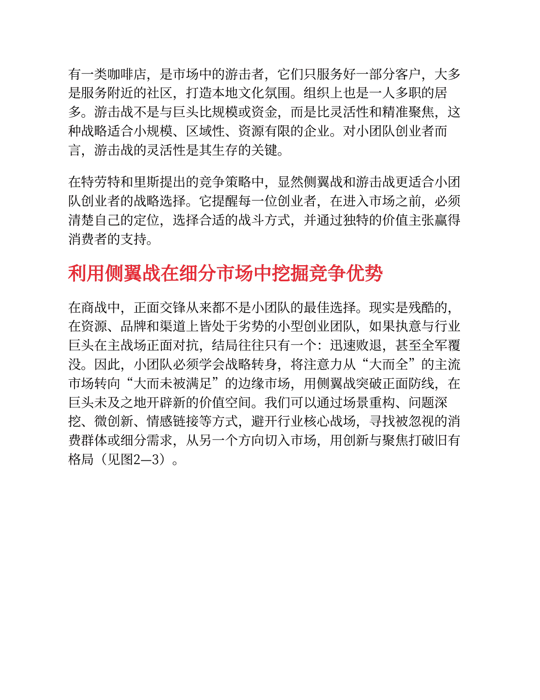

## 场景重塑创造新需求

同一件商品置于不同使用情境，会衍生出全新需求。小团队把场景拆解重组，就能打开新战场。

任天堂 Switch 是经典例证。它在客厅大屏娱乐与便携游戏之间开辟全新品类。截至2025年3月31日，Switch 在全球累计销量超过1.5亿台。数据来源：任天堂在2025财年（截至2025年3月31日）发布的官方财报。索尼 PlayStation 与微软 Xbox 都聚焦高性能家用主机，使用基本受限于客厅。Switch 摆脱空间限制，主客一体形态让客厅大屏与户外碎片体验无缝切换。通勤时可以玩《塞尔达传说》，到家后直接投屏继续。借助《健身环大冒险》《舞力全开》等体感内容与 IP 组合，游戏场景被延伸到家庭健身、社交聚会、健康管理等领域，部分替代了健身器材与桌游的功能。

## 挖掘被容忍的痛点

市场不缺问题，关键在分级。用户对某些麻烦习以为常，比如吸尘器尘盒清洗费劲、洗地机滚刷易发霉，这类难受却可忍的点被称作容忍型痛点。大企业常去解决难以忍受的大问题，小团队若把沉默的容忍型痛点解决好，反而能带来颠覆性体验。

家电新锐追觅科技的路径可供参考。面对美的、海尔、小米主导的冰洗厨赛道，它没有硬碰硬，而是深挖高端清洁里的容忍型痛点。洗地机自清洁后滚刷仍潮湿易滋生霉菌，追觅用离心甩干配合加热风烘干来化解。洗地机平均重量超过5千克，推拉费力，尤其对主力女性用户不友好，追觅把机器人关节技术迁移到洗地机，实现每秒500次动态调节助力方向，降低推拉阻力。追觅关注的都是高频发生的问题，用户容忍阈值高，凑合能用却长期困扰。

这类问题怎么找？观察使用时的极端操作，比如手柄磨手就缠棉布。在数字环境下，竞品电商评论区的高频抱怨词很有价值。别忽略时间和精力的损耗，例如用户每周手动清理洗地机滚刷约需1.5小时，这就是深度挖掘的信号。

## 以细节创新构建壁垒

谈到重新定义市场，人们常想到技术颠覆。实则创新不一定是颠覆，而是对需求的细腻洞察，并在服务、交互、品牌沟通上做精准改进。小团队在硬件和资本上难以抗衡，但在体验细节上容易形成天然壁垒。

英国手工美妆品牌 Lush 提供了启示。在欧莱雅、资生堂占据主流的背景下，Lush 拒绝代言、拒绝折扣、拒绝随大流，坚定贯彻绿色理念。过去环保常被视为体验妥协，Lush 带来裸包装香皂，每买一块就减少一个塑料瓶，把环保变成不牺牲体验的举手之劳，并提供可重复使用的礼品盒，门店大量使用再生材料。这种极致到细节的表达，让环保从道德负担变成可触摸、可玩、可炫耀的生活方式。投放很少，却在年轻人群中形成强共鸣。

另一类创新是成熟技术的降维应用。AR 与 3D 扫描本是科技行业工具，红豆智能量体仓用 AR 试衣加 3D 扫描替代传统量体，降低高端定制门槛。AI 大模型还能根据身材、风格偏好和穿着场合给出个性化推荐、AI 试衣和搭配建议。配合大数据精准和柔性供应链，工厂可按需快速调整。即便在传统服装零售，也能通过技术嵌入实现成本和体验的跃迁。降维的核心是把高技术密度领域的成熟方案搬到低技术密度行业。

## 用情感共鸣锚定心智

传统商业认为边缘需求规模小价值有限，但数字化和柔性生产正在改变规则，小众需求也能深入人心。

日本咖啡品牌猿田彦咖啡就是例子。星巴克、咖世家、皮爷等巨头占据主流后，这家起步于东京街角的精品品牌没有复制快节奏高流量的模式，而是聚焦个性化咖啡体验。它洞察到一线城市年轻人对第三空间的反思：不再满足于速溶式的办公咖啡，而是渴望与咖啡师交流、品味原产豆风味的仪式感与慢生活。

猿田彦咖啡的核心叙事围绕职人精神打造，招牌系列焦糖尾韵的烘焙曲线精确到±0.5℃温差，萃取时间控制在2分10秒±5秒。门店不是功能空间而是情感载体，有一家店仅8.7平方米，定位深夜治愈站，暖黄灯光与木质吧台营造家庭感。它没有与星巴克拼门店数与效率，而是在其视野盲区建立独特心智。品牌名“猿田彦”源自日本神话中的引导之神，寓意用咖啡为人们指引方向。基于细分用户情感的切入，正是侧翼战中品牌与用户情感链接的突破。

线下门店利于情感连接，纯线上小团队怎么办？手机支架品牌泡泡骚 PopSockets 可作参考。它起源于美国，创始人为解决耳机线缠绕发明气囊支架。2018年进入中国时面临无线下门店、认知薄弱、流量成本高等挑战。它联合豆瓣“手机橱窗计划”小组，邀请用户用透明手机壳展示原创诗歌或拼贴创作，带话题发帖获赠支架，将品牌起源故事转化为创造力与自我表达的象征，主打手机背面的情绪出口。活动笔记获得200多万次浏览，形成自发传播。2023年，它与公益机构“是光”诗歌合作，将山区儿童诗歌印上支架，每售出一件捐赠25元支持诗歌课，让购买行为附着“守护童心”意义。小团队即使没有实体触点，也能通过共创与情感共鸣构建心智护城河。功能同质化时代，情感认同才是壁垒。

对小团队而言，侧翼战不只是战术，更是战略哲学：避开巨头锋芒，聚焦被低估的价值；远离同质化规模竞争，占领用户心智空白；不求做所有人的选择，只做对一部分人真正有意义的存在。在变幻的商业环境里，走在边界、扎根需求缝隙的创业者，往往最能改变行业结构。

## 游击落地：从微区到扩张

创业无法用正面火力与大企业抗衡，却能靠灵活穿插在局部打出奇兵。游击战不是击败对手，而是找到对手不想打、打不了的地方先活下来，让“小”成为优势。

### 深耕缝隙市场

局部市场往往是大企业忽略的缝隙。可以自问三点：有没有一群需求被大企业忽略？有没有某个地域尚未覆盖？有没有冷门场景需求？

Anastasia Beverly Hills 是典型。创始人 Anastasiasoare 在上世纪90年代发现，欧莱雅、雅诗兰黛等聚焦眼影口红，眉毛被视为附属，消费者买了眉笔仍不知如何画出理想眉形。她以“黄金比例修眉法”起家，从线下修眉服务切入，逐步扩展产品与全球化。扩张时，高端服务集中在一线城市，二三线及东南亚等新兴市场缺乏专业线下服务，于是开设 Brow Studio 连锁店统一技术标准，并通过 TikTok 与本地 KOL 合作发布适配亚洲眉形的教程，亚太地区贡献超额增长。在冷门场景，它推出眉毛急救包，含迷你眉胶、镊子、遮瑕膏，适配旅行、会议等紧急需求。大企业追逐显性热点时，小团队可用极小切口撬动增量。

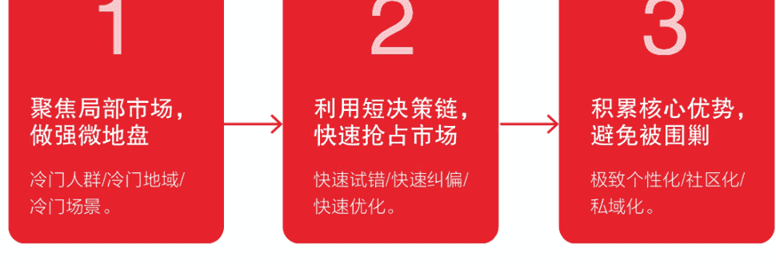

### 快速试错快速迭代

创业团队的最大优势是决策链短，可快速试错与优化。美国高端汉堡品牌 Shake Shack 早期只是纽约麦迪逊广场公园的流动摊位，靠限量供应、精致手作与强社交互动建立忠诚度。菜单在试卖与现场问卷中不断调整，消费者反馈第二天就落地。这种消费者共创加实时迭代的模式，让它迅速成长为新一代美式餐饮代表。

抢占市场要单点突破而非大而全。现在可借助数据分析、热度监测与社群声量预警判断区域或产品是否值得深耕。例如想卖懒人厨房神器，先用短视频演示样品测兴趣，有订单再小批量生产。过去需一年铺货才知口味是否受欢迎，现在微信小程序临时页面3天就能拿到足够反馈。

### 防御性积累

进入局部市场后，常会出现跟随者甚至大企业分食。此时应积累核心优势而非盲目扩张。可从四方面入手。

其一，极致个性化，做量身定制生意，比如只服务孕产妇的体态调整与产后修复，一对一服务。

其二，社区做熟人生意。大企业难触达最后一公里，小团队可依托面对面服务与地域信任扎根3公里生活圈，用上门与熟人关系建立高频互动。

其三，与客户做朋友。靠私域流量强链接，比如上海社区面包店建宝妈烘焙群，每天分享辅食面包做法，每周直播教无糖小饼干，群内下单享9折，复购率远高于散客。

其四，成为领域权威，用专业度建立信任。北京老胡同修表匠开了30年，客源老龄化。儿子在抖音发布“修复爷爷辈老怀表”视频，展示拆零件、上油细节，吸引怀旧年轻群体，并开通微信小程序支持线上预约与同城闪送，用AI识别评论关键词发现保养需求后推出年度保养套餐。

小团队可低成本精准触达，用AI弥补人力不足，把节省的成本投入核心优势积累势能。

无论选择侧翼战打出差异化，还是游击战拿下局部，都能在市场中赢得位置。商业竞争是一场持续演化的博弈，尤其在高度数字化环境下，成功不在于建造永不改变的战略堡垒，而在于能否在侧翼战与游击战间自由切换，比对手更早看见机会、更快做出反应。真正的战略家永远在调整中前行，动态调整能力才是核心。

## 飞轮驱动增长

小团队的成功像推动沉重飞轮，靠方向一致的微小努力积累动能，最终形成自我驱动的增长循环。这与吉姆·柯林斯在《从优秀到卓越》中的飞轮效应高度一致。

### 明确第一推动力

飞轮起点在于找到成长的核心驱动力，即企业价值定位与市场最迫切问题的交点。企鹅吃喝指南团队发现市场上缺乏专业、独立、有趣的食品测评内容，消费者对食品健康与品质信任不足，于是以“生产公正、专业、有趣的美食内容”为驱动集中资源，形成品牌声誉。资源有限的小团队必须聚焦单一领域，避免分散。

### 打通自增强闭环

飞轮的关键是相互关联的闭环。典型路径是：高质量产品/服务→积极用户反馈→品牌认知提升→新用户增长→规模效应降本→产品/服务质量再提升。每一个环节都为下一步积累动能。

亚马逊是最佳诠释：以增加选择为起点，庞大商品库吸引消费者，流量转化为吸引商家的资本，销量提升带来规模效应降本，进一步巩固地位。

小团队的闭环可以更简单，例如本地餐饮初创靠优质服务建立口碑吸引顾客，收入扩大运营规模，降低成本提供更好体验，进一步增强黏性。构建闭环的核心是环节间的因果关系，实现相乘而非相加。

## 持续校准方向

飞轮成长的三重跃迁

飞轮并非一经设定就不可更改的模型。新创队伍往往在第一次搭建时就存在明显缺陷，甚至漏洞重重，这并不阻碍他们通过反复试错找到更契合自身的发展路线。

真正决定飞轮能否滚动的，是持续调校的能力。飞轮要能基于回馈剔除低效环节、强化有效环节。以本土手工艺品起家的团队为例，起初押注社媒投放，因转化不佳而转向社区线下活动和商场快闪；经过多轮试验后，才锁定最有效的触达方式并集中资源。该种快速迭代的回馈机制，既是轻量组织的优势，也是飞轮保持动能的关键。

## 由外力推动到自主运转

飞轮的终极形态是摆脱外部输血、靠自身惯性前行。随着动能累积，企业会抵达临界点，此后扩张更多依赖轮体自身产生的推力，而非持续投入。典型征兆是品牌认知大幅提升、获客成本下降以及竞争壁垒初步形成。

奈飞近年的拐点具有代表性。2024年全球付费用户规模达到3.016亿，远超第二名；广告业务收入同比翻倍，新增用户中55%选择广告套餐。数据来自奈飞发布的2024年第四季度及全年业绩报告。规模效应降低了内容边际成本，形成“投入内容→用户增长→广告增收→现金流改善→再投入内容”的闭环。

跨越临界点需要两个前提：一是环节设计是否能形成正向反馈；二是执行是否稳定，团队能否在临界到来前保持战略定力。对小团队来说，跨过临界意味着身份从新进入者变为重要参与者，这直接决定长期竞争地位。

## 生命周期匹配的管理节奏

理解企业成长周期是避免盲目扩张的前提。组织通常经历初创、成长、成熟到衰退或转型的演进。伊查克·爱迪思将企业成长对照人类发展，并提出PAEI模型，为不同阶段聚焦能力提供地图。

企业轨迹并非随机，而是遵循规律。爱迪思按人的成长将企业划为初创、成长期、成熟期和衰退期，各阶段的管理重心与战略需求差异显著。PAEI正是为解决不同时期的管理矛盾而提出。

## PAEI 四角色框架

该框架把管理拆解为四个关键角色：生产者P、行政管理者A、创业者E、整合者I。四种能力在不同阶段需要不同组合，管理者的任务是找到平衡。

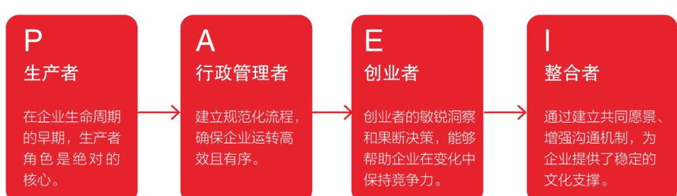

### P 生产者：执行的引擎
生产者是团队里的实干派，目标只有一个：把事情做成。美团团购大战时期，地推团队在酷暑下挨家拜访商家，时任COO干嘉伟回忆团队执行“狂拜访、狂上单”，按规定动作早启动晚复盘，为商家覆盖率第一做出关键贡献。

过度倚重P会带来隐患，若全部精力放在做事而忽视前瞻，短暂成功后容易迅速失势。

### A 行政管理者：秩序的守护者
A负责制定规则与流程，为团队提供清晰方向并确保有序落地。海底捞从一家小店发展为巨头，离不开标准化体系。拉面师傅甩面动作统一，毛巾发放、传菜流程皆有严格标准，通过详尽的服务流程、培训体系和供应链标准，将优质服务复制为产品。

引入A并非削弱灵活性，而是在扩张时提供最低必要规则。团队从数人扩展至十几、几十人时，缺乏规范的组织如同崩塌的房屋，职责不清、进度难追、资源浪费。清晰目标、关键流程、明确分工，反而释放更多创新与执行精力。

### E 创业者：开拓的驱动力
E关注趋势、创新机会与新增长路径。特斯拉创始人埃隆·马斯克创办特斯拉与SpaceX，体现强烈的创新基因。

小团队尤其需要E的嗅觉，它不依赖大量资金，而是靠敏捷思维与快速反应发现空白、突破边界。

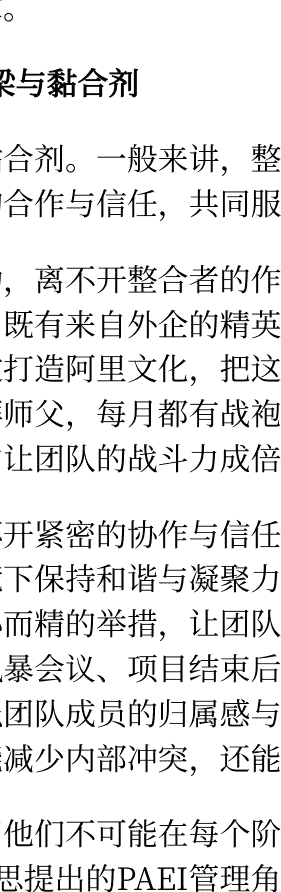
初创期E与P是主力，前者给出愿景解决“为何做”，后者负责落地解决“怎么做”。苹果创始人史蒂夫·乔布斯扮演E，向投资人讲愿景拉资源，同时与斯蒂夫·沃兹尼亚克P一起没日没夜调代码，将Apple I从图纸变为现实。

此时A与I相对薄弱很正常，但不能完全缺位。只谈梦想不做产品会流于空想，只埋头执行不顾方向也会早夭。

资源受限时角色常重叠，E可能兼P，A需具备I特质。可借助项目管理工具维持基本纪律，用AI分担行政事务，用线上协作平台增强凝聚力，相当于用工具补足A与I，避免热情因失联而涣散。

### 成长期：整合者权重上升
进入快速增长期，管理复杂度提升，需要在保持创新产出的同时引入规范与协作。PAEI从“P、E主导”转向“P、A、E并重并逐步加入I”。

学步期企业，产品市场匹配是核心，表现为“PaEi”，仍需少量行政与整合手段防摔跤。随着规模扩大至青春期，可能出现产品驱动或市场驱动两种模式，此时P与A同等重要，既要出业绩也要建章立制；E仍活跃但需更贴近业务；I开始显现用于协调部门与塑造文化。PAEI接近“PAei”。

此时引入职业经理人强化A，以愿景价值观培养I。AI可助力：ERP规范流程、AI解析辅助决策、内部社交与知识平台提升凝聚力，避免“只拉车不看路”的失控。

### 成熟期：四轮并进
成熟期如同人到中年，追求全面均衡。E、A、P齐头并进，I逐步提升。

壮年期应练内功，避免过早多元化分散优势。进入稳定期增速放缓，市场地位固化，I的重要性显著提升，协同与文化成为维持士气关键，此时达成真正的四轮驱动。

若PAEI失衡，企业会走向衰退：创业精神衰减导致缺乏新业务，业绩动力下降导致营收停滞。成熟期必须持续自我革新，激活E与P，用A与I保驾护航。

小米2014年就前瞻布局物联网生态，通过智能生态链不断拓展边界，把用户纳入手机、家居、电器等体系，保持活力。

AI成为平衡PAEI的驱动器。可通过内部创业孵化平台与趋势解析赋能创新，如宝马北美联合埃森哲打造EKHO平台，用AI智能体实时解析市场与需求，解放企业家聚焦高价值创新；也可优化流程强化A，通过自动化与数据驱动管理强化协同，让成熟组织焕发二次成长，延长壮年寿命。

## 文化驱动持续创新

在不同生命周期，持续创新是生存关键。AI与自动化正深入研发流程，加速创新周期。贝恩公司报告显示，引入大语言模型后，科技企业利润平均提升20%。技术是加速器，但只有根植于适配的文化土壤，才能转化为持续动能。

### 创新文化不等于放任试错
传统企业常把创新文化理解为允许失败。谷歌的20%自由时间常被解读为自由创新，实质是公司用预算与时间配额把试错变为可量化流程。谷歌前CEO埃里克·施密特透露，Gmail、谷歌地图均出自20%项目，背后是管理层周会、跨部门演示日等机制做动态筛选。

无序试错只会消耗资源，真正有效的是低成本试错加快速迭代的工业化流程。腾讯的赛马机制是典型：微信孵化时张小龙团队与手机QQ团队并行竞争，通过制度把失败成本控制在可控范围，及时淘汰失败模式、快速复制成功模式。QQ秀、王者荣耀等由此诞生，迭代速度低于行业均值。

### 数据驱动的实验思维
字节跳动以数据驱动实验文化著称。张一鸣强调以数据说话，组建产品增长团队并打造强力数据监测系统指导研发。抖音上线新功能前，甚至点赞按钮位置都要做小流量分流实验，评估留存、活跃、分享等多项指标，由算法模型给出最优方案。科学实验精神减少拍脑袋决策。

AI让数据文化向支持部门渗透。零售企业引入AI客服实现24小时智能应答，可处理60%~70%的重复咨询，释放人力处理复杂问题，同时从千万级对话中挖掘未被满足的需求，反向推动产品研发。

建立数据文化也面临权威与数据的冲突。字节跳动鼓励基层员工用数据推翻高管决策，形成数据面前人人平等的氛围，避免数据文化沦为面子工程。

### AI是持续创新的催化剂
传统研发因物理限制不敢试错，原型迭代需数周数月。生成式AI改变了局面。新能源企业用AI模拟优化电池热管理；深势科技通过AI计算模拟筛选电解液配方，将测试量从数万次实验压缩到计算模拟加小样本验证，研发周期大幅缩短。原本需100次物理测试的流程，可缩减至十几次，试错成本骤降。

试错成本降低后，企业更愿意尝试高风险高回报方案。贝恩报告显示，部分制造企业把AI列为研发首要任务，员工更愿意提交激进方案。

AI也推动组织从经验导向转向学习导向。风控曾依赖专家经验设定指标，AI系统可自动识别2000种以上风险特征并动态调整策略。AI的终极价值不是替代创意，而是重构机器试错与人类灵感的协作模式。

# 03 战略设计

## 从混沌到清晰的路径搭建
时代变速加快，市场逻辑从“先入者为王”转向“洞察者得势”。技术周期缩短，用户习惯快速演变，产业边界模糊。创业比拼的不是速度，而是谁更早看清方向、更稳迈出关键一步。

小团队没有包袱却资源受限，需要一套方法从混沌中提炼机会、从资源中锻造优势、从趋势中制定路径。

宏观用PEST解析政策、经济、社会、技术变化对商业机会的影响；行业用波特五力结合资源基础理论评估进入价值与自身资源是否构成长期优势；企业内部用价值链与利益相关者交易结构梳理价值流与交易逻辑；项目层面用SWOT在资源有限时做高胜率选择。每个工具单独看都不新，系统组合后形成结构性认知框架，帮助在不确定中建立秩序。

## 宏观扫描：PEST框架
小团队容错少，战略设计必须理性。每一次选择都是与动态环境的对话。宏观环境不可控、影响广泛、作用长期，包括政治、经济、社会、技术等维度，通过改变需求、政策边界、技术迭代影响战略空间。

技术风口很多，但并非都值得追。PEST模型帮助判断环境如何塑造机会。

## 政策风向：借势前行
商业像马拉松，创业更像在机关重重的迷宫奔跑。不仅要跑得快，还要预判机关开启时机，读懂设计迷宫的人的意图。这正是政治环境在创业生态中的独特作用。

不少人习惯把政策当成外部的合规条文，实际上它更像是决定一个想法能不能跑通的基础操作系统。它界定了哪些赛道被允许存在、哪些必须停止，怎样分配资本、市场准入、资质等关键筹码，甚至能直接改写商业模式的运行逻辑。换句话说，政策在暗中提示哪些方向可以进入、哪些要敬而远之、资源会流向何处、谁可能在短期内失去资本的青睐。

选赛道时，先算市场规模往往太晚。更早该判断战略是否正好落在政策的东风里。处于政策利好期的赛道，往往能以小团队撬动大效果；而一旦被监管推到边缘，再多的投入也难以施展。

以扶持硬科技中小企业的专项为例，其效应就像打开天窗。深圳寒武纪，本来是低调的实验室团队，在资金倾斜和政府采购的带动下，从研发快速推向商业，并进入国家重点支持名单。苏州埃夫特，在机器人产业起步阶段，因深度契合高端机床核心装备方向，拿到省市专项经费，打开企业客户市场，并进入多家传统制造龙头供应链。表面看是技术突破，实质每一步都踩在国家产业脉络上。

小团队必须具备对政策的嗅觉，这关系合规，也关系顺势。这不是要变成官商，而是在时代节奏里找到自己的发力点。

借力可以从两方面做起。第一，从立项之初就贴近政策。研读政府工作报告，跟踪国家发改委、工信部、科技部每轮产业指引，判断自己的计划是否能回应国家需求。盘点赛道是否落在碳达峰碳中和、国家数字化建设、信息技术国产替代、公共卫生安全、应对老龄化社会等国家议程。

第二，把地方的政策红包吃透。落脚在某个孵化基地能拿到补贴，参与数字化转型专项能获得上云资源，甚至公司注册在哪个区、入驻哪个园区，都可能带来税收返还、人才奖励或公共采购机会。

蔚来是政策共振的典型。国家明确新能源汽车发展方向后，蔚来迅速获得合肥等多地资本与产业扶持，并在鼓励背景下拿到工信部生产资质。创办人李斌曾公开表示，始终要关注政策取向，不能逆风起航。

华大基因在公共卫生扶持和精准医疗国家战略加持下，成长为生物科技头部，反复参与全国性基因检测与公共卫生项目，资本表现也长期跟随政策预期波动。

创业不只是市场博弈，更是对顺势智慧的考验。小团队不必抢在最前面，但要处在政策之风经过的方向上。

## 经济格局：落地点决定启动成本

在中国做事，不能只盯行业赛道，更要看脚下的土地。广袤国土形成了不同的经济气候带，各城市拥有不同的产业基因和消费语言。全国市场其实是由无数高度异质的局部市场拼合而成。

想降本提速，关键在于读懂本地产业结构和用户消费结构的变化，并在精细地图上锚定坐标。

### 本地产业结构：选对土壤 项目才好扎根

本地产业结构是产业布局、供应链成熟度、人才密度和用户特征的综合，直接决定落地难度与试错成本。

深圳以硬件创新著称。深厚制造供应链与工程人才，让大疆创新能快速从打样到量产。小团队在深圳做硬件，周期与成本可能只有其他城市的几分之一。

上海整体企业生态成熟、服务意识强，是软件即服务类业务的试验田。总部经济集中、跨国公司云集，企业客户付费意识成熟。Teambition这类企业协作工具在此快速集客，最终被阿里收购。

杭州是平台型创业的温床。阿里生态的长尾效应让内容电商、私域营销、直播带货异常活跃。林清轩从试水到爆发，正是在杭州完成单品牌直播模式闭环。

现已进入区域化竞争时代。北京无法等同于深圳，广州也不能照搬成都。选土种树，比盲目复制爆款更重要。

### 用户消费结构：找对付费人群 项目才活得下来

本地结构决定成本，消费结构决定需求。当前经济进入弱复苏通道，消费趋于保守、出口承压、地方财政收紧，三重压力下增长逻辑从资本驱动转向经营驱动。烧钱抢人被稳住现金流、控成本、提效率取代。

消费趋于理性，企业追求降本增效，为小而精的方案打开空间。2023年涌现的低成本高回报项目，如人工智能辅助客服、短语种跨境电商运营助手、企业级流程自动化服务，都精准卡在企业的节流逻辑上。只要能帮企业少花钱多办事，就能获得正现金流。

人口结构也在重塑需求。低线城市老龄化加速，年轻人消费趋于保守，够用、好用、便宜成为主流。拼多多切中三四线“有没有消费能力”的真实心智，而非简单的低价。

正如一位投资人所言，今天的第一步不是拿想法去融资，而是拿想法去验证消费结构。地图不再是宏大蓝图，而是一张街区、人群、情绪的温度图，要同时锚定低成本落地区和有支付能力的用户。

## 社会情绪：文化语境与人口变化

在宏观战略制定中，社会环境常被误解为泛泛的用户研究。真正成熟的团队明白，人口结构变化、价值转型、社会信任重构，才是影响成败的深层逻辑。尤其在中国，创业是对人心的一场深度对话。

### 消费观变迁：新生代主导的个性表达

1995到2009年出生的人群已成新消费主力。他们在数字化环境中成长，不仅追求功能性价比，更在意品牌能否成为身份表达和审美延伸。品牌要好用，还要有态度、有立场。

耐克在中国不断强化“个人挑战、不被定义”的叙事，在短视频里与年轻人共创运动态度，脱颖而出。安踏青年不再只讲冠军故事，而是赞助滑雪、街舞、极限运动，把运动做成潮流主场，精准击中身份需求，完成品牌年轻化。

### 从功能到价值：消费者开始看社会意义

消费者在选择时，越来越多地把环保、公益、社会责任纳入考量。联合利华将可持续作为运营核心，多芬的真实女性主张、清扬力士的环保包装，都塑造了负责任企业的形象，并在绿色经济政策背景下获得加分。星巴克在中国全面推进环保吸管替代，并在社交媒体强化环保价值观，大幅提升年轻群体中的社会形象。

对小团队而言，价值主张不只是品牌理念，更是商业影响力的底层杠杆。

### 老龄化与县域市场：新需求蓝海

城镇化与老龄化并存催生新需求。拼多多对低线市场的理解是尊重文化差异和生活逻辑，通过性价比和社交传播切入。盒马瞄准都市家庭生活节奏加快，用即买即食、三十分钟送达、家庭场景定制重塑零售。京东健康和阿里健康深耕中老年用药、在线问诊、健康检测，建立长尾需求的数字化入口。

### 边缘文化回流主流：新的流量入口

审美不再只由一线定义。淄博烧烤、村超、天水麻辣烫等现象，本质是重新发掘县域文化场景的商业势能。小团队若缺乏主流资源，就要去寻找尚未被点燃的文化角落。用认同策略而不是下沉策略，先尊重一个群体的文化表达权，就能获得消费忠诚。

社会洞察决定品牌人设深度，创业者需要用哲学起点去读情绪、读身份、读裂变。

## 技术环境：成本与门槛的重新洗牌

在PEST框架中，技术是最具爆发力的变量。它以指数级速度重塑行业。对小团队而言，技术是资源平权的放大器。

### 成本结构逆转

过去做语音识别要数百万元投入和算法团队，如今接入百度智能云、阿里云等平台，几行代码按需付费即可调用。用户调研过去要几十人团队，现在三人小组用腾讯问卷和飞书AI助手几天完成画像和迭代建议。

因此出现大量AI 加垂直场景的应用：AI生成文案、AI客服、智能审图、低代码建站等。团队无需自研算法，只需把能力嵌入垂直场景，就能撬动商业。

### 平台生态借力

创业不再从建网站开始，而是从微信、抖音、淘宝直播、京东小程序、小红书、B站等生态借力起步。这些平台自带支付、客服、推荐、会员，等于现成商业基础设施。一个爆款短视频就能带来十万级转化。

小红书商家用UGC做入口，用趋势热词和种草指数选品，再导流微信私域转化，就是典型的平台起盘。

### 窗口期意识

技术也会快速平台化，今天的创新工具，明年可能变成平台内置功能。必须有窗口期意识，不是等技术成熟再上车，而是在它刚能用时就切入、试错、跑出来。

判断一项技术是否值得押注，可问三个问题：它是否改变成本结构与流程？是否降低门槛带来资源平权？是否催生新用户行为与消费预期？如果都是肯定的，它就不再是工具，而是新战略变量。

## 理解行业竞争：在变化中寻找稳固优势

宏观风向决定风从哪来，行业结构决定船能否扬帆。小团队要看清进入壁垒、利润空间和增长潜力。用波特五力看竞争格局，用资源基础理论看自身禀赋，才能在复杂环境中找到可穿越周期的立足点。只懂政策、懂技术、懂人群还不够，还要在所选赛道的结构里，找到属于小团队的战略支点。

## 看见行业竞争的五张底牌

做生意像在棋盘上落子，刚入场的创业者往往只注意到赛道热闹、人群涌动，很难摸清真正的博弈格局。拥有一副能透过表象看结构的眼镜，就能提前嗅到风险，也更易找到可落脚的缝隙。

迈克尔·波特提出的五个竞争力量分析，本质上是一套战略透镜。它不教复制成功，而是帮助判断利润空间由什么结构决定，又会被哪些力量挤压、撕裂或悄然改写。五项力量彼此联动，勾勒出行业的生态轮廓，也限定了企业能守住的安全边界。

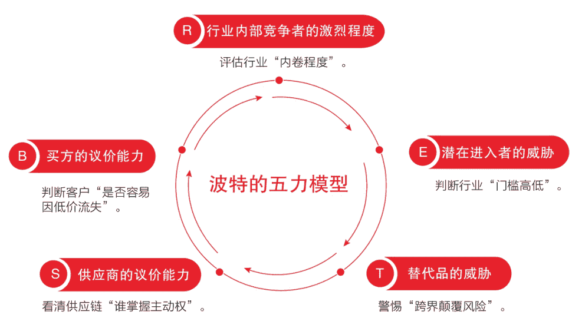

图3-2 波特的五力模型

## 同行贴身肉搏有多残酷

表面看是资本追捧、投资排队，实质要先审视内部厮杀的烈度。玩家众多、供给同质、用户迁移成本低，市场很容易滑向价格战与过度内卷的零和博弈。

以现制茶饮为例。表面是万亿规模的机会，实际喜茶、奈雪、茶百道、蜜雪冰城都在门店打法、口味迭代、渠道下沉、供应链效率上进行极致对标。供应侧SKU往往过百，营销侧社交内容日更十数条，资本侧又有充足弹药打折扣与广告战。对没有差异的小团队而言硬闯，主流战场很容易沦为消耗。但这不等于没有空间，关键在于避开正面碰撞。比如聚焦中老年群体的健康饮品，或深耕地方风味的复古茶铺，就能绕开主流绞杀。消费者的未被满足盲区，往往就是细分品类的入口。

## 明天会不会涌进新玩家

赛道值不值得进入，不能只看当下，更要看未来准入门槛有多高。赚钱的生意天然招来追随者。

生鲜电商看似只需采买、配送与App就能起步，实则冷链仓储、库存周转、履约成本构成难以逾越的隐形墙。每日优鲜、叮咚买菜、美团买菜都在这一赛道激烈博弈，最终多以收缩、并购或退出收场。

真正的壁垒不在界面技术，而在现金流健康与履约系统的稳定度——这是多年精细运营堆出来的底座，不是复制一个页面就能跨越。低估隐形门槛，很容易在用户规模打开前被现金流拖垮。做分析时要自问：有没有能跨过这道坎的独特资源？

## 替代方案才是真正的暗杀者

许多创业者盯着同行，却忽略了来自行业外的替代压力。开健身房时，竞争对手不只是隔壁馆子，更有Keep、小红书打卡、线上直播课，甚至华为的智能运动手表，它们以不同形式解决同一需求：更健康的生活方式。

替代选择越多，用户切换成本越低，议价空间越小。小团队的护城河不在于服务本身，而在于心智中的不可替代感。品牌叙事、情感联结、服务动线设计，才是提升粘性的关键。

## 上游能把利润卡住吗

初创期常忽视上游，等扩张时才发现原材料失控、关键供应商提价、交付周期不稳，直接撕裂现金流。

瑞幸、海底捞通过自建供应链、深度参与上游标准制定，从源头锁定价格与周期，获得极强的成本控制。资源有限的团队若无议价权，可尝试联合议价或长期绑定，将分散订单集中、提前签框架换取主动权。这正是供给侧的压强，别只盯用户，先看能否掌控成本源头。

## 买方话语权在升高

信息对称时代，消费者权力快速上升。产品再好，用户在小红书、知乎一搜，就可能流向更便宜更好的方案。平台经济下用户迁移成本接近零。

但并非所有行业都任用户摆布。构建了高品牌认同与文化联结的企业，如露露乐蒙、星巴克臻选、苹果手机，用户买的是体验而非单纯功能，愿意支付溢价。对小团队而言，对抗买方压价的核心是构建情感壁垒，让用户产生共鸣并参与其中。这不靠巨额广告，而靠对用户心理的深度洞察。

五项力量可以量化。对每项打1到5分，1分代表极为不利，5分代表极具优势。五项合计若在8分左右甚至更低，说明是强敌环伺的困境；20分以上才有操作空间。评分也能做内部体检。比如用户议价项只有2分，下一步就该提升迁移成本、强化忠诚；供应商压价项4分，就该考虑备选渠道、谈判机制或部分自建。

波特不会告诉你哪个行业最赚钱，但能帮你避开表面火爆实则无路的赛道；他不做选择，却能补上战略盲点。对小团队，这比机会清单更重要。战略不是挑路，而是清楚哪段会下雨、哪段会断崖、哪段能加速，再用自己的方式走出独特路径。

## 资源视角：护城河怎么形成

五力揭示格局，资源基础理论回答如何活下来并站稳。波特偏静态分析，资源观能判断优势能否持续。

资源基础理论认为，企业能脱颖出，是因为拥有独特且难复制的资源组合。形成真正护城河的资源，需同时具备稀缺度、难以复制度、难以替代度、组织承载力四个特质。

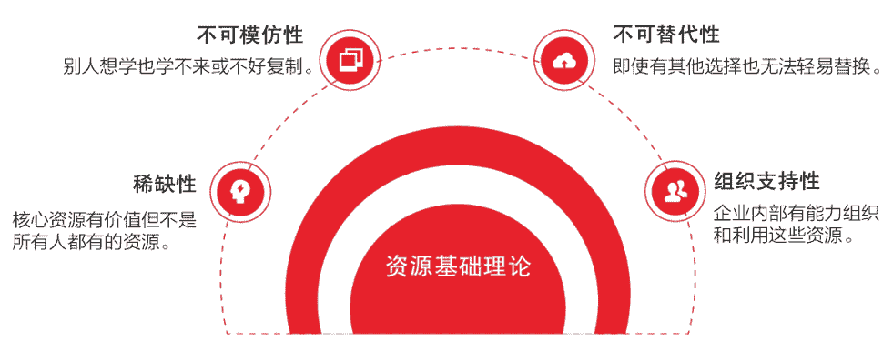

图3-3 资源基础理论

### 稀缺度：比别人更早看见的需求

稀缺不只指资源本身，更指洞察的时间差。华为海思在芯片自主方向做第一性思考，早于市场主流依赖外部供应，最终在卡脖子环境下成为战略安全底座。小红书从种草向社交演进，也是因为更早看到消费决策依赖情绪共鸣而非单纯功能匹配。超前的底层洞察即稀缺。

### 难以复制：系统性的协同

硬件、软件、营销打法都能被模仿，难的是多维度同时做到。星巴克的“第三空间”可被复制门店风格与菜单，却难复制服务流程、运营体系、员工培养、会员机制与品牌的深度协同。这是长期打磨形成的系统经验。小团队即便产品易被抄，只要建立流程护城河，如社群运营、用户反馈闭环、内容调性机制，就能形成他人学不来的组织肌肉。

### 难以替代：从单点到网络

单点资源常见，融合后才无可替代。苹果的Mac本身性能未必最强，但与iCloud、iPhone、AirDrop、Apple Watch无缝协同，形成全链条体验，让用户难以离开。小团队虽建不起大生态，也可做微生态。把产品设计与用户运营打通，把内容传播与社群反馈绑定，让用户习惯于你，就能初步建立不可替代性。

### 组织承载力：资源是否打水漂

很多公司资源够却用不好：有技术缺团队、有流量缺转化、有品牌缺交付。肯德基看似传统，实则门店管理、数字化营销、员工激励做到极致。数字中台实时调度全国库存与人力，KPI细化到每小时翻台率与动销率。小单元也有清晰资源调用机制，服务仍稳定。反观初创，活动后不复盘、数据不分析、会议不跟进，组织能力决定资源产出率。

四者缺一不可。共享单车兴衰显示，摩拜、ofo靠融资与政策获得短期优势，但对阿里、腾讯、美团而言核心资源极易搬迁，最终优势快速消散。长久优势不是显眼资源，而是整合与使用效率。对小团队，持续寻找独特资源组合，在结构里找到站得住的缝隙，缝隙稳不稳取决于资源是否独特、协同、难模仿。

## 企业内部的价值创造与分配

宏观给方向，行业给地图，企业层面是创业者必须掌控的引擎舱。资源有限时，如何用有限投入创造最大价值，是现实命题。

我们借助价值链模型与利益相关者交易结构模型，厘清两个根本问题：如何创造价值，如何分配价值。

## 价值链：该做与该放手

战略常被谈成愿景，实操却卡在日复一日的资源分配：先修漏洞还是优化转化？先稳老客还是开拓新客？小团队越要学会做减法。

价值链模型由波特1985年提出，将企业活动分为基本活动与支持活动。基本活动覆盖采购到售后，支持活动包括人力、技术、基础设施与采购管理。竞争优势来自各环节协同效率与对核心流程的强化。

这套模型为大企业设计，却更适合小团队。你不能全覆盖，但可只做最有价值的部分。花错精力比花钱更贵。

拆解价值链会发现，很多环节看似必须，实则可外包。某AI视频内容初创原从调研、脚本、画面、剪辑到交付售后全包，忙不过来。拆解后发现溢价来自前端创意洞察与深度共创，于是将剪辑、字幕等外包，节省70%运营时间，核心聚焦客户关系与创意策划，客单价与稳定性提升。

另一例AI电商运营团队擅长趋势分析、选品与广告优化，却被售前咨询、售后客服、订单跟进拖住。分析后将客服交给专业外包平台，统一SOP，预算与人力投入算法训练与转化优化，三个月运营效率提升40%，续约率从60%升至82%。

蕉内、完美日记、元气森林都不是大而全的重型组织，而是前端强运营、后端高外包的极简结构。它们聚焦研发生产物流效率或品牌调性流量运营，其余标准化处理。成功逻辑一致：不追求做所有事，而是聚焦能带来差异化回报的节点。

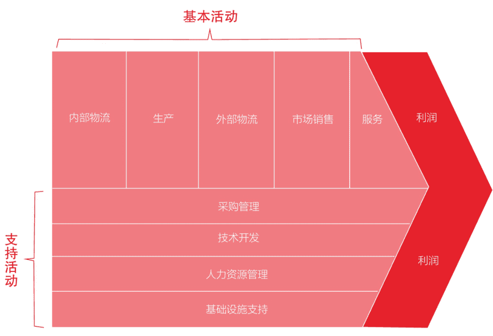

图3-4 价值链模型

## 站对结构位比体量更重要

成功不只是产品好、市场大、执行快，更在于你在价值网络中的位置。利益相关者交易结构模型关注企业如何与外部世界建立关系、配置资源、分配利益，形成结构黏性。

企业不是孤岛，而是嵌入客户、平台、政府、供应商、投资人、社群、算法构成的网络。资源有限的小团队，生存关键是“我插在了哪个节点”。

阿里健康并非药企或医院，却通过药品、医生、保险、支付四边闭环，成为互联网医疗的数据基础设施。它通过链接与赋能成为结构型角色。

小团队亦可借此。社区养老赛道，有些初创没有医院和大量线下网点，却设计出政府补贴、医院背书、设备租用、上门服务的结构，嵌入地方政策，承担居家服务承接方角色。服务能力不强也能稳住，因为提供了链条闭环的必需接口。结构位往往比资源量更关键。

当内容创业告别流量红利、AI SaaS陷入同质化，小团队的结构位思维就更能决定能否存续。

# 从单点接单到网络化经营，MCN在重塑什么

在内容赛道里，越来越多中小型MCN发现，单纯靠广告报价续命已经难以为继，于是转向结构型服务供给。以无忧传媒为参照，它不再只做内容生产，而是搭建起品牌、平台与消费者之间可循环交易的机制。第一面是用深度内容运营为品牌完成原生种草；第二面是把直播带货链路和电商平台打通，让内容直接沉淀为成交；第三面是通过私域社群和会员体系，与终端用户保持高频回访。在这种架构下，精干团队卖的不是一次性的创意，而是成为价值网络的枢纽。每一波流量不再只换一次广告费，而是被转化为多边价值的持续产出。

同样的逻辑在AI SaaS里更具冲击。我们接触过一个轻量团队，最初想靠技术新颖性说服客户。不到一年他们就明白，客户更在意能不能接入政府采购平台、有没有联合试点的资源、能不能和头部平台完成系统对接。关键在于产品能否嵌入客户既有的交易结构。做不到这一点，再先进的技术也难变现。于是团队调整打法，主动搭建通往平台公司、政府咨询机构、行业协会的交易通道。产品本身没变，商业模式却从卖软件变成嵌入系统，价值立刻放大。这不是技术迭代带来的，而是站位结构对了。

轻量组织该如何建立这种结构化连接能力？

建议先画一张利益相关者投入与激励结构图，见表3-1。目的不是把人当工具，而是反向自问：我能为谁创造什么价值，而不是只问谁能帮我。关系能长久来自交换的均衡，结构能稳定来自多方共同获益。只有让每个相关方在结构中拿到回报，组织的“结构位”才能扎根，在复杂网中长期占据有利位置。

## 表3-1 利益相关者输入/激励结构表

| 角色 | 能提供的资源 | 期待的回报 | 合作机制类型 |
| :--- | :--- | :--- | :--- |
| 本地政府 | 政策支持、数据资源 | 示范效应、政绩体现 | 协议合作型 |
| 大平台 | 流量、API、技术基础设施 | 用户增长、内容质量 | 集成绑定型 |
| 上游供应商 | 产品、设备、渠道 | 稳定订单、结算及时 | 联合开发型 |
| 客户企业 | 场景、数据、试点资源 | 成本降低、效率提升 | 成果交换型 |
| 投资人 | 资本、背书、资源整合能力 | 股权回报、项目话语权 | 杠杆驱动型 |

把价值链视角和利益格局视角叠加，是轻量组织摆脱资源限制的方法论。在价值链层面，要厘清内部哪些环节关键、哪些可以优化或外包；在利益格局层面，要认识到自己不仅是产品制造者，更是多方资源的调度者、嵌入者、组织者。这意味着必须不断重构系统连接能力，形成有网、有桥、有流的结构黏性。这也带来一个关键转向：目标从赢下一场战役，变成占住一个据点。可被替代的产品终将陷入价格战，而看似普通的网络位置，反而能形成长期复利的护城河。

# 小团队的项目战略：SWOT轻量用法

一个组织的战略功力，最终体现在具体项目上的精细筹划与果断决策。对资源有限的创业团队而言，每个新项目都像一次高风险的精准手术。做对了能迅速打开局面、拿到市场反馈，做错了时间和资金就打水漂。

在项目层面做战略研判，找到切入点、竞争位势与风险规避路径，是必备能力。在众多工具里，SWOT是最适配小团队、上手也最快的模型之一。

SWOT由Strengths、Weaknesses、Opportunities、Threats的首字母构成。结构简洁、逻辑清晰，能帮助团队全面审视项目内因与外因，进而制定更落地的战略路径。实践中，SWOT不只是四象限图，而是一种向内深挖、向外放眼的思维方式，也是一种把模糊判断转化为行动方案的操作路径。

## 为什么SWOT适合轻量组织

其一，低成本高回报。大企业做战略评估动辄投入大量资源，SWOT不需要复杂的数据建模和外部咨询，靠团队现有信息和经验，通过结构化讨论就能搭出雏形。项目早期数据不全、预算紧张时，SWOT能快速帮助团队理清思路、定方向。

其二，灵活且延展性强。无论是新品定位、推广策略，还是业务调整可行性评估，SWOT都能因地制宜地应用。小组织迭代快、试错空间小，一个简单敏捷又系统的工具往往能带来关键转折。

其三，它迫使团队在不确定中做全面权衡。不是盲目乐观，也不是因小失大，而是把内外因素系统梳理，把想法变成判断，再变成选择。

## 四个维度：做思维训练而不是填格子

教科书常把SWOT简化为四象限，但容易让人掉进填空式思维，忽略背后的战略逻辑。下面用四个维度做结构化训练。

长处是立足之本，是资源与能力的再认知。指项目当前具备、能转化为价值的内在资源和能力，既有显性资源如技术、渠道、客户基础，也有隐性能力如快速响应市场、品牌共鸣力。比如一个由三位算法工程师发起的SaaS团队，启动资金不多，但长处在于技术扎实，能快速把前沿模型产品化，并以极低成本完成初期迭代。长处分析的核心问题是：我们的哪些资源和能力是别人短期复制不了的？只有稀缺、不可替代且可持续变现的能力，才算战略级长处。团队要从过往经验中提炼哪些做法见效快、哪些资源创造过关键突破，以此找到未来项目的动能。

短板是风险源头，是坦诚的起点。创业讨论常高估自身、低估市场，SWOT中的短板环节要求冷静审视可能阻碍成功的内部因素。无需自贬，但必须基于事实建立风险预警机制。某团队在短视频内容上很强，但缺乏电商运营背景，内容流量难以转化为销售。若在SWOT阶段识别出来，就能引入电商运营合伙人或外包给专业机构，实现战略补位。短板分析不是自我鞭笞，而是资源现实主义的训练，认清短板才能精准配置资源、设防错机制。

契机是增长杠杆，是外部红利的识别与追赶。小组织的机会往往不是大盘趋势，而是结构性空档——巨头忽略、传统模式束缚或消费习惯变化带来的缝隙。契机分析的关键不是看别人做什么，而是看别人忽略了什么。2022年中式养生兴起时，主流保健品牌还在做传统茶饮，一家新公司捕捉到00后对草本饮品的时尚需求，以“朋克养生”定位推出便携中草饮，快速实现从0到1突围。

做契机分析要回答：是否有真实存在的细分需求被主流玩家忽略？是否有技术、法规、消费观念变化打开新入口？我们能否以更低成本、更快速度、更好体验切入？契机需要结合自身长处和执行力判断能否抓住，这是SWOT最需要理性想象力的环节。

风险是底线意识，是不确定性中的主动防御。很多失败案例共性是初期过度乐观，忽视外部威胁。SWOT的风险分析帮助建立最坏情景假设，提前准备应对。风险可能来自技术升级超预期、竞争对手快速模仿、政策突变、市场信心波动等。

例如某短视频内容服务平台2021年快速获关注，却未预判主流社交平台2022年限制第三方接口，导致数据抓取与交付受损，项目难以为继。若早把“对平台依赖过强”列为风险并建立自主数据获取机制，就能避免平台型风险。若早把“对平台依赖过强”列为风险，就能提前设计防火墙。

## 从分析到落地

SWOT的四个维度是项目全景扫描仪，更高阶的做法是把因素关联起来，转化为可执行方案。很多团队止步于填表，真正的战略价值诞生在连接中。

长处结合契机，往往能打出顺势而为的组合拳，抢占先发；短板结合风险的清晰认知，则能在混沌中规避风险、延续生命。优秀战略通过“长处如何抓住契机”“短板如何抵御风险”两对交叉关系，执行进攻、修复、防御、规避四种动作。

比如一支由三位生物医药背景博士组成的团队，想推出中老年营养代餐粉。SWOT显示长处是对功能成分的精准配比和配方科学性强，短板是品牌无认知、缺乏营销经验；契机是银发族健康意识提升和人口老龄化；风险是大量低价代工产品价格战激烈。

他们的路径是，以差异化高品质切入高端用户，通过医生背书建立信任，这是长处加契机的打法；为规避价格战，不走电商大促，而是携手体检中心和社区医疗机构推广；针对营销短板，引入有保健品操盘经验的合伙人补齐消费者沟通体系。

案例的关键不在于四项写得多漂亮，而在于启动前已把战略路线踩实、看远。SWOT最大价值不是想象项目多完美，而是提前看到理想背后的脆弱点并构建应对体系。

SWOT虽简洁但非万能，有效性取决于信息准确性和思维深度。若把短期热潮误判为契机，忽视大企业垄断和高壁垒，后续战略会偏离现实；若把“很努力”“氛围好”等泛化表述当长处，也会失真。

有洞察力的创业者会把SWOT当作动态更新的战略仪表盘。启动期是路线草图，推进期是状态监控表，瓶颈期是方向校准仪。优秀团队每半年重做一次核心项目的SWOT，把外部变化和内部能力成长纳入评估，并据此调整资源和节奏。

在生成式时代，SWOT还能升级为智能战略助手。用人工智能分析社交平台用户行为，实时洞察契机变化；用竞争情报系统监控风险强度；用客户反馈和售后数据精准识别长处表现点和短板暴露环节。这些数据填补主观盲区，让战略更贴近现实。

一旦SWOT嵌入决策流程、产品研发、融资汇报，就成为贯穿创业全程的战略思维载体。把结果做成视觉化战略地图，用看板列出基于契机-长处配对的优先任务和基于风险-短板配对的应对策略，设置季度跟踪点，战略就从PPT蓝图变成日常执行的作战计划。

# 04 产品设计

## 洞察市场，读懂用户

每一款成功的产品背后，都是洞察与创造的结合。AI浪潮下，产品设计不再是科技巨头的专属，也不再是高门槛的重资产工程。小团队迎来前所未有的窗口期：可以用极低成本、极快速度把灵感变成现实，把需求变成产品，把产品变成事业。

这源于从概念到产品的路径重塑。过去流程是线性的封闭式：调研、分析、规划、原型、测试，每个环节都烧钱烧时间。资源最紧时必须做最关键判断，风险极高。更致命的是，很多产品失败不是执行问题，而是需求判断从一开始就错了。小团队常被迫猜市场，而非听市场。

人工智能改写了规则，于是产品设计不再是穷人小作坊，而是轻装上阵的科技特种兵。无需羡慕大厂人才储备，也不用忌惮资本短板，只要判断力、执行力和拥抱人工智能的意识，就能在同一市场和大厂同台竞技，甚至另辟赛道。

本章将拆解人工智能如何赋能产品设计的每个环节：从市场洞察，到原型开发，再到产品迭代。

## 人工智能重塑市场洞察力

在竞争激烈的环境里，市场洞察是小团队生存和突围的关键。人工智能让团队从创业初期就具备全维度洞察能力：对外精准捕捉宏观脉搏、判断行业趋势和竞争格局；对内自动生成用户画像、挖掘隐性需求并转化为清晰产品概念。团队能以更低成本、更高效率实现看得远、算得准、走得快，为决策和突破奠基。

切入前，轻量组织的市场洞察充满荆棘：市场瞬息万变，传统调研成本高周期长，机会等不到报告就没了；消费者需求复杂多变，仅靠经验和粗略调研极易错位，造成资源浪费；成本和人力消耗更是难以跨越的门槛。人工智能如何破解这些痛点？在宏观分析、需求挖掘、格局研判上有哪些落地路径？下面逐一拆解。

## 宏观环境：提前读懂政策信号

过去我们对政策多是事后解读影响，人工智能让分析从滞后讲解转向实时预警。

人工智能能快速扫描海量政策文本。自然语言处理技术可深度解析草案、政府工作报告、智库文件。例如识别“碳中和”“供应链安全”等关键词及其关联网络，提前预判政策落地后的产业连锁反应。

德勤经济展望报告提到，其人工智能系统监测全球贸易政策变动，分析关税调整对产业链的影响并提供合规建议和替代供应链方案，帮助汽车企业在欧洲市场的准入通过率提升近40%。

## 行业趋势：捕捉价值流动方向

对轻量组织而言，把握行业趋势是弯道超车的钥匙。提前洞察新兴趋势，就能进入新市场、采用新模式，抢占先发优势。

过去靠滞后报告了解趋势，现在人工智能可实时监测价值流走向。人工智能融合电商平台数据、社交媒体数据、行业报告、投融资数据，并用动态权重算法量化行业声量、投融资热度、技术专利增长等交叉影响，更准确预测趋势。例如魔镜洞察融合电商与社交数据，分析“下沉市场”“县域消费”关键词热度与订单地域分布变化，感知快速消费品市场向县域下沉的趋势。

人工智能还能追踪区块链、物联网等新兴技术在行业内的应用情况，分析其对商业模式、产品形态、竞争格局的影响。当应用增多且投融资活跃时，就可预测技术将引发重大变革，企业需提前准备。

当发现行业向线上化、智能化转型，轻量组织即可迅速推出相关线上服务或智能产品，满足需求并获取份额。

## 竞争格局：看透对手打法

读懂对手的下一步，其实就是读懂其行为背后的资源投放逻辑。企业日常留下的各类痕迹，价格的微调、专利的递交、招聘的动向、供应链的物流轨迹，都在泄露战略意图。AI能够把这些分散的信号收集起来、梳理清楚并关联分析，从而让竞争态势变得可感知。

比如盯住价格波动的频率和幅度，就能推断出对手的定价思路和市场打压点；梳理专利申请的主题分布，就能把握技术发力的重点。华为就用基于AI的专利语义分析系统监测对手在自动驾驶、车联网等领域的专利密度变化，提前判断其重心迁移。Boardmix也提供了一类能力：输入行业关键词如电子科技，系统就会自动生成SWOT图，标出对手的短板和可切入的市场机会。物流与供应链数据则透露产能布局和库存节奏，为自身的生产与配送策略提供参考。招聘信息同样是显眼的信号，大规模招募某类技术人才，往往意味着该方向将加大投入并启动相关业务。

除了这些显性数据，新一代竞争情报工具还通过AI抓取社交媒体上的品牌声量与用户吐槽，跟踪宣传话术与舆情走向；同时整合行业新闻、分析师观点，形成宏观层面的地位评估。对小团队和企业管理者来说，厘清竞争格局可以避免正面硬碰，避开对手的绝对优势区；也能抓住对手薄弱环节，集中资源突破。

## 市场需求：把模糊期待变成可测指标
拿到外部环境线索后，第一步要做的就是把市场的真实诉求找准。AI正把原本隐蔽的需求变得可视、可量化、可预测，成为创业者的洞察加速器。

农夫山泉在2023年的新品周期里，用AI对小红书近百万条UGC进行语义聚类，发现18到25岁的女性用户最在意“0糖气泡”“低负担饮品”“包装颜值”。据此推出“小蓝瓶”无糖苏打气泡水，并把传播锚点定在“轻健康”“拍照好看”“约会饮品”，迅速打开年轻市场，也打通了饮用水与潮饮之间的认知边界。

不只有大厂才玩得起全域洞察。借助百度指数、阿里巴巴商业参谋、腾讯指数等平台，产品团队可以低成本获得消费者的行为轨迹和情绪偏好。腾讯指数就让小微品牌能够观察微信生态、小程序、视频号里对某个品类、关键词或场景的关注变化，并回推出不同年龄、地域人群的使用习惯与讨论热点。

AI还能做前瞻判断。百雀羚联合腾讯、京东搭建了以自然语言处理和用户行为建模为核心的需求预测系统，实时捕捉女性用户对护肤品的评价词、皮肤状态描述和使用场景。在一次策划中，模型捕捉到“熬夜肌”“轻敏感肌”“成分安全”“孕期可用”高频共现，随后推出“熬夜修护”主题面霜，以“成分党友好”“可孕期使用”作为社交话术，市场反馈远超预期。

## 用户画像：让画像自己长出来
明确方向后，最容易出错的一环就是用户画像。过去靠问卷、访谈、SPSS和Excel堆出来的模型，往往带有强主观色彩，更像“我们以为用户想要什么”。

如今AI大幅降低了门槛和偏差。无论是巨头还是三人小团队，都能在数天甚至数小时内生成层次清晰、系统化的画像，并据此指导产品、内容、营销和渠道决策。

联合利华在发布高端护肤子品牌多芬Derma系列前，用NLP工具抓取YouTube评论、亚马逊评价和Reddit论坛的护肤关键词，由AI自动归类聚合，形成典型画像：30到45岁女性、肌肤敏感、偏好天然成分、倾向长期复购、决策受皮肤科医生影响。进一步解读，敏感肌与天然成分偏好体现了对肌肤安全性的重视，受医生建议影响则反映对专业权威的信任。于是产品侧突出天然成分，传播侧引入医生背书，形成全链路的精准策略。

初创团队也可以借助Notion AI、魔搭等成熟工具快速搭建画像。今天的市场洞察已不再是一次性调研，而是持续能力。技术只是手段，核心仍是敬畏市场、尊重用户，建立用数据捕捉信号、用逻辑提炼本质、用行动验证假设的闭环。

## AI赋能的原型设计
对资源有限的小团队而言，能否把清晰概念快速变成可体验原型，直接决定速度和竞争力。传统流程依赖专业设计师和外包，数周到数月等待加反复沟通，成本高昂。AI正在把这条路径重构。

## 创意生成：从灵感乍现到体系化产出
创意从来不是凭空掉落。头脑风暴和竞品分析容易陷入路径依赖和集体盲区。生成式AI把创意从补充工具升级为系统化引擎。

部分家居企业在做“城市小户型定制系列”时，把“省空间”“模块化组合”“Z世代审美”“适配租房”作为关键词输入DALL·E与ChatGPT。数小时内系统输出几十套不同风格和功能逻辑的概念图与命名建议，团队筛选迭代后进入建模测试，概念验证周期从数月缩短到几天。

这体现了三重跃迁：创意密度上，AI一次可产出上百种组合，放大人类创意上限；创意成本上，Runway等视频生成工具让小团队以极低成本做出接近商业水准的演示片；落地速度上，创意可迅速实现可视化、原型化和用户反馈，形成“边创意边试错”的闭环。正如彼得·德鲁克所说，创新是企业家的工具，而生成式AI正是小团队的创新放大器。

## 原型设计：从创意表达到可视原型
AI已成为从表达到原型的全链加速器。Midjourney、DALL·E、Stable Diffusion、通义万相、文心一格等平台能根据少量关键词和风格标签，迅速输出大量视觉草图。

耐克创新实验室ISPA在开发“Interconnected Footwear”概念时，用Midjourney与Stability AI探索外观，仅用3天生成数百张模块化、仿生、未来感草图，随后作为建模参考，把从构想到样品的周期从3个月压到3周。宜家中国在城市限定家具项目中结合文心一格与Midjourney，以“北欧自然元素”与“现代都市节奏”为条件快速定位风格与配色，视觉草图周期缩短80%以上。知乎创作者扶持项目里，一个3人小组借助Notion、文心一言、Midjourney完成数十款IP周边原型图，并通过盐选专栏与直播带货预售，上线48小时部分产品即售罄。

## 原型制造：从设计理念到实体产品
图纸只是起点，能否快速落地为实体才是关键。传统原型制造涉及CAD建模、材料测试、结构与热力仿真，门槛高、周期长。AI正在改变这一壁垒。

Autodesk Fusion 360、PTC Creo Generative Design、Siemens NX、浩辰CAD、中望3D AI协作平台等已把AI融入建模到制造全流程。Fusion 360可依据功能参数、负载条件和制造约束自动生成多套高强度轻量化方案，并联动材料库与有限元仿真实现“生成-评估-筛选”闭环。

一家智能家居品牌在开发“超级门锁”时，用Fusion 360 AI模块输入尺寸、材质、强度、安全等级等条件，自动生成多种锁体方案并实时仿真高频开启、恶劣气候下的表现。两周内完成30轮结构优化，得到强度更高、材料更省的新模块，产品上市3个月即成品类标杆。

服务型产品同样受益。猿辅导推出“AI微课”时，借助Notion AI与自研算法自动生成大纲、讲解脚本、互动题库与配图，开发周期从4到6周压缩至一周，首月下载转化超50万。

AI辅助制造带来时间压缩、跨职能整合、风险前置与场景适配灵活化，过去的马拉松式开发正被短跑式迭代取代。

## AI驱动的高效迭代
AI让小团队拥有精准试错与数据验证能力，从拍脑袋走向算法辅助。

### 从被动接收到主动预警：AI重塑反馈机制
传统反馈依赖人工收集，碎片化且滞后。AI让反馈从“等问题出现”变为“提前发现趋势”。

华米科技发布GTS系列智能手表后，部署智能客服系统实时分析小米社区、京东评论区、微博上的用户声音。AI识别出表带舒适度、心率监测准确性、App兼容性是核心关切，两周内完成说明优化、硬件微调与软件调整，产品上线两个月销量突破百万。

小团队可从三方面落地：一是部署整合社交、电商、自有平台的智能客服，如阿里云、腾讯千帆、百度云；二是建立结构化标签体系，预设功能缺陷、价格敏感、体验建议等字段，提升分析颗粒度；三是将情绪识别与运营动作联动，让AI成为用户情绪预警器。

### 数据驱动决策：让迭代不再靠猜
过去决策多靠创始人经验。如今Power BI、Tableau、Looker Studio、阿里Quick BI、火山引擎DataTester、GrowingIO等工具，让行为数据、购买路径、功能使用频次等指标可以自动采集、实时分析并可视化，为每一次迭代提供明确指向。小团队因此能更敏捷、更精准地把产品推向用户真正需要的位置。

举一个国内新锐咖啡品牌的实践。团队早期用小程序来做社群运营，最初的判断是用户最看重口味的多样性。后来用 GrowingIO 做了一轮路径拆解，发现用户在页面上停留最久的并不是产品介绍，而是冲泡指南和环保包装说明。信号很清楚：便捷的使用方式和环保态度比口味选择更能影响决策。据此团队改写沟通话术，上线了“环保回收胶囊罐”计划，并把传播重心放在随身使用场景，复购直接提升了23%。

洞察只是起点。一次方案调整到底有没有打中真实需求、是否真的有效，需要用基于AI的A/B实验系统来快速验证。

腾讯会议曾测试过不同的免费配额模型。通过腾讯云实验平台做连续对比，团队发现用户更接受功能完整但时长受限的模式，而不是时长开放但功能受限的模式。结果印证了企业用户对完整功能体验的刚性偏好，也帮助腾讯会议保持了强黏性，月活用户超过2亿。

这些案例构成了一个现实参照：数据已不再是决策的补充意见，而是策略的开端。对资源有限的创业团队而言，搭建“数据领路、实验校准”的闭环也并非遥不可及。正如AI让复杂的数据分析从专家专属变成普惠能力，轻量团队也能获得过去只有大厂才有的实时市场感知。

那么这套方法如何落地？

- 先把用户声音自动收集起来。借助AI客服、问卷自动采集、评论舆情分析等手段，把反馈从噪声里提炼出来，形成早期预警的第一公里。
- 再把数据嵌入决策节奏。按周、按月围绕数据看板做运营复盘和产品方向检视，让数字成为讨论的起点，而不是汇报的附件。
- 最后坚持高频低成本的小步试错。尤其在不确定性较高的方向，用A/B测试快速获取市场回应。创业者不必追求一次做对，而要尽快知道哪种做法更对。

# 05 品牌建设

## 让品牌被看见、被懂得、被信赖

过去争夺注意力的手段多靠经验判断和人力堆砌。现在AI以数据为导向、以算法为指引重塑营销全链路。从市场洞察、内容创作到广告投放、客户运营，AI让品牌能用更低成本、更高效率、更强的关联度触达目标人群，完成从人工匹配到算法匹配的转变。

在AI加持下，轻量团队也能享受到原本只属于大企业的洞察力和内容生产力。画像细化、内容动态化、多渠道分发、即时优化……数字营销从凭直觉走向靠指标，从盲投走向智能投放。这是一场以算法为动力的效率变革，彻底打破了传统营销的规模壁垒。

下面将拆解AI如何改变内容营销、搜索优化、广告投放以及客户关系管理和个性化体验等关键环节，帮助轻量团队用更少资源、更短周期做出更卓越的营销成果。

企业只有真正认识到AI的价值并主动学习落地，才能在新一轮竞争中抢占先机。同时要记住，AI是工具而非目的，营销的成功最终仍依赖人的创造力和战略眼光。

## 品牌定位：从经验判断转向数据判断

在创业团队成为创新主力的当下，AI对数字营销和品牌建设的赋能不是一时技术潮流，而是一次能力再分配。它让团队无需重金投入人力，也能与市场精准对话、沉淀品牌势能。未来属于那些能把AI效率与人文洞察结合起来的精干队伍。

在竞争极度白热化的市场里，精准分析与品牌定位早已是参与游戏的入场券。传统调研和定位严重依赖人工，从问卷设计到访谈洞察，从趋势预测到结论输出，每一步都容易带入主观偏差，且耗时耗力。等结论出来，市场往往已变，决策被动且低效。AI的出现从根本上改变了这一逻辑。

依靠AI的数据处理与分析能力，企业可以迅速从海量信息中提炼价值，完成用户画像精细化、竞品情报自动化和市场趋势前瞻，让品牌定位实现从经验驱动到数据主导的跃迁（见图5—1）。

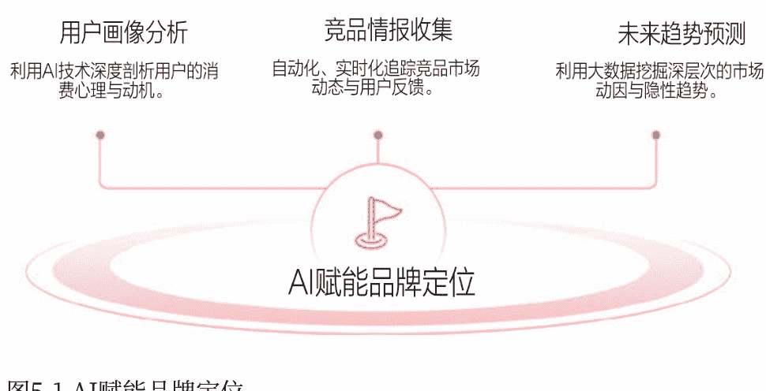

### 用户画像分析

品牌定位的根基是对用户的深度理解。过去画像多靠问卷和抽样访谈，样本有限、时效差、洞察浅。AI已改变这一现状。以百度智能云用户画像平台为例，企业可实时融合用户行为、网站浏览记录、社交互动和第三方报告等多源数据，构建精细画像。画像不仅覆盖人口属性、消费偏好、行为轨迹，还能挖掘心理需求、兴趣取向和潜在动机。

耐克长期深耕精准营销。借助AI挖掘，耐克识别出跑步人群、潮流文化爱好者、瑜伽健身群体在消费心理上存在显著差异。据此，团队为跑步爱好者推出“智能试穿”服务，为潮流人群推出联名限量鞋款，为瑜伽健身群体强化社群内容和生活方式推荐。AI驱动的画像与营销策略同时提升了满意度，也强化了长期竞争优势。

### 竞品情报收集

知己知彼，但人工收集竞品信息既繁琐又滞后。现在AI支持自动化、实时化的竞品分析。

欧莱雅近年全面使用AI工具追踪雅诗兰黛、资生堂、SK-II等对手的市场动作、营销素材和用户反馈，并借助DeepSeek、ChatGPT等模型快速整合与智能解析公告、社媒评论、舆情等信息，精准把握对手战略、产品反馈和市场表现。这让欧莱雅能实时调整新品开发和营销节奏。比如AI监测到“洁颜油”在亚洲市场关注度快速攀升，欧莱雅随即推出升级版洁颜油，并通过精准内容和KOL合作迅速占领份额。AI让欧莱雅从跟随者变为趋势定义者。

### 未来趋势预测

定位还需要前瞻判断。过去依赖专家经验，预测浅层且滞后。如今AI整合历史销售、社媒舆情、搜索趋势乃至宏观经济数据，实现更前瞻的预判。

ZARA正是靠AI趋势预测保持领先。它实时分析Instagram、抖音、小红书上的UGC，预测下一季的流行趋势、风格偏好和色彩倾向，据此快速调整供应链和设计，大幅降低库存风险并精准卡位趋势。

在消费电子领域，华为消费者业务也曾用AI分析用户评论和科技媒体报道，提前捕捉到消费者对高端机、折叠屏和影像能力的强需求，及时布局Mate、P系列旗舰，抢占高端市场。

AI的市场分析与定位能力为企业提供了前所未有的洞察，让决策更科学，也让品牌能更快捕捉先机、制定精准战略。

## 内容营销：用AI提升效率与深度

传统内容创作成本高、周期长，个性化大规模输出更是轻量团队的痛点。生成式AI的成熟让团队能以极低成本、高效率产出文本、图像、视频等多样化高质量内容。

文本创作是内容营销的基础。过去高度依赖人工，不仅耗时，还难以跟上市场节奏。生成式模型的出现彻底改写了写法（见图5—2）。

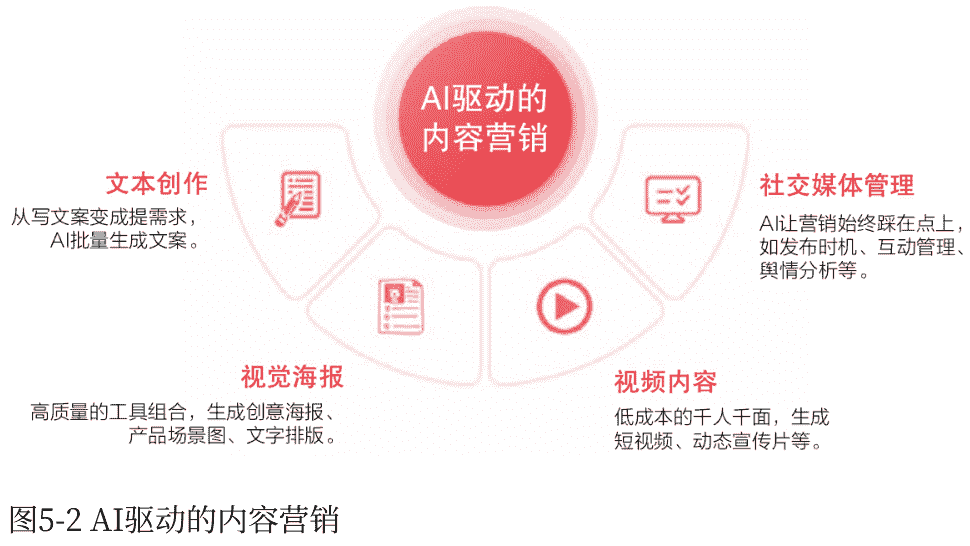

### 文本创作：从写稿到提需求

当需求规模化，人工写作的局限被放大。跨境电商要为上千新品写描述，品牌要在不同平台写差异化推文，人工容易拖慢进度且风格不稳。

用AI工具，写稿变成提需求。ChatGPT、文心一言等模型可根据简短提示生成符合调性的文本：要轻松活泼的小红书笔记，不会输出生硬的商务稿；要地道的英文产品描述，能规避语法问题并自带营销感。

以日均上新千款的跨境电商SHEIN为例，传统人工写英文描述成本高且常因文化差异表达生硬。接入AI后，运营只需输入“吊带裙+法式碎花+显瘦设计”，即可获得“这条法式碎花吊带裙收腰剪裁藏住小肚腩，走动时裙摆如花瓣展开”这样既准确又有画面感的描述。

批量生成文案通常分三步走。

第一步，明确提示词。包括投放场景、核心卖点、风格调性三个维度。

第二步，批量生成后分层筛选。按信息覆盖度、感染力、差异化保留3版进入下一步。

第三步，人工校准品牌专属感。用品牌语言符号做二次润色，避免通用化。

### 视觉海报：工具组合出效果

过去“没有设计师就做不出好海报”。现在DALL·E、Midjourney、Stable Diffusion、通义万相等让非专业团队也能快速产出高质量视觉。

例如咖啡品牌做万圣节促销海报，输入“南瓜灯与咖啡杯搭配的哥特风格海报”，AI即可生成多套方案供挑选。跨境电商也能用“扫地机器人在现代简约客厅工作，阳光从落地窗照入”生成贴近真实使用场景的产品图。

优质视觉的关键是快、准、有记忆点，可按三步操作：明确目标和使用场景；用五要素写提示词——主体、核心信息、场景、色调、风格氛围；用工具组合提升效率，如Midjourney出创意、Stable Diffusion做场景、Canva调文字排版和品牌logo。生成时注意规避肖像侵权和版权风险，最好自行替换专属色和标识。

### 视频内容：低成本实现千人千面

视频因其直观和互动性成为营销主力。Runway ML Gen-2、Pika Labs、剪映AI助手等工具让短视频制作从天数级降到小时级。

某快时尚品牌用剪映AI助手为通勤风、甜辣风、复古风三类人群生成不同版本视频：通勤版配职场背景，甜辣版加动感音乐，复古版套胶片滤镜，实现低成本的个性化投放。

操作路径有三点：确定视频类型和核心信息；选择生成方式，纯文字生成或图文转视频；结合用户标签做版本分发，让同一素材适配不同人群。

### 社交媒体管理：AI让投放始终踩点

内容发布不仅是生产，更是时机和互动。AI可实时分析内容表现，预测互动率最高的发布时间并自动排程；同时监测评论情绪和话题热度，帮助及时调整方向。

工具如Lately能自动优化发布计划，并支持多版本A/B测试，根据互动表现自动迭代创意。聊天机器人如智谱清言、文心一言可在社媒私信和评论中7×24小时自动回复常见问题，提升响应速度和用户满意度。

AI正在推动内容营销从人工生产转向人机协作，轻量团队的机会在于快速落地。

## 数字营销：智能化获取流量与投放

对创业团队而言，数字营销的核心是用最低成本获取高质量流量。传统SEO和SEM人工操作效率低、调整慢、触达不准。AI为流量获取、投放执行和效果优化提供了完整逻辑链（见图5—3）。

### AI驱动免费流量：让轻量团队也能不花钱获客

免费流量是生存基础，SEO是核心。传统SEO依赖人工选词和写作，门槛高。AI可在关键词研究和内容生产两端赋能。

第一步，关键词优化。AI可自动挖掘相关词并分析搜索量、竞争度，推荐长尾词、同义词和LSI词。例如在线教育网站除了布局“大数据课程”，AI还建议加入“数据分析网课”“数据挖掘在线学习”等低竞争长尾词。

第二步，围绕关键词生产内容。AI可直接生成SEO友好文稿，自动融入推荐关键词并拟定吸睛标题和描述。同时AI能追踪实时热点，提醒品牌围绕突发话题创作，抢占搜索窗口期。实践中，不少站点借助AI批量生成问答、攻略，搜索流量实现数倍增长。

总体看，AI形成了“精准挖掘关键词→高效生成内容”的闭环，让轻量团队也能在自然流量竞争中站稳脚跟。

### AI助力付费投放：让每一分预算都花在刀刃上

付费流量是快速起量的补充，但预算有限时投不准会浪费资源。AI通过精准定向、智能竞价和实时优化把投放从经验猜测变为算法决策。

锁定核心人群。无论是Google Ads、百度推广，还是Facebook、抖音，AI都能基于行为数据寻找与目标高度匹配的潜在用户。Facebook的相似受众、抖音的兴趣标签定向，都是AI在源头解决“投给谁”的问题，避免盲投。

智能竞价实现高效触达。AI可实时监测出价、转化和竞争态势，自动调整花费，确保预算优先流向转化概率高的曝光，从而提升投放回报。

AI如何让搜索广告竞价更聪明

用户在搜索引擎里主动敲入“英语培训班”“性价比高的笔记本电脑”等词时，匹配这些关键词的广告就会即时出现。SEM的本质就是围绕关键词做精准出价。过去靠人工手动调价、调预算，既费人力也跟不上竞价波动。机器学习模型能在一秒级拍卖里自动算出最优出价，把广告主的目标点击、转化或ROI推向最大化。

百度智能出价就是典型实践。每次竞价时系统基于模型动态决策，会综合搜索词、设备、地域、历史行为等数百个信号去预估一次展现的转化概率。在预算和目标转化成本等限制下，为每一次拍卖算出性价比最高的出价。

比如北京朝阳区的用户用手机搜“同城急送”，系统若识别出近期频繁搜同类服务、逛过物流站点等强即时购买信号，就会抬高本次出价冲顶首位曝光，大幅提升拿下高潜客户的概率。

#### 实时优化投放效果
人工看数据往往要等到隔天甚至隔周才调整，AI可以边跑边学。监测到某支素材点击率持续下滑，判定为审美疲劳，系统会自动降频该素材并把预算倾斜给表现更好的版本。分时段转化也在被实时追踪，晚8点到10点转化最好时，预算会被自动加码；效果变差时立刻收口，避免浪费。

像Yuri自动化投放这类第三方工具还能打通多平台，设定好目标后同时优化Facebook、Google、抖音等渠道的预算与出价。运营人员的角色从繁琐的报表与调参，转向策略监控和创意把关。

## AI驱动广告创意，让低成本也能做高转化
付费流量转化差，根因多在内容不够打动人。传统创意靠人工策划、反复测试，成本高且反应慢。AI提供了一种高度个性化、自动化的解法。

以Facebook的动态创意优化为例。投放者只需上传不同风格的图片、若干标题和描述，系统会自行组合并在小规模曝光中即时测试。基于实时反馈、行为数据和历史互动，AI会不断调整组合、呈现方式和频次，确保每个受众看到最契合的版本。

一家新锐时尚电商品牌用此方式推广秋冬新品，上传多组模特图、背景图加标题文案。投放初期AI以多种组合做AB测试，快速锁定点击、互动和转化表现最好的组合后放大投放。最终该品牌单条广告点击率平均提升超35%，投入回报提升超50%，远超人工测试的效果。

国内抖音、快手也在类似方向发力，通过算法解析用户兴趣、观看历史和消费偏好，预测其偏好的创意形式并自动匹配推送，让广告更精准、更具互动。

梳理下来，AI带来的不是单点优化，而是覆盖“找流量、促转化、打磨内容”的全链路范式转变。跨平台数据整合与意图预判越强，全链路智能投放越成熟。小团队不用在免费和付费间纠结，依托智能体系即可让获客更高效、内容更精准、转化更可控。AI重塑的不仅是操作手法，更是小团队突围的底层逻辑。

## 客户关系管理：用AI把满意度变成忠诚度
对获客成本高的小团队来说，留人不亚于获客。客户关系管理核心是系统化经营互动，让客户价值和企业收益双向增长。AI以自动化、数据化、个性化三把刀打破传统CRM的局限，对资源有限的创业者尤其关键。

AI赋能的CRM，是把机器学习、自然语言处理等技术贯穿CRM全流程，用自动化降本、用数据代替经验、用个性化提体验，最终实现价值与盈利的双增。

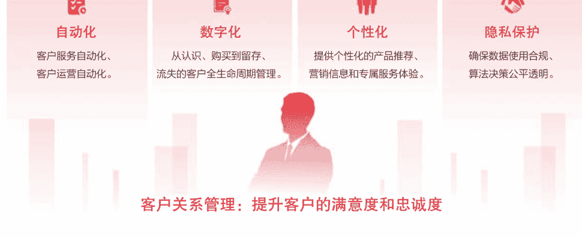

图5-4 AI赋能的CRM

### 自动化：用“AI替身”解决小团队“人手不足”的问题
自动化是基础，通过工具替代重复人力，让1到2人实现大厂级效率。重点落在客户服务自动化和客户运营自动化，尤其是流失干预场景。

客户服务自动化
网站和App里常见的AI聊天机器人或语音助手，就是“AI客服管家”。借助自然语言理解，它们能应答常见咨询、查订单、核库存。平安银行的AskBob已能语音办理业务；百度智能云的客服机器人也在政务和企业热线高峰期承担分流。核心价值有三：7×24小时在线，半夜也能改签或咨询；降本提效，某电商接入后约70%日常咨询被AI解决，节省大量人力；AI+人工协作，AI先行处理，复杂或情绪化问题再转人工，1个人可扛下原来3个人的量。

客户运营自动化
服务自动化解决“有问题时快速响应”，运营自动化解决“没问题时如何保持活跃”。新用户注册后AI会推送欢迎礼包或新手指南；首购用户会被关联推荐提升复购；老客户则收到会员权益或关怀。营销自动化工具可依据行为实时细分。

更高阶的是流失预测。模型综合近期的购买频率、客单变化、访问活跃度和反馈评分捕捉风险信号。比如订阅用户一个月内登录骤降且多次浏览退订页，流失概率会被判定大幅上升，及时触达挽留动作。

某连锁健身房用AI发现连续两周未打卡的会员流失概率暴增80%。触发策略是自动发送教练关怀短信或免费私教课邀请，12周留存率因此提升15%，证明干预有效。

### 数据化：用“AI分析”替代小团队“经验判断”
数据化是CRM的核心支撑。NLP可自动化解析评论、留言、问卷等海量反馈，提炼客户之声，避开只靠创始人经验的偏差。传统人工分类易遗漏关键洞察，AI能实时做情感分析与话题聚类。

亚马逊每天接收数百万条评论、投诉和问卷，靠AI做情感打分、主题聚类与趋势分析，迅速发现“送货延迟”“包装破损”“说明不清”等痛点，进而优化配送、包装和详情页。万豪酒店通过AI分析携程、Booking、TripAdvisor等平台评论，发现Wi-Fi不稳被高频吐槽，遂全球升级网络，满意度和回访率随之提升。

小团队照搬此逻辑，无需专职数据团队就能低成本定位影响满意度的关键问题，实现从被动响应到主动改进。

在方向明确后，如何把有限资源投给高回报客户，需要生命周期数据化。AI能精细管理从认知到流失的全周期。例如SaaS公司用AI给试用客户打分，优先跟进高潜力账户提升转化。AI还能预测再次购买时间、偏好品类、是否好评等，促成前瞻性营销并形成“分析→干预→采集新数据→再分析→优化”的闭环，帮助量化获客成本、留存率、客单价、生命周期价值等指标。

### 个性化：用“AI定制”实现小团队“千人千面”体验
个性化是终极目标。推荐系统是典型应用。淘宝首页已非统一促销，而是基于收藏、浏览时长、点击习惯等用深度学习预测下一步需求，实现动态千人千面。Netflix的推荐系统每年为公司节省约10亿美元，证明精准推荐对留存的价值。

电商常根据画像动态调首页横幅，新客看新人礼，老客看会员优惠；旅游平台会按历史行程在节假日前推送定制出游邮件；邮件营销工具也能根据收件人特征自动改标题和措辞，提升打开率。AI通过行为、购买和互动记录构建画像，自动化实现一对一营销与关怀。

## 实施路径：AI赋能品牌建设的关键节点
盲目上马AI容易适得其反，需要清晰路径、数据治理、团队架构和风险管控。

战略规划和目标设定
不同企业的痛点不同，不能照搬。先明确是要提升知名度、更精准获客还是提高生命周期价值。目标决定选型和评估标准。快消可能更看创意迭代和人群定向，金融则更关注转化率和流失率。

准备数据和选择AI工具
数据是AI的燃料。CRM、投放、网站分析、社交互动等数据是否完整、干净、易于访问，是前提。星巴克的成功很大程度上源于全球统一的消费者数据平台，让AI能做精细个性化营销。

工具选择要看需求、易用性、成本和兼容性。谷歌智能竞价、百度AI投放平台、Facebook动态创意系统各有侧重。建议先在单一场景小范围试点验证，再逐步推广。耐克就先在社交互动上试点AI创意优化，成功后再扩展到全链路。

团队建设与能力培养

搭建好数据底座、配齐智能化工具只是起步，小团队真正卡住的地方往往是人和组织。传统营销部门更擅长创意策划与落地执行，而面向智能化的数字营销对人才的能力结构提出全新要求；再强的系统最终也必须由人来操盘、判断。

这意味着营销同事需要更扎实的数据洞察、算法常识与跨部门协同能力，倒逼组织主动调整架构。比如组建跨职能的智能营销小组，把数据科学家、技术人员、创意人员与营销人员整合在一起，推动智能营销战略落地。同时要持续补齐团队的智能技能。例如宝洁专门成立了“AI 营销实验室”，定期为成员提供智能技术培训，让传统营销人员也能熟练使用工具，整体营销能力得到明显提升。

### 隐私合规与数据治理的考验
智能营销推进过程中，数据隐私与治理必须被摆在前列。随着欧盟 GDPR、中国《个人信息保护法》等法规趋严，营销环节涉及的大量个人数据一旦失控，就可能招致法律与声誉风险。要让智能真正服务营销、提升客户满意度和忠诚度，企业使用个人数据就必须合规。小团队需要建立严密的隐私保护机制，比如实施匿名化、差分隐私等技术，在享受精准营销红利的同时守住客户信任。

苹果在隐私实践上颇具参考价值。其营销始终坚持隐私优先，使用设备本地的智能分析进行个性化推荐，确保客户数据不离开设备本身。这样既保护了隐私，又沉淀了有针对性的客户洞察，赢得了广泛好评。

### 风险管控体系的构建
即便前期工作面面俱到，智能营销仍会面临真实风险。算法偏见、数据质量波动导致决策失误、过度依赖智能引发人为决策能力退化，都是常见隐患。小团队必须建立完善的风险管理机制，包括算法的定期审计、异常情况的实时监测、效果评估与持续优化，必要时要能由人工接管。

同时要保持对智能表现的持续警惕，定期复盘智能营销整体效果，如广告投入回报、点击率、转化率等关键指标，及时调整，确保策略始终处于最佳状态。

回顾智能赋能营销的全过程，可以发现这并非单纯的技术升级，而是涵盖战略规划、数据治理、团队建设、风险管理等多维度的系统性变革，且每一步都离不开“人”。智能虽强，却只是实现营销目标的辅助手段，而非策略本身。真正出色的团队都注重人机协同：智能帮助营销人更快获得洞察与创意，营销人则要确保产出内容与策略真正契合品牌价值观和目标客群的情感需求。只有如此，小团队才能释放智能潜力，实现营销效果的跃升，这也是智能赋能数字营销对营销人提出的核心要求与挑战。

# 06 增长引擎
## 用人工智能重塑运营与融资路径
“增长”是创业者永恒的命题。算法驱动、数据为王的新时代，增长已从靠人力扩张和创始人经验直觉的粗放堆叠，转向技术深度参与、系统精细运营的理性过程。

人工智能与云端技术正在以前所未有的方式改写企业的运营逻辑、融资路径与增长模型。对资源有限的小团队而言，这不仅是技术浪潮，更是一场能力平权的机遇——把握要领即可以小博大，撬动商业版图加速。

本章以“钱”为线索，以运营、融资与财务管理为关键词，拆解企业在人工智能与云端技术赋能下如何实现降本增效、业务扩展、精细管理与融资创新。

当然，战略落地并非无风险。数据安全、隐私合规、模型失真、部署复杂度、团队能力建设、项目评估机制等，都是必须正视的挑战。

本章特别强调：技术部署不是一蹴而就的跃迁，而是需要清晰路径规划、扎实治理基础和敏捷团队配合的系统工程。小团队要在技术应用中获得竞争优势，必须做到战略有方向、流程有抓手、文化有共识、组织有支持。

实践中“小步快跑、边干边学”尤为关键。可以先从高价值、低门槛的智能场景切入，快速落地、即时反馈、持续迭代，最终形成体系化能力。

## 运营逻辑：技术如何撬动增长
数字化浪潮下，企业成长逻辑正从“人力驱动”转向“智能驱动”。传统企业多靠人多、地广、重资本扩张，而小团队正以人工智能与云端技术的组合，用更轻资产、更快节奏、更高精准度在激烈市场中抢占位置。

新一代企业的增长动力聚焦于三大协同支柱：

- 智能赋能的产品定制与持续创新是核心引擎，既能深度洞察客户需求提供千人千面服务，又能加速研发迭代紧跟市场；
- 人工智能与云端技术协同重构的智能供应链是关键支撑。云端提供弹性算力与数据存储底座，智能实现需求预测、库存优化等决策，大幅降本提效；
- 全球化市场拓展是重要增量空间，让企业突破地域边界复制产品与供应链优势，对接差异化需求。

三大支柱形成“产品→供应链→渠道”的协同闭环，三者共同推动企业从维持生存迈向规模爆发的质量增长新阶段。
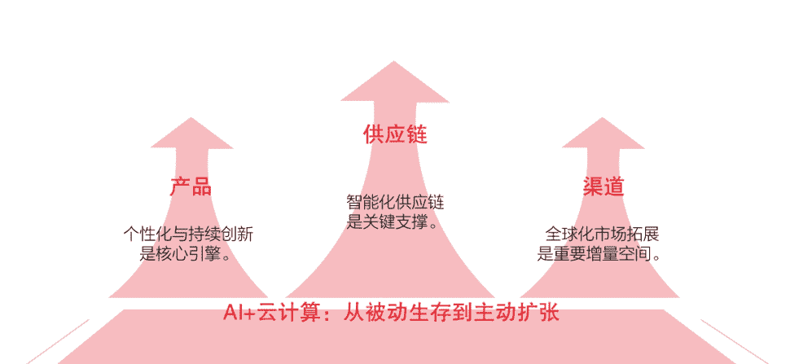

## 产品端：智能驱动创新与定制
小团队增长的核心，是用有限资源让客户持续买单，而前提是产品能精准满足甚至创造新需求。传统模式依赖创始人猜需求、少数模型迭代，易陷入同质化与用户流失。智能技术则通过定制与持续创新注入不可替代的动能。

### 个性化体验：让用户感受到专属定制
需求差异决定了一刀切产品难以持续。智能技术通过分析浏览轨迹、购买记录、评价反馈等行为数据，实现千人千面的精准适配。

以电商为例，淘宝、京东、拼多多已将个性化推荐作为核心增长引擎，通过智能模型分析浏览、购买、收藏、评价等轨迹，自动生成千人千面的首页组合。推荐带来的交易转化已超越搜索，成为商品交易总额增长的主要来源。

同理可复制到其他行业：教育平台依学习行为推荐课程路径，金融平台按风险偏好推荐理财产品，健身应用依据身体数据定制训练计划，服装品牌还能通过试穿数据生成个性化尺码建议与搭配方案。

精准匹配的本质，是把客户需求转化为增长数据，让每次互动都成为提升黏性的机会。

### 持续迭代：让产品始终贴合市场痛点
企业增长天花板往往是产品跟不上市场变化。智能技术像一位永不疲倦的市场观察员，既能挖掘未被满足的需求，又能加速创新迭代。

生成式智能如ChatGPT、文心一言、Midjourney、通义千问，正在广泛应用于新品命名、外观设计、文案创意、包装建议、功能拆解等。例如一家手工咖啡品牌借助智能工具分析社交媒体评论与饮品风味词频，发现“冷萃+燕麦+香草”组合在年轻人中热度上升，推出灵感新品“夏云拿铁”，上线当周销量翻番。

更进一步，智能可作为共创工具。例如小红书上多个品牌邀请用户参与智能“造型投票”，用Midjourney生成不同风格搭配图，再由粉丝挑选最喜爱的组合。

在B端，制造企业利用智能进行仿真建模、工艺设计优化、材料性能分析，大幅缩短开发周期、提升成功率。如美的集团工业设计部门接入智能CAD系统，自动推荐构型方案、模拟应力场、优化排布策略，显著缩短从立项到样品的周期。

“快速试错+精准落地”的创新模式，让企业总能抢先抓住市场空白，持续打开增长空间。

## 供应链端：借助智能与云平台提升效率
供应链是企业运营的“血脉系统”，从原材料采购到生产排程、库存管理到物流配送，每个环节的效率都直接影响成本、响应速度与抗风险能力。传统管理依赖人工经验与滞后数据，常陷入缺货紧急补货、库存积压被迫降价、物流延误被动道歉的被动局面。人工智能与云端技术正将供应链从依赖经验的“反应式运营”升级为数据驱动的“预测式管理”，实现效率与韧性的双重提升。
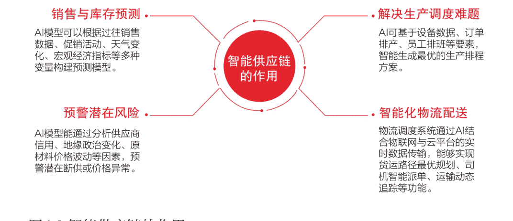

### 需求预测与库存管理
库存是供应链的“蓄水池”，但传统管理常因需求判断不准导致积压或缺货两极。人工智能与云端技术首先解决的就是需求预测这个源头问题。

智能模型可基于历史销售、促销、天气、宏观经济等变量构建预测模型。借助云平台快速处理与动态更新，可生成更精准需求预判，为库存与补货提供依据。可实现需求预判的云智能供应链系统主要有：阿里云智能供应链解决方案、腾讯云智能驱动供应链管理平台、华为云智慧供应链平台、京东云智慧供应链商家开放平台、数势科技Supply Force智慧供应链平台等。

某全国性日化快消品销售企业曾靠管理者经验与历史数据预判需求，忽视天气、促销变量，导致华东地区降水增多洗衣液积压10万瓶，华北气候干燥除湿剂积压货款超500万元；每月固定补货难以应对波动，华北突发高温导致沐浴露缺货5天，转化率骤降。

接入阿里云智能供应链系统后，企业整合近3年日销数据、促销计划、300多座城市气温等多源数据，通过多变量智能需求预测模块基于LSTM算法生成“SKU→城市→周”三级预测，准确率提升至85%；再借助智能库存优化模块动态分配库存、计算安全阈值，用动态补货替代固定周期补货，库存低于阈值80%自动触发补货并支持跨门店紧急调拨。落地6个月后，华北除湿剂库存积压减少40%，门店缺货率降低35%。决策从“拍脑袋”变为数据驱动+模拟计算，不仅优化库存，也为生产采购提供清晰指引，减少全链路浪费。

### 生产排程的智能优化
需求预测给出“要多少货”，生产环节要解决“如何高效产出”。传统模式按固定计划排产，易出现产量与市场需求错配，或因设备故障、员工请假导致协同断层。智能技术可基于设备数据、订单排产、员工排班等要素智能生成最优排程。

典型软件包含三环节：自动采集设备、订单、人力核心数据；设定约束条件与目标后再基于智能算法生成排程方案；支持实时响应突发变化，设备故障、订单插单、员工请假时5~10分钟内重算排程。

能实现智能排程的软件有三大类：工业互联网平台型如华为云制造智能体、西门子MindSphere、达索DELMIA；垂直行业深度定制如不工软件ORAPS、鼎捷MES平台；轻量级快速部署如JWI MDE制造调度引擎、用友YonSuite等。

某主营智能手机主板的电子企业曾陷入多重困境：3条SMT贴片产线固定排产，切换产线延误48小时交付，产生3万元违约金；回流焊炉故障导致良率下降，返工成本增加12万元；夜班低熟练度员工处理高精度工序，不良率达白班2.3倍；日常设备故障依赖人工巡检，响应超4小时，旺季贴片机停机6小时，损失产能8000片/天，产能利用率仅78%。

2023年引入华为云“制造智能体”后，整合设备实时数据、订单优先级标签、员工技能矩阵构建全域数据库；智能自适应排程引擎十几分钟内完成故障产线订单分流，“人—机—订单”匹配模型优化工序分配；打通生产与物料链路，设备预警实时推送至维护团队。最终年均产能利用率提升12%，多产主板150万片，设备故障率降至20%，停机时间减少320小时，交货周期缩短15%，紧急订单准时率从82%提升至99.5%，摆脱“人工排程—被动救火”模式。

若团队规模10~50人、年营业收入500万元以下，可选择轻量级快速部署方案，满足低成本、易上手、轻量化需求。例如10~30人生产标准件的小团队，日均工单20~50单，可选用友YonSuite基础版，输入订单数量、设备产能、员工班次即可自动计算最优开工时间，按设备负荷均衡原则分配任务，可视化看板实时显示已排产工时/总产能占比，预警超负荷与空闲设备，初期可用Excel导入数据即可。

### 物流配送的智能升级
物流调度常被忽视却至关重要，尤其是生产/贸易、第三方/专线物流、零售/电商及生鲜、医药、工业品等行业。普遍存在供需错配、过程失控、缺乏数据复盘导致路线重复与装载不合理的问题。

智能结合物联网与云平台实时数据可实现货运路径最优规划、司机智能派单、运输动态追踪。

2022年“618”大促，某华北电商物流企业5仓120车，因人工调度陷入危机：北京海淀区3C订单激增3倍，天津仓库存未同步导致120单停滞24小时；廊坊28单错发北京仓，成本激增时效延迟；5000件订单手动整理超3小时，郊区订单派错司机导致延误，准时率仅72%。

2023年部署京东物流智能调度系统后，整合5仓库实时库存、订单时效标签、车辆位置与司机技能数据构建“仓—单—车”全域数据库；智能预测提前72小时预判海淀区3C订单激增，自动调配天津库存至北京备货，大促当日按“就近发货”原则廊坊订单100%从天津仓出库，单票成本降低22%；动态派单模块每5分钟更新数据，将郊区大件订单精准分配给熟悉路线的司机并优化装卸顺序；全链路实时监控遇高速拥堵自动推荐备选路线，异常10分钟内调配备用车，用户端实时推送预计送达时间。

2023年“618”期间，配送准时率从72%跃升至98%，海淀区3C订单无一延误，用户投诉下降90%，车辆空驶率从32%降至15%，摆脱人工调度混乱困境。

类似系统可分为：大企业适用的智能仓储与运输一体化方案如菜鸟网络物流大脑、中集创见LCS系统；中小团队轻量级TMS SaaS如牛运运、壹悟科技物流业务调度系统，支持路径规划与实时监控，Excel导入即可用；以及Shouhuo智能配送系统、DataWorks智能调度平台等开源方案，适合有技术能力的团队自行部署。

### 供应链风险的前置预警
供应链稳定性常被“黑天鹅”打破——原材料价格暴涨、供应商断供、极端天气导致物流中断等。传统模式信息滞后只能被动救火。人工智能与云端技术通过整合全链路数据可提前预警，构建韧性供应链。

智能模型可分析供应商信用、地缘政治、原材料价格波动等信号，依赖云平台对多源数据实时整合，确保风险不被遗漏。

华东某汽车零部件企业曾因传统管理陷入危机：铝合金原料价受国际局势上涨28%；核心供应商因环保核查停工48小时且无备选；极端高温导致物流干线中断，3000件订单逾期，准时交付率仅65%，投诉率环比上涨200%。

部署智能+云端供应链系统后，整合12家核心供应商信用与产能、原材料实时价、3条物流干线天气路况数据构建全域数据库；智能风险预测算法提前96小时预警铝合金涨价，采购提前与3家供应商签订锁价协议；智能基于供应商信用与产能弹性为每家核心供应商匹配2~3家备选；云计算实时同步物流数据，异常时推送2条以上备选路线，响应缩至30分钟，客户端可查运输进度。

智能风控与智能采购的组合，让供应链从脆弱链变为韧性网，有效应对市场不确定性。

# 风控智能化驱动增长新动能

具备风险防范能力的供给网络方案已相当丰富。国际阵营里，SAP Business Network 可联通 190 多个国家地区的合作伙伴，实现风险即时提示并支持合作方快速切换，适配跨国经营；C3 AI 的供给链套件接入 Google Cloud，可在停产前 7 到 30 天发出告警，更适合年产值过亿元的制造厂商。国内成熟选择包括华为云供给链智能体、金蝶云·星瀚供给链云、用友 BIP 采购云、阿里云智能供给链，均已形成较为完整的风险防控体系。

从需求预判到库存调优，从生产物流协同到风险告警，智能技术与云端算力正渗入供给网络的每个环节。流程更顺畅、支出更可控、效率更可预期，同时推动公司从管理资源转向管理智能。对小体量公司意义尤为突出，无需重金自建，通过接入云端智能服务，就能把原本拖累利润的成本包袱转变为支撑增长的竞争优势，在复杂市场中把握机会。

## 全球化布局打开增长空间

单一市场的容量有限，本地增速放缓、竞争加剧时，走向全球成为拓界关键。过去语言壁垒、本地化响应迟缓、基础设施投入高，让出海多为大公司特权。如今智能技术加云平台，让小规模公司也能轻装出海，用技术杠杆撬动海外市场。

### 云基础架构实现即插即用

出海第一步是让各地客户顺畅使用。公司可依托 AWS、阿里云、Google Cloud 等厂商搭建的全球分布式 IT 资源池，完成算力、存储、数据处理，按需付费即可。

云服务的本质是把本地机房的 IT 资源搬到云端，实现弹性调用，从而提供即插即用的方案。智能手表品牌 Ticwatch 进入欧洲时，用 Google Cloud 快速搭建服务，再借助智能工具分析当地用户佩戴习惯与反馈，对产品做本地化智能优化，最终顺利落地。

向量数据库公司 Zilliz 创立初期就依托亚马逊云和微软云的全球节点，实现产品多国同步覆盖。这种无需自建机房的部署方式，让小公司省下大笔基建投入，把资源集中在业务本身。

### 跨文化沟通借助智能桥梁

## 融资优化：现金流智能规划

多数小团队创始人精于技术和运营，却在融资上感到吃力。智能技术正在深度改写投融资全流程：对创业者而言能更精准打磨材料、规划策略，对投资人而言能更快筛选项目、评估风险；在众筹、资产证券化等新模式中，智能技术甚至成为底层驱动。

好产品只是起点，融资能力才决定创意能否落地、成长、扩张。对初创团队而言融资是持续的战略工程。过去高度依赖人脉、经验和运气，现在这项工作正变得更数据化、更理性、更高效。

### 天使投资：借助智能打磨融资材料

融资准备阶段，团队通常会递交商业计划书，用以系统介绍商业模式、市场潜力、团队实力、盈利预期等核心信息，帮助天使投资人判断价值。

以前做一份计划书需要大量时间做市场调研、竞品分析，还要反复润色表达。如今输入核心信息后，借助 ChatGPT、文心一言等生成式模型，就能快速得到结构清晰、逻辑完整、风格统一的初稿。更关键的是，这些模型可自动抓取行业数据，补齐市场规模、增长趋势、竞品对比等投资人关注的板块。

部分智能应用还能做估值模拟和融资节奏预测。例如 DeepSeek 可梳理同类项目的融资历史和市场表现，判断当下是否适合启动融资，并预测各轮次的股权出让比例、资金使用周期和估值波动区间。这种基于数据的策略推演，让小团队更了解市场底牌，和投资人对话时更有底气，避免过早融资导致过度稀释的陷阱。

### 众筹：智能放大传播效果

众筹属于去中心化的融资方式，发起人通过互联网平台展示创意或项目，吸引公众小额出资。近年来在文创、消费、科技等领域很火，比起传统融资更具参与感、传播力和用户连接力，对小团队更友好。

国际主流众筹平台有美国的 Kickstarter 和 Indiegogo，部分中国品牌也借助韩国的 wadiz、日本的 GREEN FUNDING 实现突破。如今 Kickstarter 和 Indiegogo 已深度融合算法，并支持发起人通过 API 或插件接入第三方智能应用，形成完整的服务链。

筹备阶段，平台自带算法就能辅助制定目标和内容策略。比如一个智能手表项目准备众筹，算法基于历史数据建议：定价从 399 元起并搭配限时限量加体验师故事，平均转化率能提高 12%；页面顶部采用手绘风格加功能标签，前 5 秒留存率可提升 20%。

众筹进行中，智能技术可实时追踪用户行为、社交分享路径和舆情情绪，动态优化营销。比如检测到用户在 FAQ 区停留过久，说明疑问多，系统就会提示补充说明或增加演示视频；再如识别到社交媒体转发高峰集中在下午 4 点到 6 点，就建议在该时段集中投放广告或推送更新，激活传播链。

小团队也能接入第三方智能应用追踪舆情和传播走势，实时给出应对建议。有消费电子品牌众筹时，智能系统抓取知乎和 B 站的讨论关键词，发现“续航焦虑”“不支持快充”等负面声音上升，系统即时提示品牌方尽快发布技术说明视频并安排 KOL 背书，化解用户顾虑。

因此智能技术在众筹里不仅是优化手段，更是放大器。它放大创意的传播力，也放大资金与用户的连接效率，让项目更容易破圈。

借助智能技术，公司能讲出更精准的数据故事、做更专业的风险测算，也能通过众筹等新机制降低融资门槛、激活资本。对小团队而言，智能技术不是替代融资思维，而是放大融资能力，让创始人具备数据洞察、内容创意、节奏设计等过去只有专业机构才有的能力，更打开了更公平、去中心化、个性化的资本通道。

## 财务精细化：动态管控成本

从日常成本控制、现金流管理到中长期财务战略规划，智能技术不再只是辅助，正向智能 CFO 演进。它能洞察问题、自动生成报表、预测趋势、识别风险并给出优化建议。即使资源有限的小团队，也能借助智能技术打破专业壁垒，实现真正的精细化管理。

信息化程度越高，财务就越不是单纯的后台记账，而是战略决策和日常运营的核心引擎。公司健康、效率和扩张能力，关键不在于一次性盈利，而在于能否用数据看清资金流向、周转节奏和杠杆水平，这直接决定决策是否合理。

智能时代正为公司打开看清财务、管好资金、规划未来的智能化通道。

### 成本优化：从滞后复盘到实时干预

成本控制是财务管理的第一道防线，传统运营中多为事后复盘，发现超支时已晚。智能技术让成本管理从被动复盘转向实时预警和提前干预。

首先可生成动态成本仪表盘，实现实时监控，前提是打通 ERP、进销存、销售、人力等系统的数据。

它们过去是各自为政的数据孤岛：ERP 统筹财务、生产等核心数据，是公司总管家；进销存记录原材料采购价、仓储费等；销售系统追踪渠道及推广费用，如线上投放成本；人力系统管理考勤、薪资，含加班成本等关键数据。

未打通前，各系统数据不互通，成本统计需要财务手工收集各部门表格，耗时且易错。

打通后，原材料价格波动、投放费用变化、员工加班记录等会实时同步到 ERP。智能技术从全流程中抓取成本数据，按产品线、时间等维度归类，自动生成报表，让管理者及时看到异常波动。

监控不是目的，发现异常才是关键。例如某电商用智能技术对广告支出做回归分析，发现部分 ROI 低的关键词长期投放未被发现，造成预算浪费。

其次还能模拟成本优化场景。合思智能费用预算系统、万达宝 LAIDFU 智能成本控制平台、Moka 人力资源 AI 预算系统、FineReport AI 预测报表系统等，都可实现成本优化。

管理者可在系统里设定不同场景，比如销售额下滑 10%、人力成本上涨 5%，系统即时模拟各成本项变化并给出建议，如削减哪类费用、合并岗位、压缩支出等。过去财务人工测算需数天，现在几分钟就能输出多版对比报告，支撑科学决策。

对小规模公司，智能技术既是监控也是优化，不仅能省钱，更能预防因成本管理不当引发的资金链风险。

### 现金流管理：预警守住底线

公司倒闭多因现金流断裂而非亏损。利润是观点，现金流才是事实。智能技术正成为洞察和管控现金流最可靠的预警系统。

在现金流管理上的核心作用是智能预测未来收支曲线。基于历史财务、应收应付、销售、订单周期等数据，可以模拟未来 30、90、180 天的现金流走势。比如季节性强的旅游公司，智能技术结合往年假期、销售节奏和预订行为，能预测旺季资金流入和淡季紧张时点，提前制定融资或支出计划。

现金流预测工具分两类：专业型如 HighRadius、Trovata、Float 等，小规模公司轻量预测可选 Float，可预测未来半年趋势；另一类是财务系统内置模块，如用友 BIP 智能现金流系统、Oracle Fusion ERP 现金流引擎，可深度对接财务数据实现整合预测。

还能把宏观经济数据如汇率、利率、原材料价格，和公司微观业务数据结合，评估未来是否存在资金缺口。

例如一家跨境电子元件贸易公司，智能技术整合宏观数据美元汇率持续上涨、芯片原材料价格上涨 15%，与微观数据三季度计划采购 1000 万芯片、客户回款 60 天、月固定支出 20 万后测算，若按原计划采购叠加成本上涨，10 月将出现约 300 万阶段性资金缺口。系统随即建议把部分采购延至四季度、与核心客户商议提前 15 天回款、暂缓非核心区域推广费。采纳后成功规避资金链紧张，保障业务正常。

另一项应用是智能收付款建议，确保资金回流稳定。它综合应收账期、客户付款习惯、现金池状态，推荐催收优先级和付款节奏。例如对常延期付款的客户标注高风险，建议以折扣促其提前付款；在付款端若现金充裕且供应商提供早付折扣，则建议提前支付以获节约。智能技术相当于集出纳、风控、财务参谋于一体的数字员工，帮助公司从看懂账进化到会用钱。

### 财务规划：从防守到进攻

成本控制和现金流管理是守，财务分析与规划智能化则是攻。它的核心是通过数据洞察和前瞻推演，为扩张、转型、投资等战略提供依据。

智能预算系统可在数百变量间构建复杂预测模型，模拟不同策略的财务表现。如某新消费品牌计划扩张门店，智能技术结合各地消费力、租金、人流，预测不同城市开店的成本与收入，最终建议优先在南京、成都而非北上广开店，以最大化投资回报。

更前沿的是智能技术驱动的资本决策。并购、引入新产品线、海外扩张时，智能技术可将公司内部数据与行业外部数据结合，模拟对利润、现金流、负债率等的影响，提前预判风险。过去只有咨询公司或投行能做，如今小公司也能用智能财务工具获得同级推演能力。

过去财务像一门会计之术，重规范、准确、合规。如今在智能技术加持下，它已蜕变为战略之道，需要更高实时性、敏感性和前瞻性，而智能技术恰好弥补传统财务短板。智能技术不仅提升效率，更培养公司的精算意识：不只看赚了多少，更看花得是否合理、收得是否及时、能否预测盈亏、能否更优分配资金。

## 落地挑战与风险管控

智能技术与云平台为小团队打开了增长之门，但真正跨进去并不容易。怎样让智能化成为组织核心能力，而不是空中楼阁？如何避开陷阱稳妥落地？

智能技术本质不是神秘黑科技，而是一种可被看见、学习、控制的生产力工具。它不会自动带来增长，却是创业者撬动更大舞台的杠杆。选择智能技术与云平台已不是技术策略，而是面向未来的生存方式。谁先掌握工具，谁就能更快定义规则。

从技术部署到组织协同，从数据治理到能力建设，从安全防护到效果评估，落地不是短跑，而是一场需要长期布局和动态管理的战略长跑，挑战不少。

### 落地路径：痛点场景先行

公司探索智能云初期常陷入两极：一是空谈技术，把智能技术当万能药堆 PPT 却不接地气；二是畏难不行动，担心投入高风险大而错失先机。真正实现赋能的公司走的都是同一条路：从小场景切入、以业务为导向、分步落地技术，最终形成组织能力的系统跃升。

国内某母婴品牌并未一上来就全面上智能技术，而是从最痛的客服高压切入，先用智能机器人处理常见问题，再逐步接入营销自动化、用户画像、供给链预测等模块。每一步都紧扣业务需求、以结果为导向，并配套流程与人员协同，最终形成业务与技术共建的闭环。这种小步快跑是稳妥的落地路径。

推进智能化战略时，不应孤立推进单一模块，而要设计能力协同矩阵。比如智能客服能否打通 CRM？大模型生成内容能否纳入品牌话术模板？云部署能否同步规划弹性扩容和灾备？只有把这些环节统筹起来，才能最大化技术协同价值。

### 数据治理：智能化的生命线

智能技术的根基是数据，治理不好就像引擎缺油，不仅驱动不了业务，还会引发安全隐患、隐私泄露和合规风险。在智能技术与云融合环境下，数据来源多样、流转不清、敏感信息易外泄、模型训练边界模糊，公司若不提前建立完整治理机制，轻则模型偏差误判，重则隐私泄露触法。

首先是数据资产分类与权限管理。要对客户信息、交易记录、营销数据、生产流程等进行分类梳理，按敏感度分级，通过细粒度权限确保员工只能访问业务所需数据，防止滥用。不少公司已采用数据中台模式，集中治理、分布调用，在保障安全的同时提升共享效率。

其次是模型训练数据合规审查。训练语言模型或推荐算法时常会采集用户行为数据，若未获授权或使用含敏感信息的数据就易触法。2023 年，国家网信办等七部门联合发布《生成式人工智能服务管理暂行办法》，明确要求训练数据合法合规并可追溯。对公司提出更高要求，自研模型时需关注来源透明、匿名化处理和使用边界。

最后是数据流动与云安全的动态监控。数据上云后虽获得算力和便利，也面临更大安全挑战：传输加密、存储容灾、平台抗攻击能力等。因此选择可靠云服务商很关键。阿里云、腾讯云、华为云均推出公司级全生命周期数据保护方案，支持端到端加密、防入侵检测和合规审计。公司应善用平台能力，同时内部设立数据安全负责人和应急机制，确保数据不脱控、不丢失、不被滥用。

### 组织建设：人才决定成败

智能技术再强也需要人来驱动落地。很多公司推进智能化战略的最大难关不是买不到工具，而是缺人、缺懂业务又懂智能技术的人。因此必须从组织架构和能力建设两方面重塑人才结构。

组织上可设立智能与数字创新部门，或在 IT、数据、运营团队中嵌入智能化推进岗，负责项目选型、落地和协同。岗位人员需懂技术也懂业务，能在智能技术供应商和业务部门间做翻译和协调。很多公司因业务与技术沟通不畅导致项目受阻，设立中枢部门可打破部门墙，推动端到端落地。

能力建设上，公司可通过内训和外部学习平台提升团队理解力和应用力。阿里云、腾讯云、百度智能云均提供从入门到进阶的智能技术和行业应用课程；网易云课堂、极客时间等第三方平台也推出智能技术加业务的实战训练营，帮助管理者了解智能技术在零售、金融、制造等领域的落地场景。

进一步看，企业可以尝试建立内部 AI 导师机制，让已经参与过 AI 项目的同事担任导师，把实战经验在团队里逐层传递。即使暂时没有专职 AI 工程师，也能通过师徒带教的方式，慢慢培养出一支懂使用、会用好的跨部门队伍。

## AI 风险防控：防走偏防空转
企业加大 AI 与云计算投入时，战略落地失败、技术方向偏移的案例并不少见。上线后无人使用、数据质量差导致模型失效、实际效果与预期差距大、甚至引发用户投诉，都是常见失误。因此需要一套可动态监测、可量化评估、可灵活修正的风险管控体系，这是确保 AI 战略持续推进的最后一道防线。

第一步，为每个 AI 项目明确业务诉求与度量标准。譬如智能客服上线 30 天内用户满意度提升 10%、内容生产效率翻倍、预测准确率稳定在 85% 以上。这些指标要纳入常态考核，用来判断技术是否真正产生业务价值。

第二步，形成试水—复盘—推广的闭环。很多公司一上来就全面铺开，结果规模大落地差。更稳妥的做法是先选典型场景小范围验证，检验工具价值与风险可控性，再依据结果优化方案，逐步扩大范围。

# 07 团队策略

## 从人才引入到文化建设
调研多家做得不错的小型创业企业后发现，早期最致命的坑往往不是技术判断失误或融资节奏，而是对人选与沟通缺乏系统认知。表面的人际摩擦最后常演变成战略失败；而起步期就把队伍打扎实的公司，即便商业模式还在摸索，也更容易进入增长期。资金、技术、商业模式都是竞争武器，但人始终是最不可替代的变量。

精简团队看似轻装上阵，实践中人越少个人权重越大。成败很大程度上取决于创始人怎么选人、怎么带人、怎么育人，以及能否塑造凝聚力与战斗力的团队文化。

文化不是墙面标语，而是体现在每次会议、问题处理方式、对失败的容忍度、对创意的激励机制等日常细节里。本章要说明精简团队如何营造默契十足的氛围，在冲突中增进信任，在混乱中保持一致，在挫折中提振士气。

视角需要转换：不要把人事当成创业杂务，而是战略核心。人是最复杂也最具复利的资源。一个优秀成员加入，带来的不只是技能，还有新的认知、活力与人脉。良好的氛围不仅能激发内部投入，还会吸引更多优质合作者主动靠近。在 AI 加速、市场迭代极快的今天，精简团队的长期优势，往往就是这一群人，以及他们凝结出的独一无二的团队文化。

## 能力模型：有创业者气质的人才
大量案例显示，支撑创业者气质的核心有三点，见图7-1：扎实的基础功底，确保在具体业务中站稳脚跟；强大的抗风险底气，让决策敢于在未知中推进；能聚拢人心的领导力，让团队形成合力。三者相互支撑，构成精简团队最需要的创业型人才画像。

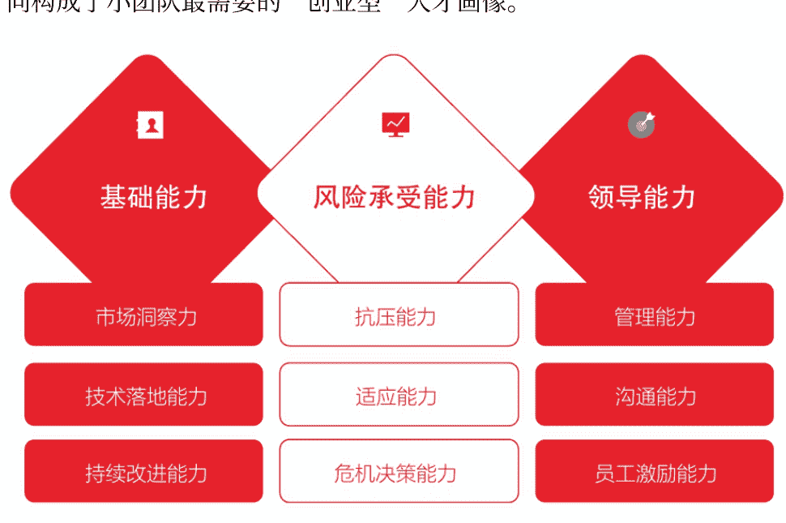

图7-1 创业者特质人才的核心能力

自带这种气质的人，不会满足于执行指令，而是会像经营自己的事业一样思考如何做得更好；面对不确定性不会退缩，而是带着解决问题的韧性与团队一起闯过难关。

## 创业者的基础能力，决定了小团队的起点有多高
创业不是赌博，存活下来的企业都有共同特质：市场洞察、技术落地、持续改进是核心必备素养。

### 市场洞察力
这是识别机会、制定策略的基础。精简团队必须比对手更快捕捉需求与趋势。奈飞创始人里德·哈斯廷斯通过分析用户行为嗅出流媒体潜力并推动转型；马云洞察中国电商需求创办阿里巴巴；张一鸣打造抖音时从上百个功能里锁定 15 秒短视频加算法推荐，抓住了用户快速滑动的规律；马斯克发现传统车企对电动汽车的空白打造特斯拉优势；拼多多以拼团模式避开传统电商正面竞争占领市场。

### 技术落地能力
现实中不少创业者倒在执行关，沉迷画蓝图却连产品原型都做不出。洞察之外，还要有把创意转化为用户愿意付费产品的转化力。小米创始人雷军是执行典范，从提出设想开始攻克技术难题、整合资源，最终推出高性价比智能手机，并以此为核心扩展智能家居与物联网生态。

### 持续迭代力
需求动态变化，创业本质是持续迭代。乔布斯深谙此道，每一代 iPhone 都在前一代基础上优化外观与功能，保持稳定迭代节奏，让苹果长期领先，成为持续改进的标杆。

## 创业者的风险承受能力，决定能走多远
“创业是反人性的修行”广为流传。资金不足、市场波动、技术挑战，都是精简团队常态。抗压能力是企业活下去的关键。

### 面对挑战时的抗压能力
真正的创业者不是不能倒下，而是倒下后能更快站起来。贝佐斯创立亚马逊时顶住市场不确定性与经营压力，以冷静决策将其打造成全球电商巨头；程维在滴滴初创期面对竞争与监管挑战，稳定情绪调整策略带领团队逆势突围。

### 面对变化时的适应能力
唯一不变的是变化。行业、政策、竞品动态频变，需要在变化中寻找确定性，强化反脆弱本能。适应力不是天赋，而是持续进化的生存本能。

### 面对危机时的决策能力
危机时刻的判断可能决定生死。要在信息有限时承担可控风险，先识别风险类型，再量化影响，最后对症处理。资金危机时优先保现金流，产品错配时评估市场适配性。马斯克在特斯拉多次资金危机中果断调整研发方向帮助公司渡过难关。雷军的“三三制”决策法则要求重大决策获得核心团队三分之一支持、外部顾问三分之一认可、用户三分之一验证，据此小米汽车立项就规避了 87% 的潜在风险。优秀创业者总能在风暴中保持清醒。

## 创业者的领导能力，决定走得稳不稳
很多初创企业失败源于管理而非市场或技术。人员越少，管理短板暴露越快。高效管理、卓越沟通、有效激励是带团队实现目标的核心。

### 高效的管理能力
需兼顾大局与细节，搭建适配结构。雷军采用核心创始人、部门负责人、员工三级扁平化直管业务；马云依靠多元团队与独特管理方式推动阿里巴巴成长为巨头。模式适配让小团队能平滑成长为大企业。

### 卓越的沟通能力
精简团队需要双向机制：清晰传递意图，也耐心倾听成员需求。沟通本身就是文化塑造过程。任正非通过高频内部沟通帮助华为建立强大企业文化与凝聚力。

### 有效的激励能力
员工与创业者是事业共同体。除合理薪酬福利，还需平衡物质与精神激励。物质上可用奖金、股权兑现，精神上授予荣誉与提供有吸引力的晋升机会。谷歌设立创新奖激励员工不断突破；刘强东以公平激励让京东团队感知价值与未来。

总之创业是能力修炼场。市场洞察、抗风险、领导力共同塑造了创业者在不确定中的应对智慧。只有评估并提升这些能力，才能带领团队走出起步期，在竞争中脱颖而出。将科学方法与人性洞察结合，才能穿越周期，成就长青事业。

## 团队组建：“以小制胜”的组建法则
创业初期每个人都要身兼数职，快速上手承担实务。这要求成员既有专业深度，又能灵活切换角色。成功的小团队不迷信简历光环，而是寻找真正匹配目标的人。

把“小”的劣势转为“灵活、聚焦、协同”的优势，关键在两点：一是通过角色分工释放人效，二是通过价值聚焦与互信机制激发内驱力。组建需遵循三大法则。

### 法则一：团队结构的灵活高效
资源有限时遵循最小可行团队原则，避免浪费。核心团队不宜过大，3 到 7 人是常见区间，聚焦关键职能、杜绝冗余。一旦超过 7 人，人力成本上升，沟通成本指数级增长。例如一家短视频电商团队，仅项目经理、内容创作者、数据分析师三人即可支撑初期运作。

同时要实现角色互补与能力叠加。成员需掌握不可替代的核心技能，也要具备基础产品思维、沟通等通用能力，并能多面手操作。小米起步时雷军的 7 人核心团队，技术既做软件开发也协助硬件优化，市场既推广也直接处理客户反馈。高效源自适应性与责任感，招聘时要识别兼具能力、适应性、责任感的人。

### 法则二：团队价值观和目标的聚焦
能力匹配只是第一步，价值观和目标是否一致才决定能否创造价值。能力强但目标不同的人，对精简团队可能是伤害。宁可慢招，也不要招错；宁可暂时缺人，也不要引入错误文化。

早期选核心成员时，除专业能力外，优先看价值观与创业目标的适配。价值观一致意味着大家理解“我们为什么在一起”，认可并热衷事业，愿意接受不确定性并付出努力。若不一致，团队易内耗、散志；若一致，则决策更快、战斗力更强。拼多多创始团队高度认同“让购物更有趣”，这种共识推动拼团模式优化，最终形成差异化。

共同目标同样关键。目标一致的团队像精密齿轮，各自努力推动整体前进。喜茶初创期聂云宸定期分享长期规划，让成员明白每日制作的奶茶不仅是产品，更是品牌承诺的一部分，这种关联感让团队保持动力。

### 法则三：培养团队互信的协同机制
创业不是找服从指挥的打工人，而是让每个成员成为参与者。要培养默契、打造互信协同机制。

在资源紧张的精简团队，信任是高效与凝聚的根基。开放沟通、透明决策能减少误解，增强协作。例如定期头脑风暴、倾听意见，重点不在方案是否被采纳，而在意见被认真对待，从而提升信任。奈飞创始人里德·哈斯廷斯强调坦诚沟通，要求直面问题开放讨论，既提升解决力，也建立深厚信任。

创业者要主动营造安全、开放、透明的环境，在清晰目标和边界内信任成员判断，鼓励贡献想法、尊重不同意见。成员被尊重、被倾听、被信任时，更愿意投入，完成看似不可能的任务。

精简团队构建是有机整体打造，而非简单堆人。从灵活结构到价值观聚焦，再到互信协同，每一环都关键。精简团队不是大团队的缩小版，而是要把“小”变成独特竞争力。

## 团队文化：小团队的隐形力量
文化是精简团队在高压高变环境中保持凝聚的关键。它不仅是“我们是什么”，更是“我们怎么做事”的系统规则，体现在决策、互动、冲突处理的每个细节。优秀文化通常具备开放沟通、激励创新、容忍试错、追求极致四个特质。

资源有限的精简团队，文化既是凝聚力源泉，也是竞争力核心。可从三方面着手构建，见图7-2。

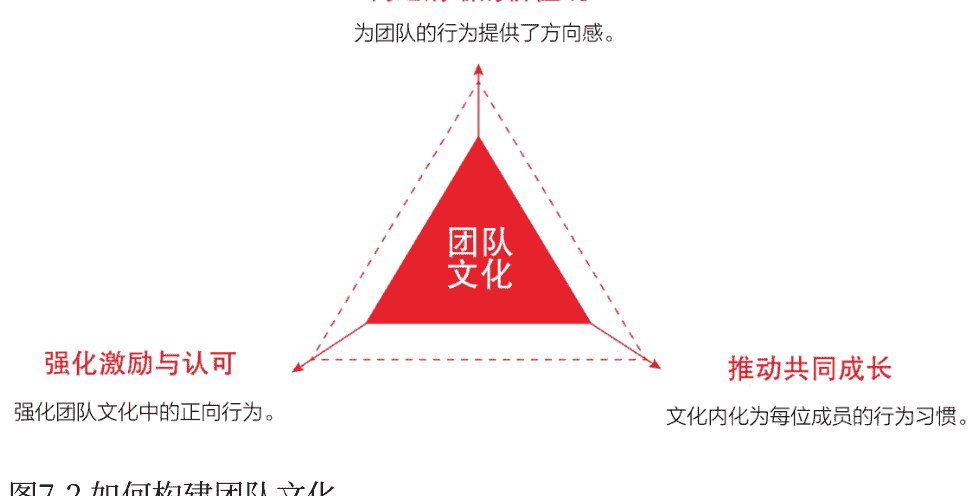

图7-2 如何构建团队文化

### 构建清晰的价值观：让文化具象化
很多人把文化等同于口号。有的团队挂满“客户第一”，考核只看销售额，最后因品质下滑导致投诉，完全违背文化。

文化是组织基因，存在于日常互动和每次决策中，必须落地。比如“责任心”落实为“答应客户的工作提前一天完成并自检三遍”，这才是真实体现。

精简团队文化多由创始人风格奠定。喜茶初创期聂云宸亲力亲为研发、严控原料质量，传递“品质至上”的理念，逐渐成为团队共识。

清晰的价值观帮助成员理解身份，为行为提供方向，成为连接彼此的隐形纽带。

### 强化激励与认可：让文化内化
文化可见还不够，要在运营中持续强化，让成员时刻记住。好行为靠看见、靠奖励来放大。

可把协作、创新、客户导向等文化要素纳入绩效与奖励：设立月度明星、价值观践行奖、创新奖，或提供培训、晋升通道、有挑战的工作。

创业者的及时认可也很关键。对微小进步给予口头或书面肯定，在会议或平台上公开感谢，足以让成员感受到价值，进而带动更多人践行。

### 推动共同成长：让文化可持续
若不能制度化，文化会随扩张和人员流动流失。必须把初期内核转化为组织基因，确保延续。

阿里快速扩张时用“六脉神剑”制度化核心价值观，为发展提供稳定基石，也为新人融入指路。华为通过明确文化传递，始终保持技术创新导向。

文化并非一成不变，要定期审视是否有效、是否适配新环境，在坚守核心前提下适度进化。若新领导风格与原文化冲突，需帮助其融入并强调传承。

文化是一种看不见的力量。无论创业初期还是扩张期，它都是精简团队在不确定中站稳的关键。领导者不仅是设计者，更是践行者和守护者，全员都是参与者和传承者。通过打造坚韧独特的文化，普通队伍能蜕变为创造奇迹的力量。

## 团队融合：在冲突中挖掘成长的机会
对资源有限的精简团队，冲突管理是职责也是通向高效协作的必经之路。成功团队懂得把分歧转化为动力，让冲突成为创新的起点。

成长中分歧不可避免，观点碰撞、角色交叉、优先级差异都会引发争论。如何理解并利用冲突？

### 不偏离正轨的冲突才能激发多元可能
成员多重责任、决策直接影响整体。高压下冲突更频繁直白，但适度冲突能揭示隐藏问题、催生更多方案，推动团队跃升。

# 当分歧成为组织的成长燃料

阿里巴巴起步时提倡真话文化，鼓励成员在争执中说出真实想法而非沉默避让。一次关于功能优先级到达成方案的会议上，正面意见激烈对撞，马云没有用权威拍板，而是让大家先冷静拆解事实再投票表决。这种容纳充分讨论的氛围，使关键抉择既多元又扎实。

遇到分歧时，领导者往往要承担两种职能。一面是氛围营造者，为不同声音提供安全的表达场域；另一面是指向校准者，在争论中把集体拉回共同目标，防止议题失焦。Netflix 的里德·哈斯廷斯用明确原则处理分歧：批评可以直言，但对人要保持善意，倡导激烈辩论后迅速定案。

## 让争执回到议题本身

好的分歧管理会把注意力从情绪对抗拉回问题本身。

在引导分歧时，尽量避免站队，偏袒会加深对立。把焦点拉向本质提问更有效。例如一家技术初创，因新功能优先级产生争执，创办人没有支持任何一方，而是把讨论牵回“用户真正需要什么”，争执随之化解，集体也重新对准共同目标。

## 从对立走向共创

争执容易被视作危机，因为它会触发情绪对立。但换个视角，分歧正是创新的来源，分歧背后往往藏着不同视角与未被看见的思路。

Google 早期广告组为是否推出按点击付费模式争论了数周。有人担心影响体验，有人认为符合商业趋势。经过反复沟通，团队最终找到兼顾体验与效果的折中方案，这个创新后来奠定了 Google 在网络广告领域的领先地位。

优秀的精简编制会把一次性争论变成常态化机制。核心是为未来分歧预留清晰的解决路径。华为用开放、透明、集中方式处理纠结，资源分配产生分歧时召开公开会让各方陈述，再通过投票或权重分析定案，减少因不透明带来的不满。精简编制可以简化为定期召开分歧解决会，鼓励公开提问，或制定升级路径，未能达成一致时交由创办人或外部顾问裁决。机制的意义在于让分歧成为推动发展的动力，而不是合作的障碍。

## 信任让差异不演变为裂痕

无论是观点差异还是个性摩擦，信任与开放沟通都是前提。缺乏信任，分歧容易演成人身攻击；缺乏开放，问题会被掩盖并越积越大。

信任需要创办人用行为示范。SpaceX 遭遇重大技术瓶颈时，马斯克把一线工程师也拉进决策圈，而不是仅靠高层开小会。这种安排让成员感受到被尊重，也让关键解法更快浮现，同时为集体树立了信任与开放的基调。

分歧是组织成长的常态。成熟的精简编制擅长从分歧中提炼问题本质，发掘机会，把对立转化为合力。创办人的任务不是消除分歧，而是用制度与文化把分歧引向健康的轨道。久而久之，集体会对分歧形成默契，提升协作效率并激发出更多创新。对精简编制而言，处理分歧既是挑战，也是成长契机，让合作关系升华为有凝聚力的整体。

## 用智能技术重塑人员建设

精简编制业务能力强，但常忽略人员培养与组织管理。理解集体从无到有再到更好的路径后，可以看智能技术如何提升招聘与人员管理的效率，助力文化建设，释放领导者去思考战略。

落地要从最痛的环节开始。招聘周期长成本高时，可先用智能简历筛选与视频面试；绩效评价主观时，可引入数据平台提升客观性。实施中，人力资源管理者要监督算法的公平透明，领导者要定期沟通智能技术应用的目的与成效，减少员工顾虑。把智能技术嵌进以人为本的管理理念，才能既提效又保留温度。

### 智能招聘：更快更准找人
智能招聘借助大数据和机器学习快速匹配简历与岗位要求，能从公开履历和社交信息中挖掘潜在能力和职业倾向。自然语言处理和计算机视觉让视频面试可以量化语音、表情和回答内容，降低人工偏见，提升筛选客观性。

实践效果明显：某企业使用牛客网视频面试系统，蓝领招聘效率提升73%；某地产公司引入智能面试后在保持人选质量的同时，招聘成本下降78%。智能招聘帮助企业更短周期、更低成本找到合适人选。

### 绩效管理：让数据说话
智能系统带来数据驱动的客观支撑。系统可自动汇总工作产出、项目完成情况，为管理层提供全面公正的评价。

机器学习模型能及早捕捉绩效异常或下滑信号，帮助管理者提前干预、调整分工。智能系统还能基于技能和职业目标定制个性化学习计划，智能平台推荐课程，甚至结合VR/AR提供沉浸式训练，加速成长并降低培训浪费。

### 文化经营：数字工具做温度
集体扩大后，人力资源管理者难以兼顾每个人。智能技术可提升员工体验：智能聊天机器人随时解答政策、福利、IT支持问题；匿名收集员工反馈并做情感分析，帮助领导层把握士气与文化健康度；协作工具分析沟通模式，提示信息孤岛和协作瓶颈，促进跨部门开放共享。

华为、腾讯、招商银行等已应用智能人员管理工具。招商银行用智能技术为新员工做在线培训测评，实现千人千面培养。平台薪人薪事借助智能技术分析绩效与行为数据，为某互联网公司建立绩效预警，使绩效问题解决率提升30%，流失率明显下降。中小企业也能通过SaaS使用智能招聘、视频面试和员工服务机器人。

总体来看，智能技术正在成为人员管理的加速器，在招聘、绩效和文化建设上提质增效，弥补资源不足，为长期发展打基础。

## 集体进化：走向成长型组织

精简编制的价值不只在解决当前问题，更在于能否持续吸纳新人、提升能力、应对变化。真正的成功不取决于短期表现，而在于能否成为成长型集体，在资源有限时存活，在扩张时不断进化。

### 从通才到专才的切换
初创期成员往往身兼数职，产品经理参与推广，技术人员兼顾客服，灵活性高。随着业务扩张，通才模式会显露出专业度不足的问题。

成长标志是向专业化过渡，在保持灵活的基础上明确分工、引入专业技能。爱彼迎早期，布莱恩·切斯基身兼战略、用户服务、设计等多重角色；集体壮大后，他引入专业管理团队，把事务交给更擅长的人，既释放自己精力也提升专业度。

与之对应，文化要从个人化转向制度化。早期文化多依赖创办人个人行为，集体扩大后难以覆盖，需把文化内核转化为制度机制。阿里巴巴快速成长时，将“客户第一、团队合作”等理念固化为价值观体系并融入流程，保证扩张中文化一致，也给新人提供清晰指引。

### 成长型集体的核心特质

长期人才规划
成长型集体要从眼前用人转向长期规划，布局梯队建设和关键岗位继任。Netflix 创办人里德·哈斯廷斯主张优先内部培养填补关键岗位，通过明确晋升路径和学习机会保障储备。精简编制可用导师制或培训计划让潜力成员逐步担责，增强归属感和热情。

高度多样性
多元背景提升适应性和竞争力。不同知识、技能、思维方式的组合能更好地应对市场变化。特斯拉早期，马斯克汇聚顶尖工程师与多元文化、跨行业人才，让产品更快适配各地市场。某电商初创在组建市场队伍时招募技术、设计、分析背景的人员，使推广策略兼具创意与数据验证。

未来视野：集体成长的核心
成长型集体的核心是对未来的敏锐感知与适应能力。创办人不必惧怕不可预测，而要警惕扩张中丧失灵活性。成功的集体在规模扩大时仍保留初创期的创新精神。正如拼多多创办人黄峥强调，集体成长中不能忽视用户需求变化，通过构建...

## 结语

写到这里，会想起最初动笔时的感受：不是宏大宣言，也不是冷静分析，而是一种被时代轻轻触碰的责任感，觉得有些事必须被说清、整理好，以真诚稳固的方式留给愿意倾听的人。这种感受贯穿写作，也贯穿每一章：我们想谈的远不止创业本身，而是人与时代、理解与选择。

合上书本，或许更清楚：这本书讲的不是如何捕捉风口、快速增长或写出漂亮商业计划，而是如何在加速变化的时代里，用清晰结构、稳定节奏和成熟心智走自己的路。

谈商业模式是为了看懂复杂中的简单，谈智能技术是为了说明未来力量来自技术与人的结合，谈精简编制是因为它能同时承载自由、效率、意义与价值。

当代创办人真正需要的是在剧变中不迷失方向、在风浪中保持稳定、在选择中保持清醒的底层力量。有了它，道路仍会曲折，但不会盲目；会跌倒，但不会沉沦；会受阻，但不会失向。你会在某个瞬间意识到，自己已经具备在这个时代继续走下去的能力。

我们希望某天你面对新机会时，会从商业模式结构中看到关键环节；智能技术再迭代时，你能从容拥抱而非被推着走；精简编制承压时，你能以更成熟的方式重塑组织节奏；外界喧嚣让你犹豫时，你会想起那句话：

> 真正的力量，并非来自规模，而是来自边界清晰、结构稳定、持续创造价值的能力。

也许有一天回头，你会发现已走得很远，能更深刻地理解世界、他人与自己，把曾经的焦虑和挑战转化为动力和机遇，不再依赖外界给出的方向，而是靠自己的眼睛、判断和节奏前行。若这本书在那些时刻陪伴、托住、提醒你，它就完成了最重要的使命。

时代走得快，但不必慌张。智能技术会成长，行业会重构，组织形式会演化，我们只需维持清醒、维持节奏、维持边界，然后继续前行。这样精简编制会自然生长，事业会自然聚焦，价值会自然涌现，意义会更清晰。

你不是与世界对抗，而是在对话；不是与时代赛跑，而是在共舞。真正理解这一点时，你会明白——

- 精简编制，是一种自由；
- 商业模式，是一种理解力；
- 智能技术，是一种时代的恩赐；
- 而创业，是一种长久的修行。

愿你在路上，拥有理解世界的眼睛、构建系统的头脑、拥抱技术的勇气、经营边界的智慧，以及面对未知时的静默自信。愿你在混乱中找到秩序，在波动中抓住稳固，在复杂中选择简单。

我们在书页尽头放下笔，你的旅程才刚刚开始。

愿你走向更辽阔的未来，
愿你在智能时代找到自己的光，
愿你用一个精简编制，
完成一件真正值得的事。
愿你的精简编制，有大未来。

钱晟磊 刘冠宇
2025年11月