# 超级小团队：AI时代小团队工作法

钱晟磊 / 刘冠宇 著

用“AI”做杠杆
用“小团队”做事业

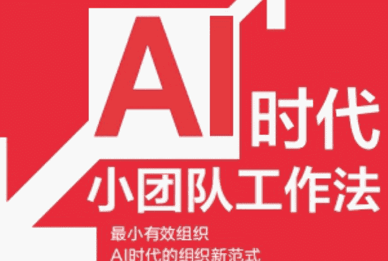

最小有效组织
AI时代的组织新范式

中国工信出版集团 人民邮电出版社

# 版权信息

COPYRIGHT

书名：超级小团队：AI时代小团队工作法

作者：钱晟磊；刘冠宇

出版社：人民邮电出版社

出版时间：2026年1月

ISBN：9787115689085

字数：117千字

# 本书赞誉

推荐人按姓氏字母排列，无先后之别。

《超级小团队》这本书把AI时代小团队的工作法拆解得很清楚：先明确盈利模式，再追求规模增长；先确保系统稳固，再借助工具放大效能。AI不是噱头，而是用来简化结构、增强协同、加速试错的工具。这本书，值得一线团队认真看。

**陈志强** 万店盈利智库创始人，蜜雪集团战略顾问

在当前中国制造业能力持续增强、部分领域已出现产能过剩的背景下，AI浪潮的到来已成为不可阻挡的趋势，必将深刻重塑生产模式与生产力的关系。自2025年以来，我不断强调，随着AI应用的加速普及，我们将迎来一个话语权向消费者倾斜的“超级消费者时代”，同时也将开启一个以小团队成就大事业的“超级创业者时代”。《超级小团队》的作者同样前瞻性地洞察到这一趋势，并基于理论探索与亲身实践，构建了超级创业小团队模式的理论基础与商业框架。这本书不仅是理解未来商业趋势的重要参考，也可作为创业者的行动指南与投资者把握新商业逻辑的关键读本。

**董广阳** 华创证券副总裁兼研究所所长，新财富白金分析师

在高度不确定的环境中，企业最需要的不是更多的选择，而是更清晰的判断。《超级小团队》以小团队为切入点，深入讨论了技术、组织与商业模式之间的结构性关系。它不是简单地谈创新，而是解释创新如何被组织真正承载。这对正在经历转型与重构的企业来说，具有很强的启发意义。

**黄震** 豫园股份董事长

在AI高速发展的时代，小团队的核心竞争力不在于比大企业更努力，而在于更高效的组织方式。传统的层级管理正逐渐成为效率的枷锁，而小团队善于利用数字化杠杆，将几个人的团队打造成一支感知敏锐、行动迅速的特种部队。懂得持续自我迭代的公司，才能拥有源源不断的生命力。这本书正是送给你的一份迭代指南，助你在不依赖“人海战术”的情况下，依然实现业绩的爆发式增长。在这个效率至上的时代，这不仅是一种技巧，更是一种生存本能。

**李振宇** 寿仙谷总经理

告别规模崇拜，聚焦价值创未来！这本书立足中国本土实情，让小团队以AI为“刃”、专业为“基”，挣脱规模枷锁，在熟悉的市场中精准发力，一步步实现从“专而强”到“独角兽”的跨越，是新时代创业者的实战宝典！

**石伟光** 厚生投资合伙人

数字化和智能化的真正价值，不在于工具本身，而在于它可以重塑组织运行方式。《超级小团队》并没有停留在“AI能做什么”这一层面，而是进一步回答了“组织应该如何改变”。它把小团队、商业模式和技术能力放在同一个系统中讨论，提供了一套可以长期使用的思考框架。对所有正在用技术推动增长的企业而言，这本书都值得认真阅读。

**孙涛勇** 微盟集团董事会主席兼首席执行官

《超级小团队》超前式描述了AI时代“小即可强”的组织逻辑，不仅是AI赋能微型组织驾驭复杂商务的指南，也是帮助管理者在新质生产力时代重构组织操作系统的纲领。

**万国华** 上海交通大学特聘教授、博士生导师，“国家杰出青年科学基金”获得者

企业的成长，本质上是组织能力与时代条件的匹配问题。《超级小团队》从人工智能这一关键变量出发，重新审视组织规模、效率与长期竞争力之间的关系，提出了极具现实意义的判断。它提醒我们，组织如果想真正可持续发展，并不一定要依赖规模扩张，关键在于构建清晰而有效的运行系统。

**汪力成** 华立集团董事会主席

我在伟事达私董会上认识晟磊，一直很佩服他对商业本质的深度思考。我们正站在一个转折点上。这本《超级小团队》，恰逢其时。AI不是简单的工具升级，而是在重新定义“能力”本身——过去需要上百人才能完成的事，现在三五个人就能做到。这不仅是效率的提升，更是组织逻辑的根本性改变。这本书的价值，不在于告诉你如何追风口、如何快速扩张，而在于帮你看清一个更深刻的趋势：小，不再是局限，而是一种选择。当AI重构了组织的能力边界，小团队反而获得了前所未有的自由度——既能保持敏捷，又能借助技术获得大型组织才有的整合力。更难得的是，这本书没有停留在方法论层面，而是用商业模式、企业边界、竞争战略等经典理论构建了一套系统化的思考框架。它不是速成指南，而是帮你在不确定中建立判断力的“操作系统”。愿这本书，成为你在AI时代找到自己节奏的那束光。

**吴强** 伟事达（中国）首席执行官，企业家教练，《跟道德经学领导力》作者

在AI重塑商业规则的时代，《超级小团队》这本书堪称创业者的实战指南。本书作者从商业实战与学术深度两个视角，构建了一套适合小团队实践的成长体系，并深度拆解了AI赋能团队、改变价值创造的路径，帮助团队跳出资源困局。无论你是刚刚创业的人还是团队掌舵人，都能在这本书中找到适合自己的更为清晰的成长路径，在不确定的环境中稳住节奏、抓住先机。

**竺昱祺** 民生医药控股集团总裁

规模不再自然等于组织能力，而是开始成为判断是否“必要”的条件。

正因如此，小团队在新时代的价值，变得前所未有的显著。它不是退而求其次的选择，不是资源不足时的替代方案，也不是“大公司梦”之前必须咬牙坚持的阶段。恰恰相反，它是一个越来越多的创业者主动选择的形态。它意味着轻盈、敏捷、边界清晰和节奏可控，也意味着在时代浪潮中保持方向感，在资源有限的情况下依然创造高密度、高强度的价值。我们见过太多小团队在AI的加持下跑得比过去的大公司还快，也见过许多创业者在主动维持小规模中获得了前所未有的自由与稳固。小团队不是“弱小”，而是“精准”；不是“局限”，而是“聚焦”；不是“起点”，而是“路径”。它是一种理解时代后的成熟选择，是一种愿意以自我方式参与商业世界的姿态。

但要理解这种姿态，并不是只靠经验和直觉。真正让创业者找到方向、建立判断、维持自洽和持续创造价值的，是比工具更深一层的东西：对商业模式的理解能力。

商业模式，过去常被误解为“模板”“画布”或“公式”。许多创业者在早年的市场浪潮里更依赖经验、技巧与速成方案，似乎只要踩中风口，就能跑赢一切。但是，我们在十多年与创业者的对话中越来越清楚地看到：真正能解决问题的，不是下一次流行的战术，而是你是否具备一套能够解释现实的思维框架。传统商业理论并不过时，相反，在越复杂、越快速变化的环境中，它们越显得珍贵。那些经典理论——商业模式画布、科斯的企业边界理论、波特的竞争战略、爱迪思的生命周期模型，不是写在教科书上的“知识”，而是理解世界的“语言”。只要你真正掌握它们，你就会发现，看似复杂的商业世界，其实有迹可循；看似矛盾的市场现象，其实自有逻辑；看似偶然的成功，其实都有结构性的原因。

在与中国这一代年轻创业者的接触中，我们更清楚地感受到，这一代年轻人更愿意思考文化、结构、意义、责任和未来。他们眼界开阔，对国与家有天然的情怀，对人生有天然的期许，也更愿意追问“我为什么做这件事”“它和我想成为的人是否一致”以及“我创造的价值是否有真正的意义”。正因如此，他们不仅需要方法，也需要结构；不仅需要技能，也需要框架。他们需要一种“现象—问题—理论—结论”的思考方式，需要通过理论理解现实，再通过现实验证理论，让自己始终能够稳稳地站在时代的洪流中。

所以在这本书里，我们并没有把商业、技术和组织当成孤立的话题，而是试图构建一片更完整的理解空间：AI如何改变价值创造的路径？小团队如何借助技术构建自己的“最小有效组织”？商业模式如何帮助创业者在不确定性中保持清晰？一个人的能力与一个团队的边界，在未来十年究竟会发生什么变化？创业者如何在规模、自由与意义之间找到自己的位置？这些问题真实存在于每一个认真创业的人的脑海之中。我们希望能在书中把这些问题放到一套系统中，用理论解释现象，用现象验证理论，让读者在阅读时不仅获得知识，更获得判断力与理解力。

当写到这里的时候，我们回到了那个最初的起点：在曼彻斯特大学的图书馆和咖啡馆里，我们讨论商业模式的演化、技术变革如何影响企业边界，讨论组织结构为什么总是走向复杂，又如何回到简单。因缘际会，命运使然，谁能想到十多年后，我们以一种完全不同却更成熟的方式，再次把这段对话延续下来。我们把一个在商业世界不断奔跑的人和一个在学术世界不断提问的人之间的鸿沟消融掉，把两种理解世界的方式汇聚成一本书。在我们看来，这不是巧合，而是一种必然：当代创业者真正需要的，就是这种兼具理论深度与实践洞察的视角。

如果你在阅读本书的某一刻突然理解了自己过去的困惑；如果你在某个段落里看到了一种久违的清晰；如果你在某个系统中发现了可以长期依靠的结构；如果你因为这本书而理解了保持小团队规模是一种选择，而不是一种局限；如果你因AI的力量而重新燃起对未来的信心；如果你在混乱世界里找到持续行动的理由——那么这本书，就真正抵达了它想要抵达的地方。

愿它能陪伴你穿越时代的噪声，帮助你在不确定中保持从容；愿它让你找到自己的节奏、自己的边界、自己的意义；愿它在你最需要的时候，成为让你继续走下去的那束光。

让我们一起，以小团队的姿态，以理解世界的方式，踏入属于AI时代的全新旅程。

钱晟磊 刘冠宇

2025年11月

# 01 以小博大

## 在AI时代建立可行商业模式

在传统认知中，小团队之所以难以创业，是因为缺乏人力、资金、技术、品牌等“硬资源”。但资源稀缺在AI时代反而能倒逼小团队聚焦于价值密度更高的业务，并通过技术手段提升资源利用效率。

通过AI，原本属于“资本密集型”项目的技术门槛正在降低，原本“必须先融资”的市场策略也正在被“先做小规模验证再逐步放大”的新逻辑取代。AI帮助小团队通过“先小后大”“先验证再扩张”的策略走出过去“要么不做，要么烧钱”的两难困境，从而更具可持续性。

每一个正在探索自己事业之路的创业者，不妨认真思考一下：在追求规模扩张之外，我们是否更应该关注企业的长久生命力和可持续竞争优势？或许“小而强、小而稳”才是属于更多人的正确道路。

在接下来的内容中，我们将从基础理论入手，理解作为创业起点的商业模式；理解企业边界，以明确什么才是合适的生意；以及理解如何运用好AI这一理想的工具，来支持我们的小团队创业。

## 小团队创业：小而强、小而稳的创业新范式

在这个创业故事层出不穷的时代，人们常常会默认创业的目标必定是要成长为大企业。但是，我们不禁要问：创业的目标，真的只有规模扩张这一条路吗？难道小团队永远只是创业道路上的过渡阶段，而不能是一种长期的、稳定的存在吗？

长期以来，传统的创业观念习惯性地强调“做大做强”，企业家们似乎只有在扩大规模、占领市场、获得更多市场份额之后，才能被认可为成功的创业者。然而，伴随数字经济、AI技术以及市场生态的深刻变革，“小而强、小而稳”这一看似另类的商业模式，正在被越来越多的创业者成功实践并验证。

尤其近几年，数字平台的普及让创业的门槛大大降低，一个小团队甚至个人就能够触及巨大的市场与用户群体。根据国家市场监督管理总局2024年的统计数据，到2023年年末，中国登记在册的经营主体已达到惊人的1.84亿户，占经营主体总量的67.4%。这有力地说明了小规模创业模式不但具有合理性，而且正逐步成为创业的主流趋势。

为什么“小团队”会在当下越来越受到青睐？

### 契合当前经济环境的趋势

过去几十年，中国经济经历了高速增长，企业习惯了在经济高速增长的环境下拼速度、抢地盘。但随着中国经济转向高质量发展，“大水漫灌”式的规模扩张模式已不再可行。相比之下，以“小而美”“小而专”为特征的小团队创业，正逐渐展现出巨大的战略优势。这些小团队往往紧密地聚焦于某个细分领域，他们并不试图在所有领域参与竞争，而是精确地选择一个或几个核心的价值环节，在这些领域深耕细作，从而构建起稳固的竞争优势。

从实践角度看，那些选择长期维持小团队模式的创业者通常具备一些典型的特征。他们可能是拥有独特创意或过硬专业技能的专家型创业者，如独立的设计师、资深的内容创作者，或者某一技术领域的工程师。他们热爱并擅长自己的工作，倾向于通过极小的组织规模将个人专长或创意进行商业化，以此谋求稳健的成长。也有一些创业者则受精益创业理念的影响，强调快速试错与盈利能力，不盲目扩张、不烧钱，而是用最少的资源最大限度地实现最高效的运营。

此外，还有一种生活方式型创业者，他们刻意保持较小的规模，以便在追求事业成功的同时，兼顾个人的生活品质和家庭时间。正是基于以上不同人群的需求，小团队创业模式在现实中展现出了极为多样且成功的形态。比如，我们耳熟能详的很多自媒体账号，往往由不到5人的小团队甚至是个人运营，通过持续生产高质量的内容，在细分领域获得了大批忠实的粉丝，并通过商业化手段获得可观的收入。在电商平台上，也随处可见夫妻店或是由几个好友组成的小团队店铺，他们通过精准的产品定位和周到的服务，在淘宝或抖音平台上积累了数万甚至十万以上的粉丝，成功获得稳定的生意收入。

在过去，这种小而稳健的创业模式或许仅被视作一种过渡阶段或权宜之计，但现在，伴随AI和数字技术的飞速发展，小团队模式正焕发出更强大的生命力。AI技术降低了企业的规模门槛，使小团队也能够实现以往只有大企业才具备的数据分析、客户管理、精准营销等能力。以AI驱动的智能客服、数据分析工具、自动化营销平台为例，这些技术的普及让小团队能够以极低的成本高效处理过去需要多人团队才能完成的任务。例如，一个只有几个人的电商小团队，借助智能客服机器人和营销自动化工具，可以轻松管理数十万粉丝的互动，大幅降低了运营成本、提高了客户满意度，实现“小团队、大规模业务”的奇迹。

### 聚焦带来的更高适应性

小团队在业务边界管理上的独特优势，也让他们在日益复杂的市场环境中表现出极高的适应性。相比大企业往往为了扩张被迫在多个业务领域投入大量资源，小团队创业者更倾向于严格划定自己的企业边界，将精力聚焦于自己最擅长、最具竞争优势的环节，而将生产制造、物流配送、客户服务等非核心环节外包出去。

这种清晰的边界划分，让他们能够轻装上阵，灵活而高效地适应市场变化，在遇到经济波动或市场需求萎缩时，也能迅速调整战略，保存实力，进退自如。从全球范围看，越来越多的知名企业也以“小而美”为发展战略，甚至主动将业务规模控制在一定的范围内，而不是盲目追求扩张。比如欧洲一些高端制造企业，几十年来始终保持规模精巧，但在某个细分产品领域成为全球市场的绝对领导者。这些“隐形冠军”企业的成功证明：保持企业规模的小而精，不仅不会限制企业的成功，反而可能是获得长久竞争优势的关键。

当然，选择小团队创业模式并不是拒绝增长，而是对增长采取一种更为审慎和策略性的态度。这些团队仍然可以通过合作网络或外部资源整合实现业务的拓展，比如通过项目制或合作伙伴模式完成更大规模的业务交付。这种网络化的组织模式，让小团队可以突破传统企业必须“自己干所有事情”的思维局限，通过构建灵活而强大的生态合作网络，达成以小博大的战略目标。

回头来看，我们所处的时代恰恰为小团队模式提供了绝佳的土壤和舞台。数字经济的兴起、AI的普及、个性化需求的崛起，都让小规模企业和团队拥有了更多的施展空间和发展机遇。在未来的经济环境中，“小而强、小而稳”的商业模式不仅将继续合理，还可能成为更为普遍的主流商业模式之一。因此，创业者在思考未来时，不妨重新审视创业成功的标准与路径。我们必须明确一点：规模并不是衡量企业成功的唯一指标，长期保持小规模、小团队、小边界，却能在细分市场中取得卓越表现的企业，同样值得尊敬与推崇。特别是在今天这样一个快速变化、充满不确定性的时代，小团队模式所具备的高效决策能力、灵活调整能力、低成本精益运营模式，以及对新技术的快速响应能力，恰恰是企业持续成功和稳健成长的关键所在。

## 商业模式：创业的起点

商业模式是一切创业实践的起点。它不仅决定企业如何创造、传递与获得价值，更深刻地影响企业在市场竞争中的生存与发展。尤其对资源有限的个人或小团队创业者来说，一个设计精妙、富有弹性的商业模式是决定创业成功的关键因素。

在实际中，人们往往将商业模式简单地理解为“如何赚钱”，但商业模式远不止于此。《哈佛商业评论》（*Harvard Business Review*）的经典论文《重塑你的商业模式》（*Reinventing Your Business Model*）曾明确指出，任何一个成功的商业模式，都需要明确4个方面的核心逻辑（见图1-1）：你究竟为谁创造价值（顾客价值主张）、如何赚到钱（利润公式）、你拥有哪些资源（关键资源）、你如何高效地组织运营（关键流程）。

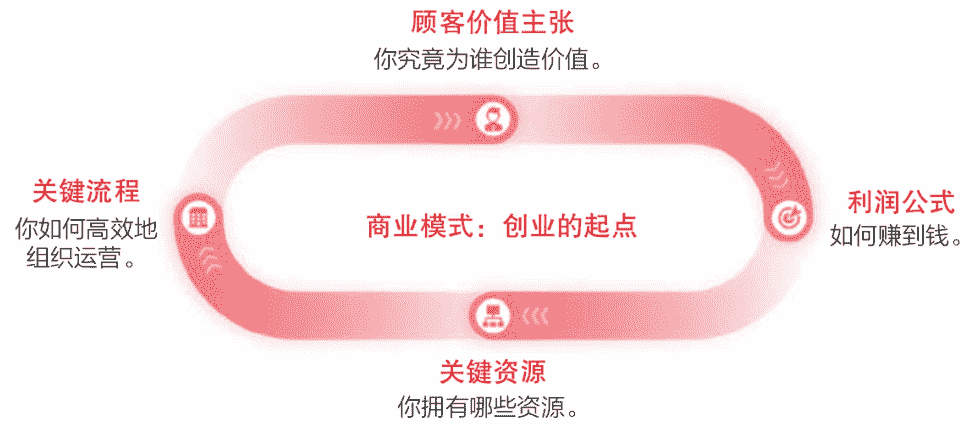

图1-1 商业模式的核心逻辑

## 价值主张：商业模式的核心

在如今的商业环境中，每一天都有无数的新品牌涌现，但能够真正脱颖而出的却是少数。尤其对资源和资金都相对有限的小团队而言，面临的首要问题就是：如何快速打开市场局面，并迅速实现盈利增长？很多时候，我们往往认为资金和人际关系资源才是决定性因素，然而真正深入探究那些成功快速崛起的小团队就会发现，它们成功的秘密往往在于清晰而精准的顾客价值主张。

顾客价值主张（customer value proposition, CVP）是商业模式的核心，明确了企业如何以独特而有效的方式满足客户需求或者提供不可替代的价值。其本质是回答以下问题：“为什么顾客要选择你，而不是其他替代方案？”这一问题的答案直接决定了客户是否愿意为产品或服务付费、复购，甚至成为品牌的忠实拥护者，是企业与客户建立长期价值交换关系的基石。

小团队要想精准地构建CVP，需依托“黄金三角模型”，将复杂的价值逻辑拆解为3个要素。

首先是目标客户，这是CVP的起点。当我们回答企业要为谁服务时，这个目标客户的画像一定要有清晰具体的年龄、职业、地域等信息和具体使用场景，如“28～35岁一线城市互联网从业者，每天通勤1.5小时左右，习惯在地铁上利用碎片化时间学习”，同时还要包含客户的高频行为，像“每周打开在线学习App 4次以上，每次学习时长集中在20～30分钟”。

找到目标客户后，小团队的核心工作是挖掘目标客户“未被满足的需求”，这些需求往往隐藏在客户的抱怨、犹豫与无奈中，可以分为功能需求与情感需求两类。功能需求大多与效率、成本、效果相关，例如上述互联网从业者“希望快速筛选出与工作相关的精简课程，避免在海量内容中浪费时间”“担心付费课程质量参差不齐，性价比低”；情感需求则关乎安全、归属与自我实现，比如“用户希望通过学习提升技能，获得职场安全感”“渴望加入同领域学习社群，避免独自学习的孤独感”。

即便明确了目标客户与未被满足的需求，若无法提供超越竞争对手的解决方案，客户仍会转向替代方案，因此差异化价值成为黄金三角的第三个关键要素。

差异化不是“我有别人没有”的小众功能，而是“客户在意的点上，我比别人做得好”。它既可以是核心功能上的性能优势，如“课程内容由行业资深专家打磨，每节课聚焦1个核心知识点，确保学完能直接应用”，也可以是使用流程或情感共鸣上的体验优化，像“App支持课程内容离线缓存，适配地铁弱网环境，学习进度自动同步多设备”等。

围绕“黄金三角模型”，企业可以将抽象的创造价值转化为可执行的资源分配。它强制小团队用显微镜锁定一个足以撬动市场的尖刀点，避免陷入“盲目铺摊子”的死亡陷阱，确保有限的人力、资金、时间全部灌注到“具体人群不得不解决的痛点”上。

顾客价值主张并非一成不变的静态方案，它需要随着客户需求的变化而调整，随着市场竞争格局的调整而持续迭代，但无论如何优化，其本质始终围绕“为什么顾客要选择你”这一核心问题。只要精准地回答好这个问题，小团队也能凭借清晰的顾客价值主张，在激烈的市场竞争中占据一席之地。

## 利润公式：实现盈利的关键

如果说精准的顾客价值主张帮助小团队找到了市场突破口，那么利润公式则决定了小团队能否稳定盈利并持续成长，即利润公式是企业将价值主张转化为可持续利润的机制。

利润公式的运转依赖于“收入模型、成本结构、利润空间、周转效率”四大核心组件的协同。对小团队而言，每个组件的设计都需要围绕“轻量化、高可控”展开，避免复杂架构带来的运营负担。

收入模型回答的是“钱从哪里来”与“如何定价”的基础问题，小团队资源有限，难以支撑多品类、多渠道的重资产收入模式，因此需要选择与自身能力匹配的轻量型收入路径。以提供企业管理咨询服务的3人小团队为例，其核心收入并非来自长期雇佣的服务模式，而是采用按项目付费的形式——针对中小企业的组织架构优化需求，单个项目定价5万～8万元，根据项目复杂度分阶段结算。这样做既降低了客户的付费门槛，也避免了团队陷入长期人力绑定的风险。再如聚焦本地生活服务的小团队，可以为社区超市提供供应链对接服务，按月收取服务费，这种稳定的收入模式能为团队提供持续的现金流，减少业务波动带来的影响。

成本结构则需解决“钱花在哪里”与“能否更低”的问题，小团队无须追求全面降低成本，而是要精准锁定对利润影响最大的“关键成本项”，通过优化流程、集中资源等传统方式实现成本可控。以主营家居用品的跨境电商小团队为例，通过多平台分散投放广告，单客户获客成本高达200元，获客成本与物流成本往往占据总支出的60%以上，那么这两项就是关键成本项。后续，该团队通过聚焦亚马逊平台的精准关键词投放，同时与区域物流商签订季度合作协议，将物流单价降低15%，最终使总运营成本下降22%。这一案例正是小团队通过“锁定关键成本+集中资源谈判”优化成本结构的典型实践。

利润空间是衡量“每单赚多少”与“安全边际在哪里”的核心指标，但它绝非一个统一的数字标准——不同行业的成本结构、竞争强度、附加值差异，决定了毛利率的合理区间天差地别。高附加值、低可变成本的行业，毛利率天然偏高；而重资产、高周转、强竞争的行业，毛利率往往偏低，这是由商业模式的本质决定的。所以，小团队判断利润空间是否健康，核心看“两个匹配”：一是与行业均值的匹配度（不低于行业中位数，避免因成本控制能力差而失去竞争力）；二是与自身运营需求的匹配度（能覆盖固定成本、突发风险，并留存发展资金）。前者是“横向对标”，确保不落后于同行；后者是“纵向算账”，确保自身能活下去、活得好。

以杭州某社区生鲜小团队为例：该团队主营蔬菜、水果、肉类，初期按照毛利率30%的目标，将蔬菜定价过高（如青菜售价3.5元/斤，比周边竞品高0.8元/斤），导致客流量骤减，月亏损超5000元。后续该团队通过调研发现，本地社区生鲜店的行业平均毛利率仅12%～15%，于是调整策略：降低定价（青菜降至2.8元/斤），同时与本地蔬菜基地签订每日直采协议（食材成本下降8%）、推行“晚间折扣”（减少滞销损耗，损耗率从12%降至7%），最终将毛利率稳定在14%。这样做不但能覆盖成本，每月有5000元可用于拓展品类，而且有2%的毛利可作为风险缓冲，利润空间可适配其运营需求。

周转效率关注“钱转多快”与“资产是否闲置”两大问题。对小团队而言，资金与库存的周转速度直接影响现金流的健康度，传统商业中“快进快出”的逻辑同样适用。例如杭州某小商品零售小团队，主营文具与家居饰品，最初采用“大批量备货”策略，库存周转天数长达90天，资金长期被闲置库存占用。后续该团队通过“小批量、多频次”的采购模式，结合月度销售数据调整备货量，将库存周转天数缩短至45天，资金年周转次数从4次提升至8次，不仅减少了库存积压风险，也让有限的资金能支撑更多品类的试销。这正是通过优化周转效率提升资金使用价值的典型案例。

这四大组件的协同，本质上是围绕“资源高效转化为利润”形成的动态联动闭环：收入模型通过确定收入来源与定价逻辑，为利润提供“源头活水”；成本结构根据收入模型的特性匹配成本投入，是“节流关键”；利润空间则是“平衡标尺”，它基于收入模型的定价与成本结构的支出，计算出每笔业务的盈利水平，同时反向约束前两者；周转效率是“加速引擎”，它让收入与成本的转化速度更快。这四者既相互支撑又相互制约：收入模型决定成本投入的方向，成本结构影响利润空间的大小，利润空间校准收入与成本的平衡，周转效率则放大前三者的协同效果，最终实现“收入稳定增长→成本可控→利润达标→资金高效流转”的良性循环。

## 关键资源：企业成功的基石

在资源有限、竞争激烈的市场环境中，小团队的生存与发展高度依赖对关键资源的精准把控。关键资源不仅是团队交付价值的基础，更是构建差异化竞争壁垒的核心。

要想理解关键资源，首先需要跳出“资源=物质”的传统认知。对小团队而言，关键资源的本质是支撑顾客价值主张与利润公式的核心资产，它需要回答两个根本性问题：“我们靠什么持续向客户交付承诺的价值？”“哪些资产是竞争者无法快速复制，能让我们长期立足的？”

小团队的关键资源，主要可以分为以下四大类：实体资产、知识资产、人力资产、关系资产。

实体资产是具备实物形态、直接服务于生产或交付的资源，常见的有生产设备、仓储空间、库存商品等。这类资源的核心特征是看得见、摸得着，且直接影响服务或产品的交付效率与质量。以深圳某小型3D打印工作室为例，其核心实体资产是2台工业级SLA 3D打印机。客户定制的精密零件、手办模型均依赖这两台设备生产，设备的精度与稳定性直接决定了客户满意度。凭借这两台设备，工作室能承接精度要求达0.1毫米的订单，在当地小批量定制市场中形成差异化优势，每月稳定获得20～30笔订单。

在运营实体资产时，小团队需重点关注“资产投入与现金流的平衡”。若盲目追求产能扩张，购置超出业务需求的设备或囤积过量库存，可能导致资金占用过多，影响日常运营。小团队配置实体资产时，建议结合订单量动态调整，优先选择“按需采购”“租赁替代购买”等灵活方式，避免资金沉淀。

知识资产是凝聚团队智慧与经验、具备排他性或独特性的无形资产，包括专利技术、独家配方、数据算法、运营方法论等。其核心特征是看不见但能持续创造价值，且一旦形成竞争壁垒，竞争对手就难以快速模仿。比如上海某家庭烘焙工作室，凭借创始人研发的“低温慢发酵配方”，让面包在无添加剂的情况下保质期延长3天，且口感更松软，这一配方就是典型的知识资产。客户为这一独特口感愿意支付比普通面包高50%的价格。若未对核心知识资产进行必要的保护，可能面临被模仿的风险；若知识仅掌握在少数人的手中，未形成系统化沉淀，也可能因人员流动导致资产流失。

值得注意的是，知识资产容易产生致命的陷阱。如果没有法律保护易被抄袭，若烘焙团队未对核心配方、技术申请专利或版权，竞品可通过拆解产品、挖角员工等方式获取，团队会失去差异化优势。小团队可以通过申请专利、版权登记等方式保护核心知识，同时建立内部文档库，将关键技术、方法论系统化沉淀，确保知识资产的稳定性。

人力资产是团队中掌握核心技能、关键经验或资源的成员，以及外部合作的专家网络，其核心特征是“人是资源的载体”，人的能力直接决定团队的服务质量与创新能力。例如杭州某小型企业咨询团队，核心人力资产是一位拥有15年制造业管理经验的合伙人，他不仅能为客户提供精准的流程优化方案，还能凭借行业人际关系资源为客户对接供应链资源，许多客户正是冲着这位合伙人而选择该团队的。

在运营人力资源时，小团队需关注“能力分布的均衡性”。若过度依赖单一核心成员，可能因人员流动导致团队能力断层；若团队成员技能重叠度高，缺乏互补性，也可能限制业务拓展。小团队可以通过“技能互补招聘”优化团队结构，同时建立“师徒制”“定期培训”等机制，促进成员能力提升与经验共享，减少对单一成员的依赖。

关系资产是团队通过长期运营积累的客户资源、供应链合作关系、用户社区等，核心特征是“基于信任的连接”，能为团队带来稳定的订单、成本优势或用户黏性。比如成都某独立图书策划人，通过5年运营积累了10万订阅者的邮件列表。这些订阅者多为资深文学爱好者，对其策划的小众图书接受度高，每次新书预售信息通过邮件发送后，能带来至少2000册的初始销量，这一邮件列表就是核心关系资产。

关于关系资产，小团队的核心优化方向是“提升资源的活性与价值转化”。若关系资产仅停留在“数量积累”，缺乏有效维护，可能成为“沉睡资源”，无法为团队创造价值。因此，小团队可通过“定期互动”“个性化服务”提升关系资产的活性。比如，客户群可定期组织话题讨论、福利活动，客户资源可按需求偏好分类，推送有针对性的产品信息，从而提升资源的价值转化效率。

值得注意的是，成功的小团队往往擅长组合不同类型的关键资源。以全球知名社交媒体Instagram早期十几人的团队为例，其核心资源并非相机硬件这类实体资产，而是“滤镜算法”（知识资产）与“摄影圈KOL”（关系资产）——滤镜算法让普通用户能快速拍出高质量的照片（支撑CVP），摄影圈KOL则通过分享带动用户增长（提升销量，优化利润公式），二者结合帮助Instagram在上线1年内实现千万级用户突破。

## 关键流程：持续发展的基础

在商业世界中，资源是必要条件，但绝非充分条件。历史一次次地证明，即使拥有最先进的技术、最广泛的渠道或最雄厚的资本，如果缺乏高效稳定的流程体系来支撑运作，这一切都可能化为泡影。相反，那些看似资源有限的小团队，如果能够构建出规范而灵活的关键业务流程，就能在混乱的竞争中实现精确推进，完成从生存到扩张的跳跃式成长。

什么是关键流程？简单来说，它是一整套驱动企业日常运转的机制系统——从前端的产品设计、用户获取，到中台的供应链、库存管理，再到后端的客服支持、绩效考核与团队协同。它不是单一工具，而是一种“结构化效率”，一种让团队“用尽可能少的资源，完成尽可能多的任务”的运营机制。

让我们先看一个众所周知的例子——星巴克。在其全球快速扩张的过程中，真正支撑品牌稳定品质和运营效率的，并不是咖啡豆本身的独特性，而是它背后极度标准化的流程体系。无论你在北京、旧金山还是巴黎的星巴克点了一杯拿铁，流程上几乎无差别：员工按照统一的操作步骤调配饮品、使用标准化的设备、面对顾客使用统一的语言体系和服务流程。这种可复制、可量化、可追踪的流程，才是星巴克得以在几十个国家和地区开设几万家门店而品质如一的根本原因。

小团队要想理解关键流程，首先需要跳出“流程=步骤清单”的浅层认知。对小团队而言，关键流程的本质是重复执行以交付价值主张的标准动作系统，它需要回答两个核心问题：“我们如何把手中的关键资源，转化为客户能直接感知的价值？”“如何确保每一次交付都稳定可靠，不依赖个人经验？”这就像工厂里的流水线——原材料（关键资源）进入流水线（关键流程），经过标准化步骤加工，最终变成客户需要的产品（价值交付）。

小团队的关键流程，就是为“资源→价值”这个转化过程设计的“高效流水线”，它具备以下3个核心特征。

一是重复性，即流程需要高频发生，而非偶尔执行的一次性动作。比如专注于用户需求的小团队，会把“每周用户访谈”设为关键流程——每周固定时间、固定人数、固定访谈提纲，通过高频重复积累用户需求数据，为产品迭代提供支撑。再如社区电商小团队的“每日社群运营流程”，从早安问候、产品种草到订单统计，每天按固定节奏执行，确保社群活跃度与转化稳定性。

二是标准性，即流程有明确的输入与输出，每个环节都有可量化、可验证的标准。以客服流程为例，专业的小团队会制定“客服SOP（英文全称是standard operating procedure，意指标准作业程序。）”：输入是“客户咨询消息”，输出是“问题解决率≥95%、响应时间≤5分钟”，中间环节明确“首次响应话术模板、复杂问题转接机制、售后跟进节点”——即便新客服入职，也能通过SOP快速上手，避免因个人经验差异导致服务质量波动。

三是价值锚点，即流程需直接支撑顾客价值主张（CVP），与CVP形成一一对应的关系。如果小团队的CVP是“24小时内发货”，那么“极速供应链流程”就是核心关键流程——从客户下单（输入）到物流单号生成（输出），中间需包含“订单审核→库存核对→打包复核→物流对接”等步骤，每个步骤的时间节点都有明确的要求，比如库存核对不超过1小时、打包复核不超过2小时。只有这样，才能确保“24小时内发货”的承诺落地。

对小团队而言，关键流程这一“高效流水线”，绝非复杂的文档堆砌，而是贴合自身资源、精准匹配CVP的“轻量化操作系统”。它无须覆盖所有环节，只需要聚焦“能直接影响价值交付”的核心动作。比如社区团购小团队，无须搭建复杂的财务流程，却必须把“团长订单汇总→供应商备货→次日达配送”这一生存流程打磨到极致。毕竟，小团队的竞争力，往往就藏在这些“重复且标准”的流程细节里：当竞争对手还在为订单错发而手忙脚乱时，你的流程已能实现订单100%精准同步；当同行还在靠个人经验应对客户咨询时，你的客服SOP已能保证5分钟内稳定响应。这些看似微小的流程优势，最终会转化为客户信任与团队效率，成为小团队在激烈的市场竞争中站稳脚跟的关键支撑。

## 企业边界：从科斯理论看生意适配与规模控制

诺贝尔经济学奖获得者罗纳德·科斯（Ronald Coase）提出的“交易成本”与“企业边界”理论，可以帮助小团队创业者理解一个重要问题：不是所有生意都适合小团队，也不是规模越大越好。最适合小团队创业者的商业模式，是那些交易成本低、可轻运营、用户关系紧密的项目。

很多创业者在最初创业时，都会问自己这样一个问题：“我应该做什么生意？”实际上，更重要的一个问题可能是：“哪种生意更适合小团队创业？”具体一些就是，为什么有些生意天然地适合小团队创业，而不适合由大型企业经营？同时，小团队如何在保持规模优势的基础上实现可持续盈利？这两个核心问题，本质上都指向同一个答案——企业边界的精准界定。创业并非规模越大越好，创业者只有理解了“哪些生意适配小团队”以及“如何守住边界”，才能避免掉进成长陷阱，降低失败风险。

### 为何部分生意天然适配小团队

要解答“生意适配性”问题，我们需要回归罗纳德·科斯在1937年发表的《企业的性质》（*The Nature of the Firm*）一文中提出的经典理论。这一理论为小团队创业的“天然优势”提供了清晰的逻辑支撑，核心在于交易成本与企业边界两个概念。

### 交易成本：“生意适配性”的核心钥匙

科斯在《企业的性质》中提出了“交易成本”这一关键概念。交易成本就是企业在市场交易过程中所产生的一系列成本，如收集市场信息的费用、与供应商或客户谈判的时间与精力成本，以及签订和执行合同的成本等。简单地说，就是在市场上达成任何一笔交易背后所隐含的“麻烦”和“代价”。

这些“看不见的成本”，正是区分“适合小团队”与“适合大企业”生意的核心标尺。在现实中，市场交易并非完全免费，每笔交易都伴随着隐性成本：确定合适的价格、谈判合同条款、监督合同履行……这些成本会直接影响企业效率与盈利能力。小团队的天然优势，恰恰在于能以更低的交易成本实现同等甚至更高的效率。

例如，小型创意设计工作室可以直接与客户沟通细节、快速响应需求变化，避免了烦琐的合同修订和反复协商；一家规模较小的创意餐厅，能随时根据市场需求和客户反馈调整菜单，推出创新菜式；电子商务领域的小团队，可直接与顾客互动，快速捕捉细微需求，以极低的成本实现精准创新。相比之下，大企业必须经历层层审批和沟通环节，无形之中大幅提高了整体交易成本。例如，大型连锁餐厅调整菜单需要经过复杂的内部审批流程；大公司需要投入大量的资源进行市场调研，然后根据调研结果调整策略。

在AI时代，小团队的这一优势被进一步放大：利用AI自动化的用户数据分析工具，小团队可实时掌握客户偏好、精准制定营销方案；小型电商公司通过AI算法能迅速分析市场数据、识别用户需求趋势，免去高额的市场调研成本；AI甚至能自动完成营销推广方案的制定与执行，让小团队以极少的人力就能完成过去庞大的市场部门的工作。

### 企业存在的边界条件：成本均衡点

科斯理论进一步指出，企业存在的根本原因，在于能够以内部组织协调的方式降低市场交易成本。这一逻辑直接定义了企业的“边界”：当企业内部管理成本低于市场交易成本时，企业会选择扩展（将业务纳入内部）；当企业内部管理成本高于市场交易成本时，企业应停止扩展，或者选择将业务外包。

这意味着，企业应该聚焦于“内部管理成本低于市场交易成本”的领域，并非所有业务都由自己做，只有那些自己做起来效率更高、成本更低的业务，才应该纳入企业边界。例如，一个手工艺品的创业团队，如果试图从材料生产到零售全都自己完成，就很容易陷入成本高昂、效率低下的困境。但如果他们仅仅专注于设计和品牌营销，而将生产和物流交由专业的合作伙伴来完成，就能够有效控制成本，快速做大品牌价值，实现利润最大化。

结合科斯理论与实践案例，天然适合小团队的生意，必然具备“对小团队有利的交易成本结构”：内部协调成本极低、外部交易成本可控，并且业务流程能通过AI工具进一步降低交易成本，无须依赖大规模人力或资金投入。

### 如何控制企业规模、精准界定业务边界

明确了“哪些生意适合小团队”后，更关键的问题是：企业如何守住规模边界，避免因盲目扩张导致管理成本失控？这需要将科斯理论转化为具体行动，重点围绕“适度规模”与“边际分析”展开，最终实现“小而精”的可持续盈利。

### 适度规模：4个决策标准

科斯认为，企业的最佳规模应“维持在管理成本低于市场交易成本的范围内”，一旦超出边界，效率会迅速降低。小团队该如何判断自己的“适度规模”呢？具体来讲，有以下4个关键的衡量指标可以辅助判断。

比较管理成本与交易成本。如果发现企业内部的管理难度不断上升，沟通效率降低、决策速度变慢，那么说明规模可能已经超过了最佳边界。例如小型咖啡品牌扩张门店后，若人力成本、物流管理复杂度激增，就需要收缩规模或将物流外包给专业服务商。

现金流状况。如果规模扩张后，现金流变得紧张，可能意味着企业的增长速度过快，资源配置出现了问题。例如，某手工艺品初创企业因大规模生产导致原材料采购资金占用过多，现金流断裂，就需要缩减生产规模，优先保障回款。

客户体验水平。若规模扩张导致产品质量下降、客户投诉增加，就说明现有运营能力无法支撑更大的业务规模，需回归核心业务。例如，某定制服装品牌因扩产忽视品控，客户退货率上升，便需要缩减生产规模，重新聚焦于为客户提供“定制化服务”的核心体验。

市场需求匹配的情况。如果市场需求波动较大，建议依靠AI数据分析进行更精确的规模控制，而不是单纯依靠创业者的经验直觉来决定扩张速度。在AI时代，这些问题变得更容易被量化和分析，从而在数据驱动的管理与决策支持中帮助小团队创业者在有限的资源下，实现更稳定、可持续的增长。

## 边际分析：确定合理的扩张边界

对小团队而言，明确了适配的生意类型和适度规模的判断标准后，要真正精准控制规模、避免管理成本失控，还需借助科斯在交易成本理论中提出的“边际分析”工具。这一工具的核心主张是，企业的扩展应停留在内部管理成本与市场交易成本达到均衡的“边际点”。其核心价值在于，帮助小团队跳出“增长即成功”的误区，理性判断新增业务或规模扩张能否真正带来盈利增长，而非陷入短期虚假繁荣的陷阱。

在小团队创业过程中，边际分析的重要性不言而喻。扩张看似是企业成长的必然选择，但现实中大量初创公司的失败，恰恰源于扩张速度超过了自身管理和资源的承受能力，最终导致成本激增、效率下降，甚至动摇核心业务的稳健运营。创业者必须清醒地认识到，扩张并非最终目标，盈利才是根本。边际分析正是提供了这样一种精准评估扩张可行性，并利用机器学习算法计算边际成本和边际收益，使得创业者能够更科学地做出扩张决策。以一款面向自由职业者的SaaS工具为例，该公司在决定是否推出付费会员功能时，利用AI进行了深度数据分析。结果显示，仅有不到20%的活跃用户表现出愿意为高级功能买单的倾向，而开发该功能的成本远高于预期，用户的付费转化率也不足以支撑产品的长期投入。因此，公司最终决定不盲目增加付费模块，而是优化现有的免费功能，通过提升用户留存率和广告变现实现收入增长。

在创业过程中，扩张往往被视为成功的标志，但真正的成功并不取决于增长的速度，而是取决于增长的质量。小团队创业者必须学会利用边际分析精准评估业务增长的可行性，确保每一次扩张都能带来实实在在的收益，而不是让企业陷入资源消耗和管理失控的陷阱。

结合科斯理论与AI技术，小团队创业者的“企业边界管理”可形成完整的闭环：天然适合小团队的生意，因其交易成本结构对小团队有利，小团队需守住规模边界，通过边际分析避免管理成本失控，最终在“小而精”的范围内实现可持续发展。

## 超级武器：AI驱动的商业模式设计

对资源相对有限的小团队而言，AI正在降低创业门槛，并能削减创业对资金、人力和固定设施的传统依赖，以及能接手大量标准化、重复性的工作，让小团队更专注于核心创意与策略。AI正在推动一种新型组织模式——超级个体或精干小团队的繁荣发展。

我们已经详细地阐述了商业模式的核心构成要素，包括价值主张、利润公式、关键资源和关键流程，但对创业者而言，更迫切想要了解的是：怎样用AI以更加系统化和体系化的方式，整体性地设计并动态优化适合小团队的商业模式？AI具体能为小团队带来哪些方面的提升？

在本小节，我们将从更深层次的角度，详细讲述如何以AI的思维方式与方法论，帮助小团队快速构建出具有竞争优势的商业模式，并持续地进行动态优化与升级（见图1-2）。

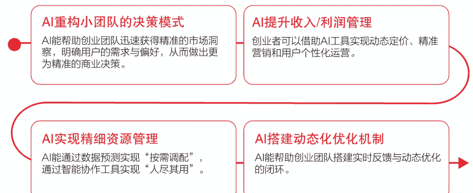

### AI重构小团队的决策模式：筑牢精准地基

对小团队创业而言，“做对决策”是活下去、能发展的首要前提——毕竟小团队的资源有限、抗风险能力弱，一次关键决策失误，可能就意味着前期投入全部归零。创业的本质，其实就是“围绕用户需求和市场机会，不断做决策、落地执行”的过程：从确定服务哪类用户、提供什么核心价值，到选择用什么方式盈利、如何分配仅有的人力和资金，每一步都依赖决策的准确性。如果决策方向错了，那么后续再努力优化运营、控制成本，也只是在错误的方向上越走越远。因此，决策的“基础精准度”，直接决定了小团队创业的起点是否扎实，而AI对决策模式的重构，正是从根源上帮助小团队解决“决策不准、风险高”的核心问题。

在传统的小团队创业过程中，创始人的个人经验、直觉和主观判断通常占据主导地位。这种方式虽然有时能够迅速响应市场，但更多的时候伴随着巨大的试错成本和高昂的决策风险，因为缺乏有效的数据支持和可量化的决策过程。如今，AI带来的最大革命，就是通过数据驱动决策，显著降低小团队在创业过程中面临的不确定性。

小团队创业者要理解的是：AI并不仅仅是一个简单的技术工具或产品，而是一种全新的、以数据驱动为核心的决策思维方式。具体而言，AI能通过对海量数据的自动收集、分析与预测，帮助创业团队迅速获得精准的市场洞察，明确用户的需求与偏好，从而做出更为精准的商业决策。

以明确用户核心需求为例，传统的小团队往往依靠有限的市场调查或创始人的个人洞察来判断方向，这种方式效率低下且准确性难以保证。通过AI驱动的市场分析工具，如国内创业者熟悉的百度指数、巨量算数、飞瓜数据等，小团队能够轻松地从全网收集实时数据，迅速精准地洞察市场趋势和用户的真实需求，甚至是用户自身尚未意识到的潜在需求。

小红书的早期爆发式增长，正是AI赋能决策精准度的典型案例。小红书通过AI技术，深入分析年轻女性用户在美妆、生活方式、旅游、穿搭等领域的消费习惯和偏好，实时发现年轻用户群体的热点需求与关注焦点。比如，某一阶段年轻女性对“平价国货美妆”的讨论热度飙升，AI能快速捕捉这一趋势并量化需求强度。基于这些精准的数据洞察，小红书迅速调整自身平台的内容推荐策略（加大国货美妆内容的权重）和社区互动方式（发起相关话题讨论），最终在竞争激烈的内容社区领域脱颖而出，获得了巨大的市场成功。

AI让小团队无须搭建庞大的团队，就能拥有过去只有大公司才具备的“精准洞察实力”，为后续创业的每一步落地（无论设计盈利模式，还是分配人力资源和资金）打下“决策不跑偏”的坚实基础。

## AI提升收入/利润管理：打通盈利核心

小团队找准决策方向后，接下来最关键的问题就是：如何把“精准的用户洞察”转化为“持续的收入与利润”？对小团队而言，创业的终极目标是存活并持续发展，而“能赚钱、有利润”正是存活的核心。AI对收入与利润管理的优化，本质上是解决小团队创业“核心可持续性”的问题，让前期的精准决策真正落地为“能造血”的盈利能力。

传统的小团队创业者往往面临收入模式僵化、利润空间有限的问题，这主要源于传统的收入策略往往静态且难以实时调整。比如，小团队可能会为一款产品设定固定价格，或是长期沿用同一套营销方案。但市场需求在变、用户偏好在变、竞争对手的策略也在变，静态的收入模式既无法匹配不同用户的付费意愿（比如，对价格敏感的用户可能因固定高价放弃购买，而愿意付高价的用户又没被挖掘出更多的价值），也难以抓住短期市场热点提升转化，最终导致“想赚的钱赚不到，能赚的钱在缩水”。对资源本就紧张的小团队来说，这种“盈利低效”的状态，很容易让前期的决策成果付诸东流。

AI能够帮助小团队创业者实现收入模式的智能化与动态化管理，从而提升整体盈利能力。

具体而言，小团队可以借助AI工具实现动态定价、精准营销和用户个性化运营。这恰好是对第一层“精准用户洞察”的落地：既然AI已经帮助小团队摸清了用户的消费习惯、价格敏感度，就能进一步用AI把这些洞察转化为“针对性的盈利动作”。比如，腾讯云、阿里云等国内科技巨头提供的AI预测与智能营销工具，可以实时追踪分析用户的消费习惯、历史支付数据、对价格敏感的程度，从而精准预测出用户群的最佳定价区间，并根据用户行为动态调整价格与营销方案，最大限度地提升用户付费转化率。

拼多多的成功就是其中的典型案例，它的成长路径对小团队创业者极具参考意义。早期的拼多多是从服务于对价格敏感的下沉市场用户起步的，而它能在短短几年内从新兴玩家成长为国内电商巨头，核心就在于用AI将用户洞察转化为极致的盈利效率。拼多多利用AI算法实时捕捉用户的购物兴趣点和价格敏感度，向不同用户群体提供个性化的促销策略和价格优惠：同一款日用品，学生用户可能看到的是“拼团9.9元”，宝妈用户看到的是“买二送一”，而高频复购用户看到的是“会员专属折扣”。这种极度精细化的AI运营策略，既让每个用户都觉得“获得了专属优惠”，又让拼多多在控制成本的同时，最大限度地提升了每笔订单的利润贡献。这充分展示了AI在收入模式设计与利润管理中的巨大潜力，也证明小团队即使没有庞大的运营团队，靠AI也能实现“千人千策”的盈利管理，打通创业的“核心造血通道”。

## AI实现精细资源管理：夯实效率支撑

小团队打通了“精准决策→高效增收”的路径后，还有一个问题决定了创业能否走得稳：如何把赚来的钱守得住、把有限的资源用得值？对小团队而言，“盈利”从来不是只靠“多赚钱”，更要靠“少花钱、花对钱”——毕竟小团队的资金、人力、物资都是稀缺品，一旦出现成本浪费或资源错配，哪怕收入端有增长，利润也会被侵蚀，甚至可能因现金流断裂而陷入危机。因此，AI对成本与资源管理的精细化赋能，本质上是为小团队创业者搭建“支撑效率”的保障，让“增收”与“节支”形成合力，真正夯实盈利的根基。

传统的成本管理和资源分配模式往往是粗放型的，创业团队在创业初期常常缺乏精准的成本管控与资源分配能力，造成资金浪费与效率低下。比如在成本端，做实体产品或生鲜类生意的小团队，可能会凭经验采购，导致旺季时备货不足，淡季时又库存积压；在资源端，创始人可能既要管产品开发，又要盯市场运营，团队成员也常被琐碎事务缠身，导致真正能创造高价值的核心工作被挤压。

AI技术则能帮助创业团队实现成本和资源管理的精细化、实时化和智能化。

在成本控制上，AI能通过数据预测实现“按需调配”，盒马鲜生的案例就很好地体现了这一点。盒马鲜生通过阿里云提供的AI库存管理系统，对生鲜商品库存进行精准预测，根据历史销售数据、实时消费趋势和季节变化，动态调整采购与供应计划，从而显著降低了生鲜食品损耗率与库存积压，提升了资金使用效率和利润率。

在团队管理方面，AI能通过智能协作工具实现“人尽其用”，聚焦核心价值。小团队也能利用飞书、钉钉等国内AI办公协作平台，实时跟踪任务进展与人员工作效率。比如，AI会根据成员的技能擅长自动分配对应任务，还能实时监测项目进度。这种AI赋能下的资源优化管理，极大地提升了团队整体运作效率和资源利用率。

无论成本端的“少花钱”，还是资源端的“高效用”，AI都在帮助小团队把“每一份资源都用在刀刃上”。

## AI搭建动态优化机制：形成迭代闭环

小团队靠AI实现了“精准决策→高效增收→精细节点”后，还会面临以下问题：如何跟上市场变化，避免被快速淘汰？创业不是一劳永逸的事，市场需求会变、竞争对手会变、外部环境也会变，传统的小团队往往缺乏有效的反馈与优化系统，很难做到对市场的实时响应。AI搭建的实时反馈与动态优化机制，本质上是为小团队创业者打造“持续迭代”的闭环，确保小团队能持续适配市场变化。

华为云智能运营平台、字节跳动的火山引擎等，可以实时监控产品的销量表现、用户留存率、用户评价和竞争对手的动态。一旦数据指标出现异常或风险信号，AI系统便能够迅速做出预警，并自动提出有针对性的调整建议，帮助团队快速响应，迅速调整商业策略与执行计划。

这种反馈机制的价值，在于让小团队能“即时感知、快速行动”。比如某做知识付费的小团队，通过AI监测发现“职场技能类课程”的用户完课率从80%下降到60%，AI同时分析出完课率下降的原因是“课程章节过长、用户难以坚持”，便自动建议“将长课程拆分为10分钟/节的短课程”。团队根据建议调整后，仅用3天的时间就将完课率提升到75%，避免了用户流失和收入下滑。

AI驱动的持续反馈与动态优化的闭环，不仅显著提升了商业模式的敏捷性和市场适应性，更使得小团队创业者能够以极低的成本实现高效的商业模式迭代——无须投入大量人力做数据分析，也无须等待漫长的周期做决策，就能快速适应市场的快速变化。

整体来看，AI技术正以一种前所未有的方式，彻底改变小团队创业的规则。从“精准决策”到“高效增收”，再到“精细节点”和“实时迭代”，AI通过这四层能力的层层递进，能够为小团队构建一套完整的“低成本、高效率、抗风险”的创业方法论。小团队创业者需要充分意识到这一变化，主动拥抱AI的赋能作用，学会用AI的思维和工具重新设计和优化自身的商业模式。只有这样，小团队才能在激烈的市场竞争中脱颖而出，真正抓住AI时代带来的历史机遇，实现从小到大、从弱到强的飞跃式成长。

当我们站在AI技术重塑商业规则的历史节点回望，本章的核心命题已然清晰：AI带来的不仅是工具的革新，更是商业权力的“平权”——它让小团队得以突破资源、能力与规模的传统桎梏，在碎片化的市场中找到精准创造价值的路径。

但这仅仅是创业旅程的起点。AI平权带来的机遇，必然伴随着竞争维度的升级——当所有小团队都能借助AI提升效率时，构建差异化竞争壁垒成为小团队创业者需要面对的新课题。但是，AI并非只停留在效率提升层面，它同样能为后续的战略设计与产品设计提供关键赋能。除此之外，AI在品牌建设中的精准触达、运营扩张中的成本控制与体验保障，以及团队架构适配AI时代的组织搭建等议题，我们都将在后续的章节中，与你一同深入探索答案。

# 02 从0到N

## 小团队的生存与扩张法则

在当今这个竞争空前激烈、技术不断变革的商业世界，小团队创业者似乎始终处于一场“资源与生存”的博弈。AI时代的来临，则是给小团队带来了前所未有的机遇，因为现代创业的竞争不仅是“人力与人力”，更是“算法与组织”“系统与个体”的较量。

借助AI普及的东风，小团队反而拥有了“超常杠杆”——AI不再是大企业的专属资源，而是小团队实现“轻资产高效运营”的加速器。从某种意义上讲，在正确使用技术的前提下，小团队完全有能力构建过去需要几十人才能完成的运营闭环。

这意味着：技术正在重新定义“规模”与“竞争力”的边界。这也说明，资源的有限并不意味着机会的稀缺；关键在于小团队是否拥有正确的竞争策略、增长路径和组织进化的能力。

本章从三个维度系统展开——竞争策略（打哪里、怎么打）帮你找到合适的战场和打法；增长策略（怎么变大）帮你从点突破到飞轮加速；进化策略（如何持续）则是适应生命周期的挑战，不断调优管理结构。以上三大策略旨在帮助小团队创业者在复杂的竞争环境中构建清晰的战略，提升执行效率，并以进化视角塑造长久生命力。

对小团队而言，这不仅是一套理论工具，更是一种从战术到战略的认知跃迁。

## 竞争策略：选择作战模式

商业竞争从来不是资源的比拼，而是战略的较量。虽然小团队在资源上处于劣势，但通过精准选择竞争策略，他们同样可以在市场中占据一席之地。

杰克·特劳特（Jack Trout）和艾·里斯（Al Ries）在《商战》（*Marketing Warfare*）一书中系统地介绍了一个经典的竞争战略框架：防御战、进攻战、侧翼战与游击战。

本节结合小团队创业的特点深入剖析其适用性。显而易见，小团队天然适合侧翼战与游击战。无论通过侧翼战进入细分市场，还是通过游击战深耕特定领域，创业者都能通过灵活应变和创新实现长足发展。

商场如战场，但小团队并不需要正面作战。竞争不是对抗，而是如何在动态市场中定位自己与他人的关系，从而选择最合适的作战方式。

### 市场中的角色认知

对小团队创业者来说，理解自己在市场中的角色是制定竞争策略的第一步。特劳特和里斯在《商战》中，将企业在市场中的角色分为以下4种：领导者、挑战者、跟随者和游击者（见图2—1）。

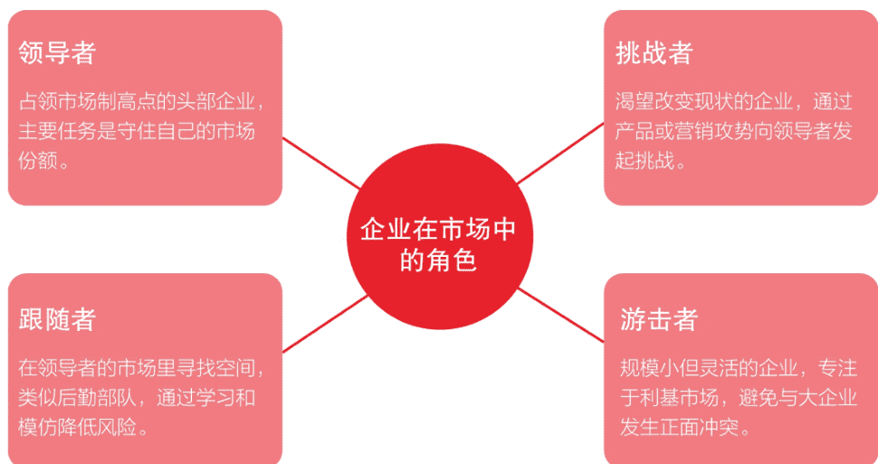

领导者（market leader）是指市场的头部企业。它们往往在资源、消费者认知度以及市场份额方面拥有绝对优势，类似于军事中占据高地的防守方。这类企业在市场竞争中的主要任务是守住自己的市场份额，同时不断强化品牌认知，构建对竞争者而言难以逾越的壁垒。

挑战者（market challenger）是那些渴望改变现状的企业。它们通过瞄准市场领导者的薄弱环节发起进攻，从而占据一定的市场份额。这类企业类似于战争中的进攻部队，它们必须通过精准的市场定位、差异化产品以及强有力的营销攻势，撼动领导者的市场地位。

跟随者（market follower）是指那些跟随领导者的企业。它们通常不以直接竞争为目标，而是专注于在领导者的市场策略下寻找适合自己的生存空间。这些企业类似于战场中的“后勤部队”，通过学习和模仿降低风险，同时优化资源配置。

游击者（market guerrilla）通常是市场中规模较小、资源有限但极具灵活性的玩家。这类企业通过专注于某个利基市场，迅速调整策略并高效利用资源，避免与大企业发生正面冲突。这一角色对小团队创业者尤为重要，因为它代表了一种通过快速应变和精准执行在市场中生存并持续发展的路径。

### 基于竞争策略的作战选择

基于不同的市场角色，我们该如何选择对应的作战策略呢？杰克·特劳特和艾·里斯对市场竞争的复杂性进行了高度凝练，将企业在市场中的竞争策略归纳为4种主要的作战方式：防御战、进攻战、侧翼战和游击战（见图2—2）。这4种战略不是孤立的选择，而是基于企业在市场中的地位、资源禀赋和目标受众精心设计的战术框架。

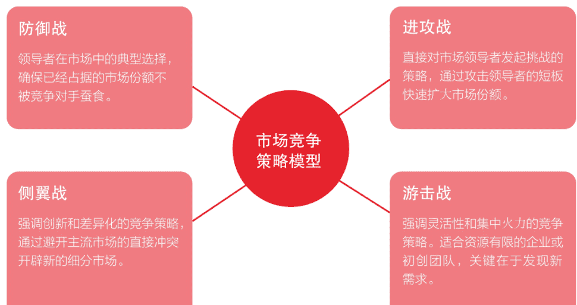

### 防御战：巩固既有的市场地位

防御战是市场领导者在市场中的典型选择，其核心目标是确保已经占据的市场份额不被竞争对手蚕食。这种策略的本质，是通过强化企业的竞争壁垒和快速响应市场变化，避免竞争者在关键领域的渗透。

以咖啡馆市场为例，星巴克是市场的领导者，它需要确保已经占据的市场份额不被竞争对手蚕食。打防御战有一条铁律，就是不能犯错，宁可自己革自己的命，也不能让竞争对手找到突破口。星巴克在核心商圈的核心位置疯狂开店，虽然成本高，但这是在用位置垄断打防御战。当年星巴克推出爆火的猫爪杯，看上去与咖啡业务无关，实则也是在用网红属性巩固年轻人的认知：喝星巴克等于潮流。

对小团队创业者来说，防御战可能并不常见，因为它需要雄厚的资源和市场基础。然而，当某个初创企业在特定细分领域已经取得领导地位时，防御战便成为其不可或缺的战略选择。比如，在细分市场中强化品牌认知、加强客户忠诚度以及通过创新提高进入壁垒，都可以帮助初创企业保护其市场地位。

### 进攻战：挑战领导者的权威

进攻战是一种直接对市场领导者发起挑战的策略，其核心目的是通过攻击领导者的短板快速扩大市场份额。这种策略通常适合那些资源相对丰富的挑战者企业。

瑞幸作为咖啡馆市场的新进入者，是市场中的挑战者，它有意挑战市场领导者星巴克的地位，打的是进攻战。当然，它在进攻的过程中，并不是与星巴克比谁的内力更深厚，即不比门店装修和咖啡豆品质，而是专攻软肋。星巴克一大杯拿铁售价33元，瑞幸喊出了9.9元的低价，并且用外卖加快闪店模式砍掉了大空间的租店成本，直击星巴克价格的痛点。

进攻战是指挑战者通过攻击竞争对手的短板迅速扩大市场份额。要想成功实施以上策略，需要强有力的资源支撑。例如瑞幸从成立到上市，获得了多轮融资，这对小团队来说，是很难做到的。

## 侧翼战：开辟全新领域

侧翼战是一种强调创新和差异化的竞争策略，旨在通过避开主流市场的直接冲突，开辟新的细分市场。侧翼战的关键在于，发现并满足尚未被充分开发的市场需求，以创新性的产品或服务占据市场先机。侧翼战的成功法则是重新定义市场。

Manner咖啡既不想当市场领导者，也不想取代市场挑战者，只想在咖啡馆市场中占有一席之地，是市场中跟随者的角色。在星巴克和瑞幸主导的咖啡馆市场格局下，Manner咖啡敏锐地捕捉到中间地带的机会：用星巴克一半的价格，提供接近独立咖啡馆的品质，通过小店模式、专业工艺和环保理念，打造精品咖啡的平替。这恰好是侧翼战的核心原则：差异化定位、避开正面战场、精准切入空白市场。

侧翼战的核心是在领导者的优势领域挖掘市场机会，并将机会转化为自己的优势。星巴克的空间溢价与瑞幸的效率优先，恰恰为Manner咖啡留下了品质加性价比定位的生存空间。Manner咖啡在巨头夹缝中开辟了新赛道，也重新定义了精品咖啡的大众化可能。

事实上，侧翼战尤其适合资源有限的小团队创业者。在竞争激烈的餐饮市场，一些初创企业通过侧翼战找到了新的生存空间。

## 游击战：灵活应变的策略

游击战是一种强调灵活性和集中火力的竞争策略，适合资源有限的企业或初创团队。游击战的核心是通过选择小众市场，集中力量深耕，从而在竞争中占据独特优势。游击战的成功要素是专注与机动。

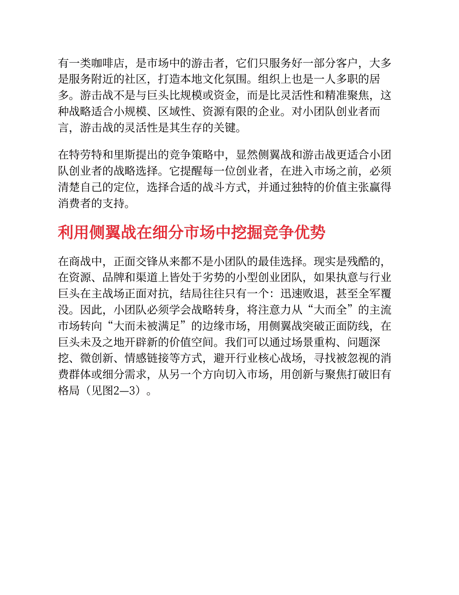

## 场景重构：场景即市场

同一产品在不同场景下会产生新需求，小团队可以通过对使用场景的切割重组，开辟新战场。

一个典型的场景重构案例是任天堂通过推出Switch游戏机，在家庭娱乐与便携式游戏之间创造了一个全新的市场。截至2025年3月31日，Switch在全球累计销量超过1.5亿台。数据来源：任天堂在2025财年（截至2025年3月31日）发布的官方财报。过去，提到游戏机，我们对索尼PlayStation和微软Xbox都不陌生，不过它们都专注于高性能家用主机，即大部分用户购买后只能在家里用。Switch打破了空间限制，首创主机和掌机混合形态，实现家庭大屏娱乐与户外碎片化体验的无缝切换。用户可以在通勤时玩《塞尔达传说》，回家后无缝切换至电视模式继续冒险。Switch通过《健身环大冒险》《舞力全开》等体感游戏和IP组合切入，将游戏场景延伸至家庭健身、社交聚会、健康管理等领域，替代健身器材、桌游等传统工具。

## 问题深挖：聚焦容忍型痛点

市场上的产品是不缺问题的，但我们要区分哪些问题是有价值的。用户痛点是要分级的，用户对某些痛点是习以为常的。比如，吸尘器的尘盒清洗起来很困难，洗地机的滚刷易发霉，这些痛点让用户难受但可以忍受，这是我们常说的容忍型痛点。很多时候，企业都在争相解决用户不可忍受的痛点，但小团队如果能解决这些容忍型痛点，即用户的沉默需求，会给用户带来颠覆性体验。

家电领域的新锐品牌追觅科技（Dreame），面对已经被美的、海尔、小米等巨头高度整合的家电主流赛道，没有选择在“冰洗厨”这些传统品类中硬碰硬，而是深挖高端清洁中的容忍型痛点，然后逐一攻克。比如，洗地机自清洁后滚刷潮湿，易滋生霉菌，很多用户都会手动二次清洁。追觅科技用离心甩干加热风烘干技术解决了这个问题。洗地机的操作并不是那么灵活，机器平均重量超过5千克，对做家务的女性主力军而言，回拉是需要用力的。追觅科技将机器人关节技术移植至洗地机，每秒500次动态调节助力方向，降低推拉阻力。追觅科技聚焦的问题，都是发生频次高的问题，这类问题用户忍耐的阈值也相对比较高，即凑合能用。

如果我们想找到这些问题，可以观察用户在产品使用过程中的极端操作，比如手柄磨手的用户主动缠棉布使用。在现在的数字生态下，我们可以在竞品电商的评论区找到高频抱怨词。尤其不能忽略的是，一款产品带来的时间和精力损耗，像用户每周手动清理洗地机滚刷大约需要1.5小时，这些都是对问题的深度挖掘。

## 微创新：从用户细节挖掘差异壁垒

关于重新定义市场，我们听到最多的词是创新。有些小团队一听到创新就害怕，认为创新是大企业的专利，自身当下的能力不足以做到创新，其实创新并非要求技术上颠覆式的突破，而是要求对用户需求拥有深入而微妙的理解，并据此进行服务方式、交互流程、品牌沟通上的精准创新。

小团队往往无法在硬件和资本方面与大企业展开竞争，但可以敏锐洞察用户体验的细节，这就是我们能够形成天然的差异壁垒的地方。有一家来自英国的手工化妆品品牌Lush，提供了极具启发意义的参考。

Lush一直主打环保、天然、手作的理念。在全球美妆市场被欧莱雅、资生堂等巨头分食得七零八落的背景下，Lush另辟蹊径，坚决不做代言、不打折扣、不随波逐流，而是专注于“绿色理念”在包装、成分、运输方式上的极致贯彻。

过去一提到环保产品，似乎用户就要牺牲自身的体验感。Lush推出“裸包装”香皂，用户每购买1块香皂就会减少1个塑料瓶的产生，将环保转化为无须牺牲体验的举手之劳，还有可重复使用的礼品盒，甚至在门店布置中全面使用再生材料。这种细分到极致的品牌表达，使Lush在环保意识日益觉醒的年轻消费者群体中迅速走红。追求环保不再是道德枷锁，而成为可触摸、可玩、可炫耀的生活方式。尽管Lush在广告上投入极低，却形成了极强的品牌共鸣和用户黏性。

还有一类创新是成熟技术的降维使用。比如，增强现实（augmented reality，AR）和3D扫描是成熟技术，但多用于科技行业。红豆智能量体仓就用AR试衣+3D扫描技术替代传统量体，降低了高端定制的门槛。AI大模型还能够根据顾客的身材特征、风格偏好和穿着场合，提供个性化的服装推荐、AI试衣和搭配建议。基于大数据的精准加上柔性供应链，工厂的生产也可以根据顾客喜好进行快速调整。

所以，即使在传统的服装零售行业，也可以通过嵌入技术发生新变革。技术降维的核心逻辑就是将高科技领域成熟技术降维应用于低技术密度行业，实现成本与体验的突破。

## 情感链接：基于用户情感树立品牌形象

在传统的商业逻辑中，边缘需求或非主流人群的需求规模较小，所以价值是有限的，但数字化和柔性生产正在颠覆主流市场的规则，似乎满足小众需求的企业也将深入人心。

以日本咖啡品牌猿田彦咖啡（Sarutahiko Coffee）为例。当全世界的咖啡馆市场都被星巴克、咖世家（Costa）、皮爷咖啡（Peet's Coffee）等巨头垄断时，这家起步于东京狭小街角的精品咖啡品牌，并没有试图复制大品牌的“快节奏、高流量”模式，而是转而聚焦“个性化咖啡体验”。他们深知：在一线城市的年轻人中，已经形成了一股对“第三空间商业模式”的反思趋势——人们不再仅仅满足于速溶式的办公咖啡环境，而是渴望一种与咖啡师交流、品味原产豆风味的仪式感和慢生活体验。

猿田彦咖啡的核心理念是一杯就带来幸福体验的咖啡店。它的品牌叙事是围绕职人（指精通某一领域的专业技能群体。2023年，“新职人”作为该词语的现代拓展版本入选年度十大网络用语，标志着这一概念在社会语言生活中的重要影响力。）精神打造的。该品牌有一款招牌系列以焦糖尾韵著称，烘焙曲线精确至±0.5℃温差控制，门店的咖啡师需要经过严格的培训，咖啡的萃取时间可以严格控制在2分10秒±5秒。该品牌的门店不像功能空间，更像是情感载体。有一家店的营业面积仅有8.7平方米，定位是深夜治愈站，为数不多的座位，暖黄灯光加木质吧台营造家庭感。

在这里，一杯拿铁就能很好地慰藉加班族。

它没有与星巴克竞争谁的门店更多、谁的效率更高，而是在星巴克视野盲区的那部分消费者心中，树立了独一无二的品牌形象。品牌名中的“猿田彦”源自日本神话中的引导之神，品牌寓意“用咖啡为人指引方向”。这种基于细分用户情感需求的切入，正是典型的侧翼战中品牌与用户之间情感链接的突破。

当然，线下门店拥有空间，更容易与用户产生情感链接。很多小团队在创业之初，只能靠线上轻资产运营，如何让品牌与用户建立情感链接？

我们以手机支架品牌泡泡骚（PopSockets）为例。它起源于美国，最初是创始人为解决耳机线缠绕问题发明的气囊支架。2018年进入中国市场时，它面临三大挑战：小团队无线下门店；品牌认知薄弱；流量成本高，流量被市场低价竞品挤压。

初入中国市场，他们做了一件事：联合豆瓣“手机橱窗计划”小组，号召用户用透明手机壳展示原创诗歌或拼贴创作，带话题发帖即可获赠泡泡骚支架。这是将品牌的起源故事转化为创造力与自我表达的象征，主打巴掌大的手机背面是生活的情绪出口，传递了“为生活而艺术”“人人都是艺术家”的宗旨。这个活动笔记获得了200多万次的浏览，形成了用户自发传播。

之后，他们进行了长期的故事渗透，2023年与公益机构“是光”诗歌合作，将山区儿童所作的诗印上手机支架，每售出一件捐赠25元支持山区儿童的诗歌课。用户购买行为被赋予“守护童心”的意义。他们并没有强调产品功能，而是用一次次活动不断构建了品牌的心智资产。

所以即使没有线下门店，小团队依然可以通过用户共创和情感共鸣替代实体触点，讲述动人而真实的品牌故事，也能在互联网环境下突破流量壁垒，构建用户心智护城河。毕竟情感溢价等于功能成本乘以情感认同系统。在功能同质化的时代，情感认同更能促进品牌护城河的构建。

对小团队而言，侧翼战不仅是一种战术选择，更是一种战略哲学：避开巨头的锋芒，聚焦价值被低估的方向；远离规模驱动的同质化竞争，聚焦用户心智尚未被占领的空白地带；不做每个人的选择，而做对一部分人真正有意义的存在。在这个不断变化的商业环境中，那些走在边界、站在需求缝隙中的创业者，往往才是最终改变行业结构的力量。

## 通过游击战以敏捷性抢占局部市场

在创业这场没有硝烟的战争中，小团队无法用“正面火力”与大企业抗衡，但却能借助“灵活穿插”的战法，在局部战场打出奇兵。这种策略，被称为“游击战”。游击战不是打败大企业，而是找到大企业不想打、打不了的地方，先活下去。让团队的“小”，成为优势。

如何让“小”成为优势，具体可以分三步走（见图2—4）。

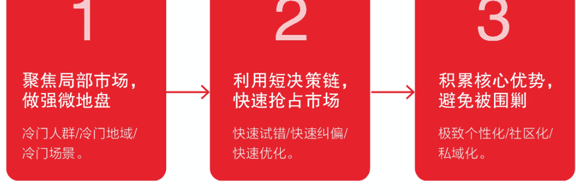

### 聚焦局部市场，做强微地盘

局部市场一般是这个领域已经被挖掘，并且有大企业占领了这个领域。小团队只能找大企业顾及不到的小缝隙，或者从一隅之地切入，做强微地盘。

如何找到一个特定领域的局部市场？我们可以问自己以下3个问题：

- 有没有一群人的需求被大企业忽略了？
- 有没有某个地域的市场，大企业还没有覆盖？
- 有没有某个冷门场景的需求？

Anastasia Beverly Hills（ABH）是著名专业彩妆品牌。它的眉妆及其他彩妆产品，近乎是国内外明星及博主的人手必备产品，是绝对的明星产品，有口皆碑，几乎每逢新产品上市就能红遍全球。20世纪90年代，该品牌创始人阿纳斯塔西娅·索尔（Anastasia Soare）发现美妆市场有一群人的需求并未被大企业满足：像欧莱雅、雅诗兰黛等都会聚焦于眼影、口红等热门品类，在美妆领域，眉毛的修饰被认为是附属需求。所以眉毛产品长期被大公司忽视，消费者购买眉笔后仍不知如何画出理想的眉形。她以“黄金比例修眉法”为核心创立ABH，从线下修眉服务起步，逐步拓展至产品研发与全球化运营。

在扩张路径上，高端眉妆服务起初集中于欧美一线城市，但二线、三线城市及新兴市场（像东南亚等地区）缺乏专业的线下服务。ABH在全球开设“Brow Studio”连锁店，培训技师统一技术标准，覆盖非一线城市。ABH在东南亚通过TikTok与本地KOL合作，发布适配亚洲人眉形的教程。事实证明，亚太地区也为其贡献了超额的营收增长。

在一些冷门场景上，ABH推出了眉毛急救包，包含迷你眉胶、镊子、遮瑕膏，适配旅行、会议等紧急需求场景。

透过ABH案例我们发现，局部领域的金矿往往藏于被忽视的日常。大企业追逐显性热点时，小团队可以聚焦微小需求，以极小切口撬动增量市场。

### 利用短决策链，快速抢占市场

创业初期的团队，最大的优势就是“决策链短”，可以快速试错、快速纠偏、快速优化。

以昔客堡（Shake Shack）为例，这家美国高端汉堡品牌，早期不过是纽约麦迪逊广场公园中的一个流动摊位。他们在没有巨额广告投入、渠道铺设的情况下，用“限量供应+精致手作+强社交互动”的策略，建立起小范围的品牌忠诚度。最初几款产品的菜单设计，都是在反复试卖和现场问卷中调整而来的——消费者的每一条反馈都会被记录，并在第二天调整做法。这种“消费者共创+实时迭代”的运营方式，使昔客堡迅速成长为新一代美式餐饮的代表企业，最终上市成为资本市场的宠儿。它的成功，不是靠铺天盖地的渠道，而是靠用户参与驱动的试错系统。而这正是小团队创业的独特优势：没有历史包袱，无须层层汇报，能做到当天发现问题当天改。

在快速占领市场的过程中，有一个重要的原则就是不要追求大而全，只求单点突破。单点突破也不是盲目地哪里火打哪里，而是有策略地进行选点突破。

在AI和数字工具普及的今天，小团队更是可以依靠数据分析、市场热度监测和社群声量预警等手段，快速判断一个区域市场或产品组合是否值得深耕。比如想卖一款懒人厨房神器，先别投入重金购买设备组织生产，先用短视频拍个样品演示，测评一下用户对该产品有没有兴趣，有订单了再小批量生产。

过去，你可能需要花一年的时间在全国铺货后才能知道某个口味是否受欢迎；今天，你只需要在微信小程序上开一个临时销售页面，3天内就能获得足够的用户反馈，以此决定是否大规模上线。

### 积累核心优势，避免被围剿

当我们发现了局部市场并快速进入后，就会发现一个现象：很多企业也看到了这一机会，甚至有大企业要来分“蛋糕”。这时我们能做的，不是迅速扩张，而是不断积累核心优势，避免被围剿。

小团队要想建立核心优势，可以从以下4个方向入手。

- 第一，极致个性化，做量身定制的生意，满足用户个性化需求的生意。比如不做大众健身，只针对孕产妇人群，做体态调整到产后修复，做到一对一定制服务。
- 第二，社区里做熟人的生意。一般来讲，大企业很难渗透到“最后一公里”，小团队能依靠“面对面服务+地域信任”扎根本地，聚焦3公里生活圈，用上门服务、熟人关系等建立高频互动。
- 第三，与客户处成朋友。依靠互联网的优势，小团队可以用私域流量与客户产生强链接，建立情感纽带。大公司靠平台流量，小团队可以靠微信社群。比如上海社区面包店建宝妈烘焙群，每天在群里分享宝宝辅食面包做法，每周直播教客户做无糖小饼干，群内下单享9折，客户复购率比普通散客高一倍。
- 第四，成为这个领域的权威，靠专业度建立信任，深耕一个窄赛道，用内容、服务输出专业价值。例如北京老胡同修表匠，已经开了30年老店，客源老龄化，年轻人不知道。于是，修表匠的儿子在抖音上发布“修复爷爷辈老怀表”的视频，展示拆零件、上油的细节，吸引怀旧的年轻人群；并开通微信小程序，支持“线上预约修+同城闪送取件”，解决年轻人没时间到店问题。与此同时，他用AI识别视频评论关键词，发现很多人问古董表的保养方法，于是推出年度保养套餐。

小团队能够通过互联网低成本触达精准人群，通过AI智能弥补人力和资源不足，最终把节省的成本投入核心优势并积累势能。

在创业初期，无论小团队选择侧翼战打出差异化价值，还是选择游击战集中资源拿下一块局部市场，都可以在市场中赢得一席之地。但在竞争激烈的商业世界中，竞争从来不是一场排兵布阵、一劳永逸的战斗，而是一场持续演化的博弈游戏。

尤其在今天这个高度数字化、信息密度极高的市场环境中，小团队创业者的成功不在于构建一个永不改变的战略堡垒，而在于能否在侧翼战与游击战之间自由切换，在每一次风向改变中比竞争对手更早地看见机会，比竞争对手更快地做出反应，持续听得见市场的声音，在变量出现之时调整节奏、改变打法。

在未来的创业世界里，没有所谓制定好就能跑5年的战略。真正的战略家，永远在调整中前行。对小团队来说，侧翼战与游击战只是起点，真正决定成败的，是在风云变幻中仍能保持战略方向感的能力。这，才是动态战略的真正内涵。

## 增长策略：构建飞轮效应

在小团队创业的语境中，成功绝非一蹴而就的偶然闪光，而是一个如同推动沉重飞轮般持续用力的过程。它依赖于那些方向一致、微小但持续努力所积累的动能，最终形成一种强大的、自我驱动的增长循环。这正是吉姆·柯林斯（Jim Collins）在《从优秀到卓越》中系统阐述的“飞轮效应”。

飞轮效应描述的是，一只沉重的飞轮刚开始推动时可能非常困难，需要投入大量的精力和资源，但随着努力的积累，飞轮开始加速，最终达到一种自我驱动的状态。这个过程的核心在于，每一个推动动作都不会浪费，而是为整个系统提供更多的能量。

对小团队创业者而言，飞轮效应提供了一条清晰且可行的路径。在资源有限、市场进入壁垒高的情况下，小团队无法与大企业比拼资本实力，但他们可以通过专注于核心驱动力、形成增长闭环、不断试错与调整，将有限的资源发挥到极致，逐步实现自我驱动的增长引擎（见图2—5）。

### 专注于核心驱动力

飞轮效应的起点在于找到企业成长的核心驱动力。这一驱动力通常源自企业的核心价值定位，同时也是市场最迫切需要解决的问题。它回答了企业“应该从哪里发力”的关键问题。

以企鹅吃喝指南团队为例，他们发现市场上缺乏“专业、独立、有趣”的食品测评内容，许多消费者对食品健康和品质的信任缺乏权威来源。基于这一洞察，他们确定了以“生产公正、专业、有趣的美食内容”为核心驱动力，并围绕这一目标集中资源，逐步形成了高度认同的品牌声誉。

对小团队而言，明确核心驱动力至关重要，因为他们的资源有限，必须专注于最有可能成功的单一领域，避免资源的分散和浪费。

### 形成增长闭环

飞轮效应的核心在于形成一个相互关联的增长闭环，使得每一个环节都能有效推动下一环节的进展。成功的飞轮不仅是“拼接”的各个环节，更是一套具有内在逻辑的完整系统。

一个典型的飞轮闭环模型可能包括以下路径：高质量的产品/服务→积极的用户反馈→品牌认知提升→新用户增长→规模效应促使成本降低→产品/服务质量进一步提升。这一逻辑使得每一次努力都不仅为当前带来增长，还为下一步积累更大的动能，从而实现飞轮的逐步加速。

亚马逊的增长飞轮是这一逻辑的最佳诠释。亚马逊以“增加选择”为起点，通过构建庞大的商品库吸引消费者，再将流量转化为吸引商家的资本。随着销量的增加，他们通过规模效应降低成本，从而进一步巩固其市场地位。这一闭环推动亚马逊从一家在线书店成长为全球电商巨头。

对小团队创业者而言，这种闭环设计可以是简单的，但必须具备清晰的因果关系。例如，一家本地餐饮初创公司可以通过优质服务树立良好的口碑，吸引更多的顾客，然后利用收入扩大运营规模，最终以较低的成本提供更优质的餐饮体验，进一步增强品牌黏性。

构建飞轮闭环的关键是明确环节间的关联性，确保每一个环节不仅能单独发挥作用，还能对整个系统产生积极反馈。这种“相乘而非相加”的逻辑，是飞轮效应能够持续推动企业增长的根本原因。

## 不断试错与调整

飞轮效应并不是一成不变的模型。对于刚刚起步的小团队来说，飞轮的初始设计可能并不完美，甚至可能存在显著的缺陷。然而，这并不妨碍他们通过试错和调整找到适合自身的增长路径。

事实上，动态调整的能力恰恰是飞轮效应的核心要求之一。试错的意义在于发现有效的增长环节，并剔除那些低效的部分。例如，一家本地化手工艺品初创公司，可能在早期选择通过社交媒体广告推广产品，但如果发现这一策略带来的转化率很低，那么他们就需要尝试其他方式，如在社区举办线下活动或合作开设快闪店。通过多次试验，他们可能发现最适合自己的推广方式，并将资源集中到这一渠道。这种基于反馈的快速调整能力，既是小团队的优势，也是飞轮效应能够持续运转的重要保障。

## 实现自我驱动

飞轮效应的最终目标是实现从“外力驱动”到“自我驱动”的转变。随着动能的逐步积累，企业将进入质变阶段，即一个临界点，在此之后，企业的增长将主要依赖于飞轮自身的动能，而非外部资源的持续投入。这一阶段的显著标志包括：市场认知度的显著提升、客户获取成本的降低以及竞争壁垒的形成。比如，全球流媒体巨头奈飞（Netflix）近些年一个显著的临界点就是：2024年全球付费用户总数达3.016亿，超过第二名近两倍；广告业务收入同比翻番，新增用户中55%选择广告套餐。数据来源于奈飞发布的2024年第四季度及全年业绩报告。规模效应让内容制作成本降低，从而形成了“内容投入→用户增长→广告增收→现金流优化→再投入内容”的超级闭环。

要想实现临界点的突破，必须具备两个因素：一是飞轮设计的合理性，能否确保每一环节都对下一环节产生正向反馈；二是执行的稳定性，团队能否在临界点到来之前保持一致的战略定力。

对小团队来说，突破临界点不仅意味着增长模式的转变，也标志着他们在市场中的地位已从“新入者”转变为“重要参与者”。这一阶段的成功，往往决定了企业能否在长期竞争中立于不败之地。

## 进化策略：顺应企业的生命周期

在创业的征程上，深刻理解企业生命周期的动态规律，是小团队避免盲目扩张、实现稳健发展的关键。每个企业通常都会经历从初创期、成长期、成熟期到衰退期（或转型期）的演变，伊查克·爱迪思（Ichak Adizes）提出的PAEI管理角色模型，为小团队在不同发展阶段聚焦核心能力提供了清晰的行动地图。

在商业世界中，企业的成长往往被视为一场永不停歇的旅程。从最初的灵感迸发，到业务的逐步扩展，再到面对内外挑战的艰难抉择，每一家企业都在不断书写着属于自己的生命轨迹。这种轨迹并非随机，而是遵循一定的规律，就像生物体的成长一样，也有其“生命周期”。

管理学大师伊查克·爱迪思，对照人类的成长周期，把企业的整个成长过程划分成四大阶段：初创期、成长期、成熟期和衰退期。每个阶段的管理重点和战略需求截然不同：为何有些企业夭折于初创期，有些企业正在走向僵化，更有些企业陷入了未老先衰的过渡困境？为了解决这些不同时期的管理矛盾，伊查克·爱迪思引入了PAEI管理角色模型。

## PAEI管理角色模型

该模型把企业的管理拆成4个“关键角色”：生产者（producer, P）、行政管理者（administrator, A）、创业者（entrepreneur, E）和整合者（integrator, I）。这4种角色分别代表了4种关键的管理能力，企业的不同发展阶段，需要不同的能力组合，管理者的任务就是找到平衡点（见图2—6）。

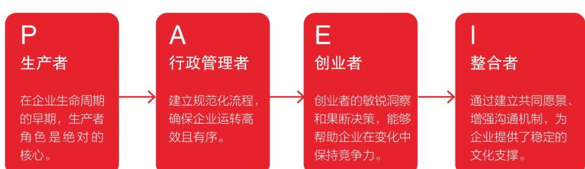

## 生产者（P）是团队的效率引擎

生产者是执行的中流砥柱，是团队里的实干家，生产者的眼中只有一个目标：把事情做成。

早期的美团地推团队，在团购大战最激烈的时候，这些地推铁军每天顶着烈日挨家挨户谈商家。当时的美团首席运营官（chief operating officer，COO）干嘉伟回忆道，团队推行狂拜访、狂上单的策略，并严格执行规定时间规定动作，如早启动、晚分享，每日完成大量商户签约。这些P角色看上去用的是笨功夫，但是在当时为美团商家覆盖率第一名做出了巨大贡献。

与此同时，企业也要警惕过度依赖生产者能力所带来的隐患：如果团队的全部精力都集中在“做事”上，而忽略了对未来的思考，就可能在短暂的成功之后迅速失去竞争力。

## 行政管理者（A）负责维护秩序

行政管理者是团队里规则和流程的缔造者，为团队提供清晰的方向和行动指南，确保任务落地井井有条。想象一个快速成长的小团队，业务扩展带来了更多的客户、项目和员工，如果没有基本的规则和清晰的职责划分，那么混乱将很快取代效率。行政管理者并非单纯的“规则制定者”，他们更像是企业的稳定器。

海底捞能从一家小店发展成火锅巨头，背后就离不开行政管理者的默默付出。我们常说，海底捞的拉面师傅甩面的姿势都是一个标准。的确，海底捞在发毛巾和传菜流程上都有严格的标准，这时行政管理者就发挥了重要作用。通过制定详细的服务流程、人员培训体系和供应链管理标准，海底捞把“优质服务”变成了可复制的产品。

行政管理者能力的引入并不意味着削弱小团队的灵活性，而是通过建立基本的管理框架，让团队能够更高效地运行。当一个团队从三五人扩展到十几甚至几十人时，没有规则和规范的组织就像一座正在崩塌的房子：成员职责不清、项目进度无法追踪、资源分配效率低下。这时，设定清晰的目标、定义关键流程、分配明确的角色和责任，这些“最少必要规则”不仅不会拖慢团队的发展速度，反而会释放成员更多的精力去专注于创新和执行。

## 创业者（E）是企业的未来驱动力

创业者是变革的火炬手，是企业的未来驱动力。创业者关注的是市场趋势、创新机会以及如何为企业开辟新的增长路径。特斯拉创始人埃隆·马斯克（Elon Musk）就是典型的创业者，无论当初创立特斯拉，还是成立自己的航天公司Space X，都能彰显他身上疯狂的创新基因。

创业者是小团队非常需要的基因，因为小团队需要创业者天生的敏锐嗅觉。这种能力能帮助他们发现市场空白、识别潜在机会，并以颠覆性的方式解决问题。创业者能力的核心在于突破边界，对小团队来说，这种突破不一定需要大量的资金或资源，而是依赖敏捷的思维和对趋势的快速反应。

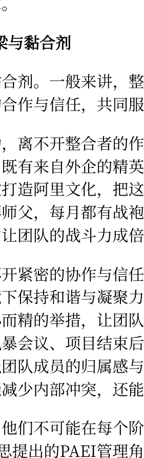

在企业的初创期，创业者（E）和生产者（P）是主力军，前者提供愿景和动力，解决为何而创业的问题；后者负责产品落地和业绩，专注于开发能满足市场需求的产品和服务。

苹果公司创始人史蒂夫·乔布斯（Steve Jobs）就是E角色，他一边拿着电路板给投资人讲述企业愿景、拉赞助，一边拉着斯蒂夫·沃兹尼亚克（Stephen Wozniak，P角色）没日没夜地调整代码，进行产品研发，硬是把Apple I从图纸变成了现实。

这个时期，行政管理者（A）和整合者（I）的管理能力相对薄弱，这很正常，因为初创企业需要灵活创新而非繁文缛节。需要注意的是，如果只顾创新梦想而忽视了产品和执行，企业可能流于空想而夭折；反之，如果只埋头做产品不顾其他，也可能导致企业早期死亡。因此，初创期虽然以创业者（E）和生产者（P）为主导，但行政管理者（A）和整合者（I）不能完全缺位。

当然，在资源有限的小团队中，单一的角色划分并不现实。创业者（E）可能同时是生产者（P），行政管理者（A）也可能需要具备整合者（I）的能力；如果一人身兼多职，该如何协调呢？

小团队可以利用AI工具，使用项目管理软件，维持基本的流程和纪律；人员不足就利用AI代替行政管理者（A）的作用；再利用线上协作平台增强团队的凝聚力，等同于整合者（I），从而避免创业热情因无法凝聚而成为一盘散沙。

## 成长期：整合者快速成长

当企业进入快速增长阶段，管理挑战变得复杂，需要在保持创新和产出的同时引入规范与协作。这对应PAEI从“P、E主导”向“P、A、E并重并逐步加入I”的过渡。

企业处于成长期早期（类似学步期）时，产品和市场需求匹配是重中之重，表现为“PaEi”，即产品业绩和创业创新仍是核心驱动力，但开始需要一些行政管理手段和整合措施来避免“摔跤”。

随着企业规模扩大到一定程度（青春期），可能出现两种快速成长模式：一种偏向产品驱动；另一种偏向市场/用户驱动。无论哪种，企业这时常常把P和A提到同等重要的高度——既要出业绩，又要建章立制保证组织不乱；创业创新仍不可或缺，但需要与现实业务更紧密地结合；整合作用则逐渐显现，用于协调部门、塑造文化，以此支撑人员扩张。这个时期的PAEI可能接近“PAei”，意味着生产者和行政管理者变得强势，创业者依然活跃，整合者开始成长。

很多企业在成长期引入职业经理人加强行政管理者的功能，同时用企业愿景和价值观建设来培养整合者的能力。在这一平衡过程中，AI工具能够大显身手：如通过ERP（英文全称是enterprise resource planning，意指企业资源计划）系统把各部门流程规范化，用AI分析业务数据辅助管理层决策，借助内部社交和知识管理平台增强员工凝聚力。通过AI，成长中的企业可以在保持创新激情的同时稳固管理基础，避免团队陷入“只管理头拉车、不管抬头看路”的失控局面。

## 成熟期：四种角色齐头并进

进入成熟期的企业，就如同人到中年，追求全面均衡的发展。此时，创业者（E）、行政管理者（A）和生产者（P），要齐头并进，整合者（I）也要逐步提升。

在壮年期，企业应趋势练好内功，不要过早追求多元化的市场整合，以免分散核心优势。当企业进入稳定期，往往意味着增速放缓、市场地位固定，此时整合者的重要性显著提升。稳定期要求组织有更强的协同和文化力量来应对内部复杂性，以及保持员工士气，所以整合者角色的重要性不言而喻。此时，企业实现真正的四轮驱动。

当然，没有人希望企业进入衰退期，但如果成熟企业不能维持PAEI的均衡，就会逐渐走向衰退。企业步入衰退期是有迹可循的，比如创业精神衰减会导致缺乏新业务、新产品，企业逐渐僵化；业绩动力下降则营收停滞。因此在成熟期，企业必须持续自我革新，激活创业者和生产者，同时以行政管理者和整合者保驾护航。

例如，小米公司早在2014年就前瞻性地布局物联网生态，通过构建智能生态链不断拓展产品边界。借助这一庞大智能生态，小米公司将用户紧密地纳入其产品体系，从智能手机扩展到家居、电器等各领域，实现了产品线和市场版图的持续扩大，保持了企业活力。

如今的企业既面临前所未有的竞争压力，也拥有前所未有的机遇，AI的出现，成为企业平衡PAEI的驱动器。

首先，企业可以通过AI赋能创新，比如建立内部创业孵化平台，利用AI分析市场趋势，鼓励创业者。例如，宝马北美公司联合埃森哲打造EKHO平台，通过AI代理智能调用企业数据源，实时分析市场趋势与用户需求。AI承担了创业者的角色，将企业家从冗余决策中解放出来，聚焦高价值创新，推动组织二次增长。

其次，企业能够通过AI优化流程，引入自动化和数据驱动管理，强化行政管理者的职能；同时，通过AI强化协同、数字化协作和知识共享平台，促进整合者发挥重要作用，从而让成熟组织焕发二次成长的活力，延长壮年期的寿命而不滑入衰退期。

总的来说，PAEI管理角色模型提醒管理者：没有任何单一类型的管理模型可以包打天下，真正成功的企业需要在恰当的时机协调好不同角色的职能，实现动态平衡。AI技术的出现，提供了前所未有的工具去支撑这种平衡，在某种程度上，AI可以视作组织中的第五角色。善用AI，企业就能更从容地在生命周期各阶段实现PAEI的动态均衡，保持健康发展。

## 用文化激发持续创新与改进

在企业生命周期的不同阶段，持续创新其实是企业生存和增长的关键。除了产品形态上的演进，AI和自动化技术正深入研发流程，帮助企业加速创新周期并提高市场适应能力。

贝恩公司官网上的研究报告显示：在引入大型语言模型等AI工具后，科技企业的利润平均提升20%。这意味着，理论上所有企业都能借助AI加速创新周期，抢占市场先机。但现实是，当同类技术被投入使用时，腾讯、字节跳动等大型企业能持续孵化爆款产品，多数传统企业却陷入技术投入高、创新产出低的困境。这种差异的根源在于：技术是创新的加速器，但唯有根植于适配的文化土壤，才能将工具优势转化为持续动能。

## 创新文化不是单纯地鼓励试错

传统企业常将创新文化简单地理解为允许失败，谷歌允许员工用20%的工作时间探索非本职项目的制度，常被解读为自由创新。但我们深入分析会发现，其本质是公司通过预算和时间配额，将创新试错转化为可量化的管理流程。据谷歌前首席执行官（chief executive officer, CEO）埃里克·施密特（Eric Schmidt）透露，Gmail、谷歌地图等核心产品均诞生于20%的工作时间项目，但背后是公司建立的管理层周会、跨部门的演示日等机制，对内部项目进行动态筛选。

无序试错只会消耗资源，真正的创新需要“低成本试错+快速迭代”的工业化流程。腾讯的“赛马机制”正是这一逻辑的典型实践：在微信的孵化过程中，张小龙团队与手机QQ团队并行开发，通过内部竞争倒逼产品迭代。这种机制并非鼓励盲目试错，而是通过制度设计将失败成本控制在可控范围内：多团队同时探索不同路径，失败的项目被及时淘汰，成功的模式则快速复制。腾讯通过赛马机制孵化的明星产品，包括QQ秀、王者荣耀等，其平均迭代周期低于行业平均水平。

很多大企业的衰败往往不是因为技术落后，而是因为组织架构无法适配创新需求。

## 用数据驱动创新的实验文化

字节跳动以数据驱动的实验文化著称，他们将技术创新融入日常运营决策。张一鸣强调以数据说话，专门组建了产品增长团队，斥资打造了强大的数据监测系统，用于指导产品研发方向。在具体实践上，字节跳动广泛运用A/B测试来验证想法，让团队勇于试错、快速迭代。比如，抖音团队在上线新功能前，一个点赞按钮的位置调整，需要经过小流量A/B测试，评估其对用户留存率、活跃度、分享率等多个指标的影响，最终通过算法模型生成最优方案。这种科学实验精神确保每次产品改进都有可靠的数据依据支撑，最大限度地减少了拍脑袋决策。通过将数据文化融入组织基因，字节跳动实现了持续的产品优化和创新复制，使其能够一再成功推出爆款产品。

AI的出现，也让数据文化逐渐从核心业务向支持部门渗透。一些零售企业引入AI客服，实现了智能应答。比如，大模型赋能的智能客服通过精准需求响应和24小时即时服务，显著提升了客户体验。AI客服可处理60%～70%的重复咨询（如账单查询、物流跟踪），释放人工处理复杂问题。企业还能通过分析千万级客服对话数据，挖掘出用户未被满足的潜在需求，反向推动产品研发。

当然，企业想要建立数据文化，也会面临一个深层矛盾：权威文化与数据文化的冲突。很多企业要想获得长足的发展，必须打破层级制组织中的权威崇拜。在字节跳动，基层员工可以用数据推翻高管的决策，这种数据面前人人平等的氛围，需要组织重点培育，避免管理层经验优先，数据文化成为面子工程。

## AI不仅是工具，更是持续创新的催化剂

在传统研发流程中，企业不敢试错的文化困境往往源于物理限制，因为一次产品原型的迭代可能需要数周甚至数月的时间，而生成式AI的出现正在改变这一局面。比如，新能源企业使用AI仿真工具优化电池热管理方案；深势科技通过AI计算模拟筛选电解液配方，将测试量从数万次实验压缩至“计算模拟+小样本验证”，缩短了研发周期。又如，原本需要100次物理测试的流程，通过算法模拟可缩减至十几次，就大大降低了试错成本。

更重要的是，技术工具的进步反过来影响了组织文化，因为试错成本降低，所以企业更愿意尝试激进的方案。贝恩官网上的报告显示，部分制造企业将AI视为研发首要任务，员工更愿意提交高风险、高回报方案。

AI也正在推动组织从“经验导向”转向“学习导向”。比如传统的风控领域依赖专家经验设定风险指标，而AI系统能自动识别2000种以上的风险特征，通过机器学习动态调整策略。这种算法决策的模式，也是由AI催生出的一种文化转变。

当然，AI的终极价值并不是替代人类创意，而是重构机器试错与人类灵感的协作模式。

# 03 战略设计

## 如何从混乱中构造出清晰的路径

在这个变化愈发迅猛的时代，市场的逻辑已不再是“先入者为王”，而是“洞察者得势”。技术周期加快，用户习惯快速演变，产业边界日渐模糊，创业这场游戏，比拼的早已不是谁跑得快，而是谁更早地看清了方向，更稳地迈出了关键一步。

对小团队而言，这种不确定性的环境既是挑战，更是机会。没有包袱、没有路径依赖，反而更需要一套方法——一套可以帮助创业者从混沌中提炼机会、从资源中锻造优势、从趋势中制定路径的战略设计方法。

宏观层面，我们采用PEST分析模型，帮助你理解政策、经济、社会与技术变化如何影响商业机会。

行业层面，我们将结合波特的五力模型与资源基础理论，一方面帮助你评估行业是否值得进入，是否具备规模化与利润空间；另一方面提醒你反思：“自己的资源是否足以构成长期竞争优势？”

企业层面，我们将用价值链模型与利益相关者交易结构模型，带领你梳理组织内部各个环节的价值流与交易逻辑。

项目层面，我们将引入SWOT分析，帮助你从4个维度在资源有限的情况下做出“高胜率选择”。

也许你会发现，这一整套框架中的每一个要点内容都并不“新”，它们甚至已经在商学院、咨询公司、战略书籍中反复出现过。但将各种简单的分析框架以系统的形式组合在一起，构建起系统性的分析框架正是它的价值所在——它能在任何时代、任何领域，帮助你建立对不确定世界的“结构性认知”。

## 理解宏观环境：PEST框架与创业环境识别

小团队没有多次试错的成本，所以创业者在战略设计时要格外理性。每一次战略选择与业务调整，本质上都是一场与动态环境的深度对话。宏观环境分析也并非大企业的专利，而是资源约束下实现敏捷生存与高效突围的关键前提。创业从来不是闭门造车，而是要将自身深深嵌入一个持续变化的宏观系统之中精准定位。

宏观环境（macro environment）是指影响企业或组织生存与发展的外部大环境，具有不可控性、广泛性、长期性的特征，包括政治、经济、社会、技术等多个维度。这些因素虽然不能直接作用于企业的日常运营，但会通过影响市场需求、政策边界、技术迭代等方式，深刻改变企业的战略选择空间。

技术风口常有，但不是每一次都值得追。如何判断宏观环境的影响？接下来，我们采用PEST分析模型，帮助你理解政策、经济、社会与技术变化如何影响商业机会。

PEST分析，即政治（political）、经济（economic）、社会（social）与技术（technological）分析（见图3—1）。在本节中，我们不仅将逐一拆解PEST的4个维度，更将结合国内外真实案例，探讨这一工具在不同类型小团队创业中发挥的具体作用。

## 政治环境：搭乘趋势与政策的东风

如果说商业世界如同一场旷野中的马拉松，那么创业更像是一次绕着机关重重的迷宫奔跑。创业者不仅要跑得快、走得巧，更要能预判机关的开启时刻，甚至读懂设计迷宫的人究竟意欲何为。这就是政治环境在创业生态中的独特角色。

我们经常以为政策只是企业的外部约束，其实它更是决定创业可行性的底层代码：它定义赛道的合法性，分配资本、市场、资质等关键资源，甚至直接改写商业逻辑。也就是说，政策决定了什么可以做、什么必须停、谁能拿到资源、谁会在一夜之间失去资本的青睐。

“选赛道”的第一步，往往不是去看市场有多大、用户有多多，而是看企业战略在不在政策风口上。一个政策红利明确的领域，能让你“以一当十”，而一个被政策边缘化或监管收紧的领域，可能会让你“寸步难行”。

比如，“专精特新”政策的提出就像在一夜之间打开了一扇巨大的天窗，让那些此前在市场中苦苦挣扎的中小科技企业迎来了破茧成蝶的契机。深圳的寒武纪，原本是一个默默无闻的AI芯片研发团队，但凭借政策引导下的投资倾斜与政府采购，它迅速从实验室走入商用市场，跻身国家重点支持项目之列。苏州的埃夫特智能，在机器人产业尚处早期时便因对“工业母机”方向的深度契合而被列入多项省市专项资金扶持名单，迅速打开了企业端市场，并实现了在多个传统制造业龙头企业的供应链中落地。这些案例背后看似是企业的技术突破，但细看其发展路径，每一步都踩在国家产业政策的脉络之中。

作为小团队的创业者，你必须具备“政策敏感力”，这是不可或缺的一项底层能力。它不仅关乎你的企业是否“合规”，更关乎你能否“乘势”。这种政策意识，并不是要让创业者成为“官商”，而是要在“时代的节奏”中找到自己的发力点。

那么，小团队如何借助政策的东风？

第一，小团队要从战略之初就学会“向政策靠拢”，主动对接政策。创业者要读懂政府工作报告，关注国家发展改革委、工信部或科技部每一轮产业导向的变化：去看自己的创业计划能否回应“国家需要”；自己的赛道是否在“双碳”“数字中国”“信创替代”“生物安全”“人口老龄化应对”等国家战略中占有一席之地。

第二，挖掘地方红利。比如，创业者可以在某个地方政府的“孵化器项目”中申请补贴，或者参与某项“数字化转型”专项，获得免费上云服务和推广资源；甚至创业者选择在哪个区注册公司、选址在哪个园区，都可能决定企业能否享受到税收返还优惠、人才政策红利或者获得政府采购机会。

蔚来汽车就是“政策共振型”企业的翘楚。在国家提出新能源汽车发展战略之后，蔚来汽车迅速获得包括合肥市政府在内的多轮资本与产业扶持，不仅得到了实打实的资金支持，更在政策鼓励的背景下顺利获得工信部的生产资质。蔚来创始人李斌曾公开表示：“我们始终要关注政策导向，不能逆风起航。”

华大基因在公共卫生政策扶持和“精准医疗”国家战略的支持下，一跃成为生物科技领域的头部企业。在发展过程中，华大基因多次与政府合作参与全国性基因检测、公共卫生项目，其在资本市场的表现也紧紧跟随政策利好而波动。

创业不是简单的市场游戏，它更像是一场“顺势而为”的智慧对决。在这里，创业者既是产品经理，也是资源协调员，更是一位对社会系统有着深度理解的“策略设计者”。能够看懂政策、理解政府语言、在变化中找到确定性，是中国小团队创业者赢得未来的关键。创业者无须跑在最前面，但一定要跑在“政策之风”吹过的方向。

## 经济环境：创业，不能忽视的“地图尺度”

在中国创业，创业者不能只盯着行业赛道，更不能忽略脚下的土地。我国幅员辽阔，各地经济发展各有特色，从南到北、从东到西，藏着无数不同的“经济地理气候带”。对小团队创业者而言，选择落地的城市，甚至选址在城市中的哪一个区，往往不仅是一个行政上的决定，还是一次战略级别的路径选择。中国没有一个统一的“全国市场”，而是一个由高度异质化的“局部市场”拼合而成的经济体系。每一个区域都拥有不同的资源禀赋、产业基础和消费偏好，每一座城市都有它独特的经济语言和商业逻辑。

小团队创业者若想降低启动成本、快速形成竞争力，首要任务就是理解“本地经济结构”与“用户消费结构的变化”，并据此锚定自己的创业坐标。

### 理解本地经济结构：选对“土壤”，让项目扎根

本地经济结构，是指一个区域内产业布局、资源分布、供应链成熟度及用户特征的总和，它直接决定了创业项目的落地难度与试错成本。

不同城市的经济结构差异显著。比如，深圳是硬件创新的实验室。深圳的创业文化深深根植于“硬件创新”与“快速试错”。正是因为有完整的制造业供应链做基础，几乎任何硬件创业团队都可以在这里实现从原型打样到量产的无缝切换。以知名科技公司大疆创新为例，它之所以能在全球无人机市场迅速崛起，很大程度上得益于深圳这座城市在制造能力、工程人才密度和供应链敏捷性上的天然优势。小团队若在深圳创业硬件类项目，可以用极低的成本完成其他城市可能需要几倍资金与周期的事情。

上海是一座企业生态发达、服务意识浓厚的城市，是SaaS（英文全称是software as a service，意指软件即服务）类创业的成熟试验田。总部经济密集、跨国公司云集，让SaaS类创业在这里得以快速落地。SaaS产品的核心是“为企业提升效率”，而上海的企业客户普遍具备成熟的付费意识，愿意为能解决实际问题的效率工具买单。正因如此，像Teambition（后被阿里巴巴集团收购）等聚焦企业协作、项目管理的软件公司，选择将总部设于上海，快速实现了产品落地与客户积累。

杭州则是“平台型创业”的天然温床。在阿里巴巴生态的长期辐射下，内容电商、私域营销、直播带货等商业模式发展速度远超全国平均水平。小团队若想切入内容与电商交汇的赛道，在杭州将获得更高密度的资源汇聚：从MCN（多频道网络（multi-channel network）是与内容创作者合作或直接生产各种独特内容的任何实体或组织）机构、供应链到直播人才，一应俱全。例如，近年来迅速崛起的国货护肤品牌林清轩与“单品牌直播间”模式，正是在杭州这片热土中完成了从试水到爆发的转化。

地理选择不仅是“在哪办公”的问题，更是创业者能不能以最低的成本形成初步竞争力的关键所在。这背后的战略含义在于：中国的经济格局已经进入一个“区域化竞争”的时代。北京不是深圳的对照组，广州也不是成都的参照系——它们各自连接的是完全不同的资源体系、消费逻辑与政策重心。小团队必须学会“选土种树”，即理解本地经济结构，选择最匹配创业模型的土壤落脚，而非盲目地复制其他城市的爆款打法。

### 理解用户消费结构的变化：找对“付费人群”，让项目存活

如果说本地经济结构决定了“创业的成本与资源”，那么用户消费结构则决定了“创业的市场与需求”。

消费结构，是指消费者在不同品类、不同价格带产品上的支出比例，它直接反映了消费者的支付能力与消费意愿。近几年，中国的经济环境正在发生结构性变化。国内经济整体进入“弱复苏”通道。消费意愿普遍趋于保守，出口增长承压，地方财政紧缩——这三重压力叠加，直接改写了小团队创业的基本叙事。过去那种“烧钱抢人”“讲故事套融资”的增长逻辑已经日渐式微，取而代之的是“稳现金流、控成本、拼效率”的新叙事。换句话说，企业从“资本驱动”回归到“经营驱动”。这种变化反映在消费结构上：用户更倾向于“理性消费”，企业更倾向于“降本增效”，这反而为“小而精”的创业方案打开了机会窗口。2023年，一批低成本、高投资回报率的小项目异军突起。比如，AI辅助客服工具、短语种跨境电商运营助手、企业级机器人流程自动化服务等，这些并非宏大的“科技叙事”，却精准地锚定了经济增长放缓、企业降本增效的“节流逻辑”。小团队只要能帮助企业“少花钱、多办事”，就能迅速获得市场订单，哪怕技术含量不高，照样可以跑出正现金流。

在这其中，人口结构变化也重塑了消费需求。中国三线以下城市正在经历双重拐点：一方面是人口老龄化速度加快；另一方面是年轻人的消费理念趋于保守。这带来了深刻的商业结构调整：高端不再是“必选项”，而“够用”“好用”“便宜”成为主流的消费理念。

比如拼多多并不是简单做“便宜的淘宝”，而是精准地把握了当前中国三线、四线城市“消费心智的真实温度”——不是“有没有需求”，而是“有没有能力”。对小团队创业者而言，这意味着你不能只设计产品给“你想服务的人”，更要设计产品给“能付钱的人”。

小团队创业者要以冷静、现实的眼光，判断自己的目标用户是否真的具备持续支付能力，评估自己的产品或服务是否真的具有可被规模化的使用场景。正如一位知名投资人所言：“今天创业的第一步，不是拿想法去融资，而是拿想法去验证消费结构。”

总体上，中国创业的“地图”不再是一张宏大的蓝图，而是一张精细到每一条街区、每一类人群、每一种情绪的“温度图”。小团队创业者的任务，就是要在这张地图上找到自己的坐标点：既要通过理解本地经济结构，选对“低成本落地”的区域；也要通过感知用户消费结构的变化，找对“有支付能力”的用户。只有同时锚定这两个维度，才能以最少的资源撬动最可行的商业杠杆，让创业项目在局部市场中扎根、存活、生长。

## 社会环境：文化脉络与人心温度

在宏观商业战略的制定中，“社会环境”往往被误解为泛泛的用户研究或流行趋势预测。但对真正成熟的创业者而言，社会环境的变量——人口结构的变化、文化价值观的转型、社会信任机制的重构等，才是影响创业成功与失败的深层逻辑。尤其在中国这样一个社会变迁节奏极快、文化层次高度多元的国家，创业不只是面向市场，更是对人心和人性的深刻对话。

### 消费观变迁：Z世代主导的“个性消费”

Z世代（通常指1995—2009年出生的群体）已迅速成长为新消费主力军。他们有着高度数字化的成长背景，也展现出明显的文化偏好和价值诉求。他们不仅追求功能性和性价比，更重视品牌能否成为其身份表达和审美延伸。他们对企业提出了新的期待——不仅要“好用”，还要“有态度”“有立场”“能表达我是谁”。在这一变化中，众多品牌开始意识到“品牌即人设”的现实。

例如，耐克近年来在中国市场的品牌传播中不断强调“个人挑战”“不被定义”等Z世代关键词。其在短视频平台与年轻人共创的内容中，反复强化“运动不只是竞技，更是态度与表达”的理念，从而在一众传统运动品牌中脱颖而出，在消费者心中树立了良好的品牌形象。与之类似，安踏旗下的“安踏青年”品牌线，不再仅仅讲述冠军故事，而是通过赞助滑雪、街舞、极限运动等亚文化圈层，构建“运动即潮流、个性即主场”的品牌新定位。这一策略精准切中Z世代消费者的身份表达需求，使得安踏成功地实现品牌年轻化转型，在本土市场赢得更高的忠诚度。

### 从“功能消费”到“价值消费”

除了个性表达，中国社会也正在经历一场“价值消费”意识的觉醒。这里的“价值消费”，是指消费者在选择产品时，不仅关注功能和价格，更会将品牌的社会价值（如环保、公益、社会责任）纳入考量范围。环保、可持续、公益、平权等议题正从精英话语走入大众情绪，成为消费者对企业品牌评价的核心指标之一。这种意识的转变，为不同规模的企业提供了新的发展机遇，即使是小团队，也能通过绑定社会价值实现品牌增值。

例如，联合利华（中国）近年来将“可持续发展”作为品牌运营核心，无论多芬的“真实女性”广告理念，还是清扬、力士等品牌引入环保包装材料、零碳供应链，都在向用户传达“负责任企业”的形象。这种行为不仅赢得了Z世代消费者的好感，也在政策鼓励绿色经济的大背景下，获得了资源支持与声誉加成。

星巴克在中国的实践亦值得一提。自2020年以来，其在中国门店全面推进环保吸管替代方案，并在社交媒体上反复强化“环保优先”的价值观，极大地提升了品牌在年轻消费群体中的社会形象分值。

对小团队而言，这释放了一个极其清晰的信号：在新时代的创业语境中，价值主张不只是品牌理念，而是商业影响力的底层杠杆。

### 老龄化与县域经济的“新需求蓝海”

社会环境的另一个重要变量，是人口结构与生活场景的巨大转变。人口结构的变化会影响到多元市场中的机会与资源再分配。中国已进入深度城镇化与老龄化并存的阶段，传统城市消费群体的饱和与县域经济的兴起、年轻人生活方式的碎片化，正在催生新的产品形态和服务模式。

以拼多多为例，其对下沉市场的理解，并非简单的价格策略，而是一种对“文化差异与生活逻辑”的深刻尊重。在三线及以下城市，消费逻辑以务实为本，拼多多通过强调“性价比”“日常所需”“平台补贴”，并构建强社交传播结构，真正切入了人口结构变化所带来的消费迁移。

在城市中，盒马鲜生等新零售品牌则瞄准“生活节奏加快、居家消费多元化”的都市家庭，通过“即买即食”“30分钟送达”“家庭场景定制”等方式，不仅重塑了零售体验，也适应了新生代城市居民对效率和品质并重的生活诉求。再如，京东健康与阿里健康在近年来深入布局老龄化相关业务，从中老年用户的用药服务、在线问诊、健康检测等维度出发，率先建立起中老年消费的数字化服务入口。这不仅是人口结构变化带来的市场机会，更是社会结构变迁背景下，对长尾需求的敏锐捕捉。

### 边缘文化反哺主流的“新流量密码”

以往一线城市定义审美、定义趋势、定义消费，如今我们看到越来越多来自边缘地带的文化和消费现象反向涌入主流。“淄博烧烤”“村超”“天水麻辣烫”等现象级传播事件，本质上是对县域社会、非中心城市中独特人群结构和文化场景的重新发掘。这类现象的背后蕴含着强大的商业势能。这类社会现象也给予小团队重要的启示：当你不具备资源登上主流舞台时，就要去寻找尚未被点燃的文化角落。这不是“下沉”策略，而是“认同策略”——谁先发现并尊重某个群体的文化表达权，谁就拥有了这个群体的消费忠诚。

因此我们认为，创业者的社会洞察力，能够事实上决定品牌的“人设深度”。社会环境的变化是一切商业战略的情感背景。它影响用户如何做出选择，影响品牌如何被理解，也影响创业团队如何构建自己的使命感。

在中国这个文化断层与文化融合并存的复杂土壤中，创业者不能只依靠产品逻辑，也必须具备“理解人”的能力。只有理解人心的变化，才能驾驭文化的浪潮；只有理解社会的裂变，才能找到缝隙中的火种。PEST框架中的社会分析，不该只是观察人口数据或社交趋势，而应成为创业者识别真实情绪、理解身份表达、构建品牌人设的哲学起点。

## 技术环境：打破壁垒，重塑秩序

在PEST模型的4个维度中，“技术”或许是最具爆发力的一环。它从来不是悄无声息地改变，而是以指数级速度重塑行业、颠覆常识，并一次次改写游戏规则。对小团队创业者而言，技术不仅意味着新工具，更意味着一次次“重新洗牌”的机会：在其他资源领域，你或许无力对抗大企业，但在技术平台更新的窗口期，你与巨头站在同一起跑线，甚至可以跑得更快。

### 成本结构的根本逆转

技术的变化，首先表现为成本结构的根本逆转。以AI为例，十年前，一个语音识别系统的开发动辄需要投入数百万元，配备一整支算法团队，外加高性能的计算硬件；而今天，只需要接入百度智能云、阿里云天池或腾讯混元大模型平台，几行代码就能调用业内领先的语音识别与自然语言处理（natural language processing，NLP）服务，计费按次、按需进行，像居民生活用水用电一样灵活。过去需要几十人完成的复杂产品调研，现在一个3人团队利用腾讯问卷与飞书AI数据助手，在短短两三天内便能完成完整的用户画像分析、需求趋势报告甚至产品迭代建议。技术的加速度效应，正在让许多过去“只有大企业能做的事”，变成“人人都能试一试”的事。

正因如此，我们才看到大量“AI+X”的垂直化应用正在不断涌现。从AI文案创作（如腾讯混元或字节豆包），到AI辅助客服（如阿里云“智能客服机器人”），再到AI智能审图、辅助决策、低代码自动建站等服务领域，无数微型创业团队正借助AI能力对垂直场景进行精准渗透。他们无须自研算法和招募高薪人才，只需将技术能力嵌入用户需求，就可以快速“撬动”一个新的商业场景。

### 底层平台生态的深度演化

与应用层技术同步奔涌而来的，是底层平台生态的深度演化。在今天，创业已不再是从“建一个网站”开始，而是“从一个平台生态中借力起步”。微信生态、抖音生态、淘宝直播、京东小程序，甚至知乎、B站等内容社区，这些平台不仅提供流量，还嵌入了支付、客服、推荐、会员系统，几乎等于一个完整的“商业基础设施”。过去，你要投入重金做渠道、铺广告、招地推；如今，只需一个爆款短视频、一组高转化直播脚本，就能带来数十万用户转化。这是抖音电商、小红书内容种草、微信视频号带货等平台共同推动的结构性变革。

正因如此，越来越多的创业团队采用“平台起盘”的策略，即先从内容或场景种草起声量，然后逐步建设自己的产品闭环与私域运营系统。例如，小红书平台上不乏品牌以用户生成内容（user generated content, UGC）为入口，通过AI分析工具（如小红书商家平台的“趋势热词”与“种草指数”）选品优化，再引流至微信私域做转化。这种平台生态所带来的新路径，是以往任何创业时代都未曾拥有的稀缺资源，而现在，它已经向小团队敞开了大门。

### 淘汰机制下的窗口期意识

技术不是永远站在你这边的朋友，它本身也携带着极强的“淘汰机制”。今天引以为傲的技术能力，可能在短短一年内就会沦为平台内置的通用功能。从当年的图像修复、短视频剪辑，到今天的AI写作与内容生成，我们看到无数创业团队被平台“反向收编”，也见过许多网红工具在功能“平台化”后迅速失去价值。技术给了你展示的舞台，同时也缩短了你拥有这个舞台的时间。这就是小团队在技术环境中必须拥有的“窗口期意识”。

每一次技术跃迁，都会打开一道有限时间的入口，创业者要做的，不是等它成熟，而是在它“刚能用”的时候就上手，做第一个吃螃蟹的人。你越早掌握技术边界，越能找到真正值得倾注全力的创新点。而真正值得倾注全力的技术，不是那些炫技的“黑科技”，而是那些能够以结构性方式改变效率、重塑路径、打破传统壁垒的“基础设施型技术”。

因此，对小团队创业者而言，理解技术环境，不是去追逐每一个新技术名词，而是要学会问3个根本性问题：

- 它是否改变了原有的成本结构与商业流程？
- 它是否降低了参与门槛，带来了“资源平权”？
- 它是否催生了全新的用户行为与消费预期？

如果答案是肯定的，那么这项技术很可能已经不只是工具，而是新的创业基础。正因如此，我们在过去几年看到技术不再只是“效率工具”，而是“战略变量”。它甚至改变了商业的边界，让非科技行业的创业者也必须理解算法、数据、API（英文全称是application programming interface，意指应用程序编程接口）与平台协议——这些看起来不相关的事物，实际上就是你通往未来商业世界的必经之路。

对小团队创业者而言，技术是最值得信赖的“放大器”与“加速器”，但也是最不容拖延的“时钟机制”。你不能等技术变得成熟易用时再去搭建产品，而要在它刚刚释放出潜力的时候，就果断切入、快速试错。正是这种技术的“未完成感”，才构成了小团队能抢跑巨头的机会。

## 理解行业竞争：在变化中寻找稳固优势

宏观环境的风向决定了风能从哪个方向吹来，行业结构则决定了帆船能否扬帆远航。对任何一个小团队而言，宏观的政策红利和技术潮流都值得关注，但更关键的是，在所选择的行业中找到能够扎根并穿越周期的生存策略。

行业结构影响进入壁垒、利润空间和增长潜力，是战略设计中不可跳过的一环。在本节，我们将从波特的五力模型出发，洞察行业竞争逻辑，并进一步引入资源基础理论，解析企业在复杂行业环境中如何建立起竞争优势。只有在对行业结构了如指掌的前提下，小团队才能找到属于自己的战略立足点。

## 波特五力模型：看清“战场地图”

在商业世界中，每一个行业就像一个正在进行的棋局。创业者一脚踏入，往往眼前只见赛道红火、人潮拥挤，难以真正地看清局势。此时，如果你拥有一套能帮助你“透视战场”的工具，就能比别人更早一步看见威胁，也能更精准地找到机会点。

迈克尔·波特（Michael Porter）提出的“五力模型”（见图3-2），正是这样一副战略望远镜。它不是教你模仿成功，而是教你理解竞争的本质：行业的利润空间究竟藏在哪些结构中，又被哪些力量挤压、撕裂甚至悄然改变。这五种力量环环相扣，构成一个行业的整体生态，也共同决定了一个企业所能拥有的“战略安全边界”。

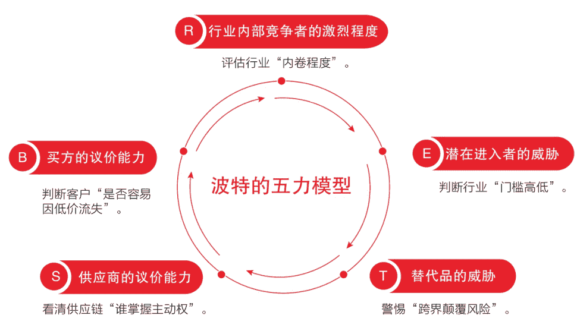

图3-2 波特的五力模型

## 行业内部竞争者的激烈程度：从百花齐放到贴身肉搏

你看到的是赛道火热，资本追捧，排队融资；但波特告诉你，要先看这个行业的“内部杀伤力”到底有多强。如果行业中玩家众多、产品趋同、用户可替代性高，那么无论你多么努力，都可能被卷入一场低价肉搏、内卷过热的零和游戏。

以新茶饮市场为例：表面看是万亿赛道，机会无限；实际上，从喜茶到奈雪，从茶百道到蜜雪冰城，每一个品牌都在门店设计、口味研发、渠道布局、供应链效率上进行“极致优化”的竞赛。这些品牌在供应端动辄拥有上百种最小存货单位（stock keeping unit, SKU），在营销侧日更十几条社交媒体内容，而在资本侧也有充足的资金支撑降价促销与大范围广告投放。在这样的市场结构中，小团队若无独特的定位，贸然入局只是“扮演炮灰”的概率更大。但这并不意味着小团队毫无机会，关键在于差异化切口。例如，聚焦40岁以上人群的健康茶饮，或者主打地域性口味的复古茶铺，反而可以避开主流竞争带来的压力。你不必正面解决冲突，只需站在消费者尚未被满足的“盲区”，就有可能打造出属于自己的细分品类。

## 潜在进入者的威胁：看起来很美，其实“水很深”

一个行业是否值得进入，不仅看今天的竞争，还要看明天可能的新入局者。任何看起来“赚钱”的赛道，都会吸引无数后来者蜂拥而至。创业者必须看清，这个行业的真实进入门槛有多高。比如生鲜电商，表面看就是“采购+配送+App”，很容易模仿。实际上，其背后的冷链仓储、库存周转、履约成本，是阻挡一众创业团队的无形高墙。每日优鲜、叮咚买菜、美团买菜都曾在该领域激战，最终大多被收缩、并购甚至退出市场。

真正的进入门槛，不是技术，而是现金流与履约系统的稳定性——这是用数年精细运营打下的基础，绝不是靠模仿一个产品界面就能跨越的。创业者如果低估了这些“隐形门槛”，就很容易在尚未打开市场之前，先被现金流问题打回原点。这也意味着，创业前的五力分析，不是“看别人成功没”，而是要问自己：“我有跨越这个门槛的独特资源吗？”

## 替代品的威胁：真正的敌人，可能不在行业里

很多创业者犯的最大错误，就是把眼光局限在同行之间的竞争，却忽视了来自行业之外的替代威胁。比如你开了一家健身房，竞争对手不只是附近的另一家健身中心，更可能是Keep、小红书打卡、露露乐蒙直播课，甚至是华为推出的智能运动手表——他们在以完全不同的方式解决用户的同一个需求：如何打造健康的生活方式。替代品越多，意味着用户切换成本越低，你的议价空间也越小。这也提醒小团队创业者：真正的护城河，不是服务本身，而是用户认知中的不可替代性。产品之外的品牌故事、情感链接、服务路径设计，都是构筑客户黏性的关键。

## 供应商的议价能力：一旦上游拿捏得住你，就拿捏得住你的利润

很多创业团队在发展初期忽视了上游资源的重要性，等到需要扩张时才发现：原材料成本无法控制、关键供应商突然提价、交货期无法保障……这些都足以撕裂一家初创企业的现金流系统。大企业如瑞幸咖啡或海底捞，通过自建供应链系统、深度参与上游标准制定，从源头锁定价格与供货周期，实现了极强的成本控制力。反观小团队，如果没有议价能力，唯一的出路就是通过“联合议价”或“长期绑定”，将分散的订单集中、提前签订框架协议，换取一点点主动权。这就是五力分析中的“供给压强”部分——别只盯着用户，先看你能否掌控成本源头。

## 买方的议价能力：让客户不能随时离开你

在信息极度对称的今天，消费者的权力指数陡增。你的产品再好，只要用户在小红书或知乎上搜一搜，很可能就会跳转到价格更低、服务更好的替代方案。尤其在平台经济下，用户的转移成本几乎为零。但也并非所有行业都被用户“牵着鼻子走”。那些构建了高品牌认同、高文化绑定的企业或产品，如露露乐蒙、星巴克臻选、苹果手机，用户愿意为体验买单，而不仅仅是产品功能本身。在用户看来，它们不是便宜，而是值得。这说明，小团队若想抵御“买方压价”，最关键的策略就是构筑情感壁垒，让用户愿意与品牌共鸣，并参与其中。这不需要巨额广告预算，但需要对用户心理的深度理解和精准洞察。

五力模型不仅是分析工具，还可以变成战略量化模型。小团队创业者可以对每一项力量打分，1分代表“对我们极为不利”，5分代表“我们具有极强优势”。一个行业若五项加总仅得8分甚至更低的分数，意味着这是一个“强敌如林”的地狱模式；如果得分在20分及以上，说明这个行业尚有空间，切入角度合理。更重要的是，这一评分可以用于自身竞争力的体检。比如，你发现你的产品在用户端议价能力为2分，那么下一阶段的核心战略就是提高用户转移成本，增强品牌忠诚度；如果供应商压价能力为4分，那么你就要开始考虑是否构建备用供应渠道、谈判机制或自建部分生产环节。

波特的五力模型并不会告诉你“去哪个行业更赚钱”，但它可以让你避开那些一眼看上去很热实则无路可走的赛道；它不会帮你做出战略选择，却能帮助你避免战略盲点。对小团队创业者来说，这或许比任何一个行业机会清单都更为重要。因为，真正的战略，不是选择哪一条路，而是知道哪条路下雨、哪条路的前方是断崖、哪条路可以加速——然后，用自己的方式走出独一无二的路径。

## 资源基础理论：如何构建你的护城河

五力模型为我们揭示了行业竞争格局，资源基础理论（resource-based theory, RBV）则为我们提供了一种“如何生存并占据一席之地”的思路。波特的五力模型更像是一个静态的分析框架，能够回答“当前企业在行业中的竞争力如何”这一问题，但无法回答类似“企业的竞争优势未来能否持续”这种问题。资源基础理论可以帮助创业团队判断“未来会不会好”。

资源基础理论主张：一个企业之所以能够在竞争中脱颖而出，是因为它拥有一组“独特且难以复制的资源”，这些资源构成了企业可持续竞争优势的基础。

按照资源基础理论的判断，创业只有具备稀缺性、不可模仿性、不可替代性和组织支持性4个特质的资源，才能形成真正的护城河（见图3-3）。

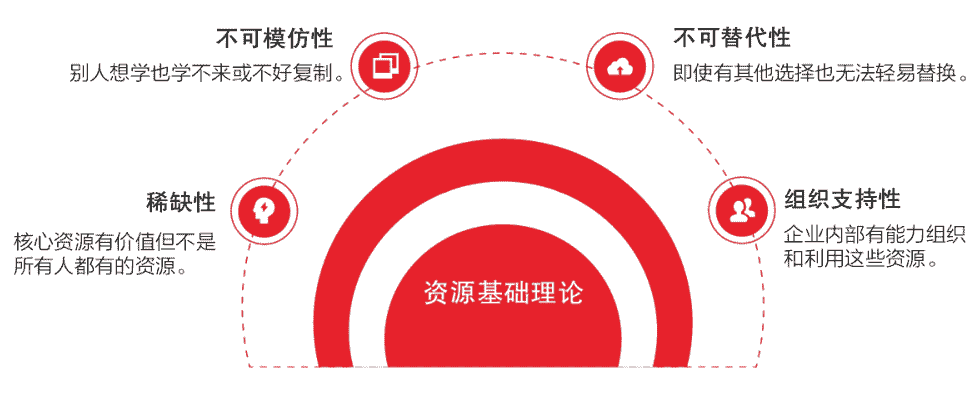

图3-3 资源基础理论

### 稀缺性：从第一性原理中挖出“别人看不到的矿脉”

所谓稀缺性，是指你拥有的资源足够有价值，而且不是每个竞争对手都能轻松获取的。在商业世界里，“稀缺”并不一定意味着竞争优势，往往是洞察力——你是否比别人更早看见“人们真正需要的东西”，能够助你实现弯道超车。

以华为海思为例，在芯片赛道上，华为之所以能够突出重围，正是因为其在“芯片自主可控”方向上的第一性洞察。早在市场主流还沉迷于高通依赖的时代，华为就已经开始投入自研芯片。尽管早期并不被看好，但最终在被卡脖子的背景下，这一稀缺资源成为企业底层战略安全的关键。在创业层面，像小红书之所以能从种草平台走向社交内容社区，也是因为他们比别人更早地看到“消费决策不只是功能匹配，更是情绪共鸣”的趋势。这份超前的“用户底层洞察”，就是稀缺性。

### 不可模仿性：让别人想抄也抄不来

今天的产品，几乎没有什么是真正做不到的。硬件技术、软件接口、营销打法，只要有资源、有工程师，就能照搬。然而，真正的壁垒不是“能做”，而是“能不能在多维度同时做到”。

以星巴克为例，其“第三空间”概念已经成为全球商业标杆。很多模仿者尝试复制星巴克的门店风格、菜单内容，甚至社交氛围，但无法复刻出其整体顾客体验。这是因为星巴克的不可模仿性并不在于咖啡豆，而在于其服务流程、门店运营系统、员工培训机制、会员积分系统与品牌文化的深度协同。这是一种“系统性的组织经验”，靠的是日复一日的打磨，不是一纸商业计划书能写出来的。

这给了小团队创业者一个重要启示：即使技术或产品容易被模仿，只要你能建立起“流程护城河”，就能拥有独特的优势。比如在社群运营、用户反馈闭环、内容风格调性等方面，形成独到、持久的协同机制，这些都将成为“别人学不会的组织肌肉”。

### 不可替代性：既要单点突破，更要系统联动

在资源基础理论的视角下，有些资源看起来普通，一旦它与其他资源系统深度融合，就会变得无可替代。

比如苹果生态系统：一台Mac电脑本身不一定比联想电脑的性能更强，但它能无缝接入iCloud与iPhone联动、用AirDrop秒传文件、用Apple Watch解锁Mac，这种全链条协同体验，使得用户很难跳出这个生态。这并不只是硬件之间的兼容，而是品牌哲学、设计标准、技术协议、用户习惯的全面闭环。

对小团队来说，当然不可能构建如此庞大的生态系统。但是，即使是微型的，也可以构建“小生态”。比如，将你的产品设计与用户运营机制打通，将你的内容传播与社群反馈机制绑定，甚至将你的客户服务与品牌语言统一。只要你能让用户“习惯于你”，就能初步建立起不可替代性。

### 组织支持性：资源利用最大化

最后一个特质是最容易被忽视的。很多企业并不是因为资源不够，而是因为组织动员能力太弱：有技术没团队、有流量没转化、有品牌没交付。资源在手，却变不成结果，这比没有资源还可惜。

以肯德基为例，这家看起来“老派”的快餐品牌，实际上在门店管理、数字化营销、员工激励机制等方面堪称做到了极致。它的数字中台能实时调度全国门店的库存与人力，它的门店运营关键绩效指标（key performance indicator，KPI）可细化到每小时的翻台率与产品动销率。换句话说，再小的单位都有清晰的资源调用机制，才能让“千城千店”的服务品质仍能稳定如一。反观很多初创团队，有资源也白搭——一场活动做完无人复盘、用户数据收集了无人分析、策略会议开了无人跟进。组织能力的差异，决定了资源的产出率。

对于企业未来可持续竞争优势的判断，以上四者缺一不可。我们用稀缺性、不可模仿性、不可替代性、组织支持性这四种特质作为标尺，回头审视早些年共享单车行业的兴衰，就会发现摩拜与OFO的案例，恰好成为“静态资源特质如何在动态环境中失效”的典型样本——它们曾凭借部分资源的短期价值站上行业顶端，却因未能满足完整的特质要求，更缺乏资源与环境的动态适配能力，最终让优势快速消散。这也恰恰凸显了资源基础理论动态解释能力的关键价值。

首先，对于共享单车行业，其核心资源和能力显然不是制造自行车的能力，否则应该是凤凰、永久、飞鸽这几家公司成为共享单车行业领先企业。在众多稀缺资源和能力中，至少有两项是至关重要的，分别是强融资能力和政策支持。这两点有价值且稀缺的能力意味着当年这两家企业至少是有竞争优势的，只不过不考虑可复制性的话，是无从判断当时它们到底是暂时性的竞争优势还是可持续的竞争优势。但问题恰恰就出在了可复制性或移动性上。对于更大体量的公司，如阿里巴巴、腾讯和美团等，摩拜和OFO的核心资源与能力都是非常容易被复制或移动的，因此当时这两家企业所处的位置其实是暂时性的竞争优势，而不是可持续的竞争优势。

资源基础理论的最大价值，在于提醒创业者：真正长久的优势，往往不是“显眼的资源”，而是那些“被你整合起来、用出效率”的系统能力。对小团队创业者来说，构建可持续的竞争优势的过程，就是不断地寻找自己最独特的那一组资源——也许是你对某个小圈层的深度理解，也许是你对某种技术的极致熟练掌握，也许是你打造用户共创机制的能力，也许是你形成了难以被复制的品牌调性。你无须赢下整个行业，只需要在结构中找到一个“站得住的缝隙”。这一缝隙的稳固程度，恰恰取决于你的资源基础是不是足够独特、协同、难以模仿。

## 理解企业结构：价值链与利益结构中的战略落点

如果说宏观层面提供了政策与趋势的方向盘，行业层面揭示了赛道和竞争格局的地图，那么企业层面的分析，就是创业者必须亲自掌控的“引擎舱”。在小团队创业中，资源稀缺几乎是常态，如何用有限的资源创造最大的价值，是每一位创业者必须面对的现实问题。

在本节中，我们将深入探讨波特的价值链模型与利益相关者交易结构模型，通过这两个工具帮助小团队重新梳理两个企业运作的根本命题：“如何创造价值”与“如何分配价值”。透过它们，我们希望帮助创业者厘清企业运转的内部逻辑，从而将战略真正落地，变成日常操作的系统性成果。

## 从成本到价值：在运营体系中做对减法

在很多创业者的理解中，战略是一件关于宏大愿景的事。当你真的开始运营一家小公司时就会发现，最考验人性的不是宏大愿景，而是每天琐碎流程中的资源分配选择：今天是先修复产品漏洞，还是优化广告转化率？是提升老客户的满意度增强客户黏性，还是投入精力开拓新客户？看似细节，实则战略。越是小团队，越要学会把有限的资源用在刀刃上。

小团队该如何精准判断：“什么值得做、什么该舍弃？”答案藏在一个经典战略工具里——价值链模型（见图3-4）。

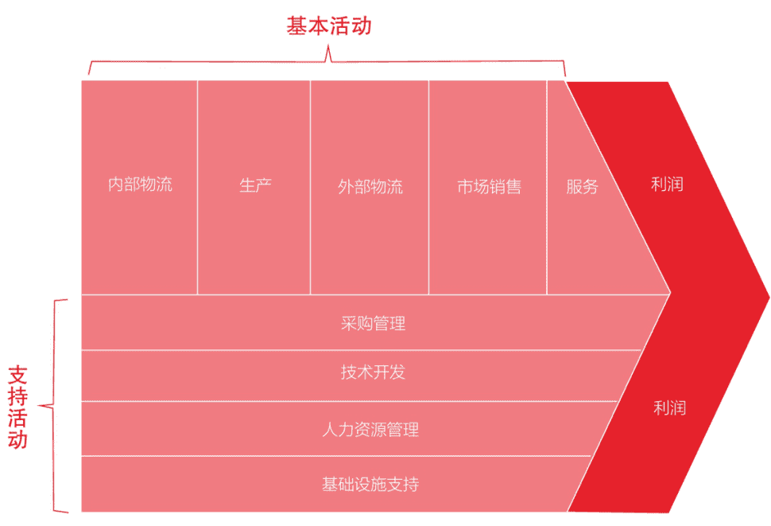

图3-4 价值链模型

价值链模型（value chain model）由哈佛商学院教授迈克尔·波特于1985年首次提出，是战略管理领域的经典理论工具。它将企业的全部活动分为“基本活动”和“支持活动”两个层面：前者包括从原材料采购到产品销售再到售后服务的全过程，后者则包括人力资源管理、技术开发、基础设施支持与采购管理等，构成企业运作的后台系统。

波特的核心观点是：企业的竞争优势来源于其各个价值环节的协同效率，以及对核心流程的强化与优化。起初，这套模型确实是为沃尔玛、通用电气、宝洁这样的大企业设计的，但真正从中受益最大的，其实是资源紧张、精力有限的小团队。原因很简单：你不能像巨头一样“全覆盖”，但你可以选择“只做最有价值的事”。在商业世界里，最贵的不是花钱，而是“花错了精力”。

那么，价值链模型如何帮助小团队“做对选择”？

价值链模型的最大价值，就是通过对每一个业务环节的价值贡献与资源消耗进行细致评估。你会发现，大量流程看似“必须做”，其实“是可以交出去的”——不是不重要，而是别人比你做得更好。

以某初创视频内容公司为例，该团队致力于为品牌客户提供AI生成脚本与短视频内容。他们原本的服务流程涵盖从市场调研、脚本编写、画面设计、剪辑输出到客户沟通、产品交付和售后服务，几乎包揽全部业务。然而项目一多，人手就捉襟见肘。于是，创始人团队用价值链模型拆解整个流程，发现真正能产生溢价的，并非后期剪辑或技术操作，而是前端的创意洞察和与客户的深度共创。这些环节最能体现团队对品牌文化的理解，也最容易被客户记住。于是，他们将视频剪辑、字幕校对等环节外包给专业工作室，节省了70%的运营时间，把核心团队完全释放到客户关系和创意策划中，提升了服务附加值，也提高了客单价。客户从“买内容”变成“买创意脑力”，业务结构反而更稳健。

再来看一个典型的数字创业场景：某AI电商运营团队专注于为新消费品牌做店铺托管。他们用AI工具进行市场趋势分析、选品判断和广告投放优化，但在服务流程中囊括了售前咨询、售后客服、订单跟进等环节。当项目量快速上升后，运营团队很快发现自己陷入“体力活”的泥潭。价值链分析后发现，数据算法优化和内容转化效率提升是他们真正的能力护城河，而售后服务类工作虽占用了员工大量的精力，却对提升客户满意度的作用有限。于是，他们果断调整战略：将客户服务部分交给专业外包服务平台，通过统一SOP模板确保质量，同时将预算与人力重点投入算法模型的训练和优化。结果3个月内，该团队的运营效率提升40%，客户续约率也从原先的60%提升到82%。

如果你研究过近年迅速崛起的新消费品牌，如蕉内、完美日记、元气森林，就会发现它们都不是那种“大而全”的重型组织，相反，它们以极致效率构建出“前端强运营+后端高外包”的极简组织。蕉内在品牌初期便极度聚焦供应链端的“研发—生产—物流”效率，用AI进行销售预测，减少库存积压，将大量客服、视觉设计等模块交由外部团队。完美日记在初创阶段就清楚地知道“品牌调性和流量运营”才是自己的护城河，物流、仓配、客服等模块全部标准化处理。这些品牌的成功逻辑很一致：从一开始就不追求“做所有事”，而是聚焦于“做核心价值”。

从“每件事都想做”到“只做必须做的事”，小团队最大的优势，恰恰是可以不受传统观念束缚地重新设计企业——哪一环自己做？哪一环技术搞定？哪一环交给更专业的外包者？价值链的本质，不是让创业者扩大组织规模，而是逼迫创业者做减法：砍掉那些占据大量资源却无法带来差异化价值的流程；集中全部注意力在那些“做出10%投入却能带来90%回报”的节点上。

## 从交换到结构：在价值网络中占据有利位置

在传统的商业认知中，一个小团队的成功往往被简化为“产品足够好、市场足够大、执行足够快”。但当我们将目光从企业内部流程投向更大的商业生态，就会发现：真正决定成败的，不只是你能做什么，而是你处于价值网络中的什么位置。这正是“利益相关者交易结构”（stakeholder transaction architecture）模型想要回答的问题——它不是关注企业做了什么产品，而是深入分析企业如何与外部世界建立关系、配置资源、分配利益，进而构建一种具有结构黏性的长期生存模型。

这一思维框架源自系统理论、组织经济学与战略生态学的交汇，它认为企业不是孤岛，而是嵌入在一个由客户、平台、政府、供应商、投资人、社群乃至算法构成的动态网络之中。企业不是在孤军奋战，而是在不断协调、连接、嵌入之中生长。尤其对于资源有限的小团队来说，生存的关键不是“我有多强”，而是“我插在了哪个结构节点上”。

### 小团队如何借“结构位”激活多边资源？

阿里健康的案例极具参考性。你或许不了解小众的AI家庭照护平台，但一定知道阿里健康在互联网医疗领域的地位——它既不是药企，也不是医院，更不是医保机构，却通过构建“药品+医生+保险+支付”的四边闭环结构，成为互联网医疗生态的健康数据基础设施提供者。它的核心价值，是链接三方并赋能彼此的交易过程，最终成为结构型角色。

类似的逻辑也适用于小团队创业者。比如在社区养老赛道，一些初创公司并没有自己的医院，也没有大量的线下网点，但却能通过设计“政府补贴+医院背书+设备租用+家庭上门服务”的多边结构，把自己嵌入地方政府的养老政策，承担居家服务承接方的角色。在这套结构里，小团队不是“主角”，却是“必需接口”——没有它，整个服务链条就无法闭环。哪怕服务能力、资源储备不算强，只要能稳定提供“中介协调功能”，其在网络中的位置就足够稳固。结构位，永远比资源量更关键。不过，当行业进入深水区，比如内容创业告别流量红利、AI SaaS陷入技术同质化，小团队的结构位思维又该如何落地？

在内容领域，许多中小型MCN机构早已意识到靠广告接单难以为继，于是开始转型为结构型内容服务商。以无忧传媒为例，它不再只是内容生产者，而是搭建起品牌、平台和消费者三方之间的交易机制。第一，它们以深度内容运营能力为品牌提供“原生种草”；第二，它们绑定电商平台的直播转化系统，实现内容直接带货；第三，它们通过私域社群或会员系统与终端用户形成反复交互。在这样的结构中，小团队不是用一次创意换一笔广告费，而是成为价值网络的“连接器”——每一次流量，不再是一次性收入，而是多边价值的持续生成过程。

AI SaaS领域的案例更具冲击力。我们访谈过一个小团队，最初他们希望靠技术创新打动客户。但在短短一年时间内，他们深刻地意识到：客户真正关心的并不是你的模型算法多么先进，而是你能否帮他对接上政府采购平台、是否有联合试点的资源、能否和大平台完成系统集成。换句话说，能不能把产品嵌入客户原有的交易结构？如果不能，就算技术再好也很难卖出去。于是，这个小团队开始调整战略，建立与平台公司、政府咨询机构、行业协会的交易通道。最终，他们的产品本身没有变，但整个商业模型从销售软件变成嵌入系统，价值随即翻倍。不是因为技术进步了，而是因为结构对了。

在实战中，小团队如何构建这种结构性的连接能力？

我们建议绘制一张利益相关者输入/激励结构表（见表3—1），这张表的目的，不是把所有人当工具，而是反向思考：“我到底能给谁带来什么价值”，而不是一味地问“谁能帮我”。关系的可持续性，来自交换的平衡性；结构的稳定性，源于多方都得利。只有让每个利益相关者都在结构中获得收益，小团队的“结构位”才能真正扎根，在复杂的网络中长久地占据有利位置。

## 表3-1 利益相关者输入/激励结构表

| 角色 | 能提供的资源 | 期待的回报 | 合作机制类型 |
| :--- | :--- | :--- | :--- |
| 本地政府 | 政策支持、数据资源 | 示范效应、政绩体现 | 协议合作型 |
| 大平台 | 流量、API、技术基础设施 | 用户增长、内容质量 | 集成绑定型 |
| 上游供应商 | 产品、设备、渠道 | 稳定订单、结算及时 | 联合开发型 |
| 客户企业 | 场景、数据、试点资源 | 成本降低、效率提升 | 成果交换型 |
| 投资人 | 资本、背书、资源整合能力 | 股权回报、项目话语权 | 杠杆驱动型 |

将价值链模型与利益结构模型结合，是小团队真正摆脱资源限制的方法论。

在价值链层面，小团队创业者需要梳理清楚企业内部哪些流程最关键，哪些可以优化或外包；而在利益结构层面，创业者开始意识到自己不仅是产品制造者，更是一个多方资源的调配者、嵌入者、组织者。这意味着，小团队不是孤军作战，而是要不断重构自己的系统连接能力，形成“有网、有桥、有流”的结构黏性。这也决定了一个重要转变：创业者的目标不只是“打赢一场仗”，而是“占住一个位置”。能被替代的产品会被价格战卷死，难以替代的结构位置看似普通，却可能拥有长期复利的护城河。

## 理解项目设计：SWOT分析在实践中的应用

在一个创业团队的成长过程中，最能体现其战略功力的，是在具体项目上的精密规划与果敢决策。尤其对于资源有限的小团队而言，每一个新项目的推出，都意味着一场高风险的“精准手术”。做得好，团队可能迅速打开局面、获得市场回报；做得不好，宝贵的时间与资金便可能付诸东流。

在项目层面开展战略分析，找到最佳进入方式、竞争位势与风险回避路径，是创业者必须掌握的能力。在众多战略工具中，SWOT分析无疑是最适合小团队使用也最具操作性的分析模型之一。

SWOT，是strengths（优势）、weaknesses（劣势）、opportunities（机会）、threats（威胁）四个英文单词的首字母缩写。它的结构简洁、逻辑清晰，可以帮助创业团队全面认知自身项目的内部条件和外部环境，从而指导其制定更符合实际的战略路径。在实践中，SWOT分析并不是一张静态的四象限图那么简单，它是一种“对内深挖、对外放眼”的思维方式，也是一种将抽象判断转化为行动策略的操作路径。

## 为什么SWOT分析特别适合小团队

首先，它是一种低成本但高回报的分析工具。与大企业动辄耗费大量资源进行全面战略评估不同，SWOT分析不依赖复杂的数据建模与外包咨询，而是以团队已有的信息和经验为基础，通过结构化的讨论便可完成初步建构。尤其在项目初期，数据尚不完备、预算尚不充裕的情况下，SWOT分析可以迅速引导团队厘清思路、明确方向。

其次，它具有高度的灵活性和延展性。无论用于新产品的定位、市场推广策略的制定，还是用来衡量业务调整的可行性，SWOT都可以因地制宜地被企业灵活应用。对小团队来说，项目迭代周期短、试错空间小，一个简单、敏捷而不失系统性的工具，往往能带来关键性的转折。

最后，也是最重要的一点，SWOT能够促使团队在面对不确定性时进行全面权衡——不是盲目乐观，也不因小问题而自我否定，而是通过对内外因素的系统梳理，将“想法”转化为“判断”，再进一步形成“选择”。

## SWOT的四维解析：思维训练，而非表格填空

传统教材中常将SWOT分析简化为一个四象限矩阵，左上角是优势，右上角是劣势，左下角是机会，右下角是威胁。这种结构固然清晰，却容易让初学者陷入“填空式思维”，从而忽略了它背后的战略逻辑。在本书的框架中，我们更希望创业者把SWOT作为一项结构化思维训练，通过以下几个维度深入开展分析（见图3—5）。

优势是企业的立足之本，是资源与能力的再认知。优势，是指项目目前具备的、能够转化为价值的内部资源与能力。这里既包括显性的资源（如团队技术、渠道资源、客户基础），也包括隐性的能力（如快速响应市场的能力、品牌的用户共鸣力）。例如，一家由三位AI算法工程师创立的SaaS团队，他们虽然启动资金不多，但其最大的优势在于技术能力出色，能够快速将先进模型产品化，并以极低的成本完成初期迭代。优势分析的核心，并不是单纯地“列清单”，而是要把握一个关键问题：“我们的哪些资源和能力，是其他人短期内无法复制的？”只有那些真正稀缺、不可替代且可持续转化为市场价值的能力，才算得上是战略意义上的优势。创业团队需要从自身过往的经验中总结出哪些做法曾快速见效、哪些资源曾创造了关键突破，从而找到适用于未来项目的新动能。

劣势是风险源头，是自我坦诚的第一步。在很多创业讨论中，人们倾向于高估自己的能力、低估市场难度，这种认知偏差很容易导致项目初期盲目推进、后期陷入困境。SWOT分析中的劣势分析环节，正是要求创业团队冷静地审视那些可能阻碍成功的内部因素。它无须自我贬低，但必须建立在事实与经验的基础上，促使团队从一开始就建立风险预警机制。例如，某团队虽然在短视频内容生产上颇有经验，但由于团队成员缺乏电商运营背景，在将内容流量转化为销售业绩时始终收效甚微。这个劣势一旦被忽视，项目继续投入只会加剧资源浪费。如果团队能够在SWOT分析阶段识别这一短板，就可以选择引入擅长电商运营的联合创始人，或者将该部分业务委托给专业机构，从而在战略设计上实现“补位”。劣势分析不是一场“自我鞭打”，而是一次“资源现实主义”的训练。它的目的是提醒创业团队：只有认清短板，才能更精准地配置资源，制定防错机制。

机会是增长杠杆，是外部红利的识别与追赶。小团队的机会，往往不是来自庞大的宏观市场趋势，而是来自结构性空档——在现有市场结构中，被巨头忽略、被传统模式束缚，或者被消费习惯新变化带来的机会点。机会分析的关键，不是看别人“在做什么”，而是看“别人忽略了什么”。例如，2022年起兴起的中式养生热潮，在大多数传统保健品牌还在做传统茶饮与药食同源产品之际，一家初创公司洞察到“00后对草本饮品的时尚需求”这一未被满足的市场机会，迅速推出了以“朋克养生”为定位的便携型中草饮，成功吸引了一大批年轻用户群体，实现了从0到1的品牌突围。

在机会分析中，创业团队需要回答几个核心问题：是否存在被主流玩家忽略但真实存在的细分需求？是否有新的技术、法规、消费观念的变化正在打开新的市场入口？我们能否以比现有模式更低的成本、更快的速度、更优的体验进入市场？机会并不是“看见了就是我们的”，而是要结合自身优势与执行力判断“我们能否抓住”，这是SWOT分析最需要“理性想象力”的一环。

威胁是底线意识，是不确定性中的主动防御。在很多失败案例中，我们可以看到一个共通的问题：项目初期判断过于乐观，忽视了潜在的外部威胁。SWOT分析中的威胁分析环节，正是帮助创业团队建立“最坏情景假设”，以便提前准备应对策略。这些威胁可能来自技术升级速度的超预期、竞争对手的快速模仿、法规政策的突变，也可能来自市场整体信心的波动。

以某短视频内容服务平台为例。该平台在2021年迅速获得了大量用户与媒体关注，但未预判到平台依赖的主流社交平台将在2022年开始限制第三方接口访问，导致其数据抓取与服务交付受到严重影响，项目最终难以为继。如果该团队当时在SWOT分析中就将“对平台依赖性过强”列为潜在威胁，并提前建立数据自主获取机制，便可能避免陷入最终的平台型风险导致全盘失败的绝境。威胁分析的本质，是对“不由我们控制”的风险进行分类管理。它不代表我们要停止前进，而是提醒我们在战略设计中设立“防火墙”，做到“看见风险、承认风险、准备应对”。

## SWOT分析的设计与应用

如果说SWOT的四个维度是企业对一个项目的“全景扫描仪”，那么更高阶的实践就是把这些因素彼此关联起来，转换为可执行的策略方案。在实际使用中，很多创业团队往往止步于“填表格”，将优势、劣势、机会、威胁分别写在纸上就草草了事。殊不知，真正的战略价值并不是停留在认识的层面，而是在“连接”中诞生的。

一个项目如果能系统地将优势与机会相结合，往往意味着能打出一套顺势而为的组合拳，快速赢得市场先发优势；如果能清醒地看清自身劣势，积极防御外部威胁，则意味着能在混沌中规避风险、延续生命。优秀的战略不是拍脑袋的选择，而是通过“优势如何抓住机会”“劣势如何抵御威胁”这两对交叉关系，执行战略上的4种典型动作——进攻、修复、防御与规避。

在一个刚起步的创业团队中，这种策略组合思维尤其重要。比如，一支由3位具备生物医药背景的高校博士组成的创业团队，他们计划推出一款中老年人营养代餐粉。经过SWOT分析，他们发现自身优势是对功能成分的精准配比和配方科学性强，劣势则是品牌尚未建立，缺乏市场营销经验；外部机会在于银发族健康意识提升和中国人口老龄化趋势；威胁则来自大量低价代工产品充斥市场，价格竞争激烈。

在这个基础上，他们制定的初步战略路径，是以“差异化高品质”作为切入点，主攻高端用户市场，并通过医生推荐建立信任背书。这一策略便是从“优势+机会”交汇处出发，利用专业能力对准新需求。但他们也没有忽视威胁，为了规避价格战带来的风险，他们放弃了电商大促赛道，而是选择通过体检中心与社区医疗机构的合作进行推广。同时，在“劣势+机会”的组合中，他们也识别到营销能力短板的补救空间，于是引入一位拥有保健品品牌操盘经验的合伙人，来协助团队建设消费者沟通体系。

这个案例的关键，并不是这4项因素分别写得多漂亮，而是在项目真正启动前，团队已经将战略路线“踩实地、看长远”。SWOT的最大价值，不在于让你想象项目有多完美，而是让你提前意识到每一个“理想”背后可能附带的“脆弱点”，并提前构建应对体系。

值得注意的是，SWOT虽然简洁，却绝非万能工具。它的有效性高度依赖于信息的准确性和团队的思维深度。比如，有些创业者在初期过于乐观，将“热潮”误认为“机会”，却忽视了市场已被大企业垄断，技术门槛高、渠道壁垒重重。这样的误判一旦纳入SWOT框架，就可能让后续战略偏离现实。又如，有些团队对优势的认知停留在“我们很努力”“我们团队氛围好”这种泛泛之词上，缺乏能被市场量化验证的能力，这也会导致战略判断失真。

所以，真正有洞察力的创业者，会用SWOT作为一个动态更新的战略仪表板。在项目启动初期，它是一份路线草图；在项目推进中期，它是一个状态监控表；在团队遇到市场瓶颈时，它则是一次方向校准仪。优秀的创业团队往往会每半年对核心项目重做一次SWOT，不断地将外部环境的变化与内部能力的成长纳入评估体系，并据此调整资源分配与策略节奏。

尤其在AI时代，SWOT分析还可以结合数据工具升级为智能化战略助手。比如，使用AI数据分析工具，创业者可以通过分析用户在社交平台上的行为数据，实时洞察“机会”的动态变化；通过竞争情报系统，创业者可以随时监控潜在“威胁”的强度；通过客户反馈系统和售后数据，创业者可以精准识别项目的“优势在哪些点表现良好”，以及“劣势在哪些阶段最可能暴露”。这些数据反过来可以填补传统SWOT分析中的主观盲区，让战略更加贴近现实。

从方法论的角度讲，SWOT看似简单，但当它被嵌入团队的决策过程、融入产品研发流程、落实到每一轮融资前的战略汇报中时，它就不再只是一个分析模型，而是贯穿于创业全程的“战略思维载体”。对小团队而言，这种思维的养成并不困难。如果团队能将SWOT分析结果转化为视觉化的战略地图，例如用项目看板列出“基于机会—优势配对的优先任务”“基于威胁—劣势配对的应对策略”，并设置季度跟踪点，那么战略将不再只是写在PPT上的“蓝图”，而是变成团队日常执行的“作战计划”。

每一次机会识别、项目推进、团队会议，甚至每一次融资路演的准备，都可以从一次SWOT分析开始。正是这种“反复演练、动态修正”的过程，使小团队能够在不确定中保持理性、在竞争中保持独特性、在变化中抓住确定性。

如果说成功创业是一场对未来的预判和驾驭的游戏，那么战略设计就是这场游戏中你能掌握的最大变量。在AI时代、在数字技术全面普及的今天，战略的底层工具已经大众化，但真正决定成败的，是你是否拥有系统性看问题的意识，以及从结构走向执行的能力。小团队并非不能做出大事，关键在于有没有用对思路、走对路径。

未来属于那些能够“结构化看世界，系统化做决策”的人。战略，不再是大企业的专利，它正成为每一个有志于改变现状的小团队、个人创业者手中的通用能力。只要你愿意学会这一套工具，并带着问题去应用它，你就能在不确定性中，走出一条清晰可控的成长之路。

# 04 产品设计

## 如何洞察市场并打动用户

每一款成功的产品，背后都是一次深刻的洞察与创造的融合。在AI浪潮席卷一切的今天，产品设计不再只是少数科技巨头的专属领域，也不再是资源密集型的高门槛工程。小团队创业者迎来了前所未有的机会：他们第一次能够用极低的成本、极快的速度，将灵感变为现实，将需求变为产品，将产品变为事业。

这一切，源于“从概念到产品”路径的彻底重塑。过去，产品设计的流程是线性的，也是封闭的。从市场调研、需求分析、功能规划、原型开发到用户测试，每一个环节都需要投入大量的时间、人力和资金。创业者在资源最紧缺的时刻往往要做出最关键的判断，这本身就是一个高风险博弈。更棘手的是，很多产品之所以失败，不是因为执行不力，而是因为最初的需求判断就错了。也正因如此，小团队往往被迫“猜市场”，而不是“听市场”。

AI彻底改写了这一局面，一连串技术的突破，让小团队成为最大的受益者：小团队的产品设计，不再是“穷人的小作坊”，而是“轻装上阵的科技特种兵”。他们无须羡慕大企业的人才储备，也无须忌惮资本不足的劣势，只需清晰的判断力、灵活的执行力，以及拥抱AI的意识，就能与大企业在同一个市场中同台竞技，甚至另辟蹊径占领主流赛道。

在本章，我们将一一剖析，AI如何赋能产品设计的每一个环节：从市场洞察，到原型开发，再到产品迭代。

## AI重构的市场洞察

在竞争激烈的商业环境中，市场洞察是小团队生存与突围的关键，而AI让团队从创业初期就能具备全维度洞察能力——对外可精准捕捉宏观市场的脉搏、研判行业趋势与竞争格局；对内能自动生成用户画像、挖掘消费者隐性需求并转化为清晰的产品概念，帮助小团队以更低的成本、更高的效率实现“看得远、算得准、走得快”，为精准决策与业务突破奠定基础。

在当今竞争激烈的商业世界中，企业面临诸多挑战。

在AI介入前，小团队的市场洞察之路布满荆棘：一方面，市场变化瞬息万变，传统调研模式需投入大量的成本且周期漫长，结果市场机会早已错失；另一方面，消费者需求复杂多变，仅靠过往经验和粗略调研判断，极易导致产品服务与真实需求错位，造成资源大量浪费且收效甚微，而成本与人力消耗更是小团队难以跨越的门槛。那么，AI如何有针对性地破解这些痛点？在宏观市场分析、用户需求挖掘、竞争格局研判等环节又有哪些可落地的应用路径？接下来，本节将逐一拆解（见图4—1）。

## 宏观环境：政策信号的先知解码

以往我们对政策的分析，往往都是事情发生之后再去解读它对市场的影响；AI技术的出现，让政策分析能够从事后解读转向实时预警。

AI具备强大的数据分析和处理能力，能够快速扫描大量的政策相关文本。自然语言处理（NLP）技术是其关键手段，它可以对草案、政府工作报告和智库文件等进行深度解析。比如，通过识别文本中的关键词“碳中和”“供应链安全”等，并分析这些关键词之间的关联网络，AI能够提前预判政策落地后可能引发的产业连锁反应。

德勤经济展望报告明确提到，其AI系统可以用于监测全球贸易政策变动，并分析关税调整对产业链的影响，而AI可提供合规建议和替代供应链方案。这一举措让汽车企业在欧洲市场的准入通过率提升了近40%。

## 行业趋势：实时关注价值流走向

对小团队创业者来说，准确把握行业趋势是实现弯道超车的关键。如果能够提前洞察行业的新兴趋势，及时进入新的市场领域或采用新的技术和商业模式，就有可能在竞争中获得先发优势。

以前我们了解行业趋势，往往都是看一些滞后的报告，现在AI让我们能够实时监测价值流的走向。AI通过融合多种数据来源，如电商平台数据、社交媒体数据、行业报告数据、投融资数据等，并运用动态权重算法等技术，能够量化行业声量、投融资热度、技术专利增长等因素之间的交叉影响，从而更准确地预测行业趋势。例如，魔镜洞察通过电商平台和社交媒体数据融合，分析“下沉市场”“县域消费”等关键词热度和电商订单地域分布变化，感知快速消费品市场向县域下沉的趋势。

另外，AI可以通过对新兴技术的监测和分析，预测行业的技术变革趋势。例如，AI可以追踪区块链、物联网等新兴技术在行业内的应用情况，分析其对行业商业模式、产品形态、竞争格局等方面的影响。当AI发现某一新兴技术在行业内的应用逐渐增多，且相关的投融资活动也日益活跃时，就可以预测该技术可能会引发行业的重大变革，企业需要提前关注并做好应对准备。

当发现某一行业有向线上化、智能化转型的趋势时，小团队创业者可以迅速推出相关的线上服务或智能产品，满足市场需求，从而获得市场份额。

## 竞争格局：透视竞争对手的战略战术

在商业竞争中，企业要想了解竞争对手的战略布局，可以透过竞争对手的行为数据，反过来推断竞争对手的资源分配逻辑。企业的各种行为数据，如价格变动、专利申请、招聘信息、供应链物流数据等，都蕴含着丰富的战略信息。AI可以对这些数据进行收集、整理和分析，从中发现竞争对手的战略动向。比如，通过分析竞争对手的价格变动数据，企业可以了解其定价策略和市场竞争意图；通过研究专利申请数据，企业可以知晓竞争对手在技术研发方面的重点和方向。

华为通过AI驱动的专利语义分析系统，可以识别竞争对手在自动驾驶、车联网等领域的专利密度变化，从而预判其战略重心迁移。博思白板（Boardmix）有一个功能，在软件内输入行业关键词，如电子科技，AI自动生成SWOT分析图，识别竞争对手的劣势与市场机会。供应链物流数据则可以帮助企业了解竞争对手的产能布局和库存情况，以便更好地制定自己的生产策略和配送策略。

除了专业数据，招聘数据也能为管理者提供重要线索。如果一家企业大量招聘某一领域的技术人才，很可能意味着它将在该领域加大投入，开展相关业务。

此外，一些新兴的竞争情报分析工具也借助AI技术提供更强大的功能。例如，有些工具可以实时监测竞争对手在社交媒体上的动态，分析其品牌宣传策略和用户反馈情况。还有一些工具可以对行业内的新闻报道、分析师评论等进行整合分析，从更宏观的角度评估竞争对手的市场地位和发展趋势。

对小团队创业者和企业管理者而言，了解竞争格局有助于制定更有效的竞争策略。如果发现竞争对手在某一领域拥有绝对优势，企业可以考虑避开正面竞争，寻找差异化的发展路径；如果发现竞争对手的薄弱环节，企业则可以抓住机会，集中资源进行突破。

## 市场需求：从模糊到精准洞察

当企业获得了外部环境的支持和对行业的洞察力后，开始发力，此时的第一步就是探寻市场的真实需求。AI技术正在以前所未有的速度和深度，将原本看不见的需求变得清晰可视、可测、可预判，成为创业者的洞察加速器。

例如，在2023年新品发布季中，农夫山泉就利用AI系统对小红书平台近百万条UGC进行语义聚类，发现“0糖气泡”“低负担饮料”“颜值高包装”成为18～25岁女性消费者关注的焦点。他们据此推出了“小蓝瓶”系列气泡水，即无糖苏打气泡水产品，并将社交传播重心锁定于“轻健康”“拍照好看”“约会饮品”等标签，迅速打响年轻化市场，打通传统饮用水与潮饮之间的用户认知壁垒。

通过百度指数、阿里巴巴商业参谋、腾讯指数等大型平台，产品团队无须巨额投入，也能快速获得全域消费者的行为动向与情绪偏好。以腾讯指数为例，小微品牌通过它可以洞察微信、小程序、视频号等生态中的用户对某类产品、关键词、场景的关注度变化，还能反推出不同年龄段、地域分布人群的使用行为与讨论热点。

AI不仅能做分析，更能够精准预测需求。近年来，百雀羚与腾讯、京东合作，搭建起基于自然语言处理（NLP）与用户行为建模的“消费者需求预测系统”，实时捕捉社交平台上女性用户对护肤品的评价关键词、皮肤状态描述、场景化使用诉求。在一次新品策划中，AI模型发现“熬夜肌”“轻敏感肌”“成分安全”“孕妇可用”成为关键词高频组合，于是迅速推出以“熬夜修护”为主题的面霜产品，并以“成分党友好”“孕期可用”为社交传播话术，取得了远超预期的市场反馈。

## 用户画像：智能构建，自动生成

在确定了市场的大致方向后，下一步就进入了创业流程中最关键也最容易出错的阶段之一：用户画像的构建。

所谓用户画像，简单来说就是给潜在用户“画一张脸”，清晰描绘他们是谁、在想什么、关注什么、会如何做出购买决策。然而，在过去的商业时代，这一步往往意味着大量的人工投入。从问卷调研到深度访谈，从SPSS分析表格到Excel的数据透视图，创业者需要梳理一大堆凌乱的信息，才能得出一个模糊的“理想客户模型”。更糟糕的是，很多时候这种模型带有浓厚的主观色彩——往往更像“我们以为用户想要什么”，而不是真实的“用户正在寻找什么”。

AI的出现，彻底颠覆了这种低效、易偏误的工作方式。今天，无论你是跨国巨头还是只有3人的小团队，只要合理调用AI工具，就能在数天甚至数小时内生成精准、系统、层次分明的用户画像，并据此推进产品、内容、营销甚至渠道的核心决策。

我们可以通过联合利华的案例来理解AI是如何自动生成用户画像的。联合利华在推出旗下高端护肤子品牌多芬Derma系列前，通过NLP工具分析了来自YouTube评论、亚马逊评价和Reddit论坛的护肤关键词，然后由AI将这些原始数据自动分类、聚合，最终形成了一个具有代表性的用户画像：“30～45岁女性，肌肤敏感，偏好纯天然成分，倾向于长期复购，消费决策受皮肤科医生建议的影响。”这是利用AI工具对海量非结构化的数据进行分析，进而看见用户是谁。接下来，AI还能够对生成的用户画像做进一步解读，从而真正理解用户。

用户画像中“30～45岁敏感肌女性”和“偏好纯天然成分”是用户对肌肤安全性的重视，“受皮肤科医生建议的影响”反映了用户对专业权威的信任。这种理解能够促使企业，在产品研发上进行产品成分选择，突出纯天然特质；在广告营销上引入皮肤科医生背书，树立专业品牌形象。AI实现了全链路决策的精准性。

如果是初创团队，可以借助一些成熟的AI工具为其提供帮助。国外的Notion AI、国内的魔搭等都可以帮助创业者构建用户画像。AI工具的出现，让企业对市场的洞察更加精准，颗粒度也更加细致。

当下的市场环境下，市场洞察已经不是一次性的调研，而是企业的基础能力。在AI技术加速渗透的今天，市场洞察已经从“经验驱动”转向“数据驱动+AI赋能”，但技术只是工具，核心仍在于企业对市场的敬畏与对用户的尊重。毕竟，所有的数字与模型背后，都是活生生的需求与真实的商业逻辑。企业要做的，不是拥有一次完美的洞察，而是建立持续洞察的机制：用数据捕捉信号，用逻辑分析本质，用行动验证假设。

## AI赋能的原型设计

对小团队创业者而言，快速、高效地将清晰的产品概念转化为真实可体验的产品原型，不仅决定了创业速度，也直接影响了该团队产品的市场竞争力。然而，在传统产品开发模式下，原型设计与开发过程成本高昂、耗时漫长，往往让创业团队望而却步。AI技术的普及与深入应用，正在快速打破这一局限，让资源有限的小团队也能够以前所未有的效率与精准性进行产品原型开发。

在传统的产品开发流程中，原型设计常常是创业者面临的最大瓶颈之一。要想把脑海中的一个创意变成“看得见、摸得着”的视觉实体，往往意味着必须依靠专业设计师、外包团队或设计机构来实现。从初步草图到完整的产品效果图，前前后后需要数周乃至数月的时间，还要经历大量“创意偏差”与“沟通拉锯”的痛苦过程。对于时间紧张、资源有限的小团队而言，这种高成本、低效率的流程几乎是无法承受的。然而，随着AI生成工具的迅猛发展，这一切正在被彻底改写。

## 创意生成：从灵光一现到结构化

创意从来不是一种“天降灵感”。在传统商业实践中，创意生成往往依赖于团队会议、头脑风暴、竞品分析和线下调研。然而，这种方式不仅会耗费大量的人力和物力，还极容易陷入“路径依赖”和“集体认知偏差”的陷阱——团队内部过往的成功经验，反而成为创新的无形枷锁。尤其对资源有限的小团队来说，传统创意方式既不够快，也不够准，更难以支撑高强度的试错迭代节奏。

生成式AI的崛起，从根本上改变了创意生成的逻辑。它不再只是一个“灵感补充工具”，而是已经成为一套系统性的创意引擎。

以某些家居家具企业为例，这些企业近年来持续将AI工具纳入其设计流程。在设计近年度“城市小户型定制系列”产品时，很多团队将“节省空间”“模块化组合”“Z世代审美”“租房适配”作为关键词，输入至DALL·E的图像生成系统与ChatGPT。经过多轮次的迭代，数小时内，系统便输出了几十种不同风格、不同功能逻辑的初步概念图与命名建议。这些创意再由内部团队筛选、迭代、建模，最终转化为实物模型进入测试市场。这种方式不但打破了以往长达数月的产品概念验证周期，而且极大地释放了设计师团队的头脑能量，让他们将时间集中于创意筛选和用户验证上，而非重复性创作。

这种模式所体现的，其实是生成式AI带来的三重跃迁优势。

第一重，是创意密度的跃迁。AI一次可以生成上百种风格、语言、主题、功能组合的创意选项，远超人类团队的日常输出上限。它不是取代创意人，而是成为创意能力的放大器。

第二重，是创意成本的跃迁。从前一场广告创意拍摄的费用动辄数十万元，如今用Runway等AI视频生成工具，小团队即可打造接近商业水准的动画短片，大幅降低了实验与测试的边际成本。

第三重，是创意落地速度的跃迁。有了AI协作，创意不再停留在“脑暴板书”，而是能快速实现“可视化→原型化→用户反馈”，形成从概念到执行的闭环机制。AI让“边创意边试错”成为现实，极大地提升了企业的创新效率与市场适配能力。

回到创业者的视角，你不再需要苦等灵感，也不必组建庞大的设计或内容团队，只需一台电脑、一套好用的AI工具，便可与世界级品牌在同一个创意维度展开竞争。正如彼得·德鲁克（Peter Drucker）在《创新与企业家精神》中所言：“创新是企业家的特有工具。凭借创新，企业家可以将变化视为开创新业务或新服务的机会。”而在今天，生成式AI就是每一个小团队创业者手中的“创新放大器”，让其可以低成本撬动高质量创意，将梦想快速落地为产品，把不可想象变成可以实现。

## 原型设计：从创意表达到产品原型

生成式AI不再只是“内容辅助工具”，而是成为从创意表达到产品原型的全链条“加速器”。国内外的主流AI设计平台，如Midjourney、DALL·E、Stable Diffusion、阿里巴巴推出的“通义万相”、百度推出的“文心一格”等，都已逐步走进创业团队的日常工作流程之中。这些平台通过强大的AI算法，可以基于关键词、风格标签、功能描述等少量输入，迅速输出大量具备视觉冲击力和市场适配度的设计草图，让设计创意“从想法到可视”几乎只需数分钟。

我们可以从以下3个真实且成熟的案例来看AI设计工具的革命性价值。

一是国际运动服饰巨头耐克在其创新实验室“ISPA”项目中广泛应用AI设计工具。ISPA致力于通过极限创新打造未来运动产品，在开发“Interconnected Footwear”这一新款鞋概念时，团队采用了AI生成工具Midjourney与Stability AI进行外观风格探索。仅用了3天的时间，他们便生成了数百张具备模块化构造、生物仿生学、未来感形态的初步设计草图。这些草图不仅激发了内部团队的灵感，还成为后续原型建模的视觉参考。在这种AI协作模式下，产品从构想到样品的周期从过去的3个月压缩到3周内完成。

二是宜家（中国）近期在其城市限定系列家具开发中，启用了文心一格与Midjourney结合的设计流程。在“北欧自然元素”和“现代都市快节奏”两个要素条件下，系统生成了大量概念视觉图，帮助团队快速完成风格定位与色彩策略制定。据设计负责人披露，相比以往通过人工收集灵感、找外包建模等方式，新流程将视觉草图开发周期缩短了80%以上。

除了大公司，小团队也同样因AI而被赋能。例如，国内内容平台知乎旗下的创作者扶持项目，在孵化创意IP衍生产品（如图书周边、数字商品、文化衫等）时，也大量引入AI视觉生成工具。一个3人运营的小组，仅用“Notion+文心一言+Midjourney”，即完成了数十款视觉周边原型图的开发，并借助知乎生态的“盐选专栏+直播带货”模式进行预售测试，部分产品上线48小时内即售罄。

由此可见，从大型科技品牌到小型内容创业团队，AI设计工具正成为从想法到商品的“火箭推进器”。未来设计不再是“有创意才能做的事”，而是“有工具就能做的事”。这也意味着，创业者真正需要比拼的，已不再是“有没有资源”，而是有没有建立一套“从灵感到设计再到市场验证”的快速反应机制。

## 原型制造：从设计理念到实体产品

设计图纸只是起点，真正决定创业成败的，仍是能否快速将设计理念落地为实体产品。尤其对硬件创业者而言，产品的“物理成型”是绕不开的关键一步。然而，传统的原型制造流程却是一座难以跨越的壁垒：从CAD建模到材料测试，从结构工程设计到热力仿真，每一步都需要专业的技能、昂贵的软件和高强度的人力投入。对资金和时间都极其有限的小团队而言，这种“工业级试炼”几乎令人望而却步。但AI技术，正在悄然扭转这一局面。

近年来，以Autodesk Fusion 360、PTC Creo Generative Design、Siemens NX、浩辰CAD、中望3D AI协作平台等为代表的先进设计平台，已将AI能力深度融入从建模到制造的每一个环节。尤其Autodesk Fusion 360的AI辅助功能可基于用户输入的功能参数、负载条件和制造约束条件，自动生成多个高强度、轻量化的结构设计方案，同时集成材料数据库与有限元仿真模块，实现“自动生成→自动评估→自动筛选”的闭环式设计逻辑。这种能力，大幅降低了工业设计的专业门槛，真正让“设计师+工程师+分析师”的工作整合于一个智能平台中完成。

例如，某国内领先的智能家居品牌在开发其新一代智能门控系统“超级门锁”时，便广泛采用了Autodesk Fusion 360的AI设计模块。项目团队根据设定的尺寸、材质、强度、安全等级等参数，通过AI自动生成了多种锁体结构方案，并实时仿真其在高频开启、恶劣气候和高温潮湿环境下的表现。在仅用不到两周的时间便完成了30轮结构优化迭代后，最终确定了一款结构强度更高、材料使用率更优的新型模块。正因其设计科学、稳定性高，产品在上市后的3个月内即打破同品类的销售纪录，成为智能锁行业的标杆产品。

不止于硬件，AI在服务型产品开发中的助力也日益显著。以教育行业为例，知名在线教育平台猿辅导在推出其“AI微课”产品线时，依托Notion AI与自研算法自动生成课程大纲、讲解脚本、互动问答题库与课程配图。整个课程开发周期从传统的4~6周压缩至不足一周，不仅节省了内容策划团队的大量人力资源，还提高了教学内容的针对性与逻辑完整性。产品上线后，在中小学用户群体中迅速积累了口碑，首月即实现超过50万用户的下载转化。

综合来看，AI辅助原型制造带来的革新具有以下4个层级的意义。

- 时间压缩与成本控制：传统原型设计周期以月计，AI技术则将其压缩为“小时级”乃至“分钟级”。
- 跨职能整合：原本由工程师、材料专家、工艺师共同完成的任务，如今只需一个拥有基本逻辑能力的设计者在AI平台上操作即可。
- 风险前置化处理：AI仿真系统在设计之初即能评估耐压、热传导、材料弹性等参数，大大减少了物理打样失败的可能性，提升了项目成功率。
- 场景适配灵活化：无论消费电子、医疗设备还是新材料家居产品，AI原型工具已能高度适配多元应用场景，赋能创业者在不同垂直领域中快速起跑。

过去，“设计→验证→试错”是一场极其消耗资源的“马拉松”；现在，借助AI的力量，这一切正在被浓缩成“短跑冲刺”。创业团队再也无须经历漫长的产品开发周期，只需搭建好概念与参数逻辑，就能让AI完成复杂的原型推演与实测。这标志着一个新的创业范式正悄然到来：创意不再惧怕现实，原型不再被时间与资源束缚。在AI时代，小团队也能拥有媲美大企业的开发能力，并在极速迭代中抢占市场先机。

## AI驱动的高效迭代

在AI的赋能下，小团队终于也拥有了“精准试错、数据证实”的能力，从“拍脑袋”的模式走向“算法辅助”的新范式。这一切，不再是未来学的概念，而是现实创业世界里，每一个小团队都可以触手可及的竞争优势。

在传统的产品创新周期中，从原型推出到正式产品落地，用户反馈和迭代优化通常是整个链条中最复杂、最耗时的环节。

许多创业者都经历过这样的困境：团队耗费数月精力开发出原型，却在实际上市后发现市场反应冷淡、用户需求错位，从而陷入持续不断的优化循环，最终失去了市场先机。然而，伴随AI技术的飞速发展，这一困境正在被快速瓦解。通过AI赋能的用户反馈收集、数据驱动的快速决策、实时产品迭代，小团队创业者可以更高效、更精准地将产品推向用户真正需要的方向，真正实现敏捷创新。

### 从被动到主动：AI驱动的用户反馈收集

在传统的创业语境中，小团队往往难以建立有效的用户反馈机制：一方面，受限于人力、时间与预算，他们无法与大量用户进行持续、高质量的沟通；另一方面，即使零散地收集到部分用户的意见，往往也只是静态文本或片段化评价，难以系统提炼出产品改进的方向。

过去，用户反馈更多的是一种“被动接收”的流程：用户发起，团队响应。然而在AI时代，这种关系正在被彻底重塑——AI让用户反馈机制从“等待问题出现”转变为“提前发现可能”，从“人工筛选反馈”转向“智能洞察趋势”。

一个颇具代表性的案例是国内智能穿戴领域的明星公司——小米生态链企业华米科技。在推出其首款GTS系列智能手表后，华米科技部署了智能客服系统对用户在小米社区、京东评论区与微博等渠道的反馈进行实时分析。AI反馈系统识别到用户高度关注表带舒适度、心率监测准确性及App兼容性。仅用不到两周的时间，华米科技便基于这些反馈对产品说明、硬件微调及配套软件进行了优化调整。GTS系列最终在上线两个月内销量突破百万，成为小米生态最成功的智能穿戴产品之一。

在AI驱动的反馈系统中，小团队不再是数据的“搬运工”，而是可以真正坐在驾驶舱里，通过仪表板、雷达系统和自动预警系统，精准掌控用户需求的变化。

对于希望将AI反馈能力融入日常运营的小团队而言，可以从以下3个方面入手提升。

- 可以部署多触点的AI交互界面，选择能够整合社交平台、电商平台、自有平台的智能客服系统，如阿里云、腾讯千帆、百度云等，确保每一次用户互动都不被遗漏。
- 设定结构化反馈标签体系，在AI对话系统中预设多个分类字段（如“功能缺陷”“价格敏感”“体验建议”等），提升数据分析的颗粒度和可操作性。
- 可以将情绪识别与运营动作联动。AI不只是“数据筛选员”，更应成为“用户情绪预警器”。

从更宏观的角度看，AI让用户反馈的范式发生了根本性跃迁：它不再是静态的“意见箱”，而是动态的“实时雷达”。一个创业团队是否拥有反馈的主动权，已经从侧面决定了其产品能否真正做到以用户为中心。对小团队而言，这无疑是一场管理逻辑的根本性革新，在技术的加持下，即使没有万人客服团队，也能实时捕捉百万用户的真实声音，并迅速形成系统级反馈反应。

### 数据驱动决策：让每一次迭代精准击中用户需求

在AI尚未普及的时代，小团队的产品决策往往更多地依赖创始人的经验与团队的头脑风暴。尽管这些经验和热情值得肯定，但随着产品复杂度的提升与用户需求的多元化，单靠主观判断显然难以应对快速演变的市场环境。

今天，AI赋能的“数据驱动型决策机制”正在成为小团队打破信息瓶颈、提升产品适配度的决定性工具。全球范围内，从Power BI、Tableau、Looker Studio等数据可视化平台，到国内迅速崛起的阿里Quick BI、火山引擎DataTester、GrowingIO，创业者现在可以通过低代码甚至“零门槛”的方式，对用户行为、购买路径、功能使用频次等数据进行自动采集、实时分析与可视化展示。

以国内某些知名新锐咖啡品牌为例，很多团队早期尝试用小程序运营用户社群，最初设想用户最在意的是咖啡口味的多样性，但通过GrowingIO的用户路径分析发现，大量用户在浏览页面停留时间最长的并非“产品介绍”，而是“冲泡方法”和“环保包装”的介绍板块。这意味着用户也许更关注便捷使用和环保理念，而非产品口味本身。很多团队据此调整产品文案，推出“环保回收胶囊罐”项目并强化便携场景的营销内容，直接拉动用户复购率提高了23%。

但光有洞察还不够。每一次产品方案的调整，是否真的奏效？是否真的击中了用户的核心需求？这就需要借助AI驱动的A/B测试系统进行快速验证。

比如，腾讯会议曾尝试不同的免费额度模型。通过腾讯云实验平台的连续实验，团队发现用户更偏好“功能不受限但会议时长有限”而非“功能受限但时长开放”的免费模型，进一步印证了B端用户对完整功能体验的刚性需求。这一策略使腾讯会议保持了极强的用户黏性，月度活跃用户数超2亿。

这些企业级平台提供了一个鲜明的现实范本：数据不再只是辅助决策的参考，而是核心策略的起点。对小团队而言，借助AI工具实现这种“以数据驱动战略、以实验验证方向”的流程并非遥不可及。正如AI让庞大的数据分析从专家专属走向大众可用，小团队也有机会拥有过去只有大企业才具备的实时市场感知能力。

那么，小团队如何真正用好这套系统？

- 首先是建立自动化反馈机制，通过AI客服系统、问卷自动采集工具、用户评论分析工具，构建起“数据先知”的第一公里，让用户声音不再沉没在噪声中。
- 其次，需要将数据分析融入决策节奏，每周、每月组织团队围绕数据面板进行运营复盘与产品方向检视。数据不能只是汇报材料，而要成为策略讨论的出发点。
- 最后，坚持高频次、低成本的小步试错，尤其是在确定性尚不充分的方向上，利用A/B测试快速收集市场反馈。作为创业者，别指望第一次就做对，而要尽快知道“哪种更对”。

# 05 品牌建设

## 让好产品被看见、被理解、被信任

过去，品牌靠经验判断和人力堆叠来争夺消费者的注意力；今天，AI以数据驱动、算法引导的方式重构了营销的全流程。从市场洞察、内容创作到广告投放、客户运营，AI让品牌能够以更低成本、更高效率、更强关联性触达目标用户，实现从“人找人”到“算法找人”的转变。

在AI的加持下，小团队也能掌握原本只有大企业才拥有的市场洞察力与内容输出能力。精准画像、动态内容、多元分发、实时优化……AI让数字营销从“凭感觉”走向“靠数据”，从“盲入投放”走向“智能分发”。这是一场以算法为引擎的效率革命，彻底打破了传统营销的规模壁垒。

在接下来的内容中，我们将深入分析AI如何深刻改变了内容营销、搜索引擎优化与广告投放，以及客户关系管理与个性化体验等关键营销环节，帮助小团队实施和驾驭AI工具，以更少的资源、更短的时间创造更卓越的营销效果。

企业只有充分认识AI的强大价值，积极主动地学习并实施相关策略，才能在新一轮的市场竞争中抢占先机。与此同时，我们也必须时刻谨记：AI是强大的工具而非最终目的，真正的营销成功依然依赖于人的创造力与战略眼光。

## 品牌定位：借助AI，实现从“经验主义”到“数据驱动”

在小团队已成为创新主力的今天，AI对数字营销与品牌建设的赋能，远非短暂的技术潮流，而是一次根本性的能力平权。它让小团队无须投入大量的资金与人力，也能精准对话市场、构建品牌势能。未来的竞争格局，必将属于那些能够巧妙将AI效率与人性洞察相融合的精干团队。

在当今这个市场竞争高度白热化的时代，精准的市场分析与品牌定位早已不仅是企业成功的“加分项”，而且成为参与竞争的“入场券”。然而，传统的市场调研与品牌定位方法仍然依赖大量的人工投入，从问卷设计到市场访谈，从消费者洞察到趋势预测，每一步都可能充满主观偏差，耗费大量的时间与资源。当企业最终得到结论时，市场趋势可能早已发生变化，企业的战略决策变得被动且低效。AI的出现，从根本上颠覆了这一认知。

借助AI强大的数据处理与分析能力，企业得以迅速从海量数据中萃取真正的价值，完成精准的用户画像分析、竞品情报收集与市场趋势预测，让品牌定位真正实现从“经验主义”到“数据驱动”的跃迁（见图5—1）。

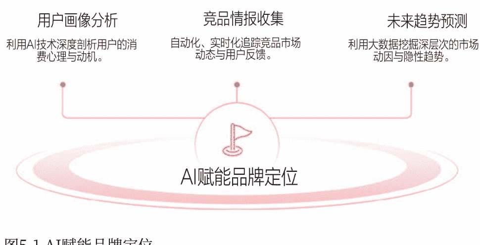

### 用户画像分析

精准的品牌定位始终围绕着对用户的深度理解。然而，以往的用户画像方法主要依靠传统的问卷调查和抽样访谈，数据样本有限，结果时效性差，洞察也容易停留于肤浅的表面。现在，AI技术彻底改变了这一状况。借助AI工具，如百度智能云用户画像平台，企业可以实时整合用户数据、网站浏览记录、社交媒体互动行为和第三方市场报告等多维数据，构建高度精细的用户画像。这种画像不仅涵盖人口学特征、消费偏好、行为轨迹，更能够深度挖掘用户背后的心理需求、兴趣倾向甚至潜在动机。

例如，运动品牌耐克，长期以来始终注重精准营销。耐克曾利用AI技术深度挖掘用户数据，发现跑步人群、潮流文化爱好者、瑜伽和健身群体背后截然不同的消费心理与动机。基于AI洞察，耐克迅速为跑步爱好者提供“智能试穿”服务；为潮流文化爱好者推出联名款限量版运动鞋；针对瑜伽与健身群体强化社群内容与生活方式推荐。这种AI驱动的精准用户画像与营销方案，不仅提升了用户满意度，更在激烈的市场竞争中强化了耐克品牌的长期竞争优势。

### 竞品情报收集

“知己知彼，百战不殆”，但传统的竞品分析往往陷入烦琐而低效的人工数据收集与整理工作，难以实时更新，战略调整始终慢半拍。如今，借助AI技术，企业完全可以实现自动化、实时化的竞品情报分析。

以全球头部化妆品品牌欧莱雅为例。近年来，欧莱雅全面使用AI工具实时追踪雅诗兰黛、资生堂、SK-II等全球竞争品牌的市场动态、营销动作与用户反馈，利用DeepSeek、ChatGPT等，快速整合并智能分析竞争对手发布的公告、营销材料、社交媒体评论甚至舆情反馈，从中精准洞察竞争对手的营销战略、产品反馈和市场表现。这使得欧莱雅能够实时做出精准决策，迅速调整新品开发和营销策略，在竞争中始终占据先机。例如，当AI分析工具发现“洁颜油”品类在亚洲市场关注度迅速攀升时，欧莱雅迅速推出升级版洁颜油产品，并借助精准定位的内容营销和KOL合作，一举占据市场较大份额。AI智能竞品分析，让欧莱雅从“跟随趋势”转变为“定义趋势”，始终掌握品牌营销的主动权。

### 未来趋势预测

精准品牌定位还需要对未来趋势的准确预测。过去，企业往往依赖于专家分析和经验判断，但这些方法往往停留在浅层的预测，忽略深层次的市场动因与隐性趋势。如今AI技术凭借大数据挖掘能力，整合历史销售数据、社交媒体舆情、搜索趋势甚至宏观经济数据，实现精准的趋势预测与战略前瞻布局。

全球时尚品牌飒拉（ZARA）正是凭借AI趋势预测能力，持续保持市场领先地位。飒拉通过AI工具实时分析Instagram、抖音、小红书等社交平台上的大量用户生成内容（UGC），精准预测下一季度的流行趋势、风格偏好与颜色倾向，然后迅速根据这些预测调整供应链和设计策略。这样做不仅大幅降低了库存风险，更实现了对市场趋势的精准把控。

在电子消费品领域，华为消费者业务事业部也曾利用AI技术深入分析消费者在线评论、科技媒体报道，成功预测消费者对高端智能手机、折叠屏手机、影像技术的强烈需求，并迅速布局旗舰产品Mate系列、P系列，以精准的趋势预判抢占高端市场份额。

AI的市场分析与品牌定位为企业提供了前所未有的洞察力，让营销决策变得更加精准科学。AI不仅能够帮助品牌更深入地理解消费者，也能够为企业快速捕捉市场先机、制定精准品牌战略提供强大的数据支撑。

## 内容营销：用AI提高创作的效率和深度

传统内容创作中高昂的时间成本与人力成本，以及个性化内容的大规模输出需求，曾是资源有限的小团队难以逾越的障碍。然而，AI技术的崛起，特别是生成式AI的实用化，正从根本上改变这一局面，使小团队能够以惊人的效率和极低的成本，生产出多样化（文本、图片、视频）且高质量的内容。

文本创作是品牌内容营销的基础形式。过去，企业在进行文本内容创作时，往往依靠人工撰写。这种方式不仅需要投入大量的时间和人力，还难以应对快速变化的市场需求。生成式AI模型的出现，彻底改变了传统文案创作的方式（见图5—2）。

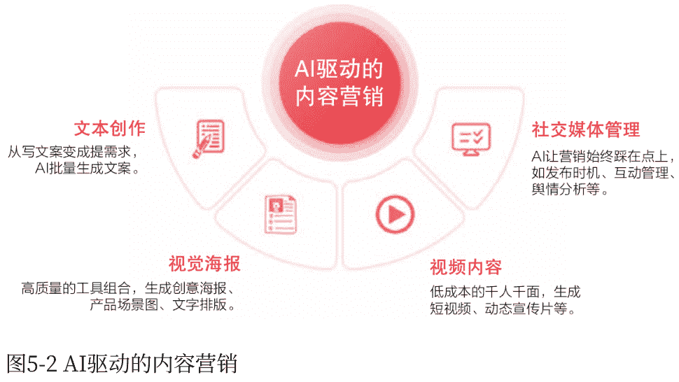

### 文本创作：从写文案变成提需求

传统文本创作的困境，在规模化需求面前被无限放大。比如，跨境电商要给上千款新品写描述，品牌要给不同平台撰写风格迥异的推文，人工写作不仅耗时长，还容易出现风格走形、热点滞后的问题。

企业应用AI工具，可以直接把写文案变成提需求。OpenAI的ChatGPT、百度文心一言等工具，能根据简单提示快速生成符合品牌调性的文本：你要轻松活泼的小红书笔记，它不会给你严肃正式的商务文案；你要精准的英文产品描述，它能规避语法错误还自带营销感。

作为日均上新超千款的跨境电商巨头，希音（SHEIN）在传统模式下，人工撰写英文描述不仅成本高，还经常因文化差异导致表达生硬。接入AI工具后，运营人员只需输入“吊带裙+法式碎花+显瘦设计”，AI就能快速生成“这条法式碎花吊带裙，用收腰剪裁藏起小肚腩，行走时裙摆像花瓣一样散开”这类表达既精准又有画面感的描述。

企业利用AI工具批量生成文案，主要有以下3个步骤。

第一，明确提示词。写好文案的关键在于如何给AI提需求，我们需要从以下3个维度明确提示词。

- 目标场景：你生成的文案想要用在哪里，如小红书种草、亚马逊产品页。
- 核心信息：产品的优势及卖点等信息，如气泡水产品的卖点是0糖、气泡足。
- 风格调性：你希望得到什么风格的文案，如语言风格活泼的口语化或专业严谨等。

第二，批量生成后分层筛选。AI并不是万能的，当我们已经用ChatGPT、文心一言等工具一次生成5～10版内容，还需要按精准度、感染力、差异化进行筛选，即文案是否覆盖核心信息，是否符合品牌风格、是否表达具有差异化，最后我们保留3版进入下一步。

第三，人工校准“品牌专属感”。AI可能生成通用化内容，需人工添加品牌独有的语言符号，确保内容符合品牌调性。比如，国潮品牌运动鞋让AI生成针对年轻消费群体的运动鞋文案后，我们可以补充一句“上脚就是街头最靓的崽，国潮范儿拉满”，以此强化品牌标签。

### 视觉海报：高质量的工具组合

“没有设计师就做不出好海报”，这是过去视觉营销的铁律。AI生成式视觉工具，如DALL·E、Midjourney、Stable Diffusion、阿里通义万相等的普及，使得营销团队即使没有专业设计背景，也能快速制作出高质量的视觉内容。

一家咖啡品牌想制作一张万圣节主题的促销海报，可以通过向AI工具输入文字描述，如“南瓜灯与咖啡杯搭配的哥特风格海报”，AI便能快速生成多种风格迥异的海报方案供营销人员选择。很多跨境电商企业也大量使用AI生成产品场景图，如智能家居产品的团队输入“扫地机器人在现代简约的客厅工作，阳光从落地窗照进来”，AI便能自动生成贴近用户真实使用场景的视觉图。

要想生成优质的视觉内容，关键在于把握视觉内容的核心诉求——快、准、有记忆点，具体可以通过以下3个步骤实现。

第一，明确视觉目标和使用场景。我们先想清楚：这张图是用于小红书种草、电商详情页还是朋友圈海报？不同场景对视觉展示的要求完全不同，比如小红书更注重视觉冲击性，详情页更注重产品细节。

第二，用五要素法写出视觉提示词。

- 主体：如咖啡杯、运动鞋。
- 核心信息：如买一送一、新品上市等。
- 场景：如万圣节夜晚、健身房。
- 色调：如暖橙加暗黑、莫兰迪色系。
- 风格氛围：如哥特风、现代简约风。

第三，用工具组合提升效率。每一个AI工具都有其优劣势，我们可以组合使用。比如用Midjourney生成创意海报，用Stable Diffusion生成产品场景图；用Canva的AI工具调整文字排版、添加品牌标志等进行细节修改。

当然，用AI工具生成图片，也要规避一些风险。比如，尽量不要生成肖像图，涉及肖像会有侵权风险；在版权上要进行识别，最好生成后，修改成品牌的专属色和添加标志等，避免生成图无辨识度。

### 视频内容：低成本的千人千面

除了视觉海报，视频内容因其直观、生动、互动性强，是内容营销中的重要形式。

传统视频制作成本高昂、周期长，难以实现规模化和个性化创作。AI视频生成工具如Runway ML的Gen-2、Pika Labs，抖音剪映的AI助手等，正在彻底改变这种现状。营销人员只需输入文字描述或几张静态图片，AI就可以自动生成短视频或动态宣传片。比如，拍摄短视频原来需要提前写好脚本，花一天时间才能整理出20多个，现在两三小时就能搞定。比如，某快时尚品牌用剪映AI助手，给通勤风、甜辣风、复古风三类用户生成不同的视频：通勤风视频搭配职场背景，甜辣风视频添加动感音乐，复古风视频采用胶片滤镜。AI已经可以根据用户标签定制内容，实现低成本的千人千面，具体实现步骤主要有以下3点。

第一，确定视频类型和核心信息。先明确视频是产品功能介绍、场景化种草还是热点借势，再提炼1～2个必须传递的核心信息，比如汽车油耗低、服装显瘦。

第二，选择AI工具路径。第一种可以纯文字生成视频，用Gen-2，比如输入一辆红色SUV在山路上行驶，仪表盘显示油耗5.8升/百公里，直接生成30秒短视频。第二种可以选择图片转视频，用Pika Labs上传3张连衣裙穿搭图，输入展示连衣裙在咖啡厅、街头、办公室等环境下的穿搭效果，镜头缓慢切换，生成连贯视频，最后用剪映AI助手自动添加字幕、配乐，生成你想要的视频版本。

第三，结合用户数据，让AI生成不同版本的视频。比如面向职场女性的视频，视频重点可以展示服装通勤百搭；面向学生党的视频，视频突出性价比高、适配校园场景。

### 社交媒体管理：AI让营销始终踩在点上

社交媒体内容营销不仅涉及内容生产，更需要精准把握发布时机、互动管理和舆情分析。过去，这类操作往往依赖人工经验，效率低且难以实时优化；现在，AI工具可以实时分析社交媒体表现数据，优化内容发布策略和互动方案。

例如，AI工具Lately可以智能分析已发布内容的互动效果，自动预测用户互动率最高的发布时段，并自动规划发布日程，确保品牌内容发布在用户最活跃的时间段。同时，AI还能实时追踪用户反馈并自动分析评论情绪、话题热度，从而帮助企业即时调整内容方向。品牌还可以借助AI工具实时进行多版本A/B测试，根据不同用户的互动表现，自动优化内容创意，提升整体营销效果。

一些品牌甚至使用AI聊天机器人，如智谱清言、文心一言等，在社交媒体私信或评论中自动回复常见问题，实现7×24小时在线互动，大幅提升了用户满意度和企业的响应速度。

可以说，AI赋能的内容营销时代已然来临，它正在推动内容创作从人工生产走向人机协作的全新模式。当巨头还在比拼技术天花板时，小团队的机会在于落地速度快。

## 数字营销：智能化的流量获取和广告投放

对小团队而言，数字营销的核心目标是用最低的成本获取最高质量的流量。然而，随着网络环境日益复杂、用户行为更加多样化，传统的SEO（搜索引擎优化）与SEM（搜索引擎营销）策略逐渐显露出人工管理效率低下、实时调整能力弱、难以精准触达目标受众等弊端。此时，AI的兴起为数字营销领域注入了全新的活力。

流量的获取、转化过程可拆解为免费流量、付费投放、内容优化三个核心环节。以下从流量获取、投放执行、优化效果三大维度，解析AI技术如何为小团队创业者构建完整的数字营销逻辑链（见图5—3）。

### AI驱动免费流量：让小团队“不花钱”也能获客

免费流量是小团队的生存根基，而SEO是免费流量的核心来源，即通过提升网站在搜索引擎中的自然排名，持续获取用户主动搜索带来的流量。传统SEO依赖人工选词、内容创作和技术优化，对人力不足的小团队而言，执行门槛极高。AI可以辅助SEO的多个环节，尤其是在关键词策略和内容创作上提供智能优化。

#### 第一步：关键词优化

在关键词研究上，AI工具能够自动识别相关关键词并分析其竞争强度、搜索量等，帮助营销人员挑选最有价值的关键词组合。传统人工选词费时且容易遗漏，AI则可以扫描大量搜索数据和竞争对手的情况，给出长尾关键词、同义词和LSI关键词（潜在语义索引关键词，即与核心词语义相关的词汇。）等建议。例如，在线教育网站想通过SEO提高被搜索量，AI分析后建议除了“大数据课程”，还应布局“数据分析网课”“数据挖掘在线学习”等长尾词，并指出竞争较弱、容易快速提升排名的词汇，这是人工难以在短时间做到的。

#### 第二步：围绕关键词的内容生产

以往，编辑需要反复斟酌关键词密度、标题写法、语义相关等，现在AI可以直接生成SEO友好的内容。营销人员可以让ChatGPT这类模型撰写文章初稿，并要求其自然融入AI推荐的关键词、拟定吸引用户点击的标题和描述，从而产出对搜索引擎和读者均友好的文稿。

如果说优化关键词能够提高日常流量，那么紧跟趋势和用户兴趣能够迎来流量爆发。搜索引擎流量的核心在于“时效性”，尤其是行业热点、季节性需求等短期流量高峰，往往转瞬即逝，我们需要确保SEO内容紧跟热点。

IBM的研究指出，营销团队可以使用生成式AI根据实时趋势和受众兴趣，想出搜索引擎优化的标题或话题。这意味着，比如近期某话题火爆，AI会提醒品牌围绕该话题创作相关文章以抢占搜索热度。实际上，不少国外网站已经借助AI生成了成百上千篇高质量内容，实现了搜索流量成倍增长；国内也有企业用AI批量撰写商品问答、攻略指南等提升百度搜索表现。

总的来说，AI让小团队的SEO工作形成了“关键词精准挖掘→内容高效生成”的闭环，无须庞大团队的支撑，就能产出符合搜索引擎规则、贴近用户需求的内容，在自然流量竞争中占据优势。

### AI助力付费投放：让小团队“每一分钱都花在刀刃上”

付费流量是小团队快速起量的重要补充，但在团队预算有限时，“投不准”“花冤枉钱”的问题尤为突出——要么广告触达的用户毫无兴趣，要么高价抢到的曝光却带不来转化。AI通过精准定向、智能竞价、实时优化的全链路赋能，将付费投放从“凭经验猜测”转变为“靠算法决策”，让每一分预算都能精准撬动增长。

#### 锁定核心投放人群

无论搜索引擎广告（如Google Ads、百度推广）还是社交媒体（如Facebook、抖音），平台都积累了海量用户行为数据，AI能够从中深度挖掘与小团队目标匹配的潜在受众。比如，Facebook的“类似受众”功能，就是用AI模型根据一批种子用户，寻找更多行为特征相似的潜在用户；抖音可以根据用户的兴趣标签、浏览历史，定位“对产品有潜在需求”的细分群体。这种定向能力从源头上解决了“投给谁”的问题，确保预算首先流向最可能产生转化的用户，避免盲目撒网。

#### 智能竞价实现高效触达

当用户通过搜索引擎（如谷歌、百度）主动输入关键词（如“英语培训班”“性价比高的笔记本电脑”），此时带有此类关键词的广告就会在用户主动搜索时出现。SEM的核心是围绕关键词做精准竞价。传统SEM需要人为根据转化效果不断调节关键词出价、预算分配，这样做既耗费人力又难以及时响应竞价变化。AI的机器学习模型能够在每次竞价拍卖中自动计算出最佳出价策略，从而最大限度地实现广告主的目标（点击、转化或投资回报率）。

百度的智能出价系统就是AI应用于广告竞价的典型案例。它能够在每次广告竞价时，基于AI模型进行动态出价决策。系统会实时分析用户的搜索词、设备、地理位置、历史行为等数百个信号，预测该用户的转化概率。在广告主设定的预算和目标转化成本等约束条件下，系统会为每一次竞价计算出一个成本效益最优的出价。

例如，当一位位于北京朝阳区的用户使用手机搜索“同城急送”时，系统若识别该用户具有强烈的即时购买意图（如近期连续搜索相关服务、浏览物流公司页面等），便会倾向于提高本次出价，以在激烈的竞价中赢得更优的广告展示位置（如首位），从而极大地提升获取这个高潜客户的概率。

#### 实时优化投放效果

传统广告需要人工观察数据后再隔天或隔周调整，而AI可以实时分析广告表现数据并自动调整。例如，AI监测到某广告素材点击率逐日下滑，判定用户可能产生了审美疲劳，从而会自动减少这个素材的展示频率，同时增加另一素材的投放。或者，AI根据分时段转化率的变化，智能调整不同时段的出价和预算投入。例如，如果晚上8—10点的转化最好，AI会将更多的预算自动倾斜到这个时段投放，并在效果变差时迅速降低支出，避免浪费。

一些第三方AI工具（如Yuri自动化投放工具）甚至支持跨平台广告管理，用户设定目标后，AI会同时优化在Facebook、谷歌、抖音等多渠道的预算和出价，实现整合优化。在这个过程中，广告运营人员更多的工作是监控AI策略效果和进行创意上的指导，而繁杂的数据分析和调整工作由AI代替。

## AI优化广告创意：低成本做出高转化广告

付费投放转化率低，本质上是内容不够优质。传统广告创意优化需要人工长时间的策划和反复试验，耗费大量的人力和资金成本，且无法及时响应用户的实时反馈，难以在瞬息万变的数字环境中保持高效和精准。AI工具为这一困境提供了极其高效且高度个性化的自动化解决方案。

以全球最大的社交平台之一Facebook的动态创意优化工具为例。营销人员只需提供若干基础素材，如不同风格的产品图片、多种广告标题和多样化的描述文案，AI工具即能自动组合这些素材并实时进行创意的测试和优化。AI会基于实时用户反馈、行为数据和历史互动记录，自动调整素材的组合、优化广告的呈现形式和投放频率，确保每位受众看到的广告创意都更符合他们的偏好和需求。

例如，一家新兴的时尚电商品牌希望通过Facebook平台向年轻消费者推广自己的秋季新款服饰。他们向平台上传了多个不同的模特造型图片、服饰背景，以及若干广告标题和产品描述文字组合。在广告投放初期，Facebook的AI系统会自动以多种创意组合同时进行小规模的曝光测试，并迅速分析各个组合的点击率、互动率和转化表现。经过短暂的自动测试阶段，AI很快识别最有效的广告创意组合，并自动扩大这一组合的投放规模。据后续的投放数据统计，该时尚品牌单个广告的点击率平均提升了35%以上，广告投入回报则提升了50%以上，显著超过了此前人工测试广告的表现。

不仅限于海外市场，国内的短视频平台，如抖音、快手等，也纷纷在广告创意优化方面广泛应用AI技术，以增强营销效果和提升用户体验。这些平台基于强大的AI算法，能够深度分析每个用户的个性化兴趣、观看历史、互动偏好和消费习惯，从而精准预测用户可能喜欢的广告创意类型，并自动匹配和推送定制化的广告视频创意，使广告呈现更具针对性和互动性。

当我们梳理AI在数字营销中的落地轨迹时会发现，它带来的从来不是“单次投放的优化”，而是一场覆盖“流量挖掘→付费转化→内容优化”全流程的范式革命。

随着AI对跨平台数据的深度整合、对用户意图的精准预判，全链路智能投放将进一步进化。小团队无须在免费与付费之间纠结，只需依托AI构建的智能体系，让流量获取更高效、内容生产更精准、付费转化更可控。可以说，AI重塑的不只是数字营销的操作方式，更是小团队在激烈竞争中实现突围的底层逻辑。

## 客户关系管理：有效提升客户的满意度和忠诚度

对于获客较难的小团队而言，营销的深远意义在于构建真正稳固的客户关系，从而实现可持续增长。AI的赋能，使得小团队能够以可承受的成本，在客户关系管理和打造个性化体验方面，实现以往只有大型团队才能达到的精准与细腻。

对企业而言，赢得客户只是第一步，如何留住客户并提高客户生命周期价值是企业的终极课题。客户关系管理（customer relationship management, CRM）越来越被重视，它的核心在于通过系统化的方式优化企业与客户的互动，实现客户价值与企业盈利的双向增长。AI工具的出现，更是通过自动化、数据化、个性化三大核心能力，让CRM突破传统局限性——尤其对资源有限的小团队创业者而言，这三大能力不仅是效率工具，更是以小博大的客户管理核心抓手。

AI赋能的CRM是指将人工智能（如机器学习、自然语言处理等技术）融入CRM全流程，以自动化降低人工成本、以数据化替代经验判断、以个性化提升客户体验，最终实现客户价值与企业盈利的双向增长（见图5—4）。

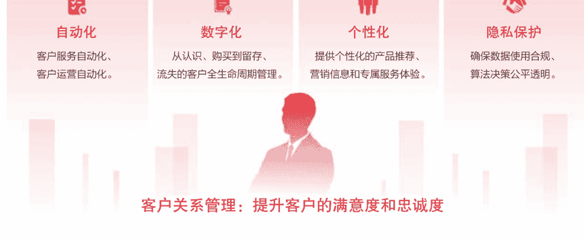

图5-4 AI赋能的CRM

### 自动化：用“AI替身”解决小团队“人手不足”的问题

自动化是AI赋能CRM的基础，核心是通过AI工具代替重复人工操作，让小团队用1～2人的成本，实现大企业级的运营效率。其应用集中在客户服务自动化与客户运营自动化两大场景，而用户生命周期管理中的“流失干预”，正是自动化能力的关键落地场景。

### 客户服务自动化

传统的客户服务依赖人工，小团队常因缺人导致响应速度慢、服务断档。如今，许多企业的网站和App上都部署了AI聊天机器人（Chatbot）或语音助手，我们将其统称为“AI客服管家”。它们基于NLP技术，能够理解用户提问并给予合理回答，并且能够自动化处理高频咨询（如订单查询、库存核对、常见问题），成为小团队的低成本替身。

比如，平安银行的智能客服“AskBob”在金融领域已相当成熟，除了回答客户问题，还能语音办理业务，代替大量一线客服人员；又如百度智能云的“客服机器人”解决方案服务了许多政务和企业热线，在咨询量高峰时段甚至承担起咨询分流的重任。

AI客服管家的核心价值主要有以下3点：一是响应无间断。AI客服能够7×24小时在线，无须等待，让用户随时都能得到回应。例如航空公司启用AI客服后，乘客半夜也能改签机票或咨询登机手续，不再受制于人工客服的作息规定。二是降本提效。某知名电商平台引入智能客服机器人后，约70%的日常咨询都由AI自动处理，显著降低了人工客服的工作量。小团队无须雇用多名全职客服，每月也能节省数万元薪资。三是无缝协作。为了确保客户获得良好的体验，大多数企业采取的是“AI+人工”协作模式：AI先行响应，大部分问题一次性解决；遇到个性化需求或情绪激动的客户，再无缝转接人工，在这种模式下，1名人工客服即可应对原本3人的工作量。

### 客户运营自动化

如果说客户服务自动化解决了“客户有问题时能快速回应”的即时需求，那么客户运营自动化则进一步覆盖“客户没问题时如何保持活跃度、避免客户流失”的长期需求。

新注册客户需要培育，AI可以识别这些客户并分析其兴趣点，自动发送欢迎礼包或新手指南；已完成首次购买的客户可能正处于成长期，AI会针对其购买品类推荐相关产品提高复购率；对老客户则重点推出会员优惠、加强关系维护。这一切都可以通过营销自动化工具+AI实现，根据客户行为实时调整细分策略，确保营销活动的精准性。

更高阶的应用是预测客户行为，尤其是预测客户流失风险。AI模型可以综合评估客户最近的购买频率、消费额变化、网站访问活跃度、反馈评分等，捕捉潜在的流失信号。例如，当AI模型监测到一位订阅用户近一个月登录频率骤降且多次浏览退订页面，就会判断其流失概率大幅上升。有了这一预警，企业可以及时采取措施挽留，如客服人员主动联系了解情况、发送定制优惠券、推送特别关怀内容等。

某连锁品牌健身房运用AI工具预测会员流失，发现凡是连续两周未打卡的会员流失概率激增80%。于是，他们设定策略：一旦AI判定某会员有高流失风险，就自动发送教练的关怀短信或1次免费私教课邀请。结果会员12周留存率提升了15%，充分证明AI工具干预有效降低了客户流失率。

### 数据化：用“AI分析”替代小团队“经验判断”

数据化是AI赋能CRM的核心，是指通过AI处理海量客户数据，提炼客观洞察，避免小团队因“依赖创始人经验”导致的决策偏差。

在传统模式下，小团队只能通过客户投诉被动发现问题，而AI的自然语言处理（NLP）技术可以自动化分析海量客户反馈（评论、留言、问卷），提炼“客户之声”（voice of the customer, VOC），即客户的隐性痛点与需求。在过去，企业通常依靠客服部门的人工分类处理大量的客户反馈，如投诉电话、在线留言、问卷调查、社交媒体评论等。这些方式不仅耗费了大量的人力和物力，且容易遗漏真正有价值的洞察，无法精准抓住客户的痛点与需求。AI技术则可以自动对海量客户反馈进行实时情感分析、话题聚类，迅速、准确地从繁杂的数据中提炼出清晰的客户需求轮廓与真正的痛点。

全球知名电商平台亚马逊就非常善于运用AI技术处理海量的用户反馈数据。每一天，亚马逊都会收到数以百万计的客户评论、投诉和问卷反馈，这些数据对于任何一个人工分析团队来说几乎是难以驾驭的规模。然而，亚马逊运用先进的NLP和机器学习算法，自动将这些数据进行情感评分、主题聚类与趋势分析。比如，AI系统能够快速发现消费者经常抱怨的“送货延迟”“包装损坏”“产品说明不清晰”等问题，亚马逊则迅速调整配送流程、加强包装保护并优化产品详情页，从源头上改善了客户体验。全球著名酒店品牌万豪（Marriott）酒店长期运用AI工具实时分析用户在携程、缤客（Booking）、猫途鹰（TripAdvisor）等全球在线旅游平台上的评论数据。通过AI分析，万豪发现很多客户频繁抱怨“酒店Wi-Fi不稳定”这一问题。这一洞察触发了万豪主动而迅速的应对行动：全球范围内的万豪酒店开始大规模升级网络基础设施，改善Wi-Fi覆盖率和连接速度。此举带来的客户满意度显著提升，很快体现在新一轮评论评分的提高和客户回访率的增长上。

小团队可以直接复用这一逻辑，无须专业数据分析师，就能用低成本找到“影响客户满意度的关键问题”，这也是AI时代为品牌带来的重要战略转变——从传统的“被动响应”走向了“主动改善”。

在明确客户需求方向后，如何将有限的资源精准地投放到能带来高回报的客户身上，就需要客户生命周期数据化的支撑。小团队常因分不清客户优先级，把资源浪费在低价值客户身上。

AI的数据分析能力使企业能够更精细地管理客户从认识、购买到留存、流失的全生命周期，针对不同阶段采取有的放矢的运营策略，从而提升客户生命周期价值。例如，一家SaaS软件公司利用AI对试用客户评分，预测哪些最可能转正付费，并由销售人员重点跟进，提高了试用转化率。

AI还可以预测客户的其他关键行为，何时可能再次购买、对哪类产品感兴趣、是否给出好评等。企业据此进行前瞻性营销：在客户可能需要时及时出现提供帮助或促销，引导其做出下一步正向行为。进一步，AI支持的客户生命周期管理也强调持续优化——根据AI分析结果，不断调整策略以提高整体效率，由此形成一个“AI分析→行动干预→获取新数据→AI再分析评估效果→优化策略”的闭环。例如，通过对比实施AI前后的关键指标（获客成本、留存率、平均客单价、客户生命周期价值等），企业可以量化AI带来的运营效率提升和收益增长，从而评估广告投入回报并优化投入方向。

### 个性化：用“AI定制”实现小团队“千人千面”体验

个性化是AI赋能CRM的终极目标，具体是指通过AI为每个客户提供专属体验。个性化推荐系统是AI在客户体验领域最成功的应用之一。典型案例莫过于电商和内容平台：通过AI分析每个客户的行为和喜好，实时推荐其最可能感兴趣的商品或内容，实现所谓“千人千面”的动态展示。

以淘宝为例，它的首页和推荐栏早已不是千篇一律的促销，而是针对不同用户展示定制化内容——这一个性化推荐算法背后便是AI在发挥作用。每个用户收藏过的店铺、浏览过的产品，甚至停留时长、点击习惯，都会成为算法模型的输入，经由深度学习预测用户下一步可能购买或喜欢什么，然后推送相应的商品。如此一来，用户感觉淘宝就像了解自己一样，每次打开都有“正合我意”的新发现，从而大幅提升了购物体验和转化率。

同理，内容平台奈飞的推荐系统每年为公司节省约10亿美元，因为精准推荐留住了大量客户。奈飞通过AI对每位客户的观看历史、评分、浏览行为进行建模，预测其喜好，个性化推荐影片和剧集，避免客户因为找不到喜欢的内容而流失。这充分证明了个性化推荐对提高客户留存和消费的巨大价值。

除了推荐商品和内容，AI还能创造个性化的营销和服务体验。例如，电商网站会根据用户画像动态调整首页横幅广告：新客户可能看到新人专享礼，老客户则看到会员优惠或相关新品。再如，在线旅游平台的AI工具会根据用户过往行程偏好，自动在节假日前推送定制的出游方案邮件。甚至连广告创意也在个性化：一些邮件营销工具用AI工具根据收件人特征，自动调整邮件标题和内容措辞，使之更契合收件人兴趣，从而提高打开率和点击率。个性化已经无处不在，而AI正是驱动其大规模实现的幕后功臣。

AI通过分析用户的行为数据、购买历史和互动记录，能构建出详细的用户画像，识别每个用户独特的需求和偏好。基于这些洞察，企业可以自动化地提供个性化的产品推荐、定制化的营销信息和专属服务体验，实现一对一的精准营销和客户关怀。例如，视频流媒体为不同用户定制首页海报图；音乐应用为每位用户生成个性化歌单；新闻App根据受众的阅读喜好推送订制新闻等。这些都是AI实时决策的结果。

值得注意的是，AI个性化的优势不仅改善了前端用户的体验，也会提升企业业绩：亚马逊早期的推荐引擎就证明了个性化推荐商品带来的销售额占比极高，成为电商的标配功能；奈飞的成功更是业界传奇，其CEO直言公司不是在卖电影，而是在卖算法推荐出来的用户喜欢的电影。

总的来说，AI让每位客户都仿佛有专属的数字营销员在服务，根据其喜好提供独特体验。这种高契合度的个性化，大幅提升了客户满意度和忠诚度，也是现代营销以客户为中心理念的最佳体现。

### 隐私保护：高度关注数据隐私保护与算法公平性

无论自动化的客户服务、数据化的需求分析，还是个性化的推荐，都依赖于客户数据。如果小团队忽视数据的隐私保护，就会导致客户信任流失，反而拖累CRM效果。数据隐私保护是AI赋能CRM的合规基础。

在收集客户数据时，小团队无须收集“与服务无关的信息”（如客户的身份证号、无关社交账号），避免过度获取数据引发客户的反感。过度依赖AI算法可能导致客户数据隐私风险上升，小团队需要明确数据够用即可的原则，并且优先使用已通过隐私认证的工具（如平台自带CRM、大型互联网公司旗下第三方工具），避免因工具不合规导致数据泄露。

全球领先企业如苹果和微软都已开始实施严格的数据隐私标准，建立透明的数据使用声明，小团队可以参考这些企业的工具选择逻辑。当然，算法的不透明性也可能引发客户对品牌的信任危机，因此企业需要制定清晰的数据伦理规范，加强对AI算法的监督和审查，确保数据使用合规、算法决策公平透明。

企业重视数据隐私，不仅能规避法律风险，更能让客户放心地提供数据，为自动化、数据化、个性化能力的落地扫清障碍。

对小团队创业者而言，AI赋能CRM的核心不是复杂的技术，而是用数据化分层找到客户阶段、用自动化触发对应动作、用个性化提升干预效果。从被动应对到主动改善，从粗放管理到精细优化，AI为品牌提供了前所未有的客户洞察与优化路径。企业不再只关注售后的问题解决，而是能在客户生命周期的每一步提前主动布局、精准行动，以超出客户预期的体验获得客户对企业的持久忠诚。只要善用这三大能力，小团队就能用有限的资源，实现“以小博大”的客户管理效果，在“留住客户、提升客户生命周期价值”的终极课题中，突破资源限制，实现持续增长。

## 实施路径：AI赋能品牌建设的关键节点

当AI技术逐步进入营销领域时，许多小团队的第一反应都是：我们也应该尽快加入这场浪潮。但是，如果缺乏清晰的实施路径、完善的数据治理机制、成熟的团队架构，以及周密的风险管理策略，盲目的投入往往会适得其反。

企业如何才能真正实现AI赋能的营销转型？从战略制定到具体执行，从团队建设到效果评估，每一步都至关重要。

### 战略规划和目标设定

不同企业面临的挑战和机遇不尽相同，简单地套用别人的成功经验并不可取。适合自己的才是最好的，所以，小团队在实施AI赋能的数字营销策略之初，需要结合自身实际进行战略规划和目标设定。

小团队创业者必须明确自身在实施AI营销时希望达成的战略目标是什么：是为了提升品牌知名度，还是为了更精准地找到目标客户，抑或为了提高客户生命周期价值？

不同的战略目标也决定了不同的实施方案，唯有目标明确后，清晰地界定成功的标准与实施策略的方向，我们才能做到有的放矢，也才能收获更好的数字营销效果。这是第一步，也是非常重要的一步。

例如，快速消费品品牌通常希望通过AI实现快速迭代的广告创意与更精准的受众定向；金融机构可能更关注如何利用AI提高客户转化率、减少客户流失。

### 准备数据和选择AI工具

AI的核心驱动力是数据，所以小团队要认真准备数据。如果企业的数据分散杂乱，即便最先进的AI工具也难以发挥效能。因此，小团队需要审视自身目前的数据基础，如CRM系统、广告投放数据、网站分析数据，以及社交媒体互动数据是否充足且高质量？这些数据是否存储在便于AI访问的数据库或数据湖中？只有建立统一的、高质量的数据管理和治理体系，才能起到事半功倍的效果。

星巴克在数字营销方面取得的成功，很大程度上归功于其完善的数据基础设施。它们建立了全球统一的消费者数据平台，这使得AI可以精确分析客户的消费习惯，从而实现高度个性化的营销。

数据问题解决之后，选择合适的AI工具也是关键。如今市面上的AI营销工具琳琅满目，从谷歌的智能竞价工具，到百度的AI广告投放平台，再到Facebook的动态创意优化系统，每个工具各有特色。小团队需要根据自身的业务需求和数据特点，同时考虑工具的易用性、成本以及与现有系统的兼容性，从而选择能够满足自身需求的工具。我们建议小团队起初可以先在单个领域进行小规模的试点，快速验证工具的有效性，然后大范围推广和使用。

例如，运动品牌耐克最初只是尝试在社交媒体上运用AI优化创意与潜在消费者互动，在成功后才逐步将AI应用扩展到其他营销环节。

### 团队建设与能力培养

除了建立数据管理体系、选择合适的AI营销工具，小团队面临的核心挑战是团队建设与能力培养。传统的营销团队可能更注重创意策划和执行，AI赋能的数字营销则对营销人员的技能结构提出了全新的要求；与此同时，即便有了AI工具赋能数字营销，说到底工具还是要由人来驾驭的。

这就要求小团队的营销人员具备更强的数据分析能力、算法理解能力和跨职能协作能力，即倒逼小团队必须主动调整团队架构。比如成立跨职能的AI营销团队，将数据科学家、技术专家、创意人员与营销专家整合起来，共同推动AI营销战略的落地。另外，小团队还要注重培训团队成员的AI技能，以便更好地驾驭机器为人类服务。例如，宝洁公司专门成立了“AI营销实验室”，定期为团队成员提供AI技能培训，让传统营销人员也能熟练驾驭AI工具，极大地提升了团队的整体营销能力。

### 数据隐私与治理问题

在AI营销的实施过程中，我们必须格外关注数据隐私与治理问题。随着全球隐私法规日益严格，如欧洲的《通用数据保护条例》、中国的《中华人民共和国个人信息保护法》等，AI营销过程中涉及的大量个人数据稍有不慎就可能面临法律和声誉上的风险。要想让AI更好地为营销服务，提升客户满意度和忠诚度，企业使用个人数据必须合规。这就要求小团队建立严密的数据隐私保护机制，如实施数据匿名化、差分隐私技术等，确保在享受AI精准营销优势的同时，不辜负客户的信任。

苹果公司在数据隐私与治理方面的做法值得广大企业参考和借鉴。它们在营销过程中始终坚持隐私优先原则，使用本地端的AI分析技术进行个性化推荐，确保客户数据不离开设备本身。这样做既保护了客户的隐私，又积累了具有针对性的客户数据，赢得了客户的广泛好评。

### 完善的风险管理体系

即便前几个方面都做到面面俱到，企业在实施AI营销策略时仍然会遇到一些风险和挑战。比如，算法可能存在偏差、数据质量不稳定可能引起决策失误，甚至因为过度依赖AI导致人为决策能力弱化，这些都是现实存在的风险。为了管理和降低这些风险，小团队必须建立完善的风险管理体系，如算法的定期审计、异常情况的实时监测，以及效果评估与不断优化，必要时还要交给人工接管。

此外，小团队还应该做到始终对AI的表现保持警惕，定期回顾AI营销的整体效果，如广告投入回报、点击率、转化率等关键指标，随时做出调整，以确保策略始终处于最佳状态。

回顾实施AI赋能营销的全过程，我们会发现，这并非简单的技术升级问题，而是涉及战略规划、数据治理、团队建设、风险管理等多方面深刻变革的系统性工程，而每一步都离不开“人”这个因素。虽然AI工具非常强大，但它只是辅助企业实现营销目标的工具，而不是营销策略本身，真正成功的小团队都需要注重人机协作。

AI帮助营销人员迅速、高效地获得洞察和创意，营销人员需要确保AI产出的内容和策略真正符合品牌价值观和目标客户的情感需求。只有做到这一点，小团队才能真正释放AI的潜力，达成品牌营销效果的跃升，这也是AI赋能数字营销过程中给营销人提出的要求和挑战。

# 06 增长引擎

## 用AI改写运营逻辑与融资路径

在创业者的词典中，“增长”始终是永恒的追求。但在这个算法驱动、数据为王的新时代，增长已不再是纯粹依靠人力扩张和创业者经验直觉的粗放式堆叠，而是转向一个技术深度参与、系统性精细运营的理性过程。

AI和云计算这两大技术引擎，正在以前所未有的方式改写着企业的运营逻辑、融资路径与增长模型。对资源有限的小团队而言，这不仅是一次技术革命的浪潮，更是一场“能力平权”的时代机遇——得其要领者，可以以小博大，撬动整个商业版图的加速度。

本章以经营中最重要的“钱”为线索，以“运营、融资和财务管理”为关键词，围绕企业在AI与云计算技术的赋能下如何实现降本增效、业务扩展、精细管理和融资创新进行了系统性拆解。

当然，在AI与云计算的战略实践过程中，挑战与风险也并非不存在。数据安全、隐私合规、模型失真、部署复杂度、团队能力建设、项目评估机制等，这些都是企业在转型过程中必须正视的问题。

本章特别强调：技术的部署不是一蹴而就的跃迁，而是需要清晰的路径规划、扎实的治理基础和敏捷团队配合的系统性工程。小团队要想从技术应用中获得竞争优势，必须做到战略有方向、流程有抓手、文化有共识、组织有支持。

在这一过程中，“小步快跑、边干边学”的方式尤为关键。小团队可以选择一个高价值、低门槛的AI场景快速落地，从最急迫的问题切入，不断通过反馈优化迭代，最终逐步形成系统能力。

## 运营逻辑：让技术成为增长的加速器

数字化浪潮滚滚向前，企业的成长逻辑正在从“人力驱动”转向“智能驱动”。传统企业主要依靠人多、地广、重资本扩张市场，而小团队正在通过AI与云计算的组合拳，用更轻的资产、更快的节奏、更高的精准度，在竞争激烈的市场中迅速占位。

新一代企业的增长动力正聚焦于以下三大协同支柱。

- AI赋能的产品个性化与持续创新是核心引擎，既能通过深度洞察客户需求提供千人千面的服务，又能加速研发迭代以紧跟市场变化。
- AI与云计算协同重构的智能供应链是关键支撑。云计算提供弹性算力与数据存储底座，AI则实现需求预测、库存优化等智能决策，从而大幅降低成本，提升效率。
- 全球化市场拓展是重要的增量空间，让企业得以突破地域边界，将产品创新与供应链优势复制到全球，对接差异化需求、打破单一市场限制。

这三大协同支柱形成“产品→供应链→渠道”的协同闭环（见图6—1），三者共同推动企业从“维持生存”的初级阶段，迈向“规模爆发”的高质量增长新阶段。

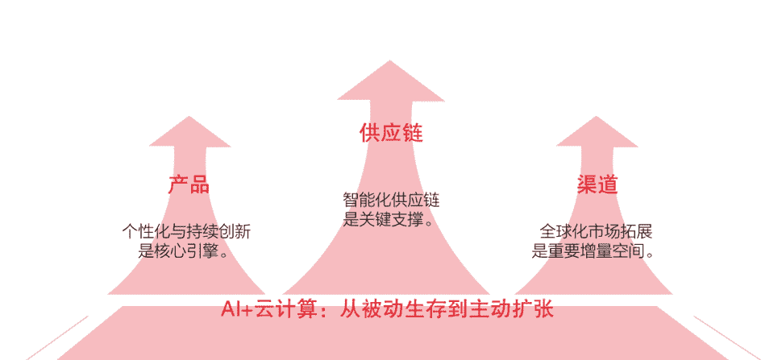

## 产品：AI驱动创新与个性化

小团队的增长核心是“用有限的资源让客户愿意持续买单”，而客户买单的前提，是产品能精准地满足需求，甚至创造新需求。在传统模式下，小团队靠创始人经验猜需求、靠一两个模型做迭代，更容易陷入“同质化竞争”“用户流失”的困境。AI则通过个性化和持续创新，为小团队的增长注入不可替代的动能。

### 个性化：让每个客户都觉得“产品为我而生”

客户需求的差异，决定了“一刀切”的产品难以持续增长。AI通过分析客户行为数据，如浏览轨迹、购买记录、评价反馈等，能实现“千人千面”的精准适配。

以电商行业为例，淘宝、京东、拼多多等平台已将个性化推荐作为核心增长引擎——通过AI模型分析客户的浏览、购买、收藏、评价等行为轨迹，系统可自动生成千人千面的首页商品组合。推荐系统带来的交易转化已超越搜索，成为平台商品交易总额增长的主要来源。

这一技术逻辑同样可以应用到其他行业：教育平台根据学生学习行为推荐课程路径，金融平台依据客户风险偏好推荐理财产品，健身App根据用户身体数据定制训练计划，甚至连服装品牌也能通过顾客试穿数据生成个性化尺码建议与搭配方案。

这种精准匹配的背后，是AI将“客户需求”转化为“增长数据”，让每一次互动都成为提升客户黏性的机会。

### 持续创新：让产品永远“踩在市场痛点上”

企业增长的天花板，往往是产品跟不上市场变化。AI则像一个“永不疲倦的市场观察员”，既能挖掘客户未被满足的需求，又能加速企业产品的创新迭代。

以生成式AI为例，ChatGPT、文心一言、Midjourney、通义千问等工具正广泛应用于新产品命名、外观设计、文案创意、包装建议、功能拆解等环节。比如某家手工咖啡品牌在推出新品时，借助AI工具分析社交媒体评论与饮品风味词频，发现“冷萃+燕麦+香草”组合在年轻人中热度上升，于是推出了以此为灵感的新品“夏云拿铁”，上线当周销量超预期，实现翻番。

更进一步，AI还可以作为共创工具推动用户参与产品设计。例如，小红书上多个品牌已开始邀请用户参与AI“造型投票”，通过Midjourney生成不同风格搭配图，再让粉丝选择最喜爱的设计组合。

在B端场景中，制造企业利用AI进行仿真建模、工艺设计优化、材料性能分析，从而大幅缩短了产品开发周期，提高了成功率。例如，美的集团的工业设计部门接入了智能CAD系统，自动推荐构型方案、模拟应力场、优化排布策略，大大缩短了部分产品从立项到样品的周期。

这种“快速试错+精准落地”的创新模式，让企业总能抢先一步抓住市场空白，持续打开新的增长空间。

## 供应链：借助AI和云计算优化生产效率

供应链是企业运营的“血脉系统”——从原材料采购到生产排程，从库存管理到物流配送，每个环节的效率都直接影响企业的成本控制、市场响应速度和抗风险能力。传统供应链管理依赖人工经验与滞后数据，往往陷入缺货时紧急补货、库存积压后被迫降价、物流延误时被动道歉的被动局面。在AI和云计算的赋能下，供应链管理正从依赖经验的“反应式运营”，升级为数据驱动的“预测式管理”，实现效率与韧性的双重提升（见图6—2）。

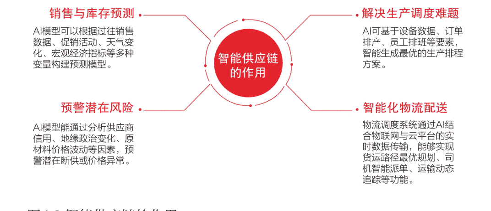

### 销售与库存预测

库存是供应链的“蓄水池”，但传统库存管理常因“需求判断不准”导致两个极端：要么库存过多占用资金（如某快速消费品生产企业曾因误判旺季需求，导致上千万元的产品滞销积压）；要么库存不足错失订单（如电商促销时因缺货导致转化率骤降）。AI与云计算的结合，首先解决的就是“需求预测”这个源头问题。

AI模型可以根据已往销售数据、促销活动、天气变化、宏观经济指标等变量构建预测模型。通过云计算平台的支持，这些海量数据能被快速处理、动态更新，生成更精准的需求预判，为库存管理和补货计划提供依据。能实现需求预判的云智能供应链系统主要有：阿里云智能供应链解决方案、腾讯云AI驱动供应链管理平台、华为云智慧供应链平台、京东云智慧供应链商家开放平台、数势科技Supply Force智慧供应链平台等。

某全国性日化快速消费品销售企业曾用阿里云智能供应链系统解决了传统库存管理的问题。之前，该企业仅靠管理者的经验与历史数据预判需求，忽略天气、促销等变量，导致了两个问题：一是区域库存错配，比如华东地区突然降水增多导致洗衣液积压10万瓶，而华北地区气候干燥导致除湿剂积压货款超500万元；二是传统的每月固定补货模式很难应对短期波动，比如华北突发高温天气时，沐浴露缺货5天，转化率骤降。

企业在接入阿里云智能供应链系统后，从源头优化需求预测与库存管理。系统先整合了近3年日销数据、促销计划、300多座城市气温变化趋势等多源数据，再通过多变量AI需求预测模块（基于LSTM算法）生成“SKU→城市→周”三级预测，这时准确率已提升至85%；然后借助智能库存优化模块动态分配库存、计算安全阈值，用动态补货模块替代固定周期补货，当库存低于阈值80%时自动触发补货，还支持跨门店紧急调拨。最终，系统落地6个月后，华北除湿剂库存积压减少40%，门店缺货率降低35%。这一转变将决策从“拍脑袋”变为“数据驱动+模拟计算”，不仅优化了库存，更给生产、采购提供了清晰的指引，减少了全链路浪费。

### 解决生产调度难题

需求预测给出了“要多少货”，生产环节则要解决“如何高效产出”。在传统模式下，生产部门按固定计划排产，经常出现生产出来的货不是市场急需的，或者遇到设备故障、员工请假时，生产协同断层。AI可基于设备数据、订单排产、员工排班等要素，智能生成最优的生产排程方案。

这类软件通常包含3个关键环节：一是自动采集设备、订单、人力等核心数据。二是先设定约束条件，比如某订单需要专用设备A加工，员工每日工作不超过8小时等；再设定目标，比如产能利用率最高或交付延期最少等；最后基于AI算法生成排程方案。三是支持实时响应突发变化，比如当设备故障、订单插单、员工请假等情况发生时，系统在5～10分钟内重新计算排程。

能实现生产排程方案智能化的软件，主要有三大类：一是工业互联网平台型方案，如华为云制造智能体、西门子MindSphere、达索DELMIA等；二是垂直行业深度定制方案，如不工软件ORAPS、鼎捷MES平台；三是轻量级快速部署方案，如JWI MDE制造调度引擎、用友YonSuite等。很多制造企业采用华为云的“制造智能体”解决方案。

某主营智能手机主板的电子企业，曾因传统生产调度模式陷入多重困境：

- 3条SMT贴片产线按固定计划排产，无法响应紧急订单，曾因切换产线延误48小时交付订单，产生3万元违约金。
- 企业设备也缺乏实时监控，回流焊炉故障导致主板良率下降，返工成本增加了12万元。
- 员工排班按常规排班，但出现了夜班低熟练度员工处理高精度工序，结果不良率达白班的2.3倍。
- 日常设备故障依赖人工巡检，响应超4小时，旺季曾因贴片机停机6小时，导致损失产能8000片/天，产能利用率仅78%。

2023年，该企业引入华为云“制造智能体”，先整合设备实时数据（如贴片机转速、炉温）、订单优先级标签、员工技能矩阵，构建全域数据库；再通过AI自适应排程引擎，十几分钟内完成故障产线订单分流，“人—机—订单”匹配模型优化工序分配；同时打通“生产—物料”链路，设备预警实时推至维护团队。最终，该企业年均产能利用率提升12%，多产主板150万片，设备故障率降至20%，停机时间减少320小时，交货周期缩短15%，紧急订单准时率从82%提升至99.5%，彻底摆脱“人工排程—被动救火”模式。

如果团队规模10～50人，年营业收入500万元以下，小团队可以选择轻量级快速部署方案，能够满足“低成本、易上手、轻量化”的核心需求，同时具备AI智能排程能力。比如一个10～30人生产标准件（如小五金、塑料配件）的小团队，日均工单量20～50单，可以选择用友YonSuite基础版。只需要在系统中输入订单数量、设备产能、员工班次，该系统会自动计算“最优开工时间”。例如某零件需3台机床加工，系统会按“设备负荷均衡”原则分配任务，避免某台设备过载。可视化看板能实时显示各设备的“已排产工时/总产能”占比，预警超负荷设备和识别空闲设备。团队也无须对接复杂的资源规划系统、生产执行系统，初期用Excel导入数据即可满足需求。

小团队可以从单一场景开始，逐步实现生产调度的数字化转型。

### 智能化物流配送

供应链端不止生产和库存销售，还有一个被忽略但很重要的环节：物流调度。尤其是生产/贸易企业（如电子厂、食品加工厂）、第三方/专线物流企业（如区域货运专线）、零售/电商企业（如连锁超市、社区生鲜电商），以及生鲜、医药、工业品等特殊行业企业，以上企业对物流的精准配送依赖度很高。物流运输环节普遍存在以下3个问题：

- 供需错配。人工调度很难实时平衡订单波动和运力供给，常出现有单无车的延误或者有车无单的空驶，比如生产企业自有车辆常因路线固定空跑返程。
- 配送过程易失控。例如，有些物流企业的车辆位置、货物状态（如冷链温度）靠人工反馈，仓库、司机、客户之间的信息割裂，异常响应时间超4小时，生鲜行业货损率常达5%以上，医药企业还可能因缺少温控记录面临合规风险。
- 缺乏数据复盘导致路线重复、装载不合理，单票运输成本居高不下，像零售企业末端配送因路线规划混乱，经常增加不必要的行驶成本。

针对这些问题，物流调度系统通过AI结合物联网（internet of things，IoT）与云平台的实时数据传输，能够实现货运路径最优规划、司机智能派单、运输动态追踪等功能。

我们来看一个真实的企业案例。2022年“618”大促，某华北电商物流企业（5仓、120车）因人工调度陷入危机：北京海淀区3C订单激增3倍，未同步天津仓库存导致120单停滞24小时；廊坊28单错从北京仓发货，成本激增、时效延迟；超过5000件订单手动整理超3小时，郊区订单派错司机导致延误，准时率仅72%。

有了2022年的教训，该企业在2023年部署了京东物流智能调度系统，通过三步化解大促配送压力。

首先整合5个仓库实时库存、订单时效标签（如“次日达”）、车辆位置与司机技能数据，构建“仓—单—车”全域数据库；其次，AI预测算法提前72小时预判海淀区3C订单将激增，自动调配天津仓库存至北京仓备货，大促当日按“就近发货”原则，廊坊订单100%从天津仓出库，单票成本降低22%；同时，动态派单模块每5分钟更新数据，将郊区大件订单精准分配给熟悉郊区路线的司机，并优化装卸顺序；最后，全链路实时监控，遇高速拥堵自动推荐备选路线，异常时10分钟内调配备用车，用户端实时推送“预计送达时间”。

2023年“618”大促期间，该企业配送准时率从2022年的72%跃升至98%，海淀区3C订单无一笔延误，用户投诉量下降90%，廊坊区域配送成本降低，车辆空驶率从2022年的32%降至15%，彻底摆脱大促期间“人工调度混乱、订单大面积延误”的困境，实现配送高效运转。物流智能调度系统的优势，就是能做到“数据整合—智能决策—闭环协同”。

类似京东物流智能调度系统的软件主要有以下3类：第一类是大企业适用的智能仓储与运输一体化方案，如基于阿里云超算能力的菜鸟网络物流大脑、中集创见LCS系统；第二类是为中小团队提供轻量级运输管理系统，如牛运运（TMS SaaS）、壹悟科技物流业务调度系统，支持路径规划、实时监控，Excel导入数据即可用；第三类是Shouhuo智能配送系统、DataWorks智能调度平台等，开源免费，但适合有技术能力的团队自行部署，降低初期投入。

小团队创业者只需根据业务规模与行业属性选型，即可逐步实现物流调度数字化升级，让物流运输从“不可控、高成本”走向“动态可控、最优匹配”。

### 预警潜在风险

供应链的稳定性往往被“黑天鹅”事件打破——原材料价格暴涨、供应商突然断供、极端天气导致物流中断等。传统管理模式因信息滞后，只能在危机发生后“被动救火”。AI与云计算通过整合全链路数据，可以提前预警风险，帮助企业构建“韧性供应链”。

AI模型能通过分析供应商信用、地缘政治变化、原材料价格波动等因素，预警潜在断供或价格异常。这些分析依赖于云计算平台对多源数据的实时整合（如对接行业数据库、新闻资讯等），确保风险信号不被遗漏，帮助企业提早准备替代方案。

比如，华东某汽车零部件企业因传统供应链管理面临危机：铝合金原料价受国际局势的影响上涨28%；核心供应商因环保核查不达标导致2条生产线停工48小时，并且无备选供应商；极端高温导致物流干线中断，超过3000件订单逾期，准时交付率仅65%，投诉率环比上涨200%。

企业在部署了AI+云计算供应链系统后，先整合了12家核心供应商的信用、产能，原材料实时价，3条物流干线天气路况数据，构建“供应商—原材料—物流”全域数据库，打通信息壁垒；再依靠AI风险预测算法提前96小时预警铝合金将涨价，采购人员提前与3家供应商签订锁价协议，AI还通过分析供应商信用记录与产能弹性，为每家核心供应商匹配2～3家备选供应商，应对停产风险；最后云计算实时同步物流数据，遇异常情况将推送2条以上备选路线，响应时间缩至30分钟，客户端可查运输进度。

这种“智能风控+智能采购”的组合，让供应链管理更具前瞻性和韧性，从“脆弱链”变为“韧性网”，有效应对市场的不确定性。

具备风险管控功能的供应链管理系统有很多，国际主流中，SAP商业网络覆盖190个国家和地区的供应商，能实时预警风险并支持动态切换合作方，适合跨国企业；C3 AI供应链套件与Google Cloud集成，可提前7～30天预警生产中断风险，适合年产值超1亿元的制造企业；国内方案中，华为云供应链智能体、金蝶云·星瀚供应链云、用友BIP采购云、阿里云智能供应链等都具备风险防控体系。

从需求预测到库存优化，从生产物流协同到风险预警，AI和云计算正深入供应链的每一个环节。它们不仅让流程更流畅、成本更可控、效率更可预期，更能帮助企业从“管理资源”走向“管理智能”。对中小企业而言，这种转变尤为关键——无须投入巨资，通过接入云平台的智能化工具，即可将供应链从“拖累利润的成本中心”转变为“支撑增长的竞争力引擎”，在复杂的市场中更好地把握机会。

## 渠道：全球化布局实现业务扩张

单一市场的容量总有上限，当本地客户增长放缓、竞争加剧时，全球化是企业增长拓界的关键。过去，语言壁垒、本地化响应、基础设施成本，让全球化成为大企业的“特权”；AI与云计算的结合让中小企业也能“轻装出海”，用技术杠杆撬动全球市场。

### 云平台搭起“全球业务的快速通道”

企业进行全球化的第一步，是让不同国家和地区的客户“用得顺畅”。企业可以借助国际云计算服务平台，即像AWS、阿里云、Google Cloud等服务商搭建的全球分布式IT基础设施集群（包含服务器、存储设备、网络资源等硬件）。企业在云端使用资源进行计算、存储、数据处理，只需要按需付费。

云计算服务平台的本质是将IT资源从本地机房搬到云端，实现资源的弹性调用，所以它能为企业提供“即插即用”的解决方案。智能手表品牌Ticwatch进军欧洲市场时，通过Google Cloud快速部署云服务，并通过AI工具对当地用户佩戴习惯与反馈进行分析调整，最终成功完成产品的“本地化智能优化”。

AI向量数据库公司Zilliz起步时便依托AWS和Azure的全球节点，让产品同步覆盖多个国家和地区的客户。这种“无须自建机房”的部署模式，让中小企业省去了巨额的基础设施投入，把成本聚焦在业务本身。

### AI架起“跨文化沟通的桥梁”

## 融资扩张：智能规划现金流

一般来讲，小团队创业者擅长技术、运营，但面对投融资时往往一头雾水。AI技术正深度重塑投融资流程：它既能在天使风险投资中帮助创业者更精准地打磨融资材料、规划策略，也能帮助投资人更高效地筛选项目、评估风险。在众筹、资产证券化等新兴融资模式中，AI甚至成为模式创新的底层驱动。

创业成功从来不仅仅是“有好产品”那么简单。在现代商业语境中，融资能力往往决定了一个好创意能否真正落地、成长并扩张。尤其对小团队和初创企业来说，融资是一项持续且战略性的工程。过去，融资更多地依赖人际关系资源、经验与运气，如今，AI正在让这项“靠天吃饭”的活动变得更加数据化、理性化和高效化。

## 天使风险投资：利用AI识别风险，高效决策

小团队在计划融资的准备阶段，常规做法是提供一份商业计划书（business plan，BP），用于系统性地向天使投资人介绍企业的商业模式、市场潜力、团队能力、盈利预期等核心信息，为投资人判断投资价值提供依据。

过去撰写一份BP不仅需要创业者投入大量的时间进行市场调研、竞争对手分析，还得反复打磨表达。现在，创业者只需输入项目核心信息，借助ChatGPT、文心一言等生成式AI模型，就能生成结构清晰、逻辑缜密、视觉风格一致的BP初稿。更重要的是，这些AI还能自动检索行业数据，填补市场规模、增长趋势、竞品对比等关键段落，使BP内容更贴近投资人的关注点。

此外，一些AI工具还能帮助创业者进行估值模拟与融资节奏预测。例如，DeepSeek可以分析同类项目的融资历史与市场表现，评估当前市场情况下是否适合启动融资，预测不同融资轮次下的出让比例、资金使用周期与估值浮动区间。这种基于数据模拟的融资策略规划，让小团队创业者可以全面了解市场情况，更有底气与投资人对话，避免陷入“过早融资稀释过多股份”的典型陷阱。

## 众筹平台：提升融资效率和筹集成功率

众筹是一种去中心化的融资方式，它是指项目发起人通过互联网平台，向公众展示其创意、项目或需求，吸引众多投资人小额出资，以实现项目资金筹集的融资方式。这种方式近年来在文创、消费、科技等领域大放异彩。相比传统融资，众筹更具大众参与性、传播力和用户连接属性，这些特点使得众筹更适合小团队。

国际化大型众筹平台主要有美国的Kickstarter、Indiegogo众筹平台，也有不少中国品牌通过韩国wadiz、日本GREEN FUNDING进行众筹破局。当前，Kickstarter、Indiegogo众筹平台已深度整合AI算法，并且允许发起人通过API或插件接入第三方AI工具，形成“AI工具链”。

平台在项目筹备阶段就可以通过自有算法，帮助发起人制定更合理的目标与内容策略。举例来说，一个智能手表项目准备上线众筹，AI根据平台过往数据指出：若定价设为399元起步，并加入“限时限量+体验师故事”组合，平均转化率提升12%；页面顶部若使用某类视觉风格（如手绘风格+功能标签），则前5秒留存率提升20%。

在众筹过程中，AI还可实时监控用户行为反馈、社交分享路径和舆情情绪，从而动态优化营销策略。例如，AI检测到用户在“FAQ板块”停留时间长，说明疑问多，那么系统会提示发起人加强说明内容、加入动态演示视频；又如AI识别社交媒体内容转发高峰集中在下午4：00—6：00，系统将建议发起人在该时段集中投放广告或推送更新，以激发传播链条。

小团队创业者也可以植入第三方AI工具，帮助追踪舆论情绪、社交传播走势，并实时输出应对建议。比如，某消费电子品牌在进行众筹时，AI通过抓取产品在知乎和B站的讨论关键词中，发现“续航焦虑”“不支持快充”等负面评价占比上升，AI系统立刻提示品牌方，尽快发布技术说明视频，并组织KOL口碑背书，解决用户的敏感问题。

因此，AI在众筹中的作用，不仅仅是“优化”，更是“放大器”：它放大了好创意的传播能力，也放大了资金与用户的连接效率，使创业项目更有可能“破圈”成为市场新星。

在AI技术赋能下，企业不仅可以讲出更精准的数据故事、做出更专业的风险演算，还能借助众筹等新机制打破融资门槛、激活资本活力。对小团队来说，AI并不是替代融资思维，而是放大融资能力。它让创始人拥有数据洞察、内容创意、融资节奏设计等过去只有专业机构才具备的能力。更重要的是，它打开了通往更公平、去中心化、个性化资本世界的大门。

## 财务精细化：动态控制成本

从日常运营中的成本控制、现金流管理，到支撑中长期发展的中长期财务战略规划，AI不再只是辅助工具，而是越来越像一个“智能CFO”。它能洞察问题、自动生成成本报表、预测趋势、识别风险，并提出优化建议。在这一过程中，即便资源有限的小团队，也能借助AI打破财务管理的专业壁垒，真正实现精细化管理。

在信息化程度越来越高的商业世界里，财务已不再是后台报账的职能，而正在变成企业战略决策、支撑日常运营的核心引擎。对企业而言，运营健康度、组织效率及持续扩张能力的关键，不在于一时盈利，而在于能否用数据看清运营全链路中“钱”的流向、周转节奏和杠杆水平，这直接决定了运营决策的合理性。

AI时代的到来，正好为企业开启了“看清财务、管好资金、规划未来”的智能化大门。

## 成本控制优化：筑牢“节流”根基

成本控制是财务管理的“第一道防线”，在传统企业运营中，成本控制往往是一件后知后觉的事——发现超支时，往往为时已晚。AI让成本管理不再依赖复盘，而是实现实时预警和提前干预。

首先，AI可以生成动态成本仪表盘，帮助企业进行实时成本监控，其核心前提是实现ERP、进销存、销售、人力资源等系统的数据打通。

这四大系统原本是企业不同部门的数据孤岛：

- ERP是企业的总管家，统筹财务、生产等核心数据。
- 进销存聚焦原材料采购与货物存储，记录采购价、仓储费等。
- 销售系统跟踪销售渠道与推广费用，如线上投放成本。
- 人力资源系统则管理员工考勤与薪资，包含加班成本等关键数据。

未打通时，各系统数据互不流通，统计成本需财务人员手动收集各部门表格，耗时长且容易出错。

系统打通后，数据可自动流动，比如进销存中原材料采购价格波动、销售系统里线上投放费用变化、人力资源系统内员工加班记录等，都会实时同步至ERP。然后，AI工具从打通的系统中抓取全业务流程成本数据，按业务单元（如不同产品线）、时间维度等精准归类，自动生成成本报表，让管理者实时掌握异常成本变动。

当然，监测成本不是目的，最终结果是通过监测数据发现异常。例如，某电商企业利用AI工具对广告支出进行回归分析，发现部分广告投入回报低的关键词长期投放却未被注意，造成广告预算大量浪费。

其次，AI还可以模拟“成本优化情景”。有一些成熟的工具，像合思智能费用预算系统、万达宝LAIDFU智能成本控制平台、Moka人力资源AI预算系统、FineReport AI预测报表系统等，都能实现成本优化。

例如，企业管理者可以通过AI系统设置不同的业务场景（如销售下滑10%、人力成本增长5%等），系统即刻模拟在各个成本项目上的变化幅度，并给出调整建议，如降低哪类费用、合并哪些岗位、压缩哪些支出等。过去需要财务部门数天人工测算的预算平衡方案，现在AI几分钟即可生成多版本对比分析报告，让企业管理者能以数据为依据制定更科学的成本控制策略。

尤其对中小企业来说，AI不仅是监控，也是优化；不仅能省钱，更能防范日后因成本管理不善而导致的资金链风险。

## 现金流智能管理：“风险预警”守住生存底线

企业之所以会“倒在黎明前”，往往不是因为亏损，而是因为现金流断裂。正所谓“利润是观点，现金流才是事实”。AI正是帮助企业精准洞察和管控现金流的最可靠“预警系统”。

AI在现金流管理中最直接的作用，就是智能预测未来现金流入出曲线。基于企业过往财务数据、应收应付记录、销售数据、订单周期等维度，AI可以训练预测模型，对未来30天、90天、180天的现金流趋势进行模拟推演。例如一家有明显季节性收入的旅游公司，AI可以帮助它结合历年假期时间、销售节奏和用户预订行为，预测高峰期资金流入与淡季资金紧张时间点，提前制订融资计划或开支计划。

能实现现金流预测的AI工具有两大类：一类是专业工具，如HighRadius现金流预测平台、Trovata AI现金管理平台、Float现金流预测工具等，中小企业轻量化预测可以选择Float现金流预测工具，能够预测未来6个月的资金趋势；第二类是扩展性财务系统，包含了现金流模块，像用友BIP智能现金流系统、Oracle Fusion ERP现金流引擎都可以深度对接财务模块，实现数据的整合与预测。

AI还能将宏观经济数据（如汇率、利率、原材料价格波动）与企业微观业务数据相结合，评估企业未来是否存在资金缺口。

例如，一家从事跨境电子元件贸易的企业，AI通过整合宏观数据（近期美元汇率持续上涨、上游芯片原材料价格因供需关系上涨15%）与微观数据（企业第三季度计划采购1000万元芯片、下游客户回款周期为60天、每月固定支出20万元），经过动态演算后发现：若按原计划采购，叠加汇率与原材料成本上涨等因素，企业将在10月面临约300万元的阶段性资金缺口。基于此，AI系统随即给出优化建议：将部分采购量拆分至第四季度，提前与核心客户协商缩短15天回款周期、暂缓支付非核心区域的市场推广费用。企业采纳建议后，成功规避了资金链紧张的风险，保障了第三季度业务的正常推进。

AI的另一个重要应用是“智能收付款建议”，确保资金回流稳定。AI会综合应收账款账期、客户历史付款习惯、现金池状态，推荐催收优先级和付款节奏。例如针对某位经常延期付款的客户，AI将其标注为高风险，并建议通过折扣提前催收；而在付款端，如果系统判断企业当前现金充裕且供应商提供早付折扣，便建议提前支付以获取节约红利。在这个过程中，AI就像一个“日常出纳+风险控制+财务参谋”合体的数字员工，帮助企业从“看懂账”进阶到“会用钱”。

## 财务分析与规划智能化：赋能“战略决策”

如果说成本控制和现金流管理是“守”，那么财务分析与规划智能化就是“攻”，其核心作用是通过数据洞察与前瞻推演，为企业的战略布局（如扩张、转型、投资）提供科学依据。

AI预算系统可以在数百个变量之间构建更复杂的预测模型，模拟不同策略下的财务表现。例如，一家新消费品牌准备扩张门店数，其AI系统就会结合各地消费能力、房租水平、人流数据预测不同城市开店带来的成本与收入变化，最终建议“优先在南京、成都而非北京、上海、广州开设新店”，从而实现总投资收益率最大化。

更具前沿价值的是AI驱动的战略资本决策。例如，企业准备进行并购、引入新产品线、启动海外扩张时，AI可以将企业自身数据与外部行业数据相结合，模拟这些资本动作可能带来的利润、现金流、资产负债率等影响，提前做出预判和风险测算。过去这种模型往往只有咨询公司或投行能提供，如今借助AI智能财务工具，小企业也能拥有这种高配级的策略推演能力。

如果说过去的财务管理更像一门“会计之术”，讲究规范、准确与合规，那么在AI的加持下，现代财务管理已经蜕变为一门“战略之道”。它要求更高的实时性、敏感性、前瞻性，而AI恰恰能够弥补传统财务在这些维度上的短板。对企业而言，AI不仅提高了财务管理的效率，更重要的是，它激发了企业对资金的“精算意识”：不是赚了多少钱，而是花得是否合理、收得是否及时、能否预测未来的盈亏走势、能否以更优的方式分配资金资源。

## 战略实施：挑战与风险管控

如果说AI与云计算的技术浪潮为小团队打开了一扇新的增长之门，那么真正跨入这扇门，并不是一件轻而易举的事。如何真正将AI与云计算变成组织内部的核心能力，而不是“看得见、摸不着”的空中楼阁？如何在这场转型中避开常见的陷阱，稳妥推进、有序落地？

AI的本质并不是神秘的黑科技，而是一种可以被看见、被学习、被控制的生产力工具。它不会自动带来增长，但它会成为创业者手中最强大的“杠杆”，帮助创业者用更少的资源撬动更大的舞台。选择AI与云计算，不再是一种技术策略，而是一种面向未来的生存方式。在这个过程中，谁能更早地掌握工具，谁就能更快地定义规则。

然而，从技术部署到组织协同，从数据治理到能力建设，从安全防护到效果评估，AI与云计算的实施不是一场快速冲刺的短跑比赛，而是一场需要长期布局和动态管理的战略长跑，在这个过程中，创业者仍然要面对很多挑战。

## 战略落地：从“技术愿景”走向“业务路径”

许多企业在AI和云计算的探索初期，往往容易陷入两个极端：一是“空谈技术，不接地气”，把AI看作神奇的万能药，搞出各种炫目的PPT，却缺乏与业务的深度结合；二是“畏难情绪重，迟迟不动手”，担心投入高、风险大、落地难，于是按兵不动，错失先机。事实证明，那些最终真正实现AI赋能运营和增长的企业，经历了同一条路径：从小场景切入，业务导向驱动，技术分步落地，最终形成组织能力的系统跃升。

以国内某领先母婴品牌为例，他们并没有一开始就全面部署AI系统，而是从最“痛”的点——客服高压入手，先在客服中心引入AI机器人处理常见问题，再逐步将AI接入营销内容自动化、用户画像分析和供应链预测等模块。每一步的技术应用都紧扣业务需求，以结果为导向，并配套流程与人员协同机制，最终形成了一个“业务+技术共建”的完整链条。这种以终为始的路径，就是最稳妥的AI战略落地方式。

此外，企业在推进AI与云计算战略时，还应避免孤立地推进某个技术模块，而应该从一开始就设计“能力协同矩阵”。例如，引入AI客服，能否与CRM系统打通？使用大模型生成内容，是否可以纳入品牌话术的统一模板？采用云服务部署后台，是否同步规划好弹性扩容和灾备策略？只有将这些环节作为一个有机整体来统筹部署，才能实现技术的协同价值最大化。

## 数据治理：AI时代的“生命线工程”

AI的根基是数据，没有良好的数据治理，AI就如同失去了燃料的引擎，不仅无法驱动业务，还可能引发一连串的信息安全隐患、隐私泄露、合规风险。在AI和云计算的融合环境下，数据治理面临比以往更复杂的挑战：数据来源多样、流转路径不清、敏感信息易外泄、模型训练边界模糊……企业若不提前建立一套完整的数据治理机制，轻则出现模型偏差、系统误判，重则造成用户隐私泄露甚至触犯监管红线。

首先是数据资产的分类与权限管理。企业必须对所有业务数据进行分类梳理，包括但不限于客户信息、交易记录、营销数据、生产流程数据等，并按照敏感度分级管理，通过细粒度的权限分配机制，确保不同岗位员工仅能访问其业务所需的数据，防止数据滥用。国内不少企业已开始使用“数据中台”模式，将数据集中治理、分布调用，在保障安全的同时提升共享效率。

其次是AI模型训练的数据合规性审查。许多企业在训练语言模型、推荐算法时会收集用户行为数据，但如果未获得用户授权或使用了含有敏感信息的数据进行训练，就容易触发法律问题。2023年，国家网信办等七部门联合发布《生成式人工智能服务管理暂行办法》，明确要求AI训练数据必须合法合规，并对内容可追溯性提出新标准。这对企业提出了更高的数据治理要求，尤其在训练自有模型时，要特别注意数据来源的透明性、匿名化处理和使用边界控制。

最后是数据流动与云安全的动态监控。企业数据在云端部署后，虽然获得了高效的计算能力与访问便利，但也面临更多的安全挑战，具体包括：数据在传输过程中的加密保护；数据在存储过程中的容灾备份；平台在遭遇攻击时的防御能力。因此，选择可靠的云服务商是企业战略部署中的关键一环。像阿里云、腾讯云、华为云都推出了针对企业级客户的“全生命周期数据保护解决方案”，支持端到端的加密、防入侵检测和合规审计。企业应充分利用这些平台能力，同时内部也应设立数据安全负责人和应急机制，确保关键数据在任何时刻都不脱控、不丢失、不被滥用。

## 组织结构：AI时代的人才与团队建设

AI技术再强大，也无法自行落地与转化，最终都需要一个“会用AI的人”来驱动它为业务服务。很多企业在推进AI战略时最大的挑战不是买不到工具，而是缺人、缺懂的人。这就要求企业必须从组织架构与能力建设两方面入手，重塑AI时代的人才结构。

首先，组织结构上，企业应设立专门的部门与岗位。比如，企业可以设置“AI与数字创新部门”，或在原有的IT、数据、运营团队中嵌入“智能化推进岗”，专门负责AI项目的选型、落地与协同。这个岗位的任职人员不仅要懂技术，还要懂业务，要能充当AI供应商与业务部门之间的“翻译官”和“协调者”。许多企业在数字转型初期，因为业务部门与技术团队鸡同鸭讲，导致AI项目落地受阻，最终不了了之。设置专门的中枢部门，可以打破部门墙，实现项目的端到端推进。

其次是能力建设。企业应通过内部培训、外部学习平台等方式，提升团队对AI的理解力与应用力。阿里云、腾讯云、百度智能云都开设了大量AI技术和行业应用课程，覆盖从入门到进阶的不同层级；也有不少第三方平台（如网易云课堂、极客时间）推出“AI+业务”实战训练营，帮助管理者理解AI在零售、金融、制造等行业的实战落地场景。

更进一步，企业还可以考虑建立“内部AI导师制度”，让早期接触过AI项目的成员担任团队导师，推动AI知识在团队内“传帮带”。通过这样的机制，即使团队暂时缺乏“专业AI工程师”，也能逐步培养起一支“会用AI、善用AI”的跨部门作战团队。

## 风险管理：不走偏、不走空，确保AI战略可持续推进

在企业大力投入AI与云计算的过程中，也存在不少“战略落空”或“技术走偏”的案例。比如，系统上线后使用率低、数据不准确导致模型无效、效果与预期差距过大、AI引发用户投诉等问题频发。因此，构建一个动态、可评估、可调整的风险管理机制，是保障战略成功的最后一道关口。

首先，企业应对所有AI项目设定明确的业务目标与评估指标。例如“引入AI客服系统后，30天内用户满意度提升10%”“内容生成效率提高2倍”“预测准确率达到85%以上”，这些KPI应纳入常规考核体系，作为技术是否真正带来业务价值的依据。

其次，建立“试点→评估→推广”的闭环机制。很多企业习惯“一上来就全面推开”，结果项目规模大但落地率低。更有效的方法是选择典型场景做小规模试点，在小范围内验证AI工具的价值与风险控制能力，再根据试点结果优化方案，逐步推广至更大范围。

# 07 团队策略

## 从人才引入到文化建设

我们在调研多个成功的小型创业企业时发现，团队在早期阶段犯下的最大错误，往往不是技术判断失误，也不是融资策略不当，而是在人事选择和团队沟通上缺乏系统性认知。许多看似“人缘问题”的矛盾，最后演化为战略失败；而那些在早期就打好团队基础的企业，即使商业模式未定，也有可能走到后来的增长阶段。这也说明，在创业的战场上，资金、技术和商业模式无疑是竞争制胜的重要武器，但唯有人，始终是最不可替代的决定性变量。

小团队看似一种“轻装上阵”的创业方式，但在实践中，团队越小，人的重要性就越凸显。小团队的成败，很大程度上取决于创始人如何“用人、带人、育人”，以及如何打造一种充满凝聚力与战斗力的团队文化。

小团队的文化不是挂在墙上的标语，而是日常言行中的共识。会议方式、处理问题的态度、对失败的容忍度、对创意的激励机制，这些组成了文化的真实表达。我们将在本章揭示小团队如何构建出“即使不说话，也知道对方怎么想”的文化氛围，如何在冲突中建立信任、在混乱中保持一致、在挫折中激发士气。

进一步讲，我们希望带来一种视角转变：不把“人事”视作创业中必须处理的杂务，而是视作企业发展的战略核心。人，是最复杂也最具复利的资源。一个优秀的人加入团队，带来的不仅是技能，还有新的认知、活力与网络；一个良好的团队氛围，不仅能激发团队成员的积极投入，还能吸引更多有价值的合作者主动靠近。在AI加速、市场更替日新月异的时代，小团队唯一的长期优势，往往就是“这群人”，以及这群人所凝结出的、独一无二的团队文化。

## 能力模型：有创业者特质的人才

我们观察过大量小团队的成长案例后发现，支撑“创业者特质”的人有3个核心能力（见图7-1）：扎实的基础能力，确保能在具体业务中站稳脚跟；强大的风险承受能力，让他们敢在未知中做出决断；以及凝聚人心的领导能力，能带动团队形成合力。这3种能力相互支撑，共同构成了小团队最需要的“创业型”人才画像。

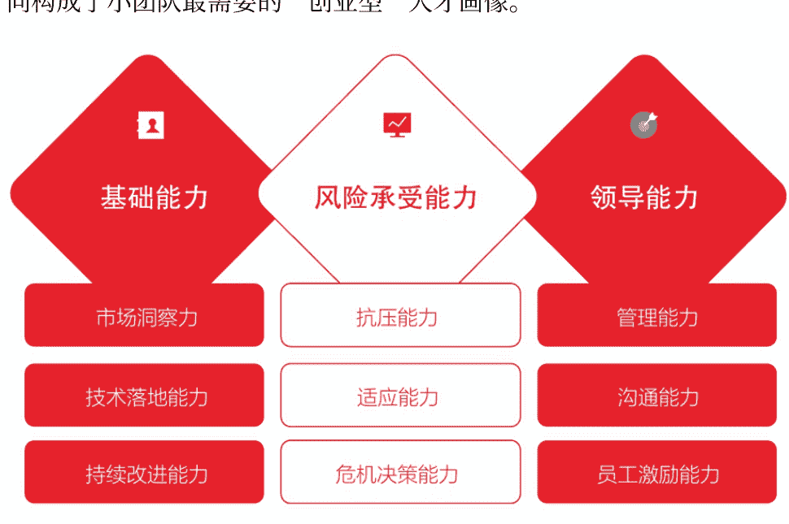

图7-1 创业者特质人才的核心能力

自带创业者特质的人在工作中不会只满足于“完成指令”，而是会像对待自己的事业一样，主动思考“如何做得更好”；他们不会在不确定性面前退缩，而是会带着解决问题的韧性，和团队一起闯过难关。

## 创业者的基础能力，决定了小团队的起点有多高

创业不是赌博，成功也不是押注运气、资源或风口，真正存活于市场的企业，都具有以下特质：创业本质是能力修炼，市场洞察力、技术落地能力、持续改进能力是核心必备要素。

### 市场洞察力

市场洞察力是创业者识别机会、制定策略的核心。小团队需要比竞争对手更快地捕捉市场需求与趋势。奈飞创始人里德·哈斯廷斯（Reed Hastings）通过分析用户行为，发现流媒体潜力并推动转型；马云洞察中国电商需求，创办阿里巴巴；张一鸣开发抖音时，从100多个功能中锁定“15秒短视频+算法推荐”，核心是抓住“用户刷15秒即划走”的规律。马斯克研究传统汽车企业，发现电动汽车市场的空白，打造特斯拉优势；拼多多以拼团模式避开传统电商竞争，抢占市场。

### 技术落地能力

现实中，很多创业者往往倒在“执行关”，有人沉迷于“画蓝图”，却连产品原型都做不出来。对创业者而言，只拥有市场洞察力还不够，还需要具备超强的执行力，而执行力的关键是“转化”，即把创意转化为用户愿意买单的产品。

小米创始人雷军是卓越执行力的典范，他最开始提出小米手机的设想，然后通过不断攻克技术难关，整合资源，最终推出高性价比的智能手机，并以手机为核心，将业务扩展至智能家居、物联网的生态系统。

### 持续改进能力

消费者的需求呈动态变化趋势，创业是持续迭代的过程。创业者需靠持续改进优化产品服务，建立长期竞争力。乔布斯深谙此道，每代iPhone手机均在上一代的基础上优化外观与功能，保持迭代节奏，让苹果稳居市场前沿，成为持续改进标杆。

## 创业者的风险承受能力，决定团队能走多远

创业界广为流传的一句话是：“创业是反人性的修行。”资金不足、市场波动、技术挑战，都是小团队经常遇到的难题。创业者的风险承受能力，是企业抗压生存的关键。

### 面对挑战时的抗压能力

真正的创业者，不是不能倒下，而是倒下后能更快地站起来。创业者需在较大的压力下保持决策稳定，避免情绪化。例如：贝佐斯创立亚马逊时，顶住市场不确定性与经营压力，以冷静决策将亚马逊打造成全球电商巨头；程维在滴滴初创期，面对竞争与监管挑战，稳定情绪调整策略，带领团队逆势突围。

### 面对变化时的适应能力

“唯一不变的是变化”，创业领域尤为如此。行业、政策、竞品动态频变，创业者需在变化中寻找确定性，强化反脆弱能力。适应能力不是天赋，而是持续进化的生存本能。

### 面对危机时的决策能力

危机时刻的决策有可能决定了小团队的生死存亡。创业者需在有限的信息下承担可控风险，兼具决断力与理性：先识别风险类型（资金链断裂、市场错配等），再量化影响，最后针对性应对。比如，企业发生资金危机时，应优先保现金流；发生产品错配危机时，应评估市场适应性。

马斯克在特斯拉面临多次资金危机时，以果断的决策调整技术研发方向，帮助公司渡过难关。雷军有个“三三制”决策法则——重大决策必须获得1/3核心团队的支持、1/3外部顾问的认可、1/3用户的验证。用这个方法，小米汽车在立项阶段就规避了87%的潜在风险。成功的创业者，总能在风暴中保持清醒。

## 创业者的领导能力，决定团队能走得稳

领导能力是创业者带团队实现目标的关键。中国有很大一部分初创企业的失败源于管理问题，而非市场竞争激烈或技术缺陷。小团队人员少，管理短板的负面影响会更快显现。高效的团队管理能力、卓越的沟通能力、有效的员工激励能力，是创业者带领团队成员保持协作、激发动力的核心。

### 高效的管理能力

在团队管理上，创业者需兼顾大局与细节，搭建适配组织的架构。例如，雷军采用“核心创始人→部门领导者→员工”三级扁平化结构直管业务；马云靠多元团队与独特的管理方式，推动阿里巴巴集团成长为电商巨头。成功的创业者均以适配模式实现从小团队到大企业的跨越。

### 卓越的沟通能力

卓越的沟通能力不可或缺，小团队创业者需建立双向机制：既清晰传递意愿，也耐心倾听团队成员的需求。沟通亦是文化塑造的过程，应对冲突更显企业价值观。例如，任正非通过频繁的内部沟通，帮助华为建立了强大的企业文化与凝聚力。

### 有效的员工激励能力

有效的员工激励能力是放大团队力量的关键。员工与创业者是“事业共同体”，除了合理的薪资和福利，还需平衡物质奖励与精神激励：物质上可以奖金、股权激励等方式兑现，精神上可向员工授予相应的荣誉和提供有吸引力的晋升机会。例如，谷歌设立创新奖项激励员工不断突破；刘强东以公平激励让京东团队感知价值与未来。

总之，创业不是赌局，而是能力修炼场。创业者的特质，是小团队成功的核心驱动力。从市场洞察力，到风险承受能力，再到领导能力，这些特质共同塑造了创业者在不确定性中的应对智慧。作为创业者，只有认识到这些能力的重要性，评估并提升这些能力，才能带领团队走出起步阶段，在激烈的市场竞争中脱颖而出。唯有将科学方法与人性洞察相结合，才能带领团队穿越周期，成就基业长青的事业。

## 团队组建：“以小制胜”的组建法则

在创业初期，每个团队成员都要身兼数职，快速上手并承担起实际工作。这就要求每一位加入团队的人，既要具备专业能力，又要能灵活适应角色的变化。成功的小团队，从来不会一味地追求简历上拥有“耀眼光环”的人，而是寻找那些真正适合团队目标的人才。

在创业的初期，小团队要把“小”的劣势转化为“灵活、聚焦、协同”的优势。小团队在组建时需要考虑的关键因素有两个：一是通过角色分工释放人效；二是通过价值聚焦和团队互信机制激发内驱力。

小团队的组建需遵循以下三大核心法则。

### 法则一：团队结构的灵活高效

创业者在早期资源与预算有限时，需遵循“最小可行团队”原则，避免资源浪费。

一方面，要最小化核心团队：人员数量并非越多越好，初创团队规模宜控制在3～7人，聚焦核心职能、避免冗余角色。一旦超过7人，不仅人力成本会上升，沟通成本更会指数级增加，不利于管理。例如某短视频电商创业团队，仅由项目经理（统筹全局）、内容创作者（产出爆款视频）、数据分析师（优化投放策略）3人组成，便足以支撑初期运作。

另一方面，需实现角色互补与能力叠加：小团队选人绝非简单的“招人”，初期团队中的每位成员需要掌握不可替代的核心技能，同时具备协作所需的通用能力（如基础产品思维、沟通能力），还需身兼数职、灵活适配角色变化。例如小米公司起步时，雷军的核心团队仅7人，技术团队既负责软件开发，还协助硬件优化；市场团队既要推广产品，也直接处理客户反馈。这种“多面手”架构，让小米公司在资源稀缺时仍能高效运转，其高效源于成员的适应性与责任感。因此，创业者或招聘负责人需独具慧眼，识别兼具能力、适应性与责任感的人才。

### 法则二：团队价值观和目标的聚焦

能力匹配仅是团队组建的第一步，团队成员的价值观与目标是否与公司一致，才是决定其融入团队并创造价值的关键。无数案例证明，“能力优秀但目标不同”的合作者，对小团队可能不是帮助而是伤害。对小团队创业者而言，宁可招聘节奏慢一点，也不能招错人；宁可暂时缺人，也不能引入“错误文化”。小团队的真正力量，源于价值观与目标的聚焦，而非规模压缩。

这要求创业者在早期选择核心成员时，除了专业能力，优先考量价值观、创业目标与企业的适配度。价值观一致，即让每个人理解“我们为什么在一起”：认可并热衷创业事业、认同团队愿景，带着对创业的执着与对挑战的热情投入工作，接纳创业路上的不确定性并愿意付出努力。若价值观不一致，有人追求安逸、有人坐享其成，甚至不认同创业目标，遇到问题时团队便会散志、沦为一盘散沙；反之，则能减少内耗、提升决策效率。

在资源有限时，团队成员能够爆发出超强的战斗力；面对压力，团队成员能够保持韧性与创造力，这是团队构建的决定性因素，直接影响创业的成败。例如拼多多创始团队，成员均高度认同“让购物更有趣”的理念，正是这种共识推动他们不断优化拼团模式，最终成功构建差异化电商平台。

共同目标同样关键。缺乏共同目标的团队，即便个体能力再强也难以形成合力；而目标一致的团队，如精密齿轮般，每个成员的努力都能推动整体向目标迈进。共同目标的核心，是“将团队的未来折叠进每个成员的今天”——当成员知晓自己的努力能为团队带来实际影响，并与整体目标相连时，会更愿意投入精力。例如在喜茶初创期，聂云宸定期与团队分享长期规划，让成员明白：每天制作的奶茶不只是产品，更是品牌承诺的一部分，这种清晰关联能让团队成员在繁忙的日常中仍充满动力。

### 法则三：培养团队互信的协同机制

不少人误以为“创业是找有能力、服从指挥的人打工”，实则不然——每个成员都是创业参与者，创业者需培养成员的合作默契，打造互信协同机制，从而让团队高效运作。

在资源有限的小团队中，信任是高效运作的关键与凝聚力的根基：既体现在任务分配与完成上，更体现在成员对彼此能力、意图的理解与认可上。开放沟通与透明决策能帮助成员理解彼此角色与目标，减少误解、增强合作能力，如定期头脑风暴、倾听意见等。这类互动的作用不在于方案是否被采用，而在于成员意见被认真对待，能显著提升团队成员的信任度与凝聚力。例如奈飞创始人里德·哈斯廷斯在文化建设中，特别强调“坦诚沟通”，要求成员面对问题不回避，开诚布公地讨论，这样做既提升了团队成员解决问题的能力，也让成员之间建立起深厚的信任。

小团队创业者需要主动创造安全、开放、透明的环境：在清晰的目标与边界内，允许成员自主决定工作方式，信任其判断；鼓励贡献想法、尊重不同意见，共同寻找解决方案，让成员看到彼此的智慧与投入。当成员感到被尊重、倾听、信任，且知晓自己的努力会促进团队发展时，会更愿意投入精力，共同完成“不可能的任务”。

总之，小团队构建不是简单的人员组合，而是有机整体的打造。从灵活高效的结构，到价值观与目标的聚焦，再到互信协同的机制，每一环都至关重要。小团队并非“缩小版大团队”，而是要将“小”转化为独特的竞争力——只有做好团队组建，才能在创业战场上找到属于自己的突破口。

## 团队文化：小团队的隐形力量

团队文化，是小团队在高压高变的环境中保持凝聚力的关键因素。团队文化不仅是“企业是什么”的象征，更是“企业如何做事”的系统规则。它并不等同于墙上的标语，而是体现在日常决策、团队互动和冲突处理的每一个细节之中。优秀的团队文化往往具有以下4个特征：开放沟通、激励创新、容忍试错、追求极致。

在每一个成功的小团队背后，除了显而易见的执行力和专业能力，还隐藏着一个至关重要的推动力，那就是团队文化。这种文化可能看不见、摸不着，却深刻地影响着团队成员的行为方式、决策倾向和合作默契。对资源有限的小团队来说，团队文化不仅是凝聚力的源泉，更是竞争力的核心。小团队创业者可以从以下3个方面着手构建团队文化，见图7-2。

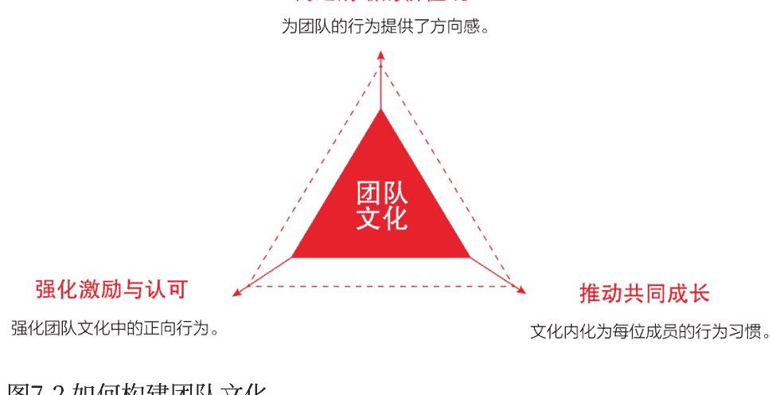

图7-2 如何构建团队文化

### 构建清晰的价值观：让文化从无形到有形

谈及团队文化，很多人易陷入“文化=口号”的误区。有的团队将“客户第一”印满办公室，考核却只看销售额，最终采购人员为控制成本放任品质下滑，引发客户投诉，完全违背了该团队所谓的企业文化——客户第一。

事实上，团队文化是组织的基因，存在于日常互动之中，体现在每一次决策、讨论乃至冲突处理里。它绝非一纸空谈，必须通过实际行动落地。比如“责任心”文化，落实到行动中可能是“答应客户的工作提前一天完成并检查三遍”，这才是文化的真实体现。

小团队的文化，往往由创业者的个人风格与价值观奠定。创业者的言行会无形中设定团队标准，明确哪些言行会被鼓励、哪些言行会被拒绝。例如在喜茶初创期，创始人聂云宸通过亲自参与产品研发、严格把控每批原料质量，传递“品质至上”的理念，这种对细节的执着逐渐成为团队文化，贯穿于公司的每项决策。

小团队文化建设离不开清晰的价值观：它不仅能帮助成员理解“我们是谁”，更能为团队行为提供方向感。成员背景、工作方式不同，共同的价值观却像隐形的纽带，将所有人连接起来。

### 强化激励与认可：让文化得到内化

仅让文化“看得见”远远不够，小团队创业者还需在团队运营管理中不断强化企业文化，才能让成员时刻牢记；靠要求约束不够，更要通过激励与认可，让文化内化为每个人的行为。

谁不希望被认可？好行为是夸出来、奖出来的。当成员感到被重视，他的工作积极性会更高；越来越多的人践行，久而久之便成了团队默认的规矩与氛围，文化也就“扎根”了。

创业者可以将企业文化（如协作、创新、客户导向）纳入绩效考核与奖励体系：奖励符合文化的行为，纠正偏离的行为，比如设立“月度/季度明星员工”“价值观践行奖”“创新奖”，或者提供培训机会、晋升通道、有挑战性的工作等。

创业者的及时认可也很关键：既能强化文化中的正向行为，还能提升成员士气。比如对员工的微小进步、积极行为给予及时的口头肯定或书面表扬（如小卡片、邮件），在会议、内部平台上公开感谢贡献。有时一句真诚的感谢、一次团队庆祝，就足以让成员感受到自身的价值，进而带动更多的人践行团队文化，让团队文化氛围愈发浓厚。

### 推动共同成长：让文化具备可持续性

对小团队而言，文化的可持续性尤为重要。若不能通过制度化将文化“固化”，随着团队规模的扩大、人员的频繁流动，早期积累的文化资产可能流失甚至异化。

只有将创业初期的文化内核转化为制度，让文化从个体特质变为组织基因，才能确保其在团队扩张中延续并发挥作用——这是团队保持凝聚力、独特性与长期竞争力的核心密码。

阿里巴巴快速扩张时，通过“六脉神剑”将核心价值观制度化，既为长期发展奠定了稳定的基石，也为新成员融入提供了清晰的指导，助力其在国内外市场扩张时保持文化一致。华为则通过明确的文化传递，让团队始终坚持技术创新导向，无论外部环境如何变化，内部节奏都能保持一致。

文化基因并非一成不变：市场变化、竞争压力可能迫使企业进行文化调整。小团队需定期审视文化是否有效、健康，是否适应新环境，在坚守核心的前提下，对外部实践进行必要的调整与进化。若新领导的管理风格、价值观与原文化冲突，可能引发文化危机——这就需要帮助新领导融入文化，并强调文化传承的重要性。

总之，文化基因的延续是动态的、需精心设计与持续投入的过程。最终目的，是将无形的精神内核，转化为整个团队共享、指导行为且可传承的文化力量。

团队文化是一种看不见的力量，无论在资源匮乏的创业初期，还是在扩张压力极大的快速成长期，文化都是小团队在不确定性中站稳脚跟、持续前进的关键所在。这要求小团队领导者不仅是文化的设计者，更是首要的践行者和守护者，同时整个团队的成员都需要成为文化的参与者和传承者。

通过打造和传递一套独特而坚韧的文化，小团队可以从一支普通的队伍，蜕变为创造奇迹的传奇力量。

## 团队融合：在冲突中挖掘成长的机会

对资源有限的小团队来说，冲突管理不仅是创业者的职责，更是团队迈向高效协作的必经之路。成功的小团队懂得将分歧转化为动力，让冲突成为创新的起点，而不是破坏的开端。

每一个团队在发展过程中，团队成员都可能产生分歧，而每一个分歧都蕴含着成长的机会。在小团队中，冲突几乎不可避免。成员之间观点的碰撞、角色的交叉以及对优先级的不同理解，都会引发争论。那么如何理解和利用冲突呢？

### 不偏离正轨的冲突才能激发多元化

小团队成员肩负多重责任，每一个决策都会直接影响整体运作的结果。在高压环境中，小团队中发生的冲突往往比大企业更频繁、更直白，但这并非全是坏事——适度的冲突能揭示隐藏的问题、激发更多的解决方案，甚至推动团队迈向新高度。

比如阿里巴巴早期，马云鼓励“真话文化”，希望成员在冲突中提出真实的想法，而非为避争议而沉默。一次产品决策会议上，团队因是否优先推广某功能而发生激烈的争论，最终马云让团队冷静分析后表决，而非靠权威拍板。这种开放讨论的文化，让团队在关键时刻产出更多元、更高质量的决策。

面对冲突，创业者或领导者经常扮演“双重角色”：一方面是冲突调解者，需要为不同的声音创造安全的表达空间；另一方面是方向指引者，需要在分歧中明确团队核心目标，防止冲突偏离正轨。

奈飞的里德·哈斯廷斯在文化建设中，以明确的准则解决冲突——强调“批评可以直白，但人要友善”，倡导“激烈辩论，快速决策”。

## 处理冲突的方式

这种处理冲突的方式让团队成员在面对冲突时聚焦问题本身，而非情绪化对抗。

在处理冲突时，创业者需保持中立，不偏袒任何一方，避免强化内部对立，同时引导团队成员聚焦问题本质。例如，某初创技术团队因新功能优先级产生冲突，创业者未直接支持某方，而是将讨论拉回“用户需求是什么”这一核心问题，既解决冲突，又让团队回归共同目标。

## 将冲突转为建设性讨论

我们常把冲突视为危机，是因为冲突易引发情绪对立；但若把冲突转化为建设性讨论，团队反而能挖掘创新灵感——分歧背后往往藏着不同视角与新思路。

谷歌早期广告团队曾因是否推出每点击付费（pay per click, PPC）广告模式而产生巨大的分歧：部分成员认为这一模式会破坏用户体验，另一部分则视其为商业趋势。冲突持续数周后，团队通过反复讨论，制定出兼顾用户体验与广告效果的折中方案，这一创新为谷歌日后在网络广告领域的绝对领先地位奠定了坚实的基础。

优秀的小团队还会通过机制将未来分歧转为有序讨论。机制的核心是提供明确的解决路径：华为以“开放、透明、集中”机制应对冲突，如部门因资源分配产生分歧时，召开公开会议让各方表达观点，再通过投票或权重分析决策，减少因决策不透明引发的不满。小团队可以简化机制，如定期召开“冲突解决会议”，鼓励成员提问题并公开讨论，或制定“分歧升级流程”，团队成员未能达成共识时上报创业者或外部顾问裁决。无论形式如何，机制的目标都是让冲突成为团队发展的动力，而非合作的障碍。

## 信任是解决问题的基石

无论意见分歧还是个性冲突，信任与开放始终是解决问题的基础。若成员之间缺乏信任，冲突易演变为个人对立；若团队缺少开放沟通的文化，问题会被掩盖，最终累积成更大的矛盾。

创业者需以自身行为塑造信任与开放的文化氛围。例如SpaceX面对重大技术瓶颈时，马斯克主动邀请一线工程师参与决策，而非仅靠高层参加的内部会议。这一举动让成员感受到自身的价值，能够在讨论中提出关键解决方案，既缓解了冲突，又为团队奠定了信任、开放的文化基调。

发生冲突是团队成长的正常现象。优秀的小团队能从冲突中找到问题本质、挖掘潜在机会，将分歧转为融合力量。创业者的角色不是消灭冲突，而是以科学的机制与开放的文化，引导冲突走向健康发展的轨道。在此过程中，团队会形成应对分歧的默契——这不仅能提升合作效率，还能带来更多的创新灵感。对小团队而言，解决冲突既是挑战，更是成长的机会，正是在此过程中，团队成员从普通合作关系，蜕变为有凝聚力与战斗力的整体。

## 团队建设：AI赋能下的团队建设

小团队擅长做业务，但经常会忽略人才培养和团队管理。在理解了团队如何从无到有、从有到优，我们来看看AI如何提高招聘和人才管理的效率，并助力企业文化建设，增强团队凝聚力，从而释放领导力投入战略事务的时间。

在团队管理中引入AI，企业应从最紧迫的需求入手。例如，如果招聘周期长、成本高，可以优先尝试AI简历筛选和视频面试工具；如果绩效管理主观性强，则引入数据分析平台加强客观性。在实施过程中，人力资源管理者要保持对AI产出的监督，确保算法决策公平透明。领导者还应定期与员工沟通AI应用的目的和效果，缓解可能的担忧。通过将AI融入“以人为本”的管理理念，团队建设和文化培育就能事半功倍——既利用AI的力量提升工作效率，又不失组织的温度和创意。

### 智能招聘：提升效率和准确性

智能招聘系统可以借助大数据和机器学习快速筛选简历，匹配候选人技能与岗位要求；AI能够分析求职者履历及社交媒体公开信息，挖掘潜在能力与职业倾向，助力人力资源管理者锁定优质人才；自然语言处理与计算机视觉技术应用于AI面试工具，能够分析评估候选人语音语调、表情及回答内容，量化其沟通能力、情商与专业知识，减少人工主观偏见，提升筛选客观性。

国内不少企业已采用AI招聘方案：某企业用牛客网AI视频面试系统，使蓝领大规模招工提效73%；某房地产公司引入AI面试后，在保证人才质量的同时将招聘成本降低78%。由此可见，智能招聘能帮助企业以更低的成本、更短的周期招到合适的人才。

### 绩效管理：提供客观的决策支持

在员工管理中，AI提供数据驱动的客观决策支持。传统绩效评估常常依赖管理者的主观判断，而AI系统可以自动汇总分析员工工作产出、项目完成情况等数据，为管理层提供全面、公正的绩效评价。

通过机器学习模型，企业能及时发现绩效异常或下滑趋势，提前识别团队的潜在问题与发展瓶颈，便于管理者及早介入辅导或调整分工，防患于未然。此外，AI可依据员工技能水平与职业目标定制个性化培训计划，如智能学习平台推荐适配课程，甚至用虚拟现实/增强现实技术提供沉浸式培训，提升效果与趣味性，既加速员工成长，也降低不必要的培训开支。

### 营造文化氛围：用数字技术育人留人

企业员工在逐渐增多的过程中，人力资源管理者很难兼顾每个人的问题。在企业文化建设中，AI可以助力提升员工体验与文化氛围：智能聊天机器人充当“数字人力资源管理者”，随时解答员工关于公司政策、福利、IT支持等问题，减少等待答复时间，提升员工满意度；AI能匿名收集分析员工反馈与情感倾向，如通过敬业度调查及情感分析，帮助领导层掌握团队士气与文化健康度，及时改善环境、调整管理方式；AI驱动的团队协作工具可以分析沟通模式，提醒信息孤岛或协作瓶颈，助力促进跨部门协作，塑造开放共享的企业文化。

华为、腾讯、招商银行等企业早已引入AI人才管理工具。招商银行用AI对新员工开展在线培训测评，实现“千人千面”培养。人力资源平台“薪人薪事”借助AI分析绩效数据与行为模式，为某互联网公司建立绩效预警机制，使其员工绩效问题解决率提高30%，员工流失率明显下降。中小企业也可以通过SaaS服务使用智能招聘、AI面试、员工服务机器人等工具。

综上所述，人工智能正成为企业人才管理的“加速器”。借助AI工具，企业能在招聘、绩效、文化建设上提质提效，弥补人力与经验不足，为长远发展打下坚实的基础。

## 团队进化：如何构建成长型团队

一个小团队的潜力，并不止于解决眼前的问题。它的真正价值在于能否随着时间的推移，不断吸纳新鲜血液、提升自身能力，并应对复杂多变的市场挑战。

换句话说，小团队的成功并不取决于短期的卓越表现，而在于它能否成为一个成长型团队。这样的团队，能够在创业初期的资源限制中生存下来，更能在快速扩张和长期发展中不断发展壮大。

### 从“多面手”到“专业化”的过渡

在小团队初创期，团队成员常常扮演“多面手”：产品经理可能参与市场推广，技术人员或许兼顾客服支持，这种灵活性赋予团队成员极高的适应性。但随着业务发展规模的扩大，“多面手”模式会暴露出一定的局限性，因为哪一项都不够专业。

成长型团队的标志，是从多面手顺利过渡到专业化模式。这并不是说要抛弃灵活性，而是在灵活的基础上明确分工、引入专业技能。在爱彼迎（Airbnb）初创期，CEO布莱恩·切斯基（Brian Chesky）兼顾战略、用户服务与设计细节；团队成长后，他引入专业管理团队，将具体事务交予更擅长管理的领导者，既释放了自身精力，也提升了团队效率与专业度。

团队从“多面手”过渡到“专业化”，文化也需要从“个人化”过渡到“制度化”。小团队早期，文化多依赖于创业者的个人特质与行为习惯；当团队从几人扩至几十甚至上百人，个人行为的影响力难以覆盖全组织，需将文化内核转化为制度化机制，确保扩张中的文化延续。例如阿里巴巴快速成长时，将马云早期强调的“客户第一、团队合作”理念，转化为明确的价值观体系并融入各流程，既保障了国内外扩张时的文化一致，也为新成员融入提供了清晰的指引。

### 成长型团队的核心特质

#### 长期人才规划

成长型团队需要从眼前人事安排，转向长期人才规划——创业者不仅要考虑当前的用人需求，更要布局梯队建设与核心岗位继任者。在人才梯队建设上领先，奈飞创始人里德·哈斯廷斯认为应优先内部培养人才填补关键岗位空缺，通过明确的晋升路径与学习机会助力员工成长，保障团队扩张时的储备人才。小团队可以通过简单机制，如导师制或培训计划，让潜力成员逐步担责，调动员工的工作热情并增强其团队归属感。

#### 高度多样性

多样性能提升团队适应性与竞争力——不同知识背景、专业技能、思维方式的成员，能更好地应对市场变化。特斯拉早期，马斯克强调团队多样性，既吸引顶尖工程师，也纳入多元文化与行业背景的成员，助其快速适配不同国家和地区市场的需求。某电商初创公司组建市场团队时，重点招聘技术、设计、分析等不同技术背景的成员，使推广策略兼具创意与数据验证，实现增长目标。

#### 未来视野：团队成长的核心

成长型团队的核心，是对未来的敏锐感知与适应能力。创业者无须畏惧未来的不可预测，而是需要警惕团队在成长过程中丧失灵活性——成功的团队能在扩张时保留初创期的创新精神。正如拼多多创始人黄峥所强调的，公司成长过程中不可忽视用户需求的变化。他通过构建

## 结语

写到本书的最后，我们常常会回想起刚开始写作时的那种心情：既不是雄心勃勃的宣言，也不是冷静克制的分析，而是一种被时代轻轻触碰的感觉，是感到有些事情必须被说出来、必须被整理清楚、必须以一种诚恳而稳固的方式留给愿意倾听的人。这种感觉贯穿于整个写作过程，也贯穿于书中的每一个章节：我们想说的事远远超过“创业”本身的东西，它关乎人，关乎时代，关乎我们的理解，也关乎我们选择存在的方式。

现在合上这本书，也许已比初次翻开时更加清楚：这本书所讲的，并不是如何抓住风口、如何快速增长、如何制定一个漂亮的商业计划书，而是如何在一个不断加速、不停变化的时代里，用清晰的结构、稳定的节奏和成熟的心智去走一条属于自己的路。

我们讨论商业模式，是为了让你能看懂复杂中的简单；我们讨论AI，是为了告诉你未来的力量来自技术与人的结合；我们讨论小团队，是因为这是一个能够把自由、效率、意义与价值同时安放进去的载体。

当代创业者真正需要的，不是激情的燃烧，也不是工具的堆叠，而是能在巨变中不迷失方向、在风浪中保持稳定、在选择中保持清醒的那份底层力量。当你拥有这份力量时，你的道路或许依旧曲折，但不会盲目；你会跌倒，但不会一蹶不振；你会遭遇阻碍，但不会失去方向。你会在某个瞬间突然意识到：原来你已经具备了“在这个时代继续走下去”的能力。

我们希望，在未来的某一天，你面对一个新机会时，会自然地从商业模式的结构中观察它的关键环节；当AI技术再次迭代时，你能以一种从容的姿态去拥抱它，而不是被它推着走；当你的小团队在压力中寻求平衡时，你能用更加成熟的方式重新构建组织的节奏；当外界的喧嚣让你陷入犹豫时，你会想起本书反复强调的那句话：

> 真正的力量，并非来自规模，而是来自边界清晰、结构稳定、持续创造价值的能力。

也许有一天，你会突然回头，发现自己已经走了很远；发现自己已经能够以更深刻的方式理解世界、理解他人也理解自己；发现那些曾经让你焦虑的变化和挑战，如今已经被你转化成动力和机遇；发现自己不再依赖外界给出的方向，而是能够依靠自己的眼睛、自己的判断、自己的节奏前行。若这本书在这些时刻陪着你、托住你、提醒你，那么它就已经完成了它最重要的使命。

时代往前走得很快，但我们不必慌张。AI会继续成长，行业会继续重构，组织形式会继续演化，而我们需要做的事很简单：保持清醒，保持节奏，保持边界，然后继续走下去。当你这样做时，你的小团队会自然生长，你的事业会自然聚焦，你的价值会自然涌现，你的意义会变得更加清晰。

你并不是与世界对抗，而是在与世界对话；不是在与时代赛跑，而是在与时代共舞。当你真正理解这一点的时候，你会突然明白——

- 小团队，是一种自由；
- 商业模式，是一种理解力；
- AI，是一种时代的恩赐；
- 而创业，是一种长久的修行。

愿你在未来的道路上，始终拥有理解世界的眼睛、构建系统的头脑、拥抱技术的勇气、经营边界的智慧，以及面对未知时那份静静的自信。愿你在混乱中仍然能够找到秩序，在波动中仍然能够抓住稳固，在复杂中仍然能够选择简单。

我们在书页的尽头放下笔，但你的旅程才刚刚展开。

愿你走向更辽阔的未来，

愿你在AI时代找到属于自己的光，

愿你用一个小团队，

完成一件真正值得的事。

愿你的小团队，有大未来。

钱晟磊 刘冠宇

2025年11月